# Drilling.Common/Station/CStationProcess.cs

| 항목 | 내용 |
| --- | --- |
| 원본 저장소 | https://github.com/kjuws10-rgb/A3Drilling.git |
| 원본 Commit | 96e22cd027c84bf302b23f2949b98985d7f301bb |
| 원본 SHA256 | 934432b2d9173acb24fcb516330ef562c117dac79dfbc626e7b25755e64924c1 |
| 파일 분류 | code |
| 원본 크기/행 | 348,466 bytes / 6,571 physical lines |
| 인코딩 | utf-8-sig |
| 검토 범위 | 구문/부분 의미 분석에서 추출한 사실. 동작·물리 단위·실장비 합격을 보증하지 않습니다. |
| 원본 링크 | [고정 Commit 원본](https://github.com/kjuws10-rgb/A3Drilling/blob/96e22cd027c84bf302b23f2949b98985d7f301bb/Drilling.Common/Station/CStationProcess.cs) |

## 파일의 역할과 읽는 순서

설비·가공·Stage 시퀀스와 단계 상태를 연결하는 계층입니다. 실제 호출 순서는 본문·상태 조건과 수동 해설장을 함께 확인합니다.


## 네임스페이스·타입·상속

| 타입 | 구분 | 원본 범위 | 선언/상속 |
| --- | --- | --- | --- |
| CStationProcess | ClassDeclaration | 23–4282 | CStationProcess: CtrlThread |
| CProcessStepAction | DelegateDeclaration | 170–170 | private delegate void CProcessStepAction(ST_PROCESS_MODEL processModel, CancellationToken cancellationToken); |
| ST_BUFFERED_RUN_GROUP_RESULT | RecordDeclaration | 2523–2523 | ST_BUFFERED_RUN_GROUP_RESULT |
| ST_BUFFERED_RUN_STOP_RESULT | RecordDeclaration | 2524–2524 | ST_BUFFERED_RUN_STOP_RESULT |
| ST_AUTOMATION_TASK_KEY | RecordStructDeclaration | 2525–2525 | ST_AUTOMATION_TASK_KEY |
| ST_AUTOMATION_TASK_TARGET | RecordDeclaration | 2526–2526 | ST_AUTOMATION_TASK_TARGET |
| ST_AUTOMATION_TASK_STATUS | RecordDeclaration | 2527–2527 | ST_AUTOMATION_TASK_STATUS |
| ST_AUTOMATION_TASK_LINE_STATUS | RecordDeclaration | 2528–2528 | ST_AUTOMATION_TASK_LINE_STATUS |
| ST_SCANNER_STATUS_LOG_AXIS_TARGET | RecordDeclaration | 2529–2529 | ST_SCANNER_STATUS_LOG_AXIS_TARGET |
| ST_QUEUE_COUNT_LOG_TARGET | RecordDeclaration | 2530–2530 | ST_QUEUE_COUNT_LOG_TARGET |
| ST_AUTO_STEP_INFO | RecordDeclaration | 2531–2531 | ST_AUTO_STEP_INFO |
| CScannerStatusLogger | ClassDeclaration | 2532–3095 | CScannerStatusLogger: IDisposable |
| CQueueCountLogger | ClassDeclaration | 3097–3313 | CQueueCountLogger: IDisposable |
| CBufferedRunWorker | ClassDeclaration | 3315–3394 | CBufferedRunWorker |
| CStageBufferedRun | ClassDeclaration | 4208–4212 | CStageBufferedRun |
| CHandshakeOutputReset | ClassDeclaration | 4285–4331 | CHandshakeOutputReset |
| ST_PROTECT_WINDOW_RETRY_EXHAUSTED | RecordDeclaration | 4333–4333 | ST_PROTECT_WINDOW_RETRY_EXHAUSTED |
| CProtectWindowUsageRequest | ClassDeclaration | 4335–4764 | CProtectWindowUsageRequest |
| CStageProcessDataPublisher | ClassDeclaration | 4767–4887 | CStageProcessDataPublisher |
| ST_STAGE_READY_POSITION_RESULT | RecordDeclaration | 4889–4889 | ST_STAGE_READY_POSITION_RESULT |
| CStageReadyPositionCheck | ClassDeclaration | 4891–4957 | CStageReadyPositionCheck |
| ST_STAGE_REQUEST_STATUS | RecordDeclaration | 4959–4963 | ST_STAGE_REQUEST_STATUS |
| ST_STAGE_SIGNAL_SNAPSHOT | RecordDeclaration | 4964–4967 | ST_STAGE_SIGNAL_SNAPSHOT |
| CStageRequestSequence | ClassDeclaration | 4969–5935 | CStageRequestSequence |
| ST_STAGE_DISTORTION_ACTIONS | RecordDeclaration | 5937–5941 | ST_STAGE_DISTORTION_ACTIONS |
| ST_STAGE_TPM_ACTIONS | RecordDeclaration | 5942–5942 | ST_STAGE_TPM_ACTIONS |
| ST_STAGE_REVIEW_ACTIONS | RecordDeclaration | 5943–5943 | ST_STAGE_REVIEW_ACTIONS |
| ST_STAGE_ZERO_LINE_ACTIONS | RecordDeclaration | 5944–5947 | ST_STAGE_ZERO_LINE_ACTIONS |
| ST_MANUAL_MOF_STATUS | RecordDeclaration | 5948–5948 | ST_MANUAL_MOF_STATUS |
| ST_MANUAL_MOF_COMPLETION | RecordDeclaration | 5949–5949 | ST_MANUAL_MOF_COMPLETION |
| CManualMofActionIds | ClassDeclaration | 5950–5953 | CManualMofActionIds |
| ST_STAGE_PROCESS_REQUEST | RecordDeclaration | 5955–5955 | ST_STAGE_PROCESS_REQUEST |
| ST_ZERO_LINE_PREWAIT_STATUS | RecordDeclaration | 5956–5956 | ST_ZERO_LINE_PREWAIT_STATUS |
| CZeroLinePrewaitMonitor | ClassDeclaration | 5958–6323 | CZeroLinePrewaitMonitor |
| CZeroLineProcessCoordinator | ClassDeclaration | 6326–6570 | CZeroLineProcessCoordinator |

## 멤버 빠른 목록

| 이름 | 종류 | 범위 | 서명 |
| --- | --- | --- | --- |
| AutoStepIdle | FieldDeclaration | L26–26 | string Drilling.Common.Station.CStationProcess.AutoStepIdle |
| AutoStepPowerCheck | FieldDeclaration | L27–27 | string Drilling.Common.Station.CStationProcess.AutoStepPowerCheck |
| AutoStepAlign | FieldDeclaration | L28–28 | string Drilling.Common.Station.CStationProcess.AutoStepAlign |
| AutoStepProcess | FieldDeclaration | L29–29 | string Drilling.Common.Station.CStationProcess.AutoStepProcess |
| AutoStepInspection | FieldDeclaration | L30–30 | string Drilling.Common.Station.CStationProcess.AutoStepInspection |
| AutoStepComplete | FieldDeclaration | L31–31 | string Drilling.Common.Station.CStationProcess.AutoStepComplete |
| ScriptBufferedRunUseKey | FieldDeclaration | L32–32 | string Drilling.Common.Station.CStationProcess.ScriptBufferedRunUseKey |
| ScriptRunTimeoutMsKey | FieldDeclaration | L33–33 | string Drilling.Common.Station.CStationProcess.ScriptRunTimeoutMsKey |
| ScriptRunPollIntervalMsKey | FieldDeclaration | L34–34 | string Drilling.Common.Station.CStationProcess.ScriptRunPollIntervalMsKey |
| ScriptBufferedRunLinesPerCommandKey | FieldDeclaration | L35–35 | string Drilling.Common.Station.CStationProcess.ScriptBufferedRunLinesPerCommandKey |
| ScriptBufferedRunTimeoutMsKey | FieldDeclaration | L36–36 | string Drilling.Common.Station.CStationProcess.ScriptBufferedRunTimeoutMsKey |
| ScriptBufferedRunQueueSizeKey | FieldDeclaration | L37–37 | string Drilling.Common.Station.CStationProcess.ScriptBufferedRunQueueSizeKey |
| StandardScriptDirectoryName | FieldDeclaration | L38–38 | string Drilling.Common.Station.CStationProcess.StandardScriptDirectoryName |
| BufferedRunScriptDirectoryName | FieldDeclaration | L39–39 | string Drilling.Common.Station.CStationProcess.BufferedRunScriptDirectoryName |
| QueueCountLogDirectoryName | FieldDeclaration | L40–40 | string Drilling.Common.Station.CStationProcess.QueueCountLogDirectoryName |
| ScannerStatusLogDirectoryName | FieldDeclaration | L41–41 | string Drilling.Common.Station.CStationProcess.ScannerStatusLogDirectoryName |
| ScriptRunDefaultTimeoutMs | FieldDeclaration | L42–42 | int Drilling.Common.Station.CStationProcess.ScriptRunDefaultTimeoutMs |
| ScriptRunDefaultPollIntervalMs | FieldDeclaration | L43–43 | int Drilling.Common.Station.CStationProcess.ScriptRunDefaultPollIntervalMs |
| EncoderScaleReleaseTimeoutMs | FieldDeclaration | L44–44 | int Drilling.Common.Station.CStationProcess.EncoderScaleReleaseTimeoutMs |
| QueueCountLogIntervalMs | FieldDeclaration | L45–45 | int Drilling.Common.Station.CStationProcess.QueueCountLogIntervalMs |
| ScannerStatusLogIntervalMs | FieldDeclaration | L46–46 | int Drilling.Common.Station.CStationProcess.ScannerStatusLogIntervalMs |
| QueueCountLogStopWaitMs | FieldDeclaration | L47–47 | int Drilling.Common.Station.CStationProcess.QueueCountLogStopWaitMs |
| MaximumProcessLogCount | FieldDeclaration | L48–48 | int Drilling.Common.Station.CStationProcess.MaximumProcessLogCount |
| AutoStepWait | FieldDeclaration | L49–49 | string Drilling.Common.Station.CStationProcess.AutoStepWait |
| AutoStepRunning | FieldDeclaration | L50–50 | string Drilling.Common.Station.CStationProcess.AutoStepRunning |
| AutoStepOk | FieldDeclaration | L51–51 | string Drilling.Common.Station.CStationProcess.AutoStepOk |
| AutoStepDone | FieldDeclaration | L52–52 | string Drilling.Common.Station.CStationProcess.AutoStepDone |
| AutoStepError | FieldDeclaration | L53–53 | string Drilling.Common.Station.CStationProcess.AutoStepError |
| AutoStepStop | FieldDeclaration | L54–54 | string Drilling.Common.Station.CStationProcess.AutoStepStop |
| AutoStepInfos | FieldDeclaration | L55–62 | System.Collections.Generic.IReadOnlyList<Drilling.Common.Station.CStationProcess.ST_AUTO_STEP_INFO> Drilling.Common.Station.CStationProcess.AutoStepInfos |
| ProcessFlowItems | FieldDeclaration | L63–70 | System.Collections.Generic.IReadOnlyList<Drilling.Common.Station.ST_STATION_PROCESS_FLOW_ITEM> Drilling.Common.Station.CStationProcess.ProcessFlowItems |
| _interfaceManager | FieldDeclaration | L71–71 | Drilling.Common.Interface.CInterfaceManager Drilling.Common.Station.CStationProcess._interfaceManager |
| _motionManager | FieldDeclaration | L72–72 | Drilling.Common.Motion.CMotionManager Drilling.Common.Station.CStationProcess._motionManager |
| _interLockManager | FieldDeclaration | L73–73 | Drilling.Common.InterLock.CInterLockManager Drilling.Common.Station.CStationProcess._interLockManager |
| _settingManager | FieldDeclaration | L74–74 | Drilling.Common.Managers.CSettingManager Drilling.Common.Station.CStationProcess._settingManager |
| _productManager | FieldDeclaration | L75–75 | Drilling.Common.Product.CProductManager? Drilling.Common.Station.CStationProcess._productManager |
| _recipeManager | FieldDeclaration | L76–76 | Drilling.Common.Managers.CRecipeManager? Drilling.Common.Station.CStationProcess._recipeManager |
| _zeroLineReview | FieldDeclaration | L77–77 | Drilling.Common.Review.CReviewManager? Drilling.Common.Station.CStationProcess._zeroLineReview |
| _protectWindowUsageRequest | FieldDeclaration | L78–78 | Drilling.Common.Station.CProtectWindowUsageRequest? Drilling.Common.Station.CStationProcess._protectWindowUsageRequest |
| _reviewOffsetFile | FieldDeclaration | L79–79 | Drilling.Common.Review.CReviewOffsetFileBase? Drilling.Common.Station.CStationProcess._reviewOffsetFile |
| _automationScriptFile | FieldDeclaration | L80–80 | Drilling.Common.Station.CAutomationScriptFileBase Drilling.Common.Station.CStationProcess._automationScriptFile |
| _automationManager | FieldDeclaration | L81–81 | Drilling.Common.Automation.CAutomationManager Drilling.Common.Station.CStationProcess._automationManager |
| _logManager | FieldDeclaration | L82–82 | CLogManager? Drilling.Common.Station.CStationProcess._logManager |
| _manualMofCompletionPath | FieldDeclaration | L83–83 | string? Drilling.Common.Station.CStationProcess._manualMofCompletionPath |
| _sequenceLock | FieldDeclaration | L84–84 | object Drilling.Common.Station.CStationProcess._sequenceLock |
| _processLogLock | FieldDeclaration | L85–85 | object Drilling.Common.Station.CStationProcess._processLogLock |
| _sequenceActions | FieldDeclaration | L86–86 | Drilling.Common.Station.CSequenceActionStatusStore Drilling.Common.Station.CStationProcess._sequenceActions |
| _processLogs | FieldDeclaration | L87–87 | System.Collections.Generic.List<Drilling.Common.Station.ST_PROCESS_LOG_ITEM> Drilling.Common.Station.CStationProcess._processLogs |
| _autoStepStates | FieldDeclaration | L88–88 | System.Collections.Generic.Dictionary<string, string> Drilling.Common.Station.CStationProcess._autoStepStates |
| _scriptCreatedAt | FieldDeclaration | L89–89 | System.DateTimeOffset? Drilling.Common.Station.CStationProcess._scriptCreatedAt |
| _scriptStartedAt | FieldDeclaration | L90–90 | System.DateTimeOffset? Drilling.Common.Station.CStationProcess._scriptStartedAt |
| _scriptCompletedAt | FieldDeclaration | L91–91 | System.DateTimeOffset? Drilling.Common.Station.CStationProcess._scriptCompletedAt |
| _lastScript | FieldDeclaration | L92–92 | Drilling.Common.Station.ST_SCRIPT_BUILD_RESULT? Drilling.Common.Station.CStationProcess._lastScript |
| _lastInterLockItems | FieldDeclaration | L93–93 | System.Collections.Generic.IReadOnlyList<Drilling.Common.InterLock.ST_INTERLOCK_ITEM> Drilling.Common.Station.CStationProcess._lastInterLockItems |
| _processModel | FieldDeclaration | L94–94 | Drilling.Common.Station.ST_PROCESS_MODEL? Drilling.Common.Station.CStationProcess._processModel |
| _preparedReviewOffsetFilePath | FieldDeclaration | L95–95 | string Drilling.Common.Station.CStationProcess._preparedReviewOffsetFilePath |
| _preparedReviewOffsetSavedAt | FieldDeclaration | L96–96 | System.DateTimeOffset Drilling.Common.Station.CStationProcess._preparedReviewOffsetSavedAt |
| _preparedReviewOffsetInvalidated | FieldDeclaration | L97–97 | bool Drilling.Common.Station.CStationProcess._preparedReviewOffsetInvalidated |
| _statistics | FieldDeclaration | L98–98 | Drilling.Common.Station.ST_PROCESS_STATISTICS Drilling.Common.Station.CStationProcess._statistics |
| _snapshot | FieldDeclaration | L99–99 | Drilling.Common.Station.ST_STATION_PROCESS_STATUS Drilling.Common.Station.CStationProcess._snapshot |
| _stationStatus | FieldDeclaration | L100–100 | Drilling.Common.Station.ST_STATION_STATUS Drilling.Common.Station.CStationProcess._stationStatus |
| _sequenceState | FieldDeclaration | L101–101 | Drilling.Common.Station.EN_STATION_SEQUENCE Drilling.Common.Station.CStationProcess._sequenceState |
| _sequenceCancellation | FieldDeclaration | L102–102 | System.Threading.CancellationTokenSource? Drilling.Common.Station.CStationProcess._sequenceCancellation |
| _sequenceError | FieldDeclaration | L103–103 | string Drilling.Common.Station.CStationProcess._sequenceError |
| _manualMofActions | FieldDeclaration | L104–104 | Drilling.Common.Station.CSequenceActionStatusStore Drilling.Common.Station.CStationProcess._manualMofActions |
| _manualMofCancellation | FieldDeclaration | L105–105 | System.Threading.CancellationTokenSource? Drilling.Common.Station.CStationProcess._manualMofCancellation |
| _manualMofExecution | FieldDeclaration | L106–106 | System.Threading.Tasks.Task Drilling.Common.Station.CStationProcess._manualMofExecution |
| _manualMofRunning | FieldDeclaration | L107–107 | bool Drilling.Common.Station.CStationProcess._manualMofRunning |
| _manualMofRequiresStop | FieldDeclaration | L108–108 | bool Drilling.Common.Station.CStationProcess._manualMofRequiresStop |
| _manualMofMessage | FieldDeclaration | L109–109 | string Drilling.Common.Station.CStationProcess._manualMofMessage |
| _manualMofDirectory | FieldDeclaration | L110–110 | string Drilling.Common.Station.CStationProcess._manualMofDirectory |
| _lastCompletedManualMof | FieldDeclaration | L111–111 | Drilling.Common.Station.ST_MANUAL_MOF_COMPLETION? Drilling.Common.Station.CStationProcess._lastCompletedManualMof |
| _protectWindowCountGate | FieldDeclaration | L112–112 | System.Threading.SemaphoreSlim Drilling.Common.Station.CStationProcess._protectWindowCountGate |
| _protectWindowCounted | FieldDeclaration | L113–113 | bool Drilling.Common.Station.CStationProcess._protectWindowCounted |
| _stageMachiningCompleted | FieldDeclaration | L114–114 | bool Drilling.Common.Station.CStationProcess._stageMachiningCompleted |
| _stageOwnedTasks | FieldDeclaration | L115–115 | System.Collections.Concurrent.ConcurrentDictionary<(int Controller, int Task), Drilling.Common.Station.ST_HEAD_SCRIPT_RESULT> Drilling.Common.Station.CStationProcess._stageOwnedTasks |
| _stageBufferedRuns | FieldDeclaration | L116–116 | System.Collections.Concurrent.ConcurrentDictionary<int, Drilling.Common.Station.CStationProcess.CStageBufferedRun> Drilling.Common.Station.CStationProcess._stageBufferedRuns |
| _stageModelLogCycle | FieldDeclaration | L117–117 | string Drilling.Common.Station.CStationProcess._stageModelLogCycle |
| _zeroLineCycle | FieldDeclaration | L118–118 | Drilling.Common.Station.CZeroLineProcessCoordinator? Drilling.Common.Station.CStationProcess._zeroLineCycle |
| _zeroLinePrewait | FieldDeclaration | L119–119 | Drilling.Common.Station.CZeroLinePrewaitMonitor? Drilling.Common.Station.CStationProcess._zeroLinePrewait |
| .ctor | ConstructorDeclaration | L122–166 | Drilling.Common.Station.CStationProcess.CStationProcess(Drilling.Common.Interface.CInterfaceManager, Drilling.Common.Motion.CMotionManager, Drilling.Common.InterLock.CInterLockManager, Drilling.Common.Managers.CSettingManager, Drilling.Common.Station.CAutomationScriptFileBase, Drilling.Common.Automation.CAutomationManager, Drilling.Common.Review.CReviewOffsetFileBase?, Drilling.Common.Product.CProductManager?, CLogManager?, string, string?, Drilling.Common.Managers.CRecipeManager?, Drilling.Common.Review.CReviewManager?, System.Action<Drilling.Common.Station.ST_PROTECT_WINDOW_RETRY_EXHAUSTED>?) |
| CProcessStepAction | DelegateDeclaration | L170–170 | Drilling.Common.Station.CStationProcess.CProcessStepAction |
| Current | PropertyDeclaration | L171–187 | Drilling.Common.Station.ST_STATION_PROCESS_STATUS Drilling.Common.Station.CStationProcess.Current |
| get_Current | GetAccessorDeclaration | L173–186 | Drilling.Common.Station.ST_STATION_PROCESS_STATUS Drilling.Common.Station.CStationProcess.Current.get |
| Status | PropertyDeclaration | L189–195 | Drilling.Common.Station.ST_STATION_STATUS Drilling.Common.Station.CStationProcess.Status |
| get_Status | GetAccessorDeclaration | L191–194 | Drilling.Common.Station.ST_STATION_STATUS Drilling.Common.Station.CStationProcess.Status.get |
| SequenceState | PropertyDeclaration | L197–203 | Drilling.Common.Station.EN_STATION_SEQUENCE Drilling.Common.Station.CStationProcess.SequenceState |
| get_SequenceState | GetAccessorDeclaration | L199–202 | Drilling.Common.Station.EN_STATION_SEQUENCE Drilling.Common.Station.CStationProcess.SequenceState.get |
| GetProcessFlow | MethodDeclaration | L205–208 | System.Collections.Generic.IReadOnlyList<Drilling.Common.Station.ST_STATION_PROCESS_FLOW_ITEM> Drilling.Common.Station.CStationProcess.GetProcessFlow() |
| PrepareProcess | MethodDeclaration | L210–226 | Drilling.Common.Station.ST_STATION_PROCESS_STATUS Drilling.Common.Station.CStationProcess.PrepareProcess(string, string, string, string, System.Collections.Generic.IReadOnlyDictionary<string, string>, System.Threading.CancellationToken, bool) |
| PrepareProcessCore | MethodDeclaration | L228–269 | Drilling.Common.Station.ST_STATION_PROCESS_STATUS Drilling.Common.Station.CStationProcess.PrepareProcessCore(string, string, string, string, System.Collections.Generic.IReadOnlyDictionary<string, string>, System.Threading.CancellationToken, bool, System.Collections.Generic.IReadOnlySet<int>?) |
| Start | MethodDeclaration | L271–322 | Drilling.Common.Station.ST_STATION_PROCESS_STATUS Drilling.Common.Station.CStationProcess.Start(System.Threading.CancellationToken) |
| Run | MethodDeclaration | L324–381 | void Drilling.Common.Station.CStationProcess.Run() |
| RunSequenceStep | MethodDeclaration | L383–392 | void Drilling.Common.Station.CStationProcess.RunSequenceStep(Drilling.Common.Station.EN_STATION_SEQUENCE, string, Drilling.Common.Station.CStationProcess.CProcessStepAction, Drilling.Common.Station.EN_STATION_SEQUENCE) |
| CheckProcessModelLoaded | MethodDeclaration | L394–397 | Drilling.Common.Station.ST_PROCESS_MODEL Drilling.Common.Station.CStationProcess.CheckProcessModelLoaded() |
| GetSequenceCancellationToken | MethodDeclaration | L399–405 | System.Threading.CancellationToken Drilling.Common.Station.CStationProcess.GetSequenceCancellationToken() |
| FinishSequence | MethodDeclaration | L407–421 | void Drilling.Common.Station.CStationProcess.FinishSequence() |
| ProcessInterruptedSequence | MethodDeclaration | L423–432 | void Drilling.Common.Station.CStationProcess.ProcessInterruptedSequence() |
| CompleteSequence | MethodDeclaration | L434–437 | void Drilling.Common.Station.CStationProcess.CompleteSequence(Drilling.Common.Station.ST_PROCESS_MODEL, System.Threading.CancellationToken) |
| EnsureStartAllowed | MethodDeclaration | L439–445 | void Drilling.Common.Station.CStationProcess.EnsureStartAllowed() |
| ReadProcessModelForStart | MethodDeclaration | L447–457 | Drilling.Common.Station.ST_PROCESS_MODEL Drilling.Common.Station.CStationProcess.ReadProcessModelForStart() |
| GetLiveInterlockItems | MethodDeclaration | L459–459 | System.Collections.Generic.IReadOnlyList<Drilling.Common.InterLock.ST_INTERLOCK_ITEM> Drilling.Common.Station.CStationProcess.GetLiveInterlockItems(System.Threading.CancellationToken) |
| GetLiveInterlockItems | MethodDeclaration | L460–460 | System.Collections.Generic.IReadOnlyList<Drilling.Common.InterLock.ST_INTERLOCK_ITEM> Drilling.Common.Station.CStationProcess.GetLiveInterlockItems(System.Collections.Generic.IReadOnlyDictionary<string, string>, System.Threading.CancellationToken) |
| GetManualInterlockItems | MethodDeclaration | L461–471 | System.Collections.Generic.IReadOnlyList<Drilling.Common.InterLock.ST_INTERLOCK_ITEM> Drilling.Common.Station.CStationProcess.GetManualInterlockItems(System.Collections.Generic.IReadOnlyDictionary<string, string>, System.Collections.Generic.IReadOnlySet<int>, System.Threading.CancellationToken) |
| ExecuteAutoStep | MethodDeclaration | L473–498 | void Drilling.Common.Station.CStationProcess.ExecuteAutoStep(string, Drilling.Common.Station.ST_PROCESS_MODEL, Drilling.Common.Station.CStationProcess.CProcessStepAction, System.Threading.CancellationToken) |
| RunAlignStep | MethodDeclaration | L500–525 | void Drilling.Common.Station.CStationProcess.RunAlignStep(Drilling.Common.Station.ST_PROCESS_MODEL, System.Threading.CancellationToken) |
| UpdateProductAlignment | MethodDeclaration | L527–549 | void Drilling.Common.Station.CStationProcess.UpdateProductAlignment(Drilling.Common.Station.ST_PROCESS_MODEL, Drilling.Common.Product.EN_PRODUCT_PROCESS_STATE, string, System.Threading.CancellationToken) |
| TryUpdateProductAlignmentAfterFailure | MethodDeclaration | L551–561 | void Drilling.Common.Station.CStationProcess.TryUpdateProductAlignmentAfterFailure(Drilling.Common.Station.ST_PROCESS_MODEL, Drilling.Common.Product.EN_PRODUCT_PROCESS_STATE, string) |
| RunProcessStep | MethodDeclaration | L563–574 | void Drilling.Common.Station.CStationProcess.RunProcessStep(Drilling.Common.Station.ST_PROCESS_MODEL, System.Threading.CancellationToken) |
| MoveStageToScanStart | MethodDeclaration | L576–608 | void Drilling.Common.Station.CStationProcess.MoveStageToScanStart(Drilling.Common.Station.ST_PROCESS_MODEL, System.Threading.CancellationToken) |
| ResolveFirstShotStageY | MethodDeclaration | L610–636 | double Drilling.Common.Station.CStationProcess.ResolveFirstShotStageY(Drilling.Common.Station.ST_PROCESS_MODEL, double) |
| SelectShots | LocalFunctionStatement | L612–615 | System.Collections.Generic.IEnumerable<Drilling.Common.Recipe.ST_HEAD_SHOT_POINT> SelectShots(Drilling.Common.Station.ST_HEAD_PROCESS_PLAN) |
| SelectStageY | LocalFunctionStatement | L625–628 | double SelectStageY(Drilling.Common.Recipe.ST_HEAD_SHOT_POINT) |
| SelectStageY2 | LocalFunctionStatement | L630–633 | double SelectStageY2(Drilling.Common.Recipe.ST_HEAD_SHOT_POINT) |
| SendProcessControlCommand | MethodDeclaration | L638–650 | void Drilling.Common.Station.CStationProcess.SendProcessControlCommand(string, System.Collections.Generic.IReadOnlyList<(string Key, string Value)>, System.Threading.CancellationToken) |
| RunInspectionStep | MethodDeclaration | L652–655 | void Drilling.Common.Station.CStationProcess.RunInspectionStep(Drilling.Common.Station.ST_PROCESS_MODEL, System.Threading.CancellationToken) |
| BuildAutomationScript | MethodDeclaration | L657–666 | void Drilling.Common.Station.CStationProcess.BuildAutomationScript(Drilling.Common.Station.ST_PROCESS_MODEL, System.Threading.CancellationToken) |
| UploadAutomationScript | MethodDeclaration | L668–690 | void Drilling.Common.Station.CStationProcess.UploadAutomationScript(Drilling.Common.Station.ST_PROCESS_MODEL, System.Threading.CancellationToken) |
| ShouldIncludeItem | LocalFunctionStatement | L676–679 | bool ShouldIncludeItem(Drilling.Common.Station.ST_HEAD_SCRIPT_RESULT) |
| RunScannerProcess | MethodDeclaration | L692–750 | void Drilling.Common.Station.CStationProcess.RunScannerProcess(Drilling.Common.Station.ST_PROCESS_MODEL, System.Threading.CancellationToken) |
| ShouldIncludeItem | LocalFunctionStatement | L703–706 | bool ShouldIncludeItem(Drilling.Common.Station.ST_HEAD_SCRIPT_RESULT) |
| RunBufferedHeadScripts | MethodDeclaration | L752–842 | void Drilling.Common.Station.CStationProcess.RunBufferedHeadScripts(Drilling.Common.Station.ST_PROCESS_MODEL, System.Collections.Generic.IReadOnlyList<Drilling.Common.Station.ST_HEAD_SCRIPT_RESULT>, System.Threading.CancellationToken) |
| SelectAutomationNo | LocalFunctionStatement | L757–760 | int SelectAutomationNo(Drilling.Common.Station.ST_HEAD_SCRIPT_RESULT) |
| SelectItem | LocalFunctionStatement | L763–766 | string SelectItem(Drilling.Common.Station.ST_HEAD_SCRIPT_RESULT) |
| WaitForBufferedRunWorkers | MethodDeclaration | L844–868 | void Drilling.Common.Station.CStationProcess.WaitForBufferedRunWorkers(System.Collections.Generic.IReadOnlyList<Drilling.Common.Station.CStationProcess.CBufferedRunWorker>, int, string) |
| WaitAutomationHeadScriptsComplete | MethodDeclaration | L870–937 | void Drilling.Common.Station.CStationProcess.WaitAutomationHeadScriptsComplete(Drilling.Common.Station.ST_PROCESS_MODEL, System.Collections.Generic.IReadOnlyList<Drilling.Common.Station.ST_HEAD_SCRIPT_RESULT>, System.Threading.CancellationToken) |
| BuildAutomation | LocalFunctionStatement | L881–884 | Drilling.Common.Station.CStationProcess.ST_AUTOMATION_TASK_KEY BuildAutomation(Drilling.Common.Station.CStationProcess.ST_AUTOMATION_TASK_TARGET) |
| StopAutomationScriptTasks | MethodDeclaration | L939–962 | void Drilling.Common.Station.CStationProcess.StopAutomationScriptTasks(System.Collections.Generic.IReadOnlyList<Drilling.Common.Station.ST_HEAD_SCRIPT_RESULT>, string) |
| WaitAutomationScriptTasksStopped | MethodDeclaration | L964–978 | void Drilling.Common.Station.CStationProcess.WaitAutomationScriptTasksStopped(System.Collections.Generic.IReadOnlyList<Drilling.Common.Station.CStationProcess.ST_AUTOMATION_TASK_TARGET>) |
| WaitAutomationScriptTaskStopped | MethodDeclaration | L980–1006 | void Drilling.Common.Station.CStationProcess.WaitAutomationScriptTaskStopped(Drilling.Common.Station.CStationProcess.ST_AUTOMATION_TASK_TARGET) |
| CreateAutomationTaskTargets | MethodDeclaration | L1008–1016 | System.Collections.Generic.IReadOnlyList<Drilling.Common.Station.CStationProcess.ST_AUTOMATION_TASK_TARGET> Drilling.Common.Station.CStationProcess.CreateAutomationTaskTargets(System.Collections.Generic.IReadOnlyList<Drilling.Common.Station.ST_HEAD_SCRIPT_RESULT>) |
| ShouldIncludeItem | LocalFunctionStatement | L1010–1013 | bool ShouldIncludeItem(Drilling.Common.Station.ST_HEAD_SCRIPT_RESULT) |
| ParseAutomationTaskStatus | MethodDeclaration | L1018–1033 | Drilling.Common.Station.CStationProcess.ST_AUTOMATION_TASK_STATUS Drilling.Common.Station.CStationProcess.ParseAutomationTaskStatus(string) |
| ReadAutomationTaskLineStatus | MethodDeclaration | L1035–1039 | Drilling.Common.Station.CStationProcess.ST_AUTOMATION_TASK_LINE_STATUS Drilling.Common.Station.CStationProcess.ReadAutomationTaskLineStatus(int, int, System.Threading.CancellationToken) |
| ParseAutomationTaskLineStatus | MethodDeclaration | L1041–1056 | Drilling.Common.Station.CStationProcess.ST_AUTOMATION_TASK_LINE_STATUS Drilling.Common.Station.CStationProcess.ParseAutomationTaskLineStatus(string) |
| FormatAutomationErrorResponse | MethodDeclaration | L1058–1072 | string Drilling.Common.Station.CStationProcess.FormatAutomationErrorResponse(string) |
| IsAutomationTaskComplete | MethodDeclaration | L1074–1077 | bool Drilling.Common.Station.CStationProcess.IsAutomationTaskComplete(string) |
| IsAutomationTaskFailed | MethodDeclaration | L1079–1082 | bool Drilling.Common.Station.CStationProcess.IsAutomationTaskFailed(string) |
| FormatAutomationTaskTargets | MethodDeclaration | L1084–1092 | string Drilling.Common.Station.CStationProcess.FormatAutomationTaskTargets(System.Collections.Generic.IEnumerable<Drilling.Common.Station.CStationProcess.ST_AUTOMATION_TASK_TARGET>) |
| SelectItem | LocalFunctionStatement | L1086–1089 | string SelectItem(Drilling.Common.Station.CStationProcess.ST_AUTOMATION_TASK_TARGET) |
| RunBufferedHeadScriptGroup | MethodDeclaration | L1094–1108 | Drilling.Common.Station.CStationProcess.ST_BUFFERED_RUN_GROUP_RESULT Drilling.Common.Station.CStationProcess.RunBufferedHeadScriptGroup(int, System.Collections.Generic.IReadOnlyList<Drilling.Common.Station.ST_HEAD_SCRIPT_RESULT>, int, int, int, System.Threading.CancellationToken) |
| BuildBuffered | LocalFunctionStatement | L1096–1099 | Drilling.Common.Automation.ST_BUFFERED_SCRIPT_RUN_ITEM BuildBuffered(Drilling.Common.Station.ST_HEAD_SCRIPT_RESULT) |
| SelectItem | LocalFunctionStatement | L1102–1105 | string SelectItem(Drilling.Common.Station.ST_HEAD_SCRIPT_RESULT) |
| StopBufferedRunTasks | MethodDeclaration | L1110–1142 | void Drilling.Common.Station.CStationProcess.StopBufferedRunTasks(System.Collections.Generic.IReadOnlyList<Drilling.Common.Station.ST_HEAD_SCRIPT_RESULT>, System.Exception) |
| ShouldIncludeItem | LocalFunctionStatement | L1112–1115 | bool ShouldIncludeItem(Drilling.Common.Station.ST_HEAD_SCRIPT_RESULT) |
| RunReviewStep | MethodDeclaration | L1144–1148 | void Drilling.Common.Station.CStationProcess.RunReviewStep(Drilling.Common.Station.ST_PROCESS_MODEL, System.Threading.CancellationToken) |
| RunPowerCheckStep | MethodDeclaration | L1150–1154 | void Drilling.Common.Station.CStationProcess.RunPowerCheckStep(Drilling.Common.Station.ST_PROCESS_MODEL, System.Threading.CancellationToken) |
| CompleteProcess | MethodDeclaration | L1156–1187 | void Drilling.Common.Station.CStationProcess.CompleteProcess(System.Threading.CancellationToken) |
| SelectItem | LocalFunctionStatement | L1172–1178 | Drilling.Common.Station.ST_HEAD_PREVIEW_DATA SelectItem(Drilling.Common.Station.ST_HEAD_PREVIEW_DATA) |
| Stop | MethodDeclaration | L1189–1219 | Drilling.Common.Station.ST_STATION_PROCESS_STATUS Drilling.Common.Station.CStationProcess.Stop(System.Threading.CancellationToken) |
| ProcessStop | MethodDeclaration | L1221–1244 | Drilling.Common.Station.ST_STATION_PROCESS_STATUS Drilling.Common.Station.CStationProcess.ProcessStop(System.Threading.CancellationToken) |
| CanReset | PropertyDeclaration | L1246–1255 | bool Drilling.Common.Station.CStationProcess.CanReset |
| get_CanReset | GetAccessorDeclaration | L1248–1254 | bool Drilling.Common.Station.CStationProcess.CanReset.get |
| Reset | MethodDeclaration | L1257–1280 | Drilling.Common.Station.ST_STATION_PROCESS_STATUS Drilling.Common.Station.CStationProcess.Reset(System.Threading.CancellationToken) |
| ProcessReset | MethodDeclaration | L1282–1336 | Drilling.Common.Station.ST_STATION_PROCESS_STATUS Drilling.Common.Station.CStationProcess.ProcessReset(System.Threading.CancellationToken) |
| CreateSnapshot | MethodDeclaration | L1338–1361 | Drilling.Common.Station.ST_STATION_PROCESS_STATUS Drilling.Common.Station.CStationProcess.CreateSnapshot(Drilling.Common.Station.ST_PROCESS_MODEL?, System.Collections.Generic.IReadOnlyList<Drilling.Common.Station.ST_HEAD_PREVIEW_DATA>, Drilling.Common.Station.EN_SCRIPT_STATUS, Drilling.Common.Station.EN_PROCESS_STEP, Drilling.Common.Station.ST_PROCESS_RESULT?) |
| GetInterLockSummary | MethodDeclaration | L1363–1363 | Drilling.Common.InterLock.ST_INTERLOCK_SUMMARY Drilling.Common.Station.CStationProcess.GetInterLockSummary(System.Threading.CancellationToken, Drilling.Common.Station.ST_PROCESS_MODEL?) |
| EvaluateInterlocks | MethodDeclaration | L1364–1399 | Drilling.Common.InterLock.ST_INTERLOCK_SUMMARY Drilling.Common.Station.CStationProcess.EvaluateInterlocks(System.Collections.Generic.IReadOnlyDictionary<string, string>?, System.Threading.CancellationToken, bool, bool, bool) |
| GetDeviceStatus | MethodDeclaration | L1401–1412 | Drilling.Common.Managers.ST_DEVICE_STATUS Drilling.Common.Station.CStationProcess.GetDeviceStatus(System.Threading.CancellationToken, bool) |
| CompleteProduct | MethodDeclaration | L1414–1424 | void Drilling.Common.Station.CStationProcess.CompleteProduct(Drilling.Common.Station.ST_PROCESS_RESULT, bool, System.Threading.CancellationToken) |
| StopProduct | MethodDeclaration | L1426–1436 | void Drilling.Common.Station.CStationProcess.StopProduct(string, System.Threading.CancellationToken) |
| TryStopProduct | MethodDeclaration | L1438–1448 | void Drilling.Common.Station.CStationProcess.TryStopProduct(string, System.Threading.CancellationToken) |
| SetProductError | MethodDeclaration | L1450–1460 | void Drilling.Common.Station.CStationProcess.SetProductError(string, System.Threading.CancellationToken) |
| TrySetProductError | MethodDeclaration | L1462–1472 | void Drilling.Common.Station.CStationProcess.TrySetProductError(string, System.Threading.CancellationToken) |
| ReportProcessResult | MethodDeclaration | L1474–1488 | void Drilling.Common.Station.CStationProcess.ReportProcessResult(Drilling.Common.Station.ST_PROCESS_RESULT, string, System.Threading.CancellationToken, Drilling.Common.Station.EN_STATION_STATE?) |
| TryReportProcessResult | MethodDeclaration | L1490–1500 | void Drilling.Common.Station.CStationProcess.TryReportProcessResult(Drilling.Common.Station.ST_PROCESS_RESULT, string, System.Threading.CancellationToken, Drilling.Common.Station.EN_STATION_STATE) |
| IsTerminalCleanupException | MethodDeclaration | L1502–1505 | bool Drilling.Common.Station.CStationProcess.IsTerminalCleanupException(System.Exception) |
| GetCurrentProcessProductId | MethodDeclaration | L1507–1515 | string? Drilling.Common.Station.CStationProcess.GetCurrentProcessProductId() |
| BuildPreview | MethodDeclaration | L1517–1525 | System.Collections.Generic.IReadOnlyList<Drilling.Common.Station.ST_HEAD_PREVIEW_DATA> Drilling.Common.Station.CStationProcess.BuildPreview(Drilling.Common.Station.ST_PROCESS_MODEL, Drilling.Common.Station.EN_HEAD_PROCESS_STATUS) |
| BuildHead | LocalFunctionStatement | L1519–1522 | Drilling.Common.Station.ST_HEAD_PREVIEW_DATA BuildHead(Drilling.Common.Station.ST_HEAD_PROCESS_PLAN) |
| BuildRuntimeParameters | MethodDeclaration | L1527–1545 | System.Collections.Generic.IReadOnlyDictionary<string, string> Drilling.Common.Station.CStationProcess.BuildRuntimeParameters(string, System.Collections.Generic.IReadOnlyDictionary<string, string>, System.Threading.CancellationToken) |
| MergeLatestReviewOffsets | MethodDeclaration | L1547–1562 | void Drilling.Common.Station.CStationProcess.MergeLatestReviewOffsets(string, System.Collections.Generic.IDictionary<string, string>, System.Threading.CancellationToken) |
| InvalidatePreparedReviewOffset | MethodDeclaration | L1564–1574 | void Drilling.Common.Station.CStationProcess.InvalidatePreparedReviewOffset() |
| EnsurePreparedReviewOffsetIsCurrent | MethodDeclaration | L1576–1597 | void Drilling.Common.Station.CStationProcess.EnsurePreparedReviewOffsetIsCurrent(Drilling.Common.Station.ST_PROCESS_MODEL, System.Threading.CancellationToken) |
| NormalizeReviewOffsetShotId | MethodDeclaration | L1599–1602 | string Drilling.Common.Station.CStationProcess.NormalizeReviewOffsetShotId(string) |
| BuildProcessModel | MethodDeclaration | L1604–1675 | Drilling.Common.Station.ST_PROCESS_MODEL Drilling.Common.Station.CStationProcess.BuildProcessModel(string, string, string, string, System.Collections.Generic.IReadOnlyDictionary<string, string>) |
| SelectHeadNo | LocalFunctionStatement | L1612–1615 | int SelectHeadNo(Drilling.Common.Recipe.ST_HEAD_SHOT_POINT) |
| SelectKey | LocalFunctionStatement | L1617–1620 | int SelectKey(System.Linq.IGrouping<int, Drilling.Common.Recipe.ST_HEAD_SHOT_POINT>) |
| SelectValue | LocalFunctionStatement | L1622–1625 | Drilling.Common.Recipe.ST_HEAD_SHOT_POINT[] SelectValue(System.Linq.IGrouping<int, Drilling.Common.Recipe.ST_HEAD_SHOT_POINT>) |
| BuildHead | LocalFunctionStatement | L1642–1671 | Drilling.Common.Station.ST_HEAD_PROCESS_PLAN BuildHead(int) |
| SetHeadStatus | MethodDeclaration | L1677–1696 | System.Collections.Generic.IReadOnlyList<Drilling.Common.Station.ST_HEAD_PREVIEW_DATA> Drilling.Common.Station.CStationProcess.SetHeadStatus(System.Collections.Generic.IReadOnlyList<Drilling.Common.Station.ST_HEAD_PREVIEW_DATA>, Drilling.Common.Station.EN_PROCESS_STEP) |
| SelectItem | LocalFunctionStatement | L1679–1693 | Drilling.Common.Station.ST_HEAD_PREVIEW_DATA SelectItem(Drilling.Common.Station.ST_HEAD_PREVIEW_DATA) |
| BuildProcessSequence | MethodDeclaration | L1698–1706 | System.Collections.Generic.IReadOnlyList<Drilling.Common.Station.ST_PROCESS_DISPLAY_ITEM> Drilling.Common.Station.CStationProcess.BuildProcessSequence(Drilling.Common.Station.EN_SCRIPT_STATUS, Drilling.Common.Station.EN_PROCESS_STEP) |
| BuildProcess | LocalFunctionStatement | L1700–1703 | Drilling.Common.Station.ST_PROCESS_DISPLAY_ITEM BuildProcess(Drilling.Common.Station.ST_STATION_PROCESS_FLOW_ITEM) |
| BuildCurrentStepDetails | MethodDeclaration | L1708–1726 | System.Collections.Generic.IReadOnlyList<Drilling.Common.Station.ST_PROCESS_DISPLAY_ITEM> Drilling.Common.Station.CStationProcess.BuildCurrentStepDetails(Drilling.Common.Station.ST_PROCESS_MODEL?, Drilling.Common.Station.EN_SCRIPT_STATUS, Drilling.Common.Station.EN_PROCESS_STEP) |
| BuildProcess | LocalFunctionStatement | L1710–1713 | Drilling.Common.Station.ST_PROCESS_DISPLAY_ITEM BuildProcess(Drilling.Common.Station.CStationProcess.ST_AUTO_STEP_INFO) |
| BuildProcess2 | LocalFunctionStatement | L1720–1723 | Drilling.Common.Station.ST_PROCESS_DISPLAY_ITEM BuildProcess2(Drilling.Common.Station.CStationProcess.ST_AUTO_STEP_INFO) |
| BuildProcessSummary | MethodDeclaration | L1728–1732 | System.Collections.Generic.IReadOnlyList<Drilling.Common.Station.ST_PROCESS_DISPLAY_ITEM> Drilling.Common.Station.CStationProcess.BuildProcessSummary(Drilling.Common.Station.ST_PROCESS_MODEL?, Drilling.Common.Station.ST_PROCESS_STATISTICS) |
| BuildScriptStatusItems | MethodDeclaration | L1734–1760 | System.Collections.Generic.IReadOnlyList<Drilling.Common.Station.ST_PROCESS_DISPLAY_ITEM> Drilling.Common.Station.CStationProcess.BuildScriptStatusItems(Drilling.Common.Station.ST_PROCESS_MODEL?, Drilling.Common.Station.EN_SCRIPT_STATUS, Drilling.Common.Station.ST_PROCESS_RESULT?) |
| SelectFileName | LocalFunctionStatement | L1737–1740 | string SelectFileName(Drilling.Common.Station.ST_HEAD_SCRIPT_RESULT) |
| SelectItem | LocalFunctionStatement | L1743–1746 | string SelectItem(Drilling.Common.Station.ST_HEAD_SCRIPT_RESULT) |
| BuildScriptLifecycleItems | MethodDeclaration | L1762–1771 | System.Collections.Generic.IReadOnlyList<Drilling.Common.Station.ST_PROCESS_DISPLAY_ITEM> Drilling.Common.Station.CStationProcess.BuildScriptLifecycleItems(Drilling.Common.Station.EN_SCRIPT_STATUS, Drilling.Common.Station.EN_PROCESS_STEP) |
| BuildStatistics | MethodDeclaration | L1773–1782 | Drilling.Common.Station.ST_PROCESS_STATISTICS Drilling.Common.Station.CStationProcess.BuildStatistics(Drilling.Common.Station.ST_PROCESS_MODEL?, double, System.TimeSpan) |
| SelectValue | LocalFunctionStatement | L1775–1778 | int SelectValue(Drilling.Common.Station.ST_HEAD_PROCESS_PLAN) |
| EmptyStatistics | MethodDeclaration | L1784–1787 | Drilling.Common.Station.ST_PROCESS_STATISTICS Drilling.Common.Station.CStationProcess.EmptyStatistics() |
| RefreshSnapshot | MethodDeclaration | L1789–1792 | void Drilling.Common.Station.CStationProcess.RefreshSnapshot() |
| ResetAutoStepStates | MethodDeclaration | L1794–1794 | void Drilling.Common.Station.CStationProcess.ResetAutoStepStates() |
| ResetAutoStepStatesCore | MethodDeclaration | L1795–1804 | void Drilling.Common.Station.CStationProcess.ResetAutoStepStatesCore(bool) |
| SetAutoStepState | MethodDeclaration | L1806–1809 | void Drilling.Common.Station.CStationProcess.SetAutoStepState(string, string) |
| MarkRunningAutoSteps | MethodDeclaration | L1811–1820 | void Drilling.Common.Station.CStationProcess.MarkRunningAutoSteps(string) |
| ReadAutoStepState | MethodDeclaration | L1822–1836 | string Drilling.Common.Station.CStationProcess.ReadAutoStepState(string, Drilling.Common.Station.EN_SCRIPT_STATUS, Drilling.Common.Station.EN_PROCESS_STEP) |
| ResolveStepScriptStatus | MethodDeclaration | L1838–1851 | Drilling.Common.Station.EN_SCRIPT_STATUS Drilling.Common.Station.CStationProcess.ResolveStepScriptStatus(string, Drilling.Common.Station.EN_SCRIPT_STATUS) |
| GetCurrentScriptStatusForComplete | MethodDeclaration | L1853–1861 | Drilling.Common.Station.EN_SCRIPT_STATUS Drilling.Common.Station.CStationProcess.GetCurrentScriptStatusForComplete() |
| GetProcessFlowItem | MethodDeclaration | L1863–1871 | Drilling.Common.Station.ST_STATION_PROCESS_FLOW_ITEM Drilling.Common.Station.CStationProcess.GetProcessFlowItem(string) |
| MatchesItem | LocalFunctionStatement | L1865–1868 | bool MatchesItem(Drilling.Common.Station.ST_STATION_PROCESS_FLOW_ITEM) |
| GetAutoStepName | MethodDeclaration | L1873–1881 | string Drilling.Common.Station.CStationProcess.GetAutoStepName(string) |
| MatchesItem | LocalFunctionStatement | L1875–1878 | bool MatchesItem(Drilling.Common.Station.CStationProcess.ST_AUTO_STEP_INFO) |
| CreateAutoStepStateMap | MethodDeclaration | L1883–1896 | System.Collections.Generic.Dictionary<string, string> Drilling.Common.Station.CStationProcess.CreateAutoStepStateMap() |
| SelectKey | LocalFunctionStatement | L1885–1888 | string SelectKey(Drilling.Common.Station.CStationProcess.ST_AUTO_STEP_INFO) |
| SelectAutoStepWait | LocalFunctionStatement | L1890–1893 | string SelectAutoStepWait(Drilling.Common.Station.CStationProcess.ST_AUTO_STEP_INFO) |
| LifecycleState | MethodDeclaration | L1898–1911 | string Drilling.Common.Station.CStationProcess.LifecycleState(Drilling.Common.Station.EN_SCRIPT_STATUS, Drilling.Common.Station.EN_PROCESS_STEP, int) |
| FormatAttenuatorStatus | MethodDeclaration | L1913–1916 | string Drilling.Common.Station.CStationProcess.FormatAttenuatorStatus(Drilling.Common.Interface.ST_ATTENUATOR_STATUS) |
| FormatBETStatus | MethodDeclaration | L1918–1921 | string Drilling.Common.Station.CStationProcess.FormatBETStatus(Drilling.Common.Interface.ST_BET_STATUS) |
| FormatCommState | MethodDeclaration | L1923–1931 | string Drilling.Common.Station.CStationProcess.FormatCommState(Drilling.Common.Interface.EN_COMM_STATE) |
| FormatInterfaceName | MethodDeclaration | L1933–1936 | string Drilling.Common.Station.CStationProcess.FormatInterfaceName(Drilling.Common.Interface.ST_INTERFACE_DATA) |
| FormatInterfaceName | MethodDeclaration | L1938–1941 | string Drilling.Common.Station.CStationProcess.FormatInterfaceName(Drilling.Common.Interface.ST_INTERFACE_COMM_STATUS) |
| FormatDouble | MethodDeclaration | L1943–1946 | string Drilling.Common.Station.CStationProcess.FormatDouble(double) |
| ReadDirectionAny | MethodDeclaration | L1948–1966 | double Drilling.Common.Station.CStationProcess.ReadDirectionAny(System.Collections.Generic.IReadOnlyDictionary<string, string>, double, params string[]) |
| ShouldIncludeItem | LocalFunctionStatement | L1950–1953 | bool ShouldIncludeItem(string) |
| NormalizeDirection | MethodDeclaration | L1968–1987 | double Drilling.Common.Station.CStationProcess.NormalizeDirection(string, string) |
| NormalizeDirection | MethodDeclaration | L1989–1997 | double Drilling.Common.Station.CStationProcess.NormalizeDirection(double, string) |
| FormatCommand | MethodDeclaration | L1999–2007 | string Drilling.Common.Station.CStationProcess.FormatCommand(string, System.Collections.Generic.IReadOnlyList<(string Key, string Value)>) |
| SelectItem | LocalFunctionStatement | L2001–2004 | string SelectItem((string Key, string Value)) |
| IsProcessControlSuccessResponse | MethodDeclaration | L2009–2018 | bool Drilling.Common.Station.CStationProcess.IsProcessControlSuccessResponse(string) |
| FormatResponseForLog | MethodDeclaration | L2020–2023 | string Drilling.Common.Station.CStationProcess.FormatResponseForLog(string) |
| ReadNullableDoubleAny | MethodDeclaration | L2025–2041 | double? Drilling.Common.Station.CStationProcess.ReadNullableDoubleAny(System.Collections.Generic.IReadOnlyDictionary<string, string>, params string[]) |
| ShouldIncludeItem | LocalFunctionStatement | L2027–2030 | bool ShouldIncludeItem(string) |
| ReadNullableIntAny | MethodDeclaration | L2043–2069 | int? Drilling.Common.Station.CStationProcess.ReadNullableIntAny(System.Collections.Generic.IReadOnlyDictionary<string, string>, params string[]) |
| ShouldIncludeItem | LocalFunctionStatement | L2045–2048 | bool ShouldIncludeItem(string) |
| ReadDouble | MethodDeclaration | L2071–2074 | double Drilling.Common.Station.CStationProcess.ReadDouble(System.Collections.Generic.IReadOnlyDictionary<string, string>, string, double) |
| ReadInt | MethodDeclaration | L2076–2079 | int Drilling.Common.Station.CStationProcess.ReadInt(System.Collections.Generic.IReadOnlyDictionary<string, string>, string, int) |
| ReadDoubleAny | MethodDeclaration | L2081–2097 | double Drilling.Common.Station.CStationProcess.ReadDoubleAny(System.Collections.Generic.IReadOnlyDictionary<string, string>, double, params string[]) |
| ShouldIncludeItem | LocalFunctionStatement | L2083–2086 | bool ShouldIncludeItem(string) |
| ReadIntAny | MethodDeclaration | L2099–2125 | int Drilling.Common.Station.CStationProcess.ReadIntAny(System.Collections.Generic.IReadOnlyDictionary<string, string>, int, params string[]) |
| ShouldIncludeItem | LocalFunctionStatement | L2101–2104 | bool ShouldIncludeItem(string) |
| IsBufferedRunEnabled | MethodDeclaration | L2127–2130 | bool Drilling.Common.Station.CStationProcess.IsBufferedRunEnabled(System.Collections.Generic.IReadOnlyDictionary<string, string>) |
| ReadScriptRunTimeoutMs | MethodDeclaration | L2132–2135 | int Drilling.Common.Station.CStationProcess.ReadScriptRunTimeoutMs(System.Collections.Generic.IReadOnlyDictionary<string, string>) |
| ReadScriptRunPollIntervalMs | MethodDeclaration | L2137–2140 | int Drilling.Common.Station.CStationProcess.ReadScriptRunPollIntervalMs(System.Collections.Generic.IReadOnlyDictionary<string, string>) |
| ReadBufferedRunLinesPerCommand | MethodDeclaration | L2142–2145 | int Drilling.Common.Station.CStationProcess.ReadBufferedRunLinesPerCommand(System.Collections.Generic.IReadOnlyDictionary<string, string>) |
| ReadBufferedRunQueueSize | MethodDeclaration | L2147–2150 | int Drilling.Common.Station.CStationProcess.ReadBufferedRunQueueSize(System.Collections.Generic.IReadOnlyDictionary<string, string>) |
| ReadBufferedRunTimeoutMs | MethodDeclaration | L2152–2155 | int Drilling.Common.Station.CStationProcess.ReadBufferedRunTimeoutMs(System.Collections.Generic.IReadOnlyDictionary<string, string>) |
| ReadBool | MethodDeclaration | L2157–2170 | bool Drilling.Common.Station.CStationProcess.ReadBool(System.Collections.Generic.IReadOnlyDictionary<string, string>, string, bool) |
| ReadBoolAny | MethodDeclaration | L2172–2193 | bool Drilling.Common.Station.CStationProcess.ReadBoolAny(System.Collections.Generic.IReadOnlyDictionary<string, string>, bool, params string[]) |
| ShouldIncludeItem | LocalFunctionStatement | L2174–2177 | bool ShouldIncludeItem(string) |
| ReadBoolValue | MethodDeclaration | L2195–2208 | bool Drilling.Common.Station.CStationProcess.ReadBoolValue(string, bool) |
| ReadText | MethodDeclaration | L2210–2213 | string Drilling.Common.Station.CStationProcess.ReadText(System.Collections.Generic.IReadOnlyDictionary<string, string>, string, string) |
| ReadTextAny | MethodDeclaration | L2215–2231 | string Drilling.Common.Station.CStationProcess.ReadTextAny(System.Collections.Generic.IReadOnlyDictionary<string, string>, string, System.Collections.Generic.IEnumerable<string>) |
| ShouldIncludeItem | LocalFunctionStatement | L2217–2220 | bool ShouldIncludeItem(string) |
| CreateHeadKeys | MethodDeclaration | L2233–2242 | string[] Drilling.Common.Station.CStationProcess.CreateHeadKeys(int, params string[]) |
| SelectItem | LocalFunctionStatement | L2236–2239 | string SelectItem(string) |
| ReadHeadUse | MethodDeclaration | L2244–2247 | bool Drilling.Common.Station.CStationProcess.ReadHeadUse(System.Collections.Generic.IReadOnlyDictionary<string, string>, int) |
| ReadHeadAutomationNo | MethodDeclaration | L2249–2252 | int Drilling.Common.Station.CStationProcess.ReadHeadAutomationNo(System.Collections.Generic.IReadOnlyDictionary<string, string>, int) |
| ReadHeadAutomationTaskNo | MethodDeclaration | L2254–2258 | int Drilling.Common.Station.CStationProcess.ReadHeadAutomationTaskNo(System.Collections.Generic.IReadOnlyDictionary<string, string>, int) |
| ReadAnyParameter | MethodDeclaration | L2260–2271 | string Drilling.Common.Station.CStationProcess.ReadAnyParameter(Drilling.Common.Station.ST_PROCESS_MODEL, string, params string[]) |
| GetProcessModel | MethodDeclaration | L2273–2276 | Drilling.Common.Station.ST_PROCESS_MODEL Drilling.Common.Station.CStationProcess.GetProcessModel() |
| SetAlarm | MethodDeclaration | L2278–2289 | Drilling.Common.Station.ST_STATION_PROCESS_STATUS Drilling.Common.Station.CStationProcess.SetAlarm(string, System.Threading.CancellationToken) |
| SetSequenceState | MethodDeclaration | L2291–2308 | void Drilling.Common.Station.CStationProcess.SetSequenceState(Drilling.Common.Station.EN_STATION_SEQUENCE) |
| TryMoveSequenceState | MethodDeclaration | L2310–2328 | bool Drilling.Common.Station.CStationProcess.TryMoveSequenceState(Drilling.Common.Station.EN_STATION_SEQUENCE, Drilling.Common.Station.EN_STATION_SEQUENCE) |
| ReadSequenceState | MethodDeclaration | L2330–2336 | Drilling.Common.Station.EN_STATION_SEQUENCE Drilling.Common.Station.CStationProcess.ReadSequenceState() |
| ReadStationStatus | MethodDeclaration | L2338–2344 | Drilling.Common.Station.ST_STATION_STATUS Drilling.Common.Station.CStationProcess.ReadStationStatus() |
| SetStationState | MethodDeclaration | L2346–2365 | void Drilling.Common.Station.CStationProcess.SetStationState(Drilling.Common.Station.EN_STATION_STATE, Drilling.Common.Station.EN_PROCESS_STEP, Drilling.Common.Station.EN_SCRIPT_STATUS, string) |
| AddProcessLog | MethodDeclaration | L2367–2385 | void Drilling.Common.Station.CStationProcess.AddProcessLog(string, string, string) |
| ClearProcessLogs | MethodDeclaration | L2387–2393 | void Drilling.Common.Station.CStationProcess.ClearProcessLogs() |
| GetProcessLogsSnapshot | MethodDeclaration | L2395–2401 | Drilling.Common.Station.ST_PROCESS_LOG_ITEM[] Drilling.Common.Station.CStationProcess.GetProcessLogsSnapshot() |
| AddSequenceLog | MethodDeclaration | L2403–2415 | void Drilling.Common.Station.CStationProcess.AddSequenceLog(string, string, string) |
| FormatInterLockBlockedMessage | MethodDeclaration | L2417–2426 | string Drilling.Common.Station.CStationProcess.FormatInterLockBlockedMessage(Drilling.Common.InterLock.ST_INTERLOCK_SUMMARY) |
| MatchesItem | LocalFunctionStatement | L2419–2422 | bool MatchesItem(Drilling.Common.InterLock.ST_INTERLOCK_ITEM) |
| FormatStartInterLockBlockedMessage | MethodDeclaration | L2428–2448 | string Drilling.Common.Station.CStationProcess.FormatStartInterLockBlockedMessage(Drilling.Common.InterLock.ST_INTERLOCK_SUMMARY) |
| MatchesItem | LocalFunctionStatement | L2430–2433 | bool MatchesItem(Drilling.Common.InterLock.ST_INTERLOCK_ITEM) |
| FormatItem | LocalFunctionStatement | L2435–2439 | string FormatItem(Drilling.Common.InterLock.ST_INTERLOCK_ITEM) |
| FormatScriptStatus | MethodDeclaration | L2450–2456 | string Drilling.Common.Station.CStationProcess.FormatScriptStatus(Drilling.Common.Station.EN_SCRIPT_STATUS) |
| FormatExecuteState | MethodDeclaration | L2458–2477 | string Drilling.Common.Station.CStationProcess.FormatExecuteState(Drilling.Common.Station.EN_SCRIPT_STATUS, Drilling.Common.Station.ST_PROCESS_RESULT?, bool) |
| FormatScriptResult | MethodDeclaration | L2479–2492 | string Drilling.Common.Station.CStationProcess.FormatScriptResult(Drilling.Common.Station.EN_SCRIPT_STATUS, Drilling.Common.Station.ST_PROCESS_RESULT?, bool) |
| FormatDateTime | MethodDeclaration | L2494–2497 | string Drilling.Common.Station.CStationProcess.FormatDateTime(System.DateTimeOffset?) |
| FormatProcessResultDetail | MethodDeclaration | L2499–2511 | string Drilling.Common.Station.CStationProcess.FormatProcessResultDetail(Drilling.Common.Station.ST_PROCESS_RESULT, string, string, string) |
| GetProcessResultCode | MethodDeclaration | L2513–2516 | string Drilling.Common.Station.CStationProcess.GetProcessResultCode(Drilling.Common.Station.ST_PROCESS_RESULT) |
| FormatDuration | MethodDeclaration | L2518–2521 | string Drilling.Common.Station.CStationProcess.FormatDuration(System.TimeSpan) |
| ScannerStatusReadTimeoutMs | FieldDeclaration | L2534–2534 | int Drilling.Common.Station.CStationProcess.CScannerStatusLogger.ScannerStatusReadTimeoutMs |
| Header | FieldDeclaration | L2535–2535 | string Drilling.Common.Station.CStationProcess.CScannerStatusLogger.Header |
| _owner | FieldDeclaration | L2536–2536 | Drilling.Common.Station.CStationProcess Drilling.Common.Station.CStationProcess.CScannerStatusLogger._owner |
| _recipeId | FieldDeclaration | L2537–2537 | string Drilling.Common.Station.CStationProcess.CScannerStatusLogger._recipeId |
| _targets | FieldDeclaration | L2538–2538 | System.Collections.Generic.IReadOnlyList<Drilling.Common.Station.CStationProcess.ST_SCANNER_STATUS_LOG_AXIS_TARGET> Drilling.Common.Station.CStationProcess.CScannerStatusLogger._targets |
| _cancellation | FieldDeclaration | L2539–2539 | System.Threading.CancellationTokenSource Drilling.Common.Station.CStationProcess.CScannerStatusLogger._cancellation |
| _writeLock | FieldDeclaration | L2540–2540 | object Drilling.Common.Station.CStationProcess.CScannerStatusLogger._writeLock |
| _thread | FieldDeclaration | L2541–2541 | System.Threading.Thread Drilling.Common.Station.CStationProcess.CScannerStatusLogger._thread |
| _snapshotOwnerId | FieldDeclaration | L2542–2542 | System.Guid Drilling.Common.Station.CStationProcess.CScannerStatusLogger._snapshotOwnerId |
| _lastError | FieldDeclaration | L2543–2543 | string Drilling.Common.Station.CStationProcess.CScannerStatusLogger._lastError |
| _started | FieldDeclaration | L2544–2544 | bool Drilling.Common.Station.CStationProcess.CScannerStatusLogger._started |
| _stopped | FieldDeclaration | L2545–2545 | bool Drilling.Common.Station.CStationProcess.CScannerStatusLogger._stopped |
| .ctor | ConstructorDeclaration | L2546–2556 | Drilling.Common.Station.CStationProcess.CScannerStatusLogger.CScannerStatusLogger(Drilling.Common.Station.CStationProcess, string, System.Collections.Generic.IReadOnlyList<Drilling.Common.Station.CStationProcess.ST_SCANNER_STATUS_LOG_AXIS_TARGET>) |
| Create | MethodDeclaration | L2558–2562 | Drilling.Common.Station.CStationProcess.CScannerStatusLogger Drilling.Common.Station.CStationProcess.CScannerStatusLogger.Create(Drilling.Common.Station.CStationProcess, string, bool, System.Collections.Generic.IReadOnlyDictionary<string, string>, System.Collections.Generic.IReadOnlyList<Drilling.Common.Station.ST_HEAD_SCRIPT_RESULT>) |
| Start | MethodDeclaration | L2564–2574 | void Drilling.Common.Station.CStationProcess.CScannerStatusLogger.Start() |
| StopAndWriteFinal | MethodDeclaration | L2576–2600 | void Drilling.Common.Station.CStationProcess.CScannerStatusLogger.StopAndWriteFinal() |
| Dispose | MethodDeclaration | L2602–2606 | void Drilling.Common.Station.CStationProcess.CScannerStatusLogger.Dispose() |
| CreateTargets | MethodDeclaration | L2608–2639 | System.Collections.Generic.IReadOnlyList<Drilling.Common.Station.CStationProcess.ST_SCANNER_STATUS_LOG_AXIS_TARGET> Drilling.Common.Station.CStationProcess.CScannerStatusLogger.CreateTargets(bool, System.Collections.Generic.IReadOnlyDictionary<string, string>, System.Collections.Generic.IReadOnlyList<Drilling.Common.Station.ST_HEAD_SCRIPT_RESULT>) |
| AddAxisTarget | MethodDeclaration | L2641–2653 | void Drilling.Common.Station.CStationProcess.CScannerStatusLogger.AddAxisTarget(System.Collections.Generic.List<Drilling.Common.Station.CStationProcess.ST_SCANNER_STATUS_LOG_AXIS_TARGET>, Drilling.Common.Station.ST_HEAD_SCRIPT_RESULT, int, string, string, int, bool, string) |
| ResolveRootDirectory | MethodDeclaration | L2655–2683 | string Drilling.Common.Station.CStationProcess.CScannerStatusLogger.ResolveRootDirectory(System.Collections.Generic.IReadOnlyList<Drilling.Common.Station.ST_HEAD_SCRIPT_RESULT>) |
| Run | MethodDeclaration | L2685–2691 | void Drilling.Common.Station.CStationProcess.CScannerStatusLogger.Run() |
| WriteSnapshotOnce | MethodDeclaration | L2693–2727 | void Drilling.Common.Station.CStationProcess.CScannerStatusLogger.WriteSnapshotOnce() |
| ReadTargetSnapshot | MethodDeclaration | L2729–2888 | Drilling.Common.Automation.ST_SCANNER_AXIS_LIVE_STATUS Drilling.Common.Station.CStationProcess.CScannerStatusLogger.ReadTargetSnapshot(Drilling.Common.Station.CStationProcess.ST_SCANNER_STATUS_LOG_AXIS_TARGET, System.Collections.Generic.Dictionary<Drilling.Common.Station.CStationProcess.ST_AUTOMATION_TASK_KEY, string>, System.Collections.Generic.Dictionary<int, string>) |
| ReadTaskStatus | MethodDeclaration | L2890–2922 | string Drilling.Common.Station.CStationProcess.CScannerStatusLogger.ReadTaskStatus(Drilling.Common.Station.CStationProcess.ST_SCANNER_STATUS_LOG_AXIS_TARGET, System.Collections.Generic.Dictionary<Drilling.Common.Station.CStationProcess.ST_AUTOMATION_TASK_KEY, string>) |
| ReadProcessorUsage | MethodDeclaration | L2924–2955 | string Drilling.Common.Station.CStationProcess.CScannerStatusLogger.ReadProcessorUsage(Drilling.Common.Station.CStationProcess.ST_SCANNER_STATUS_LOG_AXIS_TARGET, System.Collections.Generic.Dictionary<int, string>) |
| WriteTargetSnapshot | MethodDeclaration | L2957–2973 | void Drilling.Common.Station.CStationProcess.CScannerStatusLogger.WriteTargetSnapshot(Drilling.Common.Station.CStationProcess.ST_SCANNER_STATUS_LOG_AXIS_TARGET, Drilling.Common.Automation.ST_SCANNER_AXIS_LIVE_STATUS) |
| RememberError | MethodDeclaration | L2975–2984 | void Drilling.Common.Station.CStationProcess.CScannerStatusLogger.RememberError(string) |
| FormatLine | MethodDeclaration | L2986–3008 | string Drilling.Common.Station.CStationProcess.CScannerStatusLogger.FormatLine(Drilling.Common.Automation.ST_SCANNER_AXIS_LIVE_STATUS) |
| ParseProcessorUsage | MethodDeclaration | L3010–3019 | string Drilling.Common.Station.CStationProcess.CScannerStatusLogger.ParseProcessorUsage(string) |
| FormatScannerPosition | MethodDeclaration | L3021–3029 | string Drilling.Common.Station.CStationProcess.CScannerStatusLogger.FormatScannerPosition(double) |
| FormatExtendedScannerValue | MethodDeclaration | L3031–3034 | string Drilling.Common.Station.CStationProcess.CScannerStatusLogger.FormatExtendedScannerValue(double, bool) |
| FormatExtendedScannerTemperature | MethodDeclaration | L3036–3044 | string Drilling.Common.Station.CStationProcess.CScannerStatusLogger.FormatExtendedScannerTemperature(double, bool) |
| FormatStatusText | MethodDeclaration | L3046–3049 | string Drilling.Common.Station.CStationProcess.CScannerStatusLogger.FormatStatusText(string) |
| IsAutomationAxisName | MethodDeclaration | L3051–3067 | bool Drilling.Common.Station.CStationProcess.CScannerStatusLogger.IsAutomationAxisName(string) |
| FormatCsv | MethodDeclaration | L3069–3083 | string Drilling.Common.Station.CStationProcess.CScannerStatusLogger.FormatCsv(System.Collections.Generic.IReadOnlyList<string>) |
| FormatCsvField | MethodDeclaration | L3085–3094 | string Drilling.Common.Station.CStationProcess.CScannerStatusLogger.FormatCsvField(string) |
| Header | FieldDeclaration | L3099–3099 | string Drilling.Common.Station.CStationProcess.CQueueCountLogger.Header |
| _owner | FieldDeclaration | L3100–3100 | Drilling.Common.Station.CStationProcess Drilling.Common.Station.CStationProcess.CQueueCountLogger._owner |
| _recipeId | FieldDeclaration | L3101–3101 | string Drilling.Common.Station.CStationProcess.CQueueCountLogger._recipeId |
| _targets | FieldDeclaration | L3102–3102 | System.Collections.Generic.IReadOnlyList<Drilling.Common.Station.CStationProcess.ST_QUEUE_COUNT_LOG_TARGET> Drilling.Common.Station.CStationProcess.CQueueCountLogger._targets |
| _cancellation | FieldDeclaration | L3103–3103 | System.Threading.CancellationTokenSource Drilling.Common.Station.CStationProcess.CQueueCountLogger._cancellation |
| _writeLock | FieldDeclaration | L3104–3104 | object Drilling.Common.Station.CStationProcess.CQueueCountLogger._writeLock |
| _thread | FieldDeclaration | L3105–3105 | System.Threading.Thread Drilling.Common.Station.CStationProcess.CQueueCountLogger._thread |
| _lastError | FieldDeclaration | L3106–3106 | string Drilling.Common.Station.CStationProcess.CQueueCountLogger._lastError |
| _started | FieldDeclaration | L3107–3107 | bool Drilling.Common.Station.CStationProcess.CQueueCountLogger._started |
| _stopped | FieldDeclaration | L3108–3108 | bool Drilling.Common.Station.CStationProcess.CQueueCountLogger._stopped |
| .ctor | ConstructorDeclaration | L3109–3119 | Drilling.Common.Station.CStationProcess.CQueueCountLogger.CQueueCountLogger(Drilling.Common.Station.CStationProcess, string, System.Collections.Generic.IReadOnlyList<Drilling.Common.Station.CStationProcess.ST_QUEUE_COUNT_LOG_TARGET>) |
| Create | MethodDeclaration | L3121–3125 | Drilling.Common.Station.CStationProcess.CQueueCountLogger Drilling.Common.Station.CStationProcess.CQueueCountLogger.Create(Drilling.Common.Station.CStationProcess, string, bool, System.Collections.Generic.IReadOnlyList<Drilling.Common.Station.ST_HEAD_SCRIPT_RESULT>) |
| Start | MethodDeclaration | L3127–3136 | void Drilling.Common.Station.CStationProcess.CQueueCountLogger.Start() |
| StopAndWriteFinal | MethodDeclaration | L3138–3158 | void Drilling.Common.Station.CStationProcess.CQueueCountLogger.StopAndWriteFinal() |
| Dispose | MethodDeclaration | L3160–3164 | void Drilling.Common.Station.CStationProcess.CQueueCountLogger.Dispose() |
| CreateTargets | MethodDeclaration | L3166–3185 | System.Collections.Generic.IReadOnlyList<Drilling.Common.Station.CStationProcess.ST_QUEUE_COUNT_LOG_TARGET> Drilling.Common.Station.CStationProcess.CQueueCountLogger.CreateTargets(bool, System.Collections.Generic.IReadOnlyList<Drilling.Common.Station.ST_HEAD_SCRIPT_RESULT>) |
| ResolveRootDirectory | MethodDeclaration | L3187–3215 | string Drilling.Common.Station.CStationProcess.CQueueCountLogger.ResolveRootDirectory(System.Collections.Generic.IReadOnlyList<Drilling.Common.Station.ST_HEAD_SCRIPT_RESULT>) |
| Run | MethodDeclaration | L3217–3223 | void Drilling.Common.Station.CStationProcess.CQueueCountLogger.Run() |
| WriteSnapshotOnce | MethodDeclaration | L3225–3239 | void Drilling.Common.Station.CStationProcess.CQueueCountLogger.WriteSnapshotOnce() |
| WriteTargetSnapshot | MethodDeclaration | L3241–3258 | void Drilling.Common.Station.CStationProcess.CQueueCountLogger.WriteTargetSnapshot(Drilling.Common.Station.CStationProcess.ST_QUEUE_COUNT_LOG_TARGET) |
| RememberError | MethodDeclaration | L3260–3269 | void Drilling.Common.Station.CStationProcess.CQueueCountLogger.RememberError(string) |
| FormatLine | MethodDeclaration | L3271–3285 | string Drilling.Common.Station.CStationProcess.CQueueCountLogger.FormatLine(Drilling.Common.Station.CStationProcess.ST_QUEUE_COUNT_LOG_TARGET, int) |
| FormatCsv | MethodDeclaration | L3287–3301 | string Drilling.Common.Station.CStationProcess.CQueueCountLogger.FormatCsv(System.Collections.Generic.IReadOnlyList<string>) |
| FormatCsvField | MethodDeclaration | L3303–3312 | string Drilling.Common.Station.CStationProcess.CQueueCountLogger.FormatCsvField(string) |
| _owner | FieldDeclaration | L3317–3317 | Drilling.Common.Station.CStationProcess Drilling.Common.Station.CStationProcess.CBufferedRunWorker._owner |
| _automationNo | FieldDeclaration | L3318–3318 | int Drilling.Common.Station.CStationProcess.CBufferedRunWorker._automationNo |
| _headScripts | FieldDeclaration | L3319–3319 | System.Collections.Generic.IReadOnlyList<Drilling.Common.Station.ST_HEAD_SCRIPT_RESULT> Drilling.Common.Station.CStationProcess.CBufferedRunWorker._headScripts |
| _queueSize | FieldDeclaration | L3320–3320 | int Drilling.Common.Station.CStationProcess.CBufferedRunWorker._queueSize |
| _linesPerCommand | FieldDeclaration | L3321–3321 | int Drilling.Common.Station.CStationProcess.CBufferedRunWorker._linesPerCommand |
| _timeoutMs | FieldDeclaration | L3322–3322 | int Drilling.Common.Station.CStationProcess.CBufferedRunWorker._timeoutMs |
| _cancellationToken | FieldDeclaration | L3323–3323 | System.Threading.CancellationToken Drilling.Common.Station.CStationProcess.CBufferedRunWorker._cancellationToken |
| _thread | FieldDeclaration | L3324–3324 | System.Threading.Thread Drilling.Common.Station.CStationProcess.CBufferedRunWorker._thread |
| _isComplete | FieldDeclaration | L3325–3325 | bool Drilling.Common.Station.CStationProcess.CBufferedRunWorker._isComplete |
| .ctor | ConstructorDeclaration | L3326–3348 | Drilling.Common.Station.CStationProcess.CBufferedRunWorker.CBufferedRunWorker(Drilling.Common.Station.CStationProcess, int, System.Collections.Generic.IReadOnlyList<Drilling.Common.Station.ST_HEAD_SCRIPT_RESULT>, int, int, int, System.Threading.CancellationToken) |
| IsComplete | PropertyDeclaration | L3350–3356 | bool Drilling.Common.Station.CStationProcess.CBufferedRunWorker.IsComplete |
| get_IsComplete | GetAccessorDeclaration | L3352–3355 | bool Drilling.Common.Station.CStationProcess.CBufferedRunWorker.IsComplete.get |
| Result | PropertyDeclaration | L3358–3358 | Drilling.Common.Station.CStationProcess.ST_BUFFERED_RUN_GROUP_RESULT? Drilling.Common.Station.CStationProcess.CBufferedRunWorker.Result |
| get_Result | GetAccessorDeclaration | L3358–3358 | Drilling.Common.Station.CStationProcess.ST_BUFFERED_RUN_GROUP_RESULT? Drilling.Common.Station.CStationProcess.CBufferedRunWorker.Result.get |
| set_Result | SetAccessorDeclaration | L3358–3358 | void Drilling.Common.Station.CStationProcess.CBufferedRunWorker.Result.set |
| Error | PropertyDeclaration | L3359–3359 | System.Exception? Drilling.Common.Station.CStationProcess.CBufferedRunWorker.Error |
| get_Error | GetAccessorDeclaration | L3359–3359 | System.Exception? Drilling.Common.Station.CStationProcess.CBufferedRunWorker.Error.get |
| set_Error | SetAccessorDeclaration | L3359–3359 | void Drilling.Common.Station.CStationProcess.CBufferedRunWorker.Error.set |
| AutomationNo | PropertyDeclaration | L3361–3367 | int Drilling.Common.Station.CStationProcess.CBufferedRunWorker.AutomationNo |
| get_AutomationNo | GetAccessorDeclaration | L3363–3366 | int Drilling.Common.Station.CStationProcess.CBufferedRunWorker.AutomationNo.get |
| Start | MethodDeclaration | L3369–3372 | void Drilling.Common.Station.CStationProcess.CBufferedRunWorker.Start() |
| WaitForCompletion | MethodDeclaration | L3374–3377 | bool Drilling.Common.Station.CStationProcess.CBufferedRunWorker.WaitForCompletion(int) |
| Run | MethodDeclaration | L3379–3393 | void Drilling.Common.Station.CStationProcess.CBufferedRunWorker.Run() |
| ManualMofStatus | PropertyDeclaration | L3398–3405 | Drilling.Common.Station.ST_MANUAL_MOF_STATUS Drilling.Common.Station.CStationProcess.ManualMofStatus |
| get_ManualMofStatus | GetAccessorDeclaration | L3400–3404 | Drilling.Common.Station.ST_MANUAL_MOF_STATUS Drilling.Common.Station.CStationProcess.ManualMofStatus.get |
| LastCompletedManualMof | PropertyDeclaration | L3407–3414 | Drilling.Common.Station.ST_MANUAL_MOF_COMPLETION? Drilling.Common.Station.CStationProcess.LastCompletedManualMof |
| get_LastCompletedManualMof | GetAccessorDeclaration | L3409–3413 | Drilling.Common.Station.ST_MANUAL_MOF_COMPLETION? Drilling.Common.Station.CStationProcess.LastCompletedManualMof.get |
| RunManualMofAsync | MethodDeclaration | L3416–3442 | System.Threading.Tasks.Task Drilling.Common.Station.CStationProcess.RunManualMofAsync(Drilling.Common.Station.ST_STAGE_PROCESS_REQUEST, System.Collections.Generic.IReadOnlySet<int>, System.Threading.CancellationToken) |
| StopManualMofAsync | MethodDeclaration | L3444–3477 | System.Threading.Tasks.Task Drilling.Common.Station.CStationProcess.StopManualMofAsync() |
| ObserveManualMofStop | MethodDeclaration | L3479–3488 | System.Threading.Tasks.Task Drilling.Common.Station.CStationProcess.ObserveManualMofStop(System.Threading.Tasks.Task) |
| ExecuteManualMof | MethodDeclaration | L3490–3634 | System.Threading.Tasks.Task Drilling.Common.Station.CStationProcess.ExecuteManualMof(Drilling.Common.Station.ST_STAGE_PROCESS_REQUEST, System.Collections.Generic.HashSet<int>, double, double, System.Threading.CancellationToken) |
| CheckManualMofInterlocks | MethodDeclaration | L3636–3642 | void Drilling.Common.Station.CStationProcess.CheckManualMofInterlocks(Drilling.Common.Station.ST_PROCESS_MODEL, System.Collections.Generic.IReadOnlySet<int>, System.Threading.CancellationToken) |
| CheckManualMofTasksIdle | MethodDeclaration | L3644–3676 | System.Threading.Tasks.Task Drilling.Common.Station.CStationProcess.CheckManualMofTasksIdle(Drilling.Common.Station.ST_PROCESS_MODEL, System.Threading.CancellationToken) |
| OpenManualMofStage | MethodDeclaration | L3678–3684 | Drilling.Common.Station.CStageReviewSequences.Session Drilling.Common.Station.CStationProcess.OpenManualMofStage() |
| RunManualMofStageMove | MethodDeclaration | L3686–3693 | System.Threading.Tasks.Task Drilling.Common.Station.CStationProcess.RunManualMofStageMove(Drilling.Common.Station.CStageReviewSequences.Session, double, double) |
| ObserveManualMofStageMove | MethodDeclaration | L3695–3705 | System.Threading.Tasks.Task Drilling.Common.Station.CStationProcess.ObserveManualMofStageMove(System.Threading.Tasks.Task) |
| ReadRequiredManualMofNumber | MethodDeclaration | L3707–3712 | double Drilling.Common.Station.CStationProcess.ReadRequiredManualMofNumber(System.Collections.Generic.IReadOnlyDictionary<string, string>, string) |
| ReadManualMofShiftOffset | MethodDeclaration | L3714–3721 | double Drilling.Common.Station.CStationProcess.ReadManualMofShiftOffset(System.Collections.Generic.IReadOnlyDictionary<string, string>, string) |
| ResolveManualMofCompletionPath | MethodDeclaration | L3723–3730 | string? Drilling.Common.Station.CStationProcess.ResolveManualMofCompletionPath(string?) |
| LoadManualMofCompletion | MethodDeclaration | L3732–3741 | Drilling.Common.Station.ST_MANUAL_MOF_COMPLETION? Drilling.Common.Station.CStationProcess.LoadManualMofCompletion(string?) |
| SaveManualMofCompletion | MethodDeclaration | L3743–3761 | void Drilling.Common.Station.CStationProcess.SaveManualMofCompletion(string?, Drilling.Common.Station.ST_MANUAL_MOF_COMPLETION) |
| StartProtectWindowCompletionMonitoring | MethodDeclaration | L3765–3765 | void Drilling.Common.Station.CStationProcess.StartProtectWindowCompletionMonitoring(System.Func<string>) |
| StopProtectWindowCompletionMonitoring | MethodDeclaration | L3766–3766 | System.Threading.Tasks.Task Drilling.Common.Station.CStationProcess.StopProtectWindowCompletionMonitoring() |
| CountCompletedProtectWindowGlass | MethodDeclaration | L3767–3787 | System.Threading.Tasks.Task Drilling.Common.Station.CStationProcess.CountCompletedProtectWindowGlass() |
| WaitStageMachining | MethodDeclaration | L3791–3860 | System.Threading.Tasks.Task Drilling.Common.Station.CStationProcess.WaitStageMachining(System.Threading.CancellationToken, bool) |
| SaveStageProcessResults | MethodDeclaration | L3862–3887 | System.Threading.Tasks.Task Drilling.Common.Station.CStationProcess.SaveStageProcessResults(System.Threading.CancellationToken) |
| Field | LocalFunctionStatement | L3873–3873 | string Field(string) |
| ReleaseCompletedStageTasks | MethodDeclaration | L3888–3901 | System.Threading.Tasks.Task Drilling.Common.Station.CStationProcess.ReleaseCompletedStageTasks(System.Threading.CancellationToken) |
| StageRequests | PropertyDeclaration | L3905–3905 | Drilling.Common.Station.CStageRequestSequence Drilling.Common.Station.CStationProcess.StageRequests |
| get_StageRequests | GetAccessorDeclaration | L3905–3905 | Drilling.Common.Station.CStageRequestSequence Drilling.Common.Station.CStationProcess.StageRequests.get |
| CreateStageRequestSequence | MethodDeclaration | L3907–3932 | Drilling.Common.Station.CStageRequestSequence Drilling.Common.Station.CStationProcess.CreateStageRequestSequence() |
| DescribeSequenceSignal | MethodDeclaration | L3933–3937 | string Drilling.Common.Station.CStationProcess.DescribeSequenceSignal(string) |
| StageProcessData | MethodDeclaration | L3939–3939 | Drilling.Common.Station.CStageProcessDataPublisher Drilling.Common.Station.CStationProcess.StageProcessData() |
| StageProcessSpeed | MethodDeclaration | L3940–3940 | double Drilling.Common.Station.CStationProcess.StageProcessSpeed() |
| UpdateStageProcessOptions | MethodDeclaration | L3941–3945 | System.Threading.Tasks.Task Drilling.Common.Station.CStationProcess.UpdateStageProcessOptions(System.Threading.CancellationToken) |
| UpdateProtectWindowUsageRequest | MethodDeclaration | L3947–3951 | System.Threading.Tasks.Task Drilling.Common.Station.CStationProcess.UpdateProtectWindowUsageRequest(System.Threading.CancellationToken) |
| VerifyStageReadyPosition | MethodDeclaration | L3953–3970 | System.Threading.Tasks.Task Drilling.Common.Station.CStationProcess.VerifyStageReadyPosition(System.Threading.CancellationToken) |
| StartStageRequests | MethodDeclaration | L3972–4030 | void Drilling.Common.Station.CStationProcess.StartStageRequests(System.Func<System.Threading.CancellationToken, System.Threading.Tasks.Task<Drilling.Common.Station.ST_STAGE_PROCESS_REQUEST>>, Drilling.Common.Station.ST_STAGE_REVIEW_ACTIONS?, Drilling.Common.Station.ST_STAGE_TPM_ACTIONS?, Drilling.Common.Station.ST_STAGE_DISTORTION_ACTIONS?) |
| RunStageTasks | MethodDeclaration | L4032–4132 | System.Threading.Tasks.Task Drilling.Common.Station.CStationProcess.RunStageTasks(System.Threading.CancellationToken) |
| StopStageTasks | MethodDeclaration | L4134–4183 | System.Threading.Tasks.Task Drilling.Common.Station.CStationProcess.StopStageTasks(System.Threading.CancellationToken) |
| CheckStageBufferedRuns | MethodDeclaration | L4185–4206 | void Drilling.Common.Station.CStationProcess.CheckStageBufferedRuns() |
| Stop | PropertyDeclaration | L4210–4210 | System.Threading.CancellationTokenSource Drilling.Common.Station.CStationProcess.CStageBufferedRun.Stop |
| get_Stop | GetAccessorDeclaration | L4210–4210 | System.Threading.CancellationTokenSource Drilling.Common.Station.CStationProcess.CStageBufferedRun.Stop.get |
| Completion | PropertyDeclaration | L4211–4211 | System.Threading.Tasks.Task<string> Drilling.Common.Station.CStationProcess.CStageBufferedRun.Completion |
| get_Completion | GetAccessorDeclaration | L4211–4211 | System.Threading.Tasks.Task<string> Drilling.Common.Station.CStationProcess.CStageBufferedRun.Completion.get |
| set_Completion | SetAccessorDeclaration | L4211–4211 | void Drilling.Common.Station.CStationProcess.CStageBufferedRun.Completion.set |
| ZeroLineActions | MethodDeclaration | L4216–4225 | Drilling.Common.Station.ST_STAGE_ZERO_LINE_ACTIONS Drilling.Common.Station.CStationProcess.ZeroLineActions() |
| CaptureZeroLineCycle | MethodDeclaration | L4226–4255 | System.Threading.Tasks.Task Drilling.Common.Station.CStationProcess.CaptureZeroLineCycle(Drilling.Common.Station.ST_STAGE_PROCESS_REQUEST, System.Threading.CancellationToken) |
| CompleteZeroLineFollowUp | MethodDeclaration | L4257–4258 | System.Threading.Tasks.Task Drilling.Common.Station.CStationProcess.CompleteZeroLineFollowUp(System.Guid, System.Threading.CancellationToken) |
| EnsureZeroLineFollowUpCompleted | MethodDeclaration | L4260–4266 | void Drilling.Common.Station.CStationProcess.EnsureZeroLineFollowUpCompleted() |
| StartZeroLinePrewaitMonitoring | MethodDeclaration | L4270–4278 | void Drilling.Common.Station.CStationProcess.StartZeroLinePrewaitMonitoring(System.Func<string>) |
| StopZeroLinePrewaitMonitoring | MethodDeclaration | L4280–4280 | System.Threading.Tasks.Task Drilling.Common.Station.CStationProcess.StopZeroLinePrewaitMonitoring() |
| IsTarget | MethodDeclaration | L4287–4287 | bool Drilling.Common.Station.CHandshakeOutputReset.IsTarget(Drilling.Common.Interface.ST_MELSEC_MAP_DATA) |
| Reset | MethodDeclaration | L4288–4328 | System.Threading.Tasks.Task Drilling.Common.Station.CHandshakeOutputReset.Reset(Drilling.Common.Interface.CInterfaceManager, System.Threading.CancellationToken, string?) |
| IsOff | MethodDeclaration | L4330–4330 | bool Drilling.Common.Station.CHandshakeOutputReset.IsOff(Drilling.Common.Interface.ST_MELSEC_CACHED_VALUE) |
| CompleteId | FieldDeclaration | L4342–4342 | string Drilling.Common.Station.CProtectWindowUsageRequest.CompleteId |
| HandoverCountId | FieldDeclaration | L4343–4343 | string Drilling.Common.Station.CProtectWindowUsageRequest.HandoverCountId |
| _monitorLock | FieldDeclaration | L4344–4344 | object Drilling.Common.Station.CProtectWindowUsageRequest._monitorLock |
| _monitorStop | FieldDeclaration | L4345–4345 | System.Threading.CancellationTokenSource? Drilling.Common.Station.CProtectWindowUsageRequest._monitorStop |
| _monitor | FieldDeclaration | L4346–4346 | System.Threading.Tasks.Task Drilling.Common.Station.CProtectWindowUsageRequest._monitor |
| _pendingRecipeId | FieldDeclaration | L4347–4347 | string? Drilling.Common.Station.CProtectWindowUsageRequest._pendingRecipeId |
| _pendingCycle | FieldDeclaration | L4348–4348 | object? Drilling.Common.Station.CProtectWindowUsageRequest._pendingCycle |
| _currentCycle | FieldDeclaration | L4349–4349 | object? Drilling.Common.Station.CProtectWindowUsageRequest._currentCycle |
| _acknowledgedCycle | FieldDeclaration | L4350–4350 | object? Drilling.Common.Station.CProtectWindowUsageRequest._acknowledgedCycle |
| _completionArmed | FieldDeclaration | L4351–4351 | bool Drilling.Common.Station.CProtectWindowUsageRequest._completionArmed |
| _committedHandoverCount | FieldDeclaration | L4352–4352 | int? Drilling.Common.Station.CProtectWindowUsageRequest._committedHandoverCount |
| _pendingMaximumCount | FieldDeclaration | L4353–4353 | int Drilling.Common.Station.CProtectWindowUsageRequest._pendingMaximumCount |
| _retryLimit | FieldDeclaration | L4354–4354 | int Drilling.Common.Station.CProtectWindowUsageRequest._retryLimit |
| _retryRequestsIssued | FieldDeclaration | L4355–4355 | int Drilling.Common.Station.CProtectWindowUsageRequest._retryRequestsIssued |
| _retryWaitingForCompleteOff | FieldDeclaration | L4356–4356 | bool Drilling.Common.Station.CProtectWindowUsageRequest._retryWaitingForCompleteOff |
| _lastRequest | FieldDeclaration | L4357–4357 | bool? Drilling.Common.Station.CProtectWindowUsageRequest._lastRequest |
| _lastCompletion | FieldDeclaration | L4358–4358 | bool? Drilling.Common.Station.CProtectWindowUsageRequest._lastCompletion |
| _lastSignalTrace | FieldDeclaration | L4359–4359 | string? Drilling.Common.Station.CProtectWindowUsageRequest._lastSignalTrace |
| MonitoringError | PropertyDeclaration | L4360–4360 | string Drilling.Common.Station.CProtectWindowUsageRequest.MonitoringError |
| get_MonitoringError | GetAccessorDeclaration | L4360–4360 | string Drilling.Common.Station.CProtectWindowUsageRequest.MonitoringError.get |
| set_MonitoringError | SetAccessorDeclaration | L4360–4360 | void Drilling.Common.Station.CProtectWindowUsageRequest.MonitoringError.set |
| CountId | FieldDeclaration | L4362–4362 | string Drilling.Common.Station.CProtectWindowUsageRequest.CountId |
| RequestId | FieldDeclaration | L4363–4363 | string Drilling.Common.Station.CProtectWindowUsageRequest.RequestId |
| _gate | FieldDeclaration | L4364–4364 | System.Threading.SemaphoreSlim Drilling.Common.Station.CProtectWindowUsageRequest._gate |
| Update | MethodDeclaration | L4367–4412 | System.Threading.Tasks.Task Drilling.Common.Station.CProtectWindowUsageRequest.Update(string, System.Threading.CancellationToken, object?) |
| Value | LocalFunctionStatement | L4375–4375 | string? Value(string) |
| Count | LocalFunctionStatement | L4376–4376 | int Count(string) |
| PublishIfChanged | MethodDeclaration | L4414–4465 | System.Threading.Tasks.Task Drilling.Common.Station.CProtectWindowUsageRequest.PublishIfChanged(string, int, System.Threading.CancellationToken) |
| WriteLog | MethodDeclaration | L4467–4484 | void Drilling.Common.Station.CProtectWindowUsageRequest.WriteLog(string) |
| EnsureConnectedRoute | MethodDeclaration | L4486–4493 | void Drilling.Common.Station.CProtectWindowUsageRequest.EnsureConnectedRoute(string, System.Collections.Generic.IReadOnlyList<Drilling.Common.Interface.ST_MELSEC_MAP_DATA>) |
| Matches | MethodDeclaration | L4495–4507 | bool Drilling.Common.Station.CProtectWindowUsageRequest.Matches(Drilling.Common.Interface.ST_MELSEC_CACHED_VALUE?, int) |
| StartCompletionMonitoring | MethodDeclaration | L4511–4548 | void Drilling.Common.Station.CProtectWindowUsageRequest.StartCompletionMonitoring(System.Func<string>) |
| StopCompletionMonitoring | MethodDeclaration | L4550–4580 | System.Threading.Tasks.Task Drilling.Common.Station.CProtectWindowUsageRequest.StopCompletionMonitoring() |
| CheckCompletion | MethodDeclaration | L4583–4703 | System.Threading.Tasks.Task Drilling.Common.Station.CProtectWindowUsageRequest.CheckCompletion(System.Func<string>, System.Threading.CancellationToken) |
| Signal | LocalFunctionStatement | L4589–4589 | bool? Signal(string) |
| ClearPending | MethodDeclaration | L4705–4715 | void Drilling.Common.Station.CProtectWindowUsageRequest.ClearPending() |
| LoadPolicy | MethodDeclaration | L4717–4726 | System.Threading.Tasks.Task<(int MaximumCount, int RetryCount)> Drilling.Common.Station.CProtectWindowUsageRequest.LoadPolicy(string, System.Threading.CancellationToken) |
| Value | LocalFunctionStatement | L4722–4722 | string? Value(string) |
| NotifyRetryExhausted | MethodDeclaration | L4728–4738 | void Drilling.Common.Station.CProtectWindowUsageRequest.NotifyRetryExhausted(Drilling.Common.Station.ST_PROTECT_WINDOW_RETRY_EXHAUSTED) |
| ReadHandoverCount | MethodDeclaration | L4740–4762 | System.Threading.Tasks.Task<int> Drilling.Common.Station.CProtectWindowUsageRequest.ReadHandoverCount(System.Collections.Generic.IReadOnlyList<Drilling.Common.Interface.ST_MELSEC_MAP_DATA>, System.Threading.CancellationToken) |
| SpeedId | FieldDeclaration | L4769–4769 | string Drilling.Common.Station.CStageProcessDataPublisher.SpeedId |
| MachiningCompleteId | FieldDeclaration | L4770–4770 | string Drilling.Common.Station.CStageProcessDataPublisher.MachiningCompleteId |
| PrepareDoReady | MethodDeclaration | L4771–4776 | System.Threading.Tasks.Task Drilling.Common.Station.CStageProcessDataPublisher.PrepareDoReady(double, System.Threading.CancellationToken) |
| PublishSpeed | MethodDeclaration | L4778–4782 | System.Threading.Tasks.Task Drilling.Common.Station.CStageProcessDataPublisher.PublishSpeed(double, System.Threading.CancellationToken) |
| PublishMachiningComplete | MethodDeclaration | L4784–4784 | System.Threading.Tasks.Task Drilling.Common.Station.CStageProcessDataPublisher.PublishMachiningComplete(System.Threading.CancellationToken) |
| ValidateSpeed | MethodDeclaration | L4785–4789 | void Drilling.Common.Station.CStageProcessDataPublisher.ValidateSpeed(double) |
| Publish | MethodDeclaration | L4791–4854 | System.Threading.Tasks.Task Drilling.Common.Station.CStageProcessDataPublisher.Publish(string, double, Drilling.Common.Interface.EN_MELSEC_DATA_TYPE, System.Threading.CancellationToken) |
| Route | LocalFunctionStatement | L4845–4853 | Drilling.Common.Interface.ST_MELSEC_MAP_DATA Route(System.Collections.Generic.IReadOnlyList<Drilling.Common.Interface.ST_MELSEC_MAP_DATA>) |
| WriteLog | MethodDeclaration | L4856–4872 | void Drilling.Common.Station.CStageProcessDataPublisher.WriteLog(string) |
| Matches | MethodDeclaration | L4874–4886 | bool Drilling.Common.Station.CStageProcessDataPublisher.Matches(Drilling.Common.Interface.ST_MELSEC_CACHED_VALUE?, double, double) |
| ToleranceValueMm | FieldDeclaration | L4893–4893 | decimal Drilling.Common.Station.CStageReadyPositionCheck.ToleranceValueMm |
| ToleranceMm | FieldDeclaration | L4894–4894 | double Drilling.Common.Station.CStageReadyPositionCheck.ToleranceMm |
| PositionId | FieldDeclaration | L4895–4895 | string Drilling.Common.Station.CStageReadyPositionCheck.PositionId |
| BusyId | FieldDeclaration | L4896–4896 | string Drilling.Common.Station.CStageReadyPositionCheck.BusyId |
| Evaluate | MethodDeclaration | L4897–4934 | Drilling.Common.Station.ST_STAGE_READY_POSITION_RESULT Drilling.Common.Station.CStageReadyPositionCheck.Evaluate() |
| IsInputRoute | MethodDeclaration | L4936–4936 | bool Drilling.Common.Station.CStageReadyPositionCheck.IsInputRoute(Drilling.Common.Interface.ST_MELSEC_MAP_DATA?) |
| TryNumber | MethodDeclaration | L4937–4956 | bool Drilling.Common.Station.CStageReadyPositionCheck.TryNumber(Drilling.Common.Interface.ST_MELSEC_MAP_DATA?, System.Collections.Generic.IReadOnlyDictionary<string, Drilling.Common.Interface.ST_MELSEC_CACHED_VALUE>, out double) |
| Scenario | PropertyDeclaration | L4961–4961 | string Drilling.Common.Station.ST_STAGE_REQUEST_STATUS.Scenario |
| get_Scenario | GetAccessorDeclaration | L4961–4961 | string Drilling.Common.Station.ST_STAGE_REQUEST_STATUS.Scenario.get |
| set_Scenario | InitAccessorDeclaration | L4961–4961 | void Drilling.Common.Station.ST_STAGE_REQUEST_STATUS.Scenario.init |
| CycleId | PropertyDeclaration | L4962–4962 | string Drilling.Common.Station.ST_STAGE_REQUEST_STATUS.CycleId |
| get_CycleId | GetAccessorDeclaration | L4962–4962 | string Drilling.Common.Station.ST_STAGE_REQUEST_STATUS.CycleId.get |
| set_CycleId | InitAccessorDeclaration | L4962–4962 | void Drilling.Common.Station.ST_STAGE_REQUEST_STATUS.CycleId.init |
| ConnectedSignalIds | PropertyDeclaration | L4966–4966 | System.Collections.Generic.IReadOnlySet<string>? Drilling.Common.Station.ST_STAGE_SIGNAL_SNAPSHOT.ConnectedSignalIds |
| get_ConnectedSignalIds | GetAccessorDeclaration | L4966–4966 | System.Collections.Generic.IReadOnlySet<string>? Drilling.Common.Station.ST_STAGE_SIGNAL_SNAPSHOT.ConnectedSignalIds.get |
| set_ConnectedSignalIds | InitAccessorDeclaration | L4966–4966 | void Drilling.Common.Station.ST_STAGE_SIGNAL_SNAPSHOT.ConnectedSignalIds.init |
| StgAble | FieldDeclaration | L4986–4986 | string Drilling.Common.Station.CStageRequestSequence.StgAble |
| StgStart | FieldDeclaration | L4987–4987 | string Drilling.Common.Station.CStageRequestSequence.StgStart |
| StgComplete | FieldDeclaration | L4988–4988 | string Drilling.Common.Station.CStageRequestSequence.StgComplete |
| PrcAble | FieldDeclaration | L4989–4989 | string Drilling.Common.Station.CStageRequestSequence.PrcAble |
| PrcStart | FieldDeclaration | L4990–4990 | string Drilling.Common.Station.CStageRequestSequence.PrcStart |
| PrcComplete | FieldDeclaration | L4991–4991 | string Drilling.Common.Station.CStageRequestSequence.PrcComplete |
| StgProcessAble | FieldDeclaration | L4992–4992 | string Drilling.Common.Station.CStageRequestSequence.StgProcessAble |
| StgDistortionAble | FieldDeclaration | L4993–4993 | string Drilling.Common.Station.CStageRequestSequence.StgDistortionAble |
| StgDistortionComplete | FieldDeclaration | L4994–4994 | string Drilling.Common.Station.CStageRequestSequence.StgDistortionComplete |
| PrcDistortionAble | FieldDeclaration | L4995–4995 | string Drilling.Common.Station.CStageRequestSequence.PrcDistortionAble |
| PrcDistortionComplete | FieldDeclaration | L4996–4996 | string Drilling.Common.Station.CStageRequestSequence.PrcDistortionComplete |
| DistortionOutputs | FieldDeclaration | L4997–4997 | string[] Drilling.Common.Station.CStageRequestSequence.DistortionOutputs |
| DistortionActionIds | FieldDeclaration | L4998–4998 | string[] Drilling.Common.Station.CStageRequestSequence.DistortionActionIds |
| _sync | FieldDeclaration | L4999–4999 | object Drilling.Common.Station.CStageRequestSequence._sync |
| _stop | FieldDeclaration | L5000–5000 | System.Threading.CancellationTokenSource? Drilling.Common.Station.CStageRequestSequence._stop |
| _worker | FieldDeclaration | L5001–5001 | System.Threading.Tasks.Task? Drilling.Common.Station.CStageRequestSequence._worker |
| _cleanupFailed | FieldDeclaration | L5002–5002 | bool Drilling.Common.Station.CStageRequestSequence._cleanupFailed |
| _cleanupTasks | FieldDeclaration | L5003–5003 | bool Drilling.Common.Station.CStageRequestSequence._cleanupTasks |
| _cleanupOutputs | FieldDeclaration | L5004–5004 | bool Drilling.Common.Station.CStageRequestSequence._cleanupOutputs |
| _tasksIssued | FieldDeclaration | L5005–5005 | bool Drilling.Common.Station.CStageRequestSequence._tasksIssued |
| _loadLatestScripts | FieldDeclaration | L5006–5006 | System.Func<System.Threading.CancellationToken, System.Threading.Tasks.Task>? Drilling.Common.Station.CStageRequestSequence._loadLatestScripts |
| _distortionActions | FieldDeclaration | L5007–5007 | Drilling.Common.Station.ST_STAGE_DISTORTION_ACTIONS? Drilling.Common.Station.CStageRequestSequence._distortionActions |
| _distortionOutputsOwned | FieldDeclaration | L5008–5008 | bool Drilling.Common.Station.CStageRequestSequence._distortionOutputsOwned |
| _distortionNeedsDoReady | FieldDeclaration | L5008–5008 | bool Drilling.Common.Station.CStageRequestSequence._distortionNeedsDoReady |
| DistortionSnapshot | PropertyDeclaration | L5009–5009 | Drilling.Common.Correction.ST_DISTORTION_MEASUREMENT_SNAPSHOT? Drilling.Common.Station.CStageRequestSequence.DistortionSnapshot |
| DistortionGlassId | PropertyDeclaration | L5010–5010 | string Drilling.Common.Station.CStageRequestSequence.DistortionGlassId |
| NeedsCleanup | PropertyDeclaration | L5011–5011 | bool Drilling.Common.Station.CStageRequestSequence.NeedsCleanup |
| Failed | EventFieldDeclaration | L5012–5012 | System.Action<Drilling.Common.Alarm.CSequenceFailureException>? Drilling.Common.Station.CStageRequestSequence.Failed |
| _scenario | FieldDeclaration | L5013–5013 | string Drilling.Common.Station.CStageRequestSequence._scenario |
| ReportFailure | MethodDeclaration | L5014–5014 | void Drilling.Common.Station.CStageRequestSequence.ReportFailure(Drilling.Common.Alarm.CSequenceFailureException) |
| _status | FieldDeclaration | L5016–5016 | Drilling.Common.Station.ST_STAGE_REQUEST_STATUS Drilling.Common.Station.CStageRequestSequence._status |
| Status | PropertyDeclaration | L5017–5017 | Drilling.Common.Station.ST_STAGE_REQUEST_STATUS Drilling.Common.Station.CStageRequestSequence.Status |
| IsRunning | PropertyDeclaration | L5019–5026 | bool Drilling.Common.Station.CStageRequestSequence.IsRunning |
| get_IsRunning | GetAccessorDeclaration | L5021–5025 | bool Drilling.Common.Station.CStageRequestSequence.IsRunning.get |
| Start | MethodDeclaration | L5028–5065 | void Drilling.Common.Station.CStageRequestSequence.Start(System.Func<System.Threading.CancellationToken, System.Threading.Tasks.Task>, System.Func<System.Threading.CancellationToken, System.Threading.Tasks.Task>, System.Func<System.Threading.CancellationToken, System.Threading.Tasks.Task>, System.Func<System.Threading.CancellationToken, System.Threading.Tasks.Task>, Drilling.Common.Station.ST_STAGE_REVIEW_ACTIONS?, Drilling.Common.Station.ST_STAGE_TPM_ACTIONS?, System.Func<System.Threading.CancellationToken, System.Threading.Tasks.Task>?, Drilling.Common.Station.ST_STAGE_DISTORTION_ACTIONS?) |
| StopAsync | MethodDeclaration | L5067–5091 | System.Threading.Tasks.Task<bool> Drilling.Common.Station.CStageRequestSequence.StopAsync() |
| Run | MethodDeclaration | L5093–5296 | System.Threading.Tasks.Task Drilling.Common.Station.CStageRequestSequence.Run(System.Func<System.Threading.CancellationToken, System.Threading.Tasks.Task>, System.Func<System.Threading.CancellationToken, System.Threading.Tasks.Task>, System.Func<System.Threading.CancellationToken, System.Threading.Tasks.Task>, System.Func<System.Threading.CancellationToken, System.Threading.Tasks.Task>, System.Threading.CancellationToken) |
| Cleanup | MethodDeclaration | L5298–5358 | System.Threading.Tasks.Task Drilling.Common.Station.CStageRequestSequence.Cleanup(bool, bool) |
| Action | MethodDeclaration | L5360–5392 | System.Threading.Tasks.Task Drilling.Common.Station.CStageRequestSequence.Action(string, System.Func<System.Threading.CancellationToken, System.Threading.Tasks.Task>, System.Threading.CancellationToken, System.TimeSpan?, bool) |
| WriteConfirmed | MethodDeclaration | L5394–5413 | System.Threading.Tasks.Task Drilling.Common.Station.CStageRequestSequence.WriteConfirmed(string, int, System.Threading.CancellationToken) |
| WaitSignal | MethodDeclaration | L5415–5466 | System.Threading.Tasks.Task Drilling.Common.Station.CStageRequestSequence.WaitSignal(string, int, System.Threading.CancellationToken, System.DateTimeOffset?, System.TimeSpan?) |
| CheckActiveWork | MethodDeclaration | L5468–5473 | void Drilling.Common.Station.CStageRequestSequence.CheckActiveWork() |
| _initializedOutputs | FieldDeclaration | L5475–5475 | System.Collections.Generic.HashSet<string> Drilling.Common.Station.CStageRequestSequence._initializedOutputs |
| _doReadyOutputsOwned | FieldDeclaration | L5476–5476 | bool Drilling.Common.Station.CStageRequestSequence._doReadyOutputsOwned |
| InputsFor | MethodDeclaration | L5477–5484 | string[] Drilling.Common.Station.CStageRequestSequence.InputsFor(string) |
| CurrentInputs | MethodDeclaration | L5486–5486 | string[] Drilling.Common.Station.CStageRequestSequence.CurrentInputs() |
| OutputsFor | MethodDeclaration | L5487–5494 | string[] Drilling.Common.Station.CStageRequestSequence.OutputsFor(string) |
| SetOutputOwnership | MethodDeclaration | L5496–5506 | void Drilling.Common.Station.CStageRequestSequence.SetOutputOwnership(string, bool) |
| DescribeSample | MethodDeclaration | L5508–5512 | string Drilling.Common.Station.CStageRequestSequence.DescribeSample(Drilling.Common.Station.ST_STAGE_SIGNAL_SNAPSHOT, string) |
| ReadCurrentSignals | MethodDeclaration | L5514–5551 | System.Threading.Tasks.Task<Drilling.Common.Station.ST_STAGE_SIGNAL_SNAPSHOT> Drilling.Common.Station.CStageRequestSequence.ReadCurrentSignals(System.Threading.CancellationToken, string?) |
| TrySignal | MethodDeclaration | L5553–5571 | bool Drilling.Common.Station.CStageRequestSequence.TrySignal(Drilling.Common.Station.ST_STAGE_SIGNAL_SNAPSHOT, string, out int) |
| Set | MethodDeclaration | L5573–5577 | void Drilling.Common.Station.CStageRequestSequence.Set(string, string, bool) |
| StgProcessStart | FieldDeclaration | L5579–5579 | string Drilling.Common.Station.CStageRequestSequence.StgProcessStart |
| StgProcessComplete | FieldDeclaration | L5580–5580 | string Drilling.Common.Station.CStageRequestSequence.StgProcessComplete |
| PrcProcessAble | FieldDeclaration | L5581–5581 | string Drilling.Common.Station.CStageRequestSequence.PrcProcessAble |
| PrcProcessStart | FieldDeclaration | L5582–5582 | string Drilling.Common.Station.CStageRequestSequence.PrcProcessStart |
| PrcProcessComplete | FieldDeclaration | L5583–5583 | string Drilling.Common.Station.CStageRequestSequence.PrcProcessComplete |
| ProcessOutputs | FieldDeclaration | L5584–5584 | string[] Drilling.Common.Station.CStageRequestSequence.ProcessOutputs |
| CompletedProcessActions | FieldDeclaration | L5585–5594 | string[] Drilling.Common.Station.CStageRequestSequence.CompletedProcessActions |
| _processOutputsOwned | FieldDeclaration | L5595–5595 | bool Drilling.Common.Station.CStageRequestSequence._processOutputsOwned |
| PrepareProcessTasks | MethodDeclaration | L5596–5612 | System.Threading.Tasks.Task Drilling.Common.Station.CStageRequestSequence.PrepareProcessTasks(System.Func<System.Threading.CancellationToken, System.Threading.Tasks.Task>, System.Func<System.Threading.CancellationToken, System.Threading.Tasks.Task>, System.Threading.CancellationToken) |
| RunProcess | MethodDeclaration | L5614–5699 | System.Threading.Tasks.Task Drilling.Common.Station.CStageRequestSequence.RunProcess(System.Func<System.Threading.CancellationToken, System.Threading.Tasks.Task>, System.Func<System.Threading.CancellationToken, System.Threading.Tasks.Task>, System.Threading.CancellationToken) |
| StgReviewAble | FieldDeclaration | L5701–5701 | string Drilling.Common.Station.CStageRequestSequence.StgReviewAble |
| StgReviewStart | FieldDeclaration | L5702–5702 | string Drilling.Common.Station.CStageRequestSequence.StgReviewStart |
| StgReviewComplete | FieldDeclaration | L5703–5703 | string Drilling.Common.Station.CStageRequestSequence.StgReviewComplete |
| PrcReviewAble | FieldDeclaration | L5704–5704 | string Drilling.Common.Station.CStageRequestSequence.PrcReviewAble |
| PrcReviewStart | FieldDeclaration | L5705–5705 | string Drilling.Common.Station.CStageRequestSequence.PrcReviewStart |
| PrcReviewComplete | FieldDeclaration | L5706–5706 | string Drilling.Common.Station.CStageRequestSequence.PrcReviewComplete |
| ReviewOutputs | FieldDeclaration | L5707–5707 | string[] Drilling.Common.Station.CStageRequestSequence.ReviewOutputs |
| StgTpmAble | FieldDeclaration | L5708–5708 | string Drilling.Common.Station.CStageRequestSequence.StgTpmAble |
| StgTpmComplete | FieldDeclaration | L5709–5709 | string Drilling.Common.Station.CStageRequestSequence.StgTpmComplete |
| PrcTpmAble | FieldDeclaration | L5710–5710 | string Drilling.Common.Station.CStageRequestSequence.PrcTpmAble |
| PrcTpmComplete | FieldDeclaration | L5711–5711 | string Drilling.Common.Station.CStageRequestSequence.PrcTpmComplete |
| TpmOutputs | FieldDeclaration | L5712–5712 | string[] Drilling.Common.Station.CStageRequestSequence.TpmOutputs |
| RunDistortion | MethodDeclaration | L5713–5749 | System.Threading.Tasks.Task Drilling.Common.Station.CStageRequestSequence.RunDistortion(System.Threading.CancellationToken) |
| _tpmActions | FieldDeclaration | L5751–5751 | Drilling.Common.Station.ST_STAGE_TPM_ACTIONS? Drilling.Common.Station.CStageRequestSequence._tpmActions |
| _tpmOutputsOwned | FieldDeclaration | L5752–5752 | bool Drilling.Common.Station.CStageRequestSequence._tpmOutputsOwned |
| IsTpmReady | MethodDeclaration | L5753–5753 | bool Drilling.Common.Station.CStageRequestSequence.IsTpmReady(Drilling.Common.Station.ST_STAGE_SIGNAL_SNAPSHOT) |
| RunTpm | MethodDeclaration | L5754–5785 | System.Threading.Tasks.Task Drilling.Common.Station.CStageRequestSequence.RunTpm(System.Threading.CancellationToken) |
| _reviewActions | FieldDeclaration | L5786–5786 | Drilling.Common.Station.ST_STAGE_REVIEW_ACTIONS? Drilling.Common.Station.CStageRequestSequence._reviewActions |
| _reviewOutputsOwned | FieldDeclaration | L5787–5787 | bool Drilling.Common.Station.CStageRequestSequence._reviewOutputsOwned |
| IsReviewReady | MethodDeclaration | L5788–5788 | bool Drilling.Common.Station.CStageRequestSequence.IsReviewReady(Drilling.Common.Station.ST_STAGE_SIGNAL_SNAPSHOT) |
| RunReview | MethodDeclaration | L5789–5836 | System.Threading.Tasks.Task Drilling.Common.Station.CStageRequestSequence.RunReview(System.Threading.CancellationToken) |
| WaitMachiningAndZeroLine | MethodDeclaration | L5838–5861 | System.Threading.Tasks.Task Drilling.Common.Station.CStageRequestSequence.WaitMachiningAndZeroLine(System.Threading.CancellationToken) |
| _signalTraceLock | FieldDeclaration | L5863–5863 | object Drilling.Common.Station.CStageRequestSequence._signalTraceLock |
| _signalTraceValues | FieldDeclaration | L5864–5864 | System.Collections.Generic.Dictionary<string, string> Drilling.Common.Station.CStageRequestSequence._signalTraceValues |
| _logCycleId | FieldDeclaration | L5865–5865 | string Drilling.Common.Station.CStageRequestSequence._logCycleId |
| LogCycleId | PropertyDeclaration | L5866–5866 | string Drilling.Common.Station.CStageRequestSequence.LogCycleId |
| BeginLogCycle | MethodDeclaration | L5868–5872 | void Drilling.Common.Station.CStageRequestSequence.BeginLogCycle(string) |
| LogEvent | MethodDeclaration | L5874–5890 | void Drilling.Common.Station.CStageRequestSequence.LogEvent(string) |
| SignalRoute | MethodDeclaration | L5892–5902 | string Drilling.Common.Station.CStageRequestSequence.SignalRoute(string) |
| ReadSignals | MethodDeclaration | L5904–5934 | Drilling.Common.Station.ST_STAGE_SIGNAL_SNAPSHOT Drilling.Common.Station.CStageRequestSequence.ReadSignals() |
| Changed | LocalFunctionStatement | L5926–5933 | void Changed(string, string, string) |
| GlassId | PropertyDeclaration | L5939–5939 | System.Func<string>? Drilling.Common.Station.ST_STAGE_DISTORTION_ACTIONS.GlassId |
| get_GlassId | GetAccessorDeclaration | L5939–5939 | System.Func<string>? Drilling.Common.Station.ST_STAGE_DISTORTION_ACTIONS.GlassId.get |
| set_GlassId | InitAccessorDeclaration | L5939–5939 | void Drilling.Common.Station.ST_STAGE_DISTORTION_ACTIONS.GlassId.init |
| Snapshot | PropertyDeclaration | L5940–5940 | System.Func<Drilling.Common.Correction.ST_DISTORTION_MEASUREMENT_SNAPSHOT?>? Drilling.Common.Station.ST_STAGE_DISTORTION_ACTIONS.Snapshot |
| get_Snapshot | GetAccessorDeclaration | L5940–5940 | System.Func<Drilling.Common.Correction.ST_DISTORTION_MEASUREMENT_SNAPSHOT?>? Drilling.Common.Station.ST_STAGE_DISTORTION_ACTIONS.Snapshot.get |
| set_Snapshot | InitAccessorDeclaration | L5940–5940 | void Drilling.Common.Station.ST_STAGE_DISTORTION_ACTIONS.Snapshot.init |
| ReadResults | PropertyDeclaration | L5946–5946 | System.Func<System.Threading.CancellationToken, System.Threading.Tasks.Task>? Drilling.Common.Station.ST_STAGE_ZERO_LINE_ACTIONS.ReadResults |
| get_ReadResults | GetAccessorDeclaration | L5946–5946 | System.Func<System.Threading.CancellationToken, System.Threading.Tasks.Task>? Drilling.Common.Station.ST_STAGE_ZERO_LINE_ACTIONS.ReadResults.get |
| set_ReadResults | InitAccessorDeclaration | L5946–5946 | void Drilling.Common.Station.ST_STAGE_ZERO_LINE_ACTIONS.ReadResults.init |
| All | FieldDeclaration | L5952–5952 | string[] Drilling.Common.Station.CManualMofActionIds.All |
| AlignWordId | FieldDeclaration | L5967–5967 | string Drilling.Common.Station.CZeroLinePrewaitMonitor.AlignWordId |
| AlignBusyMask | FieldDeclaration | L5968–5968 | int Drilling.Common.Station.CZeroLinePrewaitMonitor.AlignBusyMask |
| _sync | FieldDeclaration | L5969–5969 | object Drilling.Common.Station.CZeroLinePrewaitMonitor._sync |
| _stop | FieldDeclaration | L5970–5970 | System.Threading.CancellationTokenSource? Drilling.Common.Station.CZeroLinePrewaitMonitor._stop |
| _worker | FieldDeclaration | L5971–5971 | System.Threading.Tasks.Task? Drilling.Common.Station.CZeroLinePrewaitMonitor._worker |
| _status | FieldDeclaration | L5972–5972 | Drilling.Common.Station.ST_ZERO_LINE_PREWAIT_STATUS Drilling.Common.Station.CZeroLinePrewaitMonitor._status |
| _completed | FieldDeclaration | L5973–5973 | Drilling.Common.Station.ST_ZERO_LINE_PREWAIT_STATUS? Drilling.Common.Station.CZeroLinePrewaitMonitor._completed |
| _generation | FieldDeclaration | L5974–5974 | long Drilling.Common.Station.CZeroLinePrewaitMonitor._generation |
| _consumed | FieldDeclaration | L5974–5974 | long Drilling.Common.Station.CZeroLinePrewaitMonitor._consumed |
| Status | PropertyDeclaration | L5975–5975 | Drilling.Common.Station.ST_ZERO_LINE_PREWAIT_STATUS Drilling.Common.Station.CZeroLinePrewaitMonitor.Status |
| DiscardCompleted | MethodDeclaration | L5977–5981 | void Drilling.Common.Station.CZeroLinePrewaitMonitor.DiscardCompleted() |
| WaitForFirstX | MethodDeclaration | L5983–6026 | System.Threading.Tasks.Task Drilling.Common.Station.CZeroLinePrewaitMonitor.WaitForFirstX(Drilling.Common.Review.ST_ZERO_LINE_CYCLE_PLAN, System.Threading.CancellationToken) |
| IsFirstXReady | MethodDeclaration | L6028–6053 | bool Drilling.Common.Station.CZeroLinePrewaitMonitor.IsFirstXReady(Drilling.Common.Review.ST_ZERO_LINE_CYCLE_PLAN) |
| Waiting | MethodDeclaration | L6055–6060 | void Drilling.Common.Station.CZeroLinePrewaitMonitor.Waiting(string) |
| SetStatus | MethodDeclaration | L6062–6082 | void Drilling.Common.Station.CZeroLinePrewaitMonitor.SetStatus(Drilling.Common.Station.ST_ZERO_LINE_PREWAIT_STATUS) |
| Start | MethodDeclaration | L6084–6094 | void Drilling.Common.Station.CZeroLinePrewaitMonitor.Start() |
| Stop | MethodDeclaration | L6096–6107 | System.Threading.Tasks.Task Drilling.Common.Station.CZeroLinePrewaitMonitor.Stop() |
| Run | MethodDeclaration | L6109–6322 | System.Threading.Tasks.Task Drilling.Common.Station.CZeroLinePrewaitMonitor.Run(System.Threading.CancellationToken) |
| Signal | LocalFunctionStatement | L6148–6148 | bool Signal(string, double) |
| RequestActive | LocalFunctionStatement | L6231–6235 | bool RequestActive() |
| StartSignalsOn | LocalFunctionStatement | L6236–6243 | bool StartSignalsOn() |
| _stage | FieldDeclaration | L6335–6335 | Drilling.Common.Station.CStageReviewSequences.Session? Drilling.Common.Station.CZeroLineProcessCoordinator._stage |
| _vision | FieldDeclaration | L6336–6336 | Drilling.Common.Review.CReviewManager.ZeroLineVisionSession? Drilling.Common.Station.CZeroLineProcessCoordinator._vision |
| _saved | FieldDeclaration | L6337–6337 | bool Drilling.Common.Station.CZeroLineProcessCoordinator._saved |
| _advanced | FieldDeclaration | L6337–6337 | bool Drilling.Common.Station.CZeroLineProcessCoordinator._advanced |
| _followUpCleanupRequired | FieldDeclaration | L6338–6338 | int Drilling.Common.Station.CZeroLineProcessCoordinator._followUpCleanupRequired |
| _acquisitionError | FieldDeclaration | L6339–6339 | System.Exception? Drilling.Common.Station.CZeroLineProcessCoordinator._acquisitionError |
| _status | FieldDeclaration | L6340–6343 | Drilling.Common.Review.ST_ZERO_LINE_CYCLE_STATUS Drilling.Common.Station.CZeroLineProcessCoordinator._status |
| Plan | PropertyDeclaration | L6344–6344 | Drilling.Common.Review.ST_ZERO_LINE_CYCLE_PLAN Drilling.Common.Station.CZeroLineProcessCoordinator.Plan |
| Status | PropertyDeclaration | L6345–6345 | Drilling.Common.Review.ST_ZERO_LINE_CYCLE_STATUS Drilling.Common.Station.CZeroLineProcessCoordinator.Status |
| NeedsFollowUpCleanup | PropertyDeclaration | L6348–6348 | bool Drilling.Common.Station.CZeroLineProcessCoordinator.NeedsFollowUpCleanup |
| Set | MethodDeclaration | L6350–6354 | void Drilling.Common.Station.CZeroLineProcessCoordinator.Set(string, string, System.Collections.Generic.IReadOnlyList<Drilling.Common.Review.ST_ZERO_LINE_POINT_RESULT>?) |
| Prepare | MethodDeclaration | L6356–6384 | System.Threading.Tasks.Task Drilling.Common.Station.CZeroLineProcessCoordinator.Prepare(System.Threading.CancellationToken) |
| Measure | MethodDeclaration | L6386–6399 | System.Threading.Tasks.Task Drilling.Common.Station.CZeroLineProcessCoordinator.Measure(System.Threading.CancellationToken) |
| ReadResults | MethodDeclaration | L6401–6437 | System.Threading.Tasks.Task Drilling.Common.Station.CZeroLineProcessCoordinator.ReadResults(System.Threading.CancellationToken) |
| Save | MethodDeclaration | L6439–6483 | System.Threading.Tasks.Task Drilling.Common.Station.CZeroLineProcessCoordinator.Save(System.Threading.CancellationToken) |
| CompleteFollowUp | MethodDeclaration | L6485–6492 | System.Threading.Tasks.Task Drilling.Common.Station.CZeroLineProcessCoordinator.CompleteFollowUp(System.Guid, System.Threading.CancellationToken) |
| ResetAfterStop | MethodDeclaration | L6494–6511 | System.Threading.Tasks.Task Drilling.Common.Station.CZeroLineProcessCoordinator.ResetAfterStop(System.Threading.CancellationToken) |
| SaveFile | MethodDeclaration | L6513–6521 | System.Threading.Tasks.Task Drilling.Common.Station.CZeroLineProcessCoordinator.SaveFile(System.Threading.CancellationToken) |
| PublishCycleFollowUp | MethodDeclaration | L6523–6530 | System.Threading.Tasks.Task Drilling.Common.Station.CZeroLineProcessCoordinator.PublishCycleFollowUp(bool, System.Threading.CancellationToken) |
| PublishFollowUp | MethodDeclaration | L6532–6548 | System.Threading.Tasks.Task Drilling.Common.Station.CZeroLineProcessCoordinator.PublishFollowUp(Drilling.Common.Interface.CInterfaceManager, bool, System.Threading.CancellationToken) |
| Release | MethodDeclaration | L6550–6569 | System.Threading.Tasks.Task Drilling.Common.Station.CZeroLineProcessCoordinator.Release() |

## 멤버별 상세 계약·호출·처리 해설

### FieldDeclaration `AutoStepIdle` · L26–26

[Drilling.Common/Station/CStationProcess.cs:26–26](https://github.com/kjuws10-rgb/A3Drilling/blob/96e22cd027c84bf302b23f2949b98985d7f301bb/Drilling.Common/Station/CStationProcess.cs#L26-L26)

| 항목 | 실제 추출 값 |
| --- | --- |
| 서명 | string Drilling.Common.Station.CStationProcess.AutoStepIdle |
| 접근/수식자 | Private / private, const |
| 반환/값 타입 | string |
| 소속 타입 | NamedType:Drilling.Common.Station.CStationProcess |

현재 부분 분석에서 직접 연결된 호출자는 없습니다. XAML/이벤트/인터페이스·델리게이트·외부 진입을 추가 확인해야 하며, 미사용으로 판정한 것이 아닙니다.

본문의 실제 연산·분기·예외·반환 순서(원문 위치 순):

| 원본 행 | 종류 | 주석 해설 |
| --- | --- | --- |
| 26 | variable-initializer | 변수의 초기값을 지정합니다: AutoStepIdle = "IDLE" |

변경 전 점검: 입력/반환 타입, 위 호출자, 예외/취소 경로, 공유 상태와 저장·전송 소비자를 함께 확인합니다. 값의 단위나 물리 방향을 이름만으로 확정하지 않습니다.

### FieldDeclaration `AutoStepPowerCheck` · L27–27

[Drilling.Common/Station/CStationProcess.cs:27–27](https://github.com/kjuws10-rgb/A3Drilling/blob/96e22cd027c84bf302b23f2949b98985d7f301bb/Drilling.Common/Station/CStationProcess.cs#L27-L27)

| 항목 | 실제 추출 값 |
| --- | --- |
| 서명 | string Drilling.Common.Station.CStationProcess.AutoStepPowerCheck |
| 접근/수식자 | Private / private, const |
| 반환/값 타입 | string |
| 소속 타입 | NamedType:Drilling.Common.Station.CStationProcess |

현재 부분 분석에서 직접 연결된 호출자는 없습니다. XAML/이벤트/인터페이스·델리게이트·외부 진입을 추가 확인해야 하며, 미사용으로 판정한 것이 아닙니다.

본문의 실제 연산·분기·예외·반환 순서(원문 위치 순):

| 원본 행 | 종류 | 주석 해설 |
| --- | --- | --- |
| 27 | variable-initializer | 변수의 초기값을 지정합니다: AutoStepPowerCheck = "POWER_CHECK" |

변경 전 점검: 입력/반환 타입, 위 호출자, 예외/취소 경로, 공유 상태와 저장·전송 소비자를 함께 확인합니다. 값의 단위나 물리 방향을 이름만으로 확정하지 않습니다.

### FieldDeclaration `AutoStepAlign` · L28–28

[Drilling.Common/Station/CStationProcess.cs:28–28](https://github.com/kjuws10-rgb/A3Drilling/blob/96e22cd027c84bf302b23f2949b98985d7f301bb/Drilling.Common/Station/CStationProcess.cs#L28-L28)

| 항목 | 실제 추출 값 |
| --- | --- |
| 서명 | string Drilling.Common.Station.CStationProcess.AutoStepAlign |
| 접근/수식자 | Private / private, const |
| 반환/값 타입 | string |
| 소속 타입 | NamedType:Drilling.Common.Station.CStationProcess |

현재 부분 분석에서 직접 연결된 호출자는 없습니다. XAML/이벤트/인터페이스·델리게이트·외부 진입을 추가 확인해야 하며, 미사용으로 판정한 것이 아닙니다.

본문의 실제 연산·분기·예외·반환 순서(원문 위치 순):

| 원본 행 | 종류 | 주석 해설 |
| --- | --- | --- |
| 28 | variable-initializer | 변수의 초기값을 지정합니다: AutoStepAlign = "ALIGN" |

변경 전 점검: 입력/반환 타입, 위 호출자, 예외/취소 경로, 공유 상태와 저장·전송 소비자를 함께 확인합니다. 값의 단위나 물리 방향을 이름만으로 확정하지 않습니다.

### FieldDeclaration `AutoStepProcess` · L29–29

[Drilling.Common/Station/CStationProcess.cs:29–29](https://github.com/kjuws10-rgb/A3Drilling/blob/96e22cd027c84bf302b23f2949b98985d7f301bb/Drilling.Common/Station/CStationProcess.cs#L29-L29)

| 항목 | 실제 추출 값 |
| --- | --- |
| 서명 | string Drilling.Common.Station.CStationProcess.AutoStepProcess |
| 접근/수식자 | Private / private, const |
| 반환/값 타입 | string |
| 소속 타입 | NamedType:Drilling.Common.Station.CStationProcess |

현재 부분 분석에서 직접 연결된 호출자는 없습니다. XAML/이벤트/인터페이스·델리게이트·외부 진입을 추가 확인해야 하며, 미사용으로 판정한 것이 아닙니다.

본문의 실제 연산·분기·예외·반환 순서(원문 위치 순):

| 원본 행 | 종류 | 주석 해설 |
| --- | --- | --- |
| 29 | variable-initializer | 변수의 초기값을 지정합니다: AutoStepProcess = "PROCESS" |

변경 전 점검: 입력/반환 타입, 위 호출자, 예외/취소 경로, 공유 상태와 저장·전송 소비자를 함께 확인합니다. 값의 단위나 물리 방향을 이름만으로 확정하지 않습니다.

### FieldDeclaration `AutoStepInspection` · L30–30

[Drilling.Common/Station/CStationProcess.cs:30–30](https://github.com/kjuws10-rgb/A3Drilling/blob/96e22cd027c84bf302b23f2949b98985d7f301bb/Drilling.Common/Station/CStationProcess.cs#L30-L30)

| 항목 | 실제 추출 값 |
| --- | --- |
| 서명 | string Drilling.Common.Station.CStationProcess.AutoStepInspection |
| 접근/수식자 | Private / private, const |
| 반환/값 타입 | string |
| 소속 타입 | NamedType:Drilling.Common.Station.CStationProcess |

현재 부분 분석에서 직접 연결된 호출자는 없습니다. XAML/이벤트/인터페이스·델리게이트·외부 진입을 추가 확인해야 하며, 미사용으로 판정한 것이 아닙니다.

본문의 실제 연산·분기·예외·반환 순서(원문 위치 순):

| 원본 행 | 종류 | 주석 해설 |
| --- | --- | --- |
| 30 | variable-initializer | 변수의 초기값을 지정합니다: AutoStepInspection = "INSPECTION" |

변경 전 점검: 입력/반환 타입, 위 호출자, 예외/취소 경로, 공유 상태와 저장·전송 소비자를 함께 확인합니다. 값의 단위나 물리 방향을 이름만으로 확정하지 않습니다.

### FieldDeclaration `AutoStepComplete` · L31–31

[Drilling.Common/Station/CStationProcess.cs:31–31](https://github.com/kjuws10-rgb/A3Drilling/blob/96e22cd027c84bf302b23f2949b98985d7f301bb/Drilling.Common/Station/CStationProcess.cs#L31-L31)

| 항목 | 실제 추출 값 |
| --- | --- |
| 서명 | string Drilling.Common.Station.CStationProcess.AutoStepComplete |
| 접근/수식자 | Private / private, const |
| 반환/값 타입 | string |
| 소속 타입 | NamedType:Drilling.Common.Station.CStationProcess |

현재 부분 분석에서 직접 연결된 호출자는 없습니다. XAML/이벤트/인터페이스·델리게이트·외부 진입을 추가 확인해야 하며, 미사용으로 판정한 것이 아닙니다.

본문의 실제 연산·분기·예외·반환 순서(원문 위치 순):

| 원본 행 | 종류 | 주석 해설 |
| --- | --- | --- |
| 31 | variable-initializer | 변수의 초기값을 지정합니다: AutoStepComplete = "COMPLETE" |

변경 전 점검: 입력/반환 타입, 위 호출자, 예외/취소 경로, 공유 상태와 저장·전송 소비자를 함께 확인합니다. 값의 단위나 물리 방향을 이름만으로 확정하지 않습니다.

### FieldDeclaration `ScriptBufferedRunUseKey` · L32–32

[Drilling.Common/Station/CStationProcess.cs:32–32](https://github.com/kjuws10-rgb/A3Drilling/blob/96e22cd027c84bf302b23f2949b98985d7f301bb/Drilling.Common/Station/CStationProcess.cs#L32-L32)

| 항목 | 실제 추출 값 |
| --- | --- |
| 서명 | string Drilling.Common.Station.CStationProcess.ScriptBufferedRunUseKey |
| 접근/수식자 | Private / private, const |
| 반환/값 타입 | string |
| 소속 타입 | NamedType:Drilling.Common.Station.CStationProcess |

현재 부분 분석에서 직접 연결된 호출자는 없습니다. XAML/이벤트/인터페이스·델리게이트·외부 진입을 추가 확인해야 하며, 미사용으로 판정한 것이 아닙니다.

본문의 실제 연산·분기·예외·반환 순서(원문 위치 순):

| 원본 행 | 종류 | 주석 해설 |
| --- | --- | --- |
| 32 | variable-initializer | 변수의 초기값을 지정합니다: ScriptBufferedRunUseKey = "SCRIPT_BUFFERED_RUN_USE" |

변경 전 점검: 입력/반환 타입, 위 호출자, 예외/취소 경로, 공유 상태와 저장·전송 소비자를 함께 확인합니다. 값의 단위나 물리 방향을 이름만으로 확정하지 않습니다.

### FieldDeclaration `ScriptRunTimeoutMsKey` · L33–33

[Drilling.Common/Station/CStationProcess.cs:33–33](https://github.com/kjuws10-rgb/A3Drilling/blob/96e22cd027c84bf302b23f2949b98985d7f301bb/Drilling.Common/Station/CStationProcess.cs#L33-L33)

| 항목 | 실제 추출 값 |
| --- | --- |
| 서명 | string Drilling.Common.Station.CStationProcess.ScriptRunTimeoutMsKey |
| 접근/수식자 | Private / private, const |
| 반환/값 타입 | string |
| 소속 타입 | NamedType:Drilling.Common.Station.CStationProcess |

현재 부분 분석에서 직접 연결된 호출자는 없습니다. XAML/이벤트/인터페이스·델리게이트·외부 진입을 추가 확인해야 하며, 미사용으로 판정한 것이 아닙니다.

본문의 실제 연산·분기·예외·반환 순서(원문 위치 순):

| 원본 행 | 종류 | 주석 해설 |
| --- | --- | --- |
| 33 | variable-initializer | 변수의 초기값을 지정합니다: ScriptRunTimeoutMsKey = "SCRIPT_RUN_TIMEOUT_MS" |

변경 전 점검: 입력/반환 타입, 위 호출자, 예외/취소 경로, 공유 상태와 저장·전송 소비자를 함께 확인합니다. 값의 단위나 물리 방향을 이름만으로 확정하지 않습니다.

### FieldDeclaration `ScriptRunPollIntervalMsKey` · L34–34

[Drilling.Common/Station/CStationProcess.cs:34–34](https://github.com/kjuws10-rgb/A3Drilling/blob/96e22cd027c84bf302b23f2949b98985d7f301bb/Drilling.Common/Station/CStationProcess.cs#L34-L34)

| 항목 | 실제 추출 값 |
| --- | --- |
| 서명 | string Drilling.Common.Station.CStationProcess.ScriptRunPollIntervalMsKey |
| 접근/수식자 | Private / private, const |
| 반환/값 타입 | string |
| 소속 타입 | NamedType:Drilling.Common.Station.CStationProcess |

현재 부분 분석에서 직접 연결된 호출자는 없습니다. XAML/이벤트/인터페이스·델리게이트·외부 진입을 추가 확인해야 하며, 미사용으로 판정한 것이 아닙니다.

본문의 실제 연산·분기·예외·반환 순서(원문 위치 순):

| 원본 행 | 종류 | 주석 해설 |
| --- | --- | --- |
| 34 | variable-initializer | 변수의 초기값을 지정합니다: ScriptRunPollIntervalMsKey = "SCRIPT_RUN_POLL_INTERVAL_MS" |

변경 전 점검: 입력/반환 타입, 위 호출자, 예외/취소 경로, 공유 상태와 저장·전송 소비자를 함께 확인합니다. 값의 단위나 물리 방향을 이름만으로 확정하지 않습니다.

### FieldDeclaration `ScriptBufferedRunLinesPerCommandKey` · L35–35

[Drilling.Common/Station/CStationProcess.cs:35–35](https://github.com/kjuws10-rgb/A3Drilling/blob/96e22cd027c84bf302b23f2949b98985d7f301bb/Drilling.Common/Station/CStationProcess.cs#L35-L35)

| 항목 | 실제 추출 값 |
| --- | --- |
| 서명 | string Drilling.Common.Station.CStationProcess.ScriptBufferedRunLinesPerCommandKey |
| 접근/수식자 | Private / private, const |
| 반환/값 타입 | string |
| 소속 타입 | NamedType:Drilling.Common.Station.CStationProcess |

현재 부분 분석에서 직접 연결된 호출자는 없습니다. XAML/이벤트/인터페이스·델리게이트·외부 진입을 추가 확인해야 하며, 미사용으로 판정한 것이 아닙니다.

본문의 실제 연산·분기·예외·반환 순서(원문 위치 순):

| 원본 행 | 종류 | 주석 해설 |
| --- | --- | --- |
| 35 | variable-initializer | 변수의 초기값을 지정합니다: ScriptBufferedRunLinesPerCommandKey = "SCRIPT_BUFFERED_RUN_LINES_PER_COMMAND" |

변경 전 점검: 입력/반환 타입, 위 호출자, 예외/취소 경로, 공유 상태와 저장·전송 소비자를 함께 확인합니다. 값의 단위나 물리 방향을 이름만으로 확정하지 않습니다.

### FieldDeclaration `ScriptBufferedRunTimeoutMsKey` · L36–36

[Drilling.Common/Station/CStationProcess.cs:36–36](https://github.com/kjuws10-rgb/A3Drilling/blob/96e22cd027c84bf302b23f2949b98985d7f301bb/Drilling.Common/Station/CStationProcess.cs#L36-L36)

| 항목 | 실제 추출 값 |
| --- | --- |
| 서명 | string Drilling.Common.Station.CStationProcess.ScriptBufferedRunTimeoutMsKey |
| 접근/수식자 | Private / private, const |
| 반환/값 타입 | string |
| 소속 타입 | NamedType:Drilling.Common.Station.CStationProcess |

현재 부분 분석에서 직접 연결된 호출자는 없습니다. XAML/이벤트/인터페이스·델리게이트·외부 진입을 추가 확인해야 하며, 미사용으로 판정한 것이 아닙니다.

본문의 실제 연산·분기·예외·반환 순서(원문 위치 순):

| 원본 행 | 종류 | 주석 해설 |
| --- | --- | --- |
| 36 | variable-initializer | 변수의 초기값을 지정합니다: ScriptBufferedRunTimeoutMsKey = "SCRIPT_BUFFERED_RUN_TIMEOUT_MS" |

변경 전 점검: 입력/반환 타입, 위 호출자, 예외/취소 경로, 공유 상태와 저장·전송 소비자를 함께 확인합니다. 값의 단위나 물리 방향을 이름만으로 확정하지 않습니다.

### FieldDeclaration `ScriptBufferedRunQueueSizeKey` · L37–37

[Drilling.Common/Station/CStationProcess.cs:37–37](https://github.com/kjuws10-rgb/A3Drilling/blob/96e22cd027c84bf302b23f2949b98985d7f301bb/Drilling.Common/Station/CStationProcess.cs#L37-L37)

| 항목 | 실제 추출 값 |
| --- | --- |
| 서명 | string Drilling.Common.Station.CStationProcess.ScriptBufferedRunQueueSizeKey |
| 접근/수식자 | Private / private, const |
| 반환/값 타입 | string |
| 소속 타입 | NamedType:Drilling.Common.Station.CStationProcess |

현재 부분 분석에서 직접 연결된 호출자는 없습니다. XAML/이벤트/인터페이스·델리게이트·외부 진입을 추가 확인해야 하며, 미사용으로 판정한 것이 아닙니다.

본문의 실제 연산·분기·예외·반환 순서(원문 위치 순):

| 원본 행 | 종류 | 주석 해설 |
| --- | --- | --- |
| 37 | variable-initializer | 변수의 초기값을 지정합니다: ScriptBufferedRunQueueSizeKey = "SCRIPT_BUFFERED_RUN_QUEUE_SIZE" |

변경 전 점검: 입력/반환 타입, 위 호출자, 예외/취소 경로, 공유 상태와 저장·전송 소비자를 함께 확인합니다. 값의 단위나 물리 방향을 이름만으로 확정하지 않습니다.

### FieldDeclaration `StandardScriptDirectoryName` · L38–38

[Drilling.Common/Station/CStationProcess.cs:38–38](https://github.com/kjuws10-rgb/A3Drilling/blob/96e22cd027c84bf302b23f2949b98985d7f301bb/Drilling.Common/Station/CStationProcess.cs#L38-L38)

| 항목 | 실제 추출 값 |
| --- | --- |
| 서명 | string Drilling.Common.Station.CStationProcess.StandardScriptDirectoryName |
| 접근/수식자 | Private / private, const |
| 반환/값 타입 | string |
| 소속 타입 | NamedType:Drilling.Common.Station.CStationProcess |

현재 부분 분석에서 직접 연결된 호출자는 없습니다. XAML/이벤트/인터페이스·델리게이트·외부 진입을 추가 확인해야 하며, 미사용으로 판정한 것이 아닙니다.

본문의 실제 연산·분기·예외·반환 순서(원문 위치 순):

| 원본 행 | 종류 | 주석 해설 |
| --- | --- | --- |
| 38 | variable-initializer | 변수의 초기값을 지정합니다: StandardScriptDirectoryName = "Standard" |

변경 전 점검: 입력/반환 타입, 위 호출자, 예외/취소 경로, 공유 상태와 저장·전송 소비자를 함께 확인합니다. 값의 단위나 물리 방향을 이름만으로 확정하지 않습니다.

### FieldDeclaration `BufferedRunScriptDirectoryName` · L39–39

[Drilling.Common/Station/CStationProcess.cs:39–39](https://github.com/kjuws10-rgb/A3Drilling/blob/96e22cd027c84bf302b23f2949b98985d7f301bb/Drilling.Common/Station/CStationProcess.cs#L39-L39)

| 항목 | 실제 추출 값 |
| --- | --- |
| 서명 | string Drilling.Common.Station.CStationProcess.BufferedRunScriptDirectoryName |
| 접근/수식자 | Private / private, const |
| 반환/값 타입 | string |
| 소속 타입 | NamedType:Drilling.Common.Station.CStationProcess |

현재 부분 분석에서 직접 연결된 호출자는 없습니다. XAML/이벤트/인터페이스·델리게이트·외부 진입을 추가 확인해야 하며, 미사용으로 판정한 것이 아닙니다.

본문의 실제 연산·분기·예외·반환 순서(원문 위치 순):

| 원본 행 | 종류 | 주석 해설 |
| --- | --- | --- |
| 39 | variable-initializer | 변수의 초기값을 지정합니다: BufferedRunScriptDirectoryName = "BufferedRun" |

변경 전 점검: 입력/반환 타입, 위 호출자, 예외/취소 경로, 공유 상태와 저장·전송 소비자를 함께 확인합니다. 값의 단위나 물리 방향을 이름만으로 확정하지 않습니다.

### FieldDeclaration `QueueCountLogDirectoryName` · L40–40

[Drilling.Common/Station/CStationProcess.cs:40–40](https://github.com/kjuws10-rgb/A3Drilling/blob/96e22cd027c84bf302b23f2949b98985d7f301bb/Drilling.Common/Station/CStationProcess.cs#L40-L40)

| 항목 | 실제 추출 값 |
| --- | --- |
| 서명 | string Drilling.Common.Station.CStationProcess.QueueCountLogDirectoryName |
| 접근/수식자 | Private / private, const |
| 반환/값 타입 | string |
| 소속 타입 | NamedType:Drilling.Common.Station.CStationProcess |

현재 부분 분석에서 직접 연결된 호출자는 없습니다. XAML/이벤트/인터페이스·델리게이트·외부 진입을 추가 확인해야 하며, 미사용으로 판정한 것이 아닙니다.

본문의 실제 연산·분기·예외·반환 순서(원문 위치 순):

| 원본 행 | 종류 | 주석 해설 |
| --- | --- | --- |
| 40 | variable-initializer | 변수의 초기값을 지정합니다: QueueCountLogDirectoryName = "QueueCount" |

변경 전 점검: 입력/반환 타입, 위 호출자, 예외/취소 경로, 공유 상태와 저장·전송 소비자를 함께 확인합니다. 값의 단위나 물리 방향을 이름만으로 확정하지 않습니다.

### FieldDeclaration `ScannerStatusLogDirectoryName` · L41–41

[Drilling.Common/Station/CStationProcess.cs:41–41](https://github.com/kjuws10-rgb/A3Drilling/blob/96e22cd027c84bf302b23f2949b98985d7f301bb/Drilling.Common/Station/CStationProcess.cs#L41-L41)

| 항목 | 실제 추출 값 |
| --- | --- |
| 서명 | string Drilling.Common.Station.CStationProcess.ScannerStatusLogDirectoryName |
| 접근/수식자 | Private / private, const |
| 반환/값 타입 | string |
| 소속 타입 | NamedType:Drilling.Common.Station.CStationProcess |

현재 부분 분석에서 직접 연결된 호출자는 없습니다. XAML/이벤트/인터페이스·델리게이트·외부 진입을 추가 확인해야 하며, 미사용으로 판정한 것이 아닙니다.

본문의 실제 연산·분기·예외·반환 순서(원문 위치 순):

| 원본 행 | 종류 | 주석 해설 |
| --- | --- | --- |
| 41 | variable-initializer | 변수의 초기값을 지정합니다: ScannerStatusLogDirectoryName = "ScannerStatus" |

변경 전 점검: 입력/반환 타입, 위 호출자, 예외/취소 경로, 공유 상태와 저장·전송 소비자를 함께 확인합니다. 값의 단위나 물리 방향을 이름만으로 확정하지 않습니다.

### FieldDeclaration `ScriptRunDefaultTimeoutMs` · L42–42

[Drilling.Common/Station/CStationProcess.cs:42–42](https://github.com/kjuws10-rgb/A3Drilling/blob/96e22cd027c84bf302b23f2949b98985d7f301bb/Drilling.Common/Station/CStationProcess.cs#L42-L42)

| 항목 | 실제 추출 값 |
| --- | --- |
| 서명 | int Drilling.Common.Station.CStationProcess.ScriptRunDefaultTimeoutMs |
| 접근/수식자 | Private / private, const |
| 반환/값 타입 | int |
| 소속 타입 | NamedType:Drilling.Common.Station.CStationProcess |

현재 부분 분석에서 직접 연결된 호출자는 없습니다. XAML/이벤트/인터페이스·델리게이트·외부 진입을 추가 확인해야 하며, 미사용으로 판정한 것이 아닙니다.

본문의 실제 연산·분기·예외·반환 순서(원문 위치 순):

| 원본 행 | 종류 | 주석 해설 |
| --- | --- | --- |
| 42 | variable-initializer | 변수의 초기값을 지정합니다: ScriptRunDefaultTimeoutMs = 600000 |

변경 전 점검: 입력/반환 타입, 위 호출자, 예외/취소 경로, 공유 상태와 저장·전송 소비자를 함께 확인합니다. 값의 단위나 물리 방향을 이름만으로 확정하지 않습니다.

### FieldDeclaration `ScriptRunDefaultPollIntervalMs` · L43–43

[Drilling.Common/Station/CStationProcess.cs:43–43](https://github.com/kjuws10-rgb/A3Drilling/blob/96e22cd027c84bf302b23f2949b98985d7f301bb/Drilling.Common/Station/CStationProcess.cs#L43-L43)

| 항목 | 실제 추출 값 |
| --- | --- |
| 서명 | int Drilling.Common.Station.CStationProcess.ScriptRunDefaultPollIntervalMs |
| 접근/수식자 | Private / private, const |
| 반환/값 타입 | int |
| 소속 타입 | NamedType:Drilling.Common.Station.CStationProcess |

현재 부분 분석에서 직접 연결된 호출자는 없습니다. XAML/이벤트/인터페이스·델리게이트·외부 진입을 추가 확인해야 하며, 미사용으로 판정한 것이 아닙니다.

본문의 실제 연산·분기·예외·반환 순서(원문 위치 순):

| 원본 행 | 종류 | 주석 해설 |
| --- | --- | --- |
| 43 | variable-initializer | 변수의 초기값을 지정합니다: ScriptRunDefaultPollIntervalMs = 100 |

변경 전 점검: 입력/반환 타입, 위 호출자, 예외/취소 경로, 공유 상태와 저장·전송 소비자를 함께 확인합니다. 값의 단위나 물리 방향을 이름만으로 확정하지 않습니다.

### FieldDeclaration `EncoderScaleReleaseTimeoutMs` · L44–44

[Drilling.Common/Station/CStationProcess.cs:44–44](https://github.com/kjuws10-rgb/A3Drilling/blob/96e22cd027c84bf302b23f2949b98985d7f301bb/Drilling.Common/Station/CStationProcess.cs#L44-L44)

| 항목 | 실제 추출 값 |
| --- | --- |
| 서명 | int Drilling.Common.Station.CStationProcess.EncoderScaleReleaseTimeoutMs |
| 접근/수식자 | Private / private, const |
| 반환/값 타입 | int |
| 소속 타입 | NamedType:Drilling.Common.Station.CStationProcess |

현재 부분 분석에서 직접 연결된 호출자는 없습니다. XAML/이벤트/인터페이스·델리게이트·외부 진입을 추가 확인해야 하며, 미사용으로 판정한 것이 아닙니다.

본문의 실제 연산·분기·예외·반환 순서(원문 위치 순):

| 원본 행 | 종류 | 주석 해설 |
| --- | --- | --- |
| 44 | variable-initializer | 변수의 초기값을 지정합니다: EncoderScaleReleaseTimeoutMs = 5000 |

변경 전 점검: 입력/반환 타입, 위 호출자, 예외/취소 경로, 공유 상태와 저장·전송 소비자를 함께 확인합니다. 값의 단위나 물리 방향을 이름만으로 확정하지 않습니다.

### FieldDeclaration `QueueCountLogIntervalMs` · L45–45

[Drilling.Common/Station/CStationProcess.cs:45–45](https://github.com/kjuws10-rgb/A3Drilling/blob/96e22cd027c84bf302b23f2949b98985d7f301bb/Drilling.Common/Station/CStationProcess.cs#L45-L45)

| 항목 | 실제 추출 값 |
| --- | --- |
| 서명 | int Drilling.Common.Station.CStationProcess.QueueCountLogIntervalMs |
| 접근/수식자 | Private / private, const |
| 반환/값 타입 | int |
| 소속 타입 | NamedType:Drilling.Common.Station.CStationProcess |

현재 부분 분석에서 직접 연결된 호출자는 없습니다. XAML/이벤트/인터페이스·델리게이트·외부 진입을 추가 확인해야 하며, 미사용으로 판정한 것이 아닙니다.

본문의 실제 연산·분기·예외·반환 순서(원문 위치 순):

| 원본 행 | 종류 | 주석 해설 |
| --- | --- | --- |
| 45 | variable-initializer | 변수의 초기값을 지정합니다: QueueCountLogIntervalMs = 5000 |

변경 전 점검: 입력/반환 타입, 위 호출자, 예외/취소 경로, 공유 상태와 저장·전송 소비자를 함께 확인합니다. 값의 단위나 물리 방향을 이름만으로 확정하지 않습니다.

### FieldDeclaration `ScannerStatusLogIntervalMs` · L46–46

[Drilling.Common/Station/CStationProcess.cs:46–46](https://github.com/kjuws10-rgb/A3Drilling/blob/96e22cd027c84bf302b23f2949b98985d7f301bb/Drilling.Common/Station/CStationProcess.cs#L46-L46)

| 항목 | 실제 추출 값 |
| --- | --- |
| 서명 | int Drilling.Common.Station.CStationProcess.ScannerStatusLogIntervalMs |
| 접근/수식자 | Private / private, const |
| 반환/값 타입 | int |
| 소속 타입 | NamedType:Drilling.Common.Station.CStationProcess |

현재 부분 분석에서 직접 연결된 호출자는 없습니다. XAML/이벤트/인터페이스·델리게이트·외부 진입을 추가 확인해야 하며, 미사용으로 판정한 것이 아닙니다.

본문의 실제 연산·분기·예외·반환 순서(원문 위치 순):

| 원본 행 | 종류 | 주석 해설 |
| --- | --- | --- |
| 46 | variable-initializer | 변수의 초기값을 지정합니다: ScannerStatusLogIntervalMs = 1000 |

변경 전 점검: 입력/반환 타입, 위 호출자, 예외/취소 경로, 공유 상태와 저장·전송 소비자를 함께 확인합니다. 값의 단위나 물리 방향을 이름만으로 확정하지 않습니다.

### FieldDeclaration `QueueCountLogStopWaitMs` · L47–47

[Drilling.Common/Station/CStationProcess.cs:47–47](https://github.com/kjuws10-rgb/A3Drilling/blob/96e22cd027c84bf302b23f2949b98985d7f301bb/Drilling.Common/Station/CStationProcess.cs#L47-L47)

| 항목 | 실제 추출 값 |
| --- | --- |
| 서명 | int Drilling.Common.Station.CStationProcess.QueueCountLogStopWaitMs |
| 접근/수식자 | Private / private, const |
| 반환/값 타입 | int |
| 소속 타입 | NamedType:Drilling.Common.Station.CStationProcess |

현재 부분 분석에서 직접 연결된 호출자는 없습니다. XAML/이벤트/인터페이스·델리게이트·외부 진입을 추가 확인해야 하며, 미사용으로 판정한 것이 아닙니다.

본문의 실제 연산·분기·예외·반환 순서(원문 위치 순):

| 원본 행 | 종류 | 주석 해설 |
| --- | --- | --- |
| 47 | variable-initializer | 변수의 초기값을 지정합니다: QueueCountLogStopWaitMs = 2000 |

변경 전 점검: 입력/반환 타입, 위 호출자, 예외/취소 경로, 공유 상태와 저장·전송 소비자를 함께 확인합니다. 값의 단위나 물리 방향을 이름만으로 확정하지 않습니다.

### FieldDeclaration `MaximumProcessLogCount` · L48–48

[Drilling.Common/Station/CStationProcess.cs:48–48](https://github.com/kjuws10-rgb/A3Drilling/blob/96e22cd027c84bf302b23f2949b98985d7f301bb/Drilling.Common/Station/CStationProcess.cs#L48-L48)

| 항목 | 실제 추출 값 |
| --- | --- |
| 서명 | int Drilling.Common.Station.CStationProcess.MaximumProcessLogCount |
| 접근/수식자 | Private / private, const |
| 반환/값 타입 | int |
| 소속 타입 | NamedType:Drilling.Common.Station.CStationProcess |

현재 부분 분석에서 직접 연결된 호출자는 없습니다. XAML/이벤트/인터페이스·델리게이트·외부 진입을 추가 확인해야 하며, 미사용으로 판정한 것이 아닙니다.

본문의 실제 연산·분기·예외·반환 순서(원문 위치 순):

| 원본 행 | 종류 | 주석 해설 |
| --- | --- | --- |
| 48 | variable-initializer | 변수의 초기값을 지정합니다: MaximumProcessLogCount = 500 |

변경 전 점검: 입력/반환 타입, 위 호출자, 예외/취소 경로, 공유 상태와 저장·전송 소비자를 함께 확인합니다. 값의 단위나 물리 방향을 이름만으로 확정하지 않습니다.

### FieldDeclaration `AutoStepWait` · L49–49

[Drilling.Common/Station/CStationProcess.cs:49–49](https://github.com/kjuws10-rgb/A3Drilling/blob/96e22cd027c84bf302b23f2949b98985d7f301bb/Drilling.Common/Station/CStationProcess.cs#L49-L49)

| 항목 | 실제 추출 값 |
| --- | --- |
| 서명 | string Drilling.Common.Station.CStationProcess.AutoStepWait |
| 접근/수식자 | Private / private, const |
| 반환/값 타입 | string |
| 소속 타입 | NamedType:Drilling.Common.Station.CStationProcess |

현재 부분 분석에서 직접 연결된 호출자는 없습니다. XAML/이벤트/인터페이스·델리게이트·외부 진입을 추가 확인해야 하며, 미사용으로 판정한 것이 아닙니다.

본문의 실제 연산·분기·예외·반환 순서(원문 위치 순):

| 원본 행 | 종류 | 주석 해설 |
| --- | --- | --- |
| 49 | variable-initializer | 변수의 초기값을 지정합니다: AutoStepWait = "WAIT" |

변경 전 점검: 입력/반환 타입, 위 호출자, 예외/취소 경로, 공유 상태와 저장·전송 소비자를 함께 확인합니다. 값의 단위나 물리 방향을 이름만으로 확정하지 않습니다.

### FieldDeclaration `AutoStepRunning` · L50–50

[Drilling.Common/Station/CStationProcess.cs:50–50](https://github.com/kjuws10-rgb/A3Drilling/blob/96e22cd027c84bf302b23f2949b98985d7f301bb/Drilling.Common/Station/CStationProcess.cs#L50-L50)

| 항목 | 실제 추출 값 |
| --- | --- |
| 서명 | string Drilling.Common.Station.CStationProcess.AutoStepRunning |
| 접근/수식자 | Private / private, const |
| 반환/값 타입 | string |
| 소속 타입 | NamedType:Drilling.Common.Station.CStationProcess |

현재 부분 분석에서 직접 연결된 호출자는 없습니다. XAML/이벤트/인터페이스·델리게이트·외부 진입을 추가 확인해야 하며, 미사용으로 판정한 것이 아닙니다.

본문의 실제 연산·분기·예외·반환 순서(원문 위치 순):

| 원본 행 | 종류 | 주석 해설 |
| --- | --- | --- |
| 50 | variable-initializer | 변수의 초기값을 지정합니다: AutoStepRunning = "RUNNING" |

변경 전 점검: 입력/반환 타입, 위 호출자, 예외/취소 경로, 공유 상태와 저장·전송 소비자를 함께 확인합니다. 값의 단위나 물리 방향을 이름만으로 확정하지 않습니다.

### FieldDeclaration `AutoStepOk` · L51–51

[Drilling.Common/Station/CStationProcess.cs:51–51](https://github.com/kjuws10-rgb/A3Drilling/blob/96e22cd027c84bf302b23f2949b98985d7f301bb/Drilling.Common/Station/CStationProcess.cs#L51-L51)

| 항목 | 실제 추출 값 |
| --- | --- |
| 서명 | string Drilling.Common.Station.CStationProcess.AutoStepOk |
| 접근/수식자 | Private / private, const |
| 반환/값 타입 | string |
| 소속 타입 | NamedType:Drilling.Common.Station.CStationProcess |

현재 부분 분석에서 직접 연결된 호출자는 없습니다. XAML/이벤트/인터페이스·델리게이트·외부 진입을 추가 확인해야 하며, 미사용으로 판정한 것이 아닙니다.

본문의 실제 연산·분기·예외·반환 순서(원문 위치 순):

| 원본 행 | 종류 | 주석 해설 |
| --- | --- | --- |
| 51 | variable-initializer | 변수의 초기값을 지정합니다: AutoStepOk = "OK" |

변경 전 점검: 입력/반환 타입, 위 호출자, 예외/취소 경로, 공유 상태와 저장·전송 소비자를 함께 확인합니다. 값의 단위나 물리 방향을 이름만으로 확정하지 않습니다.

### FieldDeclaration `AutoStepDone` · L52–52

[Drilling.Common/Station/CStationProcess.cs:52–52](https://github.com/kjuws10-rgb/A3Drilling/blob/96e22cd027c84bf302b23f2949b98985d7f301bb/Drilling.Common/Station/CStationProcess.cs#L52-L52)

| 항목 | 실제 추출 값 |
| --- | --- |
| 서명 | string Drilling.Common.Station.CStationProcess.AutoStepDone |
| 접근/수식자 | Private / private, const |
| 반환/값 타입 | string |
| 소속 타입 | NamedType:Drilling.Common.Station.CStationProcess |

현재 부분 분석에서 직접 연결된 호출자는 없습니다. XAML/이벤트/인터페이스·델리게이트·외부 진입을 추가 확인해야 하며, 미사용으로 판정한 것이 아닙니다.

본문의 실제 연산·분기·예외·반환 순서(원문 위치 순):

| 원본 행 | 종류 | 주석 해설 |
| --- | --- | --- |
| 52 | variable-initializer | 변수의 초기값을 지정합니다: AutoStepDone = "DONE" |

변경 전 점검: 입력/반환 타입, 위 호출자, 예외/취소 경로, 공유 상태와 저장·전송 소비자를 함께 확인합니다. 값의 단위나 물리 방향을 이름만으로 확정하지 않습니다.

### FieldDeclaration `AutoStepError` · L53–53

[Drilling.Common/Station/CStationProcess.cs:53–53](https://github.com/kjuws10-rgb/A3Drilling/blob/96e22cd027c84bf302b23f2949b98985d7f301bb/Drilling.Common/Station/CStationProcess.cs#L53-L53)

| 항목 | 실제 추출 값 |
| --- | --- |
| 서명 | string Drilling.Common.Station.CStationProcess.AutoStepError |
| 접근/수식자 | Private / private, const |
| 반환/값 타입 | string |
| 소속 타입 | NamedType:Drilling.Common.Station.CStationProcess |

현재 부분 분석에서 직접 연결된 호출자는 없습니다. XAML/이벤트/인터페이스·델리게이트·외부 진입을 추가 확인해야 하며, 미사용으로 판정한 것이 아닙니다.

본문의 실제 연산·분기·예외·반환 순서(원문 위치 순):

| 원본 행 | 종류 | 주석 해설 |
| --- | --- | --- |
| 53 | variable-initializer | 변수의 초기값을 지정합니다: AutoStepError = "ERROR" |

변경 전 점검: 입력/반환 타입, 위 호출자, 예외/취소 경로, 공유 상태와 저장·전송 소비자를 함께 확인합니다. 값의 단위나 물리 방향을 이름만으로 확정하지 않습니다.

### FieldDeclaration `AutoStepStop` · L54–54

[Drilling.Common/Station/CStationProcess.cs:54–54](https://github.com/kjuws10-rgb/A3Drilling/blob/96e22cd027c84bf302b23f2949b98985d7f301bb/Drilling.Common/Station/CStationProcess.cs#L54-L54)

| 항목 | 실제 추출 값 |
| --- | --- |
| 서명 | string Drilling.Common.Station.CStationProcess.AutoStepStop |
| 접근/수식자 | Private / private, const |
| 반환/값 타입 | string |
| 소속 타입 | NamedType:Drilling.Common.Station.CStationProcess |

현재 부분 분석에서 직접 연결된 호출자는 없습니다. XAML/이벤트/인터페이스·델리게이트·외부 진입을 추가 확인해야 하며, 미사용으로 판정한 것이 아닙니다.

본문의 실제 연산·분기·예외·반환 순서(원문 위치 순):

| 원본 행 | 종류 | 주석 해설 |
| --- | --- | --- |
| 54 | variable-initializer | 변수의 초기값을 지정합니다: AutoStepStop = "STOP" |

변경 전 점검: 입력/반환 타입, 위 호출자, 예외/취소 경로, 공유 상태와 저장·전송 소비자를 함께 확인합니다. 값의 단위나 물리 방향을 이름만으로 확정하지 않습니다.

### FieldDeclaration `AutoStepInfos` · L55–62

[Drilling.Common/Station/CStationProcess.cs:55–62](https://github.com/kjuws10-rgb/A3Drilling/blob/96e22cd027c84bf302b23f2949b98985d7f301bb/Drilling.Common/Station/CStationProcess.cs#L55-L62)

| 항목 | 실제 추출 값 |
| --- | --- |
| 서명 | System.Collections.Generic.IReadOnlyList<Drilling.Common.Station.CStationProcess.ST_AUTO_STEP_INFO> Drilling.Common.Station.CStationProcess.AutoStepInfos |
| 접근/수식자 | Private / private, static, readonly |
| 반환/값 타입 | System.Collections.Generic.IReadOnlyList<Drilling.Common.Station.CStationProcess.ST_AUTO_STEP_INFO> |
| 소속 타입 | NamedType:Drilling.Common.Station.CStationProcess |

현재 부분 분석에서 직접 연결된 호출자는 없습니다. XAML/이벤트/인터페이스·델리게이트·외부 진입을 추가 확인해야 하며, 미사용으로 판정한 것이 아닙니다.

호출하는 대상과 해석 범위:

| 원본 행 | 표현식 | 분석 상태 | 대상/소스 위치 |
| --- | --- | --- | --- |
| 56 | new | resolved | Drilling.Common.Station.CStationProcess.ST_AUTO_STEP_INFO.ST_AUTO_STEP_INFO(string, string) · Drilling.Common/Station/CStationProcess.cs:2531 |
| 57 | new | resolved | Drilling.Common.Station.CStationProcess.ST_AUTO_STEP_INFO.ST_AUTO_STEP_INFO(string, string) · Drilling.Common/Station/CStationProcess.cs:2531 |
| 58 | new | resolved | Drilling.Common.Station.CStationProcess.ST_AUTO_STEP_INFO.ST_AUTO_STEP_INFO(string, string) · Drilling.Common/Station/CStationProcess.cs:2531 |
| 59 | new | resolved | Drilling.Common.Station.CStationProcess.ST_AUTO_STEP_INFO.ST_AUTO_STEP_INFO(string, string) · Drilling.Common/Station/CStationProcess.cs:2531 |
| 60 | new | resolved | Drilling.Common.Station.CStationProcess.ST_AUTO_STEP_INFO.ST_AUTO_STEP_INFO(string, string) · Drilling.Common/Station/CStationProcess.cs:2531 |
| 61 | new | resolved | Drilling.Common.Station.CStationProcess.ST_AUTO_STEP_INFO.ST_AUTO_STEP_INFO(string, string) · Drilling.Common/Station/CStationProcess.cs:2531 |

본문의 실제 연산·분기·예외·반환 순서(원문 위치 순):

| 원본 행 | 종류 | 주석 해설 |
| --- | --- | --- |
| 55 | variable-initializer | 변수의 초기값을 지정합니다: AutoStepInfos = [ new(AutoStepIdle, "IDLE"), new(AutoStepPowerCheck, "POWERCHECK"), new(AutoStepAlign, "ALIGN"), new(AutoStepProcess, "PROCESS"), new(AutoStepInspection, "INSPECTION"), new(AutoStepComplete, "COMPLETE") ] |
| 56 | call | 함수·델리게이트 또는 객체 생성자를 호출합니다: new(AutoStepIdle, "IDLE") |
| 57 | call | 함수·델리게이트 또는 객체 생성자를 호출합니다: new(AutoStepPowerCheck, "POWERCHECK") |
| 58 | call | 함수·델리게이트 또는 객체 생성자를 호출합니다: new(AutoStepAlign, "ALIGN") |
| 59 | call | 함수·델리게이트 또는 객체 생성자를 호출합니다: new(AutoStepProcess, "PROCESS") |
| 60 | call | 함수·델리게이트 또는 객체 생성자를 호출합니다: new(AutoStepInspection, "INSPECTION") |
| 61 | call | 함수·델리게이트 또는 객체 생성자를 호출합니다: new(AutoStepComplete, "COMPLETE") |

변경 전 점검: 입력/반환 타입, 위 호출자, 예외/취소 경로, 공유 상태와 저장·전송 소비자를 함께 확인합니다. 값의 단위나 물리 방향을 이름만으로 확정하지 않습니다.

### FieldDeclaration `ProcessFlowItems` · L63–70

[Drilling.Common/Station/CStationProcess.cs:63–70](https://github.com/kjuws10-rgb/A3Drilling/blob/96e22cd027c84bf302b23f2949b98985d7f301bb/Drilling.Common/Station/CStationProcess.cs#L63-L70)

| 항목 | 실제 추출 값 |
| --- | --- |
| 서명 | System.Collections.Generic.IReadOnlyList<Drilling.Common.Station.ST_STATION_PROCESS_FLOW_ITEM> Drilling.Common.Station.CStationProcess.ProcessFlowItems |
| 접근/수식자 | Private / private, static, readonly |
| 반환/값 타입 | System.Collections.Generic.IReadOnlyList<Drilling.Common.Station.ST_STATION_PROCESS_FLOW_ITEM> |
| 소속 타입 | NamedType:Drilling.Common.Station.CStationProcess |

현재 부분 분석에서 직접 연결된 호출자는 없습니다. XAML/이벤트/인터페이스·델리게이트·외부 진입을 추가 확인해야 하며, 미사용으로 판정한 것이 아닙니다.

호출하는 대상과 해석 범위:

| 원본 행 | 표현식 | 분석 상태 | 대상/소스 위치 |
| --- | --- | --- | --- |
| 64 | new | resolved | Drilling.Common.Station.ST_STATION_PROCESS_FLOW_ITEM.ST_STATION_PROCESS_FLOW_ITEM(int, string, string, Drilling.Common.Station.EN_STATION_STATE, Drilling.Common.Station.EN_PROCESS_STEP, Drilling.Common.Station.EN_SCRIPT_STATUS, string, string) · Drilling.Common/Station/CStationManager.cs:571 |
| 65 | new | resolved | Drilling.Common.Station.ST_STATION_PROCESS_FLOW_ITEM.ST_STATION_PROCESS_FLOW_ITEM(int, string, string, Drilling.Common.Station.EN_STATION_STATE, Drilling.Common.Station.EN_PROCESS_STEP, Drilling.Common.Station.EN_SCRIPT_STATUS, string, string) · Drilling.Common/Station/CStationManager.cs:571 |
| 66 | new | resolved | Drilling.Common.Station.ST_STATION_PROCESS_FLOW_ITEM.ST_STATION_PROCESS_FLOW_ITEM(int, string, string, Drilling.Common.Station.EN_STATION_STATE, Drilling.Common.Station.EN_PROCESS_STEP, Drilling.Common.Station.EN_SCRIPT_STATUS, string, string) · Drilling.Common/Station/CStationManager.cs:571 |
| 67 | new | resolved | Drilling.Common.Station.ST_STATION_PROCESS_FLOW_ITEM.ST_STATION_PROCESS_FLOW_ITEM(int, string, string, Drilling.Common.Station.EN_STATION_STATE, Drilling.Common.Station.EN_PROCESS_STEP, Drilling.Common.Station.EN_SCRIPT_STATUS, string, string) · Drilling.Common/Station/CStationManager.cs:571 |
| 68 | new | resolved | Drilling.Common.Station.ST_STATION_PROCESS_FLOW_ITEM.ST_STATION_PROCESS_FLOW_ITEM(int, string, string, Drilling.Common.Station.EN_STATION_STATE, Drilling.Common.Station.EN_PROCESS_STEP, Drilling.Common.Station.EN_SCRIPT_STATUS, string, string) · Drilling.Common/Station/CStationManager.cs:571 |
| 69 | new | resolved | Drilling.Common.Station.ST_STATION_PROCESS_FLOW_ITEM.ST_STATION_PROCESS_FLOW_ITEM(int, string, string, Drilling.Common.Station.EN_STATION_STATE, Drilling.Common.Station.EN_PROCESS_STEP, Drilling.Common.Station.EN_SCRIPT_STATUS, string, string) · Drilling.Common/Station/CStationManager.cs:571 |

본문의 실제 연산·분기·예외·반환 순서(원문 위치 순):

| 원본 행 | 종류 | 주석 해설 |
| --- | --- | --- |
| 63 | variable-initializer | 변수의 초기값을 지정합니다: ProcessFlowItems = [ new(1, AutoStepIdle, "IDLE", EN_STATION_STATE.Idle, EN_PROCESS_STEP.Idle, EN_SCRIPT_STATUS.NotCreated, AutoStepPowerCheck, "ALARM"), new(2, AutoStepPowerCheck, "POWERCHECK", EN_STATION_STATE.Check, EN_PROCESS_ |
| 64 | call | 함수·델리게이트 또는 객체 생성자를 호출합니다: new(1, AutoStepIdle, "IDLE", EN_STATION_STATE.Idle, EN_PROCESS_STEP.Idle, EN_SCRIPT_STATUS.NotCreated, AutoStepPowerCheck, "ALARM") |
| 65 | call | 함수·델리게이트 또는 객체 생성자를 호출합니다: new(2, AutoStepPowerCheck, "POWERCHECK", EN_STATION_STATE.Check, EN_PROCESS_STEP.PowerCheck, EN_SCRIPT_STATUS.NotCreated, AutoStepAlign, "ALARM") |
| 66 | call | 함수·델리게이트 또는 객체 생성자를 호출합니다: new(3, AutoStepAlign, "ALIGN", EN_STATION_STATE.Process, EN_PROCESS_STEP.Align, EN_SCRIPT_STATUS.NotCreated, AutoStepProcess, "ALARM") |
| 67 | call | 함수·델리게이트 또는 객체 생성자를 호출합니다: new(4, AutoStepProcess, "PROCESS", EN_STATION_STATE.Process, EN_PROCESS_STEP.Process, EN_SCRIPT_STATUS.Running, AutoStepInspection, "ALARM") |
| 68 | call | 함수·델리게이트 또는 객체 생성자를 호출합니다: new(5, AutoStepInspection, "INSPECTION", EN_STATION_STATE.Process, EN_PROCESS_STEP.Inspection, EN_SCRIPT_STATUS.Running, AutoStepComplete, "ALARM") |
| 69 | call | 함수·델리게이트 또는 객체 생성자를 호출합니다: new(6, AutoStepComplete, "COMPLETE", EN_STATION_STATE.Complete, EN_PROCESS_STEP.Completed, EN_SCRIPT_STATUS.Completed, "IDLE/RESET", "ALARM") |

변경 전 점검: 입력/반환 타입, 위 호출자, 예외/취소 경로, 공유 상태와 저장·전송 소비자를 함께 확인합니다. 값의 단위나 물리 방향을 이름만으로 확정하지 않습니다.

### FieldDeclaration `_interfaceManager` · L71–71

[Drilling.Common/Station/CStationProcess.cs:71–71](https://github.com/kjuws10-rgb/A3Drilling/blob/96e22cd027c84bf302b23f2949b98985d7f301bb/Drilling.Common/Station/CStationProcess.cs#L71-L71)

| 항목 | 실제 추출 값 |
| --- | --- |
| 서명 | Drilling.Common.Interface.CInterfaceManager Drilling.Common.Station.CStationProcess._interfaceManager |
| 접근/수식자 | Private / private, readonly |
| 반환/값 타입 | Drilling.Common.Interface.CInterfaceManager |
| 소속 타입 | NamedType:Drilling.Common.Station.CStationProcess |

현재 부분 분석에서 직접 연결된 호출자는 없습니다. XAML/이벤트/인터페이스·델리게이트·외부 진입을 추가 확인해야 하며, 미사용으로 판정한 것이 아닙니다.

변경 전 점검: 입력/반환 타입, 위 호출자, 예외/취소 경로, 공유 상태와 저장·전송 소비자를 함께 확인합니다. 값의 단위나 물리 방향을 이름만으로 확정하지 않습니다.

### FieldDeclaration `_motionManager` · L72–72

[Drilling.Common/Station/CStationProcess.cs:72–72](https://github.com/kjuws10-rgb/A3Drilling/blob/96e22cd027c84bf302b23f2949b98985d7f301bb/Drilling.Common/Station/CStationProcess.cs#L72-L72)

| 항목 | 실제 추출 값 |
| --- | --- |
| 서명 | Drilling.Common.Motion.CMotionManager Drilling.Common.Station.CStationProcess._motionManager |
| 접근/수식자 | Private / private, readonly |
| 반환/값 타입 | Drilling.Common.Motion.CMotionManager |
| 소속 타입 | NamedType:Drilling.Common.Station.CStationProcess |

현재 부분 분석에서 직접 연결된 호출자는 없습니다. XAML/이벤트/인터페이스·델리게이트·외부 진입을 추가 확인해야 하며, 미사용으로 판정한 것이 아닙니다.

변경 전 점검: 입력/반환 타입, 위 호출자, 예외/취소 경로, 공유 상태와 저장·전송 소비자를 함께 확인합니다. 값의 단위나 물리 방향을 이름만으로 확정하지 않습니다.

### FieldDeclaration `_interLockManager` · L73–73

[Drilling.Common/Station/CStationProcess.cs:73–73](https://github.com/kjuws10-rgb/A3Drilling/blob/96e22cd027c84bf302b23f2949b98985d7f301bb/Drilling.Common/Station/CStationProcess.cs#L73-L73)

| 항목 | 실제 추출 값 |
| --- | --- |
| 서명 | Drilling.Common.InterLock.CInterLockManager Drilling.Common.Station.CStationProcess._interLockManager |
| 접근/수식자 | Private / private, readonly |
| 반환/값 타입 | Drilling.Common.InterLock.CInterLockManager |
| 소속 타입 | NamedType:Drilling.Common.Station.CStationProcess |

현재 부분 분석에서 직접 연결된 호출자는 없습니다. XAML/이벤트/인터페이스·델리게이트·외부 진입을 추가 확인해야 하며, 미사용으로 판정한 것이 아닙니다.

변경 전 점검: 입력/반환 타입, 위 호출자, 예외/취소 경로, 공유 상태와 저장·전송 소비자를 함께 확인합니다. 값의 단위나 물리 방향을 이름만으로 확정하지 않습니다.

### FieldDeclaration `_settingManager` · L74–74

[Drilling.Common/Station/CStationProcess.cs:74–74](https://github.com/kjuws10-rgb/A3Drilling/blob/96e22cd027c84bf302b23f2949b98985d7f301bb/Drilling.Common/Station/CStationProcess.cs#L74-L74)

| 항목 | 실제 추출 값 |
| --- | --- |
| 서명 | Drilling.Common.Managers.CSettingManager Drilling.Common.Station.CStationProcess._settingManager |
| 접근/수식자 | Private / private, readonly |
| 반환/값 타입 | Drilling.Common.Managers.CSettingManager |
| 소속 타입 | NamedType:Drilling.Common.Station.CStationProcess |

현재 부분 분석에서 직접 연결된 호출자는 없습니다. XAML/이벤트/인터페이스·델리게이트·외부 진입을 추가 확인해야 하며, 미사용으로 판정한 것이 아닙니다.

변경 전 점검: 입력/반환 타입, 위 호출자, 예외/취소 경로, 공유 상태와 저장·전송 소비자를 함께 확인합니다. 값의 단위나 물리 방향을 이름만으로 확정하지 않습니다.

### FieldDeclaration `_productManager` · L75–75

[Drilling.Common/Station/CStationProcess.cs:75–75](https://github.com/kjuws10-rgb/A3Drilling/blob/96e22cd027c84bf302b23f2949b98985d7f301bb/Drilling.Common/Station/CStationProcess.cs#L75-L75)

| 항목 | 실제 추출 값 |
| --- | --- |
| 서명 | Drilling.Common.Product.CProductManager? Drilling.Common.Station.CStationProcess._productManager |
| 접근/수식자 | Private / private, readonly |
| 반환/값 타입 | Drilling.Common.Product.CProductManager? |
| 소속 타입 | NamedType:Drilling.Common.Station.CStationProcess |

현재 부분 분석에서 직접 연결된 호출자는 없습니다. XAML/이벤트/인터페이스·델리게이트·외부 진입을 추가 확인해야 하며, 미사용으로 판정한 것이 아닙니다.

변경 전 점검: 입력/반환 타입, 위 호출자, 예외/취소 경로, 공유 상태와 저장·전송 소비자를 함께 확인합니다. 값의 단위나 물리 방향을 이름만으로 확정하지 않습니다.

### FieldDeclaration `_recipeManager` · L76–76

[Drilling.Common/Station/CStationProcess.cs:76–76](https://github.com/kjuws10-rgb/A3Drilling/blob/96e22cd027c84bf302b23f2949b98985d7f301bb/Drilling.Common/Station/CStationProcess.cs#L76-L76)

| 항목 | 실제 추출 값 |
| --- | --- |
| 서명 | Drilling.Common.Managers.CRecipeManager? Drilling.Common.Station.CStationProcess._recipeManager |
| 접근/수식자 | Private / private, readonly |
| 반환/값 타입 | Drilling.Common.Managers.CRecipeManager? |
| 소속 타입 | NamedType:Drilling.Common.Station.CStationProcess |

현재 부분 분석에서 직접 연결된 호출자는 없습니다. XAML/이벤트/인터페이스·델리게이트·외부 진입을 추가 확인해야 하며, 미사용으로 판정한 것이 아닙니다.

변경 전 점검: 입력/반환 타입, 위 호출자, 예외/취소 경로, 공유 상태와 저장·전송 소비자를 함께 확인합니다. 값의 단위나 물리 방향을 이름만으로 확정하지 않습니다.

### FieldDeclaration `_zeroLineReview` · L77–77

[Drilling.Common/Station/CStationProcess.cs:77–77](https://github.com/kjuws10-rgb/A3Drilling/blob/96e22cd027c84bf302b23f2949b98985d7f301bb/Drilling.Common/Station/CStationProcess.cs#L77-L77)

| 항목 | 실제 추출 값 |
| --- | --- |
| 서명 | Drilling.Common.Review.CReviewManager? Drilling.Common.Station.CStationProcess._zeroLineReview |
| 접근/수식자 | Private / private, readonly |
| 반환/값 타입 | Drilling.Common.Review.CReviewManager? |
| 소속 타입 | NamedType:Drilling.Common.Station.CStationProcess |

현재 부분 분석에서 직접 연결된 호출자는 없습니다. XAML/이벤트/인터페이스·델리게이트·외부 진입을 추가 확인해야 하며, 미사용으로 판정한 것이 아닙니다.

변경 전 점검: 입력/반환 타입, 위 호출자, 예외/취소 경로, 공유 상태와 저장·전송 소비자를 함께 확인합니다. 값의 단위나 물리 방향을 이름만으로 확정하지 않습니다.

### FieldDeclaration `_protectWindowUsageRequest` · L78–78

[Drilling.Common/Station/CStationProcess.cs:78–78](https://github.com/kjuws10-rgb/A3Drilling/blob/96e22cd027c84bf302b23f2949b98985d7f301bb/Drilling.Common/Station/CStationProcess.cs#L78-L78)

| 항목 | 실제 추출 값 |
| --- | --- |
| 서명 | Drilling.Common.Station.CProtectWindowUsageRequest? Drilling.Common.Station.CStationProcess._protectWindowUsageRequest |
| 접근/수식자 | Private / private, readonly |
| 반환/값 타입 | Drilling.Common.Station.CProtectWindowUsageRequest? |
| 소속 타입 | NamedType:Drilling.Common.Station.CStationProcess |

현재 부분 분석에서 직접 연결된 호출자는 없습니다. XAML/이벤트/인터페이스·델리게이트·외부 진입을 추가 확인해야 하며, 미사용으로 판정한 것이 아닙니다.

변경 전 점검: 입력/반환 타입, 위 호출자, 예외/취소 경로, 공유 상태와 저장·전송 소비자를 함께 확인합니다. 값의 단위나 물리 방향을 이름만으로 확정하지 않습니다.

### FieldDeclaration `_reviewOffsetFile` · L79–79

[Drilling.Common/Station/CStationProcess.cs:79–79](https://github.com/kjuws10-rgb/A3Drilling/blob/96e22cd027c84bf302b23f2949b98985d7f301bb/Drilling.Common/Station/CStationProcess.cs#L79-L79)

| 항목 | 실제 추출 값 |
| --- | --- |
| 서명 | Drilling.Common.Review.CReviewOffsetFileBase? Drilling.Common.Station.CStationProcess._reviewOffsetFile |
| 접근/수식자 | Private / private, readonly |
| 반환/값 타입 | Drilling.Common.Review.CReviewOffsetFileBase? |
| 소속 타입 | NamedType:Drilling.Common.Station.CStationProcess |

현재 부분 분석에서 직접 연결된 호출자는 없습니다. XAML/이벤트/인터페이스·델리게이트·외부 진입을 추가 확인해야 하며, 미사용으로 판정한 것이 아닙니다.

변경 전 점검: 입력/반환 타입, 위 호출자, 예외/취소 경로, 공유 상태와 저장·전송 소비자를 함께 확인합니다. 값의 단위나 물리 방향을 이름만으로 확정하지 않습니다.

### FieldDeclaration `_automationScriptFile` · L80–80

[Drilling.Common/Station/CStationProcess.cs:80–80](https://github.com/kjuws10-rgb/A3Drilling/blob/96e22cd027c84bf302b23f2949b98985d7f301bb/Drilling.Common/Station/CStationProcess.cs#L80-L80)

| 항목 | 실제 추출 값 |
| --- | --- |
| 서명 | Drilling.Common.Station.CAutomationScriptFileBase Drilling.Common.Station.CStationProcess._automationScriptFile |
| 접근/수식자 | Private / private, readonly |
| 반환/값 타입 | Drilling.Common.Station.CAutomationScriptFileBase |
| 소속 타입 | NamedType:Drilling.Common.Station.CStationProcess |

현재 부분 분석에서 직접 연결된 호출자는 없습니다. XAML/이벤트/인터페이스·델리게이트·외부 진입을 추가 확인해야 하며, 미사용으로 판정한 것이 아닙니다.

변경 전 점검: 입력/반환 타입, 위 호출자, 예외/취소 경로, 공유 상태와 저장·전송 소비자를 함께 확인합니다. 값의 단위나 물리 방향을 이름만으로 확정하지 않습니다.

### FieldDeclaration `_automationManager` · L81–81

[Drilling.Common/Station/CStationProcess.cs:81–81](https://github.com/kjuws10-rgb/A3Drilling/blob/96e22cd027c84bf302b23f2949b98985d7f301bb/Drilling.Common/Station/CStationProcess.cs#L81-L81)

| 항목 | 실제 추출 값 |
| --- | --- |
| 서명 | Drilling.Common.Automation.CAutomationManager Drilling.Common.Station.CStationProcess._automationManager |
| 접근/수식자 | Private / private, readonly |
| 반환/값 타입 | Drilling.Common.Automation.CAutomationManager |
| 소속 타입 | NamedType:Drilling.Common.Station.CStationProcess |

현재 부분 분석에서 직접 연결된 호출자는 없습니다. XAML/이벤트/인터페이스·델리게이트·외부 진입을 추가 확인해야 하며, 미사용으로 판정한 것이 아닙니다.

변경 전 점검: 입력/반환 타입, 위 호출자, 예외/취소 경로, 공유 상태와 저장·전송 소비자를 함께 확인합니다. 값의 단위나 물리 방향을 이름만으로 확정하지 않습니다.

### FieldDeclaration `_logManager` · L82–82

[Drilling.Common/Station/CStationProcess.cs:82–82](https://github.com/kjuws10-rgb/A3Drilling/blob/96e22cd027c84bf302b23f2949b98985d7f301bb/Drilling.Common/Station/CStationProcess.cs#L82-L82)

| 항목 | 실제 추출 값 |
| --- | --- |
| 서명 | CLogManager? Drilling.Common.Station.CStationProcess._logManager |
| 접근/수식자 | Private / private, readonly |
| 반환/값 타입 | CLogManager? |
| 소속 타입 | NamedType:Drilling.Common.Station.CStationProcess |

현재 부분 분석에서 직접 연결된 호출자는 없습니다. XAML/이벤트/인터페이스·델리게이트·외부 진입을 추가 확인해야 하며, 미사용으로 판정한 것이 아닙니다.

변경 전 점검: 입력/반환 타입, 위 호출자, 예외/취소 경로, 공유 상태와 저장·전송 소비자를 함께 확인합니다. 값의 단위나 물리 방향을 이름만으로 확정하지 않습니다.

### FieldDeclaration `_manualMofCompletionPath` · L83–83

[Drilling.Common/Station/CStationProcess.cs:83–83](https://github.com/kjuws10-rgb/A3Drilling/blob/96e22cd027c84bf302b23f2949b98985d7f301bb/Drilling.Common/Station/CStationProcess.cs#L83-L83)

| 항목 | 실제 추출 값 |
| --- | --- |
| 서명 | string? Drilling.Common.Station.CStationProcess._manualMofCompletionPath |
| 접근/수식자 | Private / private, readonly |
| 반환/값 타입 | string? |
| 소속 타입 | NamedType:Drilling.Common.Station.CStationProcess |

현재 부분 분석에서 직접 연결된 호출자는 없습니다. XAML/이벤트/인터페이스·델리게이트·외부 진입을 추가 확인해야 하며, 미사용으로 판정한 것이 아닙니다.

변경 전 점검: 입력/반환 타입, 위 호출자, 예외/취소 경로, 공유 상태와 저장·전송 소비자를 함께 확인합니다. 값의 단위나 물리 방향을 이름만으로 확정하지 않습니다.

### FieldDeclaration `_sequenceLock` · L84–84

[Drilling.Common/Station/CStationProcess.cs:84–84](https://github.com/kjuws10-rgb/A3Drilling/blob/96e22cd027c84bf302b23f2949b98985d7f301bb/Drilling.Common/Station/CStationProcess.cs#L84-L84)

| 항목 | 실제 추출 값 |
| --- | --- |
| 서명 | object Drilling.Common.Station.CStationProcess._sequenceLock |
| 접근/수식자 | Private / private, readonly |
| 반환/값 타입 | object |
| 소속 타입 | NamedType:Drilling.Common.Station.CStationProcess |

현재 부분 분석에서 직접 연결된 호출자는 없습니다. XAML/이벤트/인터페이스·델리게이트·외부 진입을 추가 확인해야 하며, 미사용으로 판정한 것이 아닙니다.

호출하는 대상과 해석 범위:

| 원본 행 | 표현식 | 분석 상태 | 대상/소스 위치 |
| --- | --- | --- | --- |
| 84 | new | resolved | object.Object() |

본문의 실제 연산·분기·예외·반환 순서(원문 위치 순):

| 원본 행 | 종류 | 주석 해설 |
| --- | --- | --- |
| 84 | call | 함수·델리게이트 또는 객체 생성자를 호출합니다: new() |
| 84 | variable-initializer | 변수의 초기값을 지정합니다: _sequenceLock = new() |

변경 전 점검: 입력/반환 타입, 위 호출자, 예외/취소 경로, 공유 상태와 저장·전송 소비자를 함께 확인합니다. 값의 단위나 물리 방향을 이름만으로 확정하지 않습니다.

### FieldDeclaration `_processLogLock` · L85–85

[Drilling.Common/Station/CStationProcess.cs:85–85](https://github.com/kjuws10-rgb/A3Drilling/blob/96e22cd027c84bf302b23f2949b98985d7f301bb/Drilling.Common/Station/CStationProcess.cs#L85-L85)

| 항목 | 실제 추출 값 |
| --- | --- |
| 서명 | object Drilling.Common.Station.CStationProcess._processLogLock |
| 접근/수식자 | Private / private, readonly |
| 반환/값 타입 | object |
| 소속 타입 | NamedType:Drilling.Common.Station.CStationProcess |

현재 부분 분석에서 직접 연결된 호출자는 없습니다. XAML/이벤트/인터페이스·델리게이트·외부 진입을 추가 확인해야 하며, 미사용으로 판정한 것이 아닙니다.

호출하는 대상과 해석 범위:

| 원본 행 | 표현식 | 분석 상태 | 대상/소스 위치 |
| --- | --- | --- | --- |
| 85 | new | resolved | object.Object() |

본문의 실제 연산·분기·예외·반환 순서(원문 위치 순):

| 원본 행 | 종류 | 주석 해설 |
| --- | --- | --- |
| 85 | call | 함수·델리게이트 또는 객체 생성자를 호출합니다: new() |
| 85 | variable-initializer | 변수의 초기값을 지정합니다: _processLogLock = new() |

변경 전 점검: 입력/반환 타입, 위 호출자, 예외/취소 경로, 공유 상태와 저장·전송 소비자를 함께 확인합니다. 값의 단위나 물리 방향을 이름만으로 확정하지 않습니다.

### FieldDeclaration `_sequenceActions` · L86–86

[Drilling.Common/Station/CStationProcess.cs:86–86](https://github.com/kjuws10-rgb/A3Drilling/blob/96e22cd027c84bf302b23f2949b98985d7f301bb/Drilling.Common/Station/CStationProcess.cs#L86-L86)

| 항목 | 실제 추출 값 |
| --- | --- |
| 서명 | Drilling.Common.Station.CSequenceActionStatusStore Drilling.Common.Station.CStationProcess._sequenceActions |
| 접근/수식자 | Private / private, readonly |
| 반환/값 타입 | Drilling.Common.Station.CSequenceActionStatusStore |
| 소속 타입 | NamedType:Drilling.Common.Station.CStationProcess |

현재 부분 분석에서 직접 연결된 호출자는 없습니다. XAML/이벤트/인터페이스·델리게이트·외부 진입을 추가 확인해야 하며, 미사용으로 판정한 것이 아닙니다.

호출하는 대상과 해석 범위:

| 원본 행 | 표현식 | 분석 상태 | 대상/소스 위치 |
| --- | --- | --- | --- |
| 86 | new | resolved | Drilling.Common.Station.CSequenceActionStatusStore.CSequenceActionStatusStore() · Drilling.Common/Station/CStationManager.cs:160 |

본문의 실제 연산·분기·예외·반환 순서(원문 위치 순):

| 원본 행 | 종류 | 주석 해설 |
| --- | --- | --- |
| 86 | call | 함수·델리게이트 또는 객체 생성자를 호출합니다: new() |
| 86 | variable-initializer | 변수의 초기값을 지정합니다: _sequenceActions = new() |

변경 전 점검: 입력/반환 타입, 위 호출자, 예외/취소 경로, 공유 상태와 저장·전송 소비자를 함께 확인합니다. 값의 단위나 물리 방향을 이름만으로 확정하지 않습니다.

### FieldDeclaration `_processLogs` · L87–87

[Drilling.Common/Station/CStationProcess.cs:87–87](https://github.com/kjuws10-rgb/A3Drilling/blob/96e22cd027c84bf302b23f2949b98985d7f301bb/Drilling.Common/Station/CStationProcess.cs#L87-L87)

| 항목 | 실제 추출 값 |
| --- | --- |
| 서명 | System.Collections.Generic.List<Drilling.Common.Station.ST_PROCESS_LOG_ITEM> Drilling.Common.Station.CStationProcess._processLogs |
| 접근/수식자 | Private / private, readonly |
| 반환/값 타입 | System.Collections.Generic.List<Drilling.Common.Station.ST_PROCESS_LOG_ITEM> |
| 소속 타입 | NamedType:Drilling.Common.Station.CStationProcess |

현재 부분 분석에서 직접 연결된 호출자는 없습니다. XAML/이벤트/인터페이스·델리게이트·외부 진입을 추가 확인해야 하며, 미사용으로 판정한 것이 아닙니다.

본문의 실제 연산·분기·예외·반환 순서(원문 위치 순):

| 원본 행 | 종류 | 주석 해설 |
| --- | --- | --- |
| 87 | variable-initializer | 변수의 초기값을 지정합니다: _processLogs = [] |

변경 전 점검: 입력/반환 타입, 위 호출자, 예외/취소 경로, 공유 상태와 저장·전송 소비자를 함께 확인합니다. 값의 단위나 물리 방향을 이름만으로 확정하지 않습니다.

### FieldDeclaration `_autoStepStates` · L88–88

[Drilling.Common/Station/CStationProcess.cs:88–88](https://github.com/kjuws10-rgb/A3Drilling/blob/96e22cd027c84bf302b23f2949b98985d7f301bb/Drilling.Common/Station/CStationProcess.cs#L88-L88)

| 항목 | 실제 추출 값 |
| --- | --- |
| 서명 | System.Collections.Generic.Dictionary<string, string> Drilling.Common.Station.CStationProcess._autoStepStates |
| 접근/수식자 | Private / private, readonly |
| 반환/값 타입 | System.Collections.Generic.Dictionary<string, string> |
| 소속 타입 | NamedType:Drilling.Common.Station.CStationProcess |

현재 부분 분석에서 직접 연결된 호출자는 없습니다. XAML/이벤트/인터페이스·델리게이트·외부 진입을 추가 확인해야 하며, 미사용으로 판정한 것이 아닙니다.

호출하는 대상과 해석 범위:

| 원본 행 | 표현식 | 분석 상태 | 대상/소스 위치 |
| --- | --- | --- | --- |
| 88 | CreateAutoStepStateMap | resolved | System.Collections.Generic.Dictionary<string, string> Drilling.Common.Station.CStationProcess.CreateAutoStepStateMap() · Drilling.Common/Station/CStationProcess.cs:1883 |

본문의 실제 연산·분기·예외·반환 순서(원문 위치 순):

| 원본 행 | 종류 | 주석 해설 |
| --- | --- | --- |
| 88 | call | 함수·델리게이트 또는 객체 생성자를 호출합니다: CreateAutoStepStateMap() |
| 88 | variable-initializer | 변수의 초기값을 지정합니다: _autoStepStates = CreateAutoStepStateMap() |

변경 전 점검: 입력/반환 타입, 위 호출자, 예외/취소 경로, 공유 상태와 저장·전송 소비자를 함께 확인합니다. 값의 단위나 물리 방향을 이름만으로 확정하지 않습니다.

### FieldDeclaration `_scriptCreatedAt` · L89–89

[Drilling.Common/Station/CStationProcess.cs:89–89](https://github.com/kjuws10-rgb/A3Drilling/blob/96e22cd027c84bf302b23f2949b98985d7f301bb/Drilling.Common/Station/CStationProcess.cs#L89-L89)

| 항목 | 실제 추출 값 |
| --- | --- |
| 서명 | System.DateTimeOffset? Drilling.Common.Station.CStationProcess._scriptCreatedAt |
| 접근/수식자 | Private / private |
| 반환/값 타입 | System.DateTimeOffset? |
| 소속 타입 | NamedType:Drilling.Common.Station.CStationProcess |

현재 부분 분석에서 직접 연결된 호출자는 없습니다. XAML/이벤트/인터페이스·델리게이트·외부 진입을 추가 확인해야 하며, 미사용으로 판정한 것이 아닙니다.

변경 전 점검: 입력/반환 타입, 위 호출자, 예외/취소 경로, 공유 상태와 저장·전송 소비자를 함께 확인합니다. 값의 단위나 물리 방향을 이름만으로 확정하지 않습니다.

### FieldDeclaration `_scriptStartedAt` · L90–90

[Drilling.Common/Station/CStationProcess.cs:90–90](https://github.com/kjuws10-rgb/A3Drilling/blob/96e22cd027c84bf302b23f2949b98985d7f301bb/Drilling.Common/Station/CStationProcess.cs#L90-L90)

| 항목 | 실제 추출 값 |
| --- | --- |
| 서명 | System.DateTimeOffset? Drilling.Common.Station.CStationProcess._scriptStartedAt |
| 접근/수식자 | Private / private |
| 반환/값 타입 | System.DateTimeOffset? |
| 소속 타입 | NamedType:Drilling.Common.Station.CStationProcess |

현재 부분 분석에서 직접 연결된 호출자는 없습니다. XAML/이벤트/인터페이스·델리게이트·외부 진입을 추가 확인해야 하며, 미사용으로 판정한 것이 아닙니다.

변경 전 점검: 입력/반환 타입, 위 호출자, 예외/취소 경로, 공유 상태와 저장·전송 소비자를 함께 확인합니다. 값의 단위나 물리 방향을 이름만으로 확정하지 않습니다.

### FieldDeclaration `_scriptCompletedAt` · L91–91

[Drilling.Common/Station/CStationProcess.cs:91–91](https://github.com/kjuws10-rgb/A3Drilling/blob/96e22cd027c84bf302b23f2949b98985d7f301bb/Drilling.Common/Station/CStationProcess.cs#L91-L91)

| 항목 | 실제 추출 값 |
| --- | --- |
| 서명 | System.DateTimeOffset? Drilling.Common.Station.CStationProcess._scriptCompletedAt |
| 접근/수식자 | Private / private |
| 반환/값 타입 | System.DateTimeOffset? |
| 소속 타입 | NamedType:Drilling.Common.Station.CStationProcess |

현재 부분 분석에서 직접 연결된 호출자는 없습니다. XAML/이벤트/인터페이스·델리게이트·외부 진입을 추가 확인해야 하며, 미사용으로 판정한 것이 아닙니다.

변경 전 점검: 입력/반환 타입, 위 호출자, 예외/취소 경로, 공유 상태와 저장·전송 소비자를 함께 확인합니다. 값의 단위나 물리 방향을 이름만으로 확정하지 않습니다.

### FieldDeclaration `_lastScript` · L92–92

[Drilling.Common/Station/CStationProcess.cs:92–92](https://github.com/kjuws10-rgb/A3Drilling/blob/96e22cd027c84bf302b23f2949b98985d7f301bb/Drilling.Common/Station/CStationProcess.cs#L92-L92)

| 항목 | 실제 추출 값 |
| --- | --- |
| 서명 | Drilling.Common.Station.ST_SCRIPT_BUILD_RESULT? Drilling.Common.Station.CStationProcess._lastScript |
| 접근/수식자 | Private / private |
| 반환/값 타입 | Drilling.Common.Station.ST_SCRIPT_BUILD_RESULT? |
| 소속 타입 | NamedType:Drilling.Common.Station.CStationProcess |

현재 부분 분석에서 직접 연결된 호출자는 없습니다. XAML/이벤트/인터페이스·델리게이트·외부 진입을 추가 확인해야 하며, 미사용으로 판정한 것이 아닙니다.

변경 전 점검: 입력/반환 타입, 위 호출자, 예외/취소 경로, 공유 상태와 저장·전송 소비자를 함께 확인합니다. 값의 단위나 물리 방향을 이름만으로 확정하지 않습니다.

### FieldDeclaration `_lastInterLockItems` · L93–93

[Drilling.Common/Station/CStationProcess.cs:93–93](https://github.com/kjuws10-rgb/A3Drilling/blob/96e22cd027c84bf302b23f2949b98985d7f301bb/Drilling.Common/Station/CStationProcess.cs#L93-L93)

| 항목 | 실제 추출 값 |
| --- | --- |
| 서명 | System.Collections.Generic.IReadOnlyList<Drilling.Common.InterLock.ST_INTERLOCK_ITEM> Drilling.Common.Station.CStationProcess._lastInterLockItems |
| 접근/수식자 | Private / private |
| 반환/값 타입 | System.Collections.Generic.IReadOnlyList<Drilling.Common.InterLock.ST_INTERLOCK_ITEM> |
| 소속 타입 | NamedType:Drilling.Common.Station.CStationProcess |

현재 부분 분석에서 직접 연결된 호출자는 없습니다. XAML/이벤트/인터페이스·델리게이트·외부 진입을 추가 확인해야 하며, 미사용으로 판정한 것이 아닙니다.

본문의 실제 연산·분기·예외·반환 순서(원문 위치 순):

| 원본 행 | 종류 | 주석 해설 |
| --- | --- | --- |
| 93 | variable-initializer | 변수의 초기값을 지정합니다: _lastInterLockItems = [] |

변경 전 점검: 입력/반환 타입, 위 호출자, 예외/취소 경로, 공유 상태와 저장·전송 소비자를 함께 확인합니다. 값의 단위나 물리 방향을 이름만으로 확정하지 않습니다.

### FieldDeclaration `_processModel` · L94–94

[Drilling.Common/Station/CStationProcess.cs:94–94](https://github.com/kjuws10-rgb/A3Drilling/blob/96e22cd027c84bf302b23f2949b98985d7f301bb/Drilling.Common/Station/CStationProcess.cs#L94-L94)

| 항목 | 실제 추출 값 |
| --- | --- |
| 서명 | Drilling.Common.Station.ST_PROCESS_MODEL? Drilling.Common.Station.CStationProcess._processModel |
| 접근/수식자 | Private / private |
| 반환/값 타입 | Drilling.Common.Station.ST_PROCESS_MODEL? |
| 소속 타입 | NamedType:Drilling.Common.Station.CStationProcess |

현재 부분 분석에서 직접 연결된 호출자는 없습니다. XAML/이벤트/인터페이스·델리게이트·외부 진입을 추가 확인해야 하며, 미사용으로 판정한 것이 아닙니다.

변경 전 점검: 입력/반환 타입, 위 호출자, 예외/취소 경로, 공유 상태와 저장·전송 소비자를 함께 확인합니다. 값의 단위나 물리 방향을 이름만으로 확정하지 않습니다.

### FieldDeclaration `_preparedReviewOffsetFilePath` · L95–95

[Drilling.Common/Station/CStationProcess.cs:95–95](https://github.com/kjuws10-rgb/A3Drilling/blob/96e22cd027c84bf302b23f2949b98985d7f301bb/Drilling.Common/Station/CStationProcess.cs#L95-L95)

| 항목 | 실제 추출 값 |
| --- | --- |
| 서명 | string Drilling.Common.Station.CStationProcess._preparedReviewOffsetFilePath |
| 접근/수식자 | Private / private |
| 반환/값 타입 | string |
| 소속 타입 | NamedType:Drilling.Common.Station.CStationProcess |

현재 부분 분석에서 직접 연결된 호출자는 없습니다. XAML/이벤트/인터페이스·델리게이트·외부 진입을 추가 확인해야 하며, 미사용으로 판정한 것이 아닙니다.

본문의 실제 연산·분기·예외·반환 순서(원문 위치 순):

| 원본 행 | 종류 | 주석 해설 |
| --- | --- | --- |
| 95 | variable-initializer | 변수의 초기값을 지정합니다: _preparedReviewOffsetFilePath = "" |

변경 전 점검: 입력/반환 타입, 위 호출자, 예외/취소 경로, 공유 상태와 저장·전송 소비자를 함께 확인합니다. 값의 단위나 물리 방향을 이름만으로 확정하지 않습니다.

### FieldDeclaration `_preparedReviewOffsetSavedAt` · L96–96

[Drilling.Common/Station/CStationProcess.cs:96–96](https://github.com/kjuws10-rgb/A3Drilling/blob/96e22cd027c84bf302b23f2949b98985d7f301bb/Drilling.Common/Station/CStationProcess.cs#L96-L96)

| 항목 | 실제 추출 값 |
| --- | --- |
| 서명 | System.DateTimeOffset Drilling.Common.Station.CStationProcess._preparedReviewOffsetSavedAt |
| 접근/수식자 | Private / private |
| 반환/값 타입 | System.DateTimeOffset |
| 소속 타입 | NamedType:Drilling.Common.Station.CStationProcess |

현재 부분 분석에서 직접 연결된 호출자는 없습니다. XAML/이벤트/인터페이스·델리게이트·외부 진입을 추가 확인해야 하며, 미사용으로 판정한 것이 아닙니다.

본문의 실제 연산·분기·예외·반환 순서(원문 위치 순):

| 원본 행 | 종류 | 주석 해설 |
| --- | --- | --- |
| 96 | variable-initializer | 변수의 초기값을 지정합니다: _preparedReviewOffsetSavedAt = DateTimeOffset.MinValue |

변경 전 점검: 입력/반환 타입, 위 호출자, 예외/취소 경로, 공유 상태와 저장·전송 소비자를 함께 확인합니다. 값의 단위나 물리 방향을 이름만으로 확정하지 않습니다.

### FieldDeclaration `_preparedReviewOffsetInvalidated` · L97–97

[Drilling.Common/Station/CStationProcess.cs:97–97](https://github.com/kjuws10-rgb/A3Drilling/blob/96e22cd027c84bf302b23f2949b98985d7f301bb/Drilling.Common/Station/CStationProcess.cs#L97-L97)

| 항목 | 실제 추출 값 |
| --- | --- |
| 서명 | bool Drilling.Common.Station.CStationProcess._preparedReviewOffsetInvalidated |
| 접근/수식자 | Private / private |
| 반환/값 타입 | bool |
| 소속 타입 | NamedType:Drilling.Common.Station.CStationProcess |

현재 부분 분석에서 직접 연결된 호출자는 없습니다. XAML/이벤트/인터페이스·델리게이트·외부 진입을 추가 확인해야 하며, 미사용으로 판정한 것이 아닙니다.

변경 전 점검: 입력/반환 타입, 위 호출자, 예외/취소 경로, 공유 상태와 저장·전송 소비자를 함께 확인합니다. 값의 단위나 물리 방향을 이름만으로 확정하지 않습니다.

### FieldDeclaration `_statistics` · L98–98

[Drilling.Common/Station/CStationProcess.cs:98–98](https://github.com/kjuws10-rgb/A3Drilling/blob/96e22cd027c84bf302b23f2949b98985d7f301bb/Drilling.Common/Station/CStationProcess.cs#L98-L98)

| 항목 | 실제 추출 값 |
| --- | --- |
| 서명 | Drilling.Common.Station.ST_PROCESS_STATISTICS Drilling.Common.Station.CStationProcess._statistics |
| 접근/수식자 | Private / private |
| 반환/값 타입 | Drilling.Common.Station.ST_PROCESS_STATISTICS |
| 소속 타입 | NamedType:Drilling.Common.Station.CStationProcess |

현재 부분 분석에서 직접 연결된 호출자는 없습니다. XAML/이벤트/인터페이스·델리게이트·외부 진입을 추가 확인해야 하며, 미사용으로 판정한 것이 아닙니다.

호출하는 대상과 해석 범위:

| 원본 행 | 표현식 | 분석 상태 | 대상/소스 위치 |
| --- | --- | --- | --- |
| 98 | EmptyStatistics | resolved | Drilling.Common.Station.ST_PROCESS_STATISTICS Drilling.Common.Station.CStationProcess.EmptyStatistics() · Drilling.Common/Station/CStationProcess.cs:1784 |

본문의 실제 연산·분기·예외·반환 순서(원문 위치 순):

| 원본 행 | 종류 | 주석 해설 |
| --- | --- | --- |
| 98 | call | 함수·델리게이트 또는 객체 생성자를 호출합니다: EmptyStatistics() |
| 98 | variable-initializer | 변수의 초기값을 지정합니다: _statistics = EmptyStatistics() |

변경 전 점검: 입력/반환 타입, 위 호출자, 예외/취소 경로, 공유 상태와 저장·전송 소비자를 함께 확인합니다. 값의 단위나 물리 방향을 이름만으로 확정하지 않습니다.

### FieldDeclaration `_snapshot` · L99–99

[Drilling.Common/Station/CStationProcess.cs:99–99](https://github.com/kjuws10-rgb/A3Drilling/blob/96e22cd027c84bf302b23f2949b98985d7f301bb/Drilling.Common/Station/CStationProcess.cs#L99-L99)

| 항목 | 실제 추출 값 |
| --- | --- |
| 서명 | Drilling.Common.Station.ST_STATION_PROCESS_STATUS Drilling.Common.Station.CStationProcess._snapshot |
| 접근/수식자 | Private / private |
| 반환/값 타입 | Drilling.Common.Station.ST_STATION_PROCESS_STATUS |
| 소속 타입 | NamedType:Drilling.Common.Station.CStationProcess |

현재 부분 분석에서 직접 연결된 호출자는 없습니다. XAML/이벤트/인터페이스·델리게이트·외부 진입을 추가 확인해야 하며, 미사용으로 판정한 것이 아닙니다.

변경 전 점검: 입력/반환 타입, 위 호출자, 예외/취소 경로, 공유 상태와 저장·전송 소비자를 함께 확인합니다. 값의 단위나 물리 방향을 이름만으로 확정하지 않습니다.

### FieldDeclaration `_stationStatus` · L100–100

[Drilling.Common/Station/CStationProcess.cs:100–100](https://github.com/kjuws10-rgb/A3Drilling/blob/96e22cd027c84bf302b23f2949b98985d7f301bb/Drilling.Common/Station/CStationProcess.cs#L100-L100)

| 항목 | 실제 추출 값 |
| --- | --- |
| 서명 | Drilling.Common.Station.ST_STATION_STATUS Drilling.Common.Station.CStationProcess._stationStatus |
| 접근/수식자 | Private / private |
| 반환/값 타입 | Drilling.Common.Station.ST_STATION_STATUS |
| 소속 타입 | NamedType:Drilling.Common.Station.CStationProcess |

현재 부분 분석에서 직접 연결된 호출자는 없습니다. XAML/이벤트/인터페이스·델리게이트·외부 진입을 추가 확인해야 하며, 미사용으로 판정한 것이 아닙니다.

변경 전 점검: 입력/반환 타입, 위 호출자, 예외/취소 경로, 공유 상태와 저장·전송 소비자를 함께 확인합니다. 값의 단위나 물리 방향을 이름만으로 확정하지 않습니다.

### FieldDeclaration `_sequenceState` · L101–101

[Drilling.Common/Station/CStationProcess.cs:101–101](https://github.com/kjuws10-rgb/A3Drilling/blob/96e22cd027c84bf302b23f2949b98985d7f301bb/Drilling.Common/Station/CStationProcess.cs#L101-L101)

| 항목 | 실제 추출 값 |
| --- | --- |
| 서명 | Drilling.Common.Station.EN_STATION_SEQUENCE Drilling.Common.Station.CStationProcess._sequenceState |
| 접근/수식자 | Private / private |
| 반환/값 타입 | Drilling.Common.Station.EN_STATION_SEQUENCE |
| 소속 타입 | NamedType:Drilling.Common.Station.CStationProcess |

현재 부분 분석에서 직접 연결된 호출자는 없습니다. XAML/이벤트/인터페이스·델리게이트·외부 진입을 추가 확인해야 하며, 미사용으로 판정한 것이 아닙니다.

본문의 실제 연산·분기·예외·반환 순서(원문 위치 순):

| 원본 행 | 종류 | 주석 해설 |
| --- | --- | --- |
| 101 | variable-initializer | 변수의 초기값을 지정합니다: _sequenceState = EN_STATION_SEQUENCE.Ready |

변경 전 점검: 입력/반환 타입, 위 호출자, 예외/취소 경로, 공유 상태와 저장·전송 소비자를 함께 확인합니다. 값의 단위나 물리 방향을 이름만으로 확정하지 않습니다.

### FieldDeclaration `_sequenceCancellation` · L102–102

[Drilling.Common/Station/CStationProcess.cs:102–102](https://github.com/kjuws10-rgb/A3Drilling/blob/96e22cd027c84bf302b23f2949b98985d7f301bb/Drilling.Common/Station/CStationProcess.cs#L102-L102)

| 항목 | 실제 추출 값 |
| --- | --- |
| 서명 | System.Threading.CancellationTokenSource? Drilling.Common.Station.CStationProcess._sequenceCancellation |
| 접근/수식자 | Private / private |
| 반환/값 타입 | System.Threading.CancellationTokenSource? |
| 소속 타입 | NamedType:Drilling.Common.Station.CStationProcess |

현재 부분 분석에서 직접 연결된 호출자는 없습니다. XAML/이벤트/인터페이스·델리게이트·외부 진입을 추가 확인해야 하며, 미사용으로 판정한 것이 아닙니다.

변경 전 점검: 입력/반환 타입, 위 호출자, 예외/취소 경로, 공유 상태와 저장·전송 소비자를 함께 확인합니다. 값의 단위나 물리 방향을 이름만으로 확정하지 않습니다.

### FieldDeclaration `_sequenceError` · L103–103

[Drilling.Common/Station/CStationProcess.cs:103–103](https://github.com/kjuws10-rgb/A3Drilling/blob/96e22cd027c84bf302b23f2949b98985d7f301bb/Drilling.Common/Station/CStationProcess.cs#L103-L103)

| 항목 | 실제 추출 값 |
| --- | --- |
| 서명 | string Drilling.Common.Station.CStationProcess._sequenceError |
| 접근/수식자 | Private / private |
| 반환/값 타입 | string |
| 소속 타입 | NamedType:Drilling.Common.Station.CStationProcess |

현재 부분 분석에서 직접 연결된 호출자는 없습니다. XAML/이벤트/인터페이스·델리게이트·외부 진입을 추가 확인해야 하며, 미사용으로 판정한 것이 아닙니다.

본문의 실제 연산·분기·예외·반환 순서(원문 위치 순):

| 원본 행 | 종류 | 주석 해설 |
| --- | --- | --- |
| 103 | variable-initializer | 변수의 초기값을 지정합니다: _sequenceError = "" |

변경 전 점검: 입력/반환 타입, 위 호출자, 예외/취소 경로, 공유 상태와 저장·전송 소비자를 함께 확인합니다. 값의 단위나 물리 방향을 이름만으로 확정하지 않습니다.

### FieldDeclaration `_manualMofActions` · L104–104

[Drilling.Common/Station/CStationProcess.cs:104–104](https://github.com/kjuws10-rgb/A3Drilling/blob/96e22cd027c84bf302b23f2949b98985d7f301bb/Drilling.Common/Station/CStationProcess.cs#L104-L104)

| 항목 | 실제 추출 값 |
| --- | --- |
| 서명 | Drilling.Common.Station.CSequenceActionStatusStore Drilling.Common.Station.CStationProcess._manualMofActions |
| 접근/수식자 | Private / private, readonly |
| 반환/값 타입 | Drilling.Common.Station.CSequenceActionStatusStore |
| 소속 타입 | NamedType:Drilling.Common.Station.CStationProcess |

현재 부분 분석에서 직접 연결된 호출자는 없습니다. XAML/이벤트/인터페이스·델리게이트·외부 진입을 추가 확인해야 하며, 미사용으로 판정한 것이 아닙니다.

호출하는 대상과 해석 범위:

| 원본 행 | 표현식 | 분석 상태 | 대상/소스 위치 |
| --- | --- | --- | --- |
| 104 | new | resolved | Drilling.Common.Station.CSequenceActionStatusStore.CSequenceActionStatusStore() · Drilling.Common/Station/CStationManager.cs:160 |

본문의 실제 연산·분기·예외·반환 순서(원문 위치 순):

| 원본 행 | 종류 | 주석 해설 |
| --- | --- | --- |
| 104 | call | 함수·델리게이트 또는 객체 생성자를 호출합니다: new() |
| 104 | variable-initializer | 변수의 초기값을 지정합니다: _manualMofActions = new() |

변경 전 점검: 입력/반환 타입, 위 호출자, 예외/취소 경로, 공유 상태와 저장·전송 소비자를 함께 확인합니다. 값의 단위나 물리 방향을 이름만으로 확정하지 않습니다.

### FieldDeclaration `_manualMofCancellation` · L105–105

[Drilling.Common/Station/CStationProcess.cs:105–105](https://github.com/kjuws10-rgb/A3Drilling/blob/96e22cd027c84bf302b23f2949b98985d7f301bb/Drilling.Common/Station/CStationProcess.cs#L105-L105)

| 항목 | 실제 추출 값 |
| --- | --- |
| 서명 | System.Threading.CancellationTokenSource? Drilling.Common.Station.CStationProcess._manualMofCancellation |
| 접근/수식자 | Private / private |
| 반환/값 타입 | System.Threading.CancellationTokenSource? |
| 소속 타입 | NamedType:Drilling.Common.Station.CStationProcess |

현재 부분 분석에서 직접 연결된 호출자는 없습니다. XAML/이벤트/인터페이스·델리게이트·외부 진입을 추가 확인해야 하며, 미사용으로 판정한 것이 아닙니다.

변경 전 점검: 입력/반환 타입, 위 호출자, 예외/취소 경로, 공유 상태와 저장·전송 소비자를 함께 확인합니다. 값의 단위나 물리 방향을 이름만으로 확정하지 않습니다.

### FieldDeclaration `_manualMofExecution` · L106–106

[Drilling.Common/Station/CStationProcess.cs:106–106](https://github.com/kjuws10-rgb/A3Drilling/blob/96e22cd027c84bf302b23f2949b98985d7f301bb/Drilling.Common/Station/CStationProcess.cs#L106-L106)

| 항목 | 실제 추출 값 |
| --- | --- |
| 서명 | System.Threading.Tasks.Task Drilling.Common.Station.CStationProcess._manualMofExecution |
| 접근/수식자 | Private / private |
| 반환/값 타입 | System.Threading.Tasks.Task |
| 소속 타입 | NamedType:Drilling.Common.Station.CStationProcess |

현재 부분 분석에서 직접 연결된 호출자는 없습니다. XAML/이벤트/인터페이스·델리게이트·외부 진입을 추가 확인해야 하며, 미사용으로 판정한 것이 아닙니다.

본문의 실제 연산·분기·예외·반환 순서(원문 위치 순):

| 원본 행 | 종류 | 주석 해설 |
| --- | --- | --- |
| 106 | variable-initializer | 변수의 초기값을 지정합니다: _manualMofExecution = Task.CompletedTask |

변경 전 점검: 입력/반환 타입, 위 호출자, 예외/취소 경로, 공유 상태와 저장·전송 소비자를 함께 확인합니다. 값의 단위나 물리 방향을 이름만으로 확정하지 않습니다.

### FieldDeclaration `_manualMofRunning` · L107–107

[Drilling.Common/Station/CStationProcess.cs:107–107](https://github.com/kjuws10-rgb/A3Drilling/blob/96e22cd027c84bf302b23f2949b98985d7f301bb/Drilling.Common/Station/CStationProcess.cs#L107-L107)

| 항목 | 실제 추출 값 |
| --- | --- |
| 서명 | bool Drilling.Common.Station.CStationProcess._manualMofRunning |
| 접근/수식자 | Private / private |
| 반환/값 타입 | bool |
| 소속 타입 | NamedType:Drilling.Common.Station.CStationProcess |

현재 부분 분석에서 직접 연결된 호출자는 없습니다. XAML/이벤트/인터페이스·델리게이트·외부 진입을 추가 확인해야 하며, 미사용으로 판정한 것이 아닙니다.

변경 전 점검: 입력/반환 타입, 위 호출자, 예외/취소 경로, 공유 상태와 저장·전송 소비자를 함께 확인합니다. 값의 단위나 물리 방향을 이름만으로 확정하지 않습니다.

### FieldDeclaration `_manualMofRequiresStop` · L108–108

[Drilling.Common/Station/CStationProcess.cs:108–108](https://github.com/kjuws10-rgb/A3Drilling/blob/96e22cd027c84bf302b23f2949b98985d7f301bb/Drilling.Common/Station/CStationProcess.cs#L108-L108)

| 항목 | 실제 추출 값 |
| --- | --- |
| 서명 | bool Drilling.Common.Station.CStationProcess._manualMofRequiresStop |
| 접근/수식자 | Private / private |
| 반환/값 타입 | bool |
| 소속 타입 | NamedType:Drilling.Common.Station.CStationProcess |

현재 부분 분석에서 직접 연결된 호출자는 없습니다. XAML/이벤트/인터페이스·델리게이트·외부 진입을 추가 확인해야 하며, 미사용으로 판정한 것이 아닙니다.

변경 전 점검: 입력/반환 타입, 위 호출자, 예외/취소 경로, 공유 상태와 저장·전송 소비자를 함께 확인합니다. 값의 단위나 물리 방향을 이름만으로 확정하지 않습니다.

### FieldDeclaration `_manualMofMessage` · L109–109

[Drilling.Common/Station/CStationProcess.cs:109–109](https://github.com/kjuws10-rgb/A3Drilling/blob/96e22cd027c84bf302b23f2949b98985d7f301bb/Drilling.Common/Station/CStationProcess.cs#L109-L109)

| 항목 | 실제 추출 값 |
| --- | --- |
| 서명 | string Drilling.Common.Station.CStationProcess._manualMofMessage |
| 접근/수식자 | Private / private |
| 반환/값 타입 | string |
| 소속 타입 | NamedType:Drilling.Common.Station.CStationProcess |

현재 부분 분석에서 직접 연결된 호출자는 없습니다. XAML/이벤트/인터페이스·델리게이트·외부 진입을 추가 확인해야 하며, 미사용으로 판정한 것이 아닙니다.

본문의 실제 연산·분기·예외·반환 순서(원문 위치 순):

| 원본 행 | 종류 | 주석 해설 |
| --- | --- | --- |
| 109 | variable-initializer | 변수의 초기값을 지정합니다: _manualMofMessage = "" |

변경 전 점검: 입력/반환 타입, 위 호출자, 예외/취소 경로, 공유 상태와 저장·전송 소비자를 함께 확인합니다. 값의 단위나 물리 방향을 이름만으로 확정하지 않습니다.

### FieldDeclaration `_manualMofDirectory` · L110–110

[Drilling.Common/Station/CStationProcess.cs:110–110](https://github.com/kjuws10-rgb/A3Drilling/blob/96e22cd027c84bf302b23f2949b98985d7f301bb/Drilling.Common/Station/CStationProcess.cs#L110-L110)

| 항목 | 실제 추출 값 |
| --- | --- |
| 서명 | string Drilling.Common.Station.CStationProcess._manualMofDirectory |
| 접근/수식자 | Private / private |
| 반환/값 타입 | string |
| 소속 타입 | NamedType:Drilling.Common.Station.CStationProcess |

현재 부분 분석에서 직접 연결된 호출자는 없습니다. XAML/이벤트/인터페이스·델리게이트·외부 진입을 추가 확인해야 하며, 미사용으로 판정한 것이 아닙니다.

본문의 실제 연산·분기·예외·반환 순서(원문 위치 순):

| 원본 행 | 종류 | 주석 해설 |
| --- | --- | --- |
| 110 | variable-initializer | 변수의 초기값을 지정합니다: _manualMofDirectory = "" |

변경 전 점검: 입력/반환 타입, 위 호출자, 예외/취소 경로, 공유 상태와 저장·전송 소비자를 함께 확인합니다. 값의 단위나 물리 방향을 이름만으로 확정하지 않습니다.

### FieldDeclaration `_lastCompletedManualMof` · L111–111

[Drilling.Common/Station/CStationProcess.cs:111–111](https://github.com/kjuws10-rgb/A3Drilling/blob/96e22cd027c84bf302b23f2949b98985d7f301bb/Drilling.Common/Station/CStationProcess.cs#L111-L111)

| 항목 | 실제 추출 값 |
| --- | --- |
| 서명 | Drilling.Common.Station.ST_MANUAL_MOF_COMPLETION? Drilling.Common.Station.CStationProcess._lastCompletedManualMof |
| 접근/수식자 | Private / private |
| 반환/값 타입 | Drilling.Common.Station.ST_MANUAL_MOF_COMPLETION? |
| 소속 타입 | NamedType:Drilling.Common.Station.CStationProcess |

현재 부분 분석에서 직접 연결된 호출자는 없습니다. XAML/이벤트/인터페이스·델리게이트·외부 진입을 추가 확인해야 하며, 미사용으로 판정한 것이 아닙니다.

변경 전 점검: 입력/반환 타입, 위 호출자, 예외/취소 경로, 공유 상태와 저장·전송 소비자를 함께 확인합니다. 값의 단위나 물리 방향을 이름만으로 확정하지 않습니다.

### FieldDeclaration `_protectWindowCountGate` · L112–112

[Drilling.Common/Station/CStationProcess.cs:112–112](https://github.com/kjuws10-rgb/A3Drilling/blob/96e22cd027c84bf302b23f2949b98985d7f301bb/Drilling.Common/Station/CStationProcess.cs#L112-L112)

| 항목 | 실제 추출 값 |
| --- | --- |
| 서명 | System.Threading.SemaphoreSlim Drilling.Common.Station.CStationProcess._protectWindowCountGate |
| 접근/수식자 | Private / private, readonly |
| 반환/값 타입 | System.Threading.SemaphoreSlim |
| 소속 타입 | NamedType:Drilling.Common.Station.CStationProcess |

현재 부분 분석에서 직접 연결된 호출자는 없습니다. XAML/이벤트/인터페이스·델리게이트·외부 진입을 추가 확인해야 하며, 미사용으로 판정한 것이 아닙니다.

호출하는 대상과 해석 범위:

| 원본 행 | 표현식 | 분석 상태 | 대상/소스 위치 |
| --- | --- | --- | --- |
| 112 | new | resolved | System.Threading.SemaphoreSlim.SemaphoreSlim(int, int) |

본문의 실제 연산·분기·예외·반환 순서(원문 위치 순):

| 원본 행 | 종류 | 주석 해설 |
| --- | --- | --- |
| 112 | call | 함수·델리게이트 또는 객체 생성자를 호출합니다: new(1, 1) |
| 112 | variable-initializer | 변수의 초기값을 지정합니다: _protectWindowCountGate = new(1, 1) |

변경 전 점검: 입력/반환 타입, 위 호출자, 예외/취소 경로, 공유 상태와 저장·전송 소비자를 함께 확인합니다. 값의 단위나 물리 방향을 이름만으로 확정하지 않습니다.

### FieldDeclaration `_protectWindowCounted` · L113–113

[Drilling.Common/Station/CStationProcess.cs:113–113](https://github.com/kjuws10-rgb/A3Drilling/blob/96e22cd027c84bf302b23f2949b98985d7f301bb/Drilling.Common/Station/CStationProcess.cs#L113-L113)

| 항목 | 실제 추출 값 |
| --- | --- |
| 서명 | bool Drilling.Common.Station.CStationProcess._protectWindowCounted |
| 접근/수식자 | Private / private |
| 반환/값 타입 | bool |
| 소속 타입 | NamedType:Drilling.Common.Station.CStationProcess |

현재 부분 분석에서 직접 연결된 호출자는 없습니다. XAML/이벤트/인터페이스·델리게이트·외부 진입을 추가 확인해야 하며, 미사용으로 판정한 것이 아닙니다.

변경 전 점검: 입력/반환 타입, 위 호출자, 예외/취소 경로, 공유 상태와 저장·전송 소비자를 함께 확인합니다. 값의 단위나 물리 방향을 이름만으로 확정하지 않습니다.

### FieldDeclaration `_stageMachiningCompleted` · L114–114

[Drilling.Common/Station/CStationProcess.cs:114–114](https://github.com/kjuws10-rgb/A3Drilling/blob/96e22cd027c84bf302b23f2949b98985d7f301bb/Drilling.Common/Station/CStationProcess.cs#L114-L114)

| 항목 | 실제 추출 값 |
| --- | --- |
| 서명 | bool Drilling.Common.Station.CStationProcess._stageMachiningCompleted |
| 접근/수식자 | Private / private |
| 반환/값 타입 | bool |
| 소속 타입 | NamedType:Drilling.Common.Station.CStationProcess |

현재 부분 분석에서 직접 연결된 호출자는 없습니다. XAML/이벤트/인터페이스·델리게이트·외부 진입을 추가 확인해야 하며, 미사용으로 판정한 것이 아닙니다.

변경 전 점검: 입력/반환 타입, 위 호출자, 예외/취소 경로, 공유 상태와 저장·전송 소비자를 함께 확인합니다. 값의 단위나 물리 방향을 이름만으로 확정하지 않습니다.

### FieldDeclaration `_stageOwnedTasks` · L115–115

[Drilling.Common/Station/CStationProcess.cs:115–115](https://github.com/kjuws10-rgb/A3Drilling/blob/96e22cd027c84bf302b23f2949b98985d7f301bb/Drilling.Common/Station/CStationProcess.cs#L115-L115)

| 항목 | 실제 추출 값 |
| --- | --- |
| 서명 | System.Collections.Concurrent.ConcurrentDictionary<(int Controller, int Task), Drilling.Common.Station.ST_HEAD_SCRIPT_RESULT> Drilling.Common.Station.CStationProcess._stageOwnedTasks |
| 접근/수식자 | Private / private, readonly |
| 반환/값 타입 | System.Collections.Concurrent.ConcurrentDictionary<(int Controller, int Task), Drilling.Common.Station.ST_HEAD_SCRIPT_RESULT> |
| 소속 타입 | NamedType:Drilling.Common.Station.CStationProcess |

현재 부분 분석에서 직접 연결된 호출자는 없습니다. XAML/이벤트/인터페이스·델리게이트·외부 진입을 추가 확인해야 하며, 미사용으로 판정한 것이 아닙니다.

호출하는 대상과 해석 범위:

| 원본 행 | 표현식 | 분석 상태 | 대상/소스 위치 |
| --- | --- | --- | --- |
| 115 | new | resolved | System.Collections.Concurrent.ConcurrentDictionary<(int Controller, int Task), Drilling.Common.Station.ST_HEAD_SCRIPT_RESULT>.ConcurrentDictionary() |

본문의 실제 연산·분기·예외·반환 순서(원문 위치 순):

| 원본 행 | 종류 | 주석 해설 |
| --- | --- | --- |
| 115 | call | 함수·델리게이트 또는 객체 생성자를 호출합니다: new() |
| 115 | variable-initializer | 변수의 초기값을 지정합니다: _stageOwnedTasks = new() |

변경 전 점검: 입력/반환 타입, 위 호출자, 예외/취소 경로, 공유 상태와 저장·전송 소비자를 함께 확인합니다. 값의 단위나 물리 방향을 이름만으로 확정하지 않습니다.

### FieldDeclaration `_stageBufferedRuns` · L116–116

[Drilling.Common/Station/CStationProcess.cs:116–116](https://github.com/kjuws10-rgb/A3Drilling/blob/96e22cd027c84bf302b23f2949b98985d7f301bb/Drilling.Common/Station/CStationProcess.cs#L116-L116)

| 항목 | 실제 추출 값 |
| --- | --- |
| 서명 | System.Collections.Concurrent.ConcurrentDictionary<int, Drilling.Common.Station.CStationProcess.CStageBufferedRun> Drilling.Common.Station.CStationProcess._stageBufferedRuns |
| 접근/수식자 | Private / private, readonly |
| 반환/값 타입 | System.Collections.Concurrent.ConcurrentDictionary<int, Drilling.Common.Station.CStationProcess.CStageBufferedRun> |
| 소속 타입 | NamedType:Drilling.Common.Station.CStationProcess |

현재 부분 분석에서 직접 연결된 호출자는 없습니다. XAML/이벤트/인터페이스·델리게이트·외부 진입을 추가 확인해야 하며, 미사용으로 판정한 것이 아닙니다.

호출하는 대상과 해석 범위:

| 원본 행 | 표현식 | 분석 상태 | 대상/소스 위치 |
| --- | --- | --- | --- |
| 116 | new | resolved | System.Collections.Concurrent.ConcurrentDictionary<int, Drilling.Common.Station.CStationProcess.CStageBufferedRun>.ConcurrentDictionary() |

본문의 실제 연산·분기·예외·반환 순서(원문 위치 순):

| 원본 행 | 종류 | 주석 해설 |
| --- | --- | --- |
| 116 | call | 함수·델리게이트 또는 객체 생성자를 호출합니다: new() |
| 116 | variable-initializer | 변수의 초기값을 지정합니다: _stageBufferedRuns = new() |

변경 전 점검: 입력/반환 타입, 위 호출자, 예외/취소 경로, 공유 상태와 저장·전송 소비자를 함께 확인합니다. 값의 단위나 물리 방향을 이름만으로 확정하지 않습니다.

### FieldDeclaration `_stageModelLogCycle` · L117–117

[Drilling.Common/Station/CStationProcess.cs:117–117](https://github.com/kjuws10-rgb/A3Drilling/blob/96e22cd027c84bf302b23f2949b98985d7f301bb/Drilling.Common/Station/CStationProcess.cs#L117-L117)

| 항목 | 실제 추출 값 |
| --- | --- |
| 서명 | string Drilling.Common.Station.CStationProcess._stageModelLogCycle |
| 접근/수식자 | Private / private |
| 반환/값 타입 | string |
| 소속 타입 | NamedType:Drilling.Common.Station.CStationProcess |

현재 부분 분석에서 직접 연결된 호출자는 없습니다. XAML/이벤트/인터페이스·델리게이트·외부 진입을 추가 확인해야 하며, 미사용으로 판정한 것이 아닙니다.

본문의 실제 연산·분기·예외·반환 순서(원문 위치 순):

| 원본 행 | 종류 | 주석 해설 |
| --- | --- | --- |
| 117 | variable-initializer | 변수의 초기값을 지정합니다: _stageModelLogCycle = "" |

변경 전 점검: 입력/반환 타입, 위 호출자, 예외/취소 경로, 공유 상태와 저장·전송 소비자를 함께 확인합니다. 값의 단위나 물리 방향을 이름만으로 확정하지 않습니다.

### FieldDeclaration `_zeroLineCycle` · L118–118

[Drilling.Common/Station/CStationProcess.cs:118–118](https://github.com/kjuws10-rgb/A3Drilling/blob/96e22cd027c84bf302b23f2949b98985d7f301bb/Drilling.Common/Station/CStationProcess.cs#L118-L118)

| 항목 | 실제 추출 값 |
| --- | --- |
| 서명 | Drilling.Common.Station.CZeroLineProcessCoordinator? Drilling.Common.Station.CStationProcess._zeroLineCycle |
| 접근/수식자 | Private / private |
| 반환/값 타입 | Drilling.Common.Station.CZeroLineProcessCoordinator? |
| 소속 타입 | NamedType:Drilling.Common.Station.CStationProcess |

현재 부분 분석에서 직접 연결된 호출자는 없습니다. XAML/이벤트/인터페이스·델리게이트·외부 진입을 추가 확인해야 하며, 미사용으로 판정한 것이 아닙니다.

변경 전 점검: 입력/반환 타입, 위 호출자, 예외/취소 경로, 공유 상태와 저장·전송 소비자를 함께 확인합니다. 값의 단위나 물리 방향을 이름만으로 확정하지 않습니다.

### FieldDeclaration `_zeroLinePrewait` · L119–119

[Drilling.Common/Station/CStationProcess.cs:119–119](https://github.com/kjuws10-rgb/A3Drilling/blob/96e22cd027c84bf302b23f2949b98985d7f301bb/Drilling.Common/Station/CStationProcess.cs#L119-L119)

| 항목 | 실제 추출 값 |
| --- | --- |
| 서명 | Drilling.Common.Station.CZeroLinePrewaitMonitor? Drilling.Common.Station.CStationProcess._zeroLinePrewait |
| 접근/수식자 | Private / private |
| 반환/값 타입 | Drilling.Common.Station.CZeroLinePrewaitMonitor? |
| 소속 타입 | NamedType:Drilling.Common.Station.CStationProcess |

현재 부분 분석에서 직접 연결된 호출자는 없습니다. XAML/이벤트/인터페이스·델리게이트·외부 진입을 추가 확인해야 하며, 미사용으로 판정한 것이 아닙니다.

변경 전 점검: 입력/반환 타입, 위 호출자, 예외/취소 경로, 공유 상태와 저장·전송 소비자를 함께 확인합니다. 값의 단위나 물리 방향을 이름만으로 확정하지 않습니다.

### ConstructorDeclaration `.ctor` · L122–166

[Drilling.Common/Station/CStationProcess.cs:122–166](https://github.com/kjuws10-rgb/A3Drilling/blob/96e22cd027c84bf302b23f2949b98985d7f301bb/Drilling.Common/Station/CStationProcess.cs#L122-L166)

| 항목 | 실제 추출 값 |
| --- | --- |
| 서명 | Drilling.Common.Station.CStationProcess.CStationProcess(Drilling.Common.Interface.CInterfaceManager, Drilling.Common.Motion.CMotionManager, Drilling.Common.InterLock.CInterLockManager, Drilling.Common.Managers.CSettingManager, Drilling.Common.Station.CAutomationScriptFileBase, Drilling.Common.Automation.CAutomationManager, Drilling.Common.Review.CReviewOffsetFileBase?, Drilling.Common.Product.CProductManager?, CLogManager?, string, string?, Drilling.Common.Managers.CRecipeManager?, Drilling.Common.Review.CReviewManager?, System.Action<Drilling.Common.Station.ST_PROTECT_WINDOW_RETRY_EXHAUSTED>?) |
| 접근/수식자 | Public / public |
| 반환/값 타입 | void |
| 소속 타입 | NamedType:Drilling.Common.Station.CStationProcess |

입력 계약:

| 이름 | 타입 | 전달 | 선택/기본값 |
| --- | --- | --- | --- |
| interfaceManager | Drilling.Common.Interface.CInterfaceManager | None | False /  |
| motionManager | Drilling.Common.Motion.CMotionManager | None | False /  |
| interLockManager | Drilling.Common.InterLock.CInterLockManager | None | False /  |
| settingManager | Drilling.Common.Managers.CSettingManager | None | False /  |
| automationScriptFile | Drilling.Common.Station.CAutomationScriptFileBase | None | False /  |
| automationManager | Drilling.Common.Automation.CAutomationManager | None | False /  |
| reviewOffsetFile | Drilling.Common.Review.CReviewOffsetFileBase? | None | True / null |
| productManager | Drilling.Common.Product.CProductManager? | None | True / null |
| logManager | CLogManager? | None | True / null |
| stationName | string | None | True / "PROCESS" |
| scriptDirectory | string? | None | True / null |
| recipeManager | Drilling.Common.Managers.CRecipeManager? | None | True / null |
| zeroLineReview | Drilling.Common.Review.CReviewManager? | None | True / null |
| protectWindowRetryExhausted | System.Action<Drilling.Common.Station.ST_PROTECT_WINDOW_RETRY_EXHAUSTED>? | None | True / null |

정적 호출자로 확인된 위치:

| 호출 파일/행 | 호출 표현식 | 런타임 분기 가능 |
| --- | --- | --- |
| [Drilling.Common/Station/CStationManager.cs:48–62](https://github.com/kjuws10-rgb/A3Drilling/blob/96e22cd027c84bf302b23f2949b98985d7f301bb/Drilling.Common/Station/CStationManager.cs#L48-L62) | new CStationProcess | False |

호출하는 대상과 해석 범위:

| 원본 행 | 표현식 | 분석 상태 | 대상/소스 위치 |
| --- | --- | --- | --- |
| 147 | new | resolved | Drilling.Common.Station.CProtectWindowUsageRequest.CProtectWindowUsageRequest(Drilling.Common.Managers.CRecipeManager, Drilling.Common.Interface.CInterfaceManager, System.Action<string>?, System.Action<Drilling.Common.Station.ST_PROTECT_WINDOW_RETRY_EXHAUSTED>?) · Drilling.Common/Station/CStationProcess.cs:4335 |
| 147 | AddProcessLog | resolved | void Drilling.Common.Station.CStationProcess.AddProcessLog(string, string, string) · Drilling.Common/Station/CStationProcess.cs:2367 |
| 152 | ResolveManualMofCompletionPath | resolved | string? Drilling.Common.Station.CStationProcess.ResolveManualMofCompletionPath(string?) · Drilling.Common/Station/CStationProcess.cs:3723 |
| 153 | CreateSnapshot | resolved | Drilling.Common.Station.ST_STATION_PROCESS_STATUS Drilling.Common.Station.CStationProcess.CreateSnapshot(Drilling.Common.Station.ST_PROCESS_MODEL?, System.Collections.Generic.IReadOnlyList<Drilling.Common.Station.ST_HEAD_PREVIEW_DATA>, Drilling.Common.Station.EN_SCRIPT_STATUS, Drilling.Common.Station.EN_PROCESS_STEP, Drilling.Common.Station.ST_PROCESS_RESULT?) · Drilling.Common/Station/CStationProcess.cs:1338 |
| 154 | new ST_STATION_STATUS | resolved | Drilling.Common.Station.ST_STATION_STATUS.ST_STATION_STATUS(Drilling.Common.Station.EN_STATION_ID, string, Drilling.Common.Station.EN_STATION_STATE, Drilling.Common.Station.EN_PROCESS_STEP, Drilling.Common.Station.EN_SCRIPT_STATUS, string, System.DateTimeOffset) · Drilling.Common/Station/CStationManager.cs:515 |
| 155 | CreateStageRequestSequence | resolved | Drilling.Common.Station.CStageRequestSequence Drilling.Common.Station.CStationProcess.CreateStageRequestSequence() · Drilling.Common/Station/CStationProcess.cs:3907 |
| 158 | LoadManualMofCompletion | resolved | Drilling.Common.Station.ST_MANUAL_MOF_COMPLETION? Drilling.Common.Station.CStationProcess.LoadManualMofCompletion(string?) · Drilling.Common/Station/CStationProcess.cs:3732 |
| 165 | AddProcessLog | resolved | void Drilling.Common.Station.CStationProcess.AddProcessLog(string, string, string) · Drilling.Common/Station/CStationProcess.cs:2367 |
| 165 | FormattableString.Invariant | resolved | string System.FormattableString.Invariant(System.FormattableString) |

본문의 실제 연산·분기·예외·반환 순서(원문 위치 순):

| 원본 행 | 종류 | 주석 해설 |
| --- | --- | --- |
| 139 | assignment | 값을 대상에 대입합니다: _interfaceManager = interfaceManager |
| 140 | assignment | 값을 대상에 대입합니다: _motionManager = motionManager |
| 141 | assignment | 값을 대상에 대입합니다: _interLockManager = interLockManager |
| 142 | assignment | 값을 대상에 대입합니다: _settingManager = settingManager |
| 143 | assignment | 값을 대상에 대입합니다: _productManager = productManager |
| 144 | assignment | 값을 대상에 대입합니다: _recipeManager = recipeManager |
| 145 | assignment | 값을 대상에 대입합니다: _zeroLineReview = zeroLineReview |
| 146 | if | 조건에 따라 분기합니다: if (recipeManager is not null) |
| 147 | assignment | 값을 대상에 대입합니다: _protectWindowUsageRequest = new(recipeManager, interfaceManager, message => AddProcessLog("INFO", "PROTECT_WINDOW", message), protectWindowRetryExhausted) |
| 147 | call | 함수·델리게이트 또는 객체 생성자를 호출합니다: new(recipeManager, interfaceManager, message => AddProcessLog("INFO", "PROTECT_WINDOW", message), protectWindowRetryExhausted) |
| 147 | call | 함수·델리게이트 또는 객체 생성자를 호출합니다: AddProcessLog("INFO", "PROTECT_WINDOW", message) |
| 148 | assignment | 값을 대상에 대입합니다: _reviewOffsetFile = reviewOffsetFile |
| 149 | assignment | 값을 대상에 대입합니다: _automationScriptFile = automationScriptFile |
| 150 | assignment | 값을 대상에 대입합니다: _automationManager = automationManager |
| 151 | assignment | 값을 대상에 대입합니다: _logManager = logManager |
| 152 | assignment | 값을 대상에 대입합니다: _manualMofCompletionPath = ResolveManualMofCompletionPath(scriptDirectory) |
| 152 | call | 함수·델리게이트 또는 객체 생성자를 호출합니다: ResolveManualMofCompletionPath(scriptDirectory) |
| 153 | assignment | 값을 대상에 대입합니다: _snapshot = CreateSnapshot(null, [], EN_SCRIPT_STATUS.NotCreated, EN_PROCESS_STEP.Idle, null) |
| 153 | call | 함수·델리게이트 또는 객체 생성자를 호출합니다: CreateSnapshot(null, [], EN_SCRIPT_STATUS.NotCreated, EN_PROCESS_STEP.Idle, null) |
| 154 | assignment | 값을 대상에 대입합니다: _stationStatus = new ST_STATION_STATUS(EN_STATION_ID.Process, stationName, EN_STATION_STATE.Idle, EN_PROCESS_STEP.Idle, EN_SCRIPT_STATUS.NotCreated, "Station idle.", DateTimeOffset.Now) |
| 154 | call | 함수·델리게이트 또는 객체 생성자를 호출합니다: new ST_STATION_STATUS(EN_STATION_ID.Process, stationName, EN_STATION_STATE.Idle, EN_PROCESS_STEP.Idle, EN_SCRIPT_STATUS.NotCreated, "Station idle.", DateTimeOffset.Now) |
| 155 | assignment | 값을 대상에 대입합니다: StageRequests = CreateStageRequestSequence() |
| 155 | call | 함수·델리게이트 또는 객체 생성자를 호출합니다: CreateStageRequestSequence() |
| 156 | try | 예외 처리 범위입니다: try |
| 158 | assignment | 값을 대상에 대입합니다: _lastCompletedManualMof = LoadManualMofCompletion(_manualMofCompletionPath) |
| 158 | call | 함수·델리게이트 또는 객체 생성자를 호출합니다: LoadManualMofCompletion(_manualMofCompletionPath) |
| 160 | catch | 지정 예외를 처리합니다: catch (Exception exception) when (exception is IOException or UnauthorizedAccessException or JsonException or InvalidDataException) |
| 162 | assignment | 값을 대상에 대입합니다: _manualMofMessage = $"마지막 Manual MOF Shift 이력을 읽지 못했습니다: {exception.Message}" |
| 164 | if | 조건에 따라 분기합니다: if (_logManager is not null) |
| 165 | call | 함수·델리게이트 또는 객체 생성자를 호출합니다: AddProcessLog("INFO", "STAGE_MOVE_IOF", FormattableString.Invariant($"Event={item.Number}; MELSEC_{item.DeviceNo}; {item.Phase}; Value={item.Value}; {item.Detail}")) |
| 165 | call | 함수·델리게이트 또는 객체 생성자를 호출합니다: FormattableString.Invariant($"Event={item.Number}; MELSEC_{item.DeviceNo}; {item.Phase}; Value={item.Value}; {item.Detail}") |
| 165 | compound-assignment-or-event-subscription | 복합 대입 또는 이벤트 구독/해지 표현입니다: _interfaceManager.StageReviewSequences.Trace += item => AddProcessLog("INFO", "STAGE_MOVE_IOF", FormattableString.Invariant($"Event={item.Number}; MELSEC_{item.DeviceNo}; {item.Phase}; Value={item.Value}; {item.Detail}")) |

제어 구문의 포함 구조(실제 실행 순서/CFG가 아닌 구문 탐색 그림):

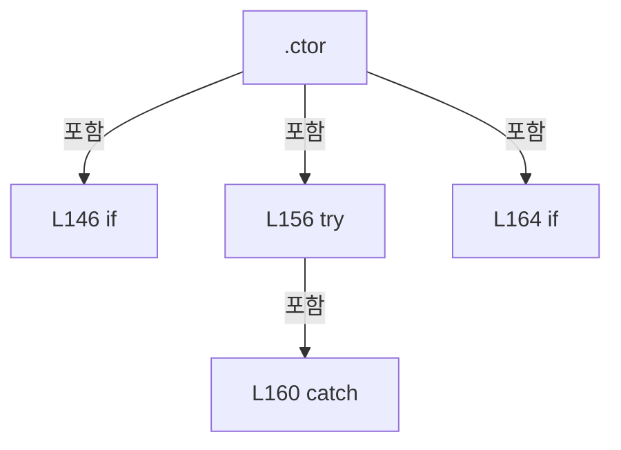

변경 전 점검: 입력/반환 타입, 위 호출자, 예외/취소 경로, 공유 상태와 저장·전송 소비자를 함께 확인합니다. 값의 단위나 물리 방향을 이름만으로 확정하지 않습니다.

### DelegateDeclaration `CProcessStepAction` · L170–170

[Drilling.Common/Station/CStationProcess.cs:170–170](https://github.com/kjuws10-rgb/A3Drilling/blob/96e22cd027c84bf302b23f2949b98985d7f301bb/Drilling.Common/Station/CStationProcess.cs#L170-L170)

| 항목 | 실제 추출 값 |
| --- | --- |
| 서명 | Drilling.Common.Station.CStationProcess.CProcessStepAction |
| 접근/수식자 | Private / private |
| 반환/값 타입 | 타입 정보 없음 |
| 소속 타입 | NamedType:Drilling.Common.Station.CStationProcess |

입력 계약:

| 이름 | 타입 | 전달 | 선택/기본값 |
| --- | --- | --- | --- |
| processModel | Drilling.Common.Station.ST_PROCESS_MODEL | None | False /  |
| cancellationToken | System.Threading.CancellationToken | None | False /  |

현재 부분 분석에서 직접 연결된 호출자는 없습니다. XAML/이벤트/인터페이스·델리게이트·외부 진입을 추가 확인해야 하며, 미사용으로 판정한 것이 아닙니다.

변경 전 점검: 입력/반환 타입, 위 호출자, 예외/취소 경로, 공유 상태와 저장·전송 소비자를 함께 확인합니다. 값의 단위나 물리 방향을 이름만으로 확정하지 않습니다.

### PropertyDeclaration `Current` · L171–187

[Drilling.Common/Station/CStationProcess.cs:171–187](https://github.com/kjuws10-rgb/A3Drilling/blob/96e22cd027c84bf302b23f2949b98985d7f301bb/Drilling.Common/Station/CStationProcess.cs#L171-L187)

| 항목 | 실제 추출 값 |
| --- | --- |
| 서명 | Drilling.Common.Station.ST_STATION_PROCESS_STATUS Drilling.Common.Station.CStationProcess.Current |
| 접근/수식자 | Public / public |
| 반환/값 타입 | Drilling.Common.Station.ST_STATION_PROCESS_STATUS |
| 소속 타입 | NamedType:Drilling.Common.Station.CStationProcess |

현재 부분 분석에서 직접 연결된 호출자는 없습니다. XAML/이벤트/인터페이스·델리게이트·외부 진입을 추가 확인해야 하며, 미사용으로 판정한 것이 아닙니다.

변경 전 점검: 입력/반환 타입, 위 호출자, 예외/취소 경로, 공유 상태와 저장·전송 소비자를 함께 확인합니다. 값의 단위나 물리 방향을 이름만으로 확정하지 않습니다.

### GetAccessorDeclaration `get_Current` · L173–186

[Drilling.Common/Station/CStationProcess.cs:173–186](https://github.com/kjuws10-rgb/A3Drilling/blob/96e22cd027c84bf302b23f2949b98985d7f301bb/Drilling.Common/Station/CStationProcess.cs#L173-L186)

| 항목 | 실제 추출 값 |
| --- | --- |
| 서명 | Drilling.Common.Station.ST_STATION_PROCESS_STATUS Drilling.Common.Station.CStationProcess.Current.get |
| 접근/수식자 | Public / get |
| 반환/값 타입 | Drilling.Common.Station.ST_STATION_PROCESS_STATUS |
| 소속 타입 | NamedType:Drilling.Common.Station.CStationProcess |

현재 부분 분석에서 직접 연결된 호출자는 없습니다. XAML/이벤트/인터페이스·델리게이트·외부 진입을 추가 확인해야 하며, 미사용으로 판정한 것이 아닙니다.

호출하는 대상과 해석 범위:

| 원본 행 | 표현식 | 분석 상태 | 대상/소스 위치 |
| --- | --- | --- | --- |
| 175 | _sequenceActions.GetSnapshot().ToDictionary | resolved | System.Collections.Generic.Dictionary<string, Drilling.Common.Station.ST_SEQUENCE_ACTION_STATUS> System.Collections.Generic.IEnumerable<System.Collections.Generic.KeyValuePair<string, Drilling.Common.Station.ST_SEQUENCE_ACTION_STATUS>>.ToDictionary<System.Collections.Generic.KeyValuePair<string, Drilling.Common.Station.ST_SEQUENCE_ACTION_STATUS>, string, Drilling.Common.Station.ST_SEQUENCE_ACTION_STATUS>(System.Func<System.Collections.Generic.KeyValuePair<string, Drilling.Common.Station.ST_SEQUENCE_ACTION_STATUS>, string>, System.Func<System.Collections.Generic.KeyValuePair<string, Drilling.Common.Station.ST_SEQUENCE_ACTION_STATUS>, Drilling.Common.Station.ST_SEQUENCE_ACTION_STATUS>, System.Collections.Generic.IEqualityComparer<string>?) |
| 175 | _sequenceActions.GetSnapshot | resolved | System.Collections.Generic.IReadOnlyDictionary<string, Drilling.Common.Station.ST_SEQUENCE_ACTION_STATUS> Drilling.Common.Station.CSequenceActionStatusStore.GetSnapshot() · Drilling.Common/Station/CStationManager.cs:165 |
| 177 | _interfaceManager.StageReviewSequences.Actions.GetSnapshot | resolved | System.Collections.Generic.IReadOnlyDictionary<string, Drilling.Common.Station.ST_SEQUENCE_ACTION_STATUS> Drilling.Common.Station.CSequenceActionStatusStore.GetSnapshot() · Drilling.Common/Station/CStationManager.cs:165 |

본문의 실제 연산·분기·예외·반환 순서(원문 위치 순):

| 원본 행 | 종류 | 주석 해설 |
| --- | --- | --- |
| 175 | call | 함수·델리게이트 또는 객체 생성자를 호출합니다: _sequenceActions.GetSnapshot().ToDictionary(pair => pair.Key, pair => pair.Value, StringComparer.OrdinalIgnoreCase) |
| 175 | call | 함수·델리게이트 또는 객체 생성자를 호출합니다: _sequenceActions.GetSnapshot() |
| 175 | local-declaration | 지역 변수를 선언합니다: var actions = _sequenceActions.GetSnapshot().ToDictionary(pair => pair.Key, pair => pair.Value, StringComparer.OrdinalIgnoreCase); |
| 175 | variable-initializer | 변수의 초기값을 지정합니다: actions = _sequenceActions.GetSnapshot().ToDictionary(pair => pair.Key, pair => pair.Value, StringComparer.OrdinalIgnoreCase) |
| 176 | if | 조건에 따라 분기합니다: if (_interfaceManager is not null) |
| 177 | call | 함수·델리게이트 또는 객체 생성자를 호출합니다: _interfaceManager.StageReviewSequences.Actions.GetSnapshot() |
| 177 | foreach | 컬렉션 요소를 순회합니다: foreach (var pair in _interfaceManager.StageReviewSequences.Actions.GetSnapshot()) |
| 178 | assignment | 값을 대상에 대입합니다: actions[pair.Key] = pair.Value |
| 179 | return | 호출자에게 값 또는 제어를 반환합니다: return _snapshot with { SequenceActions = actions, StageRequest = StageRequests.Status, ZeroLinePrewait = _zeroLinePrewait?.Status, ZeroLine = _zeroLineCycle?.Status }; |
| 181 | assignment | 값을 대상에 대입합니다: SequenceActions = actions |
| 182 | assignment | 값을 대상에 대입합니다: StageRequest = StageRequests.Status |
| 183 | assignment | 값을 대상에 대입합니다: ZeroLinePrewait = _zeroLinePrewait?.Status |
| 184 | assignment | 값을 대상에 대입합니다: ZeroLine = _zeroLineCycle?.Status |

제어 구문의 포함 구조(실제 실행 순서/CFG가 아닌 구문 탐색 그림):

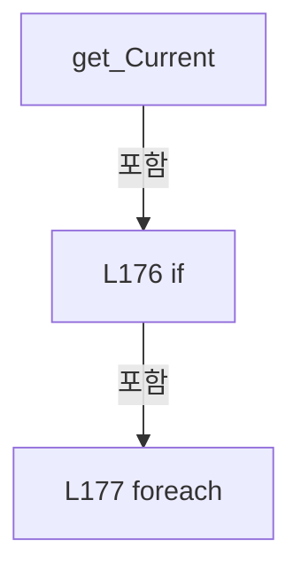

변경 전 점검: 입력/반환 타입, 위 호출자, 예외/취소 경로, 공유 상태와 저장·전송 소비자를 함께 확인합니다. 값의 단위나 물리 방향을 이름만으로 확정하지 않습니다.

### PropertyDeclaration `Status` · L189–195

[Drilling.Common/Station/CStationProcess.cs:189–195](https://github.com/kjuws10-rgb/A3Drilling/blob/96e22cd027c84bf302b23f2949b98985d7f301bb/Drilling.Common/Station/CStationProcess.cs#L189-L195)

| 항목 | 실제 추출 값 |
| --- | --- |
| 서명 | Drilling.Common.Station.ST_STATION_STATUS Drilling.Common.Station.CStationProcess.Status |
| 접근/수식자 | Public / public |
| 반환/값 타입 | Drilling.Common.Station.ST_STATION_STATUS |
| 소속 타입 | NamedType:Drilling.Common.Station.CStationProcess |

현재 부분 분석에서 직접 연결된 호출자는 없습니다. XAML/이벤트/인터페이스·델리게이트·외부 진입을 추가 확인해야 하며, 미사용으로 판정한 것이 아닙니다.

변경 전 점검: 입력/반환 타입, 위 호출자, 예외/취소 경로, 공유 상태와 저장·전송 소비자를 함께 확인합니다. 값의 단위나 물리 방향을 이름만으로 확정하지 않습니다.

### GetAccessorDeclaration `get_Status` · L191–194

[Drilling.Common/Station/CStationProcess.cs:191–194](https://github.com/kjuws10-rgb/A3Drilling/blob/96e22cd027c84bf302b23f2949b98985d7f301bb/Drilling.Common/Station/CStationProcess.cs#L191-L194)

| 항목 | 실제 추출 값 |
| --- | --- |
| 서명 | Drilling.Common.Station.ST_STATION_STATUS Drilling.Common.Station.CStationProcess.Status.get |
| 접근/수식자 | Public / get |
| 반환/값 타입 | Drilling.Common.Station.ST_STATION_STATUS |
| 소속 타입 | NamedType:Drilling.Common.Station.CStationProcess |

현재 부분 분석에서 직접 연결된 호출자는 없습니다. XAML/이벤트/인터페이스·델리게이트·외부 진입을 추가 확인해야 하며, 미사용으로 판정한 것이 아닙니다.

호출하는 대상과 해석 범위:

| 원본 행 | 표현식 | 분석 상태 | 대상/소스 위치 |
| --- | --- | --- | --- |
| 193 | ReadStationStatus | resolved | Drilling.Common.Station.ST_STATION_STATUS Drilling.Common.Station.CStationProcess.ReadStationStatus() · Drilling.Common/Station/CStationProcess.cs:2338 |

본문의 실제 연산·분기·예외·반환 순서(원문 위치 순):

| 원본 행 | 종류 | 주석 해설 |
| --- | --- | --- |
| 193 | call | 함수·델리게이트 또는 객체 생성자를 호출합니다: ReadStationStatus() |
| 193 | return | 호출자에게 값 또는 제어를 반환합니다: return ReadStationStatus(); |

변경 전 점검: 입력/반환 타입, 위 호출자, 예외/취소 경로, 공유 상태와 저장·전송 소비자를 함께 확인합니다. 값의 단위나 물리 방향을 이름만으로 확정하지 않습니다.

### PropertyDeclaration `SequenceState` · L197–203

[Drilling.Common/Station/CStationProcess.cs:197–203](https://github.com/kjuws10-rgb/A3Drilling/blob/96e22cd027c84bf302b23f2949b98985d7f301bb/Drilling.Common/Station/CStationProcess.cs#L197-L203)

| 항목 | 실제 추출 값 |
| --- | --- |
| 서명 | Drilling.Common.Station.EN_STATION_SEQUENCE Drilling.Common.Station.CStationProcess.SequenceState |
| 접근/수식자 | Public / public |
| 반환/값 타입 | Drilling.Common.Station.EN_STATION_SEQUENCE |
| 소속 타입 | NamedType:Drilling.Common.Station.CStationProcess |

현재 부분 분석에서 직접 연결된 호출자는 없습니다. XAML/이벤트/인터페이스·델리게이트·외부 진입을 추가 확인해야 하며, 미사용으로 판정한 것이 아닙니다.

변경 전 점검: 입력/반환 타입, 위 호출자, 예외/취소 경로, 공유 상태와 저장·전송 소비자를 함께 확인합니다. 값의 단위나 물리 방향을 이름만으로 확정하지 않습니다.

### GetAccessorDeclaration `get_SequenceState` · L199–202

[Drilling.Common/Station/CStationProcess.cs:199–202](https://github.com/kjuws10-rgb/A3Drilling/blob/96e22cd027c84bf302b23f2949b98985d7f301bb/Drilling.Common/Station/CStationProcess.cs#L199-L202)

| 항목 | 실제 추출 값 |
| --- | --- |
| 서명 | Drilling.Common.Station.EN_STATION_SEQUENCE Drilling.Common.Station.CStationProcess.SequenceState.get |
| 접근/수식자 | Public / get |
| 반환/값 타입 | Drilling.Common.Station.EN_STATION_SEQUENCE |
| 소속 타입 | NamedType:Drilling.Common.Station.CStationProcess |

현재 부분 분석에서 직접 연결된 호출자는 없습니다. XAML/이벤트/인터페이스·델리게이트·외부 진입을 추가 확인해야 하며, 미사용으로 판정한 것이 아닙니다.

호출하는 대상과 해석 범위:

| 원본 행 | 표현식 | 분석 상태 | 대상/소스 위치 |
| --- | --- | --- | --- |
| 201 | ReadSequenceState | resolved | Drilling.Common.Station.EN_STATION_SEQUENCE Drilling.Common.Station.CStationProcess.ReadSequenceState() · Drilling.Common/Station/CStationProcess.cs:2330 |

본문의 실제 연산·분기·예외·반환 순서(원문 위치 순):

| 원본 행 | 종류 | 주석 해설 |
| --- | --- | --- |
| 201 | call | 함수·델리게이트 또는 객체 생성자를 호출합니다: ReadSequenceState() |
| 201 | return | 호출자에게 값 또는 제어를 반환합니다: return ReadSequenceState(); |

변경 전 점검: 입력/반환 타입, 위 호출자, 예외/취소 경로, 공유 상태와 저장·전송 소비자를 함께 확인합니다. 값의 단위나 물리 방향을 이름만으로 확정하지 않습니다.

### MethodDeclaration `GetProcessFlow` · L205–208

[Drilling.Common/Station/CStationProcess.cs:205–208](https://github.com/kjuws10-rgb/A3Drilling/blob/96e22cd027c84bf302b23f2949b98985d7f301bb/Drilling.Common/Station/CStationProcess.cs#L205-L208)

| 항목 | 실제 추출 값 |
| --- | --- |
| 서명 | System.Collections.Generic.IReadOnlyList<Drilling.Common.Station.ST_STATION_PROCESS_FLOW_ITEM> Drilling.Common.Station.CStationProcess.GetProcessFlow() |
| 접근/수식자 | Public / public, static |
| 반환/값 타입 | System.Collections.Generic.IReadOnlyList<Drilling.Common.Station.ST_STATION_PROCESS_FLOW_ITEM> |
| 소속 타입 | NamedType:Drilling.Common.Station.CStationProcess |

정적 호출자로 확인된 위치:

| 호출 파일/행 | 호출 표현식 | 런타임 분기 가능 |
| --- | --- | --- |
| [Drilling.Common/Station/CStationManager.cs:87–87](https://github.com/kjuws10-rgb/A3Drilling/blob/96e22cd027c84bf302b23f2949b98985d7f301bb/Drilling.Common/Station/CStationManager.cs#L87-L87) | CStationProcess.GetProcessFlow | False |

본문의 실제 연산·분기·예외·반환 순서(원문 위치 순):

| 원본 행 | 종류 | 주석 해설 |
| --- | --- | --- |
| 207 | return | 호출자에게 값 또는 제어를 반환합니다: return ProcessFlowItems; |

변경 전 점검: 입력/반환 타입, 위 호출자, 예외/취소 경로, 공유 상태와 저장·전송 소비자를 함께 확인합니다. 값의 단위나 물리 방향을 이름만으로 확정하지 않습니다.

### MethodDeclaration `PrepareProcess` · L210–226

[Drilling.Common/Station/CStationProcess.cs:210–226](https://github.com/kjuws10-rgb/A3Drilling/blob/96e22cd027c84bf302b23f2949b98985d7f301bb/Drilling.Common/Station/CStationProcess.cs#L210-L226)

| 항목 | 실제 추출 값 |
| --- | --- |
| 서명 | Drilling.Common.Station.ST_STATION_PROCESS_STATUS Drilling.Common.Station.CStationProcess.PrepareProcess(string, string, string, string, System.Collections.Generic.IReadOnlyDictionary<string, string>, System.Threading.CancellationToken, bool) |
| 접근/수식자 | Public / public |
| 반환/값 타입 | Drilling.Common.Station.ST_STATION_PROCESS_STATUS |
| 소속 타입 | NamedType:Drilling.Common.Station.CStationProcess |

입력 계약:

| 이름 | 타입 | 전달 | 선택/기본값 |
| --- | --- | --- | --- |
| processId | string | None | False /  |
| recipeId | string | None | False /  |
| glassId | string | None | False /  |
| lotId | string | None | False /  |
| parameters | System.Collections.Generic.IReadOnlyDictionary<string, string> | None | False /  |
| cancellationToken | System.Threading.CancellationToken | None | True / null |
| preserveSequenceActions | bool | None | True / false |

정적 호출자로 확인된 위치:

| 호출 파일/행 | 호출 표현식 | 런타임 분기 가능 |
| --- | --- | --- |
| [Drilling.Common/Station/CStationManager.cs:94–94](https://github.com/kjuws10-rgb/A3Drilling/blob/96e22cd027c84bf302b23f2949b98985d7f301bb/Drilling.Common/Station/CStationManager.cs#L94-L94) | _processStation.PrepareProcess | False |
| [Drilling.Common/Station/CStationProcess.cs:3995–3995](https://github.com/kjuws10-rgb/A3Drilling/blob/96e22cd027c84bf302b23f2949b98985d7f301bb/Drilling.Common/Station/CStationProcess.cs#L3995-L3995) | PrepareProcess | False |

호출하는 대상과 해석 범위:

| 원본 행 | 표현식 | 분석 상태 | 대상/소스 위치 |
| --- | --- | --- | --- |
| 222 | ReadSequenceState | resolved | Drilling.Common.Station.EN_STATION_SEQUENCE Drilling.Common.Station.CStationProcess.ReadSequenceState() · Drilling.Common/Station/CStationProcess.cs:2330 |
| 223 | new InvalidOperationException | resolved | System.InvalidOperationException.InvalidOperationException(string?) |
| 224 | PrepareProcessCore | resolved | Drilling.Common.Station.ST_STATION_PROCESS_STATUS Drilling.Common.Station.CStationProcess.PrepareProcessCore(string, string, string, string, System.Collections.Generic.IReadOnlyDictionary<string, string>, System.Threading.CancellationToken, bool, System.Collections.Generic.IReadOnlySet<int>?) · Drilling.Common/Station/CStationProcess.cs:228 |

본문의 실제 연산·분기·예외·반환 순서(원문 위치 순):

| 원본 행 | 종류 | 주석 해설 |
| --- | --- | --- |
| 220 | lock | 공유 상태의 임계 구역에 진입합니다: lock (_sequenceLock) |
| 222 | call | 함수·델리게이트 또는 객체 생성자를 호출합니다: ReadSequenceState() |
| 222 | if | 조건에 따라 분기합니다: if (_manualMofRunning &#124;&#124; _manualMofRequiresStop &#124;&#124; ReadSequenceState() != EN_STATION_SEQUENCE.Ready) |
| 223 | call | 함수·델리게이트 또는 객체 생성자를 호출합니다: new InvalidOperationException("Station is busy. PrepareProcess is not allowed during processing.") |
| 223 | throw | 예외를 발생/전달합니다: throw new InvalidOperationException("Station is busy. PrepareProcess is not allowed during processing."); |
| 224 | call | 함수·델리게이트 또는 객체 생성자를 호출합니다: PrepareProcessCore(processId, recipeId, glassId, lotId, parameters, cancellationToken, preserveSequenceActions) |
| 224 | return | 호출자에게 값 또는 제어를 반환합니다: return PrepareProcessCore(processId, recipeId, glassId, lotId, parameters, cancellationToken, preserveSequenceActions); |

제어 구문의 포함 구조(실제 실행 순서/CFG가 아닌 구문 탐색 그림):

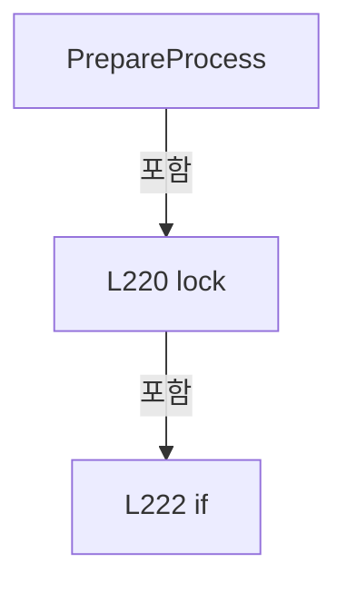

변경 전 점검: 입력/반환 타입, 위 호출자, 예외/취소 경로, 공유 상태와 저장·전송 소비자를 함께 확인합니다. 값의 단위나 물리 방향을 이름만으로 확정하지 않습니다.

### MethodDeclaration `PrepareProcessCore` · L228–269

[Drilling.Common/Station/CStationProcess.cs:228–269](https://github.com/kjuws10-rgb/A3Drilling/blob/96e22cd027c84bf302b23f2949b98985d7f301bb/Drilling.Common/Station/CStationProcess.cs#L228-L269)

| 항목 | 실제 추출 값 |
| --- | --- |
| 서명 | Drilling.Common.Station.ST_STATION_PROCESS_STATUS Drilling.Common.Station.CStationProcess.PrepareProcessCore(string, string, string, string, System.Collections.Generic.IReadOnlyDictionary<string, string>, System.Threading.CancellationToken, bool, System.Collections.Generic.IReadOnlySet<int>?) |
| 접근/수식자 | Private / private |
| 반환/값 타입 | Drilling.Common.Station.ST_STATION_PROCESS_STATUS |
| 소속 타입 | NamedType:Drilling.Common.Station.CStationProcess |

입력 계약:

| 이름 | 타입 | 전달 | 선택/기본값 |
| --- | --- | --- | --- |
| processId | string | None | False /  |
| recipeId | string | None | False /  |
| glassId | string | None | False /  |
| lotId | string | None | False /  |
| parameters | System.Collections.Generic.IReadOnlyDictionary<string, string> | None | False /  |
| cancellationToken | System.Threading.CancellationToken | None | False /  |
| preserveSequenceActions | bool | None | False /  |
| manualHeads | System.Collections.Generic.IReadOnlySet<int>? | None | True / null |

정적 호출자로 확인된 위치:

| 호출 파일/행 | 호출 표현식 | 런타임 분기 가능 |
| --- | --- | --- |
| [Drilling.Common/Station/CStationProcess.cs:224–224](https://github.com/kjuws10-rgb/A3Drilling/blob/96e22cd027c84bf302b23f2949b98985d7f301bb/Drilling.Common/Station/CStationProcess.cs#L224-L224) | PrepareProcessCore | False |
| [Drilling.Common/Station/CStationProcess.cs:3506–3506](https://github.com/kjuws10-rgb/A3Drilling/blob/96e22cd027c84bf302b23f2949b98985d7f301bb/Drilling.Common/Station/CStationProcess.cs#L3506-L3506) | PrepareProcessCore | False |

호출하는 대상과 해석 범위:

| 원본 행 | 표현식 | 분석 상태 | 대상/소스 위치 |
| --- | --- | --- | --- |
| 239 | cancellationToken.ThrowIfCancellationRequested | resolved | void System.Threading.CancellationToken.ThrowIfCancellationRequested() |
| 240 | ClearProcessLogs | resolved | void Drilling.Common.Station.CStationProcess.ClearProcessLogs() · Drilling.Common/Station/CStationProcess.cs:2387 |
| 246 | ResetAutoStepStatesCore | resolved | void Drilling.Common.Station.CStationProcess.ResetAutoStepStatesCore(bool) · Drilling.Common/Station/CStationProcess.cs:1795 |
| 247 | SetSequenceState | resolved | void Drilling.Common.Station.CStationProcess.SetSequenceState(Drilling.Common.Station.EN_STATION_SEQUENCE) · Drilling.Common/Station/CStationProcess.cs:2291 |
| 248 | BuildRuntimeParameters | resolved | System.Collections.Generic.IReadOnlyDictionary<string, string> Drilling.Common.Station.CStationProcess.BuildRuntimeParameters(string, System.Collections.Generic.IReadOnlyDictionary<string, string>, System.Threading.CancellationToken) · Drilling.Common/Station/CStationProcess.cs:1527 |
| 251 | new Dictionary<string, string> | resolved | System.Collections.Generic.Dictionary<string, string>.Dictionary(System.Collections.Generic.IEnumerable<System.Collections.Generic.KeyValuePair<string, string>>, System.Collections.Generic.IEqualityComparer<string>?) |
| 253 | manualHeads.Contains | resolved · 동적 구현 선택 가능 | bool System.Collections.Generic.IReadOnlySet<int>.Contains(int) |
| 257 | BuildProcessModel | resolved | Drilling.Common.Station.ST_PROCESS_MODEL Drilling.Common.Station.CStationProcess.BuildProcessModel(string, string, string, string, System.Collections.Generic.IReadOnlyDictionary<string, string>) · Drilling.Common/Station/CStationProcess.cs:1604 |
| 261 | BuildPreview | resolved | System.Collections.Generic.IReadOnlyList<Drilling.Common.Station.ST_HEAD_PREVIEW_DATA> Drilling.Common.Station.CStationProcess.BuildPreview(Drilling.Common.Station.ST_PROCESS_MODEL, Drilling.Common.Station.EN_HEAD_PROCESS_STATUS) · Drilling.Common/Station/CStationProcess.cs:1517 |
| 262 | BuildStatistics | resolved | Drilling.Common.Station.ST_PROCESS_STATISTICS Drilling.Common.Station.CStationProcess.BuildStatistics(Drilling.Common.Station.ST_PROCESS_MODEL?, double, System.TimeSpan) · Drilling.Common/Station/CStationProcess.cs:1773 |
| 263 | AddProcessLog | resolved | void Drilling.Common.Station.CStationProcess.AddProcessLog(string, string, string) · Drilling.Common/Station/CStationProcess.cs:2367 |
| 264 | AddProcessLog | resolved | void Drilling.Common.Station.CStationProcess.AddProcessLog(string, string, string) · Drilling.Common/Station/CStationProcess.cs:2367 |
| 265 | SetAutoStepState | resolved | void Drilling.Common.Station.CStationProcess.SetAutoStepState(string, string) · Drilling.Common/Station/CStationProcess.cs:1806 |
| 266 | CreateSnapshot | resolved | Drilling.Common.Station.ST_STATION_PROCESS_STATUS Drilling.Common.Station.CStationProcess.CreateSnapshot(Drilling.Common.Station.ST_PROCESS_MODEL?, System.Collections.Generic.IReadOnlyList<Drilling.Common.Station.ST_HEAD_PREVIEW_DATA>, Drilling.Common.Station.EN_SCRIPT_STATUS, Drilling.Common.Station.EN_PROCESS_STEP, Drilling.Common.Station.ST_PROCESS_RESULT?) · Drilling.Common/Station/CStationProcess.cs:1338 |
| 267 | SetStationState | resolved | void Drilling.Common.Station.CStationProcess.SetStationState(Drilling.Common.Station.EN_STATION_STATE, Drilling.Common.Station.EN_PROCESS_STEP, Drilling.Common.Station.EN_SCRIPT_STATUS, string) · Drilling.Common/Station/CStationProcess.cs:2346 |

본문의 실제 연산·분기·예외·반환 순서(원문 위치 순):

| 원본 행 | 종류 | 주석 해설 |
| --- | --- | --- |
| 239 | call | 함수·델리게이트 또는 객체 생성자를 호출합니다: cancellationToken.ThrowIfCancellationRequested() |
| 240 | call | 함수·델리게이트 또는 객체 생성자를 호출합니다: ClearProcessLogs() |
| 241 | assignment | 값을 대상에 대입합니다: _lastInterLockItems = [] |
| 242 | assignment | 값을 대상에 대입합니다: _scriptCreatedAt = null |
| 243 | assignment | 값을 대상에 대입합니다: _scriptStartedAt = null |
| 244 | assignment | 값을 대상에 대입합니다: _scriptCompletedAt = null |
| 245 | assignment | 값을 대상에 대입합니다: _lastScript = null |
| 246 | call | 함수·델리게이트 또는 객체 생성자를 호출합니다: ResetAutoStepStatesCore(preserveSequenceActions) |
| 247 | call | 함수·델리게이트 또는 객체 생성자를 호출합니다: SetSequenceState(EN_STATION_SEQUENCE.Ready) |
| 248 | call | 함수·델리게이트 또는 객체 생성자를 호출합니다: BuildRuntimeParameters(recipeId, parameters, cancellationToken) |
| 248 | local-declaration | 지역 변수를 선언합니다: var runtimeParameters = BuildRuntimeParameters(recipeId, parameters, cancellationToken); |
| 248 | variable-initializer | 변수의 초기값을 지정합니다: runtimeParameters = BuildRuntimeParameters(recipeId, parameters, cancellationToken) |
| 249 | if | 조건에 따라 분기합니다: if (manualHeads is not null) |
| 251 | call | 함수·델리게이트 또는 객체 생성자를 호출합니다: new Dictionary<string, string>(runtimeParameters, StringComparer.OrdinalIgnoreCase) |
| 251 | local-declaration | 지역 변수를 선언합니다: var scoped = new Dictionary<string, string>(runtimeParameters, StringComparer.OrdinalIgnoreCase); |
| 251 | variable-initializer | 변수의 초기값을 지정합니다: scoped = new Dictionary<string, string>(runtimeParameters, StringComparer.OrdinalIgnoreCase) |
| 252 | variable-initializer | 변수의 초기값을 지정합니다: head = 1 |
| 252 | for | 초기화·조건·증감이 있는 반복입니다: for (var head = 1; head <= 8; head++) |
| 253 | assignment | 값을 대상에 대입합니다: scoped[$"H{head:00}_USE"] = manualHeads.Contains(head) ? "ON" : "OFF" |
| 253 | call | 함수·델리게이트 또는 객체 생성자를 호출합니다: manualHeads.Contains(head) |
| 253 | conditional-expression | 조건에 따라 결과식을 선택합니다: manualHeads.Contains(head) ? "ON" : "OFF" |
| 254 | assignment | 값을 대상에 대입합니다: runtimeParameters = scoped |
| 257 | assignment | 값을 대상에 대입합니다: _processModel = BuildProcessModel(processId, recipeId, glassId, lotId, runtimeParameters) |
| 257 | call | 함수·델리게이트 또는 객체 생성자를 호출합니다: BuildProcessModel(processId, recipeId, glassId, lotId, runtimeParameters) |
| 258 | assignment | 값을 대상에 대입합니다: _preparedReviewOffsetInvalidated = false |
| 259 | assignment | 값을 대상에 대입합니다: _stageModelLogCycle = StageRequests?.LogCycleId ?? "" |
| 260 | assignment | 값을 대상에 대입합니다: _protectWindowCounted = false |
| 261 | call | 함수·델리게이트 또는 객체 생성자를 호출합니다: BuildPreview(_processModel, EN_HEAD_PROCESS_STATUS.Ready) |
| 261 | local-declaration | 지역 변수를 선언합니다: var preview = BuildPreview(_processModel, EN_HEAD_PROCESS_STATUS.Ready); |
| 261 | variable-initializer | 변수의 초기값을 지정합니다: preview = BuildPreview(_processModel, EN_HEAD_PROCESS_STATUS.Ready) |
| 262 | assignment | 값을 대상에 대입합니다: _statistics = BuildStatistics(_processModel, 0.0, TimeSpan.Zero) |
| 262 | call | 함수·델리게이트 또는 객체 생성자를 호출합니다: BuildStatistics(_processModel, 0.0, TimeSpan.Zero) |
| 263 | call | 함수·델리게이트 또는 객체 생성자를 호출합니다: AddProcessLog("INFO", "SCAN_PC", $"Process model prepared ({_processModel.ProcessId})") |
| 264 | call | 함수·델리게이트 또는 객체 생성자를 호출합니다: AddProcessLog("INFO", "PARSER", $"Head parameter parsed ({preview.Count} heads / {_statistics.TotalShots} shots)") |
| 265 | call | 함수·델리게이트 또는 객체 생성자를 호출합니다: SetAutoStepState(AutoStepIdle, AutoStepOk) |
| 266 | assignment | 값을 대상에 대입합니다: _snapshot = CreateSnapshot(_processModel, preview, EN_SCRIPT_STATUS.NotCreated, EN_PROCESS_STEP.Idle, null) |
| 266 | call | 함수·델리게이트 또는 객체 생성자를 호출합니다: CreateSnapshot(_processModel, preview, EN_SCRIPT_STATUS.NotCreated, EN_PROCESS_STEP.Idle, null) |
| 267 | call | 함수·델리게이트 또는 객체 생성자를 호출합니다: SetStationState(EN_STATION_STATE.Idle, EN_PROCESS_STEP.Idle, EN_SCRIPT_STATUS.NotCreated, $"Process model prepared: {_processModel.ProcessId}") |
| 268 | return | 호출자에게 값 또는 제어를 반환합니다: return _snapshot; |

제어 구문의 포함 구조(실제 실행 순서/CFG가 아닌 구문 탐색 그림):


변경 전 점검: 입력/반환 타입, 위 호출자, 예외/취소 경로, 공유 상태와 저장·전송 소비자를 함께 확인합니다. 값의 단위나 물리 방향을 이름만으로 확정하지 않습니다.

### MethodDeclaration `Start` · L271–322

[Drilling.Common/Station/CStationProcess.cs:271–322](https://github.com/kjuws10-rgb/A3Drilling/blob/96e22cd027c84bf302b23f2949b98985d7f301bb/Drilling.Common/Station/CStationProcess.cs#L271-L322)

| 항목 | 실제 추출 값 |
| --- | --- |
| 서명 | Drilling.Common.Station.ST_STATION_PROCESS_STATUS Drilling.Common.Station.CStationProcess.Start(System.Threading.CancellationToken) |
| 접근/수식자 | Public / public |
| 반환/값 타입 | Drilling.Common.Station.ST_STATION_PROCESS_STATUS |
| 소속 타입 | NamedType:Drilling.Common.Station.CStationProcess |

입력 계약:

| 이름 | 타입 | 전달 | 선택/기본값 |
| --- | --- | --- | --- |
| cancellationToken | System.Threading.CancellationToken | None | True / null |

정적 호출자로 확인된 위치:

| 호출 파일/행 | 호출 표현식 | 런타임 분기 가능 |
| --- | --- | --- |
| [Drilling.Common/Station/CStationManager.cs:101–101](https://github.com/kjuws10-rgb/A3Drilling/blob/96e22cd027c84bf302b23f2949b98985d7f301bb/Drilling.Common/Station/CStationManager.cs#L101-L101) | _processStation.Start | False |

호출하는 대상과 해석 범위:

| 원본 행 | 표현식 | 분석 상태 | 대상/소스 위치 |
| --- | --- | --- | --- |
| 273 | cancellationToken.ThrowIfCancellationRequested | resolved | void System.Threading.CancellationToken.ThrowIfCancellationRequested() |
| 283 | new InvalidOperationException | resolved | System.InvalidOperationException.InvalidOperationException(string?) |
| 284 | EnsureStartAllowed | resolved | void Drilling.Common.Station.CStationProcess.EnsureStartAllowed() · Drilling.Common/Station/CStationProcess.cs:439 |
| 285 | ReadProcessModelForStart | resolved | Drilling.Common.Station.ST_PROCESS_MODEL Drilling.Common.Station.CStationProcess.ReadProcessModelForStart() · Drilling.Common/Station/CStationProcess.cs:447 |
| 288 | EnsurePreparedReviewOffsetIsCurrent | resolved | void Drilling.Common.Station.CStationProcess.EnsurePreparedReviewOffsetIsCurrent(Drilling.Common.Station.ST_PROCESS_MODEL, System.Threading.CancellationToken) · Drilling.Common/Station/CStationProcess.cs:1576 |
| 290 | GetInterLockSummary | resolved | Drilling.Common.InterLock.ST_INTERLOCK_SUMMARY Drilling.Common.Station.CStationProcess.GetInterLockSummary(System.Threading.CancellationToken, Drilling.Common.Station.ST_PROCESS_MODEL?) · Drilling.Common/Station/CStationProcess.cs:1363 |
| 293 | new InvalidOperationException | resolved | System.InvalidOperationException.InvalidOperationException(string?) |
| 293 | FormatStartInterLockBlockedMessage | resolved | string Drilling.Common.Station.CStationProcess.FormatStartInterLockBlockedMessage(Drilling.Common.InterLock.ST_INTERLOCK_SUMMARY) · Drilling.Common/Station/CStationProcess.cs:2428 |
| 304 | new InvalidOperationException | resolved | System.InvalidOperationException.InvalidOperationException(string?) |
| 305 | EnsureStartAllowed | resolved | void Drilling.Common.Station.CStationProcess.EnsureStartAllowed() · Drilling.Common/Station/CStationProcess.cs:439 |
| 307 | new InvalidOperationException | resolved | System.InvalidOperationException.InvalidOperationException(string?) |
| 308 | .Dispose | resolved | void System.Threading.CancellationTokenSource.Dispose() |
| 309 | CancellationTokenSource.CreateLinkedTokenSource | resolved | System.Threading.CancellationTokenSource System.Threading.CancellationTokenSource.CreateLinkedTokenSource(System.Threading.CancellationToken) |
| 312 | (_stationStatus with { ChangedAt = DateTimeOffset.Now } ).WithSequenceState | resolved | Drilling.Common.Station.ST_STATION_STATUS Drilling.Common.Station.ST_STATION_STATUS.WithSequenceState(Drilling.Common.Station.EN_STATION_SEQUENCE?) · Drilling.Common/Station/CStationManager.cs:536 |
| 320 | base.Start | resolved | void Drilling.Common.Threading.CtrlThread.Start(int, string) · Drilling.Common/Threading/CtrlThread.cs:60 |

본문의 실제 연산·분기·예외·반환 순서(원문 위치 순):

| 원본 행 | 종류 | 주석 해설 |
| --- | --- | --- |
| 273 | call | 함수·델리게이트 또는 객체 생성자를 호출합니다: cancellationToken.ThrowIfCancellationRequested() |
| 274 | local-declaration | 지역 변수를 선언합니다: ST_PROCESS_MODEL processModel; |
| 275 | lock | 공유 상태의 임계 구역에 진입합니다: lock (_sequenceLock) |
| 277 | if | 조건에 따라 분기합니다: if (_sequenceState != EN_STATION_SEQUENCE.Ready) |
| 279 | return | 호출자에게 값 또는 제어를 반환합니다: return _snapshot; |
| 282 | if | 조건에 따라 분기합니다: if (_manualMofRunning &#124;&#124; _manualMofRequiresStop) |
| 283 | call | 함수·델리게이트 또는 객체 생성자를 호출합니다: new InvalidOperationException("Manual MOF is active or requires STOP.") |
| 283 | throw | 예외를 발생/전달합니다: throw new InvalidOperationException("Manual MOF is active or requires STOP."); |
| 284 | call | 함수·델리게이트 또는 객체 생성자를 호출합니다: EnsureStartAllowed() |
| 285 | assignment | 값을 대상에 대입합니다: processModel = ReadProcessModelForStart() |
| 285 | call | 함수·델리게이트 또는 객체 생성자를 호출합니다: ReadProcessModelForStart() |
| 288 | call | 함수·델리게이트 또는 객체 생성자를 호출합니다: EnsurePreparedReviewOffsetIsCurrent(processModel, cancellationToken) |
| 290 | call | 함수·델리게이트 또는 객체 생성자를 호출합니다: GetInterLockSummary(cancellationToken, processModel) |
| 290 | local-declaration | 지역 변수를 선언합니다: var startInterLock = GetInterLockSummary(cancellationToken, processModel); |
| 290 | variable-initializer | 변수의 초기값을 지정합니다: startInterLock = GetInterLockSummary(cancellationToken, processModel) |
| 291 | if | 조건에 따라 분기합니다: if (!startInterLock.CanAutoRun) |
| 293 | call | 함수·델리게이트 또는 객체 생성자를 호출합니다: new InvalidOperationException(FormatStartInterLockBlockedMessage(startInterLock)) |
| 293 | call | 함수·델리게이트 또는 객체 생성자를 호출합니다: FormatStartInterLockBlockedMessage(startInterLock) |
| 293 | throw | 예외를 발생/전달합니다: throw new InvalidOperationException(FormatStartInterLockBlockedMessage(startInterLock)); |
| 296 | lock | 공유 상태의 임계 구역에 진입합니다: lock (_sequenceLock) |
| 298 | if | 조건에 따라 분기합니다: if (_sequenceState != EN_STATION_SEQUENCE.Ready) |
| 300 | return | 호출자에게 값 또는 제어를 반환합니다: return _snapshot; |
| 303 | if | 조건에 따라 분기합니다: if (_manualMofRunning &#124;&#124; _manualMofRequiresStop) |
| 304 | call | 함수·델리게이트 또는 객체 생성자를 호출합니다: new InvalidOperationException("Manual MOF is active or requires STOP.") |
| 304 | throw | 예외를 발생/전달합니다: throw new InvalidOperationException("Manual MOF is active or requires STOP."); |
| 305 | call | 함수·델리게이트 또는 객체 생성자를 호출합니다: EnsureStartAllowed() |
| 306 | if | 조건에 따라 분기합니다: if (_preparedReviewOffsetInvalidated) |
| 307 | call | 함수·델리게이트 또는 객체 생성자를 호출합니다: new InvalidOperationException("Review Offset이 변경되어 준비된 가공 모델이 무효화되었습니다. DoReady를 다시 실행해 주세요.") |
| 307 | throw | 예외를 발생/전달합니다: throw new InvalidOperationException("Review Offset이 변경되어 준비된 가공 모델이 무효화되었습니다. DoReady를 다시 실행해 주세요."); |
| 308 | call | 함수·델리게이트 또는 객체 생성자를 호출합니다: .Dispose() |
| 309 | assignment | 값을 대상에 대입합니다: _sequenceCancellation = CancellationTokenSource.CreateLinkedTokenSource(cancellationToken) |
| 309 | call | 함수·델리게이트 또는 객체 생성자를 호출합니다: CancellationTokenSource.CreateLinkedTokenSource(cancellationToken) |
| 310 | assignment | 값을 대상에 대입합니다: _sequenceError = "" |
| 311 | assignment | 값을 대상에 대입합니다: _sequenceState = EN_STATION_SEQUENCE.PowerCheck |
| 312 | assignment | 값을 대상에 대입합니다: _stationStatus = (_stationStatus with { ChangedAt = DateTimeOffset.Now } ).WithSequenceState(EN_STATION_SEQUENCE.PowerCheck) |
| 312 | call | 함수·델리게이트 또는 객체 생성자를 호출합니다: (_stationStatus with { ChangedAt = DateTimeOffset.Now } ).WithSequenceState(EN_STATION_SEQUENCE.PowerCheck) |
| 314 | assignment | 값을 대상에 대입합니다: ChangedAt = DateTimeOffset.Now |
| 320 | call | 함수·델리게이트 또는 객체 생성자를 호출합니다: base.Start(10, "StationProcess") |
| 321 | return | 호출자에게 값 또는 제어를 반환합니다: return _snapshot; |

제어 구문의 포함 구조(실제 실행 순서/CFG가 아닌 구문 탐색 그림):


변경 전 점검: 입력/반환 타입, 위 호출자, 예외/취소 경로, 공유 상태와 저장·전송 소비자를 함께 확인합니다. 값의 단위나 물리 방향을 이름만으로 확정하지 않습니다.

### MethodDeclaration `Run` · L324–381

[Drilling.Common/Station/CStationProcess.cs:324–381](https://github.com/kjuws10-rgb/A3Drilling/blob/96e22cd027c84bf302b23f2949b98985d7f301bb/Drilling.Common/Station/CStationProcess.cs#L324-L381)

| 항목 | 실제 추출 값 |
| --- | --- |
| 서명 | void Drilling.Common.Station.CStationProcess.Run() |
| 접근/수식자 | Public / public, override |
| 반환/값 타입 | void |
| 소속 타입 | NamedType:Drilling.Common.Station.CStationProcess |

현재 부분 분석에서 직접 연결된 호출자는 없습니다. XAML/이벤트/인터페이스·델리게이트·외부 진입을 추가 확인해야 하며, 미사용으로 판정한 것이 아닙니다.

호출하는 대상과 해석 범위:

| 원본 행 | 표현식 | 분석 상태 | 대상/소스 위치 |
| --- | --- | --- | --- |
| 343 | RunSequenceStep | resolved | void Drilling.Common.Station.CStationProcess.RunSequenceStep(Drilling.Common.Station.EN_STATION_SEQUENCE, string, Drilling.Common.Station.CStationProcess.CProcessStepAction, Drilling.Common.Station.EN_STATION_SEQUENCE) · Drilling.Common/Station/CStationProcess.cs:383 |
| 346 | RunSequenceStep | resolved | void Drilling.Common.Station.CStationProcess.RunSequenceStep(Drilling.Common.Station.EN_STATION_SEQUENCE, string, Drilling.Common.Station.CStationProcess.CProcessStepAction, Drilling.Common.Station.EN_STATION_SEQUENCE) · Drilling.Common/Station/CStationProcess.cs:383 |
| 349 | RunSequenceStep | resolved | void Drilling.Common.Station.CStationProcess.RunSequenceStep(Drilling.Common.Station.EN_STATION_SEQUENCE, string, Drilling.Common.Station.CStationProcess.CProcessStepAction, Drilling.Common.Station.EN_STATION_SEQUENCE) · Drilling.Common/Station/CStationProcess.cs:383 |
| 352 | RunSequenceStep | resolved | void Drilling.Common.Station.CStationProcess.RunSequenceStep(Drilling.Common.Station.EN_STATION_SEQUENCE, string, Drilling.Common.Station.CStationProcess.CProcessStepAction, Drilling.Common.Station.EN_STATION_SEQUENCE) · Drilling.Common/Station/CStationProcess.cs:383 |
| 355 | RunSequenceStep | resolved | void Drilling.Common.Station.CStationProcess.RunSequenceStep(Drilling.Common.Station.EN_STATION_SEQUENCE, string, Drilling.Common.Station.CStationProcess.CProcessStepAction, Drilling.Common.Station.EN_STATION_SEQUENCE) · Drilling.Common/Station/CStationProcess.cs:383 |
| 356 | FinishSequence | resolved | void Drilling.Common.Station.CStationProcess.FinishSequence() · Drilling.Common/Station/CStationProcess.cs:407 |
| 359 | ProcessStop | resolved | Drilling.Common.Station.ST_STATION_PROCESS_STATUS Drilling.Common.Station.CStationProcess.ProcessStop(System.Threading.CancellationToken) · Drilling.Common/Station/CStationProcess.cs:1221 |
| 360 | FinishSequence | resolved | void Drilling.Common.Station.CStationProcess.FinishSequence() · Drilling.Common/Station/CStationProcess.cs:407 |
| 363 | ProcessReset | resolved | Drilling.Common.Station.ST_STATION_PROCESS_STATUS Drilling.Common.Station.CStationProcess.ProcessReset(System.Threading.CancellationToken) · Drilling.Common/Station/CStationProcess.cs:1282 |
| 364 | FinishSequence | resolved | void Drilling.Common.Station.CStationProcess.FinishSequence() · Drilling.Common/Station/CStationProcess.cs:407 |
| 367 | SetAlarm | resolved | Drilling.Common.Station.ST_STATION_PROCESS_STATUS Drilling.Common.Station.CStationProcess.SetAlarm(string, System.Threading.CancellationToken) · Drilling.Common/Station/CStationProcess.cs:2278 |
| 368 | FinishSequence | resolved | void Drilling.Common.Station.CStationProcess.FinishSequence() · Drilling.Common/Station/CStationProcess.cs:407 |
| 374 | SetSequenceState | resolved | void Drilling.Common.Station.CStationProcess.SetSequenceState(Drilling.Common.Station.EN_STATION_SEQUENCE) · Drilling.Common/Station/CStationProcess.cs:2291 |
| 379 | SetSequenceState | resolved | void Drilling.Common.Station.CStationProcess.SetSequenceState(Drilling.Common.Station.EN_STATION_SEQUENCE) · Drilling.Common/Station/CStationProcess.cs:2291 |

본문의 실제 연산·분기·예외·반환 순서(원문 위치 순):

| 원본 행 | 종류 | 주석 해설 |
| --- | --- | --- |
| 326 | local-declaration | 지역 변수를 선언합니다: EN_STATION_SEQUENCE sequenceState; |
| 327 | lock | 공유 상태의 임계 구역에 진입합니다: lock (_sequenceLock) |
| 331 | if | 조건에 따라 분기합니다: if (_manualMofRunning &#124;&#124; _manualMofRequiresStop) |
| 332 | return | 호출자에게 값 또는 제어를 반환합니다: return; |
| 333 | assignment | 값을 대상에 대입합니다: sequenceState = _sequenceState |
| 336 | try | 예외 처리 범위입니다: try |
| 338 | switch | 값에 따라 분기합니다: switch (sequenceState) |
| 340 | case | 분기값/패턴의 구간입니다: case EN_STATION_SEQUENCE.Ready: |
| 341 | return | 호출자에게 값 또는 제어를 반환합니다: return; |
| 342 | case | 분기값/패턴의 구간입니다: case EN_STATION_SEQUENCE.PowerCheck: |
| 343 | call | 함수·델리게이트 또는 객체 생성자를 호출합니다: RunSequenceStep(EN_STATION_SEQUENCE.PowerCheck, AutoStepPowerCheck, RunPowerCheckStep, EN_STATION_SEQUENCE.Align) |
| 344 | break | 해당 반복/분기 구간을 종료합니다: break; |
| 345 | case | 분기값/패턴의 구간입니다: case EN_STATION_SEQUENCE.Align: |
| 346 | call | 함수·델리게이트 또는 객체 생성자를 호출합니다: RunSequenceStep(EN_STATION_SEQUENCE.Align, AutoStepAlign, RunAlignStep, EN_STATION_SEQUENCE.Process) |
| 347 | break | 해당 반복/분기 구간을 종료합니다: break; |
| 348 | case | 분기값/패턴의 구간입니다: case EN_STATION_SEQUENCE.Process: |
| 349 | call | 함수·델리게이트 또는 객체 생성자를 호출합니다: RunSequenceStep(EN_STATION_SEQUENCE.Process, AutoStepProcess, RunProcessStep, EN_STATION_SEQUENCE.Inspection) |
| 350 | break | 해당 반복/분기 구간을 종료합니다: break; |
| 351 | case | 분기값/패턴의 구간입니다: case EN_STATION_SEQUENCE.Inspection: |
| 352 | call | 함수·델리게이트 또는 객체 생성자를 호출합니다: RunSequenceStep(EN_STATION_SEQUENCE.Inspection, AutoStepInspection, RunInspectionStep, EN_STATION_SEQUENCE.Complete) |
| 353 | break | 해당 반복/분기 구간을 종료합니다: break; |
| 354 | case | 분기값/패턴의 구간입니다: case EN_STATION_SEQUENCE.Complete: |
| 355 | call | 함수·델리게이트 또는 객체 생성자를 호출합니다: RunSequenceStep(EN_STATION_SEQUENCE.Complete, AutoStepComplete, CompleteSequence, EN_STATION_SEQUENCE.Ready) |
| 356 | call | 함수·델리게이트 또는 객체 생성자를 호출합니다: FinishSequence() |
| 357 | break | 해당 반복/분기 구간을 종료합니다: break; |
| 358 | case | 분기값/패턴의 구간입니다: case EN_STATION_SEQUENCE.Stop: |
| 359 | call | 함수·델리게이트 또는 객체 생성자를 호출합니다: ProcessStop(CancellationToken.None) |
| 360 | call | 함수·델리게이트 또는 객체 생성자를 호출합니다: FinishSequence() |
| 361 | break | 해당 반복/분기 구간을 종료합니다: break; |
| 362 | case | 분기값/패턴의 구간입니다: case EN_STATION_SEQUENCE.Reset: |
| 363 | call | 함수·델리게이트 또는 객체 생성자를 호출합니다: ProcessReset(CancellationToken.None) |
| 364 | call | 함수·델리게이트 또는 객체 생성자를 호출합니다: FinishSequence() |
| 365 | break | 해당 반복/분기 구간을 종료합니다: break; |
| 366 | case | 분기값/패턴의 구간입니다: case EN_STATION_SEQUENCE.Error: |
| 367 | call | 함수·델리게이트 또는 객체 생성자를 호출합니다: SetAlarm(_sequenceError, CancellationToken.None) |
| 368 | call | 함수·델리게이트 또는 객체 생성자를 호출합니다: FinishSequence() |
| 369 | break | 해당 반복/분기 구간을 종료합니다: break; |
| 372 | catch | 지정 예외를 처리합니다: catch (OperationCanceledException) |
| 374 | call | 함수·델리게이트 또는 객체 생성자를 호출합니다: SetSequenceState(EN_STATION_SEQUENCE.Stop) |
| 376 | catch | 지정 예외를 처리합니다: catch (Exception exception) when (exception is InvalidOperationException or TimeoutException or IOException or KeyNotFoundException) |
| 378 | assignment | 값을 대상에 대입합니다: _sequenceError = exception.Message |
| 379 | call | 함수·델리게이트 또는 객체 생성자를 호출합니다: SetSequenceState(EN_STATION_SEQUENCE.Error) |

제어 구문의 포함 구조(실제 실행 순서/CFG가 아닌 구문 탐색 그림):


변경 전 점검: 입력/반환 타입, 위 호출자, 예외/취소 경로, 공유 상태와 저장·전송 소비자를 함께 확인합니다. 값의 단위나 물리 방향을 이름만으로 확정하지 않습니다.

### MethodDeclaration `RunSequenceStep` · L383–392

[Drilling.Common/Station/CStationProcess.cs:383–392](https://github.com/kjuws10-rgb/A3Drilling/blob/96e22cd027c84bf302b23f2949b98985d7f301bb/Drilling.Common/Station/CStationProcess.cs#L383-L392)

| 항목 | 실제 추출 값 |
| --- | --- |
| 서명 | void Drilling.Common.Station.CStationProcess.RunSequenceStep(Drilling.Common.Station.EN_STATION_SEQUENCE, string, Drilling.Common.Station.CStationProcess.CProcessStepAction, Drilling.Common.Station.EN_STATION_SEQUENCE) |
| 접근/수식자 | Private / private |
| 반환/값 타입 | void |
| 소속 타입 | NamedType:Drilling.Common.Station.CStationProcess |

입력 계약:

| 이름 | 타입 | 전달 | 선택/기본값 |
| --- | --- | --- | --- |
| expectedSequence | Drilling.Common.Station.EN_STATION_SEQUENCE | None | False /  |
| stepKey | string | None | False /  |
| action | Drilling.Common.Station.CStationProcess.CProcessStepAction | None | False /  |
| nextSequence | Drilling.Common.Station.EN_STATION_SEQUENCE | None | False /  |

정적 호출자로 확인된 위치:

| 호출 파일/행 | 호출 표현식 | 런타임 분기 가능 |
| --- | --- | --- |
| [Drilling.Common/Station/CStationProcess.cs:343–343](https://github.com/kjuws10-rgb/A3Drilling/blob/96e22cd027c84bf302b23f2949b98985d7f301bb/Drilling.Common/Station/CStationProcess.cs#L343-L343) | RunSequenceStep | False |
| [Drilling.Common/Station/CStationProcess.cs:346–346](https://github.com/kjuws10-rgb/A3Drilling/blob/96e22cd027c84bf302b23f2949b98985d7f301bb/Drilling.Common/Station/CStationProcess.cs#L346-L346) | RunSequenceStep | False |
| [Drilling.Common/Station/CStationProcess.cs:349–349](https://github.com/kjuws10-rgb/A3Drilling/blob/96e22cd027c84bf302b23f2949b98985d7f301bb/Drilling.Common/Station/CStationProcess.cs#L349-L349) | RunSequenceStep | False |
| [Drilling.Common/Station/CStationProcess.cs:352–352](https://github.com/kjuws10-rgb/A3Drilling/blob/96e22cd027c84bf302b23f2949b98985d7f301bb/Drilling.Common/Station/CStationProcess.cs#L352-L352) | RunSequenceStep | False |
| [Drilling.Common/Station/CStationProcess.cs:355–355](https://github.com/kjuws10-rgb/A3Drilling/blob/96e22cd027c84bf302b23f2949b98985d7f301bb/Drilling.Common/Station/CStationProcess.cs#L355-L355) | RunSequenceStep | False |

호출하는 대상과 해석 범위:

| 원본 행 | 표현식 | 분석 상태 | 대상/소스 위치 |
| --- | --- | --- | --- |
| 385 | GetSequenceCancellationToken | resolved | System.Threading.CancellationToken Drilling.Common.Station.CStationProcess.GetSequenceCancellationToken() · Drilling.Common/Station/CStationProcess.cs:399 |
| 386 | CheckProcessModelLoaded | resolved | Drilling.Common.Station.ST_PROCESS_MODEL Drilling.Common.Station.CStationProcess.CheckProcessModelLoaded() · Drilling.Common/Station/CStationProcess.cs:394 |
| 387 | ExecuteAutoStep | resolved | void Drilling.Common.Station.CStationProcess.ExecuteAutoStep(string, Drilling.Common.Station.ST_PROCESS_MODEL, Drilling.Common.Station.CStationProcess.CProcessStepAction, System.Threading.CancellationToken) · Drilling.Common/Station/CStationProcess.cs:473 |
| 388 | TryMoveSequenceState | resolved | bool Drilling.Common.Station.CStationProcess.TryMoveSequenceState(Drilling.Common.Station.EN_STATION_SEQUENCE, Drilling.Common.Station.EN_STATION_SEQUENCE) · Drilling.Common/Station/CStationProcess.cs:2310 |
| 390 | ProcessInterruptedSequence | resolved | void Drilling.Common.Station.CStationProcess.ProcessInterruptedSequence() · Drilling.Common/Station/CStationProcess.cs:423 |

본문의 실제 연산·분기·예외·반환 순서(원문 위치 순):

| 원본 행 | 종류 | 주석 해설 |
| --- | --- | --- |
| 385 | call | 함수·델리게이트 또는 객체 생성자를 호출합니다: GetSequenceCancellationToken() |
| 385 | local-declaration | 지역 변수를 선언합니다: var cancellationToken = GetSequenceCancellationToken(); |
| 385 | variable-initializer | 변수의 초기값을 지정합니다: cancellationToken = GetSequenceCancellationToken() |
| 386 | call | 함수·델리게이트 또는 객체 생성자를 호출합니다: CheckProcessModelLoaded() |
| 386 | local-declaration | 지역 변수를 선언합니다: var processModel = CheckProcessModelLoaded(); |
| 386 | variable-initializer | 변수의 초기값을 지정합니다: processModel = CheckProcessModelLoaded() |
| 387 | call | 함수·델리게이트 또는 객체 생성자를 호출합니다: ExecuteAutoStep(stepKey, processModel, action, cancellationToken) |
| 388 | call | 함수·델리게이트 또는 객체 생성자를 호출합니다: TryMoveSequenceState(expectedSequence, nextSequence) |
| 388 | if | 조건에 따라 분기합니다: if (!TryMoveSequenceState(expectedSequence, nextSequence)) |
| 390 | call | 함수·델리게이트 또는 객체 생성자를 호출합니다: ProcessInterruptedSequence() |

제어 구문의 포함 구조(실제 실행 순서/CFG가 아닌 구문 탐색 그림):

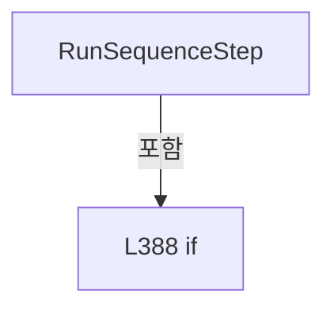

변경 전 점검: 입력/반환 타입, 위 호출자, 예외/취소 경로, 공유 상태와 저장·전송 소비자를 함께 확인합니다. 값의 단위나 물리 방향을 이름만으로 확정하지 않습니다.

### MethodDeclaration `CheckProcessModelLoaded` · L394–397

[Drilling.Common/Station/CStationProcess.cs:394–397](https://github.com/kjuws10-rgb/A3Drilling/blob/96e22cd027c84bf302b23f2949b98985d7f301bb/Drilling.Common/Station/CStationProcess.cs#L394-L397)

| 항목 | 실제 추출 값 |
| --- | --- |
| 서명 | Drilling.Common.Station.ST_PROCESS_MODEL Drilling.Common.Station.CStationProcess.CheckProcessModelLoaded() |
| 접근/수식자 | Private / private |
| 반환/값 타입 | Drilling.Common.Station.ST_PROCESS_MODEL |
| 소속 타입 | NamedType:Drilling.Common.Station.CStationProcess |

정적 호출자로 확인된 위치:

| 호출 파일/행 | 호출 표현식 | 런타임 분기 가능 |
| --- | --- | --- |
| [Drilling.Common/Station/CStationProcess.cs:386–386](https://github.com/kjuws10-rgb/A3Drilling/blob/96e22cd027c84bf302b23f2949b98985d7f301bb/Drilling.Common/Station/CStationProcess.cs#L386-L386) | CheckProcessModelLoaded | False |

호출하는 대상과 해석 범위:

| 원본 행 | 표현식 | 분석 상태 | 대상/소스 위치 |
| --- | --- | --- | --- |
| 396 | new InvalidOperationException | resolved | System.InvalidOperationException.InvalidOperationException(string?) |

본문의 실제 연산·분기·예외·반환 순서(원문 위치 순):

| 원본 행 | 종류 | 주석 해설 |
| --- | --- | --- |
| 396 | call | 함수·델리게이트 또는 객체 생성자를 호출합니다: new InvalidOperationException("Process Model is not loaded.") |
| 396 | return | 호출자에게 값 또는 제어를 반환합니다: return _processModel ?? throw new InvalidOperationException("Process Model is not loaded."); |
| 396 | throw | 예외를 발생/전달합니다: throw new InvalidOperationException("Process Model is not loaded.") |

변경 전 점검: 입력/반환 타입, 위 호출자, 예외/취소 경로, 공유 상태와 저장·전송 소비자를 함께 확인합니다. 값의 단위나 물리 방향을 이름만으로 확정하지 않습니다.

### MethodDeclaration `GetSequenceCancellationToken` · L399–405

[Drilling.Common/Station/CStationProcess.cs:399–405](https://github.com/kjuws10-rgb/A3Drilling/blob/96e22cd027c84bf302b23f2949b98985d7f301bb/Drilling.Common/Station/CStationProcess.cs#L399-L405)

| 항목 | 실제 추출 값 |
| --- | --- |
| 서명 | System.Threading.CancellationToken Drilling.Common.Station.CStationProcess.GetSequenceCancellationToken() |
| 접근/수식자 | Private / private |
| 반환/값 타입 | System.Threading.CancellationToken |
| 소속 타입 | NamedType:Drilling.Common.Station.CStationProcess |

정적 호출자로 확인된 위치:

| 호출 파일/행 | 호출 표현식 | 런타임 분기 가능 |
| --- | --- | --- |
| [Drilling.Common/Station/CStationProcess.cs:385–385](https://github.com/kjuws10-rgb/A3Drilling/blob/96e22cd027c84bf302b23f2949b98985d7f301bb/Drilling.Common/Station/CStationProcess.cs#L385-L385) | GetSequenceCancellationToken | False |

본문의 실제 연산·분기·예외·반환 순서(원문 위치 순):

| 원본 행 | 종류 | 주석 해설 |
| --- | --- | --- |
| 401 | lock | 공유 상태의 임계 구역에 진입합니다: lock (_sequenceLock) |
| 403 | return | 호출자에게 값 또는 제어를 반환합니다: return _sequenceCancellation?.Token ?? CancellationToken.None; |

제어 구문의 포함 구조(실제 실행 순서/CFG가 아닌 구문 탐색 그림):

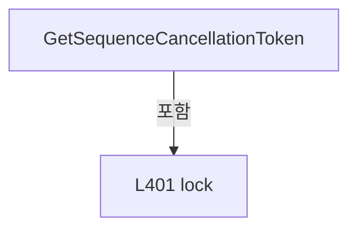

변경 전 점검: 입력/반환 타입, 위 호출자, 예외/취소 경로, 공유 상태와 저장·전송 소비자를 함께 확인합니다. 값의 단위나 물리 방향을 이름만으로 확정하지 않습니다.

### MethodDeclaration `FinishSequence` · L407–421

[Drilling.Common/Station/CStationProcess.cs:407–421](https://github.com/kjuws10-rgb/A3Drilling/blob/96e22cd027c84bf302b23f2949b98985d7f301bb/Drilling.Common/Station/CStationProcess.cs#L407-L421)

| 항목 | 실제 추출 값 |
| --- | --- |
| 서명 | void Drilling.Common.Station.CStationProcess.FinishSequence() |
| 접근/수식자 | Private / private |
| 반환/값 타입 | void |
| 소속 타입 | NamedType:Drilling.Common.Station.CStationProcess |

정적 호출자로 확인된 위치:

| 호출 파일/행 | 호출 표현식 | 런타임 분기 가능 |
| --- | --- | --- |
| [Drilling.Common/Station/CStationProcess.cs:356–356](https://github.com/kjuws10-rgb/A3Drilling/blob/96e22cd027c84bf302b23f2949b98985d7f301bb/Drilling.Common/Station/CStationProcess.cs#L356-L356) | FinishSequence | False |
| [Drilling.Common/Station/CStationProcess.cs:360–360](https://github.com/kjuws10-rgb/A3Drilling/blob/96e22cd027c84bf302b23f2949b98985d7f301bb/Drilling.Common/Station/CStationProcess.cs#L360-L360) | FinishSequence | False |
| [Drilling.Common/Station/CStationProcess.cs:364–364](https://github.com/kjuws10-rgb/A3Drilling/blob/96e22cd027c84bf302b23f2949b98985d7f301bb/Drilling.Common/Station/CStationProcess.cs#L364-L364) | FinishSequence | False |
| [Drilling.Common/Station/CStationProcess.cs:368–368](https://github.com/kjuws10-rgb/A3Drilling/blob/96e22cd027c84bf302b23f2949b98985d7f301bb/Drilling.Common/Station/CStationProcess.cs#L368-L368) | FinishSequence | False |

호출하는 대상과 해석 범위:

| 원본 행 | 표현식 | 분석 상태 | 대상/소스 위치 |
| --- | --- | --- | --- |
| 412 | (_stationStatus with { ChangedAt = DateTimeOffset.Now } ).WithSequenceState | resolved | Drilling.Common.Station.ST_STATION_STATUS Drilling.Common.Station.ST_STATION_STATUS.WithSequenceState(Drilling.Common.Station.EN_STATION_SEQUENCE?) · Drilling.Common/Station/CStationManager.cs:536 |
| 418 | .Dispose | resolved | void System.Threading.CancellationTokenSource.Dispose() |

본문의 실제 연산·분기·예외·반환 순서(원문 위치 순):

| 원본 행 | 종류 | 주석 해설 |
| --- | --- | --- |
| 409 | lock | 공유 상태의 임계 구역에 진입합니다: lock (_sequenceLock) |
| 411 | assignment | 값을 대상에 대입합니다: _sequenceState = EN_STATION_SEQUENCE.Ready |
| 412 | assignment | 값을 대상에 대입합니다: _stationStatus = (_stationStatus with { ChangedAt = DateTimeOffset.Now } ).WithSequenceState(EN_STATION_SEQUENCE.Ready) |
| 412 | call | 함수·델리게이트 또는 객체 생성자를 호출합니다: (_stationStatus with { ChangedAt = DateTimeOffset.Now } ).WithSequenceState(EN_STATION_SEQUENCE.Ready) |
| 414 | assignment | 값을 대상에 대입합니다: ChangedAt = DateTimeOffset.Now |
| 418 | call | 함수·델리게이트 또는 객체 생성자를 호출합니다: .Dispose() |
| 419 | assignment | 값을 대상에 대입합니다: _sequenceCancellation = null |

제어 구문의 포함 구조(실제 실행 순서/CFG가 아닌 구문 탐색 그림):

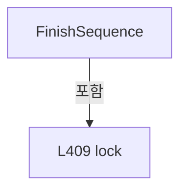

변경 전 점검: 입력/반환 타입, 위 호출자, 예외/취소 경로, 공유 상태와 저장·전송 소비자를 함께 확인합니다. 값의 단위나 물리 방향을 이름만으로 확정하지 않습니다.

### MethodDeclaration `ProcessInterruptedSequence` · L423–432

[Drilling.Common/Station/CStationProcess.cs:423–432](https://github.com/kjuws10-rgb/A3Drilling/blob/96e22cd027c84bf302b23f2949b98985d7f301bb/Drilling.Common/Station/CStationProcess.cs#L423-L432)

| 항목 | 실제 추출 값 |
| --- | --- |
| 서명 | void Drilling.Common.Station.CStationProcess.ProcessInterruptedSequence() |
| 접근/수식자 | Private / private |
| 반환/값 타입 | void |
| 소속 타입 | NamedType:Drilling.Common.Station.CStationProcess |

정적 호출자로 확인된 위치:

| 호출 파일/행 | 호출 표현식 | 런타임 분기 가능 |
| --- | --- | --- |
| [Drilling.Common/Station/CStationProcess.cs:390–390](https://github.com/kjuws10-rgb/A3Drilling/blob/96e22cd027c84bf302b23f2949b98985d7f301bb/Drilling.Common/Station/CStationProcess.cs#L390-L390) | ProcessInterruptedSequence | False |

호출하는 대상과 해석 범위:

| 원본 행 | 표현식 | 분석 상태 | 대상/소스 위치 |
| --- | --- | --- | --- |
| 425 | ReadSequenceState | resolved | Drilling.Common.Station.EN_STATION_SEQUENCE Drilling.Common.Station.CStationProcess.ReadSequenceState() · Drilling.Common/Station/CStationProcess.cs:2330 |
| 428 | new OperationCanceledException | resolved | System.OperationCanceledException.OperationCanceledException() |
| 431 | new InvalidOperationException | resolved | System.InvalidOperationException.InvalidOperationException(string?) |

본문의 실제 연산·분기·예외·반환 순서(원문 위치 순):

| 원본 행 | 종류 | 주석 해설 |
| --- | --- | --- |
| 425 | call | 함수·델리게이트 또는 객체 생성자를 호출합니다: ReadSequenceState() |
| 425 | local-declaration | 지역 변수를 선언합니다: var sequenceState = ReadSequenceState(); |
| 425 | variable-initializer | 변수의 초기값을 지정합니다: sequenceState = ReadSequenceState() |
| 426 | if | 조건에 따라 분기합니다: if (sequenceState == EN_STATION_SEQUENCE.Stop) |
| 428 | call | 함수·델리게이트 또는 객체 생성자를 호출합니다: new OperationCanceledException() |
| 428 | throw | 예외를 발생/전달합니다: throw new OperationCanceledException(); |
| 431 | call | 함수·델리게이트 또는 객체 생성자를 호출합니다: new InvalidOperationException($"Station sequence entered {sequenceState} during auto start.") |
| 431 | throw | 예외를 발생/전달합니다: throw new InvalidOperationException($"Station sequence entered {sequenceState} during auto start."); |

제어 구문의 포함 구조(실제 실행 순서/CFG가 아닌 구문 탐색 그림):

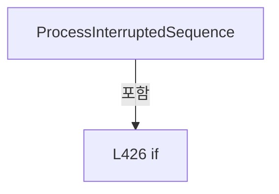

변경 전 점검: 입력/반환 타입, 위 호출자, 예외/취소 경로, 공유 상태와 저장·전송 소비자를 함께 확인합니다. 값의 단위나 물리 방향을 이름만으로 확정하지 않습니다.

### MethodDeclaration `CompleteSequence` · L434–437

[Drilling.Common/Station/CStationProcess.cs:434–437](https://github.com/kjuws10-rgb/A3Drilling/blob/96e22cd027c84bf302b23f2949b98985d7f301bb/Drilling.Common/Station/CStationProcess.cs#L434-L437)

| 항목 | 실제 추출 값 |
| --- | --- |
| 서명 | void Drilling.Common.Station.CStationProcess.CompleteSequence(Drilling.Common.Station.ST_PROCESS_MODEL, System.Threading.CancellationToken) |
| 접근/수식자 | Private / private |
| 반환/값 타입 | void |
| 소속 타입 | NamedType:Drilling.Common.Station.CStationProcess |

입력 계약:

| 이름 | 타입 | 전달 | 선택/기본값 |
| --- | --- | --- | --- |
| processModel | Drilling.Common.Station.ST_PROCESS_MODEL | None | False /  |
| cancellationToken | System.Threading.CancellationToken | None | False /  |

현재 부분 분석에서 직접 연결된 호출자는 없습니다. XAML/이벤트/인터페이스·델리게이트·외부 진입을 추가 확인해야 하며, 미사용으로 판정한 것이 아닙니다.

호출하는 대상과 해석 범위:

| 원본 행 | 표현식 | 분석 상태 | 대상/소스 위치 |
| --- | --- | --- | --- |
| 436 | CompleteProcess | resolved | void Drilling.Common.Station.CStationProcess.CompleteProcess(System.Threading.CancellationToken) · Drilling.Common/Station/CStationProcess.cs:1156 |

본문의 실제 연산·분기·예외·반환 순서(원문 위치 순):

| 원본 행 | 종류 | 주석 해설 |
| --- | --- | --- |
| 436 | call | 함수·델리게이트 또는 객체 생성자를 호출합니다: CompleteProcess(cancellationToken) |

변경 전 점검: 입력/반환 타입, 위 호출자, 예외/취소 경로, 공유 상태와 저장·전송 소비자를 함께 확인합니다. 값의 단위나 물리 방향을 이름만으로 확정하지 않습니다.

### MethodDeclaration `EnsureStartAllowed` · L439–445

[Drilling.Common/Station/CStationProcess.cs:439–445](https://github.com/kjuws10-rgb/A3Drilling/blob/96e22cd027c84bf302b23f2949b98985d7f301bb/Drilling.Common/Station/CStationProcess.cs#L439-L445)

| 항목 | 실제 추출 값 |
| --- | --- |
| 서명 | void Drilling.Common.Station.CStationProcess.EnsureStartAllowed() |
| 접근/수식자 | Private / private |
| 반환/값 타입 | void |
| 소속 타입 | NamedType:Drilling.Common.Station.CStationProcess |

정적 호출자로 확인된 위치:

| 호출 파일/행 | 호출 표현식 | 런타임 분기 가능 |
| --- | --- | --- |
| [Drilling.Common/Station/CStationProcess.cs:284–284](https://github.com/kjuws10-rgb/A3Drilling/blob/96e22cd027c84bf302b23f2949b98985d7f301bb/Drilling.Common/Station/CStationProcess.cs#L284-L284) | EnsureStartAllowed | False |
| [Drilling.Common/Station/CStationProcess.cs:305–305](https://github.com/kjuws10-rgb/A3Drilling/blob/96e22cd027c84bf302b23f2949b98985d7f301bb/Drilling.Common/Station/CStationProcess.cs#L305-L305) | EnsureStartAllowed | False |

호출하는 대상과 해석 범위:

| 원본 행 | 표현식 | 분석 상태 | 대상/소스 위치 |
| --- | --- | --- | --- |
| 441 | ReadStationStatus | resolved | Drilling.Common.Station.ST_STATION_STATUS Drilling.Common.Station.CStationProcess.ReadStationStatus() · Drilling.Common/Station/CStationProcess.cs:2338 |
| 443 | new InvalidOperationException | resolved | System.InvalidOperationException.InvalidOperationException(string?) |

본문의 실제 연산·분기·예외·반환 순서(원문 위치 순):

| 원본 행 | 종류 | 주석 해설 |
| --- | --- | --- |
| 441 | call | 함수·델리게이트 또는 객체 생성자를 호출합니다: ReadStationStatus() |
| 441 | if | 조건에 따라 분기합니다: if (ReadStationStatus().State == EN_STATION_STATE.Alarm) |
| 443 | call | 함수·델리게이트 또는 객체 생성자를 호출합니다: new InvalidOperationException("Station alarm is active. Reset alarm before auto start.") |
| 443 | throw | 예외를 발생/전달합니다: throw new InvalidOperationException("Station alarm is active. Reset alarm before auto start."); |

제어 구문의 포함 구조(실제 실행 순서/CFG가 아닌 구문 탐색 그림):

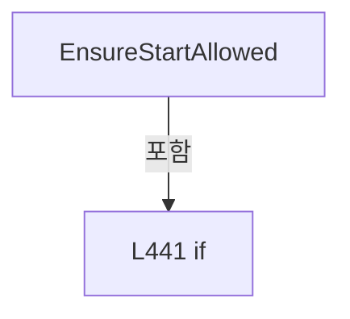

변경 전 점검: 입력/반환 타입, 위 호출자, 예외/취소 경로, 공유 상태와 저장·전송 소비자를 함께 확인합니다. 값의 단위나 물리 방향을 이름만으로 확정하지 않습니다.

### MethodDeclaration `ReadProcessModelForStart` · L447–457

[Drilling.Common/Station/CStationProcess.cs:447–457](https://github.com/kjuws10-rgb/A3Drilling/blob/96e22cd027c84bf302b23f2949b98985d7f301bb/Drilling.Common/Station/CStationProcess.cs#L447-L457)

| 항목 | 실제 추출 값 |
| --- | --- |
| 서명 | Drilling.Common.Station.ST_PROCESS_MODEL Drilling.Common.Station.CStationProcess.ReadProcessModelForStart() |
| 접근/수식자 | Private / private |
| 반환/값 타입 | Drilling.Common.Station.ST_PROCESS_MODEL |
| 소속 타입 | NamedType:Drilling.Common.Station.CStationProcess |

정적 호출자로 확인된 위치:

| 호출 파일/행 | 호출 표현식 | 런타임 분기 가능 |
| --- | --- | --- |
| [Drilling.Common/Station/CStationProcess.cs:285–285](https://github.com/kjuws10-rgb/A3Drilling/blob/96e22cd027c84bf302b23f2949b98985d7f301bb/Drilling.Common/Station/CStationProcess.cs#L285-L285) | ReadProcessModelForStart | False |

호출하는 대상과 해석 범위:

| 원본 행 | 표현식 | 분석 상태 | 대상/소스 위치 |
| --- | --- | --- | --- |
| 454 | SetAutoStepState | resolved | void Drilling.Common.Station.CStationProcess.SetAutoStepState(string, string) · Drilling.Common/Station/CStationProcess.cs:1806 |
| 455 | SetSequenceState | resolved | void Drilling.Common.Station.CStationProcess.SetSequenceState(Drilling.Common.Station.EN_STATION_SEQUENCE) · Drilling.Common/Station/CStationProcess.cs:2291 |
| 456 | new InvalidOperationException | resolved | System.InvalidOperationException.InvalidOperationException(string?) |

본문의 실제 연산·분기·예외·반환 순서(원문 위치 순):

| 원본 행 | 종류 | 주석 해설 |
| --- | --- | --- |
| 449 | if | 조건에 따라 분기합니다: if (_snapshot.ProcessModel is not null) |
| 451 | return | 호출자에게 값 또는 제어를 반환합니다: return _snapshot.ProcessModel; |
| 454 | call | 함수·델리게이트 또는 객체 생성자를 호출합니다: SetAutoStepState(AutoStepIdle, AutoStepError) |
| 455 | call | 함수·델리게이트 또는 객체 생성자를 호출합니다: SetSequenceState(EN_STATION_SEQUENCE.Error) |
| 456 | call | 함수·델리게이트 또는 객체 생성자를 호출합니다: new InvalidOperationException("Process model is not loaded.") |
| 456 | throw | 예외를 발생/전달합니다: throw new InvalidOperationException("Process model is not loaded."); |

제어 구문의 포함 구조(실제 실행 순서/CFG가 아닌 구문 탐색 그림):


변경 전 점검: 입력/반환 타입, 위 호출자, 예외/취소 경로, 공유 상태와 저장·전송 소비자를 함께 확인합니다. 값의 단위나 물리 방향을 이름만으로 확정하지 않습니다.

### MethodDeclaration `GetLiveInterlockItems` · L459–459

[Drilling.Common/Station/CStationProcess.cs:459–459](https://github.com/kjuws10-rgb/A3Drilling/blob/96e22cd027c84bf302b23f2949b98985d7f301bb/Drilling.Common/Station/CStationProcess.cs#L459-L459)

| 항목 | 실제 추출 값 |
| --- | --- |
| 서명 | System.Collections.Generic.IReadOnlyList<Drilling.Common.InterLock.ST_INTERLOCK_ITEM> Drilling.Common.Station.CStationProcess.GetLiveInterlockItems(System.Threading.CancellationToken) |
| 접근/수식자 | Public / public |
| 반환/값 타입 | System.Collections.Generic.IReadOnlyList<Drilling.Common.InterLock.ST_INTERLOCK_ITEM> |
| 소속 타입 | NamedType:Drilling.Common.Station.CStationProcess |

입력 계약:

| 이름 | 타입 | 전달 | 선택/기본값 |
| --- | --- | --- | --- |
| cancellationToken | System.Threading.CancellationToken | None | True / null |

정적 호출자로 확인된 위치:

| 호출 파일/행 | 호출 표현식 | 런타임 분기 가능 |
| --- | --- | --- |
| [Drilling.Common/Station/CStationManager.cs:75–75](https://github.com/kjuws10-rgb/A3Drilling/blob/96e22cd027c84bf302b23f2949b98985d7f301bb/Drilling.Common/Station/CStationManager.cs#L75-L75) | _processStation.GetLiveInterlockItems | False |

호출하는 대상과 해석 범위:

| 원본 행 | 표현식 | 분석 상태 | 대상/소스 위치 |
| --- | --- | --- | --- |
| 459 | EvaluateInterlocks | resolved | Drilling.Common.InterLock.ST_INTERLOCK_SUMMARY Drilling.Common.Station.CStationProcess.EvaluateInterlocks(System.Collections.Generic.IReadOnlyDictionary<string, string>?, System.Threading.CancellationToken, bool, bool, bool) · Drilling.Common/Station/CStationProcess.cs:1364 |

본문의 실제 연산·분기·예외·반환 순서(원문 위치 순):

| 원본 행 | 종류 | 주석 해설 |
| --- | --- | --- |
| 459 | call | 함수·델리게이트 또는 객체 생성자를 호출합니다: EvaluateInterlocks(_snapshot.ProcessModel?.Parameters, cancellationToken, cachedStatusOnly: true, requireAllHeadsUsed: true) |

변경 전 점검: 입력/반환 타입, 위 호출자, 예외/취소 경로, 공유 상태와 저장·전송 소비자를 함께 확인합니다. 값의 단위나 물리 방향을 이름만으로 확정하지 않습니다.

### MethodDeclaration `GetLiveInterlockItems` · L460–460

[Drilling.Common/Station/CStationProcess.cs:460–460](https://github.com/kjuws10-rgb/A3Drilling/blob/96e22cd027c84bf302b23f2949b98985d7f301bb/Drilling.Common/Station/CStationProcess.cs#L460-L460)

| 항목 | 실제 추출 값 |
| --- | --- |
| 서명 | System.Collections.Generic.IReadOnlyList<Drilling.Common.InterLock.ST_INTERLOCK_ITEM> Drilling.Common.Station.CStationProcess.GetLiveInterlockItems(System.Collections.Generic.IReadOnlyDictionary<string, string>, System.Threading.CancellationToken) |
| 접근/수식자 | Public / public |
| 반환/값 타입 | System.Collections.Generic.IReadOnlyList<Drilling.Common.InterLock.ST_INTERLOCK_ITEM> |
| 소속 타입 | NamedType:Drilling.Common.Station.CStationProcess |

입력 계약:

| 이름 | 타입 | 전달 | 선택/기본값 |
| --- | --- | --- | --- |
| parameters | System.Collections.Generic.IReadOnlyDictionary<string, string> | None | False /  |
| cancellationToken | System.Threading.CancellationToken | None | True / null |

정적 호출자로 확인된 위치:

| 호출 파일/행 | 호출 표현식 | 런타임 분기 가능 |
| --- | --- | --- |
| [Drilling.Common/Station/CStationManager.cs:71–71](https://github.com/kjuws10-rgb/A3Drilling/blob/96e22cd027c84bf302b23f2949b98985d7f301bb/Drilling.Common/Station/CStationManager.cs#L71-L71) | _processStation.GetLiveInterlockItems | False |

호출하는 대상과 해석 범위:

| 원본 행 | 표현식 | 분석 상태 | 대상/소스 위치 |
| --- | --- | --- | --- |
| 460 | EvaluateInterlocks | resolved | Drilling.Common.InterLock.ST_INTERLOCK_SUMMARY Drilling.Common.Station.CStationProcess.EvaluateInterlocks(System.Collections.Generic.IReadOnlyDictionary<string, string>?, System.Threading.CancellationToken, bool, bool, bool) · Drilling.Common/Station/CStationProcess.cs:1364 |

본문의 실제 연산·분기·예외·반환 순서(원문 위치 순):

| 원본 행 | 종류 | 주석 해설 |
| --- | --- | --- |
| 460 | call | 함수·델리게이트 또는 객체 생성자를 호출합니다: EvaluateInterlocks(parameters, cancellationToken, cachedStatusOnly: true, requireAllHeadsUsed: true) |

변경 전 점검: 입력/반환 타입, 위 호출자, 예외/취소 경로, 공유 상태와 저장·전송 소비자를 함께 확인합니다. 값의 단위나 물리 방향을 이름만으로 확정하지 않습니다.

### MethodDeclaration `GetManualInterlockItems` · L461–471

[Drilling.Common/Station/CStationProcess.cs:461–471](https://github.com/kjuws10-rgb/A3Drilling/blob/96e22cd027c84bf302b23f2949b98985d7f301bb/Drilling.Common/Station/CStationProcess.cs#L461-L471)

| 항목 | 실제 추출 값 |
| --- | --- |
| 서명 | System.Collections.Generic.IReadOnlyList<Drilling.Common.InterLock.ST_INTERLOCK_ITEM> Drilling.Common.Station.CStationProcess.GetManualInterlockItems(System.Collections.Generic.IReadOnlyDictionary<string, string>, System.Collections.Generic.IReadOnlySet<int>, System.Threading.CancellationToken) |
| 접근/수식자 | Public / public |
| 반환/값 타입 | System.Collections.Generic.IReadOnlyList<Drilling.Common.InterLock.ST_INTERLOCK_ITEM> |
| 소속 타입 | NamedType:Drilling.Common.Station.CStationProcess |

입력 계약:

| 이름 | 타입 | 전달 | 선택/기본값 |
| --- | --- | --- | --- |
| parameters | System.Collections.Generic.IReadOnlyDictionary<string, string> | None | False /  |
| selectedHeads | System.Collections.Generic.IReadOnlySet<int> | None | False /  |
| cancellationToken | System.Threading.CancellationToken | None | True / null |

정적 호출자로 확인된 위치:

| 호출 파일/행 | 호출 표현식 | 런타임 분기 가능 |
| --- | --- | --- |
| [Drilling.Common/Station/CStationManager.cs:78–78](https://github.com/kjuws10-rgb/A3Drilling/blob/96e22cd027c84bf302b23f2949b98985d7f301bb/Drilling.Common/Station/CStationManager.cs#L78-L78) | _processStation.GetManualInterlockItems | False |
| [Drilling.Common/Station/CStationProcess.cs:3639–3639](https://github.com/kjuws10-rgb/A3Drilling/blob/96e22cd027c84bf302b23f2949b98985d7f301bb/Drilling.Common/Station/CStationProcess.cs#L3639-L3639) | GetManualInterlockItems | False |

호출하는 대상과 해석 범위:

| 원본 행 | 표현식 | 분석 상태 | 대상/소스 위치 |
| --- | --- | --- | --- |
| 463 | selectedHeads.Where(head => head is >= 1 and <= 8).ToHashSet | resolved | System.Collections.Generic.HashSet<int> System.Collections.Generic.IEnumerable<int>.ToHashSet<int>() |
| 463 | selectedHeads.Where | resolved | System.Collections.Generic.IEnumerable<int> System.Collections.Generic.IEnumerable<int>.Where<int>(System.Func<int, bool>) |
| 464 | new Dictionary<string, string> | resolved | System.Collections.Generic.Dictionary<string, string>.Dictionary(System.Collections.Generic.IEnumerable<System.Collections.Generic.KeyValuePair<string, string>>, System.Collections.Generic.IEqualityComparer<string>?) |
| 466 | heads.Contains | resolved | bool System.Collections.Generic.HashSet<int>.Contains(int) |
| 468 | EvaluateInterlocks | resolved | Drilling.Common.InterLock.ST_INTERLOCK_SUMMARY Drilling.Common.Station.CStationProcess.EvaluateInterlocks(System.Collections.Generic.IReadOnlyDictionary<string, string>?, System.Threading.CancellationToken, bool, bool, bool) · Drilling.Common/Station/CStationProcess.cs:1364 |
| 469 | _interfaceManager.GetInterfaceList(EN_EQP_MODULE.Bet).FirstOrDefault | resolved | Drilling.Common.Interface.ST_INTERFACE_DATA? System.Collections.Generic.IEnumerable<Drilling.Common.Interface.ST_INTERFACE_DATA>.FirstOrDefault<Drilling.Common.Interface.ST_INTERFACE_DATA>() |
| 469 | _interfaceManager.GetInterfaceList | resolved | System.Collections.Generic.IReadOnlyList<Drilling.Common.Interface.ST_INTERFACE_DATA> Drilling.Common.Interface.CInterfaceManager.GetInterfaceList(Drilling.Common.Interface.EN_EQP_MODULE?) · Drilling.Common/Interface/CInterfaceManager.cs:442 |
| 470 | items.Select(item => item.HeadNo is null && item.Signal.Equals("BET", StringComparison.OrdinalIgnoreCase) && firstBet is { Number: >= 0 and < 8 } ? item with { HeadNo = firstBet.Number + 1 } : item).Where(item => item.HeadNo is not > 0 &#124;&#124; heads.Contains(item.HeadNo.Value)).ToArray | resolved | Drilling.Common.InterLock.ST_INTERLOCK_ITEM[] System.Collections.Generic.IEnumerable<Drilling.Common.InterLock.ST_INTERLOCK_ITEM>.ToArray<Drilling.Common.InterLock.ST_INTERLOCK_ITEM>() |
| 470 | items.Select(item => item.HeadNo is null && item.Signal.Equals("BET", StringComparison.OrdinalIgnoreCase) && firstBet is { Number: >= 0 and < 8 } ? item with { HeadNo = firstBet.Number + 1 } : item).Where | resolved | System.Collections.Generic.IEnumerable<Drilling.Common.InterLock.ST_INTERLOCK_ITEM> System.Collections.Generic.IEnumerable<Drilling.Common.InterLock.ST_INTERLOCK_ITEM>.Where<Drilling.Common.InterLock.ST_INTERLOCK_ITEM>(System.Func<Drilling.Common.InterLock.ST_INTERLOCK_ITEM, bool>) |
| 470 | items.Select | resolved | System.Collections.Generic.IEnumerable<Drilling.Common.InterLock.ST_INTERLOCK_ITEM> System.Collections.Generic.IEnumerable<Drilling.Common.InterLock.ST_INTERLOCK_ITEM>.Select<Drilling.Common.InterLock.ST_INTERLOCK_ITEM, Drilling.Common.InterLock.ST_INTERLOCK_ITEM>(System.Func<Drilling.Common.InterLock.ST_INTERLOCK_ITEM, Drilling.Common.InterLock.ST_INTERLOCK_ITEM>) |
| 470 | item.Signal.Equals | resolved | bool string.Equals(string?, System.StringComparison) |
| 470 | heads.Contains | resolved | bool System.Collections.Generic.HashSet<int>.Contains(int) |

본문의 실제 연산·분기·예외·반환 순서(원문 위치 순):

| 원본 행 | 종류 | 주석 해설 |
| --- | --- | --- |
| 463 | call | 함수·델리게이트 또는 객체 생성자를 호출합니다: selectedHeads.Where(head => head is >= 1 and <= 8).ToHashSet() |
| 463 | call | 함수·델리게이트 또는 객체 생성자를 호출합니다: selectedHeads.Where(head => head is >= 1 and <= 8) |
| 463 | local-declaration | 지역 변수를 선언합니다: var heads = selectedHeads.Where(head => head is >= 1 and <= 8).ToHashSet(); |
| 463 | variable-initializer | 변수의 초기값을 지정합니다: heads = selectedHeads.Where(head => head is >= 1 and <= 8).ToHashSet() |
| 464 | call | 함수·델리게이트 또는 객체 생성자를 호출합니다: new Dictionary<string, string>(parameters, StringComparer.OrdinalIgnoreCase) |
| 464 | local-declaration | 지역 변수를 선언합니다: var manualParameters = new Dictionary<string, string>(parameters, StringComparer.OrdinalIgnoreCase); |
| 464 | variable-initializer | 변수의 초기값을 지정합니다: manualParameters = new Dictionary<string, string>(parameters, StringComparer.OrdinalIgnoreCase) |
| 465 | variable-initializer | 변수의 초기값을 지정합니다: head = 1 |
| 465 | for | 초기화·조건·증감이 있는 반복입니다: for (var head = 1; head <= 8; head++) |
| 466 | assignment | 값을 대상에 대입합니다: manualParameters[$"H{head:00}_USE"] = heads.Contains(head) ? "ON" : "OFF" |
| 466 | call | 함수·델리게이트 또는 객체 생성자를 호출합니다: heads.Contains(head) |
| 466 | conditional-expression | 조건에 따라 결과식을 선택합니다: heads.Contains(head) ? "ON" : "OFF" |
| 468 | call | 함수·델리게이트 또는 객체 생성자를 호출합니다: EvaluateInterlocks(manualParameters, cancellationToken, cachedStatusOnly: true, publish: false) |
| 468 | local-declaration | 지역 변수를 선언합니다: var items = EvaluateInterlocks(manualParameters, cancellationToken, cachedStatusOnly: true, publish: false).Items; |
| 468 | variable-initializer | 변수의 초기값을 지정합니다: items = EvaluateInterlocks(manualParameters, cancellationToken, cachedStatusOnly: true, publish: false).Items |
| 469 | call | 함수·델리게이트 또는 객체 생성자를 호출합니다: _interfaceManager.GetInterfaceList(EN_EQP_MODULE.Bet).FirstOrDefault() |
| 469 | call | 함수·델리게이트 또는 객체 생성자를 호출합니다: _interfaceManager.GetInterfaceList(EN_EQP_MODULE.Bet) |
| 469 | local-declaration | 지역 변수를 선언합니다: var firstBet = _interfaceManager.GetInterfaceList(EN_EQP_MODULE.Bet).FirstOrDefault(); |
| 469 | variable-initializer | 변수의 초기값을 지정합니다: firstBet = _interfaceManager.GetInterfaceList(EN_EQP_MODULE.Bet).FirstOrDefault() |
| 470 | assignment | 값을 대상에 대입합니다: HeadNo = firstBet.Number + 1 |
| 470 | call | 함수·델리게이트 또는 객체 생성자를 호출합니다: items.Select(item => item.HeadNo is null && item.Signal.Equals("BET", StringComparison.OrdinalIgnoreCase) && firstBet is { Number: >= 0 and < 8 } ? item with { HeadNo = firstBet.Number + 1 } : item).Where(item => item.He… |
| 470 | call | 함수·델리게이트 또는 객체 생성자를 호출합니다: items.Select(item => item.HeadNo is null && item.Signal.Equals("BET", StringComparison.OrdinalIgnoreCase) && firstBet is { Number: >= 0 and < 8 } ? item with { HeadNo = firstBet.Number + 1 } : item).Where(item => item.He… |
| 470 | call | 함수·델리게이트 또는 객체 생성자를 호출합니다: items.Select(item => item.HeadNo is null && item.Signal.Equals("BET", StringComparison.OrdinalIgnoreCase) && firstBet is { Number: >= 0 and < 8 } ? item with { HeadNo = firstBet.Number + 1 } : item) |
| 470 | call | 함수·델리게이트 또는 객체 생성자를 호출합니다: item.Signal.Equals("BET", StringComparison.OrdinalIgnoreCase) |
| 470 | call | 함수·델리게이트 또는 객체 생성자를 호출합니다: heads.Contains(item.HeadNo.Value) |
| 470 | conditional-expression | 조건에 따라 결과식을 선택합니다: item.HeadNo is null && item.Signal.Equals("BET", StringComparison.OrdinalIgnoreCase) && firstBet is { Number: >= 0 and < 8 } ? item with { HeadNo = firstBet.Number + 1 } : item |
| 470 | return | 호출자에게 값 또는 제어를 반환합니다: return items.Select(item => item.HeadNo is null && item.Signal.Equals("BET", StringComparison.OrdinalIgnoreCase) && firstBet is { Number: >= 0 and < 8 } ? item with { HeadNo = firstBet.Number + 1 } : item).Where(item => item.HeadN |

제어 구문의 포함 구조(실제 실행 순서/CFG가 아닌 구문 탐색 그림):

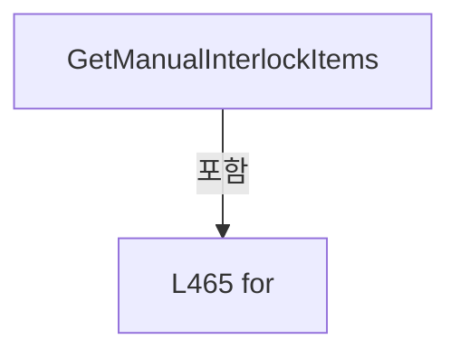

변경 전 점검: 입력/반환 타입, 위 호출자, 예외/취소 경로, 공유 상태와 저장·전송 소비자를 함께 확인합니다. 값의 단위나 물리 방향을 이름만으로 확정하지 않습니다.

### MethodDeclaration `ExecuteAutoStep` · L473–498

[Drilling.Common/Station/CStationProcess.cs:473–498](https://github.com/kjuws10-rgb/A3Drilling/blob/96e22cd027c84bf302b23f2949b98985d7f301bb/Drilling.Common/Station/CStationProcess.cs#L473-L498)

| 항목 | 실제 추출 값 |
| --- | --- |
| 서명 | void Drilling.Common.Station.CStationProcess.ExecuteAutoStep(string, Drilling.Common.Station.ST_PROCESS_MODEL, Drilling.Common.Station.CStationProcess.CProcessStepAction, System.Threading.CancellationToken) |
| 접근/수식자 | Private / private |
| 반환/값 타입 | void |
| 소속 타입 | NamedType:Drilling.Common.Station.CStationProcess |

입력 계약:

| 이름 | 타입 | 전달 | 선택/기본값 |
| --- | --- | --- | --- |
| stepKey | string | None | False /  |
| processModel | Drilling.Common.Station.ST_PROCESS_MODEL | None | False /  |
| action | Drilling.Common.Station.CStationProcess.CProcessStepAction | None | False /  |
| cancellationToken | System.Threading.CancellationToken | None | False /  |

정적 호출자로 확인된 위치:

| 호출 파일/행 | 호출 표현식 | 런타임 분기 가능 |
| --- | --- | --- |
| [Drilling.Common/Station/CStationProcess.cs:387–387](https://github.com/kjuws10-rgb/A3Drilling/blob/96e22cd027c84bf302b23f2949b98985d7f301bb/Drilling.Common/Station/CStationProcess.cs#L387-L387) | ExecuteAutoStep | False |

호출하는 대상과 해석 범위:

| 원본 행 | 표현식 | 분석 상태 | 대상/소스 위치 |
| --- | --- | --- | --- |
| 475 | cancellationToken.ThrowIfCancellationRequested | resolved | void System.Threading.CancellationToken.ThrowIfCancellationRequested() |
| 476 | GetAutoStepName | resolved | string Drilling.Common.Station.CStationProcess.GetAutoStepName(string) · Drilling.Common/Station/CStationProcess.cs:1873 |
| 477 | GetProcessFlowItem | resolved | Drilling.Common.Station.ST_STATION_PROCESS_FLOW_ITEM Drilling.Common.Station.CStationProcess.GetProcessFlowItem(string) · Drilling.Common/Station/CStationProcess.cs:1863 |
| 478 | ResolveStepScriptStatus | resolved | Drilling.Common.Station.EN_SCRIPT_STATUS Drilling.Common.Station.CStationProcess.ResolveStepScriptStatus(string, Drilling.Common.Station.EN_SCRIPT_STATUS) · Drilling.Common/Station/CStationProcess.cs:1838 |
| 479 | SetAutoStepState | resolved | void Drilling.Common.Station.CStationProcess.SetAutoStepState(string, string) · Drilling.Common/Station/CStationProcess.cs:1806 |
| 480 | AddProcessLog | resolved | void Drilling.Common.Station.CStationProcess.AddProcessLog(string, string, string) · Drilling.Common/Station/CStationProcess.cs:2367 |
| 481 | CreateSnapshot | resolved | Drilling.Common.Station.ST_STATION_PROCESS_STATUS Drilling.Common.Station.CStationProcess.CreateSnapshot(Drilling.Common.Station.ST_PROCESS_MODEL?, System.Collections.Generic.IReadOnlyList<Drilling.Common.Station.ST_HEAD_PREVIEW_DATA>, Drilling.Common.Station.EN_SCRIPT_STATUS, Drilling.Common.Station.EN_PROCESS_STEP, Drilling.Common.Station.ST_PROCESS_RESULT?) · Drilling.Common/Station/CStationProcess.cs:1338 |
| 481 | SetHeadStatus | resolved | System.Collections.Generic.IReadOnlyList<Drilling.Common.Station.ST_HEAD_PREVIEW_DATA> Drilling.Common.Station.CStationProcess.SetHeadStatus(System.Collections.Generic.IReadOnlyList<Drilling.Common.Station.ST_HEAD_PREVIEW_DATA>, Drilling.Common.Station.EN_PROCESS_STEP) · Drilling.Common/Station/CStationProcess.cs:1677 |
| 482 | SetStationState | resolved | void Drilling.Common.Station.CStationProcess.SetStationState(Drilling.Common.Station.EN_STATION_STATE, Drilling.Common.Station.EN_PROCESS_STEP, Drilling.Common.Station.EN_SCRIPT_STATUS, string) · Drilling.Common/Station/CStationProcess.cs:2346 |
| 483 | RefreshSnapshot | resolved | void Drilling.Common.Station.CStationProcess.RefreshSnapshot() · Drilling.Common/Station/CStationProcess.cs:1789 |
| 486 | action | resolved · 동적 구현 선택 가능 | void Drilling.Common.Station.CStationProcess.CProcessStepAction.Invoke(Drilling.Common.Station.ST_PROCESS_MODEL, System.Threading.CancellationToken) · Drilling.Common/Station/CStationProcess.cs:170 |
| 487 | SetAutoStepState | resolved | void Drilling.Common.Station.CStationProcess.SetAutoStepState(string, string) · Drilling.Common/Station/CStationProcess.cs:1806 |
| 488 | AddProcessLog | resolved | void Drilling.Common.Station.CStationProcess.AddProcessLog(string, string, string) · Drilling.Common/Station/CStationProcess.cs:2367 |
| 489 | RefreshSnapshot | resolved | void Drilling.Common.Station.CStationProcess.RefreshSnapshot() · Drilling.Common/Station/CStationProcess.cs:1789 |
| 493 | SetAutoStepState | resolved | void Drilling.Common.Station.CStationProcess.SetAutoStepState(string, string) · Drilling.Common/Station/CStationProcess.cs:1806 |
| 494 | AddProcessLog | resolved | void Drilling.Common.Station.CStationProcess.AddProcessLog(string, string, string) · Drilling.Common/Station/CStationProcess.cs:2367 |
| 495 | RefreshSnapshot | resolved | void Drilling.Common.Station.CStationProcess.RefreshSnapshot() · Drilling.Common/Station/CStationProcess.cs:1789 |

본문의 실제 연산·분기·예외·반환 순서(원문 위치 순):

| 원본 행 | 종류 | 주석 해설 |
| --- | --- | --- |
| 475 | call | 함수·델리게이트 또는 객체 생성자를 호출합니다: cancellationToken.ThrowIfCancellationRequested() |
| 476 | call | 함수·델리게이트 또는 객체 생성자를 호출합니다: GetAutoStepName(stepKey) |
| 476 | local-declaration | 지역 변수를 선언합니다: var stepName = GetAutoStepName(stepKey); |
| 476 | variable-initializer | 변수의 초기값을 지정합니다: stepName = GetAutoStepName(stepKey) |
| 477 | call | 함수·델리게이트 또는 객체 생성자를 호출합니다: GetProcessFlowItem(stepKey) |
| 477 | local-declaration | 지역 변수를 선언합니다: var flowItem = GetProcessFlowItem(stepKey); |
| 477 | variable-initializer | 변수의 초기값을 지정합니다: flowItem = GetProcessFlowItem(stepKey) |
| 478 | call | 함수·델리게이트 또는 객체 생성자를 호출합니다: ResolveStepScriptStatus(stepKey, flowItem.ScriptStatus) |
| 478 | local-declaration | 지역 변수를 선언합니다: var runningScriptStatus = ResolveStepScriptStatus(stepKey, flowItem.ScriptStatus); |
| 478 | variable-initializer | 변수의 초기값을 지정합니다: runningScriptStatus = ResolveStepScriptStatus(stepKey, flowItem.ScriptStatus) |
| 479 | call | 함수·델리게이트 또는 객체 생성자를 호출합니다: SetAutoStepState(stepKey, AutoStepRunning) |
| 480 | call | 함수·델리게이트 또는 객체 생성자를 호출합니다: AddProcessLog("INFO", "STEP", $"{stepName} started.") |
| 481 | assignment | 값을 대상에 대입합니다: _snapshot = CreateSnapshot(_snapshot.ProcessModel, SetHeadStatus(_snapshot.HeadPreviews, flowItem.RunningStep), runningScriptStatus, flowItem.RunningStep, null) |
| 481 | call | 함수·델리게이트 또는 객체 생성자를 호출합니다: CreateSnapshot(_snapshot.ProcessModel, SetHeadStatus(_snapshot.HeadPreviews, flowItem.RunningStep), runningScriptStatus, flowItem.RunningStep, null) |
| 481 | call | 함수·델리게이트 또는 객체 생성자를 호출합니다: SetHeadStatus(_snapshot.HeadPreviews, flowItem.RunningStep) |
| 482 | call | 함수·델리게이트 또는 객체 생성자를 호출합니다: SetStationState(flowItem.RunningState, flowItem.RunningStep, runningScriptStatus, $"{stepName} started.") |
| 483 | call | 함수·델리게이트 또는 객체 생성자를 호출합니다: RefreshSnapshot() |
| 484 | try | 예외 처리 범위입니다: try |
| 486 | call | 함수·델리게이트 또는 객체 생성자를 호출합니다: action(processModel, cancellationToken) |
| 487 | call | 함수·델리게이트 또는 객체 생성자를 호출합니다: SetAutoStepState(stepKey, stepKey == AutoStepComplete ? AutoStepDone : AutoStepOk) |
| 487 | conditional-expression | 조건에 따라 결과식을 선택합니다: stepKey == AutoStepComplete ? AutoStepDone : AutoStepOk |
| 488 | call | 함수·델리게이트 또는 객체 생성자를 호출합니다: AddProcessLog("INFO", "STEP", $"{stepName} completed.") |
| 489 | call | 함수·델리게이트 또는 객체 생성자를 호출합니다: RefreshSnapshot() |
| 491 | catch | 지정 예외를 처리합니다: catch (Exception exception) |
| 493 | call | 함수·델리게이트 또는 객체 생성자를 호출합니다: SetAutoStepState(stepKey, AutoStepError) |
| 494 | call | 함수·델리게이트 또는 객체 생성자를 호출합니다: AddProcessLog("ERROR", "STEP", $"{stepName} failed. {exception.Message}") |
| 495 | call | 함수·델리게이트 또는 객체 생성자를 호출합니다: RefreshSnapshot() |
| 496 | throw | 예외를 발생/전달합니다: throw; |

제어 구문의 포함 구조(실제 실행 순서/CFG가 아닌 구문 탐색 그림):

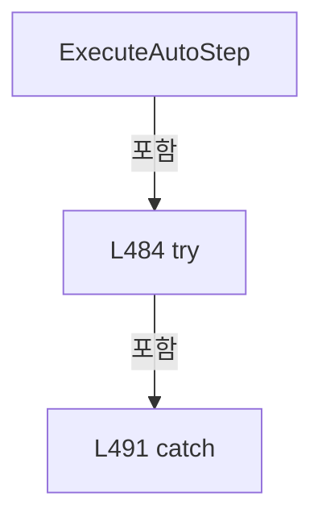

변경 전 점검: 입력/반환 타입, 위 호출자, 예외/취소 경로, 공유 상태와 저장·전송 소비자를 함께 확인합니다. 값의 단위나 물리 방향을 이름만으로 확정하지 않습니다.

### MethodDeclaration `RunAlignStep` · L500–525

[Drilling.Common/Station/CStationProcess.cs:500–525](https://github.com/kjuws10-rgb/A3Drilling/blob/96e22cd027c84bf302b23f2949b98985d7f301bb/Drilling.Common/Station/CStationProcess.cs#L500-L525)

| 항목 | 실제 추출 값 |
| --- | --- |
| 서명 | void Drilling.Common.Station.CStationProcess.RunAlignStep(Drilling.Common.Station.ST_PROCESS_MODEL, System.Threading.CancellationToken) |
| 접근/수식자 | Private / private |
| 반환/값 타입 | void |
| 소속 타입 | NamedType:Drilling.Common.Station.CStationProcess |

입력 계약:

| 이름 | 타입 | 전달 | 선택/기본값 |
| --- | --- | --- | --- |
| processModel | Drilling.Common.Station.ST_PROCESS_MODEL | None | False /  |
| cancellationToken | System.Threading.CancellationToken | None | False /  |

현재 부분 분석에서 직접 연결된 호출자는 없습니다. XAML/이벤트/인터페이스·델리게이트·외부 진입을 추가 확인해야 하며, 미사용으로 판정한 것이 아닙니다.

호출하는 대상과 해석 범위:

| 원본 행 | 표현식 | 분석 상태 | 대상/소스 위치 |
| --- | --- | --- | --- |
| 502 | cancellationToken.ThrowIfCancellationRequested | resolved | void System.Threading.CancellationToken.ThrowIfCancellationRequested() |
| 504 | ReadDoubleAny | resolved | double Drilling.Common.Station.CStationProcess.ReadDoubleAny(System.Collections.Generic.IReadOnlyDictionary<string, string>, double, params string[]) · Drilling.Common/Station/CStationProcess.cs:2081 |
| 505 | ReadDoubleAny | resolved | double Drilling.Common.Station.CStationProcess.ReadDoubleAny(System.Collections.Generic.IReadOnlyDictionary<string, string>, double, params string[]) · Drilling.Common/Station/CStationProcess.cs:2081 |
| 506 | ReadDoubleAny | resolved | double Drilling.Common.Station.CStationProcess.ReadDoubleAny(System.Collections.Generic.IReadOnlyDictionary<string, string>, double, params string[]) · Drilling.Common/Station/CStationProcess.cs:2081 |
| 509 | UpdateProductAlignment | resolved | void Drilling.Common.Station.CStationProcess.UpdateProductAlignment(Drilling.Common.Station.ST_PROCESS_MODEL, Drilling.Common.Product.EN_PRODUCT_PROCESS_STATE, string, System.Threading.CancellationToken) · Drilling.Common/Station/CStationProcess.cs:527 |
| 510 | SendProcessControlCommand | resolved | void Drilling.Common.Station.CStationProcess.SendProcessControlCommand(string, System.Collections.Generic.IReadOnlyList<(string Key, string Value)>, System.Threading.CancellationToken) · Drilling.Common/Station/CStationProcess.cs:638 |
| 510 | FormatDouble | resolved | string Drilling.Common.Station.CStationProcess.FormatDouble(double) · Drilling.Common/Station/CStationProcess.cs:1943 |
| 510 | FormatDouble | resolved | string Drilling.Common.Station.CStationProcess.FormatDouble(double) · Drilling.Common/Station/CStationProcess.cs:1943 |
| 510 | FormatDouble | resolved | string Drilling.Common.Station.CStationProcess.FormatDouble(double) · Drilling.Common/Station/CStationProcess.cs:1943 |
| 511 | UpdateProductAlignment | resolved | void Drilling.Common.Station.CStationProcess.UpdateProductAlignment(Drilling.Common.Station.ST_PROCESS_MODEL, Drilling.Common.Product.EN_PRODUCT_PROCESS_STATE, string, System.Threading.CancellationToken) · Drilling.Common/Station/CStationProcess.cs:527 |
| 515 | TryUpdateProductAlignmentAfterFailure | resolved | void Drilling.Common.Station.CStationProcess.TryUpdateProductAlignmentAfterFailure(Drilling.Common.Station.ST_PROCESS_MODEL, Drilling.Common.Product.EN_PRODUCT_PROCESS_STATE, string) · Drilling.Common/Station/CStationProcess.cs:551 |
| 520 | TryUpdateProductAlignmentAfterFailure | resolved | void Drilling.Common.Station.CStationProcess.TryUpdateProductAlignmentAfterFailure(Drilling.Common.Station.ST_PROCESS_MODEL, Drilling.Common.Product.EN_PRODUCT_PROCESS_STATE, string) · Drilling.Common/Station/CStationProcess.cs:551 |
| 524 | AddProcessLog | resolved | void Drilling.Common.Station.CStationProcess.AddProcessLog(string, string, string) · Drilling.Common/Station/CStationProcess.cs:2367 |
| 524 | FormatDouble | resolved | string Drilling.Common.Station.CStationProcess.FormatDouble(double) · Drilling.Common/Station/CStationProcess.cs:1943 |
| 524 | FormatDouble | resolved | string Drilling.Common.Station.CStationProcess.FormatDouble(double) · Drilling.Common/Station/CStationProcess.cs:1943 |

본문의 실제 연산·분기·예외·반환 순서(원문 위치 순):

| 원본 행 | 종류 | 주석 해설 |
| --- | --- | --- |
| 502 | call | 함수·델리게이트 또는 객체 생성자를 호출합니다: cancellationToken.ThrowIfCancellationRequested() |
| 503 | local-declaration | 지역 변수를 선언합니다: var parameters = processModel.Parameters; |
| 503 | variable-initializer | 변수의 초기값을 지정합니다: parameters = processModel.Parameters |
| 504 | call | 함수·델리게이트 또는 객체 생성자를 호출합니다: ReadDoubleAny(parameters, 0.0, "REVIEW_CAMERA_ALIGN_KEY_POS_X") |
| 504 | local-declaration | 지역 변수를 선언합니다: var reviewCameraAlignKeyPosX = ReadDoubleAny(parameters, 0.0, "REVIEW_CAMERA_ALIGN_KEY_POS_X"); |
| 504 | variable-initializer | 변수의 초기값을 지정합니다: reviewCameraAlignKeyPosX = ReadDoubleAny(parameters, 0.0, "REVIEW_CAMERA_ALIGN_KEY_POS_X") |
| 505 | call | 함수·델리게이트 또는 객체 생성자를 호출합니다: ReadDoubleAny(parameters, 0.0, "REVIEW_CAMERA_ALIGN_KEY_POS_Y") |
| 505 | local-declaration | 지역 변수를 선언합니다: var reviewCameraAlignKeyPosY = ReadDoubleAny(parameters, 0.0, "REVIEW_CAMERA_ALIGN_KEY_POS_Y"); |
| 505 | variable-initializer | 변수의 초기값을 지정합니다: reviewCameraAlignKeyPosY = ReadDoubleAny(parameters, 0.0, "REVIEW_CAMERA_ALIGN_KEY_POS_Y") |
| 506 | call | 함수·델리게이트 또는 객체 생성자를 호출합니다: ReadDoubleAny(parameters, 100.0, "STAGE_SPEED") |
| 506 | local-declaration | 지역 변수를 선언합니다: var stageYSpeed = ReadDoubleAny(parameters, 100.0, "STAGE_SPEED"); |
| 506 | variable-initializer | 변수의 초기값을 지정합니다: stageYSpeed = ReadDoubleAny(parameters, 100.0, "STAGE_SPEED") |
| 507 | try | 예외 처리 범위입니다: try |
| 509 | call | 함수·델리게이트 또는 객체 생성자를 호출합니다: UpdateProductAlignment(processModel, EN_PRODUCT_PROCESS_STATE.Running, "RUNNING", cancellationToken) |
| 510 | call | 함수·델리게이트 또는 객체 생성자를 호출합니다: SendProcessControlCommand("ALIGN_REVIEW_CAMERA_MOVE", [("CAMERA_X", FormatDouble(reviewCameraAlignKeyPosX)), ("STAGE_Y", FormatDouble(reviewCameraAlignKeyPosY)), ("SPEED_Y", FormatDouble(stageYSpeed))], cancellationToken… |
| 510 | call | 함수·델리게이트 또는 객체 생성자를 호출합니다: FormatDouble(reviewCameraAlignKeyPosX) |
| 510 | call | 함수·델리게이트 또는 객체 생성자를 호출합니다: FormatDouble(reviewCameraAlignKeyPosY) |
| 510 | call | 함수·델리게이트 또는 객체 생성자를 호출합니다: FormatDouble(stageYSpeed) |
| 511 | call | 함수·델리게이트 또는 객체 생성자를 호출합니다: UpdateProductAlignment(processModel, EN_PRODUCT_PROCESS_STATE.Completed, "OK", cancellationToken) |
| 513 | catch | 지정 예외를 처리합니다: catch (OperationCanceledException) |
| 515 | call | 함수·델리게이트 또는 객체 생성자를 호출합니다: TryUpdateProductAlignmentAfterFailure(processModel, EN_PRODUCT_PROCESS_STATE.Stopped, "STOPPED") |
| 516 | throw | 예외를 발생/전달합니다: throw; |
| 518 | catch | 지정 예외를 처리합니다: catch  |
| 520 | call | 함수·델리게이트 또는 객체 생성자를 호출합니다: TryUpdateProductAlignmentAfterFailure(processModel, EN_PRODUCT_PROCESS_STATE.Error, "ERROR") |
| 521 | throw | 예외를 발생/전달합니다: throw; |
| 524 | call | 함수·델리게이트 또는 객체 생성자를 호출합니다: AddProcessLog("INFO", "ALIGN", $"Review camera align key position requested. CameraX={FormatDouble(reviewCameraAlignKeyPosX)}, StageY={FormatDouble(reviewCameraAlignKeyPosY)}") |
| 524 | call | 함수·델리게이트 또는 객체 생성자를 호출합니다: FormatDouble(reviewCameraAlignKeyPosX) |
| 524 | call | 함수·델리게이트 또는 객체 생성자를 호출합니다: FormatDouble(reviewCameraAlignKeyPosY) |

제어 구문의 포함 구조(실제 실행 순서/CFG가 아닌 구문 탐색 그림):

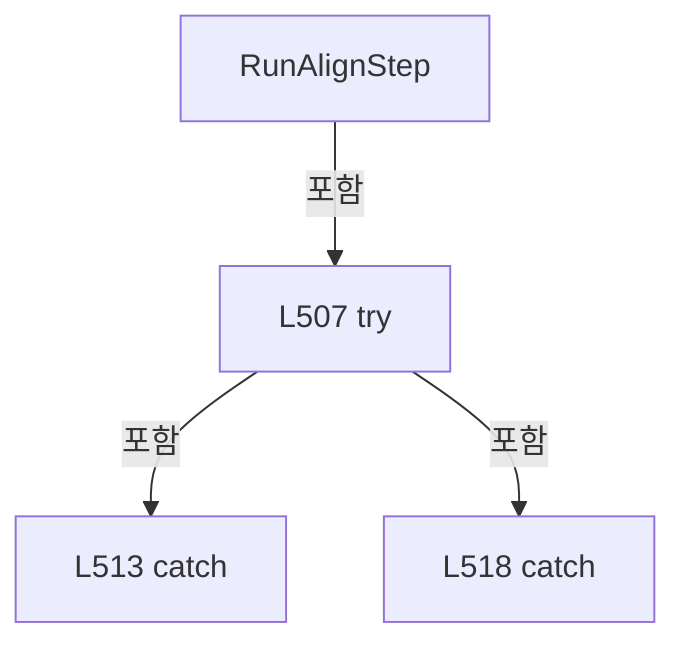

변경 전 점검: 입력/반환 타입, 위 호출자, 예외/취소 경로, 공유 상태와 저장·전송 소비자를 함께 확인합니다. 값의 단위나 물리 방향을 이름만으로 확정하지 않습니다.

### MethodDeclaration `UpdateProductAlignment` · L527–549

[Drilling.Common/Station/CStationProcess.cs:527–549](https://github.com/kjuws10-rgb/A3Drilling/blob/96e22cd027c84bf302b23f2949b98985d7f301bb/Drilling.Common/Station/CStationProcess.cs#L527-L549)

| 항목 | 실제 추출 값 |
| --- | --- |
| 서명 | void Drilling.Common.Station.CStationProcess.UpdateProductAlignment(Drilling.Common.Station.ST_PROCESS_MODEL, Drilling.Common.Product.EN_PRODUCT_PROCESS_STATE, string, System.Threading.CancellationToken) |
| 접근/수식자 | Private / private |
| 반환/값 타입 | void |
| 소속 타입 | NamedType:Drilling.Common.Station.CStationProcess |

입력 계약:

| 이름 | 타입 | 전달 | 선택/기본값 |
| --- | --- | --- | --- |
| processModel | Drilling.Common.Station.ST_PROCESS_MODEL | None | False /  |
| state | Drilling.Common.Product.EN_PRODUCT_PROCESS_STATE | None | False /  |
| result | string | None | False /  |
| cancellationToken | System.Threading.CancellationToken | None | False /  |

정적 호출자로 확인된 위치:

| 호출 파일/행 | 호출 표현식 | 런타임 분기 가능 |
| --- | --- | --- |
| [Drilling.Common/Station/CStationProcess.cs:509–509](https://github.com/kjuws10-rgb/A3Drilling/blob/96e22cd027c84bf302b23f2949b98985d7f301bb/Drilling.Common/Station/CStationProcess.cs#L509-L509) | UpdateProductAlignment | False |
| [Drilling.Common/Station/CStationProcess.cs:511–511](https://github.com/kjuws10-rgb/A3Drilling/blob/96e22cd027c84bf302b23f2949b98985d7f301bb/Drilling.Common/Station/CStationProcess.cs#L511-L511) | UpdateProductAlignment | False |
| [Drilling.Common/Station/CStationProcess.cs:555–555](https://github.com/kjuws10-rgb/A3Drilling/blob/96e22cd027c84bf302b23f2949b98985d7f301bb/Drilling.Common/Station/CStationProcess.cs#L555-L555) | UpdateProductAlignment | False |

호출하는 대상과 해석 범위:

| 원본 행 | 표현식 | 분석 상태 | 대상/소스 위치 |
| --- | --- | --- | --- |
| 529 | GetCurrentProcessProductId | resolved | string? Drilling.Common.Station.CStationProcess.GetCurrentProcessProductId() · Drilling.Common/Station/CStationProcess.cs:1507 |
| 530 | string.IsNullOrWhiteSpace | resolved | bool string.IsNullOrWhiteSpace(string?) |
| 537 | _productManager.SetAlignment( productId, new ST_PRODUCT_ALIGN_DATA( state, result, includeResults ? ReadNullableDoubleAny(parameters, "ALIGN_OFFSET_X") : null, includeResults ? ReadNullableDoubleAny(parameters, "ALIGN_OFFSET_Y") : null, includeResults ? ReadNullableDoubleAny(parameters, "ALIGN_ROTATION") : null ), new ST_PRODUCT_DISTORTION_DATA(sta… | resolved | Drilling.Common.Product.ST_PRODUCT_DATA System.Runtime.CompilerServices.TaskAwaiter<Drilling.Common.Product.ST_PRODUCT_DATA>.GetResult() |
| 537 | _productManager.SetAlignment( productId, new ST_PRODUCT_ALIGN_DATA( state, result, includeResults ? ReadNullableDoubleAny(parameters, "ALIGN_OFFSET_X") : null, includeResults ? ReadNullableDoubleAny(parameters, "ALIGN_OFFSET_Y") : null, includeResults ? ReadNullableDoubleAny(parameters, "ALIGN_ROTATION") : null ), new ST_PRODUCT_DISTORTION_DATA(sta… | resolved | System.Runtime.CompilerServices.TaskAwaiter<Drilling.Common.Product.ST_PRODUCT_DATA> System.Threading.Tasks.Task<Drilling.Common.Product.ST_PRODUCT_DATA>.GetAwaiter() |
| 537 | _productManager.SetAlignment | resolved | System.Threading.Tasks.Task<Drilling.Common.Product.ST_PRODUCT_DATA> Drilling.Common.Product.CProductManager.SetAlignment(string, Drilling.Common.Product.ST_PRODUCT_ALIGN_DATA, Drilling.Common.Product.ST_PRODUCT_DISTORTION_DATA, System.Threading.CancellationToken) · Drilling.Common/Product/CProductManager.cs:424 |
| 539 | new ST_PRODUCT_ALIGN_DATA | resolved | Drilling.Common.Product.ST_PRODUCT_ALIGN_DATA.ST_PRODUCT_ALIGN_DATA(Drilling.Common.Product.EN_PRODUCT_PROCESS_STATE, string, double?, double?, double?) · Drilling.Common/Product/CProductManager.cs:996 |
| 542 | ReadNullableDoubleAny | resolved | double? Drilling.Common.Station.CStationProcess.ReadNullableDoubleAny(System.Collections.Generic.IReadOnlyDictionary<string, string>, params string[]) · Drilling.Common/Station/CStationProcess.cs:2025 |
| 543 | ReadNullableDoubleAny | resolved | double? Drilling.Common.Station.CStationProcess.ReadNullableDoubleAny(System.Collections.Generic.IReadOnlyDictionary<string, string>, params string[]) · Drilling.Common/Station/CStationProcess.cs:2025 |
| 544 | ReadNullableDoubleAny | resolved | double? Drilling.Common.Station.CStationProcess.ReadNullableDoubleAny(System.Collections.Generic.IReadOnlyDictionary<string, string>, params string[]) · Drilling.Common/Station/CStationProcess.cs:2025 |
| 546 | new ST_PRODUCT_DISTORTION_DATA | resolved | Drilling.Common.Product.ST_PRODUCT_DISTORTION_DATA.ST_PRODUCT_DISTORTION_DATA(Drilling.Common.Product.EN_PRODUCT_PROCESS_STATE, string, double?) · Drilling.Common/Product/CProductManager.cs:997 |
| 546 | ReadNullableDoubleAny | resolved | double? Drilling.Common.Station.CStationProcess.ReadNullableDoubleAny(System.Collections.Generic.IReadOnlyDictionary<string, string>, params string[]) · Drilling.Common/Station/CStationProcess.cs:2025 |

본문의 실제 연산·분기·예외·반환 순서(원문 위치 순):

| 원본 행 | 종류 | 주석 해설 |
| --- | --- | --- |
| 529 | call | 함수·델리게이트 또는 객체 생성자를 호출합니다: GetCurrentProcessProductId() |
| 529 | local-declaration | 지역 변수를 선언합니다: var productId = GetCurrentProcessProductId(); |
| 529 | variable-initializer | 변수의 초기값을 지정합니다: productId = GetCurrentProcessProductId() |
| 530 | call | 함수·델리게이트 또는 객체 생성자를 호출합니다: string.IsNullOrWhiteSpace(productId) |
| 530 | if | 조건에 따라 분기합니다: if (_productManager is null &#124;&#124; string.IsNullOrWhiteSpace(productId)) |
| 532 | return | 호출자에게 값 또는 제어를 반환합니다: return; |
| 535 | local-declaration | 지역 변수를 선언합니다: var parameters = processModel.Parameters; |
| 535 | variable-initializer | 변수의 초기값을 지정합니다: parameters = processModel.Parameters |
| 536 | local-declaration | 지역 변수를 선언합니다: var includeResults = state == EN_PRODUCT_PROCESS_STATE.Completed; |
| 536 | variable-initializer | 변수의 초기값을 지정합니다: includeResults = state == EN_PRODUCT_PROCESS_STATE.Completed |
| 537 | call | 함수·델리게이트 또는 객체 생성자를 호출합니다: _productManager.SetAlignment( productId, new ST_PRODUCT_ALIGN_DATA( state, result, includeResults ? ReadNullableDoubleAny(parameters, "ALIGN_OFFSET_X") : null, includeResults ? ReadNullableDoubleAny(parameters, "ALIGN_OF… |
| 537 | call | 함수·델리게이트 또는 객체 생성자를 호출합니다: _productManager.SetAlignment( productId, new ST_PRODUCT_ALIGN_DATA( state, result, includeResults ? ReadNullableDoubleAny(parameters, "ALIGN_OFFSET_X") : null, includeResults ? ReadNullableDoubleAny(parameters, "ALIGN_OF… |
| 537 | call | 함수·델리게이트 또는 객체 생성자를 호출합니다: _productManager.SetAlignment( productId, new ST_PRODUCT_ALIGN_DATA( state, result, includeResults ? ReadNullableDoubleAny(parameters, "ALIGN_OFFSET_X") : null, includeResults ? ReadNullableDoubleAny(parameters, "ALIGN_OF… |
| 539 | call | 함수·델리게이트 또는 객체 생성자를 호출합니다: new ST_PRODUCT_ALIGN_DATA( state, result, includeResults ? ReadNullableDoubleAny(parameters, "ALIGN_OFFSET_X") : null, includeResults ? ReadNullableDoubleAny(parameters, "ALIGN_OFFSET_Y") : null, includeResults ? ReadNul… |
| 542 | call | 함수·델리게이트 또는 객체 생성자를 호출합니다: ReadNullableDoubleAny(parameters, "ALIGN_OFFSET_X") |
| 542 | conditional-expression | 조건에 따라 결과식을 선택합니다: includeResults ? ReadNullableDoubleAny(parameters, "ALIGN_OFFSET_X") : null |
| 543 | call | 함수·델리게이트 또는 객체 생성자를 호출합니다: ReadNullableDoubleAny(parameters, "ALIGN_OFFSET_Y") |
| 543 | conditional-expression | 조건에 따라 결과식을 선택합니다: includeResults ? ReadNullableDoubleAny(parameters, "ALIGN_OFFSET_Y") : null |
| 544 | call | 함수·델리게이트 또는 객체 생성자를 호출합니다: ReadNullableDoubleAny(parameters, "ALIGN_ROTATION") |
| 544 | conditional-expression | 조건에 따라 결과식을 선택합니다: includeResults ? ReadNullableDoubleAny(parameters, "ALIGN_ROTATION") : null |
| 546 | call | 함수·델리게이트 또는 객체 생성자를 호출합니다: new ST_PRODUCT_DISTORTION_DATA(state, result, includeResults ? ReadNullableDoubleAny(parameters, "DISTORTION_MAX_DA", "MAX_DA") : null) |
| 546 | call | 함수·델리게이트 또는 객체 생성자를 호출합니다: ReadNullableDoubleAny(parameters, "DISTORTION_MAX_DA", "MAX_DA") |
| 546 | conditional-expression | 조건에 따라 결과식을 선택합니다: includeResults ? ReadNullableDoubleAny(parameters, "DISTORTION_MAX_DA", "MAX_DA") : null |

제어 구문의 포함 구조(실제 실행 순서/CFG가 아닌 구문 탐색 그림):

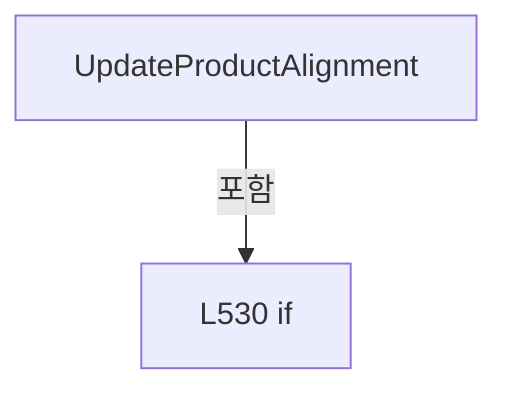

변경 전 점검: 입력/반환 타입, 위 호출자, 예외/취소 경로, 공유 상태와 저장·전송 소비자를 함께 확인합니다. 값의 단위나 물리 방향을 이름만으로 확정하지 않습니다.

### MethodDeclaration `TryUpdateProductAlignmentAfterFailure` · L551–561

[Drilling.Common/Station/CStationProcess.cs:551–561](https://github.com/kjuws10-rgb/A3Drilling/blob/96e22cd027c84bf302b23f2949b98985d7f301bb/Drilling.Common/Station/CStationProcess.cs#L551-L561)

| 항목 | 실제 추출 값 |
| --- | --- |
| 서명 | void Drilling.Common.Station.CStationProcess.TryUpdateProductAlignmentAfterFailure(Drilling.Common.Station.ST_PROCESS_MODEL, Drilling.Common.Product.EN_PRODUCT_PROCESS_STATE, string) |
| 접근/수식자 | Private / private |
| 반환/값 타입 | void |
| 소속 타입 | NamedType:Drilling.Common.Station.CStationProcess |

입력 계약:

| 이름 | 타입 | 전달 | 선택/기본값 |
| --- | --- | --- | --- |
| processModel | Drilling.Common.Station.ST_PROCESS_MODEL | None | False /  |
| state | Drilling.Common.Product.EN_PRODUCT_PROCESS_STATE | None | False /  |
| result | string | None | False /  |

정적 호출자로 확인된 위치:

| 호출 파일/행 | 호출 표현식 | 런타임 분기 가능 |
| --- | --- | --- |
| [Drilling.Common/Station/CStationProcess.cs:515–515](https://github.com/kjuws10-rgb/A3Drilling/blob/96e22cd027c84bf302b23f2949b98985d7f301bb/Drilling.Common/Station/CStationProcess.cs#L515-L515) | TryUpdateProductAlignmentAfterFailure | False |
| [Drilling.Common/Station/CStationProcess.cs:520–520](https://github.com/kjuws10-rgb/A3Drilling/blob/96e22cd027c84bf302b23f2949b98985d7f301bb/Drilling.Common/Station/CStationProcess.cs#L520-L520) | TryUpdateProductAlignmentAfterFailure | False |

호출하는 대상과 해석 범위:

| 원본 행 | 표현식 | 분석 상태 | 대상/소스 위치 |
| --- | --- | --- | --- |
| 555 | UpdateProductAlignment | resolved | void Drilling.Common.Station.CStationProcess.UpdateProductAlignment(Drilling.Common.Station.ST_PROCESS_MODEL, Drilling.Common.Product.EN_PRODUCT_PROCESS_STATE, string, System.Threading.CancellationToken) · Drilling.Common/Station/CStationProcess.cs:527 |
| 559 | AddProcessLog | resolved | void Drilling.Common.Station.CStationProcess.AddProcessLog(string, string, string) · Drilling.Common/Station/CStationProcess.cs:2367 |

본문의 실제 연산·분기·예외·반환 순서(원문 위치 순):

| 원본 행 | 종류 | 주석 해설 |
| --- | --- | --- |
| 553 | try | 예외 처리 범위입니다: try |
| 555 | call | 함수·델리게이트 또는 객체 생성자를 호출합니다: UpdateProductAlignment(processModel, state, result, CancellationToken.None) |
| 557 | catch | 지정 예외를 처리합니다: catch (Exception updateException) |
| 559 | call | 함수·델리게이트 또는 객체 생성자를 호출합니다: AddProcessLog("ERROR", "PRODUCT", $"Product align state update failed. {updateException.Message}") |

제어 구문의 포함 구조(실제 실행 순서/CFG가 아닌 구문 탐색 그림):

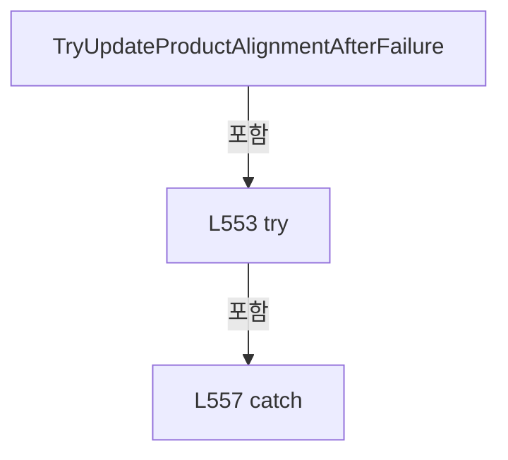

변경 전 점검: 입력/반환 타입, 위 호출자, 예외/취소 경로, 공유 상태와 저장·전송 소비자를 함께 확인합니다. 값의 단위나 물리 방향을 이름만으로 확정하지 않습니다.

### MethodDeclaration `RunProcessStep` · L563–574

[Drilling.Common/Station/CStationProcess.cs:563–574](https://github.com/kjuws10-rgb/A3Drilling/blob/96e22cd027c84bf302b23f2949b98985d7f301bb/Drilling.Common/Station/CStationProcess.cs#L563-L574)

| 항목 | 실제 추출 값 |
| --- | --- |
| 서명 | void Drilling.Common.Station.CStationProcess.RunProcessStep(Drilling.Common.Station.ST_PROCESS_MODEL, System.Threading.CancellationToken) |
| 접근/수식자 | Private / private |
| 반환/값 타입 | void |
| 소속 타입 | NamedType:Drilling.Common.Station.CStationProcess |

입력 계약:

| 이름 | 타입 | 전달 | 선택/기본값 |
| --- | --- | --- | --- |
| processModel | Drilling.Common.Station.ST_PROCESS_MODEL | None | False /  |
| cancellationToken | System.Threading.CancellationToken | None | False /  |

현재 부분 분석에서 직접 연결된 호출자는 없습니다. XAML/이벤트/인터페이스·델리게이트·외부 진입을 추가 확인해야 하며, 미사용으로 판정한 것이 아닙니다.

호출하는 대상과 해석 범위:

| 원본 행 | 표현식 | 분석 상태 | 대상/소스 위치 |
| --- | --- | --- | --- |
| 565 | EnsurePreparedReviewOffsetIsCurrent | resolved | void Drilling.Common.Station.CStationProcess.EnsurePreparedReviewOffsetIsCurrent(Drilling.Common.Station.ST_PROCESS_MODEL, System.Threading.CancellationToken) · Drilling.Common/Station/CStationProcess.cs:1576 |
| 566 | _sequenceActions.Run | resolved | void Drilling.Common.Station.CSequenceActionStatusStore.Run(string, System.Action) · Drilling.Common/Station/CStationManager.cs:198 |
| 568 | BuildAutomationScript | resolved | void Drilling.Common.Station.CStationProcess.BuildAutomationScript(Drilling.Common.Station.ST_PROCESS_MODEL, System.Threading.CancellationToken) · Drilling.Common/Station/CStationProcess.cs:657 |
| 569 | UploadAutomationScript | resolved | void Drilling.Common.Station.CStationProcess.UploadAutomationScript(Drilling.Common.Station.ST_PROCESS_MODEL, System.Threading.CancellationToken) · Drilling.Common/Station/CStationProcess.cs:668 |
| 573 | RunScannerProcess | resolved | void Drilling.Common.Station.CStationProcess.RunScannerProcess(Drilling.Common.Station.ST_PROCESS_MODEL, System.Threading.CancellationToken) · Drilling.Common/Station/CStationProcess.cs:692 |

본문의 실제 연산·분기·예외·반환 순서(원문 위치 순):

| 원본 행 | 종류 | 주석 해설 |
| --- | --- | --- |
| 565 | call | 함수·델리게이트 또는 객체 생성자를 호출합니다: EnsurePreparedReviewOffsetIsCurrent(processModel, cancellationToken) |
| 566 | call | 함수·델리게이트 또는 객체 생성자를 호출합니다: _sequenceActions.Run(CSequenceActionIds.BuildUploadScript, () => { BuildAutomationScript(processModel, cancellationToken); UploadAutomationScript(processModel, cancellationToken); }) |
| 568 | call | 함수·델리게이트 또는 객체 생성자를 호출합니다: BuildAutomationScript(processModel, cancellationToken) |
| 569 | call | 함수·델리게이트 또는 객체 생성자를 호출합니다: UploadAutomationScript(processModel, cancellationToken) |
| 573 | call | 함수·델리게이트 또는 객체 생성자를 호출합니다: RunScannerProcess(processModel, cancellationToken) |

변경 전 점검: 입력/반환 타입, 위 호출자, 예외/취소 경로, 공유 상태와 저장·전송 소비자를 함께 확인합니다. 값의 단위나 물리 방향을 이름만으로 확정하지 않습니다.

### MethodDeclaration `MoveStageToScanStart` · L576–608

[Drilling.Common/Station/CStationProcess.cs:576–608](https://github.com/kjuws10-rgb/A3Drilling/blob/96e22cd027c84bf302b23f2949b98985d7f301bb/Drilling.Common/Station/CStationProcess.cs#L576-L608)

| 항목 | 실제 추출 값 |
| --- | --- |
| 서명 | void Drilling.Common.Station.CStationProcess.MoveStageToScanStart(Drilling.Common.Station.ST_PROCESS_MODEL, System.Threading.CancellationToken) |
| 접근/수식자 | Private / private |
| 반환/값 타입 | void |
| 소속 타입 | NamedType:Drilling.Common.Station.CStationProcess |

입력 계약:

| 이름 | 타입 | 전달 | 선택/기본값 |
| --- | --- | --- | --- |
| processModel | Drilling.Common.Station.ST_PROCESS_MODEL | None | False /  |
| cancellationToken | System.Threading.CancellationToken | None | False /  |

현재 부분 분석에서 직접 연결된 호출자는 없습니다. XAML/이벤트/인터페이스·델리게이트·외부 진입을 추가 확인해야 하며, 미사용으로 판정한 것이 아닙니다.

호출하는 대상과 해석 범위:

| 원본 행 | 표현식 | 분석 상태 | 대상/소스 위치 |
| --- | --- | --- | --- |
| 578 | cancellationToken.ThrowIfCancellationRequested | resolved | void System.Threading.CancellationToken.ThrowIfCancellationRequested() |
| 580 | ReadDoubleAny | resolved | double Drilling.Common.Station.CStationProcess.ReadDoubleAny(System.Collections.Generic.IReadOnlyDictionary<string, string>, double, params string[]) · Drilling.Common/Station/CStationProcess.cs:2081 |
| 581 | ReadDoubleAny | resolved | double Drilling.Common.Station.CStationProcess.ReadDoubleAny(System.Collections.Generic.IReadOnlyDictionary<string, string>, double, params string[]) · Drilling.Common/Station/CStationProcess.cs:2081 |
| 582 | ReadDoubleAny | resolved | double Drilling.Common.Station.CStationProcess.ReadDoubleAny(System.Collections.Generic.IReadOnlyDictionary<string, string>, double, params string[]) · Drilling.Common/Station/CStationProcess.cs:2081 |
| 583 | ReadDoubleAny | resolved | double Drilling.Common.Station.CStationProcess.ReadDoubleAny(System.Collections.Generic.IReadOnlyDictionary<string, string>, double, params string[]) · Drilling.Common/Station/CStationProcess.cs:2081 |
| 584 | ReadDoubleAny | resolved | double Drilling.Common.Station.CStationProcess.ReadDoubleAny(System.Collections.Generic.IReadOnlyDictionary<string, string>, double, params string[]) · Drilling.Common/Station/CStationProcess.cs:2081 |
| 585 | ReadDoubleAny | resolved | double Drilling.Common.Station.CStationProcess.ReadDoubleAny(System.Collections.Generic.IReadOnlyDictionary<string, string>, double, params string[]) · Drilling.Common/Station/CStationProcess.cs:2081 |
| 588 | Math.Abs | resolved | double System.Math.Abs(double) |
| 588 | ReadDoubleAny | resolved | double Drilling.Common.Station.CStationProcess.ReadDoubleAny(System.Collections.Generic.IReadOnlyDictionary<string, string>, double, params string[]) · Drilling.Common/Station/CStationProcess.cs:2081 |
| 589 | ReadDirectionAny | resolved | double Drilling.Common.Station.CStationProcess.ReadDirectionAny(System.Collections.Generic.IReadOnlyDictionary<string, string>, double, params string[]) · Drilling.Common/Station/CStationProcess.cs:1948 |
| 590 | ResolveFirstShotStageY | resolved | double Drilling.Common.Station.CStationProcess.ResolveFirstShotStageY(Drilling.Common.Station.ST_PROCESS_MODEL, double) · Drilling.Common/Station/CStationProcess.cs:610 |
| 592 | ReadDoubleAny | resolved | double Drilling.Common.Station.CStationProcess.ReadDoubleAny(System.Collections.Generic.IReadOnlyDictionary<string, string>, double, params string[]) · Drilling.Common/Station/CStationProcess.cs:2081 |
| 593 | SendProcessControlCommand | resolved | void Drilling.Common.Station.CStationProcess.SendProcessControlCommand(string, System.Collections.Generic.IReadOnlyList<(string Key, string Value)>, System.Threading.CancellationToken) · Drilling.Common/Station/CStationProcess.cs:638 |
| 593 | FormatDouble | resolved | string Drilling.Common.Station.CStationProcess.FormatDouble(double) · Drilling.Common/Station/CStationProcess.cs:1943 |
| 593 | FormatDouble | resolved | string Drilling.Common.Station.CStationProcess.FormatDouble(double) · Drilling.Common/Station/CStationProcess.cs:1943 |
| 593 | FormatDouble | resolved | string Drilling.Common.Station.CStationProcess.FormatDouble(double) · Drilling.Common/Station/CStationProcess.cs:1943 |
| 594 | SendProcessControlCommand | resolved | void Drilling.Common.Station.CStationProcess.SendProcessControlCommand(string, System.Collections.Generic.IReadOnlyList<(string Key, string Value)>, System.Threading.CancellationToken) · Drilling.Common/Station/CStationProcess.cs:638 |
| 595 | FormatDouble | resolved | string Drilling.Common.Station.CStationProcess.FormatDouble(double) · Drilling.Common/Station/CStationProcess.cs:1943 |
| 596 | FormatDouble | resolved | string Drilling.Common.Station.CStationProcess.FormatDouble(double) · Drilling.Common/Station/CStationProcess.cs:1943 |
| 597 | FormatDouble | resolved | string Drilling.Common.Station.CStationProcess.FormatDouble(double) · Drilling.Common/Station/CStationProcess.cs:1943 |
| 598 | FormatDouble | resolved | string Drilling.Common.Station.CStationProcess.FormatDouble(double) · Drilling.Common/Station/CStationProcess.cs:1943 |
| 599 | FormatDouble | resolved | string Drilling.Common.Station.CStationProcess.FormatDouble(double) · Drilling.Common/Station/CStationProcess.cs:1943 |
| 600 | FormatDouble | resolved | string Drilling.Common.Station.CStationProcess.FormatDouble(double) · Drilling.Common/Station/CStationProcess.cs:1943 |
| 601 | FormatDouble | resolved | string Drilling.Common.Station.CStationProcess.FormatDouble(double) · Drilling.Common/Station/CStationProcess.cs:1943 |
| 602 | FormatDouble | resolved | string Drilling.Common.Station.CStationProcess.FormatDouble(double) · Drilling.Common/Station/CStationProcess.cs:1943 |
| 603 | FormatDouble | resolved | string Drilling.Common.Station.CStationProcess.FormatDouble(double) · Drilling.Common/Station/CStationProcess.cs:1943 |
| 604 | FormatDouble | resolved | string Drilling.Common.Station.CStationProcess.FormatDouble(double) · Drilling.Common/Station/CStationProcess.cs:1943 |
| 605 | FormatDouble | resolved | string Drilling.Common.Station.CStationProcess.FormatDouble(double) · Drilling.Common/Station/CStationProcess.cs:1943 |
| 607 | AddProcessLog | resolved | void Drilling.Common.Station.CStationProcess.AddProcessLog(string, string, string) · Drilling.Common/Station/CStationProcess.cs:2367 |
| 607 | FormatDouble | resolved | string Drilling.Common.Station.CStationProcess.FormatDouble(double) · Drilling.Common/Station/CStationProcess.cs:1943 |
| 607 | FormatDouble | resolved | string Drilling.Common.Station.CStationProcess.FormatDouble(double) · Drilling.Common/Station/CStationProcess.cs:1943 |
| 607 | FormatDouble | resolved | string Drilling.Common.Station.CStationProcess.FormatDouble(double) · Drilling.Common/Station/CStationProcess.cs:1943 |
| 607 | FormatDouble | resolved | string Drilling.Common.Station.CStationProcess.FormatDouble(double) · Drilling.Common/Station/CStationProcess.cs:1943 |
| 607 | FormatDouble | resolved | string Drilling.Common.Station.CStationProcess.FormatDouble(double) · Drilling.Common/Station/CStationProcess.cs:1943 |
| 607 | FormatDouble | resolved | string Drilling.Common.Station.CStationProcess.FormatDouble(double) · Drilling.Common/Station/CStationProcess.cs:1943 |
| 607 | FormatDouble | resolved | string Drilling.Common.Station.CStationProcess.FormatDouble(double) · Drilling.Common/Station/CStationProcess.cs:1943 |
| 607 | FormatDouble | resolved | string Drilling.Common.Station.CStationProcess.FormatDouble(double) · Drilling.Common/Station/CStationProcess.cs:1943 |
| 607 | FormatDouble | resolved | string Drilling.Common.Station.CStationProcess.FormatDouble(double) · Drilling.Common/Station/CStationProcess.cs:1943 |

본문의 실제 연산·분기·예외·반환 순서(원문 위치 순):

| 원본 행 | 종류 | 주석 해설 |
| --- | --- | --- |
| 578 | call | 함수·델리게이트 또는 객체 생성자를 호출합니다: cancellationToken.ThrowIfCancellationRequested() |
| 579 | local-declaration | 지역 변수를 선언합니다: var parameters = processModel.Parameters; |
| 579 | variable-initializer | 변수의 초기값을 지정합니다: parameters = processModel.Parameters |
| 580 | call | 함수·델리게이트 또는 객체 생성자를 호출합니다: ReadDoubleAny(parameters, 0.0, "STAGE_START_POS_X") |
| 580 | local-declaration | 지역 변수를 선언합니다: var startX = ReadDoubleAny(parameters, 0.0, "STAGE_START_POS_X"); |
| 580 | variable-initializer | 변수의 초기값을 지정합니다: startX = ReadDoubleAny(parameters, 0.0, "STAGE_START_POS_X") |
| 581 | call | 함수·델리게이트 또는 객체 생성자를 호출합니다: ReadDoubleAny(parameters, 0.0, "STAGE_START_POS_Y") |
| 581 | local-declaration | 지역 변수를 선언합니다: var startY = ReadDoubleAny(parameters, 0.0, "STAGE_START_POS_Y"); |
| 581 | variable-initializer | 변수의 초기값을 지정합니다: startY = ReadDoubleAny(parameters, 0.0, "STAGE_START_POS_Y") |
| 582 | call | 함수·델리게이트 또는 객체 생성자를 호출합니다: ReadDoubleAny(parameters, 0.0, "REVIEW_CAMERA_ALIGN_KEY_POS_X") |
| 582 | local-declaration | 지역 변수를 선언합니다: var reviewCameraAlignKeyPosX = ReadDoubleAny(parameters, 0.0, "REVIEW_CAMERA_ALIGN_KEY_POS_X"); |
| 582 | variable-initializer | 변수의 초기값을 지정합니다: reviewCameraAlignKeyPosX = ReadDoubleAny(parameters, 0.0, "REVIEW_CAMERA_ALIGN_KEY_POS_X") |
| 583 | call | 함수·델리게이트 또는 객체 생성자를 호출합니다: ReadDoubleAny(parameters, startY, "REVIEW_CAMERA_ALIGN_KEY_POS_Y") |
| 583 | local-declaration | 지역 변수를 선언합니다: var reviewCameraAlignKeyPosY = ReadDoubleAny(parameters, startY, "REVIEW_CAMERA_ALIGN_KEY_POS_Y"); |
| 583 | variable-initializer | 변수의 초기값을 지정합니다: reviewCameraAlignKeyPosY = ReadDoubleAny(parameters, startY, "REVIEW_CAMERA_ALIGN_KEY_POS_Y") |
| 584 | call | 함수·델리게이트 또는 객체 생성자를 호출합니다: ReadDoubleAny(parameters, 0.0, "REVIEW_TO_HEAD1_GAP_Y") |
| 584 | local-declaration | 지역 변수를 선언합니다: var reviewToHead1GapY = ReadDoubleAny(parameters, 0.0, "REVIEW_TO_HEAD1_GAP_Y"); |
| 584 | variable-initializer | 변수의 초기값을 지정합니다: reviewToHead1GapY = ReadDoubleAny(parameters, 0.0, "REVIEW_TO_HEAD1_GAP_Y") |
| 585 | call | 함수·델리게이트 또는 객체 생성자를 호출합니다: ReadDoubleAny(parameters, 0.0, "HeadGapY") |
| 585 | local-declaration | 지역 변수를 선언합니다: var headGapY = ReadDoubleAny(parameters, 0.0, "HeadGapY"); |
| 585 | variable-initializer | 변수의 초기값을 지정합니다: headGapY = ReadDoubleAny(parameters, 0.0, "HeadGapY") |
| 586 | local-declaration | 지역 변수를 선언합니다: var head1AlignKeyY = reviewCameraAlignKeyPosY + reviewToHead1GapY; |
| 586 | variable-initializer | 변수의 초기값을 지정합니다: head1AlignKeyY = reviewCameraAlignKeyPosY + reviewToHead1GapY |
| 587 | local-declaration | 지역 변수를 선언합니다: var head2AlignKeyY = head1AlignKeyY + headGapY; |
| 587 | variable-initializer | 변수의 초기값을 지정합니다: head2AlignKeyY = head1AlignKeyY + headGapY |
| 588 | call | 함수·델리게이트 또는 객체 생성자를 호출합니다: Math.Abs(ReadDoubleAny(parameters, 0.0, "SCAN_START_DELAY_LENGTH_Y")) |
| 588 | call | 함수·델리게이트 또는 객체 생성자를 호출합니다: ReadDoubleAny(parameters, 0.0, "SCAN_START_DELAY_LENGTH_Y") |
| 588 | local-declaration | 지역 변수를 선언합니다: var delayLengthY = Math.Abs(ReadDoubleAny(parameters, 0.0, "SCAN_START_DELAY_LENGTH_Y")); |
| 588 | variable-initializer | 변수의 초기값을 지정합니다: delayLengthY = Math.Abs(ReadDoubleAny(parameters, 0.0, "SCAN_START_DELAY_LENGTH_Y")) |
| 589 | call | 함수·델리게이트 또는 객체 생성자를 호출합니다: ReadDirectionAny(parameters, -1.0, "STAGE_SCAN_DIRECTION_Y") |
| 589 | local-declaration | 지역 변수를 선언합니다: var stageScanDirectionY = ReadDirectionAny(parameters, -1.0, "STAGE_SCAN_DIRECTION_Y"); |
| 589 | variable-initializer | 변수의 초기값을 지정합니다: stageScanDirectionY = ReadDirectionAny(parameters, -1.0, "STAGE_SCAN_DIRECTION_Y") |
| 590 | call | 함수·델리게이트 또는 객체 생성자를 호출합니다: ResolveFirstShotStageY(processModel, stageScanDirectionY) |
| 590 | local-declaration | 지역 변수를 선언합니다: var firstShotStageY = ResolveFirstShotStageY(processModel, stageScanDirectionY); |
| 590 | variable-initializer | 변수의 초기값을 지정합니다: firstShotStageY = ResolveFirstShotStageY(processModel, stageScanDirectionY) |
| 591 | local-declaration | 지역 변수를 선언합니다: var scanStartY = reviewCameraAlignKeyPosY + firstShotStageY - (stageScanDirectionY * delayLengthY); |
| 591 | variable-initializer | 변수의 초기값을 지정합니다: scanStartY = reviewCameraAlignKeyPosY + firstShotStageY - (stageScanDirectionY * delayLengthY) |
| 592 | call | 함수·델리게이트 또는 객체 생성자를 호출합니다: ReadDoubleAny(parameters, 100.0, "STAGE_SPEED") |
| 592 | local-declaration | 지역 변수를 선언합니다: var stageYSpeed = ReadDoubleAny(parameters, 100.0, "STAGE_SPEED"); |
| 592 | variable-initializer | 변수의 초기값을 지정합니다: stageYSpeed = ReadDoubleAny(parameters, 100.0, "STAGE_SPEED") |
| 593 | call | 함수·델리게이트 또는 객체 생성자를 호출합니다: SendProcessControlCommand("PROCESS_STAGE_START_MOVE", [("X", FormatDouble(startX)), ("Y", FormatDouble(startY)), ("SPEED_Y", FormatDouble(stageYSpeed))], cancellationToken) |
| 593 | call | 함수·델리게이트 또는 객체 생성자를 호출합니다: FormatDouble(startX) |
| 593 | call | 함수·델리게이트 또는 객체 생성자를 호출합니다: FormatDouble(startY) |
| 593 | call | 함수·델리게이트 또는 객체 생성자를 호출합니다: FormatDouble(stageYSpeed) |
| 594 | call | 함수·델리게이트 또는 객체 생성자를 호출합니다: SendProcessControlCommand("PROCESS_STAGE_SCAN_START_MOVE", [ ("Y", FormatDouble(scanStartY)), ("REVIEW_CAMERA_X", FormatDouble(reviewCameraAlignKeyPosX)), ("REVIEW_CAMERA_ALIGN_KEY_Y", FormatDouble(reviewCameraAlignKeyPo… |
| 595 | call | 함수·델리게이트 또는 객체 생성자를 호출합니다: FormatDouble(scanStartY) |
| 596 | call | 함수·델리게이트 또는 객체 생성자를 호출합니다: FormatDouble(reviewCameraAlignKeyPosX) |
| 597 | call | 함수·델리게이트 또는 객체 생성자를 호출합니다: FormatDouble(reviewCameraAlignKeyPosY) |
| 598 | call | 함수·델리게이트 또는 객체 생성자를 호출합니다: FormatDouble(reviewToHead1GapY) |
| 599 | call | 함수·델리게이트 또는 객체 생성자를 호출합니다: FormatDouble(headGapY) |
| 600 | call | 함수·델리게이트 또는 객체 생성자를 호출합니다: FormatDouble(head1AlignKeyY) |
| 601 | call | 함수·델리게이트 또는 객체 생성자를 호출합니다: FormatDouble(head2AlignKeyY) |
| 602 | call | 함수·델리게이트 또는 객체 생성자를 호출합니다: FormatDouble(reviewCameraAlignKeyPosY + firstShotStageY) |
| 603 | call | 함수·델리게이트 또는 객체 생성자를 호출합니다: FormatDouble(delayLengthY) |
| 604 | call | 함수·델리게이트 또는 객체 생성자를 호출합니다: FormatDouble(stageScanDirectionY) |
| 605 | call | 함수·델리게이트 또는 객체 생성자를 호출합니다: FormatDouble(stageYSpeed) |
| 607 | call | 함수·델리게이트 또는 객체 생성자를 호출합니다: AddProcessLog("INFO", "STAGE", $"Stage scan start ready. Start=({FormatDouble(startX)}, {FormatDouble(startY)}), ReviewCameraAlignKey=({FormatDouble(reviewCameraAlignKeyPosX)}, {FormatDouble(reviewCameraAlignKeyPosY)}), … |
| 607 | call | 함수·델리게이트 또는 객체 생성자를 호출합니다: FormatDouble(startX) |
| 607 | call | 함수·델리게이트 또는 객체 생성자를 호출합니다: FormatDouble(startY) |
| 607 | call | 함수·델리게이트 또는 객체 생성자를 호출합니다: FormatDouble(reviewCameraAlignKeyPosX) |
| 607 | call | 함수·델리게이트 또는 객체 생성자를 호출합니다: FormatDouble(reviewCameraAlignKeyPosY) |
| 607 | call | 함수·델리게이트 또는 객체 생성자를 호출합니다: FormatDouble(reviewToHead1GapY) |
| 607 | call | 함수·델리게이트 또는 객체 생성자를 호출합니다: FormatDouble(headGapY) |
| 607 | call | 함수·델리게이트 또는 객체 생성자를 호출합니다: FormatDouble(reviewCameraAlignKeyPosY + firstShotStageY) |
| 607 | call | 함수·델리게이트 또는 객체 생성자를 호출합니다: FormatDouble(delayLengthY) |
| 607 | call | 함수·델리게이트 또는 객체 생성자를 호출합니다: FormatDouble(scanStartY) |

변경 전 점검: 입력/반환 타입, 위 호출자, 예외/취소 경로, 공유 상태와 저장·전송 소비자를 함께 확인합니다. 값의 단위나 물리 방향을 이름만으로 확정하지 않습니다.

### MethodDeclaration `ResolveFirstShotStageY` · L610–636

[Drilling.Common/Station/CStationProcess.cs:610–636](https://github.com/kjuws10-rgb/A3Drilling/blob/96e22cd027c84bf302b23f2949b98985d7f301bb/Drilling.Common/Station/CStationProcess.cs#L610-L636)

| 항목 | 실제 추출 값 |
| --- | --- |
| 서명 | double Drilling.Common.Station.CStationProcess.ResolveFirstShotStageY(Drilling.Common.Station.ST_PROCESS_MODEL, double) |
| 접근/수식자 | Private / private |
| 반환/값 타입 | double |
| 소속 타입 | NamedType:Drilling.Common.Station.CStationProcess |

입력 계약:

| 이름 | 타입 | 전달 | 선택/기본값 |
| --- | --- | --- | --- |
| processModel | Drilling.Common.Station.ST_PROCESS_MODEL | None | False /  |
| stageScanDirectionY | double | None | False /  |

정적 호출자로 확인된 위치:

| 호출 파일/행 | 호출 표현식 | 런타임 분기 가능 |
| --- | --- | --- |
| [Drilling.Common/Station/CStationProcess.cs:590–590](https://github.com/kjuws10-rgb/A3Drilling/blob/96e22cd027c84bf302b23f2949b98985d7f301bb/Drilling.Common/Station/CStationProcess.cs#L590-L590) | ResolveFirstShotStageY | False |

호출하는 대상과 해석 범위:

| 원본 행 | 표현식 | 분석 상태 | 대상/소스 위치 |
| --- | --- | --- | --- |
| 617 | processModel.HeadPlans.SelectMany(SelectShots).ToArray | resolved | Drilling.Common.Recipe.ST_HEAD_SHOT_POINT[] System.Collections.Generic.IEnumerable<Drilling.Common.Recipe.ST_HEAD_SHOT_POINT>.ToArray<Drilling.Common.Recipe.ST_HEAD_SHOT_POINT>() |
| 617 | processModel.HeadPlans.SelectMany | resolved | System.Collections.Generic.IEnumerable<Drilling.Common.Recipe.ST_HEAD_SHOT_POINT> System.Collections.Generic.IEnumerable<Drilling.Common.Station.ST_HEAD_PROCESS_PLAN>.SelectMany<Drilling.Common.Station.ST_HEAD_PROCESS_PLAN, Drilling.Common.Recipe.ST_HEAD_SHOT_POINT>(System.Func<Drilling.Common.Station.ST_HEAD_PROCESS_PLAN, System.Collections.Generic.IEnumerable<Drilling.Common.Recipe.ST_HEAD_SHOT_POINT>>) |
| 620 | ReadDoubleAny | resolved | double Drilling.Common.Station.CStationProcess.ReadDoubleAny(System.Collections.Generic.IReadOnlyDictionary<string, string>, double, params string[]) · Drilling.Common/Station/CStationProcess.cs:2081 |
| 621 | ReadDoubleAny | resolved | double Drilling.Common.Station.CStationProcess.ReadDoubleAny(System.Collections.Generic.IReadOnlyDictionary<string, string>, double, params string[]) · Drilling.Common/Station/CStationProcess.cs:2081 |
| 635 | shots.Max | resolved | double System.Collections.Generic.IEnumerable<Drilling.Common.Recipe.ST_HEAD_SHOT_POINT>.Max<Drilling.Common.Recipe.ST_HEAD_SHOT_POINT>(System.Func<Drilling.Common.Recipe.ST_HEAD_SHOT_POINT, double>) |
| 635 | shots.Min | resolved | double System.Collections.Generic.IEnumerable<Drilling.Common.Recipe.ST_HEAD_SHOT_POINT>.Min<Drilling.Common.Recipe.ST_HEAD_SHOT_POINT>(System.Func<Drilling.Common.Recipe.ST_HEAD_SHOT_POINT, double>) |

본문의 실제 연산·분기·예외·반환 순서(원문 위치 순):

| 원본 행 | 종류 | 주석 해설 |
| --- | --- | --- |
| 617 | call | 함수·델리게이트 또는 객체 생성자를 호출합니다: processModel.HeadPlans.SelectMany(SelectShots).ToArray() |
| 617 | call | 함수·델리게이트 또는 객체 생성자를 호출합니다: processModel.HeadPlans.SelectMany(SelectShots) |
| 617 | local-declaration | 지역 변수를 선언합니다: var shots = processModel.HeadPlans.SelectMany(SelectShots).ToArray(); |
| 617 | variable-initializer | 변수의 초기값을 지정합니다: shots = processModel.HeadPlans.SelectMany(SelectShots).ToArray() |
| 618 | if | 조건에 따라 분기합니다: if (shots.Length == 0) |
| 620 | call | 함수·델리게이트 또는 객체 생성자를 호출합니다: ReadDoubleAny(processModel.Parameters, 0.0, "REVIEW_TO_HEAD1_GAP_Y") |
| 620 | local-declaration | 지역 변수를 선언합니다: var reviewToHead1GapY = ReadDoubleAny(processModel.Parameters, 0.0, "REVIEW_TO_HEAD1_GAP_Y"); |
| 620 | variable-initializer | 변수의 초기값을 지정합니다: reviewToHead1GapY = ReadDoubleAny(processModel.Parameters, 0.0, "REVIEW_TO_HEAD1_GAP_Y") |
| 621 | call | 함수·델리게이트 또는 객체 생성자를 호출합니다: ReadDoubleAny(processModel.Parameters, 0.0, "HeadGapY") |
| 621 | local-declaration | 지역 변수를 선언합니다: var headGapY = ReadDoubleAny(processModel.Parameters, 0.0, "HeadGapY"); |
| 621 | variable-initializer | 변수의 초기값을 지정합니다: headGapY = ReadDoubleAny(processModel.Parameters, 0.0, "HeadGapY") |
| 622 | return | 호출자에게 값 또는 제어를 반환합니다: return reviewToHead1GapY + headGapY; |
| 635 | call | 함수·델리게이트 또는 객체 생성자를 호출합니다: shots.Max(SelectStageY) |
| 635 | call | 함수·델리게이트 또는 객체 생성자를 호출합니다: shots.Min(SelectStageY2) |
| 635 | conditional-expression | 조건에 따라 결과식을 선택합니다: stageScanDirectionY < 0.0 ? shots.Max(SelectStageY) : shots.Min(SelectStageY2) |
| 635 | return | 호출자에게 값 또는 제어를 반환합니다: return stageScanDirectionY < 0.0 ? shots.Max(SelectStageY) : shots.Min(SelectStageY2); |

제어 구문의 포함 구조(실제 실행 순서/CFG가 아닌 구문 탐색 그림):

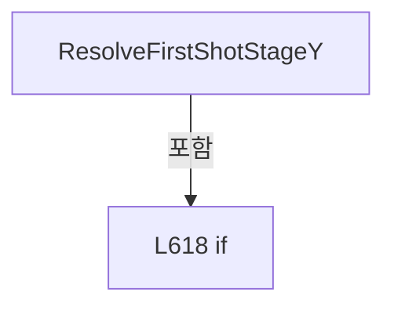

변경 전 점검: 입력/반환 타입, 위 호출자, 예외/취소 경로, 공유 상태와 저장·전송 소비자를 함께 확인합니다. 값의 단위나 물리 방향을 이름만으로 확정하지 않습니다.

### LocalFunctionStatement `SelectShots` · L612–615

[Drilling.Common/Station/CStationProcess.cs:612–615](https://github.com/kjuws10-rgb/A3Drilling/blob/96e22cd027c84bf302b23f2949b98985d7f301bb/Drilling.Common/Station/CStationProcess.cs#L612-L615)

| 항목 | 실제 추출 값 |
| --- | --- |
| 서명 | System.Collections.Generic.IEnumerable<Drilling.Common.Recipe.ST_HEAD_SHOT_POINT> SelectShots(Drilling.Common.Station.ST_HEAD_PROCESS_PLAN) |
| 접근/수식자 | Private /  |
| 반환/값 타입 | System.Collections.Generic.IEnumerable<Drilling.Common.Recipe.ST_HEAD_SHOT_POINT> |
| 소속 타입 | NamedType:Drilling.Common.Station.CStationProcess |

입력 계약:

| 이름 | 타입 | 전달 | 선택/기본값 |
| --- | --- | --- | --- |
| head | Drilling.Common.Station.ST_HEAD_PROCESS_PLAN | None | False /  |

현재 부분 분석에서 직접 연결된 호출자는 없습니다. XAML/이벤트/인터페이스·델리게이트·외부 진입을 추가 확인해야 하며, 미사용으로 판정한 것이 아닙니다.

본문의 실제 연산·분기·예외·반환 순서(원문 위치 순):

| 원본 행 | 종류 | 주석 해설 |
| --- | --- | --- |
| 614 | return | 호출자에게 값 또는 제어를 반환합니다: return head.Shots; |

변경 전 점검: 입력/반환 타입, 위 호출자, 예외/취소 경로, 공유 상태와 저장·전송 소비자를 함께 확인합니다. 값의 단위나 물리 방향을 이름만으로 확정하지 않습니다.

### LocalFunctionStatement `SelectStageY` · L625–628

[Drilling.Common/Station/CStationProcess.cs:625–628](https://github.com/kjuws10-rgb/A3Drilling/blob/96e22cd027c84bf302b23f2949b98985d7f301bb/Drilling.Common/Station/CStationProcess.cs#L625-L628)

| 항목 | 실제 추출 값 |
| --- | --- |
| 서명 | double SelectStageY(Drilling.Common.Recipe.ST_HEAD_SHOT_POINT) |
| 접근/수식자 | Private /  |
| 반환/값 타입 | double |
| 소속 타입 | NamedType:Drilling.Common.Station.CStationProcess |

입력 계약:

| 이름 | 타입 | 전달 | 선택/기본값 |
| --- | --- | --- | --- |
| shot | Drilling.Common.Recipe.ST_HEAD_SHOT_POINT | None | False /  |

현재 부분 분석에서 직접 연결된 호출자는 없습니다. XAML/이벤트/인터페이스·델리게이트·외부 진입을 추가 확인해야 하며, 미사용으로 판정한 것이 아닙니다.

본문의 실제 연산·분기·예외·반환 순서(원문 위치 순):

| 원본 행 | 종류 | 주석 해설 |
| --- | --- | --- |
| 627 | return | 호출자에게 값 또는 제어를 반환합니다: return shot.StageY; |

변경 전 점검: 입력/반환 타입, 위 호출자, 예외/취소 경로, 공유 상태와 저장·전송 소비자를 함께 확인합니다. 값의 단위나 물리 방향을 이름만으로 확정하지 않습니다.

### LocalFunctionStatement `SelectStageY2` · L630–633

[Drilling.Common/Station/CStationProcess.cs:630–633](https://github.com/kjuws10-rgb/A3Drilling/blob/96e22cd027c84bf302b23f2949b98985d7f301bb/Drilling.Common/Station/CStationProcess.cs#L630-L633)

| 항목 | 실제 추출 값 |
| --- | --- |
| 서명 | double SelectStageY2(Drilling.Common.Recipe.ST_HEAD_SHOT_POINT) |
| 접근/수식자 | Private /  |
| 반환/값 타입 | double |
| 소속 타입 | NamedType:Drilling.Common.Station.CStationProcess |

입력 계약:

| 이름 | 타입 | 전달 | 선택/기본값 |
| --- | --- | --- | --- |
| shot | Drilling.Common.Recipe.ST_HEAD_SHOT_POINT | None | False /  |

현재 부분 분석에서 직접 연결된 호출자는 없습니다. XAML/이벤트/인터페이스·델리게이트·외부 진입을 추가 확인해야 하며, 미사용으로 판정한 것이 아닙니다.

본문의 실제 연산·분기·예외·반환 순서(원문 위치 순):

| 원본 행 | 종류 | 주석 해설 |
| --- | --- | --- |
| 632 | return | 호출자에게 값 또는 제어를 반환합니다: return shot.StageY; |

변경 전 점검: 입력/반환 타입, 위 호출자, 예외/취소 경로, 공유 상태와 저장·전송 소비자를 함께 확인합니다. 값의 단위나 물리 방향을 이름만으로 확정하지 않습니다.

### MethodDeclaration `SendProcessControlCommand` · L638–650

[Drilling.Common/Station/CStationProcess.cs:638–650](https://github.com/kjuws10-rgb/A3Drilling/blob/96e22cd027c84bf302b23f2949b98985d7f301bb/Drilling.Common/Station/CStationProcess.cs#L638-L650)

| 항목 | 실제 추출 값 |
| --- | --- |
| 서명 | void Drilling.Common.Station.CStationProcess.SendProcessControlCommand(string, System.Collections.Generic.IReadOnlyList<(string Key, string Value)>, System.Threading.CancellationToken) |
| 접근/수식자 | Private / private |
| 반환/값 타입 | void |
| 소속 타입 | NamedType:Drilling.Common.Station.CStationProcess |

입력 계약:

| 이름 | 타입 | 전달 | 선택/기본값 |
| --- | --- | --- | --- |
| commandName | string | None | False /  |
| arguments | System.Collections.Generic.IReadOnlyList<(string Key, string Value)> | None | False /  |
| cancellationToken | System.Threading.CancellationToken | None | False /  |

정적 호출자로 확인된 위치:

| 호출 파일/행 | 호출 표현식 | 런타임 분기 가능 |
| --- | --- | --- |
| [Drilling.Common/Station/CStationProcess.cs:510–510](https://github.com/kjuws10-rgb/A3Drilling/blob/96e22cd027c84bf302b23f2949b98985d7f301bb/Drilling.Common/Station/CStationProcess.cs#L510-L510) | SendProcessControlCommand | False |
| [Drilling.Common/Station/CStationProcess.cs:593–593](https://github.com/kjuws10-rgb/A3Drilling/blob/96e22cd027c84bf302b23f2949b98985d7f301bb/Drilling.Common/Station/CStationProcess.cs#L593-L593) | SendProcessControlCommand | False |
| [Drilling.Common/Station/CStationProcess.cs:594–606](https://github.com/kjuws10-rgb/A3Drilling/blob/96e22cd027c84bf302b23f2949b98985d7f301bb/Drilling.Common/Station/CStationProcess.cs#L594-L606) | SendProcessControlCommand | False |

호출하는 대상과 해석 범위:

| 원본 행 | 표현식 | 분석 상태 | 대상/소스 위치 |
| --- | --- | --- | --- |
| 640 | FormatCommand | resolved | string Drilling.Common.Station.CStationProcess.FormatCommand(string, System.Collections.Generic.IReadOnlyList<(string Key, string Value)>) · Drilling.Common/Station/CStationProcess.cs:1999 |
| 641 | AddProcessLog | resolved | void Drilling.Common.Station.CStationProcess.AddProcessLog(string, string, string) · Drilling.Common/Station/CStationProcess.cs:2367 |
| 642 | _interfaceManager.ExecuteFunction(EN_EQP_MODULE.WonikCtrl, 0, command, cancellationToken).GetAwaiter().GetResult | resolved | string System.Runtime.CompilerServices.TaskAwaiter<string>.GetResult() |
| 642 | _interfaceManager.ExecuteFunction(EN_EQP_MODULE.WonikCtrl, 0, command, cancellationToken).GetAwaiter | resolved | System.Runtime.CompilerServices.TaskAwaiter<string> System.Threading.Tasks.Task<string>.GetAwaiter() |
| 642 | _interfaceManager.ExecuteFunction | resolved · 동적 구현 선택 가능 | System.Threading.Tasks.Task<string> Drilling.Common.Interface.CInterfaceManager.ExecuteFunction(Drilling.Common.Interface.EN_EQP_MODULE, int, string, System.Threading.CancellationToken) · Drilling.Common/Interface/CInterfaceManager.cs:320 |
| 643 | IsProcessControlSuccessResponse | resolved | bool Drilling.Common.Station.CStationProcess.IsProcessControlSuccessResponse(string) · Drilling.Common/Station/CStationProcess.cs:2009 |
| 645 | AddProcessLog | resolved | void Drilling.Common.Station.CStationProcess.AddProcessLog(string, string, string) · Drilling.Common/Station/CStationProcess.cs:2367 |
| 645 | FormatResponseForLog | resolved | string Drilling.Common.Station.CStationProcess.FormatResponseForLog(string) · Drilling.Common/Station/CStationProcess.cs:2020 |
| 646 | new InvalidOperationException | resolved | System.InvalidOperationException.InvalidOperationException(string?) |
| 646 | FormatResponseForLog | resolved | string Drilling.Common.Station.CStationProcess.FormatResponseForLog(string) · Drilling.Common/Station/CStationProcess.cs:2020 |
| 649 | AddProcessLog | resolved | void Drilling.Common.Station.CStationProcess.AddProcessLog(string, string, string) · Drilling.Common/Station/CStationProcess.cs:2367 |

본문의 실제 연산·분기·예외·반환 순서(원문 위치 순):

| 원본 행 | 종류 | 주석 해설 |
| --- | --- | --- |
| 640 | call | 함수·델리게이트 또는 객체 생성자를 호출합니다: FormatCommand(commandName, arguments) |
| 640 | local-declaration | 지역 변수를 선언합니다: var command = FormatCommand(commandName, arguments); |
| 640 | variable-initializer | 변수의 초기값을 지정합니다: command = FormatCommand(commandName, arguments) |
| 641 | call | 함수·델리게이트 또는 객체 생성자를 호출합니다: AddProcessLog("INFO", "STAGE", $"Stage command requested. {command}") |
| 642 | call | 함수·델리게이트 또는 객체 생성자를 호출합니다: _interfaceManager.ExecuteFunction(EN_EQP_MODULE.WonikCtrl, 0, command, cancellationToken).GetAwaiter().GetResult() |
| 642 | call | 함수·델리게이트 또는 객체 생성자를 호출합니다: _interfaceManager.ExecuteFunction(EN_EQP_MODULE.WonikCtrl, 0, command, cancellationToken).GetAwaiter() |
| 642 | call | 함수·델리게이트 또는 객체 생성자를 호출합니다: _interfaceManager.ExecuteFunction(EN_EQP_MODULE.WonikCtrl, 0, command, cancellationToken) |
| 642 | local-declaration | 지역 변수를 선언합니다: var response = _interfaceManager.ExecuteFunction(EN_EQP_MODULE.WonikCtrl, 0, command, cancellationToken).GetAwaiter().GetResult(); |
| 642 | variable-initializer | 변수의 초기값을 지정합니다: response = _interfaceManager.ExecuteFunction(EN_EQP_MODULE.WonikCtrl, 0, command, cancellationToken).GetAwaiter().GetResult() |
| 643 | call | 함수·델리게이트 또는 객체 생성자를 호출합니다: IsProcessControlSuccessResponse(response) |
| 643 | if | 조건에 따라 분기합니다: if (!IsProcessControlSuccessResponse(response)) |
| 645 | call | 함수·델리게이트 또는 객체 생성자를 호출합니다: AddProcessLog("ERROR", "STAGE", $"Stage command rejected. {commandName}: {FormatResponseForLog(response)}") |
| 645 | call | 함수·델리게이트 또는 객체 생성자를 호출합니다: FormatResponseForLog(response) |
| 646 | call | 함수·델리게이트 또는 객체 생성자를 호출합니다: new InvalidOperationException($"Stage command failed: {commandName}. Response={FormatResponseForLog(response)}") |
| 646 | call | 함수·델리게이트 또는 객체 생성자를 호출합니다: FormatResponseForLog(response) |
| 646 | throw | 예외를 발생/전달합니다: throw new InvalidOperationException($"Stage command failed: {commandName}. Response={FormatResponseForLog(response)}"); |
| 649 | call | 함수·델리게이트 또는 객체 생성자를 호출합니다: AddProcessLog("INFO", "STAGE", $"Stage command accepted. {response}") |

제어 구문의 포함 구조(실제 실행 순서/CFG가 아닌 구문 탐색 그림):

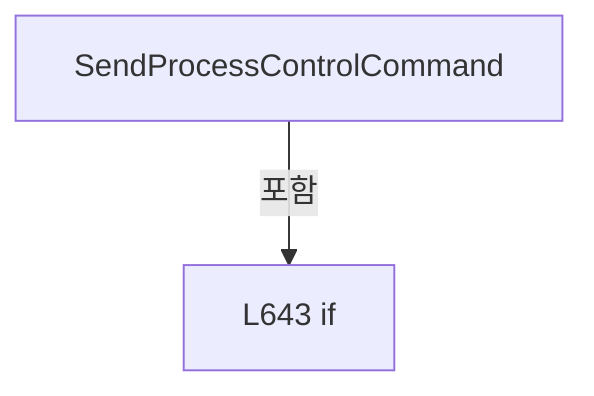

변경 전 점검: 입력/반환 타입, 위 호출자, 예외/취소 경로, 공유 상태와 저장·전송 소비자를 함께 확인합니다. 값의 단위나 물리 방향을 이름만으로 확정하지 않습니다.

### MethodDeclaration `RunInspectionStep` · L652–655

[Drilling.Common/Station/CStationProcess.cs:652–655](https://github.com/kjuws10-rgb/A3Drilling/blob/96e22cd027c84bf302b23f2949b98985d7f301bb/Drilling.Common/Station/CStationProcess.cs#L652-L655)

| 항목 | 실제 추출 값 |
| --- | --- |
| 서명 | void Drilling.Common.Station.CStationProcess.RunInspectionStep(Drilling.Common.Station.ST_PROCESS_MODEL, System.Threading.CancellationToken) |
| 접근/수식자 | Private / private |
| 반환/값 타입 | void |
| 소속 타입 | NamedType:Drilling.Common.Station.CStationProcess |

입력 계약:

| 이름 | 타입 | 전달 | 선택/기본값 |
| --- | --- | --- | --- |
| processModel | Drilling.Common.Station.ST_PROCESS_MODEL | None | False /  |
| cancellationToken | System.Threading.CancellationToken | None | False /  |

현재 부분 분석에서 직접 연결된 호출자는 없습니다. XAML/이벤트/인터페이스·델리게이트·외부 진입을 추가 확인해야 하며, 미사용으로 판정한 것이 아닙니다.

호출하는 대상과 해석 범위:

| 원본 행 | 표현식 | 분석 상태 | 대상/소스 위치 |
| --- | --- | --- | --- |
| 654 | RunReviewStep | resolved | void Drilling.Common.Station.CStationProcess.RunReviewStep(Drilling.Common.Station.ST_PROCESS_MODEL, System.Threading.CancellationToken) · Drilling.Common/Station/CStationProcess.cs:1144 |

본문의 실제 연산·분기·예외·반환 순서(원문 위치 순):

| 원본 행 | 종류 | 주석 해설 |
| --- | --- | --- |
| 654 | call | 함수·델리게이트 또는 객체 생성자를 호출합니다: RunReviewStep(processModel, cancellationToken) |

변경 전 점검: 입력/반환 타입, 위 호출자, 예외/취소 경로, 공유 상태와 저장·전송 소비자를 함께 확인합니다. 값의 단위나 물리 방향을 이름만으로 확정하지 않습니다.

### MethodDeclaration `BuildAutomationScript` · L657–666

[Drilling.Common/Station/CStationProcess.cs:657–666](https://github.com/kjuws10-rgb/A3Drilling/blob/96e22cd027c84bf302b23f2949b98985d7f301bb/Drilling.Common/Station/CStationProcess.cs#L657-L666)

| 항목 | 실제 추출 값 |
| --- | --- |
| 서명 | void Drilling.Common.Station.CStationProcess.BuildAutomationScript(Drilling.Common.Station.ST_PROCESS_MODEL, System.Threading.CancellationToken) |
| 접근/수식자 | Private / private |
| 반환/값 타입 | void |
| 소속 타입 | NamedType:Drilling.Common.Station.CStationProcess |

입력 계약:

| 이름 | 타입 | 전달 | 선택/기본값 |
| --- | --- | --- | --- |
| processModel | Drilling.Common.Station.ST_PROCESS_MODEL | None | False /  |
| cancellationToken | System.Threading.CancellationToken | None | False /  |

정적 호출자로 확인된 위치:

| 호출 파일/행 | 호출 표현식 | 런타임 분기 가능 |
| --- | --- | --- |
| [Drilling.Common/Station/CStationProcess.cs:568–568](https://github.com/kjuws10-rgb/A3Drilling/blob/96e22cd027c84bf302b23f2949b98985d7f301bb/Drilling.Common/Station/CStationProcess.cs#L568-L568) | BuildAutomationScript | False |
| [Drilling.Common/Station/CStationProcess.cs:4002–4002](https://github.com/kjuws10-rgb/A3Drilling/blob/96e22cd027c84bf302b23f2949b98985d7f301bb/Drilling.Common/Station/CStationProcess.cs#L4002-L4002) | BuildAutomationScript | False |

호출하는 대상과 해석 범위:

| 원본 행 | 표현식 | 분석 상태 | 대상/소스 위치 |
| --- | --- | --- | --- |
| 659 | IsBufferedRunEnabled | resolved | bool Drilling.Common.Station.CStationProcess.IsBufferedRunEnabled(System.Collections.Generic.IReadOnlyDictionary<string, string>) · Drilling.Common/Station/CStationProcess.cs:2127 |
| 661 | _automationScriptFile.Build | resolved | Drilling.Common.Station.ST_SCRIPT_BUILD_RESULT Drilling.Common.Station.CAutomationScriptFileBase.Build(Drilling.Common.Station.ST_PROCESS_MODEL, string, System.Threading.CancellationToken) · Drilling.Common/Station/CStationManager.cs:489 |
| 661 | GetProcessModel | resolved | Drilling.Common.Station.ST_PROCESS_MODEL Drilling.Common.Station.CStationProcess.GetProcessModel() · Drilling.Common/Station/CStationProcess.cs:2273 |
| 663 | BuildStatistics | resolved | Drilling.Common.Station.ST_PROCESS_STATISTICS Drilling.Common.Station.CStationProcess.BuildStatistics(Drilling.Common.Station.ST_PROCESS_MODEL?, double, System.TimeSpan) · Drilling.Common/Station/CStationProcess.cs:1773 |
| 663 | TimeSpan.FromSeconds | resolved | System.TimeSpan System.TimeSpan.FromSeconds(long) |
| 664 | AddProcessLog | resolved | void Drilling.Common.Station.CStationProcess.AddProcessLog(string, string, string) · Drilling.Common/Station/CStationProcess.cs:2367 |
| 665 | CreateSnapshot | resolved | Drilling.Common.Station.ST_STATION_PROCESS_STATUS Drilling.Common.Station.CStationProcess.CreateSnapshot(Drilling.Common.Station.ST_PROCESS_MODEL?, System.Collections.Generic.IReadOnlyList<Drilling.Common.Station.ST_HEAD_PREVIEW_DATA>, Drilling.Common.Station.EN_SCRIPT_STATUS, Drilling.Common.Station.EN_PROCESS_STEP, Drilling.Common.Station.ST_PROCESS_RESULT?) · Drilling.Common/Station/CStationProcess.cs:1338 |

본문의 실제 연산·분기·예외·반환 순서(원문 위치 순):

| 원본 행 | 종류 | 주석 해설 |
| --- | --- | --- |
| 659 | call | 함수·델리게이트 또는 객체 생성자를 호출합니다: IsBufferedRunEnabled(processModel.Parameters) |
| 659 | local-declaration | 지역 변수를 선언합니다: var bufferedRun = IsBufferedRunEnabled(processModel.Parameters); |
| 659 | variable-initializer | 변수의 초기값을 지정합니다: bufferedRun = IsBufferedRunEnabled(processModel.Parameters) |
| 660 | conditional-expression | 조건에 따라 결과식을 선택합니다: bufferedRun ? BufferedRunScriptDirectoryName : StandardScriptDirectoryName |
| 660 | local-declaration | 지역 변수를 선언합니다: var scriptDirectoryName = bufferedRun ? BufferedRunScriptDirectoryName : StandardScriptDirectoryName; |
| 660 | variable-initializer | 변수의 초기값을 지정합니다: scriptDirectoryName = bufferedRun ? BufferedRunScriptDirectoryName : StandardScriptDirectoryName |
| 661 | assignment | 값을 대상에 대입합니다: _lastScript = _automationScriptFile.Build(GetProcessModel(), scriptDirectoryName, cancellationToken) |
| 661 | call | 함수·델리게이트 또는 객체 생성자를 호출합니다: _automationScriptFile.Build(GetProcessModel(), scriptDirectoryName, cancellationToken) |
| 661 | call | 함수·델리게이트 또는 객체 생성자를 호출합니다: GetProcessModel() |
| 662 | assignment | 값을 대상에 대입합니다: _scriptCreatedAt = _lastScript.CreatedAt |
| 663 | assignment | 값을 대상에 대입합니다: _statistics = BuildStatistics(processModel, 35.0, TimeSpan.FromSeconds(12)) |
| 663 | call | 함수·델리게이트 또는 객체 생성자를 호출합니다: BuildStatistics(processModel, 35.0, TimeSpan.FromSeconds(12)) |
| 663 | call | 함수·델리게이트 또는 객체 생성자를 호출합니다: TimeSpan.FromSeconds(12) |
| 664 | call | 함수·델리게이트 또는 객체 생성자를 호출합니다: AddProcessLog("INFO", "SCRIPT", $"{_lastScript.FileName} generated in {scriptDirectoryName}. ({_lastScript.TotalShots} shots)") |
| 665 | assignment | 값을 대상에 대입합니다: _snapshot = CreateSnapshot(_snapshot.ProcessModel, _snapshot.HeadPreviews, EN_SCRIPT_STATUS.Created, EN_PROCESS_STEP.Process, null) |
| 665 | call | 함수·델리게이트 또는 객체 생성자를 호출합니다: CreateSnapshot(_snapshot.ProcessModel, _snapshot.HeadPreviews, EN_SCRIPT_STATUS.Created, EN_PROCESS_STEP.Process, null) |

변경 전 점검: 입력/반환 타입, 위 호출자, 예외/취소 경로, 공유 상태와 저장·전송 소비자를 함께 확인합니다. 값의 단위나 물리 방향을 이름만으로 확정하지 않습니다.

### MethodDeclaration `UploadAutomationScript` · L668–690

[Drilling.Common/Station/CStationProcess.cs:668–690](https://github.com/kjuws10-rgb/A3Drilling/blob/96e22cd027c84bf302b23f2949b98985d7f301bb/Drilling.Common/Station/CStationProcess.cs#L668-L690)

| 항목 | 실제 추출 값 |
| --- | --- |
| 서명 | void Drilling.Common.Station.CStationProcess.UploadAutomationScript(Drilling.Common.Station.ST_PROCESS_MODEL, System.Threading.CancellationToken) |
| 접근/수식자 | Private / private |
| 반환/값 타입 | void |
| 소속 타입 | NamedType:Drilling.Common.Station.CStationProcess |

입력 계약:

| 이름 | 타입 | 전달 | 선택/기본값 |
| --- | --- | --- | --- |
| processModel | Drilling.Common.Station.ST_PROCESS_MODEL | None | False /  |
| cancellationToken | System.Threading.CancellationToken | None | False /  |

정적 호출자로 확인된 위치:

| 호출 파일/행 | 호출 표현식 | 런타임 분기 가능 |
| --- | --- | --- |
| [Drilling.Common/Station/CStationProcess.cs:569–569](https://github.com/kjuws10-rgb/A3Drilling/blob/96e22cd027c84bf302b23f2949b98985d7f301bb/Drilling.Common/Station/CStationProcess.cs#L569-L569) | UploadAutomationScript | False |
| [Drilling.Common/Station/CStationProcess.cs:3538–3538](https://github.com/kjuws10-rgb/A3Drilling/blob/96e22cd027c84bf302b23f2949b98985d7f301bb/Drilling.Common/Station/CStationProcess.cs#L3538-L3538) | UploadAutomationScript | False |
| [Drilling.Common/Station/CStationProcess.cs:4003–4003](https://github.com/kjuws10-rgb/A3Drilling/blob/96e22cd027c84bf302b23f2949b98985d7f301bb/Drilling.Common/Station/CStationProcess.cs#L4003-L4003) | UploadAutomationScript | False |
| [Drilling.Common/Station/CStationProcess.cs:4025–4025](https://github.com/kjuws10-rgb/A3Drilling/blob/96e22cd027c84bf302b23f2949b98985d7f301bb/Drilling.Common/Station/CStationProcess.cs#L4025-L4025) | UploadAutomationScript | False |

호출하는 대상과 해석 범위:

| 원본 행 | 표현식 | 분석 상태 | 대상/소스 위치 |
| --- | --- | --- | --- |
| 670 | cancellationToken.ThrowIfCancellationRequested | resolved | void System.Threading.CancellationToken.ThrowIfCancellationRequested() |
| 673 | new InvalidOperationException | resolved | System.InvalidOperationException.InvalidOperationException(string?) |
| 681 | _lastScript.HeadScripts.Where | resolved | System.Collections.Generic.IEnumerable<Drilling.Common.Station.ST_HEAD_SCRIPT_RESULT> System.Collections.Generic.IEnumerable<Drilling.Common.Station.ST_HEAD_SCRIPT_RESULT>.Where<Drilling.Common.Station.ST_HEAD_SCRIPT_RESULT>(System.Func<Drilling.Common.Station.ST_HEAD_SCRIPT_RESULT, bool>) |
| 683 | AddProcessLog | resolved | void Drilling.Common.Station.CStationProcess.AddProcessLog(string, string, string) · Drilling.Common/Station/CStationProcess.cs:2367 |
| 684 | _automationManager.UploadScript(headScript.FilePath, headScript.FileName, headScript.AutomationNo, cancellationToken: cancellationToken).GetAwaiter().GetResult | resolved | string System.Runtime.CompilerServices.TaskAwaiter<string>.GetResult() |
| 684 | _automationManager.UploadScript(headScript.FilePath, headScript.FileName, headScript.AutomationNo, cancellationToken: cancellationToken).GetAwaiter | resolved | System.Runtime.CompilerServices.TaskAwaiter<string> System.Threading.Tasks.Task<string>.GetAwaiter() |
| 684 | _automationManager.UploadScript | resolved · 동적 구현 선택 가능 | System.Threading.Tasks.Task<string> Drilling.Common.Automation.CAutomationManager.UploadScript(string, string, int, System.Threading.CancellationToken) · Drilling.Common/Automation/CAutomationManager.cs:315 |
| 685 | string.IsNullOrWhiteSpace | resolved | bool string.IsNullOrWhiteSpace(string?) |
| 685 | response.StartsWith | resolved | bool string.StartsWith(string, System.StringComparison) |
| 685 | response.EndsWith | resolved | bool string.EndsWith(string, System.StringComparison) |
| 686 | IsProcessControlSuccessResponse | resolved | bool Drilling.Common.Station.CStationProcess.IsProcessControlSuccessResponse(string) · Drilling.Common/Station/CStationProcess.cs:2009 |
| 687 | new InvalidOperationException | resolved | System.InvalidOperationException.InvalidOperationException(string?) |
| 687 | FormatResponseForLog | resolved | string Drilling.Common.Station.CStationProcess.FormatResponseForLog(string) · Drilling.Common/Station/CStationProcess.cs:2020 |
| 688 | AddProcessLog | resolved | void Drilling.Common.Station.CStationProcess.AddProcessLog(string, string, string) · Drilling.Common/Station/CStationProcess.cs:2367 |

본문의 실제 연산·분기·예외·반환 순서(원문 위치 순):

| 원본 행 | 종류 | 주석 해설 |
| --- | --- | --- |
| 670 | call | 함수·델리게이트 또는 객체 생성자를 호출합니다: cancellationToken.ThrowIfCancellationRequested() |
| 671 | if | 조건에 따라 분기합니다: if (_lastScript is null) |
| 673 | call | 함수·델리게이트 또는 객체 생성자를 호출합니다: new InvalidOperationException("Automation script is not built.") |
| 673 | throw | 예외를 발생/전달합니다: throw new InvalidOperationException("Automation script is not built."); |
| 681 | call | 함수·델리게이트 또는 객체 생성자를 호출합니다: _lastScript.HeadScripts.Where(ShouldIncludeItem) |
| 681 | foreach | 컬렉션 요소를 순회합니다: foreach (var headScript in _lastScript.HeadScripts.Where(ShouldIncludeItem)) |
| 683 | call | 함수·델리게이트 또는 객체 생성자를 호출합니다: AddProcessLog("INFO", "A1_UPLOAD", $"Upload requested. H{headScript.HeadNo:00} -> Automation1 #{headScript.AutomationNo}, {headScript.FileName}") |
| 684 | call | 함수·델리게이트 또는 객체 생성자를 호출합니다: _automationManager.UploadScript(headScript.FilePath, headScript.FileName, headScript.AutomationNo, cancellationToken: cancellationToken).GetAwaiter().GetResult() |
| 684 | call | 함수·델리게이트 또는 객체 생성자를 호출합니다: _automationManager.UploadScript(headScript.FilePath, headScript.FileName, headScript.AutomationNo, cancellationToken: cancellationToken).GetAwaiter() |
| 684 | call | 함수·델리게이트 또는 객체 생성자를 호출합니다: _automationManager.UploadScript(headScript.FilePath, headScript.FileName, headScript.AutomationNo, cancellationToken: cancellationToken) |
| 684 | local-declaration | 지역 변수를 선언합니다: var response = _automationManager.UploadScript(headScript.FilePath, headScript.FileName, headScript.AutomationNo, cancellationToken: cancellationToken).GetAwaiter().GetResult(); |
| 684 | variable-initializer | 변수의 초기값을 지정합니다: response = _automationManager.UploadScript(headScript.FilePath, headScript.FileName, headScript.AutomationNo, cancellationToken: cancellationToken).GetAwaiter().GetResult() |
| 685 | call | 함수·델리게이트 또는 객체 생성자를 호출합니다: string.IsNullOrWhiteSpace(response) |
| 685 | call | 함수·델리게이트 또는 객체 생성자를 호출합니다: response.StartsWith("SIM:", StringComparison.OrdinalIgnoreCase) |
| 685 | call | 함수·델리게이트 또는 객체 생성자를 호출합니다: response.EndsWith(":OK", StringComparison.OrdinalIgnoreCase) |
| 685 | local-declaration | 지역 변수를 선언합니다: var simulationSucceeded = !string.IsNullOrWhiteSpace(response) && response.StartsWith("SIM:", StringComparison.OrdinalIgnoreCase) && response.EndsWith(":OK", StringComparison.OrdinalIgnoreCase); |
| 685 | variable-initializer | 변수의 초기값을 지정합니다: simulationSucceeded = !string.IsNullOrWhiteSpace(response) && response.StartsWith("SIM:", StringComparison.OrdinalIgnoreCase) && response.EndsWith(":OK", StringComparison.OrdinalIgnoreCase) |
| 686 | call | 함수·델리게이트 또는 객체 생성자를 호출합니다: IsProcessControlSuccessResponse(response) |
| 686 | if | 조건에 따라 분기합니다: if (!IsProcessControlSuccessResponse(response) && !simulationSucceeded) |
| 687 | call | 함수·델리게이트 또는 객체 생성자를 호출합니다: new InvalidOperationException($"Automation1 script upload failed. H{headScript.HeadNo:00}, {headScript.FileName}: {FormatResponseForLog(response)}") |
| 687 | call | 함수·델리게이트 또는 객체 생성자를 호출합니다: FormatResponseForLog(response) |
| 687 | throw | 예외를 발생/전달합니다: throw new InvalidOperationException($"Automation1 script upload failed. H{headScript.HeadNo:00}, {headScript.FileName}: {FormatResponseForLog(response)}"); |
| 688 | call | 함수·델리게이트 또는 객체 생성자를 호출합니다: AddProcessLog("INFO", "A1_UPLOAD", $"Upload completed. H{headScript.HeadNo:00}, Automation1 #{headScript.AutomationNo}: {response}") |

제어 구문의 포함 구조(실제 실행 순서/CFG가 아닌 구문 탐색 그림):

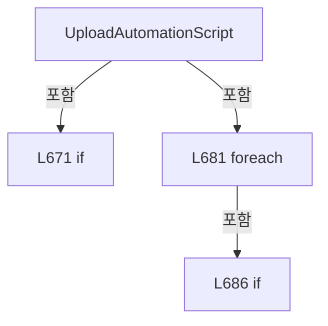

변경 전 점검: 입력/반환 타입, 위 호출자, 예외/취소 경로, 공유 상태와 저장·전송 소비자를 함께 확인합니다. 값의 단위나 물리 방향을 이름만으로 확정하지 않습니다.

### LocalFunctionStatement `ShouldIncludeItem` · L676–679

[Drilling.Common/Station/CStationProcess.cs:676–679](https://github.com/kjuws10-rgb/A3Drilling/blob/96e22cd027c84bf302b23f2949b98985d7f301bb/Drilling.Common/Station/CStationProcess.cs#L676-L679)

| 항목 | 실제 추출 값 |
| --- | --- |
| 서명 | bool ShouldIncludeItem(Drilling.Common.Station.ST_HEAD_SCRIPT_RESULT) |
| 접근/수식자 | Private /  |
| 반환/값 타입 | bool |
| 소속 타입 | NamedType:Drilling.Common.Station.CStationProcess |

입력 계약:

| 이름 | 타입 | 전달 | 선택/기본값 |
| --- | --- | --- | --- |
| script | Drilling.Common.Station.ST_HEAD_SCRIPT_RESULT | None | False /  |

현재 부분 분석에서 직접 연결된 호출자는 없습니다. XAML/이벤트/인터페이스·델리게이트·외부 진입을 추가 확인해야 하며, 미사용으로 판정한 것이 아닙니다.

본문의 실제 연산·분기·예외·반환 순서(원문 위치 순):

| 원본 행 | 종류 | 주석 해설 |
| --- | --- | --- |
| 678 | return | 호출자에게 값 또는 제어를 반환합니다: return script.TotalShots > 0; |

변경 전 점검: 입력/반환 타입, 위 호출자, 예외/취소 경로, 공유 상태와 저장·전송 소비자를 함께 확인합니다. 값의 단위나 물리 방향을 이름만으로 확정하지 않습니다.

### MethodDeclaration `RunScannerProcess` · L692–750

[Drilling.Common/Station/CStationProcess.cs:692–750](https://github.com/kjuws10-rgb/A3Drilling/blob/96e22cd027c84bf302b23f2949b98985d7f301bb/Drilling.Common/Station/CStationProcess.cs#L692-L750)

| 항목 | 실제 추출 값 |
| --- | --- |
| 서명 | void Drilling.Common.Station.CStationProcess.RunScannerProcess(Drilling.Common.Station.ST_PROCESS_MODEL, System.Threading.CancellationToken) |
| 접근/수식자 | Private / private |
| 반환/값 타입 | void |
| 소속 타입 | NamedType:Drilling.Common.Station.CStationProcess |

입력 계약:

| 이름 | 타입 | 전달 | 선택/기본값 |
| --- | --- | --- | --- |
| processModel | Drilling.Common.Station.ST_PROCESS_MODEL | None | False /  |
| cancellationToken | System.Threading.CancellationToken | None | False /  |

정적 호출자로 확인된 위치:

| 호출 파일/행 | 호출 표현식 | 런타임 분기 가능 |
| --- | --- | --- |
| [Drilling.Common/Station/CStationProcess.cs:573–573](https://github.com/kjuws10-rgb/A3Drilling/blob/96e22cd027c84bf302b23f2949b98985d7f301bb/Drilling.Common/Station/CStationProcess.cs#L573-L573) | RunScannerProcess | False |

호출하는 대상과 해석 범위:

| 원본 행 | 표현식 | 분석 상태 | 대상/소스 위치 |
| --- | --- | --- | --- |
| 694 | SetStationState | resolved | void Drilling.Common.Station.CStationProcess.SetStationState(Drilling.Common.Station.EN_STATION_STATE, Drilling.Common.Station.EN_PROCESS_STEP, Drilling.Common.Station.EN_SCRIPT_STATUS, string) · Drilling.Common/Station/CStationProcess.cs:2346 |
| 696 | SetHeadStatus | resolved | System.Collections.Generic.IReadOnlyList<Drilling.Common.Station.ST_HEAD_PREVIEW_DATA> Drilling.Common.Station.CStationProcess.SetHeadStatus(System.Collections.Generic.IReadOnlyList<Drilling.Common.Station.ST_HEAD_PREVIEW_DATA>, Drilling.Common.Station.EN_PROCESS_STEP) · Drilling.Common/Station/CStationProcess.cs:1677 |
| 697 | BuildStatistics | resolved | Drilling.Common.Station.ST_PROCESS_STATISTICS Drilling.Common.Station.CStationProcess.BuildStatistics(Drilling.Common.Station.ST_PROCESS_MODEL?, double, System.TimeSpan) · Drilling.Common/Station/CStationProcess.cs:1773 |
| 697 | TimeSpan.FromSeconds | resolved | System.TimeSpan System.TimeSpan.FromSeconds(long) |
| 700 | new InvalidOperationException | resolved | System.InvalidOperationException.InvalidOperationException(string?) |
| 708 | _lastScript.HeadScripts.Where(ShouldIncludeItem).ToArray | resolved | Drilling.Common.Station.ST_HEAD_SCRIPT_RESULT[] System.Collections.Generic.IEnumerable<Drilling.Common.Station.ST_HEAD_SCRIPT_RESULT>.ToArray<Drilling.Common.Station.ST_HEAD_SCRIPT_RESULT>() |
| 708 | _lastScript.HeadScripts.Where | resolved | System.Collections.Generic.IEnumerable<Drilling.Common.Station.ST_HEAD_SCRIPT_RESULT> System.Collections.Generic.IEnumerable<Drilling.Common.Station.ST_HEAD_SCRIPT_RESULT>.Where<Drilling.Common.Station.ST_HEAD_SCRIPT_RESULT>(System.Func<Drilling.Common.Station.ST_HEAD_SCRIPT_RESULT, bool>) |
| 709 | IsBufferedRunEnabled | resolved | bool Drilling.Common.Station.CStationProcess.IsBufferedRunEnabled(System.Collections.Generic.IReadOnlyDictionary<string, string>) · Drilling.Common/Station/CStationProcess.cs:2127 |
| 710 | CQueueCountLogger.Create | resolved | Drilling.Common.Station.CStationProcess.CQueueCountLogger Drilling.Common.Station.CStationProcess.CQueueCountLogger.Create(Drilling.Common.Station.CStationProcess, string, bool, System.Collections.Generic.IReadOnlyList<Drilling.Common.Station.ST_HEAD_SCRIPT_RESULT>) · Drilling.Common/Station/CStationProcess.cs:3121 |
| 711 | CScannerStatusLogger.Create | resolved | Drilling.Common.Station.CStationProcess.CScannerStatusLogger Drilling.Common.Station.CStationProcess.CScannerStatusLogger.Create(Drilling.Common.Station.CStationProcess, string, bool, System.Collections.Generic.IReadOnlyDictionary<string, string>, System.Collections.Generic.IReadOnlyList<Drilling.Common.Station.ST_HEAD_SCRIPT_RESULT>) · Drilling.Common/Station/CStationProcess.cs:2558 |
| 713 | CreateSnapshot | resolved | Drilling.Common.Station.ST_STATION_PROCESS_STATUS Drilling.Common.Station.CStationProcess.CreateSnapshot(Drilling.Common.Station.ST_PROCESS_MODEL?, System.Collections.Generic.IReadOnlyList<Drilling.Common.Station.ST_HEAD_PREVIEW_DATA>, Drilling.Common.Station.EN_SCRIPT_STATUS, Drilling.Common.Station.EN_PROCESS_STEP, Drilling.Common.Station.ST_PROCESS_RESULT?) · Drilling.Common/Station/CStationProcess.cs:1338 |
| 718 | queueCountLogger.Start | resolved | void Drilling.Common.Station.CStationProcess.CQueueCountLogger.Start() · Drilling.Common/Station/CStationProcess.cs:3127 |
| 719 | scannerStatusLogger.Start | resolved | void Drilling.Common.Station.CStationProcess.CScannerStatusLogger.Start() · Drilling.Common/Station/CStationProcess.cs:2564 |
| 720 | RunBufferedHeadScripts | resolved | void Drilling.Common.Station.CStationProcess.RunBufferedHeadScripts(Drilling.Common.Station.ST_PROCESS_MODEL, System.Collections.Generic.IReadOnlyList<Drilling.Common.Station.ST_HEAD_SCRIPT_RESULT>, System.Threading.CancellationToken) · Drilling.Common/Station/CStationProcess.cs:752 |
| 726 | AddProcessLog | resolved | void Drilling.Common.Station.CStationProcess.AddProcessLog(string, string, string) · Drilling.Common/Station/CStationProcess.cs:2367 |
| 727 | _automationManager.RunScript(headScript.FileName, headScript.TaskNo, headScript.AutomationNo, cancellationToken: cancellationToken).GetAwaiter().GetResult | resolved | string System.Runtime.CompilerServices.TaskAwaiter<string>.GetResult() |
| 727 | _automationManager.RunScript(headScript.FileName, headScript.TaskNo, headScript.AutomationNo, cancellationToken: cancellationToken).GetAwaiter | resolved | System.Runtime.CompilerServices.TaskAwaiter<string> System.Threading.Tasks.Task<string>.GetAwaiter() |
| 727 | _automationManager.RunScript | resolved · 동적 구현 선택 가능 | System.Threading.Tasks.Task<string> Drilling.Common.Automation.CAutomationManager.RunScript(string, int, int, System.Threading.CancellationToken) · Drilling.Common/Automation/CAutomationManager.cs:323 |
| 728 | AddProcessLog | resolved | void Drilling.Common.Station.CStationProcess.AddProcessLog(string, string, string) · Drilling.Common/Station/CStationProcess.cs:2367 |
| 731 | queueCountLogger.Start | resolved | void Drilling.Common.Station.CStationProcess.CQueueCountLogger.Start() · Drilling.Common/Station/CStationProcess.cs:3127 |
| 732 | scannerStatusLogger.Start | resolved | void Drilling.Common.Station.CStationProcess.CScannerStatusLogger.Start() · Drilling.Common/Station/CStationProcess.cs:2564 |
| 733 | WaitAutomationHeadScriptsComplete | resolved | void Drilling.Common.Station.CStationProcess.WaitAutomationHeadScriptsComplete(Drilling.Common.Station.ST_PROCESS_MODEL, System.Collections.Generic.IReadOnlyList<Drilling.Common.Station.ST_HEAD_SCRIPT_RESULT>, System.Threading.CancellationToken) · Drilling.Common/Station/CStationProcess.cs:870 |
| 743 | scannerStatusLogger.StopAndWriteFinal | resolved | void Drilling.Common.Station.CStationProcess.CScannerStatusLogger.StopAndWriteFinal() · Drilling.Common/Station/CStationProcess.cs:2576 |
| 744 | queueCountLogger.StopAndWriteFinal | resolved | void Drilling.Common.Station.CStationProcess.CQueueCountLogger.StopAndWriteFinal() · Drilling.Common/Station/CStationProcess.cs:3138 |
| 747 | StopAutomationScriptTasks | resolved | void Drilling.Common.Station.CStationProcess.StopAutomationScriptTasks(System.Collections.Generic.IReadOnlyList<Drilling.Common.Station.ST_HEAD_SCRIPT_RESULT>, string) · Drilling.Common/Station/CStationProcess.cs:939 |

본문의 실제 연산·분기·예외·반환 순서(원문 위치 순):

| 원본 행 | 종류 | 주석 해설 |
| --- | --- | --- |
| 694 | call | 함수·델리게이트 또는 객체 생성자를 호출합니다: SetStationState(EN_STATION_STATE.Process, EN_PROCESS_STEP.Process, EN_SCRIPT_STATUS.Running, $"Scanner run started. Process: {processModel.ProcessId}") |
| 695 | assignment | 값을 대상에 대입합니다: _scriptStartedAt = DateTimeOffset.Now |
| 696 | call | 함수·델리게이트 또는 객체 생성자를 호출합니다: SetHeadStatus(_snapshot.HeadPreviews, EN_PROCESS_STEP.Process) |
| 696 | local-declaration | 지역 변수를 선언합니다: var runningPreview = SetHeadStatus(_snapshot.HeadPreviews, EN_PROCESS_STEP.Process); |
| 696 | variable-initializer | 변수의 초기값을 지정합니다: runningPreview = SetHeadStatus(_snapshot.HeadPreviews, EN_PROCESS_STEP.Process) |
| 697 | assignment | 값을 대상에 대입합니다: _statistics = BuildStatistics(processModel, 56.3, TimeSpan.FromSeconds(45)) |
| 697 | call | 함수·델리게이트 또는 객체 생성자를 호출합니다: BuildStatistics(processModel, 56.3, TimeSpan.FromSeconds(45)) |
| 697 | call | 함수·델리게이트 또는 객체 생성자를 호출합니다: TimeSpan.FromSeconds(45) |
| 698 | if | 조건에 따라 분기합니다: if (_lastScript is null) |
| 700 | call | 함수·델리게이트 또는 객체 생성자를 호출합니다: new InvalidOperationException("Automation script is not built.") |
| 700 | throw | 예외를 발생/전달합니다: throw new InvalidOperationException("Automation script is not built."); |
| 708 | call | 함수·델리게이트 또는 객체 생성자를 호출합니다: _lastScript.HeadScripts.Where(ShouldIncludeItem).ToArray() |
| 708 | call | 함수·델리게이트 또는 객체 생성자를 호출합니다: _lastScript.HeadScripts.Where(ShouldIncludeItem) |
| 708 | local-declaration | 지역 변수를 선언합니다: var headScripts = _lastScript.HeadScripts.Where(ShouldIncludeItem).ToArray(); |
| 708 | variable-initializer | 변수의 초기값을 지정합니다: headScripts = _lastScript.HeadScripts.Where(ShouldIncludeItem).ToArray() |
| 709 | call | 함수·델리게이트 또는 객체 생성자를 호출합니다: IsBufferedRunEnabled(processModel.Parameters) |
| 709 | local-declaration | 지역 변수를 선언합니다: var bufferedRun = IsBufferedRunEnabled(processModel.Parameters); |
| 709 | variable-initializer | 변수의 초기값을 지정합니다: bufferedRun = IsBufferedRunEnabled(processModel.Parameters) |
| 710 | call | 함수·델리게이트 또는 객체 생성자를 호출합니다: CQueueCountLogger.Create(this, processModel.RecipeId, bufferedRun, headScripts) |
| 710 | using-declaration | 정리할 자원을 선언합니다: using var queueCountLogger = CQueueCountLogger.Create(this, processModel.RecipeId, bufferedRun, headScripts); |
| 710 | variable-initializer | 변수의 초기값을 지정합니다: queueCountLogger = CQueueCountLogger.Create(this, processModel.RecipeId, bufferedRun, headScripts) |
| 711 | call | 함수·델리게이트 또는 객체 생성자를 호출합니다: CScannerStatusLogger.Create(this, processModel.RecipeId, bufferedRun, processModel.Parameters, headScripts) |
| 711 | using-declaration | 정리할 자원을 선언합니다: using var scannerStatusLogger = CScannerStatusLogger.Create(this, processModel.RecipeId, bufferedRun, processModel.Parameters, headScripts); |
| 711 | variable-initializer | 변수의 초기값을 지정합니다: scannerStatusLogger = CScannerStatusLogger.Create(this, processModel.RecipeId, bufferedRun, processModel.Parameters, headScripts) |
| 712 | local-declaration | 지역 변수를 선언합니다: var stopTasksOnExit = false; |
| 712 | variable-initializer | 변수의 초기값을 지정합니다: stopTasksOnExit = false |
| 713 | assignment | 값을 대상에 대입합니다: _snapshot = CreateSnapshot(_snapshot.ProcessModel, runningPreview, EN_SCRIPT_STATUS.Running, EN_PROCESS_STEP.Process, null) |
| 713 | call | 함수·델리게이트 또는 객체 생성자를 호출합니다: CreateSnapshot(_snapshot.ProcessModel, runningPreview, EN_SCRIPT_STATUS.Running, EN_PROCESS_STEP.Process, null) |
| 714 | try | 예외 처리 범위입니다: try |
| 716 | if | 조건에 따라 분기합니다: if (bufferedRun) |
| 718 | call | 함수·델리게이트 또는 객체 생성자를 호출합니다: queueCountLogger.Start() |
| 719 | call | 함수·델리게이트 또는 객체 생성자를 호출합니다: scannerStatusLogger.Start() |
| 720 | call | 함수·델리게이트 또는 객체 생성자를 호출합니다: RunBufferedHeadScripts(processModel, headScripts, cancellationToken) |
| 722 | else | 앞 조건이 거짓인 경로입니다: else |
| 724 | foreach | 컬렉션 요소를 순회합니다: foreach (var headScript in headScripts) |
| 726 | call | 함수·델리게이트 또는 객체 생성자를 호출합니다: AddProcessLog("INFO", "A1_RUN", $"Automation1 #{headScript.AutomationNo} Task {headScript.TaskNo} run requested. H{headScript.HeadNo:00}, {headScript.FileName}") |
| 727 | call | 함수·델리게이트 또는 객체 생성자를 호출합니다: _automationManager.RunScript(headScript.FileName, headScript.TaskNo, headScript.AutomationNo, cancellationToken: cancellationToken).GetAwaiter().GetResult() |
| 727 | call | 함수·델리게이트 또는 객체 생성자를 호출합니다: _automationManager.RunScript(headScript.FileName, headScript.TaskNo, headScript.AutomationNo, cancellationToken: cancellationToken).GetAwaiter() |
| 727 | call | 함수·델리게이트 또는 객체 생성자를 호출합니다: _automationManager.RunScript(headScript.FileName, headScript.TaskNo, headScript.AutomationNo, cancellationToken: cancellationToken) |
| 727 | local-declaration | 지역 변수를 선언합니다: var response = _automationManager.RunScript(headScript.FileName, headScript.TaskNo, headScript.AutomationNo, cancellationToken: cancellationToken).GetAwaiter().GetResult(); |
| 727 | variable-initializer | 변수의 초기값을 지정합니다: response = _automationManager.RunScript(headScript.FileName, headScript.TaskNo, headScript.AutomationNo, cancellationToken: cancellationToken).GetAwaiter().GetResult() |
| 728 | call | 함수·델리게이트 또는 객체 생성자를 호출합니다: AddProcessLog("INFO", "A1_RUN", $"Run command accepted. H{headScript.HeadNo:00}, Automation1 #{headScript.AutomationNo}, Task {headScript.TaskNo}: {response}") |
| 731 | call | 함수·델리게이트 또는 객체 생성자를 호출합니다: queueCountLogger.Start() |
| 732 | call | 함수·델리게이트 또는 객체 생성자를 호출합니다: scannerStatusLogger.Start() |
| 733 | call | 함수·델리게이트 또는 객체 생성자를 호출합니다: WaitAutomationHeadScriptsComplete(processModel, headScripts, cancellationToken) |
| 736 | catch | 지정 예외를 처리합니다: catch  |
| 738 | assignment | 값을 대상에 대입합니다: stopTasksOnExit = !bufferedRun |
| 739 | throw | 예외를 발생/전달합니다: throw; |
| 741 | finally | 종료 정리 구간입니다: finally |
| 743 | call | 함수·델리게이트 또는 객체 생성자를 호출합니다: scannerStatusLogger.StopAndWriteFinal() |
| 744 | call | 함수·델리게이트 또는 객체 생성자를 호출합니다: queueCountLogger.StopAndWriteFinal() |
| 745 | if | 조건에 따라 분기합니다: if (stopTasksOnExit) |
| 747 | call | 함수·델리게이트 또는 객체 생성자를 호출합니다: StopAutomationScriptTasks(headScripts, "scanner process ended before task completion") |

제어 구문의 포함 구조(실제 실행 순서/CFG가 아닌 구문 탐색 그림):

```mermaid
flowchart TD
 M["RunScannerProcess"]
 N0["L698 if"]
 M -->|포함| N0
 N1["L714 try"]
 M -->|포함| N1
 N2["L716 if"]
 N1 -->|포함| N2
 N3["L722 else"]
 N2 -->|포함| N3
 N4["L724 foreach"]
 N3 -->|포함| N4
 N5["L736 catch"]
 N1 -->|포함| N5
 N6["L741 finally"]
 N1 -->|포함| N6
 N7["L745 if"]
 N6 -->|포함| N7
```

변경 전 점검: 입력/반환 타입, 위 호출자, 예외/취소 경로, 공유 상태와 저장·전송 소비자를 함께 확인합니다. 값의 단위나 물리 방향을 이름만으로 확정하지 않습니다.

### LocalFunctionStatement `ShouldIncludeItem` · L703–706

[Drilling.Common/Station/CStationProcess.cs:703–706](https://github.com/kjuws10-rgb/A3Drilling/blob/96e22cd027c84bf302b23f2949b98985d7f301bb/Drilling.Common/Station/CStationProcess.cs#L703-L706)

| 항목 | 실제 추출 값 |
| --- | --- |
| 서명 | bool ShouldIncludeItem(Drilling.Common.Station.ST_HEAD_SCRIPT_RESULT) |
| 접근/수식자 | Private /  |
| 반환/값 타입 | bool |
| 소속 타입 | NamedType:Drilling.Common.Station.CStationProcess |

입력 계약:

| 이름 | 타입 | 전달 | 선택/기본값 |
| --- | --- | --- | --- |
| script | Drilling.Common.Station.ST_HEAD_SCRIPT_RESULT | None | False /  |

현재 부분 분석에서 직접 연결된 호출자는 없습니다. XAML/이벤트/인터페이스·델리게이트·외부 진입을 추가 확인해야 하며, 미사용으로 판정한 것이 아닙니다.

본문의 실제 연산·분기·예외·반환 순서(원문 위치 순):

| 원본 행 | 종류 | 주석 해설 |
| --- | --- | --- |
| 705 | return | 호출자에게 값 또는 제어를 반환합니다: return script.TotalShots > 0; |

변경 전 점검: 입력/반환 타입, 위 호출자, 예외/취소 경로, 공유 상태와 저장·전송 소비자를 함께 확인합니다. 값의 단위나 물리 방향을 이름만으로 확정하지 않습니다.

### MethodDeclaration `RunBufferedHeadScripts` · L752–842

[Drilling.Common/Station/CStationProcess.cs:752–842](https://github.com/kjuws10-rgb/A3Drilling/blob/96e22cd027c84bf302b23f2949b98985d7f301bb/Drilling.Common/Station/CStationProcess.cs#L752-L842)

| 항목 | 실제 추출 값 |
| --- | --- |
| 서명 | void Drilling.Common.Station.CStationProcess.RunBufferedHeadScripts(Drilling.Common.Station.ST_PROCESS_MODEL, System.Collections.Generic.IReadOnlyList<Drilling.Common.Station.ST_HEAD_SCRIPT_RESULT>, System.Threading.CancellationToken) |
| 접근/수식자 | Private / private |
| 반환/값 타입 | void |
| 소속 타입 | NamedType:Drilling.Common.Station.CStationProcess |

입력 계약:

| 이름 | 타입 | 전달 | 선택/기본값 |
| --- | --- | --- | --- |
| processModel | Drilling.Common.Station.ST_PROCESS_MODEL | None | False /  |
| headScripts | System.Collections.Generic.IReadOnlyList<Drilling.Common.Station.ST_HEAD_SCRIPT_RESULT> | None | False /  |
| cancellationToken | System.Threading.CancellationToken | None | False /  |

정적 호출자로 확인된 위치:

| 호출 파일/행 | 호출 표현식 | 런타임 분기 가능 |
| --- | --- | --- |
| [Drilling.Common/Station/CStationProcess.cs:720–720](https://github.com/kjuws10-rgb/A3Drilling/blob/96e22cd027c84bf302b23f2949b98985d7f301bb/Drilling.Common/Station/CStationProcess.cs#L720-L720) | RunBufferedHeadScripts | False |

호출하는 대상과 해석 범위:

| 원본 행 | 표현식 | 분석 상태 | 대상/소스 위치 |
| --- | --- | --- | --- |
| 754 | ReadBufferedRunQueueSize | resolved | int Drilling.Common.Station.CStationProcess.ReadBufferedRunQueueSize(System.Collections.Generic.IReadOnlyDictionary<string, string>) · Drilling.Common/Station/CStationProcess.cs:2147 |
| 755 | ReadBufferedRunLinesPerCommand | resolved | int Drilling.Common.Station.CStationProcess.ReadBufferedRunLinesPerCommand(System.Collections.Generic.IReadOnlyDictionary<string, string>) · Drilling.Common/Station/CStationProcess.cs:2142 |
| 756 | ReadBufferedRunTimeoutMs | resolved | int Drilling.Common.Station.CStationProcess.ReadBufferedRunTimeoutMs(System.Collections.Generic.IReadOnlyDictionary<string, string>) · Drilling.Common/Station/CStationProcess.cs:2152 |
| 762 | headScripts.GroupBy(SelectAutomationNo).ToArray | resolved | System.Linq.IGrouping<int, Drilling.Common.Station.ST_HEAD_SCRIPT_RESULT>[] System.Collections.Generic.IEnumerable<System.Linq.IGrouping<int, Drilling.Common.Station.ST_HEAD_SCRIPT_RESULT>>.ToArray<System.Linq.IGrouping<int, Drilling.Common.Station.ST_HEAD_SCRIPT_RESULT>>() |
| 762 | headScripts.GroupBy | resolved | System.Collections.Generic.IEnumerable<System.Linq.IGrouping<int, Drilling.Common.Station.ST_HEAD_SCRIPT_RESULT>> System.Collections.Generic.IEnumerable<Drilling.Common.Station.ST_HEAD_SCRIPT_RESULT>.GroupBy<Drilling.Common.Station.ST_HEAD_SCRIPT_RESULT, int>(System.Func<Drilling.Common.Station.ST_HEAD_SCRIPT_RESULT, int>) |
| 770 | AddProcessLog | resolved | void Drilling.Common.Station.CStationProcess.AddProcessLog(string, string, string) · Drilling.Common/Station/CStationProcess.cs:2367 |
| 770 | string.Join | resolved | string string.Join(string?, System.Collections.Generic.IEnumerable<string?>) |
| 770 | group.Select | resolved | System.Collections.Generic.IEnumerable<string> System.Collections.Generic.IEnumerable<Drilling.Common.Station.ST_HEAD_SCRIPT_RESULT>.Select<Drilling.Common.Station.ST_HEAD_SCRIPT_RESULT, string>(System.Func<Drilling.Common.Station.ST_HEAD_SCRIPT_RESULT, string>) |
| 773 | CancellationTokenSource.CreateLinkedTokenSource | resolved | System.Threading.CancellationTokenSource System.Threading.CancellationTokenSource.CreateLinkedTokenSource(System.Threading.CancellationToken) |
| 774 | groups.Select(group => new CBufferedRunWorker(this, group.Key, group.ToArray(), queueSize, linesPerCommand, timeoutMs, bufferedRunCancellation.Token)).ToArray | resolved | Drilling.Common.Station.CStationProcess.CBufferedRunWorker[] System.Collections.Generic.IEnumerable<Drilling.Common.Station.CStationProcess.CBufferedRunWorker>.ToArray<Drilling.Common.Station.CStationProcess.CBufferedRunWorker>() |
| 774 | groups.Select | resolved | System.Collections.Generic.IEnumerable<Drilling.Common.Station.CStationProcess.CBufferedRunWorker> System.Collections.Generic.IEnumerable<System.Linq.IGrouping<int, Drilling.Common.Station.ST_HEAD_SCRIPT_RESULT>>.Select<System.Linq.IGrouping<int, Drilling.Common.Station.ST_HEAD_SCRIPT_RESULT>, Drilling.Common.Station.CStationProcess.CBufferedRunWorker>(System.Func<System.Linq.IGrouping<int, Drilling.Common.Station.ST_HEAD_SCRIPT_RESULT>, Drilling.Common.Station.CStationProcess.CBufferedRunWorker>) |
| 774 | new CBufferedRunWorker | resolved | Drilling.Common.Station.CStationProcess.CBufferedRunWorker.CBufferedRunWorker(Drilling.Common.Station.CStationProcess, int, System.Collections.Generic.IReadOnlyList<Drilling.Common.Station.ST_HEAD_SCRIPT_RESULT>, int, int, int, System.Threading.CancellationToken) · Drilling.Common/Station/CStationProcess.cs:3326 |
| 774 | group.ToArray | resolved | Drilling.Common.Station.ST_HEAD_SCRIPT_RESULT[] System.Collections.Generic.IEnumerable<Drilling.Common.Station.ST_HEAD_SCRIPT_RESULT>.ToArray<Drilling.Common.Station.ST_HEAD_SCRIPT_RESULT>() |
| 775 | new List<ST_BUFFERED_RUN_GROUP_RESULT> | resolved | System.Collections.Generic.List<Drilling.Common.Station.CStationProcess.ST_BUFFERED_RUN_GROUP_RESULT>.List() |
| 779 | worker.Start | resolved | void Drilling.Common.Station.CStationProcess.CBufferedRunWorker.Start() · Drilling.Common/Station/CStationProcess.cs:3369 |
| 784 | new HashSet<CBufferedRunWorker> | resolved | System.Collections.Generic.HashSet<Drilling.Common.Station.CStationProcess.CBufferedRunWorker>.HashSet() |
| 787 | cancellationToken.ThrowIfCancellationRequested | resolved | void System.Threading.CancellationToken.ThrowIfCancellationRequested() |
| 790 | completedWorkers.Contains | resolved | bool System.Collections.Generic.HashSet<Drilling.Common.Station.CStationProcess.CBufferedRunWorker>.Contains(Drilling.Common.Station.CStationProcess.CBufferedRunWorker) |
| 795 | completedWorkers.Add | resolved | bool System.Collections.Generic.HashSet<Drilling.Common.Station.CStationProcess.CBufferedRunWorker>.Add(Drilling.Common.Station.CStationProcess.CBufferedRunWorker) |
| 799 | AddProcessLog | resolved | void Drilling.Common.Station.CStationProcess.AddProcessLog(string, string, string) · Drilling.Common/Station/CStationProcess.cs:2367 |
| 805 | results.Add | resolved | void System.Collections.Generic.List<Drilling.Common.Station.CStationProcess.ST_BUFFERED_RUN_GROUP_RESULT>.Add(Drilling.Common.Station.CStationProcess.ST_BUFFERED_RUN_GROUP_RESULT) |
| 816 | Thread.Sleep | resolved | void System.Threading.Thread.Sleep(int) |
| 822 | new OperationCanceledException | resolved | System.OperationCanceledException.OperationCanceledException(string?, System.Threading.CancellationToken) |
| 823 | bufferedRunCancellation.Cancel | resolved | void System.Threading.CancellationTokenSource.Cancel() |
| 824 | WaitForBufferedRunWorkers | resolved | void Drilling.Common.Station.CStationProcess.WaitForBufferedRunWorkers(System.Collections.Generic.IReadOnlyList<Drilling.Common.Station.CStationProcess.CBufferedRunWorker>, int, string) · Drilling.Common/Station/CStationProcess.cs:844 |
| 825 | StopBufferedRunTasks | resolved | void Drilling.Common.Station.CStationProcess.StopBufferedRunTasks(System.Collections.Generic.IReadOnlyList<Drilling.Common.Station.ST_HEAD_SCRIPT_RESULT>, System.Exception) · Drilling.Common/Station/CStationProcess.cs:1110 |
| 826 | WaitForBufferedRunWorkers | resolved | void Drilling.Common.Station.CStationProcess.WaitForBufferedRunWorkers(System.Collections.Generic.IReadOnlyList<Drilling.Common.Station.CStationProcess.CBufferedRunWorker>, int, string) · Drilling.Common/Station/CStationProcess.cs:844 |
| 832 | bufferedRunCancellation.Cancel | resolved | void System.Threading.CancellationTokenSource.Cancel() |
| 833 | StopBufferedRunTasks | resolved | void Drilling.Common.Station.CStationProcess.StopBufferedRunTasks(System.Collections.Generic.IReadOnlyList<Drilling.Common.Station.ST_HEAD_SCRIPT_RESULT>, System.Exception) · Drilling.Common/Station/CStationProcess.cs:1110 |
| 834 | WaitForBufferedRunWorkers | resolved | void Drilling.Common.Station.CStationProcess.WaitForBufferedRunWorkers(System.Collections.Generic.IReadOnlyList<Drilling.Common.Station.CStationProcess.CBufferedRunWorker>, int, string) · Drilling.Common/Station/CStationProcess.cs:844 |
| 835 | ExceptionDispatchInfo.Capture(firstException).Throw | resolved | void System.Runtime.ExceptionServices.ExceptionDispatchInfo.Throw() |
| 835 | ExceptionDispatchInfo.Capture | resolved | System.Runtime.ExceptionServices.ExceptionDispatchInfo System.Runtime.ExceptionServices.ExceptionDispatchInfo.Capture(System.Exception) |
| 840 | AddProcessLog | resolved | void Drilling.Common.Station.CStationProcess.AddProcessLog(string, string, string) · Drilling.Common/Station/CStationProcess.cs:2367 |

본문의 실제 연산·분기·예외·반환 순서(원문 위치 순):

| 원본 행 | 종류 | 주석 해설 |
| --- | --- | --- |
| 754 | call | 함수·델리게이트 또는 객체 생성자를 호출합니다: ReadBufferedRunQueueSize(processModel.Parameters) |
| 754 | local-declaration | 지역 변수를 선언합니다: var queueSize = ReadBufferedRunQueueSize(processModel.Parameters); |
| 754 | variable-initializer | 변수의 초기값을 지정합니다: queueSize = ReadBufferedRunQueueSize(processModel.Parameters) |
| 755 | call | 함수·델리게이트 또는 객체 생성자를 호출합니다: ReadBufferedRunLinesPerCommand(processModel.Parameters) |
| 755 | local-declaration | 지역 변수를 선언합니다: var linesPerCommand = ReadBufferedRunLinesPerCommand(processModel.Parameters); |
| 755 | variable-initializer | 변수의 초기값을 지정합니다: linesPerCommand = ReadBufferedRunLinesPerCommand(processModel.Parameters) |
| 756 | call | 함수·델리게이트 또는 객체 생성자를 호출합니다: ReadBufferedRunTimeoutMs(processModel.Parameters) |
| 756 | local-declaration | 지역 변수를 선언합니다: var timeoutMs = ReadBufferedRunTimeoutMs(processModel.Parameters); |
| 756 | variable-initializer | 변수의 초기값을 지정합니다: timeoutMs = ReadBufferedRunTimeoutMs(processModel.Parameters) |
| 762 | call | 함수·델리게이트 또는 객체 생성자를 호출합니다: headScripts.GroupBy(SelectAutomationNo).ToArray() |
| 762 | call | 함수·델리게이트 또는 객체 생성자를 호출합니다: headScripts.GroupBy(SelectAutomationNo) |
| 762 | local-declaration | 지역 변수를 선언합니다: var groups = headScripts.GroupBy(SelectAutomationNo).ToArray(); |
| 762 | variable-initializer | 변수의 초기값을 지정합니다: groups = headScripts.GroupBy(SelectAutomationNo).ToArray() |
| 768 | foreach | 컬렉션 요소를 순회합니다: foreach (var group in groups) |
| 770 | call | 함수·델리게이트 또는 객체 생성자를 호출합니다: AddProcessLog("INFO", "A1_RUN", $"Automation1 #{group.Key} buffered run group requested. Heads={string.Join(", ", group.Select(SelectItem))}, Queue={queueSize}, LinesPerCommand={linesPerCommand}, TimeoutMs={timeoutMs}") |
| 770 | call | 함수·델리게이트 또는 객체 생성자를 호출합니다: string.Join(", ", group.Select(SelectItem)) |
| 770 | call | 함수·델리게이트 또는 객체 생성자를 호출합니다: group.Select(SelectItem) |
| 773 | call | 함수·델리게이트 또는 객체 생성자를 호출합니다: CancellationTokenSource.CreateLinkedTokenSource(cancellationToken) |
| 773 | using-declaration | 정리할 자원을 선언합니다: using var bufferedRunCancellation = CancellationTokenSource.CreateLinkedTokenSource(cancellationToken); |
| 773 | variable-initializer | 변수의 초기값을 지정합니다: bufferedRunCancellation = CancellationTokenSource.CreateLinkedTokenSource(cancellationToken) |
| 774 | call | 함수·델리게이트 또는 객체 생성자를 호출합니다: groups.Select(group => new CBufferedRunWorker(this, group.Key, group.ToArray(), queueSize, linesPerCommand, timeoutMs, bufferedRunCancellation.Token)).ToArray() |
| 774 | call | 함수·델리게이트 또는 객체 생성자를 호출합니다: groups.Select(group => new CBufferedRunWorker(this, group.Key, group.ToArray(), queueSize, linesPerCommand, timeoutMs, bufferedRunCancellation.Token)) |
| 774 | call | 함수·델리게이트 또는 객체 생성자를 호출합니다: new CBufferedRunWorker(this, group.Key, group.ToArray(), queueSize, linesPerCommand, timeoutMs, bufferedRunCancellation.Token) |
| 774 | call | 함수·델리게이트 또는 객체 생성자를 호출합니다: group.ToArray() |
| 774 | local-declaration | 지역 변수를 선언합니다: var workers = groups.Select(group => new CBufferedRunWorker(this, group.Key, group.ToArray(), queueSize, linesPerCommand, timeoutMs, bufferedRunCancellation.Token)).ToArray(); |
| 774 | variable-initializer | 변수의 초기값을 지정합니다: workers = groups.Select(group => new CBufferedRunWorker(this, group.Key, group.ToArray(), queueSize, linesPerCommand, timeoutMs, bufferedRunCancellation.Token)).ToArray() |
| 775 | call | 함수·델리게이트 또는 객체 생성자를 호출합니다: new List<ST_BUFFERED_RUN_GROUP_RESULT>() |
| 775 | local-declaration | 지역 변수를 선언합니다: var results = new List<ST_BUFFERED_RUN_GROUP_RESULT>(); |
| 775 | variable-initializer | 변수의 초기값을 지정합니다: results = new List<ST_BUFFERED_RUN_GROUP_RESULT>() |
| 776 | local-declaration | 지역 변수를 선언합니다: Exception? firstException = null; |
| 776 | variable-initializer | 변수의 초기값을 지정합니다: firstException = null |
| 777 | foreach | 컬렉션 요소를 순회합니다: foreach (var worker in workers) |
| 779 | call | 함수·델리게이트 또는 객체 생성자를 호출합니다: worker.Start() |
| 782 | try | 예외 처리 범위입니다: try |
| 784 | call | 함수·델리게이트 또는 객체 생성자를 호출합니다: new HashSet<CBufferedRunWorker>() |
| 784 | local-declaration | 지역 변수를 선언합니다: var completedWorkers = new HashSet<CBufferedRunWorker>(); |
| 784 | variable-initializer | 변수의 초기값을 지정합니다: completedWorkers = new HashSet<CBufferedRunWorker>() |
| 785 | while | 조건을 먼저 확인하며 반복합니다: while (completedWorkers.Count < workers.Length) |
| 787 | call | 함수·델리게이트 또는 객체 생성자를 호출합니다: cancellationToken.ThrowIfCancellationRequested() |
| 788 | foreach | 컬렉션 요소를 순회합니다: foreach (var worker in workers) |
| 790 | call | 함수·델리게이트 또는 객체 생성자를 호출합니다: completedWorkers.Contains(worker) |
| 790 | if | 조건에 따라 분기합니다: if (completedWorkers.Contains(worker) &#124;&#124; !worker.IsComplete) |
| 792 | continue | 다음 반복으로 진행합니다: continue; |
| 795 | call | 함수·델리게이트 또는 객체 생성자를 호출합니다: completedWorkers.Add(worker) |
| 796 | if | 조건에 따라 분기합니다: if (worker.Error is not null) |
| 798 | assignment | 값을 대상에 대입합니다: firstException = worker.Error |
| 799 | call | 함수·델리게이트 또는 객체 생성자를 호출합니다: AddProcessLog("ERROR", "A1_RUN", $"Buffered run group failed. {firstException.Message}") |
| 800 | break | 해당 반복/분기 구간을 종료합니다: break; |
| 803 | if | 조건에 따라 분기합니다: if (worker.Result is not null) |
| 805 | call | 함수·델리게이트 또는 객체 생성자를 호출합니다: results.Add(worker.Result) |
| 809 | if | 조건에 따라 분기합니다: if (firstException is not null) |
| 811 | break | 해당 반복/분기 구간을 종료합니다: break; |
| 814 | if | 조건에 따라 분기합니다: if (completedWorkers.Count < workers.Length) |
| 816 | call | 함수·델리게이트 또는 객체 생성자를 호출합니다: Thread.Sleep(10) |
| 820 | catch | 지정 예외를 처리합니다: catch (OperationCanceledException) when (cancellationToken.IsCancellationRequested) |
| 822 | call | 함수·델리게이트 또는 객체 생성자를 호출합니다: new OperationCanceledException("Automation1 buffered run canceled by station stop.", cancellationToken) |
| 822 | local-declaration | 지역 변수를 선언합니다: var stopException = new OperationCanceledException("Automation1 buffered run canceled by station stop.", cancellationToken); |
| 822 | variable-initializer | 변수의 초기값을 지정합니다: stopException = new OperationCanceledException("Automation1 buffered run canceled by station stop.", cancellationToken) |
| 823 | call | 함수·델리게이트 또는 객체 생성자를 호출합니다: bufferedRunCancellation.Cancel() |
| 824 | call | 함수·델리게이트 또는 객체 생성자를 호출합니다: WaitForBufferedRunWorkers(workers, 5000, "station stop") |
| 825 | call | 함수·델리게이트 또는 객체 생성자를 호출합니다: StopBufferedRunTasks(headScripts, stopException) |
| 826 | call | 함수·델리게이트 또는 객체 생성자를 호출합니다: WaitForBufferedRunWorkers(workers, 5000, "station stop fallback") |
| 827 | throw | 예외를 발생/전달합니다: throw; |
| 830 | if | 조건에 따라 분기합니다: if (firstException is not null) |
| 832 | call | 함수·델리게이트 또는 객체 생성자를 호출합니다: bufferedRunCancellation.Cancel() |
| 833 | call | 함수·델리게이트 또는 객체 생성자를 호출합니다: StopBufferedRunTasks(headScripts, firstException) |
| 834 | call | 함수·델리게이트 또는 객체 생성자를 호출합니다: WaitForBufferedRunWorkers(workers, 3000, "failure cleanup") |
| 835 | call | 함수·델리게이트 또는 객체 생성자를 호출합니다: ExceptionDispatchInfo.Capture(firstException).Throw() |
| 835 | call | 함수·델리게이트 또는 객체 생성자를 호출합니다: ExceptionDispatchInfo.Capture(firstException) |
| 838 | foreach | 컬렉션 요소를 순회합니다: foreach (var result in results) |
| 840 | call | 함수·델리게이트 또는 객체 생성자를 호출합니다: AddProcessLog("INFO", "A1_RUN", $"Buffered run completed. Automation1 #{result.AutomationNo}, Heads={result.HeadSummary}: {result.Response}") |

제어 구문의 포함 구조(실제 실행 순서/CFG가 아닌 구문 탐색 그림):

```mermaid
flowchart TD
 M["RunBufferedHeadScripts"]
 N0["L768 foreach"]
 M -->|포함| N0
 N1["L777 foreach"]
 M -->|포함| N1
 N2["L782 try"]
 M -->|포함| N2
 N3["L785 while"]
 N2 -->|포함| N3
 N4["L788 foreach"]
 N3 -->|포함| N4
 N5["L790 if"]
 N4 -->|포함| N5
 N6["L796 if"]
 N4 -->|포함| N6
 N7["L803 if"]
 N4 -->|포함| N7
 N8["L809 if"]
 N3 -->|포함| N8
 N9["L814 if"]
 N3 -->|포함| N9
 N10["L820 catch"]
 N2 -->|포함| N10
 N11["L830 if"]
 M -->|포함| N11
 N12["L838 foreach"]
 M -->|포함| N12
```

변경 전 점검: 입력/반환 타입, 위 호출자, 예외/취소 경로, 공유 상태와 저장·전송 소비자를 함께 확인합니다. 값의 단위나 물리 방향을 이름만으로 확정하지 않습니다.

### LocalFunctionStatement `SelectAutomationNo` · L757–760

[Drilling.Common/Station/CStationProcess.cs:757–760](https://github.com/kjuws10-rgb/A3Drilling/blob/96e22cd027c84bf302b23f2949b98985d7f301bb/Drilling.Common/Station/CStationProcess.cs#L757-L760)

| 항목 | 실제 추출 값 |
| --- | --- |
| 서명 | int SelectAutomationNo(Drilling.Common.Station.ST_HEAD_SCRIPT_RESULT) |
| 접근/수식자 | Private /  |
| 반환/값 타입 | int |
| 소속 타입 | NamedType:Drilling.Common.Station.CStationProcess |

입력 계약:

| 이름 | 타입 | 전달 | 선택/기본값 |
| --- | --- | --- | --- |
| script | Drilling.Common.Station.ST_HEAD_SCRIPT_RESULT | None | False /  |

현재 부분 분석에서 직접 연결된 호출자는 없습니다. XAML/이벤트/인터페이스·델리게이트·외부 진입을 추가 확인해야 하며, 미사용으로 판정한 것이 아닙니다.

본문의 실제 연산·분기·예외·반환 순서(원문 위치 순):

| 원본 행 | 종류 | 주석 해설 |
| --- | --- | --- |
| 759 | return | 호출자에게 값 또는 제어를 반환합니다: return script.AutomationNo; |

변경 전 점검: 입력/반환 타입, 위 호출자, 예외/취소 경로, 공유 상태와 저장·전송 소비자를 함께 확인합니다. 값의 단위나 물리 방향을 이름만으로 확정하지 않습니다.

### LocalFunctionStatement `SelectItem` · L763–766

[Drilling.Common/Station/CStationProcess.cs:763–766](https://github.com/kjuws10-rgb/A3Drilling/blob/96e22cd027c84bf302b23f2949b98985d7f301bb/Drilling.Common/Station/CStationProcess.cs#L763-L766)

| 항목 | 실제 추출 값 |
| --- | --- |
| 서명 | string SelectItem(Drilling.Common.Station.ST_HEAD_SCRIPT_RESULT) |
| 접근/수식자 | Private /  |
| 반환/값 타입 | string |
| 소속 타입 | NamedType:Drilling.Common.Station.CStationProcess |

입력 계약:

| 이름 | 타입 | 전달 | 선택/기본값 |
| --- | --- | --- | --- |
| script | Drilling.Common.Station.ST_HEAD_SCRIPT_RESULT | None | False /  |

현재 부분 분석에서 직접 연결된 호출자는 없습니다. XAML/이벤트/인터페이스·델리게이트·외부 진입을 추가 확인해야 하며, 미사용으로 판정한 것이 아닙니다.

본문의 실제 연산·분기·예외·반환 순서(원문 위치 순):

| 원본 행 | 종류 | 주석 해설 |
| --- | --- | --- |
| 765 | return | 호출자에게 값 또는 제어를 반환합니다: return $"H{script.HeadNo:00}/T{script.TaskNo}"; |

변경 전 점검: 입력/반환 타입, 위 호출자, 예외/취소 경로, 공유 상태와 저장·전송 소비자를 함께 확인합니다. 값의 단위나 물리 방향을 이름만으로 확정하지 않습니다.

### MethodDeclaration `WaitForBufferedRunWorkers` · L844–868

[Drilling.Common/Station/CStationProcess.cs:844–868](https://github.com/kjuws10-rgb/A3Drilling/blob/96e22cd027c84bf302b23f2949b98985d7f301bb/Drilling.Common/Station/CStationProcess.cs#L844-L868)

| 항목 | 실제 추출 값 |
| --- | --- |
| 서명 | void Drilling.Common.Station.CStationProcess.WaitForBufferedRunWorkers(System.Collections.Generic.IReadOnlyList<Drilling.Common.Station.CStationProcess.CBufferedRunWorker>, int, string) |
| 접근/수식자 | Private / private |
| 반환/값 타입 | void |
| 소속 타입 | NamedType:Drilling.Common.Station.CStationProcess |

입력 계약:

| 이름 | 타입 | 전달 | 선택/기본값 |
| --- | --- | --- | --- |
| workers | System.Collections.Generic.IReadOnlyList<Drilling.Common.Station.CStationProcess.CBufferedRunWorker> | None | False /  |
| timeoutMs | int | None | False /  |
| reason | string | None | False /  |

정적 호출자로 확인된 위치:

| 호출 파일/행 | 호출 표현식 | 런타임 분기 가능 |
| --- | --- | --- |
| [Drilling.Common/Station/CStationProcess.cs:824–824](https://github.com/kjuws10-rgb/A3Drilling/blob/96e22cd027c84bf302b23f2949b98985d7f301bb/Drilling.Common/Station/CStationProcess.cs#L824-L824) | WaitForBufferedRunWorkers | False |
| [Drilling.Common/Station/CStationProcess.cs:826–826](https://github.com/kjuws10-rgb/A3Drilling/blob/96e22cd027c84bf302b23f2949b98985d7f301bb/Drilling.Common/Station/CStationProcess.cs#L826-L826) | WaitForBufferedRunWorkers | False |
| [Drilling.Common/Station/CStationProcess.cs:834–834](https://github.com/kjuws10-rgb/A3Drilling/blob/96e22cd027c84bf302b23f2949b98985d7f301bb/Drilling.Common/Station/CStationProcess.cs#L834-L834) | WaitForBufferedRunWorkers | False |

호출하는 대상과 해석 범위:

| 원본 행 | 표현식 | 분석 상태 | 대상/소스 위치 |
| --- | --- | --- | --- |
| 855 | Math.Max | resolved | int System.Math.Max(int, int) |
| 855 | Math.Min | resolved | long System.Math.Min(long, long) |
| 856 | worker.WaitForCompletion | resolved | bool Drilling.Common.Station.CStationProcess.CBufferedRunWorker.WaitForCompletion(int) · Drilling.Common/Station/CStationProcess.cs:3374 |
| 866 | AddProcessLog | resolved | void Drilling.Common.Station.CStationProcess.AddProcessLog(string, string, string) · Drilling.Common/Station/CStationProcess.cs:2367 |

본문의 실제 연산·분기·예외·반환 순서(원문 위치 순):

| 원본 행 | 종류 | 주석 해설 |
| --- | --- | --- |
| 846 | local-declaration | 지역 변수를 선언합니다: var startedAt = Environment.TickCount64; |
| 846 | variable-initializer | 변수의 초기값을 지정합니다: startedAt = Environment.TickCount64 |
| 847 | foreach | 컬렉션 요소를 순회합니다: foreach (var worker in workers) |
| 849 | if | 조건에 따라 분기합니다: if (worker.IsComplete) |
| 851 | continue | 다음 반복으로 진행합니다: continue; |
| 854 | local-declaration | 지역 변수를 선언합니다: var elapsedMs = Environment.TickCount64 - startedAt; |
| 854 | variable-initializer | 변수의 초기값을 지정합니다: elapsedMs = Environment.TickCount64 - startedAt |
| 855 | call | 함수·델리게이트 또는 객체 생성자를 호출합니다: Math.Max(0, timeoutMs - (int)Math.Min(timeoutMs, elapsedMs)) |
| 855 | call | 함수·델리게이트 또는 객체 생성자를 호출합니다: Math.Min(timeoutMs, elapsedMs) |
| 855 | local-declaration | 지역 변수를 선언합니다: var remainingTimeoutMs = Math.Max(0, timeoutMs - (int)Math.Min(timeoutMs, elapsedMs)); |
| 855 | variable-initializer | 변수의 초기값을 지정합니다: remainingTimeoutMs = Math.Max(0, timeoutMs - (int)Math.Min(timeoutMs, elapsedMs)) |
| 856 | call | 함수·델리게이트 또는 객체 생성자를 호출합니다: worker.WaitForCompletion(remainingTimeoutMs) |
| 856 | if | 조건에 따라 분기합니다: if (remainingTimeoutMs > 0 && worker.WaitForCompletion(remainingTimeoutMs)) |
| 858 | continue | 다음 반복으로 진행합니다: continue; |
| 861 | if | 조건에 따라 분기합니다: if (worker.IsComplete) |
| 863 | continue | 다음 반복으로 진행합니다: continue; |
| 866 | call | 함수·델리게이트 또는 객체 생성자를 호출합니다: AddProcessLog("WARN", "A1_RUN", $"Buffered run worker did not finish during {reason}. Automation1 #{worker.AutomationNo}") |

제어 구문의 포함 구조(실제 실행 순서/CFG가 아닌 구문 탐색 그림):

```mermaid
flowchart TD
 M["WaitForBufferedRunWorkers"]
 N0["L847 foreach"]
 M -->|포함| N0
 N1["L849 if"]
 N0 -->|포함| N1
 N2["L856 if"]
 N0 -->|포함| N2
 N3["L861 if"]
 N0 -->|포함| N3
```

변경 전 점검: 입력/반환 타입, 위 호출자, 예외/취소 경로, 공유 상태와 저장·전송 소비자를 함께 확인합니다. 값의 단위나 물리 방향을 이름만으로 확정하지 않습니다.

### MethodDeclaration `WaitAutomationHeadScriptsComplete` · L870–937

[Drilling.Common/Station/CStationProcess.cs:870–937](https://github.com/kjuws10-rgb/A3Drilling/blob/96e22cd027c84bf302b23f2949b98985d7f301bb/Drilling.Common/Station/CStationProcess.cs#L870-L937)

| 항목 | 실제 추출 값 |
| --- | --- |
| 서명 | void Drilling.Common.Station.CStationProcess.WaitAutomationHeadScriptsComplete(Drilling.Common.Station.ST_PROCESS_MODEL, System.Collections.Generic.IReadOnlyList<Drilling.Common.Station.ST_HEAD_SCRIPT_RESULT>, System.Threading.CancellationToken) |
| 접근/수식자 | Private / private |
| 반환/값 타입 | void |
| 소속 타입 | NamedType:Drilling.Common.Station.CStationProcess |

입력 계약:

| 이름 | 타입 | 전달 | 선택/기본값 |
| --- | --- | --- | --- |
| processModel | Drilling.Common.Station.ST_PROCESS_MODEL | None | False /  |
| headScripts | System.Collections.Generic.IReadOnlyList<Drilling.Common.Station.ST_HEAD_SCRIPT_RESULT> | None | False /  |
| cancellationToken | System.Threading.CancellationToken | None | False /  |

정적 호출자로 확인된 위치:

| 호출 파일/행 | 호출 표현식 | 런타임 분기 가능 |
| --- | --- | --- |
| [Drilling.Common/Station/CStationProcess.cs:733–733](https://github.com/kjuws10-rgb/A3Drilling/blob/96e22cd027c84bf302b23f2949b98985d7f301bb/Drilling.Common/Station/CStationProcess.cs#L733-L733) | WaitAutomationHeadScriptsComplete | False |

호출하는 대상과 해석 범위:

| 원본 행 | 표현식 | 분석 상태 | 대상/소스 위치 |
| --- | --- | --- | --- |
| 872 | CreateAutomationTaskTargets | resolved | System.Collections.Generic.IReadOnlyList<Drilling.Common.Station.CStationProcess.ST_AUTOMATION_TASK_TARGET> Drilling.Common.Station.CStationProcess.CreateAutomationTaskTargets(System.Collections.Generic.IReadOnlyList<Drilling.Common.Station.ST_HEAD_SCRIPT_RESULT>) · Drilling.Common/Station/CStationProcess.cs:1008 |
| 878 | ReadScriptRunTimeoutMs | resolved | int Drilling.Common.Station.CStationProcess.ReadScriptRunTimeoutMs(System.Collections.Generic.IReadOnlyDictionary<string, string>) · Drilling.Common/Station/CStationProcess.cs:2132 |
| 879 | ReadScriptRunPollIntervalMs | resolved | int Drilling.Common.Station.CStationProcess.ReadScriptRunPollIntervalMs(System.Collections.Generic.IReadOnlyDictionary<string, string>) · Drilling.Common/Station/CStationProcess.cs:2137 |
| 886 | targets.ToDictionary | resolved | System.Collections.Generic.Dictionary<Drilling.Common.Station.CStationProcess.ST_AUTOMATION_TASK_KEY, Drilling.Common.Station.CStationProcess.ST_AUTOMATION_TASK_TARGET> System.Collections.Generic.IEnumerable<Drilling.Common.Station.CStationProcess.ST_AUTOMATION_TASK_TARGET>.ToDictionary<Drilling.Common.Station.CStationProcess.ST_AUTOMATION_TASK_TARGET, Drilling.Common.Station.CStationProcess.ST_AUTOMATION_TASK_KEY>(System.Func<Drilling.Common.Station.CStationProcess.ST_AUTOMATION_TASK_TARGET, Drilling.Common.Station.CStationProcess.ST_AUTOMATION_TASK_KEY>) |
| 889 | cancellationToken.ThrowIfCancellationRequested | resolved | void System.Threading.CancellationToken.ThrowIfCancellationRequested() |
| 890 | ReadSequenceState | resolved | Drilling.Common.Station.EN_STATION_SEQUENCE Drilling.Common.Station.CStationProcess.ReadSequenceState() · Drilling.Common/Station/CStationProcess.cs:2330 |
| 892 | new OperationCanceledException | resolved | System.OperationCanceledException.OperationCanceledException(System.Threading.CancellationToken) |
| 895 | pendingTargets.Values.ToArray | resolved | Drilling.Common.Station.CStationProcess.ST_AUTOMATION_TASK_TARGET[] System.Collections.Generic.IEnumerable<Drilling.Common.Station.CStationProcess.ST_AUTOMATION_TASK_TARGET>.ToArray<Drilling.Common.Station.CStationProcess.ST_AUTOMATION_TASK_TARGET>() |
| 897 | _automationManager.ReadTaskStatus(target.TaskNo, target.AutomationNo, cancellationToken).GetAwaiter().GetResult | resolved | string System.Runtime.CompilerServices.TaskAwaiter<string>.GetResult() |
| 897 | _automationManager.ReadTaskStatus(target.TaskNo, target.AutomationNo, cancellationToken).GetAwaiter | resolved | System.Runtime.CompilerServices.TaskAwaiter<string> System.Threading.Tasks.Task<string>.GetAwaiter() |
| 897 | _automationManager.ReadTaskStatus | resolved · 동적 구현 선택 가능 | System.Threading.Tasks.Task<string> Drilling.Common.Automation.CAutomationManager.ReadTaskStatus(int, int, System.Threading.CancellationToken) · Drilling.Common/Automation/CAutomationManager.cs:523 |
| 898 | ParseAutomationTaskStatus | resolved | Drilling.Common.Station.CStationProcess.ST_AUTOMATION_TASK_STATUS Drilling.Common.Station.CStationProcess.ParseAutomationTaskStatus(string) · Drilling.Common/Station/CStationProcess.cs:1018 |
| 901 | new InvalidOperationException | resolved | System.InvalidOperationException.InvalidOperationException(string?) |
| 904 | IsAutomationTaskComplete | resolved | bool Drilling.Common.Station.CStationProcess.IsAutomationTaskComplete(string) · Drilling.Common/Station/CStationProcess.cs:1074 |
| 906 | pendingTargets.Remove | resolved | bool System.Collections.Generic.Dictionary<Drilling.Common.Station.CStationProcess.ST_AUTOMATION_TASK_KEY, Drilling.Common.Station.CStationProcess.ST_AUTOMATION_TASK_TARGET>.Remove(Drilling.Common.Station.CStationProcess.ST_AUTOMATION_TASK_KEY) |
| 906 | new ST_AUTOMATION_TASK_KEY | resolved | Drilling.Common.Station.CStationProcess.ST_AUTOMATION_TASK_KEY.ST_AUTOMATION_TASK_KEY(int, int) · Drilling.Common/Station/CStationProcess.cs:2525 |
| 907 | AddProcessLog | resolved | void Drilling.Common.Station.CStationProcess.AddProcessLog(string, string, string) · Drilling.Common/Station/CStationProcess.cs:2367 |
| 911 | IsAutomationTaskFailed | resolved | bool Drilling.Common.Station.CStationProcess.IsAutomationTaskFailed(string) · Drilling.Common/Station/CStationProcess.cs:1079 |
| 913 | new InvalidOperationException | resolved | System.InvalidOperationException.InvalidOperationException(string?) |
| 927 | new TimeoutException | resolved | System.TimeoutException.TimeoutException(string?) |
| 927 | FormatAutomationTaskTargets | resolved | string Drilling.Common.Station.CStationProcess.FormatAutomationTaskTargets(System.Collections.Generic.IEnumerable<Drilling.Common.Station.CStationProcess.ST_AUTOMATION_TASK_TARGET>) · Drilling.Common/Station/CStationProcess.cs:1084 |
| 930 | cancellationToken.WaitHandle.WaitOne | resolved · 동적 구현 선택 가능 | bool System.Threading.WaitHandle.WaitOne(int) |
| 930 | Math.Min | resolved | long System.Math.Min(long, long) |
| 930 | Math.Max | resolved | long System.Math.Max(long, long) |
| 934 | cancellationToken.WaitHandle.WaitOne | resolved · 동적 구현 선택 가능 | bool System.Threading.WaitHandle.WaitOne(int) |

본문의 실제 연산·분기·예외·반환 순서(원문 위치 순):

| 원본 행 | 종류 | 주석 해설 |
| --- | --- | --- |
| 872 | call | 함수·델리게이트 또는 객체 생성자를 호출합니다: CreateAutomationTaskTargets(headScripts) |
| 872 | local-declaration | 지역 변수를 선언합니다: var targets = CreateAutomationTaskTargets(headScripts); |
| 872 | variable-initializer | 변수의 초기값을 지정합니다: targets = CreateAutomationTaskTargets(headScripts) |
| 873 | if | 조건에 따라 분기합니다: if (targets.Count == 0) |
| 875 | return | 호출자에게 값 또는 제어를 반환합니다: return; |
| 878 | call | 함수·델리게이트 또는 객체 생성자를 호출합니다: ReadScriptRunTimeoutMs(processModel.Parameters) |
| 878 | local-declaration | 지역 변수를 선언합니다: var timeoutMs = ReadScriptRunTimeoutMs(processModel.Parameters); |
| 878 | variable-initializer | 변수의 초기값을 지정합니다: timeoutMs = ReadScriptRunTimeoutMs(processModel.Parameters) |
| 879 | call | 함수·델리게이트 또는 객체 생성자를 호출합니다: ReadScriptRunPollIntervalMs(processModel.Parameters) |
| 879 | local-declaration | 지역 변수를 선언합니다: var pollIntervalMs = ReadScriptRunPollIntervalMs(processModel.Parameters); |
| 879 | variable-initializer | 변수의 초기값을 지정합니다: pollIntervalMs = ReadScriptRunPollIntervalMs(processModel.Parameters) |
| 880 | local-declaration | 지역 변수를 선언합니다: var startedAt = Environment.TickCount64; |
| 880 | variable-initializer | 변수의 초기값을 지정합니다: startedAt = Environment.TickCount64 |
| 886 | call | 함수·델리게이트 또는 객체 생성자를 호출합니다: targets.ToDictionary(BuildAutomation) |
| 886 | local-declaration | 지역 변수를 선언합니다: var pendingTargets = targets.ToDictionary(BuildAutomation); |
| 886 | variable-initializer | 변수의 초기값을 지정합니다: pendingTargets = targets.ToDictionary(BuildAutomation) |
| 887 | while | 조건을 먼저 확인하며 반복합니다: while (pendingTargets.Count > 0) |
| 889 | call | 함수·델리게이트 또는 객체 생성자를 호출합니다: cancellationToken.ThrowIfCancellationRequested() |
| 890 | call | 함수·델리게이트 또는 객체 생성자를 호출합니다: ReadSequenceState() |
| 890 | if | 조건에 따라 분기합니다: if (ReadSequenceState() == EN_STATION_SEQUENCE.Stop) |
| 892 | call | 함수·델리게이트 또는 객체 생성자를 호출합니다: new OperationCanceledException(cancellationToken) |
| 892 | throw | 예외를 발생/전달합니다: throw new OperationCanceledException(cancellationToken); |
| 895 | call | 함수·델리게이트 또는 객체 생성자를 호출합니다: pendingTargets.Values.ToArray() |
| 895 | foreach | 컬렉션 요소를 순회합니다: foreach (var target in pendingTargets.Values.ToArray()) |
| 897 | call | 함수·델리게이트 또는 객체 생성자를 호출합니다: _automationManager.ReadTaskStatus(target.TaskNo, target.AutomationNo, cancellationToken).GetAwaiter().GetResult() |
| 897 | call | 함수·델리게이트 또는 객체 생성자를 호출합니다: _automationManager.ReadTaskStatus(target.TaskNo, target.AutomationNo, cancellationToken).GetAwaiter() |
| 897 | call | 함수·델리게이트 또는 객체 생성자를 호출합니다: _automationManager.ReadTaskStatus(target.TaskNo, target.AutomationNo, cancellationToken) |
| 897 | local-declaration | 지역 변수를 선언합니다: var response = _automationManager.ReadTaskStatus(target.TaskNo, target.AutomationNo, cancellationToken).GetAwaiter().GetResult(); |
| 897 | variable-initializer | 변수의 초기값을 지정합니다: response = _automationManager.ReadTaskStatus(target.TaskNo, target.AutomationNo, cancellationToken).GetAwaiter().GetResult() |
| 898 | call | 함수·델리게이트 또는 객체 생성자를 호출합니다: ParseAutomationTaskStatus(response) |
| 898 | local-declaration | 지역 변수를 선언합니다: var status = ParseAutomationTaskStatus(response); |
| 898 | variable-initializer | 변수의 초기값을 지정합니다: status = ParseAutomationTaskStatus(response) |
| 899 | if | 조건에 따라 분기합니다: if (status.TaskNo != target.TaskNo) |
| 901 | call | 함수·델리게이트 또는 객체 생성자를 호출합니다: new InvalidOperationException($"Automation1 task status response task mismatch. Expected={target.TaskNo}, Response={status.RawResponse}") |
| 901 | throw | 예외를 발생/전달합니다: throw new InvalidOperationException($"Automation1 task status response task mismatch. Expected={target.TaskNo}, Response={status.RawResponse}"); |
| 904 | call | 함수·델리게이트 또는 객체 생성자를 호출합니다: IsAutomationTaskComplete(status.State) |
| 904 | if | 조건에 따라 분기합니다: if (IsAutomationTaskComplete(status.State)) |
| 906 | call | 함수·델리게이트 또는 객체 생성자를 호출합니다: pendingTargets.Remove(new ST_AUTOMATION_TASK_KEY(target.AutomationNo, target.TaskNo)) |
| 906 | call | 함수·델리게이트 또는 객체 생성자를 호출합니다: new ST_AUTOMATION_TASK_KEY(target.AutomationNo, target.TaskNo) |
| 907 | call | 함수·델리게이트 또는 객체 생성자를 호출합니다: AddProcessLog("INFO", "A1_RUN", $"Automation1 #{target.AutomationNo} Task {target.TaskNo} completed. Heads={target.HeadSummary}, State={status.State}") |
| 908 | continue | 다음 반복으로 진행합니다: continue; |
| 911 | call | 함수·델리게이트 또는 객체 생성자를 호출합니다: IsAutomationTaskFailed(status.State) |
| 911 | if | 조건에 따라 분기합니다: if (IsAutomationTaskFailed(status.State)) |
| 913 | call | 함수·델리게이트 또는 객체 생성자를 호출합니다: new InvalidOperationException($"Automation1 task failed. Automation1=#{target.AutomationNo}, Task={target.TaskNo}, Heads={target.HeadSummary}, State={status.State}, Error={status.ErrorMessage}") |
| 913 | throw | 예외를 발생/전달합니다: throw new InvalidOperationException($"Automation1 task failed. Automation1=#{target.AutomationNo}, Task={target.TaskNo}, Heads={target.HeadSummary}, State={status.State}, Error={status.ErrorMessage}"); |
| 917 | if | 조건에 따라 분기합니다: if (pendingTargets.Count == 0) |
| 919 | return | 호출자에게 값 또는 제어를 반환합니다: return; |
| 922 | if | 조건에 따라 분기합니다: if (timeoutMs > 0) |
| 924 | local-declaration | 지역 변수를 선언합니다: var elapsedMs = Environment.TickCount64 - startedAt; |
| 924 | variable-initializer | 변수의 초기값을 지정합니다: elapsedMs = Environment.TickCount64 - startedAt |
| 925 | if | 조건에 따라 분기합니다: if (elapsedMs >= timeoutMs) |
| 927 | call | 함수·델리게이트 또는 객체 생성자를 호출합니다: new TimeoutException($"Automation1 task completion timeout. TimeoutMs={timeoutMs}, Pending={FormatAutomationTaskTargets(pendingTargets.Values)}") |
| 927 | call | 함수·델리게이트 또는 객체 생성자를 호출합니다: FormatAutomationTaskTargets(pendingTargets.Values) |
| 927 | throw | 예외를 발생/전달합니다: throw new TimeoutException($"Automation1 task completion timeout. TimeoutMs={timeoutMs}, Pending={FormatAutomationTaskTargets(pendingTargets.Values)}"); |
| 930 | call | 함수·델리게이트 또는 객체 생성자를 호출합니다: cancellationToken.WaitHandle.WaitOne((int)Math.Min(pollIntervalMs, Math.Max(1, timeoutMs - elapsedMs))) |
| 930 | call | 함수·델리게이트 또는 객체 생성자를 호출합니다: Math.Min(pollIntervalMs, Math.Max(1, timeoutMs - elapsedMs)) |
| 930 | call | 함수·델리게이트 또는 객체 생성자를 호출합니다: Math.Max(1, timeoutMs - elapsedMs) |
| 932 | else | 앞 조건이 거짓인 경로입니다: else |
| 934 | call | 함수·델리게이트 또는 객체 생성자를 호출합니다: cancellationToken.WaitHandle.WaitOne(pollIntervalMs) |

제어 구문의 포함 구조(실제 실행 순서/CFG가 아닌 구문 탐색 그림):

```mermaid
flowchart TD
 M["WaitAutomationHeadScriptsComplete"]
 N0["L873 if"]
 M -->|포함| N0
 N1["L887 while"]
 M -->|포함| N1
 N2["L890 if"]
 N1 -->|포함| N2
 N3["L895 foreach"]
 N1 -->|포함| N3
 N4["L899 if"]
 N3 -->|포함| N4
 N5["L904 if"]
 N3 -->|포함| N5
 N6["L911 if"]
 N3 -->|포함| N6
 N7["L917 if"]
 N1 -->|포함| N7
 N8["L922 if"]
 N1 -->|포함| N8
 N9["L925 if"]
 N8 -->|포함| N9
 N10["L932 else"]
 N8 -->|포함| N10
```

변경 전 점검: 입력/반환 타입, 위 호출자, 예외/취소 경로, 공유 상태와 저장·전송 소비자를 함께 확인합니다. 값의 단위나 물리 방향을 이름만으로 확정하지 않습니다.

### LocalFunctionStatement `BuildAutomation` · L881–884

[Drilling.Common/Station/CStationProcess.cs:881–884](https://github.com/kjuws10-rgb/A3Drilling/blob/96e22cd027c84bf302b23f2949b98985d7f301bb/Drilling.Common/Station/CStationProcess.cs#L881-L884)

| 항목 | 실제 추출 값 |
| --- | --- |
| 서명 | Drilling.Common.Station.CStationProcess.ST_AUTOMATION_TASK_KEY BuildAutomation(Drilling.Common.Station.CStationProcess.ST_AUTOMATION_TASK_TARGET) |
| 접근/수식자 | Private /  |
| 반환/값 타입 | Drilling.Common.Station.CStationProcess.ST_AUTOMATION_TASK_KEY |
| 소속 타입 | NamedType:Drilling.Common.Station.CStationProcess |

입력 계약:

| 이름 | 타입 | 전달 | 선택/기본값 |
| --- | --- | --- | --- |
| target | Drilling.Common.Station.CStationProcess.ST_AUTOMATION_TASK_TARGET | None | False /  |

현재 부분 분석에서 직접 연결된 호출자는 없습니다. XAML/이벤트/인터페이스·델리게이트·외부 진입을 추가 확인해야 하며, 미사용으로 판정한 것이 아닙니다.

호출하는 대상과 해석 범위:

| 원본 행 | 표현식 | 분석 상태 | 대상/소스 위치 |
| --- | --- | --- | --- |
| 883 | new ST_AUTOMATION_TASK_KEY | resolved | Drilling.Common.Station.CStationProcess.ST_AUTOMATION_TASK_KEY.ST_AUTOMATION_TASK_KEY(int, int) · Drilling.Common/Station/CStationProcess.cs:2525 |

본문의 실제 연산·분기·예외·반환 순서(원문 위치 순):

| 원본 행 | 종류 | 주석 해설 |
| --- | --- | --- |
| 883 | call | 함수·델리게이트 또는 객체 생성자를 호출합니다: new ST_AUTOMATION_TASK_KEY(target.AutomationNo, target.TaskNo) |
| 883 | return | 호출자에게 값 또는 제어를 반환합니다: return new ST_AUTOMATION_TASK_KEY(target.AutomationNo, target.TaskNo); |

변경 전 점검: 입력/반환 타입, 위 호출자, 예외/취소 경로, 공유 상태와 저장·전송 소비자를 함께 확인합니다. 값의 단위나 물리 방향을 이름만으로 확정하지 않습니다.

### MethodDeclaration `StopAutomationScriptTasks` · L939–962

[Drilling.Common/Station/CStationProcess.cs:939–962](https://github.com/kjuws10-rgb/A3Drilling/blob/96e22cd027c84bf302b23f2949b98985d7f301bb/Drilling.Common/Station/CStationProcess.cs#L939-L962)

| 항목 | 실제 추출 값 |
| --- | --- |
| 서명 | void Drilling.Common.Station.CStationProcess.StopAutomationScriptTasks(System.Collections.Generic.IReadOnlyList<Drilling.Common.Station.ST_HEAD_SCRIPT_RESULT>, string) |
| 접근/수식자 | Private / private |
| 반환/값 타입 | void |
| 소속 타입 | NamedType:Drilling.Common.Station.CStationProcess |

입력 계약:

| 이름 | 타입 | 전달 | 선택/기본값 |
| --- | --- | --- | --- |
| headScripts | System.Collections.Generic.IReadOnlyList<Drilling.Common.Station.ST_HEAD_SCRIPT_RESULT> | None | False /  |
| reason | string | None | False /  |

정적 호출자로 확인된 위치:

| 호출 파일/행 | 호출 표현식 | 런타임 분기 가능 |
| --- | --- | --- |
| [Drilling.Common/Station/CStationProcess.cs:747–747](https://github.com/kjuws10-rgb/A3Drilling/blob/96e22cd027c84bf302b23f2949b98985d7f301bb/Drilling.Common/Station/CStationProcess.cs#L747-L747) | StopAutomationScriptTasks | False |
| [Drilling.Common/Station/CStationProcess.cs:1232–1232](https://github.com/kjuws10-rgb/A3Drilling/blob/96e22cd027c84bf302b23f2949b98985d7f301bb/Drilling.Common/Station/CStationProcess.cs#L1232-L1232) | StopAutomationScriptTasks | False |

호출하는 대상과 해석 범위:

| 원본 행 | 표현식 | 분석 상태 | 대상/소스 위치 |
| --- | --- | --- | --- |
| 941 | CreateAutomationTaskTargets | resolved | System.Collections.Generic.IReadOnlyList<Drilling.Common.Station.CStationProcess.ST_AUTOMATION_TASK_TARGET> Drilling.Common.Station.CStationProcess.CreateAutomationTaskTargets(System.Collections.Generic.IReadOnlyList<Drilling.Common.Station.ST_HEAD_SCRIPT_RESULT>) · Drilling.Common/Station/CStationProcess.cs:1008 |
| 947 | AddProcessLog | resolved | void Drilling.Common.Station.CStationProcess.AddProcessLog(string, string, string) · Drilling.Common/Station/CStationProcess.cs:2367 |
| 947 | FormatAutomationTaskTargets | resolved | string Drilling.Common.Station.CStationProcess.FormatAutomationTaskTargets(System.Collections.Generic.IEnumerable<Drilling.Common.Station.CStationProcess.ST_AUTOMATION_TASK_TARGET>) · Drilling.Common/Station/CStationProcess.cs:1084 |
| 952 | _automationManager.StopTask(target.TaskNo, target.AutomationNo, CancellationToken.None).GetAwaiter().GetResult | resolved | string System.Runtime.CompilerServices.TaskAwaiter<string>.GetResult() |
| 952 | _automationManager.StopTask(target.TaskNo, target.AutomationNo, CancellationToken.None).GetAwaiter | resolved | System.Runtime.CompilerServices.TaskAwaiter<string> System.Threading.Tasks.Task<string>.GetAwaiter() |
| 952 | _automationManager.StopTask | resolved · 동적 구현 선택 가능 | System.Threading.Tasks.Task<string> Drilling.Common.Automation.CAutomationManager.StopTask(int, int, System.Threading.CancellationToken) · Drilling.Common/Automation/CAutomationManager.cs:506 |
| 953 | AddProcessLog | resolved | void Drilling.Common.Station.CStationProcess.AddProcessLog(string, string, string) · Drilling.Common/Station/CStationProcess.cs:2367 |
| 957 | AddProcessLog | resolved | void Drilling.Common.Station.CStationProcess.AddProcessLog(string, string, string) · Drilling.Common/Station/CStationProcess.cs:2367 |
| 961 | WaitAutomationScriptTasksStopped | resolved | void Drilling.Common.Station.CStationProcess.WaitAutomationScriptTasksStopped(System.Collections.Generic.IReadOnlyList<Drilling.Common.Station.CStationProcess.ST_AUTOMATION_TASK_TARGET>) · Drilling.Common/Station/CStationProcess.cs:964 |

본문의 실제 연산·분기·예외·반환 순서(원문 위치 순):

| 원본 행 | 종류 | 주석 해설 |
| --- | --- | --- |
| 941 | call | 함수·델리게이트 또는 객체 생성자를 호출합니다: CreateAutomationTaskTargets(headScripts) |
| 941 | local-declaration | 지역 변수를 선언합니다: var targets = CreateAutomationTaskTargets(headScripts); |
| 941 | variable-initializer | 변수의 초기값을 지정합니다: targets = CreateAutomationTaskTargets(headScripts) |
| 942 | if | 조건에 따라 분기합니다: if (targets.Count == 0) |
| 944 | return | 호출자에게 값 또는 제어를 반환합니다: return; |
| 947 | call | 함수·델리게이트 또는 객체 생성자를 호출합니다: AddProcessLog("WARN", "A1_RUN", $"Stopping Automation1 tasks. Reason={reason}, Targets={FormatAutomationTaskTargets(targets)}") |
| 947 | call | 함수·델리게이트 또는 객체 생성자를 호출합니다: FormatAutomationTaskTargets(targets) |
| 948 | foreach | 컬렉션 요소를 순회합니다: foreach (var target in targets) |
| 950 | try | 예외 처리 범위입니다: try |
| 952 | call | 함수·델리게이트 또는 객체 생성자를 호출합니다: _automationManager.StopTask(target.TaskNo, target.AutomationNo, CancellationToken.None).GetAwaiter().GetResult() |
| 952 | call | 함수·델리게이트 또는 객체 생성자를 호출합니다: _automationManager.StopTask(target.TaskNo, target.AutomationNo, CancellationToken.None).GetAwaiter() |
| 952 | call | 함수·델리게이트 또는 객체 생성자를 호출합니다: _automationManager.StopTask(target.TaskNo, target.AutomationNo, CancellationToken.None) |
| 952 | local-declaration | 지역 변수를 선언합니다: var response = _automationManager.StopTask(target.TaskNo, target.AutomationNo, CancellationToken.None).GetAwaiter().GetResult(); |
| 952 | variable-initializer | 변수의 초기값을 지정합니다: response = _automationManager.StopTask(target.TaskNo, target.AutomationNo, CancellationToken.None).GetAwaiter().GetResult() |
| 953 | call | 함수·델리게이트 또는 객체 생성자를 호출합니다: AddProcessLog("WARN", "A1_RUN", $"Automation1 task stop requested. Automation1 #{target.AutomationNo}, Task {target.TaskNo}, Heads={target.HeadSummary}: {response}") |
| 955 | catch | 지정 예외를 처리합니다: catch (Exception exception) |
| 957 | call | 함수·델리게이트 또는 객체 생성자를 호출합니다: AddProcessLog("ERROR", "A1_RUN", $"Automation1 task stop failed. Automation1 #{target.AutomationNo}, Task {target.TaskNo}, Heads={target.HeadSummary}: {exception.Message}") |
| 961 | call | 함수·델리게이트 또는 객체 생성자를 호출합니다: WaitAutomationScriptTasksStopped(targets) |

제어 구문의 포함 구조(실제 실행 순서/CFG가 아닌 구문 탐색 그림):

```mermaid
flowchart TD
 M["StopAutomationScriptTasks"]
 N0["L942 if"]
 M -->|포함| N0
 N1["L948 foreach"]
 M -->|포함| N1
 N2["L950 try"]
 N1 -->|포함| N2
 N3["L955 catch"]
 N2 -->|포함| N3
```

변경 전 점검: 입력/반환 타입, 위 호출자, 예외/취소 경로, 공유 상태와 저장·전송 소비자를 함께 확인합니다. 값의 단위나 물리 방향을 이름만으로 확정하지 않습니다.

### MethodDeclaration `WaitAutomationScriptTasksStopped` · L964–978

[Drilling.Common/Station/CStationProcess.cs:964–978](https://github.com/kjuws10-rgb/A3Drilling/blob/96e22cd027c84bf302b23f2949b98985d7f301bb/Drilling.Common/Station/CStationProcess.cs#L964-L978)

| 항목 | 실제 추출 값 |
| --- | --- |
| 서명 | void Drilling.Common.Station.CStationProcess.WaitAutomationScriptTasksStopped(System.Collections.Generic.IReadOnlyList<Drilling.Common.Station.CStationProcess.ST_AUTOMATION_TASK_TARGET>) |
| 접근/수식자 | Private / private |
| 반환/값 타입 | void |
| 소속 타입 | NamedType:Drilling.Common.Station.CStationProcess |

입력 계약:

| 이름 | 타입 | 전달 | 선택/기본값 |
| --- | --- | --- | --- |
| targets | System.Collections.Generic.IReadOnlyList<Drilling.Common.Station.CStationProcess.ST_AUTOMATION_TASK_TARGET> | None | False /  |

정적 호출자로 확인된 위치:

| 호출 파일/행 | 호출 표현식 | 런타임 분기 가능 |
| --- | --- | --- |
| [Drilling.Common/Station/CStationProcess.cs:961–961](https://github.com/kjuws10-rgb/A3Drilling/blob/96e22cd027c84bf302b23f2949b98985d7f301bb/Drilling.Common/Station/CStationProcess.cs#L961-L961) | WaitAutomationScriptTasksStopped | False |

호출하는 대상과 해석 범위:

| 원본 행 | 표현식 | 분석 상태 | 대상/소스 위치 |
| --- | --- | --- | --- |
| 970 | WaitAutomationScriptTaskStopped | resolved | void Drilling.Common.Station.CStationProcess.WaitAutomationScriptTaskStopped(Drilling.Common.Station.CStationProcess.ST_AUTOMATION_TASK_TARGET) · Drilling.Common/Station/CStationProcess.cs:980 |
| 971 | AddProcessLog | resolved | void Drilling.Common.Station.CStationProcess.AddProcessLog(string, string, string) · Drilling.Common/Station/CStationProcess.cs:2367 |
| 975 | AddProcessLog | resolved | void Drilling.Common.Station.CStationProcess.AddProcessLog(string, string, string) · Drilling.Common/Station/CStationProcess.cs:2367 |

본문의 실제 연산·분기·예외·반환 순서(원문 위치 순):

| 원본 행 | 종류 | 주석 해설 |
| --- | --- | --- |
| 966 | foreach | 컬렉션 요소를 순회합니다: foreach (var target in targets) |
| 968 | try | 예외 처리 범위입니다: try |
| 970 | call | 함수·델리게이트 또는 객체 생성자를 호출합니다: WaitAutomationScriptTaskStopped(target) |
| 971 | call | 함수·델리게이트 또는 객체 생성자를 호출합니다: AddProcessLog("INFO", "A1_RUN", $"Automation1 task stopped. Automation1 #{target.AutomationNo}, Task {target.TaskNo}, Heads={target.HeadSummary}") |
| 973 | catch | 지정 예외를 처리합니다: catch (Exception exception) |
| 975 | call | 함수·델리게이트 또는 객체 생성자를 호출합니다: AddProcessLog("ERROR", "A1_RUN", $"Automation1 task stop confirmation failed. Automation1 #{target.AutomationNo}, Task {target.TaskNo}, Heads={target.HeadSummary}: {exception.Message}") |

제어 구문의 포함 구조(실제 실행 순서/CFG가 아닌 구문 탐색 그림):

```mermaid
flowchart TD
 M["WaitAutomationScriptTasksStopped"]
 N0["L966 foreach"]
 M -->|포함| N0
 N1["L968 try"]
 N0 -->|포함| N1
 N2["L973 catch"]
 N1 -->|포함| N2
```

변경 전 점검: 입력/반환 타입, 위 호출자, 예외/취소 경로, 공유 상태와 저장·전송 소비자를 함께 확인합니다. 값의 단위나 물리 방향을 이름만으로 확정하지 않습니다.

### MethodDeclaration `WaitAutomationScriptTaskStopped` · L980–1006

[Drilling.Common/Station/CStationProcess.cs:980–1006](https://github.com/kjuws10-rgb/A3Drilling/blob/96e22cd027c84bf302b23f2949b98985d7f301bb/Drilling.Common/Station/CStationProcess.cs#L980-L1006)

| 항목 | 실제 추출 값 |
| --- | --- |
| 서명 | void Drilling.Common.Station.CStationProcess.WaitAutomationScriptTaskStopped(Drilling.Common.Station.CStationProcess.ST_AUTOMATION_TASK_TARGET) |
| 접근/수식자 | Private / private |
| 반환/값 타입 | void |
| 소속 타입 | NamedType:Drilling.Common.Station.CStationProcess |

입력 계약:

| 이름 | 타입 | 전달 | 선택/기본값 |
| --- | --- | --- | --- |
| target | Drilling.Common.Station.CStationProcess.ST_AUTOMATION_TASK_TARGET | None | False /  |

정적 호출자로 확인된 위치:

| 호출 파일/행 | 호출 표현식 | 런타임 분기 가능 |
| --- | --- | --- |
| [Drilling.Common/Station/CStationProcess.cs:970–970](https://github.com/kjuws10-rgb/A3Drilling/blob/96e22cd027c84bf302b23f2949b98985d7f301bb/Drilling.Common/Station/CStationProcess.cs#L970-L970) | WaitAutomationScriptTaskStopped | False |

호출하는 대상과 해석 범위:

| 원본 행 | 표현식 | 분석 상태 | 대상/소스 위치 |
| --- | --- | --- | --- |
| 985 | new CancellationTokenSource | resolved | System.Threading.CancellationTokenSource.CancellationTokenSource(int) |
| 986 | _automationManager.ReadTaskStatus(target.TaskNo, target.AutomationNo, statusTimeout.Token).GetAwaiter().GetResult | resolved | string System.Runtime.CompilerServices.TaskAwaiter<string>.GetResult() |
| 986 | _automationManager.ReadTaskStatus(target.TaskNo, target.AutomationNo, statusTimeout.Token).GetAwaiter | resolved | System.Runtime.CompilerServices.TaskAwaiter<string> System.Threading.Tasks.Task<string>.GetAwaiter() |
| 986 | _automationManager.ReadTaskStatus | resolved · 동적 구현 선택 가능 | System.Threading.Tasks.Task<string> Drilling.Common.Automation.CAutomationManager.ReadTaskStatus(int, int, System.Threading.CancellationToken) · Drilling.Common/Automation/CAutomationManager.cs:523 |
| 987 | ParseAutomationTaskStatus | resolved | Drilling.Common.Station.CStationProcess.ST_AUTOMATION_TASK_STATUS Drilling.Common.Station.CStationProcess.ParseAutomationTaskStatus(string) · Drilling.Common/Station/CStationProcess.cs:1018 |
| 990 | new InvalidOperationException | resolved | System.InvalidOperationException.InvalidOperationException(string?) |
| 993 | IsAutomationTaskComplete | resolved | bool Drilling.Common.Station.CStationProcess.IsAutomationTaskComplete(string) · Drilling.Common/Station/CStationProcess.cs:1074 |
| 993 | IsAutomationTaskFailed | resolved | bool Drilling.Common.Station.CStationProcess.IsAutomationTaskFailed(string) · Drilling.Common/Station/CStationProcess.cs:1079 |
| 1001 | new TimeoutException | resolved | System.TimeoutException.TimeoutException(string?) |
| 1004 | Thread.Sleep | resolved | void System.Threading.Thread.Sleep(int) |
| 1004 | Math.Min | resolved | long System.Math.Min(long, long) |
| 1004 | Math.Max | resolved | long System.Math.Max(long, long) |

본문의 실제 연산·분기·예외·반환 순서(원문 위치 순):

| 원본 행 | 종류 | 주석 해설 |
| --- | --- | --- |
| 982 | local-declaration | 지역 변수를 선언합니다: var startedAt = Environment.TickCount64; |
| 982 | variable-initializer | 변수의 초기값을 지정합니다: startedAt = Environment.TickCount64 |
| 983 | while | 조건을 먼저 확인하며 반복합니다: while (true) |
| 985 | call | 함수·델리게이트 또는 객체 생성자를 호출합니다: new CancellationTokenSource(EncoderScaleReleaseTimeoutMs) |
| 985 | using-declaration | 정리할 자원을 선언합니다: using var statusTimeout = new CancellationTokenSource(EncoderScaleReleaseTimeoutMs); |
| 985 | variable-initializer | 변수의 초기값을 지정합니다: statusTimeout = new CancellationTokenSource(EncoderScaleReleaseTimeoutMs) |
| 986 | call | 함수·델리게이트 또는 객체 생성자를 호출합니다: _automationManager.ReadTaskStatus(target.TaskNo, target.AutomationNo, statusTimeout.Token).GetAwaiter().GetResult() |
| 986 | call | 함수·델리게이트 또는 객체 생성자를 호출합니다: _automationManager.ReadTaskStatus(target.TaskNo, target.AutomationNo, statusTimeout.Token).GetAwaiter() |
| 986 | call | 함수·델리게이트 또는 객체 생성자를 호출합니다: _automationManager.ReadTaskStatus(target.TaskNo, target.AutomationNo, statusTimeout.Token) |
| 986 | local-declaration | 지역 변수를 선언합니다: var response = _automationManager.ReadTaskStatus(target.TaskNo, target.AutomationNo, statusTimeout.Token).GetAwaiter().GetResult(); |
| 986 | variable-initializer | 변수의 초기값을 지정합니다: response = _automationManager.ReadTaskStatus(target.TaskNo, target.AutomationNo, statusTimeout.Token).GetAwaiter().GetResult() |
| 987 | call | 함수·델리게이트 또는 객체 생성자를 호출합니다: ParseAutomationTaskStatus(response) |
| 987 | local-declaration | 지역 변수를 선언합니다: var status = ParseAutomationTaskStatus(response); |
| 987 | variable-initializer | 변수의 초기값을 지정합니다: status = ParseAutomationTaskStatus(response) |
| 988 | if | 조건에 따라 분기합니다: if (status.TaskNo != target.TaskNo) |
| 990 | call | 함수·델리게이트 또는 객체 생성자를 호출합니다: new InvalidOperationException($"Automation1 task status response task mismatch. Expected={target.TaskNo}, Response={status.RawResponse}") |
| 990 | throw | 예외를 발생/전달합니다: throw new InvalidOperationException($"Automation1 task status response task mismatch. Expected={target.TaskNo}, Response={status.RawResponse}"); |
| 993 | call | 함수·델리게이트 또는 객체 생성자를 호출합니다: IsAutomationTaskComplete(status.State) |
| 993 | call | 함수·델리게이트 또는 객체 생성자를 호출합니다: IsAutomationTaskFailed(status.State) |
| 993 | if | 조건에 따라 분기합니다: if (IsAutomationTaskComplete(status.State) &#124;&#124; IsAutomationTaskFailed(status.State)) |
| 995 | return | 호출자에게 값 또는 제어를 반환합니다: return; |
| 998 | local-declaration | 지역 변수를 선언합니다: var elapsedMs = Environment.TickCount64 - startedAt; |
| 998 | variable-initializer | 변수의 초기값을 지정합니다: elapsedMs = Environment.TickCount64 - startedAt |
| 999 | if | 조건에 따라 분기합니다: if (elapsedMs >= EncoderScaleReleaseTimeoutMs) |
| 1001 | call | 함수·델리게이트 또는 객체 생성자를 호출합니다: new TimeoutException($"Automation1 task did not stop after StopTask. State={status.State}, Response={status.RawResponse}") |
| 1001 | throw | 예외를 발생/전달합니다: throw new TimeoutException($"Automation1 task did not stop after StopTask. State={status.State}, Response={status.RawResponse}"); |
| 1004 | call | 함수·델리게이트 또는 객체 생성자를 호출합니다: Thread.Sleep((int)Math.Min(ScriptRunDefaultPollIntervalMs, Math.Max(1, EncoderScaleReleaseTimeoutMs - elapsedMs))) |
| 1004 | call | 함수·델리게이트 또는 객체 생성자를 호출합니다: Math.Min(ScriptRunDefaultPollIntervalMs, Math.Max(1, EncoderScaleReleaseTimeoutMs - elapsedMs)) |
| 1004 | call | 함수·델리게이트 또는 객체 생성자를 호출합니다: Math.Max(1, EncoderScaleReleaseTimeoutMs - elapsedMs) |

제어 구문의 포함 구조(실제 실행 순서/CFG가 아닌 구문 탐색 그림):

```mermaid
flowchart TD
 M["WaitAutomationScriptTaskStopped"]
 N0["L983 while"]
 M -->|포함| N0
 N1["L988 if"]
 N0 -->|포함| N1
 N2["L993 if"]
 N0 -->|포함| N2
 N3["L999 if"]
 N0 -->|포함| N3
```

변경 전 점검: 입력/반환 타입, 위 호출자, 예외/취소 경로, 공유 상태와 저장·전송 소비자를 함께 확인합니다. 값의 단위나 물리 방향을 이름만으로 확정하지 않습니다.

### MethodDeclaration `CreateAutomationTaskTargets` · L1008–1016

[Drilling.Common/Station/CStationProcess.cs:1008–1016](https://github.com/kjuws10-rgb/A3Drilling/blob/96e22cd027c84bf302b23f2949b98985d7f301bb/Drilling.Common/Station/CStationProcess.cs#L1008-L1016)

| 항목 | 실제 추출 값 |
| --- | --- |
| 서명 | System.Collections.Generic.IReadOnlyList<Drilling.Common.Station.CStationProcess.ST_AUTOMATION_TASK_TARGET> Drilling.Common.Station.CStationProcess.CreateAutomationTaskTargets(System.Collections.Generic.IReadOnlyList<Drilling.Common.Station.ST_HEAD_SCRIPT_RESULT>) |
| 접근/수식자 | Private / private, static |
| 반환/값 타입 | System.Collections.Generic.IReadOnlyList<Drilling.Common.Station.CStationProcess.ST_AUTOMATION_TASK_TARGET> |
| 소속 타입 | NamedType:Drilling.Common.Station.CStationProcess |

입력 계약:

| 이름 | 타입 | 전달 | 선택/기본값 |
| --- | --- | --- | --- |
| headScripts | System.Collections.Generic.IReadOnlyList<Drilling.Common.Station.ST_HEAD_SCRIPT_RESULT> | None | False /  |

정적 호출자로 확인된 위치:

| 호출 파일/행 | 호출 표현식 | 런타임 분기 가능 |
| --- | --- | --- |
| [Drilling.Common/Station/CStationProcess.cs:872–872](https://github.com/kjuws10-rgb/A3Drilling/blob/96e22cd027c84bf302b23f2949b98985d7f301bb/Drilling.Common/Station/CStationProcess.cs#L872-L872) | CreateAutomationTaskTargets | False |
| [Drilling.Common/Station/CStationProcess.cs:941–941](https://github.com/kjuws10-rgb/A3Drilling/blob/96e22cd027c84bf302b23f2949b98985d7f301bb/Drilling.Common/Station/CStationProcess.cs#L941-L941) | CreateAutomationTaskTargets | False |

호출하는 대상과 해석 범위:

| 원본 행 | 표현식 | 분석 상태 | 대상/소스 위치 |
| --- | --- | --- | --- |
| 1015 | headScripts.Where(ShouldIncludeItem).GroupBy(script => new { script.AutomationNo, script.TaskNo }).Select(group => new ST_AUTOMATION_TASK_TARGET(group.Key.AutomationNo, group.Key.TaskNo, string.Join(", ", group.Select(script => $"H{script.HeadNo:00}")))).ToArray | resolved | Drilling.Common.Station.CStationProcess.ST_AUTOMATION_TASK_TARGET[] System.Collections.Generic.IEnumerable<Drilling.Common.Station.CStationProcess.ST_AUTOMATION_TASK_TARGET>.ToArray<Drilling.Common.Station.CStationProcess.ST_AUTOMATION_TASK_TARGET>() |
| 1015 | headScripts.Where(ShouldIncludeItem).GroupBy(script => new { script.AutomationNo, script.TaskNo }).Select | resolved | System.Collections.Generic.IEnumerable<Drilling.Common.Station.CStationProcess.ST_AUTOMATION_TASK_TARGET> System.Collections.Generic.IEnumerable<System.Linq.IGrouping<<anonymous type: int AutomationNo, int TaskNo>, Drilling.Common.Station.ST_HEAD_SCRIPT_RESULT>>.Select<System.Linq.IGrouping<<anonymous type: int AutomationNo, int TaskNo>, Drilling.Common.Station.ST_HEAD_SCRIPT_RESULT>, Drilling.Common.Station.CStationProcess.ST_AUTOMATION_TASK_TARGET>(System.Func<System.Linq.IGrouping<<anonymous type: int AutomationNo, int TaskNo>, Drilling.Common.Station.ST_HEAD_SCRIPT_RESULT>, Drilling.Common.Station.CStationProcess.ST_AUTOMATION_TASK_TARGET>) |
| 1015 | headScripts.Where(ShouldIncludeItem).GroupBy | resolved | System.Collections.Generic.IEnumerable<System.Linq.IGrouping<<anonymous type: int AutomationNo, int TaskNo>, Drilling.Common.Station.ST_HEAD_SCRIPT_RESULT>> System.Collections.Generic.IEnumerable<Drilling.Common.Station.ST_HEAD_SCRIPT_RESULT>.GroupBy<Drilling.Common.Station.ST_HEAD_SCRIPT_RESULT, <anonymous type: int AutomationNo, int TaskNo>>(System.Func<Drilling.Common.Station.ST_HEAD_SCRIPT_RESULT, <anonymous type: int AutomationNo, int TaskNo>>) |
| 1015 | headScripts.Where | resolved | System.Collections.Generic.IEnumerable<Drilling.Common.Station.ST_HEAD_SCRIPT_RESULT> System.Collections.Generic.IEnumerable<Drilling.Common.Station.ST_HEAD_SCRIPT_RESULT>.Where<Drilling.Common.Station.ST_HEAD_SCRIPT_RESULT>(System.Func<Drilling.Common.Station.ST_HEAD_SCRIPT_RESULT, bool>) |
| 1015 | new ST_AUTOMATION_TASK_TARGET | resolved | Drilling.Common.Station.CStationProcess.ST_AUTOMATION_TASK_TARGET.ST_AUTOMATION_TASK_TARGET(int, int, string) · Drilling.Common/Station/CStationProcess.cs:2526 |
| 1015 | string.Join | resolved | string string.Join(string?, System.Collections.Generic.IEnumerable<string?>) |
| 1015 | group.Select | resolved | System.Collections.Generic.IEnumerable<string> System.Collections.Generic.IEnumerable<Drilling.Common.Station.ST_HEAD_SCRIPT_RESULT>.Select<Drilling.Common.Station.ST_HEAD_SCRIPT_RESULT, string>(System.Func<Drilling.Common.Station.ST_HEAD_SCRIPT_RESULT, string>) |

본문의 실제 연산·분기·예외·반환 순서(원문 위치 순):

| 원본 행 | 종류 | 주석 해설 |
| --- | --- | --- |
| 1015 | call | 함수·델리게이트 또는 객체 생성자를 호출합니다: headScripts.Where(ShouldIncludeItem).GroupBy(script => new { script.AutomationNo, script.TaskNo }).Select(group => new ST_AUTOMATION_TASK_TARGET(group.Key.AutomationNo, group.Key.TaskNo, string.Join(", ", group.Select(sc… |
| 1015 | call | 함수·델리게이트 또는 객체 생성자를 호출합니다: headScripts.Where(ShouldIncludeItem).GroupBy(script => new { script.AutomationNo, script.TaskNo }).Select(group => new ST_AUTOMATION_TASK_TARGET(group.Key.AutomationNo, group.Key.TaskNo, string.Join(", ", group.Select(sc… |
| 1015 | call | 함수·델리게이트 또는 객체 생성자를 호출합니다: headScripts.Where(ShouldIncludeItem).GroupBy(script => new { script.AutomationNo, script.TaskNo }) |
| 1015 | call | 함수·델리게이트 또는 객체 생성자를 호출합니다: headScripts.Where(ShouldIncludeItem) |
| 1015 | call | 함수·델리게이트 또는 객체 생성자를 호출합니다: new ST_AUTOMATION_TASK_TARGET(group.Key.AutomationNo, group.Key.TaskNo, string.Join(", ", group.Select(script => $"H{script.HeadNo:00}"))) |
| 1015 | call | 함수·델리게이트 또는 객체 생성자를 호출합니다: string.Join(", ", group.Select(script => $"H{script.HeadNo:00}")) |
| 1015 | call | 함수·델리게이트 또는 객체 생성자를 호출합니다: group.Select(script => $"H{script.HeadNo:00}") |
| 1015 | return | 호출자에게 값 또는 제어를 반환합니다: return headScripts.Where(ShouldIncludeItem).GroupBy(script => new { script.AutomationNo, script.TaskNo }).Select(group => new ST_AUTOMATION_TASK_TARGET(group.Key.AutomationNo, group.Key.TaskNo, string.Join(", ", group.Select(scrip |

변경 전 점검: 입력/반환 타입, 위 호출자, 예외/취소 경로, 공유 상태와 저장·전송 소비자를 함께 확인합니다. 값의 단위나 물리 방향을 이름만으로 확정하지 않습니다.

### LocalFunctionStatement `ShouldIncludeItem` · L1010–1013

[Drilling.Common/Station/CStationProcess.cs:1010–1013](https://github.com/kjuws10-rgb/A3Drilling/blob/96e22cd027c84bf302b23f2949b98985d7f301bb/Drilling.Common/Station/CStationProcess.cs#L1010-L1013)

| 항목 | 실제 추출 값 |
| --- | --- |
| 서명 | bool ShouldIncludeItem(Drilling.Common.Station.ST_HEAD_SCRIPT_RESULT) |
| 접근/수식자 | Private /  |
| 반환/값 타입 | bool |
| 소속 타입 | NamedType:Drilling.Common.Station.CStationProcess |

입력 계약:

| 이름 | 타입 | 전달 | 선택/기본값 |
| --- | --- | --- | --- |
| script | Drilling.Common.Station.ST_HEAD_SCRIPT_RESULT | None | False /  |

현재 부분 분석에서 직접 연결된 호출자는 없습니다. XAML/이벤트/인터페이스·델리게이트·외부 진입을 추가 확인해야 하며, 미사용으로 판정한 것이 아닙니다.

본문의 실제 연산·분기·예외·반환 순서(원문 위치 순):

| 원본 행 | 종류 | 주석 해설 |
| --- | --- | --- |
| 1012 | return | 호출자에게 값 또는 제어를 반환합니다: return script.TotalShots > 0; |

변경 전 점검: 입력/반환 타입, 위 호출자, 예외/취소 경로, 공유 상태와 저장·전송 소비자를 함께 확인합니다. 값의 단위나 물리 방향을 이름만으로 확정하지 않습니다.

### MethodDeclaration `ParseAutomationTaskStatus` · L1018–1033

[Drilling.Common/Station/CStationProcess.cs:1018–1033](https://github.com/kjuws10-rgb/A3Drilling/blob/96e22cd027c84bf302b23f2949b98985d7f301bb/Drilling.Common/Station/CStationProcess.cs#L1018-L1033)

| 항목 | 실제 추출 값 |
| --- | --- |
| 서명 | Drilling.Common.Station.CStationProcess.ST_AUTOMATION_TASK_STATUS Drilling.Common.Station.CStationProcess.ParseAutomationTaskStatus(string) |
| 접근/수식자 | Private / private, static |
| 반환/값 타입 | Drilling.Common.Station.CStationProcess.ST_AUTOMATION_TASK_STATUS |
| 소속 타입 | NamedType:Drilling.Common.Station.CStationProcess |

입력 계약:

| 이름 | 타입 | 전달 | 선택/기본값 |
| --- | --- | --- | --- |
| response | string | None | False /  |

정적 호출자로 확인된 위치:

| 호출 파일/행 | 호출 표현식 | 런타임 분기 가능 |
| --- | --- | --- |
| [Drilling.Common/Station/CStationProcess.cs:898–898](https://github.com/kjuws10-rgb/A3Drilling/blob/96e22cd027c84bf302b23f2949b98985d7f301bb/Drilling.Common/Station/CStationProcess.cs#L898-L898) | ParseAutomationTaskStatus | False |
| [Drilling.Common/Station/CStationProcess.cs:987–987](https://github.com/kjuws10-rgb/A3Drilling/blob/96e22cd027c84bf302b23f2949b98985d7f301bb/Drilling.Common/Station/CStationProcess.cs#L987-L987) | ParseAutomationTaskStatus | False |
| [Drilling.Common/Station/CStationProcess.cs:2912–2912](https://github.com/kjuws10-rgb/A3Drilling/blob/96e22cd027c84bf302b23f2949b98985d7f301bb/Drilling.Common/Station/CStationProcess.cs#L2912-L2912) | ParseAutomationTaskStatus | False |
| [Drilling.Common/Station/CStationProcess.cs:3665–3665](https://github.com/kjuws10-rgb/A3Drilling/blob/96e22cd027c84bf302b23f2949b98985d7f301bb/Drilling.Common/Station/CStationProcess.cs#L3665-L3665) | ParseAutomationTaskStatus | False |
| [Drilling.Common/Station/CStationProcess.cs:3823–3823](https://github.com/kjuws10-rgb/A3Drilling/blob/96e22cd027c84bf302b23f2949b98985d7f301bb/Drilling.Common/Station/CStationProcess.cs#L3823-L3823) | ParseAutomationTaskStatus | False |
| [Drilling.Common/Station/CStationProcess.cs:4115–4115](https://github.com/kjuws10-rgb/A3Drilling/blob/96e22cd027c84bf302b23f2949b98985d7f301bb/Drilling.Common/Station/CStationProcess.cs#L4115-L4115) | ParseAutomationTaskStatus | False |

호출하는 대상과 해석 범위:

| 원본 행 | 표현식 | 분석 상태 | 대상/소스 위치 |
| --- | --- | --- | --- |
| 1020 | FormatAutomationErrorResponse | resolved | string Drilling.Common.Station.CStationProcess.FormatAutomationErrorResponse(string) · Drilling.Common/Station/CStationProcess.cs:1058 |
| 1021 | string.IsNullOrWhiteSpace | resolved | bool string.IsNullOrWhiteSpace(string?) |
| 1023 | new InvalidOperationException | resolved | System.InvalidOperationException.InvalidOperationException(string?) |
| 1026 | response.Split | resolved | string[] string.Split(char, System.StringSplitOptions) |
| 1027 | fields[0].Equals | resolved | bool string.Equals(string?, System.StringComparison) |
| 1027 | fields[1].Equals | resolved | bool string.Equals(string?, System.StringComparison) |
| 1027 | int.TryParse | resolved | bool int.TryParse(string?, System.Globalization.NumberStyles, System.IFormatProvider?, out int) |
| 1029 | new InvalidOperationException | resolved | System.InvalidOperationException.InvalidOperationException(string?) |
| 1032 | new ST_AUTOMATION_TASK_STATUS | resolved | Drilling.Common.Station.CStationProcess.ST_AUTOMATION_TASK_STATUS.ST_AUTOMATION_TASK_STATUS(int, string, string, string, string) · Drilling.Common/Station/CStationProcess.cs:2527 |
| 1032 | fields[3].Trim | resolved | string string.Trim() |
| 1032 | fields[4].Trim | resolved | string string.Trim() |
| 1032 | string.Join(":", fields.Skip(5)).Trim | resolved | string string.Trim() |
| 1032 | string.Join | resolved | string string.Join(string?, System.Collections.Generic.IEnumerable<string?>) |
| 1032 | fields.Skip | resolved | System.Collections.Generic.IEnumerable<string> System.Collections.Generic.IEnumerable<string>.Skip<string>(int) |

본문의 실제 연산·분기·예외·반환 순서(원문 위치 순):

| 원본 행 | 종류 | 주석 해설 |
| --- | --- | --- |
| 1020 | call | 함수·델리게이트 또는 객체 생성자를 호출합니다: FormatAutomationErrorResponse(response) |
| 1020 | local-declaration | 지역 변수를 선언합니다: var automationError = FormatAutomationErrorResponse(response); |
| 1020 | variable-initializer | 변수의 초기값을 지정합니다: automationError = FormatAutomationErrorResponse(response) |
| 1021 | call | 함수·델리게이트 또는 객체 생성자를 호출합니다: string.IsNullOrWhiteSpace(automationError) |
| 1021 | if | 조건에 따라 분기합니다: if (!string.IsNullOrWhiteSpace(automationError)) |
| 1023 | call | 함수·델리게이트 또는 객체 생성자를 호출합니다: new InvalidOperationException($"Automation1 task status response failed: {automationError}") |
| 1023 | throw | 예외를 발생/전달합니다: throw new InvalidOperationException($"Automation1 task status response failed: {automationError}"); |
| 1026 | call | 함수·델리게이트 또는 객체 생성자를 호출합니다: response.Split(':') |
| 1026 | local-declaration | 지역 변수를 선언합니다: var fields = response.Split(':'); |
| 1026 | variable-initializer | 변수의 초기값을 지정합니다: fields = response.Split(':') |
| 1027 | call | 함수·델리게이트 또는 객체 생성자를 호출합니다: fields[0].Equals("OK", StringComparison.OrdinalIgnoreCase) |
| 1027 | call | 함수·델리게이트 또는 객체 생성자를 호출합니다: fields[1].Equals("TASK", StringComparison.OrdinalIgnoreCase) |
| 1027 | call | 함수·델리게이트 또는 객체 생성자를 호출합니다: int.TryParse(fields[2], NumberStyles.Integer, CultureInfo.InvariantCulture, out var taskNo) |
| 1027 | if | 조건에 따라 분기합니다: if (fields.Length < 4 &#124;&#124; !fields[0].Equals("OK", StringComparison.OrdinalIgnoreCase) &#124;&#124; !fields[1].Equals("TASK", StringComparison.OrdinalIgnoreCase) &#124;&#124; !int.TryParse(fields[2], NumberStyles.Integer, CultureInfo.InvariantCul…) |
| 1029 | call | 함수·델리게이트 또는 객체 생성자를 호출합니다: new InvalidOperationException($"Automation1 task status response is invalid: {response}") |
| 1029 | throw | 예외를 발생/전달합니다: throw new InvalidOperationException($"Automation1 task status response is invalid: {response}"); |
| 1032 | call | 함수·델리게이트 또는 객체 생성자를 호출합니다: new ST_AUTOMATION_TASK_STATUS(taskNo, fields[3].Trim(), fields.Length > 4 ? fields[4].Trim() : "", fields.Length > 5 ? string.Join(":", fields.Skip(5)).Trim() : "", response) |
| 1032 | call | 함수·델리게이트 또는 객체 생성자를 호출합니다: fields[3].Trim() |
| 1032 | call | 함수·델리게이트 또는 객체 생성자를 호출합니다: fields[4].Trim() |
| 1032 | call | 함수·델리게이트 또는 객체 생성자를 호출합니다: string.Join(":", fields.Skip(5)).Trim() |
| 1032 | call | 함수·델리게이트 또는 객체 생성자를 호출합니다: string.Join(":", fields.Skip(5)) |
| 1032 | call | 함수·델리게이트 또는 객체 생성자를 호출합니다: fields.Skip(5) |
| 1032 | conditional-expression | 조건에 따라 결과식을 선택합니다: fields.Length > 4 ? fields[4].Trim() : "" |
| 1032 | conditional-expression | 조건에 따라 결과식을 선택합니다: fields.Length > 5 ? string.Join(":", fields.Skip(5)).Trim() : "" |
| 1032 | return | 호출자에게 값 또는 제어를 반환합니다: return new ST_AUTOMATION_TASK_STATUS(taskNo, fields[3].Trim(), fields.Length > 4 ? fields[4].Trim() : "", fields.Length > 5 ? string.Join(":", fields.Skip(5)).Trim() : "", response); |

제어 구문의 포함 구조(실제 실행 순서/CFG가 아닌 구문 탐색 그림):

```mermaid
flowchart TD
 M["ParseAutomationTaskStatus"]
 N0["L1021 if"]
 M -->|포함| N0
 N1["L1027 if"]
 M -->|포함| N1
```

변경 전 점검: 입력/반환 타입, 위 호출자, 예외/취소 경로, 공유 상태와 저장·전송 소비자를 함께 확인합니다. 값의 단위나 물리 방향을 이름만으로 확정하지 않습니다.

### MethodDeclaration `ReadAutomationTaskLineStatus` · L1035–1039

[Drilling.Common/Station/CStationProcess.cs:1035–1039](https://github.com/kjuws10-rgb/A3Drilling/blob/96e22cd027c84bf302b23f2949b98985d7f301bb/Drilling.Common/Station/CStationProcess.cs#L1035-L1039)

| 항목 | 실제 추출 값 |
| --- | --- |
| 서명 | Drilling.Common.Station.CStationProcess.ST_AUTOMATION_TASK_LINE_STATUS Drilling.Common.Station.CStationProcess.ReadAutomationTaskLineStatus(int, int, System.Threading.CancellationToken) |
| 접근/수식자 | Private / private |
| 반환/값 타입 | Drilling.Common.Station.CStationProcess.ST_AUTOMATION_TASK_LINE_STATUS |
| 소속 타입 | NamedType:Drilling.Common.Station.CStationProcess |

입력 계약:

| 이름 | 타입 | 전달 | 선택/기본값 |
| --- | --- | --- | --- |
| automationNo | int | None | False /  |
| taskNo | int | None | False /  |
| cancellationToken | System.Threading.CancellationToken | None | False /  |

정적 호출자로 확인된 위치:

| 호출 파일/행 | 호출 표현식 | 런타임 분기 가능 |
| --- | --- | --- |
| [Drilling.Common/Station/CStationProcess.cs:3245–3245](https://github.com/kjuws10-rgb/A3Drilling/blob/96e22cd027c84bf302b23f2949b98985d7f301bb/Drilling.Common/Station/CStationProcess.cs#L3245-L3245) | _owner.ReadAutomationTaskLineStatus | False |

호출하는 대상과 해석 범위:

| 원본 행 | 표현식 | 분석 상태 | 대상/소스 위치 |
| --- | --- | --- | --- |
| 1037 | _automationManager.ReadTaskLineStatus(taskNo, automationNo, cancellationToken).GetAwaiter().GetResult | resolved | string System.Runtime.CompilerServices.TaskAwaiter<string>.GetResult() |
| 1037 | _automationManager.ReadTaskLineStatus(taskNo, automationNo, cancellationToken).GetAwaiter | resolved | System.Runtime.CompilerServices.TaskAwaiter<string> System.Threading.Tasks.Task<string>.GetAwaiter() |
| 1037 | _automationManager.ReadTaskLineStatus | resolved · 동적 구현 선택 가능 | System.Threading.Tasks.Task<string> Drilling.Common.Automation.CAutomationManager.ReadTaskLineStatus(int, int, System.Threading.CancellationToken) · Drilling.Common/Automation/CAutomationManager.cs:534 |
| 1038 | ParseAutomationTaskLineStatus | resolved | Drilling.Common.Station.CStationProcess.ST_AUTOMATION_TASK_LINE_STATUS Drilling.Common.Station.CStationProcess.ParseAutomationTaskLineStatus(string) · Drilling.Common/Station/CStationProcess.cs:1041 |

본문의 실제 연산·분기·예외·반환 순서(원문 위치 순):

| 원본 행 | 종류 | 주석 해설 |
| --- | --- | --- |
| 1037 | call | 함수·델리게이트 또는 객체 생성자를 호출합니다: _automationManager.ReadTaskLineStatus(taskNo, automationNo, cancellationToken).GetAwaiter().GetResult() |
| 1037 | call | 함수·델리게이트 또는 객체 생성자를 호출합니다: _automationManager.ReadTaskLineStatus(taskNo, automationNo, cancellationToken).GetAwaiter() |
| 1037 | call | 함수·델리게이트 또는 객체 생성자를 호출합니다: _automationManager.ReadTaskLineStatus(taskNo, automationNo, cancellationToken) |
| 1037 | local-declaration | 지역 변수를 선언합니다: var response = _automationManager.ReadTaskLineStatus(taskNo, automationNo, cancellationToken).GetAwaiter().GetResult(); |
| 1037 | variable-initializer | 변수의 초기값을 지정합니다: response = _automationManager.ReadTaskLineStatus(taskNo, automationNo, cancellationToken).GetAwaiter().GetResult() |
| 1038 | call | 함수·델리게이트 또는 객체 생성자를 호출합니다: ParseAutomationTaskLineStatus(response) |
| 1038 | return | 호출자에게 값 또는 제어를 반환합니다: return ParseAutomationTaskLineStatus(response); |

변경 전 점검: 입력/반환 타입, 위 호출자, 예외/취소 경로, 공유 상태와 저장·전송 소비자를 함께 확인합니다. 값의 단위나 물리 방향을 이름만으로 확정하지 않습니다.

### MethodDeclaration `ParseAutomationTaskLineStatus` · L1041–1056

[Drilling.Common/Station/CStationProcess.cs:1041–1056](https://github.com/kjuws10-rgb/A3Drilling/blob/96e22cd027c84bf302b23f2949b98985d7f301bb/Drilling.Common/Station/CStationProcess.cs#L1041-L1056)

| 항목 | 실제 추출 값 |
| --- | --- |
| 서명 | Drilling.Common.Station.CStationProcess.ST_AUTOMATION_TASK_LINE_STATUS Drilling.Common.Station.CStationProcess.ParseAutomationTaskLineStatus(string) |
| 접근/수식자 | Private / private, static |
| 반환/값 타입 | Drilling.Common.Station.CStationProcess.ST_AUTOMATION_TASK_LINE_STATUS |
| 소속 타입 | NamedType:Drilling.Common.Station.CStationProcess |

입력 계약:

| 이름 | 타입 | 전달 | 선택/기본값 |
| --- | --- | --- | --- |
| response | string | None | False /  |

정적 호출자로 확인된 위치:

| 호출 파일/행 | 호출 표현식 | 런타임 분기 가능 |
| --- | --- | --- |
| [Drilling.Common/Station/CStationProcess.cs:1038–1038](https://github.com/kjuws10-rgb/A3Drilling/blob/96e22cd027c84bf302b23f2949b98985d7f301bb/Drilling.Common/Station/CStationProcess.cs#L1038-L1038) | ParseAutomationTaskLineStatus | False |

호출하는 대상과 해석 범위:

| 원본 행 | 표현식 | 분석 상태 | 대상/소스 위치 |
| --- | --- | --- | --- |
| 1043 | FormatAutomationErrorResponse | resolved | string Drilling.Common.Station.CStationProcess.FormatAutomationErrorResponse(string) · Drilling.Common/Station/CStationProcess.cs:1058 |
| 1044 | string.IsNullOrWhiteSpace | resolved | bool string.IsNullOrWhiteSpace(string?) |
| 1046 | new InvalidOperationException | resolved | System.InvalidOperationException.InvalidOperationException(string?) |
| 1049 | response.Split | resolved | string[] string.Split(char, System.StringSplitOptions) |
| 1050 | fields[0].Equals | resolved | bool string.Equals(string?, System.StringComparison) |
| 1050 | fields[1].Equals | resolved | bool string.Equals(string?, System.StringComparison) |
| 1050 | int.TryParse | resolved | bool int.TryParse(string?, System.Globalization.NumberStyles, System.IFormatProvider?, out int) |
| 1050 | int.TryParse | resolved | bool int.TryParse(string?, System.Globalization.NumberStyles, System.IFormatProvider?, out int) |
| 1052 | new InvalidOperationException | resolved | System.InvalidOperationException.InvalidOperationException(string?) |
| 1055 | new ST_AUTOMATION_TASK_LINE_STATUS | resolved | Drilling.Common.Station.CStationProcess.ST_AUTOMATION_TASK_LINE_STATUS.ST_AUTOMATION_TASK_LINE_STATUS(int, int, string) · Drilling.Common/Station/CStationProcess.cs:2528 |
| 1055 | Math.Max | resolved | int System.Math.Max(int, int) |

본문의 실제 연산·분기·예외·반환 순서(원문 위치 순):

| 원본 행 | 종류 | 주석 해설 |
| --- | --- | --- |
| 1043 | call | 함수·델리게이트 또는 객체 생성자를 호출합니다: FormatAutomationErrorResponse(response) |
| 1043 | local-declaration | 지역 변수를 선언합니다: var automationError = FormatAutomationErrorResponse(response); |
| 1043 | variable-initializer | 변수의 초기값을 지정합니다: automationError = FormatAutomationErrorResponse(response) |
| 1044 | call | 함수·델리게이트 또는 객체 생성자를 호출합니다: string.IsNullOrWhiteSpace(automationError) |
| 1044 | if | 조건에 따라 분기합니다: if (!string.IsNullOrWhiteSpace(automationError)) |
| 1046 | call | 함수·델리게이트 또는 객체 생성자를 호출합니다: new InvalidOperationException($"Automation1 task line status response failed: {automationError}") |
| 1046 | throw | 예외를 발생/전달합니다: throw new InvalidOperationException($"Automation1 task line status response failed: {automationError}"); |
| 1049 | call | 함수·델리게이트 또는 객체 생성자를 호출합니다: response.Split(':') |
| 1049 | local-declaration | 지역 변수를 선언합니다: var fields = response.Split(':'); |
| 1049 | variable-initializer | 변수의 초기값을 지정합니다: fields = response.Split(':') |
| 1050 | call | 함수·델리게이트 또는 객체 생성자를 호출합니다: fields[0].Equals("OK", StringComparison.OrdinalIgnoreCase) |
| 1050 | call | 함수·델리게이트 또는 객체 생성자를 호출합니다: fields[1].Equals("TASK_LINE", StringComparison.OrdinalIgnoreCase) |
| 1050 | call | 함수·델리게이트 또는 객체 생성자를 호출합니다: int.TryParse(fields[2], NumberStyles.Integer, CultureInfo.InvariantCulture, out var taskNo) |
| 1050 | call | 함수·델리게이트 또는 객체 생성자를 호출합니다: int.TryParse(fields[3], NumberStyles.Integer, CultureInfo.InvariantCulture, out var currentLine) |
| 1050 | if | 조건에 따라 분기합니다: if (fields.Length < 4 &#124;&#124; !fields[0].Equals("OK", StringComparison.OrdinalIgnoreCase) &#124;&#124; !fields[1].Equals("TASK_LINE", StringComparison.OrdinalIgnoreCase) &#124;&#124; !int.TryParse(fields[2], NumberStyles.Integer, CultureInfo.Invaria…) |
| 1052 | call | 함수·델리게이트 또는 객체 생성자를 호출합니다: new InvalidOperationException($"Automation1 task line status response is invalid: {response}") |
| 1052 | throw | 예외를 발생/전달합니다: throw new InvalidOperationException($"Automation1 task line status response is invalid: {response}"); |
| 1055 | call | 함수·델리게이트 또는 객체 생성자를 호출합니다: new ST_AUTOMATION_TASK_LINE_STATUS(taskNo, Math.Max(0, currentLine), response) |
| 1055 | call | 함수·델리게이트 또는 객체 생성자를 호출합니다: Math.Max(0, currentLine) |
| 1055 | return | 호출자에게 값 또는 제어를 반환합니다: return new ST_AUTOMATION_TASK_LINE_STATUS(taskNo, Math.Max(0, currentLine), response); |

제어 구문의 포함 구조(실제 실행 순서/CFG가 아닌 구문 탐색 그림):

```mermaid
flowchart TD
 M["ParseAutomationTaskLineStatus"]
 N0["L1044 if"]
 M -->|포함| N0
 N1["L1050 if"]
 M -->|포함| N1
```

변경 전 점검: 입력/반환 타입, 위 호출자, 예외/취소 경로, 공유 상태와 저장·전송 소비자를 함께 확인합니다. 값의 단위나 물리 방향을 이름만으로 확정하지 않습니다.

### MethodDeclaration `FormatAutomationErrorResponse` · L1058–1072

[Drilling.Common/Station/CStationProcess.cs:1058–1072](https://github.com/kjuws10-rgb/A3Drilling/blob/96e22cd027c84bf302b23f2949b98985d7f301bb/Drilling.Common/Station/CStationProcess.cs#L1058-L1072)

| 항목 | 실제 추출 값 |
| --- | --- |
| 서명 | string Drilling.Common.Station.CStationProcess.FormatAutomationErrorResponse(string) |
| 접근/수식자 | Private / private, static |
| 반환/값 타입 | string |
| 소속 타입 | NamedType:Drilling.Common.Station.CStationProcess |

입력 계약:

| 이름 | 타입 | 전달 | 선택/기본값 |
| --- | --- | --- | --- |
| response | string | None | False /  |

정적 호출자로 확인된 위치:

| 호출 파일/행 | 호출 표현식 | 런타임 분기 가능 |
| --- | --- | --- |
| [Drilling.Common/Station/CStationProcess.cs:1020–1020](https://github.com/kjuws10-rgb/A3Drilling/blob/96e22cd027c84bf302b23f2949b98985d7f301bb/Drilling.Common/Station/CStationProcess.cs#L1020-L1020) | FormatAutomationErrorResponse | False |
| [Drilling.Common/Station/CStationProcess.cs:1043–1043](https://github.com/kjuws10-rgb/A3Drilling/blob/96e22cd027c84bf302b23f2949b98985d7f301bb/Drilling.Common/Station/CStationProcess.cs#L1043-L1043) | FormatAutomationErrorResponse | False |

호출하는 대상과 해석 범위:

| 원본 행 | 표현식 | 분석 상태 | 대상/소스 위치 |
| --- | --- | --- | --- |
| 1060 | string.IsNullOrWhiteSpace | resolved | bool string.IsNullOrWhiteSpace(string?) |
| 1065 | response.Trim().Split | resolved | string[] string.Split(char, int, System.StringSplitOptions) |
| 1065 | response.Trim | resolved | string string.Trim() |
| 1066 | fields[0].Equals | resolved | bool string.Equals(string?, System.StringComparison) |
| 1066 | fields[1].Equals | resolved | bool string.Equals(string?, System.StringComparison) |

본문의 실제 연산·분기·예외·반환 순서(원문 위치 순):

| 원본 행 | 종류 | 주석 해설 |
| --- | --- | --- |
| 1060 | call | 함수·델리게이트 또는 객체 생성자를 호출합니다: string.IsNullOrWhiteSpace(response) |
| 1060 | if | 조건에 따라 분기합니다: if (string.IsNullOrWhiteSpace(response)) |
| 1062 | return | 호출자에게 값 또는 제어를 반환합니다: return ""; |
| 1065 | call | 함수·델리게이트 또는 객체 생성자를 호출합니다: response.Trim().Split(':', 4, StringSplitOptions.TrimEntries) |
| 1065 | call | 함수·델리게이트 또는 객체 생성자를 호출합니다: response.Trim() |
| 1065 | local-declaration | 지역 변수를 선언합니다: var fields = response.Trim().Split(':', 4, StringSplitOptions.TrimEntries); |
| 1065 | variable-initializer | 변수의 초기값을 지정합니다: fields = response.Trim().Split(':', 4, StringSplitOptions.TrimEntries) |
| 1066 | call | 함수·델리게이트 또는 객체 생성자를 호출합니다: fields[0].Equals("ERROR", StringComparison.OrdinalIgnoreCase) |
| 1066 | call | 함수·델리게이트 또는 객체 생성자를 호출합니다: fields[1].Equals("AUTOMATION1", StringComparison.OrdinalIgnoreCase) |
| 1066 | if | 조건에 따라 분기합니다: if (fields.Length >= 4 && fields[0].Equals("ERROR", StringComparison.OrdinalIgnoreCase) && fields[1].Equals("AUTOMATION1", StringComparison.OrdinalIgnoreCase)) |
| 1068 | return | 호출자에게 값 또는 제어를 반환합니다: return $"{fields[2]}: {fields[3]}"; |
| 1071 | return | 호출자에게 값 또는 제어를 반환합니다: return ""; |

제어 구문의 포함 구조(실제 실행 순서/CFG가 아닌 구문 탐색 그림):

```mermaid
flowchart TD
 M["FormatAutomationErrorResponse"]
 N0["L1060 if"]
 M -->|포함| N0
 N1["L1066 if"]
 M -->|포함| N1
```

변경 전 점검: 입력/반환 타입, 위 호출자, 예외/취소 경로, 공유 상태와 저장·전송 소비자를 함께 확인합니다. 값의 단위나 물리 방향을 이름만으로 확정하지 않습니다.

### MethodDeclaration `IsAutomationTaskComplete` · L1074–1077

[Drilling.Common/Station/CStationProcess.cs:1074–1077](https://github.com/kjuws10-rgb/A3Drilling/blob/96e22cd027c84bf302b23f2949b98985d7f301bb/Drilling.Common/Station/CStationProcess.cs#L1074-L1077)

| 항목 | 실제 추출 값 |
| --- | --- |
| 서명 | bool Drilling.Common.Station.CStationProcess.IsAutomationTaskComplete(string) |
| 접근/수식자 | Private / private, static |
| 반환/값 타입 | bool |
| 소속 타입 | NamedType:Drilling.Common.Station.CStationProcess |

입력 계약:

| 이름 | 타입 | 전달 | 선택/기본값 |
| --- | --- | --- | --- |
| state | string | None | False /  |

정적 호출자로 확인된 위치:

| 호출 파일/행 | 호출 표현식 | 런타임 분기 가능 |
| --- | --- | --- |
| [Drilling.Common/Station/CStationProcess.cs:904–904](https://github.com/kjuws10-rgb/A3Drilling/blob/96e22cd027c84bf302b23f2949b98985d7f301bb/Drilling.Common/Station/CStationProcess.cs#L904-L904) | IsAutomationTaskComplete | False |
| [Drilling.Common/Station/CStationProcess.cs:993–993](https://github.com/kjuws10-rgb/A3Drilling/blob/96e22cd027c84bf302b23f2949b98985d7f301bb/Drilling.Common/Station/CStationProcess.cs#L993-L993) | IsAutomationTaskComplete | False |

호출하는 대상과 해석 범위:

| 원본 행 | 표현식 | 분석 상태 | 대상/소스 위치 |
| --- | --- | --- | --- |
| 1076 | state.Equals | resolved | bool string.Equals(string?, System.StringComparison) |
| 1076 | state.Equals | resolved | bool string.Equals(string?, System.StringComparison) |

본문의 실제 연산·분기·예외·반환 순서(원문 위치 순):

| 원본 행 | 종류 | 주석 해설 |
| --- | --- | --- |
| 1076 | call | 함수·델리게이트 또는 객체 생성자를 호출합니다: state.Equals("Idle", StringComparison.OrdinalIgnoreCase) |
| 1076 | call | 함수·델리게이트 또는 객체 생성자를 호출합니다: state.Equals("ProgramComplete", StringComparison.OrdinalIgnoreCase) |
| 1076 | return | 호출자에게 값 또는 제어를 반환합니다: return state.Equals("Idle", StringComparison.OrdinalIgnoreCase) &#124;&#124; state.Equals("ProgramComplete", StringComparison.OrdinalIgnoreCase); |

변경 전 점검: 입력/반환 타입, 위 호출자, 예외/취소 경로, 공유 상태와 저장·전송 소비자를 함께 확인합니다. 값의 단위나 물리 방향을 이름만으로 확정하지 않습니다.

### MethodDeclaration `IsAutomationTaskFailed` · L1079–1082

[Drilling.Common/Station/CStationProcess.cs:1079–1082](https://github.com/kjuws10-rgb/A3Drilling/blob/96e22cd027c84bf302b23f2949b98985d7f301bb/Drilling.Common/Station/CStationProcess.cs#L1079-L1082)

| 항목 | 실제 추출 값 |
| --- | --- |
| 서명 | bool Drilling.Common.Station.CStationProcess.IsAutomationTaskFailed(string) |
| 접근/수식자 | Private / private, static |
| 반환/값 타입 | bool |
| 소속 타입 | NamedType:Drilling.Common.Station.CStationProcess |

입력 계약:

| 이름 | 타입 | 전달 | 선택/기본값 |
| --- | --- | --- | --- |
| state | string | None | False /  |

정적 호출자로 확인된 위치:

| 호출 파일/행 | 호출 표현식 | 런타임 분기 가능 |
| --- | --- | --- |
| [Drilling.Common/Station/CStationProcess.cs:911–911](https://github.com/kjuws10-rgb/A3Drilling/blob/96e22cd027c84bf302b23f2949b98985d7f301bb/Drilling.Common/Station/CStationProcess.cs#L911-L911) | IsAutomationTaskFailed | False |
| [Drilling.Common/Station/CStationProcess.cs:993–993](https://github.com/kjuws10-rgb/A3Drilling/blob/96e22cd027c84bf302b23f2949b98985d7f301bb/Drilling.Common/Station/CStationProcess.cs#L993-L993) | IsAutomationTaskFailed | False |
| [Drilling.Common/Station/CStationProcess.cs:3826–3826](https://github.com/kjuws10-rgb/A3Drilling/blob/96e22cd027c84bf302b23f2949b98985d7f301bb/Drilling.Common/Station/CStationProcess.cs#L3826-L3826) | IsAutomationTaskFailed | False |
| [Drilling.Common/Station/CStationProcess.cs:4116–4116](https://github.com/kjuws10-rgb/A3Drilling/blob/96e22cd027c84bf302b23f2949b98985d7f301bb/Drilling.Common/Station/CStationProcess.cs#L4116-L4116) | IsAutomationTaskFailed | False |

호출하는 대상과 해석 범위:

| 원본 행 | 표현식 | 분석 상태 | 대상/소스 위치 |
| --- | --- | --- | --- |
| 1081 | state.Equals | resolved | bool string.Equals(string?, System.StringComparison) |
| 1081 | state.Equals | resolved | bool string.Equals(string?, System.StringComparison) |
| 1081 | state.Equals | resolved | bool string.Equals(string?, System.StringComparison) |

본문의 실제 연산·분기·예외·반환 순서(원문 위치 순):

| 원본 행 | 종류 | 주석 해설 |
| --- | --- | --- |
| 1081 | call | 함수·델리게이트 또는 객체 생성자를 호출합니다: state.Equals("Error", StringComparison.OrdinalIgnoreCase) |
| 1081 | call | 함수·델리게이트 또는 객체 생성자를 호출합니다: state.Equals("Unavailable", StringComparison.OrdinalIgnoreCase) |
| 1081 | call | 함수·델리게이트 또는 객체 생성자를 호출합니다: state.Equals("Inactive", StringComparison.OrdinalIgnoreCase) |
| 1081 | return | 호출자에게 값 또는 제어를 반환합니다: return state.Equals("Error", StringComparison.OrdinalIgnoreCase) &#124;&#124; state.Equals("Unavailable", StringComparison.OrdinalIgnoreCase) &#124;&#124; state.Equals("Inactive", StringComparison.OrdinalIgnoreCase); |

변경 전 점검: 입력/반환 타입, 위 호출자, 예외/취소 경로, 공유 상태와 저장·전송 소비자를 함께 확인합니다. 값의 단위나 물리 방향을 이름만으로 확정하지 않습니다.

### MethodDeclaration `FormatAutomationTaskTargets` · L1084–1092

[Drilling.Common/Station/CStationProcess.cs:1084–1092](https://github.com/kjuws10-rgb/A3Drilling/blob/96e22cd027c84bf302b23f2949b98985d7f301bb/Drilling.Common/Station/CStationProcess.cs#L1084-L1092)

| 항목 | 실제 추출 값 |
| --- | --- |
| 서명 | string Drilling.Common.Station.CStationProcess.FormatAutomationTaskTargets(System.Collections.Generic.IEnumerable<Drilling.Common.Station.CStationProcess.ST_AUTOMATION_TASK_TARGET>) |
| 접근/수식자 | Private / private, static |
| 반환/값 타입 | string |
| 소속 타입 | NamedType:Drilling.Common.Station.CStationProcess |

입력 계약:

| 이름 | 타입 | 전달 | 선택/기본값 |
| --- | --- | --- | --- |
| targets | System.Collections.Generic.IEnumerable<Drilling.Common.Station.CStationProcess.ST_AUTOMATION_TASK_TARGET> | None | False /  |

정적 호출자로 확인된 위치:

| 호출 파일/행 | 호출 표현식 | 런타임 분기 가능 |
| --- | --- | --- |
| [Drilling.Common/Station/CStationProcess.cs:927–927](https://github.com/kjuws10-rgb/A3Drilling/blob/96e22cd027c84bf302b23f2949b98985d7f301bb/Drilling.Common/Station/CStationProcess.cs#L927-L927) | FormatAutomationTaskTargets | False |
| [Drilling.Common/Station/CStationProcess.cs:947–947](https://github.com/kjuws10-rgb/A3Drilling/blob/96e22cd027c84bf302b23f2949b98985d7f301bb/Drilling.Common/Station/CStationProcess.cs#L947-L947) | FormatAutomationTaskTargets | False |

호출하는 대상과 해석 범위:

| 원본 행 | 표현식 | 분석 상태 | 대상/소스 위치 |
| --- | --- | --- | --- |
| 1091 | string.Join | resolved | string string.Join(string?, System.Collections.Generic.IEnumerable<string?>) |
| 1091 | targets.Select | resolved | System.Collections.Generic.IEnumerable<string> System.Collections.Generic.IEnumerable<Drilling.Common.Station.CStationProcess.ST_AUTOMATION_TASK_TARGET>.Select<Drilling.Common.Station.CStationProcess.ST_AUTOMATION_TASK_TARGET, string>(System.Func<Drilling.Common.Station.CStationProcess.ST_AUTOMATION_TASK_TARGET, string>) |

본문의 실제 연산·분기·예외·반환 순서(원문 위치 순):

| 원본 행 | 종류 | 주석 해설 |
| --- | --- | --- |
| 1091 | call | 함수·델리게이트 또는 객체 생성자를 호출합니다: string.Join(", ", targets.Select(SelectItem)) |
| 1091 | call | 함수·델리게이트 또는 객체 생성자를 호출합니다: targets.Select(SelectItem) |
| 1091 | return | 호출자에게 값 또는 제어를 반환합니다: return string.Join(", ", targets.Select(SelectItem)); |

변경 전 점검: 입력/반환 타입, 위 호출자, 예외/취소 경로, 공유 상태와 저장·전송 소비자를 함께 확인합니다. 값의 단위나 물리 방향을 이름만으로 확정하지 않습니다.

### LocalFunctionStatement `SelectItem` · L1086–1089

[Drilling.Common/Station/CStationProcess.cs:1086–1089](https://github.com/kjuws10-rgb/A3Drilling/blob/96e22cd027c84bf302b23f2949b98985d7f301bb/Drilling.Common/Station/CStationProcess.cs#L1086-L1089)

| 항목 | 실제 추출 값 |
| --- | --- |
| 서명 | string SelectItem(Drilling.Common.Station.CStationProcess.ST_AUTOMATION_TASK_TARGET) |
| 접근/수식자 | Private /  |
| 반환/값 타입 | string |
| 소속 타입 | NamedType:Drilling.Common.Station.CStationProcess |

입력 계약:

| 이름 | 타입 | 전달 | 선택/기본값 |
| --- | --- | --- | --- |
| target | Drilling.Common.Station.CStationProcess.ST_AUTOMATION_TASK_TARGET | None | False /  |

현재 부분 분석에서 직접 연결된 호출자는 없습니다. XAML/이벤트/인터페이스·델리게이트·외부 진입을 추가 확인해야 하며, 미사용으로 판정한 것이 아닙니다.

본문의 실제 연산·분기·예외·반환 순서(원문 위치 순):

| 원본 행 | 종류 | 주석 해설 |
| --- | --- | --- |
| 1088 | return | 호출자에게 값 또는 제어를 반환합니다: return $"Automation1 #{target.AutomationNo}/Task {target.TaskNo}/Heads={target.HeadSummary}"; |

변경 전 점검: 입력/반환 타입, 위 호출자, 예외/취소 경로, 공유 상태와 저장·전송 소비자를 함께 확인합니다. 값의 단위나 물리 방향을 이름만으로 확정하지 않습니다.

### MethodDeclaration `RunBufferedHeadScriptGroup` · L1094–1108

[Drilling.Common/Station/CStationProcess.cs:1094–1108](https://github.com/kjuws10-rgb/A3Drilling/blob/96e22cd027c84bf302b23f2949b98985d7f301bb/Drilling.Common/Station/CStationProcess.cs#L1094-L1108)

| 항목 | 실제 추출 값 |
| --- | --- |
| 서명 | Drilling.Common.Station.CStationProcess.ST_BUFFERED_RUN_GROUP_RESULT Drilling.Common.Station.CStationProcess.RunBufferedHeadScriptGroup(int, System.Collections.Generic.IReadOnlyList<Drilling.Common.Station.ST_HEAD_SCRIPT_RESULT>, int, int, int, System.Threading.CancellationToken) |
| 접근/수식자 | Private / private |
| 반환/값 타입 | Drilling.Common.Station.CStationProcess.ST_BUFFERED_RUN_GROUP_RESULT |
| 소속 타입 | NamedType:Drilling.Common.Station.CStationProcess |

입력 계약:

| 이름 | 타입 | 전달 | 선택/기본값 |
| --- | --- | --- | --- |
| automationNo | int | None | False /  |
| headScripts | System.Collections.Generic.IReadOnlyList<Drilling.Common.Station.ST_HEAD_SCRIPT_RESULT> | None | False /  |
| queueSize | int | None | False /  |
| linesPerCommand | int | None | False /  |
| timeoutMs | int | None | False /  |
| cancellationToken | System.Threading.CancellationToken | None | False /  |

정적 호출자로 확인된 위치:

| 호출 파일/행 | 호출 표현식 | 런타임 분기 가능 |
| --- | --- | --- |
| [Drilling.Common/Station/CStationProcess.cs:3383–3383](https://github.com/kjuws10-rgb/A3Drilling/blob/96e22cd027c84bf302b23f2949b98985d7f301bb/Drilling.Common/Station/CStationProcess.cs#L3383-L3383) | _owner.RunBufferedHeadScriptGroup | False |

호출하는 대상과 해석 범위:

| 원본 행 | 표현식 | 분석 상태 | 대상/소스 위치 |
| --- | --- | --- | --- |
| 1101 | _automationManager.RunBufferedScripts(headScripts.Select(BuildBuffered).ToArray(), automationNo, queueSize, linesPerCommand, timeoutMs, cancellationToken).GetAwaiter().GetResult | resolved | string System.Runtime.CompilerServices.TaskAwaiter<string>.GetResult() |
| 1101 | _automationManager.RunBufferedScripts(headScripts.Select(BuildBuffered).ToArray(), automationNo, queueSize, linesPerCommand, timeoutMs, cancellationToken).GetAwaiter | resolved | System.Runtime.CompilerServices.TaskAwaiter<string> System.Threading.Tasks.Task<string>.GetAwaiter() |
| 1101 | _automationManager.RunBufferedScripts | resolved | System.Threading.Tasks.Task<string> Drilling.Common.Automation.CAutomationManager.RunBufferedScripts(System.Collections.Generic.IReadOnlyList<Drilling.Common.Automation.ST_BUFFERED_SCRIPT_RUN_ITEM>, int, int, int, int, System.Threading.CancellationToken) · Drilling.Common/Automation/CAutomationManager.cs:360 |
| 1101 | headScripts.Select(BuildBuffered).ToArray | resolved | Drilling.Common.Automation.ST_BUFFERED_SCRIPT_RUN_ITEM[] System.Collections.Generic.IEnumerable<Drilling.Common.Automation.ST_BUFFERED_SCRIPT_RUN_ITEM>.ToArray<Drilling.Common.Automation.ST_BUFFERED_SCRIPT_RUN_ITEM>() |
| 1101 | headScripts.Select | resolved | System.Collections.Generic.IEnumerable<Drilling.Common.Automation.ST_BUFFERED_SCRIPT_RUN_ITEM> System.Collections.Generic.IEnumerable<Drilling.Common.Station.ST_HEAD_SCRIPT_RESULT>.Select<Drilling.Common.Station.ST_HEAD_SCRIPT_RESULT, Drilling.Common.Automation.ST_BUFFERED_SCRIPT_RUN_ITEM>(System.Func<Drilling.Common.Station.ST_HEAD_SCRIPT_RESULT, Drilling.Common.Automation.ST_BUFFERED_SCRIPT_RUN_ITEM>) |
| 1107 | new ST_BUFFERED_RUN_GROUP_RESULT | resolved | Drilling.Common.Station.CStationProcess.ST_BUFFERED_RUN_GROUP_RESULT.ST_BUFFERED_RUN_GROUP_RESULT(int, string, string) · Drilling.Common/Station/CStationProcess.cs:2523 |
| 1107 | string.Join | resolved | string string.Join(string?, System.Collections.Generic.IEnumerable<string?>) |
| 1107 | headScripts.Select | resolved | System.Collections.Generic.IEnumerable<string> System.Collections.Generic.IEnumerable<Drilling.Common.Station.ST_HEAD_SCRIPT_RESULT>.Select<Drilling.Common.Station.ST_HEAD_SCRIPT_RESULT, string>(System.Func<Drilling.Common.Station.ST_HEAD_SCRIPT_RESULT, string>) |

본문의 실제 연산·분기·예외·반환 순서(원문 위치 순):

| 원본 행 | 종류 | 주석 해설 |
| --- | --- | --- |
| 1101 | call | 함수·델리게이트 또는 객체 생성자를 호출합니다: _automationManager.RunBufferedScripts(headScripts.Select(BuildBuffered).ToArray(), automationNo, queueSize, linesPerCommand, timeoutMs, cancellationToken).GetAwaiter().GetResult() |
| 1101 | call | 함수·델리게이트 또는 객체 생성자를 호출합니다: _automationManager.RunBufferedScripts(headScripts.Select(BuildBuffered).ToArray(), automationNo, queueSize, linesPerCommand, timeoutMs, cancellationToken).GetAwaiter() |
| 1101 | call | 함수·델리게이트 또는 객체 생성자를 호출합니다: _automationManager.RunBufferedScripts(headScripts.Select(BuildBuffered).ToArray(), automationNo, queueSize, linesPerCommand, timeoutMs, cancellationToken) |
| 1101 | call | 함수·델리게이트 또는 객체 생성자를 호출합니다: headScripts.Select(BuildBuffered).ToArray() |
| 1101 | call | 함수·델리게이트 또는 객체 생성자를 호출합니다: headScripts.Select(BuildBuffered) |
| 1101 | local-declaration | 지역 변수를 선언합니다: var response = _automationManager.RunBufferedScripts(headScripts.Select(BuildBuffered).ToArray(), automationNo, queueSize, linesPerCommand, timeoutMs, cancellationToken).GetAwaiter().GetResult(); |
| 1101 | variable-initializer | 변수의 초기값을 지정합니다: response = _automationManager.RunBufferedScripts(headScripts.Select(BuildBuffered).ToArray(), automationNo, queueSize, linesPerCommand, timeoutMs, cancellationToken).GetAwaiter().GetResult() |
| 1107 | call | 함수·델리게이트 또는 객체 생성자를 호출합니다: new ST_BUFFERED_RUN_GROUP_RESULT(automationNo, string.Join(", ", headScripts.Select(SelectItem)), response) |
| 1107 | call | 함수·델리게이트 또는 객체 생성자를 호출합니다: string.Join(", ", headScripts.Select(SelectItem)) |
| 1107 | call | 함수·델리게이트 또는 객체 생성자를 호출합니다: headScripts.Select(SelectItem) |
| 1107 | return | 호출자에게 값 또는 제어를 반환합니다: return new ST_BUFFERED_RUN_GROUP_RESULT(automationNo, string.Join(", ", headScripts.Select(SelectItem)), response); |

변경 전 점검: 입력/반환 타입, 위 호출자, 예외/취소 경로, 공유 상태와 저장·전송 소비자를 함께 확인합니다. 값의 단위나 물리 방향을 이름만으로 확정하지 않습니다.

### LocalFunctionStatement `BuildBuffered` · L1096–1099

[Drilling.Common/Station/CStationProcess.cs:1096–1099](https://github.com/kjuws10-rgb/A3Drilling/blob/96e22cd027c84bf302b23f2949b98985d7f301bb/Drilling.Common/Station/CStationProcess.cs#L1096-L1099)

| 항목 | 실제 추출 값 |
| --- | --- |
| 서명 | Drilling.Common.Automation.ST_BUFFERED_SCRIPT_RUN_ITEM BuildBuffered(Drilling.Common.Station.ST_HEAD_SCRIPT_RESULT) |
| 접근/수식자 | Private /  |
| 반환/값 타입 | Drilling.Common.Automation.ST_BUFFERED_SCRIPT_RUN_ITEM |
| 소속 타입 | NamedType:Drilling.Common.Station.CStationProcess |

입력 계약:

| 이름 | 타입 | 전달 | 선택/기본값 |
| --- | --- | --- | --- |
| script | Drilling.Common.Station.ST_HEAD_SCRIPT_RESULT | None | False /  |

현재 부분 분석에서 직접 연결된 호출자는 없습니다. XAML/이벤트/인터페이스·델리게이트·외부 진입을 추가 확인해야 하며, 미사용으로 판정한 것이 아닙니다.

호출하는 대상과 해석 범위:

| 원본 행 | 표현식 | 분석 상태 | 대상/소스 위치 |
| --- | --- | --- | --- |
| 1098 | new ST_BUFFERED_SCRIPT_RUN_ITEM | resolved | Drilling.Common.Automation.ST_BUFFERED_SCRIPT_RUN_ITEM.ST_BUFFERED_SCRIPT_RUN_ITEM(string, string, int) · Drilling.Common/Automation/CAutomationManager.cs:1506 |

본문의 실제 연산·분기·예외·반환 순서(원문 위치 순):

| 원본 행 | 종류 | 주석 해설 |
| --- | --- | --- |
| 1098 | call | 함수·델리게이트 또는 객체 생성자를 호출합니다: new ST_BUFFERED_SCRIPT_RUN_ITEM(script.FilePath, script.FileName, script.TaskNo) |
| 1098 | return | 호출자에게 값 또는 제어를 반환합니다: return new ST_BUFFERED_SCRIPT_RUN_ITEM(script.FilePath, script.FileName, script.TaskNo); |

변경 전 점검: 입력/반환 타입, 위 호출자, 예외/취소 경로, 공유 상태와 저장·전송 소비자를 함께 확인합니다. 값의 단위나 물리 방향을 이름만으로 확정하지 않습니다.

### LocalFunctionStatement `SelectItem` · L1102–1105

[Drilling.Common/Station/CStationProcess.cs:1102–1105](https://github.com/kjuws10-rgb/A3Drilling/blob/96e22cd027c84bf302b23f2949b98985d7f301bb/Drilling.Common/Station/CStationProcess.cs#L1102-L1105)

| 항목 | 실제 추출 값 |
| --- | --- |
| 서명 | string SelectItem(Drilling.Common.Station.ST_HEAD_SCRIPT_RESULT) |
| 접근/수식자 | Private /  |
| 반환/값 타입 | string |
| 소속 타입 | NamedType:Drilling.Common.Station.CStationProcess |

입력 계약:

| 이름 | 타입 | 전달 | 선택/기본값 |
| --- | --- | --- | --- |
| script | Drilling.Common.Station.ST_HEAD_SCRIPT_RESULT | None | False /  |

현재 부분 분석에서 직접 연결된 호출자는 없습니다. XAML/이벤트/인터페이스·델리게이트·외부 진입을 추가 확인해야 하며, 미사용으로 판정한 것이 아닙니다.

본문의 실제 연산·분기·예외·반환 순서(원문 위치 순):

| 원본 행 | 종류 | 주석 해설 |
| --- | --- | --- |
| 1104 | return | 호출자에게 값 또는 제어를 반환합니다: return $"H{script.HeadNo:00}/T{script.TaskNo}"; |

변경 전 점검: 입력/반환 타입, 위 호출자, 예외/취소 경로, 공유 상태와 저장·전송 소비자를 함께 확인합니다. 값의 단위나 물리 방향을 이름만으로 확정하지 않습니다.

### MethodDeclaration `StopBufferedRunTasks` · L1110–1142

[Drilling.Common/Station/CStationProcess.cs:1110–1142](https://github.com/kjuws10-rgb/A3Drilling/blob/96e22cd027c84bf302b23f2949b98985d7f301bb/Drilling.Common/Station/CStationProcess.cs#L1110-L1142)

| 항목 | 실제 추출 값 |
| --- | --- |
| 서명 | void Drilling.Common.Station.CStationProcess.StopBufferedRunTasks(System.Collections.Generic.IReadOnlyList<Drilling.Common.Station.ST_HEAD_SCRIPT_RESULT>, System.Exception) |
| 접근/수식자 | Private / private |
| 반환/값 타입 | void |
| 소속 타입 | NamedType:Drilling.Common.Station.CStationProcess |

입력 계약:

| 이름 | 타입 | 전달 | 선택/기본값 |
| --- | --- | --- | --- |
| headScripts | System.Collections.Generic.IReadOnlyList<Drilling.Common.Station.ST_HEAD_SCRIPT_RESULT> | None | False /  |
| cause | System.Exception | None | False /  |

정적 호출자로 확인된 위치:

| 호출 파일/행 | 호출 표현식 | 런타임 분기 가능 |
| --- | --- | --- |
| [Drilling.Common/Station/CStationProcess.cs:825–825](https://github.com/kjuws10-rgb/A3Drilling/blob/96e22cd027c84bf302b23f2949b98985d7f301bb/Drilling.Common/Station/CStationProcess.cs#L825-L825) | StopBufferedRunTasks | False |
| [Drilling.Common/Station/CStationProcess.cs:833–833](https://github.com/kjuws10-rgb/A3Drilling/blob/96e22cd027c84bf302b23f2949b98985d7f301bb/Drilling.Common/Station/CStationProcess.cs#L833-L833) | StopBufferedRunTasks | False |

호출하는 대상과 해석 범위:

| 원본 행 | 표현식 | 분석 상태 | 대상/소스 위치 |
| --- | --- | --- | --- |
| 1117 | headScripts.Where(ShouldIncludeItem).GroupBy(script => new { script.AutomationNo, script.TaskNo }).Select(group => new { group.Key.AutomationNo, group.Key.TaskNo, HeadSummary = string.Join(", ", group.Select(script => $"H{script.HeadNo:00}")) }).ToArray | resolved | <anonymous type: int AutomationNo, int TaskNo, string HeadSummary>[] System.Collections.Generic.IEnumerable<<anonymous type: int AutomationNo, int TaskNo, string HeadSummary>>.ToArray<<anonymous type: int AutomationNo, int TaskNo, string HeadSummary>>() |
| 1117 | headScripts.Where(ShouldIncludeItem).GroupBy(script => new { script.AutomationNo, script.TaskNo }).Select | resolved | System.Collections.Generic.IEnumerable<<anonymous type: int AutomationNo, int TaskNo, string HeadSummary>> System.Collections.Generic.IEnumerable<System.Linq.IGrouping<<anonymous type: int AutomationNo, int TaskNo>, Drilling.Common.Station.ST_HEAD_SCRIPT_RESULT>>.Select<System.Linq.IGrouping<<anonymous type: int AutomationNo, int TaskNo>, Drilling.Common.Station.ST_HEAD_SCRIPT_RESULT>, <anonymous type: int AutomationNo, int TaskNo, string HeadSummary>>(System.Func<System.Linq.IGrouping<<anonymous type: int AutomationNo, int TaskNo>, Drilling.Common.Station.ST_HEAD_SCRIPT_RESULT>, <anonymous type: int AutomationNo, int TaskNo, string HeadSummary>>) |
| 1117 | headScripts.Where(ShouldIncludeItem).GroupBy | resolved | System.Collections.Generic.IEnumerable<System.Linq.IGrouping<<anonymous type: int AutomationNo, int TaskNo>, Drilling.Common.Station.ST_HEAD_SCRIPT_RESULT>> System.Collections.Generic.IEnumerable<Drilling.Common.Station.ST_HEAD_SCRIPT_RESULT>.GroupBy<Drilling.Common.Station.ST_HEAD_SCRIPT_RESULT, <anonymous type: int AutomationNo, int TaskNo>>(System.Func<Drilling.Common.Station.ST_HEAD_SCRIPT_RESULT, <anonymous type: int AutomationNo, int TaskNo>>) |
| 1117 | headScripts.Where | resolved | System.Collections.Generic.IEnumerable<Drilling.Common.Station.ST_HEAD_SCRIPT_RESULT> System.Collections.Generic.IEnumerable<Drilling.Common.Station.ST_HEAD_SCRIPT_RESULT>.Where<Drilling.Common.Station.ST_HEAD_SCRIPT_RESULT>(System.Func<Drilling.Common.Station.ST_HEAD_SCRIPT_RESULT, bool>) |
| 1117 | string.Join | resolved | string string.Join(string?, System.Collections.Generic.IEnumerable<string?>) |
| 1117 | group.Select | resolved | System.Collections.Generic.IEnumerable<string> System.Collections.Generic.IEnumerable<Drilling.Common.Station.ST_HEAD_SCRIPT_RESULT>.Select<Drilling.Common.Station.ST_HEAD_SCRIPT_RESULT, string>(System.Func<Drilling.Common.Station.ST_HEAD_SCRIPT_RESULT, string>) |
| 1118 | AddProcessLog | resolved | void Drilling.Common.Station.CStationProcess.AddProcessLog(string, string, string) · Drilling.Common/Station/CStationProcess.cs:2367 |
| 1119 | targets.Select(target => { try { var response = _automationManager.StopTask(target.TaskNo, target.AutomationNo, CancellationToken.None).GetAwaiter().GetResult(); return new ST_BUFFERED_RUN_STOP_RESULT(target.AutomationNo, target.TaskNo, target.HeadSummary, true, response, ""); } catch (Exception ex) { return new ST_BUFFERED_RUN_STOP_RESULT(target.A… | resolved | Drilling.Common.Station.CStationProcess.ST_BUFFERED_RUN_STOP_RESULT[] System.Collections.Generic.IEnumerable<Drilling.Common.Station.CStationProcess.ST_BUFFERED_RUN_STOP_RESULT>.ToArray<Drilling.Common.Station.CStationProcess.ST_BUFFERED_RUN_STOP_RESULT>() |
| 1119 | targets.Select | resolved | System.Collections.Generic.IEnumerable<Drilling.Common.Station.CStationProcess.ST_BUFFERED_RUN_STOP_RESULT> System.Collections.Generic.IEnumerable<<anonymous type: int AutomationNo, int TaskNo, string HeadSummary>>.Select<<anonymous type: int AutomationNo, int TaskNo, string HeadSummary>, Drilling.Common.Station.CStationProcess.ST_BUFFERED_RUN_STOP_RESULT>(System.Func<<anonymous type: int AutomationNo, int TaskNo, string HeadSummary>, Drilling.Common.Station.CStationProcess.ST_BUFFERED_RUN_STOP_RESULT>) |
| 1123 | _automationManager.StopTask(target.TaskNo, target.AutomationNo, CancellationToken.None).GetAwaiter().GetResult | resolved | string System.Runtime.CompilerServices.TaskAwaiter<string>.GetResult() |
| 1123 | _automationManager.StopTask(target.TaskNo, target.AutomationNo, CancellationToken.None).GetAwaiter | resolved | System.Runtime.CompilerServices.TaskAwaiter<string> System.Threading.Tasks.Task<string>.GetAwaiter() |
| 1123 | _automationManager.StopTask | resolved · 동적 구현 선택 가능 | System.Threading.Tasks.Task<string> Drilling.Common.Automation.CAutomationManager.StopTask(int, int, System.Threading.CancellationToken) · Drilling.Common/Automation/CAutomationManager.cs:506 |
| 1124 | new ST_BUFFERED_RUN_STOP_RESULT | resolved | Drilling.Common.Station.CStationProcess.ST_BUFFERED_RUN_STOP_RESULT.ST_BUFFERED_RUN_STOP_RESULT(int, int, string, bool, string, string) · Drilling.Common/Station/CStationProcess.cs:2524 |
| 1128 | new ST_BUFFERED_RUN_STOP_RESULT | resolved | Drilling.Common.Station.CStationProcess.ST_BUFFERED_RUN_STOP_RESULT.ST_BUFFERED_RUN_STOP_RESULT(int, int, string, bool, string, string) · Drilling.Common/Station/CStationProcess.cs:2524 |
| 1135 | AddProcessLog | resolved | void Drilling.Common.Station.CStationProcess.AddProcessLog(string, string, string) · Drilling.Common/Station/CStationProcess.cs:2367 |
| 1139 | AddProcessLog | resolved | void Drilling.Common.Station.CStationProcess.AddProcessLog(string, string, string) · Drilling.Common/Station/CStationProcess.cs:2367 |

본문의 실제 연산·분기·예외·반환 순서(원문 위치 순):

| 원본 행 | 종류 | 주석 해설 |
| --- | --- | --- |
| 1117 | call | 함수·델리게이트 또는 객체 생성자를 호출합니다: headScripts.Where(ShouldIncludeItem).GroupBy(script => new { script.AutomationNo, script.TaskNo }).Select(group => new { group.Key.AutomationNo, group.Key.TaskNo, HeadSummary = string.Join(", ", group.Select(script => $"… |
| 1117 | call | 함수·델리게이트 또는 객체 생성자를 호출합니다: headScripts.Where(ShouldIncludeItem).GroupBy(script => new { script.AutomationNo, script.TaskNo }).Select(group => new { group.Key.AutomationNo, group.Key.TaskNo, HeadSummary = string.Join(", ", group.Select(script => $"… |
| 1117 | call | 함수·델리게이트 또는 객체 생성자를 호출합니다: headScripts.Where(ShouldIncludeItem).GroupBy(script => new { script.AutomationNo, script.TaskNo }) |
| 1117 | call | 함수·델리게이트 또는 객체 생성자를 호출합니다: headScripts.Where(ShouldIncludeItem) |
| 1117 | call | 함수·델리게이트 또는 객체 생성자를 호출합니다: string.Join(", ", group.Select(script => $"H{script.HeadNo:00}")) |
| 1117 | call | 함수·델리게이트 또는 객체 생성자를 호출합니다: group.Select(script => $"H{script.HeadNo:00}") |
| 1117 | local-declaration | 지역 변수를 선언합니다: var targets = headScripts.Where(ShouldIncludeItem).GroupBy(script => new { script.AutomationNo, script.TaskNo }).Select(group => new { group.Key.AutomationNo, group.Key.TaskNo, HeadSummary = string.Join(", ", group.Select(script = |
| 1117 | variable-initializer | 변수의 초기값을 지정합니다: targets = headScripts.Where(ShouldIncludeItem).GroupBy(script => new { script.AutomationNo, script.TaskNo }).Select(group => new { group.Key.AutomationNo, group.Key.TaskNo, HeadSummary = string.Join(", ", group.Select(script => $" |
| 1118 | call | 함수·델리게이트 또는 객체 생성자를 호출합니다: AddProcessLog("WARN", "A1_RUN", $"Stopping buffered run tasks after failure. Reason={cause.Message}, Targets={targets.Length}") |
| 1119 | call | 함수·델리게이트 또는 객체 생성자를 호출합니다: targets.Select(target => { try { var response = _automationManager.StopTask(target.TaskNo, target.AutomationNo, CancellationToken.None).GetAwaiter().GetResult(); return new ST_BUFFERED_RUN_STOP_RESULT(target.AutomationNo… |
| 1119 | call | 함수·델리게이트 또는 객체 생성자를 호출합니다: targets.Select(target => { try { var response = _automationManager.StopTask(target.TaskNo, target.AutomationNo, CancellationToken.None).GetAwaiter().GetResult(); return new ST_BUFFERED_RUN_STOP_RESULT(target.AutomationNo… |
| 1119 | local-declaration | 지역 변수를 선언합니다: var stopResults = targets.Select(target => { try { var response = _automationManager.StopTask(target.TaskNo, target.AutomationNo, CancellationToken.None).GetAwaiter().GetResult(); return new ST_BUFFERED_RUN_STOP_RESULT(target.Auto |
| 1119 | variable-initializer | 변수의 초기값을 지정합니다: stopResults = targets.Select(target => { try { var response = _automationManager.StopTask(target.TaskNo, target.AutomationNo, CancellationToken.None).GetAwaiter().GetResult(); return new ST_BUFFERED_RUN_STOP_RESULT(target.Automati |
| 1121 | try | 예외 처리 범위입니다: try |
| 1123 | call | 함수·델리게이트 또는 객체 생성자를 호출합니다: _automationManager.StopTask(target.TaskNo, target.AutomationNo, CancellationToken.None).GetAwaiter().GetResult() |
| 1123 | call | 함수·델리게이트 또는 객체 생성자를 호출합니다: _automationManager.StopTask(target.TaskNo, target.AutomationNo, CancellationToken.None).GetAwaiter() |
| 1123 | call | 함수·델리게이트 또는 객체 생성자를 호출합니다: _automationManager.StopTask(target.TaskNo, target.AutomationNo, CancellationToken.None) |
| 1123 | local-declaration | 지역 변수를 선언합니다: var response = _automationManager.StopTask(target.TaskNo, target.AutomationNo, CancellationToken.None).GetAwaiter().GetResult(); |
| 1123 | variable-initializer | 변수의 초기값을 지정합니다: response = _automationManager.StopTask(target.TaskNo, target.AutomationNo, CancellationToken.None).GetAwaiter().GetResult() |
| 1124 | call | 함수·델리게이트 또는 객체 생성자를 호출합니다: new ST_BUFFERED_RUN_STOP_RESULT(target.AutomationNo, target.TaskNo, target.HeadSummary, true, response, "") |
| 1124 | return | 호출자에게 값 또는 제어를 반환합니다: return new ST_BUFFERED_RUN_STOP_RESULT(target.AutomationNo, target.TaskNo, target.HeadSummary, true, response, ""); |
| 1126 | catch | 지정 예외를 처리합니다: catch (Exception ex) |
| 1128 | call | 함수·델리게이트 또는 객체 생성자를 호출합니다: new ST_BUFFERED_RUN_STOP_RESULT(target.AutomationNo, target.TaskNo, target.HeadSummary, false, "", ex.Message) |
| 1128 | return | 호출자에게 값 또는 제어를 반환합니다: return new ST_BUFFERED_RUN_STOP_RESULT(target.AutomationNo, target.TaskNo, target.HeadSummary, false, "", ex.Message); |
| 1131 | foreach | 컬렉션 요소를 순회합니다: foreach (var stopResult in stopResults) |
| 1133 | if | 조건에 따라 분기합니다: if (stopResult.IsSuccess) |
| 1135 | call | 함수·델리게이트 또는 객체 생성자를 호출합니다: AddProcessLog("WARN", "A1_RUN", $"Buffered run stop requested. Automation1 #{stopResult.AutomationNo}, Task {stopResult.TaskNo}, Heads={stopResult.HeadSummary}: {stopResult.Response}") |
| 1137 | else | 앞 조건이 거짓인 경로입니다: else |
| 1139 | call | 함수·델리게이트 또는 객체 생성자를 호출합니다: AddProcessLog("ERROR", "A1_RUN", $"Buffered run stop failed. Automation1 #{stopResult.AutomationNo}, Task {stopResult.TaskNo}, Heads={stopResult.HeadSummary}: {stopResult.ErrorMessage}") |

제어 구문의 포함 구조(실제 실행 순서/CFG가 아닌 구문 탐색 그림):

```mermaid
flowchart TD
 M["StopBufferedRunTasks"]
 N0["L1121 try"]
 M -->|포함| N0
 N1["L1126 catch"]
 N0 -->|포함| N1
 N2["L1131 foreach"]
 M -->|포함| N2
 N3["L1133 if"]
 N2 -->|포함| N3
 N4["L1137 else"]
 N3 -->|포함| N4
```

변경 전 점검: 입력/반환 타입, 위 호출자, 예외/취소 경로, 공유 상태와 저장·전송 소비자를 함께 확인합니다. 값의 단위나 물리 방향을 이름만으로 확정하지 않습니다.

### LocalFunctionStatement `ShouldIncludeItem` · L1112–1115

[Drilling.Common/Station/CStationProcess.cs:1112–1115](https://github.com/kjuws10-rgb/A3Drilling/blob/96e22cd027c84bf302b23f2949b98985d7f301bb/Drilling.Common/Station/CStationProcess.cs#L1112-L1115)

| 항목 | 실제 추출 값 |
| --- | --- |
| 서명 | bool ShouldIncludeItem(Drilling.Common.Station.ST_HEAD_SCRIPT_RESULT) |
| 접근/수식자 | Private /  |
| 반환/값 타입 | bool |
| 소속 타입 | NamedType:Drilling.Common.Station.CStationProcess |

입력 계약:

| 이름 | 타입 | 전달 | 선택/기본값 |
| --- | --- | --- | --- |
| script | Drilling.Common.Station.ST_HEAD_SCRIPT_RESULT | None | False /  |

현재 부분 분석에서 직접 연결된 호출자는 없습니다. XAML/이벤트/인터페이스·델리게이트·외부 진입을 추가 확인해야 하며, 미사용으로 판정한 것이 아닙니다.

본문의 실제 연산·분기·예외·반환 순서(원문 위치 순):

| 원본 행 | 종류 | 주석 해설 |
| --- | --- | --- |
| 1114 | return | 호출자에게 값 또는 제어를 반환합니다: return script.TotalShots > 0; |

변경 전 점검: 입력/반환 타입, 위 호출자, 예외/취소 경로, 공유 상태와 저장·전송 소비자를 함께 확인합니다. 값의 단위나 물리 방향을 이름만으로 확정하지 않습니다.

### MethodDeclaration `RunReviewStep` · L1144–1148

[Drilling.Common/Station/CStationProcess.cs:1144–1148](https://github.com/kjuws10-rgb/A3Drilling/blob/96e22cd027c84bf302b23f2949b98985d7f301bb/Drilling.Common/Station/CStationProcess.cs#L1144-L1148)

| 항목 | 실제 추출 값 |
| --- | --- |
| 서명 | void Drilling.Common.Station.CStationProcess.RunReviewStep(Drilling.Common.Station.ST_PROCESS_MODEL, System.Threading.CancellationToken) |
| 접근/수식자 | Private / private |
| 반환/값 타입 | void |
| 소속 타입 | NamedType:Drilling.Common.Station.CStationProcess |

입력 계약:

| 이름 | 타입 | 전달 | 선택/기본값 |
| --- | --- | --- | --- |
| processModel | Drilling.Common.Station.ST_PROCESS_MODEL | None | False /  |
| cancellationToken | System.Threading.CancellationToken | None | False /  |

정적 호출자로 확인된 위치:

| 호출 파일/행 | 호출 표현식 | 런타임 분기 가능 |
| --- | --- | --- |
| [Drilling.Common/Station/CStationProcess.cs:654–654](https://github.com/kjuws10-rgb/A3Drilling/blob/96e22cd027c84bf302b23f2949b98985d7f301bb/Drilling.Common/Station/CStationProcess.cs#L654-L654) | RunReviewStep | False |

호출하는 대상과 해석 범위:

| 원본 행 | 표현식 | 분석 상태 | 대상/소스 위치 |
| --- | --- | --- | --- |
| 1146 | cancellationToken.ThrowIfCancellationRequested | resolved | void System.Threading.CancellationToken.ThrowIfCancellationRequested() |
| 1147 | AddProcessLog | resolved | void Drilling.Common.Station.CStationProcess.AddProcessLog(string, string, string) · Drilling.Common/Station/CStationProcess.cs:2367 |

본문의 실제 연산·분기·예외·반환 순서(원문 위치 순):

| 원본 행 | 종류 | 주석 해설 |
| --- | --- | --- |
| 1146 | call | 함수·델리게이트 또는 객체 생성자를 호출합니다: cancellationToken.ThrowIfCancellationRequested() |
| 1147 | call | 함수·델리게이트 또는 객체 생성자를 호출합니다: AddProcessLog("INFO", "REVIEW", "Review step reserved. Stage PC Y move, Vision X move, and Vision measure will be connected later.") |

변경 전 점검: 입력/반환 타입, 위 호출자, 예외/취소 경로, 공유 상태와 저장·전송 소비자를 함께 확인합니다. 값의 단위나 물리 방향을 이름만으로 확정하지 않습니다.

### MethodDeclaration `RunPowerCheckStep` · L1150–1154

[Drilling.Common/Station/CStationProcess.cs:1150–1154](https://github.com/kjuws10-rgb/A3Drilling/blob/96e22cd027c84bf302b23f2949b98985d7f301bb/Drilling.Common/Station/CStationProcess.cs#L1150-L1154)

| 항목 | 실제 추출 값 |
| --- | --- |
| 서명 | void Drilling.Common.Station.CStationProcess.RunPowerCheckStep(Drilling.Common.Station.ST_PROCESS_MODEL, System.Threading.CancellationToken) |
| 접근/수식자 | Private / private |
| 반환/값 타입 | void |
| 소속 타입 | NamedType:Drilling.Common.Station.CStationProcess |

입력 계약:

| 이름 | 타입 | 전달 | 선택/기본값 |
| --- | --- | --- | --- |
| processModel | Drilling.Common.Station.ST_PROCESS_MODEL | None | False /  |
| cancellationToken | System.Threading.CancellationToken | None | False /  |

현재 부분 분석에서 직접 연결된 호출자는 없습니다. XAML/이벤트/인터페이스·델리게이트·외부 진입을 추가 확인해야 하며, 미사용으로 판정한 것이 아닙니다.

호출하는 대상과 해석 범위:

| 원본 행 | 표현식 | 분석 상태 | 대상/소스 위치 |
| --- | --- | --- | --- |
| 1152 | _interfaceManager.GetPowerMeterStatus | resolved | Drilling.Common.Managers.ST_POWER_METER_STATUS Drilling.Common.Interface.CInterfaceManager.GetPowerMeterStatus(System.Threading.CancellationToken) · Drilling.Common/Interface/CInterfaceManager.cs:1395 |
| 1153 | AddProcessLog | resolved | void Drilling.Common.Station.CStationProcess.AddProcessLog(string, string, string) · Drilling.Common/Station/CStationProcess.cs:2367 |
| 1153 | powerMeterStatus.MeasuredPower.ToString | resolved | string double.ToString(string?, System.IFormatProvider?) |

본문의 실제 연산·분기·예외·반환 순서(원문 위치 순):

| 원본 행 | 종류 | 주석 해설 |
| --- | --- | --- |
| 1152 | call | 함수·델리게이트 또는 객체 생성자를 호출합니다: _interfaceManager.GetPowerMeterStatus(cancellationToken) |
| 1152 | local-declaration | 지역 변수를 선언합니다: var powerMeterStatus = _interfaceManager.GetPowerMeterStatus(cancellationToken); |
| 1152 | variable-initializer | 변수의 초기값을 지정합니다: powerMeterStatus = _interfaceManager.GetPowerMeterStatus(cancellationToken) |
| 1153 | call | 함수·델리게이트 또는 객체 생성자를 호출합니다: AddProcessLog("INFO", "POWER", $"Power check step reserved. Current power={powerMeterStatus.MeasuredPower.ToString("F4", CultureInfo.InvariantCulture)} {powerMeterStatus.Unit}") |
| 1153 | call | 함수·델리게이트 또는 객체 생성자를 호출합니다: powerMeterStatus.MeasuredPower.ToString("F4", CultureInfo.InvariantCulture) |

변경 전 점검: 입력/반환 타입, 위 호출자, 예외/취소 경로, 공유 상태와 저장·전송 소비자를 함께 확인합니다. 값의 단위나 물리 방향을 이름만으로 확정하지 않습니다.

### MethodDeclaration `CompleteProcess` · L1156–1187

[Drilling.Common/Station/CStationProcess.cs:1156–1187](https://github.com/kjuws10-rgb/A3Drilling/blob/96e22cd027c84bf302b23f2949b98985d7f301bb/Drilling.Common/Station/CStationProcess.cs#L1156-L1187)

| 항목 | 실제 추출 값 |
| --- | --- |
| 서명 | void Drilling.Common.Station.CStationProcess.CompleteProcess(System.Threading.CancellationToken) |
| 접근/수식자 | Private / private |
| 반환/값 타입 | void |
| 소속 타입 | NamedType:Drilling.Common.Station.CStationProcess |

입력 계약:

| 이름 | 타입 | 전달 | 선택/기본값 |
| --- | --- | --- | --- |
| cancellationToken | System.Threading.CancellationToken | None | False /  |

정적 호출자로 확인된 위치:

| 호출 파일/행 | 호출 표현식 | 런타임 분기 가능 |
| --- | --- | --- |
| [Drilling.Common/Station/CStationProcess.cs:436–436](https://github.com/kjuws10-rgb/A3Drilling/blob/96e22cd027c84bf302b23f2949b98985d7f301bb/Drilling.Common/Station/CStationProcess.cs#L436-L436) | CompleteProcess | False |

호출하는 대상과 해석 범위:

| 원본 행 | 표현식 | 분석 상태 | 대상/소스 위치 |
| --- | --- | --- | --- |
| 1158 | GetCurrentScriptStatusForComplete | resolved | Drilling.Common.Station.EN_SCRIPT_STATUS Drilling.Common.Station.CStationProcess.GetCurrentScriptStatusForComplete() · Drilling.Common/Station/CStationProcess.cs:1853 |
| 1162 | AddProcessLog | resolved | void Drilling.Common.Station.CStationProcess.AddProcessLog(string, string, string) · Drilling.Common/Station/CStationProcess.cs:2367 |
| 1166 | AddProcessLog | resolved | void Drilling.Common.Station.CStationProcess.AddProcessLog(string, string, string) · Drilling.Common/Station/CStationProcess.cs:2367 |
| 1171 | CountCompletedProtectWindowGlass().GetAwaiter().GetResult | resolved | void System.Runtime.CompilerServices.TaskAwaiter.GetResult() |
| 1171 | CountCompletedProtectWindowGlass().GetAwaiter | resolved | System.Runtime.CompilerServices.TaskAwaiter System.Threading.Tasks.Task.GetAwaiter() |
| 1171 | CountCompletedProtectWindowGlass | resolved | System.Threading.Tasks.Task Drilling.Common.Station.CStationProcess.CountCompletedProtectWindowGlass() · Drilling.Common/Station/CStationProcess.cs:3767 |
| 1180 | SetHeadStatus | resolved | System.Collections.Generic.IReadOnlyList<Drilling.Common.Station.ST_HEAD_PREVIEW_DATA> Drilling.Common.Station.CStationProcess.SetHeadStatus(System.Collections.Generic.IReadOnlyList<Drilling.Common.Station.ST_HEAD_PREVIEW_DATA>, Drilling.Common.Station.EN_PROCESS_STEP) · Drilling.Common/Station/CStationProcess.cs:1677 |
| 1180 | _snapshot.HeadPreviews.Select(SelectItem).ToArray | resolved | Drilling.Common.Station.ST_HEAD_PREVIEW_DATA[] System.Collections.Generic.IEnumerable<Drilling.Common.Station.ST_HEAD_PREVIEW_DATA>.ToArray<Drilling.Common.Station.ST_HEAD_PREVIEW_DATA>() |
| 1180 | _snapshot.HeadPreviews.Select | resolved | System.Collections.Generic.IEnumerable<Drilling.Common.Station.ST_HEAD_PREVIEW_DATA> System.Collections.Generic.IEnumerable<Drilling.Common.Station.ST_HEAD_PREVIEW_DATA>.Select<Drilling.Common.Station.ST_HEAD_PREVIEW_DATA, Drilling.Common.Station.ST_HEAD_PREVIEW_DATA>(System.Func<Drilling.Common.Station.ST_HEAD_PREVIEW_DATA, Drilling.Common.Station.ST_HEAD_PREVIEW_DATA>) |
| 1181 | BuildStatistics | resolved | Drilling.Common.Station.ST_PROCESS_STATISTICS Drilling.Common.Station.CStationProcess.BuildStatistics(Drilling.Common.Station.ST_PROCESS_MODEL?, double, System.TimeSpan) · Drilling.Common/Station/CStationProcess.cs:1773 |
| 1181 | TimeSpan.FromSeconds | resolved | System.TimeSpan System.TimeSpan.FromSeconds(long) |
| 1182 | new ST_PROCESS_RESULT | resolved | Drilling.Common.Station.ST_PROCESS_RESULT.ST_PROCESS_RESULT(bool, string, System.DateTimeOffset, string) · Drilling.Common/Station/CStationManager.cs:331 |
| 1182 | new ST_PROCESS_RESULT | resolved | Drilling.Common.Station.ST_PROCESS_RESULT.ST_PROCESS_RESULT(bool, string, System.DateTimeOffset, string) · Drilling.Common/Station/CStationManager.cs:331 |
| 1183 | CompleteProduct | resolved | void Drilling.Common.Station.CStationProcess.CompleteProduct(Drilling.Common.Station.ST_PROCESS_RESULT, bool, System.Threading.CancellationToken) · Drilling.Common/Station/CStationProcess.cs:1414 |
| 1184 | ReportProcessResult | resolved | void Drilling.Common.Station.CStationProcess.ReportProcessResult(Drilling.Common.Station.ST_PROCESS_RESULT, string, System.Threading.CancellationToken, Drilling.Common.Station.EN_STATION_STATE?) · Drilling.Common/Station/CStationProcess.cs:1474 |
| 1185 | CreateSnapshot | resolved | Drilling.Common.Station.ST_STATION_PROCESS_STATUS Drilling.Common.Station.CStationProcess.CreateSnapshot(Drilling.Common.Station.ST_PROCESS_MODEL?, System.Collections.Generic.IReadOnlyList<Drilling.Common.Station.ST_HEAD_PREVIEW_DATA>, Drilling.Common.Station.EN_SCRIPT_STATUS, Drilling.Common.Station.EN_PROCESS_STEP, Drilling.Common.Station.ST_PROCESS_RESULT?) · Drilling.Common/Station/CStationProcess.cs:1338 |
| 1186 | SetStationState | resolved | void Drilling.Common.Station.CStationProcess.SetStationState(Drilling.Common.Station.EN_STATION_STATE, Drilling.Common.Station.EN_PROCESS_STEP, Drilling.Common.Station.EN_SCRIPT_STATUS, string) · Drilling.Common/Station/CStationProcess.cs:2346 |

본문의 실제 연산·분기·예외·반환 순서(원문 위치 순):

| 원본 행 | 종류 | 주석 해설 |
| --- | --- | --- |
| 1158 | call | 함수·델리게이트 또는 객체 생성자를 호출합니다: GetCurrentScriptStatusForComplete() |
| 1158 | local-declaration | 지역 변수를 선언합니다: var scriptStatus = GetCurrentScriptStatusForComplete(); |
| 1158 | variable-initializer | 변수의 초기값을 지정합니다: scriptStatus = GetCurrentScriptStatusForComplete() |
| 1159 | if | 조건에 따라 분기합니다: if (scriptStatus == EN_SCRIPT_STATUS.Completed) |
| 1161 | assignment | 값을 대상에 대입합니다: _scriptCompletedAt = DateTimeOffset.Now |
| 1162 | call | 함수·델리게이트 또는 객체 생성자를 호출합니다: AddProcessLog("INFO", "A1_TASK", "Automation1 task completed.") |
| 1164 | else | 앞 조건이 거짓인 경로입니다: else |
| 1166 | call | 함수·델리게이트 또는 객체 생성자를 호출합니다: AddProcessLog("INFO", "A1_TASK", "Automation1 script was not executed. PROCESS step was skipped.") |
| 1169 | local-declaration | 지역 변수를 선언합니다: var processExecuted = scriptStatus == EN_SCRIPT_STATUS.Completed; |
| 1169 | variable-initializer | 변수의 초기값을 지정합니다: processExecuted = scriptStatus == EN_SCRIPT_STATUS.Completed |
| 1170 | if | 조건에 따라 분기합니다: if (processExecuted) |
| 1171 | call | 함수·델리게이트 또는 객체 생성자를 호출합니다: CountCompletedProtectWindowGlass().GetAwaiter().GetResult() |
| 1171 | call | 함수·델리게이트 또는 객체 생성자를 호출합니다: CountCompletedProtectWindowGlass().GetAwaiter() |
| 1171 | call | 함수·델리게이트 또는 객체 생성자를 호출합니다: CountCompletedProtectWindowGlass() |
| 1180 | call | 함수·델리게이트 또는 객체 생성자를 호출합니다: SetHeadStatus(_snapshot.HeadPreviews, EN_PROCESS_STEP.Completed) |
| 1180 | call | 함수·델리게이트 또는 객체 생성자를 호출합니다: _snapshot.HeadPreviews.Select(SelectItem).ToArray() |
| 1180 | call | 함수·델리게이트 또는 객체 생성자를 호출합니다: _snapshot.HeadPreviews.Select(SelectItem) |
| 1180 | conditional-expression | 조건에 따라 결과식을 선택합니다: processExecuted ? SetHeadStatus(_snapshot.HeadPreviews, EN_PROCESS_STEP.Completed) : _snapshot.HeadPreviews.Select(SelectItem).ToArray() |
| 1180 | local-declaration | 지역 변수를 선언합니다: var completedPreview = processExecuted ? SetHeadStatus(_snapshot.HeadPreviews, EN_PROCESS_STEP.Completed) : _snapshot.HeadPreviews.Select(SelectItem).ToArray(); |
| 1180 | variable-initializer | 변수의 초기값을 지정합니다: completedPreview = processExecuted ? SetHeadStatus(_snapshot.HeadPreviews, EN_PROCESS_STEP.Completed) : _snapshot.HeadPreviews.Select(SelectItem).ToArray() |
| 1181 | assignment | 값을 대상에 대입합니다: _statistics = BuildStatistics(_snapshot.ProcessModel, processExecuted ? 100.0 : _statistics.ProgressPercent, processExecuted ? TimeSpan.FromSeconds(80) : _statistics.ElapsedTime) |
| 1181 | call | 함수·델리게이트 또는 객체 생성자를 호출합니다: BuildStatistics(_snapshot.ProcessModel, processExecuted ? 100.0 : _statistics.ProgressPercent, processExecuted ? TimeSpan.FromSeconds(80) : _statistics.ElapsedTime) |
| 1181 | call | 함수·델리게이트 또는 객체 생성자를 호출합니다: TimeSpan.FromSeconds(80) |
| 1181 | conditional-expression | 조건에 따라 결과식을 선택합니다: processExecuted ? 100.0 : _statistics.ProgressPercent |
| 1181 | conditional-expression | 조건에 따라 결과식을 선택합니다: processExecuted ? TimeSpan.FromSeconds(80) : _statistics.ElapsedTime |
| 1182 | call | 함수·델리게이트 또는 객체 생성자를 호출합니다: new ST_PROCESS_RESULT(true, "Station PROCESS completed.", DateTimeOffset.Now, "OK") |
| 1182 | call | 함수·델리게이트 또는 객체 생성자를 호출합니다: new ST_PROCESS_RESULT(true, "Station PROCESS skipped by setting option.", DateTimeOffset.Now, "SKIPPED") |
| 1182 | conditional-expression | 조건에 따라 결과식을 선택합니다: processExecuted ? new ST_PROCESS_RESULT(true, "Station PROCESS completed.", DateTimeOffset.Now, "OK") : new ST_PROCESS_RESULT(true, "Station PROCESS skipped by setting option.", DateTimeOffset.Now, "SKIPPED") |
| 1182 | local-declaration | 지역 변수를 선언합니다: var result = processExecuted ? new ST_PROCESS_RESULT(true, "Station PROCESS completed.", DateTimeOffset.Now, "OK") : new ST_PROCESS_RESULT(true, "Station PROCESS skipped by setting option.", DateTimeOffset.Now, "SKIPPED"); |
| 1182 | variable-initializer | 변수의 초기값을 지정합니다: result = processExecuted ? new ST_PROCESS_RESULT(true, "Station PROCESS completed.", DateTimeOffset.Now, "OK") : new ST_PROCESS_RESULT(true, "Station PROCESS skipped by setting option.", DateTimeOffset.Now, "SKIPPED") |
| 1183 | call | 함수·델리게이트 또는 객체 생성자를 호출합니다: CompleteProduct(result, processExecuted, cancellationToken) |
| 1184 | call | 함수·델리게이트 또는 객체 생성자를 호출합니다: ReportProcessResult(result, processExecuted ? "COMPLETE" : "SKIP", cancellationToken, EN_STATION_STATE.Complete) |
| 1184 | conditional-expression | 조건에 따라 결과식을 선택합니다: processExecuted ? "COMPLETE" : "SKIP" |
| 1185 | assignment | 값을 대상에 대입합니다: _snapshot = CreateSnapshot(_snapshot.ProcessModel, completedPreview, scriptStatus, EN_PROCESS_STEP.Completed, result) |
| 1185 | call | 함수·델리게이트 또는 객체 생성자를 호출합니다: CreateSnapshot(_snapshot.ProcessModel, completedPreview, scriptStatus, EN_PROCESS_STEP.Completed, result) |
| 1186 | call | 함수·델리게이트 또는 객체 생성자를 호출합니다: SetStationState(EN_STATION_STATE.Complete, EN_PROCESS_STEP.Completed, scriptStatus, "Process station completed.") |

제어 구문의 포함 구조(실제 실행 순서/CFG가 아닌 구문 탐색 그림):

```mermaid
flowchart TD
 M["CompleteProcess"]
 N0["L1159 if"]
 M -->|포함| N0
 N1["L1164 else"]
 N0 -->|포함| N1
 N2["L1170 if"]
 M -->|포함| N2
```

변경 전 점검: 입력/반환 타입, 위 호출자, 예외/취소 경로, 공유 상태와 저장·전송 소비자를 함께 확인합니다. 값의 단위나 물리 방향을 이름만으로 확정하지 않습니다.

### LocalFunctionStatement `SelectItem` · L1172–1178

[Drilling.Common/Station/CStationProcess.cs:1172–1178](https://github.com/kjuws10-rgb/A3Drilling/blob/96e22cd027c84bf302b23f2949b98985d7f301bb/Drilling.Common/Station/CStationProcess.cs#L1172-L1178)

| 항목 | 실제 추출 값 |
| --- | --- |
| 서명 | Drilling.Common.Station.ST_HEAD_PREVIEW_DATA SelectItem(Drilling.Common.Station.ST_HEAD_PREVIEW_DATA) |
| 접근/수식자 | Private /  |
| 반환/값 타입 | Drilling.Common.Station.ST_HEAD_PREVIEW_DATA |
| 소속 타입 | NamedType:Drilling.Common.Station.CStationProcess |

입력 계약:

| 이름 | 타입 | 전달 | 선택/기본값 |
| --- | --- | --- | --- |
| head | Drilling.Common.Station.ST_HEAD_PREVIEW_DATA | None | False /  |

현재 부분 분석에서 직접 연결된 호출자는 없습니다. XAML/이벤트/인터페이스·델리게이트·외부 진입을 추가 확인해야 하며, 미사용으로 판정한 것이 아닙니다.

본문의 실제 연산·분기·예외·반환 순서(원문 위치 순):

| 원본 행 | 종류 | 주석 해설 |
| --- | --- | --- |
| 1174 | return | 호출자에게 값 또는 제어를 반환합니다: return head with { Status = EN_HEAD_PROCESS_STATUS.Disabled }; |
| 1176 | assignment | 값을 대상에 대입합니다: Status = EN_HEAD_PROCESS_STATUS.Disabled |

변경 전 점검: 입력/반환 타입, 위 호출자, 예외/취소 경로, 공유 상태와 저장·전송 소비자를 함께 확인합니다. 값의 단위나 물리 방향을 이름만으로 확정하지 않습니다.

### MethodDeclaration `Stop` · L1189–1219

[Drilling.Common/Station/CStationProcess.cs:1189–1219](https://github.com/kjuws10-rgb/A3Drilling/blob/96e22cd027c84bf302b23f2949b98985d7f301bb/Drilling.Common/Station/CStationProcess.cs#L1189-L1219)

| 항목 | 실제 추출 값 |
| --- | --- |
| 서명 | Drilling.Common.Station.ST_STATION_PROCESS_STATUS Drilling.Common.Station.CStationProcess.Stop(System.Threading.CancellationToken) |
| 접근/수식자 | Public / public |
| 반환/값 타입 | Drilling.Common.Station.ST_STATION_PROCESS_STATUS |
| 소속 타입 | NamedType:Drilling.Common.Station.CStationProcess |

입력 계약:

| 이름 | 타입 | 전달 | 선택/기본값 |
| --- | --- | --- | --- |
| cancellationToken | System.Threading.CancellationToken | None | True / null |

정적 호출자로 확인된 위치:

| 호출 파일/행 | 호출 표현식 | 런타임 분기 가능 |
| --- | --- | --- |
| [Drilling.Common/Station/CStationManager.cs:106–106](https://github.com/kjuws10-rgb/A3Drilling/blob/96e22cd027c84bf302b23f2949b98985d7f301bb/Drilling.Common/Station/CStationManager.cs#L106-L106) | _processStation.Stop | False |

호출하는 대상과 해석 범위:

| 원본 행 | 표현식 | 분석 상태 | 대상/소스 위치 |
| --- | --- | --- | --- |
| 1191 | cancellationToken.ThrowIfCancellationRequested | resolved | void System.Threading.CancellationToken.ThrowIfCancellationRequested() |
| 1196 | StopManualMofAsync().ContinueWith | resolved | System.Threading.Tasks.Task System.Threading.Tasks.Task.ContinueWith(System.Action<System.Threading.Tasks.Task>, System.Threading.Tasks.TaskScheduler) |
| 1196 | StopManualMofAsync | resolved | System.Threading.Tasks.Task Drilling.Common.Station.CStationProcess.StopManualMofAsync() · Drilling.Common/Station/CStationProcess.cs:3444 |
| 1199 | AddProcessLog | resolved | void Drilling.Common.Station.CStationProcess.AddProcessLog(string, string, string) · Drilling.Common/Station/CStationProcess.cs:2367 |
| 1199 | error.GetBaseException | resolved · 동적 구현 선택 가능 | System.Exception System.AggregateException.GetBaseException() |
| 1207 | .Cancel | resolved | void System.Threading.CancellationTokenSource.Cancel() |
| 1209 | (_stationStatus with { ChangedAt = DateTimeOffset.Now } ).WithSequenceState | resolved | Drilling.Common.Station.ST_STATION_STATUS Drilling.Common.Station.ST_STATION_STATUS.WithSequenceState(Drilling.Common.Station.EN_STATION_SEQUENCE?) · Drilling.Common/Station/CStationManager.cs:536 |
| 1217 | base.Start | resolved | void Drilling.Common.Threading.CtrlThread.Start(int, string) · Drilling.Common/Threading/CtrlThread.cs:60 |

본문의 실제 연산·분기·예외·반환 순서(원문 위치 순):

| 원본 행 | 종류 | 주석 해설 |
| --- | --- | --- |
| 1191 | call | 함수·델리게이트 또는 객체 생성자를 호출합니다: cancellationToken.ThrowIfCancellationRequested() |
| 1192 | lock | 공유 상태의 임계 구역에 진입합니다: lock (_sequenceLock) |
| 1194 | if | 조건에 따라 분기합니다: if (_manualMofRunning &#124;&#124; _manualMofRequiresStop) |
| 1196 | call | 함수·델리게이트 또는 객체 생성자를 호출합니다: StopManualMofAsync() |
| 1196 | assignment | 값을 대상에 대입합니다: _ = StopManualMofAsync().ContinueWith(task => { if (task.Exception is { } error) AddProcessLog("ERROR", "MANUAL_MOF_STOP", error.GetBaseException().Message); }, TaskScheduler.Default) |
| 1196 | call | 함수·델리게이트 또는 객체 생성자를 호출합니다: StopManualMofAsync().ContinueWith(task => { if (task.Exception is { } error) AddProcessLog("ERROR", "MANUAL_MOF_STOP", error.GetBaseException().Message); }, TaskScheduler.Default) |
| 1198 | if | 조건에 따라 분기합니다: if (task.Exception is { } error) |
| 1199 | call | 함수·델리게이트 또는 객체 생성자를 호출합니다: AddProcessLog("ERROR", "MANUAL_MOF_STOP", error.GetBaseException().Message) |
| 1199 | call | 함수·델리게이트 또는 객체 생성자를 호출합니다: error.GetBaseException() |
| 1201 | return | 호출자에게 값 또는 제어를 반환합니다: return _snapshot; |
| 1205 | lock | 공유 상태의 임계 구역에 진입합니다: lock (_sequenceLock) |
| 1207 | call | 함수·델리게이트 또는 객체 생성자를 호출합니다: .Cancel() |
| 1208 | assignment | 값을 대상에 대입합니다: _sequenceState = EN_STATION_SEQUENCE.Stop |
| 1209 | assignment | 값을 대상에 대입합니다: _stationStatus = (_stationStatus with { ChangedAt = DateTimeOffset.Now } ).WithSequenceState(EN_STATION_SEQUENCE.Stop) |
| 1209 | call | 함수·델리게이트 또는 객체 생성자를 호출합니다: (_stationStatus with { ChangedAt = DateTimeOffset.Now } ).WithSequenceState(EN_STATION_SEQUENCE.Stop) |
| 1211 | assignment | 값을 대상에 대입합니다: ChangedAt = DateTimeOffset.Now |
| 1217 | call | 함수·델리게이트 또는 객체 생성자를 호출합니다: base.Start(10, "StationProcess") |
| 1218 | return | 호출자에게 값 또는 제어를 반환합니다: return _snapshot; |

제어 구문의 포함 구조(실제 실행 순서/CFG가 아닌 구문 탐색 그림):

```mermaid
flowchart TD
 M["Stop"]
 N0["L1192 lock"]
 M -->|포함| N0
 N1["L1194 if"]
 N0 -->|포함| N1
 N2["L1198 if"]
 N1 -->|포함| N2
 N3["L1205 lock"]
 M -->|포함| N3
```

변경 전 점검: 입력/반환 타입, 위 호출자, 예외/취소 경로, 공유 상태와 저장·전송 소비자를 함께 확인합니다. 값의 단위나 물리 방향을 이름만으로 확정하지 않습니다.

### MethodDeclaration `ProcessStop` · L1221–1244

[Drilling.Common/Station/CStationProcess.cs:1221–1244](https://github.com/kjuws10-rgb/A3Drilling/blob/96e22cd027c84bf302b23f2949b98985d7f301bb/Drilling.Common/Station/CStationProcess.cs#L1221-L1244)

| 항목 | 실제 추출 값 |
| --- | --- |
| 서명 | Drilling.Common.Station.ST_STATION_PROCESS_STATUS Drilling.Common.Station.CStationProcess.ProcessStop(System.Threading.CancellationToken) |
| 접근/수식자 | Private / private |
| 반환/값 타입 | Drilling.Common.Station.ST_STATION_PROCESS_STATUS |
| 소속 타입 | NamedType:Drilling.Common.Station.CStationProcess |

입력 계약:

| 이름 | 타입 | 전달 | 선택/기본값 |
| --- | --- | --- | --- |
| cancellationToken | System.Threading.CancellationToken | None | False /  |

정적 호출자로 확인된 위치:

| 호출 파일/행 | 호출 표현식 | 런타임 분기 가능 |
| --- | --- | --- |
| [Drilling.Common/Station/CStationProcess.cs:359–359](https://github.com/kjuws10-rgb/A3Drilling/blob/96e22cd027c84bf302b23f2949b98985d7f301bb/Drilling.Common/Station/CStationProcess.cs#L359-L359) | ProcessStop | False |

호출하는 대상과 해석 범위:

| 원본 행 | 표현식 | 분석 상태 | 대상/소스 위치 |
| --- | --- | --- | --- |
| 1223 | cancellationToken.ThrowIfCancellationRequested | resolved | void System.Threading.CancellationToken.ThrowIfCancellationRequested() |
| 1224 | ReadStationStatus | resolved | Drilling.Common.Station.ST_STATION_STATUS Drilling.Common.Station.CStationProcess.ReadStationStatus() · Drilling.Common/Station/CStationProcess.cs:2338 |
| 1229 | AddProcessLog | resolved | void Drilling.Common.Station.CStationProcess.AddProcessLog(string, string, string) · Drilling.Common/Station/CStationProcess.cs:2367 |
| 1232 | StopAutomationScriptTasks | resolved | void Drilling.Common.Station.CStationProcess.StopAutomationScriptTasks(System.Collections.Generic.IReadOnlyList<Drilling.Common.Station.ST_HEAD_SCRIPT_RESULT>, string) · Drilling.Common/Station/CStationProcess.cs:939 |
| 1235 | BuildStatistics | resolved | Drilling.Common.Station.ST_PROCESS_STATISTICS Drilling.Common.Station.CStationProcess.BuildStatistics(Drilling.Common.Station.ST_PROCESS_MODEL?, double, System.TimeSpan) · Drilling.Common/Station/CStationProcess.cs:1773 |
| 1236 | new ST_PROCESS_RESULT | resolved | Drilling.Common.Station.ST_PROCESS_RESULT.ST_PROCESS_RESULT(bool, string, System.DateTimeOffset, string) · Drilling.Common/Station/CStationManager.cs:331 |
| 1237 | TryStopProduct | resolved | void Drilling.Common.Station.CStationProcess.TryStopProduct(string, System.Threading.CancellationToken) · Drilling.Common/Station/CStationProcess.cs:1438 |
| 1238 | TryReportProcessResult | resolved | void Drilling.Common.Station.CStationProcess.TryReportProcessResult(Drilling.Common.Station.ST_PROCESS_RESULT, string, System.Threading.CancellationToken, Drilling.Common.Station.EN_STATION_STATE) · Drilling.Common/Station/CStationProcess.cs:1490 |
| 1239 | CreateSnapshot | resolved | Drilling.Common.Station.ST_STATION_PROCESS_STATUS Drilling.Common.Station.CStationProcess.CreateSnapshot(Drilling.Common.Station.ST_PROCESS_MODEL?, System.Collections.Generic.IReadOnlyList<Drilling.Common.Station.ST_HEAD_PREVIEW_DATA>, Drilling.Common.Station.EN_SCRIPT_STATUS, Drilling.Common.Station.EN_PROCESS_STEP, Drilling.Common.Station.ST_PROCESS_RESULT?) · Drilling.Common/Station/CStationProcess.cs:1338 |
| 1239 | SetHeadStatus | resolved | System.Collections.Generic.IReadOnlyList<Drilling.Common.Station.ST_HEAD_PREVIEW_DATA> Drilling.Common.Station.CStationProcess.SetHeadStatus(System.Collections.Generic.IReadOnlyList<Drilling.Common.Station.ST_HEAD_PREVIEW_DATA>, Drilling.Common.Station.EN_PROCESS_STEP) · Drilling.Common/Station/CStationProcess.cs:1677 |
| 1240 | MarkRunningAutoSteps | resolved | void Drilling.Common.Station.CStationProcess.MarkRunningAutoSteps(string) · Drilling.Common/Station/CStationProcess.cs:1811 |
| 1241 | RefreshSnapshot | resolved | void Drilling.Common.Station.CStationProcess.RefreshSnapshot() · Drilling.Common/Station/CStationProcess.cs:1789 |
| 1242 | SetStationState | resolved | void Drilling.Common.Station.CStationProcess.SetStationState(Drilling.Common.Station.EN_STATION_STATE, Drilling.Common.Station.EN_PROCESS_STEP, Drilling.Common.Station.EN_SCRIPT_STATUS, string) · Drilling.Common/Station/CStationProcess.cs:2346 |

본문의 실제 연산·분기·예외·반환 순서(원문 위치 순):

| 원본 행 | 종류 | 주석 해설 |
| --- | --- | --- |
| 1223 | call | 함수·델리게이트 또는 객체 생성자를 호출합니다: cancellationToken.ThrowIfCancellationRequested() |
| 1224 | call | 함수·델리게이트 또는 객체 생성자를 호출합니다: ReadStationStatus() |
| 1224 | if | 조건에 따라 분기합니다: if (ReadStationStatus().State == EN_STATION_STATE.Stopped) |
| 1226 | return | 호출자에게 값 또는 제어를 반환합니다: return _snapshot; |
| 1229 | call | 함수·델리게이트 또는 객체 생성자를 호출합니다: AddProcessLog("WARN", "OPERATOR", "Station PROCESS stopped by operator.") |
| 1230 | if | 조건에 따라 분기합니다: if (_lastScript is not null && _snapshot.ScriptStatus == EN_SCRIPT_STATUS.Running) |
| 1232 | call | 함수·델리게이트 또는 객체 생성자를 호출합니다: StopAutomationScriptTasks(_lastScript.HeadScripts, "operator stop requested") |
| 1235 | assignment | 값을 대상에 대입합니다: _statistics = BuildStatistics(_snapshot.ProcessModel, _statistics.ProgressPercent, _statistics.ElapsedTime) |
| 1235 | call | 함수·델리게이트 또는 객체 생성자를 호출합니다: BuildStatistics(_snapshot.ProcessModel, _statistics.ProgressPercent, _statistics.ElapsedTime) |
| 1236 | call | 함수·델리게이트 또는 객체 생성자를 호출합니다: new ST_PROCESS_RESULT(false, "Station PROCESS stopped by operator.", DateTimeOffset.Now) |
| 1236 | local-declaration | 지역 변수를 선언합니다: var result = new ST_PROCESS_RESULT(false, "Station PROCESS stopped by operator.", DateTimeOffset.Now); |
| 1236 | variable-initializer | 변수의 초기값을 지정합니다: result = new ST_PROCESS_RESULT(false, "Station PROCESS stopped by operator.", DateTimeOffset.Now) |
| 1237 | call | 함수·델리게이트 또는 객체 생성자를 호출합니다: TryStopProduct(result.Message, cancellationToken) |
| 1238 | call | 함수·델리게이트 또는 객체 생성자를 호출합니다: TryReportProcessResult(result, "STOP", cancellationToken, EN_STATION_STATE.Stopped) |
| 1239 | assignment | 값을 대상에 대입합니다: _snapshot = CreateSnapshot(_snapshot.ProcessModel, SetHeadStatus(_snapshot.HeadPreviews, EN_PROCESS_STEP.Stopped), EN_SCRIPT_STATUS.NotCreated, EN_PROCESS_STEP.Stopped, result) |
| 1239 | call | 함수·델리게이트 또는 객체 생성자를 호출합니다: CreateSnapshot(_snapshot.ProcessModel, SetHeadStatus(_snapshot.HeadPreviews, EN_PROCESS_STEP.Stopped), EN_SCRIPT_STATUS.NotCreated, EN_PROCESS_STEP.Stopped, result) |
| 1239 | call | 함수·델리게이트 또는 객체 생성자를 호출합니다: SetHeadStatus(_snapshot.HeadPreviews, EN_PROCESS_STEP.Stopped) |
| 1240 | call | 함수·델리게이트 또는 객체 생성자를 호출합니다: MarkRunningAutoSteps(AutoStepStop) |
| 1241 | call | 함수·델리게이트 또는 객체 생성자를 호출합니다: RefreshSnapshot() |
| 1242 | call | 함수·델리게이트 또는 객체 생성자를 호출합니다: SetStationState(EN_STATION_STATE.Stopped, EN_PROCESS_STEP.Stopped, EN_SCRIPT_STATUS.NotCreated, "Station stopped by operator.") |
| 1243 | return | 호출자에게 값 또는 제어를 반환합니다: return _snapshot; |

제어 구문의 포함 구조(실제 실행 순서/CFG가 아닌 구문 탐색 그림):

```mermaid
flowchart TD
 M["ProcessStop"]
 N0["L1224 if"]
 M -->|포함| N0
 N1["L1230 if"]
 M -->|포함| N1
```

변경 전 점검: 입력/반환 타입, 위 호출자, 예외/취소 경로, 공유 상태와 저장·전송 소비자를 함께 확인합니다. 값의 단위나 물리 방향을 이름만으로 확정하지 않습니다.

### PropertyDeclaration `CanReset` · L1246–1255

[Drilling.Common/Station/CStationProcess.cs:1246–1255](https://github.com/kjuws10-rgb/A3Drilling/blob/96e22cd027c84bf302b23f2949b98985d7f301bb/Drilling.Common/Station/CStationProcess.cs#L1246-L1255)

| 항목 | 실제 추출 값 |
| --- | --- |
| 서명 | bool Drilling.Common.Station.CStationProcess.CanReset |
| 접근/수식자 | Public / public |
| 반환/값 타입 | bool |
| 소속 타입 | NamedType:Drilling.Common.Station.CStationProcess |

현재 부분 분석에서 직접 연결된 호출자는 없습니다. XAML/이벤트/인터페이스·델리게이트·외부 진입을 추가 확인해야 하며, 미사용으로 판정한 것이 아닙니다.

변경 전 점검: 입력/반환 타입, 위 호출자, 예외/취소 경로, 공유 상태와 저장·전송 소비자를 함께 확인합니다. 값의 단위나 물리 방향을 이름만으로 확정하지 않습니다.

### GetAccessorDeclaration `get_CanReset` · L1248–1254

[Drilling.Common/Station/CStationProcess.cs:1248–1254](https://github.com/kjuws10-rgb/A3Drilling/blob/96e22cd027c84bf302b23f2949b98985d7f301bb/Drilling.Common/Station/CStationProcess.cs#L1248-L1254)

| 항목 | 실제 추출 값 |
| --- | --- |
| 서명 | bool Drilling.Common.Station.CStationProcess.CanReset.get |
| 접근/수식자 | Public / get |
| 반환/값 타입 | bool |
| 소속 타입 | NamedType:Drilling.Common.Station.CStationProcess |

현재 부분 분석에서 직접 연결된 호출자는 없습니다. XAML/이벤트/인터페이스·델리게이트·외부 진입을 추가 확인해야 하며, 미사용으로 판정한 것이 아닙니다.

본문의 실제 연산·분기·예외·반환 순서(원문 위치 순):

| 원본 행 | 종류 | 주석 해설 |
| --- | --- | --- |
| 1250 | lock | 공유 상태의 임계 구역에 진입합니다: lock (_sequenceLock) |
| 1251 | return | 호출자에게 값 또는 제어를 반환합니다: return !_manualMofRunning && !_manualMofRequiresStop && !StageRequests.IsRunning && !StageRequests.NeedsCleanup && !_interfaceManager.StageReviewSequences.IsActive && _stageOwnedTasks.IsEmpty && _stageBufferedRuns.IsEmpty && _sequ |

제어 구문의 포함 구조(실제 실행 순서/CFG가 아닌 구문 탐색 그림):

```mermaid
flowchart TD
 M["get_CanReset"]
 N0["L1250 lock"]
 M -->|포함| N0
```

변경 전 점검: 입력/반환 타입, 위 호출자, 예외/취소 경로, 공유 상태와 저장·전송 소비자를 함께 확인합니다. 값의 단위나 물리 방향을 이름만으로 확정하지 않습니다.

### MethodDeclaration `Reset` · L1257–1280

[Drilling.Common/Station/CStationProcess.cs:1257–1280](https://github.com/kjuws10-rgb/A3Drilling/blob/96e22cd027c84bf302b23f2949b98985d7f301bb/Drilling.Common/Station/CStationProcess.cs#L1257-L1280)

| 항목 | 실제 추출 값 |
| --- | --- |
| 서명 | Drilling.Common.Station.ST_STATION_PROCESS_STATUS Drilling.Common.Station.CStationProcess.Reset(System.Threading.CancellationToken) |
| 접근/수식자 | Public / public |
| 반환/값 타입 | Drilling.Common.Station.ST_STATION_PROCESS_STATUS |
| 소속 타입 | NamedType:Drilling.Common.Station.CStationProcess |

입력 계약:

| 이름 | 타입 | 전달 | 선택/기본값 |
| --- | --- | --- | --- |
| cancellationToken | System.Threading.CancellationToken | None | True / null |

정적 호출자로 확인된 위치:

| 호출 파일/행 | 호출 표현식 | 런타임 분기 가능 |
| --- | --- | --- |
| [Drilling.Common/Station/CStationManager.cs:113–113](https://github.com/kjuws10-rgb/A3Drilling/blob/96e22cd027c84bf302b23f2949b98985d7f301bb/Drilling.Common/Station/CStationManager.cs#L113-L113) | _processStation.Reset | False |

호출하는 대상과 해석 범위:

| 원본 행 | 표현식 | 분석 상태 | 대상/소스 위치 |
| --- | --- | --- | --- |
| 1259 | cancellationToken.ThrowIfCancellationRequested | resolved | void System.Threading.CancellationToken.ThrowIfCancellationRequested() |
| 1264 | AddProcessLog | resolved | void Drilling.Common.Station.CStationProcess.AddProcessLog(string, string, string) · Drilling.Common/Station/CStationProcess.cs:2367 |
| 1265 | RefreshSnapshot | resolved | void Drilling.Common.Station.CStationProcess.RefreshSnapshot() · Drilling.Common/Station/CStationProcess.cs:1789 |
| 1270 | (_stationStatus with { ChangedAt = DateTimeOffset.Now } ).WithSequenceState | resolved | Drilling.Common.Station.ST_STATION_STATUS Drilling.Common.Station.ST_STATION_STATUS.WithSequenceState(Drilling.Common.Station.EN_STATION_SEQUENCE?) · Drilling.Common/Station/CStationManager.cs:536 |
| 1278 | base.Start | resolved | void Drilling.Common.Threading.CtrlThread.Start(int, string) · Drilling.Common/Threading/CtrlThread.cs:60 |

본문의 실제 연산·분기·예외·반환 순서(원문 위치 순):

| 원본 행 | 종류 | 주석 해설 |
| --- | --- | --- |
| 1259 | call | 함수·델리게이트 또는 객체 생성자를 호출합니다: cancellationToken.ThrowIfCancellationRequested() |
| 1260 | lock | 공유 상태의 임계 구역에 진입합니다: lock (_sequenceLock) |
| 1262 | if | 조건에 따라 분기합니다: if (!CanReset) |
| 1264 | call | 함수·델리게이트 또는 객체 생성자를 호출합니다: AddProcessLog("WARN", "RESET", "Reset ignored while station is running.") |
| 1265 | call | 함수·델리게이트 또는 객체 생성자를 호출합니다: RefreshSnapshot() |
| 1266 | return | 호출자에게 값 또는 제어를 반환합니다: return _snapshot; |
| 1269 | assignment | 값을 대상에 대입합니다: _sequenceState = EN_STATION_SEQUENCE.Reset |
| 1270 | assignment | 값을 대상에 대입합니다: _stationStatus = (_stationStatus with { ChangedAt = DateTimeOffset.Now } ).WithSequenceState(EN_STATION_SEQUENCE.Reset) |
| 1270 | call | 함수·델리게이트 또는 객체 생성자를 호출합니다: (_stationStatus with { ChangedAt = DateTimeOffset.Now } ).WithSequenceState(EN_STATION_SEQUENCE.Reset) |
| 1272 | assignment | 값을 대상에 대입합니다: ChangedAt = DateTimeOffset.Now |
| 1278 | call | 함수·델리게이트 또는 객체 생성자를 호출합니다: base.Start(10, "StationProcess") |
| 1279 | return | 호출자에게 값 또는 제어를 반환합니다: return _snapshot; |

제어 구문의 포함 구조(실제 실행 순서/CFG가 아닌 구문 탐색 그림):

```mermaid
flowchart TD
 M["Reset"]
 N0["L1260 lock"]
 M -->|포함| N0
 N1["L1262 if"]
 N0 -->|포함| N1
```

변경 전 점검: 입력/반환 타입, 위 호출자, 예외/취소 경로, 공유 상태와 저장·전송 소비자를 함께 확인합니다. 값의 단위나 물리 방향을 이름만으로 확정하지 않습니다.

### MethodDeclaration `ProcessReset` · L1282–1336

[Drilling.Common/Station/CStationProcess.cs:1282–1336](https://github.com/kjuws10-rgb/A3Drilling/blob/96e22cd027c84bf302b23f2949b98985d7f301bb/Drilling.Common/Station/CStationProcess.cs#L1282-L1336)

| 항목 | 실제 추출 값 |
| --- | --- |
| 서명 | Drilling.Common.Station.ST_STATION_PROCESS_STATUS Drilling.Common.Station.CStationProcess.ProcessReset(System.Threading.CancellationToken) |
| 접근/수식자 | Private / private |
| 반환/값 타입 | Drilling.Common.Station.ST_STATION_PROCESS_STATUS |
| 소속 타입 | NamedType:Drilling.Common.Station.CStationProcess |

입력 계약:

| 이름 | 타입 | 전달 | 선택/기본값 |
| --- | --- | --- | --- |
| cancellationToken | System.Threading.CancellationToken | None | False /  |

정적 호출자로 확인된 위치:

| 호출 파일/행 | 호출 표현식 | 런타임 분기 가능 |
| --- | --- | --- |
| [Drilling.Common/Station/CStationProcess.cs:363–363](https://github.com/kjuws10-rgb/A3Drilling/blob/96e22cd027c84bf302b23f2949b98985d7f301bb/Drilling.Common/Station/CStationProcess.cs#L363-L363) | ProcessReset | False |

호출하는 대상과 해석 범위:

| 원본 행 | 표현식 | 분석 상태 | 대상/소스 위치 |
| --- | --- | --- | --- |
| 1284 | cancellationToken.ThrowIfCancellationRequested | resolved | void System.Threading.CancellationToken.ThrowIfCancellationRequested() |
| 1285 | ReadStationStatus | resolved | Drilling.Common.Station.ST_STATION_STATUS Drilling.Common.Station.CStationProcess.ReadStationStatus() · Drilling.Common/Station/CStationProcess.cs:2338 |
| 1288 | GetInterLockSummary | resolved | Drilling.Common.InterLock.ST_INTERLOCK_SUMMARY Drilling.Common.Station.CStationProcess.GetInterLockSummary(System.Threading.CancellationToken, Drilling.Common.Station.ST_PROCESS_MODEL?) · Drilling.Common/Station/CStationProcess.cs:1363 |
| 1291 | FormatInterLockBlockedMessage | resolved | string Drilling.Common.Station.CStationProcess.FormatInterLockBlockedMessage(Drilling.Common.InterLock.ST_INTERLOCK_SUMMARY) · Drilling.Common/Station/CStationProcess.cs:2417 |
| 1292 | AddProcessLog | resolved | void Drilling.Common.Station.CStationProcess.AddProcessLog(string, string, string) · Drilling.Common/Station/CStationProcess.cs:2367 |
| 1293 | SetSequenceState | resolved | void Drilling.Common.Station.CStationProcess.SetSequenceState(Drilling.Common.Station.EN_STATION_SEQUENCE) · Drilling.Common/Station/CStationProcess.cs:2291 |
| 1294 | CreateSnapshot | resolved | Drilling.Common.Station.ST_STATION_PROCESS_STATUS Drilling.Common.Station.CStationProcess.CreateSnapshot(Drilling.Common.Station.ST_PROCESS_MODEL?, System.Collections.Generic.IReadOnlyList<Drilling.Common.Station.ST_HEAD_PREVIEW_DATA>, Drilling.Common.Station.EN_SCRIPT_STATUS, Drilling.Common.Station.EN_PROCESS_STEP, Drilling.Common.Station.ST_PROCESS_RESULT?) · Drilling.Common/Station/CStationProcess.cs:1338 |
| 1294 | SetHeadStatus | resolved | System.Collections.Generic.IReadOnlyList<Drilling.Common.Station.ST_HEAD_PREVIEW_DATA> Drilling.Common.Station.CStationProcess.SetHeadStatus(System.Collections.Generic.IReadOnlyList<Drilling.Common.Station.ST_HEAD_PREVIEW_DATA>, Drilling.Common.Station.EN_PROCESS_STEP) · Drilling.Common/Station/CStationProcess.cs:1677 |
| 1294 | new ST_PROCESS_RESULT | resolved | Drilling.Common.Station.ST_PROCESS_RESULT.ST_PROCESS_RESULT(bool, string, System.DateTimeOffset, string) · Drilling.Common/Station/CStationManager.cs:331 |
| 1295 | SetStationState | resolved | void Drilling.Common.Station.CStationProcess.SetStationState(Drilling.Common.Station.EN_STATION_STATE, Drilling.Common.Station.EN_PROCESS_STEP, Drilling.Common.Station.EN_SCRIPT_STATUS, string) · Drilling.Common/Station/CStationProcess.cs:2346 |
| 1299 | AddProcessLog | resolved | void Drilling.Common.Station.CStationProcess.AddProcessLog(string, string, string) · Drilling.Common/Station/CStationProcess.cs:2367 |
| 1306 | CancellationTokenSource.CreateLinkedTokenSource | resolved | System.Threading.CancellationTokenSource System.Threading.CancellationTokenSource.CreateLinkedTokenSource(System.Threading.CancellationToken) |
| 1307 | resetFollowUp.CancelAfter | resolved | void System.Threading.CancellationTokenSource.CancelAfter(System.TimeSpan) |
| 1307 | TimeSpan.FromSeconds | resolved | System.TimeSpan System.TimeSpan.FromSeconds(long) |
| 1310 | previousCycle.ResetAfterStop(resetFollowUp.Token).GetAwaiter().GetResult | resolved | void System.Runtime.CompilerServices.TaskAwaiter.GetResult() |
| 1310 | previousCycle.ResetAfterStop(resetFollowUp.Token).GetAwaiter | resolved | System.Runtime.CompilerServices.TaskAwaiter System.Threading.Tasks.Task.GetAwaiter() |
| 1310 | previousCycle.ResetAfterStop | resolved | System.Threading.Tasks.Task Drilling.Common.Station.CZeroLineProcessCoordinator.ResetAfterStop(System.Threading.CancellationToken) · Drilling.Common/Station/CStationProcess.cs:6494 |
| 1315 | AddProcessLog | resolved | void Drilling.Common.Station.CStationProcess.AddProcessLog(string, string, string) · Drilling.Common/Station/CStationProcess.cs:2367 |
| 1316 | new InvalidOperationException | resolved | System.InvalidOperationException.InvalidOperationException(string?, System.Exception?) |
| 1319 | .DiscardCompleted | resolved | void Drilling.Common.Station.CZeroLinePrewaitMonitor.DiscardCompleted() · Drilling.Common/Station/CStationProcess.cs:5977 |
| 1320 | AddProcessLog | resolved | void Drilling.Common.Station.CStationProcess.AddProcessLog(string, string, string) · Drilling.Common/Station/CStationProcess.cs:2367 |
| 1323 | ClearProcessLogs | resolved | void Drilling.Common.Station.CStationProcess.ClearProcessLogs() · Drilling.Common/Station/CStationProcess.cs:2387 |
| 1330 | ResetAutoStepStates | resolved | void Drilling.Common.Station.CStationProcess.ResetAutoStepStates() · Drilling.Common/Station/CStationProcess.cs:1794 |
| 1331 | EmptyStatistics | resolved | Drilling.Common.Station.ST_PROCESS_STATISTICS Drilling.Common.Station.CStationProcess.EmptyStatistics() · Drilling.Common/Station/CStationProcess.cs:1784 |
| 1332 | CreateSnapshot | resolved | Drilling.Common.Station.ST_STATION_PROCESS_STATUS Drilling.Common.Station.CStationProcess.CreateSnapshot(Drilling.Common.Station.ST_PROCESS_MODEL?, System.Collections.Generic.IReadOnlyList<Drilling.Common.Station.ST_HEAD_PREVIEW_DATA>, Drilling.Common.Station.EN_SCRIPT_STATUS, Drilling.Common.Station.EN_PROCESS_STEP, Drilling.Common.Station.ST_PROCESS_RESULT?) · Drilling.Common/Station/CStationProcess.cs:1338 |
| 1333 | SetStationState | resolved | void Drilling.Common.Station.CStationProcess.SetStationState(Drilling.Common.Station.EN_STATION_STATE, Drilling.Common.Station.EN_PROCESS_STEP, Drilling.Common.Station.EN_SCRIPT_STATUS, string) · Drilling.Common/Station/CStationProcess.cs:2346 |
| 1334 | SetSequenceState | resolved | void Drilling.Common.Station.CStationProcess.SetSequenceState(Drilling.Common.Station.EN_STATION_SEQUENCE) · Drilling.Common/Station/CStationProcess.cs:2291 |

본문의 실제 연산·분기·예외·반환 순서(원문 위치 순):

| 원본 행 | 종류 | 주석 해설 |
| --- | --- | --- |
| 1284 | call | 함수·델리게이트 또는 객체 생성자를 호출합니다: cancellationToken.ThrowIfCancellationRequested() |
| 1285 | call | 함수·델리게이트 또는 객체 생성자를 호출합니다: ReadStationStatus() |
| 1285 | local-declaration | 지역 변수를 선언합니다: var stationStatus = ReadStationStatus(); |
| 1285 | variable-initializer | 변수의 초기값을 지정합니다: stationStatus = ReadStationStatus() |
| 1286 | if | 조건에 따라 분기합니다: if (stationStatus.State == EN_STATION_STATE.Alarm) |
| 1288 | call | 함수·델리게이트 또는 객체 생성자를 호출합니다: GetInterLockSummary(cancellationToken) |
| 1288 | local-declaration | 지역 변수를 선언합니다: var interLock = GetInterLockSummary(cancellationToken); |
| 1288 | variable-initializer | 변수의 초기값을 지정합니다: interLock = GetInterLockSummary(cancellationToken) |
| 1289 | if | 조건에 따라 분기합니다: if (!interLock.CanAutoRun) |
| 1291 | call | 함수·델리게이트 또는 객체 생성자를 호출합니다: FormatInterLockBlockedMessage(interLock) |
| 1291 | local-declaration | 지역 변수를 선언합니다: var message = FormatInterLockBlockedMessage(interLock); |
| 1291 | variable-initializer | 변수의 초기값을 지정합니다: message = FormatInterLockBlockedMessage(interLock) |
| 1292 | call | 함수·델리게이트 또는 객체 생성자를 호출합니다: AddProcessLog("WARN", "RESET", $"Reset blocked. {message}") |
| 1293 | call | 함수·델리게이트 또는 객체 생성자를 호출합니다: SetSequenceState(EN_STATION_SEQUENCE.Error) |
| 1294 | assignment | 값을 대상에 대입합니다: _snapshot = CreateSnapshot(_snapshot.ProcessModel, SetHeadStatus(_snapshot.HeadPreviews, EN_PROCESS_STEP.Error), EN_SCRIPT_STATUS.Error, EN_PROCESS_STEP.Error, new ST_PROCESS_RESULT(false, message, DateTimeOffset.Now)) |
| 1294 | call | 함수·델리게이트 또는 객체 생성자를 호출합니다: CreateSnapshot(_snapshot.ProcessModel, SetHeadStatus(_snapshot.HeadPreviews, EN_PROCESS_STEP.Error), EN_SCRIPT_STATUS.Error, EN_PROCESS_STEP.Error, new ST_PROCESS_RESULT(false, message, DateTimeOffset.Now)) |
| 1294 | call | 함수·델리게이트 또는 객체 생성자를 호출합니다: SetHeadStatus(_snapshot.HeadPreviews, EN_PROCESS_STEP.Error) |
| 1294 | call | 함수·델리게이트 또는 객체 생성자를 호출합니다: new ST_PROCESS_RESULT(false, message, DateTimeOffset.Now) |
| 1295 | call | 함수·델리게이트 또는 객체 생성자를 호출합니다: SetStationState(EN_STATION_STATE.Alarm, EN_PROCESS_STEP.Error, EN_SCRIPT_STATUS.Error, $"Reset blocked. {message}") |
| 1296 | return | 호출자에게 값 또는 제어를 반환합니다: return _snapshot; |
| 1299 | call | 함수·델리게이트 또는 객체 생성자를 호출합니다: AddProcessLog("INFO", "RESET", "Alarm reset accepted. InterLock is clear.") |
| 1304 | if | 조건에 따라 분기합니다: if (_zeroLineCycle is { NeedsFollowUpCleanup: true } previousCycle) |
| 1306 | call | 함수·델리게이트 또는 객체 생성자를 호출합니다: CancellationTokenSource.CreateLinkedTokenSource(cancellationToken) |
| 1306 | using-declaration | 정리할 자원을 선언합니다: using var resetFollowUp = CancellationTokenSource.CreateLinkedTokenSource(cancellationToken); |
| 1306 | variable-initializer | 변수의 초기값을 지정합니다: resetFollowUp = CancellationTokenSource.CreateLinkedTokenSource(cancellationToken) |
| 1307 | call | 함수·델리게이트 또는 객체 생성자를 호출합니다: resetFollowUp.CancelAfter(TimeSpan.FromSeconds(5)) |
| 1307 | call | 함수·델리게이트 또는 객체 생성자를 호출합니다: TimeSpan.FromSeconds(5) |
| 1308 | try | 예외 처리 범위입니다: try |
| 1310 | call | 함수·델리게이트 또는 객체 생성자를 호출합니다: previousCycle.ResetAfterStop(resetFollowUp.Token).GetAwaiter().GetResult() |
| 1310 | call | 함수·델리게이트 또는 객체 생성자를 호출합니다: previousCycle.ResetAfterStop(resetFollowUp.Token).GetAwaiter() |
| 1310 | call | 함수·델리게이트 또는 객체 생성자를 호출합니다: previousCycle.ResetAfterStop(resetFollowUp.Token) |
| 1312 | catch | 지정 예외를 처리합니다: catch (Exception error) |
| 1314 | local-declaration | 지역 변수를 선언합니다: var message = $"0선 RESET 정리 실패 · 이전 Glass 후속 요청과 재시작 차단을 유지합니다: {error.Message}"; |
| 1314 | variable-initializer | 변수의 초기값을 지정합니다: message = $"0선 RESET 정리 실패 · 이전 Glass 후속 요청과 재시작 차단을 유지합니다: {error.Message}" |
| 1315 | call | 함수·델리게이트 또는 객체 생성자를 호출합니다: AddProcessLog("ERROR", "ZERO_LINE", message) |
| 1316 | call | 함수·델리게이트 또는 객체 생성자를 호출합니다: new InvalidOperationException(message, error) |
| 1316 | throw | 예외를 발생/전달합니다: throw new InvalidOperationException(message, error); |
| 1318 | assignment | 값을 대상에 대입합니다: _zeroLineCycle = null |
| 1319 | call | 함수·델리게이트 또는 객체 생성자를 호출합니다: .DiscardCompleted() |
| 1320 | call | 함수·델리게이트 또는 객체 생성자를 호출합니다: AddProcessLog("INFO", "ZERO_LINE", $"RESET_FOLLOWUP_CLEARED Glass={previousCycle.Plan.GlassId}; Run={previousCycle.Plan.RunId}; Group={previousCycle.Plan.Group}; W8218=0 confirmed; Previous result file preserved.") |
| 1323 | call | 함수·델리게이트 또는 객체 생성자를 호출합니다: ClearProcessLogs() |
| 1324 | assignment | 값을 대상에 대입합니다: _lastInterLockItems = [] |
| 1325 | assignment | 값을 대상에 대입합니다: _scriptCreatedAt = null |
| 1326 | assignment | 값을 대상에 대입합니다: _scriptStartedAt = null |
| 1327 | assignment | 값을 대상에 대입합니다: _scriptCompletedAt = null |
| 1328 | assignment | 값을 대상에 대입합니다: _lastScript = null |
| 1329 | assignment | 값을 대상에 대입합니다: _processModel = null |
| 1330 | call | 함수·델리게이트 또는 객체 생성자를 호출합니다: ResetAutoStepStates() |
| 1331 | assignment | 값을 대상에 대입합니다: _statistics = EmptyStatistics() |
| 1331 | call | 함수·델리게이트 또는 객체 생성자를 호출합니다: EmptyStatistics() |
| 1332 | assignment | 값을 대상에 대입합니다: _snapshot = CreateSnapshot(null, [], EN_SCRIPT_STATUS.NotCreated, EN_PROCESS_STEP.Idle, null) |
| 1332 | call | 함수·델리게이트 또는 객체 생성자를 호출합니다: CreateSnapshot(null, [], EN_SCRIPT_STATUS.NotCreated, EN_PROCESS_STEP.Idle, null) |
| 1333 | call | 함수·델리게이트 또는 객체 생성자를 호출합니다: SetStationState(EN_STATION_STATE.Idle, EN_PROCESS_STEP.Idle, EN_SCRIPT_STATUS.NotCreated, "Station reset to idle.") |
| 1334 | call | 함수·델리게이트 또는 객체 생성자를 호출합니다: SetSequenceState(EN_STATION_SEQUENCE.Ready) |
| 1335 | return | 호출자에게 값 또는 제어를 반환합니다: return _snapshot; |

제어 구문의 포함 구조(실제 실행 순서/CFG가 아닌 구문 탐색 그림):

```mermaid
flowchart TD
 M["ProcessReset"]
 N0["L1286 if"]
 M -->|포함| N0
 N1["L1289 if"]
 N0 -->|포함| N1
 N2["L1304 if"]
 M -->|포함| N2
 N3["L1308 try"]
 N2 -->|포함| N3
 N4["L1312 catch"]
 N3 -->|포함| N4
```

변경 전 점검: 입력/반환 타입, 위 호출자, 예외/취소 경로, 공유 상태와 저장·전송 소비자를 함께 확인합니다. 값의 단위나 물리 방향을 이름만으로 확정하지 않습니다.

### MethodDeclaration `CreateSnapshot` · L1338–1361

[Drilling.Common/Station/CStationProcess.cs:1338–1361](https://github.com/kjuws10-rgb/A3Drilling/blob/96e22cd027c84bf302b23f2949b98985d7f301bb/Drilling.Common/Station/CStationProcess.cs#L1338-L1361)

| 항목 | 실제 추출 값 |
| --- | --- |
| 서명 | Drilling.Common.Station.ST_STATION_PROCESS_STATUS Drilling.Common.Station.CStationProcess.CreateSnapshot(Drilling.Common.Station.ST_PROCESS_MODEL?, System.Collections.Generic.IReadOnlyList<Drilling.Common.Station.ST_HEAD_PREVIEW_DATA>, Drilling.Common.Station.EN_SCRIPT_STATUS, Drilling.Common.Station.EN_PROCESS_STEP, Drilling.Common.Station.ST_PROCESS_RESULT?) |
| 접근/수식자 | Private / private |
| 반환/값 타입 | Drilling.Common.Station.ST_STATION_PROCESS_STATUS |
| 소속 타입 | NamedType:Drilling.Common.Station.CStationProcess |

입력 계약:

| 이름 | 타입 | 전달 | 선택/기본값 |
| --- | --- | --- | --- |
| processModel | Drilling.Common.Station.ST_PROCESS_MODEL? | None | False /  |
| preview | System.Collections.Generic.IReadOnlyList<Drilling.Common.Station.ST_HEAD_PREVIEW_DATA> | None | False /  |
| scriptStatus | Drilling.Common.Station.EN_SCRIPT_STATUS | None | False /  |
| processStep | Drilling.Common.Station.EN_PROCESS_STEP | None | False /  |
| result | Drilling.Common.Station.ST_PROCESS_RESULT? | None | False /  |

정적 호출자로 확인된 위치:

| 호출 파일/행 | 호출 표현식 | 런타임 분기 가능 |
| --- | --- | --- |
| [Drilling.Common/Station/CStationProcess.cs:153–153](https://github.com/kjuws10-rgb/A3Drilling/blob/96e22cd027c84bf302b23f2949b98985d7f301bb/Drilling.Common/Station/CStationProcess.cs#L153-L153) | CreateSnapshot | False |
| [Drilling.Common/Station/CStationProcess.cs:266–266](https://github.com/kjuws10-rgb/A3Drilling/blob/96e22cd027c84bf302b23f2949b98985d7f301bb/Drilling.Common/Station/CStationProcess.cs#L266-L266) | CreateSnapshot | False |
| [Drilling.Common/Station/CStationProcess.cs:481–481](https://github.com/kjuws10-rgb/A3Drilling/blob/96e22cd027c84bf302b23f2949b98985d7f301bb/Drilling.Common/Station/CStationProcess.cs#L481-L481) | CreateSnapshot | False |
| [Drilling.Common/Station/CStationProcess.cs:665–665](https://github.com/kjuws10-rgb/A3Drilling/blob/96e22cd027c84bf302b23f2949b98985d7f301bb/Drilling.Common/Station/CStationProcess.cs#L665-L665) | CreateSnapshot | False |
| [Drilling.Common/Station/CStationProcess.cs:713–713](https://github.com/kjuws10-rgb/A3Drilling/blob/96e22cd027c84bf302b23f2949b98985d7f301bb/Drilling.Common/Station/CStationProcess.cs#L713-L713) | CreateSnapshot | False |
| [Drilling.Common/Station/CStationProcess.cs:1185–1185](https://github.com/kjuws10-rgb/A3Drilling/blob/96e22cd027c84bf302b23f2949b98985d7f301bb/Drilling.Common/Station/CStationProcess.cs#L1185-L1185) | CreateSnapshot | False |
| [Drilling.Common/Station/CStationProcess.cs:1239–1239](https://github.com/kjuws10-rgb/A3Drilling/blob/96e22cd027c84bf302b23f2949b98985d7f301bb/Drilling.Common/Station/CStationProcess.cs#L1239-L1239) | CreateSnapshot | False |
| [Drilling.Common/Station/CStationProcess.cs:1294–1294](https://github.com/kjuws10-rgb/A3Drilling/blob/96e22cd027c84bf302b23f2949b98985d7f301bb/Drilling.Common/Station/CStationProcess.cs#L1294-L1294) | CreateSnapshot | False |
| [Drilling.Common/Station/CStationProcess.cs:1332–1332](https://github.com/kjuws10-rgb/A3Drilling/blob/96e22cd027c84bf302b23f2949b98985d7f301bb/Drilling.Common/Station/CStationProcess.cs#L1332-L1332) | CreateSnapshot | False |
| [Drilling.Common/Station/CStationProcess.cs:1791–1791](https://github.com/kjuws10-rgb/A3Drilling/blob/96e22cd027c84bf302b23f2949b98985d7f301bb/Drilling.Common/Station/CStationProcess.cs#L1791-L1791) | CreateSnapshot | False |
| [Drilling.Common/Station/CStationProcess.cs:2286–2286](https://github.com/kjuws10-rgb/A3Drilling/blob/96e22cd027c84bf302b23f2949b98985d7f301bb/Drilling.Common/Station/CStationProcess.cs#L2286-L2286) | CreateSnapshot | False |
| [Drilling.Common/Station/CStationProcess.cs:3618–3624](https://github.com/kjuws10-rgb/A3Drilling/blob/96e22cd027c84bf302b23f2949b98985d7f301bb/Drilling.Common/Station/CStationProcess.cs#L3618-L3624) | CreateSnapshot | False |
| [Drilling.Common/Station/CStationProcess.cs:3802–3802](https://github.com/kjuws10-rgb/A3Drilling/blob/96e22cd027c84bf302b23f2949b98985d7f301bb/Drilling.Common/Station/CStationProcess.cs#L3802-L3802) | CreateSnapshot | False |
| [Drilling.Common/Station/CStationProcess.cs:3854–3854](https://github.com/kjuws10-rgb/A3Drilling/blob/96e22cd027c84bf302b23f2949b98985d7f301bb/Drilling.Common/Station/CStationProcess.cs#L3854-L3854) | CreateSnapshot | False |
| [Drilling.Common/Station/CStationProcess.cs:3885–3885](https://github.com/kjuws10-rgb/A3Drilling/blob/96e22cd027c84bf302b23f2949b98985d7f301bb/Drilling.Common/Station/CStationProcess.cs#L3885-L3885) | CreateSnapshot | False |

호출하는 대상과 해석 범위:

| 원본 행 | 표현식 | 분석 상태 | 대상/소스 위치 |
| --- | --- | --- | --- |
| 1346 | new ST_STATION_PROCESS_STATUS | resolved | Drilling.Common.Station.ST_STATION_PROCESS_STATUS.ST_STATION_PROCESS_STATUS(Drilling.Common.Station.ST_PROCESS_MODEL?, System.Collections.Generic.IReadOnlyList<Drilling.Common.Station.ST_HEAD_PREVIEW_DATA>, Drilling.Common.Station.EN_SCRIPT_STATUS, Drilling.Common.Station.EN_PROCESS_STEP, Drilling.Common.Station.ST_PROCESS_RESULT?, System.Collections.Generic.IReadOnlyList<Drilling.Common.Station.ST_PROCESS_DISPLAY_ITEM>, System.Collections.Generic.IReadOnlyList<Drilling.Common.Station.ST_PROCESS_DISPLAY_ITEM>, System.Collections.Generic.IReadOnlyList<Drilling.Common.Station.ST_PROCESS_DISPLAY_ITEM>, System.Collections.Generic.IReadOnlyList<Drilling.Common.Station.ST_PROCESS_LOG_ITEM>, System.Collections.Generic.IReadOnlyList<Drilling.Common.Station.ST_PROCESS_DISPLAY_ITEM>, System.Collections.Generic.IReadOnlyList<Drilling.Common.Station.ST_PROCESS_DISPLAY_ITEM>, System.Collections.Generic.IReadOnlyList<Drilling.Common.InterLock.ST_INTERLOCK_ITEM>, Drilling.Common.Station.ST_PROCESS_STATISTICS) · Drilling.Common/Station/CStationManager.cs:493 |
| 1352 | BuildProcessSequence | resolved | System.Collections.Generic.IReadOnlyList<Drilling.Common.Station.ST_PROCESS_DISPLAY_ITEM> Drilling.Common.Station.CStationProcess.BuildProcessSequence(Drilling.Common.Station.EN_SCRIPT_STATUS, Drilling.Common.Station.EN_PROCESS_STEP) · Drilling.Common/Station/CStationProcess.cs:1698 |
| 1353 | BuildCurrentStepDetails | resolved | System.Collections.Generic.IReadOnlyList<Drilling.Common.Station.ST_PROCESS_DISPLAY_ITEM> Drilling.Common.Station.CStationProcess.BuildCurrentStepDetails(Drilling.Common.Station.ST_PROCESS_MODEL?, Drilling.Common.Station.EN_SCRIPT_STATUS, Drilling.Common.Station.EN_PROCESS_STEP) · Drilling.Common/Station/CStationProcess.cs:1708 |
| 1354 | BuildProcessSummary | resolved | System.Collections.Generic.IReadOnlyList<Drilling.Common.Station.ST_PROCESS_DISPLAY_ITEM> Drilling.Common.Station.CStationProcess.BuildProcessSummary(Drilling.Common.Station.ST_PROCESS_MODEL?, Drilling.Common.Station.ST_PROCESS_STATISTICS) · Drilling.Common/Station/CStationProcess.cs:1728 |
| 1355 | GetProcessLogsSnapshot | resolved | Drilling.Common.Station.ST_PROCESS_LOG_ITEM[] Drilling.Common.Station.CStationProcess.GetProcessLogsSnapshot() · Drilling.Common/Station/CStationProcess.cs:2395 |
| 1356 | BuildScriptStatusItems | resolved | System.Collections.Generic.IReadOnlyList<Drilling.Common.Station.ST_PROCESS_DISPLAY_ITEM> Drilling.Common.Station.CStationProcess.BuildScriptStatusItems(Drilling.Common.Station.ST_PROCESS_MODEL?, Drilling.Common.Station.EN_SCRIPT_STATUS, Drilling.Common.Station.ST_PROCESS_RESULT?) · Drilling.Common/Station/CStationProcess.cs:1734 |
| 1357 | BuildScriptLifecycleItems | resolved | System.Collections.Generic.IReadOnlyList<Drilling.Common.Station.ST_PROCESS_DISPLAY_ITEM> Drilling.Common.Station.CStationProcess.BuildScriptLifecycleItems(Drilling.Common.Station.EN_SCRIPT_STATUS, Drilling.Common.Station.EN_PROCESS_STEP) · Drilling.Common/Station/CStationProcess.cs:1762 |

본문의 실제 연산·분기·예외·반환 순서(원문 위치 순):

| 원본 행 | 종류 | 주석 해설 |
| --- | --- | --- |
| 1346 | call | 함수·델리게이트 또는 객체 생성자를 호출합니다: new ST_STATION_PROCESS_STATUS( processModel, preview, scriptStatus, processStep, result, BuildProcessSequence(scriptStatus, processStep), BuildCurrentStepDetails(processModel, scriptStatus, processStep), BuildProcessSumm… |
| 1346 | return | 호출자에게 값 또는 제어를 반환합니다: return new ST_STATION_PROCESS_STATUS( processModel, preview, scriptStatus, processStep, result, BuildProcessSequence(scriptStatus, processStep), BuildCurrentStepDetails(processModel, scriptStatus, processStep), BuildProcessSummary |
| 1352 | call | 함수·델리게이트 또는 객체 생성자를 호출합니다: BuildProcessSequence(scriptStatus, processStep) |
| 1353 | call | 함수·델리게이트 또는 객체 생성자를 호출합니다: BuildCurrentStepDetails(processModel, scriptStatus, processStep) |
| 1354 | call | 함수·델리게이트 또는 객체 생성자를 호출합니다: BuildProcessSummary(processModel, _statistics) |
| 1355 | call | 함수·델리게이트 또는 객체 생성자를 호출합니다: GetProcessLogsSnapshot() |
| 1356 | call | 함수·델리게이트 또는 객체 생성자를 호출합니다: BuildScriptStatusItems(processModel, scriptStatus, result) |
| 1357 | call | 함수·델리게이트 또는 객체 생성자를 호출합니다: BuildScriptLifecycleItems(scriptStatus, processStep) |

변경 전 점검: 입력/반환 타입, 위 호출자, 예외/취소 경로, 공유 상태와 저장·전송 소비자를 함께 확인합니다. 값의 단위나 물리 방향을 이름만으로 확정하지 않습니다.

### MethodDeclaration `GetInterLockSummary` · L1363–1363

[Drilling.Common/Station/CStationProcess.cs:1363–1363](https://github.com/kjuws10-rgb/A3Drilling/blob/96e22cd027c84bf302b23f2949b98985d7f301bb/Drilling.Common/Station/CStationProcess.cs#L1363-L1363)

| 항목 | 실제 추출 값 |
| --- | --- |
| 서명 | Drilling.Common.InterLock.ST_INTERLOCK_SUMMARY Drilling.Common.Station.CStationProcess.GetInterLockSummary(System.Threading.CancellationToken, Drilling.Common.Station.ST_PROCESS_MODEL?) |
| 접근/수식자 | Private / private |
| 반환/값 타입 | Drilling.Common.InterLock.ST_INTERLOCK_SUMMARY |
| 소속 타입 | NamedType:Drilling.Common.Station.CStationProcess |

입력 계약:

| 이름 | 타입 | 전달 | 선택/기본값 |
| --- | --- | --- | --- |
| cancellationToken | System.Threading.CancellationToken | None | False /  |
| processModel | Drilling.Common.Station.ST_PROCESS_MODEL? | None | True / null |

정적 호출자로 확인된 위치:

| 호출 파일/행 | 호출 표현식 | 런타임 분기 가능 |
| --- | --- | --- |
| [Drilling.Common/Station/CStationProcess.cs:290–290](https://github.com/kjuws10-rgb/A3Drilling/blob/96e22cd027c84bf302b23f2949b98985d7f301bb/Drilling.Common/Station/CStationProcess.cs#L290-L290) | GetInterLockSummary | False |
| [Drilling.Common/Station/CStationProcess.cs:1288–1288](https://github.com/kjuws10-rgb/A3Drilling/blob/96e22cd027c84bf302b23f2949b98985d7f301bb/Drilling.Common/Station/CStationProcess.cs#L1288-L1288) | GetInterLockSummary | False |

호출하는 대상과 해석 범위:

| 원본 행 | 표현식 | 분석 상태 | 대상/소스 위치 |
| --- | --- | --- | --- |
| 1363 | EvaluateInterlocks | resolved | Drilling.Common.InterLock.ST_INTERLOCK_SUMMARY Drilling.Common.Station.CStationProcess.EvaluateInterlocks(System.Collections.Generic.IReadOnlyDictionary<string, string>?, System.Threading.CancellationToken, bool, bool, bool) · Drilling.Common/Station/CStationProcess.cs:1364 |

본문의 실제 연산·분기·예외·반환 순서(원문 위치 순):

| 원본 행 | 종류 | 주석 해설 |
| --- | --- | --- |
| 1363 | call | 함수·델리게이트 또는 객체 생성자를 호출합니다: EvaluateInterlocks(processModel?.Parameters, cancellationToken) |

변경 전 점검: 입력/반환 타입, 위 호출자, 예외/취소 경로, 공유 상태와 저장·전송 소비자를 함께 확인합니다. 값의 단위나 물리 방향을 이름만으로 확정하지 않습니다.

### MethodDeclaration `EvaluateInterlocks` · L1364–1399

[Drilling.Common/Station/CStationProcess.cs:1364–1399](https://github.com/kjuws10-rgb/A3Drilling/blob/96e22cd027c84bf302b23f2949b98985d7f301bb/Drilling.Common/Station/CStationProcess.cs#L1364-L1399)

| 항목 | 실제 추출 값 |
| --- | --- |
| 서명 | Drilling.Common.InterLock.ST_INTERLOCK_SUMMARY Drilling.Common.Station.CStationProcess.EvaluateInterlocks(System.Collections.Generic.IReadOnlyDictionary<string, string>?, System.Threading.CancellationToken, bool, bool, bool) |
| 접근/수식자 | Private / private |
| 반환/값 타입 | Drilling.Common.InterLock.ST_INTERLOCK_SUMMARY |
| 소속 타입 | NamedType:Drilling.Common.Station.CStationProcess |

입력 계약:

| 이름 | 타입 | 전달 | 선택/기본값 |
| --- | --- | --- | --- |
| parameters | System.Collections.Generic.IReadOnlyDictionary<string, string>? | None | False /  |
| cancellationToken | System.Threading.CancellationToken | None | False /  |
| cachedStatusOnly | bool | None | True / false |
| publish | bool | None | True / true |
| requireAllHeadsUsed | bool | None | True / false |

정적 호출자로 확인된 위치:

| 호출 파일/행 | 호출 표현식 | 런타임 분기 가능 |
| --- | --- | --- |
| [Drilling.Common/Station/CStationProcess.cs:459–459](https://github.com/kjuws10-rgb/A3Drilling/blob/96e22cd027c84bf302b23f2949b98985d7f301bb/Drilling.Common/Station/CStationProcess.cs#L459-L459) | EvaluateInterlocks | False |
| [Drilling.Common/Station/CStationProcess.cs:460–460](https://github.com/kjuws10-rgb/A3Drilling/blob/96e22cd027c84bf302b23f2949b98985d7f301bb/Drilling.Common/Station/CStationProcess.cs#L460-L460) | EvaluateInterlocks | False |
| [Drilling.Common/Station/CStationProcess.cs:468–468](https://github.com/kjuws10-rgb/A3Drilling/blob/96e22cd027c84bf302b23f2949b98985d7f301bb/Drilling.Common/Station/CStationProcess.cs#L468-L468) | EvaluateInterlocks | False |
| [Drilling.Common/Station/CStationProcess.cs:1363–1363](https://github.com/kjuws10-rgb/A3Drilling/blob/96e22cd027c84bf302b23f2949b98985d7f301bb/Drilling.Common/Station/CStationProcess.cs#L1363-L1363) | EvaluateInterlocks | False |

호출하는 대상과 해석 범위:

| 원본 행 | 표현식 | 분석 상태 | 대상/소스 위치 |
| --- | --- | --- | --- |
| 1372 | cancellationToken.ThrowIfCancellationRequested | resolved | void System.Threading.CancellationToken.ThrowIfCancellationRequested() |
| 1373 | _interLockManager.Evaluate | resolved | Drilling.Common.InterLock.ST_INTERLOCK_SUMMARY Drilling.Common.InterLock.CInterLockManager.Evaluate(Drilling.Common.Managers.ST_DEVICE_STATUS) · Drilling.Common/InterLock/CInterLockManager.cs:28 |
| 1373 | GetDeviceStatus | resolved | Drilling.Common.Managers.ST_DEVICE_STATUS Drilling.Common.Station.CStationProcess.GetDeviceStatus(System.Threading.CancellationToken, bool) · Drilling.Common/Station/CStationProcess.cs:1401 |
| 1376 | CInterLockManager.EvaluateOptics(parameters, _interfaceManager.GetInterfaceList(), _interfaceManager.OpticSnapshots.GetLaser, _interfaceManager.OpticSnapshots.GetBet, _interfaceManager.AttenuatorSnapshots.GetSnapshot).Concat(CInterLockManager.EvaluateDoeZ(parameters, axis => _automationManager is not null && (_automationManager.IsSimul(axis.Automat… | resolved | Drilling.Common.InterLock.ST_INTERLOCK_ITEM[] System.Collections.Generic.IEnumerable<Drilling.Common.InterLock.ST_INTERLOCK_ITEM>.ToArray<Drilling.Common.InterLock.ST_INTERLOCK_ITEM>() |
| 1376 | CInterLockManager.EvaluateOptics(parameters, _interfaceManager.GetInterfaceList(), _interfaceManager.OpticSnapshots.GetLaser, _interfaceManager.OpticSnapshots.GetBet, _interfaceManager.AttenuatorSnapshots.GetSnapshot).Concat | resolved | System.Collections.Generic.IEnumerable<Drilling.Common.InterLock.ST_INTERLOCK_ITEM> System.Collections.Generic.IEnumerable<Drilling.Common.InterLock.ST_INTERLOCK_ITEM>.Concat<Drilling.Common.InterLock.ST_INTERLOCK_ITEM>(System.Collections.Generic.IEnumerable<Drilling.Common.InterLock.ST_INTERLOCK_ITEM>) |
| 1376 | CInterLockManager.EvaluateOptics | resolved | System.Collections.Generic.IReadOnlyList<Drilling.Common.InterLock.ST_INTERLOCK_ITEM> Drilling.Common.InterLock.CInterLockManager.EvaluateOptics(System.Collections.Generic.IReadOnlyDictionary<string, string>, System.Collections.Generic.IReadOnlyList<Drilling.Common.Interface.ST_INTERFACE_DATA>, System.Func<int, Drilling.Common.Interface.ST_SHARED_DEVICE_SNAPSHOT<Drilling.Common.Interface.ST_LASER_STATUS>>, System.Func<int, Drilling.Common.Interface.ST_SHARED_DEVICE_SNAPSHOT<Drilling.Common.Interface.ST_BET_STATUS>>, System.Func<int, Drilling.Common.Interface.ST_ATTENUATOR_STATUS_SNAPSHOT>) · Drilling.Common/InterLock/CInterLockManager.cs:177 |
| 1376 | _interfaceManager.GetInterfaceList | resolved | System.Collections.Generic.IReadOnlyList<Drilling.Common.Interface.ST_INTERFACE_DATA> Drilling.Common.Interface.CInterfaceManager.GetInterfaceList(Drilling.Common.Interface.EN_EQP_MODULE?) · Drilling.Common/Interface/CInterfaceManager.cs:442 |
| 1376 | CInterLockManager.EvaluateDoeZ | resolved | System.Collections.Generic.IReadOnlyList<Drilling.Common.InterLock.ST_INTERLOCK_ITEM> Drilling.Common.InterLock.CInterLockManager.EvaluateDoeZ(System.Collections.Generic.IReadOnlyDictionary<string, string>, System.Func<Drilling.Common.Automation.ST_SCANNER_AXIS_SETTING, Drilling.Common.Automation.ST_AUTOMATION_STATUS_SNAPSHOT<Drilling.Common.Automation.ST_AUTOMATION_AXIS_STATUS>>) · Drilling.Common/InterLock/CInterLockManager.cs:124 |
| 1376 | _automationManager.IsSimul | resolved | bool Drilling.Common.Automation.CAutomationManager.IsSimul(int) · Drilling.Common/Automation/CAutomationManager.cs:63 |
| 1376 | _automationManager.IsConnect | resolved | bool Drilling.Common.Automation.CAutomationManager.IsConnect(int) · Drilling.Common/Automation/CAutomationManager.cs:58 |
| 1376 | _automationManager.StatusSnapshots.GetAxis | resolved | Drilling.Common.Automation.ST_AUTOMATION_STATUS_SNAPSHOT<Drilling.Common.Automation.ST_AUTOMATION_AXIS_STATUS> Drilling.Common.Automation.CAutomationStatusSnapshotService.GetAxis(string, int, int, bool) · Drilling.Common/Automation/CAutomationStatusSnapshotService.cs:23 |
| 1376 | new | resolved | Drilling.Common.Automation.ST_AUTOMATION_STATUS_SNAPSHOT<Drilling.Common.Automation.ST_AUTOMATION_AXIS_STATUS>.ST_AUTOMATION_STATUS_SNAPSHOT(Drilling.Common.Automation.ST_AUTOMATION_AXIS_STATUS?, string, string, System.DateTimeOffset) · Drilling.Common/Automation/CAutomationStatusSnapshotService.cs:392 |
| 1379 | result.Items.Concat(optics).ToArray | resolved | Drilling.Common.InterLock.ST_INTERLOCK_ITEM[] System.Collections.Generic.IEnumerable<Drilling.Common.InterLock.ST_INTERLOCK_ITEM>.ToArray<Drilling.Common.InterLock.ST_INTERLOCK_ITEM>() |
| 1379 | result.Items.Concat | resolved | System.Collections.Generic.IEnumerable<Drilling.Common.InterLock.ST_INTERLOCK_ITEM> System.Collections.Generic.IEnumerable<Drilling.Common.InterLock.ST_INTERLOCK_ITEM>.Concat<Drilling.Common.InterLock.ST_INTERLOCK_ITEM>(System.Collections.Generic.IEnumerable<Drilling.Common.InterLock.ST_INTERLOCK_ITEM>) |
| 1380 | optics.All | resolved | bool System.Collections.Generic.IEnumerable<Drilling.Common.InterLock.ST_INTERLOCK_ITEM>.All<Drilling.Common.InterLock.ST_INTERLOCK_ITEM>(System.Func<Drilling.Common.InterLock.ST_INTERLOCK_ITEM, bool>) |
| 1381 | optics.Any | resolved | bool System.Collections.Generic.IEnumerable<Drilling.Common.InterLock.ST_INTERLOCK_ITEM>.Any<Drilling.Common.InterLock.ST_INTERLOCK_ITEM>(System.Func<Drilling.Common.InterLock.ST_INTERLOCK_ITEM, bool>) |
| 1387 | CInterLockManager.EvaluateHeadUse | resolved | System.Collections.Generic.IReadOnlyList<Drilling.Common.InterLock.ST_INTERLOCK_ITEM> Drilling.Common.InterLock.CInterLockManager.EvaluateHeadUse(System.Collections.Generic.IReadOnlyDictionary<string, string>?) · Drilling.Common/InterLock/CInterLockManager.cs:110 |
| 1390 | result.Items.Concat(headUse).ToArray | resolved | Drilling.Common.InterLock.ST_INTERLOCK_ITEM[] System.Collections.Generic.IEnumerable<Drilling.Common.InterLock.ST_INTERLOCK_ITEM>.ToArray<Drilling.Common.InterLock.ST_INTERLOCK_ITEM>() |
| 1390 | result.Items.Concat | resolved | System.Collections.Generic.IEnumerable<Drilling.Common.InterLock.ST_INTERLOCK_ITEM> System.Collections.Generic.IEnumerable<Drilling.Common.InterLock.ST_INTERLOCK_ITEM>.Concat<Drilling.Common.InterLock.ST_INTERLOCK_ITEM>(System.Collections.Generic.IEnumerable<Drilling.Common.InterLock.ST_INTERLOCK_ITEM>) |
| 1391 | headUse.All | resolved | bool System.Collections.Generic.IEnumerable<Drilling.Common.InterLock.ST_INTERLOCK_ITEM>.All<Drilling.Common.InterLock.ST_INTERLOCK_ITEM>(System.Func<Drilling.Common.InterLock.ST_INTERLOCK_ITEM, bool>) |
| 1392 | headUse.Any | resolved | bool System.Collections.Generic.IEnumerable<Drilling.Common.InterLock.ST_INTERLOCK_ITEM>.Any<Drilling.Common.InterLock.ST_INTERLOCK_ITEM>(System.Func<Drilling.Common.InterLock.ST_INTERLOCK_ITEM, bool>) |

본문의 실제 연산·분기·예외·반환 순서(원문 위치 순):

| 원본 행 | 종류 | 주석 해설 |
| --- | --- | --- |
| 1372 | call | 함수·델리게이트 또는 객체 생성자를 호출합니다: cancellationToken.ThrowIfCancellationRequested() |
| 1373 | call | 함수·델리게이트 또는 객체 생성자를 호출합니다: _interLockManager.Evaluate(GetDeviceStatus(cancellationToken, cachedStatusOnly)) |
| 1373 | call | 함수·델리게이트 또는 객체 생성자를 호출합니다: GetDeviceStatus(cancellationToken, cachedStatusOnly) |
| 1373 | local-declaration | 지역 변수를 선언합니다: var result = _interLockManager.Evaluate(GetDeviceStatus(cancellationToken, cachedStatusOnly)); |
| 1373 | variable-initializer | 변수의 초기값을 지정합니다: result = _interLockManager.Evaluate(GetDeviceStatus(cancellationToken, cachedStatusOnly)) |
| 1374 | if | 조건에 따라 분기합니다: if (parameters is not null) |
| 1376 | call | 함수·델리게이트 또는 객체 생성자를 호출합니다: CInterLockManager.EvaluateOptics(parameters, _interfaceManager.GetInterfaceList(), _interfaceManager.OpticSnapshots.GetLaser, _interfaceManager.OpticSnapshots.GetBet, _interfaceManager.AttenuatorSnapshots.GetSnapshot).Co… |
| 1376 | call | 함수·델리게이트 또는 객체 생성자를 호출합니다: CInterLockManager.EvaluateOptics(parameters, _interfaceManager.GetInterfaceList(), _interfaceManager.OpticSnapshots.GetLaser, _interfaceManager.OpticSnapshots.GetBet, _interfaceManager.AttenuatorSnapshots.GetSnapshot).Co… |
| 1376 | call | 함수·델리게이트 또는 객체 생성자를 호출합니다: CInterLockManager.EvaluateOptics(parameters, _interfaceManager.GetInterfaceList(), _interfaceManager.OpticSnapshots.GetLaser, _interfaceManager.OpticSnapshots.GetBet, _interfaceManager.AttenuatorSnapshots.GetSnapshot) |
| 1376 | call | 함수·델리게이트 또는 객체 생성자를 호출합니다: _interfaceManager.GetInterfaceList() |
| 1376 | call | 함수·델리게이트 또는 객체 생성자를 호출합니다: CInterLockManager.EvaluateDoeZ(parameters, axis => _automationManager is not null && (_automationManager.IsSimul(axis.AutomationNo) &#124;&#124; _automationManager.IsConnect(axis.AutomationNo)) ? _automationManager.StatusSnapshots… |
| 1376 | call | 함수·델리게이트 또는 객체 생성자를 호출합니다: _automationManager.IsSimul(axis.AutomationNo) |
| 1376 | call | 함수·델리게이트 또는 객체 생성자를 호출합니다: _automationManager.IsConnect(axis.AutomationNo) |
| 1376 | call | 함수·델리게이트 또는 객체 생성자를 호출합니다: _automationManager.StatusSnapshots.GetAxis(axis.AxisReference, axis.AutomationNo, axis.AioNo, axis.ReadExtendedStatus) |
| 1376 | call | 함수·델리게이트 또는 객체 생성자를 호출합니다: new(null, "OFFLINE", "Automation controller is offline.", default) |
| 1376 | conditional-expression | 조건에 따라 결과식을 선택합니다: _automationManager is not null && (_automationManager.IsSimul(axis.AutomationNo) &#124;&#124; _automationManager.IsConnect(axis.AutomationNo)) ? _automationManager.StatusSnapshots.GetAxis(axis.AxisReference, axis.AutomationNo, axis.AioNo, a |
| 1376 | local-declaration | 지역 변수를 선언합니다: var optics = CInterLockManager.EvaluateOptics(parameters, _interfaceManager.GetInterfaceList(), _interfaceManager.OpticSnapshots.GetLaser, _interfaceManager.OpticSnapshots.GetBet, _interfaceManager.AttenuatorSnapshots.GetSnapshot) |
| 1376 | variable-initializer | 변수의 초기값을 지정합니다: optics = CInterLockManager.EvaluateOptics(parameters, _interfaceManager.GetInterfaceList(), _interfaceManager.OpticSnapshots.GetLaser, _interfaceManager.OpticSnapshots.GetBet, _interfaceManager.AttenuatorSnapshots.GetSnapshot).Con |
| 1377 | assignment | 값을 대상에 대입합니다: result = result with { Items = result.Items.Concat(optics).ToArray(), CanAutoRun = result.CanAutoRun && optics.All(item => !item.BlocksAutoRun), HasError = result.HasError &#124;&#124; optics.Any(item => item.Level == EN_INTERLOCK_LEVEL.Err |
| 1379 | assignment | 값을 대상에 대입합니다: Items = result.Items.Concat(optics).ToArray() |
| 1379 | call | 함수·델리게이트 또는 객체 생성자를 호출합니다: result.Items.Concat(optics).ToArray() |
| 1379 | call | 함수·델리게이트 또는 객체 생성자를 호출합니다: result.Items.Concat(optics) |
| 1380 | assignment | 값을 대상에 대입합니다: CanAutoRun = result.CanAutoRun && optics.All(item => !item.BlocksAutoRun) |
| 1380 | call | 함수·델리게이트 또는 객체 생성자를 호출합니다: optics.All(item => !item.BlocksAutoRun) |
| 1381 | assignment | 값을 대상에 대입합니다: HasError = result.HasError &#124;&#124; optics.Any(item => item.Level == EN_INTERLOCK_LEVEL.Error) |
| 1381 | call | 함수·델리게이트 또는 객체 생성자를 호출합니다: optics.Any(item => item.Level == EN_INTERLOCK_LEVEL.Error) |
| 1385 | if | 조건에 따라 분기합니다: if (requireAllHeadsUsed) |
| 1387 | call | 함수·델리게이트 또는 객체 생성자를 호출합니다: CInterLockManager.EvaluateHeadUse(parameters) |
| 1387 | local-declaration | 지역 변수를 선언합니다: var headUse = CInterLockManager.EvaluateHeadUse(parameters); |
| 1387 | variable-initializer | 변수의 초기값을 지정합니다: headUse = CInterLockManager.EvaluateHeadUse(parameters) |
| 1388 | assignment | 값을 대상에 대입합니다: result = result with { Items = result.Items.Concat(headUse).ToArray(), CanAutoRun = result.CanAutoRun && headUse.All(item => !item.BlocksAutoRun), HasError = result.HasError &#124;&#124; headUse.Any(item => item.Level == EN_INTERLOCK_LEVEL. |
| 1390 | assignment | 값을 대상에 대입합니다: Items = result.Items.Concat(headUse).ToArray() |
| 1390 | call | 함수·델리게이트 또는 객체 생성자를 호출합니다: result.Items.Concat(headUse).ToArray() |
| 1390 | call | 함수·델리게이트 또는 객체 생성자를 호출합니다: result.Items.Concat(headUse) |
| 1391 | assignment | 값을 대상에 대입합니다: CanAutoRun = result.CanAutoRun && headUse.All(item => !item.BlocksAutoRun) |
| 1391 | call | 함수·델리게이트 또는 객체 생성자를 호출합니다: headUse.All(item => !item.BlocksAutoRun) |
| 1392 | assignment | 값을 대상에 대입합니다: HasError = result.HasError &#124;&#124; headUse.Any(item => item.Level == EN_INTERLOCK_LEVEL.Error) |
| 1392 | call | 함수·델리게이트 또는 객체 생성자를 호출합니다: headUse.Any(item => item.Level == EN_INTERLOCK_LEVEL.Error) |
| 1396 | if | 조건에 따라 분기합니다: if (publish) |
| 1397 | assignment | 값을 대상에 대입합니다: _lastInterLockItems = result.Items |
| 1398 | return | 호출자에게 값 또는 제어를 반환합니다: return result; |

제어 구문의 포함 구조(실제 실행 순서/CFG가 아닌 구문 탐색 그림):

```mermaid
flowchart TD
 M["EvaluateInterlocks"]
 N0["L1374 if"]
 M -->|포함| N0
 N1["L1385 if"]
 M -->|포함| N1
 N2["L1396 if"]
 M -->|포함| N2
```

변경 전 점검: 입력/반환 타입, 위 호출자, 예외/취소 경로, 공유 상태와 저장·전송 소비자를 함께 확인합니다. 값의 단위나 물리 방향을 이름만으로 확정하지 않습니다.

### MethodDeclaration `GetDeviceStatus` · L1401–1412

[Drilling.Common/Station/CStationProcess.cs:1401–1412](https://github.com/kjuws10-rgb/A3Drilling/blob/96e22cd027c84bf302b23f2949b98985d7f301bb/Drilling.Common/Station/CStationProcess.cs#L1401-L1412)

| 항목 | 실제 추출 값 |
| --- | --- |
| 서명 | Drilling.Common.Managers.ST_DEVICE_STATUS Drilling.Common.Station.CStationProcess.GetDeviceStatus(System.Threading.CancellationToken, bool) |
| 접근/수식자 | Private / private |
| 반환/값 타입 | Drilling.Common.Managers.ST_DEVICE_STATUS |
| 소속 타입 | NamedType:Drilling.Common.Station.CStationProcess |

입력 계약:

| 이름 | 타입 | 전달 | 선택/기본값 |
| --- | --- | --- | --- |
| cancellationToken | System.Threading.CancellationToken | None | False /  |
| cachedStatusOnly | bool | None | True / false |

정적 호출자로 확인된 위치:

| 호출 파일/행 | 호출 표현식 | 런타임 분기 가능 |
| --- | --- | --- |
| [Drilling.Common/Station/CStationProcess.cs:1373–1373](https://github.com/kjuws10-rgb/A3Drilling/blob/96e22cd027c84bf302b23f2949b98985d7f301bb/Drilling.Common/Station/CStationProcess.cs#L1373-L1373) | GetDeviceStatus | False |

호출하는 대상과 해석 범위:

| 원본 행 | 표현식 | 분석 상태 | 대상/소스 위치 |
| --- | --- | --- | --- |
| 1404 | _motionManager.GetCachedAxisStatus | resolved | System.Collections.Generic.IReadOnlyList<Drilling.Common.Motion.ST_MOTOR_AXIS_STATUS> Drilling.Common.Motion.CMotionManager.GetCachedAxisStatus() · Drilling.Common/Motion/CMotionManager.cs:176 |
| 1404 | _motionManager.GetAxisStatus | resolved | System.Collections.Generic.IReadOnlyList<Drilling.Common.Motion.ST_MOTOR_AXIS_STATUS> Drilling.Common.Motion.CMotionManager.GetAxisStatus(System.Threading.CancellationToken) · Drilling.Common/Motion/CMotionManager.cs:146 |
| 1405 | _interfaceManager.GetInterfaceList(EN_EQP_MODULE.TalonLaser).FirstOrDefault | resolved | Drilling.Common.Interface.ST_INTERFACE_DATA? System.Collections.Generic.IEnumerable<Drilling.Common.Interface.ST_INTERFACE_DATA>.FirstOrDefault<Drilling.Common.Interface.ST_INTERFACE_DATA>() |
| 1405 | _interfaceManager.GetInterfaceList | resolved | System.Collections.Generic.IReadOnlyList<Drilling.Common.Interface.ST_INTERFACE_DATA> Drilling.Common.Interface.CInterfaceManager.GetInterfaceList(Drilling.Common.Interface.EN_EQP_MODULE?) · Drilling.Common/Interface/CInterfaceManager.cs:442 |
| 1406 | _interfaceManager.GetCachedLaserStatus | resolved | Drilling.Common.Interface.ST_LASER_STATUS Drilling.Common.Interface.CInterfaceManager.GetCachedLaserStatus(int) · Drilling.Common/Interface/CInterfaceManager.cs:2047 |
| 1407 | _interfaceManager.GetAttenuatorStatus | resolved | Drilling.Common.Interface.ST_ATTENUATOR_STATUS Drilling.Common.Interface.CInterfaceManager.GetAttenuatorStatus(System.Threading.CancellationToken) · Drilling.Common/Interface/CInterfaceManager.cs:1008 |
| 1408 | _interfaceManager.GetInterfaceList(EN_EQP_MODULE.Bet).FirstOrDefault | resolved | Drilling.Common.Interface.ST_INTERFACE_DATA? System.Collections.Generic.IEnumerable<Drilling.Common.Interface.ST_INTERFACE_DATA>.FirstOrDefault<Drilling.Common.Interface.ST_INTERFACE_DATA>() |
| 1408 | _interfaceManager.GetInterfaceList | resolved | System.Collections.Generic.IReadOnlyList<Drilling.Common.Interface.ST_INTERFACE_DATA> Drilling.Common.Interface.CInterfaceManager.GetInterfaceList(Drilling.Common.Interface.EN_EQP_MODULE?) · Drilling.Common/Interface/CInterfaceManager.cs:442 |
| 1409 | _interfaceManager.GetCachedBetStatus | resolved | Drilling.Common.Interface.ST_BET_STATUS Drilling.Common.Interface.CInterfaceManager.GetCachedBetStatus(int) · Drilling.Common/Interface/CInterfaceManager.cs:2053 |
| 1410 | _interfaceManager.GetPowerMeterStatus | resolved | Drilling.Common.Managers.ST_POWER_METER_STATUS Drilling.Common.Interface.CInterfaceManager.GetPowerMeterStatus(System.Threading.CancellationToken) · Drilling.Common/Interface/CInterfaceManager.cs:1395 |
| 1411 | new ST_DEVICE_STATUS | resolved | Drilling.Common.Managers.ST_DEVICE_STATUS.ST_DEVICE_STATUS(System.Collections.Generic.IReadOnlyList<Drilling.Common.Motion.ST_IO_STATUS>, System.Collections.Generic.IReadOnlyList<Drilling.Common.Motion.ST_MOTOR_AXIS_STATUS>, Drilling.Common.Interface.ST_LASER_STATUS, Drilling.Common.Interface.ST_ATTENUATOR_STATUS, Drilling.Common.Interface.ST_BET_STATUS, Drilling.Common.Managers.ST_POWER_METER_STATUS) · Drilling.Common/Managers/CManager.cs:734 |

본문의 실제 연산·분기·예외·반환 순서(원문 위치 순):

| 원본 행 | 종류 | 주석 해설 |
| --- | --- | --- |
| 1403 | local-declaration | 지역 변수를 선언합니다: IReadOnlyList<ST_IO_STATUS> io = []; |
| 1403 | variable-initializer | 변수의 초기값을 지정합니다: io = [] |
| 1404 | call | 함수·델리게이트 또는 객체 생성자를 호출합니다: _motionManager.GetCachedAxisStatus() |
| 1404 | call | 함수·델리게이트 또는 객체 생성자를 호출합니다: _motionManager.GetAxisStatus(cancellationToken) |
| 1404 | conditional-expression | 조건에 따라 결과식을 선택합니다: cachedStatusOnly ? _motionManager.GetCachedAxisStatus() : _motionManager.GetAxisStatus(cancellationToken) |
| 1404 | local-declaration | 지역 변수를 선언합니다: var motors = cachedStatusOnly ? _motionManager.GetCachedAxisStatus() : _motionManager.GetAxisStatus(cancellationToken); |
| 1404 | variable-initializer | 변수의 초기값을 지정합니다: motors = cachedStatusOnly ? _motionManager.GetCachedAxisStatus() : _motionManager.GetAxisStatus(cancellationToken) |
| 1405 | call | 함수·델리게이트 또는 객체 생성자를 호출합니다: _interfaceManager.GetInterfaceList(EN_EQP_MODULE.TalonLaser).FirstOrDefault() |
| 1405 | call | 함수·델리게이트 또는 객체 생성자를 호출합니다: _interfaceManager.GetInterfaceList(EN_EQP_MODULE.TalonLaser) |
| 1405 | local-declaration | 지역 변수를 선언합니다: var laserNo = _interfaceManager.GetInterfaceList(EN_EQP_MODULE.TalonLaser).FirstOrDefault()?.Number ?? 0; |
| 1405 | variable-initializer | 변수의 초기값을 지정합니다: laserNo = _interfaceManager.GetInterfaceList(EN_EQP_MODULE.TalonLaser).FirstOrDefault()?.Number ?? 0 |
| 1406 | call | 함수·델리게이트 또는 객체 생성자를 호출합니다: _interfaceManager.GetCachedLaserStatus(laserNo) |
| 1406 | local-declaration | 지역 변수를 선언합니다: var laserStatus = _interfaceManager.GetCachedLaserStatus(laserNo); |
| 1406 | variable-initializer | 변수의 초기값을 지정합니다: laserStatus = _interfaceManager.GetCachedLaserStatus(laserNo) |
| 1407 | call | 함수·델리게이트 또는 객체 생성자를 호출합니다: _interfaceManager.GetAttenuatorStatus(cancellationToken) |
| 1407 | local-declaration | 지역 변수를 선언합니다: var attenuatorStatus = _interfaceManager.GetAttenuatorStatus(cancellationToken); |
| 1407 | variable-initializer | 변수의 초기값을 지정합니다: attenuatorStatus = _interfaceManager.GetAttenuatorStatus(cancellationToken) |
| 1408 | call | 함수·델리게이트 또는 객체 생성자를 호출합니다: _interfaceManager.GetInterfaceList(EN_EQP_MODULE.Bet).FirstOrDefault() |
| 1408 | call | 함수·델리게이트 또는 객체 생성자를 호출합니다: _interfaceManager.GetInterfaceList(EN_EQP_MODULE.Bet) |
| 1408 | local-declaration | 지역 변수를 선언합니다: var betNo = _interfaceManager.GetInterfaceList(EN_EQP_MODULE.Bet).FirstOrDefault()?.Number ?? 0; |
| 1408 | variable-initializer | 변수의 초기값을 지정합니다: betNo = _interfaceManager.GetInterfaceList(EN_EQP_MODULE.Bet).FirstOrDefault()?.Number ?? 0 |
| 1409 | call | 함수·델리게이트 또는 객체 생성자를 호출합니다: _interfaceManager.GetCachedBetStatus(betNo) |
| 1409 | local-declaration | 지역 변수를 선언합니다: var betStatus = _interfaceManager.GetCachedBetStatus(betNo); |
| 1409 | variable-initializer | 변수의 초기값을 지정합니다: betStatus = _interfaceManager.GetCachedBetStatus(betNo) |
| 1410 | call | 함수·델리게이트 또는 객체 생성자를 호출합니다: _interfaceManager.GetPowerMeterStatus(cancellationToken) |
| 1410 | local-declaration | 지역 변수를 선언합니다: var powerMeterStatus = _interfaceManager.GetPowerMeterStatus(cancellationToken); |
| 1410 | variable-initializer | 변수의 초기값을 지정합니다: powerMeterStatus = _interfaceManager.GetPowerMeterStatus(cancellationToken) |
| 1411 | call | 함수·델리게이트 또는 객체 생성자를 호출합니다: new ST_DEVICE_STATUS(io, motors, laserStatus, attenuatorStatus, betStatus, powerMeterStatus) |
| 1411 | return | 호출자에게 값 또는 제어를 반환합니다: return new ST_DEVICE_STATUS(io, motors, laserStatus, attenuatorStatus, betStatus, powerMeterStatus); |

변경 전 점검: 입력/반환 타입, 위 호출자, 예외/취소 경로, 공유 상태와 저장·전송 소비자를 함께 확인합니다. 값의 단위나 물리 방향을 이름만으로 확정하지 않습니다.

### MethodDeclaration `CompleteProduct` · L1414–1424

[Drilling.Common/Station/CStationProcess.cs:1414–1424](https://github.com/kjuws10-rgb/A3Drilling/blob/96e22cd027c84bf302b23f2949b98985d7f301bb/Drilling.Common/Station/CStationProcess.cs#L1414-L1424)

| 항목 | 실제 추출 값 |
| --- | --- |
| 서명 | void Drilling.Common.Station.CStationProcess.CompleteProduct(Drilling.Common.Station.ST_PROCESS_RESULT, bool, System.Threading.CancellationToken) |
| 접근/수식자 | Private / private |
| 반환/값 타입 | void |
| 소속 타입 | NamedType:Drilling.Common.Station.CStationProcess |

입력 계약:

| 이름 | 타입 | 전달 | 선택/기본값 |
| --- | --- | --- | --- |
| result | Drilling.Common.Station.ST_PROCESS_RESULT | None | False /  |
| processExecuted | bool | None | False /  |
| cancellationToken | System.Threading.CancellationToken | None | False /  |

정적 호출자로 확인된 위치:

| 호출 파일/행 | 호출 표현식 | 런타임 분기 가능 |
| --- | --- | --- |
| [Drilling.Common/Station/CStationProcess.cs:1183–1183](https://github.com/kjuws10-rgb/A3Drilling/blob/96e22cd027c84bf302b23f2949b98985d7f301bb/Drilling.Common/Station/CStationProcess.cs#L1183-L1183) | CompleteProduct | False |
| [Drilling.Common/Station/CStationProcess.cs:3883–3883](https://github.com/kjuws10-rgb/A3Drilling/blob/96e22cd027c84bf302b23f2949b98985d7f301bb/Drilling.Common/Station/CStationProcess.cs#L3883-L3883) | CompleteProduct | False |

호출하는 대상과 해석 범위:

| 원본 행 | 표현식 | 분석 상태 | 대상/소스 위치 |
| --- | --- | --- | --- |
| 1416 | GetCurrentProcessProductId | resolved | string? Drilling.Common.Station.CStationProcess.GetCurrentProcessProductId() · Drilling.Common/Station/CStationProcess.cs:1507 |
| 1417 | string.IsNullOrWhiteSpace | resolved | bool string.IsNullOrWhiteSpace(string?) |
| 1422 | _productManager.CompleteProduct(productId, result.IsSuccess, processExecuted, result.Message, cancellationToken).GetAwaiter().GetResult | resolved | Drilling.Common.Product.ST_PRODUCT_DATA System.Runtime.CompilerServices.TaskAwaiter<Drilling.Common.Product.ST_PRODUCT_DATA>.GetResult() |
| 1422 | _productManager.CompleteProduct(productId, result.IsSuccess, processExecuted, result.Message, cancellationToken).GetAwaiter | resolved | System.Runtime.CompilerServices.TaskAwaiter<Drilling.Common.Product.ST_PRODUCT_DATA> System.Threading.Tasks.Task<Drilling.Common.Product.ST_PRODUCT_DATA>.GetAwaiter() |
| 1422 | _productManager.CompleteProduct | resolved | System.Threading.Tasks.Task<Drilling.Common.Product.ST_PRODUCT_DATA> Drilling.Common.Product.CProductManager.CompleteProduct(string, bool, bool, string, System.Threading.CancellationToken) · Drilling.Common/Product/CProductManager.cs:558 |
| 1423 | AddProcessLog | resolved | void Drilling.Common.Station.CStationProcess.AddProcessLog(string, string, string) · Drilling.Common/Station/CStationProcess.cs:2367 |

본문의 실제 연산·분기·예외·반환 순서(원문 위치 순):

| 원본 행 | 종류 | 주석 해설 |
| --- | --- | --- |
| 1416 | call | 함수·델리게이트 또는 객체 생성자를 호출합니다: GetCurrentProcessProductId() |
| 1416 | local-declaration | 지역 변수를 선언합니다: var productId = GetCurrentProcessProductId(); |
| 1416 | variable-initializer | 변수의 초기값을 지정합니다: productId = GetCurrentProcessProductId() |
| 1417 | call | 함수·델리게이트 또는 객체 생성자를 호출합니다: string.IsNullOrWhiteSpace(productId) |
| 1417 | if | 조건에 따라 분기합니다: if (_productManager is null &#124;&#124; string.IsNullOrWhiteSpace(productId)) |
| 1419 | return | 호출자에게 값 또는 제어를 반환합니다: return; |
| 1422 | call | 함수·델리게이트 또는 객체 생성자를 호출합니다: _productManager.CompleteProduct(productId, result.IsSuccess, processExecuted, result.Message, cancellationToken).GetAwaiter().GetResult() |
| 1422 | call | 함수·델리게이트 또는 객체 생성자를 호출합니다: _productManager.CompleteProduct(productId, result.IsSuccess, processExecuted, result.Message, cancellationToken).GetAwaiter() |
| 1422 | call | 함수·델리게이트 또는 객체 생성자를 호출합니다: _productManager.CompleteProduct(productId, result.IsSuccess, processExecuted, result.Message, cancellationToken) |
| 1423 | call | 함수·델리게이트 또는 객체 생성자를 호출합니다: AddProcessLog("INFO", "PRODUCT", $"Product completed ({productId})") |

제어 구문의 포함 구조(실제 실행 순서/CFG가 아닌 구문 탐색 그림):

```mermaid
flowchart TD
 M["CompleteProduct"]
 N0["L1417 if"]
 M -->|포함| N0
```

변경 전 점검: 입력/반환 타입, 위 호출자, 예외/취소 경로, 공유 상태와 저장·전송 소비자를 함께 확인합니다. 값의 단위나 물리 방향을 이름만으로 확정하지 않습니다.

### MethodDeclaration `StopProduct` · L1426–1436

[Drilling.Common/Station/CStationProcess.cs:1426–1436](https://github.com/kjuws10-rgb/A3Drilling/blob/96e22cd027c84bf302b23f2949b98985d7f301bb/Drilling.Common/Station/CStationProcess.cs#L1426-L1436)

| 항목 | 실제 추출 값 |
| --- | --- |
| 서명 | void Drilling.Common.Station.CStationProcess.StopProduct(string, System.Threading.CancellationToken) |
| 접근/수식자 | Private / private |
| 반환/값 타입 | void |
| 소속 타입 | NamedType:Drilling.Common.Station.CStationProcess |

입력 계약:

| 이름 | 타입 | 전달 | 선택/기본값 |
| --- | --- | --- | --- |
| message | string | None | False /  |
| cancellationToken | System.Threading.CancellationToken | None | False /  |

정적 호출자로 확인된 위치:

| 호출 파일/행 | 호출 표현식 | 런타임 분기 가능 |
| --- | --- | --- |
| [Drilling.Common/Station/CStationProcess.cs:1442–1442](https://github.com/kjuws10-rgb/A3Drilling/blob/96e22cd027c84bf302b23f2949b98985d7f301bb/Drilling.Common/Station/CStationProcess.cs#L1442-L1442) | StopProduct | False |

호출하는 대상과 해석 범위:

| 원본 행 | 표현식 | 분석 상태 | 대상/소스 위치 |
| --- | --- | --- | --- |
| 1428 | GetCurrentProcessProductId | resolved | string? Drilling.Common.Station.CStationProcess.GetCurrentProcessProductId() · Drilling.Common/Station/CStationProcess.cs:1507 |
| 1429 | string.IsNullOrWhiteSpace | resolved | bool string.IsNullOrWhiteSpace(string?) |
| 1434 | _productManager.StopProduct(productId, message, cancellationToken).GetAwaiter().GetResult | resolved | Drilling.Common.Product.ST_PRODUCT_DATA System.Runtime.CompilerServices.TaskAwaiter<Drilling.Common.Product.ST_PRODUCT_DATA>.GetResult() |
| 1434 | _productManager.StopProduct(productId, message, cancellationToken).GetAwaiter | resolved | System.Runtime.CompilerServices.TaskAwaiter<Drilling.Common.Product.ST_PRODUCT_DATA> System.Threading.Tasks.Task<Drilling.Common.Product.ST_PRODUCT_DATA>.GetAwaiter() |
| 1434 | _productManager.StopProduct | resolved | System.Threading.Tasks.Task<Drilling.Common.Product.ST_PRODUCT_DATA> Drilling.Common.Product.CProductManager.StopProduct(string, string, System.Threading.CancellationToken) · Drilling.Common/Product/CProductManager.cs:610 |
| 1435 | AddProcessLog | resolved | void Drilling.Common.Station.CStationProcess.AddProcessLog(string, string, string) · Drilling.Common/Station/CStationProcess.cs:2367 |

본문의 실제 연산·분기·예외·반환 순서(원문 위치 순):

| 원본 행 | 종류 | 주석 해설 |
| --- | --- | --- |
| 1428 | call | 함수·델리게이트 또는 객체 생성자를 호출합니다: GetCurrentProcessProductId() |
| 1428 | local-declaration | 지역 변수를 선언합니다: var productId = GetCurrentProcessProductId(); |
| 1428 | variable-initializer | 변수의 초기값을 지정합니다: productId = GetCurrentProcessProductId() |
| 1429 | call | 함수·델리게이트 또는 객체 생성자를 호출합니다: string.IsNullOrWhiteSpace(productId) |
| 1429 | if | 조건에 따라 분기합니다: if (_productManager is null &#124;&#124; string.IsNullOrWhiteSpace(productId)) |
| 1431 | return | 호출자에게 값 또는 제어를 반환합니다: return; |
| 1434 | call | 함수·델리게이트 또는 객체 생성자를 호출합니다: _productManager.StopProduct(productId, message, cancellationToken).GetAwaiter().GetResult() |
| 1434 | call | 함수·델리게이트 또는 객체 생성자를 호출합니다: _productManager.StopProduct(productId, message, cancellationToken).GetAwaiter() |
| 1434 | call | 함수·델리게이트 또는 객체 생성자를 호출합니다: _productManager.StopProduct(productId, message, cancellationToken) |
| 1435 | call | 함수·델리게이트 또는 객체 생성자를 호출합니다: AddProcessLog("WARN", "PRODUCT", $"Product stopped ({productId})") |

제어 구문의 포함 구조(실제 실행 순서/CFG가 아닌 구문 탐색 그림):

```mermaid
flowchart TD
 M["StopProduct"]
 N0["L1429 if"]
 M -->|포함| N0
```

변경 전 점검: 입력/반환 타입, 위 호출자, 예외/취소 경로, 공유 상태와 저장·전송 소비자를 함께 확인합니다. 값의 단위나 물리 방향을 이름만으로 확정하지 않습니다.

### MethodDeclaration `TryStopProduct` · L1438–1448

[Drilling.Common/Station/CStationProcess.cs:1438–1448](https://github.com/kjuws10-rgb/A3Drilling/blob/96e22cd027c84bf302b23f2949b98985d7f301bb/Drilling.Common/Station/CStationProcess.cs#L1438-L1448)

| 항목 | 실제 추출 값 |
| --- | --- |
| 서명 | void Drilling.Common.Station.CStationProcess.TryStopProduct(string, System.Threading.CancellationToken) |
| 접근/수식자 | Private / private |
| 반환/값 타입 | void |
| 소속 타입 | NamedType:Drilling.Common.Station.CStationProcess |

입력 계약:

| 이름 | 타입 | 전달 | 선택/기본값 |
| --- | --- | --- | --- |
| message | string | None | False /  |
| cancellationToken | System.Threading.CancellationToken | None | False /  |

정적 호출자로 확인된 위치:

| 호출 파일/행 | 호출 표현식 | 런타임 분기 가능 |
| --- | --- | --- |
| [Drilling.Common/Station/CStationProcess.cs:1237–1237](https://github.com/kjuws10-rgb/A3Drilling/blob/96e22cd027c84bf302b23f2949b98985d7f301bb/Drilling.Common/Station/CStationProcess.cs#L1237-L1237) | TryStopProduct | False |

호출하는 대상과 해석 범위:

| 원본 행 | 표현식 | 분석 상태 | 대상/소스 위치 |
| --- | --- | --- | --- |
| 1442 | StopProduct | resolved | void Drilling.Common.Station.CStationProcess.StopProduct(string, System.Threading.CancellationToken) · Drilling.Common/Station/CStationProcess.cs:1426 |
| 1444 | IsTerminalCleanupException | resolved | bool Drilling.Common.Station.CStationProcess.IsTerminalCleanupException(System.Exception) · Drilling.Common/Station/CStationProcess.cs:1502 |
| 1446 | AddSequenceLog | resolved | void Drilling.Common.Station.CStationProcess.AddSequenceLog(string, string, string) · Drilling.Common/Station/CStationProcess.cs:2403 |

본문의 실제 연산·분기·예외·반환 순서(원문 위치 순):

| 원본 행 | 종류 | 주석 해설 |
| --- | --- | --- |
| 1440 | try | 예외 처리 범위입니다: try |
| 1442 | call | 함수·델리게이트 또는 객체 생성자를 호출합니다: StopProduct(message, cancellationToken) |
| 1444 | call | 함수·델리게이트 또는 객체 생성자를 호출합니다: IsTerminalCleanupException(exception) |
| 1444 | catch | 지정 예외를 처리합니다: catch (Exception exception) when (IsTerminalCleanupException(exception)) |
| 1446 | call | 함수·델리게이트 또는 객체 생성자를 호출합니다: AddSequenceLog("WARN", "PRODUCT", $"Product stop failed during station stop cleanup. {exception.Message}") |

제어 구문의 포함 구조(실제 실행 순서/CFG가 아닌 구문 탐색 그림):

```mermaid
flowchart TD
 M["TryStopProduct"]
 N0["L1440 try"]
 M -->|포함| N0
 N1["L1444 catch"]
 N0 -->|포함| N1
```

변경 전 점검: 입력/반환 타입, 위 호출자, 예외/취소 경로, 공유 상태와 저장·전송 소비자를 함께 확인합니다. 값의 단위나 물리 방향을 이름만으로 확정하지 않습니다.

### MethodDeclaration `SetProductError` · L1450–1460

[Drilling.Common/Station/CStationProcess.cs:1450–1460](https://github.com/kjuws10-rgb/A3Drilling/blob/96e22cd027c84bf302b23f2949b98985d7f301bb/Drilling.Common/Station/CStationProcess.cs#L1450-L1460)

| 항목 | 실제 추출 값 |
| --- | --- |
| 서명 | void Drilling.Common.Station.CStationProcess.SetProductError(string, System.Threading.CancellationToken) |
| 접근/수식자 | Private / private |
| 반환/값 타입 | void |
| 소속 타입 | NamedType:Drilling.Common.Station.CStationProcess |

입력 계약:

| 이름 | 타입 | 전달 | 선택/기본값 |
| --- | --- | --- | --- |
| message | string | None | False /  |
| cancellationToken | System.Threading.CancellationToken | None | False /  |

정적 호출자로 확인된 위치:

| 호출 파일/행 | 호출 표현식 | 런타임 분기 가능 |
| --- | --- | --- |
| [Drilling.Common/Station/CStationProcess.cs:1466–1466](https://github.com/kjuws10-rgb/A3Drilling/blob/96e22cd027c84bf302b23f2949b98985d7f301bb/Drilling.Common/Station/CStationProcess.cs#L1466-L1466) | SetProductError | False |

호출하는 대상과 해석 범위:

| 원본 행 | 표현식 | 분석 상태 | 대상/소스 위치 |
| --- | --- | --- | --- |
| 1452 | GetCurrentProcessProductId | resolved | string? Drilling.Common.Station.CStationProcess.GetCurrentProcessProductId() · Drilling.Common/Station/CStationProcess.cs:1507 |
| 1453 | string.IsNullOrWhiteSpace | resolved | bool string.IsNullOrWhiteSpace(string?) |
| 1458 | _productManager.SetError(productId, message, cancellationToken).GetAwaiter().GetResult | resolved | Drilling.Common.Product.ST_PRODUCT_DATA System.Runtime.CompilerServices.TaskAwaiter<Drilling.Common.Product.ST_PRODUCT_DATA>.GetResult() |
| 1458 | _productManager.SetError(productId, message, cancellationToken).GetAwaiter | resolved | System.Runtime.CompilerServices.TaskAwaiter<Drilling.Common.Product.ST_PRODUCT_DATA> System.Threading.Tasks.Task<Drilling.Common.Product.ST_PRODUCT_DATA>.GetAwaiter() |
| 1458 | _productManager.SetError | resolved | System.Threading.Tasks.Task<Drilling.Common.Product.ST_PRODUCT_DATA> Drilling.Common.Product.CProductManager.SetError(string, string, System.Threading.CancellationToken) · Drilling.Common/Product/CProductManager.cs:647 |
| 1459 | AddProcessLog | resolved | void Drilling.Common.Station.CStationProcess.AddProcessLog(string, string, string) · Drilling.Common/Station/CStationProcess.cs:2367 |

본문의 실제 연산·분기·예외·반환 순서(원문 위치 순):

| 원본 행 | 종류 | 주석 해설 |
| --- | --- | --- |
| 1452 | call | 함수·델리게이트 또는 객체 생성자를 호출합니다: GetCurrentProcessProductId() |
| 1452 | local-declaration | 지역 변수를 선언합니다: var productId = GetCurrentProcessProductId(); |
| 1452 | variable-initializer | 변수의 초기값을 지정합니다: productId = GetCurrentProcessProductId() |
| 1453 | call | 함수·델리게이트 또는 객체 생성자를 호출합니다: string.IsNullOrWhiteSpace(productId) |
| 1453 | if | 조건에 따라 분기합니다: if (_productManager is null &#124;&#124; string.IsNullOrWhiteSpace(productId)) |
| 1455 | return | 호출자에게 값 또는 제어를 반환합니다: return; |
| 1458 | call | 함수·델리게이트 또는 객체 생성자를 호출합니다: _productManager.SetError(productId, message, cancellationToken).GetAwaiter().GetResult() |
| 1458 | call | 함수·델리게이트 또는 객체 생성자를 호출합니다: _productManager.SetError(productId, message, cancellationToken).GetAwaiter() |
| 1458 | call | 함수·델리게이트 또는 객체 생성자를 호출합니다: _productManager.SetError(productId, message, cancellationToken) |
| 1459 | call | 함수·델리게이트 또는 객체 생성자를 호출합니다: AddProcessLog("ERROR", "PRODUCT", $"Product error ({productId})") |

제어 구문의 포함 구조(실제 실행 순서/CFG가 아닌 구문 탐색 그림):

```mermaid
flowchart TD
 M["SetProductError"]
 N0["L1453 if"]
 M -->|포함| N0
```

변경 전 점검: 입력/반환 타입, 위 호출자, 예외/취소 경로, 공유 상태와 저장·전송 소비자를 함께 확인합니다. 값의 단위나 물리 방향을 이름만으로 확정하지 않습니다.

### MethodDeclaration `TrySetProductError` · L1462–1472

[Drilling.Common/Station/CStationProcess.cs:1462–1472](https://github.com/kjuws10-rgb/A3Drilling/blob/96e22cd027c84bf302b23f2949b98985d7f301bb/Drilling.Common/Station/CStationProcess.cs#L1462-L1472)

| 항목 | 실제 추출 값 |
| --- | --- |
| 서명 | void Drilling.Common.Station.CStationProcess.TrySetProductError(string, System.Threading.CancellationToken) |
| 접근/수식자 | Private / private |
| 반환/값 타입 | void |
| 소속 타입 | NamedType:Drilling.Common.Station.CStationProcess |

입력 계약:

| 이름 | 타입 | 전달 | 선택/기본값 |
| --- | --- | --- | --- |
| message | string | None | False /  |
| cancellationToken | System.Threading.CancellationToken | None | False /  |

정적 호출자로 확인된 위치:

| 호출 파일/행 | 호출 표현식 | 런타임 분기 가능 |
| --- | --- | --- |
| [Drilling.Common/Station/CStationProcess.cs:2283–2283](https://github.com/kjuws10-rgb/A3Drilling/blob/96e22cd027c84bf302b23f2949b98985d7f301bb/Drilling.Common/Station/CStationProcess.cs#L2283-L2283) | TrySetProductError | False |

호출하는 대상과 해석 범위:

| 원본 행 | 표현식 | 분석 상태 | 대상/소스 위치 |
| --- | --- | --- | --- |
| 1466 | SetProductError | resolved | void Drilling.Common.Station.CStationProcess.SetProductError(string, System.Threading.CancellationToken) · Drilling.Common/Station/CStationProcess.cs:1450 |
| 1468 | IsTerminalCleanupException | resolved | bool Drilling.Common.Station.CStationProcess.IsTerminalCleanupException(System.Exception) · Drilling.Common/Station/CStationProcess.cs:1502 |
| 1470 | AddSequenceLog | resolved | void Drilling.Common.Station.CStationProcess.AddSequenceLog(string, string, string) · Drilling.Common/Station/CStationProcess.cs:2403 |

본문의 실제 연산·분기·예외·반환 순서(원문 위치 순):

| 원본 행 | 종류 | 주석 해설 |
| --- | --- | --- |
| 1464 | try | 예외 처리 범위입니다: try |
| 1466 | call | 함수·델리게이트 또는 객체 생성자를 호출합니다: SetProductError(message, cancellationToken) |
| 1468 | call | 함수·델리게이트 또는 객체 생성자를 호출합니다: IsTerminalCleanupException(exception) |
| 1468 | catch | 지정 예외를 처리합니다: catch (Exception exception) when (IsTerminalCleanupException(exception)) |
| 1470 | call | 함수·델리게이트 또는 객체 생성자를 호출합니다: AddSequenceLog("WARN", "PRODUCT", $"Product error update failed during station alarm cleanup. {exception.Message}") |

제어 구문의 포함 구조(실제 실행 순서/CFG가 아닌 구문 탐색 그림):

```mermaid
flowchart TD
 M["TrySetProductError"]
 N0["L1464 try"]
 M -->|포함| N0
 N1["L1468 catch"]
 N0 -->|포함| N1
```

변경 전 점검: 입력/반환 타입, 위 호출자, 예외/취소 경로, 공유 상태와 저장·전송 소비자를 함께 확인합니다. 값의 단위나 물리 방향을 이름만으로 확정하지 않습니다.

### MethodDeclaration `ReportProcessResult` · L1474–1488

[Drilling.Common/Station/CStationProcess.cs:1474–1488](https://github.com/kjuws10-rgb/A3Drilling/blob/96e22cd027c84bf302b23f2949b98985d7f301bb/Drilling.Common/Station/CStationProcess.cs#L1474-L1488)

| 항목 | 실제 추출 값 |
| --- | --- |
| 서명 | void Drilling.Common.Station.CStationProcess.ReportProcessResult(Drilling.Common.Station.ST_PROCESS_RESULT, string, System.Threading.CancellationToken, Drilling.Common.Station.EN_STATION_STATE?) |
| 접근/수식자 | Private / private |
| 반환/값 타입 | void |
| 소속 타입 | NamedType:Drilling.Common.Station.CStationProcess |

입력 계약:

| 이름 | 타입 | 전달 | 선택/기본값 |
| --- | --- | --- | --- |
| result | Drilling.Common.Station.ST_PROCESS_RESULT | None | False /  |
| action | string | None | False /  |
| cancellationToken | System.Threading.CancellationToken | None | False /  |
| resultStationState | Drilling.Common.Station.EN_STATION_STATE? | None | True / null |

정적 호출자로 확인된 위치:

| 호출 파일/행 | 호출 표현식 | 런타임 분기 가능 |
| --- | --- | --- |
| [Drilling.Common/Station/CStationProcess.cs:1184–1184](https://github.com/kjuws10-rgb/A3Drilling/blob/96e22cd027c84bf302b23f2949b98985d7f301bb/Drilling.Common/Station/CStationProcess.cs#L1184-L1184) | ReportProcessResult | False |
| [Drilling.Common/Station/CStationProcess.cs:1494–1494](https://github.com/kjuws10-rgb/A3Drilling/blob/96e22cd027c84bf302b23f2949b98985d7f301bb/Drilling.Common/Station/CStationProcess.cs#L1494-L1494) | ReportProcessResult | False |
| [Drilling.Common/Station/CStationProcess.cs:3884–3884](https://github.com/kjuws10-rgb/A3Drilling/blob/96e22cd027c84bf302b23f2949b98985d7f301bb/Drilling.Common/Station/CStationProcess.cs#L3884-L3884) | ReportProcessResult | False |

호출하는 대상과 해석 범위:

| 원본 행 | 표현식 | 분석 상태 | 대상/소스 위치 |
| --- | --- | --- | --- |
| 1476 | cancellationToken.ThrowIfCancellationRequested | resolved | void System.Threading.CancellationToken.ThrowIfCancellationRequested() |
| 1479 | GetCurrentProcessProductId | resolved | string? Drilling.Common.Station.CStationProcess.GetCurrentProcessProductId() · Drilling.Common/Station/CStationProcess.cs:1507 |
| 1480 | GetProcessResultCode | resolved | string Drilling.Common.Station.CStationProcess.GetProcessResultCode(Drilling.Common.Station.ST_PROCESS_RESULT) · Drilling.Common/Station/CStationProcess.cs:2513 |
| 1481 | FormatProcessResultDetail | resolved | string Drilling.Common.Station.CStationProcess.FormatProcessResultDetail(Drilling.Common.Station.ST_PROCESS_RESULT, string, string, string) · Drilling.Common/Station/CStationProcess.cs:2499 |
| 1482 | _interfaceManager.GetInterfaceData | resolved | Drilling.Common.Interface.ST_INTERFACE_DATA? Drilling.Common.Interface.CInterfaceManager.GetInterfaceData(Drilling.Common.Interface.EN_EQP_MODULE, int) · Drilling.Common/Interface/CInterfaceManager.cs:348 |
| 1483 | ReadStationStatus | resolved | Drilling.Common.Station.ST_STATION_STATUS Drilling.Common.Station.CStationProcess.ReadStationStatus() · Drilling.Common/Station/CStationProcess.cs:2338 |
| 1485 | AddProcessLog | resolved | void Drilling.Common.Station.CStationProcess.AddProcessLog(string, string, string) · Drilling.Common/Station/CStationProcess.cs:2367 |
| 1486 | .WriteStationState | unresolved | None |
| 1486 | stationState.ToString().ToUpperInvariant | resolved | string string.ToUpperInvariant() |
| 1486 | stationState.ToString | resolved · 동적 구현 선택 가능 | string System.Enum.ToString() |
| 1487 | .WriteInterfaceCommand | unresolved | None |

본문의 실제 연산·분기·예외·반환 순서(원문 위치 순):

| 원본 행 | 종류 | 주석 해설 |
| --- | --- | --- |
| 1476 | call | 함수·델리게이트 또는 객체 생성자를 호출합니다: cancellationToken.ThrowIfCancellationRequested() |
| 1477 | local-declaration | 지역 변수를 선언합니다: var processId = _snapshot.ProcessModel?.ProcessId ?? "-"; |
| 1477 | variable-initializer | 변수의 초기값을 지정합니다: processId = _snapshot.ProcessModel?.ProcessId ?? "-" |
| 1478 | local-declaration | 지역 변수를 선언합니다: var recipeId = _snapshot.ProcessModel?.RecipeId ?? "-"; |
| 1478 | variable-initializer | 변수의 초기값을 지정합니다: recipeId = _snapshot.ProcessModel?.RecipeId ?? "-" |
| 1479 | call | 함수·델리게이트 또는 객체 생성자를 호출합니다: GetCurrentProcessProductId() |
| 1479 | local-declaration | 지역 변수를 선언합니다: var productId = GetCurrentProcessProductId() ?? processId; |
| 1479 | variable-initializer | 변수의 초기값을 지정합니다: productId = GetCurrentProcessProductId() ?? processId |
| 1480 | call | 함수·델리게이트 또는 객체 생성자를 호출합니다: GetProcessResultCode(result) |
| 1480 | local-declaration | 지역 변수를 선언합니다: var reportState = GetProcessResultCode(result); |
| 1480 | variable-initializer | 변수의 초기값을 지정합니다: reportState = GetProcessResultCode(result) |
| 1481 | call | 함수·델리게이트 또는 객체 생성자를 호출합니다: FormatProcessResultDetail(result, processId, recipeId, productId) |
| 1481 | local-declaration | 지역 변수를 선언합니다: var detail = FormatProcessResultDetail(result, processId, recipeId, productId); |
| 1481 | variable-initializer | 변수의 초기값을 지정합니다: detail = FormatProcessResultDetail(result, processId, recipeId, productId) |
| 1482 | call | 함수·델리게이트 또는 객체 생성자를 호출합니다: _interfaceManager.GetInterfaceData(EN_EQP_MODULE.WonikCtrl, 0) |
| 1482 | local-declaration | 지역 변수를 선언합니다: var hostNickName = _interfaceManager.GetInterfaceData(EN_EQP_MODULE.WonikCtrl, 0)?.NickName ?? "WONIK_CTRL"; |
| 1482 | variable-initializer | 변수의 초기값을 지정합니다: hostNickName = _interfaceManager.GetInterfaceData(EN_EQP_MODULE.WonikCtrl, 0)?.NickName ?? "WONIK_CTRL" |
| 1483 | call | 함수·델리게이트 또는 객체 생성자를 호출합니다: ReadStationStatus() |
| 1483 | local-declaration | 지역 변수를 선언합니다: var stationStatus = ReadStationStatus(); |
| 1483 | variable-initializer | 변수의 초기값을 지정합니다: stationStatus = ReadStationStatus() |
| 1484 | local-declaration | 지역 변수를 선언합니다: var stationState = resultStationState ?? stationStatus.State; |
| 1484 | variable-initializer | 변수의 초기값을 지정합니다: stationState = resultStationState ?? stationStatus.State |
| 1485 | call | 함수·델리게이트 또는 객체 생성자를 호출합니다: AddProcessLog("INFO", "RESULT", $"{action} result reported. {detail}") |
| 1486 | call | 함수·델리게이트 또는 객체 생성자를 호출합니다: .WriteStationState(stationStatus.StationName, stationState.ToString().ToUpperInvariant(), $"RESULT_{action}", detail) |
| 1486 | call | 함수·델리게이트 또는 객체 생성자를 호출합니다: stationState.ToString().ToUpperInvariant() |
| 1486 | call | 함수·델리게이트 또는 객체 생성자를 호출합니다: stationState.ToString() |
| 1487 | call | 함수·델리게이트 또는 객체 생성자를 호출합니다: .WriteInterfaceCommand(EN_EQP_MODULE.WonikCtrl, hostNickName, $"PROCESS_RESULT_{action}", reportState, detail) |

변경 전 점검: 입력/반환 타입, 위 호출자, 예외/취소 경로, 공유 상태와 저장·전송 소비자를 함께 확인합니다. 값의 단위나 물리 방향을 이름만으로 확정하지 않습니다.

### MethodDeclaration `TryReportProcessResult` · L1490–1500

[Drilling.Common/Station/CStationProcess.cs:1490–1500](https://github.com/kjuws10-rgb/A3Drilling/blob/96e22cd027c84bf302b23f2949b98985d7f301bb/Drilling.Common/Station/CStationProcess.cs#L1490-L1500)

| 항목 | 실제 추출 값 |
| --- | --- |
| 서명 | void Drilling.Common.Station.CStationProcess.TryReportProcessResult(Drilling.Common.Station.ST_PROCESS_RESULT, string, System.Threading.CancellationToken, Drilling.Common.Station.EN_STATION_STATE) |
| 접근/수식자 | Private / private |
| 반환/값 타입 | void |
| 소속 타입 | NamedType:Drilling.Common.Station.CStationProcess |

입력 계약:

| 이름 | 타입 | 전달 | 선택/기본값 |
| --- | --- | --- | --- |
| result | Drilling.Common.Station.ST_PROCESS_RESULT | None | False /  |
| action | string | None | False /  |
| cancellationToken | System.Threading.CancellationToken | None | False /  |
| resultStationState | Drilling.Common.Station.EN_STATION_STATE | None | False /  |

정적 호출자로 확인된 위치:

| 호출 파일/행 | 호출 표현식 | 런타임 분기 가능 |
| --- | --- | --- |
| [Drilling.Common/Station/CStationProcess.cs:1238–1238](https://github.com/kjuws10-rgb/A3Drilling/blob/96e22cd027c84bf302b23f2949b98985d7f301bb/Drilling.Common/Station/CStationProcess.cs#L1238-L1238) | TryReportProcessResult | False |
| [Drilling.Common/Station/CStationProcess.cs:2285–2285](https://github.com/kjuws10-rgb/A3Drilling/blob/96e22cd027c84bf302b23f2949b98985d7f301bb/Drilling.Common/Station/CStationProcess.cs#L2285-L2285) | TryReportProcessResult | False |

호출하는 대상과 해석 범위:

| 원본 행 | 표현식 | 분석 상태 | 대상/소스 위치 |
| --- | --- | --- | --- |
| 1494 | ReportProcessResult | resolved | void Drilling.Common.Station.CStationProcess.ReportProcessResult(Drilling.Common.Station.ST_PROCESS_RESULT, string, System.Threading.CancellationToken, Drilling.Common.Station.EN_STATION_STATE?) · Drilling.Common/Station/CStationProcess.cs:1474 |
| 1496 | IsTerminalCleanupException | resolved | bool Drilling.Common.Station.CStationProcess.IsTerminalCleanupException(System.Exception) · Drilling.Common/Station/CStationProcess.cs:1502 |
| 1498 | AddSequenceLog | resolved | void Drilling.Common.Station.CStationProcess.AddSequenceLog(string, string, string) · Drilling.Common/Station/CStationProcess.cs:2403 |

본문의 실제 연산·분기·예외·반환 순서(원문 위치 순):

| 원본 행 | 종류 | 주석 해설 |
| --- | --- | --- |
| 1492 | try | 예외 처리 범위입니다: try |
| 1494 | call | 함수·델리게이트 또는 객체 생성자를 호출합니다: ReportProcessResult(result, action, cancellationToken, resultStationState) |
| 1496 | call | 함수·델리게이트 또는 객체 생성자를 호출합니다: IsTerminalCleanupException(exception) |
| 1496 | catch | 지정 예외를 처리합니다: catch (Exception exception) when (IsTerminalCleanupException(exception)) |
| 1498 | call | 함수·델리게이트 또는 객체 생성자를 호출합니다: AddSequenceLog("WARN", "RESULT", $"{action} result report failed during station terminal cleanup. {exception.Message}") |

제어 구문의 포함 구조(실제 실행 순서/CFG가 아닌 구문 탐색 그림):

```mermaid
flowchart TD
 M["TryReportProcessResult"]
 N0["L1492 try"]
 M -->|포함| N0
 N1["L1496 catch"]
 N0 -->|포함| N1
```

변경 전 점검: 입력/반환 타입, 위 호출자, 예외/취소 경로, 공유 상태와 저장·전송 소비자를 함께 확인합니다. 값의 단위나 물리 방향을 이름만으로 확정하지 않습니다.

### MethodDeclaration `IsTerminalCleanupException` · L1502–1505

[Drilling.Common/Station/CStationProcess.cs:1502–1505](https://github.com/kjuws10-rgb/A3Drilling/blob/96e22cd027c84bf302b23f2949b98985d7f301bb/Drilling.Common/Station/CStationProcess.cs#L1502-L1505)

| 항목 | 실제 추출 값 |
| --- | --- |
| 서명 | bool Drilling.Common.Station.CStationProcess.IsTerminalCleanupException(System.Exception) |
| 접근/수식자 | Private / private, static |
| 반환/값 타입 | bool |
| 소속 타입 | NamedType:Drilling.Common.Station.CStationProcess |

입력 계약:

| 이름 | 타입 | 전달 | 선택/기본값 |
| --- | --- | --- | --- |
| exception | System.Exception | None | False /  |

정적 호출자로 확인된 위치:

| 호출 파일/행 | 호출 표현식 | 런타임 분기 가능 |
| --- | --- | --- |
| [Drilling.Common/Station/CStationProcess.cs:1444–1444](https://github.com/kjuws10-rgb/A3Drilling/blob/96e22cd027c84bf302b23f2949b98985d7f301bb/Drilling.Common/Station/CStationProcess.cs#L1444-L1444) | IsTerminalCleanupException | False |
| [Drilling.Common/Station/CStationProcess.cs:1468–1468](https://github.com/kjuws10-rgb/A3Drilling/blob/96e22cd027c84bf302b23f2949b98985d7f301bb/Drilling.Common/Station/CStationProcess.cs#L1468-L1468) | IsTerminalCleanupException | False |
| [Drilling.Common/Station/CStationProcess.cs:1496–1496](https://github.com/kjuws10-rgb/A3Drilling/blob/96e22cd027c84bf302b23f2949b98985d7f301bb/Drilling.Common/Station/CStationProcess.cs#L1496-L1496) | IsTerminalCleanupException | False |

본문의 실제 연산·분기·예외·반환 순서(원문 위치 순):

| 원본 행 | 종류 | 주석 해설 |
| --- | --- | --- |
| 1504 | return | 호출자에게 값 또는 제어를 반환합니다: return exception is InvalidOperationException or IOException or TimeoutException or KeyNotFoundException or OperationCanceledException or UnauthorizedAccessException; |

변경 전 점검: 입력/반환 타입, 위 호출자, 예외/취소 경로, 공유 상태와 저장·전송 소비자를 함께 확인합니다. 값의 단위나 물리 방향을 이름만으로 확정하지 않습니다.

### MethodDeclaration `GetCurrentProcessProductId` · L1507–1515

[Drilling.Common/Station/CStationProcess.cs:1507–1515](https://github.com/kjuws10-rgb/A3Drilling/blob/96e22cd027c84bf302b23f2949b98985d7f301bb/Drilling.Common/Station/CStationProcess.cs#L1507-L1515)

| 항목 | 실제 추출 값 |
| --- | --- |
| 서명 | string? Drilling.Common.Station.CStationProcess.GetCurrentProcessProductId() |
| 접근/수식자 | Private / private |
| 반환/값 타입 | string? |
| 소속 타입 | NamedType:Drilling.Common.Station.CStationProcess |

정적 호출자로 확인된 위치:

| 호출 파일/행 | 호출 표현식 | 런타임 분기 가능 |
| --- | --- | --- |
| [Drilling.Common/Station/CStationProcess.cs:529–529](https://github.com/kjuws10-rgb/A3Drilling/blob/96e22cd027c84bf302b23f2949b98985d7f301bb/Drilling.Common/Station/CStationProcess.cs#L529-L529) | GetCurrentProcessProductId | False |
| [Drilling.Common/Station/CStationProcess.cs:1416–1416](https://github.com/kjuws10-rgb/A3Drilling/blob/96e22cd027c84bf302b23f2949b98985d7f301bb/Drilling.Common/Station/CStationProcess.cs#L1416-L1416) | GetCurrentProcessProductId | False |
| [Drilling.Common/Station/CStationProcess.cs:1428–1428](https://github.com/kjuws10-rgb/A3Drilling/blob/96e22cd027c84bf302b23f2949b98985d7f301bb/Drilling.Common/Station/CStationProcess.cs#L1428-L1428) | GetCurrentProcessProductId | False |
| [Drilling.Common/Station/CStationProcess.cs:1452–1452](https://github.com/kjuws10-rgb/A3Drilling/blob/96e22cd027c84bf302b23f2949b98985d7f301bb/Drilling.Common/Station/CStationProcess.cs#L1452-L1452) | GetCurrentProcessProductId | False |
| [Drilling.Common/Station/CStationProcess.cs:1479–1479](https://github.com/kjuws10-rgb/A3Drilling/blob/96e22cd027c84bf302b23f2949b98985d7f301bb/Drilling.Common/Station/CStationProcess.cs#L1479-L1479) | GetCurrentProcessProductId | False |

호출하는 대상과 해석 범위:

| 원본 행 | 표현식 | 분석 상태 | 대상/소스 위치 |
| --- | --- | --- | --- |
| 1514 | _productManager.Current.ProcessId.Equals | resolved | bool string.Equals(string?, System.StringComparison) |

본문의 실제 연산·분기·예외·반환 순서(원문 위치 순):

| 원본 행 | 종류 | 주석 해설 |
| --- | --- | --- |
| 1509 | if | 조건에 따라 분기합니다: if (_productManager?.Current is null &#124;&#124; _snapshot.ProcessModel is null) |
| 1511 | return | 호출자에게 값 또는 제어를 반환합니다: return null; |
| 1514 | call | 함수·델리게이트 또는 객체 생성자를 호출합니다: _productManager.Current.ProcessId.Equals(_snapshot.ProcessModel.ProcessId, StringComparison.OrdinalIgnoreCase) |
| 1514 | conditional-expression | 조건에 따라 결과식을 선택합니다: _productManager.Current.ProcessId.Equals(_snapshot.ProcessModel.ProcessId, StringComparison.OrdinalIgnoreCase) ? _productManager.Current.GlassId : null |
| 1514 | return | 호출자에게 값 또는 제어를 반환합니다: return _productManager.Current.ProcessId.Equals(_snapshot.ProcessModel.ProcessId, StringComparison.OrdinalIgnoreCase) ? _productManager.Current.GlassId : null; |

제어 구문의 포함 구조(실제 실행 순서/CFG가 아닌 구문 탐색 그림):

```mermaid
flowchart TD
 M["GetCurrentProcessProductId"]
 N0["L1509 if"]
 M -->|포함| N0
```

변경 전 점검: 입력/반환 타입, 위 호출자, 예외/취소 경로, 공유 상태와 저장·전송 소비자를 함께 확인합니다. 값의 단위나 물리 방향을 이름만으로 확정하지 않습니다.

### MethodDeclaration `BuildPreview` · L1517–1525

[Drilling.Common/Station/CStationProcess.cs:1517–1525](https://github.com/kjuws10-rgb/A3Drilling/blob/96e22cd027c84bf302b23f2949b98985d7f301bb/Drilling.Common/Station/CStationProcess.cs#L1517-L1525)

| 항목 | 실제 추출 값 |
| --- | --- |
| 서명 | System.Collections.Generic.IReadOnlyList<Drilling.Common.Station.ST_HEAD_PREVIEW_DATA> Drilling.Common.Station.CStationProcess.BuildPreview(Drilling.Common.Station.ST_PROCESS_MODEL, Drilling.Common.Station.EN_HEAD_PROCESS_STATUS) |
| 접근/수식자 | Private / private, static |
| 반환/값 타입 | System.Collections.Generic.IReadOnlyList<Drilling.Common.Station.ST_HEAD_PREVIEW_DATA> |
| 소속 타입 | NamedType:Drilling.Common.Station.CStationProcess |

입력 계약:

| 이름 | 타입 | 전달 | 선택/기본값 |
| --- | --- | --- | --- |
| processModel | Drilling.Common.Station.ST_PROCESS_MODEL | None | False /  |
| status | Drilling.Common.Station.EN_HEAD_PROCESS_STATUS | None | False /  |

정적 호출자로 확인된 위치:

| 호출 파일/행 | 호출 표현식 | 런타임 분기 가능 |
| --- | --- | --- |
| [Drilling.Common/Station/CStationProcess.cs:261–261](https://github.com/kjuws10-rgb/A3Drilling/blob/96e22cd027c84bf302b23f2949b98985d7f301bb/Drilling.Common/Station/CStationProcess.cs#L261-L261) | BuildPreview | False |

호출하는 대상과 해석 범위:

| 원본 행 | 표현식 | 분석 상태 | 대상/소스 위치 |
| --- | --- | --- | --- |
| 1524 | processModel.HeadPlans.Select(BuildHead).ToArray | resolved | Drilling.Common.Station.ST_HEAD_PREVIEW_DATA[] System.Collections.Generic.IEnumerable<Drilling.Common.Station.ST_HEAD_PREVIEW_DATA>.ToArray<Drilling.Common.Station.ST_HEAD_PREVIEW_DATA>() |
| 1524 | processModel.HeadPlans.Select | resolved | System.Collections.Generic.IEnumerable<Drilling.Common.Station.ST_HEAD_PREVIEW_DATA> System.Collections.Generic.IEnumerable<Drilling.Common.Station.ST_HEAD_PROCESS_PLAN>.Select<Drilling.Common.Station.ST_HEAD_PROCESS_PLAN, Drilling.Common.Station.ST_HEAD_PREVIEW_DATA>(System.Func<Drilling.Common.Station.ST_HEAD_PROCESS_PLAN, Drilling.Common.Station.ST_HEAD_PREVIEW_DATA>) |

본문의 실제 연산·분기·예외·반환 순서(원문 위치 순):

| 원본 행 | 종류 | 주석 해설 |
| --- | --- | --- |
| 1524 | call | 함수·델리게이트 또는 객체 생성자를 호출합니다: processModel.HeadPlans.Select(BuildHead).ToArray() |
| 1524 | call | 함수·델리게이트 또는 객체 생성자를 호출합니다: processModel.HeadPlans.Select(BuildHead) |
| 1524 | return | 호출자에게 값 또는 제어를 반환합니다: return processModel.HeadPlans.Select(BuildHead).ToArray(); |

변경 전 점검: 입력/반환 타입, 위 호출자, 예외/취소 경로, 공유 상태와 저장·전송 소비자를 함께 확인합니다. 값의 단위나 물리 방향을 이름만으로 확정하지 않습니다.

### LocalFunctionStatement `BuildHead` · L1519–1522

[Drilling.Common/Station/CStationProcess.cs:1519–1522](https://github.com/kjuws10-rgb/A3Drilling/blob/96e22cd027c84bf302b23f2949b98985d7f301bb/Drilling.Common/Station/CStationProcess.cs#L1519-L1522)

| 항목 | 실제 추출 값 |
| --- | --- |
| 서명 | Drilling.Common.Station.ST_HEAD_PREVIEW_DATA BuildHead(Drilling.Common.Station.ST_HEAD_PROCESS_PLAN) |
| 접근/수식자 | Private /  |
| 반환/값 타입 | Drilling.Common.Station.ST_HEAD_PREVIEW_DATA |
| 소속 타입 | NamedType:Drilling.Common.Station.CStationProcess |

입력 계약:

| 이름 | 타입 | 전달 | 선택/기본값 |
| --- | --- | --- | --- |
| head | Drilling.Common.Station.ST_HEAD_PROCESS_PLAN | None | False /  |

현재 부분 분석에서 직접 연결된 호출자는 없습니다. XAML/이벤트/인터페이스·델리게이트·외부 진입을 추가 확인해야 하며, 미사용으로 판정한 것이 아닙니다.

호출하는 대상과 해석 범위:

| 원본 행 | 표현식 | 분석 상태 | 대상/소스 위치 |
| --- | --- | --- | --- |
| 1521 | new ST_HEAD_PREVIEW_DATA | resolved | Drilling.Common.Station.ST_HEAD_PREVIEW_DATA.ST_HEAD_PREVIEW_DATA(int, Drilling.Common.Station.EN_HEAD_PROCESS_STATUS, int) · Drilling.Common/Station/CStationManager.cs:330 |

본문의 실제 연산·분기·예외·반환 순서(원문 위치 순):

| 원본 행 | 종류 | 주석 해설 |
| --- | --- | --- |
| 1521 | call | 함수·델리게이트 또는 객체 생성자를 호출합니다: new ST_HEAD_PREVIEW_DATA(head.HeadNo, status, head.Shots.Count) |
| 1521 | return | 호출자에게 값 또는 제어를 반환합니다: return new ST_HEAD_PREVIEW_DATA(head.HeadNo, status, head.Shots.Count); |

변경 전 점검: 입력/반환 타입, 위 호출자, 예외/취소 경로, 공유 상태와 저장·전송 소비자를 함께 확인합니다. 값의 단위나 물리 방향을 이름만으로 확정하지 않습니다.

### MethodDeclaration `BuildRuntimeParameters` · L1527–1545

[Drilling.Common/Station/CStationProcess.cs:1527–1545](https://github.com/kjuws10-rgb/A3Drilling/blob/96e22cd027c84bf302b23f2949b98985d7f301bb/Drilling.Common/Station/CStationProcess.cs#L1527-L1545)

| 항목 | 실제 추출 값 |
| --- | --- |
| 서명 | System.Collections.Generic.IReadOnlyDictionary<string, string> Drilling.Common.Station.CStationProcess.BuildRuntimeParameters(string, System.Collections.Generic.IReadOnlyDictionary<string, string>, System.Threading.CancellationToken) |
| 접근/수식자 | Private / private |
| 반환/값 타입 | System.Collections.Generic.IReadOnlyDictionary<string, string> |
| 소속 타입 | NamedType:Drilling.Common.Station.CStationProcess |

입력 계약:

| 이름 | 타입 | 전달 | 선택/기본값 |
| --- | --- | --- | --- |
| recipeId | string | None | False /  |
| sourceParameters | System.Collections.Generic.IReadOnlyDictionary<string, string> | None | False /  |
| cancellationToken | System.Threading.CancellationToken | None | False /  |

정적 호출자로 확인된 위치:

| 호출 파일/행 | 호출 표현식 | 런타임 분기 가능 |
| --- | --- | --- |
| [Drilling.Common/Station/CStationProcess.cs:248–248](https://github.com/kjuws10-rgb/A3Drilling/blob/96e22cd027c84bf302b23f2949b98985d7f301bb/Drilling.Common/Station/CStationProcess.cs#L248-L248) | BuildRuntimeParameters | False |

호출하는 대상과 해석 범위:

| 원본 행 | 표현식 | 분석 상태 | 대상/소스 위치 |
| --- | --- | --- | --- |
| 1529 | new Dictionary<string, string> | resolved | System.Collections.Generic.Dictionary<string, string>.Dictionary(System.Collections.Generic.IEnumerable<System.Collections.Generic.KeyValuePair<string, string>>, System.Collections.Generic.IEqualityComparer<string>?) |
| 1530 | new List<ST_SYSTEM_PARAMETER> | resolved | System.Collections.Generic.List<Drilling.Common.Managers.ST_SYSTEM_PARAMETER>.List() |
| 1531 | processSettings.AddRange | resolved | void System.Collections.Generic.List<Drilling.Common.Managers.ST_SYSTEM_PARAMETER>.AddRange(System.Collections.Generic.IEnumerable<Drilling.Common.Managers.ST_SYSTEM_PARAMETER>) |
| 1531 | _settingManager.LoadSection | resolved | System.Collections.Generic.IReadOnlyList<Drilling.Common.Managers.ST_SYSTEM_PARAMETER> Drilling.Common.Managers.CSettingManager.LoadSection(Drilling.Common.Managers.EN_SETTING_TAB, System.Threading.CancellationToken) · Drilling.Common/Managers/CSettingManager.cs:26 |
| 1532 | processSettings.AddRange | resolved | void System.Collections.Generic.List<Drilling.Common.Managers.ST_SYSTEM_PARAMETER>.AddRange(System.Collections.Generic.IEnumerable<Drilling.Common.Managers.ST_SYSTEM_PARAMETER>) |
| 1532 | _settingManager.LoadSection | resolved | System.Collections.Generic.IReadOnlyList<Drilling.Common.Managers.ST_SYSTEM_PARAMETER> Drilling.Common.Managers.CSettingManager.LoadSection(Drilling.Common.Managers.EN_SETTING_TAB, System.Threading.CancellationToken) · Drilling.Common/Managers/CSettingManager.cs:26 |
| 1535 | string.IsNullOrWhiteSpace | resolved | bool string.IsNullOrWhiteSpace(string?) |
| 1543 | MergeLatestReviewOffsets | resolved | void Drilling.Common.Station.CStationProcess.MergeLatestReviewOffsets(string, System.Collections.Generic.IDictionary<string, string>, System.Threading.CancellationToken) · Drilling.Common/Station/CStationProcess.cs:1547 |

본문의 실제 연산·분기·예외·반환 순서(원문 위치 순):

| 원본 행 | 종류 | 주석 해설 |
| --- | --- | --- |
| 1529 | call | 함수·델리게이트 또는 객체 생성자를 호출합니다: new Dictionary<string, string>(sourceParameters, StringComparer.OrdinalIgnoreCase) |
| 1529 | local-declaration | 지역 변수를 선언합니다: var parameters = new Dictionary<string, string>(sourceParameters, StringComparer.OrdinalIgnoreCase); |
| 1529 | variable-initializer | 변수의 초기값을 지정합니다: parameters = new Dictionary<string, string>(sourceParameters, StringComparer.OrdinalIgnoreCase) |
| 1530 | call | 함수·델리게이트 또는 객체 생성자를 호출합니다: new List<ST_SYSTEM_PARAMETER>() |
| 1530 | local-declaration | 지역 변수를 선언합니다: var processSettings = new List<ST_SYSTEM_PARAMETER>(); |
| 1530 | variable-initializer | 변수의 초기값을 지정합니다: processSettings = new List<ST_SYSTEM_PARAMETER>() |
| 1531 | call | 함수·델리게이트 또는 객체 생성자를 호출합니다: processSettings.AddRange(_settingManager.LoadSection(EN_SETTING_TAB.Option, cancellationToken)) |
| 1531 | call | 함수·델리게이트 또는 객체 생성자를 호출합니다: _settingManager.LoadSection(EN_SETTING_TAB.Option, cancellationToken) |
| 1532 | call | 함수·델리게이트 또는 객체 생성자를 호출합니다: processSettings.AddRange(_settingManager.LoadSection(EN_SETTING_TAB.Motor, cancellationToken)) |
| 1532 | call | 함수·델리게이트 또는 객체 생성자를 호출합니다: _settingManager.LoadSection(EN_SETTING_TAB.Motor, cancellationToken) |
| 1533 | foreach | 컬렉션 요소를 순회합니다: foreach (var setting in processSettings) |
| 1535 | call | 함수·델리게이트 또는 객체 생성자를 호출합니다: string.IsNullOrWhiteSpace(setting.Key) |
| 1535 | if | 조건에 따라 분기합니다: if (string.IsNullOrWhiteSpace(setting.Key)) |
| 1537 | continue | 다음 반복으로 진행합니다: continue; |
| 1540 | assignment | 값을 대상에 대입합니다: parameters[setting.Key] = setting.Value |
| 1543 | call | 함수·델리게이트 또는 객체 생성자를 호출합니다: MergeLatestReviewOffsets(recipeId, parameters, cancellationToken) |
| 1544 | return | 호출자에게 값 또는 제어를 반환합니다: return parameters; |

제어 구문의 포함 구조(실제 실행 순서/CFG가 아닌 구문 탐색 그림):

```mermaid
flowchart TD
 M["BuildRuntimeParameters"]
 N0["L1533 foreach"]
 M -->|포함| N0
 N1["L1535 if"]
 N0 -->|포함| N1
```

변경 전 점검: 입력/반환 타입, 위 호출자, 예외/취소 경로, 공유 상태와 저장·전송 소비자를 함께 확인합니다. 값의 단위나 물리 방향을 이름만으로 확정하지 않습니다.

### MethodDeclaration `MergeLatestReviewOffsets` · L1547–1562

[Drilling.Common/Station/CStationProcess.cs:1547–1562](https://github.com/kjuws10-rgb/A3Drilling/blob/96e22cd027c84bf302b23f2949b98985d7f301bb/Drilling.Common/Station/CStationProcess.cs#L1547-L1562)

| 항목 | 실제 추출 값 |
| --- | --- |
| 서명 | void Drilling.Common.Station.CStationProcess.MergeLatestReviewOffsets(string, System.Collections.Generic.IDictionary<string, string>, System.Threading.CancellationToken) |
| 접근/수식자 | Private / private |
| 반환/값 타입 | void |
| 소속 타입 | NamedType:Drilling.Common.Station.CStationProcess |

입력 계약:

| 이름 | 타입 | 전달 | 선택/기본값 |
| --- | --- | --- | --- |
| recipeId | string | None | False /  |
| parameters | System.Collections.Generic.IDictionary<string, string> | None | False /  |
| cancellationToken | System.Threading.CancellationToken | None | False /  |

정적 호출자로 확인된 위치:

| 호출 파일/행 | 호출 표현식 | 런타임 분기 가능 |
| --- | --- | --- |
| [Drilling.Common/Station/CStationProcess.cs:1543–1543](https://github.com/kjuws10-rgb/A3Drilling/blob/96e22cd027c84bf302b23f2949b98985d7f301bb/Drilling.Common/Station/CStationProcess.cs#L1543-L1543) | MergeLatestReviewOffsets | False |

호출하는 대상과 해석 범위:

| 원본 행 | 표현식 | 분석 상태 | 대상/소스 위치 |
| --- | --- | --- | --- |
| 1553 | CReviewOffsetData.RemoveFromParameters | resolved | void Drilling.Common.Recipe.CReviewOffsetData.RemoveFromParameters(System.Collections.Generic.IDictionary<string, string>) · Drilling.Common/Recipe/CShotCoordinatePlanBuilder.cs:1134 |
| 1557 | _reviewOffsetFile.LoadLatest(recipeId, cancellationToken).GetAwaiter().GetResult | resolved | Drilling.Common.Review.ST_REVIEW_OFFSET_FILE_DATA System.Runtime.CompilerServices.TaskAwaiter<Drilling.Common.Review.ST_REVIEW_OFFSET_FILE_DATA>.GetResult() |
| 1557 | _reviewOffsetFile.LoadLatest(recipeId, cancellationToken).GetAwaiter | resolved | System.Runtime.CompilerServices.TaskAwaiter<Drilling.Common.Review.ST_REVIEW_OFFSET_FILE_DATA> System.Threading.Tasks.Task<Drilling.Common.Review.ST_REVIEW_OFFSET_FILE_DATA>.GetAwaiter() |
| 1557 | _reviewOffsetFile.LoadLatest | resolved | System.Threading.Tasks.Task<Drilling.Common.Review.ST_REVIEW_OFFSET_FILE_DATA> Drilling.Common.Review.CReviewOffsetFileBase.LoadLatest(string, System.Threading.CancellationToken) · Drilling.Common/Review/CReviewManager.cs:4376 |
| 1560 | CReviewOffsetData.ApplyToParameters | resolved | void Drilling.Common.Recipe.CReviewOffsetData.ApplyToParameters(System.Collections.Generic.IDictionary<string, string>, Drilling.Common.Review.ST_REVIEW_OFFSET_FILE_DATA) · Drilling.Common/Recipe/CShotCoordinatePlanBuilder.cs:1167 |
| 1561 | AddProcessLog | resolved | void Drilling.Common.Station.CStationProcess.AddProcessLog(string, string, string) · Drilling.Common/Station/CStationProcess.cs:2367 |

본문의 실제 연산·분기·예외·반환 순서(원문 위치 순):

| 원본 행 | 종류 | 주석 해설 |
| --- | --- | --- |
| 1549 | if | 조건에 따라 분기합니다: if (_reviewOffsetFile is null) |
| 1551 | assignment | 값을 대상에 대입합니다: _preparedReviewOffsetFilePath = "" |
| 1552 | assignment | 값을 대상에 대입합니다: _preparedReviewOffsetSavedAt = DateTimeOffset.MinValue |
| 1553 | call | 함수·델리게이트 또는 객체 생성자를 호출합니다: CReviewOffsetData.RemoveFromParameters(parameters) |
| 1554 | return | 호출자에게 값 또는 제어를 반환합니다: return; |
| 1557 | call | 함수·델리게이트 또는 객체 생성자를 호출합니다: _reviewOffsetFile.LoadLatest(recipeId, cancellationToken).GetAwaiter().GetResult() |
| 1557 | call | 함수·델리게이트 또는 객체 생성자를 호출합니다: _reviewOffsetFile.LoadLatest(recipeId, cancellationToken).GetAwaiter() |
| 1557 | call | 함수·델리게이트 또는 객체 생성자를 호출합니다: _reviewOffsetFile.LoadLatest(recipeId, cancellationToken) |
| 1557 | local-declaration | 지역 변수를 선언합니다: var reviewOffset = _reviewOffsetFile.LoadLatest(recipeId, cancellationToken).GetAwaiter().GetResult(); |
| 1557 | variable-initializer | 변수의 초기값을 지정합니다: reviewOffset = _reviewOffsetFile.LoadLatest(recipeId, cancellationToken).GetAwaiter().GetResult() |
| 1558 | assignment | 값을 대상에 대입합니다: _preparedReviewOffsetFilePath = reviewOffset.FilePath |
| 1559 | assignment | 값을 대상에 대입합니다: _preparedReviewOffsetSavedAt = reviewOffset.SavedAt |
| 1560 | call | 함수·델리게이트 또는 객체 생성자를 호출합니다: CReviewOffsetData.ApplyToParameters(parameters, reviewOffset) |
| 1561 | call | 함수·델리게이트 또는 객체 생성자를 호출합니다: AddProcessLog("INFO", "REVIEW_OFFSET", $"Loaded latest Review Offset file: {reviewOffset.FileName} ({reviewOffset.Rows.Count} rows)") |

제어 구문의 포함 구조(실제 실행 순서/CFG가 아닌 구문 탐색 그림):

```mermaid
flowchart TD
 M["MergeLatestReviewOffsets"]
 N0["L1549 if"]
 M -->|포함| N0
```

변경 전 점검: 입력/반환 타입, 위 호출자, 예외/취소 경로, 공유 상태와 저장·전송 소비자를 함께 확인합니다. 값의 단위나 물리 방향을 이름만으로 확정하지 않습니다.

### MethodDeclaration `InvalidatePreparedReviewOffset` · L1564–1574

[Drilling.Common/Station/CStationProcess.cs:1564–1574](https://github.com/kjuws10-rgb/A3Drilling/blob/96e22cd027c84bf302b23f2949b98985d7f301bb/Drilling.Common/Station/CStationProcess.cs#L1564-L1574)

| 항목 | 실제 추출 값 |
| --- | --- |
| 서명 | void Drilling.Common.Station.CStationProcess.InvalidatePreparedReviewOffset() |
| 접근/수식자 | Public / public |
| 반환/값 타입 | void |
| 소속 타입 | NamedType:Drilling.Common.Station.CStationProcess |

정적 호출자로 확인된 위치:

| 호출 파일/행 | 호출 표현식 | 런타임 분기 가능 |
| --- | --- | --- |
| [Drilling.Common/Station/CStationManager.cs:120–120](https://github.com/kjuws10-rgb/A3Drilling/blob/96e22cd027c84bf302b23f2949b98985d7f301bb/Drilling.Common/Station/CStationManager.cs#L120-L120) | _processStation.InvalidatePreparedReviewOffset | False |

호출하는 대상과 해석 범위:

| 원본 행 | 표현식 | 분석 상태 | 대상/소스 위치 |
| --- | --- | --- | --- |
| 1569 | new InvalidOperationException | resolved | System.InvalidOperationException.InvalidOperationException(string?) |
| 1572 | AddProcessLog | resolved | void Drilling.Common.Station.CStationProcess.AddProcessLog(string, string, string) · Drilling.Common/Station/CStationProcess.cs:2367 |

본문의 실제 연산·분기·예외·반환 순서(원문 위치 순):

| 원본 행 | 종류 | 주석 해설 |
| --- | --- | --- |
| 1566 | lock | 공유 상태의 임계 구역에 진입합니다: lock (_sequenceLock) |
| 1568 | if | 조건에 따라 분기합니다: if (_sequenceState != EN_STATION_SEQUENCE.Ready &#124;&#124; _manualMofRunning &#124;&#124; _manualMofRequiresStop) |
| 1569 | call | 함수·델리게이트 또는 객체 생성자를 호출합니다: new InvalidOperationException("가공 또는 Manual MOF가 진행 중일 때 Review Offset을 롤백할 수 없습니다.") |
| 1569 | throw | 예외를 발생/전달합니다: throw new InvalidOperationException("가공 또는 Manual MOF가 진행 중일 때 Review Offset을 롤백할 수 없습니다."); |
| 1571 | assignment | 값을 대상에 대입합니다: _preparedReviewOffsetInvalidated = true |
| 1572 | call | 함수·델리게이트 또는 객체 생성자를 호출합니다: AddProcessLog("WARN", "REVIEW_OFFSET", "Prepared process model invalidated by Review Offset rollback.") |

제어 구문의 포함 구조(실제 실행 순서/CFG가 아닌 구문 탐색 그림):

```mermaid
flowchart TD
 M["InvalidatePreparedReviewOffset"]
 N0["L1566 lock"]
 M -->|포함| N0
 N1["L1568 if"]
 N0 -->|포함| N1
```

변경 전 점검: 입력/반환 타입, 위 호출자, 예외/취소 경로, 공유 상태와 저장·전송 소비자를 함께 확인합니다. 값의 단위나 물리 방향을 이름만으로 확정하지 않습니다.

### MethodDeclaration `EnsurePreparedReviewOffsetIsCurrent` · L1576–1597

[Drilling.Common/Station/CStationProcess.cs:1576–1597](https://github.com/kjuws10-rgb/A3Drilling/blob/96e22cd027c84bf302b23f2949b98985d7f301bb/Drilling.Common/Station/CStationProcess.cs#L1576-L1597)

| 항목 | 실제 추출 값 |
| --- | --- |
| 서명 | void Drilling.Common.Station.CStationProcess.EnsurePreparedReviewOffsetIsCurrent(Drilling.Common.Station.ST_PROCESS_MODEL, System.Threading.CancellationToken) |
| 접근/수식자 | Private / private |
| 반환/값 타입 | void |
| 소속 타입 | NamedType:Drilling.Common.Station.CStationProcess |

입력 계약:

| 이름 | 타입 | 전달 | 선택/기본값 |
| --- | --- | --- | --- |
| processModel | Drilling.Common.Station.ST_PROCESS_MODEL | None | False /  |
| cancellationToken | System.Threading.CancellationToken | None | False /  |

정적 호출자로 확인된 위치:

| 호출 파일/행 | 호출 표현식 | 런타임 분기 가능 |
| --- | --- | --- |
| [Drilling.Common/Station/CStationProcess.cs:288–288](https://github.com/kjuws10-rgb/A3Drilling/blob/96e22cd027c84bf302b23f2949b98985d7f301bb/Drilling.Common/Station/CStationProcess.cs#L288-L288) | EnsurePreparedReviewOffsetIsCurrent | False |
| [Drilling.Common/Station/CStationProcess.cs:565–565](https://github.com/kjuws10-rgb/A3Drilling/blob/96e22cd027c84bf302b23f2949b98985d7f301bb/Drilling.Common/Station/CStationProcess.cs#L565-L565) | EnsurePreparedReviewOffsetIsCurrent | False |

호출하는 대상과 해석 범위:

| 원본 행 | 표현식 | 분석 상태 | 대상/소스 위치 |
| --- | --- | --- | --- |
| 1586 | new InvalidOperationException | resolved | System.InvalidOperationException.InvalidOperationException(string?) |
| 1591 | _reviewOffsetFile.LoadLatest(processModel.RecipeId, cancellationToken).GetAwaiter().GetResult | resolved | Drilling.Common.Review.ST_REVIEW_OFFSET_FILE_DATA System.Runtime.CompilerServices.TaskAwaiter<Drilling.Common.Review.ST_REVIEW_OFFSET_FILE_DATA>.GetResult() |
| 1591 | _reviewOffsetFile.LoadLatest(processModel.RecipeId, cancellationToken).GetAwaiter | resolved | System.Runtime.CompilerServices.TaskAwaiter<Drilling.Common.Review.ST_REVIEW_OFFSET_FILE_DATA> System.Threading.Tasks.Task<Drilling.Common.Review.ST_REVIEW_OFFSET_FILE_DATA>.GetAwaiter() |
| 1591 | _reviewOffsetFile.LoadLatest | resolved | System.Threading.Tasks.Task<Drilling.Common.Review.ST_REVIEW_OFFSET_FILE_DATA> Drilling.Common.Review.CReviewOffsetFileBase.LoadLatest(string, System.Threading.CancellationToken) · Drilling.Common/Review/CReviewManager.cs:4376 |
| 1592 | current.FilePath.Equals | resolved | bool string.Equals(string?, System.StringComparison) |
| 1595 | new InvalidOperationException | resolved | System.InvalidOperationException.InvalidOperationException(string?) |

본문의 실제 연산·분기·예외·반환 순서(원문 위치 순):

| 원본 행 | 종류 | 주석 해설 |
| --- | --- | --- |
| 1578 | if | 조건에 따라 분기합니다: if (_reviewOffsetFile is null) |
| 1579 | return | 호출자에게 값 또는 제어를 반환합니다: return; |
| 1581 | local-declaration | 지역 변수를 선언합니다: string expectedPath; |
| 1582 | local-declaration | 지역 변수를 선언합니다: DateTimeOffset expectedSavedAt; |
| 1583 | lock | 공유 상태의 임계 구역에 진입합니다: lock (_sequenceLock) |
| 1585 | if | 조건에 따라 분기합니다: if (_preparedReviewOffsetInvalidated) |
| 1586 | call | 함수·델리게이트 또는 객체 생성자를 호출합니다: new InvalidOperationException("Review Offset이 변경되어 준비된 가공 모델이 무효화되었습니다. DoReady를 다시 실행해 주세요.") |
| 1586 | throw | 예외를 발생/전달합니다: throw new InvalidOperationException("Review Offset이 변경되어 준비된 가공 모델이 무효화되었습니다. DoReady를 다시 실행해 주세요."); |
| 1587 | assignment | 값을 대상에 대입합니다: expectedPath = _preparedReviewOffsetFilePath |
| 1588 | assignment | 값을 대상에 대입합니다: expectedSavedAt = _preparedReviewOffsetSavedAt |
| 1591 | call | 함수·델리게이트 또는 객체 생성자를 호출합니다: _reviewOffsetFile.LoadLatest(processModel.RecipeId, cancellationToken).GetAwaiter().GetResult() |
| 1591 | call | 함수·델리게이트 또는 객체 생성자를 호출합니다: _reviewOffsetFile.LoadLatest(processModel.RecipeId, cancellationToken).GetAwaiter() |
| 1591 | call | 함수·델리게이트 또는 객체 생성자를 호출합니다: _reviewOffsetFile.LoadLatest(processModel.RecipeId, cancellationToken) |
| 1591 | local-declaration | 지역 변수를 선언합니다: var current = _reviewOffsetFile.LoadLatest(processModel.RecipeId, cancellationToken).GetAwaiter().GetResult(); |
| 1591 | variable-initializer | 변수의 초기값을 지정합니다: current = _reviewOffsetFile.LoadLatest(processModel.RecipeId, cancellationToken).GetAwaiter().GetResult() |
| 1592 | call | 함수·델리게이트 또는 객체 생성자를 호출합니다: current.FilePath.Equals(expectedPath, StringComparison.OrdinalIgnoreCase) |
| 1592 | if | 조건에 따라 분기합니다: if (!current.FilePath.Equals(expectedPath, StringComparison.OrdinalIgnoreCase) &#124;&#124; current.SavedAt != expectedSavedAt) |
| 1595 | call | 함수·델리게이트 또는 객체 생성자를 호출합니다: new InvalidOperationException("가공 준비 후 Review Offset 파일이 변경되었습니다. 삭제되거나 이전 버전인 Offset으로 가공하지 않도록 DoReady를 다시 실행해 주세요.") |
| 1595 | throw | 예외를 발생/전달합니다: throw new InvalidOperationException("가공 준비 후 Review Offset 파일이 변경되었습니다. 삭제되거나 이전 버전인 Offset으로 가공하지 않도록 DoReady를 다시 실행해 주세요."); |

제어 구문의 포함 구조(실제 실행 순서/CFG가 아닌 구문 탐색 그림):

```mermaid
flowchart TD
 M["EnsurePreparedReviewOffsetIsCurrent"]
 N0["L1578 if"]
 M -->|포함| N0
 N1["L1583 lock"]
 M -->|포함| N1
 N2["L1585 if"]
 N1 -->|포함| N2
 N3["L1592 if"]
 M -->|포함| N3
```

변경 전 점검: 입력/반환 타입, 위 호출자, 예외/취소 경로, 공유 상태와 저장·전송 소비자를 함께 확인합니다. 값의 단위나 물리 방향을 이름만으로 확정하지 않습니다.

### MethodDeclaration `NormalizeReviewOffsetShotId` · L1599–1602

[Drilling.Common/Station/CStationProcess.cs:1599–1602](https://github.com/kjuws10-rgb/A3Drilling/blob/96e22cd027c84bf302b23f2949b98985d7f301bb/Drilling.Common/Station/CStationProcess.cs#L1599-L1602)

| 항목 | 실제 추출 값 |
| --- | --- |
| 서명 | string Drilling.Common.Station.CStationProcess.NormalizeReviewOffsetShotId(string) |
| 접근/수식자 | Private / private, static |
| 반환/값 타입 | string |
| 소속 타입 | NamedType:Drilling.Common.Station.CStationProcess |

입력 계약:

| 이름 | 타입 | 전달 | 선택/기본값 |
| --- | --- | --- | --- |
| value | string | None | False /  |

현재 부분 분석에서 직접 연결된 호출자는 없습니다. XAML/이벤트/인터페이스·델리게이트·외부 진입을 추가 확인해야 하며, 미사용으로 판정한 것이 아닙니다.

호출하는 대상과 해석 범위:

| 원본 행 | 표현식 | 분석 상태 | 대상/소스 위치 |
| --- | --- | --- | --- |
| 1601 | (value ?? "").Trim().Replace("-", "_", StringComparison.Ordinal).Replace(".", "_", StringComparison.Ordinal).ToUpperInvariant | resolved | string string.ToUpperInvariant() |
| 1601 | (value ?? "").Trim().Replace("-", "_", StringComparison.Ordinal).Replace | resolved | string string.Replace(string, string?, System.StringComparison) |
| 1601 | (value ?? "").Trim().Replace | resolved | string string.Replace(string, string?, System.StringComparison) |
| 1601 | (value ?? "").Trim | resolved | string string.Trim() |

본문의 실제 연산·분기·예외·반환 순서(원문 위치 순):

| 원본 행 | 종류 | 주석 해설 |
| --- | --- | --- |
| 1601 | call | 함수·델리게이트 또는 객체 생성자를 호출합니다: (value ?? "").Trim().Replace("-", "_", StringComparison.Ordinal).Replace(".", "_", StringComparison.Ordinal).ToUpperInvariant() |
| 1601 | call | 함수·델리게이트 또는 객체 생성자를 호출합니다: (value ?? "").Trim().Replace("-", "_", StringComparison.Ordinal).Replace(".", "_", StringComparison.Ordinal) |
| 1601 | call | 함수·델리게이트 또는 객체 생성자를 호출합니다: (value ?? "").Trim().Replace("-", "_", StringComparison.Ordinal) |
| 1601 | call | 함수·델리게이트 또는 객체 생성자를 호출합니다: (value ?? "").Trim() |
| 1601 | return | 호출자에게 값 또는 제어를 반환합니다: return (value ?? "").Trim().Replace("-", "_", StringComparison.Ordinal).Replace(".", "_", StringComparison.Ordinal).ToUpperInvariant(); |

변경 전 점검: 입력/반환 타입, 위 호출자, 예외/취소 경로, 공유 상태와 저장·전송 소비자를 함께 확인합니다. 값의 단위나 물리 방향을 이름만으로 확정하지 않습니다.

### MethodDeclaration `BuildProcessModel` · L1604–1675

[Drilling.Common/Station/CStationProcess.cs:1604–1675](https://github.com/kjuws10-rgb/A3Drilling/blob/96e22cd027c84bf302b23f2949b98985d7f301bb/Drilling.Common/Station/CStationProcess.cs#L1604-L1675)

| 항목 | 실제 추출 값 |
| --- | --- |
| 서명 | Drilling.Common.Station.ST_PROCESS_MODEL Drilling.Common.Station.CStationProcess.BuildProcessModel(string, string, string, string, System.Collections.Generic.IReadOnlyDictionary<string, string>) |
| 접근/수식자 | Private / private, static |
| 반환/값 타입 | Drilling.Common.Station.ST_PROCESS_MODEL |
| 소속 타입 | NamedType:Drilling.Common.Station.CStationProcess |

입력 계약:

| 이름 | 타입 | 전달 | 선택/기본값 |
| --- | --- | --- | --- |
| processId | string | None | False /  |
| recipeId | string | None | False /  |
| glassId | string | None | False /  |
| lotId | string | None | False /  |
| sourceParameters | System.Collections.Generic.IReadOnlyDictionary<string, string> | None | False /  |

정적 호출자로 확인된 위치:

| 호출 파일/행 | 호출 표현식 | 런타임 분기 가능 |
| --- | --- | --- |
| [Drilling.Common/Station/CStationProcess.cs:257–257](https://github.com/kjuws10-rgb/A3Drilling/blob/96e22cd027c84bf302b23f2949b98985d7f301bb/Drilling.Common/Station/CStationProcess.cs#L257-L257) | BuildProcessModel | False |

호출하는 대상과 해석 범위:

| 원본 행 | 표현식 | 분석 상태 | 대상/소스 위치 |
| --- | --- | --- | --- |
| 1606 | new Dictionary<string, string> | resolved | System.Collections.Generic.Dictionary<string, string>.Dictionary(System.Collections.Generic.IEnumerable<System.Collections.Generic.KeyValuePair<string, string>>, System.Collections.Generic.IEqualityComparer<string>?) |
| 1607 | CShotCoordinatePlanBuilder.Build | resolved | Drilling.Common.Recipe.ST_SHOT_COORDINATE_PLAN Drilling.Common.Recipe.CShotCoordinatePlanBuilder.Build(System.Collections.Generic.IReadOnlyDictionary<string, string>) · Drilling.Common/Recipe/CShotCoordinatePlanBuilder.cs:11 |
| 1608 | CRecipeShotMaskingPlan.Build | resolved | Drilling.Common.Recipe.CRecipeShotMaskingPlan Drilling.Common.Recipe.CRecipeShotMaskingPlan.Build(System.Collections.Generic.IReadOnlyDictionary<string, string>) · Drilling.Common/Recipe/CShotCoordinatePlanBuilder.cs:813 |
| 1609 | coordinatePlan.Shots.Where(shot => !shotMaskingPlan.EvaluateShot(shot).IsChessSkipped).Select((shot, index) => shot with { SequenceNo = index + 1 }).ToArray | resolved | Drilling.Common.Recipe.ST_HEAD_SHOT_POINT[] System.Collections.Generic.IEnumerable<Drilling.Common.Recipe.ST_HEAD_SHOT_POINT>.ToArray<Drilling.Common.Recipe.ST_HEAD_SHOT_POINT>() |
| 1609 | coordinatePlan.Shots.Where(shot => !shotMaskingPlan.EvaluateShot(shot).IsChessSkipped).Select | resolved | System.Collections.Generic.IEnumerable<Drilling.Common.Recipe.ST_HEAD_SHOT_POINT> System.Collections.Generic.IEnumerable<Drilling.Common.Recipe.ST_HEAD_SHOT_POINT>.Select<Drilling.Common.Recipe.ST_HEAD_SHOT_POINT, Drilling.Common.Recipe.ST_HEAD_SHOT_POINT>(System.Func<Drilling.Common.Recipe.ST_HEAD_SHOT_POINT, int, Drilling.Common.Recipe.ST_HEAD_SHOT_POINT>) |
| 1609 | coordinatePlan.Shots.Where | resolved | System.Collections.Generic.IEnumerable<Drilling.Common.Recipe.ST_HEAD_SHOT_POINT> System.Collections.Generic.IEnumerable<Drilling.Common.Recipe.ST_HEAD_SHOT_POINT>.Where<Drilling.Common.Recipe.ST_HEAD_SHOT_POINT>(System.Func<Drilling.Common.Recipe.ST_HEAD_SHOT_POINT, bool>) |
| 1609 | shotMaskingPlan.EvaluateShot | resolved | Drilling.Common.Recipe.ST_RECIPE_SHOT_MASKING_RESULT Drilling.Common.Recipe.CRecipeShotMaskingPlan.EvaluateShot(Drilling.Common.Recipe.ST_HEAD_SHOT_POINT) · Drilling.Common/Recipe/CShotCoordinatePlanBuilder.cs:853 |
| 1610 | ReadDoubleAny | resolved | double Drilling.Common.Station.CStationProcess.ReadDoubleAny(System.Collections.Generic.IReadOnlyDictionary<string, string>, double, params string[]) · Drilling.Common/Station/CStationProcess.cs:2081 |
| 1611 | ReadDoubleAny | resolved | double Drilling.Common.Station.CStationProcess.ReadDoubleAny(System.Collections.Generic.IReadOnlyDictionary<string, string>, double, params string[]) · Drilling.Common/Station/CStationProcess.cs:2081 |
| 1627 | processShots.GroupBy(SelectHeadNo).ToDictionary | resolved | System.Collections.Generic.Dictionary<int, Drilling.Common.Recipe.ST_HEAD_SHOT_POINT[]> System.Collections.Generic.IEnumerable<System.Linq.IGrouping<int, Drilling.Common.Recipe.ST_HEAD_SHOT_POINT>>.ToDictionary<System.Linq.IGrouping<int, Drilling.Common.Recipe.ST_HEAD_SHOT_POINT>, int, Drilling.Common.Recipe.ST_HEAD_SHOT_POINT[]>(System.Func<System.Linq.IGrouping<int, Drilling.Common.Recipe.ST_HEAD_SHOT_POINT>, int>, System.Func<System.Linq.IGrouping<int, Drilling.Common.Recipe.ST_HEAD_SHOT_POINT>, Drilling.Common.Recipe.ST_HEAD_SHOT_POINT[]>, System.Collections.Generic.IEqualityComparer<int>?) |
| 1627 | processShots.GroupBy | resolved | System.Collections.Generic.IEnumerable<System.Linq.IGrouping<int, Drilling.Common.Recipe.ST_HEAD_SHOT_POINT>> System.Collections.Generic.IEnumerable<Drilling.Common.Recipe.ST_HEAD_SHOT_POINT>.GroupBy<Drilling.Common.Recipe.ST_HEAD_SHOT_POINT, int>(System.Func<Drilling.Common.Recipe.ST_HEAD_SHOT_POINT, int>) |
| 1628 | new List<int> | resolved | System.Collections.Generic.List<int>.List(int) |
| 1631 | ReadHeadUse | resolved | bool Drilling.Common.Station.CStationProcess.ReadHeadUse(System.Collections.Generic.IReadOnlyDictionary<string, string>, int) · Drilling.Common/Station/CStationProcess.cs:2244 |
| 1633 | activeHeadNos.Add | resolved | void System.Collections.Generic.List<int>.Add(int) |
| 1639 | new InvalidOperationException | resolved | System.InvalidOperationException.InvalidOperationException(string?) |
| 1673 | activeHeadNos.Select(BuildHead).ToArray | resolved | Drilling.Common.Station.ST_HEAD_PROCESS_PLAN[] System.Collections.Generic.IEnumerable<Drilling.Common.Station.ST_HEAD_PROCESS_PLAN>.ToArray<Drilling.Common.Station.ST_HEAD_PROCESS_PLAN>() |
| 1673 | activeHeadNos.Select | resolved | System.Collections.Generic.IEnumerable<Drilling.Common.Station.ST_HEAD_PROCESS_PLAN> System.Collections.Generic.IEnumerable<int>.Select<int, Drilling.Common.Station.ST_HEAD_PROCESS_PLAN>(System.Func<int, Drilling.Common.Station.ST_HEAD_PROCESS_PLAN>) |
| 1674 | new ST_PROCESS_MODEL | resolved | Drilling.Common.Station.ST_PROCESS_MODEL.ST_PROCESS_MODEL(string, string, string, string, System.Collections.Generic.IReadOnlyList<Drilling.Common.Station.ST_HEAD_PROCESS_PLAN>, System.Collections.Generic.IReadOnlyDictionary<string, string>, System.DateTimeOffset) · Drilling.Common/Station/CStationManager.cs:321 |

본문의 실제 연산·분기·예외·반환 순서(원문 위치 순):

| 원본 행 | 종류 | 주석 해설 |
| --- | --- | --- |
| 1606 | call | 함수·델리게이트 또는 객체 생성자를 호출합니다: new Dictionary<string, string>(sourceParameters, StringComparer.OrdinalIgnoreCase) |
| 1606 | local-declaration | 지역 변수를 선언합니다: var parameters = new Dictionary<string, string>(sourceParameters, StringComparer.OrdinalIgnoreCase); |
| 1606 | variable-initializer | 변수의 초기값을 지정합니다: parameters = new Dictionary<string, string>(sourceParameters, StringComparer.OrdinalIgnoreCase) |
| 1607 | call | 함수·델리게이트 또는 객체 생성자를 호출합니다: CShotCoordinatePlanBuilder.Build(parameters) |
| 1607 | local-declaration | 지역 변수를 선언합니다: var coordinatePlan = CShotCoordinatePlanBuilder.Build(parameters); |
| 1607 | variable-initializer | 변수의 초기값을 지정합니다: coordinatePlan = CShotCoordinatePlanBuilder.Build(parameters) |
| 1608 | call | 함수·델리게이트 또는 객체 생성자를 호출합니다: CRecipeShotMaskingPlan.Build(parameters) |
| 1608 | local-declaration | 지역 변수를 선언합니다: var shotMaskingPlan = CRecipeShotMaskingPlan.Build(parameters); |
| 1608 | variable-initializer | 변수의 초기값을 지정합니다: shotMaskingPlan = CRecipeShotMaskingPlan.Build(parameters) |
| 1609 | assignment | 값을 대상에 대입합니다: SequenceNo = index + 1 |
| 1609 | call | 함수·델리게이트 또는 객체 생성자를 호출합니다: coordinatePlan.Shots.Where(shot => !shotMaskingPlan.EvaluateShot(shot).IsChessSkipped).Select((shot, index) => shot with { SequenceNo = index + 1 }).ToArray() |
| 1609 | call | 함수·델리게이트 또는 객체 생성자를 호출합니다: coordinatePlan.Shots.Where(shot => !shotMaskingPlan.EvaluateShot(shot).IsChessSkipped).Select((shot, index) => shot with { SequenceNo = index + 1 }) |
| 1609 | call | 함수·델리게이트 또는 객체 생성자를 호출합니다: coordinatePlan.Shots.Where(shot => !shotMaskingPlan.EvaluateShot(shot).IsChessSkipped) |
| 1609 | call | 함수·델리게이트 또는 객체 생성자를 호출합니다: shotMaskingPlan.EvaluateShot(shot) |
| 1609 | local-declaration | 지역 변수를 선언합니다: var processShots = coordinatePlan.Shots.Where(shot => !shotMaskingPlan.EvaluateShot(shot).IsChessSkipped).Select((shot, index) => shot with { SequenceNo = index + 1 }).ToArray(); |
| 1609 | variable-initializer | 변수의 초기값을 지정합니다: processShots = coordinatePlan.Shots.Where(shot => !shotMaskingPlan.EvaluateShot(shot).IsChessSkipped).Select((shot, index) => shot with { SequenceNo = index + 1 }).ToArray() |
| 1610 | call | 함수·델리게이트 또는 객체 생성자를 호출합니다: ReadDoubleAny(parameters, 900.0, "SCANNER_MARK_SPEED") |
| 1610 | local-declaration | 지역 변수를 선언합니다: var defaultMarkSpeed = ReadDoubleAny(parameters, 900.0, "SCANNER_MARK_SPEED"); |
| 1610 | variable-initializer | 변수의 초기값을 지정합니다: defaultMarkSpeed = ReadDoubleAny(parameters, 900.0, "SCANNER_MARK_SPEED") |
| 1611 | call | 함수·델리게이트 또는 객체 생성자를 호출합니다: ReadDoubleAny(parameters, 1500.0, "SCANNER_JUMP_SPEED") |
| 1611 | local-declaration | 지역 변수를 선언합니다: var defaultJumpSpeed = ReadDoubleAny(parameters, 1500.0, "SCANNER_JUMP_SPEED"); |
| 1611 | variable-initializer | 변수의 초기값을 지정합니다: defaultJumpSpeed = ReadDoubleAny(parameters, 1500.0, "SCANNER_JUMP_SPEED") |
| 1627 | call | 함수·델리게이트 또는 객체 생성자를 호출합니다: processShots.GroupBy(SelectHeadNo).ToDictionary(SelectKey, SelectValue, EqualityComparer<int>.Default) |
| 1627 | call | 함수·델리게이트 또는 객체 생성자를 호출합니다: processShots.GroupBy(SelectHeadNo) |
| 1627 | local-declaration | 지역 변수를 선언합니다: var shotsByHead = processShots.GroupBy(SelectHeadNo).ToDictionary(SelectKey, SelectValue, EqualityComparer<int>.Default); |
| 1627 | variable-initializer | 변수의 초기값을 지정합니다: shotsByHead = processShots.GroupBy(SelectHeadNo).ToDictionary(SelectKey, SelectValue, EqualityComparer<int>.Default) |
| 1628 | call | 함수·델리게이트 또는 객체 생성자를 호출합니다: new List<int>(coordinatePlan.HeadCount) |
| 1628 | local-declaration | 지역 변수를 선언합니다: var activeHeadNos = new List<int>(coordinatePlan.HeadCount); |
| 1628 | variable-initializer | 변수의 초기값을 지정합니다: activeHeadNos = new List<int>(coordinatePlan.HeadCount) |
| 1629 | variable-initializer | 변수의 초기값을 지정합니다: headNo = 1 |
| 1629 | for | 초기화·조건·증감이 있는 반복입니다: for (var headNo = 1; headNo <= coordinatePlan.HeadCount; headNo++) |
| 1631 | call | 함수·델리게이트 또는 객체 생성자를 호출합니다: ReadHeadUse(parameters, headNo) |
| 1631 | if | 조건에 따라 분기합니다: if (ReadHeadUse(parameters, headNo)) |
| 1633 | call | 함수·델리게이트 또는 객체 생성자를 호출합니다: activeHeadNos.Add(headNo) |
| 1637 | if | 조건에 따라 분기합니다: if (activeHeadNos.Count == 0) |
| 1639 | call | 함수·델리게이트 또는 객체 생성자를 호출합니다: new InvalidOperationException("At least one head must be enabled. Check Hxx_USE option settings.") |
| 1639 | throw | 예외를 발생/전달합니다: throw new InvalidOperationException("At least one head must be enabled. Check Hxx_USE option settings."); |
| 1673 | call | 함수·델리게이트 또는 객체 생성자를 호출합니다: activeHeadNos.Select(BuildHead).ToArray() |
| 1673 | call | 함수·델리게이트 또는 객체 생성자를 호출합니다: activeHeadNos.Select(BuildHead) |
| 1673 | local-declaration | 지역 변수를 선언합니다: var headPlans = activeHeadNos.Select(BuildHead).ToArray(); |
| 1673 | variable-initializer | 변수의 초기값을 지정합니다: headPlans = activeHeadNos.Select(BuildHead).ToArray() |
| 1674 | call | 함수·델리게이트 또는 객체 생성자를 호출합니다: new ST_PROCESS_MODEL(processId, recipeId, glassId, lotId, headPlans, parameters, DateTimeOffset.Now) |
| 1674 | return | 호출자에게 값 또는 제어를 반환합니다: return new ST_PROCESS_MODEL(processId, recipeId, glassId, lotId, headPlans, parameters, DateTimeOffset.Now); |

제어 구문의 포함 구조(실제 실행 순서/CFG가 아닌 구문 탐색 그림):

```mermaid
flowchart TD
 M["BuildProcessModel"]
 N0["L1629 for"]
 M -->|포함| N0
 N1["L1631 if"]
 N0 -->|포함| N1
 N2["L1637 if"]
 M -->|포함| N2
```

변경 전 점검: 입력/반환 타입, 위 호출자, 예외/취소 경로, 공유 상태와 저장·전송 소비자를 함께 확인합니다. 값의 단위나 물리 방향을 이름만으로 확정하지 않습니다.

### LocalFunctionStatement `SelectHeadNo` · L1612–1615

[Drilling.Common/Station/CStationProcess.cs:1612–1615](https://github.com/kjuws10-rgb/A3Drilling/blob/96e22cd027c84bf302b23f2949b98985d7f301bb/Drilling.Common/Station/CStationProcess.cs#L1612-L1615)

| 항목 | 실제 추출 값 |
| --- | --- |
| 서명 | int SelectHeadNo(Drilling.Common.Recipe.ST_HEAD_SHOT_POINT) |
| 접근/수식자 | Private /  |
| 반환/값 타입 | int |
| 소속 타입 | NamedType:Drilling.Common.Station.CStationProcess |

입력 계약:

| 이름 | 타입 | 전달 | 선택/기본값 |
| --- | --- | --- | --- |
| shot | Drilling.Common.Recipe.ST_HEAD_SHOT_POINT | None | False /  |

현재 부분 분석에서 직접 연결된 호출자는 없습니다. XAML/이벤트/인터페이스·델리게이트·외부 진입을 추가 확인해야 하며, 미사용으로 판정한 것이 아닙니다.

본문의 실제 연산·분기·예외·반환 순서(원문 위치 순):

| 원본 행 | 종류 | 주석 해설 |
| --- | --- | --- |
| 1614 | return | 호출자에게 값 또는 제어를 반환합니다: return shot.HeadNo; |

변경 전 점검: 입력/반환 타입, 위 호출자, 예외/취소 경로, 공유 상태와 저장·전송 소비자를 함께 확인합니다. 값의 단위나 물리 방향을 이름만으로 확정하지 않습니다.

### LocalFunctionStatement `SelectKey` · L1617–1620

[Drilling.Common/Station/CStationProcess.cs:1617–1620](https://github.com/kjuws10-rgb/A3Drilling/blob/96e22cd027c84bf302b23f2949b98985d7f301bb/Drilling.Common/Station/CStationProcess.cs#L1617-L1620)

| 항목 | 실제 추출 값 |
| --- | --- |
| 서명 | int SelectKey(System.Linq.IGrouping<int, Drilling.Common.Recipe.ST_HEAD_SHOT_POINT>) |
| 접근/수식자 | Private /  |
| 반환/값 타입 | int |
| 소속 타입 | NamedType:Drilling.Common.Station.CStationProcess |

입력 계약:

| 이름 | 타입 | 전달 | 선택/기본값 |
| --- | --- | --- | --- |
| group | System.Linq.IGrouping<int, Drilling.Common.Recipe.ST_HEAD_SHOT_POINT> | None | False /  |

현재 부분 분석에서 직접 연결된 호출자는 없습니다. XAML/이벤트/인터페이스·델리게이트·외부 진입을 추가 확인해야 하며, 미사용으로 판정한 것이 아닙니다.

본문의 실제 연산·분기·예외·반환 순서(원문 위치 순):

| 원본 행 | 종류 | 주석 해설 |
| --- | --- | --- |
| 1619 | return | 호출자에게 값 또는 제어를 반환합니다: return group.Key; |

변경 전 점검: 입력/반환 타입, 위 호출자, 예외/취소 경로, 공유 상태와 저장·전송 소비자를 함께 확인합니다. 값의 단위나 물리 방향을 이름만으로 확정하지 않습니다.

### LocalFunctionStatement `SelectValue` · L1622–1625

[Drilling.Common/Station/CStationProcess.cs:1622–1625](https://github.com/kjuws10-rgb/A3Drilling/blob/96e22cd027c84bf302b23f2949b98985d7f301bb/Drilling.Common/Station/CStationProcess.cs#L1622-L1625)

| 항목 | 실제 추출 값 |
| --- | --- |
| 서명 | Drilling.Common.Recipe.ST_HEAD_SHOT_POINT[] SelectValue(System.Linq.IGrouping<int, Drilling.Common.Recipe.ST_HEAD_SHOT_POINT>) |
| 접근/수식자 | Private /  |
| 반환/값 타입 | Drilling.Common.Recipe.ST_HEAD_SHOT_POINT[] |
| 소속 타입 | NamedType:Drilling.Common.Station.CStationProcess |

입력 계약:

| 이름 | 타입 | 전달 | 선택/기본값 |
| --- | --- | --- | --- |
| group | System.Linq.IGrouping<int, Drilling.Common.Recipe.ST_HEAD_SHOT_POINT> | None | False /  |

현재 부분 분석에서 직접 연결된 호출자는 없습니다. XAML/이벤트/인터페이스·델리게이트·외부 진입을 추가 확인해야 하며, 미사용으로 판정한 것이 아닙니다.

호출하는 대상과 해석 범위:

| 원본 행 | 표현식 | 분석 상태 | 대상/소스 위치 |
| --- | --- | --- | --- |
| 1624 | group.ToArray | resolved | Drilling.Common.Recipe.ST_HEAD_SHOT_POINT[] System.Collections.Generic.IEnumerable<Drilling.Common.Recipe.ST_HEAD_SHOT_POINT>.ToArray<Drilling.Common.Recipe.ST_HEAD_SHOT_POINT>() |

본문의 실제 연산·분기·예외·반환 순서(원문 위치 순):

| 원본 행 | 종류 | 주석 해설 |
| --- | --- | --- |
| 1624 | call | 함수·델리게이트 또는 객체 생성자를 호출합니다: group.ToArray() |
| 1624 | return | 호출자에게 값 또는 제어를 반환합니다: return group.ToArray(); |

변경 전 점검: 입력/반환 타입, 위 호출자, 예외/취소 경로, 공유 상태와 저장·전송 소비자를 함께 확인합니다. 값의 단위나 물리 방향을 이름만으로 확정하지 않습니다.

### LocalFunctionStatement `BuildHead` · L1642–1671

[Drilling.Common/Station/CStationProcess.cs:1642–1671](https://github.com/kjuws10-rgb/A3Drilling/blob/96e22cd027c84bf302b23f2949b98985d7f301bb/Drilling.Common/Station/CStationProcess.cs#L1642-L1671)

| 항목 | 실제 추출 값 |
| --- | --- |
| 서명 | Drilling.Common.Station.ST_HEAD_PROCESS_PLAN BuildHead(int) |
| 접근/수식자 | Private /  |
| 반환/값 타입 | Drilling.Common.Station.ST_HEAD_PROCESS_PLAN |
| 소속 타입 | NamedType:Drilling.Common.Station.CStationProcess |

입력 계약:

| 이름 | 타입 | 전달 | 선택/기본값 |
| --- | --- | --- | --- |
| headNo | int | None | False /  |

현재 부분 분석에서 직접 연결된 호출자는 없습니다. XAML/이벤트/인터페이스·델리게이트·외부 진입을 추가 확인해야 하며, 미사용으로 판정한 것이 아닙니다.

호출하는 대상과 해석 범위:

| 원본 행 | 표현식 | 분석 상태 | 대상/소스 위치 |
| --- | --- | --- | --- |
| 1644 | shotsByHead.TryGetValue | resolved | bool System.Collections.Generic.Dictionary<int, Drilling.Common.Recipe.ST_HEAD_SHOT_POINT[]>.TryGetValue(int, out Drilling.Common.Recipe.ST_HEAD_SHOT_POINT[]) |
| 1645 | ReadDoubleAny | resolved | double Drilling.Common.Station.CStationProcess.ReadDoubleAny(System.Collections.Generic.IReadOnlyDictionary<string, string>, double, params string[]) · Drilling.Common/Station/CStationProcess.cs:2081 |
| 1645 | CreateHeadKeys | resolved | string[] Drilling.Common.Station.CStationProcess.CreateHeadKeys(int, params string[]) · Drilling.Common/Station/CStationProcess.cs:2233 |
| 1646 | ReadDoubleAny | resolved | double Drilling.Common.Station.CStationProcess.ReadDoubleAny(System.Collections.Generic.IReadOnlyDictionary<string, string>, double, params string[]) · Drilling.Common/Station/CStationProcess.cs:2081 |
| 1646 | CreateHeadKeys | resolved | string[] Drilling.Common.Station.CStationProcess.CreateHeadKeys(int, params string[]) · Drilling.Common/Station/CStationProcess.cs:2233 |
| 1647 | ReadDoubleAny | resolved | double Drilling.Common.Station.CStationProcess.ReadDoubleAny(System.Collections.Generic.IReadOnlyDictionary<string, string>, double, params string[]) · Drilling.Common/Station/CStationProcess.cs:2081 |
| 1647 | CreateHeadKeys | resolved | string[] Drilling.Common.Station.CStationProcess.CreateHeadKeys(int, params string[]) · Drilling.Common/Station/CStationProcess.cs:2233 |
| 1648 | ReadDoubleAny | resolved | double Drilling.Common.Station.CStationProcess.ReadDoubleAny(System.Collections.Generic.IReadOnlyDictionary<string, string>, double, params string[]) · Drilling.Common/Station/CStationProcess.cs:2081 |
| 1648 | CreateHeadKeys | resolved | string[] Drilling.Common.Station.CStationProcess.CreateHeadKeys(int, params string[]) · Drilling.Common/Station/CStationProcess.cs:2233 |
| 1649 | ReadDoubleAny | resolved | double Drilling.Common.Station.CStationProcess.ReadDoubleAny(System.Collections.Generic.IReadOnlyDictionary<string, string>, double, params string[]) · Drilling.Common/Station/CStationProcess.cs:2081 |
| 1649 | CreateHeadKeys | resolved | string[] Drilling.Common.Station.CStationProcess.CreateHeadKeys(int, params string[]) · Drilling.Common/Station/CStationProcess.cs:2233 |
| 1650 | ReadDoubleAny | resolved | double Drilling.Common.Station.CStationProcess.ReadDoubleAny(System.Collections.Generic.IReadOnlyDictionary<string, string>, double, params string[]) · Drilling.Common/Station/CStationProcess.cs:2081 |
| 1650 | CreateHeadKeys | resolved | string[] Drilling.Common.Station.CStationProcess.CreateHeadKeys(int, params string[]) · Drilling.Common/Station/CStationProcess.cs:2233 |
| 1651 | ReadDoubleAny | resolved | double Drilling.Common.Station.CStationProcess.ReadDoubleAny(System.Collections.Generic.IReadOnlyDictionary<string, string>, double, params string[]) · Drilling.Common/Station/CStationProcess.cs:2081 |
| 1652 | new ST_HEAD_PROCESS_PLAN | resolved | Drilling.Common.Station.ST_HEAD_PROCESS_PLAN.ST_HEAD_PROCESS_PLAN(int, double, double, int, double, double, double, double, double, double, double, double, System.Collections.Generic.IReadOnlyList<Drilling.Common.Recipe.ST_HEAD_SHOT_POINT>) · Drilling.Common/Station/CStationManager.cs:300 |
| 1654 | ReadDoubleAny | resolved | double Drilling.Common.Station.CStationProcess.ReadDoubleAny(System.Collections.Generic.IReadOnlyDictionary<string, string>, double, params string[]) · Drilling.Common/Station/CStationProcess.cs:2081 |
| 1654 | CreateHeadKeys | resolved | string[] Drilling.Common.Station.CStationProcess.CreateHeadKeys(int, params string[]) · Drilling.Common/Station/CStationProcess.cs:2233 |
| 1655 | ReadDoubleAny | resolved | double Drilling.Common.Station.CStationProcess.ReadDoubleAny(System.Collections.Generic.IReadOnlyDictionary<string, string>, double, params string[]) · Drilling.Common/Station/CStationProcess.cs:2081 |
| 1655 | CreateHeadKeys | resolved | string[] Drilling.Common.Station.CStationProcess.CreateHeadKeys(int, params string[]) · Drilling.Common/Station/CStationProcess.cs:2233 |
| 1656 | ReadIntAny | resolved | int Drilling.Common.Station.CStationProcess.ReadIntAny(System.Collections.Generic.IReadOnlyDictionary<string, string>, int, params string[]) · Drilling.Common/Station/CStationProcess.cs:2099 |
| 1656 | CreateHeadKeys | resolved | string[] Drilling.Common.Station.CStationProcess.CreateHeadKeys(int, params string[]) · Drilling.Common/Station/CStationProcess.cs:2233 |
| 1664 | ReadDoubleAny | resolved | double Drilling.Common.Station.CStationProcess.ReadDoubleAny(System.Collections.Generic.IReadOnlyDictionary<string, string>, double, params string[]) · Drilling.Common/Station/CStationProcess.cs:2081 |
| 1664 | CreateHeadKeys | resolved | string[] Drilling.Common.Station.CStationProcess.CreateHeadKeys(int, params string[]) · Drilling.Common/Station/CStationProcess.cs:2233 |
| 1668 | ReadHeadAutomationNo | resolved | int Drilling.Common.Station.CStationProcess.ReadHeadAutomationNo(System.Collections.Generic.IReadOnlyDictionary<string, string>, int) · Drilling.Common/Station/CStationProcess.cs:2249 |
| 1669 | ReadHeadAutomationTaskNo | resolved | int Drilling.Common.Station.CStationProcess.ReadHeadAutomationTaskNo(System.Collections.Generic.IReadOnlyDictionary<string, string>, int) · Drilling.Common/Station/CStationProcess.cs:2254 |

본문의 실제 연산·분기·예외·반환 순서(원문 위치 순):

| 원본 행 | 종류 | 주석 해설 |
| --- | --- | --- |
| 1644 | call | 함수·델리게이트 또는 객체 생성자를 호출합니다: shotsByHead.TryGetValue(headNo, out var values) |
| 1644 | conditional-expression | 조건에 따라 결과식을 선택합니다: shotsByHead.TryGetValue(headNo, out var values) ? values : [] |
| 1644 | local-declaration | 지역 변수를 선언합니다: var headShots = shotsByHead.TryGetValue(headNo, out var values) ? values : []; |
| 1644 | variable-initializer | 변수의 초기값을 지정합니다: headShots = shotsByHead.TryGetValue(headNo, out var values) ? values : [] |
| 1645 | call | 함수·델리게이트 또는 객체 생성자를 호출합니다: ReadDoubleAny(parameters, defaultMarkSpeed, CreateHeadKeys(headNo, "SCANNER_MARK_SPEED")) |
| 1645 | call | 함수·델리게이트 또는 객체 생성자를 호출합니다: CreateHeadKeys(headNo, "SCANNER_MARK_SPEED") |
| 1645 | local-declaration | 지역 변수를 선언합니다: var scannerMarkSpeed = ReadDoubleAny(parameters, defaultMarkSpeed, CreateHeadKeys(headNo, "SCANNER_MARK_SPEED")); |
| 1645 | variable-initializer | 변수의 초기값을 지정합니다: scannerMarkSpeed = ReadDoubleAny(parameters, defaultMarkSpeed, CreateHeadKeys(headNo, "SCANNER_MARK_SPEED")) |
| 1646 | call | 함수·델리게이트 또는 객체 생성자를 호출합니다: ReadDoubleAny(parameters, defaultJumpSpeed, CreateHeadKeys(headNo, "SCANNER_JUMP_SPEED")) |
| 1646 | call | 함수·델리게이트 또는 객체 생성자를 호출합니다: CreateHeadKeys(headNo, "SCANNER_JUMP_SPEED") |
| 1646 | local-declaration | 지역 변수를 선언합니다: var scannerJumpSpeed = ReadDoubleAny(parameters, defaultJumpSpeed, CreateHeadKeys(headNo, "SCANNER_JUMP_SPEED")); |
| 1646 | variable-initializer | 변수의 초기값을 지정합니다: scannerJumpSpeed = ReadDoubleAny(parameters, defaultJumpSpeed, CreateHeadKeys(headNo, "SCANNER_JUMP_SPEED")) |
| 1647 | call | 함수·델리게이트 또는 객체 생성자를 호출합니다: ReadDoubleAny(parameters, 30000.0, CreateHeadKeys(headNo, "SCANNER_X_RAMP_RATE", "SCANNER_RAMP_RATE")) |
| 1647 | call | 함수·델리게이트 또는 객체 생성자를 호출합니다: CreateHeadKeys(headNo, "SCANNER_X_RAMP_RATE", "SCANNER_RAMP_RATE") |
| 1647 | local-declaration | 지역 변수를 선언합니다: var scannerXRampRate = ReadDoubleAny(parameters, 30000.0, CreateHeadKeys(headNo, "SCANNER_X_RAMP_RATE", "SCANNER_RAMP_RATE")); |
| 1647 | variable-initializer | 변수의 초기값을 지정합니다: scannerXRampRate = ReadDoubleAny(parameters, 30000.0, CreateHeadKeys(headNo, "SCANNER_X_RAMP_RATE", "SCANNER_RAMP_RATE")) |
| 1648 | call | 함수·델리게이트 또는 객체 생성자를 호출합니다: ReadDoubleAny(parameters, scannerXRampRate, CreateHeadKeys(headNo, "SCANNER_Y_RAMP_RATE", "SCANNER_RAMP_RATE")) |
| 1648 | call | 함수·델리게이트 또는 객체 생성자를 호출합니다: CreateHeadKeys(headNo, "SCANNER_Y_RAMP_RATE", "SCANNER_RAMP_RATE") |
| 1648 | local-declaration | 지역 변수를 선언합니다: var scannerYRampRate = ReadDoubleAny(parameters, scannerXRampRate, CreateHeadKeys(headNo, "SCANNER_Y_RAMP_RATE", "SCANNER_RAMP_RATE")); |
| 1648 | variable-initializer | 변수의 초기값을 지정합니다: scannerYRampRate = ReadDoubleAny(parameters, scannerXRampRate, CreateHeadKeys(headNo, "SCANNER_Y_RAMP_RATE", "SCANNER_RAMP_RATE")) |
| 1649 | call | 함수·델리게이트 또는 객체 생성자를 호출합니다: ReadDoubleAny(parameters, scannerYRampRate, CreateHeadKeys(headNo, "SCANNER_Z_RAMP_RATE")) |
| 1649 | call | 함수·델리게이트 또는 객체 생성자를 호출합니다: CreateHeadKeys(headNo, "SCANNER_Z_RAMP_RATE") |
| 1649 | local-declaration | 지역 변수를 선언합니다: var scannerZRampRate = ReadDoubleAny(parameters, scannerYRampRate, CreateHeadKeys(headNo, "SCANNER_Z_RAMP_RATE")); |
| 1649 | variable-initializer | 변수의 초기값을 지정합니다: scannerZRampRate = ReadDoubleAny(parameters, scannerYRampRate, CreateHeadKeys(headNo, "SCANNER_Z_RAMP_RATE")) |
| 1650 | call | 함수·델리게이트 또는 객체 생성자를 호출합니다: ReadDoubleAny(parameters, scannerJumpSpeed, CreateHeadKeys(headNo, "SCANNER_Z_SPEED")) |
| 1650 | call | 함수·델리게이트 또는 객체 생성자를 호출합니다: CreateHeadKeys(headNo, "SCANNER_Z_SPEED") |
| 1650 | local-declaration | 지역 변수를 선언합니다: var scannerZSpeed = ReadDoubleAny(parameters, scannerJumpSpeed, CreateHeadKeys(headNo, "SCANNER_Z_SPEED")); |
| 1650 | variable-initializer | 변수의 초기값을 지정합니다: scannerZSpeed = ReadDoubleAny(parameters, scannerJumpSpeed, CreateHeadKeys(headNo, "SCANNER_Z_SPEED")) |
| 1651 | call | 함수·델리게이트 또는 객체 생성자를 호출합니다: ReadDoubleAny(parameters, 100000.0, "SCAN_ACC_LIMIT", "SCANNER_ACC_LIMIT") |
| 1651 | local-declaration | 지역 변수를 선언합니다: var scannerAccLimit = ReadDoubleAny(parameters, 100000.0, "SCAN_ACC_LIMIT", "SCANNER_ACC_LIMIT"); |
| 1651 | variable-initializer | 변수의 초기값을 지정합니다: scannerAccLimit = ReadDoubleAny(parameters, 100000.0, "SCAN_ACC_LIMIT", "SCANNER_ACC_LIMIT") |
| 1652 | call | 함수·델리게이트 또는 객체 생성자를 호출합니다: new ST_HEAD_PROCESS_PLAN( headNo, ReadDoubleAny(parameters, 1.0, CreateHeadKeys(headNo, "LASER_POWER")), ReadDoubleAny(parameters, 20.0, CreateHeadKeys(headNo, "LASER_FREQUENCY")), ReadIntAny(parameters, 10, CreateHeadKe… |
| 1652 | return | 호출자에게 값 또는 제어를 반환합니다: return new ST_HEAD_PROCESS_PLAN( headNo, ReadDoubleAny(parameters, 1.0, CreateHeadKeys(headNo, "LASER_POWER")), ReadDoubleAny(parameters, 20.0, CreateHeadKeys(headNo, "LASER_FREQUENCY")), ReadIntAny(parameters, 10, CreateHeadKeys( |
| 1654 | call | 함수·델리게이트 또는 객체 생성자를 호출합니다: ReadDoubleAny(parameters, 1.0, CreateHeadKeys(headNo, "LASER_POWER")) |
| 1654 | call | 함수·델리게이트 또는 객체 생성자를 호출합니다: CreateHeadKeys(headNo, "LASER_POWER") |
| 1655 | call | 함수·델리게이트 또는 객체 생성자를 호출합니다: ReadDoubleAny(parameters, 20.0, CreateHeadKeys(headNo, "LASER_FREQUENCY")) |
| 1655 | call | 함수·델리게이트 또는 객체 생성자를 호출합니다: CreateHeadKeys(headNo, "LASER_FREQUENCY") |
| 1656 | call | 함수·델리게이트 또는 객체 생성자를 호출합니다: ReadIntAny(parameters, 10, CreateHeadKeys(headNo, "SHOT_COUNT")) |
| 1656 | call | 함수·델리게이트 또는 객체 생성자를 호출합니다: CreateHeadKeys(headNo, "SHOT_COUNT") |
| 1664 | call | 함수·델리게이트 또는 객체 생성자를 호출합니다: ReadDoubleAny(parameters, 0.0, CreateHeadKeys(headNo, "DOE_Z_POSITION")) |
| 1664 | call | 함수·델리게이트 또는 객체 생성자를 호출합니다: CreateHeadKeys(headNo, "DOE_Z_POSITION") |
| 1668 | assignment | 값을 대상에 대입합니다: AutomationNo = ReadHeadAutomationNo(parameters, headNo) |
| 1668 | call | 함수·델리게이트 또는 객체 생성자를 호출합니다: ReadHeadAutomationNo(parameters, headNo) |
| 1669 | assignment | 값을 대상에 대입합니다: TaskNo = ReadHeadAutomationTaskNo(parameters, headNo) |
| 1669 | call | 함수·델리게이트 또는 객체 생성자를 호출합니다: ReadHeadAutomationTaskNo(parameters, headNo) |
| 1670 | assignment | 값을 대상에 대입합니다: ScriptFileName = $"PROCESS_H{headNo:00}.ascript" |

변경 전 점검: 입력/반환 타입, 위 호출자, 예외/취소 경로, 공유 상태와 저장·전송 소비자를 함께 확인합니다. 값의 단위나 물리 방향을 이름만으로 확정하지 않습니다.

### MethodDeclaration `SetHeadStatus` · L1677–1696

[Drilling.Common/Station/CStationProcess.cs:1677–1696](https://github.com/kjuws10-rgb/A3Drilling/blob/96e22cd027c84bf302b23f2949b98985d7f301bb/Drilling.Common/Station/CStationProcess.cs#L1677-L1696)

| 항목 | 실제 추출 값 |
| --- | --- |
| 서명 | System.Collections.Generic.IReadOnlyList<Drilling.Common.Station.ST_HEAD_PREVIEW_DATA> Drilling.Common.Station.CStationProcess.SetHeadStatus(System.Collections.Generic.IReadOnlyList<Drilling.Common.Station.ST_HEAD_PREVIEW_DATA>, Drilling.Common.Station.EN_PROCESS_STEP) |
| 접근/수식자 | Private / private, static |
| 반환/값 타입 | System.Collections.Generic.IReadOnlyList<Drilling.Common.Station.ST_HEAD_PREVIEW_DATA> |
| 소속 타입 | NamedType:Drilling.Common.Station.CStationProcess |

입력 계약:

| 이름 | 타입 | 전달 | 선택/기본값 |
| --- | --- | --- | --- |
| preview | System.Collections.Generic.IReadOnlyList<Drilling.Common.Station.ST_HEAD_PREVIEW_DATA> | None | False /  |
| processStep | Drilling.Common.Station.EN_PROCESS_STEP | None | False /  |

정적 호출자로 확인된 위치:

| 호출 파일/행 | 호출 표현식 | 런타임 분기 가능 |
| --- | --- | --- |
| [Drilling.Common/Station/CStationProcess.cs:481–481](https://github.com/kjuws10-rgb/A3Drilling/blob/96e22cd027c84bf302b23f2949b98985d7f301bb/Drilling.Common/Station/CStationProcess.cs#L481-L481) | SetHeadStatus | False |
| [Drilling.Common/Station/CStationProcess.cs:696–696](https://github.com/kjuws10-rgb/A3Drilling/blob/96e22cd027c84bf302b23f2949b98985d7f301bb/Drilling.Common/Station/CStationProcess.cs#L696-L696) | SetHeadStatus | False |
| [Drilling.Common/Station/CStationProcess.cs:1180–1180](https://github.com/kjuws10-rgb/A3Drilling/blob/96e22cd027c84bf302b23f2949b98985d7f301bb/Drilling.Common/Station/CStationProcess.cs#L1180-L1180) | SetHeadStatus | False |
| [Drilling.Common/Station/CStationProcess.cs:1239–1239](https://github.com/kjuws10-rgb/A3Drilling/blob/96e22cd027c84bf302b23f2949b98985d7f301bb/Drilling.Common/Station/CStationProcess.cs#L1239-L1239) | SetHeadStatus | False |
| [Drilling.Common/Station/CStationProcess.cs:1294–1294](https://github.com/kjuws10-rgb/A3Drilling/blob/96e22cd027c84bf302b23f2949b98985d7f301bb/Drilling.Common/Station/CStationProcess.cs#L1294-L1294) | SetHeadStatus | False |
| [Drilling.Common/Station/CStationProcess.cs:2286–2286](https://github.com/kjuws10-rgb/A3Drilling/blob/96e22cd027c84bf302b23f2949b98985d7f301bb/Drilling.Common/Station/CStationProcess.cs#L2286-L2286) | SetHeadStatus | False |
| [Drilling.Common/Station/CStationProcess.cs:3620–3620](https://github.com/kjuws10-rgb/A3Drilling/blob/96e22cd027c84bf302b23f2949b98985d7f301bb/Drilling.Common/Station/CStationProcess.cs#L3620-L3620) | SetHeadStatus | False |
| [Drilling.Common/Station/CStationProcess.cs:3802–3802](https://github.com/kjuws10-rgb/A3Drilling/blob/96e22cd027c84bf302b23f2949b98985d7f301bb/Drilling.Common/Station/CStationProcess.cs#L3802-L3802) | SetHeadStatus | False |
| [Drilling.Common/Station/CStationProcess.cs:3854–3854](https://github.com/kjuws10-rgb/A3Drilling/blob/96e22cd027c84bf302b23f2949b98985d7f301bb/Drilling.Common/Station/CStationProcess.cs#L3854-L3854) | SetHeadStatus | False |
| [Drilling.Common/Station/CStationProcess.cs:3885–3885](https://github.com/kjuws10-rgb/A3Drilling/blob/96e22cd027c84bf302b23f2949b98985d7f301bb/Drilling.Common/Station/CStationProcess.cs#L3885-L3885) | SetHeadStatus | False |

호출하는 대상과 해석 범위:

| 원본 행 | 표현식 | 분석 상태 | 대상/소스 위치 |
| --- | --- | --- | --- |
| 1695 | preview.Select(SelectItem).ToArray | resolved | Drilling.Common.Station.ST_HEAD_PREVIEW_DATA[] System.Collections.Generic.IEnumerable<Drilling.Common.Station.ST_HEAD_PREVIEW_DATA>.ToArray<Drilling.Common.Station.ST_HEAD_PREVIEW_DATA>() |
| 1695 | preview.Select | resolved | System.Collections.Generic.IEnumerable<Drilling.Common.Station.ST_HEAD_PREVIEW_DATA> System.Collections.Generic.IEnumerable<Drilling.Common.Station.ST_HEAD_PREVIEW_DATA>.Select<Drilling.Common.Station.ST_HEAD_PREVIEW_DATA, Drilling.Common.Station.ST_HEAD_PREVIEW_DATA>(System.Func<Drilling.Common.Station.ST_HEAD_PREVIEW_DATA, Drilling.Common.Station.ST_HEAD_PREVIEW_DATA>) |

본문의 실제 연산·분기·예외·반환 순서(원문 위치 순):

| 원본 행 | 종류 | 주석 해설 |
| --- | --- | --- |
| 1695 | call | 함수·델리게이트 또는 객체 생성자를 호출합니다: preview.Select(SelectItem).ToArray() |
| 1695 | call | 함수·델리게이트 또는 객체 생성자를 호출합니다: preview.Select(SelectItem) |
| 1695 | return | 호출자에게 값 또는 제어를 반환합니다: return preview.Select(SelectItem).ToArray(); |

변경 전 점검: 입력/반환 타입, 위 호출자, 예외/취소 경로, 공유 상태와 저장·전송 소비자를 함께 확인합니다. 값의 단위나 물리 방향을 이름만으로 확정하지 않습니다.

### LocalFunctionStatement `SelectItem` · L1679–1693

[Drilling.Common/Station/CStationProcess.cs:1679–1693](https://github.com/kjuws10-rgb/A3Drilling/blob/96e22cd027c84bf302b23f2949b98985d7f301bb/Drilling.Common/Station/CStationProcess.cs#L1679-L1693)

| 항목 | 실제 추출 값 |
| --- | --- |
| 서명 | Drilling.Common.Station.ST_HEAD_PREVIEW_DATA SelectItem(Drilling.Common.Station.ST_HEAD_PREVIEW_DATA) |
| 접근/수식자 | Private /  |
| 반환/값 타입 | Drilling.Common.Station.ST_HEAD_PREVIEW_DATA |
| 소속 타입 | NamedType:Drilling.Common.Station.CStationProcess |

입력 계약:

| 이름 | 타입 | 전달 | 선택/기본값 |
| --- | --- | --- | --- |
| head | Drilling.Common.Station.ST_HEAD_PREVIEW_DATA | None | False /  |

현재 부분 분석에서 직접 연결된 호출자는 없습니다. XAML/이벤트/인터페이스·델리게이트·외부 진입을 추가 확인해야 하며, 미사용으로 판정한 것이 아닙니다.

본문의 실제 연산·분기·예외·반환 순서(원문 위치 순):

| 원본 행 | 종류 | 주석 해설 |
| --- | --- | --- |
| 1681 | local-declaration | 지역 변수를 선언합니다: var status = processStep switch { EN_PROCESS_STEP.Process => head.ShotCount > 0 ? EN_HEAD_PROCESS_STATUS.Running : EN_HEAD_PROCESS_STATUS.Disabled, EN_PROCESS_STEP.Completed => head.ShotCount > 0 ? EN_HEAD_PROCESS_STATUS.Completed |
| 1681 | switch-expression | 값별 결과식을 선택합니다: processStep switch { EN_PROCESS_STEP.Process => head.ShotCount > 0 ? EN_HEAD_PROCESS_STATUS.Running : EN_HEAD_PROCESS_STATUS.Disabled, EN_PROCESS_STEP.Completed => head.ShotCount > 0 ? EN_HEAD_PROCESS_STATUS.Completed : EN_HEAD_PR |
| 1681 | variable-initializer | 변수의 초기값을 지정합니다: status = processStep switch { EN_PROCESS_STEP.Process => head.ShotCount > 0 ? EN_HEAD_PROCESS_STATUS.Running : EN_HEAD_PROCESS_STATUS.Disabled, EN_PROCESS_STEP.Completed => head.ShotCount > 0 ? EN_HEAD_PROCESS_STATUS.Completed : E |
| 1683 | conditional-expression | 조건에 따라 결과식을 선택합니다: head.ShotCount > 0 ? EN_HEAD_PROCESS_STATUS.Running : EN_HEAD_PROCESS_STATUS.Disabled |
| 1684 | conditional-expression | 조건에 따라 결과식을 선택합니다: head.ShotCount > 0 ? EN_HEAD_PROCESS_STATUS.Completed : EN_HEAD_PROCESS_STATUS.Disabled |
| 1689 | return | 호출자에게 값 또는 제어를 반환합니다: return head with { Status = status }; |
| 1691 | assignment | 값을 대상에 대입합니다: Status = status |

제어 구문의 포함 구조(실제 실행 순서/CFG가 아닌 구문 탐색 그림):

```mermaid
flowchart TD
 M["SelectItem"]
 N0["L1681 switch-expression"]
 M -->|포함| N0
```

변경 전 점검: 입력/반환 타입, 위 호출자, 예외/취소 경로, 공유 상태와 저장·전송 소비자를 함께 확인합니다. 값의 단위나 물리 방향을 이름만으로 확정하지 않습니다.

### MethodDeclaration `BuildProcessSequence` · L1698–1706

[Drilling.Common/Station/CStationProcess.cs:1698–1706](https://github.com/kjuws10-rgb/A3Drilling/blob/96e22cd027c84bf302b23f2949b98985d7f301bb/Drilling.Common/Station/CStationProcess.cs#L1698-L1706)

| 항목 | 실제 추출 값 |
| --- | --- |
| 서명 | System.Collections.Generic.IReadOnlyList<Drilling.Common.Station.ST_PROCESS_DISPLAY_ITEM> Drilling.Common.Station.CStationProcess.BuildProcessSequence(Drilling.Common.Station.EN_SCRIPT_STATUS, Drilling.Common.Station.EN_PROCESS_STEP) |
| 접근/수식자 | Private / private |
| 반환/값 타입 | System.Collections.Generic.IReadOnlyList<Drilling.Common.Station.ST_PROCESS_DISPLAY_ITEM> |
| 소속 타입 | NamedType:Drilling.Common.Station.CStationProcess |

입력 계약:

| 이름 | 타입 | 전달 | 선택/기본값 |
| --- | --- | --- | --- |
| scriptStatus | Drilling.Common.Station.EN_SCRIPT_STATUS | None | False /  |
| processStep | Drilling.Common.Station.EN_PROCESS_STEP | None | False /  |

정적 호출자로 확인된 위치:

| 호출 파일/행 | 호출 표현식 | 런타임 분기 가능 |
| --- | --- | --- |
| [Drilling.Common/Station/CStationProcess.cs:1352–1352](https://github.com/kjuws10-rgb/A3Drilling/blob/96e22cd027c84bf302b23f2949b98985d7f301bb/Drilling.Common/Station/CStationProcess.cs#L1352-L1352) | BuildProcessSequence | False |

호출하는 대상과 해석 범위:

| 원본 행 | 표현식 | 분석 상태 | 대상/소스 위치 |
| --- | --- | --- | --- |
| 1705 | ProcessFlowItems.Select(BuildProcess).ToArray | resolved | Drilling.Common.Station.ST_PROCESS_DISPLAY_ITEM[] System.Collections.Generic.IEnumerable<Drilling.Common.Station.ST_PROCESS_DISPLAY_ITEM>.ToArray<Drilling.Common.Station.ST_PROCESS_DISPLAY_ITEM>() |
| 1705 | ProcessFlowItems.Select | resolved | System.Collections.Generic.IEnumerable<Drilling.Common.Station.ST_PROCESS_DISPLAY_ITEM> System.Collections.Generic.IEnumerable<Drilling.Common.Station.ST_STATION_PROCESS_FLOW_ITEM>.Select<Drilling.Common.Station.ST_STATION_PROCESS_FLOW_ITEM, Drilling.Common.Station.ST_PROCESS_DISPLAY_ITEM>(System.Func<Drilling.Common.Station.ST_STATION_PROCESS_FLOW_ITEM, Drilling.Common.Station.ST_PROCESS_DISPLAY_ITEM>) |

본문의 실제 연산·분기·예외·반환 순서(원문 위치 순):

| 원본 행 | 종류 | 주석 해설 |
| --- | --- | --- |
| 1705 | call | 함수·델리게이트 또는 객체 생성자를 호출합니다: ProcessFlowItems.Select(BuildProcess).ToArray() |
| 1705 | call | 함수·델리게이트 또는 객체 생성자를 호출합니다: ProcessFlowItems.Select(BuildProcess) |
| 1705 | return | 호출자에게 값 또는 제어를 반환합니다: return ProcessFlowItems.Select(BuildProcess).ToArray(); |

변경 전 점검: 입력/반환 타입, 위 호출자, 예외/취소 경로, 공유 상태와 저장·전송 소비자를 함께 확인합니다. 값의 단위나 물리 방향을 이름만으로 확정하지 않습니다.

### LocalFunctionStatement `BuildProcess` · L1700–1703

[Drilling.Common/Station/CStationProcess.cs:1700–1703](https://github.com/kjuws10-rgb/A3Drilling/blob/96e22cd027c84bf302b23f2949b98985d7f301bb/Drilling.Common/Station/CStationProcess.cs#L1700-L1703)

| 항목 | 실제 추출 값 |
| --- | --- |
| 서명 | Drilling.Common.Station.ST_PROCESS_DISPLAY_ITEM BuildProcess(Drilling.Common.Station.ST_STATION_PROCESS_FLOW_ITEM) |
| 접근/수식자 | Private /  |
| 반환/값 타입 | Drilling.Common.Station.ST_PROCESS_DISPLAY_ITEM |
| 소속 타입 | NamedType:Drilling.Common.Station.CStationProcess |

입력 계약:

| 이름 | 타입 | 전달 | 선택/기본값 |
| --- | --- | --- | --- |
| step | Drilling.Common.Station.ST_STATION_PROCESS_FLOW_ITEM | None | False /  |

현재 부분 분석에서 직접 연결된 호출자는 없습니다. XAML/이벤트/인터페이스·델리게이트·외부 진입을 추가 확인해야 하며, 미사용으로 판정한 것이 아닙니다.

호출하는 대상과 해석 범위:

| 원본 행 | 표현식 | 분석 상태 | 대상/소스 위치 |
| --- | --- | --- | --- |
| 1702 | new ST_PROCESS_DISPLAY_ITEM | resolved | Drilling.Common.Station.ST_PROCESS_DISPLAY_ITEM.ST_PROCESS_DISPLAY_ITEM(string, string, string) · Drilling.Common/Station/CStationManager.cs:332 |
| 1702 | step.Order.ToString | resolved | string int.ToString(System.IFormatProvider?) |
| 1702 | ReadAutoStepState | resolved | string Drilling.Common.Station.CStationProcess.ReadAutoStepState(string, Drilling.Common.Station.EN_SCRIPT_STATUS, Drilling.Common.Station.EN_PROCESS_STEP) · Drilling.Common/Station/CStationProcess.cs:1822 |

본문의 실제 연산·분기·예외·반환 순서(원문 위치 순):

| 원본 행 | 종류 | 주석 해설 |
| --- | --- | --- |
| 1702 | call | 함수·델리게이트 또는 객체 생성자를 호출합니다: new ST_PROCESS_DISPLAY_ITEM(step.Order.ToString(CultureInfo.InvariantCulture), step.StepName, ReadAutoStepState(step.StepKey, scriptStatus, processStep)) |
| 1702 | call | 함수·델리게이트 또는 객체 생성자를 호출합니다: step.Order.ToString(CultureInfo.InvariantCulture) |
| 1702 | call | 함수·델리게이트 또는 객체 생성자를 호출합니다: ReadAutoStepState(step.StepKey, scriptStatus, processStep) |
| 1702 | return | 호출자에게 값 또는 제어를 반환합니다: return new ST_PROCESS_DISPLAY_ITEM(step.Order.ToString(CultureInfo.InvariantCulture), step.StepName, ReadAutoStepState(step.StepKey, scriptStatus, processStep)); |

변경 전 점검: 입력/반환 타입, 위 호출자, 예외/취소 경로, 공유 상태와 저장·전송 소비자를 함께 확인합니다. 값의 단위나 물리 방향을 이름만으로 확정하지 않습니다.

### MethodDeclaration `BuildCurrentStepDetails` · L1708–1726

[Drilling.Common/Station/CStationProcess.cs:1708–1726](https://github.com/kjuws10-rgb/A3Drilling/blob/96e22cd027c84bf302b23f2949b98985d7f301bb/Drilling.Common/Station/CStationProcess.cs#L1708-L1726)

| 항목 | 실제 추출 값 |
| --- | --- |
| 서명 | System.Collections.Generic.IReadOnlyList<Drilling.Common.Station.ST_PROCESS_DISPLAY_ITEM> Drilling.Common.Station.CStationProcess.BuildCurrentStepDetails(Drilling.Common.Station.ST_PROCESS_MODEL?, Drilling.Common.Station.EN_SCRIPT_STATUS, Drilling.Common.Station.EN_PROCESS_STEP) |
| 접근/수식자 | Private / private |
| 반환/값 타입 | System.Collections.Generic.IReadOnlyList<Drilling.Common.Station.ST_PROCESS_DISPLAY_ITEM> |
| 소속 타입 | NamedType:Drilling.Common.Station.CStationProcess |

입력 계약:

| 이름 | 타입 | 전달 | 선택/기본값 |
| --- | --- | --- | --- |
| processModel | Drilling.Common.Station.ST_PROCESS_MODEL? | None | False /  |
| scriptStatus | Drilling.Common.Station.EN_SCRIPT_STATUS | None | False /  |
| processStep | Drilling.Common.Station.EN_PROCESS_STEP | None | False /  |

정적 호출자로 확인된 위치:

| 호출 파일/행 | 호출 표현식 | 런타임 분기 가능 |
| --- | --- | --- |
| [Drilling.Common/Station/CStationProcess.cs:1353–1353](https://github.com/kjuws10-rgb/A3Drilling/blob/96e22cd027c84bf302b23f2949b98985d7f301bb/Drilling.Common/Station/CStationProcess.cs#L1353-L1353) | BuildCurrentStepDetails | False |

호출하는 대상과 해석 범위:

| 원본 행 | 표현식 | 분석 상태 | 대상/소스 위치 |
| --- | --- | --- | --- |
| 1717 | AutoStepInfos.Select(BuildProcess).ToArray | resolved | Drilling.Common.Station.ST_PROCESS_DISPLAY_ITEM[] System.Collections.Generic.IEnumerable<Drilling.Common.Station.ST_PROCESS_DISPLAY_ITEM>.ToArray<Drilling.Common.Station.ST_PROCESS_DISPLAY_ITEM>() |
| 1717 | AutoStepInfos.Select | resolved | System.Collections.Generic.IEnumerable<Drilling.Common.Station.ST_PROCESS_DISPLAY_ITEM> System.Collections.Generic.IEnumerable<Drilling.Common.Station.CStationProcess.ST_AUTO_STEP_INFO>.Select<Drilling.Common.Station.CStationProcess.ST_AUTO_STEP_INFO, Drilling.Common.Station.ST_PROCESS_DISPLAY_ITEM>(System.Func<Drilling.Common.Station.CStationProcess.ST_AUTO_STEP_INFO, Drilling.Common.Station.ST_PROCESS_DISPLAY_ITEM>) |
| 1725 | AutoStepInfos.Select(BuildProcess2).ToArray | resolved | Drilling.Common.Station.ST_PROCESS_DISPLAY_ITEM[] System.Collections.Generic.IEnumerable<Drilling.Common.Station.ST_PROCESS_DISPLAY_ITEM>.ToArray<Drilling.Common.Station.ST_PROCESS_DISPLAY_ITEM>() |
| 1725 | AutoStepInfos.Select | resolved | System.Collections.Generic.IEnumerable<Drilling.Common.Station.ST_PROCESS_DISPLAY_ITEM> System.Collections.Generic.IEnumerable<Drilling.Common.Station.CStationProcess.ST_AUTO_STEP_INFO>.Select<Drilling.Common.Station.CStationProcess.ST_AUTO_STEP_INFO, Drilling.Common.Station.ST_PROCESS_DISPLAY_ITEM>(System.Func<Drilling.Common.Station.CStationProcess.ST_AUTO_STEP_INFO, Drilling.Common.Station.ST_PROCESS_DISPLAY_ITEM>) |

본문의 실제 연산·분기·예외·반환 순서(원문 위치 순):

| 원본 행 | 종류 | 주석 해설 |
| --- | --- | --- |
| 1715 | if | 조건에 따라 분기합니다: if (processModel is null) |
| 1717 | call | 함수·델리게이트 또는 객체 생성자를 호출합니다: AutoStepInfos.Select(BuildProcess).ToArray() |
| 1717 | call | 함수·델리게이트 또는 객체 생성자를 호출합니다: AutoStepInfos.Select(BuildProcess) |
| 1717 | return | 호출자에게 값 또는 제어를 반환합니다: return AutoStepInfos.Select(BuildProcess).ToArray(); |
| 1725 | call | 함수·델리게이트 또는 객체 생성자를 호출합니다: AutoStepInfos.Select(BuildProcess2).ToArray() |
| 1725 | call | 함수·델리게이트 또는 객체 생성자를 호출합니다: AutoStepInfos.Select(BuildProcess2) |
| 1725 | return | 호출자에게 값 또는 제어를 반환합니다: return AutoStepInfos.Select(BuildProcess2).ToArray(); |

제어 구문의 포함 구조(실제 실행 순서/CFG가 아닌 구문 탐색 그림):

```mermaid
flowchart TD
 M["BuildCurrentStepDetails"]
 N0["L1715 if"]
 M -->|포함| N0
```

변경 전 점검: 입력/반환 타입, 위 호출자, 예외/취소 경로, 공유 상태와 저장·전송 소비자를 함께 확인합니다. 값의 단위나 물리 방향을 이름만으로 확정하지 않습니다.

### LocalFunctionStatement `BuildProcess` · L1710–1713

[Drilling.Common/Station/CStationProcess.cs:1710–1713](https://github.com/kjuws10-rgb/A3Drilling/blob/96e22cd027c84bf302b23f2949b98985d7f301bb/Drilling.Common/Station/CStationProcess.cs#L1710-L1713)

| 항목 | 실제 추출 값 |
| --- | --- |
| 서명 | Drilling.Common.Station.ST_PROCESS_DISPLAY_ITEM BuildProcess(Drilling.Common.Station.CStationProcess.ST_AUTO_STEP_INFO) |
| 접근/수식자 | Private /  |
| 반환/값 타입 | Drilling.Common.Station.ST_PROCESS_DISPLAY_ITEM |
| 소속 타입 | NamedType:Drilling.Common.Station.CStationProcess |

입력 계약:

| 이름 | 타입 | 전달 | 선택/기본값 |
| --- | --- | --- | --- |
| step | Drilling.Common.Station.CStationProcess.ST_AUTO_STEP_INFO | None | False /  |

현재 부분 분석에서 직접 연결된 호출자는 없습니다. XAML/이벤트/인터페이스·델리게이트·외부 진입을 추가 확인해야 하며, 미사용으로 판정한 것이 아닙니다.

호출하는 대상과 해석 범위:

| 원본 행 | 표현식 | 분석 상태 | 대상/소스 위치 |
| --- | --- | --- | --- |
| 1712 | new ST_PROCESS_DISPLAY_ITEM | resolved | Drilling.Common.Station.ST_PROCESS_DISPLAY_ITEM.ST_PROCESS_DISPLAY_ITEM(string, string, string) · Drilling.Common/Station/CStationManager.cs:332 |

본문의 실제 연산·분기·예외·반환 순서(원문 위치 순):

| 원본 행 | 종류 | 주석 해설 |
| --- | --- | --- |
| 1712 | call | 함수·델리게이트 또는 객체 생성자를 호출합니다: new ST_PROCESS_DISPLAY_ITEM(step.DisplayName, AutoStepWait) |
| 1712 | return | 호출자에게 값 또는 제어를 반환합니다: return new ST_PROCESS_DISPLAY_ITEM(step.DisplayName, AutoStepWait); |

변경 전 점검: 입력/반환 타입, 위 호출자, 예외/취소 경로, 공유 상태와 저장·전송 소비자를 함께 확인합니다. 값의 단위나 물리 방향을 이름만으로 확정하지 않습니다.

### LocalFunctionStatement `BuildProcess2` · L1720–1723

[Drilling.Common/Station/CStationProcess.cs:1720–1723](https://github.com/kjuws10-rgb/A3Drilling/blob/96e22cd027c84bf302b23f2949b98985d7f301bb/Drilling.Common/Station/CStationProcess.cs#L1720-L1723)

| 항목 | 실제 추출 값 |
| --- | --- |
| 서명 | Drilling.Common.Station.ST_PROCESS_DISPLAY_ITEM BuildProcess2(Drilling.Common.Station.CStationProcess.ST_AUTO_STEP_INFO) |
| 접근/수식자 | Private /  |
| 반환/값 타입 | Drilling.Common.Station.ST_PROCESS_DISPLAY_ITEM |
| 소속 타입 | NamedType:Drilling.Common.Station.CStationProcess |

입력 계약:

| 이름 | 타입 | 전달 | 선택/기본값 |
| --- | --- | --- | --- |
| step | Drilling.Common.Station.CStationProcess.ST_AUTO_STEP_INFO | None | False /  |

현재 부분 분석에서 직접 연결된 호출자는 없습니다. XAML/이벤트/인터페이스·델리게이트·외부 진입을 추가 확인해야 하며, 미사용으로 판정한 것이 아닙니다.

호출하는 대상과 해석 범위:

| 원본 행 | 표현식 | 분석 상태 | 대상/소스 위치 |
| --- | --- | --- | --- |
| 1722 | new ST_PROCESS_DISPLAY_ITEM | resolved | Drilling.Common.Station.ST_PROCESS_DISPLAY_ITEM.ST_PROCESS_DISPLAY_ITEM(string, string, string) · Drilling.Common/Station/CStationManager.cs:332 |
| 1722 | ReadAutoStepState | resolved | string Drilling.Common.Station.CStationProcess.ReadAutoStepState(string, Drilling.Common.Station.EN_SCRIPT_STATUS, Drilling.Common.Station.EN_PROCESS_STEP) · Drilling.Common/Station/CStationProcess.cs:1822 |

본문의 실제 연산·분기·예외·반환 순서(원문 위치 순):

| 원본 행 | 종류 | 주석 해설 |
| --- | --- | --- |
| 1722 | call | 함수·델리게이트 또는 객체 생성자를 호출합니다: new ST_PROCESS_DISPLAY_ITEM(step.DisplayName, ReadAutoStepState(step.Key, scriptStatus, processStep)) |
| 1722 | call | 함수·델리게이트 또는 객체 생성자를 호출합니다: ReadAutoStepState(step.Key, scriptStatus, processStep) |
| 1722 | return | 호출자에게 값 또는 제어를 반환합니다: return new ST_PROCESS_DISPLAY_ITEM(step.DisplayName, ReadAutoStepState(step.Key, scriptStatus, processStep)); |

변경 전 점검: 입력/반환 타입, 위 호출자, 예외/취소 경로, 공유 상태와 저장·전송 소비자를 함께 확인합니다. 값의 단위나 물리 방향을 이름만으로 확정하지 않습니다.

### MethodDeclaration `BuildProcessSummary` · L1728–1732

[Drilling.Common/Station/CStationProcess.cs:1728–1732](https://github.com/kjuws10-rgb/A3Drilling/blob/96e22cd027c84bf302b23f2949b98985d7f301bb/Drilling.Common/Station/CStationProcess.cs#L1728-L1732)

| 항목 | 실제 추출 값 |
| --- | --- |
| 서명 | System.Collections.Generic.IReadOnlyList<Drilling.Common.Station.ST_PROCESS_DISPLAY_ITEM> Drilling.Common.Station.CStationProcess.BuildProcessSummary(Drilling.Common.Station.ST_PROCESS_MODEL?, Drilling.Common.Station.ST_PROCESS_STATISTICS) |
| 접근/수식자 | Private / private, static |
| 반환/값 타입 | System.Collections.Generic.IReadOnlyList<Drilling.Common.Station.ST_PROCESS_DISPLAY_ITEM> |
| 소속 타입 | NamedType:Drilling.Common.Station.CStationProcess |

입력 계약:

| 이름 | 타입 | 전달 | 선택/기본값 |
| --- | --- | --- | --- |
| processModel | Drilling.Common.Station.ST_PROCESS_MODEL? | None | False /  |
| statistics | Drilling.Common.Station.ST_PROCESS_STATISTICS | None | False /  |

정적 호출자로 확인된 위치:

| 호출 파일/행 | 호출 표현식 | 런타임 분기 가능 |
| --- | --- | --- |
| [Drilling.Common/Station/CStationProcess.cs:1354–1354](https://github.com/kjuws10-rgb/A3Drilling/blob/96e22cd027c84bf302b23f2949b98985d7f301bb/Drilling.Common/Station/CStationProcess.cs#L1354-L1354) | BuildProcessSummary | False |

호출하는 대상과 해석 범위:

| 원본 행 | 표현식 | 분석 상태 | 대상/소스 위치 |
| --- | --- | --- | --- |
| 1731 | new | resolved | Drilling.Common.Station.ST_PROCESS_DISPLAY_ITEM.ST_PROCESS_DISPLAY_ITEM(string, string, string) · Drilling.Common/Station/CStationManager.cs:332 |
| 1731 | string.IsNullOrWhiteSpace | resolved | bool string.IsNullOrWhiteSpace(string?) |
| 1731 | new | resolved | Drilling.Common.Station.ST_PROCESS_DISPLAY_ITEM.ST_PROCESS_DISPLAY_ITEM(string, string, string) · Drilling.Common/Station/CStationManager.cs:332 |
| 1731 | FormatDuration | resolved | string Drilling.Common.Station.CStationProcess.FormatDuration(System.TimeSpan) · Drilling.Common/Station/CStationProcess.cs:2518 |

본문의 실제 연산·분기·예외·반환 순서(원문 위치 순):

| 원본 행 | 종류 | 주석 해설 |
| --- | --- | --- |
| 1730 | local-declaration | 지역 변수를 선언합니다: var glassId = processModel?.GlassId ?? "-"; |
| 1730 | variable-initializer | 변수의 초기값을 지정합니다: glassId = processModel?.GlassId ?? "-" |
| 1731 | call | 함수·델리게이트 또는 객체 생성자를 호출합니다: new("Product Glass ID", string.IsNullOrWhiteSpace(glassId) ? "-" : glassId) |
| 1731 | call | 함수·델리게이트 또는 객체 생성자를 호출합니다: string.IsNullOrWhiteSpace(glassId) |
| 1731 | call | 함수·델리게이트 또는 객체 생성자를 호출합니다: new("Tact Time", FormatDuration(statistics.EstimatedTime)) |
| 1731 | call | 함수·델리게이트 또는 객체 생성자를 호출합니다: FormatDuration(statistics.EstimatedTime) |
| 1731 | conditional-expression | 조건에 따라 결과식을 선택합니다: string.IsNullOrWhiteSpace(glassId) ? "-" : glassId |
| 1731 | return | 호출자에게 값 또는 제어를 반환합니다: return[new("Product Glass ID", string.IsNullOrWhiteSpace(glassId) ? "-" : glassId), new("Tact Time", FormatDuration(statistics.EstimatedTime))]; |

변경 전 점검: 입력/반환 타입, 위 호출자, 예외/취소 경로, 공유 상태와 저장·전송 소비자를 함께 확인합니다. 값의 단위나 물리 방향을 이름만으로 확정하지 않습니다.

### MethodDeclaration `BuildScriptStatusItems` · L1734–1760

[Drilling.Common/Station/CStationProcess.cs:1734–1760](https://github.com/kjuws10-rgb/A3Drilling/blob/96e22cd027c84bf302b23f2949b98985d7f301bb/Drilling.Common/Station/CStationProcess.cs#L1734-L1760)

| 항목 | 실제 추출 값 |
| --- | --- |
| 서명 | System.Collections.Generic.IReadOnlyList<Drilling.Common.Station.ST_PROCESS_DISPLAY_ITEM> Drilling.Common.Station.CStationProcess.BuildScriptStatusItems(Drilling.Common.Station.ST_PROCESS_MODEL?, Drilling.Common.Station.EN_SCRIPT_STATUS, Drilling.Common.Station.ST_PROCESS_RESULT?) |
| 접근/수식자 | Private / private |
| 반환/값 타입 | System.Collections.Generic.IReadOnlyList<Drilling.Common.Station.ST_PROCESS_DISPLAY_ITEM> |
| 소속 타입 | NamedType:Drilling.Common.Station.CStationProcess |

입력 계약:

| 이름 | 타입 | 전달 | 선택/기본값 |
| --- | --- | --- | --- |
| processModel | Drilling.Common.Station.ST_PROCESS_MODEL? | None | False /  |
| scriptStatus | Drilling.Common.Station.EN_SCRIPT_STATUS | None | False /  |
| result | Drilling.Common.Station.ST_PROCESS_RESULT? | None | False /  |

정적 호출자로 확인된 위치:

| 호출 파일/행 | 호출 표현식 | 런타임 분기 가능 |
| --- | --- | --- |
| [Drilling.Common/Station/CStationProcess.cs:1356–1356](https://github.com/kjuws10-rgb/A3Drilling/blob/96e22cd027c84bf302b23f2949b98985d7f301bb/Drilling.Common/Station/CStationProcess.cs#L1356-L1356) | BuildScriptStatusItems | False |

호출하는 대상과 해석 범위:

| 원본 행 | 표현식 | 분석 상태 | 대상/소스 위치 |
| --- | --- | --- | --- |
| 1742 | string.Join | resolved | string string.Join(string?, System.Collections.Generic.IEnumerable<string?>) |
| 1742 | _lastScript.HeadScripts.Select | resolved | System.Collections.Generic.IEnumerable<string> System.Collections.Generic.IEnumerable<Drilling.Common.Station.ST_HEAD_SCRIPT_RESULT>.Select<Drilling.Common.Station.ST_HEAD_SCRIPT_RESULT, string>(System.Func<Drilling.Common.Station.ST_HEAD_SCRIPT_RESULT, string>) |
| 1748 | string.Join | resolved | string string.Join(string?, System.Collections.Generic.IEnumerable<string?>) |
| 1748 | _lastScript.HeadScripts.Select | resolved | System.Collections.Generic.IEnumerable<string> System.Collections.Generic.IEnumerable<Drilling.Common.Station.ST_HEAD_SCRIPT_RESULT>.Select<Drilling.Common.Station.ST_HEAD_SCRIPT_RESULT, string>(System.Func<Drilling.Common.Station.ST_HEAD_SCRIPT_RESULT, string>) |
| 1750 | new | resolved | Drilling.Common.Station.ST_PROCESS_DISPLAY_ITEM.ST_PROCESS_DISPLAY_ITEM(string, string, string) · Drilling.Common/Station/CStationManager.cs:332 |
| 1750 | FormatScriptStatus | resolved | string Drilling.Common.Station.CStationProcess.FormatScriptStatus(Drilling.Common.Station.EN_SCRIPT_STATUS) · Drilling.Common/Station/CStationProcess.cs:2450 |
| 1751 | new | resolved | Drilling.Common.Station.ST_PROCESS_DISPLAY_ITEM.ST_PROCESS_DISPLAY_ITEM(string, string, string) · Drilling.Common/Station/CStationManager.cs:332 |
| 1752 | new | resolved | Drilling.Common.Station.ST_PROCESS_DISPLAY_ITEM.ST_PROCESS_DISPLAY_ITEM(string, string, string) · Drilling.Common/Station/CStationManager.cs:332 |
| 1753 | new | resolved | Drilling.Common.Station.ST_PROCESS_DISPLAY_ITEM.ST_PROCESS_DISPLAY_ITEM(string, string, string) · Drilling.Common/Station/CStationManager.cs:332 |
| 1753 | FormatExecuteState | resolved | string Drilling.Common.Station.CStationProcess.FormatExecuteState(Drilling.Common.Station.EN_SCRIPT_STATUS, Drilling.Common.Station.ST_PROCESS_RESULT?, bool) · Drilling.Common/Station/CStationProcess.cs:2458 |
| 1754 | new | resolved | Drilling.Common.Station.ST_PROCESS_DISPLAY_ITEM.ST_PROCESS_DISPLAY_ITEM(string, string, string) · Drilling.Common/Station/CStationManager.cs:332 |
| 1754 | FormatDateTime | resolved | string Drilling.Common.Station.CStationProcess.FormatDateTime(System.DateTimeOffset?) · Drilling.Common/Station/CStationProcess.cs:2494 |
| 1755 | new | resolved | Drilling.Common.Station.ST_PROCESS_DISPLAY_ITEM.ST_PROCESS_DISPLAY_ITEM(string, string, string) · Drilling.Common/Station/CStationManager.cs:332 |
| 1755 | FormatDateTime | resolved | string Drilling.Common.Station.CStationProcess.FormatDateTime(System.DateTimeOffset?) · Drilling.Common/Station/CStationProcess.cs:2494 |
| 1756 | new | resolved | Drilling.Common.Station.ST_PROCESS_DISPLAY_ITEM.ST_PROCESS_DISPLAY_ITEM(string, string, string) · Drilling.Common/Station/CStationManager.cs:332 |
| 1756 | FormatDateTime | resolved | string Drilling.Common.Station.CStationProcess.FormatDateTime(System.DateTimeOffset?) · Drilling.Common/Station/CStationProcess.cs:2494 |
| 1757 | new | resolved | Drilling.Common.Station.ST_PROCESS_DISPLAY_ITEM.ST_PROCESS_DISPLAY_ITEM(string, string, string) · Drilling.Common/Station/CStationManager.cs:332 |
| 1757 | FormatScriptResult | resolved | string Drilling.Common.Station.CStationProcess.FormatScriptResult(Drilling.Common.Station.EN_SCRIPT_STATUS, Drilling.Common.Station.ST_PROCESS_RESULT?, bool) · Drilling.Common/Station/CStationProcess.cs:2479 |
| 1758 | new | resolved | Drilling.Common.Station.ST_PROCESS_DISPLAY_ITEM.ST_PROCESS_DISPLAY_ITEM(string, string, string) · Drilling.Common/Station/CStationManager.cs:332 |

본문의 실제 연산·분기·예외·반환 순서(원문 위치 순):

| 원본 행 | 종류 | 주석 해설 |
| --- | --- | --- |
| 1736 | local-declaration | 지역 변수를 선언합니다: var hasScript = processModel is not null && _lastScript is not null; |
| 1736 | variable-initializer | 변수의 초기값을 지정합니다: hasScript = processModel is not null && _lastScript is not null |
| 1742 | call | 함수·델리게이트 또는 객체 생성자를 호출합니다: string.Join(", ", _lastScript.HeadScripts.Select(SelectFileName)) |
| 1742 | call | 함수·델리게이트 또는 객체 생성자를 호출합니다: _lastScript.HeadScripts.Select(SelectFileName) |
| 1742 | conditional-expression | 조건에 따라 결과식을 선택합니다: hasScript && _lastScript!.HeadScripts.Count > 0 ? string.Join(", ", _lastScript.HeadScripts.Select(SelectFileName)) : hasScript ? _lastScript!.FileName : "-" |
| 1742 | conditional-expression | 조건에 따라 결과식을 선택합니다: hasScript ? _lastScript!.FileName : "-" |
| 1742 | local-declaration | 지역 변수를 선언합니다: var scriptFiles = hasScript && _lastScript!.HeadScripts.Count > 0 ? string.Join(", ", _lastScript.HeadScripts.Select(SelectFileName)) : hasScript ? _lastScript!.FileName : "-"; |
| 1742 | variable-initializer | 변수의 초기값을 지정합니다: scriptFiles = hasScript && _lastScript!.HeadScripts.Count > 0 ? string.Join(", ", _lastScript.HeadScripts.Select(SelectFileName)) : hasScript ? _lastScript!.FileName : "-" |
| 1748 | call | 함수·델리게이트 또는 객체 생성자를 호출합니다: string.Join(", ", _lastScript.HeadScripts.Select(SelectItem)) |
| 1748 | call | 함수·델리게이트 또는 객체 생성자를 호출합니다: _lastScript.HeadScripts.Select(SelectItem) |
| 1748 | conditional-expression | 조건에 따라 결과식을 선택합니다: hasScript && _lastScript!.HeadScripts.Count > 0 ? string.Join(", ", _lastScript.HeadScripts.Select(SelectItem)) : hasScript ? "1" : "-" |
| 1748 | conditional-expression | 조건에 따라 결과식을 선택합니다: hasScript ? "1" : "-" |
| 1748 | local-declaration | 지역 변수를 선언합니다: var taskNumbers = hasScript && _lastScript!.HeadScripts.Count > 0 ? string.Join(", ", _lastScript.HeadScripts.Select(SelectItem)) : hasScript ? "1" : "-"; |
| 1748 | variable-initializer | 변수의 초기값을 지정합니다: taskNumbers = hasScript && _lastScript!.HeadScripts.Count > 0 ? string.Join(", ", _lastScript.HeadScripts.Select(SelectItem)) : hasScript ? "1" : "-" |
| 1749 | return | 호출자에게 값 또는 제어를 반환합니다: return[ new("Script Build", FormatScriptStatus(scriptStatus)), new("Script File", scriptFiles, hasScript ? _lastScript!.FilePath : ""), new("Task No", taskNumbers), new("Execute State", FormatExecuteState(scriptStatus, result, has |
| 1750 | call | 함수·델리게이트 또는 객체 생성자를 호출합니다: new("Script Build", FormatScriptStatus(scriptStatus)) |
| 1750 | call | 함수·델리게이트 또는 객체 생성자를 호출합니다: FormatScriptStatus(scriptStatus) |
| 1751 | call | 함수·델리게이트 또는 객체 생성자를 호출합니다: new("Script File", scriptFiles, hasScript ? _lastScript!.FilePath : "") |
| 1751 | conditional-expression | 조건에 따라 결과식을 선택합니다: hasScript ? _lastScript!.FilePath : "" |
| 1752 | call | 함수·델리게이트 또는 객체 생성자를 호출합니다: new("Task No", taskNumbers) |
| 1753 | call | 함수·델리게이트 또는 객체 생성자를 호출합니다: new("Execute State", FormatExecuteState(scriptStatus, result, hasScript)) |
| 1753 | call | 함수·델리게이트 또는 객체 생성자를 호출합니다: FormatExecuteState(scriptStatus, result, hasScript) |
| 1754 | call | 함수·델리게이트 또는 객체 생성자를 호출합니다: new("Created Time", FormatDateTime(_scriptCreatedAt)) |
| 1754 | call | 함수·델리게이트 또는 객체 생성자를 호출합니다: FormatDateTime(_scriptCreatedAt) |
| 1755 | call | 함수·델리게이트 또는 객체 생성자를 호출합니다: new("Started Time", FormatDateTime(_scriptStartedAt)) |
| 1755 | call | 함수·델리게이트 또는 객체 생성자를 호출합니다: FormatDateTime(_scriptStartedAt) |
| 1756 | call | 함수·델리게이트 또는 객체 생성자를 호출합니다: new("Completed Time", FormatDateTime(_scriptCompletedAt)) |
| 1756 | call | 함수·델리게이트 또는 객체 생성자를 호출합니다: FormatDateTime(_scriptCompletedAt) |
| 1757 | call | 함수·델리게이트 또는 객체 생성자를 호출합니다: new("Result", FormatScriptResult(scriptStatus, result, hasScript)) |
| 1757 | call | 함수·델리게이트 또는 객체 생성자를 호출합니다: FormatScriptResult(scriptStatus, result, hasScript) |
| 1758 | call | 함수·델리게이트 또는 객체 생성자를 호출합니다: new("Error Code", result is { IsSuccess: false } ? "1" : "0") |
| 1758 | conditional-expression | 조건에 따라 결과식을 선택합니다: result is { IsSuccess: false } ? "1" : "0" |

변경 전 점검: 입력/반환 타입, 위 호출자, 예외/취소 경로, 공유 상태와 저장·전송 소비자를 함께 확인합니다. 값의 단위나 물리 방향을 이름만으로 확정하지 않습니다.

### LocalFunctionStatement `SelectFileName` · L1737–1740

[Drilling.Common/Station/CStationProcess.cs:1737–1740](https://github.com/kjuws10-rgb/A3Drilling/blob/96e22cd027c84bf302b23f2949b98985d7f301bb/Drilling.Common/Station/CStationProcess.cs#L1737-L1740)

| 항목 | 실제 추출 값 |
| --- | --- |
| 서명 | string SelectFileName(Drilling.Common.Station.ST_HEAD_SCRIPT_RESULT) |
| 접근/수식자 | Private /  |
| 반환/값 타입 | string |
| 소속 타입 | NamedType:Drilling.Common.Station.CStationProcess |

입력 계약:

| 이름 | 타입 | 전달 | 선택/기본값 |
| --- | --- | --- | --- |
| script | Drilling.Common.Station.ST_HEAD_SCRIPT_RESULT | None | False /  |

현재 부분 분석에서 직접 연결된 호출자는 없습니다. XAML/이벤트/인터페이스·델리게이트·외부 진입을 추가 확인해야 하며, 미사용으로 판정한 것이 아닙니다.

본문의 실제 연산·분기·예외·반환 순서(원문 위치 순):

| 원본 행 | 종류 | 주석 해설 |
| --- | --- | --- |
| 1739 | return | 호출자에게 값 또는 제어를 반환합니다: return script.FileName; |

변경 전 점검: 입력/반환 타입, 위 호출자, 예외/취소 경로, 공유 상태와 저장·전송 소비자를 함께 확인합니다. 값의 단위나 물리 방향을 이름만으로 확정하지 않습니다.

### LocalFunctionStatement `SelectItem` · L1743–1746

[Drilling.Common/Station/CStationProcess.cs:1743–1746](https://github.com/kjuws10-rgb/A3Drilling/blob/96e22cd027c84bf302b23f2949b98985d7f301bb/Drilling.Common/Station/CStationProcess.cs#L1743-L1746)

| 항목 | 실제 추출 값 |
| --- | --- |
| 서명 | string SelectItem(Drilling.Common.Station.ST_HEAD_SCRIPT_RESULT) |
| 접근/수식자 | Private /  |
| 반환/값 타입 | string |
| 소속 타입 | NamedType:Drilling.Common.Station.CStationProcess |

입력 계약:

| 이름 | 타입 | 전달 | 선택/기본값 |
| --- | --- | --- | --- |
| script | Drilling.Common.Station.ST_HEAD_SCRIPT_RESULT | None | False /  |

현재 부분 분석에서 직접 연결된 호출자는 없습니다. XAML/이벤트/인터페이스·델리게이트·외부 진입을 추가 확인해야 하며, 미사용으로 판정한 것이 아닙니다.

호출하는 대상과 해석 범위:

| 원본 행 | 표현식 | 분석 상태 | 대상/소스 위치 |
| --- | --- | --- | --- |
| 1745 | script.TaskNo.ToString | resolved | string int.ToString(System.IFormatProvider?) |

본문의 실제 연산·분기·예외·반환 순서(원문 위치 순):

| 원본 행 | 종류 | 주석 해설 |
| --- | --- | --- |
| 1745 | call | 함수·델리게이트 또는 객체 생성자를 호출합니다: script.TaskNo.ToString(CultureInfo.InvariantCulture) |
| 1745 | return | 호출자에게 값 또는 제어를 반환합니다: return script.TaskNo.ToString(CultureInfo.InvariantCulture); |

변경 전 점검: 입력/반환 타입, 위 호출자, 예외/취소 경로, 공유 상태와 저장·전송 소비자를 함께 확인합니다. 값의 단위나 물리 방향을 이름만으로 확정하지 않습니다.

### MethodDeclaration `BuildScriptLifecycleItems` · L1762–1771

[Drilling.Common/Station/CStationProcess.cs:1762–1771](https://github.com/kjuws10-rgb/A3Drilling/blob/96e22cd027c84bf302b23f2949b98985d7f301bb/Drilling.Common/Station/CStationProcess.cs#L1762-L1771)

| 항목 | 실제 추출 값 |
| --- | --- |
| 서명 | System.Collections.Generic.IReadOnlyList<Drilling.Common.Station.ST_PROCESS_DISPLAY_ITEM> Drilling.Common.Station.CStationProcess.BuildScriptLifecycleItems(Drilling.Common.Station.EN_SCRIPT_STATUS, Drilling.Common.Station.EN_PROCESS_STEP) |
| 접근/수식자 | Private / private, static |
| 반환/값 타입 | System.Collections.Generic.IReadOnlyList<Drilling.Common.Station.ST_PROCESS_DISPLAY_ITEM> |
| 소속 타입 | NamedType:Drilling.Common.Station.CStationProcess |

입력 계약:

| 이름 | 타입 | 전달 | 선택/기본값 |
| --- | --- | --- | --- |
| scriptStatus | Drilling.Common.Station.EN_SCRIPT_STATUS | None | False /  |
| processStep | Drilling.Common.Station.EN_PROCESS_STEP | None | False /  |

정적 호출자로 확인된 위치:

| 호출 파일/행 | 호출 표현식 | 런타임 분기 가능 |
| --- | --- | --- |
| [Drilling.Common/Station/CStationProcess.cs:1357–1357](https://github.com/kjuws10-rgb/A3Drilling/blob/96e22cd027c84bf302b23f2949b98985d7f301bb/Drilling.Common/Station/CStationProcess.cs#L1357-L1357) | BuildScriptLifecycleItems | False |

호출하는 대상과 해석 범위:

| 원본 행 | 표현식 | 분석 상태 | 대상/소스 위치 |
| --- | --- | --- | --- |
| 1765 | new | resolved | Drilling.Common.Station.ST_PROCESS_DISPLAY_ITEM.ST_PROCESS_DISPLAY_ITEM(string, string, string) · Drilling.Common/Station/CStationManager.cs:332 |
| 1765 | LifecycleState | resolved | string Drilling.Common.Station.CStationProcess.LifecycleState(Drilling.Common.Station.EN_SCRIPT_STATUS, Drilling.Common.Station.EN_PROCESS_STEP, int) · Drilling.Common/Station/CStationProcess.cs:1898 |
| 1766 | new | resolved | Drilling.Common.Station.ST_PROCESS_DISPLAY_ITEM.ST_PROCESS_DISPLAY_ITEM(string, string, string) · Drilling.Common/Station/CStationManager.cs:332 |
| 1766 | LifecycleState | resolved | string Drilling.Common.Station.CStationProcess.LifecycleState(Drilling.Common.Station.EN_SCRIPT_STATUS, Drilling.Common.Station.EN_PROCESS_STEP, int) · Drilling.Common/Station/CStationProcess.cs:1898 |
| 1767 | new | resolved | Drilling.Common.Station.ST_PROCESS_DISPLAY_ITEM.ST_PROCESS_DISPLAY_ITEM(string, string, string) · Drilling.Common/Station/CStationManager.cs:332 |
| 1767 | LifecycleState | resolved | string Drilling.Common.Station.CStationProcess.LifecycleState(Drilling.Common.Station.EN_SCRIPT_STATUS, Drilling.Common.Station.EN_PROCESS_STEP, int) · Drilling.Common/Station/CStationProcess.cs:1898 |
| 1768 | new | resolved | Drilling.Common.Station.ST_PROCESS_DISPLAY_ITEM.ST_PROCESS_DISPLAY_ITEM(string, string, string) · Drilling.Common/Station/CStationManager.cs:332 |
| 1768 | LifecycleState | resolved | string Drilling.Common.Station.CStationProcess.LifecycleState(Drilling.Common.Station.EN_SCRIPT_STATUS, Drilling.Common.Station.EN_PROCESS_STEP, int) · Drilling.Common/Station/CStationProcess.cs:1898 |
| 1769 | new | resolved | Drilling.Common.Station.ST_PROCESS_DISPLAY_ITEM.ST_PROCESS_DISPLAY_ITEM(string, string, string) · Drilling.Common/Station/CStationManager.cs:332 |
| 1769 | LifecycleState | resolved | string Drilling.Common.Station.CStationProcess.LifecycleState(Drilling.Common.Station.EN_SCRIPT_STATUS, Drilling.Common.Station.EN_PROCESS_STEP, int) · Drilling.Common/Station/CStationProcess.cs:1898 |

본문의 실제 연산·분기·예외·반환 순서(원문 위치 순):

| 원본 행 | 종류 | 주석 해설 |
| --- | --- | --- |
| 1764 | return | 호출자에게 값 또는 제어를 반환합니다: return[ new("Not Created", LifecycleState(scriptStatus, processStep, 0)), new("Created", LifecycleState(scriptStatus, processStep, 1)), new("Started", LifecycleState(scriptStatus, processStep, 2)), new("Running", LifecycleState(sc |
| 1765 | call | 함수·델리게이트 또는 객체 생성자를 호출합니다: new("Not Created", LifecycleState(scriptStatus, processStep, 0)) |
| 1765 | call | 함수·델리게이트 또는 객체 생성자를 호출합니다: LifecycleState(scriptStatus, processStep, 0) |
| 1766 | call | 함수·델리게이트 또는 객체 생성자를 호출합니다: new("Created", LifecycleState(scriptStatus, processStep, 1)) |
| 1766 | call | 함수·델리게이트 또는 객체 생성자를 호출합니다: LifecycleState(scriptStatus, processStep, 1) |
| 1767 | call | 함수·델리게이트 또는 객체 생성자를 호출합니다: new("Started", LifecycleState(scriptStatus, processStep, 2)) |
| 1767 | call | 함수·델리게이트 또는 객체 생성자를 호출합니다: LifecycleState(scriptStatus, processStep, 2) |
| 1768 | call | 함수·델리게이트 또는 객체 생성자를 호출합니다: new("Running", LifecycleState(scriptStatus, processStep, 3)) |
| 1768 | call | 함수·델리게이트 또는 객체 생성자를 호출합니다: LifecycleState(scriptStatus, processStep, 3) |
| 1769 | call | 함수·델리게이트 또는 객체 생성자를 호출합니다: new("Completed", LifecycleState(scriptStatus, processStep, 4)) |
| 1769 | call | 함수·델리게이트 또는 객체 생성자를 호출합니다: LifecycleState(scriptStatus, processStep, 4) |

변경 전 점검: 입력/반환 타입, 위 호출자, 예외/취소 경로, 공유 상태와 저장·전송 소비자를 함께 확인합니다. 값의 단위나 물리 방향을 이름만으로 확정하지 않습니다.

### MethodDeclaration `BuildStatistics` · L1773–1782

[Drilling.Common/Station/CStationProcess.cs:1773–1782](https://github.com/kjuws10-rgb/A3Drilling/blob/96e22cd027c84bf302b23f2949b98985d7f301bb/Drilling.Common/Station/CStationProcess.cs#L1773-L1782)

| 항목 | 실제 추출 값 |
| --- | --- |
| 서명 | Drilling.Common.Station.ST_PROCESS_STATISTICS Drilling.Common.Station.CStationProcess.BuildStatistics(Drilling.Common.Station.ST_PROCESS_MODEL?, double, System.TimeSpan) |
| 접근/수식자 | Private / private, static |
| 반환/값 타입 | Drilling.Common.Station.ST_PROCESS_STATISTICS |
| 소속 타입 | NamedType:Drilling.Common.Station.CStationProcess |

입력 계약:

| 이름 | 타입 | 전달 | 선택/기본값 |
| --- | --- | --- | --- |
| processModel | Drilling.Common.Station.ST_PROCESS_MODEL? | None | False /  |
| progressPercent | double | None | False /  |
| elapsedTime | System.TimeSpan | None | False /  |

정적 호출자로 확인된 위치:

| 호출 파일/행 | 호출 표현식 | 런타임 분기 가능 |
| --- | --- | --- |
| [Drilling.Common/Station/CStationProcess.cs:262–262](https://github.com/kjuws10-rgb/A3Drilling/blob/96e22cd027c84bf302b23f2949b98985d7f301bb/Drilling.Common/Station/CStationProcess.cs#L262-L262) | BuildStatistics | False |
| [Drilling.Common/Station/CStationProcess.cs:663–663](https://github.com/kjuws10-rgb/A3Drilling/blob/96e22cd027c84bf302b23f2949b98985d7f301bb/Drilling.Common/Station/CStationProcess.cs#L663-L663) | BuildStatistics | False |
| [Drilling.Common/Station/CStationProcess.cs:697–697](https://github.com/kjuws10-rgb/A3Drilling/blob/96e22cd027c84bf302b23f2949b98985d7f301bb/Drilling.Common/Station/CStationProcess.cs#L697-L697) | BuildStatistics | False |
| [Drilling.Common/Station/CStationProcess.cs:1181–1181](https://github.com/kjuws10-rgb/A3Drilling/blob/96e22cd027c84bf302b23f2949b98985d7f301bb/Drilling.Common/Station/CStationProcess.cs#L1181-L1181) | BuildStatistics | False |
| [Drilling.Common/Station/CStationProcess.cs:1235–1235](https://github.com/kjuws10-rgb/A3Drilling/blob/96e22cd027c84bf302b23f2949b98985d7f301bb/Drilling.Common/Station/CStationProcess.cs#L1235-L1235) | BuildStatistics | False |

호출하는 대상과 해석 범위:

| 원본 행 | 표현식 | 분석 상태 | 대상/소스 위치 |
| --- | --- | --- | --- |
| 1780 | .HeadPlans.Sum | resolved | int System.Collections.Generic.IEnumerable<Drilling.Common.Station.ST_HEAD_PROCESS_PLAN>.Sum<Drilling.Common.Station.ST_HEAD_PROCESS_PLAN>(System.Func<Drilling.Common.Station.ST_HEAD_PROCESS_PLAN, int>) |
| 1781 | new ST_PROCESS_STATISTICS | resolved | Drilling.Common.Station.ST_PROCESS_STATISTICS.ST_PROCESS_STATISTICS(int, int, int, System.TimeSpan, System.TimeSpan, double) · Drilling.Common/Station/CStationManager.cs:334 |
| 1781 | Math.Round | resolved | double System.Math.Round(double) |
| 1781 | Math.Round | resolved | double System.Math.Round(double) |
| 1781 | TimeSpan.FromSeconds | resolved | System.TimeSpan System.TimeSpan.FromSeconds(long) |
| 1781 | Math.Clamp | resolved | double System.Math.Clamp(double, double, double) |

본문의 실제 연산·분기·예외·반환 순서(원문 위치 순):

| 원본 행 | 종류 | 주석 해설 |
| --- | --- | --- |
| 1780 | call | 함수·델리게이트 또는 객체 생성자를 호출합니다: .HeadPlans.Sum(SelectValue) |
| 1780 | local-declaration | 지역 변수를 선언합니다: var totalShots = processModel?.HeadPlans.Sum(SelectValue) ?? 0; |
| 1780 | variable-initializer | 변수의 초기값을 지정합니다: totalShots = processModel?.HeadPlans.Sum(SelectValue) ?? 0 |
| 1781 | call | 함수·델리게이트 또는 객체 생성자를 호출합니다: new ST_PROCESS_STATISTICS(totalShots, (int)Math.Round(totalShots * 0.60), (int)Math.Round(totalShots * 0.40), totalShots == 0 ? TimeSpan.Zero : TimeSpan.FromSeconds(80), elapsedTime, Math.Clamp(progressPercent, 0.0, 100.… |
| 1781 | call | 함수·델리게이트 또는 객체 생성자를 호출합니다: Math.Round(totalShots * 0.60) |
| 1781 | call | 함수·델리게이트 또는 객체 생성자를 호출합니다: Math.Round(totalShots * 0.40) |
| 1781 | call | 함수·델리게이트 또는 객체 생성자를 호출합니다: TimeSpan.FromSeconds(80) |
| 1781 | call | 함수·델리게이트 또는 객체 생성자를 호출합니다: Math.Clamp(progressPercent, 0.0, 100.0) |
| 1781 | conditional-expression | 조건에 따라 결과식을 선택합니다: totalShots == 0 ? TimeSpan.Zero : TimeSpan.FromSeconds(80) |
| 1781 | return | 호출자에게 값 또는 제어를 반환합니다: return new ST_PROCESS_STATISTICS(totalShots, (int)Math.Round(totalShots * 0.60), (int)Math.Round(totalShots * 0.40), totalShots == 0 ? TimeSpan.Zero : TimeSpan.FromSeconds(80), elapsedTime, Math.Clamp(progressPercent, 0.0, 100.0)) |

변경 전 점검: 입력/반환 타입, 위 호출자, 예외/취소 경로, 공유 상태와 저장·전송 소비자를 함께 확인합니다. 값의 단위나 물리 방향을 이름만으로 확정하지 않습니다.

### LocalFunctionStatement `SelectValue` · L1775–1778

[Drilling.Common/Station/CStationProcess.cs:1775–1778](https://github.com/kjuws10-rgb/A3Drilling/blob/96e22cd027c84bf302b23f2949b98985d7f301bb/Drilling.Common/Station/CStationProcess.cs#L1775-L1778)

| 항목 | 실제 추출 값 |
| --- | --- |
| 서명 | int SelectValue(Drilling.Common.Station.ST_HEAD_PROCESS_PLAN) |
| 접근/수식자 | Private /  |
| 반환/값 타입 | int |
| 소속 타입 | NamedType:Drilling.Common.Station.CStationProcess |

입력 계약:

| 이름 | 타입 | 전달 | 선택/기본값 |
| --- | --- | --- | --- |
| head | Drilling.Common.Station.ST_HEAD_PROCESS_PLAN | None | False /  |

현재 부분 분석에서 직접 연결된 호출자는 없습니다. XAML/이벤트/인터페이스·델리게이트·외부 진입을 추가 확인해야 하며, 미사용으로 판정한 것이 아닙니다.

본문의 실제 연산·분기·예외·반환 순서(원문 위치 순):

| 원본 행 | 종류 | 주석 해설 |
| --- | --- | --- |
| 1777 | return | 호출자에게 값 또는 제어를 반환합니다: return head.Shots.Count; |

변경 전 점검: 입력/반환 타입, 위 호출자, 예외/취소 경로, 공유 상태와 저장·전송 소비자를 함께 확인합니다. 값의 단위나 물리 방향을 이름만으로 확정하지 않습니다.

### MethodDeclaration `EmptyStatistics` · L1784–1787

[Drilling.Common/Station/CStationProcess.cs:1784–1787](https://github.com/kjuws10-rgb/A3Drilling/blob/96e22cd027c84bf302b23f2949b98985d7f301bb/Drilling.Common/Station/CStationProcess.cs#L1784-L1787)

| 항목 | 실제 추출 값 |
| --- | --- |
| 서명 | Drilling.Common.Station.ST_PROCESS_STATISTICS Drilling.Common.Station.CStationProcess.EmptyStatistics() |
| 접근/수식자 | Private / private, static |
| 반환/값 타입 | Drilling.Common.Station.ST_PROCESS_STATISTICS |
| 소속 타입 | NamedType:Drilling.Common.Station.CStationProcess |

정적 호출자로 확인된 위치:

| 호출 파일/행 | 호출 표현식 | 런타임 분기 가능 |
| --- | --- | --- |
| [Drilling.Common/Station/CStationProcess.cs:98–98](https://github.com/kjuws10-rgb/A3Drilling/blob/96e22cd027c84bf302b23f2949b98985d7f301bb/Drilling.Common/Station/CStationProcess.cs#L98-L98) | EmptyStatistics | False |
| [Drilling.Common/Station/CStationProcess.cs:1331–1331](https://github.com/kjuws10-rgb/A3Drilling/blob/96e22cd027c84bf302b23f2949b98985d7f301bb/Drilling.Common/Station/CStationProcess.cs#L1331-L1331) | EmptyStatistics | False |

호출하는 대상과 해석 범위:

| 원본 행 | 표현식 | 분석 상태 | 대상/소스 위치 |
| --- | --- | --- | --- |
| 1786 | new ST_PROCESS_STATISTICS | resolved | Drilling.Common.Station.ST_PROCESS_STATISTICS.ST_PROCESS_STATISTICS(int, int, int, System.TimeSpan, System.TimeSpan, double) · Drilling.Common/Station/CStationManager.cs:334 |

본문의 실제 연산·분기·예외·반환 순서(원문 위치 순):

| 원본 행 | 종류 | 주석 해설 |
| --- | --- | --- |
| 1786 | call | 함수·델리게이트 또는 객체 생성자를 호출합니다: new ST_PROCESS_STATISTICS(0, 0, 0, TimeSpan.Zero, TimeSpan.Zero, 0.0) |
| 1786 | return | 호출자에게 값 또는 제어를 반환합니다: return new ST_PROCESS_STATISTICS(0, 0, 0, TimeSpan.Zero, TimeSpan.Zero, 0.0); |

변경 전 점검: 입력/반환 타입, 위 호출자, 예외/취소 경로, 공유 상태와 저장·전송 소비자를 함께 확인합니다. 값의 단위나 물리 방향을 이름만으로 확정하지 않습니다.

### MethodDeclaration `RefreshSnapshot` · L1789–1792

[Drilling.Common/Station/CStationProcess.cs:1789–1792](https://github.com/kjuws10-rgb/A3Drilling/blob/96e22cd027c84bf302b23f2949b98985d7f301bb/Drilling.Common/Station/CStationProcess.cs#L1789-L1792)

| 항목 | 실제 추출 값 |
| --- | --- |
| 서명 | void Drilling.Common.Station.CStationProcess.RefreshSnapshot() |
| 접근/수식자 | Private / private |
| 반환/값 타입 | void |
| 소속 타입 | NamedType:Drilling.Common.Station.CStationProcess |

정적 호출자로 확인된 위치:

| 호출 파일/행 | 호출 표현식 | 런타임 분기 가능 |
| --- | --- | --- |
| [Drilling.Common/Station/CStationProcess.cs:483–483](https://github.com/kjuws10-rgb/A3Drilling/blob/96e22cd027c84bf302b23f2949b98985d7f301bb/Drilling.Common/Station/CStationProcess.cs#L483-L483) | RefreshSnapshot | False |
| [Drilling.Common/Station/CStationProcess.cs:489–489](https://github.com/kjuws10-rgb/A3Drilling/blob/96e22cd027c84bf302b23f2949b98985d7f301bb/Drilling.Common/Station/CStationProcess.cs#L489-L489) | RefreshSnapshot | False |
| [Drilling.Common/Station/CStationProcess.cs:495–495](https://github.com/kjuws10-rgb/A3Drilling/blob/96e22cd027c84bf302b23f2949b98985d7f301bb/Drilling.Common/Station/CStationProcess.cs#L495-L495) | RefreshSnapshot | False |
| [Drilling.Common/Station/CStationProcess.cs:1241–1241](https://github.com/kjuws10-rgb/A3Drilling/blob/96e22cd027c84bf302b23f2949b98985d7f301bb/Drilling.Common/Station/CStationProcess.cs#L1241-L1241) | RefreshSnapshot | False |
| [Drilling.Common/Station/CStationProcess.cs:1265–1265](https://github.com/kjuws10-rgb/A3Drilling/blob/96e22cd027c84bf302b23f2949b98985d7f301bb/Drilling.Common/Station/CStationProcess.cs#L1265-L1265) | RefreshSnapshot | False |

호출하는 대상과 해석 범위:

| 원본 행 | 표현식 | 분석 상태 | 대상/소스 위치 |
| --- | --- | --- | --- |
| 1791 | CreateSnapshot | resolved | Drilling.Common.Station.ST_STATION_PROCESS_STATUS Drilling.Common.Station.CStationProcess.CreateSnapshot(Drilling.Common.Station.ST_PROCESS_MODEL?, System.Collections.Generic.IReadOnlyList<Drilling.Common.Station.ST_HEAD_PREVIEW_DATA>, Drilling.Common.Station.EN_SCRIPT_STATUS, Drilling.Common.Station.EN_PROCESS_STEP, Drilling.Common.Station.ST_PROCESS_RESULT?) · Drilling.Common/Station/CStationProcess.cs:1338 |

본문의 실제 연산·분기·예외·반환 순서(원문 위치 순):

| 원본 행 | 종류 | 주석 해설 |
| --- | --- | --- |
| 1791 | assignment | 값을 대상에 대입합니다: _snapshot = CreateSnapshot(_snapshot.ProcessModel, _snapshot.HeadPreviews, _snapshot.ScriptStatus, _snapshot.ProcessStep, _snapshot.Result) |
| 1791 | call | 함수·델리게이트 또는 객체 생성자를 호출합니다: CreateSnapshot(_snapshot.ProcessModel, _snapshot.HeadPreviews, _snapshot.ScriptStatus, _snapshot.ProcessStep, _snapshot.Result) |

변경 전 점검: 입력/반환 타입, 위 호출자, 예외/취소 경로, 공유 상태와 저장·전송 소비자를 함께 확인합니다. 값의 단위나 물리 방향을 이름만으로 확정하지 않습니다.

### MethodDeclaration `ResetAutoStepStates` · L1794–1794

[Drilling.Common/Station/CStationProcess.cs:1794–1794](https://github.com/kjuws10-rgb/A3Drilling/blob/96e22cd027c84bf302b23f2949b98985d7f301bb/Drilling.Common/Station/CStationProcess.cs#L1794-L1794)

| 항목 | 실제 추출 값 |
| --- | --- |
| 서명 | void Drilling.Common.Station.CStationProcess.ResetAutoStepStates() |
| 접근/수식자 | Private / private |
| 반환/값 타입 | void |
| 소속 타입 | NamedType:Drilling.Common.Station.CStationProcess |

정적 호출자로 확인된 위치:

| 호출 파일/행 | 호출 표현식 | 런타임 분기 가능 |
| --- | --- | --- |
| [Drilling.Common/Station/CStationProcess.cs:1330–1330](https://github.com/kjuws10-rgb/A3Drilling/blob/96e22cd027c84bf302b23f2949b98985d7f301bb/Drilling.Common/Station/CStationProcess.cs#L1330-L1330) | ResetAutoStepStates | False |

호출하는 대상과 해석 범위:

| 원본 행 | 표현식 | 분석 상태 | 대상/소스 위치 |
| --- | --- | --- | --- |
| 1794 | ResetAutoStepStatesCore | resolved | void Drilling.Common.Station.CStationProcess.ResetAutoStepStatesCore(bool) · Drilling.Common/Station/CStationProcess.cs:1795 |

본문의 실제 연산·분기·예외·반환 순서(원문 위치 순):

| 원본 행 | 종류 | 주석 해설 |
| --- | --- | --- |
| 1794 | call | 함수·델리게이트 또는 객체 생성자를 호출합니다: ResetAutoStepStatesCore(false) |

변경 전 점검: 입력/반환 타입, 위 호출자, 예외/취소 경로, 공유 상태와 저장·전송 소비자를 함께 확인합니다. 값의 단위나 물리 방향을 이름만으로 확정하지 않습니다.

### MethodDeclaration `ResetAutoStepStatesCore` · L1795–1804

[Drilling.Common/Station/CStationProcess.cs:1795–1804](https://github.com/kjuws10-rgb/A3Drilling/blob/96e22cd027c84bf302b23f2949b98985d7f301bb/Drilling.Common/Station/CStationProcess.cs#L1795-L1804)

| 항목 | 실제 추출 값 |
| --- | --- |
| 서명 | void Drilling.Common.Station.CStationProcess.ResetAutoStepStatesCore(bool) |
| 접근/수식자 | Private / private |
| 반환/값 타입 | void |
| 소속 타입 | NamedType:Drilling.Common.Station.CStationProcess |

입력 계약:

| 이름 | 타입 | 전달 | 선택/기본값 |
| --- | --- | --- | --- |
| preserveSequenceActions | bool | None | False /  |

정적 호출자로 확인된 위치:

| 호출 파일/행 | 호출 표현식 | 런타임 분기 가능 |
| --- | --- | --- |
| [Drilling.Common/Station/CStationProcess.cs:246–246](https://github.com/kjuws10-rgb/A3Drilling/blob/96e22cd027c84bf302b23f2949b98985d7f301bb/Drilling.Common/Station/CStationProcess.cs#L246-L246) | ResetAutoStepStatesCore | False |
| [Drilling.Common/Station/CStationProcess.cs:1794–1794](https://github.com/kjuws10-rgb/A3Drilling/blob/96e22cd027c84bf302b23f2949b98985d7f301bb/Drilling.Common/Station/CStationProcess.cs#L1794-L1794) | ResetAutoStepStatesCore | False |

호출하는 대상과 해석 범위:

| 원본 행 | 표현식 | 분석 상태 | 대상/소스 위치 |
| --- | --- | --- | --- |
| 1798 | _sequenceActions.Reset | resolved | void Drilling.Common.Station.CSequenceActionStatusStore.Reset() · Drilling.Common/Station/CStationManager.cs:171 |
| 1799 | _autoStepStates.Clear | resolved | void System.Collections.Generic.Dictionary<string, string>.Clear() |

본문의 실제 연산·분기·예외·반환 순서(원문 위치 순):

| 원본 행 | 종류 | 주석 해설 |
| --- | --- | --- |
| 1797 | if | 조건에 따라 분기합니다: if (!preserveSequenceActions) |
| 1798 | call | 함수·델리게이트 또는 객체 생성자를 호출합니다: _sequenceActions.Reset() |
| 1799 | call | 함수·델리게이트 또는 객체 생성자를 호출합니다: _autoStepStates.Clear() |
| 1800 | foreach | 컬렉션 요소를 순회합니다: foreach (var step in AutoStepInfos) |
| 1802 | assignment | 값을 대상에 대입합니다: _autoStepStates[step.Key] = AutoStepWait |

제어 구문의 포함 구조(실제 실행 순서/CFG가 아닌 구문 탐색 그림):

```mermaid
flowchart TD
 M["ResetAutoStepStatesCore"]
 N0["L1797 if"]
 M -->|포함| N0
 N1["L1800 foreach"]
 M -->|포함| N1
```

변경 전 점검: 입력/반환 타입, 위 호출자, 예외/취소 경로, 공유 상태와 저장·전송 소비자를 함께 확인합니다. 값의 단위나 물리 방향을 이름만으로 확정하지 않습니다.

### MethodDeclaration `SetAutoStepState` · L1806–1809

[Drilling.Common/Station/CStationProcess.cs:1806–1809](https://github.com/kjuws10-rgb/A3Drilling/blob/96e22cd027c84bf302b23f2949b98985d7f301bb/Drilling.Common/Station/CStationProcess.cs#L1806-L1809)

| 항목 | 실제 추출 값 |
| --- | --- |
| 서명 | void Drilling.Common.Station.CStationProcess.SetAutoStepState(string, string) |
| 접근/수식자 | Private / private |
| 반환/값 타입 | void |
| 소속 타입 | NamedType:Drilling.Common.Station.CStationProcess |

입력 계약:

| 이름 | 타입 | 전달 | 선택/기본값 |
| --- | --- | --- | --- |
| stepKey | string | None | False /  |
| state | string | None | False /  |

정적 호출자로 확인된 위치:

| 호출 파일/행 | 호출 표현식 | 런타임 분기 가능 |
| --- | --- | --- |
| [Drilling.Common/Station/CStationProcess.cs:265–265](https://github.com/kjuws10-rgb/A3Drilling/blob/96e22cd027c84bf302b23f2949b98985d7f301bb/Drilling.Common/Station/CStationProcess.cs#L265-L265) | SetAutoStepState | False |
| [Drilling.Common/Station/CStationProcess.cs:454–454](https://github.com/kjuws10-rgb/A3Drilling/blob/96e22cd027c84bf302b23f2949b98985d7f301bb/Drilling.Common/Station/CStationProcess.cs#L454-L454) | SetAutoStepState | False |
| [Drilling.Common/Station/CStationProcess.cs:479–479](https://github.com/kjuws10-rgb/A3Drilling/blob/96e22cd027c84bf302b23f2949b98985d7f301bb/Drilling.Common/Station/CStationProcess.cs#L479-L479) | SetAutoStepState | False |
| [Drilling.Common/Station/CStationProcess.cs:487–487](https://github.com/kjuws10-rgb/A3Drilling/blob/96e22cd027c84bf302b23f2949b98985d7f301bb/Drilling.Common/Station/CStationProcess.cs#L487-L487) | SetAutoStepState | False |
| [Drilling.Common/Station/CStationProcess.cs:493–493](https://github.com/kjuws10-rgb/A3Drilling/blob/96e22cd027c84bf302b23f2949b98985d7f301bb/Drilling.Common/Station/CStationProcess.cs#L493-L493) | SetAutoStepState | False |

본문의 실제 연산·분기·예외·반환 순서(원문 위치 순):

| 원본 행 | 종류 | 주석 해설 |
| --- | --- | --- |
| 1808 | assignment | 값을 대상에 대입합니다: _autoStepStates[stepKey] = state |

변경 전 점검: 입력/반환 타입, 위 호출자, 예외/취소 경로, 공유 상태와 저장·전송 소비자를 함께 확인합니다. 값의 단위나 물리 방향을 이름만으로 확정하지 않습니다.

### MethodDeclaration `MarkRunningAutoSteps` · L1811–1820

[Drilling.Common/Station/CStationProcess.cs:1811–1820](https://github.com/kjuws10-rgb/A3Drilling/blob/96e22cd027c84bf302b23f2949b98985d7f301bb/Drilling.Common/Station/CStationProcess.cs#L1811-L1820)

| 항목 | 실제 추출 값 |
| --- | --- |
| 서명 | void Drilling.Common.Station.CStationProcess.MarkRunningAutoSteps(string) |
| 접근/수식자 | Private / private |
| 반환/값 타입 | void |
| 소속 타입 | NamedType:Drilling.Common.Station.CStationProcess |

입력 계약:

| 이름 | 타입 | 전달 | 선택/기본값 |
| --- | --- | --- | --- |
| state | string | None | False /  |

정적 호출자로 확인된 위치:

| 호출 파일/행 | 호출 표현식 | 런타임 분기 가능 |
| --- | --- | --- |
| [Drilling.Common/Station/CStationProcess.cs:1240–1240](https://github.com/kjuws10-rgb/A3Drilling/blob/96e22cd027c84bf302b23f2949b98985d7f301bb/Drilling.Common/Station/CStationProcess.cs#L1240-L1240) | MarkRunningAutoSteps | False |
| [Drilling.Common/Station/CStationProcess.cs:2282–2282](https://github.com/kjuws10-rgb/A3Drilling/blob/96e22cd027c84bf302b23f2949b98985d7f301bb/Drilling.Common/Station/CStationProcess.cs#L2282-L2282) | MarkRunningAutoSteps | False |

호출하는 대상과 해석 범위:

| 원본 행 | 표현식 | 분석 상태 | 대상/소스 위치 |
| --- | --- | --- | --- |
| 1815 | _autoStepStates.TryGetValue | resolved | bool System.Collections.Generic.Dictionary<string, string>.TryGetValue(string, out string) |

본문의 실제 연산·분기·예외·반환 순서(원문 위치 순):

| 원본 행 | 종류 | 주석 해설 |
| --- | --- | --- |
| 1813 | foreach | 컬렉션 요소를 순회합니다: foreach (var step in AutoStepInfos) |
| 1815 | call | 함수·델리게이트 또는 객체 생성자를 호출합니다: _autoStepStates.TryGetValue(step.Key, out var currentState) |
| 1815 | if | 조건에 따라 분기합니다: if (_autoStepStates.TryGetValue(step.Key, out var currentState) && currentState == AutoStepRunning) |
| 1817 | assignment | 값을 대상에 대입합니다: _autoStepStates[step.Key] = state |

제어 구문의 포함 구조(실제 실행 순서/CFG가 아닌 구문 탐색 그림):

```mermaid
flowchart TD
 M["MarkRunningAutoSteps"]
 N0["L1813 foreach"]
 M -->|포함| N0
 N1["L1815 if"]
 N0 -->|포함| N1
```

변경 전 점검: 입력/반환 타입, 위 호출자, 예외/취소 경로, 공유 상태와 저장·전송 소비자를 함께 확인합니다. 값의 단위나 물리 방향을 이름만으로 확정하지 않습니다.

### MethodDeclaration `ReadAutoStepState` · L1822–1836

[Drilling.Common/Station/CStationProcess.cs:1822–1836](https://github.com/kjuws10-rgb/A3Drilling/blob/96e22cd027c84bf302b23f2949b98985d7f301bb/Drilling.Common/Station/CStationProcess.cs#L1822-L1836)

| 항목 | 실제 추출 값 |
| --- | --- |
| 서명 | string Drilling.Common.Station.CStationProcess.ReadAutoStepState(string, Drilling.Common.Station.EN_SCRIPT_STATUS, Drilling.Common.Station.EN_PROCESS_STEP) |
| 접근/수식자 | Private / private |
| 반환/값 타입 | string |
| 소속 타입 | NamedType:Drilling.Common.Station.CStationProcess |

입력 계약:

| 이름 | 타입 | 전달 | 선택/기본값 |
| --- | --- | --- | --- |
| stepKey | string | None | False /  |
| scriptStatus | Drilling.Common.Station.EN_SCRIPT_STATUS | None | False /  |
| processStep | Drilling.Common.Station.EN_PROCESS_STEP | None | False /  |

정적 호출자로 확인된 위치:

| 호출 파일/행 | 호출 표현식 | 런타임 분기 가능 |
| --- | --- | --- |
| [Drilling.Common/Station/CStationProcess.cs:1702–1702](https://github.com/kjuws10-rgb/A3Drilling/blob/96e22cd027c84bf302b23f2949b98985d7f301bb/Drilling.Common/Station/CStationProcess.cs#L1702-L1702) | ReadAutoStepState | False |
| [Drilling.Common/Station/CStationProcess.cs:1722–1722](https://github.com/kjuws10-rgb/A3Drilling/blob/96e22cd027c84bf302b23f2949b98985d7f301bb/Drilling.Common/Station/CStationProcess.cs#L1722-L1722) | ReadAutoStepState | False |

호출하는 대상과 해석 범위:

| 원본 행 | 표현식 | 분석 상태 | 대상/소스 위치 |
| --- | --- | --- | --- |
| 1824 | _autoStepStates.TryGetValue | resolved | bool System.Collections.Generic.Dictionary<string, string>.TryGetValue(string, out string) |

본문의 실제 연산·분기·예외·반환 순서(원문 위치 순):

| 원본 행 | 종류 | 주석 해설 |
| --- | --- | --- |
| 1824 | call | 함수·델리게이트 또는 객체 생성자를 호출합니다: _autoStepStates.TryGetValue(stepKey, out var state) |
| 1824 | if | 조건에 따라 분기합니다: if (_autoStepStates.TryGetValue(stepKey, out var state)) |
| 1826 | return | 호출자에게 값 또는 제어를 반환합니다: return state; |
| 1829 | return | 호출자에게 값 또는 제어를 반환합니다: return (stepKey, scriptStatus, processStep) switch { (AutoStepProcess, EN_SCRIPT_STATUS.Created or EN_SCRIPT_STATUS.Running or EN_SCRIPT_STATUS.Completed, EN_PROCESS_STEP.Process) => AutoStepRunning, (AutoStepInspection, EN_SCRIPT |
| 1829 | switch-expression | 값별 결과식을 선택합니다: (stepKey, scriptStatus, processStep) switch { (AutoStepProcess, EN_SCRIPT_STATUS.Created or EN_SCRIPT_STATUS.Running or EN_SCRIPT_STATUS.Completed, EN_PROCESS_STEP.Process) => AutoStepRunning, (AutoStepInspection, EN_SCRIPT_STATUS |

제어 구문의 포함 구조(실제 실행 순서/CFG가 아닌 구문 탐색 그림):

```mermaid
flowchart TD
 M["ReadAutoStepState"]
 N0["L1824 if"]
 M -->|포함| N0
 N1["L1829 switch-expression"]
 M -->|포함| N1
```

변경 전 점검: 입력/반환 타입, 위 호출자, 예외/취소 경로, 공유 상태와 저장·전송 소비자를 함께 확인합니다. 값의 단위나 물리 방향을 이름만으로 확정하지 않습니다.

### MethodDeclaration `ResolveStepScriptStatus` · L1838–1851

[Drilling.Common/Station/CStationProcess.cs:1838–1851](https://github.com/kjuws10-rgb/A3Drilling/blob/96e22cd027c84bf302b23f2949b98985d7f301bb/Drilling.Common/Station/CStationProcess.cs#L1838-L1851)

| 항목 | 실제 추출 값 |
| --- | --- |
| 서명 | Drilling.Common.Station.EN_SCRIPT_STATUS Drilling.Common.Station.CStationProcess.ResolveStepScriptStatus(string, Drilling.Common.Station.EN_SCRIPT_STATUS) |
| 접근/수식자 | Private / private |
| 반환/값 타입 | Drilling.Common.Station.EN_SCRIPT_STATUS |
| 소속 타입 | NamedType:Drilling.Common.Station.CStationProcess |

입력 계약:

| 이름 | 타입 | 전달 | 선택/기본값 |
| --- | --- | --- | --- |
| stepKey | string | None | False /  |
| defaultStatus | Drilling.Common.Station.EN_SCRIPT_STATUS | None | False /  |

정적 호출자로 확인된 위치:

| 호출 파일/행 | 호출 표현식 | 런타임 분기 가능 |
| --- | --- | --- |
| [Drilling.Common/Station/CStationProcess.cs:478–478](https://github.com/kjuws10-rgb/A3Drilling/blob/96e22cd027c84bf302b23f2949b98985d7f301bb/Drilling.Common/Station/CStationProcess.cs#L478-L478) | ResolveStepScriptStatus | False |

호출하는 대상과 해석 범위:

| 원본 행 | 표현식 | 분석 상태 | 대상/소스 위치 |
| --- | --- | --- | --- |
| 1840 | stepKey.Equals | resolved | bool string.Equals(string?, System.StringComparison) |
| 1842 | GetCurrentScriptStatusForComplete | resolved | Drilling.Common.Station.EN_SCRIPT_STATUS Drilling.Common.Station.CStationProcess.GetCurrentScriptStatusForComplete() · Drilling.Common/Station/CStationProcess.cs:1853 |
| 1845 | stepKey.Equals | resolved | bool string.Equals(string?, System.StringComparison) |

본문의 실제 연산·분기·예외·반환 순서(원문 위치 순):

| 원본 행 | 종류 | 주석 해설 |
| --- | --- | --- |
| 1840 | call | 함수·델리게이트 또는 객체 생성자를 호출합니다: stepKey.Equals(AutoStepComplete, StringComparison.OrdinalIgnoreCase) |
| 1840 | if | 조건에 따라 분기합니다: if (stepKey.Equals(AutoStepComplete, StringComparison.OrdinalIgnoreCase)) |
| 1842 | call | 함수·델리게이트 또는 객체 생성자를 호출합니다: GetCurrentScriptStatusForComplete() |
| 1842 | return | 호출자에게 값 또는 제어를 반환합니다: return GetCurrentScriptStatusForComplete(); |
| 1845 | call | 함수·델리게이트 또는 객체 생성자를 호출합니다: stepKey.Equals(AutoStepInspection, StringComparison.OrdinalIgnoreCase) |
| 1845 | if | 조건에 따라 분기합니다: if (stepKey.Equals(AutoStepInspection, StringComparison.OrdinalIgnoreCase) && _lastScript is null) |
| 1847 | return | 호출자에게 값 또는 제어를 반환합니다: return EN_SCRIPT_STATUS.NotCreated; |
| 1850 | return | 호출자에게 값 또는 제어를 반환합니다: return defaultStatus; |

제어 구문의 포함 구조(실제 실행 순서/CFG가 아닌 구문 탐색 그림):

```mermaid
flowchart TD
 M["ResolveStepScriptStatus"]
 N0["L1840 if"]
 M -->|포함| N0
 N1["L1845 if"]
 M -->|포함| N1
```

변경 전 점검: 입력/반환 타입, 위 호출자, 예외/취소 경로, 공유 상태와 저장·전송 소비자를 함께 확인합니다. 값의 단위나 물리 방향을 이름만으로 확정하지 않습니다.

### MethodDeclaration `GetCurrentScriptStatusForComplete` · L1853–1861

[Drilling.Common/Station/CStationProcess.cs:1853–1861](https://github.com/kjuws10-rgb/A3Drilling/blob/96e22cd027c84bf302b23f2949b98985d7f301bb/Drilling.Common/Station/CStationProcess.cs#L1853-L1861)

| 항목 | 실제 추출 값 |
| --- | --- |
| 서명 | Drilling.Common.Station.EN_SCRIPT_STATUS Drilling.Common.Station.CStationProcess.GetCurrentScriptStatusForComplete() |
| 접근/수식자 | Private / private |
| 반환/값 타입 | Drilling.Common.Station.EN_SCRIPT_STATUS |
| 소속 타입 | NamedType:Drilling.Common.Station.CStationProcess |

정적 호출자로 확인된 위치:

| 호출 파일/행 | 호출 표현식 | 런타임 분기 가능 |
| --- | --- | --- |
| [Drilling.Common/Station/CStationProcess.cs:1158–1158](https://github.com/kjuws10-rgb/A3Drilling/blob/96e22cd027c84bf302b23f2949b98985d7f301bb/Drilling.Common/Station/CStationProcess.cs#L1158-L1158) | GetCurrentScriptStatusForComplete | False |
| [Drilling.Common/Station/CStationProcess.cs:1842–1842](https://github.com/kjuws10-rgb/A3Drilling/blob/96e22cd027c84bf302b23f2949b98985d7f301bb/Drilling.Common/Station/CStationProcess.cs#L1842-L1842) | GetCurrentScriptStatusForComplete | False |

본문의 실제 연산·분기·예외·반환 순서(원문 위치 순):

| 원본 행 | 종류 | 주석 해설 |
| --- | --- | --- |
| 1855 | if | 조건에 따라 분기합니다: if (_lastScript is null) |
| 1857 | return | 호출자에게 값 또는 제어를 반환합니다: return EN_SCRIPT_STATUS.NotCreated; |
| 1860 | conditional-expression | 조건에 따라 결과식을 선택합니다: _scriptStartedAt is null ? EN_SCRIPT_STATUS.Created : EN_SCRIPT_STATUS.Completed |
| 1860 | return | 호출자에게 값 또는 제어를 반환합니다: return _scriptStartedAt is null ? EN_SCRIPT_STATUS.Created : EN_SCRIPT_STATUS.Completed; |

제어 구문의 포함 구조(실제 실행 순서/CFG가 아닌 구문 탐색 그림):

```mermaid
flowchart TD
 M["GetCurrentScriptStatusForComplete"]
 N0["L1855 if"]
 M -->|포함| N0
```

변경 전 점검: 입력/반환 타입, 위 호출자, 예외/취소 경로, 공유 상태와 저장·전송 소비자를 함께 확인합니다. 값의 단위나 물리 방향을 이름만으로 확정하지 않습니다.

### MethodDeclaration `GetProcessFlowItem` · L1863–1871

[Drilling.Common/Station/CStationProcess.cs:1863–1871](https://github.com/kjuws10-rgb/A3Drilling/blob/96e22cd027c84bf302b23f2949b98985d7f301bb/Drilling.Common/Station/CStationProcess.cs#L1863-L1871)

| 항목 | 실제 추출 값 |
| --- | --- |
| 서명 | Drilling.Common.Station.ST_STATION_PROCESS_FLOW_ITEM Drilling.Common.Station.CStationProcess.GetProcessFlowItem(string) |
| 접근/수식자 | Private / private, static |
| 반환/값 타입 | Drilling.Common.Station.ST_STATION_PROCESS_FLOW_ITEM |
| 소속 타입 | NamedType:Drilling.Common.Station.CStationProcess |

입력 계약:

| 이름 | 타입 | 전달 | 선택/기본값 |
| --- | --- | --- | --- |
| stepKey | string | None | False /  |

정적 호출자로 확인된 위치:

| 호출 파일/행 | 호출 표현식 | 런타임 분기 가능 |
| --- | --- | --- |
| [Drilling.Common/Station/CStationProcess.cs:477–477](https://github.com/kjuws10-rgb/A3Drilling/blob/96e22cd027c84bf302b23f2949b98985d7f301bb/Drilling.Common/Station/CStationProcess.cs#L477-L477) | GetProcessFlowItem | False |

호출하는 대상과 해석 범위:

| 원본 행 | 표현식 | 분석 상태 | 대상/소스 위치 |
| --- | --- | --- | --- |
| 1870 | ProcessFlowItems.FirstOrDefault | resolved | Drilling.Common.Station.ST_STATION_PROCESS_FLOW_ITEM? System.Collections.Generic.IEnumerable<Drilling.Common.Station.ST_STATION_PROCESS_FLOW_ITEM>.FirstOrDefault<Drilling.Common.Station.ST_STATION_PROCESS_FLOW_ITEM>(System.Func<Drilling.Common.Station.ST_STATION_PROCESS_FLOW_ITEM, bool>) |
| 1870 | new InvalidOperationException | resolved | System.InvalidOperationException.InvalidOperationException(string?) |

본문의 실제 연산·분기·예외·반환 순서(원문 위치 순):

| 원본 행 | 종류 | 주석 해설 |
| --- | --- | --- |
| 1870 | call | 함수·델리게이트 또는 객체 생성자를 호출합니다: ProcessFlowItems.FirstOrDefault(MatchesItem) |
| 1870 | call | 함수·델리게이트 또는 객체 생성자를 호출합니다: new InvalidOperationException($"Auto step is not defined: {stepKey}") |
| 1870 | return | 호출자에게 값 또는 제어를 반환합니다: return ProcessFlowItems.FirstOrDefault(MatchesItem) ?? throw new InvalidOperationException($"Auto step is not defined: {stepKey}"); |
| 1870 | throw | 예외를 발생/전달합니다: throw new InvalidOperationException($"Auto step is not defined: {stepKey}") |

변경 전 점검: 입력/반환 타입, 위 호출자, 예외/취소 경로, 공유 상태와 저장·전송 소비자를 함께 확인합니다. 값의 단위나 물리 방향을 이름만으로 확정하지 않습니다.

### LocalFunctionStatement `MatchesItem` · L1865–1868

[Drilling.Common/Station/CStationProcess.cs:1865–1868](https://github.com/kjuws10-rgb/A3Drilling/blob/96e22cd027c84bf302b23f2949b98985d7f301bb/Drilling.Common/Station/CStationProcess.cs#L1865-L1868)

| 항목 | 실제 추출 값 |
| --- | --- |
| 서명 | bool MatchesItem(Drilling.Common.Station.ST_STATION_PROCESS_FLOW_ITEM) |
| 접근/수식자 | Private /  |
| 반환/값 타입 | bool |
| 소속 타입 | NamedType:Drilling.Common.Station.CStationProcess |

입력 계약:

| 이름 | 타입 | 전달 | 선택/기본값 |
| --- | --- | --- | --- |
| step | Drilling.Common.Station.ST_STATION_PROCESS_FLOW_ITEM | None | False /  |

현재 부분 분석에서 직접 연결된 호출자는 없습니다. XAML/이벤트/인터페이스·델리게이트·외부 진입을 추가 확인해야 하며, 미사용으로 판정한 것이 아닙니다.

호출하는 대상과 해석 범위:

| 원본 행 | 표현식 | 분석 상태 | 대상/소스 위치 |
| --- | --- | --- | --- |
| 1867 | step.StepKey.Equals | resolved | bool string.Equals(string?, System.StringComparison) |

본문의 실제 연산·분기·예외·반환 순서(원문 위치 순):

| 원본 행 | 종류 | 주석 해설 |
| --- | --- | --- |
| 1867 | call | 함수·델리게이트 또는 객체 생성자를 호출합니다: step.StepKey.Equals(stepKey, StringComparison.OrdinalIgnoreCase) |
| 1867 | return | 호출자에게 값 또는 제어를 반환합니다: return step.StepKey.Equals(stepKey, StringComparison.OrdinalIgnoreCase); |

변경 전 점검: 입력/반환 타입, 위 호출자, 예외/취소 경로, 공유 상태와 저장·전송 소비자를 함께 확인합니다. 값의 단위나 물리 방향을 이름만으로 확정하지 않습니다.

### MethodDeclaration `GetAutoStepName` · L1873–1881

[Drilling.Common/Station/CStationProcess.cs:1873–1881](https://github.com/kjuws10-rgb/A3Drilling/blob/96e22cd027c84bf302b23f2949b98985d7f301bb/Drilling.Common/Station/CStationProcess.cs#L1873-L1881)

| 항목 | 실제 추출 값 |
| --- | --- |
| 서명 | string Drilling.Common.Station.CStationProcess.GetAutoStepName(string) |
| 접근/수식자 | Private / private, static |
| 반환/값 타입 | string |
| 소속 타입 | NamedType:Drilling.Common.Station.CStationProcess |

입력 계약:

| 이름 | 타입 | 전달 | 선택/기본값 |
| --- | --- | --- | --- |
| stepKey | string | None | False /  |

정적 호출자로 확인된 위치:

| 호출 파일/행 | 호출 표현식 | 런타임 분기 가능 |
| --- | --- | --- |
| [Drilling.Common/Station/CStationProcess.cs:476–476](https://github.com/kjuws10-rgb/A3Drilling/blob/96e22cd027c84bf302b23f2949b98985d7f301bb/Drilling.Common/Station/CStationProcess.cs#L476-L476) | GetAutoStepName | False |

호출하는 대상과 해석 범위:

| 원본 행 | 표현식 | 분석 상태 | 대상/소스 위치 |
| --- | --- | --- | --- |
| 1880 | AutoStepInfos.FirstOrDefault | resolved | Drilling.Common.Station.CStationProcess.ST_AUTO_STEP_INFO? System.Collections.Generic.IEnumerable<Drilling.Common.Station.CStationProcess.ST_AUTO_STEP_INFO>.FirstOrDefault<Drilling.Common.Station.CStationProcess.ST_AUTO_STEP_INFO>(System.Func<Drilling.Common.Station.CStationProcess.ST_AUTO_STEP_INFO, bool>) |

본문의 실제 연산·분기·예외·반환 순서(원문 위치 순):

| 원본 행 | 종류 | 주석 해설 |
| --- | --- | --- |
| 1880 | call | 함수·델리게이트 또는 객체 생성자를 호출합니다: AutoStepInfos.FirstOrDefault(MatchesItem) |
| 1880 | return | 호출자에게 값 또는 제어를 반환합니다: return AutoStepInfos.FirstOrDefault(MatchesItem)?.DisplayName ?? stepKey; |

변경 전 점검: 입력/반환 타입, 위 호출자, 예외/취소 경로, 공유 상태와 저장·전송 소비자를 함께 확인합니다. 값의 단위나 물리 방향을 이름만으로 확정하지 않습니다.

### LocalFunctionStatement `MatchesItem` · L1875–1878

[Drilling.Common/Station/CStationProcess.cs:1875–1878](https://github.com/kjuws10-rgb/A3Drilling/blob/96e22cd027c84bf302b23f2949b98985d7f301bb/Drilling.Common/Station/CStationProcess.cs#L1875-L1878)

| 항목 | 실제 추출 값 |
| --- | --- |
| 서명 | bool MatchesItem(Drilling.Common.Station.CStationProcess.ST_AUTO_STEP_INFO) |
| 접근/수식자 | Private /  |
| 반환/값 타입 | bool |
| 소속 타입 | NamedType:Drilling.Common.Station.CStationProcess |

입력 계약:

| 이름 | 타입 | 전달 | 선택/기본값 |
| --- | --- | --- | --- |
| step | Drilling.Common.Station.CStationProcess.ST_AUTO_STEP_INFO | None | False /  |

현재 부분 분석에서 직접 연결된 호출자는 없습니다. XAML/이벤트/인터페이스·델리게이트·외부 진입을 추가 확인해야 하며, 미사용으로 판정한 것이 아닙니다.

본문의 실제 연산·분기·예외·반환 순서(원문 위치 순):

| 원본 행 | 종류 | 주석 해설 |
| --- | --- | --- |
| 1877 | return | 호출자에게 값 또는 제어를 반환합니다: return step.Key == stepKey; |

변경 전 점검: 입력/반환 타입, 위 호출자, 예외/취소 경로, 공유 상태와 저장·전송 소비자를 함께 확인합니다. 값의 단위나 물리 방향을 이름만으로 확정하지 않습니다.

### MethodDeclaration `CreateAutoStepStateMap` · L1883–1896

[Drilling.Common/Station/CStationProcess.cs:1883–1896](https://github.com/kjuws10-rgb/A3Drilling/blob/96e22cd027c84bf302b23f2949b98985d7f301bb/Drilling.Common/Station/CStationProcess.cs#L1883-L1896)

| 항목 | 실제 추출 값 |
| --- | --- |
| 서명 | System.Collections.Generic.Dictionary<string, string> Drilling.Common.Station.CStationProcess.CreateAutoStepStateMap() |
| 접근/수식자 | Private / private, static |
| 반환/값 타입 | System.Collections.Generic.Dictionary<string, string> |
| 소속 타입 | NamedType:Drilling.Common.Station.CStationProcess |

정적 호출자로 확인된 위치:

| 호출 파일/행 | 호출 표현식 | 런타임 분기 가능 |
| --- | --- | --- |
| [Drilling.Common/Station/CStationProcess.cs:88–88](https://github.com/kjuws10-rgb/A3Drilling/blob/96e22cd027c84bf302b23f2949b98985d7f301bb/Drilling.Common/Station/CStationProcess.cs#L88-L88) | CreateAutoStepStateMap | False |

호출하는 대상과 해석 범위:

| 원본 행 | 표현식 | 분석 상태 | 대상/소스 위치 |
| --- | --- | --- | --- |
| 1895 | AutoStepInfos.ToDictionary | resolved | System.Collections.Generic.Dictionary<string, string> System.Collections.Generic.IEnumerable<Drilling.Common.Station.CStationProcess.ST_AUTO_STEP_INFO>.ToDictionary<Drilling.Common.Station.CStationProcess.ST_AUTO_STEP_INFO, string, string>(System.Func<Drilling.Common.Station.CStationProcess.ST_AUTO_STEP_INFO, string>, System.Func<Drilling.Common.Station.CStationProcess.ST_AUTO_STEP_INFO, string>, System.Collections.Generic.IEqualityComparer<string>?) |

본문의 실제 연산·분기·예외·반환 순서(원문 위치 순):

| 원본 행 | 종류 | 주석 해설 |
| --- | --- | --- |
| 1895 | call | 함수·델리게이트 또는 객체 생성자를 호출합니다: AutoStepInfos.ToDictionary(SelectKey, SelectAutoStepWait, StringComparer.OrdinalIgnoreCase) |
| 1895 | return | 호출자에게 값 또는 제어를 반환합니다: return AutoStepInfos.ToDictionary(SelectKey, SelectAutoStepWait, StringComparer.OrdinalIgnoreCase); |

변경 전 점검: 입력/반환 타입, 위 호출자, 예외/취소 경로, 공유 상태와 저장·전송 소비자를 함께 확인합니다. 값의 단위나 물리 방향을 이름만으로 확정하지 않습니다.

### LocalFunctionStatement `SelectKey` · L1885–1888

[Drilling.Common/Station/CStationProcess.cs:1885–1888](https://github.com/kjuws10-rgb/A3Drilling/blob/96e22cd027c84bf302b23f2949b98985d7f301bb/Drilling.Common/Station/CStationProcess.cs#L1885-L1888)

| 항목 | 실제 추출 값 |
| --- | --- |
| 서명 | string SelectKey(Drilling.Common.Station.CStationProcess.ST_AUTO_STEP_INFO) |
| 접근/수식자 | Private /  |
| 반환/값 타입 | string |
| 소속 타입 | NamedType:Drilling.Common.Station.CStationProcess |

입력 계약:

| 이름 | 타입 | 전달 | 선택/기본값 |
| --- | --- | --- | --- |
| step | Drilling.Common.Station.CStationProcess.ST_AUTO_STEP_INFO | None | False /  |

현재 부분 분석에서 직접 연결된 호출자는 없습니다. XAML/이벤트/인터페이스·델리게이트·외부 진입을 추가 확인해야 하며, 미사용으로 판정한 것이 아닙니다.

본문의 실제 연산·분기·예외·반환 순서(원문 위치 순):

| 원본 행 | 종류 | 주석 해설 |
| --- | --- | --- |
| 1887 | return | 호출자에게 값 또는 제어를 반환합니다: return step.Key; |

변경 전 점검: 입력/반환 타입, 위 호출자, 예외/취소 경로, 공유 상태와 저장·전송 소비자를 함께 확인합니다. 값의 단위나 물리 방향을 이름만으로 확정하지 않습니다.

### LocalFunctionStatement `SelectAutoStepWait` · L1890–1893

[Drilling.Common/Station/CStationProcess.cs:1890–1893](https://github.com/kjuws10-rgb/A3Drilling/blob/96e22cd027c84bf302b23f2949b98985d7f301bb/Drilling.Common/Station/CStationProcess.cs#L1890-L1893)

| 항목 | 실제 추출 값 |
| --- | --- |
| 서명 | string SelectAutoStepWait(Drilling.Common.Station.CStationProcess.ST_AUTO_STEP_INFO) |
| 접근/수식자 | Private /  |
| 반환/값 타입 | string |
| 소속 타입 | NamedType:Drilling.Common.Station.CStationProcess |

입력 계약:

| 이름 | 타입 | 전달 | 선택/기본값 |
| --- | --- | --- | --- |
| arg0 | Drilling.Common.Station.CStationProcess.ST_AUTO_STEP_INFO | None | False /  |

현재 부분 분석에서 직접 연결된 호출자는 없습니다. XAML/이벤트/인터페이스·델리게이트·외부 진입을 추가 확인해야 하며, 미사용으로 판정한 것이 아닙니다.

본문의 실제 연산·분기·예외·반환 순서(원문 위치 순):

| 원본 행 | 종류 | 주석 해설 |
| --- | --- | --- |
| 1892 | return | 호출자에게 값 또는 제어를 반환합니다: return AutoStepWait; |

변경 전 점검: 입력/반환 타입, 위 호출자, 예외/취소 경로, 공유 상태와 저장·전송 소비자를 함께 확인합니다. 값의 단위나 물리 방향을 이름만으로 확정하지 않습니다.

### MethodDeclaration `LifecycleState` · L1898–1911

[Drilling.Common/Station/CStationProcess.cs:1898–1911](https://github.com/kjuws10-rgb/A3Drilling/blob/96e22cd027c84bf302b23f2949b98985d7f301bb/Drilling.Common/Station/CStationProcess.cs#L1898-L1911)

| 항목 | 실제 추출 값 |
| --- | --- |
| 서명 | string Drilling.Common.Station.CStationProcess.LifecycleState(Drilling.Common.Station.EN_SCRIPT_STATUS, Drilling.Common.Station.EN_PROCESS_STEP, int) |
| 접근/수식자 | Private / private, static |
| 반환/값 타입 | string |
| 소속 타입 | NamedType:Drilling.Common.Station.CStationProcess |

입력 계약:

| 이름 | 타입 | 전달 | 선택/기본값 |
| --- | --- | --- | --- |
| scriptStatus | Drilling.Common.Station.EN_SCRIPT_STATUS | None | False /  |
| processStep | Drilling.Common.Station.EN_PROCESS_STEP | None | False /  |
| stepNo | int | None | False /  |

정적 호출자로 확인된 위치:

| 호출 파일/행 | 호출 표현식 | 런타임 분기 가능 |
| --- | --- | --- |
| [Drilling.Common/Station/CStationProcess.cs:1765–1765](https://github.com/kjuws10-rgb/A3Drilling/blob/96e22cd027c84bf302b23f2949b98985d7f301bb/Drilling.Common/Station/CStationProcess.cs#L1765-L1765) | LifecycleState | False |
| [Drilling.Common/Station/CStationProcess.cs:1766–1766](https://github.com/kjuws10-rgb/A3Drilling/blob/96e22cd027c84bf302b23f2949b98985d7f301bb/Drilling.Common/Station/CStationProcess.cs#L1766-L1766) | LifecycleState | False |
| [Drilling.Common/Station/CStationProcess.cs:1767–1767](https://github.com/kjuws10-rgb/A3Drilling/blob/96e22cd027c84bf302b23f2949b98985d7f301bb/Drilling.Common/Station/CStationProcess.cs#L1767-L1767) | LifecycleState | False |
| [Drilling.Common/Station/CStationProcess.cs:1768–1768](https://github.com/kjuws10-rgb/A3Drilling/blob/96e22cd027c84bf302b23f2949b98985d7f301bb/Drilling.Common/Station/CStationProcess.cs#L1768-L1768) | LifecycleState | False |
| [Drilling.Common/Station/CStationProcess.cs:1769–1769](https://github.com/kjuws10-rgb/A3Drilling/blob/96e22cd027c84bf302b23f2949b98985d7f301bb/Drilling.Common/Station/CStationProcess.cs#L1769-L1769) | LifecycleState | False |

본문의 실제 연산·분기·예외·반환 순서(원문 위치 순):

| 원본 행 | 종류 | 주석 해설 |
| --- | --- | --- |
| 1900 | return | 호출자에게 값 또는 제어를 반환합니다: return (scriptStatus, processStep, stepNo) switch { (EN_SCRIPT_STATUS.NotCreated, _, 0) => "ACTIVE", (EN_SCRIPT_STATUS.Created, _, 0) => "DONE", (EN_SCRIPT_STATUS.Created, _, 1) => "ACTIVE", (EN_SCRIPT_STATUS.Running, _, <= 2) =>  |
| 1900 | switch-expression | 값별 결과식을 선택합니다: (scriptStatus, processStep, stepNo) switch { (EN_SCRIPT_STATUS.NotCreated, _, 0) => "ACTIVE", (EN_SCRIPT_STATUS.Created, _, 0) => "DONE", (EN_SCRIPT_STATUS.Created, _, 1) => "ACTIVE", (EN_SCRIPT_STATUS.Running, _, <= 2) => "DONE", |
| 1907 | conditional-expression | 조건에 따라 결과식을 선택합니다: stepNo < 4 ? "DONE" : "ACTIVE" |
| 1908 | conditional-expression | 조건에 따라 결과식을 선택합니다: stepNo == 3 ? "ERROR" : "-" |

제어 구문의 포함 구조(실제 실행 순서/CFG가 아닌 구문 탐색 그림):

```mermaid
flowchart TD
 M["LifecycleState"]
 N0["L1900 switch-expression"]
 M -->|포함| N0
```

변경 전 점검: 입력/반환 타입, 위 호출자, 예외/취소 경로, 공유 상태와 저장·전송 소비자를 함께 확인합니다. 값의 단위나 물리 방향을 이름만으로 확정하지 않습니다.

### MethodDeclaration `FormatAttenuatorStatus` · L1913–1916

[Drilling.Common/Station/CStationProcess.cs:1913–1916](https://github.com/kjuws10-rgb/A3Drilling/blob/96e22cd027c84bf302b23f2949b98985d7f301bb/Drilling.Common/Station/CStationProcess.cs#L1913-L1916)

| 항목 | 실제 추출 값 |
| --- | --- |
| 서명 | string Drilling.Common.Station.CStationProcess.FormatAttenuatorStatus(Drilling.Common.Interface.ST_ATTENUATOR_STATUS) |
| 접근/수식자 | Private / private, static |
| 반환/값 타입 | string |
| 소속 타입 | NamedType:Drilling.Common.Station.CStationProcess |

입력 계약:

| 이름 | 타입 | 전달 | 선택/기본값 |
| --- | --- | --- | --- |
| status | Drilling.Common.Interface.ST_ATTENUATOR_STATUS | None | False /  |

현재 부분 분석에서 직접 연결된 호출자는 없습니다. XAML/이벤트/인터페이스·델리게이트·외부 진입을 추가 확인해야 하며, 미사용으로 판정한 것이 아닙니다.

호출하는 대상과 해석 범위:

| 원본 행 | 표현식 | 분석 상태 | 대상/소스 위치 |
| --- | --- | --- | --- |
| 1915 | FormatDouble | resolved | string Drilling.Common.Station.CStationProcess.FormatDouble(double) · Drilling.Common/Station/CStationProcess.cs:1943 |
| 1915 | FormatDouble | resolved | string Drilling.Common.Station.CStationProcess.FormatDouble(double) · Drilling.Common/Station/CStationProcess.cs:1943 |

본문의 실제 연산·분기·예외·반환 순서(원문 위치 순):

| 원본 행 | 종류 | 주석 해설 |
| --- | --- | --- |
| 1915 | call | 함수·델리게이트 또는 객체 생성자를 호출합니다: FormatDouble(status.CurrentPosition) |
| 1915 | call | 함수·델리게이트 또는 객체 생성자를 호출합니다: FormatDouble(status.TargetPosition) |
| 1915 | return | 호출자에게 값 또는 제어를 반환합니다: return $"Current={FormatDouble(status.CurrentPosition)}, Target={FormatDouble(status.TargetPosition)}, State={status.CommandState}, Error={status.LastError}"; |

변경 전 점검: 입력/반환 타입, 위 호출자, 예외/취소 경로, 공유 상태와 저장·전송 소비자를 함께 확인합니다. 값의 단위나 물리 방향을 이름만으로 확정하지 않습니다.

### MethodDeclaration `FormatBETStatus` · L1918–1921

[Drilling.Common/Station/CStationProcess.cs:1918–1921](https://github.com/kjuws10-rgb/A3Drilling/blob/96e22cd027c84bf302b23f2949b98985d7f301bb/Drilling.Common/Station/CStationProcess.cs#L1918-L1921)

| 항목 | 실제 추출 값 |
| --- | --- |
| 서명 | string Drilling.Common.Station.CStationProcess.FormatBETStatus(Drilling.Common.Interface.ST_BET_STATUS) |
| 접근/수식자 | Private / private, static |
| 반환/값 타입 | string |
| 소속 타입 | NamedType:Drilling.Common.Station.CStationProcess |

입력 계약:

| 이름 | 타입 | 전달 | 선택/기본값 |
| --- | --- | --- | --- |
| status | Drilling.Common.Interface.ST_BET_STATUS | None | False /  |

현재 부분 분석에서 직접 연결된 호출자는 없습니다. XAML/이벤트/인터페이스·델리게이트·외부 진입을 추가 확인해야 하며, 미사용으로 판정한 것이 아닙니다.

호출하는 대상과 해석 범위:

| 원본 행 | 표현식 | 분석 상태 | 대상/소스 위치 |
| --- | --- | --- | --- |
| 1920 | FormatDouble | resolved | string Drilling.Common.Station.CStationProcess.FormatDouble(double) · Drilling.Common/Station/CStationProcess.cs:1943 |
| 1920 | FormatDouble | resolved | string Drilling.Common.Station.CStationProcess.FormatDouble(double) · Drilling.Common/Station/CStationProcess.cs:1943 |
| 1920 | FormatDouble | resolved | string Drilling.Common.Station.CStationProcess.FormatDouble(double) · Drilling.Common/Station/CStationProcess.cs:1943 |
| 1920 | FormatDouble | resolved | string Drilling.Common.Station.CStationProcess.FormatDouble(double) · Drilling.Common/Station/CStationProcess.cs:1943 |

본문의 실제 연산·분기·예외·반환 순서(원문 위치 순):

| 원본 행 | 종류 | 주석 해설 |
| --- | --- | --- |
| 1920 | call | 함수·델리게이트 또는 객체 생성자를 호출합니다: FormatDouble(status.CurrentMagnification) |
| 1920 | call | 함수·델리게이트 또는 객체 생성자를 호출합니다: FormatDouble(status.TargetMagnification) |
| 1920 | call | 함수·델리게이트 또는 객체 생성자를 호출합니다: FormatDouble(status.CurrentDivergence) |
| 1920 | call | 함수·델리게이트 또는 객체 생성자를 호출합니다: FormatDouble(status.TargetDivergence) |
| 1920 | return | 호출자에게 값 또는 제어를 반환합니다: return $"MAG={FormatDouble(status.CurrentMagnification)}/{FormatDouble(status.TargetMagnification)}, DIV={FormatDouble(status.CurrentDivergence)}/{FormatDouble(status.TargetDivergence)}, Moving={status.IsMoving}, Alarm={status.Ala |

변경 전 점검: 입력/반환 타입, 위 호출자, 예외/취소 경로, 공유 상태와 저장·전송 소비자를 함께 확인합니다. 값의 단위나 물리 방향을 이름만으로 확정하지 않습니다.

### MethodDeclaration `FormatCommState` · L1923–1931

[Drilling.Common/Station/CStationProcess.cs:1923–1931](https://github.com/kjuws10-rgb/A3Drilling/blob/96e22cd027c84bf302b23f2949b98985d7f301bb/Drilling.Common/Station/CStationProcess.cs#L1923-L1931)

| 항목 | 실제 추출 값 |
| --- | --- |
| 서명 | string Drilling.Common.Station.CStationProcess.FormatCommState(Drilling.Common.Interface.EN_COMM_STATE) |
| 접근/수식자 | Private / private, static |
| 반환/값 타입 | string |
| 소속 타입 | NamedType:Drilling.Common.Station.CStationProcess |

입력 계약:

| 이름 | 타입 | 전달 | 선택/기본값 |
| --- | --- | --- | --- |
| state | Drilling.Common.Interface.EN_COMM_STATE | None | False /  |

현재 부분 분석에서 직접 연결된 호출자는 없습니다. XAML/이벤트/인터페이스·델리게이트·외부 진입을 추가 확인해야 하며, 미사용으로 판정한 것이 아닙니다.

본문의 실제 연산·분기·예외·반환 순서(원문 위치 순):

| 원본 행 | 종류 | 주석 해설 |
| --- | --- | --- |
| 1925 | return | 호출자에게 값 또는 제어를 반환합니다: return state switch { EN_COMM_STATE.Online => "ONLINE", EN_COMM_STATE.Simulation => "SIMULATION", _ => "OFFLINE" }; |
| 1925 | switch-expression | 값별 결과식을 선택합니다: state switch { EN_COMM_STATE.Online => "ONLINE", EN_COMM_STATE.Simulation => "SIMULATION", _ => "OFFLINE" } |

제어 구문의 포함 구조(실제 실행 순서/CFG가 아닌 구문 탐색 그림):

```mermaid
flowchart TD
 M["FormatCommState"]
 N0["L1925 switch-expression"]
 M -->|포함| N0
```

변경 전 점검: 입력/반환 타입, 위 호출자, 예외/취소 경로, 공유 상태와 저장·전송 소비자를 함께 확인합니다. 값의 단위나 물리 방향을 이름만으로 확정하지 않습니다.

### MethodDeclaration `FormatInterfaceName` · L1933–1936

[Drilling.Common/Station/CStationProcess.cs:1933–1936](https://github.com/kjuws10-rgb/A3Drilling/blob/96e22cd027c84bf302b23f2949b98985d7f301bb/Drilling.Common/Station/CStationProcess.cs#L1933-L1936)

| 항목 | 실제 추출 값 |
| --- | --- |
| 서명 | string Drilling.Common.Station.CStationProcess.FormatInterfaceName(Drilling.Common.Interface.ST_INTERFACE_DATA) |
| 접근/수식자 | Private / private, static |
| 반환/값 타입 | string |
| 소속 타입 | NamedType:Drilling.Common.Station.CStationProcess |

입력 계약:

| 이름 | 타입 | 전달 | 선택/기본값 |
| --- | --- | --- | --- |
| data | Drilling.Common.Interface.ST_INTERFACE_DATA | None | False /  |

현재 부분 분석에서 직접 연결된 호출자는 없습니다. XAML/이벤트/인터페이스·델리게이트·외부 진입을 추가 확인해야 하며, 미사용으로 판정한 것이 아닙니다.

본문의 실제 연산·분기·예외·반환 순서(원문 위치 순):

| 원본 행 | 종류 | 주석 해설 |
| --- | --- | --- |
| 1935 | return | 호출자에게 값 또는 제어를 반환합니다: return $"{data.Device}[{data.Number}]/{data.NickName}"; |

변경 전 점검: 입력/반환 타입, 위 호출자, 예외/취소 경로, 공유 상태와 저장·전송 소비자를 함께 확인합니다. 값의 단위나 물리 방향을 이름만으로 확정하지 않습니다.

### MethodDeclaration `FormatInterfaceName` · L1938–1941

[Drilling.Common/Station/CStationProcess.cs:1938–1941](https://github.com/kjuws10-rgb/A3Drilling/blob/96e22cd027c84bf302b23f2949b98985d7f301bb/Drilling.Common/Station/CStationProcess.cs#L1938-L1941)

| 항목 | 실제 추출 값 |
| --- | --- |
| 서명 | string Drilling.Common.Station.CStationProcess.FormatInterfaceName(Drilling.Common.Interface.ST_INTERFACE_COMM_STATUS) |
| 접근/수식자 | Private / private, static |
| 반환/값 타입 | string |
| 소속 타입 | NamedType:Drilling.Common.Station.CStationProcess |

입력 계약:

| 이름 | 타입 | 전달 | 선택/기본값 |
| --- | --- | --- | --- |
| status | Drilling.Common.Interface.ST_INTERFACE_COMM_STATUS | None | False /  |

현재 부분 분석에서 직접 연결된 호출자는 없습니다. XAML/이벤트/인터페이스·델리게이트·외부 진입을 추가 확인해야 하며, 미사용으로 판정한 것이 아닙니다.

본문의 실제 연산·분기·예외·반환 순서(원문 위치 순):

| 원본 행 | 종류 | 주석 해설 |
| --- | --- | --- |
| 1940 | return | 호출자에게 값 또는 제어를 반환합니다: return $"{status.Module}[{status.Number}]/{status.NickName}"; |

변경 전 점검: 입력/반환 타입, 위 호출자, 예외/취소 경로, 공유 상태와 저장·전송 소비자를 함께 확인합니다. 값의 단위나 물리 방향을 이름만으로 확정하지 않습니다.

### MethodDeclaration `FormatDouble` · L1943–1946

[Drilling.Common/Station/CStationProcess.cs:1943–1946](https://github.com/kjuws10-rgb/A3Drilling/blob/96e22cd027c84bf302b23f2949b98985d7f301bb/Drilling.Common/Station/CStationProcess.cs#L1943-L1946)

| 항목 | 실제 추출 값 |
| --- | --- |
| 서명 | string Drilling.Common.Station.CStationProcess.FormatDouble(double) |
| 접근/수식자 | Private / private, static |
| 반환/값 타입 | string |
| 소속 타입 | NamedType:Drilling.Common.Station.CStationProcess |

입력 계약:

| 이름 | 타입 | 전달 | 선택/기본값 |
| --- | --- | --- | --- |
| value | double | None | False /  |

정적 호출자로 확인된 위치:

| 호출 파일/행 | 호출 표현식 | 런타임 분기 가능 |
| --- | --- | --- |
| [Drilling.Common/Station/CStationProcess.cs:510–510](https://github.com/kjuws10-rgb/A3Drilling/blob/96e22cd027c84bf302b23f2949b98985d7f301bb/Drilling.Common/Station/CStationProcess.cs#L510-L510) | FormatDouble | False |
| [Drilling.Common/Station/CStationProcess.cs:510–510](https://github.com/kjuws10-rgb/A3Drilling/blob/96e22cd027c84bf302b23f2949b98985d7f301bb/Drilling.Common/Station/CStationProcess.cs#L510-L510) | FormatDouble | False |
| [Drilling.Common/Station/CStationProcess.cs:510–510](https://github.com/kjuws10-rgb/A3Drilling/blob/96e22cd027c84bf302b23f2949b98985d7f301bb/Drilling.Common/Station/CStationProcess.cs#L510-L510) | FormatDouble | False |
| [Drilling.Common/Station/CStationProcess.cs:524–524](https://github.com/kjuws10-rgb/A3Drilling/blob/96e22cd027c84bf302b23f2949b98985d7f301bb/Drilling.Common/Station/CStationProcess.cs#L524-L524) | FormatDouble | False |
| [Drilling.Common/Station/CStationProcess.cs:524–524](https://github.com/kjuws10-rgb/A3Drilling/blob/96e22cd027c84bf302b23f2949b98985d7f301bb/Drilling.Common/Station/CStationProcess.cs#L524-L524) | FormatDouble | False |
| [Drilling.Common/Station/CStationProcess.cs:593–593](https://github.com/kjuws10-rgb/A3Drilling/blob/96e22cd027c84bf302b23f2949b98985d7f301bb/Drilling.Common/Station/CStationProcess.cs#L593-L593) | FormatDouble | False |
| [Drilling.Common/Station/CStationProcess.cs:593–593](https://github.com/kjuws10-rgb/A3Drilling/blob/96e22cd027c84bf302b23f2949b98985d7f301bb/Drilling.Common/Station/CStationProcess.cs#L593-L593) | FormatDouble | False |
| [Drilling.Common/Station/CStationProcess.cs:593–593](https://github.com/kjuws10-rgb/A3Drilling/blob/96e22cd027c84bf302b23f2949b98985d7f301bb/Drilling.Common/Station/CStationProcess.cs#L593-L593) | FormatDouble | False |
| [Drilling.Common/Station/CStationProcess.cs:595–595](https://github.com/kjuws10-rgb/A3Drilling/blob/96e22cd027c84bf302b23f2949b98985d7f301bb/Drilling.Common/Station/CStationProcess.cs#L595-L595) | FormatDouble | False |
| [Drilling.Common/Station/CStationProcess.cs:596–596](https://github.com/kjuws10-rgb/A3Drilling/blob/96e22cd027c84bf302b23f2949b98985d7f301bb/Drilling.Common/Station/CStationProcess.cs#L596-L596) | FormatDouble | False |
| [Drilling.Common/Station/CStationProcess.cs:597–597](https://github.com/kjuws10-rgb/A3Drilling/blob/96e22cd027c84bf302b23f2949b98985d7f301bb/Drilling.Common/Station/CStationProcess.cs#L597-L597) | FormatDouble | False |
| [Drilling.Common/Station/CStationProcess.cs:598–598](https://github.com/kjuws10-rgb/A3Drilling/blob/96e22cd027c84bf302b23f2949b98985d7f301bb/Drilling.Common/Station/CStationProcess.cs#L598-L598) | FormatDouble | False |
| [Drilling.Common/Station/CStationProcess.cs:599–599](https://github.com/kjuws10-rgb/A3Drilling/blob/96e22cd027c84bf302b23f2949b98985d7f301bb/Drilling.Common/Station/CStationProcess.cs#L599-L599) | FormatDouble | False |
| [Drilling.Common/Station/CStationProcess.cs:600–600](https://github.com/kjuws10-rgb/A3Drilling/blob/96e22cd027c84bf302b23f2949b98985d7f301bb/Drilling.Common/Station/CStationProcess.cs#L600-L600) | FormatDouble | False |
| [Drilling.Common/Station/CStationProcess.cs:601–601](https://github.com/kjuws10-rgb/A3Drilling/blob/96e22cd027c84bf302b23f2949b98985d7f301bb/Drilling.Common/Station/CStationProcess.cs#L601-L601) | FormatDouble | False |
| [Drilling.Common/Station/CStationProcess.cs:602–602](https://github.com/kjuws10-rgb/A3Drilling/blob/96e22cd027c84bf302b23f2949b98985d7f301bb/Drilling.Common/Station/CStationProcess.cs#L602-L602) | FormatDouble | False |
| [Drilling.Common/Station/CStationProcess.cs:603–603](https://github.com/kjuws10-rgb/A3Drilling/blob/96e22cd027c84bf302b23f2949b98985d7f301bb/Drilling.Common/Station/CStationProcess.cs#L603-L603) | FormatDouble | False |
| [Drilling.Common/Station/CStationProcess.cs:604–604](https://github.com/kjuws10-rgb/A3Drilling/blob/96e22cd027c84bf302b23f2949b98985d7f301bb/Drilling.Common/Station/CStationProcess.cs#L604-L604) | FormatDouble | False |
| [Drilling.Common/Station/CStationProcess.cs:605–605](https://github.com/kjuws10-rgb/A3Drilling/blob/96e22cd027c84bf302b23f2949b98985d7f301bb/Drilling.Common/Station/CStationProcess.cs#L605-L605) | FormatDouble | False |
| [Drilling.Common/Station/CStationProcess.cs:607–607](https://github.com/kjuws10-rgb/A3Drilling/blob/96e22cd027c84bf302b23f2949b98985d7f301bb/Drilling.Common/Station/CStationProcess.cs#L607-L607) | FormatDouble | False |
| [Drilling.Common/Station/CStationProcess.cs:607–607](https://github.com/kjuws10-rgb/A3Drilling/blob/96e22cd027c84bf302b23f2949b98985d7f301bb/Drilling.Common/Station/CStationProcess.cs#L607-L607) | FormatDouble | False |
| [Drilling.Common/Station/CStationProcess.cs:607–607](https://github.com/kjuws10-rgb/A3Drilling/blob/96e22cd027c84bf302b23f2949b98985d7f301bb/Drilling.Common/Station/CStationProcess.cs#L607-L607) | FormatDouble | False |
| [Drilling.Common/Station/CStationProcess.cs:607–607](https://github.com/kjuws10-rgb/A3Drilling/blob/96e22cd027c84bf302b23f2949b98985d7f301bb/Drilling.Common/Station/CStationProcess.cs#L607-L607) | FormatDouble | False |
| [Drilling.Common/Station/CStationProcess.cs:607–607](https://github.com/kjuws10-rgb/A3Drilling/blob/96e22cd027c84bf302b23f2949b98985d7f301bb/Drilling.Common/Station/CStationProcess.cs#L607-L607) | FormatDouble | False |
| [Drilling.Common/Station/CStationProcess.cs:607–607](https://github.com/kjuws10-rgb/A3Drilling/blob/96e22cd027c84bf302b23f2949b98985d7f301bb/Drilling.Common/Station/CStationProcess.cs#L607-L607) | FormatDouble | False |
| [Drilling.Common/Station/CStationProcess.cs:607–607](https://github.com/kjuws10-rgb/A3Drilling/blob/96e22cd027c84bf302b23f2949b98985d7f301bb/Drilling.Common/Station/CStationProcess.cs#L607-L607) | FormatDouble | False |
| [Drilling.Common/Station/CStationProcess.cs:607–607](https://github.com/kjuws10-rgb/A3Drilling/blob/96e22cd027c84bf302b23f2949b98985d7f301bb/Drilling.Common/Station/CStationProcess.cs#L607-L607) | FormatDouble | False |
| [Drilling.Common/Station/CStationProcess.cs:607–607](https://github.com/kjuws10-rgb/A3Drilling/blob/96e22cd027c84bf302b23f2949b98985d7f301bb/Drilling.Common/Station/CStationProcess.cs#L607-L607) | FormatDouble | False |
| [Drilling.Common/Station/CStationProcess.cs:1915–1915](https://github.com/kjuws10-rgb/A3Drilling/blob/96e22cd027c84bf302b23f2949b98985d7f301bb/Drilling.Common/Station/CStationProcess.cs#L1915-L1915) | FormatDouble | False |
| [Drilling.Common/Station/CStationProcess.cs:1915–1915](https://github.com/kjuws10-rgb/A3Drilling/blob/96e22cd027c84bf302b23f2949b98985d7f301bb/Drilling.Common/Station/CStationProcess.cs#L1915-L1915) | FormatDouble | False |
| [Drilling.Common/Station/CStationProcess.cs:1920–1920](https://github.com/kjuws10-rgb/A3Drilling/blob/96e22cd027c84bf302b23f2949b98985d7f301bb/Drilling.Common/Station/CStationProcess.cs#L1920-L1920) | FormatDouble | False |
| [Drilling.Common/Station/CStationProcess.cs:1920–1920](https://github.com/kjuws10-rgb/A3Drilling/blob/96e22cd027c84bf302b23f2949b98985d7f301bb/Drilling.Common/Station/CStationProcess.cs#L1920-L1920) | FormatDouble | False |
| [Drilling.Common/Station/CStationProcess.cs:1920–1920](https://github.com/kjuws10-rgb/A3Drilling/blob/96e22cd027c84bf302b23f2949b98985d7f301bb/Drilling.Common/Station/CStationProcess.cs#L1920-L1920) | FormatDouble | False |
| [Drilling.Common/Station/CStationProcess.cs:1920–1920](https://github.com/kjuws10-rgb/A3Drilling/blob/96e22cd027c84bf302b23f2949b98985d7f301bb/Drilling.Common/Station/CStationProcess.cs#L1920-L1920) | FormatDouble | False |

호출하는 대상과 해석 범위:

| 원본 행 | 표현식 | 분석 상태 | 대상/소스 위치 |
| --- | --- | --- | --- |
| 1945 | value.ToString | resolved | string double.ToString(string?, System.IFormatProvider?) |

본문의 실제 연산·분기·예외·반환 순서(원문 위치 순):

| 원본 행 | 종류 | 주석 해설 |
| --- | --- | --- |
| 1945 | call | 함수·델리게이트 또는 객체 생성자를 호출합니다: value.ToString("F3", CultureInfo.InvariantCulture) |
| 1945 | return | 호출자에게 값 또는 제어를 반환합니다: return value.ToString("F3", CultureInfo.InvariantCulture); |

변경 전 점검: 입력/반환 타입, 위 호출자, 예외/취소 경로, 공유 상태와 저장·전송 소비자를 함께 확인합니다. 값의 단위나 물리 방향을 이름만으로 확정하지 않습니다.

### MethodDeclaration `ReadDirectionAny` · L1948–1966

[Drilling.Common/Station/CStationProcess.cs:1948–1966](https://github.com/kjuws10-rgb/A3Drilling/blob/96e22cd027c84bf302b23f2949b98985d7f301bb/Drilling.Common/Station/CStationProcess.cs#L1948-L1966)

| 항목 | 실제 추출 값 |
| --- | --- |
| 서명 | double Drilling.Common.Station.CStationProcess.ReadDirectionAny(System.Collections.Generic.IReadOnlyDictionary<string, string>, double, params string[]) |
| 접근/수식자 | Private / private, static |
| 반환/값 타입 | double |
| 소속 타입 | NamedType:Drilling.Common.Station.CStationProcess |

입력 계약:

| 이름 | 타입 | 전달 | 선택/기본값 |
| --- | --- | --- | --- |
| parameters | System.Collections.Generic.IReadOnlyDictionary<string, string> | None | False /  |
| defaultValue | double | None | False /  |
| keys | string[] | None | False /  |

정적 호출자로 확인된 위치:

| 호출 파일/행 | 호출 표현식 | 런타임 분기 가능 |
| --- | --- | --- |
| [Drilling.Common/Station/CStationProcess.cs:589–589](https://github.com/kjuws10-rgb/A3Drilling/blob/96e22cd027c84bf302b23f2949b98985d7f301bb/Drilling.Common/Station/CStationProcess.cs#L589-L589) | ReadDirectionAny | False |

호출하는 대상과 해석 범위:

| 원본 행 | 표현식 | 분석 상태 | 대상/소스 위치 |
| --- | --- | --- | --- |
| 1955 | keys.Where | resolved | System.Collections.Generic.IEnumerable<string> System.Collections.Generic.IEnumerable<string>.Where<string>(System.Func<string, bool>) |
| 1957 | parameters.TryGetValue | resolved · 동적 구현 선택 가능 | bool System.Collections.Generic.IReadOnlyDictionary<string, string>.TryGetValue(string, out string) |
| 1957 | string.IsNullOrWhiteSpace | resolved | bool string.IsNullOrWhiteSpace(string?) |
| 1962 | NormalizeDirection | resolved | double Drilling.Common.Station.CStationProcess.NormalizeDirection(string, string) · Drilling.Common/Station/CStationProcess.cs:1968 |
| 1962 | value.Trim | resolved | string string.Trim() |
| 1965 | NormalizeDirection | resolved | double Drilling.Common.Station.CStationProcess.NormalizeDirection(double, string) · Drilling.Common/Station/CStationProcess.cs:1989 |

본문의 실제 연산·분기·예외·반환 순서(원문 위치 순):

| 원본 행 | 종류 | 주석 해설 |
| --- | --- | --- |
| 1955 | call | 함수·델리게이트 또는 객체 생성자를 호출합니다: keys.Where(ShouldIncludeItem) |
| 1955 | foreach | 컬렉션 요소를 순회합니다: foreach (var key in keys.Where(ShouldIncludeItem)) |
| 1957 | call | 함수·델리게이트 또는 객체 생성자를 호출합니다: parameters.TryGetValue(key, out var value) |
| 1957 | call | 함수·델리게이트 또는 객체 생성자를 호출합니다: string.IsNullOrWhiteSpace(value) |
| 1957 | if | 조건에 따라 분기합니다: if (!parameters.TryGetValue(key, out var value) &#124;&#124; string.IsNullOrWhiteSpace(value)) |
| 1959 | continue | 다음 반복으로 진행합니다: continue; |
| 1962 | call | 함수·델리게이트 또는 객체 생성자를 호출합니다: NormalizeDirection(value.Trim(), key) |
| 1962 | call | 함수·델리게이트 또는 객체 생성자를 호출합니다: value.Trim() |
| 1962 | return | 호출자에게 값 또는 제어를 반환합니다: return NormalizeDirection(value.Trim(), key); |
| 1965 | call | 함수·델리게이트 또는 객체 생성자를 호출합니다: NormalizeDirection(defaultValue, "DEFAULT_DIRECTION") |
| 1965 | return | 호출자에게 값 또는 제어를 반환합니다: return NormalizeDirection(defaultValue, "DEFAULT_DIRECTION"); |

제어 구문의 포함 구조(실제 실행 순서/CFG가 아닌 구문 탐색 그림):

```mermaid
flowchart TD
 M["ReadDirectionAny"]
 N0["L1955 foreach"]
 M -->|포함| N0
 N1["L1957 if"]
 N0 -->|포함| N1
```

변경 전 점검: 입력/반환 타입, 위 호출자, 예외/취소 경로, 공유 상태와 저장·전송 소비자를 함께 확인합니다. 값의 단위나 물리 방향을 이름만으로 확정하지 않습니다.

### LocalFunctionStatement `ShouldIncludeItem` · L1950–1953

[Drilling.Common/Station/CStationProcess.cs:1950–1953](https://github.com/kjuws10-rgb/A3Drilling/blob/96e22cd027c84bf302b23f2949b98985d7f301bb/Drilling.Common/Station/CStationProcess.cs#L1950-L1953)

| 항목 | 실제 추출 값 |
| --- | --- |
| 서명 | bool ShouldIncludeItem(string) |
| 접근/수식자 | Private /  |
| 반환/값 타입 | bool |
| 소속 타입 | NamedType:Drilling.Common.Station.CStationProcess |

입력 계약:

| 이름 | 타입 | 전달 | 선택/기본값 |
| --- | --- | --- | --- |
| key | string | None | False /  |

현재 부분 분석에서 직접 연결된 호출자는 없습니다. XAML/이벤트/인터페이스·델리게이트·외부 진입을 추가 확인해야 하며, 미사용으로 판정한 것이 아닙니다.

호출하는 대상과 해석 범위:

| 원본 행 | 표현식 | 분석 상태 | 대상/소스 위치 |
| --- | --- | --- | --- |
| 1952 | string.IsNullOrWhiteSpace | resolved | bool string.IsNullOrWhiteSpace(string?) |

본문의 실제 연산·분기·예외·반환 순서(원문 위치 순):

| 원본 행 | 종류 | 주석 해설 |
| --- | --- | --- |
| 1952 | call | 함수·델리게이트 또는 객체 생성자를 호출합니다: string.IsNullOrWhiteSpace(key) |
| 1952 | return | 호출자에게 값 또는 제어를 반환합니다: return !string.IsNullOrWhiteSpace(key); |

변경 전 점검: 입력/반환 타입, 위 호출자, 예외/취소 경로, 공유 상태와 저장·전송 소비자를 함께 확인합니다. 값의 단위나 물리 방향을 이름만으로 확정하지 않습니다.

### MethodDeclaration `NormalizeDirection` · L1968–1987

[Drilling.Common/Station/CStationProcess.cs:1968–1987](https://github.com/kjuws10-rgb/A3Drilling/blob/96e22cd027c84bf302b23f2949b98985d7f301bb/Drilling.Common/Station/CStationProcess.cs#L1968-L1987)

| 항목 | 실제 추출 값 |
| --- | --- |
| 서명 | double Drilling.Common.Station.CStationProcess.NormalizeDirection(string, string) |
| 접근/수식자 | Private / private, static |
| 반환/값 타입 | double |
| 소속 타입 | NamedType:Drilling.Common.Station.CStationProcess |

입력 계약:

| 이름 | 타입 | 전달 | 선택/기본값 |
| --- | --- | --- | --- |
| value | string | None | False /  |
| key | string | None | False /  |

정적 호출자로 확인된 위치:

| 호출 파일/행 | 호출 표현식 | 런타임 분기 가능 |
| --- | --- | --- |
| [Drilling.Common/Station/CStationProcess.cs:1962–1962](https://github.com/kjuws10-rgb/A3Drilling/blob/96e22cd027c84bf302b23f2949b98985d7f301bb/Drilling.Common/Station/CStationProcess.cs#L1962-L1962) | NormalizeDirection | False |

호출하는 대상과 해석 범위:

| 원본 행 | 표현식 | 분석 상태 | 대상/소스 위치 |
| --- | --- | --- | --- |
| 1970 | value.Trim().ToUpperInvariant | resolved | string string.ToUpperInvariant() |
| 1970 | value.Trim | resolved | string string.Trim() |
| 1971 | double.TryParse | resolved | bool double.TryParse(string?, System.Globalization.NumberStyles, System.IFormatProvider?, out double) |
| 1973 | NormalizeDirection | resolved | double Drilling.Common.Station.CStationProcess.NormalizeDirection(double, string) · Drilling.Common/Station/CStationProcess.cs:1989 |
| 1986 | new InvalidOperationException | resolved | System.InvalidOperationException.InvalidOperationException(string?) |

본문의 실제 연산·분기·예외·반환 순서(원문 위치 순):

| 원본 행 | 종류 | 주석 해설 |
| --- | --- | --- |
| 1970 | call | 함수·델리게이트 또는 객체 생성자를 호출합니다: value.Trim().ToUpperInvariant() |
| 1970 | call | 함수·델리게이트 또는 객체 생성자를 호출합니다: value.Trim() |
| 1970 | local-declaration | 지역 변수를 선언합니다: var normalized = value.Trim().ToUpperInvariant(); |
| 1970 | variable-initializer | 변수의 초기값을 지정합니다: normalized = value.Trim().ToUpperInvariant() |
| 1971 | call | 함수·델리게이트 또는 객체 생성자를 호출합니다: double.TryParse(normalized, NumberStyles.Any, CultureInfo.InvariantCulture, out var number) |
| 1971 | if | 조건에 따라 분기합니다: if (double.TryParse(normalized, NumberStyles.Any, CultureInfo.InvariantCulture, out var number)) |
| 1973 | call | 함수·델리게이트 또는 객체 생성자를 호출합니다: NormalizeDirection(number, key) |
| 1973 | return | 호출자에게 값 또는 제어를 반환합니다: return NormalizeDirection(number, key); |
| 1976 | if | 조건에 따라 분기합니다: if (normalized is "-" or "-1" or "REVERSE" or "REV" or "NEGATIVE" or "MINUS") |
| 1978 | return | 호출자에게 값 또는 제어를 반환합니다: return -1.0; |
| 1981 | if | 조건에 따라 분기합니다: if (normalized is "+" or "+1" or "FORWARD" or "FWD" or "POSITIVE" or "PLUS") |
| 1983 | return | 호출자에게 값 또는 제어를 반환합니다: return 1.0; |
| 1986 | call | 함수·델리게이트 또는 객체 생성자를 호출합니다: new InvalidOperationException($"Invalid direction value. {key}={value}") |
| 1986 | throw | 예외를 발생/전달합니다: throw new InvalidOperationException($"Invalid direction value. {key}={value}"); |

제어 구문의 포함 구조(실제 실행 순서/CFG가 아닌 구문 탐색 그림):

```mermaid
flowchart TD
 M["NormalizeDirection"]
 N0["L1971 if"]
 M -->|포함| N0
 N1["L1976 if"]
 M -->|포함| N1
 N2["L1981 if"]
 M -->|포함| N2
```

변경 전 점검: 입력/반환 타입, 위 호출자, 예외/취소 경로, 공유 상태와 저장·전송 소비자를 함께 확인합니다. 값의 단위나 물리 방향을 이름만으로 확정하지 않습니다.

### MethodDeclaration `NormalizeDirection` · L1989–1997

[Drilling.Common/Station/CStationProcess.cs:1989–1997](https://github.com/kjuws10-rgb/A3Drilling/blob/96e22cd027c84bf302b23f2949b98985d7f301bb/Drilling.Common/Station/CStationProcess.cs#L1989-L1997)

| 항목 | 실제 추출 값 |
| --- | --- |
| 서명 | double Drilling.Common.Station.CStationProcess.NormalizeDirection(double, string) |
| 접근/수식자 | Private / private, static |
| 반환/값 타입 | double |
| 소속 타입 | NamedType:Drilling.Common.Station.CStationProcess |

입력 계약:

| 이름 | 타입 | 전달 | 선택/기본값 |
| --- | --- | --- | --- |
| value | double | None | False /  |
| key | string | None | False /  |

정적 호출자로 확인된 위치:

| 호출 파일/행 | 호출 표현식 | 런타임 분기 가능 |
| --- | --- | --- |
| [Drilling.Common/Station/CStationProcess.cs:1965–1965](https://github.com/kjuws10-rgb/A3Drilling/blob/96e22cd027c84bf302b23f2949b98985d7f301bb/Drilling.Common/Station/CStationProcess.cs#L1965-L1965) | NormalizeDirection | False |
| [Drilling.Common/Station/CStationProcess.cs:1973–1973](https://github.com/kjuws10-rgb/A3Drilling/blob/96e22cd027c84bf302b23f2949b98985d7f301bb/Drilling.Common/Station/CStationProcess.cs#L1973-L1973) | NormalizeDirection | False |

호출하는 대상과 해석 범위:

| 원본 행 | 표현식 | 분석 상태 | 대상/소스 위치 |
| --- | --- | --- | --- |
| 1991 | double.IsFinite | resolved | bool double.IsFinite(double) |
| 1993 | new InvalidOperationException | resolved | System.InvalidOperationException.InvalidOperationException(string?) |

본문의 실제 연산·분기·예외·반환 순서(원문 위치 순):

| 원본 행 | 종류 | 주석 해설 |
| --- | --- | --- |
| 1991 | call | 함수·델리게이트 또는 객체 생성자를 호출합니다: double.IsFinite(value) |
| 1991 | if | 조건에 따라 분기합니다: if (!double.IsFinite(value) &#124;&#124; (value != -1.0 && value != 1.0)) |
| 1993 | call | 함수·델리게이트 또는 객체 생성자를 호출합니다: new InvalidOperationException($"Direction setting {key} must be -1 or +1. Current value: {value}") |
| 1993 | throw | 예외를 발생/전달합니다: throw new InvalidOperationException($"Direction setting {key} must be -1 or +1. Current value: {value}"); |
| 1996 | return | 호출자에게 값 또는 제어를 반환합니다: return value; |

제어 구문의 포함 구조(실제 실행 순서/CFG가 아닌 구문 탐색 그림):

```mermaid
flowchart TD
 M["NormalizeDirection"]
 N0["L1991 if"]
 M -->|포함| N0
```

변경 전 점검: 입력/반환 타입, 위 호출자, 예외/취소 경로, 공유 상태와 저장·전송 소비자를 함께 확인합니다. 값의 단위나 물리 방향을 이름만으로 확정하지 않습니다.

### MethodDeclaration `FormatCommand` · L1999–2007

[Drilling.Common/Station/CStationProcess.cs:1999–2007](https://github.com/kjuws10-rgb/A3Drilling/blob/96e22cd027c84bf302b23f2949b98985d7f301bb/Drilling.Common/Station/CStationProcess.cs#L1999-L2007)

| 항목 | 실제 추출 값 |
| --- | --- |
| 서명 | string Drilling.Common.Station.CStationProcess.FormatCommand(string, System.Collections.Generic.IReadOnlyList<(string Key, string Value)>) |
| 접근/수식자 | Private / private, static |
| 반환/값 타입 | string |
| 소속 타입 | NamedType:Drilling.Common.Station.CStationProcess |

입력 계약:

| 이름 | 타입 | 전달 | 선택/기본값 |
| --- | --- | --- | --- |
| command | string | None | False /  |
| arguments | System.Collections.Generic.IReadOnlyList<(string Key, string Value)> | None | False /  |

정적 호출자로 확인된 위치:

| 호출 파일/행 | 호출 표현식 | 런타임 분기 가능 |
| --- | --- | --- |
| [Drilling.Common/Station/CStationProcess.cs:640–640](https://github.com/kjuws10-rgb/A3Drilling/blob/96e22cd027c84bf302b23f2949b98985d7f301bb/Drilling.Common/Station/CStationProcess.cs#L640-L640) | FormatCommand | False |

호출하는 대상과 해석 범위:

| 원본 행 | 표현식 | 분석 상태 | 대상/소스 위치 |
| --- | --- | --- | --- |
| 2006 | string.Join | resolved | string string.Join(string?, System.Collections.Generic.IEnumerable<string?>) |
| 2006 | new[] { command }.Concat | resolved | System.Collections.Generic.IEnumerable<string> System.Collections.Generic.IEnumerable<string>.Concat<string>(System.Collections.Generic.IEnumerable<string>) |
| 2006 | arguments.Select | resolved | System.Collections.Generic.IEnumerable<string> System.Collections.Generic.IEnumerable<(string Key, string Value)>.Select<(string Key, string Value), string>(System.Func<(string Key, string Value), string>) |

본문의 실제 연산·분기·예외·반환 순서(원문 위치 순):

| 원본 행 | 종류 | 주석 해설 |
| --- | --- | --- |
| 2006 | call | 함수·델리게이트 또는 객체 생성자를 호출합니다: string.Join(";", new[] { command }.Concat(arguments.Select(SelectItem))) |
| 2006 | call | 함수·델리게이트 또는 객체 생성자를 호출합니다: new[] { command }.Concat(arguments.Select(SelectItem)) |
| 2006 | call | 함수·델리게이트 또는 객체 생성자를 호출합니다: arguments.Select(SelectItem) |
| 2006 | return | 호출자에게 값 또는 제어를 반환합니다: return string.Join(";", new[] { command }.Concat(arguments.Select(SelectItem))); |

변경 전 점검: 입력/반환 타입, 위 호출자, 예외/취소 경로, 공유 상태와 저장·전송 소비자를 함께 확인합니다. 값의 단위나 물리 방향을 이름만으로 확정하지 않습니다.

### LocalFunctionStatement `SelectItem` · L2001–2004

[Drilling.Common/Station/CStationProcess.cs:2001–2004](https://github.com/kjuws10-rgb/A3Drilling/blob/96e22cd027c84bf302b23f2949b98985d7f301bb/Drilling.Common/Station/CStationProcess.cs#L2001-L2004)

| 항목 | 실제 추출 값 |
| --- | --- |
| 서명 | string SelectItem((string Key, string Value)) |
| 접근/수식자 | Private /  |
| 반환/값 타입 | string |
| 소속 타입 | NamedType:Drilling.Common.Station.CStationProcess |

입력 계약:

| 이름 | 타입 | 전달 | 선택/기본값 |
| --- | --- | --- | --- |
| argument | (string Key, string Value) | None | False /  |

현재 부분 분석에서 직접 연결된 호출자는 없습니다. XAML/이벤트/인터페이스·델리게이트·외부 진입을 추가 확인해야 하며, 미사용으로 판정한 것이 아닙니다.

본문의 실제 연산·분기·예외·반환 순서(원문 위치 순):

| 원본 행 | 종류 | 주석 해설 |
| --- | --- | --- |
| 2003 | return | 호출자에게 값 또는 제어를 반환합니다: return $"{argument.Key}={argument.Value}"; |

변경 전 점검: 입력/반환 타입, 위 호출자, 예외/취소 경로, 공유 상태와 저장·전송 소비자를 함께 확인합니다. 값의 단위나 물리 방향을 이름만으로 확정하지 않습니다.

### MethodDeclaration `IsProcessControlSuccessResponse` · L2009–2018

[Drilling.Common/Station/CStationProcess.cs:2009–2018](https://github.com/kjuws10-rgb/A3Drilling/blob/96e22cd027c84bf302b23f2949b98985d7f301bb/Drilling.Common/Station/CStationProcess.cs#L2009-L2018)

| 항목 | 실제 추출 값 |
| --- | --- |
| 서명 | bool Drilling.Common.Station.CStationProcess.IsProcessControlSuccessResponse(string) |
| 접근/수식자 | Private / private, static |
| 반환/값 타입 | bool |
| 소속 타입 | NamedType:Drilling.Common.Station.CStationProcess |

입력 계약:

| 이름 | 타입 | 전달 | 선택/기본값 |
| --- | --- | --- | --- |
| response | string | None | False /  |

정적 호출자로 확인된 위치:

| 호출 파일/행 | 호출 표현식 | 런타임 분기 가능 |
| --- | --- | --- |
| [Drilling.Common/Station/CStationProcess.cs:643–643](https://github.com/kjuws10-rgb/A3Drilling/blob/96e22cd027c84bf302b23f2949b98985d7f301bb/Drilling.Common/Station/CStationProcess.cs#L643-L643) | IsProcessControlSuccessResponse | False |
| [Drilling.Common/Station/CStationProcess.cs:686–686](https://github.com/kjuws10-rgb/A3Drilling/blob/96e22cd027c84bf302b23f2949b98985d7f301bb/Drilling.Common/Station/CStationProcess.cs#L686-L686) | IsProcessControlSuccessResponse | False |
| [Drilling.Common/Station/CStationProcess.cs:4194–4194](https://github.com/kjuws10-rgb/A3Drilling/blob/96e22cd027c84bf302b23f2949b98985d7f301bb/Drilling.Common/Station/CStationProcess.cs#L4194-L4194) | IsProcessControlSuccessResponse | False |

호출하는 대상과 해석 범위:

| 원본 행 | 표현식 | 분석 상태 | 대상/소스 위치 |
| --- | --- | --- | --- |
| 2011 | string.IsNullOrWhiteSpace | resolved | bool string.IsNullOrWhiteSpace(string?) |
| 2016 | response.Trim().ToUpperInvariant().Split([';', '&#124;', ':', ',', ' ', '\t', '\r', '\n'], StringSplitOptions.RemoveEmptyEntries).FirstOrDefault | resolved | string? System.Collections.Generic.IEnumerable<string>.FirstOrDefault<string>() |
| 2016 | response.Trim().ToUpperInvariant().Split | resolved | string[] string.Split(char[]?, System.StringSplitOptions) |
| 2016 | response.Trim().ToUpperInvariant | resolved | string string.ToUpperInvariant() |
| 2016 | response.Trim | resolved | string string.Trim() |

본문의 실제 연산·분기·예외·반환 순서(원문 위치 순):

| 원본 행 | 종류 | 주석 해설 |
| --- | --- | --- |
| 2011 | call | 함수·델리게이트 또는 객체 생성자를 호출합니다: string.IsNullOrWhiteSpace(response) |
| 2011 | if | 조건에 따라 분기합니다: if (string.IsNullOrWhiteSpace(response)) |
| 2013 | return | 호출자에게 값 또는 제어를 반환합니다: return false; |
| 2016 | call | 함수·델리게이트 또는 객체 생성자를 호출합니다: response.Trim().ToUpperInvariant().Split([';', '&#124;', ':', ',', ' ', '\t', '\r', '\n'], StringSplitOptions.RemoveEmptyEntries).FirstOrDefault() |
| 2016 | call | 함수·델리게이트 또는 객체 생성자를 호출합니다: response.Trim().ToUpperInvariant().Split([';', '&#124;', ':', ',', ' ', '\t', '\r', '\n'], StringSplitOptions.RemoveEmptyEntries) |
| 2016 | call | 함수·델리게이트 또는 객체 생성자를 호출합니다: response.Trim().ToUpperInvariant() |
| 2016 | call | 함수·델리게이트 또는 객체 생성자를 호출합니다: response.Trim() |
| 2016 | local-declaration | 지역 변수를 선언합니다: var firstToken = response.Trim().ToUpperInvariant().Split([';', '&#124;', ':', ',', ' ', '\t', '\r', '\n'], StringSplitOptions.RemoveEmptyEntries).FirstOrDefault(); |
| 2016 | variable-initializer | 변수의 초기값을 지정합니다: firstToken = response.Trim().ToUpperInvariant().Split([';', '&#124;', ':', ',', ' ', '\t', '\r', '\n'], StringSplitOptions.RemoveEmptyEntries).FirstOrDefault() |
| 2017 | return | 호출자에게 값 또는 제어를 반환합니다: return firstToken is "OK" or "ACK" or "SUCCESS" or "ACCEPTED" or "DONE"; |

제어 구문의 포함 구조(실제 실행 순서/CFG가 아닌 구문 탐색 그림):

```mermaid
flowchart TD
 M["IsProcessControlSuccessResponse"]
 N0["L2011 if"]
 M -->|포함| N0
```

변경 전 점검: 입력/반환 타입, 위 호출자, 예외/취소 경로, 공유 상태와 저장·전송 소비자를 함께 확인합니다. 값의 단위나 물리 방향을 이름만으로 확정하지 않습니다.

### MethodDeclaration `FormatResponseForLog` · L2020–2023

[Drilling.Common/Station/CStationProcess.cs:2020–2023](https://github.com/kjuws10-rgb/A3Drilling/blob/96e22cd027c84bf302b23f2949b98985d7f301bb/Drilling.Common/Station/CStationProcess.cs#L2020-L2023)

| 항목 | 실제 추출 값 |
| --- | --- |
| 서명 | string Drilling.Common.Station.CStationProcess.FormatResponseForLog(string) |
| 접근/수식자 | Private / private, static |
| 반환/값 타입 | string |
| 소속 타입 | NamedType:Drilling.Common.Station.CStationProcess |

입력 계약:

| 이름 | 타입 | 전달 | 선택/기본값 |
| --- | --- | --- | --- |
| response | string | None | False /  |

정적 호출자로 확인된 위치:

| 호출 파일/행 | 호출 표현식 | 런타임 분기 가능 |
| --- | --- | --- |
| [Drilling.Common/Station/CStationProcess.cs:645–645](https://github.com/kjuws10-rgb/A3Drilling/blob/96e22cd027c84bf302b23f2949b98985d7f301bb/Drilling.Common/Station/CStationProcess.cs#L645-L645) | FormatResponseForLog | False |
| [Drilling.Common/Station/CStationProcess.cs:646–646](https://github.com/kjuws10-rgb/A3Drilling/blob/96e22cd027c84bf302b23f2949b98985d7f301bb/Drilling.Common/Station/CStationProcess.cs#L646-L646) | FormatResponseForLog | False |
| [Drilling.Common/Station/CStationProcess.cs:687–687](https://github.com/kjuws10-rgb/A3Drilling/blob/96e22cd027c84bf302b23f2949b98985d7f301bb/Drilling.Common/Station/CStationProcess.cs#L687-L687) | FormatResponseForLog | False |

호출하는 대상과 해석 범위:

| 원본 행 | 표현식 | 분석 상태 | 대상/소스 위치 |
| --- | --- | --- | --- |
| 2022 | string.IsNullOrWhiteSpace | resolved | bool string.IsNullOrWhiteSpace(string?) |
| 2022 | response.Replace('\r', ' ').Replace('\n', ' ').Trim | resolved | string string.Trim() |
| 2022 | response.Replace('\r', ' ').Replace | resolved | string string.Replace(char, char) |
| 2022 | response.Replace | resolved | string string.Replace(char, char) |

본문의 실제 연산·분기·예외·반환 순서(원문 위치 순):

| 원본 행 | 종류 | 주석 해설 |
| --- | --- | --- |
| 2022 | call | 함수·델리게이트 또는 객체 생성자를 호출합니다: string.IsNullOrWhiteSpace(response) |
| 2022 | call | 함수·델리게이트 또는 객체 생성자를 호출합니다: response.Replace('\r', ' ').Replace('\n', ' ').Trim() |
| 2022 | call | 함수·델리게이트 또는 객체 생성자를 호출합니다: response.Replace('\r', ' ').Replace('\n', ' ') |
| 2022 | call | 함수·델리게이트 또는 객체 생성자를 호출합니다: response.Replace('\r', ' ') |
| 2022 | conditional-expression | 조건에 따라 결과식을 선택합니다: string.IsNullOrWhiteSpace(response) ? "<empty>" : response.Replace('\r', ' ').Replace('\n', ' ').Trim() |
| 2022 | return | 호출자에게 값 또는 제어를 반환합니다: return string.IsNullOrWhiteSpace(response) ? "<empty>" : response.Replace('\r', ' ').Replace('\n', ' ').Trim(); |

변경 전 점검: 입력/반환 타입, 위 호출자, 예외/취소 경로, 공유 상태와 저장·전송 소비자를 함께 확인합니다. 값의 단위나 물리 방향을 이름만으로 확정하지 않습니다.

### MethodDeclaration `ReadNullableDoubleAny` · L2025–2041

[Drilling.Common/Station/CStationProcess.cs:2025–2041](https://github.com/kjuws10-rgb/A3Drilling/blob/96e22cd027c84bf302b23f2949b98985d7f301bb/Drilling.Common/Station/CStationProcess.cs#L2025-L2041)

| 항목 | 실제 추출 값 |
| --- | --- |
| 서명 | double? Drilling.Common.Station.CStationProcess.ReadNullableDoubleAny(System.Collections.Generic.IReadOnlyDictionary<string, string>, params string[]) |
| 접근/수식자 | Private / private, static |
| 반환/값 타입 | double? |
| 소속 타입 | NamedType:Drilling.Common.Station.CStationProcess |

입력 계약:

| 이름 | 타입 | 전달 | 선택/기본값 |
| --- | --- | --- | --- |
| parameters | System.Collections.Generic.IReadOnlyDictionary<string, string> | None | False /  |
| keys | string[] | None | False /  |

정적 호출자로 확인된 위치:

| 호출 파일/행 | 호출 표현식 | 런타임 분기 가능 |
| --- | --- | --- |
| [Drilling.Common/Station/CStationProcess.cs:542–542](https://github.com/kjuws10-rgb/A3Drilling/blob/96e22cd027c84bf302b23f2949b98985d7f301bb/Drilling.Common/Station/CStationProcess.cs#L542-L542) | ReadNullableDoubleAny | False |
| [Drilling.Common/Station/CStationProcess.cs:543–543](https://github.com/kjuws10-rgb/A3Drilling/blob/96e22cd027c84bf302b23f2949b98985d7f301bb/Drilling.Common/Station/CStationProcess.cs#L543-L543) | ReadNullableDoubleAny | False |
| [Drilling.Common/Station/CStationProcess.cs:544–544](https://github.com/kjuws10-rgb/A3Drilling/blob/96e22cd027c84bf302b23f2949b98985d7f301bb/Drilling.Common/Station/CStationProcess.cs#L544-L544) | ReadNullableDoubleAny | False |
| [Drilling.Common/Station/CStationProcess.cs:546–546](https://github.com/kjuws10-rgb/A3Drilling/blob/96e22cd027c84bf302b23f2949b98985d7f301bb/Drilling.Common/Station/CStationProcess.cs#L546-L546) | ReadNullableDoubleAny | False |

호출하는 대상과 해석 범위:

| 원본 행 | 표현식 | 분석 상태 | 대상/소스 위치 |
| --- | --- | --- | --- |
| 2032 | keys.Where | resolved | System.Collections.Generic.IEnumerable<string> System.Collections.Generic.IEnumerable<string>.Where<string>(System.Func<string, bool>) |
| 2034 | parameters.TryGetValue | resolved · 동적 구현 선택 가능 | bool System.Collections.Generic.IReadOnlyDictionary<string, string>.TryGetValue(string, out string) |
| 2034 | double.TryParse | resolved | bool double.TryParse(string?, System.Globalization.NumberStyles, System.IFormatProvider?, out double) |

본문의 실제 연산·분기·예외·반환 순서(원문 위치 순):

| 원본 행 | 종류 | 주석 해설 |
| --- | --- | --- |
| 2032 | call | 함수·델리게이트 또는 객체 생성자를 호출합니다: keys.Where(ShouldIncludeItem) |
| 2032 | foreach | 컬렉션 요소를 순회합니다: foreach (var key in keys.Where(ShouldIncludeItem)) |
| 2034 | call | 함수·델리게이트 또는 객체 생성자를 호출합니다: parameters.TryGetValue(key, out var value) |
| 2034 | call | 함수·델리게이트 또는 객체 생성자를 호출합니다: double.TryParse(value, NumberStyles.Any, CultureInfo.InvariantCulture, out var result) |
| 2034 | if | 조건에 따라 분기합니다: if (parameters.TryGetValue(key, out var value) && double.TryParse(value, NumberStyles.Any, CultureInfo.InvariantCulture, out var result)) |
| 2036 | return | 호출자에게 값 또는 제어를 반환합니다: return result; |
| 2040 | return | 호출자에게 값 또는 제어를 반환합니다: return null; |

제어 구문의 포함 구조(실제 실행 순서/CFG가 아닌 구문 탐색 그림):

```mermaid
flowchart TD
 M["ReadNullableDoubleAny"]
 N0["L2032 foreach"]
 M -->|포함| N0
 N1["L2034 if"]
 N0 -->|포함| N1
```

변경 전 점검: 입력/반환 타입, 위 호출자, 예외/취소 경로, 공유 상태와 저장·전송 소비자를 함께 확인합니다. 값의 단위나 물리 방향을 이름만으로 확정하지 않습니다.

### LocalFunctionStatement `ShouldIncludeItem` · L2027–2030

[Drilling.Common/Station/CStationProcess.cs:2027–2030](https://github.com/kjuws10-rgb/A3Drilling/blob/96e22cd027c84bf302b23f2949b98985d7f301bb/Drilling.Common/Station/CStationProcess.cs#L2027-L2030)

| 항목 | 실제 추출 값 |
| --- | --- |
| 서명 | bool ShouldIncludeItem(string) |
| 접근/수식자 | Private /  |
| 반환/값 타입 | bool |
| 소속 타입 | NamedType:Drilling.Common.Station.CStationProcess |

입력 계약:

| 이름 | 타입 | 전달 | 선택/기본값 |
| --- | --- | --- | --- |
| key | string | None | False /  |

현재 부분 분석에서 직접 연결된 호출자는 없습니다. XAML/이벤트/인터페이스·델리게이트·외부 진입을 추가 확인해야 하며, 미사용으로 판정한 것이 아닙니다.

호출하는 대상과 해석 범위:

| 원본 행 | 표현식 | 분석 상태 | 대상/소스 위치 |
| --- | --- | --- | --- |
| 2029 | string.IsNullOrWhiteSpace | resolved | bool string.IsNullOrWhiteSpace(string?) |

본문의 실제 연산·분기·예외·반환 순서(원문 위치 순):

| 원본 행 | 종류 | 주석 해설 |
| --- | --- | --- |
| 2029 | call | 함수·델리게이트 또는 객체 생성자를 호출합니다: string.IsNullOrWhiteSpace(key) |
| 2029 | return | 호출자에게 값 또는 제어를 반환합니다: return !string.IsNullOrWhiteSpace(key); |

변경 전 점검: 입력/반환 타입, 위 호출자, 예외/취소 경로, 공유 상태와 저장·전송 소비자를 함께 확인합니다. 값의 단위나 물리 방향을 이름만으로 확정하지 않습니다.

### MethodDeclaration `ReadNullableIntAny` · L2043–2069

[Drilling.Common/Station/CStationProcess.cs:2043–2069](https://github.com/kjuws10-rgb/A3Drilling/blob/96e22cd027c84bf302b23f2949b98985d7f301bb/Drilling.Common/Station/CStationProcess.cs#L2043-L2069)

| 항목 | 실제 추출 값 |
| --- | --- |
| 서명 | int? Drilling.Common.Station.CStationProcess.ReadNullableIntAny(System.Collections.Generic.IReadOnlyDictionary<string, string>, params string[]) |
| 접근/수식자 | Private / private, static |
| 반환/값 타입 | int? |
| 소속 타입 | NamedType:Drilling.Common.Station.CStationProcess |

입력 계약:

| 이름 | 타입 | 전달 | 선택/기본값 |
| --- | --- | --- | --- |
| parameters | System.Collections.Generic.IReadOnlyDictionary<string, string> | None | False /  |
| keys | string[] | None | False /  |

현재 부분 분석에서 직접 연결된 호출자는 없습니다. XAML/이벤트/인터페이스·델리게이트·외부 진입을 추가 확인해야 하며, 미사용으로 판정한 것이 아닙니다.

호출하는 대상과 해석 범위:

| 원본 행 | 표현식 | 분석 상태 | 대상/소스 위치 |
| --- | --- | --- | --- |
| 2050 | keys.Where | resolved | System.Collections.Generic.IEnumerable<string> System.Collections.Generic.IEnumerable<string>.Where<string>(System.Func<string, bool>) |
| 2052 | parameters.TryGetValue | resolved · 동적 구현 선택 가능 | bool System.Collections.Generic.IReadOnlyDictionary<string, string>.TryGetValue(string, out string) |
| 2057 | int.TryParse | resolved | bool int.TryParse(string?, System.Globalization.NumberStyles, System.IFormatProvider?, out int) |
| 2062 | double.TryParse | resolved | bool double.TryParse(string?, System.Globalization.NumberStyles, System.IFormatProvider?, out double) |
| 2064 | Math.Round | resolved | double System.Math.Round(double) |

본문의 실제 연산·분기·예외·반환 순서(원문 위치 순):

| 원본 행 | 종류 | 주석 해설 |
| --- | --- | --- |
| 2050 | call | 함수·델리게이트 또는 객체 생성자를 호출합니다: keys.Where(ShouldIncludeItem) |
| 2050 | foreach | 컬렉션 요소를 순회합니다: foreach (var key in keys.Where(ShouldIncludeItem)) |
| 2052 | call | 함수·델리게이트 또는 객체 생성자를 호출합니다: parameters.TryGetValue(key, out var value) |
| 2052 | if | 조건에 따라 분기합니다: if (!parameters.TryGetValue(key, out var value)) |
| 2054 | continue | 다음 반복으로 진행합니다: continue; |
| 2057 | call | 함수·델리게이트 또는 객체 생성자를 호출합니다: int.TryParse(value, NumberStyles.Integer, CultureInfo.InvariantCulture, out var intResult) |
| 2057 | if | 조건에 따라 분기합니다: if (int.TryParse(value, NumberStyles.Integer, CultureInfo.InvariantCulture, out var intResult)) |
| 2059 | return | 호출자에게 값 또는 제어를 반환합니다: return intResult; |
| 2062 | call | 함수·델리게이트 또는 객체 생성자를 호출합니다: double.TryParse(value, NumberStyles.Any, CultureInfo.InvariantCulture, out var doubleResult) |
| 2062 | if | 조건에 따라 분기합니다: if (double.TryParse(value, NumberStyles.Any, CultureInfo.InvariantCulture, out var doubleResult)) |
| 2064 | call | 함수·델리게이트 또는 객체 생성자를 호출합니다: Math.Round(doubleResult) |
| 2064 | return | 호출자에게 값 또는 제어를 반환합니다: return (int)Math.Round(doubleResult); |
| 2068 | return | 호출자에게 값 또는 제어를 반환합니다: return null; |

제어 구문의 포함 구조(실제 실행 순서/CFG가 아닌 구문 탐색 그림):

```mermaid
flowchart TD
 M["ReadNullableIntAny"]
 N0["L2050 foreach"]
 M -->|포함| N0
 N1["L2052 if"]
 N0 -->|포함| N1
 N2["L2057 if"]
 N0 -->|포함| N2
 N3["L2062 if"]
 N0 -->|포함| N3
```

변경 전 점검: 입력/반환 타입, 위 호출자, 예외/취소 경로, 공유 상태와 저장·전송 소비자를 함께 확인합니다. 값의 단위나 물리 방향을 이름만으로 확정하지 않습니다.

### LocalFunctionStatement `ShouldIncludeItem` · L2045–2048

[Drilling.Common/Station/CStationProcess.cs:2045–2048](https://github.com/kjuws10-rgb/A3Drilling/blob/96e22cd027c84bf302b23f2949b98985d7f301bb/Drilling.Common/Station/CStationProcess.cs#L2045-L2048)

| 항목 | 실제 추출 값 |
| --- | --- |
| 서명 | bool ShouldIncludeItem(string) |
| 접근/수식자 | Private /  |
| 반환/값 타입 | bool |
| 소속 타입 | NamedType:Drilling.Common.Station.CStationProcess |

입력 계약:

| 이름 | 타입 | 전달 | 선택/기본값 |
| --- | --- | --- | --- |
| key | string | None | False /  |

현재 부분 분석에서 직접 연결된 호출자는 없습니다. XAML/이벤트/인터페이스·델리게이트·외부 진입을 추가 확인해야 하며, 미사용으로 판정한 것이 아닙니다.

호출하는 대상과 해석 범위:

| 원본 행 | 표현식 | 분석 상태 | 대상/소스 위치 |
| --- | --- | --- | --- |
| 2047 | string.IsNullOrWhiteSpace | resolved | bool string.IsNullOrWhiteSpace(string?) |

본문의 실제 연산·분기·예외·반환 순서(원문 위치 순):

| 원본 행 | 종류 | 주석 해설 |
| --- | --- | --- |
| 2047 | call | 함수·델리게이트 또는 객체 생성자를 호출합니다: string.IsNullOrWhiteSpace(key) |
| 2047 | return | 호출자에게 값 또는 제어를 반환합니다: return !string.IsNullOrWhiteSpace(key); |

변경 전 점검: 입력/반환 타입, 위 호출자, 예외/취소 경로, 공유 상태와 저장·전송 소비자를 함께 확인합니다. 값의 단위나 물리 방향을 이름만으로 확정하지 않습니다.

### MethodDeclaration `ReadDouble` · L2071–2074

[Drilling.Common/Station/CStationProcess.cs:2071–2074](https://github.com/kjuws10-rgb/A3Drilling/blob/96e22cd027c84bf302b23f2949b98985d7f301bb/Drilling.Common/Station/CStationProcess.cs#L2071-L2074)

| 항목 | 실제 추출 값 |
| --- | --- |
| 서명 | double Drilling.Common.Station.CStationProcess.ReadDouble(System.Collections.Generic.IReadOnlyDictionary<string, string>, string, double) |
| 접근/수식자 | Private / private, static |
| 반환/값 타입 | double |
| 소속 타입 | NamedType:Drilling.Common.Station.CStationProcess |

입력 계약:

| 이름 | 타입 | 전달 | 선택/기본값 |
| --- | --- | --- | --- |
| parameters | System.Collections.Generic.IReadOnlyDictionary<string, string> | None | False /  |
| key | string | None | False /  |
| defaultValue | double | None | False /  |

현재 부분 분석에서 직접 연결된 호출자는 없습니다. XAML/이벤트/인터페이스·델리게이트·외부 진입을 추가 확인해야 하며, 미사용으로 판정한 것이 아닙니다.

호출하는 대상과 해석 범위:

| 원본 행 | 표현식 | 분석 상태 | 대상/소스 위치 |
| --- | --- | --- | --- |
| 2073 | parameters.TryGetValue | resolved · 동적 구현 선택 가능 | bool System.Collections.Generic.IReadOnlyDictionary<string, string>.TryGetValue(string, out string) |
| 2073 | double.TryParse | resolved | bool double.TryParse(string?, System.Globalization.NumberStyles, System.IFormatProvider?, out double) |

본문의 실제 연산·분기·예외·반환 순서(원문 위치 순):

| 원본 행 | 종류 | 주석 해설 |
| --- | --- | --- |
| 2073 | call | 함수·델리게이트 또는 객체 생성자를 호출합니다: parameters.TryGetValue(key, out var value) |
| 2073 | call | 함수·델리게이트 또는 객체 생성자를 호출합니다: double.TryParse(value, NumberStyles.Any, CultureInfo.InvariantCulture, out var result) |
| 2073 | conditional-expression | 조건에 따라 결과식을 선택합니다: parameters.TryGetValue(key, out var value) && double.TryParse(value, NumberStyles.Any, CultureInfo.InvariantCulture, out var result) ? result : defaultValue |
| 2073 | return | 호출자에게 값 또는 제어를 반환합니다: return parameters.TryGetValue(key, out var value) && double.TryParse(value, NumberStyles.Any, CultureInfo.InvariantCulture, out var result) ? result : defaultValue; |

변경 전 점검: 입력/반환 타입, 위 호출자, 예외/취소 경로, 공유 상태와 저장·전송 소비자를 함께 확인합니다. 값의 단위나 물리 방향을 이름만으로 확정하지 않습니다.

### MethodDeclaration `ReadInt` · L2076–2079

[Drilling.Common/Station/CStationProcess.cs:2076–2079](https://github.com/kjuws10-rgb/A3Drilling/blob/96e22cd027c84bf302b23f2949b98985d7f301bb/Drilling.Common/Station/CStationProcess.cs#L2076-L2079)

| 항목 | 실제 추출 값 |
| --- | --- |
| 서명 | int Drilling.Common.Station.CStationProcess.ReadInt(System.Collections.Generic.IReadOnlyDictionary<string, string>, string, int) |
| 접근/수식자 | Private / private, static |
| 반환/값 타입 | int |
| 소속 타입 | NamedType:Drilling.Common.Station.CStationProcess |

입력 계약:

| 이름 | 타입 | 전달 | 선택/기본값 |
| --- | --- | --- | --- |
| parameters | System.Collections.Generic.IReadOnlyDictionary<string, string> | None | False /  |
| key | string | None | False /  |
| defaultValue | int | None | False /  |

현재 부분 분석에서 직접 연결된 호출자는 없습니다. XAML/이벤트/인터페이스·델리게이트·외부 진입을 추가 확인해야 하며, 미사용으로 판정한 것이 아닙니다.

호출하는 대상과 해석 범위:

| 원본 행 | 표현식 | 분석 상태 | 대상/소스 위치 |
| --- | --- | --- | --- |
| 2078 | parameters.TryGetValue | resolved · 동적 구현 선택 가능 | bool System.Collections.Generic.IReadOnlyDictionary<string, string>.TryGetValue(string, out string) |
| 2078 | int.TryParse | resolved | bool int.TryParse(string?, System.Globalization.NumberStyles, System.IFormatProvider?, out int) |

본문의 실제 연산·분기·예외·반환 순서(원문 위치 순):

| 원본 행 | 종류 | 주석 해설 |
| --- | --- | --- |
| 2078 | call | 함수·델리게이트 또는 객체 생성자를 호출합니다: parameters.TryGetValue(key, out var value) |
| 2078 | call | 함수·델리게이트 또는 객체 생성자를 호출합니다: int.TryParse(value, NumberStyles.Integer, CultureInfo.InvariantCulture, out var result) |
| 2078 | conditional-expression | 조건에 따라 결과식을 선택합니다: parameters.TryGetValue(key, out var value) && int.TryParse(value, NumberStyles.Integer, CultureInfo.InvariantCulture, out var result) ? result : defaultValue |
| 2078 | return | 호출자에게 값 또는 제어를 반환합니다: return parameters.TryGetValue(key, out var value) && int.TryParse(value, NumberStyles.Integer, CultureInfo.InvariantCulture, out var result) ? result : defaultValue; |

변경 전 점검: 입력/반환 타입, 위 호출자, 예외/취소 경로, 공유 상태와 저장·전송 소비자를 함께 확인합니다. 값의 단위나 물리 방향을 이름만으로 확정하지 않습니다.

### MethodDeclaration `ReadDoubleAny` · L2081–2097

[Drilling.Common/Station/CStationProcess.cs:2081–2097](https://github.com/kjuws10-rgb/A3Drilling/blob/96e22cd027c84bf302b23f2949b98985d7f301bb/Drilling.Common/Station/CStationProcess.cs#L2081-L2097)

| 항목 | 실제 추출 값 |
| --- | --- |
| 서명 | double Drilling.Common.Station.CStationProcess.ReadDoubleAny(System.Collections.Generic.IReadOnlyDictionary<string, string>, double, params string[]) |
| 접근/수식자 | Private / private, static |
| 반환/값 타입 | double |
| 소속 타입 | NamedType:Drilling.Common.Station.CStationProcess |

입력 계약:

| 이름 | 타입 | 전달 | 선택/기본값 |
| --- | --- | --- | --- |
| parameters | System.Collections.Generic.IReadOnlyDictionary<string, string> | None | False /  |
| defaultValue | double | None | False /  |
| keys | string[] | None | False /  |

정적 호출자로 확인된 위치:

| 호출 파일/행 | 호출 표현식 | 런타임 분기 가능 |
| --- | --- | --- |
| [Drilling.Common/Station/CStationProcess.cs:504–504](https://github.com/kjuws10-rgb/A3Drilling/blob/96e22cd027c84bf302b23f2949b98985d7f301bb/Drilling.Common/Station/CStationProcess.cs#L504-L504) | ReadDoubleAny | False |
| [Drilling.Common/Station/CStationProcess.cs:505–505](https://github.com/kjuws10-rgb/A3Drilling/blob/96e22cd027c84bf302b23f2949b98985d7f301bb/Drilling.Common/Station/CStationProcess.cs#L505-L505) | ReadDoubleAny | False |
| [Drilling.Common/Station/CStationProcess.cs:506–506](https://github.com/kjuws10-rgb/A3Drilling/blob/96e22cd027c84bf302b23f2949b98985d7f301bb/Drilling.Common/Station/CStationProcess.cs#L506-L506) | ReadDoubleAny | False |
| [Drilling.Common/Station/CStationProcess.cs:580–580](https://github.com/kjuws10-rgb/A3Drilling/blob/96e22cd027c84bf302b23f2949b98985d7f301bb/Drilling.Common/Station/CStationProcess.cs#L580-L580) | ReadDoubleAny | False |
| [Drilling.Common/Station/CStationProcess.cs:581–581](https://github.com/kjuws10-rgb/A3Drilling/blob/96e22cd027c84bf302b23f2949b98985d7f301bb/Drilling.Common/Station/CStationProcess.cs#L581-L581) | ReadDoubleAny | False |
| [Drilling.Common/Station/CStationProcess.cs:582–582](https://github.com/kjuws10-rgb/A3Drilling/blob/96e22cd027c84bf302b23f2949b98985d7f301bb/Drilling.Common/Station/CStationProcess.cs#L582-L582) | ReadDoubleAny | False |
| [Drilling.Common/Station/CStationProcess.cs:583–583](https://github.com/kjuws10-rgb/A3Drilling/blob/96e22cd027c84bf302b23f2949b98985d7f301bb/Drilling.Common/Station/CStationProcess.cs#L583-L583) | ReadDoubleAny | False |
| [Drilling.Common/Station/CStationProcess.cs:584–584](https://github.com/kjuws10-rgb/A3Drilling/blob/96e22cd027c84bf302b23f2949b98985d7f301bb/Drilling.Common/Station/CStationProcess.cs#L584-L584) | ReadDoubleAny | False |
| [Drilling.Common/Station/CStationProcess.cs:585–585](https://github.com/kjuws10-rgb/A3Drilling/blob/96e22cd027c84bf302b23f2949b98985d7f301bb/Drilling.Common/Station/CStationProcess.cs#L585-L585) | ReadDoubleAny | False |
| [Drilling.Common/Station/CStationProcess.cs:588–588](https://github.com/kjuws10-rgb/A3Drilling/blob/96e22cd027c84bf302b23f2949b98985d7f301bb/Drilling.Common/Station/CStationProcess.cs#L588-L588) | ReadDoubleAny | False |
| [Drilling.Common/Station/CStationProcess.cs:592–592](https://github.com/kjuws10-rgb/A3Drilling/blob/96e22cd027c84bf302b23f2949b98985d7f301bb/Drilling.Common/Station/CStationProcess.cs#L592-L592) | ReadDoubleAny | False |
| [Drilling.Common/Station/CStationProcess.cs:620–620](https://github.com/kjuws10-rgb/A3Drilling/blob/96e22cd027c84bf302b23f2949b98985d7f301bb/Drilling.Common/Station/CStationProcess.cs#L620-L620) | ReadDoubleAny | False |
| [Drilling.Common/Station/CStationProcess.cs:621–621](https://github.com/kjuws10-rgb/A3Drilling/blob/96e22cd027c84bf302b23f2949b98985d7f301bb/Drilling.Common/Station/CStationProcess.cs#L621-L621) | ReadDoubleAny | False |
| [Drilling.Common/Station/CStationProcess.cs:1610–1610](https://github.com/kjuws10-rgb/A3Drilling/blob/96e22cd027c84bf302b23f2949b98985d7f301bb/Drilling.Common/Station/CStationProcess.cs#L1610-L1610) | ReadDoubleAny | False |
| [Drilling.Common/Station/CStationProcess.cs:1611–1611](https://github.com/kjuws10-rgb/A3Drilling/blob/96e22cd027c84bf302b23f2949b98985d7f301bb/Drilling.Common/Station/CStationProcess.cs#L1611-L1611) | ReadDoubleAny | False |
| [Drilling.Common/Station/CStationProcess.cs:1645–1645](https://github.com/kjuws10-rgb/A3Drilling/blob/96e22cd027c84bf302b23f2949b98985d7f301bb/Drilling.Common/Station/CStationProcess.cs#L1645-L1645) | ReadDoubleAny | False |
| [Drilling.Common/Station/CStationProcess.cs:1646–1646](https://github.com/kjuws10-rgb/A3Drilling/blob/96e22cd027c84bf302b23f2949b98985d7f301bb/Drilling.Common/Station/CStationProcess.cs#L1646-L1646) | ReadDoubleAny | False |
| [Drilling.Common/Station/CStationProcess.cs:1647–1647](https://github.com/kjuws10-rgb/A3Drilling/blob/96e22cd027c84bf302b23f2949b98985d7f301bb/Drilling.Common/Station/CStationProcess.cs#L1647-L1647) | ReadDoubleAny | False |
| [Drilling.Common/Station/CStationProcess.cs:1648–1648](https://github.com/kjuws10-rgb/A3Drilling/blob/96e22cd027c84bf302b23f2949b98985d7f301bb/Drilling.Common/Station/CStationProcess.cs#L1648-L1648) | ReadDoubleAny | False |
| [Drilling.Common/Station/CStationProcess.cs:1649–1649](https://github.com/kjuws10-rgb/A3Drilling/blob/96e22cd027c84bf302b23f2949b98985d7f301bb/Drilling.Common/Station/CStationProcess.cs#L1649-L1649) | ReadDoubleAny | False |
| [Drilling.Common/Station/CStationProcess.cs:1650–1650](https://github.com/kjuws10-rgb/A3Drilling/blob/96e22cd027c84bf302b23f2949b98985d7f301bb/Drilling.Common/Station/CStationProcess.cs#L1650-L1650) | ReadDoubleAny | False |
| [Drilling.Common/Station/CStationProcess.cs:1651–1651](https://github.com/kjuws10-rgb/A3Drilling/blob/96e22cd027c84bf302b23f2949b98985d7f301bb/Drilling.Common/Station/CStationProcess.cs#L1651-L1651) | ReadDoubleAny | False |
| [Drilling.Common/Station/CStationProcess.cs:1654–1654](https://github.com/kjuws10-rgb/A3Drilling/blob/96e22cd027c84bf302b23f2949b98985d7f301bb/Drilling.Common/Station/CStationProcess.cs#L1654-L1654) | ReadDoubleAny | False |
| [Drilling.Common/Station/CStationProcess.cs:1655–1655](https://github.com/kjuws10-rgb/A3Drilling/blob/96e22cd027c84bf302b23f2949b98985d7f301bb/Drilling.Common/Station/CStationProcess.cs#L1655-L1655) | ReadDoubleAny | False |
| [Drilling.Common/Station/CStationProcess.cs:1664–1664](https://github.com/kjuws10-rgb/A3Drilling/blob/96e22cd027c84bf302b23f2949b98985d7f301bb/Drilling.Common/Station/CStationProcess.cs#L1664-L1664) | ReadDoubleAny | False |
| [Drilling.Common/Station/CStationProcess.cs:3940–3940](https://github.com/kjuws10-rgb/A3Drilling/blob/96e22cd027c84bf302b23f2949b98985d7f301bb/Drilling.Common/Station/CStationProcess.cs#L3940-L3940) | ReadDoubleAny | False |

호출하는 대상과 해석 범위:

| 원본 행 | 표현식 | 분석 상태 | 대상/소스 위치 |
| --- | --- | --- | --- |
| 2088 | keys.Where | resolved | System.Collections.Generic.IEnumerable<string> System.Collections.Generic.IEnumerable<string>.Where<string>(System.Func<string, bool>) |
| 2090 | parameters.TryGetValue | resolved · 동적 구현 선택 가능 | bool System.Collections.Generic.IReadOnlyDictionary<string, string>.TryGetValue(string, out string) |
| 2090 | double.TryParse | resolved | bool double.TryParse(string?, System.Globalization.NumberStyles, System.IFormatProvider?, out double) |

본문의 실제 연산·분기·예외·반환 순서(원문 위치 순):

| 원본 행 | 종류 | 주석 해설 |
| --- | --- | --- |
| 2088 | call | 함수·델리게이트 또는 객체 생성자를 호출합니다: keys.Where(ShouldIncludeItem) |
| 2088 | foreach | 컬렉션 요소를 순회합니다: foreach (var key in keys.Where(ShouldIncludeItem)) |
| 2090 | call | 함수·델리게이트 또는 객체 생성자를 호출합니다: parameters.TryGetValue(key, out var value) |
| 2090 | call | 함수·델리게이트 또는 객체 생성자를 호출합니다: double.TryParse(value, NumberStyles.Any, CultureInfo.InvariantCulture, out var result) |
| 2090 | if | 조건에 따라 분기합니다: if (parameters.TryGetValue(key, out var value) && double.TryParse(value, NumberStyles.Any, CultureInfo.InvariantCulture, out var result)) |
| 2092 | return | 호출자에게 값 또는 제어를 반환합니다: return result; |
| 2096 | return | 호출자에게 값 또는 제어를 반환합니다: return defaultValue; |

제어 구문의 포함 구조(실제 실행 순서/CFG가 아닌 구문 탐색 그림):

```mermaid
flowchart TD
 M["ReadDoubleAny"]
 N0["L2088 foreach"]
 M -->|포함| N0
 N1["L2090 if"]
 N0 -->|포함| N1
```

변경 전 점검: 입력/반환 타입, 위 호출자, 예외/취소 경로, 공유 상태와 저장·전송 소비자를 함께 확인합니다. 값의 단위나 물리 방향을 이름만으로 확정하지 않습니다.

### LocalFunctionStatement `ShouldIncludeItem` · L2083–2086

[Drilling.Common/Station/CStationProcess.cs:2083–2086](https://github.com/kjuws10-rgb/A3Drilling/blob/96e22cd027c84bf302b23f2949b98985d7f301bb/Drilling.Common/Station/CStationProcess.cs#L2083-L2086)

| 항목 | 실제 추출 값 |
| --- | --- |
| 서명 | bool ShouldIncludeItem(string) |
| 접근/수식자 | Private /  |
| 반환/값 타입 | bool |
| 소속 타입 | NamedType:Drilling.Common.Station.CStationProcess |

입력 계약:

| 이름 | 타입 | 전달 | 선택/기본값 |
| --- | --- | --- | --- |
| key | string | None | False /  |

현재 부분 분석에서 직접 연결된 호출자는 없습니다. XAML/이벤트/인터페이스·델리게이트·외부 진입을 추가 확인해야 하며, 미사용으로 판정한 것이 아닙니다.

호출하는 대상과 해석 범위:

| 원본 행 | 표현식 | 분석 상태 | 대상/소스 위치 |
| --- | --- | --- | --- |
| 2085 | string.IsNullOrWhiteSpace | resolved | bool string.IsNullOrWhiteSpace(string?) |

본문의 실제 연산·분기·예외·반환 순서(원문 위치 순):

| 원본 행 | 종류 | 주석 해설 |
| --- | --- | --- |
| 2085 | call | 함수·델리게이트 또는 객체 생성자를 호출합니다: string.IsNullOrWhiteSpace(key) |
| 2085 | return | 호출자에게 값 또는 제어를 반환합니다: return !string.IsNullOrWhiteSpace(key); |

변경 전 점검: 입력/반환 타입, 위 호출자, 예외/취소 경로, 공유 상태와 저장·전송 소비자를 함께 확인합니다. 값의 단위나 물리 방향을 이름만으로 확정하지 않습니다.

### MethodDeclaration `ReadIntAny` · L2099–2125

[Drilling.Common/Station/CStationProcess.cs:2099–2125](https://github.com/kjuws10-rgb/A3Drilling/blob/96e22cd027c84bf302b23f2949b98985d7f301bb/Drilling.Common/Station/CStationProcess.cs#L2099-L2125)

| 항목 | 실제 추출 값 |
| --- | --- |
| 서명 | int Drilling.Common.Station.CStationProcess.ReadIntAny(System.Collections.Generic.IReadOnlyDictionary<string, string>, int, params string[]) |
| 접근/수식자 | Private / private, static |
| 반환/값 타입 | int |
| 소속 타입 | NamedType:Drilling.Common.Station.CStationProcess |

입력 계약:

| 이름 | 타입 | 전달 | 선택/기본값 |
| --- | --- | --- | --- |
| parameters | System.Collections.Generic.IReadOnlyDictionary<string, string> | None | False /  |
| defaultValue | int | None | False /  |
| keys | string[] | None | False /  |

정적 호출자로 확인된 위치:

| 호출 파일/행 | 호출 표현식 | 런타임 분기 가능 |
| --- | --- | --- |
| [Drilling.Common/Station/CStationProcess.cs:1656–1656](https://github.com/kjuws10-rgb/A3Drilling/blob/96e22cd027c84bf302b23f2949b98985d7f301bb/Drilling.Common/Station/CStationProcess.cs#L1656-L1656) | ReadIntAny | False |
| [Drilling.Common/Station/CStationProcess.cs:2134–2134](https://github.com/kjuws10-rgb/A3Drilling/blob/96e22cd027c84bf302b23f2949b98985d7f301bb/Drilling.Common/Station/CStationProcess.cs#L2134-L2134) | ReadIntAny | False |
| [Drilling.Common/Station/CStationProcess.cs:2139–2139](https://github.com/kjuws10-rgb/A3Drilling/blob/96e22cd027c84bf302b23f2949b98985d7f301bb/Drilling.Common/Station/CStationProcess.cs#L2139-L2139) | ReadIntAny | False |
| [Drilling.Common/Station/CStationProcess.cs:2144–2144](https://github.com/kjuws10-rgb/A3Drilling/blob/96e22cd027c84bf302b23f2949b98985d7f301bb/Drilling.Common/Station/CStationProcess.cs#L2144-L2144) | ReadIntAny | False |
| [Drilling.Common/Station/CStationProcess.cs:2149–2149](https://github.com/kjuws10-rgb/A3Drilling/blob/96e22cd027c84bf302b23f2949b98985d7f301bb/Drilling.Common/Station/CStationProcess.cs#L2149-L2149) | ReadIntAny | False |
| [Drilling.Common/Station/CStationProcess.cs:2154–2154](https://github.com/kjuws10-rgb/A3Drilling/blob/96e22cd027c84bf302b23f2949b98985d7f301bb/Drilling.Common/Station/CStationProcess.cs#L2154-L2154) | ReadIntAny | False |
| [Drilling.Common/Station/CStationProcess.cs:2251–2251](https://github.com/kjuws10-rgb/A3Drilling/blob/96e22cd027c84bf302b23f2949b98985d7f301bb/Drilling.Common/Station/CStationProcess.cs#L2251-L2251) | ReadIntAny | False |
| [Drilling.Common/Station/CStationProcess.cs:2257–2257](https://github.com/kjuws10-rgb/A3Drilling/blob/96e22cd027c84bf302b23f2949b98985d7f301bb/Drilling.Common/Station/CStationProcess.cs#L2257-L2257) | ReadIntAny | False |
| [Drilling.Common/Station/CStationProcess.cs:2629–2629](https://github.com/kjuws10-rgb/A3Drilling/blob/96e22cd027c84bf302b23f2949b98985d7f301bb/Drilling.Common/Station/CStationProcess.cs#L2629-L2629) | ReadIntAny | False |

호출하는 대상과 해석 범위:

| 원본 행 | 표현식 | 분석 상태 | 대상/소스 위치 |
| --- | --- | --- | --- |
| 2106 | keys.Where | resolved | System.Collections.Generic.IEnumerable<string> System.Collections.Generic.IEnumerable<string>.Where<string>(System.Func<string, bool>) |
| 2108 | parameters.TryGetValue | resolved · 동적 구현 선택 가능 | bool System.Collections.Generic.IReadOnlyDictionary<string, string>.TryGetValue(string, out string) |
| 2113 | int.TryParse | resolved | bool int.TryParse(string?, System.Globalization.NumberStyles, System.IFormatProvider?, out int) |
| 2118 | double.TryParse | resolved | bool double.TryParse(string?, System.Globalization.NumberStyles, System.IFormatProvider?, out double) |
| 2120 | Math.Round | resolved | double System.Math.Round(double) |

본문의 실제 연산·분기·예외·반환 순서(원문 위치 순):

| 원본 행 | 종류 | 주석 해설 |
| --- | --- | --- |
| 2106 | call | 함수·델리게이트 또는 객체 생성자를 호출합니다: keys.Where(ShouldIncludeItem) |
| 2106 | foreach | 컬렉션 요소를 순회합니다: foreach (var key in keys.Where(ShouldIncludeItem)) |
| 2108 | call | 함수·델리게이트 또는 객체 생성자를 호출합니다: parameters.TryGetValue(key, out var value) |
| 2108 | if | 조건에 따라 분기합니다: if (!parameters.TryGetValue(key, out var value)) |
| 2110 | continue | 다음 반복으로 진행합니다: continue; |
| 2113 | call | 함수·델리게이트 또는 객체 생성자를 호출합니다: int.TryParse(value, NumberStyles.Integer, CultureInfo.InvariantCulture, out var intResult) |
| 2113 | if | 조건에 따라 분기합니다: if (int.TryParse(value, NumberStyles.Integer, CultureInfo.InvariantCulture, out var intResult)) |
| 2115 | return | 호출자에게 값 또는 제어를 반환합니다: return intResult; |
| 2118 | call | 함수·델리게이트 또는 객체 생성자를 호출합니다: double.TryParse(value, NumberStyles.Any, CultureInfo.InvariantCulture, out var doubleResult) |
| 2118 | if | 조건에 따라 분기합니다: if (double.TryParse(value, NumberStyles.Any, CultureInfo.InvariantCulture, out var doubleResult)) |
| 2120 | call | 함수·델리게이트 또는 객체 생성자를 호출합니다: Math.Round(doubleResult) |
| 2120 | return | 호출자에게 값 또는 제어를 반환합니다: return (int)Math.Round(doubleResult); |
| 2124 | return | 호출자에게 값 또는 제어를 반환합니다: return defaultValue; |

제어 구문의 포함 구조(실제 실행 순서/CFG가 아닌 구문 탐색 그림):

```mermaid
flowchart TD
 M["ReadIntAny"]
 N0["L2106 foreach"]
 M -->|포함| N0
 N1["L2108 if"]
 N0 -->|포함| N1
 N2["L2113 if"]
 N0 -->|포함| N2
 N3["L2118 if"]
 N0 -->|포함| N3
```

변경 전 점검: 입력/반환 타입, 위 호출자, 예외/취소 경로, 공유 상태와 저장·전송 소비자를 함께 확인합니다. 값의 단위나 물리 방향을 이름만으로 확정하지 않습니다.

### LocalFunctionStatement `ShouldIncludeItem` · L2101–2104

[Drilling.Common/Station/CStationProcess.cs:2101–2104](https://github.com/kjuws10-rgb/A3Drilling/blob/96e22cd027c84bf302b23f2949b98985d7f301bb/Drilling.Common/Station/CStationProcess.cs#L2101-L2104)

| 항목 | 실제 추출 값 |
| --- | --- |
| 서명 | bool ShouldIncludeItem(string) |
| 접근/수식자 | Private /  |
| 반환/값 타입 | bool |
| 소속 타입 | NamedType:Drilling.Common.Station.CStationProcess |

입력 계약:

| 이름 | 타입 | 전달 | 선택/기본값 |
| --- | --- | --- | --- |
| key | string | None | False /  |

현재 부분 분석에서 직접 연결된 호출자는 없습니다. XAML/이벤트/인터페이스·델리게이트·외부 진입을 추가 확인해야 하며, 미사용으로 판정한 것이 아닙니다.

호출하는 대상과 해석 범위:

| 원본 행 | 표현식 | 분석 상태 | 대상/소스 위치 |
| --- | --- | --- | --- |
| 2103 | string.IsNullOrWhiteSpace | resolved | bool string.IsNullOrWhiteSpace(string?) |

본문의 실제 연산·분기·예외·반환 순서(원문 위치 순):

| 원본 행 | 종류 | 주석 해설 |
| --- | --- | --- |
| 2103 | call | 함수·델리게이트 또는 객체 생성자를 호출합니다: string.IsNullOrWhiteSpace(key) |
| 2103 | return | 호출자에게 값 또는 제어를 반환합니다: return !string.IsNullOrWhiteSpace(key); |

변경 전 점검: 입력/반환 타입, 위 호출자, 예외/취소 경로, 공유 상태와 저장·전송 소비자를 함께 확인합니다. 값의 단위나 물리 방향을 이름만으로 확정하지 않습니다.

### MethodDeclaration `IsBufferedRunEnabled` · L2127–2130

[Drilling.Common/Station/CStationProcess.cs:2127–2130](https://github.com/kjuws10-rgb/A3Drilling/blob/96e22cd027c84bf302b23f2949b98985d7f301bb/Drilling.Common/Station/CStationProcess.cs#L2127-L2130)

| 항목 | 실제 추출 값 |
| --- | --- |
| 서명 | bool Drilling.Common.Station.CStationProcess.IsBufferedRunEnabled(System.Collections.Generic.IReadOnlyDictionary<string, string>) |
| 접근/수식자 | Private / private, static |
| 반환/값 타입 | bool |
| 소속 타입 | NamedType:Drilling.Common.Station.CStationProcess |

입력 계약:

| 이름 | 타입 | 전달 | 선택/기본값 |
| --- | --- | --- | --- |
| parameters | System.Collections.Generic.IReadOnlyDictionary<string, string> | None | False /  |

정적 호출자로 확인된 위치:

| 호출 파일/행 | 호출 표현식 | 런타임 분기 가능 |
| --- | --- | --- |
| [Drilling.Common/Station/CStationProcess.cs:659–659](https://github.com/kjuws10-rgb/A3Drilling/blob/96e22cd027c84bf302b23f2949b98985d7f301bb/Drilling.Common/Station/CStationProcess.cs#L659-L659) | IsBufferedRunEnabled | False |
| [Drilling.Common/Station/CStationProcess.cs:709–709](https://github.com/kjuws10-rgb/A3Drilling/blob/96e22cd027c84bf302b23f2949b98985d7f301bb/Drilling.Common/Station/CStationProcess.cs#L709-L709) | IsBufferedRunEnabled | False |
| [Drilling.Common/Station/CStationProcess.cs:3529–3529](https://github.com/kjuws10-rgb/A3Drilling/blob/96e22cd027c84bf302b23f2949b98985d7f301bb/Drilling.Common/Station/CStationProcess.cs#L3529-L3529) | IsBufferedRunEnabled | False |
| [Drilling.Common/Station/CStationProcess.cs:3797–3797](https://github.com/kjuws10-rgb/A3Drilling/blob/96e22cd027c84bf302b23f2949b98985d7f301bb/Drilling.Common/Station/CStationProcess.cs#L3797-L3797) | IsBufferedRunEnabled | False |
| [Drilling.Common/Station/CStationProcess.cs:4021–4021](https://github.com/kjuws10-rgb/A3Drilling/blob/96e22cd027c84bf302b23f2949b98985d7f301bb/Drilling.Common/Station/CStationProcess.cs#L4021-L4021) | IsBufferedRunEnabled | False |
| [Drilling.Common/Station/CStationProcess.cs:4046–4046](https://github.com/kjuws10-rgb/A3Drilling/blob/96e22cd027c84bf302b23f2949b98985d7f301bb/Drilling.Common/Station/CStationProcess.cs#L4046-L4046) | IsBufferedRunEnabled | False |

호출하는 대상과 해석 범위:

| 원본 행 | 표현식 | 분석 상태 | 대상/소스 위치 |
| --- | --- | --- | --- |
| 2129 | ReadBoolAny | resolved | bool Drilling.Common.Station.CStationProcess.ReadBoolAny(System.Collections.Generic.IReadOnlyDictionary<string, string>, bool, params string[]) · Drilling.Common/Station/CStationProcess.cs:2172 |

본문의 실제 연산·분기·예외·반환 순서(원문 위치 순):

| 원본 행 | 종류 | 주석 해설 |
| --- | --- | --- |
| 2129 | call | 함수·델리게이트 또는 객체 생성자를 호출합니다: ReadBoolAny(parameters, false, ScriptBufferedRunUseKey) |
| 2129 | return | 호출자에게 값 또는 제어를 반환합니다: return ReadBoolAny(parameters, false, ScriptBufferedRunUseKey); |

변경 전 점검: 입력/반환 타입, 위 호출자, 예외/취소 경로, 공유 상태와 저장·전송 소비자를 함께 확인합니다. 값의 단위나 물리 방향을 이름만으로 확정하지 않습니다.

### MethodDeclaration `ReadScriptRunTimeoutMs` · L2132–2135

[Drilling.Common/Station/CStationProcess.cs:2132–2135](https://github.com/kjuws10-rgb/A3Drilling/blob/96e22cd027c84bf302b23f2949b98985d7f301bb/Drilling.Common/Station/CStationProcess.cs#L2132-L2135)

| 항목 | 실제 추출 값 |
| --- | --- |
| 서명 | int Drilling.Common.Station.CStationProcess.ReadScriptRunTimeoutMs(System.Collections.Generic.IReadOnlyDictionary<string, string>) |
| 접근/수식자 | Private / private, static |
| 반환/값 타입 | int |
| 소속 타입 | NamedType:Drilling.Common.Station.CStationProcess |

입력 계약:

| 이름 | 타입 | 전달 | 선택/기본값 |
| --- | --- | --- | --- |
| parameters | System.Collections.Generic.IReadOnlyDictionary<string, string> | None | False /  |

정적 호출자로 확인된 위치:

| 호출 파일/행 | 호출 표현식 | 런타임 분기 가능 |
| --- | --- | --- |
| [Drilling.Common/Station/CStationProcess.cs:878–878](https://github.com/kjuws10-rgb/A3Drilling/blob/96e22cd027c84bf302b23f2949b98985d7f301bb/Drilling.Common/Station/CStationProcess.cs#L878-L878) | ReadScriptRunTimeoutMs | False |
| [Drilling.Common/Station/CStationProcess.cs:3798–3798](https://github.com/kjuws10-rgb/A3Drilling/blob/96e22cd027c84bf302b23f2949b98985d7f301bb/Drilling.Common/Station/CStationProcess.cs#L3798-L3798) | ReadScriptRunTimeoutMs | False |

호출하는 대상과 해석 범위:

| 원본 행 | 표현식 | 분석 상태 | 대상/소스 위치 |
| --- | --- | --- | --- |
| 2134 | Math.Max | resolved | int System.Math.Max(int, int) |
| 2134 | ReadIntAny | resolved | int Drilling.Common.Station.CStationProcess.ReadIntAny(System.Collections.Generic.IReadOnlyDictionary<string, string>, int, params string[]) · Drilling.Common/Station/CStationProcess.cs:2099 |

본문의 실제 연산·분기·예외·반환 순서(원문 위치 순):

| 원본 행 | 종류 | 주석 해설 |
| --- | --- | --- |
| 2134 | call | 함수·델리게이트 또는 객체 생성자를 호출합니다: Math.Max(0, ReadIntAny(parameters, ScriptRunDefaultTimeoutMs, ScriptRunTimeoutMsKey, ScriptBufferedRunTimeoutMsKey)) |
| 2134 | call | 함수·델리게이트 또는 객체 생성자를 호출합니다: ReadIntAny(parameters, ScriptRunDefaultTimeoutMs, ScriptRunTimeoutMsKey, ScriptBufferedRunTimeoutMsKey) |
| 2134 | return | 호출자에게 값 또는 제어를 반환합니다: return Math.Max(0, ReadIntAny(parameters, ScriptRunDefaultTimeoutMs, ScriptRunTimeoutMsKey, ScriptBufferedRunTimeoutMsKey)); |

변경 전 점검: 입력/반환 타입, 위 호출자, 예외/취소 경로, 공유 상태와 저장·전송 소비자를 함께 확인합니다. 값의 단위나 물리 방향을 이름만으로 확정하지 않습니다.

### MethodDeclaration `ReadScriptRunPollIntervalMs` · L2137–2140

[Drilling.Common/Station/CStationProcess.cs:2137–2140](https://github.com/kjuws10-rgb/A3Drilling/blob/96e22cd027c84bf302b23f2949b98985d7f301bb/Drilling.Common/Station/CStationProcess.cs#L2137-L2140)

| 항목 | 실제 추출 값 |
| --- | --- |
| 서명 | int Drilling.Common.Station.CStationProcess.ReadScriptRunPollIntervalMs(System.Collections.Generic.IReadOnlyDictionary<string, string>) |
| 접근/수식자 | Private / private, static |
| 반환/값 타입 | int |
| 소속 타입 | NamedType:Drilling.Common.Station.CStationProcess |

입력 계약:

| 이름 | 타입 | 전달 | 선택/기본값 |
| --- | --- | --- | --- |
| parameters | System.Collections.Generic.IReadOnlyDictionary<string, string> | None | False /  |

정적 호출자로 확인된 위치:

| 호출 파일/행 | 호출 표현식 | 런타임 분기 가능 |
| --- | --- | --- |
| [Drilling.Common/Station/CStationProcess.cs:879–879](https://github.com/kjuws10-rgb/A3Drilling/blob/96e22cd027c84bf302b23f2949b98985d7f301bb/Drilling.Common/Station/CStationProcess.cs#L879-L879) | ReadScriptRunPollIntervalMs | False |

호출하는 대상과 해석 범위:

| 원본 행 | 표현식 | 분석 상태 | 대상/소스 위치 |
| --- | --- | --- | --- |
| 2139 | Math.Max | resolved | int System.Math.Max(int, int) |
| 2139 | ReadIntAny | resolved | int Drilling.Common.Station.CStationProcess.ReadIntAny(System.Collections.Generic.IReadOnlyDictionary<string, string>, int, params string[]) · Drilling.Common/Station/CStationProcess.cs:2099 |

본문의 실제 연산·분기·예외·반환 순서(원문 위치 순):

| 원본 행 | 종류 | 주석 해설 |
| --- | --- | --- |
| 2139 | call | 함수·델리게이트 또는 객체 생성자를 호출합니다: Math.Max(10, ReadIntAny(parameters, ScriptRunDefaultPollIntervalMs, ScriptRunPollIntervalMsKey)) |
| 2139 | call | 함수·델리게이트 또는 객체 생성자를 호출합니다: ReadIntAny(parameters, ScriptRunDefaultPollIntervalMs, ScriptRunPollIntervalMsKey) |
| 2139 | return | 호출자에게 값 또는 제어를 반환합니다: return Math.Max(10, ReadIntAny(parameters, ScriptRunDefaultPollIntervalMs, ScriptRunPollIntervalMsKey)); |

변경 전 점검: 입력/반환 타입, 위 호출자, 예외/취소 경로, 공유 상태와 저장·전송 소비자를 함께 확인합니다. 값의 단위나 물리 방향을 이름만으로 확정하지 않습니다.

### MethodDeclaration `ReadBufferedRunLinesPerCommand` · L2142–2145

[Drilling.Common/Station/CStationProcess.cs:2142–2145](https://github.com/kjuws10-rgb/A3Drilling/blob/96e22cd027c84bf302b23f2949b98985d7f301bb/Drilling.Common/Station/CStationProcess.cs#L2142-L2145)

| 항목 | 실제 추출 값 |
| --- | --- |
| 서명 | int Drilling.Common.Station.CStationProcess.ReadBufferedRunLinesPerCommand(System.Collections.Generic.IReadOnlyDictionary<string, string>) |
| 접근/수식자 | Private / private, static |
| 반환/값 타입 | int |
| 소속 타입 | NamedType:Drilling.Common.Station.CStationProcess |

입력 계약:

| 이름 | 타입 | 전달 | 선택/기본값 |
| --- | --- | --- | --- |
| parameters | System.Collections.Generic.IReadOnlyDictionary<string, string> | None | False /  |

정적 호출자로 확인된 위치:

| 호출 파일/행 | 호출 표현식 | 런타임 분기 가능 |
| --- | --- | --- |
| [Drilling.Common/Station/CStationProcess.cs:755–755](https://github.com/kjuws10-rgb/A3Drilling/blob/96e22cd027c84bf302b23f2949b98985d7f301bb/Drilling.Common/Station/CStationProcess.cs#L755-L755) | ReadBufferedRunLinesPerCommand | False |
| [Drilling.Common/Station/CStationProcess.cs:4087–4087](https://github.com/kjuws10-rgb/A3Drilling/blob/96e22cd027c84bf302b23f2949b98985d7f301bb/Drilling.Common/Station/CStationProcess.cs#L4087-L4087) | ReadBufferedRunLinesPerCommand | False |

호출하는 대상과 해석 범위:

| 원본 행 | 표현식 | 분석 상태 | 대상/소스 위치 |
| --- | --- | --- | --- |
| 2144 | Math.Max | resolved | int System.Math.Max(int, int) |
| 2144 | ReadIntAny | resolved | int Drilling.Common.Station.CStationProcess.ReadIntAny(System.Collections.Generic.IReadOnlyDictionary<string, string>, int, params string[]) · Drilling.Common/Station/CStationProcess.cs:2099 |

본문의 실제 연산·분기·예외·반환 순서(원문 위치 순):

| 원본 행 | 종류 | 주석 해설 |
| --- | --- | --- |
| 2144 | call | 함수·델리게이트 또는 객체 생성자를 호출합니다: Math.Max(2, ReadIntAny(parameters, 1000, ScriptBufferedRunLinesPerCommandKey)) |
| 2144 | call | 함수·델리게이트 또는 객체 생성자를 호출합니다: ReadIntAny(parameters, 1000, ScriptBufferedRunLinesPerCommandKey) |
| 2144 | return | 호출자에게 값 또는 제어를 반환합니다: return Math.Max(2, ReadIntAny(parameters, 1000, ScriptBufferedRunLinesPerCommandKey)); |

변경 전 점검: 입력/반환 타입, 위 호출자, 예외/취소 경로, 공유 상태와 저장·전송 소비자를 함께 확인합니다. 값의 단위나 물리 방향을 이름만으로 확정하지 않습니다.

### MethodDeclaration `ReadBufferedRunQueueSize` · L2147–2150

[Drilling.Common/Station/CStationProcess.cs:2147–2150](https://github.com/kjuws10-rgb/A3Drilling/blob/96e22cd027c84bf302b23f2949b98985d7f301bb/Drilling.Common/Station/CStationProcess.cs#L2147-L2150)

| 항목 | 실제 추출 값 |
| --- | --- |
| 서명 | int Drilling.Common.Station.CStationProcess.ReadBufferedRunQueueSize(System.Collections.Generic.IReadOnlyDictionary<string, string>) |
| 접근/수식자 | Private / private, static |
| 반환/값 타입 | int |
| 소속 타입 | NamedType:Drilling.Common.Station.CStationProcess |

입력 계약:

| 이름 | 타입 | 전달 | 선택/기본값 |
| --- | --- | --- | --- |
| parameters | System.Collections.Generic.IReadOnlyDictionary<string, string> | None | False /  |

정적 호출자로 확인된 위치:

| 호출 파일/행 | 호출 표현식 | 런타임 분기 가능 |
| --- | --- | --- |
| [Drilling.Common/Station/CStationProcess.cs:754–754](https://github.com/kjuws10-rgb/A3Drilling/blob/96e22cd027c84bf302b23f2949b98985d7f301bb/Drilling.Common/Station/CStationProcess.cs#L754-L754) | ReadBufferedRunQueueSize | False |
| [Drilling.Common/Station/CStationProcess.cs:4087–4087](https://github.com/kjuws10-rgb/A3Drilling/blob/96e22cd027c84bf302b23f2949b98985d7f301bb/Drilling.Common/Station/CStationProcess.cs#L4087-L4087) | ReadBufferedRunQueueSize | False |

호출하는 대상과 해석 범위:

| 원본 행 | 표현식 | 분석 상태 | 대상/소스 위치 |
| --- | --- | --- | --- |
| 2149 | Math.Max | resolved | int System.Math.Max(int, int) |
| 2149 | ReadIntAny | resolved | int Drilling.Common.Station.CStationProcess.ReadIntAny(System.Collections.Generic.IReadOnlyDictionary<string, string>, int, params string[]) · Drilling.Common/Station/CStationProcess.cs:2099 |

본문의 실제 연산·분기·예외·반환 순서(원문 위치 순):

| 원본 행 | 종류 | 주석 해설 |
| --- | --- | --- |
| 2149 | call | 함수·델리게이트 또는 객체 생성자를 호출합니다: Math.Max(1, ReadIntAny(parameters, 100, ScriptBufferedRunQueueSizeKey)) |
| 2149 | call | 함수·델리게이트 또는 객체 생성자를 호출합니다: ReadIntAny(parameters, 100, ScriptBufferedRunQueueSizeKey) |
| 2149 | return | 호출자에게 값 또는 제어를 반환합니다: return Math.Max(1, ReadIntAny(parameters, 100, ScriptBufferedRunQueueSizeKey)); |

변경 전 점검: 입력/반환 타입, 위 호출자, 예외/취소 경로, 공유 상태와 저장·전송 소비자를 함께 확인합니다. 값의 단위나 물리 방향을 이름만으로 확정하지 않습니다.

### MethodDeclaration `ReadBufferedRunTimeoutMs` · L2152–2155

[Drilling.Common/Station/CStationProcess.cs:2152–2155](https://github.com/kjuws10-rgb/A3Drilling/blob/96e22cd027c84bf302b23f2949b98985d7f301bb/Drilling.Common/Station/CStationProcess.cs#L2152-L2155)

| 항목 | 실제 추출 값 |
| --- | --- |
| 서명 | int Drilling.Common.Station.CStationProcess.ReadBufferedRunTimeoutMs(System.Collections.Generic.IReadOnlyDictionary<string, string>) |
| 접근/수식자 | Private / private, static |
| 반환/값 타입 | int |
| 소속 타입 | NamedType:Drilling.Common.Station.CStationProcess |

입력 계약:

| 이름 | 타입 | 전달 | 선택/기본값 |
| --- | --- | --- | --- |
| parameters | System.Collections.Generic.IReadOnlyDictionary<string, string> | None | False /  |

정적 호출자로 확인된 위치:

| 호출 파일/행 | 호출 표현식 | 런타임 분기 가능 |
| --- | --- | --- |
| [Drilling.Common/Station/CStationProcess.cs:756–756](https://github.com/kjuws10-rgb/A3Drilling/blob/96e22cd027c84bf302b23f2949b98985d7f301bb/Drilling.Common/Station/CStationProcess.cs#L756-L756) | ReadBufferedRunTimeoutMs | False |
| [Drilling.Common/Station/CStationProcess.cs:3798–3798](https://github.com/kjuws10-rgb/A3Drilling/blob/96e22cd027c84bf302b23f2949b98985d7f301bb/Drilling.Common/Station/CStationProcess.cs#L3798-L3798) | ReadBufferedRunTimeoutMs | False |
| [Drilling.Common/Station/CStationProcess.cs:4087–4087](https://github.com/kjuws10-rgb/A3Drilling/blob/96e22cd027c84bf302b23f2949b98985d7f301bb/Drilling.Common/Station/CStationProcess.cs#L4087-L4087) | ReadBufferedRunTimeoutMs | False |

호출하는 대상과 해석 범위:

| 원본 행 | 표현식 | 분석 상태 | 대상/소스 위치 |
| --- | --- | --- | --- |
| 2154 | Math.Max | resolved | int System.Math.Max(int, int) |
| 2154 | ReadIntAny | resolved | int Drilling.Common.Station.CStationProcess.ReadIntAny(System.Collections.Generic.IReadOnlyDictionary<string, string>, int, params string[]) · Drilling.Common/Station/CStationProcess.cs:2099 |

본문의 실제 연산·분기·예외·반환 순서(원문 위치 순):

| 원본 행 | 종류 | 주석 해설 |
| --- | --- | --- |
| 2154 | call | 함수·델리게이트 또는 객체 생성자를 호출합니다: Math.Max(0, ReadIntAny(parameters, 600000, ScriptBufferedRunTimeoutMsKey)) |
| 2154 | call | 함수·델리게이트 또는 객체 생성자를 호출합니다: ReadIntAny(parameters, 600000, ScriptBufferedRunTimeoutMsKey) |
| 2154 | return | 호출자에게 값 또는 제어를 반환합니다: return Math.Max(0, ReadIntAny(parameters, 600000, ScriptBufferedRunTimeoutMsKey)); |

변경 전 점검: 입력/반환 타입, 위 호출자, 예외/취소 경로, 공유 상태와 저장·전송 소비자를 함께 확인합니다. 값의 단위나 물리 방향을 이름만으로 확정하지 않습니다.

### MethodDeclaration `ReadBool` · L2157–2170

[Drilling.Common/Station/CStationProcess.cs:2157–2170](https://github.com/kjuws10-rgb/A3Drilling/blob/96e22cd027c84bf302b23f2949b98985d7f301bb/Drilling.Common/Station/CStationProcess.cs#L2157-L2170)

| 항목 | 실제 추출 값 |
| --- | --- |
| 서명 | bool Drilling.Common.Station.CStationProcess.ReadBool(System.Collections.Generic.IReadOnlyDictionary<string, string>, string, bool) |
| 접근/수식자 | Private / private, static |
| 반환/값 타입 | bool |
| 소속 타입 | NamedType:Drilling.Common.Station.CStationProcess |

입력 계약:

| 이름 | 타입 | 전달 | 선택/기본값 |
| --- | --- | --- | --- |
| parameters | System.Collections.Generic.IReadOnlyDictionary<string, string> | None | False /  |
| key | string | None | False /  |
| defaultValue | bool | None | False /  |

현재 부분 분석에서 직접 연결된 호출자는 없습니다. XAML/이벤트/인터페이스·델리게이트·외부 진입을 추가 확인해야 하며, 미사용으로 판정한 것이 아닙니다.

호출하는 대상과 해석 범위:

| 원본 행 | 표현식 | 분석 상태 | 대상/소스 위치 |
| --- | --- | --- | --- |
| 2159 | parameters.TryGetValue | resolved · 동적 구현 선택 가능 | bool System.Collections.Generic.IReadOnlyDictionary<string, string>.TryGetValue(string, out string) |
| 2159 | string.IsNullOrWhiteSpace | resolved | bool string.IsNullOrWhiteSpace(string?) |
| 2164 | value.Trim().ToUpperInvariant | resolved | string string.ToUpperInvariant() |
| 2164 | value.Trim | resolved | string string.Trim() |

본문의 실제 연산·분기·예외·반환 순서(원문 위치 순):

| 원본 행 | 종류 | 주석 해설 |
| --- | --- | --- |
| 2159 | call | 함수·델리게이트 또는 객체 생성자를 호출합니다: parameters.TryGetValue(key, out var value) |
| 2159 | call | 함수·델리게이트 또는 객체 생성자를 호출합니다: string.IsNullOrWhiteSpace(value) |
| 2159 | if | 조건에 따라 분기합니다: if (!parameters.TryGetValue(key, out var value) &#124;&#124; string.IsNullOrWhiteSpace(value)) |
| 2161 | return | 호출자에게 값 또는 제어를 반환합니다: return defaultValue; |
| 2164 | call | 함수·델리게이트 또는 객체 생성자를 호출합니다: value.Trim().ToUpperInvariant() |
| 2164 | call | 함수·델리게이트 또는 객체 생성자를 호출합니다: value.Trim() |
| 2164 | return | 호출자에게 값 또는 제어를 반환합니다: return value.Trim().ToUpperInvariant() switch { "1" or "Y" or "YES" or "TRUE" or "ON" or "USE" => true, "0" or "N" or "NO" or "FALSE" or "OFF" or "SKIP" => false, _ => defaultValue }; |
| 2164 | switch-expression | 값별 결과식을 선택합니다: value.Trim().ToUpperInvariant() switch { "1" or "Y" or "YES" or "TRUE" or "ON" or "USE" => true, "0" or "N" or "NO" or "FALSE" or "OFF" or "SKIP" => false, _ => defaultValue } |

제어 구문의 포함 구조(실제 실행 순서/CFG가 아닌 구문 탐색 그림):

```mermaid
flowchart TD
 M["ReadBool"]
 N0["L2159 if"]
 M -->|포함| N0
 N1["L2164 switch-expression"]
 M -->|포함| N1
```

변경 전 점검: 입력/반환 타입, 위 호출자, 예외/취소 경로, 공유 상태와 저장·전송 소비자를 함께 확인합니다. 값의 단위나 물리 방향을 이름만으로 확정하지 않습니다.

### MethodDeclaration `ReadBoolAny` · L2172–2193

[Drilling.Common/Station/CStationProcess.cs:2172–2193](https://github.com/kjuws10-rgb/A3Drilling/blob/96e22cd027c84bf302b23f2949b98985d7f301bb/Drilling.Common/Station/CStationProcess.cs#L2172-L2193)

| 항목 | 실제 추출 값 |
| --- | --- |
| 서명 | bool Drilling.Common.Station.CStationProcess.ReadBoolAny(System.Collections.Generic.IReadOnlyDictionary<string, string>, bool, params string[]) |
| 접근/수식자 | Private / private, static |
| 반환/값 타입 | bool |
| 소속 타입 | NamedType:Drilling.Common.Station.CStationProcess |

입력 계약:

| 이름 | 타입 | 전달 | 선택/기본값 |
| --- | --- | --- | --- |
| parameters | System.Collections.Generic.IReadOnlyDictionary<string, string> | None | False /  |
| defaultValue | bool | None | False /  |
| keys | string[] | None | False /  |

정적 호출자로 확인된 위치:

| 호출 파일/행 | 호출 표현식 | 런타임 분기 가능 |
| --- | --- | --- |
| [Drilling.Common/Station/CStationProcess.cs:2129–2129](https://github.com/kjuws10-rgb/A3Drilling/blob/96e22cd027c84bf302b23f2949b98985d7f301bb/Drilling.Common/Station/CStationProcess.cs#L2129-L2129) | ReadBoolAny | False |
| [Drilling.Common/Station/CStationProcess.cs:2246–2246](https://github.com/kjuws10-rgb/A3Drilling/blob/96e22cd027c84bf302b23f2949b98985d7f301bb/Drilling.Common/Station/CStationProcess.cs#L2246-L2246) | ReadBoolAny | False |
| [Drilling.Common/Station/CStationProcess.cs:2632–2632](https://github.com/kjuws10-rgb/A3Drilling/blob/96e22cd027c84bf302b23f2949b98985d7f301bb/Drilling.Common/Station/CStationProcess.cs#L2632-L2632) | ReadBoolAny | False |

호출하는 대상과 해석 범위:

| 원본 행 | 표현식 | 분석 상태 | 대상/소스 위치 |
| --- | --- | --- | --- |
| 2179 | keys.Where | resolved | System.Collections.Generic.IEnumerable<string> System.Collections.Generic.IEnumerable<string>.Where<string>(System.Func<string, bool>) |
| 2181 | parameters.TryGetValue | resolved · 동적 구현 선택 가능 | bool System.Collections.Generic.IReadOnlyDictionary<string, string>.TryGetValue(string, out string) |
| 2181 | string.IsNullOrWhiteSpace | resolved | bool string.IsNullOrWhiteSpace(string?) |
| 2183 | value.Trim().ToUpperInvariant | resolved | string string.ToUpperInvariant() |
| 2183 | value.Trim | resolved | string string.Trim() |

본문의 실제 연산·분기·예외·반환 순서(원문 위치 순):

| 원본 행 | 종류 | 주석 해설 |
| --- | --- | --- |
| 2179 | call | 함수·델리게이트 또는 객체 생성자를 호출합니다: keys.Where(ShouldIncludeItem) |
| 2179 | foreach | 컬렉션 요소를 순회합니다: foreach (var key in keys.Where(ShouldIncludeItem)) |
| 2181 | call | 함수·델리게이트 또는 객체 생성자를 호출합니다: parameters.TryGetValue(key, out var value) |
| 2181 | call | 함수·델리게이트 또는 객체 생성자를 호출합니다: string.IsNullOrWhiteSpace(value) |
| 2181 | if | 조건에 따라 분기합니다: if (parameters.TryGetValue(key, out var value) && !string.IsNullOrWhiteSpace(value)) |
| 2183 | call | 함수·델리게이트 또는 객체 생성자를 호출합니다: value.Trim().ToUpperInvariant() |
| 2183 | call | 함수·델리게이트 또는 객체 생성자를 호출합니다: value.Trim() |
| 2183 | return | 호출자에게 값 또는 제어를 반환합니다: return value.Trim().ToUpperInvariant() switch { "1" or "Y" or "YES" or "TRUE" or "ON" or "USE" => true, "0" or "N" or "NO" or "FALSE" or "OFF" or "SKIP" => false, _ => defaultValue }; |
| 2183 | switch-expression | 값별 결과식을 선택합니다: value.Trim().ToUpperInvariant() switch { "1" or "Y" or "YES" or "TRUE" or "ON" or "USE" => true, "0" or "N" or "NO" or "FALSE" or "OFF" or "SKIP" => false, _ => defaultValue } |
| 2192 | return | 호출자에게 값 또는 제어를 반환합니다: return defaultValue; |

제어 구문의 포함 구조(실제 실행 순서/CFG가 아닌 구문 탐색 그림):

```mermaid
flowchart TD
 M["ReadBoolAny"]
 N0["L2179 foreach"]
 M -->|포함| N0
 N1["L2181 if"]
 N0 -->|포함| N1
 N2["L2183 switch-expression"]
 N1 -->|포함| N2
```

변경 전 점검: 입력/반환 타입, 위 호출자, 예외/취소 경로, 공유 상태와 저장·전송 소비자를 함께 확인합니다. 값의 단위나 물리 방향을 이름만으로 확정하지 않습니다.

### LocalFunctionStatement `ShouldIncludeItem` · L2174–2177

[Drilling.Common/Station/CStationProcess.cs:2174–2177](https://github.com/kjuws10-rgb/A3Drilling/blob/96e22cd027c84bf302b23f2949b98985d7f301bb/Drilling.Common/Station/CStationProcess.cs#L2174-L2177)

| 항목 | 실제 추출 값 |
| --- | --- |
| 서명 | bool ShouldIncludeItem(string) |
| 접근/수식자 | Private /  |
| 반환/값 타입 | bool |
| 소속 타입 | NamedType:Drilling.Common.Station.CStationProcess |

입력 계약:

| 이름 | 타입 | 전달 | 선택/기본값 |
| --- | --- | --- | --- |
| key | string | None | False /  |

현재 부분 분석에서 직접 연결된 호출자는 없습니다. XAML/이벤트/인터페이스·델리게이트·외부 진입을 추가 확인해야 하며, 미사용으로 판정한 것이 아닙니다.

호출하는 대상과 해석 범위:

| 원본 행 | 표현식 | 분석 상태 | 대상/소스 위치 |
| --- | --- | --- | --- |
| 2176 | string.IsNullOrWhiteSpace | resolved | bool string.IsNullOrWhiteSpace(string?) |

본문의 실제 연산·분기·예외·반환 순서(원문 위치 순):

| 원본 행 | 종류 | 주석 해설 |
| --- | --- | --- |
| 2176 | call | 함수·델리게이트 또는 객체 생성자를 호출합니다: string.IsNullOrWhiteSpace(key) |
| 2176 | return | 호출자에게 값 또는 제어를 반환합니다: return !string.IsNullOrWhiteSpace(key); |

변경 전 점검: 입력/반환 타입, 위 호출자, 예외/취소 경로, 공유 상태와 저장·전송 소비자를 함께 확인합니다. 값의 단위나 물리 방향을 이름만으로 확정하지 않습니다.

### MethodDeclaration `ReadBoolValue` · L2195–2208

[Drilling.Common/Station/CStationProcess.cs:2195–2208](https://github.com/kjuws10-rgb/A3Drilling/blob/96e22cd027c84bf302b23f2949b98985d7f301bb/Drilling.Common/Station/CStationProcess.cs#L2195-L2208)

| 항목 | 실제 추출 값 |
| --- | --- |
| 서명 | bool Drilling.Common.Station.CStationProcess.ReadBoolValue(string, bool) |
| 접근/수식자 | Private / private, static |
| 반환/값 타입 | bool |
| 소속 타입 | NamedType:Drilling.Common.Station.CStationProcess |

입력 계약:

| 이름 | 타입 | 전달 | 선택/기본값 |
| --- | --- | --- | --- |
| value | string | None | False /  |
| defaultValue | bool | None | False /  |

현재 부분 분석에서 직접 연결된 호출자는 없습니다. XAML/이벤트/인터페이스·델리게이트·외부 진입을 추가 확인해야 하며, 미사용으로 판정한 것이 아닙니다.

호출하는 대상과 해석 범위:

| 원본 행 | 표현식 | 분석 상태 | 대상/소스 위치 |
| --- | --- | --- | --- |
| 2197 | string.IsNullOrWhiteSpace | resolved | bool string.IsNullOrWhiteSpace(string?) |
| 2202 | value.Trim().ToUpperInvariant | resolved | string string.ToUpperInvariant() |
| 2202 | value.Trim | resolved | string string.Trim() |

본문의 실제 연산·분기·예외·반환 순서(원문 위치 순):

| 원본 행 | 종류 | 주석 해설 |
| --- | --- | --- |
| 2197 | call | 함수·델리게이트 또는 객체 생성자를 호출합니다: string.IsNullOrWhiteSpace(value) |
| 2197 | if | 조건에 따라 분기합니다: if (string.IsNullOrWhiteSpace(value)) |
| 2199 | return | 호출자에게 값 또는 제어를 반환합니다: return defaultValue; |
| 2202 | call | 함수·델리게이트 또는 객체 생성자를 호출합니다: value.Trim().ToUpperInvariant() |
| 2202 | call | 함수·델리게이트 또는 객체 생성자를 호출합니다: value.Trim() |
| 2202 | return | 호출자에게 값 또는 제어를 반환합니다: return value.Trim().ToUpperInvariant() switch { "1" or "Y" or "YES" or "TRUE" or "ON" or "USE" => true, "0" or "N" or "NO" or "FALSE" or "OFF" or "SKIP" => false, _ => defaultValue }; |
| 2202 | switch-expression | 값별 결과식을 선택합니다: value.Trim().ToUpperInvariant() switch { "1" or "Y" or "YES" or "TRUE" or "ON" or "USE" => true, "0" or "N" or "NO" or "FALSE" or "OFF" or "SKIP" => false, _ => defaultValue } |

제어 구문의 포함 구조(실제 실행 순서/CFG가 아닌 구문 탐색 그림):

```mermaid
flowchart TD
 M["ReadBoolValue"]
 N0["L2197 if"]
 M -->|포함| N0
 N1["L2202 switch-expression"]
 M -->|포함| N1
```

변경 전 점검: 입력/반환 타입, 위 호출자, 예외/취소 경로, 공유 상태와 저장·전송 소비자를 함께 확인합니다. 값의 단위나 물리 방향을 이름만으로 확정하지 않습니다.

### MethodDeclaration `ReadText` · L2210–2213

[Drilling.Common/Station/CStationProcess.cs:2210–2213](https://github.com/kjuws10-rgb/A3Drilling/blob/96e22cd027c84bf302b23f2949b98985d7f301bb/Drilling.Common/Station/CStationProcess.cs#L2210-L2213)

| 항목 | 실제 추출 값 |
| --- | --- |
| 서명 | string Drilling.Common.Station.CStationProcess.ReadText(System.Collections.Generic.IReadOnlyDictionary<string, string>, string, string) |
| 접근/수식자 | Private / private, static |
| 반환/값 타입 | string |
| 소속 타입 | NamedType:Drilling.Common.Station.CStationProcess |

입력 계약:

| 이름 | 타입 | 전달 | 선택/기본값 |
| --- | --- | --- | --- |
| parameters | System.Collections.Generic.IReadOnlyDictionary<string, string> | None | False /  |
| key | string | None | False /  |
| defaultValue | string | None | False /  |

현재 부분 분석에서 직접 연결된 호출자는 없습니다. XAML/이벤트/인터페이스·델리게이트·외부 진입을 추가 확인해야 하며, 미사용으로 판정한 것이 아닙니다.

호출하는 대상과 해석 범위:

| 원본 행 | 표현식 | 분석 상태 | 대상/소스 위치 |
| --- | --- | --- | --- |
| 2212 | parameters.TryGetValue | resolved · 동적 구현 선택 가능 | bool System.Collections.Generic.IReadOnlyDictionary<string, string>.TryGetValue(string, out string) |
| 2212 | string.IsNullOrWhiteSpace | resolved | bool string.IsNullOrWhiteSpace(string?) |
| 2212 | value.Trim | resolved | string string.Trim() |

본문의 실제 연산·분기·예외·반환 순서(원문 위치 순):

| 원본 행 | 종류 | 주석 해설 |
| --- | --- | --- |
| 2212 | call | 함수·델리게이트 또는 객체 생성자를 호출합니다: parameters.TryGetValue(key, out var value) |
| 2212 | call | 함수·델리게이트 또는 객체 생성자를 호출합니다: string.IsNullOrWhiteSpace(value) |
| 2212 | call | 함수·델리게이트 또는 객체 생성자를 호출합니다: value.Trim() |
| 2212 | conditional-expression | 조건에 따라 결과식을 선택합니다: parameters.TryGetValue(key, out var value) && !string.IsNullOrWhiteSpace(value) ? value.Trim() : defaultValue |
| 2212 | return | 호출자에게 값 또는 제어를 반환합니다: return parameters.TryGetValue(key, out var value) && !string.IsNullOrWhiteSpace(value) ? value.Trim() : defaultValue; |

변경 전 점검: 입력/반환 타입, 위 호출자, 예외/취소 경로, 공유 상태와 저장·전송 소비자를 함께 확인합니다. 값의 단위나 물리 방향을 이름만으로 확정하지 않습니다.

### MethodDeclaration `ReadTextAny` · L2215–2231

[Drilling.Common/Station/CStationProcess.cs:2215–2231](https://github.com/kjuws10-rgb/A3Drilling/blob/96e22cd027c84bf302b23f2949b98985d7f301bb/Drilling.Common/Station/CStationProcess.cs#L2215-L2231)

| 항목 | 실제 추출 값 |
| --- | --- |
| 서명 | string Drilling.Common.Station.CStationProcess.ReadTextAny(System.Collections.Generic.IReadOnlyDictionary<string, string>, string, System.Collections.Generic.IEnumerable<string>) |
| 접근/수식자 | Private / private, static |
| 반환/값 타입 | string |
| 소속 타입 | NamedType:Drilling.Common.Station.CStationProcess |

입력 계약:

| 이름 | 타입 | 전달 | 선택/기본값 |
| --- | --- | --- | --- |
| parameters | System.Collections.Generic.IReadOnlyDictionary<string, string> | None | False /  |
| defaultValue | string | None | False /  |
| keys | System.Collections.Generic.IEnumerable<string> | None | False /  |

정적 호출자로 확인된 위치:

| 호출 파일/행 | 호출 표현식 | 런타임 분기 가능 |
| --- | --- | --- |
| [Drilling.Common/Station/CStationProcess.cs:2630–2630](https://github.com/kjuws10-rgb/A3Drilling/blob/96e22cd027c84bf302b23f2949b98985d7f301bb/Drilling.Common/Station/CStationProcess.cs#L2630-L2630) | ReadTextAny | False |
| [Drilling.Common/Station/CStationProcess.cs:2631–2631](https://github.com/kjuws10-rgb/A3Drilling/blob/96e22cd027c84bf302b23f2949b98985d7f301bb/Drilling.Common/Station/CStationProcess.cs#L2631-L2631) | ReadTextAny | False |
| [Drilling.Common/Station/CStationProcess.cs:2634–2634](https://github.com/kjuws10-rgb/A3Drilling/blob/96e22cd027c84bf302b23f2949b98985d7f301bb/Drilling.Common/Station/CStationProcess.cs#L2634-L2634) | ReadTextAny | False |
| [Drilling.Common/Station/CStationProcess.cs:3544–3544](https://github.com/kjuws10-rgb/A3Drilling/blob/96e22cd027c84bf302b23f2949b98985d7f301bb/Drilling.Common/Station/CStationProcess.cs#L3544-L3544) | ReadTextAny | False |
| [Drilling.Common/Station/CStationProcess.cs:3544–3544](https://github.com/kjuws10-rgb/A3Drilling/blob/96e22cd027c84bf302b23f2949b98985d7f301bb/Drilling.Common/Station/CStationProcess.cs#L3544-L3544) | ReadTextAny | False |
| [Drilling.Common/Station/CStationProcess.cs:4011–4011](https://github.com/kjuws10-rgb/A3Drilling/blob/96e22cd027c84bf302b23f2949b98985d7f301bb/Drilling.Common/Station/CStationProcess.cs#L4011-L4011) | ReadTextAny | False |
| [Drilling.Common/Station/CStationProcess.cs:4011–4011](https://github.com/kjuws10-rgb/A3Drilling/blob/96e22cd027c84bf302b23f2949b98985d7f301bb/Drilling.Common/Station/CStationProcess.cs#L4011-L4011) | ReadTextAny | False |
| [Drilling.Common/Station/CStationProcess.cs:4168–4168](https://github.com/kjuws10-rgb/A3Drilling/blob/96e22cd027c84bf302b23f2949b98985d7f301bb/Drilling.Common/Station/CStationProcess.cs#L4168-L4168) | ReadTextAny | False |
| [Drilling.Common/Station/CStationProcess.cs:4169–4169](https://github.com/kjuws10-rgb/A3Drilling/blob/96e22cd027c84bf302b23f2949b98985d7f301bb/Drilling.Common/Station/CStationProcess.cs#L4169-L4169) | ReadTextAny | False |

호출하는 대상과 해석 범위:

| 원본 행 | 표현식 | 분석 상태 | 대상/소스 위치 |
| --- | --- | --- | --- |
| 2222 | keys.Where | resolved | System.Collections.Generic.IEnumerable<string> System.Collections.Generic.IEnumerable<string>.Where<string>(System.Func<string, bool>) |
| 2224 | parameters.TryGetValue | resolved · 동적 구현 선택 가능 | bool System.Collections.Generic.IReadOnlyDictionary<string, string>.TryGetValue(string, out string) |
| 2224 | string.IsNullOrWhiteSpace | resolved | bool string.IsNullOrWhiteSpace(string?) |
| 2226 | value.Trim | resolved | string string.Trim() |

본문의 실제 연산·분기·예외·반환 순서(원문 위치 순):

| 원본 행 | 종류 | 주석 해설 |
| --- | --- | --- |
| 2222 | call | 함수·델리게이트 또는 객체 생성자를 호출합니다: keys.Where(ShouldIncludeItem) |
| 2222 | foreach | 컬렉션 요소를 순회합니다: foreach (var key in keys.Where(ShouldIncludeItem)) |
| 2224 | call | 함수·델리게이트 또는 객체 생성자를 호출합니다: parameters.TryGetValue(key, out var value) |
| 2224 | call | 함수·델리게이트 또는 객체 생성자를 호출합니다: string.IsNullOrWhiteSpace(value) |
| 2224 | if | 조건에 따라 분기합니다: if (parameters.TryGetValue(key, out var value) && !string.IsNullOrWhiteSpace(value)) |
| 2226 | call | 함수·델리게이트 또는 객체 생성자를 호출합니다: value.Trim() |
| 2226 | return | 호출자에게 값 또는 제어를 반환합니다: return value.Trim(); |
| 2230 | return | 호출자에게 값 또는 제어를 반환합니다: return defaultValue; |

제어 구문의 포함 구조(실제 실행 순서/CFG가 아닌 구문 탐색 그림):

```mermaid
flowchart TD
 M["ReadTextAny"]
 N0["L2222 foreach"]
 M -->|포함| N0
 N1["L2224 if"]
 N0 -->|포함| N1
```

변경 전 점검: 입력/반환 타입, 위 호출자, 예외/취소 경로, 공유 상태와 저장·전송 소비자를 함께 확인합니다. 값의 단위나 물리 방향을 이름만으로 확정하지 않습니다.

### LocalFunctionStatement `ShouldIncludeItem` · L2217–2220

[Drilling.Common/Station/CStationProcess.cs:2217–2220](https://github.com/kjuws10-rgb/A3Drilling/blob/96e22cd027c84bf302b23f2949b98985d7f301bb/Drilling.Common/Station/CStationProcess.cs#L2217-L2220)

| 항목 | 실제 추출 값 |
| --- | --- |
| 서명 | bool ShouldIncludeItem(string) |
| 접근/수식자 | Private /  |
| 반환/값 타입 | bool |
| 소속 타입 | NamedType:Drilling.Common.Station.CStationProcess |

입력 계약:

| 이름 | 타입 | 전달 | 선택/기본값 |
| --- | --- | --- | --- |
| key | string | None | False /  |

현재 부분 분석에서 직접 연결된 호출자는 없습니다. XAML/이벤트/인터페이스·델리게이트·외부 진입을 추가 확인해야 하며, 미사용으로 판정한 것이 아닙니다.

호출하는 대상과 해석 범위:

| 원본 행 | 표현식 | 분석 상태 | 대상/소스 위치 |
| --- | --- | --- | --- |
| 2219 | string.IsNullOrWhiteSpace | resolved | bool string.IsNullOrWhiteSpace(string?) |

본문의 실제 연산·분기·예외·반환 순서(원문 위치 순):

| 원본 행 | 종류 | 주석 해설 |
| --- | --- | --- |
| 2219 | call | 함수·델리게이트 또는 객체 생성자를 호출합니다: string.IsNullOrWhiteSpace(key) |
| 2219 | return | 호출자에게 값 또는 제어를 반환합니다: return !string.IsNullOrWhiteSpace(key); |

변경 전 점검: 입력/반환 타입, 위 호출자, 예외/취소 경로, 공유 상태와 저장·전송 소비자를 함께 확인합니다. 값의 단위나 물리 방향을 이름만으로 확정하지 않습니다.

### MethodDeclaration `CreateHeadKeys` · L2233–2242

[Drilling.Common/Station/CStationProcess.cs:2233–2242](https://github.com/kjuws10-rgb/A3Drilling/blob/96e22cd027c84bf302b23f2949b98985d7f301bb/Drilling.Common/Station/CStationProcess.cs#L2233-L2242)

| 항목 | 실제 추출 값 |
| --- | --- |
| 서명 | string[] Drilling.Common.Station.CStationProcess.CreateHeadKeys(int, params string[]) |
| 접근/수식자 | Private / private, static |
| 반환/값 타입 | string[] |
| 소속 타입 | NamedType:Drilling.Common.Station.CStationProcess |

입력 계약:

| 이름 | 타입 | 전달 | 선택/기본값 |
| --- | --- | --- | --- |
| headNo | int | None | False /  |
| names | string[] | None | False /  |

정적 호출자로 확인된 위치:

| 호출 파일/행 | 호출 표현식 | 런타임 분기 가능 |
| --- | --- | --- |
| [Drilling.Common/Station/CStationProcess.cs:1645–1645](https://github.com/kjuws10-rgb/A3Drilling/blob/96e22cd027c84bf302b23f2949b98985d7f301bb/Drilling.Common/Station/CStationProcess.cs#L1645-L1645) | CreateHeadKeys | False |
| [Drilling.Common/Station/CStationProcess.cs:1646–1646](https://github.com/kjuws10-rgb/A3Drilling/blob/96e22cd027c84bf302b23f2949b98985d7f301bb/Drilling.Common/Station/CStationProcess.cs#L1646-L1646) | CreateHeadKeys | False |
| [Drilling.Common/Station/CStationProcess.cs:1647–1647](https://github.com/kjuws10-rgb/A3Drilling/blob/96e22cd027c84bf302b23f2949b98985d7f301bb/Drilling.Common/Station/CStationProcess.cs#L1647-L1647) | CreateHeadKeys | False |
| [Drilling.Common/Station/CStationProcess.cs:1648–1648](https://github.com/kjuws10-rgb/A3Drilling/blob/96e22cd027c84bf302b23f2949b98985d7f301bb/Drilling.Common/Station/CStationProcess.cs#L1648-L1648) | CreateHeadKeys | False |
| [Drilling.Common/Station/CStationProcess.cs:1649–1649](https://github.com/kjuws10-rgb/A3Drilling/blob/96e22cd027c84bf302b23f2949b98985d7f301bb/Drilling.Common/Station/CStationProcess.cs#L1649-L1649) | CreateHeadKeys | False |
| [Drilling.Common/Station/CStationProcess.cs:1650–1650](https://github.com/kjuws10-rgb/A3Drilling/blob/96e22cd027c84bf302b23f2949b98985d7f301bb/Drilling.Common/Station/CStationProcess.cs#L1650-L1650) | CreateHeadKeys | False |
| [Drilling.Common/Station/CStationProcess.cs:1654–1654](https://github.com/kjuws10-rgb/A3Drilling/blob/96e22cd027c84bf302b23f2949b98985d7f301bb/Drilling.Common/Station/CStationProcess.cs#L1654-L1654) | CreateHeadKeys | False |
| [Drilling.Common/Station/CStationProcess.cs:1655–1655](https://github.com/kjuws10-rgb/A3Drilling/blob/96e22cd027c84bf302b23f2949b98985d7f301bb/Drilling.Common/Station/CStationProcess.cs#L1655-L1655) | CreateHeadKeys | False |
| [Drilling.Common/Station/CStationProcess.cs:1656–1656](https://github.com/kjuws10-rgb/A3Drilling/blob/96e22cd027c84bf302b23f2949b98985d7f301bb/Drilling.Common/Station/CStationProcess.cs#L1656-L1656) | CreateHeadKeys | False |
| [Drilling.Common/Station/CStationProcess.cs:1664–1664](https://github.com/kjuws10-rgb/A3Drilling/blob/96e22cd027c84bf302b23f2949b98985d7f301bb/Drilling.Common/Station/CStationProcess.cs#L1664-L1664) | CreateHeadKeys | False |
| [Drilling.Common/Station/CStationProcess.cs:2246–2246](https://github.com/kjuws10-rgb/A3Drilling/blob/96e22cd027c84bf302b23f2949b98985d7f301bb/Drilling.Common/Station/CStationProcess.cs#L2246-L2246) | CreateHeadKeys | False |
| [Drilling.Common/Station/CStationProcess.cs:2251–2251](https://github.com/kjuws10-rgb/A3Drilling/blob/96e22cd027c84bf302b23f2949b98985d7f301bb/Drilling.Common/Station/CStationProcess.cs#L2251-L2251) | CreateHeadKeys | False |
| [Drilling.Common/Station/CStationProcess.cs:2257–2257](https://github.com/kjuws10-rgb/A3Drilling/blob/96e22cd027c84bf302b23f2949b98985d7f301bb/Drilling.Common/Station/CStationProcess.cs#L2257-L2257) | CreateHeadKeys | False |
| [Drilling.Common/Station/CStationProcess.cs:2629–2629](https://github.com/kjuws10-rgb/A3Drilling/blob/96e22cd027c84bf302b23f2949b98985d7f301bb/Drilling.Common/Station/CStationProcess.cs#L2629-L2629) | CreateHeadKeys | False |
| [Drilling.Common/Station/CStationProcess.cs:2630–2630](https://github.com/kjuws10-rgb/A3Drilling/blob/96e22cd027c84bf302b23f2949b98985d7f301bb/Drilling.Common/Station/CStationProcess.cs#L2630-L2630) | CreateHeadKeys | False |
| [Drilling.Common/Station/CStationProcess.cs:2631–2631](https://github.com/kjuws10-rgb/A3Drilling/blob/96e22cd027c84bf302b23f2949b98985d7f301bb/Drilling.Common/Station/CStationProcess.cs#L2631-L2631) | CreateHeadKeys | False |
| [Drilling.Common/Station/CStationProcess.cs:2632–2632](https://github.com/kjuws10-rgb/A3Drilling/blob/96e22cd027c84bf302b23f2949b98985d7f301bb/Drilling.Common/Station/CStationProcess.cs#L2632-L2632) | CreateHeadKeys | False |
| [Drilling.Common/Station/CStationProcess.cs:2634–2634](https://github.com/kjuws10-rgb/A3Drilling/blob/96e22cd027c84bf302b23f2949b98985d7f301bb/Drilling.Common/Station/CStationProcess.cs#L2634-L2634) | CreateHeadKeys | False |
| [Drilling.Common/Station/CStationProcess.cs:3544–3544](https://github.com/kjuws10-rgb/A3Drilling/blob/96e22cd027c84bf302b23f2949b98985d7f301bb/Drilling.Common/Station/CStationProcess.cs#L3544-L3544) | CreateHeadKeys | False |
| [Drilling.Common/Station/CStationProcess.cs:3544–3544](https://github.com/kjuws10-rgb/A3Drilling/blob/96e22cd027c84bf302b23f2949b98985d7f301bb/Drilling.Common/Station/CStationProcess.cs#L3544-L3544) | CreateHeadKeys | False |
| [Drilling.Common/Station/CStationProcess.cs:4011–4011](https://github.com/kjuws10-rgb/A3Drilling/blob/96e22cd027c84bf302b23f2949b98985d7f301bb/Drilling.Common/Station/CStationProcess.cs#L4011-L4011) | CreateHeadKeys | False |
| [Drilling.Common/Station/CStationProcess.cs:4011–4011](https://github.com/kjuws10-rgb/A3Drilling/blob/96e22cd027c84bf302b23f2949b98985d7f301bb/Drilling.Common/Station/CStationProcess.cs#L4011-L4011) | CreateHeadKeys | False |
| [Drilling.Common/Station/CStationProcess.cs:4168–4168](https://github.com/kjuws10-rgb/A3Drilling/blob/96e22cd027c84bf302b23f2949b98985d7f301bb/Drilling.Common/Station/CStationProcess.cs#L4168-L4168) | CreateHeadKeys | False |
| [Drilling.Common/Station/CStationProcess.cs:4169–4169](https://github.com/kjuws10-rgb/A3Drilling/blob/96e22cd027c84bf302b23f2949b98985d7f301bb/Drilling.Common/Station/CStationProcess.cs#L4169-L4169) | CreateHeadKeys | False |

호출하는 대상과 해석 범위:

| 원본 행 | 표현식 | 분석 상태 | 대상/소스 위치 |
| --- | --- | --- | --- |
| 2235 | headNo.ToString | resolved | string int.ToString(string?, System.IFormatProvider?) |
| 2241 | names.Select(SelectItem).ToArray | resolved | string[] System.Collections.Generic.IEnumerable<string>.ToArray<string>() |
| 2241 | names.Select | resolved | System.Collections.Generic.IEnumerable<string> System.Collections.Generic.IEnumerable<string>.Select<string, string>(System.Func<string, string>) |

본문의 실제 연산·분기·예외·반환 순서(원문 위치 순):

| 원본 행 | 종류 | 주석 해설 |
| --- | --- | --- |
| 2235 | call | 함수·델리게이트 또는 객체 생성자를 호출합니다: headNo.ToString("00", CultureInfo.InvariantCulture) |
| 2235 | local-declaration | 지역 변수를 선언합니다: var paddedHeadNoText = headNo.ToString("00", CultureInfo.InvariantCulture); |
| 2235 | variable-initializer | 변수의 초기값을 지정합니다: paddedHeadNoText = headNo.ToString("00", CultureInfo.InvariantCulture) |
| 2241 | call | 함수·델리게이트 또는 객체 생성자를 호출합니다: names.Select(SelectItem).ToArray() |
| 2241 | call | 함수·델리게이트 또는 객체 생성자를 호출합니다: names.Select(SelectItem) |
| 2241 | return | 호출자에게 값 또는 제어를 반환합니다: return names.Select(SelectItem).ToArray(); |

변경 전 점검: 입력/반환 타입, 위 호출자, 예외/취소 경로, 공유 상태와 저장·전송 소비자를 함께 확인합니다. 값의 단위나 물리 방향을 이름만으로 확정하지 않습니다.

### LocalFunctionStatement `SelectItem` · L2236–2239

[Drilling.Common/Station/CStationProcess.cs:2236–2239](https://github.com/kjuws10-rgb/A3Drilling/blob/96e22cd027c84bf302b23f2949b98985d7f301bb/Drilling.Common/Station/CStationProcess.cs#L2236-L2239)

| 항목 | 실제 추출 값 |
| --- | --- |
| 서명 | string SelectItem(string) |
| 접근/수식자 | Private /  |
| 반환/값 타입 | string |
| 소속 타입 | NamedType:Drilling.Common.Station.CStationProcess |

입력 계약:

| 이름 | 타입 | 전달 | 선택/기본값 |
| --- | --- | --- | --- |
| name | string | None | False /  |

현재 부분 분석에서 직접 연결된 호출자는 없습니다. XAML/이벤트/인터페이스·델리게이트·외부 진입을 추가 확인해야 하며, 미사용으로 판정한 것이 아닙니다.

본문의 실제 연산·분기·예외·반환 순서(원문 위치 순):

| 원본 행 | 종류 | 주석 해설 |
| --- | --- | --- |
| 2238 | return | 호출자에게 값 또는 제어를 반환합니다: return $"H{paddedHeadNoText}_{name}"; |

변경 전 점검: 입력/반환 타입, 위 호출자, 예외/취소 경로, 공유 상태와 저장·전송 소비자를 함께 확인합니다. 값의 단위나 물리 방향을 이름만으로 확정하지 않습니다.

### MethodDeclaration `ReadHeadUse` · L2244–2247

[Drilling.Common/Station/CStationProcess.cs:2244–2247](https://github.com/kjuws10-rgb/A3Drilling/blob/96e22cd027c84bf302b23f2949b98985d7f301bb/Drilling.Common/Station/CStationProcess.cs#L2244-L2247)

| 항목 | 실제 추출 값 |
| --- | --- |
| 서명 | bool Drilling.Common.Station.CStationProcess.ReadHeadUse(System.Collections.Generic.IReadOnlyDictionary<string, string>, int) |
| 접근/수식자 | Private / private, static |
| 반환/값 타입 | bool |
| 소속 타입 | NamedType:Drilling.Common.Station.CStationProcess |

입력 계약:

| 이름 | 타입 | 전달 | 선택/기본값 |
| --- | --- | --- | --- |
| parameters | System.Collections.Generic.IReadOnlyDictionary<string, string> | None | False /  |
| headNo | int | None | False /  |

정적 호출자로 확인된 위치:

| 호출 파일/행 | 호출 표현식 | 런타임 분기 가능 |
| --- | --- | --- |
| [Drilling.Common/Station/CStationProcess.cs:1631–1631](https://github.com/kjuws10-rgb/A3Drilling/blob/96e22cd027c84bf302b23f2949b98985d7f301bb/Drilling.Common/Station/CStationProcess.cs#L1631-L1631) | ReadHeadUse | False |
| [Drilling.Common/Station/CStationProcess.cs:2622–2622](https://github.com/kjuws10-rgb/A3Drilling/blob/96e22cd027c84bf302b23f2949b98985d7f301bb/Drilling.Common/Station/CStationProcess.cs#L2622-L2622) | ReadHeadUse | False |

호출하는 대상과 해석 범위:

| 원본 행 | 표현식 | 분석 상태 | 대상/소스 위치 |
| --- | --- | --- | --- |
| 2246 | ReadBoolAny | resolved | bool Drilling.Common.Station.CStationProcess.ReadBoolAny(System.Collections.Generic.IReadOnlyDictionary<string, string>, bool, params string[]) · Drilling.Common/Station/CStationProcess.cs:2172 |
| 2246 | CreateHeadKeys | resolved | string[] Drilling.Common.Station.CStationProcess.CreateHeadKeys(int, params string[]) · Drilling.Common/Station/CStationProcess.cs:2233 |

본문의 실제 연산·분기·예외·반환 순서(원문 위치 순):

| 원본 행 | 종류 | 주석 해설 |
| --- | --- | --- |
| 2246 | call | 함수·델리게이트 또는 객체 생성자를 호출합니다: ReadBoolAny(parameters, true, CreateHeadKeys(headNo, "USE")) |
| 2246 | call | 함수·델리게이트 또는 객체 생성자를 호출합니다: CreateHeadKeys(headNo, "USE") |
| 2246 | return | 호출자에게 값 또는 제어를 반환합니다: return ReadBoolAny(parameters, true, CreateHeadKeys(headNo, "USE")); |

변경 전 점검: 입력/반환 타입, 위 호출자, 예외/취소 경로, 공유 상태와 저장·전송 소비자를 함께 확인합니다. 값의 단위나 물리 방향을 이름만으로 확정하지 않습니다.

### MethodDeclaration `ReadHeadAutomationNo` · L2249–2252

[Drilling.Common/Station/CStationProcess.cs:2249–2252](https://github.com/kjuws10-rgb/A3Drilling/blob/96e22cd027c84bf302b23f2949b98985d7f301bb/Drilling.Common/Station/CStationProcess.cs#L2249-L2252)

| 항목 | 실제 추출 값 |
| --- | --- |
| 서명 | int Drilling.Common.Station.CStationProcess.ReadHeadAutomationNo(System.Collections.Generic.IReadOnlyDictionary<string, string>, int) |
| 접근/수식자 | Private / private, static |
| 반환/값 타입 | int |
| 소속 타입 | NamedType:Drilling.Common.Station.CStationProcess |

입력 계약:

| 이름 | 타입 | 전달 | 선택/기본값 |
| --- | --- | --- | --- |
| parameters | System.Collections.Generic.IReadOnlyDictionary<string, string> | None | False /  |
| headNo | int | None | False /  |

정적 호출자로 확인된 위치:

| 호출 파일/행 | 호출 표현식 | 런타임 분기 가능 |
| --- | --- | --- |
| [Drilling.Common/Station/CStationProcess.cs:1668–1668](https://github.com/kjuws10-rgb/A3Drilling/blob/96e22cd027c84bf302b23f2949b98985d7f301bb/Drilling.Common/Station/CStationProcess.cs#L1668-L1668) | ReadHeadAutomationNo | False |

호출하는 대상과 해석 범위:

| 원본 행 | 표현식 | 분석 상태 | 대상/소스 위치 |
| --- | --- | --- | --- |
| 2251 | Math.Max | resolved | int System.Math.Max(int, int) |
| 2251 | ReadIntAny | resolved | int Drilling.Common.Station.CStationProcess.ReadIntAny(System.Collections.Generic.IReadOnlyDictionary<string, string>, int, params string[]) · Drilling.Common/Station/CStationProcess.cs:2099 |
| 2251 | CreateHeadKeys | resolved | string[] Drilling.Common.Station.CStationProcess.CreateHeadKeys(int, params string[]) · Drilling.Common/Station/CStationProcess.cs:2233 |

본문의 실제 연산·분기·예외·반환 순서(원문 위치 순):

| 원본 행 | 종류 | 주석 해설 |
| --- | --- | --- |
| 2251 | call | 함수·델리게이트 또는 객체 생성자를 호출합니다: Math.Max(0, ReadIntAny(parameters, headNo <= 4 ? 0 : 1, CreateHeadKeys(headNo, "AUTOMATION_NO"))) |
| 2251 | call | 함수·델리게이트 또는 객체 생성자를 호출합니다: ReadIntAny(parameters, headNo <= 4 ? 0 : 1, CreateHeadKeys(headNo, "AUTOMATION_NO")) |
| 2251 | call | 함수·델리게이트 또는 객체 생성자를 호출합니다: CreateHeadKeys(headNo, "AUTOMATION_NO") |
| 2251 | conditional-expression | 조건에 따라 결과식을 선택합니다: headNo <= 4 ? 0 : 1 |
| 2251 | return | 호출자에게 값 또는 제어를 반환합니다: return Math.Max(0, ReadIntAny(parameters, headNo <= 4 ? 0 : 1, CreateHeadKeys(headNo, "AUTOMATION_NO"))); |

변경 전 점검: 입력/반환 타입, 위 호출자, 예외/취소 경로, 공유 상태와 저장·전송 소비자를 함께 확인합니다. 값의 단위나 물리 방향을 이름만으로 확정하지 않습니다.

### MethodDeclaration `ReadHeadAutomationTaskNo` · L2254–2258

[Drilling.Common/Station/CStationProcess.cs:2254–2258](https://github.com/kjuws10-rgb/A3Drilling/blob/96e22cd027c84bf302b23f2949b98985d7f301bb/Drilling.Common/Station/CStationProcess.cs#L2254-L2258)

| 항목 | 실제 추출 값 |
| --- | --- |
| 서명 | int Drilling.Common.Station.CStationProcess.ReadHeadAutomationTaskNo(System.Collections.Generic.IReadOnlyDictionary<string, string>, int) |
| 접근/수식자 | Private / private, static |
| 반환/값 타입 | int |
| 소속 타입 | NamedType:Drilling.Common.Station.CStationProcess |

입력 계약:

| 이름 | 타입 | 전달 | 선택/기본값 |
| --- | --- | --- | --- |
| parameters | System.Collections.Generic.IReadOnlyDictionary<string, string> | None | False /  |
| headNo | int | None | False /  |

정적 호출자로 확인된 위치:

| 호출 파일/행 | 호출 표현식 | 런타임 분기 가능 |
| --- | --- | --- |
| [Drilling.Common/Station/CStationProcess.cs:1669–1669](https://github.com/kjuws10-rgb/A3Drilling/blob/96e22cd027c84bf302b23f2949b98985d7f301bb/Drilling.Common/Station/CStationProcess.cs#L1669-L1669) | ReadHeadAutomationTaskNo | False |

호출하는 대상과 해석 범위:

| 원본 행 | 표현식 | 분석 상태 | 대상/소스 위치 |
| --- | --- | --- | --- |
| 2257 | Math.Max | resolved | int System.Math.Max(int, int) |
| 2257 | ReadIntAny | resolved | int Drilling.Common.Station.CStationProcess.ReadIntAny(System.Collections.Generic.IReadOnlyDictionary<string, string>, int, params string[]) · Drilling.Common/Station/CStationProcess.cs:2099 |
| 2257 | CreateHeadKeys | resolved | string[] Drilling.Common.Station.CStationProcess.CreateHeadKeys(int, params string[]) · Drilling.Common/Station/CStationProcess.cs:2233 |

본문의 실제 연산·분기·예외·반환 순서(원문 위치 순):

| 원본 행 | 종류 | 주석 해설 |
| --- | --- | --- |
| 2256 | local-declaration | 지역 변수를 선언합니다: var defaultTaskNo = ((headNo - 1) % 4) + 1; |
| 2256 | variable-initializer | 변수의 초기값을 지정합니다: defaultTaskNo = ((headNo - 1) % 4) + 1 |
| 2257 | call | 함수·델리게이트 또는 객체 생성자를 호출합니다: Math.Max(1, ReadIntAny(parameters, defaultTaskNo, CreateHeadKeys(headNo, "AUTOMATION_TASK_NO"))) |
| 2257 | call | 함수·델리게이트 또는 객체 생성자를 호출합니다: ReadIntAny(parameters, defaultTaskNo, CreateHeadKeys(headNo, "AUTOMATION_TASK_NO")) |
| 2257 | call | 함수·델리게이트 또는 객체 생성자를 호출합니다: CreateHeadKeys(headNo, "AUTOMATION_TASK_NO") |
| 2257 | return | 호출자에게 값 또는 제어를 반환합니다: return Math.Max(1, ReadIntAny(parameters, defaultTaskNo, CreateHeadKeys(headNo, "AUTOMATION_TASK_NO"))); |

변경 전 점검: 입력/반환 타입, 위 호출자, 예외/취소 경로, 공유 상태와 저장·전송 소비자를 함께 확인합니다. 값의 단위나 물리 방향을 이름만으로 확정하지 않습니다.

### MethodDeclaration `ReadAnyParameter` · L2260–2271

[Drilling.Common/Station/CStationProcess.cs:2260–2271](https://github.com/kjuws10-rgb/A3Drilling/blob/96e22cd027c84bf302b23f2949b98985d7f301bb/Drilling.Common/Station/CStationProcess.cs#L2260-L2271)

| 항목 | 실제 추출 값 |
| --- | --- |
| 서명 | string Drilling.Common.Station.CStationProcess.ReadAnyParameter(Drilling.Common.Station.ST_PROCESS_MODEL, string, params string[]) |
| 접근/수식자 | Private / private, static |
| 반환/값 타입 | string |
| 소속 타입 | NamedType:Drilling.Common.Station.CStationProcess |

입력 계약:

| 이름 | 타입 | 전달 | 선택/기본값 |
| --- | --- | --- | --- |
| processModel | Drilling.Common.Station.ST_PROCESS_MODEL | None | False /  |
| defaultValue | string | None | False /  |
| keys | string[] | None | False /  |

현재 부분 분석에서 직접 연결된 호출자는 없습니다. XAML/이벤트/인터페이스·델리게이트·외부 진입을 추가 확인해야 하며, 미사용으로 판정한 것이 아닙니다.

호출하는 대상과 해석 범위:

| 원본 행 | 표현식 | 분석 상태 | 대상/소스 위치 |
| --- | --- | --- | --- |
| 2264 | processModel.Parameters.TryGetValue | resolved · 동적 구현 선택 가능 | bool System.Collections.Generic.IReadOnlyDictionary<string, string>.TryGetValue(string, out string) |
| 2264 | string.IsNullOrWhiteSpace | resolved | bool string.IsNullOrWhiteSpace(string?) |
| 2266 | value.Trim | resolved | string string.Trim() |

본문의 실제 연산·분기·예외·반환 순서(원문 위치 순):

| 원본 행 | 종류 | 주석 해설 |
| --- | --- | --- |
| 2262 | foreach | 컬렉션 요소를 순회합니다: foreach (var key in keys) |
| 2264 | call | 함수·델리게이트 또는 객체 생성자를 호출합니다: processModel.Parameters.TryGetValue(key, out var value) |
| 2264 | call | 함수·델리게이트 또는 객체 생성자를 호출합니다: string.IsNullOrWhiteSpace(value) |
| 2264 | if | 조건에 따라 분기합니다: if (processModel.Parameters.TryGetValue(key, out var value) && !string.IsNullOrWhiteSpace(value)) |
| 2266 | call | 함수·델리게이트 또는 객체 생성자를 호출합니다: value.Trim() |
| 2266 | return | 호출자에게 값 또는 제어를 반환합니다: return value.Trim(); |
| 2270 | return | 호출자에게 값 또는 제어를 반환합니다: return defaultValue; |

제어 구문의 포함 구조(실제 실행 순서/CFG가 아닌 구문 탐색 그림):

```mermaid
flowchart TD
 M["ReadAnyParameter"]
 N0["L2262 foreach"]
 M -->|포함| N0
 N1["L2264 if"]
 N0 -->|포함| N1
```

변경 전 점검: 입력/반환 타입, 위 호출자, 예외/취소 경로, 공유 상태와 저장·전송 소비자를 함께 확인합니다. 값의 단위나 물리 방향을 이름만으로 확정하지 않습니다.

### MethodDeclaration `GetProcessModel` · L2273–2276

[Drilling.Common/Station/CStationProcess.cs:2273–2276](https://github.com/kjuws10-rgb/A3Drilling/blob/96e22cd027c84bf302b23f2949b98985d7f301bb/Drilling.Common/Station/CStationProcess.cs#L2273-L2276)

| 항목 | 실제 추출 값 |
| --- | --- |
| 서명 | Drilling.Common.Station.ST_PROCESS_MODEL Drilling.Common.Station.CStationProcess.GetProcessModel() |
| 접근/수식자 | Private / private |
| 반환/값 타입 | Drilling.Common.Station.ST_PROCESS_MODEL |
| 소속 타입 | NamedType:Drilling.Common.Station.CStationProcess |

정적 호출자로 확인된 위치:

| 호출 파일/행 | 호출 표현식 | 런타임 분기 가능 |
| --- | --- | --- |
| [Drilling.Common/Station/CStationProcess.cs:661–661](https://github.com/kjuws10-rgb/A3Drilling/blob/96e22cd027c84bf302b23f2949b98985d7f301bb/Drilling.Common/Station/CStationProcess.cs#L661-L661) | GetProcessModel | False |
| [Drilling.Common/Station/CStationProcess.cs:3508–3508](https://github.com/kjuws10-rgb/A3Drilling/blob/96e22cd027c84bf302b23f2949b98985d7f301bb/Drilling.Common/Station/CStationProcess.cs#L3508-L3508) | GetProcessModel | False |
| [Drilling.Common/Station/CStationProcess.cs:3525–3525](https://github.com/kjuws10-rgb/A3Drilling/blob/96e22cd027c84bf302b23f2949b98985d7f301bb/Drilling.Common/Station/CStationProcess.cs#L3525-L3525) | GetProcessModel | False |
| [Drilling.Common/Station/CStationProcess.cs:3776–3776](https://github.com/kjuws10-rgb/A3Drilling/blob/96e22cd027c84bf302b23f2949b98985d7f301bb/Drilling.Common/Station/CStationProcess.cs#L3776-L3776) | GetProcessModel | False |
| [Drilling.Common/Station/CStationProcess.cs:3796–3796](https://github.com/kjuws10-rgb/A3Drilling/blob/96e22cd027c84bf302b23f2949b98985d7f301bb/Drilling.Common/Station/CStationProcess.cs#L3796-L3796) | GetProcessModel | False |
| [Drilling.Common/Station/CStationProcess.cs:3867–3867](https://github.com/kjuws10-rgb/A3Drilling/blob/96e22cd027c84bf302b23f2949b98985d7f301bb/Drilling.Common/Station/CStationProcess.cs#L3867-L3867) | GetProcessModel | False |
| [Drilling.Common/Station/CStationProcess.cs:3940–3940](https://github.com/kjuws10-rgb/A3Drilling/blob/96e22cd027c84bf302b23f2949b98985d7f301bb/Drilling.Common/Station/CStationProcess.cs#L3940-L3940) | GetProcessModel | False |
| [Drilling.Common/Station/CStationProcess.cs:3949–3949](https://github.com/kjuws10-rgb/A3Drilling/blob/96e22cd027c84bf302b23f2949b98985d7f301bb/Drilling.Common/Station/CStationProcess.cs#L3949-L3949) | GetProcessModel | False |
| [Drilling.Common/Station/CStationProcess.cs:4001–4001](https://github.com/kjuws10-rgb/A3Drilling/blob/96e22cd027c84bf302b23f2949b98985d7f301bb/Drilling.Common/Station/CStationProcess.cs#L4001-L4001) | GetProcessModel | False |
| [Drilling.Common/Station/CStationProcess.cs:4010–4010](https://github.com/kjuws10-rgb/A3Drilling/blob/96e22cd027c84bf302b23f2949b98985d7f301bb/Drilling.Common/Station/CStationProcess.cs#L4010-L4010) | GetProcessModel | False |
| [Drilling.Common/Station/CStationProcess.cs:4020–4020](https://github.com/kjuws10-rgb/A3Drilling/blob/96e22cd027c84bf302b23f2949b98985d7f301bb/Drilling.Common/Station/CStationProcess.cs#L4020-L4020) | GetProcessModel | False |
| [Drilling.Common/Station/CStationProcess.cs:4046–4046](https://github.com/kjuws10-rgb/A3Drilling/blob/96e22cd027c84bf302b23f2949b98985d7f301bb/Drilling.Common/Station/CStationProcess.cs#L4046-L4046) | GetProcessModel | False |
| [Drilling.Common/Station/CStationProcess.cs:4071–4071](https://github.com/kjuws10-rgb/A3Drilling/blob/96e22cd027c84bf302b23f2949b98985d7f301bb/Drilling.Common/Station/CStationProcess.cs#L4071-L4071) | GetProcessModel | False |
| [Drilling.Common/Station/CStationProcess.cs:4167–4167](https://github.com/kjuws10-rgb/A3Drilling/blob/96e22cd027c84bf302b23f2949b98985d7f301bb/Drilling.Common/Station/CStationProcess.cs#L4167-L4167) | GetProcessModel | False |

호출하는 대상과 해석 범위:

| 원본 행 | 표현식 | 분석 상태 | 대상/소스 위치 |
| --- | --- | --- | --- |
| 2275 | new InvalidOperationException | resolved | System.InvalidOperationException.InvalidOperationException(string?) |

본문의 실제 연산·분기·예외·반환 순서(원문 위치 순):

| 원본 행 | 종류 | 주석 해설 |
| --- | --- | --- |
| 2275 | call | 함수·델리게이트 또는 객체 생성자를 호출합니다: new InvalidOperationException("Process Model is not built.") |
| 2275 | return | 호출자에게 값 또는 제어를 반환합니다: return _processModel ?? throw new InvalidOperationException("Process Model is not built."); |
| 2275 | throw | 예외를 발생/전달합니다: throw new InvalidOperationException("Process Model is not built.") |

변경 전 점검: 입력/반환 타입, 위 호출자, 예외/취소 경로, 공유 상태와 저장·전송 소비자를 함께 확인합니다. 값의 단위나 물리 방향을 이름만으로 확정하지 않습니다.

### MethodDeclaration `SetAlarm` · L2278–2289

[Drilling.Common/Station/CStationProcess.cs:2278–2289](https://github.com/kjuws10-rgb/A3Drilling/blob/96e22cd027c84bf302b23f2949b98985d7f301bb/Drilling.Common/Station/CStationProcess.cs#L2278-L2289)

| 항목 | 실제 추출 값 |
| --- | --- |
| 서명 | Drilling.Common.Station.ST_STATION_PROCESS_STATUS Drilling.Common.Station.CStationProcess.SetAlarm(string, System.Threading.CancellationToken) |
| 접근/수식자 | Private / private |
| 반환/값 타입 | Drilling.Common.Station.ST_STATION_PROCESS_STATUS |
| 소속 타입 | NamedType:Drilling.Common.Station.CStationProcess |

입력 계약:

| 이름 | 타입 | 전달 | 선택/기본값 |
| --- | --- | --- | --- |
| message | string | None | False /  |
| cancellationToken | System.Threading.CancellationToken | None | False /  |

정적 호출자로 확인된 위치:

| 호출 파일/행 | 호출 표현식 | 런타임 분기 가능 |
| --- | --- | --- |
| [Drilling.Common/Station/CStationProcess.cs:367–367](https://github.com/kjuws10-rgb/A3Drilling/blob/96e22cd027c84bf302b23f2949b98985d7f301bb/Drilling.Common/Station/CStationProcess.cs#L367-L367) | SetAlarm | False |

호출하는 대상과 해석 범위:

| 원본 행 | 표현식 | 분석 상태 | 대상/소스 위치 |
| --- | --- | --- | --- |
| 2280 | SetSequenceState | resolved | void Drilling.Common.Station.CStationProcess.SetSequenceState(Drilling.Common.Station.EN_STATION_SEQUENCE) · Drilling.Common/Station/CStationProcess.cs:2291 |
| 2281 | AddProcessLog | resolved | void Drilling.Common.Station.CStationProcess.AddProcessLog(string, string, string) · Drilling.Common/Station/CStationProcess.cs:2367 |
| 2282 | MarkRunningAutoSteps | resolved | void Drilling.Common.Station.CStationProcess.MarkRunningAutoSteps(string) · Drilling.Common/Station/CStationProcess.cs:1811 |
| 2283 | TrySetProductError | resolved | void Drilling.Common.Station.CStationProcess.TrySetProductError(string, System.Threading.CancellationToken) · Drilling.Common/Station/CStationProcess.cs:1462 |
| 2284 | new ST_PROCESS_RESULT | resolved | Drilling.Common.Station.ST_PROCESS_RESULT.ST_PROCESS_RESULT(bool, string, System.DateTimeOffset, string) · Drilling.Common/Station/CStationManager.cs:331 |
| 2285 | TryReportProcessResult | resolved | void Drilling.Common.Station.CStationProcess.TryReportProcessResult(Drilling.Common.Station.ST_PROCESS_RESULT, string, System.Threading.CancellationToken, Drilling.Common.Station.EN_STATION_STATE) · Drilling.Common/Station/CStationProcess.cs:1490 |
| 2286 | CreateSnapshot | resolved | Drilling.Common.Station.ST_STATION_PROCESS_STATUS Drilling.Common.Station.CStationProcess.CreateSnapshot(Drilling.Common.Station.ST_PROCESS_MODEL?, System.Collections.Generic.IReadOnlyList<Drilling.Common.Station.ST_HEAD_PREVIEW_DATA>, Drilling.Common.Station.EN_SCRIPT_STATUS, Drilling.Common.Station.EN_PROCESS_STEP, Drilling.Common.Station.ST_PROCESS_RESULT?) · Drilling.Common/Station/CStationProcess.cs:1338 |
| 2286 | SetHeadStatus | resolved | System.Collections.Generic.IReadOnlyList<Drilling.Common.Station.ST_HEAD_PREVIEW_DATA> Drilling.Common.Station.CStationProcess.SetHeadStatus(System.Collections.Generic.IReadOnlyList<Drilling.Common.Station.ST_HEAD_PREVIEW_DATA>, Drilling.Common.Station.EN_PROCESS_STEP) · Drilling.Common/Station/CStationProcess.cs:1677 |
| 2287 | SetStationState | resolved | void Drilling.Common.Station.CStationProcess.SetStationState(Drilling.Common.Station.EN_STATION_STATE, Drilling.Common.Station.EN_PROCESS_STEP, Drilling.Common.Station.EN_SCRIPT_STATUS, string) · Drilling.Common/Station/CStationProcess.cs:2346 |

본문의 실제 연산·분기·예외·반환 순서(원문 위치 순):

| 원본 행 | 종류 | 주석 해설 |
| --- | --- | --- |
| 2280 | call | 함수·델리게이트 또는 객체 생성자를 호출합니다: SetSequenceState(EN_STATION_SEQUENCE.Error) |
| 2281 | call | 함수·델리게이트 또는 객체 생성자를 호출합니다: AddProcessLog("ERROR", "STATION", message) |
| 2282 | call | 함수·델리게이트 또는 객체 생성자를 호출합니다: MarkRunningAutoSteps(AutoStepError) |
| 2283 | call | 함수·델리게이트 또는 객체 생성자를 호출합니다: TrySetProductError(message, cancellationToken) |
| 2284 | call | 함수·델리게이트 또는 객체 생성자를 호출합니다: new ST_PROCESS_RESULT(false, message, DateTimeOffset.Now) |
| 2284 | local-declaration | 지역 변수를 선언합니다: var result = new ST_PROCESS_RESULT(false, message, DateTimeOffset.Now); |
| 2284 | variable-initializer | 변수의 초기값을 지정합니다: result = new ST_PROCESS_RESULT(false, message, DateTimeOffset.Now) |
| 2285 | call | 함수·델리게이트 또는 객체 생성자를 호출합니다: TryReportProcessResult(result, "ALARM", cancellationToken, EN_STATION_STATE.Alarm) |
| 2286 | assignment | 값을 대상에 대입합니다: _snapshot = CreateSnapshot(_snapshot.ProcessModel, SetHeadStatus(_snapshot.HeadPreviews, EN_PROCESS_STEP.Error), EN_SCRIPT_STATUS.Error, EN_PROCESS_STEP.Error, result) |
| 2286 | call | 함수·델리게이트 또는 객체 생성자를 호출합니다: CreateSnapshot(_snapshot.ProcessModel, SetHeadStatus(_snapshot.HeadPreviews, EN_PROCESS_STEP.Error), EN_SCRIPT_STATUS.Error, EN_PROCESS_STEP.Error, result) |
| 2286 | call | 함수·델리게이트 또는 객체 생성자를 호출합니다: SetHeadStatus(_snapshot.HeadPreviews, EN_PROCESS_STEP.Error) |
| 2287 | call | 함수·델리게이트 또는 객체 생성자를 호출합니다: SetStationState(EN_STATION_STATE.Alarm, EN_PROCESS_STEP.Error, EN_SCRIPT_STATUS.Error, message) |
| 2288 | return | 호출자에게 값 또는 제어를 반환합니다: return _snapshot; |

변경 전 점검: 입력/반환 타입, 위 호출자, 예외/취소 경로, 공유 상태와 저장·전송 소비자를 함께 확인합니다. 값의 단위나 물리 방향을 이름만으로 확정하지 않습니다.

### MethodDeclaration `SetSequenceState` · L2291–2308

[Drilling.Common/Station/CStationProcess.cs:2291–2308](https://github.com/kjuws10-rgb/A3Drilling/blob/96e22cd027c84bf302b23f2949b98985d7f301bb/Drilling.Common/Station/CStationProcess.cs#L2291-L2308)

| 항목 | 실제 추출 값 |
| --- | --- |
| 서명 | void Drilling.Common.Station.CStationProcess.SetSequenceState(Drilling.Common.Station.EN_STATION_SEQUENCE) |
| 접근/수식자 | Private / private |
| 반환/값 타입 | void |
| 소속 타입 | NamedType:Drilling.Common.Station.CStationProcess |

입력 계약:

| 이름 | 타입 | 전달 | 선택/기본값 |
| --- | --- | --- | --- |
| sequenceState | Drilling.Common.Station.EN_STATION_SEQUENCE | None | False /  |

정적 호출자로 확인된 위치:

| 호출 파일/행 | 호출 표현식 | 런타임 분기 가능 |
| --- | --- | --- |
| [Drilling.Common/Station/CStationProcess.cs:247–247](https://github.com/kjuws10-rgb/A3Drilling/blob/96e22cd027c84bf302b23f2949b98985d7f301bb/Drilling.Common/Station/CStationProcess.cs#L247-L247) | SetSequenceState | False |
| [Drilling.Common/Station/CStationProcess.cs:374–374](https://github.com/kjuws10-rgb/A3Drilling/blob/96e22cd027c84bf302b23f2949b98985d7f301bb/Drilling.Common/Station/CStationProcess.cs#L374-L374) | SetSequenceState | False |
| [Drilling.Common/Station/CStationProcess.cs:379–379](https://github.com/kjuws10-rgb/A3Drilling/blob/96e22cd027c84bf302b23f2949b98985d7f301bb/Drilling.Common/Station/CStationProcess.cs#L379-L379) | SetSequenceState | False |
| [Drilling.Common/Station/CStationProcess.cs:455–455](https://github.com/kjuws10-rgb/A3Drilling/blob/96e22cd027c84bf302b23f2949b98985d7f301bb/Drilling.Common/Station/CStationProcess.cs#L455-L455) | SetSequenceState | False |
| [Drilling.Common/Station/CStationProcess.cs:1293–1293](https://github.com/kjuws10-rgb/A3Drilling/blob/96e22cd027c84bf302b23f2949b98985d7f301bb/Drilling.Common/Station/CStationProcess.cs#L1293-L1293) | SetSequenceState | False |
| [Drilling.Common/Station/CStationProcess.cs:1334–1334](https://github.com/kjuws10-rgb/A3Drilling/blob/96e22cd027c84bf302b23f2949b98985d7f301bb/Drilling.Common/Station/CStationProcess.cs#L1334-L1334) | SetSequenceState | False |
| [Drilling.Common/Station/CStationProcess.cs:2280–2280](https://github.com/kjuws10-rgb/A3Drilling/blob/96e22cd027c84bf302b23f2949b98985d7f301bb/Drilling.Common/Station/CStationProcess.cs#L2280-L2280) | SetSequenceState | False |
| [Drilling.Common/Station/CStationProcess.cs:3507–3507](https://github.com/kjuws10-rgb/A3Drilling/blob/96e22cd027c84bf302b23f2949b98985d7f301bb/Drilling.Common/Station/CStationProcess.cs#L3507-L3507) | SetSequenceState | False |

호출하는 대상과 해석 범위:

| 원본 행 | 표현식 | 분석 상태 | 대상/소스 위치 |
| --- | --- | --- | --- |
| 2301 | (_stationStatus with { ChangedAt = DateTimeOffset.Now } ).WithSequenceState | resolved | Drilling.Common.Station.ST_STATION_STATUS Drilling.Common.Station.ST_STATION_STATUS.WithSequenceState(Drilling.Common.Station.EN_STATION_SEQUENCE?) · Drilling.Common/Station/CStationManager.cs:536 |

본문의 실제 연산·분기·예외·반환 순서(원문 위치 순):

| 원본 행 | 종류 | 주석 해설 |
| --- | --- | --- |
| 2293 | lock | 공유 상태의 임계 구역에 진입합니다: lock (_sequenceLock) |
| 2295 | if | 조건에 따라 분기합니다: if (_sequenceState == sequenceState) |
| 2297 | return | 호출자에게 값 또는 제어를 반환합니다: return; |
| 2300 | assignment | 값을 대상에 대입합니다: _sequenceState = sequenceState |
| 2301 | assignment | 값을 대상에 대입합니다: _stationStatus = (_stationStatus with { ChangedAt = DateTimeOffset.Now } ).WithSequenceState(sequenceState) |
| 2301 | call | 함수·델리게이트 또는 객체 생성자를 호출합니다: (_stationStatus with { ChangedAt = DateTimeOffset.Now } ).WithSequenceState(sequenceState) |
| 2303 | assignment | 값을 대상에 대입합니다: ChangedAt = DateTimeOffset.Now |

제어 구문의 포함 구조(실제 실행 순서/CFG가 아닌 구문 탐색 그림):

```mermaid
flowchart TD
 M["SetSequenceState"]
 N0["L2293 lock"]
 M -->|포함| N0
 N1["L2295 if"]
 N0 -->|포함| N1
```

변경 전 점검: 입력/반환 타입, 위 호출자, 예외/취소 경로, 공유 상태와 저장·전송 소비자를 함께 확인합니다. 값의 단위나 물리 방향을 이름만으로 확정하지 않습니다.

### MethodDeclaration `TryMoveSequenceState` · L2310–2328

[Drilling.Common/Station/CStationProcess.cs:2310–2328](https://github.com/kjuws10-rgb/A3Drilling/blob/96e22cd027c84bf302b23f2949b98985d7f301bb/Drilling.Common/Station/CStationProcess.cs#L2310-L2328)

| 항목 | 실제 추출 값 |
| --- | --- |
| 서명 | bool Drilling.Common.Station.CStationProcess.TryMoveSequenceState(Drilling.Common.Station.EN_STATION_SEQUENCE, Drilling.Common.Station.EN_STATION_SEQUENCE) |
| 접근/수식자 | Private / private |
| 반환/값 타입 | bool |
| 소속 타입 | NamedType:Drilling.Common.Station.CStationProcess |

입력 계약:

| 이름 | 타입 | 전달 | 선택/기본값 |
| --- | --- | --- | --- |
| expectedState | Drilling.Common.Station.EN_STATION_SEQUENCE | None | False /  |
| nextState | Drilling.Common.Station.EN_STATION_SEQUENCE | None | False /  |

정적 호출자로 확인된 위치:

| 호출 파일/행 | 호출 표현식 | 런타임 분기 가능 |
| --- | --- | --- |
| [Drilling.Common/Station/CStationProcess.cs:388–388](https://github.com/kjuws10-rgb/A3Drilling/blob/96e22cd027c84bf302b23f2949b98985d7f301bb/Drilling.Common/Station/CStationProcess.cs#L388-L388) | TryMoveSequenceState | False |

호출하는 대상과 해석 범위:

| 원본 행 | 표현식 | 분석 상태 | 대상/소스 위치 |
| --- | --- | --- | --- |
| 2320 | (_stationStatus with { ChangedAt = DateTimeOffset.Now } ).WithSequenceState | resolved | Drilling.Common.Station.ST_STATION_STATUS Drilling.Common.Station.ST_STATION_STATUS.WithSequenceState(Drilling.Common.Station.EN_STATION_SEQUENCE?) · Drilling.Common/Station/CStationManager.cs:536 |

본문의 실제 연산·분기·예외·반환 순서(원문 위치 순):

| 원본 행 | 종류 | 주석 해설 |
| --- | --- | --- |
| 2312 | lock | 공유 상태의 임계 구역에 진입합니다: lock (_sequenceLock) |
| 2314 | if | 조건에 따라 분기합니다: if (_sequenceState != expectedState) |
| 2316 | return | 호출자에게 값 또는 제어를 반환합니다: return false; |
| 2319 | assignment | 값을 대상에 대입합니다: _sequenceState = nextState |
| 2320 | assignment | 값을 대상에 대입합니다: _stationStatus = (_stationStatus with { ChangedAt = DateTimeOffset.Now } ).WithSequenceState(nextState) |
| 2320 | call | 함수·델리게이트 또는 객체 생성자를 호출합니다: (_stationStatus with { ChangedAt = DateTimeOffset.Now } ).WithSequenceState(nextState) |
| 2322 | assignment | 값을 대상에 대입합니다: ChangedAt = DateTimeOffset.Now |
| 2326 | return | 호출자에게 값 또는 제어를 반환합니다: return true; |

제어 구문의 포함 구조(실제 실행 순서/CFG가 아닌 구문 탐색 그림):

```mermaid
flowchart TD
 M["TryMoveSequenceState"]
 N0["L2312 lock"]
 M -->|포함| N0
 N1["L2314 if"]
 N0 -->|포함| N1
```

변경 전 점검: 입력/반환 타입, 위 호출자, 예외/취소 경로, 공유 상태와 저장·전송 소비자를 함께 확인합니다. 값의 단위나 물리 방향을 이름만으로 확정하지 않습니다.

### MethodDeclaration `ReadSequenceState` · L2330–2336

[Drilling.Common/Station/CStationProcess.cs:2330–2336](https://github.com/kjuws10-rgb/A3Drilling/blob/96e22cd027c84bf302b23f2949b98985d7f301bb/Drilling.Common/Station/CStationProcess.cs#L2330-L2336)

| 항목 | 실제 추출 값 |
| --- | --- |
| 서명 | Drilling.Common.Station.EN_STATION_SEQUENCE Drilling.Common.Station.CStationProcess.ReadSequenceState() |
| 접근/수식자 | Private / private |
| 반환/값 타입 | Drilling.Common.Station.EN_STATION_SEQUENCE |
| 소속 타입 | NamedType:Drilling.Common.Station.CStationProcess |

정적 호출자로 확인된 위치:

| 호출 파일/행 | 호출 표현식 | 런타임 분기 가능 |
| --- | --- | --- |
| [Drilling.Common/Station/CStationProcess.cs:201–201](https://github.com/kjuws10-rgb/A3Drilling/blob/96e22cd027c84bf302b23f2949b98985d7f301bb/Drilling.Common/Station/CStationProcess.cs#L201-L201) | ReadSequenceState | False |
| [Drilling.Common/Station/CStationProcess.cs:222–222](https://github.com/kjuws10-rgb/A3Drilling/blob/96e22cd027c84bf302b23f2949b98985d7f301bb/Drilling.Common/Station/CStationProcess.cs#L222-L222) | ReadSequenceState | False |
| [Drilling.Common/Station/CStationProcess.cs:425–425](https://github.com/kjuws10-rgb/A3Drilling/blob/96e22cd027c84bf302b23f2949b98985d7f301bb/Drilling.Common/Station/CStationProcess.cs#L425-L425) | ReadSequenceState | False |
| [Drilling.Common/Station/CStationProcess.cs:890–890](https://github.com/kjuws10-rgb/A3Drilling/blob/96e22cd027c84bf302b23f2949b98985d7f301bb/Drilling.Common/Station/CStationProcess.cs#L890-L890) | ReadSequenceState | False |

본문의 실제 연산·분기·예외·반환 순서(원문 위치 순):

| 원본 행 | 종류 | 주석 해설 |
| --- | --- | --- |
| 2332 | lock | 공유 상태의 임계 구역에 진입합니다: lock (_sequenceLock) |
| 2334 | return | 호출자에게 값 또는 제어를 반환합니다: return _sequenceState; |

제어 구문의 포함 구조(실제 실행 순서/CFG가 아닌 구문 탐색 그림):

```mermaid
flowchart TD
 M["ReadSequenceState"]
 N0["L2332 lock"]
 M -->|포함| N0
```

변경 전 점검: 입력/반환 타입, 위 호출자, 예외/취소 경로, 공유 상태와 저장·전송 소비자를 함께 확인합니다. 값의 단위나 물리 방향을 이름만으로 확정하지 않습니다.

### MethodDeclaration `ReadStationStatus` · L2338–2344

[Drilling.Common/Station/CStationProcess.cs:2338–2344](https://github.com/kjuws10-rgb/A3Drilling/blob/96e22cd027c84bf302b23f2949b98985d7f301bb/Drilling.Common/Station/CStationProcess.cs#L2338-L2344)

| 항목 | 실제 추출 값 |
| --- | --- |
| 서명 | Drilling.Common.Station.ST_STATION_STATUS Drilling.Common.Station.CStationProcess.ReadStationStatus() |
| 접근/수식자 | Private / private |
| 반환/값 타입 | Drilling.Common.Station.ST_STATION_STATUS |
| 소속 타입 | NamedType:Drilling.Common.Station.CStationProcess |

정적 호출자로 확인된 위치:

| 호출 파일/행 | 호출 표현식 | 런타임 분기 가능 |
| --- | --- | --- |
| [Drilling.Common/Station/CStationProcess.cs:193–193](https://github.com/kjuws10-rgb/A3Drilling/blob/96e22cd027c84bf302b23f2949b98985d7f301bb/Drilling.Common/Station/CStationProcess.cs#L193-L193) | ReadStationStatus | False |
| [Drilling.Common/Station/CStationProcess.cs:441–441](https://github.com/kjuws10-rgb/A3Drilling/blob/96e22cd027c84bf302b23f2949b98985d7f301bb/Drilling.Common/Station/CStationProcess.cs#L441-L441) | ReadStationStatus | False |
| [Drilling.Common/Station/CStationProcess.cs:1224–1224](https://github.com/kjuws10-rgb/A3Drilling/blob/96e22cd027c84bf302b23f2949b98985d7f301bb/Drilling.Common/Station/CStationProcess.cs#L1224-L1224) | ReadStationStatus | False |
| [Drilling.Common/Station/CStationProcess.cs:1285–1285](https://github.com/kjuws10-rgb/A3Drilling/blob/96e22cd027c84bf302b23f2949b98985d7f301bb/Drilling.Common/Station/CStationProcess.cs#L1285-L1285) | ReadStationStatus | False |
| [Drilling.Common/Station/CStationProcess.cs:1483–1483](https://github.com/kjuws10-rgb/A3Drilling/blob/96e22cd027c84bf302b23f2949b98985d7f301bb/Drilling.Common/Station/CStationProcess.cs#L1483-L1483) | ReadStationStatus | False |
| [Drilling.Common/Station/CStationProcess.cs:2405–2405](https://github.com/kjuws10-rgb/A3Drilling/blob/96e22cd027c84bf302b23f2949b98985d7f301bb/Drilling.Common/Station/CStationProcess.cs#L2405-L2405) | ReadStationStatus | False |

본문의 실제 연산·분기·예외·반환 순서(원문 위치 순):

| 원본 행 | 종류 | 주석 해설 |
| --- | --- | --- |
| 2340 | lock | 공유 상태의 임계 구역에 진입합니다: lock (_sequenceLock) |
| 2342 | return | 호출자에게 값 또는 제어를 반환합니다: return _stationStatus; |

제어 구문의 포함 구조(실제 실행 순서/CFG가 아닌 구문 탐색 그림):

```mermaid
flowchart TD
 M["ReadStationStatus"]
 N0["L2340 lock"]
 M -->|포함| N0
```

변경 전 점검: 입력/반환 타입, 위 호출자, 예외/취소 경로, 공유 상태와 저장·전송 소비자를 함께 확인합니다. 값의 단위나 물리 방향을 이름만으로 확정하지 않습니다.

### MethodDeclaration `SetStationState` · L2346–2365

[Drilling.Common/Station/CStationProcess.cs:2346–2365](https://github.com/kjuws10-rgb/A3Drilling/blob/96e22cd027c84bf302b23f2949b98985d7f301bb/Drilling.Common/Station/CStationProcess.cs#L2346-L2365)

| 항목 | 실제 추출 값 |
| --- | --- |
| 서명 | void Drilling.Common.Station.CStationProcess.SetStationState(Drilling.Common.Station.EN_STATION_STATE, Drilling.Common.Station.EN_PROCESS_STEP, Drilling.Common.Station.EN_SCRIPT_STATUS, string) |
| 접근/수식자 | Private / private |
| 반환/값 타입 | void |
| 소속 타입 | NamedType:Drilling.Common.Station.CStationProcess |

입력 계약:

| 이름 | 타입 | 전달 | 선택/기본값 |
| --- | --- | --- | --- |
| state | Drilling.Common.Station.EN_STATION_STATE | None | False /  |
| processStep | Drilling.Common.Station.EN_PROCESS_STEP | None | False /  |
| scriptStatus | Drilling.Common.Station.EN_SCRIPT_STATUS | None | False /  |
| message | string | None | False /  |

정적 호출자로 확인된 위치:

| 호출 파일/행 | 호출 표현식 | 런타임 분기 가능 |
| --- | --- | --- |
| [Drilling.Common/Station/CStationProcess.cs:267–267](https://github.com/kjuws10-rgb/A3Drilling/blob/96e22cd027c84bf302b23f2949b98985d7f301bb/Drilling.Common/Station/CStationProcess.cs#L267-L267) | SetStationState | False |
| [Drilling.Common/Station/CStationProcess.cs:482–482](https://github.com/kjuws10-rgb/A3Drilling/blob/96e22cd027c84bf302b23f2949b98985d7f301bb/Drilling.Common/Station/CStationProcess.cs#L482-L482) | SetStationState | False |
| [Drilling.Common/Station/CStationProcess.cs:694–694](https://github.com/kjuws10-rgb/A3Drilling/blob/96e22cd027c84bf302b23f2949b98985d7f301bb/Drilling.Common/Station/CStationProcess.cs#L694-L694) | SetStationState | False |
| [Drilling.Common/Station/CStationProcess.cs:1186–1186](https://github.com/kjuws10-rgb/A3Drilling/blob/96e22cd027c84bf302b23f2949b98985d7f301bb/Drilling.Common/Station/CStationProcess.cs#L1186-L1186) | SetStationState | False |
| [Drilling.Common/Station/CStationProcess.cs:1242–1242](https://github.com/kjuws10-rgb/A3Drilling/blob/96e22cd027c84bf302b23f2949b98985d7f301bb/Drilling.Common/Station/CStationProcess.cs#L1242-L1242) | SetStationState | False |
| [Drilling.Common/Station/CStationProcess.cs:1295–1295](https://github.com/kjuws10-rgb/A3Drilling/blob/96e22cd027c84bf302b23f2949b98985d7f301bb/Drilling.Common/Station/CStationProcess.cs#L1295-L1295) | SetStationState | False |
| [Drilling.Common/Station/CStationProcess.cs:1333–1333](https://github.com/kjuws10-rgb/A3Drilling/blob/96e22cd027c84bf302b23f2949b98985d7f301bb/Drilling.Common/Station/CStationProcess.cs#L1333-L1333) | SetStationState | False |
| [Drilling.Common/Station/CStationProcess.cs:2287–2287](https://github.com/kjuws10-rgb/A3Drilling/blob/96e22cd027c84bf302b23f2949b98985d7f301bb/Drilling.Common/Station/CStationProcess.cs#L2287-L2287) | SetStationState | False |
| [Drilling.Common/Station/CStationProcess.cs:3625–3625](https://github.com/kjuws10-rgb/A3Drilling/blob/96e22cd027c84bf302b23f2949b98985d7f301bb/Drilling.Common/Station/CStationProcess.cs#L3625-L3625) | SetStationState | False |
| [Drilling.Common/Station/CStationProcess.cs:3803–3803](https://github.com/kjuws10-rgb/A3Drilling/blob/96e22cd027c84bf302b23f2949b98985d7f301bb/Drilling.Common/Station/CStationProcess.cs#L3803-L3803) | SetStationState | False |

호출하는 대상과 해석 범위:

| 원본 행 | 표현식 | 분석 상태 | 대상/소스 위치 |
| --- | --- | --- | --- |
| 2351 | (_stationStatus with { State = state, ProcessStep = processStep, ScriptStatus = scriptStatus, LastMessage = message, ChangedAt = DateTimeOffset.Now } ).WithSequenceState | resolved | Drilling.Common.Station.ST_STATION_STATUS Drilling.Common.Station.ST_STATION_STATUS.WithSequenceState(Drilling.Common.Station.EN_STATION_SEQUENCE?) · Drilling.Common/Station/CStationManager.cs:536 |
| 2364 | .WriteStationState | unresolved | None |
| 2364 | state.ToString().ToUpperInvariant | resolved | string string.ToUpperInvariant() |
| 2364 | state.ToString | resolved · 동적 구현 선택 가능 | string System.Enum.ToString() |
| 2364 | processStep.ToString().ToUpperInvariant | resolved | string string.ToUpperInvariant() |
| 2364 | processStep.ToString | resolved · 동적 구현 선택 가능 | string System.Enum.ToString() |

본문의 실제 연산·분기·예외·반환 순서(원문 위치 순):

| 원본 행 | 종류 | 주석 해설 |
| --- | --- | --- |
| 2348 | local-declaration | 지역 변수를 선언합니다: ST_STATION_STATUS stationStatus; |
| 2349 | lock | 공유 상태의 임계 구역에 진입합니다: lock (_sequenceLock) |
| 2351 | assignment | 값을 대상에 대입합니다: _stationStatus = (_stationStatus with { State = state, ProcessStep = processStep, ScriptStatus = scriptStatus, LastMessage = message, ChangedAt = DateTimeOffset.Now } ).WithSequenceState(_sequenceState) |
| 2351 | call | 함수·델리게이트 또는 객체 생성자를 호출합니다: (_stationStatus with { State = state, ProcessStep = processStep, ScriptStatus = scriptStatus, LastMessage = message, ChangedAt = DateTimeOffset.Now } ).WithSequenceState(_sequenceState) |
| 2353 | assignment | 값을 대상에 대입합니다: State = state |
| 2354 | assignment | 값을 대상에 대입합니다: ProcessStep = processStep |
| 2355 | assignment | 값을 대상에 대입합니다: ScriptStatus = scriptStatus |
| 2356 | assignment | 값을 대상에 대입합니다: LastMessage = message |
| 2357 | assignment | 값을 대상에 대입합니다: ChangedAt = DateTimeOffset.Now |
| 2361 | assignment | 값을 대상에 대입합니다: stationStatus = _stationStatus |
| 2364 | call | 함수·델리게이트 또는 객체 생성자를 호출합니다: .WriteStationState(stationStatus.StationName, state.ToString().ToUpperInvariant(), processStep.ToString().ToUpperInvariant(), message) |
| 2364 | call | 함수·델리게이트 또는 객체 생성자를 호출합니다: state.ToString().ToUpperInvariant() |
| 2364 | call | 함수·델리게이트 또는 객체 생성자를 호출합니다: state.ToString() |
| 2364 | call | 함수·델리게이트 또는 객체 생성자를 호출합니다: processStep.ToString().ToUpperInvariant() |
| 2364 | call | 함수·델리게이트 또는 객체 생성자를 호출합니다: processStep.ToString() |

제어 구문의 포함 구조(실제 실행 순서/CFG가 아닌 구문 탐색 그림):

```mermaid
flowchart TD
 M["SetStationState"]
 N0["L2349 lock"]
 M -->|포함| N0
```

변경 전 점검: 입력/반환 타입, 위 호출자, 예외/취소 경로, 공유 상태와 저장·전송 소비자를 함께 확인합니다. 값의 단위나 물리 방향을 이름만으로 확정하지 않습니다.

### MethodDeclaration `AddProcessLog` · L2367–2385

[Drilling.Common/Station/CStationProcess.cs:2367–2385](https://github.com/kjuws10-rgb/A3Drilling/blob/96e22cd027c84bf302b23f2949b98985d7f301bb/Drilling.Common/Station/CStationProcess.cs#L2367-L2385)

| 항목 | 실제 추출 값 |
| --- | --- |
| 서명 | void Drilling.Common.Station.CStationProcess.AddProcessLog(string, string, string) |
| 접근/수식자 | Private / private |
| 반환/값 타입 | void |
| 소속 타입 | NamedType:Drilling.Common.Station.CStationProcess |

입력 계약:

| 이름 | 타입 | 전달 | 선택/기본값 |
| --- | --- | --- | --- |
| level | string | None | False /  |
| source | string | None | False /  |
| message | string | None | False /  |

정적 호출자로 확인된 위치:

| 호출 파일/행 | 호출 표현식 | 런타임 분기 가능 |
| --- | --- | --- |
| [Drilling.Common/Station/CStationProcess.cs:147–147](https://github.com/kjuws10-rgb/A3Drilling/blob/96e22cd027c84bf302b23f2949b98985d7f301bb/Drilling.Common/Station/CStationProcess.cs#L147-L147) | AddProcessLog | False |
| [Drilling.Common/Station/CStationProcess.cs:165–165](https://github.com/kjuws10-rgb/A3Drilling/blob/96e22cd027c84bf302b23f2949b98985d7f301bb/Drilling.Common/Station/CStationProcess.cs#L165-L165) | AddProcessLog | False |
| [Drilling.Common/Station/CStationProcess.cs:263–263](https://github.com/kjuws10-rgb/A3Drilling/blob/96e22cd027c84bf302b23f2949b98985d7f301bb/Drilling.Common/Station/CStationProcess.cs#L263-L263) | AddProcessLog | False |
| [Drilling.Common/Station/CStationProcess.cs:264–264](https://github.com/kjuws10-rgb/A3Drilling/blob/96e22cd027c84bf302b23f2949b98985d7f301bb/Drilling.Common/Station/CStationProcess.cs#L264-L264) | AddProcessLog | False |
| [Drilling.Common/Station/CStationProcess.cs:480–480](https://github.com/kjuws10-rgb/A3Drilling/blob/96e22cd027c84bf302b23f2949b98985d7f301bb/Drilling.Common/Station/CStationProcess.cs#L480-L480) | AddProcessLog | False |
| [Drilling.Common/Station/CStationProcess.cs:488–488](https://github.com/kjuws10-rgb/A3Drilling/blob/96e22cd027c84bf302b23f2949b98985d7f301bb/Drilling.Common/Station/CStationProcess.cs#L488-L488) | AddProcessLog | False |
| [Drilling.Common/Station/CStationProcess.cs:494–494](https://github.com/kjuws10-rgb/A3Drilling/blob/96e22cd027c84bf302b23f2949b98985d7f301bb/Drilling.Common/Station/CStationProcess.cs#L494-L494) | AddProcessLog | False |
| [Drilling.Common/Station/CStationProcess.cs:524–524](https://github.com/kjuws10-rgb/A3Drilling/blob/96e22cd027c84bf302b23f2949b98985d7f301bb/Drilling.Common/Station/CStationProcess.cs#L524-L524) | AddProcessLog | False |
| [Drilling.Common/Station/CStationProcess.cs:559–559](https://github.com/kjuws10-rgb/A3Drilling/blob/96e22cd027c84bf302b23f2949b98985d7f301bb/Drilling.Common/Station/CStationProcess.cs#L559-L559) | AddProcessLog | False |
| [Drilling.Common/Station/CStationProcess.cs:607–607](https://github.com/kjuws10-rgb/A3Drilling/blob/96e22cd027c84bf302b23f2949b98985d7f301bb/Drilling.Common/Station/CStationProcess.cs#L607-L607) | AddProcessLog | False |
| [Drilling.Common/Station/CStationProcess.cs:641–641](https://github.com/kjuws10-rgb/A3Drilling/blob/96e22cd027c84bf302b23f2949b98985d7f301bb/Drilling.Common/Station/CStationProcess.cs#L641-L641) | AddProcessLog | False |
| [Drilling.Common/Station/CStationProcess.cs:645–645](https://github.com/kjuws10-rgb/A3Drilling/blob/96e22cd027c84bf302b23f2949b98985d7f301bb/Drilling.Common/Station/CStationProcess.cs#L645-L645) | AddProcessLog | False |
| [Drilling.Common/Station/CStationProcess.cs:649–649](https://github.com/kjuws10-rgb/A3Drilling/blob/96e22cd027c84bf302b23f2949b98985d7f301bb/Drilling.Common/Station/CStationProcess.cs#L649-L649) | AddProcessLog | False |
| [Drilling.Common/Station/CStationProcess.cs:664–664](https://github.com/kjuws10-rgb/A3Drilling/blob/96e22cd027c84bf302b23f2949b98985d7f301bb/Drilling.Common/Station/CStationProcess.cs#L664-L664) | AddProcessLog | False |
| [Drilling.Common/Station/CStationProcess.cs:683–683](https://github.com/kjuws10-rgb/A3Drilling/blob/96e22cd027c84bf302b23f2949b98985d7f301bb/Drilling.Common/Station/CStationProcess.cs#L683-L683) | AddProcessLog | False |
| [Drilling.Common/Station/CStationProcess.cs:688–688](https://github.com/kjuws10-rgb/A3Drilling/blob/96e22cd027c84bf302b23f2949b98985d7f301bb/Drilling.Common/Station/CStationProcess.cs#L688-L688) | AddProcessLog | False |
| [Drilling.Common/Station/CStationProcess.cs:726–726](https://github.com/kjuws10-rgb/A3Drilling/blob/96e22cd027c84bf302b23f2949b98985d7f301bb/Drilling.Common/Station/CStationProcess.cs#L726-L726) | AddProcessLog | False |
| [Drilling.Common/Station/CStationProcess.cs:728–728](https://github.com/kjuws10-rgb/A3Drilling/blob/96e22cd027c84bf302b23f2949b98985d7f301bb/Drilling.Common/Station/CStationProcess.cs#L728-L728) | AddProcessLog | False |
| [Drilling.Common/Station/CStationProcess.cs:770–770](https://github.com/kjuws10-rgb/A3Drilling/blob/96e22cd027c84bf302b23f2949b98985d7f301bb/Drilling.Common/Station/CStationProcess.cs#L770-L770) | AddProcessLog | False |
| [Drilling.Common/Station/CStationProcess.cs:799–799](https://github.com/kjuws10-rgb/A3Drilling/blob/96e22cd027c84bf302b23f2949b98985d7f301bb/Drilling.Common/Station/CStationProcess.cs#L799-L799) | AddProcessLog | False |
| [Drilling.Common/Station/CStationProcess.cs:840–840](https://github.com/kjuws10-rgb/A3Drilling/blob/96e22cd027c84bf302b23f2949b98985d7f301bb/Drilling.Common/Station/CStationProcess.cs#L840-L840) | AddProcessLog | False |
| [Drilling.Common/Station/CStationProcess.cs:866–866](https://github.com/kjuws10-rgb/A3Drilling/blob/96e22cd027c84bf302b23f2949b98985d7f301bb/Drilling.Common/Station/CStationProcess.cs#L866-L866) | AddProcessLog | False |
| [Drilling.Common/Station/CStationProcess.cs:907–907](https://github.com/kjuws10-rgb/A3Drilling/blob/96e22cd027c84bf302b23f2949b98985d7f301bb/Drilling.Common/Station/CStationProcess.cs#L907-L907) | AddProcessLog | False |
| [Drilling.Common/Station/CStationProcess.cs:947–947](https://github.com/kjuws10-rgb/A3Drilling/blob/96e22cd027c84bf302b23f2949b98985d7f301bb/Drilling.Common/Station/CStationProcess.cs#L947-L947) | AddProcessLog | False |
| [Drilling.Common/Station/CStationProcess.cs:953–953](https://github.com/kjuws10-rgb/A3Drilling/blob/96e22cd027c84bf302b23f2949b98985d7f301bb/Drilling.Common/Station/CStationProcess.cs#L953-L953) | AddProcessLog | False |
| [Drilling.Common/Station/CStationProcess.cs:957–957](https://github.com/kjuws10-rgb/A3Drilling/blob/96e22cd027c84bf302b23f2949b98985d7f301bb/Drilling.Common/Station/CStationProcess.cs#L957-L957) | AddProcessLog | False |
| [Drilling.Common/Station/CStationProcess.cs:971–971](https://github.com/kjuws10-rgb/A3Drilling/blob/96e22cd027c84bf302b23f2949b98985d7f301bb/Drilling.Common/Station/CStationProcess.cs#L971-L971) | AddProcessLog | False |
| [Drilling.Common/Station/CStationProcess.cs:975–975](https://github.com/kjuws10-rgb/A3Drilling/blob/96e22cd027c84bf302b23f2949b98985d7f301bb/Drilling.Common/Station/CStationProcess.cs#L975-L975) | AddProcessLog | False |
| [Drilling.Common/Station/CStationProcess.cs:1118–1118](https://github.com/kjuws10-rgb/A3Drilling/blob/96e22cd027c84bf302b23f2949b98985d7f301bb/Drilling.Common/Station/CStationProcess.cs#L1118-L1118) | AddProcessLog | False |
| [Drilling.Common/Station/CStationProcess.cs:1135–1135](https://github.com/kjuws10-rgb/A3Drilling/blob/96e22cd027c84bf302b23f2949b98985d7f301bb/Drilling.Common/Station/CStationProcess.cs#L1135-L1135) | AddProcessLog | False |
| [Drilling.Common/Station/CStationProcess.cs:1139–1139](https://github.com/kjuws10-rgb/A3Drilling/blob/96e22cd027c84bf302b23f2949b98985d7f301bb/Drilling.Common/Station/CStationProcess.cs#L1139-L1139) | AddProcessLog | False |
| [Drilling.Common/Station/CStationProcess.cs:1147–1147](https://github.com/kjuws10-rgb/A3Drilling/blob/96e22cd027c84bf302b23f2949b98985d7f301bb/Drilling.Common/Station/CStationProcess.cs#L1147-L1147) | AddProcessLog | False |
| [Drilling.Common/Station/CStationProcess.cs:1153–1153](https://github.com/kjuws10-rgb/A3Drilling/blob/96e22cd027c84bf302b23f2949b98985d7f301bb/Drilling.Common/Station/CStationProcess.cs#L1153-L1153) | AddProcessLog | False |
| [Drilling.Common/Station/CStationProcess.cs:1162–1162](https://github.com/kjuws10-rgb/A3Drilling/blob/96e22cd027c84bf302b23f2949b98985d7f301bb/Drilling.Common/Station/CStationProcess.cs#L1162-L1162) | AddProcessLog | False |
| [Drilling.Common/Station/CStationProcess.cs:1166–1166](https://github.com/kjuws10-rgb/A3Drilling/blob/96e22cd027c84bf302b23f2949b98985d7f301bb/Drilling.Common/Station/CStationProcess.cs#L1166-L1166) | AddProcessLog | False |
| [Drilling.Common/Station/CStationProcess.cs:1199–1199](https://github.com/kjuws10-rgb/A3Drilling/blob/96e22cd027c84bf302b23f2949b98985d7f301bb/Drilling.Common/Station/CStationProcess.cs#L1199-L1199) | AddProcessLog | False |
| [Drilling.Common/Station/CStationProcess.cs:1229–1229](https://github.com/kjuws10-rgb/A3Drilling/blob/96e22cd027c84bf302b23f2949b98985d7f301bb/Drilling.Common/Station/CStationProcess.cs#L1229-L1229) | AddProcessLog | False |
| [Drilling.Common/Station/CStationProcess.cs:1264–1264](https://github.com/kjuws10-rgb/A3Drilling/blob/96e22cd027c84bf302b23f2949b98985d7f301bb/Drilling.Common/Station/CStationProcess.cs#L1264-L1264) | AddProcessLog | False |
| [Drilling.Common/Station/CStationProcess.cs:1292–1292](https://github.com/kjuws10-rgb/A3Drilling/blob/96e22cd027c84bf302b23f2949b98985d7f301bb/Drilling.Common/Station/CStationProcess.cs#L1292-L1292) | AddProcessLog | False |
| [Drilling.Common/Station/CStationProcess.cs:1299–1299](https://github.com/kjuws10-rgb/A3Drilling/blob/96e22cd027c84bf302b23f2949b98985d7f301bb/Drilling.Common/Station/CStationProcess.cs#L1299-L1299) | AddProcessLog | False |
| [Drilling.Common/Station/CStationProcess.cs:1315–1315](https://github.com/kjuws10-rgb/A3Drilling/blob/96e22cd027c84bf302b23f2949b98985d7f301bb/Drilling.Common/Station/CStationProcess.cs#L1315-L1315) | AddProcessLog | False |
| [Drilling.Common/Station/CStationProcess.cs:1320–1320](https://github.com/kjuws10-rgb/A3Drilling/blob/96e22cd027c84bf302b23f2949b98985d7f301bb/Drilling.Common/Station/CStationProcess.cs#L1320-L1320) | AddProcessLog | False |
| [Drilling.Common/Station/CStationProcess.cs:1423–1423](https://github.com/kjuws10-rgb/A3Drilling/blob/96e22cd027c84bf302b23f2949b98985d7f301bb/Drilling.Common/Station/CStationProcess.cs#L1423-L1423) | AddProcessLog | False |
| [Drilling.Common/Station/CStationProcess.cs:1435–1435](https://github.com/kjuws10-rgb/A3Drilling/blob/96e22cd027c84bf302b23f2949b98985d7f301bb/Drilling.Common/Station/CStationProcess.cs#L1435-L1435) | AddProcessLog | False |
| [Drilling.Common/Station/CStationProcess.cs:1459–1459](https://github.com/kjuws10-rgb/A3Drilling/blob/96e22cd027c84bf302b23f2949b98985d7f301bb/Drilling.Common/Station/CStationProcess.cs#L1459-L1459) | AddProcessLog | False |
| [Drilling.Common/Station/CStationProcess.cs:1485–1485](https://github.com/kjuws10-rgb/A3Drilling/blob/96e22cd027c84bf302b23f2949b98985d7f301bb/Drilling.Common/Station/CStationProcess.cs#L1485-L1485) | AddProcessLog | False |
| [Drilling.Common/Station/CStationProcess.cs:1561–1561](https://github.com/kjuws10-rgb/A3Drilling/blob/96e22cd027c84bf302b23f2949b98985d7f301bb/Drilling.Common/Station/CStationProcess.cs#L1561-L1561) | AddProcessLog | False |
| [Drilling.Common/Station/CStationProcess.cs:1572–1572](https://github.com/kjuws10-rgb/A3Drilling/blob/96e22cd027c84bf302b23f2949b98985d7f301bb/Drilling.Common/Station/CStationProcess.cs#L1572-L1572) | AddProcessLog | False |
| [Drilling.Common/Station/CStationProcess.cs:2281–2281](https://github.com/kjuws10-rgb/A3Drilling/blob/96e22cd027c84bf302b23f2949b98985d7f301bb/Drilling.Common/Station/CStationProcess.cs#L2281-L2281) | AddProcessLog | False |
| [Drilling.Common/Station/CStationProcess.cs:2406–2406](https://github.com/kjuws10-rgb/A3Drilling/blob/96e22cd027c84bf302b23f2949b98985d7f301bb/Drilling.Common/Station/CStationProcess.cs#L2406-L2406) | AddProcessLog | False |
| [Drilling.Common/Station/CStationProcess.cs:2587–2587](https://github.com/kjuws10-rgb/A3Drilling/blob/96e22cd027c84bf302b23f2949b98985d7f301bb/Drilling.Common/Station/CStationProcess.cs#L2587-L2587) | _owner.AddProcessLog | False |
| [Drilling.Common/Station/CStationProcess.cs:2983–2983](https://github.com/kjuws10-rgb/A3Drilling/blob/96e22cd027c84bf302b23f2949b98985d7f301bb/Drilling.Common/Station/CStationProcess.cs#L2983-L2983) | _owner.AddProcessLog | False |
| [Drilling.Common/Station/CStationProcess.cs:3154–3154](https://github.com/kjuws10-rgb/A3Drilling/blob/96e22cd027c84bf302b23f2949b98985d7f301bb/Drilling.Common/Station/CStationProcess.cs#L3154-L3154) | _owner.AddProcessLog | False |
| [Drilling.Common/Station/CStationProcess.cs:3268–3268](https://github.com/kjuws10-rgb/A3Drilling/blob/96e22cd027c84bf302b23f2949b98985d7f301bb/Drilling.Common/Station/CStationProcess.cs#L3268-L3268) | _owner.AddProcessLog | False |
| [Drilling.Common/Station/CStationProcess.cs:3523–3523](https://github.com/kjuws10-rgb/A3Drilling/blob/96e22cd027c84bf302b23f2949b98985d7f301bb/Drilling.Common/Station/CStationProcess.cs#L3523-L3523) | AddProcessLog | False |
| [Drilling.Common/Station/CStationProcess.cs:3590–3590](https://github.com/kjuws10-rgb/A3Drilling/blob/96e22cd027c84bf302b23f2949b98985d7f301bb/Drilling.Common/Station/CStationProcess.cs#L3590-L3590) | AddProcessLog | False |
| [Drilling.Common/Station/CStationProcess.cs:3609–3609](https://github.com/kjuws10-rgb/A3Drilling/blob/96e22cd027c84bf302b23f2949b98985d7f301bb/Drilling.Common/Station/CStationProcess.cs#L3609-L3609) | AddProcessLog | False |
| [Drilling.Common/Station/CStationProcess.cs:3702–3702](https://github.com/kjuws10-rgb/A3Drilling/blob/96e22cd027c84bf302b23f2949b98985d7f301bb/Drilling.Common/Station/CStationProcess.cs#L3702-L3702) | AddProcessLog | False |
| [Drilling.Common/Station/CStationProcess.cs:3781–3781](https://github.com/kjuws10-rgb/A3Drilling/blob/96e22cd027c84bf302b23f2949b98985d7f301bb/Drilling.Common/Station/CStationProcess.cs#L3781-L3781) | AddProcessLog | False |
| [Drilling.Common/Station/CStationProcess.cs:3839–3839](https://github.com/kjuws10-rgb/A3Drilling/blob/96e22cd027c84bf302b23f2949b98985d7f301bb/Drilling.Common/Station/CStationProcess.cs#L3839-L3839) | AddProcessLog | False |
| [Drilling.Common/Station/CStationProcess.cs:3886–3886](https://github.com/kjuws10-rgb/A3Drilling/blob/96e22cd027c84bf302b23f2949b98985d7f301bb/Drilling.Common/Station/CStationProcess.cs#L3886-L3886) | AddProcessLog | False |
| [Drilling.Common/Station/CStationProcess.cs:3920–3920](https://github.com/kjuws10-rgb/A3Drilling/blob/96e22cd027c84bf302b23f2949b98985d7f301bb/Drilling.Common/Station/CStationProcess.cs#L3920-L3920) | AddProcessLog | False |
| [Drilling.Common/Station/CStationProcess.cs:3939–3939](https://github.com/kjuws10-rgb/A3Drilling/blob/96e22cd027c84bf302b23f2949b98985d7f301bb/Drilling.Common/Station/CStationProcess.cs#L3939-L3939) | AddProcessLog | False |
| [Drilling.Common/Station/CStationProcess.cs:3964–3964](https://github.com/kjuws10-rgb/A3Drilling/blob/96e22cd027c84bf302b23f2949b98985d7f301bb/Drilling.Common/Station/CStationProcess.cs#L3964-L3964) | AddProcessLog | False |
| [Drilling.Common/Station/CStationProcess.cs:4013–4013](https://github.com/kjuws10-rgb/A3Drilling/blob/96e22cd027c84bf302b23f2949b98985d7f301bb/Drilling.Common/Station/CStationProcess.cs#L4013-L4013) | AddProcessLog | False |
| [Drilling.Common/Station/CStationProcess.cs:4024–4024](https://github.com/kjuws10-rgb/A3Drilling/blob/96e22cd027c84bf302b23f2949b98985d7f301bb/Drilling.Common/Station/CStationProcess.cs#L4024-L4024) | AddProcessLog | False |
| [Drilling.Common/Station/CStationProcess.cs:4040–4040](https://github.com/kjuws10-rgb/A3Drilling/blob/96e22cd027c84bf302b23f2949b98985d7f301bb/Drilling.Common/Station/CStationProcess.cs#L4040-L4040) | AddProcessLog | False |
| [Drilling.Common/Station/CStationProcess.cs:4050–4050](https://github.com/kjuws10-rgb/A3Drilling/blob/96e22cd027c84bf302b23f2949b98985d7f301bb/Drilling.Common/Station/CStationProcess.cs#L4050-L4050) | AddProcessLog | False |
| [Drilling.Common/Station/CStationProcess.cs:4052–4052](https://github.com/kjuws10-rgb/A3Drilling/blob/96e22cd027c84bf302b23f2949b98985d7f301bb/Drilling.Common/Station/CStationProcess.cs#L4052-L4052) | AddProcessLog | False |
| [Drilling.Common/Station/CStationProcess.cs:4063–4063](https://github.com/kjuws10-rgb/A3Drilling/blob/96e22cd027c84bf302b23f2949b98985d7f301bb/Drilling.Common/Station/CStationProcess.cs#L4063-L4063) | AddProcessLog | False |
| [Drilling.Common/Station/CStationProcess.cs:4065–4065](https://github.com/kjuws10-rgb/A3Drilling/blob/96e22cd027c84bf302b23f2949b98985d7f301bb/Drilling.Common/Station/CStationProcess.cs#L4065-L4065) | AddProcessLog | False |
| [Drilling.Common/Station/CStationProcess.cs:4088–4088](https://github.com/kjuws10-rgb/A3Drilling/blob/96e22cd027c84bf302b23f2949b98985d7f301bb/Drilling.Common/Station/CStationProcess.cs#L4088-L4088) | AddProcessLog | False |
| [Drilling.Common/Station/CStationProcess.cs:4126–4126](https://github.com/kjuws10-rgb/A3Drilling/blob/96e22cd027c84bf302b23f2949b98985d7f301bb/Drilling.Common/Station/CStationProcess.cs#L4126-L4126) | AddProcessLog | False |
| [Drilling.Common/Station/CStationProcess.cs:4150–4150](https://github.com/kjuws10-rgb/A3Drilling/blob/96e22cd027c84bf302b23f2949b98985d7f301bb/Drilling.Common/Station/CStationProcess.cs#L4150-L4150) | AddProcessLog | False |
| [Drilling.Common/Station/CStationProcess.cs:4164–4164](https://github.com/kjuws10-rgb/A3Drilling/blob/96e22cd027c84bf302b23f2949b98985d7f301bb/Drilling.Common/Station/CStationProcess.cs#L4164-L4164) | AddProcessLog | False |
| [Drilling.Common/Station/CStationProcess.cs:4166–4166](https://github.com/kjuws10-rgb/A3Drilling/blob/96e22cd027c84bf302b23f2949b98985d7f301bb/Drilling.Common/Station/CStationProcess.cs#L4166-L4166) | AddProcessLog | False |
| [Drilling.Common/Station/CStationProcess.cs:4171–4171](https://github.com/kjuws10-rgb/A3Drilling/blob/96e22cd027c84bf302b23f2949b98985d7f301bb/Drilling.Common/Station/CStationProcess.cs#L4171-L4171) | AddProcessLog | False |
| [Drilling.Common/Station/CStationProcess.cs:4176–4176](https://github.com/kjuws10-rgb/A3Drilling/blob/96e22cd027c84bf302b23f2949b98985d7f301bb/Drilling.Common/Station/CStationProcess.cs#L4176-L4176) | AddProcessLog | False |
| [Drilling.Common/Station/CStationProcess.cs:4252–4252](https://github.com/kjuws10-rgb/A3Drilling/blob/96e22cd027c84bf302b23f2949b98985d7f301bb/Drilling.Common/Station/CStationProcess.cs#L4252-L4252) | AddProcessLog | False |
| [Drilling.Common/Station/CStationProcess.cs:4253–4253](https://github.com/kjuws10-rgb/A3Drilling/blob/96e22cd027c84bf302b23f2949b98985d7f301bb/Drilling.Common/Station/CStationProcess.cs#L4253-L4253) | AddProcessLog | False |
| [Drilling.Common/Station/CStationProcess.cs:4276–4276](https://github.com/kjuws10-rgb/A3Drilling/blob/96e22cd027c84bf302b23f2949b98985d7f301bb/Drilling.Common/Station/CStationProcess.cs#L4276-L4276) | AddProcessLog | False |

호출하는 대상과 해석 범위:

| 원본 행 | 표현식 | 분석 상태 | 대상/소스 위치 |
| --- | --- | --- | --- |
| 2375 | .WriteSequence | unresolved | None |
| 2378 | _processLogs.Add | resolved | void System.Collections.Generic.List<Drilling.Common.Station.ST_PROCESS_LOG_ITEM>.Add(Drilling.Common.Station.ST_PROCESS_LOG_ITEM) |
| 2378 | new ST_PROCESS_LOG_ITEM | resolved | Drilling.Common.Station.ST_PROCESS_LOG_ITEM.ST_PROCESS_LOG_ITEM(System.DateTimeOffset, string, string, string) · Drilling.Common/Station/CStationManager.cs:333 |
| 2382 | _processLogs.RemoveRange | resolved | void System.Collections.Generic.List<Drilling.Common.Station.ST_PROCESS_LOG_ITEM>.RemoveRange(int, int) |

본문의 실제 연산·분기·예외·반환 순서(원문 위치 순):

| 원본 행 | 종류 | 주석 해설 |
| --- | --- | --- |
| 2370 | local-declaration | 지역 변수를 선언합니다: var cycle = StageRequests?.LogCycleId ?? ""; |
| 2370 | variable-initializer | 변수의 초기값을 지정합니다: cycle = StageRequests?.LogCycleId ?? "" |
| 2371 | local-declaration | 지역 변수를 선언합니다: var model = _processModel; |
| 2371 | variable-initializer | 변수의 초기값을 지정합니다: model = _processModel |
| 2372 | if | 조건에 따라 분기합니다: if (StageRequests?.IsRunning == true && (cycle.Length == 0 &#124;&#124; cycle != _stageModelLogCycle)) |
| 2373 | assignment | 값을 대상에 대입합니다: model = null |
| 2374 | conditional-expression | 조건에 따라 결과식을 선택합니다: StageRequests?.Status.Scenario == "DISTORTION" ? StageRequests.DistortionGlassId : model?.GlassId |
| 2374 | local-declaration | 지역 변수를 선언합니다: var glass = StageRequests?.Status.Scenario == "DISTORTION" ? StageRequests.DistortionGlassId : model?.GlassId; |
| 2374 | variable-initializer | 변수의 초기값을 지정합니다: glass = StageRequests?.Status.Scenario == "DISTORTION" ? StageRequests.DistortionGlassId : model?.GlassId |
| 2375 | call | 함수·델리게이트 또는 객체 생성자를 호출합니다: .WriteSequence(level, source, message, $"Cycle={cycle}; Process={model?.ProcessId}; Recipe={model?.RecipeId}; Glass={glass}; Lot={model?.LotId}") |
| 2376 | lock | 공유 상태의 임계 구역에 진입합니다: lock (_processLogLock) |
| 2378 | call | 함수·델리게이트 또는 객체 생성자를 호출합니다: _processLogs.Add(new ST_PROCESS_LOG_ITEM(DateTimeOffset.Now, level, source, message)) |
| 2378 | call | 함수·델리게이트 또는 객체 생성자를 호출합니다: new ST_PROCESS_LOG_ITEM(DateTimeOffset.Now, level, source, message) |
| 2379 | local-declaration | 지역 변수를 선언합니다: var overflowCount = _processLogs.Count - MaximumProcessLogCount; |
| 2379 | variable-initializer | 변수의 초기값을 지정합니다: overflowCount = _processLogs.Count - MaximumProcessLogCount |
| 2380 | if | 조건에 따라 분기합니다: if (overflowCount > 0) |
| 2382 | call | 함수·델리게이트 또는 객체 생성자를 호출합니다: _processLogs.RemoveRange(0, overflowCount) |

제어 구문의 포함 구조(실제 실행 순서/CFG가 아닌 구문 탐색 그림):

```mermaid
flowchart TD
 M["AddProcessLog"]
 N0["L2372 if"]
 M -->|포함| N0
 N1["L2376 lock"]
 M -->|포함| N1
 N2["L2380 if"]
 N1 -->|포함| N2
```

변경 전 점검: 입력/반환 타입, 위 호출자, 예외/취소 경로, 공유 상태와 저장·전송 소비자를 함께 확인합니다. 값의 단위나 물리 방향을 이름만으로 확정하지 않습니다.

### MethodDeclaration `ClearProcessLogs` · L2387–2393

[Drilling.Common/Station/CStationProcess.cs:2387–2393](https://github.com/kjuws10-rgb/A3Drilling/blob/96e22cd027c84bf302b23f2949b98985d7f301bb/Drilling.Common/Station/CStationProcess.cs#L2387-L2393)

| 항목 | 실제 추출 값 |
| --- | --- |
| 서명 | void Drilling.Common.Station.CStationProcess.ClearProcessLogs() |
| 접근/수식자 | Private / private |
| 반환/값 타입 | void |
| 소속 타입 | NamedType:Drilling.Common.Station.CStationProcess |

정적 호출자로 확인된 위치:

| 호출 파일/행 | 호출 표현식 | 런타임 분기 가능 |
| --- | --- | --- |
| [Drilling.Common/Station/CStationProcess.cs:240–240](https://github.com/kjuws10-rgb/A3Drilling/blob/96e22cd027c84bf302b23f2949b98985d7f301bb/Drilling.Common/Station/CStationProcess.cs#L240-L240) | ClearProcessLogs | False |
| [Drilling.Common/Station/CStationProcess.cs:1323–1323](https://github.com/kjuws10-rgb/A3Drilling/blob/96e22cd027c84bf302b23f2949b98985d7f301bb/Drilling.Common/Station/CStationProcess.cs#L1323-L1323) | ClearProcessLogs | False |

호출하는 대상과 해석 범위:

| 원본 행 | 표현식 | 분석 상태 | 대상/소스 위치 |
| --- | --- | --- | --- |
| 2391 | _processLogs.Clear | resolved | void System.Collections.Generic.List<Drilling.Common.Station.ST_PROCESS_LOG_ITEM>.Clear() |

본문의 실제 연산·분기·예외·반환 순서(원문 위치 순):

| 원본 행 | 종류 | 주석 해설 |
| --- | --- | --- |
| 2389 | lock | 공유 상태의 임계 구역에 진입합니다: lock (_processLogLock) |
| 2391 | call | 함수·델리게이트 또는 객체 생성자를 호출합니다: _processLogs.Clear() |

제어 구문의 포함 구조(실제 실행 순서/CFG가 아닌 구문 탐색 그림):

```mermaid
flowchart TD
 M["ClearProcessLogs"]
 N0["L2389 lock"]
 M -->|포함| N0
```

변경 전 점검: 입력/반환 타입, 위 호출자, 예외/취소 경로, 공유 상태와 저장·전송 소비자를 함께 확인합니다. 값의 단위나 물리 방향을 이름만으로 확정하지 않습니다.

### MethodDeclaration `GetProcessLogsSnapshot` · L2395–2401

[Drilling.Common/Station/CStationProcess.cs:2395–2401](https://github.com/kjuws10-rgb/A3Drilling/blob/96e22cd027c84bf302b23f2949b98985d7f301bb/Drilling.Common/Station/CStationProcess.cs#L2395-L2401)

| 항목 | 실제 추출 값 |
| --- | --- |
| 서명 | Drilling.Common.Station.ST_PROCESS_LOG_ITEM[] Drilling.Common.Station.CStationProcess.GetProcessLogsSnapshot() |
| 접근/수식자 | Private / private |
| 반환/값 타입 | Drilling.Common.Station.ST_PROCESS_LOG_ITEM[] |
| 소속 타입 | NamedType:Drilling.Common.Station.CStationProcess |

정적 호출자로 확인된 위치:

| 호출 파일/행 | 호출 표현식 | 런타임 분기 가능 |
| --- | --- | --- |
| [Drilling.Common/Station/CStationProcess.cs:1355–1355](https://github.com/kjuws10-rgb/A3Drilling/blob/96e22cd027c84bf302b23f2949b98985d7f301bb/Drilling.Common/Station/CStationProcess.cs#L1355-L1355) | GetProcessLogsSnapshot | False |

호출하는 대상과 해석 범위:

| 원본 행 | 표현식 | 분석 상태 | 대상/소스 위치 |
| --- | --- | --- | --- |
| 2399 | _processLogs.ToArray | resolved | Drilling.Common.Station.ST_PROCESS_LOG_ITEM[] System.Collections.Generic.List<Drilling.Common.Station.ST_PROCESS_LOG_ITEM>.ToArray() |

본문의 실제 연산·분기·예외·반환 순서(원문 위치 순):

| 원본 행 | 종류 | 주석 해설 |
| --- | --- | --- |
| 2397 | lock | 공유 상태의 임계 구역에 진입합니다: lock (_processLogLock) |
| 2399 | call | 함수·델리게이트 또는 객체 생성자를 호출합니다: _processLogs.ToArray() |
| 2399 | return | 호출자에게 값 또는 제어를 반환합니다: return _processLogs.ToArray(); |

제어 구문의 포함 구조(실제 실행 순서/CFG가 아닌 구문 탐색 그림):

```mermaid
flowchart TD
 M["GetProcessLogsSnapshot"]
 N0["L2397 lock"]
 M -->|포함| N0
```

변경 전 점검: 입력/반환 타입, 위 호출자, 예외/취소 경로, 공유 상태와 저장·전송 소비자를 함께 확인합니다. 값의 단위나 물리 방향을 이름만으로 확정하지 않습니다.

### MethodDeclaration `AddSequenceLog` · L2403–2415

[Drilling.Common/Station/CStationProcess.cs:2403–2415](https://github.com/kjuws10-rgb/A3Drilling/blob/96e22cd027c84bf302b23f2949b98985d7f301bb/Drilling.Common/Station/CStationProcess.cs#L2403-L2415)

| 항목 | 실제 추출 값 |
| --- | --- |
| 서명 | void Drilling.Common.Station.CStationProcess.AddSequenceLog(string, string, string) |
| 접근/수식자 | Private / private |
| 반환/값 타입 | void |
| 소속 타입 | NamedType:Drilling.Common.Station.CStationProcess |

입력 계약:

| 이름 | 타입 | 전달 | 선택/기본값 |
| --- | --- | --- | --- |
| level | string | None | False /  |
| source | string | None | False /  |
| message | string | None | False /  |

정적 호출자로 확인된 위치:

| 호출 파일/행 | 호출 표현식 | 런타임 분기 가능 |
| --- | --- | --- |
| [Drilling.Common/Station/CStationProcess.cs:1446–1446](https://github.com/kjuws10-rgb/A3Drilling/blob/96e22cd027c84bf302b23f2949b98985d7f301bb/Drilling.Common/Station/CStationProcess.cs#L1446-L1446) | AddSequenceLog | False |
| [Drilling.Common/Station/CStationProcess.cs:1470–1470](https://github.com/kjuws10-rgb/A3Drilling/blob/96e22cd027c84bf302b23f2949b98985d7f301bb/Drilling.Common/Station/CStationProcess.cs#L1470-L1470) | AddSequenceLog | False |
| [Drilling.Common/Station/CStationProcess.cs:1498–1498](https://github.com/kjuws10-rgb/A3Drilling/blob/96e22cd027c84bf302b23f2949b98985d7f301bb/Drilling.Common/Station/CStationProcess.cs#L1498-L1498) | AddSequenceLog | False |

호출하는 대상과 해석 범위:

| 원본 행 | 표현식 | 분석 상태 | 대상/소스 위치 |
| --- | --- | --- | --- |
| 2405 | ReadStationStatus | resolved | Drilling.Common.Station.ST_STATION_STATUS Drilling.Common.Station.CStationProcess.ReadStationStatus() · Drilling.Common/Station/CStationProcess.cs:2338 |
| 2406 | AddProcessLog | resolved | void Drilling.Common.Station.CStationProcess.AddProcessLog(string, string, string) · Drilling.Common/Station/CStationProcess.cs:2367 |
| 2409 | .WriteStationState | unresolved | None |
| 2409 | stationStatus.State.ToString().ToUpperInvariant | resolved | string string.ToUpperInvariant() |
| 2409 | stationStatus.State.ToString | resolved · 동적 구현 선택 가능 | string System.Enum.ToString() |

본문의 실제 연산·분기·예외·반환 순서(원문 위치 순):

| 원본 행 | 종류 | 주석 해설 |
| --- | --- | --- |
| 2405 | call | 함수·델리게이트 또는 객체 생성자를 호출합니다: ReadStationStatus() |
| 2405 | local-declaration | 지역 변수를 선언합니다: var stationStatus = ReadStationStatus(); |
| 2405 | variable-initializer | 변수의 초기값을 지정합니다: stationStatus = ReadStationStatus() |
| 2406 | call | 함수·델리게이트 또는 객체 생성자를 호출합니다: AddProcessLog(level, source, message) |
| 2407 | try | 예외 처리 범위입니다: try |
| 2409 | call | 함수·델리게이트 또는 객체 생성자를 호출합니다: .WriteStationState(stationStatus.StationName, stationStatus.State.ToString().ToUpperInvariant(), $"SEQ_{source}_{level}", message) |
| 2409 | call | 함수·델리게이트 또는 객체 생성자를 호출합니다: stationStatus.State.ToString().ToUpperInvariant() |
| 2409 | call | 함수·델리게이트 또는 객체 생성자를 호출합니다: stationStatus.State.ToString() |
| 2411 | catch | 지정 예외를 처리합니다: catch  |

제어 구문의 포함 구조(실제 실행 순서/CFG가 아닌 구문 탐색 그림):

```mermaid
flowchart TD
 M["AddSequenceLog"]
 N0["L2407 try"]
 M -->|포함| N0
 N1["L2411 catch"]
 N0 -->|포함| N1
```

변경 전 점검: 입력/반환 타입, 위 호출자, 예외/취소 경로, 공유 상태와 저장·전송 소비자를 함께 확인합니다. 값의 단위나 물리 방향을 이름만으로 확정하지 않습니다.

### MethodDeclaration `FormatInterLockBlockedMessage` · L2417–2426

[Drilling.Common/Station/CStationProcess.cs:2417–2426](https://github.com/kjuws10-rgb/A3Drilling/blob/96e22cd027c84bf302b23f2949b98985d7f301bb/Drilling.Common/Station/CStationProcess.cs#L2417-L2426)

| 항목 | 실제 추출 값 |
| --- | --- |
| 서명 | string Drilling.Common.Station.CStationProcess.FormatInterLockBlockedMessage(Drilling.Common.InterLock.ST_INTERLOCK_SUMMARY) |
| 접근/수식자 | Private / private, static |
| 반환/값 타입 | string |
| 소속 타입 | NamedType:Drilling.Common.Station.CStationProcess |

입력 계약:

| 이름 | 타입 | 전달 | 선택/기본값 |
| --- | --- | --- | --- |
| interLock | Drilling.Common.InterLock.ST_INTERLOCK_SUMMARY | None | False /  |

정적 호출자로 확인된 위치:

| 호출 파일/행 | 호출 표현식 | 런타임 분기 가능 |
| --- | --- | --- |
| [Drilling.Common/Station/CStationProcess.cs:1291–1291](https://github.com/kjuws10-rgb/A3Drilling/blob/96e22cd027c84bf302b23f2949b98985d7f301bb/Drilling.Common/Station/CStationProcess.cs#L1291-L1291) | FormatInterLockBlockedMessage | False |

호출하는 대상과 해석 범위:

| 원본 행 | 표현식 | 분석 상태 | 대상/소스 위치 |
| --- | --- | --- | --- |
| 2424 | interLock.Items.FirstOrDefault | resolved | Drilling.Common.InterLock.ST_INTERLOCK_ITEM? System.Collections.Generic.IEnumerable<Drilling.Common.InterLock.ST_INTERLOCK_ITEM>.FirstOrDefault<Drilling.Common.InterLock.ST_INTERLOCK_ITEM>(System.Func<Drilling.Common.InterLock.ST_INTERLOCK_ITEM, bool>) |

본문의 실제 연산·분기·예외·반환 순서(원문 위치 순):

| 원본 행 | 종류 | 주석 해설 |
| --- | --- | --- |
| 2424 | call | 함수·델리게이트 또는 객체 생성자를 호출합니다: interLock.Items.FirstOrDefault(MatchesItem) |
| 2424 | local-declaration | 지역 변수를 선언합니다: var item = interLock.Items.FirstOrDefault(MatchesItem); |
| 2424 | variable-initializer | 변수의 초기값을 지정합니다: item = interLock.Items.FirstOrDefault(MatchesItem) |
| 2425 | conditional-expression | 조건에 따라 결과식을 선택합니다: item is null ? "InterLock is not ready." : $"InterLock is not ready. {item.Signal}: {item.Detail}" |
| 2425 | return | 호출자에게 값 또는 제어를 반환합니다: return item is null ? "InterLock is not ready." : $"InterLock is not ready. {item.Signal}: {item.Detail}"; |

변경 전 점검: 입력/반환 타입, 위 호출자, 예외/취소 경로, 공유 상태와 저장·전송 소비자를 함께 확인합니다. 값의 단위나 물리 방향을 이름만으로 확정하지 않습니다.

### LocalFunctionStatement `MatchesItem` · L2419–2422

[Drilling.Common/Station/CStationProcess.cs:2419–2422](https://github.com/kjuws10-rgb/A3Drilling/blob/96e22cd027c84bf302b23f2949b98985d7f301bb/Drilling.Common/Station/CStationProcess.cs#L2419-L2422)

| 항목 | 실제 추출 값 |
| --- | --- |
| 서명 | bool MatchesItem(Drilling.Common.InterLock.ST_INTERLOCK_ITEM) |
| 접근/수식자 | Private /  |
| 반환/값 타입 | bool |
| 소속 타입 | NamedType:Drilling.Common.Station.CStationProcess |

입력 계약:

| 이름 | 타입 | 전달 | 선택/기본값 |
| --- | --- | --- | --- |
| x | Drilling.Common.InterLock.ST_INTERLOCK_ITEM | None | False /  |

현재 부분 분석에서 직접 연결된 호출자는 없습니다. XAML/이벤트/인터페이스·델리게이트·외부 진입을 추가 확인해야 하며, 미사용으로 판정한 것이 아닙니다.

본문의 실제 연산·분기·예외·반환 순서(원문 위치 순):

| 원본 행 | 종류 | 주석 해설 |
| --- | --- | --- |
| 2421 | return | 호출자에게 값 또는 제어를 반환합니다: return x.Level != EN_INTERLOCK_LEVEL.Ok; |

변경 전 점검: 입력/반환 타입, 위 호출자, 예외/취소 경로, 공유 상태와 저장·전송 소비자를 함께 확인합니다. 값의 단위나 물리 방향을 이름만으로 확정하지 않습니다.

### MethodDeclaration `FormatStartInterLockBlockedMessage` · L2428–2448

[Drilling.Common/Station/CStationProcess.cs:2428–2448](https://github.com/kjuws10-rgb/A3Drilling/blob/96e22cd027c84bf302b23f2949b98985d7f301bb/Drilling.Common/Station/CStationProcess.cs#L2428-L2448)

| 항목 | 실제 추출 값 |
| --- | --- |
| 서명 | string Drilling.Common.Station.CStationProcess.FormatStartInterLockBlockedMessage(Drilling.Common.InterLock.ST_INTERLOCK_SUMMARY) |
| 접근/수식자 | Private / private, static |
| 반환/값 타입 | string |
| 소속 타입 | NamedType:Drilling.Common.Station.CStationProcess |

입력 계약:

| 이름 | 타입 | 전달 | 선택/기본값 |
| --- | --- | --- | --- |
| interLock | Drilling.Common.InterLock.ST_INTERLOCK_SUMMARY | None | False /  |

정적 호출자로 확인된 위치:

| 호출 파일/행 | 호출 표현식 | 런타임 분기 가능 |
| --- | --- | --- |
| [Drilling.Common/Station/CStationProcess.cs:293–293](https://github.com/kjuws10-rgb/A3Drilling/blob/96e22cd027c84bf302b23f2949b98985d7f301bb/Drilling.Common/Station/CStationProcess.cs#L293-L293) | FormatStartInterLockBlockedMessage | False |

호출하는 대상과 해석 범위:

| 원본 행 | 표현식 | 분석 상태 | 대상/소스 위치 |
| --- | --- | --- | --- |
| 2441 | interLock.Items.Where(MatchesItem).Select(FormatItem).ToArray | resolved | string[] System.Collections.Generic.IEnumerable<string>.ToArray<string>() |
| 2441 | interLock.Items.Where(MatchesItem).Select | resolved | System.Collections.Generic.IEnumerable<string> System.Collections.Generic.IEnumerable<Drilling.Common.InterLock.ST_INTERLOCK_ITEM>.Select<Drilling.Common.InterLock.ST_INTERLOCK_ITEM, string>(System.Func<Drilling.Common.InterLock.ST_INTERLOCK_ITEM, string>) |
| 2441 | interLock.Items.Where | resolved | System.Collections.Generic.IEnumerable<Drilling.Common.InterLock.ST_INTERLOCK_ITEM> System.Collections.Generic.IEnumerable<Drilling.Common.InterLock.ST_INTERLOCK_ITEM>.Where<Drilling.Common.InterLock.ST_INTERLOCK_ITEM>(System.Func<Drilling.Common.InterLock.ST_INTERLOCK_ITEM, bool>) |
| 2447 | string.Join | resolved | string string.Join(string?, params string?[]) |

본문의 실제 연산·분기·예외·반환 순서(원문 위치 순):

| 원본 행 | 종류 | 주석 해설 |
| --- | --- | --- |
| 2441 | call | 함수·델리게이트 또는 객체 생성자를 호출합니다: interLock.Items.Where(MatchesItem).Select(FormatItem).ToArray() |
| 2441 | call | 함수·델리게이트 또는 객체 생성자를 호출합니다: interLock.Items.Where(MatchesItem).Select(FormatItem) |
| 2441 | call | 함수·델리게이트 또는 객체 생성자를 호출합니다: interLock.Items.Where(MatchesItem) |
| 2441 | local-declaration | 지역 변수를 선언합니다: var blockedItems = interLock.Items.Where(MatchesItem).Select(FormatItem).ToArray(); |
| 2441 | variable-initializer | 변수의 초기값을 지정합니다: blockedItems = interLock.Items.Where(MatchesItem).Select(FormatItem).ToArray() |
| 2442 | if | 조건에 따라 분기합니다: if (blockedItems.Length == 0) |
| 2444 | return | 호출자에게 값 또는 제어를 반환합니다: return "공정 시작에 실패했습니다. 인터락을 확인하세요."; |
| 2447 | call | 함수·델리게이트 또는 객체 생성자를 호출합니다: string.Join(Environment.NewLine, blockedItems) |
| 2447 | return | 호출자에게 값 또는 제어를 반환합니다: return "공정 시작에 실패했습니다. 인터락을 확인하세요." + Environment.NewLine + string.Join(Environment.NewLine, blockedItems); |

제어 구문의 포함 구조(실제 실행 순서/CFG가 아닌 구문 탐색 그림):

```mermaid
flowchart TD
 M["FormatStartInterLockBlockedMessage"]
 N0["L2442 if"]
 M -->|포함| N0
```

변경 전 점검: 입력/반환 타입, 위 호출자, 예외/취소 경로, 공유 상태와 저장·전송 소비자를 함께 확인합니다. 값의 단위나 물리 방향을 이름만으로 확정하지 않습니다.

### LocalFunctionStatement `MatchesItem` · L2430–2433

[Drilling.Common/Station/CStationProcess.cs:2430–2433](https://github.com/kjuws10-rgb/A3Drilling/blob/96e22cd027c84bf302b23f2949b98985d7f301bb/Drilling.Common/Station/CStationProcess.cs#L2430-L2433)

| 항목 | 실제 추출 값 |
| --- | --- |
| 서명 | bool MatchesItem(Drilling.Common.InterLock.ST_INTERLOCK_ITEM) |
| 접근/수식자 | Private /  |
| 반환/값 타입 | bool |
| 소속 타입 | NamedType:Drilling.Common.Station.CStationProcess |

입력 계약:

| 이름 | 타입 | 전달 | 선택/기본값 |
| --- | --- | --- | --- |
| item | Drilling.Common.InterLock.ST_INTERLOCK_ITEM | None | False /  |

현재 부분 분석에서 직접 연결된 호출자는 없습니다. XAML/이벤트/인터페이스·델리게이트·외부 진입을 추가 확인해야 하며, 미사용으로 판정한 것이 아닙니다.

본문의 실제 연산·분기·예외·반환 순서(원문 위치 순):

| 원본 행 | 종류 | 주석 해설 |
| --- | --- | --- |
| 2432 | return | 호출자에게 값 또는 제어를 반환합니다: return item.Level != EN_INTERLOCK_LEVEL.Ok; |

변경 전 점검: 입력/반환 타입, 위 호출자, 예외/취소 경로, 공유 상태와 저장·전송 소비자를 함께 확인합니다. 값의 단위나 물리 방향을 이름만으로 확정하지 않습니다.

### LocalFunctionStatement `FormatItem` · L2435–2439

[Drilling.Common/Station/CStationProcess.cs:2435–2439](https://github.com/kjuws10-rgb/A3Drilling/blob/96e22cd027c84bf302b23f2949b98985d7f301bb/Drilling.Common/Station/CStationProcess.cs#L2435-L2439)

| 항목 | 실제 추출 값 |
| --- | --- |
| 서명 | string FormatItem(Drilling.Common.InterLock.ST_INTERLOCK_ITEM) |
| 접근/수식자 | Private /  |
| 반환/값 타입 | string |
| 소속 타입 | NamedType:Drilling.Common.Station.CStationProcess |

입력 계약:

| 이름 | 타입 | 전달 | 선택/기본값 |
| --- | --- | --- | --- |
| item | Drilling.Common.InterLock.ST_INTERLOCK_ITEM | None | False /  |

현재 부분 분석에서 직접 연결된 호출자는 없습니다. XAML/이벤트/인터페이스·델리게이트·외부 진입을 추가 확인해야 하며, 미사용으로 판정한 것이 아닙니다.

호출하는 대상과 해석 범위:

| 원본 행 | 표현식 | 분석 상태 | 대상/소스 위치 |
| --- | --- | --- | --- |
| 2437 | string.IsNullOrWhiteSpace | resolved | bool string.IsNullOrWhiteSpace(string?) |

본문의 실제 연산·분기·예외·반환 순서(원문 위치 순):

| 원본 행 | 종류 | 주석 해설 |
| --- | --- | --- |
| 2437 | call | 함수·델리게이트 또는 객체 생성자를 호출합니다: string.IsNullOrWhiteSpace(item.Detail) |
| 2437 | conditional-expression | 조건에 따라 결과식을 선택합니다: string.IsNullOrWhiteSpace(item.Detail) ? item.State : item.Detail |
| 2437 | local-declaration | 지역 변수를 선언합니다: var detail = string.IsNullOrWhiteSpace(item.Detail) ? item.State : item.Detail; |
| 2437 | variable-initializer | 변수의 초기값을 지정합니다: detail = string.IsNullOrWhiteSpace(item.Detail) ? item.State : item.Detail |
| 2438 | return | 호출자에게 값 또는 제어를 반환합니다: return $"- {item.Signal}: {detail}"; |

변경 전 점검: 입력/반환 타입, 위 호출자, 예외/취소 경로, 공유 상태와 저장·전송 소비자를 함께 확인합니다. 값의 단위나 물리 방향을 이름만으로 확정하지 않습니다.

### MethodDeclaration `FormatScriptStatus` · L2450–2456

[Drilling.Common/Station/CStationProcess.cs:2450–2456](https://github.com/kjuws10-rgb/A3Drilling/blob/96e22cd027c84bf302b23f2949b98985d7f301bb/Drilling.Common/Station/CStationProcess.cs#L2450-L2456)

| 항목 | 실제 추출 값 |
| --- | --- |
| 서명 | string Drilling.Common.Station.CStationProcess.FormatScriptStatus(Drilling.Common.Station.EN_SCRIPT_STATUS) |
| 접근/수식자 | Private / private, static |
| 반환/값 타입 | string |
| 소속 타입 | NamedType:Drilling.Common.Station.CStationProcess |

입력 계약:

| 이름 | 타입 | 전달 | 선택/기본값 |
| --- | --- | --- | --- |
| status | Drilling.Common.Station.EN_SCRIPT_STATUS | None | False /  |

정적 호출자로 확인된 위치:

| 호출 파일/행 | 호출 표현식 | 런타임 분기 가능 |
| --- | --- | --- |
| [Drilling.Common/Station/CStationProcess.cs:1750–1750](https://github.com/kjuws10-rgb/A3Drilling/blob/96e22cd027c84bf302b23f2949b98985d7f301bb/Drilling.Common/Station/CStationProcess.cs#L1750-L1750) | FormatScriptStatus | False |

호출하는 대상과 해석 범위:

| 원본 행 | 표현식 | 분석 상태 | 대상/소스 위치 |
| --- | --- | --- | --- |
| 2455 | status.ToString | resolved · 동적 구현 선택 가능 | string System.Enum.ToString() |

본문의 실제 연산·분기·예외·반환 순서(원문 위치 순):

| 원본 행 | 종류 | 주석 해설 |
| --- | --- | --- |
| 2452 | return | 호출자에게 값 또는 제어를 반환합니다: return status switch { EN_SCRIPT_STATUS.NotCreated => "Not Created", _ => status.ToString()}; |
| 2452 | switch-expression | 값별 결과식을 선택합니다: status switch { EN_SCRIPT_STATUS.NotCreated => "Not Created", _ => status.ToString()} |
| 2455 | call | 함수·델리게이트 또는 객체 생성자를 호출합니다: status.ToString() |

제어 구문의 포함 구조(실제 실행 순서/CFG가 아닌 구문 탐색 그림):

```mermaid
flowchart TD
 M["FormatScriptStatus"]
 N0["L2452 switch-expression"]
 M -->|포함| N0
```

변경 전 점검: 입력/반환 타입, 위 호출자, 예외/취소 경로, 공유 상태와 저장·전송 소비자를 함께 확인합니다. 값의 단위나 물리 방향을 이름만으로 확정하지 않습니다.

### MethodDeclaration `FormatExecuteState` · L2458–2477

[Drilling.Common/Station/CStationProcess.cs:2458–2477](https://github.com/kjuws10-rgb/A3Drilling/blob/96e22cd027c84bf302b23f2949b98985d7f301bb/Drilling.Common/Station/CStationProcess.cs#L2458-L2477)

| 항목 | 실제 추출 값 |
| --- | --- |
| 서명 | string Drilling.Common.Station.CStationProcess.FormatExecuteState(Drilling.Common.Station.EN_SCRIPT_STATUS, Drilling.Common.Station.ST_PROCESS_RESULT?, bool) |
| 접근/수식자 | Private / private, static |
| 반환/값 타입 | string |
| 소속 타입 | NamedType:Drilling.Common.Station.CStationProcess |

입력 계약:

| 이름 | 타입 | 전달 | 선택/기본값 |
| --- | --- | --- | --- |
| scriptStatus | Drilling.Common.Station.EN_SCRIPT_STATUS | None | False /  |
| result | Drilling.Common.Station.ST_PROCESS_RESULT? | None | False /  |
| hasScript | bool | None | False /  |

정적 호출자로 확인된 위치:

| 호출 파일/행 | 호출 표현식 | 런타임 분기 가능 |
| --- | --- | --- |
| [Drilling.Common/Station/CStationProcess.cs:1753–1753](https://github.com/kjuws10-rgb/A3Drilling/blob/96e22cd027c84bf302b23f2949b98985d7f301bb/Drilling.Common/Station/CStationProcess.cs#L1753-L1753) | FormatExecuteState | False |

호출하는 대상과 해석 범위:

| 원본 행 | 표현식 | 분석 상태 | 대상/소스 위치 |
| --- | --- | --- | --- |
| 2467 | GetProcessResultCode | resolved | string Drilling.Common.Station.CStationProcess.GetProcessResultCode(Drilling.Common.Station.ST_PROCESS_RESULT) · Drilling.Common/Station/CStationProcess.cs:2513 |

본문의 실제 연산·분기·예외·반환 순서(원문 위치 순):

| 원본 행 | 종류 | 주석 해설 |
| --- | --- | --- |
| 2460 | if | 조건에 따라 분기합니다: if (!hasScript) |
| 2462 | conditional-expression | 조건에 따라 결과식을 선택합니다: result is null ? "-" : "Not Executed" |
| 2462 | return | 호출자에게 값 또는 제어를 반환합니다: return result is null ? "-" : "Not Executed"; |
| 2465 | if | 조건에 따라 분기합니다: if (result is not null) |
| 2467 | call | 함수·델리게이트 또는 객체 생성자를 호출합니다: GetProcessResultCode(result) |
| 2467 | conditional-expression | 조건에 따라 결과식을 선택합니다: GetProcessResultCode(result) == "SKIPPED" ? "Skipped" : result.IsSuccess ? "Completed" : "Failed" |
| 2467 | conditional-expression | 조건에 따라 결과식을 선택합니다: result.IsSuccess ? "Completed" : "Failed" |
| 2467 | return | 호출자에게 값 또는 제어를 반환합니다: return GetProcessResultCode(result) == "SKIPPED" ? "Skipped" : result.IsSuccess ? "Completed" : "Failed"; |
| 2470 | return | 호출자에게 값 또는 제어를 반환합니다: return scriptStatus switch { EN_SCRIPT_STATUS.Running => "Running", EN_SCRIPT_STATUS.Created => "Ready", EN_SCRIPT_STATUS.Error => "Error", _ => "-" }; |
| 2470 | switch-expression | 값별 결과식을 선택합니다: scriptStatus switch { EN_SCRIPT_STATUS.Running => "Running", EN_SCRIPT_STATUS.Created => "Ready", EN_SCRIPT_STATUS.Error => "Error", _ => "-" } |

제어 구문의 포함 구조(실제 실행 순서/CFG가 아닌 구문 탐색 그림):

```mermaid
flowchart TD
 M["FormatExecuteState"]
 N0["L2460 if"]
 M -->|포함| N0
 N1["L2465 if"]
 M -->|포함| N1
 N2["L2470 switch-expression"]
 M -->|포함| N2
```

변경 전 점검: 입력/반환 타입, 위 호출자, 예외/취소 경로, 공유 상태와 저장·전송 소비자를 함께 확인합니다. 값의 단위나 물리 방향을 이름만으로 확정하지 않습니다.

### MethodDeclaration `FormatScriptResult` · L2479–2492

[Drilling.Common/Station/CStationProcess.cs:2479–2492](https://github.com/kjuws10-rgb/A3Drilling/blob/96e22cd027c84bf302b23f2949b98985d7f301bb/Drilling.Common/Station/CStationProcess.cs#L2479-L2492)

| 항목 | 실제 추출 값 |
| --- | --- |
| 서명 | string Drilling.Common.Station.CStationProcess.FormatScriptResult(Drilling.Common.Station.EN_SCRIPT_STATUS, Drilling.Common.Station.ST_PROCESS_RESULT?, bool) |
| 접근/수식자 | Private / private, static |
| 반환/값 타입 | string |
| 소속 타입 | NamedType:Drilling.Common.Station.CStationProcess |

입력 계약:

| 이름 | 타입 | 전달 | 선택/기본값 |
| --- | --- | --- | --- |
| scriptStatus | Drilling.Common.Station.EN_SCRIPT_STATUS | None | False /  |
| result | Drilling.Common.Station.ST_PROCESS_RESULT? | None | False /  |
| hasScript | bool | None | False /  |

정적 호출자로 확인된 위치:

| 호출 파일/행 | 호출 표현식 | 런타임 분기 가능 |
| --- | --- | --- |
| [Drilling.Common/Station/CStationProcess.cs:1757–1757](https://github.com/kjuws10-rgb/A3Drilling/blob/96e22cd027c84bf302b23f2949b98985d7f301bb/Drilling.Common/Station/CStationProcess.cs#L1757-L1757) | FormatScriptResult | False |

호출하는 대상과 해석 범위:

| 원본 행 | 표현식 | 분석 상태 | 대상/소스 위치 |
| --- | --- | --- | --- |
| 2488 | GetProcessResultCode | resolved | string Drilling.Common.Station.CStationProcess.GetProcessResultCode(Drilling.Common.Station.ST_PROCESS_RESULT) · Drilling.Common/Station/CStationProcess.cs:2513 |

본문의 실제 연산·분기·예외·반환 순서(원문 위치 순):

| 원본 행 | 종류 | 주석 해설 |
| --- | --- | --- |
| 2481 | if | 조건에 따라 분기합니다: if (!hasScript) |
| 2483 | conditional-expression | 조건에 따라 결과식을 선택합니다: result is null ? "-" : "Not Executed" |
| 2483 | return | 호출자에게 값 또는 제어를 반환합니다: return result is null ? "-" : "Not Executed"; |
| 2486 | if | 조건에 따라 분기합니다: if (result is not null) |
| 2488 | call | 함수·델리게이트 또는 객체 생성자를 호출합니다: GetProcessResultCode(result) |
| 2488 | return | 호출자에게 값 또는 제어를 반환합니다: return GetProcessResultCode(result); |
| 2491 | conditional-expression | 조건에 따라 결과식을 선택합니다: scriptStatus is EN_SCRIPT_STATUS.Created or EN_SCRIPT_STATUS.Running ? "In Progress" : "-" |
| 2491 | return | 호출자에게 값 또는 제어를 반환합니다: return scriptStatus is EN_SCRIPT_STATUS.Created or EN_SCRIPT_STATUS.Running ? "In Progress" : "-"; |

제어 구문의 포함 구조(실제 실행 순서/CFG가 아닌 구문 탐색 그림):

```mermaid
flowchart TD
 M["FormatScriptResult"]
 N0["L2481 if"]
 M -->|포함| N0
 N1["L2486 if"]
 M -->|포함| N1
```

변경 전 점검: 입력/반환 타입, 위 호출자, 예외/취소 경로, 공유 상태와 저장·전송 소비자를 함께 확인합니다. 값의 단위나 물리 방향을 이름만으로 확정하지 않습니다.

### MethodDeclaration `FormatDateTime` · L2494–2497

[Drilling.Common/Station/CStationProcess.cs:2494–2497](https://github.com/kjuws10-rgb/A3Drilling/blob/96e22cd027c84bf302b23f2949b98985d7f301bb/Drilling.Common/Station/CStationProcess.cs#L2494-L2497)

| 항목 | 실제 추출 값 |
| --- | --- |
| 서명 | string Drilling.Common.Station.CStationProcess.FormatDateTime(System.DateTimeOffset?) |
| 접근/수식자 | Private / private, static |
| 반환/값 타입 | string |
| 소속 타입 | NamedType:Drilling.Common.Station.CStationProcess |

입력 계약:

| 이름 | 타입 | 전달 | 선택/기본값 |
| --- | --- | --- | --- |
| value | System.DateTimeOffset? | None | False /  |

정적 호출자로 확인된 위치:

| 호출 파일/행 | 호출 표현식 | 런타임 분기 가능 |
| --- | --- | --- |
| [Drilling.Common/Station/CStationProcess.cs:1754–1754](https://github.com/kjuws10-rgb/A3Drilling/blob/96e22cd027c84bf302b23f2949b98985d7f301bb/Drilling.Common/Station/CStationProcess.cs#L1754-L1754) | FormatDateTime | False |
| [Drilling.Common/Station/CStationProcess.cs:1755–1755](https://github.com/kjuws10-rgb/A3Drilling/blob/96e22cd027c84bf302b23f2949b98985d7f301bb/Drilling.Common/Station/CStationProcess.cs#L1755-L1755) | FormatDateTime | False |
| [Drilling.Common/Station/CStationProcess.cs:1756–1756](https://github.com/kjuws10-rgb/A3Drilling/blob/96e22cd027c84bf302b23f2949b98985d7f301bb/Drilling.Common/Station/CStationProcess.cs#L1756-L1756) | FormatDateTime | False |

호출하는 대상과 해석 범위:

| 원본 행 | 표현식 | 분석 상태 | 대상/소스 위치 |
| --- | --- | --- | --- |
| 2496 | .ToString | resolved | string System.DateTimeOffset.ToString(string?, System.IFormatProvider?) |

본문의 실제 연산·분기·예외·반환 순서(원문 위치 순):

| 원본 행 | 종류 | 주석 해설 |
| --- | --- | --- |
| 2496 | call | 함수·델리게이트 또는 객체 생성자를 호출합니다: .ToString("yyyy-MM-dd HH:mm:ss.fff", CultureInfo.InvariantCulture) |
| 2496 | return | 호출자에게 값 또는 제어를 반환합니다: return value?.ToString("yyyy-MM-dd HH:mm:ss.fff", CultureInfo.InvariantCulture) ?? "-"; |

변경 전 점검: 입력/반환 타입, 위 호출자, 예외/취소 경로, 공유 상태와 저장·전송 소비자를 함께 확인합니다. 값의 단위나 물리 방향을 이름만으로 확정하지 않습니다.

### MethodDeclaration `FormatProcessResultDetail` · L2499–2511

[Drilling.Common/Station/CStationProcess.cs:2499–2511](https://github.com/kjuws10-rgb/A3Drilling/blob/96e22cd027c84bf302b23f2949b98985d7f301bb/Drilling.Common/Station/CStationProcess.cs#L2499-L2511)

| 항목 | 실제 추출 값 |
| --- | --- |
| 서명 | string Drilling.Common.Station.CStationProcess.FormatProcessResultDetail(Drilling.Common.Station.ST_PROCESS_RESULT, string, string, string) |
| 접근/수식자 | Private / private, static |
| 반환/값 타입 | string |
| 소속 타입 | NamedType:Drilling.Common.Station.CStationProcess |

입력 계약:

| 이름 | 타입 | 전달 | 선택/기본값 |
| --- | --- | --- | --- |
| result | Drilling.Common.Station.ST_PROCESS_RESULT | None | False /  |
| processId | string | None | False /  |
| recipeId | string | None | False /  |
| productId | string | None | False /  |

정적 호출자로 확인된 위치:

| 호출 파일/행 | 호출 표현식 | 런타임 분기 가능 |
| --- | --- | --- |
| [Drilling.Common/Station/CStationProcess.cs:1481–1481](https://github.com/kjuws10-rgb/A3Drilling/blob/96e22cd027c84bf302b23f2949b98985d7f301bb/Drilling.Common/Station/CStationProcess.cs#L1481-L1481) | FormatProcessResultDetail | False |

호출하는 대상과 해석 범위:

| 원본 행 | 표현식 | 분석 상태 | 대상/소스 위치 |
| --- | --- | --- | --- |
| 2501 | GetProcessResultCode | resolved | string Drilling.Common.Station.CStationProcess.GetProcessResultCode(Drilling.Common.Station.ST_PROCESS_RESULT) · Drilling.Common/Station/CStationProcess.cs:2513 |
| 2502 | string.Join | resolved | string string.Join(string?, params System.ReadOnlySpan<string?>) |
| 2509 | result.CompletedAt.ToString | resolved | string System.DateTimeOffset.ToString(string?, System.IFormatProvider?) |

본문의 실제 연산·분기·예외·반환 순서(원문 위치 순):

| 원본 행 | 종류 | 주석 해설 |
| --- | --- | --- |
| 2501 | call | 함수·델리게이트 또는 객체 생성자를 호출합니다: GetProcessResultCode(result) |
| 2501 | local-declaration | 지역 변수를 선언합니다: var state = GetProcessResultCode(result); |
| 2501 | variable-initializer | 변수의 초기값을 지정합니다: state = GetProcessResultCode(result) |
| 2502 | call | 함수·델리게이트 또는 객체 생성자를 호출합니다: string.Join( ", ", $"Process={processId}", $"Recipe={recipeId}", $"Product={productId}", $"Result={state}", $"Message={result.Message}", $"Time={result.CompletedAt.ToString("yyyy-MM-dd HH:mm:ss.fff", CultureInfo.Invarian… |
| 2502 | return | 호출자에게 값 또는 제어를 반환합니다: return string.Join( ", ", $"Process={processId}", $"Recipe={recipeId}", $"Product={productId}", $"Result={state}", $"Message={result.Message}", $"Time={result.CompletedAt.ToString("yyyy-MM-dd HH:mm:ss.fff", CultureInfo.InvariantCu |
| 2509 | call | 함수·델리게이트 또는 객체 생성자를 호출합니다: result.CompletedAt.ToString("yyyy-MM-dd HH:mm:ss.fff", CultureInfo.InvariantCulture) |

변경 전 점검: 입력/반환 타입, 위 호출자, 예외/취소 경로, 공유 상태와 저장·전송 소비자를 함께 확인합니다. 값의 단위나 물리 방향을 이름만으로 확정하지 않습니다.

### MethodDeclaration `GetProcessResultCode` · L2513–2516

[Drilling.Common/Station/CStationProcess.cs:2513–2516](https://github.com/kjuws10-rgb/A3Drilling/blob/96e22cd027c84bf302b23f2949b98985d7f301bb/Drilling.Common/Station/CStationProcess.cs#L2513-L2516)

| 항목 | 실제 추출 값 |
| --- | --- |
| 서명 | string Drilling.Common.Station.CStationProcess.GetProcessResultCode(Drilling.Common.Station.ST_PROCESS_RESULT) |
| 접근/수식자 | Private / private, static |
| 반환/값 타입 | string |
| 소속 타입 | NamedType:Drilling.Common.Station.CStationProcess |

입력 계약:

| 이름 | 타입 | 전달 | 선택/기본값 |
| --- | --- | --- | --- |
| result | Drilling.Common.Station.ST_PROCESS_RESULT | None | False /  |

정적 호출자로 확인된 위치:

| 호출 파일/행 | 호출 표현식 | 런타임 분기 가능 |
| --- | --- | --- |
| [Drilling.Common/Station/CStationProcess.cs:1480–1480](https://github.com/kjuws10-rgb/A3Drilling/blob/96e22cd027c84bf302b23f2949b98985d7f301bb/Drilling.Common/Station/CStationProcess.cs#L1480-L1480) | GetProcessResultCode | False |
| [Drilling.Common/Station/CStationProcess.cs:2467–2467](https://github.com/kjuws10-rgb/A3Drilling/blob/96e22cd027c84bf302b23f2949b98985d7f301bb/Drilling.Common/Station/CStationProcess.cs#L2467-L2467) | GetProcessResultCode | False |
| [Drilling.Common/Station/CStationProcess.cs:2488–2488](https://github.com/kjuws10-rgb/A3Drilling/blob/96e22cd027c84bf302b23f2949b98985d7f301bb/Drilling.Common/Station/CStationProcess.cs#L2488-L2488) | GetProcessResultCode | False |
| [Drilling.Common/Station/CStationProcess.cs:2501–2501](https://github.com/kjuws10-rgb/A3Drilling/blob/96e22cd027c84bf302b23f2949b98985d7f301bb/Drilling.Common/Station/CStationProcess.cs#L2501-L2501) | GetProcessResultCode | False |

호출하는 대상과 해석 범위:

| 원본 행 | 표현식 | 분석 상태 | 대상/소스 위치 |
| --- | --- | --- | --- |
| 2515 | string.IsNullOrWhiteSpace | resolved | bool string.IsNullOrWhiteSpace(string?) |
| 2515 | result.ResultCode.Trim().ToUpperInvariant | resolved | string string.ToUpperInvariant() |
| 2515 | result.ResultCode.Trim | resolved | string string.Trim() |

본문의 실제 연산·분기·예외·반환 순서(원문 위치 순):

| 원본 행 | 종류 | 주석 해설 |
| --- | --- | --- |
| 2515 | call | 함수·델리게이트 또는 객체 생성자를 호출합니다: string.IsNullOrWhiteSpace(result.ResultCode) |
| 2515 | call | 함수·델리게이트 또는 객체 생성자를 호출합니다: result.ResultCode.Trim().ToUpperInvariant() |
| 2515 | call | 함수·델리게이트 또는 객체 생성자를 호출합니다: result.ResultCode.Trim() |
| 2515 | conditional-expression | 조건에 따라 결과식을 선택합니다: string.IsNullOrWhiteSpace(result.ResultCode) ? result.IsSuccess ? "OK" : "NG" : result.ResultCode.Trim().ToUpperInvariant() |
| 2515 | conditional-expression | 조건에 따라 결과식을 선택합니다: result.IsSuccess ? "OK" : "NG" |
| 2515 | return | 호출자에게 값 또는 제어를 반환합니다: return string.IsNullOrWhiteSpace(result.ResultCode) ? result.IsSuccess ? "OK" : "NG" : result.ResultCode.Trim().ToUpperInvariant(); |

변경 전 점검: 입력/반환 타입, 위 호출자, 예외/취소 경로, 공유 상태와 저장·전송 소비자를 함께 확인합니다. 값의 단위나 물리 방향을 이름만으로 확정하지 않습니다.

### MethodDeclaration `FormatDuration` · L2518–2521

[Drilling.Common/Station/CStationProcess.cs:2518–2521](https://github.com/kjuws10-rgb/A3Drilling/blob/96e22cd027c84bf302b23f2949b98985d7f301bb/Drilling.Common/Station/CStationProcess.cs#L2518-L2521)

| 항목 | 실제 추출 값 |
| --- | --- |
| 서명 | string Drilling.Common.Station.CStationProcess.FormatDuration(System.TimeSpan) |
| 접근/수식자 | Private / private, static |
| 반환/값 타입 | string |
| 소속 타입 | NamedType:Drilling.Common.Station.CStationProcess |

입력 계약:

| 이름 | 타입 | 전달 | 선택/기본값 |
| --- | --- | --- | --- |
| value | System.TimeSpan | None | False /  |

정적 호출자로 확인된 위치:

| 호출 파일/행 | 호출 표현식 | 런타임 분기 가능 |
| --- | --- | --- |
| [Drilling.Common/Station/CStationProcess.cs:1731–1731](https://github.com/kjuws10-rgb/A3Drilling/blob/96e22cd027c84bf302b23f2949b98985d7f301bb/Drilling.Common/Station/CStationProcess.cs#L1731-L1731) | FormatDuration | False |

호출하는 대상과 해석 범위:

| 원본 행 | 표현식 | 분석 상태 | 대상/소스 위치 |
| --- | --- | --- | --- |
| 2520 | value.ToString | resolved | string System.TimeSpan.ToString(string?, System.IFormatProvider?) |

본문의 실제 연산·분기·예외·반환 순서(원문 위치 순):

| 원본 행 | 종류 | 주석 해설 |
| --- | --- | --- |
| 2520 | call | 함수·델리게이트 또는 객체 생성자를 호출합니다: value.ToString(@"hh\:mm\:ss", CultureInfo.InvariantCulture) |
| 2520 | conditional-expression | 조건에 따라 결과식을 선택합니다: value == TimeSpan.Zero ? "00:00:00" : value.ToString(@"hh\:mm\:ss", CultureInfo.InvariantCulture) |
| 2520 | return | 호출자에게 값 또는 제어를 반환합니다: return value == TimeSpan.Zero ? "00:00:00" : value.ToString(@"hh\:mm\:ss", CultureInfo.InvariantCulture); |

변경 전 점검: 입력/반환 타입, 위 호출자, 예외/취소 경로, 공유 상태와 저장·전송 소비자를 함께 확인합니다. 값의 단위나 물리 방향을 이름만으로 확정하지 않습니다.

### FieldDeclaration `ScannerStatusReadTimeoutMs` · L2534–2534

[Drilling.Common/Station/CStationProcess.cs:2534–2534](https://github.com/kjuws10-rgb/A3Drilling/blob/96e22cd027c84bf302b23f2949b98985d7f301bb/Drilling.Common/Station/CStationProcess.cs#L2534-L2534)

| 항목 | 실제 추출 값 |
| --- | --- |
| 서명 | int Drilling.Common.Station.CStationProcess.CScannerStatusLogger.ScannerStatusReadTimeoutMs |
| 접근/수식자 | Private / private, const |
| 반환/값 타입 | int |
| 소속 타입 | NamedType:Drilling.Common.Station.CStationProcess.CScannerStatusLogger |

현재 부분 분석에서 직접 연결된 호출자는 없습니다. XAML/이벤트/인터페이스·델리게이트·외부 진입을 추가 확인해야 하며, 미사용으로 판정한 것이 아닙니다.

본문의 실제 연산·분기·예외·반환 순서(원문 위치 순):

| 원본 행 | 종류 | 주석 해설 |
| --- | --- | --- |
| 2534 | variable-initializer | 변수의 초기값을 지정합니다: ScannerStatusReadTimeoutMs = 5000 |

변경 전 점검: 입력/반환 타입, 위 호출자, 예외/취소 경로, 공유 상태와 저장·전송 소비자를 함께 확인합니다. 값의 단위나 물리 방향을 이름만으로 확정하지 않습니다.

### FieldDeclaration `Header` · L2535–2535

[Drilling.Common/Station/CStationProcess.cs:2535–2535](https://github.com/kjuws10-rgb/A3Drilling/blob/96e22cd027c84bf302b23f2949b98985d7f301bb/Drilling.Common/Station/CStationProcess.cs#L2535-L2535)

| 항목 | 실제 추출 값 |
| --- | --- |
| 서명 | string Drilling.Common.Station.CStationProcess.CScannerStatusLogger.Header |
| 접근/수식자 | Private / private, const |
| 반환/값 타입 | string |
| 소속 타입 | NamedType:Drilling.Common.Station.CStationProcess.CScannerStatusLogger |

현재 부분 분석에서 직접 연결된 호출자는 없습니다. XAML/이벤트/인터페이스·델리게이트·외부 진입을 추가 확인해야 하며, 미사용으로 판정한 것이 아닙니다.

본문의 실제 연산·분기·예외·반환 순서(원문 위치 순):

| 원본 행 | 종류 | 주석 해설 |
| --- | --- | --- |
| 2535 | variable-initializer | 변수의 초기값을 지정합니다: Header = "Timestamp,RecipeId,Head,ControllerNo,TaskNo,AxisName,AxisPosition,AxisCurrentFeedback,AxisEnableStatus,AxisHomeStatus,AxisFault,GalvoTemperature,GalvoLaserOutputRaw,PositionFbkAux,TaskStatus,ProcessorUsage" |

변경 전 점검: 입력/반환 타입, 위 호출자, 예외/취소 경로, 공유 상태와 저장·전송 소비자를 함께 확인합니다. 값의 단위나 물리 방향을 이름만으로 확정하지 않습니다.

### FieldDeclaration `_owner` · L2536–2536

[Drilling.Common/Station/CStationProcess.cs:2536–2536](https://github.com/kjuws10-rgb/A3Drilling/blob/96e22cd027c84bf302b23f2949b98985d7f301bb/Drilling.Common/Station/CStationProcess.cs#L2536-L2536)

| 항목 | 실제 추출 값 |
| --- | --- |
| 서명 | Drilling.Common.Station.CStationProcess Drilling.Common.Station.CStationProcess.CScannerStatusLogger._owner |
| 접근/수식자 | Private / private, readonly |
| 반환/값 타입 | Drilling.Common.Station.CStationProcess |
| 소속 타입 | NamedType:Drilling.Common.Station.CStationProcess.CScannerStatusLogger |

현재 부분 분석에서 직접 연결된 호출자는 없습니다. XAML/이벤트/인터페이스·델리게이트·외부 진입을 추가 확인해야 하며, 미사용으로 판정한 것이 아닙니다.

변경 전 점검: 입력/반환 타입, 위 호출자, 예외/취소 경로, 공유 상태와 저장·전송 소비자를 함께 확인합니다. 값의 단위나 물리 방향을 이름만으로 확정하지 않습니다.

### FieldDeclaration `_recipeId` · L2537–2537

[Drilling.Common/Station/CStationProcess.cs:2537–2537](https://github.com/kjuws10-rgb/A3Drilling/blob/96e22cd027c84bf302b23f2949b98985d7f301bb/Drilling.Common/Station/CStationProcess.cs#L2537-L2537)

| 항목 | 실제 추출 값 |
| --- | --- |
| 서명 | string Drilling.Common.Station.CStationProcess.CScannerStatusLogger._recipeId |
| 접근/수식자 | Private / private, readonly |
| 반환/값 타입 | string |
| 소속 타입 | NamedType:Drilling.Common.Station.CStationProcess.CScannerStatusLogger |

현재 부분 분석에서 직접 연결된 호출자는 없습니다. XAML/이벤트/인터페이스·델리게이트·외부 진입을 추가 확인해야 하며, 미사용으로 판정한 것이 아닙니다.

변경 전 점검: 입력/반환 타입, 위 호출자, 예외/취소 경로, 공유 상태와 저장·전송 소비자를 함께 확인합니다. 값의 단위나 물리 방향을 이름만으로 확정하지 않습니다.

### FieldDeclaration `_targets` · L2538–2538

[Drilling.Common/Station/CStationProcess.cs:2538–2538](https://github.com/kjuws10-rgb/A3Drilling/blob/96e22cd027c84bf302b23f2949b98985d7f301bb/Drilling.Common/Station/CStationProcess.cs#L2538-L2538)

| 항목 | 실제 추출 값 |
| --- | --- |
| 서명 | System.Collections.Generic.IReadOnlyList<Drilling.Common.Station.CStationProcess.ST_SCANNER_STATUS_LOG_AXIS_TARGET> Drilling.Common.Station.CStationProcess.CScannerStatusLogger._targets |
| 접근/수식자 | Private / private, readonly |
| 반환/값 타입 | System.Collections.Generic.IReadOnlyList<Drilling.Common.Station.CStationProcess.ST_SCANNER_STATUS_LOG_AXIS_TARGET> |
| 소속 타입 | NamedType:Drilling.Common.Station.CStationProcess.CScannerStatusLogger |

현재 부분 분석에서 직접 연결된 호출자는 없습니다. XAML/이벤트/인터페이스·델리게이트·외부 진입을 추가 확인해야 하며, 미사용으로 판정한 것이 아닙니다.

변경 전 점검: 입력/반환 타입, 위 호출자, 예외/취소 경로, 공유 상태와 저장·전송 소비자를 함께 확인합니다. 값의 단위나 물리 방향을 이름만으로 확정하지 않습니다.

### FieldDeclaration `_cancellation` · L2539–2539

[Drilling.Common/Station/CStationProcess.cs:2539–2539](https://github.com/kjuws10-rgb/A3Drilling/blob/96e22cd027c84bf302b23f2949b98985d7f301bb/Drilling.Common/Station/CStationProcess.cs#L2539-L2539)

| 항목 | 실제 추출 값 |
| --- | --- |
| 서명 | System.Threading.CancellationTokenSource Drilling.Common.Station.CStationProcess.CScannerStatusLogger._cancellation |
| 접근/수식자 | Private / private, readonly |
| 반환/값 타입 | System.Threading.CancellationTokenSource |
| 소속 타입 | NamedType:Drilling.Common.Station.CStationProcess.CScannerStatusLogger |

현재 부분 분석에서 직접 연결된 호출자는 없습니다. XAML/이벤트/인터페이스·델리게이트·외부 진입을 추가 확인해야 하며, 미사용으로 판정한 것이 아닙니다.

호출하는 대상과 해석 범위:

| 원본 행 | 표현식 | 분석 상태 | 대상/소스 위치 |
| --- | --- | --- | --- |
| 2539 | new | resolved | System.Threading.CancellationTokenSource.CancellationTokenSource() |

본문의 실제 연산·분기·예외·반환 순서(원문 위치 순):

| 원본 행 | 종류 | 주석 해설 |
| --- | --- | --- |
| 2539 | call | 함수·델리게이트 또는 객체 생성자를 호출합니다: new() |
| 2539 | variable-initializer | 변수의 초기값을 지정합니다: _cancellation = new() |

변경 전 점검: 입력/반환 타입, 위 호출자, 예외/취소 경로, 공유 상태와 저장·전송 소비자를 함께 확인합니다. 값의 단위나 물리 방향을 이름만으로 확정하지 않습니다.

### FieldDeclaration `_writeLock` · L2540–2540

[Drilling.Common/Station/CStationProcess.cs:2540–2540](https://github.com/kjuws10-rgb/A3Drilling/blob/96e22cd027c84bf302b23f2949b98985d7f301bb/Drilling.Common/Station/CStationProcess.cs#L2540-L2540)

| 항목 | 실제 추출 값 |
| --- | --- |
| 서명 | object Drilling.Common.Station.CStationProcess.CScannerStatusLogger._writeLock |
| 접근/수식자 | Private / private, readonly |
| 반환/값 타입 | object |
| 소속 타입 | NamedType:Drilling.Common.Station.CStationProcess.CScannerStatusLogger |

현재 부분 분석에서 직접 연결된 호출자는 없습니다. XAML/이벤트/인터페이스·델리게이트·외부 진입을 추가 확인해야 하며, 미사용으로 판정한 것이 아닙니다.

호출하는 대상과 해석 범위:

| 원본 행 | 표현식 | 분석 상태 | 대상/소스 위치 |
| --- | --- | --- | --- |
| 2540 | new | resolved | object.Object() |

본문의 실제 연산·분기·예외·반환 순서(원문 위치 순):

| 원본 행 | 종류 | 주석 해설 |
| --- | --- | --- |
| 2540 | call | 함수·델리게이트 또는 객체 생성자를 호출합니다: new() |
| 2540 | variable-initializer | 변수의 초기값을 지정합니다: _writeLock = new() |

변경 전 점검: 입력/반환 타입, 위 호출자, 예외/취소 경로, 공유 상태와 저장·전송 소비자를 함께 확인합니다. 값의 단위나 물리 방향을 이름만으로 확정하지 않습니다.

### FieldDeclaration `_thread` · L2541–2541

[Drilling.Common/Station/CStationProcess.cs:2541–2541](https://github.com/kjuws10-rgb/A3Drilling/blob/96e22cd027c84bf302b23f2949b98985d7f301bb/Drilling.Common/Station/CStationProcess.cs#L2541-L2541)

| 항목 | 실제 추출 값 |
| --- | --- |
| 서명 | System.Threading.Thread Drilling.Common.Station.CStationProcess.CScannerStatusLogger._thread |
| 접근/수식자 | Private / private, readonly |
| 반환/값 타입 | System.Threading.Thread |
| 소속 타입 | NamedType:Drilling.Common.Station.CStationProcess.CScannerStatusLogger |

현재 부분 분석에서 직접 연결된 호출자는 없습니다. XAML/이벤트/인터페이스·델리게이트·외부 진입을 추가 확인해야 하며, 미사용으로 판정한 것이 아닙니다.

변경 전 점검: 입력/반환 타입, 위 호출자, 예외/취소 경로, 공유 상태와 저장·전송 소비자를 함께 확인합니다. 값의 단위나 물리 방향을 이름만으로 확정하지 않습니다.

### FieldDeclaration `_snapshotOwnerId` · L2542–2542

[Drilling.Common/Station/CStationProcess.cs:2542–2542](https://github.com/kjuws10-rgb/A3Drilling/blob/96e22cd027c84bf302b23f2949b98985d7f301bb/Drilling.Common/Station/CStationProcess.cs#L2542-L2542)

| 항목 | 실제 추출 값 |
| --- | --- |
| 서명 | System.Guid Drilling.Common.Station.CStationProcess.CScannerStatusLogger._snapshotOwnerId |
| 접근/수식자 | Private / private |
| 반환/값 타입 | System.Guid |
| 소속 타입 | NamedType:Drilling.Common.Station.CStationProcess.CScannerStatusLogger |

현재 부분 분석에서 직접 연결된 호출자는 없습니다. XAML/이벤트/인터페이스·델리게이트·외부 진입을 추가 확인해야 하며, 미사용으로 판정한 것이 아닙니다.

본문의 실제 연산·분기·예외·반환 순서(원문 위치 순):

| 원본 행 | 종류 | 주석 해설 |
| --- | --- | --- |
| 2542 | variable-initializer | 변수의 초기값을 지정합니다: _snapshotOwnerId = Guid.Empty |

변경 전 점검: 입력/반환 타입, 위 호출자, 예외/취소 경로, 공유 상태와 저장·전송 소비자를 함께 확인합니다. 값의 단위나 물리 방향을 이름만으로 확정하지 않습니다.

### FieldDeclaration `_lastError` · L2543–2543

[Drilling.Common/Station/CStationProcess.cs:2543–2543](https://github.com/kjuws10-rgb/A3Drilling/blob/96e22cd027c84bf302b23f2949b98985d7f301bb/Drilling.Common/Station/CStationProcess.cs#L2543-L2543)

| 항목 | 실제 추출 값 |
| --- | --- |
| 서명 | string Drilling.Common.Station.CStationProcess.CScannerStatusLogger._lastError |
| 접근/수식자 | Private / private |
| 반환/값 타입 | string |
| 소속 타입 | NamedType:Drilling.Common.Station.CStationProcess.CScannerStatusLogger |

현재 부분 분석에서 직접 연결된 호출자는 없습니다. XAML/이벤트/인터페이스·델리게이트·외부 진입을 추가 확인해야 하며, 미사용으로 판정한 것이 아닙니다.

본문의 실제 연산·분기·예외·반환 순서(원문 위치 순):

| 원본 행 | 종류 | 주석 해설 |
| --- | --- | --- |
| 2543 | variable-initializer | 변수의 초기값을 지정합니다: _lastError = "" |

변경 전 점검: 입력/반환 타입, 위 호출자, 예외/취소 경로, 공유 상태와 저장·전송 소비자를 함께 확인합니다. 값의 단위나 물리 방향을 이름만으로 확정하지 않습니다.

### FieldDeclaration `_started` · L2544–2544

[Drilling.Common/Station/CStationProcess.cs:2544–2544](https://github.com/kjuws10-rgb/A3Drilling/blob/96e22cd027c84bf302b23f2949b98985d7f301bb/Drilling.Common/Station/CStationProcess.cs#L2544-L2544)

| 항목 | 실제 추출 값 |
| --- | --- |
| 서명 | bool Drilling.Common.Station.CStationProcess.CScannerStatusLogger._started |
| 접근/수식자 | Private / private |
| 반환/값 타입 | bool |
| 소속 타입 | NamedType:Drilling.Common.Station.CStationProcess.CScannerStatusLogger |

현재 부분 분석에서 직접 연결된 호출자는 없습니다. XAML/이벤트/인터페이스·델리게이트·외부 진입을 추가 확인해야 하며, 미사용으로 판정한 것이 아닙니다.

변경 전 점검: 입력/반환 타입, 위 호출자, 예외/취소 경로, 공유 상태와 저장·전송 소비자를 함께 확인합니다. 값의 단위나 물리 방향을 이름만으로 확정하지 않습니다.

### FieldDeclaration `_stopped` · L2545–2545

[Drilling.Common/Station/CStationProcess.cs:2545–2545](https://github.com/kjuws10-rgb/A3Drilling/blob/96e22cd027c84bf302b23f2949b98985d7f301bb/Drilling.Common/Station/CStationProcess.cs#L2545-L2545)

| 항목 | 실제 추출 값 |
| --- | --- |
| 서명 | bool Drilling.Common.Station.CStationProcess.CScannerStatusLogger._stopped |
| 접근/수식자 | Private / private |
| 반환/값 타입 | bool |
| 소속 타입 | NamedType:Drilling.Common.Station.CStationProcess.CScannerStatusLogger |

현재 부분 분석에서 직접 연결된 호출자는 없습니다. XAML/이벤트/인터페이스·델리게이트·외부 진입을 추가 확인해야 하며, 미사용으로 판정한 것이 아닙니다.

변경 전 점검: 입력/반환 타입, 위 호출자, 예외/취소 경로, 공유 상태와 저장·전송 소비자를 함께 확인합니다. 값의 단위나 물리 방향을 이름만으로 확정하지 않습니다.

### ConstructorDeclaration `.ctor` · L2546–2556

[Drilling.Common/Station/CStationProcess.cs:2546–2556](https://github.com/kjuws10-rgb/A3Drilling/blob/96e22cd027c84bf302b23f2949b98985d7f301bb/Drilling.Common/Station/CStationProcess.cs#L2546-L2556)

| 항목 | 실제 추출 값 |
| --- | --- |
| 서명 | Drilling.Common.Station.CStationProcess.CScannerStatusLogger.CScannerStatusLogger(Drilling.Common.Station.CStationProcess, string, System.Collections.Generic.IReadOnlyList<Drilling.Common.Station.CStationProcess.ST_SCANNER_STATUS_LOG_AXIS_TARGET>) |
| 접근/수식자 | Private / private |
| 반환/값 타입 | void |
| 소속 타입 | NamedType:Drilling.Common.Station.CStationProcess.CScannerStatusLogger |

입력 계약:

| 이름 | 타입 | 전달 | 선택/기본값 |
| --- | --- | --- | --- |
| owner | Drilling.Common.Station.CStationProcess | None | False /  |
| recipeId | string | None | False /  |
| targets | System.Collections.Generic.IReadOnlyList<Drilling.Common.Station.CStationProcess.ST_SCANNER_STATUS_LOG_AXIS_TARGET> | None | False /  |

정적 호출자로 확인된 위치:

| 호출 파일/행 | 호출 표현식 | 런타임 분기 가능 |
| --- | --- | --- |
| [Drilling.Common/Station/CStationProcess.cs:2561–2561](https://github.com/kjuws10-rgb/A3Drilling/blob/96e22cd027c84bf302b23f2949b98985d7f301bb/Drilling.Common/Station/CStationProcess.cs#L2561-L2561) | new CScannerStatusLogger | False |

호출하는 대상과 해석 범위:

| 원본 행 | 표현식 | 분석 상태 | 대상/소스 위치 |
| --- | --- | --- | --- |
| 2551 | new Thread | resolved | System.Threading.Thread.Thread(System.Threading.ThreadStart) |

본문의 실제 연산·분기·예외·반환 순서(원문 위치 순):

| 원본 행 | 종류 | 주석 해설 |
| --- | --- | --- |
| 2548 | assignment | 값을 대상에 대입합니다: _owner = owner |
| 2549 | assignment | 값을 대상에 대입합니다: _recipeId = recipeId |
| 2550 | assignment | 값을 대상에 대입합니다: _targets = targets |
| 2551 | assignment | 값을 대상에 대입합니다: _thread = new Thread(Run) { IsBackground = true, Name = "ScannerStatusLogger" } |
| 2551 | call | 함수·델리게이트 또는 객체 생성자를 호출합니다: new Thread(Run) { IsBackground = true, Name = "ScannerStatusLogger" } |
| 2553 | assignment | 값을 대상에 대입합니다: IsBackground = true |
| 2554 | assignment | 값을 대상에 대입합니다: Name = "ScannerStatusLogger" |

변경 전 점검: 입력/반환 타입, 위 호출자, 예외/취소 경로, 공유 상태와 저장·전송 소비자를 함께 확인합니다. 값의 단위나 물리 방향을 이름만으로 확정하지 않습니다.

### MethodDeclaration `Create` · L2558–2562

[Drilling.Common/Station/CStationProcess.cs:2558–2562](https://github.com/kjuws10-rgb/A3Drilling/blob/96e22cd027c84bf302b23f2949b98985d7f301bb/Drilling.Common/Station/CStationProcess.cs#L2558-L2562)

| 항목 | 실제 추출 값 |
| --- | --- |
| 서명 | Drilling.Common.Station.CStationProcess.CScannerStatusLogger Drilling.Common.Station.CStationProcess.CScannerStatusLogger.Create(Drilling.Common.Station.CStationProcess, string, bool, System.Collections.Generic.IReadOnlyDictionary<string, string>, System.Collections.Generic.IReadOnlyList<Drilling.Common.Station.ST_HEAD_SCRIPT_RESULT>) |
| 접근/수식자 | Public / public, static |
| 반환/값 타입 | Drilling.Common.Station.CStationProcess.CScannerStatusLogger |
| 소속 타입 | NamedType:Drilling.Common.Station.CStationProcess.CScannerStatusLogger |

입력 계약:

| 이름 | 타입 | 전달 | 선택/기본값 |
| --- | --- | --- | --- |
| owner | Drilling.Common.Station.CStationProcess | None | False /  |
| recipeId | string | None | False /  |
| bufferedRun | bool | None | False /  |
| parameters | System.Collections.Generic.IReadOnlyDictionary<string, string> | None | False /  |
| headScripts | System.Collections.Generic.IReadOnlyList<Drilling.Common.Station.ST_HEAD_SCRIPT_RESULT> | None | False /  |

정적 호출자로 확인된 위치:

| 호출 파일/행 | 호출 표현식 | 런타임 분기 가능 |
| --- | --- | --- |
| [Drilling.Common/Station/CStationProcess.cs:711–711](https://github.com/kjuws10-rgb/A3Drilling/blob/96e22cd027c84bf302b23f2949b98985d7f301bb/Drilling.Common/Station/CStationProcess.cs#L711-L711) | CScannerStatusLogger.Create | False |

호출하는 대상과 해석 범위:

| 원본 행 | 표현식 | 분석 상태 | 대상/소스 위치 |
| --- | --- | --- | --- |
| 2560 | CreateTargets | resolved | System.Collections.Generic.IReadOnlyList<Drilling.Common.Station.CStationProcess.ST_SCANNER_STATUS_LOG_AXIS_TARGET> Drilling.Common.Station.CStationProcess.CScannerStatusLogger.CreateTargets(bool, System.Collections.Generic.IReadOnlyDictionary<string, string>, System.Collections.Generic.IReadOnlyList<Drilling.Common.Station.ST_HEAD_SCRIPT_RESULT>) · Drilling.Common/Station/CStationProcess.cs:2608 |
| 2561 | new CScannerStatusLogger | resolved | Drilling.Common.Station.CStationProcess.CScannerStatusLogger.CScannerStatusLogger(Drilling.Common.Station.CStationProcess, string, System.Collections.Generic.IReadOnlyList<Drilling.Common.Station.CStationProcess.ST_SCANNER_STATUS_LOG_AXIS_TARGET>) · Drilling.Common/Station/CStationProcess.cs:2546 |

본문의 실제 연산·분기·예외·반환 순서(원문 위치 순):

| 원본 행 | 종류 | 주석 해설 |
| --- | --- | --- |
| 2560 | call | 함수·델리게이트 또는 객체 생성자를 호출합니다: CreateTargets(bufferedRun, parameters, headScripts) |
| 2560 | local-declaration | 지역 변수를 선언합니다: var targets = CreateTargets(bufferedRun, parameters, headScripts); |
| 2560 | variable-initializer | 변수의 초기값을 지정합니다: targets = CreateTargets(bufferedRun, parameters, headScripts) |
| 2561 | call | 함수·델리게이트 또는 객체 생성자를 호출합니다: new CScannerStatusLogger(owner, recipeId, targets) |
| 2561 | return | 호출자에게 값 또는 제어를 반환합니다: return new CScannerStatusLogger(owner, recipeId, targets); |

변경 전 점검: 입력/반환 타입, 위 호출자, 예외/취소 경로, 공유 상태와 저장·전송 소비자를 함께 확인합니다. 값의 단위나 물리 방향을 이름만으로 확정하지 않습니다.

### MethodDeclaration `Start` · L2564–2574

[Drilling.Common/Station/CStationProcess.cs:2564–2574](https://github.com/kjuws10-rgb/A3Drilling/blob/96e22cd027c84bf302b23f2949b98985d7f301bb/Drilling.Common/Station/CStationProcess.cs#L2564-L2574)

| 항목 | 실제 추출 값 |
| --- | --- |
| 서명 | void Drilling.Common.Station.CStationProcess.CScannerStatusLogger.Start() |
| 접근/수식자 | Public / public |
| 반환/값 타입 | void |
| 소속 타입 | NamedType:Drilling.Common.Station.CStationProcess.CScannerStatusLogger |

정적 호출자로 확인된 위치:

| 호출 파일/행 | 호출 표현식 | 런타임 분기 가능 |
| --- | --- | --- |
| [Drilling.Common/Station/CStationProcess.cs:719–719](https://github.com/kjuws10-rgb/A3Drilling/blob/96e22cd027c84bf302b23f2949b98985d7f301bb/Drilling.Common/Station/CStationProcess.cs#L719-L719) | scannerStatusLogger.Start | False |
| [Drilling.Common/Station/CStationProcess.cs:732–732](https://github.com/kjuws10-rgb/A3Drilling/blob/96e22cd027c84bf302b23f2949b98985d7f301bb/Drilling.Common/Station/CStationProcess.cs#L732-L732) | scannerStatusLogger.Start | False |

호출하는 대상과 해석 범위:

| 원본 행 | 표현식 | 분석 상태 | 대상/소스 위치 |
| --- | --- | --- | --- |
| 2571 | CScannerStatusLiveSnapshotStore.Begin | resolved | System.Guid Drilling.Common.Automation.CScannerStatusLiveSnapshotStore.Begin() · Drilling.Common/Automation/CAutomationStatusSnapshotService.cs:435 |
| 2573 | _thread.Start | resolved | void System.Threading.Thread.Start() |

본문의 실제 연산·분기·예외·반환 순서(원문 위치 순):

| 원본 행 | 종류 | 주석 해설 |
| --- | --- | --- |
| 2566 | if | 조건에 따라 분기합니다: if (_started &#124;&#124; _targets.Count == 0) |
| 2568 | return | 호출자에게 값 또는 제어를 반환합니다: return; |
| 2571 | assignment | 값을 대상에 대입합니다: _snapshotOwnerId = CScannerStatusLiveSnapshotStore.Begin() |
| 2571 | call | 함수·델리게이트 또는 객체 생성자를 호출합니다: CScannerStatusLiveSnapshotStore.Begin() |
| 2572 | assignment | 값을 대상에 대입합니다: _started = true |
| 2573 | call | 함수·델리게이트 또는 객체 생성자를 호출합니다: _thread.Start() |

제어 구문의 포함 구조(실제 실행 순서/CFG가 아닌 구문 탐색 그림):

```mermaid
flowchart TD
 M["Start"]
 N0["L2566 if"]
 M -->|포함| N0
```

변경 전 점검: 입력/반환 타입, 위 호출자, 예외/취소 경로, 공유 상태와 저장·전송 소비자를 함께 확인합니다. 값의 단위나 물리 방향을 이름만으로 확정하지 않습니다.

### MethodDeclaration `StopAndWriteFinal` · L2576–2600

[Drilling.Common/Station/CStationProcess.cs:2576–2600](https://github.com/kjuws10-rgb/A3Drilling/blob/96e22cd027c84bf302b23f2949b98985d7f301bb/Drilling.Common/Station/CStationProcess.cs#L2576-L2600)

| 항목 | 실제 추출 값 |
| --- | --- |
| 서명 | void Drilling.Common.Station.CStationProcess.CScannerStatusLogger.StopAndWriteFinal() |
| 접근/수식자 | Public / public |
| 반환/값 타입 | void |
| 소속 타입 | NamedType:Drilling.Common.Station.CStationProcess.CScannerStatusLogger |

정적 호출자로 확인된 위치:

| 호출 파일/행 | 호출 표현식 | 런타임 분기 가능 |
| --- | --- | --- |
| [Drilling.Common/Station/CStationProcess.cs:743–743](https://github.com/kjuws10-rgb/A3Drilling/blob/96e22cd027c84bf302b23f2949b98985d7f301bb/Drilling.Common/Station/CStationProcess.cs#L743-L743) | scannerStatusLogger.StopAndWriteFinal | False |
| [Drilling.Common/Station/CStationProcess.cs:2604–2604](https://github.com/kjuws10-rgb/A3Drilling/blob/96e22cd027c84bf302b23f2949b98985d7f301bb/Drilling.Common/Station/CStationProcess.cs#L2604-L2604) | StopAndWriteFinal | False |

호출하는 대상과 해석 범위:

| 원본 행 | 표현식 | 분석 상태 | 대상/소스 위치 |
| --- | --- | --- | --- |
| 2584 | _cancellation.Cancel | resolved | void System.Threading.CancellationTokenSource.Cancel() |
| 2585 | _thread.Join | resolved | bool System.Threading.Thread.Join(int) |
| 2587 | _owner.AddProcessLog | resolved | void Drilling.Common.Station.CStationProcess.AddProcessLog(string, string, string) · Drilling.Common/Station/CStationProcess.cs:2367 |
| 2592 | WriteSnapshotOnce | resolved | void Drilling.Common.Station.CStationProcess.CScannerStatusLogger.WriteSnapshotOnce() · Drilling.Common/Station/CStationProcess.cs:2693 |
| 2597 | CScannerStatusLiveSnapshotStore.End | resolved | void Drilling.Common.Automation.CScannerStatusLiveSnapshotStore.End(System.Guid) · Drilling.Common/Automation/CAutomationStatusSnapshotService.cs:460 |

본문의 실제 연산·분기·예외·반환 순서(원문 위치 순):

| 원본 행 | 종류 | 주석 해설 |
| --- | --- | --- |
| 2578 | if | 조건에 따라 분기합니다: if (_stopped) |
| 2580 | return | 호출자에게 값 또는 제어를 반환합니다: return; |
| 2583 | assignment | 값을 대상에 대입합니다: _stopped = true |
| 2584 | call | 함수·델리게이트 또는 객체 생성자를 호출합니다: _cancellation.Cancel() |
| 2585 | call | 함수·델리게이트 또는 객체 생성자를 호출합니다: _thread.Join(QueueCountLogStopWaitMs) |
| 2585 | if | 조건에 따라 분기합니다: if (_started && !_thread.Join(QueueCountLogStopWaitMs)) |
| 2587 | call | 함수·델리게이트 또는 객체 생성자를 호출합니다: _owner.AddProcessLog("WARN", "SCANNER_STATUS", "Scanner status logger did not stop before timeout.") |
| 2590 | if | 조건에 따라 분기합니다: if (_started) |
| 2592 | call | 함수·델리게이트 또는 객체 생성자를 호출합니다: WriteSnapshotOnce() |
| 2595 | if | 조건에 따라 분기합니다: if (_snapshotOwnerId != Guid.Empty) |
| 2597 | call | 함수·델리게이트 또는 객체 생성자를 호출합니다: CScannerStatusLiveSnapshotStore.End(_snapshotOwnerId) |
| 2598 | assignment | 값을 대상에 대입합니다: _snapshotOwnerId = Guid.Empty |

제어 구문의 포함 구조(실제 실행 순서/CFG가 아닌 구문 탐색 그림):

```mermaid
flowchart TD
 M["StopAndWriteFinal"]
 N0["L2578 if"]
 M -->|포함| N0
 N1["L2585 if"]
 M -->|포함| N1
 N2["L2590 if"]
 M -->|포함| N2
 N3["L2595 if"]
 M -->|포함| N3
```

변경 전 점검: 입력/반환 타입, 위 호출자, 예외/취소 경로, 공유 상태와 저장·전송 소비자를 함께 확인합니다. 값의 단위나 물리 방향을 이름만으로 확정하지 않습니다.

### MethodDeclaration `Dispose` · L2602–2606

[Drilling.Common/Station/CStationProcess.cs:2602–2606](https://github.com/kjuws10-rgb/A3Drilling/blob/96e22cd027c84bf302b23f2949b98985d7f301bb/Drilling.Common/Station/CStationProcess.cs#L2602-L2606)

| 항목 | 실제 추출 값 |
| --- | --- |
| 서명 | void Drilling.Common.Station.CStationProcess.CScannerStatusLogger.Dispose() |
| 접근/수식자 | Public / public |
| 반환/값 타입 | void |
| 소속 타입 | NamedType:Drilling.Common.Station.CStationProcess.CScannerStatusLogger |

현재 부분 분석에서 직접 연결된 호출자는 없습니다. XAML/이벤트/인터페이스·델리게이트·외부 진입을 추가 확인해야 하며, 미사용으로 판정한 것이 아닙니다.

호출하는 대상과 해석 범위:

| 원본 행 | 표현식 | 분석 상태 | 대상/소스 위치 |
| --- | --- | --- | --- |
| 2604 | StopAndWriteFinal | resolved | void Drilling.Common.Station.CStationProcess.CScannerStatusLogger.StopAndWriteFinal() · Drilling.Common/Station/CStationProcess.cs:2576 |
| 2605 | _cancellation.Dispose | resolved | void System.Threading.CancellationTokenSource.Dispose() |

본문의 실제 연산·분기·예외·반환 순서(원문 위치 순):

| 원본 행 | 종류 | 주석 해설 |
| --- | --- | --- |
| 2604 | call | 함수·델리게이트 또는 객체 생성자를 호출합니다: StopAndWriteFinal() |
| 2605 | call | 함수·델리게이트 또는 객체 생성자를 호출합니다: _cancellation.Dispose() |

변경 전 점검: 입력/반환 타입, 위 호출자, 예외/취소 경로, 공유 상태와 저장·전송 소비자를 함께 확인합니다. 값의 단위나 물리 방향을 이름만으로 확정하지 않습니다.

### MethodDeclaration `CreateTargets` · L2608–2639

[Drilling.Common/Station/CStationProcess.cs:2608–2639](https://github.com/kjuws10-rgb/A3Drilling/blob/96e22cd027c84bf302b23f2949b98985d7f301bb/Drilling.Common/Station/CStationProcess.cs#L2608-L2639)

| 항목 | 실제 추출 값 |
| --- | --- |
| 서명 | System.Collections.Generic.IReadOnlyList<Drilling.Common.Station.CStationProcess.ST_SCANNER_STATUS_LOG_AXIS_TARGET> Drilling.Common.Station.CStationProcess.CScannerStatusLogger.CreateTargets(bool, System.Collections.Generic.IReadOnlyDictionary<string, string>, System.Collections.Generic.IReadOnlyList<Drilling.Common.Station.ST_HEAD_SCRIPT_RESULT>) |
| 접근/수식자 | Private / private, static |
| 반환/값 타입 | System.Collections.Generic.IReadOnlyList<Drilling.Common.Station.CStationProcess.ST_SCANNER_STATUS_LOG_AXIS_TARGET> |
| 소속 타입 | NamedType:Drilling.Common.Station.CStationProcess.CScannerStatusLogger |

입력 계약:

| 이름 | 타입 | 전달 | 선택/기본값 |
| --- | --- | --- | --- |
| bufferedRun | bool | None | False /  |
| parameters | System.Collections.Generic.IReadOnlyDictionary<string, string> | None | False /  |
| headScripts | System.Collections.Generic.IReadOnlyList<Drilling.Common.Station.ST_HEAD_SCRIPT_RESULT> | None | False /  |

정적 호출자로 확인된 위치:

| 호출 파일/행 | 호출 표현식 | 런타임 분기 가능 |
| --- | --- | --- |
| [Drilling.Common/Station/CStationProcess.cs:2560–2560](https://github.com/kjuws10-rgb/A3Drilling/blob/96e22cd027c84bf302b23f2949b98985d7f301bb/Drilling.Common/Station/CStationProcess.cs#L2560-L2560) | CreateTargets | False |

호출하는 대상과 해석 범위:

| 원본 행 | 표현식 | 분석 상태 | 대상/소스 위치 |
| --- | --- | --- | --- |
| 2610 | new List<ST_SCANNER_STATUS_LOG_AXIS_TARGET> | resolved | System.Collections.Generic.List<Drilling.Common.Station.CStationProcess.ST_SCANNER_STATUS_LOG_AXIS_TARGET>.List() |
| 2611 | ResolveRootDirectory | resolved | string Drilling.Common.Station.CStationProcess.CScannerStatusLogger.ResolveRootDirectory(System.Collections.Generic.IReadOnlyList<Drilling.Common.Station.ST_HEAD_SCRIPT_RESULT>) · Drilling.Common/Station/CStationProcess.cs:2655 |
| 2612 | DateTime.Now.ToString | resolved | string System.DateTime.ToString(string?, System.IFormatProvider?) |
| 2622 | ReadHeadUse | resolved | bool Drilling.Common.Station.CStationProcess.ReadHeadUse(System.Collections.Generic.IReadOnlyDictionary<string, string>, int) · Drilling.Common/Station/CStationProcess.cs:2244 |
| 2628 | Path.Combine | resolved | string System.IO.Path.Combine(params System.ReadOnlySpan<string>) |
| 2628 | controllerNo.ToString | resolved | string int.ToString(System.IFormatProvider?) |
| 2628 | script.TaskNo.ToString | resolved | string int.ToString(System.IFormatProvider?) |
| 2629 | Math.Max | resolved | int System.Math.Max(int, int) |
| 2629 | ReadIntAny | resolved | int Drilling.Common.Station.CStationProcess.ReadIntAny(System.Collections.Generic.IReadOnlyDictionary<string, string>, int, params string[]) · Drilling.Common/Station/CStationProcess.cs:2099 |
| 2629 | CreateHeadKeys | resolved | string[] Drilling.Common.Station.CStationProcess.CreateHeadKeys(int, params string[]) · Drilling.Common/Station/CStationProcess.cs:2233 |
| 2630 | AddAxisTarget | resolved | void Drilling.Common.Station.CStationProcess.CScannerStatusLogger.AddAxisTarget(System.Collections.Generic.List<Drilling.Common.Station.CStationProcess.ST_SCANNER_STATUS_LOG_AXIS_TARGET>, Drilling.Common.Station.ST_HEAD_SCRIPT_RESULT, int, string, string, int, bool, string) · Drilling.Common/Station/CStationProcess.cs:2641 |
| 2630 | ReadTextAny | resolved | string Drilling.Common.Station.CStationProcess.ReadTextAny(System.Collections.Generic.IReadOnlyDictionary<string, string>, string, System.Collections.Generic.IEnumerable<string>) · Drilling.Common/Station/CStationProcess.cs:2215 |
| 2630 | CreateHeadKeys | resolved | string[] Drilling.Common.Station.CStationProcess.CreateHeadKeys(int, params string[]) · Drilling.Common/Station/CStationProcess.cs:2233 |
| 2631 | AddAxisTarget | resolved | void Drilling.Common.Station.CStationProcess.CScannerStatusLogger.AddAxisTarget(System.Collections.Generic.List<Drilling.Common.Station.CStationProcess.ST_SCANNER_STATUS_LOG_AXIS_TARGET>, Drilling.Common.Station.ST_HEAD_SCRIPT_RESULT, int, string, string, int, bool, string) · Drilling.Common/Station/CStationProcess.cs:2641 |
| 2631 | ReadTextAny | resolved | string Drilling.Common.Station.CStationProcess.ReadTextAny(System.Collections.Generic.IReadOnlyDictionary<string, string>, string, System.Collections.Generic.IEnumerable<string>) · Drilling.Common/Station/CStationProcess.cs:2215 |
| 2631 | CreateHeadKeys | resolved | string[] Drilling.Common.Station.CStationProcess.CreateHeadKeys(int, params string[]) · Drilling.Common/Station/CStationProcess.cs:2233 |
| 2632 | ReadBoolAny | resolved | bool Drilling.Common.Station.CStationProcess.ReadBoolAny(System.Collections.Generic.IReadOnlyDictionary<string, string>, bool, params string[]) · Drilling.Common/Station/CStationProcess.cs:2172 |
| 2632 | CreateHeadKeys | resolved | string[] Drilling.Common.Station.CStationProcess.CreateHeadKeys(int, params string[]) · Drilling.Common/Station/CStationProcess.cs:2233 |
| 2634 | AddAxisTarget | resolved | void Drilling.Common.Station.CStationProcess.CScannerStatusLogger.AddAxisTarget(System.Collections.Generic.List<Drilling.Common.Station.CStationProcess.ST_SCANNER_STATUS_LOG_AXIS_TARGET>, Drilling.Common.Station.ST_HEAD_SCRIPT_RESULT, int, string, string, int, bool, string) · Drilling.Common/Station/CStationProcess.cs:2641 |
| 2634 | ReadTextAny | resolved | string Drilling.Common.Station.CStationProcess.ReadTextAny(System.Collections.Generic.IReadOnlyDictionary<string, string>, string, System.Collections.Generic.IEnumerable<string>) · Drilling.Common/Station/CStationProcess.cs:2215 |
| 2634 | CreateHeadKeys | resolved | string[] Drilling.Common.Station.CStationProcess.CreateHeadKeys(int, params string[]) · Drilling.Common/Station/CStationProcess.cs:2233 |

본문의 실제 연산·분기·예외·반환 순서(원문 위치 순):

| 원본 행 | 종류 | 주석 해설 |
| --- | --- | --- |
| 2610 | call | 함수·델리게이트 또는 객체 생성자를 호출합니다: new List<ST_SCANNER_STATUS_LOG_AXIS_TARGET>() |
| 2610 | local-declaration | 지역 변수를 선언합니다: var targets = new List<ST_SCANNER_STATUS_LOG_AXIS_TARGET>(); |
| 2610 | variable-initializer | 변수의 초기값을 지정합니다: targets = new List<ST_SCANNER_STATUS_LOG_AXIS_TARGET>() |
| 2611 | call | 함수·델리게이트 또는 객체 생성자를 호출합니다: ResolveRootDirectory(headScripts) |
| 2611 | local-declaration | 지역 변수를 선언합니다: var rootDirectory = ResolveRootDirectory(headScripts); |
| 2611 | variable-initializer | 변수의 초기값을 지정합니다: rootDirectory = ResolveRootDirectory(headScripts) |
| 2612 | call | 함수·델리게이트 또는 객체 생성자를 호출합니다: DateTime.Now.ToString("yyyyMMdd", CultureInfo.InvariantCulture) |
| 2612 | local-declaration | 지역 변수를 선언합니다: var dateDirectory = DateTime.Now.ToString("yyyyMMdd", CultureInfo.InvariantCulture); |
| 2612 | variable-initializer | 변수의 초기값을 지정합니다: dateDirectory = DateTime.Now.ToString("yyyyMMdd", CultureInfo.InvariantCulture) |
| 2613 | conditional-expression | 조건에 따라 결과식을 선택합니다: bufferedRun ? "Buffered" : "Standard" |
| 2613 | local-declaration | 지역 변수를 선언합니다: var modeDirectory = bufferedRun ? "Buffered" : "Standard"; |
| 2613 | variable-initializer | 변수의 초기값을 지정합니다: modeDirectory = bufferedRun ? "Buffered" : "Standard" |
| 2614 | foreach | 컬렉션 요소를 순회합니다: foreach (var script in headScripts) |
| 2616 | if | 조건에 따라 분기합니다: if (script.TotalShots <= 0) |
| 2618 | continue | 다음 반복으로 진행합니다: continue; |
| 2621 | local-declaration | 지역 변수를 선언합니다: var headNo = script.HeadNo; |
| 2621 | variable-initializer | 변수의 초기값을 지정합니다: headNo = script.HeadNo |
| 2622 | call | 함수·델리게이트 또는 객체 생성자를 호출합니다: ReadHeadUse(parameters, headNo) |
| 2622 | if | 조건에 따라 분기합니다: if (!ReadHeadUse(parameters, headNo)) |
| 2624 | continue | 다음 반복으로 진행합니다: continue; |
| 2627 | local-declaration | 지역 변수를 선언합니다: var controllerNo = script.AutomationNo + 1; |
| 2627 | variable-initializer | 변수의 초기값을 지정합니다: controllerNo = script.AutomationNo + 1 |
| 2628 | call | 함수·델리게이트 또는 객체 생성자를 호출합니다: Path.Combine(rootDirectory, dateDirectory, modeDirectory, $"Controller {controllerNo.ToString(CultureInfo.InvariantCulture)}", $"Task {script.TaskNo.ToString(CultureInfo.InvariantCulture)}.txt") |
| 2628 | call | 함수·델리게이트 또는 객체 생성자를 호출합니다: controllerNo.ToString(CultureInfo.InvariantCulture) |
| 2628 | call | 함수·델리게이트 또는 객체 생성자를 호출합니다: script.TaskNo.ToString(CultureInfo.InvariantCulture) |
| 2628 | local-declaration | 지역 변수를 선언합니다: var filePath = Path.Combine(rootDirectory, dateDirectory, modeDirectory, $"Controller {controllerNo.ToString(CultureInfo.InvariantCulture)}", $"Task {script.TaskNo.ToString(CultureInfo.InvariantCulture)}.txt"); |
| 2628 | variable-initializer | 변수의 초기값을 지정합니다: filePath = Path.Combine(rootDirectory, dateDirectory, modeDirectory, $"Controller {controllerNo.ToString(CultureInfo.InvariantCulture)}", $"Task {script.TaskNo.ToString(CultureInfo.InvariantCulture)}.txt") |
| 2629 | call | 함수·델리게이트 또는 객체 생성자를 호출합니다: Math.Max(0, ReadIntAny(parameters, 0, CreateHeadKeys(headNo, "SCANNER_AIO_NO"))) |
| 2629 | call | 함수·델리게이트 또는 객체 생성자를 호출합니다: ReadIntAny(parameters, 0, CreateHeadKeys(headNo, "SCANNER_AIO_NO")) |
| 2629 | call | 함수·델리게이트 또는 객체 생성자를 호출합니다: CreateHeadKeys(headNo, "SCANNER_AIO_NO") |
| 2629 | local-declaration | 지역 변수를 선언합니다: var aioNo = Math.Max(0, ReadIntAny(parameters, 0, CreateHeadKeys(headNo, "SCANNER_AIO_NO"))); |
| 2629 | variable-initializer | 변수의 초기값을 지정합니다: aioNo = Math.Max(0, ReadIntAny(parameters, 0, CreateHeadKeys(headNo, "SCANNER_AIO_NO"))) |
| 2630 | call | 함수·델리게이트 또는 객체 생성자를 호출합니다: AddAxisTarget(targets, script, controllerNo, "X", ReadTextAny(parameters, "", CreateHeadKeys(headNo, "X_AXIS", "GX_AXIS")), aioNo, true, filePath) |
| 2630 | call | 함수·델리게이트 또는 객체 생성자를 호출합니다: ReadTextAny(parameters, "", CreateHeadKeys(headNo, "X_AXIS", "GX_AXIS")) |
| 2630 | call | 함수·델리게이트 또는 객체 생성자를 호출합니다: CreateHeadKeys(headNo, "X_AXIS", "GX_AXIS") |
| 2631 | call | 함수·델리게이트 또는 객체 생성자를 호출합니다: AddAxisTarget(targets, script, controllerNo, "Y", ReadTextAny(parameters, "", CreateHeadKeys(headNo, "Y_AXIS", "GY_AXIS")), aioNo, true, filePath) |
| 2631 | call | 함수·델리게이트 또는 객체 생성자를 호출합니다: ReadTextAny(parameters, "", CreateHeadKeys(headNo, "Y_AXIS", "GY_AXIS")) |
| 2631 | call | 함수·델리게이트 또는 객체 생성자를 호출합니다: CreateHeadKeys(headNo, "Y_AXIS", "GY_AXIS") |
| 2632 | call | 함수·델리게이트 또는 객체 생성자를 호출합니다: ReadBoolAny(parameters, false, CreateHeadKeys(headNo, "SCANNER_Z_USE", "Z_USE")) |
| 2632 | call | 함수·델리게이트 또는 객체 생성자를 호출합니다: CreateHeadKeys(headNo, "SCANNER_Z_USE", "Z_USE") |
| 2632 | if | 조건에 따라 분기합니다: if (ReadBoolAny(parameters, false, CreateHeadKeys(headNo, "SCANNER_Z_USE", "Z_USE"))) |
| 2634 | call | 함수·델리게이트 또는 객체 생성자를 호출합니다: AddAxisTarget(targets, script, controllerNo, "Z", ReadTextAny(parameters, "", CreateHeadKeys(headNo, "SCANNER_Z_AXIS", "Z_AXIS")), aioNo, false, filePath) |
| 2634 | call | 함수·델리게이트 또는 객체 생성자를 호출합니다: ReadTextAny(parameters, "", CreateHeadKeys(headNo, "SCANNER_Z_AXIS", "Z_AXIS")) |
| 2634 | call | 함수·델리게이트 또는 객체 생성자를 호출합니다: CreateHeadKeys(headNo, "SCANNER_Z_AXIS", "Z_AXIS") |
| 2638 | return | 호출자에게 값 또는 제어를 반환합니다: return targets; |

제어 구문의 포함 구조(실제 실행 순서/CFG가 아닌 구문 탐색 그림):

```mermaid
flowchart TD
 M["CreateTargets"]
 N0["L2614 foreach"]
 M -->|포함| N0
 N1["L2616 if"]
 N0 -->|포함| N1
 N2["L2622 if"]
 N0 -->|포함| N2
 N3["L2632 if"]
 N0 -->|포함| N3
```

변경 전 점검: 입력/반환 타입, 위 호출자, 예외/취소 경로, 공유 상태와 저장·전송 소비자를 함께 확인합니다. 값의 단위나 물리 방향을 이름만으로 확정하지 않습니다.

### MethodDeclaration `AddAxisTarget` · L2641–2653

[Drilling.Common/Station/CStationProcess.cs:2641–2653](https://github.com/kjuws10-rgb/A3Drilling/blob/96e22cd027c84bf302b23f2949b98985d7f301bb/Drilling.Common/Station/CStationProcess.cs#L2641-L2653)

| 항목 | 실제 추출 값 |
| --- | --- |
| 서명 | void Drilling.Common.Station.CStationProcess.CScannerStatusLogger.AddAxisTarget(System.Collections.Generic.List<Drilling.Common.Station.CStationProcess.ST_SCANNER_STATUS_LOG_AXIS_TARGET>, Drilling.Common.Station.ST_HEAD_SCRIPT_RESULT, int, string, string, int, bool, string) |
| 접근/수식자 | Private / private, static |
| 반환/값 타입 | void |
| 소속 타입 | NamedType:Drilling.Common.Station.CStationProcess.CScannerStatusLogger |

입력 계약:

| 이름 | 타입 | 전달 | 선택/기본값 |
| --- | --- | --- | --- |
| targets | System.Collections.Generic.List<Drilling.Common.Station.CStationProcess.ST_SCANNER_STATUS_LOG_AXIS_TARGET> | None | False /  |
| script | Drilling.Common.Station.ST_HEAD_SCRIPT_RESULT | None | False /  |
| controllerNo | int | None | False /  |
| axisRole | string | None | False /  |
| axisName | string | None | False /  |
| aioNo | int | None | False /  |
| readExtendedStatus | bool | None | False /  |
| filePath | string | None | False /  |

정적 호출자로 확인된 위치:

| 호출 파일/행 | 호출 표현식 | 런타임 분기 가능 |
| --- | --- | --- |
| [Drilling.Common/Station/CStationProcess.cs:2630–2630](https://github.com/kjuws10-rgb/A3Drilling/blob/96e22cd027c84bf302b23f2949b98985d7f301bb/Drilling.Common/Station/CStationProcess.cs#L2630-L2630) | AddAxisTarget | False |
| [Drilling.Common/Station/CStationProcess.cs:2631–2631](https://github.com/kjuws10-rgb/A3Drilling/blob/96e22cd027c84bf302b23f2949b98985d7f301bb/Drilling.Common/Station/CStationProcess.cs#L2631-L2631) | AddAxisTarget | False |
| [Drilling.Common/Station/CStationProcess.cs:2634–2634](https://github.com/kjuws10-rgb/A3Drilling/blob/96e22cd027c84bf302b23f2949b98985d7f301bb/Drilling.Common/Station/CStationProcess.cs#L2634-L2634) | AddAxisTarget | False |

호출하는 대상과 해석 범위:

| 원본 행 | 표현식 | 분석 상태 | 대상/소스 위치 |
| --- | --- | --- | --- |
| 2652 | targets.Add | resolved | void System.Collections.Generic.List<Drilling.Common.Station.CStationProcess.ST_SCANNER_STATUS_LOG_AXIS_TARGET>.Add(Drilling.Common.Station.CStationProcess.ST_SCANNER_STATUS_LOG_AXIS_TARGET) |
| 2652 | new ST_SCANNER_STATUS_LOG_AXIS_TARGET | resolved | Drilling.Common.Station.CStationProcess.ST_SCANNER_STATUS_LOG_AXIS_TARGET.ST_SCANNER_STATUS_LOG_AXIS_TARGET(int, int, int, int, string, string, int, bool, string) · Drilling.Common/Station/CStationProcess.cs:2529 |
| 2652 | axisName.Trim | resolved | string string.Trim() |

본문의 실제 연산·분기·예외·반환 순서(원문 위치 순):

| 원본 행 | 종류 | 주석 해설 |
| --- | --- | --- |
| 2652 | call | 함수·델리게이트 또는 객체 생성자를 호출합니다: targets.Add(new ST_SCANNER_STATUS_LOG_AXIS_TARGET(script.HeadNo, script.AutomationNo, controllerNo, script.TaskNo, axisRole, axisName.Trim(), aioNo, readExtendedStatus, filePath)) |
| 2652 | call | 함수·델리게이트 또는 객체 생성자를 호출합니다: new ST_SCANNER_STATUS_LOG_AXIS_TARGET(script.HeadNo, script.AutomationNo, controllerNo, script.TaskNo, axisRole, axisName.Trim(), aioNo, readExtendedStatus, filePath) |
| 2652 | call | 함수·델리게이트 또는 객체 생성자를 호출합니다: axisName.Trim() |

변경 전 점검: 입력/반환 타입, 위 호출자, 예외/취소 경로, 공유 상태와 저장·전송 소비자를 함께 확인합니다. 값의 단위나 물리 방향을 이름만으로 확정하지 않습니다.

### MethodDeclaration `ResolveRootDirectory` · L2655–2683

[Drilling.Common/Station/CStationProcess.cs:2655–2683](https://github.com/kjuws10-rgb/A3Drilling/blob/96e22cd027c84bf302b23f2949b98985d7f301bb/Drilling.Common/Station/CStationProcess.cs#L2655-L2683)

| 항목 | 실제 추출 값 |
| --- | --- |
| 서명 | string Drilling.Common.Station.CStationProcess.CScannerStatusLogger.ResolveRootDirectory(System.Collections.Generic.IReadOnlyList<Drilling.Common.Station.ST_HEAD_SCRIPT_RESULT>) |
| 접근/수식자 | Private / private, static |
| 반환/값 타입 | string |
| 소속 타입 | NamedType:Drilling.Common.Station.CStationProcess.CScannerStatusLogger |

입력 계약:

| 이름 | 타입 | 전달 | 선택/기본값 |
| --- | --- | --- | --- |
| headScripts | System.Collections.Generic.IReadOnlyList<Drilling.Common.Station.ST_HEAD_SCRIPT_RESULT> | None | False /  |

정적 호출자로 확인된 위치:

| 호출 파일/행 | 호출 표현식 | 런타임 분기 가능 |
| --- | --- | --- |
| [Drilling.Common/Station/CStationProcess.cs:2611–2611](https://github.com/kjuws10-rgb/A3Drilling/blob/96e22cd027c84bf302b23f2949b98985d7f301bb/Drilling.Common/Station/CStationProcess.cs#L2611-L2611) | ResolveRootDirectory | False |

호출하는 대상과 해석 범위:

| 원본 행 | 표현식 | 분석 상태 | 대상/소스 위치 |
| --- | --- | --- | --- |
| 2659 | string.IsNullOrWhiteSpace | resolved | bool string.IsNullOrWhiteSpace(string?) |
| 2664 | Path.GetDirectoryName | resolved | string? System.IO.Path.GetDirectoryName(string?) |
| 2664 | Path.GetFullPath | resolved | string System.IO.Path.GetFullPath(string) |
| 2665 | string.IsNullOrWhiteSpace | resolved | bool string.IsNullOrWhiteSpace(string?) |
| 2670 | new DirectoryInfo | resolved | System.IO.DirectoryInfo.DirectoryInfo(string) |
| 2673 | directory.Name.Equals | resolved | bool string.Equals(string?, System.StringComparison) |
| 2675 | Path.Combine | resolved | string System.IO.Path.Combine(string, string, string) |
| 2682 | Path.Combine | resolved | string System.IO.Path.Combine(string, string, string) |

본문의 실제 연산·분기·예외·반환 순서(원문 위치 순):

| 원본 행 | 종류 | 주석 해설 |
| --- | --- | --- |
| 2657 | foreach | 컬렉션 요소를 순회합니다: foreach (var script in headScripts) |
| 2659 | call | 함수·델리게이트 또는 객체 생성자를 호출합니다: string.IsNullOrWhiteSpace(script.FilePath) |
| 2659 | if | 조건에 따라 분기합니다: if (string.IsNullOrWhiteSpace(script.FilePath)) |
| 2661 | continue | 다음 반복으로 진행합니다: continue; |
| 2664 | call | 함수·델리게이트 또는 객체 생성자를 호출합니다: Path.GetDirectoryName(Path.GetFullPath(script.FilePath)) |
| 2664 | call | 함수·델리게이트 또는 객체 생성자를 호출합니다: Path.GetFullPath(script.FilePath) |
| 2664 | local-declaration | 지역 변수를 선언합니다: var directoryPath = Path.GetDirectoryName(Path.GetFullPath(script.FilePath)); |
| 2664 | variable-initializer | 변수의 초기값을 지정합니다: directoryPath = Path.GetDirectoryName(Path.GetFullPath(script.FilePath)) |
| 2665 | call | 함수·델리게이트 또는 객체 생성자를 호출합니다: string.IsNullOrWhiteSpace(directoryPath) |
| 2665 | if | 조건에 따라 분기합니다: if (string.IsNullOrWhiteSpace(directoryPath)) |
| 2667 | continue | 다음 반복으로 진행합니다: continue; |
| 2670 | call | 함수·델리게이트 또는 객체 생성자를 호출합니다: new DirectoryInfo(directoryPath) |
| 2670 | local-declaration | 지역 변수를 선언합니다: var directory = new DirectoryInfo(directoryPath); |
| 2670 | variable-initializer | 변수의 초기값을 지정합니다: directory = new DirectoryInfo(directoryPath) |
| 2671 | while | 조건을 먼저 확인하며 반복합니다: while (directory is not null) |
| 2673 | call | 함수·델리게이트 또는 객체 생성자를 호출합니다: directory.Name.Equals("Data", StringComparison.OrdinalIgnoreCase) |
| 2673 | if | 조건에 따라 분기합니다: if (directory.Name.Equals("Data", StringComparison.OrdinalIgnoreCase) && directory.Parent is not null) |
| 2675 | call | 함수·델리게이트 또는 객체 생성자를 호출합니다: Path.Combine(directory.Parent.FullName, "Log", ScannerStatusLogDirectoryName) |
| 2675 | return | 호출자에게 값 또는 제어를 반환합니다: return Path.Combine(directory.Parent.FullName, "Log", ScannerStatusLogDirectoryName); |
| 2678 | assignment | 값을 대상에 대입합니다: directory = directory.Parent |
| 2682 | call | 함수·델리게이트 또는 객체 생성자를 호출합니다: Path.Combine(AppContext.BaseDirectory, "Log", ScannerStatusLogDirectoryName) |
| 2682 | return | 호출자에게 값 또는 제어를 반환합니다: return Path.Combine(AppContext.BaseDirectory, "Log", ScannerStatusLogDirectoryName); |

제어 구문의 포함 구조(실제 실행 순서/CFG가 아닌 구문 탐색 그림):

```mermaid
flowchart TD
 M["ResolveRootDirectory"]
 N0["L2657 foreach"]
 M -->|포함| N0
 N1["L2659 if"]
 N0 -->|포함| N1
 N2["L2665 if"]
 N0 -->|포함| N2
 N3["L2671 while"]
 N0 -->|포함| N3
 N4["L2673 if"]
 N3 -->|포함| N4
```

변경 전 점검: 입력/반환 타입, 위 호출자, 예외/취소 경로, 공유 상태와 저장·전송 소비자를 함께 확인합니다. 값의 단위나 물리 방향을 이름만으로 확정하지 않습니다.

### MethodDeclaration `Run` · L2685–2691

[Drilling.Common/Station/CStationProcess.cs:2685–2691](https://github.com/kjuws10-rgb/A3Drilling/blob/96e22cd027c84bf302b23f2949b98985d7f301bb/Drilling.Common/Station/CStationProcess.cs#L2685-L2691)

| 항목 | 실제 추출 값 |
| --- | --- |
| 서명 | void Drilling.Common.Station.CStationProcess.CScannerStatusLogger.Run() |
| 접근/수식자 | Private / private |
| 반환/값 타입 | void |
| 소속 타입 | NamedType:Drilling.Common.Station.CStationProcess.CScannerStatusLogger |

현재 부분 분석에서 직접 연결된 호출자는 없습니다. XAML/이벤트/인터페이스·델리게이트·외부 진입을 추가 확인해야 하며, 미사용으로 판정한 것이 아닙니다.

호출하는 대상과 해석 범위:

| 원본 행 | 표현식 | 분석 상태 | 대상/소스 위치 |
| --- | --- | --- | --- |
| 2687 | _cancellation.Token.WaitHandle.WaitOne | resolved · 동적 구현 선택 가능 | bool System.Threading.WaitHandle.WaitOne(int) |
| 2689 | WriteSnapshotOnce | resolved | void Drilling.Common.Station.CStationProcess.CScannerStatusLogger.WriteSnapshotOnce() · Drilling.Common/Station/CStationProcess.cs:2693 |

본문의 실제 연산·분기·예외·반환 순서(원문 위치 순):

| 원본 행 | 종류 | 주석 해설 |
| --- | --- | --- |
| 2687 | call | 함수·델리게이트 또는 객체 생성자를 호출합니다: _cancellation.Token.WaitHandle.WaitOne(ScannerStatusLogIntervalMs) |
| 2687 | while | 조건을 먼저 확인하며 반복합니다: while (!_cancellation.Token.WaitHandle.WaitOne(ScannerStatusLogIntervalMs)) |
| 2689 | call | 함수·델리게이트 또는 객체 생성자를 호출합니다: WriteSnapshotOnce() |

제어 구문의 포함 구조(실제 실행 순서/CFG가 아닌 구문 탐색 그림):

```mermaid
flowchart TD
 M["Run"]
 N0["L2687 while"]
 M -->|포함| N0
```

변경 전 점검: 입력/반환 타입, 위 호출자, 예외/취소 경로, 공유 상태와 저장·전송 소비자를 함께 확인합니다. 값의 단위나 물리 방향을 이름만으로 확정하지 않습니다.

### MethodDeclaration `WriteSnapshotOnce` · L2693–2727

[Drilling.Common/Station/CStationProcess.cs:2693–2727](https://github.com/kjuws10-rgb/A3Drilling/blob/96e22cd027c84bf302b23f2949b98985d7f301bb/Drilling.Common/Station/CStationProcess.cs#L2693-L2727)

| 항목 | 실제 추출 값 |
| --- | --- |
| 서명 | void Drilling.Common.Station.CStationProcess.CScannerStatusLogger.WriteSnapshotOnce() |
| 접근/수식자 | Private / private |
| 반환/값 타입 | void |
| 소속 타입 | NamedType:Drilling.Common.Station.CStationProcess.CScannerStatusLogger |

정적 호출자로 확인된 위치:

| 호출 파일/행 | 호출 표현식 | 런타임 분기 가능 |
| --- | --- | --- |
| [Drilling.Common/Station/CStationProcess.cs:2592–2592](https://github.com/kjuws10-rgb/A3Drilling/blob/96e22cd027c84bf302b23f2949b98985d7f301bb/Drilling.Common/Station/CStationProcess.cs#L2592-L2592) | WriteSnapshotOnce | False |
| [Drilling.Common/Station/CStationProcess.cs:2689–2689](https://github.com/kjuws10-rgb/A3Drilling/blob/96e22cd027c84bf302b23f2949b98985d7f301bb/Drilling.Common/Station/CStationProcess.cs#L2689-L2689) | WriteSnapshotOnce | False |

호출하는 대상과 해석 범위:

| 원본 행 | 표현식 | 분석 상태 | 대상/소스 위치 |
| --- | --- | --- | --- |
| 2700 | Stopwatch.StartNew | resolved | System.Diagnostics.Stopwatch System.Diagnostics.Stopwatch.StartNew() |
| 2703 | new Dictionary<ST_AUTOMATION_TASK_KEY, string> | resolved | System.Collections.Generic.Dictionary<Drilling.Common.Station.CStationProcess.ST_AUTOMATION_TASK_KEY, string>.Dictionary() |
| 2704 | new Dictionary<int, string> | resolved | System.Collections.Generic.Dictionary<int, string>.Dictionary() |
| 2705 | new List<ST_SCANNER_AXIS_LIVE_STATUS> | resolved | System.Collections.Generic.List<Drilling.Common.Automation.ST_SCANNER_AXIS_LIVE_STATUS>.List(int) |
| 2708 | ReadTargetSnapshot | resolved | Drilling.Common.Automation.ST_SCANNER_AXIS_LIVE_STATUS Drilling.Common.Station.CStationProcess.CScannerStatusLogger.ReadTargetSnapshot(Drilling.Common.Station.CStationProcess.ST_SCANNER_STATUS_LOG_AXIS_TARGET, System.Collections.Generic.Dictionary<Drilling.Common.Station.CStationProcess.ST_AUTOMATION_TASK_KEY, string>, System.Collections.Generic.Dictionary<int, string>) · Drilling.Common/Station/CStationProcess.cs:2729 |
| 2709 | snapshot.Add | resolved | void System.Collections.Generic.List<Drilling.Common.Automation.ST_SCANNER_AXIS_LIVE_STATUS>.Add(Drilling.Common.Automation.ST_SCANNER_AXIS_LIVE_STATUS) |
| 2710 | target.AxisRole.Equals | resolved | bool string.Equals(string?, System.StringComparison) |
| 2712 | WriteTargetSnapshot | resolved | void Drilling.Common.Station.CStationProcess.CScannerStatusLogger.WriteTargetSnapshot(Drilling.Common.Station.CStationProcess.ST_SCANNER_STATUS_LOG_AXIS_TARGET, Drilling.Common.Automation.ST_SCANNER_AXIS_LIVE_STATUS) · Drilling.Common/Station/CStationProcess.cs:2957 |
| 2718 | CScannerStatusLiveSnapshotStore.Update | resolved | void Drilling.Common.Automation.CScannerStatusLiveSnapshotStore.Update(System.Guid, System.Collections.Generic.IReadOnlyList<Drilling.Common.Automation.ST_SCANNER_AXIS_LIVE_STATUS>) · Drilling.Common/Automation/CAutomationStatusSnapshotService.cs:447 |
| 2722 | elapsed.Stop | resolved | void System.Diagnostics.Stopwatch.Stop() |
| 2725 | RememberError | resolved | void Drilling.Common.Station.CStationProcess.CScannerStatusLogger.RememberError(string) · Drilling.Common/Station/CStationProcess.cs:2975 |
| 2725 | elapsed.ElapsedMilliseconds.ToString | resolved | string long.ToString(System.IFormatProvider?) |
| 2725 | _targets.Count.ToString | resolved | string int.ToString(System.IFormatProvider?) |

본문의 실제 연산·분기·예외·반환 순서(원문 위치 순):

| 원본 행 | 종류 | 주석 해설 |
| --- | --- | --- |
| 2695 | if | 조건에 따라 분기합니다: if (_targets.Count == 0) |
| 2697 | return | 호출자에게 값 또는 제어를 반환합니다: return; |
| 2700 | call | 함수·델리게이트 또는 객체 생성자를 호출합니다: Stopwatch.StartNew() |
| 2700 | local-declaration | 지역 변수를 선언합니다: var elapsed = Stopwatch.StartNew(); |
| 2700 | variable-initializer | 변수의 초기값을 지정합니다: elapsed = Stopwatch.StartNew() |
| 2701 | lock | 공유 상태의 임계 구역에 진입합니다: lock (_writeLock) |
| 2703 | call | 함수·델리게이트 또는 객체 생성자를 호출합니다: new Dictionary<ST_AUTOMATION_TASK_KEY, string>() |
| 2703 | local-declaration | 지역 변수를 선언합니다: var taskStatusCache = new Dictionary<ST_AUTOMATION_TASK_KEY, string>(); |
| 2703 | variable-initializer | 변수의 초기값을 지정합니다: taskStatusCache = new Dictionary<ST_AUTOMATION_TASK_KEY, string>() |
| 2704 | call | 함수·델리게이트 또는 객체 생성자를 호출합니다: new Dictionary<int, string>() |
| 2704 | local-declaration | 지역 변수를 선언합니다: var processorUsageCache = new Dictionary<int, string>(); |
| 2704 | variable-initializer | 변수의 초기값을 지정합니다: processorUsageCache = new Dictionary<int, string>() |
| 2705 | call | 함수·델리게이트 또는 객체 생성자를 호출합니다: new List<ST_SCANNER_AXIS_LIVE_STATUS>(_targets.Count) |
| 2705 | local-declaration | 지역 변수를 선언합니다: var snapshot = new List<ST_SCANNER_AXIS_LIVE_STATUS>(_targets.Count); |
| 2705 | variable-initializer | 변수의 초기값을 지정합니다: snapshot = new List<ST_SCANNER_AXIS_LIVE_STATUS>(_targets.Count) |
| 2706 | foreach | 컬렉션 요소를 순회합니다: foreach (var target in _targets) |
| 2708 | call | 함수·델리게이트 또는 객체 생성자를 호출합니다: ReadTargetSnapshot(target, taskStatusCache, processorUsageCache) |
| 2708 | local-declaration | 지역 변수를 선언합니다: var liveStatus = ReadTargetSnapshot(target, taskStatusCache, processorUsageCache); |
| 2708 | variable-initializer | 변수의 초기값을 지정합니다: liveStatus = ReadTargetSnapshot(target, taskStatusCache, processorUsageCache) |
| 2709 | call | 함수·델리게이트 또는 객체 생성자를 호출합니다: snapshot.Add(liveStatus) |
| 2710 | call | 함수·델리게이트 또는 객체 생성자를 호출합니다: target.AxisRole.Equals("Z", StringComparison.OrdinalIgnoreCase) |
| 2710 | if | 조건에 따라 분기합니다: if (!target.AxisRole.Equals("Z", StringComparison.OrdinalIgnoreCase)) |
| 2712 | call | 함수·델리게이트 또는 객체 생성자를 호출합니다: WriteTargetSnapshot(target, liveStatus) |
| 2716 | if | 조건에 따라 분기합니다: if (_snapshotOwnerId != Guid.Empty) |
| 2718 | call | 함수·델리게이트 또는 객체 생성자를 호출합니다: CScannerStatusLiveSnapshotStore.Update(_snapshotOwnerId, snapshot) |
| 2722 | call | 함수·델리게이트 또는 객체 생성자를 호출합니다: elapsed.Stop() |
| 2723 | if | 조건에 따라 분기합니다: if (elapsed.ElapsedMilliseconds >= ScannerStatusReadTimeoutMs) |
| 2725 | call | 함수·델리게이트 또는 객체 생성자를 호출합니다: RememberError($"Scanner status snapshot delayed. ElapsedMs={elapsed.ElapsedMilliseconds.ToString(CultureInfo.InvariantCulture)}, TargetCount={_targets.Count.ToString(CultureInfo.InvariantCulture)}") |
| 2725 | call | 함수·델리게이트 또는 객체 생성자를 호출합니다: elapsed.ElapsedMilliseconds.ToString(CultureInfo.InvariantCulture) |
| 2725 | call | 함수·델리게이트 또는 객체 생성자를 호출합니다: _targets.Count.ToString(CultureInfo.InvariantCulture) |

제어 구문의 포함 구조(실제 실행 순서/CFG가 아닌 구문 탐색 그림):

```mermaid
flowchart TD
 M["WriteSnapshotOnce"]
 N0["L2695 if"]
 M -->|포함| N0
 N1["L2701 lock"]
 M -->|포함| N1
 N2["L2706 foreach"]
 N1 -->|포함| N2
 N3["L2710 if"]
 N2 -->|포함| N3
 N4["L2716 if"]
 N1 -->|포함| N4
 N5["L2723 if"]
 M -->|포함| N5
```

변경 전 점검: 입력/반환 타입, 위 호출자, 예외/취소 경로, 공유 상태와 저장·전송 소비자를 함께 확인합니다. 값의 단위나 물리 방향을 이름만으로 확정하지 않습니다.

### MethodDeclaration `ReadTargetSnapshot` · L2729–2888

[Drilling.Common/Station/CStationProcess.cs:2729–2888](https://github.com/kjuws10-rgb/A3Drilling/blob/96e22cd027c84bf302b23f2949b98985d7f301bb/Drilling.Common/Station/CStationProcess.cs#L2729-L2888)

| 항목 | 실제 추출 값 |
| --- | --- |
| 서명 | Drilling.Common.Automation.ST_SCANNER_AXIS_LIVE_STATUS Drilling.Common.Station.CStationProcess.CScannerStatusLogger.ReadTargetSnapshot(Drilling.Common.Station.CStationProcess.ST_SCANNER_STATUS_LOG_AXIS_TARGET, System.Collections.Generic.Dictionary<Drilling.Common.Station.CStationProcess.ST_AUTOMATION_TASK_KEY, string>, System.Collections.Generic.Dictionary<int, string>) |
| 접근/수식자 | Private / private |
| 반환/값 타입 | Drilling.Common.Automation.ST_SCANNER_AXIS_LIVE_STATUS |
| 소속 타입 | NamedType:Drilling.Common.Station.CStationProcess.CScannerStatusLogger |

입력 계약:

| 이름 | 타입 | 전달 | 선택/기본값 |
| --- | --- | --- | --- |
| target | Drilling.Common.Station.CStationProcess.ST_SCANNER_STATUS_LOG_AXIS_TARGET | None | False /  |
| taskStatusCache | System.Collections.Generic.Dictionary<Drilling.Common.Station.CStationProcess.ST_AUTOMATION_TASK_KEY, string> | None | False /  |
| processorUsageCache | System.Collections.Generic.Dictionary<int, string> | None | False /  |

정적 호출자로 확인된 위치:

| 호출 파일/행 | 호출 표현식 | 런타임 분기 가능 |
| --- | --- | --- |
| [Drilling.Common/Station/CStationProcess.cs:2708–2708](https://github.com/kjuws10-rgb/A3Drilling/blob/96e22cd027c84bf302b23f2949b98985d7f301bb/Drilling.Common/Station/CStationProcess.cs#L2708-L2708) | ReadTargetSnapshot | False |

호출하는 대상과 해석 범위:

| 원본 행 | 표현식 | 분석 상태 | 대상/소스 위치 |
| --- | --- | --- | --- |
| 2731 | ReadTaskStatus | resolved | string Drilling.Common.Station.CStationProcess.CScannerStatusLogger.ReadTaskStatus(Drilling.Common.Station.CStationProcess.ST_SCANNER_STATUS_LOG_AXIS_TARGET, System.Collections.Generic.Dictionary<Drilling.Common.Station.CStationProcess.ST_AUTOMATION_TASK_KEY, string>) · Drilling.Common/Station/CStationProcess.cs:2890 |
| 2732 | ReadProcessorUsage | resolved | string Drilling.Common.Station.CStationProcess.CScannerStatusLogger.ReadProcessorUsage(Drilling.Common.Station.CStationProcess.ST_SCANNER_STATUS_LOG_AXIS_TARGET, System.Collections.Generic.Dictionary<int, string>) · Drilling.Common/Station/CStationProcess.cs:2924 |
| 2734 | target.AutomationNo.ToString | resolved | string int.ToString(System.IFormatProvider?) |
| 2735 | string.IsNullOrWhiteSpace | resolved | bool string.IsNullOrWhiteSpace(string?) |
| 2735 | target.AxisName.Equals | resolved | bool string.Equals(string?, System.StringComparison) |
| 2737 | new ST_SCANNER_AXIS_LIVE_STATUS | resolved | Drilling.Common.Automation.ST_SCANNER_AXIS_LIVE_STATUS.ST_SCANNER_AXIS_LIVE_STATUS(int, int, int, int, string, string, string, string, string, string, string, string, string, string, string, string, string, string, string, string) · Drilling.Common/Automation/CAutomationStatusSnapshotService.cs:408 |
| 2761 | IsAutomationAxisName | resolved | bool Drilling.Common.Station.CStationProcess.CScannerStatusLogger.IsAutomationAxisName(string) · Drilling.Common/Station/CStationProcess.cs:3051 |
| 2763 | new ST_SCANNER_AXIS_LIVE_STATUS | resolved | Drilling.Common.Automation.ST_SCANNER_AXIS_LIVE_STATUS.ST_SCANNER_AXIS_LIVE_STATUS(int, int, int, int, string, string, string, string, string, string, string, string, string, string, string, string, string, string, string, string) · Drilling.Common/Automation/CAutomationStatusSnapshotService.cs:408 |
| 2789 | _owner._automationManager.IsSimul | resolved | bool Drilling.Common.Automation.CAutomationManager.IsSimul(int) · Drilling.Common/Automation/CAutomationManager.cs:63 |
| 2789 | _owner._automationManager.IsConnect | resolved | bool Drilling.Common.Automation.CAutomationManager.IsConnect(int) · Drilling.Common/Automation/CAutomationManager.cs:58 |
| 2791 | new ST_SCANNER_AXIS_LIVE_STATUS | resolved | Drilling.Common.Automation.ST_SCANNER_AXIS_LIVE_STATUS.ST_SCANNER_AXIS_LIVE_STATUS(int, int, int, int, string, string, string, string, string, string, string, string, string, string, string, string, string, string, string, string) · Drilling.Common/Automation/CAutomationStatusSnapshotService.cs:408 |
| 2815 | _owner._automationManager.StatusSnapshots.GetAxis | resolved | Drilling.Common.Automation.ST_AUTOMATION_STATUS_SNAPSHOT<Drilling.Common.Automation.ST_AUTOMATION_AXIS_STATUS> Drilling.Common.Automation.CAutomationStatusSnapshotService.GetAxis(string, int, int, bool) · Drilling.Common/Automation/CAutomationStatusSnapshotService.cs:23 |
| 2817 | new ST_SCANNER_AXIS_LIVE_STATUS | resolved | Drilling.Common.Automation.ST_SCANNER_AXIS_LIVE_STATUS.ST_SCANNER_AXIS_LIVE_STATUS(int, int, int, int, string, string, string, string, string, string, string, string, string, string, string, string, string, string, string, string) · Drilling.Common/Automation/CAutomationStatusSnapshotService.cs:408 |
| 2839 | new ST_SCANNER_AXIS_LIVE_STATUS | resolved | Drilling.Common.Automation.ST_SCANNER_AXIS_LIVE_STATUS.ST_SCANNER_AXIS_LIVE_STATUS(int, int, int, int, string, string, string, string, string, string, string, string, string, string, string, string, string, string, string, string) · Drilling.Common/Automation/CAutomationStatusSnapshotService.cs:408 |
| 2848 | FormatScannerPosition | resolved | string Drilling.Common.Station.CStationProcess.CScannerStatusLogger.FormatScannerPosition(double) · Drilling.Common/Station/CStationProcess.cs:3021 |
| 2849 | FormatExtendedScannerValue | resolved | string Drilling.Common.Station.CStationProcess.CScannerStatusLogger.FormatExtendedScannerValue(double, bool) · Drilling.Common/Station/CStationProcess.cs:3031 |
| 2852 | FormatStatusText | resolved | string Drilling.Common.Station.CStationProcess.CScannerStatusLogger.FormatStatusText(string) · Drilling.Common/Station/CStationProcess.cs:3046 |
| 2853 | FormatExtendedScannerTemperature | resolved | string Drilling.Common.Station.CStationProcess.CScannerStatusLogger.FormatExtendedScannerTemperature(double, bool) · Drilling.Common/Station/CStationProcess.cs:3036 |
| 2854 | FormatExtendedScannerValue | resolved | string Drilling.Common.Station.CStationProcess.CScannerStatusLogger.FormatExtendedScannerValue(double, bool) · Drilling.Common/Station/CStationProcess.cs:3031 |
| 2855 | FormatExtendedScannerValue | resolved | string Drilling.Common.Station.CStationProcess.CScannerStatusLogger.FormatExtendedScannerValue(double, bool) · Drilling.Common/Station/CStationProcess.cs:3031 |
| 2859 | string.IsNullOrWhiteSpace | resolved | bool string.IsNullOrWhiteSpace(string?) |
| 2864 | RememberError | resolved | void Drilling.Common.Station.CStationProcess.CScannerStatusLogger.RememberError(string) · Drilling.Common/Station/CStationProcess.cs:2975 |
| 2865 | new ST_SCANNER_AXIS_LIVE_STATUS | resolved | Drilling.Common.Automation.ST_SCANNER_AXIS_LIVE_STATUS.ST_SCANNER_AXIS_LIVE_STATUS(int, int, int, int, string, string, string, string, string, string, string, string, string, string, string, string, string, string, string, string) · Drilling.Common/Automation/CAutomationStatusSnapshotService.cs:408 |

본문의 실제 연산·분기·예외·반환 순서(원문 위치 순):

| 원본 행 | 종류 | 주석 해설 |
| --- | --- | --- |
| 2731 | call | 함수·델리게이트 또는 객체 생성자를 호출합니다: ReadTaskStatus(target, taskStatusCache) |
| 2731 | local-declaration | 지역 변수를 선언합니다: var taskStatus = ReadTaskStatus(target, taskStatusCache); |
| 2731 | variable-initializer | 변수의 초기값을 지정합니다: taskStatus = ReadTaskStatus(target, taskStatusCache) |
| 2732 | call | 함수·델리게이트 또는 객체 생성자를 호출합니다: ReadProcessorUsage(target, processorUsageCache) |
| 2732 | local-declaration | 지역 변수를 선언합니다: var processorUsage = ReadProcessorUsage(target, processorUsageCache); |
| 2732 | variable-initializer | 변수의 초기값을 지정합니다: processorUsage = ReadProcessorUsage(target, processorUsageCache) |
| 2733 | local-declaration | 지역 변수를 선언합니다: var headName = $"H{target.HeadNo:00}"; |
| 2733 | variable-initializer | 변수의 초기값을 지정합니다: headName = $"H{target.HeadNo:00}" |
| 2734 | call | 함수·델리게이트 또는 객체 생성자를 호출합니다: target.AutomationNo.ToString(CultureInfo.InvariantCulture) |
| 2734 | local-declaration | 지역 변수를 선언합니다: var automationLabel = $"#{target.AutomationNo.ToString(CultureInfo.InvariantCulture)}"; |
| 2734 | variable-initializer | 변수의 초기값을 지정합니다: automationLabel = $"#{target.AutomationNo.ToString(CultureInfo.InvariantCulture)}" |
| 2735 | call | 함수·델리게이트 또는 객체 생성자를 호출합니다: string.IsNullOrWhiteSpace(target.AxisName) |
| 2735 | call | 함수·델리게이트 또는 객체 생성자를 호출합니다: target.AxisName.Equals("-", StringComparison.Ordinal) |
| 2735 | if | 조건에 따라 분기합니다: if (string.IsNullOrWhiteSpace(target.AxisName) &#124;&#124; target.AxisName.Equals("-", StringComparison.Ordinal)) |
| 2737 | call | 함수·델리게이트 또는 객체 생성자를 호출합니다: new ST_SCANNER_AXIS_LIVE_STATUS( target.HeadNo, target.AutomationNo, target.ControllerNo, target.TaskNo, headName, automationLabel, target.AxisRole, "-", "-", "-", "NOT CONFIGURED", "NO", "-", "-", "-", "-", taskStatus, … |
| 2737 | return | 호출자에게 값 또는 제어를 반환합니다: return new ST_SCANNER_AXIS_LIVE_STATUS( target.HeadNo, target.AutomationNo, target.ControllerNo, target.TaskNo, headName, automationLabel, target.AxisRole, "-", "-", "-", "NOT CONFIGURED", "NO", "-", "-", "-", "-", taskStatus, pro |
| 2761 | call | 함수·델리게이트 또는 객체 생성자를 호출합니다: IsAutomationAxisName(target.AxisName) |
| 2761 | if | 조건에 따라 분기합니다: if (!IsAutomationAxisName(target.AxisName)) |
| 2763 | call | 함수·델리게이트 또는 객체 생성자를 호출합니다: new ST_SCANNER_AXIS_LIVE_STATUS( target.HeadNo, target.AutomationNo, target.ControllerNo, target.TaskNo, headName, automationLabel, target.AxisRole, target.AxisName, "-", "-", "NOT CONFIGURED", "NO", "-", "-", "-", "-", … |
| 2763 | return | 호출자에게 값 또는 제어를 반환합니다: return new ST_SCANNER_AXIS_LIVE_STATUS( target.HeadNo, target.AutomationNo, target.ControllerNo, target.TaskNo, headName, automationLabel, target.AxisRole, target.AxisName, "-", "-", "NOT CONFIGURED", "NO", "-", "-", "-", "-", tas |
| 2787 | try | 예외 처리 범위입니다: try |
| 2789 | call | 함수·델리게이트 또는 객체 생성자를 호출합니다: _owner._automationManager.IsSimul(target.AutomationNo) |
| 2789 | call | 함수·델리게이트 또는 객체 생성자를 호출합니다: _owner._automationManager.IsConnect(target.AutomationNo) |
| 2789 | if | 조건에 따라 분기합니다: if (!_owner._automationManager.IsSimul(target.AutomationNo) && !_owner._automationManager.IsConnect(target.AutomationNo)) |
| 2791 | call | 함수·델리게이트 또는 객체 생성자를 호출합니다: new ST_SCANNER_AXIS_LIVE_STATUS( target.HeadNo, target.AutomationNo, target.ControllerNo, target.TaskNo, headName, automationLabel, target.AxisRole, target.AxisName, "-", "-", "OFFLINE", "-", "-", "-", "-", "-", taskStat… |
| 2791 | return | 호출자에게 값 또는 제어를 반환합니다: return new ST_SCANNER_AXIS_LIVE_STATUS( target.HeadNo, target.AutomationNo, target.ControllerNo, target.TaskNo, headName, automationLabel, target.AxisRole, target.AxisName, "-", "-", "OFFLINE", "-", "-", "-", "-", "-", taskStatus, |
| 2815 | call | 함수·델리게이트 또는 객체 생성자를 호출합니다: _owner._automationManager.StatusSnapshots.GetAxis(target.AxisName, target.AutomationNo, target.AioNo, target.ReadExtendedStatus) |
| 2815 | local-declaration | 지역 변수를 선언합니다: var cached = _owner._automationManager.StatusSnapshots.GetAxis(target.AxisName, target.AutomationNo, target.AioNo, target.ReadExtendedStatus); |
| 2815 | variable-initializer | 변수의 초기값을 지정합니다: cached = _owner._automationManager.StatusSnapshots.GetAxis(target.AxisName, target.AutomationNo, target.AioNo, target.ReadExtendedStatus) |
| 2816 | if | 조건에 따라 분기합니다: if (cached.Value is not { } status) |
| 2817 | call | 함수·델리게이트 또는 객체 생성자를 호출합니다: new ST_SCANNER_AXIS_LIVE_STATUS( target.HeadNo, target.AutomationNo, target.ControllerNo, target.TaskNo, headName, automationLabel, target.AxisRole, target.AxisName, "-", "-", cached.State, "-", "-", "-", "-", "-", taskS… |
| 2817 | return | 호출자에게 값 또는 제어를 반환합니다: return new ST_SCANNER_AXIS_LIVE_STATUS( target.HeadNo, target.AutomationNo, target.ControllerNo, target.TaskNo, headName, automationLabel, target.AxisRole, target.AxisName, "-", "-", cached.State, "-", "-", "-", "-", "-", taskStat |
| 2839 | call | 함수·델리게이트 또는 객체 생성자를 호출합니다: new ST_SCANNER_AXIS_LIVE_STATUS( target.HeadNo, target.AutomationNo, target.ControllerNo, target.TaskNo, headName, automationLabel, target.AxisRole, target.AxisName, FormatScannerPosition(status.PositionFeedback), Format… |
| 2839 | return | 호출자에게 값 또는 제어를 반환합니다: return new ST_SCANNER_AXIS_LIVE_STATUS( target.HeadNo, target.AutomationNo, target.ControllerNo, target.TaskNo, headName, automationLabel, target.AxisRole, target.AxisName, FormatScannerPosition(status.PositionFeedback), FormatExt |
| 2848 | call | 함수·델리게이트 또는 객체 생성자를 호출합니다: FormatScannerPosition(status.PositionFeedback) |
| 2849 | call | 함수·델리게이트 또는 객체 생성자를 호출합니다: FormatExtendedScannerValue(status.CurrentFeedback, target.ReadExtendedStatus) |
| 2850 | conditional-expression | 조건에 따라 결과식을 선택합니다: status.Able ? "ABLE" : "DISABLE" |
| 2851 | conditional-expression | 조건에 따라 결과식을 선택합니다: status.HomeDone ? "OK" : "NO" |
| 2852 | call | 함수·델리게이트 또는 객체 생성자를 호출합니다: FormatStatusText(status.Fault) |
| 2853 | call | 함수·델리게이트 또는 객체 생성자를 호출합니다: FormatExtendedScannerTemperature(status.MotorTemperature, target.ReadExtendedStatus) |
| 2854 | call | 함수·델리게이트 또는 객체 생성자를 호출합니다: FormatExtendedScannerValue(status.GalvoLaserOutputRaw, target.ReadExtendedStatus) |
| 2855 | call | 함수·델리게이트 또는 객체 생성자를 호출합니다: FormatExtendedScannerValue(status.AuxiliaryFeedback, target.ReadExtendedStatus) |
| 2858 | conditional-expression | 조건에 따라 결과식을 선택합니다: status.HasError ? "ERROR" : "OK" |
| 2859 | call | 함수·델리게이트 또는 객체 생성자를 호출합니다: string.IsNullOrWhiteSpace(status.RawResponse) |
| 2859 | conditional-expression | 조건에 따라 결과식을 선택합니다: string.IsNullOrWhiteSpace(status.RawResponse) ? "-" : status.RawResponse |
| 2862 | catch | 지정 예외를 처리합니다: catch (Exception ex) |
| 2864 | call | 함수·델리게이트 또는 객체 생성자를 호출합니다: RememberError($"Scanner status log skipped. Controller {target.ControllerNo}, Task {target.TaskNo}, H{target.HeadNo:00} {target.AxisRole}: {ex.Message}") |
| 2865 | call | 함수·델리게이트 또는 객체 생성자를 호출합니다: new ST_SCANNER_AXIS_LIVE_STATUS( target.HeadNo, target.AutomationNo, target.ControllerNo, target.TaskNo, headName, automationLabel, target.AxisRole, target.AxisName, "-", "-", "ERROR", "NO", "-", "-", "-", "-", taskStatu… |
| 2865 | return | 호출자에게 값 또는 제어를 반환합니다: return new ST_SCANNER_AXIS_LIVE_STATUS( target.HeadNo, target.AutomationNo, target.ControllerNo, target.TaskNo, headName, automationLabel, target.AxisRole, target.AxisName, "-", "-", "ERROR", "NO", "-", "-", "-", "-", taskStatus,  |

제어 구문의 포함 구조(실제 실행 순서/CFG가 아닌 구문 탐색 그림):

```mermaid
flowchart TD
 M["ReadTargetSnapshot"]
 N0["L2735 if"]
 M -->|포함| N0
 N1["L2761 if"]
 M -->|포함| N1
 N2["L2787 try"]
 M -->|포함| N2
 N3["L2789 if"]
 N2 -->|포함| N3
 N4["L2816 if"]
 N2 -->|포함| N4
 N5["L2862 catch"]
 N2 -->|포함| N5
```

변경 전 점검: 입력/반환 타입, 위 호출자, 예외/취소 경로, 공유 상태와 저장·전송 소비자를 함께 확인합니다. 값의 단위나 물리 방향을 이름만으로 확정하지 않습니다.

### MethodDeclaration `ReadTaskStatus` · L2890–2922

[Drilling.Common/Station/CStationProcess.cs:2890–2922](https://github.com/kjuws10-rgb/A3Drilling/blob/96e22cd027c84bf302b23f2949b98985d7f301bb/Drilling.Common/Station/CStationProcess.cs#L2890-L2922)

| 항목 | 실제 추출 값 |
| --- | --- |
| 서명 | string Drilling.Common.Station.CStationProcess.CScannerStatusLogger.ReadTaskStatus(Drilling.Common.Station.CStationProcess.ST_SCANNER_STATUS_LOG_AXIS_TARGET, System.Collections.Generic.Dictionary<Drilling.Common.Station.CStationProcess.ST_AUTOMATION_TASK_KEY, string>) |
| 접근/수식자 | Private / private |
| 반환/값 타입 | string |
| 소속 타입 | NamedType:Drilling.Common.Station.CStationProcess.CScannerStatusLogger |

입력 계약:

| 이름 | 타입 | 전달 | 선택/기본값 |
| --- | --- | --- | --- |
| target | Drilling.Common.Station.CStationProcess.ST_SCANNER_STATUS_LOG_AXIS_TARGET | None | False /  |
| cache | System.Collections.Generic.Dictionary<Drilling.Common.Station.CStationProcess.ST_AUTOMATION_TASK_KEY, string> | None | False /  |

정적 호출자로 확인된 위치:

| 호출 파일/행 | 호출 표현식 | 런타임 분기 가능 |
| --- | --- | --- |
| [Drilling.Common/Station/CStationProcess.cs:2731–2731](https://github.com/kjuws10-rgb/A3Drilling/blob/96e22cd027c84bf302b23f2949b98985d7f301bb/Drilling.Common/Station/CStationProcess.cs#L2731-L2731) | ReadTaskStatus | False |

호출하는 대상과 해석 범위:

| 원본 행 | 표현식 | 분석 상태 | 대상/소스 위치 |
| --- | --- | --- | --- |
| 2892 | new ST_AUTOMATION_TASK_KEY | resolved | Drilling.Common.Station.CStationProcess.ST_AUTOMATION_TASK_KEY.ST_AUTOMATION_TASK_KEY(int, int) · Drilling.Common/Station/CStationProcess.cs:2525 |
| 2893 | cache.TryGetValue | resolved | bool System.Collections.Generic.Dictionary<Drilling.Common.Station.CStationProcess.ST_AUTOMATION_TASK_KEY, string>.TryGetValue(Drilling.Common.Station.CStationProcess.ST_AUTOMATION_TASK_KEY, out string) |
| 2901 | _owner._automationManager.IsSimul | resolved | bool Drilling.Common.Automation.CAutomationManager.IsSimul(int) · Drilling.Common/Automation/CAutomationManager.cs:63 |
| 2905 | _owner._automationManager.IsConnect | resolved | bool Drilling.Common.Automation.CAutomationManager.IsConnect(int) · Drilling.Common/Automation/CAutomationManager.cs:58 |
| 2911 | _owner._automationManager.StatusSnapshots.GetTask | resolved | Drilling.Common.Automation.ST_AUTOMATION_STATUS_SNAPSHOT<string> Drilling.Common.Automation.CAutomationStatusSnapshotService.GetTask(int, int) · Drilling.Common/Automation/CAutomationStatusSnapshotService.cs:44 |
| 2912 | ParseAutomationTaskStatus | resolved | Drilling.Common.Station.CStationProcess.ST_AUTOMATION_TASK_STATUS Drilling.Common.Station.CStationProcess.ParseAutomationTaskStatus(string) · Drilling.Common/Station/CStationProcess.cs:1018 |
| 2917 | RememberError | resolved | void Drilling.Common.Station.CStationProcess.CScannerStatusLogger.RememberError(string) · Drilling.Common/Station/CStationProcess.cs:2975 |

본문의 실제 연산·분기·예외·반환 순서(원문 위치 순):

| 원본 행 | 종류 | 주석 해설 |
| --- | --- | --- |
| 2892 | call | 함수·델리게이트 또는 객체 생성자를 호출합니다: new ST_AUTOMATION_TASK_KEY(target.AutomationNo, target.TaskNo) |
| 2892 | local-declaration | 지역 변수를 선언합니다: var key = new ST_AUTOMATION_TASK_KEY(target.AutomationNo, target.TaskNo); |
| 2892 | variable-initializer | 변수의 초기값을 지정합니다: key = new ST_AUTOMATION_TASK_KEY(target.AutomationNo, target.TaskNo) |
| 2893 | call | 함수·델리게이트 또는 객체 생성자를 호출합니다: cache.TryGetValue(key, out var cached) |
| 2893 | if | 조건에 따라 분기합니다: if (cache.TryGetValue(key, out var cached)) |
| 2895 | return | 호출자에게 값 또는 제어를 반환합니다: return cached; |
| 2898 | local-declaration | 지역 변수를 선언합니다: var status = "ERROR"; |
| 2898 | variable-initializer | 변수의 초기값을 지정합니다: status = "ERROR" |
| 2899 | try | 예외 처리 범위입니다: try |
| 2901 | call | 함수·델리게이트 또는 객체 생성자를 호출합니다: _owner._automationManager.IsSimul(target.AutomationNo) |
| 2901 | if | 조건에 따라 분기합니다: if (_owner._automationManager.IsSimul(target.AutomationNo)) |
| 2903 | assignment | 값을 대상에 대입합니다: status = "SIM" |
| 2905 | call | 함수·델리게이트 또는 객체 생성자를 호출합니다: _owner._automationManager.IsConnect(target.AutomationNo) |
| 2905 | else | 앞 조건이 거짓인 경로입니다: else |
| 2905 | if | 조건에 따라 분기합니다: if (!_owner._automationManager.IsConnect(target.AutomationNo)) |
| 2907 | assignment | 값을 대상에 대입합니다: status = "OFFLINE" |
| 2909 | else | 앞 조건이 거짓인 경로입니다: else |
| 2911 | call | 함수·델리게이트 또는 객체 생성자를 호출합니다: _owner._automationManager.StatusSnapshots.GetTask(target.TaskNo, target.AutomationNo) |
| 2911 | local-declaration | 지역 변수를 선언합니다: var shared = _owner._automationManager.StatusSnapshots.GetTask(target.TaskNo, target.AutomationNo); |
| 2911 | variable-initializer | 변수의 초기값을 지정합니다: shared = _owner._automationManager.StatusSnapshots.GetTask(target.TaskNo, target.AutomationNo) |
| 2912 | assignment | 값을 대상에 대입합니다: status = shared.Value is { } response ? ParseAutomationTaskStatus(response).State : shared.State |
| 2912 | call | 함수·델리게이트 또는 객체 생성자를 호출합니다: ParseAutomationTaskStatus(response) |
| 2912 | conditional-expression | 조건에 따라 결과식을 선택합니다: shared.Value is { } response ? ParseAutomationTaskStatus(response).State : shared.State |
| 2915 | catch | 지정 예외를 처리합니다: catch (Exception ex) |
| 2917 | call | 함수·델리게이트 또는 객체 생성자를 호출합니다: RememberError($"Scanner status task read skipped. Controller {target.ControllerNo}, Task {target.TaskNo}: {ex.Message}") |
| 2920 | assignment | 값을 대상에 대입합니다: cache[key] = status |
| 2921 | return | 호출자에게 값 또는 제어를 반환합니다: return status; |

제어 구문의 포함 구조(실제 실행 순서/CFG가 아닌 구문 탐색 그림):

```mermaid
flowchart TD
 M["ReadTaskStatus"]
 N0["L2893 if"]
 M -->|포함| N0
 N1["L2899 try"]
 M -->|포함| N1
 N2["L2901 if"]
 N1 -->|포함| N2
 N3["L2905 else"]
 N2 -->|포함| N3
 N4["L2905 if"]
 N2 -->|포함| N4
 N5["L2909 else"]
 N3 -->|포함| N5
 N6["L2915 catch"]
 N1 -->|포함| N6
```

변경 전 점검: 입력/반환 타입, 위 호출자, 예외/취소 경로, 공유 상태와 저장·전송 소비자를 함께 확인합니다. 값의 단위나 물리 방향을 이름만으로 확정하지 않습니다.

### MethodDeclaration `ReadProcessorUsage` · L2924–2955

[Drilling.Common/Station/CStationProcess.cs:2924–2955](https://github.com/kjuws10-rgb/A3Drilling/blob/96e22cd027c84bf302b23f2949b98985d7f301bb/Drilling.Common/Station/CStationProcess.cs#L2924-L2955)

| 항목 | 실제 추출 값 |
| --- | --- |
| 서명 | string Drilling.Common.Station.CStationProcess.CScannerStatusLogger.ReadProcessorUsage(Drilling.Common.Station.CStationProcess.ST_SCANNER_STATUS_LOG_AXIS_TARGET, System.Collections.Generic.Dictionary<int, string>) |
| 접근/수식자 | Private / private |
| 반환/값 타입 | string |
| 소속 타입 | NamedType:Drilling.Common.Station.CStationProcess.CScannerStatusLogger |

입력 계약:

| 이름 | 타입 | 전달 | 선택/기본값 |
| --- | --- | --- | --- |
| target | Drilling.Common.Station.CStationProcess.ST_SCANNER_STATUS_LOG_AXIS_TARGET | None | False /  |
| cache | System.Collections.Generic.Dictionary<int, string> | None | False /  |

정적 호출자로 확인된 위치:

| 호출 파일/행 | 호출 표현식 | 런타임 분기 가능 |
| --- | --- | --- |
| [Drilling.Common/Station/CStationProcess.cs:2732–2732](https://github.com/kjuws10-rgb/A3Drilling/blob/96e22cd027c84bf302b23f2949b98985d7f301bb/Drilling.Common/Station/CStationProcess.cs#L2732-L2732) | ReadProcessorUsage | False |

호출하는 대상과 해석 범위:

| 원본 행 | 표현식 | 분석 상태 | 대상/소스 위치 |
| --- | --- | --- | --- |
| 2926 | cache.TryGetValue | resolved | bool System.Collections.Generic.Dictionary<int, string>.TryGetValue(int, out string) |
| 2934 | _owner._automationManager.IsSimul | resolved | bool Drilling.Common.Automation.CAutomationManager.IsSimul(int) · Drilling.Common/Automation/CAutomationManager.cs:63 |
| 2938 | _owner._automationManager.IsConnect | resolved | bool Drilling.Common.Automation.CAutomationManager.IsConnect(int) · Drilling.Common/Automation/CAutomationManager.cs:58 |
| 2944 | _owner._automationManager.StatusSnapshots.GetProcessorUsage | resolved | Drilling.Common.Automation.ST_AUTOMATION_STATUS_SNAPSHOT<string> Drilling.Common.Automation.CAutomationStatusSnapshotService.GetProcessorUsage(int) · Drilling.Common/Automation/CAutomationStatusSnapshotService.cs:45 |
| 2945 | ParseProcessorUsage | resolved | string Drilling.Common.Station.CStationProcess.CScannerStatusLogger.ParseProcessorUsage(string) · Drilling.Common/Station/CStationProcess.cs:3010 |
| 2950 | RememberError | resolved | void Drilling.Common.Station.CStationProcess.CScannerStatusLogger.RememberError(string) · Drilling.Common/Station/CStationProcess.cs:2975 |

본문의 실제 연산·분기·예외·반환 순서(원문 위치 순):

| 원본 행 | 종류 | 주석 해설 |
| --- | --- | --- |
| 2926 | call | 함수·델리게이트 또는 객체 생성자를 호출합니다: cache.TryGetValue(target.AutomationNo, out var cached) |
| 2926 | if | 조건에 따라 분기합니다: if (cache.TryGetValue(target.AutomationNo, out var cached)) |
| 2928 | return | 호출자에게 값 또는 제어를 반환합니다: return cached; |
| 2931 | local-declaration | 지역 변수를 선언합니다: var processorUsage = "ERROR"; |
| 2931 | variable-initializer | 변수의 초기값을 지정합니다: processorUsage = "ERROR" |
| 2932 | try | 예외 처리 범위입니다: try |
| 2934 | call | 함수·델리게이트 또는 객체 생성자를 호출합니다: _owner._automationManager.IsSimul(target.AutomationNo) |
| 2934 | if | 조건에 따라 분기합니다: if (_owner._automationManager.IsSimul(target.AutomationNo)) |
| 2936 | assignment | 값을 대상에 대입합니다: processorUsage = "SIM" |
| 2938 | call | 함수·델리게이트 또는 객체 생성자를 호출합니다: _owner._automationManager.IsConnect(target.AutomationNo) |
| 2938 | else | 앞 조건이 거짓인 경로입니다: else |
| 2938 | if | 조건에 따라 분기합니다: if (!_owner._automationManager.IsConnect(target.AutomationNo)) |
| 2940 | assignment | 값을 대상에 대입합니다: processorUsage = "OFFLINE" |
| 2942 | else | 앞 조건이 거짓인 경로입니다: else |
| 2944 | call | 함수·델리게이트 또는 객체 생성자를 호출합니다: _owner._automationManager.StatusSnapshots.GetProcessorUsage(target.AutomationNo) |
| 2944 | local-declaration | 지역 변수를 선언합니다: var shared = _owner._automationManager.StatusSnapshots.GetProcessorUsage(target.AutomationNo); |
| 2944 | variable-initializer | 변수의 초기값을 지정합니다: shared = _owner._automationManager.StatusSnapshots.GetProcessorUsage(target.AutomationNo) |
| 2945 | assignment | 값을 대상에 대입합니다: processorUsage = shared.Value is { } response ? ParseProcessorUsage(response) : shared.State |
| 2945 | call | 함수·델리게이트 또는 객체 생성자를 호출합니다: ParseProcessorUsage(response) |
| 2945 | conditional-expression | 조건에 따라 결과식을 선택합니다: shared.Value is { } response ? ParseProcessorUsage(response) : shared.State |
| 2948 | catch | 지정 예외를 처리합니다: catch (Exception ex) |
| 2950 | call | 함수·델리게이트 또는 객체 생성자를 호출합니다: RememberError($"Scanner status processor usage read skipped. Controller {target.ControllerNo}: {ex.Message}") |
| 2953 | assignment | 값을 대상에 대입합니다: cache[target.AutomationNo] = processorUsage |
| 2954 | return | 호출자에게 값 또는 제어를 반환합니다: return processorUsage; |

제어 구문의 포함 구조(실제 실행 순서/CFG가 아닌 구문 탐색 그림):

```mermaid
flowchart TD
 M["ReadProcessorUsage"]
 N0["L2926 if"]
 M -->|포함| N0
 N1["L2932 try"]
 M -->|포함| N1
 N2["L2934 if"]
 N1 -->|포함| N2
 N3["L2938 else"]
 N2 -->|포함| N3
 N4["L2938 if"]
 N2 -->|포함| N4
 N5["L2942 else"]
 N3 -->|포함| N5
 N6["L2948 catch"]
 N1 -->|포함| N6
```

변경 전 점검: 입력/반환 타입, 위 호출자, 예외/취소 경로, 공유 상태와 저장·전송 소비자를 함께 확인합니다. 값의 단위나 물리 방향을 이름만으로 확정하지 않습니다.

### MethodDeclaration `WriteTargetSnapshot` · L2957–2973

[Drilling.Common/Station/CStationProcess.cs:2957–2973](https://github.com/kjuws10-rgb/A3Drilling/blob/96e22cd027c84bf302b23f2949b98985d7f301bb/Drilling.Common/Station/CStationProcess.cs#L2957-L2973)

| 항목 | 실제 추출 값 |
| --- | --- |
| 서명 | void Drilling.Common.Station.CStationProcess.CScannerStatusLogger.WriteTargetSnapshot(Drilling.Common.Station.CStationProcess.ST_SCANNER_STATUS_LOG_AXIS_TARGET, Drilling.Common.Automation.ST_SCANNER_AXIS_LIVE_STATUS) |
| 접근/수식자 | Private / private |
| 반환/값 타입 | void |
| 소속 타입 | NamedType:Drilling.Common.Station.CStationProcess.CScannerStatusLogger |

입력 계약:

| 이름 | 타입 | 전달 | 선택/기본값 |
| --- | --- | --- | --- |
| target | Drilling.Common.Station.CStationProcess.ST_SCANNER_STATUS_LOG_AXIS_TARGET | None | False /  |
| status | Drilling.Common.Automation.ST_SCANNER_AXIS_LIVE_STATUS | None | False /  |

정적 호출자로 확인된 위치:

| 호출 파일/행 | 호출 표현식 | 런타임 분기 가능 |
| --- | --- | --- |
| [Drilling.Common/Station/CStationProcess.cs:2712–2712](https://github.com/kjuws10-rgb/A3Drilling/blob/96e22cd027c84bf302b23f2949b98985d7f301bb/Drilling.Common/Station/CStationProcess.cs#L2712-L2712) | WriteTargetSnapshot | False |

호출하는 대상과 해석 범위:

| 원본 행 | 표현식 | 분석 상태 | 대상/소스 위치 |
| --- | --- | --- | --- |
| 2961 | Directory.CreateDirectory | resolved | System.IO.DirectoryInfo System.IO.Directory.CreateDirectory(string) |
| 2961 | Path.GetDirectoryName | resolved | string? System.IO.Path.GetDirectoryName(string?) |
| 2962 | File.Exists | unresolved | None |
| 2962 | new FileInfo | resolved | System.IO.FileInfo.FileInfo(string) |
| 2964 | File.AppendAllText | unresolved | None |
| 2967 | File.AppendAllText | unresolved | None |
| 2967 | FormatLine | resolved | string Drilling.Common.Station.CStationProcess.CScannerStatusLogger.FormatLine(Drilling.Common.Automation.ST_SCANNER_AXIS_LIVE_STATUS) · Drilling.Common/Station/CStationProcess.cs:2986 |
| 2971 | RememberError | resolved | void Drilling.Common.Station.CStationProcess.CScannerStatusLogger.RememberError(string) · Drilling.Common/Station/CStationProcess.cs:2975 |

본문의 실제 연산·분기·예외·반환 순서(원문 위치 순):

| 원본 행 | 종류 | 주석 해설 |
| --- | --- | --- |
| 2959 | try | 예외 처리 범위입니다: try |
| 2961 | call | 함수·델리게이트 또는 객체 생성자를 호출합니다: Directory.CreateDirectory(Path.GetDirectoryName(target.FilePath) ?? "") |
| 2961 | call | 함수·델리게이트 또는 객체 생성자를 호출합니다: Path.GetDirectoryName(target.FilePath) |
| 2962 | call | 함수·델리게이트 또는 객체 생성자를 호출합니다: File.Exists(target.FilePath) |
| 2962 | call | 함수·델리게이트 또는 객체 생성자를 호출합니다: new FileInfo(target.FilePath) |
| 2962 | if | 조건에 따라 분기합니다: if (!File.Exists(target.FilePath) &#124;&#124; new FileInfo(target.FilePath).Length == 0) |
| 2964 | call | 함수·델리게이트 또는 객체 생성자를 호출합니다: File.AppendAllText(target.FilePath, Header + Environment.NewLine, Encoding.UTF8) |
| 2967 | call | 함수·델리게이트 또는 객체 생성자를 호출합니다: File.AppendAllText(target.FilePath, FormatLine(status) + Environment.NewLine, Encoding.UTF8) |
| 2967 | call | 함수·델리게이트 또는 객체 생성자를 호출합니다: FormatLine(status) |
| 2969 | catch | 지정 예외를 처리합니다: catch (Exception ex) |
| 2971 | call | 함수·델리게이트 또는 객체 생성자를 호출합니다: RememberError($"Scanner status log write skipped. Controller {target.ControllerNo}, Task {target.TaskNo}: {ex.Message}") |

제어 구문의 포함 구조(실제 실행 순서/CFG가 아닌 구문 탐색 그림):

```mermaid
flowchart TD
 M["WriteTargetSnapshot"]
 N0["L2959 try"]
 M -->|포함| N0
 N1["L2962 if"]
 N0 -->|포함| N1
 N2["L2969 catch"]
 N0 -->|포함| N2
```

변경 전 점검: 입력/반환 타입, 위 호출자, 예외/취소 경로, 공유 상태와 저장·전송 소비자를 함께 확인합니다. 값의 단위나 물리 방향을 이름만으로 확정하지 않습니다.

### MethodDeclaration `RememberError` · L2975–2984

[Drilling.Common/Station/CStationProcess.cs:2975–2984](https://github.com/kjuws10-rgb/A3Drilling/blob/96e22cd027c84bf302b23f2949b98985d7f301bb/Drilling.Common/Station/CStationProcess.cs#L2975-L2984)

| 항목 | 실제 추출 값 |
| --- | --- |
| 서명 | void Drilling.Common.Station.CStationProcess.CScannerStatusLogger.RememberError(string) |
| 접근/수식자 | Private / private |
| 반환/값 타입 | void |
| 소속 타입 | NamedType:Drilling.Common.Station.CStationProcess.CScannerStatusLogger |

입력 계약:

| 이름 | 타입 | 전달 | 선택/기본값 |
| --- | --- | --- | --- |
| message | string | None | False /  |

정적 호출자로 확인된 위치:

| 호출 파일/행 | 호출 표현식 | 런타임 분기 가능 |
| --- | --- | --- |
| [Drilling.Common/Station/CStationProcess.cs:2725–2725](https://github.com/kjuws10-rgb/A3Drilling/blob/96e22cd027c84bf302b23f2949b98985d7f301bb/Drilling.Common/Station/CStationProcess.cs#L2725-L2725) | RememberError | False |
| [Drilling.Common/Station/CStationProcess.cs:2864–2864](https://github.com/kjuws10-rgb/A3Drilling/blob/96e22cd027c84bf302b23f2949b98985d7f301bb/Drilling.Common/Station/CStationProcess.cs#L2864-L2864) | RememberError | False |
| [Drilling.Common/Station/CStationProcess.cs:2917–2917](https://github.com/kjuws10-rgb/A3Drilling/blob/96e22cd027c84bf302b23f2949b98985d7f301bb/Drilling.Common/Station/CStationProcess.cs#L2917-L2917) | RememberError | False |
| [Drilling.Common/Station/CStationProcess.cs:2950–2950](https://github.com/kjuws10-rgb/A3Drilling/blob/96e22cd027c84bf302b23f2949b98985d7f301bb/Drilling.Common/Station/CStationProcess.cs#L2950-L2950) | RememberError | False |
| [Drilling.Common/Station/CStationProcess.cs:2971–2971](https://github.com/kjuws10-rgb/A3Drilling/blob/96e22cd027c84bf302b23f2949b98985d7f301bb/Drilling.Common/Station/CStationProcess.cs#L2971-L2971) | RememberError | False |

호출하는 대상과 해석 범위:

| 원본 행 | 표현식 | 분석 상태 | 대상/소스 위치 |
| --- | --- | --- | --- |
| 2977 | message.Equals | resolved | bool string.Equals(string?, System.StringComparison) |
| 2983 | _owner.AddProcessLog | resolved | void Drilling.Common.Station.CStationProcess.AddProcessLog(string, string, string) · Drilling.Common/Station/CStationProcess.cs:2367 |

본문의 실제 연산·분기·예외·반환 순서(원문 위치 순):

| 원본 행 | 종류 | 주석 해설 |
| --- | --- | --- |
| 2977 | call | 함수·델리게이트 또는 객체 생성자를 호출합니다: message.Equals(_lastError, StringComparison.Ordinal) |
| 2977 | if | 조건에 따라 분기합니다: if (message.Equals(_lastError, StringComparison.Ordinal)) |
| 2979 | return | 호출자에게 값 또는 제어를 반환합니다: return; |
| 2982 | assignment | 값을 대상에 대입합니다: _lastError = message |
| 2983 | call | 함수·델리게이트 또는 객체 생성자를 호출합니다: _owner.AddProcessLog("WARN", "SCANNER_STATUS", message) |

제어 구문의 포함 구조(실제 실행 순서/CFG가 아닌 구문 탐색 그림):

```mermaid
flowchart TD
 M["RememberError"]
 N0["L2977 if"]
 M -->|포함| N0
```

변경 전 점검: 입력/반환 타입, 위 호출자, 예외/취소 경로, 공유 상태와 저장·전송 소비자를 함께 확인합니다. 값의 단위나 물리 방향을 이름만으로 확정하지 않습니다.

### MethodDeclaration `FormatLine` · L2986–3008

[Drilling.Common/Station/CStationProcess.cs:2986–3008](https://github.com/kjuws10-rgb/A3Drilling/blob/96e22cd027c84bf302b23f2949b98985d7f301bb/Drilling.Common/Station/CStationProcess.cs#L2986-L3008)

| 항목 | 실제 추출 값 |
| --- | --- |
| 서명 | string Drilling.Common.Station.CStationProcess.CScannerStatusLogger.FormatLine(Drilling.Common.Automation.ST_SCANNER_AXIS_LIVE_STATUS) |
| 접근/수식자 | Private / private |
| 반환/값 타입 | string |
| 소속 타입 | NamedType:Drilling.Common.Station.CStationProcess.CScannerStatusLogger |

입력 계약:

| 이름 | 타입 | 전달 | 선택/기본값 |
| --- | --- | --- | --- |
| status | Drilling.Common.Automation.ST_SCANNER_AXIS_LIVE_STATUS | None | False /  |

정적 호출자로 확인된 위치:

| 호출 파일/행 | 호출 표현식 | 런타임 분기 가능 |
| --- | --- | --- |
| [Drilling.Common/Station/CStationProcess.cs:2967–2967](https://github.com/kjuws10-rgb/A3Drilling/blob/96e22cd027c84bf302b23f2949b98985d7f301bb/Drilling.Common/Station/CStationProcess.cs#L2967-L2967) | FormatLine | False |

호출하는 대상과 해석 범위:

| 원본 행 | 표현식 | 분석 상태 | 대상/소스 위치 |
| --- | --- | --- | --- |
| 2990 | DateTimeOffset.Now.ToString | resolved | string System.DateTimeOffset.ToString(string?, System.IFormatProvider?) |
| 2993 | status.ControllerNo.ToString | resolved | string int.ToString(System.IFormatProvider?) |
| 2994 | status.TaskNo.ToString | resolved | string int.ToString(System.IFormatProvider?) |
| 3007 | FormatCsv | resolved | string Drilling.Common.Station.CStationProcess.CScannerStatusLogger.FormatCsv(System.Collections.Generic.IReadOnlyList<string>) · Drilling.Common/Station/CStationProcess.cs:3069 |

본문의 실제 연산·분기·예외·반환 순서(원문 위치 순):

| 원본 행 | 종류 | 주석 해설 |
| --- | --- | --- |
| 2988 | local-declaration | 지역 변수를 선언합니다: var fields = new[] { DateTimeOffset.Now.ToString("yyyy-MM-dd HH:mm:ss.fff", CultureInfo.InvariantCulture), _recipeId, status.Head, status.ControllerNo.ToString(CultureInfo.InvariantCulture), status.TaskNo.ToString(CultureInfo.Inva |
| 2988 | variable-initializer | 변수의 초기값을 지정합니다: fields = new[] { DateTimeOffset.Now.ToString("yyyy-MM-dd HH:mm:ss.fff", CultureInfo.InvariantCulture), _recipeId, status.Head, status.ControllerNo.ToString(CultureInfo.InvariantCulture), status.TaskNo.ToString(CultureInfo.Invarian |
| 2990 | call | 함수·델리게이트 또는 객체 생성자를 호출합니다: DateTimeOffset.Now.ToString("yyyy-MM-dd HH:mm:ss.fff", CultureInfo.InvariantCulture) |
| 2993 | call | 함수·델리게이트 또는 객체 생성자를 호출합니다: status.ControllerNo.ToString(CultureInfo.InvariantCulture) |
| 2994 | call | 함수·델리게이트 또는 객체 생성자를 호출합니다: status.TaskNo.ToString(CultureInfo.InvariantCulture) |
| 3007 | call | 함수·델리게이트 또는 객체 생성자를 호출합니다: FormatCsv(fields) |
| 3007 | return | 호출자에게 값 또는 제어를 반환합니다: return FormatCsv(fields); |

변경 전 점검: 입력/반환 타입, 위 호출자, 예외/취소 경로, 공유 상태와 저장·전송 소비자를 함께 확인합니다. 값의 단위나 물리 방향을 이름만으로 확정하지 않습니다.

### MethodDeclaration `ParseProcessorUsage` · L3010–3019

[Drilling.Common/Station/CStationProcess.cs:3010–3019](https://github.com/kjuws10-rgb/A3Drilling/blob/96e22cd027c84bf302b23f2949b98985d7f301bb/Drilling.Common/Station/CStationProcess.cs#L3010-L3019)

| 항목 | 실제 추출 값 |
| --- | --- |
| 서명 | string Drilling.Common.Station.CStationProcess.CScannerStatusLogger.ParseProcessorUsage(string) |
| 접근/수식자 | Private / private, static |
| 반환/값 타입 | string |
| 소속 타입 | NamedType:Drilling.Common.Station.CStationProcess.CScannerStatusLogger |

입력 계약:

| 이름 | 타입 | 전달 | 선택/기본값 |
| --- | --- | --- | --- |
| response | string | None | False /  |

정적 호출자로 확인된 위치:

| 호출 파일/행 | 호출 표현식 | 런타임 분기 가능 |
| --- | --- | --- |
| [Drilling.Common/Station/CStationProcess.cs:2945–2945](https://github.com/kjuws10-rgb/A3Drilling/blob/96e22cd027c84bf302b23f2949b98985d7f301bb/Drilling.Common/Station/CStationProcess.cs#L2945-L2945) | ParseProcessorUsage | False |

호출하는 대상과 해석 범위:

| 원본 행 | 표현식 | 분석 상태 | 대상/소스 위치 |
| --- | --- | --- | --- |
| 3012 | response.Split | resolved | string[] string.Split(char, System.StringSplitOptions) |
| 3013 | fields[0].Equals | resolved | bool string.Equals(string?, System.StringComparison) |
| 3013 | fields[1].Equals | resolved | bool string.Equals(string?, System.StringComparison) |
| 3013 | fields[2].Equals | resolved | bool string.Equals(string?, System.StringComparison) |
| 3013 | double.TryParse | resolved | bool double.TryParse(string?, System.Globalization.NumberStyles, System.IFormatProvider?, out double) |
| 3015 | Math.Clamp(usage, 0.0, 100.0).ToString | resolved | string double.ToString(string?, System.IFormatProvider?) |
| 3015 | Math.Clamp | resolved | double System.Math.Clamp(double, double, double) |
| 3018 | response.StartsWith | resolved | bool string.StartsWith(string, System.StringComparison) |

본문의 실제 연산·분기·예외·반환 순서(원문 위치 순):

| 원본 행 | 종류 | 주석 해설 |
| --- | --- | --- |
| 3012 | call | 함수·델리게이트 또는 객체 생성자를 호출합니다: response.Split(':') |
| 3012 | local-declaration | 지역 변수를 선언합니다: var fields = response.Split(':'); |
| 3012 | variable-initializer | 변수의 초기값을 지정합니다: fields = response.Split(':') |
| 3013 | call | 함수·델리게이트 또는 객체 생성자를 호출합니다: fields[0].Equals("OK", StringComparison.OrdinalIgnoreCase) |
| 3013 | call | 함수·델리게이트 또는 객체 생성자를 호출합니다: fields[1].Equals("SYSTEM", StringComparison.OrdinalIgnoreCase) |
| 3013 | call | 함수·델리게이트 또는 객체 생성자를 호출합니다: fields[2].Equals("PROCESSOR_USAGE", StringComparison.OrdinalIgnoreCase) |
| 3013 | call | 함수·델리게이트 또는 객체 생성자를 호출합니다: double.TryParse(fields[3], NumberStyles.Float, CultureInfo.InvariantCulture, out var usage) |
| 3013 | if | 조건에 따라 분기합니다: if (fields.Length >= 4 && fields[0].Equals("OK", StringComparison.OrdinalIgnoreCase) && fields[1].Equals("SYSTEM", StringComparison.OrdinalIgnoreCase) && fields[2].Equals("PROCESSOR_USAGE", StringComparison.OrdinalIgnoreCase…) |
| 3015 | call | 함수·델리게이트 또는 객체 생성자를 호출합니다: Math.Clamp(usage, 0.0, 100.0).ToString("F1", CultureInfo.InvariantCulture) |
| 3015 | call | 함수·델리게이트 또는 객체 생성자를 호출합니다: Math.Clamp(usage, 0.0, 100.0) |
| 3015 | return | 호출자에게 값 또는 제어를 반환합니다: return Math.Clamp(usage, 0.0, 100.0).ToString("F1", CultureInfo.InvariantCulture); |
| 3018 | call | 함수·델리게이트 또는 객체 생성자를 호출합니다: response.StartsWith("OK", StringComparison.OrdinalIgnoreCase) |
| 3018 | conditional-expression | 조건에 따라 결과식을 선택합니다: response.StartsWith("OK", StringComparison.OrdinalIgnoreCase) ? "0.0" : "ERROR" |
| 3018 | return | 호출자에게 값 또는 제어를 반환합니다: return response.StartsWith("OK", StringComparison.OrdinalIgnoreCase) ? "0.0" : "ERROR"; |

제어 구문의 포함 구조(실제 실행 순서/CFG가 아닌 구문 탐색 그림):

```mermaid
flowchart TD
 M["ParseProcessorUsage"]
 N0["L3013 if"]
 M -->|포함| N0
```

변경 전 점검: 입력/반환 타입, 위 호출자, 예외/취소 경로, 공유 상태와 저장·전송 소비자를 함께 확인합니다. 값의 단위나 물리 방향을 이름만으로 확정하지 않습니다.

### MethodDeclaration `FormatScannerPosition` · L3021–3029

[Drilling.Common/Station/CStationProcess.cs:3021–3029](https://github.com/kjuws10-rgb/A3Drilling/blob/96e22cd027c84bf302b23f2949b98985d7f301bb/Drilling.Common/Station/CStationProcess.cs#L3021-L3029)

| 항목 | 실제 추출 값 |
| --- | --- |
| 서명 | string Drilling.Common.Station.CStationProcess.CScannerStatusLogger.FormatScannerPosition(double) |
| 접근/수식자 | Private / private, static |
| 반환/값 타입 | string |
| 소속 타입 | NamedType:Drilling.Common.Station.CStationProcess.CScannerStatusLogger |

입력 계약:

| 이름 | 타입 | 전달 | 선택/기본값 |
| --- | --- | --- | --- |
| value | double | None | False /  |

정적 호출자로 확인된 위치:

| 호출 파일/행 | 호출 표현식 | 런타임 분기 가능 |
| --- | --- | --- |
| [Drilling.Common/Station/CStationProcess.cs:2848–2848](https://github.com/kjuws10-rgb/A3Drilling/blob/96e22cd027c84bf302b23f2949b98985d7f301bb/Drilling.Common/Station/CStationProcess.cs#L2848-L2848) | FormatScannerPosition | False |
| [Drilling.Common/Station/CStationProcess.cs:3033–3033](https://github.com/kjuws10-rgb/A3Drilling/blob/96e22cd027c84bf302b23f2949b98985d7f301bb/Drilling.Common/Station/CStationProcess.cs#L3033-L3033) | FormatScannerPosition | False |

호출하는 대상과 해석 범위:

| 원본 행 | 표현식 | 분석 상태 | 대상/소스 위치 |
| --- | --- | --- | --- |
| 3023 | double.IsFinite | resolved | bool double.IsFinite(double) |
| 3028 | value.ToString | resolved | string double.ToString(string?, System.IFormatProvider?) |

본문의 실제 연산·분기·예외·반환 순서(원문 위치 순):

| 원본 행 | 종류 | 주석 해설 |
| --- | --- | --- |
| 3023 | call | 함수·델리게이트 또는 객체 생성자를 호출합니다: double.IsFinite(value) |
| 3023 | if | 조건에 따라 분기합니다: if (!double.IsFinite(value)) |
| 3025 | return | 호출자에게 값 또는 제어를 반환합니다: return "-"; |
| 3028 | call | 함수·델리게이트 또는 객체 생성자를 호출합니다: value.ToString("F3", CultureInfo.InvariantCulture) |
| 3028 | return | 호출자에게 값 또는 제어를 반환합니다: return value.ToString("F3", CultureInfo.InvariantCulture); |

제어 구문의 포함 구조(실제 실행 순서/CFG가 아닌 구문 탐색 그림):

```mermaid
flowchart TD
 M["FormatScannerPosition"]
 N0["L3023 if"]
 M -->|포함| N0
```

변경 전 점검: 입력/반환 타입, 위 호출자, 예외/취소 경로, 공유 상태와 저장·전송 소비자를 함께 확인합니다. 값의 단위나 물리 방향을 이름만으로 확정하지 않습니다.

### MethodDeclaration `FormatExtendedScannerValue` · L3031–3034

[Drilling.Common/Station/CStationProcess.cs:3031–3034](https://github.com/kjuws10-rgb/A3Drilling/blob/96e22cd027c84bf302b23f2949b98985d7f301bb/Drilling.Common/Station/CStationProcess.cs#L3031-L3034)

| 항목 | 실제 추출 값 |
| --- | --- |
| 서명 | string Drilling.Common.Station.CStationProcess.CScannerStatusLogger.FormatExtendedScannerValue(double, bool) |
| 접근/수식자 | Private / private, static |
| 반환/값 타입 | string |
| 소속 타입 | NamedType:Drilling.Common.Station.CStationProcess.CScannerStatusLogger |

입력 계약:

| 이름 | 타입 | 전달 | 선택/기본값 |
| --- | --- | --- | --- |
| value | double | None | False /  |
| readExtendedStatus | bool | None | False /  |

정적 호출자로 확인된 위치:

| 호출 파일/행 | 호출 표현식 | 런타임 분기 가능 |
| --- | --- | --- |
| [Drilling.Common/Station/CStationProcess.cs:2849–2849](https://github.com/kjuws10-rgb/A3Drilling/blob/96e22cd027c84bf302b23f2949b98985d7f301bb/Drilling.Common/Station/CStationProcess.cs#L2849-L2849) | FormatExtendedScannerValue | False |
| [Drilling.Common/Station/CStationProcess.cs:2854–2854](https://github.com/kjuws10-rgb/A3Drilling/blob/96e22cd027c84bf302b23f2949b98985d7f301bb/Drilling.Common/Station/CStationProcess.cs#L2854-L2854) | FormatExtendedScannerValue | False |
| [Drilling.Common/Station/CStationProcess.cs:2855–2855](https://github.com/kjuws10-rgb/A3Drilling/blob/96e22cd027c84bf302b23f2949b98985d7f301bb/Drilling.Common/Station/CStationProcess.cs#L2855-L2855) | FormatExtendedScannerValue | False |

호출하는 대상과 해석 범위:

| 원본 행 | 표현식 | 분석 상태 | 대상/소스 위치 |
| --- | --- | --- | --- |
| 3033 | FormatScannerPosition | resolved | string Drilling.Common.Station.CStationProcess.CScannerStatusLogger.FormatScannerPosition(double) · Drilling.Common/Station/CStationProcess.cs:3021 |

본문의 실제 연산·분기·예외·반환 순서(원문 위치 순):

| 원본 행 | 종류 | 주석 해설 |
| --- | --- | --- |
| 3033 | call | 함수·델리게이트 또는 객체 생성자를 호출합니다: FormatScannerPosition(value) |
| 3033 | conditional-expression | 조건에 따라 결과식을 선택합니다: readExtendedStatus ? FormatScannerPosition(value) : "-" |
| 3033 | return | 호출자에게 값 또는 제어를 반환합니다: return readExtendedStatus ? FormatScannerPosition(value) : "-"; |

변경 전 점검: 입력/반환 타입, 위 호출자, 예외/취소 경로, 공유 상태와 저장·전송 소비자를 함께 확인합니다. 값의 단위나 물리 방향을 이름만으로 확정하지 않습니다.

### MethodDeclaration `FormatExtendedScannerTemperature` · L3036–3044

[Drilling.Common/Station/CStationProcess.cs:3036–3044](https://github.com/kjuws10-rgb/A3Drilling/blob/96e22cd027c84bf302b23f2949b98985d7f301bb/Drilling.Common/Station/CStationProcess.cs#L3036-L3044)

| 항목 | 실제 추출 값 |
| --- | --- |
| 서명 | string Drilling.Common.Station.CStationProcess.CScannerStatusLogger.FormatExtendedScannerTemperature(double, bool) |
| 접근/수식자 | Private / private, static |
| 반환/값 타입 | string |
| 소속 타입 | NamedType:Drilling.Common.Station.CStationProcess.CScannerStatusLogger |

입력 계약:

| 이름 | 타입 | 전달 | 선택/기본값 |
| --- | --- | --- | --- |
| value | double | None | False /  |
| readExtendedStatus | bool | None | False /  |

정적 호출자로 확인된 위치:

| 호출 파일/행 | 호출 표현식 | 런타임 분기 가능 |
| --- | --- | --- |
| [Drilling.Common/Station/CStationProcess.cs:2853–2853](https://github.com/kjuws10-rgb/A3Drilling/blob/96e22cd027c84bf302b23f2949b98985d7f301bb/Drilling.Common/Station/CStationProcess.cs#L2853-L2853) | FormatExtendedScannerTemperature | False |

호출하는 대상과 해석 범위:

| 원본 행 | 표현식 | 분석 상태 | 대상/소스 위치 |
| --- | --- | --- | --- |
| 3043 | CGalvoTemperature.FormatCelsius | resolved | string Drilling.Common.Automation.CGalvoTemperature.FormatCelsius(double) · Drilling.Common/Automation/CAutomationManager.cs:1666 |

본문의 실제 연산·분기·예외·반환 순서(원문 위치 순):

| 원본 행 | 종류 | 주석 해설 |
| --- | --- | --- |
| 3038 | if | 조건에 따라 분기합니다: if (!readExtendedStatus) |
| 3040 | return | 호출자에게 값 또는 제어를 반환합니다: return "-"; |
| 3043 | call | 함수·델리게이트 또는 객체 생성자를 호출합니다: CGalvoTemperature.FormatCelsius(value) |
| 3043 | return | 호출자에게 값 또는 제어를 반환합니다: return CGalvoTemperature.FormatCelsius(value); |

제어 구문의 포함 구조(실제 실행 순서/CFG가 아닌 구문 탐색 그림):

```mermaid
flowchart TD
 M["FormatExtendedScannerTemperature"]
 N0["L3038 if"]
 M -->|포함| N0
```

변경 전 점검: 입력/반환 타입, 위 호출자, 예외/취소 경로, 공유 상태와 저장·전송 소비자를 함께 확인합니다. 값의 단위나 물리 방향을 이름만으로 확정하지 않습니다.

### MethodDeclaration `FormatStatusText` · L3046–3049

[Drilling.Common/Station/CStationProcess.cs:3046–3049](https://github.com/kjuws10-rgb/A3Drilling/blob/96e22cd027c84bf302b23f2949b98985d7f301bb/Drilling.Common/Station/CStationProcess.cs#L3046-L3049)

| 항목 | 실제 추출 값 |
| --- | --- |
| 서명 | string Drilling.Common.Station.CStationProcess.CScannerStatusLogger.FormatStatusText(string) |
| 접근/수식자 | Private / private, static |
| 반환/값 타입 | string |
| 소속 타입 | NamedType:Drilling.Common.Station.CStationProcess.CScannerStatusLogger |

입력 계약:

| 이름 | 타입 | 전달 | 선택/기본값 |
| --- | --- | --- | --- |
| value | string | None | False /  |

정적 호출자로 확인된 위치:

| 호출 파일/행 | 호출 표현식 | 런타임 분기 가능 |
| --- | --- | --- |
| [Drilling.Common/Station/CStationProcess.cs:2852–2852](https://github.com/kjuws10-rgb/A3Drilling/blob/96e22cd027c84bf302b23f2949b98985d7f301bb/Drilling.Common/Station/CStationProcess.cs#L2852-L2852) | FormatStatusText | False |

호출하는 대상과 해석 범위:

| 원본 행 | 표현식 | 분석 상태 | 대상/소스 위치 |
| --- | --- | --- | --- |
| 3048 | string.IsNullOrWhiteSpace | resolved | bool string.IsNullOrWhiteSpace(string?) |
| 3048 | value.Trim | resolved | string string.Trim() |

본문의 실제 연산·분기·예외·반환 순서(원문 위치 순):

| 원본 행 | 종류 | 주석 해설 |
| --- | --- | --- |
| 3048 | call | 함수·델리게이트 또는 객체 생성자를 호출합니다: string.IsNullOrWhiteSpace(value) |
| 3048 | call | 함수·델리게이트 또는 객체 생성자를 호출합니다: value.Trim() |
| 3048 | conditional-expression | 조건에 따라 결과식을 선택합니다: string.IsNullOrWhiteSpace(value) ? "-" : value.Trim() |
| 3048 | return | 호출자에게 값 또는 제어를 반환합니다: return string.IsNullOrWhiteSpace(value) ? "-" : value.Trim(); |

변경 전 점검: 입력/반환 타입, 위 호출자, 예외/취소 경로, 공유 상태와 저장·전송 소비자를 함께 확인합니다. 값의 단위나 물리 방향을 이름만으로 확정하지 않습니다.

### MethodDeclaration `IsAutomationAxisName` · L3051–3067

[Drilling.Common/Station/CStationProcess.cs:3051–3067](https://github.com/kjuws10-rgb/A3Drilling/blob/96e22cd027c84bf302b23f2949b98985d7f301bb/Drilling.Common/Station/CStationProcess.cs#L3051-L3067)

| 항목 | 실제 추출 값 |
| --- | --- |
| 서명 | bool Drilling.Common.Station.CStationProcess.CScannerStatusLogger.IsAutomationAxisName(string) |
| 접근/수식자 | Private / private, static |
| 반환/값 타입 | bool |
| 소속 타입 | NamedType:Drilling.Common.Station.CStationProcess.CScannerStatusLogger |

입력 계약:

| 이름 | 타입 | 전달 | 선택/기본값 |
| --- | --- | --- | --- |
| value | string | None | False /  |

정적 호출자로 확인된 위치:

| 호출 파일/행 | 호출 표현식 | 런타임 분기 가능 |
| --- | --- | --- |
| [Drilling.Common/Station/CStationProcess.cs:2761–2761](https://github.com/kjuws10-rgb/A3Drilling/blob/96e22cd027c84bf302b23f2949b98985d7f301bb/Drilling.Common/Station/CStationProcess.cs#L2761-L2761) | IsAutomationAxisName | False |

호출하는 대상과 해석 범위:

| 원본 행 | 표현식 | 분석 상태 | 대상/소스 위치 |
| --- | --- | --- | --- |
| 3053 | char.IsAsciiLetter | resolved | bool char.IsAsciiLetter(char) |
| 3060 | char.IsAsciiLetter | resolved | bool char.IsAsciiLetter(char) |
| 3060 | char.IsAsciiDigit | resolved | bool char.IsAsciiDigit(char) |

본문의 실제 연산·분기·예외·반환 순서(원문 위치 순):

| 원본 행 | 종류 | 주석 해설 |
| --- | --- | --- |
| 3053 | call | 함수·델리게이트 또는 객체 생성자를 호출합니다: char.IsAsciiLetter(value[0]) |
| 3053 | if | 조건에 따라 분기합니다: if (value.Length == 0 &#124;&#124; !char.IsAsciiLetter(value[0])) |
| 3055 | return | 호출자에게 값 또는 제어를 반환합니다: return false; |
| 3058 | foreach | 컬렉션 요소를 순회합니다: foreach (var character in value) |
| 3060 | call | 함수·델리게이트 또는 객체 생성자를 호출합니다: char.IsAsciiLetter(character) |
| 3060 | call | 함수·델리게이트 또는 객체 생성자를 호출합니다: char.IsAsciiDigit(character) |
| 3060 | if | 조건에 따라 분기합니다: if (!char.IsAsciiLetter(character) && !char.IsAsciiDigit(character) && character != '_') |
| 3062 | return | 호출자에게 값 또는 제어를 반환합니다: return false; |
| 3066 | return | 호출자에게 값 또는 제어를 반환합니다: return true; |

제어 구문의 포함 구조(실제 실행 순서/CFG가 아닌 구문 탐색 그림):

```mermaid
flowchart TD
 M["IsAutomationAxisName"]
 N0["L3053 if"]
 M -->|포함| N0
 N1["L3058 foreach"]
 M -->|포함| N1
 N2["L3060 if"]
 N1 -->|포함| N2
```

변경 전 점검: 입력/반환 타입, 위 호출자, 예외/취소 경로, 공유 상태와 저장·전송 소비자를 함께 확인합니다. 값의 단위나 물리 방향을 이름만으로 확정하지 않습니다.

### MethodDeclaration `FormatCsv` · L3069–3083

[Drilling.Common/Station/CStationProcess.cs:3069–3083](https://github.com/kjuws10-rgb/A3Drilling/blob/96e22cd027c84bf302b23f2949b98985d7f301bb/Drilling.Common/Station/CStationProcess.cs#L3069-L3083)

| 항목 | 실제 추출 값 |
| --- | --- |
| 서명 | string Drilling.Common.Station.CStationProcess.CScannerStatusLogger.FormatCsv(System.Collections.Generic.IReadOnlyList<string>) |
| 접근/수식자 | Private / private, static |
| 반환/값 타입 | string |
| 소속 타입 | NamedType:Drilling.Common.Station.CStationProcess.CScannerStatusLogger |

입력 계약:

| 이름 | 타입 | 전달 | 선택/기본값 |
| --- | --- | --- | --- |
| fields | System.Collections.Generic.IReadOnlyList<string> | None | False /  |

정적 호출자로 확인된 위치:

| 호출 파일/행 | 호출 표현식 | 런타임 분기 가능 |
| --- | --- | --- |
| [Drilling.Common/Station/CStationProcess.cs:3007–3007](https://github.com/kjuws10-rgb/A3Drilling/blob/96e22cd027c84bf302b23f2949b98985d7f301bb/Drilling.Common/Station/CStationProcess.cs#L3007-L3007) | FormatCsv | False |

호출하는 대상과 해석 범위:

| 원본 행 | 표현식 | 분석 상태 | 대상/소스 위치 |
| --- | --- | --- | --- |
| 3071 | new StringBuilder | resolved | System.Text.StringBuilder.StringBuilder() |
| 3076 | builder.Append | resolved | System.Text.StringBuilder System.Text.StringBuilder.Append(char) |
| 3079 | builder.Append | resolved | System.Text.StringBuilder System.Text.StringBuilder.Append(string?) |
| 3079 | FormatCsvField | resolved | string Drilling.Common.Station.CStationProcess.CScannerStatusLogger.FormatCsvField(string) · Drilling.Common/Station/CStationProcess.cs:3085 |
| 3082 | builder.ToString | resolved · 동적 구현 선택 가능 | string System.Text.StringBuilder.ToString() |

본문의 실제 연산·분기·예외·반환 순서(원문 위치 순):

| 원본 행 | 종류 | 주석 해설 |
| --- | --- | --- |
| 3071 | call | 함수·델리게이트 또는 객체 생성자를 호출합니다: new StringBuilder() |
| 3071 | local-declaration | 지역 변수를 선언합니다: var builder = new StringBuilder(); |
| 3071 | variable-initializer | 변수의 초기값을 지정합니다: builder = new StringBuilder() |
| 3072 | variable-initializer | 변수의 초기값을 지정합니다: i = 0 |
| 3072 | for | 초기화·조건·증감이 있는 반복입니다: for (var i = 0; i < fields.Count; i++) |
| 3074 | if | 조건에 따라 분기합니다: if (i > 0) |
| 3076 | call | 함수·델리게이트 또는 객체 생성자를 호출합니다: builder.Append(',') |
| 3079 | call | 함수·델리게이트 또는 객체 생성자를 호출합니다: builder.Append(FormatCsvField(fields[i])) |
| 3079 | call | 함수·델리게이트 또는 객체 생성자를 호출합니다: FormatCsvField(fields[i]) |
| 3082 | call | 함수·델리게이트 또는 객체 생성자를 호출합니다: builder.ToString() |
| 3082 | return | 호출자에게 값 또는 제어를 반환합니다: return builder.ToString(); |

제어 구문의 포함 구조(실제 실행 순서/CFG가 아닌 구문 탐색 그림):

```mermaid
flowchart TD
 M["FormatCsv"]
 N0["L3072 for"]
 M -->|포함| N0
 N1["L3074 if"]
 N0 -->|포함| N1
```

변경 전 점검: 입력/반환 타입, 위 호출자, 예외/취소 경로, 공유 상태와 저장·전송 소비자를 함께 확인합니다. 값의 단위나 물리 방향을 이름만으로 확정하지 않습니다.

### MethodDeclaration `FormatCsvField` · L3085–3094

[Drilling.Common/Station/CStationProcess.cs:3085–3094](https://github.com/kjuws10-rgb/A3Drilling/blob/96e22cd027c84bf302b23f2949b98985d7f301bb/Drilling.Common/Station/CStationProcess.cs#L3085-L3094)

| 항목 | 실제 추출 값 |
| --- | --- |
| 서명 | string Drilling.Common.Station.CStationProcess.CScannerStatusLogger.FormatCsvField(string) |
| 접근/수식자 | Private / private, static |
| 반환/값 타입 | string |
| 소속 타입 | NamedType:Drilling.Common.Station.CStationProcess.CScannerStatusLogger |

입력 계약:

| 이름 | 타입 | 전달 | 선택/기본값 |
| --- | --- | --- | --- |
| value | string | None | False /  |

정적 호출자로 확인된 위치:

| 호출 파일/행 | 호출 표현식 | 런타임 분기 가능 |
| --- | --- | --- |
| [Drilling.Common/Station/CStationProcess.cs:3079–3079](https://github.com/kjuws10-rgb/A3Drilling/blob/96e22cd027c84bf302b23f2949b98985d7f301bb/Drilling.Common/Station/CStationProcess.cs#L3079-L3079) | FormatCsvField | False |

호출하는 대상과 해석 범위:

| 원본 행 | 표현식 | 분석 상태 | 대상/소스 위치 |
| --- | --- | --- | --- |
| 3088 | text.Contains | resolved | bool string.Contains(char, System.StringComparison) |
| 3088 | text.Contains | resolved | bool string.Contains(char, System.StringComparison) |
| 3088 | text.Contains | resolved | bool string.Contains(char, System.StringComparison) |
| 3088 | text.Contains | resolved | bool string.Contains(char, System.StringComparison) |
| 3093 | text.Replace | resolved | string string.Replace(string, string?, System.StringComparison) |

본문의 실제 연산·분기·예외·반환 순서(원문 위치 순):

| 원본 행 | 종류 | 주석 해설 |
| --- | --- | --- |
| 3087 | local-declaration | 지역 변수를 선언합니다: var text = value ?? ""; |
| 3087 | variable-initializer | 변수의 초기값을 지정합니다: text = value ?? "" |
| 3088 | call | 함수·델리게이트 또는 객체 생성자를 호출합니다: text.Contains(',', StringComparison.Ordinal) |
| 3088 | call | 함수·델리게이트 또는 객체 생성자를 호출합니다: text.Contains('"', StringComparison.Ordinal) |
| 3088 | call | 함수·델리게이트 또는 객체 생성자를 호출합니다: text.Contains('\r', StringComparison.Ordinal) |
| 3088 | call | 함수·델리게이트 또는 객체 생성자를 호출합니다: text.Contains('\n', StringComparison.Ordinal) |
| 3088 | if | 조건에 따라 분기합니다: if (!text.Contains(',', StringComparison.Ordinal) && !text.Contains('"', StringComparison.Ordinal) && !text.Contains('\r', StringComparison.Ordinal) && !text.Contains('\n', StringComparison.Ordinal)) |
| 3090 | return | 호출자에게 값 또는 제어를 반환합니다: return text; |
| 3093 | call | 함수·델리게이트 또는 객체 생성자를 호출합니다: text.Replace("\"", "\"\"", StringComparison.Ordinal) |
| 3093 | return | 호출자에게 값 또는 제어를 반환합니다: return "\"" + text.Replace("\"", "\"\"", StringComparison.Ordinal) + "\""; |

제어 구문의 포함 구조(실제 실행 순서/CFG가 아닌 구문 탐색 그림):

```mermaid
flowchart TD
 M["FormatCsvField"]
 N0["L3088 if"]
 M -->|포함| N0
```

변경 전 점검: 입력/반환 타입, 위 호출자, 예외/취소 경로, 공유 상태와 저장·전송 소비자를 함께 확인합니다. 값의 단위나 물리 방향을 이름만으로 확정하지 않습니다.

### FieldDeclaration `Header` · L3099–3099

[Drilling.Common/Station/CStationProcess.cs:3099–3099](https://github.com/kjuws10-rgb/A3Drilling/blob/96e22cd027c84bf302b23f2949b98985d7f301bb/Drilling.Common/Station/CStationProcess.cs#L3099-L3099)

| 항목 | 실제 추출 값 |
| --- | --- |
| 서명 | string Drilling.Common.Station.CStationProcess.CQueueCountLogger.Header |
| 접근/수식자 | Private / private, const |
| 반환/값 타입 | string |
| 소속 타입 | NamedType:Drilling.Common.Station.CStationProcess.CQueueCountLogger |

현재 부분 분석에서 직접 연결된 호출자는 없습니다. XAML/이벤트/인터페이스·델리게이트·외부 진입을 추가 확인해야 하며, 미사용으로 판정한 것이 아닙니다.

본문의 실제 연산·분기·예외·반환 순서(원문 위치 순):

| 원본 행 | 종류 | 주석 해설 |
| --- | --- | --- |
| 3099 | variable-initializer | 변수의 초기값을 지정합니다: Header = "Timestamp,RecipeId,ControllerNo,TaskNo,HeadNo,ScriptFile,CurrentLine,TotalLine" |

변경 전 점검: 입력/반환 타입, 위 호출자, 예외/취소 경로, 공유 상태와 저장·전송 소비자를 함께 확인합니다. 값의 단위나 물리 방향을 이름만으로 확정하지 않습니다.

### FieldDeclaration `_owner` · L3100–3100

[Drilling.Common/Station/CStationProcess.cs:3100–3100](https://github.com/kjuws10-rgb/A3Drilling/blob/96e22cd027c84bf302b23f2949b98985d7f301bb/Drilling.Common/Station/CStationProcess.cs#L3100-L3100)

| 항목 | 실제 추출 값 |
| --- | --- |
| 서명 | Drilling.Common.Station.CStationProcess Drilling.Common.Station.CStationProcess.CQueueCountLogger._owner |
| 접근/수식자 | Private / private, readonly |
| 반환/값 타입 | Drilling.Common.Station.CStationProcess |
| 소속 타입 | NamedType:Drilling.Common.Station.CStationProcess.CQueueCountLogger |

현재 부분 분석에서 직접 연결된 호출자는 없습니다. XAML/이벤트/인터페이스·델리게이트·외부 진입을 추가 확인해야 하며, 미사용으로 판정한 것이 아닙니다.

변경 전 점검: 입력/반환 타입, 위 호출자, 예외/취소 경로, 공유 상태와 저장·전송 소비자를 함께 확인합니다. 값의 단위나 물리 방향을 이름만으로 확정하지 않습니다.

### FieldDeclaration `_recipeId` · L3101–3101

[Drilling.Common/Station/CStationProcess.cs:3101–3101](https://github.com/kjuws10-rgb/A3Drilling/blob/96e22cd027c84bf302b23f2949b98985d7f301bb/Drilling.Common/Station/CStationProcess.cs#L3101-L3101)

| 항목 | 실제 추출 값 |
| --- | --- |
| 서명 | string Drilling.Common.Station.CStationProcess.CQueueCountLogger._recipeId |
| 접근/수식자 | Private / private, readonly |
| 반환/값 타입 | string |
| 소속 타입 | NamedType:Drilling.Common.Station.CStationProcess.CQueueCountLogger |

현재 부분 분석에서 직접 연결된 호출자는 없습니다. XAML/이벤트/인터페이스·델리게이트·외부 진입을 추가 확인해야 하며, 미사용으로 판정한 것이 아닙니다.

변경 전 점검: 입력/반환 타입, 위 호출자, 예외/취소 경로, 공유 상태와 저장·전송 소비자를 함께 확인합니다. 값의 단위나 물리 방향을 이름만으로 확정하지 않습니다.

### FieldDeclaration `_targets` · L3102–3102

[Drilling.Common/Station/CStationProcess.cs:3102–3102](https://github.com/kjuws10-rgb/A3Drilling/blob/96e22cd027c84bf302b23f2949b98985d7f301bb/Drilling.Common/Station/CStationProcess.cs#L3102-L3102)

| 항목 | 실제 추출 값 |
| --- | --- |
| 서명 | System.Collections.Generic.IReadOnlyList<Drilling.Common.Station.CStationProcess.ST_QUEUE_COUNT_LOG_TARGET> Drilling.Common.Station.CStationProcess.CQueueCountLogger._targets |
| 접근/수식자 | Private / private, readonly |
| 반환/값 타입 | System.Collections.Generic.IReadOnlyList<Drilling.Common.Station.CStationProcess.ST_QUEUE_COUNT_LOG_TARGET> |
| 소속 타입 | NamedType:Drilling.Common.Station.CStationProcess.CQueueCountLogger |

현재 부분 분석에서 직접 연결된 호출자는 없습니다. XAML/이벤트/인터페이스·델리게이트·외부 진입을 추가 확인해야 하며, 미사용으로 판정한 것이 아닙니다.

변경 전 점검: 입력/반환 타입, 위 호출자, 예외/취소 경로, 공유 상태와 저장·전송 소비자를 함께 확인합니다. 값의 단위나 물리 방향을 이름만으로 확정하지 않습니다.

### FieldDeclaration `_cancellation` · L3103–3103

[Drilling.Common/Station/CStationProcess.cs:3103–3103](https://github.com/kjuws10-rgb/A3Drilling/blob/96e22cd027c84bf302b23f2949b98985d7f301bb/Drilling.Common/Station/CStationProcess.cs#L3103-L3103)

| 항목 | 실제 추출 값 |
| --- | --- |
| 서명 | System.Threading.CancellationTokenSource Drilling.Common.Station.CStationProcess.CQueueCountLogger._cancellation |
| 접근/수식자 | Private / private, readonly |
| 반환/값 타입 | System.Threading.CancellationTokenSource |
| 소속 타입 | NamedType:Drilling.Common.Station.CStationProcess.CQueueCountLogger |

현재 부분 분석에서 직접 연결된 호출자는 없습니다. XAML/이벤트/인터페이스·델리게이트·외부 진입을 추가 확인해야 하며, 미사용으로 판정한 것이 아닙니다.

호출하는 대상과 해석 범위:

| 원본 행 | 표현식 | 분석 상태 | 대상/소스 위치 |
| --- | --- | --- | --- |
| 3103 | new | resolved | System.Threading.CancellationTokenSource.CancellationTokenSource() |

본문의 실제 연산·분기·예외·반환 순서(원문 위치 순):

| 원본 행 | 종류 | 주석 해설 |
| --- | --- | --- |
| 3103 | call | 함수·델리게이트 또는 객체 생성자를 호출합니다: new() |
| 3103 | variable-initializer | 변수의 초기값을 지정합니다: _cancellation = new() |

변경 전 점검: 입력/반환 타입, 위 호출자, 예외/취소 경로, 공유 상태와 저장·전송 소비자를 함께 확인합니다. 값의 단위나 물리 방향을 이름만으로 확정하지 않습니다.

### FieldDeclaration `_writeLock` · L3104–3104

[Drilling.Common/Station/CStationProcess.cs:3104–3104](https://github.com/kjuws10-rgb/A3Drilling/blob/96e22cd027c84bf302b23f2949b98985d7f301bb/Drilling.Common/Station/CStationProcess.cs#L3104-L3104)

| 항목 | 실제 추출 값 |
| --- | --- |
| 서명 | object Drilling.Common.Station.CStationProcess.CQueueCountLogger._writeLock |
| 접근/수식자 | Private / private, readonly |
| 반환/값 타입 | object |
| 소속 타입 | NamedType:Drilling.Common.Station.CStationProcess.CQueueCountLogger |

현재 부분 분석에서 직접 연결된 호출자는 없습니다. XAML/이벤트/인터페이스·델리게이트·외부 진입을 추가 확인해야 하며, 미사용으로 판정한 것이 아닙니다.

호출하는 대상과 해석 범위:

| 원본 행 | 표현식 | 분석 상태 | 대상/소스 위치 |
| --- | --- | --- | --- |
| 3104 | new | resolved | object.Object() |

본문의 실제 연산·분기·예외·반환 순서(원문 위치 순):

| 원본 행 | 종류 | 주석 해설 |
| --- | --- | --- |
| 3104 | call | 함수·델리게이트 또는 객체 생성자를 호출합니다: new() |
| 3104 | variable-initializer | 변수의 초기값을 지정합니다: _writeLock = new() |

변경 전 점검: 입력/반환 타입, 위 호출자, 예외/취소 경로, 공유 상태와 저장·전송 소비자를 함께 확인합니다. 값의 단위나 물리 방향을 이름만으로 확정하지 않습니다.

### FieldDeclaration `_thread` · L3105–3105

[Drilling.Common/Station/CStationProcess.cs:3105–3105](https://github.com/kjuws10-rgb/A3Drilling/blob/96e22cd027c84bf302b23f2949b98985d7f301bb/Drilling.Common/Station/CStationProcess.cs#L3105-L3105)

| 항목 | 실제 추출 값 |
| --- | --- |
| 서명 | System.Threading.Thread Drilling.Common.Station.CStationProcess.CQueueCountLogger._thread |
| 접근/수식자 | Private / private, readonly |
| 반환/값 타입 | System.Threading.Thread |
| 소속 타입 | NamedType:Drilling.Common.Station.CStationProcess.CQueueCountLogger |

현재 부분 분석에서 직접 연결된 호출자는 없습니다. XAML/이벤트/인터페이스·델리게이트·외부 진입을 추가 확인해야 하며, 미사용으로 판정한 것이 아닙니다.

변경 전 점검: 입력/반환 타입, 위 호출자, 예외/취소 경로, 공유 상태와 저장·전송 소비자를 함께 확인합니다. 값의 단위나 물리 방향을 이름만으로 확정하지 않습니다.

### FieldDeclaration `_lastError` · L3106–3106

[Drilling.Common/Station/CStationProcess.cs:3106–3106](https://github.com/kjuws10-rgb/A3Drilling/blob/96e22cd027c84bf302b23f2949b98985d7f301bb/Drilling.Common/Station/CStationProcess.cs#L3106-L3106)

| 항목 | 실제 추출 값 |
| --- | --- |
| 서명 | string Drilling.Common.Station.CStationProcess.CQueueCountLogger._lastError |
| 접근/수식자 | Private / private |
| 반환/값 타입 | string |
| 소속 타입 | NamedType:Drilling.Common.Station.CStationProcess.CQueueCountLogger |

현재 부분 분석에서 직접 연결된 호출자는 없습니다. XAML/이벤트/인터페이스·델리게이트·외부 진입을 추가 확인해야 하며, 미사용으로 판정한 것이 아닙니다.

본문의 실제 연산·분기·예외·반환 순서(원문 위치 순):

| 원본 행 | 종류 | 주석 해설 |
| --- | --- | --- |
| 3106 | variable-initializer | 변수의 초기값을 지정합니다: _lastError = "" |

변경 전 점검: 입력/반환 타입, 위 호출자, 예외/취소 경로, 공유 상태와 저장·전송 소비자를 함께 확인합니다. 값의 단위나 물리 방향을 이름만으로 확정하지 않습니다.

### FieldDeclaration `_started` · L3107–3107

[Drilling.Common/Station/CStationProcess.cs:3107–3107](https://github.com/kjuws10-rgb/A3Drilling/blob/96e22cd027c84bf302b23f2949b98985d7f301bb/Drilling.Common/Station/CStationProcess.cs#L3107-L3107)

| 항목 | 실제 추출 값 |
| --- | --- |
| 서명 | bool Drilling.Common.Station.CStationProcess.CQueueCountLogger._started |
| 접근/수식자 | Private / private |
| 반환/값 타입 | bool |
| 소속 타입 | NamedType:Drilling.Common.Station.CStationProcess.CQueueCountLogger |

현재 부분 분석에서 직접 연결된 호출자는 없습니다. XAML/이벤트/인터페이스·델리게이트·외부 진입을 추가 확인해야 하며, 미사용으로 판정한 것이 아닙니다.

변경 전 점검: 입력/반환 타입, 위 호출자, 예외/취소 경로, 공유 상태와 저장·전송 소비자를 함께 확인합니다. 값의 단위나 물리 방향을 이름만으로 확정하지 않습니다.

### FieldDeclaration `_stopped` · L3108–3108

[Drilling.Common/Station/CStationProcess.cs:3108–3108](https://github.com/kjuws10-rgb/A3Drilling/blob/96e22cd027c84bf302b23f2949b98985d7f301bb/Drilling.Common/Station/CStationProcess.cs#L3108-L3108)

| 항목 | 실제 추출 값 |
| --- | --- |
| 서명 | bool Drilling.Common.Station.CStationProcess.CQueueCountLogger._stopped |
| 접근/수식자 | Private / private |
| 반환/값 타입 | bool |
| 소속 타입 | NamedType:Drilling.Common.Station.CStationProcess.CQueueCountLogger |

현재 부분 분석에서 직접 연결된 호출자는 없습니다. XAML/이벤트/인터페이스·델리게이트·외부 진입을 추가 확인해야 하며, 미사용으로 판정한 것이 아닙니다.

변경 전 점검: 입력/반환 타입, 위 호출자, 예외/취소 경로, 공유 상태와 저장·전송 소비자를 함께 확인합니다. 값의 단위나 물리 방향을 이름만으로 확정하지 않습니다.

### ConstructorDeclaration `.ctor` · L3109–3119

[Drilling.Common/Station/CStationProcess.cs:3109–3119](https://github.com/kjuws10-rgb/A3Drilling/blob/96e22cd027c84bf302b23f2949b98985d7f301bb/Drilling.Common/Station/CStationProcess.cs#L3109-L3119)

| 항목 | 실제 추출 값 |
| --- | --- |
| 서명 | Drilling.Common.Station.CStationProcess.CQueueCountLogger.CQueueCountLogger(Drilling.Common.Station.CStationProcess, string, System.Collections.Generic.IReadOnlyList<Drilling.Common.Station.CStationProcess.ST_QUEUE_COUNT_LOG_TARGET>) |
| 접근/수식자 | Private / private |
| 반환/값 타입 | void |
| 소속 타입 | NamedType:Drilling.Common.Station.CStationProcess.CQueueCountLogger |

입력 계약:

| 이름 | 타입 | 전달 | 선택/기본값 |
| --- | --- | --- | --- |
| owner | Drilling.Common.Station.CStationProcess | None | False /  |
| recipeId | string | None | False /  |
| targets | System.Collections.Generic.IReadOnlyList<Drilling.Common.Station.CStationProcess.ST_QUEUE_COUNT_LOG_TARGET> | None | False /  |

정적 호출자로 확인된 위치:

| 호출 파일/행 | 호출 표현식 | 런타임 분기 가능 |
| --- | --- | --- |
| [Drilling.Common/Station/CStationProcess.cs:3124–3124](https://github.com/kjuws10-rgb/A3Drilling/blob/96e22cd027c84bf302b23f2949b98985d7f301bb/Drilling.Common/Station/CStationProcess.cs#L3124-L3124) | new CQueueCountLogger | False |

호출하는 대상과 해석 범위:

| 원본 행 | 표현식 | 분석 상태 | 대상/소스 위치 |
| --- | --- | --- | --- |
| 3114 | new Thread | resolved | System.Threading.Thread.Thread(System.Threading.ThreadStart) |

본문의 실제 연산·분기·예외·반환 순서(원문 위치 순):

| 원본 행 | 종류 | 주석 해설 |
| --- | --- | --- |
| 3111 | assignment | 값을 대상에 대입합니다: _owner = owner |
| 3112 | assignment | 값을 대상에 대입합니다: _recipeId = recipeId |
| 3113 | assignment | 값을 대상에 대입합니다: _targets = targets |
| 3114 | assignment | 값을 대상에 대입합니다: _thread = new Thread(Run) { IsBackground = true, Name = "QueueCountLogger" } |
| 3114 | call | 함수·델리게이트 또는 객체 생성자를 호출합니다: new Thread(Run) { IsBackground = true, Name = "QueueCountLogger" } |
| 3116 | assignment | 값을 대상에 대입합니다: IsBackground = true |
| 3117 | assignment | 값을 대상에 대입합니다: Name = "QueueCountLogger" |

변경 전 점검: 입력/반환 타입, 위 호출자, 예외/취소 경로, 공유 상태와 저장·전송 소비자를 함께 확인합니다. 값의 단위나 물리 방향을 이름만으로 확정하지 않습니다.

### MethodDeclaration `Create` · L3121–3125

[Drilling.Common/Station/CStationProcess.cs:3121–3125](https://github.com/kjuws10-rgb/A3Drilling/blob/96e22cd027c84bf302b23f2949b98985d7f301bb/Drilling.Common/Station/CStationProcess.cs#L3121-L3125)

| 항목 | 실제 추출 값 |
| --- | --- |
| 서명 | Drilling.Common.Station.CStationProcess.CQueueCountLogger Drilling.Common.Station.CStationProcess.CQueueCountLogger.Create(Drilling.Common.Station.CStationProcess, string, bool, System.Collections.Generic.IReadOnlyList<Drilling.Common.Station.ST_HEAD_SCRIPT_RESULT>) |
| 접근/수식자 | Public / public, static |
| 반환/값 타입 | Drilling.Common.Station.CStationProcess.CQueueCountLogger |
| 소속 타입 | NamedType:Drilling.Common.Station.CStationProcess.CQueueCountLogger |

입력 계약:

| 이름 | 타입 | 전달 | 선택/기본값 |
| --- | --- | --- | --- |
| owner | Drilling.Common.Station.CStationProcess | None | False /  |
| recipeId | string | None | False /  |
| bufferedRun | bool | None | False /  |
| headScripts | System.Collections.Generic.IReadOnlyList<Drilling.Common.Station.ST_HEAD_SCRIPT_RESULT> | None | False /  |

정적 호출자로 확인된 위치:

| 호출 파일/행 | 호출 표현식 | 런타임 분기 가능 |
| --- | --- | --- |
| [Drilling.Common/Station/CStationProcess.cs:710–710](https://github.com/kjuws10-rgb/A3Drilling/blob/96e22cd027c84bf302b23f2949b98985d7f301bb/Drilling.Common/Station/CStationProcess.cs#L710-L710) | CQueueCountLogger.Create | False |

호출하는 대상과 해석 범위:

| 원본 행 | 표현식 | 분석 상태 | 대상/소스 위치 |
| --- | --- | --- | --- |
| 3123 | CreateTargets | resolved | System.Collections.Generic.IReadOnlyList<Drilling.Common.Station.CStationProcess.ST_QUEUE_COUNT_LOG_TARGET> Drilling.Common.Station.CStationProcess.CQueueCountLogger.CreateTargets(bool, System.Collections.Generic.IReadOnlyList<Drilling.Common.Station.ST_HEAD_SCRIPT_RESULT>) · Drilling.Common/Station/CStationProcess.cs:3166 |
| 3124 | new CQueueCountLogger | resolved | Drilling.Common.Station.CStationProcess.CQueueCountLogger.CQueueCountLogger(Drilling.Common.Station.CStationProcess, string, System.Collections.Generic.IReadOnlyList<Drilling.Common.Station.CStationProcess.ST_QUEUE_COUNT_LOG_TARGET>) · Drilling.Common/Station/CStationProcess.cs:3109 |

본문의 실제 연산·분기·예외·반환 순서(원문 위치 순):

| 원본 행 | 종류 | 주석 해설 |
| --- | --- | --- |
| 3123 | call | 함수·델리게이트 또는 객체 생성자를 호출합니다: CreateTargets(bufferedRun, headScripts) |
| 3123 | local-declaration | 지역 변수를 선언합니다: var targets = CreateTargets(bufferedRun, headScripts); |
| 3123 | variable-initializer | 변수의 초기값을 지정합니다: targets = CreateTargets(bufferedRun, headScripts) |
| 3124 | call | 함수·델리게이트 또는 객체 생성자를 호출합니다: new CQueueCountLogger(owner, recipeId, targets) |
| 3124 | return | 호출자에게 값 또는 제어를 반환합니다: return new CQueueCountLogger(owner, recipeId, targets); |

변경 전 점검: 입력/반환 타입, 위 호출자, 예외/취소 경로, 공유 상태와 저장·전송 소비자를 함께 확인합니다. 값의 단위나 물리 방향을 이름만으로 확정하지 않습니다.

### MethodDeclaration `Start` · L3127–3136

[Drilling.Common/Station/CStationProcess.cs:3127–3136](https://github.com/kjuws10-rgb/A3Drilling/blob/96e22cd027c84bf302b23f2949b98985d7f301bb/Drilling.Common/Station/CStationProcess.cs#L3127-L3136)

| 항목 | 실제 추출 값 |
| --- | --- |
| 서명 | void Drilling.Common.Station.CStationProcess.CQueueCountLogger.Start() |
| 접근/수식자 | Public / public |
| 반환/값 타입 | void |
| 소속 타입 | NamedType:Drilling.Common.Station.CStationProcess.CQueueCountLogger |

정적 호출자로 확인된 위치:

| 호출 파일/행 | 호출 표현식 | 런타임 분기 가능 |
| --- | --- | --- |
| [Drilling.Common/Station/CStationProcess.cs:718–718](https://github.com/kjuws10-rgb/A3Drilling/blob/96e22cd027c84bf302b23f2949b98985d7f301bb/Drilling.Common/Station/CStationProcess.cs#L718-L718) | queueCountLogger.Start | False |
| [Drilling.Common/Station/CStationProcess.cs:731–731](https://github.com/kjuws10-rgb/A3Drilling/blob/96e22cd027c84bf302b23f2949b98985d7f301bb/Drilling.Common/Station/CStationProcess.cs#L731-L731) | queueCountLogger.Start | False |

호출하는 대상과 해석 범위:

| 원본 행 | 표현식 | 분석 상태 | 대상/소스 위치 |
| --- | --- | --- | --- |
| 3135 | _thread.Start | resolved | void System.Threading.Thread.Start() |

본문의 실제 연산·분기·예외·반환 순서(원문 위치 순):

| 원본 행 | 종류 | 주석 해설 |
| --- | --- | --- |
| 3129 | if | 조건에 따라 분기합니다: if (_started &#124;&#124; _targets.Count == 0) |
| 3131 | return | 호출자에게 값 또는 제어를 반환합니다: return; |
| 3134 | assignment | 값을 대상에 대입합니다: _started = true |
| 3135 | call | 함수·델리게이트 또는 객체 생성자를 호출합니다: _thread.Start() |

제어 구문의 포함 구조(실제 실행 순서/CFG가 아닌 구문 탐색 그림):

```mermaid
flowchart TD
 M["Start"]
 N0["L3129 if"]
 M -->|포함| N0
```

변경 전 점검: 입력/반환 타입, 위 호출자, 예외/취소 경로, 공유 상태와 저장·전송 소비자를 함께 확인합니다. 값의 단위나 물리 방향을 이름만으로 확정하지 않습니다.

### MethodDeclaration `StopAndWriteFinal` · L3138–3158

[Drilling.Common/Station/CStationProcess.cs:3138–3158](https://github.com/kjuws10-rgb/A3Drilling/blob/96e22cd027c84bf302b23f2949b98985d7f301bb/Drilling.Common/Station/CStationProcess.cs#L3138-L3158)

| 항목 | 실제 추출 값 |
| --- | --- |
| 서명 | void Drilling.Common.Station.CStationProcess.CQueueCountLogger.StopAndWriteFinal() |
| 접근/수식자 | Public / public |
| 반환/값 타입 | void |
| 소속 타입 | NamedType:Drilling.Common.Station.CStationProcess.CQueueCountLogger |

정적 호출자로 확인된 위치:

| 호출 파일/행 | 호출 표현식 | 런타임 분기 가능 |
| --- | --- | --- |
| [Drilling.Common/Station/CStationProcess.cs:744–744](https://github.com/kjuws10-rgb/A3Drilling/blob/96e22cd027c84bf302b23f2949b98985d7f301bb/Drilling.Common/Station/CStationProcess.cs#L744-L744) | queueCountLogger.StopAndWriteFinal | False |
| [Drilling.Common/Station/CStationProcess.cs:3162–3162](https://github.com/kjuws10-rgb/A3Drilling/blob/96e22cd027c84bf302b23f2949b98985d7f301bb/Drilling.Common/Station/CStationProcess.cs#L3162-L3162) | StopAndWriteFinal | False |

호출하는 대상과 해석 범위:

| 원본 행 | 표현식 | 분석 상태 | 대상/소스 위치 |
| --- | --- | --- | --- |
| 3146 | _cancellation.Cancel | resolved | void System.Threading.CancellationTokenSource.Cancel() |
| 3152 | _thread.Join | resolved | bool System.Threading.Thread.Join(int) |
| 3154 | _owner.AddProcessLog | resolved | void Drilling.Common.Station.CStationProcess.AddProcessLog(string, string, string) · Drilling.Common/Station/CStationProcess.cs:2367 |
| 3157 | WriteSnapshotOnce | resolved | void Drilling.Common.Station.CStationProcess.CQueueCountLogger.WriteSnapshotOnce() · Drilling.Common/Station/CStationProcess.cs:3225 |

본문의 실제 연산·분기·예외·반환 순서(원문 위치 순):

| 원본 행 | 종류 | 주석 해설 |
| --- | --- | --- |
| 3140 | if | 조건에 따라 분기합니다: if (_stopped) |
| 3142 | return | 호출자에게 값 또는 제어를 반환합니다: return; |
| 3145 | assignment | 값을 대상에 대입합니다: _stopped = true |
| 3146 | call | 함수·델리게이트 또는 객체 생성자를 호출합니다: _cancellation.Cancel() |
| 3147 | if | 조건에 따라 분기합니다: if (!_started) |
| 3149 | return | 호출자에게 값 또는 제어를 반환합니다: return; |
| 3152 | call | 함수·델리게이트 또는 객체 생성자를 호출합니다: _thread.Join(QueueCountLogStopWaitMs) |
| 3152 | if | 조건에 따라 분기합니다: if (_started && !_thread.Join(QueueCountLogStopWaitMs)) |
| 3154 | call | 함수·델리게이트 또는 객체 생성자를 호출합니다: _owner.AddProcessLog("WARN", "QUEUE_COUNT", "Queue count logger did not stop before timeout.") |
| 3157 | call | 함수·델리게이트 또는 객체 생성자를 호출합니다: WriteSnapshotOnce() |

제어 구문의 포함 구조(실제 실행 순서/CFG가 아닌 구문 탐색 그림):

```mermaid
flowchart TD
 M["StopAndWriteFinal"]
 N0["L3140 if"]
 M -->|포함| N0
 N1["L3147 if"]
 M -->|포함| N1
 N2["L3152 if"]
 M -->|포함| N2
```

변경 전 점검: 입력/반환 타입, 위 호출자, 예외/취소 경로, 공유 상태와 저장·전송 소비자를 함께 확인합니다. 값의 단위나 물리 방향을 이름만으로 확정하지 않습니다.

### MethodDeclaration `Dispose` · L3160–3164

[Drilling.Common/Station/CStationProcess.cs:3160–3164](https://github.com/kjuws10-rgb/A3Drilling/blob/96e22cd027c84bf302b23f2949b98985d7f301bb/Drilling.Common/Station/CStationProcess.cs#L3160-L3164)

| 항목 | 실제 추출 값 |
| --- | --- |
| 서명 | void Drilling.Common.Station.CStationProcess.CQueueCountLogger.Dispose() |
| 접근/수식자 | Public / public |
| 반환/값 타입 | void |
| 소속 타입 | NamedType:Drilling.Common.Station.CStationProcess.CQueueCountLogger |

현재 부분 분석에서 직접 연결된 호출자는 없습니다. XAML/이벤트/인터페이스·델리게이트·외부 진입을 추가 확인해야 하며, 미사용으로 판정한 것이 아닙니다.

호출하는 대상과 해석 범위:

| 원본 행 | 표현식 | 분석 상태 | 대상/소스 위치 |
| --- | --- | --- | --- |
| 3162 | StopAndWriteFinal | resolved | void Drilling.Common.Station.CStationProcess.CQueueCountLogger.StopAndWriteFinal() · Drilling.Common/Station/CStationProcess.cs:3138 |
| 3163 | _cancellation.Dispose | resolved | void System.Threading.CancellationTokenSource.Dispose() |

본문의 실제 연산·분기·예외·반환 순서(원문 위치 순):

| 원본 행 | 종류 | 주석 해설 |
| --- | --- | --- |
| 3162 | call | 함수·델리게이트 또는 객체 생성자를 호출합니다: StopAndWriteFinal() |
| 3163 | call | 함수·델리게이트 또는 객체 생성자를 호출합니다: _cancellation.Dispose() |

변경 전 점검: 입력/반환 타입, 위 호출자, 예외/취소 경로, 공유 상태와 저장·전송 소비자를 함께 확인합니다. 값의 단위나 물리 방향을 이름만으로 확정하지 않습니다.

### MethodDeclaration `CreateTargets` · L3166–3185

[Drilling.Common/Station/CStationProcess.cs:3166–3185](https://github.com/kjuws10-rgb/A3Drilling/blob/96e22cd027c84bf302b23f2949b98985d7f301bb/Drilling.Common/Station/CStationProcess.cs#L3166-L3185)

| 항목 | 실제 추출 값 |
| --- | --- |
| 서명 | System.Collections.Generic.IReadOnlyList<Drilling.Common.Station.CStationProcess.ST_QUEUE_COUNT_LOG_TARGET> Drilling.Common.Station.CStationProcess.CQueueCountLogger.CreateTargets(bool, System.Collections.Generic.IReadOnlyList<Drilling.Common.Station.ST_HEAD_SCRIPT_RESULT>) |
| 접근/수식자 | Private / private, static |
| 반환/값 타입 | System.Collections.Generic.IReadOnlyList<Drilling.Common.Station.CStationProcess.ST_QUEUE_COUNT_LOG_TARGET> |
| 소속 타입 | NamedType:Drilling.Common.Station.CStationProcess.CQueueCountLogger |

입력 계약:

| 이름 | 타입 | 전달 | 선택/기본값 |
| --- | --- | --- | --- |
| bufferedRun | bool | None | False /  |
| headScripts | System.Collections.Generic.IReadOnlyList<Drilling.Common.Station.ST_HEAD_SCRIPT_RESULT> | None | False /  |

정적 호출자로 확인된 위치:

| 호출 파일/행 | 호출 표현식 | 런타임 분기 가능 |
| --- | --- | --- |
| [Drilling.Common/Station/CStationProcess.cs:3123–3123](https://github.com/kjuws10-rgb/A3Drilling/blob/96e22cd027c84bf302b23f2949b98985d7f301bb/Drilling.Common/Station/CStationProcess.cs#L3123-L3123) | CreateTargets | False |

호출하는 대상과 해석 범위:

| 원본 행 | 표현식 | 분석 상태 | 대상/소스 위치 |
| --- | --- | --- | --- |
| 3168 | new List<ST_QUEUE_COUNT_LOG_TARGET> | resolved | System.Collections.Generic.List<Drilling.Common.Station.CStationProcess.ST_QUEUE_COUNT_LOG_TARGET>.List() |
| 3169 | ResolveRootDirectory | resolved | string Drilling.Common.Station.CStationProcess.CQueueCountLogger.ResolveRootDirectory(System.Collections.Generic.IReadOnlyList<Drilling.Common.Station.ST_HEAD_SCRIPT_RESULT>) · Drilling.Common/Station/CStationProcess.cs:3187 |
| 3170 | DateTime.Now.ToString | resolved | string System.DateTime.ToString(string?, System.IFormatProvider?) |
| 3180 | Path.Combine | resolved | string System.IO.Path.Combine(params System.ReadOnlySpan<string>) |
| 3180 | controllerNo.ToString | resolved | string int.ToString(System.IFormatProvider?) |
| 3180 | script.TaskNo.ToString | resolved | string int.ToString(System.IFormatProvider?) |
| 3181 | targets.Add | resolved | void System.Collections.Generic.List<Drilling.Common.Station.CStationProcess.ST_QUEUE_COUNT_LOG_TARGET>.Add(Drilling.Common.Station.CStationProcess.ST_QUEUE_COUNT_LOG_TARGET) |
| 3181 | new ST_QUEUE_COUNT_LOG_TARGET | resolved | Drilling.Common.Station.CStationProcess.ST_QUEUE_COUNT_LOG_TARGET.ST_QUEUE_COUNT_LOG_TARGET(int, int, int, string, string, int, string) · Drilling.Common/Station/CStationProcess.cs:2530 |
| 3181 | Math.Max | resolved | int System.Math.Max(int, int) |

본문의 실제 연산·분기·예외·반환 순서(원문 위치 순):

| 원본 행 | 종류 | 주석 해설 |
| --- | --- | --- |
| 3168 | call | 함수·델리게이트 또는 객체 생성자를 호출합니다: new List<ST_QUEUE_COUNT_LOG_TARGET>() |
| 3168 | local-declaration | 지역 변수를 선언합니다: var targets = new List<ST_QUEUE_COUNT_LOG_TARGET>(); |
| 3168 | variable-initializer | 변수의 초기값을 지정합니다: targets = new List<ST_QUEUE_COUNT_LOG_TARGET>() |
| 3169 | call | 함수·델리게이트 또는 객체 생성자를 호출합니다: ResolveRootDirectory(headScripts) |
| 3169 | local-declaration | 지역 변수를 선언합니다: var rootDirectory = ResolveRootDirectory(headScripts); |
| 3169 | variable-initializer | 변수의 초기값을 지정합니다: rootDirectory = ResolveRootDirectory(headScripts) |
| 3170 | call | 함수·델리게이트 또는 객체 생성자를 호출합니다: DateTime.Now.ToString("yyyyMMdd", CultureInfo.InvariantCulture) |
| 3170 | local-declaration | 지역 변수를 선언합니다: var dateDirectory = DateTime.Now.ToString("yyyyMMdd", CultureInfo.InvariantCulture); |
| 3170 | variable-initializer | 변수의 초기값을 지정합니다: dateDirectory = DateTime.Now.ToString("yyyyMMdd", CultureInfo.InvariantCulture) |
| 3171 | conditional-expression | 조건에 따라 결과식을 선택합니다: bufferedRun ? "Buffered" : "Standard" |
| 3171 | local-declaration | 지역 변수를 선언합니다: var modeDirectory = bufferedRun ? "Buffered" : "Standard"; |
| 3171 | variable-initializer | 변수의 초기값을 지정합니다: modeDirectory = bufferedRun ? "Buffered" : "Standard" |
| 3172 | foreach | 컬렉션 요소를 순회합니다: foreach (var script in headScripts) |
| 3174 | if | 조건에 따라 분기합니다: if (script.TotalShots <= 0) |
| 3176 | continue | 다음 반복으로 진행합니다: continue; |
| 3179 | local-declaration | 지역 변수를 선언합니다: var controllerNo = script.AutomationNo + 1; |
| 3179 | variable-initializer | 변수의 초기값을 지정합니다: controllerNo = script.AutomationNo + 1 |
| 3180 | call | 함수·델리게이트 또는 객체 생성자를 호출합니다: Path.Combine(rootDirectory, dateDirectory, modeDirectory, $"Controller {controllerNo.ToString(CultureInfo.InvariantCulture)}", $"Task {script.TaskNo.ToString(CultureInfo.InvariantCulture)}.txt") |
| 3180 | call | 함수·델리게이트 또는 객체 생성자를 호출합니다: controllerNo.ToString(CultureInfo.InvariantCulture) |
| 3180 | call | 함수·델리게이트 또는 객체 생성자를 호출합니다: script.TaskNo.ToString(CultureInfo.InvariantCulture) |
| 3180 | local-declaration | 지역 변수를 선언합니다: var filePath = Path.Combine(rootDirectory, dateDirectory, modeDirectory, $"Controller {controllerNo.ToString(CultureInfo.InvariantCulture)}", $"Task {script.TaskNo.ToString(CultureInfo.InvariantCulture)}.txt"); |
| 3180 | variable-initializer | 변수의 초기값을 지정합니다: filePath = Path.Combine(rootDirectory, dateDirectory, modeDirectory, $"Controller {controllerNo.ToString(CultureInfo.InvariantCulture)}", $"Task {script.TaskNo.ToString(CultureInfo.InvariantCulture)}.txt") |
| 3181 | call | 함수·델리게이트 또는 객체 생성자를 호출합니다: targets.Add(new ST_QUEUE_COUNT_LOG_TARGET(script.AutomationNo, controllerNo, script.TaskNo, $"H{script.HeadNo:00}", script.FileName, Math.Max(0, script.TotalLines), filePath)) |
| 3181 | call | 함수·델리게이트 또는 객체 생성자를 호출합니다: new ST_QUEUE_COUNT_LOG_TARGET(script.AutomationNo, controllerNo, script.TaskNo, $"H{script.HeadNo:00}", script.FileName, Math.Max(0, script.TotalLines), filePath) |
| 3181 | call | 함수·델리게이트 또는 객체 생성자를 호출합니다: Math.Max(0, script.TotalLines) |
| 3184 | return | 호출자에게 값 또는 제어를 반환합니다: return targets; |

제어 구문의 포함 구조(실제 실행 순서/CFG가 아닌 구문 탐색 그림):

```mermaid
flowchart TD
 M["CreateTargets"]
 N0["L3172 foreach"]
 M -->|포함| N0
 N1["L3174 if"]
 N0 -->|포함| N1
```

변경 전 점검: 입력/반환 타입, 위 호출자, 예외/취소 경로, 공유 상태와 저장·전송 소비자를 함께 확인합니다. 값의 단위나 물리 방향을 이름만으로 확정하지 않습니다.

### MethodDeclaration `ResolveRootDirectory` · L3187–3215

[Drilling.Common/Station/CStationProcess.cs:3187–3215](https://github.com/kjuws10-rgb/A3Drilling/blob/96e22cd027c84bf302b23f2949b98985d7f301bb/Drilling.Common/Station/CStationProcess.cs#L3187-L3215)

| 항목 | 실제 추출 값 |
| --- | --- |
| 서명 | string Drilling.Common.Station.CStationProcess.CQueueCountLogger.ResolveRootDirectory(System.Collections.Generic.IReadOnlyList<Drilling.Common.Station.ST_HEAD_SCRIPT_RESULT>) |
| 접근/수식자 | Private / private, static |
| 반환/값 타입 | string |
| 소속 타입 | NamedType:Drilling.Common.Station.CStationProcess.CQueueCountLogger |

입력 계약:

| 이름 | 타입 | 전달 | 선택/기본값 |
| --- | --- | --- | --- |
| headScripts | System.Collections.Generic.IReadOnlyList<Drilling.Common.Station.ST_HEAD_SCRIPT_RESULT> | None | False /  |

정적 호출자로 확인된 위치:

| 호출 파일/행 | 호출 표현식 | 런타임 분기 가능 |
| --- | --- | --- |
| [Drilling.Common/Station/CStationProcess.cs:3169–3169](https://github.com/kjuws10-rgb/A3Drilling/blob/96e22cd027c84bf302b23f2949b98985d7f301bb/Drilling.Common/Station/CStationProcess.cs#L3169-L3169) | ResolveRootDirectory | False |

호출하는 대상과 해석 범위:

| 원본 행 | 표현식 | 분석 상태 | 대상/소스 위치 |
| --- | --- | --- | --- |
| 3191 | string.IsNullOrWhiteSpace | resolved | bool string.IsNullOrWhiteSpace(string?) |
| 3196 | Path.GetDirectoryName | resolved | string? System.IO.Path.GetDirectoryName(string?) |
| 3196 | Path.GetFullPath | resolved | string System.IO.Path.GetFullPath(string) |
| 3197 | string.IsNullOrWhiteSpace | resolved | bool string.IsNullOrWhiteSpace(string?) |
| 3202 | new DirectoryInfo | resolved | System.IO.DirectoryInfo.DirectoryInfo(string) |
| 3205 | directory.Name.Equals | resolved | bool string.Equals(string?, System.StringComparison) |
| 3207 | Path.Combine | resolved | string System.IO.Path.Combine(string, string, string) |
| 3214 | Path.Combine | resolved | string System.IO.Path.Combine(string, string, string) |

본문의 실제 연산·분기·예외·반환 순서(원문 위치 순):

| 원본 행 | 종류 | 주석 해설 |
| --- | --- | --- |
| 3189 | foreach | 컬렉션 요소를 순회합니다: foreach (var script in headScripts) |
| 3191 | call | 함수·델리게이트 또는 객체 생성자를 호출합니다: string.IsNullOrWhiteSpace(script.FilePath) |
| 3191 | if | 조건에 따라 분기합니다: if (string.IsNullOrWhiteSpace(script.FilePath)) |
| 3193 | continue | 다음 반복으로 진행합니다: continue; |
| 3196 | call | 함수·델리게이트 또는 객체 생성자를 호출합니다: Path.GetDirectoryName(Path.GetFullPath(script.FilePath)) |
| 3196 | call | 함수·델리게이트 또는 객체 생성자를 호출합니다: Path.GetFullPath(script.FilePath) |
| 3196 | local-declaration | 지역 변수를 선언합니다: var directoryPath = Path.GetDirectoryName(Path.GetFullPath(script.FilePath)); |
| 3196 | variable-initializer | 변수의 초기값을 지정합니다: directoryPath = Path.GetDirectoryName(Path.GetFullPath(script.FilePath)) |
| 3197 | call | 함수·델리게이트 또는 객체 생성자를 호출합니다: string.IsNullOrWhiteSpace(directoryPath) |
| 3197 | if | 조건에 따라 분기합니다: if (string.IsNullOrWhiteSpace(directoryPath)) |
| 3199 | continue | 다음 반복으로 진행합니다: continue; |
| 3202 | call | 함수·델리게이트 또는 객체 생성자를 호출합니다: new DirectoryInfo(directoryPath) |
| 3202 | local-declaration | 지역 변수를 선언합니다: var directory = new DirectoryInfo(directoryPath); |
| 3202 | variable-initializer | 변수의 초기값을 지정합니다: directory = new DirectoryInfo(directoryPath) |
| 3203 | while | 조건을 먼저 확인하며 반복합니다: while (directory is not null) |
| 3205 | call | 함수·델리게이트 또는 객체 생성자를 호출합니다: directory.Name.Equals("Data", StringComparison.OrdinalIgnoreCase) |
| 3205 | if | 조건에 따라 분기합니다: if (directory.Name.Equals("Data", StringComparison.OrdinalIgnoreCase) && directory.Parent is not null) |
| 3207 | call | 함수·델리게이트 또는 객체 생성자를 호출합니다: Path.Combine(directory.Parent.FullName, "Log", QueueCountLogDirectoryName) |
| 3207 | return | 호출자에게 값 또는 제어를 반환합니다: return Path.Combine(directory.Parent.FullName, "Log", QueueCountLogDirectoryName); |
| 3210 | assignment | 값을 대상에 대입합니다: directory = directory.Parent |
| 3214 | call | 함수·델리게이트 또는 객체 생성자를 호출합니다: Path.Combine(AppContext.BaseDirectory, "Log", QueueCountLogDirectoryName) |
| 3214 | return | 호출자에게 값 또는 제어를 반환합니다: return Path.Combine(AppContext.BaseDirectory, "Log", QueueCountLogDirectoryName); |

제어 구문의 포함 구조(실제 실행 순서/CFG가 아닌 구문 탐색 그림):

```mermaid
flowchart TD
 M["ResolveRootDirectory"]
 N0["L3189 foreach"]
 M -->|포함| N0
 N1["L3191 if"]
 N0 -->|포함| N1
 N2["L3197 if"]
 N0 -->|포함| N2
 N3["L3203 while"]
 N0 -->|포함| N3
 N4["L3205 if"]
 N3 -->|포함| N4
```

변경 전 점검: 입력/반환 타입, 위 호출자, 예외/취소 경로, 공유 상태와 저장·전송 소비자를 함께 확인합니다. 값의 단위나 물리 방향을 이름만으로 확정하지 않습니다.

### MethodDeclaration `Run` · L3217–3223

[Drilling.Common/Station/CStationProcess.cs:3217–3223](https://github.com/kjuws10-rgb/A3Drilling/blob/96e22cd027c84bf302b23f2949b98985d7f301bb/Drilling.Common/Station/CStationProcess.cs#L3217-L3223)

| 항목 | 실제 추출 값 |
| --- | --- |
| 서명 | void Drilling.Common.Station.CStationProcess.CQueueCountLogger.Run() |
| 접근/수식자 | Private / private |
| 반환/값 타입 | void |
| 소속 타입 | NamedType:Drilling.Common.Station.CStationProcess.CQueueCountLogger |

현재 부분 분석에서 직접 연결된 호출자는 없습니다. XAML/이벤트/인터페이스·델리게이트·외부 진입을 추가 확인해야 하며, 미사용으로 판정한 것이 아닙니다.

호출하는 대상과 해석 범위:

| 원본 행 | 표현식 | 분석 상태 | 대상/소스 위치 |
| --- | --- | --- | --- |
| 3219 | _cancellation.Token.WaitHandle.WaitOne | resolved · 동적 구현 선택 가능 | bool System.Threading.WaitHandle.WaitOne(int) |
| 3221 | WriteSnapshotOnce | resolved | void Drilling.Common.Station.CStationProcess.CQueueCountLogger.WriteSnapshotOnce() · Drilling.Common/Station/CStationProcess.cs:3225 |

본문의 실제 연산·분기·예외·반환 순서(원문 위치 순):

| 원본 행 | 종류 | 주석 해설 |
| --- | --- | --- |
| 3219 | call | 함수·델리게이트 또는 객체 생성자를 호출합니다: _cancellation.Token.WaitHandle.WaitOne(QueueCountLogIntervalMs) |
| 3219 | while | 조건을 먼저 확인하며 반복합니다: while (!_cancellation.Token.WaitHandle.WaitOne(QueueCountLogIntervalMs)) |
| 3221 | call | 함수·델리게이트 또는 객체 생성자를 호출합니다: WriteSnapshotOnce() |

제어 구문의 포함 구조(실제 실행 순서/CFG가 아닌 구문 탐색 그림):

```mermaid
flowchart TD
 M["Run"]
 N0["L3219 while"]
 M -->|포함| N0
```

변경 전 점검: 입력/반환 타입, 위 호출자, 예외/취소 경로, 공유 상태와 저장·전송 소비자를 함께 확인합니다. 값의 단위나 물리 방향을 이름만으로 확정하지 않습니다.

### MethodDeclaration `WriteSnapshotOnce` · L3225–3239

[Drilling.Common/Station/CStationProcess.cs:3225–3239](https://github.com/kjuws10-rgb/A3Drilling/blob/96e22cd027c84bf302b23f2949b98985d7f301bb/Drilling.Common/Station/CStationProcess.cs#L3225-L3239)

| 항목 | 실제 추출 값 |
| --- | --- |
| 서명 | void Drilling.Common.Station.CStationProcess.CQueueCountLogger.WriteSnapshotOnce() |
| 접근/수식자 | Private / private |
| 반환/값 타입 | void |
| 소속 타입 | NamedType:Drilling.Common.Station.CStationProcess.CQueueCountLogger |

정적 호출자로 확인된 위치:

| 호출 파일/행 | 호출 표현식 | 런타임 분기 가능 |
| --- | --- | --- |
| [Drilling.Common/Station/CStationProcess.cs:3157–3157](https://github.com/kjuws10-rgb/A3Drilling/blob/96e22cd027c84bf302b23f2949b98985d7f301bb/Drilling.Common/Station/CStationProcess.cs#L3157-L3157) | WriteSnapshotOnce | False |
| [Drilling.Common/Station/CStationProcess.cs:3221–3221](https://github.com/kjuws10-rgb/A3Drilling/blob/96e22cd027c84bf302b23f2949b98985d7f301bb/Drilling.Common/Station/CStationProcess.cs#L3221-L3221) | WriteSnapshotOnce | False |

호출하는 대상과 해석 범위:

| 원본 행 | 표현식 | 분석 상태 | 대상/소스 위치 |
| --- | --- | --- | --- |
| 3236 | WriteTargetSnapshot | resolved | void Drilling.Common.Station.CStationProcess.CQueueCountLogger.WriteTargetSnapshot(Drilling.Common.Station.CStationProcess.ST_QUEUE_COUNT_LOG_TARGET) · Drilling.Common/Station/CStationProcess.cs:3241 |

본문의 실제 연산·분기·예외·반환 순서(원문 위치 순):

| 원본 행 | 종류 | 주석 해설 |
| --- | --- | --- |
| 3227 | if | 조건에 따라 분기합니다: if (_targets.Count == 0) |
| 3229 | return | 호출자에게 값 또는 제어를 반환합니다: return; |
| 3232 | lock | 공유 상태의 임계 구역에 진입합니다: lock (_writeLock) |
| 3234 | foreach | 컬렉션 요소를 순회합니다: foreach (var target in _targets) |
| 3236 | call | 함수·델리게이트 또는 객체 생성자를 호출합니다: WriteTargetSnapshot(target) |

제어 구문의 포함 구조(실제 실행 순서/CFG가 아닌 구문 탐색 그림):

```mermaid
flowchart TD
 M["WriteSnapshotOnce"]
 N0["L3227 if"]
 M -->|포함| N0
 N1["L3232 lock"]
 M -->|포함| N1
 N2["L3234 foreach"]
 N1 -->|포함| N2
```

변경 전 점검: 입력/반환 타입, 위 호출자, 예외/취소 경로, 공유 상태와 저장·전송 소비자를 함께 확인합니다. 값의 단위나 물리 방향을 이름만으로 확정하지 않습니다.

### MethodDeclaration `WriteTargetSnapshot` · L3241–3258

[Drilling.Common/Station/CStationProcess.cs:3241–3258](https://github.com/kjuws10-rgb/A3Drilling/blob/96e22cd027c84bf302b23f2949b98985d7f301bb/Drilling.Common/Station/CStationProcess.cs#L3241-L3258)

| 항목 | 실제 추출 값 |
| --- | --- |
| 서명 | void Drilling.Common.Station.CStationProcess.CQueueCountLogger.WriteTargetSnapshot(Drilling.Common.Station.CStationProcess.ST_QUEUE_COUNT_LOG_TARGET) |
| 접근/수식자 | Private / private |
| 반환/값 타입 | void |
| 소속 타입 | NamedType:Drilling.Common.Station.CStationProcess.CQueueCountLogger |

입력 계약:

| 이름 | 타입 | 전달 | 선택/기본값 |
| --- | --- | --- | --- |
| target | Drilling.Common.Station.CStationProcess.ST_QUEUE_COUNT_LOG_TARGET | None | False /  |

정적 호출자로 확인된 위치:

| 호출 파일/행 | 호출 표현식 | 런타임 분기 가능 |
| --- | --- | --- |
| [Drilling.Common/Station/CStationProcess.cs:3236–3236](https://github.com/kjuws10-rgb/A3Drilling/blob/96e22cd027c84bf302b23f2949b98985d7f301bb/Drilling.Common/Station/CStationProcess.cs#L3236-L3236) | WriteTargetSnapshot | False |

호출하는 대상과 해석 범위:

| 원본 행 | 표현식 | 분석 상태 | 대상/소스 위치 |
| --- | --- | --- | --- |
| 3245 | _owner.ReadAutomationTaskLineStatus | resolved | Drilling.Common.Station.CStationProcess.ST_AUTOMATION_TASK_LINE_STATUS Drilling.Common.Station.CStationProcess.ReadAutomationTaskLineStatus(int, int, System.Threading.CancellationToken) · Drilling.Common/Station/CStationProcess.cs:1035 |
| 3246 | Directory.CreateDirectory | resolved | System.IO.DirectoryInfo System.IO.Directory.CreateDirectory(string) |
| 3246 | Path.GetDirectoryName | resolved | string? System.IO.Path.GetDirectoryName(string?) |
| 3247 | File.Exists | unresolved | None |
| 3247 | new FileInfo | resolved | System.IO.FileInfo.FileInfo(string) |
| 3249 | File.AppendAllText | unresolved | None |
| 3252 | File.AppendAllText | unresolved | None |
| 3252 | FormatLine | resolved | string Drilling.Common.Station.CStationProcess.CQueueCountLogger.FormatLine(Drilling.Common.Station.CStationProcess.ST_QUEUE_COUNT_LOG_TARGET, int) · Drilling.Common/Station/CStationProcess.cs:3271 |
| 3256 | RememberError | resolved | void Drilling.Common.Station.CStationProcess.CQueueCountLogger.RememberError(string) · Drilling.Common/Station/CStationProcess.cs:3260 |

본문의 실제 연산·분기·예외·반환 순서(원문 위치 순):

| 원본 행 | 종류 | 주석 해설 |
| --- | --- | --- |
| 3243 | try | 예외 처리 범위입니다: try |
| 3245 | call | 함수·델리게이트 또는 객체 생성자를 호출합니다: _owner.ReadAutomationTaskLineStatus(target.AutomationNo, target.TaskNo, CancellationToken.None) |
| 3245 | local-declaration | 지역 변수를 선언합니다: var lineStatus = _owner.ReadAutomationTaskLineStatus(target.AutomationNo, target.TaskNo, CancellationToken.None); |
| 3245 | variable-initializer | 변수의 초기값을 지정합니다: lineStatus = _owner.ReadAutomationTaskLineStatus(target.AutomationNo, target.TaskNo, CancellationToken.None) |
| 3246 | call | 함수·델리게이트 또는 객체 생성자를 호출합니다: Directory.CreateDirectory(Path.GetDirectoryName(target.FilePath) ?? "") |
| 3246 | call | 함수·델리게이트 또는 객체 생성자를 호출합니다: Path.GetDirectoryName(target.FilePath) |
| 3247 | call | 함수·델리게이트 또는 객체 생성자를 호출합니다: File.Exists(target.FilePath) |
| 3247 | call | 함수·델리게이트 또는 객체 생성자를 호출합니다: new FileInfo(target.FilePath) |
| 3247 | if | 조건에 따라 분기합니다: if (!File.Exists(target.FilePath) &#124;&#124; new FileInfo(target.FilePath).Length == 0) |
| 3249 | call | 함수·델리게이트 또는 객체 생성자를 호출합니다: File.AppendAllText(target.FilePath, Header + Environment.NewLine, Encoding.UTF8) |
| 3252 | call | 함수·델리게이트 또는 객체 생성자를 호출합니다: File.AppendAllText(target.FilePath, FormatLine(target, lineStatus.CurrentLine) + Environment.NewLine, Encoding.UTF8) |
| 3252 | call | 함수·델리게이트 또는 객체 생성자를 호출합니다: FormatLine(target, lineStatus.CurrentLine) |
| 3254 | catch | 지정 예외를 처리합니다: catch (Exception ex) |
| 3256 | call | 함수·델리게이트 또는 객체 생성자를 호출합니다: RememberError($"Queue count log skipped. Controller {target.ControllerNo}, Task {target.TaskNo}: {ex.Message}") |

제어 구문의 포함 구조(실제 실행 순서/CFG가 아닌 구문 탐색 그림):

```mermaid
flowchart TD
 M["WriteTargetSnapshot"]
 N0["L3243 try"]
 M -->|포함| N0
 N1["L3247 if"]
 N0 -->|포함| N1
 N2["L3254 catch"]
 N0 -->|포함| N2
```

변경 전 점검: 입력/반환 타입, 위 호출자, 예외/취소 경로, 공유 상태와 저장·전송 소비자를 함께 확인합니다. 값의 단위나 물리 방향을 이름만으로 확정하지 않습니다.

### MethodDeclaration `RememberError` · L3260–3269

[Drilling.Common/Station/CStationProcess.cs:3260–3269](https://github.com/kjuws10-rgb/A3Drilling/blob/96e22cd027c84bf302b23f2949b98985d7f301bb/Drilling.Common/Station/CStationProcess.cs#L3260-L3269)

| 항목 | 실제 추출 값 |
| --- | --- |
| 서명 | void Drilling.Common.Station.CStationProcess.CQueueCountLogger.RememberError(string) |
| 접근/수식자 | Private / private |
| 반환/값 타입 | void |
| 소속 타입 | NamedType:Drilling.Common.Station.CStationProcess.CQueueCountLogger |

입력 계약:

| 이름 | 타입 | 전달 | 선택/기본값 |
| --- | --- | --- | --- |
| message | string | None | False /  |

정적 호출자로 확인된 위치:

| 호출 파일/행 | 호출 표현식 | 런타임 분기 가능 |
| --- | --- | --- |
| [Drilling.Common/Station/CStationProcess.cs:3256–3256](https://github.com/kjuws10-rgb/A3Drilling/blob/96e22cd027c84bf302b23f2949b98985d7f301bb/Drilling.Common/Station/CStationProcess.cs#L3256-L3256) | RememberError | False |

호출하는 대상과 해석 범위:

| 원본 행 | 표현식 | 분석 상태 | 대상/소스 위치 |
| --- | --- | --- | --- |
| 3262 | message.Equals | resolved | bool string.Equals(string?, System.StringComparison) |
| 3268 | _owner.AddProcessLog | resolved | void Drilling.Common.Station.CStationProcess.AddProcessLog(string, string, string) · Drilling.Common/Station/CStationProcess.cs:2367 |

본문의 실제 연산·분기·예외·반환 순서(원문 위치 순):

| 원본 행 | 종류 | 주석 해설 |
| --- | --- | --- |
| 3262 | call | 함수·델리게이트 또는 객체 생성자를 호출합니다: message.Equals(_lastError, StringComparison.Ordinal) |
| 3262 | if | 조건에 따라 분기합니다: if (message.Equals(_lastError, StringComparison.Ordinal)) |
| 3264 | return | 호출자에게 값 또는 제어를 반환합니다: return; |
| 3267 | assignment | 값을 대상에 대입합니다: _lastError = message |
| 3268 | call | 함수·델리게이트 또는 객체 생성자를 호출합니다: _owner.AddProcessLog("WARN", "QUEUE_COUNT", message) |

제어 구문의 포함 구조(실제 실행 순서/CFG가 아닌 구문 탐색 그림):

```mermaid
flowchart TD
 M["RememberError"]
 N0["L3262 if"]
 M -->|포함| N0
```

변경 전 점검: 입력/반환 타입, 위 호출자, 예외/취소 경로, 공유 상태와 저장·전송 소비자를 함께 확인합니다. 값의 단위나 물리 방향을 이름만으로 확정하지 않습니다.

### MethodDeclaration `FormatLine` · L3271–3285

[Drilling.Common/Station/CStationProcess.cs:3271–3285](https://github.com/kjuws10-rgb/A3Drilling/blob/96e22cd027c84bf302b23f2949b98985d7f301bb/Drilling.Common/Station/CStationProcess.cs#L3271-L3285)

| 항목 | 실제 추출 값 |
| --- | --- |
| 서명 | string Drilling.Common.Station.CStationProcess.CQueueCountLogger.FormatLine(Drilling.Common.Station.CStationProcess.ST_QUEUE_COUNT_LOG_TARGET, int) |
| 접근/수식자 | Private / private |
| 반환/값 타입 | string |
| 소속 타입 | NamedType:Drilling.Common.Station.CStationProcess.CQueueCountLogger |

입력 계약:

| 이름 | 타입 | 전달 | 선택/기본값 |
| --- | --- | --- | --- |
| target | Drilling.Common.Station.CStationProcess.ST_QUEUE_COUNT_LOG_TARGET | None | False /  |
| currentLine | int | None | False /  |

정적 호출자로 확인된 위치:

| 호출 파일/행 | 호출 표현식 | 런타임 분기 가능 |
| --- | --- | --- |
| [Drilling.Common/Station/CStationProcess.cs:3252–3252](https://github.com/kjuws10-rgb/A3Drilling/blob/96e22cd027c84bf302b23f2949b98985d7f301bb/Drilling.Common/Station/CStationProcess.cs#L3252-L3252) | FormatLine | False |

호출하는 대상과 해석 범위:

| 원본 행 | 표현식 | 분석 상태 | 대상/소스 위치 |
| --- | --- | --- | --- |
| 3275 | DateTimeOffset.Now.ToString | resolved | string System.DateTimeOffset.ToString(string?, System.IFormatProvider?) |
| 3277 | target.ControllerNo.ToString | resolved | string int.ToString(System.IFormatProvider?) |
| 3278 | target.TaskNo.ToString | resolved | string int.ToString(System.IFormatProvider?) |
| 3281 | Math.Max(0, currentLine).ToString | resolved | string int.ToString(System.IFormatProvider?) |
| 3281 | Math.Max | resolved | int System.Math.Max(int, int) |
| 3282 | target.TotalLine.ToString | resolved | string int.ToString(System.IFormatProvider?) |
| 3284 | FormatCsv | resolved | string Drilling.Common.Station.CStationProcess.CQueueCountLogger.FormatCsv(System.Collections.Generic.IReadOnlyList<string>) · Drilling.Common/Station/CStationProcess.cs:3287 |

본문의 실제 연산·분기·예외·반환 순서(원문 위치 순):

| 원본 행 | 종류 | 주석 해설 |
| --- | --- | --- |
| 3273 | local-declaration | 지역 변수를 선언합니다: var fields = new[] { DateTimeOffset.Now.ToString("yyyy-MM-dd HH:mm:ss.fff", CultureInfo.InvariantCulture), _recipeId, target.ControllerNo.ToString(CultureInfo.InvariantCulture), target.TaskNo.ToString(CultureInfo.InvariantCulture) |
| 3273 | variable-initializer | 변수의 초기값을 지정합니다: fields = new[] { DateTimeOffset.Now.ToString("yyyy-MM-dd HH:mm:ss.fff", CultureInfo.InvariantCulture), _recipeId, target.ControllerNo.ToString(CultureInfo.InvariantCulture), target.TaskNo.ToString(CultureInfo.InvariantCulture), ta |
| 3275 | call | 함수·델리게이트 또는 객체 생성자를 호출합니다: DateTimeOffset.Now.ToString("yyyy-MM-dd HH:mm:ss.fff", CultureInfo.InvariantCulture) |
| 3277 | call | 함수·델리게이트 또는 객체 생성자를 호출합니다: target.ControllerNo.ToString(CultureInfo.InvariantCulture) |
| 3278 | call | 함수·델리게이트 또는 객체 생성자를 호출합니다: target.TaskNo.ToString(CultureInfo.InvariantCulture) |
| 3281 | call | 함수·델리게이트 또는 객체 생성자를 호출합니다: Math.Max(0, currentLine).ToString(CultureInfo.InvariantCulture) |
| 3281 | call | 함수·델리게이트 또는 객체 생성자를 호출합니다: Math.Max(0, currentLine) |
| 3282 | call | 함수·델리게이트 또는 객체 생성자를 호출합니다: target.TotalLine.ToString(CultureInfo.InvariantCulture) |
| 3284 | call | 함수·델리게이트 또는 객체 생성자를 호출합니다: FormatCsv(fields) |
| 3284 | return | 호출자에게 값 또는 제어를 반환합니다: return FormatCsv(fields); |

변경 전 점검: 입력/반환 타입, 위 호출자, 예외/취소 경로, 공유 상태와 저장·전송 소비자를 함께 확인합니다. 값의 단위나 물리 방향을 이름만으로 확정하지 않습니다.

### MethodDeclaration `FormatCsv` · L3287–3301

[Drilling.Common/Station/CStationProcess.cs:3287–3301](https://github.com/kjuws10-rgb/A3Drilling/blob/96e22cd027c84bf302b23f2949b98985d7f301bb/Drilling.Common/Station/CStationProcess.cs#L3287-L3301)

| 항목 | 실제 추출 값 |
| --- | --- |
| 서명 | string Drilling.Common.Station.CStationProcess.CQueueCountLogger.FormatCsv(System.Collections.Generic.IReadOnlyList<string>) |
| 접근/수식자 | Private / private, static |
| 반환/값 타입 | string |
| 소속 타입 | NamedType:Drilling.Common.Station.CStationProcess.CQueueCountLogger |

입력 계약:

| 이름 | 타입 | 전달 | 선택/기본값 |
| --- | --- | --- | --- |
| fields | System.Collections.Generic.IReadOnlyList<string> | None | False /  |

정적 호출자로 확인된 위치:

| 호출 파일/행 | 호출 표현식 | 런타임 분기 가능 |
| --- | --- | --- |
| [Drilling.Common/Station/CStationProcess.cs:3284–3284](https://github.com/kjuws10-rgb/A3Drilling/blob/96e22cd027c84bf302b23f2949b98985d7f301bb/Drilling.Common/Station/CStationProcess.cs#L3284-L3284) | FormatCsv | False |

호출하는 대상과 해석 범위:

| 원본 행 | 표현식 | 분석 상태 | 대상/소스 위치 |
| --- | --- | --- | --- |
| 3289 | new StringBuilder | resolved | System.Text.StringBuilder.StringBuilder() |
| 3294 | builder.Append | resolved | System.Text.StringBuilder System.Text.StringBuilder.Append(char) |
| 3297 | builder.Append | resolved | System.Text.StringBuilder System.Text.StringBuilder.Append(string?) |
| 3297 | FormatCsvField | resolved | string Drilling.Common.Station.CStationProcess.CQueueCountLogger.FormatCsvField(string) · Drilling.Common/Station/CStationProcess.cs:3303 |
| 3300 | builder.ToString | resolved · 동적 구현 선택 가능 | string System.Text.StringBuilder.ToString() |

본문의 실제 연산·분기·예외·반환 순서(원문 위치 순):

| 원본 행 | 종류 | 주석 해설 |
| --- | --- | --- |
| 3289 | call | 함수·델리게이트 또는 객체 생성자를 호출합니다: new StringBuilder() |
| 3289 | local-declaration | 지역 변수를 선언합니다: var builder = new StringBuilder(); |
| 3289 | variable-initializer | 변수의 초기값을 지정합니다: builder = new StringBuilder() |
| 3290 | variable-initializer | 변수의 초기값을 지정합니다: i = 0 |
| 3290 | for | 초기화·조건·증감이 있는 반복입니다: for (var i = 0; i < fields.Count; i++) |
| 3292 | if | 조건에 따라 분기합니다: if (i > 0) |
| 3294 | call | 함수·델리게이트 또는 객체 생성자를 호출합니다: builder.Append(',') |
| 3297 | call | 함수·델리게이트 또는 객체 생성자를 호출합니다: builder.Append(FormatCsvField(fields[i])) |
| 3297 | call | 함수·델리게이트 또는 객체 생성자를 호출합니다: FormatCsvField(fields[i]) |
| 3300 | call | 함수·델리게이트 또는 객체 생성자를 호출합니다: builder.ToString() |
| 3300 | return | 호출자에게 값 또는 제어를 반환합니다: return builder.ToString(); |

제어 구문의 포함 구조(실제 실행 순서/CFG가 아닌 구문 탐색 그림):

```mermaid
flowchart TD
 M["FormatCsv"]
 N0["L3290 for"]
 M -->|포함| N0
 N1["L3292 if"]
 N0 -->|포함| N1
```

변경 전 점검: 입력/반환 타입, 위 호출자, 예외/취소 경로, 공유 상태와 저장·전송 소비자를 함께 확인합니다. 값의 단위나 물리 방향을 이름만으로 확정하지 않습니다.

### MethodDeclaration `FormatCsvField` · L3303–3312

[Drilling.Common/Station/CStationProcess.cs:3303–3312](https://github.com/kjuws10-rgb/A3Drilling/blob/96e22cd027c84bf302b23f2949b98985d7f301bb/Drilling.Common/Station/CStationProcess.cs#L3303-L3312)

| 항목 | 실제 추출 값 |
| --- | --- |
| 서명 | string Drilling.Common.Station.CStationProcess.CQueueCountLogger.FormatCsvField(string) |
| 접근/수식자 | Private / private, static |
| 반환/값 타입 | string |
| 소속 타입 | NamedType:Drilling.Common.Station.CStationProcess.CQueueCountLogger |

입력 계약:

| 이름 | 타입 | 전달 | 선택/기본값 |
| --- | --- | --- | --- |
| value | string | None | False /  |

정적 호출자로 확인된 위치:

| 호출 파일/행 | 호출 표현식 | 런타임 분기 가능 |
| --- | --- | --- |
| [Drilling.Common/Station/CStationProcess.cs:3297–3297](https://github.com/kjuws10-rgb/A3Drilling/blob/96e22cd027c84bf302b23f2949b98985d7f301bb/Drilling.Common/Station/CStationProcess.cs#L3297-L3297) | FormatCsvField | False |

호출하는 대상과 해석 범위:

| 원본 행 | 표현식 | 분석 상태 | 대상/소스 위치 |
| --- | --- | --- | --- |
| 3306 | text.Contains | resolved | bool string.Contains(char, System.StringComparison) |
| 3306 | text.Contains | resolved | bool string.Contains(char, System.StringComparison) |
| 3306 | text.Contains | resolved | bool string.Contains(char, System.StringComparison) |
| 3306 | text.Contains | resolved | bool string.Contains(char, System.StringComparison) |
| 3311 | text.Replace | resolved | string string.Replace(string, string?, System.StringComparison) |

본문의 실제 연산·분기·예외·반환 순서(원문 위치 순):

| 원본 행 | 종류 | 주석 해설 |
| --- | --- | --- |
| 3305 | local-declaration | 지역 변수를 선언합니다: var text = value ?? ""; |
| 3305 | variable-initializer | 변수의 초기값을 지정합니다: text = value ?? "" |
| 3306 | call | 함수·델리게이트 또는 객체 생성자를 호출합니다: text.Contains(',', StringComparison.Ordinal) |
| 3306 | call | 함수·델리게이트 또는 객체 생성자를 호출합니다: text.Contains('"', StringComparison.Ordinal) |
| 3306 | call | 함수·델리게이트 또는 객체 생성자를 호출합니다: text.Contains('\r', StringComparison.Ordinal) |
| 3306 | call | 함수·델리게이트 또는 객체 생성자를 호출합니다: text.Contains('\n', StringComparison.Ordinal) |
| 3306 | if | 조건에 따라 분기합니다: if (!text.Contains(',', StringComparison.Ordinal) && !text.Contains('"', StringComparison.Ordinal) && !text.Contains('\r', StringComparison.Ordinal) && !text.Contains('\n', StringComparison.Ordinal)) |
| 3308 | return | 호출자에게 값 또는 제어를 반환합니다: return text; |
| 3311 | call | 함수·델리게이트 또는 객체 생성자를 호출합니다: text.Replace("\"", "\"\"", StringComparison.Ordinal) |
| 3311 | return | 호출자에게 값 또는 제어를 반환합니다: return "\"" + text.Replace("\"", "\"\"", StringComparison.Ordinal) + "\""; |

제어 구문의 포함 구조(실제 실행 순서/CFG가 아닌 구문 탐색 그림):

```mermaid
flowchart TD
 M["FormatCsvField"]
 N0["L3306 if"]
 M -->|포함| N0
```

변경 전 점검: 입력/반환 타입, 위 호출자, 예외/취소 경로, 공유 상태와 저장·전송 소비자를 함께 확인합니다. 값의 단위나 물리 방향을 이름만으로 확정하지 않습니다.

### FieldDeclaration `_owner` · L3317–3317

[Drilling.Common/Station/CStationProcess.cs:3317–3317](https://github.com/kjuws10-rgb/A3Drilling/blob/96e22cd027c84bf302b23f2949b98985d7f301bb/Drilling.Common/Station/CStationProcess.cs#L3317-L3317)

| 항목 | 실제 추출 값 |
| --- | --- |
| 서명 | Drilling.Common.Station.CStationProcess Drilling.Common.Station.CStationProcess.CBufferedRunWorker._owner |
| 접근/수식자 | Private / private, readonly |
| 반환/값 타입 | Drilling.Common.Station.CStationProcess |
| 소속 타입 | NamedType:Drilling.Common.Station.CStationProcess.CBufferedRunWorker |

현재 부분 분석에서 직접 연결된 호출자는 없습니다. XAML/이벤트/인터페이스·델리게이트·외부 진입을 추가 확인해야 하며, 미사용으로 판정한 것이 아닙니다.

변경 전 점검: 입력/반환 타입, 위 호출자, 예외/취소 경로, 공유 상태와 저장·전송 소비자를 함께 확인합니다. 값의 단위나 물리 방향을 이름만으로 확정하지 않습니다.

### FieldDeclaration `_automationNo` · L3318–3318

[Drilling.Common/Station/CStationProcess.cs:3318–3318](https://github.com/kjuws10-rgb/A3Drilling/blob/96e22cd027c84bf302b23f2949b98985d7f301bb/Drilling.Common/Station/CStationProcess.cs#L3318-L3318)

| 항목 | 실제 추출 값 |
| --- | --- |
| 서명 | int Drilling.Common.Station.CStationProcess.CBufferedRunWorker._automationNo |
| 접근/수식자 | Private / private, readonly |
| 반환/값 타입 | int |
| 소속 타입 | NamedType:Drilling.Common.Station.CStationProcess.CBufferedRunWorker |

현재 부분 분석에서 직접 연결된 호출자는 없습니다. XAML/이벤트/인터페이스·델리게이트·외부 진입을 추가 확인해야 하며, 미사용으로 판정한 것이 아닙니다.

변경 전 점검: 입력/반환 타입, 위 호출자, 예외/취소 경로, 공유 상태와 저장·전송 소비자를 함께 확인합니다. 값의 단위나 물리 방향을 이름만으로 확정하지 않습니다.

### FieldDeclaration `_headScripts` · L3319–3319

[Drilling.Common/Station/CStationProcess.cs:3319–3319](https://github.com/kjuws10-rgb/A3Drilling/blob/96e22cd027c84bf302b23f2949b98985d7f301bb/Drilling.Common/Station/CStationProcess.cs#L3319-L3319)

| 항목 | 실제 추출 값 |
| --- | --- |
| 서명 | System.Collections.Generic.IReadOnlyList<Drilling.Common.Station.ST_HEAD_SCRIPT_RESULT> Drilling.Common.Station.CStationProcess.CBufferedRunWorker._headScripts |
| 접근/수식자 | Private / private, readonly |
| 반환/값 타입 | System.Collections.Generic.IReadOnlyList<Drilling.Common.Station.ST_HEAD_SCRIPT_RESULT> |
| 소속 타입 | NamedType:Drilling.Common.Station.CStationProcess.CBufferedRunWorker |

현재 부분 분석에서 직접 연결된 호출자는 없습니다. XAML/이벤트/인터페이스·델리게이트·외부 진입을 추가 확인해야 하며, 미사용으로 판정한 것이 아닙니다.

변경 전 점검: 입력/반환 타입, 위 호출자, 예외/취소 경로, 공유 상태와 저장·전송 소비자를 함께 확인합니다. 값의 단위나 물리 방향을 이름만으로 확정하지 않습니다.

### FieldDeclaration `_queueSize` · L3320–3320

[Drilling.Common/Station/CStationProcess.cs:3320–3320](https://github.com/kjuws10-rgb/A3Drilling/blob/96e22cd027c84bf302b23f2949b98985d7f301bb/Drilling.Common/Station/CStationProcess.cs#L3320-L3320)

| 항목 | 실제 추출 값 |
| --- | --- |
| 서명 | int Drilling.Common.Station.CStationProcess.CBufferedRunWorker._queueSize |
| 접근/수식자 | Private / private, readonly |
| 반환/값 타입 | int |
| 소속 타입 | NamedType:Drilling.Common.Station.CStationProcess.CBufferedRunWorker |

현재 부분 분석에서 직접 연결된 호출자는 없습니다. XAML/이벤트/인터페이스·델리게이트·외부 진입을 추가 확인해야 하며, 미사용으로 판정한 것이 아닙니다.

변경 전 점검: 입력/반환 타입, 위 호출자, 예외/취소 경로, 공유 상태와 저장·전송 소비자를 함께 확인합니다. 값의 단위나 물리 방향을 이름만으로 확정하지 않습니다.

### FieldDeclaration `_linesPerCommand` · L3321–3321

[Drilling.Common/Station/CStationProcess.cs:3321–3321](https://github.com/kjuws10-rgb/A3Drilling/blob/96e22cd027c84bf302b23f2949b98985d7f301bb/Drilling.Common/Station/CStationProcess.cs#L3321-L3321)

| 항목 | 실제 추출 값 |
| --- | --- |
| 서명 | int Drilling.Common.Station.CStationProcess.CBufferedRunWorker._linesPerCommand |
| 접근/수식자 | Private / private, readonly |
| 반환/값 타입 | int |
| 소속 타입 | NamedType:Drilling.Common.Station.CStationProcess.CBufferedRunWorker |

현재 부분 분석에서 직접 연결된 호출자는 없습니다. XAML/이벤트/인터페이스·델리게이트·외부 진입을 추가 확인해야 하며, 미사용으로 판정한 것이 아닙니다.

변경 전 점검: 입력/반환 타입, 위 호출자, 예외/취소 경로, 공유 상태와 저장·전송 소비자를 함께 확인합니다. 값의 단위나 물리 방향을 이름만으로 확정하지 않습니다.

### FieldDeclaration `_timeoutMs` · L3322–3322

[Drilling.Common/Station/CStationProcess.cs:3322–3322](https://github.com/kjuws10-rgb/A3Drilling/blob/96e22cd027c84bf302b23f2949b98985d7f301bb/Drilling.Common/Station/CStationProcess.cs#L3322-L3322)

| 항목 | 실제 추출 값 |
| --- | --- |
| 서명 | int Drilling.Common.Station.CStationProcess.CBufferedRunWorker._timeoutMs |
| 접근/수식자 | Private / private, readonly |
| 반환/값 타입 | int |
| 소속 타입 | NamedType:Drilling.Common.Station.CStationProcess.CBufferedRunWorker |

현재 부분 분석에서 직접 연결된 호출자는 없습니다. XAML/이벤트/인터페이스·델리게이트·외부 진입을 추가 확인해야 하며, 미사용으로 판정한 것이 아닙니다.

변경 전 점검: 입력/반환 타입, 위 호출자, 예외/취소 경로, 공유 상태와 저장·전송 소비자를 함께 확인합니다. 값의 단위나 물리 방향을 이름만으로 확정하지 않습니다.

### FieldDeclaration `_cancellationToken` · L3323–3323

[Drilling.Common/Station/CStationProcess.cs:3323–3323](https://github.com/kjuws10-rgb/A3Drilling/blob/96e22cd027c84bf302b23f2949b98985d7f301bb/Drilling.Common/Station/CStationProcess.cs#L3323-L3323)

| 항목 | 실제 추출 값 |
| --- | --- |
| 서명 | System.Threading.CancellationToken Drilling.Common.Station.CStationProcess.CBufferedRunWorker._cancellationToken |
| 접근/수식자 | Private / private, readonly |
| 반환/값 타입 | System.Threading.CancellationToken |
| 소속 타입 | NamedType:Drilling.Common.Station.CStationProcess.CBufferedRunWorker |

현재 부분 분석에서 직접 연결된 호출자는 없습니다. XAML/이벤트/인터페이스·델리게이트·외부 진입을 추가 확인해야 하며, 미사용으로 판정한 것이 아닙니다.

변경 전 점검: 입력/반환 타입, 위 호출자, 예외/취소 경로, 공유 상태와 저장·전송 소비자를 함께 확인합니다. 값의 단위나 물리 방향을 이름만으로 확정하지 않습니다.

### FieldDeclaration `_thread` · L3324–3324

[Drilling.Common/Station/CStationProcess.cs:3324–3324](https://github.com/kjuws10-rgb/A3Drilling/blob/96e22cd027c84bf302b23f2949b98985d7f301bb/Drilling.Common/Station/CStationProcess.cs#L3324-L3324)

| 항목 | 실제 추출 값 |
| --- | --- |
| 서명 | System.Threading.Thread Drilling.Common.Station.CStationProcess.CBufferedRunWorker._thread |
| 접근/수식자 | Private / private, readonly |
| 반환/값 타입 | System.Threading.Thread |
| 소속 타입 | NamedType:Drilling.Common.Station.CStationProcess.CBufferedRunWorker |

현재 부분 분석에서 직접 연결된 호출자는 없습니다. XAML/이벤트/인터페이스·델리게이트·외부 진입을 추가 확인해야 하며, 미사용으로 판정한 것이 아닙니다.

변경 전 점검: 입력/반환 타입, 위 호출자, 예외/취소 경로, 공유 상태와 저장·전송 소비자를 함께 확인합니다. 값의 단위나 물리 방향을 이름만으로 확정하지 않습니다.

### FieldDeclaration `_isComplete` · L3325–3325

[Drilling.Common/Station/CStationProcess.cs:3325–3325](https://github.com/kjuws10-rgb/A3Drilling/blob/96e22cd027c84bf302b23f2949b98985d7f301bb/Drilling.Common/Station/CStationProcess.cs#L3325-L3325)

| 항목 | 실제 추출 값 |
| --- | --- |
| 서명 | bool Drilling.Common.Station.CStationProcess.CBufferedRunWorker._isComplete |
| 접근/수식자 | Private / private, volatile |
| 반환/값 타입 | bool |
| 소속 타입 | NamedType:Drilling.Common.Station.CStationProcess.CBufferedRunWorker |

현재 부분 분석에서 직접 연결된 호출자는 없습니다. XAML/이벤트/인터페이스·델리게이트·외부 진입을 추가 확인해야 하며, 미사용으로 판정한 것이 아닙니다.

변경 전 점검: 입력/반환 타입, 위 호출자, 예외/취소 경로, 공유 상태와 저장·전송 소비자를 함께 확인합니다. 값의 단위나 물리 방향을 이름만으로 확정하지 않습니다.

### ConstructorDeclaration `.ctor` · L3326–3348

[Drilling.Common/Station/CStationProcess.cs:3326–3348](https://github.com/kjuws10-rgb/A3Drilling/blob/96e22cd027c84bf302b23f2949b98985d7f301bb/Drilling.Common/Station/CStationProcess.cs#L3326-L3348)

| 항목 | 실제 추출 값 |
| --- | --- |
| 서명 | Drilling.Common.Station.CStationProcess.CBufferedRunWorker.CBufferedRunWorker(Drilling.Common.Station.CStationProcess, int, System.Collections.Generic.IReadOnlyList<Drilling.Common.Station.ST_HEAD_SCRIPT_RESULT>, int, int, int, System.Threading.CancellationToken) |
| 접근/수식자 | Public / public |
| 반환/값 타입 | void |
| 소속 타입 | NamedType:Drilling.Common.Station.CStationProcess.CBufferedRunWorker |

입력 계약:

| 이름 | 타입 | 전달 | 선택/기본값 |
| --- | --- | --- | --- |
| owner | Drilling.Common.Station.CStationProcess | None | False /  |
| automationNo | int | None | False /  |
| headScripts | System.Collections.Generic.IReadOnlyList<Drilling.Common.Station.ST_HEAD_SCRIPT_RESULT> | None | False /  |
| queueSize | int | None | False /  |
| linesPerCommand | int | None | False /  |
| timeoutMs | int | None | False /  |
| cancellationToken | System.Threading.CancellationToken | None | False /  |

정적 호출자로 확인된 위치:

| 호출 파일/행 | 호출 표현식 | 런타임 분기 가능 |
| --- | --- | --- |
| [Drilling.Common/Station/CStationProcess.cs:774–774](https://github.com/kjuws10-rgb/A3Drilling/blob/96e22cd027c84bf302b23f2949b98985d7f301bb/Drilling.Common/Station/CStationProcess.cs#L774-L774) | new CBufferedRunWorker | False |

호출하는 대상과 해석 범위:

| 원본 행 | 표현식 | 분석 상태 | 대상/소스 위치 |
| --- | --- | --- | --- |
| 3343 | new Thread | resolved | System.Threading.Thread.Thread(System.Threading.ThreadStart) |
| 3346 | automationNo.ToString | resolved | string int.ToString(System.IFormatProvider?) |

본문의 실제 연산·분기·예외·반환 순서(원문 위치 순):

| 원본 행 | 종류 | 주석 해설 |
| --- | --- | --- |
| 3336 | assignment | 값을 대상에 대입합니다: _owner = owner |
| 3337 | assignment | 값을 대상에 대입합니다: _automationNo = automationNo |
| 3338 | assignment | 값을 대상에 대입합니다: _headScripts = headScripts |
| 3339 | assignment | 값을 대상에 대입합니다: _queueSize = queueSize |
| 3340 | assignment | 값을 대상에 대입합니다: _linesPerCommand = linesPerCommand |
| 3341 | assignment | 값을 대상에 대입합니다: _timeoutMs = timeoutMs |
| 3342 | assignment | 값을 대상에 대입합니다: _cancellationToken = cancellationToken |
| 3343 | assignment | 값을 대상에 대입합니다: _thread = new Thread(Run) { IsBackground = true, Name = "BufferedRunA1_" + automationNo.ToString(CultureInfo.InvariantCulture) } |
| 3343 | call | 함수·델리게이트 또는 객체 생성자를 호출합니다: new Thread(Run) { IsBackground = true, Name = "BufferedRunA1_" + automationNo.ToString(CultureInfo.InvariantCulture) } |
| 3345 | assignment | 값을 대상에 대입합니다: IsBackground = true |
| 3346 | assignment | 값을 대상에 대입합니다: Name = "BufferedRunA1_" + automationNo.ToString(CultureInfo.InvariantCulture) |
| 3346 | call | 함수·델리게이트 또는 객체 생성자를 호출합니다: automationNo.ToString(CultureInfo.InvariantCulture) |

변경 전 점검: 입력/반환 타입, 위 호출자, 예외/취소 경로, 공유 상태와 저장·전송 소비자를 함께 확인합니다. 값의 단위나 물리 방향을 이름만으로 확정하지 않습니다.

### PropertyDeclaration `IsComplete` · L3350–3356

[Drilling.Common/Station/CStationProcess.cs:3350–3356](https://github.com/kjuws10-rgb/A3Drilling/blob/96e22cd027c84bf302b23f2949b98985d7f301bb/Drilling.Common/Station/CStationProcess.cs#L3350-L3356)

| 항목 | 실제 추출 값 |
| --- | --- |
| 서명 | bool Drilling.Common.Station.CStationProcess.CBufferedRunWorker.IsComplete |
| 접근/수식자 | Public / public |
| 반환/값 타입 | bool |
| 소속 타입 | NamedType:Drilling.Common.Station.CStationProcess.CBufferedRunWorker |

현재 부분 분석에서 직접 연결된 호출자는 없습니다. XAML/이벤트/인터페이스·델리게이트·외부 진입을 추가 확인해야 하며, 미사용으로 판정한 것이 아닙니다.

변경 전 점검: 입력/반환 타입, 위 호출자, 예외/취소 경로, 공유 상태와 저장·전송 소비자를 함께 확인합니다. 값의 단위나 물리 방향을 이름만으로 확정하지 않습니다.

### GetAccessorDeclaration `get_IsComplete` · L3352–3355

[Drilling.Common/Station/CStationProcess.cs:3352–3355](https://github.com/kjuws10-rgb/A3Drilling/blob/96e22cd027c84bf302b23f2949b98985d7f301bb/Drilling.Common/Station/CStationProcess.cs#L3352-L3355)

| 항목 | 실제 추출 값 |
| --- | --- |
| 서명 | bool Drilling.Common.Station.CStationProcess.CBufferedRunWorker.IsComplete.get |
| 접근/수식자 | Public / get |
| 반환/값 타입 | bool |
| 소속 타입 | NamedType:Drilling.Common.Station.CStationProcess.CBufferedRunWorker |

현재 부분 분석에서 직접 연결된 호출자는 없습니다. XAML/이벤트/인터페이스·델리게이트·외부 진입을 추가 확인해야 하며, 미사용으로 판정한 것이 아닙니다.

본문의 실제 연산·분기·예외·반환 순서(원문 위치 순):

| 원본 행 | 종류 | 주석 해설 |
| --- | --- | --- |
| 3354 | return | 호출자에게 값 또는 제어를 반환합니다: return _isComplete; |

변경 전 점검: 입력/반환 타입, 위 호출자, 예외/취소 경로, 공유 상태와 저장·전송 소비자를 함께 확인합니다. 값의 단위나 물리 방향을 이름만으로 확정하지 않습니다.

### PropertyDeclaration `Result` · L3358–3358

[Drilling.Common/Station/CStationProcess.cs:3358–3358](https://github.com/kjuws10-rgb/A3Drilling/blob/96e22cd027c84bf302b23f2949b98985d7f301bb/Drilling.Common/Station/CStationProcess.cs#L3358-L3358)

| 항목 | 실제 추출 값 |
| --- | --- |
| 서명 | Drilling.Common.Station.CStationProcess.ST_BUFFERED_RUN_GROUP_RESULT? Drilling.Common.Station.CStationProcess.CBufferedRunWorker.Result |
| 접근/수식자 | Public / public |
| 반환/값 타입 | Drilling.Common.Station.CStationProcess.ST_BUFFERED_RUN_GROUP_RESULT? |
| 소속 타입 | NamedType:Drilling.Common.Station.CStationProcess.CBufferedRunWorker |

현재 부분 분석에서 직접 연결된 호출자는 없습니다. XAML/이벤트/인터페이스·델리게이트·외부 진입을 추가 확인해야 하며, 미사용으로 판정한 것이 아닙니다.

변경 전 점검: 입력/반환 타입, 위 호출자, 예외/취소 경로, 공유 상태와 저장·전송 소비자를 함께 확인합니다. 값의 단위나 물리 방향을 이름만으로 확정하지 않습니다.

### GetAccessorDeclaration `get_Result` · L3358–3358

[Drilling.Common/Station/CStationProcess.cs:3358–3358](https://github.com/kjuws10-rgb/A3Drilling/blob/96e22cd027c84bf302b23f2949b98985d7f301bb/Drilling.Common/Station/CStationProcess.cs#L3358-L3358)

| 항목 | 실제 추출 값 |
| --- | --- |
| 서명 | Drilling.Common.Station.CStationProcess.ST_BUFFERED_RUN_GROUP_RESULT? Drilling.Common.Station.CStationProcess.CBufferedRunWorker.Result.get |
| 접근/수식자 | Public / get |
| 반환/값 타입 | Drilling.Common.Station.CStationProcess.ST_BUFFERED_RUN_GROUP_RESULT? |
| 소속 타입 | NamedType:Drilling.Common.Station.CStationProcess.CBufferedRunWorker |

현재 부분 분석에서 직접 연결된 호출자는 없습니다. XAML/이벤트/인터페이스·델리게이트·외부 진입을 추가 확인해야 하며, 미사용으로 판정한 것이 아닙니다.

변경 전 점검: 입력/반환 타입, 위 호출자, 예외/취소 경로, 공유 상태와 저장·전송 소비자를 함께 확인합니다. 값의 단위나 물리 방향을 이름만으로 확정하지 않습니다.

### SetAccessorDeclaration `set_Result` · L3358–3358

[Drilling.Common/Station/CStationProcess.cs:3358–3358](https://github.com/kjuws10-rgb/A3Drilling/blob/96e22cd027c84bf302b23f2949b98985d7f301bb/Drilling.Common/Station/CStationProcess.cs#L3358-L3358)

| 항목 | 실제 추출 값 |
| --- | --- |
| 서명 | void Drilling.Common.Station.CStationProcess.CBufferedRunWorker.Result.set |
| 접근/수식자 | Private / private, set |
| 반환/값 타입 | void |
| 소속 타입 | NamedType:Drilling.Common.Station.CStationProcess.CBufferedRunWorker |

입력 계약:

| 이름 | 타입 | 전달 | 선택/기본값 |
| --- | --- | --- | --- |
| value | Drilling.Common.Station.CStationProcess.ST_BUFFERED_RUN_GROUP_RESULT? | None | False /  |

현재 부분 분석에서 직접 연결된 호출자는 없습니다. XAML/이벤트/인터페이스·델리게이트·외부 진입을 추가 확인해야 하며, 미사용으로 판정한 것이 아닙니다.

변경 전 점검: 입력/반환 타입, 위 호출자, 예외/취소 경로, 공유 상태와 저장·전송 소비자를 함께 확인합니다. 값의 단위나 물리 방향을 이름만으로 확정하지 않습니다.

### PropertyDeclaration `Error` · L3359–3359

[Drilling.Common/Station/CStationProcess.cs:3359–3359](https://github.com/kjuws10-rgb/A3Drilling/blob/96e22cd027c84bf302b23f2949b98985d7f301bb/Drilling.Common/Station/CStationProcess.cs#L3359-L3359)

| 항목 | 실제 추출 값 |
| --- | --- |
| 서명 | System.Exception? Drilling.Common.Station.CStationProcess.CBufferedRunWorker.Error |
| 접근/수식자 | Public / public |
| 반환/값 타입 | System.Exception? |
| 소속 타입 | NamedType:Drilling.Common.Station.CStationProcess.CBufferedRunWorker |

현재 부분 분석에서 직접 연결된 호출자는 없습니다. XAML/이벤트/인터페이스·델리게이트·외부 진입을 추가 확인해야 하며, 미사용으로 판정한 것이 아닙니다.

변경 전 점검: 입력/반환 타입, 위 호출자, 예외/취소 경로, 공유 상태와 저장·전송 소비자를 함께 확인합니다. 값의 단위나 물리 방향을 이름만으로 확정하지 않습니다.

### GetAccessorDeclaration `get_Error` · L3359–3359

[Drilling.Common/Station/CStationProcess.cs:3359–3359](https://github.com/kjuws10-rgb/A3Drilling/blob/96e22cd027c84bf302b23f2949b98985d7f301bb/Drilling.Common/Station/CStationProcess.cs#L3359-L3359)

| 항목 | 실제 추출 값 |
| --- | --- |
| 서명 | System.Exception? Drilling.Common.Station.CStationProcess.CBufferedRunWorker.Error.get |
| 접근/수식자 | Public / get |
| 반환/값 타입 | System.Exception? |
| 소속 타입 | NamedType:Drilling.Common.Station.CStationProcess.CBufferedRunWorker |

현재 부분 분석에서 직접 연결된 호출자는 없습니다. XAML/이벤트/인터페이스·델리게이트·외부 진입을 추가 확인해야 하며, 미사용으로 판정한 것이 아닙니다.

변경 전 점검: 입력/반환 타입, 위 호출자, 예외/취소 경로, 공유 상태와 저장·전송 소비자를 함께 확인합니다. 값의 단위나 물리 방향을 이름만으로 확정하지 않습니다.

### SetAccessorDeclaration `set_Error` · L3359–3359

[Drilling.Common/Station/CStationProcess.cs:3359–3359](https://github.com/kjuws10-rgb/A3Drilling/blob/96e22cd027c84bf302b23f2949b98985d7f301bb/Drilling.Common/Station/CStationProcess.cs#L3359-L3359)

| 항목 | 실제 추출 값 |
| --- | --- |
| 서명 | void Drilling.Common.Station.CStationProcess.CBufferedRunWorker.Error.set |
| 접근/수식자 | Private / private, set |
| 반환/값 타입 | void |
| 소속 타입 | NamedType:Drilling.Common.Station.CStationProcess.CBufferedRunWorker |

입력 계약:

| 이름 | 타입 | 전달 | 선택/기본값 |
| --- | --- | --- | --- |
| value | System.Exception? | None | False /  |

현재 부분 분석에서 직접 연결된 호출자는 없습니다. XAML/이벤트/인터페이스·델리게이트·외부 진입을 추가 확인해야 하며, 미사용으로 판정한 것이 아닙니다.

변경 전 점검: 입력/반환 타입, 위 호출자, 예외/취소 경로, 공유 상태와 저장·전송 소비자를 함께 확인합니다. 값의 단위나 물리 방향을 이름만으로 확정하지 않습니다.

### PropertyDeclaration `AutomationNo` · L3361–3367

[Drilling.Common/Station/CStationProcess.cs:3361–3367](https://github.com/kjuws10-rgb/A3Drilling/blob/96e22cd027c84bf302b23f2949b98985d7f301bb/Drilling.Common/Station/CStationProcess.cs#L3361-L3367)

| 항목 | 실제 추출 값 |
| --- | --- |
| 서명 | int Drilling.Common.Station.CStationProcess.CBufferedRunWorker.AutomationNo |
| 접근/수식자 | Public / public |
| 반환/값 타입 | int |
| 소속 타입 | NamedType:Drilling.Common.Station.CStationProcess.CBufferedRunWorker |

현재 부분 분석에서 직접 연결된 호출자는 없습니다. XAML/이벤트/인터페이스·델리게이트·외부 진입을 추가 확인해야 하며, 미사용으로 판정한 것이 아닙니다.

변경 전 점검: 입력/반환 타입, 위 호출자, 예외/취소 경로, 공유 상태와 저장·전송 소비자를 함께 확인합니다. 값의 단위나 물리 방향을 이름만으로 확정하지 않습니다.

### GetAccessorDeclaration `get_AutomationNo` · L3363–3366

[Drilling.Common/Station/CStationProcess.cs:3363–3366](https://github.com/kjuws10-rgb/A3Drilling/blob/96e22cd027c84bf302b23f2949b98985d7f301bb/Drilling.Common/Station/CStationProcess.cs#L3363-L3366)

| 항목 | 실제 추출 값 |
| --- | --- |
| 서명 | int Drilling.Common.Station.CStationProcess.CBufferedRunWorker.AutomationNo.get |
| 접근/수식자 | Public / get |
| 반환/값 타입 | int |
| 소속 타입 | NamedType:Drilling.Common.Station.CStationProcess.CBufferedRunWorker |

현재 부분 분석에서 직접 연결된 호출자는 없습니다. XAML/이벤트/인터페이스·델리게이트·외부 진입을 추가 확인해야 하며, 미사용으로 판정한 것이 아닙니다.

본문의 실제 연산·분기·예외·반환 순서(원문 위치 순):

| 원본 행 | 종류 | 주석 해설 |
| --- | --- | --- |
| 3365 | return | 호출자에게 값 또는 제어를 반환합니다: return _automationNo; |

변경 전 점검: 입력/반환 타입, 위 호출자, 예외/취소 경로, 공유 상태와 저장·전송 소비자를 함께 확인합니다. 값의 단위나 물리 방향을 이름만으로 확정하지 않습니다.

### MethodDeclaration `Start` · L3369–3372

[Drilling.Common/Station/CStationProcess.cs:3369–3372](https://github.com/kjuws10-rgb/A3Drilling/blob/96e22cd027c84bf302b23f2949b98985d7f301bb/Drilling.Common/Station/CStationProcess.cs#L3369-L3372)

| 항목 | 실제 추출 값 |
| --- | --- |
| 서명 | void Drilling.Common.Station.CStationProcess.CBufferedRunWorker.Start() |
| 접근/수식자 | Public / public |
| 반환/값 타입 | void |
| 소속 타입 | NamedType:Drilling.Common.Station.CStationProcess.CBufferedRunWorker |

정적 호출자로 확인된 위치:

| 호출 파일/행 | 호출 표현식 | 런타임 분기 가능 |
| --- | --- | --- |
| [Drilling.Common/Station/CStationProcess.cs:779–779](https://github.com/kjuws10-rgb/A3Drilling/blob/96e22cd027c84bf302b23f2949b98985d7f301bb/Drilling.Common/Station/CStationProcess.cs#L779-L779) | worker.Start | False |

호출하는 대상과 해석 범위:

| 원본 행 | 표현식 | 분석 상태 | 대상/소스 위치 |
| --- | --- | --- | --- |
| 3371 | _thread.Start | resolved | void System.Threading.Thread.Start() |

본문의 실제 연산·분기·예외·반환 순서(원문 위치 순):

| 원본 행 | 종류 | 주석 해설 |
| --- | --- | --- |
| 3371 | call | 함수·델리게이트 또는 객체 생성자를 호출합니다: _thread.Start() |

변경 전 점검: 입력/반환 타입, 위 호출자, 예외/취소 경로, 공유 상태와 저장·전송 소비자를 함께 확인합니다. 값의 단위나 물리 방향을 이름만으로 확정하지 않습니다.

### MethodDeclaration `WaitForCompletion` · L3374–3377

[Drilling.Common/Station/CStationProcess.cs:3374–3377](https://github.com/kjuws10-rgb/A3Drilling/blob/96e22cd027c84bf302b23f2949b98985d7f301bb/Drilling.Common/Station/CStationProcess.cs#L3374-L3377)

| 항목 | 실제 추출 값 |
| --- | --- |
| 서명 | bool Drilling.Common.Station.CStationProcess.CBufferedRunWorker.WaitForCompletion(int) |
| 접근/수식자 | Public / public |
| 반환/값 타입 | bool |
| 소속 타입 | NamedType:Drilling.Common.Station.CStationProcess.CBufferedRunWorker |

입력 계약:

| 이름 | 타입 | 전달 | 선택/기본값 |
| --- | --- | --- | --- |
| timeoutMs | int | None | False /  |

정적 호출자로 확인된 위치:

| 호출 파일/행 | 호출 표현식 | 런타임 분기 가능 |
| --- | --- | --- |
| [Drilling.Common/Station/CStationProcess.cs:856–856](https://github.com/kjuws10-rgb/A3Drilling/blob/96e22cd027c84bf302b23f2949b98985d7f301bb/Drilling.Common/Station/CStationProcess.cs#L856-L856) | worker.WaitForCompletion | False |

호출하는 대상과 해석 범위:

| 원본 행 | 표현식 | 분석 상태 | 대상/소스 위치 |
| --- | --- | --- | --- |
| 3376 | _thread.Join | resolved | bool System.Threading.Thread.Join(int) |

본문의 실제 연산·분기·예외·반환 순서(원문 위치 순):

| 원본 행 | 종류 | 주석 해설 |
| --- | --- | --- |
| 3376 | call | 함수·델리게이트 또는 객체 생성자를 호출합니다: _thread.Join(timeoutMs) |
| 3376 | return | 호출자에게 값 또는 제어를 반환합니다: return _thread.Join(timeoutMs); |

변경 전 점검: 입력/반환 타입, 위 호출자, 예외/취소 경로, 공유 상태와 저장·전송 소비자를 함께 확인합니다. 값의 단위나 물리 방향을 이름만으로 확정하지 않습니다.

### MethodDeclaration `Run` · L3379–3393

[Drilling.Common/Station/CStationProcess.cs:3379–3393](https://github.com/kjuws10-rgb/A3Drilling/blob/96e22cd027c84bf302b23f2949b98985d7f301bb/Drilling.Common/Station/CStationProcess.cs#L3379-L3393)

| 항목 | 실제 추출 값 |
| --- | --- |
| 서명 | void Drilling.Common.Station.CStationProcess.CBufferedRunWorker.Run() |
| 접근/수식자 | Private / private |
| 반환/값 타입 | void |
| 소속 타입 | NamedType:Drilling.Common.Station.CStationProcess.CBufferedRunWorker |

현재 부분 분석에서 직접 연결된 호출자는 없습니다. XAML/이벤트/인터페이스·델리게이트·외부 진입을 추가 확인해야 하며, 미사용으로 판정한 것이 아닙니다.

호출하는 대상과 해석 범위:

| 원본 행 | 표현식 | 분석 상태 | 대상/소스 위치 |
| --- | --- | --- | --- |
| 3383 | _owner.RunBufferedHeadScriptGroup | resolved | Drilling.Common.Station.CStationProcess.ST_BUFFERED_RUN_GROUP_RESULT Drilling.Common.Station.CStationProcess.RunBufferedHeadScriptGroup(int, System.Collections.Generic.IReadOnlyList<Drilling.Common.Station.ST_HEAD_SCRIPT_RESULT>, int, int, int, System.Threading.CancellationToken) · Drilling.Common/Station/CStationProcess.cs:1094 |

본문의 실제 연산·분기·예외·반환 순서(원문 위치 순):

| 원본 행 | 종류 | 주석 해설 |
| --- | --- | --- |
| 3381 | try | 예외 처리 범위입니다: try |
| 3383 | assignment | 값을 대상에 대입합니다: Result = _owner.RunBufferedHeadScriptGroup(_automationNo, _headScripts, _queueSize, _linesPerCommand, _timeoutMs, _cancellationToken) |
| 3383 | call | 함수·델리게이트 또는 객체 생성자를 호출합니다: _owner.RunBufferedHeadScriptGroup(_automationNo, _headScripts, _queueSize, _linesPerCommand, _timeoutMs, _cancellationToken) |
| 3385 | catch | 지정 예외를 처리합니다: catch (Exception exception) |
| 3387 | assignment | 값을 대상에 대입합니다: Error = exception |
| 3389 | finally | 종료 정리 구간입니다: finally |
| 3391 | assignment | 값을 대상에 대입합니다: _isComplete = true |

제어 구문의 포함 구조(실제 실행 순서/CFG가 아닌 구문 탐색 그림):

```mermaid
flowchart TD
 M["Run"]
 N0["L3381 try"]
 M -->|포함| N0
 N1["L3385 catch"]
 N0 -->|포함| N1
 N2["L3389 finally"]
 N0 -->|포함| N2
```

변경 전 점검: 입력/반환 타입, 위 호출자, 예외/취소 경로, 공유 상태와 저장·전송 소비자를 함께 확인합니다. 값의 단위나 물리 방향을 이름만으로 확정하지 않습니다.

### PropertyDeclaration `ManualMofStatus` · L3398–3405

[Drilling.Common/Station/CStationProcess.cs:3398–3405](https://github.com/kjuws10-rgb/A3Drilling/blob/96e22cd027c84bf302b23f2949b98985d7f301bb/Drilling.Common/Station/CStationProcess.cs#L3398-L3405)

| 항목 | 실제 추출 값 |
| --- | --- |
| 서명 | Drilling.Common.Station.ST_MANUAL_MOF_STATUS Drilling.Common.Station.CStationProcess.ManualMofStatus |
| 접근/수식자 | Public / public |
| 반환/값 타입 | Drilling.Common.Station.ST_MANUAL_MOF_STATUS |
| 소속 타입 | NamedType:Drilling.Common.Station.CStationProcess |

현재 부분 분석에서 직접 연결된 호출자는 없습니다. XAML/이벤트/인터페이스·델리게이트·외부 진입을 추가 확인해야 하며, 미사용으로 판정한 것이 아닙니다.

변경 전 점검: 입력/반환 타입, 위 호출자, 예외/취소 경로, 공유 상태와 저장·전송 소비자를 함께 확인합니다. 값의 단위나 물리 방향을 이름만으로 확정하지 않습니다.

### GetAccessorDeclaration `get_ManualMofStatus` · L3400–3404

[Drilling.Common/Station/CStationProcess.cs:3400–3404](https://github.com/kjuws10-rgb/A3Drilling/blob/96e22cd027c84bf302b23f2949b98985d7f301bb/Drilling.Common/Station/CStationProcess.cs#L3400-L3404)

| 항목 | 실제 추출 값 |
| --- | --- |
| 서명 | Drilling.Common.Station.ST_MANUAL_MOF_STATUS Drilling.Common.Station.CStationProcess.ManualMofStatus.get |
| 접근/수식자 | Public / get |
| 반환/값 타입 | Drilling.Common.Station.ST_MANUAL_MOF_STATUS |
| 소속 타입 | NamedType:Drilling.Common.Station.CStationProcess |

현재 부분 분석에서 직접 연결된 호출자는 없습니다. XAML/이벤트/인터페이스·델리게이트·외부 진입을 추가 확인해야 하며, 미사용으로 판정한 것이 아닙니다.

호출하는 대상과 해석 범위:

| 원본 행 | 표현식 | 분석 상태 | 대상/소스 위치 |
| --- | --- | --- | --- |
| 3403 | new | resolved | Drilling.Common.Station.ST_MANUAL_MOF_STATUS.ST_MANUAL_MOF_STATUS(bool, bool, string, string, System.Collections.Generic.IReadOnlyDictionary<string, Drilling.Common.Station.ST_SEQUENCE_ACTION_STATUS>) · Drilling.Common/Station/CStationProcess.cs:5948 |
| 3403 | _manualMofActions.GetSnapshot | resolved | System.Collections.Generic.IReadOnlyDictionary<string, Drilling.Common.Station.ST_SEQUENCE_ACTION_STATUS> Drilling.Common.Station.CSequenceActionStatusStore.GetSnapshot() · Drilling.Common/Station/CStationManager.cs:165 |

본문의 실제 연산·분기·예외·반환 순서(원문 위치 순):

| 원본 행 | 종류 | 주석 해설 |
| --- | --- | --- |
| 3402 | lock | 공유 상태의 임계 구역에 진입합니다: lock (_sequenceLock) |
| 3403 | call | 함수·델리게이트 또는 객체 생성자를 호출합니다: new(_manualMofRunning, _manualMofRequiresStop, _manualMofMessage, _manualMofDirectory, _manualMofActions.GetSnapshot()) |
| 3403 | call | 함수·델리게이트 또는 객체 생성자를 호출합니다: _manualMofActions.GetSnapshot() |
| 3403 | return | 호출자에게 값 또는 제어를 반환합니다: return new(_manualMofRunning, _manualMofRequiresStop, _manualMofMessage, _manualMofDirectory, _manualMofActions.GetSnapshot()); |

제어 구문의 포함 구조(실제 실행 순서/CFG가 아닌 구문 탐색 그림):

```mermaid
flowchart TD
 M["get_ManualMofStatus"]
 N0["L3402 lock"]
 M -->|포함| N0
```

변경 전 점검: 입력/반환 타입, 위 호출자, 예외/취소 경로, 공유 상태와 저장·전송 소비자를 함께 확인합니다. 값의 단위나 물리 방향을 이름만으로 확정하지 않습니다.

### PropertyDeclaration `LastCompletedManualMof` · L3407–3414

[Drilling.Common/Station/CStationProcess.cs:3407–3414](https://github.com/kjuws10-rgb/A3Drilling/blob/96e22cd027c84bf302b23f2949b98985d7f301bb/Drilling.Common/Station/CStationProcess.cs#L3407-L3414)

| 항목 | 실제 추출 값 |
| --- | --- |
| 서명 | Drilling.Common.Station.ST_MANUAL_MOF_COMPLETION? Drilling.Common.Station.CStationProcess.LastCompletedManualMof |
| 접근/수식자 | Public / public |
| 반환/값 타입 | Drilling.Common.Station.ST_MANUAL_MOF_COMPLETION? |
| 소속 타입 | NamedType:Drilling.Common.Station.CStationProcess |

현재 부분 분석에서 직접 연결된 호출자는 없습니다. XAML/이벤트/인터페이스·델리게이트·외부 진입을 추가 확인해야 하며, 미사용으로 판정한 것이 아닙니다.

변경 전 점검: 입력/반환 타입, 위 호출자, 예외/취소 경로, 공유 상태와 저장·전송 소비자를 함께 확인합니다. 값의 단위나 물리 방향을 이름만으로 확정하지 않습니다.

### GetAccessorDeclaration `get_LastCompletedManualMof` · L3409–3413

[Drilling.Common/Station/CStationProcess.cs:3409–3413](https://github.com/kjuws10-rgb/A3Drilling/blob/96e22cd027c84bf302b23f2949b98985d7f301bb/Drilling.Common/Station/CStationProcess.cs#L3409-L3413)

| 항목 | 실제 추출 값 |
| --- | --- |
| 서명 | Drilling.Common.Station.ST_MANUAL_MOF_COMPLETION? Drilling.Common.Station.CStationProcess.LastCompletedManualMof.get |
| 접근/수식자 | Public / get |
| 반환/값 타입 | Drilling.Common.Station.ST_MANUAL_MOF_COMPLETION? |
| 소속 타입 | NamedType:Drilling.Common.Station.CStationProcess |

현재 부분 분석에서 직접 연결된 호출자는 없습니다. XAML/이벤트/인터페이스·델리게이트·외부 진입을 추가 확인해야 하며, 미사용으로 판정한 것이 아닙니다.

본문의 실제 연산·분기·예외·반환 순서(원문 위치 순):

| 원본 행 | 종류 | 주석 해설 |
| --- | --- | --- |
| 3411 | lock | 공유 상태의 임계 구역에 진입합니다: lock (_sequenceLock) |
| 3412 | return | 호출자에게 값 또는 제어를 반환합니다: return _lastCompletedManualMof; |

제어 구문의 포함 구조(실제 실행 순서/CFG가 아닌 구문 탐색 그림):

```mermaid
flowchart TD
 M["get_LastCompletedManualMof"]
 N0["L3411 lock"]
 M -->|포함| N0
```

변경 전 점검: 입력/반환 타입, 위 호출자, 예외/취소 경로, 공유 상태와 저장·전송 소비자를 함께 확인합니다. 값의 단위나 물리 방향을 이름만으로 확정하지 않습니다.

### MethodDeclaration `RunManualMofAsync` · L3416–3442

[Drilling.Common/Station/CStationProcess.cs:3416–3442](https://github.com/kjuws10-rgb/A3Drilling/blob/96e22cd027c84bf302b23f2949b98985d7f301bb/Drilling.Common/Station/CStationProcess.cs#L3416-L3442)

| 항목 | 실제 추출 값 |
| --- | --- |
| 서명 | System.Threading.Tasks.Task Drilling.Common.Station.CStationProcess.RunManualMofAsync(Drilling.Common.Station.ST_STAGE_PROCESS_REQUEST, System.Collections.Generic.IReadOnlySet<int>, System.Threading.CancellationToken) |
| 접근/수식자 | Public / public |
| 반환/값 타입 | System.Threading.Tasks.Task |
| 소속 타입 | NamedType:Drilling.Common.Station.CStationProcess |

입력 계약:

| 이름 | 타입 | 전달 | 선택/기본값 |
| --- | --- | --- | --- |
| request | Drilling.Common.Station.ST_STAGE_PROCESS_REQUEST | None | False /  |
| selectedHeads | System.Collections.Generic.IReadOnlySet<int> | None | False /  |
| token | System.Threading.CancellationToken | None | True / null |

정적 호출자로 확인된 위치:

| 호출 파일/행 | 호출 표현식 | 런타임 분기 가능 |
| --- | --- | --- |
| [Drilling.Common/Station/CStationManager.cs:25–25](https://github.com/kjuws10-rgb/A3Drilling/blob/96e22cd027c84bf302b23f2949b98985d7f301bb/Drilling.Common/Station/CStationManager.cs#L25-L25) | _processStation.RunManualMofAsync | False |

호출하는 대상과 해석 범위:

| 원본 행 | 표현식 | 분석 상태 | 대상/소스 위치 |
| --- | --- | --- | --- |
| 3418 | selectedHeads.Where(head => head is >= 1 and <= 8).ToHashSet | resolved | System.Collections.Generic.HashSet<int> System.Collections.Generic.IEnumerable<int>.ToHashSet<int>() |
| 3418 | selectedHeads.Where | resolved | System.Collections.Generic.IEnumerable<int> System.Collections.Generic.IEnumerable<int>.Where<int>(System.Func<int, bool>) |
| 3420 | new InvalidOperationException | resolved | System.InvalidOperationException.InvalidOperationException(string?) |
| 3423 | new Dictionary<string, string> | resolved | System.Collections.Generic.Dictionary<string, string>.Dictionary(System.Collections.Generic.IEnumerable<System.Collections.Generic.KeyValuePair<string, string>>, System.Collections.Generic.IEqualityComparer<string>?) |
| 3425 | ReadManualMofShiftOffset | resolved | double Drilling.Common.Station.CStationProcess.ReadManualMofShiftOffset(System.Collections.Generic.IReadOnlyDictionary<string, string>, string) · Drilling.Common/Station/CStationProcess.cs:3714 |
| 3426 | ReadManualMofShiftOffset | resolved | double Drilling.Common.Station.CStationProcess.ReadManualMofShiftOffset(System.Collections.Generic.IReadOnlyDictionary<string, string>, string) · Drilling.Common/Station/CStationProcess.cs:3714 |
| 3430 | new InvalidOperationException | resolved | System.InvalidOperationException.InvalidOperationException(string?) |
| 3431 | token.ThrowIfCancellationRequested | resolved | void System.Threading.CancellationToken.ThrowIfCancellationRequested() |
| 3432 | .Dispose | resolved | void System.Threading.CancellationTokenSource.Dispose() |
| 3433 | CancellationTokenSource.CreateLinkedTokenSource | resolved | System.Threading.CancellationTokenSource System.Threading.CancellationTokenSource.CreateLinkedTokenSource(System.Threading.CancellationToken) |
| 3437 | _manualMofActions.ResetToWaiting | resolved | void Drilling.Common.Station.CSequenceActionStatusStore.ResetToWaiting(System.Collections.Generic.IEnumerable<string>) · Drilling.Common/Station/CStationManager.cs:177 |
| 3439 | Task.Run | resolved | System.Threading.Tasks.Task System.Threading.Tasks.Task.Run(System.Func<System.Threading.Tasks.Task?>) |
| 3439 | ExecuteManualMof | resolved | System.Threading.Tasks.Task Drilling.Common.Station.CStationProcess.ExecuteManualMof(Drilling.Common.Station.ST_STAGE_PROCESS_REQUEST, System.Collections.Generic.HashSet<int>, double, double, System.Threading.CancellationToken) · Drilling.Common/Station/CStationProcess.cs:3490 |

본문의 실제 연산·분기·예외·반환 순서(원문 위치 순):

| 원본 행 | 종류 | 주석 해설 |
| --- | --- | --- |
| 3418 | call | 함수·델리게이트 또는 객체 생성자를 호출합니다: selectedHeads.Where(head => head is >= 1 and <= 8).ToHashSet() |
| 3418 | call | 함수·델리게이트 또는 객체 생성자를 호출합니다: selectedHeads.Where(head => head is >= 1 and <= 8) |
| 3418 | local-declaration | 지역 변수를 선언합니다: var heads = selectedHeads.Where(head => head is >= 1 and <= 8).ToHashSet(); |
| 3418 | variable-initializer | 변수의 초기값을 지정합니다: heads = selectedHeads.Where(head => head is >= 1 and <= 8).ToHashSet() |
| 3419 | if | 조건에 따라 분기합니다: if (heads.Count == 0) |
| 3420 | call | 함수·델리게이트 또는 객체 생성자를 호출합니다: new InvalidOperationException("Head를 선택해 주세요.") |
| 3420 | throw | 예외를 발생/전달합니다: throw new InvalidOperationException("Head를 선택해 주세요."); |
| 3421 | local-declaration | 지역 변수를 선언합니다: var frozen = request with { Parameters = new Dictionary<string, string>(request.Parameters, StringComparer.OrdinalIgnoreCase) }; |
| 3421 | variable-initializer | 변수의 초기값을 지정합니다: frozen = request with { Parameters = new Dictionary<string, string>(request.Parameters, StringComparer.OrdinalIgnoreCase) } |
| 3423 | assignment | 값을 대상에 대입합니다: Parameters = new Dictionary<string, string>(request.Parameters, StringComparer.OrdinalIgnoreCase) |
| 3423 | call | 함수·델리게이트 또는 객체 생성자를 호출합니다: new Dictionary<string, string>(request.Parameters, StringComparer.OrdinalIgnoreCase) |
| 3425 | call | 함수·델리게이트 또는 객체 생성자를 호출합니다: ReadManualMofShiftOffset(frozen.Parameters, "SHIFT_OFFSET_X") |
| 3425 | local-declaration | 지역 변수를 선언합니다: var shiftOffsetX = ReadManualMofShiftOffset(frozen.Parameters, "SHIFT_OFFSET_X"); |
| 3425 | variable-initializer | 변수의 초기값을 지정합니다: shiftOffsetX = ReadManualMofShiftOffset(frozen.Parameters, "SHIFT_OFFSET_X") |
| 3426 | call | 함수·델리게이트 또는 객체 생성자를 호출합니다: ReadManualMofShiftOffset(frozen.Parameters, "SHIFT_OFFSET_Y") |
| 3426 | local-declaration | 지역 변수를 선언합니다: var shiftOffsetY = ReadManualMofShiftOffset(frozen.Parameters, "SHIFT_OFFSET_Y"); |
| 3426 | variable-initializer | 변수의 초기값을 지정합니다: shiftOffsetY = ReadManualMofShiftOffset(frozen.Parameters, "SHIFT_OFFSET_Y") |
| 3427 | lock | 공유 상태의 임계 구역에 진입합니다: lock (_sequenceLock) |
| 3429 | if | 조건에 따라 분기합니다: if (_manualMofRunning &#124;&#124; _manualMofRequiresStop &#124;&#124; StageRequests.IsRunning &#124;&#124; _sequenceState != EN_STATION_SEQUENCE.Ready &#124;&#124; !_stageOwnedTasks.IsEmpty &#124;&#124; !_stageBufferedRuns.IsEmpty) |
| 3430 | call | 함수·델리게이트 또는 객체 생성자를 호출합니다: new InvalidOperationException("다른 가공이 실행 중이거나 정지가 확인되지 않았습니다.") |
| 3430 | throw | 예외를 발생/전달합니다: throw new InvalidOperationException("다른 가공이 실행 중이거나 정지가 확인되지 않았습니다."); |
| 3431 | call | 함수·델리게이트 또는 객체 생성자를 호출합니다: token.ThrowIfCancellationRequested() |
| 3432 | call | 함수·델리게이트 또는 객체 생성자를 호출합니다: .Dispose() |
| 3433 | assignment | 값을 대상에 대입합니다: _manualMofCancellation = CancellationTokenSource.CreateLinkedTokenSource(token) |
| 3433 | call | 함수·델리게이트 또는 객체 생성자를 호출합니다: CancellationTokenSource.CreateLinkedTokenSource(token) |
| 3434 | assignment | 값을 대상에 대입합니다: _manualMofRunning = true |
| 3435 | assignment | 값을 대상에 대입합니다: _manualMofMessage = "MOF 준비 중" |
| 3436 | assignment | 값을 대상에 대입합니다: _manualMofDirectory = "" |
| 3437 | call | 함수·델리게이트 또는 객체 생성자를 호출합니다: _manualMofActions.ResetToWaiting(CManualMofActionIds.All) |
| 3438 | local-declaration | 지역 변수를 선언합니다: var runToken = _manualMofCancellation.Token; |
| 3438 | variable-initializer | 변수의 초기값을 지정합니다: runToken = _manualMofCancellation.Token |
| 3439 | assignment | 값을 대상에 대입합니다: _manualMofExecution = Task.Run(() => ExecuteManualMof(frozen, heads, shiftOffsetX, shiftOffsetY, runToken)) |
| 3439 | call | 함수·델리게이트 또는 객체 생성자를 호출합니다: Task.Run(() => ExecuteManualMof(frozen, heads, shiftOffsetX, shiftOffsetY, runToken)) |
| 3439 | call | 함수·델리게이트 또는 객체 생성자를 호출합니다: ExecuteManualMof(frozen, heads, shiftOffsetX, shiftOffsetY, runToken) |
| 3440 | return | 호출자에게 값 또는 제어를 반환합니다: return _manualMofExecution; |

제어 구문의 포함 구조(실제 실행 순서/CFG가 아닌 구문 탐색 그림):

```mermaid
flowchart TD
 M["RunManualMofAsync"]
 N0["L3419 if"]
 M -->|포함| N0
 N1["L3427 lock"]
 M -->|포함| N1
 N2["L3429 if"]
 N1 -->|포함| N2
```

변경 전 점검: 입력/반환 타입, 위 호출자, 예외/취소 경로, 공유 상태와 저장·전송 소비자를 함께 확인합니다. 값의 단위나 물리 방향을 이름만으로 확정하지 않습니다.

### MethodDeclaration `StopManualMofAsync` · L3444–3477

[Drilling.Common/Station/CStationProcess.cs:3444–3477](https://github.com/kjuws10-rgb/A3Drilling/blob/96e22cd027c84bf302b23f2949b98985d7f301bb/Drilling.Common/Station/CStationProcess.cs#L3444-L3477)

| 항목 | 실제 추출 값 |
| --- | --- |
| 서명 | System.Threading.Tasks.Task Drilling.Common.Station.CStationProcess.StopManualMofAsync() |
| 접근/수식자 | Public / public |
| 반환/값 타입 | System.Threading.Tasks.Task |
| 소속 타입 | NamedType:Drilling.Common.Station.CStationProcess |

정적 호출자로 확인된 위치:

| 호출 파일/행 | 호출 표현식 | 런타임 분기 가능 |
| --- | --- | --- |
| [Drilling.Common/Station/CStationManager.cs:26–26](https://github.com/kjuws10-rgb/A3Drilling/blob/96e22cd027c84bf302b23f2949b98985d7f301bb/Drilling.Common/Station/CStationManager.cs#L26-L26) | _processStation.StopManualMofAsync | False |
| [Drilling.Common/Station/CStationProcess.cs:1196–1196](https://github.com/kjuws10-rgb/A3Drilling/blob/96e22cd027c84bf302b23f2949b98985d7f301bb/Drilling.Common/Station/CStationProcess.cs#L1196-L1196) | StopManualMofAsync | False |

호출하는 대상과 해석 범위:

| 원본 행 | 표현식 | 분석 상태 | 대상/소스 위치 |
| --- | --- | --- | --- |
| 3450 | .Cancel | resolved | void System.Threading.CancellationTokenSource.Cancel() |
| 3451 | ObserveManualMofStop | resolved | System.Threading.Tasks.Task Drilling.Common.Station.CStationProcess.ObserveManualMofStop(System.Threading.Tasks.Task) · Drilling.Common/Station/CStationProcess.cs:3479 |
| 3457 | Task.Run | resolved | System.Threading.Tasks.Task System.Threading.Tasks.Task.Run(System.Func<System.Threading.Tasks.Task?>) |
| 3461 | new CancellationTokenSource | resolved | System.Threading.CancellationTokenSource.CancellationTokenSource(System.TimeSpan) |
| 3461 | TimeSpan.FromSeconds | resolved | System.TimeSpan System.TimeSpan.FromSeconds(long) |
| 3462 | StopStageTasks(timeout.Token).ConfigureAwait | resolved | System.Runtime.CompilerServices.ConfiguredTaskAwaitable System.Threading.Tasks.Task.ConfigureAwait(bool) |
| 3462 | StopStageTasks | resolved | System.Threading.Tasks.Task Drilling.Common.Station.CStationProcess.StopStageTasks(System.Threading.CancellationToken) · Drilling.Common/Station/CStationProcess.cs:4134 |

본문의 실제 연산·분기·예외·반환 순서(원문 위치 순):

| 원본 행 | 종류 | 주석 해설 |
| --- | --- | --- |
| 3446 | lock | 공유 상태의 임계 구역에 진입합니다: lock (_sequenceLock) |
| 3448 | if | 조건에 따라 분기합니다: if (_manualMofRunning) |
| 3450 | call | 함수·델리게이트 또는 객체 생성자를 호출합니다: .Cancel() |
| 3451 | call | 함수·델리게이트 또는 객체 생성자를 호출합니다: ObserveManualMofStop(_manualMofExecution) |
| 3451 | return | 호출자에게 값 또는 제어를 반환합니다: return ObserveManualMofStop(_manualMofExecution); |
| 3454 | if | 조건에 따라 분기합니다: if (!_manualMofRequiresStop) |
| 3455 | return | 호출자에게 값 또는 제어를 반환합니다: return Task.CompletedTask; |
| 3456 | assignment | 값을 대상에 대입합니다: _manualMofRunning = true |
| 3457 | assignment | 값을 대상에 대입합니다: _manualMofExecution = Task.Run(async () => { try { using var timeout = new CancellationTokenSource(TimeSpan.FromSeconds(15)); await StopStageTasks(timeout.Token).ConfigureAwait(false); lock (_sequenceLock) { _manualMofRequiresStop |
| 3457 | call | 함수·델리게이트 또는 객체 생성자를 호출합니다: Task.Run(async () => { try { using var timeout = new CancellationTokenSource(TimeSpan.FromSeconds(15)); await StopStageTasks(timeout.Token).ConfigureAwait(false); lock (_sequenceLock) { _manualMofRequiresStop = false; _s… |
| 3457 | return | 호출자에게 값 또는 제어를 반환합니다: return _manualMofExecution = Task.Run(async () => { try { using var timeout = new CancellationTokenSource(TimeSpan.FromSeconds(15)); await StopStageTasks(timeout.Token).ConfigureAwait(false); lock (_sequenceLock) { _manualMofRequi |
| 3459 | try | 예외 처리 범위입니다: try |
| 3461 | call | 함수·델리게이트 또는 객체 생성자를 호출합니다: new CancellationTokenSource(TimeSpan.FromSeconds(15)) |
| 3461 | call | 함수·델리게이트 또는 객체 생성자를 호출합니다: TimeSpan.FromSeconds(15) |
| 3461 | using-declaration | 정리할 자원을 선언합니다: using var timeout = new CancellationTokenSource(TimeSpan.FromSeconds(15)); |
| 3461 | variable-initializer | 변수의 초기값을 지정합니다: timeout = new CancellationTokenSource(TimeSpan.FromSeconds(15)) |
| 3462 | await | 비동기 완료를 기다립니다: await StopStageTasks(timeout.Token).ConfigureAwait(false) |
| 3462 | call | 함수·델리게이트 또는 객체 생성자를 호출합니다: StopStageTasks(timeout.Token).ConfigureAwait(false) |
| 3462 | call | 함수·델리게이트 또는 객체 생성자를 호출합니다: StopStageTasks(timeout.Token) |
| 3463 | lock | 공유 상태의 임계 구역에 진입합니다: lock (_sequenceLock) |
| 3465 | assignment | 값을 대상에 대입합니다: _manualMofRequiresStop = false |
| 3466 | assignment | 값을 대상에 대입합니다: _sequenceState = EN_STATION_SEQUENCE.Ready |
| 3467 | assignment | 값을 대상에 대입합니다: _manualMofMessage = "MOF 정지 완료" |
| 3470 | finally | 종료 정리 구간입니다: finally |
| 3472 | lock | 공유 상태의 임계 구역에 진입합니다: lock (_sequenceLock) |
| 3473 | assignment | 값을 대상에 대입합니다: _manualMofRunning = false |

제어 구문의 포함 구조(실제 실행 순서/CFG가 아닌 구문 탐색 그림):

```mermaid
flowchart TD
 M["StopManualMofAsync"]
 N0["L3446 lock"]
 M -->|포함| N0
 N1["L3448 if"]
 N0 -->|포함| N1
 N2["L3454 if"]
 N0 -->|포함| N2
 N3["L3459 try"]
 N0 -->|포함| N3
 N4["L3463 lock"]
 N3 -->|포함| N4
 N5["L3470 finally"]
 N3 -->|포함| N5
 N6["L3472 lock"]
 N5 -->|포함| N6
```

변경 전 점검: 입력/반환 타입, 위 호출자, 예외/취소 경로, 공유 상태와 저장·전송 소비자를 함께 확인합니다. 값의 단위나 물리 방향을 이름만으로 확정하지 않습니다.

### MethodDeclaration `ObserveManualMofStop` · L3479–3488

[Drilling.Common/Station/CStationProcess.cs:3479–3488](https://github.com/kjuws10-rgb/A3Drilling/blob/96e22cd027c84bf302b23f2949b98985d7f301bb/Drilling.Common/Station/CStationProcess.cs#L3479-L3488)

| 항목 | 실제 추출 값 |
| --- | --- |
| 서명 | System.Threading.Tasks.Task Drilling.Common.Station.CStationProcess.ObserveManualMofStop(System.Threading.Tasks.Task) |
| 접근/수식자 | Private / private, static, async |
| 반환/값 타입 | System.Threading.Tasks.Task |
| 소속 타입 | NamedType:Drilling.Common.Station.CStationProcess |

입력 계약:

| 이름 | 타입 | 전달 | 선택/기본값 |
| --- | --- | --- | --- |
| execution | System.Threading.Tasks.Task | None | False /  |

정적 호출자로 확인된 위치:

| 호출 파일/행 | 호출 표현식 | 런타임 분기 가능 |
| --- | --- | --- |
| [Drilling.Common/Station/CStationProcess.cs:3451–3451](https://github.com/kjuws10-rgb/A3Drilling/blob/96e22cd027c84bf302b23f2949b98985d7f301bb/Drilling.Common/Station/CStationProcess.cs#L3451-L3451) | ObserveManualMofStop | False |

호출하는 대상과 해석 범위:

| 원본 행 | 표현식 | 분석 상태 | 대상/소스 위치 |
| --- | --- | --- | --- |
| 3483 | execution.ConfigureAwait | resolved | System.Runtime.CompilerServices.ConfiguredTaskAwaitable System.Threading.Tasks.Task.ConfigureAwait(bool) |

본문의 실제 연산·분기·예외·반환 순서(원문 위치 순):

| 원본 행 | 종류 | 주석 해설 |
| --- | --- | --- |
| 3481 | try | 예외 처리 범위입니다: try |
| 3483 | await | 비동기 완료를 기다립니다: await execution.ConfigureAwait(false) |
| 3483 | call | 함수·델리게이트 또는 객체 생성자를 호출합니다: execution.ConfigureAwait(false) |
| 3485 | catch | 지정 예외를 처리합니다: catch (OperationCanceledException) |

제어 구문의 포함 구조(실제 실행 순서/CFG가 아닌 구문 탐색 그림):

```mermaid
flowchart TD
 M["ObserveManualMofStop"]
 N0["L3481 try"]
 M -->|포함| N0
 N1["L3485 catch"]
 N0 -->|포함| N1
```

변경 전 점검: 입력/반환 타입, 위 호출자, 예외/취소 경로, 공유 상태와 저장·전송 소비자를 함께 확인합니다. 값의 단위나 물리 방향을 이름만으로 확정하지 않습니다.

### MethodDeclaration `ExecuteManualMof` · L3490–3634

[Drilling.Common/Station/CStationProcess.cs:3490–3634](https://github.com/kjuws10-rgb/A3Drilling/blob/96e22cd027c84bf302b23f2949b98985d7f301bb/Drilling.Common/Station/CStationProcess.cs#L3490-L3634)

| 항목 | 실제 추출 값 |
| --- | --- |
| 서명 | System.Threading.Tasks.Task Drilling.Common.Station.CStationProcess.ExecuteManualMof(Drilling.Common.Station.ST_STAGE_PROCESS_REQUEST, System.Collections.Generic.HashSet<int>, double, double, System.Threading.CancellationToken) |
| 접근/수식자 | Private / private, async |
| 반환/값 타입 | System.Threading.Tasks.Task |
| 소속 타입 | NamedType:Drilling.Common.Station.CStationProcess |

입력 계약:

| 이름 | 타입 | 전달 | 선택/기본값 |
| --- | --- | --- | --- |
| request | Drilling.Common.Station.ST_STAGE_PROCESS_REQUEST | None | False /  |
| heads | System.Collections.Generic.HashSet<int> | None | False /  |
| shiftOffsetX | double | None | False /  |
| shiftOffsetY | double | None | False /  |
| token | System.Threading.CancellationToken | None | False /  |

정적 호출자로 확인된 위치:

| 호출 파일/행 | 호출 표현식 | 런타임 분기 가능 |
| --- | --- | --- |
| [Drilling.Common/Station/CStationProcess.cs:3439–3439](https://github.com/kjuws10-rgb/A3Drilling/blob/96e22cd027c84bf302b23f2949b98985d7f301bb/Drilling.Common/Station/CStationProcess.cs#L3439-L3439) | ExecuteManualMof | False |

호출하는 대상과 해석 범위:

| 원본 행 | 표현식 | 분석 상태 | 대상/소스 위치 |
| --- | --- | --- | --- |
| 3504 | _manualMofActions.RunAsync("PREPARE", async () => { PrepareProcessCore(request.ProcessId, request.RecipeId, request.GlassId, request.LotId, request.Parameters, token, preserveSequenceActions: true, manualHeads: heads); SetSequenceState(EN_STATION_SEQUENCE.Process); var model = GetProcessModel(); if (model.HeadPlans.Count == 0 &#124;&#124; !model.HeadPlans.An… | resolved | System.Runtime.CompilerServices.ConfiguredTaskAwaitable System.Threading.Tasks.Task.ConfigureAwait(bool) |
| 3504 | _manualMofActions.RunAsync | resolved | System.Threading.Tasks.Task Drilling.Common.Station.CSequenceActionStatusStore.RunAsync(string, System.Func<System.Threading.Tasks.Task>, bool) · Drilling.Common/Station/CStationManager.cs:203 |
| 3506 | PrepareProcessCore | resolved | Drilling.Common.Station.ST_STATION_PROCESS_STATUS Drilling.Common.Station.CStationProcess.PrepareProcessCore(string, string, string, string, System.Collections.Generic.IReadOnlyDictionary<string, string>, System.Threading.CancellationToken, bool, System.Collections.Generic.IReadOnlySet<int>?) · Drilling.Common/Station/CStationProcess.cs:228 |
| 3507 | SetSequenceState | resolved | void Drilling.Common.Station.CStationProcess.SetSequenceState(Drilling.Common.Station.EN_STATION_SEQUENCE) · Drilling.Common/Station/CStationProcess.cs:2291 |
| 3508 | GetProcessModel | resolved | Drilling.Common.Station.ST_PROCESS_MODEL Drilling.Common.Station.CStationProcess.GetProcessModel() · Drilling.Common/Station/CStationProcess.cs:2273 |
| 3509 | model.HeadPlans.Any | resolved | bool System.Collections.Generic.IEnumerable<Drilling.Common.Station.ST_HEAD_PROCESS_PLAN>.Any<Drilling.Common.Station.ST_HEAD_PROCESS_PLAN>(System.Func<Drilling.Common.Station.ST_HEAD_PROCESS_PLAN, bool>) |
| 3510 | new InvalidOperationException | resolved | System.InvalidOperationException.InvalidOperationException(string?) |
| 3511 | CheckManualMofInterlocks | resolved | void Drilling.Common.Station.CStationProcess.CheckManualMofInterlocks(Drilling.Common.Station.ST_PROCESS_MODEL, System.Collections.Generic.IReadOnlySet<int>, System.Threading.CancellationToken) · Drilling.Common/Station/CStationProcess.cs:3636 |
| 3512 | CheckManualMofTasksIdle(model, token).ConfigureAwait | resolved | System.Runtime.CompilerServices.ConfiguredTaskAwaitable System.Threading.Tasks.Task.ConfigureAwait(bool) |
| 3512 | CheckManualMofTasksIdle | resolved | System.Threading.Tasks.Task Drilling.Common.Station.CStationProcess.CheckManualMofTasksIdle(Drilling.Common.Station.ST_PROCESS_MODEL, System.Threading.CancellationToken) · Drilling.Common/Station/CStationProcess.cs:3644 |
| 3513 | OpenManualMofStage | resolved | Drilling.Common.Station.CStageReviewSequences.Session Drilling.Common.Station.CStationProcess.OpenManualMofStage() · Drilling.Common/Station/CStationProcess.cs:3678 |
| 3514 | stage.ReadStationaryPosition(EN_MANUAL_STAGE_AXIS.StageY, token).ConfigureAwait | resolved | System.Runtime.CompilerServices.ConfiguredTaskAwaitable<double> System.Threading.Tasks.Task<double>.ConfigureAwait(bool) |
| 3514 | stage.ReadStationaryPosition | resolved | System.Threading.Tasks.Task<double> Drilling.Common.Station.CStageReviewSequences.Session.ReadStationaryPosition(Drilling.Common.Motion.EN_MANUAL_STAGE_AXIS, System.Threading.CancellationToken) · Drilling.Common/Station/CStageReviewSequences.cs:526 |
| 3515 | ReadRequiredManualMofNumber | resolved | double Drilling.Common.Station.CStationProcess.ReadRequiredManualMofNumber(System.Collections.Generic.IReadOnlyDictionary<string, string>, string) · Drilling.Common/Station/CStationProcess.cs:3707 |
| 3516 | ReadRequiredManualMofNumber | resolved | double Drilling.Common.Station.CStationProcess.ReadRequiredManualMofNumber(System.Collections.Generic.IReadOnlyDictionary<string, string>, string) · Drilling.Common/Station/CStationProcess.cs:3707 |
| 3517 | ReadRequiredManualMofNumber | resolved | double Drilling.Common.Station.CStationProcess.ReadRequiredManualMofNumber(System.Collections.Generic.IReadOnlyDictionary<string, string>, string) · Drilling.Common/Station/CStationProcess.cs:3707 |
| 3519 | new InvalidOperationException | resolved | System.InvalidOperationException.InvalidOperationException(string?) |
| 3521 | double.IsFinite | resolved | bool double.IsFinite(double) |
| 3521 | double.IsFinite | resolved | bool double.IsFinite(double) |
| 3522 | new InvalidOperationException | resolved | System.InvalidOperationException.InvalidOperationException(string?) |
| 3523 | AddProcessLog | resolved | void Drilling.Common.Station.CStationProcess.AddProcessLog(string, string, string) · Drilling.Common/Station/CStationProcess.cs:2367 |
| 3523 | string.Join | resolved | string string.Join<int>(string?, System.Collections.Generic.IEnumerable<int>) |
| 3523 | heads.Order | resolved | System.Linq.IOrderedEnumerable<int> System.Collections.Generic.IEnumerable<int>.Order<int>() |
| 3525 | GetProcessModel | resolved | Drilling.Common.Station.ST_PROCESS_MODEL Drilling.Common.Station.CStationProcess.GetProcessModel() · Drilling.Common/Station/CStationProcess.cs:2273 |
| 3526 | _manualMofActions.RunAsync("BUILD", () => { token.ThrowIfCancellationRequested(); var mode = IsBufferedRunEnabled(model.Parameters) ? "Buffered" : "Standard"; _lastScript = _automationScriptFile.Build(model, Path.Combine("ManualMOF", mode), token); _scriptCreatedAt = _lastScript.CreatedAt; lock (_sequenceLock) _manualMofDirectory = Path.GetDirector… | resolved | System.Runtime.CompilerServices.ConfiguredTaskAwaitable System.Threading.Tasks.Task.ConfigureAwait(bool) |
| 3526 | _manualMofActions.RunAsync | resolved | System.Threading.Tasks.Task Drilling.Common.Station.CSequenceActionStatusStore.RunAsync(string, System.Func<System.Threading.Tasks.Task>, bool) · Drilling.Common/Station/CStationManager.cs:203 |
| 3528 | token.ThrowIfCancellationRequested | resolved | void System.Threading.CancellationToken.ThrowIfCancellationRequested() |
| 3529 | IsBufferedRunEnabled | resolved | bool Drilling.Common.Station.CStationProcess.IsBufferedRunEnabled(System.Collections.Generic.IReadOnlyDictionary<string, string>) · Drilling.Common/Station/CStationProcess.cs:2127 |
| 3530 | _automationScriptFile.Build | resolved | Drilling.Common.Station.ST_SCRIPT_BUILD_RESULT Drilling.Common.Station.CAutomationScriptFileBase.Build(Drilling.Common.Station.ST_PROCESS_MODEL, string, System.Threading.CancellationToken) · Drilling.Common/Station/CStationManager.cs:489 |
| 3530 | Path.Combine | resolved | string System.IO.Path.Combine(string, string) |
| 3533 | Path.GetDirectoryName | resolved | string? System.IO.Path.GetDirectoryName(string?) |
| 3536 | _manualMofActions.RunAsync("UPLOAD", () => { UploadAutomationScript(model, token); return Task.CompletedTask; }).ConfigureAwait | resolved | System.Runtime.CompilerServices.ConfiguredTaskAwaitable System.Threading.Tasks.Task.ConfigureAwait(bool) |
| 3536 | _manualMofActions.RunAsync | resolved | System.Threading.Tasks.Task Drilling.Common.Station.CSequenceActionStatusStore.RunAsync(string, System.Func<System.Threading.Tasks.Task>, bool) · Drilling.Common/Station/CStationManager.cs:203 |
| 3538 | UploadAutomationScript | resolved | void Drilling.Common.Station.CStationProcess.UploadAutomationScript(Drilling.Common.Station.ST_PROCESS_MODEL, System.Threading.CancellationToken) · Drilling.Common/Station/CStationProcess.cs:668 |
| 3541 | _manualMofActions.RunAsync("ZERO", async () => { CheckManualMofInterlocks(model, heads, token); var targets = model.HeadPlans.Select(head => new ST_MOF_ZERO_TARGET(head.AutomationNo, head.TaskNo, ReadTextAny(model.Parameters, ReadTextAny(model.Parameters, "GX", CreateHeadKeys(head.HeadNo, "X_AXIS")), CreateHeadKeys(head.HeadNo, "ENCODER_AXIS")))); … | resolved | System.Runtime.CompilerServices.ConfiguredTaskAwaitable System.Threading.Tasks.Task.ConfigureAwait(bool) |
| 3541 | _manualMofActions.RunAsync | resolved | System.Threading.Tasks.Task Drilling.Common.Station.CSequenceActionStatusStore.RunAsync(string, System.Func<System.Threading.Tasks.Task>, bool) · Drilling.Common/Station/CStationManager.cs:203 |
| 3543 | CheckManualMofInterlocks | resolved | void Drilling.Common.Station.CStationProcess.CheckManualMofInterlocks(Drilling.Common.Station.ST_PROCESS_MODEL, System.Collections.Generic.IReadOnlySet<int>, System.Threading.CancellationToken) · Drilling.Common/Station/CStationProcess.cs:3636 |
| 3544 | model.HeadPlans.Select | resolved | System.Collections.Generic.IEnumerable<Drilling.Common.Automation.ST_MOF_ZERO_TARGET> System.Collections.Generic.IEnumerable<Drilling.Common.Station.ST_HEAD_PROCESS_PLAN>.Select<Drilling.Common.Station.ST_HEAD_PROCESS_PLAN, Drilling.Common.Automation.ST_MOF_ZERO_TARGET>(System.Func<Drilling.Common.Station.ST_HEAD_PROCESS_PLAN, Drilling.Common.Automation.ST_MOF_ZERO_TARGET>) |
| 3544 | new ST_MOF_ZERO_TARGET | resolved | Drilling.Common.Automation.ST_MOF_ZERO_TARGET.ST_MOF_ZERO_TARGET(int, int, string) · Drilling.Common/Automation/CAutomationManager.cs:1442 |
| 3544 | ReadTextAny | resolved | string Drilling.Common.Station.CStationProcess.ReadTextAny(System.Collections.Generic.IReadOnlyDictionary<string, string>, string, System.Collections.Generic.IEnumerable<string>) · Drilling.Common/Station/CStationProcess.cs:2215 |
| 3544 | ReadTextAny | resolved | string Drilling.Common.Station.CStationProcess.ReadTextAny(System.Collections.Generic.IReadOnlyDictionary<string, string>, string, System.Collections.Generic.IEnumerable<string>) · Drilling.Common/Station/CStationProcess.cs:2215 |
| 3544 | CreateHeadKeys | resolved | string[] Drilling.Common.Station.CStationProcess.CreateHeadKeys(int, params string[]) · Drilling.Common/Station/CStationProcess.cs:2233 |
| 3544 | CreateHeadKeys | resolved | string[] Drilling.Common.Station.CStationProcess.CreateHeadKeys(int, params string[]) · Drilling.Common/Station/CStationProcess.cs:2233 |
| 3545 | _automationManager.ZeroMofFeedbackIfNeeded(targets, token).ConfigureAwait | resolved | System.Runtime.CompilerServices.ConfiguredTaskAwaitable System.Threading.Tasks.Task.ConfigureAwait(bool) |
| 3545 | _automationManager.ZeroMofFeedbackIfNeeded | resolved | System.Threading.Tasks.Task Drilling.Common.Automation.CAutomationManager.ZeroMofFeedbackIfNeeded(System.Collections.Generic.IEnumerable<Drilling.Common.Automation.ST_MOF_ZERO_TARGET>, System.Threading.CancellationToken) · Drilling.Common/Automation/CAutomationManager.cs:1160 |
| 3547 | _manualMofActions.RunAsync("RUN", () => RunStageTasks(token)).ConfigureAwait | resolved | System.Runtime.CompilerServices.ConfiguredTaskAwaitable System.Threading.Tasks.Task.ConfigureAwait(bool) |
| 3547 | _manualMofActions.RunAsync | resolved | System.Threading.Tasks.Task Drilling.Common.Station.CSequenceActionStatusStore.RunAsync(string, System.Func<System.Threading.Tasks.Task>, bool) · Drilling.Common/Station/CStationManager.cs:203 |
| 3547 | RunStageTasks | resolved | System.Threading.Tasks.Task Drilling.Common.Station.CStationProcess.RunStageTasks(System.Threading.CancellationToken) · Drilling.Common/Station/CStationProcess.cs:4032 |
| 3548 | _manualMofActions.RunAsync("SCAN", async () => { token.ThrowIfCancellationRequested(); var current = await stage!.ReadStationaryPosition(EN_MANUAL_STAGE_AXIS.StageY, token).ConfigureAwait(false); if (Math.Abs(current - start) > 0.001) throw new InvalidOperationException("준비 중 Stage 위치가 변경되었습니다. 다시 실행해 주세요."); using var scan = CancellationTokenSourc… | resolved | System.Runtime.CompilerServices.ConfiguredTaskAwaitable System.Threading.Tasks.Task.ConfigureAwait(bool) |
| 3548 | _manualMofActions.RunAsync | resolved | System.Threading.Tasks.Task Drilling.Common.Station.CSequenceActionStatusStore.RunAsync(string, System.Func<System.Threading.Tasks.Task>, bool) · Drilling.Common/Station/CStationManager.cs:203 |
| 3550 | token.ThrowIfCancellationRequested | resolved | void System.Threading.CancellationToken.ThrowIfCancellationRequested() |
| 3551 | stage!.ReadStationaryPosition(EN_MANUAL_STAGE_AXIS.StageY, token).ConfigureAwait | resolved | System.Runtime.CompilerServices.ConfiguredTaskAwaitable<double> System.Threading.Tasks.Task<double>.ConfigureAwait(bool) |
| 3551 | stage!.ReadStationaryPosition | resolved | System.Threading.Tasks.Task<double> Drilling.Common.Station.CStageReviewSequences.Session.ReadStationaryPosition(Drilling.Common.Motion.EN_MANUAL_STAGE_AXIS, System.Threading.CancellationToken) · Drilling.Common/Station/CStageReviewSequences.cs:526 |
| 3552 | Math.Abs | resolved | double System.Math.Abs(double) |
| 3553 | new InvalidOperationException | resolved | System.InvalidOperationException.InvalidOperationException(string?) |
| 3554 | CancellationTokenSource.CreateLinkedTokenSource | resolved | System.Threading.CancellationTokenSource System.Threading.CancellationTokenSource.CreateLinkedTokenSource(System.Threading.CancellationToken) |
| 3560 | RunManualMofStageMove | resolved | System.Threading.Tasks.Task Drilling.Common.Station.CStationProcess.RunManualMofStageMove(Drilling.Common.Station.CStageReviewSequences.Session, double, double) · Drilling.Common/Station/CStationProcess.cs:3686 |
| 3561 | ObserveManualMofStageMove | resolved | System.Threading.Tasks.Task Drilling.Common.Station.CStationProcess.ObserveManualMofStageMove(System.Threading.Tasks.Task) · Drilling.Common/Station/CStationProcess.cs:3695 |
| 3562 | stageTravel.WaitAsync | resolved | System.Threading.Tasks.Task System.Threading.Tasks.Task.WaitAsync(System.Threading.CancellationToken) |
| 3563 | WaitStageMachining | resolved | System.Threading.Tasks.Task Drilling.Common.Station.CStationProcess.WaitStageMachining(System.Threading.CancellationToken, bool) · Drilling.Common/Station/CStationProcess.cs:3791 |
| 3564 | Task.WhenAny(move, machining).ConfigureAwait | resolved | System.Runtime.CompilerServices.ConfiguredTaskAwaitable<System.Threading.Tasks.Task> System.Threading.Tasks.Task<System.Threading.Tasks.Task>.ConfigureAwait(bool) |
| 3564 | Task.WhenAny | resolved | System.Threading.Tasks.Task<System.Threading.Tasks.Task> System.Threading.Tasks.Task.WhenAny(System.Threading.Tasks.Task, System.Threading.Tasks.Task) |
| 3566 | scan.Cancel | resolved | void System.Threading.CancellationTokenSource.Cancel() |
| 3569 | Task.WhenAll(move, machining).ConfigureAwait | resolved | System.Runtime.CompilerServices.ConfiguredTaskAwaitable System.Threading.Tasks.Task.ConfigureAwait(bool) |
| 3569 | Task.WhenAll | resolved | System.Threading.Tasks.Task System.Threading.Tasks.Task.WhenAll(params System.ReadOnlySpan<System.Threading.Tasks.Task>) |
| 3573 | scan.Cancel | resolved | void System.Threading.CancellationTokenSource.Cancel() |
| 3577 | _manualMofActions.RunAsync("COMPLETE", () => ReleaseCompletedStageTasks(token)).ConfigureAwait | resolved | System.Runtime.CompilerServices.ConfiguredTaskAwaitable System.Threading.Tasks.Task.ConfigureAwait(bool) |
| 3577 | _manualMofActions.RunAsync | resolved | System.Threading.Tasks.Task Drilling.Common.Station.CSequenceActionStatusStore.RunAsync(string, System.Func<System.Threading.Tasks.Task>, bool) · Drilling.Common/Station/CStationManager.cs:203 |
| 3577 | ReleaseCompletedStageTasks | resolved | System.Threading.Tasks.Task Drilling.Common.Station.CStationProcess.ReleaseCompletedStageTasks(System.Threading.CancellationToken) · Drilling.Common/Station/CStationProcess.cs:3888 |
| 3580 | new ST_MANUAL_MOF_COMPLETION | resolved | Drilling.Common.Station.ST_MANUAL_MOF_COMPLETION.ST_MANUAL_MOF_COMPLETION(System.DateTimeOffset, double, double) · Drilling.Common/Station/CStationProcess.cs:5949 |
| 3585 | SaveManualMofCompletion | resolved | void Drilling.Common.Station.CStationProcess.SaveManualMofCompletion(string?, Drilling.Common.Station.ST_MANUAL_MOF_COMPLETION) · Drilling.Common/Station/CStationProcess.cs:3743 |
| 3590 | AddProcessLog | resolved | void Drilling.Common.Station.CStationProcess.AddProcessLog(string, string, string) · Drilling.Common/Station/CStationProcess.cs:2367 |
| 3601 | new CancellationTokenSource | resolved | System.Threading.CancellationTokenSource.CancellationTokenSource(System.TimeSpan) |
| 3601 | TimeSpan.FromSeconds | resolved | System.TimeSpan System.TimeSpan.FromSeconds(long) |
| 3602 | StopStageTasks(stop.Token).ConfigureAwait | resolved | System.Runtime.CompilerServices.ConfiguredTaskAwaitable System.Threading.Tasks.Task.ConfigureAwait(bool) |
| 3602 | StopStageTasks | resolved | System.Threading.Tasks.Task Drilling.Common.Station.CStationProcess.StopStageTasks(System.Threading.CancellationToken) · Drilling.Common/Station/CStationProcess.cs:4134 |
| 3609 | AddProcessLog | resolved | void Drilling.Common.Station.CStationProcess.AddProcessLog(string, string, string) · Drilling.Common/Station/CStationProcess.cs:2367 |
| 3611 | new OperationCanceledException | resolved | System.OperationCanceledException.OperationCanceledException(string?, System.Exception?, System.Threading.CancellationToken) |
| 3612 | new InvalidOperationException | resolved | System.InvalidOperationException.InvalidOperationException(string?, System.Exception?) |
| 3616 | .Dispose | resolved | void Drilling.Common.Station.CStageReviewSequences.Session.Dispose() · Drilling.Common/Station/CStageReviewSequences.cs:500 |
| 3617 | new ST_PROCESS_RESULT | resolved | Drilling.Common.Station.ST_PROCESS_RESULT.ST_PROCESS_RESULT(bool, string, System.DateTimeOffset, string) · Drilling.Common/Station/CStationManager.cs:331 |
| 3618 | CreateSnapshot | resolved | Drilling.Common.Station.ST_STATION_PROCESS_STATUS Drilling.Common.Station.CStationProcess.CreateSnapshot(Drilling.Common.Station.ST_PROCESS_MODEL?, System.Collections.Generic.IReadOnlyList<Drilling.Common.Station.ST_HEAD_PREVIEW_DATA>, Drilling.Common.Station.EN_SCRIPT_STATUS, Drilling.Common.Station.EN_PROCESS_STEP, Drilling.Common.Station.ST_PROCESS_RESULT?) · Drilling.Common/Station/CStationProcess.cs:1338 |
| 3620 | SetHeadStatus | resolved | System.Collections.Generic.IReadOnlyList<Drilling.Common.Station.ST_HEAD_PREVIEW_DATA> Drilling.Common.Station.CStationProcess.SetHeadStatus(System.Collections.Generic.IReadOnlyList<Drilling.Common.Station.ST_HEAD_PREVIEW_DATA>, Drilling.Common.Station.EN_PROCESS_STEP) · Drilling.Common/Station/CStationProcess.cs:1677 |
| 3625 | SetStationState | resolved | void Drilling.Common.Station.CStationProcess.SetStationState(Drilling.Common.Station.EN_STATION_STATE, Drilling.Common.Station.EN_PROCESS_STEP, Drilling.Common.Station.EN_SCRIPT_STATUS, string) · Drilling.Common/Station/CStationProcess.cs:2346 |

본문의 실제 연산·분기·예외·반환 순서(원문 위치 순):

| 원본 행 | 종류 | 주석 해설 |
| --- | --- | --- |
| 3497 | local-declaration | 지역 변수를 선언합니다: CStageReviewSequences.Session? stage = null; |
| 3497 | variable-initializer | 변수의 초기값을 지정합니다: stage = null |
| 3498 | local-declaration | 지역 변수를 선언합니다: var success = false; |
| 3498 | variable-initializer | 변수의 초기값을 지정합니다: success = false |
| 3499 | local-declaration | 지역 변수를 선언합니다: var cancelled = false; |
| 3499 | variable-initializer | 변수의 초기값을 지정합니다: cancelled = false |
| 3500 | local-declaration | 지역 변수를 선언합니다: var message = ""; |
| 3500 | variable-initializer | 변수의 초기값을 지정합니다: message = "" |
| 3501 | try | 예외 처리 범위입니다: try |
| 3503 | local-declaration | 지역 변수를 선언합니다: double start = 0, target = 0, speed = 0; |
| 3503 | variable-initializer | 변수의 초기값을 지정합니다: start = 0 |
| 3503 | variable-initializer | 변수의 초기값을 지정합니다: target = 0 |
| 3503 | variable-initializer | 변수의 초기값을 지정합니다: speed = 0 |
| 3504 | await | 비동기 완료를 기다립니다: await _manualMofActions.RunAsync("PREPARE", async () => { PrepareProcessCore(request.ProcessId, request.RecipeId, request.GlassId, request.LotId, request.Parameters, token, preserveSequenceActions: true, manualHeads: heads); SetSe |
| 3504 | call | 함수·델리게이트 또는 객체 생성자를 호출합니다: _manualMofActions.RunAsync("PREPARE", async () => { PrepareProcessCore(request.ProcessId, request.RecipeId, request.GlassId, request.LotId, request.Parameters, token, preserveSequenceActions: true, manualHeads: heads); S… |
| 3504 | call | 함수·델리게이트 또는 객체 생성자를 호출합니다: _manualMofActions.RunAsync("PREPARE", async () => { PrepareProcessCore(request.ProcessId, request.RecipeId, request.GlassId, request.LotId, request.Parameters, token, preserveSequenceActions: true, manualHeads: heads); S… |
| 3506 | call | 함수·델리게이트 또는 객체 생성자를 호출합니다: PrepareProcessCore(request.ProcessId, request.RecipeId, request.GlassId, request.LotId, request.Parameters, token, preserveSequenceActions: true, manualHeads: heads) |
| 3507 | call | 함수·델리게이트 또는 객체 생성자를 호출합니다: SetSequenceState(EN_STATION_SEQUENCE.Process) |
| 3508 | call | 함수·델리게이트 또는 객체 생성자를 호출합니다: GetProcessModel() |
| 3508 | local-declaration | 지역 변수를 선언합니다: var model = GetProcessModel(); |
| 3508 | variable-initializer | 변수의 초기값을 지정합니다: model = GetProcessModel() |
| 3509 | call | 함수·델리게이트 또는 객체 생성자를 호출합니다: model.HeadPlans.Any(head => head.Shots.Count > 0) |
| 3509 | if | 조건에 따라 분기합니다: if (model.HeadPlans.Count == 0 &#124;&#124; !model.HeadPlans.Any(head => head.Shots.Count > 0)) |
| 3510 | call | 함수·델리게이트 또는 객체 생성자를 호출합니다: new InvalidOperationException("선택한 Head에 가공할 Shot이 없습니다.") |
| 3510 | throw | 예외를 발생/전달합니다: throw new InvalidOperationException("선택한 Head에 가공할 Shot이 없습니다."); |
| 3511 | call | 함수·델리게이트 또는 객체 생성자를 호출합니다: CheckManualMofInterlocks(model, heads, token) |
| 3512 | await | 비동기 완료를 기다립니다: await CheckManualMofTasksIdle(model, token).ConfigureAwait(false) |
| 3512 | call | 함수·델리게이트 또는 객체 생성자를 호출합니다: CheckManualMofTasksIdle(model, token).ConfigureAwait(false) |
| 3512 | call | 함수·델리게이트 또는 객체 생성자를 호출합니다: CheckManualMofTasksIdle(model, token) |
| 3513 | assignment | 값을 대상에 대입합니다: stage = OpenManualMofStage() |
| 3513 | call | 함수·델리게이트 또는 객체 생성자를 호출합니다: OpenManualMofStage() |
| 3514 | assignment | 값을 대상에 대입합니다: start = await stage.ReadStationaryPosition(EN_MANUAL_STAGE_AXIS.StageY, token).ConfigureAwait(false) |
| 3514 | await | 비동기 완료를 기다립니다: await stage.ReadStationaryPosition(EN_MANUAL_STAGE_AXIS.StageY, token).ConfigureAwait(false) |
| 3514 | call | 함수·델리게이트 또는 객체 생성자를 호출합니다: stage.ReadStationaryPosition(EN_MANUAL_STAGE_AXIS.StageY, token).ConfigureAwait(false) |
| 3514 | call | 함수·델리게이트 또는 객체 생성자를 호출합니다: stage.ReadStationaryPosition(EN_MANUAL_STAGE_AXIS.StageY, token) |
| 3515 | call | 함수·델리게이트 또는 객체 생성자를 호출합니다: ReadRequiredManualMofNumber(model.Parameters, "GLASS_SIZE_Y") |
| 3515 | local-declaration | 지역 변수를 선언합니다: var length = ReadRequiredManualMofNumber(model.Parameters, "GLASS_SIZE_Y"); |
| 3515 | variable-initializer | 변수의 초기값을 지정합니다: length = ReadRequiredManualMofNumber(model.Parameters, "GLASS_SIZE_Y") |
| 3516 | assignment | 값을 대상에 대입합니다: speed = ReadRequiredManualMofNumber(model.Parameters, "STAGE_SPEED") |
| 3516 | call | 함수·델리게이트 또는 객체 생성자를 호출합니다: ReadRequiredManualMofNumber(model.Parameters, "STAGE_SPEED") |
| 3517 | call | 함수·델리게이트 또는 객체 생성자를 호출합니다: ReadRequiredManualMofNumber(model.Parameters, "STAGE_SCAN_DIRECTION_Y") |
| 3517 | local-declaration | 지역 변수를 선언합니다: var direction = ReadRequiredManualMofNumber(model.Parameters, "STAGE_SCAN_DIRECTION_Y"); |
| 3517 | variable-initializer | 변수의 초기값을 지정합니다: direction = ReadRequiredManualMofNumber(model.Parameters, "STAGE_SCAN_DIRECTION_Y") |
| 3518 | if | 조건에 따라 분기합니다: if (length <= 0 &#124;&#124; speed <= 0 &#124;&#124; direction is not (-1 or 1)) |
| 3519 | call | 함수·델리게이트 또는 객체 생성자를 호출합니다: new InvalidOperationException("Glass Size Y와 Stage Speed는 0보다 커야 하며 Stage Direction은 -1 또는 1이어야 합니다.") |
| 3519 | throw | 예외를 발생/전달합니다: throw new InvalidOperationException("Glass Size Y와 Stage Speed는 0보다 커야 하며 Stage Direction은 -1 또는 1이어야 합니다."); |
| 3520 | assignment | 값을 대상에 대입합니다: target = start + length * direction |
| 3521 | call | 함수·델리게이트 또는 객체 생성자를 호출합니다: double.IsFinite(target) |
| 3521 | call | 함수·델리게이트 또는 객체 생성자를 호출합니다: double.IsFinite(length / speed) |
| 3521 | if | 조건에 따라 분기합니다: if (!double.IsFinite(target) &#124;&#124; !double.IsFinite(length / speed)) |
| 3522 | call | 함수·델리게이트 또는 객체 생성자를 호출합니다: new InvalidOperationException("Stage 목표 위치 또는 이동 시간을 확인해 주세요.") |
| 3522 | throw | 예외를 발생/전달합니다: throw new InvalidOperationException("Stage 목표 위치 또는 이동 시간을 확인해 주세요."); |
| 3523 | call | 함수·델리게이트 또는 객체 생성자를 호출합니다: AddProcessLog("INFO", "MANUAL_MOF", $"Stage {(stage.IsSimulation ? "SIMULATION" : "ONLINE")} Process Move: {start:F3} -> {target:F3} mm, {speed:F3} mm/sec; Heads={string.Join(",", heads.Order())}") |
| 3523 | call | 함수·델리게이트 또는 객체 생성자를 호출합니다: string.Join(",", heads.Order()) |
| 3523 | call | 함수·델리게이트 또는 객체 생성자를 호출합니다: heads.Order() |
| 3523 | conditional-expression | 조건에 따라 결과식을 선택합니다: stage.IsSimulation ? "SIMULATION" : "ONLINE" |
| 3525 | call | 함수·델리게이트 또는 객체 생성자를 호출합니다: GetProcessModel() |
| 3525 | local-declaration | 지역 변수를 선언합니다: var model = GetProcessModel(); |
| 3525 | variable-initializer | 변수의 초기값을 지정합니다: model = GetProcessModel() |
| 3526 | await | 비동기 완료를 기다립니다: await _manualMofActions.RunAsync("BUILD", () => { token.ThrowIfCancellationRequested(); var mode = IsBufferedRunEnabled(model.Parameters) ? "Buffered" : "Standard"; _lastScript = _automationScriptFile.Build(model, Path.Combine("Ma |
| 3526 | call | 함수·델리게이트 또는 객체 생성자를 호출합니다: _manualMofActions.RunAsync("BUILD", () => { token.ThrowIfCancellationRequested(); var mode = IsBufferedRunEnabled(model.Parameters) ? "Buffered" : "Standard"; _lastScript = _automationScriptFile.Build(model, Path.Combine… |
| 3526 | call | 함수·델리게이트 또는 객체 생성자를 호출합니다: _manualMofActions.RunAsync("BUILD", () => { token.ThrowIfCancellationRequested(); var mode = IsBufferedRunEnabled(model.Parameters) ? "Buffered" : "Standard"; _lastScript = _automationScriptFile.Build(model, Path.Combine… |
| 3528 | call | 함수·델리게이트 또는 객체 생성자를 호출합니다: token.ThrowIfCancellationRequested() |
| 3529 | call | 함수·델리게이트 또는 객체 생성자를 호출합니다: IsBufferedRunEnabled(model.Parameters) |
| 3529 | conditional-expression | 조건에 따라 결과식을 선택합니다: IsBufferedRunEnabled(model.Parameters) ? "Buffered" : "Standard" |
| 3529 | local-declaration | 지역 변수를 선언합니다: var mode = IsBufferedRunEnabled(model.Parameters) ? "Buffered" : "Standard"; |
| 3529 | variable-initializer | 변수의 초기값을 지정합니다: mode = IsBufferedRunEnabled(model.Parameters) ? "Buffered" : "Standard" |
| 3530 | assignment | 값을 대상에 대입합니다: _lastScript = _automationScriptFile.Build(model, Path.Combine("ManualMOF", mode), token) |
| 3530 | call | 함수·델리게이트 또는 객체 생성자를 호출합니다: _automationScriptFile.Build(model, Path.Combine("ManualMOF", mode), token) |
| 3530 | call | 함수·델리게이트 또는 객체 생성자를 호출합니다: Path.Combine("ManualMOF", mode) |
| 3531 | assignment | 값을 대상에 대입합니다: _scriptCreatedAt = _lastScript.CreatedAt |
| 3532 | lock | 공유 상태의 임계 구역에 진입합니다: lock (_sequenceLock) |
| 3533 | assignment | 값을 대상에 대입합니다: _manualMofDirectory = Path.GetDirectoryName(_lastScript.FilePath) ?? "" |
| 3533 | call | 함수·델리게이트 또는 객체 생성자를 호출합니다: Path.GetDirectoryName(_lastScript.FilePath) |
| 3534 | return | 호출자에게 값 또는 제어를 반환합니다: return Task.CompletedTask; |
| 3536 | await | 비동기 완료를 기다립니다: await _manualMofActions.RunAsync("UPLOAD", () => { UploadAutomationScript(model, token); return Task.CompletedTask; }).ConfigureAwait(false) |
| 3536 | call | 함수·델리게이트 또는 객체 생성자를 호출합니다: _manualMofActions.RunAsync("UPLOAD", () => { UploadAutomationScript(model, token); return Task.CompletedTask; }).ConfigureAwait(false) |
| 3536 | call | 함수·델리게이트 또는 객체 생성자를 호출합니다: _manualMofActions.RunAsync("UPLOAD", () => { UploadAutomationScript(model, token); return Task.CompletedTask; }) |
| 3538 | call | 함수·델리게이트 또는 객체 생성자를 호출합니다: UploadAutomationScript(model, token) |
| 3539 | return | 호출자에게 값 또는 제어를 반환합니다: return Task.CompletedTask; |
| 3541 | await | 비동기 완료를 기다립니다: await _manualMofActions.RunAsync("ZERO", async () => { CheckManualMofInterlocks(model, heads, token); var targets = model.HeadPlans.Select(head => new ST_MOF_ZERO_TARGET(head.AutomationNo, head.TaskNo, ReadTextAny(model.Parameters |
| 3541 | call | 함수·델리게이트 또는 객체 생성자를 호출합니다: _manualMofActions.RunAsync("ZERO", async () => { CheckManualMofInterlocks(model, heads, token); var targets = model.HeadPlans.Select(head => new ST_MOF_ZERO_TARGET(head.AutomationNo, head.TaskNo, ReadTextAny(model.Parame… |
| 3541 | call | 함수·델리게이트 또는 객체 생성자를 호출합니다: _manualMofActions.RunAsync("ZERO", async () => { CheckManualMofInterlocks(model, heads, token); var targets = model.HeadPlans.Select(head => new ST_MOF_ZERO_TARGET(head.AutomationNo, head.TaskNo, ReadTextAny(model.Parame… |
| 3543 | call | 함수·델리게이트 또는 객체 생성자를 호출합니다: CheckManualMofInterlocks(model, heads, token) |
| 3544 | call | 함수·델리게이트 또는 객체 생성자를 호출합니다: model.HeadPlans.Select(head => new ST_MOF_ZERO_TARGET(head.AutomationNo, head.TaskNo, ReadTextAny(model.Parameters, ReadTextAny(model.Parameters, "GX", CreateHeadKeys(head.HeadNo, "X_AXIS")), CreateHeadKeys(head.HeadNo, … |
| 3544 | call | 함수·델리게이트 또는 객체 생성자를 호출합니다: new ST_MOF_ZERO_TARGET(head.AutomationNo, head.TaskNo, ReadTextAny(model.Parameters, ReadTextAny(model.Parameters, "GX", CreateHeadKeys(head.HeadNo, "X_AXIS")), CreateHeadKeys(head.HeadNo, "ENCODER_AXIS"))) |
| 3544 | call | 함수·델리게이트 또는 객체 생성자를 호출합니다: ReadTextAny(model.Parameters, ReadTextAny(model.Parameters, "GX", CreateHeadKeys(head.HeadNo, "X_AXIS")), CreateHeadKeys(head.HeadNo, "ENCODER_AXIS")) |
| 3544 | call | 함수·델리게이트 또는 객체 생성자를 호출합니다: ReadTextAny(model.Parameters, "GX", CreateHeadKeys(head.HeadNo, "X_AXIS")) |
| 3544 | call | 함수·델리게이트 또는 객체 생성자를 호출합니다: CreateHeadKeys(head.HeadNo, "X_AXIS") |
| 3544 | call | 함수·델리게이트 또는 객체 생성자를 호출합니다: CreateHeadKeys(head.HeadNo, "ENCODER_AXIS") |
| 3544 | local-declaration | 지역 변수를 선언합니다: var targets = model.HeadPlans.Select(head => new ST_MOF_ZERO_TARGET(head.AutomationNo, head.TaskNo, ReadTextAny(model.Parameters, ReadTextAny(model.Parameters, "GX", CreateHeadKeys(head.HeadNo, "X_AXIS")), CreateHeadKeys(head.Head |
| 3544 | variable-initializer | 변수의 초기값을 지정합니다: targets = model.HeadPlans.Select(head => new ST_MOF_ZERO_TARGET(head.AutomationNo, head.TaskNo, ReadTextAny(model.Parameters, ReadTextAny(model.Parameters, "GX", CreateHeadKeys(head.HeadNo, "X_AXIS")), CreateHeadKeys(head.HeadNo,  |
| 3545 | await | 비동기 완료를 기다립니다: await _automationManager.ZeroMofFeedbackIfNeeded(targets, token).ConfigureAwait(false) |
| 3545 | call | 함수·델리게이트 또는 객체 생성자를 호출합니다: _automationManager.ZeroMofFeedbackIfNeeded(targets, token).ConfigureAwait(false) |
| 3545 | call | 함수·델리게이트 또는 객체 생성자를 호출합니다: _automationManager.ZeroMofFeedbackIfNeeded(targets, token) |
| 3547 | await | 비동기 완료를 기다립니다: await _manualMofActions.RunAsync("RUN", () => RunStageTasks(token)).ConfigureAwait(false) |
| 3547 | call | 함수·델리게이트 또는 객체 생성자를 호출합니다: _manualMofActions.RunAsync("RUN", () => RunStageTasks(token)).ConfigureAwait(false) |
| 3547 | call | 함수·델리게이트 또는 객체 생성자를 호출합니다: _manualMofActions.RunAsync("RUN", () => RunStageTasks(token)) |
| 3547 | call | 함수·델리게이트 또는 객체 생성자를 호출합니다: RunStageTasks(token) |
| 3548 | await | 비동기 완료를 기다립니다: await _manualMofActions.RunAsync("SCAN", async () => { token.ThrowIfCancellationRequested(); var current = await stage!.ReadStationaryPosition(EN_MANUAL_STAGE_AXIS.StageY, token).ConfigureAwait(false); if (Math.Abs(current - start |
| 3548 | call | 함수·델리게이트 또는 객체 생성자를 호출합니다: _manualMofActions.RunAsync("SCAN", async () => { token.ThrowIfCancellationRequested(); var current = await stage!.ReadStationaryPosition(EN_MANUAL_STAGE_AXIS.StageY, token).ConfigureAwait(false); if (Math.Abs(current - s… |
| 3548 | call | 함수·델리게이트 또는 객체 생성자를 호출합니다: _manualMofActions.RunAsync("SCAN", async () => { token.ThrowIfCancellationRequested(); var current = await stage!.ReadStationaryPosition(EN_MANUAL_STAGE_AXIS.StageY, token).ConfigureAwait(false); if (Math.Abs(current - s… |
| 3550 | call | 함수·델리게이트 또는 객체 생성자를 호출합니다: token.ThrowIfCancellationRequested() |
| 3551 | await | 비동기 완료를 기다립니다: await stage!.ReadStationaryPosition(EN_MANUAL_STAGE_AXIS.StageY, token).ConfigureAwait(false) |
| 3551 | call | 함수·델리게이트 또는 객체 생성자를 호출합니다: stage!.ReadStationaryPosition(EN_MANUAL_STAGE_AXIS.StageY, token).ConfigureAwait(false) |
| 3551 | call | 함수·델리게이트 또는 객체 생성자를 호출합니다: stage!.ReadStationaryPosition(EN_MANUAL_STAGE_AXIS.StageY, token) |
| 3551 | local-declaration | 지역 변수를 선언합니다: var current = await stage!.ReadStationaryPosition(EN_MANUAL_STAGE_AXIS.StageY, token).ConfigureAwait(false); |
| 3551 | variable-initializer | 변수의 초기값을 지정합니다: current = await stage!.ReadStationaryPosition(EN_MANUAL_STAGE_AXIS.StageY, token).ConfigureAwait(false) |
| 3552 | call | 함수·델리게이트 또는 객체 생성자를 호출합니다: Math.Abs(current - start) |
| 3552 | if | 조건에 따라 분기합니다: if (Math.Abs(current - start) > 0.001) |
| 3553 | call | 함수·델리게이트 또는 객체 생성자를 호출합니다: new InvalidOperationException("준비 중 Stage 위치가 변경되었습니다. 다시 실행해 주세요.") |
| 3553 | throw | 예외를 발생/전달합니다: throw new InvalidOperationException("준비 중 Stage 위치가 변경되었습니다. 다시 실행해 주세요."); |
| 3554 | call | 함수·델리게이트 또는 객체 생성자를 호출합니다: CancellationTokenSource.CreateLinkedTokenSource(token) |
| 3554 | using-declaration | 정리할 자원을 선언합니다: using var scan = CancellationTokenSource.CreateLinkedTokenSource(token); |
| 3554 | variable-initializer | 변수의 초기값을 지정합니다: scan = CancellationTokenSource.CreateLinkedTokenSource(token) |
| 3558 | local-declaration | 지역 변수를 선언합니다: var acceptedStage = stage; |
| 3558 | variable-initializer | 변수의 초기값을 지정합니다: acceptedStage = stage |
| 3559 | assignment | 값을 대상에 대입합니다: stage = null |
| 3560 | call | 함수·델리게이트 또는 객체 생성자를 호출합니다: RunManualMofStageMove(acceptedStage, target, speed) |
| 3560 | local-declaration | 지역 변수를 선언합니다: var stageTravel = RunManualMofStageMove(acceptedStage, target, speed); |
| 3560 | variable-initializer | 변수의 초기값을 지정합니다: stageTravel = RunManualMofStageMove(acceptedStage, target, speed) |
| 3561 | assignment | 값을 대상에 대입합니다: _ = ObserveManualMofStageMove(stageTravel) |
| 3561 | call | 함수·델리게이트 또는 객체 생성자를 호출합니다: ObserveManualMofStageMove(stageTravel) |
| 3562 | call | 함수·델리게이트 또는 객체 생성자를 호출합니다: stageTravel.WaitAsync(scan.Token) |
| 3562 | local-declaration | 지역 변수를 선언합니다: var move = stageTravel.WaitAsync(scan.Token); |
| 3562 | variable-initializer | 변수의 초기값을 지정합니다: move = stageTravel.WaitAsync(scan.Token) |
| 3563 | call | 함수·델리게이트 또는 객체 생성자를 호출합니다: WaitStageMachining(scan.Token) |
| 3563 | local-declaration | 지역 변수를 선언합니다: var machining = WaitStageMachining(scan.Token); |
| 3563 | variable-initializer | 변수의 초기값을 지정합니다: machining = WaitStageMachining(scan.Token) |
| 3564 | await | 비동기 완료를 기다립니다: await Task.WhenAny(move, machining).ConfigureAwait(false) |
| 3564 | call | 함수·델리게이트 또는 객체 생성자를 호출합니다: Task.WhenAny(move, machining).ConfigureAwait(false) |
| 3564 | call | 함수·델리게이트 또는 객체 생성자를 호출합니다: Task.WhenAny(move, machining) |
| 3564 | local-declaration | 지역 변수를 선언합니다: var first = await Task.WhenAny(move, machining).ConfigureAwait(false); |
| 3564 | variable-initializer | 변수의 초기값을 지정합니다: first = await Task.WhenAny(move, machining).ConfigureAwait(false) |
| 3565 | if | 조건에 따라 분기합니다: if (!first.IsCompletedSuccessfully) |
| 3566 | call | 함수·델리게이트 또는 객체 생성자를 호출합니다: scan.Cancel() |
| 3567 | try | 예외 처리 범위입니다: try |
| 3569 | await | 비동기 완료를 기다립니다: await Task.WhenAll(move, machining).ConfigureAwait(false) |
| 3569 | call | 함수·델리게이트 또는 객체 생성자를 호출합니다: Task.WhenAll(move, machining).ConfigureAwait(false) |
| 3569 | call | 함수·델리게이트 또는 객체 생성자를 호출합니다: Task.WhenAll(move, machining) |
| 3571 | catch | 지정 예외를 처리합니다: catch  |
| 3573 | call | 함수·델리게이트 또는 객체 생성자를 호출합니다: scan.Cancel() |
| 3574 | throw | 예외를 발생/전달합니다: throw; |
| 3577 | await | 비동기 완료를 기다립니다: await _manualMofActions.RunAsync("COMPLETE", () => ReleaseCompletedStageTasks(token)).ConfigureAwait(false) |
| 3577 | call | 함수·델리게이트 또는 객체 생성자를 호출합니다: _manualMofActions.RunAsync("COMPLETE", () => ReleaseCompletedStageTasks(token)).ConfigureAwait(false) |
| 3577 | call | 함수·델리게이트 또는 객체 생성자를 호출합니다: _manualMofActions.RunAsync("COMPLETE", () => ReleaseCompletedStageTasks(token)) |
| 3577 | call | 함수·델리게이트 또는 객체 생성자를 호출합니다: ReleaseCompletedStageTasks(token) |
| 3578 | assignment | 값을 대상에 대입합니다: success = true |
| 3579 | assignment | 값을 대상에 대입합니다: message = "MOF 가공 완료" |
| 3580 | call | 함수·델리게이트 또는 객체 생성자를 호출합니다: new ST_MANUAL_MOF_COMPLETION(DateTimeOffset.Now, shiftOffsetX, shiftOffsetY) |
| 3580 | local-declaration | 지역 변수를 선언합니다: var completion = new ST_MANUAL_MOF_COMPLETION(DateTimeOffset.Now, shiftOffsetX, shiftOffsetY); |
| 3580 | variable-initializer | 변수의 초기값을 지정합니다: completion = new ST_MANUAL_MOF_COMPLETION(DateTimeOffset.Now, shiftOffsetX, shiftOffsetY) |
| 3581 | lock | 공유 상태의 임계 구역에 진입합니다: lock (_sequenceLock) |
| 3582 | assignment | 값을 대상에 대입합니다: _lastCompletedManualMof = completion |
| 3583 | try | 예외 처리 범위입니다: try |
| 3585 | call | 함수·델리게이트 또는 객체 생성자를 호출합니다: SaveManualMofCompletion(_manualMofCompletionPath, completion) |
| 3587 | catch | 지정 예외를 처리합니다: catch (Exception exception) when (exception is IOException or UnauthorizedAccessException) |
| 3589 | compound-assignment-or-event-subscription | 복합 대입 또는 이벤트 구독/해지 표현입니다: message += $" / Shift 이력 저장 실패: {exception.Message}" |
| 3590 | call | 함수·델리게이트 또는 객체 생성자를 호출합니다: AddProcessLog("ERROR", "MANUAL_MOF", message) |
| 3593 | catch | 지정 예외를 처리합니다: catch (Exception exception) |
| 3595 | assignment | 값을 대상에 대입합니다: cancelled = exception is OperationCanceledException && token.IsCancellationRequested |
| 3596 | assignment | 값을 대상에 대입합니다: message = cancelled ? "MOF 정지" : $"MOF 실패: {exception.Message}" |
| 3596 | conditional-expression | 조건에 따라 결과식을 선택합니다: cancelled ? "MOF 정지" : $"MOF 실패: {exception.Message}" |
| 3599 | try | 예외 처리 범위입니다: try |
| 3601 | call | 함수·델리게이트 또는 객체 생성자를 호출합니다: new CancellationTokenSource(TimeSpan.FromSeconds(15)) |
| 3601 | call | 함수·델리게이트 또는 객체 생성자를 호출합니다: TimeSpan.FromSeconds(15) |
| 3601 | using-declaration | 정리할 자원을 선언합니다: using var stop = new CancellationTokenSource(TimeSpan.FromSeconds(15)); |
| 3601 | variable-initializer | 변수의 초기값을 지정합니다: stop = new CancellationTokenSource(TimeSpan.FromSeconds(15)) |
| 3602 | await | 비동기 완료를 기다립니다: await StopStageTasks(stop.Token).ConfigureAwait(false) |
| 3602 | call | 함수·델리게이트 또는 객체 생성자를 호출합니다: StopStageTasks(stop.Token).ConfigureAwait(false) |
| 3602 | call | 함수·델리게이트 또는 객체 생성자를 호출합니다: StopStageTasks(stop.Token) |
| 3604 | catch | 지정 예외를 처리합니다: catch (Exception stopError) |
| 3606 | compound-assignment-or-event-subscription | 복합 대입 또는 이벤트 구독/해지 표현입니다: message += $" / Task 정지 확인 실패: {stopError.Message}" |
| 3609 | call | 함수·델리게이트 또는 객체 생성자를 호출합니다: AddProcessLog(cancelled ? "WARN" : "ERROR", "MANUAL_MOF", message) |
| 3609 | conditional-expression | 조건에 따라 결과식을 선택합니다: cancelled ? "WARN" : "ERROR" |
| 3610 | if | 조건에 따라 분기합니다: if (cancelled) |
| 3611 | call | 함수·델리게이트 또는 객체 생성자를 호출합니다: new OperationCanceledException(message, exception, token) |
| 3611 | throw | 예외를 발생/전달합니다: throw new OperationCanceledException(message, exception, token); |
| 3612 | call | 함수·델리게이트 또는 객체 생성자를 호출합니다: new InvalidOperationException(message, exception) |
| 3612 | throw | 예외를 발생/전달합니다: throw new InvalidOperationException(message, exception); |
| 3614 | finally | 종료 정리 구간입니다: finally |
| 3616 | call | 함수·델리게이트 또는 객체 생성자를 호출합니다: .Dispose() |
| 3617 | call | 함수·델리게이트 또는 객체 생성자를 호출합니다: new ST_PROCESS_RESULT(success, message, DateTimeOffset.Now) |
| 3617 | local-declaration | 지역 변수를 선언합니다: var result = new ST_PROCESS_RESULT(success, message, DateTimeOffset.Now); |
| 3617 | variable-initializer | 변수의 초기값을 지정합니다: result = new ST_PROCESS_RESULT(success, message, DateTimeOffset.Now) |
| 3618 | assignment | 값을 대상에 대입합니다: _snapshot = CreateSnapshot( _processModel, SetHeadStatus(_snapshot.HeadPreviews, success ? EN_PROCESS_STEP.Completed : cancelled ? EN_PROCESS_STEP.Stopped : EN_PROCESS_STEP.Error), success ? EN_SCRIPT_STATUS.Completed : EN_SCRIPT_ |
| 3618 | call | 함수·델리게이트 또는 객체 생성자를 호출합니다: CreateSnapshot( _processModel, SetHeadStatus(_snapshot.HeadPreviews, success ? EN_PROCESS_STEP.Completed : cancelled ? EN_PROCESS_STEP.Stopped : EN_PROCESS_STEP.Error), success ? EN_SCRIPT_STATUS.Completed : EN_SCRIPT_ST… |
| 3620 | call | 함수·델리게이트 또는 객체 생성자를 호출합니다: SetHeadStatus(_snapshot.HeadPreviews, success ? EN_PROCESS_STEP.Completed : cancelled ? EN_PROCESS_STEP.Stopped : EN_PROCESS_STEP.Error) |
| 3620 | conditional-expression | 조건에 따라 결과식을 선택합니다: success ? EN_PROCESS_STEP.Completed : cancelled ? EN_PROCESS_STEP.Stopped : EN_PROCESS_STEP.Error |
| 3620 | conditional-expression | 조건에 따라 결과식을 선택합니다: cancelled ? EN_PROCESS_STEP.Stopped : EN_PROCESS_STEP.Error |
| 3621 | conditional-expression | 조건에 따라 결과식을 선택합니다: success ? EN_SCRIPT_STATUS.Completed : EN_SCRIPT_STATUS.Error |
| 3622 | conditional-expression | 조건에 따라 결과식을 선택합니다: success ? EN_PROCESS_STEP.Completed : cancelled ? EN_PROCESS_STEP.Stopped : EN_PROCESS_STEP.Error |
| 3622 | conditional-expression | 조건에 따라 결과식을 선택합니다: cancelled ? EN_PROCESS_STEP.Stopped : EN_PROCESS_STEP.Error |
| 3625 | call | 함수·델리게이트 또는 객체 생성자를 호출합니다: SetStationState(success ? EN_STATION_STATE.Complete : cancelled ? EN_STATION_STATE.Stopped : EN_STATION_STATE.Alarm, _snapshot.ProcessStep, _snapshot.ScriptStatus, message) |
| 3625 | conditional-expression | 조건에 따라 결과식을 선택합니다: success ? EN_STATION_STATE.Complete : cancelled ? EN_STATION_STATE.Stopped : EN_STATION_STATE.Alarm |
| 3625 | conditional-expression | 조건에 따라 결과식을 선택합니다: cancelled ? EN_STATION_STATE.Stopped : EN_STATION_STATE.Alarm |
| 3626 | lock | 공유 상태의 임계 구역에 진입합니다: lock (_sequenceLock) |
| 3628 | assignment | 값을 대상에 대입합니다: _manualMofRunning = false |
| 3629 | assignment | 값을 대상에 대입합니다: _manualMofRequiresStop = !_stageOwnedTasks.IsEmpty &#124;&#124; !_stageBufferedRuns.IsEmpty |
| 3630 | assignment | 값을 대상에 대입합니다: _manualMofMessage = message |
| 3631 | assignment | 값을 대상에 대입합니다: _sequenceState = _manualMofRequiresStop ? EN_STATION_SEQUENCE.Error : EN_STATION_SEQUENCE.Ready |
| 3631 | conditional-expression | 조건에 따라 결과식을 선택합니다: _manualMofRequiresStop ? EN_STATION_SEQUENCE.Error : EN_STATION_SEQUENCE.Ready |

제어 구문의 포함 구조(실제 실행 순서/CFG가 아닌 구문 탐색 그림):

```mermaid
flowchart TD
 M["ExecuteManualMof"]
 N0["L3501 try"]
 M -->|포함| N0
 N1["L3509 if"]
 N0 -->|포함| N1
 N2["L3518 if"]
 N0 -->|포함| N2
 N3["L3521 if"]
 N0 -->|포함| N3
 N4["L3532 lock"]
 N0 -->|포함| N4
 N5["L3552 if"]
 N0 -->|포함| N5
 N6["L3565 if"]
 N0 -->|포함| N6
 N7["L3567 try"]
 N0 -->|포함| N7
 N8["L3571 catch"]
 N7 -->|포함| N8
 N9["L3581 lock"]
 N0 -->|포함| N9
 N10["L3583 try"]
 N0 -->|포함| N10
 N11["L3587 catch"]
 N10 -->|포함| N11
 N12["L3593 catch"]
 N0 -->|포함| N12
 N13["L3599 try"]
 N12 -->|포함| N13
 N14["L3604 catch"]
 N13 -->|포함| N14
 N15["L3610 if"]
 N12 -->|포함| N15
 N16["L3614 finally"]
 N0 -->|포함| N16
 N17["L3626 lock"]
 N16 -->|포함| N17
```

변경 전 점검: 입력/반환 타입, 위 호출자, 예외/취소 경로, 공유 상태와 저장·전송 소비자를 함께 확인합니다. 값의 단위나 물리 방향을 이름만으로 확정하지 않습니다.

### MethodDeclaration `CheckManualMofInterlocks` · L3636–3642

[Drilling.Common/Station/CStationProcess.cs:3636–3642](https://github.com/kjuws10-rgb/A3Drilling/blob/96e22cd027c84bf302b23f2949b98985d7f301bb/Drilling.Common/Station/CStationProcess.cs#L3636-L3642)

| 항목 | 실제 추출 값 |
| --- | --- |
| 서명 | void Drilling.Common.Station.CStationProcess.CheckManualMofInterlocks(Drilling.Common.Station.ST_PROCESS_MODEL, System.Collections.Generic.IReadOnlySet<int>, System.Threading.CancellationToken) |
| 접근/수식자 | Private / private |
| 반환/값 타입 | void |
| 소속 타입 | NamedType:Drilling.Common.Station.CStationProcess |

입력 계약:

| 이름 | 타입 | 전달 | 선택/기본값 |
| --- | --- | --- | --- |
| model | Drilling.Common.Station.ST_PROCESS_MODEL | None | False /  |
| heads | System.Collections.Generic.IReadOnlySet<int> | None | False /  |
| token | System.Threading.CancellationToken | None | False /  |

정적 호출자로 확인된 위치:

| 호출 파일/행 | 호출 표현식 | 런타임 분기 가능 |
| --- | --- | --- |
| [Drilling.Common/Station/CStationProcess.cs:3511–3511](https://github.com/kjuws10-rgb/A3Drilling/blob/96e22cd027c84bf302b23f2949b98985d7f301bb/Drilling.Common/Station/CStationProcess.cs#L3511-L3511) | CheckManualMofInterlocks | False |
| [Drilling.Common/Station/CStationProcess.cs:3543–3543](https://github.com/kjuws10-rgb/A3Drilling/blob/96e22cd027c84bf302b23f2949b98985d7f301bb/Drilling.Common/Station/CStationProcess.cs#L3543-L3543) | CheckManualMofInterlocks | False |

호출하는 대상과 해석 범위:

| 원본 행 | 표현식 | 분석 상태 | 대상/소스 위치 |
| --- | --- | --- | --- |
| 3638 | token.ThrowIfCancellationRequested | resolved | void System.Threading.CancellationToken.ThrowIfCancellationRequested() |
| 3639 | GetManualInterlockItems | resolved | System.Collections.Generic.IReadOnlyList<Drilling.Common.InterLock.ST_INTERLOCK_ITEM> Drilling.Common.Station.CStationProcess.GetManualInterlockItems(System.Collections.Generic.IReadOnlyDictionary<string, string>, System.Collections.Generic.IReadOnlySet<int>, System.Threading.CancellationToken) · Drilling.Common/Station/CStationProcess.cs:461 |
| 3640 | items.Any | resolved | bool System.Collections.Generic.IEnumerable<Drilling.Common.InterLock.ST_INTERLOCK_ITEM>.Any<Drilling.Common.InterLock.ST_INTERLOCK_ITEM>(System.Func<Drilling.Common.InterLock.ST_INTERLOCK_ITEM, bool>) |
| 3641 | new InvalidOperationException | resolved | System.InvalidOperationException.InvalidOperationException(string?) |

본문의 실제 연산·분기·예외·반환 순서(원문 위치 순):

| 원본 행 | 종류 | 주석 해설 |
| --- | --- | --- |
| 3638 | call | 함수·델리게이트 또는 객체 생성자를 호출합니다: token.ThrowIfCancellationRequested() |
| 3639 | call | 함수·델리게이트 또는 객체 생성자를 호출합니다: GetManualInterlockItems(model.Parameters, heads, token) |
| 3639 | local-declaration | 지역 변수를 선언합니다: var items = GetManualInterlockItems(model.Parameters, heads, token); |
| 3639 | variable-initializer | 변수의 초기값을 지정합니다: items = GetManualInterlockItems(model.Parameters, heads, token) |
| 3640 | call | 함수·델리게이트 또는 객체 생성자를 호출합니다: items.Any(item => item.Level != EN_INTERLOCK_LEVEL.Ok &#124;&#124; item.BlocksAutoRun) |
| 3640 | if | 조건에 따라 분기합니다: if (items.Count == 0 &#124;&#124; items.Any(item => item.Level != EN_INTERLOCK_LEVEL.Ok &#124;&#124; item.BlocksAutoRun)) |
| 3641 | call | 함수·델리게이트 또는 객체 생성자를 호출합니다: new InvalidOperationException("Interlock/Safety를 확인해 주세요.") |
| 3641 | throw | 예외를 발생/전달합니다: throw new InvalidOperationException("Interlock/Safety를 확인해 주세요."); |

제어 구문의 포함 구조(실제 실행 순서/CFG가 아닌 구문 탐색 그림):

```mermaid
flowchart TD
 M["CheckManualMofInterlocks"]
 N0["L3640 if"]
 M -->|포함| N0
```

변경 전 점검: 입력/반환 타입, 위 호출자, 예외/취소 경로, 공유 상태와 저장·전송 소비자를 함께 확인합니다. 값의 단위나 물리 방향을 이름만으로 확정하지 않습니다.

### MethodDeclaration `CheckManualMofTasksIdle` · L3644–3676

[Drilling.Common/Station/CStationProcess.cs:3644–3676](https://github.com/kjuws10-rgb/A3Drilling/blob/96e22cd027c84bf302b23f2949b98985d7f301bb/Drilling.Common/Station/CStationProcess.cs#L3644-L3676)

| 항목 | 실제 추출 값 |
| --- | --- |
| 서명 | System.Threading.Tasks.Task Drilling.Common.Station.CStationProcess.CheckManualMofTasksIdle(Drilling.Common.Station.ST_PROCESS_MODEL, System.Threading.CancellationToken) |
| 접근/수식자 | Private / private, async |
| 반환/값 타입 | System.Threading.Tasks.Task |
| 소속 타입 | NamedType:Drilling.Common.Station.CStationProcess |

입력 계약:

| 이름 | 타입 | 전달 | 선택/기본값 |
| --- | --- | --- | --- |
| model | Drilling.Common.Station.ST_PROCESS_MODEL | None | False /  |
| token | System.Threading.CancellationToken | None | False /  |

정적 호출자로 확인된 위치:

| 호출 파일/행 | 호출 표현식 | 런타임 분기 가능 |
| --- | --- | --- |
| [Drilling.Common/Station/CStationProcess.cs:3512–3512](https://github.com/kjuws10-rgb/A3Drilling/blob/96e22cd027c84bf302b23f2949b98985d7f301bb/Drilling.Common/Station/CStationProcess.cs#L3512-L3512) | CheckManualMofTasksIdle | False |

호출하는 대상과 해석 범위:

| 원본 행 | 표현식 | 분석 상태 | 대상/소스 위치 |
| --- | --- | --- | --- |
| 3646 | model.HeadPlans.Where(head => head.Shots.Count > 0).ToArray | resolved | Drilling.Common.Station.ST_HEAD_PROCESS_PLAN[] System.Collections.Generic.IEnumerable<Drilling.Common.Station.ST_HEAD_PROCESS_PLAN>.ToArray<Drilling.Common.Station.ST_HEAD_PROCESS_PLAN>() |
| 3646 | model.HeadPlans.Where | resolved | System.Collections.Generic.IEnumerable<Drilling.Common.Station.ST_HEAD_PROCESS_PLAN> System.Collections.Generic.IEnumerable<Drilling.Common.Station.ST_HEAD_PROCESS_PLAN>.Where<Drilling.Common.Station.ST_HEAD_PROCESS_PLAN>(System.Func<Drilling.Common.Station.ST_HEAD_PROCESS_PLAN, bool>) |
| 3647 | targets.GroupBy(head => (head.AutomationNo, head.TaskNo)).Any | resolved | bool System.Collections.Generic.IEnumerable<System.Linq.IGrouping<(int AutomationNo, int TaskNo), Drilling.Common.Station.ST_HEAD_PROCESS_PLAN>>.Any<System.Linq.IGrouping<(int AutomationNo, int TaskNo), Drilling.Common.Station.ST_HEAD_PROCESS_PLAN>>(System.Func<System.Linq.IGrouping<(int AutomationNo, int TaskNo), Drilling.Common.Station.ST_HEAD_PROCESS_PLAN>, bool>) |
| 3647 | targets.GroupBy | resolved | System.Collections.Generic.IEnumerable<System.Linq.IGrouping<(int AutomationNo, int TaskNo), Drilling.Common.Station.ST_HEAD_PROCESS_PLAN>> System.Collections.Generic.IEnumerable<Drilling.Common.Station.ST_HEAD_PROCESS_PLAN>.GroupBy<Drilling.Common.Station.ST_HEAD_PROCESS_PLAN, (int AutomationNo, int TaskNo)>(System.Func<Drilling.Common.Station.ST_HEAD_PROCESS_PLAN, (int AutomationNo, int TaskNo)>) |
| 3647 | group.Count | resolved | int System.Collections.Generic.IEnumerable<Drilling.Common.Station.ST_HEAD_PROCESS_PLAN>.Count<Drilling.Common.Station.ST_HEAD_PROCESS_PLAN>() |
| 3648 | new InvalidOperationException | resolved | System.InvalidOperationException.InvalidOperationException(string?) |
| 3649 | DateTimeOffset.UtcNow.AddSeconds | resolved | System.DateTimeOffset System.DateTimeOffset.AddSeconds(double) |
| 3652 | token.ThrowIfCancellationRequested | resolved | void System.Threading.CancellationToken.ThrowIfCancellationRequested() |
| 3656 | _automationManager.StatusSnapshots.GetTask | resolved | Drilling.Common.Automation.ST_AUTOMATION_STATUS_SNAPSHOT<string> Drilling.Common.Automation.CAutomationStatusSnapshotService.GetTask(int, int) · Drilling.Common/Automation/CAutomationStatusSnapshotService.cs:44 |
| 3658 | new InvalidOperationException | resolved | System.InvalidOperationException.InvalidOperationException(string?) |
| 3665 | ParseAutomationTaskStatus | resolved | Drilling.Common.Station.CStationProcess.ST_AUTOMATION_TASK_STATUS Drilling.Common.Station.CStationProcess.ParseAutomationTaskStatus(string) · Drilling.Common/Station/CStationProcess.cs:1018 |
| 3666 | task.State.ToUpperInvariant | resolved | string string.ToUpperInvariant() |
| 3667 | new InvalidOperationException | resolved | System.InvalidOperationException.InvalidOperationException(string?) |
| 3673 | new TimeoutException | resolved | System.TimeoutException.TimeoutException(string?) |
| 3674 | Task.Delay(50, token).ConfigureAwait | resolved | System.Runtime.CompilerServices.ConfiguredTaskAwaitable System.Threading.Tasks.Task.ConfigureAwait(bool) |
| 3674 | Task.Delay | resolved | System.Threading.Tasks.Task System.Threading.Tasks.Task.Delay(int, System.Threading.CancellationToken) |

본문의 실제 연산·분기·예외·반환 순서(원문 위치 순):

| 원본 행 | 종류 | 주석 해설 |
| --- | --- | --- |
| 3646 | call | 함수·델리게이트 또는 객체 생성자를 호출합니다: model.HeadPlans.Where(head => head.Shots.Count > 0).ToArray() |
| 3646 | call | 함수·델리게이트 또는 객체 생성자를 호출합니다: model.HeadPlans.Where(head => head.Shots.Count > 0) |
| 3646 | local-declaration | 지역 변수를 선언합니다: var targets = model.HeadPlans.Where(head => head.Shots.Count > 0).ToArray(); |
| 3646 | variable-initializer | 변수의 초기값을 지정합니다: targets = model.HeadPlans.Where(head => head.Shots.Count > 0).ToArray() |
| 3647 | call | 함수·델리게이트 또는 객체 생성자를 호출합니다: targets.GroupBy(head => (head.AutomationNo, head.TaskNo)).Any(group => group.Count() > 1) |
| 3647 | call | 함수·델리게이트 또는 객체 생성자를 호출합니다: targets.GroupBy(head => (head.AutomationNo, head.TaskNo)) |
| 3647 | call | 함수·델리게이트 또는 객체 생성자를 호출합니다: group.Count() |
| 3647 | if | 조건에 따라 분기합니다: if (targets.GroupBy(head => (head.AutomationNo, head.TaskNo)).Any(group => group.Count() > 1)) |
| 3648 | call | 함수·델리게이트 또는 객체 생성자를 호출합니다: new InvalidOperationException("선택한 Head의 Controller / Task 할당이 중복되었습니다.") |
| 3648 | throw | 예외를 발생/전달합니다: throw new InvalidOperationException("선택한 Head의 Controller / Task 할당이 중복되었습니다."); |
| 3649 | call | 함수·델리게이트 또는 객체 생성자를 호출합니다: DateTimeOffset.UtcNow.AddSeconds(5) |
| 3649 | local-declaration | 지역 변수를 선언합니다: var deadline = DateTimeOffset.UtcNow.AddSeconds(5); |
| 3649 | variable-initializer | 변수의 초기값을 지정합니다: deadline = DateTimeOffset.UtcNow.AddSeconds(5) |
| 3650 | while | 조건을 먼저 확인하며 반복합니다: while (true) |
| 3652 | call | 함수·델리게이트 또는 객체 생성자를 호출합니다: token.ThrowIfCancellationRequested() |
| 3653 | local-declaration | 지역 변수를 선언합니다: var ready = true; |
| 3653 | variable-initializer | 변수의 초기값을 지정합니다: ready = true |
| 3654 | foreach | 컬렉션 요소를 순회합니다: foreach (var head in targets) |
| 3656 | call | 함수·델리게이트 또는 객체 생성자를 호출합니다: _automationManager.StatusSnapshots.GetTask(head.TaskNo, head.AutomationNo) |
| 3656 | local-declaration | 지역 변수를 선언합니다: var sample = _automationManager.StatusSnapshots.GetTask(head.TaskNo, head.AutomationNo); |
| 3656 | variable-initializer | 변수의 초기값을 지정합니다: sample = _automationManager.StatusSnapshots.GetTask(head.TaskNo, head.AutomationNo) |
| 3657 | if | 조건에 따라 분기합니다: if (sample.State is "ERROR" or "OFFLINE" or "STOPPED") |
| 3658 | call | 함수·델리게이트 또는 객체 생성자를 호출합니다: new InvalidOperationException($"HEAD {head.HeadNo:00} Task 상태를 확인할 수 없습니다. {sample.Detail}") |
| 3658 | throw | 예외를 발생/전달합니다: throw new InvalidOperationException($"HEAD {head.HeadNo:00} Task 상태를 확인할 수 없습니다. {sample.Detail}"); |
| 3659 | if | 조건에 따라 분기합니다: if (sample.State != "OK" &#124;&#124; sample.Value is null) |
| 3661 | assignment | 값을 대상에 대입합니다: ready = false |
| 3662 | continue | 다음 반복으로 진행합니다: continue; |
| 3665 | call | 함수·델리게이트 또는 객체 생성자를 호출합니다: ParseAutomationTaskStatus(sample.Value) |
| 3665 | local-declaration | 지역 변수를 선언합니다: var task = ParseAutomationTaskStatus(sample.Value); |
| 3665 | variable-initializer | 변수의 초기값을 지정합니다: task = ParseAutomationTaskStatus(sample.Value) |
| 3666 | call | 함수·델리게이트 또는 객체 생성자를 호출합니다: task.State.ToUpperInvariant() |
| 3666 | if | 조건에 따라 분기합니다: if (task.TaskNo != head.TaskNo &#124;&#124; task.State.ToUpperInvariant()is not ("IDLE" or "PROGRAMREADY" or "PROGRAMCOMPLETE" or "PROGRAMSTOPPED" or "QUEUECOMPLETE" or "STOPPED" or "READY")) |
| 3667 | call | 함수·델리게이트 또는 객체 생성자를 호출합니다: new InvalidOperationException($"HEAD {head.HeadNo:00}의 Task가 실행 가능한 대기 상태가 아닙니다. {task.State}") |
| 3667 | throw | 예외를 발생/전달합니다: throw new InvalidOperationException($"HEAD {head.HeadNo:00}의 Task가 실행 가능한 대기 상태가 아닙니다. {task.State}"); |
| 3670 | if | 조건에 따라 분기합니다: if (ready) |
| 3671 | return | 호출자에게 값 또는 제어를 반환합니다: return; |
| 3672 | if | 조건에 따라 분기합니다: if (DateTimeOffset.UtcNow >= deadline) |
| 3673 | call | 함수·델리게이트 또는 객체 생성자를 호출합니다: new TimeoutException("Task 대기 상태 확인 시간이 초과되었습니다.") |
| 3673 | throw | 예외를 발생/전달합니다: throw new TimeoutException("Task 대기 상태 확인 시간이 초과되었습니다."); |
| 3674 | await | 비동기 완료를 기다립니다: await Task.Delay(50, token).ConfigureAwait(false) |
| 3674 | call | 함수·델리게이트 또는 객체 생성자를 호출합니다: Task.Delay(50, token).ConfigureAwait(false) |
| 3674 | call | 함수·델리게이트 또는 객체 생성자를 호출합니다: Task.Delay(50, token) |

제어 구문의 포함 구조(실제 실행 순서/CFG가 아닌 구문 탐색 그림):

```mermaid
flowchart TD
 M["CheckManualMofTasksIdle"]
 N0["L3647 if"]
 M -->|포함| N0
 N1["L3650 while"]
 M -->|포함| N1
 N2["L3654 foreach"]
 N1 -->|포함| N2
 N3["L3657 if"]
 N2 -->|포함| N3
 N4["L3659 if"]
 N2 -->|포함| N4
 N5["L3666 if"]
 N2 -->|포함| N5
 N6["L3670 if"]
 N1 -->|포함| N6
 N7["L3672 if"]
 N1 -->|포함| N7
```

변경 전 점검: 입력/반환 타입, 위 호출자, 예외/취소 경로, 공유 상태와 저장·전송 소비자를 함께 확인합니다. 값의 단위나 물리 방향을 이름만으로 확정하지 않습니다.

### MethodDeclaration `OpenManualMofStage` · L3678–3684

[Drilling.Common/Station/CStationProcess.cs:3678–3684](https://github.com/kjuws10-rgb/A3Drilling/blob/96e22cd027c84bf302b23f2949b98985d7f301bb/Drilling.Common/Station/CStationProcess.cs#L3678-L3684)

| 항목 | 실제 추출 값 |
| --- | --- |
| 서명 | Drilling.Common.Station.CStageReviewSequences.Session Drilling.Common.Station.CStationProcess.OpenManualMofStage() |
| 접근/수식자 | Private / private |
| 반환/값 타입 | Drilling.Common.Station.CStageReviewSequences.Session |
| 소속 타입 | NamedType:Drilling.Common.Station.CStationProcess |

정적 호출자로 확인된 위치:

| 호출 파일/행 | 호출 표현식 | 런타임 분기 가능 |
| --- | --- | --- |
| [Drilling.Common/Station/CStationProcess.cs:3513–3513](https://github.com/kjuws10-rgb/A3Drilling/blob/96e22cd027c84bf302b23f2949b98985d7f301bb/Drilling.Common/Station/CStationProcess.cs#L3513-L3513) | OpenManualMofStage | False |

호출하는 대상과 해석 범위:

| 원본 행 | 표현식 | 분석 상태 | 대상/소스 위치 |
| --- | --- | --- | --- |
| 3680 | _interfaceManager.Melsec.Map.SingleOrDefault | resolved | Drilling.Common.Interface.ST_MELSEC_MAP_DATA? System.Collections.Generic.IEnumerable<Drilling.Common.Interface.ST_MELSEC_MAP_DATA>.SingleOrDefault<Drilling.Common.Interface.ST_MELSEC_MAP_DATA>(System.Func<Drilling.Common.Interface.ST_MELSEC_MAP_DATA, bool>) |
| 3680 | item.Id.Equals | resolved | bool string.Equals(string?, System.StringComparison) |
| 3681 | new InvalidOperationException | resolved | System.InvalidOperationException.InvalidOperationException(string?) |
| 3682 | _interfaceManager.StageReviewSequences.ValidateMoveReadiness | resolved | void Drilling.Common.Station.CStageReviewSequences.ValidateMoveReadiness(int) · Drilling.Common/Station/CStageReviewSequences.cs:118 |
| 3683 | _interfaceManager.StageReviewSequences.Open | resolved | Drilling.Common.Station.CStageReviewSequences.Session Drilling.Common.Station.CStageReviewSequences.Open(int, System.Func<bool>?, bool, bool) · Drilling.Common/Station/CStageReviewSequences.cs:177 |

본문의 실제 연산·분기·예외·반환 순서(원문 위치 순):

| 원본 행 | 종류 | 주석 해설 |
| --- | --- | --- |
| 3680 | call | 함수·델리게이트 또는 객체 생성자를 호출합니다: _interfaceManager.Melsec.Map.SingleOrDefault(item => item.Use && item.Id.Equals("MOTOR_STAGE_Y_CUR_POS", StringComparison.OrdinalIgnoreCase)) |
| 3680 | call | 함수·델리게이트 또는 객체 생성자를 호출합니다: item.Id.Equals("MOTOR_STAGE_Y_CUR_POS", StringComparison.OrdinalIgnoreCase) |
| 3680 | local-declaration | 지역 변수를 선언합니다: var row = _interfaceManager.Melsec.Map.SingleOrDefault(item => item.Use && item.Id.Equals("MOTOR_STAGE_Y_CUR_POS", StringComparison.OrdinalIgnoreCase)) ?? throw new InvalidOperationException("MOTOR_STAGE_Y_CUR_POS 맵이 사용 설정되어 있지 않습 |
| 3680 | variable-initializer | 변수의 초기값을 지정합니다: row = _interfaceManager.Melsec.Map.SingleOrDefault(item => item.Use && item.Id.Equals("MOTOR_STAGE_Y_CUR_POS", StringComparison.OrdinalIgnoreCase)) ?? throw new InvalidOperationException("MOTOR_STAGE_Y_CUR_POS 맵이 사용 설정되어 있지 않습니다." |
| 3681 | call | 함수·델리게이트 또는 객체 생성자를 호출합니다: new InvalidOperationException("MOTOR_STAGE_Y_CUR_POS 맵이 사용 설정되어 있지 않습니다.") |
| 3681 | throw | 예외를 발생/전달합니다: throw new InvalidOperationException("MOTOR_STAGE_Y_CUR_POS 맵이 사용 설정되어 있지 않습니다.") |
| 3682 | call | 함수·델리게이트 또는 객체 생성자를 호출합니다: _interfaceManager.StageReviewSequences.ValidateMoveReadiness(row.DeviceNo) |
| 3683 | call | 함수·델리게이트 또는 객체 생성자를 호출합니다: _interfaceManager.StageReviewSequences.Open(row.DeviceNo) |
| 3683 | return | 호출자에게 값 또는 제어를 반환합니다: return _interfaceManager.StageReviewSequences.Open(row.DeviceNo); |

변경 전 점검: 입력/반환 타입, 위 호출자, 예외/취소 경로, 공유 상태와 저장·전송 소비자를 함께 확인합니다. 값의 단위나 물리 방향을 이름만으로 확정하지 않습니다.

### MethodDeclaration `RunManualMofStageMove` · L3686–3693

[Drilling.Common/Station/CStationProcess.cs:3686–3693](https://github.com/kjuws10-rgb/A3Drilling/blob/96e22cd027c84bf302b23f2949b98985d7f301bb/Drilling.Common/Station/CStationProcess.cs#L3686-L3693)

| 항목 | 실제 추출 값 |
| --- | --- |
| 서명 | System.Threading.Tasks.Task Drilling.Common.Station.CStationProcess.RunManualMofStageMove(Drilling.Common.Station.CStageReviewSequences.Session, double, double) |
| 접근/수식자 | Private / private, static, async |
| 반환/값 타입 | System.Threading.Tasks.Task |
| 소속 타입 | NamedType:Drilling.Common.Station.CStationProcess |

입력 계약:

| 이름 | 타입 | 전달 | 선택/기본값 |
| --- | --- | --- | --- |
| stage | Drilling.Common.Station.CStageReviewSequences.Session | None | False /  |
| target | double | None | False /  |
| speed | double | None | False /  |

정적 호출자로 확인된 위치:

| 호출 파일/행 | 호출 표현식 | 런타임 분기 가능 |
| --- | --- | --- |
| [Drilling.Common/Station/CStationProcess.cs:3560–3560](https://github.com/kjuws10-rgb/A3Drilling/blob/96e22cd027c84bf302b23f2949b98985d7f301bb/Drilling.Common/Station/CStationProcess.cs#L3560-L3560) | RunManualMofStageMove | False |

호출하는 대상과 해석 범위:

| 원본 행 | 표현식 | 분석 상태 | 대상/소스 위치 |
| --- | --- | --- | --- |
| 3690 | stage.Move(new(stage.CurrentX, target, speed, speed, Mode: EN_STAGE_MOVE_MODE.StageY), CancellationToken.None).ConfigureAwait | resolved | System.Runtime.CompilerServices.ConfiguredTaskAwaitable System.Threading.Tasks.Task.ConfigureAwait(bool) |
| 3690 | stage.Move | resolved | System.Threading.Tasks.Task Drilling.Common.Station.CStageReviewSequences.Session.Move(Drilling.Common.Station.ST_STAGE_MOVE_TARGET, System.Threading.CancellationToken) · Drilling.Common/Station/CStageReviewSequences.cs:538 |
| 3690 | new | resolved | Drilling.Common.Station.ST_STAGE_MOVE_TARGET.ST_STAGE_MOVE_TARGET(double, double, double, double, double, Drilling.Common.Station.EN_STAGE_MOVE_MODE) · Drilling.Common/Station/CStageReviewSequences.cs:941 |

본문의 실제 연산·분기·예외·반환 순서(원문 위치 순):

| 원본 행 | 종류 | 주석 해설 |
| --- | --- | --- |
| 3688 | using | 자원 사용과 정리 범위를 지정합니다: using (stage) |
| 3690 | call | 함수·델리게이트 또는 객체 생성자를 호출합니다: new(stage.CurrentX, target, speed, speed, Mode: EN_STAGE_MOVE_MODE.StageY) |
| 3690 | await | 비동기 완료를 기다립니다: await stage.Move(new(stage.CurrentX, target, speed, speed, Mode: EN_STAGE_MOVE_MODE.StageY), CancellationToken.None).ConfigureAwait(false) |
| 3690 | call | 함수·델리게이트 또는 객체 생성자를 호출합니다: stage.Move(new(stage.CurrentX, target, speed, speed, Mode: EN_STAGE_MOVE_MODE.StageY), CancellationToken.None).ConfigureAwait(false) |
| 3690 | call | 함수·델리게이트 또는 객체 생성자를 호출합니다: stage.Move(new(stage.CurrentX, target, speed, speed, Mode: EN_STAGE_MOVE_MODE.StageY), CancellationToken.None) |

제어 구문의 포함 구조(실제 실행 순서/CFG가 아닌 구문 탐색 그림):

```mermaid
flowchart TD
 M["RunManualMofStageMove"]
 N0["L3688 using"]
 M -->|포함| N0
```

변경 전 점검: 입력/반환 타입, 위 호출자, 예외/취소 경로, 공유 상태와 저장·전송 소비자를 함께 확인합니다. 값의 단위나 물리 방향을 이름만으로 확정하지 않습니다.

### MethodDeclaration `ObserveManualMofStageMove` · L3695–3705

[Drilling.Common/Station/CStationProcess.cs:3695–3705](https://github.com/kjuws10-rgb/A3Drilling/blob/96e22cd027c84bf302b23f2949b98985d7f301bb/Drilling.Common/Station/CStationProcess.cs#L3695-L3705)

| 항목 | 실제 추출 값 |
| --- | --- |
| 서명 | System.Threading.Tasks.Task Drilling.Common.Station.CStationProcess.ObserveManualMofStageMove(System.Threading.Tasks.Task) |
| 접근/수식자 | Private / private, async |
| 반환/값 타입 | System.Threading.Tasks.Task |
| 소속 타입 | NamedType:Drilling.Common.Station.CStationProcess |

입력 계약:

| 이름 | 타입 | 전달 | 선택/기본값 |
| --- | --- | --- | --- |
| move | System.Threading.Tasks.Task | None | False /  |

정적 호출자로 확인된 위치:

| 호출 파일/행 | 호출 표현식 | 런타임 분기 가능 |
| --- | --- | --- |
| [Drilling.Common/Station/CStationProcess.cs:3561–3561](https://github.com/kjuws10-rgb/A3Drilling/blob/96e22cd027c84bf302b23f2949b98985d7f301bb/Drilling.Common/Station/CStationProcess.cs#L3561-L3561) | ObserveManualMofStageMove | False |

호출하는 대상과 해석 범위:

| 원본 행 | 표현식 | 분석 상태 | 대상/소스 위치 |
| --- | --- | --- | --- |
| 3697 | move.ConfigureAwait | resolved | System.Runtime.CompilerServices.ConfiguredTaskAwaitable System.Threading.Tasks.Task.ConfigureAwait(bool) |
| 3702 | AddProcessLog | resolved | void Drilling.Common.Station.CStationProcess.AddProcessLog(string, string, string) · Drilling.Common/Station/CStationProcess.cs:2367 |
| 3702 | error.ToString | resolved · 동적 구현 선택 가능 | string System.Exception.ToString() |
| 3703 | System.Diagnostics.Trace.TraceError | resolved | void System.Diagnostics.Trace.TraceError(string?) |
| 3703 | error.ToString | resolved · 동적 구현 선택 가능 | string System.Exception.ToString() |

본문의 실제 연산·분기·예외·반환 순서(원문 위치 순):

| 원본 행 | 종류 | 주석 해설 |
| --- | --- | --- |
| 3697 | await | 비동기 완료를 기다립니다: await move.ConfigureAwait(false) |
| 3697 | call | 함수·델리게이트 또는 객체 생성자를 호출합니다: move.ConfigureAwait(false) |
| 3697 | try | 예외 처리 범위입니다: try |
| 3698 | catch | 지정 예외를 처리합니다: catch (Exception error) |
| 3702 | call | 함수·델리게이트 또는 객체 생성자를 호출합니다: AddProcessLog("ERROR", "MANUAL_MOF_STAGE", error.ToString()) |
| 3702 | call | 함수·델리게이트 또는 객체 생성자를 호출합니다: error.ToString() |
| 3702 | try | 예외 처리 범위입니다: try |
| 3703 | call | 함수·델리게이트 또는 객체 생성자를 호출합니다: System.Diagnostics.Trace.TraceError(error.ToString()) |
| 3703 | call | 함수·델리게이트 또는 객체 생성자를 호출합니다: error.ToString() |
| 3703 | catch | 지정 예외를 처리합니다: catch  |

제어 구문의 포함 구조(실제 실행 순서/CFG가 아닌 구문 탐색 그림):

```mermaid
flowchart TD
 M["ObserveManualMofStageMove"]
 N0["L3697 try"]
 M -->|포함| N0
 N1["L3698 catch"]
 N0 -->|포함| N1
 N2["L3702 try"]
 N1 -->|포함| N2
 N3["L3703 catch"]
 N2 -->|포함| N3
```

변경 전 점검: 입력/반환 타입, 위 호출자, 예외/취소 경로, 공유 상태와 저장·전송 소비자를 함께 확인합니다. 값의 단위나 물리 방향을 이름만으로 확정하지 않습니다.

### MethodDeclaration `ReadRequiredManualMofNumber` · L3707–3712

[Drilling.Common/Station/CStationProcess.cs:3707–3712](https://github.com/kjuws10-rgb/A3Drilling/blob/96e22cd027c84bf302b23f2949b98985d7f301bb/Drilling.Common/Station/CStationProcess.cs#L3707-L3712)

| 항목 | 실제 추출 값 |
| --- | --- |
| 서명 | double Drilling.Common.Station.CStationProcess.ReadRequiredManualMofNumber(System.Collections.Generic.IReadOnlyDictionary<string, string>, string) |
| 접근/수식자 | Private / private, static |
| 반환/값 타입 | double |
| 소속 타입 | NamedType:Drilling.Common.Station.CStationProcess |

입력 계약:

| 이름 | 타입 | 전달 | 선택/기본값 |
| --- | --- | --- | --- |
| parameters | System.Collections.Generic.IReadOnlyDictionary<string, string> | None | False /  |
| key | string | None | False /  |

정적 호출자로 확인된 위치:

| 호출 파일/행 | 호출 표현식 | 런타임 분기 가능 |
| --- | --- | --- |
| [Drilling.Common/Station/CStationProcess.cs:3515–3515](https://github.com/kjuws10-rgb/A3Drilling/blob/96e22cd027c84bf302b23f2949b98985d7f301bb/Drilling.Common/Station/CStationProcess.cs#L3515-L3515) | ReadRequiredManualMofNumber | False |
| [Drilling.Common/Station/CStationProcess.cs:3516–3516](https://github.com/kjuws10-rgb/A3Drilling/blob/96e22cd027c84bf302b23f2949b98985d7f301bb/Drilling.Common/Station/CStationProcess.cs#L3516-L3516) | ReadRequiredManualMofNumber | False |
| [Drilling.Common/Station/CStationProcess.cs:3517–3517](https://github.com/kjuws10-rgb/A3Drilling/blob/96e22cd027c84bf302b23f2949b98985d7f301bb/Drilling.Common/Station/CStationProcess.cs#L3517-L3517) | ReadRequiredManualMofNumber | False |

호출하는 대상과 해석 범위:

| 원본 행 | 표현식 | 분석 상태 | 대상/소스 위치 |
| --- | --- | --- | --- |
| 3709 | parameters.TryGetValue | resolved · 동적 구현 선택 가능 | bool System.Collections.Generic.IReadOnlyDictionary<string, string>.TryGetValue(string, out string) |
| 3709 | double.TryParse | resolved | bool double.TryParse(string?, System.Globalization.NumberStyles, System.IFormatProvider?, out double) |
| 3709 | double.IsFinite | resolved | bool double.IsFinite(double) |
| 3710 | new InvalidOperationException | resolved | System.InvalidOperationException.InvalidOperationException(string?) |

본문의 실제 연산·분기·예외·반환 순서(원문 위치 순):

| 원본 행 | 종류 | 주석 해설 |
| --- | --- | --- |
| 3709 | call | 함수·델리게이트 또는 객체 생성자를 호출합니다: parameters.TryGetValue(key, out var text) |
| 3709 | call | 함수·델리게이트 또는 객체 생성자를 호출합니다: double.TryParse(text, NumberStyles.Float, CultureInfo.InvariantCulture, out var value) |
| 3709 | call | 함수·델리게이트 또는 객체 생성자를 호출합니다: double.IsFinite(value) |
| 3709 | if | 조건에 따라 분기합니다: if (!parameters.TryGetValue(key, out var text) &#124;&#124; !double.TryParse(text, NumberStyles.Float, CultureInfo.InvariantCulture, out var value) &#124;&#124; !double.IsFinite(value)) |
| 3710 | call | 함수·델리게이트 또는 객체 생성자를 호출합니다: new InvalidOperationException($"{key} 설정값을 확인해 주세요.") |
| 3710 | throw | 예외를 발생/전달합니다: throw new InvalidOperationException($"{key} 설정값을 확인해 주세요."); |
| 3711 | return | 호출자에게 값 또는 제어를 반환합니다: return value; |

제어 구문의 포함 구조(실제 실행 순서/CFG가 아닌 구문 탐색 그림):

```mermaid
flowchart TD
 M["ReadRequiredManualMofNumber"]
 N0["L3709 if"]
 M -->|포함| N0
```

변경 전 점검: 입력/반환 타입, 위 호출자, 예외/취소 경로, 공유 상태와 저장·전송 소비자를 함께 확인합니다. 값의 단위나 물리 방향을 이름만으로 확정하지 않습니다.

### MethodDeclaration `ReadManualMofShiftOffset` · L3714–3721

[Drilling.Common/Station/CStationProcess.cs:3714–3721](https://github.com/kjuws10-rgb/A3Drilling/blob/96e22cd027c84bf302b23f2949b98985d7f301bb/Drilling.Common/Station/CStationProcess.cs#L3714-L3721)

| 항목 | 실제 추출 값 |
| --- | --- |
| 서명 | double Drilling.Common.Station.CStationProcess.ReadManualMofShiftOffset(System.Collections.Generic.IReadOnlyDictionary<string, string>, string) |
| 접근/수식자 | Private / private, static |
| 반환/값 타입 | double |
| 소속 타입 | NamedType:Drilling.Common.Station.CStationProcess |

입력 계약:

| 이름 | 타입 | 전달 | 선택/기본값 |
| --- | --- | --- | --- |
| parameters | System.Collections.Generic.IReadOnlyDictionary<string, string> | None | False /  |
| key | string | None | False /  |

정적 호출자로 확인된 위치:

| 호출 파일/행 | 호출 표현식 | 런타임 분기 가능 |
| --- | --- | --- |
| [Drilling.Common/Station/CStationProcess.cs:3425–3425](https://github.com/kjuws10-rgb/A3Drilling/blob/96e22cd027c84bf302b23f2949b98985d7f301bb/Drilling.Common/Station/CStationProcess.cs#L3425-L3425) | ReadManualMofShiftOffset | False |
| [Drilling.Common/Station/CStationProcess.cs:3426–3426](https://github.com/kjuws10-rgb/A3Drilling/blob/96e22cd027c84bf302b23f2949b98985d7f301bb/Drilling.Common/Station/CStationProcess.cs#L3426-L3426) | ReadManualMofShiftOffset | False |

호출하는 대상과 해석 범위:

| 원본 행 | 표현식 | 분석 상태 | 대상/소스 위치 |
| --- | --- | --- | --- |
| 3716 | parameters.TryGetValue | resolved · 동적 구현 선택 가능 | bool System.Collections.Generic.IReadOnlyDictionary<string, string>.TryGetValue(string, out string) |
| 3716 | string.IsNullOrWhiteSpace | resolved | bool string.IsNullOrWhiteSpace(string?) |
| 3718 | double.TryParse | resolved | bool double.TryParse(string?, System.Globalization.NumberStyles, System.IFormatProvider?, out double) |
| 3718 | double.IsFinite | resolved | bool double.IsFinite(double) |
| 3719 | new InvalidOperationException | resolved | System.InvalidOperationException.InvalidOperationException(string?) |

본문의 실제 연산·분기·예외·반환 순서(원문 위치 순):

| 원본 행 | 종류 | 주석 해설 |
| --- | --- | --- |
| 3716 | call | 함수·델리게이트 또는 객체 생성자를 호출합니다: parameters.TryGetValue(key, out var text) |
| 3716 | call | 함수·델리게이트 또는 객체 생성자를 호출합니다: string.IsNullOrWhiteSpace(text) |
| 3716 | if | 조건에 따라 분기합니다: if (!parameters.TryGetValue(key, out var text) &#124;&#124; string.IsNullOrWhiteSpace(text)) |
| 3717 | return | 호출자에게 값 또는 제어를 반환합니다: return 0.0; |
| 3718 | call | 함수·델리게이트 또는 객체 생성자를 호출합니다: double.TryParse(text, NumberStyles.Float, CultureInfo.InvariantCulture, out var value) |
| 3718 | call | 함수·델리게이트 또는 객체 생성자를 호출합니다: double.IsFinite(value) |
| 3718 | if | 조건에 따라 분기합니다: if (!double.TryParse(text, NumberStyles.Float, CultureInfo.InvariantCulture, out var value) &#124;&#124; !double.IsFinite(value)) |
| 3719 | call | 함수·델리게이트 또는 객체 생성자를 호출합니다: new InvalidOperationException($"{key} 설정값을 확인해 주세요.") |
| 3719 | throw | 예외를 발생/전달합니다: throw new InvalidOperationException($"{key} 설정값을 확인해 주세요."); |
| 3720 | return | 호출자에게 값 또는 제어를 반환합니다: return value; |

제어 구문의 포함 구조(실제 실행 순서/CFG가 아닌 구문 탐색 그림):

```mermaid
flowchart TD
 M["ReadManualMofShiftOffset"]
 N0["L3716 if"]
 M -->|포함| N0
 N1["L3718 if"]
 M -->|포함| N1
```

변경 전 점검: 입력/반환 타입, 위 호출자, 예외/취소 경로, 공유 상태와 저장·전송 소비자를 함께 확인합니다. 값의 단위나 물리 방향을 이름만으로 확정하지 않습니다.

### MethodDeclaration `ResolveManualMofCompletionPath` · L3723–3730

[Drilling.Common/Station/CStationProcess.cs:3723–3730](https://github.com/kjuws10-rgb/A3Drilling/blob/96e22cd027c84bf302b23f2949b98985d7f301bb/Drilling.Common/Station/CStationProcess.cs#L3723-L3730)

| 항목 | 실제 추출 값 |
| --- | --- |
| 서명 | string? Drilling.Common.Station.CStationProcess.ResolveManualMofCompletionPath(string?) |
| 접근/수식자 | Private / private, static |
| 반환/값 타입 | string? |
| 소속 타입 | NamedType:Drilling.Common.Station.CStationProcess |

입력 계약:

| 이름 | 타입 | 전달 | 선택/기본값 |
| --- | --- | --- | --- |
| scriptDirectory | string? | None | False /  |

정적 호출자로 확인된 위치:

| 호출 파일/행 | 호출 표현식 | 런타임 분기 가능 |
| --- | --- | --- |
| [Drilling.Common/Station/CStationProcess.cs:152–152](https://github.com/kjuws10-rgb/A3Drilling/blob/96e22cd027c84bf302b23f2949b98985d7f301bb/Drilling.Common/Station/CStationProcess.cs#L152-L152) | ResolveManualMofCompletionPath | False |

호출하는 대상과 해석 범위:

| 원본 행 | 표현식 | 분석 상태 | 대상/소스 위치 |
| --- | --- | --- | --- |
| 3725 | string.IsNullOrWhiteSpace | resolved | bool string.IsNullOrWhiteSpace(string?) |
| 3727 | Path.GetFullPath | resolved | string System.IO.Path.GetFullPath(string) |
| 3728 | Directory.GetParent | resolved | System.IO.DirectoryInfo? System.IO.Directory.GetParent(string) |
| 3729 | Path.Combine | resolved | string System.IO.Path.Combine(string, string, string) |

본문의 실제 연산·분기·예외·반환 순서(원문 위치 순):

| 원본 행 | 종류 | 주석 해설 |
| --- | --- | --- |
| 3725 | call | 함수·델리게이트 또는 객체 생성자를 호출합니다: string.IsNullOrWhiteSpace(scriptDirectory) |
| 3725 | if | 조건에 따라 분기합니다: if (string.IsNullOrWhiteSpace(scriptDirectory)) |
| 3726 | return | 호출자에게 값 또는 제어를 반환합니다: return null; |
| 3727 | call | 함수·델리게이트 또는 객체 생성자를 호출합니다: Path.GetFullPath(scriptDirectory) |
| 3727 | local-declaration | 지역 변수를 선언합니다: var fullScriptDirectory = Path.GetFullPath(scriptDirectory); |
| 3727 | variable-initializer | 변수의 초기값을 지정합니다: fullScriptDirectory = Path.GetFullPath(scriptDirectory) |
| 3728 | call | 함수·델리게이트 또는 객체 생성자를 호출합니다: Directory.GetParent(fullScriptDirectory) |
| 3728 | local-declaration | 지역 변수를 선언합니다: var dataDirectory = Directory.GetParent(fullScriptDirectory)?.FullName ?? fullScriptDirectory; |
| 3728 | variable-initializer | 변수의 초기값을 지정합니다: dataDirectory = Directory.GetParent(fullScriptDirectory)?.FullName ?? fullScriptDirectory |
| 3729 | call | 함수·델리게이트 또는 객체 생성자를 호출합니다: Path.Combine(dataDirectory, "ManualMof", "LastSuccessfulMof.json") |
| 3729 | return | 호출자에게 값 또는 제어를 반환합니다: return Path.Combine(dataDirectory, "ManualMof", "LastSuccessfulMof.json"); |

제어 구문의 포함 구조(실제 실행 순서/CFG가 아닌 구문 탐색 그림):

```mermaid
flowchart TD
 M["ResolveManualMofCompletionPath"]
 N0["L3725 if"]
 M -->|포함| N0
```

변경 전 점검: 입력/반환 타입, 위 호출자, 예외/취소 경로, 공유 상태와 저장·전송 소비자를 함께 확인합니다. 값의 단위나 물리 방향을 이름만으로 확정하지 않습니다.

### MethodDeclaration `LoadManualMofCompletion` · L3732–3741

[Drilling.Common/Station/CStationProcess.cs:3732–3741](https://github.com/kjuws10-rgb/A3Drilling/blob/96e22cd027c84bf302b23f2949b98985d7f301bb/Drilling.Common/Station/CStationProcess.cs#L3732-L3741)

| 항목 | 실제 추출 값 |
| --- | --- |
| 서명 | Drilling.Common.Station.ST_MANUAL_MOF_COMPLETION? Drilling.Common.Station.CStationProcess.LoadManualMofCompletion(string?) |
| 접근/수식자 | Private / private, static |
| 반환/값 타입 | Drilling.Common.Station.ST_MANUAL_MOF_COMPLETION? |
| 소속 타입 | NamedType:Drilling.Common.Station.CStationProcess |

입력 계약:

| 이름 | 타입 | 전달 | 선택/기본값 |
| --- | --- | --- | --- |
| path | string? | None | False /  |

정적 호출자로 확인된 위치:

| 호출 파일/행 | 호출 표현식 | 런타임 분기 가능 |
| --- | --- | --- |
| [Drilling.Common/Station/CStationProcess.cs:158–158](https://github.com/kjuws10-rgb/A3Drilling/blob/96e22cd027c84bf302b23f2949b98985d7f301bb/Drilling.Common/Station/CStationProcess.cs#L158-L158) | LoadManualMofCompletion | False |

호출하는 대상과 해석 범위:

| 원본 행 | 표현식 | 분석 상태 | 대상/소스 위치 |
| --- | --- | --- | --- |
| 3734 | string.IsNullOrWhiteSpace | resolved | bool string.IsNullOrWhiteSpace(string?) |
| 3734 | File.Exists | unresolved | None |
| 3736 | JsonSerializer.Deserialize<ST_MANUAL_MOF_COMPLETION> | candidate | OverloadResolutionFailure |
| 3736 | File.ReadAllText | unresolved | None |
| 3737 | new InvalidDataException | resolved | System.IO.InvalidDataException.InvalidDataException(string?) |
| 3738 | double.IsFinite | candidate | OverloadResolutionFailure |
| 3738 | double.IsFinite | candidate | OverloadResolutionFailure |
| 3739 | new InvalidDataException | resolved | System.IO.InvalidDataException.InvalidDataException(string?) |

본문의 실제 연산·분기·예외·반환 순서(원문 위치 순):

| 원본 행 | 종류 | 주석 해설 |
| --- | --- | --- |
| 3734 | call | 함수·델리게이트 또는 객체 생성자를 호출합니다: string.IsNullOrWhiteSpace(path) |
| 3734 | call | 함수·델리게이트 또는 객체 생성자를 호출합니다: File.Exists(path) |
| 3734 | if | 조건에 따라 분기합니다: if (string.IsNullOrWhiteSpace(path) &#124;&#124; !File.Exists(path)) |
| 3735 | return | 호출자에게 값 또는 제어를 반환합니다: return null; |
| 3736 | call | 함수·델리게이트 또는 객체 생성자를 호출합니다: JsonSerializer.Deserialize<ST_MANUAL_MOF_COMPLETION>(File.ReadAllText(path)) |
| 3736 | call | 함수·델리게이트 또는 객체 생성자를 호출합니다: File.ReadAllText(path) |
| 3736 | local-declaration | 지역 변수를 선언합니다: var completion = JsonSerializer.Deserialize<ST_MANUAL_MOF_COMPLETION>(File.ReadAllText(path)) ?? throw new InvalidDataException("Manual MOF Shift 이력 내용이 없습니다."); |
| 3736 | variable-initializer | 변수의 초기값을 지정합니다: completion = JsonSerializer.Deserialize<ST_MANUAL_MOF_COMPLETION>(File.ReadAllText(path)) ?? throw new InvalidDataException("Manual MOF Shift 이력 내용이 없습니다.") |
| 3737 | call | 함수·델리게이트 또는 객체 생성자를 호출합니다: new InvalidDataException("Manual MOF Shift 이력 내용이 없습니다.") |
| 3737 | throw | 예외를 발생/전달합니다: throw new InvalidDataException("Manual MOF Shift 이력 내용이 없습니다.") |
| 3738 | call | 함수·델리게이트 또는 객체 생성자를 호출합니다: double.IsFinite(completion.ShiftOffsetX) |
| 3738 | call | 함수·델리게이트 또는 객체 생성자를 호출합니다: double.IsFinite(completion.ShiftOffsetY) |
| 3738 | if | 조건에 따라 분기합니다: if (completion.CompletedAt == default &#124;&#124; !double.IsFinite(completion.ShiftOffsetX) &#124;&#124; !double.IsFinite(completion.ShiftOffsetY)) |
| 3739 | call | 함수·델리게이트 또는 객체 생성자를 호출합니다: new InvalidDataException("Manual MOF Shift 이력 값이 올바르지 않습니다.") |
| 3739 | throw | 예외를 발생/전달합니다: throw new InvalidDataException("Manual MOF Shift 이력 값이 올바르지 않습니다."); |
| 3740 | return | 호출자에게 값 또는 제어를 반환합니다: return completion; |

제어 구문의 포함 구조(실제 실행 순서/CFG가 아닌 구문 탐색 그림):

```mermaid
flowchart TD
 M["LoadManualMofCompletion"]
 N0["L3734 if"]
 M -->|포함| N0
 N1["L3738 if"]
 M -->|포함| N1
```

변경 전 점검: 입력/반환 타입, 위 호출자, 예외/취소 경로, 공유 상태와 저장·전송 소비자를 함께 확인합니다. 값의 단위나 물리 방향을 이름만으로 확정하지 않습니다.

### MethodDeclaration `SaveManualMofCompletion` · L3743–3761

[Drilling.Common/Station/CStationProcess.cs:3743–3761](https://github.com/kjuws10-rgb/A3Drilling/blob/96e22cd027c84bf302b23f2949b98985d7f301bb/Drilling.Common/Station/CStationProcess.cs#L3743-L3761)

| 항목 | 실제 추출 값 |
| --- | --- |
| 서명 | void Drilling.Common.Station.CStationProcess.SaveManualMofCompletion(string?, Drilling.Common.Station.ST_MANUAL_MOF_COMPLETION) |
| 접근/수식자 | Private / private, static |
| 반환/값 타입 | void |
| 소속 타입 | NamedType:Drilling.Common.Station.CStationProcess |

입력 계약:

| 이름 | 타입 | 전달 | 선택/기본값 |
| --- | --- | --- | --- |
| path | string? | None | False /  |
| completion | Drilling.Common.Station.ST_MANUAL_MOF_COMPLETION | None | False /  |

정적 호출자로 확인된 위치:

| 호출 파일/행 | 호출 표현식 | 런타임 분기 가능 |
| --- | --- | --- |
| [Drilling.Common/Station/CStationProcess.cs:3585–3585](https://github.com/kjuws10-rgb/A3Drilling/blob/96e22cd027c84bf302b23f2949b98985d7f301bb/Drilling.Common/Station/CStationProcess.cs#L3585-L3585) | SaveManualMofCompletion | False |

호출하는 대상과 해석 범위:

| 원본 행 | 표현식 | 분석 상태 | 대상/소스 위치 |
| --- | --- | --- | --- |
| 3745 | string.IsNullOrWhiteSpace | resolved | bool string.IsNullOrWhiteSpace(string?) |
| 3747 | Path.GetDirectoryName | resolved | string? System.IO.Path.GetDirectoryName(string?) |
| 3748 | new IOException | resolved | System.IO.IOException.IOException(string?) |
| 3749 | Directory.CreateDirectory | resolved | System.IO.DirectoryInfo System.IO.Directory.CreateDirectory(string) |
| 3750 | Path.Combine | resolved | string System.IO.Path.Combine(string, string) |
| 3750 | Path.GetFileName | resolved | string? System.IO.Path.GetFileName(string?) |
| 3750 | Guid.NewGuid | resolved | System.Guid System.Guid.NewGuid() |
| 3753 | File.WriteAllText | unresolved | None |
| 3753 | JsonSerializer.Serialize | resolved | string System.Text.Json.JsonSerializer.Serialize<Drilling.Common.Station.ST_MANUAL_MOF_COMPLETION>(Drilling.Common.Station.ST_MANUAL_MOF_COMPLETION, System.Text.Json.JsonSerializerOptions?) |
| 3754 | File.Move | unresolved | None |
| 3758 | File.Exists | unresolved | None |
| 3759 | File.Delete | unresolved | None |

본문의 실제 연산·분기·예외·반환 순서(원문 위치 순):

| 원본 행 | 종류 | 주석 해설 |
| --- | --- | --- |
| 3745 | call | 함수·델리게이트 또는 객체 생성자를 호출합니다: string.IsNullOrWhiteSpace(path) |
| 3745 | if | 조건에 따라 분기합니다: if (string.IsNullOrWhiteSpace(path)) |
| 3746 | return | 호출자에게 값 또는 제어를 반환합니다: return; |
| 3747 | call | 함수·델리게이트 또는 객체 생성자를 호출합니다: Path.GetDirectoryName(path) |
| 3747 | local-declaration | 지역 변수를 선언합니다: var directory = Path.GetDirectoryName(path) ?? throw new IOException("Manual MOF Shift 이력 경로를 확인할 수 없습니다."); |
| 3747 | variable-initializer | 변수의 초기값을 지정합니다: directory = Path.GetDirectoryName(path) ?? throw new IOException("Manual MOF Shift 이력 경로를 확인할 수 없습니다.") |
| 3748 | call | 함수·델리게이트 또는 객체 생성자를 호출합니다: new IOException("Manual MOF Shift 이력 경로를 확인할 수 없습니다.") |
| 3748 | throw | 예외를 발생/전달합니다: throw new IOException("Manual MOF Shift 이력 경로를 확인할 수 없습니다.") |
| 3749 | call | 함수·델리게이트 또는 객체 생성자를 호출합니다: Directory.CreateDirectory(directory) |
| 3750 | call | 함수·델리게이트 또는 객체 생성자를 호출합니다: Path.Combine(directory, $".{Path.GetFileName(path)}.{Guid.NewGuid():N}.tmp") |
| 3750 | call | 함수·델리게이트 또는 객체 생성자를 호출합니다: Path.GetFileName(path) |
| 3750 | call | 함수·델리게이트 또는 객체 생성자를 호출합니다: Guid.NewGuid() |
| 3750 | local-declaration | 지역 변수를 선언합니다: var temporaryPath = Path.Combine(directory, $".{Path.GetFileName(path)}.{Guid.NewGuid():N}.tmp"); |
| 3750 | variable-initializer | 변수의 초기값을 지정합니다: temporaryPath = Path.Combine(directory, $".{Path.GetFileName(path)}.{Guid.NewGuid():N}.tmp") |
| 3751 | try | 예외 처리 범위입니다: try |
| 3753 | call | 함수·델리게이트 또는 객체 생성자를 호출합니다: File.WriteAllText(temporaryPath, JsonSerializer.Serialize(completion)) |
| 3753 | call | 함수·델리게이트 또는 객체 생성자를 호출합니다: JsonSerializer.Serialize(completion) |
| 3754 | call | 함수·델리게이트 또는 객체 생성자를 호출합니다: File.Move(temporaryPath, path, overwrite: true) |
| 3756 | finally | 종료 정리 구간입니다: finally |
| 3758 | call | 함수·델리게이트 또는 객체 생성자를 호출합니다: File.Exists(temporaryPath) |
| 3758 | if | 조건에 따라 분기합니다: if (File.Exists(temporaryPath)) |
| 3759 | call | 함수·델리게이트 또는 객체 생성자를 호출합니다: File.Delete(temporaryPath) |

제어 구문의 포함 구조(실제 실행 순서/CFG가 아닌 구문 탐색 그림):

```mermaid
flowchart TD
 M["SaveManualMofCompletion"]
 N0["L3745 if"]
 M -->|포함| N0
 N1["L3751 try"]
 M -->|포함| N1
 N2["L3756 finally"]
 N1 -->|포함| N2
 N3["L3758 if"]
 N2 -->|포함| N3
```

변경 전 점검: 입력/반환 타입, 위 호출자, 예외/취소 경로, 공유 상태와 저장·전송 소비자를 함께 확인합니다. 값의 단위나 물리 방향을 이름만으로 확정하지 않습니다.

### MethodDeclaration `StartProtectWindowCompletionMonitoring` · L3765–3765

[Drilling.Common/Station/CStationProcess.cs:3765–3765](https://github.com/kjuws10-rgb/A3Drilling/blob/96e22cd027c84bf302b23f2949b98985d7f301bb/Drilling.Common/Station/CStationProcess.cs#L3765-L3765)

| 항목 | 실제 추출 값 |
| --- | --- |
| 서명 | void Drilling.Common.Station.CStationProcess.StartProtectWindowCompletionMonitoring(System.Func<string>) |
| 접근/수식자 | Public / public |
| 반환/값 타입 | void |
| 소속 타입 | NamedType:Drilling.Common.Station.CStationProcess |

입력 계약:

| 이름 | 타입 | 전달 | 선택/기본값 |
| --- | --- | --- | --- |
| selectedRecipe | System.Func<string> | None | False /  |

정적 호출자로 확인된 위치:

| 호출 파일/행 | 호출 표현식 | 런타임 분기 가능 |
| --- | --- | --- |
| [Drilling.Common/Station/CStationManager.cs:20–20](https://github.com/kjuws10-rgb/A3Drilling/blob/96e22cd027c84bf302b23f2949b98985d7f301bb/Drilling.Common/Station/CStationManager.cs#L20-L20) | _processStation.StartProtectWindowCompletionMonitoring | False |

호출하는 대상과 해석 범위:

| 원본 행 | 표현식 | 분석 상태 | 대상/소스 위치 |
| --- | --- | --- | --- |
| 3765 | .StartCompletionMonitoring | resolved | void Drilling.Common.Station.CProtectWindowUsageRequest.StartCompletionMonitoring(System.Func<string>) · Drilling.Common/Station/CStationProcess.cs:4511 |

본문의 실제 연산·분기·예외·반환 순서(원문 위치 순):

| 원본 행 | 종류 | 주석 해설 |
| --- | --- | --- |
| 3765 | call | 함수·델리게이트 또는 객체 생성자를 호출합니다: .StartCompletionMonitoring(selectedRecipe) |

변경 전 점검: 입력/반환 타입, 위 호출자, 예외/취소 경로, 공유 상태와 저장·전송 소비자를 함께 확인합니다. 값의 단위나 물리 방향을 이름만으로 확정하지 않습니다.

### MethodDeclaration `StopProtectWindowCompletionMonitoring` · L3766–3766

[Drilling.Common/Station/CStationProcess.cs:3766–3766](https://github.com/kjuws10-rgb/A3Drilling/blob/96e22cd027c84bf302b23f2949b98985d7f301bb/Drilling.Common/Station/CStationProcess.cs#L3766-L3766)

| 항목 | 실제 추출 값 |
| --- | --- |
| 서명 | System.Threading.Tasks.Task Drilling.Common.Station.CStationProcess.StopProtectWindowCompletionMonitoring() |
| 접근/수식자 | Public / public |
| 반환/값 타입 | System.Threading.Tasks.Task |
| 소속 타입 | NamedType:Drilling.Common.Station.CStationProcess |

정적 호출자로 확인된 위치:

| 호출 파일/행 | 호출 표현식 | 런타임 분기 가능 |
| --- | --- | --- |
| [Drilling.Common/Station/CStationManager.cs:21–21](https://github.com/kjuws10-rgb/A3Drilling/blob/96e22cd027c84bf302b23f2949b98985d7f301bb/Drilling.Common/Station/CStationManager.cs#L21-L21) | _processStation.StopProtectWindowCompletionMonitoring | False |

호출하는 대상과 해석 범위:

| 원본 행 | 표현식 | 분석 상태 | 대상/소스 위치 |
| --- | --- | --- | --- |
| 3766 | .StopCompletionMonitoring | resolved | System.Threading.Tasks.Task Drilling.Common.Station.CProtectWindowUsageRequest.StopCompletionMonitoring() · Drilling.Common/Station/CStationProcess.cs:4550 |

본문의 실제 연산·분기·예외·반환 순서(원문 위치 순):

| 원본 행 | 종류 | 주석 해설 |
| --- | --- | --- |
| 3766 | call | 함수·델리게이트 또는 객체 생성자를 호출합니다: .StopCompletionMonitoring() |

변경 전 점검: 입력/반환 타입, 위 호출자, 예외/취소 경로, 공유 상태와 저장·전송 소비자를 함께 확인합니다. 값의 단위나 물리 방향을 이름만으로 확정하지 않습니다.

### MethodDeclaration `CountCompletedProtectWindowGlass` · L3767–3787

[Drilling.Common/Station/CStationProcess.cs:3767–3787](https://github.com/kjuws10-rgb/A3Drilling/blob/96e22cd027c84bf302b23f2949b98985d7f301bb/Drilling.Common/Station/CStationProcess.cs#L3767-L3787)

| 항목 | 실제 추출 값 |
| --- | --- |
| 서명 | System.Threading.Tasks.Task Drilling.Common.Station.CStationProcess.CountCompletedProtectWindowGlass() |
| 접근/수식자 | Private / private, async |
| 반환/값 타입 | System.Threading.Tasks.Task |
| 소속 타입 | NamedType:Drilling.Common.Station.CStationProcess |

정적 호출자로 확인된 위치:

| 호출 파일/행 | 호출 표현식 | 런타임 분기 가능 |
| --- | --- | --- |
| [Drilling.Common/Station/CStationProcess.cs:1171–1171](https://github.com/kjuws10-rgb/A3Drilling/blob/96e22cd027c84bf302b23f2949b98985d7f301bb/Drilling.Common/Station/CStationProcess.cs#L1171-L1171) | CountCompletedProtectWindowGlass | False |
| [Drilling.Common/Station/CStationProcess.cs:3848–3848](https://github.com/kjuws10-rgb/A3Drilling/blob/96e22cd027c84bf302b23f2949b98985d7f301bb/Drilling.Common/Station/CStationProcess.cs#L3848-L3848) | CountCompletedProtectWindowGlass | False |

호출하는 대상과 해석 범위:

| 원본 행 | 표현식 | 분석 상태 | 대상/소스 위치 |
| --- | --- | --- | --- |
| 3771 | _protectWindowCountGate.WaitAsync().ConfigureAwait | resolved | System.Runtime.CompilerServices.ConfiguredTaskAwaitable System.Threading.Tasks.Task.ConfigureAwait(bool) |
| 3771 | _protectWindowCountGate.WaitAsync | resolved | System.Threading.Tasks.Task System.Threading.SemaphoreSlim.WaitAsync() |
| 3776 | GetProcessModel | resolved | Drilling.Common.Station.ST_PROCESS_MODEL Drilling.Common.Station.CStationProcess.GetProcessModel() · Drilling.Common/Station/CStationProcess.cs:2273 |
| 3779 | _recipeManager.IncrementProtectWindowCount(model.RecipeId, CancellationToken.None).ConfigureAwait | resolved | System.Runtime.CompilerServices.ConfiguredTaskAwaitable<int> System.Threading.Tasks.Task<int>.ConfigureAwait(bool) |
| 3779 | _recipeManager.IncrementProtectWindowCount | resolved | System.Threading.Tasks.Task<int> Drilling.Common.Managers.CRecipeManager.IncrementProtectWindowCount(string, System.Threading.CancellationToken) · Drilling.Common/Managers/CRecipeManager.cs:207 |
| 3781 | AddProcessLog | resolved | void Drilling.Common.Station.CStationProcess.AddProcessLog(string, string, string) · Drilling.Common/Station/CStationProcess.cs:2367 |
| 3785 | _protectWindowCountGate.Release | resolved | int System.Threading.SemaphoreSlim.Release() |

본문의 실제 연산·분기·예외·반환 순서(원문 위치 순):

| 원본 행 | 종류 | 주석 해설 |
| --- | --- | --- |
| 3769 | if | 조건에 따라 분기합니다: if (_recipeManager is null) |
| 3770 | return | 호출자에게 값 또는 제어를 반환합니다: return; |
| 3771 | await | 비동기 완료를 기다립니다: await _protectWindowCountGate.WaitAsync().ConfigureAwait(false) |
| 3771 | call | 함수·델리게이트 또는 객체 생성자를 호출합니다: _protectWindowCountGate.WaitAsync().ConfigureAwait(false) |
| 3771 | call | 함수·델리게이트 또는 객체 생성자를 호출합니다: _protectWindowCountGate.WaitAsync() |
| 3772 | try | 예외 처리 범위입니다: try |
| 3774 | if | 조건에 따라 분기합니다: if (_protectWindowCounted) |
| 3775 | return | 호출자에게 값 또는 제어를 반환합니다: return; |
| 3776 | call | 함수·델리게이트 또는 객체 생성자를 호출합니다: GetProcessModel() |
| 3776 | local-declaration | 지역 변수를 선언합니다: var model = GetProcessModel(); |
| 3776 | variable-initializer | 변수의 초기값을 지정합니다: model = GetProcessModel() |
| 3779 | await | 비동기 완료를 기다립니다: await _recipeManager.IncrementProtectWindowCount(model.RecipeId, CancellationToken.None).ConfigureAwait(false) |
| 3779 | call | 함수·델리게이트 또는 객체 생성자를 호출합니다: _recipeManager.IncrementProtectWindowCount(model.RecipeId, CancellationToken.None).ConfigureAwait(false) |
| 3779 | call | 함수·델리게이트 또는 객체 생성자를 호출합니다: _recipeManager.IncrementProtectWindowCount(model.RecipeId, CancellationToken.None) |
| 3779 | local-declaration | 지역 변수를 선언합니다: var count = await _recipeManager.IncrementProtectWindowCount(model.RecipeId, CancellationToken.None).ConfigureAwait(false); |
| 3779 | variable-initializer | 변수의 초기값을 지정합니다: count = await _recipeManager.IncrementProtectWindowCount(model.RecipeId, CancellationToken.None).ConfigureAwait(false) |
| 3780 | assignment | 값을 대상에 대입합니다: _protectWindowCounted = true |
| 3781 | call | 함수·델리게이트 또는 객체 생성자를 호출합니다: AddProcessLog("INFO", "PROTECT_WINDOW", $"Recipe={model.RecipeId}, Process={model.ProcessId}, Current Process Count={count}") |
| 3783 | finally | 종료 정리 구간입니다: finally |
| 3785 | call | 함수·델리게이트 또는 객체 생성자를 호출합니다: _protectWindowCountGate.Release() |

제어 구문의 포함 구조(실제 실행 순서/CFG가 아닌 구문 탐색 그림):

```mermaid
flowchart TD
 M["CountCompletedProtectWindowGlass"]
 N0["L3769 if"]
 M -->|포함| N0
 N1["L3772 try"]
 M -->|포함| N1
 N2["L3774 if"]
 N1 -->|포함| N2
 N3["L3783 finally"]
 N1 -->|포함| N3
```

변경 전 점검: 입력/반환 타입, 위 호출자, 예외/취소 경로, 공유 상태와 저장·전송 소비자를 함께 확인합니다. 값의 단위나 물리 방향을 이름만으로 확정하지 않습니다.

### MethodDeclaration `WaitStageMachining` · L3791–3860

[Drilling.Common/Station/CStationProcess.cs:3791–3860](https://github.com/kjuws10-rgb/A3Drilling/blob/96e22cd027c84bf302b23f2949b98985d7f301bb/Drilling.Common/Station/CStationProcess.cs#L3791-L3860)

| 항목 | 실제 추출 값 |
| --- | --- |
| 서명 | System.Threading.Tasks.Task Drilling.Common.Station.CStationProcess.WaitStageMachining(System.Threading.CancellationToken, bool) |
| 접근/수식자 | Private / private, async |
| 반환/값 타입 | System.Threading.Tasks.Task |
| 소속 타입 | NamedType:Drilling.Common.Station.CStationProcess |

입력 계약:

| 이름 | 타입 | 전달 | 선택/기본값 |
| --- | --- | --- | --- |
| token | System.Threading.CancellationToken | None | False /  |
| publishProtectWindow | bool | None | True / false |

정적 호출자로 확인된 위치:

| 호출 파일/행 | 호출 표현식 | 런타임 분기 가능 |
| --- | --- | --- |
| [Drilling.Common/Station/CStationProcess.cs:3563–3563](https://github.com/kjuws10-rgb/A3Drilling/blob/96e22cd027c84bf302b23f2949b98985d7f301bb/Drilling.Common/Station/CStationProcess.cs#L3563-L3563) | WaitStageMachining | False |
| [Drilling.Common/Station/CStationProcess.cs:3924–3924](https://github.com/kjuws10-rgb/A3Drilling/blob/96e22cd027c84bf302b23f2949b98985d7f301bb/Drilling.Common/Station/CStationProcess.cs#L3924-L3924) | WaitStageMachining | False |

호출하는 대상과 해석 범위:

| 원본 행 | 표현식 | 분석 상태 | 대상/소스 위치 |
| --- | --- | --- | --- |
| 3793 | _stageOwnedTasks.Values.OrderBy(head => head.HeadNo).ToArray | resolved | Drilling.Common.Station.ST_HEAD_SCRIPT_RESULT[] System.Collections.Generic.IEnumerable<Drilling.Common.Station.ST_HEAD_SCRIPT_RESULT>.ToArray<Drilling.Common.Station.ST_HEAD_SCRIPT_RESULT>() |
| 3793 | _stageOwnedTasks.Values.OrderBy | resolved | System.Linq.IOrderedEnumerable<Drilling.Common.Station.ST_HEAD_SCRIPT_RESULT> System.Collections.Generic.IEnumerable<Drilling.Common.Station.ST_HEAD_SCRIPT_RESULT>.OrderBy<Drilling.Common.Station.ST_HEAD_SCRIPT_RESULT, int>(System.Func<Drilling.Common.Station.ST_HEAD_SCRIPT_RESULT, int>) |
| 3795 | new InvalidOperationException | resolved | System.InvalidOperationException.InvalidOperationException(string?) |
| 3796 | GetProcessModel | resolved | Drilling.Common.Station.ST_PROCESS_MODEL Drilling.Common.Station.CStationProcess.GetProcessModel() · Drilling.Common/Station/CStationProcess.cs:2273 |
| 3797 | IsBufferedRunEnabled | resolved | bool Drilling.Common.Station.CStationProcess.IsBufferedRunEnabled(System.Collections.Generic.IReadOnlyDictionary<string, string>) · Drilling.Common/Station/CStationProcess.cs:2127 |
| 3798 | ReadBufferedRunTimeoutMs | resolved | int Drilling.Common.Station.CStationProcess.ReadBufferedRunTimeoutMs(System.Collections.Generic.IReadOnlyDictionary<string, string>) · Drilling.Common/Station/CStationProcess.cs:2152 |
| 3798 | ReadScriptRunTimeoutMs | resolved | int Drilling.Common.Station.CStationProcess.ReadScriptRunTimeoutMs(System.Collections.Generic.IReadOnlyDictionary<string, string>) · Drilling.Common/Station/CStationProcess.cs:2132 |
| 3799 | CancellationTokenSource.CreateLinkedTokenSource | resolved | System.Threading.CancellationTokenSource System.Threading.CancellationTokenSource.CreateLinkedTokenSource(System.Threading.CancellationToken) |
| 3801 | limit.CancelAfter | resolved | void System.Threading.CancellationTokenSource.CancelAfter(int) |
| 3802 | CreateSnapshot | resolved | Drilling.Common.Station.ST_STATION_PROCESS_STATUS Drilling.Common.Station.CStationProcess.CreateSnapshot(Drilling.Common.Station.ST_PROCESS_MODEL?, System.Collections.Generic.IReadOnlyList<Drilling.Common.Station.ST_HEAD_PREVIEW_DATA>, Drilling.Common.Station.EN_SCRIPT_STATUS, Drilling.Common.Station.EN_PROCESS_STEP, Drilling.Common.Station.ST_PROCESS_RESULT?) · Drilling.Common/Station/CStationProcess.cs:1338 |
| 3802 | SetHeadStatus | resolved | System.Collections.Generic.IReadOnlyList<Drilling.Common.Station.ST_HEAD_PREVIEW_DATA> Drilling.Common.Station.CStationProcess.SetHeadStatus(System.Collections.Generic.IReadOnlyList<Drilling.Common.Station.ST_HEAD_PREVIEW_DATA>, Drilling.Common.Station.EN_PROCESS_STEP) · Drilling.Common/Station/CStationProcess.cs:1677 |
| 3803 | SetStationState | resolved | void Drilling.Common.Station.CStationProcess.SetStationState(Drilling.Common.Station.EN_STATION_STATE, Drilling.Common.Station.EN_PROCESS_STEP, Drilling.Common.Station.EN_SCRIPT_STATUS, string) · Drilling.Common/Station/CStationProcess.cs:2346 |
| 3805 | _automationManager.StartStageMachiningSimulation | resolved | void Drilling.Common.Automation.CAutomationManager.StartStageMachiningSimulation(System.Collections.Generic.IReadOnlyList<Drilling.Common.Automation.ST_STAGE_TASK_SIMULATION_TARGET>, System.Threading.CancellationToken) · Drilling.Common/Automation/CAutomationManager.cs:1298 |
| 3805 | heads.Select(head => new ST_STAGE_TASK_SIMULATION_TARGET(head.HeadNo, head.AutomationNo, head.TaskNo)).ToArray | resolved | Drilling.Common.Automation.ST_STAGE_TASK_SIMULATION_TARGET[] System.Collections.Generic.IEnumerable<Drilling.Common.Automation.ST_STAGE_TASK_SIMULATION_TARGET>.ToArray<Drilling.Common.Automation.ST_STAGE_TASK_SIMULATION_TARGET>() |
| 3805 | heads.Select | resolved | System.Collections.Generic.IEnumerable<Drilling.Common.Automation.ST_STAGE_TASK_SIMULATION_TARGET> System.Collections.Generic.IEnumerable<Drilling.Common.Station.ST_HEAD_SCRIPT_RESULT>.Select<Drilling.Common.Station.ST_HEAD_SCRIPT_RESULT, Drilling.Common.Automation.ST_STAGE_TASK_SIMULATION_TARGET>(System.Func<Drilling.Common.Station.ST_HEAD_SCRIPT_RESULT, Drilling.Common.Automation.ST_STAGE_TASK_SIMULATION_TARGET>) |
| 3805 | new ST_STAGE_TASK_SIMULATION_TARGET | resolved | Drilling.Common.Automation.ST_STAGE_TASK_SIMULATION_TARGET.ST_STAGE_TASK_SIMULATION_TARGET(int, int, int) · Drilling.Common/Automation/CAutomationManager.cs:1532 |
| 3806 | new HashSet<(int Controller, int Task)> | resolved | System.Collections.Generic.HashSet<(int Controller, int Task)>.HashSet() |
| 3811 | limit.Token.ThrowIfCancellationRequested | resolved | void System.Threading.CancellationToken.ThrowIfCancellationRequested() |
| 3812 | CheckStageBufferedRuns | resolved | void Drilling.Common.Station.CStationProcess.CheckStageBufferedRuns() · Drilling.Common/Station/CStationProcess.cs:4185 |
| 3816 | completed.Contains | resolved | bool System.Collections.Generic.HashSet<(int Controller, int Task)>.Contains((int Controller, int Task)) |
| 3818 | _automationManager.StatusSnapshots.GetTask | resolved | Drilling.Common.Automation.ST_AUTOMATION_STATUS_SNAPSHOT<string> Drilling.Common.Automation.CAutomationStatusSnapshotService.GetTask(int, int) · Drilling.Common/Automation/CAutomationStatusSnapshotService.cs:44 |
| 3820 | new InvalidOperationException | resolved | System.InvalidOperationException.InvalidOperationException(string?) |
| 3823 | ParseAutomationTaskStatus | resolved | Drilling.Common.Station.CStationProcess.ST_AUTOMATION_TASK_STATUS Drilling.Common.Station.CStationProcess.ParseAutomationTaskStatus(string) · Drilling.Common/Station/CStationProcess.cs:1018 |
| 3825 | new InvalidOperationException | resolved | System.InvalidOperationException.InvalidOperationException(string?) |
| 3826 | IsAutomationTaskFailed | resolved | bool Drilling.Common.Station.CStationProcess.IsAutomationTaskFailed(string) · Drilling.Common/Station/CStationProcess.cs:1079 |
| 3826 | status.State.Equals | resolved | bool string.Equals(string?, System.StringComparison) |
| 3827 | new InvalidOperationException | resolved | System.InvalidOperationException.InvalidOperationException(string?) |
| 3829 | status.State.Equals | resolved | bool string.Equals(string?, System.StringComparison) |
| 3832 | _stageBufferedRuns.TryGetValue | resolved | bool System.Collections.Concurrent.ConcurrentDictionary<int, Drilling.Common.Station.CStationProcess.CStageBufferedRun>.TryGetValue(int, out Drilling.Common.Station.CStationProcess.CStageBufferedRun) |
| 3833 | _automationManager.IsSimul | resolved | bool Drilling.Common.Automation.CAutomationManager.IsSimul(int) · Drilling.Common/Automation/CAutomationManager.cs:63 |
| 3833 | status.State.Equals | resolved | bool string.Equals(string?, System.StringComparison) |
| 3838 | completed.Add | resolved | bool System.Collections.Generic.HashSet<(int Controller, int Task)>.Add((int Controller, int Task)) |
| 3839 | AddProcessLog | resolved | void Drilling.Common.Station.CStationProcess.AddProcessLog(string, string, string) · Drilling.Common/Station/CStationProcess.cs:2367 |
| 3839 | _automationManager.IsSimul | resolved | bool Drilling.Common.Automation.CAutomationManager.IsSimul(int) · Drilling.Common/Automation/CAutomationManager.cs:63 |
| 3843 | Task.Delay(50, limit.Token).ConfigureAwait | resolved | System.Runtime.CompilerServices.ConfiguredTaskAwaitable System.Threading.Tasks.Task.ConfigureAwait(bool) |
| 3843 | Task.Delay | resolved | System.Threading.Tasks.Task System.Threading.Tasks.Task.Delay(int, System.Threading.CancellationToken) |
| 3848 | CountCompletedProtectWindowGlass().ConfigureAwait | resolved | System.Runtime.CompilerServices.ConfiguredTaskAwaitable System.Threading.Tasks.Task.ConfigureAwait(bool) |
| 3848 | CountCompletedProtectWindowGlass | resolved | System.Threading.Tasks.Task Drilling.Common.Station.CStationProcess.CountCompletedProtectWindowGlass() · Drilling.Common/Station/CStationProcess.cs:3767 |
| 3851 | StageProcessData().PublishMachiningComplete(token).ConfigureAwait | resolved | System.Runtime.CompilerServices.ConfiguredTaskAwaitable System.Threading.Tasks.Task.ConfigureAwait(bool) |
| 3851 | StageProcessData().PublishMachiningComplete | resolved | System.Threading.Tasks.Task Drilling.Common.Station.CStageProcessDataPublisher.PublishMachiningComplete(System.Threading.CancellationToken) · Drilling.Common/Station/CStationProcess.cs:4784 |
| 3851 | StageProcessData | resolved | Drilling.Common.Station.CStageProcessDataPublisher Drilling.Common.Station.CStationProcess.StageProcessData() · Drilling.Common/Station/CStationProcess.cs:3939 |
| 3853 | UpdateProtectWindowUsageRequest(token).ConfigureAwait | resolved | System.Runtime.CompilerServices.ConfiguredTaskAwaitable System.Threading.Tasks.Task.ConfigureAwait(bool) |
| 3853 | UpdateProtectWindowUsageRequest | resolved | System.Threading.Tasks.Task Drilling.Common.Station.CStationProcess.UpdateProtectWindowUsageRequest(System.Threading.CancellationToken) · Drilling.Common/Station/CStationProcess.cs:3947 |
| 3854 | CreateSnapshot | resolved | Drilling.Common.Station.ST_STATION_PROCESS_STATUS Drilling.Common.Station.CStationProcess.CreateSnapshot(Drilling.Common.Station.ST_PROCESS_MODEL?, System.Collections.Generic.IReadOnlyList<Drilling.Common.Station.ST_HEAD_PREVIEW_DATA>, Drilling.Common.Station.EN_SCRIPT_STATUS, Drilling.Common.Station.EN_PROCESS_STEP, Drilling.Common.Station.ST_PROCESS_RESULT?) · Drilling.Common/Station/CStationProcess.cs:1338 |
| 3854 | SetHeadStatus | resolved | System.Collections.Generic.IReadOnlyList<Drilling.Common.Station.ST_HEAD_PREVIEW_DATA> Drilling.Common.Station.CStationProcess.SetHeadStatus(System.Collections.Generic.IReadOnlyList<Drilling.Common.Station.ST_HEAD_PREVIEW_DATA>, Drilling.Common.Station.EN_PROCESS_STEP) · Drilling.Common/Station/CStationProcess.cs:1677 |
| 3858 | new TimeoutException | resolved | System.TimeoutException.TimeoutException(string?) |

본문의 실제 연산·분기·예외·반환 순서(원문 위치 순):

| 원본 행 | 종류 | 주석 해설 |
| --- | --- | --- |
| 3793 | call | 함수·델리게이트 또는 객체 생성자를 호출합니다: _stageOwnedTasks.Values.OrderBy(head => head.HeadNo).ToArray() |
| 3793 | call | 함수·델리게이트 또는 객체 생성자를 호출합니다: _stageOwnedTasks.Values.OrderBy(head => head.HeadNo) |
| 3793 | local-declaration | 지역 변수를 선언합니다: var heads = _stageOwnedTasks.Values.OrderBy(head => head.HeadNo).ToArray(); |
| 3793 | variable-initializer | 변수의 초기값을 지정합니다: heads = _stageOwnedTasks.Values.OrderBy(head => head.HeadNo).ToArray() |
| 3794 | if | 조건에 따라 분기합니다: if (heads.Length == 0) |
| 3795 | call | 함수·델리게이트 또는 객체 생성자를 호출합니다: new InvalidOperationException("No Tasks owned by the current Process request.") |
| 3795 | throw | 예외를 발생/전달합니다: throw new InvalidOperationException("No Tasks owned by the current Process request."); |
| 3796 | call | 함수·델리게이트 또는 객체 생성자를 호출합니다: GetProcessModel() |
| 3796 | local-declaration | 지역 변수를 선언합니다: var model = GetProcessModel(); |
| 3796 | variable-initializer | 변수의 초기값을 지정합니다: model = GetProcessModel() |
| 3797 | call | 함수·델리게이트 또는 객체 생성자를 호출합니다: IsBufferedRunEnabled(model.Parameters) |
| 3797 | local-declaration | 지역 변수를 선언합니다: var buffered = IsBufferedRunEnabled(model.Parameters); |
| 3797 | variable-initializer | 변수의 초기값을 지정합니다: buffered = IsBufferedRunEnabled(model.Parameters) |
| 3798 | call | 함수·델리게이트 또는 객체 생성자를 호출합니다: ReadBufferedRunTimeoutMs(model.Parameters) |
| 3798 | call | 함수·델리게이트 또는 객체 생성자를 호출합니다: ReadScriptRunTimeoutMs(model.Parameters) |
| 3798 | conditional-expression | 조건에 따라 결과식을 선택합니다: buffered ? ReadBufferedRunTimeoutMs(model.Parameters) : ReadScriptRunTimeoutMs(model.Parameters) |
| 3798 | local-declaration | 지역 변수를 선언합니다: var timeoutMs = buffered ? ReadBufferedRunTimeoutMs(model.Parameters) : ReadScriptRunTimeoutMs(model.Parameters); |
| 3798 | variable-initializer | 변수의 초기값을 지정합니다: timeoutMs = buffered ? ReadBufferedRunTimeoutMs(model.Parameters) : ReadScriptRunTimeoutMs(model.Parameters) |
| 3799 | call | 함수·델리게이트 또는 객체 생성자를 호출합니다: CancellationTokenSource.CreateLinkedTokenSource(token) |
| 3799 | using-declaration | 정리할 자원을 선언합니다: using var limit = CancellationTokenSource.CreateLinkedTokenSource(token); |
| 3799 | variable-initializer | 변수의 초기값을 지정합니다: limit = CancellationTokenSource.CreateLinkedTokenSource(token) |
| 3800 | if | 조건에 따라 분기합니다: if (timeoutMs > 0) |
| 3801 | call | 함수·델리게이트 또는 객체 생성자를 호출합니다: limit.CancelAfter(timeoutMs) |
| 3802 | assignment | 값을 대상에 대입합니다: _snapshot = CreateSnapshot(model, SetHeadStatus(_snapshot.HeadPreviews, EN_PROCESS_STEP.Process), EN_SCRIPT_STATUS.Running, EN_PROCESS_STEP.Process, null) |
| 3802 | call | 함수·델리게이트 또는 객체 생성자를 호출합니다: CreateSnapshot(model, SetHeadStatus(_snapshot.HeadPreviews, EN_PROCESS_STEP.Process), EN_SCRIPT_STATUS.Running, EN_PROCESS_STEP.Process, null) |
| 3802 | call | 함수·델리게이트 또는 객체 생성자를 호출합니다: SetHeadStatus(_snapshot.HeadPreviews, EN_PROCESS_STEP.Process) |
| 3803 | call | 함수·델리게이트 또는 객체 생성자를 호출합니다: SetStationState(EN_STATION_STATE.Process, EN_PROCESS_STEP.Process, EN_SCRIPT_STATUS.Running, "Stage Process START acknowledged.") |
| 3805 | call | 함수·델리게이트 또는 객체 생성자를 호출합니다: _automationManager.StartStageMachiningSimulation(heads.Select(head => new ST_STAGE_TASK_SIMULATION_TARGET(head.HeadNo, head.AutomationNo, head.TaskNo)).ToArray(), limit.Token) |
| 3805 | call | 함수·델리게이트 또는 객체 생성자를 호출합니다: heads.Select(head => new ST_STAGE_TASK_SIMULATION_TARGET(head.HeadNo, head.AutomationNo, head.TaskNo)).ToArray() |
| 3805 | call | 함수·델리게이트 또는 객체 생성자를 호출합니다: heads.Select(head => new ST_STAGE_TASK_SIMULATION_TARGET(head.HeadNo, head.AutomationNo, head.TaskNo)) |
| 3805 | call | 함수·델리게이트 또는 객체 생성자를 호출합니다: new ST_STAGE_TASK_SIMULATION_TARGET(head.HeadNo, head.AutomationNo, head.TaskNo) |
| 3806 | call | 함수·델리게이트 또는 객체 생성자를 호출합니다: new HashSet<(int Controller, int Task)>() |
| 3806 | local-declaration | 지역 변수를 선언합니다: var completed = new HashSet<(int Controller, int Task)>(); |
| 3806 | variable-initializer | 변수의 초기값을 지정합니다: completed = new HashSet<(int Controller, int Task)>() |
| 3807 | try | 예외 처리 범위입니다: try |
| 3809 | while | 조건을 먼저 확인하며 반복합니다: while (completed.Count < heads.Length) |
| 3811 | call | 함수·델리게이트 또는 객체 생성자를 호출합니다: limit.Token.ThrowIfCancellationRequested() |
| 3812 | call | 함수·델리게이트 또는 객체 생성자를 호출합니다: CheckStageBufferedRuns() |
| 3813 | foreach | 컬렉션 요소를 순회합니다: foreach (var head in heads) |
| 3815 | local-declaration | 지역 변수를 선언합니다: var key = (head.AutomationNo, head.TaskNo); |
| 3815 | variable-initializer | 변수의 초기값을 지정합니다: key = (head.AutomationNo, head.TaskNo) |
| 3816 | call | 함수·델리게이트 또는 객체 생성자를 호출합니다: completed.Contains(key) |
| 3816 | if | 조건에 따라 분기합니다: if (completed.Contains(key)) |
| 3817 | continue | 다음 반복으로 진행합니다: continue; |
| 3818 | call | 함수·델리게이트 또는 객체 생성자를 호출합니다: _automationManager.StatusSnapshots.GetTask(head.TaskNo, head.AutomationNo) |
| 3818 | local-declaration | 지역 변수를 선언합니다: var sample = _automationManager.StatusSnapshots.GetTask(head.TaskNo, head.AutomationNo); |
| 3818 | variable-initializer | 변수의 초기값을 지정합니다: sample = _automationManager.StatusSnapshots.GetTask(head.TaskNo, head.AutomationNo) |
| 3819 | if | 조건에 따라 분기합니다: if (sample.State is "ERROR" or "OFFLINE" or "STOPPED") |
| 3820 | call | 함수·델리게이트 또는 객체 생성자를 호출합니다: new InvalidOperationException($"Task feedback unavailable: H{head.HeadNo:00}. {sample.Detail}") |
| 3820 | throw | 예외를 발생/전달합니다: throw new InvalidOperationException($"Task feedback unavailable: H{head.HeadNo:00}. {sample.Detail}"); |
| 3821 | if | 조건에 따라 분기합니다: if (sample.State != "OK" &#124;&#124; sample.Value is null) |
| 3822 | continue | 다음 반복으로 진행합니다: continue; |
| 3823 | call | 함수·델리게이트 또는 객체 생성자를 호출합니다: ParseAutomationTaskStatus(sample.Value) |
| 3823 | local-declaration | 지역 변수를 선언합니다: var status = ParseAutomationTaskStatus(sample.Value); |
| 3823 | variable-initializer | 변수의 초기값을 지정합니다: status = ParseAutomationTaskStatus(sample.Value) |
| 3824 | if | 조건에 따라 분기합니다: if (status.TaskNo != head.TaskNo) |
| 3825 | call | 함수·델리게이트 또는 객체 생성자를 호출합니다: new InvalidOperationException("Task feedback identity mismatch.") |
| 3825 | throw | 예외를 발생/전달합니다: throw new InvalidOperationException("Task feedback identity mismatch."); |
| 3826 | call | 함수·델리게이트 또는 객체 생성자를 호출합니다: IsAutomationTaskFailed(status.State) |
| 3826 | call | 함수·델리게이트 또는 객체 생성자를 호출합니다: status.State.Equals("Stopped", StringComparison.OrdinalIgnoreCase) |
| 3826 | if | 조건에 따라 분기합니다: if (IsAutomationTaskFailed(status.State) &#124;&#124; status.State.Equals("Stopped", StringComparison.OrdinalIgnoreCase)) |
| 3827 | call | 함수·델리게이트 또는 객체 생성자를 호출합니다: new InvalidOperationException($"Task did not finish normally: H{head.HeadNo:00}. {sample.Value}") |
| 3827 | throw | 예외를 발생/전달합니다: throw new InvalidOperationException($"Task did not finish normally: H{head.HeadNo:00}. {sample.Value}"); |
| 3829 | call | 함수·델리게이트 또는 객체 생성자를 호출합니다: status.State.Equals("ProgramComplete", StringComparison.OrdinalIgnoreCase) |
| 3829 | local-declaration | 지역 변수를 선언합니다: var done = status.State.Equals("ProgramComplete", StringComparison.OrdinalIgnoreCase); |
| 3829 | variable-initializer | 변수의 초기값을 지정합니다: done = status.State.Equals("ProgramComplete", StringComparison.OrdinalIgnoreCase) |
| 3830 | if | 조건에 따라 분기합니다: if (buffered) |
| 3832 | call | 함수·델리게이트 또는 객체 생성자를 호출합니다: _stageBufferedRuns.TryGetValue(head.AutomationNo, out var group) |
| 3832 | local-declaration | 지역 변수를 선언합니다: var groupComplete = _stageBufferedRuns.TryGetValue(head.AutomationNo, out var group) && group.Completion.IsCompletedSuccessfully; |
| 3832 | variable-initializer | 변수의 초기값을 지정합니다: groupComplete = _stageBufferedRuns.TryGetValue(head.AutomationNo, out var group) && group.Completion.IsCompletedSuccessfully |
| 3833 | assignment | 값을 대상에 대입합니다: done = _automationManager.IsSimul(head.AutomationNo) ? groupComplete && status.State.Equals("QueueComplete", StringComparison.OrdinalIgnoreCase) : groupComplete |
| 3833 | call | 함수·델리게이트 또는 객체 생성자를 호출합니다: _automationManager.IsSimul(head.AutomationNo) |
| 3833 | call | 함수·델리게이트 또는 객체 생성자를 호출합니다: status.State.Equals("QueueComplete", StringComparison.OrdinalIgnoreCase) |
| 3833 | conditional-expression | 조건에 따라 결과식을 선택합니다: _automationManager.IsSimul(head.AutomationNo) ? groupComplete && status.State.Equals("QueueComplete", StringComparison.OrdinalIgnoreCase) : groupComplete |
| 3836 | if | 조건에 따라 분기합니다: if (!done) |
| 3837 | continue | 다음 반복으로 진행합니다: continue; |
| 3838 | call | 함수·델리게이트 또는 객체 생성자를 호출합니다: completed.Add(key) |
| 3839 | call | 함수·델리게이트 또는 객체 생성자를 호출합니다: AddProcessLog("INFO", "STAGE_PROCESS", $"H{head.HeadNo:00} normal completion. A{head.AutomationNo}/T{head.TaskNo}, State={status.State}, Simulation={_automationManager.IsSimul(head.AutomationNo)}") |
| 3839 | call | 함수·델리게이트 또는 객체 생성자를 호출합니다: _automationManager.IsSimul(head.AutomationNo) |
| 3842 | if | 조건에 따라 분기합니다: if (completed.Count < heads.Length) |
| 3843 | await | 비동기 완료를 기다립니다: await Task.Delay(50, limit.Token).ConfigureAwait(false) |
| 3843 | call | 함수·델리게이트 또는 객체 생성자를 호출합니다: Task.Delay(50, limit.Token).ConfigureAwait(false) |
| 3843 | call | 함수·델리게이트 또는 객체 생성자를 호출합니다: Task.Delay(50, limit.Token) |
| 3846 | assignment | 값을 대상에 대입합니다: _stageMachiningCompleted = true |
| 3847 | assignment | 값을 대상에 대입합니다: _scriptCompletedAt = DateTimeOffset.Now |
| 3848 | await | 비동기 완료를 기다립니다: await CountCompletedProtectWindowGlass().ConfigureAwait(false) |
| 3848 | call | 함수·델리게이트 또는 객체 생성자를 호출합니다: CountCompletedProtectWindowGlass().ConfigureAwait(false) |
| 3848 | call | 함수·델리게이트 또는 객체 생성자를 호출합니다: CountCompletedProtectWindowGlass() |
| 3850 | if | 조건에 따라 분기합니다: if (publishProtectWindow) |
| 3851 | await | 비동기 완료를 기다립니다: await StageProcessData().PublishMachiningComplete(token).ConfigureAwait(false) |
| 3851 | call | 함수·델리게이트 또는 객체 생성자를 호출합니다: StageProcessData().PublishMachiningComplete(token).ConfigureAwait(false) |
| 3851 | call | 함수·델리게이트 또는 객체 생성자를 호출합니다: StageProcessData().PublishMachiningComplete(token) |
| 3851 | call | 함수·델리게이트 또는 객체 생성자를 호출합니다: StageProcessData() |
| 3852 | if | 조건에 따라 분기합니다: if (publishProtectWindow) |
| 3853 | await | 비동기 완료를 기다립니다: await UpdateProtectWindowUsageRequest(token).ConfigureAwait(false) |
| 3853 | call | 함수·델리게이트 또는 객체 생성자를 호출합니다: UpdateProtectWindowUsageRequest(token).ConfigureAwait(false) |
| 3853 | call | 함수·델리게이트 또는 객체 생성자를 호출합니다: UpdateProtectWindowUsageRequest(token) |
| 3854 | assignment | 값을 대상에 대입합니다: _snapshot = CreateSnapshot(model, SetHeadStatus(_snapshot.HeadPreviews, EN_PROCESS_STEP.Completed), EN_SCRIPT_STATUS.Completed, EN_PROCESS_STEP.Process, null) |
| 3854 | call | 함수·델리게이트 또는 객체 생성자를 호출합니다: CreateSnapshot(model, SetHeadStatus(_snapshot.HeadPreviews, EN_PROCESS_STEP.Completed), EN_SCRIPT_STATUS.Completed, EN_PROCESS_STEP.Process, null) |
| 3854 | call | 함수·델리게이트 또는 객체 생성자를 호출합니다: SetHeadStatus(_snapshot.HeadPreviews, EN_PROCESS_STEP.Completed) |
| 3856 | catch | 지정 예외를 처리합니다: catch (OperationCanceledException) when (!token.IsCancellationRequested && limit.IsCancellationRequested) |
| 3858 | call | 함수·델리게이트 또는 객체 생성자를 호출합니다: new TimeoutException($"Process machining timeout. TimeoutMs={timeoutMs}.") |
| 3858 | throw | 예외를 발생/전달합니다: throw new TimeoutException($"Process machining timeout. TimeoutMs={timeoutMs}."); |

제어 구문의 포함 구조(실제 실행 순서/CFG가 아닌 구문 탐색 그림):

```mermaid
flowchart TD
 M["WaitStageMachining"]
 N0["L3794 if"]
 M -->|포함| N0
 N1["L3800 if"]
 M -->|포함| N1
 N2["L3807 try"]
 M -->|포함| N2
 N3["L3809 while"]
 N2 -->|포함| N3
 N4["L3813 foreach"]
 N3 -->|포함| N4
 N5["L3816 if"]
 N4 -->|포함| N5
 N6["L3819 if"]
 N4 -->|포함| N6
 N7["L3821 if"]
 N4 -->|포함| N7
 N8["L3824 if"]
 N4 -->|포함| N8
 N9["L3826 if"]
 N4 -->|포함| N9
 N10["L3830 if"]
 N4 -->|포함| N10
 N11["L3836 if"]
 N4 -->|포함| N11
 N12["L3842 if"]
 N3 -->|포함| N12
 N13["L3850 if"]
 N2 -->|포함| N13
 N14["L3852 if"]
 N2 -->|포함| N14
 N15["L3856 catch"]
 N2 -->|포함| N15
```

변경 전 점검: 입력/반환 타입, 위 호출자, 예외/취소 경로, 공유 상태와 저장·전송 소비자를 함께 확인합니다. 값의 단위나 물리 방향을 이름만으로 확정하지 않습니다.

### MethodDeclaration `SaveStageProcessResults` · L3862–3887

[Drilling.Common/Station/CStationProcess.cs:3862–3887](https://github.com/kjuws10-rgb/A3Drilling/blob/96e22cd027c84bf302b23f2949b98985d7f301bb/Drilling.Common/Station/CStationProcess.cs#L3862-L3887)

| 항목 | 실제 추출 값 |
| --- | --- |
| 서명 | System.Threading.Tasks.Task Drilling.Common.Station.CStationProcess.SaveStageProcessResults(System.Threading.CancellationToken) |
| 접근/수식자 | Private / private |
| 반환/값 타입 | System.Threading.Tasks.Task |
| 소속 타입 | NamedType:Drilling.Common.Station.CStationProcess |

입력 계약:

| 이름 | 타입 | 전달 | 선택/기본값 |
| --- | --- | --- | --- |
| token | System.Threading.CancellationToken | None | False /  |

현재 부분 분석에서 직접 연결된 호출자는 없습니다. XAML/이벤트/인터페이스·델리게이트·외부 진입을 추가 확인해야 하며, 미사용으로 판정한 것이 아닙니다.

호출하는 대상과 해석 범위:

| 원본 행 | 표현식 | 분석 상태 | 대상/소스 위치 |
| --- | --- | --- | --- |
| 3862 | Task.Run | resolved | System.Threading.Tasks.Task System.Threading.Tasks.Task.Run(System.Action, System.Threading.CancellationToken) |
| 3864 | token.ThrowIfCancellationRequested | resolved | void System.Threading.CancellationToken.ThrowIfCancellationRequested() |
| 3866 | new InvalidOperationException | resolved | System.InvalidOperationException.InvalidOperationException(string?) |
| 3867 | GetProcessModel | resolved | Drilling.Common.Station.ST_PROCESS_MODEL Drilling.Common.Station.CStationProcess.GetProcessModel() · Drilling.Common/Station/CStationProcess.cs:2273 |
| 3869 | _stageOwnedTasks.Values.OrderBy(head => head.HeadNo).ToArray | resolved | Drilling.Common.Station.ST_HEAD_SCRIPT_RESULT[] System.Collections.Generic.IEnumerable<Drilling.Common.Station.ST_HEAD_SCRIPT_RESULT>.ToArray<Drilling.Common.Station.ST_HEAD_SCRIPT_RESULT>() |
| 3869 | _stageOwnedTasks.Values.OrderBy | resolved | System.Linq.IOrderedEnumerable<Drilling.Common.Station.ST_HEAD_SCRIPT_RESULT> System.Collections.Generic.IEnumerable<Drilling.Common.Station.ST_HEAD_SCRIPT_RESULT>.OrderBy<Drilling.Common.Station.ST_HEAD_SCRIPT_RESULT, int>(System.Func<Drilling.Common.Station.ST_HEAD_SCRIPT_RESULT, int>) |
| 3870 | Path.Combine | candidate | OverloadResolutionFailure |
| 3870 | Path.Combine | resolved | string System.IO.Path.Combine(string, string) |
| 3870 | now.ToString | resolved | string System.DateTimeOffset.ToString(string?, System.IFormatProvider?) |
| 3871 | Directory.CreateDirectory | resolved | System.IO.DirectoryInfo System.IO.Directory.CreateDirectory(string) |
| 3872 | Path.Combine | resolved | string System.IO.Path.Combine(string, string) |
| 3874 | new List<string> | resolved | System.Collections.Generic.List<string>.List() |
| 3878 | lines.AddRange | resolved | void System.Collections.Generic.List<string>.AddRange(System.Collections.Generic.IEnumerable<string>) |
| 3878 | heads.Select | resolved | System.Collections.Generic.IEnumerable<string> System.Collections.Generic.IEnumerable<Drilling.Common.Station.ST_HEAD_SCRIPT_RESULT>.Select<Drilling.Common.Station.ST_HEAD_SCRIPT_RESULT, string>(System.Func<Drilling.Common.Station.ST_HEAD_SCRIPT_RESULT, string>) |
| 3878 | string.Join | resolved | string string.Join(string?, System.Collections.Generic.IEnumerable<string?>) |
| 3878 | new[] { model.ProcessId, model.RecipeId, model.GlassId, $"HEAD {head.HeadNo:00}", head.AutomationNo.ToString(CultureInfo.InvariantCulture), head.TaskNo.ToString(CultureInfo.InvariantCulture), _automationManager.IsSimul(head.AutomationNo) ? "SIMULATION" : "ONLINE", "OK", now.ToString("O", CultureInfo.InvariantCulture) }.Select | resolved | System.Collections.Generic.IEnumerable<string> System.Collections.Generic.IEnumerable<string>.Select<string, string>(System.Func<string, string>) |
| 3878 | head.AutomationNo.ToString | resolved | string int.ToString(System.IFormatProvider?) |
| 3878 | head.TaskNo.ToString | resolved | string int.ToString(System.IFormatProvider?) |
| 3878 | _automationManager.IsSimul | resolved | bool Drilling.Common.Automation.CAutomationManager.IsSimul(int) · Drilling.Common/Automation/CAutomationManager.cs:63 |
| 3878 | now.ToString | resolved | string System.DateTimeOffset.ToString(string?, System.IFormatProvider?) |
| 3879 | System.IO.File.WriteAllLines | resolved | void System.IO.File.WriteAllLines(string, System.Collections.Generic.IEnumerable<string>, System.Text.Encoding) |
| 3879 | new UTF8Encoding | resolved | System.Text.UTF8Encoding.UTF8Encoding(bool) |
| 3880 | token.ThrowIfCancellationRequested | resolved | void System.Threading.CancellationToken.ThrowIfCancellationRequested() |
| 3881 | heads.Any | resolved | bool System.Collections.Generic.IEnumerable<Drilling.Common.Station.ST_HEAD_SCRIPT_RESULT>.Any<Drilling.Common.Station.ST_HEAD_SCRIPT_RESULT>(System.Func<Drilling.Common.Station.ST_HEAD_SCRIPT_RESULT, bool>) |
| 3881 | _automationManager.IsSimul | resolved | bool Drilling.Common.Automation.CAutomationManager.IsSimul(int) · Drilling.Common/Automation/CAutomationManager.cs:63 |
| 3882 | new ST_PROCESS_RESULT | resolved | Drilling.Common.Station.ST_PROCESS_RESULT.ST_PROCESS_RESULT(bool, string, System.DateTimeOffset, string) · Drilling.Common/Station/CStationManager.cs:331 |
| 3883 | CompleteProduct | resolved | void Drilling.Common.Station.CStationProcess.CompleteProduct(Drilling.Common.Station.ST_PROCESS_RESULT, bool, System.Threading.CancellationToken) · Drilling.Common/Station/CStationProcess.cs:1414 |
| 3884 | ReportProcessResult | resolved | void Drilling.Common.Station.CStationProcess.ReportProcessResult(Drilling.Common.Station.ST_PROCESS_RESULT, string, System.Threading.CancellationToken, Drilling.Common.Station.EN_STATION_STATE?) · Drilling.Common/Station/CStationProcess.cs:1474 |
| 3885 | CreateSnapshot | resolved | Drilling.Common.Station.ST_STATION_PROCESS_STATUS Drilling.Common.Station.CStationProcess.CreateSnapshot(Drilling.Common.Station.ST_PROCESS_MODEL?, System.Collections.Generic.IReadOnlyList<Drilling.Common.Station.ST_HEAD_PREVIEW_DATA>, Drilling.Common.Station.EN_SCRIPT_STATUS, Drilling.Common.Station.EN_PROCESS_STEP, Drilling.Common.Station.ST_PROCESS_RESULT?) · Drilling.Common/Station/CStationProcess.cs:1338 |
| 3885 | SetHeadStatus | resolved | System.Collections.Generic.IReadOnlyList<Drilling.Common.Station.ST_HEAD_PREVIEW_DATA> Drilling.Common.Station.CStationProcess.SetHeadStatus(System.Collections.Generic.IReadOnlyList<Drilling.Common.Station.ST_HEAD_PREVIEW_DATA>, Drilling.Common.Station.EN_PROCESS_STEP) · Drilling.Common/Station/CStationProcess.cs:1677 |
| 3886 | AddProcessLog | resolved | void Drilling.Common.Station.CStationProcess.AddProcessLog(string, string, string) · Drilling.Common/Station/CStationProcess.cs:2367 |

본문의 실제 연산·분기·예외·반환 순서(원문 위치 순):

| 원본 행 | 종류 | 주석 해설 |
| --- | --- | --- |
| 3862 | call | 함수·델리게이트 또는 객체 생성자를 호출합니다: Task.Run(() => { token.ThrowIfCancellationRequested(); if (!_stageMachiningCompleted) throw new InvalidOperationException("Machining has not completed normally."); var model = GetProcessModel(); var now = DateTimeOffset.… |
| 3864 | call | 함수·델리게이트 또는 객체 생성자를 호출합니다: token.ThrowIfCancellationRequested() |
| 3865 | if | 조건에 따라 분기합니다: if (!_stageMachiningCompleted) |
| 3866 | call | 함수·델리게이트 또는 객체 생성자를 호출합니다: new InvalidOperationException("Machining has not completed normally.") |
| 3866 | throw | 예외를 발생/전달합니다: throw new InvalidOperationException("Machining has not completed normally."); |
| 3867 | call | 함수·델리게이트 또는 객체 생성자를 호출합니다: GetProcessModel() |
| 3867 | local-declaration | 지역 변수를 선언합니다: var model = GetProcessModel(); |
| 3867 | variable-initializer | 변수의 초기값을 지정합니다: model = GetProcessModel() |
| 3868 | local-declaration | 지역 변수를 선언합니다: var now = DateTimeOffset.Now; |
| 3868 | variable-initializer | 변수의 초기값을 지정합니다: now = DateTimeOffset.Now |
| 3869 | call | 함수·델리게이트 또는 객체 생성자를 호출합니다: _stageOwnedTasks.Values.OrderBy(head => head.HeadNo).ToArray() |
| 3869 | call | 함수·델리게이트 또는 객체 생성자를 호출합니다: _stageOwnedTasks.Values.OrderBy(head => head.HeadNo) |
| 3869 | local-declaration | 지역 변수를 선언합니다: var heads = _stageOwnedTasks.Values.OrderBy(head => head.HeadNo).ToArray(); |
| 3869 | variable-initializer | 변수의 초기값을 지정합니다: heads = _stageOwnedTasks.Values.OrderBy(head => head.HeadNo).ToArray() |
| 3870 | call | 함수·델리게이트 또는 객체 생성자를 호출합니다: Path.Combine(_logManager?.LogDirectory ?? Path.Combine(AppContext.BaseDirectory, "Log"), "Station", now.ToString("yyyyMMdd", CultureInfo.InvariantCulture)) |
| 3870 | call | 함수·델리게이트 또는 객체 생성자를 호출합니다: Path.Combine(AppContext.BaseDirectory, "Log") |
| 3870 | call | 함수·델리게이트 또는 객체 생성자를 호출합니다: now.ToString("yyyyMMdd", CultureInfo.InvariantCulture) |
| 3870 | local-declaration | 지역 변수를 선언합니다: var directory = Path.Combine(_logManager?.LogDirectory ?? Path.Combine(AppContext.BaseDirectory, "Log"), "Station", now.ToString("yyyyMMdd", CultureInfo.InvariantCulture)); |
| 3870 | variable-initializer | 변수의 초기값을 지정합니다: directory = Path.Combine(_logManager?.LogDirectory ?? Path.Combine(AppContext.BaseDirectory, "Log"), "Station", now.ToString("yyyyMMdd", CultureInfo.InvariantCulture)) |
| 3871 | call | 함수·델리게이트 또는 객체 생성자를 호출합니다: Directory.CreateDirectory(directory) |
| 3872 | call | 함수·델리게이트 또는 객체 생성자를 호출합니다: Path.Combine(directory, $"ProcessResult_{now:yyyyMMdd_HHmmss_fffffff}.csv") |
| 3872 | local-declaration | 지역 변수를 선언합니다: var path = Path.Combine(directory, $"ProcessResult_{now:yyyyMMdd_HHmmss_fffffff}.csv"); |
| 3872 | variable-initializer | 변수의 초기값을 지정합니다: path = Path.Combine(directory, $"ProcessResult_{now:yyyyMMdd_HHmmss_fffffff}.csv") |
| 3874 | call | 함수·델리게이트 또는 객체 생성자를 호출합니다: new List<string> { "Process ID,Recipe ID,Glass ID,Head,Automation,Task,Simulation,Result,Completed At" } |
| 3874 | local-declaration | 지역 변수를 선언합니다: var lines = new List<string> { "Process ID,Recipe ID,Glass ID,Head,Automation,Task,Simulation,Result,Completed At" }; |
| 3874 | variable-initializer | 변수의 초기값을 지정합니다: lines = new List<string> { "Process ID,Recipe ID,Glass ID,Head,Automation,Task,Simulation,Result,Completed At" } |
| 3878 | call | 함수·델리게이트 또는 객체 생성자를 호출합니다: lines.AddRange(heads.Select(head => string.Join(",", new[] { model.ProcessId, model.RecipeId, model.GlassId, $"HEAD {head.HeadNo:00}", head.AutomationNo.ToString(CultureInfo.InvariantCulture), head.TaskNo.ToString(Cultur… |
| 3878 | call | 함수·델리게이트 또는 객체 생성자를 호출합니다: heads.Select(head => string.Join(",", new[] { model.ProcessId, model.RecipeId, model.GlassId, $"HEAD {head.HeadNo:00}", head.AutomationNo.ToString(CultureInfo.InvariantCulture), head.TaskNo.ToString(CultureInfo.Invariant… |
| 3878 | call | 함수·델리게이트 또는 객체 생성자를 호출합니다: string.Join(",", new[] { model.ProcessId, model.RecipeId, model.GlassId, $"HEAD {head.HeadNo:00}", head.AutomationNo.ToString(CultureInfo.InvariantCulture), head.TaskNo.ToString(CultureInfo.InvariantCulture), _automation… |
| 3878 | call | 함수·델리게이트 또는 객체 생성자를 호출합니다: new[] { model.ProcessId, model.RecipeId, model.GlassId, $"HEAD {head.HeadNo:00}", head.AutomationNo.ToString(CultureInfo.InvariantCulture), head.TaskNo.ToString(CultureInfo.InvariantCulture), _automationManager.IsSimul(h… |
| 3878 | call | 함수·델리게이트 또는 객체 생성자를 호출합니다: head.AutomationNo.ToString(CultureInfo.InvariantCulture) |
| 3878 | call | 함수·델리게이트 또는 객체 생성자를 호출합니다: head.TaskNo.ToString(CultureInfo.InvariantCulture) |
| 3878 | call | 함수·델리게이트 또는 객체 생성자를 호출합니다: _automationManager.IsSimul(head.AutomationNo) |
| 3878 | call | 함수·델리게이트 또는 객체 생성자를 호출합니다: now.ToString("O", CultureInfo.InvariantCulture) |
| 3878 | conditional-expression | 조건에 따라 결과식을 선택합니다: _automationManager.IsSimul(head.AutomationNo) ? "SIMULATION" : "ONLINE" |
| 3879 | call | 함수·델리게이트 또는 객체 생성자를 호출합니다: System.IO.File.WriteAllLines(path, lines, new UTF8Encoding(true)) |
| 3879 | call | 함수·델리게이트 또는 객체 생성자를 호출합니다: new UTF8Encoding(true) |
| 3880 | call | 함수·델리게이트 또는 객체 생성자를 호출합니다: token.ThrowIfCancellationRequested() |
| 3881 | call | 함수·델리게이트 또는 객체 생성자를 호출합니다: heads.Any(head => _automationManager.IsSimul(head.AutomationNo)) |
| 3881 | call | 함수·델리게이트 또는 객체 생성자를 호출합니다: _automationManager.IsSimul(head.AutomationNo) |
| 3881 | local-declaration | 지역 변수를 선언합니다: var simulation = heads.Any(head => _automationManager.IsSimul(head.AutomationNo)); |
| 3881 | variable-initializer | 변수의 초기값을 지정합니다: simulation = heads.Any(head => _automationManager.IsSimul(head.AutomationNo)) |
| 3882 | call | 함수·델리게이트 또는 객체 생성자를 호출합니다: new ST_PROCESS_RESULT(true, simulation ? "Stage Process completed (includes simulated Tasks)." : "Stage Process completed.", now, simulation ? "SIMULATION" : "OK") |
| 3882 | conditional-expression | 조건에 따라 결과식을 선택합니다: simulation ? "Stage Process completed (includes simulated Tasks)." : "Stage Process completed." |
| 3882 | conditional-expression | 조건에 따라 결과식을 선택합니다: simulation ? "SIMULATION" : "OK" |
| 3882 | local-declaration | 지역 변수를 선언합니다: var result = new ST_PROCESS_RESULT(true, simulation ? "Stage Process completed (includes simulated Tasks)." : "Stage Process completed.", now, simulation ? "SIMULATION" : "OK"); |
| 3882 | variable-initializer | 변수의 초기값을 지정합니다: result = new ST_PROCESS_RESULT(true, simulation ? "Stage Process completed (includes simulated Tasks)." : "Stage Process completed.", now, simulation ? "SIMULATION" : "OK") |
| 3883 | call | 함수·델리게이트 또는 객체 생성자를 호출합니다: CompleteProduct(result, true, token) |
| 3884 | call | 함수·델리게이트 또는 객체 생성자를 호출합니다: ReportProcessResult(result, "COMPLETE", token, EN_STATION_STATE.Complete) |
| 3885 | assignment | 값을 대상에 대입합니다: _snapshot = CreateSnapshot(model, SetHeadStatus(_snapshot.HeadPreviews, EN_PROCESS_STEP.Completed), EN_SCRIPT_STATUS.Completed, EN_PROCESS_STEP.Completed, result) |
| 3885 | call | 함수·델리게이트 또는 객체 생성자를 호출합니다: CreateSnapshot(model, SetHeadStatus(_snapshot.HeadPreviews, EN_PROCESS_STEP.Completed), EN_SCRIPT_STATUS.Completed, EN_PROCESS_STEP.Completed, result) |
| 3885 | call | 함수·델리게이트 또는 객체 생성자를 호출합니다: SetHeadStatus(_snapshot.HeadPreviews, EN_PROCESS_STEP.Completed) |
| 3886 | call | 함수·델리게이트 또는 객체 생성자를 호출합니다: AddProcessLog("INFO", "STAGE_PROCESS", $"Process result saved: {path}") |

제어 구문의 포함 구조(실제 실행 순서/CFG가 아닌 구문 탐색 그림):

```mermaid
flowchart TD
 M["SaveStageProcessResults"]
 N0["L3865 if"]
 M -->|포함| N0
```

변경 전 점검: 입력/반환 타입, 위 호출자, 예외/취소 경로, 공유 상태와 저장·전송 소비자를 함께 확인합니다. 값의 단위나 물리 방향을 이름만으로 확정하지 않습니다.

### LocalFunctionStatement `Field` · L3873–3873

[Drilling.Common/Station/CStationProcess.cs:3873–3873](https://github.com/kjuws10-rgb/A3Drilling/blob/96e22cd027c84bf302b23f2949b98985d7f301bb/Drilling.Common/Station/CStationProcess.cs#L3873-L3873)

| 항목 | 실제 추출 값 |
| --- | --- |
| 서명 | string Field(string) |
| 접근/수식자 | Private / static |
| 반환/값 타입 | string |
| 소속 타입 | NamedType:Drilling.Common.Station.CStationProcess |

입력 계약:

| 이름 | 타입 | 전달 | 선택/기본값 |
| --- | --- | --- | --- |
| text | string | None | False /  |

현재 부분 분석에서 직접 연결된 호출자는 없습니다. XAML/이벤트/인터페이스·델리게이트·외부 진입을 추가 확인해야 하며, 미사용으로 판정한 것이 아닙니다.

호출하는 대상과 해석 범위:

| 원본 행 | 표현식 | 분석 상태 | 대상/소스 위치 |
| --- | --- | --- | --- |
| 3873 | text.Replace | resolved | string string.Replace(string, string?, System.StringComparison) |

본문의 실제 연산·분기·예외·반환 순서(원문 위치 순):

| 원본 행 | 종류 | 주석 해설 |
| --- | --- | --- |
| 3873 | call | 함수·델리게이트 또는 객체 생성자를 호출합니다: text.Replace("\"", "\"\"", StringComparison.Ordinal) |

변경 전 점검: 입력/반환 타입, 위 호출자, 예외/취소 경로, 공유 상태와 저장·전송 소비자를 함께 확인합니다. 값의 단위나 물리 방향을 이름만으로 확정하지 않습니다.

### MethodDeclaration `ReleaseCompletedStageTasks` · L3888–3901

[Drilling.Common/Station/CStationProcess.cs:3888–3901](https://github.com/kjuws10-rgb/A3Drilling/blob/96e22cd027c84bf302b23f2949b98985d7f301bb/Drilling.Common/Station/CStationProcess.cs#L3888-L3901)

| 항목 | 실제 추출 값 |
| --- | --- |
| 서명 | System.Threading.Tasks.Task Drilling.Common.Station.CStationProcess.ReleaseCompletedStageTasks(System.Threading.CancellationToken) |
| 접근/수식자 | Private / private, async |
| 반환/값 타입 | System.Threading.Tasks.Task |
| 소속 타입 | NamedType:Drilling.Common.Station.CStationProcess |

입력 계약:

| 이름 | 타입 | 전달 | 선택/기본값 |
| --- | --- | --- | --- |
| token | System.Threading.CancellationToken | None | False /  |

정적 호출자로 확인된 위치:

| 호출 파일/행 | 호출 표현식 | 런타임 분기 가능 |
| --- | --- | --- |
| [Drilling.Common/Station/CStationProcess.cs:3577–3577](https://github.com/kjuws10-rgb/A3Drilling/blob/96e22cd027c84bf302b23f2949b98985d7f301bb/Drilling.Common/Station/CStationProcess.cs#L3577-L3577) | ReleaseCompletedStageTasks | False |

호출하는 대상과 해석 범위:

| 원본 행 | 표현식 | 분석 상태 | 대상/소스 위치 |
| --- | --- | --- | --- |
| 3891 | new InvalidOperationException | resolved | System.InvalidOperationException.InvalidOperationException(string?) |
| 3892 | _stageBufferedRuns.ToArray | resolved | System.Collections.Generic.KeyValuePair<int, Drilling.Common.Station.CStationProcess.CStageBufferedRun>[] System.Collections.Concurrent.ConcurrentDictionary<int, Drilling.Common.Station.CStationProcess.CStageBufferedRun>.ToArray() |
| 3894 | pair.Value.Completion.WaitAsync(token).ConfigureAwait | resolved | System.Runtime.CompilerServices.ConfiguredTaskAwaitable<string> System.Threading.Tasks.Task<string>.ConfigureAwait(bool) |
| 3894 | pair.Value.Completion.WaitAsync | resolved | System.Threading.Tasks.Task<string> System.Threading.Tasks.Task<string>.WaitAsync(System.Threading.CancellationToken) |
| 3895 | _stageBufferedRuns.TryRemove | resolved | bool System.Collections.Concurrent.ConcurrentDictionary<int, Drilling.Common.Station.CStationProcess.CStageBufferedRun>.TryRemove(int, out Drilling.Common.Station.CStationProcess.CStageBufferedRun) |
| 3896 | pair.Value.Stop.Dispose | resolved | void System.Threading.CancellationTokenSource.Dispose() |
| 3899 | _stageOwnedTasks.Clear | resolved | void System.Collections.Concurrent.ConcurrentDictionary<(int Controller, int Task), Drilling.Common.Station.ST_HEAD_SCRIPT_RESULT>.Clear() |

본문의 실제 연산·분기·예외·반환 순서(원문 위치 순):

| 원본 행 | 종류 | 주석 해설 |
| --- | --- | --- |
| 3890 | if | 조건에 따라 분기합니다: if (!_stageMachiningCompleted) |
| 3891 | call | 함수·델리게이트 또는 객체 생성자를 호출합니다: new InvalidOperationException("Cannot release unfinished Process Tasks.") |
| 3891 | throw | 예외를 발생/전달합니다: throw new InvalidOperationException("Cannot release unfinished Process Tasks."); |
| 3892 | call | 함수·델리게이트 또는 객체 생성자를 호출합니다: _stageBufferedRuns.ToArray() |
| 3892 | foreach | 컬렉션 요소를 순회합니다: foreach (var pair in _stageBufferedRuns.ToArray()) |
| 3894 | await | 비동기 완료를 기다립니다: await pair.Value.Completion.WaitAsync(token).ConfigureAwait(false) |
| 3894 | call | 함수·델리게이트 또는 객체 생성자를 호출합니다: pair.Value.Completion.WaitAsync(token).ConfigureAwait(false) |
| 3894 | call | 함수·델리게이트 또는 객체 생성자를 호출합니다: pair.Value.Completion.WaitAsync(token) |
| 3895 | call | 함수·델리게이트 또는 객체 생성자를 호출합니다: _stageBufferedRuns.TryRemove(pair.Key, out _) |
| 3895 | if | 조건에 따라 분기합니다: if (_stageBufferedRuns.TryRemove(pair.Key, out _)) |
| 3896 | call | 함수·델리게이트 또는 객체 생성자를 호출합니다: pair.Value.Stop.Dispose() |
| 3899 | call | 함수·델리게이트 또는 객체 생성자를 호출합니다: _stageOwnedTasks.Clear() |

제어 구문의 포함 구조(실제 실행 순서/CFG가 아닌 구문 탐색 그림):

```mermaid
flowchart TD
 M["ReleaseCompletedStageTasks"]
 N0["L3890 if"]
 M -->|포함| N0
 N1["L3892 foreach"]
 M -->|포함| N1
 N2["L3895 if"]
 N1 -->|포함| N2
```

변경 전 점검: 입력/반환 타입, 위 호출자, 예외/취소 경로, 공유 상태와 저장·전송 소비자를 함께 확인합니다. 값의 단위나 물리 방향을 이름만으로 확정하지 않습니다.

### PropertyDeclaration `StageRequests` · L3905–3905

[Drilling.Common/Station/CStationProcess.cs:3905–3905](https://github.com/kjuws10-rgb/A3Drilling/blob/96e22cd027c84bf302b23f2949b98985d7f301bb/Drilling.Common/Station/CStationProcess.cs#L3905-L3905)

| 항목 | 실제 추출 값 |
| --- | --- |
| 서명 | Drilling.Common.Station.CStageRequestSequence Drilling.Common.Station.CStationProcess.StageRequests |
| 접근/수식자 | Public / public |
| 반환/값 타입 | Drilling.Common.Station.CStageRequestSequence |
| 소속 타입 | NamedType:Drilling.Common.Station.CStationProcess |

현재 부분 분석에서 직접 연결된 호출자는 없습니다. XAML/이벤트/인터페이스·델리게이트·외부 진입을 추가 확인해야 하며, 미사용으로 판정한 것이 아닙니다.

변경 전 점검: 입력/반환 타입, 위 호출자, 예외/취소 경로, 공유 상태와 저장·전송 소비자를 함께 확인합니다. 값의 단위나 물리 방향을 이름만으로 확정하지 않습니다.

### GetAccessorDeclaration `get_StageRequests` · L3905–3905

[Drilling.Common/Station/CStationProcess.cs:3905–3905](https://github.com/kjuws10-rgb/A3Drilling/blob/96e22cd027c84bf302b23f2949b98985d7f301bb/Drilling.Common/Station/CStationProcess.cs#L3905-L3905)

| 항목 | 실제 추출 값 |
| --- | --- |
| 서명 | Drilling.Common.Station.CStageRequestSequence Drilling.Common.Station.CStationProcess.StageRequests.get |
| 접근/수식자 | Public / get |
| 반환/값 타입 | Drilling.Common.Station.CStageRequestSequence |
| 소속 타입 | NamedType:Drilling.Common.Station.CStationProcess |

현재 부분 분석에서 직접 연결된 호출자는 없습니다. XAML/이벤트/인터페이스·델리게이트·외부 진입을 추가 확인해야 하며, 미사용으로 판정한 것이 아닙니다.

변경 전 점검: 입력/반환 타입, 위 호출자, 예외/취소 경로, 공유 상태와 저장·전송 소비자를 함께 확인합니다. 값의 단위나 물리 방향을 이름만으로 확정하지 않습니다.

### MethodDeclaration `CreateStageRequestSequence` · L3907–3932

[Drilling.Common/Station/CStationProcess.cs:3907–3932](https://github.com/kjuws10-rgb/A3Drilling/blob/96e22cd027c84bf302b23f2949b98985d7f301bb/Drilling.Common/Station/CStationProcess.cs#L3907-L3932)

| 항목 | 실제 추출 값 |
| --- | --- |
| 서명 | Drilling.Common.Station.CStageRequestSequence Drilling.Common.Station.CStationProcess.CreateStageRequestSequence() |
| 접근/수식자 | Private / private |
| 반환/값 타입 | Drilling.Common.Station.CStageRequestSequence |
| 소속 타입 | NamedType:Drilling.Common.Station.CStationProcess |

정적 호출자로 확인된 위치:

| 호출 파일/행 | 호출 표현식 | 런타임 분기 가능 |
| --- | --- | --- |
| [Drilling.Common/Station/CStationProcess.cs:155–155](https://github.com/kjuws10-rgb/A3Drilling/blob/96e22cd027c84bf302b23f2949b98985d7f301bb/Drilling.Common/Station/CStationProcess.cs#L155-L155) | CreateStageRequestSequence | False |

호출하는 대상과 해석 범위:

| 원본 행 | 표현식 | 분석 상태 | 대상/소스 위치 |
| --- | --- | --- | --- |
| 3907 | new | resolved | Drilling.Common.Station.CStageRequestSequence.CStageRequestSequence(System.Func<Drilling.Common.Station.ST_STAGE_SIGNAL_SNAPSHOT>, System.Func<string, int, System.Threading.CancellationToken, System.Threading.Tasks.Task>, Drilling.Common.Station.CSequenceActionStatusStore, System.Action<string>, System.Func<System.Threading.CancellationToken, System.Threading.Tasks.Task>?, System.Action?, System.Func<System.Threading.CancellationToken, System.Threading.Tasks.Task>?, System.Func<System.Threading.CancellationToken, System.Threading.Tasks.Task>?, System.Func<System.Threading.CancellationToken, System.Threading.Tasks.Task>?, System.Func<System.Threading.CancellationToken, System.Threading.Tasks.Task>?, System.Func<System.Threading.CancellationToken, System.Threading.Tasks.Task>?, Drilling.Common.Station.ST_STAGE_ZERO_LINE_ACTIONS?, System.Func<string, string>?, System.Func<System.Collections.Generic.IReadOnlyList<string>, System.Threading.CancellationToken, System.Threading.Tasks.Task>?) · Drilling.Common/Station/CStationProcess.cs:4969 |
| 3911 | melsec.GetCachedSnapshot | resolved | System.Collections.Generic.IReadOnlyDictionary<string, Drilling.Common.Interface.ST_MELSEC_CACHED_VALUE> Drilling.Common.Interface.CMelsec.GetCachedSnapshot(System.Collections.Generic.IEnumerable<string>, out System.Collections.Generic.IReadOnlyList<Drilling.Common.Interface.ST_MELSEC_MAP_DATA>) · Drilling.Common/Interface/Melsec/CMelsec.cs:2550 |
| 3911 | melsec.Map.Where(row => row.Id.StartsWith("HANDSHAKE_", StringComparison.OrdinalIgnoreCase)).Select | resolved | System.Collections.Generic.IEnumerable<string> System.Collections.Generic.IEnumerable<Drilling.Common.Interface.ST_MELSEC_MAP_DATA>.Select<Drilling.Common.Interface.ST_MELSEC_MAP_DATA, string>(System.Func<Drilling.Common.Interface.ST_MELSEC_MAP_DATA, string>) |
| 3911 | melsec.Map.Where | resolved | System.Collections.Generic.IEnumerable<Drilling.Common.Interface.ST_MELSEC_MAP_DATA> System.Collections.Generic.IEnumerable<Drilling.Common.Interface.ST_MELSEC_MAP_DATA>.Where<Drilling.Common.Interface.ST_MELSEC_MAP_DATA>(System.Func<Drilling.Common.Interface.ST_MELSEC_MAP_DATA, bool>) |
| 3911 | row.Id.StartsWith | resolved | bool string.StartsWith(string, System.StringComparison) |
| 3912 | _interfaceManager.GetInterfaceCommunicationList | resolved | System.Collections.Generic.IReadOnlyList<Drilling.Common.Interface.ST_INTERFACE_COMM_STATUS> Drilling.Common.Interface.CInterfaceManager.GetInterfaceCommunicationList(Drilling.Common.Interface.EN_EQP_MODULE?) · Drilling.Common/Interface/CInterfaceManager.cs:472 |
| 3913 | map.Where(row => row.Use && row.Id.StartsWith("HANDSHAKE_", StringComparison.OrdinalIgnoreCase) && devices.Any(device => device.Number == row.DeviceNo && (!CMelsec.IsSimulationOnlyRoute(row) &#124;&#124; device.IsSimulation) && (device.IsSimulation &#124;&#124; device.ConnectionState == EN_COMM_STATE.Online))) .Select(row => row.Id).ToHashSet | resolved | System.Collections.Generic.HashSet<string> System.Collections.Generic.IEnumerable<string>.ToHashSet<string>(System.Collections.Generic.IEqualityComparer<string>?) |
| 3913 | map.Where(row => row.Use && row.Id.StartsWith("HANDSHAKE_", StringComparison.OrdinalIgnoreCase) && devices.Any(device => device.Number == row.DeviceNo && (!CMelsec.IsSimulationOnlyRoute(row) &#124;&#124; device.IsSimulation) && (device.IsSimulation &#124;&#124; device.ConnectionState == EN_COMM_STATE.Online))) .Select | resolved | System.Collections.Generic.IEnumerable<string> System.Collections.Generic.IEnumerable<Drilling.Common.Interface.ST_MELSEC_MAP_DATA>.Select<Drilling.Common.Interface.ST_MELSEC_MAP_DATA, string>(System.Func<Drilling.Common.Interface.ST_MELSEC_MAP_DATA, string>) |
| 3913 | map.Where | resolved | System.Collections.Generic.IEnumerable<Drilling.Common.Interface.ST_MELSEC_MAP_DATA> System.Collections.Generic.IEnumerable<Drilling.Common.Interface.ST_MELSEC_MAP_DATA>.Where<Drilling.Common.Interface.ST_MELSEC_MAP_DATA>(System.Func<Drilling.Common.Interface.ST_MELSEC_MAP_DATA, bool>) |
| 3913 | row.Id.StartsWith | resolved | bool string.StartsWith(string, System.StringComparison) |
| 3914 | devices.Any | resolved | bool System.Collections.Generic.IEnumerable<Drilling.Common.Interface.ST_INTERFACE_COMM_STATUS>.Any<Drilling.Common.Interface.ST_INTERFACE_COMM_STATUS>(System.Func<Drilling.Common.Interface.ST_INTERFACE_COMM_STATUS, bool>) |
| 3914 | CMelsec.IsSimulationOnlyRoute | resolved | bool Drilling.Common.Interface.CMelsec.IsSimulationOnlyRoute(Drilling.Common.Interface.ST_MELSEC_MAP_DATA) · Drilling.Common/Interface/Melsec/CMelsec.cs:3055 |
| 3916 | new | resolved | Drilling.Common.Station.ST_STAGE_SIGNAL_SNAPSHOT.ST_STAGE_SIGNAL_SNAPSHOT(bool, System.Collections.Generic.IReadOnlyDictionary<string, Drilling.Common.Interface.ST_MELSEC_CACHED_VALUE>) · Drilling.Common/Station/CStationProcess.cs:4964 |
| 3918 | Task.Run | resolved | System.Threading.Tasks.Task System.Threading.Tasks.Task.Run(System.Action, System.Threading.CancellationToken) |
| 3918 | _interfaceManager.Melsec.WriteWord | resolved | void Drilling.Common.Interface.CMelsec.WriteWord(string, double, System.Threading.CancellationToken) · Drilling.Common/Interface/Melsec/CMelsec.cs:371 |
| 3920 | AddProcessLog | resolved | void Drilling.Common.Station.CStationProcess.AddProcessLog(string, string, string) · Drilling.Common/Station/CStationProcess.cs:2367 |
| 3920 | message.Contains | resolved | bool string.Contains(string) |
| 3920 | message.Contains | resolved | bool string.Contains(string) |
| 3924 | WaitStageMachining | resolved | System.Threading.Tasks.Task Drilling.Common.Station.CStationProcess.WaitStageMachining(System.Threading.CancellationToken, bool) · Drilling.Common/Station/CStationProcess.cs:3791 |
| 3928 | ZeroLineActions | resolved | Drilling.Common.Station.ST_STAGE_ZERO_LINE_ACTIONS Drilling.Common.Station.CStationProcess.ZeroLineActions() · Drilling.Common/Station/CStationProcess.cs:4216 |
| 3930 | Task.WhenAll | resolved | System.Threading.Tasks.Task<Drilling.Common.Interface.ST_MELSEC_CACHED_VALUE[]> System.Threading.Tasks.Task.WhenAll<Drilling.Common.Interface.ST_MELSEC_CACHED_VALUE>(System.Collections.Generic.IEnumerable<System.Threading.Tasks.Task<Drilling.Common.Interface.ST_MELSEC_CACHED_VALUE>>) |
| 3930 | ids.Distinct(StringComparer.OrdinalIgnoreCase) .Select | resolved | System.Collections.Generic.IEnumerable<System.Threading.Tasks.Task<Drilling.Common.Interface.ST_MELSEC_CACHED_VALUE>> System.Collections.Generic.IEnumerable<string>.Select<string, System.Threading.Tasks.Task<Drilling.Common.Interface.ST_MELSEC_CACHED_VALUE>>(System.Func<string, System.Threading.Tasks.Task<Drilling.Common.Interface.ST_MELSEC_CACHED_VALUE>>) |
| 3930 | ids.Distinct | resolved | System.Collections.Generic.IEnumerable<string> System.Collections.Generic.IEnumerable<string>.Distinct<string>(System.Collections.Generic.IEqualityComparer<string>?) |
| 3931 | _interfaceManager.Melsec.RefreshCachedValueAsync | resolved | System.Threading.Tasks.Task<Drilling.Common.Interface.ST_MELSEC_CACHED_VALUE> Drilling.Common.Interface.CMelsec.RefreshCachedValueAsync(string, System.Threading.CancellationToken) · Drilling.Common/Interface/Melsec/CMelsec.cs:2577 |

본문의 실제 연산·분기·예외·반환 순서(원문 위치 순):

| 원본 행 | 종류 | 주석 해설 |
| --- | --- | --- |
| 3907 | call | 함수·델리게이트 또는 객체 생성자를 호출합니다: new( () => { var melsec = _interfaceManager.Melsec; var cache = melsec.GetCachedSnapshot(melsec.Map.Where(row => row.Id.StartsWith("HANDSHAKE_", StringComparison.OrdinalIgnoreCase)).Select(row => row.Id), out var map); v… |
| 3910 | local-declaration | 지역 변수를 선언합니다: var melsec = _interfaceManager.Melsec; |
| 3910 | variable-initializer | 변수의 초기값을 지정합니다: melsec = _interfaceManager.Melsec |
| 3911 | call | 함수·델리게이트 또는 객체 생성자를 호출합니다: melsec.GetCachedSnapshot(melsec.Map.Where(row => row.Id.StartsWith("HANDSHAKE_", StringComparison.OrdinalIgnoreCase)).Select(row => row.Id), out var map) |
| 3911 | call | 함수·델리게이트 또는 객체 생성자를 호출합니다: melsec.Map.Where(row => row.Id.StartsWith("HANDSHAKE_", StringComparison.OrdinalIgnoreCase)).Select(row => row.Id) |
| 3911 | call | 함수·델리게이트 또는 객체 생성자를 호출합니다: melsec.Map.Where(row => row.Id.StartsWith("HANDSHAKE_", StringComparison.OrdinalIgnoreCase)) |
| 3911 | call | 함수·델리게이트 또는 객체 생성자를 호출합니다: row.Id.StartsWith("HANDSHAKE_", StringComparison.OrdinalIgnoreCase) |
| 3911 | local-declaration | 지역 변수를 선언합니다: var cache = melsec.GetCachedSnapshot(melsec.Map.Where(row => row.Id.StartsWith("HANDSHAKE_", StringComparison.OrdinalIgnoreCase)).Select(row => row.Id), out var map); |
| 3911 | variable-initializer | 변수의 초기값을 지정합니다: cache = melsec.GetCachedSnapshot(melsec.Map.Where(row => row.Id.StartsWith("HANDSHAKE_", StringComparison.OrdinalIgnoreCase)).Select(row => row.Id), out var map) |
| 3912 | call | 함수·델리게이트 또는 객체 생성자를 호출합니다: _interfaceManager.GetInterfaceCommunicationList(EN_EQP_MODULE.Melsec) |
| 3912 | local-declaration | 지역 변수를 선언합니다: var devices = _interfaceManager.GetInterfaceCommunicationList(EN_EQP_MODULE.Melsec); |
| 3912 | variable-initializer | 변수의 초기값을 지정합니다: devices = _interfaceManager.GetInterfaceCommunicationList(EN_EQP_MODULE.Melsec) |
| 3913 | call | 함수·델리게이트 또는 객체 생성자를 호출합니다: row.Id.StartsWith("HANDSHAKE_", StringComparison.OrdinalIgnoreCase) |
| 3913 | call | 함수·델리게이트 또는 객체 생성자를 호출합니다: map.Where(row => row.Use && row.Id.StartsWith("HANDSHAKE_", StringComparison.OrdinalIgnoreCase) && devices.Any(device => device.Number == row.DeviceNo && (!CMelsec.IsSimulationOnlyRoute(row) &#124;&#124; device.IsSimulation) && (d… |
| 3913 | call | 함수·델리게이트 또는 객체 생성자를 호출합니다: map.Where(row => row.Use && row.Id.StartsWith("HANDSHAKE_", StringComparison.OrdinalIgnoreCase) && devices.Any(device => device.Number == row.DeviceNo && (!CMelsec.IsSimulationOnlyRoute(row) &#124;&#124; device.IsSimulation) && (d… |
| 3913 | call | 함수·델리게이트 또는 객체 생성자를 호출합니다: map.Where(row => row.Use && row.Id.StartsWith("HANDSHAKE_", StringComparison.OrdinalIgnoreCase) && devices.Any(device => device.Number == row.DeviceNo && (!CMelsec.IsSimulationOnlyRoute(row) &#124;&#124; device.IsSimulation) && (d… |
| 3913 | local-declaration | 지역 변수를 선언합니다: var connectedIds = map.Where(row => row.Use && row.Id.StartsWith("HANDSHAKE_", StringComparison.OrdinalIgnoreCase) && devices.Any(device => device.Number == row.DeviceNo && (!CMelsec.IsSimulationOnlyRoute(row) &#124;&#124; device.IsSimulati |
| 3913 | variable-initializer | 변수의 초기값을 지정합니다: connectedIds = map.Where(row => row.Use && row.Id.StartsWith("HANDSHAKE_", StringComparison.OrdinalIgnoreCase) && devices.Any(device => device.Number == row.DeviceNo && (!CMelsec.IsSimulationOnlyRoute(row) &#124;&#124; device.IsSimulation)  |
| 3914 | call | 함수·델리게이트 또는 객체 생성자를 호출합니다: devices.Any(device => device.Number == row.DeviceNo && (!CMelsec.IsSimulationOnlyRoute(row) &#124;&#124; device.IsSimulation) && (device.IsSimulation &#124;&#124; device.ConnectionState == EN_COMM_STATE.Online)) |
| 3914 | call | 함수·델리게이트 또는 객체 생성자를 호출합니다: CMelsec.IsSimulationOnlyRoute(row) |
| 3916 | assignment | 값을 대상에 대입합니다: ConnectedSignalIds = connectedIds |
| 3916 | call | 함수·델리게이트 또는 객체 생성자를 호출합니다: new(connectedIds.Count > 0, cache) { ConnectedSignalIds = connectedIds } |
| 3916 | return | 호출자에게 값 또는 제어를 반환합니다: return new(connectedIds.Count > 0, cache) { ConnectedSignalIds = connectedIds }; |
| 3918 | call | 함수·델리게이트 또는 객체 생성자를 호출합니다: Task.Run(() => _interfaceManager.Melsec.WriteWord(id, value, token), token) |
| 3918 | call | 함수·델리게이트 또는 객체 생성자를 호출합니다: _interfaceManager.Melsec.WriteWord(id, value, token) |
| 3920 | call | 함수·델리게이트 또는 객체 생성자를 호출합니다: AddProcessLog(message.Contains("FAILED") &#124;&#124; message.Contains(" ERROR:") ? "ERROR" : "INFO", "STAGE_SEQUENCE", message) |
| 3920 | call | 함수·델리게이트 또는 객체 생성자를 호출합니다: message.Contains("FAILED") |
| 3920 | call | 함수·델리게이트 또는 객체 생성자를 호출합니다: message.Contains(" ERROR:") |
| 3920 | conditional-expression | 조건에 따라 결과식을 선택합니다: message.Contains("FAILED") &#124;&#124; message.Contains(" ERROR:") ? "ERROR" : "INFO" |
| 3924 | call | 함수·델리게이트 또는 객체 생성자를 호출합니다: WaitStageMachining(token, publishProtectWindow: true) |
| 3928 | call | 함수·델리게이트 또는 객체 생성자를 호출합니다: ZeroLineActions() |
| 3930 | call | 함수·델리게이트 또는 객체 생성자를 호출합니다: ids.Distinct(StringComparer.OrdinalIgnoreCase) |
| 3930 | call | 함수·델리게이트 또는 객체 생성자를 호출합니다: Task.WhenAll(ids.Distinct(StringComparer.OrdinalIgnoreCase) .Select(id => _interfaceManager.Melsec.RefreshCachedValueAsync(id, token))) |
| 3930 | call | 함수·델리게이트 또는 객체 생성자를 호출합니다: ids.Distinct(StringComparer.OrdinalIgnoreCase) .Select(id => _interfaceManager.Melsec.RefreshCachedValueAsync(id, token)) |
| 3931 | call | 함수·델리게이트 또는 객체 생성자를 호출합니다: _interfaceManager.Melsec.RefreshCachedValueAsync(id, token) |

변경 전 점검: 입력/반환 타입, 위 호출자, 예외/취소 경로, 공유 상태와 저장·전송 소비자를 함께 확인합니다. 값의 단위나 물리 방향을 이름만으로 확정하지 않습니다.

### MethodDeclaration `DescribeSequenceSignal` · L3933–3937

[Drilling.Common/Station/CStationProcess.cs:3933–3937](https://github.com/kjuws10-rgb/A3Drilling/blob/96e22cd027c84bf302b23f2949b98985d7f301bb/Drilling.Common/Station/CStationProcess.cs#L3933-L3937)

| 항목 | 실제 추출 값 |
| --- | --- |
| 서명 | string Drilling.Common.Station.CStationProcess.DescribeSequenceSignal(string) |
| 접근/수식자 | Private / private |
| 반환/값 타입 | string |
| 소속 타입 | NamedType:Drilling.Common.Station.CStationProcess |

입력 계약:

| 이름 | 타입 | 전달 | 선택/기본값 |
| --- | --- | --- | --- |
| id | string | None | False /  |

현재 부분 분석에서 직접 연결된 호출자는 없습니다. XAML/이벤트/인터페이스·델리게이트·외부 진입을 추가 확인해야 하며, 미사용으로 판정한 것이 아닙니다.

호출하는 대상과 해석 범위:

| 원본 행 | 표현식 | 분석 상태 | 대상/소스 위치 |
| --- | --- | --- | --- |
| 3935 | _interfaceManager.Melsec.Map.FirstOrDefault | resolved | Drilling.Common.Interface.ST_MELSEC_MAP_DATA? System.Collections.Generic.IEnumerable<Drilling.Common.Interface.ST_MELSEC_MAP_DATA>.FirstOrDefault<Drilling.Common.Interface.ST_MELSEC_MAP_DATA>(System.Func<Drilling.Common.Interface.ST_MELSEC_MAP_DATA, bool>) |
| 3935 | item.Id.Equals | resolved | bool string.Equals(string?, System.StringComparison) |
| 3936 | FormattableString.Invariant | resolved | string System.FormattableString.Invariant(System.FormattableString) |

본문의 실제 연산·분기·예외·반환 순서(원문 위치 순):

| 원본 행 | 종류 | 주석 해설 |
| --- | --- | --- |
| 3935 | call | 함수·델리게이트 또는 객체 생성자를 호출합니다: _interfaceManager.Melsec.Map.FirstOrDefault(item => item.Use && item.Id.Equals(id, StringComparison.OrdinalIgnoreCase)) |
| 3935 | call | 함수·델리게이트 또는 객체 생성자를 호출합니다: item.Id.Equals(id, StringComparison.OrdinalIgnoreCase) |
| 3935 | local-declaration | 지역 변수를 선언합니다: var row = _interfaceManager.Melsec.Map.FirstOrDefault(item => item.Use && item.Id.Equals(id, StringComparison.OrdinalIgnoreCase)); |
| 3935 | variable-initializer | 변수의 초기값을 지정합니다: row = _interfaceManager.Melsec.Map.FirstOrDefault(item => item.Use && item.Id.Equals(id, StringComparison.OrdinalIgnoreCase)) |
| 3936 | call | 함수·델리게이트 또는 객체 생성자를 호출합니다: FormattableString.Invariant($"{id} [MELSEC_{row.DeviceNo}; Address={row.Address}; {row.Direction}; {row.DataType}; ReadScale={row.ReadScale}; WriteScale={row.WriteScale}]") |
| 3936 | conditional-expression | 조건에 따라 결과식을 선택합니다: row is null ? id : FormattableString.Invariant($"{id} [MELSEC_{row.DeviceNo}; Address={row.Address}; {row.Direction}; {row.DataType}; ReadScale={row.ReadScale}; WriteScale={row.WriteScale}]") |
| 3936 | return | 호출자에게 값 또는 제어를 반환합니다: return row is null ? id : FormattableString.Invariant($"{id} [MELSEC_{row.DeviceNo}; Address={row.Address}; {row.Direction}; {row.DataType}; ReadScale={row.ReadScale}; WriteScale={row.WriteScale}]"); |

변경 전 점검: 입력/반환 타입, 위 호출자, 예외/취소 경로, 공유 상태와 저장·전송 소비자를 함께 확인합니다. 값의 단위나 물리 방향을 이름만으로 확정하지 않습니다.

### MethodDeclaration `StageProcessData` · L3939–3939

[Drilling.Common/Station/CStationProcess.cs:3939–3939](https://github.com/kjuws10-rgb/A3Drilling/blob/96e22cd027c84bf302b23f2949b98985d7f301bb/Drilling.Common/Station/CStationProcess.cs#L3939-L3939)

| 항목 | 실제 추출 값 |
| --- | --- |
| 서명 | Drilling.Common.Station.CStageProcessDataPublisher Drilling.Common.Station.CStationProcess.StageProcessData() |
| 접근/수식자 | Private / private |
| 반환/값 타입 | Drilling.Common.Station.CStageProcessDataPublisher |
| 소속 타입 | NamedType:Drilling.Common.Station.CStationProcess |

정적 호출자로 확인된 위치:

| 호출 파일/행 | 호출 표현식 | 런타임 분기 가능 |
| --- | --- | --- |
| [Drilling.Common/Station/CStationProcess.cs:3851–3851](https://github.com/kjuws10-rgb/A3Drilling/blob/96e22cd027c84bf302b23f2949b98985d7f301bb/Drilling.Common/Station/CStationProcess.cs#L3851-L3851) | StageProcessData | False |
| [Drilling.Common/Station/CStationProcess.cs:3943–3943](https://github.com/kjuws10-rgb/A3Drilling/blob/96e22cd027c84bf302b23f2949b98985d7f301bb/Drilling.Common/Station/CStationProcess.cs#L3943-L3943) | StageProcessData | False |
| [Drilling.Common/Station/CStationProcess.cs:3963–3963](https://github.com/kjuws10-rgb/A3Drilling/blob/96e22cd027c84bf302b23f2949b98985d7f301bb/Drilling.Common/Station/CStationProcess.cs#L3963-L3963) | StageProcessData | False |
| [Drilling.Common/Station/CStationProcess.cs:3996–3996](https://github.com/kjuws10-rgb/A3Drilling/blob/96e22cd027c84bf302b23f2949b98985d7f301bb/Drilling.Common/Station/CStationProcess.cs#L3996-L3996) | StageProcessData | False |

호출하는 대상과 해석 범위:

| 원본 행 | 표현식 | 분석 상태 | 대상/소스 위치 |
| --- | --- | --- | --- |
| 3939 | new | resolved | Drilling.Common.Station.CStageProcessDataPublisher.CStageProcessDataPublisher(Drilling.Common.Interface.CInterfaceManager, System.Action<string>?) · Drilling.Common/Station/CStationProcess.cs:4767 |
| 3939 | AddProcessLog | resolved | void Drilling.Common.Station.CStationProcess.AddProcessLog(string, string, string) · Drilling.Common/Station/CStationProcess.cs:2367 |

본문의 실제 연산·분기·예외·반환 순서(원문 위치 순):

| 원본 행 | 종류 | 주석 해설 |
| --- | --- | --- |
| 3939 | call | 함수·델리게이트 또는 객체 생성자를 호출합니다: new(_interfaceManager, message => AddProcessLog("INFO", "STAGE_DATA", message)) |
| 3939 | call | 함수·델리게이트 또는 객체 생성자를 호출합니다: AddProcessLog("INFO", "STAGE_DATA", message) |

변경 전 점검: 입력/반환 타입, 위 호출자, 예외/취소 경로, 공유 상태와 저장·전송 소비자를 함께 확인합니다. 값의 단위나 물리 방향을 이름만으로 확정하지 않습니다.

### MethodDeclaration `StageProcessSpeed` · L3940–3940

[Drilling.Common/Station/CStationProcess.cs:3940–3940](https://github.com/kjuws10-rgb/A3Drilling/blob/96e22cd027c84bf302b23f2949b98985d7f301bb/Drilling.Common/Station/CStationProcess.cs#L3940-L3940)

| 항목 | 실제 추출 값 |
| --- | --- |
| 서명 | double Drilling.Common.Station.CStationProcess.StageProcessSpeed() |
| 접근/수식자 | Private / private |
| 반환/값 타입 | double |
| 소속 타입 | NamedType:Drilling.Common.Station.CStationProcess |

정적 호출자로 확인된 위치:

| 호출 파일/행 | 호출 표현식 | 런타임 분기 가능 |
| --- | --- | --- |
| [Drilling.Common/Station/CStationProcess.cs:3943–3943](https://github.com/kjuws10-rgb/A3Drilling/blob/96e22cd027c84bf302b23f2949b98985d7f301bb/Drilling.Common/Station/CStationProcess.cs#L3943-L3943) | StageProcessSpeed | False |
| [Drilling.Common/Station/CStationProcess.cs:3963–3963](https://github.com/kjuws10-rgb/A3Drilling/blob/96e22cd027c84bf302b23f2949b98985d7f301bb/Drilling.Common/Station/CStationProcess.cs#L3963-L3963) | StageProcessSpeed | False |
| [Drilling.Common/Station/CStationProcess.cs:3996–3996](https://github.com/kjuws10-rgb/A3Drilling/blob/96e22cd027c84bf302b23f2949b98985d7f301bb/Drilling.Common/Station/CStationProcess.cs#L3996-L3996) | StageProcessSpeed | False |

호출하는 대상과 해석 범위:

| 원본 행 | 표현식 | 분석 상태 | 대상/소스 위치 |
| --- | --- | --- | --- |
| 3940 | ReadDoubleAny | resolved | double Drilling.Common.Station.CStationProcess.ReadDoubleAny(System.Collections.Generic.IReadOnlyDictionary<string, string>, double, params string[]) · Drilling.Common/Station/CStationProcess.cs:2081 |
| 3940 | GetProcessModel | resolved | Drilling.Common.Station.ST_PROCESS_MODEL Drilling.Common.Station.CStationProcess.GetProcessModel() · Drilling.Common/Station/CStationProcess.cs:2273 |

본문의 실제 연산·분기·예외·반환 순서(원문 위치 순):

| 원본 행 | 종류 | 주석 해설 |
| --- | --- | --- |
| 3940 | call | 함수·델리게이트 또는 객체 생성자를 호출합니다: ReadDoubleAny(GetProcessModel().Parameters, double.NaN, "STAGE_SPEED") |
| 3940 | call | 함수·델리게이트 또는 객체 생성자를 호출합니다: GetProcessModel() |

변경 전 점검: 입력/반환 타입, 위 호출자, 예외/취소 경로, 공유 상태와 저장·전송 소비자를 함께 확인합니다. 값의 단위나 물리 방향을 이름만으로 확정하지 않습니다.

### MethodDeclaration `UpdateStageProcessOptions` · L3941–3945

[Drilling.Common/Station/CStationProcess.cs:3941–3945](https://github.com/kjuws10-rgb/A3Drilling/blob/96e22cd027c84bf302b23f2949b98985d7f301bb/Drilling.Common/Station/CStationProcess.cs#L3941-L3945)

| 항목 | 실제 추출 값 |
| --- | --- |
| 서명 | System.Threading.Tasks.Task Drilling.Common.Station.CStationProcess.UpdateStageProcessOptions(System.Threading.CancellationToken) |
| 접근/수식자 | Private / private, async |
| 반환/값 타입 | System.Threading.Tasks.Task |
| 소속 타입 | NamedType:Drilling.Common.Station.CStationProcess |

입력 계약:

| 이름 | 타입 | 전달 | 선택/기본값 |
| --- | --- | --- | --- |
| token | System.Threading.CancellationToken | None | False /  |

현재 부분 분석에서 직접 연결된 호출자는 없습니다. XAML/이벤트/인터페이스·델리게이트·외부 진입을 추가 확인해야 하며, 미사용으로 판정한 것이 아닙니다.

호출하는 대상과 해석 범위:

| 원본 행 | 표현식 | 분석 상태 | 대상/소스 위치 |
| --- | --- | --- | --- |
| 3943 | StageProcessData().PublishSpeed(StageProcessSpeed(), token).ConfigureAwait | resolved | System.Runtime.CompilerServices.ConfiguredTaskAwaitable System.Threading.Tasks.Task.ConfigureAwait(bool) |
| 3943 | StageProcessData().PublishSpeed | resolved | System.Threading.Tasks.Task Drilling.Common.Station.CStageProcessDataPublisher.PublishSpeed(double, System.Threading.CancellationToken) · Drilling.Common/Station/CStationProcess.cs:4778 |
| 3943 | StageProcessData | resolved | Drilling.Common.Station.CStageProcessDataPublisher Drilling.Common.Station.CStationProcess.StageProcessData() · Drilling.Common/Station/CStationProcess.cs:3939 |
| 3943 | StageProcessSpeed | resolved | double Drilling.Common.Station.CStationProcess.StageProcessSpeed() · Drilling.Common/Station/CStationProcess.cs:3940 |
| 3944 | UpdateProtectWindowUsageRequest(token).ConfigureAwait | resolved | System.Runtime.CompilerServices.ConfiguredTaskAwaitable System.Threading.Tasks.Task.ConfigureAwait(bool) |
| 3944 | UpdateProtectWindowUsageRequest | resolved | System.Threading.Tasks.Task Drilling.Common.Station.CStationProcess.UpdateProtectWindowUsageRequest(System.Threading.CancellationToken) · Drilling.Common/Station/CStationProcess.cs:3947 |

본문의 실제 연산·분기·예외·반환 순서(원문 위치 순):

| 원본 행 | 종류 | 주석 해설 |
| --- | --- | --- |
| 3943 | await | 비동기 완료를 기다립니다: await StageProcessData().PublishSpeed(StageProcessSpeed(), token).ConfigureAwait(false) |
| 3943 | call | 함수·델리게이트 또는 객체 생성자를 호출합니다: StageProcessData().PublishSpeed(StageProcessSpeed(), token).ConfigureAwait(false) |
| 3943 | call | 함수·델리게이트 또는 객체 생성자를 호출합니다: StageProcessData().PublishSpeed(StageProcessSpeed(), token) |
| 3943 | call | 함수·델리게이트 또는 객체 생성자를 호출합니다: StageProcessData() |
| 3943 | call | 함수·델리게이트 또는 객체 생성자를 호출합니다: StageProcessSpeed() |
| 3944 | await | 비동기 완료를 기다립니다: await UpdateProtectWindowUsageRequest(token).ConfigureAwait(false) |
| 3944 | call | 함수·델리게이트 또는 객체 생성자를 호출합니다: UpdateProtectWindowUsageRequest(token).ConfigureAwait(false) |
| 3944 | call | 함수·델리게이트 또는 객체 생성자를 호출합니다: UpdateProtectWindowUsageRequest(token) |

변경 전 점검: 입력/반환 타입, 위 호출자, 예외/취소 경로, 공유 상태와 저장·전송 소비자를 함께 확인합니다. 값의 단위나 물리 방향을 이름만으로 확정하지 않습니다.

### MethodDeclaration `UpdateProtectWindowUsageRequest` · L3947–3951

[Drilling.Common/Station/CStationProcess.cs:3947–3951](https://github.com/kjuws10-rgb/A3Drilling/blob/96e22cd027c84bf302b23f2949b98985d7f301bb/Drilling.Common/Station/CStationProcess.cs#L3947-L3951)

| 항목 | 실제 추출 값 |
| --- | --- |
| 서명 | System.Threading.Tasks.Task Drilling.Common.Station.CStationProcess.UpdateProtectWindowUsageRequest(System.Threading.CancellationToken) |
| 접근/수식자 | Private / private |
| 반환/값 타입 | System.Threading.Tasks.Task |
| 소속 타입 | NamedType:Drilling.Common.Station.CStationProcess |

입력 계약:

| 이름 | 타입 | 전달 | 선택/기본값 |
| --- | --- | --- | --- |
| token | System.Threading.CancellationToken | None | False /  |

정적 호출자로 확인된 위치:

| 호출 파일/행 | 호출 표현식 | 런타임 분기 가능 |
| --- | --- | --- |
| [Drilling.Common/Station/CStationProcess.cs:3853–3853](https://github.com/kjuws10-rgb/A3Drilling/blob/96e22cd027c84bf302b23f2949b98985d7f301bb/Drilling.Common/Station/CStationProcess.cs#L3853-L3853) | UpdateProtectWindowUsageRequest | False |
| [Drilling.Common/Station/CStationProcess.cs:3944–3944](https://github.com/kjuws10-rgb/A3Drilling/blob/96e22cd027c84bf302b23f2949b98985d7f301bb/Drilling.Common/Station/CStationProcess.cs#L3944-L3944) | UpdateProtectWindowUsageRequest | False |

호출하는 대상과 해석 범위:

| 원본 행 | 표현식 | 분석 상태 | 대상/소스 위치 |
| --- | --- | --- | --- |
| 3949 | GetProcessModel | resolved | Drilling.Common.Station.ST_PROCESS_MODEL Drilling.Common.Station.CStationProcess.GetProcessModel() · Drilling.Common/Station/CStationProcess.cs:2273 |
| 3950 | .Update | resolved | System.Threading.Tasks.Task Drilling.Common.Station.CProtectWindowUsageRequest.Update(string, System.Threading.CancellationToken, object?) · Drilling.Common/Station/CStationProcess.cs:4367 |

본문의 실제 연산·분기·예외·반환 순서(원문 위치 순):

| 원본 행 | 종류 | 주석 해설 |
| --- | --- | --- |
| 3949 | call | 함수·델리게이트 또는 객체 생성자를 호출합니다: GetProcessModel() |
| 3949 | local-declaration | 지역 변수를 선언합니다: var model = GetProcessModel(); |
| 3949 | variable-initializer | 변수의 초기값을 지정합니다: model = GetProcessModel() |
| 3950 | call | 함수·델리게이트 또는 객체 생성자를 호출합니다: .Update(model.RecipeId, token, model) |
| 3950 | return | 호출자에게 값 또는 제어를 반환합니다: return _protectWindowUsageRequest?.Update(model.RecipeId, token, model) ?? Task.CompletedTask; |

변경 전 점검: 입력/반환 타입, 위 호출자, 예외/취소 경로, 공유 상태와 저장·전송 소비자를 함께 확인합니다. 값의 단위나 물리 방향을 이름만으로 확정하지 않습니다.

### MethodDeclaration `VerifyStageReadyPosition` · L3953–3970

[Drilling.Common/Station/CStationProcess.cs:3953–3970](https://github.com/kjuws10-rgb/A3Drilling/blob/96e22cd027c84bf302b23f2949b98985d7f301bb/Drilling.Common/Station/CStationProcess.cs#L3953-L3970)

| 항목 | 실제 추출 값 |
| --- | --- |
| 서명 | System.Threading.Tasks.Task Drilling.Common.Station.CStationProcess.VerifyStageReadyPosition(System.Threading.CancellationToken) |
| 접근/수식자 | Private / private, async |
| 반환/값 타입 | System.Threading.Tasks.Task |
| 소속 타입 | NamedType:Drilling.Common.Station.CStationProcess |

입력 계약:

| 이름 | 타입 | 전달 | 선택/기본값 |
| --- | --- | --- | --- |
| token | System.Threading.CancellationToken | None | False /  |

현재 부분 분석에서 직접 연결된 호출자는 없습니다. XAML/이벤트/인터페이스·델리게이트·외부 진입을 추가 확인해야 하며, 미사용으로 판정한 것이 아닙니다.

호출하는 대상과 해석 범위:

| 원본 행 | 표현식 | 분석 상태 | 대상/소스 위치 |
| --- | --- | --- | --- |
| 3955 | new CStageReadyPositionCheck | resolved | Drilling.Common.Station.CStageReadyPositionCheck.CStageReadyPositionCheck(Drilling.Common.Interface.CInterfaceManager, Drilling.Common.Managers.CSettingManager) · Drilling.Common/Station/CStationProcess.cs:4891 |
| 3958 | token.ThrowIfCancellationRequested | resolved | void System.Threading.CancellationToken.ThrowIfCancellationRequested() |
| 3959 | CheckStageBufferedRuns | resolved | void Drilling.Common.Station.CStationProcess.CheckStageBufferedRuns() · Drilling.Common/Station/CStationProcess.cs:4185 |
| 3960 | check.Evaluate | resolved | Drilling.Common.Station.ST_STAGE_READY_POSITION_RESULT Drilling.Common.Station.CStageReadyPositionCheck.Evaluate() · Drilling.Common/Station/CStationProcess.cs:4897 |
| 3963 | StageProcessData().PublishSpeed(StageProcessSpeed(), token).ConfigureAwait | resolved | System.Runtime.CompilerServices.ConfiguredTaskAwaitable System.Threading.Tasks.Task.ConfigureAwait(bool) |
| 3963 | StageProcessData().PublishSpeed | resolved | System.Threading.Tasks.Task Drilling.Common.Station.CStageProcessDataPublisher.PublishSpeed(double, System.Threading.CancellationToken) · Drilling.Common/Station/CStationProcess.cs:4778 |
| 3963 | StageProcessData | resolved | Drilling.Common.Station.CStageProcessDataPublisher Drilling.Common.Station.CStationProcess.StageProcessData() · Drilling.Common/Station/CStationProcess.cs:3939 |
| 3963 | StageProcessSpeed | resolved | double Drilling.Common.Station.CStationProcess.StageProcessSpeed() · Drilling.Common/Station/CStationProcess.cs:3940 |
| 3964 | AddProcessLog | resolved | void Drilling.Common.Station.CStationProcess.AddProcessLog(string, string, string) · Drilling.Common/Station/CStationProcess.cs:2367 |
| 3968 | Task.Delay(50, token).ConfigureAwait | resolved | System.Runtime.CompilerServices.ConfiguredTaskAwaitable System.Threading.Tasks.Task.ConfigureAwait(bool) |
| 3968 | Task.Delay | resolved | System.Threading.Tasks.Task System.Threading.Tasks.Task.Delay(int, System.Threading.CancellationToken) |

본문의 실제 연산·분기·예외·반환 순서(원문 위치 순):

| 원본 행 | 종류 | 주석 해설 |
| --- | --- | --- |
| 3955 | call | 함수·델리게이트 또는 객체 생성자를 호출합니다: new CStageReadyPositionCheck(_interfaceManager, _settingManager) |
| 3955 | local-declaration | 지역 변수를 선언합니다: var check = new CStageReadyPositionCheck(_interfaceManager, _settingManager); |
| 3955 | variable-initializer | 변수의 초기값을 지정합니다: check = new CStageReadyPositionCheck(_interfaceManager, _settingManager) |
| 3956 | while | 조건을 먼저 확인하며 반복합니다: while (true) |
| 3958 | call | 함수·델리게이트 또는 객체 생성자를 호출합니다: token.ThrowIfCancellationRequested() |
| 3959 | call | 함수·델리게이트 또는 객체 생성자를 호출합니다: CheckStageBufferedRuns() |
| 3960 | call | 함수·델리게이트 또는 객체 생성자를 호출합니다: check.Evaluate() |
| 3960 | local-declaration | 지역 변수를 선언합니다: var result = check.Evaluate(); |
| 3960 | variable-initializer | 변수의 초기값을 지정합니다: result = check.Evaluate() |
| 3961 | if | 조건에 따라 분기합니다: if (result.IsReady) |
| 3963 | await | 비동기 완료를 기다립니다: await StageProcessData().PublishSpeed(StageProcessSpeed(), token).ConfigureAwait(false) |
| 3963 | call | 함수·델리게이트 또는 객체 생성자를 호출합니다: StageProcessData().PublishSpeed(StageProcessSpeed(), token).ConfigureAwait(false) |
| 3963 | call | 함수·델리게이트 또는 객체 생성자를 호출합니다: StageProcessData().PublishSpeed(StageProcessSpeed(), token) |
| 3963 | call | 함수·델리게이트 또는 객체 생성자를 호출합니다: StageProcessData() |
| 3963 | call | 함수·델리게이트 또는 객체 생성자를 호출합니다: StageProcessSpeed() |
| 3964 | call | 함수·델리게이트 또는 객체 생성자를 호출합니다: AddProcessLog("INFO", "STAGE_READY", result.Detail) |
| 3965 | return | 호출자에게 값 또는 제어를 반환합니다: return; |
| 3968 | await | 비동기 완료를 기다립니다: await Task.Delay(50, token).ConfigureAwait(false) |
| 3968 | call | 함수·델리게이트 또는 객체 생성자를 호출합니다: Task.Delay(50, token).ConfigureAwait(false) |
| 3968 | call | 함수·델리게이트 또는 객체 생성자를 호출합니다: Task.Delay(50, token) |

제어 구문의 포함 구조(실제 실행 순서/CFG가 아닌 구문 탐색 그림):

```mermaid
flowchart TD
 M["VerifyStageReadyPosition"]
 N0["L3956 while"]
 M -->|포함| N0
 N1["L3961 if"]
 N0 -->|포함| N1
```

변경 전 점검: 입력/반환 타입, 위 호출자, 예외/취소 경로, 공유 상태와 저장·전송 소비자를 함께 확인합니다. 값의 단위나 물리 방향을 이름만으로 확정하지 않습니다.

### MethodDeclaration `StartStageRequests` · L3972–4030

[Drilling.Common/Station/CStationProcess.cs:3972–4030](https://github.com/kjuws10-rgb/A3Drilling/blob/96e22cd027c84bf302b23f2949b98985d7f301bb/Drilling.Common/Station/CStationProcess.cs#L3972-L4030)

| 항목 | 실제 추출 값 |
| --- | --- |
| 서명 | void Drilling.Common.Station.CStationProcess.StartStageRequests(System.Func<System.Threading.CancellationToken, System.Threading.Tasks.Task<Drilling.Common.Station.ST_STAGE_PROCESS_REQUEST>>, Drilling.Common.Station.ST_STAGE_REVIEW_ACTIONS?, Drilling.Common.Station.ST_STAGE_TPM_ACTIONS?, Drilling.Common.Station.ST_STAGE_DISTORTION_ACTIONS?) |
| 접근/수식자 | Public / public |
| 반환/값 타입 | void |
| 소속 타입 | NamedType:Drilling.Common.Station.CStationProcess |

입력 계약:

| 이름 | 타입 | 전달 | 선택/기본값 |
| --- | --- | --- | --- |
| request | System.Func<System.Threading.CancellationToken, System.Threading.Tasks.Task<Drilling.Common.Station.ST_STAGE_PROCESS_REQUEST>> | None | False /  |
| review | Drilling.Common.Station.ST_STAGE_REVIEW_ACTIONS? | None | True / null |
| tpm | Drilling.Common.Station.ST_STAGE_TPM_ACTIONS? | None | True / null |
| distortion | Drilling.Common.Station.ST_STAGE_DISTORTION_ACTIONS? | None | True / null |

정적 호출자로 확인된 위치:

| 호출 파일/행 | 호출 표현식 | 런타임 분기 가능 |
| --- | --- | --- |
| [Drilling.Common/Station/CStationManager.cs:30–30](https://github.com/kjuws10-rgb/A3Drilling/blob/96e22cd027c84bf302b23f2949b98985d7f301bb/Drilling.Common/Station/CStationManager.cs#L30-L30) | _processStation.StartStageRequests | False |

호출하는 대상과 해석 범위:

| 원본 행 | 표현식 | 분석 상태 | 대상/소스 위치 |
| --- | --- | --- | --- |
| 3977 | new InvalidOperationException | resolved | System.InvalidOperationException.InvalidOperationException(string?) |
| 3979 | new InvalidOperationException | resolved | System.InvalidOperationException.InvalidOperationException(string?) |
| 3981 | new InvalidOperationException | resolved | System.InvalidOperationException.InvalidOperationException(string?) |
| 3983 | new InvalidOperationException | resolved | System.InvalidOperationException.InvalidOperationException(string?) |
| 3984 | StageRequests.Start | resolved | void Drilling.Common.Station.CStageRequestSequence.Start(System.Func<System.Threading.CancellationToken, System.Threading.Tasks.Task>, System.Func<System.Threading.CancellationToken, System.Threading.Tasks.Task>, System.Func<System.Threading.CancellationToken, System.Threading.Tasks.Task>, System.Func<System.Threading.CancellationToken, System.Threading.Tasks.Task>, Drilling.Common.Station.ST_STAGE_REVIEW_ACTIONS?, Drilling.Common.Station.ST_STAGE_TPM_ACTIONS?, System.Func<System.Threading.CancellationToken, System.Threading.Tasks.Task>?, Drilling.Common.Station.ST_STAGE_DISTORTION_ACTIONS?) · Drilling.Common/Station/CStationProcess.cs:5028 |
| 3989 | EnsureZeroLineFollowUpCompleted | resolved | void Drilling.Common.Station.CStationProcess.EnsureZeroLineFollowUpCompleted() · Drilling.Common/Station/CStationProcess.cs:4260 |
| 3990 | request(token).ConfigureAwait | resolved | System.Runtime.CompilerServices.ConfiguredTaskAwaitable<Drilling.Common.Station.ST_STAGE_PROCESS_REQUEST> System.Threading.Tasks.Task<Drilling.Common.Station.ST_STAGE_PROCESS_REQUEST>.ConfigureAwait(bool) |
| 3990 | request | resolved · 동적 구현 선택 가능 | System.Threading.Tasks.Task<Drilling.Common.Station.ST_STAGE_PROCESS_REQUEST> System.Func<System.Threading.CancellationToken, System.Threading.Tasks.Task<Drilling.Common.Station.ST_STAGE_PROCESS_REQUEST>>.Invoke(System.Threading.CancellationToken) |
| 3991 | new Dictionary<string, string> | resolved | System.Collections.Generic.Dictionary<string, string>.Dictionary(System.Collections.Generic.IEnumerable<System.Collections.Generic.KeyValuePair<string, string>>, System.Collections.Generic.IEqualityComparer<string>?) |
| 3995 | PrepareProcess | resolved | Drilling.Common.Station.ST_STATION_PROCESS_STATUS Drilling.Common.Station.CStationProcess.PrepareProcess(string, string, string, string, System.Collections.Generic.IReadOnlyDictionary<string, string>, System.Threading.CancellationToken, bool) · Drilling.Common/Station/CStationProcess.cs:210 |
| 3996 | StageProcessData().PrepareDoReady(StageProcessSpeed(), token).ConfigureAwait | resolved | System.Runtime.CompilerServices.ConfiguredTaskAwaitable System.Threading.Tasks.Task.ConfigureAwait(bool) |
| 3996 | StageProcessData().PrepareDoReady | resolved | System.Threading.Tasks.Task Drilling.Common.Station.CStageProcessDataPublisher.PrepareDoReady(double, System.Threading.CancellationToken) · Drilling.Common/Station/CStationProcess.cs:4771 |
| 3996 | StageProcessData | resolved | Drilling.Common.Station.CStageProcessDataPublisher Drilling.Common.Station.CStationProcess.StageProcessData() · Drilling.Common/Station/CStationProcess.cs:3939 |
| 3996 | StageProcessSpeed | resolved | double Drilling.Common.Station.CStationProcess.StageProcessSpeed() · Drilling.Common/Station/CStationProcess.cs:3940 |
| 3997 | CaptureZeroLineCycle(data, token).ConfigureAwait | resolved | System.Runtime.CompilerServices.ConfiguredTaskAwaitable System.Threading.Tasks.Task.ConfigureAwait(bool) |
| 3997 | CaptureZeroLineCycle | resolved | System.Threading.Tasks.Task Drilling.Common.Station.CStationProcess.CaptureZeroLineCycle(Drilling.Common.Station.ST_STAGE_PROCESS_REQUEST, System.Threading.CancellationToken) · Drilling.Common/Station/CStationProcess.cs:4226 |
| 3999 | Task.Run | resolved | System.Threading.Tasks.Task System.Threading.Tasks.Task.Run(System.Action, System.Threading.CancellationToken) |
| 4001 | GetProcessModel | resolved | Drilling.Common.Station.ST_PROCESS_MODEL Drilling.Common.Station.CStationProcess.GetProcessModel() · Drilling.Common/Station/CStationProcess.cs:2273 |
| 4002 | BuildAutomationScript | resolved | void Drilling.Common.Station.CStationProcess.BuildAutomationScript(Drilling.Common.Station.ST_PROCESS_MODEL, System.Threading.CancellationToken) · Drilling.Common/Station/CStationProcess.cs:657 |
| 4003 | UploadAutomationScript | resolved | void Drilling.Common.Station.CStationProcess.UploadAutomationScript(Drilling.Common.Station.ST_PROCESS_MODEL, System.Threading.CancellationToken) · Drilling.Common/Station/CStationProcess.cs:668 |
| 4004 | token.ThrowIfCancellationRequested | resolved | void System.Threading.CancellationToken.ThrowIfCancellationRequested() |
| 4010 | GetProcessModel | resolved | Drilling.Common.Station.ST_PROCESS_MODEL Drilling.Common.Station.CStationProcess.GetProcessModel() · Drilling.Common/Station/CStationProcess.cs:2273 |
| 4011 | model.HeadPlans.Select | resolved | System.Collections.Generic.IEnumerable<Drilling.Common.Automation.ST_MOF_ZERO_TARGET> System.Collections.Generic.IEnumerable<Drilling.Common.Station.ST_HEAD_PROCESS_PLAN>.Select<Drilling.Common.Station.ST_HEAD_PROCESS_PLAN, Drilling.Common.Automation.ST_MOF_ZERO_TARGET>(System.Func<Drilling.Common.Station.ST_HEAD_PROCESS_PLAN, Drilling.Common.Automation.ST_MOF_ZERO_TARGET>) |
| 4011 | new ST_MOF_ZERO_TARGET | resolved | Drilling.Common.Automation.ST_MOF_ZERO_TARGET.ST_MOF_ZERO_TARGET(int, int, string) · Drilling.Common/Automation/CAutomationManager.cs:1442 |
| 4011 | ReadTextAny | resolved | string Drilling.Common.Station.CStationProcess.ReadTextAny(System.Collections.Generic.IReadOnlyDictionary<string, string>, string, System.Collections.Generic.IEnumerable<string>) · Drilling.Common/Station/CStationProcess.cs:2215 |
| 4011 | ReadTextAny | resolved | string Drilling.Common.Station.CStationProcess.ReadTextAny(System.Collections.Generic.IReadOnlyDictionary<string, string>, string, System.Collections.Generic.IEnumerable<string>) · Drilling.Common/Station/CStationProcess.cs:2215 |
| 4011 | CreateHeadKeys | resolved | string[] Drilling.Common.Station.CStationProcess.CreateHeadKeys(int, params string[]) · Drilling.Common/Station/CStationProcess.cs:2233 |
| 4011 | CreateHeadKeys | resolved | string[] Drilling.Common.Station.CStationProcess.CreateHeadKeys(int, params string[]) · Drilling.Common/Station/CStationProcess.cs:2233 |
| 4012 | targets.ToArray | resolved | Drilling.Common.Automation.ST_MOF_ZERO_TARGET[] System.Collections.Generic.IEnumerable<Drilling.Common.Automation.ST_MOF_ZERO_TARGET>.ToArray<Drilling.Common.Automation.ST_MOF_ZERO_TARGET>() |
| 4013 | AddProcessLog | resolved | void Drilling.Common.Station.CStationProcess.AddProcessLog(string, string, string) · Drilling.Common/Station/CStationProcess.cs:2367 |
| 4013 | string.Join | resolved | string string.Join(string?, System.Collections.Generic.IEnumerable<string?>) |
| 4013 | frozen.Select | resolved | System.Collections.Generic.IEnumerable<string> System.Collections.Generic.IEnumerable<Drilling.Common.Automation.ST_MOF_ZERO_TARGET>.Select<Drilling.Common.Automation.ST_MOF_ZERO_TARGET, string>(System.Func<Drilling.Common.Automation.ST_MOF_ZERO_TARGET, string>) |
| 4013 | target.ToString | resolved · 동적 구현 선택 가능 | string Drilling.Common.Automation.ST_MOF_ZERO_TARGET.ToString() · Drilling.Common/Automation/CAutomationManager.cs:1442 |
| 4014 | _automationManager.ZeroMofFeedbackIfNeeded | resolved | System.Threading.Tasks.Task Drilling.Common.Automation.CAutomationManager.ZeroMofFeedbackIfNeeded(System.Collections.Generic.IEnumerable<Drilling.Common.Automation.ST_MOF_ZERO_TARGET>, System.Threading.CancellationToken) · Drilling.Common/Automation/CAutomationManager.cs:1160 |
| 4018 | Task.Run | resolved | System.Threading.Tasks.Task System.Threading.Tasks.Task.Run(System.Action, System.Threading.CancellationToken) |
| 4020 | GetProcessModel | resolved | Drilling.Common.Station.ST_PROCESS_MODEL Drilling.Common.Station.CStationProcess.GetProcessModel() · Drilling.Common/Station/CStationProcess.cs:2273 |
| 4021 | IsBufferedRunEnabled | resolved | bool Drilling.Common.Station.CStationProcess.IsBufferedRunEnabled(System.Collections.Generic.IReadOnlyDictionary<string, string>) · Drilling.Common/Station/CStationProcess.cs:2127 |
| 4022 | _automationScriptFile.LoadLatest | resolved | Drilling.Common.Station.ST_SCRIPT_BUILD_RESULT Drilling.Common.Station.CAutomationScriptFileBase.LoadLatest(Drilling.Common.Station.ST_PROCESS_MODEL, string, System.Threading.CancellationToken) · Drilling.Common/Station/CStationManager.cs:490 |
| 4024 | AddProcessLog | resolved | void Drilling.Common.Station.CStationProcess.AddProcessLog(string, string, string) · Drilling.Common/Station/CStationProcess.cs:2367 |
| 4025 | UploadAutomationScript | resolved | void Drilling.Common.Station.CStationProcess.UploadAutomationScript(Drilling.Common.Station.ST_PROCESS_MODEL, System.Threading.CancellationToken) · Drilling.Common/Station/CStationProcess.cs:668 |

본문의 실제 연산·분기·예외·반환 순서(원문 위치 순):

| 원본 행 | 종류 | 주석 해설 |
| --- | --- | --- |
| 3974 | lock | 공유 상태의 임계 구역에 진입합니다: lock (_sequenceLock) |
| 3976 | if | 조건에 따라 분기합니다: if (_manualMofRunning &#124;&#124; _manualMofRequiresStop) |
| 3977 | call | 함수·델리게이트 또는 객체 생성자를 호출합니다: new InvalidOperationException("Manual MOF is active or requires STOP.") |
| 3977 | throw | 예외를 발생/전달합니다: throw new InvalidOperationException("Manual MOF is active or requires STOP."); |
| 3978 | if | 조건에 따라 분기합니다: if (_interfaceManager.StageReviewSequences.IsActive) |
| 3979 | call | 함수·델리게이트 또는 객체 생성자를 호출합니다: new InvalidOperationException("Stage/Review motion or cleanup must finish before AUTO request monitoring.") |
| 3979 | throw | 예외를 발생/전달합니다: throw new InvalidOperationException("Stage/Review motion or cleanup must finish before AUTO request monitoring."); |
| 3980 | if | 조건에 따라 분기합니다: if (SequenceState != EN_STATION_SEQUENCE.Ready) |
| 3981 | call | 함수·델리게이트 또는 객체 생성자를 호출합니다: new InvalidOperationException("Station must be Ready before AUTO request monitoring.") |
| 3981 | throw | 예외를 발생/전달합니다: throw new InvalidOperationException("Station must be Ready before AUTO request monitoring."); |
| 3982 | if | 조건에 따라 분기합니다: if (!_stageOwnedTasks.IsEmpty &#124;&#124; !_stageBufferedRuns.IsEmpty) |
| 3983 | call | 함수·델리게이트 또는 객체 생성자를 호출합니다: new InvalidOperationException("Previous AUTO Tasks have not been confirmed stopped.") |
| 3983 | throw | 예외를 발생/전달합니다: throw new InvalidOperationException("Previous AUTO Tasks have not been confirmed stopped."); |
| 3984 | call | 함수·델리게이트 또는 객체 생성자를 호출합니다: StageRequests.Start( async token => { // Preserve the preceding glass's frozen identity until its requested // diagnostic Review is handled. Do not replace ProcessModel first. EnsureZeroLineFollowUpCompleted(); var data … |
| 3989 | call | 함수·델리게이트 또는 객체 생성자를 호출합니다: EnsureZeroLineFollowUpCompleted() |
| 3990 | await | 비동기 완료를 기다립니다: await request(token).ConfigureAwait(false) |
| 3990 | call | 함수·델리게이트 또는 객체 생성자를 호출합니다: request(token).ConfigureAwait(false) |
| 3990 | call | 함수·델리게이트 또는 객체 생성자를 호출합니다: request(token) |
| 3990 | local-declaration | 지역 변수를 선언합니다: var data = await request(token).ConfigureAwait(false); |
| 3990 | variable-initializer | 변수의 초기값을 지정합니다: data = await request(token).ConfigureAwait(false) |
| 3991 | call | 함수·델리게이트 또는 객체 생성자를 호출합니다: new Dictionary<string, string>(data.Parameters, StringComparer.OrdinalIgnoreCase) |
| 3991 | local-declaration | 지역 변수를 선언합니다: var parameters = new Dictionary<string, string>(data.Parameters, StringComparer.OrdinalIgnoreCase); |
| 3991 | variable-initializer | 변수의 초기값을 지정합니다: parameters = new Dictionary<string, string>(data.Parameters, StringComparer.OrdinalIgnoreCase) |
| 3993 | assignment | 값을 대상에 대입합니다: parameters["SHIFT_OFFSET_X"] = "0.000000" |
| 3994 | assignment | 값을 대상에 대입합니다: parameters["SHIFT_OFFSET_Y"] = "0.000000" |
| 3995 | call | 함수·델리게이트 또는 객체 생성자를 호출합니다: PrepareProcess(data.ProcessId, data.RecipeId, data.GlassId, data.LotId, parameters, token, preserveSequenceActions: true) |
| 3996 | await | 비동기 완료를 기다립니다: await StageProcessData().PrepareDoReady(StageProcessSpeed(), token).ConfigureAwait(false) |
| 3996 | call | 함수·델리게이트 또는 객체 생성자를 호출합니다: StageProcessData().PrepareDoReady(StageProcessSpeed(), token).ConfigureAwait(false) |
| 3996 | call | 함수·델리게이트 또는 객체 생성자를 호출합니다: StageProcessData().PrepareDoReady(StageProcessSpeed(), token) |
| 3996 | call | 함수·델리게이트 또는 객체 생성자를 호출합니다: StageProcessData() |
| 3996 | call | 함수·델리게이트 또는 객체 생성자를 호출합니다: StageProcessSpeed() |
| 3997 | await | 비동기 완료를 기다립니다: await CaptureZeroLineCycle(data, token).ConfigureAwait(false) |
| 3997 | call | 함수·델리게이트 또는 객체 생성자를 호출합니다: CaptureZeroLineCycle(data, token).ConfigureAwait(false) |
| 3997 | call | 함수·델리게이트 또는 객체 생성자를 호출합니다: CaptureZeroLineCycle(data, token) |
| 3999 | call | 함수·델리게이트 또는 객체 생성자를 호출합니다: Task.Run(() => { var model = GetProcessModel(); BuildAutomationScript(model, token); UploadAutomationScript(model, token); token.ThrowIfCancellationRequested(); // DoReady uploads only. MOF zero and Task RUN execute afte… |
| 4001 | call | 함수·델리게이트 또는 객체 생성자를 호출합니다: GetProcessModel() |
| 4001 | local-declaration | 지역 변수를 선언합니다: var model = GetProcessModel(); |
| 4001 | variable-initializer | 변수의 초기값을 지정합니다: model = GetProcessModel() |
| 4002 | call | 함수·델리게이트 또는 객체 생성자를 호출합니다: BuildAutomationScript(model, token) |
| 4003 | call | 함수·델리게이트 또는 객체 생성자를 호출합니다: UploadAutomationScript(model, token) |
| 4004 | call | 함수·델리게이트 또는 객체 생성자를 호출합니다: token.ThrowIfCancellationRequested() |
| 4010 | call | 함수·델리게이트 또는 객체 생성자를 호출합니다: GetProcessModel() |
| 4010 | local-declaration | 지역 변수를 선언합니다: var model = GetProcessModel(); |
| 4010 | variable-initializer | 변수의 초기값을 지정합니다: model = GetProcessModel() |
| 4011 | call | 함수·델리게이트 또는 객체 생성자를 호출합니다: model.HeadPlans.Select(head => new ST_MOF_ZERO_TARGET(head.AutomationNo, head.TaskNo, ReadTextAny(model.Parameters, ReadTextAny(model.Parameters, "GX", CreateHeadKeys(head.HeadNo, "X_AXIS")), CreateHeadKeys(head.HeadNo, … |
| 4011 | call | 함수·델리게이트 또는 객체 생성자를 호출합니다: new ST_MOF_ZERO_TARGET(head.AutomationNo, head.TaskNo, ReadTextAny(model.Parameters, ReadTextAny(model.Parameters, "GX", CreateHeadKeys(head.HeadNo, "X_AXIS")), CreateHeadKeys(head.HeadNo, "ENCODER_AXIS"))) |
| 4011 | call | 함수·델리게이트 또는 객체 생성자를 호출합니다: ReadTextAny(model.Parameters, ReadTextAny(model.Parameters, "GX", CreateHeadKeys(head.HeadNo, "X_AXIS")), CreateHeadKeys(head.HeadNo, "ENCODER_AXIS")) |
| 4011 | call | 함수·델리게이트 또는 객체 생성자를 호출합니다: ReadTextAny(model.Parameters, "GX", CreateHeadKeys(head.HeadNo, "X_AXIS")) |
| 4011 | call | 함수·델리게이트 또는 객체 생성자를 호출합니다: CreateHeadKeys(head.HeadNo, "X_AXIS") |
| 4011 | call | 함수·델리게이트 또는 객체 생성자를 호출합니다: CreateHeadKeys(head.HeadNo, "ENCODER_AXIS") |
| 4011 | local-declaration | 지역 변수를 선언합니다: var targets = model.HeadPlans.Select(head => new ST_MOF_ZERO_TARGET(head.AutomationNo, head.TaskNo, ReadTextAny(model.Parameters, ReadTextAny(model.Parameters, "GX", CreateHeadKeys(head.HeadNo, "X_AXIS")), CreateHeadKeys(head.Head |
| 4011 | variable-initializer | 변수의 초기값을 지정합니다: targets = model.HeadPlans.Select(head => new ST_MOF_ZERO_TARGET(head.AutomationNo, head.TaskNo, ReadTextAny(model.Parameters, ReadTextAny(model.Parameters, "GX", CreateHeadKeys(head.HeadNo, "X_AXIS")), CreateHeadKeys(head.HeadNo,  |
| 4012 | call | 함수·델리게이트 또는 객체 생성자를 호출합니다: targets.ToArray() |
| 4012 | local-declaration | 지역 변수를 선언합니다: var frozen = targets.ToArray(); |
| 4012 | variable-initializer | 변수의 초기값을 지정합니다: frozen = targets.ToArray() |
| 4013 | call | 함수·델리게이트 또는 객체 생성자를 호출합니다: AddProcessLog("INFO", "MOF_ZERO", $"Auxiliary zero check requested. Targets={string.Join(";", frozen.Select(target => target.ToString()))}") |
| 4013 | call | 함수·델리게이트 또는 객체 생성자를 호출합니다: string.Join(";", frozen.Select(target => target.ToString())) |
| 4013 | call | 함수·델리게이트 또는 객체 생성자를 호출합니다: frozen.Select(target => target.ToString()) |
| 4013 | call | 함수·델리게이트 또는 객체 생성자를 호출합니다: target.ToString() |
| 4014 | call | 함수·델리게이트 또는 객체 생성자를 호출합니다: _automationManager.ZeroMofFeedbackIfNeeded(frozen, token) |
| 4014 | return | 호출자에게 값 또는 제어를 반환합니다: return _automationManager.ZeroMofFeedbackIfNeeded(frozen, token); |
| 4018 | call | 함수·델리게이트 또는 객체 생성자를 호출합니다: Task.Run(() => { var model = GetProcessModel(); var mode = IsBufferedRunEnabled(model.Parameters) ? BufferedRunScriptDirectoryName : StandardScriptDirectoryName; _lastScript = _automationScriptFile.LoadLatest(model, mode… |
| 4020 | call | 함수·델리게이트 또는 객체 생성자를 호출합니다: GetProcessModel() |
| 4020 | local-declaration | 지역 변수를 선언합니다: var model = GetProcessModel(); |
| 4020 | variable-initializer | 변수의 초기값을 지정합니다: model = GetProcessModel() |
| 4021 | call | 함수·델리게이트 또는 객체 생성자를 호출합니다: IsBufferedRunEnabled(model.Parameters) |
| 4021 | conditional-expression | 조건에 따라 결과식을 선택합니다: IsBufferedRunEnabled(model.Parameters) ? BufferedRunScriptDirectoryName : StandardScriptDirectoryName |
| 4021 | local-declaration | 지역 변수를 선언합니다: var mode = IsBufferedRunEnabled(model.Parameters) ? BufferedRunScriptDirectoryName : StandardScriptDirectoryName; |
| 4021 | variable-initializer | 변수의 초기값을 지정합니다: mode = IsBufferedRunEnabled(model.Parameters) ? BufferedRunScriptDirectoryName : StandardScriptDirectoryName |
| 4022 | assignment | 값을 대상에 대입합니다: _lastScript = _automationScriptFile.LoadLatest(model, mode, token) |
| 4022 | call | 함수·델리게이트 또는 객체 생성자를 호출합니다: _automationScriptFile.LoadLatest(model, mode, token) |
| 4023 | assignment | 값을 대상에 대입합니다: _scriptCreatedAt = _lastScript.CreatedAt |
| 4024 | call | 함수·델리게이트 또는 객체 생성자를 호출합니다: AddProcessLog("INFO", "SCRIPT", $"Process 단독 실행 · 마지막 {mode} 스크립트: {_lastScript.FilePath} / {_lastScript.HeadScripts.Count} Head / {_lastScript.TotalShots} Shot") |
| 4025 | call | 함수·델리게이트 또는 객체 생성자를 호출합니다: UploadAutomationScript(model, token) |

제어 구문의 포함 구조(실제 실행 순서/CFG가 아닌 구문 탐색 그림):

```mermaid
flowchart TD
 M["StartStageRequests"]
 N0["L3974 lock"]
 M -->|포함| N0
 N1["L3976 if"]
 N0 -->|포함| N1
 N2["L3978 if"]
 N0 -->|포함| N2
 N3["L3980 if"]
 N0 -->|포함| N3
 N4["L3982 if"]
 N0 -->|포함| N4
```

변경 전 점검: 입력/반환 타입, 위 호출자, 예외/취소 경로, 공유 상태와 저장·전송 소비자를 함께 확인합니다. 값의 단위나 물리 방향을 이름만으로 확정하지 않습니다.

### MethodDeclaration `RunStageTasks` · L4032–4132

[Drilling.Common/Station/CStationProcess.cs:4032–4132](https://github.com/kjuws10-rgb/A3Drilling/blob/96e22cd027c84bf302b23f2949b98985d7f301bb/Drilling.Common/Station/CStationProcess.cs#L4032-L4132)

| 항목 | 실제 추출 값 |
| --- | --- |
| 서명 | System.Threading.Tasks.Task Drilling.Common.Station.CStationProcess.RunStageTasks(System.Threading.CancellationToken) |
| 접근/수식자 | Private / private, async |
| 반환/값 타입 | System.Threading.Tasks.Task |
| 소속 타입 | NamedType:Drilling.Common.Station.CStationProcess |

입력 계약:

| 이름 | 타입 | 전달 | 선택/기본값 |
| --- | --- | --- | --- |
| token | System.Threading.CancellationToken | None | False /  |

정적 호출자로 확인된 위치:

| 호출 파일/행 | 호출 표현식 | 런타임 분기 가능 |
| --- | --- | --- |
| [Drilling.Common/Station/CStationProcess.cs:3547–3547](https://github.com/kjuws10-rgb/A3Drilling/blob/96e22cd027c84bf302b23f2949b98985d7f301bb/Drilling.Common/Station/CStationProcess.cs#L3547-L3547) | RunStageTasks | False |

호출하는 대상과 해석 범위:

| 원본 행 | 표현식 | 분석 상태 | 대상/소스 위치 |
| --- | --- | --- | --- |
| 4036 | new InvalidOperationException | resolved | System.InvalidOperationException.InvalidOperationException(string?) |
| 4037 | _lastScript.HeadScripts.Where(head => head.TotalShots > 0).ToArray | resolved | Drilling.Common.Station.ST_HEAD_SCRIPT_RESULT[] System.Collections.Generic.IEnumerable<Drilling.Common.Station.ST_HEAD_SCRIPT_RESULT>.ToArray<Drilling.Common.Station.ST_HEAD_SCRIPT_RESULT>() |
| 4037 | _lastScript.HeadScripts.Where | resolved | System.Collections.Generic.IEnumerable<Drilling.Common.Station.ST_HEAD_SCRIPT_RESULT> System.Collections.Generic.IEnumerable<Drilling.Common.Station.ST_HEAD_SCRIPT_RESULT>.Where<Drilling.Common.Station.ST_HEAD_SCRIPT_RESULT>(System.Func<Drilling.Common.Station.ST_HEAD_SCRIPT_RESULT, bool>) |
| 4039 | new InvalidOperationException | resolved | System.InvalidOperationException.InvalidOperationException(string?) |
| 4040 | AddProcessLog | resolved | void Drilling.Common.Station.CStationProcess.AddProcessLog(string, string, string) · Drilling.Common/Station/CStationProcess.cs:2367 |
| 4040 | heads.Sum | resolved | long System.Collections.Generic.IEnumerable<Drilling.Common.Station.ST_HEAD_SCRIPT_RESULT>.Sum<Drilling.Common.Station.ST_HEAD_SCRIPT_RESULT>(System.Func<Drilling.Common.Station.ST_HEAD_SCRIPT_RESULT, long>) |
| 4041 | heads.GroupBy(head => (head.AutomationNo, head.TaskNo)).Any | resolved | bool System.Collections.Generic.IEnumerable<System.Linq.IGrouping<(int AutomationNo, int TaskNo), Drilling.Common.Station.ST_HEAD_SCRIPT_RESULT>>.Any<System.Linq.IGrouping<(int AutomationNo, int TaskNo), Drilling.Common.Station.ST_HEAD_SCRIPT_RESULT>>(System.Func<System.Linq.IGrouping<(int AutomationNo, int TaskNo), Drilling.Common.Station.ST_HEAD_SCRIPT_RESULT>, bool>) |
| 4041 | heads.GroupBy | resolved | System.Collections.Generic.IEnumerable<System.Linq.IGrouping<(int AutomationNo, int TaskNo), Drilling.Common.Station.ST_HEAD_SCRIPT_RESULT>> System.Collections.Generic.IEnumerable<Drilling.Common.Station.ST_HEAD_SCRIPT_RESULT>.GroupBy<Drilling.Common.Station.ST_HEAD_SCRIPT_RESULT, (int AutomationNo, int TaskNo)>(System.Func<Drilling.Common.Station.ST_HEAD_SCRIPT_RESULT, (int AutomationNo, int TaskNo)>) |
| 4041 | group.Count | resolved | int System.Collections.Generic.IEnumerable<Drilling.Common.Station.ST_HEAD_SCRIPT_RESULT>.Count<Drilling.Common.Station.ST_HEAD_SCRIPT_RESULT>() |
| 4042 | new InvalidOperationException | resolved | System.InvalidOperationException.InvalidOperationException(string?) |
| 4045 | new InvalidOperationException | resolved | System.InvalidOperationException.InvalidOperationException(string?) |
| 4046 | IsBufferedRunEnabled | resolved | bool Drilling.Common.Station.CStationProcess.IsBufferedRunEnabled(System.Collections.Generic.IReadOnlyDictionary<string, string>) · Drilling.Common/Station/CStationProcess.cs:2127 |
| 4046 | GetProcessModel | resolved | Drilling.Common.Station.ST_PROCESS_MODEL Drilling.Common.Station.CStationProcess.GetProcessModel() · Drilling.Common/Station/CStationProcess.cs:2273 |
| 4050 | AddProcessLog | resolved | void Drilling.Common.Station.CStationProcess.AddProcessLog(string, string, string) · Drilling.Common/Station/CStationProcess.cs:2367 |
| 4051 | _automationManager.PrepareMofReadiness(head.TaskNo, head.AutomationNo, readyRunId, token).ConfigureAwait | resolved | System.Runtime.CompilerServices.ConfiguredTaskAwaitable System.Threading.Tasks.Task.ConfigureAwait(bool) |
| 4051 | _automationManager.PrepareMofReadiness | resolved · 동적 구현 선택 가능 | System.Threading.Tasks.Task Drilling.Common.Automation.CAutomationManager.PrepareMofReadiness(int, int, long, System.Threading.CancellationToken) · Drilling.Common/Automation/CAutomationManager.cs:1235 |
| 4052 | AddProcessLog | resolved | void Drilling.Common.Station.CStationProcess.AddProcessLog(string, string, string) · Drilling.Common/Station/CStationProcess.cs:2367 |
| 4057 | token.ThrowIfCancellationRequested | resolved | void System.Threading.CancellationToken.ThrowIfCancellationRequested() |
| 4060 | _automationManager.StatusSnapshots.InvalidateTask | resolved | void Drilling.Common.Automation.CAutomationStatusSnapshotService.InvalidateTask(int, int) · Drilling.Common/Automation/CAutomationStatusSnapshotService.cs:361 |
| 4063 | AddProcessLog | resolved | void Drilling.Common.Station.CStationProcess.AddProcessLog(string, string, string) · Drilling.Common/Station/CStationProcess.cs:2367 |
| 4064 | _automationManager.RunStagePreparedScript(head.FileName, head.TaskNo, head.AutomationNo, token).ConfigureAwait | resolved | System.Runtime.CompilerServices.ConfiguredTaskAwaitable System.Threading.Tasks.Task.ConfigureAwait(bool) |
| 4064 | _automationManager.RunStagePreparedScript | resolved | System.Threading.Tasks.Task Drilling.Common.Automation.CAutomationManager.RunStagePreparedScript(string, int, int, System.Threading.CancellationToken) · Drilling.Common/Automation/CAutomationManager.cs:1098 |
| 4065 | AddProcessLog | resolved | void Drilling.Common.Station.CStationProcess.AddProcessLog(string, string, string) · Drilling.Common/Station/CStationProcess.cs:2367 |
| 4071 | GetProcessModel | resolved | Drilling.Common.Station.ST_PROCESS_MODEL Drilling.Common.Station.CStationProcess.GetProcessModel() · Drilling.Common/Station/CStationProcess.cs:2273 |
| 4072 | heads.GroupBy | resolved | System.Collections.Generic.IEnumerable<System.Linq.IGrouping<int, Drilling.Common.Station.ST_HEAD_SCRIPT_RESULT>> System.Collections.Generic.IEnumerable<Drilling.Common.Station.ST_HEAD_SCRIPT_RESULT>.GroupBy<Drilling.Common.Station.ST_HEAD_SCRIPT_RESULT, int>(System.Func<Drilling.Common.Station.ST_HEAD_SCRIPT_RESULT, int>) |
| 4074 | token.ThrowIfCancellationRequested | resolved | void System.Threading.CancellationToken.ThrowIfCancellationRequested() |
| 4076 | group.Select(head => new ST_BUFFERED_SCRIPT_RUN_ITEM(head.FilePath, head.FileName, head.TaskNo)).ToArray | resolved | Drilling.Common.Automation.ST_BUFFERED_SCRIPT_RUN_ITEM[] System.Collections.Generic.IEnumerable<Drilling.Common.Automation.ST_BUFFERED_SCRIPT_RUN_ITEM>.ToArray<Drilling.Common.Automation.ST_BUFFERED_SCRIPT_RUN_ITEM>() |
| 4076 | group.Select | resolved | System.Collections.Generic.IEnumerable<Drilling.Common.Automation.ST_BUFFERED_SCRIPT_RUN_ITEM> System.Collections.Generic.IEnumerable<Drilling.Common.Station.ST_HEAD_SCRIPT_RESULT>.Select<Drilling.Common.Station.ST_HEAD_SCRIPT_RESULT, Drilling.Common.Automation.ST_BUFFERED_SCRIPT_RUN_ITEM>(System.Func<Drilling.Common.Station.ST_HEAD_SCRIPT_RESULT, Drilling.Common.Automation.ST_BUFFERED_SCRIPT_RUN_ITEM>) |
| 4076 | new ST_BUFFERED_SCRIPT_RUN_ITEM | resolved | Drilling.Common.Automation.ST_BUFFERED_SCRIPT_RUN_ITEM.ST_BUFFERED_SCRIPT_RUN_ITEM(string, string, int) · Drilling.Common/Automation/CAutomationManager.cs:1506 |
| 4079 | new CancellationTokenSource | resolved | System.Threading.CancellationTokenSource.CancellationTokenSource() |
| 4080 | new CStageBufferedRun | resolved | Drilling.Common.Station.CStationProcess.CStageBufferedRun.CStageBufferedRun(System.Threading.CancellationTokenSource) · Drilling.Common/Station/CStationProcess.cs:4208 |
| 4081 | _stageBufferedRuns.TryAdd | resolved | bool System.Collections.Concurrent.ConcurrentDictionary<int, Drilling.Common.Station.CStationProcess.CStageBufferedRun>.TryAdd(int, Drilling.Common.Station.CStationProcess.CStageBufferedRun) |
| 4083 | stop.Dispose | resolved | void System.Threading.CancellationTokenSource.Dispose() |
| 4084 | new InvalidOperationException | resolved | System.InvalidOperationException.InvalidOperationException(string?) |
| 4087 | Task.Run | resolved | System.Threading.Tasks.Task<string> System.Threading.Tasks.Task.Run<string>(System.Func<System.Threading.Tasks.Task<string>?>) |
| 4087 | _automationManager.RunStagePreparedBufferedScripts | resolved · 동적 구현 선택 가능 | System.Threading.Tasks.Task<string> Drilling.Common.Automation.CAutomationManager.RunStagePreparedBufferedScripts(System.Collections.Generic.IReadOnlyList<Drilling.Common.Automation.ST_BUFFERED_SCRIPT_RUN_ITEM>, int, int, int, int, System.Threading.CancellationToken) · Drilling.Common/Automation/CAutomationManager.cs:372 |
| 4087 | ReadBufferedRunQueueSize | resolved | int Drilling.Common.Station.CStationProcess.ReadBufferedRunQueueSize(System.Collections.Generic.IReadOnlyDictionary<string, string>) · Drilling.Common/Station/CStationProcess.cs:2147 |
| 4087 | ReadBufferedRunLinesPerCommand | resolved | int Drilling.Common.Station.CStationProcess.ReadBufferedRunLinesPerCommand(System.Collections.Generic.IReadOnlyDictionary<string, string>) · Drilling.Common/Station/CStationProcess.cs:2142 |
| 4087 | ReadBufferedRunTimeoutMs | resolved | int Drilling.Common.Station.CStationProcess.ReadBufferedRunTimeoutMs(System.Collections.Generic.IReadOnlyDictionary<string, string>) · Drilling.Common/Station/CStationProcess.cs:2152 |
| 4088 | AddProcessLog | resolved | void Drilling.Common.Station.CStationProcess.AddProcessLog(string, string, string) · Drilling.Common/Station/CStationProcess.cs:2367 |
| 4088 | string.Join | resolved | string string.Join<int>(string?, System.Collections.Generic.IEnumerable<int>) |
| 4088 | scripts.Select | resolved | System.Collections.Generic.IEnumerable<int> System.Collections.Generic.IEnumerable<Drilling.Common.Automation.ST_BUFFERED_SCRIPT_RUN_ITEM>.Select<Drilling.Common.Automation.ST_BUFFERED_SCRIPT_RUN_ITEM, int>(System.Func<Drilling.Common.Automation.ST_BUFFERED_SCRIPT_RUN_ITEM, int>) |
| 4092 | CancellationTokenSource.CreateLinkedTokenSource | resolved | System.Threading.CancellationTokenSource System.Threading.CancellationTokenSource.CreateLinkedTokenSource(System.Threading.CancellationToken) |
| 4093 | limit.CancelAfter | resolved | void System.Threading.CancellationTokenSource.CancelAfter(System.TimeSpan) |
| 4093 | TimeSpan.FromSeconds | resolved | System.TimeSpan System.TimeSpan.FromSeconds(long) |
| 4097 | new TimeoutException | resolved | System.TimeoutException.TimeoutException(string?) |
| 4098 | limit.Token.ThrowIfCancellationRequested | resolved | void System.Threading.CancellationToken.ThrowIfCancellationRequested() |
| 4099 | CheckStageBufferedRuns | resolved | void Drilling.Common.Station.CStationProcess.CheckStageBufferedRuns() · Drilling.Common/Station/CStationProcess.cs:4185 |
| 4103 | _automationManager.StatusSnapshots.GetMofReadiness | resolved | Drilling.Common.Automation.ST_AUTOMATION_STATUS_SNAPSHOT<Drilling.Common.Automation.ST_MOF_READINESS> Drilling.Common.Automation.CAutomationStatusSnapshotService.GetMofReadiness(int, int) · Drilling.Common/Automation/CAutomationStatusSnapshotService.cs:384 |
| 4105 | new InvalidOperationException | resolved | System.InvalidOperationException.InvalidOperationException(string?) |
| 4106 | _automationManager.StatusSnapshots.GetTask | resolved | Drilling.Common.Automation.ST_AUTOMATION_STATUS_SNAPSHOT<string> Drilling.Common.Automation.CAutomationStatusSnapshotService.GetTask(int, int) · Drilling.Common/Automation/CAutomationStatusSnapshotService.cs:44 |
| 4108 | new InvalidOperationException | resolved | System.InvalidOperationException.InvalidOperationException(string?) |
| 4115 | ParseAutomationTaskStatus | resolved | Drilling.Common.Station.CStationProcess.ST_AUTOMATION_TASK_STATUS Drilling.Common.Station.CStationProcess.ParseAutomationTaskStatus(string) · Drilling.Common/Station/CStationProcess.cs:1018 |
| 4116 | IsAutomationTaskFailed | resolved | bool Drilling.Common.Station.CStationProcess.IsAutomationTaskFailed(string) · Drilling.Common/Station/CStationProcess.cs:1079 |
| 4117 | new InvalidOperationException | resolved | System.InvalidOperationException.InvalidOperationException(string?) |
| 4120 | status.State.Equals | resolved | bool string.Equals(string?, System.StringComparison) |
| 4120 | status.State.Equals | resolved | bool string.Equals(string?, System.StringComparison) |
| 4120 | status.ErrorMessage.StartsWith | resolved | bool string.StartsWith(string, System.StringComparison) |
| 4120 | status.State.Equals | resolved | bool string.Equals(string?, System.StringComparison) |
| 4126 | AddProcessLog | resolved | void Drilling.Common.Station.CStationProcess.AddProcessLog(string, string, string) · Drilling.Common/Station/CStationProcess.cs:2367 |
| 4126 | string.Join | resolved | string string.Join<int>(string?, System.Collections.Generic.IEnumerable<int>) |
| 4126 | heads.Select | resolved | System.Collections.Generic.IEnumerable<int> System.Collections.Generic.IEnumerable<Drilling.Common.Station.ST_HEAD_SCRIPT_RESULT>.Select<Drilling.Common.Station.ST_HEAD_SCRIPT_RESULT, int>(System.Func<Drilling.Common.Station.ST_HEAD_SCRIPT_RESULT, int>) |
| 4130 | Task.Delay(50, token).ConfigureAwait | resolved | System.Runtime.CompilerServices.ConfiguredTaskAwaitable System.Threading.Tasks.Task.ConfigureAwait(bool) |
| 4130 | Task.Delay | resolved | System.Threading.Tasks.Task System.Threading.Tasks.Task.Delay(int, System.Threading.CancellationToken) |

본문의 실제 연산·분기·예외·반환 순서(원문 위치 순):

| 원본 행 | 종류 | 주석 해설 |
| --- | --- | --- |
| 4034 | assignment | 값을 대상에 대입합니다: _stageMachiningCompleted = false |
| 4035 | if | 조건에 따라 분기합니다: if (_lastScript is null) |
| 4036 | call | 함수·델리게이트 또는 객체 생성자를 호출합니다: new InvalidOperationException("No prepared scripts.") |
| 4036 | throw | 예외를 발생/전달합니다: throw new InvalidOperationException("No prepared scripts."); |
| 4037 | call | 함수·델리게이트 또는 객체 생성자를 호출합니다: _lastScript.HeadScripts.Where(head => head.TotalShots > 0).ToArray() |
| 4037 | call | 함수·델리게이트 또는 객체 생성자를 호출합니다: _lastScript.HeadScripts.Where(head => head.TotalShots > 0) |
| 4037 | local-declaration | 지역 변수를 선언합니다: var heads = _lastScript.HeadScripts.Where(head => head.TotalShots > 0).ToArray(); |
| 4037 | variable-initializer | 변수의 초기값을 지정합니다: heads = _lastScript.HeadScripts.Where(head => head.TotalShots > 0).ToArray() |
| 4038 | if | 조건에 따라 분기합니다: if (heads.Length == 0) |
| 4039 | call | 함수·델리게이트 또는 객체 생성자를 호출합니다: new InvalidOperationException("No USE head machining scripts.") |
| 4039 | throw | 예외를 발생/전달합니다: throw new InvalidOperationException("No USE head machining scripts."); |
| 4040 | call | 함수·델리게이트 또는 객체 생성자를 호출합니다: AddProcessLog("INFO", "STAGE_PROCESS", $"가공 대상: {heads.Length} Head / {heads.Sum(head => (long)head.TotalShots):N0} Shot") |
| 4040 | call | 함수·델리게이트 또는 객체 생성자를 호출합니다: heads.Sum(head => (long)head.TotalShots) |
| 4041 | call | 함수·델리게이트 또는 객체 생성자를 호출합니다: heads.GroupBy(head => (head.AutomationNo, head.TaskNo)).Any(group => group.Count() != 1) |
| 4041 | call | 함수·델리게이트 또는 객체 생성자를 호출합니다: heads.GroupBy(head => (head.AutomationNo, head.TaskNo)) |
| 4041 | call | 함수·델리게이트 또는 객체 생성자를 호출합니다: group.Count() |
| 4041 | if | 조건에 따라 분기합니다: if (heads.GroupBy(head => (head.AutomationNo, head.TaskNo)).Any(group => group.Count() != 1)) |
| 4042 | call | 함수·델리게이트 또는 객체 생성자를 호출합니다: new InvalidOperationException("USE heads must have distinct controller / Task assignments.") |
| 4042 | throw | 예외를 발생/전달합니다: throw new InvalidOperationException("USE heads must have distinct controller / Task assignments."); |
| 4043 | local-declaration | 지역 변수를 선언합니다: var readyRunId = _lastScript.MofReadyRunId; |
| 4043 | variable-initializer | 변수의 초기값을 지정합니다: readyRunId = _lastScript.MofReadyRunId |
| 4044 | if | 조건에 따라 분기합니다: if (readyRunId <= 0) |
| 4045 | call | 함수·델리게이트 또는 객체 생성자를 호출합니다: new InvalidOperationException("Prepared scripts have no MOF readiness run ID. Rebuild the scripts before RUN.") |
| 4045 | throw | 예외를 발생/전달합니다: throw new InvalidOperationException("Prepared scripts have no MOF readiness run ID. Rebuild the scripts before RUN."); |
| 4046 | call | 함수·델리게이트 또는 객체 생성자를 호출합니다: IsBufferedRunEnabled(GetProcessModel().Parameters) |
| 4046 | call | 함수·델리게이트 또는 객체 생성자를 호출합니다: GetProcessModel() |
| 4046 | local-declaration | 지역 변수를 선언합니다: var buffered = IsBufferedRunEnabled(GetProcessModel().Parameters); |
| 4046 | variable-initializer | 변수의 초기값을 지정합니다: buffered = IsBufferedRunEnabled(GetProcessModel().Parameters) |
| 4048 | foreach | 컬렉션 요소를 순회합니다: foreach (var head in heads) |
| 4050 | call | 함수·델리게이트 또는 객체 생성자를 호출합니다: AddProcessLog("INFO", "MOF_READY", $"Readiness slot reset requested. H{head.HeadNo:00}; Automation={head.AutomationNo}; Task={head.TaskNo}; RunId={readyRunId}") |
| 4051 | await | 비동기 완료를 기다립니다: await _automationManager.PrepareMofReadiness(head.TaskNo, head.AutomationNo, readyRunId, token).ConfigureAwait(false) |
| 4051 | call | 함수·델리게이트 또는 객체 생성자를 호출합니다: _automationManager.PrepareMofReadiness(head.TaskNo, head.AutomationNo, readyRunId, token).ConfigureAwait(false) |
| 4051 | call | 함수·델리게이트 또는 객체 생성자를 호출합니다: _automationManager.PrepareMofReadiness(head.TaskNo, head.AutomationNo, readyRunId, token) |
| 4052 | call | 함수·델리게이트 또는 객체 생성자를 호출합니다: AddProcessLog("INFO", "MOF_READY", $"Readiness slot reset complete. H{head.HeadNo:00}; Automation={head.AutomationNo}; Task={head.TaskNo}; RunId={readyRunId}") |
| 4055 | foreach | 컬렉션 요소를 순회합니다: foreach (var head in heads) |
| 4057 | call | 함수·델리게이트 또는 객체 생성자를 호출합니다: token.ThrowIfCancellationRequested() |
| 4059 | assignment | 값을 대상에 대입합니다: _stageOwnedTasks[(head.AutomationNo, head.TaskNo)] = head |
| 4060 | call | 함수·델리게이트 또는 객체 생성자를 호출합니다: _automationManager.StatusSnapshots.InvalidateTask(head.TaskNo, head.AutomationNo) |
| 4061 | if | 조건에 따라 분기합니다: if (!buffered) |
| 4063 | call | 함수·델리게이트 또는 객체 생성자를 호출합니다: AddProcessLog("INFO", "A1_RUN", $"Task RUN requested. H{head.HeadNo:00}; Automation={head.AutomationNo}; Task={head.TaskNo}; File={head.FileName}; RunId={readyRunId}") |
| 4064 | await | 비동기 완료를 기다립니다: await _automationManager.RunStagePreparedScript(head.FileName, head.TaskNo, head.AutomationNo, token).ConfigureAwait(false) |
| 4064 | call | 함수·델리게이트 또는 객체 생성자를 호출합니다: _automationManager.RunStagePreparedScript(head.FileName, head.TaskNo, head.AutomationNo, token).ConfigureAwait(false) |
| 4064 | call | 함수·델리게이트 또는 객체 생성자를 호출합니다: _automationManager.RunStagePreparedScript(head.FileName, head.TaskNo, head.AutomationNo, token) |
| 4065 | call | 함수·델리게이트 또는 객체 생성자를 호출합니다: AddProcessLog("INFO", "A1_RUN", $"Task RUN command accepted. H{head.HeadNo:00}; Automation={head.AutomationNo}; Task={head.TaskNo}; awaiting encoder-wait readiness.") |
| 4069 | if | 조건에 따라 분기합니다: if (buffered) |
| 4071 | call | 함수·델리게이트 또는 객체 생성자를 호출합니다: GetProcessModel() |
| 4071 | local-declaration | 지역 변수를 선언합니다: var parameters = GetProcessModel().Parameters; |
| 4071 | variable-initializer | 변수의 초기값을 지정합니다: parameters = GetProcessModel().Parameters |
| 4072 | call | 함수·델리게이트 또는 객체 생성자를 호출합니다: heads.GroupBy(head => head.AutomationNo) |
| 4072 | foreach | 컬렉션 요소를 순회합니다: foreach (var group in heads.GroupBy(head => head.AutomationNo)) |
| 4074 | call | 함수·델리게이트 또는 객체 생성자를 호출합니다: token.ThrowIfCancellationRequested() |
| 4075 | local-declaration | 지역 변수를 선언합니다: var controller = group.Key; |
| 4075 | variable-initializer | 변수의 초기값을 지정합니다: controller = group.Key |
| 4076 | call | 함수·델리게이트 또는 객체 생성자를 호출합니다: group.Select(head => new ST_BUFFERED_SCRIPT_RUN_ITEM(head.FilePath, head.FileName, head.TaskNo)).ToArray() |
| 4076 | call | 함수·델리게이트 또는 객체 생성자를 호출합니다: group.Select(head => new ST_BUFFERED_SCRIPT_RUN_ITEM(head.FilePath, head.FileName, head.TaskNo)) |
| 4076 | call | 함수·델리게이트 또는 객체 생성자를 호출합니다: new ST_BUFFERED_SCRIPT_RUN_ITEM(head.FilePath, head.FileName, head.TaskNo) |
| 4076 | local-declaration | 지역 변수를 선언합니다: var scripts = group.Select(head => new ST_BUFFERED_SCRIPT_RUN_ITEM(head.FilePath, head.FileName, head.TaskNo)).ToArray(); |
| 4076 | variable-initializer | 변수의 초기값을 지정합니다: scripts = group.Select(head => new ST_BUFFERED_SCRIPT_RUN_ITEM(head.FilePath, head.FileName, head.TaskNo)).ToArray() |
| 4079 | call | 함수·델리게이트 또는 객체 생성자를 호출합니다: new CancellationTokenSource() |
| 4079 | local-declaration | 지역 변수를 선언합니다: var stop = new CancellationTokenSource(); |
| 4079 | variable-initializer | 변수의 초기값을 지정합니다: stop = new CancellationTokenSource() |
| 4080 | call | 함수·델리게이트 또는 객체 생성자를 호출합니다: new CStageBufferedRun(stop) |
| 4080 | local-declaration | 지역 변수를 선언합니다: var run = new CStageBufferedRun(stop); |
| 4080 | variable-initializer | 변수의 초기값을 지정합니다: run = new CStageBufferedRun(stop) |
| 4081 | call | 함수·델리게이트 또는 객체 생성자를 호출합니다: _stageBufferedRuns.TryAdd(controller, run) |
| 4081 | if | 조건에 따라 분기합니다: if (!_stageBufferedRuns.TryAdd(controller, run)) |
| 4083 | call | 함수·델리게이트 또는 객체 생성자를 호출합니다: stop.Dispose() |
| 4084 | call | 함수·델리게이트 또는 객체 생성자를 호출합니다: new InvalidOperationException($"Buffered group already exists: Automation1 #{controller}.") |
| 4084 | throw | 예외를 발생/전달합니다: throw new InvalidOperationException($"Buffered group already exists: Automation1 #{controller}."); |
| 4087 | assignment | 값을 대상에 대입합니다: run.Completion = Task.Run(() => _automationManager.RunStagePreparedBufferedScripts(scripts, controller, ReadBufferedRunQueueSize(parameters), ReadBufferedRunLinesPerCommand(parameters), ReadBufferedRunTimeoutMs(parameters), stop.T |
| 4087 | call | 함수·델리게이트 또는 객체 생성자를 호출합니다: Task.Run(() => _automationManager.RunStagePreparedBufferedScripts(scripts, controller, ReadBufferedRunQueueSize(parameters), ReadBufferedRunLinesPerCommand(parameters), ReadBufferedRunTimeoutMs(parameters), stop.Token)) |
| 4087 | call | 함수·델리게이트 또는 객체 생성자를 호출합니다: _automationManager.RunStagePreparedBufferedScripts(scripts, controller, ReadBufferedRunQueueSize(parameters), ReadBufferedRunLinesPerCommand(parameters), ReadBufferedRunTimeoutMs(parameters), stop.Token) |
| 4087 | call | 함수·델리게이트 또는 객체 생성자를 호출합니다: ReadBufferedRunQueueSize(parameters) |
| 4087 | call | 함수·델리게이트 또는 객체 생성자를 호출합니다: ReadBufferedRunLinesPerCommand(parameters) |
| 4087 | call | 함수·델리게이트 또는 객체 생성자를 호출합니다: ReadBufferedRunTimeoutMs(parameters) |
| 4088 | call | 함수·델리게이트 또는 객체 생성자를 호출합니다: AddProcessLog("INFO", "A1_RUN", $"Stage buffered group started. Automation1 #{controller}, Tasks={string.Join(",", scripts.Select(script => script.TaskIndex))}") |
| 4088 | call | 함수·델리게이트 또는 객체 생성자를 호출합니다: string.Join(",", scripts.Select(script => script.TaskIndex)) |
| 4088 | call | 함수·델리게이트 또는 객체 생성자를 호출합니다: scripts.Select(script => script.TaskIndex) |
| 4092 | call | 함수·델리게이트 또는 객체 생성자를 호출합니다: CancellationTokenSource.CreateLinkedTokenSource(token) |
| 4092 | using-declaration | 정리할 자원을 선언합니다: using var limit = CancellationTokenSource.CreateLinkedTokenSource(token); |
| 4092 | variable-initializer | 변수의 초기값을 지정합니다: limit = CancellationTokenSource.CreateLinkedTokenSource(token) |
| 4093 | call | 함수·델리게이트 또는 객체 생성자를 호출합니다: limit.CancelAfter(TimeSpan.FromSeconds(15)) |
| 4093 | call | 함수·델리게이트 또는 객체 생성자를 호출합니다: TimeSpan.FromSeconds(15) |
| 4094 | while | 조건을 먼저 확인하며 반복합니다: while (true) |
| 4096 | if | 조건에 따라 분기합니다: if (limit.IsCancellationRequested && !token.IsCancellationRequested) |
| 4097 | call | 함수·델리게이트 또는 객체 생성자를 호출합니다: new TimeoutException("MOF 준비 완료 확인 시간이 초과되었습니다. Task 실행 상태와 이번 실행번호가 15초 이내에 확인되지 않았습니다.") |
| 4097 | throw | 예외를 발생/전달합니다: throw new TimeoutException("MOF 준비 완료 확인 시간이 초과되었습니다. Task 실행 상태와 이번 실행번호가 15초 이내에 확인되지 않았습니다."); |
| 4098 | call | 함수·델리게이트 또는 객체 생성자를 호출합니다: limit.Token.ThrowIfCancellationRequested() |
| 4099 | call | 함수·델리게이트 또는 객체 생성자를 호출합니다: CheckStageBufferedRuns() |
| 4100 | local-declaration | 지역 변수를 선언합니다: var allRunning = true; |
| 4100 | variable-initializer | 변수의 초기값을 지정합니다: allRunning = true |
| 4101 | foreach | 컬렉션 요소를 순회합니다: foreach (var head in heads) |
| 4103 | call | 함수·델리게이트 또는 객체 생성자를 호출합니다: _automationManager.StatusSnapshots.GetMofReadiness(head.TaskNo, head.AutomationNo) |
| 4103 | local-declaration | 지역 변수를 선언합니다: var ready = _automationManager.StatusSnapshots.GetMofReadiness(head.TaskNo, head.AutomationNo); |
| 4103 | variable-initializer | 변수의 초기값을 지정합니다: ready = _automationManager.StatusSnapshots.GetMofReadiness(head.TaskNo, head.AutomationNo) |
| 4104 | if | 조건에 따라 분기합니다: if (ready.State is "ERROR" or "OFFLINE" or "STOPPED") |
| 4105 | call | 함수·델리게이트 또는 객체 생성자를 호출합니다: new InvalidOperationException($"MOF readiness unavailable: H{head.HeadNo:00}. {ready.Detail}") |
| 4105 | throw | 예외를 발생/전달합니다: throw new InvalidOperationException($"MOF readiness unavailable: H{head.HeadNo:00}. {ready.Detail}"); |
| 4106 | call | 함수·델리게이트 또는 객체 생성자를 호출합니다: _automationManager.StatusSnapshots.GetTask(head.TaskNo, head.AutomationNo) |
| 4106 | local-declaration | 지역 변수를 선언합니다: var sample = _automationManager.StatusSnapshots.GetTask(head.TaskNo, head.AutomationNo); |
| 4106 | variable-initializer | 변수의 초기값을 지정합니다: sample = _automationManager.StatusSnapshots.GetTask(head.TaskNo, head.AutomationNo) |
| 4107 | if | 조건에 따라 분기합니다: if (sample.State is "ERROR" or "OFFLINE" or "STOPPED") |
| 4108 | call | 함수·델리게이트 또는 객체 생성자를 호출합니다: new InvalidOperationException($"Task status unavailable: H{head.HeadNo:00}. {sample.Detail}") |
| 4108 | throw | 예외를 발생/전달합니다: throw new InvalidOperationException($"Task status unavailable: H{head.HeadNo:00}. {sample.Detail}"); |
| 4109 | if | 조건에 따라 분기합니다: if (sample.State != "OK" &#124;&#124; sample.Value is null) |
| 4111 | assignment | 값을 대상에 대입합니다: allRunning = false |
| 4112 | continue | 다음 반복으로 진행합니다: continue; |
| 4115 | call | 함수·델리게이트 또는 객체 생성자를 호출합니다: ParseAutomationTaskStatus(sample.Value) |
| 4115 | local-declaration | 지역 변수를 선언합니다: var status = ParseAutomationTaskStatus(sample.Value); |
| 4115 | variable-initializer | 변수의 초기값을 지정합니다: status = ParseAutomationTaskStatus(sample.Value) |
| 4116 | call | 함수·델리게이트 또는 객체 생성자를 호출합니다: IsAutomationTaskFailed(status.State) |
| 4116 | if | 조건에 따라 분기합니다: if (IsAutomationTaskFailed(status.State)) |
| 4117 | call | 함수·델리게이트 또는 객체 생성자를 호출합니다: new InvalidOperationException($"Task failed: H{head.HeadNo:00}. {sample.Value}") |
| 4117 | throw | 예외를 발생/전달합니다: throw new InvalidOperationException($"Task failed: H{head.HeadNo:00}. {sample.Value}"); |
| 4120 | call | 함수·델리게이트 또는 객체 생성자를 호출합니다: status.State.Equals("QueueRunning", StringComparison.OrdinalIgnoreCase) |
| 4120 | call | 함수·델리게이트 또는 객체 생성자를 호출합니다: status.State.Equals("ProgramRunning", StringComparison.OrdinalIgnoreCase) |
| 4120 | call | 함수·델리게이트 또는 객체 생성자를 호출합니다: status.ErrorMessage.StartsWith("QueueEmpty=", StringComparison.Ordinal) |
| 4120 | call | 함수·델리게이트 또는 객체 생성자를 호출합니다: status.State.Equals("ProgramRunning", StringComparison.OrdinalIgnoreCase) |
| 4120 | conditional-expression | 조건에 따라 결과식을 선택합니다: buffered ? status.State.Equals("QueueRunning", StringComparison.OrdinalIgnoreCase) &#124;&#124; (status.State.Equals("ProgramRunning", StringComparison.OrdinalIgnoreCase) && status.ErrorMessage.StartsWith("QueueEmpty=", StringComparison.Ord |
| 4120 | local-declaration | 지역 변수를 선언합니다: var running = buffered ? status.State.Equals("QueueRunning", StringComparison.OrdinalIgnoreCase) &#124;&#124; (status.State.Equals("ProgramRunning", StringComparison.OrdinalIgnoreCase) && status.ErrorMessage.StartsWith("QueueEmpty=", String |
| 4120 | variable-initializer | 변수의 초기값을 지정합니다: running = buffered ? status.State.Equals("QueueRunning", StringComparison.OrdinalIgnoreCase) &#124;&#124; (status.State.Equals("ProgramRunning", StringComparison.OrdinalIgnoreCase) && status.ErrorMessage.StartsWith("QueueEmpty=", StringComp |
| 4121 | assignment | 값을 대상에 대입합니다: allRunning &= status.TaskNo == head.TaskNo && running && ready.State == "OK" && ready.Value?.RunId == readyRunId |
| 4124 | if | 조건에 따라 분기합니다: if (allRunning) |
| 4126 | call | 함수·델리게이트 또는 객체 생성자를 호출합니다: AddProcessLog("INFO", "MOF_READY", $"All participating Tasks initialized for RunId={readyRunId}. Heads={string.Join(",", heads.Select(head => head.HeadNo))}") |
| 4126 | call | 함수·델리게이트 또는 객체 생성자를 호출합니다: string.Join(",", heads.Select(head => head.HeadNo)) |
| 4126 | call | 함수·델리게이트 또는 객체 생성자를 호출합니다: heads.Select(head => head.HeadNo) |
| 4127 | return | 호출자에게 값 또는 제어를 반환합니다: return; |
| 4130 | await | 비동기 완료를 기다립니다: await Task.Delay(50, token).ConfigureAwait(false) |
| 4130 | call | 함수·델리게이트 또는 객체 생성자를 호출합니다: Task.Delay(50, token).ConfigureAwait(false) |
| 4130 | call | 함수·델리게이트 또는 객체 생성자를 호출합니다: Task.Delay(50, token) |

제어 구문의 포함 구조(실제 실행 순서/CFG가 아닌 구문 탐색 그림):

```mermaid
flowchart TD
 M["RunStageTasks"]
 N0["L4035 if"]
 M -->|포함| N0
 N1["L4038 if"]
 M -->|포함| N1
 N2["L4041 if"]
 M -->|포함| N2
 N3["L4044 if"]
 M -->|포함| N3
 N4["L4048 foreach"]
 M -->|포함| N4
 N5["L4055 foreach"]
 M -->|포함| N5
 N6["L4061 if"]
 N5 -->|포함| N6
 N7["L4069 if"]
 M -->|포함| N7
 N8["L4072 foreach"]
 N7 -->|포함| N8
 N9["L4081 if"]
 N8 -->|포함| N9
 N10["L4094 while"]
 M -->|포함| N10
 N11["L4096 if"]
 N10 -->|포함| N11
 N12["L4101 foreach"]
 N10 -->|포함| N12
 N13["L4104 if"]
 N12 -->|포함| N13
 N14["L4107 if"]
 N12 -->|포함| N14
 N15["L4109 if"]
 N12 -->|포함| N15
 N16["L4116 if"]
 N12 -->|포함| N16
 N17["L4124 if"]
 N10 -->|포함| N17
```

변경 전 점검: 입력/반환 타입, 위 호출자, 예외/취소 경로, 공유 상태와 저장·전송 소비자를 함께 확인합니다. 값의 단위나 물리 방향을 이름만으로 확정하지 않습니다.

### MethodDeclaration `StopStageTasks` · L4134–4183

[Drilling.Common/Station/CStationProcess.cs:4134–4183](https://github.com/kjuws10-rgb/A3Drilling/blob/96e22cd027c84bf302b23f2949b98985d7f301bb/Drilling.Common/Station/CStationProcess.cs#L4134-L4183)

| 항목 | 실제 추출 값 |
| --- | --- |
| 서명 | System.Threading.Tasks.Task Drilling.Common.Station.CStationProcess.StopStageTasks(System.Threading.CancellationToken) |
| 접근/수식자 | Private / private, async |
| 반환/값 타입 | System.Threading.Tasks.Task |
| 소속 타입 | NamedType:Drilling.Common.Station.CStationProcess |

입력 계약:

| 이름 | 타입 | 전달 | 선택/기본값 |
| --- | --- | --- | --- |
| token | System.Threading.CancellationToken | None | False /  |

정적 호출자로 확인된 위치:

| 호출 파일/행 | 호출 표현식 | 런타임 분기 가능 |
| --- | --- | --- |
| [Drilling.Common/Station/CStationProcess.cs:3462–3462](https://github.com/kjuws10-rgb/A3Drilling/blob/96e22cd027c84bf302b23f2949b98985d7f301bb/Drilling.Common/Station/CStationProcess.cs#L3462-L3462) | StopStageTasks | False |
| [Drilling.Common/Station/CStationProcess.cs:3602–3602](https://github.com/kjuws10-rgb/A3Drilling/blob/96e22cd027c84bf302b23f2949b98985d7f301bb/Drilling.Common/Station/CStationProcess.cs#L3602-L3602) | StopStageTasks | False |

호출하는 대상과 해석 범위:

| 원본 행 | 표현식 | 분석 상태 | 대상/소스 위치 |
| --- | --- | --- | --- |
| 4138 | run.Stop.Cancel | resolved | void System.Threading.CancellationTokenSource.Cancel() |
| 4139 | _stageBufferedRuns.ToArray | resolved | System.Collections.Generic.KeyValuePair<int, Drilling.Common.Station.CStationProcess.CStageBufferedRun>[] System.Collections.Concurrent.ConcurrentDictionary<int, Drilling.Common.Station.CStationProcess.CStageBufferedRun>.ToArray() |
| 4144 | run.Completion.WaitAsync(token).ConfigureAwait | resolved | System.Runtime.CompilerServices.ConfiguredTaskAwaitable<string> System.Threading.Tasks.Task<string>.ConfigureAwait(bool) |
| 4144 | run.Completion.WaitAsync | resolved | System.Threading.Tasks.Task<string> System.Threading.Tasks.Task<string>.WaitAsync(System.Threading.CancellationToken) |
| 4150 | AddProcessLog | resolved | void Drilling.Common.Station.CStationProcess.AddProcessLog(string, string, string) · Drilling.Common/Station/CStationProcess.cs:2367 |
| 4154 | _stageBufferedRuns.TryRemove | resolved | bool System.Collections.Concurrent.ConcurrentDictionary<int, Drilling.Common.Station.CStationProcess.CStageBufferedRun>.TryRemove(int, out Drilling.Common.Station.CStationProcess.CStageBufferedRun) |
| 4155 | run.Stop.Dispose | resolved | void System.Threading.CancellationTokenSource.Dispose() |
| 4159 | new List<Exception> | resolved | System.Collections.Generic.List<System.Exception>.List() |
| 4160 | _stageOwnedTasks.ToArray | resolved | System.Collections.Generic.KeyValuePair<(int Controller, int Task), Drilling.Common.Station.ST_HEAD_SCRIPT_RESULT>[] System.Collections.Concurrent.ConcurrentDictionary<(int Controller, int Task), Drilling.Common.Station.ST_HEAD_SCRIPT_RESULT>.ToArray() |
| 4164 | AddProcessLog | resolved | void Drilling.Common.Station.CStationProcess.AddProcessLog(string, string, string) · Drilling.Common/Station/CStationProcess.cs:2367 |
| 4165 | _automationManager.StopStagePreparedTask(pair.Key.Task, pair.Key.Controller, token).ConfigureAwait | resolved | System.Runtime.CompilerServices.ConfiguredTaskAwaitable System.Threading.Tasks.Task.ConfigureAwait(bool) |
| 4165 | _automationManager.StopStagePreparedTask | resolved | System.Threading.Tasks.Task Drilling.Common.Automation.CAutomationManager.StopStagePreparedTask(int, int, System.Threading.CancellationToken) · Drilling.Common/Automation/CAutomationManager.cs:1107 |
| 4166 | AddProcessLog | resolved | void Drilling.Common.Station.CStationProcess.AddProcessLog(string, string, string) · Drilling.Common/Station/CStationProcess.cs:2367 |
| 4167 | GetProcessModel | resolved | Drilling.Common.Station.ST_PROCESS_MODEL Drilling.Common.Station.CStationProcess.GetProcessModel() · Drilling.Common/Station/CStationProcess.cs:2273 |
| 4168 | ReadTextAny | resolved | string Drilling.Common.Station.CStationProcess.ReadTextAny(System.Collections.Generic.IReadOnlyDictionary<string, string>, string, System.Collections.Generic.IEnumerable<string>) · Drilling.Common/Station/CStationProcess.cs:2215 |
| 4168 | CreateHeadKeys | resolved | string[] Drilling.Common.Station.CStationProcess.CreateHeadKeys(int, params string[]) · Drilling.Common/Station/CStationProcess.cs:2233 |
| 4169 | ReadTextAny | resolved | string Drilling.Common.Station.CStationProcess.ReadTextAny(System.Collections.Generic.IReadOnlyDictionary<string, string>, string, System.Collections.Generic.IEnumerable<string>) · Drilling.Common/Station/CStationProcess.cs:2215 |
| 4169 | CreateHeadKeys | resolved | string[] Drilling.Common.Station.CStationProcess.CreateHeadKeys(int, params string[]) · Drilling.Common/Station/CStationProcess.cs:2233 |
| 4170 | _automationManager.SetGalvoLaserOutput(laser, false, pair.Key.Task, pair.Key.Controller, token).ConfigureAwait | resolved | System.Runtime.CompilerServices.ConfiguredTaskAwaitable<string> System.Threading.Tasks.Task<string>.ConfigureAwait(bool) |
| 4170 | _automationManager.SetGalvoLaserOutput | resolved · 동적 구현 선택 가능 | System.Threading.Tasks.Task<string> Drilling.Common.Automation.CAutomationManager.SetGalvoLaserOutput(string, bool, int, int, System.Threading.CancellationToken) · Drilling.Common/Automation/CAutomationManager.cs:554 |
| 4171 | AddProcessLog | resolved | void Drilling.Common.Station.CStationProcess.AddProcessLog(string, string, string) · Drilling.Common/Station/CStationProcess.cs:2367 |
| 4172 | _stageOwnedTasks.TryRemove | resolved | bool System.Collections.Concurrent.ConcurrentDictionary<(int Controller, int Task), Drilling.Common.Station.ST_HEAD_SCRIPT_RESULT>.TryRemove((int Controller, int Task), out Drilling.Common.Station.ST_HEAD_SCRIPT_RESULT) |
| 4176 | AddProcessLog | resolved | void Drilling.Common.Station.CStationProcess.AddProcessLog(string, string, string) · Drilling.Common/Station/CStationProcess.cs:2367 |
| 4177 | errors.Add | resolved | void System.Collections.Generic.List<System.Exception>.Add(System.Exception) |
| 4182 | new AggregateException | resolved | System.AggregateException.AggregateException(string?, System.Collections.Generic.IEnumerable<System.Exception>) |

본문의 실제 연산·분기·예외·반환 순서(원문 위치 순):

| 원본 행 | 종류 | 주석 해설 |
| --- | --- | --- |
| 4137 | foreach | 컬렉션 요소를 순회합니다: foreach (var run in _stageBufferedRuns.Values) |
| 4138 | call | 함수·델리게이트 또는 객체 생성자를 호출합니다: run.Stop.Cancel() |
| 4139 | call | 함수·델리게이트 또는 객체 생성자를 호출합니다: _stageBufferedRuns.ToArray() |
| 4139 | foreach | 컬렉션 요소를 순회합니다: foreach (var pair in _stageBufferedRuns.ToArray()) |
| 4141 | local-declaration | 지역 변수를 선언합니다: var run = pair.Value; |
| 4141 | variable-initializer | 변수의 초기값을 지정합니다: run = pair.Value |
| 4142 | try | 예외 처리 범위입니다: try |
| 4144 | await | 비동기 완료를 기다립니다: await run.Completion.WaitAsync(token).ConfigureAwait(false) |
| 4144 | call | 함수·델리게이트 또는 객체 생성자를 호출합니다: run.Completion.WaitAsync(token).ConfigureAwait(false) |
| 4144 | call | 함수·델리게이트 또는 객체 생성자를 호출합니다: run.Completion.WaitAsync(token) |
| 4146 | catch | 지정 예외를 처리합니다: catch (Exception exception) when (run.Completion.IsCompleted) |
| 4149 | if | 조건에 따라 분기합니다: if (exception is not OperationCanceledException) |
| 4150 | call | 함수·델리게이트 또는 객체 생성자를 호출합니다: AddProcessLog("WARN", "A1_RUN", $"Buffered group ended with an error. Automation1 #{pair.Key}: {exception.Message}") |
| 4152 | finally | 종료 정리 구간입니다: finally |
| 4154 | call | 함수·델리게이트 또는 객체 생성자를 호출합니다: _stageBufferedRuns.TryRemove(pair.Key, out _) |
| 4154 | if | 조건에 따라 분기합니다: if (run.Completion.IsCompleted && _stageBufferedRuns.TryRemove(pair.Key, out _)) |
| 4155 | call | 함수·델리게이트 또는 객체 생성자를 호출합니다: run.Stop.Dispose() |
| 4159 | call | 함수·델리게이트 또는 객체 생성자를 호출합니다: new List<Exception>() |
| 4159 | local-declaration | 지역 변수를 선언합니다: var errors = new List<Exception>(); |
| 4159 | variable-initializer | 변수의 초기값을 지정합니다: errors = new List<Exception>() |
| 4160 | call | 함수·델리게이트 또는 객체 생성자를 호출합니다: _stageOwnedTasks.ToArray() |
| 4160 | foreach | 컬렉션 요소를 순회합니다: foreach (var pair in _stageOwnedTasks.ToArray()) |
| 4162 | try | 예외 처리 범위입니다: try |
| 4164 | call | 함수·델리게이트 또는 객체 생성자를 호출합니다: AddProcessLog("WARN", "A1_RUN", $"Task STOP requested. H{pair.Value.HeadNo:00}; Automation={pair.Key.Controller}; Task={pair.Key.Task}") |
| 4165 | await | 비동기 완료를 기다립니다: await _automationManager.StopStagePreparedTask(pair.Key.Task, pair.Key.Controller, token).ConfigureAwait(false) |
| 4165 | call | 함수·델리게이트 또는 객체 생성자를 호출합니다: _automationManager.StopStagePreparedTask(pair.Key.Task, pair.Key.Controller, token).ConfigureAwait(false) |
| 4165 | call | 함수·델리게이트 또는 객체 생성자를 호출합니다: _automationManager.StopStagePreparedTask(pair.Key.Task, pair.Key.Controller, token) |
| 4166 | call | 함수·델리게이트 또는 객체 생성자를 호출합니다: AddProcessLog("INFO", "A1_RUN", $"Task STOP confirmed. H{pair.Value.HeadNo:00}; Automation={pair.Key.Controller}; Task={pair.Key.Task}") |
| 4167 | call | 함수·델리게이트 또는 객체 생성자를 호출합니다: GetProcessModel() |
| 4167 | local-declaration | 지역 변수를 선언합니다: var model = GetProcessModel(); |
| 4167 | variable-initializer | 변수의 초기값을 지정합니다: model = GetProcessModel() |
| 4168 | call | 함수·델리게이트 또는 객체 생성자를 호출합니다: ReadTextAny(model.Parameters, "GX", CreateHeadKeys(pair.Value.HeadNo, "X_AXIS")) |
| 4168 | call | 함수·델리게이트 또는 객체 생성자를 호출합니다: CreateHeadKeys(pair.Value.HeadNo, "X_AXIS") |
| 4168 | local-declaration | 지역 변수를 선언합니다: var x = ReadTextAny(model.Parameters, "GX", CreateHeadKeys(pair.Value.HeadNo, "X_AXIS")); |
| 4168 | variable-initializer | 변수의 초기값을 지정합니다: x = ReadTextAny(model.Parameters, "GX", CreateHeadKeys(pair.Value.HeadNo, "X_AXIS")) |
| 4169 | call | 함수·델리게이트 또는 객체 생성자를 호출합니다: ReadTextAny(model.Parameters, x, CreateHeadKeys(pair.Value.HeadNo, "LASER_AXIS")) |
| 4169 | call | 함수·델리게이트 또는 객체 생성자를 호출합니다: CreateHeadKeys(pair.Value.HeadNo, "LASER_AXIS") |
| 4169 | local-declaration | 지역 변수를 선언합니다: var laser = ReadTextAny(model.Parameters, x, CreateHeadKeys(pair.Value.HeadNo, "LASER_AXIS")); |
| 4169 | variable-initializer | 변수의 초기값을 지정합니다: laser = ReadTextAny(model.Parameters, x, CreateHeadKeys(pair.Value.HeadNo, "LASER_AXIS")) |
| 4170 | await | 비동기 완료를 기다립니다: await _automationManager.SetGalvoLaserOutput(laser, false, pair.Key.Task, pair.Key.Controller, token).ConfigureAwait(false) |
| 4170 | call | 함수·델리게이트 또는 객체 생성자를 호출합니다: _automationManager.SetGalvoLaserOutput(laser, false, pair.Key.Task, pair.Key.Controller, token).ConfigureAwait(false) |
| 4170 | call | 함수·델리게이트 또는 객체 생성자를 호출합니다: _automationManager.SetGalvoLaserOutput(laser, false, pair.Key.Task, pair.Key.Controller, token) |
| 4171 | call | 함수·델리게이트 또는 객체 생성자를 호출합니다: AddProcessLog("INFO", "A1_RUN", $"Stopped Task Galvo laser OFF command completed. H{pair.Value.HeadNo:00}; Automation={pair.Key.Controller}; Task={pair.Key.Task}; Axis={laser}") |
| 4172 | call | 함수·델리게이트 또는 객체 생성자를 호출합니다: _stageOwnedTasks.TryRemove(pair.Key, out _) |
| 4174 | catch | 지정 예외를 처리합니다: catch (Exception exception) |
| 4176 | call | 함수·델리게이트 또는 객체 생성자를 호출합니다: AddProcessLog("ERROR", "A1_RUN", $"Task STOP cleanup failed. H{pair.Value.HeadNo:00}; Automation={pair.Key.Controller}; Task={pair.Key.Task}; {exception}") |
| 4177 | call | 함수·델리게이트 또는 객체 생성자를 호출합니다: errors.Add(exception) |
| 4181 | if | 조건에 따라 분기합니다: if (errors.Count != 0) |
| 4182 | call | 함수·델리게이트 또는 객체 생성자를 호출합니다: new AggregateException("AUTO Task stop failed.", errors) |
| 4182 | throw | 예외를 발생/전달합니다: throw new AggregateException("AUTO Task stop failed.", errors); |

제어 구문의 포함 구조(실제 실행 순서/CFG가 아닌 구문 탐색 그림):

```mermaid
flowchart TD
 M["StopStageTasks"]
 N0["L4137 foreach"]
 M -->|포함| N0
 N1["L4139 foreach"]
 M -->|포함| N1
 N2["L4142 try"]
 N1 -->|포함| N2
 N3["L4146 catch"]
 N2 -->|포함| N3
 N4["L4149 if"]
 N3 -->|포함| N4
 N5["L4152 finally"]
 N2 -->|포함| N5
 N6["L4154 if"]
 N5 -->|포함| N6
 N7["L4160 foreach"]
 M -->|포함| N7
 N8["L4162 try"]
 N7 -->|포함| N8
 N9["L4174 catch"]
 N8 -->|포함| N9
 N10["L4181 if"]
 M -->|포함| N10
```

변경 전 점검: 입력/반환 타입, 위 호출자, 예외/취소 경로, 공유 상태와 저장·전송 소비자를 함께 확인합니다. 값의 단위나 물리 방향을 이름만으로 확정하지 않습니다.

### MethodDeclaration `CheckStageBufferedRuns` · L4185–4206

[Drilling.Common/Station/CStationProcess.cs:4185–4206](https://github.com/kjuws10-rgb/A3Drilling/blob/96e22cd027c84bf302b23f2949b98985d7f301bb/Drilling.Common/Station/CStationProcess.cs#L4185-L4206)

| 항목 | 실제 추출 값 |
| --- | --- |
| 서명 | void Drilling.Common.Station.CStationProcess.CheckStageBufferedRuns() |
| 접근/수식자 | Private / private |
| 반환/값 타입 | void |
| 소속 타입 | NamedType:Drilling.Common.Station.CStationProcess |

정적 호출자로 확인된 위치:

| 호출 파일/행 | 호출 표현식 | 런타임 분기 가능 |
| --- | --- | --- |
| [Drilling.Common/Station/CStationProcess.cs:3812–3812](https://github.com/kjuws10-rgb/A3Drilling/blob/96e22cd027c84bf302b23f2949b98985d7f301bb/Drilling.Common/Station/CStationProcess.cs#L3812-L3812) | CheckStageBufferedRuns | False |
| [Drilling.Common/Station/CStationProcess.cs:3959–3959](https://github.com/kjuws10-rgb/A3Drilling/blob/96e22cd027c84bf302b23f2949b98985d7f301bb/Drilling.Common/Station/CStationProcess.cs#L3959-L3959) | CheckStageBufferedRuns | False |
| [Drilling.Common/Station/CStationProcess.cs:4099–4099](https://github.com/kjuws10-rgb/A3Drilling/blob/96e22cd027c84bf302b23f2949b98985d7f301bb/Drilling.Common/Station/CStationProcess.cs#L4099-L4099) | CheckStageBufferedRuns | False |

호출하는 대상과 해석 범위:

| 원본 행 | 표현식 | 분석 상태 | 대상/소스 위치 |
| --- | --- | --- | --- |
| 4193 | pair.Value.Completion.GetAwaiter().GetResult | resolved | string System.Runtime.CompilerServices.TaskAwaiter<string>.GetResult() |
| 4193 | pair.Value.Completion.GetAwaiter | resolved | System.Runtime.CompilerServices.TaskAwaiter<string> System.Threading.Tasks.Task<string>.GetAwaiter() |
| 4194 | IsProcessControlSuccessResponse | resolved | bool Drilling.Common.Station.CStationProcess.IsProcessControlSuccessResponse(string) · Drilling.Common/Station/CStationProcess.cs:2009 |
| 4194 | response.StartsWith | resolved | bool string.StartsWith(string, System.StringComparison) |
| 4194 | response.EndsWith | resolved | bool string.EndsWith(string, System.StringComparison) |
| 4195 | new InvalidOperationException | resolved | System.InvalidOperationException.InvalidOperationException(string?) |
| 4199 | new InvalidOperationException | resolved | System.InvalidOperationException.InvalidOperationException(string?, System.Exception?) |
| 4200 | _sequenceActions.GetSnapshot().GetValueOrDefault | resolved | Drilling.Common.Station.ST_SEQUENCE_ACTION_STATUS? System.Collections.Generic.IReadOnlyDictionary<string, Drilling.Common.Station.ST_SEQUENCE_ACTION_STATUS>.GetValueOrDefault<string, Drilling.Common.Station.ST_SEQUENCE_ACTION_STATUS>(string) |
| 4200 | _sequenceActions.GetSnapshot | resolved | System.Collections.Generic.IReadOnlyDictionary<string, Drilling.Common.Station.ST_SEQUENCE_ACTION_STATUS> Drilling.Common.Station.CSequenceActionStatusStore.GetSnapshot() · Drilling.Common/Station/CStationManager.cs:165 |
| 4202 | _sequenceActions.SetError | resolved | void Drilling.Common.Station.CSequenceActionStatusStore.SetError(string, string) · Drilling.Common/Station/CStationManager.cs:191 |

본문의 실제 연산·분기·예외·반환 순서(원문 위치 순):

| 원본 행 | 종류 | 주석 해설 |
| --- | --- | --- |
| 4187 | foreach | 컬렉션 요소를 순회합니다: foreach (var pair in _stageBufferedRuns) |
| 4189 | if | 조건에 따라 분기합니다: if (!pair.Value.Completion.IsCompleted) |
| 4190 | continue | 다음 반복으로 진행합니다: continue; |
| 4191 | try | 예외 처리 범위입니다: try |
| 4193 | call | 함수·델리게이트 또는 객체 생성자를 호출합니다: pair.Value.Completion.GetAwaiter().GetResult() |
| 4193 | call | 함수·델리게이트 또는 객체 생성자를 호출합니다: pair.Value.Completion.GetAwaiter() |
| 4193 | local-declaration | 지역 변수를 선언합니다: var response = pair.Value.Completion.GetAwaiter().GetResult(); |
| 4193 | variable-initializer | 변수의 초기값을 지정합니다: response = pair.Value.Completion.GetAwaiter().GetResult() |
| 4194 | call | 함수·델리게이트 또는 객체 생성자를 호출합니다: IsProcessControlSuccessResponse(response) |
| 4194 | call | 함수·델리게이트 또는 객체 생성자를 호출합니다: response.StartsWith("SIM:", StringComparison.OrdinalIgnoreCase) |
| 4194 | call | 함수·델리게이트 또는 객체 생성자를 호출합니다: response.EndsWith(":OK", StringComparison.OrdinalIgnoreCase) |
| 4194 | if | 조건에 따라 분기합니다: if (!IsProcessControlSuccessResponse(response) && !(response.StartsWith("SIM:", StringComparison.OrdinalIgnoreCase) && response.EndsWith(":OK", StringComparison.OrdinalIgnoreCase))) |
| 4195 | call | 함수·델리게이트 또는 객체 생성자를 호출합니다: new InvalidOperationException(response) |
| 4195 | throw | 예외를 발생/전달합니다: throw new InvalidOperationException(response); |
| 4197 | catch | 지정 예외를 처리합니다: catch (Exception exception) |
| 4199 | call | 함수·델리게이트 또는 객체 생성자를 호출합니다: new InvalidOperationException($"Buffered run failed. Automation1 #{pair.Key}: {exception.Message}", exception) |
| 4199 | local-declaration | 지역 변수를 선언합니다: var error = new InvalidOperationException($"Buffered run failed. Automation1 #{pair.Key}: {exception.Message}", exception); |
| 4199 | variable-initializer | 변수의 초기값을 지정합니다: error = new InvalidOperationException($"Buffered run failed. Automation1 #{pair.Key}: {exception.Message}", exception) |
| 4200 | call | 함수·델리게이트 또는 객체 생성자를 호출합니다: _sequenceActions.GetSnapshot().GetValueOrDefault(CSequenceActionIds.ProcessMachining) |
| 4200 | call | 함수·델리게이트 또는 객체 생성자를 호출합니다: _sequenceActions.GetSnapshot() |
| 4200 | conditional-expression | 조건에 따라 결과식을 선택합니다: _sequenceActions.GetSnapshot().GetValueOrDefault(CSequenceActionIds.ProcessMachining)?.State == EN_SEQUENCE_ACTION_STATE.Running ? CSequenceActionIds.ProcessMachining : CSequenceActionIds.ProcessTaskRun |
| 4200 | local-declaration | 지역 변수를 선언합니다: var action = _sequenceActions.GetSnapshot().GetValueOrDefault(CSequenceActionIds.ProcessMachining)?.State == EN_SEQUENCE_ACTION_STATE.Running ? CSequenceActionIds.ProcessMachining : CSequenceActionIds.ProcessTaskRun; |
| 4200 | variable-initializer | 변수의 초기값을 지정합니다: action = _sequenceActions.GetSnapshot().GetValueOrDefault(CSequenceActionIds.ProcessMachining)?.State == EN_SEQUENCE_ACTION_STATE.Running ? CSequenceActionIds.ProcessMachining : CSequenceActionIds.ProcessTaskRun |
| 4201 | if | 조건에 따라 분기합니다: if (!_manualMofRunning) |
| 4202 | call | 함수·델리게이트 또는 객체 생성자를 호출합니다: _sequenceActions.SetError(action, error.Message) |
| 4203 | throw | 예외를 발생/전달합니다: throw error; |

제어 구문의 포함 구조(실제 실행 순서/CFG가 아닌 구문 탐색 그림):

```mermaid
flowchart TD
 M["CheckStageBufferedRuns"]
 N0["L4187 foreach"]
 M -->|포함| N0
 N1["L4189 if"]
 N0 -->|포함| N1
 N2["L4191 try"]
 N0 -->|포함| N2
 N3["L4194 if"]
 N2 -->|포함| N3
 N4["L4197 catch"]
 N2 -->|포함| N4
 N5["L4201 if"]
 N4 -->|포함| N5
```

변경 전 점검: 입력/반환 타입, 위 호출자, 예외/취소 경로, 공유 상태와 저장·전송 소비자를 함께 확인합니다. 값의 단위나 물리 방향을 이름만으로 확정하지 않습니다.

### PropertyDeclaration `Stop` · L4210–4210

[Drilling.Common/Station/CStationProcess.cs:4210–4210](https://github.com/kjuws10-rgb/A3Drilling/blob/96e22cd027c84bf302b23f2949b98985d7f301bb/Drilling.Common/Station/CStationProcess.cs#L4210-L4210)

| 항목 | 실제 추출 값 |
| --- | --- |
| 서명 | System.Threading.CancellationTokenSource Drilling.Common.Station.CStationProcess.CStageBufferedRun.Stop |
| 접근/수식자 | Public / public |
| 반환/값 타입 | System.Threading.CancellationTokenSource |
| 소속 타입 | NamedType:Drilling.Common.Station.CStationProcess.CStageBufferedRun |

현재 부분 분석에서 직접 연결된 호출자는 없습니다. XAML/이벤트/인터페이스·델리게이트·외부 진입을 추가 확인해야 하며, 미사용으로 판정한 것이 아닙니다.

변경 전 점검: 입력/반환 타입, 위 호출자, 예외/취소 경로, 공유 상태와 저장·전송 소비자를 함께 확인합니다. 값의 단위나 물리 방향을 이름만으로 확정하지 않습니다.

### GetAccessorDeclaration `get_Stop` · L4210–4210

[Drilling.Common/Station/CStationProcess.cs:4210–4210](https://github.com/kjuws10-rgb/A3Drilling/blob/96e22cd027c84bf302b23f2949b98985d7f301bb/Drilling.Common/Station/CStationProcess.cs#L4210-L4210)

| 항목 | 실제 추출 값 |
| --- | --- |
| 서명 | System.Threading.CancellationTokenSource Drilling.Common.Station.CStationProcess.CStageBufferedRun.Stop.get |
| 접근/수식자 | Public / get |
| 반환/값 타입 | System.Threading.CancellationTokenSource |
| 소속 타입 | NamedType:Drilling.Common.Station.CStationProcess.CStageBufferedRun |

현재 부분 분석에서 직접 연결된 호출자는 없습니다. XAML/이벤트/인터페이스·델리게이트·외부 진입을 추가 확인해야 하며, 미사용으로 판정한 것이 아닙니다.

변경 전 점검: 입력/반환 타입, 위 호출자, 예외/취소 경로, 공유 상태와 저장·전송 소비자를 함께 확인합니다. 값의 단위나 물리 방향을 이름만으로 확정하지 않습니다.

### PropertyDeclaration `Completion` · L4211–4211

[Drilling.Common/Station/CStationProcess.cs:4211–4211](https://github.com/kjuws10-rgb/A3Drilling/blob/96e22cd027c84bf302b23f2949b98985d7f301bb/Drilling.Common/Station/CStationProcess.cs#L4211-L4211)

| 항목 | 실제 추출 값 |
| --- | --- |
| 서명 | System.Threading.Tasks.Task<string> Drilling.Common.Station.CStationProcess.CStageBufferedRun.Completion |
| 접근/수식자 | Public / public |
| 반환/값 타입 | System.Threading.Tasks.Task<string> |
| 소속 타입 | NamedType:Drilling.Common.Station.CStationProcess.CStageBufferedRun |

현재 부분 분석에서 직접 연결된 호출자는 없습니다. XAML/이벤트/인터페이스·델리게이트·외부 진입을 추가 확인해야 하며, 미사용으로 판정한 것이 아닙니다.

호출하는 대상과 해석 범위:

| 원본 행 | 표현식 | 분석 상태 | 대상/소스 위치 |
| --- | --- | --- | --- |
| 4211 | Task.FromResult | resolved | System.Threading.Tasks.Task<string> System.Threading.Tasks.Task.FromResult<string>(string) |

본문의 실제 연산·분기·예외·반환 순서(원문 위치 순):

| 원본 행 | 종류 | 주석 해설 |
| --- | --- | --- |
| 4211 | call | 함수·델리게이트 또는 객체 생성자를 호출합니다: Task.FromResult("OK:STARTING") |

변경 전 점검: 입력/반환 타입, 위 호출자, 예외/취소 경로, 공유 상태와 저장·전송 소비자를 함께 확인합니다. 값의 단위나 물리 방향을 이름만으로 확정하지 않습니다.

### GetAccessorDeclaration `get_Completion` · L4211–4211

[Drilling.Common/Station/CStationProcess.cs:4211–4211](https://github.com/kjuws10-rgb/A3Drilling/blob/96e22cd027c84bf302b23f2949b98985d7f301bb/Drilling.Common/Station/CStationProcess.cs#L4211-L4211)

| 항목 | 실제 추출 값 |
| --- | --- |
| 서명 | System.Threading.Tasks.Task<string> Drilling.Common.Station.CStationProcess.CStageBufferedRun.Completion.get |
| 접근/수식자 | Public / get |
| 반환/값 타입 | System.Threading.Tasks.Task<string> |
| 소속 타입 | NamedType:Drilling.Common.Station.CStationProcess.CStageBufferedRun |

현재 부분 분석에서 직접 연결된 호출자는 없습니다. XAML/이벤트/인터페이스·델리게이트·외부 진입을 추가 확인해야 하며, 미사용으로 판정한 것이 아닙니다.

변경 전 점검: 입력/반환 타입, 위 호출자, 예외/취소 경로, 공유 상태와 저장·전송 소비자를 함께 확인합니다. 값의 단위나 물리 방향을 이름만으로 확정하지 않습니다.

### SetAccessorDeclaration `set_Completion` · L4211–4211

[Drilling.Common/Station/CStationProcess.cs:4211–4211](https://github.com/kjuws10-rgb/A3Drilling/blob/96e22cd027c84bf302b23f2949b98985d7f301bb/Drilling.Common/Station/CStationProcess.cs#L4211-L4211)

| 항목 | 실제 추출 값 |
| --- | --- |
| 서명 | void Drilling.Common.Station.CStationProcess.CStageBufferedRun.Completion.set |
| 접근/수식자 | Public / set |
| 반환/값 타입 | void |
| 소속 타입 | NamedType:Drilling.Common.Station.CStationProcess.CStageBufferedRun |

입력 계약:

| 이름 | 타입 | 전달 | 선택/기본값 |
| --- | --- | --- | --- |
| value | System.Threading.Tasks.Task<string> | None | False /  |

현재 부분 분석에서 직접 연결된 호출자는 없습니다. XAML/이벤트/인터페이스·델리게이트·외부 진입을 추가 확인해야 하며, 미사용으로 판정한 것이 아닙니다.

변경 전 점검: 입력/반환 타입, 위 호출자, 예외/취소 경로, 공유 상태와 저장·전송 소비자를 함께 확인합니다. 값의 단위나 물리 방향을 이름만으로 확정하지 않습니다.

### MethodDeclaration `ZeroLineActions` · L4216–4225

[Drilling.Common/Station/CStationProcess.cs:4216–4225](https://github.com/kjuws10-rgb/A3Drilling/blob/96e22cd027c84bf302b23f2949b98985d7f301bb/Drilling.Common/Station/CStationProcess.cs#L4216-L4225)

| 항목 | 실제 추출 값 |
| --- | --- |
| 서명 | Drilling.Common.Station.ST_STAGE_ZERO_LINE_ACTIONS Drilling.Common.Station.CStationProcess.ZeroLineActions() |
| 접근/수식자 | Private / private |
| 반환/값 타입 | Drilling.Common.Station.ST_STAGE_ZERO_LINE_ACTIONS |
| 소속 타입 | NamedType:Drilling.Common.Station.CStationProcess |

정적 호출자로 확인된 위치:

| 호출 파일/행 | 호출 표현식 | 런타임 분기 가능 |
| --- | --- | --- |
| [Drilling.Common/Station/CStationProcess.cs:3928–3928](https://github.com/kjuws10-rgb/A3Drilling/blob/96e22cd027c84bf302b23f2949b98985d7f301bb/Drilling.Common/Station/CStationProcess.cs#L3928-L3928) | ZeroLineActions | False |

호출하는 대상과 해석 범위:

| 원본 행 | 표현식 | 분석 상태 | 대상/소스 위치 |
| --- | --- | --- | --- |
| 4216 | new | resolved | Drilling.Common.Station.ST_STAGE_ZERO_LINE_ACTIONS.ST_STAGE_ZERO_LINE_ACTIONS(System.Func<bool>, System.Func<System.Threading.CancellationToken, System.Threading.Tasks.Task>, System.Func<System.Threading.CancellationToken, System.Threading.Tasks.Task>, System.Func<System.Threading.CancellationToken, System.Threading.Tasks.Task>, System.Func<System.Threading.Tasks.Task>) · Drilling.Common/Station/CStationProcess.cs:5944 |
| 4218 | .Prepare | resolved | System.Threading.Tasks.Task Drilling.Common.Station.CZeroLineProcessCoordinator.Prepare(System.Threading.CancellationToken) · Drilling.Common/Station/CStationProcess.cs:6356 |
| 4219 | .Measure | resolved | System.Threading.Tasks.Task Drilling.Common.Station.CZeroLineProcessCoordinator.Measure(System.Threading.CancellationToken) · Drilling.Common/Station/CStationProcess.cs:6386 |
| 4220 | .Save | resolved | System.Threading.Tasks.Task Drilling.Common.Station.CZeroLineProcessCoordinator.Save(System.Threading.CancellationToken) · Drilling.Common/Station/CStationProcess.cs:6439 |
| 4221 | .Release | resolved | System.Threading.Tasks.Task Drilling.Common.Station.CZeroLineProcessCoordinator.Release() · Drilling.Common/Station/CStationProcess.cs:6550 |
| 4224 | .ReadResults | resolved | System.Threading.Tasks.Task Drilling.Common.Station.CZeroLineProcessCoordinator.ReadResults(System.Threading.CancellationToken) · Drilling.Common/Station/CStationProcess.cs:6401 |

본문의 실제 연산·분기·예외·반환 순서(원문 위치 순):

| 원본 행 | 종류 | 주석 해설 |
| --- | --- | --- |
| 4216 | call | 함수·델리게이트 또는 객체 생성자를 호출합니다: new( () => _zeroLineCycle is not null, token => _zeroLineCycle?.Prepare(token) ?? Task.CompletedTask, token => _zeroLineCycle?.Measure(token) ?? Task.CompletedTask, token => _zeroLineCycle?.Save(token) ?? Task.CompletedT… |
| 4218 | call | 함수·델리게이트 또는 객체 생성자를 호출합니다: .Prepare(token) |
| 4219 | call | 함수·델리게이트 또는 객체 생성자를 호출합니다: .Measure(token) |
| 4220 | call | 함수·델리게이트 또는 객체 생성자를 호출합니다: .Save(token) |
| 4221 | call | 함수·델리게이트 또는 객체 생성자를 호출합니다: .Release() |
| 4224 | assignment | 값을 대상에 대입합니다: ReadResults = token => _zeroLineCycle?.ReadResults(token) ?? Task.CompletedTask |
| 4224 | call | 함수·델리게이트 또는 객체 생성자를 호출합니다: .ReadResults(token) |

변경 전 점검: 입력/반환 타입, 위 호출자, 예외/취소 경로, 공유 상태와 저장·전송 소비자를 함께 확인합니다. 값의 단위나 물리 방향을 이름만으로 확정하지 않습니다.

### MethodDeclaration `CaptureZeroLineCycle` · L4226–4255

[Drilling.Common/Station/CStationProcess.cs:4226–4255](https://github.com/kjuws10-rgb/A3Drilling/blob/96e22cd027c84bf302b23f2949b98985d7f301bb/Drilling.Common/Station/CStationProcess.cs#L4226-L4255)

| 항목 | 실제 추출 값 |
| --- | --- |
| 서명 | System.Threading.Tasks.Task Drilling.Common.Station.CStationProcess.CaptureZeroLineCycle(Drilling.Common.Station.ST_STAGE_PROCESS_REQUEST, System.Threading.CancellationToken) |
| 접근/수식자 | Private / private, async |
| 반환/값 타입 | System.Threading.Tasks.Task |
| 소속 타입 | NamedType:Drilling.Common.Station.CStationProcess |

입력 계약:

| 이름 | 타입 | 전달 | 선택/기본값 |
| --- | --- | --- | --- |
| request | Drilling.Common.Station.ST_STAGE_PROCESS_REQUEST | None | False /  |
| token | System.Threading.CancellationToken | None | False /  |

정적 호출자로 확인된 위치:

| 호출 파일/행 | 호출 표현식 | 런타임 분기 가능 |
| --- | --- | --- |
| [Drilling.Common/Station/CStationProcess.cs:3997–3997](https://github.com/kjuws10-rgb/A3Drilling/blob/96e22cd027c84bf302b23f2949b98985d7f301bb/Drilling.Common/Station/CStationProcess.cs#L3997-L3997) | CaptureZeroLineCycle | False |

호출하는 대상과 해석 범위:

| 원본 행 | 표현식 | 분석 상태 | 대상/소스 위치 |
| --- | --- | --- | --- |
| 4228 | EnsureZeroLineFollowUpCompleted | resolved | void Drilling.Common.Station.CStationProcess.EnsureZeroLineFollowUpCompleted() · Drilling.Common/Station/CStationProcess.cs:4260 |
| 4230 | _zeroLineCycle.Release().ConfigureAwait | resolved | System.Runtime.CompilerServices.ConfiguredTaskAwaitable System.Threading.Tasks.Task.ConfigureAwait(bool) |
| 4230 | _zeroLineCycle.Release | resolved | System.Threading.Tasks.Task Drilling.Common.Station.CZeroLineProcessCoordinator.Release() · Drilling.Common/Station/CStationProcess.cs:6550 |
| 4232 | _sequenceActions.ResetToWaiting | resolved | void Drilling.Common.Station.CSequenceActionStatusStore.ResetToWaiting(System.Collections.Generic.IEnumerable<string>) · Drilling.Common/Station/CStationManager.cs:177 |
| 4235 | _interfaceManager.Melsec.Map.Any | resolved | bool System.Collections.Generic.IEnumerable<Drilling.Common.Interface.ST_MELSEC_MAP_DATA>.Any<Drilling.Common.Interface.ST_MELSEC_MAP_DATA>(System.Func<Drilling.Common.Interface.ST_MELSEC_MAP_DATA, bool>) |
| 4236 | CZeroLineProcessCoordinator.PublishFollowUp(_interfaceManager, false, token).ConfigureAwait | resolved | System.Runtime.CompilerServices.ConfiguredTaskAwaitable System.Threading.Tasks.Task.ConfigureAwait(bool) |
| 4236 | CZeroLineProcessCoordinator.PublishFollowUp | resolved | System.Threading.Tasks.Task Drilling.Common.Station.CZeroLineProcessCoordinator.PublishFollowUp(Drilling.Common.Interface.CInterfaceManager, bool, System.Threading.CancellationToken) · Drilling.Common/Station/CStationProcess.cs:6532 |
| 4237 | new ST_RECIPE_DEFINITION | resolved | Drilling.Common.Managers.ST_RECIPE_DEFINITION.ST_RECIPE_DEFINITION(string, string, System.Collections.Generic.IReadOnlyList<Drilling.Common.Managers.ST_RECIPE_PARAMETER>, System.Collections.Generic.IReadOnlyList<Drilling.Common.Managers.ST_RECIPE_HISTORY>) · Drilling.Common/Managers/CRecipeManager.cs:385 |
| 4237 | request.Parameters.Select(p => new ST_RECIPE_PARAMETER(p.Key, p.Value, "", "", p.Value, Key: p.Key)).ToArray | resolved | Drilling.Common.Managers.ST_RECIPE_PARAMETER[] System.Collections.Generic.IEnumerable<Drilling.Common.Managers.ST_RECIPE_PARAMETER>.ToArray<Drilling.Common.Managers.ST_RECIPE_PARAMETER>() |
| 4237 | request.Parameters.Select | resolved | System.Collections.Generic.IEnumerable<Drilling.Common.Managers.ST_RECIPE_PARAMETER> System.Collections.Generic.IEnumerable<System.Collections.Generic.KeyValuePair<string, string>>.Select<System.Collections.Generic.KeyValuePair<string, string>, Drilling.Common.Managers.ST_RECIPE_PARAMETER>(System.Func<System.Collections.Generic.KeyValuePair<string, string>, Drilling.Common.Managers.ST_RECIPE_PARAMETER>) |
| 4237 | new ST_RECIPE_PARAMETER | resolved | Drilling.Common.Managers.ST_RECIPE_PARAMETER.ST_RECIPE_PARAMETER(string, string, string, string, string, string, string, string, string, bool, bool, int, Drilling.Common.Managers.EN_RECIPE_DATA_TYPE, double, double, double, System.Collections.Generic.IReadOnlyDictionary<string, string>?) · Drilling.Common/Managers/CRecipeManager.cs:355 |
| 4238 | _settingManager.LoadSection(EN_SETTING_TAB.Option).Concat(_settingManager.LoadSection(EN_SETTING_TAB.Motor)).ToArray | resolved | Drilling.Common.Managers.ST_SYSTEM_PARAMETER[] System.Collections.Generic.IEnumerable<Drilling.Common.Managers.ST_SYSTEM_PARAMETER>.ToArray<Drilling.Common.Managers.ST_SYSTEM_PARAMETER>() |
| 4238 | _settingManager.LoadSection(EN_SETTING_TAB.Option).Concat | resolved | System.Collections.Generic.IEnumerable<Drilling.Common.Managers.ST_SYSTEM_PARAMETER> System.Collections.Generic.IEnumerable<Drilling.Common.Managers.ST_SYSTEM_PARAMETER>.Concat<Drilling.Common.Managers.ST_SYSTEM_PARAMETER>(System.Collections.Generic.IEnumerable<Drilling.Common.Managers.ST_SYSTEM_PARAMETER>) |
| 4238 | _settingManager.LoadSection | resolved | System.Collections.Generic.IReadOnlyList<Drilling.Common.Managers.ST_SYSTEM_PARAMETER> Drilling.Common.Managers.CSettingManager.LoadSection(Drilling.Common.Managers.EN_SETTING_TAB, System.Threading.CancellationToken) · Drilling.Common/Managers/CSettingManager.cs:26 |
| 4238 | _settingManager.LoadSection | resolved | System.Collections.Generic.IReadOnlyList<Drilling.Common.Managers.ST_SYSTEM_PARAMETER> Drilling.Common.Managers.CSettingManager.LoadSection(Drilling.Common.Managers.EN_SETTING_TAB, System.Threading.CancellationToken) · Drilling.Common/Managers/CSettingManager.cs:26 |
| 4239 | CZeroLineCyclePlan.Build | resolved | Drilling.Common.Review.ST_ZERO_LINE_CYCLE_PLAN? Drilling.Common.Review.CZeroLineCyclePlan.Build(Drilling.Common.Managers.ST_RECIPE_DEFINITION, string, System.Collections.Generic.IReadOnlyList<Drilling.Common.Managers.ST_SYSTEM_PARAMETER>) · Drilling.Common/Review/CZeroDefenceRecipePlan.cs:264 |
| 4242 | .DiscardCompleted | resolved | void Drilling.Common.Station.CZeroLinePrewaitMonitor.DiscardCompleted() · Drilling.Common/Station/CStationProcess.cs:5977 |
| 4244 | _interfaceManager.StageReviewSequences.ClearZeroLineSimulation | resolved | void Drilling.Common.Station.CStageReviewSequences.ClearZeroLineSimulation() · Drilling.Common/Station/CStageReviewSequences.cs:49 |
| 4248 | CRunOptionSettings.Read | resolved | Drilling.Common.Managers.ST_RUN_OPTION_SETTINGS Drilling.Common.Managers.CRunOptionSettings.Read(System.Collections.Generic.IReadOnlyList<Drilling.Common.Managers.ST_SYSTEM_PARAMETER>) · Drilling.Common/Managers/CSettingManager.cs:199 |
| 4249 | _settingManager.SetValue | resolved | void Drilling.Common.Managers.CSettingManager.SetValue(Drilling.Common.Managers.EN_SETTING_TAB, string, string, System.Threading.CancellationToken) · Drilling.Common/Managers/CSettingManager.cs:72 |
| 4249 | plan.Group.ToString | resolved | string int.ToString(System.IFormatProvider?) |
| 4251 | new InvalidOperationException | resolved | System.InvalidOperationException.InvalidOperationException(string?) |
| 4252 | new | resolved | Drilling.Common.Station.CZeroLineProcessCoordinator.CZeroLineProcessCoordinator(Drilling.Common.Review.ST_ZERO_LINE_CYCLE_PLAN, Drilling.Common.Interface.CInterfaceManager, Drilling.Common.Review.CReviewManager, Drilling.Common.Managers.CSettingManager, System.Func<Drilling.Common.Review.ST_ZERO_LINE_CYCLE_PLAN, System.Threading.CancellationToken, System.Threading.Tasks.Task>, System.Action<string>?) · Drilling.Common/Station/CStationProcess.cs:6326 |
| 4252 | AddProcessLog | resolved | void Drilling.Common.Station.CStationProcess.AddProcessLog(string, string, string) · Drilling.Common/Station/CStationProcess.cs:2367 |
| 4253 | AddProcessLog | resolved | void Drilling.Common.Station.CStationProcess.AddProcessLog(string, string, string) · Drilling.Common/Station/CStationProcess.cs:2367 |
| 4254 | token.ThrowIfCancellationRequested | resolved | void System.Threading.CancellationToken.ThrowIfCancellationRequested() |

본문의 실제 연산·분기·예외·반환 순서(원문 위치 순):

| 원본 행 | 종류 | 주석 해설 |
| --- | --- | --- |
| 4228 | call | 함수·델리게이트 또는 객체 생성자를 호출합니다: EnsureZeroLineFollowUpCompleted() |
| 4229 | if | 조건에 따라 분기합니다: if (_zeroLineCycle is not null) |
| 4230 | await | 비동기 완료를 기다립니다: await _zeroLineCycle.Release().ConfigureAwait(false) |
| 4230 | call | 함수·델리게이트 또는 객체 생성자를 호출합니다: _zeroLineCycle.Release().ConfigureAwait(false) |
| 4230 | call | 함수·델리게이트 또는 객체 생성자를 호출합니다: _zeroLineCycle.Release() |
| 4231 | assignment | 값을 대상에 대입합니다: _zeroLineCycle = null |
| 4232 | call | 함수·델리게이트 또는 객체 생성자를 호출합니다: _sequenceActions.ResetToWaiting([CSequenceActionIds.ProcessZeroPrepare, CSequenceActionIds.ProcessZeroMeasure, CSequenceActionIds.ProcessZeroResults]) |
| 4235 | call | 함수·델리게이트 또는 객체 생성자를 호출합니다: _interfaceManager.Melsec.Map.Any(row => row.Use && row.Id == "SDC_REVIEW_RETRY_REQUEST") |
| 4235 | if | 조건에 따라 분기합니다: if (_interfaceManager.Melsec.Map.Any(row => row.Use && row.Id == "SDC_REVIEW_RETRY_REQUEST")) |
| 4236 | await | 비동기 완료를 기다립니다: await CZeroLineProcessCoordinator.PublishFollowUp(_interfaceManager, false, token).ConfigureAwait(false) |
| 4236 | call | 함수·델리게이트 또는 객체 생성자를 호출합니다: CZeroLineProcessCoordinator.PublishFollowUp(_interfaceManager, false, token).ConfigureAwait(false) |
| 4236 | call | 함수·델리게이트 또는 객체 생성자를 호출합니다: CZeroLineProcessCoordinator.PublishFollowUp(_interfaceManager, false, token) |
| 4237 | call | 함수·델리게이트 또는 객체 생성자를 호출합니다: new ST_RECIPE_DEFINITION(request.RecipeId, request.RecipeId, request.Parameters.Select(p => new ST_RECIPE_PARAMETER(p.Key, p.Value, "", "", p.Value, Key: p.Key)).ToArray(), []) |
| 4237 | call | 함수·델리게이트 또는 객체 생성자를 호출합니다: request.Parameters.Select(p => new ST_RECIPE_PARAMETER(p.Key, p.Value, "", "", p.Value, Key: p.Key)).ToArray() |
| 4237 | call | 함수·델리게이트 또는 객체 생성자를 호출합니다: request.Parameters.Select(p => new ST_RECIPE_PARAMETER(p.Key, p.Value, "", "", p.Value, Key: p.Key)) |
| 4237 | call | 함수·델리게이트 또는 객체 생성자를 호출합니다: new ST_RECIPE_PARAMETER(p.Key, p.Value, "", "", p.Value, Key: p.Key) |
| 4237 | local-declaration | 지역 변수를 선언합니다: var recipe = new ST_RECIPE_DEFINITION(request.RecipeId, request.RecipeId, request.Parameters.Select(p => new ST_RECIPE_PARAMETER(p.Key, p.Value, "", "", p.Value, Key: p.Key)).ToArray(), []); |
| 4237 | variable-initializer | 변수의 초기값을 지정합니다: recipe = new ST_RECIPE_DEFINITION(request.RecipeId, request.RecipeId, request.Parameters.Select(p => new ST_RECIPE_PARAMETER(p.Key, p.Value, "", "", p.Value, Key: p.Key)).ToArray(), []) |
| 4238 | call | 함수·델리게이트 또는 객체 생성자를 호출합니다: _settingManager.LoadSection(EN_SETTING_TAB.Option).Concat(_settingManager.LoadSection(EN_SETTING_TAB.Motor)).ToArray() |
| 4238 | call | 함수·델리게이트 또는 객체 생성자를 호출합니다: _settingManager.LoadSection(EN_SETTING_TAB.Option).Concat(_settingManager.LoadSection(EN_SETTING_TAB.Motor)) |
| 4238 | call | 함수·델리게이트 또는 객체 생성자를 호출합니다: _settingManager.LoadSection(EN_SETTING_TAB.Option) |
| 4238 | call | 함수·델리게이트 또는 객체 생성자를 호출합니다: _settingManager.LoadSection(EN_SETTING_TAB.Motor) |
| 4238 | local-declaration | 지역 변수를 선언합니다: var parameters = _settingManager.LoadSection(EN_SETTING_TAB.Option).Concat(_settingManager.LoadSection(EN_SETTING_TAB.Motor)).ToArray(); |
| 4238 | variable-initializer | 변수의 초기값을 지정합니다: parameters = _settingManager.LoadSection(EN_SETTING_TAB.Option).Concat(_settingManager.LoadSection(EN_SETTING_TAB.Motor)).ToArray() |
| 4239 | call | 함수·델리게이트 또는 객체 생성자를 호출합니다: CZeroLineCyclePlan.Build(recipe, request.GlassId, parameters) |
| 4239 | local-declaration | 지역 변수를 선언합니다: var plan = CZeroLineCyclePlan.Build(recipe, request.GlassId, parameters); |
| 4239 | variable-initializer | 변수의 초기값을 지정합니다: plan = CZeroLineCyclePlan.Build(recipe, request.GlassId, parameters) |
| 4240 | if | 조건에 따라 분기합니다: if (plan is null) |
| 4242 | call | 함수·델리게이트 또는 객체 생성자를 호출합니다: .DiscardCompleted() |
| 4243 | if | 조건에 따라 분기합니다: if (!_interfaceManager.StageReviewSequences.IsActive) |
| 4244 | call | 함수·델리게이트 또는 객체 생성자를 호출합니다: _interfaceManager.StageReviewSequences.ClearZeroLineSimulation() |
| 4245 | return | 호출자에게 값 또는 제어를 반환합니다: return; |
| 4248 | call | 함수·델리게이트 또는 객체 생성자를 호출합니다: CRunOptionSettings.Read(parameters) |
| 4248 | if | 조건에 따라 분기합니다: if (CRunOptionSettings.Read(parameters).CurrentGroup != plan.Group) |
| 4249 | call | 함수·델리게이트 또는 객체 생성자를 호출합니다: _settingManager.SetValue(EN_SETTING_TAB.Option, CRunOptionSettings.CurrentGroup, plan.Group.ToString(CultureInfo.InvariantCulture), token) |
| 4249 | call | 함수·델리게이트 또는 객체 생성자를 호출합니다: plan.Group.ToString(CultureInfo.InvariantCulture) |
| 4250 | if | 조건에 따라 분기합니다: if (_zeroLineReview is null &#124;&#124; _zeroLinePrewait is null) |
| 4251 | call | 함수·델리게이트 또는 객체 생성자를 호출합니다: new InvalidOperationException("0선방어 Review/선대기 서비스가 시작되지 않았습니다.") |
| 4251 | throw | 예외를 발생/전달합니다: throw new InvalidOperationException("0선방어 Review/선대기 서비스가 시작되지 않았습니다."); |
| 4252 | assignment | 값을 대상에 대입합니다: _zeroLineCycle = new(plan, _interfaceManager, _zeroLineReview, _settingManager, _zeroLinePrewait.WaitForFirstX, message => AddProcessLog("INFO", "ZERO_LINE", message)) |
| 4252 | call | 함수·델리게이트 또는 객체 생성자를 호출합니다: new(plan, _interfaceManager, _zeroLineReview, _settingManager, _zeroLinePrewait.WaitForFirstX, message => AddProcessLog("INFO", "ZERO_LINE", message)) |
| 4252 | call | 함수·델리게이트 또는 객체 생성자를 호출합니다: AddProcessLog("INFO", "ZERO_LINE", message) |
| 4253 | call | 함수·델리게이트 또는 객체 생성자를 호출합니다: AddProcessLog("INFO", "ZERO_LINE", $"Plan frozen: Glass={request.GlassId}, Group={plan.Group}/{plan.TotalGroups}, N={plan.Points.Count}, FollowUp={plan.FollowUp}") |
| 4254 | call | 함수·델리게이트 또는 객체 생성자를 호출합니다: token.ThrowIfCancellationRequested() |

제어 구문의 포함 구조(실제 실행 순서/CFG가 아닌 구문 탐색 그림):

```mermaid
flowchart TD
 M["CaptureZeroLineCycle"]
 N0["L4229 if"]
 M -->|포함| N0
 N1["L4235 if"]
 M -->|포함| N1
 N2["L4240 if"]
 M -->|포함| N2
 N3["L4243 if"]
 N2 -->|포함| N3
 N4["L4248 if"]
 M -->|포함| N4
 N5["L4250 if"]
 M -->|포함| N5
```

변경 전 점검: 입력/반환 타입, 위 호출자, 예외/취소 경로, 공유 상태와 저장·전송 소비자를 함께 확인합니다. 값의 단위나 물리 방향을 이름만으로 확정하지 않습니다.

### MethodDeclaration `CompleteZeroLineFollowUp` · L4257–4258

[Drilling.Common/Station/CStationProcess.cs:4257–4258](https://github.com/kjuws10-rgb/A3Drilling/blob/96e22cd027c84bf302b23f2949b98985d7f301bb/Drilling.Common/Station/CStationProcess.cs#L4257-L4258)

| 항목 | 실제 추출 값 |
| --- | --- |
| 서명 | System.Threading.Tasks.Task Drilling.Common.Station.CStationProcess.CompleteZeroLineFollowUp(System.Guid, System.Threading.CancellationToken) |
| 접근/수식자 | Public / public |
| 반환/값 타입 | System.Threading.Tasks.Task |
| 소속 타입 | NamedType:Drilling.Common.Station.CStationProcess |

입력 계약:

| 이름 | 타입 | 전달 | 선택/기본값 |
| --- | --- | --- | --- |
| runId | System.Guid | None | False /  |
| token | System.Threading.CancellationToken | None | False /  |

정적 호출자로 확인된 위치:

| 호출 파일/행 | 호출 표현식 | 런타임 분기 가능 |
| --- | --- | --- |
| [Drilling.Common/Station/CStationManager.cs:19–19](https://github.com/kjuws10-rgb/A3Drilling/blob/96e22cd027c84bf302b23f2949b98985d7f301bb/Drilling.Common/Station/CStationManager.cs#L19-L19) | _processStation.CompleteZeroLineFollowUp | False |

호출하는 대상과 해석 범위:

| 원본 행 | 표현식 | 분석 상태 | 대상/소스 위치 |
| --- | --- | --- | --- |
| 4258 | (_zeroLineCycle ?? throw new InvalidOperationException("0선 후속 검사 대상이 없습니다.")).CompleteFollowUp | resolved | System.Threading.Tasks.Task Drilling.Common.Station.CZeroLineProcessCoordinator.CompleteFollowUp(System.Guid, System.Threading.CancellationToken) · Drilling.Common/Station/CStationProcess.cs:6485 |
| 4258 | new InvalidOperationException | resolved | System.InvalidOperationException.InvalidOperationException(string?) |

본문의 실제 연산·분기·예외·반환 순서(원문 위치 순):

| 원본 행 | 종류 | 주석 해설 |
| --- | --- | --- |
| 4258 | call | 함수·델리게이트 또는 객체 생성자를 호출합니다: (_zeroLineCycle ?? throw new InvalidOperationException("0선 후속 검사 대상이 없습니다.")).CompleteFollowUp(runId, token) |
| 4258 | call | 함수·델리게이트 또는 객체 생성자를 호출합니다: new InvalidOperationException("0선 후속 검사 대상이 없습니다.") |
| 4258 | throw | 예외를 발생/전달합니다: throw new InvalidOperationException("0선 후속 검사 대상이 없습니다.") |

변경 전 점검: 입력/반환 타입, 위 호출자, 예외/취소 경로, 공유 상태와 저장·전송 소비자를 함께 확인합니다. 값의 단위나 물리 방향을 이름만으로 확정하지 않습니다.

### MethodDeclaration `EnsureZeroLineFollowUpCompleted` · L4260–4266

[Drilling.Common/Station/CStationProcess.cs:4260–4266](https://github.com/kjuws10-rgb/A3Drilling/blob/96e22cd027c84bf302b23f2949b98985d7f301bb/Drilling.Common/Station/CStationProcess.cs#L4260-L4266)

| 항목 | 실제 추출 값 |
| --- | --- |
| 서명 | void Drilling.Common.Station.CStationProcess.EnsureZeroLineFollowUpCompleted() |
| 접근/수식자 | Private / private |
| 반환/값 타입 | void |
| 소속 타입 | NamedType:Drilling.Common.Station.CStationProcess |

정적 호출자로 확인된 위치:

| 호출 파일/행 | 호출 표현식 | 런타임 분기 가능 |
| --- | --- | --- |
| [Drilling.Common/Station/CStationProcess.cs:3989–3989](https://github.com/kjuws10-rgb/A3Drilling/blob/96e22cd027c84bf302b23f2949b98985d7f301bb/Drilling.Common/Station/CStationProcess.cs#L3989-L3989) | EnsureZeroLineFollowUpCompleted | False |
| [Drilling.Common/Station/CStationProcess.cs:4228–4228](https://github.com/kjuws10-rgb/A3Drilling/blob/96e22cd027c84bf302b23f2949b98985d7f301bb/Drilling.Common/Station/CStationProcess.cs#L4228-L4228) | EnsureZeroLineFollowUpCompleted | False |

호출하는 대상과 해석 범위:

| 원본 행 | 표현식 | 분석 상태 | 대상/소스 위치 |
| --- | --- | --- | --- |
| 4263 | new InvalidOperationException | resolved | System.InvalidOperationException.InvalidOperationException(string?) |

본문의 실제 연산·분기·예외·반환 순서(원문 위치 순):

| 원본 행 | 종류 | 주석 해설 |
| --- | --- | --- |
| 4262 | if | 조건에 따라 분기합니다: if (_zeroLineCycle is { NeedsFollowUpCleanup: true } cycle) |
| 4263 | call | 함수·델리게이트 또는 객체 생성자를 호출합니다: new InvalidOperationException(cycle.Status.FollowUpRequested ? "0선 NG 후속 1줄 검사가 남아 있습니다. Stage Review 시퀀스를 완료한 뒤 다음 가공을 준비해 주세요." : "0선 후속 요청의 출력 확인이 완료되지 않았습니다. RESET으로 W8218 OFF를 확인한 뒤 다음 가공을 준비해 주세요.") |
| 4263 | conditional-expression | 조건에 따라 결과식을 선택합니다: cycle.Status.FollowUpRequested ? "0선 NG 후속 1줄 검사가 남아 있습니다. Stage Review 시퀀스를 완료한 뒤 다음 가공을 준비해 주세요." : "0선 후속 요청의 출력 확인이 완료되지 않았습니다. RESET으로 W8218 OFF를 확인한 뒤 다음 가공을 준비해 주세요." |
| 4263 | throw | 예외를 발생/전달합니다: throw new InvalidOperationException(cycle.Status.FollowUpRequested ? "0선 NG 후속 1줄 검사가 남아 있습니다. Stage Review 시퀀스를 완료한 뒤 다음 가공을 준비해 주세요." : "0선 후속 요청의 출력 확인이 완료되지 않았습니다. RESET으로 W8218 OFF를 확인한 뒤 다음 가공을 준비해 주세요."); |

제어 구문의 포함 구조(실제 실행 순서/CFG가 아닌 구문 탐색 그림):

```mermaid
flowchart TD
 M["EnsureZeroLineFollowUpCompleted"]
 N0["L4262 if"]
 M -->|포함| N0
```

변경 전 점검: 입력/반환 타입, 위 호출자, 예외/취소 경로, 공유 상태와 저장·전송 소비자를 함께 확인합니다. 값의 단위나 물리 방향을 이름만으로 확정하지 않습니다.

### MethodDeclaration `StartZeroLinePrewaitMonitoring` · L4270–4278

[Drilling.Common/Station/CStationProcess.cs:4270–4278](https://github.com/kjuws10-rgb/A3Drilling/blob/96e22cd027c84bf302b23f2949b98985d7f301bb/Drilling.Common/Station/CStationProcess.cs#L4270-L4278)

| 항목 | 실제 추출 값 |
| --- | --- |
| 서명 | void Drilling.Common.Station.CStationProcess.StartZeroLinePrewaitMonitoring(System.Func<string>) |
| 접근/수식자 | Public / public |
| 반환/값 타입 | void |
| 소속 타입 | NamedType:Drilling.Common.Station.CStationProcess |

입력 계약:

| 이름 | 타입 | 전달 | 선택/기본값 |
| --- | --- | --- | --- |
| selectedRecipe | System.Func<string> | None | False /  |

정적 호출자로 확인된 위치:

| 호출 파일/행 | 호출 표현식 | 런타임 분기 가능 |
| --- | --- | --- |
| [Drilling.Common/Station/CStationManager.cs:17–17](https://github.com/kjuws10-rgb/A3Drilling/blob/96e22cd027c84bf302b23f2949b98985d7f301bb/Drilling.Common/Station/CStationManager.cs#L17-L17) | _processStation.StartZeroLinePrewaitMonitoring | False |

호출하는 대상과 해석 범위:

| 원본 행 | 표현식 | 분석 상태 | 대상/소스 위치 |
| --- | --- | --- | --- |
| 4274 | new | resolved | Drilling.Common.Station.CZeroLinePrewaitMonitor.CZeroLinePrewaitMonitor(Drilling.Common.Interface.CInterfaceManager, Drilling.Common.Managers.CRecipeManager, Drilling.Common.Managers.CSettingManager, System.Func<bool>, System.Func<string>, System.Action<string>?) · Drilling.Common/Station/CStationProcess.cs:5958 |
| 4276 | AddProcessLog | resolved | void Drilling.Common.Station.CStationProcess.AddProcessLog(string, string, string) · Drilling.Common/Station/CStationProcess.cs:2367 |
| 4277 | _zeroLinePrewait.Start | resolved | void Drilling.Common.Station.CZeroLinePrewaitMonitor.Start() · Drilling.Common/Station/CStationProcess.cs:6084 |

본문의 실제 연산·분기·예외·반환 순서(원문 위치 순):

| 원본 행 | 종류 | 주석 해설 |
| --- | --- | --- |
| 4272 | if | 조건에 따라 분기합니다: if (_recipeManager is null) |
| 4273 | return | 호출자에게 값 또는 제어를 반환합니다: return; |
| 4274 | assignment | 값을 대상에 대입합니다: _zeroLinePrewait ??= new(_interfaceManager, _recipeManager, _settingManager, () => StageRequests.IsRunning && StageRequests.Status.State is not ("STOPPING" or "ERROR" or "STOPPED"), selectedRecipe, message => AddProcessLog("INFO", |
| 4274 | call | 함수·델리게이트 또는 객체 생성자를 호출합니다: new(_interfaceManager, _recipeManager, _settingManager, () => StageRequests.IsRunning && StageRequests.Status.State is not ("STOPPING" or "ERROR" or "STOPPED"), selectedRecipe, message => AddProcessLog("INFO", "ZERO_LINE… |
| 4276 | call | 함수·델리게이트 또는 객체 생성자를 호출합니다: AddProcessLog("INFO", "ZERO_LINE_PREWAIT", message) |
| 4277 | call | 함수·델리게이트 또는 객체 생성자를 호출합니다: _zeroLinePrewait.Start() |

제어 구문의 포함 구조(실제 실행 순서/CFG가 아닌 구문 탐색 그림):

```mermaid
flowchart TD
 M["StartZeroLinePrewaitMonitoring"]
 N0["L4272 if"]
 M -->|포함| N0
```

변경 전 점검: 입력/반환 타입, 위 호출자, 예외/취소 경로, 공유 상태와 저장·전송 소비자를 함께 확인합니다. 값의 단위나 물리 방향을 이름만으로 확정하지 않습니다.

### MethodDeclaration `StopZeroLinePrewaitMonitoring` · L4280–4280

[Drilling.Common/Station/CStationProcess.cs:4280–4280](https://github.com/kjuws10-rgb/A3Drilling/blob/96e22cd027c84bf302b23f2949b98985d7f301bb/Drilling.Common/Station/CStationProcess.cs#L4280-L4280)

| 항목 | 실제 추출 값 |
| --- | --- |
| 서명 | System.Threading.Tasks.Task Drilling.Common.Station.CStationProcess.StopZeroLinePrewaitMonitoring() |
| 접근/수식자 | Public / public |
| 반환/값 타입 | System.Threading.Tasks.Task |
| 소속 타입 | NamedType:Drilling.Common.Station.CStationProcess |

정적 호출자로 확인된 위치:

| 호출 파일/행 | 호출 표현식 | 런타임 분기 가능 |
| --- | --- | --- |
| [Drilling.Common/Station/CStationManager.cs:18–18](https://github.com/kjuws10-rgb/A3Drilling/blob/96e22cd027c84bf302b23f2949b98985d7f301bb/Drilling.Common/Station/CStationManager.cs#L18-L18) | _processStation.StopZeroLinePrewaitMonitoring | False |

호출하는 대상과 해석 범위:

| 원본 행 | 표현식 | 분석 상태 | 대상/소스 위치 |
| --- | --- | --- | --- |
| 4280 | .Stop | resolved | System.Threading.Tasks.Task Drilling.Common.Station.CZeroLinePrewaitMonitor.Stop() · Drilling.Common/Station/CStationProcess.cs:6096 |

본문의 실제 연산·분기·예외·반환 순서(원문 위치 순):

| 원본 행 | 종류 | 주석 해설 |
| --- | --- | --- |
| 4280 | call | 함수·델리게이트 또는 객체 생성자를 호출합니다: .Stop() |

변경 전 점검: 입력/반환 타입, 위 호출자, 예외/취소 경로, 공유 상태와 저장·전송 소비자를 함께 확인합니다. 값의 단위나 물리 방향을 이름만으로 확정하지 않습니다.

### MethodDeclaration `IsTarget` · L4287–4287

[Drilling.Common/Station/CStationProcess.cs:4287–4287](https://github.com/kjuws10-rgb/A3Drilling/blob/96e22cd027c84bf302b23f2949b98985d7f301bb/Drilling.Common/Station/CStationProcess.cs#L4287-L4287)

| 항목 | 실제 추출 값 |
| --- | --- |
| 서명 | bool Drilling.Common.Station.CHandshakeOutputReset.IsTarget(Drilling.Common.Interface.ST_MELSEC_MAP_DATA) |
| 접근/수식자 | Public / public, static |
| 반환/값 타입 | bool |
| 소속 타입 | NamedType:Drilling.Common.Station.CHandshakeOutputReset |

입력 계약:

| 이름 | 타입 | 전달 | 선택/기본값 |
| --- | --- | --- | --- |
| row | Drilling.Common.Interface.ST_MELSEC_MAP_DATA | None | False /  |

정적 호출자로 확인된 위치:

| 호출 파일/행 | 호출 표현식 | 런타임 분기 가능 |
| --- | --- | --- |
| [Drilling.Common/Station/CStationProcess.cs:4300–4300](https://github.com/kjuws10-rgb/A3Drilling/blob/96e22cd027c84bf302b23f2949b98985d7f301bb/Drilling.Common/Station/CStationProcess.cs#L4300-L4300) | IsTarget | False |

호출하는 대상과 해석 범위:

| 원본 행 | 표현식 | 분석 상태 | 대상/소스 위치 |
| --- | --- | --- | --- |
| 4287 | row.Id.StartsWith | resolved | bool string.StartsWith(string, System.StringComparison) |

본문의 실제 연산·분기·예외·반환 순서(원문 위치 순):

| 원본 행 | 종류 | 주석 해설 |
| --- | --- | --- |
| 4287 | call | 함수·델리게이트 또는 객체 생성자를 호출합니다: row.Id.StartsWith("HANDSHAKE_PRC_", StringComparison.OrdinalIgnoreCase) |

변경 전 점검: 입력/반환 타입, 위 호출자, 예외/취소 경로, 공유 상태와 저장·전송 소비자를 함께 확인합니다. 값의 단위나 물리 방향을 이름만으로 확정하지 않습니다.

### MethodDeclaration `Reset` · L4288–4328

[Drilling.Common/Station/CStationProcess.cs:4288–4328](https://github.com/kjuws10-rgb/A3Drilling/blob/96e22cd027c84bf302b23f2949b98985d7f301bb/Drilling.Common/Station/CStationProcess.cs#L4288-L4328)

| 항목 | 실제 추출 값 |
| --- | --- |
| 서명 | System.Threading.Tasks.Task Drilling.Common.Station.CHandshakeOutputReset.Reset(Drilling.Common.Interface.CInterfaceManager, System.Threading.CancellationToken, string?) |
| 접근/수식자 | Public / public, static, async |
| 반환/값 타입 | System.Threading.Tasks.Task |
| 소속 타입 | NamedType:Drilling.Common.Station.CHandshakeOutputReset |

입력 계약:

| 이름 | 타입 | 전달 | 선택/기본값 |
| --- | --- | --- | --- |
| interfaces | Drilling.Common.Interface.CInterfaceManager | None | False /  |
| token | System.Threading.CancellationToken | None | True / null |
| scenario | string? | None | True / null |

정적 호출자로 확인된 위치:

| 호출 파일/행 | 호출 표현식 | 런타임 분기 가능 |
| --- | --- | --- |
| [Drilling.UI/CRootView.cs:2689–2689](https://github.com/kjuws10-rgb/A3Drilling/blob/96e22cd027c84bf302b23f2949b98985d7f301bb/Drilling.UI/CRootView.cs#L2689-L2689) | CHandshakeOutputReset.Reset | False |

호출하는 대상과 해석 범위:

| 원본 행 | 표현식 | 분석 상태 | 대상/소스 위치 |
| --- | --- | --- | --- |
| 4290 | new List<string> | resolved | System.Collections.Generic.List<string>.List() |
| 4300 | interfaces.Melsec.Map.Where(row => IsTarget(row) && (scope is null &#124;&#124; row.Id.StartsWith(scope, StringComparison.OrdinalIgnoreCase) && row.Id[(scope.Length)..] is "ABLE" or "START" or "COMPLETE")).ToArray | resolved | Drilling.Common.Interface.ST_MELSEC_MAP_DATA[] System.Collections.Generic.IEnumerable<Drilling.Common.Interface.ST_MELSEC_MAP_DATA>.ToArray<Drilling.Common.Interface.ST_MELSEC_MAP_DATA>() |
| 4300 | interfaces.Melsec.Map.Where | resolved | System.Collections.Generic.IEnumerable<Drilling.Common.Interface.ST_MELSEC_MAP_DATA> System.Collections.Generic.IEnumerable<Drilling.Common.Interface.ST_MELSEC_MAP_DATA>.Where<Drilling.Common.Interface.ST_MELSEC_MAP_DATA>(System.Func<Drilling.Common.Interface.ST_MELSEC_MAP_DATA, bool>) |
| 4300 | IsTarget | resolved | bool Drilling.Common.Station.CHandshakeOutputReset.IsTarget(Drilling.Common.Interface.ST_MELSEC_MAP_DATA) · Drilling.Common/Station/CStationProcess.cs:4287 |
| 4301 | row.Id.StartsWith | resolved | bool string.StartsWith(string, System.StringComparison) |
| 4304 | new InvalidOperationException | resolved | System.InvalidOperationException.InvalidOperationException(string?) |
| 4309 | token.ThrowIfCancellationRequested | resolved | void System.Threading.CancellationToken.ThrowIfCancellationRequested() |
| 4310 | interfaces.GetInterfaceCommunicationList(EN_EQP_MODULE.Melsec).SingleOrDefault | resolved | Drilling.Common.Interface.ST_INTERFACE_COMM_STATUS? System.Collections.Generic.IEnumerable<Drilling.Common.Interface.ST_INTERFACE_COMM_STATUS>.SingleOrDefault<Drilling.Common.Interface.ST_INTERFACE_COMM_STATUS>(System.Func<Drilling.Common.Interface.ST_INTERFACE_COMM_STATUS, bool>) |
| 4310 | interfaces.GetInterfaceCommunicationList | resolved | System.Collections.Generic.IReadOnlyList<Drilling.Common.Interface.ST_INTERFACE_COMM_STATUS> Drilling.Common.Interface.CInterfaceManager.GetInterfaceCommunicationList(Drilling.Common.Interface.EN_EQP_MODULE?) · Drilling.Common/Interface/CInterfaceManager.cs:472 |
| 4312 | new IOException | resolved | System.IO.IOException.IOException(string?) |
| 4313 | CancellationTokenSource.CreateLinkedTokenSource | resolved | System.Threading.CancellationTokenSource System.Threading.CancellationTokenSource.CreateLinkedTokenSource(System.Threading.CancellationToken) |
| 4314 | limit.CancelAfter | resolved | void System.Threading.CancellationTokenSource.CancelAfter(System.TimeSpan) |
| 4314 | TimeSpan.FromSeconds | resolved | System.TimeSpan System.TimeSpan.FromSeconds(long) |
| 4315 | Task.Run(() => interfaces.Melsec.WriteWord(row.Id, 0, limit.Token), limit.Token).ConfigureAwait | resolved | System.Runtime.CompilerServices.ConfiguredTaskAwaitable System.Threading.Tasks.Task.ConfigureAwait(bool) |
| 4315 | Task.Run | resolved | System.Threading.Tasks.Task System.Threading.Tasks.Task.Run(System.Action, System.Threading.CancellationToken) |
| 4315 | interfaces.Melsec.WriteWord | resolved | void Drilling.Common.Interface.CMelsec.WriteWord(string, double, System.Threading.CancellationToken) · Drilling.Common/Interface/Melsec/CMelsec.cs:371 |
| 4316 | interfaces.Melsec.RefreshCachedValueAsync(row.Id, limit.Token).ConfigureAwait | resolved | System.Runtime.CompilerServices.ConfiguredTaskAwaitable<Drilling.Common.Interface.ST_MELSEC_CACHED_VALUE> System.Threading.Tasks.Task<Drilling.Common.Interface.ST_MELSEC_CACHED_VALUE>.ConfigureAwait(bool) |
| 4316 | interfaces.Melsec.RefreshCachedValueAsync | resolved | System.Threading.Tasks.Task<Drilling.Common.Interface.ST_MELSEC_CACHED_VALUE> Drilling.Common.Interface.CMelsec.RefreshCachedValueAsync(string, System.Threading.CancellationToken) · Drilling.Common/Interface/Melsec/CMelsec.cs:2577 |
| 4317 | IsOff | resolved | bool Drilling.Common.Station.CHandshakeOutputReset.IsOff(Drilling.Common.Interface.ST_MELSEC_CACHED_VALUE) · Drilling.Common/Station/CStationProcess.cs:4330 |
| 4318 | new IOException | resolved | System.IO.IOException.IOException(string?) |
| 4322 | failures.Add | resolved | void System.Collections.Generic.List<string>.Add(string) |
| 4327 | new IOException | resolved | System.IO.IOException.IOException(string?) |
| 4327 | string.Join | resolved | string string.Join(string?, System.Collections.Generic.IEnumerable<string?>) |

본문의 실제 연산·분기·예외·반환 순서(원문 위치 순):

| 원본 행 | 종류 | 주석 해설 |
| --- | --- | --- |
| 4290 | call | 함수·델리게이트 또는 객체 생성자를 호출합니다: new List<string>() |
| 4290 | local-declaration | 지역 변수를 선언합니다: var failures = new List<string>(); |
| 4290 | variable-initializer | 변수의 초기값을 지정합니다: failures = new List<string>() |
| 4291 | local-declaration | 지역 변수를 선언합니다: var scope = scenario switch { "DOREADY" => "HANDSHAKE_PRC_DOREADY_", "PROCESS" => "HANDSHAKE_PRC_PROCESS_", "REVIEW" => "HANDSHAKE_PRC_REVIEW_", "TPM" => "HANDSHAKE_PRC_TOP_POWERMETER_", "DISTORTION" => "HANDSHAKE_PRC_DISTORTION_" |
| 4291 | switch-expression | 값별 결과식을 선택합니다: scenario switch { "DOREADY" => "HANDSHAKE_PRC_DOREADY_", "PROCESS" => "HANDSHAKE_PRC_PROCESS_", "REVIEW" => "HANDSHAKE_PRC_REVIEW_", "TPM" => "HANDSHAKE_PRC_TOP_POWERMETER_", "DISTORTION" => "HANDSHAKE_PRC_DISTORTION_", _ => null  |
| 4291 | variable-initializer | 변수의 초기값을 지정합니다: scope = scenario switch { "DOREADY" => "HANDSHAKE_PRC_DOREADY_", "PROCESS" => "HANDSHAKE_PRC_PROCESS_", "REVIEW" => "HANDSHAKE_PRC_REVIEW_", "TPM" => "HANDSHAKE_PRC_TOP_POWERMETER_", "DISTORTION" => "HANDSHAKE_PRC_DISTORTION_", _  |
| 4300 | call | 함수·델리게이트 또는 객체 생성자를 호출합니다: IsTarget(row) |
| 4300 | call | 함수·델리게이트 또는 객체 생성자를 호출합니다: interfaces.Melsec.Map.Where(row => IsTarget(row) && (scope is null &#124;&#124; row.Id.StartsWith(scope, StringComparison.OrdinalIgnoreCase) && row.Id[(scope.Length)..] is "ABLE" or "START" or "COMPLETE")).ToArray() |
| 4300 | call | 함수·델리게이트 또는 객체 생성자를 호출합니다: interfaces.Melsec.Map.Where(row => IsTarget(row) && (scope is null &#124;&#124; row.Id.StartsWith(scope, StringComparison.OrdinalIgnoreCase) && row.Id[(scope.Length)..] is "ABLE" or "START" or "COMPLETE")) |
| 4300 | local-declaration | 지역 변수를 선언합니다: var targets = interfaces.Melsec.Map.Where(row => IsTarget(row) && (scope is null &#124;&#124; row.Id.StartsWith(scope, StringComparison.OrdinalIgnoreCase) && row.Id[(scope.Length)..] is "ABLE" or "START" or "COMPLETE")).ToArray(); |
| 4300 | variable-initializer | 변수의 초기값을 지정합니다: targets = interfaces.Melsec.Map.Where(row => IsTarget(row) && (scope is null &#124;&#124; row.Id.StartsWith(scope, StringComparison.OrdinalIgnoreCase) && row.Id[(scope.Length)..] is "ABLE" or "START" or "COMPLETE")).ToArray() |
| 4301 | call | 함수·델리게이트 또는 객체 생성자를 호출합니다: row.Id.StartsWith(scope, StringComparison.OrdinalIgnoreCase) |
| 4303 | if | 조건에 따라 분기합니다: if (targets.Length == 0) |
| 4304 | call | 함수·델리게이트 또는 객체 생성자를 호출합니다: new InvalidOperationException("초기화할 활성 Handshake 출력 맵이 없습니다.") |
| 4304 | throw | 예외를 발생/전달합니다: throw new InvalidOperationException("초기화할 활성 Handshake 출력 맵이 없습니다."); |
| 4305 | foreach | 컬렉션 요소를 순회합니다: foreach (var row in targets) |
| 4307 | try | 예외 처리 범위입니다: try |
| 4309 | call | 함수·델리게이트 또는 객체 생성자를 호출합니다: token.ThrowIfCancellationRequested() |
| 4310 | call | 함수·델리게이트 또는 객체 생성자를 호출합니다: interfaces.GetInterfaceCommunicationList(EN_EQP_MODULE.Melsec).SingleOrDefault(d => d.Number == row.DeviceNo) |
| 4310 | call | 함수·델리게이트 또는 객체 생성자를 호출합니다: interfaces.GetInterfaceCommunicationList(EN_EQP_MODULE.Melsec) |
| 4310 | local-declaration | 지역 변수를 선언합니다: var device = interfaces.GetInterfaceCommunicationList(EN_EQP_MODULE.Melsec).SingleOrDefault(d => d.Number == row.DeviceNo); |
| 4310 | variable-initializer | 변수의 초기값을 지정합니다: device = interfaces.GetInterfaceCommunicationList(EN_EQP_MODULE.Melsec).SingleOrDefault(d => d.Number == row.DeviceNo) |
| 4311 | if | 조건에 따라 분기합니다: if (device is null &#124;&#124; !device.IsSimulation && device.ConnectionState != EN_COMM_STATE.Online) |
| 4312 | call | 함수·델리게이트 또는 객체 생성자를 호출합니다: new IOException($"MELSEC_{row.DeviceNo} OFFLINE") |
| 4312 | throw | 예외를 발생/전달합니다: throw new IOException($"MELSEC_{row.DeviceNo} OFFLINE"); |
| 4313 | call | 함수·델리게이트 또는 객체 생성자를 호출합니다: CancellationTokenSource.CreateLinkedTokenSource(token) |
| 4313 | using-declaration | 정리할 자원을 선언합니다: using var limit = CancellationTokenSource.CreateLinkedTokenSource(token); |
| 4313 | variable-initializer | 변수의 초기값을 지정합니다: limit = CancellationTokenSource.CreateLinkedTokenSource(token) |
| 4314 | call | 함수·델리게이트 또는 객체 생성자를 호출합니다: limit.CancelAfter(TimeSpan.FromSeconds(5)) |
| 4314 | call | 함수·델리게이트 또는 객체 생성자를 호출합니다: TimeSpan.FromSeconds(5) |
| 4315 | await | 비동기 완료를 기다립니다: await Task.Run(() => interfaces.Melsec.WriteWord(row.Id, 0, limit.Token), limit.Token).ConfigureAwait(false) |
| 4315 | call | 함수·델리게이트 또는 객체 생성자를 호출합니다: Task.Run(() => interfaces.Melsec.WriteWord(row.Id, 0, limit.Token), limit.Token).ConfigureAwait(false) |
| 4315 | call | 함수·델리게이트 또는 객체 생성자를 호출합니다: Task.Run(() => interfaces.Melsec.WriteWord(row.Id, 0, limit.Token), limit.Token) |
| 4315 | call | 함수·델리게이트 또는 객체 생성자를 호출합니다: interfaces.Melsec.WriteWord(row.Id, 0, limit.Token) |
| 4316 | await | 비동기 완료를 기다립니다: await interfaces.Melsec.RefreshCachedValueAsync(row.Id, limit.Token).ConfigureAwait(false) |
| 4316 | call | 함수·델리게이트 또는 객체 생성자를 호출합니다: interfaces.Melsec.RefreshCachedValueAsync(row.Id, limit.Token).ConfigureAwait(false) |
| 4316 | call | 함수·델리게이트 또는 객체 생성자를 호출합니다: interfaces.Melsec.RefreshCachedValueAsync(row.Id, limit.Token) |
| 4316 | local-declaration | 지역 변수를 선언합니다: var value = await interfaces.Melsec.RefreshCachedValueAsync(row.Id, limit.Token).ConfigureAwait(false); |
| 4316 | variable-initializer | 변수의 초기값을 지정합니다: value = await interfaces.Melsec.RefreshCachedValueAsync(row.Id, limit.Token).ConfigureAwait(false) |
| 4317 | call | 함수·델리게이트 또는 객체 생성자를 호출합니다: IsOff(value) |
| 4317 | if | 조건에 따라 분기합니다: if (!IsOff(value)) |
| 4318 | call | 함수·델리게이트 또는 객체 생성자를 호출합니다: new IOException("OFF 읽기 확인 실패") |
| 4318 | throw | 예외를 발생/전달합니다: throw new IOException("OFF 읽기 확인 실패"); |
| 4320 | catch | 지정 예외를 처리합니다: catch (Exception error) when (!token.IsCancellationRequested) |
| 4322 | call | 함수·델리게이트 또는 객체 생성자를 호출합니다: failures.Add($"{row.Id}: {error.Message}") |
| 4326 | if | 조건에 따라 분기합니다: if (failures.Count > 0) |
| 4327 | call | 함수·델리게이트 또는 객체 생성자를 호출합니다: new IOException(string.Join(Environment.NewLine, failures)) |
| 4327 | call | 함수·델리게이트 또는 객체 생성자를 호출합니다: string.Join(Environment.NewLine, failures) |
| 4327 | throw | 예외를 발생/전달합니다: throw new IOException(string.Join(Environment.NewLine, failures)); |

제어 구문의 포함 구조(실제 실행 순서/CFG가 아닌 구문 탐색 그림):

```mermaid
flowchart TD
 M["Reset"]
 N0["L4291 switch-expression"]
 M -->|포함| N0
 N1["L4303 if"]
 M -->|포함| N1
 N2["L4305 foreach"]
 M -->|포함| N2
 N3["L4307 try"]
 N2 -->|포함| N3
 N4["L4311 if"]
 N3 -->|포함| N4
 N5["L4317 if"]
 N3 -->|포함| N5
 N6["L4320 catch"]
 N3 -->|포함| N6
 N7["L4326 if"]
 M -->|포함| N7
```

변경 전 점검: 입력/반환 타입, 위 호출자, 예외/취소 경로, 공유 상태와 저장·전송 소비자를 함께 확인합니다. 값의 단위나 물리 방향을 이름만으로 확정하지 않습니다.

### MethodDeclaration `IsOff` · L4330–4330

[Drilling.Common/Station/CStationProcess.cs:4330–4330](https://github.com/kjuws10-rgb/A3Drilling/blob/96e22cd027c84bf302b23f2949b98985d7f301bb/Drilling.Common/Station/CStationProcess.cs#L4330-L4330)

| 항목 | 실제 추출 값 |
| --- | --- |
| 서명 | bool Drilling.Common.Station.CHandshakeOutputReset.IsOff(Drilling.Common.Interface.ST_MELSEC_CACHED_VALUE) |
| 접근/수식자 | Private / private, static |
| 반환/값 타입 | bool |
| 소속 타입 | NamedType:Drilling.Common.Station.CHandshakeOutputReset |

입력 계약:

| 이름 | 타입 | 전달 | 선택/기본값 |
| --- | --- | --- | --- |
| value | Drilling.Common.Interface.ST_MELSEC_CACHED_VALUE | None | False /  |

정적 호출자로 확인된 위치:

| 호출 파일/행 | 호출 표현식 | 런타임 분기 가능 |
| --- | --- | --- |
| [Drilling.Common/Station/CStationProcess.cs:4317–4317](https://github.com/kjuws10-rgb/A3Drilling/blob/96e22cd027c84bf302b23f2949b98985d7f301bb/Drilling.Common/Station/CStationProcess.cs#L4317-L4317) | IsOff | False |

호출하는 대상과 해석 범위:

| 원본 행 | 표현식 | 분석 상태 | 대상/소스 위치 |
| --- | --- | --- | --- |
| 4330 | Convert.ToDouble | resolved | double System.Convert.ToDouble(object?, System.IFormatProvider?) |

본문의 실제 연산·분기·예외·반환 순서(원문 위치 순):

| 원본 행 | 종류 | 주석 해설 |
| --- | --- | --- |
| 4330 | call | 함수·델리게이트 또는 객체 생성자를 호출합니다: Convert.ToDouble(value.Value, CultureInfo.InvariantCulture) |

변경 전 점검: 입력/반환 타입, 위 호출자, 예외/취소 경로, 공유 상태와 저장·전송 소비자를 함께 확인합니다. 값의 단위나 물리 방향을 이름만으로 확정하지 않습니다.

### FieldDeclaration `CompleteId` · L4342–4342

[Drilling.Common/Station/CStationProcess.cs:4342–4342](https://github.com/kjuws10-rgb/A3Drilling/blob/96e22cd027c84bf302b23f2949b98985d7f301bb/Drilling.Common/Station/CStationProcess.cs#L4342-L4342)

| 항목 | 실제 추출 값 |
| --- | --- |
| 서명 | string Drilling.Common.Station.CProtectWindowUsageRequest.CompleteId |
| 접근/수식자 | Public / public, const |
| 반환/값 타입 | string |
| 소속 타입 | NamedType:Drilling.Common.Station.CProtectWindowUsageRequest |

현재 부분 분석에서 직접 연결된 호출자는 없습니다. XAML/이벤트/인터페이스·델리게이트·외부 진입을 추가 확인해야 하며, 미사용으로 판정한 것이 아닙니다.

본문의 실제 연산·분기·예외·반환 순서(원문 위치 순):

| 원본 행 | 종류 | 주석 해설 |
| --- | --- | --- |
| 4342 | variable-initializer | 변수의 초기값을 지정합니다: CompleteId = "PTW_EXCHANGE_SEQ_COMPLETE" |

변경 전 점검: 입력/반환 타입, 위 호출자, 예외/취소 경로, 공유 상태와 저장·전송 소비자를 함께 확인합니다. 값의 단위나 물리 방향을 이름만으로 확정하지 않습니다.

### FieldDeclaration `HandoverCountId` · L4343–4343

[Drilling.Common/Station/CStationProcess.cs:4343–4343](https://github.com/kjuws10-rgb/A3Drilling/blob/96e22cd027c84bf302b23f2949b98985d7f301bb/Drilling.Common/Station/CStationProcess.cs#L4343-L4343)

| 항목 | 실제 추출 값 |
| --- | --- |
| 서명 | string Drilling.Common.Station.CProtectWindowUsageRequest.HandoverCountId |
| 접근/수식자 | Public / public, const |
| 반환/값 타입 | string |
| 소속 타입 | NamedType:Drilling.Common.Station.CProtectWindowUsageRequest |

현재 부분 분석에서 직접 연결된 호출자는 없습니다. XAML/이벤트/인터페이스·델리게이트·외부 진입을 추가 확인해야 하며, 미사용으로 판정한 것이 아닙니다.

본문의 실제 연산·분기·예외·반환 순서(원문 위치 순):

| 원본 행 | 종류 | 주석 해설 |
| --- | --- | --- |
| 4343 | variable-initializer | 변수의 초기값을 지정합니다: HandoverCountId = "PTW_TRAY_COUNT" |

변경 전 점검: 입력/반환 타입, 위 호출자, 예외/취소 경로, 공유 상태와 저장·전송 소비자를 함께 확인합니다. 값의 단위나 물리 방향을 이름만으로 확정하지 않습니다.

### FieldDeclaration `_monitorLock` · L4344–4344

[Drilling.Common/Station/CStationProcess.cs:4344–4344](https://github.com/kjuws10-rgb/A3Drilling/blob/96e22cd027c84bf302b23f2949b98985d7f301bb/Drilling.Common/Station/CStationProcess.cs#L4344-L4344)

| 항목 | 실제 추출 값 |
| --- | --- |
| 서명 | object Drilling.Common.Station.CProtectWindowUsageRequest._monitorLock |
| 접근/수식자 | Private / private, readonly |
| 반환/값 타입 | object |
| 소속 타입 | NamedType:Drilling.Common.Station.CProtectWindowUsageRequest |

현재 부분 분석에서 직접 연결된 호출자는 없습니다. XAML/이벤트/인터페이스·델리게이트·외부 진입을 추가 확인해야 하며, 미사용으로 판정한 것이 아닙니다.

호출하는 대상과 해석 범위:

| 원본 행 | 표현식 | 분석 상태 | 대상/소스 위치 |
| --- | --- | --- | --- |
| 4344 | new | resolved | object.Object() |

본문의 실제 연산·분기·예외·반환 순서(원문 위치 순):

| 원본 행 | 종류 | 주석 해설 |
| --- | --- | --- |
| 4344 | call | 함수·델리게이트 또는 객체 생성자를 호출합니다: new() |
| 4344 | variable-initializer | 변수의 초기값을 지정합니다: _monitorLock = new() |

변경 전 점검: 입력/반환 타입, 위 호출자, 예외/취소 경로, 공유 상태와 저장·전송 소비자를 함께 확인합니다. 값의 단위나 물리 방향을 이름만으로 확정하지 않습니다.

### FieldDeclaration `_monitorStop` · L4345–4345

[Drilling.Common/Station/CStationProcess.cs:4345–4345](https://github.com/kjuws10-rgb/A3Drilling/blob/96e22cd027c84bf302b23f2949b98985d7f301bb/Drilling.Common/Station/CStationProcess.cs#L4345-L4345)

| 항목 | 실제 추출 값 |
| --- | --- |
| 서명 | System.Threading.CancellationTokenSource? Drilling.Common.Station.CProtectWindowUsageRequest._monitorStop |
| 접근/수식자 | Private / private |
| 반환/값 타입 | System.Threading.CancellationTokenSource? |
| 소속 타입 | NamedType:Drilling.Common.Station.CProtectWindowUsageRequest |

현재 부분 분석에서 직접 연결된 호출자는 없습니다. XAML/이벤트/인터페이스·델리게이트·외부 진입을 추가 확인해야 하며, 미사용으로 판정한 것이 아닙니다.

변경 전 점검: 입력/반환 타입, 위 호출자, 예외/취소 경로, 공유 상태와 저장·전송 소비자를 함께 확인합니다. 값의 단위나 물리 방향을 이름만으로 확정하지 않습니다.

### FieldDeclaration `_monitor` · L4346–4346

[Drilling.Common/Station/CStationProcess.cs:4346–4346](https://github.com/kjuws10-rgb/A3Drilling/blob/96e22cd027c84bf302b23f2949b98985d7f301bb/Drilling.Common/Station/CStationProcess.cs#L4346-L4346)

| 항목 | 실제 추출 값 |
| --- | --- |
| 서명 | System.Threading.Tasks.Task Drilling.Common.Station.CProtectWindowUsageRequest._monitor |
| 접근/수식자 | Private / private |
| 반환/값 타입 | System.Threading.Tasks.Task |
| 소속 타입 | NamedType:Drilling.Common.Station.CProtectWindowUsageRequest |

현재 부분 분석에서 직접 연결된 호출자는 없습니다. XAML/이벤트/인터페이스·델리게이트·외부 진입을 추가 확인해야 하며, 미사용으로 판정한 것이 아닙니다.

본문의 실제 연산·분기·예외·반환 순서(원문 위치 순):

| 원본 행 | 종류 | 주석 해설 |
| --- | --- | --- |
| 4346 | variable-initializer | 변수의 초기값을 지정합니다: _monitor = Task.CompletedTask |

변경 전 점검: 입력/반환 타입, 위 호출자, 예외/취소 경로, 공유 상태와 저장·전송 소비자를 함께 확인합니다. 값의 단위나 물리 방향을 이름만으로 확정하지 않습니다.

### FieldDeclaration `_pendingRecipeId` · L4347–4347

[Drilling.Common/Station/CStationProcess.cs:4347–4347](https://github.com/kjuws10-rgb/A3Drilling/blob/96e22cd027c84bf302b23f2949b98985d7f301bb/Drilling.Common/Station/CStationProcess.cs#L4347-L4347)

| 항목 | 실제 추출 값 |
| --- | --- |
| 서명 | string? Drilling.Common.Station.CProtectWindowUsageRequest._pendingRecipeId |
| 접근/수식자 | Private / private |
| 반환/값 타입 | string? |
| 소속 타입 | NamedType:Drilling.Common.Station.CProtectWindowUsageRequest |

현재 부분 분석에서 직접 연결된 호출자는 없습니다. XAML/이벤트/인터페이스·델리게이트·외부 진입을 추가 확인해야 하며, 미사용으로 판정한 것이 아닙니다.

변경 전 점검: 입력/반환 타입, 위 호출자, 예외/취소 경로, 공유 상태와 저장·전송 소비자를 함께 확인합니다. 값의 단위나 물리 방향을 이름만으로 확정하지 않습니다.

### FieldDeclaration `_pendingCycle` · L4348–4348

[Drilling.Common/Station/CStationProcess.cs:4348–4348](https://github.com/kjuws10-rgb/A3Drilling/blob/96e22cd027c84bf302b23f2949b98985d7f301bb/Drilling.Common/Station/CStationProcess.cs#L4348-L4348)

| 항목 | 실제 추출 값 |
| --- | --- |
| 서명 | object? Drilling.Common.Station.CProtectWindowUsageRequest._pendingCycle |
| 접근/수식자 | Private / private |
| 반환/값 타입 | object? |
| 소속 타입 | NamedType:Drilling.Common.Station.CProtectWindowUsageRequest |

현재 부분 분석에서 직접 연결된 호출자는 없습니다. XAML/이벤트/인터페이스·델리게이트·외부 진입을 추가 확인해야 하며, 미사용으로 판정한 것이 아닙니다.

변경 전 점검: 입력/반환 타입, 위 호출자, 예외/취소 경로, 공유 상태와 저장·전송 소비자를 함께 확인합니다. 값의 단위나 물리 방향을 이름만으로 확정하지 않습니다.

### FieldDeclaration `_currentCycle` · L4349–4349

[Drilling.Common/Station/CStationProcess.cs:4349–4349](https://github.com/kjuws10-rgb/A3Drilling/blob/96e22cd027c84bf302b23f2949b98985d7f301bb/Drilling.Common/Station/CStationProcess.cs#L4349-L4349)

| 항목 | 실제 추출 값 |
| --- | --- |
| 서명 | object? Drilling.Common.Station.CProtectWindowUsageRequest._currentCycle |
| 접근/수식자 | Private / private |
| 반환/값 타입 | object? |
| 소속 타입 | NamedType:Drilling.Common.Station.CProtectWindowUsageRequest |

현재 부분 분석에서 직접 연결된 호출자는 없습니다. XAML/이벤트/인터페이스·델리게이트·외부 진입을 추가 확인해야 하며, 미사용으로 판정한 것이 아닙니다.

변경 전 점검: 입력/반환 타입, 위 호출자, 예외/취소 경로, 공유 상태와 저장·전송 소비자를 함께 확인합니다. 값의 단위나 물리 방향을 이름만으로 확정하지 않습니다.

### FieldDeclaration `_acknowledgedCycle` · L4350–4350

[Drilling.Common/Station/CStationProcess.cs:4350–4350](https://github.com/kjuws10-rgb/A3Drilling/blob/96e22cd027c84bf302b23f2949b98985d7f301bb/Drilling.Common/Station/CStationProcess.cs#L4350-L4350)

| 항목 | 실제 추출 값 |
| --- | --- |
| 서명 | object? Drilling.Common.Station.CProtectWindowUsageRequest._acknowledgedCycle |
| 접근/수식자 | Private / private |
| 반환/값 타입 | object? |
| 소속 타입 | NamedType:Drilling.Common.Station.CProtectWindowUsageRequest |

현재 부분 분석에서 직접 연결된 호출자는 없습니다. XAML/이벤트/인터페이스·델리게이트·외부 진입을 추가 확인해야 하며, 미사용으로 판정한 것이 아닙니다.

변경 전 점검: 입력/반환 타입, 위 호출자, 예외/취소 경로, 공유 상태와 저장·전송 소비자를 함께 확인합니다. 값의 단위나 물리 방향을 이름만으로 확정하지 않습니다.

### FieldDeclaration `_completionArmed` · L4351–4351

[Drilling.Common/Station/CStationProcess.cs:4351–4351](https://github.com/kjuws10-rgb/A3Drilling/blob/96e22cd027c84bf302b23f2949b98985d7f301bb/Drilling.Common/Station/CStationProcess.cs#L4351-L4351)

| 항목 | 실제 추출 값 |
| --- | --- |
| 서명 | bool Drilling.Common.Station.CProtectWindowUsageRequest._completionArmed |
| 접근/수식자 | Private / private |
| 반환/값 타입 | bool |
| 소속 타입 | NamedType:Drilling.Common.Station.CProtectWindowUsageRequest |

현재 부분 분석에서 직접 연결된 호출자는 없습니다. XAML/이벤트/인터페이스·델리게이트·외부 진입을 추가 확인해야 하며, 미사용으로 판정한 것이 아닙니다.

변경 전 점검: 입력/반환 타입, 위 호출자, 예외/취소 경로, 공유 상태와 저장·전송 소비자를 함께 확인합니다. 값의 단위나 물리 방향을 이름만으로 확정하지 않습니다.

### FieldDeclaration `_committedHandoverCount` · L4352–4352

[Drilling.Common/Station/CStationProcess.cs:4352–4352](https://github.com/kjuws10-rgb/A3Drilling/blob/96e22cd027c84bf302b23f2949b98985d7f301bb/Drilling.Common/Station/CStationProcess.cs#L4352-L4352)

| 항목 | 실제 추출 값 |
| --- | --- |
| 서명 | int? Drilling.Common.Station.CProtectWindowUsageRequest._committedHandoverCount |
| 접근/수식자 | Private / private |
| 반환/값 타입 | int? |
| 소속 타입 | NamedType:Drilling.Common.Station.CProtectWindowUsageRequest |

현재 부분 분석에서 직접 연결된 호출자는 없습니다. XAML/이벤트/인터페이스·델리게이트·외부 진입을 추가 확인해야 하며, 미사용으로 판정한 것이 아닙니다.

변경 전 점검: 입력/반환 타입, 위 호출자, 예외/취소 경로, 공유 상태와 저장·전송 소비자를 함께 확인합니다. 값의 단위나 물리 방향을 이름만으로 확정하지 않습니다.

### FieldDeclaration `_pendingMaximumCount` · L4353–4353

[Drilling.Common/Station/CStationProcess.cs:4353–4353](https://github.com/kjuws10-rgb/A3Drilling/blob/96e22cd027c84bf302b23f2949b98985d7f301bb/Drilling.Common/Station/CStationProcess.cs#L4353-L4353)

| 항목 | 실제 추출 값 |
| --- | --- |
| 서명 | int Drilling.Common.Station.CProtectWindowUsageRequest._pendingMaximumCount |
| 접근/수식자 | Private / private |
| 반환/값 타입 | int |
| 소속 타입 | NamedType:Drilling.Common.Station.CProtectWindowUsageRequest |

현재 부분 분석에서 직접 연결된 호출자는 없습니다. XAML/이벤트/인터페이스·델리게이트·외부 진입을 추가 확인해야 하며, 미사용으로 판정한 것이 아닙니다.

변경 전 점검: 입력/반환 타입, 위 호출자, 예외/취소 경로, 공유 상태와 저장·전송 소비자를 함께 확인합니다. 값의 단위나 물리 방향을 이름만으로 확정하지 않습니다.

### FieldDeclaration `_retryLimit` · L4354–4354

[Drilling.Common/Station/CStationProcess.cs:4354–4354](https://github.com/kjuws10-rgb/A3Drilling/blob/96e22cd027c84bf302b23f2949b98985d7f301bb/Drilling.Common/Station/CStationProcess.cs#L4354-L4354)

| 항목 | 실제 추출 값 |
| --- | --- |
| 서명 | int Drilling.Common.Station.CProtectWindowUsageRequest._retryLimit |
| 접근/수식자 | Private / private |
| 반환/값 타입 | int |
| 소속 타입 | NamedType:Drilling.Common.Station.CProtectWindowUsageRequest |

현재 부분 분석에서 직접 연결된 호출자는 없습니다. XAML/이벤트/인터페이스·델리게이트·외부 진입을 추가 확인해야 하며, 미사용으로 판정한 것이 아닙니다.

변경 전 점검: 입력/반환 타입, 위 호출자, 예외/취소 경로, 공유 상태와 저장·전송 소비자를 함께 확인합니다. 값의 단위나 물리 방향을 이름만으로 확정하지 않습니다.

### FieldDeclaration `_retryRequestsIssued` · L4355–4355

[Drilling.Common/Station/CStationProcess.cs:4355–4355](https://github.com/kjuws10-rgb/A3Drilling/blob/96e22cd027c84bf302b23f2949b98985d7f301bb/Drilling.Common/Station/CStationProcess.cs#L4355-L4355)

| 항목 | 실제 추출 값 |
| --- | --- |
| 서명 | int Drilling.Common.Station.CProtectWindowUsageRequest._retryRequestsIssued |
| 접근/수식자 | Private / private |
| 반환/값 타입 | int |
| 소속 타입 | NamedType:Drilling.Common.Station.CProtectWindowUsageRequest |

현재 부분 분석에서 직접 연결된 호출자는 없습니다. XAML/이벤트/인터페이스·델리게이트·외부 진입을 추가 확인해야 하며, 미사용으로 판정한 것이 아닙니다.

변경 전 점검: 입력/반환 타입, 위 호출자, 예외/취소 경로, 공유 상태와 저장·전송 소비자를 함께 확인합니다. 값의 단위나 물리 방향을 이름만으로 확정하지 않습니다.

### FieldDeclaration `_retryWaitingForCompleteOff` · L4356–4356

[Drilling.Common/Station/CStationProcess.cs:4356–4356](https://github.com/kjuws10-rgb/A3Drilling/blob/96e22cd027c84bf302b23f2949b98985d7f301bb/Drilling.Common/Station/CStationProcess.cs#L4356-L4356)

| 항목 | 실제 추출 값 |
| --- | --- |
| 서명 | bool Drilling.Common.Station.CProtectWindowUsageRequest._retryWaitingForCompleteOff |
| 접근/수식자 | Private / private |
| 반환/값 타입 | bool |
| 소속 타입 | NamedType:Drilling.Common.Station.CProtectWindowUsageRequest |

현재 부분 분석에서 직접 연결된 호출자는 없습니다. XAML/이벤트/인터페이스·델리게이트·외부 진입을 추가 확인해야 하며, 미사용으로 판정한 것이 아닙니다.

변경 전 점검: 입력/반환 타입, 위 호출자, 예외/취소 경로, 공유 상태와 저장·전송 소비자를 함께 확인합니다. 값의 단위나 물리 방향을 이름만으로 확정하지 않습니다.

### FieldDeclaration `_lastRequest` · L4357–4357

[Drilling.Common/Station/CStationProcess.cs:4357–4357](https://github.com/kjuws10-rgb/A3Drilling/blob/96e22cd027c84bf302b23f2949b98985d7f301bb/Drilling.Common/Station/CStationProcess.cs#L4357-L4357)

| 항목 | 실제 추출 값 |
| --- | --- |
| 서명 | bool? Drilling.Common.Station.CProtectWindowUsageRequest._lastRequest |
| 접근/수식자 | Private / private |
| 반환/값 타입 | bool? |
| 소속 타입 | NamedType:Drilling.Common.Station.CProtectWindowUsageRequest |

현재 부분 분석에서 직접 연결된 호출자는 없습니다. XAML/이벤트/인터페이스·델리게이트·외부 진입을 추가 확인해야 하며, 미사용으로 판정한 것이 아닙니다.

변경 전 점검: 입력/반환 타입, 위 호출자, 예외/취소 경로, 공유 상태와 저장·전송 소비자를 함께 확인합니다. 값의 단위나 물리 방향을 이름만으로 확정하지 않습니다.

### FieldDeclaration `_lastCompletion` · L4358–4358

[Drilling.Common/Station/CStationProcess.cs:4358–4358](https://github.com/kjuws10-rgb/A3Drilling/blob/96e22cd027c84bf302b23f2949b98985d7f301bb/Drilling.Common/Station/CStationProcess.cs#L4358-L4358)

| 항목 | 실제 추출 값 |
| --- | --- |
| 서명 | bool? Drilling.Common.Station.CProtectWindowUsageRequest._lastCompletion |
| 접근/수식자 | Private / private |
| 반환/값 타입 | bool? |
| 소속 타입 | NamedType:Drilling.Common.Station.CProtectWindowUsageRequest |

현재 부분 분석에서 직접 연결된 호출자는 없습니다. XAML/이벤트/인터페이스·델리게이트·외부 진입을 추가 확인해야 하며, 미사용으로 판정한 것이 아닙니다.

변경 전 점검: 입력/반환 타입, 위 호출자, 예외/취소 경로, 공유 상태와 저장·전송 소비자를 함께 확인합니다. 값의 단위나 물리 방향을 이름만으로 확정하지 않습니다.

### FieldDeclaration `_lastSignalTrace` · L4359–4359

[Drilling.Common/Station/CStationProcess.cs:4359–4359](https://github.com/kjuws10-rgb/A3Drilling/blob/96e22cd027c84bf302b23f2949b98985d7f301bb/Drilling.Common/Station/CStationProcess.cs#L4359-L4359)

| 항목 | 실제 추출 값 |
| --- | --- |
| 서명 | string? Drilling.Common.Station.CProtectWindowUsageRequest._lastSignalTrace |
| 접근/수식자 | Private / private |
| 반환/값 타입 | string? |
| 소속 타입 | NamedType:Drilling.Common.Station.CProtectWindowUsageRequest |

현재 부분 분석에서 직접 연결된 호출자는 없습니다. XAML/이벤트/인터페이스·델리게이트·외부 진입을 추가 확인해야 하며, 미사용으로 판정한 것이 아닙니다.

변경 전 점검: 입력/반환 타입, 위 호출자, 예외/취소 경로, 공유 상태와 저장·전송 소비자를 함께 확인합니다. 값의 단위나 물리 방향을 이름만으로 확정하지 않습니다.

### PropertyDeclaration `MonitoringError` · L4360–4360

[Drilling.Common/Station/CStationProcess.cs:4360–4360](https://github.com/kjuws10-rgb/A3Drilling/blob/96e22cd027c84bf302b23f2949b98985d7f301bb/Drilling.Common/Station/CStationProcess.cs#L4360-L4360)

| 항목 | 실제 추출 값 |
| --- | --- |
| 서명 | string Drilling.Common.Station.CProtectWindowUsageRequest.MonitoringError |
| 접근/수식자 | Public / public |
| 반환/값 타입 | string |
| 소속 타입 | NamedType:Drilling.Common.Station.CProtectWindowUsageRequest |

현재 부분 분석에서 직접 연결된 호출자는 없습니다. XAML/이벤트/인터페이스·델리게이트·외부 진입을 추가 확인해야 하며, 미사용으로 판정한 것이 아닙니다.

변경 전 점검: 입력/반환 타입, 위 호출자, 예외/취소 경로, 공유 상태와 저장·전송 소비자를 함께 확인합니다. 값의 단위나 물리 방향을 이름만으로 확정하지 않습니다.

### GetAccessorDeclaration `get_MonitoringError` · L4360–4360

[Drilling.Common/Station/CStationProcess.cs:4360–4360](https://github.com/kjuws10-rgb/A3Drilling/blob/96e22cd027c84bf302b23f2949b98985d7f301bb/Drilling.Common/Station/CStationProcess.cs#L4360-L4360)

| 항목 | 실제 추출 값 |
| --- | --- |
| 서명 | string Drilling.Common.Station.CProtectWindowUsageRequest.MonitoringError.get |
| 접근/수식자 | Public / get |
| 반환/값 타입 | string |
| 소속 타입 | NamedType:Drilling.Common.Station.CProtectWindowUsageRequest |

현재 부분 분석에서 직접 연결된 호출자는 없습니다. XAML/이벤트/인터페이스·델리게이트·외부 진입을 추가 확인해야 하며, 미사용으로 판정한 것이 아닙니다.

변경 전 점검: 입력/반환 타입, 위 호출자, 예외/취소 경로, 공유 상태와 저장·전송 소비자를 함께 확인합니다. 값의 단위나 물리 방향을 이름만으로 확정하지 않습니다.

### SetAccessorDeclaration `set_MonitoringError` · L4360–4360

[Drilling.Common/Station/CStationProcess.cs:4360–4360](https://github.com/kjuws10-rgb/A3Drilling/blob/96e22cd027c84bf302b23f2949b98985d7f301bb/Drilling.Common/Station/CStationProcess.cs#L4360-L4360)

| 항목 | 실제 추출 값 |
| --- | --- |
| 서명 | void Drilling.Common.Station.CProtectWindowUsageRequest.MonitoringError.set |
| 접근/수식자 | Private / private, set |
| 반환/값 타입 | void |
| 소속 타입 | NamedType:Drilling.Common.Station.CProtectWindowUsageRequest |

입력 계약:

| 이름 | 타입 | 전달 | 선택/기본값 |
| --- | --- | --- | --- |
| value | string | None | False /  |

현재 부분 분석에서 직접 연결된 호출자는 없습니다. XAML/이벤트/인터페이스·델리게이트·외부 진입을 추가 확인해야 하며, 미사용으로 판정한 것이 아닙니다.

변경 전 점검: 입력/반환 타입, 위 호출자, 예외/취소 경로, 공유 상태와 저장·전송 소비자를 함께 확인합니다. 값의 단위나 물리 방향을 이름만으로 확정하지 않습니다.

### FieldDeclaration `CountId` · L4362–4362

[Drilling.Common/Station/CStationProcess.cs:4362–4362](https://github.com/kjuws10-rgb/A3Drilling/blob/96e22cd027c84bf302b23f2949b98985d7f301bb/Drilling.Common/Station/CStationProcess.cs#L4362-L4362)

| 항목 | 실제 추출 값 |
| --- | --- |
| 서명 | string Drilling.Common.Station.CProtectWindowUsageRequest.CountId |
| 접근/수식자 | Public / public, const |
| 반환/값 타입 | string |
| 소속 타입 | NamedType:Drilling.Common.Station.CProtectWindowUsageRequest |

현재 부분 분석에서 직접 연결된 호출자는 없습니다. XAML/이벤트/인터페이스·델리게이트·외부 진입을 추가 확인해야 하며, 미사용으로 판정한 것이 아닙니다.

본문의 실제 연산·분기·예외·반환 순서(원문 위치 순):

| 원본 행 | 종류 | 주석 해설 |
| --- | --- | --- |
| 4362 | variable-initializer | 변수의 초기값을 지정합니다: CountId = "PROCESS_SEQUENCE_PTW_PROCESS_COUNT" |

변경 전 점검: 입력/반환 타입, 위 호출자, 예외/취소 경로, 공유 상태와 저장·전송 소비자를 함께 확인합니다. 값의 단위나 물리 방향을 이름만으로 확정하지 않습니다.

### FieldDeclaration `RequestId` · L4363–4363

[Drilling.Common/Station/CStationProcess.cs:4363–4363](https://github.com/kjuws10-rgb/A3Drilling/blob/96e22cd027c84bf302b23f2949b98985d7f301bb/Drilling.Common/Station/CStationProcess.cs#L4363-L4363)

| 항목 | 실제 추출 값 |
| --- | --- |
| 서명 | string Drilling.Common.Station.CProtectWindowUsageRequest.RequestId |
| 접근/수식자 | Public / public, const |
| 반환/값 타입 | string |
| 소속 타입 | NamedType:Drilling.Common.Station.CProtectWindowUsageRequest |

현재 부분 분석에서 직접 연결된 호출자는 없습니다. XAML/이벤트/인터페이스·델리게이트·외부 진입을 추가 확인해야 하며, 미사용으로 판정한 것이 아닙니다.

본문의 실제 연산·분기·예외·반환 순서(원문 위치 순):

| 원본 행 | 종류 | 주석 해설 |
| --- | --- | --- |
| 4363 | variable-initializer | 변수의 초기값을 지정합니다: RequestId = "PROCESS_SEQUENCE_TPD_PTW_EXCHANGE_FLAG" |

변경 전 점검: 입력/반환 타입, 위 호출자, 예외/취소 경로, 공유 상태와 저장·전송 소비자를 함께 확인합니다. 값의 단위나 물리 방향을 이름만으로 확정하지 않습니다.

### FieldDeclaration `_gate` · L4364–4364

[Drilling.Common/Station/CStationProcess.cs:4364–4364](https://github.com/kjuws10-rgb/A3Drilling/blob/96e22cd027c84bf302b23f2949b98985d7f301bb/Drilling.Common/Station/CStationProcess.cs#L4364-L4364)

| 항목 | 실제 추출 값 |
| --- | --- |
| 서명 | System.Threading.SemaphoreSlim Drilling.Common.Station.CProtectWindowUsageRequest._gate |
| 접근/수식자 | Private / private, readonly |
| 반환/값 타입 | System.Threading.SemaphoreSlim |
| 소속 타입 | NamedType:Drilling.Common.Station.CProtectWindowUsageRequest |

현재 부분 분석에서 직접 연결된 호출자는 없습니다. XAML/이벤트/인터페이스·델리게이트·외부 진입을 추가 확인해야 하며, 미사용으로 판정한 것이 아닙니다.

호출하는 대상과 해석 범위:

| 원본 행 | 표현식 | 분석 상태 | 대상/소스 위치 |
| --- | --- | --- | --- |
| 4364 | new | resolved | System.Threading.SemaphoreSlim.SemaphoreSlim(int, int) |

본문의 실제 연산·분기·예외·반환 순서(원문 위치 순):

| 원본 행 | 종류 | 주석 해설 |
| --- | --- | --- |
| 4364 | call | 함수·델리게이트 또는 객체 생성자를 호출합니다: new(1, 1) |
| 4364 | variable-initializer | 변수의 초기값을 지정합니다: _gate = new(1, 1) |

변경 전 점검: 입력/반환 타입, 위 호출자, 예외/취소 경로, 공유 상태와 저장·전송 소비자를 함께 확인합니다. 값의 단위나 물리 방향을 이름만으로 확정하지 않습니다.

### MethodDeclaration `Update` · L4367–4412

[Drilling.Common/Station/CStationProcess.cs:4367–4412](https://github.com/kjuws10-rgb/A3Drilling/blob/96e22cd027c84bf302b23f2949b98985d7f301bb/Drilling.Common/Station/CStationProcess.cs#L4367-L4412)

| 항목 | 실제 추출 값 |
| --- | --- |
| 서명 | System.Threading.Tasks.Task Drilling.Common.Station.CProtectWindowUsageRequest.Update(string, System.Threading.CancellationToken, object?) |
| 접근/수식자 | Public / public, async |
| 반환/값 타입 | System.Threading.Tasks.Task |
| 소속 타입 | NamedType:Drilling.Common.Station.CProtectWindowUsageRequest |

입력 계약:

| 이름 | 타입 | 전달 | 선택/기본값 |
| --- | --- | --- | --- |
| recipeId | string | None | False /  |
| token | System.Threading.CancellationToken | None | True / null |
| cycle | object? | None | True / null |

정적 호출자로 확인된 위치:

| 호출 파일/행 | 호출 표현식 | 런타임 분기 가능 |
| --- | --- | --- |
| [Drilling.Common/Station/CStationProcess.cs:3950–3950](https://github.com/kjuws10-rgb/A3Drilling/blob/96e22cd027c84bf302b23f2949b98985d7f301bb/Drilling.Common/Station/CStationProcess.cs#L3950-L3950) | .Update | False |

호출하는 대상과 해석 범위:

| 원본 행 | 표현식 | 분석 상태 | 대상/소스 위치 |
| --- | --- | --- | --- |
| 4369 | token.ThrowIfCancellationRequested | resolved | void System.Threading.CancellationToken.ThrowIfCancellationRequested() |
| 4370 | _gate.WaitAsync(token).ConfigureAwait | resolved | System.Runtime.CompilerServices.ConfiguredTaskAwaitable System.Threading.Tasks.Task.ConfigureAwait(bool) |
| 4370 | _gate.WaitAsync | resolved | System.Threading.Tasks.Task System.Threading.SemaphoreSlim.WaitAsync(System.Threading.CancellationToken) |
| 4374 | (await recipes.LoadRecipes(token).ConfigureAwait(false)).SingleOrDefault | resolved | Drilling.Common.Managers.ST_RECIPE_DEFINITION? System.Collections.Generic.IEnumerable<Drilling.Common.Managers.ST_RECIPE_DEFINITION>.SingleOrDefault<Drilling.Common.Managers.ST_RECIPE_DEFINITION>(System.Func<Drilling.Common.Managers.ST_RECIPE_DEFINITION, bool>) |
| 4374 | recipes.LoadRecipes(token).ConfigureAwait | resolved | System.Runtime.CompilerServices.ConfiguredTaskAwaitable<System.Collections.Generic.IReadOnlyList<Drilling.Common.Managers.ST_RECIPE_DEFINITION>> System.Threading.Tasks.Task<System.Collections.Generic.IReadOnlyList<Drilling.Common.Managers.ST_RECIPE_DEFINITION>>.ConfigureAwait(bool) |
| 4374 | recipes.LoadRecipes | resolved | System.Threading.Tasks.Task<System.Collections.Generic.IReadOnlyList<Drilling.Common.Managers.ST_RECIPE_DEFINITION>> Drilling.Common.Managers.CRecipeManager.LoadRecipes(System.Threading.CancellationToken) · Drilling.Common/Managers/CRecipeManager.cs:40 |
| 4374 | item.Id.Equals | resolved | bool string.Equals(string?, System.StringComparison) |
| 4374 | new InvalidOperationException | resolved | System.InvalidOperationException.InvalidOperationException(string?) |
| 4377 | Count | resolved | int Count(string) · Drilling.Common/Station/CStationProcess.cs:4376 |
| 4378 | Count | resolved | int Count(string) · Drilling.Common/Station/CStationProcess.cs:4376 |
| 4379 | CProtectWindowRecipeData.ParseRetryCount | resolved | int Drilling.Common.Recipe.CProtectWindowRecipeData.ParseRetryCount(string?) · Drilling.Common/Managers/CRecipeManager.cs:440 |
| 4379 | Value | resolved | string? Value(string) · Drilling.Common/Station/CStationProcess.cs:4375 |
| 4380 | WriteLog | resolved | void Drilling.Common.Station.CProtectWindowUsageRequest.WriteLog(string) · Drilling.Common/Station/CStationProcess.cs:4467 |
| 4380 | ReferenceEquals | resolved | bool object.ReferenceEquals(object?, object?) |
| 4381 | PublishIfChanged(CountId, current, token).ConfigureAwait | resolved | System.Runtime.CompilerServices.ConfiguredTaskAwaitable System.Threading.Tasks.Task.ConfigureAwait(bool) |
| 4381 | PublishIfChanged | resolved | System.Threading.Tasks.Task Drilling.Common.Station.CProtectWindowUsageRequest.PublishIfChanged(string, int, System.Threading.CancellationToken) · Drilling.Common/Station/CStationProcess.cs:4414 |
| 4385 | WriteLog | resolved | void Drilling.Common.Station.CProtectWindowUsageRequest.WriteLog(string) · Drilling.Common/Station/CStationProcess.cs:4467 |
| 4390 | ReferenceEquals | resolved | bool object.ReferenceEquals(object?, object?) |
| 4392 | interfaces.Melsec.GetCachedSnapshot | resolved | System.Collections.Generic.IReadOnlyDictionary<string, Drilling.Common.Interface.ST_MELSEC_CACHED_VALUE> Drilling.Common.Interface.CMelsec.GetCachedSnapshot() · Drilling.Common/Interface/Melsec/CMelsec.cs:2535 |
| 4393 | Matches | resolved | bool Drilling.Common.Station.CProtectWindowUsageRequest.Matches(Drilling.Common.Interface.ST_MELSEC_CACHED_VALUE?, int) · Drilling.Common/Station/CStationProcess.cs:4495 |
| 4393 | values.GetValueOrDefault | resolved | Drilling.Common.Interface.ST_MELSEC_CACHED_VALUE? System.Collections.Generic.IReadOnlyDictionary<string, Drilling.Common.Interface.ST_MELSEC_CACHED_VALUE>.GetValueOrDefault<string, Drilling.Common.Interface.ST_MELSEC_CACHED_VALUE>(string) |
| 4401 | Matches | resolved | bool Drilling.Common.Station.CProtectWindowUsageRequest.Matches(Drilling.Common.Interface.ST_MELSEC_CACHED_VALUE?, int) · Drilling.Common/Station/CStationProcess.cs:4495 |
| 4401 | values.GetValueOrDefault | resolved | Drilling.Common.Interface.ST_MELSEC_CACHED_VALUE? System.Collections.Generic.IReadOnlyDictionary<string, Drilling.Common.Interface.ST_MELSEC_CACHED_VALUE>.GetValueOrDefault<string, Drilling.Common.Interface.ST_MELSEC_CACHED_VALUE>(string) |
| 4401 | Matches | resolved | bool Drilling.Common.Station.CProtectWindowUsageRequest.Matches(Drilling.Common.Interface.ST_MELSEC_CACHED_VALUE?, int) · Drilling.Common/Station/CStationProcess.cs:4495 |
| 4401 | values.GetValueOrDefault | resolved | Drilling.Common.Interface.ST_MELSEC_CACHED_VALUE? System.Collections.Generic.IReadOnlyDictionary<string, Drilling.Common.Interface.ST_MELSEC_CACHED_VALUE>.GetValueOrDefault<string, Drilling.Common.Interface.ST_MELSEC_CACHED_VALUE>(string) |
| 4404 | WriteLog | resolved | void Drilling.Common.Station.CProtectWindowUsageRequest.WriteLog(string) · Drilling.Common/Station/CStationProcess.cs:4467 |
| 4405 | PublishIfChanged(RequestId, 1, token).ConfigureAwait | resolved | System.Runtime.CompilerServices.ConfiguredTaskAwaitable System.Threading.Tasks.Task.ConfigureAwait(bool) |
| 4405 | PublishIfChanged | resolved | System.Threading.Tasks.Task Drilling.Common.Station.CProtectWindowUsageRequest.PublishIfChanged(string, int, System.Threading.CancellationToken) · Drilling.Common/Station/CStationProcess.cs:4414 |
| 4410 | _gate.Release | resolved | int System.Threading.SemaphoreSlim.Release() |

본문의 실제 연산·분기·예외·반환 순서(원문 위치 순):

| 원본 행 | 종류 | 주석 해설 |
| --- | --- | --- |
| 4369 | call | 함수·델리게이트 또는 객체 생성자를 호출합니다: token.ThrowIfCancellationRequested() |
| 4370 | await | 비동기 완료를 기다립니다: await _gate.WaitAsync(token).ConfigureAwait(false) |
| 4370 | call | 함수·델리게이트 또는 객체 생성자를 호출합니다: _gate.WaitAsync(token).ConfigureAwait(false) |
| 4370 | call | 함수·델리게이트 또는 객체 생성자를 호출합니다: _gate.WaitAsync(token) |
| 4371 | try | 예외 처리 범위입니다: try |
| 4374 | await | 비동기 완료를 기다립니다: await recipes.LoadRecipes(token).ConfigureAwait(false) |
| 4374 | call | 함수·델리게이트 또는 객체 생성자를 호출합니다: (await recipes.LoadRecipes(token).ConfigureAwait(false)).SingleOrDefault(item => item.Id.Equals(recipeId, StringComparison.OrdinalIgnoreCase)) |
| 4374 | call | 함수·델리게이트 또는 객체 생성자를 호출합니다: recipes.LoadRecipes(token).ConfigureAwait(false) |
| 4374 | call | 함수·델리게이트 또는 객체 생성자를 호출합니다: recipes.LoadRecipes(token) |
| 4374 | call | 함수·델리게이트 또는 객체 생성자를 호출합니다: item.Id.Equals(recipeId, StringComparison.OrdinalIgnoreCase) |
| 4374 | call | 함수·델리게이트 또는 객체 생성자를 호출합니다: new InvalidOperationException($"Protect Window recipe not found: {recipeId}") |
| 4374 | local-declaration | 지역 변수를 선언합니다: var recipe = (await recipes.LoadRecipes(token).ConfigureAwait(false)).SingleOrDefault(item => item.Id.Equals(recipeId, StringComparison.OrdinalIgnoreCase)) ?? throw new InvalidOperationException($"Protect Window recipe not found:  |
| 4374 | throw | 예외를 발생/전달합니다: throw new InvalidOperationException($"Protect Window recipe not found: {recipeId}") |
| 4374 | variable-initializer | 변수의 초기값을 지정합니다: recipe = (await recipes.LoadRecipes(token).ConfigureAwait(false)).SingleOrDefault(item => item.Id.Equals(recipeId, StringComparison.OrdinalIgnoreCase)) ?? throw new InvalidOperationException($"Protect Window recipe not found: {rec |
| 4377 | call | 함수·델리게이트 또는 객체 생성자를 호출합니다: Count(CProtectWindowRecipeData.CurrentCountKey) |
| 4377 | local-declaration | 지역 변수를 선언합니다: var current = Count(CProtectWindowRecipeData.CurrentCountKey); |
| 4377 | variable-initializer | 변수의 초기값을 지정합니다: current = Count(CProtectWindowRecipeData.CurrentCountKey) |
| 4378 | call | 함수·델리게이트 또는 객체 생성자를 호출합니다: Count(CProtectWindowRecipeData.MaximumCountKey) |
| 4378 | local-declaration | 지역 변수를 선언합니다: var maximum = Count(CProtectWindowRecipeData.MaximumCountKey); |
| 4378 | variable-initializer | 변수의 초기값을 지정합니다: maximum = Count(CProtectWindowRecipeData.MaximumCountKey) |
| 4379 | call | 함수·델리게이트 또는 객체 생성자를 호출합니다: CProtectWindowRecipeData.ParseRetryCount(Value(CProtectWindowRecipeData.RetryCountKey)) |
| 4379 | call | 함수·델리게이트 또는 객체 생성자를 호출합니다: Value(CProtectWindowRecipeData.RetryCountKey) |
| 4379 | local-declaration | 지역 변수를 선언합니다: var retryLimit = CProtectWindowRecipeData.ParseRetryCount(Value(CProtectWindowRecipeData.RetryCountKey)); |
| 4379 | variable-initializer | 변수의 초기값을 지정합니다: retryLimit = CProtectWindowRecipeData.ParseRetryCount(Value(CProtectWindowRecipeData.RetryCountKey)) |
| 4380 | call | 함수·델리게이트 또는 객체 생성자를 호출합니다: WriteLog($"USAGE_CHECK Recipe={recipeId}; Current={current}; Maximum={maximum}; RetryLimit={retryLimit}; ThresholdReached={current >= maximum}; AlreadyAcknowledged={cycle is not null && ReferenceEquals(cycle, _acknowledg… |
| 4380 | call | 함수·델리게이트 또는 객체 생성자를 호출합니다: ReferenceEquals(cycle, _acknowledgedCycle) |
| 4381 | await | 비동기 완료를 기다립니다: await PublishIfChanged(CountId, current, token).ConfigureAwait(false) |
| 4381 | call | 함수·델리게이트 또는 객체 생성자를 호출합니다: PublishIfChanged(CountId, current, token).ConfigureAwait(false) |
| 4381 | call | 함수·델리게이트 또는 객체 생성자를 호출합니다: PublishIfChanged(CountId, current, token) |
| 4382 | assignment | 값을 대상에 대입합니다: _currentCycle = cycle |
| 4383 | if | 조건에 따라 분기합니다: if (_retryWaitingForCompleteOff) |
| 4385 | call | 함수·델리게이트 또는 객체 생성자를 호출합니다: WriteLog($"EXCHANGE_RETRY_HANDSHAKE Recipe={_pendingRecipeId}; waiting for Request=OFF and Complete=OFF before retry {_retryRequestsIssued}/{_retryLimit}.") |
| 4386 | return | 호출자에게 값 또는 제어를 반환합니다: return; |
| 4390 | call | 함수·델리게이트 또는 객체 생성자를 호출합니다: ReferenceEquals(cycle, _acknowledgedCycle) |
| 4390 | if | 조건에 따라 분기합니다: if (current >= maximum && !(cycle is not null && ReferenceEquals(cycle, _acknowledgedCycle))) |
| 4392 | call | 함수·델리게이트 또는 객체 생성자를 호출합니다: interfaces.Melsec.GetCachedSnapshot() |
| 4392 | local-declaration | 지역 변수를 선언합니다: var values = interfaces.Melsec.GetCachedSnapshot(); |
| 4392 | variable-initializer | 변수의 초기값을 지정합니다: values = interfaces.Melsec.GetCachedSnapshot() |
| 4393 | call | 함수·델리게이트 또는 객체 생성자를 호출합니다: Matches(values.GetValueOrDefault(RequestId), 1) |
| 4393 | call | 함수·델리게이트 또는 객체 생성자를 호출합니다: values.GetValueOrDefault(RequestId) |
| 4393 | if | 조건에 따라 분기합니다: if (!Matches(values.GetValueOrDefault(RequestId), 1) &#124;&#124; _pendingRecipeId is null) |
| 4395 | assignment | 값을 대상에 대입합니다: _pendingRecipeId = recipeId |
| 4396 | assignment | 값을 대상에 대입합니다: _pendingCycle = cycle |
| 4397 | assignment | 값을 대상에 대입합니다: _committedHandoverCount = null |
| 4398 | assignment | 값을 대상에 대입합니다: _pendingMaximumCount = maximum |
| 4399 | assignment | 값을 대상에 대입합니다: _retryLimit = retryLimit |
| 4400 | assignment | 값을 대상에 대입합니다: _retryRequestsIssued = 0 |
| 4401 | assignment | 값을 대상에 대입합니다: _completionArmed = Matches(values.GetValueOrDefault(CompleteId), 0) &#124;&#124; (_lastRequest is null && Matches(values.GetValueOrDefault(RequestId), 1)) |
| 4401 | call | 함수·델리게이트 또는 객체 생성자를 호출합니다: Matches(values.GetValueOrDefault(CompleteId), 0) |
| 4401 | call | 함수·델리게이트 또는 객체 생성자를 호출합니다: values.GetValueOrDefault(CompleteId) |
| 4401 | call | 함수·델리게이트 또는 객체 생성자를 호출합니다: Matches(values.GetValueOrDefault(RequestId), 1) |
| 4401 | call | 함수·델리게이트 또는 객체 생성자를 호출합니다: values.GetValueOrDefault(RequestId) |
| 4404 | call | 함수·델리게이트 또는 객체 생성자를 호출합니다: WriteLog($"EXCHANGE_REQUEST Recipe={recipeId}; Current={current}; Maximum={maximum}; RetryLimit={retryLimit}; CompletionArmed={_completionArmed}") |
| 4405 | await | 비동기 완료를 기다립니다: await PublishIfChanged(RequestId, 1, token).ConfigureAwait(false) |
| 4405 | call | 함수·델리게이트 또는 객체 생성자를 호출합니다: PublishIfChanged(RequestId, 1, token).ConfigureAwait(false) |
| 4405 | call | 함수·델리게이트 또는 객체 생성자를 호출합니다: PublishIfChanged(RequestId, 1, token) |
| 4408 | finally | 종료 정리 구간입니다: finally |
| 4410 | call | 함수·델리게이트 또는 객체 생성자를 호출합니다: _gate.Release() |

제어 구문의 포함 구조(실제 실행 순서/CFG가 아닌 구문 탐색 그림):

```mermaid
flowchart TD
 M["Update"]
 N0["L4371 try"]
 M -->|포함| N0
 N1["L4383 if"]
 N0 -->|포함| N1
 N2["L4390 if"]
 N0 -->|포함| N2
 N3["L4393 if"]
 N2 -->|포함| N3
 N4["L4408 finally"]
 N0 -->|포함| N4
```

변경 전 점검: 입력/반환 타입, 위 호출자, 예외/취소 경로, 공유 상태와 저장·전송 소비자를 함께 확인합니다. 값의 단위나 물리 방향을 이름만으로 확정하지 않습니다.

### LocalFunctionStatement `Value` · L4375–4375

[Drilling.Common/Station/CStationProcess.cs:4375–4375](https://github.com/kjuws10-rgb/A3Drilling/blob/96e22cd027c84bf302b23f2949b98985d7f301bb/Drilling.Common/Station/CStationProcess.cs#L4375-L4375)

| 항목 | 실제 추출 값 |
| --- | --- |
| 서명 | string? Value(string) |
| 접근/수식자 | Private /  |
| 반환/값 타입 | string? |
| 소속 타입 | NamedType:Drilling.Common.Station.CProtectWindowUsageRequest |

입력 계약:

| 이름 | 타입 | 전달 | 선택/기본값 |
| --- | --- | --- | --- |
| key | string | None | False /  |

정적 호출자로 확인된 위치:

| 호출 파일/행 | 호출 표현식 | 런타임 분기 가능 |
| --- | --- | --- |
| [Drilling.Common/Station/CStationProcess.cs:4376–4376](https://github.com/kjuws10-rgb/A3Drilling/blob/96e22cd027c84bf302b23f2949b98985d7f301bb/Drilling.Common/Station/CStationProcess.cs#L4376-L4376) | Value | False |
| [Drilling.Common/Station/CStationProcess.cs:4379–4379](https://github.com/kjuws10-rgb/A3Drilling/blob/96e22cd027c84bf302b23f2949b98985d7f301bb/Drilling.Common/Station/CStationProcess.cs#L4379-L4379) | Value | False |

호출하는 대상과 해석 범위:

| 원본 행 | 표현식 | 분석 상태 | 대상/소스 위치 |
| --- | --- | --- | --- |
| 4375 | recipe.Parameters.LastOrDefault | resolved | Drilling.Common.Managers.ST_RECIPE_PARAMETER? System.Collections.Generic.IEnumerable<Drilling.Common.Managers.ST_RECIPE_PARAMETER>.LastOrDefault<Drilling.Common.Managers.ST_RECIPE_PARAMETER>(System.Func<Drilling.Common.Managers.ST_RECIPE_PARAMETER, bool>) |
| 4375 | item.Key.Equals | resolved | bool string.Equals(string?, System.StringComparison) |

본문의 실제 연산·분기·예외·반환 순서(원문 위치 순):

| 원본 행 | 종류 | 주석 해설 |
| --- | --- | --- |
| 4375 | call | 함수·델리게이트 또는 객체 생성자를 호출합니다: recipe.Parameters.LastOrDefault(item => item.Use && item.Key.Equals(key, StringComparison.OrdinalIgnoreCase)) |
| 4375 | call | 함수·델리게이트 또는 객체 생성자를 호출합니다: item.Key.Equals(key, StringComparison.OrdinalIgnoreCase) |

변경 전 점검: 입력/반환 타입, 위 호출자, 예외/취소 경로, 공유 상태와 저장·전송 소비자를 함께 확인합니다. 값의 단위나 물리 방향을 이름만으로 확정하지 않습니다.

### LocalFunctionStatement `Count` · L4376–4376

[Drilling.Common/Station/CStationProcess.cs:4376–4376](https://github.com/kjuws10-rgb/A3Drilling/blob/96e22cd027c84bf302b23f2949b98985d7f301bb/Drilling.Common/Station/CStationProcess.cs#L4376-L4376)

| 항목 | 실제 추출 값 |
| --- | --- |
| 서명 | int Count(string) |
| 접근/수식자 | Private /  |
| 반환/값 타입 | int |
| 소속 타입 | NamedType:Drilling.Common.Station.CProtectWindowUsageRequest |

입력 계약:

| 이름 | 타입 | 전달 | 선택/기본값 |
| --- | --- | --- | --- |
| key | string | None | False /  |

정적 호출자로 확인된 위치:

| 호출 파일/행 | 호출 표현식 | 런타임 분기 가능 |
| --- | --- | --- |
| [Drilling.Common/Station/CStationProcess.cs:4377–4377](https://github.com/kjuws10-rgb/A3Drilling/blob/96e22cd027c84bf302b23f2949b98985d7f301bb/Drilling.Common/Station/CStationProcess.cs#L4377-L4377) | Count | False |
| [Drilling.Common/Station/CStationProcess.cs:4378–4378](https://github.com/kjuws10-rgb/A3Drilling/blob/96e22cd027c84bf302b23f2949b98985d7f301bb/Drilling.Common/Station/CStationProcess.cs#L4378-L4378) | Count | False |

호출하는 대상과 해석 범위:

| 원본 행 | 표현식 | 분석 상태 | 대상/소스 위치 |
| --- | --- | --- | --- |
| 4376 | CProtectWindowRecipeData.ParseCount | resolved | int Drilling.Common.Recipe.CProtectWindowRecipeData.ParseCount(string?, string) · Drilling.Common/Managers/CRecipeManager.cs:433 |
| 4376 | Value | resolved | string? Value(string) · Drilling.Common/Station/CStationProcess.cs:4375 |

본문의 실제 연산·분기·예외·반환 순서(원문 위치 순):

| 원본 행 | 종류 | 주석 해설 |
| --- | --- | --- |
| 4376 | call | 함수·델리게이트 또는 객체 생성자를 호출합니다: CProtectWindowRecipeData.ParseCount(Value(key), key) |
| 4376 | call | 함수·델리게이트 또는 객체 생성자를 호출합니다: Value(key) |

변경 전 점검: 입력/반환 타입, 위 호출자, 예외/취소 경로, 공유 상태와 저장·전송 소비자를 함께 확인합니다. 값의 단위나 물리 방향을 이름만으로 확정하지 않습니다.

### MethodDeclaration `PublishIfChanged` · L4414–4465

[Drilling.Common/Station/CStationProcess.cs:4414–4465](https://github.com/kjuws10-rgb/A3Drilling/blob/96e22cd027c84bf302b23f2949b98985d7f301bb/Drilling.Common/Station/CStationProcess.cs#L4414-L4465)

| 항목 | 실제 추출 값 |
| --- | --- |
| 서명 | System.Threading.Tasks.Task Drilling.Common.Station.CProtectWindowUsageRequest.PublishIfChanged(string, int, System.Threading.CancellationToken) |
| 접근/수식자 | Private / private, async |
| 반환/값 타입 | System.Threading.Tasks.Task |
| 소속 타입 | NamedType:Drilling.Common.Station.CProtectWindowUsageRequest |

입력 계약:

| 이름 | 타입 | 전달 | 선택/기본값 |
| --- | --- | --- | --- |
| id | string | None | False /  |
| expected | int | None | False /  |
| token | System.Threading.CancellationToken | None | False /  |

정적 호출자로 확인된 위치:

| 호출 파일/행 | 호출 표현식 | 런타임 분기 가능 |
| --- | --- | --- |
| [Drilling.Common/Station/CStationProcess.cs:4381–4381](https://github.com/kjuws10-rgb/A3Drilling/blob/96e22cd027c84bf302b23f2949b98985d7f301bb/Drilling.Common/Station/CStationProcess.cs#L4381-L4381) | PublishIfChanged | False |
| [Drilling.Common/Station/CStationProcess.cs:4405–4405](https://github.com/kjuws10-rgb/A3Drilling/blob/96e22cd027c84bf302b23f2949b98985d7f301bb/Drilling.Common/Station/CStationProcess.cs#L4405-L4405) | PublishIfChanged | False |
| [Drilling.Common/Station/CStationProcess.cs:4611–4611](https://github.com/kjuws10-rgb/A3Drilling/blob/96e22cd027c84bf302b23f2949b98985d7f301bb/Drilling.Common/Station/CStationProcess.cs#L4611-L4611) | PublishIfChanged | False |
| [Drilling.Common/Station/CStationProcess.cs:4665–4665](https://github.com/kjuws10-rgb/A3Drilling/blob/96e22cd027c84bf302b23f2949b98985d7f301bb/Drilling.Common/Station/CStationProcess.cs#L4665-L4665) | PublishIfChanged | False |
| [Drilling.Common/Station/CStationProcess.cs:4666–4666](https://github.com/kjuws10-rgb/A3Drilling/blob/96e22cd027c84bf302b23f2949b98985d7f301bb/Drilling.Common/Station/CStationProcess.cs#L4666-L4666) | PublishIfChanged | False |

호출하는 대상과 해석 범위:

| 원본 행 | 표현식 | 분석 상태 | 대상/소스 위치 |
| --- | --- | --- | --- |
| 4416 | interfaces.Melsec.GetCachedSnapshot | resolved | System.Collections.Generic.IReadOnlyDictionary<string, Drilling.Common.Interface.ST_MELSEC_CACHED_VALUE> Drilling.Common.Interface.CMelsec.GetCachedSnapshot(System.Collections.Generic.IEnumerable<string>, out System.Collections.Generic.IReadOnlyList<Drilling.Common.Interface.ST_MELSEC_MAP_DATA>) · Drilling.Common/Interface/Melsec/CMelsec.cs:2550 |
| 4417 | EnsureConnectedRoute | resolved | void Drilling.Common.Station.CProtectWindowUsageRequest.EnsureConnectedRoute(string, System.Collections.Generic.IReadOnlyList<Drilling.Common.Interface.ST_MELSEC_MAP_DATA>) · Drilling.Common/Station/CStationProcess.cs:4486 |
| 4418 | Matches | resolved | bool Drilling.Common.Station.CProtectWindowUsageRequest.Matches(Drilling.Common.Interface.ST_MELSEC_CACHED_VALUE?, int) · Drilling.Common/Station/CStationProcess.cs:4495 |
| 4418 | values.GetValueOrDefault | resolved | Drilling.Common.Interface.ST_MELSEC_CACHED_VALUE? System.Collections.Generic.IReadOnlyDictionary<string, Drilling.Common.Interface.ST_MELSEC_CACHED_VALUE>.GetValueOrDefault<string, Drilling.Common.Interface.ST_MELSEC_CACHED_VALUE>(string) |
| 4420 | WriteLog | resolved | void Drilling.Common.Station.CProtectWindowUsageRequest.WriteLog(string) · Drilling.Common/Station/CStationProcess.cs:4467 |
| 4424 | map.First | resolved | Drilling.Common.Interface.ST_MELSEC_MAP_DATA System.Collections.Generic.IEnumerable<Drilling.Common.Interface.ST_MELSEC_MAP_DATA>.First<Drilling.Common.Interface.ST_MELSEC_MAP_DATA>(System.Func<Drilling.Common.Interface.ST_MELSEC_MAP_DATA, bool>) |
| 4424 | item.Id.Equals | resolved | bool string.Equals(string?, System.StringComparison) |
| 4425 | Stopwatch.StartNew | resolved | System.Diagnostics.Stopwatch System.Diagnostics.Stopwatch.StartNew() |
| 4426 | WriteLog | resolved | void Drilling.Common.Station.CProtectWindowUsageRequest.WriteLog(string) · Drilling.Common/Station/CStationProcess.cs:4467 |
| 4426 | FormattableString.Invariant | resolved | string System.FormattableString.Invariant(System.FormattableString) |
| 4427 | CancellationTokenSource.CreateLinkedTokenSource | resolved | System.Threading.CancellationTokenSource System.Threading.CancellationTokenSource.CreateLinkedTokenSource(System.Threading.CancellationToken) |
| 4428 | timeout.CancelAfter | resolved | void System.Threading.CancellationTokenSource.CancelAfter(System.TimeSpan) |
| 4428 | TimeSpan.FromSeconds | resolved | System.TimeSpan System.TimeSpan.FromSeconds(long) |
| 4435 | Task.Run(() => interfaces.Melsec.WriteWord(id, expected, timeout.Token), timeout.Token).ConfigureAwait | resolved | System.Runtime.CompilerServices.ConfiguredTaskAwaitable System.Threading.Tasks.Task.ConfigureAwait(bool) |
| 4435 | Task.Run | resolved | System.Threading.Tasks.Task System.Threading.Tasks.Task.Run(System.Action, System.Threading.CancellationToken) |
| 4435 | interfaces.Melsec.WriteWord | resolved | void Drilling.Common.Interface.CMelsec.WriteWord(string, double, System.Threading.CancellationToken) · Drilling.Common/Interface/Melsec/CMelsec.cs:371 |
| 4436 | WriteLog | resolved | void Drilling.Common.Station.CProtectWindowUsageRequest.WriteLog(string) · Drilling.Common/Station/CStationProcess.cs:4467 |
| 4437 | Stopwatch.StartNew | resolved | System.Diagnostics.Stopwatch System.Diagnostics.Stopwatch.StartNew() |
| 4438 | TimeSpan.FromSeconds | resolved | System.TimeSpan System.TimeSpan.FromSeconds(long) |
| 4440 | timeout.Token.ThrowIfCancellationRequested | resolved | void System.Threading.CancellationToken.ThrowIfCancellationRequested() |
| 4441 | interfaces.Melsec.GetCachedSnapshot | resolved | System.Collections.Generic.IReadOnlyDictionary<string, Drilling.Common.Interface.ST_MELSEC_CACHED_VALUE> Drilling.Common.Interface.CMelsec.GetCachedSnapshot(System.Collections.Generic.IEnumerable<string>, out System.Collections.Generic.IReadOnlyList<Drilling.Common.Interface.ST_MELSEC_MAP_DATA>) · Drilling.Common/Interface/Melsec/CMelsec.cs:2550 |
| 4442 | EnsureConnectedRoute | resolved | void Drilling.Common.Station.CProtectWindowUsageRequest.EnsureConnectedRoute(string, System.Collections.Generic.IReadOnlyList<Drilling.Common.Interface.ST_MELSEC_MAP_DATA>) · Drilling.Common/Station/CStationProcess.cs:4486 |
| 4443 | values.GetValueOrDefault | resolved | Drilling.Common.Interface.ST_MELSEC_CACHED_VALUE? System.Collections.Generic.IReadOnlyDictionary<string, Drilling.Common.Interface.ST_MELSEC_CACHED_VALUE>.GetValueOrDefault<string, Drilling.Common.Interface.ST_MELSEC_CACHED_VALUE>(string) |
| 4444 | Matches | resolved | bool Drilling.Common.Station.CProtectWindowUsageRequest.Matches(Drilling.Common.Interface.ST_MELSEC_CACHED_VALUE?, int) · Drilling.Common/Station/CStationProcess.cs:4495 |
| 4446 | WriteLog | resolved | void Drilling.Common.Station.CProtectWindowUsageRequest.WriteLog(string) · Drilling.Common/Station/CStationProcess.cs:4467 |
| 4450 | Task.Delay(50, timeout.Token).ConfigureAwait | resolved | System.Runtime.CompilerServices.ConfiguredTaskAwaitable System.Threading.Tasks.Task.ConfigureAwait(bool) |
| 4450 | Task.Delay | resolved | System.Threading.Tasks.Task System.Threading.Tasks.Task.Delay(int, System.Threading.CancellationToken) |
| 4453 | new TimeoutException | resolved | System.TimeoutException.TimeoutException(string?) |
| 4457 | WriteLog | resolved | void Drilling.Common.Station.CProtectWindowUsageRequest.WriteLog(string) · Drilling.Common/Station/CStationProcess.cs:4467 |
| 4458 | new TimeoutException | resolved | System.TimeoutException.TimeoutException(string?) |
| 4462 | WriteLog | resolved | void Drilling.Common.Station.CProtectWindowUsageRequest.WriteLog(string) · Drilling.Common/Station/CStationProcess.cs:4467 |

본문의 실제 연산·분기·예외·반환 순서(원문 위치 순):

| 원본 행 | 종류 | 주석 해설 |
| --- | --- | --- |
| 4416 | call | 함수·델리게이트 또는 객체 생성자를 호출합니다: interfaces.Melsec.GetCachedSnapshot([id], out var map) |
| 4416 | local-declaration | 지역 변수를 선언합니다: var values = interfaces.Melsec.GetCachedSnapshot([id], out var map); |
| 4416 | variable-initializer | 변수의 초기값을 지정합니다: values = interfaces.Melsec.GetCachedSnapshot([id], out var map) |
| 4417 | call | 함수·델리게이트 또는 객체 생성자를 호출합니다: EnsureConnectedRoute(id, map) |
| 4418 | call | 함수·델리게이트 또는 객체 생성자를 호출합니다: Matches(values.GetValueOrDefault(id), expected) |
| 4418 | call | 함수·델리게이트 또는 객체 생성자를 호출합니다: values.GetValueOrDefault(id) |
| 4418 | if | 조건에 따라 분기합니다: if (Matches(values.GetValueOrDefault(id), expected)) |
| 4420 | call | 함수·델리게이트 또는 객체 생성자를 호출합니다: WriteLog($"OUTPUT_UNCHANGED {id}={expected}; no write required.") |
| 4421 | return | 호출자에게 값 또는 제어를 반환합니다: return; |
| 4424 | call | 함수·델리게이트 또는 객체 생성자를 호출합니다: map.First(item => item.Use && item.Id.Equals(id, StringComparison.OrdinalIgnoreCase)) |
| 4424 | call | 함수·델리게이트 또는 객체 생성자를 호출합니다: item.Id.Equals(id, StringComparison.OrdinalIgnoreCase) |
| 4424 | local-declaration | 지역 변수를 선언합니다: var route = map.First(item => item.Use && item.Id.Equals(id, StringComparison.OrdinalIgnoreCase)); |
| 4424 | variable-initializer | 변수의 초기값을 지정합니다: route = map.First(item => item.Use && item.Id.Equals(id, StringComparison.OrdinalIgnoreCase)) |
| 4425 | call | 함수·델리게이트 또는 객체 생성자를 호출합니다: Stopwatch.StartNew() |
| 4425 | local-declaration | 지역 변수를 선언합니다: var elapsed = Stopwatch.StartNew(); |
| 4425 | variable-initializer | 변수의 초기값을 지정합니다: elapsed = Stopwatch.StartNew() |
| 4426 | call | 함수·델리게이트 또는 객체 생성자를 호출합니다: WriteLog(FormattableString.Invariant($"OUTPUT_REQUEST {id}; MELSEC_{route.DeviceNo}; Address={route.Address}; Logical={expected}; ReadScale={route.ReadScale}; WriteScale={route.WriteScale}")) |
| 4426 | call | 함수·델리게이트 또는 객체 생성자를 호출합니다: FormattableString.Invariant($"OUTPUT_REQUEST {id}; MELSEC_{route.DeviceNo}; Address={route.Address}; Logical={expected}; ReadScale={route.ReadScale}; WriteScale={route.WriteScale}") |
| 4427 | call | 함수·델리게이트 또는 객체 생성자를 호출합니다: CancellationTokenSource.CreateLinkedTokenSource(token) |
| 4427 | using-declaration | 정리할 자원을 선언합니다: using var timeout = CancellationTokenSource.CreateLinkedTokenSource(token); |
| 4427 | variable-initializer | 변수의 초기값을 지정합니다: timeout = CancellationTokenSource.CreateLinkedTokenSource(token) |
| 4428 | call | 함수·델리게이트 또는 객체 생성자를 호출합니다: timeout.CancelAfter(TimeSpan.FromSeconds(5)) |
| 4428 | call | 함수·델리게이트 또는 객체 생성자를 호출합니다: TimeSpan.FromSeconds(5) |
| 4429 | try | 예외 처리 범위입니다: try |
| 4434 | local-declaration | 지역 변수를 선언합니다: var writeStartedAt = DateTimeOffset.UtcNow; |
| 4434 | variable-initializer | 변수의 초기값을 지정합니다: writeStartedAt = DateTimeOffset.UtcNow |
| 4435 | await | 비동기 완료를 기다립니다: await Task.Run(() => interfaces.Melsec.WriteWord(id, expected, timeout.Token), timeout.Token).ConfigureAwait(false) |
| 4435 | call | 함수·델리게이트 또는 객체 생성자를 호출합니다: Task.Run(() => interfaces.Melsec.WriteWord(id, expected, timeout.Token), timeout.Token).ConfigureAwait(false) |
| 4435 | call | 함수·델리게이트 또는 객체 생성자를 호출합니다: Task.Run(() => interfaces.Melsec.WriteWord(id, expected, timeout.Token), timeout.Token) |
| 4435 | call | 함수·델리게이트 또는 객체 생성자를 호출합니다: interfaces.Melsec.WriteWord(id, expected, timeout.Token) |
| 4436 | call | 함수·델리게이트 또는 객체 생성자를 호출합니다: WriteLog($"OUTPUT_SENT {id}={expected}; ElapsedMs={elapsed.ElapsedMilliseconds}") |
| 4437 | call | 함수·델리게이트 또는 객체 생성자를 호출합니다: Stopwatch.StartNew() |
| 4437 | local-declaration | 지역 변수를 선언합니다: var wait = Stopwatch.StartNew(); |
| 4437 | variable-initializer | 변수의 초기값을 지정합니다: wait = Stopwatch.StartNew() |
| 4438 | call | 함수·델리게이트 또는 객체 생성자를 호출합니다: TimeSpan.FromSeconds(5) |
| 4438 | while | 조건을 먼저 확인하며 반복합니다: while (wait.Elapsed < TimeSpan.FromSeconds(5)) |
| 4440 | call | 함수·델리게이트 또는 객체 생성자를 호출합니다: timeout.Token.ThrowIfCancellationRequested() |
| 4441 | assignment | 값을 대상에 대입합니다: values = interfaces.Melsec.GetCachedSnapshot([id], out map) |
| 4441 | call | 함수·델리게이트 또는 객체 생성자를 호출합니다: interfaces.Melsec.GetCachedSnapshot([id], out map) |
| 4442 | call | 함수·델리게이트 또는 객체 생성자를 호출합니다: EnsureConnectedRoute(id, map) |
| 4443 | call | 함수·델리게이트 또는 객체 생성자를 호출합니다: values.GetValueOrDefault(id) |
| 4443 | local-declaration | 지역 변수를 선언합니다: var sample = values.GetValueOrDefault(id); |
| 4443 | variable-initializer | 변수의 초기값을 지정합니다: sample = values.GetValueOrDefault(id) |
| 4444 | call | 함수·델리게이트 또는 객체 생성자를 호출합니다: Matches(sample, expected) |
| 4444 | if | 조건에 따라 분기합니다: if (Matches(sample, expected) && sample!.UpdatedAt >= writeStartedAt) |
| 4446 | call | 함수·델리게이트 또는 객체 생성자를 호출합니다: WriteLog($"{id}={expected} confirmed from the shared snapshot. ElapsedMs={elapsed.ElapsedMilliseconds}; SampleAt={sample.UpdatedAt:O}") |
| 4447 | return | 호출자에게 값 또는 제어를 반환합니다: return; |
| 4450 | await | 비동기 완료를 기다립니다: await Task.Delay(50, timeout.Token).ConfigureAwait(false) |
| 4450 | call | 함수·델리게이트 또는 객체 생성자를 호출합니다: Task.Delay(50, timeout.Token).ConfigureAwait(false) |
| 4450 | call | 함수·델리게이트 또는 객체 생성자를 호출합니다: Task.Delay(50, timeout.Token) |
| 4453 | call | 함수·델리게이트 또는 객체 생성자를 호출합니다: new TimeoutException($"Protect Window readback timeout: {id}={expected}") |
| 4453 | throw | 예외를 발생/전달합니다: throw new TimeoutException($"Protect Window readback timeout: {id}={expected}"); |
| 4455 | catch | 지정 예외를 처리합니다: catch (OperationCanceledException) when (!token.IsCancellationRequested && timeout.IsCancellationRequested) |
| 4457 | call | 함수·델리게이트 또는 객체 생성자를 호출합니다: WriteLog($"OUTPUT_FAILED {id}={expected}; Timeout; ElapsedMs={elapsed.ElapsedMilliseconds}") |
| 4458 | call | 함수·델리게이트 또는 객체 생성자를 호출합니다: new TimeoutException($"Protect Window write/readback timeout: {id}={expected}") |
| 4458 | throw | 예외를 발생/전달합니다: throw new TimeoutException($"Protect Window write/readback timeout: {id}={expected}"); |
| 4460 | catch | 지정 예외를 처리합니다: catch (Exception error) |
| 4462 | call | 함수·델리게이트 또는 객체 생성자를 호출합니다: WriteLog($"OUTPUT_FAILED {id}={expected}; ElapsedMs={elapsed.ElapsedMilliseconds}; {error}") |
| 4463 | throw | 예외를 발생/전달합니다: throw; |

제어 구문의 포함 구조(실제 실행 순서/CFG가 아닌 구문 탐색 그림):

```mermaid
flowchart TD
 M["PublishIfChanged"]
 N0["L4418 if"]
 M -->|포함| N0
 N1["L4429 try"]
 M -->|포함| N1
 N2["L4438 while"]
 N1 -->|포함| N2
 N3["L4444 if"]
 N2 -->|포함| N3
 N4["L4455 catch"]
 N1 -->|포함| N4
 N5["L4460 catch"]
 N1 -->|포함| N5
```

변경 전 점검: 입력/반환 타입, 위 호출자, 예외/취소 경로, 공유 상태와 저장·전송 소비자를 함께 확인합니다. 값의 단위나 물리 방향을 이름만으로 확정하지 않습니다.

### MethodDeclaration `WriteLog` · L4467–4484

[Drilling.Common/Station/CStationProcess.cs:4467–4484](https://github.com/kjuws10-rgb/A3Drilling/blob/96e22cd027c84bf302b23f2949b98985d7f301bb/Drilling.Common/Station/CStationProcess.cs#L4467-L4484)

| 항목 | 실제 추출 값 |
| --- | --- |
| 서명 | void Drilling.Common.Station.CProtectWindowUsageRequest.WriteLog(string) |
| 접근/수식자 | Private / private |
| 반환/값 타입 | void |
| 소속 타입 | NamedType:Drilling.Common.Station.CProtectWindowUsageRequest |

입력 계약:

| 이름 | 타입 | 전달 | 선택/기본값 |
| --- | --- | --- | --- |
| message | string | None | False /  |

정적 호출자로 확인된 위치:

| 호출 파일/행 | 호출 표현식 | 런타임 분기 가능 |
| --- | --- | --- |
| [Drilling.Common/Station/CStationProcess.cs:4380–4380](https://github.com/kjuws10-rgb/A3Drilling/blob/96e22cd027c84bf302b23f2949b98985d7f301bb/Drilling.Common/Station/CStationProcess.cs#L4380-L4380) | WriteLog | False |
| [Drilling.Common/Station/CStationProcess.cs:4385–4385](https://github.com/kjuws10-rgb/A3Drilling/blob/96e22cd027c84bf302b23f2949b98985d7f301bb/Drilling.Common/Station/CStationProcess.cs#L4385-L4385) | WriteLog | False |
| [Drilling.Common/Station/CStationProcess.cs:4404–4404](https://github.com/kjuws10-rgb/A3Drilling/blob/96e22cd027c84bf302b23f2949b98985d7f301bb/Drilling.Common/Station/CStationProcess.cs#L4404-L4404) | WriteLog | False |
| [Drilling.Common/Station/CStationProcess.cs:4420–4420](https://github.com/kjuws10-rgb/A3Drilling/blob/96e22cd027c84bf302b23f2949b98985d7f301bb/Drilling.Common/Station/CStationProcess.cs#L4420-L4420) | WriteLog | False |
| [Drilling.Common/Station/CStationProcess.cs:4426–4426](https://github.com/kjuws10-rgb/A3Drilling/blob/96e22cd027c84bf302b23f2949b98985d7f301bb/Drilling.Common/Station/CStationProcess.cs#L4426-L4426) | WriteLog | False |
| [Drilling.Common/Station/CStationProcess.cs:4436–4436](https://github.com/kjuws10-rgb/A3Drilling/blob/96e22cd027c84bf302b23f2949b98985d7f301bb/Drilling.Common/Station/CStationProcess.cs#L4436-L4436) | WriteLog | False |
| [Drilling.Common/Station/CStationProcess.cs:4446–4446](https://github.com/kjuws10-rgb/A3Drilling/blob/96e22cd027c84bf302b23f2949b98985d7f301bb/Drilling.Common/Station/CStationProcess.cs#L4446-L4446) | WriteLog | False |
| [Drilling.Common/Station/CStationProcess.cs:4457–4457](https://github.com/kjuws10-rgb/A3Drilling/blob/96e22cd027c84bf302b23f2949b98985d7f301bb/Drilling.Common/Station/CStationProcess.cs#L4457-L4457) | WriteLog | False |
| [Drilling.Common/Station/CStationProcess.cs:4462–4462](https://github.com/kjuws10-rgb/A3Drilling/blob/96e22cd027c84bf302b23f2949b98985d7f301bb/Drilling.Common/Station/CStationProcess.cs#L4462-L4462) | WriteLog | False |
| [Drilling.Common/Station/CStationProcess.cs:4539–4539](https://github.com/kjuws10-rgb/A3Drilling/blob/96e22cd027c84bf302b23f2949b98985d7f301bb/Drilling.Common/Station/CStationProcess.cs#L4539-L4539) | WriteLog | False |
| [Drilling.Common/Station/CStationProcess.cs:4600–4600](https://github.com/kjuws10-rgb/A3Drilling/blob/96e22cd027c84bf302b23f2949b98985d7f301bb/Drilling.Common/Station/CStationProcess.cs#L4600-L4600) | WriteLog | False |
| [Drilling.Common/Station/CStationProcess.cs:4616–4616](https://github.com/kjuws10-rgb/A3Drilling/blob/96e22cd027c84bf302b23f2949b98985d7f301bb/Drilling.Common/Station/CStationProcess.cs#L4616-L4616) | WriteLog | False |
| [Drilling.Common/Station/CStationProcess.cs:4642–4642](https://github.com/kjuws10-rgb/A3Drilling/blob/96e22cd027c84bf302b23f2949b98985d7f301bb/Drilling.Common/Station/CStationProcess.cs#L4642-L4642) | WriteLog | False |
| [Drilling.Common/Station/CStationProcess.cs:4658–4658](https://github.com/kjuws10-rgb/A3Drilling/blob/96e22cd027c84bf302b23f2949b98985d7f301bb/Drilling.Common/Station/CStationProcess.cs#L4658-L4658) | WriteLog | False |
| [Drilling.Common/Station/CStationProcess.cs:4660–4660](https://github.com/kjuws10-rgb/A3Drilling/blob/96e22cd027c84bf302b23f2949b98985d7f301bb/Drilling.Common/Station/CStationProcess.cs#L4660-L4660) | WriteLog | False |
| [Drilling.Common/Station/CStationProcess.cs:4662–4662](https://github.com/kjuws10-rgb/A3Drilling/blob/96e22cd027c84bf302b23f2949b98985d7f301bb/Drilling.Common/Station/CStationProcess.cs#L4662-L4662) | WriteLog | False |
| [Drilling.Common/Station/CStationProcess.cs:4678–4678](https://github.com/kjuws10-rgb/A3Drilling/blob/96e22cd027c84bf302b23f2949b98985d7f301bb/Drilling.Common/Station/CStationProcess.cs#L4678-L4678) | WriteLog | False |
| [Drilling.Common/Station/CStationProcess.cs:4691–4691](https://github.com/kjuws10-rgb/A3Drilling/blob/96e22cd027c84bf302b23f2949b98985d7f301bb/Drilling.Common/Station/CStationProcess.cs#L4691-L4691) | WriteLog | False |
| [Drilling.Common/Station/CStationProcess.cs:4696–4696](https://github.com/kjuws10-rgb/A3Drilling/blob/96e22cd027c84bf302b23f2949b98985d7f301bb/Drilling.Common/Station/CStationProcess.cs#L4696-L4696) | WriteLog | False |
| [Drilling.Common/Station/CStationProcess.cs:4736–4736](https://github.com/kjuws10-rgb/A3Drilling/blob/96e22cd027c84bf302b23f2949b98985d7f301bb/Drilling.Common/Station/CStationProcess.cs#L4736-L4736) | WriteLog | False |

호출하는 대상과 해석 범위:

| 원본 행 | 표현식 | 분석 상태 | 대상/소스 위치 |
| --- | --- | --- | --- |
| 4471 | .Invoke | resolved · 동적 구현 선택 가능 | void System.Action<string>.Invoke(string) |
| 4478 | Trace.TraceError | resolved | void System.Diagnostics.Trace.TraceError(string?) |

본문의 실제 연산·분기·예외·반환 순서(원문 위치 순):

| 원본 행 | 종류 | 주석 해설 |
| --- | --- | --- |
| 4469 | try | 예외 처리 범위입니다: try |
| 4471 | call | 함수·델리게이트 또는 객체 생성자를 호출합니다: .Invoke(message) |
| 4473 | catch | 지정 예외를 처리합니다: catch (Exception error) |
| 4476 | try | 예외 처리 범위입니다: try |
| 4478 | call | 함수·델리게이트 또는 객체 생성자를 호출합니다: Trace.TraceError($"Protect Window log callback failed: {error}") |
| 4480 | catch | 지정 예외를 처리합니다: catch  |

제어 구문의 포함 구조(실제 실행 순서/CFG가 아닌 구문 탐색 그림):

```mermaid
flowchart TD
 M["WriteLog"]
 N0["L4469 try"]
 M -->|포함| N0
 N1["L4473 catch"]
 N0 -->|포함| N1
 N2["L4476 try"]
 N1 -->|포함| N2
 N3["L4480 catch"]
 N2 -->|포함| N3
```

변경 전 점검: 입력/반환 타입, 위 호출자, 예외/취소 경로, 공유 상태와 저장·전송 소비자를 함께 확인합니다. 값의 단위나 물리 방향을 이름만으로 확정하지 않습니다.

### MethodDeclaration `EnsureConnectedRoute` · L4486–4493

[Drilling.Common/Station/CStationProcess.cs:4486–4493](https://github.com/kjuws10-rgb/A3Drilling/blob/96e22cd027c84bf302b23f2949b98985d7f301bb/Drilling.Common/Station/CStationProcess.cs#L4486-L4493)

| 항목 | 실제 추출 값 |
| --- | --- |
| 서명 | void Drilling.Common.Station.CProtectWindowUsageRequest.EnsureConnectedRoute(string, System.Collections.Generic.IReadOnlyList<Drilling.Common.Interface.ST_MELSEC_MAP_DATA>) |
| 접근/수식자 | Private / private |
| 반환/값 타입 | void |
| 소속 타입 | NamedType:Drilling.Common.Station.CProtectWindowUsageRequest |

입력 계약:

| 이름 | 타입 | 전달 | 선택/기본값 |
| --- | --- | --- | --- |
| id | string | None | False /  |
| map | System.Collections.Generic.IReadOnlyList<Drilling.Common.Interface.ST_MELSEC_MAP_DATA> | None | False /  |

정적 호출자로 확인된 위치:

| 호출 파일/행 | 호출 표현식 | 런타임 분기 가능 |
| --- | --- | --- |
| [Drilling.Common/Station/CStationProcess.cs:4417–4417](https://github.com/kjuws10-rgb/A3Drilling/blob/96e22cd027c84bf302b23f2949b98985d7f301bb/Drilling.Common/Station/CStationProcess.cs#L4417-L4417) | EnsureConnectedRoute | False |
| [Drilling.Common/Station/CStationProcess.cs:4442–4442](https://github.com/kjuws10-rgb/A3Drilling/blob/96e22cd027c84bf302b23f2949b98985d7f301bb/Drilling.Common/Station/CStationProcess.cs#L4442-L4442) | EnsureConnectedRoute | False |
| [Drilling.Common/Station/CStationProcess.cs:4654–4654](https://github.com/kjuws10-rgb/A3Drilling/blob/96e22cd027c84bf302b23f2949b98985d7f301bb/Drilling.Common/Station/CStationProcess.cs#L4654-L4654) | EnsureConnectedRoute | False |
| [Drilling.Common/Station/CStationProcess.cs:4655–4655](https://github.com/kjuws10-rgb/A3Drilling/blob/96e22cd027c84bf302b23f2949b98985d7f301bb/Drilling.Common/Station/CStationProcess.cs#L4655-L4655) | EnsureConnectedRoute | False |

호출하는 대상과 해석 범위:

| 원본 행 | 표현식 | 분석 상태 | 대상/소스 위치 |
| --- | --- | --- | --- |
| 4488 | map.FirstOrDefault | resolved | Drilling.Common.Interface.ST_MELSEC_MAP_DATA? System.Collections.Generic.IEnumerable<Drilling.Common.Interface.ST_MELSEC_MAP_DATA>.FirstOrDefault<Drilling.Common.Interface.ST_MELSEC_MAP_DATA>(System.Func<Drilling.Common.Interface.ST_MELSEC_MAP_DATA, bool>) |
| 4488 | item.Id.Equals | resolved | bool string.Equals(string?, System.StringComparison) |
| 4490 | new InvalidOperationException | resolved | System.InvalidOperationException.InvalidOperationException(string?) |
| 4491 | interfaces.GetInterfaceCommunicationList(EN_EQP_MODULE.Melsec).Any | resolved | bool System.Collections.Generic.IEnumerable<Drilling.Common.Interface.ST_INTERFACE_COMM_STATUS>.Any<Drilling.Common.Interface.ST_INTERFACE_COMM_STATUS>(System.Func<Drilling.Common.Interface.ST_INTERFACE_COMM_STATUS, bool>) |
| 4491 | interfaces.GetInterfaceCommunicationList | resolved | System.Collections.Generic.IReadOnlyList<Drilling.Common.Interface.ST_INTERFACE_COMM_STATUS> Drilling.Common.Interface.CInterfaceManager.GetInterfaceCommunicationList(Drilling.Common.Interface.EN_EQP_MODULE?) · Drilling.Common/Interface/CInterfaceManager.cs:472 |
| 4492 | new InvalidOperationException | resolved | System.InvalidOperationException.InvalidOperationException(string?) |

본문의 실제 연산·분기·예외·반환 순서(원문 위치 순):

| 원본 행 | 종류 | 주석 해설 |
| --- | --- | --- |
| 4488 | call | 함수·델리게이트 또는 객체 생성자를 호출합니다: map.FirstOrDefault(item => item.Use && item.Id.Equals(id, StringComparison.OrdinalIgnoreCase)) |
| 4488 | call | 함수·델리게이트 또는 객체 생성자를 호출합니다: item.Id.Equals(id, StringComparison.OrdinalIgnoreCase) |
| 4488 | local-declaration | 지역 변수를 선언합니다: var row = map.FirstOrDefault(item => item.Use && item.Id.Equals(id, StringComparison.OrdinalIgnoreCase)); |
| 4488 | variable-initializer | 변수의 초기값을 지정합니다: row = map.FirstOrDefault(item => item.Use && item.Id.Equals(id, StringComparison.OrdinalIgnoreCase)) |
| 4489 | if | 조건에 따라 분기합니다: if (row is null &#124;&#124; row.Address == "UNASSIGNED" &#124;&#124; row.Access != EN_MELSEC_ACCESS.ReadWrite &#124;&#124; row.Direction != EN_MELSEC_DIRECTION.Out) |
| 4490 | call | 함수·델리게이트 또는 객체 생성자를 호출합니다: new InvalidOperationException($"Protect Window read/write route is unavailable: {id}") |
| 4490 | throw | 예외를 발생/전달합니다: throw new InvalidOperationException($"Protect Window read/write route is unavailable: {id}"); |
| 4491 | call | 함수·델리게이트 또는 객체 생성자를 호출합니다: interfaces.GetInterfaceCommunicationList(EN_EQP_MODULE.Melsec).Any(device => device.Number == row.DeviceNo && (device.IsSimulation &#124;&#124; device.ConnectionState == EN_COMM_STATE.Online)) |
| 4491 | call | 함수·델리게이트 또는 객체 생성자를 호출합니다: interfaces.GetInterfaceCommunicationList(EN_EQP_MODULE.Melsec) |
| 4491 | if | 조건에 따라 분기합니다: if (!interfaces.GetInterfaceCommunicationList(EN_EQP_MODULE.Melsec).Any(device => device.Number == row.DeviceNo && (device.IsSimulation &#124;&#124; device.ConnectionState == EN_COMM_STATE.Online))) |
| 4492 | call | 함수·델리게이트 또는 객체 생성자를 호출합니다: new InvalidOperationException($"MELSEC offline for Protect Window: {id}") |
| 4492 | throw | 예외를 발생/전달합니다: throw new InvalidOperationException($"MELSEC offline for Protect Window: {id}"); |

제어 구문의 포함 구조(실제 실행 순서/CFG가 아닌 구문 탐색 그림):

```mermaid
flowchart TD
 M["EnsureConnectedRoute"]
 N0["L4489 if"]
 M -->|포함| N0
 N1["L4491 if"]
 M -->|포함| N1
```

변경 전 점검: 입력/반환 타입, 위 호출자, 예외/취소 경로, 공유 상태와 저장·전송 소비자를 함께 확인합니다. 값의 단위나 물리 방향을 이름만으로 확정하지 않습니다.

### MethodDeclaration `Matches` · L4495–4507

[Drilling.Common/Station/CStationProcess.cs:4495–4507](https://github.com/kjuws10-rgb/A3Drilling/blob/96e22cd027c84bf302b23f2949b98985d7f301bb/Drilling.Common/Station/CStationProcess.cs#L4495-L4507)

| 항목 | 실제 추출 값 |
| --- | --- |
| 서명 | bool Drilling.Common.Station.CProtectWindowUsageRequest.Matches(Drilling.Common.Interface.ST_MELSEC_CACHED_VALUE?, int) |
| 접근/수식자 | Private / private, static |
| 반환/값 타입 | bool |
| 소속 타입 | NamedType:Drilling.Common.Station.CProtectWindowUsageRequest |

입력 계약:

| 이름 | 타입 | 전달 | 선택/기본값 |
| --- | --- | --- | --- |
| sample | Drilling.Common.Interface.ST_MELSEC_CACHED_VALUE? | None | False /  |
| expected | int | None | False /  |

정적 호출자로 확인된 위치:

| 호출 파일/행 | 호출 표현식 | 런타임 분기 가능 |
| --- | --- | --- |
| [Drilling.Common/Station/CStationProcess.cs:4393–4393](https://github.com/kjuws10-rgb/A3Drilling/blob/96e22cd027c84bf302b23f2949b98985d7f301bb/Drilling.Common/Station/CStationProcess.cs#L4393-L4393) | Matches | False |
| [Drilling.Common/Station/CStationProcess.cs:4401–4401](https://github.com/kjuws10-rgb/A3Drilling/blob/96e22cd027c84bf302b23f2949b98985d7f301bb/Drilling.Common/Station/CStationProcess.cs#L4401-L4401) | Matches | False |
| [Drilling.Common/Station/CStationProcess.cs:4401–4401](https://github.com/kjuws10-rgb/A3Drilling/blob/96e22cd027c84bf302b23f2949b98985d7f301bb/Drilling.Common/Station/CStationProcess.cs#L4401-L4401) | Matches | False |
| [Drilling.Common/Station/CStationProcess.cs:4418–4418](https://github.com/kjuws10-rgb/A3Drilling/blob/96e22cd027c84bf302b23f2949b98985d7f301bb/Drilling.Common/Station/CStationProcess.cs#L4418-L4418) | Matches | False |
| [Drilling.Common/Station/CStationProcess.cs:4444–4444](https://github.com/kjuws10-rgb/A3Drilling/blob/96e22cd027c84bf302b23f2949b98985d7f301bb/Drilling.Common/Station/CStationProcess.cs#L4444-L4444) | Matches | False |
| [Drilling.Common/Station/CStationProcess.cs:4589–4589](https://github.com/kjuws10-rgb/A3Drilling/blob/96e22cd027c84bf302b23f2949b98985d7f301bb/Drilling.Common/Station/CStationProcess.cs#L4589-L4589) | Matches | False |
| [Drilling.Common/Station/CStationProcess.cs:4589–4589](https://github.com/kjuws10-rgb/A3Drilling/blob/96e22cd027c84bf302b23f2949b98985d7f301bb/Drilling.Common/Station/CStationProcess.cs#L4589-L4589) | Matches | False |

호출하는 대상과 해석 범위:

| 원본 행 | 표현식 | 분석 상태 | 대상/소스 위치 |
| --- | --- | --- | --- |
| 4501 | Math.Abs | resolved | double System.Math.Abs(double) |
| 4501 | Convert.ToDouble | resolved | double System.Convert.ToDouble(object?, System.IFormatProvider?) |

본문의 실제 연산·분기·예외·반환 순서(원문 위치 순):

| 원본 행 | 종류 | 주석 해설 |
| --- | --- | --- |
| 4497 | if | 조건에 따라 분기합니다: if (sample?.IsValid != true &#124;&#124; sample.Value is null) |
| 4498 | return | 호출자에게 값 또는 제어를 반환합니다: return false; |
| 4499 | try | 예외 처리 범위입니다: try |
| 4501 | call | 함수·델리게이트 또는 객체 생성자를 호출합니다: Math.Abs(Convert.ToDouble(sample.Value, CultureInfo.InvariantCulture) - expected) |
| 4501 | call | 함수·델리게이트 또는 객체 생성자를 호출합니다: Convert.ToDouble(sample.Value, CultureInfo.InvariantCulture) |
| 4501 | return | 호출자에게 값 또는 제어를 반환합니다: return Math.Abs(Convert.ToDouble(sample.Value, CultureInfo.InvariantCulture) - expected) < 1e-8; |
| 4503 | catch | 지정 예외를 처리합니다: catch (Exception error) when (error is FormatException or InvalidCastException or OverflowException) |
| 4505 | return | 호출자에게 값 또는 제어를 반환합니다: return false; |

제어 구문의 포함 구조(실제 실행 순서/CFG가 아닌 구문 탐색 그림):

```mermaid
flowchart TD
 M["Matches"]
 N0["L4497 if"]
 M -->|포함| N0
 N1["L4499 try"]
 M -->|포함| N1
 N2["L4503 catch"]
 N1 -->|포함| N2
```

변경 전 점검: 입력/반환 타입, 위 호출자, 예외/취소 경로, 공유 상태와 저장·전송 소비자를 함께 확인합니다. 값의 단위나 물리 방향을 이름만으로 확정하지 않습니다.

### MethodDeclaration `StartCompletionMonitoring` · L4511–4548

[Drilling.Common/Station/CStationProcess.cs:4511–4548](https://github.com/kjuws10-rgb/A3Drilling/blob/96e22cd027c84bf302b23f2949b98985d7f301bb/Drilling.Common/Station/CStationProcess.cs#L4511-L4548)

| 항목 | 실제 추출 값 |
| --- | --- |
| 서명 | void Drilling.Common.Station.CProtectWindowUsageRequest.StartCompletionMonitoring(System.Func<string>) |
| 접근/수식자 | Public / public |
| 반환/값 타입 | void |
| 소속 타입 | NamedType:Drilling.Common.Station.CProtectWindowUsageRequest |

입력 계약:

| 이름 | 타입 | 전달 | 선택/기본값 |
| --- | --- | --- | --- |
| selectedRecipe | System.Func<string> | None | False /  |

정적 호출자로 확인된 위치:

| 호출 파일/행 | 호출 표현식 | 런타임 분기 가능 |
| --- | --- | --- |
| [Drilling.Common/Station/CStationProcess.cs:3765–3765](https://github.com/kjuws10-rgb/A3Drilling/blob/96e22cd027c84bf302b23f2949b98985d7f301bb/Drilling.Common/Station/CStationProcess.cs#L3765-L3765) | .StartCompletionMonitoring | False |

호출하는 대상과 해석 범위:

| 원본 행 | 표현식 | 분석 상태 | 대상/소스 위치 |
| --- | --- | --- | --- |
| 4517 | .Dispose | resolved | void System.Threading.CancellationTokenSource.Dispose() |
| 4518 | new | resolved | System.Threading.CancellationTokenSource.CancellationTokenSource() |
| 4520 | Task.Run | resolved | System.Threading.Tasks.Task System.Threading.Tasks.Task.Run(System.Func<System.Threading.Tasks.Task?>, System.Threading.CancellationToken) |
| 4522 | new PeriodicTimer | resolved | System.Threading.PeriodicTimer.PeriodicTimer(System.TimeSpan) |
| 4522 | TimeSpan.FromSeconds | resolved | System.TimeSpan System.TimeSpan.FromSeconds(long) |
| 4527 | CheckCompletion(selectedRecipe, token).ConfigureAwait | resolved | System.Runtime.CompilerServices.ConfiguredTaskAwaitable System.Threading.Tasks.Task.ConfigureAwait(bool) |
| 4527 | CheckCompletion | resolved | System.Threading.Tasks.Task Drilling.Common.Station.CProtectWindowUsageRequest.CheckCompletion(System.Func<string>, System.Threading.CancellationToken) · Drilling.Common/Station/CStationProcess.cs:4583 |
| 4538 | System.Diagnostics.Trace.TraceError | resolved | void System.Diagnostics.Trace.TraceError(string?) |
| 4539 | WriteLog | resolved | void Drilling.Common.Station.CProtectWindowUsageRequest.WriteLog(string) · Drilling.Common/Station/CStationProcess.cs:4467 |
| 4545 | timer.WaitForNextTickAsync(token).ConfigureAwait | resolved | System.Runtime.CompilerServices.ConfiguredValueTaskAwaitable<bool> System.Threading.Tasks.ValueTask<bool>.ConfigureAwait(bool) |
| 4545 | timer.WaitForNextTickAsync | resolved | System.Threading.Tasks.ValueTask<bool> System.Threading.PeriodicTimer.WaitForNextTickAsync(System.Threading.CancellationToken) |

본문의 실제 연산·분기·예외·반환 순서(원문 위치 순):

| 원본 행 | 종류 | 주석 해설 |
| --- | --- | --- |
| 4513 | lock | 공유 상태의 임계 구역에 진입합니다: lock (_monitorLock) |
| 4515 | if | 조건에 따라 분기합니다: if (!_monitor.IsCompleted) |
| 4516 | return | 호출자에게 값 또는 제어를 반환합니다: return; |
| 4517 | call | 함수·델리게이트 또는 객체 생성자를 호출합니다: .Dispose() |
| 4518 | assignment | 값을 대상에 대입합니다: _monitorStop = new() |
| 4518 | call | 함수·델리게이트 또는 객체 생성자를 호출합니다: new() |
| 4519 | local-declaration | 지역 변수를 선언합니다: var token = _monitorStop.Token; |
| 4519 | variable-initializer | 변수의 초기값을 지정합니다: token = _monitorStop.Token |
| 4520 | assignment | 값을 대상에 대입합니다: _monitor = Task.Run(async () => { using var timer = new PeriodicTimer(TimeSpan.FromSeconds(1)); do { try { await CheckCompletion(selectedRecipe, token).ConfigureAwait(false); MonitoringError = ""; } catch (OperationCanceledExcepti |
| 4520 | call | 함수·델리게이트 또는 객체 생성자를 호출합니다: Task.Run(async () => { using var timer = new PeriodicTimer(TimeSpan.FromSeconds(1)); do { try { await CheckCompletion(selectedRecipe, token).ConfigureAwait(false); MonitoringError = ""; } catch (OperationCanceledExceptio… |
| 4522 | call | 함수·델리게이트 또는 객체 생성자를 호출합니다: new PeriodicTimer(TimeSpan.FromSeconds(1)) |
| 4522 | call | 함수·델리게이트 또는 객체 생성자를 호출합니다: TimeSpan.FromSeconds(1) |
| 4522 | using-declaration | 정리할 자원을 선언합니다: using var timer = new PeriodicTimer(TimeSpan.FromSeconds(1)); |
| 4522 | variable-initializer | 변수의 초기값을 지정합니다: timer = new PeriodicTimer(TimeSpan.FromSeconds(1)) |
| 4523 | do | 본문 실행 후 반복 조건을 확인합니다: do ... while (await timer.WaitForNextTickAsync(token).ConfigureAwait(false)) |
| 4525 | try | 예외 처리 범위입니다: try |
| 4527 | await | 비동기 완료를 기다립니다: await CheckCompletion(selectedRecipe, token).ConfigureAwait(false) |
| 4527 | call | 함수·델리게이트 또는 객체 생성자를 호출합니다: CheckCompletion(selectedRecipe, token).ConfigureAwait(false) |
| 4527 | call | 함수·델리게이트 또는 객체 생성자를 호출합니다: CheckCompletion(selectedRecipe, token) |
| 4528 | assignment | 값을 대상에 대입합니다: MonitoringError = "" |
| 4530 | catch | 지정 예외를 처리합니다: catch (OperationCanceledException) when (token.IsCancellationRequested) |
| 4532 | break | 해당 반복/분기 구간을 종료합니다: break; |
| 4534 | catch | 지정 예외를 처리합니다: catch (Exception error) |
| 4536 | if | 조건에 따라 분기합니다: if (MonitoringError != error.Message) |
| 4538 | call | 함수·델리게이트 또는 객체 생성자를 호출합니다: System.Diagnostics.Trace.TraceError($"Protect Window completion check failed: {error}") |
| 4539 | call | 함수·델리게이트 또는 객체 생성자를 호출합니다: WriteLog($"ERROR: Protect Window completion acknowledgement failed: {error.Message}") |
| 4542 | assignment | 값을 대상에 대입합니다: MonitoringError = error.Message |
| 4545 | await | 비동기 완료를 기다립니다: await timer.WaitForNextTickAsync(token).ConfigureAwait(false) |
| 4545 | call | 함수·델리게이트 또는 객체 생성자를 호출합니다: timer.WaitForNextTickAsync(token).ConfigureAwait(false) |
| 4545 | call | 함수·델리게이트 또는 객체 생성자를 호출합니다: timer.WaitForNextTickAsync(token) |

제어 구문의 포함 구조(실제 실행 순서/CFG가 아닌 구문 탐색 그림):

```mermaid
flowchart TD
 M["StartCompletionMonitoring"]
 N0["L4513 lock"]
 M -->|포함| N0
 N1["L4515 if"]
 N0 -->|포함| N1
 N2["L4523 do"]
 N0 -->|포함| N2
 N3["L4525 try"]
 N2 -->|포함| N3
 N4["L4530 catch"]
 N3 -->|포함| N4
 N5["L4534 catch"]
 N3 -->|포함| N5
 N6["L4536 if"]
 N5 -->|포함| N6
```

변경 전 점검: 입력/반환 타입, 위 호출자, 예외/취소 경로, 공유 상태와 저장·전송 소비자를 함께 확인합니다. 값의 단위나 물리 방향을 이름만으로 확정하지 않습니다.

### MethodDeclaration `StopCompletionMonitoring` · L4550–4580

[Drilling.Common/Station/CStationProcess.cs:4550–4580](https://github.com/kjuws10-rgb/A3Drilling/blob/96e22cd027c84bf302b23f2949b98985d7f301bb/Drilling.Common/Station/CStationProcess.cs#L4550-L4580)

| 항목 | 실제 추출 값 |
| --- | --- |
| 서명 | System.Threading.Tasks.Task Drilling.Common.Station.CProtectWindowUsageRequest.StopCompletionMonitoring() |
| 접근/수식자 | Public / public, async |
| 반환/값 타입 | System.Threading.Tasks.Task |
| 소속 타입 | NamedType:Drilling.Common.Station.CProtectWindowUsageRequest |

정적 호출자로 확인된 위치:

| 호출 파일/행 | 호출 표현식 | 런타임 분기 가능 |
| --- | --- | --- |
| [Drilling.Common/Station/CStationProcess.cs:3766–3766](https://github.com/kjuws10-rgb/A3Drilling/blob/96e22cd027c84bf302b23f2949b98985d7f301bb/Drilling.Common/Station/CStationProcess.cs#L3766-L3766) | .StopCompletionMonitoring | False |

호출하는 대상과 해석 범위:

| 원본 행 | 표현식 | 분석 상태 | 대상/소스 위치 |
| --- | --- | --- | --- |
| 4557 | .Cancel | resolved | void System.Threading.CancellationTokenSource.Cancel() |
| 4563 | monitor.ConfigureAwait | resolved | System.Runtime.CompilerServices.ConfiguredTaskAwaitable System.Threading.Tasks.Task.ConfigureAwait(bool) |
| 4573 | ReferenceEquals | resolved | bool object.ReferenceEquals(object?, object?) |
| 4576 | .Dispose | resolved | void System.Threading.CancellationTokenSource.Dispose() |

본문의 실제 연산·분기·예외·반환 순서(원문 위치 순):

| 원본 행 | 종류 | 주석 해설 |
| --- | --- | --- |
| 4552 | local-declaration | 지역 변수를 선언합니다: Task monitor; |
| 4553 | local-declaration | 지역 변수를 선언합니다: CancellationTokenSource? stop; |
| 4554 | lock | 공유 상태의 임계 구역에 진입합니다: lock (_monitorLock) |
| 4556 | assignment | 값을 대상에 대입합니다: stop = _monitorStop |
| 4557 | call | 함수·델리게이트 또는 객체 생성자를 호출합니다: .Cancel() |
| 4558 | assignment | 값을 대상에 대입합니다: monitor = _monitor |
| 4561 | try | 예외 처리 범위입니다: try |
| 4563 | await | 비동기 완료를 기다립니다: await monitor.ConfigureAwait(false) |
| 4563 | call | 함수·델리게이트 또는 객체 생성자를 호출합니다: monitor.ConfigureAwait(false) |
| 4565 | catch | 지정 예외를 처리합니다: catch (OperationCanceledException) |
| 4568 | finally | 종료 정리 구간입니다: finally |
| 4570 | lock | 공유 상태의 임계 구역에 진입합니다: lock (_monitorLock) |
| 4573 | call | 함수·델리게이트 또는 객체 생성자를 호출합니다: ReferenceEquals(_monitorStop, stop) |
| 4573 | if | 조건에 따라 분기합니다: if (ReferenceEquals(_monitorStop, stop)) |
| 4575 | assignment | 값을 대상에 대입합니다: _monitorStop = null |
| 4576 | call | 함수·델리게이트 또는 객체 생성자를 호출합니다: .Dispose() |

제어 구문의 포함 구조(실제 실행 순서/CFG가 아닌 구문 탐색 그림):

```mermaid
flowchart TD
 M["StopCompletionMonitoring"]
 N0["L4554 lock"]
 M -->|포함| N0
 N1["L4561 try"]
 M -->|포함| N1
 N2["L4565 catch"]
 N1 -->|포함| N2
 N3["L4568 finally"]
 N1 -->|포함| N3
 N4["L4570 lock"]
 N3 -->|포함| N4
 N5["L4573 if"]
 N4 -->|포함| N5
```

변경 전 점검: 입력/반환 타입, 위 호출자, 예외/취소 경로, 공유 상태와 저장·전송 소비자를 함께 확인합니다. 값의 단위나 물리 방향을 이름만으로 확정하지 않습니다.

### MethodDeclaration `CheckCompletion` · L4583–4703

[Drilling.Common/Station/CStationProcess.cs:4583–4703](https://github.com/kjuws10-rgb/A3Drilling/blob/96e22cd027c84bf302b23f2949b98985d7f301bb/Drilling.Common/Station/CStationProcess.cs#L4583-L4703)

| 항목 | 실제 추출 값 |
| --- | --- |
| 서명 | System.Threading.Tasks.Task Drilling.Common.Station.CProtectWindowUsageRequest.CheckCompletion(System.Func<string>, System.Threading.CancellationToken) |
| 접근/수식자 | Public / public, async |
| 반환/값 타입 | System.Threading.Tasks.Task |
| 소속 타입 | NamedType:Drilling.Common.Station.CProtectWindowUsageRequest |

원본 XML 주석:

````xml
/// <summary>Checks request/completion snapshots. Reads Stage's count only for an armed completion.</summary>
````

입력 계약:

| 이름 | 타입 | 전달 | 선택/기본값 |
| --- | --- | --- | --- |
| selectedRecipe | System.Func<string> | None | False /  |
| token | System.Threading.CancellationToken | None | True / null |

정적 호출자로 확인된 위치:

| 호출 파일/행 | 호출 표현식 | 런타임 분기 가능 |
| --- | --- | --- |
| [Drilling.Common/Station/CStationProcess.cs:4527–4527](https://github.com/kjuws10-rgb/A3Drilling/blob/96e22cd027c84bf302b23f2949b98985d7f301bb/Drilling.Common/Station/CStationProcess.cs#L4527-L4527) | CheckCompletion | False |

호출하는 대상과 해석 범위:

| 원본 행 | 표현식 | 분석 상태 | 대상/소스 위치 |
| --- | --- | --- | --- |
| 4585 | _gate.WaitAsync(token).ConfigureAwait | resolved | System.Runtime.CompilerServices.ConfiguredTaskAwaitable System.Threading.Tasks.Task.ConfigureAwait(bool) |
| 4585 | _gate.WaitAsync | resolved | System.Threading.Tasks.Task System.Threading.SemaphoreSlim.WaitAsync(System.Threading.CancellationToken) |
| 4588 | interfaces.Melsec.GetCachedSnapshot | resolved | System.Collections.Generic.IReadOnlyDictionary<string, Drilling.Common.Interface.ST_MELSEC_CACHED_VALUE> Drilling.Common.Interface.CMelsec.GetCachedSnapshot(System.Collections.Generic.IEnumerable<string>, out System.Collections.Generic.IReadOnlyList<Drilling.Common.Interface.ST_MELSEC_MAP_DATA>) · Drilling.Common/Interface/Melsec/CMelsec.cs:2550 |
| 4590 | Signal | resolved | bool? Signal(string) · Drilling.Common/Station/CStationProcess.cs:4589 |
| 4591 | Signal | resolved | bool? Signal(string) · Drilling.Common/Station/CStationProcess.cs:4589 |
| 4592 | map.FirstOrDefault | resolved | Drilling.Common.Interface.ST_MELSEC_MAP_DATA? System.Collections.Generic.IEnumerable<Drilling.Common.Interface.ST_MELSEC_MAP_DATA>.FirstOrDefault<Drilling.Common.Interface.ST_MELSEC_MAP_DATA>(System.Func<Drilling.Common.Interface.ST_MELSEC_MAP_DATA, bool>) |
| 4593 | interfaces.GetInterfaceCommunicationList(Drilling.Common.Interface.EN_EQP_MODULE.Melsec).Any | resolved | bool System.Collections.Generic.IEnumerable<Drilling.Common.Interface.ST_INTERFACE_COMM_STATUS>.Any<Drilling.Common.Interface.ST_INTERFACE_COMM_STATUS>(System.Func<Drilling.Common.Interface.ST_INTERFACE_COMM_STATUS, bool>) |
| 4593 | interfaces.GetInterfaceCommunicationList | resolved | System.Collections.Generic.IReadOnlyList<Drilling.Common.Interface.ST_INTERFACE_COMM_STATUS> Drilling.Common.Interface.CInterfaceManager.GetInterfaceCommunicationList(Drilling.Common.Interface.EN_EQP_MODULE?) · Drilling.Common/Interface/CInterfaceManager.cs:472 |
| 4595 | .ToString | resolved · 동적 구현 선택 가능 | string bool.ToString() |
| 4595 | .ToString | resolved · 동적 구현 선택 가능 | string bool.ToString() |
| 4599 | map.FirstOrDefault | resolved | Drilling.Common.Interface.ST_MELSEC_MAP_DATA? System.Collections.Generic.IEnumerable<Drilling.Common.Interface.ST_MELSEC_MAP_DATA>.FirstOrDefault<Drilling.Common.Interface.ST_MELSEC_MAP_DATA>(System.Func<Drilling.Common.Interface.ST_MELSEC_MAP_DATA, bool>) |
| 4600 | WriteLog | resolved | void Drilling.Common.Station.CProtectWindowUsageRequest.WriteLog(string) · Drilling.Common/Station/CStationProcess.cs:4467 |
| 4611 | PublishIfChanged(RequestId, 1, token).ConfigureAwait | resolved | System.Runtime.CompilerServices.ConfiguredTaskAwaitable System.Threading.Tasks.Task.ConfigureAwait(bool) |
| 4611 | PublishIfChanged | resolved | System.Threading.Tasks.Task Drilling.Common.Station.CProtectWindowUsageRequest.PublishIfChanged(string, int, System.Threading.CancellationToken) · Drilling.Common/Station/CStationProcess.cs:4414 |
| 4616 | WriteLog | resolved | void Drilling.Common.Station.CProtectWindowUsageRequest.WriteLog(string) · Drilling.Common/Station/CStationProcess.cs:4467 |
| 4624 | ClearPending | resolved | void Drilling.Common.Station.CProtectWindowUsageRequest.ClearPending() · Drilling.Common/Station/CStationProcess.cs:4705 |
| 4634 | selectedRecipe | resolved · 동적 구현 선택 가능 | string System.Func<string>.Invoke() |
| 4636 | LoadPolicy(_pendingRecipeId, token).ConfigureAwait | resolved | System.Runtime.CompilerServices.ConfiguredTaskAwaitable<(int MaximumCount, int RetryCount)> System.Threading.Tasks.Task<(int MaximumCount, int RetryCount)>.ConfigureAwait(bool) |
| 4636 | LoadPolicy | resolved | System.Threading.Tasks.Task<(int MaximumCount, int RetryCount)> Drilling.Common.Station.CProtectWindowUsageRequest.LoadPolicy(string, System.Threading.CancellationToken) · Drilling.Common/Station/CStationProcess.cs:4717 |
| 4642 | WriteLog | resolved | void Drilling.Common.Station.CProtectWindowUsageRequest.WriteLog(string) · Drilling.Common/Station/CStationProcess.cs:4467 |
| 4654 | EnsureConnectedRoute | resolved | void Drilling.Common.Station.CProtectWindowUsageRequest.EnsureConnectedRoute(string, System.Collections.Generic.IReadOnlyList<Drilling.Common.Interface.ST_MELSEC_MAP_DATA>) · Drilling.Common/Station/CStationProcess.cs:4486 |
| 4655 | EnsureConnectedRoute | resolved | void Drilling.Common.Station.CProtectWindowUsageRequest.EnsureConnectedRoute(string, System.Collections.Generic.IReadOnlyList<Drilling.Common.Interface.ST_MELSEC_MAP_DATA>) · Drilling.Common/Station/CStationProcess.cs:4486 |
| 4658 | WriteLog | resolved | void Drilling.Common.Station.CProtectWindowUsageRequest.WriteLog(string) · Drilling.Common/Station/CStationProcess.cs:4467 |
| 4659 | ReadHandoverCount(map, token).ConfigureAwait | resolved | System.Runtime.CompilerServices.ConfiguredTaskAwaitable<int> System.Threading.Tasks.Task<int>.ConfigureAwait(bool) |
| 4659 | ReadHandoverCount | resolved | System.Threading.Tasks.Task<int> Drilling.Common.Station.CProtectWindowUsageRequest.ReadHandoverCount(System.Collections.Generic.IReadOnlyList<Drilling.Common.Interface.ST_MELSEC_MAP_DATA>, System.Threading.CancellationToken) · Drilling.Common/Station/CStationProcess.cs:4740 |
| 4660 | WriteLog | resolved | void Drilling.Common.Station.CProtectWindowUsageRequest.WriteLog(string) · Drilling.Common/Station/CStationProcess.cs:4467 |
| 4661 | recipes.SetProtectWindowCount(_pendingRecipeId, count, token).ConfigureAwait | resolved | System.Runtime.CompilerServices.ConfiguredTaskAwaitable<int> System.Threading.Tasks.Task<int>.ConfigureAwait(bool) |
| 4661 | recipes.SetProtectWindowCount | resolved | System.Threading.Tasks.Task<int> Drilling.Common.Managers.CRecipeManager.SetProtectWindowCount(string, int, System.Threading.CancellationToken) · Drilling.Common/Managers/CRecipeManager.cs:209 |
| 4662 | WriteLog | resolved | void Drilling.Common.Station.CProtectWindowUsageRequest.WriteLog(string) · Drilling.Common/Station/CStationProcess.cs:4467 |
| 4665 | PublishIfChanged(CountId, _committedHandoverCount.Value, token).ConfigureAwait | resolved | System.Runtime.CompilerServices.ConfiguredTaskAwaitable System.Threading.Tasks.Task.ConfigureAwait(bool) |
| 4665 | PublishIfChanged | resolved | System.Threading.Tasks.Task Drilling.Common.Station.CProtectWindowUsageRequest.PublishIfChanged(string, int, System.Threading.CancellationToken) · Drilling.Common/Station/CStationProcess.cs:4414 |
| 4666 | PublishIfChanged(RequestId, 0, token).ConfigureAwait | resolved | System.Runtime.CompilerServices.ConfiguredTaskAwaitable System.Threading.Tasks.Task.ConfigureAwait(bool) |
| 4666 | PublishIfChanged | resolved | System.Threading.Tasks.Task Drilling.Common.Station.CProtectWindowUsageRequest.PublishIfChanged(string, int, System.Threading.CancellationToken) · Drilling.Common/Station/CStationProcess.cs:4414 |
| 4678 | WriteLog | resolved | void Drilling.Common.Station.CProtectWindowUsageRequest.WriteLog(string) · Drilling.Common/Station/CStationProcess.cs:4467 |
| 4686 | ClearPending | resolved | void Drilling.Common.Station.CProtectWindowUsageRequest.ClearPending() · Drilling.Common/Station/CStationProcess.cs:4705 |
| 4691 | WriteLog | resolved | void Drilling.Common.Station.CProtectWindowUsageRequest.WriteLog(string) · Drilling.Common/Station/CStationProcess.cs:4467 |
| 4692 | NotifyRetryExhausted | resolved | void Drilling.Common.Station.CProtectWindowUsageRequest.NotifyRetryExhausted(Drilling.Common.Station.ST_PROTECT_WINDOW_RETRY_EXHAUSTED) · Drilling.Common/Station/CStationProcess.cs:4728 |
| 4692 | new | resolved | Drilling.Common.Station.ST_PROTECT_WINDOW_RETRY_EXHAUSTED.ST_PROTECT_WINDOW_RETRY_EXHAUSTED(string, int, int, int) · Drilling.Common/Station/CStationProcess.cs:4333 |
| 4696 | WriteLog | resolved | void Drilling.Common.Station.CProtectWindowUsageRequest.WriteLog(string) · Drilling.Common/Station/CStationProcess.cs:4467 |
| 4701 | _gate.Release | resolved | int System.Threading.SemaphoreSlim.Release() |

본문의 실제 연산·분기·예외·반환 순서(원문 위치 순):

| 원본 행 | 종류 | 주석 해설 |
| --- | --- | --- |
| 4585 | await | 비동기 완료를 기다립니다: await _gate.WaitAsync(token).ConfigureAwait(false) |
| 4585 | call | 함수·델리게이트 또는 객체 생성자를 호출합니다: _gate.WaitAsync(token).ConfigureAwait(false) |
| 4585 | call | 함수·델리게이트 또는 객체 생성자를 호출합니다: _gate.WaitAsync(token) |
| 4586 | try | 예외 처리 범위입니다: try |
| 4588 | call | 함수·델리게이트 또는 객체 생성자를 호출합니다: interfaces.Melsec.GetCachedSnapshot([RequestId, CompleteId, CountId, HandoverCountId], out var map) |
| 4588 | local-declaration | 지역 변수를 선언합니다: var values = interfaces.Melsec.GetCachedSnapshot([RequestId, CompleteId, CountId, HandoverCountId], out var map); |
| 4588 | variable-initializer | 변수의 초기값을 지정합니다: values = interfaces.Melsec.GetCachedSnapshot([RequestId, CompleteId, CountId, HandoverCountId], out var map) |
| 4590 | call | 함수·델리게이트 또는 객체 생성자를 호출합니다: Signal(RequestId) |
| 4590 | local-declaration | 지역 변수를 선언합니다: var request = Signal(RequestId); |
| 4590 | variable-initializer | 변수의 초기값을 지정합니다: request = Signal(RequestId) |
| 4591 | call | 함수·델리게이트 또는 객체 생성자를 호출합니다: Signal(CompleteId) |
| 4591 | local-declaration | 지역 변수를 선언합니다: var complete = Signal(CompleteId); |
| 4591 | variable-initializer | 변수의 초기값을 지정합니다: complete = Signal(CompleteId) |
| 4592 | call | 함수·델리게이트 또는 객체 생성자를 호출합니다: map.FirstOrDefault(row => row.Use && row.Id == CompleteId && row.Direction == Drilling.Common.Interface.EN_MELSEC_DIRECTION.In) |
| 4592 | local-declaration | 지역 변수를 선언합니다: var completionRow = map.FirstOrDefault(row => row.Use && row.Id == CompleteId && row.Direction == Drilling.Common.Interface.EN_MELSEC_DIRECTION.In); |
| 4592 | variable-initializer | 변수의 초기값을 지정합니다: completionRow = map.FirstOrDefault(row => row.Use && row.Id == CompleteId && row.Direction == Drilling.Common.Interface.EN_MELSEC_DIRECTION.In) |
| 4593 | call | 함수·델리게이트 또는 객체 생성자를 호출합니다: interfaces.GetInterfaceCommunicationList(Drilling.Common.Interface.EN_EQP_MODULE.Melsec).Any(device => device.Number == completionRow.DeviceNo && (device.IsSimulation &#124;&#124; device.ConnectionState == Drilling.Common.Interfac… |
| 4593 | call | 함수·델리게이트 또는 객체 생성자를 호출합니다: interfaces.GetInterfaceCommunicationList(Drilling.Common.Interface.EN_EQP_MODULE.Melsec) |
| 4593 | if | 조건에 따라 분기합니다: if (completionRow is null &#124;&#124; !interfaces.GetInterfaceCommunicationList(Drilling.Common.Interface.EN_EQP_MODULE.Melsec).Any(device => device.Number == completionRow.DeviceNo && (device.IsSimulation &#124;&#124; device.ConnectionState =…) |
| 4594 | assignment | 값을 대상에 대입합니다: complete = null |
| 4595 | call | 함수·델리게이트 또는 객체 생성자를 호출합니다: .ToString() |
| 4595 | call | 함수·델리게이트 또는 객체 생성자를 호출합니다: .ToString() |
| 4595 | local-declaration | 지역 변수를 선언합니다: var signalTrace = $"Request={request?.ToString() ?? "INVALID"}; Complete={complete?.ToString() ?? "INVALID"}"; |
| 4595 | variable-initializer | 변수의 초기값을 지정합니다: signalTrace = $"Request={request?.ToString() ?? "INVALID"}; Complete={complete?.ToString() ?? "INVALID"}" |
| 4596 | if | 조건에 따라 분기합니다: if (_lastSignalTrace != signalTrace) |
| 4598 | assignment | 값을 대상에 대입합니다: _lastSignalTrace = signalTrace |
| 4599 | call | 함수·델리게이트 또는 객체 생성자를 호출합니다: map.FirstOrDefault(row => row.Use && row.Id == RequestId) |
| 4599 | local-declaration | 지역 변수를 선언합니다: var requestRoute = map.FirstOrDefault(row => row.Use && row.Id == RequestId); |
| 4599 | variable-initializer | 변수의 초기값을 지정합니다: requestRoute = map.FirstOrDefault(row => row.Use && row.Id == RequestId) |
| 4600 | call | 함수·델리게이트 또는 객체 생성자를 호출합니다: WriteLog($"EXCHANGE_SIGNALS {signalTrace}; RequestAddress={requestRoute?.Address}; CompleteAddress={completionRow?.Address}; Recipe={_pendingRecipeId}") |
| 4603 | if | 조건에 따라 분기합니다: if (_retryWaitingForCompleteOff) |
| 4605 | assignment | 값을 대상에 대입합니다: _lastRequest = request |
| 4606 | if | 조건에 따라 분기합니다: if (complete is not null) |
| 4607 | assignment | 값을 대상에 대입합니다: _lastCompletion = complete |
| 4608 | if | 조건에 따라 분기합니다: if (request != false &#124;&#124; complete != false) |
| 4609 | return | 호출자에게 값 또는 제어를 반환합니다: return; |
| 4611 | await | 비동기 완료를 기다립니다: await PublishIfChanged(RequestId, 1, token).ConfigureAwait(false) |
| 4611 | call | 함수·델리게이트 또는 객체 생성자를 호출합니다: PublishIfChanged(RequestId, 1, token).ConfigureAwait(false) |
| 4611 | call | 함수·델리게이트 또는 객체 생성자를 호출합니다: PublishIfChanged(RequestId, 1, token) |
| 4612 | assignment | 값을 대상에 대입합니다: _retryWaitingForCompleteOff = false |
| 4613 | assignment | 값을 대상에 대입합니다: _completionArmed = true |
| 4614 | assignment | 값을 대상에 대입합니다: _lastRequest = true |
| 4615 | assignment | 값을 대상에 대입합니다: _lastCompletion = false |
| 4616 | call | 함수·델리게이트 또는 객체 생성자를 호출합니다: WriteLog($"EXCHANGE_RETRY_REQUEST Recipe={_pendingRecipeId}; Attempt={_retryRequestsIssued}/{_retryLimit}; Request=ON after completion reset.") |
| 4617 | return | 호출자에게 값 또는 제어를 반환합니다: return; |
| 4620 | if | 조건에 따라 분기합니다: if (request is null) |
| 4621 | return | 호출자에게 값 또는 제어를 반환합니다: return; |
| 4622 | if | 조건에 따라 분기합니다: if (request == false) |
| 4624 | call | 함수·델리게이트 또는 객체 생성자를 호출합니다: ClearPending() |
| 4625 | assignment | 값을 대상에 대입합니다: _lastRequest = false |
| 4626 | if | 조건에 따라 분기합니다: if (complete is not null) |
| 4627 | assignment | 값을 대상에 대입합니다: _lastCompletion = complete |
| 4628 | return | 호출자에게 값 또는 제어를 반환합니다: return; |
| 4631 | if | 조건에 따라 분기합니다: if (_pendingRecipeId is null) |
| 4634 | assignment | 값을 대상에 대입합니다: _pendingRecipeId = selectedRecipe() |
| 4634 | call | 함수·델리게이트 또는 객체 생성자를 호출합니다: selectedRecipe() |
| 4635 | assignment | 값을 대상에 대입합니다: _pendingCycle = _currentCycle |
| 4636 | await | 비동기 완료를 기다립니다: await LoadPolicy(_pendingRecipeId, token).ConfigureAwait(false) |
| 4636 | call | 함수·델리게이트 또는 객체 생성자를 호출합니다: LoadPolicy(_pendingRecipeId, token).ConfigureAwait(false) |
| 4636 | call | 함수·델리게이트 또는 객체 생성자를 호출합니다: LoadPolicy(_pendingRecipeId, token) |
| 4636 | local-declaration | 지역 변수를 선언합니다: var policy = await LoadPolicy(_pendingRecipeId, token).ConfigureAwait(false); |
| 4636 | variable-initializer | 변수의 초기값을 지정합니다: policy = await LoadPolicy(_pendingRecipeId, token).ConfigureAwait(false) |
| 4637 | assignment | 값을 대상에 대입합니다: _pendingMaximumCount = policy.MaximumCount |
| 4638 | assignment | 값을 대상에 대입합니다: _retryLimit = policy.RetryCount |
| 4639 | assignment | 값을 대상에 대입합니다: _retryRequestsIssued = 0 |
| 4640 | assignment | 값을 대상에 대입합니다: _completionArmed = complete == false &#124;&#124; _lastCompletion == false &#124;&#124; _lastRequest is null |
| 4641 | assignment | 값을 대상에 대입합니다: _committedHandoverCount = null |
| 4642 | call | 함수·델리게이트 또는 객체 생성자를 호출합니다: WriteLog($"EXCHANGE_RECOVERY_REQUEST Recipe={_pendingRecipeId}; Maximum={_pendingMaximumCount}; RetryLimit={_retryLimit}; Complete={complete}; CompletionArmed={_completionArmed}; FirstObservation={_lastRequest is null}") |
| 4645 | if | 조건에 따라 분기합니다: if (complete == false) |
| 4646 | assignment | 값을 대상에 대입합니다: _completionArmed = true |
| 4647 | assignment | 값을 대상에 대입합니다: _lastRequest = true |
| 4648 | if | 조건에 따라 분기합니다: if (complete is not null) |
| 4649 | assignment | 값을 대상에 대입합니다: _lastCompletion = complete |
| 4650 | if | 조건에 따라 분기합니다: if (complete != true &#124;&#124; !_completionArmed) |
| 4651 | return | 호출자에게 값 또는 제어를 반환합니다: return; |
| 4654 | call | 함수·델리게이트 또는 객체 생성자를 호출합니다: EnsureConnectedRoute(RequestId, map) |
| 4655 | call | 함수·델리게이트 또는 객체 생성자를 호출합니다: EnsureConnectedRoute(CountId, map) |
| 4656 | if | 조건에 따라 분기합니다: if (_committedHandoverCount is null) |
| 4658 | call | 함수·델리게이트 또는 객체 생성자를 호출합니다: WriteLog($"EXCHANGE_COMPLETE_ACCEPTED Recipe={_pendingRecipeId}; reading {HandoverCountId} before persistence.") |
| 4659 | await | 비동기 완료를 기다립니다: await ReadHandoverCount(map, token).ConfigureAwait(false) |
| 4659 | call | 함수·델리게이트 또는 객체 생성자를 호출합니다: ReadHandoverCount(map, token).ConfigureAwait(false) |
| 4659 | call | 함수·델리게이트 또는 객체 생성자를 호출합니다: ReadHandoverCount(map, token) |
| 4659 | local-declaration | 지역 변수를 선언합니다: var count = await ReadHandoverCount(map, token).ConfigureAwait(false); |
| 4659 | variable-initializer | 변수의 초기값을 지정합니다: count = await ReadHandoverCount(map, token).ConfigureAwait(false) |
| 4660 | call | 함수·델리게이트 또는 객체 생성자를 호출합니다: WriteLog($"TRAY_COUNT_RECEIVED Recipe={_pendingRecipeId}; Count={count}; persistence requested.") |
| 4661 | assignment | 값을 대상에 대입합니다: _committedHandoverCount = await recipes.SetProtectWindowCount(_pendingRecipeId, count, token).ConfigureAwait(false) |
| 4661 | await | 비동기 완료를 기다립니다: await recipes.SetProtectWindowCount(_pendingRecipeId, count, token).ConfigureAwait(false) |
| 4661 | call | 함수·델리게이트 또는 객체 생성자를 호출합니다: recipes.SetProtectWindowCount(_pendingRecipeId, count, token).ConfigureAwait(false) |
| 4661 | call | 함수·델리게이트 또는 객체 생성자를 호출합니다: recipes.SetProtectWindowCount(_pendingRecipeId, count, token) |
| 4662 | call | 함수·델리게이트 또는 객체 생성자를 호출합니다: WriteLog($"TRAY_COUNT_PERSISTED Recipe={_pendingRecipeId}; Count={_committedHandoverCount}") |
| 4665 | await | 비동기 완료를 기다립니다: await PublishIfChanged(CountId, _committedHandoverCount.Value, token).ConfigureAwait(false) |
| 4665 | call | 함수·델리게이트 또는 객체 생성자를 호출합니다: PublishIfChanged(CountId, _committedHandoverCount.Value, token).ConfigureAwait(false) |
| 4665 | call | 함수·델리게이트 또는 객체 생성자를 호출합니다: PublishIfChanged(CountId, _committedHandoverCount.Value, token) |
| 4666 | await | 비동기 완료를 기다립니다: await PublishIfChanged(RequestId, 0, token).ConfigureAwait(false) |
| 4666 | call | 함수·델리게이트 또는 객체 생성자를 호출합니다: PublishIfChanged(RequestId, 0, token).ConfigureAwait(false) |
| 4666 | call | 함수·델리게이트 또는 객체 생성자를 호출합니다: PublishIfChanged(RequestId, 0, token) |
| 4667 | local-declaration | 지역 변수를 선언합니다: var completedRecipe = _pendingRecipeId; |
| 4667 | variable-initializer | 변수의 초기값을 지정합니다: completedRecipe = _pendingRecipeId |
| 4668 | local-declaration | 지역 변수를 선언합니다: var completedCount = _committedHandoverCount.Value; |
| 4668 | variable-initializer | 변수의 초기값을 지정합니다: completedCount = _committedHandoverCount.Value |
| 4669 | local-declaration | 지역 변수를 선언합니다: var requiresAnotherExchange = completedCount >= _pendingMaximumCount; |
| 4669 | variable-initializer | 변수의 초기값을 지정합니다: requiresAnotherExchange = completedCount >= _pendingMaximumCount |
| 4670 | if | 조건에 따라 분기합니다: if (requiresAnotherExchange && _retryRequestsIssued < _retryLimit) |
| 4673 | assignment | 값을 대상에 대입합니다: _retryWaitingForCompleteOff = true |
| 4674 | assignment | 값을 대상에 대입합니다: _completionArmed = false |
| 4675 | assignment | 값을 대상에 대입합니다: _committedHandoverCount = null |
| 4676 | assignment | 값을 대상에 대입합니다: _lastRequest = false |
| 4677 | assignment | 값을 대상에 대입합니다: _lastCompletion = true |
| 4678 | call | 함수·델리게이트 또는 객체 생성자를 호출합니다: WriteLog($"EXCHANGE_RETRY_PENDING Recipe={completedRecipe}; TrayCount={completedCount}; Maximum={_pendingMaximumCount}; Attempt={_retryRequestsIssued}/{_retryLimit}; request OFF, waiting for completion OFF.") |
| 4679 | return | 호출자에게 값 또는 제어를 반환합니다: return; |
| 4682 | local-declaration | 지역 변수를 선언합니다: var exhausted = requiresAnotherExchange; |
| 4682 | variable-initializer | 변수의 초기값을 지정합니다: exhausted = requiresAnotherExchange |
| 4683 | local-declaration | 지역 변수를 선언합니다: var exhaustedMaximum = _pendingMaximumCount; |
| 4683 | variable-initializer | 변수의 초기값을 지정합니다: exhaustedMaximum = _pendingMaximumCount |
| 4684 | local-declaration | 지역 변수를 선언합니다: var exhaustedRetryCount = _retryRequestsIssued; |
| 4684 | variable-initializer | 변수의 초기값을 지정합니다: exhaustedRetryCount = _retryRequestsIssued |
| 4685 | assignment | 값을 대상에 대입합니다: _acknowledgedCycle = _pendingCycle |
| 4686 | call | 함수·델리게이트 또는 객체 생성자를 호출합니다: ClearPending() |
| 4687 | assignment | 값을 대상에 대입합니다: _lastRequest = false |
| 4688 | assignment | 값을 대상에 대입합니다: _lastCompletion = true |
| 4689 | if | 조건에 따라 분기합니다: if (exhausted) |
| 4691 | call | 함수·델리게이트 또는 객체 생성자를 호출합니다: WriteLog($"EXCHANGE_RETRY_EXHAUSTED Recipe={completedRecipe}; TrayCount={completedCount}; Maximum={exhaustedMaximum}; RetryCount={exhaustedRetryCount}; LIGHT alarm requested; AUTO continues.") |
| 4692 | call | 함수·델리게이트 또는 객체 생성자를 호출합니다: NotifyRetryExhausted(new(completedRecipe, completedCount, exhaustedMaximum, exhaustedRetryCount)) |
| 4692 | call | 함수·델리게이트 또는 객체 생성자를 호출합니다: new(completedRecipe, completedCount, exhaustedMaximum, exhaustedRetryCount) |
| 4694 | else | 앞 조건이 거짓인 경로입니다: else |
| 4696 | call | 함수·델리게이트 또는 객체 생성자를 호출합니다: WriteLog($"Stage replacement complete: Recipe={completedRecipe}; Stage Tray Count={completedCount}; usage persisted/reported; request OFF. TPM remains separate.") |
| 4699 | finally | 종료 정리 구간입니다: finally |
| 4701 | call | 함수·델리게이트 또는 객체 생성자를 호출합니다: _gate.Release() |

제어 구문의 포함 구조(실제 실행 순서/CFG가 아닌 구문 탐색 그림):

```mermaid
flowchart TD
 M["CheckCompletion"]
 N0["L4586 try"]
 M -->|포함| N0
 N1["L4593 if"]
 N0 -->|포함| N1
 N2["L4596 if"]
 N0 -->|포함| N2
 N3["L4603 if"]
 N0 -->|포함| N3
 N4["L4606 if"]
 N3 -->|포함| N4
 N5["L4608 if"]
 N3 -->|포함| N5
 N6["L4620 if"]
 N0 -->|포함| N6
 N7["L4622 if"]
 N0 -->|포함| N7
 N8["L4626 if"]
 N7 -->|포함| N8
 N9["L4631 if"]
 N0 -->|포함| N9
 N10["L4645 if"]
 N0 -->|포함| N10
 N11["L4648 if"]
 N0 -->|포함| N11
 N12["L4650 if"]
 N0 -->|포함| N12
 N13["L4656 if"]
 N0 -->|포함| N13
 N14["L4670 if"]
 N0 -->|포함| N14
 N15["L4689 if"]
 N0 -->|포함| N15
 N16["L4694 else"]
 N15 -->|포함| N16
 N17["L4699 finally"]
 N0 -->|포함| N17
```

변경 전 점검: 입력/반환 타입, 위 호출자, 예외/취소 경로, 공유 상태와 저장·전송 소비자를 함께 확인합니다. 값의 단위나 물리 방향을 이름만으로 확정하지 않습니다.

### LocalFunctionStatement `Signal` · L4589–4589

[Drilling.Common/Station/CStationProcess.cs:4589–4589](https://github.com/kjuws10-rgb/A3Drilling/blob/96e22cd027c84bf302b23f2949b98985d7f301bb/Drilling.Common/Station/CStationProcess.cs#L4589-L4589)

| 항목 | 실제 추출 값 |
| --- | --- |
| 서명 | bool? Signal(string) |
| 접근/수식자 | Private /  |
| 반환/값 타입 | bool? |
| 소속 타입 | NamedType:Drilling.Common.Station.CProtectWindowUsageRequest |

입력 계약:

| 이름 | 타입 | 전달 | 선택/기본값 |
| --- | --- | --- | --- |
| id | string | None | False /  |

정적 호출자로 확인된 위치:

| 호출 파일/행 | 호출 표현식 | 런타임 분기 가능 |
| --- | --- | --- |
| [Drilling.Common/Station/CStationProcess.cs:4590–4590](https://github.com/kjuws10-rgb/A3Drilling/blob/96e22cd027c84bf302b23f2949b98985d7f301bb/Drilling.Common/Station/CStationProcess.cs#L4590-L4590) | Signal | False |
| [Drilling.Common/Station/CStationProcess.cs:4591–4591](https://github.com/kjuws10-rgb/A3Drilling/blob/96e22cd027c84bf302b23f2949b98985d7f301bb/Drilling.Common/Station/CStationProcess.cs#L4591-L4591) | Signal | False |

호출하는 대상과 해석 범위:

| 원본 행 | 표현식 | 분석 상태 | 대상/소스 위치 |
| --- | --- | --- | --- |
| 4589 | Matches | resolved | bool Drilling.Common.Station.CProtectWindowUsageRequest.Matches(Drilling.Common.Interface.ST_MELSEC_CACHED_VALUE?, int) · Drilling.Common/Station/CStationProcess.cs:4495 |
| 4589 | values.GetValueOrDefault | resolved | Drilling.Common.Interface.ST_MELSEC_CACHED_VALUE? System.Collections.Generic.IReadOnlyDictionary<string, Drilling.Common.Interface.ST_MELSEC_CACHED_VALUE>.GetValueOrDefault<string, Drilling.Common.Interface.ST_MELSEC_CACHED_VALUE>(string) |
| 4589 | Matches | resolved | bool Drilling.Common.Station.CProtectWindowUsageRequest.Matches(Drilling.Common.Interface.ST_MELSEC_CACHED_VALUE?, int) · Drilling.Common/Station/CStationProcess.cs:4495 |
| 4589 | values.GetValueOrDefault | resolved | Drilling.Common.Interface.ST_MELSEC_CACHED_VALUE? System.Collections.Generic.IReadOnlyDictionary<string, Drilling.Common.Interface.ST_MELSEC_CACHED_VALUE>.GetValueOrDefault<string, Drilling.Common.Interface.ST_MELSEC_CACHED_VALUE>(string) |

본문의 실제 연산·분기·예외·반환 순서(원문 위치 순):

| 원본 행 | 종류 | 주석 해설 |
| --- | --- | --- |
| 4589 | call | 함수·델리게이트 또는 객체 생성자를 호출합니다: Matches(values.GetValueOrDefault(id), 0) |
| 4589 | call | 함수·델리게이트 또는 객체 생성자를 호출합니다: values.GetValueOrDefault(id) |
| 4589 | call | 함수·델리게이트 또는 객체 생성자를 호출합니다: Matches(values.GetValueOrDefault(id), 1) |
| 4589 | call | 함수·델리게이트 또는 객체 생성자를 호출합니다: values.GetValueOrDefault(id) |
| 4589 | conditional-expression | 조건에 따라 결과식을 선택합니다: Matches(values.GetValueOrDefault(id), 0) ? false : Matches(values.GetValueOrDefault(id), 1) ? true : null |
| 4589 | conditional-expression | 조건에 따라 결과식을 선택합니다: Matches(values.GetValueOrDefault(id), 1) ? true : null |

변경 전 점검: 입력/반환 타입, 위 호출자, 예외/취소 경로, 공유 상태와 저장·전송 소비자를 함께 확인합니다. 값의 단위나 물리 방향을 이름만으로 확정하지 않습니다.

### MethodDeclaration `ClearPending` · L4705–4715

[Drilling.Common/Station/CStationProcess.cs:4705–4715](https://github.com/kjuws10-rgb/A3Drilling/blob/96e22cd027c84bf302b23f2949b98985d7f301bb/Drilling.Common/Station/CStationProcess.cs#L4705-L4715)

| 항목 | 실제 추출 값 |
| --- | --- |
| 서명 | void Drilling.Common.Station.CProtectWindowUsageRequest.ClearPending() |
| 접근/수식자 | Private / private |
| 반환/값 타입 | void |
| 소속 타입 | NamedType:Drilling.Common.Station.CProtectWindowUsageRequest |

정적 호출자로 확인된 위치:

| 호출 파일/행 | 호출 표현식 | 런타임 분기 가능 |
| --- | --- | --- |
| [Drilling.Common/Station/CStationProcess.cs:4624–4624](https://github.com/kjuws10-rgb/A3Drilling/blob/96e22cd027c84bf302b23f2949b98985d7f301bb/Drilling.Common/Station/CStationProcess.cs#L4624-L4624) | ClearPending | False |
| [Drilling.Common/Station/CStationProcess.cs:4686–4686](https://github.com/kjuws10-rgb/A3Drilling/blob/96e22cd027c84bf302b23f2949b98985d7f301bb/Drilling.Common/Station/CStationProcess.cs#L4686-L4686) | ClearPending | False |

본문의 실제 연산·분기·예외·반환 순서(원문 위치 순):

| 원본 행 | 종류 | 주석 해설 |
| --- | --- | --- |
| 4707 | assignment | 값을 대상에 대입합니다: _pendingRecipeId = null |
| 4708 | assignment | 값을 대상에 대입합니다: _pendingCycle = null |
| 4709 | assignment | 값을 대상에 대입합니다: _completionArmed = false |
| 4710 | assignment | 값을 대상에 대입합니다: _committedHandoverCount = null |
| 4711 | assignment | 값을 대상에 대입합니다: _pendingMaximumCount = 0 |
| 4712 | assignment | 값을 대상에 대입합니다: _retryLimit = 0 |
| 4713 | assignment | 값을 대상에 대입합니다: _retryRequestsIssued = 0 |
| 4714 | assignment | 값을 대상에 대입합니다: _retryWaitingForCompleteOff = false |

변경 전 점검: 입력/반환 타입, 위 호출자, 예외/취소 경로, 공유 상태와 저장·전송 소비자를 함께 확인합니다. 값의 단위나 물리 방향을 이름만으로 확정하지 않습니다.

### MethodDeclaration `LoadPolicy` · L4717–4726

[Drilling.Common/Station/CStationProcess.cs:4717–4726](https://github.com/kjuws10-rgb/A3Drilling/blob/96e22cd027c84bf302b23f2949b98985d7f301bb/Drilling.Common/Station/CStationProcess.cs#L4717-L4726)

| 항목 | 실제 추출 값 |
| --- | --- |
| 서명 | System.Threading.Tasks.Task<(int MaximumCount, int RetryCount)> Drilling.Common.Station.CProtectWindowUsageRequest.LoadPolicy(string, System.Threading.CancellationToken) |
| 접근/수식자 | Private / private, async |
| 반환/값 타입 | System.Threading.Tasks.Task<(int MaximumCount, int RetryCount)> |
| 소속 타입 | NamedType:Drilling.Common.Station.CProtectWindowUsageRequest |

입력 계약:

| 이름 | 타입 | 전달 | 선택/기본값 |
| --- | --- | --- | --- |
| recipeId | string | None | False /  |
| token | System.Threading.CancellationToken | None | False /  |

정적 호출자로 확인된 위치:

| 호출 파일/행 | 호출 표현식 | 런타임 분기 가능 |
| --- | --- | --- |
| [Drilling.Common/Station/CStationProcess.cs:4636–4636](https://github.com/kjuws10-rgb/A3Drilling/blob/96e22cd027c84bf302b23f2949b98985d7f301bb/Drilling.Common/Station/CStationProcess.cs#L4636-L4636) | LoadPolicy | False |

호출하는 대상과 해석 범위:

| 원본 행 | 표현식 | 분석 상태 | 대상/소스 위치 |
| --- | --- | --- | --- |
| 4719 | (await recipes.LoadRecipes(token).ConfigureAwait(false)) .SingleOrDefault | resolved | Drilling.Common.Managers.ST_RECIPE_DEFINITION? System.Collections.Generic.IEnumerable<Drilling.Common.Managers.ST_RECIPE_DEFINITION>.SingleOrDefault<Drilling.Common.Managers.ST_RECIPE_DEFINITION>(System.Func<Drilling.Common.Managers.ST_RECIPE_DEFINITION, bool>) |
| 4719 | recipes.LoadRecipes(token).ConfigureAwait | resolved | System.Runtime.CompilerServices.ConfiguredTaskAwaitable<System.Collections.Generic.IReadOnlyList<Drilling.Common.Managers.ST_RECIPE_DEFINITION>> System.Threading.Tasks.Task<System.Collections.Generic.IReadOnlyList<Drilling.Common.Managers.ST_RECIPE_DEFINITION>>.ConfigureAwait(bool) |
| 4719 | recipes.LoadRecipes | resolved | System.Threading.Tasks.Task<System.Collections.Generic.IReadOnlyList<Drilling.Common.Managers.ST_RECIPE_DEFINITION>> Drilling.Common.Managers.CRecipeManager.LoadRecipes(System.Threading.CancellationToken) · Drilling.Common/Managers/CRecipeManager.cs:40 |
| 4720 | item.Id.Equals | resolved | bool string.Equals(string?, System.StringComparison) |
| 4721 | new InvalidOperationException | resolved | System.InvalidOperationException.InvalidOperationException(string?) |
| 4724 | CProtectWindowRecipeData.ParseCount | resolved | int Drilling.Common.Recipe.CProtectWindowRecipeData.ParseCount(string?, string) · Drilling.Common/Managers/CRecipeManager.cs:433 |
| 4724 | Value | resolved | string? Value(string) · Drilling.Common/Station/CStationProcess.cs:4722 |
| 4725 | CProtectWindowRecipeData.ParseRetryCount | resolved | int Drilling.Common.Recipe.CProtectWindowRecipeData.ParseRetryCount(string?) · Drilling.Common/Managers/CRecipeManager.cs:440 |
| 4725 | Value | resolved | string? Value(string) · Drilling.Common/Station/CStationProcess.cs:4722 |

본문의 실제 연산·분기·예외·반환 순서(원문 위치 순):

| 원본 행 | 종류 | 주석 해설 |
| --- | --- | --- |
| 4719 | await | 비동기 완료를 기다립니다: await recipes.LoadRecipes(token).ConfigureAwait(false) |
| 4719 | call | 함수·델리게이트 또는 객체 생성자를 호출합니다: recipes.LoadRecipes(token).ConfigureAwait(false) |
| 4719 | call | 함수·델리게이트 또는 객체 생성자를 호출합니다: recipes.LoadRecipes(token) |
| 4719 | call | 함수·델리게이트 또는 객체 생성자를 호출합니다: (await recipes.LoadRecipes(token).ConfigureAwait(false)) .SingleOrDefault(item => item.Id.Equals(recipeId, StringComparison.OrdinalIgnoreCase)) |
| 4719 | local-declaration | 지역 변수를 선언합니다: var recipe = (await recipes.LoadRecipes(token).ConfigureAwait(false)) .SingleOrDefault(item => item.Id.Equals(recipeId, StringComparison.OrdinalIgnoreCase)) ?? throw new InvalidOperationException($"Protect Window recipe not found: |
| 4719 | variable-initializer | 변수의 초기값을 지정합니다: recipe = (await recipes.LoadRecipes(token).ConfigureAwait(false)) .SingleOrDefault(item => item.Id.Equals(recipeId, StringComparison.OrdinalIgnoreCase)) ?? throw new InvalidOperationException($"Protect Window recipe not found: {re |
| 4720 | call | 함수·델리게이트 또는 객체 생성자를 호출합니다: item.Id.Equals(recipeId, StringComparison.OrdinalIgnoreCase) |
| 4721 | call | 함수·델리게이트 또는 객체 생성자를 호출합니다: new InvalidOperationException($"Protect Window recipe not found: {recipeId}") |
| 4721 | throw | 예외를 발생/전달합니다: throw new InvalidOperationException($"Protect Window recipe not found: {recipeId}") |
| 4723 | return | 호출자에게 값 또는 제어를 반환합니다: return ( CProtectWindowRecipeData.ParseCount(Value(CProtectWindowRecipeData.MaximumCountKey), CProtectWindowRecipeData.MaximumCountKey), CProtectWindowRecipeData.ParseRetryCount(Value(CProtectWindowRecipeData.RetryCountKey))); |
| 4724 | call | 함수·델리게이트 또는 객체 생성자를 호출합니다: CProtectWindowRecipeData.ParseCount(Value(CProtectWindowRecipeData.MaximumCountKey), CProtectWindowRecipeData.MaximumCountKey) |
| 4724 | call | 함수·델리게이트 또는 객체 생성자를 호출합니다: Value(CProtectWindowRecipeData.MaximumCountKey) |
| 4725 | call | 함수·델리게이트 또는 객체 생성자를 호출합니다: CProtectWindowRecipeData.ParseRetryCount(Value(CProtectWindowRecipeData.RetryCountKey)) |
| 4725 | call | 함수·델리게이트 또는 객체 생성자를 호출합니다: Value(CProtectWindowRecipeData.RetryCountKey) |

변경 전 점검: 입력/반환 타입, 위 호출자, 예외/취소 경로, 공유 상태와 저장·전송 소비자를 함께 확인합니다. 값의 단위나 물리 방향을 이름만으로 확정하지 않습니다.

### LocalFunctionStatement `Value` · L4722–4722

[Drilling.Common/Station/CStationProcess.cs:4722–4722](https://github.com/kjuws10-rgb/A3Drilling/blob/96e22cd027c84bf302b23f2949b98985d7f301bb/Drilling.Common/Station/CStationProcess.cs#L4722-L4722)

| 항목 | 실제 추출 값 |
| --- | --- |
| 서명 | string? Value(string) |
| 접근/수식자 | Private /  |
| 반환/값 타입 | string? |
| 소속 타입 | NamedType:Drilling.Common.Station.CProtectWindowUsageRequest |

입력 계약:

| 이름 | 타입 | 전달 | 선택/기본값 |
| --- | --- | --- | --- |
| key | string | None | False /  |

정적 호출자로 확인된 위치:

| 호출 파일/행 | 호출 표현식 | 런타임 분기 가능 |
| --- | --- | --- |
| [Drilling.Common/Station/CStationProcess.cs:4724–4724](https://github.com/kjuws10-rgb/A3Drilling/blob/96e22cd027c84bf302b23f2949b98985d7f301bb/Drilling.Common/Station/CStationProcess.cs#L4724-L4724) | Value | False |
| [Drilling.Common/Station/CStationProcess.cs:4725–4725](https://github.com/kjuws10-rgb/A3Drilling/blob/96e22cd027c84bf302b23f2949b98985d7f301bb/Drilling.Common/Station/CStationProcess.cs#L4725-L4725) | Value | False |

호출하는 대상과 해석 범위:

| 원본 행 | 표현식 | 분석 상태 | 대상/소스 위치 |
| --- | --- | --- | --- |
| 4722 | recipe.Parameters.LastOrDefault | resolved | Drilling.Common.Managers.ST_RECIPE_PARAMETER? System.Collections.Generic.IEnumerable<Drilling.Common.Managers.ST_RECIPE_PARAMETER>.LastOrDefault<Drilling.Common.Managers.ST_RECIPE_PARAMETER>(System.Func<Drilling.Common.Managers.ST_RECIPE_PARAMETER, bool>) |
| 4722 | item.Key.Equals | resolved | bool string.Equals(string?, System.StringComparison) |

본문의 실제 연산·분기·예외·반환 순서(원문 위치 순):

| 원본 행 | 종류 | 주석 해설 |
| --- | --- | --- |
| 4722 | call | 함수·델리게이트 또는 객체 생성자를 호출합니다: recipe.Parameters.LastOrDefault(item => item.Use && item.Key.Equals(key, StringComparison.OrdinalIgnoreCase)) |
| 4722 | call | 함수·델리게이트 또는 객체 생성자를 호출합니다: item.Key.Equals(key, StringComparison.OrdinalIgnoreCase) |

변경 전 점검: 입력/반환 타입, 위 호출자, 예외/취소 경로, 공유 상태와 저장·전송 소비자를 함께 확인합니다. 값의 단위나 물리 방향을 이름만으로 확정하지 않습니다.

### MethodDeclaration `NotifyRetryExhausted` · L4728–4738

[Drilling.Common/Station/CStationProcess.cs:4728–4738](https://github.com/kjuws10-rgb/A3Drilling/blob/96e22cd027c84bf302b23f2949b98985d7f301bb/Drilling.Common/Station/CStationProcess.cs#L4728-L4738)

| 항목 | 실제 추출 값 |
| --- | --- |
| 서명 | void Drilling.Common.Station.CProtectWindowUsageRequest.NotifyRetryExhausted(Drilling.Common.Station.ST_PROTECT_WINDOW_RETRY_EXHAUSTED) |
| 접근/수식자 | Private / private |
| 반환/값 타입 | void |
| 소속 타입 | NamedType:Drilling.Common.Station.CProtectWindowUsageRequest |

입력 계약:

| 이름 | 타입 | 전달 | 선택/기본값 |
| --- | --- | --- | --- |
| exhausted | Drilling.Common.Station.ST_PROTECT_WINDOW_RETRY_EXHAUSTED | None | False /  |

정적 호출자로 확인된 위치:

| 호출 파일/행 | 호출 표현식 | 런타임 분기 가능 |
| --- | --- | --- |
| [Drilling.Common/Station/CStationProcess.cs:4692–4692](https://github.com/kjuws10-rgb/A3Drilling/blob/96e22cd027c84bf302b23f2949b98985d7f301bb/Drilling.Common/Station/CStationProcess.cs#L4692-L4692) | NotifyRetryExhausted | False |

호출하는 대상과 해석 범위:

| 원본 행 | 표현식 | 분석 상태 | 대상/소스 위치 |
| --- | --- | --- | --- |
| 4732 | .Invoke | resolved · 동적 구현 선택 가능 | void System.Action<Drilling.Common.Station.ST_PROTECT_WINDOW_RETRY_EXHAUSTED>.Invoke(Drilling.Common.Station.ST_PROTECT_WINDOW_RETRY_EXHAUSTED) |
| 4736 | WriteLog | resolved | void Drilling.Common.Station.CProtectWindowUsageRequest.WriteLog(string) · Drilling.Common/Station/CStationProcess.cs:4467 |

본문의 실제 연산·분기·예외·반환 순서(원문 위치 순):

| 원본 행 | 종류 | 주석 해설 |
| --- | --- | --- |
| 4730 | try | 예외 처리 범위입니다: try |
| 4732 | call | 함수·델리게이트 또는 객체 생성자를 호출합니다: .Invoke(exhausted) |
| 4734 | catch | 지정 예외를 처리합니다: catch (Exception error) |
| 4736 | call | 함수·델리게이트 또는 객체 생성자를 호출합니다: WriteLog($"ERROR: Protect Window retry warning callback failed without stopping AUTO: {error}") |

제어 구문의 포함 구조(실제 실행 순서/CFG가 아닌 구문 탐색 그림):

```mermaid
flowchart TD
 M["NotifyRetryExhausted"]
 N0["L4730 try"]
 M -->|포함| N0
 N1["L4734 catch"]
 N0 -->|포함| N1
```

변경 전 점검: 입력/반환 타입, 위 호출자, 예외/취소 경로, 공유 상태와 저장·전송 소비자를 함께 확인합니다. 값의 단위나 물리 방향을 이름만으로 확정하지 않습니다.

### MethodDeclaration `ReadHandoverCount` · L4740–4762

[Drilling.Common/Station/CStationProcess.cs:4740–4762](https://github.com/kjuws10-rgb/A3Drilling/blob/96e22cd027c84bf302b23f2949b98985d7f301bb/Drilling.Common/Station/CStationProcess.cs#L4740-L4762)

| 항목 | 실제 추출 값 |
| --- | --- |
| 서명 | System.Threading.Tasks.Task<int> Drilling.Common.Station.CProtectWindowUsageRequest.ReadHandoverCount(System.Collections.Generic.IReadOnlyList<Drilling.Common.Interface.ST_MELSEC_MAP_DATA>, System.Threading.CancellationToken) |
| 접근/수식자 | Private / private, async |
| 반환/값 타입 | System.Threading.Tasks.Task<int> |
| 소속 타입 | NamedType:Drilling.Common.Station.CProtectWindowUsageRequest |

입력 계약:

| 이름 | 타입 | 전달 | 선택/기본값 |
| --- | --- | --- | --- |
| map | System.Collections.Generic.IReadOnlyList<Drilling.Common.Interface.ST_MELSEC_MAP_DATA> | None | False /  |
| token | System.Threading.CancellationToken | None | False /  |

정적 호출자로 확인된 위치:

| 호출 파일/행 | 호출 표현식 | 런타임 분기 가능 |
| --- | --- | --- |
| [Drilling.Common/Station/CStationProcess.cs:4659–4659](https://github.com/kjuws10-rgb/A3Drilling/blob/96e22cd027c84bf302b23f2949b98985d7f301bb/Drilling.Common/Station/CStationProcess.cs#L4659-L4659) | ReadHandoverCount | False |

호출하는 대상과 해석 범위:

| 원본 행 | 표현식 | 분석 상태 | 대상/소스 위치 |
| --- | --- | --- | --- |
| 4742 | map.SingleOrDefault | resolved | Drilling.Common.Interface.ST_MELSEC_MAP_DATA? System.Collections.Generic.IEnumerable<Drilling.Common.Interface.ST_MELSEC_MAP_DATA>.SingleOrDefault<Drilling.Common.Interface.ST_MELSEC_MAP_DATA>(System.Func<Drilling.Common.Interface.ST_MELSEC_MAP_DATA, bool>) |
| 4742 | row.Id.Equals | resolved | bool string.Equals(string?, System.StringComparison) |
| 4744 | new InvalidOperationException | resolved | System.InvalidOperationException.InvalidOperationException(string?) |
| 4745 | interfaces.GetInterfaceCommunicationList(EN_EQP_MODULE.Melsec).Any | resolved | bool System.Collections.Generic.IEnumerable<Drilling.Common.Interface.ST_INTERFACE_COMM_STATUS>.Any<Drilling.Common.Interface.ST_INTERFACE_COMM_STATUS>(System.Func<Drilling.Common.Interface.ST_INTERFACE_COMM_STATUS, bool>) |
| 4745 | interfaces.GetInterfaceCommunicationList | resolved | System.Collections.Generic.IReadOnlyList<Drilling.Common.Interface.ST_INTERFACE_COMM_STATUS> Drilling.Common.Interface.CInterfaceManager.GetInterfaceCommunicationList(Drilling.Common.Interface.EN_EQP_MODULE?) · Drilling.Common/Interface/CInterfaceManager.cs:472 |
| 4746 | new IOException | resolved | System.IO.IOException.IOException(string?) |
| 4747 | CancellationTokenSource.CreateLinkedTokenSource | resolved | System.Threading.CancellationTokenSource System.Threading.CancellationTokenSource.CreateLinkedTokenSource(System.Threading.CancellationToken) |
| 4748 | limit.CancelAfter | resolved | void System.Threading.CancellationTokenSource.CancelAfter(System.TimeSpan) |
| 4748 | TimeSpan.FromSeconds | resolved | System.TimeSpan System.TimeSpan.FromSeconds(long) |
| 4752 | interfaces.Melsec.RefreshCachedValueAsync(HandoverCountId, limit.Token).ConfigureAwait | resolved | System.Runtime.CompilerServices.ConfiguredTaskAwaitable<Drilling.Common.Interface.ST_MELSEC_CACHED_VALUE> System.Threading.Tasks.Task<Drilling.Common.Interface.ST_MELSEC_CACHED_VALUE>.ConfigureAwait(bool) |
| 4752 | interfaces.Melsec.RefreshCachedValueAsync | resolved | System.Threading.Tasks.Task<Drilling.Common.Interface.ST_MELSEC_CACHED_VALUE> Drilling.Common.Interface.CMelsec.RefreshCachedValueAsync(string, System.Threading.CancellationToken) · Drilling.Common/Interface/Melsec/CMelsec.cs:2577 |
| 4753 | Convert.ToDouble | resolved | double System.Convert.ToDouble(object?, System.IFormatProvider?) |
| 4754 | double.IsFinite | resolved | bool double.IsFinite(double) |
| 4754 | Math.Truncate | resolved | double System.Math.Truncate(double) |
| 4755 | new IOException | resolved | System.IO.IOException.IOException(string?) |
| 4760 | new TimeoutException | resolved | System.TimeoutException.TimeoutException(string?) |

본문의 실제 연산·분기·예외·반환 순서(원문 위치 순):

| 원본 행 | 종류 | 주석 해설 |
| --- | --- | --- |
| 4742 | call | 함수·델리게이트 또는 객체 생성자를 호출합니다: map.SingleOrDefault(row => row.Use && row.Id.Equals(HandoverCountId, StringComparison.OrdinalIgnoreCase)) |
| 4742 | call | 함수·델리게이트 또는 객체 생성자를 호출합니다: row.Id.Equals(HandoverCountId, StringComparison.OrdinalIgnoreCase) |
| 4742 | local-declaration | 지역 변수를 선언합니다: var route = map.SingleOrDefault(row => row.Use && row.Id.Equals(HandoverCountId, StringComparison.OrdinalIgnoreCase)); |
| 4742 | variable-initializer | 변수의 초기값을 지정합니다: route = map.SingleOrDefault(row => row.Use && row.Id.Equals(HandoverCountId, StringComparison.OrdinalIgnoreCase)) |
| 4743 | if | 조건에 따라 분기합니다: if (route is null &#124;&#124; route.Address == "UNASSIGNED" &#124;&#124; route.Direction != EN_MELSEC_DIRECTION.In &#124;&#124; route.Access == EN_MELSEC_ACCESS.Write &#124;&#124; route.DataType != EN_MELSEC_DATA_TYPE.Word &#124;&#124; route.Length != 1) |
| 4744 | call | 함수·델리게이트 또는 객체 생성자를 호출합니다: new InvalidOperationException("보호윈도우 Tray Count 인계 수신 맵을 확인해 주세요: " + HandoverCountId) |
| 4744 | throw | 예외를 발생/전달합니다: throw new InvalidOperationException("보호윈도우 Tray Count 인계 수신 맵을 확인해 주세요: " + HandoverCountId); |
| 4745 | call | 함수·델리게이트 또는 객체 생성자를 호출합니다: interfaces.GetInterfaceCommunicationList(EN_EQP_MODULE.Melsec).Any(device => device.Number == route.DeviceNo && (device.IsSimulation &#124;&#124; device.ConnectionState == EN_COMM_STATE.Online)) |
| 4745 | call | 함수·델리게이트 또는 객체 생성자를 호출합니다: interfaces.GetInterfaceCommunicationList(EN_EQP_MODULE.Melsec) |
| 4745 | if | 조건에 따라 분기합니다: if (!interfaces.GetInterfaceCommunicationList(EN_EQP_MODULE.Melsec).Any(device => device.Number == route.DeviceNo && (device.IsSimulation &#124;&#124; device.ConnectionState == EN_COMM_STATE.Online))) |
| 4746 | call | 함수·델리게이트 또는 객체 생성자를 호출합니다: new IOException("보호윈도우 Tray Count 수신 MELSEC가 OFFLINE입니다.") |
| 4746 | throw | 예외를 발생/전달합니다: throw new IOException("보호윈도우 Tray Count 수신 MELSEC가 OFFLINE입니다."); |
| 4747 | call | 함수·델리게이트 또는 객체 생성자를 호출합니다: CancellationTokenSource.CreateLinkedTokenSource(token) |
| 4747 | using-declaration | 정리할 자원을 선언합니다: using var limit = CancellationTokenSource.CreateLinkedTokenSource(token); |
| 4747 | variable-initializer | 변수의 초기값을 지정합니다: limit = CancellationTokenSource.CreateLinkedTokenSource(token) |
| 4748 | call | 함수·델리게이트 또는 객체 생성자를 호출합니다: limit.CancelAfter(TimeSpan.FromSeconds(5)) |
| 4748 | call | 함수·델리게이트 또는 객체 생성자를 호출합니다: TimeSpan.FromSeconds(5) |
| 4749 | try | 예외 처리 범위입니다: try |
| 4752 | await | 비동기 완료를 기다립니다: await interfaces.Melsec.RefreshCachedValueAsync(HandoverCountId, limit.Token).ConfigureAwait(false) |
| 4752 | call | 함수·델리게이트 또는 객체 생성자를 호출합니다: interfaces.Melsec.RefreshCachedValueAsync(HandoverCountId, limit.Token).ConfigureAwait(false) |
| 4752 | call | 함수·델리게이트 또는 객체 생성자를 호출합니다: interfaces.Melsec.RefreshCachedValueAsync(HandoverCountId, limit.Token) |
| 4752 | local-declaration | 지역 변수를 선언합니다: var sample = await interfaces.Melsec.RefreshCachedValueAsync(HandoverCountId, limit.Token).ConfigureAwait(false); |
| 4752 | variable-initializer | 변수의 초기값을 지정합니다: sample = await interfaces.Melsec.RefreshCachedValueAsync(HandoverCountId, limit.Token).ConfigureAwait(false) |
| 4753 | call | 함수·델리게이트 또는 객체 생성자를 호출합니다: Convert.ToDouble(sample.Value, CultureInfo.InvariantCulture) |
| 4753 | conditional-expression | 조건에 따라 결과식을 선택합니다: sample.IsValid && sample.Value is not null ? Convert.ToDouble(sample.Value, CultureInfo.InvariantCulture) : double.NaN |
| 4753 | local-declaration | 지역 변수를 선언합니다: var count = sample.IsValid && sample.Value is not null ? Convert.ToDouble(sample.Value, CultureInfo.InvariantCulture) : double.NaN; |
| 4753 | variable-initializer | 변수의 초기값을 지정합니다: count = sample.IsValid && sample.Value is not null ? Convert.ToDouble(sample.Value, CultureInfo.InvariantCulture) : double.NaN |
| 4754 | call | 함수·델리게이트 또는 객체 생성자를 호출합니다: double.IsFinite(count) |
| 4754 | call | 함수·델리게이트 또는 객체 생성자를 호출합니다: Math.Truncate(count) |
| 4754 | if | 조건에 따라 분기합니다: if (!double.IsFinite(count) &#124;&#124; count < 0 &#124;&#124; count > ushort.MaxValue &#124;&#124; count != Math.Truncate(count)) |
| 4755 | call | 함수·델리게이트 또는 객체 생성자를 호출합니다: new IOException("보호윈도우 Tray Count 인계값이 유효한 1 Word 매수가 아닙니다.") |
| 4755 | throw | 예외를 발생/전달합니다: throw new IOException("보호윈도우 Tray Count 인계값이 유효한 1 Word 매수가 아닙니다."); |
| 4756 | return | 호출자에게 값 또는 제어를 반환합니다: return (int)count; |
| 4758 | catch | 지정 예외를 처리합니다: catch (OperationCanceledException) when (!token.IsCancellationRequested && limit.IsCancellationRequested) |
| 4760 | call | 함수·델리게이트 또는 객체 생성자를 호출합니다: new TimeoutException("보호윈도우 Tray Count 수신 확인 시간이 초과되었습니다.") |
| 4760 | throw | 예외를 발생/전달합니다: throw new TimeoutException("보호윈도우 Tray Count 수신 확인 시간이 초과되었습니다."); |

제어 구문의 포함 구조(실제 실행 순서/CFG가 아닌 구문 탐색 그림):

```mermaid
flowchart TD
 M["ReadHandoverCount"]
 N0["L4743 if"]
 M -->|포함| N0
 N1["L4745 if"]
 M -->|포함| N1
 N2["L4749 try"]
 M -->|포함| N2
 N3["L4754 if"]
 N2 -->|포함| N3
 N4["L4758 catch"]
 N2 -->|포함| N4
```

변경 전 점검: 입력/반환 타입, 위 호출자, 예외/취소 경로, 공유 상태와 저장·전송 소비자를 함께 확인합니다. 값의 단위나 물리 방향을 이름만으로 확정하지 않습니다.

### FieldDeclaration `SpeedId` · L4769–4769

[Drilling.Common/Station/CStationProcess.cs:4769–4769](https://github.com/kjuws10-rgb/A3Drilling/blob/96e22cd027c84bf302b23f2949b98985d7f301bb/Drilling.Common/Station/CStationProcess.cs#L4769-L4769)

| 항목 | 실제 추출 값 |
| --- | --- |
| 서명 | string Drilling.Common.Station.CStageProcessDataPublisher.SpeedId |
| 접근/수식자 | Public / public, const |
| 반환/값 타입 | string |
| 소속 타입 | NamedType:Drilling.Common.Station.CStageProcessDataPublisher |

현재 부분 분석에서 직접 연결된 호출자는 없습니다. XAML/이벤트/인터페이스·델리게이트·외부 진입을 추가 확인해야 하며, 미사용으로 판정한 것이 아닙니다.

본문의 실제 연산·분기·예외·반환 순서(원문 위치 순):

| 원본 행 | 종류 | 주석 해설 |
| --- | --- | --- |
| 4769 | variable-initializer | 변수의 초기값을 지정합니다: SpeedId = "PROCESS_STAGE_SPEED" |

변경 전 점검: 입력/반환 타입, 위 호출자, 예외/취소 경로, 공유 상태와 저장·전송 소비자를 함께 확인합니다. 값의 단위나 물리 방향을 이름만으로 확정하지 않습니다.

### FieldDeclaration `MachiningCompleteId` · L4770–4770

[Drilling.Common/Station/CStationProcess.cs:4770–4770](https://github.com/kjuws10-rgb/A3Drilling/blob/96e22cd027c84bf302b23f2949b98985d7f301bb/Drilling.Common/Station/CStationProcess.cs#L4770-L4770)

| 항목 | 실제 추출 값 |
| --- | --- |
| 서명 | string Drilling.Common.Station.CStageProcessDataPublisher.MachiningCompleteId |
| 접근/수식자 | Public / public, const |
| 반환/값 타입 | string |
| 소속 타입 | NamedType:Drilling.Common.Station.CStageProcessDataPublisher |

현재 부분 분석에서 직접 연결된 호출자는 없습니다. XAML/이벤트/인터페이스·델리게이트·외부 진입을 추가 확인해야 하며, 미사용으로 판정한 것이 아닙니다.

본문의 실제 연산·분기·예외·반환 순서(원문 위치 순):

| 원본 행 | 종류 | 주석 해설 |
| --- | --- | --- |
| 4770 | variable-initializer | 변수의 초기값을 지정합니다: MachiningCompleteId = "PROCESS_PROCESS_COMPLETE" |

변경 전 점검: 입력/반환 타입, 위 호출자, 예외/취소 경로, 공유 상태와 저장·전송 소비자를 함께 확인합니다. 값의 단위나 물리 방향을 이름만으로 확정하지 않습니다.

### MethodDeclaration `PrepareDoReady` · L4771–4776

[Drilling.Common/Station/CStationProcess.cs:4771–4776](https://github.com/kjuws10-rgb/A3Drilling/blob/96e22cd027c84bf302b23f2949b98985d7f301bb/Drilling.Common/Station/CStationProcess.cs#L4771-L4776)

| 항목 | 실제 추출 값 |
| --- | --- |
| 서명 | System.Threading.Tasks.Task Drilling.Common.Station.CStageProcessDataPublisher.PrepareDoReady(double, System.Threading.CancellationToken) |
| 접근/수식자 | Public / public, async |
| 반환/값 타입 | System.Threading.Tasks.Task |
| 소속 타입 | NamedType:Drilling.Common.Station.CStageProcessDataPublisher |

입력 계약:

| 이름 | 타입 | 전달 | 선택/기본값 |
| --- | --- | --- | --- |
| speed | double | None | False /  |
| token | System.Threading.CancellationToken | None | False /  |

정적 호출자로 확인된 위치:

| 호출 파일/행 | 호출 표현식 | 런타임 분기 가능 |
| --- | --- | --- |
| [Drilling.Common/Station/CStationProcess.cs:3996–3996](https://github.com/kjuws10-rgb/A3Drilling/blob/96e22cd027c84bf302b23f2949b98985d7f301bb/Drilling.Common/Station/CStationProcess.cs#L3996-L3996) | StageProcessData().PrepareDoReady | False |

호출하는 대상과 해석 범위:

| 원본 행 | 표현식 | 분석 상태 | 대상/소스 위치 |
| --- | --- | --- | --- |
| 4773 | ValidateSpeed | resolved | void Drilling.Common.Station.CStageProcessDataPublisher.ValidateSpeed(double) · Drilling.Common/Station/CStationProcess.cs:4785 |
| 4774 | Publish(MachiningCompleteId, 0, EN_MELSEC_DATA_TYPE.DWord, token).ConfigureAwait | resolved | System.Runtime.CompilerServices.ConfiguredTaskAwaitable System.Threading.Tasks.Task.ConfigureAwait(bool) |
| 4774 | Publish | resolved | System.Threading.Tasks.Task Drilling.Common.Station.CStageProcessDataPublisher.Publish(string, double, Drilling.Common.Interface.EN_MELSEC_DATA_TYPE, System.Threading.CancellationToken) · Drilling.Common/Station/CStationProcess.cs:4791 |
| 4775 | PublishSpeed(speed, token).ConfigureAwait | resolved | System.Runtime.CompilerServices.ConfiguredTaskAwaitable System.Threading.Tasks.Task.ConfigureAwait(bool) |
| 4775 | PublishSpeed | resolved | System.Threading.Tasks.Task Drilling.Common.Station.CStageProcessDataPublisher.PublishSpeed(double, System.Threading.CancellationToken) · Drilling.Common/Station/CStationProcess.cs:4778 |

본문의 실제 연산·분기·예외·반환 순서(원문 위치 순):

| 원본 행 | 종류 | 주석 해설 |
| --- | --- | --- |
| 4773 | call | 함수·델리게이트 또는 객체 생성자를 호출합니다: ValidateSpeed(speed) |
| 4774 | await | 비동기 완료를 기다립니다: await Publish(MachiningCompleteId, 0, EN_MELSEC_DATA_TYPE.DWord, token).ConfigureAwait(false) |
| 4774 | call | 함수·델리게이트 또는 객체 생성자를 호출합니다: Publish(MachiningCompleteId, 0, EN_MELSEC_DATA_TYPE.DWord, token).ConfigureAwait(false) |
| 4774 | call | 함수·델리게이트 또는 객체 생성자를 호출합니다: Publish(MachiningCompleteId, 0, EN_MELSEC_DATA_TYPE.DWord, token) |
| 4775 | await | 비동기 완료를 기다립니다: await PublishSpeed(speed, token).ConfigureAwait(false) |
| 4775 | call | 함수·델리게이트 또는 객체 생성자를 호출합니다: PublishSpeed(speed, token).ConfigureAwait(false) |
| 4775 | call | 함수·델리게이트 또는 객체 생성자를 호출합니다: PublishSpeed(speed, token) |

변경 전 점검: 입력/반환 타입, 위 호출자, 예외/취소 경로, 공유 상태와 저장·전송 소비자를 함께 확인합니다. 값의 단위나 물리 방향을 이름만으로 확정하지 않습니다.

### MethodDeclaration `PublishSpeed` · L4778–4782

[Drilling.Common/Station/CStationProcess.cs:4778–4782](https://github.com/kjuws10-rgb/A3Drilling/blob/96e22cd027c84bf302b23f2949b98985d7f301bb/Drilling.Common/Station/CStationProcess.cs#L4778-L4782)

| 항목 | 실제 추출 값 |
| --- | --- |
| 서명 | System.Threading.Tasks.Task Drilling.Common.Station.CStageProcessDataPublisher.PublishSpeed(double, System.Threading.CancellationToken) |
| 접근/수식자 | Public / public |
| 반환/값 타입 | System.Threading.Tasks.Task |
| 소속 타입 | NamedType:Drilling.Common.Station.CStageProcessDataPublisher |

입력 계약:

| 이름 | 타입 | 전달 | 선택/기본값 |
| --- | --- | --- | --- |
| speed | double | None | False /  |
| token | System.Threading.CancellationToken | None | False /  |

정적 호출자로 확인된 위치:

| 호출 파일/행 | 호출 표현식 | 런타임 분기 가능 |
| --- | --- | --- |
| [Drilling.Common/Station/CStationProcess.cs:3943–3943](https://github.com/kjuws10-rgb/A3Drilling/blob/96e22cd027c84bf302b23f2949b98985d7f301bb/Drilling.Common/Station/CStationProcess.cs#L3943-L3943) | StageProcessData().PublishSpeed | False |
| [Drilling.Common/Station/CStationProcess.cs:3963–3963](https://github.com/kjuws10-rgb/A3Drilling/blob/96e22cd027c84bf302b23f2949b98985d7f301bb/Drilling.Common/Station/CStationProcess.cs#L3963-L3963) | StageProcessData().PublishSpeed | False |
| [Drilling.Common/Station/CStationProcess.cs:4775–4775](https://github.com/kjuws10-rgb/A3Drilling/blob/96e22cd027c84bf302b23f2949b98985d7f301bb/Drilling.Common/Station/CStationProcess.cs#L4775-L4775) | PublishSpeed | False |

호출하는 대상과 해석 범위:

| 원본 행 | 표현식 | 분석 상태 | 대상/소스 위치 |
| --- | --- | --- | --- |
| 4780 | ValidateSpeed | resolved | void Drilling.Common.Station.CStageProcessDataPublisher.ValidateSpeed(double) · Drilling.Common/Station/CStationProcess.cs:4785 |
| 4781 | Publish | resolved | System.Threading.Tasks.Task Drilling.Common.Station.CStageProcessDataPublisher.Publish(string, double, Drilling.Common.Interface.EN_MELSEC_DATA_TYPE, System.Threading.CancellationToken) · Drilling.Common/Station/CStationProcess.cs:4791 |

본문의 실제 연산·분기·예외·반환 순서(원문 위치 순):

| 원본 행 | 종류 | 주석 해설 |
| --- | --- | --- |
| 4780 | call | 함수·델리게이트 또는 객체 생성자를 호출합니다: ValidateSpeed(speed) |
| 4781 | call | 함수·델리게이트 또는 객체 생성자를 호출합니다: Publish(SpeedId, speed, EN_MELSEC_DATA_TYPE.Double, token) |
| 4781 | return | 호출자에게 값 또는 제어를 반환합니다: return Publish(SpeedId, speed, EN_MELSEC_DATA_TYPE.Double, token); |

변경 전 점검: 입력/반환 타입, 위 호출자, 예외/취소 경로, 공유 상태와 저장·전송 소비자를 함께 확인합니다. 값의 단위나 물리 방향을 이름만으로 확정하지 않습니다.

### MethodDeclaration `PublishMachiningComplete` · L4784–4784

[Drilling.Common/Station/CStationProcess.cs:4784–4784](https://github.com/kjuws10-rgb/A3Drilling/blob/96e22cd027c84bf302b23f2949b98985d7f301bb/Drilling.Common/Station/CStationProcess.cs#L4784-L4784)

| 항목 | 실제 추출 값 |
| --- | --- |
| 서명 | System.Threading.Tasks.Task Drilling.Common.Station.CStageProcessDataPublisher.PublishMachiningComplete(System.Threading.CancellationToken) |
| 접근/수식자 | Public / public |
| 반환/값 타입 | System.Threading.Tasks.Task |
| 소속 타입 | NamedType:Drilling.Common.Station.CStageProcessDataPublisher |

입력 계약:

| 이름 | 타입 | 전달 | 선택/기본값 |
| --- | --- | --- | --- |
| token | System.Threading.CancellationToken | None | False /  |

정적 호출자로 확인된 위치:

| 호출 파일/행 | 호출 표현식 | 런타임 분기 가능 |
| --- | --- | --- |
| [Drilling.Common/Station/CStationProcess.cs:3851–3851](https://github.com/kjuws10-rgb/A3Drilling/blob/96e22cd027c84bf302b23f2949b98985d7f301bb/Drilling.Common/Station/CStationProcess.cs#L3851-L3851) | StageProcessData().PublishMachiningComplete | False |

호출하는 대상과 해석 범위:

| 원본 행 | 표현식 | 분석 상태 | 대상/소스 위치 |
| --- | --- | --- | --- |
| 4784 | Publish | resolved | System.Threading.Tasks.Task Drilling.Common.Station.CStageProcessDataPublisher.Publish(string, double, Drilling.Common.Interface.EN_MELSEC_DATA_TYPE, System.Threading.CancellationToken) · Drilling.Common/Station/CStationProcess.cs:4791 |

본문의 실제 연산·분기·예외·반환 순서(원문 위치 순):

| 원본 행 | 종류 | 주석 해설 |
| --- | --- | --- |
| 4784 | call | 함수·델리게이트 또는 객체 생성자를 호출합니다: Publish(MachiningCompleteId, 1, EN_MELSEC_DATA_TYPE.DWord, token) |

변경 전 점검: 입력/반환 타입, 위 호출자, 예외/취소 경로, 공유 상태와 저장·전송 소비자를 함께 확인합니다. 값의 단위나 물리 방향을 이름만으로 확정하지 않습니다.

### MethodDeclaration `ValidateSpeed` · L4785–4789

[Drilling.Common/Station/CStationProcess.cs:4785–4789](https://github.com/kjuws10-rgb/A3Drilling/blob/96e22cd027c84bf302b23f2949b98985d7f301bb/Drilling.Common/Station/CStationProcess.cs#L4785-L4789)

| 항목 | 실제 추출 값 |
| --- | --- |
| 서명 | void Drilling.Common.Station.CStageProcessDataPublisher.ValidateSpeed(double) |
| 접근/수식자 | Private / private, static |
| 반환/값 타입 | void |
| 소속 타입 | NamedType:Drilling.Common.Station.CStageProcessDataPublisher |

입력 계약:

| 이름 | 타입 | 전달 | 선택/기본값 |
| --- | --- | --- | --- |
| speed | double | None | False /  |

정적 호출자로 확인된 위치:

| 호출 파일/행 | 호출 표현식 | 런타임 분기 가능 |
| --- | --- | --- |
| [Drilling.Common/Station/CStationProcess.cs:4773–4773](https://github.com/kjuws10-rgb/A3Drilling/blob/96e22cd027c84bf302b23f2949b98985d7f301bb/Drilling.Common/Station/CStationProcess.cs#L4773-L4773) | ValidateSpeed | False |
| [Drilling.Common/Station/CStationProcess.cs:4780–4780](https://github.com/kjuws10-rgb/A3Drilling/blob/96e22cd027c84bf302b23f2949b98985d7f301bb/Drilling.Common/Station/CStationProcess.cs#L4780-L4780) | ValidateSpeed | False |

호출하는 대상과 해석 범위:

| 원본 행 | 표현식 | 분석 상태 | 대상/소스 위치 |
| --- | --- | --- | --- |
| 4787 | double.IsFinite | resolved | bool double.IsFinite(double) |
| 4788 | new InvalidOperationException | resolved | System.InvalidOperationException.InvalidOperationException(string?) |

본문의 실제 연산·분기·예외·반환 순서(원문 위치 순):

| 원본 행 | 종류 | 주석 해설 |
| --- | --- | --- |
| 4787 | call | 함수·델리게이트 또는 객체 생성자를 호출합니다: double.IsFinite(speed) |
| 4787 | if | 조건에 따라 분기합니다: if (!double.IsFinite(speed) &#124;&#124; speed <= 0) |
| 4788 | call | 함수·델리게이트 또는 객체 생성자를 호출합니다: new InvalidOperationException("Recipe STAGE_SPEED must be a finite positive speed in mm/sec.") |
| 4788 | throw | 예외를 발생/전달합니다: throw new InvalidOperationException("Recipe STAGE_SPEED must be a finite positive speed in mm/sec."); |

제어 구문의 포함 구조(실제 실행 순서/CFG가 아닌 구문 탐색 그림):

```mermaid
flowchart TD
 M["ValidateSpeed"]
 N0["L4787 if"]
 M -->|포함| N0
```

변경 전 점검: 입력/반환 타입, 위 호출자, 예외/취소 경로, 공유 상태와 저장·전송 소비자를 함께 확인합니다. 값의 단위나 물리 방향을 이름만으로 확정하지 않습니다.

### MethodDeclaration `Publish` · L4791–4854

[Drilling.Common/Station/CStationProcess.cs:4791–4854](https://github.com/kjuws10-rgb/A3Drilling/blob/96e22cd027c84bf302b23f2949b98985d7f301bb/Drilling.Common/Station/CStationProcess.cs#L4791-L4854)

| 항목 | 실제 추출 값 |
| --- | --- |
| 서명 | System.Threading.Tasks.Task Drilling.Common.Station.CStageProcessDataPublisher.Publish(string, double, Drilling.Common.Interface.EN_MELSEC_DATA_TYPE, System.Threading.CancellationToken) |
| 접근/수식자 | Private / private, async |
| 반환/값 타입 | System.Threading.Tasks.Task |
| 소속 타입 | NamedType:Drilling.Common.Station.CStageProcessDataPublisher |

입력 계약:

| 이름 | 타입 | 전달 | 선택/기본값 |
| --- | --- | --- | --- |
| id | string | None | False /  |
| expected | double | None | False /  |
| type | Drilling.Common.Interface.EN_MELSEC_DATA_TYPE | None | False /  |
| token | System.Threading.CancellationToken | None | False /  |

정적 호출자로 확인된 위치:

| 호출 파일/행 | 호출 표현식 | 런타임 분기 가능 |
| --- | --- | --- |
| [Drilling.Common/Station/CStationProcess.cs:4774–4774](https://github.com/kjuws10-rgb/A3Drilling/blob/96e22cd027c84bf302b23f2949b98985d7f301bb/Drilling.Common/Station/CStationProcess.cs#L4774-L4774) | Publish | False |
| [Drilling.Common/Station/CStationProcess.cs:4781–4781](https://github.com/kjuws10-rgb/A3Drilling/blob/96e22cd027c84bf302b23f2949b98985d7f301bb/Drilling.Common/Station/CStationProcess.cs#L4781-L4781) | Publish | False |
| [Drilling.Common/Station/CStationProcess.cs:4784–4784](https://github.com/kjuws10-rgb/A3Drilling/blob/96e22cd027c84bf302b23f2949b98985d7f301bb/Drilling.Common/Station/CStationProcess.cs#L4784-L4784) | Publish | False |

호출하는 대상과 해석 범위:

| 원본 행 | 표현식 | 분석 상태 | 대상/소스 위치 |
| --- | --- | --- | --- |
| 4793 | token.ThrowIfCancellationRequested | resolved | void System.Threading.CancellationToken.ThrowIfCancellationRequested() |
| 4794 | interfaces.Melsec.GetCachedSnapshot | resolved | System.Collections.Generic.IReadOnlyDictionary<string, Drilling.Common.Interface.ST_MELSEC_CACHED_VALUE> Drilling.Common.Interface.CMelsec.GetCachedSnapshot(out System.Collections.Generic.IReadOnlyList<Drilling.Common.Interface.ST_MELSEC_MAP_DATA>) · Drilling.Common/Interface/Melsec/CMelsec.cs:2538 |
| 4795 | Route | resolved | Drilling.Common.Interface.ST_MELSEC_MAP_DATA Route(System.Collections.Generic.IReadOnlyList<Drilling.Common.Interface.ST_MELSEC_MAP_DATA>) · Drilling.Common/Station/CStationProcess.cs:4845 |
| 4796 | Math.Max | resolved | double System.Math.Max(double, double) |
| 4796 | Math.Abs | resolved | double System.Math.Abs(double) |
| 4797 | Matches | resolved | bool Drilling.Common.Station.CStageProcessDataPublisher.Matches(Drilling.Common.Interface.ST_MELSEC_CACHED_VALUE?, double, double) · Drilling.Common/Station/CStationProcess.cs:4874 |
| 4797 | values.GetValueOrDefault | resolved | Drilling.Common.Interface.ST_MELSEC_CACHED_VALUE? System.Collections.Generic.IReadOnlyDictionary<string, Drilling.Common.Interface.ST_MELSEC_CACHED_VALUE>.GetValueOrDefault<string, Drilling.Common.Interface.ST_MELSEC_CACHED_VALUE>(string) |
| 4799 | WriteLog | resolved | void Drilling.Common.Station.CStageProcessDataPublisher.WriteLog(string) · Drilling.Common/Station/CStationProcess.cs:4856 |
| 4799 | expected.ToString | resolved | string double.ToString(System.IFormatProvider?) |
| 4803 | Stopwatch.StartNew | resolved | System.Diagnostics.Stopwatch System.Diagnostics.Stopwatch.StartNew() |
| 4804 | WriteLog | resolved | void Drilling.Common.Station.CStageProcessDataPublisher.WriteLog(string) · Drilling.Common/Station/CStationProcess.cs:4856 |
| 4804 | FormattableString.Invariant | resolved | string System.FormattableString.Invariant(System.FormattableString) |
| 4805 | CancellationTokenSource.CreateLinkedTokenSource | resolved | System.Threading.CancellationTokenSource System.Threading.CancellationTokenSource.CreateLinkedTokenSource(System.Threading.CancellationToken) |
| 4806 | timeout.CancelAfter | resolved | void System.Threading.CancellationTokenSource.CancelAfter(System.TimeSpan) |
| 4806 | TimeSpan.FromSeconds | resolved | System.TimeSpan System.TimeSpan.FromSeconds(long) |
| 4811 | Task.Run(() => { if (type == EN_MELSEC_DATA_TYPE.Double) interfaces.Melsec.WriteDouble(id, expected, timeout.Token); else interfaces.Melsec.WriteWord(id, (int)expected, timeout.Token); }, timeout.Token).ConfigureAwait | resolved | System.Runtime.CompilerServices.ConfiguredTaskAwaitable System.Threading.Tasks.Task.ConfigureAwait(bool) |
| 4811 | Task.Run | resolved | System.Threading.Tasks.Task System.Threading.Tasks.Task.Run(System.Action, System.Threading.CancellationToken) |
| 4814 | interfaces.Melsec.WriteDouble | resolved | void Drilling.Common.Interface.CMelsec.WriteDouble(string, double, System.Threading.CancellationToken) · Drilling.Common/Interface/Melsec/CMelsec.cs:391 |
| 4816 | interfaces.Melsec.WriteWord | resolved | void Drilling.Common.Interface.CMelsec.WriteWord(string, double, System.Threading.CancellationToken) · Drilling.Common/Interface/Melsec/CMelsec.cs:371 |
| 4818 | WriteLog | resolved | void Drilling.Common.Station.CStageProcessDataPublisher.WriteLog(string) · Drilling.Common/Station/CStationProcess.cs:4856 |
| 4821 | timeout.Token.ThrowIfCancellationRequested | resolved | void System.Threading.CancellationToken.ThrowIfCancellationRequested() |
| 4822 | interfaces.Melsec.GetCachedSnapshot | resolved | System.Collections.Generic.IReadOnlyDictionary<string, Drilling.Common.Interface.ST_MELSEC_CACHED_VALUE> Drilling.Common.Interface.CMelsec.GetCachedSnapshot(out System.Collections.Generic.IReadOnlyList<Drilling.Common.Interface.ST_MELSEC_MAP_DATA>) · Drilling.Common/Interface/Melsec/CMelsec.cs:2538 |
| 4823 | Route | resolved | Drilling.Common.Interface.ST_MELSEC_MAP_DATA Route(System.Collections.Generic.IReadOnlyList<Drilling.Common.Interface.ST_MELSEC_MAP_DATA>) · Drilling.Common/Station/CStationProcess.cs:4845 |
| 4824 | values.GetValueOrDefault | resolved | Drilling.Common.Interface.ST_MELSEC_CACHED_VALUE? System.Collections.Generic.IReadOnlyDictionary<string, Drilling.Common.Interface.ST_MELSEC_CACHED_VALUE>.GetValueOrDefault<string, Drilling.Common.Interface.ST_MELSEC_CACHED_VALUE>(string) |
| 4825 | Matches | resolved | bool Drilling.Common.Station.CStageProcessDataPublisher.Matches(Drilling.Common.Interface.ST_MELSEC_CACHED_VALUE?, double, double) · Drilling.Common/Station/CStationProcess.cs:4874 |
| 4827 | WriteLog | resolved | void Drilling.Common.Station.CStageProcessDataPublisher.WriteLog(string) · Drilling.Common/Station/CStationProcess.cs:4856 |
| 4827 | expected.ToString | resolved | string double.ToString(System.IFormatProvider?) |
| 4831 | Task.Delay(50, timeout.Token).ConfigureAwait | resolved | System.Runtime.CompilerServices.ConfiguredTaskAwaitable System.Threading.Tasks.Task.ConfigureAwait(bool) |
| 4831 | Task.Delay | resolved | System.Threading.Tasks.Task System.Threading.Tasks.Task.Delay(int, System.Threading.CancellationToken) |
| 4836 | WriteLog | resolved | void Drilling.Common.Station.CStageProcessDataPublisher.WriteLog(string) · Drilling.Common/Station/CStationProcess.cs:4856 |
| 4837 | new TimeoutException | resolved | System.TimeoutException.TimeoutException(string?) |
| 4841 | WriteLog | resolved | void Drilling.Common.Station.CStageProcessDataPublisher.WriteLog(string) · Drilling.Common/Station/CStationProcess.cs:4856 |

본문의 실제 연산·분기·예외·반환 순서(원문 위치 순):

| 원본 행 | 종류 | 주석 해설 |
| --- | --- | --- |
| 4793 | call | 함수·델리게이트 또는 객체 생성자를 호출합니다: token.ThrowIfCancellationRequested() |
| 4794 | call | 함수·델리게이트 또는 객체 생성자를 호출합니다: interfaces.Melsec.GetCachedSnapshot(out var map) |
| 4794 | local-declaration | 지역 변수를 선언합니다: var values = interfaces.Melsec.GetCachedSnapshot(out var map); |
| 4794 | variable-initializer | 변수의 초기값을 지정합니다: values = interfaces.Melsec.GetCachedSnapshot(out var map) |
| 4795 | call | 함수·델리게이트 또는 객체 생성자를 호출합니다: Route(map) |
| 4795 | local-declaration | 지역 변수를 선언합니다: var row = Route(map); |
| 4795 | variable-initializer | 변수의 초기값을 지정합니다: row = Route(map) |
| 4796 | call | 함수·델리게이트 또는 객체 생성자를 호출합니다: Math.Max(1e-8, Math.Abs(row.ReadScale) / 2 + 1e-9) |
| 4796 | call | 함수·델리게이트 또는 객체 생성자를 호출합니다: Math.Abs(row.ReadScale) |
| 4796 | local-declaration | 지역 변수를 선언합니다: var tolerance = Math.Max(1e-8, Math.Abs(row.ReadScale) / 2 + 1e-9); |
| 4796 | variable-initializer | 변수의 초기값을 지정합니다: tolerance = Math.Max(1e-8, Math.Abs(row.ReadScale) / 2 + 1e-9) |
| 4797 | call | 함수·델리게이트 또는 객체 생성자를 호출합니다: Matches(values.GetValueOrDefault(id), expected, tolerance) |
| 4797 | call | 함수·델리게이트 또는 객체 생성자를 호출합니다: values.GetValueOrDefault(id) |
| 4797 | if | 조건에 따라 분기합니다: if (Matches(values.GetValueOrDefault(id), expected, tolerance)) |
| 4799 | call | 함수·델리게이트 또는 객체 생성자를 호출합니다: WriteLog($"OUTPUT_UNCHANGED {id}; Logical={expected.ToString(CultureInfo.InvariantCulture)}") |
| 4799 | call | 함수·델리게이트 또는 객체 생성자를 호출합니다: expected.ToString(CultureInfo.InvariantCulture) |
| 4800 | return | 호출자에게 값 또는 제어를 반환합니다: return; |
| 4803 | call | 함수·델리게이트 또는 객체 생성자를 호출합니다: Stopwatch.StartNew() |
| 4803 | local-declaration | 지역 변수를 선언합니다: var elapsed = Stopwatch.StartNew(); |
| 4803 | variable-initializer | 변수의 초기값을 지정합니다: elapsed = Stopwatch.StartNew() |
| 4804 | call | 함수·델리게이트 또는 객체 생성자를 호출합니다: WriteLog(FormattableString.Invariant($"OUTPUT_REQUEST {id}; MELSEC_{row.DeviceNo}; Address={row.Address}; Logical={expected}; ReadScale={row.ReadScale}; WriteScale={row.WriteScale}")) |
| 4804 | call | 함수·델리게이트 또는 객체 생성자를 호출합니다: FormattableString.Invariant($"OUTPUT_REQUEST {id}; MELSEC_{row.DeviceNo}; Address={row.Address}; Logical={expected}; ReadScale={row.ReadScale}; WriteScale={row.WriteScale}") |
| 4805 | call | 함수·델리게이트 또는 객체 생성자를 호출합니다: CancellationTokenSource.CreateLinkedTokenSource(token) |
| 4805 | using-declaration | 정리할 자원을 선언합니다: using var timeout = CancellationTokenSource.CreateLinkedTokenSource(token); |
| 4805 | variable-initializer | 변수의 초기값을 지정합니다: timeout = CancellationTokenSource.CreateLinkedTokenSource(token) |
| 4806 | call | 함수·델리게이트 또는 객체 생성자를 호출합니다: timeout.CancelAfter(TimeSpan.FromSeconds(5)) |
| 4806 | call | 함수·델리게이트 또는 객체 생성자를 호출합니다: TimeSpan.FromSeconds(5) |
| 4807 | try | 예외 처리 범위입니다: try |
| 4810 | local-declaration | 지역 변수를 선언합니다: var writeStartedAt = DateTimeOffset.UtcNow; |
| 4810 | variable-initializer | 변수의 초기값을 지정합니다: writeStartedAt = DateTimeOffset.UtcNow |
| 4811 | await | 비동기 완료를 기다립니다: await Task.Run(() => { if (type == EN_MELSEC_DATA_TYPE.Double) interfaces.Melsec.WriteDouble(id, expected, timeout.Token); else interfaces.Melsec.WriteWord(id, (int)expected, timeout.Token); }, timeout.Token).ConfigureAwait(false) |
| 4811 | call | 함수·델리게이트 또는 객체 생성자를 호출합니다: Task.Run(() => { if (type == EN_MELSEC_DATA_TYPE.Double) interfaces.Melsec.WriteDouble(id, expected, timeout.Token); else interfaces.Melsec.WriteWord(id, (int)expected, timeout.Token); }, timeout.Token).ConfigureAwait(fa… |
| 4811 | call | 함수·델리게이트 또는 객체 생성자를 호출합니다: Task.Run(() => { if (type == EN_MELSEC_DATA_TYPE.Double) interfaces.Melsec.WriteDouble(id, expected, timeout.Token); else interfaces.Melsec.WriteWord(id, (int)expected, timeout.Token); }, timeout.Token) |
| 4813 | if | 조건에 따라 분기합니다: if (type == EN_MELSEC_DATA_TYPE.Double) |
| 4814 | call | 함수·델리게이트 또는 객체 생성자를 호출합니다: interfaces.Melsec.WriteDouble(id, expected, timeout.Token) |
| 4815 | else | 앞 조건이 거짓인 경로입니다: else |
| 4816 | call | 함수·델리게이트 또는 객체 생성자를 호출합니다: interfaces.Melsec.WriteWord(id, (int)expected, timeout.Token) |
| 4818 | call | 함수·델리게이트 또는 객체 생성자를 호출합니다: WriteLog($"OUTPUT_SENT {id}; ElapsedMs={elapsed.ElapsedMilliseconds}") |
| 4819 | while | 조건을 먼저 확인하며 반복합니다: while (true) |
| 4821 | call | 함수·델리게이트 또는 객체 생성자를 호출합니다: timeout.Token.ThrowIfCancellationRequested() |
| 4822 | assignment | 값을 대상에 대입합니다: values = interfaces.Melsec.GetCachedSnapshot(out map) |
| 4822 | call | 함수·델리게이트 또는 객체 생성자를 호출합니다: interfaces.Melsec.GetCachedSnapshot(out map) |
| 4823 | call | 함수·델리게이트 또는 객체 생성자를 호출합니다: Route(map) |
| 4824 | call | 함수·델리게이트 또는 객체 생성자를 호출합니다: values.GetValueOrDefault(id) |
| 4824 | local-declaration | 지역 변수를 선언합니다: var sample = values.GetValueOrDefault(id); |
| 4824 | variable-initializer | 변수의 초기값을 지정합니다: sample = values.GetValueOrDefault(id) |
| 4825 | call | 함수·델리게이트 또는 객체 생성자를 호출합니다: Matches(sample, expected, tolerance) |
| 4825 | if | 조건에 따라 분기합니다: if (Matches(sample, expected, tolerance) && sample!.UpdatedAt >= writeStartedAt) |
| 4827 | call | 함수·델리게이트 또는 객체 생성자를 호출합니다: WriteLog($"{id}={expected.ToString(CultureInfo.InvariantCulture)} confirmed from shared readback. ElapsedMs={elapsed.ElapsedMilliseconds}; SampleAt={sample.UpdatedAt:O}") |
| 4827 | call | 함수·델리게이트 또는 객체 생성자를 호출합니다: expected.ToString(CultureInfo.InvariantCulture) |
| 4828 | return | 호출자에게 값 또는 제어를 반환합니다: return; |
| 4831 | await | 비동기 완료를 기다립니다: await Task.Delay(50, timeout.Token).ConfigureAwait(false) |
| 4831 | call | 함수·델리게이트 또는 객체 생성자를 호출합니다: Task.Delay(50, timeout.Token).ConfigureAwait(false) |
| 4831 | call | 함수·델리게이트 또는 객체 생성자를 호출합니다: Task.Delay(50, timeout.Token) |
| 4834 | catch | 지정 예외를 처리합니다: catch (OperationCanceledException) when (!token.IsCancellationRequested && timeout.IsCancellationRequested) |
| 4836 | call | 함수·델리게이트 또는 객체 생성자를 호출합니다: WriteLog($"OUTPUT_FAILED {id}; Timeout; ElapsedMs={elapsed.ElapsedMilliseconds}") |
| 4837 | call | 함수·델리게이트 또는 객체 생성자를 호출합니다: new TimeoutException($"Process data write/readback timeout: {id}={expected}.") |
| 4837 | throw | 예외를 발생/전달합니다: throw new TimeoutException($"Process data write/readback timeout: {id}={expected}."); |
| 4839 | catch | 지정 예외를 처리합니다: catch (Exception error) |
| 4841 | call | 함수·델리게이트 또는 객체 생성자를 호출합니다: WriteLog($"OUTPUT_FAILED {id}; ElapsedMs={elapsed.ElapsedMilliseconds}; {error}") |
| 4842 | throw | 예외를 발생/전달합니다: throw; |

제어 구문의 포함 구조(실제 실행 순서/CFG가 아닌 구문 탐색 그림):

```mermaid
flowchart TD
 M["Publish"]
 N0["L4797 if"]
 M -->|포함| N0
 N1["L4807 try"]
 M -->|포함| N1
 N2["L4813 if"]
 N1 -->|포함| N2
 N3["L4815 else"]
 N2 -->|포함| N3
 N4["L4819 while"]
 N1 -->|포함| N4
 N5["L4825 if"]
 N4 -->|포함| N5
 N6["L4834 catch"]
 N1 -->|포함| N6
 N7["L4839 catch"]
 N1 -->|포함| N7
```

변경 전 점검: 입력/반환 타입, 위 호출자, 예외/취소 경로, 공유 상태와 저장·전송 소비자를 함께 확인합니다. 값의 단위나 물리 방향을 이름만으로 확정하지 않습니다.

### LocalFunctionStatement `Route` · L4845–4853

[Drilling.Common/Station/CStationProcess.cs:4845–4853](https://github.com/kjuws10-rgb/A3Drilling/blob/96e22cd027c84bf302b23f2949b98985d7f301bb/Drilling.Common/Station/CStationProcess.cs#L4845-L4853)

| 항목 | 실제 추출 값 |
| --- | --- |
| 서명 | Drilling.Common.Interface.ST_MELSEC_MAP_DATA Route(System.Collections.Generic.IReadOnlyList<Drilling.Common.Interface.ST_MELSEC_MAP_DATA>) |
| 접근/수식자 | Private /  |
| 반환/값 타입 | Drilling.Common.Interface.ST_MELSEC_MAP_DATA |
| 소속 타입 | NamedType:Drilling.Common.Station.CStageProcessDataPublisher |

입력 계약:

| 이름 | 타입 | 전달 | 선택/기본값 |
| --- | --- | --- | --- |
| rows | System.Collections.Generic.IReadOnlyList<Drilling.Common.Interface.ST_MELSEC_MAP_DATA> | None | False /  |

정적 호출자로 확인된 위치:

| 호출 파일/행 | 호출 표현식 | 런타임 분기 가능 |
| --- | --- | --- |
| [Drilling.Common/Station/CStationProcess.cs:4795–4795](https://github.com/kjuws10-rgb/A3Drilling/blob/96e22cd027c84bf302b23f2949b98985d7f301bb/Drilling.Common/Station/CStationProcess.cs#L4795-L4795) | Route | False |
| [Drilling.Common/Station/CStationProcess.cs:4823–4823](https://github.com/kjuws10-rgb/A3Drilling/blob/96e22cd027c84bf302b23f2949b98985d7f301bb/Drilling.Common/Station/CStationProcess.cs#L4823-L4823) | Route | False |

호출하는 대상과 해석 범위:

| 원본 행 | 표현식 | 분석 상태 | 대상/소스 위치 |
| --- | --- | --- | --- |
| 4847 | rows.SingleOrDefault | resolved | Drilling.Common.Interface.ST_MELSEC_MAP_DATA? System.Collections.Generic.IEnumerable<Drilling.Common.Interface.ST_MELSEC_MAP_DATA>.SingleOrDefault<Drilling.Common.Interface.ST_MELSEC_MAP_DATA>(System.Func<Drilling.Common.Interface.ST_MELSEC_MAP_DATA, bool>) |
| 4847 | item.Id.Equals | resolved | bool string.Equals(string?, System.StringComparison) |
| 4849 | new InvalidOperationException | resolved | System.InvalidOperationException.InvalidOperationException(string?) |
| 4850 | interfaces.GetInterfaceCommunicationList(EN_EQP_MODULE.Melsec).Any | resolved | bool System.Collections.Generic.IEnumerable<Drilling.Common.Interface.ST_INTERFACE_COMM_STATUS>.Any<Drilling.Common.Interface.ST_INTERFACE_COMM_STATUS>(System.Func<Drilling.Common.Interface.ST_INTERFACE_COMM_STATUS, bool>) |
| 4850 | interfaces.GetInterfaceCommunicationList | resolved | System.Collections.Generic.IReadOnlyList<Drilling.Common.Interface.ST_INTERFACE_COMM_STATUS> Drilling.Common.Interface.CInterfaceManager.GetInterfaceCommunicationList(Drilling.Common.Interface.EN_EQP_MODULE?) · Drilling.Common/Interface/CInterfaceManager.cs:472 |
| 4851 | new InvalidOperationException | resolved | System.InvalidOperationException.InvalidOperationException(string?) |

본문의 실제 연산·분기·예외·반환 순서(원문 위치 순):

| 원본 행 | 종류 | 주석 해설 |
| --- | --- | --- |
| 4847 | call | 함수·델리게이트 또는 객체 생성자를 호출합니다: rows.SingleOrDefault(item => item.Use && item.Id.Equals(id, StringComparison.OrdinalIgnoreCase)) |
| 4847 | call | 함수·델리게이트 또는 객체 생성자를 호출합니다: item.Id.Equals(id, StringComparison.OrdinalIgnoreCase) |
| 4847 | local-declaration | 지역 변수를 선언합니다: var found = rows.SingleOrDefault(item => item.Use && item.Id.Equals(id, StringComparison.OrdinalIgnoreCase)); |
| 4847 | variable-initializer | 변수의 초기값을 지정합니다: found = rows.SingleOrDefault(item => item.Use && item.Id.Equals(id, StringComparison.OrdinalIgnoreCase)) |
| 4848 | if | 조건에 따라 분기합니다: if (found is null &#124;&#124; found.Direction != EN_MELSEC_DIRECTION.Out &#124;&#124; found.Access != EN_MELSEC_ACCESS.ReadWrite &#124;&#124; found.DataType != type &#124;&#124; found.Length != 2) |
| 4849 | call | 함수·델리게이트 또는 객체 생성자를 호출합니다: new InvalidOperationException($"Process data route unavailable: {id}.") |
| 4849 | throw | 예외를 발생/전달합니다: throw new InvalidOperationException($"Process data route unavailable: {id}."); |
| 4850 | call | 함수·델리게이트 또는 객체 생성자를 호출합니다: interfaces.GetInterfaceCommunicationList(EN_EQP_MODULE.Melsec).Any(device => device.Number == found.DeviceNo && (device.IsSimulation &#124;&#124; device.ConnectionState == EN_COMM_STATE.Online)) |
| 4850 | call | 함수·델리게이트 또는 객체 생성자를 호출합니다: interfaces.GetInterfaceCommunicationList(EN_EQP_MODULE.Melsec) |
| 4850 | if | 조건에 따라 분기합니다: if (!interfaces.GetInterfaceCommunicationList(EN_EQP_MODULE.Melsec).Any(device => device.Number == found.DeviceNo && (device.IsSimulation &#124;&#124; device.ConnectionState == EN_COMM_STATE.Online))) |
| 4851 | call | 함수·델리게이트 또는 객체 생성자를 호출합니다: new InvalidOperationException($"MELSEC offline for process data: {id}.") |
| 4851 | throw | 예외를 발생/전달합니다: throw new InvalidOperationException($"MELSEC offline for process data: {id}."); |
| 4852 | return | 호출자에게 값 또는 제어를 반환합니다: return found; |

제어 구문의 포함 구조(실제 실행 순서/CFG가 아닌 구문 탐색 그림):

```mermaid
flowchart TD
 M["Route"]
 N0["L4848 if"]
 M -->|포함| N0
 N1["L4850 if"]
 M -->|포함| N1
```

변경 전 점검: 입력/반환 타입, 위 호출자, 예외/취소 경로, 공유 상태와 저장·전송 소비자를 함께 확인합니다. 값의 단위나 물리 방향을 이름만으로 확정하지 않습니다.

### MethodDeclaration `WriteLog` · L4856–4872

[Drilling.Common/Station/CStationProcess.cs:4856–4872](https://github.com/kjuws10-rgb/A3Drilling/blob/96e22cd027c84bf302b23f2949b98985d7f301bb/Drilling.Common/Station/CStationProcess.cs#L4856-L4872)

| 항목 | 실제 추출 값 |
| --- | --- |
| 서명 | void Drilling.Common.Station.CStageProcessDataPublisher.WriteLog(string) |
| 접근/수식자 | Private / private |
| 반환/값 타입 | void |
| 소속 타입 | NamedType:Drilling.Common.Station.CStageProcessDataPublisher |

입력 계약:

| 이름 | 타입 | 전달 | 선택/기본값 |
| --- | --- | --- | --- |
| detail | string | None | False /  |

정적 호출자로 확인된 위치:

| 호출 파일/행 | 호출 표현식 | 런타임 분기 가능 |
| --- | --- | --- |
| [Drilling.Common/Station/CStationProcess.cs:4799–4799](https://github.com/kjuws10-rgb/A3Drilling/blob/96e22cd027c84bf302b23f2949b98985d7f301bb/Drilling.Common/Station/CStationProcess.cs#L4799-L4799) | WriteLog | False |
| [Drilling.Common/Station/CStationProcess.cs:4804–4804](https://github.com/kjuws10-rgb/A3Drilling/blob/96e22cd027c84bf302b23f2949b98985d7f301bb/Drilling.Common/Station/CStationProcess.cs#L4804-L4804) | WriteLog | False |
| [Drilling.Common/Station/CStationProcess.cs:4818–4818](https://github.com/kjuws10-rgb/A3Drilling/blob/96e22cd027c84bf302b23f2949b98985d7f301bb/Drilling.Common/Station/CStationProcess.cs#L4818-L4818) | WriteLog | False |
| [Drilling.Common/Station/CStationProcess.cs:4827–4827](https://github.com/kjuws10-rgb/A3Drilling/blob/96e22cd027c84bf302b23f2949b98985d7f301bb/Drilling.Common/Station/CStationProcess.cs#L4827-L4827) | WriteLog | False |
| [Drilling.Common/Station/CStationProcess.cs:4836–4836](https://github.com/kjuws10-rgb/A3Drilling/blob/96e22cd027c84bf302b23f2949b98985d7f301bb/Drilling.Common/Station/CStationProcess.cs#L4836-L4836) | WriteLog | False |
| [Drilling.Common/Station/CStationProcess.cs:4841–4841](https://github.com/kjuws10-rgb/A3Drilling/blob/96e22cd027c84bf302b23f2949b98985d7f301bb/Drilling.Common/Station/CStationProcess.cs#L4841-L4841) | WriteLog | False |

호출하는 대상과 해석 범위:

| 원본 행 | 표현식 | 분석 상태 | 대상/소스 위치 |
| --- | --- | --- | --- |
| 4860 | .Invoke | resolved · 동적 구현 선택 가능 | void System.Action<string>.Invoke(string) |
| 4866 | Trace.TraceError | resolved | void System.Diagnostics.Trace.TraceError(string?) |

본문의 실제 연산·분기·예외·반환 순서(원문 위치 순):

| 원본 행 | 종류 | 주석 해설 |
| --- | --- | --- |
| 4858 | try | 예외 처리 범위입니다: try |
| 4860 | call | 함수·델리게이트 또는 객체 생성자를 호출합니다: .Invoke(detail) |
| 4862 | catch | 지정 예외를 처리합니다: catch (Exception error) |
| 4864 | try | 예외 처리 범위입니다: try |
| 4866 | call | 함수·델리게이트 또는 객체 생성자를 호출합니다: Trace.TraceError($"Process data log failed: {error}") |
| 4868 | catch | 지정 예외를 처리합니다: catch  |

제어 구문의 포함 구조(실제 실행 순서/CFG가 아닌 구문 탐색 그림):

```mermaid
flowchart TD
 M["WriteLog"]
 N0["L4858 try"]
 M -->|포함| N0
 N1["L4862 catch"]
 N0 -->|포함| N1
 N2["L4864 try"]
 N1 -->|포함| N2
 N3["L4868 catch"]
 N2 -->|포함| N3
```

변경 전 점검: 입력/반환 타입, 위 호출자, 예외/취소 경로, 공유 상태와 저장·전송 소비자를 함께 확인합니다. 값의 단위나 물리 방향을 이름만으로 확정하지 않습니다.

### MethodDeclaration `Matches` · L4874–4886

[Drilling.Common/Station/CStationProcess.cs:4874–4886](https://github.com/kjuws10-rgb/A3Drilling/blob/96e22cd027c84bf302b23f2949b98985d7f301bb/Drilling.Common/Station/CStationProcess.cs#L4874-L4886)

| 항목 | 실제 추출 값 |
| --- | --- |
| 서명 | bool Drilling.Common.Station.CStageProcessDataPublisher.Matches(Drilling.Common.Interface.ST_MELSEC_CACHED_VALUE?, double, double) |
| 접근/수식자 | Private / private, static |
| 반환/값 타입 | bool |
| 소속 타입 | NamedType:Drilling.Common.Station.CStageProcessDataPublisher |

입력 계약:

| 이름 | 타입 | 전달 | 선택/기본값 |
| --- | --- | --- | --- |
| sample | Drilling.Common.Interface.ST_MELSEC_CACHED_VALUE? | None | False /  |
| expected | double | None | False /  |
| tolerance | double | None | False /  |

정적 호출자로 확인된 위치:

| 호출 파일/행 | 호출 표현식 | 런타임 분기 가능 |
| --- | --- | --- |
| [Drilling.Common/Station/CStationProcess.cs:4797–4797](https://github.com/kjuws10-rgb/A3Drilling/blob/96e22cd027c84bf302b23f2949b98985d7f301bb/Drilling.Common/Station/CStationProcess.cs#L4797-L4797) | Matches | False |
| [Drilling.Common/Station/CStationProcess.cs:4825–4825](https://github.com/kjuws10-rgb/A3Drilling/blob/96e22cd027c84bf302b23f2949b98985d7f301bb/Drilling.Common/Station/CStationProcess.cs#L4825-L4825) | Matches | False |

호출하는 대상과 해석 범위:

| 원본 행 | 표현식 | 분석 상태 | 대상/소스 위치 |
| --- | --- | --- | --- |
| 4880 | Math.Abs | resolved | double System.Math.Abs(double) |
| 4880 | Convert.ToDouble | resolved | double System.Convert.ToDouble(object?, System.IFormatProvider?) |

본문의 실제 연산·분기·예외·반환 순서(원문 위치 순):

| 원본 행 | 종류 | 주석 해설 |
| --- | --- | --- |
| 4876 | if | 조건에 따라 분기합니다: if (sample?.IsValid != true &#124;&#124; sample.Value is null) |
| 4877 | return | 호출자에게 값 또는 제어를 반환합니다: return false; |
| 4878 | try | 예외 처리 범위입니다: try |
| 4880 | call | 함수·델리게이트 또는 객체 생성자를 호출합니다: Math.Abs(Convert.ToDouble(sample.Value, CultureInfo.InvariantCulture) - expected) |
| 4880 | call | 함수·델리게이트 또는 객체 생성자를 호출합니다: Convert.ToDouble(sample.Value, CultureInfo.InvariantCulture) |
| 4880 | return | 호출자에게 값 또는 제어를 반환합니다: return Math.Abs(Convert.ToDouble(sample.Value, CultureInfo.InvariantCulture) - expected) <= tolerance; |
| 4882 | catch | 지정 예외를 처리합니다: catch (Exception error) when (error is FormatException or InvalidCastException or OverflowException) |
| 4884 | return | 호출자에게 값 또는 제어를 반환합니다: return false; |

제어 구문의 포함 구조(실제 실행 순서/CFG가 아닌 구문 탐색 그림):

```mermaid
flowchart TD
 M["Matches"]
 N0["L4876 if"]
 M -->|포함| N0
 N1["L4878 try"]
 M -->|포함| N1
 N2["L4882 catch"]
 N1 -->|포함| N2
```

변경 전 점검: 입력/반환 타입, 위 호출자, 예외/취소 경로, 공유 상태와 저장·전송 소비자를 함께 확인합니다. 값의 단위나 물리 방향을 이름만으로 확정하지 않습니다.

### FieldDeclaration `ToleranceValueMm` · L4893–4893

[Drilling.Common/Station/CStationProcess.cs:4893–4893](https://github.com/kjuws10-rgb/A3Drilling/blob/96e22cd027c84bf302b23f2949b98985d7f301bb/Drilling.Common/Station/CStationProcess.cs#L4893-L4893)

| 항목 | 실제 추출 값 |
| --- | --- |
| 서명 | decimal Drilling.Common.Station.CStageReadyPositionCheck.ToleranceValueMm |
| 접근/수식자 | Private / private, const |
| 반환/값 타입 | decimal |
| 소속 타입 | NamedType:Drilling.Common.Station.CStageReadyPositionCheck |

현재 부분 분석에서 직접 연결된 호출자는 없습니다. XAML/이벤트/인터페이스·델리게이트·외부 진입을 추가 확인해야 하며, 미사용으로 판정한 것이 아닙니다.

본문의 실제 연산·분기·예외·반환 순서(원문 위치 순):

| 원본 행 | 종류 | 주석 해설 |
| --- | --- | --- |
| 4893 | variable-initializer | 변수의 초기값을 지정합니다: ToleranceValueMm = 0.03m |

변경 전 점검: 입력/반환 타입, 위 호출자, 예외/취소 경로, 공유 상태와 저장·전송 소비자를 함께 확인합니다. 값의 단위나 물리 방향을 이름만으로 확정하지 않습니다.

### FieldDeclaration `ToleranceMm` · L4894–4894

[Drilling.Common/Station/CStationProcess.cs:4894–4894](https://github.com/kjuws10-rgb/A3Drilling/blob/96e22cd027c84bf302b23f2949b98985d7f301bb/Drilling.Common/Station/CStationProcess.cs#L4894-L4894)

| 항목 | 실제 추출 값 |
| --- | --- |
| 서명 | double Drilling.Common.Station.CStageReadyPositionCheck.ToleranceMm |
| 접근/수식자 | Public / public, const |
| 반환/값 타입 | double |
| 소속 타입 | NamedType:Drilling.Common.Station.CStageReadyPositionCheck |

현재 부분 분석에서 직접 연결된 호출자는 없습니다. XAML/이벤트/인터페이스·델리게이트·외부 진입을 추가 확인해야 하며, 미사용으로 판정한 것이 아닙니다.

본문의 실제 연산·분기·예외·반환 순서(원문 위치 순):

| 원본 행 | 종류 | 주석 해설 |
| --- | --- | --- |
| 4894 | variable-initializer | 변수의 초기값을 지정합니다: ToleranceMm = (double)ToleranceValueMm |

변경 전 점검: 입력/반환 타입, 위 호출자, 예외/취소 경로, 공유 상태와 저장·전송 소비자를 함께 확인합니다. 값의 단위나 물리 방향을 이름만으로 확정하지 않습니다.

### FieldDeclaration `PositionId` · L4895–4895

[Drilling.Common/Station/CStationProcess.cs:4895–4895](https://github.com/kjuws10-rgb/A3Drilling/blob/96e22cd027c84bf302b23f2949b98985d7f301bb/Drilling.Common/Station/CStationProcess.cs#L4895-L4895)

| 항목 | 실제 추출 값 |
| --- | --- |
| 서명 | string Drilling.Common.Station.CStageReadyPositionCheck.PositionId |
| 접근/수식자 | Public / public, const |
| 반환/값 타입 | string |
| 소속 타입 | NamedType:Drilling.Common.Station.CStageReadyPositionCheck |

현재 부분 분석에서 직접 연결된 호출자는 없습니다. XAML/이벤트/인터페이스·델리게이트·외부 진입을 추가 확인해야 하며, 미사용으로 판정한 것이 아닙니다.

본문의 실제 연산·분기·예외·반환 순서(원문 위치 순):

| 원본 행 | 종류 | 주석 해설 |
| --- | --- | --- |
| 4895 | variable-initializer | 변수의 초기값을 지정합니다: PositionId = "MOTOR_STAGE_Y_CUR_POS" |

변경 전 점검: 입력/반환 타입, 위 호출자, 예외/취소 경로, 공유 상태와 저장·전송 소비자를 함께 확인합니다. 값의 단위나 물리 방향을 이름만으로 확정하지 않습니다.

### FieldDeclaration `BusyId` · L4896–4896

[Drilling.Common/Station/CStationProcess.cs:4896–4896](https://github.com/kjuws10-rgb/A3Drilling/blob/96e22cd027c84bf302b23f2949b98985d7f301bb/Drilling.Common/Station/CStationProcess.cs#L4896-L4896)

| 항목 | 실제 추출 값 |
| --- | --- |
| 서명 | string Drilling.Common.Station.CStageReadyPositionCheck.BusyId |
| 접근/수식자 | Public / public, const |
| 반환/값 타입 | string |
| 소속 타입 | NamedType:Drilling.Common.Station.CStageReadyPositionCheck |

현재 부분 분석에서 직접 연결된 호출자는 없습니다. XAML/이벤트/인터페이스·델리게이트·외부 진입을 추가 확인해야 하며, 미사용으로 판정한 것이 아닙니다.

본문의 실제 연산·분기·예외·반환 순서(원문 위치 순):

| 원본 행 | 종류 | 주석 해설 |
| --- | --- | --- |
| 4896 | variable-initializer | 변수의 초기값을 지정합니다: BusyId = "MOTOR_STAGE_Y_BUSY" |

변경 전 점검: 입력/반환 타입, 위 호출자, 예외/취소 경로, 공유 상태와 저장·전송 소비자를 함께 확인합니다. 값의 단위나 물리 방향을 이름만으로 확정하지 않습니다.

### MethodDeclaration `Evaluate` · L4897–4934

[Drilling.Common/Station/CStationProcess.cs:4897–4934](https://github.com/kjuws10-rgb/A3Drilling/blob/96e22cd027c84bf302b23f2949b98985d7f301bb/Drilling.Common/Station/CStationProcess.cs#L4897-L4934)

| 항목 | 실제 추출 값 |
| --- | --- |
| 서명 | Drilling.Common.Station.ST_STAGE_READY_POSITION_RESULT Drilling.Common.Station.CStageReadyPositionCheck.Evaluate() |
| 접근/수식자 | Public / public |
| 반환/값 타입 | Drilling.Common.Station.ST_STAGE_READY_POSITION_RESULT |
| 소속 타입 | NamedType:Drilling.Common.Station.CStageReadyPositionCheck |

정적 호출자로 확인된 위치:

| 호출 파일/행 | 호출 표현식 | 런타임 분기 가능 |
| --- | --- | --- |
| [Drilling.Common/Station/CStationProcess.cs:3960–3960](https://github.com/kjuws10-rgb/A3Drilling/blob/96e22cd027c84bf302b23f2949b98985d7f301bb/Drilling.Common/Station/CStationProcess.cs#L3960-L3960) | check.Evaluate | False |

호출하는 대상과 해석 범위:

| 원본 행 | 표현식 | 분석 상태 | 대상/소스 위치 |
| --- | --- | --- | --- |
| 4899 | interfaces.Melsec.GetCachedSnapshot | resolved | System.Collections.Generic.IReadOnlyDictionary<string, Drilling.Common.Interface.ST_MELSEC_CACHED_VALUE> Drilling.Common.Interface.CMelsec.GetCachedSnapshot(System.Collections.Generic.IEnumerable<string>, out System.Collections.Generic.IReadOnlyList<Drilling.Common.Interface.ST_MELSEC_MAP_DATA>) · Drilling.Common/Interface/Melsec/CMelsec.cs:2550 |
| 4900 | map.FirstOrDefault | resolved | Drilling.Common.Interface.ST_MELSEC_MAP_DATA? System.Collections.Generic.IEnumerable<Drilling.Common.Interface.ST_MELSEC_MAP_DATA>.FirstOrDefault<Drilling.Common.Interface.ST_MELSEC_MAP_DATA>(System.Func<Drilling.Common.Interface.ST_MELSEC_MAP_DATA, bool>) |
| 4900 | row.Id.Equals | resolved | bool string.Equals(string?, System.StringComparison) |
| 4901 | map.FirstOrDefault | resolved | Drilling.Common.Interface.ST_MELSEC_MAP_DATA? System.Collections.Generic.IEnumerable<Drilling.Common.Interface.ST_MELSEC_MAP_DATA>.FirstOrDefault<Drilling.Common.Interface.ST_MELSEC_MAP_DATA>(System.Func<Drilling.Common.Interface.ST_MELSEC_MAP_DATA, bool>) |
| 4901 | row.Id.Equals | resolved | bool string.Equals(string?, System.StringComparison) |
| 4902 | interfaces.GetInterfaceCommunicationList | resolved | System.Collections.Generic.IReadOnlyList<Drilling.Common.Interface.ST_INTERFACE_COMM_STATUS> Drilling.Common.Interface.CInterfaceManager.GetInterfaceCommunicationList(Drilling.Common.Interface.EN_EQP_MODULE?) · Drilling.Common/Interface/CInterfaceManager.cs:472 |
| 4906 | map.FirstOrDefault | resolved | Drilling.Common.Interface.ST_MELSEC_MAP_DATA? System.Collections.Generic.IEnumerable<Drilling.Common.Interface.ST_MELSEC_MAP_DATA>.FirstOrDefault<Drilling.Common.Interface.ST_MELSEC_MAP_DATA>(System.Func<Drilling.Common.Interface.ST_MELSEC_MAP_DATA, bool>) |
| 4906 | row.Id.Equals | resolved | bool string.Equals(string?, System.StringComparison) |
| 4907 | devices.Any | resolved | bool System.Collections.Generic.IEnumerable<Drilling.Common.Interface.ST_INTERFACE_COMM_STATUS>.Any<Drilling.Common.Interface.ST_INTERFACE_COMM_STATUS>(System.Func<Drilling.Common.Interface.ST_INTERFACE_COMM_STATUS, bool>) |
| 4908 | new | resolved | Drilling.Common.Station.ST_STAGE_READY_POSITION_RESULT.ST_STAGE_READY_POSITION_RESULT(bool, string) · Drilling.Common/Station/CStationProcess.cs:4889 |
| 4911 | IsInputRoute | resolved | bool Drilling.Common.Station.CStageReadyPositionCheck.IsInputRoute(Drilling.Common.Interface.ST_MELSEC_MAP_DATA?) · Drilling.Common/Station/CStationProcess.cs:4936 |
| 4911 | IsInputRoute | resolved | bool Drilling.Common.Station.CStageReadyPositionCheck.IsInputRoute(Drilling.Common.Interface.ST_MELSEC_MAP_DATA?) · Drilling.Common/Station/CStationProcess.cs:4936 |
| 4912 | new | resolved | Drilling.Common.Station.ST_STAGE_READY_POSITION_RESULT.ST_STAGE_READY_POSITION_RESULT(bool, string) · Drilling.Common/Station/CStationProcess.cs:4889 |
| 4913 | devices.FirstOrDefault | resolved | Drilling.Common.Interface.ST_INTERFACE_COMM_STATUS? System.Collections.Generic.IEnumerable<Drilling.Common.Interface.ST_INTERFACE_COMM_STATUS>.FirstOrDefault<Drilling.Common.Interface.ST_INTERFACE_COMM_STATUS>(System.Func<Drilling.Common.Interface.ST_INTERFACE_COMM_STATUS, bool>) |
| 4914 | devices.FirstOrDefault | resolved | Drilling.Common.Interface.ST_INTERFACE_COMM_STATUS? System.Collections.Generic.IEnumerable<Drilling.Common.Interface.ST_INTERFACE_COMM_STATUS>.FirstOrDefault<Drilling.Common.Interface.ST_INTERFACE_COMM_STATUS>(System.Func<Drilling.Common.Interface.ST_INTERFACE_COMM_STATUS, bool>) |
| 4916 | new | resolved | Drilling.Common.Station.ST_STAGE_READY_POSITION_RESULT.ST_STAGE_READY_POSITION_RESULT(bool, string) · Drilling.Common/Station/CStationProcess.cs:4889 |
| 4918 | new | resolved | Drilling.Common.Station.ST_STAGE_READY_POSITION_RESULT.ST_STAGE_READY_POSITION_RESULT(bool, string) · Drilling.Common/Station/CStationProcess.cs:4889 |
| 4922 | new | resolved | Drilling.Common.Station.ST_STAGE_READY_POSITION_RESULT.ST_STAGE_READY_POSITION_RESULT(bool, string) · Drilling.Common/Station/CStationProcess.cs:4889 |
| 4923 | settings.GetValue | resolved | string Drilling.Common.Managers.CSettingManager.GetValue(Drilling.Common.Managers.EN_SETTING_TAB, string, string, System.Threading.CancellationToken) · Drilling.Common/Managers/CSettingManager.cs:59 |
| 4924 | double.TryParse | resolved | bool double.TryParse(string?, System.Globalization.NumberStyles, System.IFormatProvider?, out double) |
| 4924 | double.IsFinite | resolved | bool double.IsFinite(double) |
| 4925 | new InvalidOperationException | resolved | System.InvalidOperationException.InvalidOperationException(string?) |
| 4926 | TryNumber | resolved | bool Drilling.Common.Station.CStageReadyPositionCheck.TryNumber(Drilling.Common.Interface.ST_MELSEC_MAP_DATA?, System.Collections.Generic.IReadOnlyDictionary<string, Drilling.Common.Interface.ST_MELSEC_CACHED_VALUE>, out double) · Drilling.Common/Station/CStationProcess.cs:4937 |
| 4926 | TryNumber | resolved | bool Drilling.Common.Station.CStageReadyPositionCheck.TryNumber(Drilling.Common.Interface.ST_MELSEC_MAP_DATA?, System.Collections.Generic.IReadOnlyDictionary<string, Drilling.Common.Interface.ST_MELSEC_CACHED_VALUE>, out double) · Drilling.Common/Station/CStationProcess.cs:4937 |
| 4927 | new | resolved | Drilling.Common.Station.ST_STAGE_READY_POSITION_RESULT.ST_STAGE_READY_POSITION_RESULT(bool, string) · Drilling.Common/Station/CStationProcess.cs:4889 |
| 4929 | new | resolved | Drilling.Common.Station.ST_STAGE_READY_POSITION_RESULT.ST_STAGE_READY_POSITION_RESULT(bool, string) · Drilling.Common/Station/CStationProcess.cs:4889 |
| 4931 | Math.Abs | resolved | decimal System.Math.Abs(decimal) |
| 4933 | new | resolved | Drilling.Common.Station.ST_STAGE_READY_POSITION_RESULT.ST_STAGE_READY_POSITION_RESULT(bool, string) · Drilling.Common/Station/CStationProcess.cs:4889 |
| 4933 | string.Create | resolved | string string.Create(System.IFormatProvider?, ref System.Runtime.CompilerServices.DefaultInterpolatedStringHandler) |

본문의 실제 연산·분기·예외·반환 순서(원문 위치 순):

| 원본 행 | 종류 | 주석 해설 |
| --- | --- | --- |
| 4899 | call | 함수·델리게이트 또는 객체 생성자를 호출합니다: interfaces.Melsec.GetCachedSnapshot([PositionId, BusyId], out var map) |
| 4899 | local-declaration | 지역 변수를 선언합니다: var values = interfaces.Melsec.GetCachedSnapshot([PositionId, BusyId], out var map); |
| 4899 | variable-initializer | 변수의 초기값을 지정합니다: values = interfaces.Melsec.GetCachedSnapshot([PositionId, BusyId], out var map) |
| 4900 | call | 함수·델리게이트 또는 객체 생성자를 호출합니다: map.FirstOrDefault(row => row.Use && row.Id.Equals(PositionId, StringComparison.OrdinalIgnoreCase)) |
| 4900 | call | 함수·델리게이트 또는 객체 생성자를 호출합니다: row.Id.Equals(PositionId, StringComparison.OrdinalIgnoreCase) |
| 4900 | local-declaration | 지역 변수를 선언합니다: var positionRow = map.FirstOrDefault(row => row.Use && row.Id.Equals(PositionId, StringComparison.OrdinalIgnoreCase)); |
| 4900 | variable-initializer | 변수의 초기값을 지정합니다: positionRow = map.FirstOrDefault(row => row.Use && row.Id.Equals(PositionId, StringComparison.OrdinalIgnoreCase)) |
| 4901 | call | 함수·델리게이트 또는 객체 생성자를 호출합니다: map.FirstOrDefault(row => row.Use && row.Id.Equals(BusyId, StringComparison.OrdinalIgnoreCase)) |
| 4901 | call | 함수·델리게이트 또는 객체 생성자를 호출합니다: row.Id.Equals(BusyId, StringComparison.OrdinalIgnoreCase) |
| 4901 | local-declaration | 지역 변수를 선언합니다: var busyRow = map.FirstOrDefault(row => row.Use && row.Id.Equals(BusyId, StringComparison.OrdinalIgnoreCase)); |
| 4901 | variable-initializer | 변수의 초기값을 지정합니다: busyRow = map.FirstOrDefault(row => row.Use && row.Id.Equals(BusyId, StringComparison.OrdinalIgnoreCase)) |
| 4902 | call | 함수·델리게이트 또는 객체 생성자를 호출합니다: interfaces.GetInterfaceCommunicationList(EN_EQP_MODULE.Melsec) |
| 4902 | local-declaration | 지역 변수를 선언합니다: var devices = interfaces.GetInterfaceCommunicationList(EN_EQP_MODULE.Melsec); |
| 4902 | variable-initializer | 변수의 초기값을 지정합니다: devices = interfaces.GetInterfaceCommunicationList(EN_EQP_MODULE.Melsec) |
| 4904 | if | 조건에 따라 분기합니다: if (positionRow is null && busyRow is null) |
| 4906 | call | 함수·델리게이트 또는 객체 생성자를 호출합니다: map.FirstOrDefault(row => row.Use && row.Id.Equals(CStageRequestSequence.StgAble, StringComparison.OrdinalIgnoreCase)) |
| 4906 | call | 함수·델리게이트 또는 객체 생성자를 호출합니다: row.Id.Equals(CStageRequestSequence.StgAble, StringComparison.OrdinalIgnoreCase) |
| 4906 | local-declaration | 지역 변수를 선언합니다: var stageDeviceNo = map.FirstOrDefault(row => row.Use && row.Id.Equals(CStageRequestSequence.StgAble, StringComparison.OrdinalIgnoreCase))?.DeviceNo; |
| 4906 | variable-initializer | 변수의 초기값을 지정합니다: stageDeviceNo = map.FirstOrDefault(row => row.Use && row.Id.Equals(CStageRequestSequence.StgAble, StringComparison.OrdinalIgnoreCase))?.DeviceNo |
| 4907 | call | 함수·델리게이트 또는 객체 생성자를 호출합니다: devices.Any(device => device.Number == stageDeviceNo && device.IsSimulation) |
| 4907 | if | 조건에 따라 분기합니다: if (devices.Any(device => device.Number == stageDeviceNo && device.IsSimulation)) |
| 4908 | call | 함수·델리게이트 또는 객체 생성자를 호출합니다: new(true, "MELSEC SIMULATION: Stage Y Ready OK.") |
| 4908 | return | 호출자에게 값 또는 제어를 반환합니다: return new(true, "MELSEC SIMULATION: Stage Y Ready OK."); |
| 4911 | call | 함수·델리게이트 또는 객체 생성자를 호출합니다: IsInputRoute(positionRow) |
| 4911 | call | 함수·델리게이트 또는 객체 생성자를 호출합니다: IsInputRoute(busyRow) |
| 4911 | if | 조건에 따라 분기합니다: if (!IsInputRoute(positionRow) &#124;&#124; !IsInputRoute(busyRow)) |
| 4912 | call | 함수·델리게이트 또는 객체 생성자를 호출합니다: new(false, "Stage Y position / Busy input map is missing or unassigned.") |
| 4912 | return | 호출자에게 값 또는 제어를 반환합니다: return new(false, "Stage Y position / Busy input map is missing or unassigned."); |
| 4913 | call | 함수·델리게이트 또는 객체 생성자를 호출합니다: devices.FirstOrDefault(device => device.Number == positionRow.DeviceNo) |
| 4913 | local-declaration | 지역 변수를 선언합니다: var positionDevice = devices.FirstOrDefault(device => device.Number == positionRow.DeviceNo); |
| 4913 | variable-initializer | 변수의 초기값을 지정합니다: positionDevice = devices.FirstOrDefault(device => device.Number == positionRow.DeviceNo) |
| 4914 | call | 함수·델리게이트 또는 객체 생성자를 호출합니다: devices.FirstOrDefault(device => device.Number == busyRow.DeviceNo) |
| 4914 | local-declaration | 지역 변수를 선언합니다: var busyDevice = devices.FirstOrDefault(device => device.Number == busyRow.DeviceNo); |
| 4914 | variable-initializer | 변수의 초기값을 지정합니다: busyDevice = devices.FirstOrDefault(device => device.Number == busyRow.DeviceNo) |
| 4915 | if | 조건에 따라 분기합니다: if (positionDevice is null &#124;&#124; (!positionDevice.IsSimulation && positionDevice.ConnectionState != EN_COMM_STATE.Online)) |
| 4916 | call | 함수·델리게이트 또는 객체 생성자를 호출합니다: new(false, "Stage Y position MELSEC is offline.") |
| 4916 | return | 호출자에게 값 또는 제어를 반환합니다: return new(false, "Stage Y position MELSEC is offline."); |
| 4917 | if | 조건에 따라 분기합니다: if (busyDevice is null &#124;&#124; (!busyDevice.IsSimulation && busyDevice.ConnectionState != EN_COMM_STATE.Online)) |
| 4918 | call | 함수·델리게이트 또는 객체 생성자를 호출합니다: new(false, "Stage Y Busy MELSEC is offline.") |
| 4918 | return | 호출자에게 값 또는 제어를 반환합니다: return new(false, "Stage Y Busy MELSEC is offline."); |
| 4921 | if | 조건에 따라 분기합니다: if (positionDevice.IsSimulation && busyDevice.IsSimulation) |
| 4922 | call | 함수·델리게이트 또는 객체 생성자를 호출합니다: new(true, "MELSEC SIMULATION: Stage Y Ready OK.") |
| 4922 | return | 호출자에게 값 또는 제어를 반환합니다: return new(true, "MELSEC SIMULATION: Stage Y Ready OK."); |
| 4923 | call | 함수·델리게이트 또는 객체 생성자를 호출합니다: settings.GetValue(EN_SETTING_TAB.Motor, "STAGE_START_POS_Y") |
| 4923 | local-declaration | 지역 변수를 선언합니다: var targetText = settings.GetValue(EN_SETTING_TAB.Motor, "STAGE_START_POS_Y"); |
| 4923 | variable-initializer | 변수의 초기값을 지정합니다: targetText = settings.GetValue(EN_SETTING_TAB.Motor, "STAGE_START_POS_Y") |
| 4924 | call | 함수·델리게이트 또는 객체 생성자를 호출합니다: double.TryParse(targetText, NumberStyles.Float, CultureInfo.InvariantCulture, out var target) |
| 4924 | call | 함수·델리게이트 또는 객체 생성자를 호출합니다: double.IsFinite(target) |
| 4924 | if | 조건에 따라 분기합니다: if (!double.TryParse(targetText, NumberStyles.Float, CultureInfo.InvariantCulture, out var target) &#124;&#124; !double.IsFinite(target) &#124;&#124; target < (double)decimal.MinValue &#124;&#124; target > (double)decimal.MaxValue) |
| 4925 | call | 함수·델리게이트 또는 객체 생성자를 호출합니다: new InvalidOperationException("Stage Y Start Position setting is missing or invalid.") |
| 4925 | throw | 예외를 발생/전달합니다: throw new InvalidOperationException("Stage Y Start Position setting is missing or invalid."); |
| 4926 | call | 함수·델리게이트 또는 객체 생성자를 호출합니다: TryNumber(positionRow, values, out var position) |
| 4926 | call | 함수·델리게이트 또는 객체 생성자를 호출합니다: TryNumber(busyRow, values, out var busy) |
| 4926 | if | 조건에 따라 분기합니다: if (!TryNumber(positionRow, values, out var position) &#124;&#124; !TryNumber(busyRow, values, out var busy)) |
| 4927 | call | 함수·델리게이트 또는 객체 생성자를 호출합니다: new(false, "Waiting for valid shared Stage Y position / Busy feedback.") |
| 4927 | return | 호출자에게 값 또는 제어를 반환합니다: return new(false, "Waiting for valid shared Stage Y position / Busy feedback."); |
| 4928 | if | 조건에 따라 분기합니다: if (position < (double)decimal.MinValue &#124;&#124; position > (double)decimal.MaxValue) |
| 4929 | call | 함수·델리게이트 또는 객체 생성자를 호출합니다: new(false, "Stage Y position is out of range.") |
| 4929 | return | 호출자에게 값 또는 제어를 반환합니다: return new(false, "Stage Y position is out of range."); |
| 4931 | call | 함수·델리게이트 또는 객체 생성자를 호출합니다: Math.Abs((decimal)position - (decimal)target) |
| 4931 | local-declaration | 지역 변수를 선언합니다: var difference = Math.Abs((decimal)position - (decimal)target); |
| 4931 | variable-initializer | 변수의 초기값을 지정합니다: difference = Math.Abs((decimal)position - (decimal)target) |
| 4932 | local-declaration | 지역 변수를 선언합니다: var ready = difference <= ToleranceValueMm && busy == 0; |
| 4932 | variable-initializer | 변수의 초기값을 지정합니다: ready = difference <= ToleranceValueMm && busy == 0 |
| 4933 | call | 함수·델리게이트 또는 객체 생성자를 호출합니다: new(ready, string.Create(CultureInfo.InvariantCulture, $"Stage Y Current={position:F4} mm, Setting Target={target:F4} mm, Difference={difference:F4} mm, Tolerance={ToleranceValueMm:F4} mm, Busy={busy}.")) |
| 4933 | call | 함수·델리게이트 또는 객체 생성자를 호출합니다: string.Create(CultureInfo.InvariantCulture, $"Stage Y Current={position:F4} mm, Setting Target={target:F4} mm, Difference={difference:F4} mm, Tolerance={ToleranceValueMm:F4} mm, Busy={busy}.") |
| 4933 | return | 호출자에게 값 또는 제어를 반환합니다: return new(ready, string.Create(CultureInfo.InvariantCulture, $"Stage Y Current={position:F4} mm, Setting Target={target:F4} mm, Difference={difference:F4} mm, Tolerance={ToleranceValueMm:F4} mm, Busy={busy}.")); |

제어 구문의 포함 구조(실제 실행 순서/CFG가 아닌 구문 탐색 그림):

```mermaid
flowchart TD
 M["Evaluate"]
 N0["L4904 if"]
 M -->|포함| N0
 N1["L4907 if"]
 N0 -->|포함| N1
 N2["L4911 if"]
 M -->|포함| N2
 N3["L4915 if"]
 M -->|포함| N3
 N4["L4917 if"]
 M -->|포함| N4
 N5["L4921 if"]
 M -->|포함| N5
 N6["L4924 if"]
 M -->|포함| N6
 N7["L4926 if"]
 M -->|포함| N7
 N8["L4928 if"]
 M -->|포함| N8
```

변경 전 점검: 입력/반환 타입, 위 호출자, 예외/취소 경로, 공유 상태와 저장·전송 소비자를 함께 확인합니다. 값의 단위나 물리 방향을 이름만으로 확정하지 않습니다.

### MethodDeclaration `IsInputRoute` · L4936–4936

[Drilling.Common/Station/CStationProcess.cs:4936–4936](https://github.com/kjuws10-rgb/A3Drilling/blob/96e22cd027c84bf302b23f2949b98985d7f301bb/Drilling.Common/Station/CStationProcess.cs#L4936-L4936)

| 항목 | 실제 추출 값 |
| --- | --- |
| 서명 | bool Drilling.Common.Station.CStageReadyPositionCheck.IsInputRoute(Drilling.Common.Interface.ST_MELSEC_MAP_DATA?) |
| 접근/수식자 | Private / private, static |
| 반환/값 타입 | bool |
| 소속 타입 | NamedType:Drilling.Common.Station.CStageReadyPositionCheck |

입력 계약:

| 이름 | 타입 | 전달 | 선택/기본값 |
| --- | --- | --- | --- |
| row | Drilling.Common.Interface.ST_MELSEC_MAP_DATA? | None | False /  |

정적 호출자로 확인된 위치:

| 호출 파일/행 | 호출 표현식 | 런타임 분기 가능 |
| --- | --- | --- |
| [Drilling.Common/Station/CStationProcess.cs:4911–4911](https://github.com/kjuws10-rgb/A3Drilling/blob/96e22cd027c84bf302b23f2949b98985d7f301bb/Drilling.Common/Station/CStationProcess.cs#L4911-L4911) | IsInputRoute | False |
| [Drilling.Common/Station/CStationProcess.cs:4911–4911](https://github.com/kjuws10-rgb/A3Drilling/blob/96e22cd027c84bf302b23f2949b98985d7f301bb/Drilling.Common/Station/CStationProcess.cs#L4911-L4911) | IsInputRoute | False |
| [Drilling.Common/Station/CStationProcess.cs:4940–4940](https://github.com/kjuws10-rgb/A3Drilling/blob/96e22cd027c84bf302b23f2949b98985d7f301bb/Drilling.Common/Station/CStationProcess.cs#L4940-L4940) | IsInputRoute | False |

호출하는 대상과 해석 범위:

| 원본 행 | 표현식 | 분석 상태 | 대상/소스 위치 |
| --- | --- | --- | --- |
| 4936 | string.IsNullOrWhiteSpace | resolved | bool string.IsNullOrWhiteSpace(string?) |
| 4936 | row.Address.Trim().Equals | resolved | bool string.Equals(string?, System.StringComparison) |
| 4936 | row.Address.Trim | resolved | string string.Trim() |

본문의 실제 연산·분기·예외·반환 순서(원문 위치 순):

| 원본 행 | 종류 | 주석 해설 |
| --- | --- | --- |
| 4936 | call | 함수·델리게이트 또는 객체 생성자를 호출합니다: string.IsNullOrWhiteSpace(row.Address) |
| 4936 | call | 함수·델리게이트 또는 객체 생성자를 호출합니다: row.Address.Trim().Equals("UNASSIGNED", StringComparison.OrdinalIgnoreCase) |
| 4936 | call | 함수·델리게이트 또는 객체 생성자를 호출합니다: row.Address.Trim() |

변경 전 점검: 입력/반환 타입, 위 호출자, 예외/취소 경로, 공유 상태와 저장·전송 소비자를 함께 확인합니다. 값의 단위나 물리 방향을 이름만으로 확정하지 않습니다.

### MethodDeclaration `TryNumber` · L4937–4956

[Drilling.Common/Station/CStationProcess.cs:4937–4956](https://github.com/kjuws10-rgb/A3Drilling/blob/96e22cd027c84bf302b23f2949b98985d7f301bb/Drilling.Common/Station/CStationProcess.cs#L4937-L4956)

| 항목 | 실제 추출 값 |
| --- | --- |
| 서명 | bool Drilling.Common.Station.CStageReadyPositionCheck.TryNumber(Drilling.Common.Interface.ST_MELSEC_MAP_DATA?, System.Collections.Generic.IReadOnlyDictionary<string, Drilling.Common.Interface.ST_MELSEC_CACHED_VALUE>, out double) |
| 접근/수식자 | Private / private, static |
| 반환/값 타입 | bool |
| 소속 타입 | NamedType:Drilling.Common.Station.CStageReadyPositionCheck |

입력 계약:

| 이름 | 타입 | 전달 | 선택/기본값 |
| --- | --- | --- | --- |
| row | Drilling.Common.Interface.ST_MELSEC_MAP_DATA? | None | False /  |
| values | System.Collections.Generic.IReadOnlyDictionary<string, Drilling.Common.Interface.ST_MELSEC_CACHED_VALUE> | None | False /  |
| number | double | Out | False /  |

정적 호출자로 확인된 위치:

| 호출 파일/행 | 호출 표현식 | 런타임 분기 가능 |
| --- | --- | --- |
| [Drilling.Common/Station/CStationProcess.cs:4926–4926](https://github.com/kjuws10-rgb/A3Drilling/blob/96e22cd027c84bf302b23f2949b98985d7f301bb/Drilling.Common/Station/CStationProcess.cs#L4926-L4926) | TryNumber | False |
| [Drilling.Common/Station/CStationProcess.cs:4926–4926](https://github.com/kjuws10-rgb/A3Drilling/blob/96e22cd027c84bf302b23f2949b98985d7f301bb/Drilling.Common/Station/CStationProcess.cs#L4926-L4926) | TryNumber | False |

호출하는 대상과 해석 범위:

| 원본 행 | 표현식 | 분석 상태 | 대상/소스 위치 |
| --- | --- | --- | --- |
| 4940 | IsInputRoute | resolved | bool Drilling.Common.Station.CStageReadyPositionCheck.IsInputRoute(Drilling.Common.Interface.ST_MELSEC_MAP_DATA?) · Drilling.Common/Station/CStationProcess.cs:4936 |
| 4940 | values.TryGetValue | resolved · 동적 구현 선택 가능 | bool System.Collections.Generic.IReadOnlyDictionary<string, Drilling.Common.Interface.ST_MELSEC_CACHED_VALUE>.TryGetValue(string, out Drilling.Common.Interface.ST_MELSEC_CACHED_VALUE) |
| 4944 | Convert.ToDouble | resolved | double System.Convert.ToDouble(object?, System.IFormatProvider?) |
| 4950 | double.IsFinite | resolved | bool double.IsFinite(double) |

본문의 실제 연산·분기·예외·반환 순서(원문 위치 순):

| 원본 행 | 종류 | 주석 해설 |
| --- | --- | --- |
| 4939 | assignment | 값을 대상에 대입합니다: number = double.NaN |
| 4940 | call | 함수·델리게이트 또는 객체 생성자를 호출합니다: IsInputRoute(row) |
| 4940 | call | 함수·델리게이트 또는 객체 생성자를 호출합니다: values.TryGetValue(row.Id, out var sample) |
| 4940 | if | 조건에 따라 분기합니다: if (!IsInputRoute(row) &#124;&#124; !values.TryGetValue(row.Id, out var sample) &#124;&#124; !sample.IsValid &#124;&#124; sample.Value is null) |
| 4941 | return | 호출자에게 값 또는 제어를 반환합니다: return false; |
| 4942 | try | 예외 처리 범위입니다: try |
| 4944 | call | 함수·델리게이트 또는 객체 생성자를 호출합니다: Convert.ToDouble(sample.Value, CultureInfo.InvariantCulture) |
| 4944 | local-declaration | 지역 변수를 선언합니다: var value = Convert.ToDouble(sample.Value, CultureInfo.InvariantCulture); |
| 4944 | variable-initializer | 변수의 초기값을 지정합니다: value = Convert.ToDouble(sample.Value, CultureInfo.InvariantCulture) |
| 4945 | assignment | 값을 대상에 대입합니다: number = row.DataType switch { EN_MELSEC_DATA_TYPE.Word or EN_MELSEC_DATA_TYPE.DWord or EN_MELSEC_DATA_TYPE.Double or EN_MELSEC_DATA_TYPE.Float => value, _ => double.NaN } |
| 4945 | switch-expression | 값별 결과식을 선택합니다: row.DataType switch { EN_MELSEC_DATA_TYPE.Word or EN_MELSEC_DATA_TYPE.DWord or EN_MELSEC_DATA_TYPE.Double or EN_MELSEC_DATA_TYPE.Float => value, _ => double.NaN } |
| 4950 | call | 함수·델리게이트 또는 객체 생성자를 호출합니다: double.IsFinite(number) |
| 4950 | return | 호출자에게 값 또는 제어를 반환합니다: return double.IsFinite(number); |
| 4952 | catch | 지정 예외를 처리합니다: catch (Exception exception) when (exception is FormatException or InvalidCastException or OverflowException) |
| 4954 | return | 호출자에게 값 또는 제어를 반환합니다: return false; |

제어 구문의 포함 구조(실제 실행 순서/CFG가 아닌 구문 탐색 그림):

```mermaid
flowchart TD
 M["TryNumber"]
 N0["L4940 if"]
 M -->|포함| N0
 N1["L4942 try"]
 M -->|포함| N1
 N2["L4945 switch-expression"]
 N1 -->|포함| N2
 N3["L4952 catch"]
 N1 -->|포함| N3
```

변경 전 점검: 입력/반환 타입, 위 호출자, 예외/취소 경로, 공유 상태와 저장·전송 소비자를 함께 확인합니다. 값의 단위나 물리 방향을 이름만으로 확정하지 않습니다.

### PropertyDeclaration `Scenario` · L4961–4961

[Drilling.Common/Station/CStationProcess.cs:4961–4961](https://github.com/kjuws10-rgb/A3Drilling/blob/96e22cd027c84bf302b23f2949b98985d7f301bb/Drilling.Common/Station/CStationProcess.cs#L4961-L4961)

| 항목 | 실제 추출 값 |
| --- | --- |
| 서명 | string Drilling.Common.Station.ST_STAGE_REQUEST_STATUS.Scenario |
| 접근/수식자 | Public / public |
| 반환/값 타입 | string |
| 소속 타입 | NamedType:Drilling.Common.Station.ST_STAGE_REQUEST_STATUS |

현재 부분 분석에서 직접 연결된 호출자는 없습니다. XAML/이벤트/인터페이스·델리게이트·외부 진입을 추가 확인해야 하며, 미사용으로 판정한 것이 아닙니다.

변경 전 점검: 입력/반환 타입, 위 호출자, 예외/취소 경로, 공유 상태와 저장·전송 소비자를 함께 확인합니다. 값의 단위나 물리 방향을 이름만으로 확정하지 않습니다.

### GetAccessorDeclaration `get_Scenario` · L4961–4961

[Drilling.Common/Station/CStationProcess.cs:4961–4961](https://github.com/kjuws10-rgb/A3Drilling/blob/96e22cd027c84bf302b23f2949b98985d7f301bb/Drilling.Common/Station/CStationProcess.cs#L4961-L4961)

| 항목 | 실제 추출 값 |
| --- | --- |
| 서명 | string Drilling.Common.Station.ST_STAGE_REQUEST_STATUS.Scenario.get |
| 접근/수식자 | Public / get |
| 반환/값 타입 | string |
| 소속 타입 | NamedType:Drilling.Common.Station.ST_STAGE_REQUEST_STATUS |

현재 부분 분석에서 직접 연결된 호출자는 없습니다. XAML/이벤트/인터페이스·델리게이트·외부 진입을 추가 확인해야 하며, 미사용으로 판정한 것이 아닙니다.

변경 전 점검: 입력/반환 타입, 위 호출자, 예외/취소 경로, 공유 상태와 저장·전송 소비자를 함께 확인합니다. 값의 단위나 물리 방향을 이름만으로 확정하지 않습니다.

### InitAccessorDeclaration `set_Scenario` · L4961–4961

[Drilling.Common/Station/CStationProcess.cs:4961–4961](https://github.com/kjuws10-rgb/A3Drilling/blob/96e22cd027c84bf302b23f2949b98985d7f301bb/Drilling.Common/Station/CStationProcess.cs#L4961-L4961)

| 항목 | 실제 추출 값 |
| --- | --- |
| 서명 | void Drilling.Common.Station.ST_STAGE_REQUEST_STATUS.Scenario.init |
| 접근/수식자 | Public / init |
| 반환/값 타입 | void |
| 소속 타입 | NamedType:Drilling.Common.Station.ST_STAGE_REQUEST_STATUS |

입력 계약:

| 이름 | 타입 | 전달 | 선택/기본값 |
| --- | --- | --- | --- |
| value | string | None | False /  |

현재 부분 분석에서 직접 연결된 호출자는 없습니다. XAML/이벤트/인터페이스·델리게이트·외부 진입을 추가 확인해야 하며, 미사용으로 판정한 것이 아닙니다.

변경 전 점검: 입력/반환 타입, 위 호출자, 예외/취소 경로, 공유 상태와 저장·전송 소비자를 함께 확인합니다. 값의 단위나 물리 방향을 이름만으로 확정하지 않습니다.

### PropertyDeclaration `CycleId` · L4962–4962

[Drilling.Common/Station/CStationProcess.cs:4962–4962](https://github.com/kjuws10-rgb/A3Drilling/blob/96e22cd027c84bf302b23f2949b98985d7f301bb/Drilling.Common/Station/CStationProcess.cs#L4962-L4962)

| 항목 | 실제 추출 값 |
| --- | --- |
| 서명 | string Drilling.Common.Station.ST_STAGE_REQUEST_STATUS.CycleId |
| 접근/수식자 | Public / public |
| 반환/값 타입 | string |
| 소속 타입 | NamedType:Drilling.Common.Station.ST_STAGE_REQUEST_STATUS |

현재 부분 분석에서 직접 연결된 호출자는 없습니다. XAML/이벤트/인터페이스·델리게이트·외부 진입을 추가 확인해야 하며, 미사용으로 판정한 것이 아닙니다.

변경 전 점검: 입력/반환 타입, 위 호출자, 예외/취소 경로, 공유 상태와 저장·전송 소비자를 함께 확인합니다. 값의 단위나 물리 방향을 이름만으로 확정하지 않습니다.

### GetAccessorDeclaration `get_CycleId` · L4962–4962

[Drilling.Common/Station/CStationProcess.cs:4962–4962](https://github.com/kjuws10-rgb/A3Drilling/blob/96e22cd027c84bf302b23f2949b98985d7f301bb/Drilling.Common/Station/CStationProcess.cs#L4962-L4962)

| 항목 | 실제 추출 값 |
| --- | --- |
| 서명 | string Drilling.Common.Station.ST_STAGE_REQUEST_STATUS.CycleId.get |
| 접근/수식자 | Public / get |
| 반환/값 타입 | string |
| 소속 타입 | NamedType:Drilling.Common.Station.ST_STAGE_REQUEST_STATUS |

현재 부분 분석에서 직접 연결된 호출자는 없습니다. XAML/이벤트/인터페이스·델리게이트·외부 진입을 추가 확인해야 하며, 미사용으로 판정한 것이 아닙니다.

변경 전 점검: 입력/반환 타입, 위 호출자, 예외/취소 경로, 공유 상태와 저장·전송 소비자를 함께 확인합니다. 값의 단위나 물리 방향을 이름만으로 확정하지 않습니다.

### InitAccessorDeclaration `set_CycleId` · L4962–4962

[Drilling.Common/Station/CStationProcess.cs:4962–4962](https://github.com/kjuws10-rgb/A3Drilling/blob/96e22cd027c84bf302b23f2949b98985d7f301bb/Drilling.Common/Station/CStationProcess.cs#L4962-L4962)

| 항목 | 실제 추출 값 |
| --- | --- |
| 서명 | void Drilling.Common.Station.ST_STAGE_REQUEST_STATUS.CycleId.init |
| 접근/수식자 | Public / init |
| 반환/값 타입 | void |
| 소속 타입 | NamedType:Drilling.Common.Station.ST_STAGE_REQUEST_STATUS |

입력 계약:

| 이름 | 타입 | 전달 | 선택/기본값 |
| --- | --- | --- | --- |
| value | string | None | False /  |

현재 부분 분석에서 직접 연결된 호출자는 없습니다. XAML/이벤트/인터페이스·델리게이트·외부 진입을 추가 확인해야 하며, 미사용으로 판정한 것이 아닙니다.

변경 전 점검: 입력/반환 타입, 위 호출자, 예외/취소 경로, 공유 상태와 저장·전송 소비자를 함께 확인합니다. 값의 단위나 물리 방향을 이름만으로 확정하지 않습니다.

### PropertyDeclaration `ConnectedSignalIds` · L4966–4966

[Drilling.Common/Station/CStationProcess.cs:4966–4966](https://github.com/kjuws10-rgb/A3Drilling/blob/96e22cd027c84bf302b23f2949b98985d7f301bb/Drilling.Common/Station/CStationProcess.cs#L4966-L4966)

| 항목 | 실제 추출 값 |
| --- | --- |
| 서명 | System.Collections.Generic.IReadOnlySet<string>? Drilling.Common.Station.ST_STAGE_SIGNAL_SNAPSHOT.ConnectedSignalIds |
| 접근/수식자 | Public / public |
| 반환/값 타입 | System.Collections.Generic.IReadOnlySet<string>? |
| 소속 타입 | NamedType:Drilling.Common.Station.ST_STAGE_SIGNAL_SNAPSHOT |

현재 부분 분석에서 직접 연결된 호출자는 없습니다. XAML/이벤트/인터페이스·델리게이트·외부 진입을 추가 확인해야 하며, 미사용으로 판정한 것이 아닙니다.

변경 전 점검: 입력/반환 타입, 위 호출자, 예외/취소 경로, 공유 상태와 저장·전송 소비자를 함께 확인합니다. 값의 단위나 물리 방향을 이름만으로 확정하지 않습니다.

### GetAccessorDeclaration `get_ConnectedSignalIds` · L4966–4966

[Drilling.Common/Station/CStationProcess.cs:4966–4966](https://github.com/kjuws10-rgb/A3Drilling/blob/96e22cd027c84bf302b23f2949b98985d7f301bb/Drilling.Common/Station/CStationProcess.cs#L4966-L4966)

| 항목 | 실제 추출 값 |
| --- | --- |
| 서명 | System.Collections.Generic.IReadOnlySet<string>? Drilling.Common.Station.ST_STAGE_SIGNAL_SNAPSHOT.ConnectedSignalIds.get |
| 접근/수식자 | Public / get |
| 반환/값 타입 | System.Collections.Generic.IReadOnlySet<string>? |
| 소속 타입 | NamedType:Drilling.Common.Station.ST_STAGE_SIGNAL_SNAPSHOT |

현재 부분 분석에서 직접 연결된 호출자는 없습니다. XAML/이벤트/인터페이스·델리게이트·외부 진입을 추가 확인해야 하며, 미사용으로 판정한 것이 아닙니다.

변경 전 점검: 입력/반환 타입, 위 호출자, 예외/취소 경로, 공유 상태와 저장·전송 소비자를 함께 확인합니다. 값의 단위나 물리 방향을 이름만으로 확정하지 않습니다.

### InitAccessorDeclaration `set_ConnectedSignalIds` · L4966–4966

[Drilling.Common/Station/CStationProcess.cs:4966–4966](https://github.com/kjuws10-rgb/A3Drilling/blob/96e22cd027c84bf302b23f2949b98985d7f301bb/Drilling.Common/Station/CStationProcess.cs#L4966-L4966)

| 항목 | 실제 추출 값 |
| --- | --- |
| 서명 | void Drilling.Common.Station.ST_STAGE_SIGNAL_SNAPSHOT.ConnectedSignalIds.init |
| 접근/수식자 | Public / init |
| 반환/값 타입 | void |
| 소속 타입 | NamedType:Drilling.Common.Station.ST_STAGE_SIGNAL_SNAPSHOT |

입력 계약:

| 이름 | 타입 | 전달 | 선택/기본값 |
| --- | --- | --- | --- |
| value | System.Collections.Generic.IReadOnlySet<string>? | None | False /  |

현재 부분 분석에서 직접 연결된 호출자는 없습니다. XAML/이벤트/인터페이스·델리게이트·외부 진입을 추가 확인해야 하며, 미사용으로 판정한 것이 아닙니다.

변경 전 점검: 입력/반환 타입, 위 호출자, 예외/취소 경로, 공유 상태와 저장·전송 소비자를 함께 확인합니다. 값의 단위나 물리 방향을 이름만으로 확정하지 않습니다.

### FieldDeclaration `StgAble` · L4986–4986

[Drilling.Common/Station/CStationProcess.cs:4986–4986](https://github.com/kjuws10-rgb/A3Drilling/blob/96e22cd027c84bf302b23f2949b98985d7f301bb/Drilling.Common/Station/CStationProcess.cs#L4986-L4986)

| 항목 | 실제 추출 값 |
| --- | --- |
| 서명 | string Drilling.Common.Station.CStageRequestSequence.StgAble |
| 접근/수식자 | Public / public, const |
| 반환/값 타입 | string |
| 소속 타입 | NamedType:Drilling.Common.Station.CStageRequestSequence |

현재 부분 분석에서 직접 연결된 호출자는 없습니다. XAML/이벤트/인터페이스·델리게이트·외부 진입을 추가 확인해야 하며, 미사용으로 판정한 것이 아닙니다.

본문의 실제 연산·분기·예외·반환 순서(원문 위치 순):

| 원본 행 | 종류 | 주석 해설 |
| --- | --- | --- |
| 4986 | variable-initializer | 변수의 초기값을 지정합니다: StgAble = "HANDSHAKE_STG_DOREADY_ABLE" |

변경 전 점검: 입력/반환 타입, 위 호출자, 예외/취소 경로, 공유 상태와 저장·전송 소비자를 함께 확인합니다. 값의 단위나 물리 방향을 이름만으로 확정하지 않습니다.

### FieldDeclaration `StgStart` · L4987–4987

[Drilling.Common/Station/CStationProcess.cs:4987–4987](https://github.com/kjuws10-rgb/A3Drilling/blob/96e22cd027c84bf302b23f2949b98985d7f301bb/Drilling.Common/Station/CStationProcess.cs#L4987-L4987)

| 항목 | 실제 추출 값 |
| --- | --- |
| 서명 | string Drilling.Common.Station.CStageRequestSequence.StgStart |
| 접근/수식자 | Public / public, const |
| 반환/값 타입 | string |
| 소속 타입 | NamedType:Drilling.Common.Station.CStageRequestSequence |

현재 부분 분석에서 직접 연결된 호출자는 없습니다. XAML/이벤트/인터페이스·델리게이트·외부 진입을 추가 확인해야 하며, 미사용으로 판정한 것이 아닙니다.

본문의 실제 연산·분기·예외·반환 순서(원문 위치 순):

| 원본 행 | 종류 | 주석 해설 |
| --- | --- | --- |
| 4987 | variable-initializer | 변수의 초기값을 지정합니다: StgStart = "HANDSHAKE_STG_DOREADY_START" |

변경 전 점검: 입력/반환 타입, 위 호출자, 예외/취소 경로, 공유 상태와 저장·전송 소비자를 함께 확인합니다. 값의 단위나 물리 방향을 이름만으로 확정하지 않습니다.

### FieldDeclaration `StgComplete` · L4988–4988

[Drilling.Common/Station/CStationProcess.cs:4988–4988](https://github.com/kjuws10-rgb/A3Drilling/blob/96e22cd027c84bf302b23f2949b98985d7f301bb/Drilling.Common/Station/CStationProcess.cs#L4988-L4988)

| 항목 | 실제 추출 값 |
| --- | --- |
| 서명 | string Drilling.Common.Station.CStageRequestSequence.StgComplete |
| 접근/수식자 | Public / public, const |
| 반환/값 타입 | string |
| 소속 타입 | NamedType:Drilling.Common.Station.CStageRequestSequence |

현재 부분 분석에서 직접 연결된 호출자는 없습니다. XAML/이벤트/인터페이스·델리게이트·외부 진입을 추가 확인해야 하며, 미사용으로 판정한 것이 아닙니다.

본문의 실제 연산·분기·예외·반환 순서(원문 위치 순):

| 원본 행 | 종류 | 주석 해설 |
| --- | --- | --- |
| 4988 | variable-initializer | 변수의 초기값을 지정합니다: StgComplete = "HANDSHAKE_STG_DOREADY_COMPLETE" |

변경 전 점검: 입력/반환 타입, 위 호출자, 예외/취소 경로, 공유 상태와 저장·전송 소비자를 함께 확인합니다. 값의 단위나 물리 방향을 이름만으로 확정하지 않습니다.

### FieldDeclaration `PrcAble` · L4989–4989

[Drilling.Common/Station/CStationProcess.cs:4989–4989](https://github.com/kjuws10-rgb/A3Drilling/blob/96e22cd027c84bf302b23f2949b98985d7f301bb/Drilling.Common/Station/CStationProcess.cs#L4989-L4989)

| 항목 | 실제 추출 값 |
| --- | --- |
| 서명 | string Drilling.Common.Station.CStageRequestSequence.PrcAble |
| 접근/수식자 | Public / public, const |
| 반환/값 타입 | string |
| 소속 타입 | NamedType:Drilling.Common.Station.CStageRequestSequence |

현재 부분 분석에서 직접 연결된 호출자는 없습니다. XAML/이벤트/인터페이스·델리게이트·외부 진입을 추가 확인해야 하며, 미사용으로 판정한 것이 아닙니다.

본문의 실제 연산·분기·예외·반환 순서(원문 위치 순):

| 원본 행 | 종류 | 주석 해설 |
| --- | --- | --- |
| 4989 | variable-initializer | 변수의 초기값을 지정합니다: PrcAble = "HANDSHAKE_PRC_DOREADY_ABLE" |

변경 전 점검: 입력/반환 타입, 위 호출자, 예외/취소 경로, 공유 상태와 저장·전송 소비자를 함께 확인합니다. 값의 단위나 물리 방향을 이름만으로 확정하지 않습니다.

### FieldDeclaration `PrcStart` · L4990–4990

[Drilling.Common/Station/CStationProcess.cs:4990–4990](https://github.com/kjuws10-rgb/A3Drilling/blob/96e22cd027c84bf302b23f2949b98985d7f301bb/Drilling.Common/Station/CStationProcess.cs#L4990-L4990)

| 항목 | 실제 추출 값 |
| --- | --- |
| 서명 | string Drilling.Common.Station.CStageRequestSequence.PrcStart |
| 접근/수식자 | Public / public, const |
| 반환/값 타입 | string |
| 소속 타입 | NamedType:Drilling.Common.Station.CStageRequestSequence |

현재 부분 분석에서 직접 연결된 호출자는 없습니다. XAML/이벤트/인터페이스·델리게이트·외부 진입을 추가 확인해야 하며, 미사용으로 판정한 것이 아닙니다.

본문의 실제 연산·분기·예외·반환 순서(원문 위치 순):

| 원본 행 | 종류 | 주석 해설 |
| --- | --- | --- |
| 4990 | variable-initializer | 변수의 초기값을 지정합니다: PrcStart = "HANDSHAKE_PRC_DOREADY_START" |

변경 전 점검: 입력/반환 타입, 위 호출자, 예외/취소 경로, 공유 상태와 저장·전송 소비자를 함께 확인합니다. 값의 단위나 물리 방향을 이름만으로 확정하지 않습니다.

### FieldDeclaration `PrcComplete` · L4991–4991

[Drilling.Common/Station/CStationProcess.cs:4991–4991](https://github.com/kjuws10-rgb/A3Drilling/blob/96e22cd027c84bf302b23f2949b98985d7f301bb/Drilling.Common/Station/CStationProcess.cs#L4991-L4991)

| 항목 | 실제 추출 값 |
| --- | --- |
| 서명 | string Drilling.Common.Station.CStageRequestSequence.PrcComplete |
| 접근/수식자 | Public / public, const |
| 반환/값 타입 | string |
| 소속 타입 | NamedType:Drilling.Common.Station.CStageRequestSequence |

현재 부분 분석에서 직접 연결된 호출자는 없습니다. XAML/이벤트/인터페이스·델리게이트·외부 진입을 추가 확인해야 하며, 미사용으로 판정한 것이 아닙니다.

본문의 실제 연산·분기·예외·반환 순서(원문 위치 순):

| 원본 행 | 종류 | 주석 해설 |
| --- | --- | --- |
| 4991 | variable-initializer | 변수의 초기값을 지정합니다: PrcComplete = "HANDSHAKE_PRC_DOREADY_COMPLETE" |

변경 전 점검: 입력/반환 타입, 위 호출자, 예외/취소 경로, 공유 상태와 저장·전송 소비자를 함께 확인합니다. 값의 단위나 물리 방향을 이름만으로 확정하지 않습니다.

### FieldDeclaration `StgProcessAble` · L4992–4992

[Drilling.Common/Station/CStationProcess.cs:4992–4992](https://github.com/kjuws10-rgb/A3Drilling/blob/96e22cd027c84bf302b23f2949b98985d7f301bb/Drilling.Common/Station/CStationProcess.cs#L4992-L4992)

| 항목 | 실제 추출 값 |
| --- | --- |
| 서명 | string Drilling.Common.Station.CStageRequestSequence.StgProcessAble |
| 접근/수식자 | Public / public, const |
| 반환/값 타입 | string |
| 소속 타입 | NamedType:Drilling.Common.Station.CStageRequestSequence |

현재 부분 분석에서 직접 연결된 호출자는 없습니다. XAML/이벤트/인터페이스·델리게이트·외부 진입을 추가 확인해야 하며, 미사용으로 판정한 것이 아닙니다.

본문의 실제 연산·분기·예외·반환 순서(원문 위치 순):

| 원본 행 | 종류 | 주석 해설 |
| --- | --- | --- |
| 4992 | variable-initializer | 변수의 초기값을 지정합니다: StgProcessAble = "HANDSHAKE_STG_PROCESS_ABLE" |

변경 전 점검: 입력/반환 타입, 위 호출자, 예외/취소 경로, 공유 상태와 저장·전송 소비자를 함께 확인합니다. 값의 단위나 물리 방향을 이름만으로 확정하지 않습니다.

### FieldDeclaration `StgDistortionAble` · L4993–4993

[Drilling.Common/Station/CStationProcess.cs:4993–4993](https://github.com/kjuws10-rgb/A3Drilling/blob/96e22cd027c84bf302b23f2949b98985d7f301bb/Drilling.Common/Station/CStationProcess.cs#L4993-L4993)

| 항목 | 실제 추출 값 |
| --- | --- |
| 서명 | string Drilling.Common.Station.CStageRequestSequence.StgDistortionAble |
| 접근/수식자 | Public / public, const |
| 반환/값 타입 | string |
| 소속 타입 | NamedType:Drilling.Common.Station.CStageRequestSequence |

현재 부분 분석에서 직접 연결된 호출자는 없습니다. XAML/이벤트/인터페이스·델리게이트·외부 진입을 추가 확인해야 하며, 미사용으로 판정한 것이 아닙니다.

본문의 실제 연산·분기·예외·반환 순서(원문 위치 순):

| 원본 행 | 종류 | 주석 해설 |
| --- | --- | --- |
| 4993 | variable-initializer | 변수의 초기값을 지정합니다: StgDistortionAble = "HANDSHAKE_STG_DISTORTION_ABLE" |

변경 전 점검: 입력/반환 타입, 위 호출자, 예외/취소 경로, 공유 상태와 저장·전송 소비자를 함께 확인합니다. 값의 단위나 물리 방향을 이름만으로 확정하지 않습니다.

### FieldDeclaration `StgDistortionComplete` · L4994–4994

[Drilling.Common/Station/CStationProcess.cs:4994–4994](https://github.com/kjuws10-rgb/A3Drilling/blob/96e22cd027c84bf302b23f2949b98985d7f301bb/Drilling.Common/Station/CStationProcess.cs#L4994-L4994)

| 항목 | 실제 추출 값 |
| --- | --- |
| 서명 | string Drilling.Common.Station.CStageRequestSequence.StgDistortionComplete |
| 접근/수식자 | Public / public, const |
| 반환/값 타입 | string |
| 소속 타입 | NamedType:Drilling.Common.Station.CStageRequestSequence |

현재 부분 분석에서 직접 연결된 호출자는 없습니다. XAML/이벤트/인터페이스·델리게이트·외부 진입을 추가 확인해야 하며, 미사용으로 판정한 것이 아닙니다.

본문의 실제 연산·분기·예외·반환 순서(원문 위치 순):

| 원본 행 | 종류 | 주석 해설 |
| --- | --- | --- |
| 4994 | variable-initializer | 변수의 초기값을 지정합니다: StgDistortionComplete = "HANDSHAKE_STG_DISTORTION_COMPLETE" |

변경 전 점검: 입력/반환 타입, 위 호출자, 예외/취소 경로, 공유 상태와 저장·전송 소비자를 함께 확인합니다. 값의 단위나 물리 방향을 이름만으로 확정하지 않습니다.

### FieldDeclaration `PrcDistortionAble` · L4995–4995

[Drilling.Common/Station/CStationProcess.cs:4995–4995](https://github.com/kjuws10-rgb/A3Drilling/blob/96e22cd027c84bf302b23f2949b98985d7f301bb/Drilling.Common/Station/CStationProcess.cs#L4995-L4995)

| 항목 | 실제 추출 값 |
| --- | --- |
| 서명 | string Drilling.Common.Station.CStageRequestSequence.PrcDistortionAble |
| 접근/수식자 | Public / public, const |
| 반환/값 타입 | string |
| 소속 타입 | NamedType:Drilling.Common.Station.CStageRequestSequence |

현재 부분 분석에서 직접 연결된 호출자는 없습니다. XAML/이벤트/인터페이스·델리게이트·외부 진입을 추가 확인해야 하며, 미사용으로 판정한 것이 아닙니다.

본문의 실제 연산·분기·예외·반환 순서(원문 위치 순):

| 원본 행 | 종류 | 주석 해설 |
| --- | --- | --- |
| 4995 | variable-initializer | 변수의 초기값을 지정합니다: PrcDistortionAble = "HANDSHAKE_PRC_DISTORTION_ABLE" |

변경 전 점검: 입력/반환 타입, 위 호출자, 예외/취소 경로, 공유 상태와 저장·전송 소비자를 함께 확인합니다. 값의 단위나 물리 방향을 이름만으로 확정하지 않습니다.

### FieldDeclaration `PrcDistortionComplete` · L4996–4996

[Drilling.Common/Station/CStationProcess.cs:4996–4996](https://github.com/kjuws10-rgb/A3Drilling/blob/96e22cd027c84bf302b23f2949b98985d7f301bb/Drilling.Common/Station/CStationProcess.cs#L4996-L4996)

| 항목 | 실제 추출 값 |
| --- | --- |
| 서명 | string Drilling.Common.Station.CStageRequestSequence.PrcDistortionComplete |
| 접근/수식자 | Public / public, const |
| 반환/값 타입 | string |
| 소속 타입 | NamedType:Drilling.Common.Station.CStageRequestSequence |

현재 부분 분석에서 직접 연결된 호출자는 없습니다. XAML/이벤트/인터페이스·델리게이트·외부 진입을 추가 확인해야 하며, 미사용으로 판정한 것이 아닙니다.

본문의 실제 연산·분기·예외·반환 순서(원문 위치 순):

| 원본 행 | 종류 | 주석 해설 |
| --- | --- | --- |
| 4996 | variable-initializer | 변수의 초기값을 지정합니다: PrcDistortionComplete = "HANDSHAKE_PRC_DISTORTION_COMPLETE" |

변경 전 점검: 입력/반환 타입, 위 호출자, 예외/취소 경로, 공유 상태와 저장·전송 소비자를 함께 확인합니다. 값의 단위나 물리 방향을 이름만으로 확정하지 않습니다.

### FieldDeclaration `DistortionOutputs` · L4997–4997

[Drilling.Common/Station/CStationProcess.cs:4997–4997](https://github.com/kjuws10-rgb/A3Drilling/blob/96e22cd027c84bf302b23f2949b98985d7f301bb/Drilling.Common/Station/CStationProcess.cs#L4997-L4997)

| 항목 | 실제 추출 값 |
| --- | --- |
| 서명 | string[] Drilling.Common.Station.CStageRequestSequence.DistortionOutputs |
| 접근/수식자 | Private / private, static, readonly |
| 반환/값 타입 | string[] |
| 소속 타입 | NamedType:Drilling.Common.Station.CStageRequestSequence |

현재 부분 분석에서 직접 연결된 호출자는 없습니다. XAML/이벤트/인터페이스·델리게이트·외부 진입을 추가 확인해야 하며, 미사용으로 판정한 것이 아닙니다.

본문의 실제 연산·분기·예외·반환 순서(원문 위치 순):

| 원본 행 | 종류 | 주석 해설 |
| --- | --- | --- |
| 4997 | variable-initializer | 변수의 초기값을 지정합니다: DistortionOutputs = [PrcDistortionComplete, PrcDistortionAble] |

변경 전 점검: 입력/반환 타입, 위 호출자, 예외/취소 경로, 공유 상태와 저장·전송 소비자를 함께 확인합니다. 값의 단위나 물리 방향을 이름만으로 확정하지 않습니다.

### FieldDeclaration `DistortionActionIds` · L4998–4998

[Drilling.Common/Station/CStationProcess.cs:4998–4998](https://github.com/kjuws10-rgb/A3Drilling/blob/96e22cd027c84bf302b23f2949b98985d7f301bb/Drilling.Common/Station/CStationProcess.cs#L4998-L4998)

| 항목 | 실제 추출 값 |
| --- | --- |
| 서명 | string[] Drilling.Common.Station.CStageRequestSequence.DistortionActionIds |
| 접근/수식자 | Private / private, static, readonly |
| 반환/값 타입 | string[] |
| 소속 타입 | NamedType:Drilling.Common.Station.CStageRequestSequence |

현재 부분 분석에서 직접 연결된 호출자는 없습니다. XAML/이벤트/인터페이스·델리게이트·외부 진입을 추가 확인해야 하며, 미사용으로 판정한 것이 아닙니다.

본문의 실제 연산·분기·예외·반환 순서(원문 위치 순):

| 원본 행 | 종류 | 주석 해설 |
| --- | --- | --- |
| 4998 | variable-initializer | 변수의 초기값을 지정합니다: DistortionActionIds = [CSequenceActionIds.DistortionPrepare, CSequenceActionIds.DistortionLoad, CSequenceActionIds.DistortionCalculate, CSequenceActionIds.DistortionSave, CSequenceActionIds.DistortionSignalsClear] |

변경 전 점검: 입력/반환 타입, 위 호출자, 예외/취소 경로, 공유 상태와 저장·전송 소비자를 함께 확인합니다. 값의 단위나 물리 방향을 이름만으로 확정하지 않습니다.

### FieldDeclaration `_sync` · L4999–4999

[Drilling.Common/Station/CStationProcess.cs:4999–4999](https://github.com/kjuws10-rgb/A3Drilling/blob/96e22cd027c84bf302b23f2949b98985d7f301bb/Drilling.Common/Station/CStationProcess.cs#L4999-L4999)

| 항목 | 실제 추출 값 |
| --- | --- |
| 서명 | object Drilling.Common.Station.CStageRequestSequence._sync |
| 접근/수식자 | Private / private, readonly |
| 반환/값 타입 | object |
| 소속 타입 | NamedType:Drilling.Common.Station.CStageRequestSequence |

현재 부분 분석에서 직접 연결된 호출자는 없습니다. XAML/이벤트/인터페이스·델리게이트·외부 진입을 추가 확인해야 하며, 미사용으로 판정한 것이 아닙니다.

호출하는 대상과 해석 범위:

| 원본 행 | 표현식 | 분석 상태 | 대상/소스 위치 |
| --- | --- | --- | --- |
| 4999 | new | resolved | object.Object() |

본문의 실제 연산·분기·예외·반환 순서(원문 위치 순):

| 원본 행 | 종류 | 주석 해설 |
| --- | --- | --- |
| 4999 | call | 함수·델리게이트 또는 객체 생성자를 호출합니다: new() |
| 4999 | variable-initializer | 변수의 초기값을 지정합니다: _sync = new() |

변경 전 점검: 입력/반환 타입, 위 호출자, 예외/취소 경로, 공유 상태와 저장·전송 소비자를 함께 확인합니다. 값의 단위나 물리 방향을 이름만으로 확정하지 않습니다.

### FieldDeclaration `_stop` · L5000–5000

[Drilling.Common/Station/CStationProcess.cs:5000–5000](https://github.com/kjuws10-rgb/A3Drilling/blob/96e22cd027c84bf302b23f2949b98985d7f301bb/Drilling.Common/Station/CStationProcess.cs#L5000-L5000)

| 항목 | 실제 추출 값 |
| --- | --- |
| 서명 | System.Threading.CancellationTokenSource? Drilling.Common.Station.CStageRequestSequence._stop |
| 접근/수식자 | Private / private |
| 반환/값 타입 | System.Threading.CancellationTokenSource? |
| 소속 타입 | NamedType:Drilling.Common.Station.CStageRequestSequence |

현재 부분 분석에서 직접 연결된 호출자는 없습니다. XAML/이벤트/인터페이스·델리게이트·외부 진입을 추가 확인해야 하며, 미사용으로 판정한 것이 아닙니다.

변경 전 점검: 입력/반환 타입, 위 호출자, 예외/취소 경로, 공유 상태와 저장·전송 소비자를 함께 확인합니다. 값의 단위나 물리 방향을 이름만으로 확정하지 않습니다.

### FieldDeclaration `_worker` · L5001–5001

[Drilling.Common/Station/CStationProcess.cs:5001–5001](https://github.com/kjuws10-rgb/A3Drilling/blob/96e22cd027c84bf302b23f2949b98985d7f301bb/Drilling.Common/Station/CStationProcess.cs#L5001-L5001)

| 항목 | 실제 추출 값 |
| --- | --- |
| 서명 | System.Threading.Tasks.Task? Drilling.Common.Station.CStageRequestSequence._worker |
| 접근/수식자 | Private / private |
| 반환/값 타입 | System.Threading.Tasks.Task? |
| 소속 타입 | NamedType:Drilling.Common.Station.CStageRequestSequence |

현재 부분 분석에서 직접 연결된 호출자는 없습니다. XAML/이벤트/인터페이스·델리게이트·외부 진입을 추가 확인해야 하며, 미사용으로 판정한 것이 아닙니다.

변경 전 점검: 입력/반환 타입, 위 호출자, 예외/취소 경로, 공유 상태와 저장·전송 소비자를 함께 확인합니다. 값의 단위나 물리 방향을 이름만으로 확정하지 않습니다.

### FieldDeclaration `_cleanupFailed` · L5002–5002

[Drilling.Common/Station/CStationProcess.cs:5002–5002](https://github.com/kjuws10-rgb/A3Drilling/blob/96e22cd027c84bf302b23f2949b98985d7f301bb/Drilling.Common/Station/CStationProcess.cs#L5002-L5002)

| 항목 | 실제 추출 값 |
| --- | --- |
| 서명 | bool Drilling.Common.Station.CStageRequestSequence._cleanupFailed |
| 접근/수식자 | Private / private |
| 반환/값 타입 | bool |
| 소속 타입 | NamedType:Drilling.Common.Station.CStageRequestSequence |

현재 부분 분석에서 직접 연결된 호출자는 없습니다. XAML/이벤트/인터페이스·델리게이트·외부 진입을 추가 확인해야 하며, 미사용으로 판정한 것이 아닙니다.

변경 전 점검: 입력/반환 타입, 위 호출자, 예외/취소 경로, 공유 상태와 저장·전송 소비자를 함께 확인합니다. 값의 단위나 물리 방향을 이름만으로 확정하지 않습니다.

### FieldDeclaration `_cleanupTasks` · L5003–5003

[Drilling.Common/Station/CStationProcess.cs:5003–5003](https://github.com/kjuws10-rgb/A3Drilling/blob/96e22cd027c84bf302b23f2949b98985d7f301bb/Drilling.Common/Station/CStationProcess.cs#L5003-L5003)

| 항목 | 실제 추출 값 |
| --- | --- |
| 서명 | bool Drilling.Common.Station.CStageRequestSequence._cleanupTasks |
| 접근/수식자 | Private / private |
| 반환/값 타입 | bool |
| 소속 타입 | NamedType:Drilling.Common.Station.CStageRequestSequence |

현재 부분 분석에서 직접 연결된 호출자는 없습니다. XAML/이벤트/인터페이스·델리게이트·외부 진입을 추가 확인해야 하며, 미사용으로 판정한 것이 아닙니다.

변경 전 점검: 입력/반환 타입, 위 호출자, 예외/취소 경로, 공유 상태와 저장·전송 소비자를 함께 확인합니다. 값의 단위나 물리 방향을 이름만으로 확정하지 않습니다.

### FieldDeclaration `_cleanupOutputs` · L5004–5004

[Drilling.Common/Station/CStationProcess.cs:5004–5004](https://github.com/kjuws10-rgb/A3Drilling/blob/96e22cd027c84bf302b23f2949b98985d7f301bb/Drilling.Common/Station/CStationProcess.cs#L5004-L5004)

| 항목 | 실제 추출 값 |
| --- | --- |
| 서명 | bool Drilling.Common.Station.CStageRequestSequence._cleanupOutputs |
| 접근/수식자 | Private / private |
| 반환/값 타입 | bool |
| 소속 타입 | NamedType:Drilling.Common.Station.CStageRequestSequence |

현재 부분 분석에서 직접 연결된 호출자는 없습니다. XAML/이벤트/인터페이스·델리게이트·외부 진입을 추가 확인해야 하며, 미사용으로 판정한 것이 아닙니다.

변경 전 점검: 입력/반환 타입, 위 호출자, 예외/취소 경로, 공유 상태와 저장·전송 소비자를 함께 확인합니다. 값의 단위나 물리 방향을 이름만으로 확정하지 않습니다.

### FieldDeclaration `_tasksIssued` · L5005–5005

[Drilling.Common/Station/CStationProcess.cs:5005–5005](https://github.com/kjuws10-rgb/A3Drilling/blob/96e22cd027c84bf302b23f2949b98985d7f301bb/Drilling.Common/Station/CStationProcess.cs#L5005-L5005)

| 항목 | 실제 추출 값 |
| --- | --- |
| 서명 | bool Drilling.Common.Station.CStageRequestSequence._tasksIssued |
| 접근/수식자 | Private / private |
| 반환/값 타입 | bool |
| 소속 타입 | NamedType:Drilling.Common.Station.CStageRequestSequence |

현재 부분 분석에서 직접 연결된 호출자는 없습니다. XAML/이벤트/인터페이스·델리게이트·외부 진입을 추가 확인해야 하며, 미사용으로 판정한 것이 아닙니다.

변경 전 점검: 입력/반환 타입, 위 호출자, 예외/취소 경로, 공유 상태와 저장·전송 소비자를 함께 확인합니다. 값의 단위나 물리 방향을 이름만으로 확정하지 않습니다.

### FieldDeclaration `_loadLatestScripts` · L5006–5006

[Drilling.Common/Station/CStationProcess.cs:5006–5006](https://github.com/kjuws10-rgb/A3Drilling/blob/96e22cd027c84bf302b23f2949b98985d7f301bb/Drilling.Common/Station/CStationProcess.cs#L5006-L5006)

| 항목 | 실제 추출 값 |
| --- | --- |
| 서명 | System.Func<System.Threading.CancellationToken, System.Threading.Tasks.Task>? Drilling.Common.Station.CStageRequestSequence._loadLatestScripts |
| 접근/수식자 | Private / private |
| 반환/값 타입 | System.Func<System.Threading.CancellationToken, System.Threading.Tasks.Task>? |
| 소속 타입 | NamedType:Drilling.Common.Station.CStageRequestSequence |

현재 부분 분석에서 직접 연결된 호출자는 없습니다. XAML/이벤트/인터페이스·델리게이트·외부 진입을 추가 확인해야 하며, 미사용으로 판정한 것이 아닙니다.

변경 전 점검: 입력/반환 타입, 위 호출자, 예외/취소 경로, 공유 상태와 저장·전송 소비자를 함께 확인합니다. 값의 단위나 물리 방향을 이름만으로 확정하지 않습니다.

### FieldDeclaration `_distortionActions` · L5007–5007

[Drilling.Common/Station/CStationProcess.cs:5007–5007](https://github.com/kjuws10-rgb/A3Drilling/blob/96e22cd027c84bf302b23f2949b98985d7f301bb/Drilling.Common/Station/CStationProcess.cs#L5007-L5007)

| 항목 | 실제 추출 값 |
| --- | --- |
| 서명 | Drilling.Common.Station.ST_STAGE_DISTORTION_ACTIONS? Drilling.Common.Station.CStageRequestSequence._distortionActions |
| 접근/수식자 | Private / private |
| 반환/값 타입 | Drilling.Common.Station.ST_STAGE_DISTORTION_ACTIONS? |
| 소속 타입 | NamedType:Drilling.Common.Station.CStageRequestSequence |

현재 부분 분석에서 직접 연결된 호출자는 없습니다. XAML/이벤트/인터페이스·델리게이트·외부 진입을 추가 확인해야 하며, 미사용으로 판정한 것이 아닙니다.

변경 전 점검: 입력/반환 타입, 위 호출자, 예외/취소 경로, 공유 상태와 저장·전송 소비자를 함께 확인합니다. 값의 단위나 물리 방향을 이름만으로 확정하지 않습니다.

### FieldDeclaration `_distortionOutputsOwned` · L5008–5008

[Drilling.Common/Station/CStationProcess.cs:5008–5008](https://github.com/kjuws10-rgb/A3Drilling/blob/96e22cd027c84bf302b23f2949b98985d7f301bb/Drilling.Common/Station/CStationProcess.cs#L5008-L5008)

| 항목 | 실제 추출 값 |
| --- | --- |
| 서명 | bool Drilling.Common.Station.CStageRequestSequence._distortionOutputsOwned |
| 접근/수식자 | Private / private |
| 반환/값 타입 | bool |
| 소속 타입 | NamedType:Drilling.Common.Station.CStageRequestSequence |

현재 부분 분석에서 직접 연결된 호출자는 없습니다. XAML/이벤트/인터페이스·델리게이트·외부 진입을 추가 확인해야 하며, 미사용으로 판정한 것이 아닙니다.

변경 전 점검: 입력/반환 타입, 위 호출자, 예외/취소 경로, 공유 상태와 저장·전송 소비자를 함께 확인합니다. 값의 단위나 물리 방향을 이름만으로 확정하지 않습니다.

### FieldDeclaration `_distortionNeedsDoReady` · L5008–5008

[Drilling.Common/Station/CStationProcess.cs:5008–5008](https://github.com/kjuws10-rgb/A3Drilling/blob/96e22cd027c84bf302b23f2949b98985d7f301bb/Drilling.Common/Station/CStationProcess.cs#L5008-L5008)

| 항목 | 실제 추출 값 |
| --- | --- |
| 서명 | bool Drilling.Common.Station.CStageRequestSequence._distortionNeedsDoReady |
| 접근/수식자 | Private / private |
| 반환/값 타입 | bool |
| 소속 타입 | NamedType:Drilling.Common.Station.CStageRequestSequence |

현재 부분 분석에서 직접 연결된 호출자는 없습니다. XAML/이벤트/인터페이스·델리게이트·외부 진입을 추가 확인해야 하며, 미사용으로 판정한 것이 아닙니다.

변경 전 점검: 입력/반환 타입, 위 호출자, 예외/취소 경로, 공유 상태와 저장·전송 소비자를 함께 확인합니다. 값의 단위나 물리 방향을 이름만으로 확정하지 않습니다.

### PropertyDeclaration `DistortionSnapshot` · L5009–5009

[Drilling.Common/Station/CStationProcess.cs:5009–5009](https://github.com/kjuws10-rgb/A3Drilling/blob/96e22cd027c84bf302b23f2949b98985d7f301bb/Drilling.Common/Station/CStationProcess.cs#L5009-L5009)

| 항목 | 실제 추출 값 |
| --- | --- |
| 서명 | Drilling.Common.Correction.ST_DISTORTION_MEASUREMENT_SNAPSHOT? Drilling.Common.Station.CStageRequestSequence.DistortionSnapshot |
| 접근/수식자 | Public / public |
| 반환/값 타입 | Drilling.Common.Correction.ST_DISTORTION_MEASUREMENT_SNAPSHOT? |
| 소속 타입 | NamedType:Drilling.Common.Station.CStageRequestSequence |

현재 부분 분석에서 직접 연결된 호출자는 없습니다. XAML/이벤트/인터페이스·델리게이트·외부 진입을 추가 확인해야 하며, 미사용으로 판정한 것이 아닙니다.

호출하는 대상과 해석 범위:

| 원본 행 | 표현식 | 분석 상태 | 대상/소스 위치 |
| --- | --- | --- | --- |
| 5009 | .Invoke | resolved · 동적 구현 선택 가능 | Drilling.Common.Correction.ST_DISTORTION_MEASUREMENT_SNAPSHOT? System.Func<Drilling.Common.Correction.ST_DISTORTION_MEASUREMENT_SNAPSHOT?>.Invoke() |

본문의 실제 연산·분기·예외·반환 순서(원문 위치 순):

| 원본 행 | 종류 | 주석 해설 |
| --- | --- | --- |
| 5009 | call | 함수·델리게이트 또는 객체 생성자를 호출합니다: .Invoke() |

변경 전 점검: 입력/반환 타입, 위 호출자, 예외/취소 경로, 공유 상태와 저장·전송 소비자를 함께 확인합니다. 값의 단위나 물리 방향을 이름만으로 확정하지 않습니다.

### PropertyDeclaration `DistortionGlassId` · L5010–5010

[Drilling.Common/Station/CStationProcess.cs:5010–5010](https://github.com/kjuws10-rgb/A3Drilling/blob/96e22cd027c84bf302b23f2949b98985d7f301bb/Drilling.Common/Station/CStationProcess.cs#L5010-L5010)

| 항목 | 실제 추출 값 |
| --- | --- |
| 서명 | string Drilling.Common.Station.CStageRequestSequence.DistortionGlassId |
| 접근/수식자 | Public / public |
| 반환/값 타입 | string |
| 소속 타입 | NamedType:Drilling.Common.Station.CStageRequestSequence |

현재 부분 분석에서 직접 연결된 호출자는 없습니다. XAML/이벤트/인터페이스·델리게이트·외부 진입을 추가 확인해야 하며, 미사용으로 판정한 것이 아닙니다.

호출하는 대상과 해석 범위:

| 원본 행 | 표현식 | 분석 상태 | 대상/소스 위치 |
| --- | --- | --- | --- |
| 5010 | .Invoke | resolved · 동적 구현 선택 가능 | string System.Func<string>.Invoke() |

본문의 실제 연산·분기·예외·반환 순서(원문 위치 순):

| 원본 행 | 종류 | 주석 해설 |
| --- | --- | --- |
| 5010 | call | 함수·델리게이트 또는 객체 생성자를 호출합니다: .Invoke() |

변경 전 점검: 입력/반환 타입, 위 호출자, 예외/취소 경로, 공유 상태와 저장·전송 소비자를 함께 확인합니다. 값의 단위나 물리 방향을 이름만으로 확정하지 않습니다.

### PropertyDeclaration `NeedsCleanup` · L5011–5011

[Drilling.Common/Station/CStationProcess.cs:5011–5011](https://github.com/kjuws10-rgb/A3Drilling/blob/96e22cd027c84bf302b23f2949b98985d7f301bb/Drilling.Common/Station/CStationProcess.cs#L5011-L5011)

| 항목 | 실제 추출 값 |
| --- | --- |
| 서명 | bool Drilling.Common.Station.CStageRequestSequence.NeedsCleanup |
| 접근/수식자 | Public / public |
| 반환/값 타입 | bool |
| 소속 타입 | NamedType:Drilling.Common.Station.CStageRequestSequence |

현재 부분 분석에서 직접 연결된 호출자는 없습니다. XAML/이벤트/인터페이스·델리게이트·외부 진입을 추가 확인해야 하며, 미사용으로 판정한 것이 아닙니다.

호출하는 대상과 해석 범위:

| 원본 행 | 표현식 | 분석 상태 | 대상/소스 위치 |
| --- | --- | --- | --- |
| 5011 | Volatile.Read | resolved | bool System.Threading.Volatile.Read(ref readonly bool) |

본문의 실제 연산·분기·예외·반환 순서(원문 위치 순):

| 원본 행 | 종류 | 주석 해설 |
| --- | --- | --- |
| 5011 | call | 함수·델리게이트 또는 객체 생성자를 호출합니다: Volatile.Read(ref _cleanupFailed) |

변경 전 점검: 입력/반환 타입, 위 호출자, 예외/취소 경로, 공유 상태와 저장·전송 소비자를 함께 확인합니다. 값의 단위나 물리 방향을 이름만으로 확정하지 않습니다.

### EventFieldDeclaration `Failed` · L5012–5012

[Drilling.Common/Station/CStationProcess.cs:5012–5012](https://github.com/kjuws10-rgb/A3Drilling/blob/96e22cd027c84bf302b23f2949b98985d7f301bb/Drilling.Common/Station/CStationProcess.cs#L5012-L5012)

| 항목 | 실제 추출 값 |
| --- | --- |
| 서명 | System.Action<Drilling.Common.Alarm.CSequenceFailureException>? Drilling.Common.Station.CStageRequestSequence.Failed |
| 접근/수식자 | Public / public, event |
| 반환/값 타입 | System.Action<Drilling.Common.Alarm.CSequenceFailureException>? |
| 소속 타입 | NamedType:Drilling.Common.Station.CStageRequestSequence |

현재 부분 분석에서 직접 연결된 호출자는 없습니다. XAML/이벤트/인터페이스·델리게이트·외부 진입을 추가 확인해야 하며, 미사용으로 판정한 것이 아닙니다.

변경 전 점검: 입력/반환 타입, 위 호출자, 예외/취소 경로, 공유 상태와 저장·전송 소비자를 함께 확인합니다. 값의 단위나 물리 방향을 이름만으로 확정하지 않습니다.

### FieldDeclaration `_scenario` · L5013–5013

[Drilling.Common/Station/CStationProcess.cs:5013–5013](https://github.com/kjuws10-rgb/A3Drilling/blob/96e22cd027c84bf302b23f2949b98985d7f301bb/Drilling.Common/Station/CStationProcess.cs#L5013-L5013)

| 항목 | 실제 추출 값 |
| --- | --- |
| 서명 | string Drilling.Common.Station.CStageRequestSequence._scenario |
| 접근/수식자 | Private / private |
| 반환/값 타입 | string |
| 소속 타입 | NamedType:Drilling.Common.Station.CStageRequestSequence |

현재 부분 분석에서 직접 연결된 호출자는 없습니다. XAML/이벤트/인터페이스·델리게이트·외부 진입을 추가 확인해야 하며, 미사용으로 판정한 것이 아닙니다.

본문의 실제 연산·분기·예외·반환 순서(원문 위치 순):

| 원본 행 | 종류 | 주석 해설 |
| --- | --- | --- |
| 5013 | variable-initializer | 변수의 초기값을 지정합니다: _scenario = "AUTO" |

변경 전 점검: 입력/반환 타입, 위 호출자, 예외/취소 경로, 공유 상태와 저장·전송 소비자를 함께 확인합니다. 값의 단위나 물리 방향을 이름만으로 확정하지 않습니다.

### MethodDeclaration `ReportFailure` · L5014–5014

[Drilling.Common/Station/CStationProcess.cs:5014–5014](https://github.com/kjuws10-rgb/A3Drilling/blob/96e22cd027c84bf302b23f2949b98985d7f301bb/Drilling.Common/Station/CStationProcess.cs#L5014-L5014)

| 항목 | 실제 추출 값 |
| --- | --- |
| 서명 | void Drilling.Common.Station.CStageRequestSequence.ReportFailure(Drilling.Common.Alarm.CSequenceFailureException) |
| 접근/수식자 | Private / private |
| 반환/값 타입 | void |
| 소속 타입 | NamedType:Drilling.Common.Station.CStageRequestSequence |

입력 계약:

| 이름 | 타입 | 전달 | 선택/기본값 |
| --- | --- | --- | --- |
| failure | Drilling.Common.Alarm.CSequenceFailureException | None | False /  |

정적 호출자로 확인된 위치:

| 호출 파일/행 | 호출 표현식 | 런타임 분기 가능 |
| --- | --- | --- |
| [Drilling.Common/Station/CStationProcess.cs:5288–5288](https://github.com/kjuws10-rgb/A3Drilling/blob/96e22cd027c84bf302b23f2949b98985d7f301bb/Drilling.Common/Station/CStationProcess.cs#L5288-L5288) | ReportFailure | False |
| [Drilling.Common/Station/CStationProcess.cs:5314–5314](https://github.com/kjuws10-rgb/A3Drilling/blob/96e22cd027c84bf302b23f2949b98985d7f301bb/Drilling.Common/Station/CStationProcess.cs#L5314-L5314) | ReportFailure | False |
| [Drilling.Common/Station/CStationProcess.cs:5329–5329](https://github.com/kjuws10-rgb/A3Drilling/blob/96e22cd027c84bf302b23f2949b98985d7f301bb/Drilling.Common/Station/CStationProcess.cs#L5329-L5329) | ReportFailure | False |
| [Drilling.Common/Station/CStationProcess.cs:5349–5349](https://github.com/kjuws10-rgb/A3Drilling/blob/96e22cd027c84bf302b23f2949b98985d7f301bb/Drilling.Common/Station/CStationProcess.cs#L5349-L5349) | ReportFailure | False |

호출하는 대상과 해석 범위:

| 원본 행 | 표현식 | 분석 상태 | 대상/소스 위치 |
| --- | --- | --- | --- |
| 5014 | failure.Publish | resolved | void Drilling.Common.Alarm.CSequenceFailureException.Publish(System.Action<Drilling.Common.Alarm.CSequenceFailureException>?) · Drilling.Common/Alarm/CAlarmManager.cs:648 |

본문의 실제 연산·분기·예외·반환 순서(원문 위치 순):

| 원본 행 | 종류 | 주석 해설 |
| --- | --- | --- |
| 5014 | call | 함수·델리게이트 또는 객체 생성자를 호출합니다: failure.Publish(Failed) |

변경 전 점검: 입력/반환 타입, 위 호출자, 예외/취소 경로, 공유 상태와 저장·전송 소비자를 함께 확인합니다. 값의 단위나 물리 방향을 이름만으로 확정하지 않습니다.

### FieldDeclaration `_status` · L5016–5016

[Drilling.Common/Station/CStationProcess.cs:5016–5016](https://github.com/kjuws10-rgb/A3Drilling/blob/96e22cd027c84bf302b23f2949b98985d7f301bb/Drilling.Common/Station/CStationProcess.cs#L5016-L5016)

| 항목 | 실제 추출 값 |
| --- | --- |
| 서명 | Drilling.Common.Station.ST_STAGE_REQUEST_STATUS Drilling.Common.Station.CStageRequestSequence._status |
| 접근/수식자 | Private / private |
| 반환/값 타입 | Drilling.Common.Station.ST_STAGE_REQUEST_STATUS |
| 소속 타입 | NamedType:Drilling.Common.Station.CStageRequestSequence |

현재 부분 분석에서 직접 연결된 호출자는 없습니다. XAML/이벤트/인터페이스·델리게이트·외부 진입을 추가 확인해야 하며, 미사용으로 판정한 것이 아닙니다.

호출하는 대상과 해석 범위:

| 원본 행 | 표현식 | 분석 상태 | 대상/소스 위치 |
| --- | --- | --- | --- |
| 5016 | new | resolved | Drilling.Common.Station.ST_STAGE_REQUEST_STATUS.ST_STAGE_REQUEST_STATUS(string, string, bool) · Drilling.Common/Station/CStationProcess.cs:4959 |

본문의 실제 연산·분기·예외·반환 순서(원문 위치 순):

| 원본 행 | 종류 | 주석 해설 |
| --- | --- | --- |
| 5016 | call | 함수·델리게이트 또는 객체 생성자를 호출합니다: new("DISABLED", "Stage request monitoring disabled.") |
| 5016 | variable-initializer | 변수의 초기값을 지정합니다: _status = new("DISABLED", "Stage request monitoring disabled.") |

변경 전 점검: 입력/반환 타입, 위 호출자, 예외/취소 경로, 공유 상태와 저장·전송 소비자를 함께 확인합니다. 값의 단위나 물리 방향을 이름만으로 확정하지 않습니다.

### PropertyDeclaration `Status` · L5017–5017

[Drilling.Common/Station/CStationProcess.cs:5017–5017](https://github.com/kjuws10-rgb/A3Drilling/blob/96e22cd027c84bf302b23f2949b98985d7f301bb/Drilling.Common/Station/CStationProcess.cs#L5017-L5017)

| 항목 | 실제 추출 값 |
| --- | --- |
| 서명 | Drilling.Common.Station.ST_STAGE_REQUEST_STATUS Drilling.Common.Station.CStageRequestSequence.Status |
| 접근/수식자 | Public / public |
| 반환/값 타입 | Drilling.Common.Station.ST_STAGE_REQUEST_STATUS |
| 소속 타입 | NamedType:Drilling.Common.Station.CStageRequestSequence |

현재 부분 분석에서 직접 연결된 호출자는 없습니다. XAML/이벤트/인터페이스·델리게이트·외부 진입을 추가 확인해야 하며, 미사용으로 판정한 것이 아닙니다.

호출하는 대상과 해석 범위:

| 원본 행 | 표현식 | 분석 상태 | 대상/소스 위치 |
| --- | --- | --- | --- |
| 5017 | Volatile.Read | resolved | Drilling.Common.Station.ST_STAGE_REQUEST_STATUS System.Threading.Volatile.Read<Drilling.Common.Station.ST_STAGE_REQUEST_STATUS>(ref readonly Drilling.Common.Station.ST_STAGE_REQUEST_STATUS) |

본문의 실제 연산·분기·예외·반환 순서(원문 위치 순):

| 원본 행 | 종류 | 주석 해설 |
| --- | --- | --- |
| 5017 | call | 함수·델리게이트 또는 객체 생성자를 호출합니다: Volatile.Read(ref _status) |

변경 전 점검: 입력/반환 타입, 위 호출자, 예외/취소 경로, 공유 상태와 저장·전송 소비자를 함께 확인합니다. 값의 단위나 물리 방향을 이름만으로 확정하지 않습니다.

### PropertyDeclaration `IsRunning` · L5019–5026

[Drilling.Common/Station/CStationProcess.cs:5019–5026](https://github.com/kjuws10-rgb/A3Drilling/blob/96e22cd027c84bf302b23f2949b98985d7f301bb/Drilling.Common/Station/CStationProcess.cs#L5019-L5026)

| 항목 | 실제 추출 값 |
| --- | --- |
| 서명 | bool Drilling.Common.Station.CStageRequestSequence.IsRunning |
| 접근/수식자 | Public / public |
| 반환/값 타입 | bool |
| 소속 타입 | NamedType:Drilling.Common.Station.CStageRequestSequence |

현재 부분 분석에서 직접 연결된 호출자는 없습니다. XAML/이벤트/인터페이스·델리게이트·외부 진입을 추가 확인해야 하며, 미사용으로 판정한 것이 아닙니다.

변경 전 점검: 입력/반환 타입, 위 호출자, 예외/취소 경로, 공유 상태와 저장·전송 소비자를 함께 확인합니다. 값의 단위나 물리 방향을 이름만으로 확정하지 않습니다.

### GetAccessorDeclaration `get_IsRunning` · L5021–5025

[Drilling.Common/Station/CStationProcess.cs:5021–5025](https://github.com/kjuws10-rgb/A3Drilling/blob/96e22cd027c84bf302b23f2949b98985d7f301bb/Drilling.Common/Station/CStationProcess.cs#L5021-L5025)

| 항목 | 실제 추출 값 |
| --- | --- |
| 서명 | bool Drilling.Common.Station.CStageRequestSequence.IsRunning.get |
| 접근/수식자 | Public / get |
| 반환/값 타입 | bool |
| 소속 타입 | NamedType:Drilling.Common.Station.CStageRequestSequence |

현재 부분 분석에서 직접 연결된 호출자는 없습니다. XAML/이벤트/인터페이스·델리게이트·외부 진입을 추가 확인해야 하며, 미사용으로 판정한 것이 아닙니다.

본문의 실제 연산·분기·예외·반환 순서(원문 위치 순):

| 원본 행 | 종류 | 주석 해설 |
| --- | --- | --- |
| 5023 | lock | 공유 상태의 임계 구역에 진입합니다: lock (_sync) |
| 5024 | return | 호출자에게 값 또는 제어를 반환합니다: return _worker is { IsCompleted: false }; |

제어 구문의 포함 구조(실제 실행 순서/CFG가 아닌 구문 탐색 그림):

```mermaid
flowchart TD
 M["get_IsRunning"]
 N0["L5023 lock"]
 M -->|포함| N0
```

변경 전 점검: 입력/반환 타입, 위 호출자, 예외/취소 경로, 공유 상태와 저장·전송 소비자를 함께 확인합니다. 값의 단위나 물리 방향을 이름만으로 확정하지 않습니다.

### MethodDeclaration `Start` · L5028–5065

[Drilling.Common/Station/CStationProcess.cs:5028–5065](https://github.com/kjuws10-rgb/A3Drilling/blob/96e22cd027c84bf302b23f2949b98985d7f301bb/Drilling.Common/Station/CStationProcess.cs#L5028-L5065)

| 항목 | 실제 추출 값 |
| --- | --- |
| 서명 | void Drilling.Common.Station.CStageRequestSequence.Start(System.Func<System.Threading.CancellationToken, System.Threading.Tasks.Task>, System.Func<System.Threading.CancellationToken, System.Threading.Tasks.Task>, System.Func<System.Threading.CancellationToken, System.Threading.Tasks.Task>, System.Func<System.Threading.CancellationToken, System.Threading.Tasks.Task>, Drilling.Common.Station.ST_STAGE_REVIEW_ACTIONS?, Drilling.Common.Station.ST_STAGE_TPM_ACTIONS?, System.Func<System.Threading.CancellationToken, System.Threading.Tasks.Task>?, Drilling.Common.Station.ST_STAGE_DISTORTION_ACTIONS?) |
| 접근/수식자 | Public / public |
| 반환/값 타입 | void |
| 소속 타입 | NamedType:Drilling.Common.Station.CStageRequestSequence |

입력 계약:

| 이름 | 타입 | 전달 | 선택/기본값 |
| --- | --- | --- | --- |
| prepare | System.Func<System.Threading.CancellationToken, System.Threading.Tasks.Task> | None | False /  |
| buildUpload | System.Func<System.Threading.CancellationToken, System.Threading.Tasks.Task> | None | False /  |
| zero | System.Func<System.Threading.CancellationToken, System.Threading.Tasks.Task> | None | False /  |
| runTasks | System.Func<System.Threading.CancellationToken, System.Threading.Tasks.Task> | None | False /  |
| review | Drilling.Common.Station.ST_STAGE_REVIEW_ACTIONS? | None | True / null |
| tpm | Drilling.Common.Station.ST_STAGE_TPM_ACTIONS? | None | True / null |
| loadLatestScripts | System.Func<System.Threading.CancellationToken, System.Threading.Tasks.Task>? | None | True / null |
| distortion | Drilling.Common.Station.ST_STAGE_DISTORTION_ACTIONS? | None | True / null |

정적 호출자로 확인된 위치:

| 호출 파일/행 | 호출 표현식 | 런타임 분기 가능 |
| --- | --- | --- |
| [Drilling.Common/Station/CStationProcess.cs:3984–4028](https://github.com/kjuws10-rgb/A3Drilling/blob/96e22cd027c84bf302b23f2949b98985d7f301bb/Drilling.Common/Station/CStationProcess.cs#L3984-L4028) | StageRequests.Start | False |

호출하는 대상과 해석 범위:

| 원본 행 | 표현식 | 분석 상태 | 대상/소스 위치 |
| --- | --- | --- | --- |
| 5041 | new InvalidOperationException | resolved | System.InvalidOperationException.InvalidOperationException(string?) |
| 5043 | new InvalidOperationException | resolved | System.InvalidOperationException.InvalidOperationException(string?) |
| 5044 | .Dispose | resolved | void System.Threading.CancellationTokenSource.Dispose() |
| 5045 | new CancellationTokenSource | resolved | System.Threading.CancellationTokenSource.CancellationTokenSource() |
| 5047 | _signalTraceValues.Clear | resolved | void System.Collections.Generic.Dictionary<string, string>.Clear() |
| 5048 | Volatile.Write | resolved | void System.Threading.Volatile.Write<string>(ref string, string) |
| 5049 | LogEvent | resolved | void Drilling.Common.Station.CStageRequestSequence.LogEvent(string) · Drilling.Common/Station/CStationProcess.cs:5874 |
| 5050 | actions.Reset | resolved | void Drilling.Common.Station.CSequenceActionStatusStore.Reset() · Drilling.Common/Station/CStationManager.cs:171 |
| 5053 | _initializedOutputs.Clear | resolved | void System.Collections.Generic.HashSet<string>.Clear() |
| 5063 | Task.Run | resolved | System.Threading.Tasks.Task System.Threading.Tasks.Task.Run(System.Func<System.Threading.Tasks.Task?>) |
| 5063 | Run | resolved | System.Threading.Tasks.Task Drilling.Common.Station.CStageRequestSequence.Run(System.Func<System.Threading.CancellationToken, System.Threading.Tasks.Task>, System.Func<System.Threading.CancellationToken, System.Threading.Tasks.Task>, System.Func<System.Threading.CancellationToken, System.Threading.Tasks.Task>, System.Func<System.Threading.CancellationToken, System.Threading.Tasks.Task>, System.Threading.CancellationToken) · Drilling.Common/Station/CStationProcess.cs:5093 |

본문의 실제 연산·분기·예외·반환 순서(원문 위치 순):

| 원본 행 | 종류 | 주석 해설 |
| --- | --- | --- |
| 5038 | lock | 공유 상태의 임계 구역에 진입합니다: lock (_sync) |
| 5040 | if | 조건에 따라 분기합니다: if (_worker is { IsCompleted: false }) |
| 5041 | call | 함수·델리게이트 또는 객체 생성자를 호출합니다: new InvalidOperationException("Previous Stage sequence has not stopped.") |
| 5041 | throw | 예외를 발생/전달합니다: throw new InvalidOperationException("Previous Stage sequence has not stopped."); |
| 5042 | if | 조건에 따라 분기합니다: if (_cleanupFailed) |
| 5043 | call | 함수·델리게이트 또는 객체 생성자를 호출합니다: new InvalidOperationException("Previous Stage cleanup has not completed.") |
| 5043 | throw | 예외를 발생/전달합니다: throw new InvalidOperationException("Previous Stage cleanup has not completed."); |
| 5044 | call | 함수·델리게이트 또는 객체 생성자를 호출합니다: .Dispose() |
| 5045 | assignment | 값을 대상에 대입합니다: _stop = new CancellationTokenSource() |
| 5045 | call | 함수·델리게이트 또는 객체 생성자를 호출합니다: new CancellationTokenSource() |
| 5046 | lock | 공유 상태의 임계 구역에 진입합니다: lock (_signalTraceLock) |
| 5047 | call | 함수·델리게이트 또는 객체 생성자를 호출합니다: _signalTraceValues.Clear() |
| 5048 | call | 함수·델리게이트 또는 객체 생성자를 호출합니다: Volatile.Write(ref _logCycleId, "") |
| 5049 | call | 함수·델리게이트 또는 객체 생성자를 호출합니다: LogEvent("AUTO_MONITOR_START Actions reset to WAIT.") |
| 5050 | call | 함수·델리게이트 또는 객체 생성자를 호출합니다: actions.Reset() |
| 5051 | assignment | 값을 대상에 대입합니다: _reviewActions = review |
| 5052 | assignment | 값을 대상에 대입합니다: _scenario = "AUTO" |
| 5053 | call | 함수·델리게이트 또는 객체 생성자를 호출합니다: _initializedOutputs.Clear() |
| 5054 | assignment | 값을 대상에 대입합니다: _doReadyOutputsOwned = false |
| 5055 | assignment | 값을 대상에 대입합니다: _processOutputsOwned = false |
| 5056 | assignment | 값을 대상에 대입합니다: _reviewOutputsOwned = false |
| 5057 | assignment | 값을 대상에 대입합니다: _tpmActions = tpm |
| 5058 | assignment | 값을 대상에 대입합니다: _loadLatestScripts = loadLatestScripts |
| 5059 | assignment | 값을 대상에 대입합니다: _tpmOutputsOwned = false |
| 5060 | assignment | 값을 대상에 대입합니다: _distortionActions = distortion |
| 5061 | assignment | 값을 대상에 대입합니다: _distortionOutputsOwned = false |
| 5062 | assignment | 값을 대상에 대입합니다: _distortionNeedsDoReady = false |
| 5063 | assignment | 값을 대상에 대입합니다: _worker = Task.Run(() => Run(prepare, buildUpload, zero, runTasks, _stop.Token)) |
| 5063 | call | 함수·델리게이트 또는 객체 생성자를 호출합니다: Task.Run(() => Run(prepare, buildUpload, zero, runTasks, _stop.Token)) |
| 5063 | call | 함수·델리게이트 또는 객체 생성자를 호출합니다: Run(prepare, buildUpload, zero, runTasks, _stop.Token) |

제어 구문의 포함 구조(실제 실행 순서/CFG가 아닌 구문 탐색 그림):

```mermaid
flowchart TD
 M["Start"]
 N0["L5038 lock"]
 M -->|포함| N0
 N1["L5040 if"]
 N0 -->|포함| N1
 N2["L5042 if"]
 N0 -->|포함| N2
 N3["L5046 lock"]
 N0 -->|포함| N3
```

변경 전 점검: 입력/반환 타입, 위 호출자, 예외/취소 경로, 공유 상태와 저장·전송 소비자를 함께 확인합니다. 값의 단위나 물리 방향을 이름만으로 확정하지 않습니다.

### MethodDeclaration `StopAsync` · L5067–5091

[Drilling.Common/Station/CStationProcess.cs:5067–5091](https://github.com/kjuws10-rgb/A3Drilling/blob/96e22cd027c84bf302b23f2949b98985d7f301bb/Drilling.Common/Station/CStationProcess.cs#L5067-L5091)

| 항목 | 실제 추출 값 |
| --- | --- |
| 서명 | System.Threading.Tasks.Task<bool> Drilling.Common.Station.CStageRequestSequence.StopAsync() |
| 접근/수식자 | Public / public, async |
| 반환/값 타입 | System.Threading.Tasks.Task<bool> |
| 소속 타입 | NamedType:Drilling.Common.Station.CStageRequestSequence |

정적 호출자로 확인된 위치:

| 호출 파일/행 | 호출 표현식 | 런타임 분기 가능 |
| --- | --- | --- |
| [Drilling.Common/Managers/CManager.cs:280–280](https://github.com/kjuws10-rgb/A3Drilling/blob/96e22cd027c84bf302b23f2949b98985d7f301bb/Drilling.Common/Managers/CManager.cs#L280-L280) | _stationManager.StageRequests.StopAsync | False |
| [Drilling.UI/CRootView.cs:618–618](https://github.com/kjuws10-rgb/A3Drilling/blob/96e22cd027c84bf302b23f2949b98985d7f301bb/Drilling.UI/CRootView.cs#L618-L618) | _stationManager.StageRequests.StopAsync | False |
| [Drilling.UI/CRootView.cs:1699–1699](https://github.com/kjuws10-rgb/A3Drilling/blob/96e22cd027c84bf302b23f2949b98985d7f301bb/Drilling.UI/CRootView.cs#L1699-L1699) | _stationManager.StageRequests.StopAsync | False |
| [Drilling.UI/CRootView.cs:2661–2661](https://github.com/kjuws10-rgb/A3Drilling/blob/96e22cd027c84bf302b23f2949b98985d7f301bb/Drilling.UI/CRootView.cs#L2661-L2661) | _stationManager.StageRequests.StopAsync | False |

호출하는 대상과 해석 범위:

| 원본 행 | 표현식 | 분석 상태 | 대상/소스 위치 |
| --- | --- | --- | --- |
| 5069 | LogEvent | resolved | void Drilling.Common.Station.CStageRequestSequence.LogEvent(string) · Drilling.Common/Station/CStationProcess.cs:5874 |
| 5073 | .Cancel | resolved | void System.Threading.CancellationTokenSource.Cancel() |
| 5075 | Task.Run | resolved | System.Threading.Tasks.Task System.Threading.Tasks.Task.Run(System.Func<System.Threading.Tasks.Task?>) |
| 5075 | Cleanup | resolved | System.Threading.Tasks.Task Drilling.Common.Station.CStageRequestSequence.Cleanup(bool, bool) · Drilling.Common/Station/CStationProcess.cs:5298 |
| 5083 | worker.WaitAsync(TimeSpan.FromSeconds(5)).ConfigureAwait | resolved | System.Runtime.CompilerServices.ConfiguredTaskAwaitable System.Threading.Tasks.Task.ConfigureAwait(bool) |
| 5083 | worker.WaitAsync | resolved | System.Threading.Tasks.Task System.Threading.Tasks.Task.WaitAsync(System.TimeSpan) |
| 5083 | TimeSpan.FromSeconds | resolved | System.TimeSpan System.TimeSpan.FromSeconds(long) |
| 5088 | Set | resolved | void Drilling.Common.Station.CStageRequestSequence.Set(string, string, bool) · Drilling.Common/Station/CStationProcess.cs:5573 |

본문의 실제 연산·분기·예외·반환 순서(원문 위치 순):

| 원본 행 | 종류 | 주석 해설 |
| --- | --- | --- |
| 5069 | call | 함수·델리게이트 또는 객체 생성자를 호출합니다: LogEvent("AUTO_MONITOR_STOP_REQUESTED") |
| 5070 | local-declaration | 지역 변수를 선언합니다: Task? worker; |
| 5071 | lock | 공유 상태의 임계 구역에 진입합니다: lock (_sync) |
| 5073 | call | 함수·델리게이트 또는 객체 생성자를 호출합니다: .Cancel() |
| 5074 | if | 조건에 따라 분기합니다: if (_worker is { IsCompleted: true } && _cleanupFailed) |
| 5075 | assignment | 값을 대상에 대입합니다: _worker = Task.Run(() => Cleanup(_cleanupTasks, _cleanupOutputs)) |
| 5075 | call | 함수·델리게이트 또는 객체 생성자를 호출합니다: Task.Run(() => Cleanup(_cleanupTasks, _cleanupOutputs)) |
| 5075 | call | 함수·델리게이트 또는 객체 생성자를 호출합니다: Cleanup(_cleanupTasks, _cleanupOutputs) |
| 5076 | assignment | 값을 대상에 대입합니다: worker = _worker |
| 5079 | if | 조건에 따라 분기합니다: if (worker is null) |
| 5080 | return | 호출자에게 값 또는 제어를 반환합니다: return true; |
| 5081 | try | 예외 처리 범위입니다: try |
| 5083 | await | 비동기 완료를 기다립니다: await worker.WaitAsync(TimeSpan.FromSeconds(5)).ConfigureAwait(false) |
| 5083 | call | 함수·델리게이트 또는 객체 생성자를 호출합니다: worker.WaitAsync(TimeSpan.FromSeconds(5)).ConfigureAwait(false) |
| 5083 | call | 함수·델리게이트 또는 객체 생성자를 호출합니다: worker.WaitAsync(TimeSpan.FromSeconds(5)) |
| 5083 | call | 함수·델리게이트 또는 객체 생성자를 호출합니다: TimeSpan.FromSeconds(5) |
| 5084 | return | 호출자에게 값 또는 제어를 반환합니다: return !NeedsCleanup; |
| 5086 | catch | 지정 예외를 처리합니다: catch (TimeoutException) |
| 5088 | call | 함수·델리게이트 또는 객체 생성자를 호출합니다: Set("STOPPING", "Waiting for the existing device operation to stop; restart is blocked.") |
| 5089 | return | 호출자에게 값 또는 제어를 반환합니다: return false; |

제어 구문의 포함 구조(실제 실행 순서/CFG가 아닌 구문 탐색 그림):

```mermaid
flowchart TD
 M["StopAsync"]
 N0["L5071 lock"]
 M -->|포함| N0
 N1["L5074 if"]
 N0 -->|포함| N1
 N2["L5079 if"]
 M -->|포함| N2
 N3["L5081 try"]
 M -->|포함| N3
 N4["L5086 catch"]
 N3 -->|포함| N4
```

변경 전 점검: 입력/반환 타입, 위 호출자, 예외/취소 경로, 공유 상태와 저장·전송 소비자를 함께 확인합니다. 값의 단위나 물리 방향을 이름만으로 확정하지 않습니다.

### MethodDeclaration `Run` · L5093–5296

[Drilling.Common/Station/CStationProcess.cs:5093–5296](https://github.com/kjuws10-rgb/A3Drilling/blob/96e22cd027c84bf302b23f2949b98985d7f301bb/Drilling.Common/Station/CStationProcess.cs#L5093-L5296)

| 항목 | 실제 추출 값 |
| --- | --- |
| 서명 | System.Threading.Tasks.Task Drilling.Common.Station.CStageRequestSequence.Run(System.Func<System.Threading.CancellationToken, System.Threading.Tasks.Task>, System.Func<System.Threading.CancellationToken, System.Threading.Tasks.Task>, System.Func<System.Threading.CancellationToken, System.Threading.Tasks.Task>, System.Func<System.Threading.CancellationToken, System.Threading.Tasks.Task>, System.Threading.CancellationToken) |
| 접근/수식자 | Private / private, async |
| 반환/값 타입 | System.Threading.Tasks.Task |
| 소속 타입 | NamedType:Drilling.Common.Station.CStageRequestSequence |

입력 계약:

| 이름 | 타입 | 전달 | 선택/기본값 |
| --- | --- | --- | --- |
| prepare | System.Func<System.Threading.CancellationToken, System.Threading.Tasks.Task> | None | False /  |
| buildUpload | System.Func<System.Threading.CancellationToken, System.Threading.Tasks.Task> | None | False /  |
| zero | System.Func<System.Threading.CancellationToken, System.Threading.Tasks.Task> | None | False /  |
| runTasks | System.Func<System.Threading.CancellationToken, System.Threading.Tasks.Task> | None | False /  |
| token | System.Threading.CancellationToken | None | False /  |

정적 호출자로 확인된 위치:

| 호출 파일/행 | 호출 표현식 | 런타임 분기 가능 |
| --- | --- | --- |
| [Drilling.Common/Station/CStationProcess.cs:5063–5063](https://github.com/kjuws10-rgb/A3Drilling/blob/96e22cd027c84bf302b23f2949b98985d7f301bb/Drilling.Common/Station/CStationProcess.cs#L5063-L5063) | Run | False |

호출하는 대상과 해석 범위:

| 원본 행 | 표현식 | 분석 상태 | 대상/소스 위치 |
| --- | --- | --- | --- |
| 5109 | Set | resolved | void Drilling.Common.Station.CStageRequestSequence.Set(string, string, bool) · Drilling.Common/Station/CStationProcess.cs:5573 |
| 5113 | token.ThrowIfCancellationRequested | resolved | void System.Threading.CancellationToken.ThrowIfCancellationRequested() |
| 5114 | ReadSignals | resolved | Drilling.Common.Station.ST_STAGE_SIGNAL_SNAPSHOT Drilling.Common.Station.CStageRequestSequence.ReadSignals() · Drilling.Common/Station/CStationProcess.cs:5904 |
| 5117 | new[] { "TPM", "REVIEW", "DISTORTION", "DOREADY", "PROCESS" }.Where(scenario => (scenario != "TPM" &#124;&#124; _tpmActions is not null) && (scenario != "DISTORTION" &#124;&#124; _distortionActions is not null) && (scenario != "REVIEW" &#124;&#124; _reviewActions is not null) && (scenario != "PROCESS" &#124;&#124; processMachining is not null)).ToArray | resolved | string[] System.Collections.Generic.IEnumerable<string>.ToArray<string>() |
| 5117 | new[] { "TPM", "REVIEW", "DISTORTION", "DOREADY", "PROCESS" }.Where | resolved | System.Collections.Generic.IEnumerable<string> System.Collections.Generic.IEnumerable<string>.Where<string>(System.Func<string, bool>) |
| 5122 | candidates.FirstOrDefault | resolved | string? System.Collections.Generic.IEnumerable<string>.FirstOrDefault<string>(System.Func<string, bool>) |
| 5122 | InputsFor(scenario).Select((id, index) => TrySignal(sample, id, out var value) && value == (index == 0 ? 1 : 0)).All | resolved | bool System.Collections.Generic.IEnumerable<bool>.All<bool>(System.Func<bool, bool>) |
| 5122 | InputsFor(scenario).Select | resolved | System.Collections.Generic.IEnumerable<bool> System.Collections.Generic.IEnumerable<string>.Select<string, bool>(System.Func<string, int, bool>) |
| 5122 | InputsFor | resolved | string[] Drilling.Common.Station.CStageRequestSequence.InputsFor(string) · Drilling.Common/Station/CStationProcess.cs:5477 |
| 5123 | TrySignal | resolved | bool Drilling.Common.Station.CStageRequestSequence.TrySignal(Drilling.Common.Station.ST_STAGE_SIGNAL_SNAPSHOT, string, out int) · Drilling.Common/Station/CStationProcess.cs:5553 |
| 5124 | candidates.FirstOrDefault | resolved | string? System.Collections.Generic.IEnumerable<string>.FirstOrDefault<string>(System.Func<string, bool>) |
| 5124 | TrySignal | resolved | bool Drilling.Common.Station.CStageRequestSequence.TrySignal(Drilling.Common.Station.ST_STAGE_SIGNAL_SNAPSHOT, string, out int) · Drilling.Common/Station/CStationProcess.cs:5553 |
| 5124 | InputsFor | resolved | string[] Drilling.Common.Station.CStageRequestSequence.InputsFor(string) · Drilling.Common/Station/CStationProcess.cs:5477 |
| 5125 | candidates.FirstOrDefault | resolved | string? System.Collections.Generic.IEnumerable<string>.FirstOrDefault<string>(System.Func<string, bool>) |
| 5125 | _initializedOutputs.Contains | resolved | bool System.Collections.Generic.HashSet<string>.Contains(string) |
| 5126 | OutputsFor(scenario).Any | resolved | bool System.Collections.Generic.IEnumerable<string>.Any<string>(System.Func<string, bool>) |
| 5126 | OutputsFor | resolved | string[] Drilling.Common.Station.CStageRequestSequence.OutputsFor(string) · Drilling.Common/Station/CStationProcess.cs:5487 |
| 5126 | TrySignal | resolved | bool Drilling.Common.Station.CStageRequestSequence.TrySignal(Drilling.Common.Station.ST_STAGE_SIGNAL_SNAPSHOT, string, out int) · Drilling.Common/Station/CStationProcess.cs:5553 |
| 5127 | _initializedOutputs.Contains | resolved | bool System.Collections.Generic.HashSet<string>.Contains(string) |
| 5129 | OutputsFor | resolved | string[] Drilling.Common.Station.CStageRequestSequence.OutputsFor(string) · Drilling.Common/Station/CStationProcess.cs:5487 |
| 5132 | SetOutputOwnership | resolved | void Drilling.Common.Station.CStageRequestSequence.SetOutputOwnership(string, bool) · Drilling.Common/Station/CStationProcess.cs:5496 |
| 5134 | WriteConfirmed(id, 0, token).ConfigureAwait | resolved | System.Runtime.CompilerServices.ConfiguredTaskAwaitable System.Threading.Tasks.Task.ConfigureAwait(bool) |
| 5134 | WriteConfirmed | resolved | System.Threading.Tasks.Task Drilling.Common.Station.CStageRequestSequence.WriteConfirmed(string, int, System.Threading.CancellationToken) · Drilling.Common/Station/CStationProcess.cs:5394 |
| 5135 | SetOutputOwnership | resolved | void Drilling.Common.Station.CStageRequestSequence.SetOutputOwnership(string, bool) · Drilling.Common/Station/CStationProcess.cs:5496 |
| 5136 | _initializedOutputs.Add | resolved | bool System.Collections.Generic.HashSet<string>.Add(string) |
| 5141 | IsTpmReady | resolved | bool Drilling.Common.Station.CStageRequestSequence.IsTpmReady(Drilling.Common.Station.ST_STAGE_SIGNAL_SNAPSHOT) · Drilling.Common/Station/CStationProcess.cs:5753 |
| 5143 | RunTpm(token).ConfigureAwait | resolved | System.Runtime.CompilerServices.ConfiguredTaskAwaitable System.Threading.Tasks.Task.ConfigureAwait(bool) |
| 5143 | RunTpm | resolved | System.Threading.Tasks.Task Drilling.Common.Station.CStageRequestSequence.RunTpm(System.Threading.CancellationToken) · Drilling.Common/Station/CStationProcess.cs:5754 |
| 5145 | Set | resolved | void Drilling.Common.Station.CStageRequestSequence.Set(string, string, bool) · Drilling.Common/Station/CStationProcess.cs:5573 |
| 5150 | IsReviewReady | resolved | bool Drilling.Common.Station.CStageRequestSequence.IsReviewReady(Drilling.Common.Station.ST_STAGE_SIGNAL_SNAPSHOT) · Drilling.Common/Station/CStationProcess.cs:5788 |
| 5152 | RunReview(token).ConfigureAwait | resolved | System.Runtime.CompilerServices.ConfiguredTaskAwaitable System.Threading.Tasks.Task.ConfigureAwait(bool) |
| 5152 | RunReview | resolved | System.Threading.Tasks.Task Drilling.Common.Station.CStageRequestSequence.RunReview(System.Threading.CancellationToken) · Drilling.Common/Station/CStationProcess.cs:5789 |
| 5154 | Set | resolved | void Drilling.Common.Station.CStageRequestSequence.Set(string, string, bool) · Drilling.Common/Station/CStationProcess.cs:5573 |
| 5158 | TrySignal | resolved | bool Drilling.Common.Station.CStageRequestSequence.TrySignal(Drilling.Common.Station.ST_STAGE_SIGNAL_SNAPSHOT, string, out int) · Drilling.Common/Station/CStationProcess.cs:5553 |
| 5160 | RunDistortion(token).ConfigureAwait | resolved | System.Runtime.CompilerServices.ConfiguredTaskAwaitable System.Threading.Tasks.Task.ConfigureAwait(bool) |
| 5160 | RunDistortion | resolved | System.Threading.Tasks.Task Drilling.Common.Station.CStageRequestSequence.RunDistortion(System.Threading.CancellationToken) · Drilling.Common/Station/CStationProcess.cs:5713 |
| 5162 | Set | resolved | void Drilling.Common.Station.CStageRequestSequence.Set(string, string, bool) · Drilling.Common/Station/CStationProcess.cs:5573 |
| 5165 | TrySignal | resolved | bool Drilling.Common.Station.CStageRequestSequence.TrySignal(Drilling.Common.Station.ST_STAGE_SIGNAL_SNAPSHOT, string, out int) · Drilling.Common/Station/CStationProcess.cs:5553 |
| 5165 | TrySignal | resolved | bool Drilling.Common.Station.CStageRequestSequence.TrySignal(Drilling.Common.Station.ST_STAGE_SIGNAL_SNAPSHOT, string, out int) · Drilling.Common/Station/CStationProcess.cs:5553 |
| 5165 | TrySignal | resolved | bool Drilling.Common.Station.CStageRequestSequence.TrySignal(Drilling.Common.Station.ST_STAGE_SIGNAL_SNAPSHOT, string, out int) · Drilling.Common/Station/CStationProcess.cs:5553 |
| 5167 | TrySignal | resolved | bool Drilling.Common.Station.CStageRequestSequence.TrySignal(Drilling.Common.Station.ST_STAGE_SIGNAL_SNAPSHOT, string, out int) · Drilling.Common/Station/CStationProcess.cs:5553 |
| 5168 | TrySignal | resolved | bool Drilling.Common.Station.CStageRequestSequence.TrySignal(Drilling.Common.Station.ST_STAGE_SIGNAL_SNAPSHOT, string, out int) · Drilling.Common/Station/CStationProcess.cs:5553 |
| 5169 | TrySignal | resolved | bool Drilling.Common.Station.CStageRequestSequence.TrySignal(Drilling.Common.Station.ST_STAGE_SIGNAL_SNAPSHOT, string, out int) · Drilling.Common/Station/CStationProcess.cs:5553 |
| 5174 | Task.Delay(100, token).ConfigureAwait | resolved | System.Runtime.CompilerServices.ConfiguredTaskAwaitable System.Threading.Tasks.Task.ConfigureAwait(bool) |
| 5174 | Task.Delay | resolved | System.Threading.Tasks.Task System.Threading.Tasks.Task.Delay(int, System.Threading.CancellationToken) |
| 5181 | BeginLogCycle | resolved | void Drilling.Common.Station.CStageRequestSequence.BeginLogCycle(string) · Drilling.Common/Station/CStationProcess.cs:5868 |
| 5184 | LogEvent | resolved | void Drilling.Common.Station.CStageRequestSequence.LogEvent(string) · Drilling.Common/Station/CStationProcess.cs:5874 |
| 5185 | actions.Reset | resolved | void Drilling.Common.Station.CSequenceActionStatusStore.Reset() · Drilling.Common/Station/CStationManager.cs:171 |
| 5186 | Set | resolved | void Drilling.Common.Station.CStageRequestSequence.Set(string, string, bool) · Drilling.Common/Station/CStationProcess.cs:5573 |
| 5187 | Action(CSequenceActionIds.PrepareData, prepare, token).ConfigureAwait | resolved | System.Runtime.CompilerServices.ConfiguredTaskAwaitable System.Threading.Tasks.Task.ConfigureAwait(bool) |
| 5187 | Action | resolved | System.Threading.Tasks.Task Drilling.Common.Station.CStageRequestSequence.Action(string, System.Func<System.Threading.CancellationToken, System.Threading.Tasks.Task>, System.Threading.CancellationToken, System.TimeSpan?, bool) · Drilling.Common/Station/CStationProcess.cs:5360 |
| 5188 | Set | resolved | void Drilling.Common.Station.CStageRequestSequence.Set(string, string, bool) · Drilling.Common/Station/CStationProcess.cs:5573 |
| 5189 | Action(CSequenceActionIds.BuildUploadScript, _loadLatestScripts ?? (_ => throw new InvalidOperationException("마지막 AUTO 스크립트를 읽는 기능이 연결되지 않았습니다.")), token).ConfigureAwait | resolved | System.Runtime.CompilerServices.ConfiguredTaskAwaitable System.Threading.Tasks.Task.ConfigureAwait(bool) |
| 5189 | Action | resolved | System.Threading.Tasks.Task Drilling.Common.Station.CStageRequestSequence.Action(string, System.Func<System.Threading.CancellationToken, System.Threading.Tasks.Task>, System.Threading.CancellationToken, System.TimeSpan?, bool) · Drilling.Common/Station/CStationProcess.cs:5360 |
| 5189 | new InvalidOperationException | resolved | System.InvalidOperationException.InvalidOperationException(string?) |
| 5190 | actions.ResetToWaiting | resolved | void Drilling.Common.Station.CSequenceActionStatusStore.ResetToWaiting(System.Collections.Generic.IEnumerable<string>) · Drilling.Common/Station/CStationManager.cs:177 |
| 5191 | RunProcess(zero, runTasks, token).ConfigureAwait | resolved | System.Runtime.CompilerServices.ConfiguredTaskAwaitable System.Threading.Tasks.Task.ConfigureAwait(bool) |
| 5191 | RunProcess | resolved | System.Threading.Tasks.Task Drilling.Common.Station.CStageRequestSequence.RunProcess(System.Func<System.Threading.CancellationToken, System.Threading.Tasks.Task>, System.Func<System.Threading.CancellationToken, System.Threading.Tasks.Task>, System.Threading.CancellationToken) · Drilling.Common/Station/CStationProcess.cs:5614 |
| 5193 | LogEvent | resolved | void Drilling.Common.Station.CStageRequestSequence.LogEvent(string) · Drilling.Common/Station/CStationProcess.cs:5874 |
| 5194 | Volatile.Write | resolved | void System.Threading.Volatile.Write<string>(ref string, string) |
| 5200 | BeginLogCycle | resolved | void Drilling.Common.Station.CStageRequestSequence.BeginLogCycle(string) · Drilling.Common/Station/CStationProcess.cs:5868 |
| 5201 | LogEvent | resolved | void Drilling.Common.Station.CStageRequestSequence.LogEvent(string) · Drilling.Common/Station/CStationProcess.cs:5874 |
| 5202 | actions.Reset | resolved | void Drilling.Common.Station.CSequenceActionStatusStore.Reset() · Drilling.Common/Station/CStationManager.cs:171 |
| 5203 | WriteConfirmed(PrcAble, 1, token).ConfigureAwait | resolved | System.Runtime.CompilerServices.ConfiguredTaskAwaitable System.Threading.Tasks.Task.ConfigureAwait(bool) |
| 5203 | WriteConfirmed | resolved | System.Threading.Tasks.Task Drilling.Common.Station.CStageRequestSequence.WriteConfirmed(string, int, System.Threading.CancellationToken) · Drilling.Common/Station/CStationProcess.cs:5394 |
| 5204 | Set | resolved | void Drilling.Common.Station.CStageRequestSequence.Set(string, string, bool) · Drilling.Common/Station/CStationProcess.cs:5573 |
| 5205 | WaitSignal(StgStart, 1, token).ConfigureAwait | resolved | System.Runtime.CompilerServices.ConfiguredTaskAwaitable System.Threading.Tasks.Task.ConfigureAwait(bool) |
| 5205 | WaitSignal | resolved | System.Threading.Tasks.Task Drilling.Common.Station.CStageRequestSequence.WaitSignal(string, int, System.Threading.CancellationToken, System.DateTimeOffset?, System.TimeSpan?) · Drilling.Common/Station/CStationProcess.cs:5415 |
| 5206 | WriteConfirmed(PrcStart, 1, token).ConfigureAwait | resolved | System.Runtime.CompilerServices.ConfiguredTaskAwaitable System.Threading.Tasks.Task.ConfigureAwait(bool) |
| 5206 | WriteConfirmed | resolved | System.Threading.Tasks.Task Drilling.Common.Station.CStageRequestSequence.WriteConfirmed(string, int, System.Threading.CancellationToken) · Drilling.Common/Station/CStationProcess.cs:5394 |
| 5207 | Set | resolved | void Drilling.Common.Station.CStageRequestSequence.Set(string, string, bool) · Drilling.Common/Station/CStationProcess.cs:5573 |
| 5208 | Action(CSequenceActionIds.PrepareData, prepare, token).ConfigureAwait | resolved | System.Runtime.CompilerServices.ConfiguredTaskAwaitable System.Threading.Tasks.Task.ConfigureAwait(bool) |
| 5208 | Action | resolved | System.Threading.Tasks.Task Drilling.Common.Station.CStageRequestSequence.Action(string, System.Func<System.Threading.CancellationToken, System.Threading.Tasks.Task>, System.Threading.CancellationToken, System.TimeSpan?, bool) · Drilling.Common/Station/CStationProcess.cs:5360 |
| 5209 | Set | resolved | void Drilling.Common.Station.CStageRequestSequence.Set(string, string, bool) · Drilling.Common/Station/CStationProcess.cs:5573 |
| 5210 | Action(CSequenceActionIds.BuildUploadScript, buildUpload, token).ConfigureAwait | resolved | System.Runtime.CompilerServices.ConfiguredTaskAwaitable System.Threading.Tasks.Task.ConfigureAwait(bool) |
| 5210 | Action | resolved | System.Threading.Tasks.Task Drilling.Common.Station.CStageRequestSequence.Action(string, System.Func<System.Threading.CancellationToken, System.Threading.Tasks.Task>, System.Threading.CancellationToken, System.TimeSpan?, bool) · Drilling.Common/Station/CStationProcess.cs:5360 |
| 5212 | WriteConfirmed(PrcComplete, 1, token).ConfigureAwait | resolved | System.Runtime.CompilerServices.ConfiguredTaskAwaitable System.Threading.Tasks.Task.ConfigureAwait(bool) |
| 5212 | WriteConfirmed | resolved | System.Threading.Tasks.Task Drilling.Common.Station.CStageRequestSequence.WriteConfirmed(string, int, System.Threading.CancellationToken) · Drilling.Common/Station/CStationProcess.cs:5394 |
| 5213 | Set | resolved | void Drilling.Common.Station.CStageRequestSequence.Set(string, string, bool) · Drilling.Common/Station/CStationProcess.cs:5573 |
| 5214 | WaitSignal(StgComplete, 1, token).ConfigureAwait | resolved | System.Runtime.CompilerServices.ConfiguredTaskAwaitable System.Threading.Tasks.Task.ConfigureAwait(bool) |
| 5214 | WaitSignal | resolved | System.Threading.Tasks.Task Drilling.Common.Station.CStageRequestSequence.WaitSignal(string, int, System.Threading.CancellationToken, System.DateTimeOffset?, System.TimeSpan?) · Drilling.Common/Station/CStationProcess.cs:5415 |
| 5215 | Set | resolved | void Drilling.Common.Station.CStageRequestSequence.Set(string, string, bool) · Drilling.Common/Station/CStationProcess.cs:5573 |
| 5216 | Action( CSequenceActionIds.DoReadySignalsClear, async ct => { foreach (var id in new[] { PrcComplete, PrcStart, PrcAble } ) await WriteConfirmed(id, 0, ct).ConfigureAwait(false); actions.ResetToWaiting([CSequenceActionIds.PrepareData, CSequenceActionIds.BuildUploadScript]); LogEvent("ACTIONS_RESET DOREADY_DATA_PREPARE,DOREADY_SCRIPT_BUILD_UPLOAD ->… | resolved | System.Runtime.CompilerServices.ConfiguredTaskAwaitable System.Threading.Tasks.Task.ConfigureAwait(bool) |
| 5216 | Action | resolved | System.Threading.Tasks.Task Drilling.Common.Station.CStageRequestSequence.Action(string, System.Func<System.Threading.CancellationToken, System.Threading.Tasks.Task>, System.Threading.CancellationToken, System.TimeSpan?, bool) · Drilling.Common/Station/CStationProcess.cs:5360 |
| 5228 | WriteConfirmed(id, 0, ct).ConfigureAwait | resolved | System.Runtime.CompilerServices.ConfiguredTaskAwaitable System.Threading.Tasks.Task.ConfigureAwait(bool) |
| 5228 | WriteConfirmed | resolved | System.Threading.Tasks.Task Drilling.Common.Station.CStageRequestSequence.WriteConfirmed(string, int, System.Threading.CancellationToken) · Drilling.Common/Station/CStationProcess.cs:5394 |
| 5229 | actions.ResetToWaiting | resolved | void Drilling.Common.Station.CSequenceActionStatusStore.ResetToWaiting(System.Collections.Generic.IEnumerable<string>) · Drilling.Common/Station/CStationManager.cs:177 |
| 5230 | LogEvent | resolved | void Drilling.Common.Station.CStageRequestSequence.LogEvent(string) · Drilling.Common/Station/CStationProcess.cs:5874 |
| 5240 | WaitSignal(id, 0, ct).ConfigureAwait | resolved | System.Runtime.CompilerServices.ConfiguredTaskAwaitable System.Threading.Tasks.Task.ConfigureAwait(bool) |
| 5240 | WaitSignal | resolved | System.Threading.Tasks.Task Drilling.Common.Station.CStageRequestSequence.WaitSignal(string, int, System.Threading.CancellationToken, System.DateTimeOffset?, System.TimeSpan?) · Drilling.Common/Station/CStationProcess.cs:5415 |
| 5246 | Set | resolved | void Drilling.Common.Station.CStageRequestSequence.Set(string, string, bool) · Drilling.Common/Station/CStationProcess.cs:5573 |
| 5250 | RunProcess(zero, runTasks, token).ConfigureAwait | resolved | System.Runtime.CompilerServices.ConfiguredTaskAwaitable System.Threading.Tasks.Task.ConfigureAwait(bool) |
| 5250 | RunProcess | resolved | System.Threading.Tasks.Task Drilling.Common.Station.CStageRequestSequence.RunProcess(System.Func<System.Threading.CancellationToken, System.Threading.Tasks.Task>, System.Func<System.Threading.CancellationToken, System.Threading.Tasks.Task>, System.Threading.CancellationToken) · Drilling.Common/Station/CStationProcess.cs:5614 |
| 5254 | LogEvent | resolved | void Drilling.Common.Station.CStageRequestSequence.LogEvent(string) · Drilling.Common/Station/CStationProcess.cs:5874 |
| 5255 | Volatile.Write | resolved | void System.Threading.Volatile.Write<string>(ref string, string) |
| 5263 | token.ThrowIfCancellationRequested | resolved | void System.Threading.CancellationToken.ThrowIfCancellationRequested() |
| 5264 | ReadCurrentSignals(token).ConfigureAwait | resolved | System.Runtime.CompilerServices.ConfiguredTaskAwaitable<Drilling.Common.Station.ST_STAGE_SIGNAL_SNAPSHOT> System.Threading.Tasks.Task<Drilling.Common.Station.ST_STAGE_SIGNAL_SNAPSHOT>.ConfigureAwait(bool) |
| 5264 | ReadCurrentSignals | resolved | System.Threading.Tasks.Task<Drilling.Common.Station.ST_STAGE_SIGNAL_SNAPSHOT> Drilling.Common.Station.CStageRequestSequence.ReadCurrentSignals(System.Threading.CancellationToken, string?) · Drilling.Common/Station/CStationProcess.cs:5514 |
| 5265 | CheckActiveWork | resolved | void Drilling.Common.Station.CStageRequestSequence.CheckActiveWork() · Drilling.Common/Station/CStationProcess.cs:5468 |
| 5266 | TrySignal | resolved | bool Drilling.Common.Station.CStageRequestSequence.TrySignal(Drilling.Common.Station.ST_STAGE_SIGNAL_SNAPSHOT, string, out int) · Drilling.Common/Station/CStationProcess.cs:5553 |
| 5268 | PrepareProcessTasks(zero, runTasks, token).ConfigureAwait | resolved | System.Runtime.CompilerServices.ConfiguredTaskAwaitable System.Threading.Tasks.Task.ConfigureAwait(bool) |
| 5268 | PrepareProcessTasks | resolved | System.Threading.Tasks.Task Drilling.Common.Station.CStageRequestSequence.PrepareProcessTasks(System.Func<System.Threading.CancellationToken, System.Threading.Tasks.Task>, System.Func<System.Threading.CancellationToken, System.Threading.Tasks.Task>, System.Threading.CancellationToken) · Drilling.Common/Station/CStationProcess.cs:5596 |
| 5270 | Set | resolved | void Drilling.Common.Station.CStageRequestSequence.Set(string, string, bool) · Drilling.Common/Station/CStationProcess.cs:5573 |
| 5274 | Task.Delay(100, token).ConfigureAwait | resolved | System.Runtime.CompilerServices.ConfiguredTaskAwaitable System.Threading.Tasks.Task.ConfigureAwait(bool) |
| 5274 | Task.Delay | resolved | System.Threading.Tasks.Task System.Threading.Tasks.Task.Delay(int, System.Threading.CancellationToken) |
| 5280 | Set | resolved | void Drilling.Common.Station.CStageRequestSequence.Set(string, string, bool) · Drilling.Common/Station/CStationProcess.cs:5573 |
| 5285 | LogEvent | resolved | void Drilling.Common.Station.CStageRequestSequence.LogEvent(string) · Drilling.Common/Station/CStationProcess.cs:5874 |
| 5286 | CSequenceFailureException.ScenarioFailure | resolved | Drilling.Common.Alarm.CSequenceFailureException Drilling.Common.Alarm.CSequenceFailureException.ScenarioFailure(string, System.Exception) · Drilling.Common/Alarm/CAlarmManager.cs:647 |
| 5287 | Set | resolved | void Drilling.Common.Station.CStageRequestSequence.Set(string, string, bool) · Drilling.Common/Station/CStationProcess.cs:5573 |
| 5288 | ReportFailure | resolved | void Drilling.Common.Station.CStageRequestSequence.ReportFailure(Drilling.Common.Alarm.CSequenceFailureException) · Drilling.Common/Station/CStationProcess.cs:5014 |
| 5292 | Cleanup(_tasksIssued, outputsOwned).ConfigureAwait | resolved | System.Runtime.CompilerServices.ConfiguredTaskAwaitable System.Threading.Tasks.Task.ConfigureAwait(bool) |
| 5292 | Cleanup | resolved | System.Threading.Tasks.Task Drilling.Common.Station.CStageRequestSequence.Cleanup(bool, bool) · Drilling.Common/Station/CStationProcess.cs:5298 |
| 5294 | Set | resolved | void Drilling.Common.Station.CStageRequestSequence.Set(string, string, bool) · Drilling.Common/Station/CStationProcess.cs:5573 |

본문의 실제 연산·분기·예외·반환 순서(원문 위치 순):

| 원본 행 | 종류 | 주석 해설 |
| --- | --- | --- |
| 5101 | local-declaration | 지역 변수를 선언합니다: var outputsOwned = false; |
| 5101 | variable-initializer | 변수의 초기값을 지정합니다: outputsOwned = false |
| 5102 | assignment | 값을 대상에 대입합니다: _tasksIssued = false |
| 5103 | local-declaration | 지역 변수를 선언합니다: var failed = false; |
| 5103 | variable-initializer | 변수의 초기값을 지정합니다: failed = false |
| 5104 | try | 예외 처리 범위입니다: try |
| 5106 | while | 조건을 먼저 확인하며 반복합니다: while (true) |
| 5108 | assignment | 값을 대상에 대입합니다: _scenario = "AUTO" |
| 5109 | call | 함수·델리게이트 또는 객체 생성자를 호출합니다: Set(_reviewActions is null ? "WAIT_DOREADY" : "WAIT_REQUEST", "Waiting for Stage DoReady / Review ABLE (START/COMPLETE must be OFF).") |
| 5109 | conditional-expression | 조건에 따라 결과식을 선택합니다: _reviewActions is null ? "WAIT_DOREADY" : "WAIT_REQUEST" |
| 5110 | local-declaration | 지역 변수를 선언합니다: var processOnly = false; |
| 5110 | variable-initializer | 변수의 초기값을 지정합니다: processOnly = false |
| 5111 | while | 조건을 먼저 확인하며 반복합니다: while (true) |
| 5113 | call | 함수·델리게이트 또는 객체 생성자를 호출합니다: token.ThrowIfCancellationRequested() |
| 5114 | call | 함수·델리게이트 또는 객체 생성자를 호출합니다: ReadSignals() |
| 5114 | local-declaration | 지역 변수를 선언합니다: var sample = ReadSignals(); |
| 5114 | variable-initializer | 변수의 초기값을 지정합니다: sample = ReadSignals() |
| 5117 | call | 함수·델리게이트 또는 객체 생성자를 호출합니다: new[] { "TPM", "REVIEW", "DISTORTION", "DOREADY", "PROCESS" }.Where(scenario => (scenario != "TPM" &#124;&#124; _tpmActions is not null) && (scenario != "DISTORTION" &#124;&#124; _distortionActions is not null) && (scenario != "REVIEW" &#124;&#124; _… |
| 5117 | call | 함수·델리게이트 또는 객체 생성자를 호출합니다: new[] { "TPM", "REVIEW", "DISTORTION", "DOREADY", "PROCESS" }.Where(scenario => (scenario != "TPM" &#124;&#124; _tpmActions is not null) && (scenario != "DISTORTION" &#124;&#124; _distortionActions is not null) && (scenario != "REVIEW" &#124;&#124; _… |
| 5117 | local-declaration | 지역 변수를 선언합니다: var candidates = new[] { "TPM", "REVIEW", "DISTORTION", "DOREADY", "PROCESS" }.Where(scenario => (scenario != "TPM" &#124;&#124; _tpmActions is not null) && (scenario != "DISTORTION" &#124;&#124; _distortionActions is not null) && (scenario != "REVIE |
| 5117 | variable-initializer | 변수의 초기값을 지정합니다: candidates = new[] { "TPM", "REVIEW", "DISTORTION", "DOREADY", "PROCESS" }.Where(scenario => (scenario != "TPM" &#124;&#124; _tpmActions is not null) && (scenario != "DISTORTION" &#124;&#124; _distortionActions is not null) && (scenario != "REVIEW" &#124; |
| 5122 | call | 함수·델리게이트 또는 객체 생성자를 호출합니다: InputsFor(scenario) |
| 5122 | call | 함수·델리게이트 또는 객체 생성자를 호출합니다: candidates.FirstOrDefault(scenario => InputsFor(scenario).Select((id, index) => TrySignal(sample, id, out var value) && value == (index == 0 ? 1 : 0)).All(ready => ready)) |
| 5122 | call | 함수·델리게이트 또는 객체 생성자를 호출합니다: InputsFor(scenario).Select((id, index) => TrySignal(sample, id, out var value) && value == (index == 0 ? 1 : 0)).All(ready => ready) |
| 5122 | call | 함수·델리게이트 또는 객체 생성자를 호출합니다: InputsFor(scenario).Select((id, index) => TrySignal(sample, id, out var value) && value == (index == 0 ? 1 : 0)) |
| 5122 | local-declaration | 지역 변수를 선언합니다: var requestedScenario = candidates.FirstOrDefault(scenario => InputsFor(scenario).Select((id, index) => TrySignal(sample, id, out var value) && value == (index == 0 ? 1 : 0)).All(ready => ready)) ?? candidates.FirstOrDefault(scena |
| 5122 | variable-initializer | 변수의 초기값을 지정합니다: requestedScenario = candidates.FirstOrDefault(scenario => InputsFor(scenario).Select((id, index) => TrySignal(sample, id, out var value) && value == (index == 0 ? 1 : 0)).All(ready => ready)) ?? candidates.FirstOrDefault(scenario  |
| 5123 | call | 함수·델리게이트 또는 객체 생성자를 호출합니다: TrySignal(sample, id, out var value) |
| 5123 | conditional-expression | 조건에 따라 결과식을 선택합니다: index == 0 ? 1 : 0 |
| 5124 | call | 함수·델리게이트 또는 객체 생성자를 호출합니다: candidates.FirstOrDefault(scenario => TrySignal(sample, InputsFor(scenario)[0], out var able) && able == 1) |
| 5124 | call | 함수·델리게이트 또는 객체 생성자를 호출합니다: TrySignal(sample, InputsFor(scenario)[0], out var able) |
| 5124 | call | 함수·델리게이트 또는 객체 생성자를 호출합니다: InputsFor(scenario) |
| 5125 | call | 함수·델리게이트 또는 객체 생성자를 호출합니다: _initializedOutputs.Contains(scenario) |
| 5125 | call | 함수·델리게이트 또는 객체 생성자를 호출합니다: candidates.FirstOrDefault(scenario => !_initializedOutputs.Contains(scenario) && OutputsFor(scenario).Any(id => TrySignal(sample, id, out var value) && value == 1)) |
| 5126 | call | 함수·델리게이트 또는 객체 생성자를 호출합니다: OutputsFor(scenario).Any(id => TrySignal(sample, id, out var value) && value == 1) |
| 5126 | call | 함수·델리게이트 또는 객체 생성자를 호출합니다: OutputsFor(scenario) |
| 5126 | call | 함수·델리게이트 또는 객체 생성자를 호출합니다: TrySignal(sample, id, out var value) |
| 5127 | call | 함수·델리게이트 또는 객체 생성자를 호출합니다: _initializedOutputs.Contains(scenario) |
| 5127 | if | 조건에 따라 분기합니다: if (requestedScenario is { } scenario && !_initializedOutputs.Contains(scenario)) |
| 5129 | call | 함수·델리게이트 또는 객체 생성자를 호출합니다: OutputsFor(scenario) |
| 5129 | local-declaration | 지역 변수를 선언합니다: var outputs = OutputsFor(scenario); |
| 5129 | variable-initializer | 변수의 초기값을 지정합니다: outputs = OutputsFor(scenario) |
| 5130 | assignment | 값을 대상에 대입합니다: _scenario = scenario |
| 5131 | assignment | 값을 대상에 대입합니다: outputsOwned = true |
| 5132 | call | 함수·델리게이트 또는 객체 생성자를 호출합니다: SetOutputOwnership(scenario, true) |
| 5133 | foreach | 컬렉션 요소를 순회합니다: foreach (var id in outputs) |
| 5134 | await | 비동기 완료를 기다립니다: await WriteConfirmed(id, 0, token).ConfigureAwait(false) |
| 5134 | call | 함수·델리게이트 또는 객체 생성자를 호출합니다: WriteConfirmed(id, 0, token).ConfigureAwait(false) |
| 5134 | call | 함수·델리게이트 또는 객체 생성자를 호출합니다: WriteConfirmed(id, 0, token) |
| 5135 | call | 함수·델리게이트 또는 객체 생성자를 호출합니다: SetOutputOwnership(scenario, false) |
| 5136 | call | 함수·델리게이트 또는 객체 생성자를 호출합니다: _initializedOutputs.Add(scenario) |
| 5137 | assignment | 값을 대상에 대입합니다: _scenario = "AUTO" |
| 5139 | continue | 다음 반복으로 진행합니다: continue; |
| 5141 | call | 함수·델리게이트 또는 객체 생성자를 호출합니다: IsTpmReady(sample) |
| 5141 | if | 조건에 따라 분기합니다: if (IsTpmReady(sample)) |
| 5143 | await | 비동기 완료를 기다립니다: await RunTpm(token).ConfigureAwait(false) |
| 5143 | call | 함수·델리게이트 또는 객체 생성자를 호출합니다: RunTpm(token).ConfigureAwait(false) |
| 5143 | call | 함수·델리게이트 또는 객체 생성자를 호출합니다: RunTpm(token) |
| 5144 | assignment | 값을 대상에 대입합니다: _scenario = "AUTO" |
| 5145 | call | 함수·델리게이트 또는 객체 생성자를 호출합니다: Set("WAIT_REQUEST", "Waiting for Stage DoReady / Review / TPM ABLE.") |
| 5146 | continue | 다음 반복으로 진행합니다: continue; |
| 5150 | call | 함수·델리게이트 또는 객체 생성자를 호출합니다: IsReviewReady(sample) |
| 5150 | if | 조건에 따라 분기합니다: if (IsReviewReady(sample)) |
| 5152 | await | 비동기 완료를 기다립니다: await RunReview(token).ConfigureAwait(false) |
| 5152 | call | 함수·델리게이트 또는 객체 생성자를 호출합니다: RunReview(token).ConfigureAwait(false) |
| 5152 | call | 함수·델리게이트 또는 객체 생성자를 호출합니다: RunReview(token) |
| 5153 | assignment | 값을 대상에 대입합니다: _scenario = "AUTO" |
| 5154 | call | 함수·델리게이트 또는 객체 생성자를 호출합니다: Set("WAIT_REQUEST", "Waiting for Stage DoReady / Review ABLE.") |
| 5155 | continue | 다음 반복으로 진행합니다: continue; |
| 5158 | call | 함수·델리게이트 또는 객체 생성자를 호출합니다: TrySignal(sample, StgDistortionAble, out var distortionAble) |
| 5158 | if | 조건에 따라 분기합니다: if (_distortionActions is not null && TrySignal(sample, StgDistortionAble, out var distortionAble) && distortionAble == 1) |
| 5160 | await | 비동기 완료를 기다립니다: await RunDistortion(token).ConfigureAwait(false) |
| 5160 | call | 함수·델리게이트 또는 객체 생성자를 호출합니다: RunDistortion(token).ConfigureAwait(false) |
| 5160 | call | 함수·델리게이트 또는 객체 생성자를 호출합니다: RunDistortion(token) |
| 5161 | assignment | 값을 대상에 대입합니다: _scenario = "AUTO" |
| 5162 | call | 함수·델리게이트 또는 객체 생성자를 호출합니다: Set("WAIT_REQUEST", "Distortion offset saved; waiting for DoReady to build scripts for this Glass.") |
| 5163 | continue | 다음 반복으로 진행합니다: continue; |
| 5165 | call | 함수·델리게이트 또는 객체 생성자를 호출합니다: TrySignal(sample, StgAble, out var able) |
| 5165 | call | 함수·델리게이트 또는 객체 생성자를 호출합니다: TrySignal(sample, StgStart, out var start) |
| 5165 | call | 함수·델리게이트 또는 객체 생성자를 호출합니다: TrySignal(sample, StgComplete, out var complete) |
| 5165 | if | 조건에 따라 분기합니다: if (TrySignal(sample, StgAble, out var able) && TrySignal(sample, StgStart, out var start) && TrySignal(sample, StgComplete, out var complete) && able == 1 && start == 0 && complete == 0) |
| 5166 | break | 해당 반복/분기 구간을 종료합니다: break; |
| 5167 | call | 함수·델리게이트 또는 객체 생성자를 호출합니다: TrySignal(sample, StgProcessAble, out var processAble) |
| 5167 | if | 조건에 따라 분기합니다: if (!_distortionNeedsDoReady && processMachining is not null && TrySignal(sample, StgProcessAble, out var processAble) && processAble == 1 && TrySignal(sample, StgProcessStart, out var processStart) && processStart == 0 && T…) |
| 5168 | call | 함수·델리게이트 또는 객체 생성자를 호출합니다: TrySignal(sample, StgProcessStart, out var processStart) |
| 5169 | call | 함수·델리게이트 또는 객체 생성자를 호출합니다: TrySignal(sample, StgProcessComplete, out var processComplete) |
| 5171 | assignment | 값을 대상에 대입합니다: processOnly = true |
| 5172 | break | 해당 반복/분기 구간을 종료합니다: break; |
| 5174 | await | 비동기 완료를 기다립니다: await Task.Delay(100, token).ConfigureAwait(false) |
| 5174 | call | 함수·델리게이트 또는 객체 생성자를 호출합니다: Task.Delay(100, token).ConfigureAwait(false) |
| 5174 | call | 함수·델리게이트 또는 객체 생성자를 호출합니다: Task.Delay(100, token) |
| 5177 | if | 조건에 따라 분기합니다: if (processOnly) |
| 5179 | assignment | 값을 대상에 대입합니다: _scenario = "PROCESS" |
| 5180 | assignment | 값을 대상에 대입합니다: _processOutputsOwned = true |
| 5181 | call | 함수·델리게이트 또는 객체 생성자를 호출합니다: BeginLogCycle("PROCESS_ONLY") |
| 5184 | call | 함수·델리게이트 또는 객체 생성자를 호출합니다: LogEvent("Process 단독 요청 접수 · DoReady 신호 교환 없이 마지막 스크립트 준비") |
| 5185 | call | 함수·델리게이트 또는 객체 생성자를 호출합니다: actions.Reset() |
| 5186 | call | 함수·델리게이트 또는 객체 생성자를 호출합니다: Set("PROCESS_SCRIPT_PREPARE", "Preparing conditions for the latest stored AUTO script set.") |
| 5187 | await | 비동기 완료를 기다립니다: await Action(CSequenceActionIds.PrepareData, prepare, token).ConfigureAwait(false) |
| 5187 | call | 함수·델리게이트 또는 객체 생성자를 호출합니다: Action(CSequenceActionIds.PrepareData, prepare, token).ConfigureAwait(false) |
| 5187 | call | 함수·델리게이트 또는 객체 생성자를 호출합니다: Action(CSequenceActionIds.PrepareData, prepare, token) |
| 5188 | call | 함수·델리게이트 또는 객체 생성자를 호출합니다: Set("PROCESS_SCRIPT_UPLOAD", "Loading and uploading the latest stored AUTO scripts; no script rebuild.") |
| 5189 | await | 비동기 완료를 기다립니다: await Action(CSequenceActionIds.BuildUploadScript, _loadLatestScripts ?? (_ => throw new InvalidOperationException("마지막 AUTO 스크립트를 읽는 기능이 연결되지 않았습니다.")), token).ConfigureAwait(false) |
| 5189 | call | 함수·델리게이트 또는 객체 생성자를 호출합니다: Action(CSequenceActionIds.BuildUploadScript, _loadLatestScripts ?? (_ => throw new InvalidOperationException("마지막 AUTO 스크립트를 읽는 기능이 연결되지 않았습니다.")), token).ConfigureAwait(false) |
| 5189 | call | 함수·델리게이트 또는 객체 생성자를 호출합니다: Action(CSequenceActionIds.BuildUploadScript, _loadLatestScripts ?? (_ => throw new InvalidOperationException("마지막 AUTO 스크립트를 읽는 기능이 연결되지 않았습니다.")), token) |
| 5189 | call | 함수·델리게이트 또는 객체 생성자를 호출합니다: new InvalidOperationException("마지막 AUTO 스크립트를 읽는 기능이 연결되지 않았습니다.") |
| 5189 | throw | 예외를 발생/전달합니다: throw new InvalidOperationException("마지막 AUTO 스크립트를 읽는 기능이 연결되지 않았습니다.") |
| 5190 | call | 함수·델리게이트 또는 객체 생성자를 호출합니다: actions.ResetToWaiting([CSequenceActionIds.PrepareData, CSequenceActionIds.BuildUploadScript]) |
| 5191 | await | 비동기 완료를 기다립니다: await RunProcess(zero, runTasks, token).ConfigureAwait(false) |
| 5191 | call | 함수·델리게이트 또는 객체 생성자를 호출합니다: RunProcess(zero, runTasks, token).ConfigureAwait(false) |
| 5191 | call | 함수·델리게이트 또는 객체 생성자를 호출합니다: RunProcess(zero, runTasks, token) |
| 5192 | assignment | 값을 대상에 대입합니다: _tasksIssued = false |
| 5193 | call | 함수·델리게이트 또는 객체 생성자를 호출합니다: LogEvent("CYCLE_COMPLETE Kind=PROCESS_ONLY") |
| 5194 | call | 함수·델리게이트 또는 객체 생성자를 호출합니다: Volatile.Write(ref _logCycleId, "") |
| 5195 | continue | 다음 반복으로 진행합니다: continue; |
| 5198 | assignment | 값을 대상에 대입합니다: _scenario = "DOREADY" |
| 5199 | assignment | 값을 대상에 대입합니다: _doReadyOutputsOwned = true |
| 5200 | call | 함수·델리게이트 또는 객체 생성자를 호출합니다: BeginLogCycle("DOREADY_PROCESS") |
| 5201 | call | 함수·델리게이트 또는 객체 생성자를 호출합니다: LogEvent("ACTIONS_RESET All actions -> WAIT for a new request.") |
| 5202 | call | 함수·델리게이트 또는 객체 생성자를 호출합니다: actions.Reset() |
| 5203 | await | 비동기 완료를 기다립니다: await WriteConfirmed(PrcAble, 1, token).ConfigureAwait(false) |
| 5203 | call | 함수·델리게이트 또는 객체 생성자를 호출합니다: WriteConfirmed(PrcAble, 1, token).ConfigureAwait(false) |
| 5203 | call | 함수·델리게이트 또는 객체 생성자를 호출합니다: WriteConfirmed(PrcAble, 1, token) |
| 5204 | call | 함수·델리게이트 또는 객체 생성자를 호출합니다: Set("WAIT_START", "DoReady ABLE acknowledged; waiting for Stage START.") |
| 5205 | await | 비동기 완료를 기다립니다: await WaitSignal(StgStart, 1, token).ConfigureAwait(false) |
| 5205 | call | 함수·델리게이트 또는 객체 생성자를 호출합니다: WaitSignal(StgStart, 1, token).ConfigureAwait(false) |
| 5205 | call | 함수·델리게이트 또는 객체 생성자를 호출합니다: WaitSignal(StgStart, 1, token) |
| 5206 | await | 비동기 완료를 기다립니다: await WriteConfirmed(PrcStart, 1, token).ConfigureAwait(false) |
| 5206 | call | 함수·델리게이트 또는 객체 생성자를 호출합니다: WriteConfirmed(PrcStart, 1, token).ConfigureAwait(false) |
| 5206 | call | 함수·델리게이트 또는 객체 생성자를 호출합니다: WriteConfirmed(PrcStart, 1, token) |
| 5207 | call | 함수·델리게이트 또는 객체 생성자를 호출합니다: Set("PREPARE", "Preparing the request recipe and coordinates.") |
| 5208 | await | 비동기 완료를 기다립니다: await Action(CSequenceActionIds.PrepareData, prepare, token).ConfigureAwait(false) |
| 5208 | call | 함수·델리게이트 또는 객체 생성자를 호출합니다: Action(CSequenceActionIds.PrepareData, prepare, token).ConfigureAwait(false) |
| 5208 | call | 함수·델리게이트 또는 객체 생성자를 호출합니다: Action(CSequenceActionIds.PrepareData, prepare, token) |
| 5209 | call | 함수·델리게이트 또는 객체 생성자를 호출합니다: Set("BUILD_UPLOAD", "Building and uploading scripts only; MOF initialization and Task RUN belong to Process preparation.") |
| 5210 | await | 비동기 완료를 기다립니다: await Action(CSequenceActionIds.BuildUploadScript, buildUpload, token).ConfigureAwait(false) |
| 5210 | call | 함수·델리게이트 또는 객체 생성자를 호출합니다: Action(CSequenceActionIds.BuildUploadScript, buildUpload, token).ConfigureAwait(false) |
| 5210 | call | 함수·델리게이트 또는 객체 생성자를 호출합니다: Action(CSequenceActionIds.BuildUploadScript, buildUpload, token) |
| 5211 | assignment | 값을 대상에 대입합니다: _distortionNeedsDoReady = false |
| 5212 | await | 비동기 완료를 기다립니다: await WriteConfirmed(PrcComplete, 1, token).ConfigureAwait(false) |
| 5212 | call | 함수·델리게이트 또는 객체 생성자를 호출합니다: WriteConfirmed(PrcComplete, 1, token).ConfigureAwait(false) |
| 5212 | call | 함수·델리게이트 또는 객체 생성자를 호출합니다: WriteConfirmed(PrcComplete, 1, token) |
| 5213 | call | 함수·델리게이트 또는 객체 생성자를 호출합니다: Set("WAIT_COMPLETE", "Scripts uploaded; waiting for Stage DoReady COMPLETE.") |
| 5214 | await | 비동기 완료를 기다립니다: await WaitSignal(StgComplete, 1, token).ConfigureAwait(false) |
| 5214 | call | 함수·델리게이트 또는 객체 생성자를 호출합니다: WaitSignal(StgComplete, 1, token).ConfigureAwait(false) |
| 5214 | call | 함수·델리게이트 또는 객체 생성자를 호출합니다: WaitSignal(StgComplete, 1, token) |
| 5215 | call | 함수·델리게이트 또는 객체 생성자를 호출합니다: Set("DOREADY_SIGNALS_CLEAR", "Clearing our DoReady signals and waiting for Stage DoReady signals OFF.") |
| 5216 | await | 비동기 완료를 기다립니다: await Action( CSequenceActionIds.DoReadySignalsClear, async ct => { foreach (var id in new[] { PrcComplete, PrcStart, PrcAble } ) await WriteConfirmed(id, 0, ct).ConfigureAwait(false); actions.ResetToWaiting([CSequenceActionIds.Pr |
| 5216 | call | 함수·델리게이트 또는 객체 생성자를 호출합니다: Action( CSequenceActionIds.DoReadySignalsClear, async ct => { foreach (var id in new[] { PrcComplete, PrcStart, PrcAble } ) await WriteConfirmed(id, 0, ct).ConfigureAwait(false); actions.ResetToWaiting([CSequenceActionId… |
| 5216 | call | 함수·델리게이트 또는 객체 생성자를 호출합니다: Action( CSequenceActionIds.DoReadySignalsClear, async ct => { foreach (var id in new[] { PrcComplete, PrcStart, PrcAble } ) await WriteConfirmed(id, 0, ct).ConfigureAwait(false); actions.ResetToWaiting([CSequenceActionId… |
| 5220 | foreach | 컬렉션 요소를 순회합니다: foreach (var id in new[] { PrcComplete, PrcStart, PrcAble }) |
| 5228 | await | 비동기 완료를 기다립니다: await WriteConfirmed(id, 0, ct).ConfigureAwait(false) |
| 5228 | call | 함수·델리게이트 또는 객체 생성자를 호출합니다: WriteConfirmed(id, 0, ct).ConfigureAwait(false) |
| 5228 | call | 함수·델리게이트 또는 객체 생성자를 호출합니다: WriteConfirmed(id, 0, ct) |
| 5229 | call | 함수·델리게이트 또는 객체 생성자를 호출합니다: actions.ResetToWaiting([CSequenceActionIds.PrepareData, CSequenceActionIds.BuildUploadScript]) |
| 5230 | call | 함수·델리게이트 또는 객체 생성자를 호출합니다: LogEvent("ACTIONS_RESET DOREADY_DATA_PREPARE,DOREADY_SCRIPT_BUILD_UPLOAD -> WAIT") |
| 5232 | foreach | 컬렉션 요소를 순회합니다: foreach (var id in new[] { StgComplete, StgStart, StgAble }) |
| 5240 | await | 비동기 완료를 기다립니다: await WaitSignal(id, 0, ct).ConfigureAwait(false) |
| 5240 | call | 함수·델리게이트 또는 객체 생성자를 호출합니다: WaitSignal(id, 0, ct).ConfigureAwait(false) |
| 5240 | call | 함수·델리게이트 또는 객체 생성자를 호출합니다: WaitSignal(id, 0, ct) |
| 5245 | assignment | 값을 대상에 대입합니다: _doReadyOutputsOwned = false |
| 5246 | call | 함수·델리게이트 또는 객체 생성자를 호출합니다: Set("WAIT_PROCESS", "DoReady handshake cleared; waiting for Stage Process ABLE before MOF initialization and Task RUN.") |
| 5247 | assignment | 값을 대상에 대입합니다: _scenario = "PROCESS" |
| 5248 | if | 조건에 따라 분기합니다: if (processMachining is not null) |
| 5250 | await | 비동기 완료를 기다립니다: await RunProcess(zero, runTasks, token).ConfigureAwait(false) |
| 5250 | call | 함수·델리게이트 또는 객체 생성자를 호출합니다: RunProcess(zero, runTasks, token).ConfigureAwait(false) |
| 5250 | call | 함수·델리게이트 또는 객체 생성자를 호출합니다: RunProcess(zero, runTasks, token) |
| 5253 | assignment | 값을 대상에 대입합니다: _tasksIssued = false |
| 5254 | call | 함수·델리게이트 또는 객체 생성자를 호출합니다: LogEvent("CYCLE_COMPLETE Kind=DOREADY_PROCESS") |
| 5255 | call | 함수·델리게이트 또는 객체 생성자를 호출합니다: Volatile.Write(ref _logCycleId, "") |
| 5256 | continue | 다음 반복으로 진행합니다: continue; |
| 5259 | local-declaration | 지역 변수를 선언합니다: var processPrepared = false; |
| 5259 | variable-initializer | 변수의 초기값을 지정합니다: processPrepared = false |
| 5261 | while | 조건을 먼저 확인하며 반복합니다: while (true) |
| 5263 | call | 함수·델리게이트 또는 객체 생성자를 호출합니다: token.ThrowIfCancellationRequested() |
| 5264 | await | 비동기 완료를 기다립니다: await ReadCurrentSignals(token).ConfigureAwait(false) |
| 5264 | call | 함수·델리게이트 또는 객체 생성자를 호출합니다: ReadCurrentSignals(token).ConfigureAwait(false) |
| 5264 | call | 함수·델리게이트 또는 객체 생성자를 호출합니다: ReadCurrentSignals(token) |
| 5264 | local-declaration | 지역 변수를 선언합니다: var sample = await ReadCurrentSignals(token).ConfigureAwait(false); |
| 5264 | variable-initializer | 변수의 초기값을 지정합니다: sample = await ReadCurrentSignals(token).ConfigureAwait(false) |
| 5265 | call | 함수·델리게이트 또는 객체 생성자를 호출합니다: CheckActiveWork() |
| 5266 | call | 함수·델리게이트 또는 객체 생성자를 호출합니다: TrySignal(sample, StgProcessAble, out var able) |
| 5266 | if | 조건에 따라 분기합니다: if (!processPrepared && TrySignal(sample, StgProcessAble, out var able) && able == 1) |
| 5268 | await | 비동기 완료를 기다립니다: await PrepareProcessTasks(zero, runTasks, token).ConfigureAwait(false) |
| 5268 | call | 함수·델리게이트 또는 객체 생성자를 호출합니다: PrepareProcessTasks(zero, runTasks, token).ConfigureAwait(false) |
| 5268 | call | 함수·델리게이트 또는 객체 생성자를 호출합니다: PrepareProcessTasks(zero, runTasks, token) |
| 5269 | assignment | 값을 대상에 대입합니다: processPrepared = true |
| 5270 | call | 함수·델리게이트 또는 객체 생성자를 호출합니다: Set("PROCESS_READY_VERIFIED", "Stage Y Ready position and Task encoder-wait readiness verified.", true) |
| 5274 | await | 비동기 완료를 기다립니다: await Task.Delay(100, token).ConfigureAwait(false) |
| 5274 | call | 함수·델리게이트 또는 객체 생성자를 호출합니다: Task.Delay(100, token).ConfigureAwait(false) |
| 5274 | call | 함수·델리게이트 또는 객체 생성자를 호출합니다: Task.Delay(100, token) |
| 5278 | catch | 지정 예외를 처리합니다: catch (OperationCanceledException) when (token.IsCancellationRequested) |
| 5280 | call | 함수·델리게이트 또는 객체 생성자를 호출합니다: Set("STOPPED", "Stage request sequence stopped.") |
| 5282 | catch | 지정 예외를 처리합니다: catch (Exception exception) |
| 5284 | assignment | 값을 대상에 대입합니다: failed = true |
| 5285 | call | 함수·델리게이트 또는 객체 생성자를 호출합니다: LogEvent($"SEQUENCE_FAILED {exception}") |
| 5286 | call | 함수·델리게이트 또는 객체 생성자를 호출합니다: CSequenceFailureException.ScenarioFailure(_scenario, exception) |
| 5286 | local-declaration | 지역 변수를 선언합니다: var failure = CSequenceFailureException.ScenarioFailure(_scenario, exception); |
| 5286 | variable-initializer | 변수의 초기값을 지정합니다: failure = CSequenceFailureException.ScenarioFailure(_scenario, exception) |
| 5287 | call | 함수·델리게이트 또는 객체 생성자를 호출합니다: Set("ERROR", failure.Message) |
| 5288 | call | 함수·델리게이트 또는 객체 생성자를 호출합니다: ReportFailure(failure) |
| 5290 | finally | 종료 정리 구간입니다: finally |
| 5292 | await | 비동기 완료를 기다립니다: await Cleanup(_tasksIssued, outputsOwned).ConfigureAwait(false) |
| 5292 | call | 함수·델리게이트 또는 객체 생성자를 호출합니다: Cleanup(_tasksIssued, outputsOwned).ConfigureAwait(false) |
| 5292 | call | 함수·델리게이트 또는 객체 생성자를 호출합니다: Cleanup(_tasksIssued, outputsOwned) |
| 5293 | if | 조건에 따라 분기합니다: if (!failed && !NeedsCleanup) |
| 5294 | call | 함수·델리게이트 또는 객체 생성자를 호출합니다: Set("STOPPED", "Stage request sequence stopped.") |

제어 구문의 포함 구조(실제 실행 순서/CFG가 아닌 구문 탐색 그림):

```mermaid
flowchart TD
 M["Run"]
 N0["L5104 try"]
 M -->|포함| N0
 N1["L5106 while"]
 N0 -->|포함| N1
 N2["L5111 while"]
 N1 -->|포함| N2
 N3["L5127 if"]
 N2 -->|포함| N3
 N4["L5133 foreach"]
 N3 -->|포함| N4
 N5["L5141 if"]
 N2 -->|포함| N5
 N6["L5150 if"]
 N2 -->|포함| N6
 N7["L5158 if"]
 N2 -->|포함| N7
 N8["L5165 if"]
 N2 -->|포함| N8
 N9["L5167 if"]
 N2 -->|포함| N9
 N10["L5177 if"]
 N1 -->|포함| N10
 N11["L5220 foreach"]
 N1 -->|포함| N11
 N12["L5232 foreach"]
 N1 -->|포함| N12
 N13["L5248 if"]
 N1 -->|포함| N13
 N14["L5261 while"]
 N1 -->|포함| N14
 N15["L5266 if"]
 N14 -->|포함| N15
 N16["L5278 catch"]
 N0 -->|포함| N16
 N17["L5282 catch"]
 N0 -->|포함| N17
 N18["L5290 finally"]
 N0 -->|포함| N18
 N19["L5293 if"]
 N18 -->|포함| N19
```

변경 전 점검: 입력/반환 타입, 위 호출자, 예외/취소 경로, 공유 상태와 저장·전송 소비자를 함께 확인합니다. 값의 단위나 물리 방향을 이름만으로 확정하지 않습니다.

### MethodDeclaration `Cleanup` · L5298–5358

[Drilling.Common/Station/CStationProcess.cs:5298–5358](https://github.com/kjuws10-rgb/A3Drilling/blob/96e22cd027c84bf302b23f2949b98985d7f301bb/Drilling.Common/Station/CStationProcess.cs#L5298-L5358)

| 항목 | 실제 추출 값 |
| --- | --- |
| 서명 | System.Threading.Tasks.Task Drilling.Common.Station.CStageRequestSequence.Cleanup(bool, bool) |
| 접근/수식자 | Private / private, async |
| 반환/값 타입 | System.Threading.Tasks.Task |
| 소속 타입 | NamedType:Drilling.Common.Station.CStageRequestSequence |

입력 계약:

| 이름 | 타입 | 전달 | 선택/기본값 |
| --- | --- | --- | --- |
| tasksIssued | bool | None | False /  |
| outputsOwned | bool | None | False /  |

정적 호출자로 확인된 위치:

| 호출 파일/행 | 호출 표현식 | 런타임 분기 가능 |
| --- | --- | --- |
| [Drilling.Common/Station/CStationProcess.cs:5075–5075](https://github.com/kjuws10-rgb/A3Drilling/blob/96e22cd027c84bf302b23f2949b98985d7f301bb/Drilling.Common/Station/CStationProcess.cs#L5075-L5075) | Cleanup | False |
| [Drilling.Common/Station/CStationProcess.cs:5292–5292](https://github.com/kjuws10-rgb/A3Drilling/blob/96e22cd027c84bf302b23f2949b98985d7f301bb/Drilling.Common/Station/CStationProcess.cs#L5292-L5292) | Cleanup | False |

호출하는 대상과 해석 범위:

| 원본 행 | 표현식 | 분석 상태 | 대상/소스 위치 |
| --- | --- | --- | --- |
| 5300 | LogEvent | resolved | void Drilling.Common.Station.CStageRequestSequence.LogEvent(string) · Drilling.Common/Station/CStationProcess.cs:5874 |
| 5308 | zeroLine.Release().ConfigureAwait | resolved | System.Runtime.CompilerServices.ConfiguredTaskAwaitable System.Threading.Tasks.Task.ConfigureAwait(bool) |
| 5308 | zeroLine.Release | resolved · 동적 구현 선택 가능 | System.Threading.Tasks.Task System.Func<System.Threading.Tasks.Task>.Invoke() |
| 5313 | Set | resolved | void Drilling.Common.Station.CStageRequestSequence.Set(string, string, bool) · Drilling.Common/Station/CStationProcess.cs:5573 |
| 5314 | ReportFailure | resolved | void Drilling.Common.Station.CStageRequestSequence.ReportFailure(Drilling.Common.Alarm.CSequenceFailureException) · Drilling.Common/Station/CStationProcess.cs:5014 |
| 5314 | CSequenceFailureException.Action | resolved | Drilling.Common.Alarm.CSequenceFailureException Drilling.Common.Alarm.CSequenceFailureException.Action(string, System.Exception) · Drilling.Common/Alarm/CAlarmManager.cs:643 |
| 5322 | new CancellationTokenSource | resolved | System.Threading.CancellationTokenSource.CancellationTokenSource(System.TimeSpan) |
| 5322 | TimeSpan.FromSeconds | resolved | System.TimeSpan System.TimeSpan.FromSeconds(long) |
| 5323 | stopTasks(cleanup.Token).ConfigureAwait | resolved | System.Runtime.CompilerServices.ConfiguredTaskAwaitable System.Threading.Tasks.Task.ConfigureAwait(bool) |
| 5323 | stopTasks | resolved · 동적 구현 선택 가능 | System.Threading.Tasks.Task System.Func<System.Threading.CancellationToken, System.Threading.Tasks.Task>.Invoke(System.Threading.CancellationToken) |
| 5328 | Set | resolved | void Drilling.Common.Station.CStageRequestSequence.Set(string, string, bool) · Drilling.Common/Station/CStationProcess.cs:5573 |
| 5329 | ReportFailure | resolved | void Drilling.Common.Station.CStageRequestSequence.ReportFailure(Drilling.Common.Alarm.CSequenceFailureException) · Drilling.Common/Station/CStationProcess.cs:5014 |
| 5329 | CSequenceFailureException.Action | resolved | Drilling.Common.Alarm.CSequenceFailureException Drilling.Common.Alarm.CSequenceFailureException.Action(string, System.Exception) · Drilling.Common/Alarm/CAlarmManager.cs:643 |
| 5335 | (_doReadyOutputsOwned ? OutputsFor("DOREADY") : []) .Concat(_processOutputsOwned ? ProcessOutputs : []).Concat(_reviewOutputsOwned ? ReviewOutputs : []).Concat(_tpmOutputsOwned ? TpmOutputs : []).Concat | resolved | System.Collections.Generic.IEnumerable<string> System.Collections.Generic.IEnumerable<string>.Concat<string>(System.Collections.Generic.IEnumerable<string>) |
| 5335 | (_doReadyOutputsOwned ? OutputsFor("DOREADY") : []) .Concat(_processOutputsOwned ? ProcessOutputs : []).Concat(_reviewOutputsOwned ? ReviewOutputs : []).Concat | resolved | System.Collections.Generic.IEnumerable<string> System.Collections.Generic.IEnumerable<string>.Concat<string>(System.Collections.Generic.IEnumerable<string>) |
| 5335 | (_doReadyOutputsOwned ? OutputsFor("DOREADY") : []) .Concat(_processOutputsOwned ? ProcessOutputs : []).Concat | resolved | System.Collections.Generic.IEnumerable<string> System.Collections.Generic.IEnumerable<string>.Concat<string>(System.Collections.Generic.IEnumerable<string>) |
| 5335 | (_doReadyOutputsOwned ? OutputsFor("DOREADY") : []) .Concat | resolved | System.Collections.Generic.IEnumerable<string> System.Collections.Generic.IEnumerable<string>.Concat<string>(System.Collections.Generic.IEnumerable<string>) |
| 5335 | OutputsFor | resolved | string[] Drilling.Common.Station.CStageRequestSequence.OutputsFor(string) · Drilling.Common/Station/CStationProcess.cs:5487 |
| 5340 | new CancellationTokenSource | resolved | System.Threading.CancellationTokenSource.CancellationTokenSource(System.TimeSpan) |
| 5340 | TimeSpan.FromSeconds | resolved | System.TimeSpan System.TimeSpan.FromSeconds(long) |
| 5341 | LogEvent | resolved | void Drilling.Common.Station.CStageRequestSequence.LogEvent(string) · Drilling.Common/Station/CStationProcess.cs:5874 |
| 5341 | SignalRoute | resolved | string Drilling.Common.Station.CStageRequestSequence.SignalRoute(string) · Drilling.Common/Station/CStationProcess.cs:5892 |
| 5342 | write(id, 0, cleanup.Token).ConfigureAwait | resolved | System.Runtime.CompilerServices.ConfiguredTaskAwaitable System.Threading.Tasks.Task.ConfigureAwait(bool) |
| 5342 | write | resolved · 동적 구현 선택 가능 | System.Threading.Tasks.Task System.Func<string, int, System.Threading.CancellationToken, System.Threading.Tasks.Task>.Invoke(string, int, System.Threading.CancellationToken) |
| 5343 | LogEvent | resolved | void Drilling.Common.Station.CStageRequestSequence.LogEvent(string) · Drilling.Common/Station/CStationProcess.cs:5874 |
| 5343 | SignalRoute | resolved | string Drilling.Common.Station.CStageRequestSequence.SignalRoute(string) · Drilling.Common/Station/CStationProcess.cs:5892 |
| 5348 | Set | resolved | void Drilling.Common.Station.CStageRequestSequence.Set(string, string, bool) · Drilling.Common/Station/CStationProcess.cs:5573 |
| 5349 | ReportFailure | resolved | void Drilling.Common.Station.CStageRequestSequence.ReportFailure(Drilling.Common.Alarm.CSequenceFailureException) · Drilling.Common/Station/CStationProcess.cs:5014 |
| 5349 | CSequenceFailureException.Signal | resolved | Drilling.Common.Alarm.CSequenceFailureException Drilling.Common.Alarm.CSequenceFailureException.Signal(string, string, bool, System.Exception) · Drilling.Common/Alarm/CAlarmManager.cs:645 |
| 5354 | LogEvent | resolved | void Drilling.Common.Station.CStageRequestSequence.LogEvent(string) · Drilling.Common/Station/CStationProcess.cs:5874 |
| 5355 | Volatile.Write | resolved | void System.Threading.Volatile.Write(ref bool, bool) |
| 5357 | Set | resolved | void Drilling.Common.Station.CStageRequestSequence.Set(string, string, bool) · Drilling.Common/Station/CStationProcess.cs:5573 |

본문의 실제 연산·분기·예외·반환 순서(원문 위치 순):

| 원본 행 | 종류 | 주석 해설 |
| --- | --- | --- |
| 5300 | call | 함수·델리게이트 또는 객체 생성자를 호출합니다: LogEvent($"CLEANUP_BEGIN TasksIssued={tasksIssued}; OutputsOwned={outputsOwned}; ReviewOwned={_reviewOutputsOwned}; ProcessOwned={_processOutputsOwned}") |
| 5301 | assignment | 값을 대상에 대입합니다: _cleanupTasks = tasksIssued |
| 5302 | assignment | 값을 대상에 대입합니다: _cleanupOutputs = outputsOwned |
| 5303 | local-declaration | 지역 변수를 선언합니다: var failed = false; |
| 5303 | variable-initializer | 변수의 초기값을 지정합니다: failed = false |
| 5304 | if | 조건에 따라 분기합니다: if ((_processOutputsOwned &#124;&#124; tasksIssued) && zeroLine is not null) |
| 5306 | try | 예외 처리 범위입니다: try |
| 5308 | await | 비동기 완료를 기다립니다: await zeroLine.Release().ConfigureAwait(false) |
| 5308 | call | 함수·델리게이트 또는 객체 생성자를 호출합니다: zeroLine.Release().ConfigureAwait(false) |
| 5308 | call | 함수·델리게이트 또는 객체 생성자를 호출합니다: zeroLine.Release() |
| 5310 | catch | 지정 예외를 처리합니다: catch (Exception error) |
| 5312 | assignment | 값을 대상에 대입합니다: failed = true |
| 5313 | call | 함수·델리게이트 또는 객체 생성자를 호출합니다: Set("ERROR", $"0선 정리 실패: {error.Message}") |
| 5314 | call | 함수·델리게이트 또는 객체 생성자를 호출합니다: ReportFailure(CSequenceFailureException.Action(CSequenceActionIds.ProcessSignalsClear, error)) |
| 5314 | call | 함수·델리게이트 또는 객체 생성자를 호출합니다: CSequenceFailureException.Action(CSequenceActionIds.ProcessSignalsClear, error) |
| 5318 | if | 조건에 따라 분기합니다: if (tasksIssued && stopTasks is not null) |
| 5320 | try | 예외 처리 범위입니다: try |
| 5322 | call | 함수·델리게이트 또는 객체 생성자를 호출합니다: new CancellationTokenSource(TimeSpan.FromSeconds(10)) |
| 5322 | call | 함수·델리게이트 또는 객체 생성자를 호출합니다: TimeSpan.FromSeconds(10) |
| 5322 | using-declaration | 정리할 자원을 선언합니다: using var cleanup = new CancellationTokenSource(TimeSpan.FromSeconds(10)); |
| 5322 | variable-initializer | 변수의 초기값을 지정합니다: cleanup = new CancellationTokenSource(TimeSpan.FromSeconds(10)) |
| 5323 | await | 비동기 완료를 기다립니다: await stopTasks(cleanup.Token).ConfigureAwait(false) |
| 5323 | call | 함수·델리게이트 또는 객체 생성자를 호출합니다: stopTasks(cleanup.Token).ConfigureAwait(false) |
| 5323 | call | 함수·델리게이트 또는 객체 생성자를 호출합니다: stopTasks(cleanup.Token) |
| 5325 | catch | 지정 예외를 처리합니다: catch (Exception exception) |
| 5327 | assignment | 값을 대상에 대입합니다: failed = true |
| 5328 | call | 함수·델리게이트 또는 객체 생성자를 호출합니다: Set("ERROR", $"{Status.Detail} Task cleanup failed: {exception.Message}") |
| 5329 | call | 함수·델리게이트 또는 객체 생성자를 호출합니다: ReportFailure(CSequenceFailureException.Action(CSequenceActionIds.ProcessSignalsClear, exception)) |
| 5329 | call | 함수·델리게이트 또는 객체 생성자를 호출합니다: CSequenceFailureException.Action(CSequenceActionIds.ProcessSignalsClear, exception) |
| 5333 | if | 조건에 따라 분기합니다: if (outputsOwned) |
| 5335 | call | 함수·델리게이트 또는 객체 생성자를 호출합니다: OutputsFor("DOREADY") |
| 5335 | conditional-expression | 조건에 따라 결과식을 선택합니다: _doReadyOutputsOwned ? OutputsFor("DOREADY") : [] |
| 5335 | call | 함수·델리게이트 또는 객체 생성자를 호출합니다: (_doReadyOutputsOwned ? OutputsFor("DOREADY") : []) .Concat(_processOutputsOwned ? ProcessOutputs : []).Concat(_reviewOutputsOwned ? ReviewOutputs : []).Concat(_tpmOutputsOwned ? TpmOutputs : []).Concat(_distortionOutput… |
| 5335 | call | 함수·델리게이트 또는 객체 생성자를 호출합니다: (_doReadyOutputsOwned ? OutputsFor("DOREADY") : []) .Concat(_processOutputsOwned ? ProcessOutputs : []).Concat(_reviewOutputsOwned ? ReviewOutputs : []).Concat(_tpmOutputsOwned ? TpmOutputs : []) |
| 5335 | call | 함수·델리게이트 또는 객체 생성자를 호출합니다: (_doReadyOutputsOwned ? OutputsFor("DOREADY") : []) .Concat(_processOutputsOwned ? ProcessOutputs : []).Concat(_reviewOutputsOwned ? ReviewOutputs : []) |
| 5335 | call | 함수·델리게이트 또는 객체 생성자를 호출합니다: (_doReadyOutputsOwned ? OutputsFor("DOREADY") : []) .Concat(_processOutputsOwned ? ProcessOutputs : []) |
| 5335 | foreach | 컬렉션 요소를 순회합니다: foreach (var id in (_doReadyOutputsOwned ? OutputsFor("DOREADY") : []) .Concat(_processOutputsOwned ? ProcessOutputs : []).Concat(_reviewOutputsOwned ? ReviewOutputs : []).Concat(_tpmOutputsOwned ? TpmOutputs : []).Concat(_distort |
| 5336 | conditional-expression | 조건에 따라 결과식을 선택합니다: _processOutputsOwned ? ProcessOutputs : [] |
| 5336 | conditional-expression | 조건에 따라 결과식을 선택합니다: _reviewOutputsOwned ? ReviewOutputs : [] |
| 5336 | conditional-expression | 조건에 따라 결과식을 선택합니다: _tpmOutputsOwned ? TpmOutputs : [] |
| 5336 | conditional-expression | 조건에 따라 결과식을 선택합니다: _distortionOutputsOwned ? DistortionOutputs : [] |
| 5338 | try | 예외 처리 범위입니다: try |
| 5340 | call | 함수·델리게이트 또는 객체 생성자를 호출합니다: new CancellationTokenSource(TimeSpan.FromSeconds(3)) |
| 5340 | call | 함수·델리게이트 또는 객체 생성자를 호출합니다: TimeSpan.FromSeconds(3) |
| 5340 | using-declaration | 정리할 자원을 선언합니다: using var cleanup = new CancellationTokenSource(TimeSpan.FromSeconds(3)); |
| 5340 | variable-initializer | 변수의 초기값을 지정합니다: cleanup = new CancellationTokenSource(TimeSpan.FromSeconds(3)) |
| 5341 | call | 함수·델리게이트 또는 객체 생성자를 호출합니다: LogEvent($"CLEANUP_OUTPUT_REQUEST {SignalRoute(id)}; Logical=0") |
| 5341 | call | 함수·델리게이트 또는 객체 생성자를 호출합니다: SignalRoute(id) |
| 5342 | await | 비동기 완료를 기다립니다: await write(id, 0, cleanup.Token).ConfigureAwait(false) |
| 5342 | call | 함수·델리게이트 또는 객체 생성자를 호출합니다: write(id, 0, cleanup.Token).ConfigureAwait(false) |
| 5342 | call | 함수·델리게이트 또는 객체 생성자를 호출합니다: write(id, 0, cleanup.Token) |
| 5343 | call | 함수·델리게이트 또는 객체 생성자를 호출합니다: LogEvent($"CLEANUP_OUTPUT_SENT {SignalRoute(id)}; Logical=0; Readback=not requested by cleanup policy") |
| 5343 | call | 함수·델리게이트 또는 객체 생성자를 호출합니다: SignalRoute(id) |
| 5345 | catch | 지정 예외를 처리합니다: catch (Exception exception) |
| 5347 | assignment | 값을 대상에 대입합니다: failed = true |
| 5348 | call | 함수·델리게이트 또는 객체 생성자를 호출합니다: Set("ERROR", $"{Status.Detail} Signal cleanup failed: {id}. {exception.Message}") |
| 5349 | call | 함수·델리게이트 또는 객체 생성자를 호출합니다: ReportFailure(CSequenceFailureException.Signal(_scenario, id, exception is TimeoutException or OperationCanceledException, exception)) |
| 5349 | call | 함수·델리게이트 또는 객체 생성자를 호출합니다: CSequenceFailureException.Signal(_scenario, id, exception is TimeoutException or OperationCanceledException, exception) |
| 5354 | call | 함수·델리게이트 또는 객체 생성자를 호출합니다: LogEvent($"CLEANUP_END Success={!failed}") |
| 5355 | call | 함수·델리게이트 또는 객체 생성자를 호출합니다: Volatile.Write(ref _cleanupFailed, failed) |
| 5356 | if | 조건에 따라 분기합니다: if (!failed && (Status.State is "STOPPING" or "ERROR") && _stop?.IsCancellationRequested == true) |
| 5357 | call | 함수·델리게이트 또는 객체 생성자를 호출합니다: Set("STOPPED", "Stage request sequence stop and cleanup confirmed.") |

제어 구문의 포함 구조(실제 실행 순서/CFG가 아닌 구문 탐색 그림):

```mermaid
flowchart TD
 M["Cleanup"]
 N0["L5304 if"]
 M -->|포함| N0
 N1["L5306 try"]
 N0 -->|포함| N1
 N2["L5310 catch"]
 N1 -->|포함| N2
 N3["L5318 if"]
 M -->|포함| N3
 N4["L5320 try"]
 N3 -->|포함| N4
 N5["L5325 catch"]
 N4 -->|포함| N5
 N6["L5333 if"]
 M -->|포함| N6
 N7["L5335 foreach"]
 N6 -->|포함| N7
 N8["L5338 try"]
 N7 -->|포함| N8
 N9["L5345 catch"]
 N8 -->|포함| N9
 N10["L5356 if"]
 M -->|포함| N10
```

변경 전 점검: 입력/반환 타입, 위 호출자, 예외/취소 경로, 공유 상태와 저장·전송 소비자를 함께 확인합니다. 값의 단위나 물리 방향을 이름만으로 확정하지 않습니다.

### MethodDeclaration `Action` · L5360–5392

[Drilling.Common/Station/CStationProcess.cs:5360–5392](https://github.com/kjuws10-rgb/A3Drilling/blob/96e22cd027c84bf302b23f2949b98985d7f301bb/Drilling.Common/Station/CStationProcess.cs#L5360-L5392)

| 항목 | 실제 추출 값 |
| --- | --- |
| 서명 | System.Threading.Tasks.Task Drilling.Common.Station.CStageRequestSequence.Action(string, System.Func<System.Threading.CancellationToken, System.Threading.Tasks.Task>, System.Threading.CancellationToken, System.TimeSpan?, bool) |
| 접근/수식자 | Private / private, async |
| 반환/값 타입 | System.Threading.Tasks.Task |
| 소속 타입 | NamedType:Drilling.Common.Station.CStageRequestSequence |

입력 계약:

| 이름 | 타입 | 전달 | 선택/기본값 |
| --- | --- | --- | --- |
| id | string | None | False /  |
| action | System.Func<System.Threading.CancellationToken, System.Threading.Tasks.Task> | None | False /  |
| token | System.Threading.CancellationToken | None | False /  |
| timeout | System.TimeSpan? | None | True / null |
| resetToWaitingOnSuccess | bool | None | True / false |

정적 호출자로 확인된 위치:

| 호출 파일/행 | 호출 표현식 | 런타임 분기 가능 |
| --- | --- | --- |
| [Drilling.Common/Station/CStationProcess.cs:5187–5187](https://github.com/kjuws10-rgb/A3Drilling/blob/96e22cd027c84bf302b23f2949b98985d7f301bb/Drilling.Common/Station/CStationProcess.cs#L5187-L5187) | Action | False |
| [Drilling.Common/Station/CStationProcess.cs:5189–5189](https://github.com/kjuws10-rgb/A3Drilling/blob/96e22cd027c84bf302b23f2949b98985d7f301bb/Drilling.Common/Station/CStationProcess.cs#L5189-L5189) | Action | False |
| [Drilling.Common/Station/CStationProcess.cs:5208–5208](https://github.com/kjuws10-rgb/A3Drilling/blob/96e22cd027c84bf302b23f2949b98985d7f301bb/Drilling.Common/Station/CStationProcess.cs#L5208-L5208) | Action | False |
| [Drilling.Common/Station/CStationProcess.cs:5210–5210](https://github.com/kjuws10-rgb/A3Drilling/blob/96e22cd027c84bf302b23f2949b98985d7f301bb/Drilling.Common/Station/CStationProcess.cs#L5210-L5210) | Action | False |
| [Drilling.Common/Station/CStationProcess.cs:5216–5244](https://github.com/kjuws10-rgb/A3Drilling/blob/96e22cd027c84bf302b23f2949b98985d7f301bb/Drilling.Common/Station/CStationProcess.cs#L5216-L5244) | Action | False |
| [Drilling.Common/Station/CStationProcess.cs:5599–5599](https://github.com/kjuws10-rgb/A3Drilling/blob/96e22cd027c84bf302b23f2949b98985d7f301bb/Drilling.Common/Station/CStationProcess.cs#L5599-L5599) | Action | False |
| [Drilling.Common/Station/CStationProcess.cs:5603–5603](https://github.com/kjuws10-rgb/A3Drilling/blob/96e22cd027c84bf302b23f2949b98985d7f301bb/Drilling.Common/Station/CStationProcess.cs#L5603-L5603) | Action | False |
| [Drilling.Common/Station/CStationProcess.cs:5607–5607](https://github.com/kjuws10-rgb/A3Drilling/blob/96e22cd027c84bf302b23f2949b98985d7f301bb/Drilling.Common/Station/CStationProcess.cs#L5607-L5607) | Action | False |
| [Drilling.Common/Station/CStationProcess.cs:5611–5611](https://github.com/kjuws10-rgb/A3Drilling/blob/96e22cd027c84bf302b23f2949b98985d7f301bb/Drilling.Common/Station/CStationProcess.cs#L5611-L5611) | Action | False |
| [Drilling.Common/Station/CStationProcess.cs:5646–5659](https://github.com/kjuws10-rgb/A3Drilling/blob/96e22cd027c84bf302b23f2949b98985d7f301bb/Drilling.Common/Station/CStationProcess.cs#L5646-L5659) | Action | False |
| [Drilling.Common/Station/CStationProcess.cs:5663–5663](https://github.com/kjuws10-rgb/A3Drilling/blob/96e22cd027c84bf302b23f2949b98985d7f301bb/Drilling.Common/Station/CStationProcess.cs#L5663-L5663) | Action | False |
| [Drilling.Common/Station/CStationProcess.cs:5670–5696](https://github.com/kjuws10-rgb/A3Drilling/blob/96e22cd027c84bf302b23f2949b98985d7f301bb/Drilling.Common/Station/CStationProcess.cs#L5670-L5696) | Action | False |
| [Drilling.Common/Station/CStationProcess.cs:5723–5723](https://github.com/kjuws10-rgb/A3Drilling/blob/96e22cd027c84bf302b23f2949b98985d7f301bb/Drilling.Common/Station/CStationProcess.cs#L5723-L5723) | Action | False |
| [Drilling.Common/Station/CStationProcess.cs:5730–5730](https://github.com/kjuws10-rgb/A3Drilling/blob/96e22cd027c84bf302b23f2949b98985d7f301bb/Drilling.Common/Station/CStationProcess.cs#L5730-L5730) | Action | False |
| [Drilling.Common/Station/CStationProcess.cs:5732–5732](https://github.com/kjuws10-rgb/A3Drilling/blob/96e22cd027c84bf302b23f2949b98985d7f301bb/Drilling.Common/Station/CStationProcess.cs#L5732-L5732) | Action | False |
| [Drilling.Common/Station/CStationProcess.cs:5734–5734](https://github.com/kjuws10-rgb/A3Drilling/blob/96e22cd027c84bf302b23f2949b98985d7f301bb/Drilling.Common/Station/CStationProcess.cs#L5734-L5734) | Action | False |
| [Drilling.Common/Station/CStationProcess.cs:5738–5745](https://github.com/kjuws10-rgb/A3Drilling/blob/96e22cd027c84bf302b23f2949b98985d7f301bb/Drilling.Common/Station/CStationProcess.cs#L5738-L5745) | Action | False |
| [Drilling.Common/Station/CStationProcess.cs:5765–5765](https://github.com/kjuws10-rgb/A3Drilling/blob/96e22cd027c84bf302b23f2949b98985d7f301bb/Drilling.Common/Station/CStationProcess.cs#L5765-L5765) | Action | False |
| [Drilling.Common/Station/CStationProcess.cs:5768–5768](https://github.com/kjuws10-rgb/A3Drilling/blob/96e22cd027c84bf302b23f2949b98985d7f301bb/Drilling.Common/Station/CStationProcess.cs#L5768-L5768) | Action | False |
| [Drilling.Common/Station/CStationProcess.cs:5769–5769](https://github.com/kjuws10-rgb/A3Drilling/blob/96e22cd027c84bf302b23f2949b98985d7f301bb/Drilling.Common/Station/CStationProcess.cs#L5769-L5769) | Action | False |
| [Drilling.Common/Station/CStationProcess.cs:5773–5779](https://github.com/kjuws10-rgb/A3Drilling/blob/96e22cd027c84bf302b23f2949b98985d7f301bb/Drilling.Common/Station/CStationProcess.cs#L5773-L5779) | Action | False |
| [Drilling.Common/Station/CStationProcess.cs:5797–5797](https://github.com/kjuws10-rgb/A3Drilling/blob/96e22cd027c84bf302b23f2949b98985d7f301bb/Drilling.Common/Station/CStationProcess.cs#L5797-L5797) | Action | False |
| [Drilling.Common/Station/CStationProcess.cs:5803–5803](https://github.com/kjuws10-rgb/A3Drilling/blob/96e22cd027c84bf302b23f2949b98985d7f301bb/Drilling.Common/Station/CStationProcess.cs#L5803-L5803) | Action | False |
| [Drilling.Common/Station/CStationProcess.cs:5805–5805](https://github.com/kjuws10-rgb/A3Drilling/blob/96e22cd027c84bf302b23f2949b98985d7f301bb/Drilling.Common/Station/CStationProcess.cs#L5805-L5805) | Action | False |
| [Drilling.Common/Station/CStationProcess.cs:5812–5831](https://github.com/kjuws10-rgb/A3Drilling/blob/96e22cd027c84bf302b23f2949b98985d7f301bb/Drilling.Common/Station/CStationProcess.cs#L5812-L5831) | Action | False |
| [Drilling.Common/Station/CStationProcess.cs:5840–5840](https://github.com/kjuws10-rgb/A3Drilling/blob/96e22cd027c84bf302b23f2949b98985d7f301bb/Drilling.Common/Station/CStationProcess.cs#L5840-L5840) | Action | False |
| [Drilling.Common/Station/CStationProcess.cs:5848–5854](https://github.com/kjuws10-rgb/A3Drilling/blob/96e22cd027c84bf302b23f2949b98985d7f301bb/Drilling.Common/Station/CStationProcess.cs#L5848-L5854) | Action | False |

호출하는 대상과 해석 범위:

| 원본 행 | 표현식 | 분석 상태 | 대상/소스 위치 |
| --- | --- | --- | --- |
| 5362 | Stopwatch.StartNew | resolved | System.Diagnostics.Stopwatch System.Diagnostics.Stopwatch.StartNew() |
| 5363 | LogEvent | resolved | void Drilling.Common.Station.CStageRequestSequence.LogEvent(string) · Drilling.Common/Station/CStationProcess.cs:5874 |
| 5363 | TimeSpan.FromMinutes | resolved | System.TimeSpan System.TimeSpan.FromMinutes(long) |
| 5366 | actions.RunAsync(id, async () => { using var limit = CancellationTokenSource.CreateLinkedTokenSource(token); limit.CancelAfter(timeout ?? TimeSpan.FromMinutes(2)); try { await action(limit.Token).ConfigureAwait(false); limit.Token.ThrowIfCancellationRequested(); await ReadCurrentSignals(limit.Token).ConfigureAwait(false); } catch (OperationCanceled… | resolved | System.Runtime.CompilerServices.ConfiguredTaskAwaitable System.Threading.Tasks.Task.ConfigureAwait(bool) |
| 5366 | actions.RunAsync | resolved | System.Threading.Tasks.Task Drilling.Common.Station.CSequenceActionStatusStore.RunAsync(string, System.Func<System.Threading.Tasks.Task>, bool) · Drilling.Common/Station/CStationManager.cs:203 |
| 5368 | CancellationTokenSource.CreateLinkedTokenSource | resolved | System.Threading.CancellationTokenSource System.Threading.CancellationTokenSource.CreateLinkedTokenSource(System.Threading.CancellationToken) |
| 5369 | limit.CancelAfter | resolved | void System.Threading.CancellationTokenSource.CancelAfter(System.TimeSpan) |
| 5369 | TimeSpan.FromMinutes | resolved | System.TimeSpan System.TimeSpan.FromMinutes(long) |
| 5372 | action(limit.Token).ConfigureAwait | resolved | System.Runtime.CompilerServices.ConfiguredTaskAwaitable System.Threading.Tasks.Task.ConfigureAwait(bool) |
| 5372 | action | resolved · 동적 구현 선택 가능 | System.Threading.Tasks.Task System.Func<System.Threading.CancellationToken, System.Threading.Tasks.Task>.Invoke(System.Threading.CancellationToken) |
| 5373 | limit.Token.ThrowIfCancellationRequested | resolved | void System.Threading.CancellationToken.ThrowIfCancellationRequested() |
| 5374 | ReadCurrentSignals(limit.Token).ConfigureAwait | resolved | System.Runtime.CompilerServices.ConfiguredTaskAwaitable<Drilling.Common.Station.ST_STAGE_SIGNAL_SNAPSHOT> System.Threading.Tasks.Task<Drilling.Common.Station.ST_STAGE_SIGNAL_SNAPSHOT>.ConfigureAwait(bool) |
| 5374 | ReadCurrentSignals | resolved | System.Threading.Tasks.Task<Drilling.Common.Station.ST_STAGE_SIGNAL_SNAPSHOT> Drilling.Common.Station.CStageRequestSequence.ReadCurrentSignals(System.Threading.CancellationToken, string?) · Drilling.Common/Station/CStationProcess.cs:5514 |
| 5379 | CSequenceFailureException.Signal | resolved | Drilling.Common.Alarm.CSequenceFailureException Drilling.Common.Alarm.CSequenceFailureException.Signal(string, string, bool, System.Exception) · Drilling.Common/Alarm/CAlarmManager.cs:645 |
| 5380 | new TimeoutException | resolved | System.TimeoutException.TimeoutException(string?) |
| 5384 | LogEvent | resolved | void Drilling.Common.Station.CStageRequestSequence.LogEvent(string) · Drilling.Common/Station/CStationProcess.cs:5874 |
| 5388 | LogEvent | resolved | void Drilling.Common.Station.CStageRequestSequence.LogEvent(string) · Drilling.Common/Station/CStationProcess.cs:5874 |
| 5390 | CSequenceFailureException.Action | resolved | Drilling.Common.Alarm.CSequenceFailureException Drilling.Common.Alarm.CSequenceFailureException.Action(string, System.Exception) · Drilling.Common/Alarm/CAlarmManager.cs:643 |

본문의 실제 연산·분기·예외·반환 순서(원문 위치 순):

| 원본 행 | 종류 | 주석 해설 |
| --- | --- | --- |
| 5362 | call | 함수·델리게이트 또는 객체 생성자를 호출합니다: Stopwatch.StartNew() |
| 5362 | local-declaration | 지역 변수를 선언합니다: var elapsed = Stopwatch.StartNew(); |
| 5362 | variable-initializer | 변수의 초기값을 지정합니다: elapsed = Stopwatch.StartNew() |
| 5363 | call | 함수·델리게이트 또는 객체 생성자를 호출합니다: LogEvent($"ACTION_BEGIN {id}; TimeoutMs={(timeout ?? TimeSpan.FromMinutes(2)).TotalMilliseconds}") |
| 5363 | call | 함수·델리게이트 또는 객체 생성자를 호출합니다: TimeSpan.FromMinutes(2) |
| 5364 | try | 예외 처리 범위입니다: try |
| 5366 | await | 비동기 완료를 기다립니다: await actions.RunAsync(id, async () => { using var limit = CancellationTokenSource.CreateLinkedTokenSource(token); limit.CancelAfter(timeout ?? TimeSpan.FromMinutes(2)); try { await action(limit.Token).ConfigureAwait(false); limit |
| 5366 | call | 함수·델리게이트 또는 객체 생성자를 호출합니다: actions.RunAsync(id, async () => { using var limit = CancellationTokenSource.CreateLinkedTokenSource(token); limit.CancelAfter(timeout ?? TimeSpan.FromMinutes(2)); try { await action(limit.Token).ConfigureAwait(false); l… |
| 5366 | call | 함수·델리게이트 또는 객체 생성자를 호출합니다: actions.RunAsync(id, async () => { using var limit = CancellationTokenSource.CreateLinkedTokenSource(token); limit.CancelAfter(timeout ?? TimeSpan.FromMinutes(2)); try { await action(limit.Token).ConfigureAwait(false); l… |
| 5368 | call | 함수·델리게이트 또는 객체 생성자를 호출합니다: CancellationTokenSource.CreateLinkedTokenSource(token) |
| 5368 | using-declaration | 정리할 자원을 선언합니다: using var limit = CancellationTokenSource.CreateLinkedTokenSource(token); |
| 5368 | variable-initializer | 변수의 초기값을 지정합니다: limit = CancellationTokenSource.CreateLinkedTokenSource(token) |
| 5369 | call | 함수·델리게이트 또는 객체 생성자를 호출합니다: limit.CancelAfter(timeout ?? TimeSpan.FromMinutes(2)) |
| 5369 | call | 함수·델리게이트 또는 객체 생성자를 호출합니다: TimeSpan.FromMinutes(2) |
| 5370 | try | 예외 처리 범위입니다: try |
| 5372 | await | 비동기 완료를 기다립니다: await action(limit.Token).ConfigureAwait(false) |
| 5372 | call | 함수·델리게이트 또는 객체 생성자를 호출합니다: action(limit.Token).ConfigureAwait(false) |
| 5372 | call | 함수·델리게이트 또는 객체 생성자를 호출합니다: action(limit.Token) |
| 5373 | call | 함수·델리게이트 또는 객체 생성자를 호출합니다: limit.Token.ThrowIfCancellationRequested() |
| 5374 | await | 비동기 완료를 기다립니다: await ReadCurrentSignals(limit.Token).ConfigureAwait(false) |
| 5374 | call | 함수·델리게이트 또는 객체 생성자를 호출합니다: ReadCurrentSignals(limit.Token).ConfigureAwait(false) |
| 5374 | call | 함수·델리게이트 또는 객체 생성자를 호출합니다: ReadCurrentSignals(limit.Token) |
| 5376 | catch | 지정 예외를 처리합니다: catch (OperationCanceledException error) when (!token.IsCancellationRequested && limit.IsCancellationRequested) |
| 5378 | if | 조건에 따라 분기합니다: if (error is CSequenceSignalCanceledException wait) |
| 5379 | call | 함수·델리게이트 또는 객체 생성자를 호출합니다: CSequenceFailureException.Signal(wait.Scenario, wait.Signal, true, error) |
| 5379 | throw | 예외를 발생/전달합니다: throw CSequenceFailureException.Signal(wait.Scenario, wait.Signal, true, error); |
| 5380 | call | 함수·델리게이트 또는 객체 생성자를 호출합니다: new TimeoutException($"Sequence action timed out: {id}.") |
| 5380 | throw | 예외를 발생/전달합니다: throw new TimeoutException($"Sequence action timed out: {id}."); |
| 5384 | call | 함수·델리게이트 또는 객체 생성자를 호출합니다: LogEvent($"ACTION_DONE {id}; ElapsedMs={elapsed.ElapsedMilliseconds}; State={(resetToWaitingOnSuccess ? "WAIT" : "DONE")}") |
| 5384 | conditional-expression | 조건에 따라 결과식을 선택합니다: resetToWaitingOnSuccess ? "WAIT" : "DONE" |
| 5386 | catch | 지정 예외를 처리합니다: catch (Exception error) |
| 5388 | call | 함수·델리게이트 또는 객체 생성자를 호출합니다: LogEvent($"ACTION_{(error is OperationCanceledException ? "CANCELED" : "FAILED")} {id}; ElapsedMs={elapsed.ElapsedMilliseconds}; {error}") |
| 5388 | conditional-expression | 조건에 따라 결과식을 선택합니다: error is OperationCanceledException ? "CANCELED" : "FAILED" |
| 5389 | if | 조건에 따라 분기합니다: if (error is OperationCanceledException && token.IsCancellationRequested) |
| 5389 | throw | 예외를 발생/전달합니다: throw; |
| 5390 | call | 함수·델리게이트 또는 객체 생성자를 호출합니다: CSequenceFailureException.Action(id, error) |
| 5390 | throw | 예외를 발생/전달합니다: throw CSequenceFailureException.Action(id, error); |

제어 구문의 포함 구조(실제 실행 순서/CFG가 아닌 구문 탐색 그림):

```mermaid
flowchart TD
 M["Action"]
 N0["L5364 try"]
 M -->|포함| N0
 N1["L5370 try"]
 N0 -->|포함| N1
 N2["L5376 catch"]
 N1 -->|포함| N2
 N3["L5378 if"]
 N2 -->|포함| N3
 N4["L5386 catch"]
 N0 -->|포함| N4
 N5["L5389 if"]
 N4 -->|포함| N5
```

변경 전 점검: 입력/반환 타입, 위 호출자, 예외/취소 경로, 공유 상태와 저장·전송 소비자를 함께 확인합니다. 값의 단위나 물리 방향을 이름만으로 확정하지 않습니다.

### MethodDeclaration `WriteConfirmed` · L5394–5413

[Drilling.Common/Station/CStationProcess.cs:5394–5413](https://github.com/kjuws10-rgb/A3Drilling/blob/96e22cd027c84bf302b23f2949b98985d7f301bb/Drilling.Common/Station/CStationProcess.cs#L5394-L5413)

| 항목 | 실제 추출 값 |
| --- | --- |
| 서명 | System.Threading.Tasks.Task Drilling.Common.Station.CStageRequestSequence.WriteConfirmed(string, int, System.Threading.CancellationToken) |
| 접근/수식자 | Private / private, async |
| 반환/값 타입 | System.Threading.Tasks.Task |
| 소속 타입 | NamedType:Drilling.Common.Station.CStageRequestSequence |

입력 계약:

| 이름 | 타입 | 전달 | 선택/기본값 |
| --- | --- | --- | --- |
| id | string | None | False /  |
| value | int | None | False /  |
| token | System.Threading.CancellationToken | None | False /  |

정적 호출자로 확인된 위치:

| 호출 파일/행 | 호출 표현식 | 런타임 분기 가능 |
| --- | --- | --- |
| [Drilling.Common/Station/CStationProcess.cs:5134–5134](https://github.com/kjuws10-rgb/A3Drilling/blob/96e22cd027c84bf302b23f2949b98985d7f301bb/Drilling.Common/Station/CStationProcess.cs#L5134-L5134) | WriteConfirmed | False |
| [Drilling.Common/Station/CStationProcess.cs:5203–5203](https://github.com/kjuws10-rgb/A3Drilling/blob/96e22cd027c84bf302b23f2949b98985d7f301bb/Drilling.Common/Station/CStationProcess.cs#L5203-L5203) | WriteConfirmed | False |
| [Drilling.Common/Station/CStationProcess.cs:5206–5206](https://github.com/kjuws10-rgb/A3Drilling/blob/96e22cd027c84bf302b23f2949b98985d7f301bb/Drilling.Common/Station/CStationProcess.cs#L5206-L5206) | WriteConfirmed | False |
| [Drilling.Common/Station/CStationProcess.cs:5212–5212](https://github.com/kjuws10-rgb/A3Drilling/blob/96e22cd027c84bf302b23f2949b98985d7f301bb/Drilling.Common/Station/CStationProcess.cs#L5212-L5212) | WriteConfirmed | False |
| [Drilling.Common/Station/CStationProcess.cs:5228–5228](https://github.com/kjuws10-rgb/A3Drilling/blob/96e22cd027c84bf302b23f2949b98985d7f301bb/Drilling.Common/Station/CStationProcess.cs#L5228-L5228) | WriteConfirmed | False |
| [Drilling.Common/Station/CStationProcess.cs:5630–5630](https://github.com/kjuws10-rgb/A3Drilling/blob/96e22cd027c84bf302b23f2949b98985d7f301bb/Drilling.Common/Station/CStationProcess.cs#L5630-L5630) | WriteConfirmed | False |
| [Drilling.Common/Station/CStationProcess.cs:5634–5634](https://github.com/kjuws10-rgb/A3Drilling/blob/96e22cd027c84bf302b23f2949b98985d7f301bb/Drilling.Common/Station/CStationProcess.cs#L5634-L5634) | WriteConfirmed | False |
| [Drilling.Common/Station/CStationProcess.cs:5639–5639](https://github.com/kjuws10-rgb/A3Drilling/blob/96e22cd027c84bf302b23f2949b98985d7f301bb/Drilling.Common/Station/CStationProcess.cs#L5639-L5639) | WriteConfirmed | False |
| [Drilling.Common/Station/CStationProcess.cs:5666–5666](https://github.com/kjuws10-rgb/A3Drilling/blob/96e22cd027c84bf302b23f2949b98985d7f301bb/Drilling.Common/Station/CStationProcess.cs#L5666-L5666) | WriteConfirmed | False |
| [Drilling.Common/Station/CStationProcess.cs:5675–5675](https://github.com/kjuws10-rgb/A3Drilling/blob/96e22cd027c84bf302b23f2949b98985d7f301bb/Drilling.Common/Station/CStationProcess.cs#L5675-L5675) | WriteConfirmed | False |
| [Drilling.Common/Station/CStationProcess.cs:5720–5720](https://github.com/kjuws10-rgb/A3Drilling/blob/96e22cd027c84bf302b23f2949b98985d7f301bb/Drilling.Common/Station/CStationProcess.cs#L5720-L5720) | WriteConfirmed | False |
| [Drilling.Common/Station/CStationProcess.cs:5726–5726](https://github.com/kjuws10-rgb/A3Drilling/blob/96e22cd027c84bf302b23f2949b98985d7f301bb/Drilling.Common/Station/CStationProcess.cs#L5726-L5726) | WriteConfirmed | False |
| [Drilling.Common/Station/CStationProcess.cs:5736–5736](https://github.com/kjuws10-rgb/A3Drilling/blob/96e22cd027c84bf302b23f2949b98985d7f301bb/Drilling.Common/Station/CStationProcess.cs#L5736-L5736) | WriteConfirmed | False |
| [Drilling.Common/Station/CStationProcess.cs:5743–5743](https://github.com/kjuws10-rgb/A3Drilling/blob/96e22cd027c84bf302b23f2949b98985d7f301bb/Drilling.Common/Station/CStationProcess.cs#L5743-L5743) | WriteConfirmed | False |
| [Drilling.Common/Station/CStationProcess.cs:5763–5763](https://github.com/kjuws10-rgb/A3Drilling/blob/96e22cd027c84bf302b23f2949b98985d7f301bb/Drilling.Common/Station/CStationProcess.cs#L5763-L5763) | WriteConfirmed | False |
| [Drilling.Common/Station/CStationProcess.cs:5766–5766](https://github.com/kjuws10-rgb/A3Drilling/blob/96e22cd027c84bf302b23f2949b98985d7f301bb/Drilling.Common/Station/CStationProcess.cs#L5766-L5766) | WriteConfirmed | False |
| [Drilling.Common/Station/CStationProcess.cs:5770–5770](https://github.com/kjuws10-rgb/A3Drilling/blob/96e22cd027c84bf302b23f2949b98985d7f301bb/Drilling.Common/Station/CStationProcess.cs#L5770-L5770) | WriteConfirmed | False |
| [Drilling.Common/Station/CStationProcess.cs:5775–5775](https://github.com/kjuws10-rgb/A3Drilling/blob/96e22cd027c84bf302b23f2949b98985d7f301bb/Drilling.Common/Station/CStationProcess.cs#L5775-L5775) | WriteConfirmed | False |
| [Drilling.Common/Station/CStationProcess.cs:5798–5798](https://github.com/kjuws10-rgb/A3Drilling/blob/96e22cd027c84bf302b23f2949b98985d7f301bb/Drilling.Common/Station/CStationProcess.cs#L5798-L5798) | WriteConfirmed | False |
| [Drilling.Common/Station/CStationProcess.cs:5801–5801](https://github.com/kjuws10-rgb/A3Drilling/blob/96e22cd027c84bf302b23f2949b98985d7f301bb/Drilling.Common/Station/CStationProcess.cs#L5801-L5801) | WriteConfirmed | False |
| [Drilling.Common/Station/CStationProcess.cs:5807–5807](https://github.com/kjuws10-rgb/A3Drilling/blob/96e22cd027c84bf302b23f2949b98985d7f301bb/Drilling.Common/Station/CStationProcess.cs#L5807-L5807) | WriteConfirmed | False |
| [Drilling.Common/Station/CStationProcess.cs:5817–5817](https://github.com/kjuws10-rgb/A3Drilling/blob/96e22cd027c84bf302b23f2949b98985d7f301bb/Drilling.Common/Station/CStationProcess.cs#L5817-L5817) | WriteConfirmed | False |

호출하는 대상과 해석 범위:

| 원본 행 | 표현식 | 분석 상태 | 대상/소스 위치 |
| --- | --- | --- | --- |
| 5396 | Stopwatch.StartNew | resolved | System.Diagnostics.Stopwatch System.Diagnostics.Stopwatch.StartNew() |
| 5397 | LogEvent | resolved | void Drilling.Common.Station.CStageRequestSequence.LogEvent(string) · Drilling.Common/Station/CStationProcess.cs:5874 |
| 5397 | SignalRoute | resolved | string Drilling.Common.Station.CStageRequestSequence.SignalRoute(string) · Drilling.Common/Station/CStationProcess.cs:5892 |
| 5400 | ReadCurrentSignals(token).ConfigureAwait | resolved | System.Runtime.CompilerServices.ConfiguredTaskAwaitable<Drilling.Common.Station.ST_STAGE_SIGNAL_SNAPSHOT> System.Threading.Tasks.Task<Drilling.Common.Station.ST_STAGE_SIGNAL_SNAPSHOT>.ConfigureAwait(bool) |
| 5400 | ReadCurrentSignals | resolved | System.Threading.Tasks.Task<Drilling.Common.Station.ST_STAGE_SIGNAL_SNAPSHOT> Drilling.Common.Station.CStageRequestSequence.ReadCurrentSignals(System.Threading.CancellationToken, string?) · Drilling.Common/Station/CStationProcess.cs:5514 |
| 5402 | write(id, value, token).ConfigureAwait | resolved | System.Runtime.CompilerServices.ConfiguredTaskAwaitable System.Threading.Tasks.Task.ConfigureAwait(bool) |
| 5402 | write | resolved · 동적 구현 선택 가능 | System.Threading.Tasks.Task System.Func<string, int, System.Threading.CancellationToken, System.Threading.Tasks.Task>.Invoke(string, int, System.Threading.CancellationToken) |
| 5403 | LogEvent | resolved | void Drilling.Common.Station.CStageRequestSequence.LogEvent(string) · Drilling.Common/Station/CStationProcess.cs:5874 |
| 5403 | SignalRoute | resolved | string Drilling.Common.Station.CStageRequestSequence.SignalRoute(string) · Drilling.Common/Station/CStationProcess.cs:5892 |
| 5404 | WaitSignal(id, value, token, acknowledgedAt, TimeSpan.FromSeconds(5)).ConfigureAwait | resolved | System.Runtime.CompilerServices.ConfiguredTaskAwaitable System.Threading.Tasks.Task.ConfigureAwait(bool) |
| 5404 | WaitSignal | resolved | System.Threading.Tasks.Task Drilling.Common.Station.CStageRequestSequence.WaitSignal(string, int, System.Threading.CancellationToken, System.DateTimeOffset?, System.TimeSpan?) · Drilling.Common/Station/CStationProcess.cs:5415 |
| 5404 | TimeSpan.FromSeconds | resolved | System.TimeSpan System.TimeSpan.FromSeconds(long) |
| 5405 | LogEvent | resolved | void Drilling.Common.Station.CStageRequestSequence.LogEvent(string) · Drilling.Common/Station/CStationProcess.cs:5874 |
| 5405 | SignalRoute | resolved | string Drilling.Common.Station.CStageRequestSequence.SignalRoute(string) · Drilling.Common/Station/CStationProcess.cs:5892 |
| 5409 | LogEvent | resolved | void Drilling.Common.Station.CStageRequestSequence.LogEvent(string) · Drilling.Common/Station/CStationProcess.cs:5874 |
| 5409 | SignalRoute | resolved | string Drilling.Common.Station.CStageRequestSequence.SignalRoute(string) · Drilling.Common/Station/CStationProcess.cs:5892 |
| 5411 | CSequenceFailureException.Signal | resolved | Drilling.Common.Alarm.CSequenceFailureException Drilling.Common.Alarm.CSequenceFailureException.Signal(string, string, bool, System.Exception) · Drilling.Common/Alarm/CAlarmManager.cs:645 |

본문의 실제 연산·분기·예외·반환 순서(원문 위치 순):

| 원본 행 | 종류 | 주석 해설 |
| --- | --- | --- |
| 5396 | call | 함수·델리게이트 또는 객체 생성자를 호출합니다: Stopwatch.StartNew() |
| 5396 | local-declaration | 지역 변수를 선언합니다: var elapsed = Stopwatch.StartNew(); |
| 5396 | variable-initializer | 변수의 초기값을 지정합니다: elapsed = Stopwatch.StartNew() |
| 5397 | call | 함수·델리게이트 또는 객체 생성자를 호출합니다: LogEvent($"OUTPUT_REQUEST {SignalRoute(id)}; Logical={value}") |
| 5397 | call | 함수·델리게이트 또는 객체 생성자를 호출합니다: SignalRoute(id) |
| 5398 | try | 예외 처리 범위입니다: try |
| 5400 | await | 비동기 완료를 기다립니다: await ReadCurrentSignals(token).ConfigureAwait(false) |
| 5400 | call | 함수·델리게이트 또는 객체 생성자를 호출합니다: ReadCurrentSignals(token).ConfigureAwait(false) |
| 5400 | call | 함수·델리게이트 또는 객체 생성자를 호출합니다: ReadCurrentSignals(token) |
| 5401 | local-declaration | 지역 변수를 선언합니다: var acknowledgedAt = DateTimeOffset.UtcNow; |
| 5401 | variable-initializer | 변수의 초기값을 지정합니다: acknowledgedAt = DateTimeOffset.UtcNow |
| 5402 | await | 비동기 완료를 기다립니다: await write(id, value, token).ConfigureAwait(false) |
| 5402 | call | 함수·델리게이트 또는 객체 생성자를 호출합니다: write(id, value, token).ConfigureAwait(false) |
| 5402 | call | 함수·델리게이트 또는 객체 생성자를 호출합니다: write(id, value, token) |
| 5403 | call | 함수·델리게이트 또는 객체 생성자를 호출합니다: LogEvent($"OUTPUT_SENT {SignalRoute(id)}; Logical={value}; ElapsedMs={elapsed.ElapsedMilliseconds}") |
| 5403 | call | 함수·델리게이트 또는 객체 생성자를 호출합니다: SignalRoute(id) |
| 5404 | await | 비동기 완료를 기다립니다: await WaitSignal(id, value, token, acknowledgedAt, TimeSpan.FromSeconds(5)).ConfigureAwait(false) |
| 5404 | call | 함수·델리게이트 또는 객체 생성자를 호출합니다: WaitSignal(id, value, token, acknowledgedAt, TimeSpan.FromSeconds(5)).ConfigureAwait(false) |
| 5404 | call | 함수·델리게이트 또는 객체 생성자를 호출합니다: WaitSignal(id, value, token, acknowledgedAt, TimeSpan.FromSeconds(5)) |
| 5404 | call | 함수·델리게이트 또는 객체 생성자를 호출합니다: TimeSpan.FromSeconds(5) |
| 5405 | call | 함수·델리게이트 또는 객체 생성자를 호출합니다: LogEvent($"OUTPUT_CONFIRMED {SignalRoute(id)}; Logical={value}; ElapsedMs={elapsed.ElapsedMilliseconds}") |
| 5405 | call | 함수·델리게이트 또는 객체 생성자를 호출합니다: SignalRoute(id) |
| 5407 | catch | 지정 예외를 처리합니다: catch (Exception error) |
| 5409 | call | 함수·델리게이트 또는 객체 생성자를 호출합니다: LogEvent($"OUTPUT_FAILED {SignalRoute(id)}; Logical={value}; ElapsedMs={elapsed.ElapsedMilliseconds}; {error}") |
| 5409 | call | 함수·델리게이트 또는 객체 생성자를 호출합니다: SignalRoute(id) |
| 5410 | if | 조건에 따라 분기합니다: if (error is OperationCanceledException && token.IsCancellationRequested) |
| 5410 | throw | 예외를 발생/전달합니다: throw; |
| 5411 | call | 함수·델리게이트 또는 객체 생성자를 호출합니다: CSequenceFailureException.Signal(_scenario, id, error is TimeoutException or OperationCanceledException, error) |
| 5411 | throw | 예외를 발생/전달합니다: throw CSequenceFailureException.Signal(_scenario, id, error is TimeoutException or OperationCanceledException, error); |

제어 구문의 포함 구조(실제 실행 순서/CFG가 아닌 구문 탐색 그림):

```mermaid
flowchart TD
 M["WriteConfirmed"]
 N0["L5398 try"]
 M -->|포함| N0
 N1["L5407 catch"]
 N0 -->|포함| N1
 N2["L5410 if"]
 N1 -->|포함| N2
```

변경 전 점검: 입력/반환 타입, 위 호출자, 예외/취소 경로, 공유 상태와 저장·전송 소비자를 함께 확인합니다. 값의 단위나 물리 방향을 이름만으로 확정하지 않습니다.

### MethodDeclaration `WaitSignal` · L5415–5466

[Drilling.Common/Station/CStationProcess.cs:5415–5466](https://github.com/kjuws10-rgb/A3Drilling/blob/96e22cd027c84bf302b23f2949b98985d7f301bb/Drilling.Common/Station/CStationProcess.cs#L5415-L5466)

| 항목 | 실제 추출 값 |
| --- | --- |
| 서명 | System.Threading.Tasks.Task Drilling.Common.Station.CStageRequestSequence.WaitSignal(string, int, System.Threading.CancellationToken, System.DateTimeOffset?, System.TimeSpan?) |
| 접근/수식자 | Private / private, async |
| 반환/값 타입 | System.Threading.Tasks.Task |
| 소속 타입 | NamedType:Drilling.Common.Station.CStageRequestSequence |

입력 계약:

| 이름 | 타입 | 전달 | 선택/기본값 |
| --- | --- | --- | --- |
| id | string | None | False /  |
| value | int | None | False /  |
| token | System.Threading.CancellationToken | None | False /  |
| after | System.DateTimeOffset? | None | True / null |
| timeout | System.TimeSpan? | None | True / null |

정적 호출자로 확인된 위치:

| 호출 파일/행 | 호출 표현식 | 런타임 분기 가능 |
| --- | --- | --- |
| [Drilling.Common/Station/CStationProcess.cs:5205–5205](https://github.com/kjuws10-rgb/A3Drilling/blob/96e22cd027c84bf302b23f2949b98985d7f301bb/Drilling.Common/Station/CStationProcess.cs#L5205-L5205) | WaitSignal | False |
| [Drilling.Common/Station/CStationProcess.cs:5214–5214](https://github.com/kjuws10-rgb/A3Drilling/blob/96e22cd027c84bf302b23f2949b98985d7f301bb/Drilling.Common/Station/CStationProcess.cs#L5214-L5214) | WaitSignal | False |
| [Drilling.Common/Station/CStationProcess.cs:5240–5240](https://github.com/kjuws10-rgb/A3Drilling/blob/96e22cd027c84bf302b23f2949b98985d7f301bb/Drilling.Common/Station/CStationProcess.cs#L5240-L5240) | WaitSignal | False |
| [Drilling.Common/Station/CStationProcess.cs:5404–5404](https://github.com/kjuws10-rgb/A3Drilling/blob/96e22cd027c84bf302b23f2949b98985d7f301bb/Drilling.Common/Station/CStationProcess.cs#L5404-L5404) | WaitSignal | False |
| [Drilling.Common/Station/CStationProcess.cs:5636–5636](https://github.com/kjuws10-rgb/A3Drilling/blob/96e22cd027c84bf302b23f2949b98985d7f301bb/Drilling.Common/Station/CStationProcess.cs#L5636-L5636) | WaitSignal | False |
| [Drilling.Common/Station/CStationProcess.cs:5668–5668](https://github.com/kjuws10-rgb/A3Drilling/blob/96e22cd027c84bf302b23f2949b98985d7f301bb/Drilling.Common/Station/CStationProcess.cs#L5668-L5668) | WaitSignal | False |
| [Drilling.Common/Station/CStationProcess.cs:5688–5688](https://github.com/kjuws10-rgb/A3Drilling/blob/96e22cd027c84bf302b23f2949b98985d7f301bb/Drilling.Common/Station/CStationProcess.cs#L5688-L5688) | WaitSignal | False |
| [Drilling.Common/Station/CStationProcess.cs:5721–5721](https://github.com/kjuws10-rgb/A3Drilling/blob/96e22cd027c84bf302b23f2949b98985d7f301bb/Drilling.Common/Station/CStationProcess.cs#L5721-L5721) | WaitSignal | False |
| [Drilling.Common/Station/CStationProcess.cs:5724–5724](https://github.com/kjuws10-rgb/A3Drilling/blob/96e22cd027c84bf302b23f2949b98985d7f301bb/Drilling.Common/Station/CStationProcess.cs#L5724-L5724) | WaitSignal | False |
| [Drilling.Common/Station/CStationProcess.cs:5728–5728](https://github.com/kjuws10-rgb/A3Drilling/blob/96e22cd027c84bf302b23f2949b98985d7f301bb/Drilling.Common/Station/CStationProcess.cs#L5728-L5728) | WaitSignal | False |
| [Drilling.Common/Station/CStationProcess.cs:5741–5741](https://github.com/kjuws10-rgb/A3Drilling/blob/96e22cd027c84bf302b23f2949b98985d7f301bb/Drilling.Common/Station/CStationProcess.cs#L5741-L5741) | WaitSignal | False |
| [Drilling.Common/Station/CStationProcess.cs:5742–5742](https://github.com/kjuws10-rgb/A3Drilling/blob/96e22cd027c84bf302b23f2949b98985d7f301bb/Drilling.Common/Station/CStationProcess.cs#L5742-L5742) | WaitSignal | False |
| [Drilling.Common/Station/CStationProcess.cs:5772–5772](https://github.com/kjuws10-rgb/A3Drilling/blob/96e22cd027c84bf302b23f2949b98985d7f301bb/Drilling.Common/Station/CStationProcess.cs#L5772-L5772) | WaitSignal | False |
| [Drilling.Common/Station/CStationProcess.cs:5776–5776](https://github.com/kjuws10-rgb/A3Drilling/blob/96e22cd027c84bf302b23f2949b98985d7f301bb/Drilling.Common/Station/CStationProcess.cs#L5776-L5776) | WaitSignal | False |
| [Drilling.Common/Station/CStationProcess.cs:5777–5777](https://github.com/kjuws10-rgb/A3Drilling/blob/96e22cd027c84bf302b23f2949b98985d7f301bb/Drilling.Common/Station/CStationProcess.cs#L5777-L5777) | WaitSignal | False |
| [Drilling.Common/Station/CStationProcess.cs:5800–5800](https://github.com/kjuws10-rgb/A3Drilling/blob/96e22cd027c84bf302b23f2949b98985d7f301bb/Drilling.Common/Station/CStationProcess.cs#L5800-L5800) | WaitSignal | False |
| [Drilling.Common/Station/CStationProcess.cs:5810–5810](https://github.com/kjuws10-rgb/A3Drilling/blob/96e22cd027c84bf302b23f2949b98985d7f301bb/Drilling.Common/Station/CStationProcess.cs#L5810-L5810) | WaitSignal | False |
| [Drilling.Common/Station/CStationProcess.cs:5826–5826](https://github.com/kjuws10-rgb/A3Drilling/blob/96e22cd027c84bf302b23f2949b98985d7f301bb/Drilling.Common/Station/CStationProcess.cs#L5826-L5826) | WaitSignal | False |

호출하는 대상과 해석 범위:

| 원본 행 | 표현식 | 분석 상태 | 대상/소스 위치 |
| --- | --- | --- | --- |
| 5417 | Stopwatch.StartNew | resolved | System.Diagnostics.Stopwatch System.Diagnostics.Stopwatch.StartNew() |
| 5419 | CancellationTokenSource.CreateLinkedTokenSource | resolved | System.Threading.CancellationTokenSource System.Threading.CancellationTokenSource.CreateLinkedTokenSource(System.Threading.CancellationToken) |
| 5420 | limit.CancelAfter | resolved | void System.Threading.CancellationTokenSource.CancelAfter(System.TimeSpan) |
| 5420 | TimeSpan.FromMinutes | resolved | System.TimeSpan System.TimeSpan.FromMinutes(long) |
| 5421 | LogEvent | resolved | void Drilling.Common.Station.CStageRequestSequence.LogEvent(string) · Drilling.Common/Station/CStationProcess.cs:5874 |
| 5421 | SignalRoute | resolved | string Drilling.Common.Station.CStageRequestSequence.SignalRoute(string) · Drilling.Common/Station/CStationProcess.cs:5892 |
| 5421 | TimeSpan.FromMinutes | resolved | System.TimeSpan System.TimeSpan.FromMinutes(long) |
| 5424 | TimeSpan.FromMinutes | resolved | System.TimeSpan System.TimeSpan.FromMinutes(long) |
| 5426 | limit.Token.ThrowIfCancellationRequested | resolved | void System.Threading.CancellationToken.ThrowIfCancellationRequested() |
| 5427 | ReadCurrentSignals(limit.Token, id).ConfigureAwait | resolved | System.Runtime.CompilerServices.ConfiguredTaskAwaitable<Drilling.Common.Station.ST_STAGE_SIGNAL_SNAPSHOT> System.Threading.Tasks.Task<Drilling.Common.Station.ST_STAGE_SIGNAL_SNAPSHOT>.ConfigureAwait(bool) |
| 5427 | ReadCurrentSignals | resolved | System.Threading.Tasks.Task<Drilling.Common.Station.ST_STAGE_SIGNAL_SNAPSHOT> Drilling.Common.Station.CStageRequestSequence.ReadCurrentSignals(System.Threading.CancellationToken, string?) · Drilling.Common/Station/CStationProcess.cs:5514 |
| 5429 | CheckActiveWork | resolved | void Drilling.Common.Station.CStageRequestSequence.CheckActiveWork() · Drilling.Common/Station/CStationProcess.cs:5468 |
| 5430 | TrySignal | resolved | bool Drilling.Common.Station.CStageRequestSequence.TrySignal(Drilling.Common.Station.ST_STAGE_SIGNAL_SNAPSHOT, string, out int) · Drilling.Common/Station/CStationProcess.cs:5553 |
| 5432 | sample.Values.TryGetValue | resolved · 동적 구현 선택 가능 | bool System.Collections.Generic.IReadOnlyDictionary<string, Drilling.Common.Interface.ST_MELSEC_CACHED_VALUE>.TryGetValue(string, out Drilling.Common.Interface.ST_MELSEC_CACHED_VALUE) |
| 5434 | Task.Delay(50, limit.Token).ConfigureAwait | resolved | System.Runtime.CompilerServices.ConfiguredTaskAwaitable System.Threading.Tasks.Task.ConfigureAwait(bool) |
| 5434 | Task.Delay | resolved | System.Threading.Tasks.Task System.Threading.Tasks.Task.Delay(int, System.Threading.CancellationToken) |
| 5438 | new InvalidOperationException | resolved | System.InvalidOperationException.InvalidOperationException(string?) |
| 5438 | DescribeSample | resolved | string Drilling.Common.Station.CStageRequestSequence.DescribeSample(Drilling.Common.Station.ST_STAGE_SIGNAL_SNAPSHOT, string) · Drilling.Common/Station/CStationProcess.cs:5508 |
| 5443 | LogEvent | resolved | void Drilling.Common.Station.CStageRequestSequence.LogEvent(string) · Drilling.Common/Station/CStationProcess.cs:5874 |
| 5443 | SignalRoute | resolved | string Drilling.Common.Station.CStageRequestSequence.SignalRoute(string) · Drilling.Common/Station/CStationProcess.cs:5892 |
| 5447 | Task.Delay(50, limit.Token).ConfigureAwait | resolved | System.Runtime.CompilerServices.ConfiguredTaskAwaitable System.Threading.Tasks.Task.ConfigureAwait(bool) |
| 5447 | Task.Delay | resolved | System.Threading.Tasks.Task System.Threading.Tasks.Task.Delay(int, System.Threading.CancellationToken) |
| 5450 | new TimeoutException | resolved | System.TimeoutException.TimeoutException(string?) |
| 5455 | new TimeoutException | resolved | System.TimeoutException.TimeoutException(string?, System.Exception?) |
| 5459 | string.Join | resolved | string string.Join(string?, System.Collections.Generic.IEnumerable<string?>) |
| 5459 | InputsFor("PROCESS").Select | resolved | System.Collections.Generic.IEnumerable<string> System.Collections.Generic.IEnumerable<string>.Select<string, string>(System.Func<string, string>) |
| 5459 | InputsFor | resolved | string[] Drilling.Common.Station.CStageRequestSequence.InputsFor(string) · Drilling.Common/Station/CStationProcess.cs:5477 |
| 5459 | DescribeSample | resolved | string Drilling.Common.Station.CStageRequestSequence.DescribeSample(Drilling.Common.Station.ST_STAGE_SIGNAL_SNAPSHOT, string) · Drilling.Common/Station/CStationProcess.cs:5508 |
| 5460 | new TimeoutException | resolved | System.TimeoutException.TimeoutException(string?, System.Exception?) |
| 5462 | LogEvent | resolved | void Drilling.Common.Station.CStageRequestSequence.LogEvent(string) · Drilling.Common/Station/CStationProcess.cs:5874 |
| 5462 | SignalRoute | resolved | string Drilling.Common.Station.CStageRequestSequence.SignalRoute(string) · Drilling.Common/Station/CStationProcess.cs:5892 |
| 5463 | new CSequenceSignalCanceledException | resolved | Drilling.Common.Alarm.CSequenceSignalCanceledException.CSequenceSignalCanceledException(string, string, System.OperationCanceledException) · Drilling.Common/Alarm/CAlarmManager.cs:658 |
| 5464 | CSequenceFailureException.Signal | resolved | Drilling.Common.Alarm.CSequenceFailureException Drilling.Common.Alarm.CSequenceFailureException.Signal(string, string, bool, System.Exception) · Drilling.Common/Alarm/CAlarmManager.cs:645 |

본문의 실제 연산·분기·예외·반환 순서(원문 위치 순):

| 원본 행 | 종류 | 주석 해설 |
| --- | --- | --- |
| 5417 | call | 함수·델리게이트 또는 객체 생성자를 호출합니다: Stopwatch.StartNew() |
| 5417 | local-declaration | 지역 변수를 선언합니다: var elapsed = Stopwatch.StartNew(); |
| 5417 | variable-initializer | 변수의 초기값을 지정합니다: elapsed = Stopwatch.StartNew() |
| 5418 | local-declaration | 지역 변수를 선언합니다: ST_STAGE_SIGNAL_SNAPSHOT? lastSample = null; |
| 5418 | variable-initializer | 변수의 초기값을 지정합니다: lastSample = null |
| 5419 | call | 함수·델리게이트 또는 객체 생성자를 호출합니다: CancellationTokenSource.CreateLinkedTokenSource(token) |
| 5419 | using-declaration | 정리할 자원을 선언합니다: using var limit = CancellationTokenSource.CreateLinkedTokenSource(token); |
| 5419 | variable-initializer | 변수의 초기값을 지정합니다: limit = CancellationTokenSource.CreateLinkedTokenSource(token) |
| 5420 | call | 함수·델리게이트 또는 객체 생성자를 호출합니다: limit.CancelAfter(timeout ?? TimeSpan.FromMinutes(2)) |
| 5420 | call | 함수·델리게이트 또는 객체 생성자를 호출합니다: TimeSpan.FromMinutes(2) |
| 5421 | call | 함수·델리게이트 또는 객체 생성자를 호출합니다: LogEvent($"WAIT_BEGIN {SignalRoute(id)}; Expected={value}; TimeoutMs={(timeout ?? TimeSpan.FromMinutes(2)).TotalMilliseconds}; SampleAfter={after:O}") |
| 5421 | call | 함수·델리게이트 또는 객체 생성자를 호출합니다: SignalRoute(id) |
| 5421 | call | 함수·델리게이트 또는 객체 생성자를 호출합니다: TimeSpan.FromMinutes(2) |
| 5422 | try | 예외 처리 범위입니다: try |
| 5424 | call | 함수·델리게이트 또는 객체 생성자를 호출합니다: TimeSpan.FromMinutes(2) |
| 5424 | while | 조건을 먼저 확인하며 반복합니다: while (elapsed.Elapsed < (timeout ?? TimeSpan.FromMinutes(2))) |
| 5426 | call | 함수·델리게이트 또는 객체 생성자를 호출합니다: limit.Token.ThrowIfCancellationRequested() |
| 5427 | await | 비동기 완료를 기다립니다: await ReadCurrentSignals(limit.Token, id).ConfigureAwait(false) |
| 5427 | call | 함수·델리게이트 또는 객체 생성자를 호출합니다: ReadCurrentSignals(limit.Token, id).ConfigureAwait(false) |
| 5427 | call | 함수·델리게이트 또는 객체 생성자를 호출합니다: ReadCurrentSignals(limit.Token, id) |
| 5427 | local-declaration | 지역 변수를 선언합니다: var sample = await ReadCurrentSignals(limit.Token, id).ConfigureAwait(false); |
| 5427 | variable-initializer | 변수의 초기값을 지정합니다: sample = await ReadCurrentSignals(limit.Token, id).ConfigureAwait(false) |
| 5428 | assignment | 값을 대상에 대입합니다: lastSample = sample |
| 5429 | call | 함수·델리게이트 또는 객체 생성자를 호출합니다: CheckActiveWork() |
| 5430 | call | 함수·델리게이트 또는 객체 생성자를 호출합니다: TrySignal(sample, id, out var actual) |
| 5430 | if | 조건에 따라 분기합니다: if (!TrySignal(sample, id, out var actual)) |
| 5432 | call | 함수·델리게이트 또는 객체 생성자를 호출합니다: sample.Values.TryGetValue(id, out var pending) |
| 5432 | if | 조건에 따라 분기합니다: if (!sample.Values.TryGetValue(id, out var pending) &#124;&#124; pending.State == EN_MELSEC_CACHE_STATE.Pending) |
| 5434 | await | 비동기 완료를 기다립니다: await Task.Delay(50, limit.Token).ConfigureAwait(false) |
| 5434 | call | 함수·델리게이트 또는 객체 생성자를 호출합니다: Task.Delay(50, limit.Token).ConfigureAwait(false) |
| 5434 | call | 함수·델리게이트 또는 객체 생성자를 호출합니다: Task.Delay(50, limit.Token) |
| 5435 | continue | 다음 반복으로 진행합니다: continue; |
| 5438 | call | 함수·델리게이트 또는 객체 생성자를 호출합니다: new InvalidOperationException("Invalid or unavailable handshake: " + DescribeSample(sample, id)) |
| 5438 | call | 함수·델리게이트 또는 객체 생성자를 호출합니다: DescribeSample(sample, id) |
| 5438 | throw | 예외를 발생/전달합니다: throw new InvalidOperationException("Invalid or unavailable handshake: " + DescribeSample(sample, id)); |
| 5441 | if | 조건에 따라 분기합니다: if (actual == value && (after is null &#124;&#124; sample.Values[id].UpdatedAt >= after)) |
| 5443 | call | 함수·델리게이트 또는 객체 생성자를 호출합니다: LogEvent($"WAIT_MATCH {SignalRoute(id)}; Expected={value}; Actual={actual}; ElapsedMs={elapsed.ElapsedMilliseconds}; SampleAt={sample.Values[id].UpdatedAt:O}") |
| 5443 | call | 함수·델리게이트 또는 객체 생성자를 호출합니다: SignalRoute(id) |
| 5444 | return | 호출자에게 값 또는 제어를 반환합니다: return; |
| 5447 | await | 비동기 완료를 기다립니다: await Task.Delay(50, limit.Token).ConfigureAwait(false) |
| 5447 | call | 함수·델리게이트 또는 객체 생성자를 호출합니다: Task.Delay(50, limit.Token).ConfigureAwait(false) |
| 5447 | call | 함수·델리게이트 또는 객체 생성자를 호출합니다: Task.Delay(50, limit.Token) |
| 5450 | call | 함수·델리게이트 또는 객체 생성자를 호출합니다: new TimeoutException($"Handshake timeout: {id} = {value}.") |
| 5450 | throw | 예외를 발생/전달합니다: throw new TimeoutException($"Handshake timeout: {id} = {value}."); |
| 5452 | catch | 지정 예외를 처리합니다: catch (Exception error) |
| 5454 | if | 조건에 따라 분기합니다: if (error is OperationCanceledException && !token.IsCancellationRequested && limit.IsCancellationRequested) |
| 5455 | assignment | 값을 대상에 대입합니다: error = new TimeoutException($"Handshake timeout: {id} = {value}.", error) |
| 5455 | call | 함수·델리게이트 또는 객체 생성자를 호출합니다: new TimeoutException($"Handshake timeout: {id} = {value}.", error) |
| 5456 | if | 조건에 따라 분기합니다: if (error is TimeoutException && id == StgProcessComplete && _scenario == "PROCESS") |
| 5458 | conditional-expression | 조건에 따라 결과식을 선택합니다: lastSample is null ? "No completed Stage read." : string.Join(" &#124; ", InputsFor("PROCESS").Select(signal => DescribeSample(lastSample, signal))) |
| 5458 | local-declaration | 지역 변수를 선언합니다: var evidence = lastSample is null ? "No completed Stage read." : string.Join(" &#124; ", InputsFor("PROCESS").Select(signal => DescribeSample(lastSample, signal))); |
| 5458 | variable-initializer | 변수의 초기값을 지정합니다: evidence = lastSample is null ? "No completed Stage read." : string.Join(" &#124; ", InputsFor("PROCESS").Select(signal => DescribeSample(lastSample, signal))) |
| 5459 | call | 함수·델리게이트 또는 객체 생성자를 호출합니다: string.Join(" &#124; ", InputsFor("PROCESS").Select(signal => DescribeSample(lastSample, signal))) |
| 5459 | call | 함수·델리게이트 또는 객체 생성자를 호출합니다: InputsFor("PROCESS").Select(signal => DescribeSample(lastSample, signal)) |
| 5459 | call | 함수·델리게이트 또는 객체 생성자를 호출합니다: InputsFor("PROCESS") |
| 5459 | call | 함수·델리게이트 또는 객체 생성자를 호출합니다: DescribeSample(lastSample, signal) |
| 5460 | assignment | 값을 대상에 대입합니다: error = new TimeoutException($"Stage Process COMPLETE timeout. Expected={value}; ElapsedMs={elapsed.ElapsedMilliseconds}; LastRead=[{evidence}]", error) |
| 5460 | call | 함수·델리게이트 또는 객체 생성자를 호출합니다: new TimeoutException($"Stage Process COMPLETE timeout. Expected={value}; ElapsedMs={elapsed.ElapsedMilliseconds}; LastRead=[{evidence}]", error) |
| 5462 | call | 함수·델리게이트 또는 객체 생성자를 호출합니다: LogEvent($"WAIT_{(error is OperationCanceledException ? "CANCELED" : "FAILED")} {SignalRoute(id)}; Expected={value}; ElapsedMs={elapsed.ElapsedMilliseconds}; {error}") |
| 5462 | call | 함수·델리게이트 또는 객체 생성자를 호출합니다: SignalRoute(id) |
| 5462 | conditional-expression | 조건에 따라 결과식을 선택합니다: error is OperationCanceledException ? "CANCELED" : "FAILED" |
| 5463 | call | 함수·델리게이트 또는 객체 생성자를 호출합니다: new CSequenceSignalCanceledException(_scenario, id, canceled) |
| 5463 | if | 조건에 따라 분기합니다: if (error is OperationCanceledException canceled) |
| 5463 | throw | 예외를 발생/전달합니다: throw new CSequenceSignalCanceledException(_scenario, id, canceled); |
| 5464 | call | 함수·델리게이트 또는 객체 생성자를 호출합니다: CSequenceFailureException.Signal(_scenario, id, error is TimeoutException, error) |
| 5464 | throw | 예외를 발생/전달합니다: throw CSequenceFailureException.Signal(_scenario, id, error is TimeoutException, error); |

제어 구문의 포함 구조(실제 실행 순서/CFG가 아닌 구문 탐색 그림):

```mermaid
flowchart TD
 M["WaitSignal"]
 N0["L5422 try"]
 M -->|포함| N0
 N1["L5424 while"]
 N0 -->|포함| N1
 N2["L5430 if"]
 N1 -->|포함| N2
 N3["L5432 if"]
 N2 -->|포함| N3
 N4["L5441 if"]
 N1 -->|포함| N4
 N5["L5452 catch"]
 N0 -->|포함| N5
 N6["L5454 if"]
 N5 -->|포함| N6
 N7["L5456 if"]
 N5 -->|포함| N7
 N8["L5463 if"]
 N5 -->|포함| N8
```

변경 전 점검: 입력/반환 타입, 위 호출자, 예외/취소 경로, 공유 상태와 저장·전송 소비자를 함께 확인합니다. 값의 단위나 물리 방향을 이름만으로 확정하지 않습니다.

### MethodDeclaration `CheckActiveWork` · L5468–5473

[Drilling.Common/Station/CStationProcess.cs:5468–5473](https://github.com/kjuws10-rgb/A3Drilling/blob/96e22cd027c84bf302b23f2949b98985d7f301bb/Drilling.Common/Station/CStationProcess.cs#L5468-L5473)

| 항목 | 실제 추출 값 |
| --- | --- |
| 서명 | void Drilling.Common.Station.CStageRequestSequence.CheckActiveWork() |
| 접근/수식자 | Private / private |
| 반환/값 타입 | void |
| 소속 타입 | NamedType:Drilling.Common.Station.CStageRequestSequence |

정적 호출자로 확인된 위치:

| 호출 파일/행 | 호출 표현식 | 런타임 분기 가능 |
| --- | --- | --- |
| [Drilling.Common/Station/CStationProcess.cs:5265–5265](https://github.com/kjuws10-rgb/A3Drilling/blob/96e22cd027c84bf302b23f2949b98985d7f301bb/Drilling.Common/Station/CStationProcess.cs#L5265-L5265) | CheckActiveWork | False |
| [Drilling.Common/Station/CStationProcess.cs:5429–5429](https://github.com/kjuws10-rgb/A3Drilling/blob/96e22cd027c84bf302b23f2949b98985d7f301bb/Drilling.Common/Station/CStationProcess.cs#L5429-L5429) | CheckActiveWork | False |
| [Drilling.Common/Station/CStationProcess.cs:5620–5620](https://github.com/kjuws10-rgb/A3Drilling/blob/96e22cd027c84bf302b23f2949b98985d7f301bb/Drilling.Common/Station/CStationProcess.cs#L5620-L5620) | CheckActiveWork | False |

호출하는 대상과 해석 범위:

| 원본 행 | 표현식 | 분석 상태 | 대상/소스 위치 |
| --- | --- | --- | --- |
| 5470 | .Invoke | resolved · 동적 구현 선택 가능 | void System.Action.Invoke() |
| 5472 | CSequenceFailureException.Action | resolved | Drilling.Common.Alarm.CSequenceFailureException Drilling.Common.Alarm.CSequenceFailureException.Action(string, System.Exception) · Drilling.Common/Alarm/CAlarmManager.cs:643 |

본문의 실제 연산·분기·예외·반환 순서(원문 위치 순):

| 원본 행 | 종류 | 주석 해설 |
| --- | --- | --- |
| 5470 | call | 함수·델리게이트 또는 객체 생성자를 호출합니다: .Invoke() |
| 5470 | try | 예외 처리 범위입니다: try |
| 5471 | catch | 지정 예외를 처리합니다: catch (OperationCanceledException) |
| 5471 | throw | 예외를 발생/전달합니다: throw; |
| 5472 | call | 함수·델리게이트 또는 객체 생성자를 호출합니다: CSequenceFailureException.Action(CSequenceActionIds.ProcessMachining, error) |
| 5472 | catch | 지정 예외를 처리합니다: catch (Exception error) |
| 5472 | throw | 예외를 발생/전달합니다: throw CSequenceFailureException.Action(CSequenceActionIds.ProcessMachining, error); |

제어 구문의 포함 구조(실제 실행 순서/CFG가 아닌 구문 탐색 그림):

```mermaid
flowchart TD
 M["CheckActiveWork"]
 N0["L5470 try"]
 M -->|포함| N0
 N1["L5471 catch"]
 N0 -->|포함| N1
 N2["L5472 catch"]
 N0 -->|포함| N2
```

변경 전 점검: 입력/반환 타입, 위 호출자, 예외/취소 경로, 공유 상태와 저장·전송 소비자를 함께 확인합니다. 값의 단위나 물리 방향을 이름만으로 확정하지 않습니다.

### FieldDeclaration `_initializedOutputs` · L5475–5475

[Drilling.Common/Station/CStationProcess.cs:5475–5475](https://github.com/kjuws10-rgb/A3Drilling/blob/96e22cd027c84bf302b23f2949b98985d7f301bb/Drilling.Common/Station/CStationProcess.cs#L5475-L5475)

| 항목 | 실제 추출 값 |
| --- | --- |
| 서명 | System.Collections.Generic.HashSet<string> Drilling.Common.Station.CStageRequestSequence._initializedOutputs |
| 접근/수식자 | Private / private, readonly |
| 반환/값 타입 | System.Collections.Generic.HashSet<string> |
| 소속 타입 | NamedType:Drilling.Common.Station.CStageRequestSequence |

현재 부분 분석에서 직접 연결된 호출자는 없습니다. XAML/이벤트/인터페이스·델리게이트·외부 진입을 추가 확인해야 하며, 미사용으로 판정한 것이 아닙니다.

본문의 실제 연산·분기·예외·반환 순서(원문 위치 순):

| 원본 행 | 종류 | 주석 해설 |
| --- | --- | --- |
| 5475 | variable-initializer | 변수의 초기값을 지정합니다: _initializedOutputs = [] |

변경 전 점검: 입력/반환 타입, 위 호출자, 예외/취소 경로, 공유 상태와 저장·전송 소비자를 함께 확인합니다. 값의 단위나 물리 방향을 이름만으로 확정하지 않습니다.

### FieldDeclaration `_doReadyOutputsOwned` · L5476–5476

[Drilling.Common/Station/CStationProcess.cs:5476–5476](https://github.com/kjuws10-rgb/A3Drilling/blob/96e22cd027c84bf302b23f2949b98985d7f301bb/Drilling.Common/Station/CStationProcess.cs#L5476-L5476)

| 항목 | 실제 추출 값 |
| --- | --- |
| 서명 | bool Drilling.Common.Station.CStageRequestSequence._doReadyOutputsOwned |
| 접근/수식자 | Private / private |
| 반환/값 타입 | bool |
| 소속 타입 | NamedType:Drilling.Common.Station.CStageRequestSequence |

현재 부분 분석에서 직접 연결된 호출자는 없습니다. XAML/이벤트/인터페이스·델리게이트·외부 진입을 추가 확인해야 하며, 미사용으로 판정한 것이 아닙니다.

변경 전 점검: 입력/반환 타입, 위 호출자, 예외/취소 경로, 공유 상태와 저장·전송 소비자를 함께 확인합니다. 값의 단위나 물리 방향을 이름만으로 확정하지 않습니다.

### MethodDeclaration `InputsFor` · L5477–5484

[Drilling.Common/Station/CStationProcess.cs:5477–5484](https://github.com/kjuws10-rgb/A3Drilling/blob/96e22cd027c84bf302b23f2949b98985d7f301bb/Drilling.Common/Station/CStationProcess.cs#L5477-L5484)

| 항목 | 실제 추출 값 |
| --- | --- |
| 서명 | string[] Drilling.Common.Station.CStageRequestSequence.InputsFor(string) |
| 접근/수식자 | Private / private, static |
| 반환/값 타입 | string[] |
| 소속 타입 | NamedType:Drilling.Common.Station.CStageRequestSequence |

입력 계약:

| 이름 | 타입 | 전달 | 선택/기본값 |
| --- | --- | --- | --- |
| scenario | string | None | False /  |

정적 호출자로 확인된 위치:

| 호출 파일/행 | 호출 표현식 | 런타임 분기 가능 |
| --- | --- | --- |
| [Drilling.Common/Station/CStationProcess.cs:5122–5122](https://github.com/kjuws10-rgb/A3Drilling/blob/96e22cd027c84bf302b23f2949b98985d7f301bb/Drilling.Common/Station/CStationProcess.cs#L5122-L5122) | InputsFor | False |
| [Drilling.Common/Station/CStationProcess.cs:5124–5124](https://github.com/kjuws10-rgb/A3Drilling/blob/96e22cd027c84bf302b23f2949b98985d7f301bb/Drilling.Common/Station/CStationProcess.cs#L5124-L5124) | InputsFor | False |
| [Drilling.Common/Station/CStationProcess.cs:5459–5459](https://github.com/kjuws10-rgb/A3Drilling/blob/96e22cd027c84bf302b23f2949b98985d7f301bb/Drilling.Common/Station/CStationProcess.cs#L5459-L5459) | InputsFor | False |
| [Drilling.Common/Station/CStationProcess.cs:5486–5486](https://github.com/kjuws10-rgb/A3Drilling/blob/96e22cd027c84bf302b23f2949b98985d7f301bb/Drilling.Common/Station/CStationProcess.cs#L5486-L5486) | InputsFor | False |
| [Drilling.Common/Station/CStationProcess.cs:5913–5913](https://github.com/kjuws10-rgb/A3Drilling/blob/96e22cd027c84bf302b23f2949b98985d7f301bb/Drilling.Common/Station/CStationProcess.cs#L5913-L5913) | InputsFor | False |
| [Drilling.Common/Station/CStationProcess.cs:5913–5913](https://github.com/kjuws10-rgb/A3Drilling/blob/96e22cd027c84bf302b23f2949b98985d7f301bb/Drilling.Common/Station/CStationProcess.cs#L5913-L5913) | InputsFor | False |
| [Drilling.Common/Station/CStationProcess.cs:5914–5914](https://github.com/kjuws10-rgb/A3Drilling/blob/96e22cd027c84bf302b23f2949b98985d7f301bb/Drilling.Common/Station/CStationProcess.cs#L5914-L5914) | InputsFor | False |
| [Drilling.Common/Station/CStationProcess.cs:5914–5914](https://github.com/kjuws10-rgb/A3Drilling/blob/96e22cd027c84bf302b23f2949b98985d7f301bb/Drilling.Common/Station/CStationProcess.cs#L5914-L5914) | InputsFor | False |
| [Drilling.Common/Station/CStationProcess.cs:5914–5914](https://github.com/kjuws10-rgb/A3Drilling/blob/96e22cd027c84bf302b23f2949b98985d7f301bb/Drilling.Common/Station/CStationProcess.cs#L5914-L5914) | InputsFor | False |

본문의 실제 연산·분기·예외·반환 순서(원문 위치 순):

| 원본 행 | 종류 | 주석 해설 |
| --- | --- | --- |
| 5477 | switch-expression | 값별 결과식을 선택합니다: scenario switch { "DISTORTION" => [StgDistortionAble, StgDistortionComplete], "REVIEW" => [StgReviewAble, StgReviewStart, StgReviewComplete], "TPM" => [StgTpmAble, StgTpmComplete], "PROCESS" => [StgProcessAble, StgProcessStart, St |

제어 구문의 포함 구조(실제 실행 순서/CFG가 아닌 구문 탐색 그림):

```mermaid
flowchart TD
 M["InputsFor"]
 N0["L5477 switch-expression"]
 M -->|포함| N0
```

변경 전 점검: 입력/반환 타입, 위 호출자, 예외/취소 경로, 공유 상태와 저장·전송 소비자를 함께 확인합니다. 값의 단위나 물리 방향을 이름만으로 확정하지 않습니다.

### MethodDeclaration `CurrentInputs` · L5486–5486

[Drilling.Common/Station/CStationProcess.cs:5486–5486](https://github.com/kjuws10-rgb/A3Drilling/blob/96e22cd027c84bf302b23f2949b98985d7f301bb/Drilling.Common/Station/CStationProcess.cs#L5486-L5486)

| 항목 | 실제 추출 값 |
| --- | --- |
| 서명 | string[] Drilling.Common.Station.CStageRequestSequence.CurrentInputs() |
| 접근/수식자 | Private / private |
| 반환/값 타입 | string[] |
| 소속 타입 | NamedType:Drilling.Common.Station.CStageRequestSequence |

정적 호출자로 확인된 위치:

| 호출 파일/행 | 호출 표현식 | 런타임 분기 가능 |
| --- | --- | --- |
| [Drilling.Common/Station/CStationProcess.cs:5519–5519](https://github.com/kjuws10-rgb/A3Drilling/blob/96e22cd027c84bf302b23f2949b98985d7f301bb/Drilling.Common/Station/CStationProcess.cs#L5519-L5519) | CurrentInputs | False |
| [Drilling.Common/Station/CStationProcess.cs:5915–5915](https://github.com/kjuws10-rgb/A3Drilling/blob/96e22cd027c84bf302b23f2949b98985d7f301bb/Drilling.Common/Station/CStationProcess.cs#L5915-L5915) | CurrentInputs | False |

호출하는 대상과 해석 범위:

| 원본 행 | 표현식 | 분석 상태 | 대상/소스 위치 |
| --- | --- | --- | --- |
| 5486 | InputsFor | resolved | string[] Drilling.Common.Station.CStageRequestSequence.InputsFor(string) · Drilling.Common/Station/CStationProcess.cs:5477 |

본문의 실제 연산·분기·예외·반환 순서(원문 위치 순):

| 원본 행 | 종류 | 주석 해설 |
| --- | --- | --- |
| 5486 | call | 함수·델리게이트 또는 객체 생성자를 호출합니다: InputsFor(_scenario) |

변경 전 점검: 입력/반환 타입, 위 호출자, 예외/취소 경로, 공유 상태와 저장·전송 소비자를 함께 확인합니다. 값의 단위나 물리 방향을 이름만으로 확정하지 않습니다.

### MethodDeclaration `OutputsFor` · L5487–5494

[Drilling.Common/Station/CStationProcess.cs:5487–5494](https://github.com/kjuws10-rgb/A3Drilling/blob/96e22cd027c84bf302b23f2949b98985d7f301bb/Drilling.Common/Station/CStationProcess.cs#L5487-L5494)

| 항목 | 실제 추출 값 |
| --- | --- |
| 서명 | string[] Drilling.Common.Station.CStageRequestSequence.OutputsFor(string) |
| 접근/수식자 | Private / private, static |
| 반환/값 타입 | string[] |
| 소속 타입 | NamedType:Drilling.Common.Station.CStageRequestSequence |

입력 계약:

| 이름 | 타입 | 전달 | 선택/기본값 |
| --- | --- | --- | --- |
| scenario | string | None | False /  |

정적 호출자로 확인된 위치:

| 호출 파일/행 | 호출 표현식 | 런타임 분기 가능 |
| --- | --- | --- |
| [Drilling.Common/Station/CStationProcess.cs:5126–5126](https://github.com/kjuws10-rgb/A3Drilling/blob/96e22cd027c84bf302b23f2949b98985d7f301bb/Drilling.Common/Station/CStationProcess.cs#L5126-L5126) | OutputsFor | False |
| [Drilling.Common/Station/CStationProcess.cs:5129–5129](https://github.com/kjuws10-rgb/A3Drilling/blob/96e22cd027c84bf302b23f2949b98985d7f301bb/Drilling.Common/Station/CStationProcess.cs#L5129-L5129) | OutputsFor | False |
| [Drilling.Common/Station/CStationProcess.cs:5335–5335](https://github.com/kjuws10-rgb/A3Drilling/blob/96e22cd027c84bf302b23f2949b98985d7f301bb/Drilling.Common/Station/CStationProcess.cs#L5335-L5335) | OutputsFor | False |
| [Drilling.Common/Station/CStationProcess.cs:5915–5915](https://github.com/kjuws10-rgb/A3Drilling/blob/96e22cd027c84bf302b23f2949b98985d7f301bb/Drilling.Common/Station/CStationProcess.cs#L5915-L5915) | OutputsFor | False |

본문의 실제 연산·분기·예외·반환 순서(원문 위치 순):

| 원본 행 | 종류 | 주석 해설 |
| --- | --- | --- |
| 5487 | switch-expression | 값별 결과식을 선택합니다: scenario switch { "DISTORTION" => DistortionOutputs, "REVIEW" => ReviewOutputs, "TPM" => TpmOutputs, "PROCESS" => ProcessOutputs, _ => [PrcComplete, PrcStart, PrcAble] } |

제어 구문의 포함 구조(실제 실행 순서/CFG가 아닌 구문 탐색 그림):

```mermaid
flowchart TD
 M["OutputsFor"]
 N0["L5487 switch-expression"]
 M -->|포함| N0
```

변경 전 점검: 입력/반환 타입, 위 호출자, 예외/취소 경로, 공유 상태와 저장·전송 소비자를 함께 확인합니다. 값의 단위나 물리 방향을 이름만으로 확정하지 않습니다.

### MethodDeclaration `SetOutputOwnership` · L5496–5506

[Drilling.Common/Station/CStationProcess.cs:5496–5506](https://github.com/kjuws10-rgb/A3Drilling/blob/96e22cd027c84bf302b23f2949b98985d7f301bb/Drilling.Common/Station/CStationProcess.cs#L5496-L5506)

| 항목 | 실제 추출 값 |
| --- | --- |
| 서명 | void Drilling.Common.Station.CStageRequestSequence.SetOutputOwnership(string, bool) |
| 접근/수식자 | Private / private |
| 반환/값 타입 | void |
| 소속 타입 | NamedType:Drilling.Common.Station.CStageRequestSequence |

입력 계약:

| 이름 | 타입 | 전달 | 선택/기본값 |
| --- | --- | --- | --- |
| scenario | string | None | False /  |
| owned | bool | None | False /  |

정적 호출자로 확인된 위치:

| 호출 파일/행 | 호출 표현식 | 런타임 분기 가능 |
| --- | --- | --- |
| [Drilling.Common/Station/CStationProcess.cs:5132–5132](https://github.com/kjuws10-rgb/A3Drilling/blob/96e22cd027c84bf302b23f2949b98985d7f301bb/Drilling.Common/Station/CStationProcess.cs#L5132-L5132) | SetOutputOwnership | False |
| [Drilling.Common/Station/CStationProcess.cs:5135–5135](https://github.com/kjuws10-rgb/A3Drilling/blob/96e22cd027c84bf302b23f2949b98985d7f301bb/Drilling.Common/Station/CStationProcess.cs#L5135-L5135) | SetOutputOwnership | False |

본문의 실제 연산·분기·예외·반환 순서(원문 위치 순):

| 원본 행 | 종류 | 주석 해설 |
| --- | --- | --- |
| 5498 | switch | 값에 따라 분기합니다: switch (scenario) |
| 5500 | assignment | 값을 대상에 대입합니다: _distortionOutputsOwned = owned |
| 5500 | break | 해당 반복/분기 구간을 종료합니다: break; |
| 5500 | case | 분기값/패턴의 구간입니다: case "DISTORTION": |
| 5501 | assignment | 값을 대상에 대입합니다: _reviewOutputsOwned = owned |
| 5501 | break | 해당 반복/분기 구간을 종료합니다: break; |
| 5501 | case | 분기값/패턴의 구간입니다: case "REVIEW": |
| 5502 | assignment | 값을 대상에 대입합니다: _tpmOutputsOwned = owned |
| 5502 | break | 해당 반복/분기 구간을 종료합니다: break; |
| 5502 | case | 분기값/패턴의 구간입니다: case "TPM": |
| 5503 | assignment | 값을 대상에 대입합니다: _processOutputsOwned = owned |
| 5503 | break | 해당 반복/분기 구간을 종료합니다: break; |
| 5503 | case | 분기값/패턴의 구간입니다: case "PROCESS": |
| 5504 | assignment | 값을 대상에 대입합니다: _doReadyOutputsOwned = owned |
| 5504 | break | 해당 반복/분기 구간을 종료합니다: break; |
| 5504 | case | 분기값/패턴의 구간입니다: default: |

제어 구문의 포함 구조(실제 실행 순서/CFG가 아닌 구문 탐색 그림):

```mermaid
flowchart TD
 M["SetOutputOwnership"]
 N0["L5498 switch"]
 M -->|포함| N0
```

변경 전 점검: 입력/반환 타입, 위 호출자, 예외/취소 경로, 공유 상태와 저장·전송 소비자를 함께 확인합니다. 값의 단위나 물리 방향을 이름만으로 확정하지 않습니다.

### MethodDeclaration `DescribeSample` · L5508–5512

[Drilling.Common/Station/CStationProcess.cs:5508–5512](https://github.com/kjuws10-rgb/A3Drilling/blob/96e22cd027c84bf302b23f2949b98985d7f301bb/Drilling.Common/Station/CStationProcess.cs#L5508-L5512)

| 항목 | 실제 추출 값 |
| --- | --- |
| 서명 | string Drilling.Common.Station.CStageRequestSequence.DescribeSample(Drilling.Common.Station.ST_STAGE_SIGNAL_SNAPSHOT, string) |
| 접근/수식자 | Private / private |
| 반환/값 타입 | string |
| 소속 타입 | NamedType:Drilling.Common.Station.CStageRequestSequence |

입력 계약:

| 이름 | 타입 | 전달 | 선택/기본값 |
| --- | --- | --- | --- |
| snapshot | Drilling.Common.Station.ST_STAGE_SIGNAL_SNAPSHOT | None | False /  |
| id | string | None | False /  |

정적 호출자로 확인된 위치:

| 호출 파일/행 | 호출 표현식 | 런타임 분기 가능 |
| --- | --- | --- |
| [Drilling.Common/Station/CStationProcess.cs:5438–5438](https://github.com/kjuws10-rgb/A3Drilling/blob/96e22cd027c84bf302b23f2949b98985d7f301bb/Drilling.Common/Station/CStationProcess.cs#L5438-L5438) | DescribeSample | False |
| [Drilling.Common/Station/CStationProcess.cs:5459–5459](https://github.com/kjuws10-rgb/A3Drilling/blob/96e22cd027c84bf302b23f2949b98985d7f301bb/Drilling.Common/Station/CStationProcess.cs#L5459-L5459) | DescribeSample | False |
| [Drilling.Common/Station/CStationProcess.cs:5527–5527](https://github.com/kjuws10-rgb/A3Drilling/blob/96e22cd027c84bf302b23f2949b98985d7f301bb/Drilling.Common/Station/CStationProcess.cs#L5527-L5527) | DescribeSample | False |
| [Drilling.Common/Station/CStationProcess.cs:5538–5538](https://github.com/kjuws10-rgb/A3Drilling/blob/96e22cd027c84bf302b23f2949b98985d7f301bb/Drilling.Common/Station/CStationProcess.cs#L5538-L5538) | DescribeSample | False |
| [Drilling.Common/Station/CStationProcess.cs:5548–5548](https://github.com/kjuws10-rgb/A3Drilling/blob/96e22cd027c84bf302b23f2949b98985d7f301bb/Drilling.Common/Station/CStationProcess.cs#L5548-L5548) | DescribeSample | False |

호출하는 대상과 해석 범위:

| 원본 행 | 표현식 | 분석 상태 | 대상/소스 위치 |
| --- | --- | --- | --- |
| 5510 | snapshot.Values.GetValueOrDefault | resolved | Drilling.Common.Interface.ST_MELSEC_CACHED_VALUE? System.Collections.Generic.IReadOnlyDictionary<string, Drilling.Common.Interface.ST_MELSEC_CACHED_VALUE>.GetValueOrDefault<string, Drilling.Common.Interface.ST_MELSEC_CACHED_VALUE>(string) |
| 5511 | SignalRoute | resolved | string Drilling.Common.Station.CStageRequestSequence.SignalRoute(string) · Drilling.Common/Station/CStationProcess.cs:5892 |

본문의 실제 연산·분기·예외·반환 순서(원문 위치 순):

| 원본 행 | 종류 | 주석 해설 |
| --- | --- | --- |
| 5510 | call | 함수·델리게이트 또는 객체 생성자를 호출합니다: snapshot.Values.GetValueOrDefault(id) |
| 5510 | local-declaration | 지역 변수를 선언합니다: var sample = snapshot.Values.GetValueOrDefault(id); |
| 5510 | variable-initializer | 변수의 초기값을 지정합니다: sample = snapshot.Values.GetValueOrDefault(id) |
| 5511 | call | 함수·델리게이트 또는 객체 생성자를 호출합니다: SignalRoute(id) |
| 5511 | return | 호출자에게 값 또는 제어를 반환합니다: return $"{SignalRoute(id)}; Scenario={_scenario}; Value={sample?.Value}; State={sample?.State}; SampleAt={sample?.UpdatedAt:O}; Error={sample?.ErrorMessage}"; |

변경 전 점검: 입력/반환 타입, 위 호출자, 예외/취소 경로, 공유 상태와 저장·전송 소비자를 함께 확인합니다. 값의 단위나 물리 방향을 이름만으로 확정하지 않습니다.

### MethodDeclaration `ReadCurrentSignals` · L5514–5551

[Drilling.Common/Station/CStationProcess.cs:5514–5551](https://github.com/kjuws10-rgb/A3Drilling/blob/96e22cd027c84bf302b23f2949b98985d7f301bb/Drilling.Common/Station/CStationProcess.cs#L5514-L5551)

| 항목 | 실제 추출 값 |
| --- | --- |
| 서명 | System.Threading.Tasks.Task<Drilling.Common.Station.ST_STAGE_SIGNAL_SNAPSHOT> Drilling.Common.Station.CStageRequestSequence.ReadCurrentSignals(System.Threading.CancellationToken, string?) |
| 접근/수식자 | Private / private, async |
| 반환/값 타입 | System.Threading.Tasks.Task<Drilling.Common.Station.ST_STAGE_SIGNAL_SNAPSHOT> |
| 소속 타입 | NamedType:Drilling.Common.Station.CStageRequestSequence |

입력 계약:

| 이름 | 타입 | 전달 | 선택/기본값 |
| --- | --- | --- | --- |
| token | System.Threading.CancellationToken | None | False /  |
| waitId | string? | None | True / null |

정적 호출자로 확인된 위치:

| 호출 파일/행 | 호출 표현식 | 런타임 분기 가능 |
| --- | --- | --- |
| [Drilling.Common/Station/CStationProcess.cs:5264–5264](https://github.com/kjuws10-rgb/A3Drilling/blob/96e22cd027c84bf302b23f2949b98985d7f301bb/Drilling.Common/Station/CStationProcess.cs#L5264-L5264) | ReadCurrentSignals | False |
| [Drilling.Common/Station/CStationProcess.cs:5374–5374](https://github.com/kjuws10-rgb/A3Drilling/blob/96e22cd027c84bf302b23f2949b98985d7f301bb/Drilling.Common/Station/CStationProcess.cs#L5374-L5374) | ReadCurrentSignals | False |
| [Drilling.Common/Station/CStationProcess.cs:5400–5400](https://github.com/kjuws10-rgb/A3Drilling/blob/96e22cd027c84bf302b23f2949b98985d7f301bb/Drilling.Common/Station/CStationProcess.cs#L5400-L5400) | ReadCurrentSignals | False |
| [Drilling.Common/Station/CStationProcess.cs:5427–5427](https://github.com/kjuws10-rgb/A3Drilling/blob/96e22cd027c84bf302b23f2949b98985d7f301bb/Drilling.Common/Station/CStationProcess.cs#L5427-L5427) | ReadCurrentSignals | False |
| [Drilling.Common/Station/CStationProcess.cs:5619–5619](https://github.com/kjuws10-rgb/A3Drilling/blob/96e22cd027c84bf302b23f2949b98985d7f301bb/Drilling.Common/Station/CStationProcess.cs#L5619-L5619) | ReadCurrentSignals | False |

호출하는 대상과 해석 범위:

| 원본 행 | 표현식 | 분석 상태 | 대상/소스 위치 |
| --- | --- | --- | --- |
| 5516 | ReadSignals | resolved | Drilling.Common.Station.ST_STAGE_SIGNAL_SNAPSHOT Drilling.Common.Station.CStageRequestSequence.ReadSignals() · Drilling.Common/Station/CStationProcess.cs:5904 |
| 5518 | new InvalidOperationException | resolved | System.InvalidOperationException.InvalidOperationException(string?) |
| 5519 | CurrentInputs | resolved | string[] Drilling.Common.Station.CStageRequestSequence.CurrentInputs() · Drilling.Common/Station/CStationProcess.cs:5486 |
| 5520 | (waitId is null ? inputs : inputs.Append(waitId)).Distinct(StringComparer.OrdinalIgnoreCase).ToArray | resolved | string[] System.Collections.Generic.IEnumerable<string>.ToArray<string>() |
| 5520 | (waitId is null ? inputs : inputs.Append(waitId)).Distinct | resolved | System.Collections.Generic.IEnumerable<string> System.Collections.Generic.IEnumerable<string>.Distinct<string>(System.Collections.Generic.IEqualityComparer<string>?) |
| 5520 | inputs.Append | resolved | System.Collections.Generic.IEnumerable<string> System.Collections.Generic.IEnumerable<string>.Append<string>(string) |
| 5521 | requested.Any | resolved | bool System.Collections.Generic.IEnumerable<string>.Any<string>(System.Func<string, bool>) |
| 5521 | connected.Contains | resolved · 동적 구현 선택 가능 | bool System.Collections.Generic.IReadOnlySet<string>.Contains(string) |
| 5522 | new InvalidOperationException | resolved | System.InvalidOperationException.InvalidOperationException(string?) |
| 5523 | string.Join | resolved | string string.Join(string?, System.Collections.Generic.IEnumerable<string?>) |
| 5523 | requested.Where | resolved | System.Collections.Generic.IEnumerable<string> System.Collections.Generic.IEnumerable<string>.Where<string>(System.Func<string, bool>) |
| 5523 | connected.Contains | resolved · 동적 구현 선택 가능 | bool System.Collections.Generic.IReadOnlySet<string>.Contains(string) |
| 5526 | sample.Values.GetValueOrDefault | resolved | Drilling.Common.Interface.ST_MELSEC_CACHED_VALUE? System.Collections.Generic.IReadOnlyDictionary<string, Drilling.Common.Interface.ST_MELSEC_CACHED_VALUE>.GetValueOrDefault<string, Drilling.Common.Interface.ST_MELSEC_CACHED_VALUE>(string) |
| 5527 | new InvalidOperationException | resolved | System.InvalidOperationException.InvalidOperationException(string?) |
| 5527 | DescribeSample | resolved | string Drilling.Common.Station.CStageRequestSequence.DescribeSample(Drilling.Common.Station.ST_STAGE_SIGNAL_SNAPSHOT, string) · Drilling.Common/Station/CStationProcess.cs:5508 |
| 5532 | refreshSignals(requested, token).ConfigureAwait | resolved | System.Runtime.CompilerServices.ConfiguredTaskAwaitable System.Threading.Tasks.Task.ConfigureAwait(bool) |
| 5532 | refreshSignals | resolved · 동적 구현 선택 가능 | System.Threading.Tasks.Task System.Func<System.Collections.Generic.IReadOnlyList<string>, System.Threading.CancellationToken, System.Threading.Tasks.Task>.Invoke(System.Collections.Generic.IReadOnlyList<string>, System.Threading.CancellationToken) |
| 5533 | ReadSignals | resolved | Drilling.Common.Station.ST_STAGE_SIGNAL_SNAPSHOT Drilling.Common.Station.CStageRequestSequence.ReadSignals() · Drilling.Common/Station/CStationProcess.cs:5904 |
| 5534 | new InvalidOperationException | resolved | System.InvalidOperationException.InvalidOperationException(string?) |
| 5538 | LogEvent | resolved | void Drilling.Common.Station.CStageRequestSequence.LogEvent(string) · Drilling.Common/Station/CStationProcess.cs:5874 |
| 5538 | string.Join | resolved | string string.Join(string?, System.Collections.Generic.IEnumerable<string?>) |
| 5538 | requested.Select | resolved | System.Collections.Generic.IEnumerable<string> System.Collections.Generic.IEnumerable<string>.Select<string, string>(System.Func<string, string>) |
| 5538 | DescribeSample | resolved | string Drilling.Common.Station.CStageRequestSequence.DescribeSample(Drilling.Common.Station.ST_STAGE_SIGNAL_SNAPSHOT, string) · Drilling.Common/Station/CStationProcess.cs:5508 |
| 5538 | ReadSignals | resolved | Drilling.Common.Station.ST_STAGE_SIGNAL_SNAPSHOT Drilling.Common.Station.CStageRequestSequence.ReadSignals() · Drilling.Common/Station/CStationProcess.cs:5904 |
| 5545 | sample.Values.GetValueOrDefault | resolved | Drilling.Common.Interface.ST_MELSEC_CACHED_VALUE? System.Collections.Generic.IReadOnlyDictionary<string, Drilling.Common.Interface.ST_MELSEC_CACHED_VALUE>.GetValueOrDefault<string, Drilling.Common.Interface.ST_MELSEC_CACHED_VALUE>(string) |
| 5547 | TrySignal | resolved | bool Drilling.Common.Station.CStageRequestSequence.TrySignal(Drilling.Common.Station.ST_STAGE_SIGNAL_SNAPSHOT, string, out int) · Drilling.Common/Station/CStationProcess.cs:5553 |
| 5548 | new InvalidOperationException | resolved | System.InvalidOperationException.InvalidOperationException(string?) |
| 5548 | DescribeSample | resolved | string Drilling.Common.Station.CStageRequestSequence.DescribeSample(Drilling.Common.Station.ST_STAGE_SIGNAL_SNAPSHOT, string) · Drilling.Common/Station/CStationProcess.cs:5508 |

본문의 실제 연산·분기·예외·반환 순서(원문 위치 순):

| 원본 행 | 종류 | 주석 해설 |
| --- | --- | --- |
| 5516 | call | 함수·델리게이트 또는 객체 생성자를 호출합니다: ReadSignals() |
| 5516 | local-declaration | 지역 변수를 선언합니다: var sample = ReadSignals(); |
| 5516 | variable-initializer | 변수의 초기값을 지정합니다: sample = ReadSignals() |
| 5517 | if | 조건에 따라 분기합니다: if (!sample.Connected) |
| 5518 | call | 함수·델리게이트 또는 객체 생성자를 호출합니다: new InvalidOperationException("MELSEC offline during Stage sequence.") |
| 5518 | throw | 예외를 발생/전달합니다: throw new InvalidOperationException("MELSEC offline during Stage sequence."); |
| 5519 | call | 함수·델리게이트 또는 객체 생성자를 호출합니다: CurrentInputs() |
| 5519 | local-declaration | 지역 변수를 선언합니다: var inputs = CurrentInputs(); |
| 5519 | variable-initializer | 변수의 초기값을 지정합니다: inputs = CurrentInputs() |
| 5520 | call | 함수·델리게이트 또는 객체 생성자를 호출합니다: (waitId is null ? inputs : inputs.Append(waitId)).Distinct(StringComparer.OrdinalIgnoreCase).ToArray() |
| 5520 | call | 함수·델리게이트 또는 객체 생성자를 호출합니다: (waitId is null ? inputs : inputs.Append(waitId)).Distinct(StringComparer.OrdinalIgnoreCase) |
| 5520 | call | 함수·델리게이트 또는 객체 생성자를 호출합니다: inputs.Append(waitId) |
| 5520 | conditional-expression | 조건에 따라 결과식을 선택합니다: waitId is null ? inputs : inputs.Append(waitId) |
| 5520 | local-declaration | 지역 변수를 선언합니다: var requested = (waitId is null ? inputs : inputs.Append(waitId)).Distinct(StringComparer.OrdinalIgnoreCase).ToArray(); |
| 5520 | variable-initializer | 변수의 초기값을 지정합니다: requested = (waitId is null ? inputs : inputs.Append(waitId)).Distinct(StringComparer.OrdinalIgnoreCase).ToArray() |
| 5521 | call | 함수·델리게이트 또는 객체 생성자를 호출합니다: requested.Any(id => !connected.Contains(id)) |
| 5521 | call | 함수·델리게이트 또는 객체 생성자를 호출합니다: connected.Contains(id) |
| 5521 | if | 조건에 따라 분기합니다: if (sample.ConnectedSignalIds is { } connected && requested.Any(id => !connected.Contains(id))) |
| 5522 | call | 함수·델리게이트 또는 객체 생성자를 호출합니다: new InvalidOperationException($"Current Stage handshake route is offline or unassigned: Scenario={_scenario}; " + string.Join(",", requested.Where(id => !connected.Contains(id)))) |
| 5522 | throw | 예외를 발생/전달합니다: throw new InvalidOperationException($"Current Stage handshake route is offline or unassigned: Scenario={_scenario}; " + string.Join(",", requested.Where(id => !connected.Contains(id)))); |
| 5523 | call | 함수·델리게이트 또는 객체 생성자를 호출합니다: string.Join(",", requested.Where(id => !connected.Contains(id))) |
| 5523 | call | 함수·델리게이트 또는 객체 생성자를 호출합니다: requested.Where(id => !connected.Contains(id)) |
| 5523 | call | 함수·델리게이트 또는 객체 생성자를 호출합니다: connected.Contains(id) |
| 5525 | foreach | 컬렉션 요소를 순회합니다: foreach (var id in requested) |
| 5526 | call | 함수·델리게이트 또는 객체 생성자를 호출합니다: sample.Values.GetValueOrDefault(id) |
| 5526 | if | 조건에 따라 분기합니다: if (sample.Values.GetValueOrDefault(id)?.State is EN_MELSEC_CACHE_STATE.Error or EN_MELSEC_CACHE_STATE.Offline) |
| 5527 | call | 함수·델리게이트 또는 객체 생성자를 호출합니다: new InvalidOperationException("Stage handshake receive error: " + DescribeSample(sample, id)) |
| 5527 | call | 함수·델리게이트 또는 객체 생성자를 호출합니다: DescribeSample(sample, id) |
| 5527 | throw | 예외를 발생/전달합니다: throw new InvalidOperationException("Stage handshake receive error: " + DescribeSample(sample, id)); |
| 5528 | if | 조건에 따라 분기합니다: if (refreshSignals is not null) |
| 5530 | try | 예외 처리 범위입니다: try |
| 5532 | await | 비동기 완료를 기다립니다: await refreshSignals(requested, token).ConfigureAwait(false) |
| 5532 | call | 함수·델리게이트 또는 객체 생성자를 호출합니다: refreshSignals(requested, token).ConfigureAwait(false) |
| 5532 | call | 함수·델리게이트 또는 객체 생성자를 호출합니다: refreshSignals(requested, token) |
| 5533 | assignment | 값을 대상에 대입합니다: sample = ReadSignals() |
| 5533 | call | 함수·델리게이트 또는 객체 생성자를 호출합니다: ReadSignals() |
| 5534 | call | 함수·델리게이트 또는 객체 생성자를 호출합니다: new InvalidOperationException("MELSEC offline during Stage refresh.") |
| 5534 | if | 조건에 따라 분기합니다: if (!sample.Connected) |
| 5534 | throw | 예외를 발생/전달합니다: throw new InvalidOperationException("MELSEC offline during Stage refresh."); |
| 5536 | catch | 지정 예외를 처리합니다: catch (Exception error) |
| 5538 | call | 함수·델리게이트 또는 객체 생성자를 호출합니다: LogEvent($"SIGNALS_REFRESH_FAILED Scenario={_scenario}; " + string.Join(" &#124; ", requested.Select(id => DescribeSample(ReadSignals(), id))) + $"; {error}") |
| 5538 | call | 함수·델리게이트 또는 객체 생성자를 호출합니다: string.Join(" &#124; ", requested.Select(id => DescribeSample(ReadSignals(), id))) |
| 5538 | call | 함수·델리게이트 또는 객체 생성자를 호출합니다: requested.Select(id => DescribeSample(ReadSignals(), id)) |
| 5538 | call | 함수·델리게이트 또는 객체 생성자를 호출합니다: DescribeSample(ReadSignals(), id) |
| 5538 | call | 함수·델리게이트 또는 객체 생성자를 호출합니다: ReadSignals() |
| 5539 | throw | 예외를 발생/전달합니다: throw; |
| 5542 | foreach | 컬렉션 요소를 순회합니다: foreach (var id in inputs) |
| 5545 | call | 함수·델리게이트 또는 객체 생성자를 호출합니다: sample.Values.GetValueOrDefault(id) |
| 5545 | if | 조건에 따라 분기합니다: if (id == waitId && sample.Values.GetValueOrDefault(id)?.State == EN_MELSEC_CACHE_STATE.Pending) |
| 5546 | continue | 다음 반복으로 진행합니다: continue; |
| 5547 | call | 함수·델리게이트 또는 객체 생성자를 호출합니다: TrySignal(sample, id, out _) |
| 5547 | if | 조건에 따라 분기합니다: if (!TrySignal(sample, id, out _)) |
| 5548 | call | 함수·델리게이트 또는 객체 생성자를 호출합니다: new InvalidOperationException("Invalid or stale Stage handshake: " + DescribeSample(sample, id)) |
| 5548 | call | 함수·델리게이트 또는 객체 생성자를 호출합니다: DescribeSample(sample, id) |
| 5548 | throw | 예외를 발생/전달합니다: throw new InvalidOperationException("Invalid or stale Stage handshake: " + DescribeSample(sample, id)); |
| 5550 | return | 호출자에게 값 또는 제어를 반환합니다: return sample; |

제어 구문의 포함 구조(실제 실행 순서/CFG가 아닌 구문 탐색 그림):

```mermaid
flowchart TD
 M["ReadCurrentSignals"]
 N0["L5517 if"]
 M -->|포함| N0
 N1["L5521 if"]
 M -->|포함| N1
 N2["L5525 foreach"]
 M -->|포함| N2
 N3["L5526 if"]
 N2 -->|포함| N3
 N4["L5528 if"]
 M -->|포함| N4
 N5["L5530 try"]
 N4 -->|포함| N5
 N6["L5534 if"]
 N5 -->|포함| N6
 N7["L5536 catch"]
 N5 -->|포함| N7
 N8["L5542 foreach"]
 M -->|포함| N8
 N9["L5545 if"]
 N8 -->|포함| N9
 N10["L5547 if"]
 N8 -->|포함| N10
```

변경 전 점검: 입력/반환 타입, 위 호출자, 예외/취소 경로, 공유 상태와 저장·전송 소비자를 함께 확인합니다. 값의 단위나 물리 방향을 이름만으로 확정하지 않습니다.

### MethodDeclaration `TrySignal` · L5553–5571

[Drilling.Common/Station/CStationProcess.cs:5553–5571](https://github.com/kjuws10-rgb/A3Drilling/blob/96e22cd027c84bf302b23f2949b98985d7f301bb/Drilling.Common/Station/CStationProcess.cs#L5553-L5571)

| 항목 | 실제 추출 값 |
| --- | --- |
| 서명 | bool Drilling.Common.Station.CStageRequestSequence.TrySignal(Drilling.Common.Station.ST_STAGE_SIGNAL_SNAPSHOT, string, out int) |
| 접근/수식자 | Private / private, static |
| 반환/값 타입 | bool |
| 소속 타입 | NamedType:Drilling.Common.Station.CStageRequestSequence |

입력 계약:

| 이름 | 타입 | 전달 | 선택/기본값 |
| --- | --- | --- | --- |
| snapshot | Drilling.Common.Station.ST_STAGE_SIGNAL_SNAPSHOT | None | False /  |
| id | string | None | False /  |
| value | int | Out | False /  |

정적 호출자로 확인된 위치:

| 호출 파일/행 | 호출 표현식 | 런타임 분기 가능 |
| --- | --- | --- |
| [Drilling.Common/Station/CStationProcess.cs:5123–5123](https://github.com/kjuws10-rgb/A3Drilling/blob/96e22cd027c84bf302b23f2949b98985d7f301bb/Drilling.Common/Station/CStationProcess.cs#L5123-L5123) | TrySignal | False |
| [Drilling.Common/Station/CStationProcess.cs:5124–5124](https://github.com/kjuws10-rgb/A3Drilling/blob/96e22cd027c84bf302b23f2949b98985d7f301bb/Drilling.Common/Station/CStationProcess.cs#L5124-L5124) | TrySignal | False |
| [Drilling.Common/Station/CStationProcess.cs:5126–5126](https://github.com/kjuws10-rgb/A3Drilling/blob/96e22cd027c84bf302b23f2949b98985d7f301bb/Drilling.Common/Station/CStationProcess.cs#L5126-L5126) | TrySignal | False |
| [Drilling.Common/Station/CStationProcess.cs:5158–5158](https://github.com/kjuws10-rgb/A3Drilling/blob/96e22cd027c84bf302b23f2949b98985d7f301bb/Drilling.Common/Station/CStationProcess.cs#L5158-L5158) | TrySignal | False |
| [Drilling.Common/Station/CStationProcess.cs:5165–5165](https://github.com/kjuws10-rgb/A3Drilling/blob/96e22cd027c84bf302b23f2949b98985d7f301bb/Drilling.Common/Station/CStationProcess.cs#L5165-L5165) | TrySignal | False |
| [Drilling.Common/Station/CStationProcess.cs:5165–5165](https://github.com/kjuws10-rgb/A3Drilling/blob/96e22cd027c84bf302b23f2949b98985d7f301bb/Drilling.Common/Station/CStationProcess.cs#L5165-L5165) | TrySignal | False |
| [Drilling.Common/Station/CStationProcess.cs:5165–5165](https://github.com/kjuws10-rgb/A3Drilling/blob/96e22cd027c84bf302b23f2949b98985d7f301bb/Drilling.Common/Station/CStationProcess.cs#L5165-L5165) | TrySignal | False |
| [Drilling.Common/Station/CStationProcess.cs:5167–5167](https://github.com/kjuws10-rgb/A3Drilling/blob/96e22cd027c84bf302b23f2949b98985d7f301bb/Drilling.Common/Station/CStationProcess.cs#L5167-L5167) | TrySignal | False |
| [Drilling.Common/Station/CStationProcess.cs:5168–5168](https://github.com/kjuws10-rgb/A3Drilling/blob/96e22cd027c84bf302b23f2949b98985d7f301bb/Drilling.Common/Station/CStationProcess.cs#L5168-L5168) | TrySignal | False |
| [Drilling.Common/Station/CStationProcess.cs:5169–5169](https://github.com/kjuws10-rgb/A3Drilling/blob/96e22cd027c84bf302b23f2949b98985d7f301bb/Drilling.Common/Station/CStationProcess.cs#L5169-L5169) | TrySignal | False |
| [Drilling.Common/Station/CStationProcess.cs:5266–5266](https://github.com/kjuws10-rgb/A3Drilling/blob/96e22cd027c84bf302b23f2949b98985d7f301bb/Drilling.Common/Station/CStationProcess.cs#L5266-L5266) | TrySignal | False |
| [Drilling.Common/Station/CStationProcess.cs:5430–5430](https://github.com/kjuws10-rgb/A3Drilling/blob/96e22cd027c84bf302b23f2949b98985d7f301bb/Drilling.Common/Station/CStationProcess.cs#L5430-L5430) | TrySignal | False |
| [Drilling.Common/Station/CStationProcess.cs:5547–5547](https://github.com/kjuws10-rgb/A3Drilling/blob/96e22cd027c84bf302b23f2949b98985d7f301bb/Drilling.Common/Station/CStationProcess.cs#L5547-L5547) | TrySignal | False |
| [Drilling.Common/Station/CStationProcess.cs:5621–5621](https://github.com/kjuws10-rgb/A3Drilling/blob/96e22cd027c84bf302b23f2949b98985d7f301bb/Drilling.Common/Station/CStationProcess.cs#L5621-L5621) | TrySignal | False |
| [Drilling.Common/Station/CStationProcess.cs:5621–5621](https://github.com/kjuws10-rgb/A3Drilling/blob/96e22cd027c84bf302b23f2949b98985d7f301bb/Drilling.Common/Station/CStationProcess.cs#L5621-L5621) | TrySignal | False |
| [Drilling.Common/Station/CStationProcess.cs:5621–5621](https://github.com/kjuws10-rgb/A3Drilling/blob/96e22cd027c84bf302b23f2949b98985d7f301bb/Drilling.Common/Station/CStationProcess.cs#L5621-L5621) | TrySignal | False |
| [Drilling.Common/Station/CStationProcess.cs:5753–5753](https://github.com/kjuws10-rgb/A3Drilling/blob/96e22cd027c84bf302b23f2949b98985d7f301bb/Drilling.Common/Station/CStationProcess.cs#L5753-L5753) | TrySignal | False |
| [Drilling.Common/Station/CStationProcess.cs:5753–5753](https://github.com/kjuws10-rgb/A3Drilling/blob/96e22cd027c84bf302b23f2949b98985d7f301bb/Drilling.Common/Station/CStationProcess.cs#L5753-L5753) | TrySignal | False |
| [Drilling.Common/Station/CStationProcess.cs:5788–5788](https://github.com/kjuws10-rgb/A3Drilling/blob/96e22cd027c84bf302b23f2949b98985d7f301bb/Drilling.Common/Station/CStationProcess.cs#L5788-L5788) | TrySignal | False |
| [Drilling.Common/Station/CStationProcess.cs:5788–5788](https://github.com/kjuws10-rgb/A3Drilling/blob/96e22cd027c84bf302b23f2949b98985d7f301bb/Drilling.Common/Station/CStationProcess.cs#L5788-L5788) | TrySignal | False |
| [Drilling.Common/Station/CStationProcess.cs:5788–5788](https://github.com/kjuws10-rgb/A3Drilling/blob/96e22cd027c84bf302b23f2949b98985d7f301bb/Drilling.Common/Station/CStationProcess.cs#L5788-L5788) | TrySignal | False |

호출하는 대상과 해석 범위:

| 원본 행 | 표현식 | 분석 상태 | 대상/소스 위치 |
| --- | --- | --- | --- |
| 5556 | connected.Contains | resolved · 동적 구현 선택 가능 | bool System.Collections.Generic.IReadOnlySet<string>.Contains(string) |
| 5557 | snapshot.Values.TryGetValue | resolved · 동적 구현 선택 가능 | bool System.Collections.Generic.IReadOnlyDictionary<string, Drilling.Common.Interface.ST_MELSEC_CACHED_VALUE>.TryGetValue(string, out Drilling.Common.Interface.ST_MELSEC_CACHED_VALUE) |
| 5561 | Convert.ToDouble | resolved | double System.Convert.ToDouble(object?, System.IFormatProvider?) |

본문의 실제 연산·분기·예외·반환 순서(원문 위치 순):

| 원본 행 | 종류 | 주석 해설 |
| --- | --- | --- |
| 5555 | assignment | 값을 대상에 대입합니다: value = -1 |
| 5556 | call | 함수·델리게이트 또는 객체 생성자를 호출합니다: connected.Contains(id) |
| 5556 | if | 조건에 따라 분기합니다: if (!snapshot.Connected &#124;&#124; snapshot.ConnectedSignalIds is { } connected && !connected.Contains(id) &#124;&#124; !snapshot.Values.TryGetValue(id, out var sample) &#124;&#124; !sample.IsValid &#124;&#124; sample.Value is null) |
| 5557 | call | 함수·델리게이트 또는 객체 생성자를 호출합니다: snapshot.Values.TryGetValue(id, out var sample) |
| 5558 | return | 호출자에게 값 또는 제어를 반환합니다: return false; |
| 5559 | try | 예외 처리 범위입니다: try |
| 5561 | call | 함수·델리게이트 또는 객체 생성자를 호출합니다: Convert.ToDouble(sample.Value, CultureInfo.InvariantCulture) |
| 5561 | local-declaration | 지역 변수를 선언합니다: var number = Convert.ToDouble(sample.Value, CultureInfo.InvariantCulture); |
| 5561 | variable-initializer | 변수의 초기값을 지정합니다: number = Convert.ToDouble(sample.Value, CultureInfo.InvariantCulture) |
| 5562 | if | 조건에 따라 분기합니다: if (number is not (0 or 1)) |
| 5563 | return | 호출자에게 값 또는 제어를 반환합니다: return false; |
| 5564 | assignment | 값을 대상에 대입합니다: value = (int)number |
| 5565 | return | 호출자에게 값 또는 제어를 반환합니다: return true; |
| 5567 | catch | 지정 예외를 처리합니다: catch (Exception exception) when (exception is FormatException or InvalidCastException or OverflowException) |
| 5569 | return | 호출자에게 값 또는 제어를 반환합니다: return false; |

제어 구문의 포함 구조(실제 실행 순서/CFG가 아닌 구문 탐색 그림):

```mermaid
flowchart TD
 M["TrySignal"]
 N0["L5556 if"]
 M -->|포함| N0
 N1["L5559 try"]
 M -->|포함| N1
 N2["L5562 if"]
 N1 -->|포함| N2
 N3["L5567 catch"]
 N1 -->|포함| N3
```

변경 전 점검: 입력/반환 타입, 위 호출자, 예외/취소 경로, 공유 상태와 저장·전송 소비자를 함께 확인합니다. 값의 단위나 물리 방향을 이름만으로 확정하지 않습니다.

### MethodDeclaration `Set` · L5573–5577

[Drilling.Common/Station/CStationProcess.cs:5573–5577](https://github.com/kjuws10-rgb/A3Drilling/blob/96e22cd027c84bf302b23f2949b98985d7f301bb/Drilling.Common/Station/CStationProcess.cs#L5573-L5577)

| 항목 | 실제 추출 값 |
| --- | --- |
| 서명 | void Drilling.Common.Station.CStageRequestSequence.Set(string, string, bool) |
| 접근/수식자 | Private / private |
| 반환/값 타입 | void |
| 소속 타입 | NamedType:Drilling.Common.Station.CStageRequestSequence |

입력 계약:

| 이름 | 타입 | 전달 | 선택/기본값 |
| --- | --- | --- | --- |
| state | string | None | False /  |
| detail | string | None | False /  |
| ready | bool | None | True / false |

정적 호출자로 확인된 위치:

| 호출 파일/행 | 호출 표현식 | 런타임 분기 가능 |
| --- | --- | --- |
| [Drilling.Common/Station/CStationProcess.cs:5088–5088](https://github.com/kjuws10-rgb/A3Drilling/blob/96e22cd027c84bf302b23f2949b98985d7f301bb/Drilling.Common/Station/CStationProcess.cs#L5088-L5088) | Set | False |
| [Drilling.Common/Station/CStationProcess.cs:5109–5109](https://github.com/kjuws10-rgb/A3Drilling/blob/96e22cd027c84bf302b23f2949b98985d7f301bb/Drilling.Common/Station/CStationProcess.cs#L5109-L5109) | Set | False |
| [Drilling.Common/Station/CStationProcess.cs:5145–5145](https://github.com/kjuws10-rgb/A3Drilling/blob/96e22cd027c84bf302b23f2949b98985d7f301bb/Drilling.Common/Station/CStationProcess.cs#L5145-L5145) | Set | False |
| [Drilling.Common/Station/CStationProcess.cs:5154–5154](https://github.com/kjuws10-rgb/A3Drilling/blob/96e22cd027c84bf302b23f2949b98985d7f301bb/Drilling.Common/Station/CStationProcess.cs#L5154-L5154) | Set | False |
| [Drilling.Common/Station/CStationProcess.cs:5162–5162](https://github.com/kjuws10-rgb/A3Drilling/blob/96e22cd027c84bf302b23f2949b98985d7f301bb/Drilling.Common/Station/CStationProcess.cs#L5162-L5162) | Set | False |
| [Drilling.Common/Station/CStationProcess.cs:5186–5186](https://github.com/kjuws10-rgb/A3Drilling/blob/96e22cd027c84bf302b23f2949b98985d7f301bb/Drilling.Common/Station/CStationProcess.cs#L5186-L5186) | Set | False |
| [Drilling.Common/Station/CStationProcess.cs:5188–5188](https://github.com/kjuws10-rgb/A3Drilling/blob/96e22cd027c84bf302b23f2949b98985d7f301bb/Drilling.Common/Station/CStationProcess.cs#L5188-L5188) | Set | False |
| [Drilling.Common/Station/CStationProcess.cs:5204–5204](https://github.com/kjuws10-rgb/A3Drilling/blob/96e22cd027c84bf302b23f2949b98985d7f301bb/Drilling.Common/Station/CStationProcess.cs#L5204-L5204) | Set | False |
| [Drilling.Common/Station/CStationProcess.cs:5207–5207](https://github.com/kjuws10-rgb/A3Drilling/blob/96e22cd027c84bf302b23f2949b98985d7f301bb/Drilling.Common/Station/CStationProcess.cs#L5207-L5207) | Set | False |
| [Drilling.Common/Station/CStationProcess.cs:5209–5209](https://github.com/kjuws10-rgb/A3Drilling/blob/96e22cd027c84bf302b23f2949b98985d7f301bb/Drilling.Common/Station/CStationProcess.cs#L5209-L5209) | Set | False |
| [Drilling.Common/Station/CStationProcess.cs:5213–5213](https://github.com/kjuws10-rgb/A3Drilling/blob/96e22cd027c84bf302b23f2949b98985d7f301bb/Drilling.Common/Station/CStationProcess.cs#L5213-L5213) | Set | False |
| [Drilling.Common/Station/CStationProcess.cs:5215–5215](https://github.com/kjuws10-rgb/A3Drilling/blob/96e22cd027c84bf302b23f2949b98985d7f301bb/Drilling.Common/Station/CStationProcess.cs#L5215-L5215) | Set | False |
| [Drilling.Common/Station/CStationProcess.cs:5246–5246](https://github.com/kjuws10-rgb/A3Drilling/blob/96e22cd027c84bf302b23f2949b98985d7f301bb/Drilling.Common/Station/CStationProcess.cs#L5246-L5246) | Set | False |
| [Drilling.Common/Station/CStationProcess.cs:5270–5270](https://github.com/kjuws10-rgb/A3Drilling/blob/96e22cd027c84bf302b23f2949b98985d7f301bb/Drilling.Common/Station/CStationProcess.cs#L5270-L5270) | Set | False |
| [Drilling.Common/Station/CStationProcess.cs:5280–5280](https://github.com/kjuws10-rgb/A3Drilling/blob/96e22cd027c84bf302b23f2949b98985d7f301bb/Drilling.Common/Station/CStationProcess.cs#L5280-L5280) | Set | False |
| [Drilling.Common/Station/CStationProcess.cs:5287–5287](https://github.com/kjuws10-rgb/A3Drilling/blob/96e22cd027c84bf302b23f2949b98985d7f301bb/Drilling.Common/Station/CStationProcess.cs#L5287-L5287) | Set | False |
| [Drilling.Common/Station/CStationProcess.cs:5294–5294](https://github.com/kjuws10-rgb/A3Drilling/blob/96e22cd027c84bf302b23f2949b98985d7f301bb/Drilling.Common/Station/CStationProcess.cs#L5294-L5294) | Set | False |
| [Drilling.Common/Station/CStationProcess.cs:5313–5313](https://github.com/kjuws10-rgb/A3Drilling/blob/96e22cd027c84bf302b23f2949b98985d7f301bb/Drilling.Common/Station/CStationProcess.cs#L5313-L5313) | Set | False |
| [Drilling.Common/Station/CStationProcess.cs:5328–5328](https://github.com/kjuws10-rgb/A3Drilling/blob/96e22cd027c84bf302b23f2949b98985d7f301bb/Drilling.Common/Station/CStationProcess.cs#L5328-L5328) | Set | False |
| [Drilling.Common/Station/CStationProcess.cs:5348–5348](https://github.com/kjuws10-rgb/A3Drilling/blob/96e22cd027c84bf302b23f2949b98985d7f301bb/Drilling.Common/Station/CStationProcess.cs#L5348-L5348) | Set | False |
| [Drilling.Common/Station/CStationProcess.cs:5357–5357](https://github.com/kjuws10-rgb/A3Drilling/blob/96e22cd027c84bf302b23f2949b98985d7f301bb/Drilling.Common/Station/CStationProcess.cs#L5357-L5357) | Set | False |
| [Drilling.Common/Station/CStationProcess.cs:5598–5598](https://github.com/kjuws10-rgb/A3Drilling/blob/96e22cd027c84bf302b23f2949b98985d7f301bb/Drilling.Common/Station/CStationProcess.cs#L5598-L5598) | Set | False |
| [Drilling.Common/Station/CStationProcess.cs:5602–5602](https://github.com/kjuws10-rgb/A3Drilling/blob/96e22cd027c84bf302b23f2949b98985d7f301bb/Drilling.Common/Station/CStationProcess.cs#L5602-L5602) | Set | False |
| [Drilling.Common/Station/CStationProcess.cs:5606–5606](https://github.com/kjuws10-rgb/A3Drilling/blob/96e22cd027c84bf302b23f2949b98985d7f301bb/Drilling.Common/Station/CStationProcess.cs#L5606-L5606) | Set | False |
| [Drilling.Common/Station/CStationProcess.cs:5610–5610](https://github.com/kjuws10-rgb/A3Drilling/blob/96e22cd027c84bf302b23f2949b98985d7f301bb/Drilling.Common/Station/CStationProcess.cs#L5610-L5610) | Set | False |
| [Drilling.Common/Station/CStationProcess.cs:5635–5635](https://github.com/kjuws10-rgb/A3Drilling/blob/96e22cd027c84bf302b23f2949b98985d7f301bb/Drilling.Common/Station/CStationProcess.cs#L5635-L5635) | Set | False |
| [Drilling.Common/Station/CStationProcess.cs:5640–5640](https://github.com/kjuws10-rgb/A3Drilling/blob/96e22cd027c84bf302b23f2949b98985d7f301bb/Drilling.Common/Station/CStationProcess.cs#L5640-L5640) | Set | False |
| [Drilling.Common/Station/CStationProcess.cs:5645–5645](https://github.com/kjuws10-rgb/A3Drilling/blob/96e22cd027c84bf302b23f2949b98985d7f301bb/Drilling.Common/Station/CStationProcess.cs#L5645-L5645) | Set | False |
| [Drilling.Common/Station/CStationProcess.cs:5662–5662](https://github.com/kjuws10-rgb/A3Drilling/blob/96e22cd027c84bf302b23f2949b98985d7f301bb/Drilling.Common/Station/CStationProcess.cs#L5662-L5662) | Set | False |
| [Drilling.Common/Station/CStationProcess.cs:5667–5667](https://github.com/kjuws10-rgb/A3Drilling/blob/96e22cd027c84bf302b23f2949b98985d7f301bb/Drilling.Common/Station/CStationProcess.cs#L5667-L5667) | Set | False |
| [Drilling.Common/Station/CStationProcess.cs:5669–5669](https://github.com/kjuws10-rgb/A3Drilling/blob/96e22cd027c84bf302b23f2949b98985d7f301bb/Drilling.Common/Station/CStationProcess.cs#L5669-L5669) | Set | False |
| [Drilling.Common/Station/CStationProcess.cs:5698–5698](https://github.com/kjuws10-rgb/A3Drilling/blob/96e22cd027c84bf302b23f2949b98985d7f301bb/Drilling.Common/Station/CStationProcess.cs#L5698-L5698) | Set | False |
| [Drilling.Common/Station/CStationProcess.cs:5722–5722](https://github.com/kjuws10-rgb/A3Drilling/blob/96e22cd027c84bf302b23f2949b98985d7f301bb/Drilling.Common/Station/CStationProcess.cs#L5722-L5722) | Set | False |
| [Drilling.Common/Station/CStationProcess.cs:5727–5727](https://github.com/kjuws10-rgb/A3Drilling/blob/96e22cd027c84bf302b23f2949b98985d7f301bb/Drilling.Common/Station/CStationProcess.cs#L5727-L5727) | Set | False |
| [Drilling.Common/Station/CStationProcess.cs:5729–5729](https://github.com/kjuws10-rgb/A3Drilling/blob/96e22cd027c84bf302b23f2949b98985d7f301bb/Drilling.Common/Station/CStationProcess.cs#L5729-L5729) | Set | False |
| [Drilling.Common/Station/CStationProcess.cs:5731–5731](https://github.com/kjuws10-rgb/A3Drilling/blob/96e22cd027c84bf302b23f2949b98985d7f301bb/Drilling.Common/Station/CStationProcess.cs#L5731-L5731) | Set | False |
| [Drilling.Common/Station/CStationProcess.cs:5733–5733](https://github.com/kjuws10-rgb/A3Drilling/blob/96e22cd027c84bf302b23f2949b98985d7f301bb/Drilling.Common/Station/CStationProcess.cs#L5733-L5733) | Set | False |
| [Drilling.Common/Station/CStationProcess.cs:5737–5737](https://github.com/kjuws10-rgb/A3Drilling/blob/96e22cd027c84bf302b23f2949b98985d7f301bb/Drilling.Common/Station/CStationProcess.cs#L5737-L5737) | Set | False |
| [Drilling.Common/Station/CStationProcess.cs:5764–5764](https://github.com/kjuws10-rgb/A3Drilling/blob/96e22cd027c84bf302b23f2949b98985d7f301bb/Drilling.Common/Station/CStationProcess.cs#L5764-L5764) | Set | False |
| [Drilling.Common/Station/CStationProcess.cs:5767–5767](https://github.com/kjuws10-rgb/A3Drilling/blob/96e22cd027c84bf302b23f2949b98985d7f301bb/Drilling.Common/Station/CStationProcess.cs#L5767-L5767) | Set | False |
| [Drilling.Common/Station/CStationProcess.cs:5771–5771](https://github.com/kjuws10-rgb/A3Drilling/blob/96e22cd027c84bf302b23f2949b98985d7f301bb/Drilling.Common/Station/CStationProcess.cs#L5771-L5771) | Set | False |
| [Drilling.Common/Station/CStationProcess.cs:5796–5796](https://github.com/kjuws10-rgb/A3Drilling/blob/96e22cd027c84bf302b23f2949b98985d7f301bb/Drilling.Common/Station/CStationProcess.cs#L5796-L5796) | Set | False |
| [Drilling.Common/Station/CStationProcess.cs:5799–5799](https://github.com/kjuws10-rgb/A3Drilling/blob/96e22cd027c84bf302b23f2949b98985d7f301bb/Drilling.Common/Station/CStationProcess.cs#L5799-L5799) | Set | False |
| [Drilling.Common/Station/CStationProcess.cs:5802–5802](https://github.com/kjuws10-rgb/A3Drilling/blob/96e22cd027c84bf302b23f2949b98985d7f301bb/Drilling.Common/Station/CStationProcess.cs#L5802-L5802) | Set | False |
| [Drilling.Common/Station/CStationProcess.cs:5804–5804](https://github.com/kjuws10-rgb/A3Drilling/blob/96e22cd027c84bf302b23f2949b98985d7f301bb/Drilling.Common/Station/CStationProcess.cs#L5804-L5804) | Set | False |
| [Drilling.Common/Station/CStationProcess.cs:5806–5806](https://github.com/kjuws10-rgb/A3Drilling/blob/96e22cd027c84bf302b23f2949b98985d7f301bb/Drilling.Common/Station/CStationProcess.cs#L5806-L5806) | Set | False |
| [Drilling.Common/Station/CStationProcess.cs:5809–5809](https://github.com/kjuws10-rgb/A3Drilling/blob/96e22cd027c84bf302b23f2949b98985d7f301bb/Drilling.Common/Station/CStationProcess.cs#L5809-L5809) | Set | False |
| [Drilling.Common/Station/CStationProcess.cs:5811–5811](https://github.com/kjuws10-rgb/A3Drilling/blob/96e22cd027c84bf302b23f2949b98985d7f301bb/Drilling.Common/Station/CStationProcess.cs#L5811-L5811) | Set | False |
| [Drilling.Common/Station/CStationProcess.cs:5833–5833](https://github.com/kjuws10-rgb/A3Drilling/blob/96e22cd027c84bf302b23f2949b98985d7f301bb/Drilling.Common/Station/CStationProcess.cs#L5833-L5833) | Set | False |

호출하는 대상과 해석 범위:

| 원본 행 | 표현식 | 분석 상태 | 대상/소스 위치 |
| --- | --- | --- | --- |
| 5575 | Volatile.Write | resolved | void System.Threading.Volatile.Write<Drilling.Common.Station.ST_STAGE_REQUEST_STATUS>(ref Drilling.Common.Station.ST_STAGE_REQUEST_STATUS, Drilling.Common.Station.ST_STAGE_REQUEST_STATUS) |
| 5575 | new | resolved | Drilling.Common.Station.ST_STAGE_REQUEST_STATUS.ST_STAGE_REQUEST_STATUS(string, string, bool) · Drilling.Common/Station/CStationProcess.cs:4959 |
| 5576 | LogEvent | resolved | void Drilling.Common.Station.CStageRequestSequence.LogEvent(string) · Drilling.Common/Station/CStationProcess.cs:5874 |

본문의 실제 연산·분기·예외·반환 순서(원문 위치 순):

| 원본 행 | 종류 | 주석 해설 |
| --- | --- | --- |
| 5575 | assignment | 값을 대상에 대입합니다: Scenario = _scenario |
| 5575 | assignment | 값을 대상에 대입합니다: CycleId = LogCycleId |
| 5575 | call | 함수·델리게이트 또는 객체 생성자를 호출합니다: Volatile.Write(ref _status, new(state, detail, ready) { Scenario = _scenario, CycleId = LogCycleId }) |
| 5575 | call | 함수·델리게이트 또는 객체 생성자를 호출합니다: new(state, detail, ready) { Scenario = _scenario, CycleId = LogCycleId } |
| 5576 | call | 함수·델리게이트 또는 객체 생성자를 호출합니다: LogEvent($"{state}: {detail}") |

변경 전 점검: 입력/반환 타입, 위 호출자, 예외/취소 경로, 공유 상태와 저장·전송 소비자를 함께 확인합니다. 값의 단위나 물리 방향을 이름만으로 확정하지 않습니다.

### FieldDeclaration `StgProcessStart` · L5579–5579

[Drilling.Common/Station/CStationProcess.cs:5579–5579](https://github.com/kjuws10-rgb/A3Drilling/blob/96e22cd027c84bf302b23f2949b98985d7f301bb/Drilling.Common/Station/CStationProcess.cs#L5579-L5579)

| 항목 | 실제 추출 값 |
| --- | --- |
| 서명 | string Drilling.Common.Station.CStageRequestSequence.StgProcessStart |
| 접근/수식자 | Public / public, const |
| 반환/값 타입 | string |
| 소속 타입 | NamedType:Drilling.Common.Station.CStageRequestSequence |

현재 부분 분석에서 직접 연결된 호출자는 없습니다. XAML/이벤트/인터페이스·델리게이트·외부 진입을 추가 확인해야 하며, 미사용으로 판정한 것이 아닙니다.

본문의 실제 연산·분기·예외·반환 순서(원문 위치 순):

| 원본 행 | 종류 | 주석 해설 |
| --- | --- | --- |
| 5579 | variable-initializer | 변수의 초기값을 지정합니다: StgProcessStart = "HANDSHAKE_STG_PROCESS_START" |

변경 전 점검: 입력/반환 타입, 위 호출자, 예외/취소 경로, 공유 상태와 저장·전송 소비자를 함께 확인합니다. 값의 단위나 물리 방향을 이름만으로 확정하지 않습니다.

### FieldDeclaration `StgProcessComplete` · L5580–5580

[Drilling.Common/Station/CStationProcess.cs:5580–5580](https://github.com/kjuws10-rgb/A3Drilling/blob/96e22cd027c84bf302b23f2949b98985d7f301bb/Drilling.Common/Station/CStationProcess.cs#L5580-L5580)

| 항목 | 실제 추출 값 |
| --- | --- |
| 서명 | string Drilling.Common.Station.CStageRequestSequence.StgProcessComplete |
| 접근/수식자 | Public / public, const |
| 반환/값 타입 | string |
| 소속 타입 | NamedType:Drilling.Common.Station.CStageRequestSequence |

현재 부분 분석에서 직접 연결된 호출자는 없습니다. XAML/이벤트/인터페이스·델리게이트·외부 진입을 추가 확인해야 하며, 미사용으로 판정한 것이 아닙니다.

본문의 실제 연산·분기·예외·반환 순서(원문 위치 순):

| 원본 행 | 종류 | 주석 해설 |
| --- | --- | --- |
| 5580 | variable-initializer | 변수의 초기값을 지정합니다: StgProcessComplete = "HANDSHAKE_STG_PROCESS_COMPLETE" |

변경 전 점검: 입력/반환 타입, 위 호출자, 예외/취소 경로, 공유 상태와 저장·전송 소비자를 함께 확인합니다. 값의 단위나 물리 방향을 이름만으로 확정하지 않습니다.

### FieldDeclaration `PrcProcessAble` · L5581–5581

[Drilling.Common/Station/CStationProcess.cs:5581–5581](https://github.com/kjuws10-rgb/A3Drilling/blob/96e22cd027c84bf302b23f2949b98985d7f301bb/Drilling.Common/Station/CStationProcess.cs#L5581-L5581)

| 항목 | 실제 추출 값 |
| --- | --- |
| 서명 | string Drilling.Common.Station.CStageRequestSequence.PrcProcessAble |
| 접근/수식자 | Public / public, const |
| 반환/값 타입 | string |
| 소속 타입 | NamedType:Drilling.Common.Station.CStageRequestSequence |

현재 부분 분석에서 직접 연결된 호출자는 없습니다. XAML/이벤트/인터페이스·델리게이트·외부 진입을 추가 확인해야 하며, 미사용으로 판정한 것이 아닙니다.

본문의 실제 연산·분기·예외·반환 순서(원문 위치 순):

| 원본 행 | 종류 | 주석 해설 |
| --- | --- | --- |
| 5581 | variable-initializer | 변수의 초기값을 지정합니다: PrcProcessAble = "HANDSHAKE_PRC_PROCESS_ABLE" |

변경 전 점검: 입력/반환 타입, 위 호출자, 예외/취소 경로, 공유 상태와 저장·전송 소비자를 함께 확인합니다. 값의 단위나 물리 방향을 이름만으로 확정하지 않습니다.

### FieldDeclaration `PrcProcessStart` · L5582–5582

[Drilling.Common/Station/CStationProcess.cs:5582–5582](https://github.com/kjuws10-rgb/A3Drilling/blob/96e22cd027c84bf302b23f2949b98985d7f301bb/Drilling.Common/Station/CStationProcess.cs#L5582-L5582)

| 항목 | 실제 추출 값 |
| --- | --- |
| 서명 | string Drilling.Common.Station.CStageRequestSequence.PrcProcessStart |
| 접근/수식자 | Public / public, const |
| 반환/값 타입 | string |
| 소속 타입 | NamedType:Drilling.Common.Station.CStageRequestSequence |

현재 부분 분석에서 직접 연결된 호출자는 없습니다. XAML/이벤트/인터페이스·델리게이트·외부 진입을 추가 확인해야 하며, 미사용으로 판정한 것이 아닙니다.

본문의 실제 연산·분기·예외·반환 순서(원문 위치 순):

| 원본 행 | 종류 | 주석 해설 |
| --- | --- | --- |
| 5582 | variable-initializer | 변수의 초기값을 지정합니다: PrcProcessStart = "HANDSHAKE_PRC_PROCESS_START" |

변경 전 점검: 입력/반환 타입, 위 호출자, 예외/취소 경로, 공유 상태와 저장·전송 소비자를 함께 확인합니다. 값의 단위나 물리 방향을 이름만으로 확정하지 않습니다.

### FieldDeclaration `PrcProcessComplete` · L5583–5583

[Drilling.Common/Station/CStationProcess.cs:5583–5583](https://github.com/kjuws10-rgb/A3Drilling/blob/96e22cd027c84bf302b23f2949b98985d7f301bb/Drilling.Common/Station/CStationProcess.cs#L5583-L5583)

| 항목 | 실제 추출 값 |
| --- | --- |
| 서명 | string Drilling.Common.Station.CStageRequestSequence.PrcProcessComplete |
| 접근/수식자 | Public / public, const |
| 반환/값 타입 | string |
| 소속 타입 | NamedType:Drilling.Common.Station.CStageRequestSequence |

현재 부분 분석에서 직접 연결된 호출자는 없습니다. XAML/이벤트/인터페이스·델리게이트·외부 진입을 추가 확인해야 하며, 미사용으로 판정한 것이 아닙니다.

본문의 실제 연산·분기·예외·반환 순서(원문 위치 순):

| 원본 행 | 종류 | 주석 해설 |
| --- | --- | --- |
| 5583 | variable-initializer | 변수의 초기값을 지정합니다: PrcProcessComplete = "HANDSHAKE_PRC_PROCESS_COMPLETE" |

변경 전 점검: 입력/반환 타입, 위 호출자, 예외/취소 경로, 공유 상태와 저장·전송 소비자를 함께 확인합니다. 값의 단위나 물리 방향을 이름만으로 확정하지 않습니다.

### FieldDeclaration `ProcessOutputs` · L5584–5584

[Drilling.Common/Station/CStationProcess.cs:5584–5584](https://github.com/kjuws10-rgb/A3Drilling/blob/96e22cd027c84bf302b23f2949b98985d7f301bb/Drilling.Common/Station/CStationProcess.cs#L5584-L5584)

| 항목 | 실제 추출 값 |
| --- | --- |
| 서명 | string[] Drilling.Common.Station.CStageRequestSequence.ProcessOutputs |
| 접근/수식자 | Private / private, static, readonly |
| 반환/값 타입 | string[] |
| 소속 타입 | NamedType:Drilling.Common.Station.CStageRequestSequence |

현재 부분 분석에서 직접 연결된 호출자는 없습니다. XAML/이벤트/인터페이스·델리게이트·외부 진입을 추가 확인해야 하며, 미사용으로 판정한 것이 아닙니다.

본문의 실제 연산·분기·예외·반환 순서(원문 위치 순):

| 원본 행 | 종류 | 주석 해설 |
| --- | --- | --- |
| 5584 | variable-initializer | 변수의 초기값을 지정합니다: ProcessOutputs = [PrcProcessComplete, PrcProcessStart, PrcProcessAble] |

변경 전 점검: 입력/반환 타입, 위 호출자, 예외/취소 경로, 공유 상태와 저장·전송 소비자를 함께 확인합니다. 값의 단위나 물리 방향을 이름만으로 확정하지 않습니다.

### FieldDeclaration `CompletedProcessActions` · L5585–5594

[Drilling.Common/Station/CStationProcess.cs:5585–5594](https://github.com/kjuws10-rgb/A3Drilling/blob/96e22cd027c84bf302b23f2949b98985d7f301bb/Drilling.Common/Station/CStationProcess.cs#L5585-L5594)

| 항목 | 실제 추출 값 |
| --- | --- |
| 서명 | string[] Drilling.Common.Station.CStageRequestSequence.CompletedProcessActions |
| 접근/수식자 | Private / private, static, readonly |
| 반환/값 타입 | string[] |
| 소속 타입 | NamedType:Drilling.Common.Station.CStageRequestSequence |

현재 부분 분석에서 직접 연결된 호출자는 없습니다. XAML/이벤트/인터페이스·델리게이트·외부 진입을 추가 확인해야 하며, 미사용으로 판정한 것이 아닙니다.

본문의 실제 연산·분기·예외·반환 순서(원문 위치 순):

| 원본 행 | 종류 | 주석 해설 |
| --- | --- | --- |
| 5585 | variable-initializer | 변수의 초기값을 지정합니다: CompletedProcessActions = [ CSequenceActionIds.ProcessMofZero, CSequenceActionIds.ProcessTaskRun, CSequenceActionIds.ProcessReadyPosition, CSequenceActionIds.ProcessMachining, CSequenceActionIds.ProcessResults, CSequenceActionIds. |

변경 전 점검: 입력/반환 타입, 위 호출자, 예외/취소 경로, 공유 상태와 저장·전송 소비자를 함께 확인합니다. 값의 단위나 물리 방향을 이름만으로 확정하지 않습니다.

### FieldDeclaration `_processOutputsOwned` · L5595–5595

[Drilling.Common/Station/CStationProcess.cs:5595–5595](https://github.com/kjuws10-rgb/A3Drilling/blob/96e22cd027c84bf302b23f2949b98985d7f301bb/Drilling.Common/Station/CStationProcess.cs#L5595-L5595)

| 항목 | 실제 추출 값 |
| --- | --- |
| 서명 | bool Drilling.Common.Station.CStageRequestSequence._processOutputsOwned |
| 접근/수식자 | Private / private |
| 반환/값 타입 | bool |
| 소속 타입 | NamedType:Drilling.Common.Station.CStageRequestSequence |

현재 부분 분석에서 직접 연결된 호출자는 없습니다. XAML/이벤트/인터페이스·델리게이트·외부 진입을 추가 확인해야 하며, 미사용으로 판정한 것이 아닙니다.

변경 전 점검: 입력/반환 타입, 위 호출자, 예외/취소 경로, 공유 상태와 저장·전송 소비자를 함께 확인합니다. 값의 단위나 물리 방향을 이름만으로 확정하지 않습니다.

### MethodDeclaration `PrepareProcessTasks` · L5596–5612

[Drilling.Common/Station/CStationProcess.cs:5596–5612](https://github.com/kjuws10-rgb/A3Drilling/blob/96e22cd027c84bf302b23f2949b98985d7f301bb/Drilling.Common/Station/CStationProcess.cs#L5596-L5612)

| 항목 | 실제 추출 값 |
| --- | --- |
| 서명 | System.Threading.Tasks.Task Drilling.Common.Station.CStageRequestSequence.PrepareProcessTasks(System.Func<System.Threading.CancellationToken, System.Threading.Tasks.Task>, System.Func<System.Threading.CancellationToken, System.Threading.Tasks.Task>, System.Threading.CancellationToken) |
| 접근/수식자 | Private / private, async |
| 반환/값 타입 | System.Threading.Tasks.Task |
| 소속 타입 | NamedType:Drilling.Common.Station.CStageRequestSequence |

입력 계약:

| 이름 | 타입 | 전달 | 선택/기본값 |
| --- | --- | --- | --- |
| zero | System.Func<System.Threading.CancellationToken, System.Threading.Tasks.Task> | None | False /  |
| runTasks | System.Func<System.Threading.CancellationToken, System.Threading.Tasks.Task> | None | False /  |
| token | System.Threading.CancellationToken | None | False /  |

정적 호출자로 확인된 위치:

| 호출 파일/행 | 호출 표현식 | 런타임 분기 가능 |
| --- | --- | --- |
| [Drilling.Common/Station/CStationProcess.cs:5268–5268](https://github.com/kjuws10-rgb/A3Drilling/blob/96e22cd027c84bf302b23f2949b98985d7f301bb/Drilling.Common/Station/CStationProcess.cs#L5268-L5268) | PrepareProcessTasks | False |
| [Drilling.Common/Station/CStationProcess.cs:5633–5633](https://github.com/kjuws10-rgb/A3Drilling/blob/96e22cd027c84bf302b23f2949b98985d7f301bb/Drilling.Common/Station/CStationProcess.cs#L5633-L5633) | PrepareProcessTasks | False |

호출하는 대상과 해석 범위:

| 원본 행 | 표현식 | 분석 상태 | 대상/소스 위치 |
| --- | --- | --- | --- |
| 5598 | Set | resolved | void Drilling.Common.Station.CStageRequestSequence.Set(string, string, bool) · Drilling.Common/Station/CStationProcess.cs:5573 |
| 5599 | Action(CSequenceActionIds.ProcessReadyPosition, verifyProcessReady ?? (_ => Task.CompletedTask), token).ConfigureAwait | resolved | System.Runtime.CompilerServices.ConfiguredTaskAwaitable System.Threading.Tasks.Task.ConfigureAwait(bool) |
| 5599 | Action | resolved | System.Threading.Tasks.Task Drilling.Common.Station.CStageRequestSequence.Action(string, System.Func<System.Threading.CancellationToken, System.Threading.Tasks.Task>, System.Threading.CancellationToken, System.TimeSpan?, bool) · Drilling.Common/Station/CStationProcess.cs:5360 |
| 5600 | .Enabled | resolved · 동적 구현 선택 가능 | bool System.Func<bool>.Invoke() |
| 5602 | Set | resolved | void Drilling.Common.Station.CStageRequestSequence.Set(string, string, bool) · Drilling.Common/Station/CStationProcess.cs:5573 |
| 5603 | Action(CSequenceActionIds.ProcessZeroPrepare, zeroLine.Prepare, token).ConfigureAwait | resolved | System.Runtime.CompilerServices.ConfiguredTaskAwaitable System.Threading.Tasks.Task.ConfigureAwait(bool) |
| 5603 | Action | resolved | System.Threading.Tasks.Task Drilling.Common.Station.CStageRequestSequence.Action(string, System.Func<System.Threading.CancellationToken, System.Threading.Tasks.Task>, System.Threading.CancellationToken, System.TimeSpan?, bool) · Drilling.Common/Station/CStationProcess.cs:5360 |
| 5606 | Set | resolved | void Drilling.Common.Station.CStageRequestSequence.Set(string, string, bool) · Drilling.Common/Station/CStationProcess.cs:5573 |
| 5607 | Action(CSequenceActionIds.ProcessMofZero, zero, token).ConfigureAwait | resolved | System.Runtime.CompilerServices.ConfiguredTaskAwaitable System.Threading.Tasks.Task.ConfigureAwait(bool) |
| 5607 | Action | resolved | System.Threading.Tasks.Task Drilling.Common.Station.CStageRequestSequence.Action(string, System.Func<System.Threading.CancellationToken, System.Threading.Tasks.Task>, System.Threading.CancellationToken, System.TimeSpan?, bool) · Drilling.Common/Station/CStationProcess.cs:5360 |
| 5610 | Set | resolved | void Drilling.Common.Station.CStageRequestSequence.Set(string, string, bool) · Drilling.Common/Station/CStationProcess.cs:5573 |
| 5611 | Action(CSequenceActionIds.ProcessTaskRun, runTasks, token).ConfigureAwait | resolved | System.Runtime.CompilerServices.ConfiguredTaskAwaitable System.Threading.Tasks.Task.ConfigureAwait(bool) |
| 5611 | Action | resolved | System.Threading.Tasks.Task Drilling.Common.Station.CStageRequestSequence.Action(string, System.Func<System.Threading.CancellationToken, System.Threading.Tasks.Task>, System.Threading.CancellationToken, System.TimeSpan?, bool) · Drilling.Common/Station/CStationProcess.cs:5360 |

본문의 실제 연산·분기·예외·반환 순서(원문 위치 순):

| 원본 행 | 종류 | 주석 해설 |
| --- | --- | --- |
| 5598 | call | 함수·델리게이트 또는 객체 생성자를 호출합니다: Set("PROCESS_READY_CHECK", "Checking Stage Y Ready position and Busy OFF before MOF initialization.") |
| 5599 | await | 비동기 완료를 기다립니다: await Action(CSequenceActionIds.ProcessReadyPosition, verifyProcessReady ?? (_ => Task.CompletedTask), token).ConfigureAwait(false) |
| 5599 | call | 함수·델리게이트 또는 객체 생성자를 호출합니다: Action(CSequenceActionIds.ProcessReadyPosition, verifyProcessReady ?? (_ => Task.CompletedTask), token).ConfigureAwait(false) |
| 5599 | call | 함수·델리게이트 또는 객체 생성자를 호출합니다: Action(CSequenceActionIds.ProcessReadyPosition, verifyProcessReady ?? (_ => Task.CompletedTask), token) |
| 5600 | call | 함수·델리게이트 또는 객체 생성자를 호출합니다: .Enabled() |
| 5600 | if | 조건에 따라 분기합니다: if (zeroLine?.Enabled() == true) |
| 5602 | call | 함수·델리게이트 또는 객체 생성자를 호출합니다: Set("PROCESS_ZERO_PREPARE", "Preparing 0-line IOF buffer, first X and Vision before Process ABLE.") |
| 5603 | await | 비동기 완료를 기다립니다: await Action(CSequenceActionIds.ProcessZeroPrepare, zeroLine.Prepare, token).ConfigureAwait(false) |
| 5603 | call | 함수·델리게이트 또는 객체 생성자를 호출합니다: Action(CSequenceActionIds.ProcessZeroPrepare, zeroLine.Prepare, token).ConfigureAwait(false) |
| 5603 | call | 함수·델리게이트 또는 객체 생성자를 호출합니다: Action(CSequenceActionIds.ProcessZeroPrepare, zeroLine.Prepare, token) |
| 5606 | call | 함수·델리게이트 또는 객체 생성자를 호출합니다: Set("PROCESS_MOF_ZERO", "Checking auxiliary feedback and zeroing only nonzero axes.") |
| 5607 | await | 비동기 완료를 기다립니다: await Action(CSequenceActionIds.ProcessMofZero, zero, token).ConfigureAwait(false) |
| 5607 | call | 함수·델리게이트 또는 객체 생성자를 호출합니다: Action(CSequenceActionIds.ProcessMofZero, zero, token).ConfigureAwait(false) |
| 5607 | call | 함수·델리게이트 또는 객체 생성자를 호출합니다: Action(CSequenceActionIds.ProcessMofZero, zero, token) |
| 5609 | assignment | 값을 대상에 대입합니다: _tasksIssued = true |
| 5610 | call | 함수·델리게이트 또는 객체 생성자를 호출합니다: Set("PROCESS_TASK_RUN", "Initializing MOF and verifying every participating Task is waiting for encoder motion.") |
| 5611 | await | 비동기 완료를 기다립니다: await Action(CSequenceActionIds.ProcessTaskRun, runTasks, token).ConfigureAwait(false) |
| 5611 | call | 함수·델리게이트 또는 객체 생성자를 호출합니다: Action(CSequenceActionIds.ProcessTaskRun, runTasks, token).ConfigureAwait(false) |
| 5611 | call | 함수·델리게이트 또는 객체 생성자를 호출합니다: Action(CSequenceActionIds.ProcessTaskRun, runTasks, token) |

제어 구문의 포함 구조(실제 실행 순서/CFG가 아닌 구문 탐색 그림):

```mermaid
flowchart TD
 M["PrepareProcessTasks"]
 N0["L5600 if"]
 M -->|포함| N0
```

변경 전 점검: 입력/반환 타입, 위 호출자, 예외/취소 경로, 공유 상태와 저장·전송 소비자를 함께 확인합니다. 값의 단위나 물리 방향을 이름만으로 확정하지 않습니다.

### MethodDeclaration `RunProcess` · L5614–5699

[Drilling.Common/Station/CStationProcess.cs:5614–5699](https://github.com/kjuws10-rgb/A3Drilling/blob/96e22cd027c84bf302b23f2949b98985d7f301bb/Drilling.Common/Station/CStationProcess.cs#L5614-L5699)

| 항목 | 실제 추출 값 |
| --- | --- |
| 서명 | System.Threading.Tasks.Task Drilling.Common.Station.CStageRequestSequence.RunProcess(System.Func<System.Threading.CancellationToken, System.Threading.Tasks.Task>, System.Func<System.Threading.CancellationToken, System.Threading.Tasks.Task>, System.Threading.CancellationToken) |
| 접근/수식자 | Private / private, async |
| 반환/값 타입 | System.Threading.Tasks.Task |
| 소속 타입 | NamedType:Drilling.Common.Station.CStageRequestSequence |

입력 계약:

| 이름 | 타입 | 전달 | 선택/기본값 |
| --- | --- | --- | --- |
| zero | System.Func<System.Threading.CancellationToken, System.Threading.Tasks.Task> | None | False /  |
| runTasks | System.Func<System.Threading.CancellationToken, System.Threading.Tasks.Task> | None | False /  |
| token | System.Threading.CancellationToken | None | False /  |

정적 호출자로 확인된 위치:

| 호출 파일/행 | 호출 표현식 | 런타임 분기 가능 |
| --- | --- | --- |
| [Drilling.Common/Station/CStationProcess.cs:5191–5191](https://github.com/kjuws10-rgb/A3Drilling/blob/96e22cd027c84bf302b23f2949b98985d7f301bb/Drilling.Common/Station/CStationProcess.cs#L5191-L5191) | RunProcess | False |
| [Drilling.Common/Station/CStationProcess.cs:5250–5250](https://github.com/kjuws10-rgb/A3Drilling/blob/96e22cd027c84bf302b23f2949b98985d7f301bb/Drilling.Common/Station/CStationProcess.cs#L5250-L5250) | RunProcess | False |

호출하는 대상과 해석 범위:

| 원본 행 | 표현식 | 분석 상태 | 대상/소스 위치 |
| --- | --- | --- | --- |
| 5618 | token.ThrowIfCancellationRequested | resolved | void System.Threading.CancellationToken.ThrowIfCancellationRequested() |
| 5619 | ReadCurrentSignals(token).ConfigureAwait | resolved | System.Runtime.CompilerServices.ConfiguredTaskAwaitable<Drilling.Common.Station.ST_STAGE_SIGNAL_SNAPSHOT> System.Threading.Tasks.Task<Drilling.Common.Station.ST_STAGE_SIGNAL_SNAPSHOT>.ConfigureAwait(bool) |
| 5619 | ReadCurrentSignals | resolved | System.Threading.Tasks.Task<Drilling.Common.Station.ST_STAGE_SIGNAL_SNAPSHOT> Drilling.Common.Station.CStageRequestSequence.ReadCurrentSignals(System.Threading.CancellationToken, string?) · Drilling.Common/Station/CStationProcess.cs:5514 |
| 5620 | CheckActiveWork | resolved | void Drilling.Common.Station.CStageRequestSequence.CheckActiveWork() · Drilling.Common/Station/CStationProcess.cs:5468 |
| 5621 | TrySignal | resolved | bool Drilling.Common.Station.CStageRequestSequence.TrySignal(Drilling.Common.Station.ST_STAGE_SIGNAL_SNAPSHOT, string, out int) · Drilling.Common/Station/CStationProcess.cs:5553 |
| 5621 | TrySignal | resolved | bool Drilling.Common.Station.CStageRequestSequence.TrySignal(Drilling.Common.Station.ST_STAGE_SIGNAL_SNAPSHOT, string, out int) · Drilling.Common/Station/CStationProcess.cs:5553 |
| 5621 | TrySignal | resolved | bool Drilling.Common.Station.CStageRequestSequence.TrySignal(Drilling.Common.Station.ST_STAGE_SIGNAL_SNAPSHOT, string, out int) · Drilling.Common/Station/CStationProcess.cs:5553 |
| 5623 | Task.Delay(100, token).ConfigureAwait | resolved | System.Runtime.CompilerServices.ConfiguredTaskAwaitable System.Threading.Tasks.Task.ConfigureAwait(bool) |
| 5623 | Task.Delay | resolved | System.Threading.Tasks.Task System.Threading.Tasks.Task.Delay(int, System.Threading.CancellationToken) |
| 5627 | _initializedOutputs.Contains | resolved | bool System.Collections.Generic.HashSet<string>.Contains(string) |
| 5630 | WriteConfirmed(id, 0, token).ConfigureAwait | resolved | System.Runtime.CompilerServices.ConfiguredTaskAwaitable System.Threading.Tasks.Task.ConfigureAwait(bool) |
| 5630 | WriteConfirmed | resolved | System.Threading.Tasks.Task Drilling.Common.Station.CStageRequestSequence.WriteConfirmed(string, int, System.Threading.CancellationToken) · Drilling.Common/Station/CStationProcess.cs:5394 |
| 5631 | _initializedOutputs.Add | resolved | bool System.Collections.Generic.HashSet<string>.Add(string) |
| 5633 | PrepareProcessTasks(zero, runTasks, token).ConfigureAwait | resolved | System.Runtime.CompilerServices.ConfiguredTaskAwaitable System.Threading.Tasks.Task.ConfigureAwait(bool) |
| 5633 | PrepareProcessTasks | resolved | System.Threading.Tasks.Task Drilling.Common.Station.CStageRequestSequence.PrepareProcessTasks(System.Func<System.Threading.CancellationToken, System.Threading.Tasks.Task>, System.Func<System.Threading.CancellationToken, System.Threading.Tasks.Task>, System.Threading.CancellationToken) · Drilling.Common/Station/CStationProcess.cs:5596 |
| 5634 | WriteConfirmed(PrcProcessAble, 1, token).ConfigureAwait | resolved | System.Runtime.CompilerServices.ConfiguredTaskAwaitable System.Threading.Tasks.Task.ConfigureAwait(bool) |
| 5634 | WriteConfirmed | resolved | System.Threading.Tasks.Task Drilling.Common.Station.CStageRequestSequence.WriteConfirmed(string, int, System.Threading.CancellationToken) · Drilling.Common/Station/CStationProcess.cs:5394 |
| 5635 | Set | resolved | void Drilling.Common.Station.CStageRequestSequence.Set(string, string, bool) · Drilling.Common/Station/CStationProcess.cs:5573 |
| 5636 | WaitSignal(StgProcessStart, 1, token).ConfigureAwait | resolved | System.Runtime.CompilerServices.ConfiguredTaskAwaitable System.Threading.Tasks.Task.ConfigureAwait(bool) |
| 5636 | WaitSignal | resolved | System.Threading.Tasks.Task Drilling.Common.Station.CStageRequestSequence.WaitSignal(string, int, System.Threading.CancellationToken, System.DateTimeOffset?, System.TimeSpan?) · Drilling.Common/Station/CStationProcess.cs:5415 |
| 5638 | updateProcessOptions(token).ConfigureAwait | resolved | System.Runtime.CompilerServices.ConfiguredTaskAwaitable System.Threading.Tasks.Task.ConfigureAwait(bool) |
| 5638 | updateProcessOptions | resolved · 동적 구현 선택 가능 | System.Threading.Tasks.Task System.Func<System.Threading.CancellationToken, System.Threading.Tasks.Task>.Invoke(System.Threading.CancellationToken) |
| 5639 | WriteConfirmed(PrcProcessStart, 1, token).ConfigureAwait | resolved | System.Runtime.CompilerServices.ConfiguredTaskAwaitable System.Threading.Tasks.Task.ConfigureAwait(bool) |
| 5639 | WriteConfirmed | resolved | System.Threading.Tasks.Task Drilling.Common.Station.CStageRequestSequence.WriteConfirmed(string, int, System.Threading.CancellationToken) · Drilling.Common/Station/CStationProcess.cs:5394 |
| 5640 | Set | resolved | void Drilling.Common.Station.CStageRequestSequence.Set(string, string, bool) · Drilling.Common/Station/CStationProcess.cs:5573 |
| 5642 | WaitMachiningAndZeroLine(token).ConfigureAwait | resolved | System.Runtime.CompilerServices.ConfiguredTaskAwaitable System.Threading.Tasks.Task.ConfigureAwait(bool) |
| 5642 | WaitMachiningAndZeroLine | resolved | System.Threading.Tasks.Task Drilling.Common.Station.CStageRequestSequence.WaitMachiningAndZeroLine(System.Threading.CancellationToken) · Drilling.Common/Station/CStationProcess.cs:5838 |
| 5643 | .Enabled | resolved · 동적 구현 선택 가능 | bool System.Func<bool>.Invoke() |
| 5645 | Set | resolved | void Drilling.Common.Station.CStageRequestSequence.Set(string, string, bool) · Drilling.Common/Station/CStationProcess.cs:5573 |
| 5646 | Action(CSequenceActionIds.ProcessZeroResults, async ct => { try { if (zeroLine.ReadResults is not null) await zeroLine.ReadResults(ct).ConfigureAwait(false); await zeroLine.Save(ct).ConfigureAwait(false); } catch (Exception error) { LogEvent($"PROCESS_COMPLETE_BLOCKED Cause=ZeroLineResults; Process COMPLETE ON was not requested; {error.Message}"); … | resolved | System.Runtime.CompilerServices.ConfiguredTaskAwaitable System.Threading.Tasks.Task.ConfigureAwait(bool) |
| 5646 | Action | resolved | System.Threading.Tasks.Task Drilling.Common.Station.CStageRequestSequence.Action(string, System.Func<System.Threading.CancellationToken, System.Threading.Tasks.Task>, System.Threading.CancellationToken, System.TimeSpan?, bool) · Drilling.Common/Station/CStationProcess.cs:5360 |
| 5651 | zeroLine.ReadResults(ct).ConfigureAwait | resolved | System.Runtime.CompilerServices.ConfiguredTaskAwaitable System.Threading.Tasks.Task.ConfigureAwait(bool) |
| 5651 | zeroLine.ReadResults | resolved · 동적 구현 선택 가능 | System.Threading.Tasks.Task System.Func<System.Threading.CancellationToken, System.Threading.Tasks.Task>.Invoke(System.Threading.CancellationToken) |
| 5652 | zeroLine.Save(ct).ConfigureAwait | resolved | System.Runtime.CompilerServices.ConfiguredTaskAwaitable System.Threading.Tasks.Task.ConfigureAwait(bool) |
| 5652 | zeroLine.Save | resolved · 동적 구현 선택 가능 | System.Threading.Tasks.Task System.Func<System.Threading.CancellationToken, System.Threading.Tasks.Task>.Invoke(System.Threading.CancellationToken) |
| 5656 | LogEvent | resolved | void Drilling.Common.Station.CStageRequestSequence.LogEvent(string) · Drilling.Common/Station/CStationProcess.cs:5874 |
| 5662 | Set | resolved | void Drilling.Common.Station.CStageRequestSequence.Set(string, string, bool) · Drilling.Common/Station/CStationProcess.cs:5573 |
| 5663 | Action(CSequenceActionIds.ProcessResults, processResults ?? (_ => Task.CompletedTask), token).ConfigureAwait | resolved | System.Runtime.CompilerServices.ConfiguredTaskAwaitable System.Threading.Tasks.Task.ConfigureAwait(bool) |
| 5663 | Action | resolved | System.Threading.Tasks.Task Drilling.Common.Station.CStageRequestSequence.Action(string, System.Func<System.Threading.CancellationToken, System.Threading.Tasks.Task>, System.Threading.CancellationToken, System.TimeSpan?, bool) · Drilling.Common/Station/CStationProcess.cs:5360 |
| 5665 | updateProcessOptions(token).ConfigureAwait | resolved | System.Runtime.CompilerServices.ConfiguredTaskAwaitable System.Threading.Tasks.Task.ConfigureAwait(bool) |
| 5665 | updateProcessOptions | resolved · 동적 구현 선택 가능 | System.Threading.Tasks.Task System.Func<System.Threading.CancellationToken, System.Threading.Tasks.Task>.Invoke(System.Threading.CancellationToken) |
| 5666 | WriteConfirmed(PrcProcessComplete, 1, token).ConfigureAwait | resolved | System.Runtime.CompilerServices.ConfiguredTaskAwaitable System.Threading.Tasks.Task.ConfigureAwait(bool) |
| 5666 | WriteConfirmed | resolved | System.Threading.Tasks.Task Drilling.Common.Station.CStageRequestSequence.WriteConfirmed(string, int, System.Threading.CancellationToken) · Drilling.Common/Station/CStationProcess.cs:5394 |
| 5667 | Set | resolved | void Drilling.Common.Station.CStageRequestSequence.Set(string, string, bool) · Drilling.Common/Station/CStationProcess.cs:5573 |
| 5668 | WaitSignal(StgProcessComplete, 1, token).ConfigureAwait | resolved | System.Runtime.CompilerServices.ConfiguredTaskAwaitable System.Threading.Tasks.Task.ConfigureAwait(bool) |
| 5668 | WaitSignal | resolved | System.Threading.Tasks.Task Drilling.Common.Station.CStageRequestSequence.WaitSignal(string, int, System.Threading.CancellationToken, System.DateTimeOffset?, System.TimeSpan?) · Drilling.Common/Station/CStationProcess.cs:5415 |
| 5669 | Set | resolved | void Drilling.Common.Station.CStageRequestSequence.Set(string, string, bool) · Drilling.Common/Station/CStationProcess.cs:5573 |
| 5670 | Action( CSequenceActionIds.ProcessSignalsClear, async ct => { foreach (var id in ProcessOutputs) await WriteConfirmed(id, 0, ct).ConfigureAwait(false); actions.ResetToWaiting(CompletedProcessActions); LogEvent($"ACTIONS_RESET {string.Join(",", CompletedProcessActions)} -> WAIT"); // This action remains RUNNING while waiting for the peer and releasi… | resolved | System.Runtime.CompilerServices.ConfiguredTaskAwaitable System.Threading.Tasks.Task.ConfigureAwait(bool) |
| 5670 | Action | resolved | System.Threading.Tasks.Task Drilling.Common.Station.CStageRequestSequence.Action(string, System.Func<System.Threading.CancellationToken, System.Threading.Tasks.Task>, System.Threading.CancellationToken, System.TimeSpan?, bool) · Drilling.Common/Station/CStationProcess.cs:5360 |
| 5675 | WriteConfirmed(id, 0, ct).ConfigureAwait | resolved | System.Runtime.CompilerServices.ConfiguredTaskAwaitable System.Threading.Tasks.Task.ConfigureAwait(bool) |
| 5675 | WriteConfirmed | resolved | System.Threading.Tasks.Task Drilling.Common.Station.CStageRequestSequence.WriteConfirmed(string, int, System.Threading.CancellationToken) · Drilling.Common/Station/CStationProcess.cs:5394 |
| 5676 | actions.ResetToWaiting | resolved | void Drilling.Common.Station.CSequenceActionStatusStore.ResetToWaiting(System.Collections.Generic.IEnumerable<string>) · Drilling.Common/Station/CStationManager.cs:177 |
| 5677 | LogEvent | resolved | void Drilling.Common.Station.CStageRequestSequence.LogEvent(string) · Drilling.Common/Station/CStationProcess.cs:5874 |
| 5677 | string.Join | resolved | string string.Join(string?, params string?[]) |
| 5688 | WaitSignal(id, 0, ct).ConfigureAwait | resolved | System.Runtime.CompilerServices.ConfiguredTaskAwaitable System.Threading.Tasks.Task.ConfigureAwait(bool) |
| 5688 | WaitSignal | resolved | System.Threading.Tasks.Task Drilling.Common.Station.CStageRequestSequence.WaitSignal(string, int, System.Threading.CancellationToken, System.DateTimeOffset?, System.TimeSpan?) · Drilling.Common/Station/CStationProcess.cs:5415 |
| 5690 | releaseProcessTasks(ct).ConfigureAwait | resolved | System.Runtime.CompilerServices.ConfiguredTaskAwaitable System.Threading.Tasks.Task.ConfigureAwait(bool) |
| 5690 | releaseProcessTasks | resolved · 동적 구현 선택 가능 | System.Threading.Tasks.Task System.Func<System.Threading.CancellationToken, System.Threading.Tasks.Task>.Invoke(System.Threading.CancellationToken) |
| 5692 | zeroLine.Release().ConfigureAwait | resolved | System.Runtime.CompilerServices.ConfiguredTaskAwaitable System.Threading.Tasks.Task.ConfigureAwait(bool) |
| 5692 | zeroLine.Release | resolved · 동적 구현 선택 가능 | System.Threading.Tasks.Task System.Func<System.Threading.Tasks.Task>.Invoke() |
| 5698 | Set | resolved | void Drilling.Common.Station.CStageRequestSequence.Set(string, string, bool) · Drilling.Common/Station/CStationProcess.cs:5573 |

본문의 실제 연산·분기·예외·반환 순서(원문 위치 순):

| 원본 행 | 종류 | 주석 해설 |
| --- | --- | --- |
| 5616 | while | 조건을 먼저 확인하며 반복합니다: while (true) |
| 5618 | call | 함수·델리게이트 또는 객체 생성자를 호출합니다: token.ThrowIfCancellationRequested() |
| 5619 | await | 비동기 완료를 기다립니다: await ReadCurrentSignals(token).ConfigureAwait(false) |
| 5619 | call | 함수·델리게이트 또는 객체 생성자를 호출합니다: ReadCurrentSignals(token).ConfigureAwait(false) |
| 5619 | call | 함수·델리게이트 또는 객체 생성자를 호출합니다: ReadCurrentSignals(token) |
| 5619 | local-declaration | 지역 변수를 선언합니다: var sample = await ReadCurrentSignals(token).ConfigureAwait(false); |
| 5619 | variable-initializer | 변수의 초기값을 지정합니다: sample = await ReadCurrentSignals(token).ConfigureAwait(false) |
| 5620 | call | 함수·델리게이트 또는 객체 생성자를 호출합니다: CheckActiveWork() |
| 5621 | call | 함수·델리게이트 또는 객체 생성자를 호출합니다: TrySignal(sample, StgProcessAble, out var able) |
| 5621 | call | 함수·델리게이트 또는 객체 생성자를 호출합니다: TrySignal(sample, StgProcessStart, out var start) |
| 5621 | call | 함수·델리게이트 또는 객체 생성자를 호출합니다: TrySignal(sample, StgProcessComplete, out var complete) |
| 5621 | if | 조건에 따라 분기합니다: if (TrySignal(sample, StgProcessAble, out var able) && able == 1 && TrySignal(sample, StgProcessStart, out var start) && start == 0 && TrySignal(sample, StgProcessComplete, out var complete) && complete == 0) |
| 5622 | break | 해당 반복/분기 구간을 종료합니다: break; |
| 5623 | await | 비동기 완료를 기다립니다: await Task.Delay(100, token).ConfigureAwait(false) |
| 5623 | call | 함수·델리게이트 또는 객체 생성자를 호출합니다: Task.Delay(100, token).ConfigureAwait(false) |
| 5623 | call | 함수·델리게이트 또는 객체 생성자를 호출합니다: Task.Delay(100, token) |
| 5626 | assignment | 값을 대상에 대입합니다: _processOutputsOwned = true |
| 5627 | call | 함수·델리게이트 또는 객체 생성자를 호출합니다: _initializedOutputs.Contains("PROCESS") |
| 5627 | if | 조건에 따라 분기합니다: if (!_initializedOutputs.Contains("PROCESS")) |
| 5629 | foreach | 컬렉션 요소를 순회합니다: foreach (var id in ProcessOutputs) |
| 5630 | await | 비동기 완료를 기다립니다: await WriteConfirmed(id, 0, token).ConfigureAwait(false) |
| 5630 | call | 함수·델리게이트 또는 객체 생성자를 호출합니다: WriteConfirmed(id, 0, token).ConfigureAwait(false) |
| 5630 | call | 함수·델리게이트 또는 객체 생성자를 호출합니다: WriteConfirmed(id, 0, token) |
| 5631 | call | 함수·델리게이트 또는 객체 생성자를 호출합니다: _initializedOutputs.Add("PROCESS") |
| 5633 | await | 비동기 완료를 기다립니다: await PrepareProcessTasks(zero, runTasks, token).ConfigureAwait(false) |
| 5633 | call | 함수·델리게이트 또는 객체 생성자를 호출합니다: PrepareProcessTasks(zero, runTasks, token).ConfigureAwait(false) |
| 5633 | call | 함수·델리게이트 또는 객체 생성자를 호출합니다: PrepareProcessTasks(zero, runTasks, token) |
| 5634 | await | 비동기 완료를 기다립니다: await WriteConfirmed(PrcProcessAble, 1, token).ConfigureAwait(false) |
| 5634 | call | 함수·델리게이트 또는 객체 생성자를 호출합니다: WriteConfirmed(PrcProcessAble, 1, token).ConfigureAwait(false) |
| 5634 | call | 함수·델리게이트 또는 객체 생성자를 호출합니다: WriteConfirmed(PrcProcessAble, 1, token) |
| 5635 | call | 함수·델리게이트 또는 객체 생성자를 호출합니다: Set("PROCESS_WAIT_START", "Process preparation complete and ABLE acknowledged; waiting for Stage START.", true) |
| 5636 | await | 비동기 완료를 기다립니다: await WaitSignal(StgProcessStart, 1, token).ConfigureAwait(false) |
| 5636 | call | 함수·델리게이트 또는 객체 생성자를 호출합니다: WaitSignal(StgProcessStart, 1, token).ConfigureAwait(false) |
| 5636 | call | 함수·델리게이트 또는 객체 생성자를 호출합니다: WaitSignal(StgProcessStart, 1, token) |
| 5637 | if | 조건에 따라 분기합니다: if (updateProcessOptions is not null) |
| 5638 | await | 비동기 완료를 기다립니다: await updateProcessOptions(token).ConfigureAwait(false) |
| 5638 | call | 함수·델리게이트 또는 객체 생성자를 호출합니다: updateProcessOptions(token).ConfigureAwait(false) |
| 5638 | call | 함수·델리게이트 또는 객체 생성자를 호출합니다: updateProcessOptions(token) |
| 5639 | await | 비동기 완료를 기다립니다: await WriteConfirmed(PrcProcessStart, 1, token).ConfigureAwait(false) |
| 5639 | call | 함수·델리게이트 또는 객체 생성자를 호출합니다: WriteConfirmed(PrcProcessStart, 1, token).ConfigureAwait(false) |
| 5639 | call | 함수·델리게이트 또는 객체 생성자를 호출합니다: WriteConfirmed(PrcProcessStart, 1, token) |
| 5640 | call | 함수·델리게이트 또는 객체 생성자를 호출합니다: Set("PROCESS_MACHINING", "Waiting for normal completion of every machining Task / queue.") |
| 5642 | await | 비동기 완료를 기다립니다: await WaitMachiningAndZeroLine(token).ConfigureAwait(false) |
| 5642 | call | 함수·델리게이트 또는 객체 생성자를 호출합니다: WaitMachiningAndZeroLine(token).ConfigureAwait(false) |
| 5642 | call | 함수·델리게이트 또는 객체 생성자를 호출합니다: WaitMachiningAndZeroLine(token) |
| 5643 | call | 함수·델리게이트 또는 객체 생성자를 호출합니다: .Enabled() |
| 5643 | if | 조건에 따라 분기합니다: if (zeroLine?.Enabled() == true) |
| 5645 | call | 함수·델리게이트 또는 객체 생성자를 호출합니다: Set("PROCESS_ZERO_RESULTS", "가공 완료 후 0선 Vision 결과 일괄 수신·판정·저장 및 후속 요청 처리") |
| 5646 | await | 비동기 완료를 기다립니다: await Action(CSequenceActionIds.ProcessZeroResults, async ct => { try { if (zeroLine.ReadResults is not null) await zeroLine.ReadResults(ct).ConfigureAwait(false); await zeroLine.Save(ct).ConfigureAwait(false); } catch (Exception  |
| 5646 | call | 함수·델리게이트 또는 객체 생성자를 호출합니다: Action(CSequenceActionIds.ProcessZeroResults, async ct => { try { if (zeroLine.ReadResults is not null) await zeroLine.ReadResults(ct).ConfigureAwait(false); await zeroLine.Save(ct).ConfigureAwait(false); } catch (Except… |
| 5646 | call | 함수·델리게이트 또는 객체 생성자를 호출합니다: Action(CSequenceActionIds.ProcessZeroResults, async ct => { try { if (zeroLine.ReadResults is not null) await zeroLine.ReadResults(ct).ConfigureAwait(false); await zeroLine.Save(ct).ConfigureAwait(false); } catch (Except… |
| 5648 | try | 예외 처리 범위입니다: try |
| 5650 | if | 조건에 따라 분기합니다: if (zeroLine.ReadResults is not null) |
| 5651 | await | 비동기 완료를 기다립니다: await zeroLine.ReadResults(ct).ConfigureAwait(false) |
| 5651 | call | 함수·델리게이트 또는 객체 생성자를 호출합니다: zeroLine.ReadResults(ct).ConfigureAwait(false) |
| 5651 | call | 함수·델리게이트 또는 객체 생성자를 호출합니다: zeroLine.ReadResults(ct) |
| 5652 | await | 비동기 완료를 기다립니다: await zeroLine.Save(ct).ConfigureAwait(false) |
| 5652 | call | 함수·델리게이트 또는 객체 생성자를 호출합니다: zeroLine.Save(ct).ConfigureAwait(false) |
| 5652 | call | 함수·델리게이트 또는 객체 생성자를 호출합니다: zeroLine.Save(ct) |
| 5654 | catch | 지정 예외를 처리합니다: catch (Exception error) |
| 5656 | call | 함수·델리게이트 또는 객체 생성자를 호출합니다: LogEvent($"PROCESS_COMPLETE_BLOCKED Cause=ZeroLineResults; Process COMPLETE ON was not requested; {error.Message}") |
| 5657 | throw | 예외를 발생/전달합니다: throw; |
| 5662 | call | 함수·델리게이트 또는 객체 생성자를 호출합니다: Set("PROCESS_RESULTS", "Validating and saving machining results.") |
| 5663 | await | 비동기 완료를 기다립니다: await Action(CSequenceActionIds.ProcessResults, processResults ?? (_ => Task.CompletedTask), token).ConfigureAwait(false) |
| 5663 | call | 함수·델리게이트 또는 객체 생성자를 호출합니다: Action(CSequenceActionIds.ProcessResults, processResults ?? (_ => Task.CompletedTask), token).ConfigureAwait(false) |
| 5663 | call | 함수·델리게이트 또는 객체 생성자를 호출합니다: Action(CSequenceActionIds.ProcessResults, processResults ?? (_ => Task.CompletedTask), token) |
| 5664 | if | 조건에 따라 분기합니다: if (updateProcessOptions is not null) |
| 5665 | await | 비동기 완료를 기다립니다: await updateProcessOptions(token).ConfigureAwait(false) |
| 5665 | call | 함수·델리게이트 또는 객체 생성자를 호출합니다: updateProcessOptions(token).ConfigureAwait(false) |
| 5665 | call | 함수·델리게이트 또는 객체 생성자를 호출합니다: updateProcessOptions(token) |
| 5666 | await | 비동기 완료를 기다립니다: await WriteConfirmed(PrcProcessComplete, 1, token).ConfigureAwait(false) |
| 5666 | call | 함수·델리게이트 또는 객체 생성자를 호출합니다: WriteConfirmed(PrcProcessComplete, 1, token).ConfigureAwait(false) |
| 5666 | call | 함수·델리게이트 또는 객체 생성자를 호출합니다: WriteConfirmed(PrcProcessComplete, 1, token) |
| 5667 | call | 함수·델리게이트 또는 객체 생성자를 호출합니다: Set("PROCESS_WAIT_COMPLETE", "Machining complete; waiting for Stage Process COMPLETE.") |
| 5668 | await | 비동기 완료를 기다립니다: await WaitSignal(StgProcessComplete, 1, token).ConfigureAwait(false) |
| 5668 | call | 함수·델리게이트 또는 객체 생성자를 호출합니다: WaitSignal(StgProcessComplete, 1, token).ConfigureAwait(false) |
| 5668 | call | 함수·델리게이트 또는 객체 생성자를 호출합니다: WaitSignal(StgProcessComplete, 1, token) |
| 5669 | call | 함수·델리게이트 또는 객체 생성자를 호출합니다: Set("PROCESS_SIGNALS_CLEAR", "Clearing our Process signals and action feedback; waiting for Stage Process signals OFF.") |
| 5670 | await | 비동기 완료를 기다립니다: await Action( CSequenceActionIds.ProcessSignalsClear, async ct => { foreach (var id in ProcessOutputs) await WriteConfirmed(id, 0, ct).ConfigureAwait(false); actions.ResetToWaiting(CompletedProcessActions); LogEvent($"ACTIONS_RESE |
| 5670 | call | 함수·델리게이트 또는 객체 생성자를 호출합니다: Action( CSequenceActionIds.ProcessSignalsClear, async ct => { foreach (var id in ProcessOutputs) await WriteConfirmed(id, 0, ct).ConfigureAwait(false); actions.ResetToWaiting(CompletedProcessActions); LogEvent($"ACTIONS_… |
| 5670 | call | 함수·델리게이트 또는 객체 생성자를 호출합니다: Action( CSequenceActionIds.ProcessSignalsClear, async ct => { foreach (var id in ProcessOutputs) await WriteConfirmed(id, 0, ct).ConfigureAwait(false); actions.ResetToWaiting(CompletedProcessActions); LogEvent($"ACTIONS_… |
| 5674 | foreach | 컬렉션 요소를 순회합니다: foreach (var id in ProcessOutputs) |
| 5675 | await | 비동기 완료를 기다립니다: await WriteConfirmed(id, 0, ct).ConfigureAwait(false) |
| 5675 | call | 함수·델리게이트 또는 객체 생성자를 호출합니다: WriteConfirmed(id, 0, ct).ConfigureAwait(false) |
| 5675 | call | 함수·델리게이트 또는 객체 생성자를 호출합니다: WriteConfirmed(id, 0, ct) |
| 5676 | call | 함수·델리게이트 또는 객체 생성자를 호출합니다: actions.ResetToWaiting(CompletedProcessActions) |
| 5677 | call | 함수·델리게이트 또는 객체 생성자를 호출합니다: LogEvent($"ACTIONS_RESET {string.Join(",", CompletedProcessActions)} -> WAIT") |
| 5677 | call | 함수·델리게이트 또는 객체 생성자를 호출합니다: string.Join(",", CompletedProcessActions) |
| 5680 | foreach | 컬렉션 요소를 순회합니다: foreach (var id in new[] { StgProcessComplete, StgProcessStart, StgProcessAble }) |
| 5688 | await | 비동기 완료를 기다립니다: await WaitSignal(id, 0, ct).ConfigureAwait(false) |
| 5688 | call | 함수·델리게이트 또는 객체 생성자를 호출합니다: WaitSignal(id, 0, ct).ConfigureAwait(false) |
| 5688 | call | 함수·델리게이트 또는 객체 생성자를 호출합니다: WaitSignal(id, 0, ct) |
| 5689 | if | 조건에 따라 분기합니다: if (releaseProcessTasks is not null) |
| 5690 | await | 비동기 완료를 기다립니다: await releaseProcessTasks(ct).ConfigureAwait(false) |
| 5690 | call | 함수·델리게이트 또는 객체 생성자를 호출합니다: releaseProcessTasks(ct).ConfigureAwait(false) |
| 5690 | call | 함수·델리게이트 또는 객체 생성자를 호출합니다: releaseProcessTasks(ct) |
| 5691 | if | 조건에 따라 분기합니다: if (zeroLine is not null) |
| 5692 | await | 비동기 완료를 기다립니다: await zeroLine.Release().ConfigureAwait(false) |
| 5692 | call | 함수·델리게이트 또는 객체 생성자를 호출합니다: zeroLine.Release().ConfigureAwait(false) |
| 5692 | call | 함수·델리게이트 또는 객체 생성자를 호출합니다: zeroLine.Release() |
| 5697 | assignment | 값을 대상에 대입합니다: _processOutputsOwned = false |
| 5698 | call | 함수·델리게이트 또는 객체 생성자를 호출합니다: Set("PROCESS_COMPLETE", "Process handshake completed; waiting for the next DoReady request.") |

제어 구문의 포함 구조(실제 실행 순서/CFG가 아닌 구문 탐색 그림):

```mermaid
flowchart TD
 M["RunProcess"]
 N0["L5616 while"]
 M -->|포함| N0
 N1["L5621 if"]
 N0 -->|포함| N1
 N2["L5627 if"]
 M -->|포함| N2
 N3["L5629 foreach"]
 N2 -->|포함| N3
 N4["L5637 if"]
 M -->|포함| N4
 N5["L5643 if"]
 M -->|포함| N5
 N6["L5648 try"]
 N5 -->|포함| N6
 N7["L5650 if"]
 N6 -->|포함| N7
 N8["L5654 catch"]
 N6 -->|포함| N8
 N9["L5664 if"]
 M -->|포함| N9
 N10["L5674 foreach"]
 M -->|포함| N10
 N11["L5680 foreach"]
 M -->|포함| N11
 N12["L5689 if"]
 M -->|포함| N12
 N13["L5691 if"]
 M -->|포함| N13
```

변경 전 점검: 입력/반환 타입, 위 호출자, 예외/취소 경로, 공유 상태와 저장·전송 소비자를 함께 확인합니다. 값의 단위나 물리 방향을 이름만으로 확정하지 않습니다.

### FieldDeclaration `StgReviewAble` · L5701–5701

[Drilling.Common/Station/CStationProcess.cs:5701–5701](https://github.com/kjuws10-rgb/A3Drilling/blob/96e22cd027c84bf302b23f2949b98985d7f301bb/Drilling.Common/Station/CStationProcess.cs#L5701-L5701)

| 항목 | 실제 추출 값 |
| --- | --- |
| 서명 | string Drilling.Common.Station.CStageRequestSequence.StgReviewAble |
| 접근/수식자 | Public / public, const |
| 반환/값 타입 | string |
| 소속 타입 | NamedType:Drilling.Common.Station.CStageRequestSequence |

현재 부분 분석에서 직접 연결된 호출자는 없습니다. XAML/이벤트/인터페이스·델리게이트·외부 진입을 추가 확인해야 하며, 미사용으로 판정한 것이 아닙니다.

본문의 실제 연산·분기·예외·반환 순서(원문 위치 순):

| 원본 행 | 종류 | 주석 해설 |
| --- | --- | --- |
| 5701 | variable-initializer | 변수의 초기값을 지정합니다: StgReviewAble = "HANDSHAKE_STG_REVIEW_ABLE" |

변경 전 점검: 입력/반환 타입, 위 호출자, 예외/취소 경로, 공유 상태와 저장·전송 소비자를 함께 확인합니다. 값의 단위나 물리 방향을 이름만으로 확정하지 않습니다.

### FieldDeclaration `StgReviewStart` · L5702–5702

[Drilling.Common/Station/CStationProcess.cs:5702–5702](https://github.com/kjuws10-rgb/A3Drilling/blob/96e22cd027c84bf302b23f2949b98985d7f301bb/Drilling.Common/Station/CStationProcess.cs#L5702-L5702)

| 항목 | 실제 추출 값 |
| --- | --- |
| 서명 | string Drilling.Common.Station.CStageRequestSequence.StgReviewStart |
| 접근/수식자 | Public / public, const |
| 반환/값 타입 | string |
| 소속 타입 | NamedType:Drilling.Common.Station.CStageRequestSequence |

현재 부분 분석에서 직접 연결된 호출자는 없습니다. XAML/이벤트/인터페이스·델리게이트·외부 진입을 추가 확인해야 하며, 미사용으로 판정한 것이 아닙니다.

본문의 실제 연산·분기·예외·반환 순서(원문 위치 순):

| 원본 행 | 종류 | 주석 해설 |
| --- | --- | --- |
| 5702 | variable-initializer | 변수의 초기값을 지정합니다: StgReviewStart = "HANDSHAKE_STG_REVIEW_START" |

변경 전 점검: 입력/반환 타입, 위 호출자, 예외/취소 경로, 공유 상태와 저장·전송 소비자를 함께 확인합니다. 값의 단위나 물리 방향을 이름만으로 확정하지 않습니다.

### FieldDeclaration `StgReviewComplete` · L5703–5703

[Drilling.Common/Station/CStationProcess.cs:5703–5703](https://github.com/kjuws10-rgb/A3Drilling/blob/96e22cd027c84bf302b23f2949b98985d7f301bb/Drilling.Common/Station/CStationProcess.cs#L5703-L5703)

| 항목 | 실제 추출 값 |
| --- | --- |
| 서명 | string Drilling.Common.Station.CStageRequestSequence.StgReviewComplete |
| 접근/수식자 | Public / public, const |
| 반환/값 타입 | string |
| 소속 타입 | NamedType:Drilling.Common.Station.CStageRequestSequence |

현재 부분 분석에서 직접 연결된 호출자는 없습니다. XAML/이벤트/인터페이스·델리게이트·외부 진입을 추가 확인해야 하며, 미사용으로 판정한 것이 아닙니다.

본문의 실제 연산·분기·예외·반환 순서(원문 위치 순):

| 원본 행 | 종류 | 주석 해설 |
| --- | --- | --- |
| 5703 | variable-initializer | 변수의 초기값을 지정합니다: StgReviewComplete = "HANDSHAKE_STG_REVIEW_COMPLETE" |

변경 전 점검: 입력/반환 타입, 위 호출자, 예외/취소 경로, 공유 상태와 저장·전송 소비자를 함께 확인합니다. 값의 단위나 물리 방향을 이름만으로 확정하지 않습니다.

### FieldDeclaration `PrcReviewAble` · L5704–5704

[Drilling.Common/Station/CStationProcess.cs:5704–5704](https://github.com/kjuws10-rgb/A3Drilling/blob/96e22cd027c84bf302b23f2949b98985d7f301bb/Drilling.Common/Station/CStationProcess.cs#L5704-L5704)

| 항목 | 실제 추출 값 |
| --- | --- |
| 서명 | string Drilling.Common.Station.CStageRequestSequence.PrcReviewAble |
| 접근/수식자 | Public / public, const |
| 반환/값 타입 | string |
| 소속 타입 | NamedType:Drilling.Common.Station.CStageRequestSequence |

현재 부분 분석에서 직접 연결된 호출자는 없습니다. XAML/이벤트/인터페이스·델리게이트·외부 진입을 추가 확인해야 하며, 미사용으로 판정한 것이 아닙니다.

본문의 실제 연산·분기·예외·반환 순서(원문 위치 순):

| 원본 행 | 종류 | 주석 해설 |
| --- | --- | --- |
| 5704 | variable-initializer | 변수의 초기값을 지정합니다: PrcReviewAble = "HANDSHAKE_PRC_REVIEW_ABLE" |

변경 전 점검: 입력/반환 타입, 위 호출자, 예외/취소 경로, 공유 상태와 저장·전송 소비자를 함께 확인합니다. 값의 단위나 물리 방향을 이름만으로 확정하지 않습니다.

### FieldDeclaration `PrcReviewStart` · L5705–5705

[Drilling.Common/Station/CStationProcess.cs:5705–5705](https://github.com/kjuws10-rgb/A3Drilling/blob/96e22cd027c84bf302b23f2949b98985d7f301bb/Drilling.Common/Station/CStationProcess.cs#L5705-L5705)

| 항목 | 실제 추출 값 |
| --- | --- |
| 서명 | string Drilling.Common.Station.CStageRequestSequence.PrcReviewStart |
| 접근/수식자 | Public / public, const |
| 반환/값 타입 | string |
| 소속 타입 | NamedType:Drilling.Common.Station.CStageRequestSequence |

현재 부분 분석에서 직접 연결된 호출자는 없습니다. XAML/이벤트/인터페이스·델리게이트·외부 진입을 추가 확인해야 하며, 미사용으로 판정한 것이 아닙니다.

본문의 실제 연산·분기·예외·반환 순서(원문 위치 순):

| 원본 행 | 종류 | 주석 해설 |
| --- | --- | --- |
| 5705 | variable-initializer | 변수의 초기값을 지정합니다: PrcReviewStart = "HANDSHAKE_PRC_REVIEW_START" |

변경 전 점검: 입력/반환 타입, 위 호출자, 예외/취소 경로, 공유 상태와 저장·전송 소비자를 함께 확인합니다. 값의 단위나 물리 방향을 이름만으로 확정하지 않습니다.

### FieldDeclaration `PrcReviewComplete` · L5706–5706

[Drilling.Common/Station/CStationProcess.cs:5706–5706](https://github.com/kjuws10-rgb/A3Drilling/blob/96e22cd027c84bf302b23f2949b98985d7f301bb/Drilling.Common/Station/CStationProcess.cs#L5706-L5706)

| 항목 | 실제 추출 값 |
| --- | --- |
| 서명 | string Drilling.Common.Station.CStageRequestSequence.PrcReviewComplete |
| 접근/수식자 | Public / public, const |
| 반환/값 타입 | string |
| 소속 타입 | NamedType:Drilling.Common.Station.CStageRequestSequence |

현재 부분 분석에서 직접 연결된 호출자는 없습니다. XAML/이벤트/인터페이스·델리게이트·외부 진입을 추가 확인해야 하며, 미사용으로 판정한 것이 아닙니다.

본문의 실제 연산·분기·예외·반환 순서(원문 위치 순):

| 원본 행 | 종류 | 주석 해설 |
| --- | --- | --- |
| 5706 | variable-initializer | 변수의 초기값을 지정합니다: PrcReviewComplete = "HANDSHAKE_PRC_REVIEW_COMPLETE" |

변경 전 점검: 입력/반환 타입, 위 호출자, 예외/취소 경로, 공유 상태와 저장·전송 소비자를 함께 확인합니다. 값의 단위나 물리 방향을 이름만으로 확정하지 않습니다.

### FieldDeclaration `ReviewOutputs` · L5707–5707

[Drilling.Common/Station/CStationProcess.cs:5707–5707](https://github.com/kjuws10-rgb/A3Drilling/blob/96e22cd027c84bf302b23f2949b98985d7f301bb/Drilling.Common/Station/CStationProcess.cs#L5707-L5707)

| 항목 | 실제 추출 값 |
| --- | --- |
| 서명 | string[] Drilling.Common.Station.CStageRequestSequence.ReviewOutputs |
| 접근/수식자 | Private / private, static, readonly |
| 반환/값 타입 | string[] |
| 소속 타입 | NamedType:Drilling.Common.Station.CStageRequestSequence |

현재 부분 분석에서 직접 연결된 호출자는 없습니다. XAML/이벤트/인터페이스·델리게이트·외부 진입을 추가 확인해야 하며, 미사용으로 판정한 것이 아닙니다.

본문의 실제 연산·분기·예외·반환 순서(원문 위치 순):

| 원본 행 | 종류 | 주석 해설 |
| --- | --- | --- |
| 5707 | variable-initializer | 변수의 초기값을 지정합니다: ReviewOutputs = [PrcReviewComplete, PrcReviewStart, PrcReviewAble] |

변경 전 점검: 입력/반환 타입, 위 호출자, 예외/취소 경로, 공유 상태와 저장·전송 소비자를 함께 확인합니다. 값의 단위나 물리 방향을 이름만으로 확정하지 않습니다.

### FieldDeclaration `StgTpmAble` · L5708–5708

[Drilling.Common/Station/CStationProcess.cs:5708–5708](https://github.com/kjuws10-rgb/A3Drilling/blob/96e22cd027c84bf302b23f2949b98985d7f301bb/Drilling.Common/Station/CStationProcess.cs#L5708-L5708)

| 항목 | 실제 추출 값 |
| --- | --- |
| 서명 | string Drilling.Common.Station.CStageRequestSequence.StgTpmAble |
| 접근/수식자 | Public / public, const |
| 반환/값 타입 | string |
| 소속 타입 | NamedType:Drilling.Common.Station.CStageRequestSequence |

현재 부분 분석에서 직접 연결된 호출자는 없습니다. XAML/이벤트/인터페이스·델리게이트·외부 진입을 추가 확인해야 하며, 미사용으로 판정한 것이 아닙니다.

본문의 실제 연산·분기·예외·반환 순서(원문 위치 순):

| 원본 행 | 종류 | 주석 해설 |
| --- | --- | --- |
| 5708 | variable-initializer | 변수의 초기값을 지정합니다: StgTpmAble = "HANDSHAKE_STG_TOP_POWERMETER_ABLE" |

변경 전 점검: 입력/반환 타입, 위 호출자, 예외/취소 경로, 공유 상태와 저장·전송 소비자를 함께 확인합니다. 값의 단위나 물리 방향을 이름만으로 확정하지 않습니다.

### FieldDeclaration `StgTpmComplete` · L5709–5709

[Drilling.Common/Station/CStationProcess.cs:5709–5709](https://github.com/kjuws10-rgb/A3Drilling/blob/96e22cd027c84bf302b23f2949b98985d7f301bb/Drilling.Common/Station/CStationProcess.cs#L5709-L5709)

| 항목 | 실제 추출 값 |
| --- | --- |
| 서명 | string Drilling.Common.Station.CStageRequestSequence.StgTpmComplete |
| 접근/수식자 | Public / public, const |
| 반환/값 타입 | string |
| 소속 타입 | NamedType:Drilling.Common.Station.CStageRequestSequence |

현재 부분 분석에서 직접 연결된 호출자는 없습니다. XAML/이벤트/인터페이스·델리게이트·외부 진입을 추가 확인해야 하며, 미사용으로 판정한 것이 아닙니다.

본문의 실제 연산·분기·예외·반환 순서(원문 위치 순):

| 원본 행 | 종류 | 주석 해설 |
| --- | --- | --- |
| 5709 | variable-initializer | 변수의 초기값을 지정합니다: StgTpmComplete = "HANDSHAKE_STG_TOP_POWERMETER_COMPLETE" |

변경 전 점검: 입력/반환 타입, 위 호출자, 예외/취소 경로, 공유 상태와 저장·전송 소비자를 함께 확인합니다. 값의 단위나 물리 방향을 이름만으로 확정하지 않습니다.

### FieldDeclaration `PrcTpmAble` · L5710–5710

[Drilling.Common/Station/CStationProcess.cs:5710–5710](https://github.com/kjuws10-rgb/A3Drilling/blob/96e22cd027c84bf302b23f2949b98985d7f301bb/Drilling.Common/Station/CStationProcess.cs#L5710-L5710)

| 항목 | 실제 추출 값 |
| --- | --- |
| 서명 | string Drilling.Common.Station.CStageRequestSequence.PrcTpmAble |
| 접근/수식자 | Public / public, const |
| 반환/값 타입 | string |
| 소속 타입 | NamedType:Drilling.Common.Station.CStageRequestSequence |

현재 부분 분석에서 직접 연결된 호출자는 없습니다. XAML/이벤트/인터페이스·델리게이트·외부 진입을 추가 확인해야 하며, 미사용으로 판정한 것이 아닙니다.

본문의 실제 연산·분기·예외·반환 순서(원문 위치 순):

| 원본 행 | 종류 | 주석 해설 |
| --- | --- | --- |
| 5710 | variable-initializer | 변수의 초기값을 지정합니다: PrcTpmAble = "HANDSHAKE_PRC_TOP_POWERMETER_ABLE" |

변경 전 점검: 입력/반환 타입, 위 호출자, 예외/취소 경로, 공유 상태와 저장·전송 소비자를 함께 확인합니다. 값의 단위나 물리 방향을 이름만으로 확정하지 않습니다.

### FieldDeclaration `PrcTpmComplete` · L5711–5711

[Drilling.Common/Station/CStationProcess.cs:5711–5711](https://github.com/kjuws10-rgb/A3Drilling/blob/96e22cd027c84bf302b23f2949b98985d7f301bb/Drilling.Common/Station/CStationProcess.cs#L5711-L5711)

| 항목 | 실제 추출 값 |
| --- | --- |
| 서명 | string Drilling.Common.Station.CStageRequestSequence.PrcTpmComplete |
| 접근/수식자 | Public / public, const |
| 반환/값 타입 | string |
| 소속 타입 | NamedType:Drilling.Common.Station.CStageRequestSequence |

현재 부분 분석에서 직접 연결된 호출자는 없습니다. XAML/이벤트/인터페이스·델리게이트·외부 진입을 추가 확인해야 하며, 미사용으로 판정한 것이 아닙니다.

본문의 실제 연산·분기·예외·반환 순서(원문 위치 순):

| 원본 행 | 종류 | 주석 해설 |
| --- | --- | --- |
| 5711 | variable-initializer | 변수의 초기값을 지정합니다: PrcTpmComplete = "HANDSHAKE_PRC_TOP_POWERMETER_COMPLETE" |

변경 전 점검: 입력/반환 타입, 위 호출자, 예외/취소 경로, 공유 상태와 저장·전송 소비자를 함께 확인합니다. 값의 단위나 물리 방향을 이름만으로 확정하지 않습니다.

### FieldDeclaration `TpmOutputs` · L5712–5712

[Drilling.Common/Station/CStationProcess.cs:5712–5712](https://github.com/kjuws10-rgb/A3Drilling/blob/96e22cd027c84bf302b23f2949b98985d7f301bb/Drilling.Common/Station/CStationProcess.cs#L5712-L5712)

| 항목 | 실제 추출 값 |
| --- | --- |
| 서명 | string[] Drilling.Common.Station.CStageRequestSequence.TpmOutputs |
| 접근/수식자 | Private / private, static, readonly |
| 반환/값 타입 | string[] |
| 소속 타입 | NamedType:Drilling.Common.Station.CStageRequestSequence |

현재 부분 분석에서 직접 연결된 호출자는 없습니다. XAML/이벤트/인터페이스·델리게이트·외부 진입을 추가 확인해야 하며, 미사용으로 판정한 것이 아닙니다.

본문의 실제 연산·분기·예외·반환 순서(원문 위치 순):

| 원본 행 | 종류 | 주석 해설 |
| --- | --- | --- |
| 5712 | variable-initializer | 변수의 초기값을 지정합니다: TpmOutputs = [PrcTpmComplete, PrcTpmAble] |

변경 전 점검: 입력/반환 타입, 위 호출자, 예외/취소 경로, 공유 상태와 저장·전송 소비자를 함께 확인합니다. 값의 단위나 물리 방향을 이름만으로 확정하지 않습니다.

### MethodDeclaration `RunDistortion` · L5713–5749

[Drilling.Common/Station/CStationProcess.cs:5713–5749](https://github.com/kjuws10-rgb/A3Drilling/blob/96e22cd027c84bf302b23f2949b98985d7f301bb/Drilling.Common/Station/CStationProcess.cs#L5713-L5749)

| 항목 | 실제 추출 값 |
| --- | --- |
| 서명 | System.Threading.Tasks.Task Drilling.Common.Station.CStageRequestSequence.RunDistortion(System.Threading.CancellationToken) |
| 접근/수식자 | Private / private, async |
| 반환/값 타입 | System.Threading.Tasks.Task |
| 소속 타입 | NamedType:Drilling.Common.Station.CStageRequestSequence |

입력 계약:

| 이름 | 타입 | 전달 | 선택/기본값 |
| --- | --- | --- | --- |
| token | System.Threading.CancellationToken | None | False /  |

정적 호출자로 확인된 위치:

| 호출 파일/행 | 호출 표현식 | 런타임 분기 가능 |
| --- | --- | --- |
| [Drilling.Common/Station/CStationProcess.cs:5160–5160](https://github.com/kjuws10-rgb/A3Drilling/blob/96e22cd027c84bf302b23f2949b98985d7f301bb/Drilling.Common/Station/CStationProcess.cs#L5160-L5160) | RunDistortion | False |

호출하는 대상과 해석 범위:

| 원본 행 | 표현식 | 분석 상태 | 대상/소스 위치 |
| --- | --- | --- | --- |
| 5716 | new InvalidOperationException | resolved | System.InvalidOperationException.InvalidOperationException(string?) |
| 5717 | BeginLogCycle | resolved | void Drilling.Common.Station.CStageRequestSequence.BeginLogCycle(string) · Drilling.Common/Station/CStationProcess.cs:5868 |
| 5718 | actions.ResetToWaiting | resolved | void Drilling.Common.Station.CSequenceActionStatusStore.ResetToWaiting(System.Collections.Generic.IEnumerable<string>) · Drilling.Common/Station/CStationManager.cs:177 |
| 5720 | WriteConfirmed(id, 0, token).ConfigureAwait | resolved | System.Runtime.CompilerServices.ConfiguredTaskAwaitable System.Threading.Tasks.Task.ConfigureAwait(bool) |
| 5720 | WriteConfirmed | resolved | System.Threading.Tasks.Task Drilling.Common.Station.CStageRequestSequence.WriteConfirmed(string, int, System.Threading.CancellationToken) · Drilling.Common/Station/CStationProcess.cs:5394 |
| 5721 | WaitSignal(StgDistortionComplete, 0, token).ConfigureAwait | resolved | System.Runtime.CompilerServices.ConfiguredTaskAwaitable System.Threading.Tasks.Task.ConfigureAwait(bool) |
| 5721 | WaitSignal | resolved | System.Threading.Tasks.Task Drilling.Common.Station.CStageRequestSequence.WaitSignal(string, int, System.Threading.CancellationToken, System.DateTimeOffset?, System.TimeSpan?) · Drilling.Common/Station/CStationProcess.cs:5415 |
| 5722 | Set | resolved | void Drilling.Common.Station.CStageRequestSequence.Set(string, string, bool) · Drilling.Common/Station/CStationProcess.cs:5573 |
| 5723 | Action(CSequenceActionIds.DistortionPrepare, work.Prepare, token).ConfigureAwait | resolved | System.Runtime.CompilerServices.ConfiguredTaskAwaitable System.Threading.Tasks.Task.ConfigureAwait(bool) |
| 5723 | Action | resolved | System.Threading.Tasks.Task Drilling.Common.Station.CStageRequestSequence.Action(string, System.Func<System.Threading.CancellationToken, System.Threading.Tasks.Task>, System.Threading.CancellationToken, System.TimeSpan?, bool) · Drilling.Common/Station/CStationProcess.cs:5360 |
| 5724 | WaitSignal(StgDistortionComplete, 0, token).ConfigureAwait | resolved | System.Runtime.CompilerServices.ConfiguredTaskAwaitable System.Threading.Tasks.Task.ConfigureAwait(bool) |
| 5724 | WaitSignal | resolved | System.Threading.Tasks.Task Drilling.Common.Station.CStageRequestSequence.WaitSignal(string, int, System.Threading.CancellationToken, System.DateTimeOffset?, System.TimeSpan?) · Drilling.Common/Station/CStationProcess.cs:5415 |
| 5726 | WriteConfirmed(PrcDistortionAble, 1, token).ConfigureAwait | resolved | System.Runtime.CompilerServices.ConfiguredTaskAwaitable System.Threading.Tasks.Task.ConfigureAwait(bool) |
| 5726 | WriteConfirmed | resolved | System.Threading.Tasks.Task Drilling.Common.Station.CStageRequestSequence.WriteConfirmed(string, int, System.Threading.CancellationToken) · Drilling.Common/Station/CStationProcess.cs:5394 |
| 5727 | Set | resolved | void Drilling.Common.Station.CStageRequestSequence.Set(string, string, bool) · Drilling.Common/Station/CStationProcess.cs:5573 |
| 5728 | WaitSignal(StgDistortionComplete, 1, token, readyAt).ConfigureAwait | resolved | System.Runtime.CompilerServices.ConfiguredTaskAwaitable System.Threading.Tasks.Task.ConfigureAwait(bool) |
| 5728 | WaitSignal | resolved | System.Threading.Tasks.Task Drilling.Common.Station.CStageRequestSequence.WaitSignal(string, int, System.Threading.CancellationToken, System.DateTimeOffset?, System.TimeSpan?) · Drilling.Common/Station/CStationProcess.cs:5415 |
| 5729 | Set | resolved | void Drilling.Common.Station.CStageRequestSequence.Set(string, string, bool) · Drilling.Common/Station/CStationProcess.cs:5573 |
| 5730 | Action(CSequenceActionIds.DistortionLoad, work.Load, token).ConfigureAwait | resolved | System.Runtime.CompilerServices.ConfiguredTaskAwaitable System.Threading.Tasks.Task.ConfigureAwait(bool) |
| 5730 | Action | resolved | System.Threading.Tasks.Task Drilling.Common.Station.CStageRequestSequence.Action(string, System.Func<System.Threading.CancellationToken, System.Threading.Tasks.Task>, System.Threading.CancellationToken, System.TimeSpan?, bool) · Drilling.Common/Station/CStationProcess.cs:5360 |
| 5731 | Set | resolved | void Drilling.Common.Station.CStageRequestSequence.Set(string, string, bool) · Drilling.Common/Station/CStationProcess.cs:5573 |
| 5732 | Action(CSequenceActionIds.DistortionCalculate, work.Calculate, token).ConfigureAwait | resolved | System.Runtime.CompilerServices.ConfiguredTaskAwaitable System.Threading.Tasks.Task.ConfigureAwait(bool) |
| 5732 | Action | resolved | System.Threading.Tasks.Task Drilling.Common.Station.CStageRequestSequence.Action(string, System.Func<System.Threading.CancellationToken, System.Threading.Tasks.Task>, System.Threading.CancellationToken, System.TimeSpan?, bool) · Drilling.Common/Station/CStationProcess.cs:5360 |
| 5733 | Set | resolved | void Drilling.Common.Station.CStageRequestSequence.Set(string, string, bool) · Drilling.Common/Station/CStationProcess.cs:5573 |
| 5734 | Action(CSequenceActionIds.DistortionSave, work.Save, token).ConfigureAwait | resolved | System.Runtime.CompilerServices.ConfiguredTaskAwaitable System.Threading.Tasks.Task.ConfigureAwait(bool) |
| 5734 | Action | resolved | System.Threading.Tasks.Task Drilling.Common.Station.CStageRequestSequence.Action(string, System.Func<System.Threading.CancellationToken, System.Threading.Tasks.Task>, System.Threading.CancellationToken, System.TimeSpan?, bool) · Drilling.Common/Station/CStationProcess.cs:5360 |
| 5736 | WriteConfirmed(PrcDistortionComplete, 1, token).ConfigureAwait | resolved | System.Runtime.CompilerServices.ConfiguredTaskAwaitable System.Threading.Tasks.Task.ConfigureAwait(bool) |
| 5736 | WriteConfirmed | resolved | System.Threading.Tasks.Task Drilling.Common.Station.CStageRequestSequence.WriteConfirmed(string, int, System.Threading.CancellationToken) · Drilling.Common/Station/CStationProcess.cs:5394 |
| 5737 | Set | resolved | void Drilling.Common.Station.CStageRequestSequence.Set(string, string, bool) · Drilling.Common/Station/CStationProcess.cs:5573 |
| 5738 | Action(CSequenceActionIds.DistortionSignalsClear, async ct => { // Stage releases both inputs after observing our COMPLETE; only then release our outputs. await WaitSignal(StgDistortionComplete, 0, ct).ConfigureAwait(false); await WaitSignal(StgDistortionAble, 0, ct).ConfigureAwait(false); foreach (var id in DistortionOutputs) await WriteConfirmed(… | resolved | System.Runtime.CompilerServices.ConfiguredTaskAwaitable System.Threading.Tasks.Task.ConfigureAwait(bool) |
| 5738 | Action | resolved | System.Threading.Tasks.Task Drilling.Common.Station.CStageRequestSequence.Action(string, System.Func<System.Threading.CancellationToken, System.Threading.Tasks.Task>, System.Threading.CancellationToken, System.TimeSpan?, bool) · Drilling.Common/Station/CStationProcess.cs:5360 |
| 5741 | WaitSignal(StgDistortionComplete, 0, ct).ConfigureAwait | resolved | System.Runtime.CompilerServices.ConfiguredTaskAwaitable System.Threading.Tasks.Task.ConfigureAwait(bool) |
| 5741 | WaitSignal | resolved | System.Threading.Tasks.Task Drilling.Common.Station.CStageRequestSequence.WaitSignal(string, int, System.Threading.CancellationToken, System.DateTimeOffset?, System.TimeSpan?) · Drilling.Common/Station/CStationProcess.cs:5415 |
| 5742 | WaitSignal(StgDistortionAble, 0, ct).ConfigureAwait | resolved | System.Runtime.CompilerServices.ConfiguredTaskAwaitable System.Threading.Tasks.Task.ConfigureAwait(bool) |
| 5742 | WaitSignal | resolved | System.Threading.Tasks.Task Drilling.Common.Station.CStageRequestSequence.WaitSignal(string, int, System.Threading.CancellationToken, System.DateTimeOffset?, System.TimeSpan?) · Drilling.Common/Station/CStationProcess.cs:5415 |
| 5743 | WriteConfirmed(id, 0, ct).ConfigureAwait | resolved | System.Runtime.CompilerServices.ConfiguredTaskAwaitable System.Threading.Tasks.Task.ConfigureAwait(bool) |
| 5743 | WriteConfirmed | resolved | System.Threading.Tasks.Task Drilling.Common.Station.CStageRequestSequence.WriteConfirmed(string, int, System.Threading.CancellationToken) · Drilling.Common/Station/CStationProcess.cs:5394 |
| 5744 | actions.ResetToWaiting | resolved | void Drilling.Common.Station.CSequenceActionStatusStore.ResetToWaiting(System.Collections.Generic.IEnumerable<string>) · Drilling.Common/Station/CStationManager.cs:177 |
| 5744 | DistortionActionIds.Where | resolved | System.Collections.Generic.IEnumerable<string> System.Collections.Generic.IEnumerable<string>.Where<string>(System.Func<string, bool>) |
| 5747 | LogEvent | resolved | void Drilling.Common.Station.CStageRequestSequence.LogEvent(string) · Drilling.Common/Station/CStationProcess.cs:5874 |
| 5748 | Volatile.Write | resolved | void System.Threading.Volatile.Write<string>(ref string, string) |

본문의 실제 연산·분기·예외·반환 순서(원문 위치 순):

| 원본 행 | 종류 | 주석 해설 |
| --- | --- | --- |
| 5715 | assignment | 값을 대상에 대입합니다: _scenario = "DISTORTION" |
| 5716 | call | 함수·델리게이트 또는 객체 생성자를 호출합니다: new InvalidOperationException("Distortion actions are not configured.") |
| 5716 | local-declaration | 지역 변수를 선언합니다: var work = _distortionActions ?? throw new InvalidOperationException("Distortion actions are not configured."); |
| 5716 | throw | 예외를 발생/전달합니다: throw new InvalidOperationException("Distortion actions are not configured.") |
| 5716 | variable-initializer | 변수의 초기값을 지정합니다: work = _distortionActions ?? throw new InvalidOperationException("Distortion actions are not configured.") |
| 5717 | call | 함수·델리게이트 또는 객체 생성자를 호출합니다: BeginLogCycle("DISTORTION") |
| 5718 | call | 함수·델리게이트 또는 객체 생성자를 호출합니다: actions.ResetToWaiting(DistortionActionIds) |
| 5719 | assignment | 값을 대상에 대입합니다: _distortionOutputsOwned = true |
| 5720 | await | 비동기 완료를 기다립니다: await WriteConfirmed(id, 0, token).ConfigureAwait(false) |
| 5720 | call | 함수·델리게이트 또는 객체 생성자를 호출합니다: WriteConfirmed(id, 0, token).ConfigureAwait(false) |
| 5720 | call | 함수·델리게이트 또는 객체 생성자를 호출합니다: WriteConfirmed(id, 0, token) |
| 5720 | foreach | 컬렉션 요소를 순회합니다: foreach (var id in DistortionOutputs) |
| 5721 | await | 비동기 완료를 기다립니다: await WaitSignal(StgDistortionComplete, 0, token).ConfigureAwait(false) |
| 5721 | call | 함수·델리게이트 또는 객체 생성자를 호출합니다: WaitSignal(StgDistortionComplete, 0, token).ConfigureAwait(false) |
| 5721 | call | 함수·델리게이트 또는 객체 생성자를 호출합니다: WaitSignal(StgDistortionComplete, 0, token) |
| 5722 | call | 함수·델리게이트 또는 객체 생성자를 호출합니다: Set("DISTORTION_PREPARE", "Stage Distortion ABLE received; freezing recipe, Run Option groups and measurement conditions.") |
| 5723 | await | 비동기 완료를 기다립니다: await Action(CSequenceActionIds.DistortionPrepare, work.Prepare, token).ConfigureAwait(false) |
| 5723 | call | 함수·델리게이트 또는 객체 생성자를 호출합니다: Action(CSequenceActionIds.DistortionPrepare, work.Prepare, token).ConfigureAwait(false) |
| 5723 | call | 함수·델리게이트 또는 객체 생성자를 호출합니다: Action(CSequenceActionIds.DistortionPrepare, work.Prepare, token) |
| 5724 | await | 비동기 완료를 기다립니다: await WaitSignal(StgDistortionComplete, 0, token).ConfigureAwait(false) |
| 5724 | call | 함수·델리게이트 또는 객체 생성자를 호출합니다: WaitSignal(StgDistortionComplete, 0, token).ConfigureAwait(false) |
| 5724 | call | 함수·델리게이트 또는 객체 생성자를 호출합니다: WaitSignal(StgDistortionComplete, 0, token) |
| 5725 | local-declaration | 지역 변수를 선언합니다: var readyAt = DateTimeOffset.UtcNow; |
| 5725 | variable-initializer | 변수의 초기값을 지정합니다: readyAt = DateTimeOffset.UtcNow |
| 5726 | await | 비동기 완료를 기다립니다: await WriteConfirmed(PrcDistortionAble, 1, token).ConfigureAwait(false) |
| 5726 | call | 함수·델리게이트 또는 객체 생성자를 호출합니다: WriteConfirmed(PrcDistortionAble, 1, token).ConfigureAwait(false) |
| 5726 | call | 함수·델리게이트 또는 객체 생성자를 호출합니다: WriteConfirmed(PrcDistortionAble, 1, token) |
| 5727 | call | 함수·델리게이트 또는 객체 생성자를 호출합니다: Set("DISTORTION_WAIT_COMPLETE", "Measurement conditions published; waiting for Stage Distortion COMPLETE.") |
| 5728 | await | 비동기 완료를 기다립니다: await WaitSignal(StgDistortionComplete, 1, token, readyAt).ConfigureAwait(false) |
| 5728 | call | 함수·델리게이트 또는 객체 생성자를 호출합니다: WaitSignal(StgDistortionComplete, 1, token, readyAt).ConfigureAwait(false) |
| 5728 | call | 함수·델리게이트 또는 객체 생성자를 호출합니다: WaitSignal(StgDistortionComplete, 1, token, readyAt) |
| 5729 | call | 함수·델리게이트 또는 객체 생성자를 호출합니다: Set("DISTORTION_LOAD", "Reading AK and selected DK pair results in millimetres.") |
| 5730 | await | 비동기 완료를 기다립니다: await Action(CSequenceActionIds.DistortionLoad, work.Load, token).ConfigureAwait(false) |
| 5730 | call | 함수·델리게이트 또는 객체 생성자를 호출합니다: Action(CSequenceActionIds.DistortionLoad, work.Load, token).ConfigureAwait(false) |
| 5730 | call | 함수·델리게이트 또는 객체 생성자를 호출합니다: Action(CSequenceActionIds.DistortionLoad, work.Load, token) |
| 5731 | call | 함수·델리게이트 또는 객체 생성자를 호출합니다: Set("DISTORTION_CALCULATE", "Calculating design-coordinate Base-LastLoad Lagrange offsets and tolerance checks.") |
| 5732 | await | 비동기 완료를 기다립니다: await Action(CSequenceActionIds.DistortionCalculate, work.Calculate, token).ConfigureAwait(false) |
| 5732 | call | 함수·델리게이트 또는 객체 생성자를 호출합니다: Action(CSequenceActionIds.DistortionCalculate, work.Calculate, token).ConfigureAwait(false) |
| 5732 | call | 함수·델리게이트 또는 객체 생성자를 호출합니다: Action(CSequenceActionIds.DistortionCalculate, work.Calculate, token) |
| 5733 | call | 함수·델리게이트 또는 객체 생성자를 호출합니다: Set("DISTORTION_SAVE", "Replacing this Glass's Align Offsets and saving the audit record.") |
| 5734 | await | 비동기 완료를 기다립니다: await Action(CSequenceActionIds.DistortionSave, work.Save, token).ConfigureAwait(false) |
| 5734 | call | 함수·델리게이트 또는 객체 생성자를 호출합니다: Action(CSequenceActionIds.DistortionSave, work.Save, token).ConfigureAwait(false) |
| 5734 | call | 함수·델리게이트 또는 객체 생성자를 호출합니다: Action(CSequenceActionIds.DistortionSave, work.Save, token) |
| 5735 | assignment | 값을 대상에 대입합니다: _distortionNeedsDoReady = true |
| 5736 | await | 비동기 완료를 기다립니다: await WriteConfirmed(PrcDistortionComplete, 1, token).ConfigureAwait(false) |
| 5736 | call | 함수·델리게이트 또는 객체 생성자를 호출합니다: WriteConfirmed(PrcDistortionComplete, 1, token).ConfigureAwait(false) |
| 5736 | call | 함수·델리게이트 또는 객체 생성자를 호출합니다: WriteConfirmed(PrcDistortionComplete, 1, token) |
| 5737 | call | 함수·델리게이트 또는 객체 생성자를 호출합니다: Set("DISTORTION_SIGNALS_CLEAR", "Correction saved; completing the Distortion signal reset handshake.") |
| 5738 | await | 비동기 완료를 기다립니다: await Action(CSequenceActionIds.DistortionSignalsClear, async ct => { // Stage releases both inputs after observing our COMPLETE; only then release our outputs. await WaitSignal(StgDistortionComplete, 0, ct).ConfigureAwait(false); |
| 5738 | call | 함수·델리게이트 또는 객체 생성자를 호출합니다: Action(CSequenceActionIds.DistortionSignalsClear, async ct => { // Stage releases both inputs after observing our COMPLETE; only then release our outputs. await WaitSignal(StgDistortionComplete, 0, ct).ConfigureAwait(fal… |
| 5738 | call | 함수·델리게이트 또는 객체 생성자를 호출합니다: Action(CSequenceActionIds.DistortionSignalsClear, async ct => { // Stage releases both inputs after observing our COMPLETE; only then release our outputs. await WaitSignal(StgDistortionComplete, 0, ct).ConfigureAwait(fal… |
| 5741 | await | 비동기 완료를 기다립니다: await WaitSignal(StgDistortionComplete, 0, ct).ConfigureAwait(false) |
| 5741 | call | 함수·델리게이트 또는 객체 생성자를 호출합니다: WaitSignal(StgDistortionComplete, 0, ct).ConfigureAwait(false) |
| 5741 | call | 함수·델리게이트 또는 객체 생성자를 호출합니다: WaitSignal(StgDistortionComplete, 0, ct) |
| 5742 | await | 비동기 완료를 기다립니다: await WaitSignal(StgDistortionAble, 0, ct).ConfigureAwait(false) |
| 5742 | call | 함수·델리게이트 또는 객체 생성자를 호출합니다: WaitSignal(StgDistortionAble, 0, ct).ConfigureAwait(false) |
| 5742 | call | 함수·델리게이트 또는 객체 생성자를 호출합니다: WaitSignal(StgDistortionAble, 0, ct) |
| 5743 | await | 비동기 완료를 기다립니다: await WriteConfirmed(id, 0, ct).ConfigureAwait(false) |
| 5743 | call | 함수·델리게이트 또는 객체 생성자를 호출합니다: WriteConfirmed(id, 0, ct).ConfigureAwait(false) |
| 5743 | call | 함수·델리게이트 또는 객체 생성자를 호출합니다: WriteConfirmed(id, 0, ct) |
| 5743 | foreach | 컬렉션 요소를 순회합니다: foreach (var id in DistortionOutputs) |
| 5744 | call | 함수·델리게이트 또는 객체 생성자를 호출합니다: actions.ResetToWaiting(DistortionActionIds.Where(id => id != CSequenceActionIds.DistortionSignalsClear)) |
| 5744 | call | 함수·델리게이트 또는 객체 생성자를 호출합니다: DistortionActionIds.Where(id => id != CSequenceActionIds.DistortionSignalsClear) |
| 5746 | assignment | 값을 대상에 대입합니다: _distortionOutputsOwned = false |
| 5747 | call | 함수·델리게이트 또는 객체 생성자를 호출합니다: LogEvent("CYCLE_COMPLETE Kind=DISTORTION; next request must rebuild scripts in DoReady.") |
| 5748 | call | 함수·델리게이트 또는 객체 생성자를 호출합니다: Volatile.Write(ref _logCycleId, "") |

제어 구문의 포함 구조(실제 실행 순서/CFG가 아닌 구문 탐색 그림):

```mermaid
flowchart TD
 M["RunDistortion"]
 N0["L5720 foreach"]
 M -->|포함| N0
 N1["L5743 foreach"]
 M -->|포함| N1
```

변경 전 점검: 입력/반환 타입, 위 호출자, 예외/취소 경로, 공유 상태와 저장·전송 소비자를 함께 확인합니다. 값의 단위나 물리 방향을 이름만으로 확정하지 않습니다.

### FieldDeclaration `_tpmActions` · L5751–5751

[Drilling.Common/Station/CStationProcess.cs:5751–5751](https://github.com/kjuws10-rgb/A3Drilling/blob/96e22cd027c84bf302b23f2949b98985d7f301bb/Drilling.Common/Station/CStationProcess.cs#L5751-L5751)

| 항목 | 실제 추출 값 |
| --- | --- |
| 서명 | Drilling.Common.Station.ST_STAGE_TPM_ACTIONS? Drilling.Common.Station.CStageRequestSequence._tpmActions |
| 접근/수식자 | Private / private |
| 반환/값 타입 | Drilling.Common.Station.ST_STAGE_TPM_ACTIONS? |
| 소속 타입 | NamedType:Drilling.Common.Station.CStageRequestSequence |

현재 부분 분석에서 직접 연결된 호출자는 없습니다. XAML/이벤트/인터페이스·델리게이트·외부 진입을 추가 확인해야 하며, 미사용으로 판정한 것이 아닙니다.

변경 전 점검: 입력/반환 타입, 위 호출자, 예외/취소 경로, 공유 상태와 저장·전송 소비자를 함께 확인합니다. 값의 단위나 물리 방향을 이름만으로 확정하지 않습니다.

### FieldDeclaration `_tpmOutputsOwned` · L5752–5752

[Drilling.Common/Station/CStationProcess.cs:5752–5752](https://github.com/kjuws10-rgb/A3Drilling/blob/96e22cd027c84bf302b23f2949b98985d7f301bb/Drilling.Common/Station/CStationProcess.cs#L5752-L5752)

| 항목 | 실제 추출 값 |
| --- | --- |
| 서명 | bool Drilling.Common.Station.CStageRequestSequence._tpmOutputsOwned |
| 접근/수식자 | Private / private |
| 반환/값 타입 | bool |
| 소속 타입 | NamedType:Drilling.Common.Station.CStageRequestSequence |

현재 부분 분석에서 직접 연결된 호출자는 없습니다. XAML/이벤트/인터페이스·델리게이트·외부 진입을 추가 확인해야 하며, 미사용으로 판정한 것이 아닙니다.

변경 전 점검: 입력/반환 타입, 위 호출자, 예외/취소 경로, 공유 상태와 저장·전송 소비자를 함께 확인합니다. 값의 단위나 물리 방향을 이름만으로 확정하지 않습니다.

### MethodDeclaration `IsTpmReady` · L5753–5753

[Drilling.Common/Station/CStationProcess.cs:5753–5753](https://github.com/kjuws10-rgb/A3Drilling/blob/96e22cd027c84bf302b23f2949b98985d7f301bb/Drilling.Common/Station/CStationProcess.cs#L5753-L5753)

| 항목 | 실제 추출 값 |
| --- | --- |
| 서명 | bool Drilling.Common.Station.CStageRequestSequence.IsTpmReady(Drilling.Common.Station.ST_STAGE_SIGNAL_SNAPSHOT) |
| 접근/수식자 | Private / private |
| 반환/값 타입 | bool |
| 소속 타입 | NamedType:Drilling.Common.Station.CStageRequestSequence |

입력 계약:

| 이름 | 타입 | 전달 | 선택/기본값 |
| --- | --- | --- | --- |
| sample | Drilling.Common.Station.ST_STAGE_SIGNAL_SNAPSHOT | None | False /  |

정적 호출자로 확인된 위치:

| 호출 파일/행 | 호출 표현식 | 런타임 분기 가능 |
| --- | --- | --- |
| [Drilling.Common/Station/CStationProcess.cs:5141–5141](https://github.com/kjuws10-rgb/A3Drilling/blob/96e22cd027c84bf302b23f2949b98985d7f301bb/Drilling.Common/Station/CStationProcess.cs#L5141-L5141) | IsTpmReady | False |

호출하는 대상과 해석 범위:

| 원본 행 | 표현식 | 분석 상태 | 대상/소스 위치 |
| --- | --- | --- | --- |
| 5753 | TrySignal | resolved | bool Drilling.Common.Station.CStageRequestSequence.TrySignal(Drilling.Common.Station.ST_STAGE_SIGNAL_SNAPSHOT, string, out int) · Drilling.Common/Station/CStationProcess.cs:5553 |
| 5753 | TrySignal | resolved | bool Drilling.Common.Station.CStageRequestSequence.TrySignal(Drilling.Common.Station.ST_STAGE_SIGNAL_SNAPSHOT, string, out int) · Drilling.Common/Station/CStationProcess.cs:5553 |

본문의 실제 연산·분기·예외·반환 순서(원문 위치 순):

| 원본 행 | 종류 | 주석 해설 |
| --- | --- | --- |
| 5753 | call | 함수·델리게이트 또는 객체 생성자를 호출합니다: TrySignal(sample, StgTpmAble, out var able) |
| 5753 | call | 함수·델리게이트 또는 객체 생성자를 호출합니다: TrySignal(sample, StgTpmComplete, out var complete) |

변경 전 점검: 입력/반환 타입, 위 호출자, 예외/취소 경로, 공유 상태와 저장·전송 소비자를 함께 확인합니다. 값의 단위나 물리 방향을 이름만으로 확정하지 않습니다.

### MethodDeclaration `RunTpm` · L5754–5785

[Drilling.Common/Station/CStationProcess.cs:5754–5785](https://github.com/kjuws10-rgb/A3Drilling/blob/96e22cd027c84bf302b23f2949b98985d7f301bb/Drilling.Common/Station/CStationProcess.cs#L5754-L5785)

| 항목 | 실제 추출 값 |
| --- | --- |
| 서명 | System.Threading.Tasks.Task Drilling.Common.Station.CStageRequestSequence.RunTpm(System.Threading.CancellationToken) |
| 접근/수식자 | Private / private, async |
| 반환/값 타입 | System.Threading.Tasks.Task |
| 소속 타입 | NamedType:Drilling.Common.Station.CStageRequestSequence |

입력 계약:

| 이름 | 타입 | 전달 | 선택/기본값 |
| --- | --- | --- | --- |
| token | System.Threading.CancellationToken | None | False /  |

정적 호출자로 확인된 위치:

| 호출 파일/행 | 호출 표현식 | 런타임 분기 가능 |
| --- | --- | --- |
| [Drilling.Common/Station/CStationProcess.cs:5143–5143](https://github.com/kjuws10-rgb/A3Drilling/blob/96e22cd027c84bf302b23f2949b98985d7f301bb/Drilling.Common/Station/CStationProcess.cs#L5143-L5143) | RunTpm | False |

호출하는 대상과 해석 범위:

| 원본 행 | 표현식 | 분석 상태 | 대상/소스 위치 |
| --- | --- | --- | --- |
| 5757 | new InvalidOperationException | resolved | System.InvalidOperationException.InvalidOperationException(string?) |
| 5758 | BeginLogCycle | resolved | void Drilling.Common.Station.CStageRequestSequence.BeginLogCycle(string) · Drilling.Common/Station/CStationProcess.cs:5868 |
| 5760 | actions.ResetToWaiting | resolved | void Drilling.Common.Station.CSequenceActionStatusStore.ResetToWaiting(System.Collections.Generic.IEnumerable<string>) · Drilling.Common/Station/CStationManager.cs:177 |
| 5763 | WriteConfirmed(id, 0, token).ConfigureAwait | resolved | System.Runtime.CompilerServices.ConfiguredTaskAwaitable System.Threading.Tasks.Task.ConfigureAwait(bool) |
| 5763 | WriteConfirmed | resolved | System.Threading.Tasks.Task Drilling.Common.Station.CStageRequestSequence.WriteConfirmed(string, int, System.Threading.CancellationToken) · Drilling.Common/Station/CStationProcess.cs:5394 |
| 5764 | Set | resolved | void Drilling.Common.Station.CStageRequestSequence.Set(string, string, bool) · Drilling.Common/Station/CStationProcess.cs:5573 |
| 5765 | Action("TPM_PREPARE", tpm.Prepare, token).ConfigureAwait | resolved | System.Runtime.CompilerServices.ConfiguredTaskAwaitable System.Threading.Tasks.Task.ConfigureAwait(bool) |
| 5765 | Action | resolved | System.Threading.Tasks.Task Drilling.Common.Station.CStageRequestSequence.Action(string, System.Func<System.Threading.CancellationToken, System.Threading.Tasks.Task>, System.Threading.CancellationToken, System.TimeSpan?, bool) · Drilling.Common/Station/CStationProcess.cs:5360 |
| 5766 | WriteConfirmed(PrcTpmAble, 1, token).ConfigureAwait | resolved | System.Runtime.CompilerServices.ConfiguredTaskAwaitable System.Threading.Tasks.Task.ConfigureAwait(bool) |
| 5766 | WriteConfirmed | resolved | System.Threading.Tasks.Task Drilling.Common.Station.CStageRequestSequence.WriteConfirmed(string, int, System.Threading.CancellationToken) · Drilling.Common/Station/CStationProcess.cs:5394 |
| 5767 | Set | resolved | void Drilling.Common.Station.CStageRequestSequence.Set(string, string, bool) · Drilling.Common/Station/CStationProcess.cs:5573 |
| 5768 | Action("TPM_MEASURE", tpm.Measure, token, Timeout.InfiniteTimeSpan).ConfigureAwait | resolved | System.Runtime.CompilerServices.ConfiguredTaskAwaitable System.Threading.Tasks.Task.ConfigureAwait(bool) |
| 5768 | Action | resolved | System.Threading.Tasks.Task Drilling.Common.Station.CStageRequestSequence.Action(string, System.Func<System.Threading.CancellationToken, System.Threading.Tasks.Task>, System.Threading.CancellationToken, System.TimeSpan?, bool) · Drilling.Common/Station/CStationProcess.cs:5360 |
| 5769 | Action("TPM_RESULTS", tpm.Save, token).ConfigureAwait | resolved | System.Runtime.CompilerServices.ConfiguredTaskAwaitable System.Threading.Tasks.Task.ConfigureAwait(bool) |
| 5769 | Action | resolved | System.Threading.Tasks.Task Drilling.Common.Station.CStageRequestSequence.Action(string, System.Func<System.Threading.CancellationToken, System.Threading.Tasks.Task>, System.Threading.CancellationToken, System.TimeSpan?, bool) · Drilling.Common/Station/CStationProcess.cs:5360 |
| 5770 | WriteConfirmed(PrcTpmComplete, 1, token).ConfigureAwait | resolved | System.Runtime.CompilerServices.ConfiguredTaskAwaitable System.Threading.Tasks.Task.ConfigureAwait(bool) |
| 5770 | WriteConfirmed | resolved | System.Threading.Tasks.Task Drilling.Common.Station.CStageRequestSequence.WriteConfirmed(string, int, System.Threading.CancellationToken) · Drilling.Common/Station/CStationProcess.cs:5394 |
| 5771 | Set | resolved | void Drilling.Common.Station.CStageRequestSequence.Set(string, string, bool) · Drilling.Common/Station/CStationProcess.cs:5573 |
| 5772 | WaitSignal(StgTpmComplete, 1, token).ConfigureAwait | resolved | System.Runtime.CompilerServices.ConfiguredTaskAwaitable System.Threading.Tasks.Task.ConfigureAwait(bool) |
| 5772 | WaitSignal | resolved | System.Threading.Tasks.Task Drilling.Common.Station.CStageRequestSequence.WaitSignal(string, int, System.Threading.CancellationToken, System.DateTimeOffset?, System.TimeSpan?) · Drilling.Common/Station/CStationProcess.cs:5415 |
| 5773 | Action("TPM_SIGNALS_CLEAR", async ct => { foreach (var id in TpmOutputs) await WriteConfirmed(id, 0, ct).ConfigureAwait(false); await WaitSignal(StgTpmComplete, 0, ct).ConfigureAwait(false); await WaitSignal(StgTpmAble, 0, ct).ConfigureAwait(false); actions.ResetToWaiting(["TPM_PREPARE", "TPM_MEASURE", "TPM_RESULTS"]); }, token, resetToWaitingOnSuc… | resolved | System.Runtime.CompilerServices.ConfiguredTaskAwaitable System.Threading.Tasks.Task.ConfigureAwait(bool) |
| 5773 | Action | resolved | System.Threading.Tasks.Task Drilling.Common.Station.CStageRequestSequence.Action(string, System.Func<System.Threading.CancellationToken, System.Threading.Tasks.Task>, System.Threading.CancellationToken, System.TimeSpan?, bool) · Drilling.Common/Station/CStationProcess.cs:5360 |
| 5775 | WriteConfirmed(id, 0, ct).ConfigureAwait | resolved | System.Runtime.CompilerServices.ConfiguredTaskAwaitable System.Threading.Tasks.Task.ConfigureAwait(bool) |
| 5775 | WriteConfirmed | resolved | System.Threading.Tasks.Task Drilling.Common.Station.CStageRequestSequence.WriteConfirmed(string, int, System.Threading.CancellationToken) · Drilling.Common/Station/CStationProcess.cs:5394 |
| 5776 | WaitSignal(StgTpmComplete, 0, ct).ConfigureAwait | resolved | System.Runtime.CompilerServices.ConfiguredTaskAwaitable System.Threading.Tasks.Task.ConfigureAwait(bool) |
| 5776 | WaitSignal | resolved | System.Threading.Tasks.Task Drilling.Common.Station.CStageRequestSequence.WaitSignal(string, int, System.Threading.CancellationToken, System.DateTimeOffset?, System.TimeSpan?) · Drilling.Common/Station/CStationProcess.cs:5415 |
| 5777 | WaitSignal(StgTpmAble, 0, ct).ConfigureAwait | resolved | System.Runtime.CompilerServices.ConfiguredTaskAwaitable System.Threading.Tasks.Task.ConfigureAwait(bool) |
| 5777 | WaitSignal | resolved | System.Threading.Tasks.Task Drilling.Common.Station.CStageRequestSequence.WaitSignal(string, int, System.Threading.CancellationToken, System.DateTimeOffset?, System.TimeSpan?) · Drilling.Common/Station/CStationProcess.cs:5415 |
| 5778 | actions.ResetToWaiting | resolved | void Drilling.Common.Station.CSequenceActionStatusStore.ResetToWaiting(System.Collections.Generic.IEnumerable<string>) · Drilling.Common/Station/CStationManager.cs:177 |
| 5781 | LogEvent | resolved | void Drilling.Common.Station.CStageRequestSequence.LogEvent(string) · Drilling.Common/Station/CStationProcess.cs:5874 |
| 5782 | Volatile.Write | resolved | void System.Threading.Volatile.Write<string>(ref string, string) |
| 5784 | tpm.Release().ConfigureAwait | resolved | System.Runtime.CompilerServices.ConfiguredTaskAwaitable System.Threading.Tasks.Task.ConfigureAwait(bool) |
| 5784 | tpm.Release | resolved · 동적 구현 선택 가능 | System.Threading.Tasks.Task System.Func<System.Threading.Tasks.Task>.Invoke() |

본문의 실제 연산·분기·예외·반환 순서(원문 위치 순):

| 원본 행 | 종류 | 주석 해설 |
| --- | --- | --- |
| 5756 | assignment | 값을 대상에 대입합니다: _scenario = "TPM" |
| 5757 | call | 함수·델리게이트 또는 객체 생성자를 호출합니다: new InvalidOperationException("TPM actions are not configured.") |
| 5757 | local-declaration | 지역 변수를 선언합니다: var tpm = _tpmActions ?? throw new InvalidOperationException("TPM actions are not configured."); |
| 5757 | throw | 예외를 발생/전달합니다: throw new InvalidOperationException("TPM actions are not configured.") |
| 5757 | variable-initializer | 변수의 초기값을 지정합니다: tpm = _tpmActions ?? throw new InvalidOperationException("TPM actions are not configured.") |
| 5758 | call | 함수·델리게이트 또는 객체 생성자를 호출합니다: BeginLogCycle("TPM") |
| 5759 | assignment | 값을 대상에 대입합니다: _tpmOutputsOwned = true |
| 5760 | call | 함수·델리게이트 또는 객체 생성자를 호출합니다: actions.ResetToWaiting(["TPM_PREPARE", "TPM_MEASURE", "TPM_RESULTS", "TPM_SIGNALS_CLEAR"]) |
| 5761 | try | 예외 처리 범위입니다: try |
| 5763 | await | 비동기 완료를 기다립니다: await WriteConfirmed(id, 0, token).ConfigureAwait(false) |
| 5763 | call | 함수·델리게이트 또는 객체 생성자를 호출합니다: WriteConfirmed(id, 0, token).ConfigureAwait(false) |
| 5763 | call | 함수·델리게이트 또는 객체 생성자를 호출합니다: WriteConfirmed(id, 0, token) |
| 5763 | foreach | 컬렉션 요소를 순회합니다: foreach (var id in TpmOutputs) |
| 5764 | call | 함수·델리게이트 또는 객체 생성자를 호출합니다: Set("TPM_PREPARE", "Stage TPM ABLE received; checking Stage Y=0, dedicated sensors and CENTER conditions.") |
| 5765 | await | 비동기 완료를 기다립니다: await Action("TPM_PREPARE", tpm.Prepare, token).ConfigureAwait(false) |
| 5765 | call | 함수·델리게이트 또는 객체 생성자를 호출합니다: Action("TPM_PREPARE", tpm.Prepare, token).ConfigureAwait(false) |
| 5765 | call | 함수·델리게이트 또는 객체 생성자를 호출합니다: Action("TPM_PREPARE", tpm.Prepare, token) |
| 5766 | await | 비동기 완료를 기다립니다: await WriteConfirmed(PrcTpmAble, 1, token).ConfigureAwait(false) |
| 5766 | call | 함수·델리게이트 또는 객체 생성자를 호출합니다: WriteConfirmed(PrcTpmAble, 1, token).ConfigureAwait(false) |
| 5766 | call | 함수·델리게이트 또는 객체 생성자를 호출합니다: WriteConfirmed(PrcTpmAble, 1, token) |
| 5767 | call | 함수·델리게이트 또는 객체 생성자를 호출합니다: Set("TPM_MEASURE", "Parallel Head power measurement and ATT correction.") |
| 5768 | await | 비동기 완료를 기다립니다: await Action("TPM_MEASURE", tpm.Measure, token, Timeout.InfiniteTimeSpan).ConfigureAwait(false) |
| 5768 | call | 함수·델리게이트 또는 객체 생성자를 호출합니다: Action("TPM_MEASURE", tpm.Measure, token, Timeout.InfiniteTimeSpan).ConfigureAwait(false) |
| 5768 | call | 함수·델리게이트 또는 객체 생성자를 호출합니다: Action("TPM_MEASURE", tpm.Measure, token, Timeout.InfiniteTimeSpan) |
| 5769 | await | 비동기 완료를 기다립니다: await Action("TPM_RESULTS", tpm.Save, token).ConfigureAwait(false) |
| 5769 | call | 함수·델리게이트 또는 객체 생성자를 호출합니다: Action("TPM_RESULTS", tpm.Save, token).ConfigureAwait(false) |
| 5769 | call | 함수·델리게이트 또는 객체 생성자를 호출합니다: Action("TPM_RESULTS", tpm.Save, token) |
| 5770 | await | 비동기 완료를 기다립니다: await WriteConfirmed(PrcTpmComplete, 1, token).ConfigureAwait(false) |
| 5770 | call | 함수·델리게이트 또는 객체 생성자를 호출합니다: WriteConfirmed(PrcTpmComplete, 1, token).ConfigureAwait(false) |
| 5770 | call | 함수·델리게이트 또는 객체 생성자를 호출합니다: WriteConfirmed(PrcTpmComplete, 1, token) |
| 5771 | call | 함수·델리게이트 또는 객체 생성자를 호출합니다: Set("TPM_WAIT_COMPLETE", "Power correction saved; waiting for Stage TPM COMPLETE.") |
| 5772 | await | 비동기 완료를 기다립니다: await WaitSignal(StgTpmComplete, 1, token).ConfigureAwait(false) |
| 5772 | call | 함수·델리게이트 또는 객체 생성자를 호출합니다: WaitSignal(StgTpmComplete, 1, token).ConfigureAwait(false) |
| 5772 | call | 함수·델리게이트 또는 객체 생성자를 호출합니다: WaitSignal(StgTpmComplete, 1, token) |
| 5773 | await | 비동기 완료를 기다립니다: await Action("TPM_SIGNALS_CLEAR", async ct => { foreach (var id in TpmOutputs) await WriteConfirmed(id, 0, ct).ConfigureAwait(false); await WaitSignal(StgTpmComplete, 0, ct).ConfigureAwait(false); await WaitSignal(StgTpmAble, 0, c |
| 5773 | call | 함수·델리게이트 또는 객체 생성자를 호출합니다: Action("TPM_SIGNALS_CLEAR", async ct => { foreach (var id in TpmOutputs) await WriteConfirmed(id, 0, ct).ConfigureAwait(false); await WaitSignal(StgTpmComplete, 0, ct).ConfigureAwait(false); await WaitSignal(StgTpmAble, … |
| 5773 | call | 함수·델리게이트 또는 객체 생성자를 호출합니다: Action("TPM_SIGNALS_CLEAR", async ct => { foreach (var id in TpmOutputs) await WriteConfirmed(id, 0, ct).ConfigureAwait(false); await WaitSignal(StgTpmComplete, 0, ct).ConfigureAwait(false); await WaitSignal(StgTpmAble, … |
| 5775 | await | 비동기 완료를 기다립니다: await WriteConfirmed(id, 0, ct).ConfigureAwait(false) |
| 5775 | call | 함수·델리게이트 또는 객체 생성자를 호출합니다: WriteConfirmed(id, 0, ct).ConfigureAwait(false) |
| 5775 | call | 함수·델리게이트 또는 객체 생성자를 호출합니다: WriteConfirmed(id, 0, ct) |
| 5775 | foreach | 컬렉션 요소를 순회합니다: foreach (var id in TpmOutputs) |
| 5776 | await | 비동기 완료를 기다립니다: await WaitSignal(StgTpmComplete, 0, ct).ConfigureAwait(false) |
| 5776 | call | 함수·델리게이트 또는 객체 생성자를 호출합니다: WaitSignal(StgTpmComplete, 0, ct).ConfigureAwait(false) |
| 5776 | call | 함수·델리게이트 또는 객체 생성자를 호출합니다: WaitSignal(StgTpmComplete, 0, ct) |
| 5777 | await | 비동기 완료를 기다립니다: await WaitSignal(StgTpmAble, 0, ct).ConfigureAwait(false) |
| 5777 | call | 함수·델리게이트 또는 객체 생성자를 호출합니다: WaitSignal(StgTpmAble, 0, ct).ConfigureAwait(false) |
| 5777 | call | 함수·델리게이트 또는 객체 생성자를 호출합니다: WaitSignal(StgTpmAble, 0, ct) |
| 5778 | call | 함수·델리게이트 또는 객체 생성자를 호출합니다: actions.ResetToWaiting(["TPM_PREPARE", "TPM_MEASURE", "TPM_RESULTS"]) |
| 5780 | assignment | 값을 대상에 대입합니다: _tpmOutputsOwned = false |
| 5781 | call | 함수·델리게이트 또는 객체 생성자를 호출합니다: LogEvent("CYCLE_COMPLETE Kind=TPM") |
| 5782 | call | 함수·델리게이트 또는 객체 생성자를 호출합니다: Volatile.Write(ref _logCycleId, "") |
| 5784 | await | 비동기 완료를 기다립니다: await tpm.Release().ConfigureAwait(false) |
| 5784 | call | 함수·델리게이트 또는 객체 생성자를 호출합니다: tpm.Release().ConfigureAwait(false) |
| 5784 | call | 함수·델리게이트 또는 객체 생성자를 호출합니다: tpm.Release() |
| 5784 | finally | 종료 정리 구간입니다: finally |

제어 구문의 포함 구조(실제 실행 순서/CFG가 아닌 구문 탐색 그림):

```mermaid
flowchart TD
 M["RunTpm"]
 N0["L5761 try"]
 M -->|포함| N0
 N1["L5763 foreach"]
 N0 -->|포함| N1
 N2["L5775 foreach"]
 N0 -->|포함| N2
 N3["L5784 finally"]
 N0 -->|포함| N3
```

변경 전 점검: 입력/반환 타입, 위 호출자, 예외/취소 경로, 공유 상태와 저장·전송 소비자를 함께 확인합니다. 값의 단위나 물리 방향을 이름만으로 확정하지 않습니다.

### FieldDeclaration `_reviewActions` · L5786–5786

[Drilling.Common/Station/CStationProcess.cs:5786–5786](https://github.com/kjuws10-rgb/A3Drilling/blob/96e22cd027c84bf302b23f2949b98985d7f301bb/Drilling.Common/Station/CStationProcess.cs#L5786-L5786)

| 항목 | 실제 추출 값 |
| --- | --- |
| 서명 | Drilling.Common.Station.ST_STAGE_REVIEW_ACTIONS? Drilling.Common.Station.CStageRequestSequence._reviewActions |
| 접근/수식자 | Private / private |
| 반환/값 타입 | Drilling.Common.Station.ST_STAGE_REVIEW_ACTIONS? |
| 소속 타입 | NamedType:Drilling.Common.Station.CStageRequestSequence |

현재 부분 분석에서 직접 연결된 호출자는 없습니다. XAML/이벤트/인터페이스·델리게이트·외부 진입을 추가 확인해야 하며, 미사용으로 판정한 것이 아닙니다.

변경 전 점검: 입력/반환 타입, 위 호출자, 예외/취소 경로, 공유 상태와 저장·전송 소비자를 함께 확인합니다. 값의 단위나 물리 방향을 이름만으로 확정하지 않습니다.

### FieldDeclaration `_reviewOutputsOwned` · L5787–5787

[Drilling.Common/Station/CStationProcess.cs:5787–5787](https://github.com/kjuws10-rgb/A3Drilling/blob/96e22cd027c84bf302b23f2949b98985d7f301bb/Drilling.Common/Station/CStationProcess.cs#L5787-L5787)

| 항목 | 실제 추출 값 |
| --- | --- |
| 서명 | bool Drilling.Common.Station.CStageRequestSequence._reviewOutputsOwned |
| 접근/수식자 | Private / private |
| 반환/값 타입 | bool |
| 소속 타입 | NamedType:Drilling.Common.Station.CStageRequestSequence |

현재 부분 분석에서 직접 연결된 호출자는 없습니다. XAML/이벤트/인터페이스·델리게이트·외부 진입을 추가 확인해야 하며, 미사용으로 판정한 것이 아닙니다.

변경 전 점검: 입력/반환 타입, 위 호출자, 예외/취소 경로, 공유 상태와 저장·전송 소비자를 함께 확인합니다. 값의 단위나 물리 방향을 이름만으로 확정하지 않습니다.

### MethodDeclaration `IsReviewReady` · L5788–5788

[Drilling.Common/Station/CStationProcess.cs:5788–5788](https://github.com/kjuws10-rgb/A3Drilling/blob/96e22cd027c84bf302b23f2949b98985d7f301bb/Drilling.Common/Station/CStationProcess.cs#L5788-L5788)

| 항목 | 실제 추출 값 |
| --- | --- |
| 서명 | bool Drilling.Common.Station.CStageRequestSequence.IsReviewReady(Drilling.Common.Station.ST_STAGE_SIGNAL_SNAPSHOT) |
| 접근/수식자 | Private / private |
| 반환/값 타입 | bool |
| 소속 타입 | NamedType:Drilling.Common.Station.CStageRequestSequence |

입력 계약:

| 이름 | 타입 | 전달 | 선택/기본값 |
| --- | --- | --- | --- |
| sample | Drilling.Common.Station.ST_STAGE_SIGNAL_SNAPSHOT | None | False /  |

정적 호출자로 확인된 위치:

| 호출 파일/행 | 호출 표현식 | 런타임 분기 가능 |
| --- | --- | --- |
| [Drilling.Common/Station/CStationProcess.cs:5150–5150](https://github.com/kjuws10-rgb/A3Drilling/blob/96e22cd027c84bf302b23f2949b98985d7f301bb/Drilling.Common/Station/CStationProcess.cs#L5150-L5150) | IsReviewReady | False |

호출하는 대상과 해석 범위:

| 원본 행 | 표현식 | 분석 상태 | 대상/소스 위치 |
| --- | --- | --- | --- |
| 5788 | TrySignal | resolved | bool Drilling.Common.Station.CStageRequestSequence.TrySignal(Drilling.Common.Station.ST_STAGE_SIGNAL_SNAPSHOT, string, out int) · Drilling.Common/Station/CStationProcess.cs:5553 |
| 5788 | TrySignal | resolved | bool Drilling.Common.Station.CStageRequestSequence.TrySignal(Drilling.Common.Station.ST_STAGE_SIGNAL_SNAPSHOT, string, out int) · Drilling.Common/Station/CStationProcess.cs:5553 |
| 5788 | TrySignal | resolved | bool Drilling.Common.Station.CStageRequestSequence.TrySignal(Drilling.Common.Station.ST_STAGE_SIGNAL_SNAPSHOT, string, out int) · Drilling.Common/Station/CStationProcess.cs:5553 |

본문의 실제 연산·분기·예외·반환 순서(원문 위치 순):

| 원본 행 | 종류 | 주석 해설 |
| --- | --- | --- |
| 5788 | call | 함수·델리게이트 또는 객체 생성자를 호출합니다: TrySignal(sample, StgReviewAble, out var able) |
| 5788 | call | 함수·델리게이트 또는 객체 생성자를 호출합니다: TrySignal(sample, StgReviewStart, out var start) |
| 5788 | call | 함수·델리게이트 또는 객체 생성자를 호출합니다: TrySignal(sample, StgReviewComplete, out var complete) |

변경 전 점검: 입력/반환 타입, 위 호출자, 예외/취소 경로, 공유 상태와 저장·전송 소비자를 함께 확인합니다. 값의 단위나 물리 방향을 이름만으로 확정하지 않습니다.

### MethodDeclaration `RunReview` · L5789–5836

[Drilling.Common/Station/CStationProcess.cs:5789–5836](https://github.com/kjuws10-rgb/A3Drilling/blob/96e22cd027c84bf302b23f2949b98985d7f301bb/Drilling.Common/Station/CStationProcess.cs#L5789-L5836)

| 항목 | 실제 추출 값 |
| --- | --- |
| 서명 | System.Threading.Tasks.Task Drilling.Common.Station.CStageRequestSequence.RunReview(System.Threading.CancellationToken) |
| 접근/수식자 | Private / private, async |
| 반환/값 타입 | System.Threading.Tasks.Task |
| 소속 타입 | NamedType:Drilling.Common.Station.CStageRequestSequence |

입력 계약:

| 이름 | 타입 | 전달 | 선택/기본값 |
| --- | --- | --- | --- |
| token | System.Threading.CancellationToken | None | False /  |

정적 호출자로 확인된 위치:

| 호출 파일/행 | 호출 표현식 | 런타임 분기 가능 |
| --- | --- | --- |
| [Drilling.Common/Station/CStationProcess.cs:5152–5152](https://github.com/kjuws10-rgb/A3Drilling/blob/96e22cd027c84bf302b23f2949b98985d7f301bb/Drilling.Common/Station/CStationProcess.cs#L5152-L5152) | RunReview | False |

호출하는 대상과 해석 범위:

| 원본 행 | 표현식 | 분석 상태 | 대상/소스 위치 |
| --- | --- | --- | --- |
| 5793 | BeginLogCycle | resolved | void Drilling.Common.Station.CStageRequestSequence.BeginLogCycle(string) · Drilling.Common/Station/CStationProcess.cs:5868 |
| 5794 | new InvalidOperationException | resolved | System.InvalidOperationException.InvalidOperationException(string?) |
| 5795 | actions.ResetToWaiting | resolved | void Drilling.Common.Station.CSequenceActionStatusStore.ResetToWaiting(System.Collections.Generic.IEnumerable<string>) · Drilling.Common/Station/CStationManager.cs:177 |
| 5796 | Set | resolved | void Drilling.Common.Station.CStageRequestSequence.Set(string, string, bool) · Drilling.Common/Station/CStationProcess.cs:5573 |
| 5797 | Action(CSequenceActionIds.ReviewPlan, review.Prepare, token).ConfigureAwait | resolved | System.Runtime.CompilerServices.ConfiguredTaskAwaitable System.Threading.Tasks.Task.ConfigureAwait(bool) |
| 5797 | Action | resolved | System.Threading.Tasks.Task Drilling.Common.Station.CStageRequestSequence.Action(string, System.Func<System.Threading.CancellationToken, System.Threading.Tasks.Task>, System.Threading.CancellationToken, System.TimeSpan?, bool) · Drilling.Common/Station/CStationProcess.cs:5360 |
| 5798 | WriteConfirmed(PrcReviewAble, 1, token).ConfigureAwait | resolved | System.Runtime.CompilerServices.ConfiguredTaskAwaitable System.Threading.Tasks.Task.ConfigureAwait(bool) |
| 5798 | WriteConfirmed | resolved | System.Threading.Tasks.Task Drilling.Common.Station.CStageRequestSequence.WriteConfirmed(string, int, System.Threading.CancellationToken) · Drilling.Common/Station/CStationProcess.cs:5394 |
| 5799 | Set | resolved | void Drilling.Common.Station.CStageRequestSequence.Set(string, string, bool) · Drilling.Common/Station/CStationProcess.cs:5573 |
| 5800 | WaitSignal(StgReviewStart, 1, token).ConfigureAwait | resolved | System.Runtime.CompilerServices.ConfiguredTaskAwaitable System.Threading.Tasks.Task.ConfigureAwait(bool) |
| 5800 | WaitSignal | resolved | System.Threading.Tasks.Task Drilling.Common.Station.CStageRequestSequence.WaitSignal(string, int, System.Threading.CancellationToken, System.DateTimeOffset?, System.TimeSpan?) · Drilling.Common/Station/CStationProcess.cs:5415 |
| 5801 | WriteConfirmed(PrcReviewStart, 1, token).ConfigureAwait | resolved | System.Runtime.CompilerServices.ConfiguredTaskAwaitable System.Threading.Tasks.Task.ConfigureAwait(bool) |
| 5801 | WriteConfirmed | resolved | System.Threading.Tasks.Task Drilling.Common.Station.CStageRequestSequence.WriteConfirmed(string, int, System.Threading.CancellationToken) · Drilling.Common/Station/CStationProcess.cs:5394 |
| 5802 | Set | resolved | void Drilling.Common.Station.CStageRequestSequence.Set(string, string, bool) · Drilling.Common/Station/CStationProcess.cs:5573 |
| 5803 | Action(CSequenceActionIds.ReviewMeasure, review.Measure, token, Timeout.InfiniteTimeSpan).ConfigureAwait | resolved | System.Runtime.CompilerServices.ConfiguredTaskAwaitable System.Threading.Tasks.Task.ConfigureAwait(bool) |
| 5803 | Action | resolved | System.Threading.Tasks.Task Drilling.Common.Station.CStageRequestSequence.Action(string, System.Func<System.Threading.CancellationToken, System.Threading.Tasks.Task>, System.Threading.CancellationToken, System.TimeSpan?, bool) · Drilling.Common/Station/CStationProcess.cs:5360 |
| 5804 | Set | resolved | void Drilling.Common.Station.CStageRequestSequence.Set(string, string, bool) · Drilling.Common/Station/CStationProcess.cs:5573 |
| 5805 | Action(CSequenceActionIds.ReviewResults, review.Save, token).ConfigureAwait | resolved | System.Runtime.CompilerServices.ConfiguredTaskAwaitable System.Threading.Tasks.Task.ConfigureAwait(bool) |
| 5805 | Action | resolved | System.Threading.Tasks.Task Drilling.Common.Station.CStageRequestSequence.Action(string, System.Func<System.Threading.CancellationToken, System.Threading.Tasks.Task>, System.Threading.CancellationToken, System.TimeSpan?, bool) · Drilling.Common/Station/CStationProcess.cs:5360 |
| 5806 | Set | resolved | void Drilling.Common.Station.CStageRequestSequence.Set(string, string, bool) · Drilling.Common/Station/CStationProcess.cs:5573 |
| 5807 | WriteConfirmed(PrcReviewComplete, 1, token).ConfigureAwait | resolved | System.Runtime.CompilerServices.ConfiguredTaskAwaitable System.Threading.Tasks.Task.ConfigureAwait(bool) |
| 5807 | WriteConfirmed | resolved | System.Threading.Tasks.Task Drilling.Common.Station.CStageRequestSequence.WriteConfirmed(string, int, System.Threading.CancellationToken) · Drilling.Common/Station/CStationProcess.cs:5394 |
| 5808 | LogEvent | resolved | void Drilling.Common.Station.CStageRequestSequence.LogEvent(string) · Drilling.Common/Station/CStationProcess.cs:5874 |
| 5808 | SignalRoute | resolved | string Drilling.Common.Station.CStageRequestSequence.SignalRoute(string) · Drilling.Common/Station/CStationProcess.cs:5892 |
| 5809 | Set | resolved | void Drilling.Common.Station.CStageRequestSequence.Set(string, string, bool) · Drilling.Common/Station/CStationProcess.cs:5573 |
| 5810 | WaitSignal(StgReviewComplete, 1, token).ConfigureAwait | resolved | System.Runtime.CompilerServices.ConfiguredTaskAwaitable System.Threading.Tasks.Task.ConfigureAwait(bool) |
| 5810 | WaitSignal | resolved | System.Threading.Tasks.Task Drilling.Common.Station.CStageRequestSequence.WaitSignal(string, int, System.Threading.CancellationToken, System.DateTimeOffset?, System.TimeSpan?) · Drilling.Common/Station/CStationProcess.cs:5415 |
| 5811 | Set | resolved | void Drilling.Common.Station.CStageRequestSequence.Set(string, string, bool) · Drilling.Common/Station/CStationProcess.cs:5573 |
| 5812 | Action( CSequenceActionIds.ReviewSignalsClear, async ct => { foreach (var id in ReviewOutputs) await WriteConfirmed(id, 0, ct).ConfigureAwait(false); foreach (var id in new[] { StgReviewComplete, StgReviewStart, StgReviewAble } ) await WaitSignal(id, 0, ct).ConfigureAwait(false); actions.ResetToWaiting([CSequenceActionIds.ReviewPlan, CSequenceActio… | resolved | System.Runtime.CompilerServices.ConfiguredTaskAwaitable System.Threading.Tasks.Task.ConfigureAwait(bool) |
| 5812 | Action | resolved | System.Threading.Tasks.Task Drilling.Common.Station.CStageRequestSequence.Action(string, System.Func<System.Threading.CancellationToken, System.Threading.Tasks.Task>, System.Threading.CancellationToken, System.TimeSpan?, bool) · Drilling.Common/Station/CStationProcess.cs:5360 |
| 5817 | WriteConfirmed(id, 0, ct).ConfigureAwait | resolved | System.Runtime.CompilerServices.ConfiguredTaskAwaitable System.Threading.Tasks.Task.ConfigureAwait(bool) |
| 5817 | WriteConfirmed | resolved | System.Threading.Tasks.Task Drilling.Common.Station.CStageRequestSequence.WriteConfirmed(string, int, System.Threading.CancellationToken) · Drilling.Common/Station/CStationProcess.cs:5394 |
| 5826 | WaitSignal(id, 0, ct).ConfigureAwait | resolved | System.Runtime.CompilerServices.ConfiguredTaskAwaitable System.Threading.Tasks.Task.ConfigureAwait(bool) |
| 5826 | WaitSignal | resolved | System.Threading.Tasks.Task Drilling.Common.Station.CStageRequestSequence.WaitSignal(string, int, System.Threading.CancellationToken, System.DateTimeOffset?, System.TimeSpan?) · Drilling.Common/Station/CStationProcess.cs:5415 |
| 5827 | actions.ResetToWaiting | resolved | void Drilling.Common.Station.CSequenceActionStatusStore.ResetToWaiting(System.Collections.Generic.IEnumerable<string>) · Drilling.Common/Station/CStationManager.cs:177 |
| 5833 | Set | resolved | void Drilling.Common.Station.CStageRequestSequence.Set(string, string, bool) · Drilling.Common/Station/CStationProcess.cs:5573 |
| 5834 | LogEvent | resolved | void Drilling.Common.Station.CStageRequestSequence.LogEvent(string) · Drilling.Common/Station/CStationProcess.cs:5874 |
| 5835 | Volatile.Write | resolved | void System.Threading.Volatile.Write<string>(ref string, string) |

본문의 실제 연산·분기·예외·반환 순서(원문 위치 순):

| 원본 행 | 종류 | 주석 해설 |
| --- | --- | --- |
| 5791 | assignment | 값을 대상에 대입합니다: _scenario = "REVIEW" |
| 5792 | assignment | 값을 대상에 대입합니다: _reviewOutputsOwned = true |
| 5793 | call | 함수·델리게이트 또는 객체 생성자를 호출합니다: BeginLogCycle("REVIEW") |
| 5794 | call | 함수·델리게이트 또는 객체 생성자를 호출합니다: new InvalidOperationException("Review actions are not configured.") |
| 5794 | local-declaration | 지역 변수를 선언합니다: var review = _reviewActions ?? throw new InvalidOperationException("Review actions are not configured."); |
| 5794 | throw | 예외를 발생/전달합니다: throw new InvalidOperationException("Review actions are not configured.") |
| 5794 | variable-initializer | 변수의 초기값을 지정합니다: review = _reviewActions ?? throw new InvalidOperationException("Review actions are not configured.") |
| 5795 | call | 함수·델리게이트 또는 객체 생성자를 호출합니다: actions.ResetToWaiting([CSequenceActionIds.ReviewPlan, CSequenceActionIds.ReviewMeasure, CSequenceActionIds.ReviewResults, CSequenceActionIds.ReviewSignalsClear]) |
| 5796 | call | 함수·델리게이트 또는 객체 생성자를 호출합니다: Set("REVIEW_PLAN", "Stage Review ABLE received; freezing Glass / Recipe / Run Option and Beam 11 plan before our ABLE.") |
| 5797 | await | 비동기 완료를 기다립니다: await Action(CSequenceActionIds.ReviewPlan, review.Prepare, token).ConfigureAwait(false) |
| 5797 | call | 함수·델리게이트 또는 객체 생성자를 호출합니다: Action(CSequenceActionIds.ReviewPlan, review.Prepare, token).ConfigureAwait(false) |
| 5797 | call | 함수·델리게이트 또는 객체 생성자를 호출합니다: Action(CSequenceActionIds.ReviewPlan, review.Prepare, token) |
| 5798 | await | 비동기 완료를 기다립니다: await WriteConfirmed(PrcReviewAble, 1, token).ConfigureAwait(false) |
| 5798 | call | 함수·델리게이트 또는 객체 생성자를 호출합니다: WriteConfirmed(PrcReviewAble, 1, token).ConfigureAwait(false) |
| 5798 | call | 함수·델리게이트 또는 객체 생성자를 호출합니다: WriteConfirmed(PrcReviewAble, 1, token) |
| 5799 | call | 함수·델리게이트 또는 객체 생성자를 호출합니다: Set("REVIEW_WAIT_START", "Inspection plan ready; waiting for Stage Review START.") |
| 5800 | await | 비동기 완료를 기다립니다: await WaitSignal(StgReviewStart, 1, token).ConfigureAwait(false) |
| 5800 | call | 함수·델리게이트 또는 객체 생성자를 호출합니다: WaitSignal(StgReviewStart, 1, token).ConfigureAwait(false) |
| 5800 | call | 함수·델리게이트 또는 객체 생성자를 호출합니다: WaitSignal(StgReviewStart, 1, token) |
| 5801 | await | 비동기 완료를 기다립니다: await WriteConfirmed(PrcReviewStart, 1, token).ConfigureAwait(false) |
| 5801 | call | 함수·델리게이트 또는 객체 생성자를 호출합니다: WriteConfirmed(PrcReviewStart, 1, token).ConfigureAwait(false) |
| 5801 | call | 함수·델리게이트 또는 객체 생성자를 호출합니다: WriteConfirmed(PrcReviewStart, 1, token) |
| 5802 | call | 함수·델리게이트 또는 객체 생성자를 호출합니다: Set("REVIEW_MEASURE", "FINE inspection running. Quality NG does not stop later targets.") |
| 5803 | await | 비동기 완료를 기다립니다: await Action(CSequenceActionIds.ReviewMeasure, review.Measure, token, Timeout.InfiniteTimeSpan).ConfigureAwait(false) |
| 5803 | call | 함수·델리게이트 또는 객체 생성자를 호출합니다: Action(CSequenceActionIds.ReviewMeasure, review.Measure, token, Timeout.InfiniteTimeSpan).ConfigureAwait(false) |
| 5803 | call | 함수·델리게이트 또는 객체 생성자를 호출합니다: Action(CSequenceActionIds.ReviewMeasure, review.Measure, token, Timeout.InfiniteTimeSpan) |
| 5804 | call | 함수·델리게이트 또는 객체 생성자를 호출합니다: Set("REVIEW_RESULTS", "검사 결과 확인·저장. 0선 후속 1줄은 보정 미적용, 일반 AUTO Review만 전체 OK일 때 다음 Glass 보정 저장.") |
| 5805 | await | 비동기 완료를 기다립니다: await Action(CSequenceActionIds.ReviewResults, review.Save, token).ConfigureAwait(false) |
| 5805 | call | 함수·델리게이트 또는 객체 생성자를 호출합니다: Action(CSequenceActionIds.ReviewResults, review.Save, token).ConfigureAwait(false) |
| 5805 | call | 함수·델리게이트 또는 객체 생성자를 호출합니다: Action(CSequenceActionIds.ReviewResults, review.Save, token) |
| 5806 | call | 함수·델리게이트 또는 객체 생성자를 호출합니다: Set("REVIEW_COMPLETE_SEND", "Review 결과 처리 완료; Process Review COMPLETE ON 송신·새 수신 확인.") |
| 5807 | await | 비동기 완료를 기다립니다: await WriteConfirmed(PrcReviewComplete, 1, token).ConfigureAwait(false) |
| 5807 | call | 함수·델리게이트 또는 객체 생성자를 호출합니다: WriteConfirmed(PrcReviewComplete, 1, token).ConfigureAwait(false) |
| 5807 | call | 함수·델리게이트 또는 객체 생성자를 호출합니다: WriteConfirmed(PrcReviewComplete, 1, token) |
| 5808 | call | 함수·델리게이트 또는 객체 생성자를 호출합니다: LogEvent($"REVIEW_COMPLETE_ON_CONFIRMED {SignalRoute(PrcReviewComplete)}; ResultsHandled=True") |
| 5808 | call | 함수·델리게이트 또는 객체 생성자를 호출합니다: SignalRoute(PrcReviewComplete) |
| 5809 | call | 함수·델리게이트 또는 객체 생성자를 호출합니다: Set("REVIEW_WAIT_COMPLETE", "All inspection results handled; waiting for Stage Review COMPLETE.") |
| 5810 | await | 비동기 완료를 기다립니다: await WaitSignal(StgReviewComplete, 1, token).ConfigureAwait(false) |
| 5810 | call | 함수·델리게이트 또는 객체 생성자를 호출합니다: WaitSignal(StgReviewComplete, 1, token).ConfigureAwait(false) |
| 5810 | call | 함수·델리게이트 또는 객체 생성자를 호출합니다: WaitSignal(StgReviewComplete, 1, token) |
| 5811 | call | 함수·델리게이트 또는 객체 생성자를 호출합니다: Set("REVIEW_SIGNALS_CLEAR", "Clearing Review signals and waiting for all Stage Review signals OFF.") |
| 5812 | await | 비동기 완료를 기다립니다: await Action( CSequenceActionIds.ReviewSignalsClear, async ct => { foreach (var id in ReviewOutputs) await WriteConfirmed(id, 0, ct).ConfigureAwait(false); foreach (var id in new[] { StgReviewComplete, StgReviewStart, StgReviewAbl |
| 5812 | call | 함수·델리게이트 또는 객체 생성자를 호출합니다: Action( CSequenceActionIds.ReviewSignalsClear, async ct => { foreach (var id in ReviewOutputs) await WriteConfirmed(id, 0, ct).ConfigureAwait(false); foreach (var id in new[] { StgReviewComplete, StgReviewStart, StgRevie… |
| 5812 | call | 함수·델리게이트 또는 객체 생성자를 호출합니다: Action( CSequenceActionIds.ReviewSignalsClear, async ct => { foreach (var id in ReviewOutputs) await WriteConfirmed(id, 0, ct).ConfigureAwait(false); foreach (var id in new[] { StgReviewComplete, StgReviewStart, StgRevie… |
| 5816 | foreach | 컬렉션 요소를 순회합니다: foreach (var id in ReviewOutputs) |
| 5817 | await | 비동기 완료를 기다립니다: await WriteConfirmed(id, 0, ct).ConfigureAwait(false) |
| 5817 | call | 함수·델리게이트 또는 객체 생성자를 호출합니다: WriteConfirmed(id, 0, ct).ConfigureAwait(false) |
| 5817 | call | 함수·델리게이트 또는 객체 생성자를 호출합니다: WriteConfirmed(id, 0, ct) |
| 5818 | foreach | 컬렉션 요소를 순회합니다: foreach (var id in new[] { StgReviewComplete, StgReviewStart, StgReviewAble }) |
| 5826 | await | 비동기 완료를 기다립니다: await WaitSignal(id, 0, ct).ConfigureAwait(false) |
| 5826 | call | 함수·델리게이트 또는 객체 생성자를 호출합니다: WaitSignal(id, 0, ct).ConfigureAwait(false) |
| 5826 | call | 함수·델리게이트 또는 객체 생성자를 호출합니다: WaitSignal(id, 0, ct) |
| 5827 | call | 함수·델리게이트 또는 객체 생성자를 호출합니다: actions.ResetToWaiting([CSequenceActionIds.ReviewPlan, CSequenceActionIds.ReviewMeasure, CSequenceActionIds.ReviewResults]) |
| 5832 | assignment | 값을 대상에 대입합니다: _reviewOutputsOwned = false |
| 5833 | call | 함수·델리게이트 또는 객체 생성자를 호출합니다: Set("REVIEW_COMPLETE", "Review handshake completed; waiting for Stage's next request.") |
| 5834 | call | 함수·델리게이트 또는 객체 생성자를 호출합니다: LogEvent("CYCLE_COMPLETE Kind=REVIEW") |
| 5835 | call | 함수·델리게이트 또는 객체 생성자를 호출합니다: Volatile.Write(ref _logCycleId, "") |

제어 구문의 포함 구조(실제 실행 순서/CFG가 아닌 구문 탐색 그림):

```mermaid
flowchart TD
 M["RunReview"]
 N0["L5816 foreach"]
 M -->|포함| N0
 N1["L5818 foreach"]
 M -->|포함| N1
```

변경 전 점검: 입력/반환 타입, 위 호출자, 예외/취소 경로, 공유 상태와 저장·전송 소비자를 함께 확인합니다. 값의 단위나 물리 방향을 이름만으로 확정하지 않습니다.

### MethodDeclaration `WaitMachiningAndZeroLine` · L5838–5861

[Drilling.Common/Station/CStationProcess.cs:5838–5861](https://github.com/kjuws10-rgb/A3Drilling/blob/96e22cd027c84bf302b23f2949b98985d7f301bb/Drilling.Common/Station/CStationProcess.cs#L5838-L5861)

| 항목 | 실제 추출 값 |
| --- | --- |
| 서명 | System.Threading.Tasks.Task Drilling.Common.Station.CStageRequestSequence.WaitMachiningAndZeroLine(System.Threading.CancellationToken) |
| 접근/수식자 | Private / private, async |
| 반환/값 타입 | System.Threading.Tasks.Task |
| 소속 타입 | NamedType:Drilling.Common.Station.CStageRequestSequence |

입력 계약:

| 이름 | 타입 | 전달 | 선택/기본값 |
| --- | --- | --- | --- |
| token | System.Threading.CancellationToken | None | False /  |

정적 호출자로 확인된 위치:

| 호출 파일/행 | 호출 표현식 | 런타임 분기 가능 |
| --- | --- | --- |
| [Drilling.Common/Station/CStationProcess.cs:5642–5642](https://github.com/kjuws10-rgb/A3Drilling/blob/96e22cd027c84bf302b23f2949b98985d7f301bb/Drilling.Common/Station/CStationProcess.cs#L5642-L5642) | WaitMachiningAndZeroLine | False |

호출하는 대상과 해석 범위:

| 원본 행 | 표현식 | 분석 상태 | 대상/소스 위치 |
| --- | --- | --- | --- |
| 5840 | Action | resolved | System.Threading.Tasks.Task Drilling.Common.Station.CStageRequestSequence.Action(string, System.Func<System.Threading.CancellationToken, System.Threading.Tasks.Task>, System.Threading.CancellationToken, System.TimeSpan?, bool) · Drilling.Common/Station/CStationProcess.cs:5360 |
| 5841 | .Enabled | resolved · 동적 구현 선택 가능 | bool System.Func<bool>.Invoke() |
| 5843 | machining.ConfigureAwait | resolved | System.Runtime.CompilerServices.ConfiguredTaskAwaitable System.Threading.Tasks.Task.ConfigureAwait(bool) |
| 5847 | CancellationTokenSource.CreateLinkedTokenSource | resolved | System.Threading.CancellationTokenSource System.Threading.CancellationTokenSource.CreateLinkedTokenSource(System.Threading.CancellationToken) |
| 5848 | Action | resolved | System.Threading.Tasks.Task Drilling.Common.Station.CStageRequestSequence.Action(string, System.Func<System.Threading.CancellationToken, System.Threading.Tasks.Task>, System.Threading.CancellationToken, System.TimeSpan?, bool) · Drilling.Common/Station/CStationProcess.cs:5360 |
| 5852 | zeroLine.Measure(ct).ConfigureAwait | resolved | System.Runtime.CompilerServices.ConfiguredTaskAwaitable System.Threading.Tasks.Task.ConfigureAwait(bool) |
| 5852 | zeroLine.Measure | resolved · 동적 구현 선택 가능 | System.Threading.Tasks.Task System.Func<System.Threading.CancellationToken, System.Threading.Tasks.Task>.Invoke(System.Threading.CancellationToken) |
| 5853 | machining.WaitAsync(ct).ConfigureAwait | resolved | System.Runtime.CompilerServices.ConfiguredTaskAwaitable System.Threading.Tasks.Task.ConfigureAwait(bool) |
| 5853 | machining.WaitAsync | resolved | System.Threading.Tasks.Task System.Threading.Tasks.Task.WaitAsync(System.Threading.CancellationToken) |
| 5855 | Task.WhenAny(machining, inspection).ConfigureAwait | resolved | System.Runtime.CompilerServices.ConfiguredTaskAwaitable<System.Threading.Tasks.Task> System.Threading.Tasks.Task<System.Threading.Tasks.Task>.ConfigureAwait(bool) |
| 5855 | Task.WhenAny | resolved | System.Threading.Tasks.Task<System.Threading.Tasks.Task> System.Threading.Tasks.Task.WhenAny(System.Threading.Tasks.Task, System.Threading.Tasks.Task) |
| 5859 | inspectionStop.Cancel | resolved | void System.Threading.CancellationTokenSource.Cancel() |
| 5860 | Task.WhenAll(machining, inspection).ConfigureAwait | resolved | System.Runtime.CompilerServices.ConfiguredTaskAwaitable System.Threading.Tasks.Task.ConfigureAwait(bool) |
| 5860 | Task.WhenAll | resolved | System.Threading.Tasks.Task System.Threading.Tasks.Task.WhenAll(params System.ReadOnlySpan<System.Threading.Tasks.Task>) |

본문의 실제 연산·분기·예외·반환 순서(원문 위치 순):

| 원본 행 | 종류 | 주석 해설 |
| --- | --- | --- |
| 5840 | call | 함수·델리게이트 또는 객체 생성자를 호출합니다: Action(CSequenceActionIds.ProcessMachining, processMachining!, token, Timeout.InfiniteTimeSpan) |
| 5840 | local-declaration | 지역 변수를 선언합니다: var machining = Action(CSequenceActionIds.ProcessMachining, processMachining!, token, Timeout.InfiniteTimeSpan); |
| 5840 | variable-initializer | 변수의 초기값을 지정합니다: machining = Action(CSequenceActionIds.ProcessMachining, processMachining!, token, Timeout.InfiniteTimeSpan) |
| 5841 | call | 함수·델리게이트 또는 객체 생성자를 호출합니다: .Enabled() |
| 5841 | if | 조건에 따라 분기합니다: if (zeroLine?.Enabled() != true) |
| 5843 | await | 비동기 완료를 기다립니다: await machining.ConfigureAwait(false) |
| 5843 | call | 함수·델리게이트 또는 객체 생성자를 호출합니다: machining.ConfigureAwait(false) |
| 5844 | return | 호출자에게 값 또는 제어를 반환합니다: return; |
| 5847 | call | 함수·델리게이트 또는 객체 생성자를 호출합니다: CancellationTokenSource.CreateLinkedTokenSource(token) |
| 5847 | using-declaration | 정리할 자원을 선언합니다: using var inspectionStop = CancellationTokenSource.CreateLinkedTokenSource(token); |
| 5847 | variable-initializer | 변수의 초기값을 지정합니다: inspectionStop = CancellationTokenSource.CreateLinkedTokenSource(token) |
| 5848 | call | 함수·델리게이트 또는 객체 생성자를 호출합니다: Action(CSequenceActionIds.ProcessZeroMeasure, async ct => { // Stage executes the IOF buffer prepared in Action 03. Do not // infer capture success from individual X/Y feedback samples. await zeroLine.Measure(ct).Configu… |
| 5848 | local-declaration | 지역 변수를 선언합니다: var inspection = Action(CSequenceActionIds.ProcessZeroMeasure, async ct => { // Stage executes the IOF buffer prepared in Action 03. Do not // infer capture success from individual X/Y feedback samples. await zeroLine.Measure(ct). |
| 5848 | variable-initializer | 변수의 초기값을 지정합니다: inspection = Action(CSequenceActionIds.ProcessZeroMeasure, async ct => { // Stage executes the IOF buffer prepared in Action 03. Do not // infer capture success from individual X/Y feedback samples. await zeroLine.Measure(ct).Conf |
| 5852 | await | 비동기 완료를 기다립니다: await zeroLine.Measure(ct).ConfigureAwait(false) |
| 5852 | call | 함수·델리게이트 또는 객체 생성자를 호출합니다: zeroLine.Measure(ct).ConfigureAwait(false) |
| 5852 | call | 함수·델리게이트 또는 객체 생성자를 호출합니다: zeroLine.Measure(ct) |
| 5853 | await | 비동기 완료를 기다립니다: await machining.WaitAsync(ct).ConfigureAwait(false) |
| 5853 | call | 함수·델리게이트 또는 객체 생성자를 호출합니다: machining.WaitAsync(ct).ConfigureAwait(false) |
| 5853 | call | 함수·델리게이트 또는 객체 생성자를 호출합니다: machining.WaitAsync(ct) |
| 5855 | await | 비동기 완료를 기다립니다: await Task.WhenAny(machining, inspection).ConfigureAwait(false) |
| 5855 | call | 함수·델리게이트 또는 객체 생성자를 호출합니다: Task.WhenAny(machining, inspection).ConfigureAwait(false) |
| 5855 | call | 함수·델리게이트 또는 객체 생성자를 호출합니다: Task.WhenAny(machining, inspection) |
| 5855 | local-declaration | 지역 변수를 선언합니다: var first = await Task.WhenAny(machining, inspection).ConfigureAwait(false); |
| 5855 | variable-initializer | 변수의 초기값을 지정합니다: first = await Task.WhenAny(machining, inspection).ConfigureAwait(false) |
| 5858 | if | 조건에 따라 분기합니다: if (first == machining && !machining.IsCompletedSuccessfully) |
| 5859 | call | 함수·델리게이트 또는 객체 생성자를 호출합니다: inspectionStop.Cancel() |
| 5860 | await | 비동기 완료를 기다립니다: await Task.WhenAll(machining, inspection).ConfigureAwait(false) |
| 5860 | call | 함수·델리게이트 또는 객체 생성자를 호출합니다: Task.WhenAll(machining, inspection).ConfigureAwait(false) |
| 5860 | call | 함수·델리게이트 또는 객체 생성자를 호출합니다: Task.WhenAll(machining, inspection) |

제어 구문의 포함 구조(실제 실행 순서/CFG가 아닌 구문 탐색 그림):

```mermaid
flowchart TD
 M["WaitMachiningAndZeroLine"]
 N0["L5841 if"]
 M -->|포함| N0
 N1["L5858 if"]
 M -->|포함| N1
```

변경 전 점검: 입력/반환 타입, 위 호출자, 예외/취소 경로, 공유 상태와 저장·전송 소비자를 함께 확인합니다. 값의 단위나 물리 방향을 이름만으로 확정하지 않습니다.

### FieldDeclaration `_signalTraceLock` · L5863–5863

[Drilling.Common/Station/CStationProcess.cs:5863–5863](https://github.com/kjuws10-rgb/A3Drilling/blob/96e22cd027c84bf302b23f2949b98985d7f301bb/Drilling.Common/Station/CStationProcess.cs#L5863-L5863)

| 항목 | 실제 추출 값 |
| --- | --- |
| 서명 | object Drilling.Common.Station.CStageRequestSequence._signalTraceLock |
| 접근/수식자 | Private / private, readonly |
| 반환/값 타입 | object |
| 소속 타입 | NamedType:Drilling.Common.Station.CStageRequestSequence |

현재 부분 분석에서 직접 연결된 호출자는 없습니다. XAML/이벤트/인터페이스·델리게이트·외부 진입을 추가 확인해야 하며, 미사용으로 판정한 것이 아닙니다.

호출하는 대상과 해석 범위:

| 원본 행 | 표현식 | 분석 상태 | 대상/소스 위치 |
| --- | --- | --- | --- |
| 5863 | new | resolved | object.Object() |

본문의 실제 연산·분기·예외·반환 순서(원문 위치 순):

| 원본 행 | 종류 | 주석 해설 |
| --- | --- | --- |
| 5863 | call | 함수·델리게이트 또는 객체 생성자를 호출합니다: new() |
| 5863 | variable-initializer | 변수의 초기값을 지정합니다: _signalTraceLock = new() |

변경 전 점검: 입력/반환 타입, 위 호출자, 예외/취소 경로, 공유 상태와 저장·전송 소비자를 함께 확인합니다. 값의 단위나 물리 방향을 이름만으로 확정하지 않습니다.

### FieldDeclaration `_signalTraceValues` · L5864–5864

[Drilling.Common/Station/CStationProcess.cs:5864–5864](https://github.com/kjuws10-rgb/A3Drilling/blob/96e22cd027c84bf302b23f2949b98985d7f301bb/Drilling.Common/Station/CStationProcess.cs#L5864-L5864)

| 항목 | 실제 추출 값 |
| --- | --- |
| 서명 | System.Collections.Generic.Dictionary<string, string> Drilling.Common.Station.CStageRequestSequence._signalTraceValues |
| 접근/수식자 | Private / private, readonly |
| 반환/값 타입 | System.Collections.Generic.Dictionary<string, string> |
| 소속 타입 | NamedType:Drilling.Common.Station.CStageRequestSequence |

현재 부분 분석에서 직접 연결된 호출자는 없습니다. XAML/이벤트/인터페이스·델리게이트·외부 진입을 추가 확인해야 하며, 미사용으로 판정한 것이 아닙니다.

호출하는 대상과 해석 범위:

| 원본 행 | 표현식 | 분석 상태 | 대상/소스 위치 |
| --- | --- | --- | --- |
| 5864 | new | resolved | System.Collections.Generic.Dictionary<string, string>.Dictionary(System.Collections.Generic.IEqualityComparer<string>?) |

본문의 실제 연산·분기·예외·반환 순서(원문 위치 순):

| 원본 행 | 종류 | 주석 해설 |
| --- | --- | --- |
| 5864 | call | 함수·델리게이트 또는 객체 생성자를 호출합니다: new(StringComparer.OrdinalIgnoreCase) |
| 5864 | variable-initializer | 변수의 초기값을 지정합니다: _signalTraceValues = new(StringComparer.OrdinalIgnoreCase) |

변경 전 점검: 입력/반환 타입, 위 호출자, 예외/취소 경로, 공유 상태와 저장·전송 소비자를 함께 확인합니다. 값의 단위나 물리 방향을 이름만으로 확정하지 않습니다.

### FieldDeclaration `_logCycleId` · L5865–5865

[Drilling.Common/Station/CStationProcess.cs:5865–5865](https://github.com/kjuws10-rgb/A3Drilling/blob/96e22cd027c84bf302b23f2949b98985d7f301bb/Drilling.Common/Station/CStationProcess.cs#L5865-L5865)

| 항목 | 실제 추출 값 |
| --- | --- |
| 서명 | string Drilling.Common.Station.CStageRequestSequence._logCycleId |
| 접근/수식자 | Private / private |
| 반환/값 타입 | string |
| 소속 타입 | NamedType:Drilling.Common.Station.CStageRequestSequence |

현재 부분 분석에서 직접 연결된 호출자는 없습니다. XAML/이벤트/인터페이스·델리게이트·외부 진입을 추가 확인해야 하며, 미사용으로 판정한 것이 아닙니다.

본문의 실제 연산·분기·예외·반환 순서(원문 위치 순):

| 원본 행 | 종류 | 주석 해설 |
| --- | --- | --- |
| 5865 | variable-initializer | 변수의 초기값을 지정합니다: _logCycleId = "" |

변경 전 점검: 입력/반환 타입, 위 호출자, 예외/취소 경로, 공유 상태와 저장·전송 소비자를 함께 확인합니다. 값의 단위나 물리 방향을 이름만으로 확정하지 않습니다.

### PropertyDeclaration `LogCycleId` · L5866–5866

[Drilling.Common/Station/CStationProcess.cs:5866–5866](https://github.com/kjuws10-rgb/A3Drilling/blob/96e22cd027c84bf302b23f2949b98985d7f301bb/Drilling.Common/Station/CStationProcess.cs#L5866-L5866)

| 항목 | 실제 추출 값 |
| --- | --- |
| 서명 | string Drilling.Common.Station.CStageRequestSequence.LogCycleId |
| 접근/수식자 | Public / public |
| 반환/값 타입 | string |
| 소속 타입 | NamedType:Drilling.Common.Station.CStageRequestSequence |

현재 부분 분석에서 직접 연결된 호출자는 없습니다. XAML/이벤트/인터페이스·델리게이트·외부 진입을 추가 확인해야 하며, 미사용으로 판정한 것이 아닙니다.

호출하는 대상과 해석 범위:

| 원본 행 | 표현식 | 분석 상태 | 대상/소스 위치 |
| --- | --- | --- | --- |
| 5866 | Volatile.Read | resolved | string System.Threading.Volatile.Read<string>(ref readonly string) |

본문의 실제 연산·분기·예외·반환 순서(원문 위치 순):

| 원본 행 | 종류 | 주석 해설 |
| --- | --- | --- |
| 5866 | call | 함수·델리게이트 또는 객체 생성자를 호출합니다: Volatile.Read(ref _logCycleId) |

변경 전 점검: 입력/반환 타입, 위 호출자, 예외/취소 경로, 공유 상태와 저장·전송 소비자를 함께 확인합니다. 값의 단위나 물리 방향을 이름만으로 확정하지 않습니다.

### MethodDeclaration `BeginLogCycle` · L5868–5872

[Drilling.Common/Station/CStationProcess.cs:5868–5872](https://github.com/kjuws10-rgb/A3Drilling/blob/96e22cd027c84bf302b23f2949b98985d7f301bb/Drilling.Common/Station/CStationProcess.cs#L5868-L5872)

| 항목 | 실제 추출 값 |
| --- | --- |
| 서명 | void Drilling.Common.Station.CStageRequestSequence.BeginLogCycle(string) |
| 접근/수식자 | Private / private |
| 반환/값 타입 | void |
| 소속 타입 | NamedType:Drilling.Common.Station.CStageRequestSequence |

입력 계약:

| 이름 | 타입 | 전달 | 선택/기본값 |
| --- | --- | --- | --- |
| kind | string | None | False /  |

정적 호출자로 확인된 위치:

| 호출 파일/행 | 호출 표현식 | 런타임 분기 가능 |
| --- | --- | --- |
| [Drilling.Common/Station/CStationProcess.cs:5181–5181](https://github.com/kjuws10-rgb/A3Drilling/blob/96e22cd027c84bf302b23f2949b98985d7f301bb/Drilling.Common/Station/CStationProcess.cs#L5181-L5181) | BeginLogCycle | False |
| [Drilling.Common/Station/CStationProcess.cs:5200–5200](https://github.com/kjuws10-rgb/A3Drilling/blob/96e22cd027c84bf302b23f2949b98985d7f301bb/Drilling.Common/Station/CStationProcess.cs#L5200-L5200) | BeginLogCycle | False |
| [Drilling.Common/Station/CStationProcess.cs:5717–5717](https://github.com/kjuws10-rgb/A3Drilling/blob/96e22cd027c84bf302b23f2949b98985d7f301bb/Drilling.Common/Station/CStationProcess.cs#L5717-L5717) | BeginLogCycle | False |
| [Drilling.Common/Station/CStationProcess.cs:5758–5758](https://github.com/kjuws10-rgb/A3Drilling/blob/96e22cd027c84bf302b23f2949b98985d7f301bb/Drilling.Common/Station/CStationProcess.cs#L5758-L5758) | BeginLogCycle | False |
| [Drilling.Common/Station/CStationProcess.cs:5793–5793](https://github.com/kjuws10-rgb/A3Drilling/blob/96e22cd027c84bf302b23f2949b98985d7f301bb/Drilling.Common/Station/CStationProcess.cs#L5793-L5793) | BeginLogCycle | False |

호출하는 대상과 해석 범위:

| 원본 행 | 표현식 | 분석 상태 | 대상/소스 위치 |
| --- | --- | --- | --- |
| 5870 | Volatile.Write | resolved | void System.Threading.Volatile.Write<string>(ref string, string) |
| 5870 | Guid.NewGuid().ToString | resolved | string System.Guid.ToString(string?) |
| 5870 | Guid.NewGuid | resolved | System.Guid System.Guid.NewGuid() |
| 5871 | LogEvent | resolved | void Drilling.Common.Station.CStageRequestSequence.LogEvent(string) · Drilling.Common/Station/CStationProcess.cs:5874 |

본문의 실제 연산·분기·예외·반환 순서(원문 위치 순):

| 원본 행 | 종류 | 주석 해설 |
| --- | --- | --- |
| 5870 | call | 함수·델리게이트 또는 객체 생성자를 호출합니다: Volatile.Write(ref _logCycleId, Guid.NewGuid().ToString("N")) |
| 5870 | call | 함수·델리게이트 또는 객체 생성자를 호출합니다: Guid.NewGuid().ToString("N") |
| 5870 | call | 함수·델리게이트 또는 객체 생성자를 호출합니다: Guid.NewGuid() |
| 5871 | call | 함수·델리게이트 또는 객체 생성자를 호출합니다: LogEvent(kind == "DISTORTION" ? "CYCLE_ACCEPTED Kind=DISTORTION; Stage ABLE=1; waiting for COMPLETE=0 before preparation." : $"CYCLE_ACCEPTED Kind={kind}; Stage ABLE=1 START=0 COMPLETE=0.") |
| 5871 | conditional-expression | 조건에 따라 결과식을 선택합니다: kind == "DISTORTION" ? "CYCLE_ACCEPTED Kind=DISTORTION; Stage ABLE=1; waiting for COMPLETE=0 before preparation." : $"CYCLE_ACCEPTED Kind={kind}; Stage ABLE=1 START=0 COMPLETE=0." |

변경 전 점검: 입력/반환 타입, 위 호출자, 예외/취소 경로, 공유 상태와 저장·전송 소비자를 함께 확인합니다. 값의 단위나 물리 방향을 이름만으로 확정하지 않습니다.

### MethodDeclaration `LogEvent` · L5874–5890

[Drilling.Common/Station/CStationProcess.cs:5874–5890](https://github.com/kjuws10-rgb/A3Drilling/blob/96e22cd027c84bf302b23f2949b98985d7f301bb/Drilling.Common/Station/CStationProcess.cs#L5874-L5890)

| 항목 | 실제 추출 값 |
| --- | --- |
| 서명 | void Drilling.Common.Station.CStageRequestSequence.LogEvent(string) |
| 접근/수식자 | Private / private |
| 반환/값 타입 | void |
| 소속 타입 | NamedType:Drilling.Common.Station.CStageRequestSequence |

입력 계약:

| 이름 | 타입 | 전달 | 선택/기본값 |
| --- | --- | --- | --- |
| detail | string | None | False /  |

정적 호출자로 확인된 위치:

| 호출 파일/행 | 호출 표현식 | 런타임 분기 가능 |
| --- | --- | --- |
| [Drilling.Common/Station/CStationProcess.cs:5049–5049](https://github.com/kjuws10-rgb/A3Drilling/blob/96e22cd027c84bf302b23f2949b98985d7f301bb/Drilling.Common/Station/CStationProcess.cs#L5049-L5049) | LogEvent | False |
| [Drilling.Common/Station/CStationProcess.cs:5069–5069](https://github.com/kjuws10-rgb/A3Drilling/blob/96e22cd027c84bf302b23f2949b98985d7f301bb/Drilling.Common/Station/CStationProcess.cs#L5069-L5069) | LogEvent | False |
| [Drilling.Common/Station/CStationProcess.cs:5184–5184](https://github.com/kjuws10-rgb/A3Drilling/blob/96e22cd027c84bf302b23f2949b98985d7f301bb/Drilling.Common/Station/CStationProcess.cs#L5184-L5184) | LogEvent | False |
| [Drilling.Common/Station/CStationProcess.cs:5193–5193](https://github.com/kjuws10-rgb/A3Drilling/blob/96e22cd027c84bf302b23f2949b98985d7f301bb/Drilling.Common/Station/CStationProcess.cs#L5193-L5193) | LogEvent | False |
| [Drilling.Common/Station/CStationProcess.cs:5201–5201](https://github.com/kjuws10-rgb/A3Drilling/blob/96e22cd027c84bf302b23f2949b98985d7f301bb/Drilling.Common/Station/CStationProcess.cs#L5201-L5201) | LogEvent | False |
| [Drilling.Common/Station/CStationProcess.cs:5230–5230](https://github.com/kjuws10-rgb/A3Drilling/blob/96e22cd027c84bf302b23f2949b98985d7f301bb/Drilling.Common/Station/CStationProcess.cs#L5230-L5230) | LogEvent | False |
| [Drilling.Common/Station/CStationProcess.cs:5254–5254](https://github.com/kjuws10-rgb/A3Drilling/blob/96e22cd027c84bf302b23f2949b98985d7f301bb/Drilling.Common/Station/CStationProcess.cs#L5254-L5254) | LogEvent | False |
| [Drilling.Common/Station/CStationProcess.cs:5285–5285](https://github.com/kjuws10-rgb/A3Drilling/blob/96e22cd027c84bf302b23f2949b98985d7f301bb/Drilling.Common/Station/CStationProcess.cs#L5285-L5285) | LogEvent | False |
| [Drilling.Common/Station/CStationProcess.cs:5300–5300](https://github.com/kjuws10-rgb/A3Drilling/blob/96e22cd027c84bf302b23f2949b98985d7f301bb/Drilling.Common/Station/CStationProcess.cs#L5300-L5300) | LogEvent | False |
| [Drilling.Common/Station/CStationProcess.cs:5341–5341](https://github.com/kjuws10-rgb/A3Drilling/blob/96e22cd027c84bf302b23f2949b98985d7f301bb/Drilling.Common/Station/CStationProcess.cs#L5341-L5341) | LogEvent | False |
| [Drilling.Common/Station/CStationProcess.cs:5343–5343](https://github.com/kjuws10-rgb/A3Drilling/blob/96e22cd027c84bf302b23f2949b98985d7f301bb/Drilling.Common/Station/CStationProcess.cs#L5343-L5343) | LogEvent | False |
| [Drilling.Common/Station/CStationProcess.cs:5354–5354](https://github.com/kjuws10-rgb/A3Drilling/blob/96e22cd027c84bf302b23f2949b98985d7f301bb/Drilling.Common/Station/CStationProcess.cs#L5354-L5354) | LogEvent | False |
| [Drilling.Common/Station/CStationProcess.cs:5363–5363](https://github.com/kjuws10-rgb/A3Drilling/blob/96e22cd027c84bf302b23f2949b98985d7f301bb/Drilling.Common/Station/CStationProcess.cs#L5363-L5363) | LogEvent | False |
| [Drilling.Common/Station/CStationProcess.cs:5384–5384](https://github.com/kjuws10-rgb/A3Drilling/blob/96e22cd027c84bf302b23f2949b98985d7f301bb/Drilling.Common/Station/CStationProcess.cs#L5384-L5384) | LogEvent | False |
| [Drilling.Common/Station/CStationProcess.cs:5388–5388](https://github.com/kjuws10-rgb/A3Drilling/blob/96e22cd027c84bf302b23f2949b98985d7f301bb/Drilling.Common/Station/CStationProcess.cs#L5388-L5388) | LogEvent | False |
| [Drilling.Common/Station/CStationProcess.cs:5397–5397](https://github.com/kjuws10-rgb/A3Drilling/blob/96e22cd027c84bf302b23f2949b98985d7f301bb/Drilling.Common/Station/CStationProcess.cs#L5397-L5397) | LogEvent | False |
| [Drilling.Common/Station/CStationProcess.cs:5403–5403](https://github.com/kjuws10-rgb/A3Drilling/blob/96e22cd027c84bf302b23f2949b98985d7f301bb/Drilling.Common/Station/CStationProcess.cs#L5403-L5403) | LogEvent | False |
| [Drilling.Common/Station/CStationProcess.cs:5405–5405](https://github.com/kjuws10-rgb/A3Drilling/blob/96e22cd027c84bf302b23f2949b98985d7f301bb/Drilling.Common/Station/CStationProcess.cs#L5405-L5405) | LogEvent | False |
| [Drilling.Common/Station/CStationProcess.cs:5409–5409](https://github.com/kjuws10-rgb/A3Drilling/blob/96e22cd027c84bf302b23f2949b98985d7f301bb/Drilling.Common/Station/CStationProcess.cs#L5409-L5409) | LogEvent | False |
| [Drilling.Common/Station/CStationProcess.cs:5421–5421](https://github.com/kjuws10-rgb/A3Drilling/blob/96e22cd027c84bf302b23f2949b98985d7f301bb/Drilling.Common/Station/CStationProcess.cs#L5421-L5421) | LogEvent | False |
| [Drilling.Common/Station/CStationProcess.cs:5443–5443](https://github.com/kjuws10-rgb/A3Drilling/blob/96e22cd027c84bf302b23f2949b98985d7f301bb/Drilling.Common/Station/CStationProcess.cs#L5443-L5443) | LogEvent | False |
| [Drilling.Common/Station/CStationProcess.cs:5462–5462](https://github.com/kjuws10-rgb/A3Drilling/blob/96e22cd027c84bf302b23f2949b98985d7f301bb/Drilling.Common/Station/CStationProcess.cs#L5462-L5462) | LogEvent | False |
| [Drilling.Common/Station/CStationProcess.cs:5538–5538](https://github.com/kjuws10-rgb/A3Drilling/blob/96e22cd027c84bf302b23f2949b98985d7f301bb/Drilling.Common/Station/CStationProcess.cs#L5538-L5538) | LogEvent | False |
| [Drilling.Common/Station/CStationProcess.cs:5576–5576](https://github.com/kjuws10-rgb/A3Drilling/blob/96e22cd027c84bf302b23f2949b98985d7f301bb/Drilling.Common/Station/CStationProcess.cs#L5576-L5576) | LogEvent | False |
| [Drilling.Common/Station/CStationProcess.cs:5656–5656](https://github.com/kjuws10-rgb/A3Drilling/blob/96e22cd027c84bf302b23f2949b98985d7f301bb/Drilling.Common/Station/CStationProcess.cs#L5656-L5656) | LogEvent | False |
| [Drilling.Common/Station/CStationProcess.cs:5677–5677](https://github.com/kjuws10-rgb/A3Drilling/blob/96e22cd027c84bf302b23f2949b98985d7f301bb/Drilling.Common/Station/CStationProcess.cs#L5677-L5677) | LogEvent | False |
| [Drilling.Common/Station/CStationProcess.cs:5747–5747](https://github.com/kjuws10-rgb/A3Drilling/blob/96e22cd027c84bf302b23f2949b98985d7f301bb/Drilling.Common/Station/CStationProcess.cs#L5747-L5747) | LogEvent | False |
| [Drilling.Common/Station/CStationProcess.cs:5781–5781](https://github.com/kjuws10-rgb/A3Drilling/blob/96e22cd027c84bf302b23f2949b98985d7f301bb/Drilling.Common/Station/CStationProcess.cs#L5781-L5781) | LogEvent | False |
| [Drilling.Common/Station/CStationProcess.cs:5808–5808](https://github.com/kjuws10-rgb/A3Drilling/blob/96e22cd027c84bf302b23f2949b98985d7f301bb/Drilling.Common/Station/CStationProcess.cs#L5808-L5808) | LogEvent | False |
| [Drilling.Common/Station/CStationProcess.cs:5834–5834](https://github.com/kjuws10-rgb/A3Drilling/blob/96e22cd027c84bf302b23f2949b98985d7f301bb/Drilling.Common/Station/CStationProcess.cs#L5834-L5834) | LogEvent | False |
| [Drilling.Common/Station/CStationProcess.cs:5871–5871](https://github.com/kjuws10-rgb/A3Drilling/blob/96e22cd027c84bf302b23f2949b98985d7f301bb/Drilling.Common/Station/CStationProcess.cs#L5871-L5871) | LogEvent | False |
| [Drilling.Common/Station/CStationProcess.cs:5932–5932](https://github.com/kjuws10-rgb/A3Drilling/blob/96e22cd027c84bf302b23f2949b98985d7f301bb/Drilling.Common/Station/CStationProcess.cs#L5932-L5932) | LogEvent | False |

호출하는 대상과 해석 범위:

| 원본 행 | 표현식 | 분석 상태 | 대상/소스 위치 |
| --- | --- | --- | --- |
| 5878 | log | resolved · 동적 구현 선택 가능 | void System.Action<string>.Invoke(string) |
| 5884 | Trace.TraceError | resolved | void System.Diagnostics.Trace.TraceError(string?) |

본문의 실제 연산·분기·예외·반환 순서(원문 위치 순):

| 원본 행 | 종류 | 주석 해설 |
| --- | --- | --- |
| 5876 | try | 예외 처리 범위입니다: try |
| 5878 | call | 함수·델리게이트 또는 객체 생성자를 호출합니다: log($"Cycle={LogCycleId} {detail}") |
| 5880 | catch | 지정 예외를 처리합니다: catch (Exception error) |
| 5882 | try | 예외 처리 범위입니다: try |
| 5884 | call | 함수·델리게이트 또는 객체 생성자를 호출합니다: Trace.TraceError($"Stage sequence log failed: {error}") |
| 5886 | catch | 지정 예외를 처리합니다: catch  |

제어 구문의 포함 구조(실제 실행 순서/CFG가 아닌 구문 탐색 그림):

```mermaid
flowchart TD
 M["LogEvent"]
 N0["L5876 try"]
 M -->|포함| N0
 N1["L5880 catch"]
 N0 -->|포함| N1
 N2["L5882 try"]
 N1 -->|포함| N2
 N3["L5886 catch"]
 N2 -->|포함| N3
```

변경 전 점검: 입력/반환 타입, 위 호출자, 예외/취소 경로, 공유 상태와 저장·전송 소비자를 함께 확인합니다. 값의 단위나 물리 방향을 이름만으로 확정하지 않습니다.

### MethodDeclaration `SignalRoute` · L5892–5902

[Drilling.Common/Station/CStationProcess.cs:5892–5902](https://github.com/kjuws10-rgb/A3Drilling/blob/96e22cd027c84bf302b23f2949b98985d7f301bb/Drilling.Common/Station/CStationProcess.cs#L5892-L5902)

| 항목 | 실제 추출 값 |
| --- | --- |
| 서명 | string Drilling.Common.Station.CStageRequestSequence.SignalRoute(string) |
| 접근/수식자 | Private / private |
| 반환/값 타입 | string |
| 소속 타입 | NamedType:Drilling.Common.Station.CStageRequestSequence |

입력 계약:

| 이름 | 타입 | 전달 | 선택/기본값 |
| --- | --- | --- | --- |
| id | string | None | False /  |

정적 호출자로 확인된 위치:

| 호출 파일/행 | 호출 표현식 | 런타임 분기 가능 |
| --- | --- | --- |
| [Drilling.Common/Station/CStationProcess.cs:5341–5341](https://github.com/kjuws10-rgb/A3Drilling/blob/96e22cd027c84bf302b23f2949b98985d7f301bb/Drilling.Common/Station/CStationProcess.cs#L5341-L5341) | SignalRoute | False |
| [Drilling.Common/Station/CStationProcess.cs:5343–5343](https://github.com/kjuws10-rgb/A3Drilling/blob/96e22cd027c84bf302b23f2949b98985d7f301bb/Drilling.Common/Station/CStationProcess.cs#L5343-L5343) | SignalRoute | False |
| [Drilling.Common/Station/CStationProcess.cs:5397–5397](https://github.com/kjuws10-rgb/A3Drilling/blob/96e22cd027c84bf302b23f2949b98985d7f301bb/Drilling.Common/Station/CStationProcess.cs#L5397-L5397) | SignalRoute | False |
| [Drilling.Common/Station/CStationProcess.cs:5403–5403](https://github.com/kjuws10-rgb/A3Drilling/blob/96e22cd027c84bf302b23f2949b98985d7f301bb/Drilling.Common/Station/CStationProcess.cs#L5403-L5403) | SignalRoute | False |
| [Drilling.Common/Station/CStationProcess.cs:5405–5405](https://github.com/kjuws10-rgb/A3Drilling/blob/96e22cd027c84bf302b23f2949b98985d7f301bb/Drilling.Common/Station/CStationProcess.cs#L5405-L5405) | SignalRoute | False |
| [Drilling.Common/Station/CStationProcess.cs:5409–5409](https://github.com/kjuws10-rgb/A3Drilling/blob/96e22cd027c84bf302b23f2949b98985d7f301bb/Drilling.Common/Station/CStationProcess.cs#L5409-L5409) | SignalRoute | False |
| [Drilling.Common/Station/CStationProcess.cs:5421–5421](https://github.com/kjuws10-rgb/A3Drilling/blob/96e22cd027c84bf302b23f2949b98985d7f301bb/Drilling.Common/Station/CStationProcess.cs#L5421-L5421) | SignalRoute | False |
| [Drilling.Common/Station/CStationProcess.cs:5443–5443](https://github.com/kjuws10-rgb/A3Drilling/blob/96e22cd027c84bf302b23f2949b98985d7f301bb/Drilling.Common/Station/CStationProcess.cs#L5443-L5443) | SignalRoute | False |
| [Drilling.Common/Station/CStationProcess.cs:5462–5462](https://github.com/kjuws10-rgb/A3Drilling/blob/96e22cd027c84bf302b23f2949b98985d7f301bb/Drilling.Common/Station/CStationProcess.cs#L5462-L5462) | SignalRoute | False |
| [Drilling.Common/Station/CStationProcess.cs:5511–5511](https://github.com/kjuws10-rgb/A3Drilling/blob/96e22cd027c84bf302b23f2949b98985d7f301bb/Drilling.Common/Station/CStationProcess.cs#L5511-L5511) | SignalRoute | False |
| [Drilling.Common/Station/CStationProcess.cs:5808–5808](https://github.com/kjuws10-rgb/A3Drilling/blob/96e22cd027c84bf302b23f2949b98985d7f301bb/Drilling.Common/Station/CStationProcess.cs#L5808-L5808) | SignalRoute | False |
| [Drilling.Common/Station/CStationProcess.cs:5932–5932](https://github.com/kjuws10-rgb/A3Drilling/blob/96e22cd027c84bf302b23f2949b98985d7f301bb/Drilling.Common/Station/CStationProcess.cs#L5932-L5932) | SignalRoute | False |

호출하는 대상과 해석 범위:

| 원본 행 | 표현식 | 분석 상태 | 대상/소스 위치 |
| --- | --- | --- | --- |
| 5896 | .Invoke | resolved · 동적 구현 선택 가능 | string System.Func<string, string>.Invoke(string) |

본문의 실제 연산·분기·예외·반환 순서(원문 위치 순):

| 원본 행 | 종류 | 주석 해설 |
| --- | --- | --- |
| 5894 | try | 예외 처리 범위입니다: try |
| 5896 | call | 함수·델리게이트 또는 객체 생성자를 호출합니다: .Invoke(id) |
| 5896 | return | 호출자에게 값 또는 제어를 반환합니다: return describeSignal?.Invoke(id) ?? id; |
| 5898 | catch | 지정 예외를 처리합니다: catch  |
| 5900 | return | 호출자에게 값 또는 제어를 반환합니다: return id; |

제어 구문의 포함 구조(실제 실행 순서/CFG가 아닌 구문 탐색 그림):

```mermaid
flowchart TD
 M["SignalRoute"]
 N0["L5894 try"]
 M -->|포함| N0
 N1["L5898 catch"]
 N0 -->|포함| N1
```

변경 전 점검: 입력/반환 타입, 위 호출자, 예외/취소 경로, 공유 상태와 저장·전송 소비자를 함께 확인합니다. 값의 단위나 물리 방향을 이름만으로 확정하지 않습니다.

### MethodDeclaration `ReadSignals` · L5904–5934

[Drilling.Common/Station/CStationProcess.cs:5904–5934](https://github.com/kjuws10-rgb/A3Drilling/blob/96e22cd027c84bf302b23f2949b98985d7f301bb/Drilling.Common/Station/CStationProcess.cs#L5904-L5934)

| 항목 | 실제 추출 값 |
| --- | --- |
| 서명 | Drilling.Common.Station.ST_STAGE_SIGNAL_SNAPSHOT Drilling.Common.Station.CStageRequestSequence.ReadSignals() |
| 접근/수식자 | Private / private |
| 반환/값 타입 | Drilling.Common.Station.ST_STAGE_SIGNAL_SNAPSHOT |
| 소속 타입 | NamedType:Drilling.Common.Station.CStageRequestSequence |

정적 호출자로 확인된 위치:

| 호출 파일/행 | 호출 표현식 | 런타임 분기 가능 |
| --- | --- | --- |
| [Drilling.Common/Station/CStationProcess.cs:5114–5114](https://github.com/kjuws10-rgb/A3Drilling/blob/96e22cd027c84bf302b23f2949b98985d7f301bb/Drilling.Common/Station/CStationProcess.cs#L5114-L5114) | ReadSignals | False |
| [Drilling.Common/Station/CStationProcess.cs:5516–5516](https://github.com/kjuws10-rgb/A3Drilling/blob/96e22cd027c84bf302b23f2949b98985d7f301bb/Drilling.Common/Station/CStationProcess.cs#L5516-L5516) | ReadSignals | False |
| [Drilling.Common/Station/CStationProcess.cs:5533–5533](https://github.com/kjuws10-rgb/A3Drilling/blob/96e22cd027c84bf302b23f2949b98985d7f301bb/Drilling.Common/Station/CStationProcess.cs#L5533-L5533) | ReadSignals | False |
| [Drilling.Common/Station/CStationProcess.cs:5538–5538](https://github.com/kjuws10-rgb/A3Drilling/blob/96e22cd027c84bf302b23f2949b98985d7f301bb/Drilling.Common/Station/CStationProcess.cs#L5538-L5538) | ReadSignals | False |

호출하는 대상과 해석 범위:

| 원본 행 | 표현식 | 분석 상태 | 대상/소스 위치 |
| --- | --- | --- | --- |
| 5906 | read | resolved · 동적 구현 선택 가능 | Drilling.Common.Station.ST_STAGE_SIGNAL_SNAPSHOT System.Func<Drilling.Common.Station.ST_STAGE_SIGNAL_SNAPSHOT>.Invoke() |
| 5911 | Changed | resolved | void Changed(string, string, string) · Drilling.Common/Station/CStationProcess.cs:5926 |
| 5911 | snapshot.Connected.ToString | resolved · 동적 구현 선택 가능 | string bool.ToString() |
| 5913 | InputsFor("DOREADY").Concat(processMachining is not null ? InputsFor("PROCESS") : []) .Concat(_reviewActions is not null ? InputsFor("REVIEW") : []).Concat(_tpmActions is not null ? InputsFor("TPM") : []).Concat | resolved | System.Collections.Generic.IEnumerable<string> System.Collections.Generic.IEnumerable<string>.Concat<string>(System.Collections.Generic.IEnumerable<string>) |
| 5913 | InputsFor("DOREADY").Concat(processMachining is not null ? InputsFor("PROCESS") : []) .Concat(_reviewActions is not null ? InputsFor("REVIEW") : []).Concat | resolved | System.Collections.Generic.IEnumerable<string> System.Collections.Generic.IEnumerable<string>.Concat<string>(System.Collections.Generic.IEnumerable<string>) |
| 5913 | InputsFor("DOREADY").Concat(processMachining is not null ? InputsFor("PROCESS") : []) .Concat | resolved | System.Collections.Generic.IEnumerable<string> System.Collections.Generic.IEnumerable<string>.Concat<string>(System.Collections.Generic.IEnumerable<string>) |
| 5913 | InputsFor("DOREADY").Concat | resolved | System.Collections.Generic.IEnumerable<string> System.Collections.Generic.IEnumerable<string>.Concat<string>(System.Collections.Generic.IEnumerable<string>) |
| 5913 | InputsFor | resolved | string[] Drilling.Common.Station.CStageRequestSequence.InputsFor(string) · Drilling.Common/Station/CStationProcess.cs:5477 |
| 5913 | InputsFor | resolved | string[] Drilling.Common.Station.CStageRequestSequence.InputsFor(string) · Drilling.Common/Station/CStationProcess.cs:5477 |
| 5914 | InputsFor | resolved | string[] Drilling.Common.Station.CStageRequestSequence.InputsFor(string) · Drilling.Common/Station/CStationProcess.cs:5477 |
| 5914 | InputsFor | resolved | string[] Drilling.Common.Station.CStageRequestSequence.InputsFor(string) · Drilling.Common/Station/CStationProcess.cs:5477 |
| 5914 | InputsFor | resolved | string[] Drilling.Common.Station.CStageRequestSequence.InputsFor(string) · Drilling.Common/Station/CStationProcess.cs:5477 |
| 5915 | CurrentInputs().Concat | resolved | System.Collections.Generic.IEnumerable<string> System.Collections.Generic.IEnumerable<string>.Concat<string>(System.Collections.Generic.IEnumerable<string>) |
| 5915 | CurrentInputs | resolved | string[] Drilling.Common.Station.CStageRequestSequence.CurrentInputs() · Drilling.Common/Station/CStationProcess.cs:5486 |
| 5915 | OutputsFor | resolved | string[] Drilling.Common.Station.CStageRequestSequence.OutputsFor(string) · Drilling.Common/Station/CStationProcess.cs:5487 |
| 5918 | snapshot.Values.TryGetValue | resolved · 동적 구현 선택 가능 | bool System.Collections.Generic.IReadOnlyDictionary<string, Drilling.Common.Interface.ST_MELSEC_CACHED_VALUE>.TryGetValue(string, out Drilling.Common.Interface.ST_MELSEC_CACHED_VALUE) |
| 5920 | Convert.ToString | resolved | string? System.Convert.ToString(object?, System.IFormatProvider?) |
| 5921 | Changed | resolved | void Changed(string, string, string) · Drilling.Common/Station/CStationProcess.cs:5926 |

본문의 실제 연산·분기·예외·반환 순서(원문 위치 순):

| 원본 행 | 종류 | 주석 해설 |
| --- | --- | --- |
| 5906 | call | 함수·델리게이트 또는 객체 생성자를 호출합니다: read() |
| 5906 | local-declaration | 지역 변수를 선언합니다: var snapshot = read(); |
| 5906 | variable-initializer | 변수의 초기값을 지정합니다: snapshot = read() |
| 5909 | lock | 공유 상태의 임계 구역에 진입합니다: lock (_signalTraceLock) |
| 5911 | call | 함수·델리게이트 또는 객체 생성자를 호출합니다: Changed("MELSEC_CONNECTED", snapshot.Connected.ToString(), "") |
| 5911 | call | 함수·델리게이트 또는 객체 생성자를 호출합니다: snapshot.Connected.ToString() |
| 5912 | conditional-expression | 조건에 따라 결과식을 선택합니다: _scenario == "AUTO" ? InputsFor("DOREADY").Concat(processMachining is not null ? InputsFor("PROCESS") : []) .Concat(_reviewActions is not null ? InputsFor("REVIEW") : []).Concat(_tpmActions is not null ? InputsFor("TPM") : []).Con |
| 5912 | local-declaration | 지역 변수를 선언합니다: var observed = _scenario == "AUTO" ? InputsFor("DOREADY").Concat(processMachining is not null ? InputsFor("PROCESS") : []) .Concat(_reviewActions is not null ? InputsFor("REVIEW") : []).Concat(_tpmActions is not null ? InputsFor(" |
| 5912 | variable-initializer | 변수의 초기값을 지정합니다: observed = _scenario == "AUTO" ? InputsFor("DOREADY").Concat(processMachining is not null ? InputsFor("PROCESS") : []) .Concat(_reviewActions is not null ? InputsFor("REVIEW") : []).Concat(_tpmActions is not null ? InputsFor("TPM" |
| 5913 | call | 함수·델리게이트 또는 객체 생성자를 호출합니다: InputsFor("DOREADY").Concat(processMachining is not null ? InputsFor("PROCESS") : []) |
| 5913 | call | 함수·델리게이트 또는 객체 생성자를 호출합니다: InputsFor("DOREADY") |
| 5913 | call | 함수·델리게이트 또는 객체 생성자를 호출합니다: InputsFor("PROCESS") |
| 5913 | conditional-expression | 조건에 따라 결과식을 선택합니다: processMachining is not null ? InputsFor("PROCESS") : [] |
| 5913 | call | 함수·델리게이트 또는 객체 생성자를 호출합니다: InputsFor("DOREADY").Concat(processMachining is not null ? InputsFor("PROCESS") : []) .Concat(_reviewActions is not null ? InputsFor("REVIEW") : []).Concat(_tpmActions is not null ? InputsFor("TPM") : []).Concat(_distort… |
| 5913 | call | 함수·델리게이트 또는 객체 생성자를 호출합니다: InputsFor("DOREADY").Concat(processMachining is not null ? InputsFor("PROCESS") : []) .Concat(_reviewActions is not null ? InputsFor("REVIEW") : []).Concat(_tpmActions is not null ? InputsFor("TPM") : []) |
| 5913 | call | 함수·델리게이트 또는 객체 생성자를 호출합니다: InputsFor("DOREADY").Concat(processMachining is not null ? InputsFor("PROCESS") : []) .Concat(_reviewActions is not null ? InputsFor("REVIEW") : []) |
| 5914 | call | 함수·델리게이트 또는 객체 생성자를 호출합니다: InputsFor("REVIEW") |
| 5914 | call | 함수·델리게이트 또는 객체 생성자를 호출합니다: InputsFor("TPM") |
| 5914 | call | 함수·델리게이트 또는 객체 생성자를 호출합니다: InputsFor("DISTORTION") |
| 5914 | conditional-expression | 조건에 따라 결과식을 선택합니다: _reviewActions is not null ? InputsFor("REVIEW") : [] |
| 5914 | conditional-expression | 조건에 따라 결과식을 선택합니다: _tpmActions is not null ? InputsFor("TPM") : [] |
| 5914 | conditional-expression | 조건에 따라 결과식을 선택합니다: _distortionActions is not null ? InputsFor("DISTORTION") : [] |
| 5915 | call | 함수·델리게이트 또는 객체 생성자를 호출합니다: CurrentInputs().Concat(OutputsFor(_scenario)) |
| 5915 | call | 함수·델리게이트 또는 객체 생성자를 호출합니다: CurrentInputs() |
| 5915 | call | 함수·델리게이트 또는 객체 생성자를 호출합니다: OutputsFor(_scenario) |
| 5916 | foreach | 컬렉션 요소를 순회합니다: foreach (var id in observed) |
| 5918 | call | 함수·델리게이트 또는 객체 생성자를 호출합니다: snapshot.Values.TryGetValue(id, out var sample) |
| 5918 | if | 조건에 따라 분기합니다: if (!snapshot.Values.TryGetValue(id, out var sample)) |
| 5919 | continue | 다음 반복으로 진행합니다: continue; |
| 5920 | call | 함수·델리게이트 또는 객체 생성자를 호출합니다: Convert.ToString(sample.Value, CultureInfo.InvariantCulture) |
| 5920 | local-declaration | 지역 변수를 선언합니다: var value = Convert.ToString(sample.Value, CultureInfo.InvariantCulture) ?? "<null>"; |
| 5920 | variable-initializer | 변수의 초기값을 지정합니다: value = Convert.ToString(sample.Value, CultureInfo.InvariantCulture) ?? "<null>" |
| 5921 | call | 함수·델리게이트 또는 객체 생성자를 호출합니다: Changed(id, $"State={sample.State}; Value={value}; Error={sample.ErrorMessage}", $"; SampleAt={sample.UpdatedAt:O}") |
| 5925 | return | 호출자에게 값 또는 제어를 반환합니다: return snapshot; |

제어 구문의 포함 구조(실제 실행 순서/CFG가 아닌 구문 탐색 그림):

```mermaid
flowchart TD
 M["ReadSignals"]
 N0["L5909 lock"]
 M -->|포함| N0
 N1["L5916 foreach"]
 N0 -->|포함| N1
 N2["L5918 if"]
 N1 -->|포함| N2
```

변경 전 점검: 입력/반환 타입, 위 호출자, 예외/취소 경로, 공유 상태와 저장·전송 소비자를 함께 확인합니다. 값의 단위나 물리 방향을 이름만으로 확정하지 않습니다.

### LocalFunctionStatement `Changed` · L5926–5933

[Drilling.Common/Station/CStationProcess.cs:5926–5933](https://github.com/kjuws10-rgb/A3Drilling/blob/96e22cd027c84bf302b23f2949b98985d7f301bb/Drilling.Common/Station/CStationProcess.cs#L5926-L5933)

| 항목 | 실제 추출 값 |
| --- | --- |
| 서명 | void Changed(string, string, string) |
| 접근/수식자 | Private /  |
| 반환/값 타입 | void |
| 소속 타입 | NamedType:Drilling.Common.Station.CStageRequestSequence |

입력 계약:

| 이름 | 타입 | 전달 | 선택/기본값 |
| --- | --- | --- | --- |
| id | string | None | False /  |
| signature | string | None | False /  |
| evidence | string | None | False /  |

정적 호출자로 확인된 위치:

| 호출 파일/행 | 호출 표현식 | 런타임 분기 가능 |
| --- | --- | --- |
| [Drilling.Common/Station/CStationProcess.cs:5911–5911](https://github.com/kjuws10-rgb/A3Drilling/blob/96e22cd027c84bf302b23f2949b98985d7f301bb/Drilling.Common/Station/CStationProcess.cs#L5911-L5911) | Changed | False |
| [Drilling.Common/Station/CStationProcess.cs:5921–5921](https://github.com/kjuws10-rgb/A3Drilling/blob/96e22cd027c84bf302b23f2949b98985d7f301bb/Drilling.Common/Station/CStationProcess.cs#L5921-L5921) | Changed | False |

호출하는 대상과 해석 범위:

| 원본 행 | 표현식 | 분석 상태 | 대상/소스 위치 |
| --- | --- | --- | --- |
| 5928 | _signalTraceValues.TryGetValue | resolved | bool System.Collections.Generic.Dictionary<string, string>.TryGetValue(string, out string) |
| 5932 | LogEvent | resolved | void Drilling.Common.Station.CStageRequestSequence.LogEvent(string) · Drilling.Common/Station/CStationProcess.cs:5874 |
| 5932 | SignalRoute | resolved | string Drilling.Common.Station.CStageRequestSequence.SignalRoute(string) · Drilling.Common/Station/CStationProcess.cs:5892 |

본문의 실제 연산·분기·예외·반환 순서(원문 위치 순):

| 원본 행 | 종류 | 주석 해설 |
| --- | --- | --- |
| 5928 | call | 함수·델리게이트 또는 객체 생성자를 호출합니다: _signalTraceValues.TryGetValue(id, out var previous) |
| 5928 | local-declaration | 지역 변수를 선언합니다: var initial = !_signalTraceValues.TryGetValue(id, out var previous); |
| 5928 | variable-initializer | 변수의 초기값을 지정합니다: initial = !_signalTraceValues.TryGetValue(id, out var previous) |
| 5929 | if | 조건에 따라 분기합니다: if (!initial && previous == signature) |
| 5930 | return | 호출자에게 값 또는 제어를 반환합니다: return; |
| 5931 | assignment | 값을 대상에 대입합니다: _signalTraceValues[id] = signature |
| 5932 | call | 함수·델리게이트 또는 객체 생성자를 호출합니다: LogEvent($"SIGNAL_{(initial ? "INITIAL" : "CHANGED")} {SignalRoute(id)}; {signature}{evidence}") |
| 5932 | call | 함수·델리게이트 또는 객체 생성자를 호출합니다: SignalRoute(id) |
| 5932 | conditional-expression | 조건에 따라 결과식을 선택합니다: initial ? "INITIAL" : "CHANGED" |

제어 구문의 포함 구조(실제 실행 순서/CFG가 아닌 구문 탐색 그림):

```mermaid
flowchart TD
 M["Changed"]
 N0["L5929 if"]
 M -->|포함| N0
```

변경 전 점검: 입력/반환 타입, 위 호출자, 예외/취소 경로, 공유 상태와 저장·전송 소비자를 함께 확인합니다. 값의 단위나 물리 방향을 이름만으로 확정하지 않습니다.

### PropertyDeclaration `GlassId` · L5939–5939

[Drilling.Common/Station/CStationProcess.cs:5939–5939](https://github.com/kjuws10-rgb/A3Drilling/blob/96e22cd027c84bf302b23f2949b98985d7f301bb/Drilling.Common/Station/CStationProcess.cs#L5939-L5939)

| 항목 | 실제 추출 값 |
| --- | --- |
| 서명 | System.Func<string>? Drilling.Common.Station.ST_STAGE_DISTORTION_ACTIONS.GlassId |
| 접근/수식자 | Public / public |
| 반환/값 타입 | System.Func<string>? |
| 소속 타입 | NamedType:Drilling.Common.Station.ST_STAGE_DISTORTION_ACTIONS |

현재 부분 분석에서 직접 연결된 호출자는 없습니다. XAML/이벤트/인터페이스·델리게이트·외부 진입을 추가 확인해야 하며, 미사용으로 판정한 것이 아닙니다.

변경 전 점검: 입력/반환 타입, 위 호출자, 예외/취소 경로, 공유 상태와 저장·전송 소비자를 함께 확인합니다. 값의 단위나 물리 방향을 이름만으로 확정하지 않습니다.

### GetAccessorDeclaration `get_GlassId` · L5939–5939

[Drilling.Common/Station/CStationProcess.cs:5939–5939](https://github.com/kjuws10-rgb/A3Drilling/blob/96e22cd027c84bf302b23f2949b98985d7f301bb/Drilling.Common/Station/CStationProcess.cs#L5939-L5939)

| 항목 | 실제 추출 값 |
| --- | --- |
| 서명 | System.Func<string>? Drilling.Common.Station.ST_STAGE_DISTORTION_ACTIONS.GlassId.get |
| 접근/수식자 | Public / get |
| 반환/값 타입 | System.Func<string>? |
| 소속 타입 | NamedType:Drilling.Common.Station.ST_STAGE_DISTORTION_ACTIONS |

현재 부분 분석에서 직접 연결된 호출자는 없습니다. XAML/이벤트/인터페이스·델리게이트·외부 진입을 추가 확인해야 하며, 미사용으로 판정한 것이 아닙니다.

변경 전 점검: 입력/반환 타입, 위 호출자, 예외/취소 경로, 공유 상태와 저장·전송 소비자를 함께 확인합니다. 값의 단위나 물리 방향을 이름만으로 확정하지 않습니다.

### InitAccessorDeclaration `set_GlassId` · L5939–5939

[Drilling.Common/Station/CStationProcess.cs:5939–5939](https://github.com/kjuws10-rgb/A3Drilling/blob/96e22cd027c84bf302b23f2949b98985d7f301bb/Drilling.Common/Station/CStationProcess.cs#L5939-L5939)

| 항목 | 실제 추출 값 |
| --- | --- |
| 서명 | void Drilling.Common.Station.ST_STAGE_DISTORTION_ACTIONS.GlassId.init |
| 접근/수식자 | Public / init |
| 반환/값 타입 | void |
| 소속 타입 | NamedType:Drilling.Common.Station.ST_STAGE_DISTORTION_ACTIONS |

입력 계약:

| 이름 | 타입 | 전달 | 선택/기본값 |
| --- | --- | --- | --- |
| value | System.Func<string>? | None | False /  |

현재 부분 분석에서 직접 연결된 호출자는 없습니다. XAML/이벤트/인터페이스·델리게이트·외부 진입을 추가 확인해야 하며, 미사용으로 판정한 것이 아닙니다.

변경 전 점검: 입력/반환 타입, 위 호출자, 예외/취소 경로, 공유 상태와 저장·전송 소비자를 함께 확인합니다. 값의 단위나 물리 방향을 이름만으로 확정하지 않습니다.

### PropertyDeclaration `Snapshot` · L5940–5940

[Drilling.Common/Station/CStationProcess.cs:5940–5940](https://github.com/kjuws10-rgb/A3Drilling/blob/96e22cd027c84bf302b23f2949b98985d7f301bb/Drilling.Common/Station/CStationProcess.cs#L5940-L5940)

| 항목 | 실제 추출 값 |
| --- | --- |
| 서명 | System.Func<Drilling.Common.Correction.ST_DISTORTION_MEASUREMENT_SNAPSHOT?>? Drilling.Common.Station.ST_STAGE_DISTORTION_ACTIONS.Snapshot |
| 접근/수식자 | Public / public |
| 반환/값 타입 | System.Func<Drilling.Common.Correction.ST_DISTORTION_MEASUREMENT_SNAPSHOT?>? |
| 소속 타입 | NamedType:Drilling.Common.Station.ST_STAGE_DISTORTION_ACTIONS |

현재 부분 분석에서 직접 연결된 호출자는 없습니다. XAML/이벤트/인터페이스·델리게이트·외부 진입을 추가 확인해야 하며, 미사용으로 판정한 것이 아닙니다.

변경 전 점검: 입력/반환 타입, 위 호출자, 예외/취소 경로, 공유 상태와 저장·전송 소비자를 함께 확인합니다. 값의 단위나 물리 방향을 이름만으로 확정하지 않습니다.

### GetAccessorDeclaration `get_Snapshot` · L5940–5940

[Drilling.Common/Station/CStationProcess.cs:5940–5940](https://github.com/kjuws10-rgb/A3Drilling/blob/96e22cd027c84bf302b23f2949b98985d7f301bb/Drilling.Common/Station/CStationProcess.cs#L5940-L5940)

| 항목 | 실제 추출 값 |
| --- | --- |
| 서명 | System.Func<Drilling.Common.Correction.ST_DISTORTION_MEASUREMENT_SNAPSHOT?>? Drilling.Common.Station.ST_STAGE_DISTORTION_ACTIONS.Snapshot.get |
| 접근/수식자 | Public / get |
| 반환/값 타입 | System.Func<Drilling.Common.Correction.ST_DISTORTION_MEASUREMENT_SNAPSHOT?>? |
| 소속 타입 | NamedType:Drilling.Common.Station.ST_STAGE_DISTORTION_ACTIONS |

현재 부분 분석에서 직접 연결된 호출자는 없습니다. XAML/이벤트/인터페이스·델리게이트·외부 진입을 추가 확인해야 하며, 미사용으로 판정한 것이 아닙니다.

변경 전 점검: 입력/반환 타입, 위 호출자, 예외/취소 경로, 공유 상태와 저장·전송 소비자를 함께 확인합니다. 값의 단위나 물리 방향을 이름만으로 확정하지 않습니다.

### InitAccessorDeclaration `set_Snapshot` · L5940–5940

[Drilling.Common/Station/CStationProcess.cs:5940–5940](https://github.com/kjuws10-rgb/A3Drilling/blob/96e22cd027c84bf302b23f2949b98985d7f301bb/Drilling.Common/Station/CStationProcess.cs#L5940-L5940)

| 항목 | 실제 추출 값 |
| --- | --- |
| 서명 | void Drilling.Common.Station.ST_STAGE_DISTORTION_ACTIONS.Snapshot.init |
| 접근/수식자 | Public / init |
| 반환/값 타입 | void |
| 소속 타입 | NamedType:Drilling.Common.Station.ST_STAGE_DISTORTION_ACTIONS |

입력 계약:

| 이름 | 타입 | 전달 | 선택/기본값 |
| --- | --- | --- | --- |
| value | System.Func<Drilling.Common.Correction.ST_DISTORTION_MEASUREMENT_SNAPSHOT?>? | None | False /  |

현재 부분 분석에서 직접 연결된 호출자는 없습니다. XAML/이벤트/인터페이스·델리게이트·외부 진입을 추가 확인해야 하며, 미사용으로 판정한 것이 아닙니다.

변경 전 점검: 입력/반환 타입, 위 호출자, 예외/취소 경로, 공유 상태와 저장·전송 소비자를 함께 확인합니다. 값의 단위나 물리 방향을 이름만으로 확정하지 않습니다.

### PropertyDeclaration `ReadResults` · L5946–5946

[Drilling.Common/Station/CStationProcess.cs:5946–5946](https://github.com/kjuws10-rgb/A3Drilling/blob/96e22cd027c84bf302b23f2949b98985d7f301bb/Drilling.Common/Station/CStationProcess.cs#L5946-L5946)

| 항목 | 실제 추출 값 |
| --- | --- |
| 서명 | System.Func<System.Threading.CancellationToken, System.Threading.Tasks.Task>? Drilling.Common.Station.ST_STAGE_ZERO_LINE_ACTIONS.ReadResults |
| 접근/수식자 | Public / public |
| 반환/값 타입 | System.Func<System.Threading.CancellationToken, System.Threading.Tasks.Task>? |
| 소속 타입 | NamedType:Drilling.Common.Station.ST_STAGE_ZERO_LINE_ACTIONS |

현재 부분 분석에서 직접 연결된 호출자는 없습니다. XAML/이벤트/인터페이스·델리게이트·외부 진입을 추가 확인해야 하며, 미사용으로 판정한 것이 아닙니다.

변경 전 점검: 입력/반환 타입, 위 호출자, 예외/취소 경로, 공유 상태와 저장·전송 소비자를 함께 확인합니다. 값의 단위나 물리 방향을 이름만으로 확정하지 않습니다.

### GetAccessorDeclaration `get_ReadResults` · L5946–5946

[Drilling.Common/Station/CStationProcess.cs:5946–5946](https://github.com/kjuws10-rgb/A3Drilling/blob/96e22cd027c84bf302b23f2949b98985d7f301bb/Drilling.Common/Station/CStationProcess.cs#L5946-L5946)

| 항목 | 실제 추출 값 |
| --- | --- |
| 서명 | System.Func<System.Threading.CancellationToken, System.Threading.Tasks.Task>? Drilling.Common.Station.ST_STAGE_ZERO_LINE_ACTIONS.ReadResults.get |
| 접근/수식자 | Public / get |
| 반환/값 타입 | System.Func<System.Threading.CancellationToken, System.Threading.Tasks.Task>? |
| 소속 타입 | NamedType:Drilling.Common.Station.ST_STAGE_ZERO_LINE_ACTIONS |

현재 부분 분석에서 직접 연결된 호출자는 없습니다. XAML/이벤트/인터페이스·델리게이트·외부 진입을 추가 확인해야 하며, 미사용으로 판정한 것이 아닙니다.

변경 전 점검: 입력/반환 타입, 위 호출자, 예외/취소 경로, 공유 상태와 저장·전송 소비자를 함께 확인합니다. 값의 단위나 물리 방향을 이름만으로 확정하지 않습니다.

### InitAccessorDeclaration `set_ReadResults` · L5946–5946

[Drilling.Common/Station/CStationProcess.cs:5946–5946](https://github.com/kjuws10-rgb/A3Drilling/blob/96e22cd027c84bf302b23f2949b98985d7f301bb/Drilling.Common/Station/CStationProcess.cs#L5946-L5946)

| 항목 | 실제 추출 값 |
| --- | --- |
| 서명 | void Drilling.Common.Station.ST_STAGE_ZERO_LINE_ACTIONS.ReadResults.init |
| 접근/수식자 | Public / init |
| 반환/값 타입 | void |
| 소속 타입 | NamedType:Drilling.Common.Station.ST_STAGE_ZERO_LINE_ACTIONS |

입력 계약:

| 이름 | 타입 | 전달 | 선택/기본값 |
| --- | --- | --- | --- |
| value | System.Func<System.Threading.CancellationToken, System.Threading.Tasks.Task>? | None | False /  |

현재 부분 분석에서 직접 연결된 호출자는 없습니다. XAML/이벤트/인터페이스·델리게이트·외부 진입을 추가 확인해야 하며, 미사용으로 판정한 것이 아닙니다.

변경 전 점검: 입력/반환 타입, 위 호출자, 예외/취소 경로, 공유 상태와 저장·전송 소비자를 함께 확인합니다. 값의 단위나 물리 방향을 이름만으로 확정하지 않습니다.

### FieldDeclaration `All` · L5952–5952

[Drilling.Common/Station/CStationProcess.cs:5952–5952](https://github.com/kjuws10-rgb/A3Drilling/blob/96e22cd027c84bf302b23f2949b98985d7f301bb/Drilling.Common/Station/CStationProcess.cs#L5952-L5952)

| 항목 | 실제 추출 값 |
| --- | --- |
| 서명 | string[] Drilling.Common.Station.CManualMofActionIds.All |
| 접근/수식자 | Public / public, static, readonly |
| 반환/값 타입 | string[] |
| 소속 타입 | NamedType:Drilling.Common.Station.CManualMofActionIds |

현재 부분 분석에서 직접 연결된 호출자는 없습니다. XAML/이벤트/인터페이스·델리게이트·외부 진입을 추가 확인해야 하며, 미사용으로 판정한 것이 아닙니다.

본문의 실제 연산·분기·예외·반환 순서(원문 위치 순):

| 원본 행 | 종류 | 주석 해설 |
| --- | --- | --- |
| 5952 | variable-initializer | 변수의 초기값을 지정합니다: All = ["PREPARE", "BUILD", "UPLOAD", "ZERO", "RUN", "SCAN", "COMPLETE"] |

변경 전 점검: 입력/반환 타입, 위 호출자, 예외/취소 경로, 공유 상태와 저장·전송 소비자를 함께 확인합니다. 값의 단위나 물리 방향을 이름만으로 확정하지 않습니다.

### FieldDeclaration `AlignWordId` · L5967–5967

[Drilling.Common/Station/CStationProcess.cs:5967–5967](https://github.com/kjuws10-rgb/A3Drilling/blob/96e22cd027c84bf302b23f2949b98985d7f301bb/Drilling.Common/Station/CStationProcess.cs#L5967-L5967)

| 항목 | 실제 추출 값 |
| --- | --- |
| 서명 | string Drilling.Common.Station.CZeroLinePrewaitMonitor.AlignWordId |
| 접근/수식자 | Public / public, const |
| 반환/값 타입 | string |
| 소속 타입 | NamedType:Drilling.Common.Station.CZeroLinePrewaitMonitor |

현재 부분 분석에서 직접 연결된 호출자는 없습니다. XAML/이벤트/인터페이스·델리게이트·외부 진입을 추가 확인해야 하며, 미사용으로 판정한 것이 아닙니다.

본문의 실제 연산·분기·예외·반환 순서(원문 위치 순):

| 원본 행 | 종류 | 주석 해설 |
| --- | --- | --- |
| 5967 | variable-initializer | 변수의 초기값을 지정합니다: AlignWordId = CMelsec.StageAlignBusyWordId |

변경 전 점검: 입력/반환 타입, 위 호출자, 예외/취소 경로, 공유 상태와 저장·전송 소비자를 함께 확인합니다. 값의 단위나 물리 방향을 이름만으로 확정하지 않습니다.

### FieldDeclaration `AlignBusyMask` · L5968–5968

[Drilling.Common/Station/CStationProcess.cs:5968–5968](https://github.com/kjuws10-rgb/A3Drilling/blob/96e22cd027c84bf302b23f2949b98985d7f301bb/Drilling.Common/Station/CStationProcess.cs#L5968-L5968)

| 항목 | 실제 추출 값 |
| --- | --- |
| 서명 | int Drilling.Common.Station.CZeroLinePrewaitMonitor.AlignBusyMask |
| 접근/수식자 | Public / public, const |
| 반환/값 타입 | int |
| 소속 타입 | NamedType:Drilling.Common.Station.CZeroLinePrewaitMonitor |

현재 부분 분석에서 직접 연결된 호출자는 없습니다. XAML/이벤트/인터페이스·델리게이트·외부 진입을 추가 확인해야 하며, 미사용으로 판정한 것이 아닙니다.

본문의 실제 연산·분기·예외·반환 순서(원문 위치 순):

| 원본 행 | 종류 | 주석 해설 |
| --- | --- | --- |
| 5968 | variable-initializer | 변수의 초기값을 지정합니다: AlignBusyMask = 1 << 1 |

변경 전 점검: 입력/반환 타입, 위 호출자, 예외/취소 경로, 공유 상태와 저장·전송 소비자를 함께 확인합니다. 값의 단위나 물리 방향을 이름만으로 확정하지 않습니다.

### FieldDeclaration `_sync` · L5969–5969

[Drilling.Common/Station/CStationProcess.cs:5969–5969](https://github.com/kjuws10-rgb/A3Drilling/blob/96e22cd027c84bf302b23f2949b98985d7f301bb/Drilling.Common/Station/CStationProcess.cs#L5969-L5969)

| 항목 | 실제 추출 값 |
| --- | --- |
| 서명 | object Drilling.Common.Station.CZeroLinePrewaitMonitor._sync |
| 접근/수식자 | Private / private, readonly |
| 반환/값 타입 | object |
| 소속 타입 | NamedType:Drilling.Common.Station.CZeroLinePrewaitMonitor |

현재 부분 분석에서 직접 연결된 호출자는 없습니다. XAML/이벤트/인터페이스·델리게이트·외부 진입을 추가 확인해야 하며, 미사용으로 판정한 것이 아닙니다.

호출하는 대상과 해석 범위:

| 원본 행 | 표현식 | 분석 상태 | 대상/소스 위치 |
| --- | --- | --- | --- |
| 5969 | new | resolved | object.Object() |

본문의 실제 연산·분기·예외·반환 순서(원문 위치 순):

| 원본 행 | 종류 | 주석 해설 |
| --- | --- | --- |
| 5969 | call | 함수·델리게이트 또는 객체 생성자를 호출합니다: new() |
| 5969 | variable-initializer | 변수의 초기값을 지정합니다: _sync = new() |

변경 전 점검: 입력/반환 타입, 위 호출자, 예외/취소 경로, 공유 상태와 저장·전송 소비자를 함께 확인합니다. 값의 단위나 물리 방향을 이름만으로 확정하지 않습니다.

### FieldDeclaration `_stop` · L5970–5970

[Drilling.Common/Station/CStationProcess.cs:5970–5970](https://github.com/kjuws10-rgb/A3Drilling/blob/96e22cd027c84bf302b23f2949b98985d7f301bb/Drilling.Common/Station/CStationProcess.cs#L5970-L5970)

| 항목 | 실제 추출 값 |
| --- | --- |
| 서명 | System.Threading.CancellationTokenSource? Drilling.Common.Station.CZeroLinePrewaitMonitor._stop |
| 접근/수식자 | Private / private |
| 반환/값 타입 | System.Threading.CancellationTokenSource? |
| 소속 타입 | NamedType:Drilling.Common.Station.CZeroLinePrewaitMonitor |

현재 부분 분석에서 직접 연결된 호출자는 없습니다. XAML/이벤트/인터페이스·델리게이트·외부 진입을 추가 확인해야 하며, 미사용으로 판정한 것이 아닙니다.

변경 전 점검: 입력/반환 타입, 위 호출자, 예외/취소 경로, 공유 상태와 저장·전송 소비자를 함께 확인합니다. 값의 단위나 물리 방향을 이름만으로 확정하지 않습니다.

### FieldDeclaration `_worker` · L5971–5971

[Drilling.Common/Station/CStationProcess.cs:5971–5971](https://github.com/kjuws10-rgb/A3Drilling/blob/96e22cd027c84bf302b23f2949b98985d7f301bb/Drilling.Common/Station/CStationProcess.cs#L5971-L5971)

| 항목 | 실제 추출 값 |
| --- | --- |
| 서명 | System.Threading.Tasks.Task? Drilling.Common.Station.CZeroLinePrewaitMonitor._worker |
| 접근/수식자 | Private / private |
| 반환/값 타입 | System.Threading.Tasks.Task? |
| 소속 타입 | NamedType:Drilling.Common.Station.CZeroLinePrewaitMonitor |

현재 부분 분석에서 직접 연결된 호출자는 없습니다. XAML/이벤트/인터페이스·델리게이트·외부 진입을 추가 확인해야 하며, 미사용으로 판정한 것이 아닙니다.

변경 전 점검: 입력/반환 타입, 위 호출자, 예외/취소 경로, 공유 상태와 저장·전송 소비자를 함께 확인합니다. 값의 단위나 물리 방향을 이름만으로 확정하지 않습니다.

### FieldDeclaration `_status` · L5972–5972

[Drilling.Common/Station/CStationProcess.cs:5972–5972](https://github.com/kjuws10-rgb/A3Drilling/blob/96e22cd027c84bf302b23f2949b98985d7f301bb/Drilling.Common/Station/CStationProcess.cs#L5972-L5972)

| 항목 | 실제 추출 값 |
| --- | --- |
| 서명 | Drilling.Common.Station.ST_ZERO_LINE_PREWAIT_STATUS Drilling.Common.Station.CZeroLinePrewaitMonitor._status |
| 접근/수식자 | Private / private |
| 반환/값 타입 | Drilling.Common.Station.ST_ZERO_LINE_PREWAIT_STATUS |
| 소속 타입 | NamedType:Drilling.Common.Station.CZeroLinePrewaitMonitor |

현재 부분 분석에서 직접 연결된 호출자는 없습니다. XAML/이벤트/인터페이스·델리게이트·외부 진입을 추가 확인해야 하며, 미사용으로 판정한 것이 아닙니다.

호출하는 대상과 해석 범위:

| 원본 행 | 표현식 | 분석 상태 | 대상/소스 위치 |
| --- | --- | --- | --- |
| 5972 | new | resolved | Drilling.Common.Station.ST_ZERO_LINE_PREWAIT_STATUS.ST_ZERO_LINE_PREWAIT_STATUS(string, string, int, Drilling.Common.Review.ST_ZERO_DEFENCE_POINT?, string) · Drilling.Common/Station/CStationProcess.cs:5956 |

본문의 실제 연산·분기·예외·반환 순서(원문 위치 순):

| 원본 행 | 종류 | 주석 해설 |
| --- | --- | --- |
| 5972 | call | 함수·델리게이트 또는 객체 생성자를 호출합니다: new("WAIT", "Align 선대기 요청 대기") |
| 5972 | variable-initializer | 변수의 초기값을 지정합니다: _status = new("WAIT", "Align 선대기 요청 대기") |

변경 전 점검: 입력/반환 타입, 위 호출자, 예외/취소 경로, 공유 상태와 저장·전송 소비자를 함께 확인합니다. 값의 단위나 물리 방향을 이름만으로 확정하지 않습니다.

### FieldDeclaration `_completed` · L5973–5973

[Drilling.Common/Station/CStationProcess.cs:5973–5973](https://github.com/kjuws10-rgb/A3Drilling/blob/96e22cd027c84bf302b23f2949b98985d7f301bb/Drilling.Common/Station/CStationProcess.cs#L5973-L5973)

| 항목 | 실제 추출 값 |
| --- | --- |
| 서명 | Drilling.Common.Station.ST_ZERO_LINE_PREWAIT_STATUS? Drilling.Common.Station.CZeroLinePrewaitMonitor._completed |
| 접근/수식자 | Private / private |
| 반환/값 타입 | Drilling.Common.Station.ST_ZERO_LINE_PREWAIT_STATUS? |
| 소속 타입 | NamedType:Drilling.Common.Station.CZeroLinePrewaitMonitor |

현재 부분 분석에서 직접 연결된 호출자는 없습니다. XAML/이벤트/인터페이스·델리게이트·외부 진입을 추가 확인해야 하며, 미사용으로 판정한 것이 아닙니다.

변경 전 점검: 입력/반환 타입, 위 호출자, 예외/취소 경로, 공유 상태와 저장·전송 소비자를 함께 확인합니다. 값의 단위나 물리 방향을 이름만으로 확정하지 않습니다.

### FieldDeclaration `_generation` · L5974–5974

[Drilling.Common/Station/CStationProcess.cs:5974–5974](https://github.com/kjuws10-rgb/A3Drilling/blob/96e22cd027c84bf302b23f2949b98985d7f301bb/Drilling.Common/Station/CStationProcess.cs#L5974-L5974)

| 항목 | 실제 추출 값 |
| --- | --- |
| 서명 | long Drilling.Common.Station.CZeroLinePrewaitMonitor._generation |
| 접근/수식자 | Private / private |
| 반환/값 타입 | long |
| 소속 타입 | NamedType:Drilling.Common.Station.CZeroLinePrewaitMonitor |

현재 부분 분석에서 직접 연결된 호출자는 없습니다. XAML/이벤트/인터페이스·델리게이트·외부 진입을 추가 확인해야 하며, 미사용으로 판정한 것이 아닙니다.

변경 전 점검: 입력/반환 타입, 위 호출자, 예외/취소 경로, 공유 상태와 저장·전송 소비자를 함께 확인합니다. 값의 단위나 물리 방향을 이름만으로 확정하지 않습니다.

### FieldDeclaration `_consumed` · L5974–5974

[Drilling.Common/Station/CStationProcess.cs:5974–5974](https://github.com/kjuws10-rgb/A3Drilling/blob/96e22cd027c84bf302b23f2949b98985d7f301bb/Drilling.Common/Station/CStationProcess.cs#L5974-L5974)

| 항목 | 실제 추출 값 |
| --- | --- |
| 서명 | long Drilling.Common.Station.CZeroLinePrewaitMonitor._consumed |
| 접근/수식자 | Private / private |
| 반환/값 타입 | long |
| 소속 타입 | NamedType:Drilling.Common.Station.CZeroLinePrewaitMonitor |

현재 부분 분석에서 직접 연결된 호출자는 없습니다. XAML/이벤트/인터페이스·델리게이트·외부 진입을 추가 확인해야 하며, 미사용으로 판정한 것이 아닙니다.

변경 전 점검: 입력/반환 타입, 위 호출자, 예외/취소 경로, 공유 상태와 저장·전송 소비자를 함께 확인합니다. 값의 단위나 물리 방향을 이름만으로 확정하지 않습니다.

### PropertyDeclaration `Status` · L5975–5975

[Drilling.Common/Station/CStationProcess.cs:5975–5975](https://github.com/kjuws10-rgb/A3Drilling/blob/96e22cd027c84bf302b23f2949b98985d7f301bb/Drilling.Common/Station/CStationProcess.cs#L5975-L5975)

| 항목 | 실제 추출 값 |
| --- | --- |
| 서명 | Drilling.Common.Station.ST_ZERO_LINE_PREWAIT_STATUS Drilling.Common.Station.CZeroLinePrewaitMonitor.Status |
| 접근/수식자 | Public / public |
| 반환/값 타입 | Drilling.Common.Station.ST_ZERO_LINE_PREWAIT_STATUS |
| 소속 타입 | NamedType:Drilling.Common.Station.CZeroLinePrewaitMonitor |

현재 부분 분석에서 직접 연결된 호출자는 없습니다. XAML/이벤트/인터페이스·델리게이트·외부 진입을 추가 확인해야 하며, 미사용으로 판정한 것이 아닙니다.

호출하는 대상과 해석 범위:

| 원본 행 | 표현식 | 분석 상태 | 대상/소스 위치 |
| --- | --- | --- | --- |
| 5975 | Volatile.Read | resolved | Drilling.Common.Station.ST_ZERO_LINE_PREWAIT_STATUS System.Threading.Volatile.Read<Drilling.Common.Station.ST_ZERO_LINE_PREWAIT_STATUS>(ref readonly Drilling.Common.Station.ST_ZERO_LINE_PREWAIT_STATUS) |

본문의 실제 연산·분기·예외·반환 순서(원문 위치 순):

| 원본 행 | 종류 | 주석 해설 |
| --- | --- | --- |
| 5975 | call | 함수·델리게이트 또는 객체 생성자를 호출합니다: Volatile.Read(ref _status) |

변경 전 점검: 입력/반환 타입, 위 호출자, 예외/취소 경로, 공유 상태와 저장·전송 소비자를 함께 확인합니다. 값의 단위나 물리 방향을 이름만으로 확정하지 않습니다.

### MethodDeclaration `DiscardCompleted` · L5977–5981

[Drilling.Common/Station/CStationProcess.cs:5977–5981](https://github.com/kjuws10-rgb/A3Drilling/blob/96e22cd027c84bf302b23f2949b98985d7f301bb/Drilling.Common/Station/CStationProcess.cs#L5977-L5981)

| 항목 | 실제 추출 값 |
| --- | --- |
| 서명 | void Drilling.Common.Station.CZeroLinePrewaitMonitor.DiscardCompleted() |
| 접근/수식자 | Public / public |
| 반환/값 타입 | void |
| 소속 타입 | NamedType:Drilling.Common.Station.CZeroLinePrewaitMonitor |

정적 호출자로 확인된 위치:

| 호출 파일/행 | 호출 표현식 | 런타임 분기 가능 |
| --- | --- | --- |
| [Drilling.Common/Station/CStationProcess.cs:1319–1319](https://github.com/kjuws10-rgb/A3Drilling/blob/96e22cd027c84bf302b23f2949b98985d7f301bb/Drilling.Common/Station/CStationProcess.cs#L1319-L1319) | .DiscardCompleted | False |
| [Drilling.Common/Station/CStationProcess.cs:4242–4242](https://github.com/kjuws10-rgb/A3Drilling/blob/96e22cd027c84bf302b23f2949b98985d7f301bb/Drilling.Common/Station/CStationProcess.cs#L4242-L4242) | .DiscardCompleted | False |
| [Drilling.Common/Station/CStationProcess.cs:6132–6132](https://github.com/kjuws10-rgb/A3Drilling/blob/96e22cd027c84bf302b23f2949b98985d7f301bb/Drilling.Common/Station/CStationProcess.cs#L6132-L6132) | DiscardCompleted | False |
| [Drilling.Common/Station/CStationProcess.cs:6142–6142](https://github.com/kjuws10-rgb/A3Drilling/blob/96e22cd027c84bf302b23f2949b98985d7f301bb/Drilling.Common/Station/CStationProcess.cs#L6142-L6142) | DiscardCompleted | False |
| [Drilling.Common/Station/CStationProcess.cs:6184–6184](https://github.com/kjuws10-rgb/A3Drilling/blob/96e22cd027c84bf302b23f2949b98985d7f301bb/Drilling.Common/Station/CStationProcess.cs#L6184-L6184) | DiscardCompleted | False |
| [Drilling.Common/Station/CStationProcess.cs:6220–6220](https://github.com/kjuws10-rgb/A3Drilling/blob/96e22cd027c84bf302b23f2949b98985d7f301bb/Drilling.Common/Station/CStationProcess.cs#L6220-L6220) | DiscardCompleted | False |

본문의 실제 연산·분기·예외·반환 순서(원문 위치 순):

| 원본 행 | 종류 | 주석 해설 |
| --- | --- | --- |
| 5979 | lock | 공유 상태의 임계 구역에 진입합니다: lock (_sync) |
| 5980 | assignment | 값을 대상에 대입합니다: _consumed = _generation |

제어 구문의 포함 구조(실제 실행 순서/CFG가 아닌 구문 탐색 그림):

```mermaid
flowchart TD
 M["DiscardCompleted"]
 N0["L5979 lock"]
 M -->|포함| N0
```

변경 전 점검: 입력/반환 타입, 위 호출자, 예외/취소 경로, 공유 상태와 저장·전송 소비자를 함께 확인합니다. 값의 단위나 물리 방향을 이름만으로 확정하지 않습니다.

### MethodDeclaration `WaitForFirstX` · L5983–6026

[Drilling.Common/Station/CStationProcess.cs:5983–6026](https://github.com/kjuws10-rgb/A3Drilling/blob/96e22cd027c84bf302b23f2949b98985d7f301bb/Drilling.Common/Station/CStationProcess.cs#L5983-L6026)

| 항목 | 실제 추출 값 |
| --- | --- |
| 서명 | System.Threading.Tasks.Task Drilling.Common.Station.CZeroLinePrewaitMonitor.WaitForFirstX(Drilling.Common.Review.ST_ZERO_LINE_CYCLE_PLAN, System.Threading.CancellationToken) |
| 접근/수식자 | Public / public, async |
| 반환/값 타입 | System.Threading.Tasks.Task |
| 소속 타입 | NamedType:Drilling.Common.Station.CZeroLinePrewaitMonitor |

입력 계약:

| 이름 | 타입 | 전달 | 선택/기본값 |
| --- | --- | --- | --- |
| plan | Drilling.Common.Review.ST_ZERO_LINE_CYCLE_PLAN | None | False /  |
| token | System.Threading.CancellationToken | None | False /  |

현재 부분 분석에서 직접 연결된 호출자는 없습니다. XAML/이벤트/인터페이스·델리게이트·외부 진입을 추가 확인해야 하며, 미사용으로 판정한 것이 아닙니다.

호출하는 대상과 해석 범위:

| 원본 행 | 표현식 | 분석 상태 | 대상/소스 위치 |
| --- | --- | --- | --- |
| 5985 | CancellationTokenSource.CreateLinkedTokenSource | resolved | System.Threading.CancellationTokenSource System.Threading.CancellationTokenSource.CreateLinkedTokenSource(System.Threading.CancellationToken) |
| 5986 | limit.CancelAfter | resolved | void System.Threading.CancellationTokenSource.CancelAfter(System.TimeSpan) |
| 5986 | TimeSpan.FromSeconds | resolved | System.TimeSpan System.TimeSpan.FromSeconds(long) |
| 5992 | limit.Token.ThrowIfCancellationRequested | resolved | void System.Threading.CancellationToken.ThrowIfCancellationRequested() |
| 5995 | Task.WhenAll(ids.Select(id => interfaces.Melsec.RefreshCachedValueAsync(id, limit.Token))).ConfigureAwait | resolved | System.Runtime.CompilerServices.ConfiguredTaskAwaitable<Drilling.Common.Interface.ST_MELSEC_CACHED_VALUE[]> System.Threading.Tasks.Task<Drilling.Common.Interface.ST_MELSEC_CACHED_VALUE[]>.ConfigureAwait(bool) |
| 5995 | Task.WhenAll | resolved | System.Threading.Tasks.Task<Drilling.Common.Interface.ST_MELSEC_CACHED_VALUE[]> System.Threading.Tasks.Task.WhenAll<Drilling.Common.Interface.ST_MELSEC_CACHED_VALUE>(System.Collections.Generic.IEnumerable<System.Threading.Tasks.Task<Drilling.Common.Interface.ST_MELSEC_CACHED_VALUE>>) |
| 5995 | ids.Select | resolved | System.Collections.Generic.IEnumerable<System.Threading.Tasks.Task<Drilling.Common.Interface.ST_MELSEC_CACHED_VALUE>> System.Collections.Generic.IEnumerable<string>.Select<string, System.Threading.Tasks.Task<Drilling.Common.Interface.ST_MELSEC_CACHED_VALUE>>(System.Func<string, System.Threading.Tasks.Task<Drilling.Common.Interface.ST_MELSEC_CACHED_VALUE>>) |
| 5995 | interfaces.Melsec.RefreshCachedValueAsync | resolved | System.Threading.Tasks.Task<Drilling.Common.Interface.ST_MELSEC_CACHED_VALUE> Drilling.Common.Interface.CMelsec.RefreshCachedValueAsync(string, System.Threading.CancellationToken) · Drilling.Common/Interface/Melsec/CMelsec.cs:2577 |
| 5997 | IsFirstXReady | resolved | bool Drilling.Common.Station.CZeroLinePrewaitMonitor.IsFirstXReady(Drilling.Common.Review.ST_ZERO_LINE_CYCLE_PLAN) · Drilling.Common/Station/CStationProcess.cs:6028 |
| 6003 | done.RecipeId.Equals | resolved | bool string.Equals(string?, System.StringComparison) |
| 6006 | .Invoke | resolved · 동적 구현 선택 가능 | void System.Action<string>.Invoke(string) |
| 6010 | new InvalidOperationException | resolved | System.InvalidOperationException.InvalidOperationException(string?) |
| 6011 | Task.Delay(20, limit.Token).ConfigureAwait | resolved | System.Runtime.CompilerServices.ConfiguredTaskAwaitable System.Threading.Tasks.Task.ConfigureAwait(bool) |
| 6011 | Task.Delay | resolved | System.Threading.Tasks.Task System.Threading.Tasks.Task.Delay(int, System.Threading.CancellationToken) |
| 6016 | string.Join | resolved | string string.Join(string?, System.Collections.Generic.IEnumerable<string?>) |
| 6016 | ids.Select | resolved | System.Collections.Generic.IEnumerable<string> System.Collections.Generic.IEnumerable<string>.Select<string, string>(System.Func<string, string>) |
| 6018 | interfaces.Melsec.GetCachedValue | resolved | Drilling.Common.Interface.ST_MELSEC_CACHED_VALUE? Drilling.Common.Interface.CMelsec.GetCachedValue(string) · Drilling.Common/Interface/Melsec/CMelsec.cs:2568 |
| 6022 | .Invoke | resolved · 동적 구현 선택 가능 | void System.Action<string>.Invoke(string) |
| 6023 | new TimeoutException | resolved | System.TimeoutException.TimeoutException(string?, System.Exception?) |
| 6024 | new InvalidOperationException | resolved | System.InvalidOperationException.InvalidOperationException(string?, System.Exception?) |

본문의 실제 연산·분기·예외·반환 순서(원문 위치 순):

| 원본 행 | 종류 | 주석 해설 |
| --- | --- | --- |
| 5985 | call | 함수·델리게이트 또는 객체 생성자를 호출합니다: CancellationTokenSource.CreateLinkedTokenSource(token) |
| 5985 | using-declaration | 정리할 자원을 선언합니다: using var limit = CancellationTokenSource.CreateLinkedTokenSource(token); |
| 5985 | variable-initializer | 변수의 초기값을 지정합니다: limit = CancellationTokenSource.CreateLinkedTokenSource(token) |
| 5986 | call | 함수·델리게이트 또는 객체 생성자를 호출합니다: limit.CancelAfter(TimeSpan.FromSeconds(30)) |
| 5986 | call | 함수·델리게이트 또는 객체 생성자를 호출합니다: TimeSpan.FromSeconds(30) |
| 5987 | local-declaration | 지역 변수를 선언합니다: var ids = new[] { "MOTOR_CAMERA_X_CUR_POS", "MOTOR_CAMERA_X_BUSY", CStageReviewSequences.MoveStart, CStageReviewSequences.MoveAck, CStageReviewSequences.MoveComplete, CStageReviewSequences.MoveStop }; |
| 5987 | variable-initializer | 변수의 초기값을 지정합니다: ids = new[] { "MOTOR_CAMERA_X_CUR_POS", "MOTOR_CAMERA_X_BUSY", CStageReviewSequences.MoveStart, CStageReviewSequences.MoveAck, CStageReviewSequences.MoveComplete, CStageReviewSequences.MoveStop } |
| 5988 | try | 예외 처리 범위입니다: try |
| 5990 | while | 조건을 먼저 확인하며 반복합니다: while (true) |
| 5992 | call | 함수·델리게이트 또는 객체 생성자를 호출합니다: limit.Token.ThrowIfCancellationRequested() |
| 5994 | if | 조건에 따라 분기합니다: if (!interfaces.StageReviewSequences.IsActive) |
| 5995 | await | 비동기 완료를 기다립니다: await Task.WhenAll(ids.Select(id => interfaces.Melsec.RefreshCachedValueAsync(id, limit.Token))).ConfigureAwait(false) |
| 5995 | call | 함수·델리게이트 또는 객체 생성자를 호출합니다: Task.WhenAll(ids.Select(id => interfaces.Melsec.RefreshCachedValueAsync(id, limit.Token))).ConfigureAwait(false) |
| 5995 | call | 함수·델리게이트 또는 객체 생성자를 호출합니다: Task.WhenAll(ids.Select(id => interfaces.Melsec.RefreshCachedValueAsync(id, limit.Token))) |
| 5995 | call | 함수·델리게이트 또는 객체 생성자를 호출합니다: ids.Select(id => interfaces.Melsec.RefreshCachedValueAsync(id, limit.Token)) |
| 5995 | call | 함수·델리게이트 또는 객체 생성자를 호출합니다: interfaces.Melsec.RefreshCachedValueAsync(id, limit.Token) |
| 5997 | call | 함수·델리게이트 또는 객체 생성자를 호출합니다: IsFirstXReady(plan) |
| 5997 | if | 조건에 따라 분기합니다: if (IsFirstXReady(plan)) |
| 5999 | local-declaration | 지역 변수를 선언합니다: bool matchingTicket; |
| 6000 | lock | 공유 상태의 임계 구역에 진입합니다: lock (_sync) |
| 6002 | assignment | 값을 대상에 대입합니다: matchingTicket = _completed is { } done && _generation > _consumed && done.RecipeId.Equals(plan.RecipeId, StringComparison.OrdinalIgnoreCase) && done.Group == plan.Group && done.FirstPoint == plan.Points[0] |
| 6003 | call | 함수·델리게이트 또는 객체 생성자를 호출합니다: done.RecipeId.Equals(plan.RecipeId, StringComparison.OrdinalIgnoreCase) |
| 6004 | assignment | 값을 대상에 대입합니다: _consumed = _generation |
| 6006 | call | 함수·델리게이트 또는 객체 생성자를 호출합니다: .Invoke($"첫 Review X 실제 위치·정지·SDC 복귀 확인: Recipe={plan.RecipeId}; Group={plan.Group}; X={plan.Points[0].ReviewX}; PrewaitTicket={matchingTicket}") |
| 6007 | return | 호출자에게 값 또는 제어를 반환합니다: return; |
| 6009 | if | 조건에 따라 분기합니다: if (Status.State == "ERROR") |
| 6010 | call | 함수·델리게이트 또는 객체 생성자를 호출합니다: new InvalidOperationException(Status.Detail) |
| 6010 | throw | 예외를 발생/전달합니다: throw new InvalidOperationException(Status.Detail); |
| 6011 | await | 비동기 완료를 기다립니다: await Task.Delay(20, limit.Token).ConfigureAwait(false) |
| 6011 | call | 함수·델리게이트 또는 객체 생성자를 호출합니다: Task.Delay(20, limit.Token).ConfigureAwait(false) |
| 6011 | call | 함수·델리게이트 또는 객체 생성자를 호출합니다: Task.Delay(20, limit.Token) |
| 6014 | catch | 지정 예외를 처리합니다: catch (Exception error) when (!token.IsCancellationRequested) |
| 6016 | call | 함수·델리게이트 또는 객체 생성자를 호출합니다: string.Join(" &#124; ", ids.Select(id => { var sample = interfaces.Melsec.GetCachedValue(id); return $"{id}: Value={sample?.Value}; State={sample?.State}; SampleAt={sample?.UpdatedAt:O}; Error={sample?.ErrorMessage}"; })) |
| 6016 | call | 함수·델리게이트 또는 객체 생성자를 호출합니다: ids.Select(id => { var sample = interfaces.Melsec.GetCachedValue(id); return $"{id}: Value={sample?.Value}; State={sample?.State}; SampleAt={sample?.UpdatedAt:O}; Error={sample?.ErrorMessage}"; }) |
| 6016 | local-declaration | 지역 변수를 선언합니다: var evidence = string.Join(" &#124; ", ids.Select(id => { var sample = interfaces.Melsec.GetCachedValue(id); return $"{id}: Value={sample?.Value}; State={sample?.State}; SampleAt={sample?.UpdatedAt:O}; Error={sample?.ErrorMessage}"; }) |
| 6016 | variable-initializer | 변수의 초기값을 지정합니다: evidence = string.Join(" &#124; ", ids.Select(id => { var sample = interfaces.Melsec.GetCachedValue(id); return $"{id}: Value={sample?.Value}; State={sample?.State}; SampleAt={sample?.UpdatedAt:O}; Error={sample?.ErrorMessage}"; })) |
| 6018 | call | 함수·델리게이트 또는 객체 생성자를 호출합니다: interfaces.Melsec.GetCachedValue(id) |
| 6018 | local-declaration | 지역 변수를 선언합니다: var sample = interfaces.Melsec.GetCachedValue(id); |
| 6018 | variable-initializer | 변수의 초기값을 지정합니다: sample = interfaces.Melsec.GetCachedValue(id) |
| 6019 | return | 호출자에게 값 또는 제어를 반환합니다: return $"{id}: Value={sample?.Value}; State={sample?.State}; SampleAt={sample?.UpdatedAt:O}; Error={sample?.ErrorMessage}"; |
| 6021 | local-declaration | 지역 변수를 선언합니다: var detail = $"첫 Review X 준비 실패: TargetX={plan.Points[0].ReviewX}; ActiveOwner={interfaces.StageReviewSequences.IsActive}; Prewait={Status.Detail}; {evidence}"; |
| 6021 | variable-initializer | 변수의 초기값을 지정합니다: detail = $"첫 Review X 준비 실패: TargetX={plan.Points[0].ReviewX}; ActiveOwner={interfaces.StageReviewSequences.IsActive}; Prewait={Status.Detail}; {evidence}" |
| 6022 | call | 함수·델리게이트 또는 객체 생성자를 호출합니다: .Invoke(detail) |
| 6023 | call | 함수·델리게이트 또는 객체 생성자를 호출합니다: new TimeoutException(detail, error) |
| 6023 | if | 조건에 따라 분기합니다: if (error is OperationCanceledException) |
| 6023 | throw | 예외를 발생/전달합니다: throw new TimeoutException(detail, error); |
| 6024 | call | 함수·델리게이트 또는 객체 생성자를 호출합니다: new InvalidOperationException(detail, error) |
| 6024 | throw | 예외를 발생/전달합니다: throw new InvalidOperationException(detail, error); |

제어 구문의 포함 구조(실제 실행 순서/CFG가 아닌 구문 탐색 그림):

```mermaid
flowchart TD
 M["WaitForFirstX"]
 N0["L5988 try"]
 M -->|포함| N0
 N1["L5990 while"]
 N0 -->|포함| N1
 N2["L5994 if"]
 N1 -->|포함| N2
 N3["L5997 if"]
 N1 -->|포함| N3
 N4["L6000 lock"]
 N3 -->|포함| N4
 N5["L6009 if"]
 N1 -->|포함| N5
 N6["L6014 catch"]
 N0 -->|포함| N6
 N7["L6023 if"]
 N6 -->|포함| N7
```

변경 전 점검: 입력/반환 타입, 위 호출자, 예외/취소 경로, 공유 상태와 저장·전송 소비자를 함께 확인합니다. 값의 단위나 물리 방향을 이름만으로 확정하지 않습니다.

### MethodDeclaration `IsFirstXReady` · L6028–6053

[Drilling.Common/Station/CStationProcess.cs:6028–6053](https://github.com/kjuws10-rgb/A3Drilling/blob/96e22cd027c84bf302b23f2949b98985d7f301bb/Drilling.Common/Station/CStationProcess.cs#L6028-L6053)

| 항목 | 실제 추출 값 |
| --- | --- |
| 서명 | bool Drilling.Common.Station.CZeroLinePrewaitMonitor.IsFirstXReady(Drilling.Common.Review.ST_ZERO_LINE_CYCLE_PLAN) |
| 접근/수식자 | Private / private |
| 반환/값 타입 | bool |
| 소속 타입 | NamedType:Drilling.Common.Station.CZeroLinePrewaitMonitor |

입력 계약:

| 이름 | 타입 | 전달 | 선택/기본값 |
| --- | --- | --- | --- |
| plan | Drilling.Common.Review.ST_ZERO_LINE_CYCLE_PLAN | None | False /  |

정적 호출자로 확인된 위치:

| 호출 파일/행 | 호출 표현식 | 런타임 분기 가능 |
| --- | --- | --- |
| [Drilling.Common/Station/CStationProcess.cs:5997–5997](https://github.com/kjuws10-rgb/A3Drilling/blob/96e22cd027c84bf302b23f2949b98985d7f301bb/Drilling.Common/Station/CStationProcess.cs#L5997-L5997) | IsFirstXReady | False |

호출하는 대상과 해석 범위:

| 원본 행 | 표현식 | 분석 상태 | 대상/소스 위치 |
| --- | --- | --- | --- |
| 6030 | CRunOptionSettings.Read | resolved | Drilling.Common.Managers.ST_RUN_OPTION_SETTINGS Drilling.Common.Managers.CRunOptionSettings.Read(Drilling.Common.Managers.CSettingManager) · Drilling.Common/Managers/CSettingManager.cs:198 |
| 6031 | autoEnabled | resolved · 동적 구현 선택 가능 | bool System.Func<bool>.Invoke() |
| 6032 | plan.RecipeId.Equals | resolved | bool string.Equals(string?, System.StringComparison) |
| 6032 | selectedRecipe | resolved · 동적 구현 선택 가능 | string System.Func<string>.Invoke() |
| 6036 | interfaces.Melsec.GetCachedSnapshot | resolved | System.Collections.Generic.IReadOnlyDictionary<string, Drilling.Common.Interface.ST_MELSEC_CACHED_VALUE> Drilling.Common.Interface.CMelsec.GetCachedSnapshot(System.Collections.Generic.IEnumerable<string>, out System.Collections.Generic.IReadOnlyList<Drilling.Common.Interface.ST_MELSEC_MAP_DATA>) · Drilling.Common/Interface/Melsec/CMelsec.cs:2550 |
| 6037 | map.FirstOrDefault | resolved | Drilling.Common.Interface.ST_MELSEC_MAP_DATA? System.Collections.Generic.IEnumerable<Drilling.Common.Interface.ST_MELSEC_MAP_DATA>.FirstOrDefault<Drilling.Common.Interface.ST_MELSEC_MAP_DATA>(System.Func<Drilling.Common.Interface.ST_MELSEC_MAP_DATA, bool>) |
| 6038 | interfaces.GetInterfaceCommunicationList(EN_EQP_MODULE.Melsec) .Any | resolved | bool System.Collections.Generic.IEnumerable<Drilling.Common.Interface.ST_INTERFACE_COMM_STATUS>.Any<Drilling.Common.Interface.ST_INTERFACE_COMM_STATUS>(System.Func<Drilling.Common.Interface.ST_INTERFACE_COMM_STATUS, bool>) |
| 6038 | interfaces.GetInterfaceCommunicationList | resolved | System.Collections.Generic.IReadOnlyList<Drilling.Common.Interface.ST_INTERFACE_COMM_STATUS> Drilling.Common.Interface.CInterfaceManager.GetInterfaceCommunicationList(Drilling.Common.Interface.EN_EQP_MODULE?) · Drilling.Common/Interface/CInterfaceManager.cs:472 |
| 6043 | map.FirstOrDefault | resolved | Drilling.Common.Interface.ST_MELSEC_MAP_DATA? System.Collections.Generic.IEnumerable<Drilling.Common.Interface.ST_MELSEC_MAP_DATA>.FirstOrDefault<Drilling.Common.Interface.ST_MELSEC_MAP_DATA>(System.Func<Drilling.Common.Interface.ST_MELSEC_MAP_DATA, bool>) |
| 6044 | values.GetValueOrDefault | resolved | Drilling.Common.Interface.ST_MELSEC_CACHED_VALUE? System.Collections.Generic.IReadOnlyDictionary<string, Drilling.Common.Interface.ST_MELSEC_CACHED_VALUE>.GetValueOrDefault<string, Drilling.Common.Interface.ST_MELSEC_CACHED_VALUE>(string) |
| 6046 | Convert.ToDouble | resolved | double System.Convert.ToDouble(object?, System.IFormatProvider?) |
| 6047 | double.IsFinite | resolved | bool double.IsFinite(double) |
| 6047 | TimeSpan.FromSeconds | resolved | System.TimeSpan System.TimeSpan.FromSeconds(long) |
| 6049 | Math.Abs | resolved | double System.Math.Abs(double) |

본문의 실제 연산·분기·예외·반환 순서(원문 위치 순):

| 원본 행 | 종류 | 주석 해설 |
| --- | --- | --- |
| 6030 | call | 함수·델리게이트 또는 객체 생성자를 호출합니다: CRunOptionSettings.Read(settings) |
| 6030 | local-declaration | 지역 변수를 선언합니다: var options = CRunOptionSettings.Read(settings); |
| 6030 | variable-initializer | 변수의 초기값을 지정합니다: options = CRunOptionSettings.Read(settings) |
| 6031 | call | 함수·델리게이트 또는 객체 생성자를 호출합니다: autoEnabled() |
| 6031 | if | 조건에 따라 분기합니다: if (!autoEnabled() &#124;&#124; !options.ZeroDefence &#124;&#124; options.CurrentGroup != plan.Group &#124;&#124; !plan.RecipeId.Equals(selectedRecipe(), StringComparison.OrdinalIgnoreCase) &#124;&#124; interfaces.StageReviewSequences.IsActive) |
| 6032 | call | 함수·델리게이트 또는 객체 생성자를 호출합니다: plan.RecipeId.Equals(selectedRecipe(), StringComparison.OrdinalIgnoreCase) |
| 6032 | call | 함수·델리게이트 또는 객체 생성자를 호출합니다: selectedRecipe() |
| 6034 | return | 호출자에게 값 또는 제어를 반환합니다: return false; |
| 6035 | local-declaration | 지역 변수를 선언합니다: var ids = new[] { "MOTOR_CAMERA_X_CUR_POS", "MOTOR_CAMERA_X_BUSY", CStageReviewSequences.MoveStart, CStageReviewSequences.MoveAck, CStageReviewSequences.MoveComplete, CStageReviewSequences.MoveStop }; |
| 6035 | variable-initializer | 변수의 초기값을 지정합니다: ids = new[] { "MOTOR_CAMERA_X_CUR_POS", "MOTOR_CAMERA_X_BUSY", CStageReviewSequences.MoveStart, CStageReviewSequences.MoveAck, CStageReviewSequences.MoveComplete, CStageReviewSequences.MoveStop } |
| 6036 | call | 함수·델리게이트 또는 객체 생성자를 호출합니다: interfaces.Melsec.GetCachedSnapshot(ids, out var map) |
| 6036 | local-declaration | 지역 변수를 선언합니다: var values = interfaces.Melsec.GetCachedSnapshot(ids, out var map); |
| 6036 | variable-initializer | 변수의 초기값을 지정합니다: values = interfaces.Melsec.GetCachedSnapshot(ids, out var map) |
| 6037 | call | 함수·델리게이트 또는 객체 생성자를 호출합니다: map.FirstOrDefault(row => row.Use && row.Id == "MOTOR_CAMERA_X_CUR_POS") |
| 6037 | local-declaration | 지역 변수를 선언합니다: var route = map.FirstOrDefault(row => row.Use && row.Id == "MOTOR_CAMERA_X_CUR_POS"); |
| 6037 | variable-initializer | 변수의 초기값을 지정합니다: route = map.FirstOrDefault(row => row.Use && row.Id == "MOTOR_CAMERA_X_CUR_POS") |
| 6038 | call | 함수·델리게이트 또는 객체 생성자를 호출합니다: interfaces.GetInterfaceCommunicationList(EN_EQP_MODULE.Melsec) |
| 6038 | call | 함수·델리게이트 또는 객체 생성자를 호출합니다: interfaces.GetInterfaceCommunicationList(EN_EQP_MODULE.Melsec) .Any(device => device.Number == route.DeviceNo && (device.IsSimulation &#124;&#124; device.ConnectionState == EN_COMM_STATE.Online)) |
| 6038 | if | 조건에 따라 분기합니다: if (route is null &#124;&#124; !interfaces.GetInterfaceCommunicationList(EN_EQP_MODULE.Melsec) .Any(device => device.Number == route.DeviceNo && (device.IsSimulation &#124;&#124; device.ConnectionState == EN_COMM_STATE.Online))) |
| 6040 | return | 호출자에게 값 또는 제어를 반환합니다: return false; |
| 6041 | foreach | 컬렉션 요소를 순회합니다: foreach (var id in ids) |
| 6043 | call | 함수·델리게이트 또는 객체 생성자를 호출합니다: map.FirstOrDefault(item => item.Use && item.Id == id && item.DeviceNo == route.DeviceNo) |
| 6043 | local-declaration | 지역 변수를 선언합니다: var row = map.FirstOrDefault(item => item.Use && item.Id == id && item.DeviceNo == route.DeviceNo); |
| 6043 | variable-initializer | 변수의 초기값을 지정합니다: row = map.FirstOrDefault(item => item.Use && item.Id == id && item.DeviceNo == route.DeviceNo) |
| 6044 | call | 함수·델리게이트 또는 객체 생성자를 호출합니다: values.GetValueOrDefault(id) |
| 6044 | if | 조건에 따라 분기합니다: if (row is null &#124;&#124; values.GetValueOrDefault(id) is not { IsValid: true, Value: not null } sample) |
| 6045 | return | 호출자에게 값 또는 제어를 반환합니다: return false; |
| 6046 | call | 함수·델리게이트 또는 객체 생성자를 호출합니다: Convert.ToDouble(sample.Value, CultureInfo.InvariantCulture) |
| 6046 | local-declaration | 지역 변수를 선언합니다: var value = Convert.ToDouble(sample.Value, CultureInfo.InvariantCulture); |
| 6046 | variable-initializer | 변수의 초기값을 지정합니다: value = Convert.ToDouble(sample.Value, CultureInfo.InvariantCulture) |
| 6047 | call | 함수·델리게이트 또는 객체 생성자를 호출합니다: double.IsFinite(value) |
| 6047 | call | 함수·델리게이트 또는 객체 생성자를 호출합니다: TimeSpan.FromSeconds(2) |
| 6047 | if | 조건에 따라 분기합니다: if (!double.IsFinite(value) &#124;&#124; DateTimeOffset.UtcNow - sample.UpdatedAt > TimeSpan.FromSeconds(2)) |
| 6048 | return | 호출자에게 값 또는 제어를 반환합니다: return false; |
| 6049 | call | 함수·델리게이트 또는 객체 생성자를 호출합니다: Math.Abs(value - plan.Points[0].ReviewX) |
| 6049 | conditional-expression | 조건에 따라 결과식을 선택합니다: id == "MOTOR_CAMERA_X_CUR_POS" ? Math.Abs(value - plan.Points[0].ReviewX) > .0005 + 1e-9 : value != 0 |
| 6049 | if | 조건에 따라 분기합니다: if (id == "MOTOR_CAMERA_X_CUR_POS" ? Math.Abs(value - plan.Points[0].ReviewX) > .0005 + 1e-9 : value != 0) |
| 6050 | return | 호출자에게 값 또는 제어를 반환합니다: return false; |
| 6052 | return | 호출자에게 값 또는 제어를 반환합니다: return true; |

제어 구문의 포함 구조(실제 실행 순서/CFG가 아닌 구문 탐색 그림):

```mermaid
flowchart TD
 M["IsFirstXReady"]
 N0["L6031 if"]
 M -->|포함| N0
 N1["L6038 if"]
 M -->|포함| N1
 N2["L6041 foreach"]
 M -->|포함| N2
 N3["L6044 if"]
 N2 -->|포함| N3
 N4["L6047 if"]
 N2 -->|포함| N4
 N5["L6049 if"]
 N2 -->|포함| N5
```

변경 전 점검: 입력/반환 타입, 위 호출자, 예외/취소 경로, 공유 상태와 저장·전송 소비자를 함께 확인합니다. 값의 단위나 물리 방향을 이름만으로 확정하지 않습니다.

### MethodDeclaration `Waiting` · L6055–6060

[Drilling.Common/Station/CStationProcess.cs:6055–6060](https://github.com/kjuws10-rgb/A3Drilling/blob/96e22cd027c84bf302b23f2949b98985d7f301bb/Drilling.Common/Station/CStationProcess.cs#L6055-L6060)

| 항목 | 실제 추출 값 |
| --- | --- |
| 서명 | void Drilling.Common.Station.CZeroLinePrewaitMonitor.Waiting(string) |
| 접근/수식자 | Private / private |
| 반환/값 타입 | void |
| 소속 타입 | NamedType:Drilling.Common.Station.CZeroLinePrewaitMonitor |

입력 계약:

| 이름 | 타입 | 전달 | 선택/기본값 |
| --- | --- | --- | --- |
| detail | string | None | False /  |

정적 호출자로 확인된 위치:

| 호출 파일/행 | 호출 표현식 | 런타임 분기 가능 |
| --- | --- | --- |
| [Drilling.Common/Station/CStationProcess.cs:6134–6134](https://github.com/kjuws10-rgb/A3Drilling/blob/96e22cd027c84bf302b23f2949b98985d7f301bb/Drilling.Common/Station/CStationProcess.cs#L6134-L6134) | Waiting | False |
| [Drilling.Common/Station/CStationProcess.cs:6143–6143](https://github.com/kjuws10-rgb/A3Drilling/blob/96e22cd027c84bf302b23f2949b98985d7f301bb/Drilling.Common/Station/CStationProcess.cs#L6143-L6143) | Waiting | False |
| [Drilling.Common/Station/CStationProcess.cs:6153–6153](https://github.com/kjuws10-rgb/A3Drilling/blob/96e22cd027c84bf302b23f2949b98985d7f301bb/Drilling.Common/Station/CStationProcess.cs#L6153-L6153) | Waiting | False |
| [Drilling.Common/Station/CStationProcess.cs:6161–6161](https://github.com/kjuws10-rgb/A3Drilling/blob/96e22cd027c84bf302b23f2949b98985d7f301bb/Drilling.Common/Station/CStationProcess.cs#L6161-L6161) | Waiting | False |
| [Drilling.Common/Station/CStationProcess.cs:6169–6169](https://github.com/kjuws10-rgb/A3Drilling/blob/96e22cd027c84bf302b23f2949b98985d7f301bb/Drilling.Common/Station/CStationProcess.cs#L6169-L6169) | Waiting | False |
| [Drilling.Common/Station/CStationProcess.cs:6175–6175](https://github.com/kjuws10-rgb/A3Drilling/blob/96e22cd027c84bf302b23f2949b98985d7f301bb/Drilling.Common/Station/CStationProcess.cs#L6175-L6175) | Waiting | False |
| [Drilling.Common/Station/CStationProcess.cs:6247–6247](https://github.com/kjuws10-rgb/A3Drilling/blob/96e22cd027c84bf302b23f2949b98985d7f301bb/Drilling.Common/Station/CStationProcess.cs#L6247-L6247) | Waiting | False |
| [Drilling.Common/Station/CStationProcess.cs:6269–6269](https://github.com/kjuws10-rgb/A3Drilling/blob/96e22cd027c84bf302b23f2949b98985d7f301bb/Drilling.Common/Station/CStationProcess.cs#L6269-L6269) | Waiting | False |
| [Drilling.Common/Station/CStationProcess.cs:6276–6276](https://github.com/kjuws10-rgb/A3Drilling/blob/96e22cd027c84bf302b23f2949b98985d7f301bb/Drilling.Common/Station/CStationProcess.cs#L6276-L6276) | Waiting | False |

호출하는 대상과 해석 범위:

| 원본 행 | 표현식 | 분석 상태 | 대상/소스 위치 |
| --- | --- | --- | --- |
| 6059 | SetStatus | resolved | void Drilling.Common.Station.CZeroLinePrewaitMonitor.SetStatus(Drilling.Common.Station.ST_ZERO_LINE_PREWAIT_STATUS) · Drilling.Common/Station/CStationProcess.cs:6062 |
| 6059 | new | resolved | Drilling.Common.Station.ST_ZERO_LINE_PREWAIT_STATUS.ST_ZERO_LINE_PREWAIT_STATUS(string, string, int, Drilling.Common.Review.ST_ZERO_DEFENCE_POINT?, string) · Drilling.Common/Station/CStationProcess.cs:5956 |

본문의 실제 연산·분기·예외·반환 순서(원문 위치 순):

| 원본 행 | 종류 | 주석 해설 |
| --- | --- | --- |
| 6057 | if | 조건에 따라 분기합니다: if (Status.State == "WAIT" && Status.Detail == detail) |
| 6058 | return | 호출자에게 값 또는 제어를 반환합니다: return; |
| 6059 | call | 함수·델리게이트 또는 객체 생성자를 호출합니다: SetStatus(new("WAIT", detail)) |
| 6059 | call | 함수·델리게이트 또는 객체 생성자를 호출합니다: new("WAIT", detail) |

제어 구문의 포함 구조(실제 실행 순서/CFG가 아닌 구문 탐색 그림):

```mermaid
flowchart TD
 M["Waiting"]
 N0["L6057 if"]
 M -->|포함| N0
```

변경 전 점검: 입력/반환 타입, 위 호출자, 예외/취소 경로, 공유 상태와 저장·전송 소비자를 함께 확인합니다. 값의 단위나 물리 방향을 이름만으로 확정하지 않습니다.

### MethodDeclaration `SetStatus` · L6062–6082

[Drilling.Common/Station/CStationProcess.cs:6062–6082](https://github.com/kjuws10-rgb/A3Drilling/blob/96e22cd027c84bf302b23f2949b98985d7f301bb/Drilling.Common/Station/CStationProcess.cs#L6062-L6082)

| 항목 | 실제 추출 값 |
| --- | --- |
| 서명 | void Drilling.Common.Station.CZeroLinePrewaitMonitor.SetStatus(Drilling.Common.Station.ST_ZERO_LINE_PREWAIT_STATUS) |
| 접근/수식자 | Private / private |
| 반환/값 타입 | void |
| 소속 타입 | NamedType:Drilling.Common.Station.CZeroLinePrewaitMonitor |

입력 계약:

| 이름 | 타입 | 전달 | 선택/기본값 |
| --- | --- | --- | --- |
| status | Drilling.Common.Station.ST_ZERO_LINE_PREWAIT_STATUS | None | False /  |

정적 호출자로 확인된 위치:

| 호출 파일/행 | 호출 표현식 | 런타임 분기 가능 |
| --- | --- | --- |
| [Drilling.Common/Station/CStationProcess.cs:6059–6059](https://github.com/kjuws10-rgb/A3Drilling/blob/96e22cd027c84bf302b23f2949b98985d7f301bb/Drilling.Common/Station/CStationProcess.cs#L6059-L6059) | SetStatus | False |
| [Drilling.Common/Station/CStationProcess.cs:6185–6185](https://github.com/kjuws10-rgb/A3Drilling/blob/96e22cd027c84bf302b23f2949b98985d7f301bb/Drilling.Common/Station/CStationProcess.cs#L6185-L6185) | SetStatus | False |
| [Drilling.Common/Station/CStationProcess.cs:6221–6221](https://github.com/kjuws10-rgb/A3Drilling/blob/96e22cd027c84bf302b23f2949b98985d7f301bb/Drilling.Common/Station/CStationProcess.cs#L6221-L6221) | SetStatus | False |
| [Drilling.Common/Station/CStationProcess.cs:6251–6251](https://github.com/kjuws10-rgb/A3Drilling/blob/96e22cd027c84bf302b23f2949b98985d7f301bb/Drilling.Common/Station/CStationProcess.cs#L6251-L6251) | SetStatus | False |
| [Drilling.Common/Station/CStationProcess.cs:6260–6260](https://github.com/kjuws10-rgb/A3Drilling/blob/96e22cd027c84bf302b23f2949b98985d7f301bb/Drilling.Common/Station/CStationProcess.cs#L6260-L6260) | SetStatus | False |
| [Drilling.Common/Station/CStationProcess.cs:6299–6299](https://github.com/kjuws10-rgb/A3Drilling/blob/96e22cd027c84bf302b23f2949b98985d7f301bb/Drilling.Common/Station/CStationProcess.cs#L6299-L6299) | SetStatus | False |
| [Drilling.Common/Station/CStationProcess.cs:6303–6303](https://github.com/kjuws10-rgb/A3Drilling/blob/96e22cd027c84bf302b23f2949b98985d7f301bb/Drilling.Common/Station/CStationProcess.cs#L6303-L6303) | SetStatus | False |
| [Drilling.Common/Station/CStationProcess.cs:6307–6307](https://github.com/kjuws10-rgb/A3Drilling/blob/96e22cd027c84bf302b23f2949b98985d7f301bb/Drilling.Common/Station/CStationProcess.cs#L6307-L6307) | SetStatus | False |

호출하는 대상과 해석 범위:

| 원본 행 | 표현식 | 분석 상태 | 대상/소스 위치 |
| --- | --- | --- | --- |
| 6065 | Volatile.Write | resolved | void System.Threading.Volatile.Write<Drilling.Common.Station.ST_ZERO_LINE_PREWAIT_STATUS>(ref Drilling.Common.Station.ST_ZERO_LINE_PREWAIT_STATUS, Drilling.Common.Station.ST_ZERO_LINE_PREWAIT_STATUS) |
| 6070 | .Invoke | resolved · 동적 구현 선택 가능 | void System.Action<string>.Invoke(string) |
| 6076 | System.Diagnostics.Trace.TraceError | resolved | void System.Diagnostics.Trace.TraceError(string?) |

본문의 실제 연산·분기·예외·반환 순서(원문 위치 순):

| 원본 행 | 종류 | 주석 해설 |
| --- | --- | --- |
| 6064 | local-declaration | 지역 변수를 선언합니다: var previous = Status; |
| 6064 | variable-initializer | 변수의 초기값을 지정합니다: previous = Status |
| 6065 | call | 함수·델리게이트 또는 객체 생성자를 호출합니다: Volatile.Write(ref _status, status) |
| 6066 | if | 조건에 따라 분기합니다: if (previous == status) |
| 6067 | return | 호출자에게 값 또는 제어를 반환합니다: return; |
| 6068 | try | 예외 처리 범위입니다: try |
| 6070 | call | 함수·델리게이트 또는 객체 생성자를 호출합니다: .Invoke($"{status.State}: {status.Detail}; Recipe={status.RecipeId}; Group={status.Group}; FirstPoint={status.FirstPoint}") |
| 6072 | catch | 지정 예외를 처리합니다: catch (Exception error) |
| 6074 | try | 예외 처리 범위입니다: try |
| 6076 | call | 함수·델리게이트 또는 객체 생성자를 호출합니다: System.Diagnostics.Trace.TraceError($"Prewait log failed: {error}") |
| 6078 | catch | 지정 예외를 처리합니다: catch  |

제어 구문의 포함 구조(실제 실행 순서/CFG가 아닌 구문 탐색 그림):

```mermaid
flowchart TD
 M["SetStatus"]
 N0["L6066 if"]
 M -->|포함| N0
 N1["L6068 try"]
 M -->|포함| N1
 N2["L6072 catch"]
 N1 -->|포함| N2
 N3["L6074 try"]
 N2 -->|포함| N3
 N4["L6078 catch"]
 N3 -->|포함| N4
```

변경 전 점검: 입력/반환 타입, 위 호출자, 예외/취소 경로, 공유 상태와 저장·전송 소비자를 함께 확인합니다. 값의 단위나 물리 방향을 이름만으로 확정하지 않습니다.

### MethodDeclaration `Start` · L6084–6094

[Drilling.Common/Station/CStationProcess.cs:6084–6094](https://github.com/kjuws10-rgb/A3Drilling/blob/96e22cd027c84bf302b23f2949b98985d7f301bb/Drilling.Common/Station/CStationProcess.cs#L6084-L6094)

| 항목 | 실제 추출 값 |
| --- | --- |
| 서명 | void Drilling.Common.Station.CZeroLinePrewaitMonitor.Start() |
| 접근/수식자 | Public / public |
| 반환/값 타입 | void |
| 소속 타입 | NamedType:Drilling.Common.Station.CZeroLinePrewaitMonitor |

정적 호출자로 확인된 위치:

| 호출 파일/행 | 호출 표현식 | 런타임 분기 가능 |
| --- | --- | --- |
| [Drilling.Common/Station/CStationProcess.cs:4277–4277](https://github.com/kjuws10-rgb/A3Drilling/blob/96e22cd027c84bf302b23f2949b98985d7f301bb/Drilling.Common/Station/CStationProcess.cs#L4277-L4277) | _zeroLinePrewait.Start | False |

호출하는 대상과 해석 범위:

| 원본 행 | 표현식 | 분석 상태 | 대상/소스 위치 |
| --- | --- | --- | --- |
| 6090 | .Dispose | resolved | void System.Threading.CancellationTokenSource.Dispose() |
| 6091 | new | resolved | System.Threading.CancellationTokenSource.CancellationTokenSource() |
| 6092 | Task.Run | resolved | System.Threading.Tasks.Task System.Threading.Tasks.Task.Run(System.Func<System.Threading.Tasks.Task?>) |
| 6092 | Run | resolved | System.Threading.Tasks.Task Drilling.Common.Station.CZeroLinePrewaitMonitor.Run(System.Threading.CancellationToken) · Drilling.Common/Station/CStationProcess.cs:6109 |

본문의 실제 연산·분기·예외·반환 순서(원문 위치 순):

| 원본 행 | 종류 | 주석 해설 |
| --- | --- | --- |
| 6086 | lock | 공유 상태의 임계 구역에 진입합니다: lock (_sync) |
| 6088 | if | 조건에 따라 분기합니다: if (_worker is { IsCompleted: false }) |
| 6089 | return | 호출자에게 값 또는 제어를 반환합니다: return; |
| 6090 | call | 함수·델리게이트 또는 객체 생성자를 호출합니다: .Dispose() |
| 6091 | assignment | 값을 대상에 대입합니다: _stop = new() |
| 6091 | call | 함수·델리게이트 또는 객체 생성자를 호출합니다: new() |
| 6092 | assignment | 값을 대상에 대입합니다: _worker = Task.Run(() => Run(_stop.Token)) |
| 6092 | call | 함수·델리게이트 또는 객체 생성자를 호출합니다: Task.Run(() => Run(_stop.Token)) |
| 6092 | call | 함수·델리게이트 또는 객체 생성자를 호출합니다: Run(_stop.Token) |

제어 구문의 포함 구조(실제 실행 순서/CFG가 아닌 구문 탐색 그림):

```mermaid
flowchart TD
 M["Start"]
 N0["L6086 lock"]
 M -->|포함| N0
 N1["L6088 if"]
 N0 -->|포함| N1
```

변경 전 점검: 입력/반환 타입, 위 호출자, 예외/취소 경로, 공유 상태와 저장·전송 소비자를 함께 확인합니다. 값의 단위나 물리 방향을 이름만으로 확정하지 않습니다.

### MethodDeclaration `Stop` · L6096–6107

[Drilling.Common/Station/CStationProcess.cs:6096–6107](https://github.com/kjuws10-rgb/A3Drilling/blob/96e22cd027c84bf302b23f2949b98985d7f301bb/Drilling.Common/Station/CStationProcess.cs#L6096-L6107)

| 항목 | 실제 추출 값 |
| --- | --- |
| 서명 | System.Threading.Tasks.Task Drilling.Common.Station.CZeroLinePrewaitMonitor.Stop() |
| 접근/수식자 | Public / public, async |
| 반환/값 타입 | System.Threading.Tasks.Task |
| 소속 타입 | NamedType:Drilling.Common.Station.CZeroLinePrewaitMonitor |

정적 호출자로 확인된 위치:

| 호출 파일/행 | 호출 표현식 | 런타임 분기 가능 |
| --- | --- | --- |
| [Drilling.Common/Station/CStationProcess.cs:4280–4280](https://github.com/kjuws10-rgb/A3Drilling/blob/96e22cd027c84bf302b23f2949b98985d7f301bb/Drilling.Common/Station/CStationProcess.cs#L4280-L4280) | .Stop | False |

호출하는 대상과 해석 범위:

| 원본 행 | 표현식 | 분석 상태 | 대상/소스 위치 |
| --- | --- | --- | --- |
| 6101 | .Cancel | resolved | void System.Threading.CancellationTokenSource.Cancel() |
| 6106 | task.ConfigureAwait | resolved | System.Runtime.CompilerServices.ConfiguredTaskAwaitable System.Threading.Tasks.Task.ConfigureAwait(bool) |

본문의 실제 연산·분기·예외·반환 순서(원문 위치 순):

| 원본 행 | 종류 | 주석 해설 |
| --- | --- | --- |
| 6098 | local-declaration | 지역 변수를 선언합니다: Task? task; |
| 6099 | lock | 공유 상태의 임계 구역에 진입합니다: lock (_sync) |
| 6101 | call | 함수·델리게이트 또는 객체 생성자를 호출합니다: .Cancel() |
| 6102 | assignment | 값을 대상에 대입합니다: task = _worker |
| 6105 | if | 조건에 따라 분기합니다: if (task is not null) |
| 6106 | await | 비동기 완료를 기다립니다: await task.ConfigureAwait(false) |
| 6106 | call | 함수·델리게이트 또는 객체 생성자를 호출합니다: task.ConfigureAwait(false) |

제어 구문의 포함 구조(실제 실행 순서/CFG가 아닌 구문 탐색 그림):

```mermaid
flowchart TD
 M["Stop"]
 N0["L6099 lock"]
 M -->|포함| N0
 N1["L6105 if"]
 M -->|포함| N1
```

변경 전 점검: 입력/반환 타입, 위 호출자, 예외/취소 경로, 공유 상태와 저장·전송 소비자를 함께 확인합니다. 값의 단위나 물리 방향을 이름만으로 확정하지 않습니다.

### MethodDeclaration `Run` · L6109–6322

[Drilling.Common/Station/CStationProcess.cs:6109–6322](https://github.com/kjuws10-rgb/A3Drilling/blob/96e22cd027c84bf302b23f2949b98985d7f301bb/Drilling.Common/Station/CStationProcess.cs#L6109-L6322)

| 항목 | 실제 추출 값 |
| --- | --- |
| 서명 | System.Threading.Tasks.Task Drilling.Common.Station.CZeroLinePrewaitMonitor.Run(System.Threading.CancellationToken) |
| 접근/수식자 | Private / private, async |
| 반환/값 타입 | System.Threading.Tasks.Task |
| 소속 타입 | NamedType:Drilling.Common.Station.CZeroLinePrewaitMonitor |

입력 계약:

| 이름 | 타입 | 전달 | 선택/기본값 |
| --- | --- | --- | --- |
| token | System.Threading.CancellationToken | None | False /  |

정적 호출자로 확인된 위치:

| 호출 파일/행 | 호출 표현식 | 런타임 분기 가능 |
| --- | --- | --- |
| [Drilling.Common/Station/CStationProcess.cs:6092–6092](https://github.com/kjuws10-rgb/A3Drilling/blob/96e22cd027c84bf302b23f2949b98985d7f301bb/Drilling.Common/Station/CStationProcess.cs#L6092-L6092) | Run | False |

호출하는 대상과 해석 범위:

| 원본 행 | 표현식 | 분석 상태 | 대상/소스 위치 |
| --- | --- | --- | --- |
| 6117 | new PeriodicTimer | resolved | System.Threading.PeriodicTimer.PeriodicTimer(System.TimeSpan) |
| 6117 | TimeSpan.FromMilliseconds | resolved | System.TimeSpan System.TimeSpan.FromMilliseconds(long) |
| 6120 | timer.WaitForNextTickAsync(token).ConfigureAwait | resolved | System.Runtime.CompilerServices.ConfiguredValueTaskAwaitable<bool> System.Threading.Tasks.ValueTask<bool>.ConfigureAwait(bool) |
| 6120 | timer.WaitForNextTickAsync | resolved | System.Threading.Tasks.ValueTask<bool> System.Threading.PeriodicTimer.WaitForNextTickAsync(System.Threading.CancellationToken) |
| 6129 | autoEnabled | resolved · 동적 구현 선택 가능 | bool System.Func<bool>.Invoke() |
| 6132 | DiscardCompleted | resolved | void Drilling.Common.Station.CZeroLinePrewaitMonitor.DiscardCompleted() · Drilling.Common/Station/CStationProcess.cs:5977 |
| 6134 | Waiting | resolved | void Drilling.Common.Station.CZeroLinePrewaitMonitor.Waiting(string) · Drilling.Common/Station/CStationProcess.cs:6055 |
| 6138 | CRunOptionSettings.Read | resolved | Drilling.Common.Managers.ST_RUN_OPTION_SETTINGS Drilling.Common.Managers.CRunOptionSettings.Read(Drilling.Common.Managers.CSettingManager) · Drilling.Common/Managers/CSettingManager.cs:198 |
| 6142 | DiscardCompleted | resolved | void Drilling.Common.Station.CZeroLinePrewaitMonitor.DiscardCompleted() · Drilling.Common/Station/CStationProcess.cs:5977 |
| 6143 | Waiting | resolved | void Drilling.Common.Station.CZeroLinePrewaitMonitor.Waiting(string) · Drilling.Common/Station/CStationProcess.cs:6055 |
| 6147 | interfaces.Melsec.GetCachedSnapshot | resolved | System.Collections.Generic.IReadOnlyDictionary<string, Drilling.Common.Interface.ST_MELSEC_CACHED_VALUE> Drilling.Common.Interface.CMelsec.GetCachedSnapshot(System.Collections.Generic.IEnumerable<string>, out System.Collections.Generic.IReadOnlyList<Drilling.Common.Interface.ST_MELSEC_MAP_DATA>) · Drilling.Common/Interface/Melsec/CMelsec.cs:2550 |
| 6149 | values.GetValueOrDefault | resolved | Drilling.Common.Interface.ST_MELSEC_CACHED_VALUE? System.Collections.Generic.IReadOnlyDictionary<string, Drilling.Common.Interface.ST_MELSEC_CACHED_VALUE>.GetValueOrDefault<string, Drilling.Common.Interface.ST_MELSEC_CACHED_VALUE>(string) |
| 6153 | Waiting | resolved | void Drilling.Common.Station.CZeroLinePrewaitMonitor.Waiting(string) · Drilling.Common/Station/CStationProcess.cs:6055 |
| 6157 | Convert.ToInt32 | resolved | int System.Convert.ToInt32(object?, System.IFormatProvider?) |
| 6161 | Waiting | resolved | void Drilling.Common.Station.CZeroLinePrewaitMonitor.Waiting(string) · Drilling.Common/Station/CStationProcess.cs:6055 |
| 6169 | Waiting | resolved | void Drilling.Common.Station.CZeroLinePrewaitMonitor.Waiting(string) · Drilling.Common/Station/CStationProcess.cs:6055 |
| 6173 | Signal | resolved | bool Signal(string, double) · Drilling.Common/Station/CStationProcess.cs:6148 |
| 6175 | Waiting | resolved | void Drilling.Common.Station.CZeroLinePrewaitMonitor.Waiting(string) · Drilling.Common/Station/CStationProcess.cs:6055 |
| 6179 | selectedRecipe | resolved · 동적 구현 선택 가능 | string System.Func<string>.Invoke() |
| 6181 | (await recipes.LoadRecipes(token).ConfigureAwait(false)).SingleOrDefault | resolved | Drilling.Common.Managers.ST_RECIPE_DEFINITION? System.Collections.Generic.IEnumerable<Drilling.Common.Managers.ST_RECIPE_DEFINITION>.SingleOrDefault<Drilling.Common.Managers.ST_RECIPE_DEFINITION>(System.Func<Drilling.Common.Managers.ST_RECIPE_DEFINITION, bool>) |
| 6181 | recipes.LoadRecipes(token).ConfigureAwait | resolved | System.Runtime.CompilerServices.ConfiguredTaskAwaitable<System.Collections.Generic.IReadOnlyList<Drilling.Common.Managers.ST_RECIPE_DEFINITION>> System.Threading.Tasks.Task<System.Collections.Generic.IReadOnlyList<Drilling.Common.Managers.ST_RECIPE_DEFINITION>>.ConfigureAwait(bool) |
| 6181 | recipes.LoadRecipes | resolved | System.Threading.Tasks.Task<System.Collections.Generic.IReadOnlyList<Drilling.Common.Managers.ST_RECIPE_DEFINITION>> Drilling.Common.Managers.CRecipeManager.LoadRecipes(System.Threading.CancellationToken) · Drilling.Common/Managers/CRecipeManager.cs:40 |
| 6181 | r.Id.Equals | resolved | bool string.Equals(string?, System.StringComparison) |
| 6184 | DiscardCompleted | resolved | void Drilling.Common.Station.CZeroLinePrewaitMonitor.DiscardCompleted() · Drilling.Common/Station/CStationProcess.cs:5977 |
| 6185 | SetStatus | resolved | void Drilling.Common.Station.CZeroLinePrewaitMonitor.SetStatus(Drilling.Common.Station.ST_ZERO_LINE_PREWAIT_STATUS) · Drilling.Common/Station/CStationProcess.cs:6062 |
| 6185 | new | resolved | Drilling.Common.Station.ST_ZERO_LINE_PREWAIT_STATUS.ST_ZERO_LINE_PREWAIT_STATUS(string, string, int, Drilling.Common.Review.ST_ZERO_DEFENCE_POINT?, string) · Drilling.Common/Station/CStationProcess.cs:5956 |
| 6188 | settings.LoadSection(EN_SETTING_TAB.Option).Concat(settings.LoadSection(EN_SETTING_TAB.Motor)).ToArray | resolved | Drilling.Common.Managers.ST_SYSTEM_PARAMETER[] System.Collections.Generic.IEnumerable<Drilling.Common.Managers.ST_SYSTEM_PARAMETER>.ToArray<Drilling.Common.Managers.ST_SYSTEM_PARAMETER>() |
| 6188 | settings.LoadSection(EN_SETTING_TAB.Option).Concat | resolved | System.Collections.Generic.IEnumerable<Drilling.Common.Managers.ST_SYSTEM_PARAMETER> System.Collections.Generic.IEnumerable<Drilling.Common.Managers.ST_SYSTEM_PARAMETER>.Concat<Drilling.Common.Managers.ST_SYSTEM_PARAMETER>(System.Collections.Generic.IEnumerable<Drilling.Common.Managers.ST_SYSTEM_PARAMETER>) |
| 6188 | settings.LoadSection | resolved | System.Collections.Generic.IReadOnlyList<Drilling.Common.Managers.ST_SYSTEM_PARAMETER> Drilling.Common.Managers.CSettingManager.LoadSection(Drilling.Common.Managers.EN_SETTING_TAB, System.Threading.CancellationToken) · Drilling.Common/Managers/CSettingManager.cs:26 |
| 6188 | settings.LoadSection | resolved | System.Collections.Generic.IReadOnlyList<Drilling.Common.Managers.ST_SYSTEM_PARAMETER> Drilling.Common.Managers.CSettingManager.LoadSection(Drilling.Common.Managers.EN_SETTING_TAB, System.Threading.CancellationToken) · Drilling.Common/Managers/CSettingManager.cs:26 |
| 6191 | ReferenceEquals | resolved | bool object.ReferenceEquals(object?, object?) |
| 6191 | parameters.SequenceEqual | resolved | bool System.ReadOnlySpan<Drilling.Common.Managers.ST_SYSTEM_PARAMETER>.SequenceEqual<Drilling.Common.Managers.ST_SYSTEM_PARAMETER>(System.ReadOnlySpan<Drilling.Common.Managers.ST_SYSTEM_PARAMETER>) |
| 6200 | new CZeroDefenceRecipePlan | resolved | Drilling.Common.Review.CZeroDefenceRecipePlan.CZeroDefenceRecipePlan(Drilling.Common.Managers.ST_RECIPE_DEFINITION, System.Collections.Generic.IReadOnlyList<Drilling.Common.Managers.ST_SYSTEM_PARAMETER>) · Drilling.Common/Review/CZeroDefenceRecipePlan.cs:17 |
| 6202 | new InvalidOperationException | resolved | System.InvalidOperationException.InvalidOperationException(string?) |
| 6203 | checkedPlan.ReadSelections | resolved | System.Collections.Generic.IReadOnlyList<Drilling.Common.Review.ST_ZERO_DEFENCE_POINT> Drilling.Common.Review.CZeroDefenceRecipePlan.ReadSelections(bool) · Drilling.Common/Review/CZeroDefenceRecipePlan.cs:97 |
| 6204 | CZeroDefenceTiming.Validate | resolved | Drilling.Common.Review.ST_ZERO_DEFENCE_TIMING_RESULT Drilling.Common.Review.CZeroDefenceTiming.Validate(int, System.Collections.Generic.IEnumerable<Drilling.Common.Review.ST_ZERO_DEFENCE_POINT>, Drilling.Common.Review.ST_ZERO_DEFENCE_TIMING_PROFILE) · Drilling.Common/Review/CZeroDefenceRecipePlan.cs:171 |
| 6205 | new InvalidOperationException | resolved | System.InvalidOperationException.InvalidOperationException(string?) |
| 6210 | Enumerable.Range(1, 8).FirstOrDefault | resolved | int System.Collections.Generic.IEnumerable<int>.FirstOrDefault<int>(System.Func<int, bool>) |
| 6210 | Enumerable.Range | resolved | System.Collections.Generic.IEnumerable<int> System.Linq.Enumerable.Range(int, int) |
| 6210 | error.Message.StartsWith | resolved | bool string.StartsWith(string, System.StringComparison) |
| 6212 | checkedPlan.Parameters.GetValueOrDefault | resolved | string System.Collections.Generic.IReadOnlyDictionary<string, string>.GetValueOrDefault<string, string>(string, string) |
| 6212 | CZeroDefenceRecipePlan.Key | resolved | string Drilling.Common.Review.CZeroDefenceRecipePlan.Key(int, string) · Drilling.Common/Review/CZeroDefenceRecipePlan.cs:13 |
| 6212 | checkedPlan.Parameters.GetValueOrDefault | resolved | string System.Collections.Generic.IReadOnlyDictionary<string, string>.GetValueOrDefault<string, string>(string, string) |
| 6212 | CZeroDefenceRecipePlan.Key | resolved | string Drilling.Common.Review.CZeroDefenceRecipePlan.Key(int, string) · Drilling.Common/Review/CZeroDefenceRecipePlan.cs:13 |
| 6212 | checkedPlan.Parameters.GetValueOrDefault | resolved | string System.Collections.Generic.IReadOnlyDictionary<string, string>.GetValueOrDefault<string, string>(string, string) |
| 6212 | CZeroDefenceRecipePlan.Key | resolved | string Drilling.Common.Review.CZeroDefenceRecipePlan.Key(int, string) · Drilling.Common/Review/CZeroDefenceRecipePlan.cs:13 |
| 6220 | DiscardCompleted | resolved | void Drilling.Common.Station.CZeroLinePrewaitMonitor.DiscardCompleted() · Drilling.Common/Station/CStationProcess.cs:5977 |
| 6221 | SetStatus | resolved | void Drilling.Common.Station.CZeroLinePrewaitMonitor.SetStatus(Drilling.Common.Station.ST_ZERO_LINE_PREWAIT_STATUS) · Drilling.Common/Station/CStationProcess.cs:6062 |
| 6221 | new | resolved | Drilling.Common.Station.ST_ZERO_LINE_PREWAIT_STATUS.ST_ZERO_LINE_PREWAIT_STATUS(string, string, int, Drilling.Common.Review.ST_ZERO_DEFENCE_POINT?, string) · Drilling.Common/Station/CStationProcess.cs:5956 |
| 6226 | Math.Clamp | resolved | int System.Math.Clamp(int, int, int) |
| 6228 | settings.SetValue | resolved | void Drilling.Common.Managers.CSettingManager.SetValue(Drilling.Common.Managers.EN_SETTING_TAB, string, string, System.Threading.CancellationToken) · Drilling.Common/Managers/CSettingManager.cs:72 |
| 6228 | group.ToString | resolved | string int.ToString(System.IFormatProvider?) |
| 6229 | points.Where(point => (point.HeadNo - 1) / plan.Count + 1 == group).OrderBy(point => point.StageY * plan.Profile.StageDirection).ThenBy(point => point.HeadNo).First | resolved | Drilling.Common.Review.ST_ZERO_DEFENCE_POINT System.Collections.Generic.IEnumerable<Drilling.Common.Review.ST_ZERO_DEFENCE_POINT>.First<Drilling.Common.Review.ST_ZERO_DEFENCE_POINT>() |
| 6229 | points.Where(point => (point.HeadNo - 1) / plan.Count + 1 == group).OrderBy(point => point.StageY * plan.Profile.StageDirection).ThenBy | resolved | System.Linq.IOrderedEnumerable<Drilling.Common.Review.ST_ZERO_DEFENCE_POINT> System.Linq.IOrderedEnumerable<Drilling.Common.Review.ST_ZERO_DEFENCE_POINT>.ThenBy<Drilling.Common.Review.ST_ZERO_DEFENCE_POINT, int>(System.Func<Drilling.Common.Review.ST_ZERO_DEFENCE_POINT, int>) |
| 6229 | points.Where(point => (point.HeadNo - 1) / plan.Count + 1 == group).OrderBy | resolved | System.Linq.IOrderedEnumerable<Drilling.Common.Review.ST_ZERO_DEFENCE_POINT> System.Collections.Generic.IEnumerable<Drilling.Common.Review.ST_ZERO_DEFENCE_POINT>.OrderBy<Drilling.Common.Review.ST_ZERO_DEFENCE_POINT, double>(System.Func<Drilling.Common.Review.ST_ZERO_DEFENCE_POINT, double>) |
| 6229 | points.Where | resolved | System.Collections.Generic.IEnumerable<Drilling.Common.Review.ST_ZERO_DEFENCE_POINT> System.Collections.Generic.IEnumerable<Drilling.Common.Review.ST_ZERO_DEFENCE_POINT>.Where<Drilling.Common.Review.ST_ZERO_DEFENCE_POINT>(System.Func<Drilling.Common.Review.ST_ZERO_DEFENCE_POINT, bool>) |
| 6230 | map.Single | resolved | Drilling.Common.Interface.ST_MELSEC_MAP_DATA System.Collections.Generic.IEnumerable<Drilling.Common.Interface.ST_MELSEC_MAP_DATA>.Single<Drilling.Common.Interface.ST_MELSEC_MAP_DATA>(System.Func<Drilling.Common.Interface.ST_MELSEC_MAP_DATA, bool>) |
| 6247 | Waiting | resolved | void Drilling.Common.Station.CZeroLinePrewaitMonitor.Waiting(string) · Drilling.Common/Station/CStationProcess.cs:6055 |
| 6251 | SetStatus | resolved | void Drilling.Common.Station.CZeroLinePrewaitMonitor.SetStatus(Drilling.Common.Station.ST_ZERO_LINE_PREWAIT_STATUS) · Drilling.Common/Station/CStationProcess.cs:6062 |
| 6251 | new | resolved | Drilling.Common.Station.ST_ZERO_LINE_PREWAIT_STATUS.ST_ZERO_LINE_PREWAIT_STATUS(string, string, int, Drilling.Common.Review.ST_ZERO_DEFENCE_POINT?, string) · Drilling.Common/Station/CStationProcess.cs:5956 |
| 6256 | interfaces.StageReviewSequences.Open | resolved | Drilling.Common.Station.CStageReviewSequences.Session Drilling.Common.Station.CStageReviewSequences.Open(int, System.Func<bool>?, bool, bool) · Drilling.Common/Station/CStageReviewSequences.cs:177 |
| 6256 | RequestActive | resolved | bool RequestActive() · Drilling.Common/Station/CStationProcess.cs:6231 |
| 6260 | SetStatus | resolved | void Drilling.Common.Station.CZeroLinePrewaitMonitor.SetStatus(Drilling.Common.Station.ST_ZERO_LINE_PREWAIT_STATUS) · Drilling.Common/Station/CStationProcess.cs:6062 |
| 6260 | new | resolved | Drilling.Common.Station.ST_ZERO_LINE_PREWAIT_STATUS.ST_ZERO_LINE_PREWAIT_STATUS(string, string, int, Drilling.Common.Review.ST_ZERO_DEFENCE_POINT?, string) · Drilling.Common/Station/CStationProcess.cs:5956 |
| 6265 | session.ReadStationaryPosition(EN_MANUAL_STAGE_AXIS.ReviewX, token).ConfigureAwait | resolved | System.Runtime.CompilerServices.ConfiguredTaskAwaitable<double> System.Threading.Tasks.Task<double>.ConfigureAwait(bool) |
| 6265 | session.ReadStationaryPosition | resolved | System.Threading.Tasks.Task<double> Drilling.Common.Station.CStageReviewSequences.Session.ReadStationaryPosition(Drilling.Common.Motion.EN_MANUAL_STAGE_AXIS, System.Threading.CancellationToken) · Drilling.Common/Station/CStageReviewSequences.cs:526 |
| 6266 | RequestActive | resolved | bool RequestActive() · Drilling.Common/Station/CStationProcess.cs:6231 |
| 6266 | StartSignalsOn | resolved | bool StartSignalsOn() · Drilling.Common/Station/CStationProcess.cs:6236 |
| 6269 | Waiting | resolved | void Drilling.Common.Station.CZeroLinePrewaitMonitor.Waiting(string) · Drilling.Common/Station/CStationProcess.cs:6055 |
| 6272 | interfaces.Melsec.GetCachedSnapshot | resolved | System.Collections.Generic.IReadOnlyDictionary<string, Drilling.Common.Interface.ST_MELSEC_CACHED_VALUE> Drilling.Common.Interface.CMelsec.GetCachedSnapshot(System.Collections.Generic.IEnumerable<string>, out System.Collections.Generic.IReadOnlyList<Drilling.Common.Interface.ST_MELSEC_MAP_DATA>) · Drilling.Common/Interface/Melsec/CMelsec.cs:2550 |
| 6273 | handshake.Values.Any | resolved | bool System.Collections.Generic.IEnumerable<Drilling.Common.Interface.ST_MELSEC_CACHED_VALUE>.Any<Drilling.Common.Interface.ST_MELSEC_CACHED_VALUE>(System.Func<Drilling.Common.Interface.ST_MELSEC_CACHED_VALUE, bool>) |
| 6273 | Convert.ToDouble | resolved | double System.Convert.ToDouble(object?, System.IFormatProvider?) |
| 6276 | Waiting | resolved | void Drilling.Common.Station.CZeroLinePrewaitMonitor.Waiting(string) · Drilling.Common/Station/CStationProcess.cs:6055 |
| 6279 | Math.Abs | resolved | double System.Math.Abs(double) |
| 6283 | ST_REVIEW_MOTION_PARAMETERS.Read | resolved | Drilling.Common.Review.ST_REVIEW_MOTION_PARAMETERS Drilling.Common.Review.ST_REVIEW_MOTION_PARAMETERS.Read(System.Collections.Generic.IEnumerable<Drilling.Common.Managers.ST_SYSTEM_PARAMETER>) · Drilling.Common/Review/CReviewManager.cs:4501 |
| 6286 | session.Move(new(first.ReviewX, 0, motion.Speed, Math.Max(1, plan.Profile.StageSpeed), motion.Acceleration, EN_STAGE_MOVE_MODE.ReviewX), token).ConfigureAwait | resolved | System.Runtime.CompilerServices.ConfiguredTaskAwaitable System.Threading.Tasks.Task.ConfigureAwait(bool) |
| 6286 | session.Move | resolved | System.Threading.Tasks.Task Drilling.Common.Station.CStageReviewSequences.Session.Move(Drilling.Common.Station.ST_STAGE_MOVE_TARGET, System.Threading.CancellationToken) · Drilling.Common/Station/CStageReviewSequences.cs:538 |
| 6286 | new | resolved | Drilling.Common.Station.ST_STAGE_MOVE_TARGET.ST_STAGE_MOVE_TARGET(double, double, double, double, double, Drilling.Common.Station.EN_STAGE_MOVE_MODE) · Drilling.Common/Station/CStageReviewSequences.cs:941 |
| 6286 | Math.Max | resolved | double System.Math.Max(double, double) |
| 6289 | token.ThrowIfCancellationRequested | resolved | void System.Threading.CancellationToken.ThrowIfCancellationRequested() |
| 6290 | RequestActive | resolved | bool RequestActive() · Drilling.Common/Station/CStationProcess.cs:6231 |
| 6291 | new OperationCanceledException | resolved | System.OperationCanceledException.OperationCanceledException(string?) |
| 6292 | new ST_ZERO_LINE_PREWAIT_STATUS | resolved | Drilling.Common.Station.ST_ZERO_LINE_PREWAIT_STATUS.ST_ZERO_LINE_PREWAIT_STATUS(string, string, int, Drilling.Common.Review.ST_ZERO_DEFENCE_POINT?, string) · Drilling.Common/Station/CStationProcess.cs:5956 |
| 6299 | SetStatus | resolved | void Drilling.Common.Station.CZeroLinePrewaitMonitor.SetStatus(Drilling.Common.Station.ST_ZERO_LINE_PREWAIT_STATUS) · Drilling.Common/Station/CStationProcess.cs:6062 |
| 6303 | SetStatus | resolved | void Drilling.Common.Station.CZeroLinePrewaitMonitor.SetStatus(Drilling.Common.Station.ST_ZERO_LINE_PREWAIT_STATUS) · Drilling.Common/Station/CStationProcess.cs:6062 |
| 6303 | new | resolved | Drilling.Common.Station.ST_ZERO_LINE_PREWAIT_STATUS.ST_ZERO_LINE_PREWAIT_STATUS(string, string, int, Drilling.Common.Review.ST_ZERO_DEFENCE_POINT?, string) · Drilling.Common/Station/CStationProcess.cs:5956 |
| 6307 | SetStatus | resolved | void Drilling.Common.Station.CZeroLinePrewaitMonitor.SetStatus(Drilling.Common.Station.ST_ZERO_LINE_PREWAIT_STATUS) · Drilling.Common/Station/CStationProcess.cs:6062 |
| 6307 | new | resolved | Drilling.Common.Station.ST_ZERO_LINE_PREWAIT_STATUS.ST_ZERO_LINE_PREWAIT_STATUS(string, string, int, Drilling.Common.Review.ST_ZERO_DEFENCE_POINT?, string) · Drilling.Common/Station/CStationProcess.cs:5956 |
| 6312 | interfaces.StageReviewSequences.Actions.ResetToWaiting | resolved | void Drilling.Common.Station.CSequenceActionStatusStore.ResetToWaiting(System.Collections.Generic.IEnumerable<string>) · Drilling.Common/Station/CStationManager.cs:177 |
| 6313 | interfaces.StageReviewSequences.Actions.SetError | resolved | void Drilling.Common.Station.CSequenceActionStatusStore.SetError(string, string) · Drilling.Common/Station/CStationManager.cs:191 |
| 6314 | interfaces.StageReviewSequences.ReportFailure | resolved | void Drilling.Common.Station.CStageReviewSequences.ReportFailure(Drilling.Common.Alarm.CSequenceFailureException) · Drilling.Common/Station/CStageReviewSequences.cs:23 |
| 6314 | CSequenceFailureException.Action | resolved | Drilling.Common.Alarm.CSequenceFailureException Drilling.Common.Alarm.CSequenceFailureException.Action(string, System.Exception) · Drilling.Common/Alarm/CAlarmManager.cs:643 |

본문의 실제 연산·분기·예외·반환 순서(원문 위치 순):

| 원본 행 | 종류 | 주석 해설 |
| --- | --- | --- |
| 6111 | local-declaration | 지역 변수를 선언합니다: var handled = false; |
| 6111 | variable-initializer | 변수의 초기값을 지정합니다: handled = false |
| 6112 | local-declaration | 지역 변수를 선언합니다: ST_RECIPE_DEFINITION? checkedRecipe = null; |
| 6112 | variable-initializer | 변수의 초기값을 지정합니다: checkedRecipe = null |
| 6113 | local-declaration | 지역 변수를 선언합니다: ST_SYSTEM_PARAMETER[]? checkedSettings = null; |
| 6113 | variable-initializer | 변수의 초기값을 지정합니다: checkedSettings = null |
| 6114 | local-declaration | 지역 변수를 선언합니다: CZeroDefenceRecipePlan? checkedPlan = null; |
| 6114 | variable-initializer | 변수의 초기값을 지정합니다: checkedPlan = null |
| 6115 | local-declaration | 지역 변수를 선언합니다: IReadOnlyList<ST_ZERO_DEFENCE_POINT>? checkedPoints = null; |
| 6115 | variable-initializer | 변수의 초기값을 지정합니다: checkedPoints = null |
| 6116 | local-declaration | 지역 변수를 선언합니다: string? planNotReady = null; |
| 6116 | variable-initializer | 변수의 초기값을 지정합니다: planNotReady = null |
| 6117 | call | 함수·델리게이트 또는 객체 생성자를 호출합니다: new PeriodicTimer(TimeSpan.FromMilliseconds(100)) |
| 6117 | call | 함수·델리게이트 또는 객체 생성자를 호출합니다: TimeSpan.FromMilliseconds(100) |
| 6117 | using-declaration | 정리할 자원을 선언합니다: using var timer = new PeriodicTimer(TimeSpan.FromMilliseconds(100)); |
| 6117 | variable-initializer | 변수의 초기값을 지정합니다: timer = new PeriodicTimer(TimeSpan.FromMilliseconds(100)) |
| 6118 | try | 예외 처리 범위입니다: try |
| 6120 | await | 비동기 완료를 기다립니다: await timer.WaitForNextTickAsync(token).ConfigureAwait(false) |
| 6120 | call | 함수·델리게이트 또는 객체 생성자를 호출합니다: timer.WaitForNextTickAsync(token).ConfigureAwait(false) |
| 6120 | call | 함수·델리게이트 또는 객체 생성자를 호출합니다: timer.WaitForNextTickAsync(token) |
| 6120 | while | 조건을 먼저 확인하며 반복합니다: while (await timer.WaitForNextTickAsync(token).ConfigureAwait(false)) |
| 6122 | local-declaration | 지역 변수를 선언합니다: var issued = false; |
| 6122 | variable-initializer | 변수의 초기값을 지정합니다: issued = false |
| 6123 | local-declaration | 지역 변수를 선언합니다: var motionValidationStarted = false; |
| 6123 | variable-initializer | 변수의 초기값을 지정합니다: motionValidationStarted = false |
| 6124 | local-declaration | 지역 변수를 선언합니다: var recipeId = ""; |
| 6124 | variable-initializer | 변수의 초기값을 지정합니다: recipeId = "" |
| 6125 | local-declaration | 지역 변수를 선언합니다: var group = 0; |
| 6125 | variable-initializer | 변수의 초기값을 지정합니다: group = 0 |
| 6126 | local-declaration | 지역 변수를 선언합니다: ST_ZERO_DEFENCE_POINT? first = null; |
| 6126 | variable-initializer | 변수의 초기값을 지정합니다: first = null |
| 6127 | try | 예외 처리 범위입니다: try |
| 6129 | call | 함수·델리게이트 또는 객체 생성자를 호출합니다: autoEnabled() |
| 6129 | if | 조건에 따라 분기합니다: if (!autoEnabled()) |
| 6131 | assignment | 값을 대상에 대입합니다: handled = false |
| 6132 | call | 함수·델리게이트 또는 객체 생성자를 호출합니다: DiscardCompleted() |
| 6133 | if | 조건에 따라 분기합니다: if (Status.State != "STOPPED") |
| 6134 | call | 함수·델리게이트 또는 객체 생성자를 호출합니다: Waiting("AUTO Stage 요청 감시 대기") |
| 6135 | continue | 다음 반복으로 진행합니다: continue; |
| 6138 | call | 함수·델리게이트 또는 객체 생성자를 호출합니다: CRunOptionSettings.Read(settings) |
| 6138 | local-declaration | 지역 변수를 선언합니다: var options = CRunOptionSettings.Read(settings); |
| 6138 | variable-initializer | 변수의 초기값을 지정합니다: options = CRunOptionSettings.Read(settings) |
| 6139 | if | 조건에 따라 분기합니다: if (!options.ZeroDefence) |
| 6141 | assignment | 값을 대상에 대입합니다: handled = false |
| 6142 | call | 함수·델리게이트 또는 객체 생성자를 호출합니다: DiscardCompleted() |
| 6143 | call | 함수·델리게이트 또는 객체 생성자를 호출합니다: Waiting("0선방어 OFF") |
| 6144 | continue | 다음 반복으로 진행합니다: continue; |
| 6147 | call | 함수·델리게이트 또는 객체 생성자를 호출합니다: interfaces.Melsec.GetCachedSnapshot([AlignWordId, CStageReviewSequences.MoveAble], out var map) |
| 6147 | local-declaration | 지역 변수를 선언합니다: var values = interfaces.Melsec.GetCachedSnapshot([AlignWordId, CStageReviewSequences.MoveAble], out var map); |
| 6147 | variable-initializer | 변수의 초기값을 지정합니다: values = interfaces.Melsec.GetCachedSnapshot([AlignWordId, CStageReviewSequences.MoveAble], out var map) |
| 6149 | call | 함수·델리게이트 또는 객체 생성자를 호출합니다: values.GetValueOrDefault(AlignWordId) |
| 6149 | local-declaration | 지역 변수를 선언합니다: var align = values.GetValueOrDefault(AlignWordId); |
| 6149 | variable-initializer | 변수의 초기값을 지정합니다: align = values.GetValueOrDefault(AlignWordId) |
| 6150 | if | 조건에 따라 분기합니다: if (align?.IsValid != true &#124;&#124; align.Value is null) |
| 6152 | if | 조건에 따라 분기합니다: if (!handled) |
| 6153 | call | 함수·델리게이트 또는 객체 생성자를 호출합니다: Waiting("FAB3 ALIGN BUSY 상태 수신 대기") |
| 6154 | continue | 다음 반복으로 진행합니다: continue; |
| 6157 | call | 함수·델리게이트 또는 객체 생성자를 호출합니다: Convert.ToInt32(align.Value, CultureInfo.InvariantCulture) |
| 6157 | local-declaration | 지역 변수를 선언합니다: var raw = Convert.ToInt32(align.Value, CultureInfo.InvariantCulture); |
| 6157 | variable-initializer | 변수의 초기값을 지정합니다: raw = Convert.ToInt32(align.Value, CultureInfo.InvariantCulture) |
| 6158 | if | 조건에 따라 분기합니다: if ((raw & AlignBusyMask) == 0) |
| 6160 | assignment | 값을 대상에 대입합니다: handled = false |
| 6161 | call | 함수·델리게이트 또는 객체 생성자를 호출합니다: Waiting($"FAB3 ALIGN BUSY 대기 · 현재 {raw} / bit 1 OFF") |
| 6162 | continue | 다음 반복으로 진행합니다: continue; |
| 6165 | if | 조건에 따라 분기합니다: if (handled) |
| 6166 | continue | 다음 반복으로 진행합니다: continue; |
| 6167 | if | 조건에 따라 분기합니다: if (interfaces.StageReviewSequences.IsActive) |
| 6169 | call | 함수·델리게이트 또는 객체 생성자를 호출합니다: Waiting("공통 Process Move / IOF 사용 종료 대기") |
| 6170 | continue | 다음 반복으로 진행합니다: continue; |
| 6173 | call | 함수·델리게이트 또는 객체 생성자를 호출합니다: Signal(CStageReviewSequences.MoveAble, 1) |
| 6173 | if | 조건에 따라 분기합니다: if (!Signal(CStageReviewSequences.MoveAble, 1)) |
| 6175 | call | 함수·델리게이트 또는 객체 생성자를 호출합니다: Waiting("WC124 이동 허가 대기") |
| 6176 | continue | 다음 반복으로 진행합니다: continue; |
| 6179 | assignment | 값을 대상에 대입합니다: recipeId = selectedRecipe() |
| 6179 | call | 함수·델리게이트 또는 객체 생성자를 호출합니다: selectedRecipe() |
| 6180 | assignment | 값을 대상에 대입합니다: group = options.CurrentGroup |
| 6181 | await | 비동기 완료를 기다립니다: await recipes.LoadRecipes(token).ConfigureAwait(false) |
| 6181 | call | 함수·델리게이트 또는 객체 생성자를 호출합니다: (await recipes.LoadRecipes(token).ConfigureAwait(false)).SingleOrDefault(r => r.Id.Equals(recipeId, StringComparison.OrdinalIgnoreCase)) |
| 6181 | call | 함수·델리게이트 또는 객체 생성자를 호출합니다: recipes.LoadRecipes(token).ConfigureAwait(false) |
| 6181 | call | 함수·델리게이트 또는 객체 생성자를 호출합니다: recipes.LoadRecipes(token) |
| 6181 | call | 함수·델리게이트 또는 객체 생성자를 호출합니다: r.Id.Equals(recipeId, StringComparison.OrdinalIgnoreCase) |
| 6181 | local-declaration | 지역 변수를 선언합니다: var recipe = (await recipes.LoadRecipes(token).ConfigureAwait(false)).SingleOrDefault(r => r.Id.Equals(recipeId, StringComparison.OrdinalIgnoreCase)); |
| 6181 | variable-initializer | 변수의 초기값을 지정합니다: recipe = (await recipes.LoadRecipes(token).ConfigureAwait(false)).SingleOrDefault(r => r.Id.Equals(recipeId, StringComparison.OrdinalIgnoreCase)) |
| 6182 | if | 조건에 따라 분기합니다: if (recipe is null) |
| 6184 | call | 함수·델리게이트 또는 객체 생성자를 호출합니다: DiscardCompleted() |
| 6185 | call | 함수·델리게이트 또는 객체 생성자를 호출합니다: SetStatus(new("WAIT", "0선 설정 준비 대기: 선택한 레시피를 확인해 주세요.", group, RecipeId: recipeId)) |
| 6185 | call | 함수·델리게이트 또는 객체 생성자를 호출합니다: new("WAIT", "0선 설정 준비 대기: 선택한 레시피를 확인해 주세요.", group, RecipeId: recipeId) |
| 6186 | continue | 다음 반복으로 진행합니다: continue; |
| 6188 | call | 함수·델리게이트 또는 객체 생성자를 호출합니다: settings.LoadSection(EN_SETTING_TAB.Option).Concat(settings.LoadSection(EN_SETTING_TAB.Motor)).ToArray() |
| 6188 | call | 함수·델리게이트 또는 객체 생성자를 호출합니다: settings.LoadSection(EN_SETTING_TAB.Option).Concat(settings.LoadSection(EN_SETTING_TAB.Motor)) |
| 6188 | call | 함수·델리게이트 또는 객체 생성자를 호출합니다: settings.LoadSection(EN_SETTING_TAB.Option) |
| 6188 | call | 함수·델리게이트 또는 객체 생성자를 호출합니다: settings.LoadSection(EN_SETTING_TAB.Motor) |
| 6188 | local-declaration | 지역 변수를 선언합니다: var parameters = settings.LoadSection(EN_SETTING_TAB.Option).Concat(settings.LoadSection(EN_SETTING_TAB.Motor)).ToArray(); |
| 6188 | variable-initializer | 변수의 초기값을 지정합니다: parameters = settings.LoadSection(EN_SETTING_TAB.Option).Concat(settings.LoadSection(EN_SETTING_TAB.Motor)).ToArray() |
| 6191 | call | 함수·델리게이트 또는 객체 생성자를 호출합니다: ReferenceEquals(recipe, checkedRecipe) |
| 6191 | call | 함수·델리게이트 또는 객체 생성자를 호출합니다: parameters.SequenceEqual(checkedSettings) |
| 6191 | if | 조건에 따라 분기합니다: if (!ReferenceEquals(recipe, checkedRecipe) &#124;&#124; checkedSettings is null &#124;&#124; !parameters.SequenceEqual(checkedSettings)) |
| 6193 | assignment | 값을 대상에 대입합니다: checkedRecipe = null |
| 6194 | assignment | 값을 대상에 대입합니다: checkedSettings = null |
| 6195 | assignment | 값을 대상에 대입합니다: checkedPlan = null |
| 6196 | assignment | 값을 대상에 대입합니다: checkedPoints = null |
| 6197 | assignment | 값을 대상에 대입합니다: planNotReady = null |
| 6198 | try | 예외 처리 범위입니다: try |
| 6200 | assignment | 값을 대상에 대입합니다: checkedPlan = new CZeroDefenceRecipePlan(recipe, parameters) |
| 6200 | call | 함수·델리게이트 또는 객체 생성자를 호출합니다: new CZeroDefenceRecipePlan(recipe, parameters) |
| 6201 | if | 조건에 따라 분기합니다: if (checkedPlan.Count is not (2 or 4)) |
| 6202 | call | 함수·델리게이트 또는 객체 생성자를 호출합니다: new InvalidOperationException("0선방어 검사 개수는 2 또는 4여야 합니다.") |
| 6202 | throw | 예외를 발생/전달합니다: throw new InvalidOperationException("0선방어 검사 개수는 2 또는 4여야 합니다."); |
| 6203 | assignment | 값을 대상에 대입합니다: checkedPoints = checkedPlan.ReadSelections(requireComplete: true) |
| 6203 | call | 함수·델리게이트 또는 객체 생성자를 호출합니다: checkedPlan.ReadSelections(requireComplete: true) |
| 6204 | call | 함수·델리게이트 또는 객체 생성자를 호출합니다: CZeroDefenceTiming.Validate(checkedPlan.Count, checkedPoints, checkedPlan.Profile) |
| 6204 | local-declaration | 지역 변수를 선언합니다: var valid = CZeroDefenceTiming.Validate(checkedPlan.Count, checkedPoints, checkedPlan.Profile); |
| 6204 | variable-initializer | 변수의 초기값을 지정합니다: valid = CZeroDefenceTiming.Validate(checkedPlan.Count, checkedPoints, checkedPlan.Profile) |
| 6205 | call | 함수·델리게이트 또는 객체 생성자를 호출합니다: new InvalidOperationException(valid.Message) |
| 6205 | if | 조건에 따라 분기합니다: if (!valid.IsValid) |
| 6205 | throw | 예외를 발생/전달합니다: throw new InvalidOperationException(valid.Message); |
| 6207 | catch | 지정 예외를 처리합니다: catch (Exception error) when (error is InvalidOperationException or ArgumentException or KeyNotFoundException) |
| 6209 | assignment | 값을 대상에 대입합니다: planNotReady = error.Message |
| 6210 | call | 함수·델리게이트 또는 객체 생성자를 호출합니다: Enumerable.Range(1, 8).FirstOrDefault(h => error.Message.StartsWith($"H{h:00}:", StringComparison.Ordinal)) |
| 6210 | call | 함수·델리게이트 또는 객체 생성자를 호출합니다: Enumerable.Range(1, 8) |
| 6210 | call | 함수·델리게이트 또는 객체 생성자를 호출합니다: error.Message.StartsWith($"H{h:00}:", StringComparison.Ordinal) |
| 6210 | local-declaration | 지역 변수를 선언합니다: var head = Enumerable.Range(1, 8).FirstOrDefault(h => error.Message.StartsWith($"H{h:00}:", StringComparison.Ordinal)); |
| 6210 | variable-initializer | 변수의 초기값을 지정합니다: head = Enumerable.Range(1, 8).FirstOrDefault(h => error.Message.StartsWith($"H{h:00}:", StringComparison.Ordinal)) |
| 6211 | if | 조건에 따라 분기합니다: if (head > 0 && checkedPlan is not null) |
| 6212 | call | 함수·델리게이트 또는 객체 생성자를 호출합니다: checkedPlan.Parameters.GetValueOrDefault(CZeroDefenceRecipePlan.Key(head, "CELL"), "미지정") |
| 6212 | call | 함수·델리게이트 또는 객체 생성자를 호출합니다: CZeroDefenceRecipePlan.Key(head, "CELL") |
| 6212 | call | 함수·델리게이트 또는 객체 생성자를 호출합니다: checkedPlan.Parameters.GetValueOrDefault(CZeroDefenceRecipePlan.Key(head, "SHOT"), "미지정") |
| 6212 | call | 함수·델리게이트 또는 객체 생성자를 호출합니다: CZeroDefenceRecipePlan.Key(head, "SHOT") |
| 6212 | call | 함수·델리게이트 또는 객체 생성자를 호출합니다: checkedPlan.Parameters.GetValueOrDefault(CZeroDefenceRecipePlan.Key(head, "BEAM"), "미지정") |
| 6212 | call | 함수·델리게이트 또는 객체 생성자를 호출합니다: CZeroDefenceRecipePlan.Key(head, "BEAM") |
| 6212 | compound-assignment-or-event-subscription | 복합 대입 또는 이벤트 구독/해지 표현입니다: planNotReady += $" (Cell={checkedPlan.Parameters.GetValueOrDefault(CZeroDefenceRecipePlan.Key(head, "CELL"), "미지정")}, Shot={checkedPlan.Parameters.GetValueOrDefault(CZeroDefenceRecipePlan.Key(head, "SHOT"), "미지정")}, Beam={checkedP |
| 6214 | assignment | 값을 대상에 대입합니다: checkedRecipe = recipe |
| 6215 | assignment | 값을 대상에 대입합니다: checkedSettings = parameters |
| 6217 | if | 조건에 따라 분기합니다: if (planNotReady is not null) |
| 6219 | assignment | 값을 대상에 대입합니다: handled = false |
| 6220 | call | 함수·델리게이트 또는 객체 생성자를 호출합니다: DiscardCompleted() |
| 6221 | call | 함수·델리게이트 또는 객체 생성자를 호출합니다: SetStatus(new("WAIT", $"0선 설정 준비 대기: {planNotReady} · RECIPE의 0선방어 검사점을 확인하고 SAVE해 주세요.", group, RecipeId: recipeId)) |
| 6221 | call | 함수·델리게이트 또는 객체 생성자를 호출합니다: new("WAIT", $"0선 설정 준비 대기: {planNotReady} · RECIPE의 0선방어 검사점을 확인하고 SAVE해 주세요.", group, RecipeId: recipeId) |
| 6222 | continue | 다음 반복으로 진행합니다: continue; |
| 6224 | local-declaration | 지역 변수를 선언합니다: var plan = checkedPlan!; |
| 6224 | variable-initializer | 변수의 초기값을 지정합니다: plan = checkedPlan! |
| 6225 | local-declaration | 지역 변수를 선언합니다: var points = checkedPoints!; |
| 6225 | variable-initializer | 변수의 초기값을 지정합니다: points = checkedPoints! |
| 6226 | assignment | 값을 대상에 대입합니다: group = Math.Clamp(options.CurrentGroup, 1, 8 / plan.Count) |
| 6226 | call | 함수·델리게이트 또는 객체 생성자를 호출합니다: Math.Clamp(options.CurrentGroup, 1, 8 / plan.Count) |
| 6227 | if | 조건에 따라 분기합니다: if (group != options.CurrentGroup) |
| 6228 | call | 함수·델리게이트 또는 객체 생성자를 호출합니다: settings.SetValue(EN_SETTING_TAB.Option, CRunOptionSettings.CurrentGroup, group.ToString(CultureInfo.InvariantCulture), token) |
| 6228 | call | 함수·델리게이트 또는 객체 생성자를 호출합니다: group.ToString(CultureInfo.InvariantCulture) |
| 6229 | assignment | 값을 대상에 대입합니다: first = points.Where(point => (point.HeadNo - 1) / plan.Count + 1 == group).OrderBy(point => point.StageY * plan.Profile.StageDirection).ThenBy(point => point.HeadNo).First() |
| 6229 | call | 함수·델리게이트 또는 객체 생성자를 호출합니다: points.Where(point => (point.HeadNo - 1) / plan.Count + 1 == group).OrderBy(point => point.StageY * plan.Profile.StageDirection).ThenBy(point => point.HeadNo).First() |
| 6229 | call | 함수·델리게이트 또는 객체 생성자를 호출합니다: points.Where(point => (point.HeadNo - 1) / plan.Count + 1 == group).OrderBy(point => point.StageY * plan.Profile.StageDirection).ThenBy(point => point.HeadNo) |
| 6229 | call | 함수·델리게이트 또는 객체 생성자를 호출합니다: points.Where(point => (point.HeadNo - 1) / plan.Count + 1 == group).OrderBy(point => point.StageY * plan.Profile.StageDirection) |
| 6229 | call | 함수·델리게이트 또는 객체 생성자를 호출합니다: points.Where(point => (point.HeadNo - 1) / plan.Count + 1 == group) |
| 6230 | call | 함수·델리게이트 또는 객체 생성자를 호출합니다: map.Single(row => row.Use && row.Id == CStageReviewSequences.MoveAble) |
| 6230 | local-declaration | 지역 변수를 선언합니다: var route = map.Single(row => row.Use && row.Id == CStageReviewSequences.MoveAble); |
| 6230 | variable-initializer | 변수의 초기값을 지정합니다: route = map.Single(row => row.Use && row.Id == CStageReviewSequences.MoveAble) |
| 6245 | if | 조건에 따라 분기합니다: if (interfaces.StageReviewSequences.IsActive) |
| 6247 | call | 함수·델리게이트 또는 객체 생성자를 호출합니다: Waiting("공통 Process Move / IOF 사용 종료 대기") |
| 6248 | continue | 다음 반복으로 진행합니다: continue; |
| 6250 | assignment | 값을 대상에 대입합니다: handled = true |
| 6251 | call | 함수·델리게이트 또는 객체 생성자를 호출합니다: SetStatus(new("RUNNING", "0선 첫 Review X 선대기 이동", group, first, recipeId)) |
| 6251 | call | 함수·델리게이트 또는 객체 생성자를 호출합니다: new("RUNNING", "0선 첫 Review X 선대기 이동", group, first, recipeId) |
| 6253 | local-declaration | 지역 변수를 선언합니다: var alreadyAtFirst = false; |
| 6253 | variable-initializer | 변수의 초기값을 지정합니다: alreadyAtFirst = false |
| 6254 | local-declaration | 지역 변수를 선언합니다: CStageReviewSequences.Session session; |
| 6255 | assignment | 값을 대상에 대입합니다: motionValidationStarted = true |
| 6256 | assignment | 값을 대상에 대입합니다: session = interfaces.StageReviewSequences.Open(route.DeviceNo, () => !RequestActive(), reviewXOnly: true) |
| 6256 | call | 함수·델리게이트 또는 객체 생성자를 호출합니다: interfaces.StageReviewSequences.Open(route.DeviceNo, () => !RequestActive(), reviewXOnly: true) |
| 6256 | call | 함수·델리게이트 또는 객체 생성자를 호출합니다: RequestActive() |
| 6256 | try | 예외 처리 범위입니다: try |
| 6257 | catch | 지정 예외를 처리합니다: catch (InvalidOperationException) when (interfaces.StageReviewSequences.IsActive) |
| 6259 | assignment | 값을 대상에 대입합니다: handled = false |
| 6260 | call | 함수·델리게이트 또는 객체 생성자를 호출합니다: SetStatus(new("WAIT", "공통 Process Move / IOF 사용 종료 대기", group, first, recipeId)) |
| 6260 | call | 함수·델리게이트 또는 객체 생성자를 호출합니다: new("WAIT", "공통 Process Move / IOF 사용 종료 대기", group, first, recipeId) |
| 6261 | continue | 다음 반복으로 진행합니다: continue; |
| 6263 | using | 자원 사용과 정리 범위를 지정합니다: using (session) |
| 6265 | await | 비동기 완료를 기다립니다: await session.ReadStationaryPosition(EN_MANUAL_STAGE_AXIS.ReviewX, token).ConfigureAwait(false) |
| 6265 | call | 함수·델리게이트 또는 객체 생성자를 호출합니다: session.ReadStationaryPosition(EN_MANUAL_STAGE_AXIS.ReviewX, token).ConfigureAwait(false) |
| 6265 | call | 함수·델리게이트 또는 객체 생성자를 호출합니다: session.ReadStationaryPosition(EN_MANUAL_STAGE_AXIS.ReviewX, token) |
| 6265 | local-declaration | 지역 변수를 선언합니다: var currentX = await session.ReadStationaryPosition(EN_MANUAL_STAGE_AXIS.ReviewX, token).ConfigureAwait(false); |
| 6265 | variable-initializer | 변수의 초기값을 지정합니다: currentX = await session.ReadStationaryPosition(EN_MANUAL_STAGE_AXIS.ReviewX, token).ConfigureAwait(false) |
| 6266 | call | 함수·델리게이트 또는 객체 생성자를 호출합니다: RequestActive() |
| 6266 | call | 함수·델리게이트 또는 객체 생성자를 호출합니다: StartSignalsOn() |
| 6266 | if | 조건에 따라 분기합니다: if (!RequestActive() &#124;&#124; !StartSignalsOn()) |
| 6268 | assignment | 값을 대상에 대입합니다: handled = false |
| 6269 | call | 함수·델리게이트 또는 객체 생성자를 호출합니다: Waiting("선이동 직전 AUTO / FAB3 / ReviewAble 조건 재확인 대기") |
| 6270 | continue | 다음 반복으로 진행합니다: continue; |
| 6272 | call | 함수·델리게이트 또는 객체 생성자를 호출합니다: interfaces.Melsec.GetCachedSnapshot([CStageReviewSequences.MoveStart, CStageReviewSequences.MoveAck, CStageReviewSequences.MoveComplete], out _) |
| 6272 | local-declaration | 지역 변수를 선언합니다: var handshake = interfaces.Melsec.GetCachedSnapshot([CStageReviewSequences.MoveStart, CStageReviewSequences.MoveAck, CStageReviewSequences.MoveComplete], out _); |
| 6272 | variable-initializer | 변수의 초기값을 지정합니다: handshake = interfaces.Melsec.GetCachedSnapshot([CStageReviewSequences.MoveStart, CStageReviewSequences.MoveAck, CStageReviewSequences.MoveComplete], out _) |
| 6273 | call | 함수·델리게이트 또는 객체 생성자를 호출합니다: handshake.Values.Any(value => value is not { IsValid: true, Value: not null } &#124;&#124; Convert.ToDouble(value.Value, CultureInfo.InvariantCulture) != 0) |
| 6273 | call | 함수·델리게이트 또는 객체 생성자를 호출합니다: Convert.ToDouble(value.Value, CultureInfo.InvariantCulture) |
| 6273 | if | 조건에 따라 분기합니다: if (handshake.Count != 3 &#124;&#124; handshake.Values.Any(value => value is not { IsValid: true, Value: not null } &#124;&#124; Convert.ToDouble(value.Value, CultureInfo.InvariantCulture) != 0)) |
| 6275 | assignment | 값을 대상에 대입합니다: handled = false |
| 6276 | call | 함수·델리게이트 또는 객체 생성자를 호출합니다: Waiting("이전 SDC 이동 요청 / 응답 복귀 대기") |
| 6277 | continue | 다음 반복으로 진행합니다: continue; |
| 6279 | assignment | 값을 대상에 대입합니다: alreadyAtFirst = Math.Abs(currentX - first.ReviewX) <= .0005 + 1e-9 |
| 6279 | call | 함수·델리게이트 또는 객체 생성자를 호출합니다: Math.Abs(currentX - first.ReviewX) |
| 6280 | if | 조건에 따라 분기합니다: if (!alreadyAtFirst) |
| 6282 | assignment | 값을 대상에 대입합니다: issued = true |
| 6283 | call | 함수·델리게이트 또는 객체 생성자를 호출합니다: ST_REVIEW_MOTION_PARAMETERS.Read(parameters) |
| 6283 | local-declaration | 지역 변수를 선언합니다: var motion = ST_REVIEW_MOTION_PARAMETERS.Read(parameters); |
| 6283 | variable-initializer | 변수의 초기값을 지정합니다: motion = ST_REVIEW_MOTION_PARAMETERS.Read(parameters) |
| 6286 | await | 비동기 완료를 기다립니다: await session.Move(new(first.ReviewX, 0, motion.Speed, Math.Max(1, plan.Profile.StageSpeed), motion.Acceleration, EN_STAGE_MOVE_MODE.ReviewX), token).ConfigureAwait(false) |
| 6286 | call | 함수·델리게이트 또는 객체 생성자를 호출합니다: session.Move(new(first.ReviewX, 0, motion.Speed, Math.Max(1, plan.Profile.StageSpeed), motion.Acceleration, EN_STAGE_MOVE_MODE.ReviewX), token).ConfigureAwait(false) |
| 6286 | call | 함수·델리게이트 또는 객체 생성자를 호출합니다: session.Move(new(first.ReviewX, 0, motion.Speed, Math.Max(1, plan.Profile.StageSpeed), motion.Acceleration, EN_STAGE_MOVE_MODE.ReviewX), token) |
| 6286 | call | 함수·델리게이트 또는 객체 생성자를 호출합니다: new(first.ReviewX, 0, motion.Speed, Math.Max(1, plan.Profile.StageSpeed), motion.Acceleration, EN_STAGE_MOVE_MODE.ReviewX) |
| 6286 | call | 함수·델리게이트 또는 객체 생성자를 호출합니다: Math.Max(1, plan.Profile.StageSpeed) |
| 6289 | call | 함수·델리게이트 또는 객체 생성자를 호출합니다: token.ThrowIfCancellationRequested() |
| 6290 | call | 함수·델리게이트 또는 객체 생성자를 호출합니다: RequestActive() |
| 6290 | if | 조건에 따라 분기합니다: if (!RequestActive()) |
| 6291 | call | 함수·델리게이트 또는 객체 생성자를 호출합니다: new OperationCanceledException("0선 선대기 요청이 변경되었습니다.") |
| 6291 | throw | 예외를 발생/전달합니다: throw new OperationCanceledException("0선 선대기 요청이 변경되었습니다."); |
| 6292 | call | 함수·델리게이트 또는 객체 생성자를 호출합니다: new ST_ZERO_LINE_PREWAIT_STATUS("DONE", alreadyAtFirst ? "첫 검사 X 위치 일치 · 선이동 요청 생략" : "0선 첫 Review X 선대기·SDC 복귀 완료", group, first, recipeId) |
| 6292 | conditional-expression | 조건에 따라 결과식을 선택합니다: alreadyAtFirst ? "첫 검사 X 위치 일치 · 선이동 요청 생략" : "0선 첫 Review X 선대기·SDC 복귀 완료" |
| 6292 | local-declaration | 지역 변수를 선언합니다: var done = new ST_ZERO_LINE_PREWAIT_STATUS("DONE", alreadyAtFirst ? "첫 검사 X 위치 일치 · 선이동 요청 생략" : "0선 첫 Review X 선대기·SDC 복귀 완료", group, first, recipeId); |
| 6292 | variable-initializer | 변수의 초기값을 지정합니다: done = new ST_ZERO_LINE_PREWAIT_STATUS("DONE", alreadyAtFirst ? "첫 검사 X 위치 일치 · 선이동 요청 생략" : "0선 첫 Review X 선대기·SDC 복귀 완료", group, first, recipeId) |
| 6293 | lock | 공유 상태의 임계 구역에 진입합니다: lock (_sync) |
| 6295 | assignment | 값을 대상에 대입합니다: _completed = done |
| 6299 | call | 함수·델리게이트 또는 객체 생성자를 호출합니다: SetStatus(done) |
| 6301 | catch | 지정 예외를 처리합니다: catch (OperationCanceledException) when (!token.IsCancellationRequested) |
| 6303 | call | 함수·델리게이트 또는 객체 생성자를 호출합니다: SetStatus(new("STOPPED", "0선 선대기 중지", group, first, recipeId)) |
| 6303 | call | 함수·델리게이트 또는 객체 생성자를 호출합니다: new("STOPPED", "0선 선대기 중지", group, first, recipeId) |
| 6305 | catch | 지정 예외를 처리합니다: catch (Exception error) when (error is not OperationCanceledException) |
| 6307 | call | 함수·델리게이트 또는 객체 생성자를 호출합니다: SetStatus(new("ERROR", error.Message, group, first, recipeId)) |
| 6307 | call | 함수·델리게이트 또는 객체 생성자를 호출합니다: new("ERROR", error.Message, group, first, recipeId) |
| 6310 | if | 조건에 따라 분기합니다: if (motionValidationStarted && !issued && !interfaces.StageReviewSequences.IsActive) |
| 6312 | call | 함수·델리게이트 또는 객체 생성자를 호출합니다: interfaces.StageReviewSequences.Actions.ResetToWaiting(["MOVE_TARGETS"]) |
| 6313 | call | 함수·델리게이트 또는 객체 생성자를 호출합니다: interfaces.StageReviewSequences.Actions.SetError("MOVE_TARGETS", error.Message) |
| 6314 | call | 함수·델리게이트 또는 객체 생성자를 호출합니다: interfaces.StageReviewSequences.ReportFailure(CSequenceFailureException.Action("MOVE_TARGETS", error)) |
| 6314 | call | 함수·델리게이트 또는 객체 생성자를 호출합니다: CSequenceFailureException.Action("MOVE_TARGETS", error) |
| 6319 | catch | 지정 예외를 처리합니다: catch (OperationCanceledException) when (token.IsCancellationRequested) |

제어 구문의 포함 구조(실제 실행 순서/CFG가 아닌 구문 탐색 그림):

```mermaid
flowchart TD
 M["Run"]
 N0["L6118 try"]
 M -->|포함| N0
 N1["L6120 while"]
 N0 -->|포함| N1
 N2["L6127 try"]
 N1 -->|포함| N2
 N3["L6129 if"]
 N2 -->|포함| N3
 N4["L6133 if"]
 N3 -->|포함| N4
 N5["L6139 if"]
 N2 -->|포함| N5
 N6["L6150 if"]
 N2 -->|포함| N6
 N7["L6152 if"]
 N6 -->|포함| N7
 N8["L6158 if"]
 N2 -->|포함| N8
 N9["L6165 if"]
 N2 -->|포함| N9
 N10["L6167 if"]
 N2 -->|포함| N10
 N11["L6173 if"]
 N2 -->|포함| N11
 N12["L6182 if"]
 N2 -->|포함| N12
 N13["L6191 if"]
 N2 -->|포함| N13
 N14["L6198 try"]
 N13 -->|포함| N14
 N15["L6201 if"]
 N14 -->|포함| N15
 N16["L6205 if"]
 N14 -->|포함| N16
 N17["L6207 catch"]
 N14 -->|포함| N17
 N18["L6211 if"]
 N17 -->|포함| N18
 N19["L6217 if"]
 N2 -->|포함| N19
 N20["L6227 if"]
 N2 -->|포함| N20
 N21["L6245 if"]
 N2 -->|포함| N21
 N22["L6256 try"]
 N2 -->|포함| N22
 N23["L6257 catch"]
 N22 -->|포함| N23
 N24["L6263 using"]
 N2 -->|포함| N24
 N25["L6266 if"]
 N24 -->|포함| N25
 N26["L6273 if"]
 N24 -->|포함| N26
 N27["L6280 if"]
 N24 -->|포함| N27
 N28["L6290 if"]
 N2 -->|포함| N28
 N29["L6293 lock"]
 N2 -->|포함| N29
 N30["L6301 catch"]
 N2 -->|포함| N30
 N31["L6305 catch"]
 N2 -->|포함| N31
 N32["L6310 if"]
 N31 -->|포함| N32
 N33["L6319 catch"]
 N0 -->|포함| N33
```

변경 전 점검: 입력/반환 타입, 위 호출자, 예외/취소 경로, 공유 상태와 저장·전송 소비자를 함께 확인합니다. 값의 단위나 물리 방향을 이름만으로 확정하지 않습니다.

### LocalFunctionStatement `Signal` · L6148–6148

[Drilling.Common/Station/CStationProcess.cs:6148–6148](https://github.com/kjuws10-rgb/A3Drilling/blob/96e22cd027c84bf302b23f2949b98985d7f301bb/Drilling.Common/Station/CStationProcess.cs#L6148-L6148)

| 항목 | 실제 추출 값 |
| --- | --- |
| 서명 | bool Signal(string, double) |
| 접근/수식자 | Private /  |
| 반환/값 타입 | bool |
| 소속 타입 | NamedType:Drilling.Common.Station.CZeroLinePrewaitMonitor |

입력 계약:

| 이름 | 타입 | 전달 | 선택/기본값 |
| --- | --- | --- | --- |
| id | string | None | False /  |
| expected | double | None | False /  |

정적 호출자로 확인된 위치:

| 호출 파일/행 | 호출 표현식 | 런타임 분기 가능 |
| --- | --- | --- |
| [Drilling.Common/Station/CStationProcess.cs:6173–6173](https://github.com/kjuws10-rgb/A3Drilling/blob/96e22cd027c84bf302b23f2949b98985d7f301bb/Drilling.Common/Station/CStationProcess.cs#L6173-L6173) | Signal | False |

호출하는 대상과 해석 범위:

| 원본 행 | 표현식 | 분석 상태 | 대상/소스 위치 |
| --- | --- | --- | --- |
| 6148 | values.GetValueOrDefault | resolved | Drilling.Common.Interface.ST_MELSEC_CACHED_VALUE? System.Collections.Generic.IReadOnlyDictionary<string, Drilling.Common.Interface.ST_MELSEC_CACHED_VALUE>.GetValueOrDefault<string, Drilling.Common.Interface.ST_MELSEC_CACHED_VALUE>(string) |
| 6148 | Math.Abs | resolved | double System.Math.Abs(double) |
| 6148 | Convert.ToDouble | resolved | double System.Convert.ToDouble(object?, System.IFormatProvider?) |

본문의 실제 연산·분기·예외·반환 순서(원문 위치 순):

| 원본 행 | 종류 | 주석 해설 |
| --- | --- | --- |
| 6148 | call | 함수·델리게이트 또는 객체 생성자를 호출합니다: values.GetValueOrDefault(id) |
| 6148 | call | 함수·델리게이트 또는 객체 생성자를 호출합니다: Math.Abs(Convert.ToDouble(v.Value, CultureInfo.InvariantCulture) - expected) |
| 6148 | call | 함수·델리게이트 또는 객체 생성자를 호출합니다: Convert.ToDouble(v.Value, CultureInfo.InvariantCulture) |

변경 전 점검: 입력/반환 타입, 위 호출자, 예외/취소 경로, 공유 상태와 저장·전송 소비자를 함께 확인합니다. 값의 단위나 물리 방향을 이름만으로 확정하지 않습니다.

### LocalFunctionStatement `RequestActive` · L6231–6235

[Drilling.Common/Station/CStationProcess.cs:6231–6235](https://github.com/kjuws10-rgb/A3Drilling/blob/96e22cd027c84bf302b23f2949b98985d7f301bb/Drilling.Common/Station/CStationProcess.cs#L6231-L6235)

| 항목 | 실제 추출 값 |
| --- | --- |
| 서명 | bool RequestActive() |
| 접근/수식자 | Private /  |
| 반환/값 타입 | bool |
| 소속 타입 | NamedType:Drilling.Common.Station.CZeroLinePrewaitMonitor |

정적 호출자로 확인된 위치:

| 호출 파일/행 | 호출 표현식 | 런타임 분기 가능 |
| --- | --- | --- |
| [Drilling.Common/Station/CStationProcess.cs:6256–6256](https://github.com/kjuws10-rgb/A3Drilling/blob/96e22cd027c84bf302b23f2949b98985d7f301bb/Drilling.Common/Station/CStationProcess.cs#L6256-L6256) | RequestActive | False |
| [Drilling.Common/Station/CStationProcess.cs:6266–6266](https://github.com/kjuws10-rgb/A3Drilling/blob/96e22cd027c84bf302b23f2949b98985d7f301bb/Drilling.Common/Station/CStationProcess.cs#L6266-L6266) | RequestActive | False |
| [Drilling.Common/Station/CStationProcess.cs:6290–6290](https://github.com/kjuws10-rgb/A3Drilling/blob/96e22cd027c84bf302b23f2949b98985d7f301bb/Drilling.Common/Station/CStationProcess.cs#L6290-L6290) | RequestActive | False |

호출하는 대상과 해석 범위:

| 원본 행 | 표현식 | 분석 상태 | 대상/소스 위치 |
| --- | --- | --- | --- |
| 6233 | CRunOptionSettings.Read | resolved | Drilling.Common.Managers.ST_RUN_OPTION_SETTINGS Drilling.Common.Managers.CRunOptionSettings.Read(Drilling.Common.Managers.CSettingManager) · Drilling.Common/Managers/CSettingManager.cs:198 |
| 6234 | autoEnabled | resolved · 동적 구현 선택 가능 | bool System.Func<bool>.Invoke() |
| 6234 | recipeId.Equals | resolved | bool string.Equals(string?, System.StringComparison) |
| 6234 | selectedRecipe | resolved · 동적 구현 선택 가능 | string System.Func<string>.Invoke() |

본문의 실제 연산·분기·예외·반환 순서(원문 위치 순):

| 원본 행 | 종류 | 주석 해설 |
| --- | --- | --- |
| 6233 | call | 함수·델리게이트 또는 객체 생성자를 호출합니다: CRunOptionSettings.Read(settings) |
| 6233 | local-declaration | 지역 변수를 선언합니다: var current = CRunOptionSettings.Read(settings); |
| 6233 | variable-initializer | 변수의 초기값을 지정합니다: current = CRunOptionSettings.Read(settings) |
| 6234 | call | 함수·델리게이트 또는 객체 생성자를 호출합니다: autoEnabled() |
| 6234 | call | 함수·델리게이트 또는 객체 생성자를 호출합니다: recipeId.Equals(selectedRecipe(), StringComparison.OrdinalIgnoreCase) |
| 6234 | call | 함수·델리게이트 또는 객체 생성자를 호출합니다: selectedRecipe() |
| 6234 | return | 호출자에게 값 또는 제어를 반환합니다: return autoEnabled() && current.ZeroDefence && current.CurrentGroup == group && recipeId.Equals(selectedRecipe(), StringComparison.OrdinalIgnoreCase); |

변경 전 점검: 입력/반환 타입, 위 호출자, 예외/취소 경로, 공유 상태와 저장·전송 소비자를 함께 확인합니다. 값의 단위나 물리 방향을 이름만으로 확정하지 않습니다.

### LocalFunctionStatement `StartSignalsOn` · L6236–6243

[Drilling.Common/Station/CStationProcess.cs:6236–6243](https://github.com/kjuws10-rgb/A3Drilling/blob/96e22cd027c84bf302b23f2949b98985d7f301bb/Drilling.Common/Station/CStationProcess.cs#L6236-L6243)

| 항목 | 실제 추출 값 |
| --- | --- |
| 서명 | bool StartSignalsOn() |
| 접근/수식자 | Private /  |
| 반환/값 타입 | bool |
| 소속 타입 | NamedType:Drilling.Common.Station.CZeroLinePrewaitMonitor |

정적 호출자로 확인된 위치:

| 호출 파일/행 | 호출 표현식 | 런타임 분기 가능 |
| --- | --- | --- |
| [Drilling.Common/Station/CStationProcess.cs:6266–6266](https://github.com/kjuws10-rgb/A3Drilling/blob/96e22cd027c84bf302b23f2949b98985d7f301bb/Drilling.Common/Station/CStationProcess.cs#L6266-L6266) | StartSignalsOn | False |

호출하는 대상과 해석 범위:

| 원본 행 | 표현식 | 분석 상태 | 대상/소스 위치 |
| --- | --- | --- | --- |
| 6238 | interfaces.Melsec.GetCachedSnapshot | resolved | System.Collections.Generic.IReadOnlyDictionary<string, Drilling.Common.Interface.ST_MELSEC_CACHED_VALUE> Drilling.Common.Interface.CMelsec.GetCachedSnapshot(System.Collections.Generic.IEnumerable<string>, out System.Collections.Generic.IReadOnlyList<Drilling.Common.Interface.ST_MELSEC_MAP_DATA>) · Drilling.Common/Interface/Melsec/CMelsec.cs:2550 |
| 6239 | current.GetValueOrDefault | resolved | Drilling.Common.Interface.ST_MELSEC_CACHED_VALUE? System.Collections.Generic.IReadOnlyDictionary<string, Drilling.Common.Interface.ST_MELSEC_CACHED_VALUE>.GetValueOrDefault<string, Drilling.Common.Interface.ST_MELSEC_CACHED_VALUE>(string) |
| 6240 | current.GetValueOrDefault | resolved | Drilling.Common.Interface.ST_MELSEC_CACHED_VALUE? System.Collections.Generic.IReadOnlyDictionary<string, Drilling.Common.Interface.ST_MELSEC_CACHED_VALUE>.GetValueOrDefault<string, Drilling.Common.Interface.ST_MELSEC_CACHED_VALUE>(string) |
| 6241 | Convert.ToInt32 | resolved | int System.Convert.ToInt32(object?, System.IFormatProvider?) |
| 6242 | Math.Abs | resolved | double System.Math.Abs(double) |
| 6242 | Convert.ToDouble | resolved | double System.Convert.ToDouble(object?, System.IFormatProvider?) |

본문의 실제 연산·분기·예외·반환 순서(원문 위치 순):

| 원본 행 | 종류 | 주석 해설 |
| --- | --- | --- |
| 6238 | call | 함수·델리게이트 또는 객체 생성자를 호출합니다: interfaces.Melsec.GetCachedSnapshot([AlignWordId, CStageReviewSequences.MoveAble], out _) |
| 6238 | local-declaration | 지역 변수를 선언합니다: var current = interfaces.Melsec.GetCachedSnapshot([AlignWordId, CStageReviewSequences.MoveAble], out _); |
| 6238 | variable-initializer | 변수의 초기값을 지정합니다: current = interfaces.Melsec.GetCachedSnapshot([AlignWordId, CStageReviewSequences.MoveAble], out _) |
| 6239 | call | 함수·델리게이트 또는 객체 생성자를 호출합니다: current.GetValueOrDefault(AlignWordId) |
| 6239 | local-declaration | 지역 변수를 선언합니다: var busy = current.GetValueOrDefault(AlignWordId); |
| 6239 | variable-initializer | 변수의 초기값을 지정합니다: busy = current.GetValueOrDefault(AlignWordId) |
| 6240 | call | 함수·델리게이트 또는 객체 생성자를 호출합니다: current.GetValueOrDefault(CStageReviewSequences.MoveAble) |
| 6240 | local-declaration | 지역 변수를 선언합니다: var able = current.GetValueOrDefault(CStageReviewSequences.MoveAble); |
| 6240 | variable-initializer | 변수의 초기값을 지정합니다: able = current.GetValueOrDefault(CStageReviewSequences.MoveAble) |
| 6241 | call | 함수·델리게이트 또는 객체 생성자를 호출합니다: Convert.ToInt32(busy.Value, CultureInfo.InvariantCulture) |
| 6241 | return | 호출자에게 값 또는 제어를 반환합니다: return busy is { IsValid: true, Value: not null } && (Convert.ToInt32(busy.Value, CultureInfo.InvariantCulture) & AlignBusyMask) != 0 && able is { IsValid: true, Value: not null } && Math.Abs(Convert.ToDouble(able.Value, CultureIn |
| 6242 | call | 함수·델리게이트 또는 객체 생성자를 호출합니다: Math.Abs(Convert.ToDouble(able.Value, CultureInfo.InvariantCulture) - 1) |
| 6242 | call | 함수·델리게이트 또는 객체 생성자를 호출합니다: Convert.ToDouble(able.Value, CultureInfo.InvariantCulture) |

변경 전 점검: 입력/반환 타입, 위 호출자, 예외/취소 경로, 공유 상태와 저장·전송 소비자를 함께 확인합니다. 값의 단위나 물리 방향을 이름만으로 확정하지 않습니다.

### FieldDeclaration `_stage` · L6335–6335

[Drilling.Common/Station/CStationProcess.cs:6335–6335](https://github.com/kjuws10-rgb/A3Drilling/blob/96e22cd027c84bf302b23f2949b98985d7f301bb/Drilling.Common/Station/CStationProcess.cs#L6335-L6335)

| 항목 | 실제 추출 값 |
| --- | --- |
| 서명 | Drilling.Common.Station.CStageReviewSequences.Session? Drilling.Common.Station.CZeroLineProcessCoordinator._stage |
| 접근/수식자 | Private / private |
| 반환/값 타입 | Drilling.Common.Station.CStageReviewSequences.Session? |
| 소속 타입 | NamedType:Drilling.Common.Station.CZeroLineProcessCoordinator |

현재 부분 분석에서 직접 연결된 호출자는 없습니다. XAML/이벤트/인터페이스·델리게이트·외부 진입을 추가 확인해야 하며, 미사용으로 판정한 것이 아닙니다.

변경 전 점검: 입력/반환 타입, 위 호출자, 예외/취소 경로, 공유 상태와 저장·전송 소비자를 함께 확인합니다. 값의 단위나 물리 방향을 이름만으로 확정하지 않습니다.

### FieldDeclaration `_vision` · L6336–6336

[Drilling.Common/Station/CStationProcess.cs:6336–6336](https://github.com/kjuws10-rgb/A3Drilling/blob/96e22cd027c84bf302b23f2949b98985d7f301bb/Drilling.Common/Station/CStationProcess.cs#L6336-L6336)

| 항목 | 실제 추출 값 |
| --- | --- |
| 서명 | Drilling.Common.Review.CReviewManager.ZeroLineVisionSession? Drilling.Common.Station.CZeroLineProcessCoordinator._vision |
| 접근/수식자 | Private / private |
| 반환/값 타입 | Drilling.Common.Review.CReviewManager.ZeroLineVisionSession? |
| 소속 타입 | NamedType:Drilling.Common.Station.CZeroLineProcessCoordinator |

현재 부분 분석에서 직접 연결된 호출자는 없습니다. XAML/이벤트/인터페이스·델리게이트·외부 진입을 추가 확인해야 하며, 미사용으로 판정한 것이 아닙니다.

변경 전 점검: 입력/반환 타입, 위 호출자, 예외/취소 경로, 공유 상태와 저장·전송 소비자를 함께 확인합니다. 값의 단위나 물리 방향을 이름만으로 확정하지 않습니다.

### FieldDeclaration `_saved` · L6337–6337

[Drilling.Common/Station/CStationProcess.cs:6337–6337](https://github.com/kjuws10-rgb/A3Drilling/blob/96e22cd027c84bf302b23f2949b98985d7f301bb/Drilling.Common/Station/CStationProcess.cs#L6337-L6337)

| 항목 | 실제 추출 값 |
| --- | --- |
| 서명 | bool Drilling.Common.Station.CZeroLineProcessCoordinator._saved |
| 접근/수식자 | Private / private |
| 반환/값 타입 | bool |
| 소속 타입 | NamedType:Drilling.Common.Station.CZeroLineProcessCoordinator |

현재 부분 분석에서 직접 연결된 호출자는 없습니다. XAML/이벤트/인터페이스·델리게이트·외부 진입을 추가 확인해야 하며, 미사용으로 판정한 것이 아닙니다.

변경 전 점검: 입력/반환 타입, 위 호출자, 예외/취소 경로, 공유 상태와 저장·전송 소비자를 함께 확인합니다. 값의 단위나 물리 방향을 이름만으로 확정하지 않습니다.

### FieldDeclaration `_advanced` · L6337–6337

[Drilling.Common/Station/CStationProcess.cs:6337–6337](https://github.com/kjuws10-rgb/A3Drilling/blob/96e22cd027c84bf302b23f2949b98985d7f301bb/Drilling.Common/Station/CStationProcess.cs#L6337-L6337)

| 항목 | 실제 추출 값 |
| --- | --- |
| 서명 | bool Drilling.Common.Station.CZeroLineProcessCoordinator._advanced |
| 접근/수식자 | Private / private |
| 반환/값 타입 | bool |
| 소속 타입 | NamedType:Drilling.Common.Station.CZeroLineProcessCoordinator |

현재 부분 분석에서 직접 연결된 호출자는 없습니다. XAML/이벤트/인터페이스·델리게이트·외부 진입을 추가 확인해야 하며, 미사용으로 판정한 것이 아닙니다.

변경 전 점검: 입력/반환 타입, 위 호출자, 예외/취소 경로, 공유 상태와 저장·전송 소비자를 함께 확인합니다. 값의 단위나 물리 방향을 이름만으로 확정하지 않습니다.

### FieldDeclaration `_followUpCleanupRequired` · L6338–6338

[Drilling.Common/Station/CStationProcess.cs:6338–6338](https://github.com/kjuws10-rgb/A3Drilling/blob/96e22cd027c84bf302b23f2949b98985d7f301bb/Drilling.Common/Station/CStationProcess.cs#L6338-L6338)

| 항목 | 실제 추출 값 |
| --- | --- |
| 서명 | int Drilling.Common.Station.CZeroLineProcessCoordinator._followUpCleanupRequired |
| 접근/수식자 | Private / private |
| 반환/값 타입 | int |
| 소속 타입 | NamedType:Drilling.Common.Station.CZeroLineProcessCoordinator |

현재 부분 분석에서 직접 연결된 호출자는 없습니다. XAML/이벤트/인터페이스·델리게이트·외부 진입을 추가 확인해야 하며, 미사용으로 판정한 것이 아닙니다.

변경 전 점검: 입력/반환 타입, 위 호출자, 예외/취소 경로, 공유 상태와 저장·전송 소비자를 함께 확인합니다. 값의 단위나 물리 방향을 이름만으로 확정하지 않습니다.

### FieldDeclaration `_acquisitionError` · L6339–6339

[Drilling.Common/Station/CStationProcess.cs:6339–6339](https://github.com/kjuws10-rgb/A3Drilling/blob/96e22cd027c84bf302b23f2949b98985d7f301bb/Drilling.Common/Station/CStationProcess.cs#L6339-L6339)

| 항목 | 실제 추출 값 |
| --- | --- |
| 서명 | System.Exception? Drilling.Common.Station.CZeroLineProcessCoordinator._acquisitionError |
| 접근/수식자 | Private / private |
| 반환/값 타입 | System.Exception? |
| 소속 타입 | NamedType:Drilling.Common.Station.CZeroLineProcessCoordinator |

현재 부분 분석에서 직접 연결된 호출자는 없습니다. XAML/이벤트/인터페이스·델리게이트·외부 진입을 추가 확인해야 하며, 미사용으로 판정한 것이 아닙니다.

변경 전 점검: 입력/반환 타입, 위 호출자, 예외/취소 경로, 공유 상태와 저장·전송 소비자를 함께 확인합니다. 값의 단위나 물리 방향을 이름만으로 확정하지 않습니다.

### FieldDeclaration `_status` · L6340–6343

[Drilling.Common/Station/CStationProcess.cs:6340–6343](https://github.com/kjuws10-rgb/A3Drilling/blob/96e22cd027c84bf302b23f2949b98985d7f301bb/Drilling.Common/Station/CStationProcess.cs#L6340-L6343)

| 항목 | 실제 추출 값 |
| --- | --- |
| 서명 | Drilling.Common.Review.ST_ZERO_LINE_CYCLE_STATUS Drilling.Common.Station.CZeroLineProcessCoordinator._status |
| 접근/수식자 | Private / private |
| 반환/값 타입 | Drilling.Common.Review.ST_ZERO_LINE_CYCLE_STATUS |
| 소속 타입 | NamedType:Drilling.Common.Station.CZeroLineProcessCoordinator |

현재 부분 분석에서 직접 연결된 호출자는 없습니다. XAML/이벤트/인터페이스·델리게이트·외부 진입을 추가 확인해야 하며, 미사용으로 판정한 것이 아닙니다.

호출하는 대상과 해석 범위:

| 원본 행 | 표현식 | 분석 상태 | 대상/소스 위치 |
| --- | --- | --- | --- |
| 6340 | new | resolved | Drilling.Common.Review.ST_ZERO_LINE_CYCLE_STATUS.ST_ZERO_LINE_CYCLE_STATUS(bool, string, string, int, System.Collections.Generic.IReadOnlyList<Drilling.Common.Review.ST_ZERO_LINE_POINT_RESULT>?, string) · Drilling.Common/Review/CZeroDefenceRecipePlan.cs:251 |
| 6340 | Array.AsReadOnly | resolved | System.Collections.ObjectModel.ReadOnlyCollection<Drilling.Common.Review.ST_ZERO_LINE_POINT_RESULT> System.Array.AsReadOnly<Drilling.Common.Review.ST_ZERO_LINE_POINT_RESULT>(Drilling.Common.Review.ST_ZERO_LINE_POINT_RESULT[]) |
| 6340 | plan.VisionPlan.Points.Select(p => new ST_ZERO_LINE_POINT_RESULT(p, "WAIT")).ToArray | resolved | Drilling.Common.Review.ST_ZERO_LINE_POINT_RESULT[] System.Collections.Generic.IEnumerable<Drilling.Common.Review.ST_ZERO_LINE_POINT_RESULT>.ToArray<Drilling.Common.Review.ST_ZERO_LINE_POINT_RESULT>() |
| 6340 | plan.VisionPlan.Points.Select | resolved | System.Collections.Generic.IEnumerable<Drilling.Common.Review.ST_ZERO_LINE_POINT_RESULT> System.Collections.Generic.IEnumerable<Drilling.Common.Review.ST_REVIEW_PLAN_POINT>.Select<Drilling.Common.Review.ST_REVIEW_PLAN_POINT, Drilling.Common.Review.ST_ZERO_LINE_POINT_RESULT>(System.Func<Drilling.Common.Review.ST_REVIEW_PLAN_POINT, Drilling.Common.Review.ST_ZERO_LINE_POINT_RESULT>) |
| 6340 | new ST_ZERO_LINE_POINT_RESULT | resolved | Drilling.Common.Review.ST_ZERO_LINE_POINT_RESULT.ST_ZERO_LINE_POINT_RESULT(Drilling.Common.Review.ST_REVIEW_PLAN_POINT, string, int, Drilling.Common.Interface.Vision.ST_VISION_MARK_FIND?, string) · Drilling.Common/Review/CZeroDefenceRecipePlan.cs:246 |

본문의 실제 연산·분기·예외·반환 순서(원문 위치 순):

| 원본 행 | 종류 | 주석 해설 |
| --- | --- | --- |
| 6340 | call | 함수·델리게이트 또는 객체 생성자를 호출합니다: Array.AsReadOnly(plan.VisionPlan.Points.Select(p => new ST_ZERO_LINE_POINT_RESULT(p, "WAIT")).ToArray()) |
| 6340 | call | 함수·델리게이트 또는 객체 생성자를 호출합니다: plan.VisionPlan.Points.Select(p => new ST_ZERO_LINE_POINT_RESULT(p, "WAIT")).ToArray() |
| 6340 | call | 함수·델리게이트 또는 객체 생성자를 호출합니다: plan.VisionPlan.Points.Select(p => new ST_ZERO_LINE_POINT_RESULT(p, "WAIT")) |
| 6340 | call | 함수·델리게이트 또는 객체 생성자를 호출합니다: new ST_ZERO_LINE_POINT_RESULT(p, "WAIT") |
| 6340 | call | 함수·델리게이트 또는 객체 생성자를 호출합니다: new(true, "WAIT", "0선 준비 대기", plan.Group, Array.AsReadOnly(plan.VisionPlan.Points.Select(p => new ST_ZERO_LINE_POINT_RESULT(p, "WAIT")).ToArray())) { Plan = plan } |
| 6340 | variable-initializer | 변수의 초기값을 지정합니다: _status = new(true, "WAIT", "0선 준비 대기", plan.Group, Array.AsReadOnly(plan.VisionPlan.Points.Select(p => new ST_ZERO_LINE_POINT_RESULT(p, "WAIT")).ToArray())) { Plan = plan } |
| 6342 | assignment | 값을 대상에 대입합니다: Plan = plan |

변경 전 점검: 입력/반환 타입, 위 호출자, 예외/취소 경로, 공유 상태와 저장·전송 소비자를 함께 확인합니다. 값의 단위나 물리 방향을 이름만으로 확정하지 않습니다.

### PropertyDeclaration `Plan` · L6344–6344

[Drilling.Common/Station/CStationProcess.cs:6344–6344](https://github.com/kjuws10-rgb/A3Drilling/blob/96e22cd027c84bf302b23f2949b98985d7f301bb/Drilling.Common/Station/CStationProcess.cs#L6344-L6344)

| 항목 | 실제 추출 값 |
| --- | --- |
| 서명 | Drilling.Common.Review.ST_ZERO_LINE_CYCLE_PLAN Drilling.Common.Station.CZeroLineProcessCoordinator.Plan |
| 접근/수식자 | Public / public |
| 반환/값 타입 | Drilling.Common.Review.ST_ZERO_LINE_CYCLE_PLAN |
| 소속 타입 | NamedType:Drilling.Common.Station.CZeroLineProcessCoordinator |

현재 부분 분석에서 직접 연결된 호출자는 없습니다. XAML/이벤트/인터페이스·델리게이트·외부 진입을 추가 확인해야 하며, 미사용으로 판정한 것이 아닙니다.

변경 전 점검: 입력/반환 타입, 위 호출자, 예외/취소 경로, 공유 상태와 저장·전송 소비자를 함께 확인합니다. 값의 단위나 물리 방향을 이름만으로 확정하지 않습니다.

### PropertyDeclaration `Status` · L6345–6345

[Drilling.Common/Station/CStationProcess.cs:6345–6345](https://github.com/kjuws10-rgb/A3Drilling/blob/96e22cd027c84bf302b23f2949b98985d7f301bb/Drilling.Common/Station/CStationProcess.cs#L6345-L6345)

| 항목 | 실제 추출 값 |
| --- | --- |
| 서명 | Drilling.Common.Review.ST_ZERO_LINE_CYCLE_STATUS Drilling.Common.Station.CZeroLineProcessCoordinator.Status |
| 접근/수식자 | Public / public |
| 반환/값 타입 | Drilling.Common.Review.ST_ZERO_LINE_CYCLE_STATUS |
| 소속 타입 | NamedType:Drilling.Common.Station.CZeroLineProcessCoordinator |

현재 부분 분석에서 직접 연결된 호출자는 없습니다. XAML/이벤트/인터페이스·델리게이트·외부 진입을 추가 확인해야 하며, 미사용으로 판정한 것이 아닙니다.

호출하는 대상과 해석 범위:

| 원본 행 | 표현식 | 분석 상태 | 대상/소스 위치 |
| --- | --- | --- | --- |
| 6345 | Volatile.Read | resolved | Drilling.Common.Review.ST_ZERO_LINE_CYCLE_STATUS System.Threading.Volatile.Read<Drilling.Common.Review.ST_ZERO_LINE_CYCLE_STATUS>(ref readonly Drilling.Common.Review.ST_ZERO_LINE_CYCLE_STATUS) |

본문의 실제 연산·분기·예외·반환 순서(원문 위치 순):

| 원본 행 | 종류 | 주석 해설 |
| --- | --- | --- |
| 6345 | call | 함수·델리게이트 또는 객체 생성자를 호출합니다: Volatile.Read(ref _status) |

변경 전 점검: 입력/반환 타입, 위 호출자, 예외/취소 경로, 공유 상태와 저장·전송 소비자를 함께 확인합니다. 값의 단위나 물리 방향을 이름만으로 확정하지 않습니다.

### PropertyDeclaration `NeedsFollowUpCleanup` · L6348–6348

[Drilling.Common/Station/CStationProcess.cs:6348–6348](https://github.com/kjuws10-rgb/A3Drilling/blob/96e22cd027c84bf302b23f2949b98985d7f301bb/Drilling.Common/Station/CStationProcess.cs#L6348-L6348)

| 항목 | 실제 추출 값 |
| --- | --- |
| 서명 | bool Drilling.Common.Station.CZeroLineProcessCoordinator.NeedsFollowUpCleanup |
| 접근/수식자 | Public / public |
| 반환/값 타입 | bool |
| 소속 타입 | NamedType:Drilling.Common.Station.CZeroLineProcessCoordinator |

현재 부분 분석에서 직접 연결된 호출자는 없습니다. XAML/이벤트/인터페이스·델리게이트·외부 진입을 추가 확인해야 하며, 미사용으로 판정한 것이 아닙니다.

호출하는 대상과 해석 범위:

| 원본 행 | 표현식 | 분석 상태 | 대상/소스 위치 |
| --- | --- | --- | --- |
| 6348 | Volatile.Read | resolved | int System.Threading.Volatile.Read(ref readonly int) |

본문의 실제 연산·분기·예외·반환 순서(원문 위치 순):

| 원본 행 | 종류 | 주석 해설 |
| --- | --- | --- |
| 6348 | call | 함수·델리게이트 또는 객체 생성자를 호출합니다: Volatile.Read(ref _followUpCleanupRequired) |

변경 전 점검: 입력/반환 타입, 위 호출자, 예외/취소 경로, 공유 상태와 저장·전송 소비자를 함께 확인합니다. 값의 단위나 물리 방향을 이름만으로 확정하지 않습니다.

### MethodDeclaration `Set` · L6350–6354

[Drilling.Common/Station/CStationProcess.cs:6350–6354](https://github.com/kjuws10-rgb/A3Drilling/blob/96e22cd027c84bf302b23f2949b98985d7f301bb/Drilling.Common/Station/CStationProcess.cs#L6350-L6354)

| 항목 | 실제 추출 값 |
| --- | --- |
| 서명 | void Drilling.Common.Station.CZeroLineProcessCoordinator.Set(string, string, System.Collections.Generic.IReadOnlyList<Drilling.Common.Review.ST_ZERO_LINE_POINT_RESULT>?) |
| 접근/수식자 | Private / private |
| 반환/값 타입 | void |
| 소속 타입 | NamedType:Drilling.Common.Station.CZeroLineProcessCoordinator |

입력 계약:

| 이름 | 타입 | 전달 | 선택/기본값 |
| --- | --- | --- | --- |
| state | string | None | False /  |
| detail | string | None | False /  |
| results | System.Collections.Generic.IReadOnlyList<Drilling.Common.Review.ST_ZERO_LINE_POINT_RESULT>? | None | True / null |

정적 호출자로 확인된 위치:

| 호출 파일/행 | 호출 표현식 | 런타임 분기 가능 |
| --- | --- | --- |
| [Drilling.Common/Station/CStationProcess.cs:6363–6363](https://github.com/kjuws10-rgb/A3Drilling/blob/96e22cd027c84bf302b23f2949b98985d7f301bb/Drilling.Common/Station/CStationProcess.cs#L6363-L6363) | Set | False |
| [Drilling.Common/Station/CStationProcess.cs:6371–6371](https://github.com/kjuws10-rgb/A3Drilling/blob/96e22cd027c84bf302b23f2949b98985d7f301bb/Drilling.Common/Station/CStationProcess.cs#L6371-L6371) | Set | False |
| [Drilling.Common/Station/CStationProcess.cs:6374–6374](https://github.com/kjuws10-rgb/A3Drilling/blob/96e22cd027c84bf302b23f2949b98985d7f301bb/Drilling.Common/Station/CStationProcess.cs#L6374-L6374) | Set | False |
| [Drilling.Common/Station/CStationProcess.cs:6376–6376](https://github.com/kjuws10-rgb/A3Drilling/blob/96e22cd027c84bf302b23f2949b98985d7f301bb/Drilling.Common/Station/CStationProcess.cs#L6376-L6376) | Set | False |
| [Drilling.Common/Station/CStationProcess.cs:6380–6380](https://github.com/kjuws10-rgb/A3Drilling/blob/96e22cd027c84bf302b23f2949b98985d7f301bb/Drilling.Common/Station/CStationProcess.cs#L6380-L6380) | Set | False |
| [Drilling.Common/Station/CStationProcess.cs:6397–6397](https://github.com/kjuws10-rgb/A3Drilling/blob/96e22cd027c84bf302b23f2949b98985d7f301bb/Drilling.Common/Station/CStationProcess.cs#L6397-L6397) | Set | False |
| [Drilling.Common/Station/CStationProcess.cs:6405–6405](https://github.com/kjuws10-rgb/A3Drilling/blob/96e22cd027c84bf302b23f2949b98985d7f301bb/Drilling.Common/Station/CStationProcess.cs#L6405-L6405) | Set | False |
| [Drilling.Common/Station/CStationProcess.cs:6412–6412](https://github.com/kjuws10-rgb/A3Drilling/blob/96e22cd027c84bf302b23f2949b98985d7f301bb/Drilling.Common/Station/CStationProcess.cs#L6412-L6412) | Set | False |
| [Drilling.Common/Station/CStationProcess.cs:6417–6417](https://github.com/kjuws10-rgb/A3Drilling/blob/96e22cd027c84bf302b23f2949b98985d7f301bb/Drilling.Common/Station/CStationProcess.cs#L6417-L6417) | Set | False |
| [Drilling.Common/Station/CStationProcess.cs:6419–6419](https://github.com/kjuws10-rgb/A3Drilling/blob/96e22cd027c84bf302b23f2949b98985d7f301bb/Drilling.Common/Station/CStationProcess.cs#L6419-L6419) | Set | False |
| [Drilling.Common/Station/CStationProcess.cs:6423–6423](https://github.com/kjuws10-rgb/A3Drilling/blob/96e22cd027c84bf302b23f2949b98985d7f301bb/Drilling.Common/Station/CStationProcess.cs#L6423-L6423) | Set | False |
| [Drilling.Common/Station/CStationProcess.cs:6435–6435](https://github.com/kjuws10-rgb/A3Drilling/blob/96e22cd027c84bf302b23f2949b98985d7f301bb/Drilling.Common/Station/CStationProcess.cs#L6435-L6435) | Set | False |
| [Drilling.Common/Station/CStationProcess.cs:6557–6557](https://github.com/kjuws10-rgb/A3Drilling/blob/96e22cd027c84bf302b23f2949b98985d7f301bb/Drilling.Common/Station/CStationProcess.cs#L6557-L6557) | Set | False |

호출하는 대상과 해석 범위:

| 원본 행 | 표현식 | 분석 상태 | 대상/소스 위치 |
| --- | --- | --- | --- |
| 6352 | Volatile.Write | resolved | void System.Threading.Volatile.Write<Drilling.Common.Review.ST_ZERO_LINE_CYCLE_STATUS>(ref Drilling.Common.Review.ST_ZERO_LINE_CYCLE_STATUS, Drilling.Common.Review.ST_ZERO_LINE_CYCLE_STATUS) |
| 6352 | Array.AsReadOnly | resolved | System.Collections.ObjectModel.ReadOnlyCollection<Drilling.Common.Review.ST_ZERO_LINE_POINT_RESULT> System.Array.AsReadOnly<Drilling.Common.Review.ST_ZERO_LINE_POINT_RESULT>(Drilling.Common.Review.ST_ZERO_LINE_POINT_RESULT[]) |
| 6352 | results.ToArray | resolved | Drilling.Common.Review.ST_ZERO_LINE_POINT_RESULT[] System.Collections.Generic.IEnumerable<Drilling.Common.Review.ST_ZERO_LINE_POINT_RESULT>.ToArray<Drilling.Common.Review.ST_ZERO_LINE_POINT_RESULT>() |
| 6353 | .Invoke | resolved · 동적 구현 선택 가능 | void System.Action<string>.Invoke(string) |

본문의 실제 연산·분기·예외·반환 순서(원문 위치 순):

| 원본 행 | 종류 | 주석 해설 |
| --- | --- | --- |
| 6352 | assignment | 값을 대상에 대입합니다: State = state |
| 6352 | assignment | 값을 대상에 대입합니다: Detail = detail |
| 6352 | assignment | 값을 대상에 대입합니다: Results = results is null ? Status.Results : Array.AsReadOnly(results.ToArray()) |
| 6352 | call | 함수·델리게이트 또는 객체 생성자를 호출합니다: Volatile.Write(ref _status, Status with { State = state, Detail = detail, Results = results is null ? Status.Results : Array.AsReadOnly(results.ToArray()) }) |
| 6352 | call | 함수·델리게이트 또는 객체 생성자를 호출합니다: Array.AsReadOnly(results.ToArray()) |
| 6352 | call | 함수·델리게이트 또는 객체 생성자를 호출합니다: results.ToArray() |
| 6352 | conditional-expression | 조건에 따라 결과식을 선택합니다: results is null ? Status.Results : Array.AsReadOnly(results.ToArray()) |
| 6353 | call | 함수·델리게이트 또는 객체 생성자를 호출합니다: .Invoke(detail) |

변경 전 점검: 입력/반환 타입, 위 호출자, 예외/취소 경로, 공유 상태와 저장·전송 소비자를 함께 확인합니다. 값의 단위나 물리 방향을 이름만으로 확정하지 않습니다.

### MethodDeclaration `Prepare` · L6356–6384

[Drilling.Common/Station/CStationProcess.cs:6356–6384](https://github.com/kjuws10-rgb/A3Drilling/blob/96e22cd027c84bf302b23f2949b98985d7f301bb/Drilling.Common/Station/CStationProcess.cs#L6356-L6384)

| 항목 | 실제 추출 값 |
| --- | --- |
| 서명 | System.Threading.Tasks.Task Drilling.Common.Station.CZeroLineProcessCoordinator.Prepare(System.Threading.CancellationToken) |
| 접근/수식자 | Public / public, async |
| 반환/값 타입 | System.Threading.Tasks.Task |
| 소속 타입 | NamedType:Drilling.Common.Station.CZeroLineProcessCoordinator |

입력 계약:

| 이름 | 타입 | 전달 | 선택/기본값 |
| --- | --- | --- | --- |
| token | System.Threading.CancellationToken | None | False /  |

정적 호출자로 확인된 위치:

| 호출 파일/행 | 호출 표현식 | 런타임 분기 가능 |
| --- | --- | --- |
| [Drilling.Common/Station/CStationProcess.cs:4218–4218](https://github.com/kjuws10-rgb/A3Drilling/blob/96e22cd027c84bf302b23f2949b98985d7f301bb/Drilling.Common/Station/CStationProcess.cs#L4218-L4218) | .Prepare | False |

호출하는 대상과 해석 범위:

| 원본 행 | 표현식 | 분석 상태 | 대상/소스 위치 |
| --- | --- | --- | --- |
| 6360 | interfaces.Melsec.Map.Single | resolved | Drilling.Common.Interface.ST_MELSEC_MAP_DATA System.Collections.Generic.IEnumerable<Drilling.Common.Interface.ST_MELSEC_MAP_DATA>.Single<Drilling.Common.Interface.ST_MELSEC_MAP_DATA>(System.Func<Drilling.Common.Interface.ST_MELSEC_MAP_DATA, bool>) |
| 6361 | interfaces.IsSimul | resolved | bool Drilling.Common.Interface.CInterfaceManager.IsSimul(Drilling.Common.Interface.EN_EQP_MODULE, int) · Drilling.Common/Interface/CInterfaceManager.cs:343 |
| 6362 | interfaces.StageReviewSequences.ValidateMoveReadiness | resolved | void Drilling.Common.Station.CStageReviewSequences.ValidateMoveReadiness(int) · Drilling.Common/Station/CStageReviewSequences.cs:118 |
| 6363 | Set | resolved | void Drilling.Common.Station.CZeroLineProcessCoordinator.Set(string, string, System.Collections.Generic.IReadOnlyList<Drilling.Common.Review.ST_ZERO_LINE_POINT_RESULT>?) · Drilling.Common/Station/CStationProcess.cs:6350 |
| 6364 | waitFirstX(plan, token).ConfigureAwait | resolved | System.Runtime.CompilerServices.ConfiguredTaskAwaitable System.Threading.Tasks.Task.ConfigureAwait(bool) |
| 6364 | waitFirstX | resolved · 동적 구현 선택 가능 | System.Threading.Tasks.Task System.Func<Drilling.Common.Review.ST_ZERO_LINE_CYCLE_PLAN, System.Threading.CancellationToken, System.Threading.Tasks.Task>.Invoke(Drilling.Common.Review.ST_ZERO_LINE_CYCLE_PLAN, System.Threading.CancellationToken) |
| 6365 | interfaces.StageReviewSequences.Open | resolved | Drilling.Common.Station.CStageReviewSequences.Session Drilling.Common.Station.CStageReviewSequences.Open(int, System.Func<bool>?, bool, bool) · Drilling.Common/Station/CStageReviewSequences.cs:177 |
| 6366 | Math.Abs | resolved | double System.Math.Abs(double) |
| 6367 | new InvalidOperationException | resolved | System.InvalidOperationException.InvalidOperationException(string?) |
| 6370 | _stage.InitializeZeroLineReadyY | resolved | void Drilling.Common.Station.CStageReviewSequences.Session.InitializeZeroLineReadyY(double) · Drilling.Common/Station/CStageReviewSequences.cs:831 |
| 6371 | Set | resolved | void Drilling.Common.Station.CZeroLineProcessCoordinator.Set(string, string, System.Collections.Generic.IReadOnlyList<Drilling.Common.Review.ST_ZERO_LINE_POINT_RESULT>?) · Drilling.Common/Station/CStationProcess.cs:6350 |
| 6372 | _stage.PrepareIof(plan.Points.Select(p => new ST_STAGE_IOF_POINT(p.ReviewX, p.StageY)).ToArray(), true, token).ConfigureAwait | resolved | System.Runtime.CompilerServices.ConfiguredTaskAwaitable<Drilling.Common.Station.ST_STAGE_IOF_PLAN> System.Threading.Tasks.Task<Drilling.Common.Station.ST_STAGE_IOF_PLAN>.ConfigureAwait(bool) |
| 6372 | _stage.PrepareIof | resolved | System.Threading.Tasks.Task<Drilling.Common.Station.ST_STAGE_IOF_PLAN> Drilling.Common.Station.CStageReviewSequences.Session.PrepareIof(System.Collections.Generic.IReadOnlyList<Drilling.Common.Station.ST_STAGE_IOF_POINT>, bool, System.Threading.CancellationToken) · Drilling.Common/Station/CStageReviewSequences.cs:742 |
| 6372 | plan.Points.Select(p => new ST_STAGE_IOF_POINT(p.ReviewX, p.StageY)).ToArray | resolved | Drilling.Common.Station.ST_STAGE_IOF_POINT[] System.Collections.Generic.IEnumerable<Drilling.Common.Station.ST_STAGE_IOF_POINT>.ToArray<Drilling.Common.Station.ST_STAGE_IOF_POINT>() |
| 6372 | plan.Points.Select | resolved | System.Collections.Generic.IEnumerable<Drilling.Common.Station.ST_STAGE_IOF_POINT> System.Collections.Generic.IEnumerable<Drilling.Common.Review.ST_ZERO_DEFENCE_POINT>.Select<Drilling.Common.Review.ST_ZERO_DEFENCE_POINT, Drilling.Common.Station.ST_STAGE_IOF_POINT>(System.Func<Drilling.Common.Review.ST_ZERO_DEFENCE_POINT, Drilling.Common.Station.ST_STAGE_IOF_POINT>) |
| 6372 | new ST_STAGE_IOF_POINT | resolved | Drilling.Common.Station.ST_STAGE_IOF_POINT.ST_STAGE_IOF_POINT(double, double) · Drilling.Common/Station/CStageReviewSequences.cs:942 |
| 6373 | review.OpenZeroLineVision(plan, stageSimulation, token).ConfigureAwait | resolved | System.Runtime.CompilerServices.ConfiguredTaskAwaitable<Drilling.Common.Review.CReviewManager.ZeroLineVisionSession> System.Threading.Tasks.Task<Drilling.Common.Review.CReviewManager.ZeroLineVisionSession>.ConfigureAwait(bool) |
| 6373 | review.OpenZeroLineVision | resolved | System.Threading.Tasks.Task<Drilling.Common.Review.CReviewManager.ZeroLineVisionSession> Drilling.Common.Review.CReviewManager.OpenZeroLineVision(Drilling.Common.Review.ST_ZERO_LINE_CYCLE_PLAN, bool, System.Threading.CancellationToken) · Drilling.Common/Review/CReviewManager.cs:3504 |
| 6374 | Set | resolved | void Drilling.Common.Station.CZeroLineProcessCoordinator.Set(string, string, System.Collections.Generic.IReadOnlyList<Drilling.Common.Review.ST_ZERO_LINE_POINT_RESULT>?) · Drilling.Common/Station/CStationProcess.cs:6350 |
| 6375 | _vision.PrepareFirst(token).ConfigureAwait | resolved | System.Runtime.CompilerServices.ConfiguredTaskAwaitable System.Threading.Tasks.Task.ConfigureAwait(bool) |
| 6375 | _vision.PrepareFirst | resolved | System.Threading.Tasks.Task Drilling.Common.Review.CReviewManager.ZeroLineVisionSession.PrepareFirst(System.Threading.CancellationToken) · Drilling.Common/Review/CReviewManager.cs:3531 |
| 6376 | Set | resolved | void Drilling.Common.Station.CZeroLineProcessCoordinator.Set(string, string, System.Collections.Generic.IReadOnlyList<Drilling.Common.Review.ST_ZERO_LINE_POINT_RESULT>?) · Drilling.Common/Station/CStationProcess.cs:6350 |
| 6380 | Set | resolved | void Drilling.Common.Station.CZeroLineProcessCoordinator.Set(string, string, System.Collections.Generic.IReadOnlyList<Drilling.Common.Review.ST_ZERO_LINE_POINT_RESULT>?) · Drilling.Common/Station/CStationProcess.cs:6350 |
| 6381 | Release().ConfigureAwait | resolved | System.Runtime.CompilerServices.ConfiguredTaskAwaitable System.Threading.Tasks.Task.ConfigureAwait(bool) |
| 6381 | Release | resolved | System.Threading.Tasks.Task Drilling.Common.Station.CZeroLineProcessCoordinator.Release() · Drilling.Common/Station/CStationProcess.cs:6550 |

본문의 실제 연산·분기·예외·반환 순서(원문 위치 순):

| 원본 행 | 종류 | 주석 해설 |
| --- | --- | --- |
| 6358 | try | 예외 처리 범위입니다: try |
| 6360 | call | 함수·델리게이트 또는 객체 생성자를 호출합니다: interfaces.Melsec.Map.Single(row => row.Id == CZeroLinePrewaitMonitor.AlignWordId) |
| 6360 | local-declaration | 지역 변수를 선언합니다: var device = interfaces.Melsec.Map.Single(row => row.Id == CZeroLinePrewaitMonitor.AlignWordId).DeviceNo; |
| 6360 | variable-initializer | 변수의 초기값을 지정합니다: device = interfaces.Melsec.Map.Single(row => row.Id == CZeroLinePrewaitMonitor.AlignWordId).DeviceNo |
| 6361 | call | 함수·델리게이트 또는 객체 생성자를 호출합니다: interfaces.IsSimul(EN_EQP_MODULE.Melsec, device) |
| 6361 | local-declaration | 지역 변수를 선언합니다: var stageSimulation = interfaces.IsSimul(EN_EQP_MODULE.Melsec, device); |
| 6361 | variable-initializer | 변수의 초기값을 지정합니다: stageSimulation = interfaces.IsSimul(EN_EQP_MODULE.Melsec, device) |
| 6362 | call | 함수·델리게이트 또는 객체 생성자를 호출합니다: interfaces.StageReviewSequences.ValidateMoveReadiness(device) |
| 6363 | call | 함수·델리게이트 또는 객체 생성자를 호출합니다: Set("PREPARING", "첫 Review X 선대기·SDC 복귀 확인") |
| 6364 | await | 비동기 완료를 기다립니다: await waitFirstX(plan, token).ConfigureAwait(false) |
| 6364 | call | 함수·델리게이트 또는 객체 생성자를 호출합니다: waitFirstX(plan, token).ConfigureAwait(false) |
| 6364 | call | 함수·델리게이트 또는 객체 생성자를 호출합니다: waitFirstX(plan, token) |
| 6365 | assignment | 값을 대상에 대입합니다: _stage = interfaces.StageReviewSequences.Open(device, stageBufferOwner: true) |
| 6365 | call | 함수·델리게이트 또는 객체 생성자를 호출합니다: interfaces.StageReviewSequences.Open(device, stageBufferOwner: true) |
| 6366 | call | 함수·델리게이트 또는 객체 생성자를 호출합니다: Math.Abs(_stage.CurrentX - plan.Points[0].ReviewX) |
| 6366 | if | 조건에 따라 분기합니다: if (Math.Abs(_stage.CurrentX - plan.Points[0].ReviewX) > .0005) |
| 6367 | call | 함수·델리게이트 또는 객체 생성자를 호출합니다: new InvalidOperationException("첫 Review X 선대기 위치가 변경되었습니다.") |
| 6367 | throw | 예외를 발생/전달합니다: throw new InvalidOperationException("첫 Review X 선대기 위치가 변경되었습니다."); |
| 6369 | if | 조건에 따라 분기합니다: if (stageSimulation) |
| 6370 | call | 함수·델리게이트 또는 객체 생성자를 호출합니다: _stage.InitializeZeroLineReadyY(plan.Motion.StageStartY) |
| 6371 | call | 함수·델리게이트 또는 객체 생성자를 호출합니다: Set("PREPARING", $"0선 Group {plan.Group} · {plan.Points.Count}개 Y 배열·IOF Buffer 준비") |
| 6372 | await | 비동기 완료를 기다립니다: await _stage.PrepareIof(plan.Points.Select(p => new ST_STAGE_IOF_POINT(p.ReviewX, p.StageY)).ToArray(), true, token).ConfigureAwait(false) |
| 6372 | call | 함수·델리게이트 또는 객체 생성자를 호출합니다: _stage.PrepareIof(plan.Points.Select(p => new ST_STAGE_IOF_POINT(p.ReviewX, p.StageY)).ToArray(), true, token).ConfigureAwait(false) |
| 6372 | call | 함수·델리게이트 또는 객체 생성자를 호출합니다: _stage.PrepareIof(plan.Points.Select(p => new ST_STAGE_IOF_POINT(p.ReviewX, p.StageY)).ToArray(), true, token) |
| 6372 | call | 함수·델리게이트 또는 객체 생성자를 호출합니다: plan.Points.Select(p => new ST_STAGE_IOF_POINT(p.ReviewX, p.StageY)).ToArray() |
| 6372 | call | 함수·델리게이트 또는 객체 생성자를 호출합니다: plan.Points.Select(p => new ST_STAGE_IOF_POINT(p.ReviewX, p.StageY)) |
| 6372 | call | 함수·델리게이트 또는 객체 생성자를 호출합니다: new ST_STAGE_IOF_POINT(p.ReviewX, p.StageY) |
| 6373 | assignment | 값을 대상에 대입합니다: _vision = await review.OpenZeroLineVision(plan, stageSimulation, token).ConfigureAwait(false) |
| 6373 | await | 비동기 완료를 기다립니다: await review.OpenZeroLineVision(plan, stageSimulation, token).ConfigureAwait(false) |
| 6373 | call | 함수·델리게이트 또는 객체 생성자를 호출합니다: review.OpenZeroLineVision(plan, stageSimulation, token).ConfigureAwait(false) |
| 6373 | call | 함수·델리게이트 또는 객체 생성자를 호출합니다: review.OpenZeroLineVision(plan, stageSimulation, token) |
| 6374 | call | 함수·델리게이트 또는 객체 생성자를 호출합니다: Set("PREPARING", $"0선 Vision 1900 1회·전체 {plan.Points.Count}개 1001 준비") |
| 6375 | await | 비동기 완료를 기다립니다: await _vision.PrepareFirst(token).ConfigureAwait(false) |
| 6375 | call | 함수·델리게이트 또는 객체 생성자를 호출합니다: _vision.PrepareFirst(token).ConfigureAwait(false) |
| 6375 | call | 함수·델리게이트 또는 객체 생성자를 호출합니다: _vision.PrepareFirst(token) |
| 6376 | call | 함수·델리게이트 또는 객체 생성자를 호출합니다: Set("READY", "0선 IOF·첫 X·Vision 준비 완료") |
| 6378 | catch | 지정 예외를 처리합니다: catch (Exception error) |
| 6380 | call | 함수·델리게이트 또는 객체 생성자를 호출합니다: Set(error is OperationCanceledException ? "STOPPED" : "ERROR", error.Message) |
| 6380 | conditional-expression | 조건에 따라 결과식을 선택합니다: error is OperationCanceledException ? "STOPPED" : "ERROR" |
| 6381 | await | 비동기 완료를 기다립니다: await Release().ConfigureAwait(false) |
| 6381 | call | 함수·델리게이트 또는 객체 생성자를 호출합니다: Release().ConfigureAwait(false) |
| 6381 | call | 함수·델리게이트 또는 객체 생성자를 호출합니다: Release() |
| 6382 | throw | 예외를 발생/전달합니다: throw; |

제어 구문의 포함 구조(실제 실행 순서/CFG가 아닌 구문 탐색 그림):

```mermaid
flowchart TD
 M["Prepare"]
 N0["L6358 try"]
 M -->|포함| N0
 N1["L6366 if"]
 N0 -->|포함| N1
 N2["L6369 if"]
 N0 -->|포함| N2
 N3["L6378 catch"]
 N0 -->|포함| N3
```

변경 전 점검: 입력/반환 타입, 위 호출자, 예외/취소 경로, 공유 상태와 저장·전송 소비자를 함께 확인합니다. 값의 단위나 물리 방향을 이름만으로 확정하지 않습니다.

### MethodDeclaration `Measure` · L6386–6399

[Drilling.Common/Station/CStationProcess.cs:6386–6399](https://github.com/kjuws10-rgb/A3Drilling/blob/96e22cd027c84bf302b23f2949b98985d7f301bb/Drilling.Common/Station/CStationProcess.cs#L6386-L6399)

| 항목 | 실제 추출 값 |
| --- | --- |
| 서명 | System.Threading.Tasks.Task Drilling.Common.Station.CZeroLineProcessCoordinator.Measure(System.Threading.CancellationToken) |
| 접근/수식자 | Public / public |
| 반환/값 타입 | System.Threading.Tasks.Task |
| 소속 타입 | NamedType:Drilling.Common.Station.CZeroLineProcessCoordinator |

입력 계약:

| 이름 | 타입 | 전달 | 선택/기본값 |
| --- | --- | --- | --- |
| token | System.Threading.CancellationToken | None | False /  |

정적 호출자로 확인된 위치:

| 호출 파일/행 | 호출 표현식 | 런타임 분기 가능 |
| --- | --- | --- |
| [Drilling.Common/Station/CStationProcess.cs:4219–4219](https://github.com/kjuws10-rgb/A3Drilling/blob/96e22cd027c84bf302b23f2949b98985d7f301bb/Drilling.Common/Station/CStationProcess.cs#L4219-L4219) | .Measure | False |

호출하는 대상과 해석 범위:

| 원본 행 | 표현식 | 분석 상태 | 대상/소스 위치 |
| --- | --- | --- | --- |
| 6388 | token.ThrowIfCancellationRequested | resolved | void System.Threading.CancellationToken.ThrowIfCancellationRequested() |
| 6390 | new InvalidOperationException | resolved | System.InvalidOperationException.InvalidOperationException(string?) |
| 6391 | _stage.BeginZeroLineSimulation | resolved | void Drilling.Common.Station.CStageReviewSequences.Session.BeginZeroLineSimulation(Drilling.Common.Review.ST_ZERO_LINE_CYCLE_PLAN, System.Threading.CancellationToken) · Drilling.Common/Station/CStageReviewSequences.cs:843 |
| 6392 | Status.Results!.Select(result => result with { State = "WAIT_RESULTS", Detail = "Stage IOF 실행 · 가공 완료 후 Vision 결과 일괄 수신 대기" }).ToArray | resolved | Drilling.Common.Review.ST_ZERO_LINE_POINT_RESULT[] System.Collections.Generic.IEnumerable<Drilling.Common.Review.ST_ZERO_LINE_POINT_RESULT>.ToArray<Drilling.Common.Review.ST_ZERO_LINE_POINT_RESULT>() |
| 6392 | Status.Results!.Select | resolved | System.Collections.Generic.IEnumerable<Drilling.Common.Review.ST_ZERO_LINE_POINT_RESULT> System.Collections.Generic.IEnumerable<Drilling.Common.Review.ST_ZERO_LINE_POINT_RESULT>.Select<Drilling.Common.Review.ST_ZERO_LINE_POINT_RESULT, Drilling.Common.Review.ST_ZERO_LINE_POINT_RESULT>(System.Func<Drilling.Common.Review.ST_ZERO_LINE_POINT_RESULT, Drilling.Common.Review.ST_ZERO_LINE_POINT_RESULT>) |
| 6397 | Set | resolved | void Drilling.Common.Station.CZeroLineProcessCoordinator.Set(string, string, System.Collections.Generic.IReadOnlyList<Drilling.Common.Review.ST_ZERO_LINE_POINT_RESULT>?) · Drilling.Common/Station/CStationProcess.cs:6350 |

본문의 실제 연산·분기·예외·반환 순서(원문 위치 순):

| 원본 행 | 종류 | 주석 해설 |
| --- | --- | --- |
| 6388 | call | 함수·델리게이트 또는 객체 생성자를 호출합니다: token.ThrowIfCancellationRequested() |
| 6389 | if | 조건에 따라 분기합니다: if (_stage is null &#124;&#124; _vision is null &#124;&#124; Status.State != "READY") |
| 6390 | call | 함수·델리게이트 또는 객체 생성자를 호출합니다: new InvalidOperationException("0선 준비가 완료되지 않았습니다.") |
| 6390 | throw | 예외를 발생/전달합니다: throw new InvalidOperationException("0선 준비가 완료되지 않았습니다."); |
| 6391 | call | 함수·델리게이트 또는 객체 생성자를 호출합니다: _stage.BeginZeroLineSimulation(plan, token) |
| 6392 | call | 함수·델리게이트 또는 객체 생성자를 호출합니다: Status.Results!.Select(result => result with { State = "WAIT_RESULTS", Detail = "Stage IOF 실행 · 가공 완료 후 Vision 결과 일괄 수신 대기" }).ToArray() |
| 6392 | call | 함수·델리게이트 또는 객체 생성자를 호출합니다: Status.Results!.Select(result => result with { State = "WAIT_RESULTS", Detail = "Stage IOF 실행 · 가공 완료 후 Vision 결과 일괄 수신 대기" }) |
| 6392 | local-declaration | 지역 변수를 선언합니다: var results = Status.Results!.Select(result => result with { State = "WAIT_RESULTS", Detail = "Stage IOF 실행 · 가공 완료 후 Vision 결과 일괄 수신 대기" }).ToArray(); |
| 6392 | variable-initializer | 변수의 초기값을 지정합니다: results = Status.Results!.Select(result => result with { State = "WAIT_RESULTS", Detail = "Stage IOF 실행 · 가공 완료 후 Vision 결과 일괄 수신 대기" }).ToArray() |
| 6394 | assignment | 값을 대상에 대입합니다: State = "WAIT_RESULTS" |
| 6395 | assignment | 값을 대상에 대입합니다: Detail = "Stage IOF 실행 · 가공 완료 후 Vision 결과 일괄 수신 대기" |
| 6397 | call | 함수·델리게이트 또는 객체 생성자를 호출합니다: Set("WAIT_RESULTS", $"0선 {results.Length}개 · Stage IOF 실행 / Process 12번 결과 수신 대기", results) |
| 6398 | return | 호출자에게 값 또는 제어를 반환합니다: return Task.CompletedTask; |

제어 구문의 포함 구조(실제 실행 순서/CFG가 아닌 구문 탐색 그림):

```mermaid
flowchart TD
 M["Measure"]
 N0["L6389 if"]
 M -->|포함| N0
```

변경 전 점검: 입력/반환 타입, 위 호출자, 예외/취소 경로, 공유 상태와 저장·전송 소비자를 함께 확인합니다. 값의 단위나 물리 방향을 이름만으로 확정하지 않습니다.

### MethodDeclaration `ReadResults` · L6401–6437

[Drilling.Common/Station/CStationProcess.cs:6401–6437](https://github.com/kjuws10-rgb/A3Drilling/blob/96e22cd027c84bf302b23f2949b98985d7f301bb/Drilling.Common/Station/CStationProcess.cs#L6401-L6437)

| 항목 | 실제 추출 값 |
| --- | --- |
| 서명 | System.Threading.Tasks.Task Drilling.Common.Station.CZeroLineProcessCoordinator.ReadResults(System.Threading.CancellationToken) |
| 접근/수식자 | Public / public, async |
| 반환/값 타입 | System.Threading.Tasks.Task |
| 소속 타입 | NamedType:Drilling.Common.Station.CZeroLineProcessCoordinator |

입력 계약:

| 이름 | 타입 | 전달 | 선택/기본값 |
| --- | --- | --- | --- |
| token | System.Threading.CancellationToken | None | False /  |

정적 호출자로 확인된 위치:

| 호출 파일/행 | 호출 표현식 | 런타임 분기 가능 |
| --- | --- | --- |
| [Drilling.Common/Station/CStationProcess.cs:4224–4224](https://github.com/kjuws10-rgb/A3Drilling/blob/96e22cd027c84bf302b23f2949b98985d7f301bb/Drilling.Common/Station/CStationProcess.cs#L4224-L4224) | .ReadResults | False |

호출하는 대상과 해석 범위:

| 원본 행 | 표현식 | 분석 상태 | 대상/소스 위치 |
| --- | --- | --- | --- |
| 6404 | new InvalidOperationException | resolved | System.InvalidOperationException.InvalidOperationException(string?) |
| 6405 | Set | resolved | void Drilling.Common.Station.CZeroLineProcessCoordinator.Set(string, string, System.Collections.Generic.IReadOnlyList<Drilling.Common.Review.ST_ZERO_LINE_POINT_RESULT>?) · Drilling.Common/Station/CStationProcess.cs:6350 |
| 6408 | _stage.WaitZeroLineEndPosition(plan, token).ConfigureAwait | resolved | System.Runtime.CompilerServices.ConfiguredTaskAwaitable System.Threading.Tasks.Task.ConfigureAwait(bool) |
| 6408 | _stage.WaitZeroLineEndPosition | resolved | System.Threading.Tasks.Task Drilling.Common.Station.CStageReviewSequences.Session.WaitZeroLineEndPosition(Drilling.Common.Review.ST_ZERO_LINE_CYCLE_PLAN, System.Threading.CancellationToken) · Drilling.Common/Station/CStageReviewSequences.cs:858 |
| 6412 | Set | resolved | void Drilling.Common.Station.CZeroLineProcessCoordinator.Set(string, string, System.Collections.Generic.IReadOnlyList<Drilling.Common.Review.ST_ZERO_LINE_POINT_RESULT>?) · Drilling.Common/Station/CStationProcess.cs:6350 |
| 6417 | Set | resolved | void Drilling.Common.Station.CZeroLineProcessCoordinator.Set(string, string, System.Collections.Generic.IReadOnlyList<Drilling.Common.Review.ST_ZERO_LINE_POINT_RESULT>?) · Drilling.Common/Station/CStationProcess.cs:6350 |
| 6418 | _vision.MeasureAll(token).ConfigureAwait | resolved | System.Runtime.CompilerServices.ConfiguredTaskAwaitable<System.Collections.Generic.IReadOnlyList<Drilling.Common.Review.ST_ZERO_LINE_POINT_RESULT>> System.Threading.Tasks.Task<System.Collections.Generic.IReadOnlyList<Drilling.Common.Review.ST_ZERO_LINE_POINT_RESULT>>.ConfigureAwait(bool) |
| 6418 | _vision.MeasureAll | resolved | System.Threading.Tasks.Task<System.Collections.Generic.IReadOnlyList<Drilling.Common.Review.ST_ZERO_LINE_POINT_RESULT>> Drilling.Common.Review.CReviewManager.ZeroLineVisionSession.MeasureAll(System.Threading.CancellationToken) · Drilling.Common/Review/CReviewManager.cs:3546 |
| 6419 | Set | resolved | void Drilling.Common.Station.CZeroLineProcessCoordinator.Set(string, string, System.Collections.Generic.IReadOnlyList<Drilling.Common.Review.ST_ZERO_LINE_POINT_RESULT>?) · Drilling.Common/Station/CStationProcess.cs:6350 |
| 6419 | results.Count | resolved | int System.Collections.Generic.IEnumerable<Drilling.Common.Review.ST_ZERO_LINE_POINT_RESULT>.Count<Drilling.Common.Review.ST_ZERO_LINE_POINT_RESULT>(System.Func<Drilling.Common.Review.ST_ZERO_LINE_POINT_RESULT, bool>) |
| 6423 | Set | resolved | void Drilling.Common.Station.CZeroLineProcessCoordinator.Set(string, string, System.Collections.Generic.IReadOnlyList<Drilling.Common.Review.ST_ZERO_LINE_POINT_RESULT>?) · Drilling.Common/Station/CStationProcess.cs:6350 |
| 6429 | Status.Results!.Select(result => result with { State = "ERROR", Point = result.Point with { State = EN_REVIEW_POINT_STATE.Ng, Judge = "NG" }, Detail = error.Message }).ToArray | resolved | Drilling.Common.Review.ST_ZERO_LINE_POINT_RESULT[] System.Collections.Generic.IEnumerable<Drilling.Common.Review.ST_ZERO_LINE_POINT_RESULT>.ToArray<Drilling.Common.Review.ST_ZERO_LINE_POINT_RESULT>() |
| 6429 | Status.Results!.Select | resolved | System.Collections.Generic.IEnumerable<Drilling.Common.Review.ST_ZERO_LINE_POINT_RESULT> System.Collections.Generic.IEnumerable<Drilling.Common.Review.ST_ZERO_LINE_POINT_RESULT>.Select<Drilling.Common.Review.ST_ZERO_LINE_POINT_RESULT, Drilling.Common.Review.ST_ZERO_LINE_POINT_RESULT>(System.Func<Drilling.Common.Review.ST_ZERO_LINE_POINT_RESULT, Drilling.Common.Review.ST_ZERO_LINE_POINT_RESULT>) |
| 6435 | Set | resolved | void Drilling.Common.Station.CZeroLineProcessCoordinator.Set(string, string, System.Collections.Generic.IReadOnlyList<Drilling.Common.Review.ST_ZERO_LINE_POINT_RESULT>?) · Drilling.Common/Station/CStationProcess.cs:6350 |

본문의 실제 연산·분기·예외·반환 순서(원문 위치 순):

| 원본 행 | 종류 | 주석 해설 |
| --- | --- | --- |
| 6403 | if | 조건에 따라 분기합니다: if (_stage is null &#124;&#124; _vision is null &#124;&#124; Status.State != "WAIT_RESULTS") |
| 6404 | call | 함수·델리게이트 또는 객체 생성자를 호출합니다: new InvalidOperationException("0선 결과 수신 준비가 완료되지 않았습니다.") |
| 6404 | throw | 예외를 발생/전달합니다: throw new InvalidOperationException("0선 결과 수신 준비가 완료되지 않았습니다."); |
| 6405 | call | 함수·델리게이트 또는 객체 생성자를 호출합니다: Set("WAIT_STAGE_END", "가공 완료 확인 · Stage Y 가공 방향 기준 목표 통과 후 정지 대기") |
| 6406 | try | 예외 처리 범위입니다: try |
| 6408 | await | 비동기 완료를 기다립니다: await _stage.WaitZeroLineEndPosition(plan, token).ConfigureAwait(false) |
| 6408 | call | 함수·델리게이트 또는 객체 생성자를 호출합니다: _stage.WaitZeroLineEndPosition(plan, token).ConfigureAwait(false) |
| 6408 | call | 함수·델리게이트 또는 객체 생성자를 호출합니다: _stage.WaitZeroLineEndPosition(plan, token) |
| 6410 | catch | 지정 예외를 처리합니다: catch (Exception error) |
| 6412 | call | 함수·델리게이트 또는 객체 생성자를 호출합니다: Set(error is OperationCanceledException ? "STOPPED" : "ERROR", error.Message) |
| 6412 | conditional-expression | 조건에 따라 결과식을 선택합니다: error is OperationCanceledException ? "STOPPED" : "ERROR" |
| 6413 | throw | 예외를 발생/전달합니다: throw; |
| 6415 | try | 예외 처리 범위입니다: try |
| 6417 | call | 함수·델리게이트 또는 객체 생성자를 호출합니다: Set("READING", $"0선 {plan.Points.Count}개 · Vision 1002/1003 일괄 수신") |
| 6418 | await | 비동기 완료를 기다립니다: await _vision.MeasureAll(token).ConfigureAwait(false) |
| 6418 | call | 함수·델리게이트 또는 객체 생성자를 호출합니다: _vision.MeasureAll(token).ConfigureAwait(false) |
| 6418 | call | 함수·델리게이트 또는 객체 생성자를 호출합니다: _vision.MeasureAll(token) |
| 6418 | local-declaration | 지역 변수를 선언합니다: var results = await _vision.MeasureAll(token).ConfigureAwait(false); |
| 6418 | variable-initializer | 변수의 초기값을 지정합니다: results = await _vision.MeasureAll(token).ConfigureAwait(false) |
| 6419 | call | 함수·델리게이트 또는 객체 생성자를 호출합니다: Set("DONE", $"0선 {results.Count}개 결과 처리 완료 · NG {results.Count(point => point.IsNg)}", results) |
| 6419 | call | 함수·델리게이트 또는 객체 생성자를 호출합니다: results.Count(point => point.IsNg) |
| 6421 | catch | 지정 예외를 처리합니다: catch (OperationCanceledException) when (token.IsCancellationRequested) |
| 6423 | call | 함수·델리게이트 또는 객체 생성자를 호출합니다: Set("STOPPED", "0선 일괄 결과 수신 중지") |
| 6424 | throw | 예외를 발생/전달합니다: throw; |
| 6426 | catch | 지정 예외를 처리합니다: catch (Exception error) |
| 6428 | assignment | 값을 대상에 대입합니다: _acquisitionError = error |
| 6429 | call | 함수·델리게이트 또는 객체 생성자를 호출합니다: Status.Results!.Select(result => result with { State = "ERROR", Point = result.Point with { State = EN_REVIEW_POINT_STATE.Ng, Judge = "NG" }, Detail = error.Message }).ToArray() |
| 6429 | call | 함수·델리게이트 또는 객체 생성자를 호출합니다: Status.Results!.Select(result => result with { State = "ERROR", Point = result.Point with { State = EN_REVIEW_POINT_STATE.Ng, Judge = "NG" }, Detail = error.Message }) |
| 6429 | local-declaration | 지역 변수를 선언합니다: var results = Status.Results!.Select(result => result with { State = "ERROR", Point = result.Point with { State = EN_REVIEW_POINT_STATE.Ng, Judge = "NG" }, Detail = error.Message }).ToArray(); |
| 6429 | variable-initializer | 변수의 초기값을 지정합니다: results = Status.Results!.Select(result => result with { State = "ERROR", Point = result.Point with { State = EN_REVIEW_POINT_STATE.Ng, Judge = "NG" }, Detail = error.Message }).ToArray() |
| 6431 | assignment | 값을 대상에 대입합니다: State = "ERROR" |
| 6432 | assignment | 값을 대상에 대입합니다: Point = result.Point with { State = EN_REVIEW_POINT_STATE.Ng, Judge = "NG" } |
| 6432 | assignment | 값을 대상에 대입합니다: State = EN_REVIEW_POINT_STATE.Ng |
| 6432 | assignment | 값을 대상에 대입합니다: Judge = "NG" |
| 6433 | assignment | 값을 대상에 대입합니다: Detail = error.Message |
| 6435 | call | 함수·델리게이트 또는 객체 생성자를 호출합니다: Set("ERROR", "0선 Vision 결과 수신 실패 · 정상 검사 NG와 구분: " + error.Message, results) |

제어 구문의 포함 구조(실제 실행 순서/CFG가 아닌 구문 탐색 그림):

```mermaid
flowchart TD
 M["ReadResults"]
 N0["L6403 if"]
 M -->|포함| N0
 N1["L6406 try"]
 M -->|포함| N1
 N2["L6410 catch"]
 N1 -->|포함| N2
 N3["L6415 try"]
 M -->|포함| N3
 N4["L6421 catch"]
 N3 -->|포함| N4
 N5["L6426 catch"]
 N3 -->|포함| N5
```

변경 전 점검: 입력/반환 타입, 위 호출자, 예외/취소 경로, 공유 상태와 저장·전송 소비자를 함께 확인합니다. 값의 단위나 물리 방향을 이름만으로 확정하지 않습니다.

### MethodDeclaration `Save` · L6439–6483

[Drilling.Common/Station/CStationProcess.cs:6439–6483](https://github.com/kjuws10-rgb/A3Drilling/blob/96e22cd027c84bf302b23f2949b98985d7f301bb/Drilling.Common/Station/CStationProcess.cs#L6439-L6483)

| 항목 | 실제 추출 값 |
| --- | --- |
| 서명 | System.Threading.Tasks.Task Drilling.Common.Station.CZeroLineProcessCoordinator.Save(System.Threading.CancellationToken) |
| 접근/수식자 | Public / public, async |
| 반환/값 타입 | System.Threading.Tasks.Task |
| 소속 타입 | NamedType:Drilling.Common.Station.CZeroLineProcessCoordinator |

입력 계약:

| 이름 | 타입 | 전달 | 선택/기본값 |
| --- | --- | --- | --- |
| token | System.Threading.CancellationToken | None | False /  |

정적 호출자로 확인된 위치:

| 호출 파일/행 | 호출 표현식 | 런타임 분기 가능 |
| --- | --- | --- |
| [Drilling.Common/Station/CStationProcess.cs:4220–4220](https://github.com/kjuws10-rgb/A3Drilling/blob/96e22cd027c84bf302b23f2949b98985d7f301bb/Drilling.Common/Station/CStationProcess.cs#L4220-L4220) | .Save | False |

호출하는 대상과 해석 범위:

| 원본 행 | 표현식 | 분석 상태 | 대상/소스 위치 |
| --- | --- | --- | --- |
| 6442 | new InvalidOperationException | resolved | System.InvalidOperationException.InvalidOperationException(string?) |
| 6449 | SaveFile(token).ConfigureAwait | resolved | System.Runtime.CompilerServices.ConfiguredTaskAwaitable System.Threading.Tasks.Task.ConfigureAwait(bool) |
| 6449 | SaveFile | resolved | System.Threading.Tasks.Task Drilling.Common.Station.CZeroLineProcessCoordinator.SaveFile(System.Threading.CancellationToken) · Drilling.Common/Station/CStationProcess.cs:6513 |
| 6450 | PublishCycleFollowUp(false, token).ConfigureAwait | resolved | System.Runtime.CompilerServices.ConfiguredTaskAwaitable System.Threading.Tasks.Task.ConfigureAwait(bool) |
| 6450 | PublishCycleFollowUp | resolved | System.Threading.Tasks.Task Drilling.Common.Station.CZeroLineProcessCoordinator.PublishCycleFollowUp(bool, System.Threading.CancellationToken) · Drilling.Common/Station/CStationProcess.cs:6523 |
| 6451 | Volatile.Write | resolved | void System.Threading.Volatile.Write<Drilling.Common.Review.ST_ZERO_LINE_CYCLE_STATUS>(ref Drilling.Common.Review.ST_ZERO_LINE_CYCLE_STATUS, Drilling.Common.Review.ST_ZERO_LINE_CYCLE_STATUS) |
| 6459 | new AggregateException | resolved | System.AggregateException.AggregateException(string?, params System.Exception[]) |
| 6462 | new InvalidDataException | resolved | System.IO.InvalidDataException.InvalidDataException(string?, System.Exception?) |
| 6464 | SaveFile(token).ConfigureAwait | resolved | System.Runtime.CompilerServices.ConfiguredTaskAwaitable System.Threading.Tasks.Task.ConfigureAwait(bool) |
| 6464 | SaveFile | resolved | System.Threading.Tasks.Task Drilling.Common.Station.CZeroLineProcessCoordinator.SaveFile(System.Threading.CancellationToken) · Drilling.Common/Station/CStationProcess.cs:6513 |
| 6467 | Status.Results!.Count | resolved | int System.Collections.Generic.IEnumerable<Drilling.Common.Review.ST_ZERO_LINE_POINT_RESULT>.Count<Drilling.Common.Review.ST_ZERO_LINE_POINT_RESULT>(System.Func<Drilling.Common.Review.ST_ZERO_LINE_POINT_RESULT, bool>) |
| 6468 | CRunOptionSettings.Read | resolved | Drilling.Common.Managers.ST_RUN_OPTION_SETTINGS Drilling.Common.Managers.CRunOptionSettings.Read(Drilling.Common.Managers.CSettingManager) · Drilling.Common/Managers/CSettingManager.cs:198 |
| 6469 | PublishCycleFollowUp(follow, token).ConfigureAwait | resolved | System.Runtime.CompilerServices.ConfiguredTaskAwaitable System.Threading.Tasks.Task.ConfigureAwait(bool) |
| 6469 | PublishCycleFollowUp | resolved | System.Threading.Tasks.Task Drilling.Common.Station.CZeroLineProcessCoordinator.PublishCycleFollowUp(bool, System.Threading.CancellationToken) · Drilling.Common/Station/CStationProcess.cs:6523 |
| 6470 | Volatile.Write | resolved | void System.Threading.Volatile.Write<Drilling.Common.Review.ST_ZERO_LINE_CYCLE_STATUS>(ref Drilling.Common.Review.ST_ZERO_LINE_CYCLE_STATUS, Drilling.Common.Review.ST_ZERO_LINE_CYCLE_STATUS) |
| 6474 | CRunOptionSettings.Read | resolved | Drilling.Common.Managers.ST_RUN_OPTION_SETTINGS Drilling.Common.Managers.CRunOptionSettings.Read(Drilling.Common.Managers.CSettingManager) · Drilling.Common/Managers/CSettingManager.cs:198 |
| 6476 | settings.SetValue | resolved | void Drilling.Common.Managers.CSettingManager.SetValue(Drilling.Common.Managers.EN_SETTING_TAB, string, string, System.Threading.CancellationToken) · Drilling.Common/Managers/CSettingManager.cs:72 |
| 6476 | (plan.Group % plan.TotalGroups + 1).ToString | resolved | string int.ToString(System.IFormatProvider?) |
| 6482 | new InvalidDataException | resolved | System.IO.InvalidDataException.InvalidDataException(string?) |

본문의 실제 연산·분기·예외·반환 순서(원문 위치 순):

| 원본 행 | 종류 | 주석 해설 |
| --- | --- | --- |
| 6441 | if | 조건에 따라 분기합니다: if ((Status.State != "DONE" && _acquisitionError is null) &#124;&#124; _vision is null) |
| 6442 | call | 함수·델리게이트 또는 객체 생성자를 호출합니다: new InvalidOperationException("0선 결과 처리가 완료되지 않았습니다.") |
| 6442 | throw | 예외를 발생/전달합니다: throw new InvalidOperationException("0선 결과 처리가 완료되지 않았습니다."); |
| 6443 | if | 조건에 따라 분기합니다: if (_acquisitionError is { } acquisitionError) |
| 6447 | try | 예외 처리 범위입니다: try |
| 6449 | await | 비동기 완료를 기다립니다: await SaveFile(token).ConfigureAwait(false) |
| 6449 | call | 함수·델리게이트 또는 객체 생성자를 호출합니다: SaveFile(token).ConfigureAwait(false) |
| 6449 | call | 함수·델리게이트 또는 객체 생성자를 호출합니다: SaveFile(token) |
| 6450 | await | 비동기 완료를 기다립니다: await PublishCycleFollowUp(false, token).ConfigureAwait(false) |
| 6450 | call | 함수·델리게이트 또는 객체 생성자를 호출합니다: PublishCycleFollowUp(false, token).ConfigureAwait(false) |
| 6450 | call | 함수·델리게이트 또는 객체 생성자를 호출합니다: PublishCycleFollowUp(false, token) |
| 6451 | assignment | 값을 대상에 대입합니다: FollowUpRequested = false |
| 6451 | call | 함수·델리게이트 또는 객체 생성자를 호출합니다: Volatile.Write(ref _status, Status with { FollowUpRequested = false }) |
| 6453 | catch | 지정 예외를 처리합니다: catch (OperationCanceledException) when (token.IsCancellationRequested) |
| 6455 | throw | 예외를 발생/전달합니다: throw; |
| 6457 | catch | 지정 예외를 처리합니다: catch (Exception error) |
| 6459 | call | 함수·델리게이트 또는 객체 생성자를 호출합니다: new AggregateException("0선 Vision 결과 수신 실패 후 결과 저장 또는 후속 요청 OFF 확인 실패: " + acquisitionError.Message + " / " + error.Message, acquisitionError, error) |
| 6459 | throw | 예외를 발생/전달합니다: throw new AggregateException("0선 Vision 결과 수신 실패 후 결과 저장 또는 후속 요청 OFF 확인 실패: " + acquisitionError.Message + " / " + error.Message, acquisitionError, error); |
| 6462 | call | 함수·델리게이트 또는 객체 생성자를 호출합니다: new InvalidDataException("0선 Vision 결과 수신 실패로 Process 완료 통보를 중단했습니다: " + acquisitionError.Message, acquisitionError) |
| 6462 | throw | 예외를 발생/전달합니다: throw new InvalidDataException("0선 Vision 결과 수신 실패로 Process 완료 통보를 중단했습니다: " + acquisitionError.Message, acquisitionError); |
| 6464 | await | 비동기 완료를 기다립니다: await SaveFile(token).ConfigureAwait(false) |
| 6464 | call | 함수·델리게이트 또는 객체 생성자를 호출합니다: SaveFile(token).ConfigureAwait(false) |
| 6464 | call | 함수·델리게이트 또는 객체 생성자를 호출합니다: SaveFile(token) |
| 6467 | call | 함수·델리게이트 또는 객체 생성자를 호출합니다: Status.Results!.Count(point => point.IsNg) |
| 6467 | local-declaration | 지역 변수를 선언합니다: var ngCount = Status.Results!.Count(point => point.IsNg); |
| 6467 | variable-initializer | 변수의 초기값을 지정합니다: ngCount = Status.Results!.Count(point => point.IsNg) |
| 6468 | call | 함수·델리게이트 또는 객체 생성자를 호출합니다: CRunOptionSettings.Read(settings) |
| 6468 | local-declaration | 지역 변수를 선언합니다: var follow = CRunOptionSettings.Read(settings).FollowUp && ngCount > 0; |
| 6468 | variable-initializer | 변수의 초기값을 지정합니다: follow = CRunOptionSettings.Read(settings).FollowUp && ngCount > 0 |
| 6469 | await | 비동기 완료를 기다립니다: await PublishCycleFollowUp(follow, token).ConfigureAwait(false) |
| 6469 | call | 함수·델리게이트 또는 객체 생성자를 호출합니다: PublishCycleFollowUp(follow, token).ConfigureAwait(false) |
| 6469 | call | 함수·델리게이트 또는 객체 생성자를 호출합니다: PublishCycleFollowUp(follow, token) |
| 6470 | assignment | 값을 대상에 대입합니다: FollowUpRequested = follow |
| 6470 | call | 함수·델리게이트 또는 객체 생성자를 호출합니다: Volatile.Write(ref _status, Status with { FollowUpRequested = follow }) |
| 6471 | if | 조건에 따라 분기합니다: if (!_advanced) |
| 6474 | call | 함수·델리게이트 또는 객체 생성자를 호출합니다: CRunOptionSettings.Read(settings) |
| 6474 | local-declaration | 지역 변수를 선언합니다: var current = CRunOptionSettings.Read(settings).CurrentGroup; |
| 6474 | variable-initializer | 변수의 초기값을 지정합니다: current = CRunOptionSettings.Read(settings).CurrentGroup |
| 6475 | if | 조건에 따라 분기합니다: if (current == plan.Group) |
| 6476 | call | 함수·델리게이트 또는 객체 생성자를 호출합니다: settings.SetValue(EN_SETTING_TAB.Option, CRunOptionSettings.CurrentGroup, (plan.Group % plan.TotalGroups + 1).ToString(System.Globalization.CultureInfo.InvariantCulture)) |
| 6476 | call | 함수·델리게이트 또는 객체 생성자를 호출합니다: (plan.Group % plan.TotalGroups + 1).ToString(System.Globalization.CultureInfo.InvariantCulture) |
| 6477 | assignment | 값을 대상에 대입합니다: _advanced = true |
| 6481 | if | 조건에 따라 분기합니다: if (!follow && ngCount > 0) |
| 6482 | call | 함수·델리게이트 또는 객체 생성자를 호출합니다: new InvalidDataException($"0선 NG {ngCount}개 / 후속검사 OFF · 가공 완료 후 알람 처리") |
| 6482 | throw | 예외를 발생/전달합니다: throw new InvalidDataException($"0선 NG {ngCount}개 / 후속검사 OFF · 가공 완료 후 알람 처리"); |

제어 구문의 포함 구조(실제 실행 순서/CFG가 아닌 구문 탐색 그림):

```mermaid
flowchart TD
 M["Save"]
 N0["L6441 if"]
 M -->|포함| N0
 N1["L6443 if"]
 M -->|포함| N1
 N2["L6447 try"]
 N1 -->|포함| N2
 N3["L6453 catch"]
 N2 -->|포함| N3
 N4["L6457 catch"]
 N2 -->|포함| N4
 N5["L6471 if"]
 M -->|포함| N5
 N6["L6475 if"]
 N5 -->|포함| N6
 N7["L6481 if"]
 M -->|포함| N7
```

변경 전 점검: 입력/반환 타입, 위 호출자, 예외/취소 경로, 공유 상태와 저장·전송 소비자를 함께 확인합니다. 값의 단위나 물리 방향을 이름만으로 확정하지 않습니다.

### MethodDeclaration `CompleteFollowUp` · L6485–6492

[Drilling.Common/Station/CStationProcess.cs:6485–6492](https://github.com/kjuws10-rgb/A3Drilling/blob/96e22cd027c84bf302b23f2949b98985d7f301bb/Drilling.Common/Station/CStationProcess.cs#L6485-L6492)

| 항목 | 실제 추출 값 |
| --- | --- |
| 서명 | System.Threading.Tasks.Task Drilling.Common.Station.CZeroLineProcessCoordinator.CompleteFollowUp(System.Guid, System.Threading.CancellationToken) |
| 접근/수식자 | Public / public, async |
| 반환/값 타입 | System.Threading.Tasks.Task |
| 소속 타입 | NamedType:Drilling.Common.Station.CZeroLineProcessCoordinator |

입력 계약:

| 이름 | 타입 | 전달 | 선택/기본값 |
| --- | --- | --- | --- |
| runId | System.Guid | None | False /  |
| token | System.Threading.CancellationToken | None | False /  |

정적 호출자로 확인된 위치:

| 호출 파일/행 | 호출 표현식 | 런타임 분기 가능 |
| --- | --- | --- |
| [Drilling.Common/Station/CStationProcess.cs:4258–4258](https://github.com/kjuws10-rgb/A3Drilling/blob/96e22cd027c84bf302b23f2949b98985d7f301bb/Drilling.Common/Station/CStationProcess.cs#L4258-L4258) | (_zeroLineCycle ?? throw new InvalidOperationException("0선 후속 검사 대상이 없습니다.")).CompleteFollowUp | False |

호출하는 대상과 해석 범위:

| 원본 행 | 표현식 | 분석 상태 | 대상/소스 위치 |
| --- | --- | --- | --- |
| 6488 | new InvalidOperationException | resolved | System.InvalidOperationException.InvalidOperationException(string?) |
| 6489 | PublishCycleFollowUp(false, token).ConfigureAwait | resolved | System.Runtime.CompilerServices.ConfiguredTaskAwaitable System.Threading.Tasks.Task.ConfigureAwait(bool) |
| 6489 | PublishCycleFollowUp | resolved | System.Threading.Tasks.Task Drilling.Common.Station.CZeroLineProcessCoordinator.PublishCycleFollowUp(bool, System.Threading.CancellationToken) · Drilling.Common/Station/CStationProcess.cs:6523 |
| 6490 | Volatile.Write | resolved | void System.Threading.Volatile.Write<Drilling.Common.Review.ST_ZERO_LINE_CYCLE_STATUS>(ref Drilling.Common.Review.ST_ZERO_LINE_CYCLE_STATUS, Drilling.Common.Review.ST_ZERO_LINE_CYCLE_STATUS) |
| 6491 | .Invoke | resolved · 동적 구현 선택 가능 | void System.Action<string>.Invoke(string) |

본문의 실제 연산·분기·예외·반환 순서(원문 위치 순):

| 원본 행 | 종류 | 주석 해설 |
| --- | --- | --- |
| 6487 | if | 조건에 따라 분기합니다: if (runId != plan.RunId &#124;&#124; !Status.FollowUpRequested) |
| 6488 | call | 함수·델리게이트 또는 객체 생성자를 호출합니다: new InvalidOperationException("0선 후속 검사 완료 대상이 현재 Glass와 일치하지 않습니다.") |
| 6488 | throw | 예외를 발생/전달합니다: throw new InvalidOperationException("0선 후속 검사 완료 대상이 현재 Glass와 일치하지 않습니다."); |
| 6489 | await | 비동기 완료를 기다립니다: await PublishCycleFollowUp(false, token).ConfigureAwait(false) |
| 6489 | call | 함수·델리게이트 또는 객체 생성자를 호출합니다: PublishCycleFollowUp(false, token).ConfigureAwait(false) |
| 6489 | call | 함수·델리게이트 또는 객체 생성자를 호출합니다: PublishCycleFollowUp(false, token) |
| 6490 | assignment | 값을 대상에 대입합니다: FollowUpRequested = false |
| 6490 | assignment | 값을 대상에 대입합니다: FollowUpCompleted = true |
| 6490 | call | 함수·델리게이트 또는 객체 생성자를 호출합니다: Volatile.Write(ref _status, Status with { FollowUpRequested = false, FollowUpCompleted = true }) |
| 6491 | call | 함수·델리게이트 또는 객체 생성자를 호출합니다: .Invoke($"0선 NG 후속 1줄 IOF 결과 저장 완료 · 보정 미적용: Glass={plan.GlassId}; Run={runId}") |

제어 구문의 포함 구조(실제 실행 순서/CFG가 아닌 구문 탐색 그림):

```mermaid
flowchart TD
 M["CompleteFollowUp"]
 N0["L6487 if"]
 M -->|포함| N0
```

변경 전 점검: 입력/반환 타입, 위 호출자, 예외/취소 경로, 공유 상태와 저장·전송 소비자를 함께 확인합니다. 값의 단위나 물리 방향을 이름만으로 확정하지 않습니다.

### MethodDeclaration `ResetAfterStop` · L6494–6511

[Drilling.Common/Station/CStationProcess.cs:6494–6511](https://github.com/kjuws10-rgb/A3Drilling/blob/96e22cd027c84bf302b23f2949b98985d7f301bb/Drilling.Common/Station/CStationProcess.cs#L6494-L6511)

| 항목 | 실제 추출 값 |
| --- | --- |
| 서명 | System.Threading.Tasks.Task Drilling.Common.Station.CZeroLineProcessCoordinator.ResetAfterStop(System.Threading.CancellationToken) |
| 접근/수식자 | Public / public, async |
| 반환/값 타입 | System.Threading.Tasks.Task |
| 소속 타입 | NamedType:Drilling.Common.Station.CZeroLineProcessCoordinator |

입력 계약:

| 이름 | 타입 | 전달 | 선택/기본값 |
| --- | --- | --- | --- |
| token | System.Threading.CancellationToken | None | False /  |

정적 호출자로 확인된 위치:

| 호출 파일/행 | 호출 표현식 | 런타임 분기 가능 |
| --- | --- | --- |
| [Drilling.Common/Station/CStationProcess.cs:1310–1310](https://github.com/kjuws10-rgb/A3Drilling/blob/96e22cd027c84bf302b23f2949b98985d7f301bb/Drilling.Common/Station/CStationProcess.cs#L1310-L1310) | previousCycle.ResetAfterStop | False |

호출하는 대상과 해석 범위:

| 원본 행 | 표현식 | 분석 상태 | 대상/소스 위치 |
| --- | --- | --- | --- |
| 6496 | token.ThrowIfCancellationRequested | resolved | void System.Threading.CancellationToken.ThrowIfCancellationRequested() |
| 6500 | new InvalidOperationException | resolved | System.InvalidOperationException.InvalidOperationException(string?) |
| 6503 | PublishCycleFollowUp(false, token).ConfigureAwait | resolved | System.Runtime.CompilerServices.ConfiguredTaskAwaitable System.Threading.Tasks.Task.ConfigureAwait(bool) |
| 6503 | PublishCycleFollowUp | resolved | System.Threading.Tasks.Task Drilling.Common.Station.CZeroLineProcessCoordinator.PublishCycleFollowUp(bool, System.Threading.CancellationToken) · Drilling.Common/Station/CStationProcess.cs:6523 |
| 6504 | Volatile.Write | resolved | void System.Threading.Volatile.Write<Drilling.Common.Review.ST_ZERO_LINE_CYCLE_STATUS>(ref Drilling.Common.Review.ST_ZERO_LINE_CYCLE_STATUS, Drilling.Common.Review.ST_ZERO_LINE_CYCLE_STATUS) |

본문의 실제 연산·분기·예외·반환 순서(원문 위치 순):

| 원본 행 | 종류 | 주석 해설 |
| --- | --- | --- |
| 6496 | call | 함수·델리게이트 또는 객체 생성자를 호출합니다: token.ThrowIfCancellationRequested() |
| 6497 | if | 조건에 따라 분기합니다: if (!NeedsFollowUpCleanup) |
| 6498 | return | 호출자에게 값 또는 제어를 반환합니다: return; |
| 6499 | if | 조건에 따라 분기합니다: if (_stage is not null &#124;&#124; _vision is not null &#124;&#124; interfaces.StageReviewSequences.IsActive) |
| 6500 | call | 함수·델리게이트 또는 객체 생성자를 호출합니다: new InvalidOperationException("0선 RESET 전에 Process/Review 세션과 출력 정리를 완료해 주세요.") |
| 6500 | throw | 예외를 발생/전달합니다: throw new InvalidOperationException("0선 RESET 전에 Process/Review 세션과 출력 정리를 완료해 주세요."); |
| 6503 | await | 비동기 완료를 기다립니다: await PublishCycleFollowUp(false, token).ConfigureAwait(false) |
| 6503 | call | 함수·델리게이트 또는 객체 생성자를 호출합니다: PublishCycleFollowUp(false, token).ConfigureAwait(false) |
| 6503 | call | 함수·델리게이트 또는 객체 생성자를 호출합니다: PublishCycleFollowUp(false, token) |
| 6504 | call | 함수·델리게이트 또는 객체 생성자를 호출합니다: Volatile.Write(ref _status, Status with { State = "RESET_CANCELLED", Detail = "RESET으로 이전 Glass의 미완료 후속 검사를 취소했습니다. 기존 결과 파일은 보존됩니다.", FollowUpRequested = false, FollowUpCompleted = false }) |
| 6506 | assignment | 값을 대상에 대입합니다: State = "RESET_CANCELLED" |
| 6507 | assignment | 값을 대상에 대입합니다: Detail = "RESET으로 이전 Glass의 미완료 후속 검사를 취소했습니다. 기존 결과 파일은 보존됩니다." |
| 6508 | assignment | 값을 대상에 대입합니다: FollowUpRequested = false |
| 6509 | assignment | 값을 대상에 대입합니다: FollowUpCompleted = false |

제어 구문의 포함 구조(실제 실행 순서/CFG가 아닌 구문 탐색 그림):

```mermaid
flowchart TD
 M["ResetAfterStop"]
 N0["L6497 if"]
 M -->|포함| N0
 N1["L6499 if"]
 M -->|포함| N1
```

변경 전 점검: 입력/반환 타입, 위 호출자, 예외/취소 경로, 공유 상태와 저장·전송 소비자를 함께 확인합니다. 값의 단위나 물리 방향을 이름만으로 확정하지 않습니다.

### MethodDeclaration `SaveFile` · L6513–6521

[Drilling.Common/Station/CStationProcess.cs:6513–6521](https://github.com/kjuws10-rgb/A3Drilling/blob/96e22cd027c84bf302b23f2949b98985d7f301bb/Drilling.Common/Station/CStationProcess.cs#L6513-L6521)

| 항목 | 실제 추출 값 |
| --- | --- |
| 서명 | System.Threading.Tasks.Task Drilling.Common.Station.CZeroLineProcessCoordinator.SaveFile(System.Threading.CancellationToken) |
| 접근/수식자 | Private / private, async |
| 반환/값 타입 | System.Threading.Tasks.Task |
| 소속 타입 | NamedType:Drilling.Common.Station.CZeroLineProcessCoordinator |

입력 계약:

| 이름 | 타입 | 전달 | 선택/기본값 |
| --- | --- | --- | --- |
| token | System.Threading.CancellationToken | None | False /  |

정적 호출자로 확인된 위치:

| 호출 파일/행 | 호출 표현식 | 런타임 분기 가능 |
| --- | --- | --- |
| [Drilling.Common/Station/CStationProcess.cs:6449–6449](https://github.com/kjuws10-rgb/A3Drilling/blob/96e22cd027c84bf302b23f2949b98985d7f301bb/Drilling.Common/Station/CStationProcess.cs#L6449-L6449) | SaveFile | False |
| [Drilling.Common/Station/CStationProcess.cs:6464–6464](https://github.com/kjuws10-rgb/A3Drilling/blob/96e22cd027c84bf302b23f2949b98985d7f301bb/Drilling.Common/Station/CStationProcess.cs#L6464-L6464) | SaveFile | False |
| [Drilling.Common/Station/CStationProcess.cs:6559–6559](https://github.com/kjuws10-rgb/A3Drilling/blob/96e22cd027c84bf302b23f2949b98985d7f301bb/Drilling.Common/Station/CStationProcess.cs#L6559-L6559) | SaveFile | False |

호출하는 대상과 해석 범위:

| 원본 행 | 표현식 | 분석 상태 | 대상/소스 위치 |
| --- | --- | --- | --- |
| 6518 | _vision.Save(Status, savedAt, token).ConfigureAwait | resolved | System.Runtime.CompilerServices.ConfiguredTaskAwaitable<string> System.Threading.Tasks.Task<string>.ConfigureAwait(bool) |
| 6518 | _vision.Save | resolved | System.Threading.Tasks.Task<string> Drilling.Common.Review.CReviewManager.ZeroLineVisionSession.Save(Drilling.Common.Review.ST_ZERO_LINE_CYCLE_STATUS, System.DateTimeOffset, System.Threading.CancellationToken) · Drilling.Common/Review/CReviewManager.cs:3587 |
| 6519 | Volatile.Write | resolved | void System.Threading.Volatile.Write<Drilling.Common.Review.ST_ZERO_LINE_CYCLE_STATUS>(ref Drilling.Common.Review.ST_ZERO_LINE_CYCLE_STATUS, Drilling.Common.Review.ST_ZERO_LINE_CYCLE_STATUS) |

본문의 실제 연산·분기·예외·반환 순서(원문 위치 순):

| 원본 행 | 종류 | 주석 해설 |
| --- | --- | --- |
| 6515 | if | 조건에 따라 분기합니다: if (_saved &#124;&#124; _vision is null) |
| 6516 | return | 호출자에게 값 또는 제어를 반환합니다: return; |
| 6517 | local-declaration | 지역 변수를 선언합니다: var savedAt = DateTimeOffset.Now; |
| 6517 | variable-initializer | 변수의 초기값을 지정합니다: savedAt = DateTimeOffset.Now |
| 6518 | await | 비동기 완료를 기다립니다: await _vision.Save(Status, savedAt, token).ConfigureAwait(false) |
| 6518 | call | 함수·델리게이트 또는 객체 생성자를 호출합니다: _vision.Save(Status, savedAt, token).ConfigureAwait(false) |
| 6518 | call | 함수·델리게이트 또는 객체 생성자를 호출합니다: _vision.Save(Status, savedAt, token) |
| 6518 | local-declaration | 지역 변수를 선언합니다: var path = await _vision.Save(Status, savedAt, token).ConfigureAwait(false); |
| 6518 | variable-initializer | 변수의 초기값을 지정합니다: path = await _vision.Save(Status, savedAt, token).ConfigureAwait(false) |
| 6519 | assignment | 값을 대상에 대입합니다: ResultFile = path |
| 6519 | assignment | 값을 대상에 대입합니다: ResultSavedAt = savedAt |
| 6519 | call | 함수·델리게이트 또는 객체 생성자를 호출합니다: Volatile.Write(ref _status, Status with { ResultFile = path, ResultSavedAt = savedAt }) |
| 6520 | assignment | 값을 대상에 대입합니다: _saved = true |

제어 구문의 포함 구조(실제 실행 순서/CFG가 아닌 구문 탐색 그림):

```mermaid
flowchart TD
 M["SaveFile"]
 N0["L6515 if"]
 M -->|포함| N0
```

변경 전 점검: 입력/반환 타입, 위 호출자, 예외/취소 경로, 공유 상태와 저장·전송 소비자를 함께 확인합니다. 값의 단위나 물리 방향을 이름만으로 확정하지 않습니다.

### MethodDeclaration `PublishCycleFollowUp` · L6523–6530

[Drilling.Common/Station/CStationProcess.cs:6523–6530](https://github.com/kjuws10-rgb/A3Drilling/blob/96e22cd027c84bf302b23f2949b98985d7f301bb/Drilling.Common/Station/CStationProcess.cs#L6523-L6530)

| 항목 | 실제 추출 값 |
| --- | --- |
| 서명 | System.Threading.Tasks.Task Drilling.Common.Station.CZeroLineProcessCoordinator.PublishCycleFollowUp(bool, System.Threading.CancellationToken) |
| 접근/수식자 | Private / private, async |
| 반환/값 타입 | System.Threading.Tasks.Task |
| 소속 타입 | NamedType:Drilling.Common.Station.CZeroLineProcessCoordinator |

입력 계약:

| 이름 | 타입 | 전달 | 선택/기본값 |
| --- | --- | --- | --- |
| requested | bool | None | False /  |
| token | System.Threading.CancellationToken | None | False /  |

정적 호출자로 확인된 위치:

| 호출 파일/행 | 호출 표현식 | 런타임 분기 가능 |
| --- | --- | --- |
| [Drilling.Common/Station/CStationProcess.cs:6450–6450](https://github.com/kjuws10-rgb/A3Drilling/blob/96e22cd027c84bf302b23f2949b98985d7f301bb/Drilling.Common/Station/CStationProcess.cs#L6450-L6450) | PublishCycleFollowUp | False |
| [Drilling.Common/Station/CStationProcess.cs:6469–6469](https://github.com/kjuws10-rgb/A3Drilling/blob/96e22cd027c84bf302b23f2949b98985d7f301bb/Drilling.Common/Station/CStationProcess.cs#L6469-L6469) | PublishCycleFollowUp | False |
| [Drilling.Common/Station/CStationProcess.cs:6489–6489](https://github.com/kjuws10-rgb/A3Drilling/blob/96e22cd027c84bf302b23f2949b98985d7f301bb/Drilling.Common/Station/CStationProcess.cs#L6489-L6489) | PublishCycleFollowUp | False |
| [Drilling.Common/Station/CStationProcess.cs:6503–6503](https://github.com/kjuws10-rgb/A3Drilling/blob/96e22cd027c84bf302b23f2949b98985d7f301bb/Drilling.Common/Station/CStationProcess.cs#L6503-L6503) | PublishCycleFollowUp | False |

호출하는 대상과 해석 범위:

| 원본 행 | 표현식 | 분석 상태 | 대상/소스 위치 |
| --- | --- | --- | --- |
| 6527 | Interlocked.Exchange | resolved | int System.Threading.Interlocked.Exchange(ref int, int) |
| 6528 | PublishFollowUp(interfaces, requested, token).ConfigureAwait | resolved | System.Runtime.CompilerServices.ConfiguredTaskAwaitable System.Threading.Tasks.Task.ConfigureAwait(bool) |
| 6528 | PublishFollowUp | resolved | System.Threading.Tasks.Task Drilling.Common.Station.CZeroLineProcessCoordinator.PublishFollowUp(Drilling.Common.Interface.CInterfaceManager, bool, System.Threading.CancellationToken) · Drilling.Common/Station/CStationProcess.cs:6532 |
| 6529 | Interlocked.Exchange | resolved | int System.Threading.Interlocked.Exchange(ref int, int) |

본문의 실제 연산·분기·예외·반환 순서(원문 위치 순):

| 원본 행 | 종류 | 주석 해설 |
| --- | --- | --- |
| 6527 | call | 함수·델리게이트 또는 객체 생성자를 호출합니다: Interlocked.Exchange(ref _followUpCleanupRequired, 1) |
| 6527 | if | 조건에 따라 분기합니다: if (requested) |
| 6528 | await | 비동기 완료를 기다립니다: await PublishFollowUp(interfaces, requested, token).ConfigureAwait(false) |
| 6528 | call | 함수·델리게이트 또는 객체 생성자를 호출합니다: PublishFollowUp(interfaces, requested, token).ConfigureAwait(false) |
| 6528 | call | 함수·델리게이트 또는 객체 생성자를 호출합니다: PublishFollowUp(interfaces, requested, token) |
| 6529 | call | 함수·델리게이트 또는 객체 생성자를 호출합니다: Interlocked.Exchange(ref _followUpCleanupRequired, 0) |
| 6529 | if | 조건에 따라 분기합니다: if (!requested) |

제어 구문의 포함 구조(실제 실행 순서/CFG가 아닌 구문 탐색 그림):

```mermaid
flowchart TD
 M["PublishCycleFollowUp"]
 N0["L6527 if"]
 M -->|포함| N0
 N1["L6529 if"]
 M -->|포함| N1
```

변경 전 점검: 입력/반환 타입, 위 호출자, 예외/취소 경로, 공유 상태와 저장·전송 소비자를 함께 확인합니다. 값의 단위나 물리 방향을 이름만으로 확정하지 않습니다.

### MethodDeclaration `PublishFollowUp` · L6532–6548

[Drilling.Common/Station/CStationProcess.cs:6532–6548](https://github.com/kjuws10-rgb/A3Drilling/blob/96e22cd027c84bf302b23f2949b98985d7f301bb/Drilling.Common/Station/CStationProcess.cs#L6532-L6548)

| 항목 | 실제 추출 값 |
| --- | --- |
| 서명 | System.Threading.Tasks.Task Drilling.Common.Station.CZeroLineProcessCoordinator.PublishFollowUp(Drilling.Common.Interface.CInterfaceManager, bool, System.Threading.CancellationToken) |
| 접근/수식자 | Internal / internal, static, async |
| 반환/값 타입 | System.Threading.Tasks.Task |
| 소속 타입 | NamedType:Drilling.Common.Station.CZeroLineProcessCoordinator |

입력 계약:

| 이름 | 타입 | 전달 | 선택/기본값 |
| --- | --- | --- | --- |
| interfaces | Drilling.Common.Interface.CInterfaceManager | None | False /  |
| requested | bool | None | False /  |
| token | System.Threading.CancellationToken | None | False /  |

정적 호출자로 확인된 위치:

| 호출 파일/행 | 호출 표현식 | 런타임 분기 가능 |
| --- | --- | --- |
| [Drilling.Common/Station/CStationProcess.cs:4236–4236](https://github.com/kjuws10-rgb/A3Drilling/blob/96e22cd027c84bf302b23f2949b98985d7f301bb/Drilling.Common/Station/CStationProcess.cs#L4236-L4236) | CZeroLineProcessCoordinator.PublishFollowUp | False |
| [Drilling.Common/Station/CStationProcess.cs:6528–6528](https://github.com/kjuws10-rgb/A3Drilling/blob/96e22cd027c84bf302b23f2949b98985d7f301bb/Drilling.Common/Station/CStationProcess.cs#L6528-L6528) | PublishFollowUp | False |

호출하는 대상과 해석 범위:

| 원본 행 | 표현식 | 분석 상태 | 대상/소스 위치 |
| --- | --- | --- | --- |
| 6535 | CancellationTokenSource.CreateLinkedTokenSource | resolved | System.Threading.CancellationTokenSource System.Threading.CancellationTokenSource.CreateLinkedTokenSource(System.Threading.CancellationToken) |
| 6536 | limit.CancelAfter | resolved | void System.Threading.CancellationTokenSource.CancelAfter(System.TimeSpan) |
| 6536 | TimeSpan.FromSeconds | resolved | System.TimeSpan System.TimeSpan.FromSeconds(long) |
| 6539 | Task.Run(() => interfaces.Melsec.WriteWord("SDC_REVIEW_RETRY_REQUEST", value, limit.Token), limit.Token).ConfigureAwait | resolved | System.Runtime.CompilerServices.ConfiguredTaskAwaitable System.Threading.Tasks.Task.ConfigureAwait(bool) |
| 6539 | Task.Run | resolved | System.Threading.Tasks.Task System.Threading.Tasks.Task.Run(System.Action, System.Threading.CancellationToken) |
| 6539 | interfaces.Melsec.WriteWord | resolved | void Drilling.Common.Interface.CMelsec.WriteWord(string, double, System.Threading.CancellationToken) · Drilling.Common/Interface/Melsec/CMelsec.cs:371 |
| 6540 | interfaces.Melsec.RefreshCachedValueAsync("SDC_REVIEW_RETRY_REQUEST", limit.Token).ConfigureAwait | resolved | System.Runtime.CompilerServices.ConfiguredTaskAwaitable<Drilling.Common.Interface.ST_MELSEC_CACHED_VALUE> System.Threading.Tasks.Task<Drilling.Common.Interface.ST_MELSEC_CACHED_VALUE>.ConfigureAwait(bool) |
| 6540 | interfaces.Melsec.RefreshCachedValueAsync | resolved | System.Threading.Tasks.Task<Drilling.Common.Interface.ST_MELSEC_CACHED_VALUE> Drilling.Common.Interface.CMelsec.RefreshCachedValueAsync(string, System.Threading.CancellationToken) · Drilling.Common/Interface/Melsec/CMelsec.cs:2577 |
| 6541 | Convert.ToDouble | resolved | double System.Convert.ToDouble(object?, System.IFormatProvider?) |
| 6542 | new IOException | resolved | System.IO.IOException.IOException(string?) |
| 6546 | new TimeoutException | resolved | System.TimeoutException.TimeoutException(string?, System.Exception?) |

본문의 실제 연산·분기·예외·반환 순서(원문 위치 순):

| 원본 행 | 종류 | 주석 해설 |
| --- | --- | --- |
| 6534 | conditional-expression | 조건에 따라 결과식을 선택합니다: requested ? 1 : 0 |
| 6534 | local-declaration | 지역 변수를 선언합니다: var value = requested ? 1 : 0; |
| 6534 | variable-initializer | 변수의 초기값을 지정합니다: value = requested ? 1 : 0 |
| 6535 | call | 함수·델리게이트 또는 객체 생성자를 호출합니다: CancellationTokenSource.CreateLinkedTokenSource(token) |
| 6535 | using-declaration | 정리할 자원을 선언합니다: using var limit = CancellationTokenSource.CreateLinkedTokenSource(token); |
| 6535 | variable-initializer | 변수의 초기값을 지정합니다: limit = CancellationTokenSource.CreateLinkedTokenSource(token) |
| 6536 | call | 함수·델리게이트 또는 객체 생성자를 호출합니다: limit.CancelAfter(TimeSpan.FromSeconds(5)) |
| 6536 | call | 함수·델리게이트 또는 객체 생성자를 호출합니다: TimeSpan.FromSeconds(5) |
| 6537 | try | 예외 처리 범위입니다: try |
| 6539 | await | 비동기 완료를 기다립니다: await Task.Run(() => interfaces.Melsec.WriteWord("SDC_REVIEW_RETRY_REQUEST", value, limit.Token), limit.Token).ConfigureAwait(false) |
| 6539 | call | 함수·델리게이트 또는 객체 생성자를 호출합니다: Task.Run(() => interfaces.Melsec.WriteWord("SDC_REVIEW_RETRY_REQUEST", value, limit.Token), limit.Token).ConfigureAwait(false) |
| 6539 | call | 함수·델리게이트 또는 객체 생성자를 호출합니다: Task.Run(() => interfaces.Melsec.WriteWord("SDC_REVIEW_RETRY_REQUEST", value, limit.Token), limit.Token) |
| 6539 | call | 함수·델리게이트 또는 객체 생성자를 호출합니다: interfaces.Melsec.WriteWord("SDC_REVIEW_RETRY_REQUEST", value, limit.Token) |
| 6540 | await | 비동기 완료를 기다립니다: await interfaces.Melsec.RefreshCachedValueAsync("SDC_REVIEW_RETRY_REQUEST", limit.Token).ConfigureAwait(false) |
| 6540 | call | 함수·델리게이트 또는 객체 생성자를 호출합니다: interfaces.Melsec.RefreshCachedValueAsync("SDC_REVIEW_RETRY_REQUEST", limit.Token).ConfigureAwait(false) |
| 6540 | call | 함수·델리게이트 또는 객체 생성자를 호출합니다: interfaces.Melsec.RefreshCachedValueAsync("SDC_REVIEW_RETRY_REQUEST", limit.Token) |
| 6540 | local-declaration | 지역 변수를 선언합니다: var sample = await interfaces.Melsec.RefreshCachedValueAsync("SDC_REVIEW_RETRY_REQUEST", limit.Token).ConfigureAwait(false); |
| 6540 | variable-initializer | 변수의 초기값을 지정합니다: sample = await interfaces.Melsec.RefreshCachedValueAsync("SDC_REVIEW_RETRY_REQUEST", limit.Token).ConfigureAwait(false) |
| 6541 | call | 함수·델리게이트 또는 객체 생성자를 호출합니다: Convert.ToDouble(sample.Value, CultureInfo.InvariantCulture) |
| 6541 | if | 조건에 따라 분기합니다: if (!sample.IsValid &#124;&#124; sample.Value is null &#124;&#124; Convert.ToDouble(sample.Value, CultureInfo.InvariantCulture) != value) |
| 6542 | call | 함수·델리게이트 또는 객체 생성자를 호출합니다: new IOException($"0선 후속 요청 W8218 {(requested ? "ON" : "OFF")} 읽기 확인 실패") |
| 6542 | conditional-expression | 조건에 따라 결과식을 선택합니다: requested ? "ON" : "OFF" |
| 6542 | throw | 예외를 발생/전달합니다: throw new IOException($"0선 후속 요청 W8218 {(requested ? "ON" : "OFF")} 읽기 확인 실패"); |
| 6544 | catch | 지정 예외를 처리합니다: catch (OperationCanceledException error) when (!token.IsCancellationRequested && limit.IsCancellationRequested) |
| 6546 | call | 함수·델리게이트 또는 객체 생성자를 호출합니다: new TimeoutException($"0선 후속 요청 W8218 {(requested ? "ON" : "OFF")} 쓰기/읽기 확인 시간 5초 초과", error) |
| 6546 | conditional-expression | 조건에 따라 결과식을 선택합니다: requested ? "ON" : "OFF" |
| 6546 | throw | 예외를 발생/전달합니다: throw new TimeoutException($"0선 후속 요청 W8218 {(requested ? "ON" : "OFF")} 쓰기/읽기 확인 시간 5초 초과", error); |

제어 구문의 포함 구조(실제 실행 순서/CFG가 아닌 구문 탐색 그림):

```mermaid
flowchart TD
 M["PublishFollowUp"]
 N0["L6537 try"]
 M -->|포함| N0
 N1["L6541 if"]
 N0 -->|포함| N1
 N2["L6544 catch"]
 N0 -->|포함| N2
```

변경 전 점검: 입력/반환 타입, 위 호출자, 예외/취소 경로, 공유 상태와 저장·전송 소비자를 함께 확인합니다. 값의 단위나 물리 방향을 이름만으로 확정하지 않습니다.

### MethodDeclaration `Release` · L6550–6569

[Drilling.Common/Station/CStationProcess.cs:6550–6569](https://github.com/kjuws10-rgb/A3Drilling/blob/96e22cd027c84bf302b23f2949b98985d7f301bb/Drilling.Common/Station/CStationProcess.cs#L6550-L6569)

| 항목 | 실제 추출 값 |
| --- | --- |
| 서명 | System.Threading.Tasks.Task Drilling.Common.Station.CZeroLineProcessCoordinator.Release() |
| 접근/수식자 | Public / public, async |
| 반환/값 타입 | System.Threading.Tasks.Task |
| 소속 타입 | NamedType:Drilling.Common.Station.CZeroLineProcessCoordinator |

정적 호출자로 확인된 위치:

| 호출 파일/행 | 호출 표현식 | 런타임 분기 가능 |
| --- | --- | --- |
| [Drilling.Common/Station/CStationProcess.cs:4221–4221](https://github.com/kjuws10-rgb/A3Drilling/blob/96e22cd027c84bf302b23f2949b98985d7f301bb/Drilling.Common/Station/CStationProcess.cs#L4221-L4221) | .Release | False |
| [Drilling.Common/Station/CStationProcess.cs:4230–4230](https://github.com/kjuws10-rgb/A3Drilling/blob/96e22cd027c84bf302b23f2949b98985d7f301bb/Drilling.Common/Station/CStationProcess.cs#L4230-L4230) | _zeroLineCycle.Release | False |
| [Drilling.Common/Station/CStationProcess.cs:6381–6381](https://github.com/kjuws10-rgb/A3Drilling/blob/96e22cd027c84bf302b23f2949b98985d7f301bb/Drilling.Common/Station/CStationProcess.cs#L6381-L6381) | Release | False |

호출하는 대상과 해석 범위:

| 원본 행 | 표현식 | 분석 상태 | 대상/소스 위치 |
| --- | --- | --- | --- |
| 6557 | Set | resolved | void Drilling.Common.Station.CZeroLineProcessCoordinator.Set(string, string, System.Collections.Generic.IReadOnlyList<Drilling.Common.Review.ST_ZERO_LINE_POINT_RESULT>?) · Drilling.Common/Station/CStationProcess.cs:6350 |
| 6558 | new CancellationTokenSource | resolved | System.Threading.CancellationTokenSource.CancellationTokenSource(System.TimeSpan) |
| 6558 | TimeSpan.FromSeconds | resolved | System.TimeSpan System.TimeSpan.FromSeconds(long) |
| 6559 | SaveFile(save.Token).ConfigureAwait | resolved | System.Runtime.CompilerServices.ConfiguredTaskAwaitable System.Threading.Tasks.Task.ConfigureAwait(bool) |
| 6559 | SaveFile | resolved | System.Threading.Tasks.Task Drilling.Common.Station.CZeroLineProcessCoordinator.SaveFile(System.Threading.CancellationToken) · Drilling.Common/Station/CStationProcess.cs:6513 |
| 6564 | .Dispose | resolved | void Drilling.Common.Review.CReviewManager.ZeroLineVisionSession.Dispose() · Drilling.Common/Review/CReviewManager.cs:3588 |
| 6566 | .Dispose | resolved | void Drilling.Common.Station.CStageReviewSequences.Session.Dispose() · Drilling.Common/Station/CStageReviewSequences.cs:500 |

본문의 실제 연산·분기·예외·반환 순서(원문 위치 순):

| 원본 행 | 종류 | 주석 해설 |
| --- | --- | --- |
| 6552 | try | 예외 처리 범위입니다: try |
| 6554 | if | 조건에 따라 분기합니다: if (!_saved && _vision is not null) |
| 6556 | if | 조건에 따라 분기합니다: if (Status.State is "READY" or "RUNNING" or "WAIT_RESULTS") |
| 6557 | call | 함수·델리게이트 또는 객체 생성자를 호출합니다: Set("STOPPED", "Process 중단으로 0선 검사를 종료했습니다.") |
| 6558 | call | 함수·델리게이트 또는 객체 생성자를 호출합니다: new CancellationTokenSource(TimeSpan.FromSeconds(5)) |
| 6558 | call | 함수·델리게이트 또는 객체 생성자를 호출합니다: TimeSpan.FromSeconds(5) |
| 6558 | using-declaration | 정리할 자원을 선언합니다: using var save = new CancellationTokenSource(TimeSpan.FromSeconds(5)); |
| 6558 | variable-initializer | 변수의 초기값을 지정합니다: save = new CancellationTokenSource(TimeSpan.FromSeconds(5)) |
| 6559 | await | 비동기 완료를 기다립니다: await SaveFile(save.Token).ConfigureAwait(false) |
| 6559 | call | 함수·델리게이트 또는 객체 생성자를 호출합니다: SaveFile(save.Token).ConfigureAwait(false) |
| 6559 | call | 함수·델리게이트 또는 객체 생성자를 호출합니다: SaveFile(save.Token) |
| 6562 | finally | 종료 정리 구간입니다: finally |
| 6564 | call | 함수·델리게이트 또는 객체 생성자를 호출합니다: .Dispose() |
| 6565 | assignment | 값을 대상에 대입합니다: _vision = null |
| 6566 | call | 함수·델리게이트 또는 객체 생성자를 호출합니다: .Dispose() |
| 6567 | assignment | 값을 대상에 대입합니다: _stage = null |

제어 구문의 포함 구조(실제 실행 순서/CFG가 아닌 구문 탐색 그림):

```mermaid
flowchart TD
 M["Release"]
 N0["L6552 try"]
 M -->|포함| N0
 N1["L6554 if"]
 N0 -->|포함| N1
 N2["L6556 if"]
 N1 -->|포함| N2
 N3["L6562 finally"]
 N0 -->|포함| N3
```

변경 전 점검: 입력/반환 타입, 위 호출자, 예외/취소 경로, 공유 상태와 저장·전송 소비자를 함께 확인합니다. 값의 단위나 물리 방향을 이름만으로 확정하지 않습니다.

## 구문·바인딩 한계

전체 WPF/벤더 SDK/프로젝트별 빌드 조건을 로드한 정식 빌드가 아닙니다. `resolved`는 이 부분 컴파일에서의 심볼 연결이며 virtual/interface/delegate/이벤트/Reflection/XAML의 실제 런타임 구현을 확정하지 않습니다. `candidate`와 `unresolved`는 후속 확인 대상으로 남깁니다.

## 원문 전체 주석 해설본

[원본 모든 행과 행별 해설 보기](../../../annotated/Drilling.Common/Station/CStationProcess.cs.annotated.txt)

원본을 빠뜨리거나 임의로 줄이지 않았습니다. `L000001 |` 표시는 원본 행 번호, `// 해설`은 별도 설명입니다. 실행용 소스가 아닌 문서입니다.

## 수정·재검증 체크

- 원본 Commit과 현재 작업 파일 SHA가 같은지 먼저 확인합니다. 다르면 이 문서를 과거 버전 자료로 취급합니다.
- 선언·직접 호출·이벤트/인터페이스 경계·설정 소비를 함께 확인합니다. 정적 연결의 빈 곳을 정상 경로로 추정하지 않습니다.
- 저장 형식/단위/식별자·재시도·취소·예외·롤백에 영향을 주는 변경은 상세 해설장과 호출자를 다시 검토합니다.
- 도구의 구문 추출과 별도 정적 추적 해설, 실제 빌드·시뮬레이션·실장비 검증 결과를 분리합니다.
