# Drilling.Common/Station/CStationProcess.cs

| 항목 | 내용 |
| --- | --- |
| 원본 저장소 | https://github.com/kjuws10-rgb/A3Drilling.git |
| 원본 Commit | 5aee8e58439c9b455cae7c9593c9be986c3e682e |
| 원본 SHA256 | 2339fb465f72e44bf31fdb264d66f51ec9cb004798ec789c0d614470219445b8 |
| 파일 분류 | code |
| 원본 크기/행 | 343,286 bytes / 6,478 physical lines |
| 인코딩 | utf-8-sig |
| 검토 범위 | 구문/부분 의미 분석에서 추출한 사실. 동작·물리 단위·실장비 합격을 보증하지 않습니다. |
| 원본 링크 | [고정 Commit 원본](https://github.com/kjuws10-rgb/A3Drilling/blob/5aee8e58439c9b455cae7c9593c9be986c3e682e/Drilling.Common/Station/CStationProcess.cs) |

## 파일의 역할과 읽는 순서

설비·가공·Stage 시퀀스와 단계 상태를 연결하는 계층입니다. 실제 호출 순서는 본문·상태 조건과 수동 해설장을 함께 확인합니다.

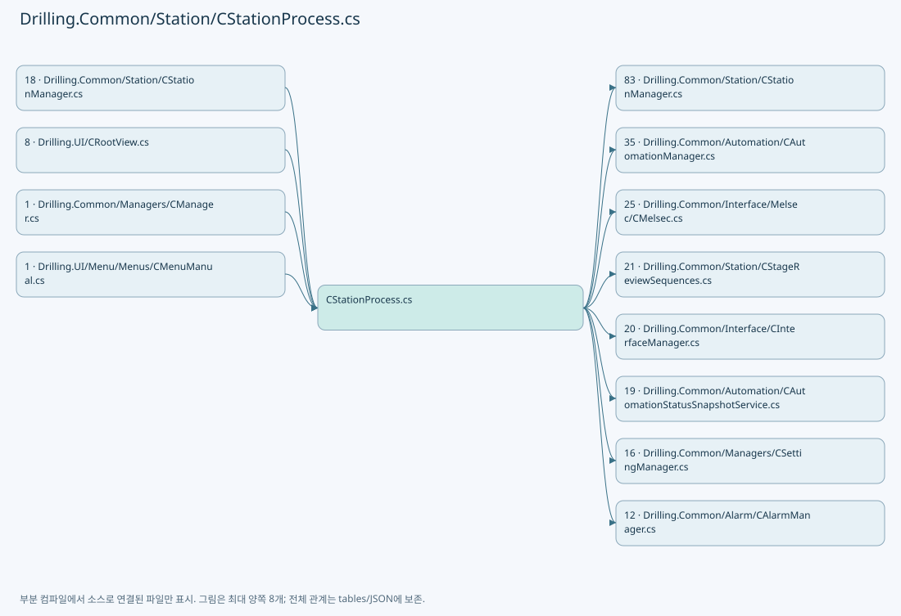

## 네임스페이스·타입·상속

| 타입 | 구분 | 원본 범위 | 선언/상속 |
| --- | --- | --- | --- |
| CStationProcess | ClassDeclaration | 23–4281 | CStationProcess: CtrlThread |
| CProcessStepAction | DelegateDeclaration | 169–169 | private delegate void CProcessStepAction(ST_PROCESS_MODEL processModel, CancellationToken cancellationToken); |
| ST_BUFFERED_RUN_GROUP_RESULT | RecordDeclaration | 2522–2522 | ST_BUFFERED_RUN_GROUP_RESULT |
| ST_BUFFERED_RUN_STOP_RESULT | RecordDeclaration | 2523–2523 | ST_BUFFERED_RUN_STOP_RESULT |
| ST_AUTOMATION_TASK_KEY | RecordStructDeclaration | 2524–2524 | ST_AUTOMATION_TASK_KEY |
| ST_AUTOMATION_TASK_TARGET | RecordDeclaration | 2525–2525 | ST_AUTOMATION_TASK_TARGET |
| ST_AUTOMATION_TASK_STATUS | RecordDeclaration | 2526–2526 | ST_AUTOMATION_TASK_STATUS |
| ST_AUTOMATION_TASK_LINE_STATUS | RecordDeclaration | 2527–2527 | ST_AUTOMATION_TASK_LINE_STATUS |
| ST_SCANNER_STATUS_LOG_AXIS_TARGET | RecordDeclaration | 2528–2528 | ST_SCANNER_STATUS_LOG_AXIS_TARGET |
| ST_QUEUE_COUNT_LOG_TARGET | RecordDeclaration | 2529–2529 | ST_QUEUE_COUNT_LOG_TARGET |
| ST_AUTO_STEP_INFO | RecordDeclaration | 2530–2530 | ST_AUTO_STEP_INFO |
| CScannerStatusLogger | ClassDeclaration | 2531–3094 | CScannerStatusLogger: IDisposable |
| CQueueCountLogger | ClassDeclaration | 3096–3312 | CQueueCountLogger: IDisposable |
| CBufferedRunWorker | ClassDeclaration | 3314–3393 | CBufferedRunWorker |
| CStageBufferedRun | ClassDeclaration | 4207–4211 | CStageBufferedRun |
| CHandshakeOutputReset | ClassDeclaration | 4284–4330 | CHandshakeOutputReset |
| CProtectWindowUsageRequest | ClassDeclaration | 4332–4671 | CProtectWindowUsageRequest |
| CStageProcessDataPublisher | ClassDeclaration | 4674–4794 | CStageProcessDataPublisher |
| ST_STAGE_READY_POSITION_RESULT | RecordDeclaration | 4796–4796 | ST_STAGE_READY_POSITION_RESULT |
| CStageReadyPositionCheck | ClassDeclaration | 4798–4864 | CStageReadyPositionCheck |
| ST_STAGE_REQUEST_STATUS | RecordDeclaration | 4866–4870 | ST_STAGE_REQUEST_STATUS |
| ST_STAGE_SIGNAL_SNAPSHOT | RecordDeclaration | 4871–4874 | ST_STAGE_SIGNAL_SNAPSHOT |
| CStageRequestSequence | ClassDeclaration | 4876–5842 | CStageRequestSequence |
| ST_STAGE_DISTORTION_ACTIONS | RecordDeclaration | 5844–5848 | ST_STAGE_DISTORTION_ACTIONS |
| ST_STAGE_TPM_ACTIONS | RecordDeclaration | 5849–5849 | ST_STAGE_TPM_ACTIONS |
| ST_STAGE_REVIEW_ACTIONS | RecordDeclaration | 5850–5850 | ST_STAGE_REVIEW_ACTIONS |
| ST_STAGE_ZERO_LINE_ACTIONS | RecordDeclaration | 5851–5854 | ST_STAGE_ZERO_LINE_ACTIONS |
| ST_MANUAL_MOF_STATUS | RecordDeclaration | 5855–5855 | ST_MANUAL_MOF_STATUS |
| ST_MANUAL_MOF_COMPLETION | RecordDeclaration | 5856–5856 | ST_MANUAL_MOF_COMPLETION |
| CManualMofActionIds | ClassDeclaration | 5857–5860 | CManualMofActionIds |
| ST_STAGE_PROCESS_REQUEST | RecordDeclaration | 5862–5862 | ST_STAGE_PROCESS_REQUEST |
| ST_ZERO_LINE_PREWAIT_STATUS | RecordDeclaration | 5863–5863 | ST_ZERO_LINE_PREWAIT_STATUS |
| CZeroLinePrewaitMonitor | ClassDeclaration | 5865–6230 | CZeroLinePrewaitMonitor |
| CZeroLineProcessCoordinator | ClassDeclaration | 6233–6477 | CZeroLineProcessCoordinator |

## 멤버 빠른 목록

| 이름 | 종류 | 범위 | 서명 |
| --- | --- | --- | --- |
| AutoStepIdle | FieldDeclaration | L26–26 | string Drilling.Common.Station.CStationProcess.AutoStepIdle |
| AutoStepPowerCheck | FieldDeclaration | L27–27 | string Drilling.Common.Station.CStationProcess.AutoStepPowerCheck |
| AutoStepAlign | FieldDeclaration | L28–28 | string Drilling.Common.Station.CStationProcess.AutoStepAlign |
| AutoStepProcess | FieldDeclaration | L29–29 | string Drilling.Common.Station.CStationProcess.AutoStepProcess |
| AutoStepInspection | FieldDeclaration | L30–30 | string Drilling.Common.Station.CStationProcess.AutoStepInspection |
| AutoStepComplete | FieldDeclaration | L31–31 | string Drilling.Common.Station.CStationProcess.AutoStepComplete |
| ScriptBufferedRunUseKey | FieldDeclaration | L32–32 | string Drilling.Common.Station.CStationProcess.ScriptBufferedRunUseKey |
| ScriptRunTimeoutMsKey | FieldDeclaration | L33–33 | string Drilling.Common.Station.CStationProcess.ScriptRunTimeoutMsKey |
| ScriptRunPollIntervalMsKey | FieldDeclaration | L34–34 | string Drilling.Common.Station.CStationProcess.ScriptRunPollIntervalMsKey |
| ScriptBufferedRunLinesPerCommandKey | FieldDeclaration | L35–35 | string Drilling.Common.Station.CStationProcess.ScriptBufferedRunLinesPerCommandKey |
| ScriptBufferedRunTimeoutMsKey | FieldDeclaration | L36–36 | string Drilling.Common.Station.CStationProcess.ScriptBufferedRunTimeoutMsKey |
| ScriptBufferedRunQueueSizeKey | FieldDeclaration | L37–37 | string Drilling.Common.Station.CStationProcess.ScriptBufferedRunQueueSizeKey |
| StandardScriptDirectoryName | FieldDeclaration | L38–38 | string Drilling.Common.Station.CStationProcess.StandardScriptDirectoryName |
| BufferedRunScriptDirectoryName | FieldDeclaration | L39–39 | string Drilling.Common.Station.CStationProcess.BufferedRunScriptDirectoryName |
| QueueCountLogDirectoryName | FieldDeclaration | L40–40 | string Drilling.Common.Station.CStationProcess.QueueCountLogDirectoryName |
| ScannerStatusLogDirectoryName | FieldDeclaration | L41–41 | string Drilling.Common.Station.CStationProcess.ScannerStatusLogDirectoryName |
| ScriptRunDefaultTimeoutMs | FieldDeclaration | L42–42 | int Drilling.Common.Station.CStationProcess.ScriptRunDefaultTimeoutMs |
| ScriptRunDefaultPollIntervalMs | FieldDeclaration | L43–43 | int Drilling.Common.Station.CStationProcess.ScriptRunDefaultPollIntervalMs |
| EncoderScaleReleaseTimeoutMs | FieldDeclaration | L44–44 | int Drilling.Common.Station.CStationProcess.EncoderScaleReleaseTimeoutMs |
| QueueCountLogIntervalMs | FieldDeclaration | L45–45 | int Drilling.Common.Station.CStationProcess.QueueCountLogIntervalMs |
| ScannerStatusLogIntervalMs | FieldDeclaration | L46–46 | int Drilling.Common.Station.CStationProcess.ScannerStatusLogIntervalMs |
| QueueCountLogStopWaitMs | FieldDeclaration | L47–47 | int Drilling.Common.Station.CStationProcess.QueueCountLogStopWaitMs |
| MaximumProcessLogCount | FieldDeclaration | L48–48 | int Drilling.Common.Station.CStationProcess.MaximumProcessLogCount |
| AutoStepWait | FieldDeclaration | L49–49 | string Drilling.Common.Station.CStationProcess.AutoStepWait |
| AutoStepRunning | FieldDeclaration | L50–50 | string Drilling.Common.Station.CStationProcess.AutoStepRunning |
| AutoStepOk | FieldDeclaration | L51–51 | string Drilling.Common.Station.CStationProcess.AutoStepOk |
| AutoStepDone | FieldDeclaration | L52–52 | string Drilling.Common.Station.CStationProcess.AutoStepDone |
| AutoStepError | FieldDeclaration | L53–53 | string Drilling.Common.Station.CStationProcess.AutoStepError |
| AutoStepStop | FieldDeclaration | L54–54 | string Drilling.Common.Station.CStationProcess.AutoStepStop |
| AutoStepInfos | FieldDeclaration | L55–62 | System.Collections.Generic.IReadOnlyList<Drilling.Common.Station.CStationProcess.ST_AUTO_STEP_INFO> Drilling.Common.Station.CStationProcess.AutoStepInfos |
| ProcessFlowItems | FieldDeclaration | L63–70 | System.Collections.Generic.IReadOnlyList<Drilling.Common.Station.ST_STATION_PROCESS_FLOW_ITEM> Drilling.Common.Station.CStationProcess.ProcessFlowItems |
| _interfaceManager | FieldDeclaration | L71–71 | Drilling.Common.Interface.CInterfaceManager Drilling.Common.Station.CStationProcess._interfaceManager |
| _motionManager | FieldDeclaration | L72–72 | Drilling.Common.Motion.CMotionManager Drilling.Common.Station.CStationProcess._motionManager |
| _interLockManager | FieldDeclaration | L73–73 | Drilling.Common.InterLock.CInterLockManager Drilling.Common.Station.CStationProcess._interLockManager |
| _settingManager | FieldDeclaration | L74–74 | Drilling.Common.Managers.CSettingManager Drilling.Common.Station.CStationProcess._settingManager |
| _productManager | FieldDeclaration | L75–75 | Drilling.Common.Product.CProductManager? Drilling.Common.Station.CStationProcess._productManager |
| _recipeManager | FieldDeclaration | L76–76 | Drilling.Common.Managers.CRecipeManager? Drilling.Common.Station.CStationProcess._recipeManager |
| _zeroLineReview | FieldDeclaration | L77–77 | Drilling.Common.Review.CReviewManager? Drilling.Common.Station.CStationProcess._zeroLineReview |
| _protectWindowUsageRequest | FieldDeclaration | L78–78 | Drilling.Common.Station.CProtectWindowUsageRequest? Drilling.Common.Station.CStationProcess._protectWindowUsageRequest |
| _reviewOffsetFile | FieldDeclaration | L79–79 | Drilling.Common.Review.CReviewOffsetFileBase? Drilling.Common.Station.CStationProcess._reviewOffsetFile |
| _automationScriptFile | FieldDeclaration | L80–80 | Drilling.Common.Station.CAutomationScriptFileBase Drilling.Common.Station.CStationProcess._automationScriptFile |
| _automationManager | FieldDeclaration | L81–81 | Drilling.Common.Automation.CAutomationManager Drilling.Common.Station.CStationProcess._automationManager |
| _logManager | FieldDeclaration | L82–82 | CLogManager? Drilling.Common.Station.CStationProcess._logManager |
| _manualMofCompletionPath | FieldDeclaration | L83–83 | string? Drilling.Common.Station.CStationProcess._manualMofCompletionPath |
| _sequenceLock | FieldDeclaration | L84–84 | object Drilling.Common.Station.CStationProcess._sequenceLock |
| _processLogLock | FieldDeclaration | L85–85 | object Drilling.Common.Station.CStationProcess._processLogLock |
| _sequenceActions | FieldDeclaration | L86–86 | Drilling.Common.Station.CSequenceActionStatusStore Drilling.Common.Station.CStationProcess._sequenceActions |
| _processLogs | FieldDeclaration | L87–87 | System.Collections.Generic.List<Drilling.Common.Station.ST_PROCESS_LOG_ITEM> Drilling.Common.Station.CStationProcess._processLogs |
| _autoStepStates | FieldDeclaration | L88–88 | System.Collections.Generic.Dictionary<string, string> Drilling.Common.Station.CStationProcess._autoStepStates |
| _scriptCreatedAt | FieldDeclaration | L89–89 | System.DateTimeOffset? Drilling.Common.Station.CStationProcess._scriptCreatedAt |
| _scriptStartedAt | FieldDeclaration | L90–90 | System.DateTimeOffset? Drilling.Common.Station.CStationProcess._scriptStartedAt |
| _scriptCompletedAt | FieldDeclaration | L91–91 | System.DateTimeOffset? Drilling.Common.Station.CStationProcess._scriptCompletedAt |
| _lastScript | FieldDeclaration | L92–92 | Drilling.Common.Station.ST_SCRIPT_BUILD_RESULT? Drilling.Common.Station.CStationProcess._lastScript |
| _lastInterLockItems | FieldDeclaration | L93–93 | System.Collections.Generic.IReadOnlyList<Drilling.Common.InterLock.ST_INTERLOCK_ITEM> Drilling.Common.Station.CStationProcess._lastInterLockItems |
| _processModel | FieldDeclaration | L94–94 | Drilling.Common.Station.ST_PROCESS_MODEL? Drilling.Common.Station.CStationProcess._processModel |
| _preparedReviewOffsetFilePath | FieldDeclaration | L95–95 | string Drilling.Common.Station.CStationProcess._preparedReviewOffsetFilePath |
| _preparedReviewOffsetSavedAt | FieldDeclaration | L96–96 | System.DateTimeOffset Drilling.Common.Station.CStationProcess._preparedReviewOffsetSavedAt |
| _preparedReviewOffsetInvalidated | FieldDeclaration | L97–97 | bool Drilling.Common.Station.CStationProcess._preparedReviewOffsetInvalidated |
| _statistics | FieldDeclaration | L98–98 | Drilling.Common.Station.ST_PROCESS_STATISTICS Drilling.Common.Station.CStationProcess._statistics |
| _snapshot | FieldDeclaration | L99–99 | Drilling.Common.Station.ST_STATION_PROCESS_STATUS Drilling.Common.Station.CStationProcess._snapshot |
| _stationStatus | FieldDeclaration | L100–100 | Drilling.Common.Station.ST_STATION_STATUS Drilling.Common.Station.CStationProcess._stationStatus |
| _sequenceState | FieldDeclaration | L101–101 | Drilling.Common.Station.EN_STATION_SEQUENCE Drilling.Common.Station.CStationProcess._sequenceState |
| _sequenceCancellation | FieldDeclaration | L102–102 | System.Threading.CancellationTokenSource? Drilling.Common.Station.CStationProcess._sequenceCancellation |
| _sequenceError | FieldDeclaration | L103–103 | string Drilling.Common.Station.CStationProcess._sequenceError |
| _manualMofActions | FieldDeclaration | L104–104 | Drilling.Common.Station.CSequenceActionStatusStore Drilling.Common.Station.CStationProcess._manualMofActions |
| _manualMofCancellation | FieldDeclaration | L105–105 | System.Threading.CancellationTokenSource? Drilling.Common.Station.CStationProcess._manualMofCancellation |
| _manualMofExecution | FieldDeclaration | L106–106 | System.Threading.Tasks.Task Drilling.Common.Station.CStationProcess._manualMofExecution |
| _manualMofRunning | FieldDeclaration | L107–107 | bool Drilling.Common.Station.CStationProcess._manualMofRunning |
| _manualMofRequiresStop | FieldDeclaration | L108–108 | bool Drilling.Common.Station.CStationProcess._manualMofRequiresStop |
| _manualMofMessage | FieldDeclaration | L109–109 | string Drilling.Common.Station.CStationProcess._manualMofMessage |
| _manualMofDirectory | FieldDeclaration | L110–110 | string Drilling.Common.Station.CStationProcess._manualMofDirectory |
| _lastCompletedManualMof | FieldDeclaration | L111–111 | Drilling.Common.Station.ST_MANUAL_MOF_COMPLETION? Drilling.Common.Station.CStationProcess._lastCompletedManualMof |
| _protectWindowCountGate | FieldDeclaration | L112–112 | System.Threading.SemaphoreSlim Drilling.Common.Station.CStationProcess._protectWindowCountGate |
| _protectWindowCounted | FieldDeclaration | L113–113 | bool Drilling.Common.Station.CStationProcess._protectWindowCounted |
| _stageMachiningCompleted | FieldDeclaration | L114–114 | bool Drilling.Common.Station.CStationProcess._stageMachiningCompleted |
| _stageOwnedTasks | FieldDeclaration | L115–115 | System.Collections.Concurrent.ConcurrentDictionary<(int Controller, int Task), Drilling.Common.Station.ST_HEAD_SCRIPT_RESULT> Drilling.Common.Station.CStationProcess._stageOwnedTasks |
| _stageBufferedRuns | FieldDeclaration | L116–116 | System.Collections.Concurrent.ConcurrentDictionary<int, Drilling.Common.Station.CStationProcess.CStageBufferedRun> Drilling.Common.Station.CStationProcess._stageBufferedRuns |
| _stageModelLogCycle | FieldDeclaration | L117–117 | string Drilling.Common.Station.CStationProcess._stageModelLogCycle |
| _zeroLineCycle | FieldDeclaration | L118–118 | Drilling.Common.Station.CZeroLineProcessCoordinator? Drilling.Common.Station.CStationProcess._zeroLineCycle |
| _zeroLinePrewait | FieldDeclaration | L119–119 | Drilling.Common.Station.CZeroLinePrewaitMonitor? Drilling.Common.Station.CStationProcess._zeroLinePrewait |
| .ctor | ConstructorDeclaration | L122–165 | Drilling.Common.Station.CStationProcess.CStationProcess(Drilling.Common.Interface.CInterfaceManager, Drilling.Common.Motion.CMotionManager, Drilling.Common.InterLock.CInterLockManager, Drilling.Common.Managers.CSettingManager, Drilling.Common.Station.CAutomationScriptFileBase, Drilling.Common.Automation.CAutomationManager, Drilling.Common.Review.CReviewOffsetFileBase?, Drilling.Common.Product.CProductManager?, CLogManager?, string, string?, Drilling.Common.Managers.CRecipeManager?, Drilling.Common.Review.CReviewManager?) |
| CProcessStepAction | DelegateDeclaration | L169–169 | Drilling.Common.Station.CStationProcess.CProcessStepAction |
| Current | PropertyDeclaration | L170–186 | Drilling.Common.Station.ST_STATION_PROCESS_STATUS Drilling.Common.Station.CStationProcess.Current |
| get_Current | GetAccessorDeclaration | L172–185 | Drilling.Common.Station.ST_STATION_PROCESS_STATUS Drilling.Common.Station.CStationProcess.Current.get |
| Status | PropertyDeclaration | L188–194 | Drilling.Common.Station.ST_STATION_STATUS Drilling.Common.Station.CStationProcess.Status |
| get_Status | GetAccessorDeclaration | L190–193 | Drilling.Common.Station.ST_STATION_STATUS Drilling.Common.Station.CStationProcess.Status.get |
| SequenceState | PropertyDeclaration | L196–202 | Drilling.Common.Station.EN_STATION_SEQUENCE Drilling.Common.Station.CStationProcess.SequenceState |
| get_SequenceState | GetAccessorDeclaration | L198–201 | Drilling.Common.Station.EN_STATION_SEQUENCE Drilling.Common.Station.CStationProcess.SequenceState.get |
| GetProcessFlow | MethodDeclaration | L204–207 | System.Collections.Generic.IReadOnlyList<Drilling.Common.Station.ST_STATION_PROCESS_FLOW_ITEM> Drilling.Common.Station.CStationProcess.GetProcessFlow() |
| PrepareProcess | MethodDeclaration | L209–225 | Drilling.Common.Station.ST_STATION_PROCESS_STATUS Drilling.Common.Station.CStationProcess.PrepareProcess(string, string, string, string, System.Collections.Generic.IReadOnlyDictionary<string, string>, System.Threading.CancellationToken, bool) |
| PrepareProcessCore | MethodDeclaration | L227–268 | Drilling.Common.Station.ST_STATION_PROCESS_STATUS Drilling.Common.Station.CStationProcess.PrepareProcessCore(string, string, string, string, System.Collections.Generic.IReadOnlyDictionary<string, string>, System.Threading.CancellationToken, bool, System.Collections.Generic.IReadOnlySet<int>?) |
| Start | MethodDeclaration | L270–321 | Drilling.Common.Station.ST_STATION_PROCESS_STATUS Drilling.Common.Station.CStationProcess.Start(System.Threading.CancellationToken) |
| Run | MethodDeclaration | L323–380 | void Drilling.Common.Station.CStationProcess.Run() |
| RunSequenceStep | MethodDeclaration | L382–391 | void Drilling.Common.Station.CStationProcess.RunSequenceStep(Drilling.Common.Station.EN_STATION_SEQUENCE, string, Drilling.Common.Station.CStationProcess.CProcessStepAction, Drilling.Common.Station.EN_STATION_SEQUENCE) |
| CheckProcessModelLoaded | MethodDeclaration | L393–396 | Drilling.Common.Station.ST_PROCESS_MODEL Drilling.Common.Station.CStationProcess.CheckProcessModelLoaded() |
| GetSequenceCancellationToken | MethodDeclaration | L398–404 | System.Threading.CancellationToken Drilling.Common.Station.CStationProcess.GetSequenceCancellationToken() |
| FinishSequence | MethodDeclaration | L406–420 | void Drilling.Common.Station.CStationProcess.FinishSequence() |
| ProcessInterruptedSequence | MethodDeclaration | L422–431 | void Drilling.Common.Station.CStationProcess.ProcessInterruptedSequence() |
| CompleteSequence | MethodDeclaration | L433–436 | void Drilling.Common.Station.CStationProcess.CompleteSequence(Drilling.Common.Station.ST_PROCESS_MODEL, System.Threading.CancellationToken) |
| EnsureStartAllowed | MethodDeclaration | L438–444 | void Drilling.Common.Station.CStationProcess.EnsureStartAllowed() |
| ReadProcessModelForStart | MethodDeclaration | L446–456 | Drilling.Common.Station.ST_PROCESS_MODEL Drilling.Common.Station.CStationProcess.ReadProcessModelForStart() |
| GetLiveInterlockItems | MethodDeclaration | L458–458 | System.Collections.Generic.IReadOnlyList<Drilling.Common.InterLock.ST_INTERLOCK_ITEM> Drilling.Common.Station.CStationProcess.GetLiveInterlockItems(System.Threading.CancellationToken) |
| GetLiveInterlockItems | MethodDeclaration | L459–459 | System.Collections.Generic.IReadOnlyList<Drilling.Common.InterLock.ST_INTERLOCK_ITEM> Drilling.Common.Station.CStationProcess.GetLiveInterlockItems(System.Collections.Generic.IReadOnlyDictionary<string, string>, System.Threading.CancellationToken) |
| GetManualInterlockItems | MethodDeclaration | L460–470 | System.Collections.Generic.IReadOnlyList<Drilling.Common.InterLock.ST_INTERLOCK_ITEM> Drilling.Common.Station.CStationProcess.GetManualInterlockItems(System.Collections.Generic.IReadOnlyDictionary<string, string>, System.Collections.Generic.IReadOnlySet<int>, System.Threading.CancellationToken) |
| ExecuteAutoStep | MethodDeclaration | L472–497 | void Drilling.Common.Station.CStationProcess.ExecuteAutoStep(string, Drilling.Common.Station.ST_PROCESS_MODEL, Drilling.Common.Station.CStationProcess.CProcessStepAction, System.Threading.CancellationToken) |
| RunAlignStep | MethodDeclaration | L499–524 | void Drilling.Common.Station.CStationProcess.RunAlignStep(Drilling.Common.Station.ST_PROCESS_MODEL, System.Threading.CancellationToken) |
| UpdateProductAlignment | MethodDeclaration | L526–548 | void Drilling.Common.Station.CStationProcess.UpdateProductAlignment(Drilling.Common.Station.ST_PROCESS_MODEL, Drilling.Common.Product.EN_PRODUCT_PROCESS_STATE, string, System.Threading.CancellationToken) |
| TryUpdateProductAlignmentAfterFailure | MethodDeclaration | L550–560 | void Drilling.Common.Station.CStationProcess.TryUpdateProductAlignmentAfterFailure(Drilling.Common.Station.ST_PROCESS_MODEL, Drilling.Common.Product.EN_PRODUCT_PROCESS_STATE, string) |
| RunProcessStep | MethodDeclaration | L562–573 | void Drilling.Common.Station.CStationProcess.RunProcessStep(Drilling.Common.Station.ST_PROCESS_MODEL, System.Threading.CancellationToken) |
| MoveStageToScanStart | MethodDeclaration | L575–607 | void Drilling.Common.Station.CStationProcess.MoveStageToScanStart(Drilling.Common.Station.ST_PROCESS_MODEL, System.Threading.CancellationToken) |
| ResolveFirstShotStageY | MethodDeclaration | L609–635 | double Drilling.Common.Station.CStationProcess.ResolveFirstShotStageY(Drilling.Common.Station.ST_PROCESS_MODEL, double) |
| SelectShots | LocalFunctionStatement | L611–614 | System.Collections.Generic.IEnumerable<Drilling.Common.Recipe.ST_HEAD_SHOT_POINT> SelectShots(Drilling.Common.Station.ST_HEAD_PROCESS_PLAN) |
| SelectStageY | LocalFunctionStatement | L624–627 | double SelectStageY(Drilling.Common.Recipe.ST_HEAD_SHOT_POINT) |
| SelectStageY2 | LocalFunctionStatement | L629–632 | double SelectStageY2(Drilling.Common.Recipe.ST_HEAD_SHOT_POINT) |
| SendProcessControlCommand | MethodDeclaration | L637–649 | void Drilling.Common.Station.CStationProcess.SendProcessControlCommand(string, System.Collections.Generic.IReadOnlyList<(string Key, string Value)>, System.Threading.CancellationToken) |
| RunInspectionStep | MethodDeclaration | L651–654 | void Drilling.Common.Station.CStationProcess.RunInspectionStep(Drilling.Common.Station.ST_PROCESS_MODEL, System.Threading.CancellationToken) |
| BuildAutomationScript | MethodDeclaration | L656–665 | void Drilling.Common.Station.CStationProcess.BuildAutomationScript(Drilling.Common.Station.ST_PROCESS_MODEL, System.Threading.CancellationToken) |
| UploadAutomationScript | MethodDeclaration | L667–689 | void Drilling.Common.Station.CStationProcess.UploadAutomationScript(Drilling.Common.Station.ST_PROCESS_MODEL, System.Threading.CancellationToken) |
| ShouldIncludeItem | LocalFunctionStatement | L675–678 | bool ShouldIncludeItem(Drilling.Common.Station.ST_HEAD_SCRIPT_RESULT) |
| RunScannerProcess | MethodDeclaration | L691–749 | void Drilling.Common.Station.CStationProcess.RunScannerProcess(Drilling.Common.Station.ST_PROCESS_MODEL, System.Threading.CancellationToken) |
| ShouldIncludeItem | LocalFunctionStatement | L702–705 | bool ShouldIncludeItem(Drilling.Common.Station.ST_HEAD_SCRIPT_RESULT) |
| RunBufferedHeadScripts | MethodDeclaration | L751–841 | void Drilling.Common.Station.CStationProcess.RunBufferedHeadScripts(Drilling.Common.Station.ST_PROCESS_MODEL, System.Collections.Generic.IReadOnlyList<Drilling.Common.Station.ST_HEAD_SCRIPT_RESULT>, System.Threading.CancellationToken) |
| SelectAutomationNo | LocalFunctionStatement | L756–759 | int SelectAutomationNo(Drilling.Common.Station.ST_HEAD_SCRIPT_RESULT) |
| SelectItem | LocalFunctionStatement | L762–765 | string SelectItem(Drilling.Common.Station.ST_HEAD_SCRIPT_RESULT) |
| WaitForBufferedRunWorkers | MethodDeclaration | L843–867 | void Drilling.Common.Station.CStationProcess.WaitForBufferedRunWorkers(System.Collections.Generic.IReadOnlyList<Drilling.Common.Station.CStationProcess.CBufferedRunWorker>, int, string) |
| WaitAutomationHeadScriptsComplete | MethodDeclaration | L869–936 | void Drilling.Common.Station.CStationProcess.WaitAutomationHeadScriptsComplete(Drilling.Common.Station.ST_PROCESS_MODEL, System.Collections.Generic.IReadOnlyList<Drilling.Common.Station.ST_HEAD_SCRIPT_RESULT>, System.Threading.CancellationToken) |
| BuildAutomation | LocalFunctionStatement | L880–883 | Drilling.Common.Station.CStationProcess.ST_AUTOMATION_TASK_KEY BuildAutomation(Drilling.Common.Station.CStationProcess.ST_AUTOMATION_TASK_TARGET) |
| StopAutomationScriptTasks | MethodDeclaration | L938–961 | void Drilling.Common.Station.CStationProcess.StopAutomationScriptTasks(System.Collections.Generic.IReadOnlyList<Drilling.Common.Station.ST_HEAD_SCRIPT_RESULT>, string) |
| WaitAutomationScriptTasksStopped | MethodDeclaration | L963–977 | void Drilling.Common.Station.CStationProcess.WaitAutomationScriptTasksStopped(System.Collections.Generic.IReadOnlyList<Drilling.Common.Station.CStationProcess.ST_AUTOMATION_TASK_TARGET>) |
| WaitAutomationScriptTaskStopped | MethodDeclaration | L979–1005 | void Drilling.Common.Station.CStationProcess.WaitAutomationScriptTaskStopped(Drilling.Common.Station.CStationProcess.ST_AUTOMATION_TASK_TARGET) |
| CreateAutomationTaskTargets | MethodDeclaration | L1007–1015 | System.Collections.Generic.IReadOnlyList<Drilling.Common.Station.CStationProcess.ST_AUTOMATION_TASK_TARGET> Drilling.Common.Station.CStationProcess.CreateAutomationTaskTargets(System.Collections.Generic.IReadOnlyList<Drilling.Common.Station.ST_HEAD_SCRIPT_RESULT>) |
| ShouldIncludeItem | LocalFunctionStatement | L1009–1012 | bool ShouldIncludeItem(Drilling.Common.Station.ST_HEAD_SCRIPT_RESULT) |
| ParseAutomationTaskStatus | MethodDeclaration | L1017–1032 | Drilling.Common.Station.CStationProcess.ST_AUTOMATION_TASK_STATUS Drilling.Common.Station.CStationProcess.ParseAutomationTaskStatus(string) |
| ReadAutomationTaskLineStatus | MethodDeclaration | L1034–1038 | Drilling.Common.Station.CStationProcess.ST_AUTOMATION_TASK_LINE_STATUS Drilling.Common.Station.CStationProcess.ReadAutomationTaskLineStatus(int, int, System.Threading.CancellationToken) |
| ParseAutomationTaskLineStatus | MethodDeclaration | L1040–1055 | Drilling.Common.Station.CStationProcess.ST_AUTOMATION_TASK_LINE_STATUS Drilling.Common.Station.CStationProcess.ParseAutomationTaskLineStatus(string) |
| FormatAutomationErrorResponse | MethodDeclaration | L1057–1071 | string Drilling.Common.Station.CStationProcess.FormatAutomationErrorResponse(string) |
| IsAutomationTaskComplete | MethodDeclaration | L1073–1076 | bool Drilling.Common.Station.CStationProcess.IsAutomationTaskComplete(string) |
| IsAutomationTaskFailed | MethodDeclaration | L1078–1081 | bool Drilling.Common.Station.CStationProcess.IsAutomationTaskFailed(string) |
| FormatAutomationTaskTargets | MethodDeclaration | L1083–1091 | string Drilling.Common.Station.CStationProcess.FormatAutomationTaskTargets(System.Collections.Generic.IEnumerable<Drilling.Common.Station.CStationProcess.ST_AUTOMATION_TASK_TARGET>) |
| SelectItem | LocalFunctionStatement | L1085–1088 | string SelectItem(Drilling.Common.Station.CStationProcess.ST_AUTOMATION_TASK_TARGET) |
| RunBufferedHeadScriptGroup | MethodDeclaration | L1093–1107 | Drilling.Common.Station.CStationProcess.ST_BUFFERED_RUN_GROUP_RESULT Drilling.Common.Station.CStationProcess.RunBufferedHeadScriptGroup(int, System.Collections.Generic.IReadOnlyList<Drilling.Common.Station.ST_HEAD_SCRIPT_RESULT>, int, int, int, System.Threading.CancellationToken) |
| BuildBuffered | LocalFunctionStatement | L1095–1098 | Drilling.Common.Automation.ST_BUFFERED_SCRIPT_RUN_ITEM BuildBuffered(Drilling.Common.Station.ST_HEAD_SCRIPT_RESULT) |
| SelectItem | LocalFunctionStatement | L1101–1104 | string SelectItem(Drilling.Common.Station.ST_HEAD_SCRIPT_RESULT) |
| StopBufferedRunTasks | MethodDeclaration | L1109–1141 | void Drilling.Common.Station.CStationProcess.StopBufferedRunTasks(System.Collections.Generic.IReadOnlyList<Drilling.Common.Station.ST_HEAD_SCRIPT_RESULT>, System.Exception) |
| ShouldIncludeItem | LocalFunctionStatement | L1111–1114 | bool ShouldIncludeItem(Drilling.Common.Station.ST_HEAD_SCRIPT_RESULT) |
| RunReviewStep | MethodDeclaration | L1143–1147 | void Drilling.Common.Station.CStationProcess.RunReviewStep(Drilling.Common.Station.ST_PROCESS_MODEL, System.Threading.CancellationToken) |
| RunPowerCheckStep | MethodDeclaration | L1149–1153 | void Drilling.Common.Station.CStationProcess.RunPowerCheckStep(Drilling.Common.Station.ST_PROCESS_MODEL, System.Threading.CancellationToken) |
| CompleteProcess | MethodDeclaration | L1155–1186 | void Drilling.Common.Station.CStationProcess.CompleteProcess(System.Threading.CancellationToken) |
| SelectItem | LocalFunctionStatement | L1171–1177 | Drilling.Common.Station.ST_HEAD_PREVIEW_DATA SelectItem(Drilling.Common.Station.ST_HEAD_PREVIEW_DATA) |
| Stop | MethodDeclaration | L1188–1218 | Drilling.Common.Station.ST_STATION_PROCESS_STATUS Drilling.Common.Station.CStationProcess.Stop(System.Threading.CancellationToken) |
| ProcessStop | MethodDeclaration | L1220–1243 | Drilling.Common.Station.ST_STATION_PROCESS_STATUS Drilling.Common.Station.CStationProcess.ProcessStop(System.Threading.CancellationToken) |
| CanReset | PropertyDeclaration | L1245–1254 | bool Drilling.Common.Station.CStationProcess.CanReset |
| get_CanReset | GetAccessorDeclaration | L1247–1253 | bool Drilling.Common.Station.CStationProcess.CanReset.get |
| Reset | MethodDeclaration | L1256–1279 | Drilling.Common.Station.ST_STATION_PROCESS_STATUS Drilling.Common.Station.CStationProcess.Reset(System.Threading.CancellationToken) |
| ProcessReset | MethodDeclaration | L1281–1335 | Drilling.Common.Station.ST_STATION_PROCESS_STATUS Drilling.Common.Station.CStationProcess.ProcessReset(System.Threading.CancellationToken) |
| CreateSnapshot | MethodDeclaration | L1337–1360 | Drilling.Common.Station.ST_STATION_PROCESS_STATUS Drilling.Common.Station.CStationProcess.CreateSnapshot(Drilling.Common.Station.ST_PROCESS_MODEL?, System.Collections.Generic.IReadOnlyList<Drilling.Common.Station.ST_HEAD_PREVIEW_DATA>, Drilling.Common.Station.EN_SCRIPT_STATUS, Drilling.Common.Station.EN_PROCESS_STEP, Drilling.Common.Station.ST_PROCESS_RESULT?) |
| GetInterLockSummary | MethodDeclaration | L1362–1362 | Drilling.Common.InterLock.ST_INTERLOCK_SUMMARY Drilling.Common.Station.CStationProcess.GetInterLockSummary(System.Threading.CancellationToken, Drilling.Common.Station.ST_PROCESS_MODEL?) |
| EvaluateInterlocks | MethodDeclaration | L1363–1398 | Drilling.Common.InterLock.ST_INTERLOCK_SUMMARY Drilling.Common.Station.CStationProcess.EvaluateInterlocks(System.Collections.Generic.IReadOnlyDictionary<string, string>?, System.Threading.CancellationToken, bool, bool, bool) |
| GetDeviceStatus | MethodDeclaration | L1400–1411 | Drilling.Common.Managers.ST_DEVICE_STATUS Drilling.Common.Station.CStationProcess.GetDeviceStatus(System.Threading.CancellationToken, bool) |
| CompleteProduct | MethodDeclaration | L1413–1423 | void Drilling.Common.Station.CStationProcess.CompleteProduct(Drilling.Common.Station.ST_PROCESS_RESULT, bool, System.Threading.CancellationToken) |
| StopProduct | MethodDeclaration | L1425–1435 | void Drilling.Common.Station.CStationProcess.StopProduct(string, System.Threading.CancellationToken) |
| TryStopProduct | MethodDeclaration | L1437–1447 | void Drilling.Common.Station.CStationProcess.TryStopProduct(string, System.Threading.CancellationToken) |
| SetProductError | MethodDeclaration | L1449–1459 | void Drilling.Common.Station.CStationProcess.SetProductError(string, System.Threading.CancellationToken) |
| TrySetProductError | MethodDeclaration | L1461–1471 | void Drilling.Common.Station.CStationProcess.TrySetProductError(string, System.Threading.CancellationToken) |
| ReportProcessResult | MethodDeclaration | L1473–1487 | void Drilling.Common.Station.CStationProcess.ReportProcessResult(Drilling.Common.Station.ST_PROCESS_RESULT, string, System.Threading.CancellationToken, Drilling.Common.Station.EN_STATION_STATE?) |
| TryReportProcessResult | MethodDeclaration | L1489–1499 | void Drilling.Common.Station.CStationProcess.TryReportProcessResult(Drilling.Common.Station.ST_PROCESS_RESULT, string, System.Threading.CancellationToken, Drilling.Common.Station.EN_STATION_STATE) |
| IsTerminalCleanupException | MethodDeclaration | L1501–1504 | bool Drilling.Common.Station.CStationProcess.IsTerminalCleanupException(System.Exception) |
| GetCurrentProcessProductId | MethodDeclaration | L1506–1514 | string? Drilling.Common.Station.CStationProcess.GetCurrentProcessProductId() |
| BuildPreview | MethodDeclaration | L1516–1524 | System.Collections.Generic.IReadOnlyList<Drilling.Common.Station.ST_HEAD_PREVIEW_DATA> Drilling.Common.Station.CStationProcess.BuildPreview(Drilling.Common.Station.ST_PROCESS_MODEL, Drilling.Common.Station.EN_HEAD_PROCESS_STATUS) |
| BuildHead | LocalFunctionStatement | L1518–1521 | Drilling.Common.Station.ST_HEAD_PREVIEW_DATA BuildHead(Drilling.Common.Station.ST_HEAD_PROCESS_PLAN) |
| BuildRuntimeParameters | MethodDeclaration | L1526–1544 | System.Collections.Generic.IReadOnlyDictionary<string, string> Drilling.Common.Station.CStationProcess.BuildRuntimeParameters(string, System.Collections.Generic.IReadOnlyDictionary<string, string>, System.Threading.CancellationToken) |
| MergeLatestReviewOffsets | MethodDeclaration | L1546–1561 | void Drilling.Common.Station.CStationProcess.MergeLatestReviewOffsets(string, System.Collections.Generic.IDictionary<string, string>, System.Threading.CancellationToken) |
| InvalidatePreparedReviewOffset | MethodDeclaration | L1563–1573 | void Drilling.Common.Station.CStationProcess.InvalidatePreparedReviewOffset() |
| EnsurePreparedReviewOffsetIsCurrent | MethodDeclaration | L1575–1596 | void Drilling.Common.Station.CStationProcess.EnsurePreparedReviewOffsetIsCurrent(Drilling.Common.Station.ST_PROCESS_MODEL, System.Threading.CancellationToken) |
| NormalizeReviewOffsetShotId | MethodDeclaration | L1598–1601 | string Drilling.Common.Station.CStationProcess.NormalizeReviewOffsetShotId(string) |
| BuildProcessModel | MethodDeclaration | L1603–1674 | Drilling.Common.Station.ST_PROCESS_MODEL Drilling.Common.Station.CStationProcess.BuildProcessModel(string, string, string, string, System.Collections.Generic.IReadOnlyDictionary<string, string>) |
| SelectHeadNo | LocalFunctionStatement | L1611–1614 | int SelectHeadNo(Drilling.Common.Recipe.ST_HEAD_SHOT_POINT) |
| SelectKey | LocalFunctionStatement | L1616–1619 | int SelectKey(System.Linq.IGrouping<int, Drilling.Common.Recipe.ST_HEAD_SHOT_POINT>) |
| SelectValue | LocalFunctionStatement | L1621–1624 | Drilling.Common.Recipe.ST_HEAD_SHOT_POINT[] SelectValue(System.Linq.IGrouping<int, Drilling.Common.Recipe.ST_HEAD_SHOT_POINT>) |
| BuildHead | LocalFunctionStatement | L1641–1670 | Drilling.Common.Station.ST_HEAD_PROCESS_PLAN BuildHead(int) |
| SetHeadStatus | MethodDeclaration | L1676–1695 | System.Collections.Generic.IReadOnlyList<Drilling.Common.Station.ST_HEAD_PREVIEW_DATA> Drilling.Common.Station.CStationProcess.SetHeadStatus(System.Collections.Generic.IReadOnlyList<Drilling.Common.Station.ST_HEAD_PREVIEW_DATA>, Drilling.Common.Station.EN_PROCESS_STEP) |
| SelectItem | LocalFunctionStatement | L1678–1692 | Drilling.Common.Station.ST_HEAD_PREVIEW_DATA SelectItem(Drilling.Common.Station.ST_HEAD_PREVIEW_DATA) |
| BuildProcessSequence | MethodDeclaration | L1697–1705 | System.Collections.Generic.IReadOnlyList<Drilling.Common.Station.ST_PROCESS_DISPLAY_ITEM> Drilling.Common.Station.CStationProcess.BuildProcessSequence(Drilling.Common.Station.EN_SCRIPT_STATUS, Drilling.Common.Station.EN_PROCESS_STEP) |
| BuildProcess | LocalFunctionStatement | L1699–1702 | Drilling.Common.Station.ST_PROCESS_DISPLAY_ITEM BuildProcess(Drilling.Common.Station.ST_STATION_PROCESS_FLOW_ITEM) |
| BuildCurrentStepDetails | MethodDeclaration | L1707–1725 | System.Collections.Generic.IReadOnlyList<Drilling.Common.Station.ST_PROCESS_DISPLAY_ITEM> Drilling.Common.Station.CStationProcess.BuildCurrentStepDetails(Drilling.Common.Station.ST_PROCESS_MODEL?, Drilling.Common.Station.EN_SCRIPT_STATUS, Drilling.Common.Station.EN_PROCESS_STEP) |
| BuildProcess | LocalFunctionStatement | L1709–1712 | Drilling.Common.Station.ST_PROCESS_DISPLAY_ITEM BuildProcess(Drilling.Common.Station.CStationProcess.ST_AUTO_STEP_INFO) |
| BuildProcess2 | LocalFunctionStatement | L1719–1722 | Drilling.Common.Station.ST_PROCESS_DISPLAY_ITEM BuildProcess2(Drilling.Common.Station.CStationProcess.ST_AUTO_STEP_INFO) |
| BuildProcessSummary | MethodDeclaration | L1727–1731 | System.Collections.Generic.IReadOnlyList<Drilling.Common.Station.ST_PROCESS_DISPLAY_ITEM> Drilling.Common.Station.CStationProcess.BuildProcessSummary(Drilling.Common.Station.ST_PROCESS_MODEL?, Drilling.Common.Station.ST_PROCESS_STATISTICS) |
| BuildScriptStatusItems | MethodDeclaration | L1733–1759 | System.Collections.Generic.IReadOnlyList<Drilling.Common.Station.ST_PROCESS_DISPLAY_ITEM> Drilling.Common.Station.CStationProcess.BuildScriptStatusItems(Drilling.Common.Station.ST_PROCESS_MODEL?, Drilling.Common.Station.EN_SCRIPT_STATUS, Drilling.Common.Station.ST_PROCESS_RESULT?) |
| SelectFileName | LocalFunctionStatement | L1736–1739 | string SelectFileName(Drilling.Common.Station.ST_HEAD_SCRIPT_RESULT) |
| SelectItem | LocalFunctionStatement | L1742–1745 | string SelectItem(Drilling.Common.Station.ST_HEAD_SCRIPT_RESULT) |
| BuildScriptLifecycleItems | MethodDeclaration | L1761–1770 | System.Collections.Generic.IReadOnlyList<Drilling.Common.Station.ST_PROCESS_DISPLAY_ITEM> Drilling.Common.Station.CStationProcess.BuildScriptLifecycleItems(Drilling.Common.Station.EN_SCRIPT_STATUS, Drilling.Common.Station.EN_PROCESS_STEP) |
| BuildStatistics | MethodDeclaration | L1772–1781 | Drilling.Common.Station.ST_PROCESS_STATISTICS Drilling.Common.Station.CStationProcess.BuildStatistics(Drilling.Common.Station.ST_PROCESS_MODEL?, double, System.TimeSpan) |
| SelectValue | LocalFunctionStatement | L1774–1777 | int SelectValue(Drilling.Common.Station.ST_HEAD_PROCESS_PLAN) |
| EmptyStatistics | MethodDeclaration | L1783–1786 | Drilling.Common.Station.ST_PROCESS_STATISTICS Drilling.Common.Station.CStationProcess.EmptyStatistics() |
| RefreshSnapshot | MethodDeclaration | L1788–1791 | void Drilling.Common.Station.CStationProcess.RefreshSnapshot() |
| ResetAutoStepStates | MethodDeclaration | L1793–1793 | void Drilling.Common.Station.CStationProcess.ResetAutoStepStates() |
| ResetAutoStepStatesCore | MethodDeclaration | L1794–1803 | void Drilling.Common.Station.CStationProcess.ResetAutoStepStatesCore(bool) |
| SetAutoStepState | MethodDeclaration | L1805–1808 | void Drilling.Common.Station.CStationProcess.SetAutoStepState(string, string) |
| MarkRunningAutoSteps | MethodDeclaration | L1810–1819 | void Drilling.Common.Station.CStationProcess.MarkRunningAutoSteps(string) |
| ReadAutoStepState | MethodDeclaration | L1821–1835 | string Drilling.Common.Station.CStationProcess.ReadAutoStepState(string, Drilling.Common.Station.EN_SCRIPT_STATUS, Drilling.Common.Station.EN_PROCESS_STEP) |
| ResolveStepScriptStatus | MethodDeclaration | L1837–1850 | Drilling.Common.Station.EN_SCRIPT_STATUS Drilling.Common.Station.CStationProcess.ResolveStepScriptStatus(string, Drilling.Common.Station.EN_SCRIPT_STATUS) |
| GetCurrentScriptStatusForComplete | MethodDeclaration | L1852–1860 | Drilling.Common.Station.EN_SCRIPT_STATUS Drilling.Common.Station.CStationProcess.GetCurrentScriptStatusForComplete() |
| GetProcessFlowItem | MethodDeclaration | L1862–1870 | Drilling.Common.Station.ST_STATION_PROCESS_FLOW_ITEM Drilling.Common.Station.CStationProcess.GetProcessFlowItem(string) |
| MatchesItem | LocalFunctionStatement | L1864–1867 | bool MatchesItem(Drilling.Common.Station.ST_STATION_PROCESS_FLOW_ITEM) |
| GetAutoStepName | MethodDeclaration | L1872–1880 | string Drilling.Common.Station.CStationProcess.GetAutoStepName(string) |
| MatchesItem | LocalFunctionStatement | L1874–1877 | bool MatchesItem(Drilling.Common.Station.CStationProcess.ST_AUTO_STEP_INFO) |
| CreateAutoStepStateMap | MethodDeclaration | L1882–1895 | System.Collections.Generic.Dictionary<string, string> Drilling.Common.Station.CStationProcess.CreateAutoStepStateMap() |
| SelectKey | LocalFunctionStatement | L1884–1887 | string SelectKey(Drilling.Common.Station.CStationProcess.ST_AUTO_STEP_INFO) |
| SelectAutoStepWait | LocalFunctionStatement | L1889–1892 | string SelectAutoStepWait(Drilling.Common.Station.CStationProcess.ST_AUTO_STEP_INFO) |
| LifecycleState | MethodDeclaration | L1897–1910 | string Drilling.Common.Station.CStationProcess.LifecycleState(Drilling.Common.Station.EN_SCRIPT_STATUS, Drilling.Common.Station.EN_PROCESS_STEP, int) |
| FormatAttenuatorStatus | MethodDeclaration | L1912–1915 | string Drilling.Common.Station.CStationProcess.FormatAttenuatorStatus(Drilling.Common.Interface.ST_ATTENUATOR_STATUS) |
| FormatBETStatus | MethodDeclaration | L1917–1920 | string Drilling.Common.Station.CStationProcess.FormatBETStatus(Drilling.Common.Interface.ST_BET_STATUS) |
| FormatCommState | MethodDeclaration | L1922–1930 | string Drilling.Common.Station.CStationProcess.FormatCommState(Drilling.Common.Interface.EN_COMM_STATE) |
| FormatInterfaceName | MethodDeclaration | L1932–1935 | string Drilling.Common.Station.CStationProcess.FormatInterfaceName(Drilling.Common.Interface.ST_INTERFACE_DATA) |
| FormatInterfaceName | MethodDeclaration | L1937–1940 | string Drilling.Common.Station.CStationProcess.FormatInterfaceName(Drilling.Common.Interface.ST_INTERFACE_COMM_STATUS) |
| FormatDouble | MethodDeclaration | L1942–1945 | string Drilling.Common.Station.CStationProcess.FormatDouble(double) |
| ReadDirectionAny | MethodDeclaration | L1947–1965 | double Drilling.Common.Station.CStationProcess.ReadDirectionAny(System.Collections.Generic.IReadOnlyDictionary<string, string>, double, params string[]) |
| ShouldIncludeItem | LocalFunctionStatement | L1949–1952 | bool ShouldIncludeItem(string) |
| NormalizeDirection | MethodDeclaration | L1967–1986 | double Drilling.Common.Station.CStationProcess.NormalizeDirection(string, string) |
| NormalizeDirection | MethodDeclaration | L1988–1996 | double Drilling.Common.Station.CStationProcess.NormalizeDirection(double, string) |
| FormatCommand | MethodDeclaration | L1998–2006 | string Drilling.Common.Station.CStationProcess.FormatCommand(string, System.Collections.Generic.IReadOnlyList<(string Key, string Value)>) |
| SelectItem | LocalFunctionStatement | L2000–2003 | string SelectItem((string Key, string Value)) |
| IsProcessControlSuccessResponse | MethodDeclaration | L2008–2017 | bool Drilling.Common.Station.CStationProcess.IsProcessControlSuccessResponse(string) |
| FormatResponseForLog | MethodDeclaration | L2019–2022 | string Drilling.Common.Station.CStationProcess.FormatResponseForLog(string) |
| ReadNullableDoubleAny | MethodDeclaration | L2024–2040 | double? Drilling.Common.Station.CStationProcess.ReadNullableDoubleAny(System.Collections.Generic.IReadOnlyDictionary<string, string>, params string[]) |
| ShouldIncludeItem | LocalFunctionStatement | L2026–2029 | bool ShouldIncludeItem(string) |
| ReadNullableIntAny | MethodDeclaration | L2042–2068 | int? Drilling.Common.Station.CStationProcess.ReadNullableIntAny(System.Collections.Generic.IReadOnlyDictionary<string, string>, params string[]) |
| ShouldIncludeItem | LocalFunctionStatement | L2044–2047 | bool ShouldIncludeItem(string) |
| ReadDouble | MethodDeclaration | L2070–2073 | double Drilling.Common.Station.CStationProcess.ReadDouble(System.Collections.Generic.IReadOnlyDictionary<string, string>, string, double) |
| ReadInt | MethodDeclaration | L2075–2078 | int Drilling.Common.Station.CStationProcess.ReadInt(System.Collections.Generic.IReadOnlyDictionary<string, string>, string, int) |
| ReadDoubleAny | MethodDeclaration | L2080–2096 | double Drilling.Common.Station.CStationProcess.ReadDoubleAny(System.Collections.Generic.IReadOnlyDictionary<string, string>, double, params string[]) |
| ShouldIncludeItem | LocalFunctionStatement | L2082–2085 | bool ShouldIncludeItem(string) |
| ReadIntAny | MethodDeclaration | L2098–2124 | int Drilling.Common.Station.CStationProcess.ReadIntAny(System.Collections.Generic.IReadOnlyDictionary<string, string>, int, params string[]) |
| ShouldIncludeItem | LocalFunctionStatement | L2100–2103 | bool ShouldIncludeItem(string) |
| IsBufferedRunEnabled | MethodDeclaration | L2126–2129 | bool Drilling.Common.Station.CStationProcess.IsBufferedRunEnabled(System.Collections.Generic.IReadOnlyDictionary<string, string>) |
| ReadScriptRunTimeoutMs | MethodDeclaration | L2131–2134 | int Drilling.Common.Station.CStationProcess.ReadScriptRunTimeoutMs(System.Collections.Generic.IReadOnlyDictionary<string, string>) |
| ReadScriptRunPollIntervalMs | MethodDeclaration | L2136–2139 | int Drilling.Common.Station.CStationProcess.ReadScriptRunPollIntervalMs(System.Collections.Generic.IReadOnlyDictionary<string, string>) |
| ReadBufferedRunLinesPerCommand | MethodDeclaration | L2141–2144 | int Drilling.Common.Station.CStationProcess.ReadBufferedRunLinesPerCommand(System.Collections.Generic.IReadOnlyDictionary<string, string>) |
| ReadBufferedRunQueueSize | MethodDeclaration | L2146–2149 | int Drilling.Common.Station.CStationProcess.ReadBufferedRunQueueSize(System.Collections.Generic.IReadOnlyDictionary<string, string>) |
| ReadBufferedRunTimeoutMs | MethodDeclaration | L2151–2154 | int Drilling.Common.Station.CStationProcess.ReadBufferedRunTimeoutMs(System.Collections.Generic.IReadOnlyDictionary<string, string>) |
| ReadBool | MethodDeclaration | L2156–2169 | bool Drilling.Common.Station.CStationProcess.ReadBool(System.Collections.Generic.IReadOnlyDictionary<string, string>, string, bool) |
| ReadBoolAny | MethodDeclaration | L2171–2192 | bool Drilling.Common.Station.CStationProcess.ReadBoolAny(System.Collections.Generic.IReadOnlyDictionary<string, string>, bool, params string[]) |
| ShouldIncludeItem | LocalFunctionStatement | L2173–2176 | bool ShouldIncludeItem(string) |
| ReadBoolValue | MethodDeclaration | L2194–2207 | bool Drilling.Common.Station.CStationProcess.ReadBoolValue(string, bool) |
| ReadText | MethodDeclaration | L2209–2212 | string Drilling.Common.Station.CStationProcess.ReadText(System.Collections.Generic.IReadOnlyDictionary<string, string>, string, string) |
| ReadTextAny | MethodDeclaration | L2214–2230 | string Drilling.Common.Station.CStationProcess.ReadTextAny(System.Collections.Generic.IReadOnlyDictionary<string, string>, string, System.Collections.Generic.IEnumerable<string>) |
| ShouldIncludeItem | LocalFunctionStatement | L2216–2219 | bool ShouldIncludeItem(string) |
| CreateHeadKeys | MethodDeclaration | L2232–2241 | string[] Drilling.Common.Station.CStationProcess.CreateHeadKeys(int, params string[]) |
| SelectItem | LocalFunctionStatement | L2235–2238 | string SelectItem(string) |
| ReadHeadUse | MethodDeclaration | L2243–2246 | bool Drilling.Common.Station.CStationProcess.ReadHeadUse(System.Collections.Generic.IReadOnlyDictionary<string, string>, int) |
| ReadHeadAutomationNo | MethodDeclaration | L2248–2251 | int Drilling.Common.Station.CStationProcess.ReadHeadAutomationNo(System.Collections.Generic.IReadOnlyDictionary<string, string>, int) |
| ReadHeadAutomationTaskNo | MethodDeclaration | L2253–2257 | int Drilling.Common.Station.CStationProcess.ReadHeadAutomationTaskNo(System.Collections.Generic.IReadOnlyDictionary<string, string>, int) |
| ReadAnyParameter | MethodDeclaration | L2259–2270 | string Drilling.Common.Station.CStationProcess.ReadAnyParameter(Drilling.Common.Station.ST_PROCESS_MODEL, string, params string[]) |
| GetProcessModel | MethodDeclaration | L2272–2275 | Drilling.Common.Station.ST_PROCESS_MODEL Drilling.Common.Station.CStationProcess.GetProcessModel() |
| SetAlarm | MethodDeclaration | L2277–2288 | Drilling.Common.Station.ST_STATION_PROCESS_STATUS Drilling.Common.Station.CStationProcess.SetAlarm(string, System.Threading.CancellationToken) |
| SetSequenceState | MethodDeclaration | L2290–2307 | void Drilling.Common.Station.CStationProcess.SetSequenceState(Drilling.Common.Station.EN_STATION_SEQUENCE) |
| TryMoveSequenceState | MethodDeclaration | L2309–2327 | bool Drilling.Common.Station.CStationProcess.TryMoveSequenceState(Drilling.Common.Station.EN_STATION_SEQUENCE, Drilling.Common.Station.EN_STATION_SEQUENCE) |
| ReadSequenceState | MethodDeclaration | L2329–2335 | Drilling.Common.Station.EN_STATION_SEQUENCE Drilling.Common.Station.CStationProcess.ReadSequenceState() |
| ReadStationStatus | MethodDeclaration | L2337–2343 | Drilling.Common.Station.ST_STATION_STATUS Drilling.Common.Station.CStationProcess.ReadStationStatus() |
| SetStationState | MethodDeclaration | L2345–2364 | void Drilling.Common.Station.CStationProcess.SetStationState(Drilling.Common.Station.EN_STATION_STATE, Drilling.Common.Station.EN_PROCESS_STEP, Drilling.Common.Station.EN_SCRIPT_STATUS, string) |
| AddProcessLog | MethodDeclaration | L2366–2384 | void Drilling.Common.Station.CStationProcess.AddProcessLog(string, string, string) |
| ClearProcessLogs | MethodDeclaration | L2386–2392 | void Drilling.Common.Station.CStationProcess.ClearProcessLogs() |
| GetProcessLogsSnapshot | MethodDeclaration | L2394–2400 | Drilling.Common.Station.ST_PROCESS_LOG_ITEM[] Drilling.Common.Station.CStationProcess.GetProcessLogsSnapshot() |
| AddSequenceLog | MethodDeclaration | L2402–2414 | void Drilling.Common.Station.CStationProcess.AddSequenceLog(string, string, string) |
| FormatInterLockBlockedMessage | MethodDeclaration | L2416–2425 | string Drilling.Common.Station.CStationProcess.FormatInterLockBlockedMessage(Drilling.Common.InterLock.ST_INTERLOCK_SUMMARY) |
| MatchesItem | LocalFunctionStatement | L2418–2421 | bool MatchesItem(Drilling.Common.InterLock.ST_INTERLOCK_ITEM) |
| FormatStartInterLockBlockedMessage | MethodDeclaration | L2427–2447 | string Drilling.Common.Station.CStationProcess.FormatStartInterLockBlockedMessage(Drilling.Common.InterLock.ST_INTERLOCK_SUMMARY) |
| MatchesItem | LocalFunctionStatement | L2429–2432 | bool MatchesItem(Drilling.Common.InterLock.ST_INTERLOCK_ITEM) |
| FormatItem | LocalFunctionStatement | L2434–2438 | string FormatItem(Drilling.Common.InterLock.ST_INTERLOCK_ITEM) |
| FormatScriptStatus | MethodDeclaration | L2449–2455 | string Drilling.Common.Station.CStationProcess.FormatScriptStatus(Drilling.Common.Station.EN_SCRIPT_STATUS) |
| FormatExecuteState | MethodDeclaration | L2457–2476 | string Drilling.Common.Station.CStationProcess.FormatExecuteState(Drilling.Common.Station.EN_SCRIPT_STATUS, Drilling.Common.Station.ST_PROCESS_RESULT?, bool) |
| FormatScriptResult | MethodDeclaration | L2478–2491 | string Drilling.Common.Station.CStationProcess.FormatScriptResult(Drilling.Common.Station.EN_SCRIPT_STATUS, Drilling.Common.Station.ST_PROCESS_RESULT?, bool) |
| FormatDateTime | MethodDeclaration | L2493–2496 | string Drilling.Common.Station.CStationProcess.FormatDateTime(System.DateTimeOffset?) |
| FormatProcessResultDetail | MethodDeclaration | L2498–2510 | string Drilling.Common.Station.CStationProcess.FormatProcessResultDetail(Drilling.Common.Station.ST_PROCESS_RESULT, string, string, string) |
| GetProcessResultCode | MethodDeclaration | L2512–2515 | string Drilling.Common.Station.CStationProcess.GetProcessResultCode(Drilling.Common.Station.ST_PROCESS_RESULT) |
| FormatDuration | MethodDeclaration | L2517–2520 | string Drilling.Common.Station.CStationProcess.FormatDuration(System.TimeSpan) |
| ScannerStatusReadTimeoutMs | FieldDeclaration | L2533–2533 | int Drilling.Common.Station.CStationProcess.CScannerStatusLogger.ScannerStatusReadTimeoutMs |
| Header | FieldDeclaration | L2534–2534 | string Drilling.Common.Station.CStationProcess.CScannerStatusLogger.Header |
| _owner | FieldDeclaration | L2535–2535 | Drilling.Common.Station.CStationProcess Drilling.Common.Station.CStationProcess.CScannerStatusLogger._owner |
| _recipeId | FieldDeclaration | L2536–2536 | string Drilling.Common.Station.CStationProcess.CScannerStatusLogger._recipeId |
| _targets | FieldDeclaration | L2537–2537 | System.Collections.Generic.IReadOnlyList<Drilling.Common.Station.CStationProcess.ST_SCANNER_STATUS_LOG_AXIS_TARGET> Drilling.Common.Station.CStationProcess.CScannerStatusLogger._targets |
| _cancellation | FieldDeclaration | L2538–2538 | System.Threading.CancellationTokenSource Drilling.Common.Station.CStationProcess.CScannerStatusLogger._cancellation |
| _writeLock | FieldDeclaration | L2539–2539 | object Drilling.Common.Station.CStationProcess.CScannerStatusLogger._writeLock |
| _thread | FieldDeclaration | L2540–2540 | System.Threading.Thread Drilling.Common.Station.CStationProcess.CScannerStatusLogger._thread |
| _snapshotOwnerId | FieldDeclaration | L2541–2541 | System.Guid Drilling.Common.Station.CStationProcess.CScannerStatusLogger._snapshotOwnerId |
| _lastError | FieldDeclaration | L2542–2542 | string Drilling.Common.Station.CStationProcess.CScannerStatusLogger._lastError |
| _started | FieldDeclaration | L2543–2543 | bool Drilling.Common.Station.CStationProcess.CScannerStatusLogger._started |
| _stopped | FieldDeclaration | L2544–2544 | bool Drilling.Common.Station.CStationProcess.CScannerStatusLogger._stopped |
| .ctor | ConstructorDeclaration | L2545–2555 | Drilling.Common.Station.CStationProcess.CScannerStatusLogger.CScannerStatusLogger(Drilling.Common.Station.CStationProcess, string, System.Collections.Generic.IReadOnlyList<Drilling.Common.Station.CStationProcess.ST_SCANNER_STATUS_LOG_AXIS_TARGET>) |
| Create | MethodDeclaration | L2557–2561 | Drilling.Common.Station.CStationProcess.CScannerStatusLogger Drilling.Common.Station.CStationProcess.CScannerStatusLogger.Create(Drilling.Common.Station.CStationProcess, string, bool, System.Collections.Generic.IReadOnlyDictionary<string, string>, System.Collections.Generic.IReadOnlyList<Drilling.Common.Station.ST_HEAD_SCRIPT_RESULT>) |
| Start | MethodDeclaration | L2563–2573 | void Drilling.Common.Station.CStationProcess.CScannerStatusLogger.Start() |
| StopAndWriteFinal | MethodDeclaration | L2575–2599 | void Drilling.Common.Station.CStationProcess.CScannerStatusLogger.StopAndWriteFinal() |
| Dispose | MethodDeclaration | L2601–2605 | void Drilling.Common.Station.CStationProcess.CScannerStatusLogger.Dispose() |
| CreateTargets | MethodDeclaration | L2607–2638 | System.Collections.Generic.IReadOnlyList<Drilling.Common.Station.CStationProcess.ST_SCANNER_STATUS_LOG_AXIS_TARGET> Drilling.Common.Station.CStationProcess.CScannerStatusLogger.CreateTargets(bool, System.Collections.Generic.IReadOnlyDictionary<string, string>, System.Collections.Generic.IReadOnlyList<Drilling.Common.Station.ST_HEAD_SCRIPT_RESULT>) |
| AddAxisTarget | MethodDeclaration | L2640–2652 | void Drilling.Common.Station.CStationProcess.CScannerStatusLogger.AddAxisTarget(System.Collections.Generic.List<Drilling.Common.Station.CStationProcess.ST_SCANNER_STATUS_LOG_AXIS_TARGET>, Drilling.Common.Station.ST_HEAD_SCRIPT_RESULT, int, string, string, int, bool, string) |
| ResolveRootDirectory | MethodDeclaration | L2654–2682 | string Drilling.Common.Station.CStationProcess.CScannerStatusLogger.ResolveRootDirectory(System.Collections.Generic.IReadOnlyList<Drilling.Common.Station.ST_HEAD_SCRIPT_RESULT>) |
| Run | MethodDeclaration | L2684–2690 | void Drilling.Common.Station.CStationProcess.CScannerStatusLogger.Run() |
| WriteSnapshotOnce | MethodDeclaration | L2692–2726 | void Drilling.Common.Station.CStationProcess.CScannerStatusLogger.WriteSnapshotOnce() |
| ReadTargetSnapshot | MethodDeclaration | L2728–2887 | Drilling.Common.Automation.ST_SCANNER_AXIS_LIVE_STATUS Drilling.Common.Station.CStationProcess.CScannerStatusLogger.ReadTargetSnapshot(Drilling.Common.Station.CStationProcess.ST_SCANNER_STATUS_LOG_AXIS_TARGET, System.Collections.Generic.Dictionary<Drilling.Common.Station.CStationProcess.ST_AUTOMATION_TASK_KEY, string>, System.Collections.Generic.Dictionary<int, string>) |
| ReadTaskStatus | MethodDeclaration | L2889–2921 | string Drilling.Common.Station.CStationProcess.CScannerStatusLogger.ReadTaskStatus(Drilling.Common.Station.CStationProcess.ST_SCANNER_STATUS_LOG_AXIS_TARGET, System.Collections.Generic.Dictionary<Drilling.Common.Station.CStationProcess.ST_AUTOMATION_TASK_KEY, string>) |
| ReadProcessorUsage | MethodDeclaration | L2923–2954 | string Drilling.Common.Station.CStationProcess.CScannerStatusLogger.ReadProcessorUsage(Drilling.Common.Station.CStationProcess.ST_SCANNER_STATUS_LOG_AXIS_TARGET, System.Collections.Generic.Dictionary<int, string>) |
| WriteTargetSnapshot | MethodDeclaration | L2956–2972 | void Drilling.Common.Station.CStationProcess.CScannerStatusLogger.WriteTargetSnapshot(Drilling.Common.Station.CStationProcess.ST_SCANNER_STATUS_LOG_AXIS_TARGET, Drilling.Common.Automation.ST_SCANNER_AXIS_LIVE_STATUS) |
| RememberError | MethodDeclaration | L2974–2983 | void Drilling.Common.Station.CStationProcess.CScannerStatusLogger.RememberError(string) |
| FormatLine | MethodDeclaration | L2985–3007 | string Drilling.Common.Station.CStationProcess.CScannerStatusLogger.FormatLine(Drilling.Common.Automation.ST_SCANNER_AXIS_LIVE_STATUS) |
| ParseProcessorUsage | MethodDeclaration | L3009–3018 | string Drilling.Common.Station.CStationProcess.CScannerStatusLogger.ParseProcessorUsage(string) |
| FormatScannerPosition | MethodDeclaration | L3020–3028 | string Drilling.Common.Station.CStationProcess.CScannerStatusLogger.FormatScannerPosition(double) |
| FormatExtendedScannerValue | MethodDeclaration | L3030–3033 | string Drilling.Common.Station.CStationProcess.CScannerStatusLogger.FormatExtendedScannerValue(double, bool) |
| FormatExtendedScannerTemperature | MethodDeclaration | L3035–3043 | string Drilling.Common.Station.CStationProcess.CScannerStatusLogger.FormatExtendedScannerTemperature(double, bool) |
| FormatStatusText | MethodDeclaration | L3045–3048 | string Drilling.Common.Station.CStationProcess.CScannerStatusLogger.FormatStatusText(string) |
| IsAutomationAxisName | MethodDeclaration | L3050–3066 | bool Drilling.Common.Station.CStationProcess.CScannerStatusLogger.IsAutomationAxisName(string) |
| FormatCsv | MethodDeclaration | L3068–3082 | string Drilling.Common.Station.CStationProcess.CScannerStatusLogger.FormatCsv(System.Collections.Generic.IReadOnlyList<string>) |
| FormatCsvField | MethodDeclaration | L3084–3093 | string Drilling.Common.Station.CStationProcess.CScannerStatusLogger.FormatCsvField(string) |
| Header | FieldDeclaration | L3098–3098 | string Drilling.Common.Station.CStationProcess.CQueueCountLogger.Header |
| _owner | FieldDeclaration | L3099–3099 | Drilling.Common.Station.CStationProcess Drilling.Common.Station.CStationProcess.CQueueCountLogger._owner |
| _recipeId | FieldDeclaration | L3100–3100 | string Drilling.Common.Station.CStationProcess.CQueueCountLogger._recipeId |
| _targets | FieldDeclaration | L3101–3101 | System.Collections.Generic.IReadOnlyList<Drilling.Common.Station.CStationProcess.ST_QUEUE_COUNT_LOG_TARGET> Drilling.Common.Station.CStationProcess.CQueueCountLogger._targets |
| _cancellation | FieldDeclaration | L3102–3102 | System.Threading.CancellationTokenSource Drilling.Common.Station.CStationProcess.CQueueCountLogger._cancellation |
| _writeLock | FieldDeclaration | L3103–3103 | object Drilling.Common.Station.CStationProcess.CQueueCountLogger._writeLock |
| _thread | FieldDeclaration | L3104–3104 | System.Threading.Thread Drilling.Common.Station.CStationProcess.CQueueCountLogger._thread |
| _lastError | FieldDeclaration | L3105–3105 | string Drilling.Common.Station.CStationProcess.CQueueCountLogger._lastError |
| _started | FieldDeclaration | L3106–3106 | bool Drilling.Common.Station.CStationProcess.CQueueCountLogger._started |
| _stopped | FieldDeclaration | L3107–3107 | bool Drilling.Common.Station.CStationProcess.CQueueCountLogger._stopped |
| .ctor | ConstructorDeclaration | L3108–3118 | Drilling.Common.Station.CStationProcess.CQueueCountLogger.CQueueCountLogger(Drilling.Common.Station.CStationProcess, string, System.Collections.Generic.IReadOnlyList<Drilling.Common.Station.CStationProcess.ST_QUEUE_COUNT_LOG_TARGET>) |
| Create | MethodDeclaration | L3120–3124 | Drilling.Common.Station.CStationProcess.CQueueCountLogger Drilling.Common.Station.CStationProcess.CQueueCountLogger.Create(Drilling.Common.Station.CStationProcess, string, bool, System.Collections.Generic.IReadOnlyList<Drilling.Common.Station.ST_HEAD_SCRIPT_RESULT>) |
| Start | MethodDeclaration | L3126–3135 | void Drilling.Common.Station.CStationProcess.CQueueCountLogger.Start() |
| StopAndWriteFinal | MethodDeclaration | L3137–3157 | void Drilling.Common.Station.CStationProcess.CQueueCountLogger.StopAndWriteFinal() |
| Dispose | MethodDeclaration | L3159–3163 | void Drilling.Common.Station.CStationProcess.CQueueCountLogger.Dispose() |
| CreateTargets | MethodDeclaration | L3165–3184 | System.Collections.Generic.IReadOnlyList<Drilling.Common.Station.CStationProcess.ST_QUEUE_COUNT_LOG_TARGET> Drilling.Common.Station.CStationProcess.CQueueCountLogger.CreateTargets(bool, System.Collections.Generic.IReadOnlyList<Drilling.Common.Station.ST_HEAD_SCRIPT_RESULT>) |
| ResolveRootDirectory | MethodDeclaration | L3186–3214 | string Drilling.Common.Station.CStationProcess.CQueueCountLogger.ResolveRootDirectory(System.Collections.Generic.IReadOnlyList<Drilling.Common.Station.ST_HEAD_SCRIPT_RESULT>) |
| Run | MethodDeclaration | L3216–3222 | void Drilling.Common.Station.CStationProcess.CQueueCountLogger.Run() |
| WriteSnapshotOnce | MethodDeclaration | L3224–3238 | void Drilling.Common.Station.CStationProcess.CQueueCountLogger.WriteSnapshotOnce() |
| WriteTargetSnapshot | MethodDeclaration | L3240–3257 | void Drilling.Common.Station.CStationProcess.CQueueCountLogger.WriteTargetSnapshot(Drilling.Common.Station.CStationProcess.ST_QUEUE_COUNT_LOG_TARGET) |
| RememberError | MethodDeclaration | L3259–3268 | void Drilling.Common.Station.CStationProcess.CQueueCountLogger.RememberError(string) |
| FormatLine | MethodDeclaration | L3270–3284 | string Drilling.Common.Station.CStationProcess.CQueueCountLogger.FormatLine(Drilling.Common.Station.CStationProcess.ST_QUEUE_COUNT_LOG_TARGET, int) |
| FormatCsv | MethodDeclaration | L3286–3300 | string Drilling.Common.Station.CStationProcess.CQueueCountLogger.FormatCsv(System.Collections.Generic.IReadOnlyList<string>) |
| FormatCsvField | MethodDeclaration | L3302–3311 | string Drilling.Common.Station.CStationProcess.CQueueCountLogger.FormatCsvField(string) |
| _owner | FieldDeclaration | L3316–3316 | Drilling.Common.Station.CStationProcess Drilling.Common.Station.CStationProcess.CBufferedRunWorker._owner |
| _automationNo | FieldDeclaration | L3317–3317 | int Drilling.Common.Station.CStationProcess.CBufferedRunWorker._automationNo |
| _headScripts | FieldDeclaration | L3318–3318 | System.Collections.Generic.IReadOnlyList<Drilling.Common.Station.ST_HEAD_SCRIPT_RESULT> Drilling.Common.Station.CStationProcess.CBufferedRunWorker._headScripts |
| _queueSize | FieldDeclaration | L3319–3319 | int Drilling.Common.Station.CStationProcess.CBufferedRunWorker._queueSize |
| _linesPerCommand | FieldDeclaration | L3320–3320 | int Drilling.Common.Station.CStationProcess.CBufferedRunWorker._linesPerCommand |
| _timeoutMs | FieldDeclaration | L3321–3321 | int Drilling.Common.Station.CStationProcess.CBufferedRunWorker._timeoutMs |
| _cancellationToken | FieldDeclaration | L3322–3322 | System.Threading.CancellationToken Drilling.Common.Station.CStationProcess.CBufferedRunWorker._cancellationToken |
| _thread | FieldDeclaration | L3323–3323 | System.Threading.Thread Drilling.Common.Station.CStationProcess.CBufferedRunWorker._thread |
| _isComplete | FieldDeclaration | L3324–3324 | bool Drilling.Common.Station.CStationProcess.CBufferedRunWorker._isComplete |
| .ctor | ConstructorDeclaration | L3325–3347 | Drilling.Common.Station.CStationProcess.CBufferedRunWorker.CBufferedRunWorker(Drilling.Common.Station.CStationProcess, int, System.Collections.Generic.IReadOnlyList<Drilling.Common.Station.ST_HEAD_SCRIPT_RESULT>, int, int, int, System.Threading.CancellationToken) |
| IsComplete | PropertyDeclaration | L3349–3355 | bool Drilling.Common.Station.CStationProcess.CBufferedRunWorker.IsComplete |
| get_IsComplete | GetAccessorDeclaration | L3351–3354 | bool Drilling.Common.Station.CStationProcess.CBufferedRunWorker.IsComplete.get |
| Result | PropertyDeclaration | L3357–3357 | Drilling.Common.Station.CStationProcess.ST_BUFFERED_RUN_GROUP_RESULT? Drilling.Common.Station.CStationProcess.CBufferedRunWorker.Result |
| get_Result | GetAccessorDeclaration | L3357–3357 | Drilling.Common.Station.CStationProcess.ST_BUFFERED_RUN_GROUP_RESULT? Drilling.Common.Station.CStationProcess.CBufferedRunWorker.Result.get |
| set_Result | SetAccessorDeclaration | L3357–3357 | void Drilling.Common.Station.CStationProcess.CBufferedRunWorker.Result.set |
| Error | PropertyDeclaration | L3358–3358 | System.Exception? Drilling.Common.Station.CStationProcess.CBufferedRunWorker.Error |
| get_Error | GetAccessorDeclaration | L3358–3358 | System.Exception? Drilling.Common.Station.CStationProcess.CBufferedRunWorker.Error.get |
| set_Error | SetAccessorDeclaration | L3358–3358 | void Drilling.Common.Station.CStationProcess.CBufferedRunWorker.Error.set |
| AutomationNo | PropertyDeclaration | L3360–3366 | int Drilling.Common.Station.CStationProcess.CBufferedRunWorker.AutomationNo |
| get_AutomationNo | GetAccessorDeclaration | L3362–3365 | int Drilling.Common.Station.CStationProcess.CBufferedRunWorker.AutomationNo.get |
| Start | MethodDeclaration | L3368–3371 | void Drilling.Common.Station.CStationProcess.CBufferedRunWorker.Start() |
| WaitForCompletion | MethodDeclaration | L3373–3376 | bool Drilling.Common.Station.CStationProcess.CBufferedRunWorker.WaitForCompletion(int) |
| Run | MethodDeclaration | L3378–3392 | void Drilling.Common.Station.CStationProcess.CBufferedRunWorker.Run() |
| ManualMofStatus | PropertyDeclaration | L3397–3404 | Drilling.Common.Station.ST_MANUAL_MOF_STATUS Drilling.Common.Station.CStationProcess.ManualMofStatus |
| get_ManualMofStatus | GetAccessorDeclaration | L3399–3403 | Drilling.Common.Station.ST_MANUAL_MOF_STATUS Drilling.Common.Station.CStationProcess.ManualMofStatus.get |
| LastCompletedManualMof | PropertyDeclaration | L3406–3413 | Drilling.Common.Station.ST_MANUAL_MOF_COMPLETION? Drilling.Common.Station.CStationProcess.LastCompletedManualMof |
| get_LastCompletedManualMof | GetAccessorDeclaration | L3408–3412 | Drilling.Common.Station.ST_MANUAL_MOF_COMPLETION? Drilling.Common.Station.CStationProcess.LastCompletedManualMof.get |
| RunManualMofAsync | MethodDeclaration | L3415–3441 | System.Threading.Tasks.Task Drilling.Common.Station.CStationProcess.RunManualMofAsync(Drilling.Common.Station.ST_STAGE_PROCESS_REQUEST, System.Collections.Generic.IReadOnlySet<int>, System.Threading.CancellationToken) |
| StopManualMofAsync | MethodDeclaration | L3443–3476 | System.Threading.Tasks.Task Drilling.Common.Station.CStationProcess.StopManualMofAsync() |
| ObserveManualMofStop | MethodDeclaration | L3478–3487 | System.Threading.Tasks.Task Drilling.Common.Station.CStationProcess.ObserveManualMofStop(System.Threading.Tasks.Task) |
| ExecuteManualMof | MethodDeclaration | L3489–3633 | System.Threading.Tasks.Task Drilling.Common.Station.CStationProcess.ExecuteManualMof(Drilling.Common.Station.ST_STAGE_PROCESS_REQUEST, System.Collections.Generic.HashSet<int>, double, double, System.Threading.CancellationToken) |
| CheckManualMofInterlocks | MethodDeclaration | L3635–3641 | void Drilling.Common.Station.CStationProcess.CheckManualMofInterlocks(Drilling.Common.Station.ST_PROCESS_MODEL, System.Collections.Generic.IReadOnlySet<int>, System.Threading.CancellationToken) |
| CheckManualMofTasksIdle | MethodDeclaration | L3643–3675 | System.Threading.Tasks.Task Drilling.Common.Station.CStationProcess.CheckManualMofTasksIdle(Drilling.Common.Station.ST_PROCESS_MODEL, System.Threading.CancellationToken) |
| OpenManualMofStage | MethodDeclaration | L3677–3683 | Drilling.Common.Station.CStageReviewSequences.Session Drilling.Common.Station.CStationProcess.OpenManualMofStage() |
| RunManualMofStageMove | MethodDeclaration | L3685–3692 | System.Threading.Tasks.Task Drilling.Common.Station.CStationProcess.RunManualMofStageMove(Drilling.Common.Station.CStageReviewSequences.Session, double, double) |
| ObserveManualMofStageMove | MethodDeclaration | L3694–3704 | System.Threading.Tasks.Task Drilling.Common.Station.CStationProcess.ObserveManualMofStageMove(System.Threading.Tasks.Task) |
| ReadRequiredManualMofNumber | MethodDeclaration | L3706–3711 | double Drilling.Common.Station.CStationProcess.ReadRequiredManualMofNumber(System.Collections.Generic.IReadOnlyDictionary<string, string>, string) |
| ReadManualMofShiftOffset | MethodDeclaration | L3713–3720 | double Drilling.Common.Station.CStationProcess.ReadManualMofShiftOffset(System.Collections.Generic.IReadOnlyDictionary<string, string>, string) |
| ResolveManualMofCompletionPath | MethodDeclaration | L3722–3729 | string? Drilling.Common.Station.CStationProcess.ResolveManualMofCompletionPath(string?) |
| LoadManualMofCompletion | MethodDeclaration | L3731–3740 | Drilling.Common.Station.ST_MANUAL_MOF_COMPLETION? Drilling.Common.Station.CStationProcess.LoadManualMofCompletion(string?) |
| SaveManualMofCompletion | MethodDeclaration | L3742–3760 | void Drilling.Common.Station.CStationProcess.SaveManualMofCompletion(string?, Drilling.Common.Station.ST_MANUAL_MOF_COMPLETION) |
| StartProtectWindowCompletionMonitoring | MethodDeclaration | L3764–3764 | void Drilling.Common.Station.CStationProcess.StartProtectWindowCompletionMonitoring(System.Func<string>) |
| StopProtectWindowCompletionMonitoring | MethodDeclaration | L3765–3765 | System.Threading.Tasks.Task Drilling.Common.Station.CStationProcess.StopProtectWindowCompletionMonitoring() |
| CountCompletedProtectWindowGlass | MethodDeclaration | L3766–3786 | System.Threading.Tasks.Task Drilling.Common.Station.CStationProcess.CountCompletedProtectWindowGlass() |
| WaitStageMachining | MethodDeclaration | L3790–3859 | System.Threading.Tasks.Task Drilling.Common.Station.CStationProcess.WaitStageMachining(System.Threading.CancellationToken, bool) |
| SaveStageProcessResults | MethodDeclaration | L3861–3886 | System.Threading.Tasks.Task Drilling.Common.Station.CStationProcess.SaveStageProcessResults(System.Threading.CancellationToken) |
| Field | LocalFunctionStatement | L3872–3872 | string Field(string) |
| ReleaseCompletedStageTasks | MethodDeclaration | L3887–3900 | System.Threading.Tasks.Task Drilling.Common.Station.CStationProcess.ReleaseCompletedStageTasks(System.Threading.CancellationToken) |
| StageRequests | PropertyDeclaration | L3904–3904 | Drilling.Common.Station.CStageRequestSequence Drilling.Common.Station.CStationProcess.StageRequests |
| get_StageRequests | GetAccessorDeclaration | L3904–3904 | Drilling.Common.Station.CStageRequestSequence Drilling.Common.Station.CStationProcess.StageRequests.get |
| CreateStageRequestSequence | MethodDeclaration | L3906–3931 | Drilling.Common.Station.CStageRequestSequence Drilling.Common.Station.CStationProcess.CreateStageRequestSequence() |
| DescribeSequenceSignal | MethodDeclaration | L3932–3936 | string Drilling.Common.Station.CStationProcess.DescribeSequenceSignal(string) |
| StageProcessData | MethodDeclaration | L3938–3938 | Drilling.Common.Station.CStageProcessDataPublisher Drilling.Common.Station.CStationProcess.StageProcessData() |
| StageProcessSpeed | MethodDeclaration | L3939–3939 | double Drilling.Common.Station.CStationProcess.StageProcessSpeed() |
| UpdateStageProcessOptions | MethodDeclaration | L3940–3944 | System.Threading.Tasks.Task Drilling.Common.Station.CStationProcess.UpdateStageProcessOptions(System.Threading.CancellationToken) |
| UpdateProtectWindowUsageRequest | MethodDeclaration | L3946–3950 | System.Threading.Tasks.Task Drilling.Common.Station.CStationProcess.UpdateProtectWindowUsageRequest(System.Threading.CancellationToken) |
| VerifyStageReadyPosition | MethodDeclaration | L3952–3969 | System.Threading.Tasks.Task Drilling.Common.Station.CStationProcess.VerifyStageReadyPosition(System.Threading.CancellationToken) |
| StartStageRequests | MethodDeclaration | L3971–4029 | void Drilling.Common.Station.CStationProcess.StartStageRequests(System.Func<System.Threading.CancellationToken, System.Threading.Tasks.Task<Drilling.Common.Station.ST_STAGE_PROCESS_REQUEST>>, Drilling.Common.Station.ST_STAGE_REVIEW_ACTIONS?, Drilling.Common.Station.ST_STAGE_TPM_ACTIONS?, Drilling.Common.Station.ST_STAGE_DISTORTION_ACTIONS?) |
| RunStageTasks | MethodDeclaration | L4031–4131 | System.Threading.Tasks.Task Drilling.Common.Station.CStationProcess.RunStageTasks(System.Threading.CancellationToken) |
| StopStageTasks | MethodDeclaration | L4133–4182 | System.Threading.Tasks.Task Drilling.Common.Station.CStationProcess.StopStageTasks(System.Threading.CancellationToken) |
| CheckStageBufferedRuns | MethodDeclaration | L4184–4205 | void Drilling.Common.Station.CStationProcess.CheckStageBufferedRuns() |
| Stop | PropertyDeclaration | L4209–4209 | System.Threading.CancellationTokenSource Drilling.Common.Station.CStationProcess.CStageBufferedRun.Stop |
| get_Stop | GetAccessorDeclaration | L4209–4209 | System.Threading.CancellationTokenSource Drilling.Common.Station.CStationProcess.CStageBufferedRun.Stop.get |
| Completion | PropertyDeclaration | L4210–4210 | System.Threading.Tasks.Task<string> Drilling.Common.Station.CStationProcess.CStageBufferedRun.Completion |
| get_Completion | GetAccessorDeclaration | L4210–4210 | System.Threading.Tasks.Task<string> Drilling.Common.Station.CStationProcess.CStageBufferedRun.Completion.get |
| set_Completion | SetAccessorDeclaration | L4210–4210 | void Drilling.Common.Station.CStationProcess.CStageBufferedRun.Completion.set |
| ZeroLineActions | MethodDeclaration | L4215–4224 | Drilling.Common.Station.ST_STAGE_ZERO_LINE_ACTIONS Drilling.Common.Station.CStationProcess.ZeroLineActions() |
| CaptureZeroLineCycle | MethodDeclaration | L4225–4254 | System.Threading.Tasks.Task Drilling.Common.Station.CStationProcess.CaptureZeroLineCycle(Drilling.Common.Station.ST_STAGE_PROCESS_REQUEST, System.Threading.CancellationToken) |
| CompleteZeroLineFollowUp | MethodDeclaration | L4256–4257 | System.Threading.Tasks.Task Drilling.Common.Station.CStationProcess.CompleteZeroLineFollowUp(System.Guid, System.Threading.CancellationToken) |
| EnsureZeroLineFollowUpCompleted | MethodDeclaration | L4259–4265 | void Drilling.Common.Station.CStationProcess.EnsureZeroLineFollowUpCompleted() |
| StartZeroLinePrewaitMonitoring | MethodDeclaration | L4269–4277 | void Drilling.Common.Station.CStationProcess.StartZeroLinePrewaitMonitoring(System.Func<string>) |
| StopZeroLinePrewaitMonitoring | MethodDeclaration | L4279–4279 | System.Threading.Tasks.Task Drilling.Common.Station.CStationProcess.StopZeroLinePrewaitMonitoring() |
| IsTarget | MethodDeclaration | L4286–4286 | bool Drilling.Common.Station.CHandshakeOutputReset.IsTarget(Drilling.Common.Interface.ST_MELSEC_MAP_DATA) |
| Reset | MethodDeclaration | L4287–4327 | System.Threading.Tasks.Task Drilling.Common.Station.CHandshakeOutputReset.Reset(Drilling.Common.Interface.CInterfaceManager, System.Threading.CancellationToken, string?) |
| IsOff | MethodDeclaration | L4329–4329 | bool Drilling.Common.Station.CHandshakeOutputReset.IsOff(Drilling.Common.Interface.ST_MELSEC_CACHED_VALUE) |
| CompleteId | FieldDeclaration | L4335–4335 | string Drilling.Common.Station.CProtectWindowUsageRequest.CompleteId |
| HandoverCountId | FieldDeclaration | L4336–4336 | string Drilling.Common.Station.CProtectWindowUsageRequest.HandoverCountId |
| _monitorLock | FieldDeclaration | L4337–4337 | object Drilling.Common.Station.CProtectWindowUsageRequest._monitorLock |
| _monitorStop | FieldDeclaration | L4338–4338 | System.Threading.CancellationTokenSource? Drilling.Common.Station.CProtectWindowUsageRequest._monitorStop |
| _monitor | FieldDeclaration | L4339–4339 | System.Threading.Tasks.Task Drilling.Common.Station.CProtectWindowUsageRequest._monitor |
| _pendingRecipeId | FieldDeclaration | L4340–4340 | string? Drilling.Common.Station.CProtectWindowUsageRequest._pendingRecipeId |
| _pendingCycle | FieldDeclaration | L4341–4341 | object? Drilling.Common.Station.CProtectWindowUsageRequest._pendingCycle |
| _currentCycle | FieldDeclaration | L4342–4342 | object? Drilling.Common.Station.CProtectWindowUsageRequest._currentCycle |
| _acknowledgedCycle | FieldDeclaration | L4343–4343 | object? Drilling.Common.Station.CProtectWindowUsageRequest._acknowledgedCycle |
| _completionArmed | FieldDeclaration | L4344–4344 | bool Drilling.Common.Station.CProtectWindowUsageRequest._completionArmed |
| _committedHandoverCount | FieldDeclaration | L4345–4345 | int? Drilling.Common.Station.CProtectWindowUsageRequest._committedHandoverCount |
| _lastRequest | FieldDeclaration | L4346–4346 | bool? Drilling.Common.Station.CProtectWindowUsageRequest._lastRequest |
| _lastCompletion | FieldDeclaration | L4347–4347 | bool? Drilling.Common.Station.CProtectWindowUsageRequest._lastCompletion |
| _lastSignalTrace | FieldDeclaration | L4348–4348 | string? Drilling.Common.Station.CProtectWindowUsageRequest._lastSignalTrace |
| MonitoringError | PropertyDeclaration | L4349–4349 | string Drilling.Common.Station.CProtectWindowUsageRequest.MonitoringError |
| get_MonitoringError | GetAccessorDeclaration | L4349–4349 | string Drilling.Common.Station.CProtectWindowUsageRequest.MonitoringError.get |
| set_MonitoringError | SetAccessorDeclaration | L4349–4349 | void Drilling.Common.Station.CProtectWindowUsageRequest.MonitoringError.set |
| CountId | FieldDeclaration | L4351–4351 | string Drilling.Common.Station.CProtectWindowUsageRequest.CountId |
| RequestId | FieldDeclaration | L4352–4352 | string Drilling.Common.Station.CProtectWindowUsageRequest.RequestId |
| _gate | FieldDeclaration | L4353–4353 | System.Threading.SemaphoreSlim Drilling.Common.Station.CProtectWindowUsageRequest._gate |
| Update | MethodDeclaration | L4356–4391 | System.Threading.Tasks.Task Drilling.Common.Station.CProtectWindowUsageRequest.Update(string, System.Threading.CancellationToken, object?) |
| Count | LocalFunctionStatement | L4364–4364 | int Count(string) |
| PublishIfChanged | MethodDeclaration | L4393–4444 | System.Threading.Tasks.Task Drilling.Common.Station.CProtectWindowUsageRequest.PublishIfChanged(string, int, System.Threading.CancellationToken) |
| WriteLog | MethodDeclaration | L4446–4463 | void Drilling.Common.Station.CProtectWindowUsageRequest.WriteLog(string) |
| EnsureConnectedRoute | MethodDeclaration | L4465–4472 | void Drilling.Common.Station.CProtectWindowUsageRequest.EnsureConnectedRoute(string, System.Collections.Generic.IReadOnlyList<Drilling.Common.Interface.ST_MELSEC_MAP_DATA>) |
| Matches | MethodDeclaration | L4474–4486 | bool Drilling.Common.Station.CProtectWindowUsageRequest.Matches(Drilling.Common.Interface.ST_MELSEC_CACHED_VALUE?, int) |
| StartCompletionMonitoring | MethodDeclaration | L4490–4527 | void Drilling.Common.Station.CProtectWindowUsageRequest.StartCompletionMonitoring(System.Func<string>) |
| StopCompletionMonitoring | MethodDeclaration | L4529–4559 | System.Threading.Tasks.Task Drilling.Common.Station.CProtectWindowUsageRequest.StopCompletionMonitoring() |
| CheckCompletion | MethodDeclaration | L4562–4637 | System.Threading.Tasks.Task Drilling.Common.Station.CProtectWindowUsageRequest.CheckCompletion(System.Func<string>, System.Threading.CancellationToken) |
| Signal | LocalFunctionStatement | L4568–4568 | bool? Signal(string) |
| ClearPending | MethodDeclaration | L4639–4645 | void Drilling.Common.Station.CProtectWindowUsageRequest.ClearPending() |
| ReadHandoverCount | MethodDeclaration | L4647–4669 | System.Threading.Tasks.Task<int> Drilling.Common.Station.CProtectWindowUsageRequest.ReadHandoverCount(System.Collections.Generic.IReadOnlyList<Drilling.Common.Interface.ST_MELSEC_MAP_DATA>, System.Threading.CancellationToken) |
| SpeedId | FieldDeclaration | L4676–4676 | string Drilling.Common.Station.CStageProcessDataPublisher.SpeedId |
| MachiningCompleteId | FieldDeclaration | L4677–4677 | string Drilling.Common.Station.CStageProcessDataPublisher.MachiningCompleteId |
| PrepareDoReady | MethodDeclaration | L4678–4683 | System.Threading.Tasks.Task Drilling.Common.Station.CStageProcessDataPublisher.PrepareDoReady(double, System.Threading.CancellationToken) |
| PublishSpeed | MethodDeclaration | L4685–4689 | System.Threading.Tasks.Task Drilling.Common.Station.CStageProcessDataPublisher.PublishSpeed(double, System.Threading.CancellationToken) |
| PublishMachiningComplete | MethodDeclaration | L4691–4691 | System.Threading.Tasks.Task Drilling.Common.Station.CStageProcessDataPublisher.PublishMachiningComplete(System.Threading.CancellationToken) |
| ValidateSpeed | MethodDeclaration | L4692–4696 | void Drilling.Common.Station.CStageProcessDataPublisher.ValidateSpeed(double) |
| Publish | MethodDeclaration | L4698–4761 | System.Threading.Tasks.Task Drilling.Common.Station.CStageProcessDataPublisher.Publish(string, double, Drilling.Common.Interface.EN_MELSEC_DATA_TYPE, System.Threading.CancellationToken) |
| Route | LocalFunctionStatement | L4752–4760 | Drilling.Common.Interface.ST_MELSEC_MAP_DATA Route(System.Collections.Generic.IReadOnlyList<Drilling.Common.Interface.ST_MELSEC_MAP_DATA>) |
| WriteLog | MethodDeclaration | L4763–4779 | void Drilling.Common.Station.CStageProcessDataPublisher.WriteLog(string) |
| Matches | MethodDeclaration | L4781–4793 | bool Drilling.Common.Station.CStageProcessDataPublisher.Matches(Drilling.Common.Interface.ST_MELSEC_CACHED_VALUE?, double, double) |
| ToleranceValueMm | FieldDeclaration | L4800–4800 | decimal Drilling.Common.Station.CStageReadyPositionCheck.ToleranceValueMm |
| ToleranceMm | FieldDeclaration | L4801–4801 | double Drilling.Common.Station.CStageReadyPositionCheck.ToleranceMm |
| PositionId | FieldDeclaration | L4802–4802 | string Drilling.Common.Station.CStageReadyPositionCheck.PositionId |
| BusyId | FieldDeclaration | L4803–4803 | string Drilling.Common.Station.CStageReadyPositionCheck.BusyId |
| Evaluate | MethodDeclaration | L4804–4841 | Drilling.Common.Station.ST_STAGE_READY_POSITION_RESULT Drilling.Common.Station.CStageReadyPositionCheck.Evaluate() |
| IsInputRoute | MethodDeclaration | L4843–4843 | bool Drilling.Common.Station.CStageReadyPositionCheck.IsInputRoute(Drilling.Common.Interface.ST_MELSEC_MAP_DATA?) |
| TryNumber | MethodDeclaration | L4844–4863 | bool Drilling.Common.Station.CStageReadyPositionCheck.TryNumber(Drilling.Common.Interface.ST_MELSEC_MAP_DATA?, System.Collections.Generic.IReadOnlyDictionary<string, Drilling.Common.Interface.ST_MELSEC_CACHED_VALUE>, out double) |
| Scenario | PropertyDeclaration | L4868–4868 | string Drilling.Common.Station.ST_STAGE_REQUEST_STATUS.Scenario |
| get_Scenario | GetAccessorDeclaration | L4868–4868 | string Drilling.Common.Station.ST_STAGE_REQUEST_STATUS.Scenario.get |
| set_Scenario | InitAccessorDeclaration | L4868–4868 | void Drilling.Common.Station.ST_STAGE_REQUEST_STATUS.Scenario.init |
| CycleId | PropertyDeclaration | L4869–4869 | string Drilling.Common.Station.ST_STAGE_REQUEST_STATUS.CycleId |
| get_CycleId | GetAccessorDeclaration | L4869–4869 | string Drilling.Common.Station.ST_STAGE_REQUEST_STATUS.CycleId.get |
| set_CycleId | InitAccessorDeclaration | L4869–4869 | void Drilling.Common.Station.ST_STAGE_REQUEST_STATUS.CycleId.init |
| ConnectedSignalIds | PropertyDeclaration | L4873–4873 | System.Collections.Generic.IReadOnlySet<string>? Drilling.Common.Station.ST_STAGE_SIGNAL_SNAPSHOT.ConnectedSignalIds |
| get_ConnectedSignalIds | GetAccessorDeclaration | L4873–4873 | System.Collections.Generic.IReadOnlySet<string>? Drilling.Common.Station.ST_STAGE_SIGNAL_SNAPSHOT.ConnectedSignalIds.get |
| set_ConnectedSignalIds | InitAccessorDeclaration | L4873–4873 | void Drilling.Common.Station.ST_STAGE_SIGNAL_SNAPSHOT.ConnectedSignalIds.init |
| StgAble | FieldDeclaration | L4893–4893 | string Drilling.Common.Station.CStageRequestSequence.StgAble |
| StgStart | FieldDeclaration | L4894–4894 | string Drilling.Common.Station.CStageRequestSequence.StgStart |
| StgComplete | FieldDeclaration | L4895–4895 | string Drilling.Common.Station.CStageRequestSequence.StgComplete |
| PrcAble | FieldDeclaration | L4896–4896 | string Drilling.Common.Station.CStageRequestSequence.PrcAble |
| PrcStart | FieldDeclaration | L4897–4897 | string Drilling.Common.Station.CStageRequestSequence.PrcStart |
| PrcComplete | FieldDeclaration | L4898–4898 | string Drilling.Common.Station.CStageRequestSequence.PrcComplete |
| StgProcessAble | FieldDeclaration | L4899–4899 | string Drilling.Common.Station.CStageRequestSequence.StgProcessAble |
| StgDistortionAble | FieldDeclaration | L4900–4900 | string Drilling.Common.Station.CStageRequestSequence.StgDistortionAble |
| StgDistortionComplete | FieldDeclaration | L4901–4901 | string Drilling.Common.Station.CStageRequestSequence.StgDistortionComplete |
| PrcDistortionAble | FieldDeclaration | L4902–4902 | string Drilling.Common.Station.CStageRequestSequence.PrcDistortionAble |
| PrcDistortionComplete | FieldDeclaration | L4903–4903 | string Drilling.Common.Station.CStageRequestSequence.PrcDistortionComplete |
| DistortionOutputs | FieldDeclaration | L4904–4904 | string[] Drilling.Common.Station.CStageRequestSequence.DistortionOutputs |
| DistortionActionIds | FieldDeclaration | L4905–4905 | string[] Drilling.Common.Station.CStageRequestSequence.DistortionActionIds |
| _sync | FieldDeclaration | L4906–4906 | object Drilling.Common.Station.CStageRequestSequence._sync |
| _stop | FieldDeclaration | L4907–4907 | System.Threading.CancellationTokenSource? Drilling.Common.Station.CStageRequestSequence._stop |
| _worker | FieldDeclaration | L4908–4908 | System.Threading.Tasks.Task? Drilling.Common.Station.CStageRequestSequence._worker |
| _cleanupFailed | FieldDeclaration | L4909–4909 | bool Drilling.Common.Station.CStageRequestSequence._cleanupFailed |
| _cleanupTasks | FieldDeclaration | L4910–4910 | bool Drilling.Common.Station.CStageRequestSequence._cleanupTasks |
| _cleanupOutputs | FieldDeclaration | L4911–4911 | bool Drilling.Common.Station.CStageRequestSequence._cleanupOutputs |
| _tasksIssued | FieldDeclaration | L4912–4912 | bool Drilling.Common.Station.CStageRequestSequence._tasksIssued |
| _loadLatestScripts | FieldDeclaration | L4913–4913 | System.Func<System.Threading.CancellationToken, System.Threading.Tasks.Task>? Drilling.Common.Station.CStageRequestSequence._loadLatestScripts |
| _distortionActions | FieldDeclaration | L4914–4914 | Drilling.Common.Station.ST_STAGE_DISTORTION_ACTIONS? Drilling.Common.Station.CStageRequestSequence._distortionActions |
| _distortionOutputsOwned | FieldDeclaration | L4915–4915 | bool Drilling.Common.Station.CStageRequestSequence._distortionOutputsOwned |
| _distortionNeedsDoReady | FieldDeclaration | L4915–4915 | bool Drilling.Common.Station.CStageRequestSequence._distortionNeedsDoReady |
| DistortionSnapshot | PropertyDeclaration | L4916–4916 | Drilling.Common.Correction.ST_DISTORTION_MEASUREMENT_SNAPSHOT? Drilling.Common.Station.CStageRequestSequence.DistortionSnapshot |
| DistortionGlassId | PropertyDeclaration | L4917–4917 | string Drilling.Common.Station.CStageRequestSequence.DistortionGlassId |
| NeedsCleanup | PropertyDeclaration | L4918–4918 | bool Drilling.Common.Station.CStageRequestSequence.NeedsCleanup |
| Failed | EventFieldDeclaration | L4919–4919 | System.Action<Drilling.Common.Alarm.CSequenceFailureException>? Drilling.Common.Station.CStageRequestSequence.Failed |
| _scenario | FieldDeclaration | L4920–4920 | string Drilling.Common.Station.CStageRequestSequence._scenario |
| ReportFailure | MethodDeclaration | L4921–4921 | void Drilling.Common.Station.CStageRequestSequence.ReportFailure(Drilling.Common.Alarm.CSequenceFailureException) |
| _status | FieldDeclaration | L4923–4923 | Drilling.Common.Station.ST_STAGE_REQUEST_STATUS Drilling.Common.Station.CStageRequestSequence._status |
| Status | PropertyDeclaration | L4924–4924 | Drilling.Common.Station.ST_STAGE_REQUEST_STATUS Drilling.Common.Station.CStageRequestSequence.Status |
| IsRunning | PropertyDeclaration | L4926–4933 | bool Drilling.Common.Station.CStageRequestSequence.IsRunning |
| get_IsRunning | GetAccessorDeclaration | L4928–4932 | bool Drilling.Common.Station.CStageRequestSequence.IsRunning.get |
| Start | MethodDeclaration | L4935–4972 | void Drilling.Common.Station.CStageRequestSequence.Start(System.Func<System.Threading.CancellationToken, System.Threading.Tasks.Task>, System.Func<System.Threading.CancellationToken, System.Threading.Tasks.Task>, System.Func<System.Threading.CancellationToken, System.Threading.Tasks.Task>, System.Func<System.Threading.CancellationToken, System.Threading.Tasks.Task>, Drilling.Common.Station.ST_STAGE_REVIEW_ACTIONS?, Drilling.Common.Station.ST_STAGE_TPM_ACTIONS?, System.Func<System.Threading.CancellationToken, System.Threading.Tasks.Task>?, Drilling.Common.Station.ST_STAGE_DISTORTION_ACTIONS?) |
| StopAsync | MethodDeclaration | L4974–4998 | System.Threading.Tasks.Task<bool> Drilling.Common.Station.CStageRequestSequence.StopAsync() |
| Run | MethodDeclaration | L5000–5203 | System.Threading.Tasks.Task Drilling.Common.Station.CStageRequestSequence.Run(System.Func<System.Threading.CancellationToken, System.Threading.Tasks.Task>, System.Func<System.Threading.CancellationToken, System.Threading.Tasks.Task>, System.Func<System.Threading.CancellationToken, System.Threading.Tasks.Task>, System.Func<System.Threading.CancellationToken, System.Threading.Tasks.Task>, System.Threading.CancellationToken) |
| Cleanup | MethodDeclaration | L5205–5265 | System.Threading.Tasks.Task Drilling.Common.Station.CStageRequestSequence.Cleanup(bool, bool) |
| Action | MethodDeclaration | L5267–5299 | System.Threading.Tasks.Task Drilling.Common.Station.CStageRequestSequence.Action(string, System.Func<System.Threading.CancellationToken, System.Threading.Tasks.Task>, System.Threading.CancellationToken, System.TimeSpan?, bool) |
| WriteConfirmed | MethodDeclaration | L5301–5320 | System.Threading.Tasks.Task Drilling.Common.Station.CStageRequestSequence.WriteConfirmed(string, int, System.Threading.CancellationToken) |
| WaitSignal | MethodDeclaration | L5322–5373 | System.Threading.Tasks.Task Drilling.Common.Station.CStageRequestSequence.WaitSignal(string, int, System.Threading.CancellationToken, System.DateTimeOffset?, System.TimeSpan?) |
| CheckActiveWork | MethodDeclaration | L5375–5380 | void Drilling.Common.Station.CStageRequestSequence.CheckActiveWork() |
| _initializedOutputs | FieldDeclaration | L5382–5382 | System.Collections.Generic.HashSet<string> Drilling.Common.Station.CStageRequestSequence._initializedOutputs |
| _doReadyOutputsOwned | FieldDeclaration | L5383–5383 | bool Drilling.Common.Station.CStageRequestSequence._doReadyOutputsOwned |
| InputsFor | MethodDeclaration | L5384–5391 | string[] Drilling.Common.Station.CStageRequestSequence.InputsFor(string) |
| CurrentInputs | MethodDeclaration | L5393–5393 | string[] Drilling.Common.Station.CStageRequestSequence.CurrentInputs() |
| OutputsFor | MethodDeclaration | L5394–5401 | string[] Drilling.Common.Station.CStageRequestSequence.OutputsFor(string) |
| SetOutputOwnership | MethodDeclaration | L5403–5413 | void Drilling.Common.Station.CStageRequestSequence.SetOutputOwnership(string, bool) |
| DescribeSample | MethodDeclaration | L5415–5419 | string Drilling.Common.Station.CStageRequestSequence.DescribeSample(Drilling.Common.Station.ST_STAGE_SIGNAL_SNAPSHOT, string) |
| ReadCurrentSignals | MethodDeclaration | L5421–5458 | System.Threading.Tasks.Task<Drilling.Common.Station.ST_STAGE_SIGNAL_SNAPSHOT> Drilling.Common.Station.CStageRequestSequence.ReadCurrentSignals(System.Threading.CancellationToken, string?) |
| TrySignal | MethodDeclaration | L5460–5478 | bool Drilling.Common.Station.CStageRequestSequence.TrySignal(Drilling.Common.Station.ST_STAGE_SIGNAL_SNAPSHOT, string, out int) |
| Set | MethodDeclaration | L5480–5484 | void Drilling.Common.Station.CStageRequestSequence.Set(string, string, bool) |
| StgProcessStart | FieldDeclaration | L5486–5486 | string Drilling.Common.Station.CStageRequestSequence.StgProcessStart |
| StgProcessComplete | FieldDeclaration | L5487–5487 | string Drilling.Common.Station.CStageRequestSequence.StgProcessComplete |
| PrcProcessAble | FieldDeclaration | L5488–5488 | string Drilling.Common.Station.CStageRequestSequence.PrcProcessAble |
| PrcProcessStart | FieldDeclaration | L5489–5489 | string Drilling.Common.Station.CStageRequestSequence.PrcProcessStart |
| PrcProcessComplete | FieldDeclaration | L5490–5490 | string Drilling.Common.Station.CStageRequestSequence.PrcProcessComplete |
| ProcessOutputs | FieldDeclaration | L5491–5491 | string[] Drilling.Common.Station.CStageRequestSequence.ProcessOutputs |
| CompletedProcessActions | FieldDeclaration | L5492–5501 | string[] Drilling.Common.Station.CStageRequestSequence.CompletedProcessActions |
| _processOutputsOwned | FieldDeclaration | L5502–5502 | bool Drilling.Common.Station.CStageRequestSequence._processOutputsOwned |
| PrepareProcessTasks | MethodDeclaration | L5503–5519 | System.Threading.Tasks.Task Drilling.Common.Station.CStageRequestSequence.PrepareProcessTasks(System.Func<System.Threading.CancellationToken, System.Threading.Tasks.Task>, System.Func<System.Threading.CancellationToken, System.Threading.Tasks.Task>, System.Threading.CancellationToken) |
| RunProcess | MethodDeclaration | L5521–5606 | System.Threading.Tasks.Task Drilling.Common.Station.CStageRequestSequence.RunProcess(System.Func<System.Threading.CancellationToken, System.Threading.Tasks.Task>, System.Func<System.Threading.CancellationToken, System.Threading.Tasks.Task>, System.Threading.CancellationToken) |
| StgReviewAble | FieldDeclaration | L5608–5608 | string Drilling.Common.Station.CStageRequestSequence.StgReviewAble |
| StgReviewStart | FieldDeclaration | L5609–5609 | string Drilling.Common.Station.CStageRequestSequence.StgReviewStart |
| StgReviewComplete | FieldDeclaration | L5610–5610 | string Drilling.Common.Station.CStageRequestSequence.StgReviewComplete |
| PrcReviewAble | FieldDeclaration | L5611–5611 | string Drilling.Common.Station.CStageRequestSequence.PrcReviewAble |
| PrcReviewStart | FieldDeclaration | L5612–5612 | string Drilling.Common.Station.CStageRequestSequence.PrcReviewStart |
| PrcReviewComplete | FieldDeclaration | L5613–5613 | string Drilling.Common.Station.CStageRequestSequence.PrcReviewComplete |
| ReviewOutputs | FieldDeclaration | L5614–5614 | string[] Drilling.Common.Station.CStageRequestSequence.ReviewOutputs |
| StgTpmAble | FieldDeclaration | L5615–5615 | string Drilling.Common.Station.CStageRequestSequence.StgTpmAble |
| StgTpmComplete | FieldDeclaration | L5616–5616 | string Drilling.Common.Station.CStageRequestSequence.StgTpmComplete |
| PrcTpmAble | FieldDeclaration | L5617–5617 | string Drilling.Common.Station.CStageRequestSequence.PrcTpmAble |
| PrcTpmComplete | FieldDeclaration | L5618–5618 | string Drilling.Common.Station.CStageRequestSequence.PrcTpmComplete |
| TpmOutputs | FieldDeclaration | L5619–5619 | string[] Drilling.Common.Station.CStageRequestSequence.TpmOutputs |
| RunDistortion | MethodDeclaration | L5620–5656 | System.Threading.Tasks.Task Drilling.Common.Station.CStageRequestSequence.RunDistortion(System.Threading.CancellationToken) |
| _tpmActions | FieldDeclaration | L5658–5658 | Drilling.Common.Station.ST_STAGE_TPM_ACTIONS? Drilling.Common.Station.CStageRequestSequence._tpmActions |
| _tpmOutputsOwned | FieldDeclaration | L5659–5659 | bool Drilling.Common.Station.CStageRequestSequence._tpmOutputsOwned |
| IsTpmReady | MethodDeclaration | L5660–5660 | bool Drilling.Common.Station.CStageRequestSequence.IsTpmReady(Drilling.Common.Station.ST_STAGE_SIGNAL_SNAPSHOT) |
| RunTpm | MethodDeclaration | L5661–5692 | System.Threading.Tasks.Task Drilling.Common.Station.CStageRequestSequence.RunTpm(System.Threading.CancellationToken) |
| _reviewActions | FieldDeclaration | L5693–5693 | Drilling.Common.Station.ST_STAGE_REVIEW_ACTIONS? Drilling.Common.Station.CStageRequestSequence._reviewActions |
| _reviewOutputsOwned | FieldDeclaration | L5694–5694 | bool Drilling.Common.Station.CStageRequestSequence._reviewOutputsOwned |
| IsReviewReady | MethodDeclaration | L5695–5695 | bool Drilling.Common.Station.CStageRequestSequence.IsReviewReady(Drilling.Common.Station.ST_STAGE_SIGNAL_SNAPSHOT) |
| RunReview | MethodDeclaration | L5696–5743 | System.Threading.Tasks.Task Drilling.Common.Station.CStageRequestSequence.RunReview(System.Threading.CancellationToken) |
| WaitMachiningAndZeroLine | MethodDeclaration | L5745–5768 | System.Threading.Tasks.Task Drilling.Common.Station.CStageRequestSequence.WaitMachiningAndZeroLine(System.Threading.CancellationToken) |
| _signalTraceLock | FieldDeclaration | L5770–5770 | object Drilling.Common.Station.CStageRequestSequence._signalTraceLock |
| _signalTraceValues | FieldDeclaration | L5771–5771 | System.Collections.Generic.Dictionary<string, string> Drilling.Common.Station.CStageRequestSequence._signalTraceValues |
| _logCycleId | FieldDeclaration | L5772–5772 | string Drilling.Common.Station.CStageRequestSequence._logCycleId |
| LogCycleId | PropertyDeclaration | L5773–5773 | string Drilling.Common.Station.CStageRequestSequence.LogCycleId |
| BeginLogCycle | MethodDeclaration | L5775–5779 | void Drilling.Common.Station.CStageRequestSequence.BeginLogCycle(string) |
| LogEvent | MethodDeclaration | L5781–5797 | void Drilling.Common.Station.CStageRequestSequence.LogEvent(string) |
| SignalRoute | MethodDeclaration | L5799–5809 | string Drilling.Common.Station.CStageRequestSequence.SignalRoute(string) |
| ReadSignals | MethodDeclaration | L5811–5841 | Drilling.Common.Station.ST_STAGE_SIGNAL_SNAPSHOT Drilling.Common.Station.CStageRequestSequence.ReadSignals() |
| Changed | LocalFunctionStatement | L5833–5840 | void Changed(string, string, string) |
| GlassId | PropertyDeclaration | L5846–5846 | System.Func<string>? Drilling.Common.Station.ST_STAGE_DISTORTION_ACTIONS.GlassId |
| get_GlassId | GetAccessorDeclaration | L5846–5846 | System.Func<string>? Drilling.Common.Station.ST_STAGE_DISTORTION_ACTIONS.GlassId.get |
| set_GlassId | InitAccessorDeclaration | L5846–5846 | void Drilling.Common.Station.ST_STAGE_DISTORTION_ACTIONS.GlassId.init |
| Snapshot | PropertyDeclaration | L5847–5847 | System.Func<Drilling.Common.Correction.ST_DISTORTION_MEASUREMENT_SNAPSHOT?>? Drilling.Common.Station.ST_STAGE_DISTORTION_ACTIONS.Snapshot |
| get_Snapshot | GetAccessorDeclaration | L5847–5847 | System.Func<Drilling.Common.Correction.ST_DISTORTION_MEASUREMENT_SNAPSHOT?>? Drilling.Common.Station.ST_STAGE_DISTORTION_ACTIONS.Snapshot.get |
| set_Snapshot | InitAccessorDeclaration | L5847–5847 | void Drilling.Common.Station.ST_STAGE_DISTORTION_ACTIONS.Snapshot.init |
| ReadResults | PropertyDeclaration | L5853–5853 | System.Func<System.Threading.CancellationToken, System.Threading.Tasks.Task>? Drilling.Common.Station.ST_STAGE_ZERO_LINE_ACTIONS.ReadResults |
| get_ReadResults | GetAccessorDeclaration | L5853–5853 | System.Func<System.Threading.CancellationToken, System.Threading.Tasks.Task>? Drilling.Common.Station.ST_STAGE_ZERO_LINE_ACTIONS.ReadResults.get |
| set_ReadResults | InitAccessorDeclaration | L5853–5853 | void Drilling.Common.Station.ST_STAGE_ZERO_LINE_ACTIONS.ReadResults.init |
| All | FieldDeclaration | L5859–5859 | string[] Drilling.Common.Station.CManualMofActionIds.All |
| AlignWordId | FieldDeclaration | L5874–5874 | string Drilling.Common.Station.CZeroLinePrewaitMonitor.AlignWordId |
| AlignBusyMask | FieldDeclaration | L5875–5875 | int Drilling.Common.Station.CZeroLinePrewaitMonitor.AlignBusyMask |
| _sync | FieldDeclaration | L5876–5876 | object Drilling.Common.Station.CZeroLinePrewaitMonitor._sync |
| _stop | FieldDeclaration | L5877–5877 | System.Threading.CancellationTokenSource? Drilling.Common.Station.CZeroLinePrewaitMonitor._stop |
| _worker | FieldDeclaration | L5878–5878 | System.Threading.Tasks.Task? Drilling.Common.Station.CZeroLinePrewaitMonitor._worker |
| _status | FieldDeclaration | L5879–5879 | Drilling.Common.Station.ST_ZERO_LINE_PREWAIT_STATUS Drilling.Common.Station.CZeroLinePrewaitMonitor._status |
| _completed | FieldDeclaration | L5880–5880 | Drilling.Common.Station.ST_ZERO_LINE_PREWAIT_STATUS? Drilling.Common.Station.CZeroLinePrewaitMonitor._completed |
| _generation | FieldDeclaration | L5881–5881 | long Drilling.Common.Station.CZeroLinePrewaitMonitor._generation |
| _consumed | FieldDeclaration | L5881–5881 | long Drilling.Common.Station.CZeroLinePrewaitMonitor._consumed |
| Status | PropertyDeclaration | L5882–5882 | Drilling.Common.Station.ST_ZERO_LINE_PREWAIT_STATUS Drilling.Common.Station.CZeroLinePrewaitMonitor.Status |
| DiscardCompleted | MethodDeclaration | L5884–5888 | void Drilling.Common.Station.CZeroLinePrewaitMonitor.DiscardCompleted() |
| WaitForFirstX | MethodDeclaration | L5890–5933 | System.Threading.Tasks.Task Drilling.Common.Station.CZeroLinePrewaitMonitor.WaitForFirstX(Drilling.Common.Review.ST_ZERO_LINE_CYCLE_PLAN, System.Threading.CancellationToken) |
| IsFirstXReady | MethodDeclaration | L5935–5960 | bool Drilling.Common.Station.CZeroLinePrewaitMonitor.IsFirstXReady(Drilling.Common.Review.ST_ZERO_LINE_CYCLE_PLAN) |
| Waiting | MethodDeclaration | L5962–5967 | void Drilling.Common.Station.CZeroLinePrewaitMonitor.Waiting(string) |
| SetStatus | MethodDeclaration | L5969–5989 | void Drilling.Common.Station.CZeroLinePrewaitMonitor.SetStatus(Drilling.Common.Station.ST_ZERO_LINE_PREWAIT_STATUS) |
| Start | MethodDeclaration | L5991–6001 | void Drilling.Common.Station.CZeroLinePrewaitMonitor.Start() |
| Stop | MethodDeclaration | L6003–6014 | System.Threading.Tasks.Task Drilling.Common.Station.CZeroLinePrewaitMonitor.Stop() |
| Run | MethodDeclaration | L6016–6229 | System.Threading.Tasks.Task Drilling.Common.Station.CZeroLinePrewaitMonitor.Run(System.Threading.CancellationToken) |
| Signal | LocalFunctionStatement | L6055–6055 | bool Signal(string, double) |
| RequestActive | LocalFunctionStatement | L6138–6142 | bool RequestActive() |
| StartSignalsOn | LocalFunctionStatement | L6143–6150 | bool StartSignalsOn() |
| _stage | FieldDeclaration | L6242–6242 | Drilling.Common.Station.CStageReviewSequences.Session? Drilling.Common.Station.CZeroLineProcessCoordinator._stage |
| _vision | FieldDeclaration | L6243–6243 | Drilling.Common.Review.CReviewManager.ZeroLineVisionSession? Drilling.Common.Station.CZeroLineProcessCoordinator._vision |
| _saved | FieldDeclaration | L6244–6244 | bool Drilling.Common.Station.CZeroLineProcessCoordinator._saved |
| _advanced | FieldDeclaration | L6244–6244 | bool Drilling.Common.Station.CZeroLineProcessCoordinator._advanced |
| _followUpCleanupRequired | FieldDeclaration | L6245–6245 | int Drilling.Common.Station.CZeroLineProcessCoordinator._followUpCleanupRequired |
| _acquisitionError | FieldDeclaration | L6246–6246 | System.Exception? Drilling.Common.Station.CZeroLineProcessCoordinator._acquisitionError |
| _status | FieldDeclaration | L6247–6250 | Drilling.Common.Review.ST_ZERO_LINE_CYCLE_STATUS Drilling.Common.Station.CZeroLineProcessCoordinator._status |
| Plan | PropertyDeclaration | L6251–6251 | Drilling.Common.Review.ST_ZERO_LINE_CYCLE_PLAN Drilling.Common.Station.CZeroLineProcessCoordinator.Plan |
| Status | PropertyDeclaration | L6252–6252 | Drilling.Common.Review.ST_ZERO_LINE_CYCLE_STATUS Drilling.Common.Station.CZeroLineProcessCoordinator.Status |
| NeedsFollowUpCleanup | PropertyDeclaration | L6255–6255 | bool Drilling.Common.Station.CZeroLineProcessCoordinator.NeedsFollowUpCleanup |
| Set | MethodDeclaration | L6257–6261 | void Drilling.Common.Station.CZeroLineProcessCoordinator.Set(string, string, System.Collections.Generic.IReadOnlyList<Drilling.Common.Review.ST_ZERO_LINE_POINT_RESULT>?) |
| Prepare | MethodDeclaration | L6263–6291 | System.Threading.Tasks.Task Drilling.Common.Station.CZeroLineProcessCoordinator.Prepare(System.Threading.CancellationToken) |
| Measure | MethodDeclaration | L6293–6306 | System.Threading.Tasks.Task Drilling.Common.Station.CZeroLineProcessCoordinator.Measure(System.Threading.CancellationToken) |
| ReadResults | MethodDeclaration | L6308–6344 | System.Threading.Tasks.Task Drilling.Common.Station.CZeroLineProcessCoordinator.ReadResults(System.Threading.CancellationToken) |
| Save | MethodDeclaration | L6346–6390 | System.Threading.Tasks.Task Drilling.Common.Station.CZeroLineProcessCoordinator.Save(System.Threading.CancellationToken) |
| CompleteFollowUp | MethodDeclaration | L6392–6399 | System.Threading.Tasks.Task Drilling.Common.Station.CZeroLineProcessCoordinator.CompleteFollowUp(System.Guid, System.Threading.CancellationToken) |
| ResetAfterStop | MethodDeclaration | L6401–6418 | System.Threading.Tasks.Task Drilling.Common.Station.CZeroLineProcessCoordinator.ResetAfterStop(System.Threading.CancellationToken) |
| SaveFile | MethodDeclaration | L6420–6428 | System.Threading.Tasks.Task Drilling.Common.Station.CZeroLineProcessCoordinator.SaveFile(System.Threading.CancellationToken) |
| PublishCycleFollowUp | MethodDeclaration | L6430–6437 | System.Threading.Tasks.Task Drilling.Common.Station.CZeroLineProcessCoordinator.PublishCycleFollowUp(bool, System.Threading.CancellationToken) |
| PublishFollowUp | MethodDeclaration | L6439–6455 | System.Threading.Tasks.Task Drilling.Common.Station.CZeroLineProcessCoordinator.PublishFollowUp(Drilling.Common.Interface.CInterfaceManager, bool, System.Threading.CancellationToken) |
| Release | MethodDeclaration | L6457–6476 | System.Threading.Tasks.Task Drilling.Common.Station.CZeroLineProcessCoordinator.Release() |

## 멤버별 상세 계약·호출·처리 해설

### FieldDeclaration `AutoStepIdle` · L26–26

[Drilling.Common/Station/CStationProcess.cs:26–26](https://github.com/kjuws10-rgb/A3Drilling/blob/5aee8e58439c9b455cae7c9593c9be986c3e682e/Drilling.Common/Station/CStationProcess.cs#L26-L26)

| 항목 | 실제 추출 값 |
| --- | --- |
| 서명 | string Drilling.Common.Station.CStationProcess.AutoStepIdle |
| 접근/수식자 | Private / private, const |
| 반환/값 타입 | string |
| 소속 타입 | NamedType:Drilling.Common.Station.CStationProcess |

현재 부분 분석에서 직접 연결된 호출자는 없습니다. XAML/이벤트/인터페이스·델리게이트·외부 진입을 추가 확인해야 하며, 미사용으로 판정한 것이 아닙니다.

본문의 실제 연산·분기·예외·반환 순서(원문 위치 순):

| 원본 행 | 종류 | 주석 해설 |
| --- | --- | --- |
| 26 | variable-initializer | 변수의 초기값을 지정합니다: AutoStepIdle = "IDLE" |

변경 전 점검: 입력/반환 타입, 위 호출자, 예외/취소 경로, 공유 상태와 저장·전송 소비자를 함께 확인합니다. 값의 단위나 물리 방향을 이름만으로 확정하지 않습니다.

### FieldDeclaration `AutoStepPowerCheck` · L27–27

[Drilling.Common/Station/CStationProcess.cs:27–27](https://github.com/kjuws10-rgb/A3Drilling/blob/5aee8e58439c9b455cae7c9593c9be986c3e682e/Drilling.Common/Station/CStationProcess.cs#L27-L27)

| 항목 | 실제 추출 값 |
| --- | --- |
| 서명 | string Drilling.Common.Station.CStationProcess.AutoStepPowerCheck |
| 접근/수식자 | Private / private, const |
| 반환/값 타입 | string |
| 소속 타입 | NamedType:Drilling.Common.Station.CStationProcess |

현재 부분 분석에서 직접 연결된 호출자는 없습니다. XAML/이벤트/인터페이스·델리게이트·외부 진입을 추가 확인해야 하며, 미사용으로 판정한 것이 아닙니다.

본문의 실제 연산·분기·예외·반환 순서(원문 위치 순):

| 원본 행 | 종류 | 주석 해설 |
| --- | --- | --- |
| 27 | variable-initializer | 변수의 초기값을 지정합니다: AutoStepPowerCheck = "POWER_CHECK" |

변경 전 점검: 입력/반환 타입, 위 호출자, 예외/취소 경로, 공유 상태와 저장·전송 소비자를 함께 확인합니다. 값의 단위나 물리 방향을 이름만으로 확정하지 않습니다.

### FieldDeclaration `AutoStepAlign` · L28–28

[Drilling.Common/Station/CStationProcess.cs:28–28](https://github.com/kjuws10-rgb/A3Drilling/blob/5aee8e58439c9b455cae7c9593c9be986c3e682e/Drilling.Common/Station/CStationProcess.cs#L28-L28)

| 항목 | 실제 추출 값 |
| --- | --- |
| 서명 | string Drilling.Common.Station.CStationProcess.AutoStepAlign |
| 접근/수식자 | Private / private, const |
| 반환/값 타입 | string |
| 소속 타입 | NamedType:Drilling.Common.Station.CStationProcess |

현재 부분 분석에서 직접 연결된 호출자는 없습니다. XAML/이벤트/인터페이스·델리게이트·외부 진입을 추가 확인해야 하며, 미사용으로 판정한 것이 아닙니다.

본문의 실제 연산·분기·예외·반환 순서(원문 위치 순):

| 원본 행 | 종류 | 주석 해설 |
| --- | --- | --- |
| 28 | variable-initializer | 변수의 초기값을 지정합니다: AutoStepAlign = "ALIGN" |

변경 전 점검: 입력/반환 타입, 위 호출자, 예외/취소 경로, 공유 상태와 저장·전송 소비자를 함께 확인합니다. 값의 단위나 물리 방향을 이름만으로 확정하지 않습니다.

### FieldDeclaration `AutoStepProcess` · L29–29

[Drilling.Common/Station/CStationProcess.cs:29–29](https://github.com/kjuws10-rgb/A3Drilling/blob/5aee8e58439c9b455cae7c9593c9be986c3e682e/Drilling.Common/Station/CStationProcess.cs#L29-L29)

| 항목 | 실제 추출 값 |
| --- | --- |
| 서명 | string Drilling.Common.Station.CStationProcess.AutoStepProcess |
| 접근/수식자 | Private / private, const |
| 반환/값 타입 | string |
| 소속 타입 | NamedType:Drilling.Common.Station.CStationProcess |

현재 부분 분석에서 직접 연결된 호출자는 없습니다. XAML/이벤트/인터페이스·델리게이트·외부 진입을 추가 확인해야 하며, 미사용으로 판정한 것이 아닙니다.

본문의 실제 연산·분기·예외·반환 순서(원문 위치 순):

| 원본 행 | 종류 | 주석 해설 |
| --- | --- | --- |
| 29 | variable-initializer | 변수의 초기값을 지정합니다: AutoStepProcess = "PROCESS" |

변경 전 점검: 입력/반환 타입, 위 호출자, 예외/취소 경로, 공유 상태와 저장·전송 소비자를 함께 확인합니다. 값의 단위나 물리 방향을 이름만으로 확정하지 않습니다.

### FieldDeclaration `AutoStepInspection` · L30–30

[Drilling.Common/Station/CStationProcess.cs:30–30](https://github.com/kjuws10-rgb/A3Drilling/blob/5aee8e58439c9b455cae7c9593c9be986c3e682e/Drilling.Common/Station/CStationProcess.cs#L30-L30)

| 항목 | 실제 추출 값 |
| --- | --- |
| 서명 | string Drilling.Common.Station.CStationProcess.AutoStepInspection |
| 접근/수식자 | Private / private, const |
| 반환/값 타입 | string |
| 소속 타입 | NamedType:Drilling.Common.Station.CStationProcess |

현재 부분 분석에서 직접 연결된 호출자는 없습니다. XAML/이벤트/인터페이스·델리게이트·외부 진입을 추가 확인해야 하며, 미사용으로 판정한 것이 아닙니다.

본문의 실제 연산·분기·예외·반환 순서(원문 위치 순):

| 원본 행 | 종류 | 주석 해설 |
| --- | --- | --- |
| 30 | variable-initializer | 변수의 초기값을 지정합니다: AutoStepInspection = "INSPECTION" |

변경 전 점검: 입력/반환 타입, 위 호출자, 예외/취소 경로, 공유 상태와 저장·전송 소비자를 함께 확인합니다. 값의 단위나 물리 방향을 이름만으로 확정하지 않습니다.

### FieldDeclaration `AutoStepComplete` · L31–31

[Drilling.Common/Station/CStationProcess.cs:31–31](https://github.com/kjuws10-rgb/A3Drilling/blob/5aee8e58439c9b455cae7c9593c9be986c3e682e/Drilling.Common/Station/CStationProcess.cs#L31-L31)

| 항목 | 실제 추출 값 |
| --- | --- |
| 서명 | string Drilling.Common.Station.CStationProcess.AutoStepComplete |
| 접근/수식자 | Private / private, const |
| 반환/값 타입 | string |
| 소속 타입 | NamedType:Drilling.Common.Station.CStationProcess |

현재 부분 분석에서 직접 연결된 호출자는 없습니다. XAML/이벤트/인터페이스·델리게이트·외부 진입을 추가 확인해야 하며, 미사용으로 판정한 것이 아닙니다.

본문의 실제 연산·분기·예외·반환 순서(원문 위치 순):

| 원본 행 | 종류 | 주석 해설 |
| --- | --- | --- |
| 31 | variable-initializer | 변수의 초기값을 지정합니다: AutoStepComplete = "COMPLETE" |

변경 전 점검: 입력/반환 타입, 위 호출자, 예외/취소 경로, 공유 상태와 저장·전송 소비자를 함께 확인합니다. 값의 단위나 물리 방향을 이름만으로 확정하지 않습니다.

### FieldDeclaration `ScriptBufferedRunUseKey` · L32–32

[Drilling.Common/Station/CStationProcess.cs:32–32](https://github.com/kjuws10-rgb/A3Drilling/blob/5aee8e58439c9b455cae7c9593c9be986c3e682e/Drilling.Common/Station/CStationProcess.cs#L32-L32)

| 항목 | 실제 추출 값 |
| --- | --- |
| 서명 | string Drilling.Common.Station.CStationProcess.ScriptBufferedRunUseKey |
| 접근/수식자 | Private / private, const |
| 반환/값 타입 | string |
| 소속 타입 | NamedType:Drilling.Common.Station.CStationProcess |

현재 부분 분석에서 직접 연결된 호출자는 없습니다. XAML/이벤트/인터페이스·델리게이트·외부 진입을 추가 확인해야 하며, 미사용으로 판정한 것이 아닙니다.

본문의 실제 연산·분기·예외·반환 순서(원문 위치 순):

| 원본 행 | 종류 | 주석 해설 |
| --- | --- | --- |
| 32 | variable-initializer | 변수의 초기값을 지정합니다: ScriptBufferedRunUseKey = "SCRIPT_BUFFERED_RUN_USE" |

변경 전 점검: 입력/반환 타입, 위 호출자, 예외/취소 경로, 공유 상태와 저장·전송 소비자를 함께 확인합니다. 값의 단위나 물리 방향을 이름만으로 확정하지 않습니다.

### FieldDeclaration `ScriptRunTimeoutMsKey` · L33–33

[Drilling.Common/Station/CStationProcess.cs:33–33](https://github.com/kjuws10-rgb/A3Drilling/blob/5aee8e58439c9b455cae7c9593c9be986c3e682e/Drilling.Common/Station/CStationProcess.cs#L33-L33)

| 항목 | 실제 추출 값 |
| --- | --- |
| 서명 | string Drilling.Common.Station.CStationProcess.ScriptRunTimeoutMsKey |
| 접근/수식자 | Private / private, const |
| 반환/값 타입 | string |
| 소속 타입 | NamedType:Drilling.Common.Station.CStationProcess |

현재 부분 분석에서 직접 연결된 호출자는 없습니다. XAML/이벤트/인터페이스·델리게이트·외부 진입을 추가 확인해야 하며, 미사용으로 판정한 것이 아닙니다.

본문의 실제 연산·분기·예외·반환 순서(원문 위치 순):

| 원본 행 | 종류 | 주석 해설 |
| --- | --- | --- |
| 33 | variable-initializer | 변수의 초기값을 지정합니다: ScriptRunTimeoutMsKey = "SCRIPT_RUN_TIMEOUT_MS" |

변경 전 점검: 입력/반환 타입, 위 호출자, 예외/취소 경로, 공유 상태와 저장·전송 소비자를 함께 확인합니다. 값의 단위나 물리 방향을 이름만으로 확정하지 않습니다.

### FieldDeclaration `ScriptRunPollIntervalMsKey` · L34–34

[Drilling.Common/Station/CStationProcess.cs:34–34](https://github.com/kjuws10-rgb/A3Drilling/blob/5aee8e58439c9b455cae7c9593c9be986c3e682e/Drilling.Common/Station/CStationProcess.cs#L34-L34)

| 항목 | 실제 추출 값 |
| --- | --- |
| 서명 | string Drilling.Common.Station.CStationProcess.ScriptRunPollIntervalMsKey |
| 접근/수식자 | Private / private, const |
| 반환/값 타입 | string |
| 소속 타입 | NamedType:Drilling.Common.Station.CStationProcess |

현재 부분 분석에서 직접 연결된 호출자는 없습니다. XAML/이벤트/인터페이스·델리게이트·외부 진입을 추가 확인해야 하며, 미사용으로 판정한 것이 아닙니다.

본문의 실제 연산·분기·예외·반환 순서(원문 위치 순):

| 원본 행 | 종류 | 주석 해설 |
| --- | --- | --- |
| 34 | variable-initializer | 변수의 초기값을 지정합니다: ScriptRunPollIntervalMsKey = "SCRIPT_RUN_POLL_INTERVAL_MS" |

변경 전 점검: 입력/반환 타입, 위 호출자, 예외/취소 경로, 공유 상태와 저장·전송 소비자를 함께 확인합니다. 값의 단위나 물리 방향을 이름만으로 확정하지 않습니다.

### FieldDeclaration `ScriptBufferedRunLinesPerCommandKey` · L35–35

[Drilling.Common/Station/CStationProcess.cs:35–35](https://github.com/kjuws10-rgb/A3Drilling/blob/5aee8e58439c9b455cae7c9593c9be986c3e682e/Drilling.Common/Station/CStationProcess.cs#L35-L35)

| 항목 | 실제 추출 값 |
| --- | --- |
| 서명 | string Drilling.Common.Station.CStationProcess.ScriptBufferedRunLinesPerCommandKey |
| 접근/수식자 | Private / private, const |
| 반환/값 타입 | string |
| 소속 타입 | NamedType:Drilling.Common.Station.CStationProcess |

현재 부분 분석에서 직접 연결된 호출자는 없습니다. XAML/이벤트/인터페이스·델리게이트·외부 진입을 추가 확인해야 하며, 미사용으로 판정한 것이 아닙니다.

본문의 실제 연산·분기·예외·반환 순서(원문 위치 순):

| 원본 행 | 종류 | 주석 해설 |
| --- | --- | --- |
| 35 | variable-initializer | 변수의 초기값을 지정합니다: ScriptBufferedRunLinesPerCommandKey = "SCRIPT_BUFFERED_RUN_LINES_PER_COMMAND" |

변경 전 점검: 입력/반환 타입, 위 호출자, 예외/취소 경로, 공유 상태와 저장·전송 소비자를 함께 확인합니다. 값의 단위나 물리 방향을 이름만으로 확정하지 않습니다.

### FieldDeclaration `ScriptBufferedRunTimeoutMsKey` · L36–36

[Drilling.Common/Station/CStationProcess.cs:36–36](https://github.com/kjuws10-rgb/A3Drilling/blob/5aee8e58439c9b455cae7c9593c9be986c3e682e/Drilling.Common/Station/CStationProcess.cs#L36-L36)

| 항목 | 실제 추출 값 |
| --- | --- |
| 서명 | string Drilling.Common.Station.CStationProcess.ScriptBufferedRunTimeoutMsKey |
| 접근/수식자 | Private / private, const |
| 반환/값 타입 | string |
| 소속 타입 | NamedType:Drilling.Common.Station.CStationProcess |

현재 부분 분석에서 직접 연결된 호출자는 없습니다. XAML/이벤트/인터페이스·델리게이트·외부 진입을 추가 확인해야 하며, 미사용으로 판정한 것이 아닙니다.

본문의 실제 연산·분기·예외·반환 순서(원문 위치 순):

| 원본 행 | 종류 | 주석 해설 |
| --- | --- | --- |
| 36 | variable-initializer | 변수의 초기값을 지정합니다: ScriptBufferedRunTimeoutMsKey = "SCRIPT_BUFFERED_RUN_TIMEOUT_MS" |

변경 전 점검: 입력/반환 타입, 위 호출자, 예외/취소 경로, 공유 상태와 저장·전송 소비자를 함께 확인합니다. 값의 단위나 물리 방향을 이름만으로 확정하지 않습니다.

### FieldDeclaration `ScriptBufferedRunQueueSizeKey` · L37–37

[Drilling.Common/Station/CStationProcess.cs:37–37](https://github.com/kjuws10-rgb/A3Drilling/blob/5aee8e58439c9b455cae7c9593c9be986c3e682e/Drilling.Common/Station/CStationProcess.cs#L37-L37)

| 항목 | 실제 추출 값 |
| --- | --- |
| 서명 | string Drilling.Common.Station.CStationProcess.ScriptBufferedRunQueueSizeKey |
| 접근/수식자 | Private / private, const |
| 반환/값 타입 | string |
| 소속 타입 | NamedType:Drilling.Common.Station.CStationProcess |

현재 부분 분석에서 직접 연결된 호출자는 없습니다. XAML/이벤트/인터페이스·델리게이트·외부 진입을 추가 확인해야 하며, 미사용으로 판정한 것이 아닙니다.

본문의 실제 연산·분기·예외·반환 순서(원문 위치 순):

| 원본 행 | 종류 | 주석 해설 |
| --- | --- | --- |
| 37 | variable-initializer | 변수의 초기값을 지정합니다: ScriptBufferedRunQueueSizeKey = "SCRIPT_BUFFERED_RUN_QUEUE_SIZE" |

변경 전 점검: 입력/반환 타입, 위 호출자, 예외/취소 경로, 공유 상태와 저장·전송 소비자를 함께 확인합니다. 값의 단위나 물리 방향을 이름만으로 확정하지 않습니다.

### FieldDeclaration `StandardScriptDirectoryName` · L38–38

[Drilling.Common/Station/CStationProcess.cs:38–38](https://github.com/kjuws10-rgb/A3Drilling/blob/5aee8e58439c9b455cae7c9593c9be986c3e682e/Drilling.Common/Station/CStationProcess.cs#L38-L38)

| 항목 | 실제 추출 값 |
| --- | --- |
| 서명 | string Drilling.Common.Station.CStationProcess.StandardScriptDirectoryName |
| 접근/수식자 | Private / private, const |
| 반환/값 타입 | string |
| 소속 타입 | NamedType:Drilling.Common.Station.CStationProcess |

현재 부분 분석에서 직접 연결된 호출자는 없습니다. XAML/이벤트/인터페이스·델리게이트·외부 진입을 추가 확인해야 하며, 미사용으로 판정한 것이 아닙니다.

본문의 실제 연산·분기·예외·반환 순서(원문 위치 순):

| 원본 행 | 종류 | 주석 해설 |
| --- | --- | --- |
| 38 | variable-initializer | 변수의 초기값을 지정합니다: StandardScriptDirectoryName = "Standard" |

변경 전 점검: 입력/반환 타입, 위 호출자, 예외/취소 경로, 공유 상태와 저장·전송 소비자를 함께 확인합니다. 값의 단위나 물리 방향을 이름만으로 확정하지 않습니다.

### FieldDeclaration `BufferedRunScriptDirectoryName` · L39–39

[Drilling.Common/Station/CStationProcess.cs:39–39](https://github.com/kjuws10-rgb/A3Drilling/blob/5aee8e58439c9b455cae7c9593c9be986c3e682e/Drilling.Common/Station/CStationProcess.cs#L39-L39)

| 항목 | 실제 추출 값 |
| --- | --- |
| 서명 | string Drilling.Common.Station.CStationProcess.BufferedRunScriptDirectoryName |
| 접근/수식자 | Private / private, const |
| 반환/값 타입 | string |
| 소속 타입 | NamedType:Drilling.Common.Station.CStationProcess |

현재 부분 분석에서 직접 연결된 호출자는 없습니다. XAML/이벤트/인터페이스·델리게이트·외부 진입을 추가 확인해야 하며, 미사용으로 판정한 것이 아닙니다.

본문의 실제 연산·분기·예외·반환 순서(원문 위치 순):

| 원본 행 | 종류 | 주석 해설 |
| --- | --- | --- |
| 39 | variable-initializer | 변수의 초기값을 지정합니다: BufferedRunScriptDirectoryName = "BufferedRun" |

변경 전 점검: 입력/반환 타입, 위 호출자, 예외/취소 경로, 공유 상태와 저장·전송 소비자를 함께 확인합니다. 값의 단위나 물리 방향을 이름만으로 확정하지 않습니다.

### FieldDeclaration `QueueCountLogDirectoryName` · L40–40

[Drilling.Common/Station/CStationProcess.cs:40–40](https://github.com/kjuws10-rgb/A3Drilling/blob/5aee8e58439c9b455cae7c9593c9be986c3e682e/Drilling.Common/Station/CStationProcess.cs#L40-L40)

| 항목 | 실제 추출 값 |
| --- | --- |
| 서명 | string Drilling.Common.Station.CStationProcess.QueueCountLogDirectoryName |
| 접근/수식자 | Private / private, const |
| 반환/값 타입 | string |
| 소속 타입 | NamedType:Drilling.Common.Station.CStationProcess |

현재 부분 분석에서 직접 연결된 호출자는 없습니다. XAML/이벤트/인터페이스·델리게이트·외부 진입을 추가 확인해야 하며, 미사용으로 판정한 것이 아닙니다.

본문의 실제 연산·분기·예외·반환 순서(원문 위치 순):

| 원본 행 | 종류 | 주석 해설 |
| --- | --- | --- |
| 40 | variable-initializer | 변수의 초기값을 지정합니다: QueueCountLogDirectoryName = "QueueCount" |

변경 전 점검: 입력/반환 타입, 위 호출자, 예외/취소 경로, 공유 상태와 저장·전송 소비자를 함께 확인합니다. 값의 단위나 물리 방향을 이름만으로 확정하지 않습니다.

### FieldDeclaration `ScannerStatusLogDirectoryName` · L41–41

[Drilling.Common/Station/CStationProcess.cs:41–41](https://github.com/kjuws10-rgb/A3Drilling/blob/5aee8e58439c9b455cae7c9593c9be986c3e682e/Drilling.Common/Station/CStationProcess.cs#L41-L41)

| 항목 | 실제 추출 값 |
| --- | --- |
| 서명 | string Drilling.Common.Station.CStationProcess.ScannerStatusLogDirectoryName |
| 접근/수식자 | Private / private, const |
| 반환/값 타입 | string |
| 소속 타입 | NamedType:Drilling.Common.Station.CStationProcess |

현재 부분 분석에서 직접 연결된 호출자는 없습니다. XAML/이벤트/인터페이스·델리게이트·외부 진입을 추가 확인해야 하며, 미사용으로 판정한 것이 아닙니다.

본문의 실제 연산·분기·예외·반환 순서(원문 위치 순):

| 원본 행 | 종류 | 주석 해설 |
| --- | --- | --- |
| 41 | variable-initializer | 변수의 초기값을 지정합니다: ScannerStatusLogDirectoryName = "ScannerStatus" |

변경 전 점검: 입력/반환 타입, 위 호출자, 예외/취소 경로, 공유 상태와 저장·전송 소비자를 함께 확인합니다. 값의 단위나 물리 방향을 이름만으로 확정하지 않습니다.

### FieldDeclaration `ScriptRunDefaultTimeoutMs` · L42–42

[Drilling.Common/Station/CStationProcess.cs:42–42](https://github.com/kjuws10-rgb/A3Drilling/blob/5aee8e58439c9b455cae7c9593c9be986c3e682e/Drilling.Common/Station/CStationProcess.cs#L42-L42)

| 항목 | 실제 추출 값 |
| --- | --- |
| 서명 | int Drilling.Common.Station.CStationProcess.ScriptRunDefaultTimeoutMs |
| 접근/수식자 | Private / private, const |
| 반환/값 타입 | int |
| 소속 타입 | NamedType:Drilling.Common.Station.CStationProcess |

현재 부분 분석에서 직접 연결된 호출자는 없습니다. XAML/이벤트/인터페이스·델리게이트·외부 진입을 추가 확인해야 하며, 미사용으로 판정한 것이 아닙니다.

본문의 실제 연산·분기·예외·반환 순서(원문 위치 순):

| 원본 행 | 종류 | 주석 해설 |
| --- | --- | --- |
| 42 | variable-initializer | 변수의 초기값을 지정합니다: ScriptRunDefaultTimeoutMs = 600000 |

변경 전 점검: 입력/반환 타입, 위 호출자, 예외/취소 경로, 공유 상태와 저장·전송 소비자를 함께 확인합니다. 값의 단위나 물리 방향을 이름만으로 확정하지 않습니다.

### FieldDeclaration `ScriptRunDefaultPollIntervalMs` · L43–43

[Drilling.Common/Station/CStationProcess.cs:43–43](https://github.com/kjuws10-rgb/A3Drilling/blob/5aee8e58439c9b455cae7c9593c9be986c3e682e/Drilling.Common/Station/CStationProcess.cs#L43-L43)

| 항목 | 실제 추출 값 |
| --- | --- |
| 서명 | int Drilling.Common.Station.CStationProcess.ScriptRunDefaultPollIntervalMs |
| 접근/수식자 | Private / private, const |
| 반환/값 타입 | int |
| 소속 타입 | NamedType:Drilling.Common.Station.CStationProcess |

현재 부분 분석에서 직접 연결된 호출자는 없습니다. XAML/이벤트/인터페이스·델리게이트·외부 진입을 추가 확인해야 하며, 미사용으로 판정한 것이 아닙니다.

본문의 실제 연산·분기·예외·반환 순서(원문 위치 순):

| 원본 행 | 종류 | 주석 해설 |
| --- | --- | --- |
| 43 | variable-initializer | 변수의 초기값을 지정합니다: ScriptRunDefaultPollIntervalMs = 100 |

변경 전 점검: 입력/반환 타입, 위 호출자, 예외/취소 경로, 공유 상태와 저장·전송 소비자를 함께 확인합니다. 값의 단위나 물리 방향을 이름만으로 확정하지 않습니다.

### FieldDeclaration `EncoderScaleReleaseTimeoutMs` · L44–44

[Drilling.Common/Station/CStationProcess.cs:44–44](https://github.com/kjuws10-rgb/A3Drilling/blob/5aee8e58439c9b455cae7c9593c9be986c3e682e/Drilling.Common/Station/CStationProcess.cs#L44-L44)

| 항목 | 실제 추출 값 |
| --- | --- |
| 서명 | int Drilling.Common.Station.CStationProcess.EncoderScaleReleaseTimeoutMs |
| 접근/수식자 | Private / private, const |
| 반환/값 타입 | int |
| 소속 타입 | NamedType:Drilling.Common.Station.CStationProcess |

현재 부분 분석에서 직접 연결된 호출자는 없습니다. XAML/이벤트/인터페이스·델리게이트·외부 진입을 추가 확인해야 하며, 미사용으로 판정한 것이 아닙니다.

본문의 실제 연산·분기·예외·반환 순서(원문 위치 순):

| 원본 행 | 종류 | 주석 해설 |
| --- | --- | --- |
| 44 | variable-initializer | 변수의 초기값을 지정합니다: EncoderScaleReleaseTimeoutMs = 5000 |

변경 전 점검: 입력/반환 타입, 위 호출자, 예외/취소 경로, 공유 상태와 저장·전송 소비자를 함께 확인합니다. 값의 단위나 물리 방향을 이름만으로 확정하지 않습니다.

### FieldDeclaration `QueueCountLogIntervalMs` · L45–45

[Drilling.Common/Station/CStationProcess.cs:45–45](https://github.com/kjuws10-rgb/A3Drilling/blob/5aee8e58439c9b455cae7c9593c9be986c3e682e/Drilling.Common/Station/CStationProcess.cs#L45-L45)

| 항목 | 실제 추출 값 |
| --- | --- |
| 서명 | int Drilling.Common.Station.CStationProcess.QueueCountLogIntervalMs |
| 접근/수식자 | Private / private, const |
| 반환/값 타입 | int |
| 소속 타입 | NamedType:Drilling.Common.Station.CStationProcess |

현재 부분 분석에서 직접 연결된 호출자는 없습니다. XAML/이벤트/인터페이스·델리게이트·외부 진입을 추가 확인해야 하며, 미사용으로 판정한 것이 아닙니다.

본문의 실제 연산·분기·예외·반환 순서(원문 위치 순):

| 원본 행 | 종류 | 주석 해설 |
| --- | --- | --- |
| 45 | variable-initializer | 변수의 초기값을 지정합니다: QueueCountLogIntervalMs = 5000 |

변경 전 점검: 입력/반환 타입, 위 호출자, 예외/취소 경로, 공유 상태와 저장·전송 소비자를 함께 확인합니다. 값의 단위나 물리 방향을 이름만으로 확정하지 않습니다.

### FieldDeclaration `ScannerStatusLogIntervalMs` · L46–46

[Drilling.Common/Station/CStationProcess.cs:46–46](https://github.com/kjuws10-rgb/A3Drilling/blob/5aee8e58439c9b455cae7c9593c9be986c3e682e/Drilling.Common/Station/CStationProcess.cs#L46-L46)

| 항목 | 실제 추출 값 |
| --- | --- |
| 서명 | int Drilling.Common.Station.CStationProcess.ScannerStatusLogIntervalMs |
| 접근/수식자 | Private / private, const |
| 반환/값 타입 | int |
| 소속 타입 | NamedType:Drilling.Common.Station.CStationProcess |

현재 부분 분석에서 직접 연결된 호출자는 없습니다. XAML/이벤트/인터페이스·델리게이트·외부 진입을 추가 확인해야 하며, 미사용으로 판정한 것이 아닙니다.

본문의 실제 연산·분기·예외·반환 순서(원문 위치 순):

| 원본 행 | 종류 | 주석 해설 |
| --- | --- | --- |
| 46 | variable-initializer | 변수의 초기값을 지정합니다: ScannerStatusLogIntervalMs = 1000 |

변경 전 점검: 입력/반환 타입, 위 호출자, 예외/취소 경로, 공유 상태와 저장·전송 소비자를 함께 확인합니다. 값의 단위나 물리 방향을 이름만으로 확정하지 않습니다.

### FieldDeclaration `QueueCountLogStopWaitMs` · L47–47

[Drilling.Common/Station/CStationProcess.cs:47–47](https://github.com/kjuws10-rgb/A3Drilling/blob/5aee8e58439c9b455cae7c9593c9be986c3e682e/Drilling.Common/Station/CStationProcess.cs#L47-L47)

| 항목 | 실제 추출 값 |
| --- | --- |
| 서명 | int Drilling.Common.Station.CStationProcess.QueueCountLogStopWaitMs |
| 접근/수식자 | Private / private, const |
| 반환/값 타입 | int |
| 소속 타입 | NamedType:Drilling.Common.Station.CStationProcess |

현재 부분 분석에서 직접 연결된 호출자는 없습니다. XAML/이벤트/인터페이스·델리게이트·외부 진입을 추가 확인해야 하며, 미사용으로 판정한 것이 아닙니다.

본문의 실제 연산·분기·예외·반환 순서(원문 위치 순):

| 원본 행 | 종류 | 주석 해설 |
| --- | --- | --- |
| 47 | variable-initializer | 변수의 초기값을 지정합니다: QueueCountLogStopWaitMs = 2000 |

변경 전 점검: 입력/반환 타입, 위 호출자, 예외/취소 경로, 공유 상태와 저장·전송 소비자를 함께 확인합니다. 값의 단위나 물리 방향을 이름만으로 확정하지 않습니다.

### FieldDeclaration `MaximumProcessLogCount` · L48–48

[Drilling.Common/Station/CStationProcess.cs:48–48](https://github.com/kjuws10-rgb/A3Drilling/blob/5aee8e58439c9b455cae7c9593c9be986c3e682e/Drilling.Common/Station/CStationProcess.cs#L48-L48)

| 항목 | 실제 추출 값 |
| --- | --- |
| 서명 | int Drilling.Common.Station.CStationProcess.MaximumProcessLogCount |
| 접근/수식자 | Private / private, const |
| 반환/값 타입 | int |
| 소속 타입 | NamedType:Drilling.Common.Station.CStationProcess |

현재 부분 분석에서 직접 연결된 호출자는 없습니다. XAML/이벤트/인터페이스·델리게이트·외부 진입을 추가 확인해야 하며, 미사용으로 판정한 것이 아닙니다.

본문의 실제 연산·분기·예외·반환 순서(원문 위치 순):

| 원본 행 | 종류 | 주석 해설 |
| --- | --- | --- |
| 48 | variable-initializer | 변수의 초기값을 지정합니다: MaximumProcessLogCount = 500 |

변경 전 점검: 입력/반환 타입, 위 호출자, 예외/취소 경로, 공유 상태와 저장·전송 소비자를 함께 확인합니다. 값의 단위나 물리 방향을 이름만으로 확정하지 않습니다.

### FieldDeclaration `AutoStepWait` · L49–49

[Drilling.Common/Station/CStationProcess.cs:49–49](https://github.com/kjuws10-rgb/A3Drilling/blob/5aee8e58439c9b455cae7c9593c9be986c3e682e/Drilling.Common/Station/CStationProcess.cs#L49-L49)

| 항목 | 실제 추출 값 |
| --- | --- |
| 서명 | string Drilling.Common.Station.CStationProcess.AutoStepWait |
| 접근/수식자 | Private / private, const |
| 반환/값 타입 | string |
| 소속 타입 | NamedType:Drilling.Common.Station.CStationProcess |

현재 부분 분석에서 직접 연결된 호출자는 없습니다. XAML/이벤트/인터페이스·델리게이트·외부 진입을 추가 확인해야 하며, 미사용으로 판정한 것이 아닙니다.

본문의 실제 연산·분기·예외·반환 순서(원문 위치 순):

| 원본 행 | 종류 | 주석 해설 |
| --- | --- | --- |
| 49 | variable-initializer | 변수의 초기값을 지정합니다: AutoStepWait = "WAIT" |

변경 전 점검: 입력/반환 타입, 위 호출자, 예외/취소 경로, 공유 상태와 저장·전송 소비자를 함께 확인합니다. 값의 단위나 물리 방향을 이름만으로 확정하지 않습니다.

### FieldDeclaration `AutoStepRunning` · L50–50

[Drilling.Common/Station/CStationProcess.cs:50–50](https://github.com/kjuws10-rgb/A3Drilling/blob/5aee8e58439c9b455cae7c9593c9be986c3e682e/Drilling.Common/Station/CStationProcess.cs#L50-L50)

| 항목 | 실제 추출 값 |
| --- | --- |
| 서명 | string Drilling.Common.Station.CStationProcess.AutoStepRunning |
| 접근/수식자 | Private / private, const |
| 반환/값 타입 | string |
| 소속 타입 | NamedType:Drilling.Common.Station.CStationProcess |

현재 부분 분석에서 직접 연결된 호출자는 없습니다. XAML/이벤트/인터페이스·델리게이트·외부 진입을 추가 확인해야 하며, 미사용으로 판정한 것이 아닙니다.

본문의 실제 연산·분기·예외·반환 순서(원문 위치 순):

| 원본 행 | 종류 | 주석 해설 |
| --- | --- | --- |
| 50 | variable-initializer | 변수의 초기값을 지정합니다: AutoStepRunning = "RUNNING" |

변경 전 점검: 입력/반환 타입, 위 호출자, 예외/취소 경로, 공유 상태와 저장·전송 소비자를 함께 확인합니다. 값의 단위나 물리 방향을 이름만으로 확정하지 않습니다.

### FieldDeclaration `AutoStepOk` · L51–51

[Drilling.Common/Station/CStationProcess.cs:51–51](https://github.com/kjuws10-rgb/A3Drilling/blob/5aee8e58439c9b455cae7c9593c9be986c3e682e/Drilling.Common/Station/CStationProcess.cs#L51-L51)

| 항목 | 실제 추출 값 |
| --- | --- |
| 서명 | string Drilling.Common.Station.CStationProcess.AutoStepOk |
| 접근/수식자 | Private / private, const |
| 반환/값 타입 | string |
| 소속 타입 | NamedType:Drilling.Common.Station.CStationProcess |

현재 부분 분석에서 직접 연결된 호출자는 없습니다. XAML/이벤트/인터페이스·델리게이트·외부 진입을 추가 확인해야 하며, 미사용으로 판정한 것이 아닙니다.

본문의 실제 연산·분기·예외·반환 순서(원문 위치 순):

| 원본 행 | 종류 | 주석 해설 |
| --- | --- | --- |
| 51 | variable-initializer | 변수의 초기값을 지정합니다: AutoStepOk = "OK" |

변경 전 점검: 입력/반환 타입, 위 호출자, 예외/취소 경로, 공유 상태와 저장·전송 소비자를 함께 확인합니다. 값의 단위나 물리 방향을 이름만으로 확정하지 않습니다.

### FieldDeclaration `AutoStepDone` · L52–52

[Drilling.Common/Station/CStationProcess.cs:52–52](https://github.com/kjuws10-rgb/A3Drilling/blob/5aee8e58439c9b455cae7c9593c9be986c3e682e/Drilling.Common/Station/CStationProcess.cs#L52-L52)

| 항목 | 실제 추출 값 |
| --- | --- |
| 서명 | string Drilling.Common.Station.CStationProcess.AutoStepDone |
| 접근/수식자 | Private / private, const |
| 반환/값 타입 | string |
| 소속 타입 | NamedType:Drilling.Common.Station.CStationProcess |

현재 부분 분석에서 직접 연결된 호출자는 없습니다. XAML/이벤트/인터페이스·델리게이트·외부 진입을 추가 확인해야 하며, 미사용으로 판정한 것이 아닙니다.

본문의 실제 연산·분기·예외·반환 순서(원문 위치 순):

| 원본 행 | 종류 | 주석 해설 |
| --- | --- | --- |
| 52 | variable-initializer | 변수의 초기값을 지정합니다: AutoStepDone = "DONE" |

변경 전 점검: 입력/반환 타입, 위 호출자, 예외/취소 경로, 공유 상태와 저장·전송 소비자를 함께 확인합니다. 값의 단위나 물리 방향을 이름만으로 확정하지 않습니다.

### FieldDeclaration `AutoStepError` · L53–53

[Drilling.Common/Station/CStationProcess.cs:53–53](https://github.com/kjuws10-rgb/A3Drilling/blob/5aee8e58439c9b455cae7c9593c9be986c3e682e/Drilling.Common/Station/CStationProcess.cs#L53-L53)

| 항목 | 실제 추출 값 |
| --- | --- |
| 서명 | string Drilling.Common.Station.CStationProcess.AutoStepError |
| 접근/수식자 | Private / private, const |
| 반환/값 타입 | string |
| 소속 타입 | NamedType:Drilling.Common.Station.CStationProcess |

현재 부분 분석에서 직접 연결된 호출자는 없습니다. XAML/이벤트/인터페이스·델리게이트·외부 진입을 추가 확인해야 하며, 미사용으로 판정한 것이 아닙니다.

본문의 실제 연산·분기·예외·반환 순서(원문 위치 순):

| 원본 행 | 종류 | 주석 해설 |
| --- | --- | --- |
| 53 | variable-initializer | 변수의 초기값을 지정합니다: AutoStepError = "ERROR" |

변경 전 점검: 입력/반환 타입, 위 호출자, 예외/취소 경로, 공유 상태와 저장·전송 소비자를 함께 확인합니다. 값의 단위나 물리 방향을 이름만으로 확정하지 않습니다.

### FieldDeclaration `AutoStepStop` · L54–54

[Drilling.Common/Station/CStationProcess.cs:54–54](https://github.com/kjuws10-rgb/A3Drilling/blob/5aee8e58439c9b455cae7c9593c9be986c3e682e/Drilling.Common/Station/CStationProcess.cs#L54-L54)

| 항목 | 실제 추출 값 |
| --- | --- |
| 서명 | string Drilling.Common.Station.CStationProcess.AutoStepStop |
| 접근/수식자 | Private / private, const |
| 반환/값 타입 | string |
| 소속 타입 | NamedType:Drilling.Common.Station.CStationProcess |

현재 부분 분석에서 직접 연결된 호출자는 없습니다. XAML/이벤트/인터페이스·델리게이트·외부 진입을 추가 확인해야 하며, 미사용으로 판정한 것이 아닙니다.

본문의 실제 연산·분기·예외·반환 순서(원문 위치 순):

| 원본 행 | 종류 | 주석 해설 |
| --- | --- | --- |
| 54 | variable-initializer | 변수의 초기값을 지정합니다: AutoStepStop = "STOP" |

변경 전 점검: 입력/반환 타입, 위 호출자, 예외/취소 경로, 공유 상태와 저장·전송 소비자를 함께 확인합니다. 값의 단위나 물리 방향을 이름만으로 확정하지 않습니다.

### FieldDeclaration `AutoStepInfos` · L55–62

[Drilling.Common/Station/CStationProcess.cs:55–62](https://github.com/kjuws10-rgb/A3Drilling/blob/5aee8e58439c9b455cae7c9593c9be986c3e682e/Drilling.Common/Station/CStationProcess.cs#L55-L62)

| 항목 | 실제 추출 값 |
| --- | --- |
| 서명 | System.Collections.Generic.IReadOnlyList<Drilling.Common.Station.CStationProcess.ST_AUTO_STEP_INFO> Drilling.Common.Station.CStationProcess.AutoStepInfos |
| 접근/수식자 | Private / private, static, readonly |
| 반환/값 타입 | System.Collections.Generic.IReadOnlyList<Drilling.Common.Station.CStationProcess.ST_AUTO_STEP_INFO> |
| 소속 타입 | NamedType:Drilling.Common.Station.CStationProcess |

현재 부분 분석에서 직접 연결된 호출자는 없습니다. XAML/이벤트/인터페이스·델리게이트·외부 진입을 추가 확인해야 하며, 미사용으로 판정한 것이 아닙니다.

호출하는 대상과 해석 범위:

| 원본 행 | 표현식 | 분석 상태 | 대상/소스 위치 |
| --- | --- | --- | --- |
| 56 | new | resolved | Drilling.Common.Station.CStationProcess.ST_AUTO_STEP_INFO.ST_AUTO_STEP_INFO(string, string) · Drilling.Common/Station/CStationProcess.cs:2530 |
| 57 | new | resolved | Drilling.Common.Station.CStationProcess.ST_AUTO_STEP_INFO.ST_AUTO_STEP_INFO(string, string) · Drilling.Common/Station/CStationProcess.cs:2530 |
| 58 | new | resolved | Drilling.Common.Station.CStationProcess.ST_AUTO_STEP_INFO.ST_AUTO_STEP_INFO(string, string) · Drilling.Common/Station/CStationProcess.cs:2530 |
| 59 | new | resolved | Drilling.Common.Station.CStationProcess.ST_AUTO_STEP_INFO.ST_AUTO_STEP_INFO(string, string) · Drilling.Common/Station/CStationProcess.cs:2530 |
| 60 | new | resolved | Drilling.Common.Station.CStationProcess.ST_AUTO_STEP_INFO.ST_AUTO_STEP_INFO(string, string) · Drilling.Common/Station/CStationProcess.cs:2530 |
| 61 | new | resolved | Drilling.Common.Station.CStationProcess.ST_AUTO_STEP_INFO.ST_AUTO_STEP_INFO(string, string) · Drilling.Common/Station/CStationProcess.cs:2530 |

본문의 실제 연산·분기·예외·반환 순서(원문 위치 순):

| 원본 행 | 종류 | 주석 해설 |
| --- | --- | --- |
| 55 | variable-initializer | 변수의 초기값을 지정합니다: AutoStepInfos = [ new(AutoStepIdle, "IDLE"), new(AutoStepPowerCheck, "POWERCHECK"), new(AutoStepAlign, "ALIGN"), new(AutoStepProcess, "PROCESS"), new(AutoStepInspection, "INSPECTION"), new(AutoStepComplete, "COMPLETE") ] |
| 56 | call | 함수·델리게이트 또는 객체 생성자를 호출합니다: new(AutoStepIdle, "IDLE") |
| 57 | call | 함수·델리게이트 또는 객체 생성자를 호출합니다: new(AutoStepPowerCheck, "POWERCHECK") |
| 58 | call | 함수·델리게이트 또는 객체 생성자를 호출합니다: new(AutoStepAlign, "ALIGN") |
| 59 | call | 함수·델리게이트 또는 객체 생성자를 호출합니다: new(AutoStepProcess, "PROCESS") |
| 60 | call | 함수·델리게이트 또는 객체 생성자를 호출합니다: new(AutoStepInspection, "INSPECTION") |
| 61 | call | 함수·델리게이트 또는 객체 생성자를 호출합니다: new(AutoStepComplete, "COMPLETE") |

변경 전 점검: 입력/반환 타입, 위 호출자, 예외/취소 경로, 공유 상태와 저장·전송 소비자를 함께 확인합니다. 값의 단위나 물리 방향을 이름만으로 확정하지 않습니다.

### FieldDeclaration `ProcessFlowItems` · L63–70

[Drilling.Common/Station/CStationProcess.cs:63–70](https://github.com/kjuws10-rgb/A3Drilling/blob/5aee8e58439c9b455cae7c9593c9be986c3e682e/Drilling.Common/Station/CStationProcess.cs#L63-L70)

| 항목 | 실제 추출 값 |
| --- | --- |
| 서명 | System.Collections.Generic.IReadOnlyList<Drilling.Common.Station.ST_STATION_PROCESS_FLOW_ITEM> Drilling.Common.Station.CStationProcess.ProcessFlowItems |
| 접근/수식자 | Private / private, static, readonly |
| 반환/값 타입 | System.Collections.Generic.IReadOnlyList<Drilling.Common.Station.ST_STATION_PROCESS_FLOW_ITEM> |
| 소속 타입 | NamedType:Drilling.Common.Station.CStationProcess |

현재 부분 분석에서 직접 연결된 호출자는 없습니다. XAML/이벤트/인터페이스·델리게이트·외부 진입을 추가 확인해야 하며, 미사용으로 판정한 것이 아닙니다.

호출하는 대상과 해석 범위:

| 원본 행 | 표현식 | 분석 상태 | 대상/소스 위치 |
| --- | --- | --- | --- |
| 64 | new | resolved | Drilling.Common.Station.ST_STATION_PROCESS_FLOW_ITEM.ST_STATION_PROCESS_FLOW_ITEM(int, string, string, Drilling.Common.Station.EN_STATION_STATE, Drilling.Common.Station.EN_PROCESS_STEP, Drilling.Common.Station.EN_SCRIPT_STATUS, string, string) · Drilling.Common/Station/CStationManager.cs:569 |
| 65 | new | resolved | Drilling.Common.Station.ST_STATION_PROCESS_FLOW_ITEM.ST_STATION_PROCESS_FLOW_ITEM(int, string, string, Drilling.Common.Station.EN_STATION_STATE, Drilling.Common.Station.EN_PROCESS_STEP, Drilling.Common.Station.EN_SCRIPT_STATUS, string, string) · Drilling.Common/Station/CStationManager.cs:569 |
| 66 | new | resolved | Drilling.Common.Station.ST_STATION_PROCESS_FLOW_ITEM.ST_STATION_PROCESS_FLOW_ITEM(int, string, string, Drilling.Common.Station.EN_STATION_STATE, Drilling.Common.Station.EN_PROCESS_STEP, Drilling.Common.Station.EN_SCRIPT_STATUS, string, string) · Drilling.Common/Station/CStationManager.cs:569 |
| 67 | new | resolved | Drilling.Common.Station.ST_STATION_PROCESS_FLOW_ITEM.ST_STATION_PROCESS_FLOW_ITEM(int, string, string, Drilling.Common.Station.EN_STATION_STATE, Drilling.Common.Station.EN_PROCESS_STEP, Drilling.Common.Station.EN_SCRIPT_STATUS, string, string) · Drilling.Common/Station/CStationManager.cs:569 |
| 68 | new | resolved | Drilling.Common.Station.ST_STATION_PROCESS_FLOW_ITEM.ST_STATION_PROCESS_FLOW_ITEM(int, string, string, Drilling.Common.Station.EN_STATION_STATE, Drilling.Common.Station.EN_PROCESS_STEP, Drilling.Common.Station.EN_SCRIPT_STATUS, string, string) · Drilling.Common/Station/CStationManager.cs:569 |
| 69 | new | resolved | Drilling.Common.Station.ST_STATION_PROCESS_FLOW_ITEM.ST_STATION_PROCESS_FLOW_ITEM(int, string, string, Drilling.Common.Station.EN_STATION_STATE, Drilling.Common.Station.EN_PROCESS_STEP, Drilling.Common.Station.EN_SCRIPT_STATUS, string, string) · Drilling.Common/Station/CStationManager.cs:569 |

본문의 실제 연산·분기·예외·반환 순서(원문 위치 순):

| 원본 행 | 종류 | 주석 해설 |
| --- | --- | --- |
| 63 | variable-initializer | 변수의 초기값을 지정합니다: ProcessFlowItems = [ new(1, AutoStepIdle, "IDLE", EN_STATION_STATE.Idle, EN_PROCESS_STEP.Idle, EN_SCRIPT_STATUS.NotCreated, AutoStepPowerCheck, "ALARM"), new(2, AutoStepPowerCheck, "POWERCHECK", EN_STATION_STATE.Check, EN_PROCESS_ |
| 64 | call | 함수·델리게이트 또는 객체 생성자를 호출합니다: new(1, AutoStepIdle, "IDLE", EN_STATION_STATE.Idle, EN_PROCESS_STEP.Idle, EN_SCRIPT_STATUS.NotCreated, AutoStepPowerCheck, "ALARM") |
| 65 | call | 함수·델리게이트 또는 객체 생성자를 호출합니다: new(2, AutoStepPowerCheck, "POWERCHECK", EN_STATION_STATE.Check, EN_PROCESS_STEP.PowerCheck, EN_SCRIPT_STATUS.NotCreated, AutoStepAlign, "ALARM") |
| 66 | call | 함수·델리게이트 또는 객체 생성자를 호출합니다: new(3, AutoStepAlign, "ALIGN", EN_STATION_STATE.Process, EN_PROCESS_STEP.Align, EN_SCRIPT_STATUS.NotCreated, AutoStepProcess, "ALARM") |
| 67 | call | 함수·델리게이트 또는 객체 생성자를 호출합니다: new(4, AutoStepProcess, "PROCESS", EN_STATION_STATE.Process, EN_PROCESS_STEP.Process, EN_SCRIPT_STATUS.Running, AutoStepInspection, "ALARM") |
| 68 | call | 함수·델리게이트 또는 객체 생성자를 호출합니다: new(5, AutoStepInspection, "INSPECTION", EN_STATION_STATE.Process, EN_PROCESS_STEP.Inspection, EN_SCRIPT_STATUS.Running, AutoStepComplete, "ALARM") |
| 69 | call | 함수·델리게이트 또는 객체 생성자를 호출합니다: new(6, AutoStepComplete, "COMPLETE", EN_STATION_STATE.Complete, EN_PROCESS_STEP.Completed, EN_SCRIPT_STATUS.Completed, "IDLE/RESET", "ALARM") |

변경 전 점검: 입력/반환 타입, 위 호출자, 예외/취소 경로, 공유 상태와 저장·전송 소비자를 함께 확인합니다. 값의 단위나 물리 방향을 이름만으로 확정하지 않습니다.

### FieldDeclaration `_interfaceManager` · L71–71

[Drilling.Common/Station/CStationProcess.cs:71–71](https://github.com/kjuws10-rgb/A3Drilling/blob/5aee8e58439c9b455cae7c9593c9be986c3e682e/Drilling.Common/Station/CStationProcess.cs#L71-L71)

| 항목 | 실제 추출 값 |
| --- | --- |
| 서명 | Drilling.Common.Interface.CInterfaceManager Drilling.Common.Station.CStationProcess._interfaceManager |
| 접근/수식자 | Private / private, readonly |
| 반환/값 타입 | Drilling.Common.Interface.CInterfaceManager |
| 소속 타입 | NamedType:Drilling.Common.Station.CStationProcess |

현재 부분 분석에서 직접 연결된 호출자는 없습니다. XAML/이벤트/인터페이스·델리게이트·외부 진입을 추가 확인해야 하며, 미사용으로 판정한 것이 아닙니다.

변경 전 점검: 입력/반환 타입, 위 호출자, 예외/취소 경로, 공유 상태와 저장·전송 소비자를 함께 확인합니다. 값의 단위나 물리 방향을 이름만으로 확정하지 않습니다.

### FieldDeclaration `_motionManager` · L72–72

[Drilling.Common/Station/CStationProcess.cs:72–72](https://github.com/kjuws10-rgb/A3Drilling/blob/5aee8e58439c9b455cae7c9593c9be986c3e682e/Drilling.Common/Station/CStationProcess.cs#L72-L72)

| 항목 | 실제 추출 값 |
| --- | --- |
| 서명 | Drilling.Common.Motion.CMotionManager Drilling.Common.Station.CStationProcess._motionManager |
| 접근/수식자 | Private / private, readonly |
| 반환/값 타입 | Drilling.Common.Motion.CMotionManager |
| 소속 타입 | NamedType:Drilling.Common.Station.CStationProcess |

현재 부분 분석에서 직접 연결된 호출자는 없습니다. XAML/이벤트/인터페이스·델리게이트·외부 진입을 추가 확인해야 하며, 미사용으로 판정한 것이 아닙니다.

변경 전 점검: 입력/반환 타입, 위 호출자, 예외/취소 경로, 공유 상태와 저장·전송 소비자를 함께 확인합니다. 값의 단위나 물리 방향을 이름만으로 확정하지 않습니다.

### FieldDeclaration `_interLockManager` · L73–73

[Drilling.Common/Station/CStationProcess.cs:73–73](https://github.com/kjuws10-rgb/A3Drilling/blob/5aee8e58439c9b455cae7c9593c9be986c3e682e/Drilling.Common/Station/CStationProcess.cs#L73-L73)

| 항목 | 실제 추출 값 |
| --- | --- |
| 서명 | Drilling.Common.InterLock.CInterLockManager Drilling.Common.Station.CStationProcess._interLockManager |
| 접근/수식자 | Private / private, readonly |
| 반환/값 타입 | Drilling.Common.InterLock.CInterLockManager |
| 소속 타입 | NamedType:Drilling.Common.Station.CStationProcess |

현재 부분 분석에서 직접 연결된 호출자는 없습니다. XAML/이벤트/인터페이스·델리게이트·외부 진입을 추가 확인해야 하며, 미사용으로 판정한 것이 아닙니다.

변경 전 점검: 입력/반환 타입, 위 호출자, 예외/취소 경로, 공유 상태와 저장·전송 소비자를 함께 확인합니다. 값의 단위나 물리 방향을 이름만으로 확정하지 않습니다.

### FieldDeclaration `_settingManager` · L74–74

[Drilling.Common/Station/CStationProcess.cs:74–74](https://github.com/kjuws10-rgb/A3Drilling/blob/5aee8e58439c9b455cae7c9593c9be986c3e682e/Drilling.Common/Station/CStationProcess.cs#L74-L74)

| 항목 | 실제 추출 값 |
| --- | --- |
| 서명 | Drilling.Common.Managers.CSettingManager Drilling.Common.Station.CStationProcess._settingManager |
| 접근/수식자 | Private / private, readonly |
| 반환/값 타입 | Drilling.Common.Managers.CSettingManager |
| 소속 타입 | NamedType:Drilling.Common.Station.CStationProcess |

현재 부분 분석에서 직접 연결된 호출자는 없습니다. XAML/이벤트/인터페이스·델리게이트·외부 진입을 추가 확인해야 하며, 미사용으로 판정한 것이 아닙니다.

변경 전 점검: 입력/반환 타입, 위 호출자, 예외/취소 경로, 공유 상태와 저장·전송 소비자를 함께 확인합니다. 값의 단위나 물리 방향을 이름만으로 확정하지 않습니다.

### FieldDeclaration `_productManager` · L75–75

[Drilling.Common/Station/CStationProcess.cs:75–75](https://github.com/kjuws10-rgb/A3Drilling/blob/5aee8e58439c9b455cae7c9593c9be986c3e682e/Drilling.Common/Station/CStationProcess.cs#L75-L75)

| 항목 | 실제 추출 값 |
| --- | --- |
| 서명 | Drilling.Common.Product.CProductManager? Drilling.Common.Station.CStationProcess._productManager |
| 접근/수식자 | Private / private, readonly |
| 반환/값 타입 | Drilling.Common.Product.CProductManager? |
| 소속 타입 | NamedType:Drilling.Common.Station.CStationProcess |

현재 부분 분석에서 직접 연결된 호출자는 없습니다. XAML/이벤트/인터페이스·델리게이트·외부 진입을 추가 확인해야 하며, 미사용으로 판정한 것이 아닙니다.

변경 전 점검: 입력/반환 타입, 위 호출자, 예외/취소 경로, 공유 상태와 저장·전송 소비자를 함께 확인합니다. 값의 단위나 물리 방향을 이름만으로 확정하지 않습니다.

### FieldDeclaration `_recipeManager` · L76–76

[Drilling.Common/Station/CStationProcess.cs:76–76](https://github.com/kjuws10-rgb/A3Drilling/blob/5aee8e58439c9b455cae7c9593c9be986c3e682e/Drilling.Common/Station/CStationProcess.cs#L76-L76)

| 항목 | 실제 추출 값 |
| --- | --- |
| 서명 | Drilling.Common.Managers.CRecipeManager? Drilling.Common.Station.CStationProcess._recipeManager |
| 접근/수식자 | Private / private, readonly |
| 반환/값 타입 | Drilling.Common.Managers.CRecipeManager? |
| 소속 타입 | NamedType:Drilling.Common.Station.CStationProcess |

현재 부분 분석에서 직접 연결된 호출자는 없습니다. XAML/이벤트/인터페이스·델리게이트·외부 진입을 추가 확인해야 하며, 미사용으로 판정한 것이 아닙니다.

변경 전 점검: 입력/반환 타입, 위 호출자, 예외/취소 경로, 공유 상태와 저장·전송 소비자를 함께 확인합니다. 값의 단위나 물리 방향을 이름만으로 확정하지 않습니다.

### FieldDeclaration `_zeroLineReview` · L77–77

[Drilling.Common/Station/CStationProcess.cs:77–77](https://github.com/kjuws10-rgb/A3Drilling/blob/5aee8e58439c9b455cae7c9593c9be986c3e682e/Drilling.Common/Station/CStationProcess.cs#L77-L77)

| 항목 | 실제 추출 값 |
| --- | --- |
| 서명 | Drilling.Common.Review.CReviewManager? Drilling.Common.Station.CStationProcess._zeroLineReview |
| 접근/수식자 | Private / private, readonly |
| 반환/값 타입 | Drilling.Common.Review.CReviewManager? |
| 소속 타입 | NamedType:Drilling.Common.Station.CStationProcess |

현재 부분 분석에서 직접 연결된 호출자는 없습니다. XAML/이벤트/인터페이스·델리게이트·외부 진입을 추가 확인해야 하며, 미사용으로 판정한 것이 아닙니다.

변경 전 점검: 입력/반환 타입, 위 호출자, 예외/취소 경로, 공유 상태와 저장·전송 소비자를 함께 확인합니다. 값의 단위나 물리 방향을 이름만으로 확정하지 않습니다.

### FieldDeclaration `_protectWindowUsageRequest` · L78–78

[Drilling.Common/Station/CStationProcess.cs:78–78](https://github.com/kjuws10-rgb/A3Drilling/blob/5aee8e58439c9b455cae7c9593c9be986c3e682e/Drilling.Common/Station/CStationProcess.cs#L78-L78)

| 항목 | 실제 추출 값 |
| --- | --- |
| 서명 | Drilling.Common.Station.CProtectWindowUsageRequest? Drilling.Common.Station.CStationProcess._protectWindowUsageRequest |
| 접근/수식자 | Private / private, readonly |
| 반환/값 타입 | Drilling.Common.Station.CProtectWindowUsageRequest? |
| 소속 타입 | NamedType:Drilling.Common.Station.CStationProcess |

현재 부분 분석에서 직접 연결된 호출자는 없습니다. XAML/이벤트/인터페이스·델리게이트·외부 진입을 추가 확인해야 하며, 미사용으로 판정한 것이 아닙니다.

변경 전 점검: 입력/반환 타입, 위 호출자, 예외/취소 경로, 공유 상태와 저장·전송 소비자를 함께 확인합니다. 값의 단위나 물리 방향을 이름만으로 확정하지 않습니다.

### FieldDeclaration `_reviewOffsetFile` · L79–79

[Drilling.Common/Station/CStationProcess.cs:79–79](https://github.com/kjuws10-rgb/A3Drilling/blob/5aee8e58439c9b455cae7c9593c9be986c3e682e/Drilling.Common/Station/CStationProcess.cs#L79-L79)

| 항목 | 실제 추출 값 |
| --- | --- |
| 서명 | Drilling.Common.Review.CReviewOffsetFileBase? Drilling.Common.Station.CStationProcess._reviewOffsetFile |
| 접근/수식자 | Private / private, readonly |
| 반환/값 타입 | Drilling.Common.Review.CReviewOffsetFileBase? |
| 소속 타입 | NamedType:Drilling.Common.Station.CStationProcess |

현재 부분 분석에서 직접 연결된 호출자는 없습니다. XAML/이벤트/인터페이스·델리게이트·외부 진입을 추가 확인해야 하며, 미사용으로 판정한 것이 아닙니다.

변경 전 점검: 입력/반환 타입, 위 호출자, 예외/취소 경로, 공유 상태와 저장·전송 소비자를 함께 확인합니다. 값의 단위나 물리 방향을 이름만으로 확정하지 않습니다.

### FieldDeclaration `_automationScriptFile` · L80–80

[Drilling.Common/Station/CStationProcess.cs:80–80](https://github.com/kjuws10-rgb/A3Drilling/blob/5aee8e58439c9b455cae7c9593c9be986c3e682e/Drilling.Common/Station/CStationProcess.cs#L80-L80)

| 항목 | 실제 추출 값 |
| --- | --- |
| 서명 | Drilling.Common.Station.CAutomationScriptFileBase Drilling.Common.Station.CStationProcess._automationScriptFile |
| 접근/수식자 | Private / private, readonly |
| 반환/값 타입 | Drilling.Common.Station.CAutomationScriptFileBase |
| 소속 타입 | NamedType:Drilling.Common.Station.CStationProcess |

현재 부분 분석에서 직접 연결된 호출자는 없습니다. XAML/이벤트/인터페이스·델리게이트·외부 진입을 추가 확인해야 하며, 미사용으로 판정한 것이 아닙니다.

변경 전 점검: 입력/반환 타입, 위 호출자, 예외/취소 경로, 공유 상태와 저장·전송 소비자를 함께 확인합니다. 값의 단위나 물리 방향을 이름만으로 확정하지 않습니다.

### FieldDeclaration `_automationManager` · L81–81

[Drilling.Common/Station/CStationProcess.cs:81–81](https://github.com/kjuws10-rgb/A3Drilling/blob/5aee8e58439c9b455cae7c9593c9be986c3e682e/Drilling.Common/Station/CStationProcess.cs#L81-L81)

| 항목 | 실제 추출 값 |
| --- | --- |
| 서명 | Drilling.Common.Automation.CAutomationManager Drilling.Common.Station.CStationProcess._automationManager |
| 접근/수식자 | Private / private, readonly |
| 반환/값 타입 | Drilling.Common.Automation.CAutomationManager |
| 소속 타입 | NamedType:Drilling.Common.Station.CStationProcess |

현재 부분 분석에서 직접 연결된 호출자는 없습니다. XAML/이벤트/인터페이스·델리게이트·외부 진입을 추가 확인해야 하며, 미사용으로 판정한 것이 아닙니다.

변경 전 점검: 입력/반환 타입, 위 호출자, 예외/취소 경로, 공유 상태와 저장·전송 소비자를 함께 확인합니다. 값의 단위나 물리 방향을 이름만으로 확정하지 않습니다.

### FieldDeclaration `_logManager` · L82–82

[Drilling.Common/Station/CStationProcess.cs:82–82](https://github.com/kjuws10-rgb/A3Drilling/blob/5aee8e58439c9b455cae7c9593c9be986c3e682e/Drilling.Common/Station/CStationProcess.cs#L82-L82)

| 항목 | 실제 추출 값 |
| --- | --- |
| 서명 | CLogManager? Drilling.Common.Station.CStationProcess._logManager |
| 접근/수식자 | Private / private, readonly |
| 반환/값 타입 | CLogManager? |
| 소속 타입 | NamedType:Drilling.Common.Station.CStationProcess |

현재 부분 분석에서 직접 연결된 호출자는 없습니다. XAML/이벤트/인터페이스·델리게이트·외부 진입을 추가 확인해야 하며, 미사용으로 판정한 것이 아닙니다.

변경 전 점검: 입력/반환 타입, 위 호출자, 예외/취소 경로, 공유 상태와 저장·전송 소비자를 함께 확인합니다. 값의 단위나 물리 방향을 이름만으로 확정하지 않습니다.

### FieldDeclaration `_manualMofCompletionPath` · L83–83

[Drilling.Common/Station/CStationProcess.cs:83–83](https://github.com/kjuws10-rgb/A3Drilling/blob/5aee8e58439c9b455cae7c9593c9be986c3e682e/Drilling.Common/Station/CStationProcess.cs#L83-L83)

| 항목 | 실제 추출 값 |
| --- | --- |
| 서명 | string? Drilling.Common.Station.CStationProcess._manualMofCompletionPath |
| 접근/수식자 | Private / private, readonly |
| 반환/값 타입 | string? |
| 소속 타입 | NamedType:Drilling.Common.Station.CStationProcess |

현재 부분 분석에서 직접 연결된 호출자는 없습니다. XAML/이벤트/인터페이스·델리게이트·외부 진입을 추가 확인해야 하며, 미사용으로 판정한 것이 아닙니다.

변경 전 점검: 입력/반환 타입, 위 호출자, 예외/취소 경로, 공유 상태와 저장·전송 소비자를 함께 확인합니다. 값의 단위나 물리 방향을 이름만으로 확정하지 않습니다.

### FieldDeclaration `_sequenceLock` · L84–84

[Drilling.Common/Station/CStationProcess.cs:84–84](https://github.com/kjuws10-rgb/A3Drilling/blob/5aee8e58439c9b455cae7c9593c9be986c3e682e/Drilling.Common/Station/CStationProcess.cs#L84-L84)

| 항목 | 실제 추출 값 |
| --- | --- |
| 서명 | object Drilling.Common.Station.CStationProcess._sequenceLock |
| 접근/수식자 | Private / private, readonly |
| 반환/값 타입 | object |
| 소속 타입 | NamedType:Drilling.Common.Station.CStationProcess |

현재 부분 분석에서 직접 연결된 호출자는 없습니다. XAML/이벤트/인터페이스·델리게이트·외부 진입을 추가 확인해야 하며, 미사용으로 판정한 것이 아닙니다.

호출하는 대상과 해석 범위:

| 원본 행 | 표현식 | 분석 상태 | 대상/소스 위치 |
| --- | --- | --- | --- |
| 84 | new | resolved | object.Object() |

본문의 실제 연산·분기·예외·반환 순서(원문 위치 순):

| 원본 행 | 종류 | 주석 해설 |
| --- | --- | --- |
| 84 | call | 함수·델리게이트 또는 객체 생성자를 호출합니다: new() |
| 84 | variable-initializer | 변수의 초기값을 지정합니다: _sequenceLock = new() |

변경 전 점검: 입력/반환 타입, 위 호출자, 예외/취소 경로, 공유 상태와 저장·전송 소비자를 함께 확인합니다. 값의 단위나 물리 방향을 이름만으로 확정하지 않습니다.

### FieldDeclaration `_processLogLock` · L85–85

[Drilling.Common/Station/CStationProcess.cs:85–85](https://github.com/kjuws10-rgb/A3Drilling/blob/5aee8e58439c9b455cae7c9593c9be986c3e682e/Drilling.Common/Station/CStationProcess.cs#L85-L85)

| 항목 | 실제 추출 값 |
| --- | --- |
| 서명 | object Drilling.Common.Station.CStationProcess._processLogLock |
| 접근/수식자 | Private / private, readonly |
| 반환/값 타입 | object |
| 소속 타입 | NamedType:Drilling.Common.Station.CStationProcess |

현재 부분 분석에서 직접 연결된 호출자는 없습니다. XAML/이벤트/인터페이스·델리게이트·외부 진입을 추가 확인해야 하며, 미사용으로 판정한 것이 아닙니다.

호출하는 대상과 해석 범위:

| 원본 행 | 표현식 | 분석 상태 | 대상/소스 위치 |
| --- | --- | --- | --- |
| 85 | new | resolved | object.Object() |

본문의 실제 연산·분기·예외·반환 순서(원문 위치 순):

| 원본 행 | 종류 | 주석 해설 |
| --- | --- | --- |
| 85 | call | 함수·델리게이트 또는 객체 생성자를 호출합니다: new() |
| 85 | variable-initializer | 변수의 초기값을 지정합니다: _processLogLock = new() |

변경 전 점검: 입력/반환 타입, 위 호출자, 예외/취소 경로, 공유 상태와 저장·전송 소비자를 함께 확인합니다. 값의 단위나 물리 방향을 이름만으로 확정하지 않습니다.

### FieldDeclaration `_sequenceActions` · L86–86

[Drilling.Common/Station/CStationProcess.cs:86–86](https://github.com/kjuws10-rgb/A3Drilling/blob/5aee8e58439c9b455cae7c9593c9be986c3e682e/Drilling.Common/Station/CStationProcess.cs#L86-L86)

| 항목 | 실제 추출 값 |
| --- | --- |
| 서명 | Drilling.Common.Station.CSequenceActionStatusStore Drilling.Common.Station.CStationProcess._sequenceActions |
| 접근/수식자 | Private / private, readonly |
| 반환/값 타입 | Drilling.Common.Station.CSequenceActionStatusStore |
| 소속 타입 | NamedType:Drilling.Common.Station.CStationProcess |

현재 부분 분석에서 직접 연결된 호출자는 없습니다. XAML/이벤트/인터페이스·델리게이트·외부 진입을 추가 확인해야 하며, 미사용으로 판정한 것이 아닙니다.

호출하는 대상과 해석 범위:

| 원본 행 | 표현식 | 분석 상태 | 대상/소스 위치 |
| --- | --- | --- | --- |
| 86 | new | resolved | Drilling.Common.Station.CSequenceActionStatusStore.CSequenceActionStatusStore() · Drilling.Common/Station/CStationManager.cs:158 |

본문의 실제 연산·분기·예외·반환 순서(원문 위치 순):

| 원본 행 | 종류 | 주석 해설 |
| --- | --- | --- |
| 86 | call | 함수·델리게이트 또는 객체 생성자를 호출합니다: new() |
| 86 | variable-initializer | 변수의 초기값을 지정합니다: _sequenceActions = new() |

변경 전 점검: 입력/반환 타입, 위 호출자, 예외/취소 경로, 공유 상태와 저장·전송 소비자를 함께 확인합니다. 값의 단위나 물리 방향을 이름만으로 확정하지 않습니다.

### FieldDeclaration `_processLogs` · L87–87

[Drilling.Common/Station/CStationProcess.cs:87–87](https://github.com/kjuws10-rgb/A3Drilling/blob/5aee8e58439c9b455cae7c9593c9be986c3e682e/Drilling.Common/Station/CStationProcess.cs#L87-L87)

| 항목 | 실제 추출 값 |
| --- | --- |
| 서명 | System.Collections.Generic.List<Drilling.Common.Station.ST_PROCESS_LOG_ITEM> Drilling.Common.Station.CStationProcess._processLogs |
| 접근/수식자 | Private / private, readonly |
| 반환/값 타입 | System.Collections.Generic.List<Drilling.Common.Station.ST_PROCESS_LOG_ITEM> |
| 소속 타입 | NamedType:Drilling.Common.Station.CStationProcess |

현재 부분 분석에서 직접 연결된 호출자는 없습니다. XAML/이벤트/인터페이스·델리게이트·외부 진입을 추가 확인해야 하며, 미사용으로 판정한 것이 아닙니다.

본문의 실제 연산·분기·예외·반환 순서(원문 위치 순):

| 원본 행 | 종류 | 주석 해설 |
| --- | --- | --- |
| 87 | variable-initializer | 변수의 초기값을 지정합니다: _processLogs = [] |

변경 전 점검: 입력/반환 타입, 위 호출자, 예외/취소 경로, 공유 상태와 저장·전송 소비자를 함께 확인합니다. 값의 단위나 물리 방향을 이름만으로 확정하지 않습니다.

### FieldDeclaration `_autoStepStates` · L88–88

[Drilling.Common/Station/CStationProcess.cs:88–88](https://github.com/kjuws10-rgb/A3Drilling/blob/5aee8e58439c9b455cae7c9593c9be986c3e682e/Drilling.Common/Station/CStationProcess.cs#L88-L88)

| 항목 | 실제 추출 값 |
| --- | --- |
| 서명 | System.Collections.Generic.Dictionary<string, string> Drilling.Common.Station.CStationProcess._autoStepStates |
| 접근/수식자 | Private / private, readonly |
| 반환/값 타입 | System.Collections.Generic.Dictionary<string, string> |
| 소속 타입 | NamedType:Drilling.Common.Station.CStationProcess |

현재 부분 분석에서 직접 연결된 호출자는 없습니다. XAML/이벤트/인터페이스·델리게이트·외부 진입을 추가 확인해야 하며, 미사용으로 판정한 것이 아닙니다.

호출하는 대상과 해석 범위:

| 원본 행 | 표현식 | 분석 상태 | 대상/소스 위치 |
| --- | --- | --- | --- |
| 88 | CreateAutoStepStateMap | resolved | System.Collections.Generic.Dictionary<string, string> Drilling.Common.Station.CStationProcess.CreateAutoStepStateMap() · Drilling.Common/Station/CStationProcess.cs:1882 |

본문의 실제 연산·분기·예외·반환 순서(원문 위치 순):

| 원본 행 | 종류 | 주석 해설 |
| --- | --- | --- |
| 88 | call | 함수·델리게이트 또는 객체 생성자를 호출합니다: CreateAutoStepStateMap() |
| 88 | variable-initializer | 변수의 초기값을 지정합니다: _autoStepStates = CreateAutoStepStateMap() |

변경 전 점검: 입력/반환 타입, 위 호출자, 예외/취소 경로, 공유 상태와 저장·전송 소비자를 함께 확인합니다. 값의 단위나 물리 방향을 이름만으로 확정하지 않습니다.

### FieldDeclaration `_scriptCreatedAt` · L89–89

[Drilling.Common/Station/CStationProcess.cs:89–89](https://github.com/kjuws10-rgb/A3Drilling/blob/5aee8e58439c9b455cae7c9593c9be986c3e682e/Drilling.Common/Station/CStationProcess.cs#L89-L89)

| 항목 | 실제 추출 값 |
| --- | --- |
| 서명 | System.DateTimeOffset? Drilling.Common.Station.CStationProcess._scriptCreatedAt |
| 접근/수식자 | Private / private |
| 반환/값 타입 | System.DateTimeOffset? |
| 소속 타입 | NamedType:Drilling.Common.Station.CStationProcess |

현재 부분 분석에서 직접 연결된 호출자는 없습니다. XAML/이벤트/인터페이스·델리게이트·외부 진입을 추가 확인해야 하며, 미사용으로 판정한 것이 아닙니다.

변경 전 점검: 입력/반환 타입, 위 호출자, 예외/취소 경로, 공유 상태와 저장·전송 소비자를 함께 확인합니다. 값의 단위나 물리 방향을 이름만으로 확정하지 않습니다.

### FieldDeclaration `_scriptStartedAt` · L90–90

[Drilling.Common/Station/CStationProcess.cs:90–90](https://github.com/kjuws10-rgb/A3Drilling/blob/5aee8e58439c9b455cae7c9593c9be986c3e682e/Drilling.Common/Station/CStationProcess.cs#L90-L90)

| 항목 | 실제 추출 값 |
| --- | --- |
| 서명 | System.DateTimeOffset? Drilling.Common.Station.CStationProcess._scriptStartedAt |
| 접근/수식자 | Private / private |
| 반환/값 타입 | System.DateTimeOffset? |
| 소속 타입 | NamedType:Drilling.Common.Station.CStationProcess |

현재 부분 분석에서 직접 연결된 호출자는 없습니다. XAML/이벤트/인터페이스·델리게이트·외부 진입을 추가 확인해야 하며, 미사용으로 판정한 것이 아닙니다.

변경 전 점검: 입력/반환 타입, 위 호출자, 예외/취소 경로, 공유 상태와 저장·전송 소비자를 함께 확인합니다. 값의 단위나 물리 방향을 이름만으로 확정하지 않습니다.

### FieldDeclaration `_scriptCompletedAt` · L91–91

[Drilling.Common/Station/CStationProcess.cs:91–91](https://github.com/kjuws10-rgb/A3Drilling/blob/5aee8e58439c9b455cae7c9593c9be986c3e682e/Drilling.Common/Station/CStationProcess.cs#L91-L91)

| 항목 | 실제 추출 값 |
| --- | --- |
| 서명 | System.DateTimeOffset? Drilling.Common.Station.CStationProcess._scriptCompletedAt |
| 접근/수식자 | Private / private |
| 반환/값 타입 | System.DateTimeOffset? |
| 소속 타입 | NamedType:Drilling.Common.Station.CStationProcess |

현재 부분 분석에서 직접 연결된 호출자는 없습니다. XAML/이벤트/인터페이스·델리게이트·외부 진입을 추가 확인해야 하며, 미사용으로 판정한 것이 아닙니다.

변경 전 점검: 입력/반환 타입, 위 호출자, 예외/취소 경로, 공유 상태와 저장·전송 소비자를 함께 확인합니다. 값의 단위나 물리 방향을 이름만으로 확정하지 않습니다.

### FieldDeclaration `_lastScript` · L92–92

[Drilling.Common/Station/CStationProcess.cs:92–92](https://github.com/kjuws10-rgb/A3Drilling/blob/5aee8e58439c9b455cae7c9593c9be986c3e682e/Drilling.Common/Station/CStationProcess.cs#L92-L92)

| 항목 | 실제 추출 값 |
| --- | --- |
| 서명 | Drilling.Common.Station.ST_SCRIPT_BUILD_RESULT? Drilling.Common.Station.CStationProcess._lastScript |
| 접근/수식자 | Private / private |
| 반환/값 타입 | Drilling.Common.Station.ST_SCRIPT_BUILD_RESULT? |
| 소속 타입 | NamedType:Drilling.Common.Station.CStationProcess |

현재 부분 분석에서 직접 연결된 호출자는 없습니다. XAML/이벤트/인터페이스·델리게이트·외부 진입을 추가 확인해야 하며, 미사용으로 판정한 것이 아닙니다.

변경 전 점검: 입력/반환 타입, 위 호출자, 예외/취소 경로, 공유 상태와 저장·전송 소비자를 함께 확인합니다. 값의 단위나 물리 방향을 이름만으로 확정하지 않습니다.

### FieldDeclaration `_lastInterLockItems` · L93–93

[Drilling.Common/Station/CStationProcess.cs:93–93](https://github.com/kjuws10-rgb/A3Drilling/blob/5aee8e58439c9b455cae7c9593c9be986c3e682e/Drilling.Common/Station/CStationProcess.cs#L93-L93)

| 항목 | 실제 추출 값 |
| --- | --- |
| 서명 | System.Collections.Generic.IReadOnlyList<Drilling.Common.InterLock.ST_INTERLOCK_ITEM> Drilling.Common.Station.CStationProcess._lastInterLockItems |
| 접근/수식자 | Private / private |
| 반환/값 타입 | System.Collections.Generic.IReadOnlyList<Drilling.Common.InterLock.ST_INTERLOCK_ITEM> |
| 소속 타입 | NamedType:Drilling.Common.Station.CStationProcess |

현재 부분 분석에서 직접 연결된 호출자는 없습니다. XAML/이벤트/인터페이스·델리게이트·외부 진입을 추가 확인해야 하며, 미사용으로 판정한 것이 아닙니다.

본문의 실제 연산·분기·예외·반환 순서(원문 위치 순):

| 원본 행 | 종류 | 주석 해설 |
| --- | --- | --- |
| 93 | variable-initializer | 변수의 초기값을 지정합니다: _lastInterLockItems = [] |

변경 전 점검: 입력/반환 타입, 위 호출자, 예외/취소 경로, 공유 상태와 저장·전송 소비자를 함께 확인합니다. 값의 단위나 물리 방향을 이름만으로 확정하지 않습니다.

### FieldDeclaration `_processModel` · L94–94

[Drilling.Common/Station/CStationProcess.cs:94–94](https://github.com/kjuws10-rgb/A3Drilling/blob/5aee8e58439c9b455cae7c9593c9be986c3e682e/Drilling.Common/Station/CStationProcess.cs#L94-L94)

| 항목 | 실제 추출 값 |
| --- | --- |
| 서명 | Drilling.Common.Station.ST_PROCESS_MODEL? Drilling.Common.Station.CStationProcess._processModel |
| 접근/수식자 | Private / private |
| 반환/값 타입 | Drilling.Common.Station.ST_PROCESS_MODEL? |
| 소속 타입 | NamedType:Drilling.Common.Station.CStationProcess |

현재 부분 분석에서 직접 연결된 호출자는 없습니다. XAML/이벤트/인터페이스·델리게이트·외부 진입을 추가 확인해야 하며, 미사용으로 판정한 것이 아닙니다.

변경 전 점검: 입력/반환 타입, 위 호출자, 예외/취소 경로, 공유 상태와 저장·전송 소비자를 함께 확인합니다. 값의 단위나 물리 방향을 이름만으로 확정하지 않습니다.

### FieldDeclaration `_preparedReviewOffsetFilePath` · L95–95

[Drilling.Common/Station/CStationProcess.cs:95–95](https://github.com/kjuws10-rgb/A3Drilling/blob/5aee8e58439c9b455cae7c9593c9be986c3e682e/Drilling.Common/Station/CStationProcess.cs#L95-L95)

| 항목 | 실제 추출 값 |
| --- | --- |
| 서명 | string Drilling.Common.Station.CStationProcess._preparedReviewOffsetFilePath |
| 접근/수식자 | Private / private |
| 반환/값 타입 | string |
| 소속 타입 | NamedType:Drilling.Common.Station.CStationProcess |

현재 부분 분석에서 직접 연결된 호출자는 없습니다. XAML/이벤트/인터페이스·델리게이트·외부 진입을 추가 확인해야 하며, 미사용으로 판정한 것이 아닙니다.

본문의 실제 연산·분기·예외·반환 순서(원문 위치 순):

| 원본 행 | 종류 | 주석 해설 |
| --- | --- | --- |
| 95 | variable-initializer | 변수의 초기값을 지정합니다: _preparedReviewOffsetFilePath = "" |

변경 전 점검: 입력/반환 타입, 위 호출자, 예외/취소 경로, 공유 상태와 저장·전송 소비자를 함께 확인합니다. 값의 단위나 물리 방향을 이름만으로 확정하지 않습니다.

### FieldDeclaration `_preparedReviewOffsetSavedAt` · L96–96

[Drilling.Common/Station/CStationProcess.cs:96–96](https://github.com/kjuws10-rgb/A3Drilling/blob/5aee8e58439c9b455cae7c9593c9be986c3e682e/Drilling.Common/Station/CStationProcess.cs#L96-L96)

| 항목 | 실제 추출 값 |
| --- | --- |
| 서명 | System.DateTimeOffset Drilling.Common.Station.CStationProcess._preparedReviewOffsetSavedAt |
| 접근/수식자 | Private / private |
| 반환/값 타입 | System.DateTimeOffset |
| 소속 타입 | NamedType:Drilling.Common.Station.CStationProcess |

현재 부분 분석에서 직접 연결된 호출자는 없습니다. XAML/이벤트/인터페이스·델리게이트·외부 진입을 추가 확인해야 하며, 미사용으로 판정한 것이 아닙니다.

본문의 실제 연산·분기·예외·반환 순서(원문 위치 순):

| 원본 행 | 종류 | 주석 해설 |
| --- | --- | --- |
| 96 | variable-initializer | 변수의 초기값을 지정합니다: _preparedReviewOffsetSavedAt = DateTimeOffset.MinValue |

변경 전 점검: 입력/반환 타입, 위 호출자, 예외/취소 경로, 공유 상태와 저장·전송 소비자를 함께 확인합니다. 값의 단위나 물리 방향을 이름만으로 확정하지 않습니다.

### FieldDeclaration `_preparedReviewOffsetInvalidated` · L97–97

[Drilling.Common/Station/CStationProcess.cs:97–97](https://github.com/kjuws10-rgb/A3Drilling/blob/5aee8e58439c9b455cae7c9593c9be986c3e682e/Drilling.Common/Station/CStationProcess.cs#L97-L97)

| 항목 | 실제 추출 값 |
| --- | --- |
| 서명 | bool Drilling.Common.Station.CStationProcess._preparedReviewOffsetInvalidated |
| 접근/수식자 | Private / private |
| 반환/값 타입 | bool |
| 소속 타입 | NamedType:Drilling.Common.Station.CStationProcess |

현재 부분 분석에서 직접 연결된 호출자는 없습니다. XAML/이벤트/인터페이스·델리게이트·외부 진입을 추가 확인해야 하며, 미사용으로 판정한 것이 아닙니다.

변경 전 점검: 입력/반환 타입, 위 호출자, 예외/취소 경로, 공유 상태와 저장·전송 소비자를 함께 확인합니다. 값의 단위나 물리 방향을 이름만으로 확정하지 않습니다.

### FieldDeclaration `_statistics` · L98–98

[Drilling.Common/Station/CStationProcess.cs:98–98](https://github.com/kjuws10-rgb/A3Drilling/blob/5aee8e58439c9b455cae7c9593c9be986c3e682e/Drilling.Common/Station/CStationProcess.cs#L98-L98)

| 항목 | 실제 추출 값 |
| --- | --- |
| 서명 | Drilling.Common.Station.ST_PROCESS_STATISTICS Drilling.Common.Station.CStationProcess._statistics |
| 접근/수식자 | Private / private |
| 반환/값 타입 | Drilling.Common.Station.ST_PROCESS_STATISTICS |
| 소속 타입 | NamedType:Drilling.Common.Station.CStationProcess |

현재 부분 분석에서 직접 연결된 호출자는 없습니다. XAML/이벤트/인터페이스·델리게이트·외부 진입을 추가 확인해야 하며, 미사용으로 판정한 것이 아닙니다.

호출하는 대상과 해석 범위:

| 원본 행 | 표현식 | 분석 상태 | 대상/소스 위치 |
| --- | --- | --- | --- |
| 98 | EmptyStatistics | resolved | Drilling.Common.Station.ST_PROCESS_STATISTICS Drilling.Common.Station.CStationProcess.EmptyStatistics() · Drilling.Common/Station/CStationProcess.cs:1783 |

본문의 실제 연산·분기·예외·반환 순서(원문 위치 순):

| 원본 행 | 종류 | 주석 해설 |
| --- | --- | --- |
| 98 | call | 함수·델리게이트 또는 객체 생성자를 호출합니다: EmptyStatistics() |
| 98 | variable-initializer | 변수의 초기값을 지정합니다: _statistics = EmptyStatistics() |

변경 전 점검: 입력/반환 타입, 위 호출자, 예외/취소 경로, 공유 상태와 저장·전송 소비자를 함께 확인합니다. 값의 단위나 물리 방향을 이름만으로 확정하지 않습니다.

### FieldDeclaration `_snapshot` · L99–99

[Drilling.Common/Station/CStationProcess.cs:99–99](https://github.com/kjuws10-rgb/A3Drilling/blob/5aee8e58439c9b455cae7c9593c9be986c3e682e/Drilling.Common/Station/CStationProcess.cs#L99-L99)

| 항목 | 실제 추출 값 |
| --- | --- |
| 서명 | Drilling.Common.Station.ST_STATION_PROCESS_STATUS Drilling.Common.Station.CStationProcess._snapshot |
| 접근/수식자 | Private / private |
| 반환/값 타입 | Drilling.Common.Station.ST_STATION_PROCESS_STATUS |
| 소속 타입 | NamedType:Drilling.Common.Station.CStationProcess |

현재 부분 분석에서 직접 연결된 호출자는 없습니다. XAML/이벤트/인터페이스·델리게이트·외부 진입을 추가 확인해야 하며, 미사용으로 판정한 것이 아닙니다.

변경 전 점검: 입력/반환 타입, 위 호출자, 예외/취소 경로, 공유 상태와 저장·전송 소비자를 함께 확인합니다. 값의 단위나 물리 방향을 이름만으로 확정하지 않습니다.

### FieldDeclaration `_stationStatus` · L100–100

[Drilling.Common/Station/CStationProcess.cs:100–100](https://github.com/kjuws10-rgb/A3Drilling/blob/5aee8e58439c9b455cae7c9593c9be986c3e682e/Drilling.Common/Station/CStationProcess.cs#L100-L100)

| 항목 | 실제 추출 값 |
| --- | --- |
| 서명 | Drilling.Common.Station.ST_STATION_STATUS Drilling.Common.Station.CStationProcess._stationStatus |
| 접근/수식자 | Private / private |
| 반환/값 타입 | Drilling.Common.Station.ST_STATION_STATUS |
| 소속 타입 | NamedType:Drilling.Common.Station.CStationProcess |

현재 부분 분석에서 직접 연결된 호출자는 없습니다. XAML/이벤트/인터페이스·델리게이트·외부 진입을 추가 확인해야 하며, 미사용으로 판정한 것이 아닙니다.

변경 전 점검: 입력/반환 타입, 위 호출자, 예외/취소 경로, 공유 상태와 저장·전송 소비자를 함께 확인합니다. 값의 단위나 물리 방향을 이름만으로 확정하지 않습니다.

### FieldDeclaration `_sequenceState` · L101–101

[Drilling.Common/Station/CStationProcess.cs:101–101](https://github.com/kjuws10-rgb/A3Drilling/blob/5aee8e58439c9b455cae7c9593c9be986c3e682e/Drilling.Common/Station/CStationProcess.cs#L101-L101)

| 항목 | 실제 추출 값 |
| --- | --- |
| 서명 | Drilling.Common.Station.EN_STATION_SEQUENCE Drilling.Common.Station.CStationProcess._sequenceState |
| 접근/수식자 | Private / private |
| 반환/값 타입 | Drilling.Common.Station.EN_STATION_SEQUENCE |
| 소속 타입 | NamedType:Drilling.Common.Station.CStationProcess |

현재 부분 분석에서 직접 연결된 호출자는 없습니다. XAML/이벤트/인터페이스·델리게이트·외부 진입을 추가 확인해야 하며, 미사용으로 판정한 것이 아닙니다.

본문의 실제 연산·분기·예외·반환 순서(원문 위치 순):

| 원본 행 | 종류 | 주석 해설 |
| --- | --- | --- |
| 101 | variable-initializer | 변수의 초기값을 지정합니다: _sequenceState = EN_STATION_SEQUENCE.Ready |

변경 전 점검: 입력/반환 타입, 위 호출자, 예외/취소 경로, 공유 상태와 저장·전송 소비자를 함께 확인합니다. 값의 단위나 물리 방향을 이름만으로 확정하지 않습니다.

### FieldDeclaration `_sequenceCancellation` · L102–102

[Drilling.Common/Station/CStationProcess.cs:102–102](https://github.com/kjuws10-rgb/A3Drilling/blob/5aee8e58439c9b455cae7c9593c9be986c3e682e/Drilling.Common/Station/CStationProcess.cs#L102-L102)

| 항목 | 실제 추출 값 |
| --- | --- |
| 서명 | System.Threading.CancellationTokenSource? Drilling.Common.Station.CStationProcess._sequenceCancellation |
| 접근/수식자 | Private / private |
| 반환/값 타입 | System.Threading.CancellationTokenSource? |
| 소속 타입 | NamedType:Drilling.Common.Station.CStationProcess |

현재 부분 분석에서 직접 연결된 호출자는 없습니다. XAML/이벤트/인터페이스·델리게이트·외부 진입을 추가 확인해야 하며, 미사용으로 판정한 것이 아닙니다.

변경 전 점검: 입력/반환 타입, 위 호출자, 예외/취소 경로, 공유 상태와 저장·전송 소비자를 함께 확인합니다. 값의 단위나 물리 방향을 이름만으로 확정하지 않습니다.

### FieldDeclaration `_sequenceError` · L103–103

[Drilling.Common/Station/CStationProcess.cs:103–103](https://github.com/kjuws10-rgb/A3Drilling/blob/5aee8e58439c9b455cae7c9593c9be986c3e682e/Drilling.Common/Station/CStationProcess.cs#L103-L103)

| 항목 | 실제 추출 값 |
| --- | --- |
| 서명 | string Drilling.Common.Station.CStationProcess._sequenceError |
| 접근/수식자 | Private / private |
| 반환/값 타입 | string |
| 소속 타입 | NamedType:Drilling.Common.Station.CStationProcess |

현재 부분 분석에서 직접 연결된 호출자는 없습니다. XAML/이벤트/인터페이스·델리게이트·외부 진입을 추가 확인해야 하며, 미사용으로 판정한 것이 아닙니다.

본문의 실제 연산·분기·예외·반환 순서(원문 위치 순):

| 원본 행 | 종류 | 주석 해설 |
| --- | --- | --- |
| 103 | variable-initializer | 변수의 초기값을 지정합니다: _sequenceError = "" |

변경 전 점검: 입력/반환 타입, 위 호출자, 예외/취소 경로, 공유 상태와 저장·전송 소비자를 함께 확인합니다. 값의 단위나 물리 방향을 이름만으로 확정하지 않습니다.

### FieldDeclaration `_manualMofActions` · L104–104

[Drilling.Common/Station/CStationProcess.cs:104–104](https://github.com/kjuws10-rgb/A3Drilling/blob/5aee8e58439c9b455cae7c9593c9be986c3e682e/Drilling.Common/Station/CStationProcess.cs#L104-L104)

| 항목 | 실제 추출 값 |
| --- | --- |
| 서명 | Drilling.Common.Station.CSequenceActionStatusStore Drilling.Common.Station.CStationProcess._manualMofActions |
| 접근/수식자 | Private / private, readonly |
| 반환/값 타입 | Drilling.Common.Station.CSequenceActionStatusStore |
| 소속 타입 | NamedType:Drilling.Common.Station.CStationProcess |

현재 부분 분석에서 직접 연결된 호출자는 없습니다. XAML/이벤트/인터페이스·델리게이트·외부 진입을 추가 확인해야 하며, 미사용으로 판정한 것이 아닙니다.

호출하는 대상과 해석 범위:

| 원본 행 | 표현식 | 분석 상태 | 대상/소스 위치 |
| --- | --- | --- | --- |
| 104 | new | resolved | Drilling.Common.Station.CSequenceActionStatusStore.CSequenceActionStatusStore() · Drilling.Common/Station/CStationManager.cs:158 |

본문의 실제 연산·분기·예외·반환 순서(원문 위치 순):

| 원본 행 | 종류 | 주석 해설 |
| --- | --- | --- |
| 104 | call | 함수·델리게이트 또는 객체 생성자를 호출합니다: new() |
| 104 | variable-initializer | 변수의 초기값을 지정합니다: _manualMofActions = new() |

변경 전 점검: 입력/반환 타입, 위 호출자, 예외/취소 경로, 공유 상태와 저장·전송 소비자를 함께 확인합니다. 값의 단위나 물리 방향을 이름만으로 확정하지 않습니다.

### FieldDeclaration `_manualMofCancellation` · L105–105

[Drilling.Common/Station/CStationProcess.cs:105–105](https://github.com/kjuws10-rgb/A3Drilling/blob/5aee8e58439c9b455cae7c9593c9be986c3e682e/Drilling.Common/Station/CStationProcess.cs#L105-L105)

| 항목 | 실제 추출 값 |
| --- | --- |
| 서명 | System.Threading.CancellationTokenSource? Drilling.Common.Station.CStationProcess._manualMofCancellation |
| 접근/수식자 | Private / private |
| 반환/값 타입 | System.Threading.CancellationTokenSource? |
| 소속 타입 | NamedType:Drilling.Common.Station.CStationProcess |

현재 부분 분석에서 직접 연결된 호출자는 없습니다. XAML/이벤트/인터페이스·델리게이트·외부 진입을 추가 확인해야 하며, 미사용으로 판정한 것이 아닙니다.

변경 전 점검: 입력/반환 타입, 위 호출자, 예외/취소 경로, 공유 상태와 저장·전송 소비자를 함께 확인합니다. 값의 단위나 물리 방향을 이름만으로 확정하지 않습니다.

### FieldDeclaration `_manualMofExecution` · L106–106

[Drilling.Common/Station/CStationProcess.cs:106–106](https://github.com/kjuws10-rgb/A3Drilling/blob/5aee8e58439c9b455cae7c9593c9be986c3e682e/Drilling.Common/Station/CStationProcess.cs#L106-L106)

| 항목 | 실제 추출 값 |
| --- | --- |
| 서명 | System.Threading.Tasks.Task Drilling.Common.Station.CStationProcess._manualMofExecution |
| 접근/수식자 | Private / private |
| 반환/값 타입 | System.Threading.Tasks.Task |
| 소속 타입 | NamedType:Drilling.Common.Station.CStationProcess |

현재 부분 분석에서 직접 연결된 호출자는 없습니다. XAML/이벤트/인터페이스·델리게이트·외부 진입을 추가 확인해야 하며, 미사용으로 판정한 것이 아닙니다.

본문의 실제 연산·분기·예외·반환 순서(원문 위치 순):

| 원본 행 | 종류 | 주석 해설 |
| --- | --- | --- |
| 106 | variable-initializer | 변수의 초기값을 지정합니다: _manualMofExecution = Task.CompletedTask |

변경 전 점검: 입력/반환 타입, 위 호출자, 예외/취소 경로, 공유 상태와 저장·전송 소비자를 함께 확인합니다. 값의 단위나 물리 방향을 이름만으로 확정하지 않습니다.

### FieldDeclaration `_manualMofRunning` · L107–107

[Drilling.Common/Station/CStationProcess.cs:107–107](https://github.com/kjuws10-rgb/A3Drilling/blob/5aee8e58439c9b455cae7c9593c9be986c3e682e/Drilling.Common/Station/CStationProcess.cs#L107-L107)

| 항목 | 실제 추출 값 |
| --- | --- |
| 서명 | bool Drilling.Common.Station.CStationProcess._manualMofRunning |
| 접근/수식자 | Private / private |
| 반환/값 타입 | bool |
| 소속 타입 | NamedType:Drilling.Common.Station.CStationProcess |

현재 부분 분석에서 직접 연결된 호출자는 없습니다. XAML/이벤트/인터페이스·델리게이트·외부 진입을 추가 확인해야 하며, 미사용으로 판정한 것이 아닙니다.

변경 전 점검: 입력/반환 타입, 위 호출자, 예외/취소 경로, 공유 상태와 저장·전송 소비자를 함께 확인합니다. 값의 단위나 물리 방향을 이름만으로 확정하지 않습니다.

### FieldDeclaration `_manualMofRequiresStop` · L108–108

[Drilling.Common/Station/CStationProcess.cs:108–108](https://github.com/kjuws10-rgb/A3Drilling/blob/5aee8e58439c9b455cae7c9593c9be986c3e682e/Drilling.Common/Station/CStationProcess.cs#L108-L108)

| 항목 | 실제 추출 값 |
| --- | --- |
| 서명 | bool Drilling.Common.Station.CStationProcess._manualMofRequiresStop |
| 접근/수식자 | Private / private |
| 반환/값 타입 | bool |
| 소속 타입 | NamedType:Drilling.Common.Station.CStationProcess |

현재 부분 분석에서 직접 연결된 호출자는 없습니다. XAML/이벤트/인터페이스·델리게이트·외부 진입을 추가 확인해야 하며, 미사용으로 판정한 것이 아닙니다.

변경 전 점검: 입력/반환 타입, 위 호출자, 예외/취소 경로, 공유 상태와 저장·전송 소비자를 함께 확인합니다. 값의 단위나 물리 방향을 이름만으로 확정하지 않습니다.

### FieldDeclaration `_manualMofMessage` · L109–109

[Drilling.Common/Station/CStationProcess.cs:109–109](https://github.com/kjuws10-rgb/A3Drilling/blob/5aee8e58439c9b455cae7c9593c9be986c3e682e/Drilling.Common/Station/CStationProcess.cs#L109-L109)

| 항목 | 실제 추출 값 |
| --- | --- |
| 서명 | string Drilling.Common.Station.CStationProcess._manualMofMessage |
| 접근/수식자 | Private / private |
| 반환/값 타입 | string |
| 소속 타입 | NamedType:Drilling.Common.Station.CStationProcess |

현재 부분 분석에서 직접 연결된 호출자는 없습니다. XAML/이벤트/인터페이스·델리게이트·외부 진입을 추가 확인해야 하며, 미사용으로 판정한 것이 아닙니다.

본문의 실제 연산·분기·예외·반환 순서(원문 위치 순):

| 원본 행 | 종류 | 주석 해설 |
| --- | --- | --- |
| 109 | variable-initializer | 변수의 초기값을 지정합니다: _manualMofMessage = "" |

변경 전 점검: 입력/반환 타입, 위 호출자, 예외/취소 경로, 공유 상태와 저장·전송 소비자를 함께 확인합니다. 값의 단위나 물리 방향을 이름만으로 확정하지 않습니다.

### FieldDeclaration `_manualMofDirectory` · L110–110

[Drilling.Common/Station/CStationProcess.cs:110–110](https://github.com/kjuws10-rgb/A3Drilling/blob/5aee8e58439c9b455cae7c9593c9be986c3e682e/Drilling.Common/Station/CStationProcess.cs#L110-L110)

| 항목 | 실제 추출 값 |
| --- | --- |
| 서명 | string Drilling.Common.Station.CStationProcess._manualMofDirectory |
| 접근/수식자 | Private / private |
| 반환/값 타입 | string |
| 소속 타입 | NamedType:Drilling.Common.Station.CStationProcess |

현재 부분 분석에서 직접 연결된 호출자는 없습니다. XAML/이벤트/인터페이스·델리게이트·외부 진입을 추가 확인해야 하며, 미사용으로 판정한 것이 아닙니다.

본문의 실제 연산·분기·예외·반환 순서(원문 위치 순):

| 원본 행 | 종류 | 주석 해설 |
| --- | --- | --- |
| 110 | variable-initializer | 변수의 초기값을 지정합니다: _manualMofDirectory = "" |

변경 전 점검: 입력/반환 타입, 위 호출자, 예외/취소 경로, 공유 상태와 저장·전송 소비자를 함께 확인합니다. 값의 단위나 물리 방향을 이름만으로 확정하지 않습니다.

### FieldDeclaration `_lastCompletedManualMof` · L111–111

[Drilling.Common/Station/CStationProcess.cs:111–111](https://github.com/kjuws10-rgb/A3Drilling/blob/5aee8e58439c9b455cae7c9593c9be986c3e682e/Drilling.Common/Station/CStationProcess.cs#L111-L111)

| 항목 | 실제 추출 값 |
| --- | --- |
| 서명 | Drilling.Common.Station.ST_MANUAL_MOF_COMPLETION? Drilling.Common.Station.CStationProcess._lastCompletedManualMof |
| 접근/수식자 | Private / private |
| 반환/값 타입 | Drilling.Common.Station.ST_MANUAL_MOF_COMPLETION? |
| 소속 타입 | NamedType:Drilling.Common.Station.CStationProcess |

현재 부분 분석에서 직접 연결된 호출자는 없습니다. XAML/이벤트/인터페이스·델리게이트·외부 진입을 추가 확인해야 하며, 미사용으로 판정한 것이 아닙니다.

변경 전 점검: 입력/반환 타입, 위 호출자, 예외/취소 경로, 공유 상태와 저장·전송 소비자를 함께 확인합니다. 값의 단위나 물리 방향을 이름만으로 확정하지 않습니다.

### FieldDeclaration `_protectWindowCountGate` · L112–112

[Drilling.Common/Station/CStationProcess.cs:112–112](https://github.com/kjuws10-rgb/A3Drilling/blob/5aee8e58439c9b455cae7c9593c9be986c3e682e/Drilling.Common/Station/CStationProcess.cs#L112-L112)

| 항목 | 실제 추출 값 |
| --- | --- |
| 서명 | System.Threading.SemaphoreSlim Drilling.Common.Station.CStationProcess._protectWindowCountGate |
| 접근/수식자 | Private / private, readonly |
| 반환/값 타입 | System.Threading.SemaphoreSlim |
| 소속 타입 | NamedType:Drilling.Common.Station.CStationProcess |

현재 부분 분석에서 직접 연결된 호출자는 없습니다. XAML/이벤트/인터페이스·델리게이트·외부 진입을 추가 확인해야 하며, 미사용으로 판정한 것이 아닙니다.

호출하는 대상과 해석 범위:

| 원본 행 | 표현식 | 분석 상태 | 대상/소스 위치 |
| --- | --- | --- | --- |
| 112 | new | resolved | System.Threading.SemaphoreSlim.SemaphoreSlim(int, int) |

본문의 실제 연산·분기·예외·반환 순서(원문 위치 순):

| 원본 행 | 종류 | 주석 해설 |
| --- | --- | --- |
| 112 | call | 함수·델리게이트 또는 객체 생성자를 호출합니다: new(1, 1) |
| 112 | variable-initializer | 변수의 초기값을 지정합니다: _protectWindowCountGate = new(1, 1) |

변경 전 점검: 입력/반환 타입, 위 호출자, 예외/취소 경로, 공유 상태와 저장·전송 소비자를 함께 확인합니다. 값의 단위나 물리 방향을 이름만으로 확정하지 않습니다.

### FieldDeclaration `_protectWindowCounted` · L113–113

[Drilling.Common/Station/CStationProcess.cs:113–113](https://github.com/kjuws10-rgb/A3Drilling/blob/5aee8e58439c9b455cae7c9593c9be986c3e682e/Drilling.Common/Station/CStationProcess.cs#L113-L113)

| 항목 | 실제 추출 값 |
| --- | --- |
| 서명 | bool Drilling.Common.Station.CStationProcess._protectWindowCounted |
| 접근/수식자 | Private / private |
| 반환/값 타입 | bool |
| 소속 타입 | NamedType:Drilling.Common.Station.CStationProcess |

현재 부분 분석에서 직접 연결된 호출자는 없습니다. XAML/이벤트/인터페이스·델리게이트·외부 진입을 추가 확인해야 하며, 미사용으로 판정한 것이 아닙니다.

변경 전 점검: 입력/반환 타입, 위 호출자, 예외/취소 경로, 공유 상태와 저장·전송 소비자를 함께 확인합니다. 값의 단위나 물리 방향을 이름만으로 확정하지 않습니다.

### FieldDeclaration `_stageMachiningCompleted` · L114–114

[Drilling.Common/Station/CStationProcess.cs:114–114](https://github.com/kjuws10-rgb/A3Drilling/blob/5aee8e58439c9b455cae7c9593c9be986c3e682e/Drilling.Common/Station/CStationProcess.cs#L114-L114)

| 항목 | 실제 추출 값 |
| --- | --- |
| 서명 | bool Drilling.Common.Station.CStationProcess._stageMachiningCompleted |
| 접근/수식자 | Private / private |
| 반환/값 타입 | bool |
| 소속 타입 | NamedType:Drilling.Common.Station.CStationProcess |

현재 부분 분석에서 직접 연결된 호출자는 없습니다. XAML/이벤트/인터페이스·델리게이트·외부 진입을 추가 확인해야 하며, 미사용으로 판정한 것이 아닙니다.

변경 전 점검: 입력/반환 타입, 위 호출자, 예외/취소 경로, 공유 상태와 저장·전송 소비자를 함께 확인합니다. 값의 단위나 물리 방향을 이름만으로 확정하지 않습니다.

### FieldDeclaration `_stageOwnedTasks` · L115–115

[Drilling.Common/Station/CStationProcess.cs:115–115](https://github.com/kjuws10-rgb/A3Drilling/blob/5aee8e58439c9b455cae7c9593c9be986c3e682e/Drilling.Common/Station/CStationProcess.cs#L115-L115)

| 항목 | 실제 추출 값 |
| --- | --- |
| 서명 | System.Collections.Concurrent.ConcurrentDictionary<(int Controller, int Task), Drilling.Common.Station.ST_HEAD_SCRIPT_RESULT> Drilling.Common.Station.CStationProcess._stageOwnedTasks |
| 접근/수식자 | Private / private, readonly |
| 반환/값 타입 | System.Collections.Concurrent.ConcurrentDictionary<(int Controller, int Task), Drilling.Common.Station.ST_HEAD_SCRIPT_RESULT> |
| 소속 타입 | NamedType:Drilling.Common.Station.CStationProcess |

현재 부분 분석에서 직접 연결된 호출자는 없습니다. XAML/이벤트/인터페이스·델리게이트·외부 진입을 추가 확인해야 하며, 미사용으로 판정한 것이 아닙니다.

호출하는 대상과 해석 범위:

| 원본 행 | 표현식 | 분석 상태 | 대상/소스 위치 |
| --- | --- | --- | --- |
| 115 | new | resolved | System.Collections.Concurrent.ConcurrentDictionary<(int Controller, int Task), Drilling.Common.Station.ST_HEAD_SCRIPT_RESULT>.ConcurrentDictionary() |

본문의 실제 연산·분기·예외·반환 순서(원문 위치 순):

| 원본 행 | 종류 | 주석 해설 |
| --- | --- | --- |
| 115 | call | 함수·델리게이트 또는 객체 생성자를 호출합니다: new() |
| 115 | variable-initializer | 변수의 초기값을 지정합니다: _stageOwnedTasks = new() |

변경 전 점검: 입력/반환 타입, 위 호출자, 예외/취소 경로, 공유 상태와 저장·전송 소비자를 함께 확인합니다. 값의 단위나 물리 방향을 이름만으로 확정하지 않습니다.

### FieldDeclaration `_stageBufferedRuns` · L116–116

[Drilling.Common/Station/CStationProcess.cs:116–116](https://github.com/kjuws10-rgb/A3Drilling/blob/5aee8e58439c9b455cae7c9593c9be986c3e682e/Drilling.Common/Station/CStationProcess.cs#L116-L116)

| 항목 | 실제 추출 값 |
| --- | --- |
| 서명 | System.Collections.Concurrent.ConcurrentDictionary<int, Drilling.Common.Station.CStationProcess.CStageBufferedRun> Drilling.Common.Station.CStationProcess._stageBufferedRuns |
| 접근/수식자 | Private / private, readonly |
| 반환/값 타입 | System.Collections.Concurrent.ConcurrentDictionary<int, Drilling.Common.Station.CStationProcess.CStageBufferedRun> |
| 소속 타입 | NamedType:Drilling.Common.Station.CStationProcess |

현재 부분 분석에서 직접 연결된 호출자는 없습니다. XAML/이벤트/인터페이스·델리게이트·외부 진입을 추가 확인해야 하며, 미사용으로 판정한 것이 아닙니다.

호출하는 대상과 해석 범위:

| 원본 행 | 표현식 | 분석 상태 | 대상/소스 위치 |
| --- | --- | --- | --- |
| 116 | new | resolved | System.Collections.Concurrent.ConcurrentDictionary<int, Drilling.Common.Station.CStationProcess.CStageBufferedRun>.ConcurrentDictionary() |

본문의 실제 연산·분기·예외·반환 순서(원문 위치 순):

| 원본 행 | 종류 | 주석 해설 |
| --- | --- | --- |
| 116 | call | 함수·델리게이트 또는 객체 생성자를 호출합니다: new() |
| 116 | variable-initializer | 변수의 초기값을 지정합니다: _stageBufferedRuns = new() |

변경 전 점검: 입력/반환 타입, 위 호출자, 예외/취소 경로, 공유 상태와 저장·전송 소비자를 함께 확인합니다. 값의 단위나 물리 방향을 이름만으로 확정하지 않습니다.

### FieldDeclaration `_stageModelLogCycle` · L117–117

[Drilling.Common/Station/CStationProcess.cs:117–117](https://github.com/kjuws10-rgb/A3Drilling/blob/5aee8e58439c9b455cae7c9593c9be986c3e682e/Drilling.Common/Station/CStationProcess.cs#L117-L117)

| 항목 | 실제 추출 값 |
| --- | --- |
| 서명 | string Drilling.Common.Station.CStationProcess._stageModelLogCycle |
| 접근/수식자 | Private / private |
| 반환/값 타입 | string |
| 소속 타입 | NamedType:Drilling.Common.Station.CStationProcess |

현재 부분 분석에서 직접 연결된 호출자는 없습니다. XAML/이벤트/인터페이스·델리게이트·외부 진입을 추가 확인해야 하며, 미사용으로 판정한 것이 아닙니다.

본문의 실제 연산·분기·예외·반환 순서(원문 위치 순):

| 원본 행 | 종류 | 주석 해설 |
| --- | --- | --- |
| 117 | variable-initializer | 변수의 초기값을 지정합니다: _stageModelLogCycle = "" |

변경 전 점검: 입력/반환 타입, 위 호출자, 예외/취소 경로, 공유 상태와 저장·전송 소비자를 함께 확인합니다. 값의 단위나 물리 방향을 이름만으로 확정하지 않습니다.

### FieldDeclaration `_zeroLineCycle` · L118–118

[Drilling.Common/Station/CStationProcess.cs:118–118](https://github.com/kjuws10-rgb/A3Drilling/blob/5aee8e58439c9b455cae7c9593c9be986c3e682e/Drilling.Common/Station/CStationProcess.cs#L118-L118)

| 항목 | 실제 추출 값 |
| --- | --- |
| 서명 | Drilling.Common.Station.CZeroLineProcessCoordinator? Drilling.Common.Station.CStationProcess._zeroLineCycle |
| 접근/수식자 | Private / private |
| 반환/값 타입 | Drilling.Common.Station.CZeroLineProcessCoordinator? |
| 소속 타입 | NamedType:Drilling.Common.Station.CStationProcess |

현재 부분 분석에서 직접 연결된 호출자는 없습니다. XAML/이벤트/인터페이스·델리게이트·외부 진입을 추가 확인해야 하며, 미사용으로 판정한 것이 아닙니다.

변경 전 점검: 입력/반환 타입, 위 호출자, 예외/취소 경로, 공유 상태와 저장·전송 소비자를 함께 확인합니다. 값의 단위나 물리 방향을 이름만으로 확정하지 않습니다.

### FieldDeclaration `_zeroLinePrewait` · L119–119

[Drilling.Common/Station/CStationProcess.cs:119–119](https://github.com/kjuws10-rgb/A3Drilling/blob/5aee8e58439c9b455cae7c9593c9be986c3e682e/Drilling.Common/Station/CStationProcess.cs#L119-L119)

| 항목 | 실제 추출 값 |
| --- | --- |
| 서명 | Drilling.Common.Station.CZeroLinePrewaitMonitor? Drilling.Common.Station.CStationProcess._zeroLinePrewait |
| 접근/수식자 | Private / private |
| 반환/값 타입 | Drilling.Common.Station.CZeroLinePrewaitMonitor? |
| 소속 타입 | NamedType:Drilling.Common.Station.CStationProcess |

현재 부분 분석에서 직접 연결된 호출자는 없습니다. XAML/이벤트/인터페이스·델리게이트·외부 진입을 추가 확인해야 하며, 미사용으로 판정한 것이 아닙니다.

변경 전 점검: 입력/반환 타입, 위 호출자, 예외/취소 경로, 공유 상태와 저장·전송 소비자를 함께 확인합니다. 값의 단위나 물리 방향을 이름만으로 확정하지 않습니다.

### ConstructorDeclaration `.ctor` · L122–165

[Drilling.Common/Station/CStationProcess.cs:122–165](https://github.com/kjuws10-rgb/A3Drilling/blob/5aee8e58439c9b455cae7c9593c9be986c3e682e/Drilling.Common/Station/CStationProcess.cs#L122-L165)

| 항목 | 실제 추출 값 |
| --- | --- |
| 서명 | Drilling.Common.Station.CStationProcess.CStationProcess(Drilling.Common.Interface.CInterfaceManager, Drilling.Common.Motion.CMotionManager, Drilling.Common.InterLock.CInterLockManager, Drilling.Common.Managers.CSettingManager, Drilling.Common.Station.CAutomationScriptFileBase, Drilling.Common.Automation.CAutomationManager, Drilling.Common.Review.CReviewOffsetFileBase?, Drilling.Common.Product.CProductManager?, CLogManager?, string, string?, Drilling.Common.Managers.CRecipeManager?, Drilling.Common.Review.CReviewManager?) |
| 접근/수식자 | Public / public |
| 반환/값 타입 | void |
| 소속 타입 | NamedType:Drilling.Common.Station.CStationProcess |

입력 계약:

| 이름 | 타입 | 전달 | 선택/기본값 |
| --- | --- | --- | --- |
| interfaceManager | Drilling.Common.Interface.CInterfaceManager | None | False /  |
| motionManager | Drilling.Common.Motion.CMotionManager | None | False /  |
| interLockManager | Drilling.Common.InterLock.CInterLockManager | None | False /  |
| settingManager | Drilling.Common.Managers.CSettingManager | None | False /  |
| automationScriptFile | Drilling.Common.Station.CAutomationScriptFileBase | None | False /  |
| automationManager | Drilling.Common.Automation.CAutomationManager | None | False /  |
| reviewOffsetFile | Drilling.Common.Review.CReviewOffsetFileBase? | None | True / null |
| productManager | Drilling.Common.Product.CProductManager? | None | True / null |
| logManager | CLogManager? | None | True / null |
| stationName | string | None | True / "PROCESS" |
| scriptDirectory | string? | None | True / null |
| recipeManager | Drilling.Common.Managers.CRecipeManager? | None | True / null |
| zeroLineReview | Drilling.Common.Review.CReviewManager? | None | True / null |

정적 호출자로 확인된 위치:

| 호출 파일/행 | 호출 표현식 | 런타임 분기 가능 |
| --- | --- | --- |
| [Drilling.Common/Station/CStationManager.cs:47–60](https://github.com/kjuws10-rgb/A3Drilling/blob/5aee8e58439c9b455cae7c9593c9be986c3e682e/Drilling.Common/Station/CStationManager.cs#L47-L60) | new CStationProcess | False |

호출하는 대상과 해석 범위:

| 원본 행 | 표현식 | 분석 상태 | 대상/소스 위치 |
| --- | --- | --- | --- |
| 146 | new | resolved | Drilling.Common.Station.CProtectWindowUsageRequest.CProtectWindowUsageRequest(Drilling.Common.Managers.CRecipeManager, Drilling.Common.Interface.CInterfaceManager, System.Action<string>?) · Drilling.Common/Station/CStationProcess.cs:4332 |
| 146 | AddProcessLog | resolved | void Drilling.Common.Station.CStationProcess.AddProcessLog(string, string, string) · Drilling.Common/Station/CStationProcess.cs:2366 |
| 151 | ResolveManualMofCompletionPath | resolved | string? Drilling.Common.Station.CStationProcess.ResolveManualMofCompletionPath(string?) · Drilling.Common/Station/CStationProcess.cs:3722 |
| 152 | CreateSnapshot | resolved | Drilling.Common.Station.ST_STATION_PROCESS_STATUS Drilling.Common.Station.CStationProcess.CreateSnapshot(Drilling.Common.Station.ST_PROCESS_MODEL?, System.Collections.Generic.IReadOnlyList<Drilling.Common.Station.ST_HEAD_PREVIEW_DATA>, Drilling.Common.Station.EN_SCRIPT_STATUS, Drilling.Common.Station.EN_PROCESS_STEP, Drilling.Common.Station.ST_PROCESS_RESULT?) · Drilling.Common/Station/CStationProcess.cs:1337 |
| 153 | new ST_STATION_STATUS | resolved | Drilling.Common.Station.ST_STATION_STATUS.ST_STATION_STATUS(Drilling.Common.Station.EN_STATION_ID, string, Drilling.Common.Station.EN_STATION_STATE, Drilling.Common.Station.EN_PROCESS_STEP, Drilling.Common.Station.EN_SCRIPT_STATUS, string, System.DateTimeOffset) · Drilling.Common/Station/CStationManager.cs:513 |
| 154 | CreateStageRequestSequence | resolved | Drilling.Common.Station.CStageRequestSequence Drilling.Common.Station.CStationProcess.CreateStageRequestSequence() · Drilling.Common/Station/CStationProcess.cs:3906 |
| 157 | LoadManualMofCompletion | resolved | Drilling.Common.Station.ST_MANUAL_MOF_COMPLETION? Drilling.Common.Station.CStationProcess.LoadManualMofCompletion(string?) · Drilling.Common/Station/CStationProcess.cs:3731 |
| 164 | AddProcessLog | resolved | void Drilling.Common.Station.CStationProcess.AddProcessLog(string, string, string) · Drilling.Common/Station/CStationProcess.cs:2366 |
| 164 | FormattableString.Invariant | resolved | string System.FormattableString.Invariant(System.FormattableString) |

본문의 실제 연산·분기·예외·반환 순서(원문 위치 순):

| 원본 행 | 종류 | 주석 해설 |
| --- | --- | --- |
| 138 | assignment | 값을 대상에 대입합니다: _interfaceManager = interfaceManager |
| 139 | assignment | 값을 대상에 대입합니다: _motionManager = motionManager |
| 140 | assignment | 값을 대상에 대입합니다: _interLockManager = interLockManager |
| 141 | assignment | 값을 대상에 대입합니다: _settingManager = settingManager |
| 142 | assignment | 값을 대상에 대입합니다: _productManager = productManager |
| 143 | assignment | 값을 대상에 대입합니다: _recipeManager = recipeManager |
| 144 | assignment | 값을 대상에 대입합니다: _zeroLineReview = zeroLineReview |
| 145 | if | 조건에 따라 분기합니다: if (recipeManager is not null) |
| 146 | assignment | 값을 대상에 대입합니다: _protectWindowUsageRequest = new(recipeManager, interfaceManager, message => AddProcessLog("INFO", "PROTECT_WINDOW", message)) |
| 146 | call | 함수·델리게이트 또는 객체 생성자를 호출합니다: new(recipeManager, interfaceManager, message => AddProcessLog("INFO", "PROTECT_WINDOW", message)) |
| 146 | call | 함수·델리게이트 또는 객체 생성자를 호출합니다: AddProcessLog("INFO", "PROTECT_WINDOW", message) |
| 147 | assignment | 값을 대상에 대입합니다: _reviewOffsetFile = reviewOffsetFile |
| 148 | assignment | 값을 대상에 대입합니다: _automationScriptFile = automationScriptFile |
| 149 | assignment | 값을 대상에 대입합니다: _automationManager = automationManager |
| 150 | assignment | 값을 대상에 대입합니다: _logManager = logManager |
| 151 | assignment | 값을 대상에 대입합니다: _manualMofCompletionPath = ResolveManualMofCompletionPath(scriptDirectory) |
| 151 | call | 함수·델리게이트 또는 객체 생성자를 호출합니다: ResolveManualMofCompletionPath(scriptDirectory) |
| 152 | assignment | 값을 대상에 대입합니다: _snapshot = CreateSnapshot(null, [], EN_SCRIPT_STATUS.NotCreated, EN_PROCESS_STEP.Idle, null) |
| 152 | call | 함수·델리게이트 또는 객체 생성자를 호출합니다: CreateSnapshot(null, [], EN_SCRIPT_STATUS.NotCreated, EN_PROCESS_STEP.Idle, null) |
| 153 | assignment | 값을 대상에 대입합니다: _stationStatus = new ST_STATION_STATUS(EN_STATION_ID.Process, stationName, EN_STATION_STATE.Idle, EN_PROCESS_STEP.Idle, EN_SCRIPT_STATUS.NotCreated, "Station idle.", DateTimeOffset.Now) |
| 153 | call | 함수·델리게이트 또는 객체 생성자를 호출합니다: new ST_STATION_STATUS(EN_STATION_ID.Process, stationName, EN_STATION_STATE.Idle, EN_PROCESS_STEP.Idle, EN_SCRIPT_STATUS.NotCreated, "Station idle.", DateTimeOffset.Now) |
| 154 | assignment | 값을 대상에 대입합니다: StageRequests = CreateStageRequestSequence() |
| 154 | call | 함수·델리게이트 또는 객체 생성자를 호출합니다: CreateStageRequestSequence() |
| 155 | try | 예외 처리 범위입니다: try |
| 157 | assignment | 값을 대상에 대입합니다: _lastCompletedManualMof = LoadManualMofCompletion(_manualMofCompletionPath) |
| 157 | call | 함수·델리게이트 또는 객체 생성자를 호출합니다: LoadManualMofCompletion(_manualMofCompletionPath) |
| 159 | catch | 지정 예외를 처리합니다: catch (Exception exception) when (exception is IOException or UnauthorizedAccessException or JsonException or InvalidDataException) |
| 161 | assignment | 값을 대상에 대입합니다: _manualMofMessage = $"마지막 Manual MOF Shift 이력을 읽지 못했습니다: {exception.Message}" |
| 163 | if | 조건에 따라 분기합니다: if (_logManager is not null) |
| 164 | call | 함수·델리게이트 또는 객체 생성자를 호출합니다: AddProcessLog("INFO", "STAGE_MOVE_IOF", FormattableString.Invariant($"Event={item.Number}; MELSEC_{item.DeviceNo}; {item.Phase}; Value={item.Value}; {item.Detail}")) |
| 164 | call | 함수·델리게이트 또는 객체 생성자를 호출합니다: FormattableString.Invariant($"Event={item.Number}; MELSEC_{item.DeviceNo}; {item.Phase}; Value={item.Value}; {item.Detail}") |
| 164 | compound-assignment-or-event-subscription | 복합 대입 또는 이벤트 구독/해지 표현입니다: _interfaceManager.StageReviewSequences.Trace += item => AddProcessLog("INFO", "STAGE_MOVE_IOF", FormattableString.Invariant($"Event={item.Number}; MELSEC_{item.DeviceNo}; {item.Phase}; Value={item.Value}; {item.Detail}")) |

제어 구문의 포함 구조(실제 실행 순서/CFG가 아닌 구문 탐색 그림):

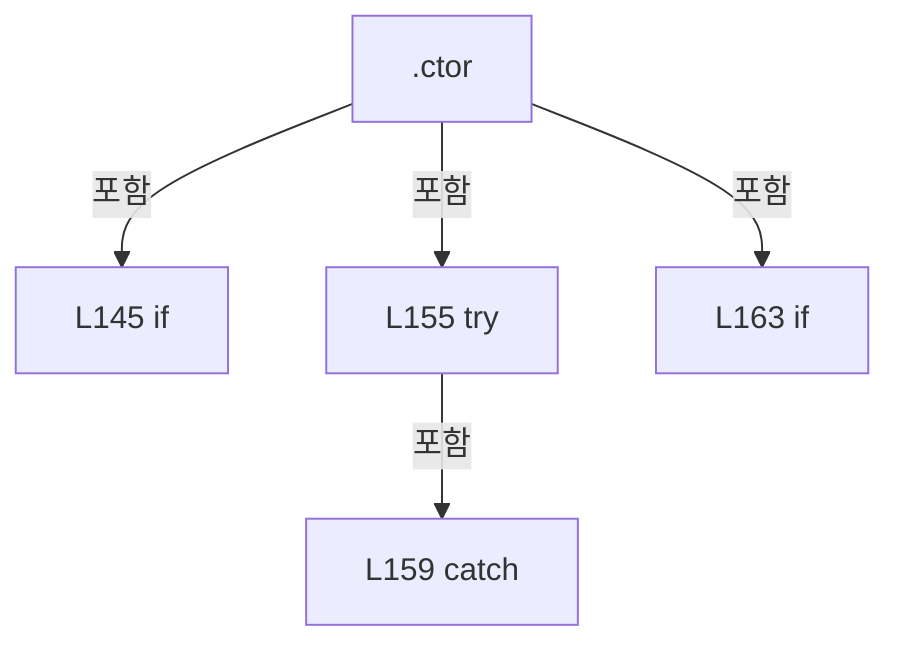

변경 전 점검: 입력/반환 타입, 위 호출자, 예외/취소 경로, 공유 상태와 저장·전송 소비자를 함께 확인합니다. 값의 단위나 물리 방향을 이름만으로 확정하지 않습니다.

### DelegateDeclaration `CProcessStepAction` · L169–169

[Drilling.Common/Station/CStationProcess.cs:169–169](https://github.com/kjuws10-rgb/A3Drilling/blob/5aee8e58439c9b455cae7c9593c9be986c3e682e/Drilling.Common/Station/CStationProcess.cs#L169-L169)

| 항목 | 실제 추출 값 |
| --- | --- |
| 서명 | Drilling.Common.Station.CStationProcess.CProcessStepAction |
| 접근/수식자 | Private / private |
| 반환/값 타입 | 타입 정보 없음 |
| 소속 타입 | NamedType:Drilling.Common.Station.CStationProcess |

입력 계약:

| 이름 | 타입 | 전달 | 선택/기본값 |
| --- | --- | --- | --- |
| processModel | Drilling.Common.Station.ST_PROCESS_MODEL | None | False /  |
| cancellationToken | System.Threading.CancellationToken | None | False /  |

현재 부분 분석에서 직접 연결된 호출자는 없습니다. XAML/이벤트/인터페이스·델리게이트·외부 진입을 추가 확인해야 하며, 미사용으로 판정한 것이 아닙니다.

변경 전 점검: 입력/반환 타입, 위 호출자, 예외/취소 경로, 공유 상태와 저장·전송 소비자를 함께 확인합니다. 값의 단위나 물리 방향을 이름만으로 확정하지 않습니다.

### PropertyDeclaration `Current` · L170–186

[Drilling.Common/Station/CStationProcess.cs:170–186](https://github.com/kjuws10-rgb/A3Drilling/blob/5aee8e58439c9b455cae7c9593c9be986c3e682e/Drilling.Common/Station/CStationProcess.cs#L170-L186)

| 항목 | 실제 추출 값 |
| --- | --- |
| 서명 | Drilling.Common.Station.ST_STATION_PROCESS_STATUS Drilling.Common.Station.CStationProcess.Current |
| 접근/수식자 | Public / public |
| 반환/값 타입 | Drilling.Common.Station.ST_STATION_PROCESS_STATUS |
| 소속 타입 | NamedType:Drilling.Common.Station.CStationProcess |

현재 부분 분석에서 직접 연결된 호출자는 없습니다. XAML/이벤트/인터페이스·델리게이트·외부 진입을 추가 확인해야 하며, 미사용으로 판정한 것이 아닙니다.

변경 전 점검: 입력/반환 타입, 위 호출자, 예외/취소 경로, 공유 상태와 저장·전송 소비자를 함께 확인합니다. 값의 단위나 물리 방향을 이름만으로 확정하지 않습니다.

### GetAccessorDeclaration `get_Current` · L172–185

[Drilling.Common/Station/CStationProcess.cs:172–185](https://github.com/kjuws10-rgb/A3Drilling/blob/5aee8e58439c9b455cae7c9593c9be986c3e682e/Drilling.Common/Station/CStationProcess.cs#L172-L185)

| 항목 | 실제 추출 값 |
| --- | --- |
| 서명 | Drilling.Common.Station.ST_STATION_PROCESS_STATUS Drilling.Common.Station.CStationProcess.Current.get |
| 접근/수식자 | Public / get |
| 반환/값 타입 | Drilling.Common.Station.ST_STATION_PROCESS_STATUS |
| 소속 타입 | NamedType:Drilling.Common.Station.CStationProcess |

현재 부분 분석에서 직접 연결된 호출자는 없습니다. XAML/이벤트/인터페이스·델리게이트·외부 진입을 추가 확인해야 하며, 미사용으로 판정한 것이 아닙니다.

호출하는 대상과 해석 범위:

| 원본 행 | 표현식 | 분석 상태 | 대상/소스 위치 |
| --- | --- | --- | --- |
| 174 | _sequenceActions.GetSnapshot().ToDictionary | resolved | System.Collections.Generic.Dictionary<string, Drilling.Common.Station.ST_SEQUENCE_ACTION_STATUS> System.Collections.Generic.IEnumerable<System.Collections.Generic.KeyValuePair<string, Drilling.Common.Station.ST_SEQUENCE_ACTION_STATUS>>.ToDictionary<System.Collections.Generic.KeyValuePair<string, Drilling.Common.Station.ST_SEQUENCE_ACTION_STATUS>, string, Drilling.Common.Station.ST_SEQUENCE_ACTION_STATUS>(System.Func<System.Collections.Generic.KeyValuePair<string, Drilling.Common.Station.ST_SEQUENCE_ACTION_STATUS>, string>, System.Func<System.Collections.Generic.KeyValuePair<string, Drilling.Common.Station.ST_SEQUENCE_ACTION_STATUS>, Drilling.Common.Station.ST_SEQUENCE_ACTION_STATUS>, System.Collections.Generic.IEqualityComparer<string>?) |
| 174 | _sequenceActions.GetSnapshot | resolved | System.Collections.Generic.IReadOnlyDictionary<string, Drilling.Common.Station.ST_SEQUENCE_ACTION_STATUS> Drilling.Common.Station.CSequenceActionStatusStore.GetSnapshot() · Drilling.Common/Station/CStationManager.cs:163 |
| 176 | _interfaceManager.StageReviewSequences.Actions.GetSnapshot | resolved | System.Collections.Generic.IReadOnlyDictionary<string, Drilling.Common.Station.ST_SEQUENCE_ACTION_STATUS> Drilling.Common.Station.CSequenceActionStatusStore.GetSnapshot() · Drilling.Common/Station/CStationManager.cs:163 |

본문의 실제 연산·분기·예외·반환 순서(원문 위치 순):

| 원본 행 | 종류 | 주석 해설 |
| --- | --- | --- |
| 174 | call | 함수·델리게이트 또는 객체 생성자를 호출합니다: _sequenceActions.GetSnapshot().ToDictionary(pair => pair.Key, pair => pair.Value, StringComparer.OrdinalIgnoreCase) |
| 174 | call | 함수·델리게이트 또는 객체 생성자를 호출합니다: _sequenceActions.GetSnapshot() |
| 174 | local-declaration | 지역 변수를 선언합니다: var actions = _sequenceActions.GetSnapshot().ToDictionary(pair => pair.Key, pair => pair.Value, StringComparer.OrdinalIgnoreCase); |
| 174 | variable-initializer | 변수의 초기값을 지정합니다: actions = _sequenceActions.GetSnapshot().ToDictionary(pair => pair.Key, pair => pair.Value, StringComparer.OrdinalIgnoreCase) |
| 175 | if | 조건에 따라 분기합니다: if (_interfaceManager is not null) |
| 176 | call | 함수·델리게이트 또는 객체 생성자를 호출합니다: _interfaceManager.StageReviewSequences.Actions.GetSnapshot() |
| 176 | foreach | 컬렉션 요소를 순회합니다: foreach (var pair in _interfaceManager.StageReviewSequences.Actions.GetSnapshot()) |
| 177 | assignment | 값을 대상에 대입합니다: actions[pair.Key] = pair.Value |
| 178 | return | 호출자에게 값 또는 제어를 반환합니다: return _snapshot with { SequenceActions = actions, StageRequest = StageRequests.Status, ZeroLinePrewait = _zeroLinePrewait?.Status, ZeroLine = _zeroLineCycle?.Status }; |
| 180 | assignment | 값을 대상에 대입합니다: SequenceActions = actions |
| 181 | assignment | 값을 대상에 대입합니다: StageRequest = StageRequests.Status |
| 182 | assignment | 값을 대상에 대입합니다: ZeroLinePrewait = _zeroLinePrewait?.Status |
| 183 | assignment | 값을 대상에 대입합니다: ZeroLine = _zeroLineCycle?.Status |

제어 구문의 포함 구조(실제 실행 순서/CFG가 아닌 구문 탐색 그림):

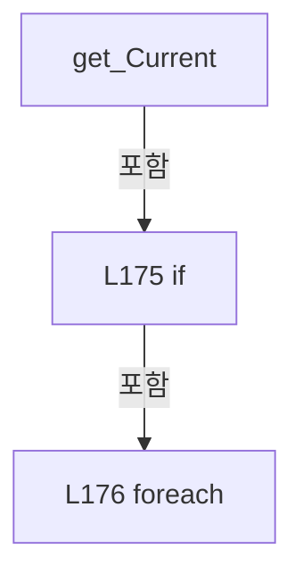

변경 전 점검: 입력/반환 타입, 위 호출자, 예외/취소 경로, 공유 상태와 저장·전송 소비자를 함께 확인합니다. 값의 단위나 물리 방향을 이름만으로 확정하지 않습니다.

### PropertyDeclaration `Status` · L188–194

[Drilling.Common/Station/CStationProcess.cs:188–194](https://github.com/kjuws10-rgb/A3Drilling/blob/5aee8e58439c9b455cae7c9593c9be986c3e682e/Drilling.Common/Station/CStationProcess.cs#L188-L194)

| 항목 | 실제 추출 값 |
| --- | --- |
| 서명 | Drilling.Common.Station.ST_STATION_STATUS Drilling.Common.Station.CStationProcess.Status |
| 접근/수식자 | Public / public |
| 반환/값 타입 | Drilling.Common.Station.ST_STATION_STATUS |
| 소속 타입 | NamedType:Drilling.Common.Station.CStationProcess |

현재 부분 분석에서 직접 연결된 호출자는 없습니다. XAML/이벤트/인터페이스·델리게이트·외부 진입을 추가 확인해야 하며, 미사용으로 판정한 것이 아닙니다.

변경 전 점검: 입력/반환 타입, 위 호출자, 예외/취소 경로, 공유 상태와 저장·전송 소비자를 함께 확인합니다. 값의 단위나 물리 방향을 이름만으로 확정하지 않습니다.

### GetAccessorDeclaration `get_Status` · L190–193

[Drilling.Common/Station/CStationProcess.cs:190–193](https://github.com/kjuws10-rgb/A3Drilling/blob/5aee8e58439c9b455cae7c9593c9be986c3e682e/Drilling.Common/Station/CStationProcess.cs#L190-L193)

| 항목 | 실제 추출 값 |
| --- | --- |
| 서명 | Drilling.Common.Station.ST_STATION_STATUS Drilling.Common.Station.CStationProcess.Status.get |
| 접근/수식자 | Public / get |
| 반환/값 타입 | Drilling.Common.Station.ST_STATION_STATUS |
| 소속 타입 | NamedType:Drilling.Common.Station.CStationProcess |

현재 부분 분석에서 직접 연결된 호출자는 없습니다. XAML/이벤트/인터페이스·델리게이트·외부 진입을 추가 확인해야 하며, 미사용으로 판정한 것이 아닙니다.

호출하는 대상과 해석 범위:

| 원본 행 | 표현식 | 분석 상태 | 대상/소스 위치 |
| --- | --- | --- | --- |
| 192 | ReadStationStatus | resolved | Drilling.Common.Station.ST_STATION_STATUS Drilling.Common.Station.CStationProcess.ReadStationStatus() · Drilling.Common/Station/CStationProcess.cs:2337 |

본문의 실제 연산·분기·예외·반환 순서(원문 위치 순):

| 원본 행 | 종류 | 주석 해설 |
| --- | --- | --- |
| 192 | call | 함수·델리게이트 또는 객체 생성자를 호출합니다: ReadStationStatus() |
| 192 | return | 호출자에게 값 또는 제어를 반환합니다: return ReadStationStatus(); |

변경 전 점검: 입력/반환 타입, 위 호출자, 예외/취소 경로, 공유 상태와 저장·전송 소비자를 함께 확인합니다. 값의 단위나 물리 방향을 이름만으로 확정하지 않습니다.

### PropertyDeclaration `SequenceState` · L196–202

[Drilling.Common/Station/CStationProcess.cs:196–202](https://github.com/kjuws10-rgb/A3Drilling/blob/5aee8e58439c9b455cae7c9593c9be986c3e682e/Drilling.Common/Station/CStationProcess.cs#L196-L202)

| 항목 | 실제 추출 값 |
| --- | --- |
| 서명 | Drilling.Common.Station.EN_STATION_SEQUENCE Drilling.Common.Station.CStationProcess.SequenceState |
| 접근/수식자 | Public / public |
| 반환/값 타입 | Drilling.Common.Station.EN_STATION_SEQUENCE |
| 소속 타입 | NamedType:Drilling.Common.Station.CStationProcess |

현재 부분 분석에서 직접 연결된 호출자는 없습니다. XAML/이벤트/인터페이스·델리게이트·외부 진입을 추가 확인해야 하며, 미사용으로 판정한 것이 아닙니다.

변경 전 점검: 입력/반환 타입, 위 호출자, 예외/취소 경로, 공유 상태와 저장·전송 소비자를 함께 확인합니다. 값의 단위나 물리 방향을 이름만으로 확정하지 않습니다.

### GetAccessorDeclaration `get_SequenceState` · L198–201

[Drilling.Common/Station/CStationProcess.cs:198–201](https://github.com/kjuws10-rgb/A3Drilling/blob/5aee8e58439c9b455cae7c9593c9be986c3e682e/Drilling.Common/Station/CStationProcess.cs#L198-L201)

| 항목 | 실제 추출 값 |
| --- | --- |
| 서명 | Drilling.Common.Station.EN_STATION_SEQUENCE Drilling.Common.Station.CStationProcess.SequenceState.get |
| 접근/수식자 | Public / get |
| 반환/값 타입 | Drilling.Common.Station.EN_STATION_SEQUENCE |
| 소속 타입 | NamedType:Drilling.Common.Station.CStationProcess |

현재 부분 분석에서 직접 연결된 호출자는 없습니다. XAML/이벤트/인터페이스·델리게이트·외부 진입을 추가 확인해야 하며, 미사용으로 판정한 것이 아닙니다.

호출하는 대상과 해석 범위:

| 원본 행 | 표현식 | 분석 상태 | 대상/소스 위치 |
| --- | --- | --- | --- |
| 200 | ReadSequenceState | resolved | Drilling.Common.Station.EN_STATION_SEQUENCE Drilling.Common.Station.CStationProcess.ReadSequenceState() · Drilling.Common/Station/CStationProcess.cs:2329 |

본문의 실제 연산·분기·예외·반환 순서(원문 위치 순):

| 원본 행 | 종류 | 주석 해설 |
| --- | --- | --- |
| 200 | call | 함수·델리게이트 또는 객체 생성자를 호출합니다: ReadSequenceState() |
| 200 | return | 호출자에게 값 또는 제어를 반환합니다: return ReadSequenceState(); |

변경 전 점검: 입력/반환 타입, 위 호출자, 예외/취소 경로, 공유 상태와 저장·전송 소비자를 함께 확인합니다. 값의 단위나 물리 방향을 이름만으로 확정하지 않습니다.

### MethodDeclaration `GetProcessFlow` · L204–207

[Drilling.Common/Station/CStationProcess.cs:204–207](https://github.com/kjuws10-rgb/A3Drilling/blob/5aee8e58439c9b455cae7c9593c9be986c3e682e/Drilling.Common/Station/CStationProcess.cs#L204-L207)

| 항목 | 실제 추출 값 |
| --- | --- |
| 서명 | System.Collections.Generic.IReadOnlyList<Drilling.Common.Station.ST_STATION_PROCESS_FLOW_ITEM> Drilling.Common.Station.CStationProcess.GetProcessFlow() |
| 접근/수식자 | Public / public, static |
| 반환/값 타입 | System.Collections.Generic.IReadOnlyList<Drilling.Common.Station.ST_STATION_PROCESS_FLOW_ITEM> |
| 소속 타입 | NamedType:Drilling.Common.Station.CStationProcess |

정적 호출자로 확인된 위치:

| 호출 파일/행 | 호출 표현식 | 런타임 분기 가능 |
| --- | --- | --- |
| [Drilling.Common/Station/CStationManager.cs:85–85](https://github.com/kjuws10-rgb/A3Drilling/blob/5aee8e58439c9b455cae7c9593c9be986c3e682e/Drilling.Common/Station/CStationManager.cs#L85-L85) | CStationProcess.GetProcessFlow | False |

본문의 실제 연산·분기·예외·반환 순서(원문 위치 순):

| 원본 행 | 종류 | 주석 해설 |
| --- | --- | --- |
| 206 | return | 호출자에게 값 또는 제어를 반환합니다: return ProcessFlowItems; |

변경 전 점검: 입력/반환 타입, 위 호출자, 예외/취소 경로, 공유 상태와 저장·전송 소비자를 함께 확인합니다. 값의 단위나 물리 방향을 이름만으로 확정하지 않습니다.

### MethodDeclaration `PrepareProcess` · L209–225

[Drilling.Common/Station/CStationProcess.cs:209–225](https://github.com/kjuws10-rgb/A3Drilling/blob/5aee8e58439c9b455cae7c9593c9be986c3e682e/Drilling.Common/Station/CStationProcess.cs#L209-L225)

| 항목 | 실제 추출 값 |
| --- | --- |
| 서명 | Drilling.Common.Station.ST_STATION_PROCESS_STATUS Drilling.Common.Station.CStationProcess.PrepareProcess(string, string, string, string, System.Collections.Generic.IReadOnlyDictionary<string, string>, System.Threading.CancellationToken, bool) |
| 접근/수식자 | Public / public |
| 반환/값 타입 | Drilling.Common.Station.ST_STATION_PROCESS_STATUS |
| 소속 타입 | NamedType:Drilling.Common.Station.CStationProcess |

입력 계약:

| 이름 | 타입 | 전달 | 선택/기본값 |
| --- | --- | --- | --- |
| processId | string | None | False /  |
| recipeId | string | None | False /  |
| glassId | string | None | False /  |
| lotId | string | None | False /  |
| parameters | System.Collections.Generic.IReadOnlyDictionary<string, string> | None | False /  |
| cancellationToken | System.Threading.CancellationToken | None | True / null |
| preserveSequenceActions | bool | None | True / false |

정적 호출자로 확인된 위치:

| 호출 파일/행 | 호출 표현식 | 런타임 분기 가능 |
| --- | --- | --- |
| [Drilling.Common/Station/CStationManager.cs:92–92](https://github.com/kjuws10-rgb/A3Drilling/blob/5aee8e58439c9b455cae7c9593c9be986c3e682e/Drilling.Common/Station/CStationManager.cs#L92-L92) | _processStation.PrepareProcess | False |
| [Drilling.Common/Station/CStationProcess.cs:3994–3994](https://github.com/kjuws10-rgb/A3Drilling/blob/5aee8e58439c9b455cae7c9593c9be986c3e682e/Drilling.Common/Station/CStationProcess.cs#L3994-L3994) | PrepareProcess | False |

호출하는 대상과 해석 범위:

| 원본 행 | 표현식 | 분석 상태 | 대상/소스 위치 |
| --- | --- | --- | --- |
| 221 | ReadSequenceState | resolved | Drilling.Common.Station.EN_STATION_SEQUENCE Drilling.Common.Station.CStationProcess.ReadSequenceState() · Drilling.Common/Station/CStationProcess.cs:2329 |
| 222 | new InvalidOperationException | resolved | System.InvalidOperationException.InvalidOperationException(string?) |
| 223 | PrepareProcessCore | resolved | Drilling.Common.Station.ST_STATION_PROCESS_STATUS Drilling.Common.Station.CStationProcess.PrepareProcessCore(string, string, string, string, System.Collections.Generic.IReadOnlyDictionary<string, string>, System.Threading.CancellationToken, bool, System.Collections.Generic.IReadOnlySet<int>?) · Drilling.Common/Station/CStationProcess.cs:227 |

본문의 실제 연산·분기·예외·반환 순서(원문 위치 순):

| 원본 행 | 종류 | 주석 해설 |
| --- | --- | --- |
| 219 | lock | 공유 상태의 임계 구역에 진입합니다: lock (_sequenceLock) |
| 221 | call | 함수·델리게이트 또는 객체 생성자를 호출합니다: ReadSequenceState() |
| 221 | if | 조건에 따라 분기합니다: if (_manualMofRunning &#124;&#124; _manualMofRequiresStop &#124;&#124; ReadSequenceState() != EN_STATION_SEQUENCE.Ready) |
| 222 | call | 함수·델리게이트 또는 객체 생성자를 호출합니다: new InvalidOperationException("Station is busy. PrepareProcess is not allowed during processing.") |
| 222 | throw | 예외를 발생/전달합니다: throw new InvalidOperationException("Station is busy. PrepareProcess is not allowed during processing."); |
| 223 | call | 함수·델리게이트 또는 객체 생성자를 호출합니다: PrepareProcessCore(processId, recipeId, glassId, lotId, parameters, cancellationToken, preserveSequenceActions) |
| 223 | return | 호출자에게 값 또는 제어를 반환합니다: return PrepareProcessCore(processId, recipeId, glassId, lotId, parameters, cancellationToken, preserveSequenceActions); |

제어 구문의 포함 구조(실제 실행 순서/CFG가 아닌 구문 탐색 그림):

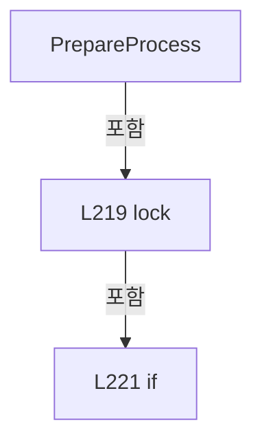

변경 전 점검: 입력/반환 타입, 위 호출자, 예외/취소 경로, 공유 상태와 저장·전송 소비자를 함께 확인합니다. 값의 단위나 물리 방향을 이름만으로 확정하지 않습니다.

### MethodDeclaration `PrepareProcessCore` · L227–268

[Drilling.Common/Station/CStationProcess.cs:227–268](https://github.com/kjuws10-rgb/A3Drilling/blob/5aee8e58439c9b455cae7c9593c9be986c3e682e/Drilling.Common/Station/CStationProcess.cs#L227-L268)

| 항목 | 실제 추출 값 |
| --- | --- |
| 서명 | Drilling.Common.Station.ST_STATION_PROCESS_STATUS Drilling.Common.Station.CStationProcess.PrepareProcessCore(string, string, string, string, System.Collections.Generic.IReadOnlyDictionary<string, string>, System.Threading.CancellationToken, bool, System.Collections.Generic.IReadOnlySet<int>?) |
| 접근/수식자 | Private / private |
| 반환/값 타입 | Drilling.Common.Station.ST_STATION_PROCESS_STATUS |
| 소속 타입 | NamedType:Drilling.Common.Station.CStationProcess |

입력 계약:

| 이름 | 타입 | 전달 | 선택/기본값 |
| --- | --- | --- | --- |
| processId | string | None | False /  |
| recipeId | string | None | False /  |
| glassId | string | None | False /  |
| lotId | string | None | False /  |
| parameters | System.Collections.Generic.IReadOnlyDictionary<string, string> | None | False /  |
| cancellationToken | System.Threading.CancellationToken | None | False /  |
| preserveSequenceActions | bool | None | False /  |
| manualHeads | System.Collections.Generic.IReadOnlySet<int>? | None | True / null |

정적 호출자로 확인된 위치:

| 호출 파일/행 | 호출 표현식 | 런타임 분기 가능 |
| --- | --- | --- |
| [Drilling.Common/Station/CStationProcess.cs:223–223](https://github.com/kjuws10-rgb/A3Drilling/blob/5aee8e58439c9b455cae7c9593c9be986c3e682e/Drilling.Common/Station/CStationProcess.cs#L223-L223) | PrepareProcessCore | False |
| [Drilling.Common/Station/CStationProcess.cs:3505–3505](https://github.com/kjuws10-rgb/A3Drilling/blob/5aee8e58439c9b455cae7c9593c9be986c3e682e/Drilling.Common/Station/CStationProcess.cs#L3505-L3505) | PrepareProcessCore | False |

호출하는 대상과 해석 범위:

| 원본 행 | 표현식 | 분석 상태 | 대상/소스 위치 |
| --- | --- | --- | --- |
| 238 | cancellationToken.ThrowIfCancellationRequested | resolved | void System.Threading.CancellationToken.ThrowIfCancellationRequested() |
| 239 | ClearProcessLogs | resolved | void Drilling.Common.Station.CStationProcess.ClearProcessLogs() · Drilling.Common/Station/CStationProcess.cs:2386 |
| 245 | ResetAutoStepStatesCore | resolved | void Drilling.Common.Station.CStationProcess.ResetAutoStepStatesCore(bool) · Drilling.Common/Station/CStationProcess.cs:1794 |
| 246 | SetSequenceState | resolved | void Drilling.Common.Station.CStationProcess.SetSequenceState(Drilling.Common.Station.EN_STATION_SEQUENCE) · Drilling.Common/Station/CStationProcess.cs:2290 |
| 247 | BuildRuntimeParameters | resolved | System.Collections.Generic.IReadOnlyDictionary<string, string> Drilling.Common.Station.CStationProcess.BuildRuntimeParameters(string, System.Collections.Generic.IReadOnlyDictionary<string, string>, System.Threading.CancellationToken) · Drilling.Common/Station/CStationProcess.cs:1526 |
| 250 | new Dictionary<string, string> | resolved | System.Collections.Generic.Dictionary<string, string>.Dictionary(System.Collections.Generic.IEnumerable<System.Collections.Generic.KeyValuePair<string, string>>, System.Collections.Generic.IEqualityComparer<string>?) |
| 252 | manualHeads.Contains | resolved · 동적 구현 선택 가능 | bool System.Collections.Generic.IReadOnlySet<int>.Contains(int) |
| 256 | BuildProcessModel | resolved | Drilling.Common.Station.ST_PROCESS_MODEL Drilling.Common.Station.CStationProcess.BuildProcessModel(string, string, string, string, System.Collections.Generic.IReadOnlyDictionary<string, string>) · Drilling.Common/Station/CStationProcess.cs:1603 |
| 260 | BuildPreview | resolved | System.Collections.Generic.IReadOnlyList<Drilling.Common.Station.ST_HEAD_PREVIEW_DATA> Drilling.Common.Station.CStationProcess.BuildPreview(Drilling.Common.Station.ST_PROCESS_MODEL, Drilling.Common.Station.EN_HEAD_PROCESS_STATUS) · Drilling.Common/Station/CStationProcess.cs:1516 |
| 261 | BuildStatistics | resolved | Drilling.Common.Station.ST_PROCESS_STATISTICS Drilling.Common.Station.CStationProcess.BuildStatistics(Drilling.Common.Station.ST_PROCESS_MODEL?, double, System.TimeSpan) · Drilling.Common/Station/CStationProcess.cs:1772 |
| 262 | AddProcessLog | resolved | void Drilling.Common.Station.CStationProcess.AddProcessLog(string, string, string) · Drilling.Common/Station/CStationProcess.cs:2366 |
| 263 | AddProcessLog | resolved | void Drilling.Common.Station.CStationProcess.AddProcessLog(string, string, string) · Drilling.Common/Station/CStationProcess.cs:2366 |
| 264 | SetAutoStepState | resolved | void Drilling.Common.Station.CStationProcess.SetAutoStepState(string, string) · Drilling.Common/Station/CStationProcess.cs:1805 |
| 265 | CreateSnapshot | resolved | Drilling.Common.Station.ST_STATION_PROCESS_STATUS Drilling.Common.Station.CStationProcess.CreateSnapshot(Drilling.Common.Station.ST_PROCESS_MODEL?, System.Collections.Generic.IReadOnlyList<Drilling.Common.Station.ST_HEAD_PREVIEW_DATA>, Drilling.Common.Station.EN_SCRIPT_STATUS, Drilling.Common.Station.EN_PROCESS_STEP, Drilling.Common.Station.ST_PROCESS_RESULT?) · Drilling.Common/Station/CStationProcess.cs:1337 |
| 266 | SetStationState | resolved | void Drilling.Common.Station.CStationProcess.SetStationState(Drilling.Common.Station.EN_STATION_STATE, Drilling.Common.Station.EN_PROCESS_STEP, Drilling.Common.Station.EN_SCRIPT_STATUS, string) · Drilling.Common/Station/CStationProcess.cs:2345 |

본문의 실제 연산·분기·예외·반환 순서(원문 위치 순):

| 원본 행 | 종류 | 주석 해설 |
| --- | --- | --- |
| 238 | call | 함수·델리게이트 또는 객체 생성자를 호출합니다: cancellationToken.ThrowIfCancellationRequested() |
| 239 | call | 함수·델리게이트 또는 객체 생성자를 호출합니다: ClearProcessLogs() |
| 240 | assignment | 값을 대상에 대입합니다: _lastInterLockItems = [] |
| 241 | assignment | 값을 대상에 대입합니다: _scriptCreatedAt = null |
| 242 | assignment | 값을 대상에 대입합니다: _scriptStartedAt = null |
| 243 | assignment | 값을 대상에 대입합니다: _scriptCompletedAt = null |
| 244 | assignment | 값을 대상에 대입합니다: _lastScript = null |
| 245 | call | 함수·델리게이트 또는 객체 생성자를 호출합니다: ResetAutoStepStatesCore(preserveSequenceActions) |
| 246 | call | 함수·델리게이트 또는 객체 생성자를 호출합니다: SetSequenceState(EN_STATION_SEQUENCE.Ready) |
| 247 | call | 함수·델리게이트 또는 객체 생성자를 호출합니다: BuildRuntimeParameters(recipeId, parameters, cancellationToken) |
| 247 | local-declaration | 지역 변수를 선언합니다: var runtimeParameters = BuildRuntimeParameters(recipeId, parameters, cancellationToken); |
| 247 | variable-initializer | 변수의 초기값을 지정합니다: runtimeParameters = BuildRuntimeParameters(recipeId, parameters, cancellationToken) |
| 248 | if | 조건에 따라 분기합니다: if (manualHeads is not null) |
| 250 | call | 함수·델리게이트 또는 객체 생성자를 호출합니다: new Dictionary<string, string>(runtimeParameters, StringComparer.OrdinalIgnoreCase) |
| 250 | local-declaration | 지역 변수를 선언합니다: var scoped = new Dictionary<string, string>(runtimeParameters, StringComparer.OrdinalIgnoreCase); |
| 250 | variable-initializer | 변수의 초기값을 지정합니다: scoped = new Dictionary<string, string>(runtimeParameters, StringComparer.OrdinalIgnoreCase) |
| 251 | variable-initializer | 변수의 초기값을 지정합니다: head = 1 |
| 251 | for | 초기화·조건·증감이 있는 반복입니다: for (var head = 1; head <= 8; head++) |
| 252 | assignment | 값을 대상에 대입합니다: scoped[$"H{head:00}_USE"] = manualHeads.Contains(head) ? "ON" : "OFF" |
| 252 | call | 함수·델리게이트 또는 객체 생성자를 호출합니다: manualHeads.Contains(head) |
| 252 | conditional-expression | 조건에 따라 결과식을 선택합니다: manualHeads.Contains(head) ? "ON" : "OFF" |
| 253 | assignment | 값을 대상에 대입합니다: runtimeParameters = scoped |
| 256 | assignment | 값을 대상에 대입합니다: _processModel = BuildProcessModel(processId, recipeId, glassId, lotId, runtimeParameters) |
| 256 | call | 함수·델리게이트 또는 객체 생성자를 호출합니다: BuildProcessModel(processId, recipeId, glassId, lotId, runtimeParameters) |
| 257 | assignment | 값을 대상에 대입합니다: _preparedReviewOffsetInvalidated = false |
| 258 | assignment | 값을 대상에 대입합니다: _stageModelLogCycle = StageRequests?.LogCycleId ?? "" |
| 259 | assignment | 값을 대상에 대입합니다: _protectWindowCounted = false |
| 260 | call | 함수·델리게이트 또는 객체 생성자를 호출합니다: BuildPreview(_processModel, EN_HEAD_PROCESS_STATUS.Ready) |
| 260 | local-declaration | 지역 변수를 선언합니다: var preview = BuildPreview(_processModel, EN_HEAD_PROCESS_STATUS.Ready); |
| 260 | variable-initializer | 변수의 초기값을 지정합니다: preview = BuildPreview(_processModel, EN_HEAD_PROCESS_STATUS.Ready) |
| 261 | assignment | 값을 대상에 대입합니다: _statistics = BuildStatistics(_processModel, 0.0, TimeSpan.Zero) |
| 261 | call | 함수·델리게이트 또는 객체 생성자를 호출합니다: BuildStatistics(_processModel, 0.0, TimeSpan.Zero) |
| 262 | call | 함수·델리게이트 또는 객체 생성자를 호출합니다: AddProcessLog("INFO", "SCAN_PC", $"Process model prepared ({_processModel.ProcessId})") |
| 263 | call | 함수·델리게이트 또는 객체 생성자를 호출합니다: AddProcessLog("INFO", "PARSER", $"Head parameter parsed ({preview.Count} heads / {_statistics.TotalShots} shots)") |
| 264 | call | 함수·델리게이트 또는 객체 생성자를 호출합니다: SetAutoStepState(AutoStepIdle, AutoStepOk) |
| 265 | assignment | 값을 대상에 대입합니다: _snapshot = CreateSnapshot(_processModel, preview, EN_SCRIPT_STATUS.NotCreated, EN_PROCESS_STEP.Idle, null) |
| 265 | call | 함수·델리게이트 또는 객체 생성자를 호출합니다: CreateSnapshot(_processModel, preview, EN_SCRIPT_STATUS.NotCreated, EN_PROCESS_STEP.Idle, null) |
| 266 | call | 함수·델리게이트 또는 객체 생성자를 호출합니다: SetStationState(EN_STATION_STATE.Idle, EN_PROCESS_STEP.Idle, EN_SCRIPT_STATUS.NotCreated, $"Process model prepared: {_processModel.ProcessId}") |
| 267 | return | 호출자에게 값 또는 제어를 반환합니다: return _snapshot; |

제어 구문의 포함 구조(실제 실행 순서/CFG가 아닌 구문 탐색 그림):

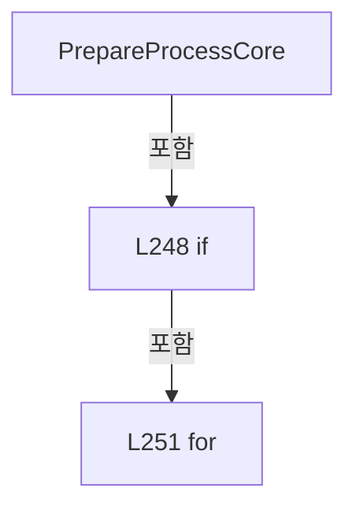

변경 전 점검: 입력/반환 타입, 위 호출자, 예외/취소 경로, 공유 상태와 저장·전송 소비자를 함께 확인합니다. 값의 단위나 물리 방향을 이름만으로 확정하지 않습니다.

### MethodDeclaration `Start` · L270–321

[Drilling.Common/Station/CStationProcess.cs:270–321](https://github.com/kjuws10-rgb/A3Drilling/blob/5aee8e58439c9b455cae7c9593c9be986c3e682e/Drilling.Common/Station/CStationProcess.cs#L270-L321)

| 항목 | 실제 추출 값 |
| --- | --- |
| 서명 | Drilling.Common.Station.ST_STATION_PROCESS_STATUS Drilling.Common.Station.CStationProcess.Start(System.Threading.CancellationToken) |
| 접근/수식자 | Public / public |
| 반환/값 타입 | Drilling.Common.Station.ST_STATION_PROCESS_STATUS |
| 소속 타입 | NamedType:Drilling.Common.Station.CStationProcess |

입력 계약:

| 이름 | 타입 | 전달 | 선택/기본값 |
| --- | --- | --- | --- |
| cancellationToken | System.Threading.CancellationToken | None | True / null |

정적 호출자로 확인된 위치:

| 호출 파일/행 | 호출 표현식 | 런타임 분기 가능 |
| --- | --- | --- |
| [Drilling.Common/Station/CStationManager.cs:99–99](https://github.com/kjuws10-rgb/A3Drilling/blob/5aee8e58439c9b455cae7c9593c9be986c3e682e/Drilling.Common/Station/CStationManager.cs#L99-L99) | _processStation.Start | False |

호출하는 대상과 해석 범위:

| 원본 행 | 표현식 | 분석 상태 | 대상/소스 위치 |
| --- | --- | --- | --- |
| 272 | cancellationToken.ThrowIfCancellationRequested | resolved | void System.Threading.CancellationToken.ThrowIfCancellationRequested() |
| 282 | new InvalidOperationException | resolved | System.InvalidOperationException.InvalidOperationException(string?) |
| 283 | EnsureStartAllowed | resolved | void Drilling.Common.Station.CStationProcess.EnsureStartAllowed() · Drilling.Common/Station/CStationProcess.cs:438 |
| 284 | ReadProcessModelForStart | resolved | Drilling.Common.Station.ST_PROCESS_MODEL Drilling.Common.Station.CStationProcess.ReadProcessModelForStart() · Drilling.Common/Station/CStationProcess.cs:446 |
| 287 | EnsurePreparedReviewOffsetIsCurrent | resolved | void Drilling.Common.Station.CStationProcess.EnsurePreparedReviewOffsetIsCurrent(Drilling.Common.Station.ST_PROCESS_MODEL, System.Threading.CancellationToken) · Drilling.Common/Station/CStationProcess.cs:1575 |
| 289 | GetInterLockSummary | resolved | Drilling.Common.InterLock.ST_INTERLOCK_SUMMARY Drilling.Common.Station.CStationProcess.GetInterLockSummary(System.Threading.CancellationToken, Drilling.Common.Station.ST_PROCESS_MODEL?) · Drilling.Common/Station/CStationProcess.cs:1362 |
| 292 | new InvalidOperationException | resolved | System.InvalidOperationException.InvalidOperationException(string?) |
| 292 | FormatStartInterLockBlockedMessage | resolved | string Drilling.Common.Station.CStationProcess.FormatStartInterLockBlockedMessage(Drilling.Common.InterLock.ST_INTERLOCK_SUMMARY) · Drilling.Common/Station/CStationProcess.cs:2427 |
| 303 | new InvalidOperationException | resolved | System.InvalidOperationException.InvalidOperationException(string?) |
| 304 | EnsureStartAllowed | resolved | void Drilling.Common.Station.CStationProcess.EnsureStartAllowed() · Drilling.Common/Station/CStationProcess.cs:438 |
| 306 | new InvalidOperationException | resolved | System.InvalidOperationException.InvalidOperationException(string?) |
| 307 | .Dispose | resolved | void System.Threading.CancellationTokenSource.Dispose() |
| 308 | CancellationTokenSource.CreateLinkedTokenSource | resolved | System.Threading.CancellationTokenSource System.Threading.CancellationTokenSource.CreateLinkedTokenSource(System.Threading.CancellationToken) |
| 311 | (_stationStatus with { ChangedAt = DateTimeOffset.Now } ).WithSequenceState | resolved | Drilling.Common.Station.ST_STATION_STATUS Drilling.Common.Station.ST_STATION_STATUS.WithSequenceState(Drilling.Common.Station.EN_STATION_SEQUENCE?) · Drilling.Common/Station/CStationManager.cs:534 |
| 319 | base.Start | resolved | void Drilling.Common.Threading.CtrlThread.Start(int, string) · Drilling.Common/Threading/CtrlThread.cs:60 |

본문의 실제 연산·분기·예외·반환 순서(원문 위치 순):

| 원본 행 | 종류 | 주석 해설 |
| --- | --- | --- |
| 272 | call | 함수·델리게이트 또는 객체 생성자를 호출합니다: cancellationToken.ThrowIfCancellationRequested() |
| 273 | local-declaration | 지역 변수를 선언합니다: ST_PROCESS_MODEL processModel; |
| 274 | lock | 공유 상태의 임계 구역에 진입합니다: lock (_sequenceLock) |
| 276 | if | 조건에 따라 분기합니다: if (_sequenceState != EN_STATION_SEQUENCE.Ready) |
| 278 | return | 호출자에게 값 또는 제어를 반환합니다: return _snapshot; |
| 281 | if | 조건에 따라 분기합니다: if (_manualMofRunning &#124;&#124; _manualMofRequiresStop) |
| 282 | call | 함수·델리게이트 또는 객체 생성자를 호출합니다: new InvalidOperationException("Manual MOF is active or requires STOP.") |
| 282 | throw | 예외를 발생/전달합니다: throw new InvalidOperationException("Manual MOF is active or requires STOP."); |
| 283 | call | 함수·델리게이트 또는 객체 생성자를 호출합니다: EnsureStartAllowed() |
| 284 | assignment | 값을 대상에 대입합니다: processModel = ReadProcessModelForStart() |
| 284 | call | 함수·델리게이트 또는 객체 생성자를 호출합니다: ReadProcessModelForStart() |
| 287 | call | 함수·델리게이트 또는 객체 생성자를 호출합니다: EnsurePreparedReviewOffsetIsCurrent(processModel, cancellationToken) |
| 289 | call | 함수·델리게이트 또는 객체 생성자를 호출합니다: GetInterLockSummary(cancellationToken, processModel) |
| 289 | local-declaration | 지역 변수를 선언합니다: var startInterLock = GetInterLockSummary(cancellationToken, processModel); |
| 289 | variable-initializer | 변수의 초기값을 지정합니다: startInterLock = GetInterLockSummary(cancellationToken, processModel) |
| 290 | if | 조건에 따라 분기합니다: if (!startInterLock.CanAutoRun) |
| 292 | call | 함수·델리게이트 또는 객체 생성자를 호출합니다: new InvalidOperationException(FormatStartInterLockBlockedMessage(startInterLock)) |
| 292 | call | 함수·델리게이트 또는 객체 생성자를 호출합니다: FormatStartInterLockBlockedMessage(startInterLock) |
| 292 | throw | 예외를 발생/전달합니다: throw new InvalidOperationException(FormatStartInterLockBlockedMessage(startInterLock)); |
| 295 | lock | 공유 상태의 임계 구역에 진입합니다: lock (_sequenceLock) |
| 297 | if | 조건에 따라 분기합니다: if (_sequenceState != EN_STATION_SEQUENCE.Ready) |
| 299 | return | 호출자에게 값 또는 제어를 반환합니다: return _snapshot; |
| 302 | if | 조건에 따라 분기합니다: if (_manualMofRunning &#124;&#124; _manualMofRequiresStop) |
| 303 | call | 함수·델리게이트 또는 객체 생성자를 호출합니다: new InvalidOperationException("Manual MOF is active or requires STOP.") |
| 303 | throw | 예외를 발생/전달합니다: throw new InvalidOperationException("Manual MOF is active or requires STOP."); |
| 304 | call | 함수·델리게이트 또는 객체 생성자를 호출합니다: EnsureStartAllowed() |
| 305 | if | 조건에 따라 분기합니다: if (_preparedReviewOffsetInvalidated) |
| 306 | call | 함수·델리게이트 또는 객체 생성자를 호출합니다: new InvalidOperationException("Review Offset이 변경되어 준비된 가공 모델이 무효화되었습니다. DoReady를 다시 실행해 주세요.") |
| 306 | throw | 예외를 발생/전달합니다: throw new InvalidOperationException("Review Offset이 변경되어 준비된 가공 모델이 무효화되었습니다. DoReady를 다시 실행해 주세요."); |
| 307 | call | 함수·델리게이트 또는 객체 생성자를 호출합니다: .Dispose() |
| 308 | assignment | 값을 대상에 대입합니다: _sequenceCancellation = CancellationTokenSource.CreateLinkedTokenSource(cancellationToken) |
| 308 | call | 함수·델리게이트 또는 객체 생성자를 호출합니다: CancellationTokenSource.CreateLinkedTokenSource(cancellationToken) |
| 309 | assignment | 값을 대상에 대입합니다: _sequenceError = "" |
| 310 | assignment | 값을 대상에 대입합니다: _sequenceState = EN_STATION_SEQUENCE.PowerCheck |
| 311 | assignment | 값을 대상에 대입합니다: _stationStatus = (_stationStatus with { ChangedAt = DateTimeOffset.Now } ).WithSequenceState(EN_STATION_SEQUENCE.PowerCheck) |
| 311 | call | 함수·델리게이트 또는 객체 생성자를 호출합니다: (_stationStatus with { ChangedAt = DateTimeOffset.Now } ).WithSequenceState(EN_STATION_SEQUENCE.PowerCheck) |
| 313 | assignment | 값을 대상에 대입합니다: ChangedAt = DateTimeOffset.Now |
| 319 | call | 함수·델리게이트 또는 객체 생성자를 호출합니다: base.Start(10, "StationProcess") |
| 320 | return | 호출자에게 값 또는 제어를 반환합니다: return _snapshot; |

제어 구문의 포함 구조(실제 실행 순서/CFG가 아닌 구문 탐색 그림):

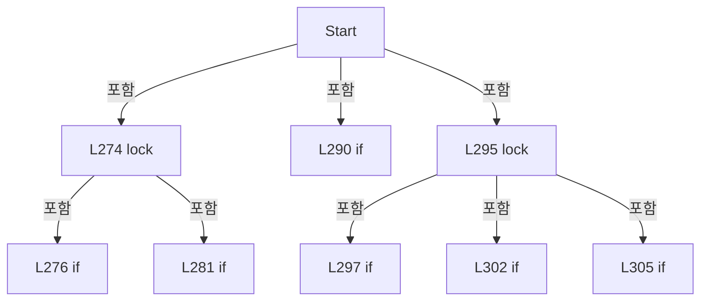

변경 전 점검: 입력/반환 타입, 위 호출자, 예외/취소 경로, 공유 상태와 저장·전송 소비자를 함께 확인합니다. 값의 단위나 물리 방향을 이름만으로 확정하지 않습니다.

### MethodDeclaration `Run` · L323–380

[Drilling.Common/Station/CStationProcess.cs:323–380](https://github.com/kjuws10-rgb/A3Drilling/blob/5aee8e58439c9b455cae7c9593c9be986c3e682e/Drilling.Common/Station/CStationProcess.cs#L323-L380)

| 항목 | 실제 추출 값 |
| --- | --- |
| 서명 | void Drilling.Common.Station.CStationProcess.Run() |
| 접근/수식자 | Public / public, override |
| 반환/값 타입 | void |
| 소속 타입 | NamedType:Drilling.Common.Station.CStationProcess |

현재 부분 분석에서 직접 연결된 호출자는 없습니다. XAML/이벤트/인터페이스·델리게이트·외부 진입을 추가 확인해야 하며, 미사용으로 판정한 것이 아닙니다.

호출하는 대상과 해석 범위:

| 원본 행 | 표현식 | 분석 상태 | 대상/소스 위치 |
| --- | --- | --- | --- |
| 342 | RunSequenceStep | resolved | void Drilling.Common.Station.CStationProcess.RunSequenceStep(Drilling.Common.Station.EN_STATION_SEQUENCE, string, Drilling.Common.Station.CStationProcess.CProcessStepAction, Drilling.Common.Station.EN_STATION_SEQUENCE) · Drilling.Common/Station/CStationProcess.cs:382 |
| 345 | RunSequenceStep | resolved | void Drilling.Common.Station.CStationProcess.RunSequenceStep(Drilling.Common.Station.EN_STATION_SEQUENCE, string, Drilling.Common.Station.CStationProcess.CProcessStepAction, Drilling.Common.Station.EN_STATION_SEQUENCE) · Drilling.Common/Station/CStationProcess.cs:382 |
| 348 | RunSequenceStep | resolved | void Drilling.Common.Station.CStationProcess.RunSequenceStep(Drilling.Common.Station.EN_STATION_SEQUENCE, string, Drilling.Common.Station.CStationProcess.CProcessStepAction, Drilling.Common.Station.EN_STATION_SEQUENCE) · Drilling.Common/Station/CStationProcess.cs:382 |
| 351 | RunSequenceStep | resolved | void Drilling.Common.Station.CStationProcess.RunSequenceStep(Drilling.Common.Station.EN_STATION_SEQUENCE, string, Drilling.Common.Station.CStationProcess.CProcessStepAction, Drilling.Common.Station.EN_STATION_SEQUENCE) · Drilling.Common/Station/CStationProcess.cs:382 |
| 354 | RunSequenceStep | resolved | void Drilling.Common.Station.CStationProcess.RunSequenceStep(Drilling.Common.Station.EN_STATION_SEQUENCE, string, Drilling.Common.Station.CStationProcess.CProcessStepAction, Drilling.Common.Station.EN_STATION_SEQUENCE) · Drilling.Common/Station/CStationProcess.cs:382 |
| 355 | FinishSequence | resolved | void Drilling.Common.Station.CStationProcess.FinishSequence() · Drilling.Common/Station/CStationProcess.cs:406 |
| 358 | ProcessStop | resolved | Drilling.Common.Station.ST_STATION_PROCESS_STATUS Drilling.Common.Station.CStationProcess.ProcessStop(System.Threading.CancellationToken) · Drilling.Common/Station/CStationProcess.cs:1220 |
| 359 | FinishSequence | resolved | void Drilling.Common.Station.CStationProcess.FinishSequence() · Drilling.Common/Station/CStationProcess.cs:406 |
| 362 | ProcessReset | resolved | Drilling.Common.Station.ST_STATION_PROCESS_STATUS Drilling.Common.Station.CStationProcess.ProcessReset(System.Threading.CancellationToken) · Drilling.Common/Station/CStationProcess.cs:1281 |
| 363 | FinishSequence | resolved | void Drilling.Common.Station.CStationProcess.FinishSequence() · Drilling.Common/Station/CStationProcess.cs:406 |
| 366 | SetAlarm | resolved | Drilling.Common.Station.ST_STATION_PROCESS_STATUS Drilling.Common.Station.CStationProcess.SetAlarm(string, System.Threading.CancellationToken) · Drilling.Common/Station/CStationProcess.cs:2277 |
| 367 | FinishSequence | resolved | void Drilling.Common.Station.CStationProcess.FinishSequence() · Drilling.Common/Station/CStationProcess.cs:406 |
| 373 | SetSequenceState | resolved | void Drilling.Common.Station.CStationProcess.SetSequenceState(Drilling.Common.Station.EN_STATION_SEQUENCE) · Drilling.Common/Station/CStationProcess.cs:2290 |
| 378 | SetSequenceState | resolved | void Drilling.Common.Station.CStationProcess.SetSequenceState(Drilling.Common.Station.EN_STATION_SEQUENCE) · Drilling.Common/Station/CStationProcess.cs:2290 |

본문의 실제 연산·분기·예외·반환 순서(원문 위치 순):

| 원본 행 | 종류 | 주석 해설 |
| --- | --- | --- |
| 325 | local-declaration | 지역 변수를 선언합니다: EN_STATION_SEQUENCE sequenceState; |
| 326 | lock | 공유 상태의 임계 구역에 진입합니다: lock (_sequenceLock) |
| 330 | if | 조건에 따라 분기합니다: if (_manualMofRunning &#124;&#124; _manualMofRequiresStop) |
| 331 | return | 호출자에게 값 또는 제어를 반환합니다: return; |
| 332 | assignment | 값을 대상에 대입합니다: sequenceState = _sequenceState |
| 335 | try | 예외 처리 범위입니다: try |
| 337 | switch | 값에 따라 분기합니다: switch (sequenceState) |
| 339 | case | 분기값/패턴의 구간입니다: case EN_STATION_SEQUENCE.Ready: |
| 340 | return | 호출자에게 값 또는 제어를 반환합니다: return; |
| 341 | case | 분기값/패턴의 구간입니다: case EN_STATION_SEQUENCE.PowerCheck: |
| 342 | call | 함수·델리게이트 또는 객체 생성자를 호출합니다: RunSequenceStep(EN_STATION_SEQUENCE.PowerCheck, AutoStepPowerCheck, RunPowerCheckStep, EN_STATION_SEQUENCE.Align) |
| 343 | break | 해당 반복/분기 구간을 종료합니다: break; |
| 344 | case | 분기값/패턴의 구간입니다: case EN_STATION_SEQUENCE.Align: |
| 345 | call | 함수·델리게이트 또는 객체 생성자를 호출합니다: RunSequenceStep(EN_STATION_SEQUENCE.Align, AutoStepAlign, RunAlignStep, EN_STATION_SEQUENCE.Process) |
| 346 | break | 해당 반복/분기 구간을 종료합니다: break; |
| 347 | case | 분기값/패턴의 구간입니다: case EN_STATION_SEQUENCE.Process: |
| 348 | call | 함수·델리게이트 또는 객체 생성자를 호출합니다: RunSequenceStep(EN_STATION_SEQUENCE.Process, AutoStepProcess, RunProcessStep, EN_STATION_SEQUENCE.Inspection) |
| 349 | break | 해당 반복/분기 구간을 종료합니다: break; |
| 350 | case | 분기값/패턴의 구간입니다: case EN_STATION_SEQUENCE.Inspection: |
| 351 | call | 함수·델리게이트 또는 객체 생성자를 호출합니다: RunSequenceStep(EN_STATION_SEQUENCE.Inspection, AutoStepInspection, RunInspectionStep, EN_STATION_SEQUENCE.Complete) |
| 352 | break | 해당 반복/분기 구간을 종료합니다: break; |
| 353 | case | 분기값/패턴의 구간입니다: case EN_STATION_SEQUENCE.Complete: |
| 354 | call | 함수·델리게이트 또는 객체 생성자를 호출합니다: RunSequenceStep(EN_STATION_SEQUENCE.Complete, AutoStepComplete, CompleteSequence, EN_STATION_SEQUENCE.Ready) |
| 355 | call | 함수·델리게이트 또는 객체 생성자를 호출합니다: FinishSequence() |
| 356 | break | 해당 반복/분기 구간을 종료합니다: break; |
| 357 | case | 분기값/패턴의 구간입니다: case EN_STATION_SEQUENCE.Stop: |
| 358 | call | 함수·델리게이트 또는 객체 생성자를 호출합니다: ProcessStop(CancellationToken.None) |
| 359 | call | 함수·델리게이트 또는 객체 생성자를 호출합니다: FinishSequence() |
| 360 | break | 해당 반복/분기 구간을 종료합니다: break; |
| 361 | case | 분기값/패턴의 구간입니다: case EN_STATION_SEQUENCE.Reset: |
| 362 | call | 함수·델리게이트 또는 객체 생성자를 호출합니다: ProcessReset(CancellationToken.None) |
| 363 | call | 함수·델리게이트 또는 객체 생성자를 호출합니다: FinishSequence() |
| 364 | break | 해당 반복/분기 구간을 종료합니다: break; |
| 365 | case | 분기값/패턴의 구간입니다: case EN_STATION_SEQUENCE.Error: |
| 366 | call | 함수·델리게이트 또는 객체 생성자를 호출합니다: SetAlarm(_sequenceError, CancellationToken.None) |
| 367 | call | 함수·델리게이트 또는 객체 생성자를 호출합니다: FinishSequence() |
| 368 | break | 해당 반복/분기 구간을 종료합니다: break; |
| 371 | catch | 지정 예외를 처리합니다: catch (OperationCanceledException) |
| 373 | call | 함수·델리게이트 또는 객체 생성자를 호출합니다: SetSequenceState(EN_STATION_SEQUENCE.Stop) |
| 375 | catch | 지정 예외를 처리합니다: catch (Exception exception) when (exception is InvalidOperationException or TimeoutException or IOException or KeyNotFoundException) |
| 377 | assignment | 값을 대상에 대입합니다: _sequenceError = exception.Message |
| 378 | call | 함수·델리게이트 또는 객체 생성자를 호출합니다: SetSequenceState(EN_STATION_SEQUENCE.Error) |

제어 구문의 포함 구조(실제 실행 순서/CFG가 아닌 구문 탐색 그림):

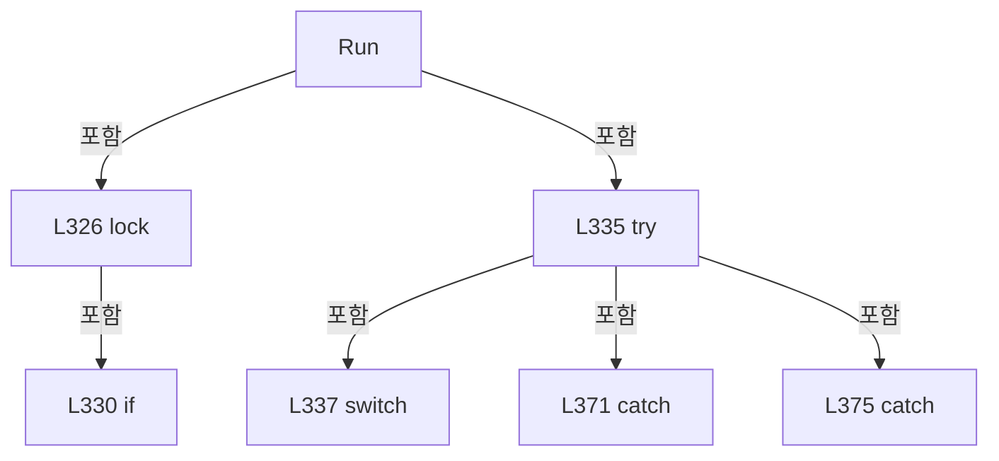

변경 전 점검: 입력/반환 타입, 위 호출자, 예외/취소 경로, 공유 상태와 저장·전송 소비자를 함께 확인합니다. 값의 단위나 물리 방향을 이름만으로 확정하지 않습니다.

### MethodDeclaration `RunSequenceStep` · L382–391

[Drilling.Common/Station/CStationProcess.cs:382–391](https://github.com/kjuws10-rgb/A3Drilling/blob/5aee8e58439c9b455cae7c9593c9be986c3e682e/Drilling.Common/Station/CStationProcess.cs#L382-L391)

| 항목 | 실제 추출 값 |
| --- | --- |
| 서명 | void Drilling.Common.Station.CStationProcess.RunSequenceStep(Drilling.Common.Station.EN_STATION_SEQUENCE, string, Drilling.Common.Station.CStationProcess.CProcessStepAction, Drilling.Common.Station.EN_STATION_SEQUENCE) |
| 접근/수식자 | Private / private |
| 반환/값 타입 | void |
| 소속 타입 | NamedType:Drilling.Common.Station.CStationProcess |

입력 계약:

| 이름 | 타입 | 전달 | 선택/기본값 |
| --- | --- | --- | --- |
| expectedSequence | Drilling.Common.Station.EN_STATION_SEQUENCE | None | False /  |
| stepKey | string | None | False /  |
| action | Drilling.Common.Station.CStationProcess.CProcessStepAction | None | False /  |
| nextSequence | Drilling.Common.Station.EN_STATION_SEQUENCE | None | False /  |

정적 호출자로 확인된 위치:

| 호출 파일/행 | 호출 표현식 | 런타임 분기 가능 |
| --- | --- | --- |
| [Drilling.Common/Station/CStationProcess.cs:342–342](https://github.com/kjuws10-rgb/A3Drilling/blob/5aee8e58439c9b455cae7c9593c9be986c3e682e/Drilling.Common/Station/CStationProcess.cs#L342-L342) | RunSequenceStep | False |
| [Drilling.Common/Station/CStationProcess.cs:345–345](https://github.com/kjuws10-rgb/A3Drilling/blob/5aee8e58439c9b455cae7c9593c9be986c3e682e/Drilling.Common/Station/CStationProcess.cs#L345-L345) | RunSequenceStep | False |
| [Drilling.Common/Station/CStationProcess.cs:348–348](https://github.com/kjuws10-rgb/A3Drilling/blob/5aee8e58439c9b455cae7c9593c9be986c3e682e/Drilling.Common/Station/CStationProcess.cs#L348-L348) | RunSequenceStep | False |
| [Drilling.Common/Station/CStationProcess.cs:351–351](https://github.com/kjuws10-rgb/A3Drilling/blob/5aee8e58439c9b455cae7c9593c9be986c3e682e/Drilling.Common/Station/CStationProcess.cs#L351-L351) | RunSequenceStep | False |
| [Drilling.Common/Station/CStationProcess.cs:354–354](https://github.com/kjuws10-rgb/A3Drilling/blob/5aee8e58439c9b455cae7c9593c9be986c3e682e/Drilling.Common/Station/CStationProcess.cs#L354-L354) | RunSequenceStep | False |

호출하는 대상과 해석 범위:

| 원본 행 | 표현식 | 분석 상태 | 대상/소스 위치 |
| --- | --- | --- | --- |
| 384 | GetSequenceCancellationToken | resolved | System.Threading.CancellationToken Drilling.Common.Station.CStationProcess.GetSequenceCancellationToken() · Drilling.Common/Station/CStationProcess.cs:398 |
| 385 | CheckProcessModelLoaded | resolved | Drilling.Common.Station.ST_PROCESS_MODEL Drilling.Common.Station.CStationProcess.CheckProcessModelLoaded() · Drilling.Common/Station/CStationProcess.cs:393 |
| 386 | ExecuteAutoStep | resolved | void Drilling.Common.Station.CStationProcess.ExecuteAutoStep(string, Drilling.Common.Station.ST_PROCESS_MODEL, Drilling.Common.Station.CStationProcess.CProcessStepAction, System.Threading.CancellationToken) · Drilling.Common/Station/CStationProcess.cs:472 |
| 387 | TryMoveSequenceState | resolved | bool Drilling.Common.Station.CStationProcess.TryMoveSequenceState(Drilling.Common.Station.EN_STATION_SEQUENCE, Drilling.Common.Station.EN_STATION_SEQUENCE) · Drilling.Common/Station/CStationProcess.cs:2309 |
| 389 | ProcessInterruptedSequence | resolved | void Drilling.Common.Station.CStationProcess.ProcessInterruptedSequence() · Drilling.Common/Station/CStationProcess.cs:422 |

본문의 실제 연산·분기·예외·반환 순서(원문 위치 순):

| 원본 행 | 종류 | 주석 해설 |
| --- | --- | --- |
| 384 | call | 함수·델리게이트 또는 객체 생성자를 호출합니다: GetSequenceCancellationToken() |
| 384 | local-declaration | 지역 변수를 선언합니다: var cancellationToken = GetSequenceCancellationToken(); |
| 384 | variable-initializer | 변수의 초기값을 지정합니다: cancellationToken = GetSequenceCancellationToken() |
| 385 | call | 함수·델리게이트 또는 객체 생성자를 호출합니다: CheckProcessModelLoaded() |
| 385 | local-declaration | 지역 변수를 선언합니다: var processModel = CheckProcessModelLoaded(); |
| 385 | variable-initializer | 변수의 초기값을 지정합니다: processModel = CheckProcessModelLoaded() |
| 386 | call | 함수·델리게이트 또는 객체 생성자를 호출합니다: ExecuteAutoStep(stepKey, processModel, action, cancellationToken) |
| 387 | call | 함수·델리게이트 또는 객체 생성자를 호출합니다: TryMoveSequenceState(expectedSequence, nextSequence) |
| 387 | if | 조건에 따라 분기합니다: if (!TryMoveSequenceState(expectedSequence, nextSequence)) |
| 389 | call | 함수·델리게이트 또는 객체 생성자를 호출합니다: ProcessInterruptedSequence() |

제어 구문의 포함 구조(실제 실행 순서/CFG가 아닌 구문 탐색 그림):

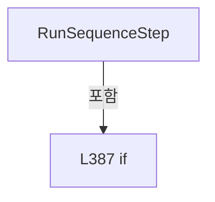

변경 전 점검: 입력/반환 타입, 위 호출자, 예외/취소 경로, 공유 상태와 저장·전송 소비자를 함께 확인합니다. 값의 단위나 물리 방향을 이름만으로 확정하지 않습니다.

### MethodDeclaration `CheckProcessModelLoaded` · L393–396

[Drilling.Common/Station/CStationProcess.cs:393–396](https://github.com/kjuws10-rgb/A3Drilling/blob/5aee8e58439c9b455cae7c9593c9be986c3e682e/Drilling.Common/Station/CStationProcess.cs#L393-L396)

| 항목 | 실제 추출 값 |
| --- | --- |
| 서명 | Drilling.Common.Station.ST_PROCESS_MODEL Drilling.Common.Station.CStationProcess.CheckProcessModelLoaded() |
| 접근/수식자 | Private / private |
| 반환/값 타입 | Drilling.Common.Station.ST_PROCESS_MODEL |
| 소속 타입 | NamedType:Drilling.Common.Station.CStationProcess |

정적 호출자로 확인된 위치:

| 호출 파일/행 | 호출 표현식 | 런타임 분기 가능 |
| --- | --- | --- |
| [Drilling.Common/Station/CStationProcess.cs:385–385](https://github.com/kjuws10-rgb/A3Drilling/blob/5aee8e58439c9b455cae7c9593c9be986c3e682e/Drilling.Common/Station/CStationProcess.cs#L385-L385) | CheckProcessModelLoaded | False |

호출하는 대상과 해석 범위:

| 원본 행 | 표현식 | 분석 상태 | 대상/소스 위치 |
| --- | --- | --- | --- |
| 395 | new InvalidOperationException | resolved | System.InvalidOperationException.InvalidOperationException(string?) |

본문의 실제 연산·분기·예외·반환 순서(원문 위치 순):

| 원본 행 | 종류 | 주석 해설 |
| --- | --- | --- |
| 395 | call | 함수·델리게이트 또는 객체 생성자를 호출합니다: new InvalidOperationException("Process Model is not loaded.") |
| 395 | return | 호출자에게 값 또는 제어를 반환합니다: return _processModel ?? throw new InvalidOperationException("Process Model is not loaded."); |
| 395 | throw | 예외를 발생/전달합니다: throw new InvalidOperationException("Process Model is not loaded.") |

변경 전 점검: 입력/반환 타입, 위 호출자, 예외/취소 경로, 공유 상태와 저장·전송 소비자를 함께 확인합니다. 값의 단위나 물리 방향을 이름만으로 확정하지 않습니다.

### MethodDeclaration `GetSequenceCancellationToken` · L398–404

[Drilling.Common/Station/CStationProcess.cs:398–404](https://github.com/kjuws10-rgb/A3Drilling/blob/5aee8e58439c9b455cae7c9593c9be986c3e682e/Drilling.Common/Station/CStationProcess.cs#L398-L404)

| 항목 | 실제 추출 값 |
| --- | --- |
| 서명 | System.Threading.CancellationToken Drilling.Common.Station.CStationProcess.GetSequenceCancellationToken() |
| 접근/수식자 | Private / private |
| 반환/값 타입 | System.Threading.CancellationToken |
| 소속 타입 | NamedType:Drilling.Common.Station.CStationProcess |

정적 호출자로 확인된 위치:

| 호출 파일/행 | 호출 표현식 | 런타임 분기 가능 |
| --- | --- | --- |
| [Drilling.Common/Station/CStationProcess.cs:384–384](https://github.com/kjuws10-rgb/A3Drilling/blob/5aee8e58439c9b455cae7c9593c9be986c3e682e/Drilling.Common/Station/CStationProcess.cs#L384-L384) | GetSequenceCancellationToken | False |

본문의 실제 연산·분기·예외·반환 순서(원문 위치 순):

| 원본 행 | 종류 | 주석 해설 |
| --- | --- | --- |
| 400 | lock | 공유 상태의 임계 구역에 진입합니다: lock (_sequenceLock) |
| 402 | return | 호출자에게 값 또는 제어를 반환합니다: return _sequenceCancellation?.Token ?? CancellationToken.None; |

제어 구문의 포함 구조(실제 실행 순서/CFG가 아닌 구문 탐색 그림):

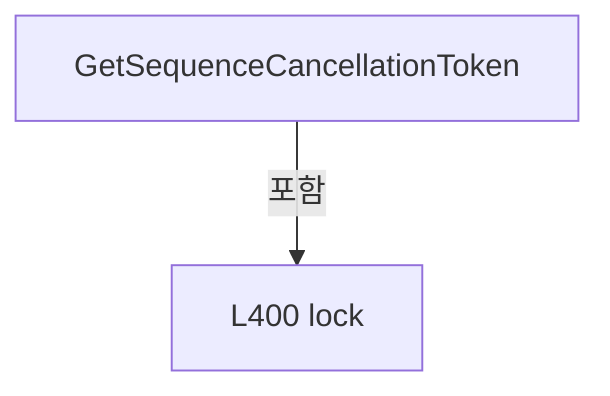

변경 전 점검: 입력/반환 타입, 위 호출자, 예외/취소 경로, 공유 상태와 저장·전송 소비자를 함께 확인합니다. 값의 단위나 물리 방향을 이름만으로 확정하지 않습니다.

### MethodDeclaration `FinishSequence` · L406–420

[Drilling.Common/Station/CStationProcess.cs:406–420](https://github.com/kjuws10-rgb/A3Drilling/blob/5aee8e58439c9b455cae7c9593c9be986c3e682e/Drilling.Common/Station/CStationProcess.cs#L406-L420)

| 항목 | 실제 추출 값 |
| --- | --- |
| 서명 | void Drilling.Common.Station.CStationProcess.FinishSequence() |
| 접근/수식자 | Private / private |
| 반환/값 타입 | void |
| 소속 타입 | NamedType:Drilling.Common.Station.CStationProcess |

정적 호출자로 확인된 위치:

| 호출 파일/행 | 호출 표현식 | 런타임 분기 가능 |
| --- | --- | --- |
| [Drilling.Common/Station/CStationProcess.cs:355–355](https://github.com/kjuws10-rgb/A3Drilling/blob/5aee8e58439c9b455cae7c9593c9be986c3e682e/Drilling.Common/Station/CStationProcess.cs#L355-L355) | FinishSequence | False |
| [Drilling.Common/Station/CStationProcess.cs:359–359](https://github.com/kjuws10-rgb/A3Drilling/blob/5aee8e58439c9b455cae7c9593c9be986c3e682e/Drilling.Common/Station/CStationProcess.cs#L359-L359) | FinishSequence | False |
| [Drilling.Common/Station/CStationProcess.cs:363–363](https://github.com/kjuws10-rgb/A3Drilling/blob/5aee8e58439c9b455cae7c9593c9be986c3e682e/Drilling.Common/Station/CStationProcess.cs#L363-L363) | FinishSequence | False |
| [Drilling.Common/Station/CStationProcess.cs:367–367](https://github.com/kjuws10-rgb/A3Drilling/blob/5aee8e58439c9b455cae7c9593c9be986c3e682e/Drilling.Common/Station/CStationProcess.cs#L367-L367) | FinishSequence | False |

호출하는 대상과 해석 범위:

| 원본 행 | 표현식 | 분석 상태 | 대상/소스 위치 |
| --- | --- | --- | --- |
| 411 | (_stationStatus with { ChangedAt = DateTimeOffset.Now } ).WithSequenceState | resolved | Drilling.Common.Station.ST_STATION_STATUS Drilling.Common.Station.ST_STATION_STATUS.WithSequenceState(Drilling.Common.Station.EN_STATION_SEQUENCE?) · Drilling.Common/Station/CStationManager.cs:534 |
| 417 | .Dispose | resolved | void System.Threading.CancellationTokenSource.Dispose() |

본문의 실제 연산·분기·예외·반환 순서(원문 위치 순):

| 원본 행 | 종류 | 주석 해설 |
| --- | --- | --- |
| 408 | lock | 공유 상태의 임계 구역에 진입합니다: lock (_sequenceLock) |
| 410 | assignment | 값을 대상에 대입합니다: _sequenceState = EN_STATION_SEQUENCE.Ready |
| 411 | assignment | 값을 대상에 대입합니다: _stationStatus = (_stationStatus with { ChangedAt = DateTimeOffset.Now } ).WithSequenceState(EN_STATION_SEQUENCE.Ready) |
| 411 | call | 함수·델리게이트 또는 객체 생성자를 호출합니다: (_stationStatus with { ChangedAt = DateTimeOffset.Now } ).WithSequenceState(EN_STATION_SEQUENCE.Ready) |
| 413 | assignment | 값을 대상에 대입합니다: ChangedAt = DateTimeOffset.Now |
| 417 | call | 함수·델리게이트 또는 객체 생성자를 호출합니다: .Dispose() |
| 418 | assignment | 값을 대상에 대입합니다: _sequenceCancellation = null |

제어 구문의 포함 구조(실제 실행 순서/CFG가 아닌 구문 탐색 그림):

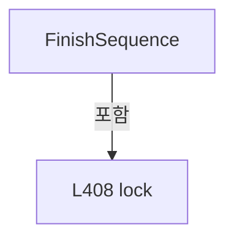

변경 전 점검: 입력/반환 타입, 위 호출자, 예외/취소 경로, 공유 상태와 저장·전송 소비자를 함께 확인합니다. 값의 단위나 물리 방향을 이름만으로 확정하지 않습니다.

### MethodDeclaration `ProcessInterruptedSequence` · L422–431

[Drilling.Common/Station/CStationProcess.cs:422–431](https://github.com/kjuws10-rgb/A3Drilling/blob/5aee8e58439c9b455cae7c9593c9be986c3e682e/Drilling.Common/Station/CStationProcess.cs#L422-L431)

| 항목 | 실제 추출 값 |
| --- | --- |
| 서명 | void Drilling.Common.Station.CStationProcess.ProcessInterruptedSequence() |
| 접근/수식자 | Private / private |
| 반환/값 타입 | void |
| 소속 타입 | NamedType:Drilling.Common.Station.CStationProcess |

정적 호출자로 확인된 위치:

| 호출 파일/행 | 호출 표현식 | 런타임 분기 가능 |
| --- | --- | --- |
| [Drilling.Common/Station/CStationProcess.cs:389–389](https://github.com/kjuws10-rgb/A3Drilling/blob/5aee8e58439c9b455cae7c9593c9be986c3e682e/Drilling.Common/Station/CStationProcess.cs#L389-L389) | ProcessInterruptedSequence | False |

호출하는 대상과 해석 범위:

| 원본 행 | 표현식 | 분석 상태 | 대상/소스 위치 |
| --- | --- | --- | --- |
| 424 | ReadSequenceState | resolved | Drilling.Common.Station.EN_STATION_SEQUENCE Drilling.Common.Station.CStationProcess.ReadSequenceState() · Drilling.Common/Station/CStationProcess.cs:2329 |
| 427 | new OperationCanceledException | resolved | System.OperationCanceledException.OperationCanceledException() |
| 430 | new InvalidOperationException | resolved | System.InvalidOperationException.InvalidOperationException(string?) |

본문의 실제 연산·분기·예외·반환 순서(원문 위치 순):

| 원본 행 | 종류 | 주석 해설 |
| --- | --- | --- |
| 424 | call | 함수·델리게이트 또는 객체 생성자를 호출합니다: ReadSequenceState() |
| 424 | local-declaration | 지역 변수를 선언합니다: var sequenceState = ReadSequenceState(); |
| 424 | variable-initializer | 변수의 초기값을 지정합니다: sequenceState = ReadSequenceState() |
| 425 | if | 조건에 따라 분기합니다: if (sequenceState == EN_STATION_SEQUENCE.Stop) |
| 427 | call | 함수·델리게이트 또는 객체 생성자를 호출합니다: new OperationCanceledException() |
| 427 | throw | 예외를 발생/전달합니다: throw new OperationCanceledException(); |
| 430 | call | 함수·델리게이트 또는 객체 생성자를 호출합니다: new InvalidOperationException($"Station sequence entered {sequenceState} during auto start.") |
| 430 | throw | 예외를 발생/전달합니다: throw new InvalidOperationException($"Station sequence entered {sequenceState} during auto start."); |

제어 구문의 포함 구조(실제 실행 순서/CFG가 아닌 구문 탐색 그림):

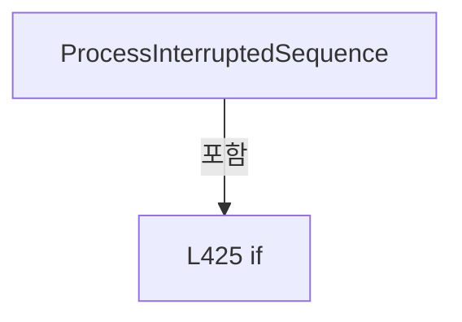

변경 전 점검: 입력/반환 타입, 위 호출자, 예외/취소 경로, 공유 상태와 저장·전송 소비자를 함께 확인합니다. 값의 단위나 물리 방향을 이름만으로 확정하지 않습니다.

### MethodDeclaration `CompleteSequence` · L433–436

[Drilling.Common/Station/CStationProcess.cs:433–436](https://github.com/kjuws10-rgb/A3Drilling/blob/5aee8e58439c9b455cae7c9593c9be986c3e682e/Drilling.Common/Station/CStationProcess.cs#L433-L436)

| 항목 | 실제 추출 값 |
| --- | --- |
| 서명 | void Drilling.Common.Station.CStationProcess.CompleteSequence(Drilling.Common.Station.ST_PROCESS_MODEL, System.Threading.CancellationToken) |
| 접근/수식자 | Private / private |
| 반환/값 타입 | void |
| 소속 타입 | NamedType:Drilling.Common.Station.CStationProcess |

입력 계약:

| 이름 | 타입 | 전달 | 선택/기본값 |
| --- | --- | --- | --- |
| processModel | Drilling.Common.Station.ST_PROCESS_MODEL | None | False /  |
| cancellationToken | System.Threading.CancellationToken | None | False /  |

현재 부분 분석에서 직접 연결된 호출자는 없습니다. XAML/이벤트/인터페이스·델리게이트·외부 진입을 추가 확인해야 하며, 미사용으로 판정한 것이 아닙니다.

호출하는 대상과 해석 범위:

| 원본 행 | 표현식 | 분석 상태 | 대상/소스 위치 |
| --- | --- | --- | --- |
| 435 | CompleteProcess | resolved | void Drilling.Common.Station.CStationProcess.CompleteProcess(System.Threading.CancellationToken) · Drilling.Common/Station/CStationProcess.cs:1155 |

본문의 실제 연산·분기·예외·반환 순서(원문 위치 순):

| 원본 행 | 종류 | 주석 해설 |
| --- | --- | --- |
| 435 | call | 함수·델리게이트 또는 객체 생성자를 호출합니다: CompleteProcess(cancellationToken) |

변경 전 점검: 입력/반환 타입, 위 호출자, 예외/취소 경로, 공유 상태와 저장·전송 소비자를 함께 확인합니다. 값의 단위나 물리 방향을 이름만으로 확정하지 않습니다.

### MethodDeclaration `EnsureStartAllowed` · L438–444

[Drilling.Common/Station/CStationProcess.cs:438–444](https://github.com/kjuws10-rgb/A3Drilling/blob/5aee8e58439c9b455cae7c9593c9be986c3e682e/Drilling.Common/Station/CStationProcess.cs#L438-L444)

| 항목 | 실제 추출 값 |
| --- | --- |
| 서명 | void Drilling.Common.Station.CStationProcess.EnsureStartAllowed() |
| 접근/수식자 | Private / private |
| 반환/값 타입 | void |
| 소속 타입 | NamedType:Drilling.Common.Station.CStationProcess |

정적 호출자로 확인된 위치:

| 호출 파일/행 | 호출 표현식 | 런타임 분기 가능 |
| --- | --- | --- |
| [Drilling.Common/Station/CStationProcess.cs:283–283](https://github.com/kjuws10-rgb/A3Drilling/blob/5aee8e58439c9b455cae7c9593c9be986c3e682e/Drilling.Common/Station/CStationProcess.cs#L283-L283) | EnsureStartAllowed | False |
| [Drilling.Common/Station/CStationProcess.cs:304–304](https://github.com/kjuws10-rgb/A3Drilling/blob/5aee8e58439c9b455cae7c9593c9be986c3e682e/Drilling.Common/Station/CStationProcess.cs#L304-L304) | EnsureStartAllowed | False |

호출하는 대상과 해석 범위:

| 원본 행 | 표현식 | 분석 상태 | 대상/소스 위치 |
| --- | --- | --- | --- |
| 440 | ReadStationStatus | resolved | Drilling.Common.Station.ST_STATION_STATUS Drilling.Common.Station.CStationProcess.ReadStationStatus() · Drilling.Common/Station/CStationProcess.cs:2337 |
| 442 | new InvalidOperationException | resolved | System.InvalidOperationException.InvalidOperationException(string?) |

본문의 실제 연산·분기·예외·반환 순서(원문 위치 순):

| 원본 행 | 종류 | 주석 해설 |
| --- | --- | --- |
| 440 | call | 함수·델리게이트 또는 객체 생성자를 호출합니다: ReadStationStatus() |
| 440 | if | 조건에 따라 분기합니다: if (ReadStationStatus().State == EN_STATION_STATE.Alarm) |
| 442 | call | 함수·델리게이트 또는 객체 생성자를 호출합니다: new InvalidOperationException("Station alarm is active. Reset alarm before auto start.") |
| 442 | throw | 예외를 발생/전달합니다: throw new InvalidOperationException("Station alarm is active. Reset alarm before auto start."); |

제어 구문의 포함 구조(실제 실행 순서/CFG가 아닌 구문 탐색 그림):

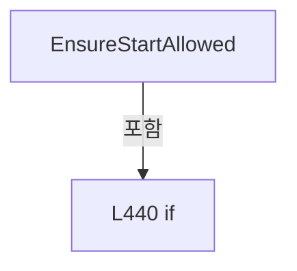

변경 전 점검: 입력/반환 타입, 위 호출자, 예외/취소 경로, 공유 상태와 저장·전송 소비자를 함께 확인합니다. 값의 단위나 물리 방향을 이름만으로 확정하지 않습니다.

### MethodDeclaration `ReadProcessModelForStart` · L446–456

[Drilling.Common/Station/CStationProcess.cs:446–456](https://github.com/kjuws10-rgb/A3Drilling/blob/5aee8e58439c9b455cae7c9593c9be986c3e682e/Drilling.Common/Station/CStationProcess.cs#L446-L456)

| 항목 | 실제 추출 값 |
| --- | --- |
| 서명 | Drilling.Common.Station.ST_PROCESS_MODEL Drilling.Common.Station.CStationProcess.ReadProcessModelForStart() |
| 접근/수식자 | Private / private |
| 반환/값 타입 | Drilling.Common.Station.ST_PROCESS_MODEL |
| 소속 타입 | NamedType:Drilling.Common.Station.CStationProcess |

정적 호출자로 확인된 위치:

| 호출 파일/행 | 호출 표현식 | 런타임 분기 가능 |
| --- | --- | --- |
| [Drilling.Common/Station/CStationProcess.cs:284–284](https://github.com/kjuws10-rgb/A3Drilling/blob/5aee8e58439c9b455cae7c9593c9be986c3e682e/Drilling.Common/Station/CStationProcess.cs#L284-L284) | ReadProcessModelForStart | False |

호출하는 대상과 해석 범위:

| 원본 행 | 표현식 | 분석 상태 | 대상/소스 위치 |
| --- | --- | --- | --- |
| 453 | SetAutoStepState | resolved | void Drilling.Common.Station.CStationProcess.SetAutoStepState(string, string) · Drilling.Common/Station/CStationProcess.cs:1805 |
| 454 | SetSequenceState | resolved | void Drilling.Common.Station.CStationProcess.SetSequenceState(Drilling.Common.Station.EN_STATION_SEQUENCE) · Drilling.Common/Station/CStationProcess.cs:2290 |
| 455 | new InvalidOperationException | resolved | System.InvalidOperationException.InvalidOperationException(string?) |

본문의 실제 연산·분기·예외·반환 순서(원문 위치 순):

| 원본 행 | 종류 | 주석 해설 |
| --- | --- | --- |
| 448 | if | 조건에 따라 분기합니다: if (_snapshot.ProcessModel is not null) |
| 450 | return | 호출자에게 값 또는 제어를 반환합니다: return _snapshot.ProcessModel; |
| 453 | call | 함수·델리게이트 또는 객체 생성자를 호출합니다: SetAutoStepState(AutoStepIdle, AutoStepError) |
| 454 | call | 함수·델리게이트 또는 객체 생성자를 호출합니다: SetSequenceState(EN_STATION_SEQUENCE.Error) |
| 455 | call | 함수·델리게이트 또는 객체 생성자를 호출합니다: new InvalidOperationException("Process model is not loaded.") |
| 455 | throw | 예외를 발생/전달합니다: throw new InvalidOperationException("Process model is not loaded."); |

제어 구문의 포함 구조(실제 실행 순서/CFG가 아닌 구문 탐색 그림):

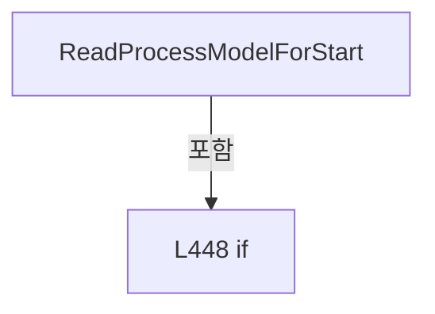

변경 전 점검: 입력/반환 타입, 위 호출자, 예외/취소 경로, 공유 상태와 저장·전송 소비자를 함께 확인합니다. 값의 단위나 물리 방향을 이름만으로 확정하지 않습니다.

### MethodDeclaration `GetLiveInterlockItems` · L458–458

[Drilling.Common/Station/CStationProcess.cs:458–458](https://github.com/kjuws10-rgb/A3Drilling/blob/5aee8e58439c9b455cae7c9593c9be986c3e682e/Drilling.Common/Station/CStationProcess.cs#L458-L458)

| 항목 | 실제 추출 값 |
| --- | --- |
| 서명 | System.Collections.Generic.IReadOnlyList<Drilling.Common.InterLock.ST_INTERLOCK_ITEM> Drilling.Common.Station.CStationProcess.GetLiveInterlockItems(System.Threading.CancellationToken) |
| 접근/수식자 | Public / public |
| 반환/값 타입 | System.Collections.Generic.IReadOnlyList<Drilling.Common.InterLock.ST_INTERLOCK_ITEM> |
| 소속 타입 | NamedType:Drilling.Common.Station.CStationProcess |

입력 계약:

| 이름 | 타입 | 전달 | 선택/기본값 |
| --- | --- | --- | --- |
| cancellationToken | System.Threading.CancellationToken | None | True / null |

정적 호출자로 확인된 위치:

| 호출 파일/행 | 호출 표현식 | 런타임 분기 가능 |
| --- | --- | --- |
| [Drilling.Common/Station/CStationManager.cs:73–73](https://github.com/kjuws10-rgb/A3Drilling/blob/5aee8e58439c9b455cae7c9593c9be986c3e682e/Drilling.Common/Station/CStationManager.cs#L73-L73) | _processStation.GetLiveInterlockItems | False |

호출하는 대상과 해석 범위:

| 원본 행 | 표현식 | 분석 상태 | 대상/소스 위치 |
| --- | --- | --- | --- |
| 458 | EvaluateInterlocks | resolved | Drilling.Common.InterLock.ST_INTERLOCK_SUMMARY Drilling.Common.Station.CStationProcess.EvaluateInterlocks(System.Collections.Generic.IReadOnlyDictionary<string, string>?, System.Threading.CancellationToken, bool, bool, bool) · Drilling.Common/Station/CStationProcess.cs:1363 |

본문의 실제 연산·분기·예외·반환 순서(원문 위치 순):

| 원본 행 | 종류 | 주석 해설 |
| --- | --- | --- |
| 458 | call | 함수·델리게이트 또는 객체 생성자를 호출합니다: EvaluateInterlocks(_snapshot.ProcessModel?.Parameters, cancellationToken, cachedStatusOnly: true, requireAllHeadsUsed: true) |

변경 전 점검: 입력/반환 타입, 위 호출자, 예외/취소 경로, 공유 상태와 저장·전송 소비자를 함께 확인합니다. 값의 단위나 물리 방향을 이름만으로 확정하지 않습니다.

### MethodDeclaration `GetLiveInterlockItems` · L459–459

[Drilling.Common/Station/CStationProcess.cs:459–459](https://github.com/kjuws10-rgb/A3Drilling/blob/5aee8e58439c9b455cae7c9593c9be986c3e682e/Drilling.Common/Station/CStationProcess.cs#L459-L459)

| 항목 | 실제 추출 값 |
| --- | --- |
| 서명 | System.Collections.Generic.IReadOnlyList<Drilling.Common.InterLock.ST_INTERLOCK_ITEM> Drilling.Common.Station.CStationProcess.GetLiveInterlockItems(System.Collections.Generic.IReadOnlyDictionary<string, string>, System.Threading.CancellationToken) |
| 접근/수식자 | Public / public |
| 반환/값 타입 | System.Collections.Generic.IReadOnlyList<Drilling.Common.InterLock.ST_INTERLOCK_ITEM> |
| 소속 타입 | NamedType:Drilling.Common.Station.CStationProcess |

입력 계약:

| 이름 | 타입 | 전달 | 선택/기본값 |
| --- | --- | --- | --- |
| parameters | System.Collections.Generic.IReadOnlyDictionary<string, string> | None | False /  |
| cancellationToken | System.Threading.CancellationToken | None | True / null |

정적 호출자로 확인된 위치:

| 호출 파일/행 | 호출 표현식 | 런타임 분기 가능 |
| --- | --- | --- |
| [Drilling.Common/Station/CStationManager.cs:69–69](https://github.com/kjuws10-rgb/A3Drilling/blob/5aee8e58439c9b455cae7c9593c9be986c3e682e/Drilling.Common/Station/CStationManager.cs#L69-L69) | _processStation.GetLiveInterlockItems | False |

호출하는 대상과 해석 범위:

| 원본 행 | 표현식 | 분석 상태 | 대상/소스 위치 |
| --- | --- | --- | --- |
| 459 | EvaluateInterlocks | resolved | Drilling.Common.InterLock.ST_INTERLOCK_SUMMARY Drilling.Common.Station.CStationProcess.EvaluateInterlocks(System.Collections.Generic.IReadOnlyDictionary<string, string>?, System.Threading.CancellationToken, bool, bool, bool) · Drilling.Common/Station/CStationProcess.cs:1363 |

본문의 실제 연산·분기·예외·반환 순서(원문 위치 순):

| 원본 행 | 종류 | 주석 해설 |
| --- | --- | --- |
| 459 | call | 함수·델리게이트 또는 객체 생성자를 호출합니다: EvaluateInterlocks(parameters, cancellationToken, cachedStatusOnly: true, requireAllHeadsUsed: true) |

변경 전 점검: 입력/반환 타입, 위 호출자, 예외/취소 경로, 공유 상태와 저장·전송 소비자를 함께 확인합니다. 값의 단위나 물리 방향을 이름만으로 확정하지 않습니다.

### MethodDeclaration `GetManualInterlockItems` · L460–470

[Drilling.Common/Station/CStationProcess.cs:460–470](https://github.com/kjuws10-rgb/A3Drilling/blob/5aee8e58439c9b455cae7c9593c9be986c3e682e/Drilling.Common/Station/CStationProcess.cs#L460-L470)

| 항목 | 실제 추출 값 |
| --- | --- |
| 서명 | System.Collections.Generic.IReadOnlyList<Drilling.Common.InterLock.ST_INTERLOCK_ITEM> Drilling.Common.Station.CStationProcess.GetManualInterlockItems(System.Collections.Generic.IReadOnlyDictionary<string, string>, System.Collections.Generic.IReadOnlySet<int>, System.Threading.CancellationToken) |
| 접근/수식자 | Public / public |
| 반환/값 타입 | System.Collections.Generic.IReadOnlyList<Drilling.Common.InterLock.ST_INTERLOCK_ITEM> |
| 소속 타입 | NamedType:Drilling.Common.Station.CStationProcess |

입력 계약:

| 이름 | 타입 | 전달 | 선택/기본값 |
| --- | --- | --- | --- |
| parameters | System.Collections.Generic.IReadOnlyDictionary<string, string> | None | False /  |
| selectedHeads | System.Collections.Generic.IReadOnlySet<int> | None | False /  |
| cancellationToken | System.Threading.CancellationToken | None | True / null |

정적 호출자로 확인된 위치:

| 호출 파일/행 | 호출 표현식 | 런타임 분기 가능 |
| --- | --- | --- |
| [Drilling.Common/Station/CStationManager.cs:76–76](https://github.com/kjuws10-rgb/A3Drilling/blob/5aee8e58439c9b455cae7c9593c9be986c3e682e/Drilling.Common/Station/CStationManager.cs#L76-L76) | _processStation.GetManualInterlockItems | False |
| [Drilling.Common/Station/CStationProcess.cs:3638–3638](https://github.com/kjuws10-rgb/A3Drilling/blob/5aee8e58439c9b455cae7c9593c9be986c3e682e/Drilling.Common/Station/CStationProcess.cs#L3638-L3638) | GetManualInterlockItems | False |

호출하는 대상과 해석 범위:

| 원본 행 | 표현식 | 분석 상태 | 대상/소스 위치 |
| --- | --- | --- | --- |
| 462 | selectedHeads.Where(head => head is >= 1 and <= 8).ToHashSet | resolved | System.Collections.Generic.HashSet<int> System.Collections.Generic.IEnumerable<int>.ToHashSet<int>() |
| 462 | selectedHeads.Where | resolved | System.Collections.Generic.IEnumerable<int> System.Collections.Generic.IEnumerable<int>.Where<int>(System.Func<int, bool>) |
| 463 | new Dictionary<string, string> | resolved | System.Collections.Generic.Dictionary<string, string>.Dictionary(System.Collections.Generic.IEnumerable<System.Collections.Generic.KeyValuePair<string, string>>, System.Collections.Generic.IEqualityComparer<string>?) |
| 465 | heads.Contains | resolved | bool System.Collections.Generic.HashSet<int>.Contains(int) |
| 467 | EvaluateInterlocks | resolved | Drilling.Common.InterLock.ST_INTERLOCK_SUMMARY Drilling.Common.Station.CStationProcess.EvaluateInterlocks(System.Collections.Generic.IReadOnlyDictionary<string, string>?, System.Threading.CancellationToken, bool, bool, bool) · Drilling.Common/Station/CStationProcess.cs:1363 |
| 468 | _interfaceManager.GetInterfaceList(EN_EQP_MODULE.Bet).FirstOrDefault | resolved | Drilling.Common.Interface.ST_INTERFACE_DATA? System.Collections.Generic.IEnumerable<Drilling.Common.Interface.ST_INTERFACE_DATA>.FirstOrDefault<Drilling.Common.Interface.ST_INTERFACE_DATA>() |
| 468 | _interfaceManager.GetInterfaceList | resolved | System.Collections.Generic.IReadOnlyList<Drilling.Common.Interface.ST_INTERFACE_DATA> Drilling.Common.Interface.CInterfaceManager.GetInterfaceList(Drilling.Common.Interface.EN_EQP_MODULE?) · Drilling.Common/Interface/CInterfaceManager.cs:442 |
| 469 | items.Select(item => item.HeadNo is null && item.Signal.Equals("BET", StringComparison.OrdinalIgnoreCase) && firstBet is { Number: >= 0 and < 8 } ? item with { HeadNo = firstBet.Number + 1 } : item).Where(item => item.HeadNo is not > 0 &#124;&#124; heads.Contains(item.HeadNo.Value)).ToArray | resolved | Drilling.Common.InterLock.ST_INTERLOCK_ITEM[] System.Collections.Generic.IEnumerable<Drilling.Common.InterLock.ST_INTERLOCK_ITEM>.ToArray<Drilling.Common.InterLock.ST_INTERLOCK_ITEM>() |
| 469 | items.Select(item => item.HeadNo is null && item.Signal.Equals("BET", StringComparison.OrdinalIgnoreCase) && firstBet is { Number: >= 0 and < 8 } ? item with { HeadNo = firstBet.Number + 1 } : item).Where | resolved | System.Collections.Generic.IEnumerable<Drilling.Common.InterLock.ST_INTERLOCK_ITEM> System.Collections.Generic.IEnumerable<Drilling.Common.InterLock.ST_INTERLOCK_ITEM>.Where<Drilling.Common.InterLock.ST_INTERLOCK_ITEM>(System.Func<Drilling.Common.InterLock.ST_INTERLOCK_ITEM, bool>) |
| 469 | items.Select | resolved | System.Collections.Generic.IEnumerable<Drilling.Common.InterLock.ST_INTERLOCK_ITEM> System.Collections.Generic.IEnumerable<Drilling.Common.InterLock.ST_INTERLOCK_ITEM>.Select<Drilling.Common.InterLock.ST_INTERLOCK_ITEM, Drilling.Common.InterLock.ST_INTERLOCK_ITEM>(System.Func<Drilling.Common.InterLock.ST_INTERLOCK_ITEM, Drilling.Common.InterLock.ST_INTERLOCK_ITEM>) |
| 469 | item.Signal.Equals | resolved | bool string.Equals(string?, System.StringComparison) |
| 469 | heads.Contains | resolved | bool System.Collections.Generic.HashSet<int>.Contains(int) |

본문의 실제 연산·분기·예외·반환 순서(원문 위치 순):

| 원본 행 | 종류 | 주석 해설 |
| --- | --- | --- |
| 462 | call | 함수·델리게이트 또는 객체 생성자를 호출합니다: selectedHeads.Where(head => head is >= 1 and <= 8).ToHashSet() |
| 462 | call | 함수·델리게이트 또는 객체 생성자를 호출합니다: selectedHeads.Where(head => head is >= 1 and <= 8) |
| 462 | local-declaration | 지역 변수를 선언합니다: var heads = selectedHeads.Where(head => head is >= 1 and <= 8).ToHashSet(); |
| 462 | variable-initializer | 변수의 초기값을 지정합니다: heads = selectedHeads.Where(head => head is >= 1 and <= 8).ToHashSet() |
| 463 | call | 함수·델리게이트 또는 객체 생성자를 호출합니다: new Dictionary<string, string>(parameters, StringComparer.OrdinalIgnoreCase) |
| 463 | local-declaration | 지역 변수를 선언합니다: var manualParameters = new Dictionary<string, string>(parameters, StringComparer.OrdinalIgnoreCase); |
| 463 | variable-initializer | 변수의 초기값을 지정합니다: manualParameters = new Dictionary<string, string>(parameters, StringComparer.OrdinalIgnoreCase) |
| 464 | variable-initializer | 변수의 초기값을 지정합니다: head = 1 |
| 464 | for | 초기화·조건·증감이 있는 반복입니다: for (var head = 1; head <= 8; head++) |
| 465 | assignment | 값을 대상에 대입합니다: manualParameters[$"H{head:00}_USE"] = heads.Contains(head) ? "ON" : "OFF" |
| 465 | call | 함수·델리게이트 또는 객체 생성자를 호출합니다: heads.Contains(head) |
| 465 | conditional-expression | 조건에 따라 결과식을 선택합니다: heads.Contains(head) ? "ON" : "OFF" |
| 467 | call | 함수·델리게이트 또는 객체 생성자를 호출합니다: EvaluateInterlocks(manualParameters, cancellationToken, cachedStatusOnly: true, publish: false) |
| 467 | local-declaration | 지역 변수를 선언합니다: var items = EvaluateInterlocks(manualParameters, cancellationToken, cachedStatusOnly: true, publish: false).Items; |
| 467 | variable-initializer | 변수의 초기값을 지정합니다: items = EvaluateInterlocks(manualParameters, cancellationToken, cachedStatusOnly: true, publish: false).Items |
| 468 | call | 함수·델리게이트 또는 객체 생성자를 호출합니다: _interfaceManager.GetInterfaceList(EN_EQP_MODULE.Bet).FirstOrDefault() |
| 468 | call | 함수·델리게이트 또는 객체 생성자를 호출합니다: _interfaceManager.GetInterfaceList(EN_EQP_MODULE.Bet) |
| 468 | local-declaration | 지역 변수를 선언합니다: var firstBet = _interfaceManager.GetInterfaceList(EN_EQP_MODULE.Bet).FirstOrDefault(); |
| 468 | variable-initializer | 변수의 초기값을 지정합니다: firstBet = _interfaceManager.GetInterfaceList(EN_EQP_MODULE.Bet).FirstOrDefault() |
| 469 | assignment | 값을 대상에 대입합니다: HeadNo = firstBet.Number + 1 |
| 469 | call | 함수·델리게이트 또는 객체 생성자를 호출합니다: items.Select(item => item.HeadNo is null && item.Signal.Equals("BET", StringComparison.OrdinalIgnoreCase) && firstBet is { Number: >= 0 and < 8 } ? item with { HeadNo = firstBet.Number + 1 } : item).Where(item => item.He… |
| 469 | call | 함수·델리게이트 또는 객체 생성자를 호출합니다: items.Select(item => item.HeadNo is null && item.Signal.Equals("BET", StringComparison.OrdinalIgnoreCase) && firstBet is { Number: >= 0 and < 8 } ? item with { HeadNo = firstBet.Number + 1 } : item).Where(item => item.He… |
| 469 | call | 함수·델리게이트 또는 객체 생성자를 호출합니다: items.Select(item => item.HeadNo is null && item.Signal.Equals("BET", StringComparison.OrdinalIgnoreCase) && firstBet is { Number: >= 0 and < 8 } ? item with { HeadNo = firstBet.Number + 1 } : item) |
| 469 | call | 함수·델리게이트 또는 객체 생성자를 호출합니다: item.Signal.Equals("BET", StringComparison.OrdinalIgnoreCase) |
| 469 | call | 함수·델리게이트 또는 객체 생성자를 호출합니다: heads.Contains(item.HeadNo.Value) |
| 469 | conditional-expression | 조건에 따라 결과식을 선택합니다: item.HeadNo is null && item.Signal.Equals("BET", StringComparison.OrdinalIgnoreCase) && firstBet is { Number: >= 0 and < 8 } ? item with { HeadNo = firstBet.Number + 1 } : item |
| 469 | return | 호출자에게 값 또는 제어를 반환합니다: return items.Select(item => item.HeadNo is null && item.Signal.Equals("BET", StringComparison.OrdinalIgnoreCase) && firstBet is { Number: >= 0 and < 8 } ? item with { HeadNo = firstBet.Number + 1 } : item).Where(item => item.HeadN |

제어 구문의 포함 구조(실제 실행 순서/CFG가 아닌 구문 탐색 그림):

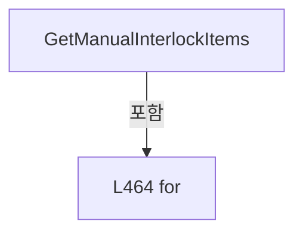

변경 전 점검: 입력/반환 타입, 위 호출자, 예외/취소 경로, 공유 상태와 저장·전송 소비자를 함께 확인합니다. 값의 단위나 물리 방향을 이름만으로 확정하지 않습니다.

### MethodDeclaration `ExecuteAutoStep` · L472–497

[Drilling.Common/Station/CStationProcess.cs:472–497](https://github.com/kjuws10-rgb/A3Drilling/blob/5aee8e58439c9b455cae7c9593c9be986c3e682e/Drilling.Common/Station/CStationProcess.cs#L472-L497)

| 항목 | 실제 추출 값 |
| --- | --- |
| 서명 | void Drilling.Common.Station.CStationProcess.ExecuteAutoStep(string, Drilling.Common.Station.ST_PROCESS_MODEL, Drilling.Common.Station.CStationProcess.CProcessStepAction, System.Threading.CancellationToken) |
| 접근/수식자 | Private / private |
| 반환/값 타입 | void |
| 소속 타입 | NamedType:Drilling.Common.Station.CStationProcess |

입력 계약:

| 이름 | 타입 | 전달 | 선택/기본값 |
| --- | --- | --- | --- |
| stepKey | string | None | False /  |
| processModel | Drilling.Common.Station.ST_PROCESS_MODEL | None | False /  |
| action | Drilling.Common.Station.CStationProcess.CProcessStepAction | None | False /  |
| cancellationToken | System.Threading.CancellationToken | None | False /  |

정적 호출자로 확인된 위치:

| 호출 파일/행 | 호출 표현식 | 런타임 분기 가능 |
| --- | --- | --- |
| [Drilling.Common/Station/CStationProcess.cs:386–386](https://github.com/kjuws10-rgb/A3Drilling/blob/5aee8e58439c9b455cae7c9593c9be986c3e682e/Drilling.Common/Station/CStationProcess.cs#L386-L386) | ExecuteAutoStep | False |

호출하는 대상과 해석 범위:

| 원본 행 | 표현식 | 분석 상태 | 대상/소스 위치 |
| --- | --- | --- | --- |
| 474 | cancellationToken.ThrowIfCancellationRequested | resolved | void System.Threading.CancellationToken.ThrowIfCancellationRequested() |
| 475 | GetAutoStepName | resolved | string Drilling.Common.Station.CStationProcess.GetAutoStepName(string) · Drilling.Common/Station/CStationProcess.cs:1872 |
| 476 | GetProcessFlowItem | resolved | Drilling.Common.Station.ST_STATION_PROCESS_FLOW_ITEM Drilling.Common.Station.CStationProcess.GetProcessFlowItem(string) · Drilling.Common/Station/CStationProcess.cs:1862 |
| 477 | ResolveStepScriptStatus | resolved | Drilling.Common.Station.EN_SCRIPT_STATUS Drilling.Common.Station.CStationProcess.ResolveStepScriptStatus(string, Drilling.Common.Station.EN_SCRIPT_STATUS) · Drilling.Common/Station/CStationProcess.cs:1837 |
| 478 | SetAutoStepState | resolved | void Drilling.Common.Station.CStationProcess.SetAutoStepState(string, string) · Drilling.Common/Station/CStationProcess.cs:1805 |
| 479 | AddProcessLog | resolved | void Drilling.Common.Station.CStationProcess.AddProcessLog(string, string, string) · Drilling.Common/Station/CStationProcess.cs:2366 |
| 480 | CreateSnapshot | resolved | Drilling.Common.Station.ST_STATION_PROCESS_STATUS Drilling.Common.Station.CStationProcess.CreateSnapshot(Drilling.Common.Station.ST_PROCESS_MODEL?, System.Collections.Generic.IReadOnlyList<Drilling.Common.Station.ST_HEAD_PREVIEW_DATA>, Drilling.Common.Station.EN_SCRIPT_STATUS, Drilling.Common.Station.EN_PROCESS_STEP, Drilling.Common.Station.ST_PROCESS_RESULT?) · Drilling.Common/Station/CStationProcess.cs:1337 |
| 480 | SetHeadStatus | resolved | System.Collections.Generic.IReadOnlyList<Drilling.Common.Station.ST_HEAD_PREVIEW_DATA> Drilling.Common.Station.CStationProcess.SetHeadStatus(System.Collections.Generic.IReadOnlyList<Drilling.Common.Station.ST_HEAD_PREVIEW_DATA>, Drilling.Common.Station.EN_PROCESS_STEP) · Drilling.Common/Station/CStationProcess.cs:1676 |
| 481 | SetStationState | resolved | void Drilling.Common.Station.CStationProcess.SetStationState(Drilling.Common.Station.EN_STATION_STATE, Drilling.Common.Station.EN_PROCESS_STEP, Drilling.Common.Station.EN_SCRIPT_STATUS, string) · Drilling.Common/Station/CStationProcess.cs:2345 |
| 482 | RefreshSnapshot | resolved | void Drilling.Common.Station.CStationProcess.RefreshSnapshot() · Drilling.Common/Station/CStationProcess.cs:1788 |
| 485 | action | resolved · 동적 구현 선택 가능 | void Drilling.Common.Station.CStationProcess.CProcessStepAction.Invoke(Drilling.Common.Station.ST_PROCESS_MODEL, System.Threading.CancellationToken) · Drilling.Common/Station/CStationProcess.cs:169 |
| 486 | SetAutoStepState | resolved | void Drilling.Common.Station.CStationProcess.SetAutoStepState(string, string) · Drilling.Common/Station/CStationProcess.cs:1805 |
| 487 | AddProcessLog | resolved | void Drilling.Common.Station.CStationProcess.AddProcessLog(string, string, string) · Drilling.Common/Station/CStationProcess.cs:2366 |
| 488 | RefreshSnapshot | resolved | void Drilling.Common.Station.CStationProcess.RefreshSnapshot() · Drilling.Common/Station/CStationProcess.cs:1788 |
| 492 | SetAutoStepState | resolved | void Drilling.Common.Station.CStationProcess.SetAutoStepState(string, string) · Drilling.Common/Station/CStationProcess.cs:1805 |
| 493 | AddProcessLog | resolved | void Drilling.Common.Station.CStationProcess.AddProcessLog(string, string, string) · Drilling.Common/Station/CStationProcess.cs:2366 |
| 494 | RefreshSnapshot | resolved | void Drilling.Common.Station.CStationProcess.RefreshSnapshot() · Drilling.Common/Station/CStationProcess.cs:1788 |

본문의 실제 연산·분기·예외·반환 순서(원문 위치 순):

| 원본 행 | 종류 | 주석 해설 |
| --- | --- | --- |
| 474 | call | 함수·델리게이트 또는 객체 생성자를 호출합니다: cancellationToken.ThrowIfCancellationRequested() |
| 475 | call | 함수·델리게이트 또는 객체 생성자를 호출합니다: GetAutoStepName(stepKey) |
| 475 | local-declaration | 지역 변수를 선언합니다: var stepName = GetAutoStepName(stepKey); |
| 475 | variable-initializer | 변수의 초기값을 지정합니다: stepName = GetAutoStepName(stepKey) |
| 476 | call | 함수·델리게이트 또는 객체 생성자를 호출합니다: GetProcessFlowItem(stepKey) |
| 476 | local-declaration | 지역 변수를 선언합니다: var flowItem = GetProcessFlowItem(stepKey); |
| 476 | variable-initializer | 변수의 초기값을 지정합니다: flowItem = GetProcessFlowItem(stepKey) |
| 477 | call | 함수·델리게이트 또는 객체 생성자를 호출합니다: ResolveStepScriptStatus(stepKey, flowItem.ScriptStatus) |
| 477 | local-declaration | 지역 변수를 선언합니다: var runningScriptStatus = ResolveStepScriptStatus(stepKey, flowItem.ScriptStatus); |
| 477 | variable-initializer | 변수의 초기값을 지정합니다: runningScriptStatus = ResolveStepScriptStatus(stepKey, flowItem.ScriptStatus) |
| 478 | call | 함수·델리게이트 또는 객체 생성자를 호출합니다: SetAutoStepState(stepKey, AutoStepRunning) |
| 479 | call | 함수·델리게이트 또는 객체 생성자를 호출합니다: AddProcessLog("INFO", "STEP", $"{stepName} started.") |
| 480 | assignment | 값을 대상에 대입합니다: _snapshot = CreateSnapshot(_snapshot.ProcessModel, SetHeadStatus(_snapshot.HeadPreviews, flowItem.RunningStep), runningScriptStatus, flowItem.RunningStep, null) |
| 480 | call | 함수·델리게이트 또는 객체 생성자를 호출합니다: CreateSnapshot(_snapshot.ProcessModel, SetHeadStatus(_snapshot.HeadPreviews, flowItem.RunningStep), runningScriptStatus, flowItem.RunningStep, null) |
| 480 | call | 함수·델리게이트 또는 객체 생성자를 호출합니다: SetHeadStatus(_snapshot.HeadPreviews, flowItem.RunningStep) |
| 481 | call | 함수·델리게이트 또는 객체 생성자를 호출합니다: SetStationState(flowItem.RunningState, flowItem.RunningStep, runningScriptStatus, $"{stepName} started.") |
| 482 | call | 함수·델리게이트 또는 객체 생성자를 호출합니다: RefreshSnapshot() |
| 483 | try | 예외 처리 범위입니다: try |
| 485 | call | 함수·델리게이트 또는 객체 생성자를 호출합니다: action(processModel, cancellationToken) |
| 486 | call | 함수·델리게이트 또는 객체 생성자를 호출합니다: SetAutoStepState(stepKey, stepKey == AutoStepComplete ? AutoStepDone : AutoStepOk) |
| 486 | conditional-expression | 조건에 따라 결과식을 선택합니다: stepKey == AutoStepComplete ? AutoStepDone : AutoStepOk |
| 487 | call | 함수·델리게이트 또는 객체 생성자를 호출합니다: AddProcessLog("INFO", "STEP", $"{stepName} completed.") |
| 488 | call | 함수·델리게이트 또는 객체 생성자를 호출합니다: RefreshSnapshot() |
| 490 | catch | 지정 예외를 처리합니다: catch (Exception exception) |
| 492 | call | 함수·델리게이트 또는 객체 생성자를 호출합니다: SetAutoStepState(stepKey, AutoStepError) |
| 493 | call | 함수·델리게이트 또는 객체 생성자를 호출합니다: AddProcessLog("ERROR", "STEP", $"{stepName} failed. {exception.Message}") |
| 494 | call | 함수·델리게이트 또는 객체 생성자를 호출합니다: RefreshSnapshot() |
| 495 | throw | 예외를 발생/전달합니다: throw; |

제어 구문의 포함 구조(실제 실행 순서/CFG가 아닌 구문 탐색 그림):

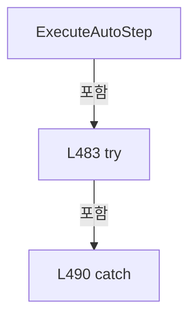

변경 전 점검: 입력/반환 타입, 위 호출자, 예외/취소 경로, 공유 상태와 저장·전송 소비자를 함께 확인합니다. 값의 단위나 물리 방향을 이름만으로 확정하지 않습니다.

### MethodDeclaration `RunAlignStep` · L499–524

[Drilling.Common/Station/CStationProcess.cs:499–524](https://github.com/kjuws10-rgb/A3Drilling/blob/5aee8e58439c9b455cae7c9593c9be986c3e682e/Drilling.Common/Station/CStationProcess.cs#L499-L524)

| 항목 | 실제 추출 값 |
| --- | --- |
| 서명 | void Drilling.Common.Station.CStationProcess.RunAlignStep(Drilling.Common.Station.ST_PROCESS_MODEL, System.Threading.CancellationToken) |
| 접근/수식자 | Private / private |
| 반환/값 타입 | void |
| 소속 타입 | NamedType:Drilling.Common.Station.CStationProcess |

입력 계약:

| 이름 | 타입 | 전달 | 선택/기본값 |
| --- | --- | --- | --- |
| processModel | Drilling.Common.Station.ST_PROCESS_MODEL | None | False /  |
| cancellationToken | System.Threading.CancellationToken | None | False /  |

현재 부분 분석에서 직접 연결된 호출자는 없습니다. XAML/이벤트/인터페이스·델리게이트·외부 진입을 추가 확인해야 하며, 미사용으로 판정한 것이 아닙니다.

호출하는 대상과 해석 범위:

| 원본 행 | 표현식 | 분석 상태 | 대상/소스 위치 |
| --- | --- | --- | --- |
| 501 | cancellationToken.ThrowIfCancellationRequested | resolved | void System.Threading.CancellationToken.ThrowIfCancellationRequested() |
| 503 | ReadDoubleAny | resolved | double Drilling.Common.Station.CStationProcess.ReadDoubleAny(System.Collections.Generic.IReadOnlyDictionary<string, string>, double, params string[]) · Drilling.Common/Station/CStationProcess.cs:2080 |
| 504 | ReadDoubleAny | resolved | double Drilling.Common.Station.CStationProcess.ReadDoubleAny(System.Collections.Generic.IReadOnlyDictionary<string, string>, double, params string[]) · Drilling.Common/Station/CStationProcess.cs:2080 |
| 505 | ReadDoubleAny | resolved | double Drilling.Common.Station.CStationProcess.ReadDoubleAny(System.Collections.Generic.IReadOnlyDictionary<string, string>, double, params string[]) · Drilling.Common/Station/CStationProcess.cs:2080 |
| 508 | UpdateProductAlignment | resolved | void Drilling.Common.Station.CStationProcess.UpdateProductAlignment(Drilling.Common.Station.ST_PROCESS_MODEL, Drilling.Common.Product.EN_PRODUCT_PROCESS_STATE, string, System.Threading.CancellationToken) · Drilling.Common/Station/CStationProcess.cs:526 |
| 509 | SendProcessControlCommand | resolved | void Drilling.Common.Station.CStationProcess.SendProcessControlCommand(string, System.Collections.Generic.IReadOnlyList<(string Key, string Value)>, System.Threading.CancellationToken) · Drilling.Common/Station/CStationProcess.cs:637 |
| 509 | FormatDouble | resolved | string Drilling.Common.Station.CStationProcess.FormatDouble(double) · Drilling.Common/Station/CStationProcess.cs:1942 |
| 509 | FormatDouble | resolved | string Drilling.Common.Station.CStationProcess.FormatDouble(double) · Drilling.Common/Station/CStationProcess.cs:1942 |
| 509 | FormatDouble | resolved | string Drilling.Common.Station.CStationProcess.FormatDouble(double) · Drilling.Common/Station/CStationProcess.cs:1942 |
| 510 | UpdateProductAlignment | resolved | void Drilling.Common.Station.CStationProcess.UpdateProductAlignment(Drilling.Common.Station.ST_PROCESS_MODEL, Drilling.Common.Product.EN_PRODUCT_PROCESS_STATE, string, System.Threading.CancellationToken) · Drilling.Common/Station/CStationProcess.cs:526 |
| 514 | TryUpdateProductAlignmentAfterFailure | resolved | void Drilling.Common.Station.CStationProcess.TryUpdateProductAlignmentAfterFailure(Drilling.Common.Station.ST_PROCESS_MODEL, Drilling.Common.Product.EN_PRODUCT_PROCESS_STATE, string) · Drilling.Common/Station/CStationProcess.cs:550 |
| 519 | TryUpdateProductAlignmentAfterFailure | resolved | void Drilling.Common.Station.CStationProcess.TryUpdateProductAlignmentAfterFailure(Drilling.Common.Station.ST_PROCESS_MODEL, Drilling.Common.Product.EN_PRODUCT_PROCESS_STATE, string) · Drilling.Common/Station/CStationProcess.cs:550 |
| 523 | AddProcessLog | resolved | void Drilling.Common.Station.CStationProcess.AddProcessLog(string, string, string) · Drilling.Common/Station/CStationProcess.cs:2366 |
| 523 | FormatDouble | resolved | string Drilling.Common.Station.CStationProcess.FormatDouble(double) · Drilling.Common/Station/CStationProcess.cs:1942 |
| 523 | FormatDouble | resolved | string Drilling.Common.Station.CStationProcess.FormatDouble(double) · Drilling.Common/Station/CStationProcess.cs:1942 |

본문의 실제 연산·분기·예외·반환 순서(원문 위치 순):

| 원본 행 | 종류 | 주석 해설 |
| --- | --- | --- |
| 501 | call | 함수·델리게이트 또는 객체 생성자를 호출합니다: cancellationToken.ThrowIfCancellationRequested() |
| 502 | local-declaration | 지역 변수를 선언합니다: var parameters = processModel.Parameters; |
| 502 | variable-initializer | 변수의 초기값을 지정합니다: parameters = processModel.Parameters |
| 503 | call | 함수·델리게이트 또는 객체 생성자를 호출합니다: ReadDoubleAny(parameters, 0.0, "REVIEW_CAMERA_ALIGN_KEY_POS_X") |
| 503 | local-declaration | 지역 변수를 선언합니다: var reviewCameraAlignKeyPosX = ReadDoubleAny(parameters, 0.0, "REVIEW_CAMERA_ALIGN_KEY_POS_X"); |
| 503 | variable-initializer | 변수의 초기값을 지정합니다: reviewCameraAlignKeyPosX = ReadDoubleAny(parameters, 0.0, "REVIEW_CAMERA_ALIGN_KEY_POS_X") |
| 504 | call | 함수·델리게이트 또는 객체 생성자를 호출합니다: ReadDoubleAny(parameters, 0.0, "REVIEW_CAMERA_ALIGN_KEY_POS_Y") |
| 504 | local-declaration | 지역 변수를 선언합니다: var reviewCameraAlignKeyPosY = ReadDoubleAny(parameters, 0.0, "REVIEW_CAMERA_ALIGN_KEY_POS_Y"); |
| 504 | variable-initializer | 변수의 초기값을 지정합니다: reviewCameraAlignKeyPosY = ReadDoubleAny(parameters, 0.0, "REVIEW_CAMERA_ALIGN_KEY_POS_Y") |
| 505 | call | 함수·델리게이트 또는 객체 생성자를 호출합니다: ReadDoubleAny(parameters, 100.0, "STAGE_SPEED") |
| 505 | local-declaration | 지역 변수를 선언합니다: var stageYSpeed = ReadDoubleAny(parameters, 100.0, "STAGE_SPEED"); |
| 505 | variable-initializer | 변수의 초기값을 지정합니다: stageYSpeed = ReadDoubleAny(parameters, 100.0, "STAGE_SPEED") |
| 506 | try | 예외 처리 범위입니다: try |
| 508 | call | 함수·델리게이트 또는 객체 생성자를 호출합니다: UpdateProductAlignment(processModel, EN_PRODUCT_PROCESS_STATE.Running, "RUNNING", cancellationToken) |
| 509 | call | 함수·델리게이트 또는 객체 생성자를 호출합니다: SendProcessControlCommand("ALIGN_REVIEW_CAMERA_MOVE", [("CAMERA_X", FormatDouble(reviewCameraAlignKeyPosX)), ("STAGE_Y", FormatDouble(reviewCameraAlignKeyPosY)), ("SPEED_Y", FormatDouble(stageYSpeed))], cancellationToken… |
| 509 | call | 함수·델리게이트 또는 객체 생성자를 호출합니다: FormatDouble(reviewCameraAlignKeyPosX) |
| 509 | call | 함수·델리게이트 또는 객체 생성자를 호출합니다: FormatDouble(reviewCameraAlignKeyPosY) |
| 509 | call | 함수·델리게이트 또는 객체 생성자를 호출합니다: FormatDouble(stageYSpeed) |
| 510 | call | 함수·델리게이트 또는 객체 생성자를 호출합니다: UpdateProductAlignment(processModel, EN_PRODUCT_PROCESS_STATE.Completed, "OK", cancellationToken) |
| 512 | catch | 지정 예외를 처리합니다: catch (OperationCanceledException) |
| 514 | call | 함수·델리게이트 또는 객체 생성자를 호출합니다: TryUpdateProductAlignmentAfterFailure(processModel, EN_PRODUCT_PROCESS_STATE.Stopped, "STOPPED") |
| 515 | throw | 예외를 발생/전달합니다: throw; |
| 517 | catch | 지정 예외를 처리합니다: catch  |
| 519 | call | 함수·델리게이트 또는 객체 생성자를 호출합니다: TryUpdateProductAlignmentAfterFailure(processModel, EN_PRODUCT_PROCESS_STATE.Error, "ERROR") |
| 520 | throw | 예외를 발생/전달합니다: throw; |
| 523 | call | 함수·델리게이트 또는 객체 생성자를 호출합니다: AddProcessLog("INFO", "ALIGN", $"Review camera align key position requested. CameraX={FormatDouble(reviewCameraAlignKeyPosX)}, StageY={FormatDouble(reviewCameraAlignKeyPosY)}") |
| 523 | call | 함수·델리게이트 또는 객체 생성자를 호출합니다: FormatDouble(reviewCameraAlignKeyPosX) |
| 523 | call | 함수·델리게이트 또는 객체 생성자를 호출합니다: FormatDouble(reviewCameraAlignKeyPosY) |

제어 구문의 포함 구조(실제 실행 순서/CFG가 아닌 구문 탐색 그림):

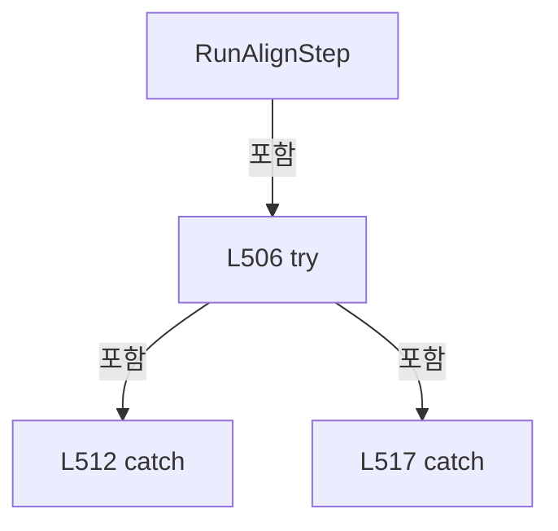

변경 전 점검: 입력/반환 타입, 위 호출자, 예외/취소 경로, 공유 상태와 저장·전송 소비자를 함께 확인합니다. 값의 단위나 물리 방향을 이름만으로 확정하지 않습니다.

### MethodDeclaration `UpdateProductAlignment` · L526–548

[Drilling.Common/Station/CStationProcess.cs:526–548](https://github.com/kjuws10-rgb/A3Drilling/blob/5aee8e58439c9b455cae7c9593c9be986c3e682e/Drilling.Common/Station/CStationProcess.cs#L526-L548)

| 항목 | 실제 추출 값 |
| --- | --- |
| 서명 | void Drilling.Common.Station.CStationProcess.UpdateProductAlignment(Drilling.Common.Station.ST_PROCESS_MODEL, Drilling.Common.Product.EN_PRODUCT_PROCESS_STATE, string, System.Threading.CancellationToken) |
| 접근/수식자 | Private / private |
| 반환/값 타입 | void |
| 소속 타입 | NamedType:Drilling.Common.Station.CStationProcess |

입력 계약:

| 이름 | 타입 | 전달 | 선택/기본값 |
| --- | --- | --- | --- |
| processModel | Drilling.Common.Station.ST_PROCESS_MODEL | None | False /  |
| state | Drilling.Common.Product.EN_PRODUCT_PROCESS_STATE | None | False /  |
| result | string | None | False /  |
| cancellationToken | System.Threading.CancellationToken | None | False /  |

정적 호출자로 확인된 위치:

| 호출 파일/행 | 호출 표현식 | 런타임 분기 가능 |
| --- | --- | --- |
| [Drilling.Common/Station/CStationProcess.cs:508–508](https://github.com/kjuws10-rgb/A3Drilling/blob/5aee8e58439c9b455cae7c9593c9be986c3e682e/Drilling.Common/Station/CStationProcess.cs#L508-L508) | UpdateProductAlignment | False |
| [Drilling.Common/Station/CStationProcess.cs:510–510](https://github.com/kjuws10-rgb/A3Drilling/blob/5aee8e58439c9b455cae7c9593c9be986c3e682e/Drilling.Common/Station/CStationProcess.cs#L510-L510) | UpdateProductAlignment | False |
| [Drilling.Common/Station/CStationProcess.cs:554–554](https://github.com/kjuws10-rgb/A3Drilling/blob/5aee8e58439c9b455cae7c9593c9be986c3e682e/Drilling.Common/Station/CStationProcess.cs#L554-L554) | UpdateProductAlignment | False |

호출하는 대상과 해석 범위:

| 원본 행 | 표현식 | 분석 상태 | 대상/소스 위치 |
| --- | --- | --- | --- |
| 528 | GetCurrentProcessProductId | resolved | string? Drilling.Common.Station.CStationProcess.GetCurrentProcessProductId() · Drilling.Common/Station/CStationProcess.cs:1506 |
| 529 | string.IsNullOrWhiteSpace | resolved | bool string.IsNullOrWhiteSpace(string?) |
| 536 | _productManager.SetAlignment( productId, new ST_PRODUCT_ALIGN_DATA( state, result, includeResults ? ReadNullableDoubleAny(parameters, "ALIGN_OFFSET_X") : null, includeResults ? ReadNullableDoubleAny(parameters, "ALIGN_OFFSET_Y") : null, includeResults ? ReadNullableDoubleAny(parameters, "ALIGN_ROTATION") : null ), new ST_PRODUCT_DISTORTION_DATA(sta… | resolved | Drilling.Common.Product.ST_PRODUCT_DATA System.Runtime.CompilerServices.TaskAwaiter<Drilling.Common.Product.ST_PRODUCT_DATA>.GetResult() |
| 536 | _productManager.SetAlignment( productId, new ST_PRODUCT_ALIGN_DATA( state, result, includeResults ? ReadNullableDoubleAny(parameters, "ALIGN_OFFSET_X") : null, includeResults ? ReadNullableDoubleAny(parameters, "ALIGN_OFFSET_Y") : null, includeResults ? ReadNullableDoubleAny(parameters, "ALIGN_ROTATION") : null ), new ST_PRODUCT_DISTORTION_DATA(sta… | resolved | System.Runtime.CompilerServices.TaskAwaiter<Drilling.Common.Product.ST_PRODUCT_DATA> System.Threading.Tasks.Task<Drilling.Common.Product.ST_PRODUCT_DATA>.GetAwaiter() |
| 536 | _productManager.SetAlignment | resolved | System.Threading.Tasks.Task<Drilling.Common.Product.ST_PRODUCT_DATA> Drilling.Common.Product.CProductManager.SetAlignment(string, Drilling.Common.Product.ST_PRODUCT_ALIGN_DATA, Drilling.Common.Product.ST_PRODUCT_DISTORTION_DATA, System.Threading.CancellationToken) · Drilling.Common/Product/CProductManager.cs:424 |
| 538 | new ST_PRODUCT_ALIGN_DATA | resolved | Drilling.Common.Product.ST_PRODUCT_ALIGN_DATA.ST_PRODUCT_ALIGN_DATA(Drilling.Common.Product.EN_PRODUCT_PROCESS_STATE, string, double?, double?, double?) · Drilling.Common/Product/CProductManager.cs:996 |
| 541 | ReadNullableDoubleAny | resolved | double? Drilling.Common.Station.CStationProcess.ReadNullableDoubleAny(System.Collections.Generic.IReadOnlyDictionary<string, string>, params string[]) · Drilling.Common/Station/CStationProcess.cs:2024 |
| 542 | ReadNullableDoubleAny | resolved | double? Drilling.Common.Station.CStationProcess.ReadNullableDoubleAny(System.Collections.Generic.IReadOnlyDictionary<string, string>, params string[]) · Drilling.Common/Station/CStationProcess.cs:2024 |
| 543 | ReadNullableDoubleAny | resolved | double? Drilling.Common.Station.CStationProcess.ReadNullableDoubleAny(System.Collections.Generic.IReadOnlyDictionary<string, string>, params string[]) · Drilling.Common/Station/CStationProcess.cs:2024 |
| 545 | new ST_PRODUCT_DISTORTION_DATA | resolved | Drilling.Common.Product.ST_PRODUCT_DISTORTION_DATA.ST_PRODUCT_DISTORTION_DATA(Drilling.Common.Product.EN_PRODUCT_PROCESS_STATE, string, double?) · Drilling.Common/Product/CProductManager.cs:997 |
| 545 | ReadNullableDoubleAny | resolved | double? Drilling.Common.Station.CStationProcess.ReadNullableDoubleAny(System.Collections.Generic.IReadOnlyDictionary<string, string>, params string[]) · Drilling.Common/Station/CStationProcess.cs:2024 |

본문의 실제 연산·분기·예외·반환 순서(원문 위치 순):

| 원본 행 | 종류 | 주석 해설 |
| --- | --- | --- |
| 528 | call | 함수·델리게이트 또는 객체 생성자를 호출합니다: GetCurrentProcessProductId() |
| 528 | local-declaration | 지역 변수를 선언합니다: var productId = GetCurrentProcessProductId(); |
| 528 | variable-initializer | 변수의 초기값을 지정합니다: productId = GetCurrentProcessProductId() |
| 529 | call | 함수·델리게이트 또는 객체 생성자를 호출합니다: string.IsNullOrWhiteSpace(productId) |
| 529 | if | 조건에 따라 분기합니다: if (_productManager is null &#124;&#124; string.IsNullOrWhiteSpace(productId)) |
| 531 | return | 호출자에게 값 또는 제어를 반환합니다: return; |
| 534 | local-declaration | 지역 변수를 선언합니다: var parameters = processModel.Parameters; |
| 534 | variable-initializer | 변수의 초기값을 지정합니다: parameters = processModel.Parameters |
| 535 | local-declaration | 지역 변수를 선언합니다: var includeResults = state == EN_PRODUCT_PROCESS_STATE.Completed; |
| 535 | variable-initializer | 변수의 초기값을 지정합니다: includeResults = state == EN_PRODUCT_PROCESS_STATE.Completed |
| 536 | call | 함수·델리게이트 또는 객체 생성자를 호출합니다: _productManager.SetAlignment( productId, new ST_PRODUCT_ALIGN_DATA( state, result, includeResults ? ReadNullableDoubleAny(parameters, "ALIGN_OFFSET_X") : null, includeResults ? ReadNullableDoubleAny(parameters, "ALIGN_OF… |
| 536 | call | 함수·델리게이트 또는 객체 생성자를 호출합니다: _productManager.SetAlignment( productId, new ST_PRODUCT_ALIGN_DATA( state, result, includeResults ? ReadNullableDoubleAny(parameters, "ALIGN_OFFSET_X") : null, includeResults ? ReadNullableDoubleAny(parameters, "ALIGN_OF… |
| 536 | call | 함수·델리게이트 또는 객체 생성자를 호출합니다: _productManager.SetAlignment( productId, new ST_PRODUCT_ALIGN_DATA( state, result, includeResults ? ReadNullableDoubleAny(parameters, "ALIGN_OFFSET_X") : null, includeResults ? ReadNullableDoubleAny(parameters, "ALIGN_OF… |
| 538 | call | 함수·델리게이트 또는 객체 생성자를 호출합니다: new ST_PRODUCT_ALIGN_DATA( state, result, includeResults ? ReadNullableDoubleAny(parameters, "ALIGN_OFFSET_X") : null, includeResults ? ReadNullableDoubleAny(parameters, "ALIGN_OFFSET_Y") : null, includeResults ? ReadNul… |
| 541 | call | 함수·델리게이트 또는 객체 생성자를 호출합니다: ReadNullableDoubleAny(parameters, "ALIGN_OFFSET_X") |
| 541 | conditional-expression | 조건에 따라 결과식을 선택합니다: includeResults ? ReadNullableDoubleAny(parameters, "ALIGN_OFFSET_X") : null |
| 542 | call | 함수·델리게이트 또는 객체 생성자를 호출합니다: ReadNullableDoubleAny(parameters, "ALIGN_OFFSET_Y") |
| 542 | conditional-expression | 조건에 따라 결과식을 선택합니다: includeResults ? ReadNullableDoubleAny(parameters, "ALIGN_OFFSET_Y") : null |
| 543 | call | 함수·델리게이트 또는 객체 생성자를 호출합니다: ReadNullableDoubleAny(parameters, "ALIGN_ROTATION") |
| 543 | conditional-expression | 조건에 따라 결과식을 선택합니다: includeResults ? ReadNullableDoubleAny(parameters, "ALIGN_ROTATION") : null |
| 545 | call | 함수·델리게이트 또는 객체 생성자를 호출합니다: new ST_PRODUCT_DISTORTION_DATA(state, result, includeResults ? ReadNullableDoubleAny(parameters, "DISTORTION_MAX_DA", "MAX_DA") : null) |
| 545 | call | 함수·델리게이트 또는 객체 생성자를 호출합니다: ReadNullableDoubleAny(parameters, "DISTORTION_MAX_DA", "MAX_DA") |
| 545 | conditional-expression | 조건에 따라 결과식을 선택합니다: includeResults ? ReadNullableDoubleAny(parameters, "DISTORTION_MAX_DA", "MAX_DA") : null |

제어 구문의 포함 구조(실제 실행 순서/CFG가 아닌 구문 탐색 그림):

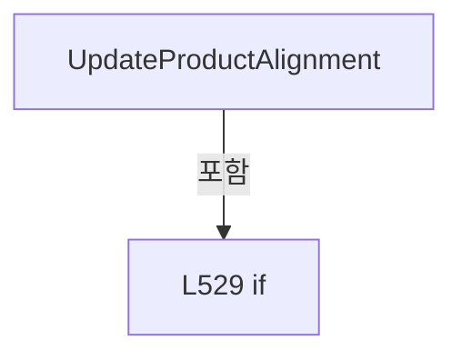

변경 전 점검: 입력/반환 타입, 위 호출자, 예외/취소 경로, 공유 상태와 저장·전송 소비자를 함께 확인합니다. 값의 단위나 물리 방향을 이름만으로 확정하지 않습니다.

### MethodDeclaration `TryUpdateProductAlignmentAfterFailure` · L550–560

[Drilling.Common/Station/CStationProcess.cs:550–560](https://github.com/kjuws10-rgb/A3Drilling/blob/5aee8e58439c9b455cae7c9593c9be986c3e682e/Drilling.Common/Station/CStationProcess.cs#L550-L560)

| 항목 | 실제 추출 값 |
| --- | --- |
| 서명 | void Drilling.Common.Station.CStationProcess.TryUpdateProductAlignmentAfterFailure(Drilling.Common.Station.ST_PROCESS_MODEL, Drilling.Common.Product.EN_PRODUCT_PROCESS_STATE, string) |
| 접근/수식자 | Private / private |
| 반환/값 타입 | void |
| 소속 타입 | NamedType:Drilling.Common.Station.CStationProcess |

입력 계약:

| 이름 | 타입 | 전달 | 선택/기본값 |
| --- | --- | --- | --- |
| processModel | Drilling.Common.Station.ST_PROCESS_MODEL | None | False /  |
| state | Drilling.Common.Product.EN_PRODUCT_PROCESS_STATE | None | False /  |
| result | string | None | False /  |

정적 호출자로 확인된 위치:

| 호출 파일/행 | 호출 표현식 | 런타임 분기 가능 |
| --- | --- | --- |
| [Drilling.Common/Station/CStationProcess.cs:514–514](https://github.com/kjuws10-rgb/A3Drilling/blob/5aee8e58439c9b455cae7c9593c9be986c3e682e/Drilling.Common/Station/CStationProcess.cs#L514-L514) | TryUpdateProductAlignmentAfterFailure | False |
| [Drilling.Common/Station/CStationProcess.cs:519–519](https://github.com/kjuws10-rgb/A3Drilling/blob/5aee8e58439c9b455cae7c9593c9be986c3e682e/Drilling.Common/Station/CStationProcess.cs#L519-L519) | TryUpdateProductAlignmentAfterFailure | False |

호출하는 대상과 해석 범위:

| 원본 행 | 표현식 | 분석 상태 | 대상/소스 위치 |
| --- | --- | --- | --- |
| 554 | UpdateProductAlignment | resolved | void Drilling.Common.Station.CStationProcess.UpdateProductAlignment(Drilling.Common.Station.ST_PROCESS_MODEL, Drilling.Common.Product.EN_PRODUCT_PROCESS_STATE, string, System.Threading.CancellationToken) · Drilling.Common/Station/CStationProcess.cs:526 |
| 558 | AddProcessLog | resolved | void Drilling.Common.Station.CStationProcess.AddProcessLog(string, string, string) · Drilling.Common/Station/CStationProcess.cs:2366 |

본문의 실제 연산·분기·예외·반환 순서(원문 위치 순):

| 원본 행 | 종류 | 주석 해설 |
| --- | --- | --- |
| 552 | try | 예외 처리 범위입니다: try |
| 554 | call | 함수·델리게이트 또는 객체 생성자를 호출합니다: UpdateProductAlignment(processModel, state, result, CancellationToken.None) |
| 556 | catch | 지정 예외를 처리합니다: catch (Exception updateException) |
| 558 | call | 함수·델리게이트 또는 객체 생성자를 호출합니다: AddProcessLog("ERROR", "PRODUCT", $"Product align state update failed. {updateException.Message}") |

제어 구문의 포함 구조(실제 실행 순서/CFG가 아닌 구문 탐색 그림):

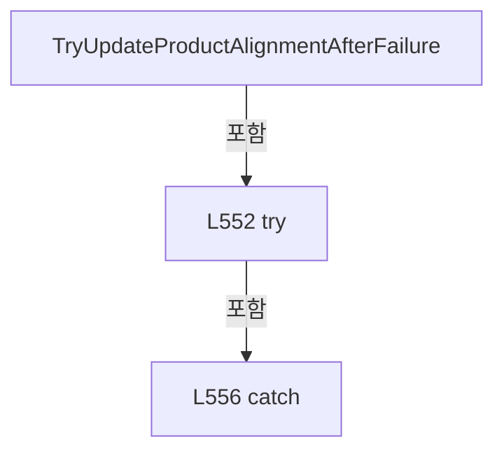

변경 전 점검: 입력/반환 타입, 위 호출자, 예외/취소 경로, 공유 상태와 저장·전송 소비자를 함께 확인합니다. 값의 단위나 물리 방향을 이름만으로 확정하지 않습니다.

### MethodDeclaration `RunProcessStep` · L562–573

[Drilling.Common/Station/CStationProcess.cs:562–573](https://github.com/kjuws10-rgb/A3Drilling/blob/5aee8e58439c9b455cae7c9593c9be986c3e682e/Drilling.Common/Station/CStationProcess.cs#L562-L573)

| 항목 | 실제 추출 값 |
| --- | --- |
| 서명 | void Drilling.Common.Station.CStationProcess.RunProcessStep(Drilling.Common.Station.ST_PROCESS_MODEL, System.Threading.CancellationToken) |
| 접근/수식자 | Private / private |
| 반환/값 타입 | void |
| 소속 타입 | NamedType:Drilling.Common.Station.CStationProcess |

입력 계약:

| 이름 | 타입 | 전달 | 선택/기본값 |
| --- | --- | --- | --- |
| processModel | Drilling.Common.Station.ST_PROCESS_MODEL | None | False /  |
| cancellationToken | System.Threading.CancellationToken | None | False /  |

현재 부분 분석에서 직접 연결된 호출자는 없습니다. XAML/이벤트/인터페이스·델리게이트·외부 진입을 추가 확인해야 하며, 미사용으로 판정한 것이 아닙니다.

호출하는 대상과 해석 범위:

| 원본 행 | 표현식 | 분석 상태 | 대상/소스 위치 |
| --- | --- | --- | --- |
| 564 | EnsurePreparedReviewOffsetIsCurrent | resolved | void Drilling.Common.Station.CStationProcess.EnsurePreparedReviewOffsetIsCurrent(Drilling.Common.Station.ST_PROCESS_MODEL, System.Threading.CancellationToken) · Drilling.Common/Station/CStationProcess.cs:1575 |
| 565 | _sequenceActions.Run | resolved | void Drilling.Common.Station.CSequenceActionStatusStore.Run(string, System.Action) · Drilling.Common/Station/CStationManager.cs:196 |
| 567 | BuildAutomationScript | resolved | void Drilling.Common.Station.CStationProcess.BuildAutomationScript(Drilling.Common.Station.ST_PROCESS_MODEL, System.Threading.CancellationToken) · Drilling.Common/Station/CStationProcess.cs:656 |
| 568 | UploadAutomationScript | resolved | void Drilling.Common.Station.CStationProcess.UploadAutomationScript(Drilling.Common.Station.ST_PROCESS_MODEL, System.Threading.CancellationToken) · Drilling.Common/Station/CStationProcess.cs:667 |
| 572 | RunScannerProcess | resolved | void Drilling.Common.Station.CStationProcess.RunScannerProcess(Drilling.Common.Station.ST_PROCESS_MODEL, System.Threading.CancellationToken) · Drilling.Common/Station/CStationProcess.cs:691 |

본문의 실제 연산·분기·예외·반환 순서(원문 위치 순):

| 원본 행 | 종류 | 주석 해설 |
| --- | --- | --- |
| 564 | call | 함수·델리게이트 또는 객체 생성자를 호출합니다: EnsurePreparedReviewOffsetIsCurrent(processModel, cancellationToken) |
| 565 | call | 함수·델리게이트 또는 객체 생성자를 호출합니다: _sequenceActions.Run(CSequenceActionIds.BuildUploadScript, () => { BuildAutomationScript(processModel, cancellationToken); UploadAutomationScript(processModel, cancellationToken); }) |
| 567 | call | 함수·델리게이트 또는 객체 생성자를 호출합니다: BuildAutomationScript(processModel, cancellationToken) |
| 568 | call | 함수·델리게이트 또는 객체 생성자를 호출합니다: UploadAutomationScript(processModel, cancellationToken) |
| 572 | call | 함수·델리게이트 또는 객체 생성자를 호출합니다: RunScannerProcess(processModel, cancellationToken) |

변경 전 점검: 입력/반환 타입, 위 호출자, 예외/취소 경로, 공유 상태와 저장·전송 소비자를 함께 확인합니다. 값의 단위나 물리 방향을 이름만으로 확정하지 않습니다.

### MethodDeclaration `MoveStageToScanStart` · L575–607

[Drilling.Common/Station/CStationProcess.cs:575–607](https://github.com/kjuws10-rgb/A3Drilling/blob/5aee8e58439c9b455cae7c9593c9be986c3e682e/Drilling.Common/Station/CStationProcess.cs#L575-L607)

| 항목 | 실제 추출 값 |
| --- | --- |
| 서명 | void Drilling.Common.Station.CStationProcess.MoveStageToScanStart(Drilling.Common.Station.ST_PROCESS_MODEL, System.Threading.CancellationToken) |
| 접근/수식자 | Private / private |
| 반환/값 타입 | void |
| 소속 타입 | NamedType:Drilling.Common.Station.CStationProcess |

입력 계약:

| 이름 | 타입 | 전달 | 선택/기본값 |
| --- | --- | --- | --- |
| processModel | Drilling.Common.Station.ST_PROCESS_MODEL | None | False /  |
| cancellationToken | System.Threading.CancellationToken | None | False /  |

현재 부분 분석에서 직접 연결된 호출자는 없습니다. XAML/이벤트/인터페이스·델리게이트·외부 진입을 추가 확인해야 하며, 미사용으로 판정한 것이 아닙니다.

호출하는 대상과 해석 범위:

| 원본 행 | 표현식 | 분석 상태 | 대상/소스 위치 |
| --- | --- | --- | --- |
| 577 | cancellationToken.ThrowIfCancellationRequested | resolved | void System.Threading.CancellationToken.ThrowIfCancellationRequested() |
| 579 | ReadDoubleAny | resolved | double Drilling.Common.Station.CStationProcess.ReadDoubleAny(System.Collections.Generic.IReadOnlyDictionary<string, string>, double, params string[]) · Drilling.Common/Station/CStationProcess.cs:2080 |
| 580 | ReadDoubleAny | resolved | double Drilling.Common.Station.CStationProcess.ReadDoubleAny(System.Collections.Generic.IReadOnlyDictionary<string, string>, double, params string[]) · Drilling.Common/Station/CStationProcess.cs:2080 |
| 581 | ReadDoubleAny | resolved | double Drilling.Common.Station.CStationProcess.ReadDoubleAny(System.Collections.Generic.IReadOnlyDictionary<string, string>, double, params string[]) · Drilling.Common/Station/CStationProcess.cs:2080 |
| 582 | ReadDoubleAny | resolved | double Drilling.Common.Station.CStationProcess.ReadDoubleAny(System.Collections.Generic.IReadOnlyDictionary<string, string>, double, params string[]) · Drilling.Common/Station/CStationProcess.cs:2080 |
| 583 | ReadDoubleAny | resolved | double Drilling.Common.Station.CStationProcess.ReadDoubleAny(System.Collections.Generic.IReadOnlyDictionary<string, string>, double, params string[]) · Drilling.Common/Station/CStationProcess.cs:2080 |
| 584 | ReadDoubleAny | resolved | double Drilling.Common.Station.CStationProcess.ReadDoubleAny(System.Collections.Generic.IReadOnlyDictionary<string, string>, double, params string[]) · Drilling.Common/Station/CStationProcess.cs:2080 |
| 587 | Math.Abs | resolved | double System.Math.Abs(double) |
| 587 | ReadDoubleAny | resolved | double Drilling.Common.Station.CStationProcess.ReadDoubleAny(System.Collections.Generic.IReadOnlyDictionary<string, string>, double, params string[]) · Drilling.Common/Station/CStationProcess.cs:2080 |
| 588 | ReadDirectionAny | resolved | double Drilling.Common.Station.CStationProcess.ReadDirectionAny(System.Collections.Generic.IReadOnlyDictionary<string, string>, double, params string[]) · Drilling.Common/Station/CStationProcess.cs:1947 |
| 589 | ResolveFirstShotStageY | resolved | double Drilling.Common.Station.CStationProcess.ResolveFirstShotStageY(Drilling.Common.Station.ST_PROCESS_MODEL, double) · Drilling.Common/Station/CStationProcess.cs:609 |
| 591 | ReadDoubleAny | resolved | double Drilling.Common.Station.CStationProcess.ReadDoubleAny(System.Collections.Generic.IReadOnlyDictionary<string, string>, double, params string[]) · Drilling.Common/Station/CStationProcess.cs:2080 |
| 592 | SendProcessControlCommand | resolved | void Drilling.Common.Station.CStationProcess.SendProcessControlCommand(string, System.Collections.Generic.IReadOnlyList<(string Key, string Value)>, System.Threading.CancellationToken) · Drilling.Common/Station/CStationProcess.cs:637 |
| 592 | FormatDouble | resolved | string Drilling.Common.Station.CStationProcess.FormatDouble(double) · Drilling.Common/Station/CStationProcess.cs:1942 |
| 592 | FormatDouble | resolved | string Drilling.Common.Station.CStationProcess.FormatDouble(double) · Drilling.Common/Station/CStationProcess.cs:1942 |
| 592 | FormatDouble | resolved | string Drilling.Common.Station.CStationProcess.FormatDouble(double) · Drilling.Common/Station/CStationProcess.cs:1942 |
| 593 | SendProcessControlCommand | resolved | void Drilling.Common.Station.CStationProcess.SendProcessControlCommand(string, System.Collections.Generic.IReadOnlyList<(string Key, string Value)>, System.Threading.CancellationToken) · Drilling.Common/Station/CStationProcess.cs:637 |
| 594 | FormatDouble | resolved | string Drilling.Common.Station.CStationProcess.FormatDouble(double) · Drilling.Common/Station/CStationProcess.cs:1942 |
| 595 | FormatDouble | resolved | string Drilling.Common.Station.CStationProcess.FormatDouble(double) · Drilling.Common/Station/CStationProcess.cs:1942 |
| 596 | FormatDouble | resolved | string Drilling.Common.Station.CStationProcess.FormatDouble(double) · Drilling.Common/Station/CStationProcess.cs:1942 |
| 597 | FormatDouble | resolved | string Drilling.Common.Station.CStationProcess.FormatDouble(double) · Drilling.Common/Station/CStationProcess.cs:1942 |
| 598 | FormatDouble | resolved | string Drilling.Common.Station.CStationProcess.FormatDouble(double) · Drilling.Common/Station/CStationProcess.cs:1942 |
| 599 | FormatDouble | resolved | string Drilling.Common.Station.CStationProcess.FormatDouble(double) · Drilling.Common/Station/CStationProcess.cs:1942 |
| 600 | FormatDouble | resolved | string Drilling.Common.Station.CStationProcess.FormatDouble(double) · Drilling.Common/Station/CStationProcess.cs:1942 |
| 601 | FormatDouble | resolved | string Drilling.Common.Station.CStationProcess.FormatDouble(double) · Drilling.Common/Station/CStationProcess.cs:1942 |
| 602 | FormatDouble | resolved | string Drilling.Common.Station.CStationProcess.FormatDouble(double) · Drilling.Common/Station/CStationProcess.cs:1942 |
| 603 | FormatDouble | resolved | string Drilling.Common.Station.CStationProcess.FormatDouble(double) · Drilling.Common/Station/CStationProcess.cs:1942 |
| 604 | FormatDouble | resolved | string Drilling.Common.Station.CStationProcess.FormatDouble(double) · Drilling.Common/Station/CStationProcess.cs:1942 |
| 606 | AddProcessLog | resolved | void Drilling.Common.Station.CStationProcess.AddProcessLog(string, string, string) · Drilling.Common/Station/CStationProcess.cs:2366 |
| 606 | FormatDouble | resolved | string Drilling.Common.Station.CStationProcess.FormatDouble(double) · Drilling.Common/Station/CStationProcess.cs:1942 |
| 606 | FormatDouble | resolved | string Drilling.Common.Station.CStationProcess.FormatDouble(double) · Drilling.Common/Station/CStationProcess.cs:1942 |
| 606 | FormatDouble | resolved | string Drilling.Common.Station.CStationProcess.FormatDouble(double) · Drilling.Common/Station/CStationProcess.cs:1942 |
| 606 | FormatDouble | resolved | string Drilling.Common.Station.CStationProcess.FormatDouble(double) · Drilling.Common/Station/CStationProcess.cs:1942 |
| 606 | FormatDouble | resolved | string Drilling.Common.Station.CStationProcess.FormatDouble(double) · Drilling.Common/Station/CStationProcess.cs:1942 |
| 606 | FormatDouble | resolved | string Drilling.Common.Station.CStationProcess.FormatDouble(double) · Drilling.Common/Station/CStationProcess.cs:1942 |
| 606 | FormatDouble | resolved | string Drilling.Common.Station.CStationProcess.FormatDouble(double) · Drilling.Common/Station/CStationProcess.cs:1942 |
| 606 | FormatDouble | resolved | string Drilling.Common.Station.CStationProcess.FormatDouble(double) · Drilling.Common/Station/CStationProcess.cs:1942 |
| 606 | FormatDouble | resolved | string Drilling.Common.Station.CStationProcess.FormatDouble(double) · Drilling.Common/Station/CStationProcess.cs:1942 |

본문의 실제 연산·분기·예외·반환 순서(원문 위치 순):

| 원본 행 | 종류 | 주석 해설 |
| --- | --- | --- |
| 577 | call | 함수·델리게이트 또는 객체 생성자를 호출합니다: cancellationToken.ThrowIfCancellationRequested() |
| 578 | local-declaration | 지역 변수를 선언합니다: var parameters = processModel.Parameters; |
| 578 | variable-initializer | 변수의 초기값을 지정합니다: parameters = processModel.Parameters |
| 579 | call | 함수·델리게이트 또는 객체 생성자를 호출합니다: ReadDoubleAny(parameters, 0.0, "STAGE_START_POS_X") |
| 579 | local-declaration | 지역 변수를 선언합니다: var startX = ReadDoubleAny(parameters, 0.0, "STAGE_START_POS_X"); |
| 579 | variable-initializer | 변수의 초기값을 지정합니다: startX = ReadDoubleAny(parameters, 0.0, "STAGE_START_POS_X") |
| 580 | call | 함수·델리게이트 또는 객체 생성자를 호출합니다: ReadDoubleAny(parameters, 0.0, "STAGE_START_POS_Y") |
| 580 | local-declaration | 지역 변수를 선언합니다: var startY = ReadDoubleAny(parameters, 0.0, "STAGE_START_POS_Y"); |
| 580 | variable-initializer | 변수의 초기값을 지정합니다: startY = ReadDoubleAny(parameters, 0.0, "STAGE_START_POS_Y") |
| 581 | call | 함수·델리게이트 또는 객체 생성자를 호출합니다: ReadDoubleAny(parameters, 0.0, "REVIEW_CAMERA_ALIGN_KEY_POS_X") |
| 581 | local-declaration | 지역 변수를 선언합니다: var reviewCameraAlignKeyPosX = ReadDoubleAny(parameters, 0.0, "REVIEW_CAMERA_ALIGN_KEY_POS_X"); |
| 581 | variable-initializer | 변수의 초기값을 지정합니다: reviewCameraAlignKeyPosX = ReadDoubleAny(parameters, 0.0, "REVIEW_CAMERA_ALIGN_KEY_POS_X") |
| 582 | call | 함수·델리게이트 또는 객체 생성자를 호출합니다: ReadDoubleAny(parameters, startY, "REVIEW_CAMERA_ALIGN_KEY_POS_Y") |
| 582 | local-declaration | 지역 변수를 선언합니다: var reviewCameraAlignKeyPosY = ReadDoubleAny(parameters, startY, "REVIEW_CAMERA_ALIGN_KEY_POS_Y"); |
| 582 | variable-initializer | 변수의 초기값을 지정합니다: reviewCameraAlignKeyPosY = ReadDoubleAny(parameters, startY, "REVIEW_CAMERA_ALIGN_KEY_POS_Y") |
| 583 | call | 함수·델리게이트 또는 객체 생성자를 호출합니다: ReadDoubleAny(parameters, 0.0, "REVIEW_TO_HEAD1_GAP_Y") |
| 583 | local-declaration | 지역 변수를 선언합니다: var reviewToHead1GapY = ReadDoubleAny(parameters, 0.0, "REVIEW_TO_HEAD1_GAP_Y"); |
| 583 | variable-initializer | 변수의 초기값을 지정합니다: reviewToHead1GapY = ReadDoubleAny(parameters, 0.0, "REVIEW_TO_HEAD1_GAP_Y") |
| 584 | call | 함수·델리게이트 또는 객체 생성자를 호출합니다: ReadDoubleAny(parameters, 0.0, "HeadGapY") |
| 584 | local-declaration | 지역 변수를 선언합니다: var headGapY = ReadDoubleAny(parameters, 0.0, "HeadGapY"); |
| 584 | variable-initializer | 변수의 초기값을 지정합니다: headGapY = ReadDoubleAny(parameters, 0.0, "HeadGapY") |
| 585 | local-declaration | 지역 변수를 선언합니다: var head1AlignKeyY = reviewCameraAlignKeyPosY + reviewToHead1GapY; |
| 585 | variable-initializer | 변수의 초기값을 지정합니다: head1AlignKeyY = reviewCameraAlignKeyPosY + reviewToHead1GapY |
| 586 | local-declaration | 지역 변수를 선언합니다: var head2AlignKeyY = head1AlignKeyY + headGapY; |
| 586 | variable-initializer | 변수의 초기값을 지정합니다: head2AlignKeyY = head1AlignKeyY + headGapY |
| 587 | call | 함수·델리게이트 또는 객체 생성자를 호출합니다: Math.Abs(ReadDoubleAny(parameters, 0.0, "SCAN_START_DELAY_LENGTH_Y")) |
| 587 | call | 함수·델리게이트 또는 객체 생성자를 호출합니다: ReadDoubleAny(parameters, 0.0, "SCAN_START_DELAY_LENGTH_Y") |
| 587 | local-declaration | 지역 변수를 선언합니다: var delayLengthY = Math.Abs(ReadDoubleAny(parameters, 0.0, "SCAN_START_DELAY_LENGTH_Y")); |
| 587 | variable-initializer | 변수의 초기값을 지정합니다: delayLengthY = Math.Abs(ReadDoubleAny(parameters, 0.0, "SCAN_START_DELAY_LENGTH_Y")) |
| 588 | call | 함수·델리게이트 또는 객체 생성자를 호출합니다: ReadDirectionAny(parameters, -1.0, "STAGE_SCAN_DIRECTION_Y") |
| 588 | local-declaration | 지역 변수를 선언합니다: var stageScanDirectionY = ReadDirectionAny(parameters, -1.0, "STAGE_SCAN_DIRECTION_Y"); |
| 588 | variable-initializer | 변수의 초기값을 지정합니다: stageScanDirectionY = ReadDirectionAny(parameters, -1.0, "STAGE_SCAN_DIRECTION_Y") |
| 589 | call | 함수·델리게이트 또는 객체 생성자를 호출합니다: ResolveFirstShotStageY(processModel, stageScanDirectionY) |
| 589 | local-declaration | 지역 변수를 선언합니다: var firstShotStageY = ResolveFirstShotStageY(processModel, stageScanDirectionY); |
| 589 | variable-initializer | 변수의 초기값을 지정합니다: firstShotStageY = ResolveFirstShotStageY(processModel, stageScanDirectionY) |
| 590 | local-declaration | 지역 변수를 선언합니다: var scanStartY = reviewCameraAlignKeyPosY + firstShotStageY - (stageScanDirectionY * delayLengthY); |
| 590 | variable-initializer | 변수의 초기값을 지정합니다: scanStartY = reviewCameraAlignKeyPosY + firstShotStageY - (stageScanDirectionY * delayLengthY) |
| 591 | call | 함수·델리게이트 또는 객체 생성자를 호출합니다: ReadDoubleAny(parameters, 100.0, "STAGE_SPEED") |
| 591 | local-declaration | 지역 변수를 선언합니다: var stageYSpeed = ReadDoubleAny(parameters, 100.0, "STAGE_SPEED"); |
| 591 | variable-initializer | 변수의 초기값을 지정합니다: stageYSpeed = ReadDoubleAny(parameters, 100.0, "STAGE_SPEED") |
| 592 | call | 함수·델리게이트 또는 객체 생성자를 호출합니다: SendProcessControlCommand("PROCESS_STAGE_START_MOVE", [("X", FormatDouble(startX)), ("Y", FormatDouble(startY)), ("SPEED_Y", FormatDouble(stageYSpeed))], cancellationToken) |
| 592 | call | 함수·델리게이트 또는 객체 생성자를 호출합니다: FormatDouble(startX) |
| 592 | call | 함수·델리게이트 또는 객체 생성자를 호출합니다: FormatDouble(startY) |
| 592 | call | 함수·델리게이트 또는 객체 생성자를 호출합니다: FormatDouble(stageYSpeed) |
| 593 | call | 함수·델리게이트 또는 객체 생성자를 호출합니다: SendProcessControlCommand("PROCESS_STAGE_SCAN_START_MOVE", [ ("Y", FormatDouble(scanStartY)), ("REVIEW_CAMERA_X", FormatDouble(reviewCameraAlignKeyPosX)), ("REVIEW_CAMERA_ALIGN_KEY_Y", FormatDouble(reviewCameraAlignKeyPo… |
| 594 | call | 함수·델리게이트 또는 객체 생성자를 호출합니다: FormatDouble(scanStartY) |
| 595 | call | 함수·델리게이트 또는 객체 생성자를 호출합니다: FormatDouble(reviewCameraAlignKeyPosX) |
| 596 | call | 함수·델리게이트 또는 객체 생성자를 호출합니다: FormatDouble(reviewCameraAlignKeyPosY) |
| 597 | call | 함수·델리게이트 또는 객체 생성자를 호출합니다: FormatDouble(reviewToHead1GapY) |
| 598 | call | 함수·델리게이트 또는 객체 생성자를 호출합니다: FormatDouble(headGapY) |
| 599 | call | 함수·델리게이트 또는 객체 생성자를 호출합니다: FormatDouble(head1AlignKeyY) |
| 600 | call | 함수·델리게이트 또는 객체 생성자를 호출합니다: FormatDouble(head2AlignKeyY) |
| 601 | call | 함수·델리게이트 또는 객체 생성자를 호출합니다: FormatDouble(reviewCameraAlignKeyPosY + firstShotStageY) |
| 602 | call | 함수·델리게이트 또는 객체 생성자를 호출합니다: FormatDouble(delayLengthY) |
| 603 | call | 함수·델리게이트 또는 객체 생성자를 호출합니다: FormatDouble(stageScanDirectionY) |
| 604 | call | 함수·델리게이트 또는 객체 생성자를 호출합니다: FormatDouble(stageYSpeed) |
| 606 | call | 함수·델리게이트 또는 객체 생성자를 호출합니다: AddProcessLog("INFO", "STAGE", $"Stage scan start ready. Start=({FormatDouble(startX)}, {FormatDouble(startY)}), ReviewCameraAlignKey=({FormatDouble(reviewCameraAlignKeyPosX)}, {FormatDouble(reviewCameraAlignKeyPosY)}), … |
| 606 | call | 함수·델리게이트 또는 객체 생성자를 호출합니다: FormatDouble(startX) |
| 606 | call | 함수·델리게이트 또는 객체 생성자를 호출합니다: FormatDouble(startY) |
| 606 | call | 함수·델리게이트 또는 객체 생성자를 호출합니다: FormatDouble(reviewCameraAlignKeyPosX) |
| 606 | call | 함수·델리게이트 또는 객체 생성자를 호출합니다: FormatDouble(reviewCameraAlignKeyPosY) |
| 606 | call | 함수·델리게이트 또는 객체 생성자를 호출합니다: FormatDouble(reviewToHead1GapY) |
| 606 | call | 함수·델리게이트 또는 객체 생성자를 호출합니다: FormatDouble(headGapY) |
| 606 | call | 함수·델리게이트 또는 객체 생성자를 호출합니다: FormatDouble(reviewCameraAlignKeyPosY + firstShotStageY) |
| 606 | call | 함수·델리게이트 또는 객체 생성자를 호출합니다: FormatDouble(delayLengthY) |
| 606 | call | 함수·델리게이트 또는 객체 생성자를 호출합니다: FormatDouble(scanStartY) |

변경 전 점검: 입력/반환 타입, 위 호출자, 예외/취소 경로, 공유 상태와 저장·전송 소비자를 함께 확인합니다. 값의 단위나 물리 방향을 이름만으로 확정하지 않습니다.

### MethodDeclaration `ResolveFirstShotStageY` · L609–635

[Drilling.Common/Station/CStationProcess.cs:609–635](https://github.com/kjuws10-rgb/A3Drilling/blob/5aee8e58439c9b455cae7c9593c9be986c3e682e/Drilling.Common/Station/CStationProcess.cs#L609-L635)

| 항목 | 실제 추출 값 |
| --- | --- |
| 서명 | double Drilling.Common.Station.CStationProcess.ResolveFirstShotStageY(Drilling.Common.Station.ST_PROCESS_MODEL, double) |
| 접근/수식자 | Private / private |
| 반환/값 타입 | double |
| 소속 타입 | NamedType:Drilling.Common.Station.CStationProcess |

입력 계약:

| 이름 | 타입 | 전달 | 선택/기본값 |
| --- | --- | --- | --- |
| processModel | Drilling.Common.Station.ST_PROCESS_MODEL | None | False /  |
| stageScanDirectionY | double | None | False /  |

정적 호출자로 확인된 위치:

| 호출 파일/행 | 호출 표현식 | 런타임 분기 가능 |
| --- | --- | --- |
| [Drilling.Common/Station/CStationProcess.cs:589–589](https://github.com/kjuws10-rgb/A3Drilling/blob/5aee8e58439c9b455cae7c9593c9be986c3e682e/Drilling.Common/Station/CStationProcess.cs#L589-L589) | ResolveFirstShotStageY | False |

호출하는 대상과 해석 범위:

| 원본 행 | 표현식 | 분석 상태 | 대상/소스 위치 |
| --- | --- | --- | --- |
| 616 | processModel.HeadPlans.SelectMany(SelectShots).ToArray | resolved | Drilling.Common.Recipe.ST_HEAD_SHOT_POINT[] System.Collections.Generic.IEnumerable<Drilling.Common.Recipe.ST_HEAD_SHOT_POINT>.ToArray<Drilling.Common.Recipe.ST_HEAD_SHOT_POINT>() |
| 616 | processModel.HeadPlans.SelectMany | resolved | System.Collections.Generic.IEnumerable<Drilling.Common.Recipe.ST_HEAD_SHOT_POINT> System.Collections.Generic.IEnumerable<Drilling.Common.Station.ST_HEAD_PROCESS_PLAN>.SelectMany<Drilling.Common.Station.ST_HEAD_PROCESS_PLAN, Drilling.Common.Recipe.ST_HEAD_SHOT_POINT>(System.Func<Drilling.Common.Station.ST_HEAD_PROCESS_PLAN, System.Collections.Generic.IEnumerable<Drilling.Common.Recipe.ST_HEAD_SHOT_POINT>>) |
| 619 | ReadDoubleAny | resolved | double Drilling.Common.Station.CStationProcess.ReadDoubleAny(System.Collections.Generic.IReadOnlyDictionary<string, string>, double, params string[]) · Drilling.Common/Station/CStationProcess.cs:2080 |
| 620 | ReadDoubleAny | resolved | double Drilling.Common.Station.CStationProcess.ReadDoubleAny(System.Collections.Generic.IReadOnlyDictionary<string, string>, double, params string[]) · Drilling.Common/Station/CStationProcess.cs:2080 |
| 634 | shots.Max | resolved | double System.Collections.Generic.IEnumerable<Drilling.Common.Recipe.ST_HEAD_SHOT_POINT>.Max<Drilling.Common.Recipe.ST_HEAD_SHOT_POINT>(System.Func<Drilling.Common.Recipe.ST_HEAD_SHOT_POINT, double>) |
| 634 | shots.Min | resolved | double System.Collections.Generic.IEnumerable<Drilling.Common.Recipe.ST_HEAD_SHOT_POINT>.Min<Drilling.Common.Recipe.ST_HEAD_SHOT_POINT>(System.Func<Drilling.Common.Recipe.ST_HEAD_SHOT_POINT, double>) |

본문의 실제 연산·분기·예외·반환 순서(원문 위치 순):

| 원본 행 | 종류 | 주석 해설 |
| --- | --- | --- |
| 616 | call | 함수·델리게이트 또는 객체 생성자를 호출합니다: processModel.HeadPlans.SelectMany(SelectShots).ToArray() |
| 616 | call | 함수·델리게이트 또는 객체 생성자를 호출합니다: processModel.HeadPlans.SelectMany(SelectShots) |
| 616 | local-declaration | 지역 변수를 선언합니다: var shots = processModel.HeadPlans.SelectMany(SelectShots).ToArray(); |
| 616 | variable-initializer | 변수의 초기값을 지정합니다: shots = processModel.HeadPlans.SelectMany(SelectShots).ToArray() |
| 617 | if | 조건에 따라 분기합니다: if (shots.Length == 0) |
| 619 | call | 함수·델리게이트 또는 객체 생성자를 호출합니다: ReadDoubleAny(processModel.Parameters, 0.0, "REVIEW_TO_HEAD1_GAP_Y") |
| 619 | local-declaration | 지역 변수를 선언합니다: var reviewToHead1GapY = ReadDoubleAny(processModel.Parameters, 0.0, "REVIEW_TO_HEAD1_GAP_Y"); |
| 619 | variable-initializer | 변수의 초기값을 지정합니다: reviewToHead1GapY = ReadDoubleAny(processModel.Parameters, 0.0, "REVIEW_TO_HEAD1_GAP_Y") |
| 620 | call | 함수·델리게이트 또는 객체 생성자를 호출합니다: ReadDoubleAny(processModel.Parameters, 0.0, "HeadGapY") |
| 620 | local-declaration | 지역 변수를 선언합니다: var headGapY = ReadDoubleAny(processModel.Parameters, 0.0, "HeadGapY"); |
| 620 | variable-initializer | 변수의 초기값을 지정합니다: headGapY = ReadDoubleAny(processModel.Parameters, 0.0, "HeadGapY") |
| 621 | return | 호출자에게 값 또는 제어를 반환합니다: return reviewToHead1GapY + headGapY; |
| 634 | call | 함수·델리게이트 또는 객체 생성자를 호출합니다: shots.Max(SelectStageY) |
| 634 | call | 함수·델리게이트 또는 객체 생성자를 호출합니다: shots.Min(SelectStageY2) |
| 634 | conditional-expression | 조건에 따라 결과식을 선택합니다: stageScanDirectionY < 0.0 ? shots.Max(SelectStageY) : shots.Min(SelectStageY2) |
| 634 | return | 호출자에게 값 또는 제어를 반환합니다: return stageScanDirectionY < 0.0 ? shots.Max(SelectStageY) : shots.Min(SelectStageY2); |

제어 구문의 포함 구조(실제 실행 순서/CFG가 아닌 구문 탐색 그림):

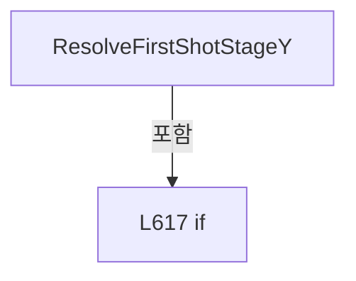

변경 전 점검: 입력/반환 타입, 위 호출자, 예외/취소 경로, 공유 상태와 저장·전송 소비자를 함께 확인합니다. 값의 단위나 물리 방향을 이름만으로 확정하지 않습니다.

### LocalFunctionStatement `SelectShots` · L611–614

[Drilling.Common/Station/CStationProcess.cs:611–614](https://github.com/kjuws10-rgb/A3Drilling/blob/5aee8e58439c9b455cae7c9593c9be986c3e682e/Drilling.Common/Station/CStationProcess.cs#L611-L614)

| 항목 | 실제 추출 값 |
| --- | --- |
| 서명 | System.Collections.Generic.IEnumerable<Drilling.Common.Recipe.ST_HEAD_SHOT_POINT> SelectShots(Drilling.Common.Station.ST_HEAD_PROCESS_PLAN) |
| 접근/수식자 | Private /  |
| 반환/값 타입 | System.Collections.Generic.IEnumerable<Drilling.Common.Recipe.ST_HEAD_SHOT_POINT> |
| 소속 타입 | NamedType:Drilling.Common.Station.CStationProcess |

입력 계약:

| 이름 | 타입 | 전달 | 선택/기본값 |
| --- | --- | --- | --- |
| head | Drilling.Common.Station.ST_HEAD_PROCESS_PLAN | None | False /  |

현재 부분 분석에서 직접 연결된 호출자는 없습니다. XAML/이벤트/인터페이스·델리게이트·외부 진입을 추가 확인해야 하며, 미사용으로 판정한 것이 아닙니다.

본문의 실제 연산·분기·예외·반환 순서(원문 위치 순):

| 원본 행 | 종류 | 주석 해설 |
| --- | --- | --- |
| 613 | return | 호출자에게 값 또는 제어를 반환합니다: return head.Shots; |

변경 전 점검: 입력/반환 타입, 위 호출자, 예외/취소 경로, 공유 상태와 저장·전송 소비자를 함께 확인합니다. 값의 단위나 물리 방향을 이름만으로 확정하지 않습니다.

### LocalFunctionStatement `SelectStageY` · L624–627

[Drilling.Common/Station/CStationProcess.cs:624–627](https://github.com/kjuws10-rgb/A3Drilling/blob/5aee8e58439c9b455cae7c9593c9be986c3e682e/Drilling.Common/Station/CStationProcess.cs#L624-L627)

| 항목 | 실제 추출 값 |
| --- | --- |
| 서명 | double SelectStageY(Drilling.Common.Recipe.ST_HEAD_SHOT_POINT) |
| 접근/수식자 | Private /  |
| 반환/값 타입 | double |
| 소속 타입 | NamedType:Drilling.Common.Station.CStationProcess |

입력 계약:

| 이름 | 타입 | 전달 | 선택/기본값 |
| --- | --- | --- | --- |
| shot | Drilling.Common.Recipe.ST_HEAD_SHOT_POINT | None | False /  |

현재 부분 분석에서 직접 연결된 호출자는 없습니다. XAML/이벤트/인터페이스·델리게이트·외부 진입을 추가 확인해야 하며, 미사용으로 판정한 것이 아닙니다.

본문의 실제 연산·분기·예외·반환 순서(원문 위치 순):

| 원본 행 | 종류 | 주석 해설 |
| --- | --- | --- |
| 626 | return | 호출자에게 값 또는 제어를 반환합니다: return shot.StageY; |

변경 전 점검: 입력/반환 타입, 위 호출자, 예외/취소 경로, 공유 상태와 저장·전송 소비자를 함께 확인합니다. 값의 단위나 물리 방향을 이름만으로 확정하지 않습니다.

### LocalFunctionStatement `SelectStageY2` · L629–632

[Drilling.Common/Station/CStationProcess.cs:629–632](https://github.com/kjuws10-rgb/A3Drilling/blob/5aee8e58439c9b455cae7c9593c9be986c3e682e/Drilling.Common/Station/CStationProcess.cs#L629-L632)

| 항목 | 실제 추출 값 |
| --- | --- |
| 서명 | double SelectStageY2(Drilling.Common.Recipe.ST_HEAD_SHOT_POINT) |
| 접근/수식자 | Private /  |
| 반환/값 타입 | double |
| 소속 타입 | NamedType:Drilling.Common.Station.CStationProcess |

입력 계약:

| 이름 | 타입 | 전달 | 선택/기본값 |
| --- | --- | --- | --- |
| shot | Drilling.Common.Recipe.ST_HEAD_SHOT_POINT | None | False /  |

현재 부분 분석에서 직접 연결된 호출자는 없습니다. XAML/이벤트/인터페이스·델리게이트·외부 진입을 추가 확인해야 하며, 미사용으로 판정한 것이 아닙니다.

본문의 실제 연산·분기·예외·반환 순서(원문 위치 순):

| 원본 행 | 종류 | 주석 해설 |
| --- | --- | --- |
| 631 | return | 호출자에게 값 또는 제어를 반환합니다: return shot.StageY; |

변경 전 점검: 입력/반환 타입, 위 호출자, 예외/취소 경로, 공유 상태와 저장·전송 소비자를 함께 확인합니다. 값의 단위나 물리 방향을 이름만으로 확정하지 않습니다.

### MethodDeclaration `SendProcessControlCommand` · L637–649

[Drilling.Common/Station/CStationProcess.cs:637–649](https://github.com/kjuws10-rgb/A3Drilling/blob/5aee8e58439c9b455cae7c9593c9be986c3e682e/Drilling.Common/Station/CStationProcess.cs#L637-L649)

| 항목 | 실제 추출 값 |
| --- | --- |
| 서명 | void Drilling.Common.Station.CStationProcess.SendProcessControlCommand(string, System.Collections.Generic.IReadOnlyList<(string Key, string Value)>, System.Threading.CancellationToken) |
| 접근/수식자 | Private / private |
| 반환/값 타입 | void |
| 소속 타입 | NamedType:Drilling.Common.Station.CStationProcess |

입력 계약:

| 이름 | 타입 | 전달 | 선택/기본값 |
| --- | --- | --- | --- |
| commandName | string | None | False /  |
| arguments | System.Collections.Generic.IReadOnlyList<(string Key, string Value)> | None | False /  |
| cancellationToken | System.Threading.CancellationToken | None | False /  |

정적 호출자로 확인된 위치:

| 호출 파일/행 | 호출 표현식 | 런타임 분기 가능 |
| --- | --- | --- |
| [Drilling.Common/Station/CStationProcess.cs:509–509](https://github.com/kjuws10-rgb/A3Drilling/blob/5aee8e58439c9b455cae7c9593c9be986c3e682e/Drilling.Common/Station/CStationProcess.cs#L509-L509) | SendProcessControlCommand | False |
| [Drilling.Common/Station/CStationProcess.cs:592–592](https://github.com/kjuws10-rgb/A3Drilling/blob/5aee8e58439c9b455cae7c9593c9be986c3e682e/Drilling.Common/Station/CStationProcess.cs#L592-L592) | SendProcessControlCommand | False |
| [Drilling.Common/Station/CStationProcess.cs:593–605](https://github.com/kjuws10-rgb/A3Drilling/blob/5aee8e58439c9b455cae7c9593c9be986c3e682e/Drilling.Common/Station/CStationProcess.cs#L593-L605) | SendProcessControlCommand | False |

호출하는 대상과 해석 범위:

| 원본 행 | 표현식 | 분석 상태 | 대상/소스 위치 |
| --- | --- | --- | --- |
| 639 | FormatCommand | resolved | string Drilling.Common.Station.CStationProcess.FormatCommand(string, System.Collections.Generic.IReadOnlyList<(string Key, string Value)>) · Drilling.Common/Station/CStationProcess.cs:1998 |
| 640 | AddProcessLog | resolved | void Drilling.Common.Station.CStationProcess.AddProcessLog(string, string, string) · Drilling.Common/Station/CStationProcess.cs:2366 |
| 641 | _interfaceManager.ExecuteFunction(EN_EQP_MODULE.WonikCtrl, 0, command, cancellationToken).GetAwaiter().GetResult | resolved | string System.Runtime.CompilerServices.TaskAwaiter<string>.GetResult() |
| 641 | _interfaceManager.ExecuteFunction(EN_EQP_MODULE.WonikCtrl, 0, command, cancellationToken).GetAwaiter | resolved | System.Runtime.CompilerServices.TaskAwaiter<string> System.Threading.Tasks.Task<string>.GetAwaiter() |
| 641 | _interfaceManager.ExecuteFunction | resolved · 동적 구현 선택 가능 | System.Threading.Tasks.Task<string> Drilling.Common.Interface.CInterfaceManager.ExecuteFunction(Drilling.Common.Interface.EN_EQP_MODULE, int, string, System.Threading.CancellationToken) · Drilling.Common/Interface/CInterfaceManager.cs:320 |
| 642 | IsProcessControlSuccessResponse | resolved | bool Drilling.Common.Station.CStationProcess.IsProcessControlSuccessResponse(string) · Drilling.Common/Station/CStationProcess.cs:2008 |
| 644 | AddProcessLog | resolved | void Drilling.Common.Station.CStationProcess.AddProcessLog(string, string, string) · Drilling.Common/Station/CStationProcess.cs:2366 |
| 644 | FormatResponseForLog | resolved | string Drilling.Common.Station.CStationProcess.FormatResponseForLog(string) · Drilling.Common/Station/CStationProcess.cs:2019 |
| 645 | new InvalidOperationException | resolved | System.InvalidOperationException.InvalidOperationException(string?) |
| 645 | FormatResponseForLog | resolved | string Drilling.Common.Station.CStationProcess.FormatResponseForLog(string) · Drilling.Common/Station/CStationProcess.cs:2019 |
| 648 | AddProcessLog | resolved | void Drilling.Common.Station.CStationProcess.AddProcessLog(string, string, string) · Drilling.Common/Station/CStationProcess.cs:2366 |

본문의 실제 연산·분기·예외·반환 순서(원문 위치 순):

| 원본 행 | 종류 | 주석 해설 |
| --- | --- | --- |
| 639 | call | 함수·델리게이트 또는 객체 생성자를 호출합니다: FormatCommand(commandName, arguments) |
| 639 | local-declaration | 지역 변수를 선언합니다: var command = FormatCommand(commandName, arguments); |
| 639 | variable-initializer | 변수의 초기값을 지정합니다: command = FormatCommand(commandName, arguments) |
| 640 | call | 함수·델리게이트 또는 객체 생성자를 호출합니다: AddProcessLog("INFO", "STAGE", $"Stage command requested. {command}") |
| 641 | call | 함수·델리게이트 또는 객체 생성자를 호출합니다: _interfaceManager.ExecuteFunction(EN_EQP_MODULE.WonikCtrl, 0, command, cancellationToken).GetAwaiter().GetResult() |
| 641 | call | 함수·델리게이트 또는 객체 생성자를 호출합니다: _interfaceManager.ExecuteFunction(EN_EQP_MODULE.WonikCtrl, 0, command, cancellationToken).GetAwaiter() |
| 641 | call | 함수·델리게이트 또는 객체 생성자를 호출합니다: _interfaceManager.ExecuteFunction(EN_EQP_MODULE.WonikCtrl, 0, command, cancellationToken) |
| 641 | local-declaration | 지역 변수를 선언합니다: var response = _interfaceManager.ExecuteFunction(EN_EQP_MODULE.WonikCtrl, 0, command, cancellationToken).GetAwaiter().GetResult(); |
| 641 | variable-initializer | 변수의 초기값을 지정합니다: response = _interfaceManager.ExecuteFunction(EN_EQP_MODULE.WonikCtrl, 0, command, cancellationToken).GetAwaiter().GetResult() |
| 642 | call | 함수·델리게이트 또는 객체 생성자를 호출합니다: IsProcessControlSuccessResponse(response) |
| 642 | if | 조건에 따라 분기합니다: if (!IsProcessControlSuccessResponse(response)) |
| 644 | call | 함수·델리게이트 또는 객체 생성자를 호출합니다: AddProcessLog("ERROR", "STAGE", $"Stage command rejected. {commandName}: {FormatResponseForLog(response)}") |
| 644 | call | 함수·델리게이트 또는 객체 생성자를 호출합니다: FormatResponseForLog(response) |
| 645 | call | 함수·델리게이트 또는 객체 생성자를 호출합니다: new InvalidOperationException($"Stage command failed: {commandName}. Response={FormatResponseForLog(response)}") |
| 645 | call | 함수·델리게이트 또는 객체 생성자를 호출합니다: FormatResponseForLog(response) |
| 645 | throw | 예외를 발생/전달합니다: throw new InvalidOperationException($"Stage command failed: {commandName}. Response={FormatResponseForLog(response)}"); |
| 648 | call | 함수·델리게이트 또는 객체 생성자를 호출합니다: AddProcessLog("INFO", "STAGE", $"Stage command accepted. {response}") |

제어 구문의 포함 구조(실제 실행 순서/CFG가 아닌 구문 탐색 그림):

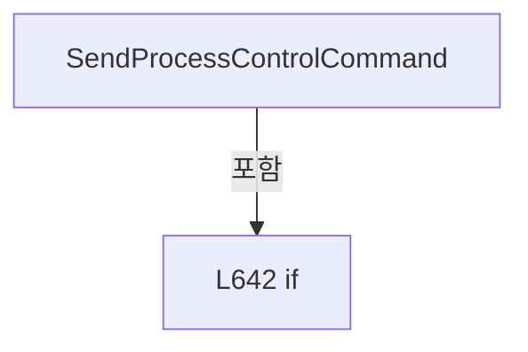

변경 전 점검: 입력/반환 타입, 위 호출자, 예외/취소 경로, 공유 상태와 저장·전송 소비자를 함께 확인합니다. 값의 단위나 물리 방향을 이름만으로 확정하지 않습니다.

### MethodDeclaration `RunInspectionStep` · L651–654

[Drilling.Common/Station/CStationProcess.cs:651–654](https://github.com/kjuws10-rgb/A3Drilling/blob/5aee8e58439c9b455cae7c9593c9be986c3e682e/Drilling.Common/Station/CStationProcess.cs#L651-L654)

| 항목 | 실제 추출 값 |
| --- | --- |
| 서명 | void Drilling.Common.Station.CStationProcess.RunInspectionStep(Drilling.Common.Station.ST_PROCESS_MODEL, System.Threading.CancellationToken) |
| 접근/수식자 | Private / private |
| 반환/값 타입 | void |
| 소속 타입 | NamedType:Drilling.Common.Station.CStationProcess |

입력 계약:

| 이름 | 타입 | 전달 | 선택/기본값 |
| --- | --- | --- | --- |
| processModel | Drilling.Common.Station.ST_PROCESS_MODEL | None | False /  |
| cancellationToken | System.Threading.CancellationToken | None | False /  |

현재 부분 분석에서 직접 연결된 호출자는 없습니다. XAML/이벤트/인터페이스·델리게이트·외부 진입을 추가 확인해야 하며, 미사용으로 판정한 것이 아닙니다.

호출하는 대상과 해석 범위:

| 원본 행 | 표현식 | 분석 상태 | 대상/소스 위치 |
| --- | --- | --- | --- |
| 653 | RunReviewStep | resolved | void Drilling.Common.Station.CStationProcess.RunReviewStep(Drilling.Common.Station.ST_PROCESS_MODEL, System.Threading.CancellationToken) · Drilling.Common/Station/CStationProcess.cs:1143 |

본문의 실제 연산·분기·예외·반환 순서(원문 위치 순):

| 원본 행 | 종류 | 주석 해설 |
| --- | --- | --- |
| 653 | call | 함수·델리게이트 또는 객체 생성자를 호출합니다: RunReviewStep(processModel, cancellationToken) |

변경 전 점검: 입력/반환 타입, 위 호출자, 예외/취소 경로, 공유 상태와 저장·전송 소비자를 함께 확인합니다. 값의 단위나 물리 방향을 이름만으로 확정하지 않습니다.

### MethodDeclaration `BuildAutomationScript` · L656–665

[Drilling.Common/Station/CStationProcess.cs:656–665](https://github.com/kjuws10-rgb/A3Drilling/blob/5aee8e58439c9b455cae7c9593c9be986c3e682e/Drilling.Common/Station/CStationProcess.cs#L656-L665)

| 항목 | 실제 추출 값 |
| --- | --- |
| 서명 | void Drilling.Common.Station.CStationProcess.BuildAutomationScript(Drilling.Common.Station.ST_PROCESS_MODEL, System.Threading.CancellationToken) |
| 접근/수식자 | Private / private |
| 반환/값 타입 | void |
| 소속 타입 | NamedType:Drilling.Common.Station.CStationProcess |

입력 계약:

| 이름 | 타입 | 전달 | 선택/기본값 |
| --- | --- | --- | --- |
| processModel | Drilling.Common.Station.ST_PROCESS_MODEL | None | False /  |
| cancellationToken | System.Threading.CancellationToken | None | False /  |

정적 호출자로 확인된 위치:

| 호출 파일/행 | 호출 표현식 | 런타임 분기 가능 |
| --- | --- | --- |
| [Drilling.Common/Station/CStationProcess.cs:567–567](https://github.com/kjuws10-rgb/A3Drilling/blob/5aee8e58439c9b455cae7c9593c9be986c3e682e/Drilling.Common/Station/CStationProcess.cs#L567-L567) | BuildAutomationScript | False |
| [Drilling.Common/Station/CStationProcess.cs:4001–4001](https://github.com/kjuws10-rgb/A3Drilling/blob/5aee8e58439c9b455cae7c9593c9be986c3e682e/Drilling.Common/Station/CStationProcess.cs#L4001-L4001) | BuildAutomationScript | False |

호출하는 대상과 해석 범위:

| 원본 행 | 표현식 | 분석 상태 | 대상/소스 위치 |
| --- | --- | --- | --- |
| 658 | IsBufferedRunEnabled | resolved | bool Drilling.Common.Station.CStationProcess.IsBufferedRunEnabled(System.Collections.Generic.IReadOnlyDictionary<string, string>) · Drilling.Common/Station/CStationProcess.cs:2126 |
| 660 | _automationScriptFile.Build | resolved | Drilling.Common.Station.ST_SCRIPT_BUILD_RESULT Drilling.Common.Station.CAutomationScriptFileBase.Build(Drilling.Common.Station.ST_PROCESS_MODEL, string, System.Threading.CancellationToken) · Drilling.Common/Station/CStationManager.cs:487 |
| 660 | GetProcessModel | resolved | Drilling.Common.Station.ST_PROCESS_MODEL Drilling.Common.Station.CStationProcess.GetProcessModel() · Drilling.Common/Station/CStationProcess.cs:2272 |
| 662 | BuildStatistics | resolved | Drilling.Common.Station.ST_PROCESS_STATISTICS Drilling.Common.Station.CStationProcess.BuildStatistics(Drilling.Common.Station.ST_PROCESS_MODEL?, double, System.TimeSpan) · Drilling.Common/Station/CStationProcess.cs:1772 |
| 662 | TimeSpan.FromSeconds | resolved | System.TimeSpan System.TimeSpan.FromSeconds(long) |
| 663 | AddProcessLog | resolved | void Drilling.Common.Station.CStationProcess.AddProcessLog(string, string, string) · Drilling.Common/Station/CStationProcess.cs:2366 |
| 664 | CreateSnapshot | resolved | Drilling.Common.Station.ST_STATION_PROCESS_STATUS Drilling.Common.Station.CStationProcess.CreateSnapshot(Drilling.Common.Station.ST_PROCESS_MODEL?, System.Collections.Generic.IReadOnlyList<Drilling.Common.Station.ST_HEAD_PREVIEW_DATA>, Drilling.Common.Station.EN_SCRIPT_STATUS, Drilling.Common.Station.EN_PROCESS_STEP, Drilling.Common.Station.ST_PROCESS_RESULT?) · Drilling.Common/Station/CStationProcess.cs:1337 |

본문의 실제 연산·분기·예외·반환 순서(원문 위치 순):

| 원본 행 | 종류 | 주석 해설 |
| --- | --- | --- |
| 658 | call | 함수·델리게이트 또는 객체 생성자를 호출합니다: IsBufferedRunEnabled(processModel.Parameters) |
| 658 | local-declaration | 지역 변수를 선언합니다: var bufferedRun = IsBufferedRunEnabled(processModel.Parameters); |
| 658 | variable-initializer | 변수의 초기값을 지정합니다: bufferedRun = IsBufferedRunEnabled(processModel.Parameters) |
| 659 | conditional-expression | 조건에 따라 결과식을 선택합니다: bufferedRun ? BufferedRunScriptDirectoryName : StandardScriptDirectoryName |
| 659 | local-declaration | 지역 변수를 선언합니다: var scriptDirectoryName = bufferedRun ? BufferedRunScriptDirectoryName : StandardScriptDirectoryName; |
| 659 | variable-initializer | 변수의 초기값을 지정합니다: scriptDirectoryName = bufferedRun ? BufferedRunScriptDirectoryName : StandardScriptDirectoryName |
| 660 | assignment | 값을 대상에 대입합니다: _lastScript = _automationScriptFile.Build(GetProcessModel(), scriptDirectoryName, cancellationToken) |
| 660 | call | 함수·델리게이트 또는 객체 생성자를 호출합니다: _automationScriptFile.Build(GetProcessModel(), scriptDirectoryName, cancellationToken) |
| 660 | call | 함수·델리게이트 또는 객체 생성자를 호출합니다: GetProcessModel() |
| 661 | assignment | 값을 대상에 대입합니다: _scriptCreatedAt = _lastScript.CreatedAt |
| 662 | assignment | 값을 대상에 대입합니다: _statistics = BuildStatistics(processModel, 35.0, TimeSpan.FromSeconds(12)) |
| 662 | call | 함수·델리게이트 또는 객체 생성자를 호출합니다: BuildStatistics(processModel, 35.0, TimeSpan.FromSeconds(12)) |
| 662 | call | 함수·델리게이트 또는 객체 생성자를 호출합니다: TimeSpan.FromSeconds(12) |
| 663 | call | 함수·델리게이트 또는 객체 생성자를 호출합니다: AddProcessLog("INFO", "SCRIPT", $"{_lastScript.FileName} generated in {scriptDirectoryName}. ({_lastScript.TotalShots} shots)") |
| 664 | assignment | 값을 대상에 대입합니다: _snapshot = CreateSnapshot(_snapshot.ProcessModel, _snapshot.HeadPreviews, EN_SCRIPT_STATUS.Created, EN_PROCESS_STEP.Process, null) |
| 664 | call | 함수·델리게이트 또는 객체 생성자를 호출합니다: CreateSnapshot(_snapshot.ProcessModel, _snapshot.HeadPreviews, EN_SCRIPT_STATUS.Created, EN_PROCESS_STEP.Process, null) |

변경 전 점검: 입력/반환 타입, 위 호출자, 예외/취소 경로, 공유 상태와 저장·전송 소비자를 함께 확인합니다. 값의 단위나 물리 방향을 이름만으로 확정하지 않습니다.

### MethodDeclaration `UploadAutomationScript` · L667–689

[Drilling.Common/Station/CStationProcess.cs:667–689](https://github.com/kjuws10-rgb/A3Drilling/blob/5aee8e58439c9b455cae7c9593c9be986c3e682e/Drilling.Common/Station/CStationProcess.cs#L667-L689)

| 항목 | 실제 추출 값 |
| --- | --- |
| 서명 | void Drilling.Common.Station.CStationProcess.UploadAutomationScript(Drilling.Common.Station.ST_PROCESS_MODEL, System.Threading.CancellationToken) |
| 접근/수식자 | Private / private |
| 반환/값 타입 | void |
| 소속 타입 | NamedType:Drilling.Common.Station.CStationProcess |

입력 계약:

| 이름 | 타입 | 전달 | 선택/기본값 |
| --- | --- | --- | --- |
| processModel | Drilling.Common.Station.ST_PROCESS_MODEL | None | False /  |
| cancellationToken | System.Threading.CancellationToken | None | False /  |

정적 호출자로 확인된 위치:

| 호출 파일/행 | 호출 표현식 | 런타임 분기 가능 |
| --- | --- | --- |
| [Drilling.Common/Station/CStationProcess.cs:568–568](https://github.com/kjuws10-rgb/A3Drilling/blob/5aee8e58439c9b455cae7c9593c9be986c3e682e/Drilling.Common/Station/CStationProcess.cs#L568-L568) | UploadAutomationScript | False |
| [Drilling.Common/Station/CStationProcess.cs:3537–3537](https://github.com/kjuws10-rgb/A3Drilling/blob/5aee8e58439c9b455cae7c9593c9be986c3e682e/Drilling.Common/Station/CStationProcess.cs#L3537-L3537) | UploadAutomationScript | False |
| [Drilling.Common/Station/CStationProcess.cs:4002–4002](https://github.com/kjuws10-rgb/A3Drilling/blob/5aee8e58439c9b455cae7c9593c9be986c3e682e/Drilling.Common/Station/CStationProcess.cs#L4002-L4002) | UploadAutomationScript | False |
| [Drilling.Common/Station/CStationProcess.cs:4024–4024](https://github.com/kjuws10-rgb/A3Drilling/blob/5aee8e58439c9b455cae7c9593c9be986c3e682e/Drilling.Common/Station/CStationProcess.cs#L4024-L4024) | UploadAutomationScript | False |

호출하는 대상과 해석 범위:

| 원본 행 | 표현식 | 분석 상태 | 대상/소스 위치 |
| --- | --- | --- | --- |
| 669 | cancellationToken.ThrowIfCancellationRequested | resolved | void System.Threading.CancellationToken.ThrowIfCancellationRequested() |
| 672 | new InvalidOperationException | resolved | System.InvalidOperationException.InvalidOperationException(string?) |
| 680 | _lastScript.HeadScripts.Where | resolved | System.Collections.Generic.IEnumerable<Drilling.Common.Station.ST_HEAD_SCRIPT_RESULT> System.Collections.Generic.IEnumerable<Drilling.Common.Station.ST_HEAD_SCRIPT_RESULT>.Where<Drilling.Common.Station.ST_HEAD_SCRIPT_RESULT>(System.Func<Drilling.Common.Station.ST_HEAD_SCRIPT_RESULT, bool>) |
| 682 | AddProcessLog | resolved | void Drilling.Common.Station.CStationProcess.AddProcessLog(string, string, string) · Drilling.Common/Station/CStationProcess.cs:2366 |
| 683 | _automationManager.UploadScript(headScript.FilePath, headScript.FileName, headScript.AutomationNo, cancellationToken: cancellationToken).GetAwaiter().GetResult | resolved | string System.Runtime.CompilerServices.TaskAwaiter<string>.GetResult() |
| 683 | _automationManager.UploadScript(headScript.FilePath, headScript.FileName, headScript.AutomationNo, cancellationToken: cancellationToken).GetAwaiter | resolved | System.Runtime.CompilerServices.TaskAwaiter<string> System.Threading.Tasks.Task<string>.GetAwaiter() |
| 683 | _automationManager.UploadScript | resolved · 동적 구현 선택 가능 | System.Threading.Tasks.Task<string> Drilling.Common.Automation.CAutomationManager.UploadScript(string, string, int, System.Threading.CancellationToken) · Drilling.Common/Automation/CAutomationManager.cs:315 |
| 684 | string.IsNullOrWhiteSpace | resolved | bool string.IsNullOrWhiteSpace(string?) |
| 684 | response.StartsWith | resolved | bool string.StartsWith(string, System.StringComparison) |
| 684 | response.EndsWith | resolved | bool string.EndsWith(string, System.StringComparison) |
| 685 | IsProcessControlSuccessResponse | resolved | bool Drilling.Common.Station.CStationProcess.IsProcessControlSuccessResponse(string) · Drilling.Common/Station/CStationProcess.cs:2008 |
| 686 | new InvalidOperationException | resolved | System.InvalidOperationException.InvalidOperationException(string?) |
| 686 | FormatResponseForLog | resolved | string Drilling.Common.Station.CStationProcess.FormatResponseForLog(string) · Drilling.Common/Station/CStationProcess.cs:2019 |
| 687 | AddProcessLog | resolved | void Drilling.Common.Station.CStationProcess.AddProcessLog(string, string, string) · Drilling.Common/Station/CStationProcess.cs:2366 |

본문의 실제 연산·분기·예외·반환 순서(원문 위치 순):

| 원본 행 | 종류 | 주석 해설 |
| --- | --- | --- |
| 669 | call | 함수·델리게이트 또는 객체 생성자를 호출합니다: cancellationToken.ThrowIfCancellationRequested() |
| 670 | if | 조건에 따라 분기합니다: if (_lastScript is null) |
| 672 | call | 함수·델리게이트 또는 객체 생성자를 호출합니다: new InvalidOperationException("Automation script is not built.") |
| 672 | throw | 예외를 발생/전달합니다: throw new InvalidOperationException("Automation script is not built."); |
| 680 | call | 함수·델리게이트 또는 객체 생성자를 호출합니다: _lastScript.HeadScripts.Where(ShouldIncludeItem) |
| 680 | foreach | 컬렉션 요소를 순회합니다: foreach (var headScript in _lastScript.HeadScripts.Where(ShouldIncludeItem)) |
| 682 | call | 함수·델리게이트 또는 객체 생성자를 호출합니다: AddProcessLog("INFO", "A1_UPLOAD", $"Upload requested. H{headScript.HeadNo:00} -> Automation1 #{headScript.AutomationNo}, {headScript.FileName}") |
| 683 | call | 함수·델리게이트 또는 객체 생성자를 호출합니다: _automationManager.UploadScript(headScript.FilePath, headScript.FileName, headScript.AutomationNo, cancellationToken: cancellationToken).GetAwaiter().GetResult() |
| 683 | call | 함수·델리게이트 또는 객체 생성자를 호출합니다: _automationManager.UploadScript(headScript.FilePath, headScript.FileName, headScript.AutomationNo, cancellationToken: cancellationToken).GetAwaiter() |
| 683 | call | 함수·델리게이트 또는 객체 생성자를 호출합니다: _automationManager.UploadScript(headScript.FilePath, headScript.FileName, headScript.AutomationNo, cancellationToken: cancellationToken) |
| 683 | local-declaration | 지역 변수를 선언합니다: var response = _automationManager.UploadScript(headScript.FilePath, headScript.FileName, headScript.AutomationNo, cancellationToken: cancellationToken).GetAwaiter().GetResult(); |
| 683 | variable-initializer | 변수의 초기값을 지정합니다: response = _automationManager.UploadScript(headScript.FilePath, headScript.FileName, headScript.AutomationNo, cancellationToken: cancellationToken).GetAwaiter().GetResult() |
| 684 | call | 함수·델리게이트 또는 객체 생성자를 호출합니다: string.IsNullOrWhiteSpace(response) |
| 684 | call | 함수·델리게이트 또는 객체 생성자를 호출합니다: response.StartsWith("SIM:", StringComparison.OrdinalIgnoreCase) |
| 684 | call | 함수·델리게이트 또는 객체 생성자를 호출합니다: response.EndsWith(":OK", StringComparison.OrdinalIgnoreCase) |
| 684 | local-declaration | 지역 변수를 선언합니다: var simulationSucceeded = !string.IsNullOrWhiteSpace(response) && response.StartsWith("SIM:", StringComparison.OrdinalIgnoreCase) && response.EndsWith(":OK", StringComparison.OrdinalIgnoreCase); |
| 684 | variable-initializer | 변수의 초기값을 지정합니다: simulationSucceeded = !string.IsNullOrWhiteSpace(response) && response.StartsWith("SIM:", StringComparison.OrdinalIgnoreCase) && response.EndsWith(":OK", StringComparison.OrdinalIgnoreCase) |
| 685 | call | 함수·델리게이트 또는 객체 생성자를 호출합니다: IsProcessControlSuccessResponse(response) |
| 685 | if | 조건에 따라 분기합니다: if (!IsProcessControlSuccessResponse(response) && !simulationSucceeded) |
| 686 | call | 함수·델리게이트 또는 객체 생성자를 호출합니다: new InvalidOperationException($"Automation1 script upload failed. H{headScript.HeadNo:00}, {headScript.FileName}: {FormatResponseForLog(response)}") |
| 686 | call | 함수·델리게이트 또는 객체 생성자를 호출합니다: FormatResponseForLog(response) |
| 686 | throw | 예외를 발생/전달합니다: throw new InvalidOperationException($"Automation1 script upload failed. H{headScript.HeadNo:00}, {headScript.FileName}: {FormatResponseForLog(response)}"); |
| 687 | call | 함수·델리게이트 또는 객체 생성자를 호출합니다: AddProcessLog("INFO", "A1_UPLOAD", $"Upload completed. H{headScript.HeadNo:00}, Automation1 #{headScript.AutomationNo}: {response}") |

제어 구문의 포함 구조(실제 실행 순서/CFG가 아닌 구문 탐색 그림):

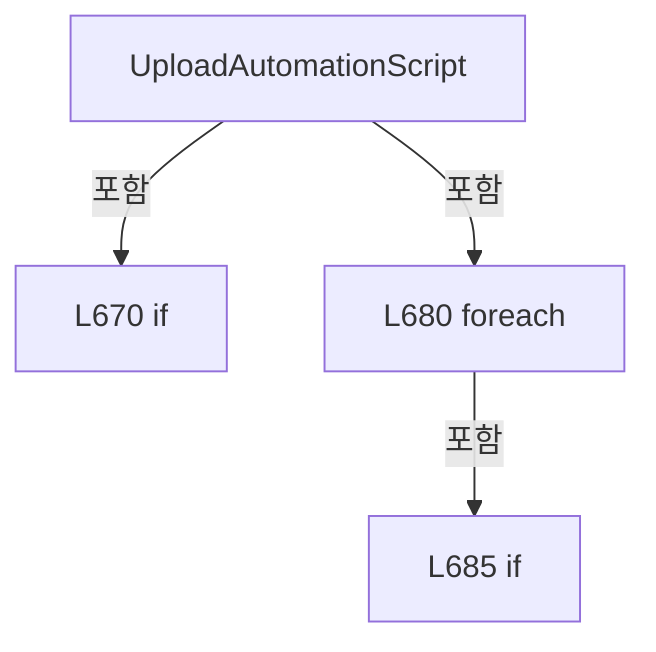

변경 전 점검: 입력/반환 타입, 위 호출자, 예외/취소 경로, 공유 상태와 저장·전송 소비자를 함께 확인합니다. 값의 단위나 물리 방향을 이름만으로 확정하지 않습니다.

### LocalFunctionStatement `ShouldIncludeItem` · L675–678

[Drilling.Common/Station/CStationProcess.cs:675–678](https://github.com/kjuws10-rgb/A3Drilling/blob/5aee8e58439c9b455cae7c9593c9be986c3e682e/Drilling.Common/Station/CStationProcess.cs#L675-L678)

| 항목 | 실제 추출 값 |
| --- | --- |
| 서명 | bool ShouldIncludeItem(Drilling.Common.Station.ST_HEAD_SCRIPT_RESULT) |
| 접근/수식자 | Private /  |
| 반환/값 타입 | bool |
| 소속 타입 | NamedType:Drilling.Common.Station.CStationProcess |

입력 계약:

| 이름 | 타입 | 전달 | 선택/기본값 |
| --- | --- | --- | --- |
| script | Drilling.Common.Station.ST_HEAD_SCRIPT_RESULT | None | False /  |

현재 부분 분석에서 직접 연결된 호출자는 없습니다. XAML/이벤트/인터페이스·델리게이트·외부 진입을 추가 확인해야 하며, 미사용으로 판정한 것이 아닙니다.

본문의 실제 연산·분기·예외·반환 순서(원문 위치 순):

| 원본 행 | 종류 | 주석 해설 |
| --- | --- | --- |
| 677 | return | 호출자에게 값 또는 제어를 반환합니다: return script.TotalShots > 0; |

변경 전 점검: 입력/반환 타입, 위 호출자, 예외/취소 경로, 공유 상태와 저장·전송 소비자를 함께 확인합니다. 값의 단위나 물리 방향을 이름만으로 확정하지 않습니다.

### MethodDeclaration `RunScannerProcess` · L691–749

[Drilling.Common/Station/CStationProcess.cs:691–749](https://github.com/kjuws10-rgb/A3Drilling/blob/5aee8e58439c9b455cae7c9593c9be986c3e682e/Drilling.Common/Station/CStationProcess.cs#L691-L749)

| 항목 | 실제 추출 값 |
| --- | --- |
| 서명 | void Drilling.Common.Station.CStationProcess.RunScannerProcess(Drilling.Common.Station.ST_PROCESS_MODEL, System.Threading.CancellationToken) |
| 접근/수식자 | Private / private |
| 반환/값 타입 | void |
| 소속 타입 | NamedType:Drilling.Common.Station.CStationProcess |

입력 계약:

| 이름 | 타입 | 전달 | 선택/기본값 |
| --- | --- | --- | --- |
| processModel | Drilling.Common.Station.ST_PROCESS_MODEL | None | False /  |
| cancellationToken | System.Threading.CancellationToken | None | False /  |

정적 호출자로 확인된 위치:

| 호출 파일/행 | 호출 표현식 | 런타임 분기 가능 |
| --- | --- | --- |
| [Drilling.Common/Station/CStationProcess.cs:572–572](https://github.com/kjuws10-rgb/A3Drilling/blob/5aee8e58439c9b455cae7c9593c9be986c3e682e/Drilling.Common/Station/CStationProcess.cs#L572-L572) | RunScannerProcess | False |

호출하는 대상과 해석 범위:

| 원본 행 | 표현식 | 분석 상태 | 대상/소스 위치 |
| --- | --- | --- | --- |
| 693 | SetStationState | resolved | void Drilling.Common.Station.CStationProcess.SetStationState(Drilling.Common.Station.EN_STATION_STATE, Drilling.Common.Station.EN_PROCESS_STEP, Drilling.Common.Station.EN_SCRIPT_STATUS, string) · Drilling.Common/Station/CStationProcess.cs:2345 |
| 695 | SetHeadStatus | resolved | System.Collections.Generic.IReadOnlyList<Drilling.Common.Station.ST_HEAD_PREVIEW_DATA> Drilling.Common.Station.CStationProcess.SetHeadStatus(System.Collections.Generic.IReadOnlyList<Drilling.Common.Station.ST_HEAD_PREVIEW_DATA>, Drilling.Common.Station.EN_PROCESS_STEP) · Drilling.Common/Station/CStationProcess.cs:1676 |
| 696 | BuildStatistics | resolved | Drilling.Common.Station.ST_PROCESS_STATISTICS Drilling.Common.Station.CStationProcess.BuildStatistics(Drilling.Common.Station.ST_PROCESS_MODEL?, double, System.TimeSpan) · Drilling.Common/Station/CStationProcess.cs:1772 |
| 696 | TimeSpan.FromSeconds | resolved | System.TimeSpan System.TimeSpan.FromSeconds(long) |
| 699 | new InvalidOperationException | resolved | System.InvalidOperationException.InvalidOperationException(string?) |
| 707 | _lastScript.HeadScripts.Where(ShouldIncludeItem).ToArray | resolved | Drilling.Common.Station.ST_HEAD_SCRIPT_RESULT[] System.Collections.Generic.IEnumerable<Drilling.Common.Station.ST_HEAD_SCRIPT_RESULT>.ToArray<Drilling.Common.Station.ST_HEAD_SCRIPT_RESULT>() |
| 707 | _lastScript.HeadScripts.Where | resolved | System.Collections.Generic.IEnumerable<Drilling.Common.Station.ST_HEAD_SCRIPT_RESULT> System.Collections.Generic.IEnumerable<Drilling.Common.Station.ST_HEAD_SCRIPT_RESULT>.Where<Drilling.Common.Station.ST_HEAD_SCRIPT_RESULT>(System.Func<Drilling.Common.Station.ST_HEAD_SCRIPT_RESULT, bool>) |
| 708 | IsBufferedRunEnabled | resolved | bool Drilling.Common.Station.CStationProcess.IsBufferedRunEnabled(System.Collections.Generic.IReadOnlyDictionary<string, string>) · Drilling.Common/Station/CStationProcess.cs:2126 |
| 709 | CQueueCountLogger.Create | resolved | Drilling.Common.Station.CStationProcess.CQueueCountLogger Drilling.Common.Station.CStationProcess.CQueueCountLogger.Create(Drilling.Common.Station.CStationProcess, string, bool, System.Collections.Generic.IReadOnlyList<Drilling.Common.Station.ST_HEAD_SCRIPT_RESULT>) · Drilling.Common/Station/CStationProcess.cs:3120 |
| 710 | CScannerStatusLogger.Create | resolved | Drilling.Common.Station.CStationProcess.CScannerStatusLogger Drilling.Common.Station.CStationProcess.CScannerStatusLogger.Create(Drilling.Common.Station.CStationProcess, string, bool, System.Collections.Generic.IReadOnlyDictionary<string, string>, System.Collections.Generic.IReadOnlyList<Drilling.Common.Station.ST_HEAD_SCRIPT_RESULT>) · Drilling.Common/Station/CStationProcess.cs:2557 |
| 712 | CreateSnapshot | resolved | Drilling.Common.Station.ST_STATION_PROCESS_STATUS Drilling.Common.Station.CStationProcess.CreateSnapshot(Drilling.Common.Station.ST_PROCESS_MODEL?, System.Collections.Generic.IReadOnlyList<Drilling.Common.Station.ST_HEAD_PREVIEW_DATA>, Drilling.Common.Station.EN_SCRIPT_STATUS, Drilling.Common.Station.EN_PROCESS_STEP, Drilling.Common.Station.ST_PROCESS_RESULT?) · Drilling.Common/Station/CStationProcess.cs:1337 |
| 717 | queueCountLogger.Start | resolved | void Drilling.Common.Station.CStationProcess.CQueueCountLogger.Start() · Drilling.Common/Station/CStationProcess.cs:3126 |
| 718 | scannerStatusLogger.Start | resolved | void Drilling.Common.Station.CStationProcess.CScannerStatusLogger.Start() · Drilling.Common/Station/CStationProcess.cs:2563 |
| 719 | RunBufferedHeadScripts | resolved | void Drilling.Common.Station.CStationProcess.RunBufferedHeadScripts(Drilling.Common.Station.ST_PROCESS_MODEL, System.Collections.Generic.IReadOnlyList<Drilling.Common.Station.ST_HEAD_SCRIPT_RESULT>, System.Threading.CancellationToken) · Drilling.Common/Station/CStationProcess.cs:751 |
| 725 | AddProcessLog | resolved | void Drilling.Common.Station.CStationProcess.AddProcessLog(string, string, string) · Drilling.Common/Station/CStationProcess.cs:2366 |
| 726 | _automationManager.RunScript(headScript.FileName, headScript.TaskNo, headScript.AutomationNo, cancellationToken: cancellationToken).GetAwaiter().GetResult | resolved | string System.Runtime.CompilerServices.TaskAwaiter<string>.GetResult() |
| 726 | _automationManager.RunScript(headScript.FileName, headScript.TaskNo, headScript.AutomationNo, cancellationToken: cancellationToken).GetAwaiter | resolved | System.Runtime.CompilerServices.TaskAwaiter<string> System.Threading.Tasks.Task<string>.GetAwaiter() |
| 726 | _automationManager.RunScript | resolved · 동적 구현 선택 가능 | System.Threading.Tasks.Task<string> Drilling.Common.Automation.CAutomationManager.RunScript(string, int, int, System.Threading.CancellationToken) · Drilling.Common/Automation/CAutomationManager.cs:323 |
| 727 | AddProcessLog | resolved | void Drilling.Common.Station.CStationProcess.AddProcessLog(string, string, string) · Drilling.Common/Station/CStationProcess.cs:2366 |
| 730 | queueCountLogger.Start | resolved | void Drilling.Common.Station.CStationProcess.CQueueCountLogger.Start() · Drilling.Common/Station/CStationProcess.cs:3126 |
| 731 | scannerStatusLogger.Start | resolved | void Drilling.Common.Station.CStationProcess.CScannerStatusLogger.Start() · Drilling.Common/Station/CStationProcess.cs:2563 |
| 732 | WaitAutomationHeadScriptsComplete | resolved | void Drilling.Common.Station.CStationProcess.WaitAutomationHeadScriptsComplete(Drilling.Common.Station.ST_PROCESS_MODEL, System.Collections.Generic.IReadOnlyList<Drilling.Common.Station.ST_HEAD_SCRIPT_RESULT>, System.Threading.CancellationToken) · Drilling.Common/Station/CStationProcess.cs:869 |
| 742 | scannerStatusLogger.StopAndWriteFinal | resolved | void Drilling.Common.Station.CStationProcess.CScannerStatusLogger.StopAndWriteFinal() · Drilling.Common/Station/CStationProcess.cs:2575 |
| 743 | queueCountLogger.StopAndWriteFinal | resolved | void Drilling.Common.Station.CStationProcess.CQueueCountLogger.StopAndWriteFinal() · Drilling.Common/Station/CStationProcess.cs:3137 |
| 746 | StopAutomationScriptTasks | resolved | void Drilling.Common.Station.CStationProcess.StopAutomationScriptTasks(System.Collections.Generic.IReadOnlyList<Drilling.Common.Station.ST_HEAD_SCRIPT_RESULT>, string) · Drilling.Common/Station/CStationProcess.cs:938 |

본문의 실제 연산·분기·예외·반환 순서(원문 위치 순):

| 원본 행 | 종류 | 주석 해설 |
| --- | --- | --- |
| 693 | call | 함수·델리게이트 또는 객체 생성자를 호출합니다: SetStationState(EN_STATION_STATE.Process, EN_PROCESS_STEP.Process, EN_SCRIPT_STATUS.Running, $"Scanner run started. Process: {processModel.ProcessId}") |
| 694 | assignment | 값을 대상에 대입합니다: _scriptStartedAt = DateTimeOffset.Now |
| 695 | call | 함수·델리게이트 또는 객체 생성자를 호출합니다: SetHeadStatus(_snapshot.HeadPreviews, EN_PROCESS_STEP.Process) |
| 695 | local-declaration | 지역 변수를 선언합니다: var runningPreview = SetHeadStatus(_snapshot.HeadPreviews, EN_PROCESS_STEP.Process); |
| 695 | variable-initializer | 변수의 초기값을 지정합니다: runningPreview = SetHeadStatus(_snapshot.HeadPreviews, EN_PROCESS_STEP.Process) |
| 696 | assignment | 값을 대상에 대입합니다: _statistics = BuildStatistics(processModel, 56.3, TimeSpan.FromSeconds(45)) |
| 696 | call | 함수·델리게이트 또는 객체 생성자를 호출합니다: BuildStatistics(processModel, 56.3, TimeSpan.FromSeconds(45)) |
| 696 | call | 함수·델리게이트 또는 객체 생성자를 호출합니다: TimeSpan.FromSeconds(45) |
| 697 | if | 조건에 따라 분기합니다: if (_lastScript is null) |
| 699 | call | 함수·델리게이트 또는 객체 생성자를 호출합니다: new InvalidOperationException("Automation script is not built.") |
| 699 | throw | 예외를 발생/전달합니다: throw new InvalidOperationException("Automation script is not built."); |
| 707 | call | 함수·델리게이트 또는 객체 생성자를 호출합니다: _lastScript.HeadScripts.Where(ShouldIncludeItem).ToArray() |
| 707 | call | 함수·델리게이트 또는 객체 생성자를 호출합니다: _lastScript.HeadScripts.Where(ShouldIncludeItem) |
| 707 | local-declaration | 지역 변수를 선언합니다: var headScripts = _lastScript.HeadScripts.Where(ShouldIncludeItem).ToArray(); |
| 707 | variable-initializer | 변수의 초기값을 지정합니다: headScripts = _lastScript.HeadScripts.Where(ShouldIncludeItem).ToArray() |
| 708 | call | 함수·델리게이트 또는 객체 생성자를 호출합니다: IsBufferedRunEnabled(processModel.Parameters) |
| 708 | local-declaration | 지역 변수를 선언합니다: var bufferedRun = IsBufferedRunEnabled(processModel.Parameters); |
| 708 | variable-initializer | 변수의 초기값을 지정합니다: bufferedRun = IsBufferedRunEnabled(processModel.Parameters) |
| 709 | call | 함수·델리게이트 또는 객체 생성자를 호출합니다: CQueueCountLogger.Create(this, processModel.RecipeId, bufferedRun, headScripts) |
| 709 | using-declaration | 정리할 자원을 선언합니다: using var queueCountLogger = CQueueCountLogger.Create(this, processModel.RecipeId, bufferedRun, headScripts); |
| 709 | variable-initializer | 변수의 초기값을 지정합니다: queueCountLogger = CQueueCountLogger.Create(this, processModel.RecipeId, bufferedRun, headScripts) |
| 710 | call | 함수·델리게이트 또는 객체 생성자를 호출합니다: CScannerStatusLogger.Create(this, processModel.RecipeId, bufferedRun, processModel.Parameters, headScripts) |
| 710 | using-declaration | 정리할 자원을 선언합니다: using var scannerStatusLogger = CScannerStatusLogger.Create(this, processModel.RecipeId, bufferedRun, processModel.Parameters, headScripts); |
| 710 | variable-initializer | 변수의 초기값을 지정합니다: scannerStatusLogger = CScannerStatusLogger.Create(this, processModel.RecipeId, bufferedRun, processModel.Parameters, headScripts) |
| 711 | local-declaration | 지역 변수를 선언합니다: var stopTasksOnExit = false; |
| 711 | variable-initializer | 변수의 초기값을 지정합니다: stopTasksOnExit = false |
| 712 | assignment | 값을 대상에 대입합니다: _snapshot = CreateSnapshot(_snapshot.ProcessModel, runningPreview, EN_SCRIPT_STATUS.Running, EN_PROCESS_STEP.Process, null) |
| 712 | call | 함수·델리게이트 또는 객체 생성자를 호출합니다: CreateSnapshot(_snapshot.ProcessModel, runningPreview, EN_SCRIPT_STATUS.Running, EN_PROCESS_STEP.Process, null) |
| 713 | try | 예외 처리 범위입니다: try |
| 715 | if | 조건에 따라 분기합니다: if (bufferedRun) |
| 717 | call | 함수·델리게이트 또는 객체 생성자를 호출합니다: queueCountLogger.Start() |
| 718 | call | 함수·델리게이트 또는 객체 생성자를 호출합니다: scannerStatusLogger.Start() |
| 719 | call | 함수·델리게이트 또는 객체 생성자를 호출합니다: RunBufferedHeadScripts(processModel, headScripts, cancellationToken) |
| 721 | else | 앞 조건이 거짓인 경로입니다: else |
| 723 | foreach | 컬렉션 요소를 순회합니다: foreach (var headScript in headScripts) |
| 725 | call | 함수·델리게이트 또는 객체 생성자를 호출합니다: AddProcessLog("INFO", "A1_RUN", $"Automation1 #{headScript.AutomationNo} Task {headScript.TaskNo} run requested. H{headScript.HeadNo:00}, {headScript.FileName}") |
| 726 | call | 함수·델리게이트 또는 객체 생성자를 호출합니다: _automationManager.RunScript(headScript.FileName, headScript.TaskNo, headScript.AutomationNo, cancellationToken: cancellationToken).GetAwaiter().GetResult() |
| 726 | call | 함수·델리게이트 또는 객체 생성자를 호출합니다: _automationManager.RunScript(headScript.FileName, headScript.TaskNo, headScript.AutomationNo, cancellationToken: cancellationToken).GetAwaiter() |
| 726 | call | 함수·델리게이트 또는 객체 생성자를 호출합니다: _automationManager.RunScript(headScript.FileName, headScript.TaskNo, headScript.AutomationNo, cancellationToken: cancellationToken) |
| 726 | local-declaration | 지역 변수를 선언합니다: var response = _automationManager.RunScript(headScript.FileName, headScript.TaskNo, headScript.AutomationNo, cancellationToken: cancellationToken).GetAwaiter().GetResult(); |
| 726 | variable-initializer | 변수의 초기값을 지정합니다: response = _automationManager.RunScript(headScript.FileName, headScript.TaskNo, headScript.AutomationNo, cancellationToken: cancellationToken).GetAwaiter().GetResult() |
| 727 | call | 함수·델리게이트 또는 객체 생성자를 호출합니다: AddProcessLog("INFO", "A1_RUN", $"Run command accepted. H{headScript.HeadNo:00}, Automation1 #{headScript.AutomationNo}, Task {headScript.TaskNo}: {response}") |
| 730 | call | 함수·델리게이트 또는 객체 생성자를 호출합니다: queueCountLogger.Start() |
| 731 | call | 함수·델리게이트 또는 객체 생성자를 호출합니다: scannerStatusLogger.Start() |
| 732 | call | 함수·델리게이트 또는 객체 생성자를 호출합니다: WaitAutomationHeadScriptsComplete(processModel, headScripts, cancellationToken) |
| 735 | catch | 지정 예외를 처리합니다: catch  |
| 737 | assignment | 값을 대상에 대입합니다: stopTasksOnExit = !bufferedRun |
| 738 | throw | 예외를 발생/전달합니다: throw; |
| 740 | finally | 종료 정리 구간입니다: finally |
| 742 | call | 함수·델리게이트 또는 객체 생성자를 호출합니다: scannerStatusLogger.StopAndWriteFinal() |
| 743 | call | 함수·델리게이트 또는 객체 생성자를 호출합니다: queueCountLogger.StopAndWriteFinal() |
| 744 | if | 조건에 따라 분기합니다: if (stopTasksOnExit) |
| 746 | call | 함수·델리게이트 또는 객체 생성자를 호출합니다: StopAutomationScriptTasks(headScripts, "scanner process ended before task completion") |

제어 구문의 포함 구조(실제 실행 순서/CFG가 아닌 구문 탐색 그림):

```mermaid
flowchart TD
 M["RunScannerProcess"]
 N0["L697 if"]
 M -->|포함| N0
 N1["L713 try"]
 M -->|포함| N1
 N2["L715 if"]
 N1 -->|포함| N2
 N3["L721 else"]
 N2 -->|포함| N3
 N4["L723 foreach"]
 N3 -->|포함| N4
 N5["L735 catch"]
 N1 -->|포함| N5
 N6["L740 finally"]
 N1 -->|포함| N6
 N7["L744 if"]
 N6 -->|포함| N7
```

변경 전 점검: 입력/반환 타입, 위 호출자, 예외/취소 경로, 공유 상태와 저장·전송 소비자를 함께 확인합니다. 값의 단위나 물리 방향을 이름만으로 확정하지 않습니다.

### LocalFunctionStatement `ShouldIncludeItem` · L702–705

[Drilling.Common/Station/CStationProcess.cs:702–705](https://github.com/kjuws10-rgb/A3Drilling/blob/5aee8e58439c9b455cae7c9593c9be986c3e682e/Drilling.Common/Station/CStationProcess.cs#L702-L705)

| 항목 | 실제 추출 값 |
| --- | --- |
| 서명 | bool ShouldIncludeItem(Drilling.Common.Station.ST_HEAD_SCRIPT_RESULT) |
| 접근/수식자 | Private /  |
| 반환/값 타입 | bool |
| 소속 타입 | NamedType:Drilling.Common.Station.CStationProcess |

입력 계약:

| 이름 | 타입 | 전달 | 선택/기본값 |
| --- | --- | --- | --- |
| script | Drilling.Common.Station.ST_HEAD_SCRIPT_RESULT | None | False /  |

현재 부분 분석에서 직접 연결된 호출자는 없습니다. XAML/이벤트/인터페이스·델리게이트·외부 진입을 추가 확인해야 하며, 미사용으로 판정한 것이 아닙니다.

본문의 실제 연산·분기·예외·반환 순서(원문 위치 순):

| 원본 행 | 종류 | 주석 해설 |
| --- | --- | --- |
| 704 | return | 호출자에게 값 또는 제어를 반환합니다: return script.TotalShots > 0; |

변경 전 점검: 입력/반환 타입, 위 호출자, 예외/취소 경로, 공유 상태와 저장·전송 소비자를 함께 확인합니다. 값의 단위나 물리 방향을 이름만으로 확정하지 않습니다.

### MethodDeclaration `RunBufferedHeadScripts` · L751–841

[Drilling.Common/Station/CStationProcess.cs:751–841](https://github.com/kjuws10-rgb/A3Drilling/blob/5aee8e58439c9b455cae7c9593c9be986c3e682e/Drilling.Common/Station/CStationProcess.cs#L751-L841)

| 항목 | 실제 추출 값 |
| --- | --- |
| 서명 | void Drilling.Common.Station.CStationProcess.RunBufferedHeadScripts(Drilling.Common.Station.ST_PROCESS_MODEL, System.Collections.Generic.IReadOnlyList<Drilling.Common.Station.ST_HEAD_SCRIPT_RESULT>, System.Threading.CancellationToken) |
| 접근/수식자 | Private / private |
| 반환/값 타입 | void |
| 소속 타입 | NamedType:Drilling.Common.Station.CStationProcess |

입력 계약:

| 이름 | 타입 | 전달 | 선택/기본값 |
| --- | --- | --- | --- |
| processModel | Drilling.Common.Station.ST_PROCESS_MODEL | None | False /  |
| headScripts | System.Collections.Generic.IReadOnlyList<Drilling.Common.Station.ST_HEAD_SCRIPT_RESULT> | None | False /  |
| cancellationToken | System.Threading.CancellationToken | None | False /  |

정적 호출자로 확인된 위치:

| 호출 파일/행 | 호출 표현식 | 런타임 분기 가능 |
| --- | --- | --- |
| [Drilling.Common/Station/CStationProcess.cs:719–719](https://github.com/kjuws10-rgb/A3Drilling/blob/5aee8e58439c9b455cae7c9593c9be986c3e682e/Drilling.Common/Station/CStationProcess.cs#L719-L719) | RunBufferedHeadScripts | False |

호출하는 대상과 해석 범위:

| 원본 행 | 표현식 | 분석 상태 | 대상/소스 위치 |
| --- | --- | --- | --- |
| 753 | ReadBufferedRunQueueSize | resolved | int Drilling.Common.Station.CStationProcess.ReadBufferedRunQueueSize(System.Collections.Generic.IReadOnlyDictionary<string, string>) · Drilling.Common/Station/CStationProcess.cs:2146 |
| 754 | ReadBufferedRunLinesPerCommand | resolved | int Drilling.Common.Station.CStationProcess.ReadBufferedRunLinesPerCommand(System.Collections.Generic.IReadOnlyDictionary<string, string>) · Drilling.Common/Station/CStationProcess.cs:2141 |
| 755 | ReadBufferedRunTimeoutMs | resolved | int Drilling.Common.Station.CStationProcess.ReadBufferedRunTimeoutMs(System.Collections.Generic.IReadOnlyDictionary<string, string>) · Drilling.Common/Station/CStationProcess.cs:2151 |
| 761 | headScripts.GroupBy(SelectAutomationNo).ToArray | resolved | System.Linq.IGrouping<int, Drilling.Common.Station.ST_HEAD_SCRIPT_RESULT>[] System.Collections.Generic.IEnumerable<System.Linq.IGrouping<int, Drilling.Common.Station.ST_HEAD_SCRIPT_RESULT>>.ToArray<System.Linq.IGrouping<int, Drilling.Common.Station.ST_HEAD_SCRIPT_RESULT>>() |
| 761 | headScripts.GroupBy | resolved | System.Collections.Generic.IEnumerable<System.Linq.IGrouping<int, Drilling.Common.Station.ST_HEAD_SCRIPT_RESULT>> System.Collections.Generic.IEnumerable<Drilling.Common.Station.ST_HEAD_SCRIPT_RESULT>.GroupBy<Drilling.Common.Station.ST_HEAD_SCRIPT_RESULT, int>(System.Func<Drilling.Common.Station.ST_HEAD_SCRIPT_RESULT, int>) |
| 769 | AddProcessLog | resolved | void Drilling.Common.Station.CStationProcess.AddProcessLog(string, string, string) · Drilling.Common/Station/CStationProcess.cs:2366 |
| 769 | string.Join | resolved | string string.Join(string?, System.Collections.Generic.IEnumerable<string?>) |
| 769 | group.Select | resolved | System.Collections.Generic.IEnumerable<string> System.Collections.Generic.IEnumerable<Drilling.Common.Station.ST_HEAD_SCRIPT_RESULT>.Select<Drilling.Common.Station.ST_HEAD_SCRIPT_RESULT, string>(System.Func<Drilling.Common.Station.ST_HEAD_SCRIPT_RESULT, string>) |
| 772 | CancellationTokenSource.CreateLinkedTokenSource | resolved | System.Threading.CancellationTokenSource System.Threading.CancellationTokenSource.CreateLinkedTokenSource(System.Threading.CancellationToken) |
| 773 | groups.Select(group => new CBufferedRunWorker(this, group.Key, group.ToArray(), queueSize, linesPerCommand, timeoutMs, bufferedRunCancellation.Token)).ToArray | resolved | Drilling.Common.Station.CStationProcess.CBufferedRunWorker[] System.Collections.Generic.IEnumerable<Drilling.Common.Station.CStationProcess.CBufferedRunWorker>.ToArray<Drilling.Common.Station.CStationProcess.CBufferedRunWorker>() |
| 773 | groups.Select | resolved | System.Collections.Generic.IEnumerable<Drilling.Common.Station.CStationProcess.CBufferedRunWorker> System.Collections.Generic.IEnumerable<System.Linq.IGrouping<int, Drilling.Common.Station.ST_HEAD_SCRIPT_RESULT>>.Select<System.Linq.IGrouping<int, Drilling.Common.Station.ST_HEAD_SCRIPT_RESULT>, Drilling.Common.Station.CStationProcess.CBufferedRunWorker>(System.Func<System.Linq.IGrouping<int, Drilling.Common.Station.ST_HEAD_SCRIPT_RESULT>, Drilling.Common.Station.CStationProcess.CBufferedRunWorker>) |
| 773 | new CBufferedRunWorker | resolved | Drilling.Common.Station.CStationProcess.CBufferedRunWorker.CBufferedRunWorker(Drilling.Common.Station.CStationProcess, int, System.Collections.Generic.IReadOnlyList<Drilling.Common.Station.ST_HEAD_SCRIPT_RESULT>, int, int, int, System.Threading.CancellationToken) · Drilling.Common/Station/CStationProcess.cs:3325 |
| 773 | group.ToArray | resolved | Drilling.Common.Station.ST_HEAD_SCRIPT_RESULT[] System.Collections.Generic.IEnumerable<Drilling.Common.Station.ST_HEAD_SCRIPT_RESULT>.ToArray<Drilling.Common.Station.ST_HEAD_SCRIPT_RESULT>() |
| 774 | new List<ST_BUFFERED_RUN_GROUP_RESULT> | resolved | System.Collections.Generic.List<Drilling.Common.Station.CStationProcess.ST_BUFFERED_RUN_GROUP_RESULT>.List() |
| 778 | worker.Start | resolved | void Drilling.Common.Station.CStationProcess.CBufferedRunWorker.Start() · Drilling.Common/Station/CStationProcess.cs:3368 |
| 783 | new HashSet<CBufferedRunWorker> | resolved | System.Collections.Generic.HashSet<Drilling.Common.Station.CStationProcess.CBufferedRunWorker>.HashSet() |
| 786 | cancellationToken.ThrowIfCancellationRequested | resolved | void System.Threading.CancellationToken.ThrowIfCancellationRequested() |
| 789 | completedWorkers.Contains | resolved | bool System.Collections.Generic.HashSet<Drilling.Common.Station.CStationProcess.CBufferedRunWorker>.Contains(Drilling.Common.Station.CStationProcess.CBufferedRunWorker) |
| 794 | completedWorkers.Add | resolved | bool System.Collections.Generic.HashSet<Drilling.Common.Station.CStationProcess.CBufferedRunWorker>.Add(Drilling.Common.Station.CStationProcess.CBufferedRunWorker) |
| 798 | AddProcessLog | resolved | void Drilling.Common.Station.CStationProcess.AddProcessLog(string, string, string) · Drilling.Common/Station/CStationProcess.cs:2366 |
| 804 | results.Add | resolved | void System.Collections.Generic.List<Drilling.Common.Station.CStationProcess.ST_BUFFERED_RUN_GROUP_RESULT>.Add(Drilling.Common.Station.CStationProcess.ST_BUFFERED_RUN_GROUP_RESULT) |
| 815 | Thread.Sleep | resolved | void System.Threading.Thread.Sleep(int) |
| 821 | new OperationCanceledException | resolved | System.OperationCanceledException.OperationCanceledException(string?, System.Threading.CancellationToken) |
| 822 | bufferedRunCancellation.Cancel | resolved | void System.Threading.CancellationTokenSource.Cancel() |
| 823 | WaitForBufferedRunWorkers | resolved | void Drilling.Common.Station.CStationProcess.WaitForBufferedRunWorkers(System.Collections.Generic.IReadOnlyList<Drilling.Common.Station.CStationProcess.CBufferedRunWorker>, int, string) · Drilling.Common/Station/CStationProcess.cs:843 |
| 824 | StopBufferedRunTasks | resolved | void Drilling.Common.Station.CStationProcess.StopBufferedRunTasks(System.Collections.Generic.IReadOnlyList<Drilling.Common.Station.ST_HEAD_SCRIPT_RESULT>, System.Exception) · Drilling.Common/Station/CStationProcess.cs:1109 |
| 825 | WaitForBufferedRunWorkers | resolved | void Drilling.Common.Station.CStationProcess.WaitForBufferedRunWorkers(System.Collections.Generic.IReadOnlyList<Drilling.Common.Station.CStationProcess.CBufferedRunWorker>, int, string) · Drilling.Common/Station/CStationProcess.cs:843 |
| 831 | bufferedRunCancellation.Cancel | resolved | void System.Threading.CancellationTokenSource.Cancel() |
| 832 | StopBufferedRunTasks | resolved | void Drilling.Common.Station.CStationProcess.StopBufferedRunTasks(System.Collections.Generic.IReadOnlyList<Drilling.Common.Station.ST_HEAD_SCRIPT_RESULT>, System.Exception) · Drilling.Common/Station/CStationProcess.cs:1109 |
| 833 | WaitForBufferedRunWorkers | resolved | void Drilling.Common.Station.CStationProcess.WaitForBufferedRunWorkers(System.Collections.Generic.IReadOnlyList<Drilling.Common.Station.CStationProcess.CBufferedRunWorker>, int, string) · Drilling.Common/Station/CStationProcess.cs:843 |
| 834 | ExceptionDispatchInfo.Capture(firstException).Throw | resolved | void System.Runtime.ExceptionServices.ExceptionDispatchInfo.Throw() |
| 834 | ExceptionDispatchInfo.Capture | resolved | System.Runtime.ExceptionServices.ExceptionDispatchInfo System.Runtime.ExceptionServices.ExceptionDispatchInfo.Capture(System.Exception) |
| 839 | AddProcessLog | resolved | void Drilling.Common.Station.CStationProcess.AddProcessLog(string, string, string) · Drilling.Common/Station/CStationProcess.cs:2366 |

본문의 실제 연산·분기·예외·반환 순서(원문 위치 순):

| 원본 행 | 종류 | 주석 해설 |
| --- | --- | --- |
| 753 | call | 함수·델리게이트 또는 객체 생성자를 호출합니다: ReadBufferedRunQueueSize(processModel.Parameters) |
| 753 | local-declaration | 지역 변수를 선언합니다: var queueSize = ReadBufferedRunQueueSize(processModel.Parameters); |
| 753 | variable-initializer | 변수의 초기값을 지정합니다: queueSize = ReadBufferedRunQueueSize(processModel.Parameters) |
| 754 | call | 함수·델리게이트 또는 객체 생성자를 호출합니다: ReadBufferedRunLinesPerCommand(processModel.Parameters) |
| 754 | local-declaration | 지역 변수를 선언합니다: var linesPerCommand = ReadBufferedRunLinesPerCommand(processModel.Parameters); |
| 754 | variable-initializer | 변수의 초기값을 지정합니다: linesPerCommand = ReadBufferedRunLinesPerCommand(processModel.Parameters) |
| 755 | call | 함수·델리게이트 또는 객체 생성자를 호출합니다: ReadBufferedRunTimeoutMs(processModel.Parameters) |
| 755 | local-declaration | 지역 변수를 선언합니다: var timeoutMs = ReadBufferedRunTimeoutMs(processModel.Parameters); |
| 755 | variable-initializer | 변수의 초기값을 지정합니다: timeoutMs = ReadBufferedRunTimeoutMs(processModel.Parameters) |
| 761 | call | 함수·델리게이트 또는 객체 생성자를 호출합니다: headScripts.GroupBy(SelectAutomationNo).ToArray() |
| 761 | call | 함수·델리게이트 또는 객체 생성자를 호출합니다: headScripts.GroupBy(SelectAutomationNo) |
| 761 | local-declaration | 지역 변수를 선언합니다: var groups = headScripts.GroupBy(SelectAutomationNo).ToArray(); |
| 761 | variable-initializer | 변수의 초기값을 지정합니다: groups = headScripts.GroupBy(SelectAutomationNo).ToArray() |
| 767 | foreach | 컬렉션 요소를 순회합니다: foreach (var group in groups) |
| 769 | call | 함수·델리게이트 또는 객체 생성자를 호출합니다: AddProcessLog("INFO", "A1_RUN", $"Automation1 #{group.Key} buffered run group requested. Heads={string.Join(", ", group.Select(SelectItem))}, Queue={queueSize}, LinesPerCommand={linesPerCommand}, TimeoutMs={timeoutMs}") |
| 769 | call | 함수·델리게이트 또는 객체 생성자를 호출합니다: string.Join(", ", group.Select(SelectItem)) |
| 769 | call | 함수·델리게이트 또는 객체 생성자를 호출합니다: group.Select(SelectItem) |
| 772 | call | 함수·델리게이트 또는 객체 생성자를 호출합니다: CancellationTokenSource.CreateLinkedTokenSource(cancellationToken) |
| 772 | using-declaration | 정리할 자원을 선언합니다: using var bufferedRunCancellation = CancellationTokenSource.CreateLinkedTokenSource(cancellationToken); |
| 772 | variable-initializer | 변수의 초기값을 지정합니다: bufferedRunCancellation = CancellationTokenSource.CreateLinkedTokenSource(cancellationToken) |
| 773 | call | 함수·델리게이트 또는 객체 생성자를 호출합니다: groups.Select(group => new CBufferedRunWorker(this, group.Key, group.ToArray(), queueSize, linesPerCommand, timeoutMs, bufferedRunCancellation.Token)).ToArray() |
| 773 | call | 함수·델리게이트 또는 객체 생성자를 호출합니다: groups.Select(group => new CBufferedRunWorker(this, group.Key, group.ToArray(), queueSize, linesPerCommand, timeoutMs, bufferedRunCancellation.Token)) |
| 773 | call | 함수·델리게이트 또는 객체 생성자를 호출합니다: new CBufferedRunWorker(this, group.Key, group.ToArray(), queueSize, linesPerCommand, timeoutMs, bufferedRunCancellation.Token) |
| 773 | call | 함수·델리게이트 또는 객체 생성자를 호출합니다: group.ToArray() |
| 773 | local-declaration | 지역 변수를 선언합니다: var workers = groups.Select(group => new CBufferedRunWorker(this, group.Key, group.ToArray(), queueSize, linesPerCommand, timeoutMs, bufferedRunCancellation.Token)).ToArray(); |
| 773 | variable-initializer | 변수의 초기값을 지정합니다: workers = groups.Select(group => new CBufferedRunWorker(this, group.Key, group.ToArray(), queueSize, linesPerCommand, timeoutMs, bufferedRunCancellation.Token)).ToArray() |
| 774 | call | 함수·델리게이트 또는 객체 생성자를 호출합니다: new List<ST_BUFFERED_RUN_GROUP_RESULT>() |
| 774 | local-declaration | 지역 변수를 선언합니다: var results = new List<ST_BUFFERED_RUN_GROUP_RESULT>(); |
| 774 | variable-initializer | 변수의 초기값을 지정합니다: results = new List<ST_BUFFERED_RUN_GROUP_RESULT>() |
| 775 | local-declaration | 지역 변수를 선언합니다: Exception? firstException = null; |
| 775 | variable-initializer | 변수의 초기값을 지정합니다: firstException = null |
| 776 | foreach | 컬렉션 요소를 순회합니다: foreach (var worker in workers) |
| 778 | call | 함수·델리게이트 또는 객체 생성자를 호출합니다: worker.Start() |
| 781 | try | 예외 처리 범위입니다: try |
| 783 | call | 함수·델리게이트 또는 객체 생성자를 호출합니다: new HashSet<CBufferedRunWorker>() |
| 783 | local-declaration | 지역 변수를 선언합니다: var completedWorkers = new HashSet<CBufferedRunWorker>(); |
| 783 | variable-initializer | 변수의 초기값을 지정합니다: completedWorkers = new HashSet<CBufferedRunWorker>() |
| 784 | while | 조건을 먼저 확인하며 반복합니다: while (completedWorkers.Count < workers.Length) |
| 786 | call | 함수·델리게이트 또는 객체 생성자를 호출합니다: cancellationToken.ThrowIfCancellationRequested() |
| 787 | foreach | 컬렉션 요소를 순회합니다: foreach (var worker in workers) |
| 789 | call | 함수·델리게이트 또는 객체 생성자를 호출합니다: completedWorkers.Contains(worker) |
| 789 | if | 조건에 따라 분기합니다: if (completedWorkers.Contains(worker) &#124;&#124; !worker.IsComplete) |
| 791 | continue | 다음 반복으로 진행합니다: continue; |
| 794 | call | 함수·델리게이트 또는 객체 생성자를 호출합니다: completedWorkers.Add(worker) |
| 795 | if | 조건에 따라 분기합니다: if (worker.Error is not null) |
| 797 | assignment | 값을 대상에 대입합니다: firstException = worker.Error |
| 798 | call | 함수·델리게이트 또는 객체 생성자를 호출합니다: AddProcessLog("ERROR", "A1_RUN", $"Buffered run group failed. {firstException.Message}") |
| 799 | break | 해당 반복/분기 구간을 종료합니다: break; |
| 802 | if | 조건에 따라 분기합니다: if (worker.Result is not null) |
| 804 | call | 함수·델리게이트 또는 객체 생성자를 호출합니다: results.Add(worker.Result) |
| 808 | if | 조건에 따라 분기합니다: if (firstException is not null) |
| 810 | break | 해당 반복/분기 구간을 종료합니다: break; |
| 813 | if | 조건에 따라 분기합니다: if (completedWorkers.Count < workers.Length) |
| 815 | call | 함수·델리게이트 또는 객체 생성자를 호출합니다: Thread.Sleep(10) |
| 819 | catch | 지정 예외를 처리합니다: catch (OperationCanceledException) when (cancellationToken.IsCancellationRequested) |
| 821 | call | 함수·델리게이트 또는 객체 생성자를 호출합니다: new OperationCanceledException("Automation1 buffered run canceled by station stop.", cancellationToken) |
| 821 | local-declaration | 지역 변수를 선언합니다: var stopException = new OperationCanceledException("Automation1 buffered run canceled by station stop.", cancellationToken); |
| 821 | variable-initializer | 변수의 초기값을 지정합니다: stopException = new OperationCanceledException("Automation1 buffered run canceled by station stop.", cancellationToken) |
| 822 | call | 함수·델리게이트 또는 객체 생성자를 호출합니다: bufferedRunCancellation.Cancel() |
| 823 | call | 함수·델리게이트 또는 객체 생성자를 호출합니다: WaitForBufferedRunWorkers(workers, 5000, "station stop") |
| 824 | call | 함수·델리게이트 또는 객체 생성자를 호출합니다: StopBufferedRunTasks(headScripts, stopException) |
| 825 | call | 함수·델리게이트 또는 객체 생성자를 호출합니다: WaitForBufferedRunWorkers(workers, 5000, "station stop fallback") |
| 826 | throw | 예외를 발생/전달합니다: throw; |
| 829 | if | 조건에 따라 분기합니다: if (firstException is not null) |
| 831 | call | 함수·델리게이트 또는 객체 생성자를 호출합니다: bufferedRunCancellation.Cancel() |
| 832 | call | 함수·델리게이트 또는 객체 생성자를 호출합니다: StopBufferedRunTasks(headScripts, firstException) |
| 833 | call | 함수·델리게이트 또는 객체 생성자를 호출합니다: WaitForBufferedRunWorkers(workers, 3000, "failure cleanup") |
| 834 | call | 함수·델리게이트 또는 객체 생성자를 호출합니다: ExceptionDispatchInfo.Capture(firstException).Throw() |
| 834 | call | 함수·델리게이트 또는 객체 생성자를 호출합니다: ExceptionDispatchInfo.Capture(firstException) |
| 837 | foreach | 컬렉션 요소를 순회합니다: foreach (var result in results) |
| 839 | call | 함수·델리게이트 또는 객체 생성자를 호출합니다: AddProcessLog("INFO", "A1_RUN", $"Buffered run completed. Automation1 #{result.AutomationNo}, Heads={result.HeadSummary}: {result.Response}") |

제어 구문의 포함 구조(실제 실행 순서/CFG가 아닌 구문 탐색 그림):

```mermaid
flowchart TD
 M["RunBufferedHeadScripts"]
 N0["L767 foreach"]
 M -->|포함| N0
 N1["L776 foreach"]
 M -->|포함| N1
 N2["L781 try"]
 M -->|포함| N2
 N3["L784 while"]
 N2 -->|포함| N3
 N4["L787 foreach"]
 N3 -->|포함| N4
 N5["L789 if"]
 N4 -->|포함| N5
 N6["L795 if"]
 N4 -->|포함| N6
 N7["L802 if"]
 N4 -->|포함| N7
 N8["L808 if"]
 N3 -->|포함| N8
 N9["L813 if"]
 N3 -->|포함| N9
 N10["L819 catch"]
 N2 -->|포함| N10
 N11["L829 if"]
 M -->|포함| N11
 N12["L837 foreach"]
 M -->|포함| N12
```

변경 전 점검: 입력/반환 타입, 위 호출자, 예외/취소 경로, 공유 상태와 저장·전송 소비자를 함께 확인합니다. 값의 단위나 물리 방향을 이름만으로 확정하지 않습니다.

### LocalFunctionStatement `SelectAutomationNo` · L756–759

[Drilling.Common/Station/CStationProcess.cs:756–759](https://github.com/kjuws10-rgb/A3Drilling/blob/5aee8e58439c9b455cae7c9593c9be986c3e682e/Drilling.Common/Station/CStationProcess.cs#L756-L759)

| 항목 | 실제 추출 값 |
| --- | --- |
| 서명 | int SelectAutomationNo(Drilling.Common.Station.ST_HEAD_SCRIPT_RESULT) |
| 접근/수식자 | Private /  |
| 반환/값 타입 | int |
| 소속 타입 | NamedType:Drilling.Common.Station.CStationProcess |

입력 계약:

| 이름 | 타입 | 전달 | 선택/기본값 |
| --- | --- | --- | --- |
| script | Drilling.Common.Station.ST_HEAD_SCRIPT_RESULT | None | False /  |

현재 부분 분석에서 직접 연결된 호출자는 없습니다. XAML/이벤트/인터페이스·델리게이트·외부 진입을 추가 확인해야 하며, 미사용으로 판정한 것이 아닙니다.

본문의 실제 연산·분기·예외·반환 순서(원문 위치 순):

| 원본 행 | 종류 | 주석 해설 |
| --- | --- | --- |
| 758 | return | 호출자에게 값 또는 제어를 반환합니다: return script.AutomationNo; |

변경 전 점검: 입력/반환 타입, 위 호출자, 예외/취소 경로, 공유 상태와 저장·전송 소비자를 함께 확인합니다. 값의 단위나 물리 방향을 이름만으로 확정하지 않습니다.

### LocalFunctionStatement `SelectItem` · L762–765

[Drilling.Common/Station/CStationProcess.cs:762–765](https://github.com/kjuws10-rgb/A3Drilling/blob/5aee8e58439c9b455cae7c9593c9be986c3e682e/Drilling.Common/Station/CStationProcess.cs#L762-L765)

| 항목 | 실제 추출 값 |
| --- | --- |
| 서명 | string SelectItem(Drilling.Common.Station.ST_HEAD_SCRIPT_RESULT) |
| 접근/수식자 | Private /  |
| 반환/값 타입 | string |
| 소속 타입 | NamedType:Drilling.Common.Station.CStationProcess |

입력 계약:

| 이름 | 타입 | 전달 | 선택/기본값 |
| --- | --- | --- | --- |
| script | Drilling.Common.Station.ST_HEAD_SCRIPT_RESULT | None | False /  |

현재 부분 분석에서 직접 연결된 호출자는 없습니다. XAML/이벤트/인터페이스·델리게이트·외부 진입을 추가 확인해야 하며, 미사용으로 판정한 것이 아닙니다.

본문의 실제 연산·분기·예외·반환 순서(원문 위치 순):

| 원본 행 | 종류 | 주석 해설 |
| --- | --- | --- |
| 764 | return | 호출자에게 값 또는 제어를 반환합니다: return $"H{script.HeadNo:00}/T{script.TaskNo}"; |

변경 전 점검: 입력/반환 타입, 위 호출자, 예외/취소 경로, 공유 상태와 저장·전송 소비자를 함께 확인합니다. 값의 단위나 물리 방향을 이름만으로 확정하지 않습니다.

### MethodDeclaration `WaitForBufferedRunWorkers` · L843–867

[Drilling.Common/Station/CStationProcess.cs:843–867](https://github.com/kjuws10-rgb/A3Drilling/blob/5aee8e58439c9b455cae7c9593c9be986c3e682e/Drilling.Common/Station/CStationProcess.cs#L843-L867)

| 항목 | 실제 추출 값 |
| --- | --- |
| 서명 | void Drilling.Common.Station.CStationProcess.WaitForBufferedRunWorkers(System.Collections.Generic.IReadOnlyList<Drilling.Common.Station.CStationProcess.CBufferedRunWorker>, int, string) |
| 접근/수식자 | Private / private |
| 반환/값 타입 | void |
| 소속 타입 | NamedType:Drilling.Common.Station.CStationProcess |

입력 계약:

| 이름 | 타입 | 전달 | 선택/기본값 |
| --- | --- | --- | --- |
| workers | System.Collections.Generic.IReadOnlyList<Drilling.Common.Station.CStationProcess.CBufferedRunWorker> | None | False /  |
| timeoutMs | int | None | False /  |
| reason | string | None | False /  |

정적 호출자로 확인된 위치:

| 호출 파일/행 | 호출 표현식 | 런타임 분기 가능 |
| --- | --- | --- |
| [Drilling.Common/Station/CStationProcess.cs:823–823](https://github.com/kjuws10-rgb/A3Drilling/blob/5aee8e58439c9b455cae7c9593c9be986c3e682e/Drilling.Common/Station/CStationProcess.cs#L823-L823) | WaitForBufferedRunWorkers | False |
| [Drilling.Common/Station/CStationProcess.cs:825–825](https://github.com/kjuws10-rgb/A3Drilling/blob/5aee8e58439c9b455cae7c9593c9be986c3e682e/Drilling.Common/Station/CStationProcess.cs#L825-L825) | WaitForBufferedRunWorkers | False |
| [Drilling.Common/Station/CStationProcess.cs:833–833](https://github.com/kjuws10-rgb/A3Drilling/blob/5aee8e58439c9b455cae7c9593c9be986c3e682e/Drilling.Common/Station/CStationProcess.cs#L833-L833) | WaitForBufferedRunWorkers | False |

호출하는 대상과 해석 범위:

| 원본 행 | 표현식 | 분석 상태 | 대상/소스 위치 |
| --- | --- | --- | --- |
| 854 | Math.Max | resolved | int System.Math.Max(int, int) |
| 854 | Math.Min | resolved | long System.Math.Min(long, long) |
| 855 | worker.WaitForCompletion | resolved | bool Drilling.Common.Station.CStationProcess.CBufferedRunWorker.WaitForCompletion(int) · Drilling.Common/Station/CStationProcess.cs:3373 |
| 865 | AddProcessLog | resolved | void Drilling.Common.Station.CStationProcess.AddProcessLog(string, string, string) · Drilling.Common/Station/CStationProcess.cs:2366 |

본문의 실제 연산·분기·예외·반환 순서(원문 위치 순):

| 원본 행 | 종류 | 주석 해설 |
| --- | --- | --- |
| 845 | local-declaration | 지역 변수를 선언합니다: var startedAt = Environment.TickCount64; |
| 845 | variable-initializer | 변수의 초기값을 지정합니다: startedAt = Environment.TickCount64 |
| 846 | foreach | 컬렉션 요소를 순회합니다: foreach (var worker in workers) |
| 848 | if | 조건에 따라 분기합니다: if (worker.IsComplete) |
| 850 | continue | 다음 반복으로 진행합니다: continue; |
| 853 | local-declaration | 지역 변수를 선언합니다: var elapsedMs = Environment.TickCount64 - startedAt; |
| 853 | variable-initializer | 변수의 초기값을 지정합니다: elapsedMs = Environment.TickCount64 - startedAt |
| 854 | call | 함수·델리게이트 또는 객체 생성자를 호출합니다: Math.Max(0, timeoutMs - (int)Math.Min(timeoutMs, elapsedMs)) |
| 854 | call | 함수·델리게이트 또는 객체 생성자를 호출합니다: Math.Min(timeoutMs, elapsedMs) |
| 854 | local-declaration | 지역 변수를 선언합니다: var remainingTimeoutMs = Math.Max(0, timeoutMs - (int)Math.Min(timeoutMs, elapsedMs)); |
| 854 | variable-initializer | 변수의 초기값을 지정합니다: remainingTimeoutMs = Math.Max(0, timeoutMs - (int)Math.Min(timeoutMs, elapsedMs)) |
| 855 | call | 함수·델리게이트 또는 객체 생성자를 호출합니다: worker.WaitForCompletion(remainingTimeoutMs) |
| 855 | if | 조건에 따라 분기합니다: if (remainingTimeoutMs > 0 && worker.WaitForCompletion(remainingTimeoutMs)) |
| 857 | continue | 다음 반복으로 진행합니다: continue; |
| 860 | if | 조건에 따라 분기합니다: if (worker.IsComplete) |
| 862 | continue | 다음 반복으로 진행합니다: continue; |
| 865 | call | 함수·델리게이트 또는 객체 생성자를 호출합니다: AddProcessLog("WARN", "A1_RUN", $"Buffered run worker did not finish during {reason}. Automation1 #{worker.AutomationNo}") |

제어 구문의 포함 구조(실제 실행 순서/CFG가 아닌 구문 탐색 그림):

```mermaid
flowchart TD
 M["WaitForBufferedRunWorkers"]
 N0["L846 foreach"]
 M -->|포함| N0
 N1["L848 if"]
 N0 -->|포함| N1
 N2["L855 if"]
 N0 -->|포함| N2
 N3["L860 if"]
 N0 -->|포함| N3
```

변경 전 점검: 입력/반환 타입, 위 호출자, 예외/취소 경로, 공유 상태와 저장·전송 소비자를 함께 확인합니다. 값의 단위나 물리 방향을 이름만으로 확정하지 않습니다.

### MethodDeclaration `WaitAutomationHeadScriptsComplete` · L869–936

[Drilling.Common/Station/CStationProcess.cs:869–936](https://github.com/kjuws10-rgb/A3Drilling/blob/5aee8e58439c9b455cae7c9593c9be986c3e682e/Drilling.Common/Station/CStationProcess.cs#L869-L936)

| 항목 | 실제 추출 값 |
| --- | --- |
| 서명 | void Drilling.Common.Station.CStationProcess.WaitAutomationHeadScriptsComplete(Drilling.Common.Station.ST_PROCESS_MODEL, System.Collections.Generic.IReadOnlyList<Drilling.Common.Station.ST_HEAD_SCRIPT_RESULT>, System.Threading.CancellationToken) |
| 접근/수식자 | Private / private |
| 반환/값 타입 | void |
| 소속 타입 | NamedType:Drilling.Common.Station.CStationProcess |

입력 계약:

| 이름 | 타입 | 전달 | 선택/기본값 |
| --- | --- | --- | --- |
| processModel | Drilling.Common.Station.ST_PROCESS_MODEL | None | False /  |
| headScripts | System.Collections.Generic.IReadOnlyList<Drilling.Common.Station.ST_HEAD_SCRIPT_RESULT> | None | False /  |
| cancellationToken | System.Threading.CancellationToken | None | False /  |

정적 호출자로 확인된 위치:

| 호출 파일/행 | 호출 표현식 | 런타임 분기 가능 |
| --- | --- | --- |
| [Drilling.Common/Station/CStationProcess.cs:732–732](https://github.com/kjuws10-rgb/A3Drilling/blob/5aee8e58439c9b455cae7c9593c9be986c3e682e/Drilling.Common/Station/CStationProcess.cs#L732-L732) | WaitAutomationHeadScriptsComplete | False |

호출하는 대상과 해석 범위:

| 원본 행 | 표현식 | 분석 상태 | 대상/소스 위치 |
| --- | --- | --- | --- |
| 871 | CreateAutomationTaskTargets | resolved | System.Collections.Generic.IReadOnlyList<Drilling.Common.Station.CStationProcess.ST_AUTOMATION_TASK_TARGET> Drilling.Common.Station.CStationProcess.CreateAutomationTaskTargets(System.Collections.Generic.IReadOnlyList<Drilling.Common.Station.ST_HEAD_SCRIPT_RESULT>) · Drilling.Common/Station/CStationProcess.cs:1007 |
| 877 | ReadScriptRunTimeoutMs | resolved | int Drilling.Common.Station.CStationProcess.ReadScriptRunTimeoutMs(System.Collections.Generic.IReadOnlyDictionary<string, string>) · Drilling.Common/Station/CStationProcess.cs:2131 |
| 878 | ReadScriptRunPollIntervalMs | resolved | int Drilling.Common.Station.CStationProcess.ReadScriptRunPollIntervalMs(System.Collections.Generic.IReadOnlyDictionary<string, string>) · Drilling.Common/Station/CStationProcess.cs:2136 |
| 885 | targets.ToDictionary | resolved | System.Collections.Generic.Dictionary<Drilling.Common.Station.CStationProcess.ST_AUTOMATION_TASK_KEY, Drilling.Common.Station.CStationProcess.ST_AUTOMATION_TASK_TARGET> System.Collections.Generic.IEnumerable<Drilling.Common.Station.CStationProcess.ST_AUTOMATION_TASK_TARGET>.ToDictionary<Drilling.Common.Station.CStationProcess.ST_AUTOMATION_TASK_TARGET, Drilling.Common.Station.CStationProcess.ST_AUTOMATION_TASK_KEY>(System.Func<Drilling.Common.Station.CStationProcess.ST_AUTOMATION_TASK_TARGET, Drilling.Common.Station.CStationProcess.ST_AUTOMATION_TASK_KEY>) |
| 888 | cancellationToken.ThrowIfCancellationRequested | resolved | void System.Threading.CancellationToken.ThrowIfCancellationRequested() |
| 889 | ReadSequenceState | resolved | Drilling.Common.Station.EN_STATION_SEQUENCE Drilling.Common.Station.CStationProcess.ReadSequenceState() · Drilling.Common/Station/CStationProcess.cs:2329 |
| 891 | new OperationCanceledException | resolved | System.OperationCanceledException.OperationCanceledException(System.Threading.CancellationToken) |
| 894 | pendingTargets.Values.ToArray | resolved | Drilling.Common.Station.CStationProcess.ST_AUTOMATION_TASK_TARGET[] System.Collections.Generic.IEnumerable<Drilling.Common.Station.CStationProcess.ST_AUTOMATION_TASK_TARGET>.ToArray<Drilling.Common.Station.CStationProcess.ST_AUTOMATION_TASK_TARGET>() |
| 896 | _automationManager.ReadTaskStatus(target.TaskNo, target.AutomationNo, cancellationToken).GetAwaiter().GetResult | resolved | string System.Runtime.CompilerServices.TaskAwaiter<string>.GetResult() |
| 896 | _automationManager.ReadTaskStatus(target.TaskNo, target.AutomationNo, cancellationToken).GetAwaiter | resolved | System.Runtime.CompilerServices.TaskAwaiter<string> System.Threading.Tasks.Task<string>.GetAwaiter() |
| 896 | _automationManager.ReadTaskStatus | resolved · 동적 구현 선택 가능 | System.Threading.Tasks.Task<string> Drilling.Common.Automation.CAutomationManager.ReadTaskStatus(int, int, System.Threading.CancellationToken) · Drilling.Common/Automation/CAutomationManager.cs:523 |
| 897 | ParseAutomationTaskStatus | resolved | Drilling.Common.Station.CStationProcess.ST_AUTOMATION_TASK_STATUS Drilling.Common.Station.CStationProcess.ParseAutomationTaskStatus(string) · Drilling.Common/Station/CStationProcess.cs:1017 |
| 900 | new InvalidOperationException | resolved | System.InvalidOperationException.InvalidOperationException(string?) |
| 903 | IsAutomationTaskComplete | resolved | bool Drilling.Common.Station.CStationProcess.IsAutomationTaskComplete(string) · Drilling.Common/Station/CStationProcess.cs:1073 |
| 905 | pendingTargets.Remove | resolved | bool System.Collections.Generic.Dictionary<Drilling.Common.Station.CStationProcess.ST_AUTOMATION_TASK_KEY, Drilling.Common.Station.CStationProcess.ST_AUTOMATION_TASK_TARGET>.Remove(Drilling.Common.Station.CStationProcess.ST_AUTOMATION_TASK_KEY) |
| 905 | new ST_AUTOMATION_TASK_KEY | resolved | Drilling.Common.Station.CStationProcess.ST_AUTOMATION_TASK_KEY.ST_AUTOMATION_TASK_KEY(int, int) · Drilling.Common/Station/CStationProcess.cs:2524 |
| 906 | AddProcessLog | resolved | void Drilling.Common.Station.CStationProcess.AddProcessLog(string, string, string) · Drilling.Common/Station/CStationProcess.cs:2366 |
| 910 | IsAutomationTaskFailed | resolved | bool Drilling.Common.Station.CStationProcess.IsAutomationTaskFailed(string) · Drilling.Common/Station/CStationProcess.cs:1078 |
| 912 | new InvalidOperationException | resolved | System.InvalidOperationException.InvalidOperationException(string?) |
| 926 | new TimeoutException | resolved | System.TimeoutException.TimeoutException(string?) |
| 926 | FormatAutomationTaskTargets | resolved | string Drilling.Common.Station.CStationProcess.FormatAutomationTaskTargets(System.Collections.Generic.IEnumerable<Drilling.Common.Station.CStationProcess.ST_AUTOMATION_TASK_TARGET>) · Drilling.Common/Station/CStationProcess.cs:1083 |
| 929 | cancellationToken.WaitHandle.WaitOne | resolved · 동적 구현 선택 가능 | bool System.Threading.WaitHandle.WaitOne(int) |
| 929 | Math.Min | resolved | long System.Math.Min(long, long) |
| 929 | Math.Max | resolved | long System.Math.Max(long, long) |
| 933 | cancellationToken.WaitHandle.WaitOne | resolved · 동적 구현 선택 가능 | bool System.Threading.WaitHandle.WaitOne(int) |

본문의 실제 연산·분기·예외·반환 순서(원문 위치 순):

| 원본 행 | 종류 | 주석 해설 |
| --- | --- | --- |
| 871 | call | 함수·델리게이트 또는 객체 생성자를 호출합니다: CreateAutomationTaskTargets(headScripts) |
| 871 | local-declaration | 지역 변수를 선언합니다: var targets = CreateAutomationTaskTargets(headScripts); |
| 871 | variable-initializer | 변수의 초기값을 지정합니다: targets = CreateAutomationTaskTargets(headScripts) |
| 872 | if | 조건에 따라 분기합니다: if (targets.Count == 0) |
| 874 | return | 호출자에게 값 또는 제어를 반환합니다: return; |
| 877 | call | 함수·델리게이트 또는 객체 생성자를 호출합니다: ReadScriptRunTimeoutMs(processModel.Parameters) |
| 877 | local-declaration | 지역 변수를 선언합니다: var timeoutMs = ReadScriptRunTimeoutMs(processModel.Parameters); |
| 877 | variable-initializer | 변수의 초기값을 지정합니다: timeoutMs = ReadScriptRunTimeoutMs(processModel.Parameters) |
| 878 | call | 함수·델리게이트 또는 객체 생성자를 호출합니다: ReadScriptRunPollIntervalMs(processModel.Parameters) |
| 878 | local-declaration | 지역 변수를 선언합니다: var pollIntervalMs = ReadScriptRunPollIntervalMs(processModel.Parameters); |
| 878 | variable-initializer | 변수의 초기값을 지정합니다: pollIntervalMs = ReadScriptRunPollIntervalMs(processModel.Parameters) |
| 879 | local-declaration | 지역 변수를 선언합니다: var startedAt = Environment.TickCount64; |
| 879 | variable-initializer | 변수의 초기값을 지정합니다: startedAt = Environment.TickCount64 |
| 885 | call | 함수·델리게이트 또는 객체 생성자를 호출합니다: targets.ToDictionary(BuildAutomation) |
| 885 | local-declaration | 지역 변수를 선언합니다: var pendingTargets = targets.ToDictionary(BuildAutomation); |
| 885 | variable-initializer | 변수의 초기값을 지정합니다: pendingTargets = targets.ToDictionary(BuildAutomation) |
| 886 | while | 조건을 먼저 확인하며 반복합니다: while (pendingTargets.Count > 0) |
| 888 | call | 함수·델리게이트 또는 객체 생성자를 호출합니다: cancellationToken.ThrowIfCancellationRequested() |
| 889 | call | 함수·델리게이트 또는 객체 생성자를 호출합니다: ReadSequenceState() |
| 889 | if | 조건에 따라 분기합니다: if (ReadSequenceState() == EN_STATION_SEQUENCE.Stop) |
| 891 | call | 함수·델리게이트 또는 객체 생성자를 호출합니다: new OperationCanceledException(cancellationToken) |
| 891 | throw | 예외를 발생/전달합니다: throw new OperationCanceledException(cancellationToken); |
| 894 | call | 함수·델리게이트 또는 객체 생성자를 호출합니다: pendingTargets.Values.ToArray() |
| 894 | foreach | 컬렉션 요소를 순회합니다: foreach (var target in pendingTargets.Values.ToArray()) |
| 896 | call | 함수·델리게이트 또는 객체 생성자를 호출합니다: _automationManager.ReadTaskStatus(target.TaskNo, target.AutomationNo, cancellationToken).GetAwaiter().GetResult() |
| 896 | call | 함수·델리게이트 또는 객체 생성자를 호출합니다: _automationManager.ReadTaskStatus(target.TaskNo, target.AutomationNo, cancellationToken).GetAwaiter() |
| 896 | call | 함수·델리게이트 또는 객체 생성자를 호출합니다: _automationManager.ReadTaskStatus(target.TaskNo, target.AutomationNo, cancellationToken) |
| 896 | local-declaration | 지역 변수를 선언합니다: var response = _automationManager.ReadTaskStatus(target.TaskNo, target.AutomationNo, cancellationToken).GetAwaiter().GetResult(); |
| 896 | variable-initializer | 변수의 초기값을 지정합니다: response = _automationManager.ReadTaskStatus(target.TaskNo, target.AutomationNo, cancellationToken).GetAwaiter().GetResult() |
| 897 | call | 함수·델리게이트 또는 객체 생성자를 호출합니다: ParseAutomationTaskStatus(response) |
| 897 | local-declaration | 지역 변수를 선언합니다: var status = ParseAutomationTaskStatus(response); |
| 897 | variable-initializer | 변수의 초기값을 지정합니다: status = ParseAutomationTaskStatus(response) |
| 898 | if | 조건에 따라 분기합니다: if (status.TaskNo != target.TaskNo) |
| 900 | call | 함수·델리게이트 또는 객체 생성자를 호출합니다: new InvalidOperationException($"Automation1 task status response task mismatch. Expected={target.TaskNo}, Response={status.RawResponse}") |
| 900 | throw | 예외를 발생/전달합니다: throw new InvalidOperationException($"Automation1 task status response task mismatch. Expected={target.TaskNo}, Response={status.RawResponse}"); |
| 903 | call | 함수·델리게이트 또는 객체 생성자를 호출합니다: IsAutomationTaskComplete(status.State) |
| 903 | if | 조건에 따라 분기합니다: if (IsAutomationTaskComplete(status.State)) |
| 905 | call | 함수·델리게이트 또는 객체 생성자를 호출합니다: pendingTargets.Remove(new ST_AUTOMATION_TASK_KEY(target.AutomationNo, target.TaskNo)) |
| 905 | call | 함수·델리게이트 또는 객체 생성자를 호출합니다: new ST_AUTOMATION_TASK_KEY(target.AutomationNo, target.TaskNo) |
| 906 | call | 함수·델리게이트 또는 객체 생성자를 호출합니다: AddProcessLog("INFO", "A1_RUN", $"Automation1 #{target.AutomationNo} Task {target.TaskNo} completed. Heads={target.HeadSummary}, State={status.State}") |
| 907 | continue | 다음 반복으로 진행합니다: continue; |
| 910 | call | 함수·델리게이트 또는 객체 생성자를 호출합니다: IsAutomationTaskFailed(status.State) |
| 910 | if | 조건에 따라 분기합니다: if (IsAutomationTaskFailed(status.State)) |
| 912 | call | 함수·델리게이트 또는 객체 생성자를 호출합니다: new InvalidOperationException($"Automation1 task failed. Automation1=#{target.AutomationNo}, Task={target.TaskNo}, Heads={target.HeadSummary}, State={status.State}, Error={status.ErrorMessage}") |
| 912 | throw | 예외를 발생/전달합니다: throw new InvalidOperationException($"Automation1 task failed. Automation1=#{target.AutomationNo}, Task={target.TaskNo}, Heads={target.HeadSummary}, State={status.State}, Error={status.ErrorMessage}"); |
| 916 | if | 조건에 따라 분기합니다: if (pendingTargets.Count == 0) |
| 918 | return | 호출자에게 값 또는 제어를 반환합니다: return; |
| 921 | if | 조건에 따라 분기합니다: if (timeoutMs > 0) |
| 923 | local-declaration | 지역 변수를 선언합니다: var elapsedMs = Environment.TickCount64 - startedAt; |
| 923 | variable-initializer | 변수의 초기값을 지정합니다: elapsedMs = Environment.TickCount64 - startedAt |
| 924 | if | 조건에 따라 분기합니다: if (elapsedMs >= timeoutMs) |
| 926 | call | 함수·델리게이트 또는 객체 생성자를 호출합니다: new TimeoutException($"Automation1 task completion timeout. TimeoutMs={timeoutMs}, Pending={FormatAutomationTaskTargets(pendingTargets.Values)}") |
| 926 | call | 함수·델리게이트 또는 객체 생성자를 호출합니다: FormatAutomationTaskTargets(pendingTargets.Values) |
| 926 | throw | 예외를 발생/전달합니다: throw new TimeoutException($"Automation1 task completion timeout. TimeoutMs={timeoutMs}, Pending={FormatAutomationTaskTargets(pendingTargets.Values)}"); |
| 929 | call | 함수·델리게이트 또는 객체 생성자를 호출합니다: cancellationToken.WaitHandle.WaitOne((int)Math.Min(pollIntervalMs, Math.Max(1, timeoutMs - elapsedMs))) |
| 929 | call | 함수·델리게이트 또는 객체 생성자를 호출합니다: Math.Min(pollIntervalMs, Math.Max(1, timeoutMs - elapsedMs)) |
| 929 | call | 함수·델리게이트 또는 객체 생성자를 호출합니다: Math.Max(1, timeoutMs - elapsedMs) |
| 931 | else | 앞 조건이 거짓인 경로입니다: else |
| 933 | call | 함수·델리게이트 또는 객체 생성자를 호출합니다: cancellationToken.WaitHandle.WaitOne(pollIntervalMs) |

제어 구문의 포함 구조(실제 실행 순서/CFG가 아닌 구문 탐색 그림):

```mermaid
flowchart TD
 M["WaitAutomationHeadScriptsComplete"]
 N0["L872 if"]
 M -->|포함| N0
 N1["L886 while"]
 M -->|포함| N1
 N2["L889 if"]
 N1 -->|포함| N2
 N3["L894 foreach"]
 N1 -->|포함| N3
 N4["L898 if"]
 N3 -->|포함| N4
 N5["L903 if"]
 N3 -->|포함| N5
 N6["L910 if"]
 N3 -->|포함| N6
 N7["L916 if"]
 N1 -->|포함| N7
 N8["L921 if"]
 N1 -->|포함| N8
 N9["L924 if"]
 N8 -->|포함| N9
 N10["L931 else"]
 N8 -->|포함| N10
```

변경 전 점검: 입력/반환 타입, 위 호출자, 예외/취소 경로, 공유 상태와 저장·전송 소비자를 함께 확인합니다. 값의 단위나 물리 방향을 이름만으로 확정하지 않습니다.

### LocalFunctionStatement `BuildAutomation` · L880–883

[Drilling.Common/Station/CStationProcess.cs:880–883](https://github.com/kjuws10-rgb/A3Drilling/blob/5aee8e58439c9b455cae7c9593c9be986c3e682e/Drilling.Common/Station/CStationProcess.cs#L880-L883)

| 항목 | 실제 추출 값 |
| --- | --- |
| 서명 | Drilling.Common.Station.CStationProcess.ST_AUTOMATION_TASK_KEY BuildAutomation(Drilling.Common.Station.CStationProcess.ST_AUTOMATION_TASK_TARGET) |
| 접근/수식자 | Private /  |
| 반환/값 타입 | Drilling.Common.Station.CStationProcess.ST_AUTOMATION_TASK_KEY |
| 소속 타입 | NamedType:Drilling.Common.Station.CStationProcess |

입력 계약:

| 이름 | 타입 | 전달 | 선택/기본값 |
| --- | --- | --- | --- |
| target | Drilling.Common.Station.CStationProcess.ST_AUTOMATION_TASK_TARGET | None | False /  |

현재 부분 분석에서 직접 연결된 호출자는 없습니다. XAML/이벤트/인터페이스·델리게이트·외부 진입을 추가 확인해야 하며, 미사용으로 판정한 것이 아닙니다.

호출하는 대상과 해석 범위:

| 원본 행 | 표현식 | 분석 상태 | 대상/소스 위치 |
| --- | --- | --- | --- |
| 882 | new ST_AUTOMATION_TASK_KEY | resolved | Drilling.Common.Station.CStationProcess.ST_AUTOMATION_TASK_KEY.ST_AUTOMATION_TASK_KEY(int, int) · Drilling.Common/Station/CStationProcess.cs:2524 |

본문의 실제 연산·분기·예외·반환 순서(원문 위치 순):

| 원본 행 | 종류 | 주석 해설 |
| --- | --- | --- |
| 882 | call | 함수·델리게이트 또는 객체 생성자를 호출합니다: new ST_AUTOMATION_TASK_KEY(target.AutomationNo, target.TaskNo) |
| 882 | return | 호출자에게 값 또는 제어를 반환합니다: return new ST_AUTOMATION_TASK_KEY(target.AutomationNo, target.TaskNo); |

변경 전 점검: 입력/반환 타입, 위 호출자, 예외/취소 경로, 공유 상태와 저장·전송 소비자를 함께 확인합니다. 값의 단위나 물리 방향을 이름만으로 확정하지 않습니다.

### MethodDeclaration `StopAutomationScriptTasks` · L938–961

[Drilling.Common/Station/CStationProcess.cs:938–961](https://github.com/kjuws10-rgb/A3Drilling/blob/5aee8e58439c9b455cae7c9593c9be986c3e682e/Drilling.Common/Station/CStationProcess.cs#L938-L961)

| 항목 | 실제 추출 값 |
| --- | --- |
| 서명 | void Drilling.Common.Station.CStationProcess.StopAutomationScriptTasks(System.Collections.Generic.IReadOnlyList<Drilling.Common.Station.ST_HEAD_SCRIPT_RESULT>, string) |
| 접근/수식자 | Private / private |
| 반환/값 타입 | void |
| 소속 타입 | NamedType:Drilling.Common.Station.CStationProcess |

입력 계약:

| 이름 | 타입 | 전달 | 선택/기본값 |
| --- | --- | --- | --- |
| headScripts | System.Collections.Generic.IReadOnlyList<Drilling.Common.Station.ST_HEAD_SCRIPT_RESULT> | None | False /  |
| reason | string | None | False /  |

정적 호출자로 확인된 위치:

| 호출 파일/행 | 호출 표현식 | 런타임 분기 가능 |
| --- | --- | --- |
| [Drilling.Common/Station/CStationProcess.cs:746–746](https://github.com/kjuws10-rgb/A3Drilling/blob/5aee8e58439c9b455cae7c9593c9be986c3e682e/Drilling.Common/Station/CStationProcess.cs#L746-L746) | StopAutomationScriptTasks | False |
| [Drilling.Common/Station/CStationProcess.cs:1231–1231](https://github.com/kjuws10-rgb/A3Drilling/blob/5aee8e58439c9b455cae7c9593c9be986c3e682e/Drilling.Common/Station/CStationProcess.cs#L1231-L1231) | StopAutomationScriptTasks | False |

호출하는 대상과 해석 범위:

| 원본 행 | 표현식 | 분석 상태 | 대상/소스 위치 |
| --- | --- | --- | --- |
| 940 | CreateAutomationTaskTargets | resolved | System.Collections.Generic.IReadOnlyList<Drilling.Common.Station.CStationProcess.ST_AUTOMATION_TASK_TARGET> Drilling.Common.Station.CStationProcess.CreateAutomationTaskTargets(System.Collections.Generic.IReadOnlyList<Drilling.Common.Station.ST_HEAD_SCRIPT_RESULT>) · Drilling.Common/Station/CStationProcess.cs:1007 |
| 946 | AddProcessLog | resolved | void Drilling.Common.Station.CStationProcess.AddProcessLog(string, string, string) · Drilling.Common/Station/CStationProcess.cs:2366 |
| 946 | FormatAutomationTaskTargets | resolved | string Drilling.Common.Station.CStationProcess.FormatAutomationTaskTargets(System.Collections.Generic.IEnumerable<Drilling.Common.Station.CStationProcess.ST_AUTOMATION_TASK_TARGET>) · Drilling.Common/Station/CStationProcess.cs:1083 |
| 951 | _automationManager.StopTask(target.TaskNo, target.AutomationNo, CancellationToken.None).GetAwaiter().GetResult | resolved | string System.Runtime.CompilerServices.TaskAwaiter<string>.GetResult() |
| 951 | _automationManager.StopTask(target.TaskNo, target.AutomationNo, CancellationToken.None).GetAwaiter | resolved | System.Runtime.CompilerServices.TaskAwaiter<string> System.Threading.Tasks.Task<string>.GetAwaiter() |
| 951 | _automationManager.StopTask | resolved · 동적 구현 선택 가능 | System.Threading.Tasks.Task<string> Drilling.Common.Automation.CAutomationManager.StopTask(int, int, System.Threading.CancellationToken) · Drilling.Common/Automation/CAutomationManager.cs:506 |
| 952 | AddProcessLog | resolved | void Drilling.Common.Station.CStationProcess.AddProcessLog(string, string, string) · Drilling.Common/Station/CStationProcess.cs:2366 |
| 956 | AddProcessLog | resolved | void Drilling.Common.Station.CStationProcess.AddProcessLog(string, string, string) · Drilling.Common/Station/CStationProcess.cs:2366 |
| 960 | WaitAutomationScriptTasksStopped | resolved | void Drilling.Common.Station.CStationProcess.WaitAutomationScriptTasksStopped(System.Collections.Generic.IReadOnlyList<Drilling.Common.Station.CStationProcess.ST_AUTOMATION_TASK_TARGET>) · Drilling.Common/Station/CStationProcess.cs:963 |

본문의 실제 연산·분기·예외·반환 순서(원문 위치 순):

| 원본 행 | 종류 | 주석 해설 |
| --- | --- | --- |
| 940 | call | 함수·델리게이트 또는 객체 생성자를 호출합니다: CreateAutomationTaskTargets(headScripts) |
| 940 | local-declaration | 지역 변수를 선언합니다: var targets = CreateAutomationTaskTargets(headScripts); |
| 940 | variable-initializer | 변수의 초기값을 지정합니다: targets = CreateAutomationTaskTargets(headScripts) |
| 941 | if | 조건에 따라 분기합니다: if (targets.Count == 0) |
| 943 | return | 호출자에게 값 또는 제어를 반환합니다: return; |
| 946 | call | 함수·델리게이트 또는 객체 생성자를 호출합니다: AddProcessLog("WARN", "A1_RUN", $"Stopping Automation1 tasks. Reason={reason}, Targets={FormatAutomationTaskTargets(targets)}") |
| 946 | call | 함수·델리게이트 또는 객체 생성자를 호출합니다: FormatAutomationTaskTargets(targets) |
| 947 | foreach | 컬렉션 요소를 순회합니다: foreach (var target in targets) |
| 949 | try | 예외 처리 범위입니다: try |
| 951 | call | 함수·델리게이트 또는 객체 생성자를 호출합니다: _automationManager.StopTask(target.TaskNo, target.AutomationNo, CancellationToken.None).GetAwaiter().GetResult() |
| 951 | call | 함수·델리게이트 또는 객체 생성자를 호출합니다: _automationManager.StopTask(target.TaskNo, target.AutomationNo, CancellationToken.None).GetAwaiter() |
| 951 | call | 함수·델리게이트 또는 객체 생성자를 호출합니다: _automationManager.StopTask(target.TaskNo, target.AutomationNo, CancellationToken.None) |
| 951 | local-declaration | 지역 변수를 선언합니다: var response = _automationManager.StopTask(target.TaskNo, target.AutomationNo, CancellationToken.None).GetAwaiter().GetResult(); |
| 951 | variable-initializer | 변수의 초기값을 지정합니다: response = _automationManager.StopTask(target.TaskNo, target.AutomationNo, CancellationToken.None).GetAwaiter().GetResult() |
| 952 | call | 함수·델리게이트 또는 객체 생성자를 호출합니다: AddProcessLog("WARN", "A1_RUN", $"Automation1 task stop requested. Automation1 #{target.AutomationNo}, Task {target.TaskNo}, Heads={target.HeadSummary}: {response}") |
| 954 | catch | 지정 예외를 처리합니다: catch (Exception exception) |
| 956 | call | 함수·델리게이트 또는 객체 생성자를 호출합니다: AddProcessLog("ERROR", "A1_RUN", $"Automation1 task stop failed. Automation1 #{target.AutomationNo}, Task {target.TaskNo}, Heads={target.HeadSummary}: {exception.Message}") |
| 960 | call | 함수·델리게이트 또는 객체 생성자를 호출합니다: WaitAutomationScriptTasksStopped(targets) |

제어 구문의 포함 구조(실제 실행 순서/CFG가 아닌 구문 탐색 그림):

```mermaid
flowchart TD
 M["StopAutomationScriptTasks"]
 N0["L941 if"]
 M -->|포함| N0
 N1["L947 foreach"]
 M -->|포함| N1
 N2["L949 try"]
 N1 -->|포함| N2
 N3["L954 catch"]
 N2 -->|포함| N3
```

변경 전 점검: 입력/반환 타입, 위 호출자, 예외/취소 경로, 공유 상태와 저장·전송 소비자를 함께 확인합니다. 값의 단위나 물리 방향을 이름만으로 확정하지 않습니다.

### MethodDeclaration `WaitAutomationScriptTasksStopped` · L963–977

[Drilling.Common/Station/CStationProcess.cs:963–977](https://github.com/kjuws10-rgb/A3Drilling/blob/5aee8e58439c9b455cae7c9593c9be986c3e682e/Drilling.Common/Station/CStationProcess.cs#L963-L977)

| 항목 | 실제 추출 값 |
| --- | --- |
| 서명 | void Drilling.Common.Station.CStationProcess.WaitAutomationScriptTasksStopped(System.Collections.Generic.IReadOnlyList<Drilling.Common.Station.CStationProcess.ST_AUTOMATION_TASK_TARGET>) |
| 접근/수식자 | Private / private |
| 반환/값 타입 | void |
| 소속 타입 | NamedType:Drilling.Common.Station.CStationProcess |

입력 계약:

| 이름 | 타입 | 전달 | 선택/기본값 |
| --- | --- | --- | --- |
| targets | System.Collections.Generic.IReadOnlyList<Drilling.Common.Station.CStationProcess.ST_AUTOMATION_TASK_TARGET> | None | False /  |

정적 호출자로 확인된 위치:

| 호출 파일/행 | 호출 표현식 | 런타임 분기 가능 |
| --- | --- | --- |
| [Drilling.Common/Station/CStationProcess.cs:960–960](https://github.com/kjuws10-rgb/A3Drilling/blob/5aee8e58439c9b455cae7c9593c9be986c3e682e/Drilling.Common/Station/CStationProcess.cs#L960-L960) | WaitAutomationScriptTasksStopped | False |

호출하는 대상과 해석 범위:

| 원본 행 | 표현식 | 분석 상태 | 대상/소스 위치 |
| --- | --- | --- | --- |
| 969 | WaitAutomationScriptTaskStopped | resolved | void Drilling.Common.Station.CStationProcess.WaitAutomationScriptTaskStopped(Drilling.Common.Station.CStationProcess.ST_AUTOMATION_TASK_TARGET) · Drilling.Common/Station/CStationProcess.cs:979 |
| 970 | AddProcessLog | resolved | void Drilling.Common.Station.CStationProcess.AddProcessLog(string, string, string) · Drilling.Common/Station/CStationProcess.cs:2366 |
| 974 | AddProcessLog | resolved | void Drilling.Common.Station.CStationProcess.AddProcessLog(string, string, string) · Drilling.Common/Station/CStationProcess.cs:2366 |

본문의 실제 연산·분기·예외·반환 순서(원문 위치 순):

| 원본 행 | 종류 | 주석 해설 |
| --- | --- | --- |
| 965 | foreach | 컬렉션 요소를 순회합니다: foreach (var target in targets) |
| 967 | try | 예외 처리 범위입니다: try |
| 969 | call | 함수·델리게이트 또는 객체 생성자를 호출합니다: WaitAutomationScriptTaskStopped(target) |
| 970 | call | 함수·델리게이트 또는 객체 생성자를 호출합니다: AddProcessLog("INFO", "A1_RUN", $"Automation1 task stopped. Automation1 #{target.AutomationNo}, Task {target.TaskNo}, Heads={target.HeadSummary}") |
| 972 | catch | 지정 예외를 처리합니다: catch (Exception exception) |
| 974 | call | 함수·델리게이트 또는 객체 생성자를 호출합니다: AddProcessLog("ERROR", "A1_RUN", $"Automation1 task stop confirmation failed. Automation1 #{target.AutomationNo}, Task {target.TaskNo}, Heads={target.HeadSummary}: {exception.Message}") |

제어 구문의 포함 구조(실제 실행 순서/CFG가 아닌 구문 탐색 그림):

```mermaid
flowchart TD
 M["WaitAutomationScriptTasksStopped"]
 N0["L965 foreach"]
 M -->|포함| N0
 N1["L967 try"]
 N0 -->|포함| N1
 N2["L972 catch"]
 N1 -->|포함| N2
```

변경 전 점검: 입력/반환 타입, 위 호출자, 예외/취소 경로, 공유 상태와 저장·전송 소비자를 함께 확인합니다. 값의 단위나 물리 방향을 이름만으로 확정하지 않습니다.

### MethodDeclaration `WaitAutomationScriptTaskStopped` · L979–1005

[Drilling.Common/Station/CStationProcess.cs:979–1005](https://github.com/kjuws10-rgb/A3Drilling/blob/5aee8e58439c9b455cae7c9593c9be986c3e682e/Drilling.Common/Station/CStationProcess.cs#L979-L1005)

| 항목 | 실제 추출 값 |
| --- | --- |
| 서명 | void Drilling.Common.Station.CStationProcess.WaitAutomationScriptTaskStopped(Drilling.Common.Station.CStationProcess.ST_AUTOMATION_TASK_TARGET) |
| 접근/수식자 | Private / private |
| 반환/값 타입 | void |
| 소속 타입 | NamedType:Drilling.Common.Station.CStationProcess |

입력 계약:

| 이름 | 타입 | 전달 | 선택/기본값 |
| --- | --- | --- | --- |
| target | Drilling.Common.Station.CStationProcess.ST_AUTOMATION_TASK_TARGET | None | False /  |

정적 호출자로 확인된 위치:

| 호출 파일/행 | 호출 표현식 | 런타임 분기 가능 |
| --- | --- | --- |
| [Drilling.Common/Station/CStationProcess.cs:969–969](https://github.com/kjuws10-rgb/A3Drilling/blob/5aee8e58439c9b455cae7c9593c9be986c3e682e/Drilling.Common/Station/CStationProcess.cs#L969-L969) | WaitAutomationScriptTaskStopped | False |

호출하는 대상과 해석 범위:

| 원본 행 | 표현식 | 분석 상태 | 대상/소스 위치 |
| --- | --- | --- | --- |
| 984 | new CancellationTokenSource | resolved | System.Threading.CancellationTokenSource.CancellationTokenSource(int) |
| 985 | _automationManager.ReadTaskStatus(target.TaskNo, target.AutomationNo, statusTimeout.Token).GetAwaiter().GetResult | resolved | string System.Runtime.CompilerServices.TaskAwaiter<string>.GetResult() |
| 985 | _automationManager.ReadTaskStatus(target.TaskNo, target.AutomationNo, statusTimeout.Token).GetAwaiter | resolved | System.Runtime.CompilerServices.TaskAwaiter<string> System.Threading.Tasks.Task<string>.GetAwaiter() |
| 985 | _automationManager.ReadTaskStatus | resolved · 동적 구현 선택 가능 | System.Threading.Tasks.Task<string> Drilling.Common.Automation.CAutomationManager.ReadTaskStatus(int, int, System.Threading.CancellationToken) · Drilling.Common/Automation/CAutomationManager.cs:523 |
| 986 | ParseAutomationTaskStatus | resolved | Drilling.Common.Station.CStationProcess.ST_AUTOMATION_TASK_STATUS Drilling.Common.Station.CStationProcess.ParseAutomationTaskStatus(string) · Drilling.Common/Station/CStationProcess.cs:1017 |
| 989 | new InvalidOperationException | resolved | System.InvalidOperationException.InvalidOperationException(string?) |
| 992 | IsAutomationTaskComplete | resolved | bool Drilling.Common.Station.CStationProcess.IsAutomationTaskComplete(string) · Drilling.Common/Station/CStationProcess.cs:1073 |
| 992 | IsAutomationTaskFailed | resolved | bool Drilling.Common.Station.CStationProcess.IsAutomationTaskFailed(string) · Drilling.Common/Station/CStationProcess.cs:1078 |
| 1000 | new TimeoutException | resolved | System.TimeoutException.TimeoutException(string?) |
| 1003 | Thread.Sleep | resolved | void System.Threading.Thread.Sleep(int) |
| 1003 | Math.Min | resolved | long System.Math.Min(long, long) |
| 1003 | Math.Max | resolved | long System.Math.Max(long, long) |

본문의 실제 연산·분기·예외·반환 순서(원문 위치 순):

| 원본 행 | 종류 | 주석 해설 |
| --- | --- | --- |
| 981 | local-declaration | 지역 변수를 선언합니다: var startedAt = Environment.TickCount64; |
| 981 | variable-initializer | 변수의 초기값을 지정합니다: startedAt = Environment.TickCount64 |
| 982 | while | 조건을 먼저 확인하며 반복합니다: while (true) |
| 984 | call | 함수·델리게이트 또는 객체 생성자를 호출합니다: new CancellationTokenSource(EncoderScaleReleaseTimeoutMs) |
| 984 | using-declaration | 정리할 자원을 선언합니다: using var statusTimeout = new CancellationTokenSource(EncoderScaleReleaseTimeoutMs); |
| 984 | variable-initializer | 변수의 초기값을 지정합니다: statusTimeout = new CancellationTokenSource(EncoderScaleReleaseTimeoutMs) |
| 985 | call | 함수·델리게이트 또는 객체 생성자를 호출합니다: _automationManager.ReadTaskStatus(target.TaskNo, target.AutomationNo, statusTimeout.Token).GetAwaiter().GetResult() |
| 985 | call | 함수·델리게이트 또는 객체 생성자를 호출합니다: _automationManager.ReadTaskStatus(target.TaskNo, target.AutomationNo, statusTimeout.Token).GetAwaiter() |
| 985 | call | 함수·델리게이트 또는 객체 생성자를 호출합니다: _automationManager.ReadTaskStatus(target.TaskNo, target.AutomationNo, statusTimeout.Token) |
| 985 | local-declaration | 지역 변수를 선언합니다: var response = _automationManager.ReadTaskStatus(target.TaskNo, target.AutomationNo, statusTimeout.Token).GetAwaiter().GetResult(); |
| 985 | variable-initializer | 변수의 초기값을 지정합니다: response = _automationManager.ReadTaskStatus(target.TaskNo, target.AutomationNo, statusTimeout.Token).GetAwaiter().GetResult() |
| 986 | call | 함수·델리게이트 또는 객체 생성자를 호출합니다: ParseAutomationTaskStatus(response) |
| 986 | local-declaration | 지역 변수를 선언합니다: var status = ParseAutomationTaskStatus(response); |
| 986 | variable-initializer | 변수의 초기값을 지정합니다: status = ParseAutomationTaskStatus(response) |
| 987 | if | 조건에 따라 분기합니다: if (status.TaskNo != target.TaskNo) |
| 989 | call | 함수·델리게이트 또는 객체 생성자를 호출합니다: new InvalidOperationException($"Automation1 task status response task mismatch. Expected={target.TaskNo}, Response={status.RawResponse}") |
| 989 | throw | 예외를 발생/전달합니다: throw new InvalidOperationException($"Automation1 task status response task mismatch. Expected={target.TaskNo}, Response={status.RawResponse}"); |
| 992 | call | 함수·델리게이트 또는 객체 생성자를 호출합니다: IsAutomationTaskComplete(status.State) |
| 992 | call | 함수·델리게이트 또는 객체 생성자를 호출합니다: IsAutomationTaskFailed(status.State) |
| 992 | if | 조건에 따라 분기합니다: if (IsAutomationTaskComplete(status.State) &#124;&#124; IsAutomationTaskFailed(status.State)) |
| 994 | return | 호출자에게 값 또는 제어를 반환합니다: return; |
| 997 | local-declaration | 지역 변수를 선언합니다: var elapsedMs = Environment.TickCount64 - startedAt; |
| 997 | variable-initializer | 변수의 초기값을 지정합니다: elapsedMs = Environment.TickCount64 - startedAt |
| 998 | if | 조건에 따라 분기합니다: if (elapsedMs >= EncoderScaleReleaseTimeoutMs) |
| 1000 | call | 함수·델리게이트 또는 객체 생성자를 호출합니다: new TimeoutException($"Automation1 task did not stop after StopTask. State={status.State}, Response={status.RawResponse}") |
| 1000 | throw | 예외를 발생/전달합니다: throw new TimeoutException($"Automation1 task did not stop after StopTask. State={status.State}, Response={status.RawResponse}"); |
| 1003 | call | 함수·델리게이트 또는 객체 생성자를 호출합니다: Thread.Sleep((int)Math.Min(ScriptRunDefaultPollIntervalMs, Math.Max(1, EncoderScaleReleaseTimeoutMs - elapsedMs))) |
| 1003 | call | 함수·델리게이트 또는 객체 생성자를 호출합니다: Math.Min(ScriptRunDefaultPollIntervalMs, Math.Max(1, EncoderScaleReleaseTimeoutMs - elapsedMs)) |
| 1003 | call | 함수·델리게이트 또는 객체 생성자를 호출합니다: Math.Max(1, EncoderScaleReleaseTimeoutMs - elapsedMs) |

제어 구문의 포함 구조(실제 실행 순서/CFG가 아닌 구문 탐색 그림):

```mermaid
flowchart TD
 M["WaitAutomationScriptTaskStopped"]
 N0["L982 while"]
 M -->|포함| N0
 N1["L987 if"]
 N0 -->|포함| N1
 N2["L992 if"]
 N0 -->|포함| N2
 N3["L998 if"]
 N0 -->|포함| N3
```

변경 전 점검: 입력/반환 타입, 위 호출자, 예외/취소 경로, 공유 상태와 저장·전송 소비자를 함께 확인합니다. 값의 단위나 물리 방향을 이름만으로 확정하지 않습니다.

### MethodDeclaration `CreateAutomationTaskTargets` · L1007–1015

[Drilling.Common/Station/CStationProcess.cs:1007–1015](https://github.com/kjuws10-rgb/A3Drilling/blob/5aee8e58439c9b455cae7c9593c9be986c3e682e/Drilling.Common/Station/CStationProcess.cs#L1007-L1015)

| 항목 | 실제 추출 값 |
| --- | --- |
| 서명 | System.Collections.Generic.IReadOnlyList<Drilling.Common.Station.CStationProcess.ST_AUTOMATION_TASK_TARGET> Drilling.Common.Station.CStationProcess.CreateAutomationTaskTargets(System.Collections.Generic.IReadOnlyList<Drilling.Common.Station.ST_HEAD_SCRIPT_RESULT>) |
| 접근/수식자 | Private / private, static |
| 반환/값 타입 | System.Collections.Generic.IReadOnlyList<Drilling.Common.Station.CStationProcess.ST_AUTOMATION_TASK_TARGET> |
| 소속 타입 | NamedType:Drilling.Common.Station.CStationProcess |

입력 계약:

| 이름 | 타입 | 전달 | 선택/기본값 |
| --- | --- | --- | --- |
| headScripts | System.Collections.Generic.IReadOnlyList<Drilling.Common.Station.ST_HEAD_SCRIPT_RESULT> | None | False /  |

정적 호출자로 확인된 위치:

| 호출 파일/행 | 호출 표현식 | 런타임 분기 가능 |
| --- | --- | --- |
| [Drilling.Common/Station/CStationProcess.cs:871–871](https://github.com/kjuws10-rgb/A3Drilling/blob/5aee8e58439c9b455cae7c9593c9be986c3e682e/Drilling.Common/Station/CStationProcess.cs#L871-L871) | CreateAutomationTaskTargets | False |
| [Drilling.Common/Station/CStationProcess.cs:940–940](https://github.com/kjuws10-rgb/A3Drilling/blob/5aee8e58439c9b455cae7c9593c9be986c3e682e/Drilling.Common/Station/CStationProcess.cs#L940-L940) | CreateAutomationTaskTargets | False |

호출하는 대상과 해석 범위:

| 원본 행 | 표현식 | 분석 상태 | 대상/소스 위치 |
| --- | --- | --- | --- |
| 1014 | headScripts.Where(ShouldIncludeItem).GroupBy(script => new { script.AutomationNo, script.TaskNo }).Select(group => new ST_AUTOMATION_TASK_TARGET(group.Key.AutomationNo, group.Key.TaskNo, string.Join(", ", group.Select(script => $"H{script.HeadNo:00}")))).ToArray | resolved | Drilling.Common.Station.CStationProcess.ST_AUTOMATION_TASK_TARGET[] System.Collections.Generic.IEnumerable<Drilling.Common.Station.CStationProcess.ST_AUTOMATION_TASK_TARGET>.ToArray<Drilling.Common.Station.CStationProcess.ST_AUTOMATION_TASK_TARGET>() |
| 1014 | headScripts.Where(ShouldIncludeItem).GroupBy(script => new { script.AutomationNo, script.TaskNo }).Select | resolved | System.Collections.Generic.IEnumerable<Drilling.Common.Station.CStationProcess.ST_AUTOMATION_TASK_TARGET> System.Collections.Generic.IEnumerable<System.Linq.IGrouping<<anonymous type: int AutomationNo, int TaskNo>, Drilling.Common.Station.ST_HEAD_SCRIPT_RESULT>>.Select<System.Linq.IGrouping<<anonymous type: int AutomationNo, int TaskNo>, Drilling.Common.Station.ST_HEAD_SCRIPT_RESULT>, Drilling.Common.Station.CStationProcess.ST_AUTOMATION_TASK_TARGET>(System.Func<System.Linq.IGrouping<<anonymous type: int AutomationNo, int TaskNo>, Drilling.Common.Station.ST_HEAD_SCRIPT_RESULT>, Drilling.Common.Station.CStationProcess.ST_AUTOMATION_TASK_TARGET>) |
| 1014 | headScripts.Where(ShouldIncludeItem).GroupBy | resolved | System.Collections.Generic.IEnumerable<System.Linq.IGrouping<<anonymous type: int AutomationNo, int TaskNo>, Drilling.Common.Station.ST_HEAD_SCRIPT_RESULT>> System.Collections.Generic.IEnumerable<Drilling.Common.Station.ST_HEAD_SCRIPT_RESULT>.GroupBy<Drilling.Common.Station.ST_HEAD_SCRIPT_RESULT, <anonymous type: int AutomationNo, int TaskNo>>(System.Func<Drilling.Common.Station.ST_HEAD_SCRIPT_RESULT, <anonymous type: int AutomationNo, int TaskNo>>) |
| 1014 | headScripts.Where | resolved | System.Collections.Generic.IEnumerable<Drilling.Common.Station.ST_HEAD_SCRIPT_RESULT> System.Collections.Generic.IEnumerable<Drilling.Common.Station.ST_HEAD_SCRIPT_RESULT>.Where<Drilling.Common.Station.ST_HEAD_SCRIPT_RESULT>(System.Func<Drilling.Common.Station.ST_HEAD_SCRIPT_RESULT, bool>) |
| 1014 | new ST_AUTOMATION_TASK_TARGET | resolved | Drilling.Common.Station.CStationProcess.ST_AUTOMATION_TASK_TARGET.ST_AUTOMATION_TASK_TARGET(int, int, string) · Drilling.Common/Station/CStationProcess.cs:2525 |
| 1014 | string.Join | resolved | string string.Join(string?, System.Collections.Generic.IEnumerable<string?>) |
| 1014 | group.Select | resolved | System.Collections.Generic.IEnumerable<string> System.Collections.Generic.IEnumerable<Drilling.Common.Station.ST_HEAD_SCRIPT_RESULT>.Select<Drilling.Common.Station.ST_HEAD_SCRIPT_RESULT, string>(System.Func<Drilling.Common.Station.ST_HEAD_SCRIPT_RESULT, string>) |

본문의 실제 연산·분기·예외·반환 순서(원문 위치 순):

| 원본 행 | 종류 | 주석 해설 |
| --- | --- | --- |
| 1014 | call | 함수·델리게이트 또는 객체 생성자를 호출합니다: headScripts.Where(ShouldIncludeItem).GroupBy(script => new { script.AutomationNo, script.TaskNo }).Select(group => new ST_AUTOMATION_TASK_TARGET(group.Key.AutomationNo, group.Key.TaskNo, string.Join(", ", group.Select(sc… |
| 1014 | call | 함수·델리게이트 또는 객체 생성자를 호출합니다: headScripts.Where(ShouldIncludeItem).GroupBy(script => new { script.AutomationNo, script.TaskNo }).Select(group => new ST_AUTOMATION_TASK_TARGET(group.Key.AutomationNo, group.Key.TaskNo, string.Join(", ", group.Select(sc… |
| 1014 | call | 함수·델리게이트 또는 객체 생성자를 호출합니다: headScripts.Where(ShouldIncludeItem).GroupBy(script => new { script.AutomationNo, script.TaskNo }) |
| 1014 | call | 함수·델리게이트 또는 객체 생성자를 호출합니다: headScripts.Where(ShouldIncludeItem) |
| 1014 | call | 함수·델리게이트 또는 객체 생성자를 호출합니다: new ST_AUTOMATION_TASK_TARGET(group.Key.AutomationNo, group.Key.TaskNo, string.Join(", ", group.Select(script => $"H{script.HeadNo:00}"))) |
| 1014 | call | 함수·델리게이트 또는 객체 생성자를 호출합니다: string.Join(", ", group.Select(script => $"H{script.HeadNo:00}")) |
| 1014 | call | 함수·델리게이트 또는 객체 생성자를 호출합니다: group.Select(script => $"H{script.HeadNo:00}") |
| 1014 | return | 호출자에게 값 또는 제어를 반환합니다: return headScripts.Where(ShouldIncludeItem).GroupBy(script => new { script.AutomationNo, script.TaskNo }).Select(group => new ST_AUTOMATION_TASK_TARGET(group.Key.AutomationNo, group.Key.TaskNo, string.Join(", ", group.Select(scrip |

변경 전 점검: 입력/반환 타입, 위 호출자, 예외/취소 경로, 공유 상태와 저장·전송 소비자를 함께 확인합니다. 값의 단위나 물리 방향을 이름만으로 확정하지 않습니다.

### LocalFunctionStatement `ShouldIncludeItem` · L1009–1012

[Drilling.Common/Station/CStationProcess.cs:1009–1012](https://github.com/kjuws10-rgb/A3Drilling/blob/5aee8e58439c9b455cae7c9593c9be986c3e682e/Drilling.Common/Station/CStationProcess.cs#L1009-L1012)

| 항목 | 실제 추출 값 |
| --- | --- |
| 서명 | bool ShouldIncludeItem(Drilling.Common.Station.ST_HEAD_SCRIPT_RESULT) |
| 접근/수식자 | Private /  |
| 반환/값 타입 | bool |
| 소속 타입 | NamedType:Drilling.Common.Station.CStationProcess |

입력 계약:

| 이름 | 타입 | 전달 | 선택/기본값 |
| --- | --- | --- | --- |
| script | Drilling.Common.Station.ST_HEAD_SCRIPT_RESULT | None | False /  |

현재 부분 분석에서 직접 연결된 호출자는 없습니다. XAML/이벤트/인터페이스·델리게이트·외부 진입을 추가 확인해야 하며, 미사용으로 판정한 것이 아닙니다.

본문의 실제 연산·분기·예외·반환 순서(원문 위치 순):

| 원본 행 | 종류 | 주석 해설 |
| --- | --- | --- |
| 1011 | return | 호출자에게 값 또는 제어를 반환합니다: return script.TotalShots > 0; |

변경 전 점검: 입력/반환 타입, 위 호출자, 예외/취소 경로, 공유 상태와 저장·전송 소비자를 함께 확인합니다. 값의 단위나 물리 방향을 이름만으로 확정하지 않습니다.

### MethodDeclaration `ParseAutomationTaskStatus` · L1017–1032

[Drilling.Common/Station/CStationProcess.cs:1017–1032](https://github.com/kjuws10-rgb/A3Drilling/blob/5aee8e58439c9b455cae7c9593c9be986c3e682e/Drilling.Common/Station/CStationProcess.cs#L1017-L1032)

| 항목 | 실제 추출 값 |
| --- | --- |
| 서명 | Drilling.Common.Station.CStationProcess.ST_AUTOMATION_TASK_STATUS Drilling.Common.Station.CStationProcess.ParseAutomationTaskStatus(string) |
| 접근/수식자 | Private / private, static |
| 반환/값 타입 | Drilling.Common.Station.CStationProcess.ST_AUTOMATION_TASK_STATUS |
| 소속 타입 | NamedType:Drilling.Common.Station.CStationProcess |

입력 계약:

| 이름 | 타입 | 전달 | 선택/기본값 |
| --- | --- | --- | --- |
| response | string | None | False /  |

정적 호출자로 확인된 위치:

| 호출 파일/행 | 호출 표현식 | 런타임 분기 가능 |
| --- | --- | --- |
| [Drilling.Common/Station/CStationProcess.cs:897–897](https://github.com/kjuws10-rgb/A3Drilling/blob/5aee8e58439c9b455cae7c9593c9be986c3e682e/Drilling.Common/Station/CStationProcess.cs#L897-L897) | ParseAutomationTaskStatus | False |
| [Drilling.Common/Station/CStationProcess.cs:986–986](https://github.com/kjuws10-rgb/A3Drilling/blob/5aee8e58439c9b455cae7c9593c9be986c3e682e/Drilling.Common/Station/CStationProcess.cs#L986-L986) | ParseAutomationTaskStatus | False |
| [Drilling.Common/Station/CStationProcess.cs:2911–2911](https://github.com/kjuws10-rgb/A3Drilling/blob/5aee8e58439c9b455cae7c9593c9be986c3e682e/Drilling.Common/Station/CStationProcess.cs#L2911-L2911) | ParseAutomationTaskStatus | False |
| [Drilling.Common/Station/CStationProcess.cs:3664–3664](https://github.com/kjuws10-rgb/A3Drilling/blob/5aee8e58439c9b455cae7c9593c9be986c3e682e/Drilling.Common/Station/CStationProcess.cs#L3664-L3664) | ParseAutomationTaskStatus | False |
| [Drilling.Common/Station/CStationProcess.cs:3822–3822](https://github.com/kjuws10-rgb/A3Drilling/blob/5aee8e58439c9b455cae7c9593c9be986c3e682e/Drilling.Common/Station/CStationProcess.cs#L3822-L3822) | ParseAutomationTaskStatus | False |
| [Drilling.Common/Station/CStationProcess.cs:4114–4114](https://github.com/kjuws10-rgb/A3Drilling/blob/5aee8e58439c9b455cae7c9593c9be986c3e682e/Drilling.Common/Station/CStationProcess.cs#L4114-L4114) | ParseAutomationTaskStatus | False |

호출하는 대상과 해석 범위:

| 원본 행 | 표현식 | 분석 상태 | 대상/소스 위치 |
| --- | --- | --- | --- |
| 1019 | FormatAutomationErrorResponse | resolved | string Drilling.Common.Station.CStationProcess.FormatAutomationErrorResponse(string) · Drilling.Common/Station/CStationProcess.cs:1057 |
| 1020 | string.IsNullOrWhiteSpace | resolved | bool string.IsNullOrWhiteSpace(string?) |
| 1022 | new InvalidOperationException | resolved | System.InvalidOperationException.InvalidOperationException(string?) |
| 1025 | response.Split | resolved | string[] string.Split(char, System.StringSplitOptions) |
| 1026 | fields[0].Equals | resolved | bool string.Equals(string?, System.StringComparison) |
| 1026 | fields[1].Equals | resolved | bool string.Equals(string?, System.StringComparison) |
| 1026 | int.TryParse | resolved | bool int.TryParse(string?, System.Globalization.NumberStyles, System.IFormatProvider?, out int) |
| 1028 | new InvalidOperationException | resolved | System.InvalidOperationException.InvalidOperationException(string?) |
| 1031 | new ST_AUTOMATION_TASK_STATUS | resolved | Drilling.Common.Station.CStationProcess.ST_AUTOMATION_TASK_STATUS.ST_AUTOMATION_TASK_STATUS(int, string, string, string, string) · Drilling.Common/Station/CStationProcess.cs:2526 |
| 1031 | fields[3].Trim | resolved | string string.Trim() |
| 1031 | fields[4].Trim | resolved | string string.Trim() |
| 1031 | string.Join(":", fields.Skip(5)).Trim | resolved | string string.Trim() |
| 1031 | string.Join | resolved | string string.Join(string?, System.Collections.Generic.IEnumerable<string?>) |
| 1031 | fields.Skip | resolved | System.Collections.Generic.IEnumerable<string> System.Collections.Generic.IEnumerable<string>.Skip<string>(int) |

본문의 실제 연산·분기·예외·반환 순서(원문 위치 순):

| 원본 행 | 종류 | 주석 해설 |
| --- | --- | --- |
| 1019 | call | 함수·델리게이트 또는 객체 생성자를 호출합니다: FormatAutomationErrorResponse(response) |
| 1019 | local-declaration | 지역 변수를 선언합니다: var automationError = FormatAutomationErrorResponse(response); |
| 1019 | variable-initializer | 변수의 초기값을 지정합니다: automationError = FormatAutomationErrorResponse(response) |
| 1020 | call | 함수·델리게이트 또는 객체 생성자를 호출합니다: string.IsNullOrWhiteSpace(automationError) |
| 1020 | if | 조건에 따라 분기합니다: if (!string.IsNullOrWhiteSpace(automationError)) |
| 1022 | call | 함수·델리게이트 또는 객체 생성자를 호출합니다: new InvalidOperationException($"Automation1 task status response failed: {automationError}") |
| 1022 | throw | 예외를 발생/전달합니다: throw new InvalidOperationException($"Automation1 task status response failed: {automationError}"); |
| 1025 | call | 함수·델리게이트 또는 객체 생성자를 호출합니다: response.Split(':') |
| 1025 | local-declaration | 지역 변수를 선언합니다: var fields = response.Split(':'); |
| 1025 | variable-initializer | 변수의 초기값을 지정합니다: fields = response.Split(':') |
| 1026 | call | 함수·델리게이트 또는 객체 생성자를 호출합니다: fields[0].Equals("OK", StringComparison.OrdinalIgnoreCase) |
| 1026 | call | 함수·델리게이트 또는 객체 생성자를 호출합니다: fields[1].Equals("TASK", StringComparison.OrdinalIgnoreCase) |
| 1026 | call | 함수·델리게이트 또는 객체 생성자를 호출합니다: int.TryParse(fields[2], NumberStyles.Integer, CultureInfo.InvariantCulture, out var taskNo) |
| 1026 | if | 조건에 따라 분기합니다: if (fields.Length < 4 &#124;&#124; !fields[0].Equals("OK", StringComparison.OrdinalIgnoreCase) &#124;&#124; !fields[1].Equals("TASK", StringComparison.OrdinalIgnoreCase) &#124;&#124; !int.TryParse(fields[2], NumberStyles.Integer, CultureInfo.InvariantCul…) |
| 1028 | call | 함수·델리게이트 또는 객체 생성자를 호출합니다: new InvalidOperationException($"Automation1 task status response is invalid: {response}") |
| 1028 | throw | 예외를 발생/전달합니다: throw new InvalidOperationException($"Automation1 task status response is invalid: {response}"); |
| 1031 | call | 함수·델리게이트 또는 객체 생성자를 호출합니다: new ST_AUTOMATION_TASK_STATUS(taskNo, fields[3].Trim(), fields.Length > 4 ? fields[4].Trim() : "", fields.Length > 5 ? string.Join(":", fields.Skip(5)).Trim() : "", response) |
| 1031 | call | 함수·델리게이트 또는 객체 생성자를 호출합니다: fields[3].Trim() |
| 1031 | call | 함수·델리게이트 또는 객체 생성자를 호출합니다: fields[4].Trim() |
| 1031 | call | 함수·델리게이트 또는 객체 생성자를 호출합니다: string.Join(":", fields.Skip(5)).Trim() |
| 1031 | call | 함수·델리게이트 또는 객체 생성자를 호출합니다: string.Join(":", fields.Skip(5)) |
| 1031 | call | 함수·델리게이트 또는 객체 생성자를 호출합니다: fields.Skip(5) |
| 1031 | conditional-expression | 조건에 따라 결과식을 선택합니다: fields.Length > 4 ? fields[4].Trim() : "" |
| 1031 | conditional-expression | 조건에 따라 결과식을 선택합니다: fields.Length > 5 ? string.Join(":", fields.Skip(5)).Trim() : "" |
| 1031 | return | 호출자에게 값 또는 제어를 반환합니다: return new ST_AUTOMATION_TASK_STATUS(taskNo, fields[3].Trim(), fields.Length > 4 ? fields[4].Trim() : "", fields.Length > 5 ? string.Join(":", fields.Skip(5)).Trim() : "", response); |

제어 구문의 포함 구조(실제 실행 순서/CFG가 아닌 구문 탐색 그림):

```mermaid
flowchart TD
 M["ParseAutomationTaskStatus"]
 N0["L1020 if"]
 M -->|포함| N0
 N1["L1026 if"]
 M -->|포함| N1
```

변경 전 점검: 입력/반환 타입, 위 호출자, 예외/취소 경로, 공유 상태와 저장·전송 소비자를 함께 확인합니다. 값의 단위나 물리 방향을 이름만으로 확정하지 않습니다.

### MethodDeclaration `ReadAutomationTaskLineStatus` · L1034–1038

[Drilling.Common/Station/CStationProcess.cs:1034–1038](https://github.com/kjuws10-rgb/A3Drilling/blob/5aee8e58439c9b455cae7c9593c9be986c3e682e/Drilling.Common/Station/CStationProcess.cs#L1034-L1038)

| 항목 | 실제 추출 값 |
| --- | --- |
| 서명 | Drilling.Common.Station.CStationProcess.ST_AUTOMATION_TASK_LINE_STATUS Drilling.Common.Station.CStationProcess.ReadAutomationTaskLineStatus(int, int, System.Threading.CancellationToken) |
| 접근/수식자 | Private / private |
| 반환/값 타입 | Drilling.Common.Station.CStationProcess.ST_AUTOMATION_TASK_LINE_STATUS |
| 소속 타입 | NamedType:Drilling.Common.Station.CStationProcess |

입력 계약:

| 이름 | 타입 | 전달 | 선택/기본값 |
| --- | --- | --- | --- |
| automationNo | int | None | False /  |
| taskNo | int | None | False /  |
| cancellationToken | System.Threading.CancellationToken | None | False /  |

정적 호출자로 확인된 위치:

| 호출 파일/행 | 호출 표현식 | 런타임 분기 가능 |
| --- | --- | --- |
| [Drilling.Common/Station/CStationProcess.cs:3244–3244](https://github.com/kjuws10-rgb/A3Drilling/blob/5aee8e58439c9b455cae7c9593c9be986c3e682e/Drilling.Common/Station/CStationProcess.cs#L3244-L3244) | _owner.ReadAutomationTaskLineStatus | False |

호출하는 대상과 해석 범위:

| 원본 행 | 표현식 | 분석 상태 | 대상/소스 위치 |
| --- | --- | --- | --- |
| 1036 | _automationManager.ReadTaskLineStatus(taskNo, automationNo, cancellationToken).GetAwaiter().GetResult | resolved | string System.Runtime.CompilerServices.TaskAwaiter<string>.GetResult() |
| 1036 | _automationManager.ReadTaskLineStatus(taskNo, automationNo, cancellationToken).GetAwaiter | resolved | System.Runtime.CompilerServices.TaskAwaiter<string> System.Threading.Tasks.Task<string>.GetAwaiter() |
| 1036 | _automationManager.ReadTaskLineStatus | resolved · 동적 구현 선택 가능 | System.Threading.Tasks.Task<string> Drilling.Common.Automation.CAutomationManager.ReadTaskLineStatus(int, int, System.Threading.CancellationToken) · Drilling.Common/Automation/CAutomationManager.cs:534 |
| 1037 | ParseAutomationTaskLineStatus | resolved | Drilling.Common.Station.CStationProcess.ST_AUTOMATION_TASK_LINE_STATUS Drilling.Common.Station.CStationProcess.ParseAutomationTaskLineStatus(string) · Drilling.Common/Station/CStationProcess.cs:1040 |

본문의 실제 연산·분기·예외·반환 순서(원문 위치 순):

| 원본 행 | 종류 | 주석 해설 |
| --- | --- | --- |
| 1036 | call | 함수·델리게이트 또는 객체 생성자를 호출합니다: _automationManager.ReadTaskLineStatus(taskNo, automationNo, cancellationToken).GetAwaiter().GetResult() |
| 1036 | call | 함수·델리게이트 또는 객체 생성자를 호출합니다: _automationManager.ReadTaskLineStatus(taskNo, automationNo, cancellationToken).GetAwaiter() |
| 1036 | call | 함수·델리게이트 또는 객체 생성자를 호출합니다: _automationManager.ReadTaskLineStatus(taskNo, automationNo, cancellationToken) |
| 1036 | local-declaration | 지역 변수를 선언합니다: var response = _automationManager.ReadTaskLineStatus(taskNo, automationNo, cancellationToken).GetAwaiter().GetResult(); |
| 1036 | variable-initializer | 변수의 초기값을 지정합니다: response = _automationManager.ReadTaskLineStatus(taskNo, automationNo, cancellationToken).GetAwaiter().GetResult() |
| 1037 | call | 함수·델리게이트 또는 객체 생성자를 호출합니다: ParseAutomationTaskLineStatus(response) |
| 1037 | return | 호출자에게 값 또는 제어를 반환합니다: return ParseAutomationTaskLineStatus(response); |

변경 전 점검: 입력/반환 타입, 위 호출자, 예외/취소 경로, 공유 상태와 저장·전송 소비자를 함께 확인합니다. 값의 단위나 물리 방향을 이름만으로 확정하지 않습니다.

### MethodDeclaration `ParseAutomationTaskLineStatus` · L1040–1055

[Drilling.Common/Station/CStationProcess.cs:1040–1055](https://github.com/kjuws10-rgb/A3Drilling/blob/5aee8e58439c9b455cae7c9593c9be986c3e682e/Drilling.Common/Station/CStationProcess.cs#L1040-L1055)

| 항목 | 실제 추출 값 |
| --- | --- |
| 서명 | Drilling.Common.Station.CStationProcess.ST_AUTOMATION_TASK_LINE_STATUS Drilling.Common.Station.CStationProcess.ParseAutomationTaskLineStatus(string) |
| 접근/수식자 | Private / private, static |
| 반환/값 타입 | Drilling.Common.Station.CStationProcess.ST_AUTOMATION_TASK_LINE_STATUS |
| 소속 타입 | NamedType:Drilling.Common.Station.CStationProcess |

입력 계약:

| 이름 | 타입 | 전달 | 선택/기본값 |
| --- | --- | --- | --- |
| response | string | None | False /  |

정적 호출자로 확인된 위치:

| 호출 파일/행 | 호출 표현식 | 런타임 분기 가능 |
| --- | --- | --- |
| [Drilling.Common/Station/CStationProcess.cs:1037–1037](https://github.com/kjuws10-rgb/A3Drilling/blob/5aee8e58439c9b455cae7c9593c9be986c3e682e/Drilling.Common/Station/CStationProcess.cs#L1037-L1037) | ParseAutomationTaskLineStatus | False |

호출하는 대상과 해석 범위:

| 원본 행 | 표현식 | 분석 상태 | 대상/소스 위치 |
| --- | --- | --- | --- |
| 1042 | FormatAutomationErrorResponse | resolved | string Drilling.Common.Station.CStationProcess.FormatAutomationErrorResponse(string) · Drilling.Common/Station/CStationProcess.cs:1057 |
| 1043 | string.IsNullOrWhiteSpace | resolved | bool string.IsNullOrWhiteSpace(string?) |
| 1045 | new InvalidOperationException | resolved | System.InvalidOperationException.InvalidOperationException(string?) |
| 1048 | response.Split | resolved | string[] string.Split(char, System.StringSplitOptions) |
| 1049 | fields[0].Equals | resolved | bool string.Equals(string?, System.StringComparison) |
| 1049 | fields[1].Equals | resolved | bool string.Equals(string?, System.StringComparison) |
| 1049 | int.TryParse | resolved | bool int.TryParse(string?, System.Globalization.NumberStyles, System.IFormatProvider?, out int) |
| 1049 | int.TryParse | resolved | bool int.TryParse(string?, System.Globalization.NumberStyles, System.IFormatProvider?, out int) |
| 1051 | new InvalidOperationException | resolved | System.InvalidOperationException.InvalidOperationException(string?) |
| 1054 | new ST_AUTOMATION_TASK_LINE_STATUS | resolved | Drilling.Common.Station.CStationProcess.ST_AUTOMATION_TASK_LINE_STATUS.ST_AUTOMATION_TASK_LINE_STATUS(int, int, string) · Drilling.Common/Station/CStationProcess.cs:2527 |
| 1054 | Math.Max | resolved | int System.Math.Max(int, int) |

본문의 실제 연산·분기·예외·반환 순서(원문 위치 순):

| 원본 행 | 종류 | 주석 해설 |
| --- | --- | --- |
| 1042 | call | 함수·델리게이트 또는 객체 생성자를 호출합니다: FormatAutomationErrorResponse(response) |
| 1042 | local-declaration | 지역 변수를 선언합니다: var automationError = FormatAutomationErrorResponse(response); |
| 1042 | variable-initializer | 변수의 초기값을 지정합니다: automationError = FormatAutomationErrorResponse(response) |
| 1043 | call | 함수·델리게이트 또는 객체 생성자를 호출합니다: string.IsNullOrWhiteSpace(automationError) |
| 1043 | if | 조건에 따라 분기합니다: if (!string.IsNullOrWhiteSpace(automationError)) |
| 1045 | call | 함수·델리게이트 또는 객체 생성자를 호출합니다: new InvalidOperationException($"Automation1 task line status response failed: {automationError}") |
| 1045 | throw | 예외를 발생/전달합니다: throw new InvalidOperationException($"Automation1 task line status response failed: {automationError}"); |
| 1048 | call | 함수·델리게이트 또는 객체 생성자를 호출합니다: response.Split(':') |
| 1048 | local-declaration | 지역 변수를 선언합니다: var fields = response.Split(':'); |
| 1048 | variable-initializer | 변수의 초기값을 지정합니다: fields = response.Split(':') |
| 1049 | call | 함수·델리게이트 또는 객체 생성자를 호출합니다: fields[0].Equals("OK", StringComparison.OrdinalIgnoreCase) |
| 1049 | call | 함수·델리게이트 또는 객체 생성자를 호출합니다: fields[1].Equals("TASK_LINE", StringComparison.OrdinalIgnoreCase) |
| 1049 | call | 함수·델리게이트 또는 객체 생성자를 호출합니다: int.TryParse(fields[2], NumberStyles.Integer, CultureInfo.InvariantCulture, out var taskNo) |
| 1049 | call | 함수·델리게이트 또는 객체 생성자를 호출합니다: int.TryParse(fields[3], NumberStyles.Integer, CultureInfo.InvariantCulture, out var currentLine) |
| 1049 | if | 조건에 따라 분기합니다: if (fields.Length < 4 &#124;&#124; !fields[0].Equals("OK", StringComparison.OrdinalIgnoreCase) &#124;&#124; !fields[1].Equals("TASK_LINE", StringComparison.OrdinalIgnoreCase) &#124;&#124; !int.TryParse(fields[2], NumberStyles.Integer, CultureInfo.Invaria…) |
| 1051 | call | 함수·델리게이트 또는 객체 생성자를 호출합니다: new InvalidOperationException($"Automation1 task line status response is invalid: {response}") |
| 1051 | throw | 예외를 발생/전달합니다: throw new InvalidOperationException($"Automation1 task line status response is invalid: {response}"); |
| 1054 | call | 함수·델리게이트 또는 객체 생성자를 호출합니다: new ST_AUTOMATION_TASK_LINE_STATUS(taskNo, Math.Max(0, currentLine), response) |
| 1054 | call | 함수·델리게이트 또는 객체 생성자를 호출합니다: Math.Max(0, currentLine) |
| 1054 | return | 호출자에게 값 또는 제어를 반환합니다: return new ST_AUTOMATION_TASK_LINE_STATUS(taskNo, Math.Max(0, currentLine), response); |

제어 구문의 포함 구조(실제 실행 순서/CFG가 아닌 구문 탐색 그림):

```mermaid
flowchart TD
 M["ParseAutomationTaskLineStatus"]
 N0["L1043 if"]
 M -->|포함| N0
 N1["L1049 if"]
 M -->|포함| N1
```

변경 전 점검: 입력/반환 타입, 위 호출자, 예외/취소 경로, 공유 상태와 저장·전송 소비자를 함께 확인합니다. 값의 단위나 물리 방향을 이름만으로 확정하지 않습니다.

### MethodDeclaration `FormatAutomationErrorResponse` · L1057–1071

[Drilling.Common/Station/CStationProcess.cs:1057–1071](https://github.com/kjuws10-rgb/A3Drilling/blob/5aee8e58439c9b455cae7c9593c9be986c3e682e/Drilling.Common/Station/CStationProcess.cs#L1057-L1071)

| 항목 | 실제 추출 값 |
| --- | --- |
| 서명 | string Drilling.Common.Station.CStationProcess.FormatAutomationErrorResponse(string) |
| 접근/수식자 | Private / private, static |
| 반환/값 타입 | string |
| 소속 타입 | NamedType:Drilling.Common.Station.CStationProcess |

입력 계약:

| 이름 | 타입 | 전달 | 선택/기본값 |
| --- | --- | --- | --- |
| response | string | None | False /  |

정적 호출자로 확인된 위치:

| 호출 파일/행 | 호출 표현식 | 런타임 분기 가능 |
| --- | --- | --- |
| [Drilling.Common/Station/CStationProcess.cs:1019–1019](https://github.com/kjuws10-rgb/A3Drilling/blob/5aee8e58439c9b455cae7c9593c9be986c3e682e/Drilling.Common/Station/CStationProcess.cs#L1019-L1019) | FormatAutomationErrorResponse | False |
| [Drilling.Common/Station/CStationProcess.cs:1042–1042](https://github.com/kjuws10-rgb/A3Drilling/blob/5aee8e58439c9b455cae7c9593c9be986c3e682e/Drilling.Common/Station/CStationProcess.cs#L1042-L1042) | FormatAutomationErrorResponse | False |

호출하는 대상과 해석 범위:

| 원본 행 | 표현식 | 분석 상태 | 대상/소스 위치 |
| --- | --- | --- | --- |
| 1059 | string.IsNullOrWhiteSpace | resolved | bool string.IsNullOrWhiteSpace(string?) |
| 1064 | response.Trim().Split | resolved | string[] string.Split(char, int, System.StringSplitOptions) |
| 1064 | response.Trim | resolved | string string.Trim() |
| 1065 | fields[0].Equals | resolved | bool string.Equals(string?, System.StringComparison) |
| 1065 | fields[1].Equals | resolved | bool string.Equals(string?, System.StringComparison) |

본문의 실제 연산·분기·예외·반환 순서(원문 위치 순):

| 원본 행 | 종류 | 주석 해설 |
| --- | --- | --- |
| 1059 | call | 함수·델리게이트 또는 객체 생성자를 호출합니다: string.IsNullOrWhiteSpace(response) |
| 1059 | if | 조건에 따라 분기합니다: if (string.IsNullOrWhiteSpace(response)) |
| 1061 | return | 호출자에게 값 또는 제어를 반환합니다: return ""; |
| 1064 | call | 함수·델리게이트 또는 객체 생성자를 호출합니다: response.Trim().Split(':', 4, StringSplitOptions.TrimEntries) |
| 1064 | call | 함수·델리게이트 또는 객체 생성자를 호출합니다: response.Trim() |
| 1064 | local-declaration | 지역 변수를 선언합니다: var fields = response.Trim().Split(':', 4, StringSplitOptions.TrimEntries); |
| 1064 | variable-initializer | 변수의 초기값을 지정합니다: fields = response.Trim().Split(':', 4, StringSplitOptions.TrimEntries) |
| 1065 | call | 함수·델리게이트 또는 객체 생성자를 호출합니다: fields[0].Equals("ERROR", StringComparison.OrdinalIgnoreCase) |
| 1065 | call | 함수·델리게이트 또는 객체 생성자를 호출합니다: fields[1].Equals("AUTOMATION1", StringComparison.OrdinalIgnoreCase) |
| 1065 | if | 조건에 따라 분기합니다: if (fields.Length >= 4 && fields[0].Equals("ERROR", StringComparison.OrdinalIgnoreCase) && fields[1].Equals("AUTOMATION1", StringComparison.OrdinalIgnoreCase)) |
| 1067 | return | 호출자에게 값 또는 제어를 반환합니다: return $"{fields[2]}: {fields[3]}"; |
| 1070 | return | 호출자에게 값 또는 제어를 반환합니다: return ""; |

제어 구문의 포함 구조(실제 실행 순서/CFG가 아닌 구문 탐색 그림):

```mermaid
flowchart TD
 M["FormatAutomationErrorResponse"]
 N0["L1059 if"]
 M -->|포함| N0
 N1["L1065 if"]
 M -->|포함| N1
```

변경 전 점검: 입력/반환 타입, 위 호출자, 예외/취소 경로, 공유 상태와 저장·전송 소비자를 함께 확인합니다. 값의 단위나 물리 방향을 이름만으로 확정하지 않습니다.

### MethodDeclaration `IsAutomationTaskComplete` · L1073–1076

[Drilling.Common/Station/CStationProcess.cs:1073–1076](https://github.com/kjuws10-rgb/A3Drilling/blob/5aee8e58439c9b455cae7c9593c9be986c3e682e/Drilling.Common/Station/CStationProcess.cs#L1073-L1076)

| 항목 | 실제 추출 값 |
| --- | --- |
| 서명 | bool Drilling.Common.Station.CStationProcess.IsAutomationTaskComplete(string) |
| 접근/수식자 | Private / private, static |
| 반환/값 타입 | bool |
| 소속 타입 | NamedType:Drilling.Common.Station.CStationProcess |

입력 계약:

| 이름 | 타입 | 전달 | 선택/기본값 |
| --- | --- | --- | --- |
| state | string | None | False /  |

정적 호출자로 확인된 위치:

| 호출 파일/행 | 호출 표현식 | 런타임 분기 가능 |
| --- | --- | --- |
| [Drilling.Common/Station/CStationProcess.cs:903–903](https://github.com/kjuws10-rgb/A3Drilling/blob/5aee8e58439c9b455cae7c9593c9be986c3e682e/Drilling.Common/Station/CStationProcess.cs#L903-L903) | IsAutomationTaskComplete | False |
| [Drilling.Common/Station/CStationProcess.cs:992–992](https://github.com/kjuws10-rgb/A3Drilling/blob/5aee8e58439c9b455cae7c9593c9be986c3e682e/Drilling.Common/Station/CStationProcess.cs#L992-L992) | IsAutomationTaskComplete | False |

호출하는 대상과 해석 범위:

| 원본 행 | 표현식 | 분석 상태 | 대상/소스 위치 |
| --- | --- | --- | --- |
| 1075 | state.Equals | resolved | bool string.Equals(string?, System.StringComparison) |
| 1075 | state.Equals | resolved | bool string.Equals(string?, System.StringComparison) |

본문의 실제 연산·분기·예외·반환 순서(원문 위치 순):

| 원본 행 | 종류 | 주석 해설 |
| --- | --- | --- |
| 1075 | call | 함수·델리게이트 또는 객체 생성자를 호출합니다: state.Equals("Idle", StringComparison.OrdinalIgnoreCase) |
| 1075 | call | 함수·델리게이트 또는 객체 생성자를 호출합니다: state.Equals("ProgramComplete", StringComparison.OrdinalIgnoreCase) |
| 1075 | return | 호출자에게 값 또는 제어를 반환합니다: return state.Equals("Idle", StringComparison.OrdinalIgnoreCase) &#124;&#124; state.Equals("ProgramComplete", StringComparison.OrdinalIgnoreCase); |

변경 전 점검: 입력/반환 타입, 위 호출자, 예외/취소 경로, 공유 상태와 저장·전송 소비자를 함께 확인합니다. 값의 단위나 물리 방향을 이름만으로 확정하지 않습니다.

### MethodDeclaration `IsAutomationTaskFailed` · L1078–1081

[Drilling.Common/Station/CStationProcess.cs:1078–1081](https://github.com/kjuws10-rgb/A3Drilling/blob/5aee8e58439c9b455cae7c9593c9be986c3e682e/Drilling.Common/Station/CStationProcess.cs#L1078-L1081)

| 항목 | 실제 추출 값 |
| --- | --- |
| 서명 | bool Drilling.Common.Station.CStationProcess.IsAutomationTaskFailed(string) |
| 접근/수식자 | Private / private, static |
| 반환/값 타입 | bool |
| 소속 타입 | NamedType:Drilling.Common.Station.CStationProcess |

입력 계약:

| 이름 | 타입 | 전달 | 선택/기본값 |
| --- | --- | --- | --- |
| state | string | None | False /  |

정적 호출자로 확인된 위치:

| 호출 파일/행 | 호출 표현식 | 런타임 분기 가능 |
| --- | --- | --- |
| [Drilling.Common/Station/CStationProcess.cs:910–910](https://github.com/kjuws10-rgb/A3Drilling/blob/5aee8e58439c9b455cae7c9593c9be986c3e682e/Drilling.Common/Station/CStationProcess.cs#L910-L910) | IsAutomationTaskFailed | False |
| [Drilling.Common/Station/CStationProcess.cs:992–992](https://github.com/kjuws10-rgb/A3Drilling/blob/5aee8e58439c9b455cae7c9593c9be986c3e682e/Drilling.Common/Station/CStationProcess.cs#L992-L992) | IsAutomationTaskFailed | False |
| [Drilling.Common/Station/CStationProcess.cs:3825–3825](https://github.com/kjuws10-rgb/A3Drilling/blob/5aee8e58439c9b455cae7c9593c9be986c3e682e/Drilling.Common/Station/CStationProcess.cs#L3825-L3825) | IsAutomationTaskFailed | False |
| [Drilling.Common/Station/CStationProcess.cs:4115–4115](https://github.com/kjuws10-rgb/A3Drilling/blob/5aee8e58439c9b455cae7c9593c9be986c3e682e/Drilling.Common/Station/CStationProcess.cs#L4115-L4115) | IsAutomationTaskFailed | False |

호출하는 대상과 해석 범위:

| 원본 행 | 표현식 | 분석 상태 | 대상/소스 위치 |
| --- | --- | --- | --- |
| 1080 | state.Equals | resolved | bool string.Equals(string?, System.StringComparison) |
| 1080 | state.Equals | resolved | bool string.Equals(string?, System.StringComparison) |
| 1080 | state.Equals | resolved | bool string.Equals(string?, System.StringComparison) |

본문의 실제 연산·분기·예외·반환 순서(원문 위치 순):

| 원본 행 | 종류 | 주석 해설 |
| --- | --- | --- |
| 1080 | call | 함수·델리게이트 또는 객체 생성자를 호출합니다: state.Equals("Error", StringComparison.OrdinalIgnoreCase) |
| 1080 | call | 함수·델리게이트 또는 객체 생성자를 호출합니다: state.Equals("Unavailable", StringComparison.OrdinalIgnoreCase) |
| 1080 | call | 함수·델리게이트 또는 객체 생성자를 호출합니다: state.Equals("Inactive", StringComparison.OrdinalIgnoreCase) |
| 1080 | return | 호출자에게 값 또는 제어를 반환합니다: return state.Equals("Error", StringComparison.OrdinalIgnoreCase) &#124;&#124; state.Equals("Unavailable", StringComparison.OrdinalIgnoreCase) &#124;&#124; state.Equals("Inactive", StringComparison.OrdinalIgnoreCase); |

변경 전 점검: 입력/반환 타입, 위 호출자, 예외/취소 경로, 공유 상태와 저장·전송 소비자를 함께 확인합니다. 값의 단위나 물리 방향을 이름만으로 확정하지 않습니다.

### MethodDeclaration `FormatAutomationTaskTargets` · L1083–1091

[Drilling.Common/Station/CStationProcess.cs:1083–1091](https://github.com/kjuws10-rgb/A3Drilling/blob/5aee8e58439c9b455cae7c9593c9be986c3e682e/Drilling.Common/Station/CStationProcess.cs#L1083-L1091)

| 항목 | 실제 추출 값 |
| --- | --- |
| 서명 | string Drilling.Common.Station.CStationProcess.FormatAutomationTaskTargets(System.Collections.Generic.IEnumerable<Drilling.Common.Station.CStationProcess.ST_AUTOMATION_TASK_TARGET>) |
| 접근/수식자 | Private / private, static |
| 반환/값 타입 | string |
| 소속 타입 | NamedType:Drilling.Common.Station.CStationProcess |

입력 계약:

| 이름 | 타입 | 전달 | 선택/기본값 |
| --- | --- | --- | --- |
| targets | System.Collections.Generic.IEnumerable<Drilling.Common.Station.CStationProcess.ST_AUTOMATION_TASK_TARGET> | None | False /  |

정적 호출자로 확인된 위치:

| 호출 파일/행 | 호출 표현식 | 런타임 분기 가능 |
| --- | --- | --- |
| [Drilling.Common/Station/CStationProcess.cs:926–926](https://github.com/kjuws10-rgb/A3Drilling/blob/5aee8e58439c9b455cae7c9593c9be986c3e682e/Drilling.Common/Station/CStationProcess.cs#L926-L926) | FormatAutomationTaskTargets | False |
| [Drilling.Common/Station/CStationProcess.cs:946–946](https://github.com/kjuws10-rgb/A3Drilling/blob/5aee8e58439c9b455cae7c9593c9be986c3e682e/Drilling.Common/Station/CStationProcess.cs#L946-L946) | FormatAutomationTaskTargets | False |

호출하는 대상과 해석 범위:

| 원본 행 | 표현식 | 분석 상태 | 대상/소스 위치 |
| --- | --- | --- | --- |
| 1090 | string.Join | resolved | string string.Join(string?, System.Collections.Generic.IEnumerable<string?>) |
| 1090 | targets.Select | resolved | System.Collections.Generic.IEnumerable<string> System.Collections.Generic.IEnumerable<Drilling.Common.Station.CStationProcess.ST_AUTOMATION_TASK_TARGET>.Select<Drilling.Common.Station.CStationProcess.ST_AUTOMATION_TASK_TARGET, string>(System.Func<Drilling.Common.Station.CStationProcess.ST_AUTOMATION_TASK_TARGET, string>) |

본문의 실제 연산·분기·예외·반환 순서(원문 위치 순):

| 원본 행 | 종류 | 주석 해설 |
| --- | --- | --- |
| 1090 | call | 함수·델리게이트 또는 객체 생성자를 호출합니다: string.Join(", ", targets.Select(SelectItem)) |
| 1090 | call | 함수·델리게이트 또는 객체 생성자를 호출합니다: targets.Select(SelectItem) |
| 1090 | return | 호출자에게 값 또는 제어를 반환합니다: return string.Join(", ", targets.Select(SelectItem)); |

변경 전 점검: 입력/반환 타입, 위 호출자, 예외/취소 경로, 공유 상태와 저장·전송 소비자를 함께 확인합니다. 값의 단위나 물리 방향을 이름만으로 확정하지 않습니다.

### LocalFunctionStatement `SelectItem` · L1085–1088

[Drilling.Common/Station/CStationProcess.cs:1085–1088](https://github.com/kjuws10-rgb/A3Drilling/blob/5aee8e58439c9b455cae7c9593c9be986c3e682e/Drilling.Common/Station/CStationProcess.cs#L1085-L1088)

| 항목 | 실제 추출 값 |
| --- | --- |
| 서명 | string SelectItem(Drilling.Common.Station.CStationProcess.ST_AUTOMATION_TASK_TARGET) |
| 접근/수식자 | Private /  |
| 반환/값 타입 | string |
| 소속 타입 | NamedType:Drilling.Common.Station.CStationProcess |

입력 계약:

| 이름 | 타입 | 전달 | 선택/기본값 |
| --- | --- | --- | --- |
| target | Drilling.Common.Station.CStationProcess.ST_AUTOMATION_TASK_TARGET | None | False /  |

현재 부분 분석에서 직접 연결된 호출자는 없습니다. XAML/이벤트/인터페이스·델리게이트·외부 진입을 추가 확인해야 하며, 미사용으로 판정한 것이 아닙니다.

본문의 실제 연산·분기·예외·반환 순서(원문 위치 순):

| 원본 행 | 종류 | 주석 해설 |
| --- | --- | --- |
| 1087 | return | 호출자에게 값 또는 제어를 반환합니다: return $"Automation1 #{target.AutomationNo}/Task {target.TaskNo}/Heads={target.HeadSummary}"; |

변경 전 점검: 입력/반환 타입, 위 호출자, 예외/취소 경로, 공유 상태와 저장·전송 소비자를 함께 확인합니다. 값의 단위나 물리 방향을 이름만으로 확정하지 않습니다.

### MethodDeclaration `RunBufferedHeadScriptGroup` · L1093–1107

[Drilling.Common/Station/CStationProcess.cs:1093–1107](https://github.com/kjuws10-rgb/A3Drilling/blob/5aee8e58439c9b455cae7c9593c9be986c3e682e/Drilling.Common/Station/CStationProcess.cs#L1093-L1107)

| 항목 | 실제 추출 값 |
| --- | --- |
| 서명 | Drilling.Common.Station.CStationProcess.ST_BUFFERED_RUN_GROUP_RESULT Drilling.Common.Station.CStationProcess.RunBufferedHeadScriptGroup(int, System.Collections.Generic.IReadOnlyList<Drilling.Common.Station.ST_HEAD_SCRIPT_RESULT>, int, int, int, System.Threading.CancellationToken) |
| 접근/수식자 | Private / private |
| 반환/값 타입 | Drilling.Common.Station.CStationProcess.ST_BUFFERED_RUN_GROUP_RESULT |
| 소속 타입 | NamedType:Drilling.Common.Station.CStationProcess |

입력 계약:

| 이름 | 타입 | 전달 | 선택/기본값 |
| --- | --- | --- | --- |
| automationNo | int | None | False /  |
| headScripts | System.Collections.Generic.IReadOnlyList<Drilling.Common.Station.ST_HEAD_SCRIPT_RESULT> | None | False /  |
| queueSize | int | None | False /  |
| linesPerCommand | int | None | False /  |
| timeoutMs | int | None | False /  |
| cancellationToken | System.Threading.CancellationToken | None | False /  |

정적 호출자로 확인된 위치:

| 호출 파일/행 | 호출 표현식 | 런타임 분기 가능 |
| --- | --- | --- |
| [Drilling.Common/Station/CStationProcess.cs:3382–3382](https://github.com/kjuws10-rgb/A3Drilling/blob/5aee8e58439c9b455cae7c9593c9be986c3e682e/Drilling.Common/Station/CStationProcess.cs#L3382-L3382) | _owner.RunBufferedHeadScriptGroup | False |

호출하는 대상과 해석 범위:

| 원본 행 | 표현식 | 분석 상태 | 대상/소스 위치 |
| --- | --- | --- | --- |
| 1100 | _automationManager.RunBufferedScripts(headScripts.Select(BuildBuffered).ToArray(), automationNo, queueSize, linesPerCommand, timeoutMs, cancellationToken).GetAwaiter().GetResult | resolved | string System.Runtime.CompilerServices.TaskAwaiter<string>.GetResult() |
| 1100 | _automationManager.RunBufferedScripts(headScripts.Select(BuildBuffered).ToArray(), automationNo, queueSize, linesPerCommand, timeoutMs, cancellationToken).GetAwaiter | resolved | System.Runtime.CompilerServices.TaskAwaiter<string> System.Threading.Tasks.Task<string>.GetAwaiter() |
| 1100 | _automationManager.RunBufferedScripts | resolved | System.Threading.Tasks.Task<string> Drilling.Common.Automation.CAutomationManager.RunBufferedScripts(System.Collections.Generic.IReadOnlyList<Drilling.Common.Automation.ST_BUFFERED_SCRIPT_RUN_ITEM>, int, int, int, int, System.Threading.CancellationToken) · Drilling.Common/Automation/CAutomationManager.cs:360 |
| 1100 | headScripts.Select(BuildBuffered).ToArray | resolved | Drilling.Common.Automation.ST_BUFFERED_SCRIPT_RUN_ITEM[] System.Collections.Generic.IEnumerable<Drilling.Common.Automation.ST_BUFFERED_SCRIPT_RUN_ITEM>.ToArray<Drilling.Common.Automation.ST_BUFFERED_SCRIPT_RUN_ITEM>() |
| 1100 | headScripts.Select | resolved | System.Collections.Generic.IEnumerable<Drilling.Common.Automation.ST_BUFFERED_SCRIPT_RUN_ITEM> System.Collections.Generic.IEnumerable<Drilling.Common.Station.ST_HEAD_SCRIPT_RESULT>.Select<Drilling.Common.Station.ST_HEAD_SCRIPT_RESULT, Drilling.Common.Automation.ST_BUFFERED_SCRIPT_RUN_ITEM>(System.Func<Drilling.Common.Station.ST_HEAD_SCRIPT_RESULT, Drilling.Common.Automation.ST_BUFFERED_SCRIPT_RUN_ITEM>) |
| 1106 | new ST_BUFFERED_RUN_GROUP_RESULT | resolved | Drilling.Common.Station.CStationProcess.ST_BUFFERED_RUN_GROUP_RESULT.ST_BUFFERED_RUN_GROUP_RESULT(int, string, string) · Drilling.Common/Station/CStationProcess.cs:2522 |
| 1106 | string.Join | resolved | string string.Join(string?, System.Collections.Generic.IEnumerable<string?>) |
| 1106 | headScripts.Select | resolved | System.Collections.Generic.IEnumerable<string> System.Collections.Generic.IEnumerable<Drilling.Common.Station.ST_HEAD_SCRIPT_RESULT>.Select<Drilling.Common.Station.ST_HEAD_SCRIPT_RESULT, string>(System.Func<Drilling.Common.Station.ST_HEAD_SCRIPT_RESULT, string>) |

본문의 실제 연산·분기·예외·반환 순서(원문 위치 순):

| 원본 행 | 종류 | 주석 해설 |
| --- | --- | --- |
| 1100 | call | 함수·델리게이트 또는 객체 생성자를 호출합니다: _automationManager.RunBufferedScripts(headScripts.Select(BuildBuffered).ToArray(), automationNo, queueSize, linesPerCommand, timeoutMs, cancellationToken).GetAwaiter().GetResult() |
| 1100 | call | 함수·델리게이트 또는 객체 생성자를 호출합니다: _automationManager.RunBufferedScripts(headScripts.Select(BuildBuffered).ToArray(), automationNo, queueSize, linesPerCommand, timeoutMs, cancellationToken).GetAwaiter() |
| 1100 | call | 함수·델리게이트 또는 객체 생성자를 호출합니다: _automationManager.RunBufferedScripts(headScripts.Select(BuildBuffered).ToArray(), automationNo, queueSize, linesPerCommand, timeoutMs, cancellationToken) |
| 1100 | call | 함수·델리게이트 또는 객체 생성자를 호출합니다: headScripts.Select(BuildBuffered).ToArray() |
| 1100 | call | 함수·델리게이트 또는 객체 생성자를 호출합니다: headScripts.Select(BuildBuffered) |
| 1100 | local-declaration | 지역 변수를 선언합니다: var response = _automationManager.RunBufferedScripts(headScripts.Select(BuildBuffered).ToArray(), automationNo, queueSize, linesPerCommand, timeoutMs, cancellationToken).GetAwaiter().GetResult(); |
| 1100 | variable-initializer | 변수의 초기값을 지정합니다: response = _automationManager.RunBufferedScripts(headScripts.Select(BuildBuffered).ToArray(), automationNo, queueSize, linesPerCommand, timeoutMs, cancellationToken).GetAwaiter().GetResult() |
| 1106 | call | 함수·델리게이트 또는 객체 생성자를 호출합니다: new ST_BUFFERED_RUN_GROUP_RESULT(automationNo, string.Join(", ", headScripts.Select(SelectItem)), response) |
| 1106 | call | 함수·델리게이트 또는 객체 생성자를 호출합니다: string.Join(", ", headScripts.Select(SelectItem)) |
| 1106 | call | 함수·델리게이트 또는 객체 생성자를 호출합니다: headScripts.Select(SelectItem) |
| 1106 | return | 호출자에게 값 또는 제어를 반환합니다: return new ST_BUFFERED_RUN_GROUP_RESULT(automationNo, string.Join(", ", headScripts.Select(SelectItem)), response); |

변경 전 점검: 입력/반환 타입, 위 호출자, 예외/취소 경로, 공유 상태와 저장·전송 소비자를 함께 확인합니다. 값의 단위나 물리 방향을 이름만으로 확정하지 않습니다.

### LocalFunctionStatement `BuildBuffered` · L1095–1098

[Drilling.Common/Station/CStationProcess.cs:1095–1098](https://github.com/kjuws10-rgb/A3Drilling/blob/5aee8e58439c9b455cae7c9593c9be986c3e682e/Drilling.Common/Station/CStationProcess.cs#L1095-L1098)

| 항목 | 실제 추출 값 |
| --- | --- |
| 서명 | Drilling.Common.Automation.ST_BUFFERED_SCRIPT_RUN_ITEM BuildBuffered(Drilling.Common.Station.ST_HEAD_SCRIPT_RESULT) |
| 접근/수식자 | Private /  |
| 반환/값 타입 | Drilling.Common.Automation.ST_BUFFERED_SCRIPT_RUN_ITEM |
| 소속 타입 | NamedType:Drilling.Common.Station.CStationProcess |

입력 계약:

| 이름 | 타입 | 전달 | 선택/기본값 |
| --- | --- | --- | --- |
| script | Drilling.Common.Station.ST_HEAD_SCRIPT_RESULT | None | False /  |

현재 부분 분석에서 직접 연결된 호출자는 없습니다. XAML/이벤트/인터페이스·델리게이트·외부 진입을 추가 확인해야 하며, 미사용으로 판정한 것이 아닙니다.

호출하는 대상과 해석 범위:

| 원본 행 | 표현식 | 분석 상태 | 대상/소스 위치 |
| --- | --- | --- | --- |
| 1097 | new ST_BUFFERED_SCRIPT_RUN_ITEM | resolved | Drilling.Common.Automation.ST_BUFFERED_SCRIPT_RUN_ITEM.ST_BUFFERED_SCRIPT_RUN_ITEM(string, string, int) · Drilling.Common/Automation/CAutomationManager.cs:1506 |

본문의 실제 연산·분기·예외·반환 순서(원문 위치 순):

| 원본 행 | 종류 | 주석 해설 |
| --- | --- | --- |
| 1097 | call | 함수·델리게이트 또는 객체 생성자를 호출합니다: new ST_BUFFERED_SCRIPT_RUN_ITEM(script.FilePath, script.FileName, script.TaskNo) |
| 1097 | return | 호출자에게 값 또는 제어를 반환합니다: return new ST_BUFFERED_SCRIPT_RUN_ITEM(script.FilePath, script.FileName, script.TaskNo); |

변경 전 점검: 입력/반환 타입, 위 호출자, 예외/취소 경로, 공유 상태와 저장·전송 소비자를 함께 확인합니다. 값의 단위나 물리 방향을 이름만으로 확정하지 않습니다.

### LocalFunctionStatement `SelectItem` · L1101–1104

[Drilling.Common/Station/CStationProcess.cs:1101–1104](https://github.com/kjuws10-rgb/A3Drilling/blob/5aee8e58439c9b455cae7c9593c9be986c3e682e/Drilling.Common/Station/CStationProcess.cs#L1101-L1104)

| 항목 | 실제 추출 값 |
| --- | --- |
| 서명 | string SelectItem(Drilling.Common.Station.ST_HEAD_SCRIPT_RESULT) |
| 접근/수식자 | Private /  |
| 반환/값 타입 | string |
| 소속 타입 | NamedType:Drilling.Common.Station.CStationProcess |

입력 계약:

| 이름 | 타입 | 전달 | 선택/기본값 |
| --- | --- | --- | --- |
| script | Drilling.Common.Station.ST_HEAD_SCRIPT_RESULT | None | False /  |

현재 부분 분석에서 직접 연결된 호출자는 없습니다. XAML/이벤트/인터페이스·델리게이트·외부 진입을 추가 확인해야 하며, 미사용으로 판정한 것이 아닙니다.

본문의 실제 연산·분기·예외·반환 순서(원문 위치 순):

| 원본 행 | 종류 | 주석 해설 |
| --- | --- | --- |
| 1103 | return | 호출자에게 값 또는 제어를 반환합니다: return $"H{script.HeadNo:00}/T{script.TaskNo}"; |

변경 전 점검: 입력/반환 타입, 위 호출자, 예외/취소 경로, 공유 상태와 저장·전송 소비자를 함께 확인합니다. 값의 단위나 물리 방향을 이름만으로 확정하지 않습니다.

### MethodDeclaration `StopBufferedRunTasks` · L1109–1141

[Drilling.Common/Station/CStationProcess.cs:1109–1141](https://github.com/kjuws10-rgb/A3Drilling/blob/5aee8e58439c9b455cae7c9593c9be986c3e682e/Drilling.Common/Station/CStationProcess.cs#L1109-L1141)

| 항목 | 실제 추출 값 |
| --- | --- |
| 서명 | void Drilling.Common.Station.CStationProcess.StopBufferedRunTasks(System.Collections.Generic.IReadOnlyList<Drilling.Common.Station.ST_HEAD_SCRIPT_RESULT>, System.Exception) |
| 접근/수식자 | Private / private |
| 반환/값 타입 | void |
| 소속 타입 | NamedType:Drilling.Common.Station.CStationProcess |

입력 계약:

| 이름 | 타입 | 전달 | 선택/기본값 |
| --- | --- | --- | --- |
| headScripts | System.Collections.Generic.IReadOnlyList<Drilling.Common.Station.ST_HEAD_SCRIPT_RESULT> | None | False /  |
| cause | System.Exception | None | False /  |

정적 호출자로 확인된 위치:

| 호출 파일/행 | 호출 표현식 | 런타임 분기 가능 |
| --- | --- | --- |
| [Drilling.Common/Station/CStationProcess.cs:824–824](https://github.com/kjuws10-rgb/A3Drilling/blob/5aee8e58439c9b455cae7c9593c9be986c3e682e/Drilling.Common/Station/CStationProcess.cs#L824-L824) | StopBufferedRunTasks | False |
| [Drilling.Common/Station/CStationProcess.cs:832–832](https://github.com/kjuws10-rgb/A3Drilling/blob/5aee8e58439c9b455cae7c9593c9be986c3e682e/Drilling.Common/Station/CStationProcess.cs#L832-L832) | StopBufferedRunTasks | False |

호출하는 대상과 해석 범위:

| 원본 행 | 표현식 | 분석 상태 | 대상/소스 위치 |
| --- | --- | --- | --- |
| 1116 | headScripts.Where(ShouldIncludeItem).GroupBy(script => new { script.AutomationNo, script.TaskNo }).Select(group => new { group.Key.AutomationNo, group.Key.TaskNo, HeadSummary = string.Join(", ", group.Select(script => $"H{script.HeadNo:00}")) }).ToArray | resolved | <anonymous type: int AutomationNo, int TaskNo, string HeadSummary>[] System.Collections.Generic.IEnumerable<<anonymous type: int AutomationNo, int TaskNo, string HeadSummary>>.ToArray<<anonymous type: int AutomationNo, int TaskNo, string HeadSummary>>() |
| 1116 | headScripts.Where(ShouldIncludeItem).GroupBy(script => new { script.AutomationNo, script.TaskNo }).Select | resolved | System.Collections.Generic.IEnumerable<<anonymous type: int AutomationNo, int TaskNo, string HeadSummary>> System.Collections.Generic.IEnumerable<System.Linq.IGrouping<<anonymous type: int AutomationNo, int TaskNo>, Drilling.Common.Station.ST_HEAD_SCRIPT_RESULT>>.Select<System.Linq.IGrouping<<anonymous type: int AutomationNo, int TaskNo>, Drilling.Common.Station.ST_HEAD_SCRIPT_RESULT>, <anonymous type: int AutomationNo, int TaskNo, string HeadSummary>>(System.Func<System.Linq.IGrouping<<anonymous type: int AutomationNo, int TaskNo>, Drilling.Common.Station.ST_HEAD_SCRIPT_RESULT>, <anonymous type: int AutomationNo, int TaskNo, string HeadSummary>>) |
| 1116 | headScripts.Where(ShouldIncludeItem).GroupBy | resolved | System.Collections.Generic.IEnumerable<System.Linq.IGrouping<<anonymous type: int AutomationNo, int TaskNo>, Drilling.Common.Station.ST_HEAD_SCRIPT_RESULT>> System.Collections.Generic.IEnumerable<Drilling.Common.Station.ST_HEAD_SCRIPT_RESULT>.GroupBy<Drilling.Common.Station.ST_HEAD_SCRIPT_RESULT, <anonymous type: int AutomationNo, int TaskNo>>(System.Func<Drilling.Common.Station.ST_HEAD_SCRIPT_RESULT, <anonymous type: int AutomationNo, int TaskNo>>) |
| 1116 | headScripts.Where | resolved | System.Collections.Generic.IEnumerable<Drilling.Common.Station.ST_HEAD_SCRIPT_RESULT> System.Collections.Generic.IEnumerable<Drilling.Common.Station.ST_HEAD_SCRIPT_RESULT>.Where<Drilling.Common.Station.ST_HEAD_SCRIPT_RESULT>(System.Func<Drilling.Common.Station.ST_HEAD_SCRIPT_RESULT, bool>) |
| 1116 | string.Join | resolved | string string.Join(string?, System.Collections.Generic.IEnumerable<string?>) |
| 1116 | group.Select | resolved | System.Collections.Generic.IEnumerable<string> System.Collections.Generic.IEnumerable<Drilling.Common.Station.ST_HEAD_SCRIPT_RESULT>.Select<Drilling.Common.Station.ST_HEAD_SCRIPT_RESULT, string>(System.Func<Drilling.Common.Station.ST_HEAD_SCRIPT_RESULT, string>) |
| 1117 | AddProcessLog | resolved | void Drilling.Common.Station.CStationProcess.AddProcessLog(string, string, string) · Drilling.Common/Station/CStationProcess.cs:2366 |
| 1118 | targets.Select(target => { try { var response = _automationManager.StopTask(target.TaskNo, target.AutomationNo, CancellationToken.None).GetAwaiter().GetResult(); return new ST_BUFFERED_RUN_STOP_RESULT(target.AutomationNo, target.TaskNo, target.HeadSummary, true, response, ""); } catch (Exception ex) { return new ST_BUFFERED_RUN_STOP_RESULT(target.A… | resolved | Drilling.Common.Station.CStationProcess.ST_BUFFERED_RUN_STOP_RESULT[] System.Collections.Generic.IEnumerable<Drilling.Common.Station.CStationProcess.ST_BUFFERED_RUN_STOP_RESULT>.ToArray<Drilling.Common.Station.CStationProcess.ST_BUFFERED_RUN_STOP_RESULT>() |
| 1118 | targets.Select | resolved | System.Collections.Generic.IEnumerable<Drilling.Common.Station.CStationProcess.ST_BUFFERED_RUN_STOP_RESULT> System.Collections.Generic.IEnumerable<<anonymous type: int AutomationNo, int TaskNo, string HeadSummary>>.Select<<anonymous type: int AutomationNo, int TaskNo, string HeadSummary>, Drilling.Common.Station.CStationProcess.ST_BUFFERED_RUN_STOP_RESULT>(System.Func<<anonymous type: int AutomationNo, int TaskNo, string HeadSummary>, Drilling.Common.Station.CStationProcess.ST_BUFFERED_RUN_STOP_RESULT>) |
| 1122 | _automationManager.StopTask(target.TaskNo, target.AutomationNo, CancellationToken.None).GetAwaiter().GetResult | resolved | string System.Runtime.CompilerServices.TaskAwaiter<string>.GetResult() |
| 1122 | _automationManager.StopTask(target.TaskNo, target.AutomationNo, CancellationToken.None).GetAwaiter | resolved | System.Runtime.CompilerServices.TaskAwaiter<string> System.Threading.Tasks.Task<string>.GetAwaiter() |
| 1122 | _automationManager.StopTask | resolved · 동적 구현 선택 가능 | System.Threading.Tasks.Task<string> Drilling.Common.Automation.CAutomationManager.StopTask(int, int, System.Threading.CancellationToken) · Drilling.Common/Automation/CAutomationManager.cs:506 |
| 1123 | new ST_BUFFERED_RUN_STOP_RESULT | resolved | Drilling.Common.Station.CStationProcess.ST_BUFFERED_RUN_STOP_RESULT.ST_BUFFERED_RUN_STOP_RESULT(int, int, string, bool, string, string) · Drilling.Common/Station/CStationProcess.cs:2523 |
| 1127 | new ST_BUFFERED_RUN_STOP_RESULT | resolved | Drilling.Common.Station.CStationProcess.ST_BUFFERED_RUN_STOP_RESULT.ST_BUFFERED_RUN_STOP_RESULT(int, int, string, bool, string, string) · Drilling.Common/Station/CStationProcess.cs:2523 |
| 1134 | AddProcessLog | resolved | void Drilling.Common.Station.CStationProcess.AddProcessLog(string, string, string) · Drilling.Common/Station/CStationProcess.cs:2366 |
| 1138 | AddProcessLog | resolved | void Drilling.Common.Station.CStationProcess.AddProcessLog(string, string, string) · Drilling.Common/Station/CStationProcess.cs:2366 |

본문의 실제 연산·분기·예외·반환 순서(원문 위치 순):

| 원본 행 | 종류 | 주석 해설 |
| --- | --- | --- |
| 1116 | call | 함수·델리게이트 또는 객체 생성자를 호출합니다: headScripts.Where(ShouldIncludeItem).GroupBy(script => new { script.AutomationNo, script.TaskNo }).Select(group => new { group.Key.AutomationNo, group.Key.TaskNo, HeadSummary = string.Join(", ", group.Select(script => $"… |
| 1116 | call | 함수·델리게이트 또는 객체 생성자를 호출합니다: headScripts.Where(ShouldIncludeItem).GroupBy(script => new { script.AutomationNo, script.TaskNo }).Select(group => new { group.Key.AutomationNo, group.Key.TaskNo, HeadSummary = string.Join(", ", group.Select(script => $"… |
| 1116 | call | 함수·델리게이트 또는 객체 생성자를 호출합니다: headScripts.Where(ShouldIncludeItem).GroupBy(script => new { script.AutomationNo, script.TaskNo }) |
| 1116 | call | 함수·델리게이트 또는 객체 생성자를 호출합니다: headScripts.Where(ShouldIncludeItem) |
| 1116 | call | 함수·델리게이트 또는 객체 생성자를 호출합니다: string.Join(", ", group.Select(script => $"H{script.HeadNo:00}")) |
| 1116 | call | 함수·델리게이트 또는 객체 생성자를 호출합니다: group.Select(script => $"H{script.HeadNo:00}") |
| 1116 | local-declaration | 지역 변수를 선언합니다: var targets = headScripts.Where(ShouldIncludeItem).GroupBy(script => new { script.AutomationNo, script.TaskNo }).Select(group => new { group.Key.AutomationNo, group.Key.TaskNo, HeadSummary = string.Join(", ", group.Select(script = |
| 1116 | variable-initializer | 변수의 초기값을 지정합니다: targets = headScripts.Where(ShouldIncludeItem).GroupBy(script => new { script.AutomationNo, script.TaskNo }).Select(group => new { group.Key.AutomationNo, group.Key.TaskNo, HeadSummary = string.Join(", ", group.Select(script => $" |
| 1117 | call | 함수·델리게이트 또는 객체 생성자를 호출합니다: AddProcessLog("WARN", "A1_RUN", $"Stopping buffered run tasks after failure. Reason={cause.Message}, Targets={targets.Length}") |
| 1118 | call | 함수·델리게이트 또는 객체 생성자를 호출합니다: targets.Select(target => { try { var response = _automationManager.StopTask(target.TaskNo, target.AutomationNo, CancellationToken.None).GetAwaiter().GetResult(); return new ST_BUFFERED_RUN_STOP_RESULT(target.AutomationNo… |
| 1118 | call | 함수·델리게이트 또는 객체 생성자를 호출합니다: targets.Select(target => { try { var response = _automationManager.StopTask(target.TaskNo, target.AutomationNo, CancellationToken.None).GetAwaiter().GetResult(); return new ST_BUFFERED_RUN_STOP_RESULT(target.AutomationNo… |
| 1118 | local-declaration | 지역 변수를 선언합니다: var stopResults = targets.Select(target => { try { var response = _automationManager.StopTask(target.TaskNo, target.AutomationNo, CancellationToken.None).GetAwaiter().GetResult(); return new ST_BUFFERED_RUN_STOP_RESULT(target.Auto |
| 1118 | variable-initializer | 변수의 초기값을 지정합니다: stopResults = targets.Select(target => { try { var response = _automationManager.StopTask(target.TaskNo, target.AutomationNo, CancellationToken.None).GetAwaiter().GetResult(); return new ST_BUFFERED_RUN_STOP_RESULT(target.Automati |
| 1120 | try | 예외 처리 범위입니다: try |
| 1122 | call | 함수·델리게이트 또는 객체 생성자를 호출합니다: _automationManager.StopTask(target.TaskNo, target.AutomationNo, CancellationToken.None).GetAwaiter().GetResult() |
| 1122 | call | 함수·델리게이트 또는 객체 생성자를 호출합니다: _automationManager.StopTask(target.TaskNo, target.AutomationNo, CancellationToken.None).GetAwaiter() |
| 1122 | call | 함수·델리게이트 또는 객체 생성자를 호출합니다: _automationManager.StopTask(target.TaskNo, target.AutomationNo, CancellationToken.None) |
| 1122 | local-declaration | 지역 변수를 선언합니다: var response = _automationManager.StopTask(target.TaskNo, target.AutomationNo, CancellationToken.None).GetAwaiter().GetResult(); |
| 1122 | variable-initializer | 변수의 초기값을 지정합니다: response = _automationManager.StopTask(target.TaskNo, target.AutomationNo, CancellationToken.None).GetAwaiter().GetResult() |
| 1123 | call | 함수·델리게이트 또는 객체 생성자를 호출합니다: new ST_BUFFERED_RUN_STOP_RESULT(target.AutomationNo, target.TaskNo, target.HeadSummary, true, response, "") |
| 1123 | return | 호출자에게 값 또는 제어를 반환합니다: return new ST_BUFFERED_RUN_STOP_RESULT(target.AutomationNo, target.TaskNo, target.HeadSummary, true, response, ""); |
| 1125 | catch | 지정 예외를 처리합니다: catch (Exception ex) |
| 1127 | call | 함수·델리게이트 또는 객체 생성자를 호출합니다: new ST_BUFFERED_RUN_STOP_RESULT(target.AutomationNo, target.TaskNo, target.HeadSummary, false, "", ex.Message) |
| 1127 | return | 호출자에게 값 또는 제어를 반환합니다: return new ST_BUFFERED_RUN_STOP_RESULT(target.AutomationNo, target.TaskNo, target.HeadSummary, false, "", ex.Message); |
| 1130 | foreach | 컬렉션 요소를 순회합니다: foreach (var stopResult in stopResults) |
| 1132 | if | 조건에 따라 분기합니다: if (stopResult.IsSuccess) |
| 1134 | call | 함수·델리게이트 또는 객체 생성자를 호출합니다: AddProcessLog("WARN", "A1_RUN", $"Buffered run stop requested. Automation1 #{stopResult.AutomationNo}, Task {stopResult.TaskNo}, Heads={stopResult.HeadSummary}: {stopResult.Response}") |
| 1136 | else | 앞 조건이 거짓인 경로입니다: else |
| 1138 | call | 함수·델리게이트 또는 객체 생성자를 호출합니다: AddProcessLog("ERROR", "A1_RUN", $"Buffered run stop failed. Automation1 #{stopResult.AutomationNo}, Task {stopResult.TaskNo}, Heads={stopResult.HeadSummary}: {stopResult.ErrorMessage}") |

제어 구문의 포함 구조(실제 실행 순서/CFG가 아닌 구문 탐색 그림):

```mermaid
flowchart TD
 M["StopBufferedRunTasks"]
 N0["L1120 try"]
 M -->|포함| N0
 N1["L1125 catch"]
 N0 -->|포함| N1
 N2["L1130 foreach"]
 M -->|포함| N2
 N3["L1132 if"]
 N2 -->|포함| N3
 N4["L1136 else"]
 N3 -->|포함| N4
```

변경 전 점검: 입력/반환 타입, 위 호출자, 예외/취소 경로, 공유 상태와 저장·전송 소비자를 함께 확인합니다. 값의 단위나 물리 방향을 이름만으로 확정하지 않습니다.

### LocalFunctionStatement `ShouldIncludeItem` · L1111–1114

[Drilling.Common/Station/CStationProcess.cs:1111–1114](https://github.com/kjuws10-rgb/A3Drilling/blob/5aee8e58439c9b455cae7c9593c9be986c3e682e/Drilling.Common/Station/CStationProcess.cs#L1111-L1114)

| 항목 | 실제 추출 값 |
| --- | --- |
| 서명 | bool ShouldIncludeItem(Drilling.Common.Station.ST_HEAD_SCRIPT_RESULT) |
| 접근/수식자 | Private /  |
| 반환/값 타입 | bool |
| 소속 타입 | NamedType:Drilling.Common.Station.CStationProcess |

입력 계약:

| 이름 | 타입 | 전달 | 선택/기본값 |
| --- | --- | --- | --- |
| script | Drilling.Common.Station.ST_HEAD_SCRIPT_RESULT | None | False /  |

현재 부분 분석에서 직접 연결된 호출자는 없습니다. XAML/이벤트/인터페이스·델리게이트·외부 진입을 추가 확인해야 하며, 미사용으로 판정한 것이 아닙니다.

본문의 실제 연산·분기·예외·반환 순서(원문 위치 순):

| 원본 행 | 종류 | 주석 해설 |
| --- | --- | --- |
| 1113 | return | 호출자에게 값 또는 제어를 반환합니다: return script.TotalShots > 0; |

변경 전 점검: 입력/반환 타입, 위 호출자, 예외/취소 경로, 공유 상태와 저장·전송 소비자를 함께 확인합니다. 값의 단위나 물리 방향을 이름만으로 확정하지 않습니다.

### MethodDeclaration `RunReviewStep` · L1143–1147

[Drilling.Common/Station/CStationProcess.cs:1143–1147](https://github.com/kjuws10-rgb/A3Drilling/blob/5aee8e58439c9b455cae7c9593c9be986c3e682e/Drilling.Common/Station/CStationProcess.cs#L1143-L1147)

| 항목 | 실제 추출 값 |
| --- | --- |
| 서명 | void Drilling.Common.Station.CStationProcess.RunReviewStep(Drilling.Common.Station.ST_PROCESS_MODEL, System.Threading.CancellationToken) |
| 접근/수식자 | Private / private |
| 반환/값 타입 | void |
| 소속 타입 | NamedType:Drilling.Common.Station.CStationProcess |

입력 계약:

| 이름 | 타입 | 전달 | 선택/기본값 |
| --- | --- | --- | --- |
| processModel | Drilling.Common.Station.ST_PROCESS_MODEL | None | False /  |
| cancellationToken | System.Threading.CancellationToken | None | False /  |

정적 호출자로 확인된 위치:

| 호출 파일/행 | 호출 표현식 | 런타임 분기 가능 |
| --- | --- | --- |
| [Drilling.Common/Station/CStationProcess.cs:653–653](https://github.com/kjuws10-rgb/A3Drilling/blob/5aee8e58439c9b455cae7c9593c9be986c3e682e/Drilling.Common/Station/CStationProcess.cs#L653-L653) | RunReviewStep | False |

호출하는 대상과 해석 범위:

| 원본 행 | 표현식 | 분석 상태 | 대상/소스 위치 |
| --- | --- | --- | --- |
| 1145 | cancellationToken.ThrowIfCancellationRequested | resolved | void System.Threading.CancellationToken.ThrowIfCancellationRequested() |
| 1146 | AddProcessLog | resolved | void Drilling.Common.Station.CStationProcess.AddProcessLog(string, string, string) · Drilling.Common/Station/CStationProcess.cs:2366 |

본문의 실제 연산·분기·예외·반환 순서(원문 위치 순):

| 원본 행 | 종류 | 주석 해설 |
| --- | --- | --- |
| 1145 | call | 함수·델리게이트 또는 객체 생성자를 호출합니다: cancellationToken.ThrowIfCancellationRequested() |
| 1146 | call | 함수·델리게이트 또는 객체 생성자를 호출합니다: AddProcessLog("INFO", "REVIEW", "Review step reserved. Stage PC Y move, Vision X move, and Vision measure will be connected later.") |

변경 전 점검: 입력/반환 타입, 위 호출자, 예외/취소 경로, 공유 상태와 저장·전송 소비자를 함께 확인합니다. 값의 단위나 물리 방향을 이름만으로 확정하지 않습니다.

### MethodDeclaration `RunPowerCheckStep` · L1149–1153

[Drilling.Common/Station/CStationProcess.cs:1149–1153](https://github.com/kjuws10-rgb/A3Drilling/blob/5aee8e58439c9b455cae7c9593c9be986c3e682e/Drilling.Common/Station/CStationProcess.cs#L1149-L1153)

| 항목 | 실제 추출 값 |
| --- | --- |
| 서명 | void Drilling.Common.Station.CStationProcess.RunPowerCheckStep(Drilling.Common.Station.ST_PROCESS_MODEL, System.Threading.CancellationToken) |
| 접근/수식자 | Private / private |
| 반환/값 타입 | void |
| 소속 타입 | NamedType:Drilling.Common.Station.CStationProcess |

입력 계약:

| 이름 | 타입 | 전달 | 선택/기본값 |
| --- | --- | --- | --- |
| processModel | Drilling.Common.Station.ST_PROCESS_MODEL | None | False /  |
| cancellationToken | System.Threading.CancellationToken | None | False /  |

현재 부분 분석에서 직접 연결된 호출자는 없습니다. XAML/이벤트/인터페이스·델리게이트·외부 진입을 추가 확인해야 하며, 미사용으로 판정한 것이 아닙니다.

호출하는 대상과 해석 범위:

| 원본 행 | 표현식 | 분석 상태 | 대상/소스 위치 |
| --- | --- | --- | --- |
| 1151 | _interfaceManager.GetPowerMeterStatus | resolved | Drilling.Common.Managers.ST_POWER_METER_STATUS Drilling.Common.Interface.CInterfaceManager.GetPowerMeterStatus(System.Threading.CancellationToken) · Drilling.Common/Interface/CInterfaceManager.cs:1395 |
| 1152 | AddProcessLog | resolved | void Drilling.Common.Station.CStationProcess.AddProcessLog(string, string, string) · Drilling.Common/Station/CStationProcess.cs:2366 |
| 1152 | powerMeterStatus.MeasuredPower.ToString | resolved | string double.ToString(string?, System.IFormatProvider?) |

본문의 실제 연산·분기·예외·반환 순서(원문 위치 순):

| 원본 행 | 종류 | 주석 해설 |
| --- | --- | --- |
| 1151 | call | 함수·델리게이트 또는 객체 생성자를 호출합니다: _interfaceManager.GetPowerMeterStatus(cancellationToken) |
| 1151 | local-declaration | 지역 변수를 선언합니다: var powerMeterStatus = _interfaceManager.GetPowerMeterStatus(cancellationToken); |
| 1151 | variable-initializer | 변수의 초기값을 지정합니다: powerMeterStatus = _interfaceManager.GetPowerMeterStatus(cancellationToken) |
| 1152 | call | 함수·델리게이트 또는 객체 생성자를 호출합니다: AddProcessLog("INFO", "POWER", $"Power check step reserved. Current power={powerMeterStatus.MeasuredPower.ToString("F4", CultureInfo.InvariantCulture)} {powerMeterStatus.Unit}") |
| 1152 | call | 함수·델리게이트 또는 객체 생성자를 호출합니다: powerMeterStatus.MeasuredPower.ToString("F4", CultureInfo.InvariantCulture) |

변경 전 점검: 입력/반환 타입, 위 호출자, 예외/취소 경로, 공유 상태와 저장·전송 소비자를 함께 확인합니다. 값의 단위나 물리 방향을 이름만으로 확정하지 않습니다.

### MethodDeclaration `CompleteProcess` · L1155–1186

[Drilling.Common/Station/CStationProcess.cs:1155–1186](https://github.com/kjuws10-rgb/A3Drilling/blob/5aee8e58439c9b455cae7c9593c9be986c3e682e/Drilling.Common/Station/CStationProcess.cs#L1155-L1186)

| 항목 | 실제 추출 값 |
| --- | --- |
| 서명 | void Drilling.Common.Station.CStationProcess.CompleteProcess(System.Threading.CancellationToken) |
| 접근/수식자 | Private / private |
| 반환/값 타입 | void |
| 소속 타입 | NamedType:Drilling.Common.Station.CStationProcess |

입력 계약:

| 이름 | 타입 | 전달 | 선택/기본값 |
| --- | --- | --- | --- |
| cancellationToken | System.Threading.CancellationToken | None | False /  |

정적 호출자로 확인된 위치:

| 호출 파일/행 | 호출 표현식 | 런타임 분기 가능 |
| --- | --- | --- |
| [Drilling.Common/Station/CStationProcess.cs:435–435](https://github.com/kjuws10-rgb/A3Drilling/blob/5aee8e58439c9b455cae7c9593c9be986c3e682e/Drilling.Common/Station/CStationProcess.cs#L435-L435) | CompleteProcess | False |

호출하는 대상과 해석 범위:

| 원본 행 | 표현식 | 분석 상태 | 대상/소스 위치 |
| --- | --- | --- | --- |
| 1157 | GetCurrentScriptStatusForComplete | resolved | Drilling.Common.Station.EN_SCRIPT_STATUS Drilling.Common.Station.CStationProcess.GetCurrentScriptStatusForComplete() · Drilling.Common/Station/CStationProcess.cs:1852 |
| 1161 | AddProcessLog | resolved | void Drilling.Common.Station.CStationProcess.AddProcessLog(string, string, string) · Drilling.Common/Station/CStationProcess.cs:2366 |
| 1165 | AddProcessLog | resolved | void Drilling.Common.Station.CStationProcess.AddProcessLog(string, string, string) · Drilling.Common/Station/CStationProcess.cs:2366 |
| 1170 | CountCompletedProtectWindowGlass().GetAwaiter().GetResult | resolved | void System.Runtime.CompilerServices.TaskAwaiter.GetResult() |
| 1170 | CountCompletedProtectWindowGlass().GetAwaiter | resolved | System.Runtime.CompilerServices.TaskAwaiter System.Threading.Tasks.Task.GetAwaiter() |
| 1170 | CountCompletedProtectWindowGlass | resolved | System.Threading.Tasks.Task Drilling.Common.Station.CStationProcess.CountCompletedProtectWindowGlass() · Drilling.Common/Station/CStationProcess.cs:3766 |
| 1179 | SetHeadStatus | resolved | System.Collections.Generic.IReadOnlyList<Drilling.Common.Station.ST_HEAD_PREVIEW_DATA> Drilling.Common.Station.CStationProcess.SetHeadStatus(System.Collections.Generic.IReadOnlyList<Drilling.Common.Station.ST_HEAD_PREVIEW_DATA>, Drilling.Common.Station.EN_PROCESS_STEP) · Drilling.Common/Station/CStationProcess.cs:1676 |
| 1179 | _snapshot.HeadPreviews.Select(SelectItem).ToArray | resolved | Drilling.Common.Station.ST_HEAD_PREVIEW_DATA[] System.Collections.Generic.IEnumerable<Drilling.Common.Station.ST_HEAD_PREVIEW_DATA>.ToArray<Drilling.Common.Station.ST_HEAD_PREVIEW_DATA>() |
| 1179 | _snapshot.HeadPreviews.Select | resolved | System.Collections.Generic.IEnumerable<Drilling.Common.Station.ST_HEAD_PREVIEW_DATA> System.Collections.Generic.IEnumerable<Drilling.Common.Station.ST_HEAD_PREVIEW_DATA>.Select<Drilling.Common.Station.ST_HEAD_PREVIEW_DATA, Drilling.Common.Station.ST_HEAD_PREVIEW_DATA>(System.Func<Drilling.Common.Station.ST_HEAD_PREVIEW_DATA, Drilling.Common.Station.ST_HEAD_PREVIEW_DATA>) |
| 1180 | BuildStatistics | resolved | Drilling.Common.Station.ST_PROCESS_STATISTICS Drilling.Common.Station.CStationProcess.BuildStatistics(Drilling.Common.Station.ST_PROCESS_MODEL?, double, System.TimeSpan) · Drilling.Common/Station/CStationProcess.cs:1772 |
| 1180 | TimeSpan.FromSeconds | resolved | System.TimeSpan System.TimeSpan.FromSeconds(long) |
| 1181 | new ST_PROCESS_RESULT | resolved | Drilling.Common.Station.ST_PROCESS_RESULT.ST_PROCESS_RESULT(bool, string, System.DateTimeOffset, string) · Drilling.Common/Station/CStationManager.cs:329 |
| 1181 | new ST_PROCESS_RESULT | resolved | Drilling.Common.Station.ST_PROCESS_RESULT.ST_PROCESS_RESULT(bool, string, System.DateTimeOffset, string) · Drilling.Common/Station/CStationManager.cs:329 |
| 1182 | CompleteProduct | resolved | void Drilling.Common.Station.CStationProcess.CompleteProduct(Drilling.Common.Station.ST_PROCESS_RESULT, bool, System.Threading.CancellationToken) · Drilling.Common/Station/CStationProcess.cs:1413 |
| 1183 | ReportProcessResult | resolved | void Drilling.Common.Station.CStationProcess.ReportProcessResult(Drilling.Common.Station.ST_PROCESS_RESULT, string, System.Threading.CancellationToken, Drilling.Common.Station.EN_STATION_STATE?) · Drilling.Common/Station/CStationProcess.cs:1473 |
| 1184 | CreateSnapshot | resolved | Drilling.Common.Station.ST_STATION_PROCESS_STATUS Drilling.Common.Station.CStationProcess.CreateSnapshot(Drilling.Common.Station.ST_PROCESS_MODEL?, System.Collections.Generic.IReadOnlyList<Drilling.Common.Station.ST_HEAD_PREVIEW_DATA>, Drilling.Common.Station.EN_SCRIPT_STATUS, Drilling.Common.Station.EN_PROCESS_STEP, Drilling.Common.Station.ST_PROCESS_RESULT?) · Drilling.Common/Station/CStationProcess.cs:1337 |
| 1185 | SetStationState | resolved | void Drilling.Common.Station.CStationProcess.SetStationState(Drilling.Common.Station.EN_STATION_STATE, Drilling.Common.Station.EN_PROCESS_STEP, Drilling.Common.Station.EN_SCRIPT_STATUS, string) · Drilling.Common/Station/CStationProcess.cs:2345 |

본문의 실제 연산·분기·예외·반환 순서(원문 위치 순):

| 원본 행 | 종류 | 주석 해설 |
| --- | --- | --- |
| 1157 | call | 함수·델리게이트 또는 객체 생성자를 호출합니다: GetCurrentScriptStatusForComplete() |
| 1157 | local-declaration | 지역 변수를 선언합니다: var scriptStatus = GetCurrentScriptStatusForComplete(); |
| 1157 | variable-initializer | 변수의 초기값을 지정합니다: scriptStatus = GetCurrentScriptStatusForComplete() |
| 1158 | if | 조건에 따라 분기합니다: if (scriptStatus == EN_SCRIPT_STATUS.Completed) |
| 1160 | assignment | 값을 대상에 대입합니다: _scriptCompletedAt = DateTimeOffset.Now |
| 1161 | call | 함수·델리게이트 또는 객체 생성자를 호출합니다: AddProcessLog("INFO", "A1_TASK", "Automation1 task completed.") |
| 1163 | else | 앞 조건이 거짓인 경로입니다: else |
| 1165 | call | 함수·델리게이트 또는 객체 생성자를 호출합니다: AddProcessLog("INFO", "A1_TASK", "Automation1 script was not executed. PROCESS step was skipped.") |
| 1168 | local-declaration | 지역 변수를 선언합니다: var processExecuted = scriptStatus == EN_SCRIPT_STATUS.Completed; |
| 1168 | variable-initializer | 변수의 초기값을 지정합니다: processExecuted = scriptStatus == EN_SCRIPT_STATUS.Completed |
| 1169 | if | 조건에 따라 분기합니다: if (processExecuted) |
| 1170 | call | 함수·델리게이트 또는 객체 생성자를 호출합니다: CountCompletedProtectWindowGlass().GetAwaiter().GetResult() |
| 1170 | call | 함수·델리게이트 또는 객체 생성자를 호출합니다: CountCompletedProtectWindowGlass().GetAwaiter() |
| 1170 | call | 함수·델리게이트 또는 객체 생성자를 호출합니다: CountCompletedProtectWindowGlass() |
| 1179 | call | 함수·델리게이트 또는 객체 생성자를 호출합니다: SetHeadStatus(_snapshot.HeadPreviews, EN_PROCESS_STEP.Completed) |
| 1179 | call | 함수·델리게이트 또는 객체 생성자를 호출합니다: _snapshot.HeadPreviews.Select(SelectItem).ToArray() |
| 1179 | call | 함수·델리게이트 또는 객체 생성자를 호출합니다: _snapshot.HeadPreviews.Select(SelectItem) |
| 1179 | conditional-expression | 조건에 따라 결과식을 선택합니다: processExecuted ? SetHeadStatus(_snapshot.HeadPreviews, EN_PROCESS_STEP.Completed) : _snapshot.HeadPreviews.Select(SelectItem).ToArray() |
| 1179 | local-declaration | 지역 변수를 선언합니다: var completedPreview = processExecuted ? SetHeadStatus(_snapshot.HeadPreviews, EN_PROCESS_STEP.Completed) : _snapshot.HeadPreviews.Select(SelectItem).ToArray(); |
| 1179 | variable-initializer | 변수의 초기값을 지정합니다: completedPreview = processExecuted ? SetHeadStatus(_snapshot.HeadPreviews, EN_PROCESS_STEP.Completed) : _snapshot.HeadPreviews.Select(SelectItem).ToArray() |
| 1180 | assignment | 값을 대상에 대입합니다: _statistics = BuildStatistics(_snapshot.ProcessModel, processExecuted ? 100.0 : _statistics.ProgressPercent, processExecuted ? TimeSpan.FromSeconds(80) : _statistics.ElapsedTime) |
| 1180 | call | 함수·델리게이트 또는 객체 생성자를 호출합니다: BuildStatistics(_snapshot.ProcessModel, processExecuted ? 100.0 : _statistics.ProgressPercent, processExecuted ? TimeSpan.FromSeconds(80) : _statistics.ElapsedTime) |
| 1180 | call | 함수·델리게이트 또는 객체 생성자를 호출합니다: TimeSpan.FromSeconds(80) |
| 1180 | conditional-expression | 조건에 따라 결과식을 선택합니다: processExecuted ? 100.0 : _statistics.ProgressPercent |
| 1180 | conditional-expression | 조건에 따라 결과식을 선택합니다: processExecuted ? TimeSpan.FromSeconds(80) : _statistics.ElapsedTime |
| 1181 | call | 함수·델리게이트 또는 객체 생성자를 호출합니다: new ST_PROCESS_RESULT(true, "Station PROCESS completed.", DateTimeOffset.Now, "OK") |
| 1181 | call | 함수·델리게이트 또는 객체 생성자를 호출합니다: new ST_PROCESS_RESULT(true, "Station PROCESS skipped by setting option.", DateTimeOffset.Now, "SKIPPED") |
| 1181 | conditional-expression | 조건에 따라 결과식을 선택합니다: processExecuted ? new ST_PROCESS_RESULT(true, "Station PROCESS completed.", DateTimeOffset.Now, "OK") : new ST_PROCESS_RESULT(true, "Station PROCESS skipped by setting option.", DateTimeOffset.Now, "SKIPPED") |
| 1181 | local-declaration | 지역 변수를 선언합니다: var result = processExecuted ? new ST_PROCESS_RESULT(true, "Station PROCESS completed.", DateTimeOffset.Now, "OK") : new ST_PROCESS_RESULT(true, "Station PROCESS skipped by setting option.", DateTimeOffset.Now, "SKIPPED"); |
| 1181 | variable-initializer | 변수의 초기값을 지정합니다: result = processExecuted ? new ST_PROCESS_RESULT(true, "Station PROCESS completed.", DateTimeOffset.Now, "OK") : new ST_PROCESS_RESULT(true, "Station PROCESS skipped by setting option.", DateTimeOffset.Now, "SKIPPED") |
| 1182 | call | 함수·델리게이트 또는 객체 생성자를 호출합니다: CompleteProduct(result, processExecuted, cancellationToken) |
| 1183 | call | 함수·델리게이트 또는 객체 생성자를 호출합니다: ReportProcessResult(result, processExecuted ? "COMPLETE" : "SKIP", cancellationToken, EN_STATION_STATE.Complete) |
| 1183 | conditional-expression | 조건에 따라 결과식을 선택합니다: processExecuted ? "COMPLETE" : "SKIP" |
| 1184 | assignment | 값을 대상에 대입합니다: _snapshot = CreateSnapshot(_snapshot.ProcessModel, completedPreview, scriptStatus, EN_PROCESS_STEP.Completed, result) |
| 1184 | call | 함수·델리게이트 또는 객체 생성자를 호출합니다: CreateSnapshot(_snapshot.ProcessModel, completedPreview, scriptStatus, EN_PROCESS_STEP.Completed, result) |
| 1185 | call | 함수·델리게이트 또는 객체 생성자를 호출합니다: SetStationState(EN_STATION_STATE.Complete, EN_PROCESS_STEP.Completed, scriptStatus, "Process station completed.") |

제어 구문의 포함 구조(실제 실행 순서/CFG가 아닌 구문 탐색 그림):

```mermaid
flowchart TD
 M["CompleteProcess"]
 N0["L1158 if"]
 M -->|포함| N0
 N1["L1163 else"]
 N0 -->|포함| N1
 N2["L1169 if"]
 M -->|포함| N2
```

변경 전 점검: 입력/반환 타입, 위 호출자, 예외/취소 경로, 공유 상태와 저장·전송 소비자를 함께 확인합니다. 값의 단위나 물리 방향을 이름만으로 확정하지 않습니다.

### LocalFunctionStatement `SelectItem` · L1171–1177

[Drilling.Common/Station/CStationProcess.cs:1171–1177](https://github.com/kjuws10-rgb/A3Drilling/blob/5aee8e58439c9b455cae7c9593c9be986c3e682e/Drilling.Common/Station/CStationProcess.cs#L1171-L1177)

| 항목 | 실제 추출 값 |
| --- | --- |
| 서명 | Drilling.Common.Station.ST_HEAD_PREVIEW_DATA SelectItem(Drilling.Common.Station.ST_HEAD_PREVIEW_DATA) |
| 접근/수식자 | Private /  |
| 반환/값 타입 | Drilling.Common.Station.ST_HEAD_PREVIEW_DATA |
| 소속 타입 | NamedType:Drilling.Common.Station.CStationProcess |

입력 계약:

| 이름 | 타입 | 전달 | 선택/기본값 |
| --- | --- | --- | --- |
| head | Drilling.Common.Station.ST_HEAD_PREVIEW_DATA | None | False /  |

현재 부분 분석에서 직접 연결된 호출자는 없습니다. XAML/이벤트/인터페이스·델리게이트·외부 진입을 추가 확인해야 하며, 미사용으로 판정한 것이 아닙니다.

본문의 실제 연산·분기·예외·반환 순서(원문 위치 순):

| 원본 행 | 종류 | 주석 해설 |
| --- | --- | --- |
| 1173 | return | 호출자에게 값 또는 제어를 반환합니다: return head with { Status = EN_HEAD_PROCESS_STATUS.Disabled }; |
| 1175 | assignment | 값을 대상에 대입합니다: Status = EN_HEAD_PROCESS_STATUS.Disabled |

변경 전 점검: 입력/반환 타입, 위 호출자, 예외/취소 경로, 공유 상태와 저장·전송 소비자를 함께 확인합니다. 값의 단위나 물리 방향을 이름만으로 확정하지 않습니다.

### MethodDeclaration `Stop` · L1188–1218

[Drilling.Common/Station/CStationProcess.cs:1188–1218](https://github.com/kjuws10-rgb/A3Drilling/blob/5aee8e58439c9b455cae7c9593c9be986c3e682e/Drilling.Common/Station/CStationProcess.cs#L1188-L1218)

| 항목 | 실제 추출 값 |
| --- | --- |
| 서명 | Drilling.Common.Station.ST_STATION_PROCESS_STATUS Drilling.Common.Station.CStationProcess.Stop(System.Threading.CancellationToken) |
| 접근/수식자 | Public / public |
| 반환/값 타입 | Drilling.Common.Station.ST_STATION_PROCESS_STATUS |
| 소속 타입 | NamedType:Drilling.Common.Station.CStationProcess |

입력 계약:

| 이름 | 타입 | 전달 | 선택/기본값 |
| --- | --- | --- | --- |
| cancellationToken | System.Threading.CancellationToken | None | True / null |

정적 호출자로 확인된 위치:

| 호출 파일/행 | 호출 표현식 | 런타임 분기 가능 |
| --- | --- | --- |
| [Drilling.Common/Station/CStationManager.cs:104–104](https://github.com/kjuws10-rgb/A3Drilling/blob/5aee8e58439c9b455cae7c9593c9be986c3e682e/Drilling.Common/Station/CStationManager.cs#L104-L104) | _processStation.Stop | False |

호출하는 대상과 해석 범위:

| 원본 행 | 표현식 | 분석 상태 | 대상/소스 위치 |
| --- | --- | --- | --- |
| 1190 | cancellationToken.ThrowIfCancellationRequested | resolved | void System.Threading.CancellationToken.ThrowIfCancellationRequested() |
| 1195 | StopManualMofAsync().ContinueWith | resolved | System.Threading.Tasks.Task System.Threading.Tasks.Task.ContinueWith(System.Action<System.Threading.Tasks.Task>, System.Threading.Tasks.TaskScheduler) |
| 1195 | StopManualMofAsync | resolved | System.Threading.Tasks.Task Drilling.Common.Station.CStationProcess.StopManualMofAsync() · Drilling.Common/Station/CStationProcess.cs:3443 |
| 1198 | AddProcessLog | resolved | void Drilling.Common.Station.CStationProcess.AddProcessLog(string, string, string) · Drilling.Common/Station/CStationProcess.cs:2366 |
| 1198 | error.GetBaseException | resolved · 동적 구현 선택 가능 | System.Exception System.AggregateException.GetBaseException() |
| 1206 | .Cancel | resolved | void System.Threading.CancellationTokenSource.Cancel() |
| 1208 | (_stationStatus with { ChangedAt = DateTimeOffset.Now } ).WithSequenceState | resolved | Drilling.Common.Station.ST_STATION_STATUS Drilling.Common.Station.ST_STATION_STATUS.WithSequenceState(Drilling.Common.Station.EN_STATION_SEQUENCE?) · Drilling.Common/Station/CStationManager.cs:534 |
| 1216 | base.Start | resolved | void Drilling.Common.Threading.CtrlThread.Start(int, string) · Drilling.Common/Threading/CtrlThread.cs:60 |

본문의 실제 연산·분기·예외·반환 순서(원문 위치 순):

| 원본 행 | 종류 | 주석 해설 |
| --- | --- | --- |
| 1190 | call | 함수·델리게이트 또는 객체 생성자를 호출합니다: cancellationToken.ThrowIfCancellationRequested() |
| 1191 | lock | 공유 상태의 임계 구역에 진입합니다: lock (_sequenceLock) |
| 1193 | if | 조건에 따라 분기합니다: if (_manualMofRunning &#124;&#124; _manualMofRequiresStop) |
| 1195 | call | 함수·델리게이트 또는 객체 생성자를 호출합니다: StopManualMofAsync() |
| 1195 | assignment | 값을 대상에 대입합니다: _ = StopManualMofAsync().ContinueWith(task => { if (task.Exception is { } error) AddProcessLog("ERROR", "MANUAL_MOF_STOP", error.GetBaseException().Message); }, TaskScheduler.Default) |
| 1195 | call | 함수·델리게이트 또는 객체 생성자를 호출합니다: StopManualMofAsync().ContinueWith(task => { if (task.Exception is { } error) AddProcessLog("ERROR", "MANUAL_MOF_STOP", error.GetBaseException().Message); }, TaskScheduler.Default) |
| 1197 | if | 조건에 따라 분기합니다: if (task.Exception is { } error) |
| 1198 | call | 함수·델리게이트 또는 객체 생성자를 호출합니다: AddProcessLog("ERROR", "MANUAL_MOF_STOP", error.GetBaseException().Message) |
| 1198 | call | 함수·델리게이트 또는 객체 생성자를 호출합니다: error.GetBaseException() |
| 1200 | return | 호출자에게 값 또는 제어를 반환합니다: return _snapshot; |
| 1204 | lock | 공유 상태의 임계 구역에 진입합니다: lock (_sequenceLock) |
| 1206 | call | 함수·델리게이트 또는 객체 생성자를 호출합니다: .Cancel() |
| 1207 | assignment | 값을 대상에 대입합니다: _sequenceState = EN_STATION_SEQUENCE.Stop |
| 1208 | assignment | 값을 대상에 대입합니다: _stationStatus = (_stationStatus with { ChangedAt = DateTimeOffset.Now } ).WithSequenceState(EN_STATION_SEQUENCE.Stop) |
| 1208 | call | 함수·델리게이트 또는 객체 생성자를 호출합니다: (_stationStatus with { ChangedAt = DateTimeOffset.Now } ).WithSequenceState(EN_STATION_SEQUENCE.Stop) |
| 1210 | assignment | 값을 대상에 대입합니다: ChangedAt = DateTimeOffset.Now |
| 1216 | call | 함수·델리게이트 또는 객체 생성자를 호출합니다: base.Start(10, "StationProcess") |
| 1217 | return | 호출자에게 값 또는 제어를 반환합니다: return _snapshot; |

제어 구문의 포함 구조(실제 실행 순서/CFG가 아닌 구문 탐색 그림):

```mermaid
flowchart TD
 M["Stop"]
 N0["L1191 lock"]
 M -->|포함| N0
 N1["L1193 if"]
 N0 -->|포함| N1
 N2["L1197 if"]
 N1 -->|포함| N2
 N3["L1204 lock"]
 M -->|포함| N3
```

변경 전 점검: 입력/반환 타입, 위 호출자, 예외/취소 경로, 공유 상태와 저장·전송 소비자를 함께 확인합니다. 값의 단위나 물리 방향을 이름만으로 확정하지 않습니다.

### MethodDeclaration `ProcessStop` · L1220–1243

[Drilling.Common/Station/CStationProcess.cs:1220–1243](https://github.com/kjuws10-rgb/A3Drilling/blob/5aee8e58439c9b455cae7c9593c9be986c3e682e/Drilling.Common/Station/CStationProcess.cs#L1220-L1243)

| 항목 | 실제 추출 값 |
| --- | --- |
| 서명 | Drilling.Common.Station.ST_STATION_PROCESS_STATUS Drilling.Common.Station.CStationProcess.ProcessStop(System.Threading.CancellationToken) |
| 접근/수식자 | Private / private |
| 반환/값 타입 | Drilling.Common.Station.ST_STATION_PROCESS_STATUS |
| 소속 타입 | NamedType:Drilling.Common.Station.CStationProcess |

입력 계약:

| 이름 | 타입 | 전달 | 선택/기본값 |
| --- | --- | --- | --- |
| cancellationToken | System.Threading.CancellationToken | None | False /  |

정적 호출자로 확인된 위치:

| 호출 파일/행 | 호출 표현식 | 런타임 분기 가능 |
| --- | --- | --- |
| [Drilling.Common/Station/CStationProcess.cs:358–358](https://github.com/kjuws10-rgb/A3Drilling/blob/5aee8e58439c9b455cae7c9593c9be986c3e682e/Drilling.Common/Station/CStationProcess.cs#L358-L358) | ProcessStop | False |

호출하는 대상과 해석 범위:

| 원본 행 | 표현식 | 분석 상태 | 대상/소스 위치 |
| --- | --- | --- | --- |
| 1222 | cancellationToken.ThrowIfCancellationRequested | resolved | void System.Threading.CancellationToken.ThrowIfCancellationRequested() |
| 1223 | ReadStationStatus | resolved | Drilling.Common.Station.ST_STATION_STATUS Drilling.Common.Station.CStationProcess.ReadStationStatus() · Drilling.Common/Station/CStationProcess.cs:2337 |
| 1228 | AddProcessLog | resolved | void Drilling.Common.Station.CStationProcess.AddProcessLog(string, string, string) · Drilling.Common/Station/CStationProcess.cs:2366 |
| 1231 | StopAutomationScriptTasks | resolved | void Drilling.Common.Station.CStationProcess.StopAutomationScriptTasks(System.Collections.Generic.IReadOnlyList<Drilling.Common.Station.ST_HEAD_SCRIPT_RESULT>, string) · Drilling.Common/Station/CStationProcess.cs:938 |
| 1234 | BuildStatistics | resolved | Drilling.Common.Station.ST_PROCESS_STATISTICS Drilling.Common.Station.CStationProcess.BuildStatistics(Drilling.Common.Station.ST_PROCESS_MODEL?, double, System.TimeSpan) · Drilling.Common/Station/CStationProcess.cs:1772 |
| 1235 | new ST_PROCESS_RESULT | resolved | Drilling.Common.Station.ST_PROCESS_RESULT.ST_PROCESS_RESULT(bool, string, System.DateTimeOffset, string) · Drilling.Common/Station/CStationManager.cs:329 |
| 1236 | TryStopProduct | resolved | void Drilling.Common.Station.CStationProcess.TryStopProduct(string, System.Threading.CancellationToken) · Drilling.Common/Station/CStationProcess.cs:1437 |
| 1237 | TryReportProcessResult | resolved | void Drilling.Common.Station.CStationProcess.TryReportProcessResult(Drilling.Common.Station.ST_PROCESS_RESULT, string, System.Threading.CancellationToken, Drilling.Common.Station.EN_STATION_STATE) · Drilling.Common/Station/CStationProcess.cs:1489 |
| 1238 | CreateSnapshot | resolved | Drilling.Common.Station.ST_STATION_PROCESS_STATUS Drilling.Common.Station.CStationProcess.CreateSnapshot(Drilling.Common.Station.ST_PROCESS_MODEL?, System.Collections.Generic.IReadOnlyList<Drilling.Common.Station.ST_HEAD_PREVIEW_DATA>, Drilling.Common.Station.EN_SCRIPT_STATUS, Drilling.Common.Station.EN_PROCESS_STEP, Drilling.Common.Station.ST_PROCESS_RESULT?) · Drilling.Common/Station/CStationProcess.cs:1337 |
| 1238 | SetHeadStatus | resolved | System.Collections.Generic.IReadOnlyList<Drilling.Common.Station.ST_HEAD_PREVIEW_DATA> Drilling.Common.Station.CStationProcess.SetHeadStatus(System.Collections.Generic.IReadOnlyList<Drilling.Common.Station.ST_HEAD_PREVIEW_DATA>, Drilling.Common.Station.EN_PROCESS_STEP) · Drilling.Common/Station/CStationProcess.cs:1676 |
| 1239 | MarkRunningAutoSteps | resolved | void Drilling.Common.Station.CStationProcess.MarkRunningAutoSteps(string) · Drilling.Common/Station/CStationProcess.cs:1810 |
| 1240 | RefreshSnapshot | resolved | void Drilling.Common.Station.CStationProcess.RefreshSnapshot() · Drilling.Common/Station/CStationProcess.cs:1788 |
| 1241 | SetStationState | resolved | void Drilling.Common.Station.CStationProcess.SetStationState(Drilling.Common.Station.EN_STATION_STATE, Drilling.Common.Station.EN_PROCESS_STEP, Drilling.Common.Station.EN_SCRIPT_STATUS, string) · Drilling.Common/Station/CStationProcess.cs:2345 |

본문의 실제 연산·분기·예외·반환 순서(원문 위치 순):

| 원본 행 | 종류 | 주석 해설 |
| --- | --- | --- |
| 1222 | call | 함수·델리게이트 또는 객체 생성자를 호출합니다: cancellationToken.ThrowIfCancellationRequested() |
| 1223 | call | 함수·델리게이트 또는 객체 생성자를 호출합니다: ReadStationStatus() |
| 1223 | if | 조건에 따라 분기합니다: if (ReadStationStatus().State == EN_STATION_STATE.Stopped) |
| 1225 | return | 호출자에게 값 또는 제어를 반환합니다: return _snapshot; |
| 1228 | call | 함수·델리게이트 또는 객체 생성자를 호출합니다: AddProcessLog("WARN", "OPERATOR", "Station PROCESS stopped by operator.") |
| 1229 | if | 조건에 따라 분기합니다: if (_lastScript is not null && _snapshot.ScriptStatus == EN_SCRIPT_STATUS.Running) |
| 1231 | call | 함수·델리게이트 또는 객체 생성자를 호출합니다: StopAutomationScriptTasks(_lastScript.HeadScripts, "operator stop requested") |
| 1234 | assignment | 값을 대상에 대입합니다: _statistics = BuildStatistics(_snapshot.ProcessModel, _statistics.ProgressPercent, _statistics.ElapsedTime) |
| 1234 | call | 함수·델리게이트 또는 객체 생성자를 호출합니다: BuildStatistics(_snapshot.ProcessModel, _statistics.ProgressPercent, _statistics.ElapsedTime) |
| 1235 | call | 함수·델리게이트 또는 객체 생성자를 호출합니다: new ST_PROCESS_RESULT(false, "Station PROCESS stopped by operator.", DateTimeOffset.Now) |
| 1235 | local-declaration | 지역 변수를 선언합니다: var result = new ST_PROCESS_RESULT(false, "Station PROCESS stopped by operator.", DateTimeOffset.Now); |
| 1235 | variable-initializer | 변수의 초기값을 지정합니다: result = new ST_PROCESS_RESULT(false, "Station PROCESS stopped by operator.", DateTimeOffset.Now) |
| 1236 | call | 함수·델리게이트 또는 객체 생성자를 호출합니다: TryStopProduct(result.Message, cancellationToken) |
| 1237 | call | 함수·델리게이트 또는 객체 생성자를 호출합니다: TryReportProcessResult(result, "STOP", cancellationToken, EN_STATION_STATE.Stopped) |
| 1238 | assignment | 값을 대상에 대입합니다: _snapshot = CreateSnapshot(_snapshot.ProcessModel, SetHeadStatus(_snapshot.HeadPreviews, EN_PROCESS_STEP.Stopped), EN_SCRIPT_STATUS.NotCreated, EN_PROCESS_STEP.Stopped, result) |
| 1238 | call | 함수·델리게이트 또는 객체 생성자를 호출합니다: CreateSnapshot(_snapshot.ProcessModel, SetHeadStatus(_snapshot.HeadPreviews, EN_PROCESS_STEP.Stopped), EN_SCRIPT_STATUS.NotCreated, EN_PROCESS_STEP.Stopped, result) |
| 1238 | call | 함수·델리게이트 또는 객체 생성자를 호출합니다: SetHeadStatus(_snapshot.HeadPreviews, EN_PROCESS_STEP.Stopped) |
| 1239 | call | 함수·델리게이트 또는 객체 생성자를 호출합니다: MarkRunningAutoSteps(AutoStepStop) |
| 1240 | call | 함수·델리게이트 또는 객체 생성자를 호출합니다: RefreshSnapshot() |
| 1241 | call | 함수·델리게이트 또는 객체 생성자를 호출합니다: SetStationState(EN_STATION_STATE.Stopped, EN_PROCESS_STEP.Stopped, EN_SCRIPT_STATUS.NotCreated, "Station stopped by operator.") |
| 1242 | return | 호출자에게 값 또는 제어를 반환합니다: return _snapshot; |

제어 구문의 포함 구조(실제 실행 순서/CFG가 아닌 구문 탐색 그림):

```mermaid
flowchart TD
 M["ProcessStop"]
 N0["L1223 if"]
 M -->|포함| N0
 N1["L1229 if"]
 M -->|포함| N1
```

변경 전 점검: 입력/반환 타입, 위 호출자, 예외/취소 경로, 공유 상태와 저장·전송 소비자를 함께 확인합니다. 값의 단위나 물리 방향을 이름만으로 확정하지 않습니다.

### PropertyDeclaration `CanReset` · L1245–1254

[Drilling.Common/Station/CStationProcess.cs:1245–1254](https://github.com/kjuws10-rgb/A3Drilling/blob/5aee8e58439c9b455cae7c9593c9be986c3e682e/Drilling.Common/Station/CStationProcess.cs#L1245-L1254)

| 항목 | 실제 추출 값 |
| --- | --- |
| 서명 | bool Drilling.Common.Station.CStationProcess.CanReset |
| 접근/수식자 | Public / public |
| 반환/값 타입 | bool |
| 소속 타입 | NamedType:Drilling.Common.Station.CStationProcess |

현재 부분 분석에서 직접 연결된 호출자는 없습니다. XAML/이벤트/인터페이스·델리게이트·외부 진입을 추가 확인해야 하며, 미사용으로 판정한 것이 아닙니다.

변경 전 점검: 입력/반환 타입, 위 호출자, 예외/취소 경로, 공유 상태와 저장·전송 소비자를 함께 확인합니다. 값의 단위나 물리 방향을 이름만으로 확정하지 않습니다.

### GetAccessorDeclaration `get_CanReset` · L1247–1253

[Drilling.Common/Station/CStationProcess.cs:1247–1253](https://github.com/kjuws10-rgb/A3Drilling/blob/5aee8e58439c9b455cae7c9593c9be986c3e682e/Drilling.Common/Station/CStationProcess.cs#L1247-L1253)

| 항목 | 실제 추출 값 |
| --- | --- |
| 서명 | bool Drilling.Common.Station.CStationProcess.CanReset.get |
| 접근/수식자 | Public / get |
| 반환/값 타입 | bool |
| 소속 타입 | NamedType:Drilling.Common.Station.CStationProcess |

현재 부분 분석에서 직접 연결된 호출자는 없습니다. XAML/이벤트/인터페이스·델리게이트·외부 진입을 추가 확인해야 하며, 미사용으로 판정한 것이 아닙니다.

본문의 실제 연산·분기·예외·반환 순서(원문 위치 순):

| 원본 행 | 종류 | 주석 해설 |
| --- | --- | --- |
| 1249 | lock | 공유 상태의 임계 구역에 진입합니다: lock (_sequenceLock) |
| 1250 | return | 호출자에게 값 또는 제어를 반환합니다: return !_manualMofRunning && !_manualMofRequiresStop && !StageRequests.IsRunning && !StageRequests.NeedsCleanup && !_interfaceManager.StageReviewSequences.IsActive && _stageOwnedTasks.IsEmpty && _stageBufferedRuns.IsEmpty && _sequ |

제어 구문의 포함 구조(실제 실행 순서/CFG가 아닌 구문 탐색 그림):

```mermaid
flowchart TD
 M["get_CanReset"]
 N0["L1249 lock"]
 M -->|포함| N0
```

변경 전 점검: 입력/반환 타입, 위 호출자, 예외/취소 경로, 공유 상태와 저장·전송 소비자를 함께 확인합니다. 값의 단위나 물리 방향을 이름만으로 확정하지 않습니다.

### MethodDeclaration `Reset` · L1256–1279

[Drilling.Common/Station/CStationProcess.cs:1256–1279](https://github.com/kjuws10-rgb/A3Drilling/blob/5aee8e58439c9b455cae7c9593c9be986c3e682e/Drilling.Common/Station/CStationProcess.cs#L1256-L1279)

| 항목 | 실제 추출 값 |
| --- | --- |
| 서명 | Drilling.Common.Station.ST_STATION_PROCESS_STATUS Drilling.Common.Station.CStationProcess.Reset(System.Threading.CancellationToken) |
| 접근/수식자 | Public / public |
| 반환/값 타입 | Drilling.Common.Station.ST_STATION_PROCESS_STATUS |
| 소속 타입 | NamedType:Drilling.Common.Station.CStationProcess |

입력 계약:

| 이름 | 타입 | 전달 | 선택/기본값 |
| --- | --- | --- | --- |
| cancellationToken | System.Threading.CancellationToken | None | True / null |

정적 호출자로 확인된 위치:

| 호출 파일/행 | 호출 표현식 | 런타임 분기 가능 |
| --- | --- | --- |
| [Drilling.Common/Station/CStationManager.cs:111–111](https://github.com/kjuws10-rgb/A3Drilling/blob/5aee8e58439c9b455cae7c9593c9be986c3e682e/Drilling.Common/Station/CStationManager.cs#L111-L111) | _processStation.Reset | False |

호출하는 대상과 해석 범위:

| 원본 행 | 표현식 | 분석 상태 | 대상/소스 위치 |
| --- | --- | --- | --- |
| 1258 | cancellationToken.ThrowIfCancellationRequested | resolved | void System.Threading.CancellationToken.ThrowIfCancellationRequested() |
| 1263 | AddProcessLog | resolved | void Drilling.Common.Station.CStationProcess.AddProcessLog(string, string, string) · Drilling.Common/Station/CStationProcess.cs:2366 |
| 1264 | RefreshSnapshot | resolved | void Drilling.Common.Station.CStationProcess.RefreshSnapshot() · Drilling.Common/Station/CStationProcess.cs:1788 |
| 1269 | (_stationStatus with { ChangedAt = DateTimeOffset.Now } ).WithSequenceState | resolved | Drilling.Common.Station.ST_STATION_STATUS Drilling.Common.Station.ST_STATION_STATUS.WithSequenceState(Drilling.Common.Station.EN_STATION_SEQUENCE?) · Drilling.Common/Station/CStationManager.cs:534 |
| 1277 | base.Start | resolved | void Drilling.Common.Threading.CtrlThread.Start(int, string) · Drilling.Common/Threading/CtrlThread.cs:60 |

본문의 실제 연산·분기·예외·반환 순서(원문 위치 순):

| 원본 행 | 종류 | 주석 해설 |
| --- | --- | --- |
| 1258 | call | 함수·델리게이트 또는 객체 생성자를 호출합니다: cancellationToken.ThrowIfCancellationRequested() |
| 1259 | lock | 공유 상태의 임계 구역에 진입합니다: lock (_sequenceLock) |
| 1261 | if | 조건에 따라 분기합니다: if (!CanReset) |
| 1263 | call | 함수·델리게이트 또는 객체 생성자를 호출합니다: AddProcessLog("WARN", "RESET", "Reset ignored while station is running.") |
| 1264 | call | 함수·델리게이트 또는 객체 생성자를 호출합니다: RefreshSnapshot() |
| 1265 | return | 호출자에게 값 또는 제어를 반환합니다: return _snapshot; |
| 1268 | assignment | 값을 대상에 대입합니다: _sequenceState = EN_STATION_SEQUENCE.Reset |
| 1269 | assignment | 값을 대상에 대입합니다: _stationStatus = (_stationStatus with { ChangedAt = DateTimeOffset.Now } ).WithSequenceState(EN_STATION_SEQUENCE.Reset) |
| 1269 | call | 함수·델리게이트 또는 객체 생성자를 호출합니다: (_stationStatus with { ChangedAt = DateTimeOffset.Now } ).WithSequenceState(EN_STATION_SEQUENCE.Reset) |
| 1271 | assignment | 값을 대상에 대입합니다: ChangedAt = DateTimeOffset.Now |
| 1277 | call | 함수·델리게이트 또는 객체 생성자를 호출합니다: base.Start(10, "StationProcess") |
| 1278 | return | 호출자에게 값 또는 제어를 반환합니다: return _snapshot; |

제어 구문의 포함 구조(실제 실행 순서/CFG가 아닌 구문 탐색 그림):

```mermaid
flowchart TD
 M["Reset"]
 N0["L1259 lock"]
 M -->|포함| N0
 N1["L1261 if"]
 N0 -->|포함| N1
```

변경 전 점검: 입력/반환 타입, 위 호출자, 예외/취소 경로, 공유 상태와 저장·전송 소비자를 함께 확인합니다. 값의 단위나 물리 방향을 이름만으로 확정하지 않습니다.

### MethodDeclaration `ProcessReset` · L1281–1335

[Drilling.Common/Station/CStationProcess.cs:1281–1335](https://github.com/kjuws10-rgb/A3Drilling/blob/5aee8e58439c9b455cae7c9593c9be986c3e682e/Drilling.Common/Station/CStationProcess.cs#L1281-L1335)

| 항목 | 실제 추출 값 |
| --- | --- |
| 서명 | Drilling.Common.Station.ST_STATION_PROCESS_STATUS Drilling.Common.Station.CStationProcess.ProcessReset(System.Threading.CancellationToken) |
| 접근/수식자 | Private / private |
| 반환/값 타입 | Drilling.Common.Station.ST_STATION_PROCESS_STATUS |
| 소속 타입 | NamedType:Drilling.Common.Station.CStationProcess |

입력 계약:

| 이름 | 타입 | 전달 | 선택/기본값 |
| --- | --- | --- | --- |
| cancellationToken | System.Threading.CancellationToken | None | False /  |

정적 호출자로 확인된 위치:

| 호출 파일/행 | 호출 표현식 | 런타임 분기 가능 |
| --- | --- | --- |
| [Drilling.Common/Station/CStationProcess.cs:362–362](https://github.com/kjuws10-rgb/A3Drilling/blob/5aee8e58439c9b455cae7c9593c9be986c3e682e/Drilling.Common/Station/CStationProcess.cs#L362-L362) | ProcessReset | False |

호출하는 대상과 해석 범위:

| 원본 행 | 표현식 | 분석 상태 | 대상/소스 위치 |
| --- | --- | --- | --- |
| 1283 | cancellationToken.ThrowIfCancellationRequested | resolved | void System.Threading.CancellationToken.ThrowIfCancellationRequested() |
| 1284 | ReadStationStatus | resolved | Drilling.Common.Station.ST_STATION_STATUS Drilling.Common.Station.CStationProcess.ReadStationStatus() · Drilling.Common/Station/CStationProcess.cs:2337 |
| 1287 | GetInterLockSummary | resolved | Drilling.Common.InterLock.ST_INTERLOCK_SUMMARY Drilling.Common.Station.CStationProcess.GetInterLockSummary(System.Threading.CancellationToken, Drilling.Common.Station.ST_PROCESS_MODEL?) · Drilling.Common/Station/CStationProcess.cs:1362 |
| 1290 | FormatInterLockBlockedMessage | resolved | string Drilling.Common.Station.CStationProcess.FormatInterLockBlockedMessage(Drilling.Common.InterLock.ST_INTERLOCK_SUMMARY) · Drilling.Common/Station/CStationProcess.cs:2416 |
| 1291 | AddProcessLog | resolved | void Drilling.Common.Station.CStationProcess.AddProcessLog(string, string, string) · Drilling.Common/Station/CStationProcess.cs:2366 |
| 1292 | SetSequenceState | resolved | void Drilling.Common.Station.CStationProcess.SetSequenceState(Drilling.Common.Station.EN_STATION_SEQUENCE) · Drilling.Common/Station/CStationProcess.cs:2290 |
| 1293 | CreateSnapshot | resolved | Drilling.Common.Station.ST_STATION_PROCESS_STATUS Drilling.Common.Station.CStationProcess.CreateSnapshot(Drilling.Common.Station.ST_PROCESS_MODEL?, System.Collections.Generic.IReadOnlyList<Drilling.Common.Station.ST_HEAD_PREVIEW_DATA>, Drilling.Common.Station.EN_SCRIPT_STATUS, Drilling.Common.Station.EN_PROCESS_STEP, Drilling.Common.Station.ST_PROCESS_RESULT?) · Drilling.Common/Station/CStationProcess.cs:1337 |
| 1293 | SetHeadStatus | resolved | System.Collections.Generic.IReadOnlyList<Drilling.Common.Station.ST_HEAD_PREVIEW_DATA> Drilling.Common.Station.CStationProcess.SetHeadStatus(System.Collections.Generic.IReadOnlyList<Drilling.Common.Station.ST_HEAD_PREVIEW_DATA>, Drilling.Common.Station.EN_PROCESS_STEP) · Drilling.Common/Station/CStationProcess.cs:1676 |
| 1293 | new ST_PROCESS_RESULT | resolved | Drilling.Common.Station.ST_PROCESS_RESULT.ST_PROCESS_RESULT(bool, string, System.DateTimeOffset, string) · Drilling.Common/Station/CStationManager.cs:329 |
| 1294 | SetStationState | resolved | void Drilling.Common.Station.CStationProcess.SetStationState(Drilling.Common.Station.EN_STATION_STATE, Drilling.Common.Station.EN_PROCESS_STEP, Drilling.Common.Station.EN_SCRIPT_STATUS, string) · Drilling.Common/Station/CStationProcess.cs:2345 |
| 1298 | AddProcessLog | resolved | void Drilling.Common.Station.CStationProcess.AddProcessLog(string, string, string) · Drilling.Common/Station/CStationProcess.cs:2366 |
| 1305 | CancellationTokenSource.CreateLinkedTokenSource | resolved | System.Threading.CancellationTokenSource System.Threading.CancellationTokenSource.CreateLinkedTokenSource(System.Threading.CancellationToken) |
| 1306 | resetFollowUp.CancelAfter | resolved | void System.Threading.CancellationTokenSource.CancelAfter(System.TimeSpan) |
| 1306 | TimeSpan.FromSeconds | resolved | System.TimeSpan System.TimeSpan.FromSeconds(long) |
| 1309 | previousCycle.ResetAfterStop(resetFollowUp.Token).GetAwaiter().GetResult | resolved | void System.Runtime.CompilerServices.TaskAwaiter.GetResult() |
| 1309 | previousCycle.ResetAfterStop(resetFollowUp.Token).GetAwaiter | resolved | System.Runtime.CompilerServices.TaskAwaiter System.Threading.Tasks.Task.GetAwaiter() |
| 1309 | previousCycle.ResetAfterStop | resolved | System.Threading.Tasks.Task Drilling.Common.Station.CZeroLineProcessCoordinator.ResetAfterStop(System.Threading.CancellationToken) · Drilling.Common/Station/CStationProcess.cs:6401 |
| 1314 | AddProcessLog | resolved | void Drilling.Common.Station.CStationProcess.AddProcessLog(string, string, string) · Drilling.Common/Station/CStationProcess.cs:2366 |
| 1315 | new InvalidOperationException | resolved | System.InvalidOperationException.InvalidOperationException(string?, System.Exception?) |
| 1318 | .DiscardCompleted | resolved | void Drilling.Common.Station.CZeroLinePrewaitMonitor.DiscardCompleted() · Drilling.Common/Station/CStationProcess.cs:5884 |
| 1319 | AddProcessLog | resolved | void Drilling.Common.Station.CStationProcess.AddProcessLog(string, string, string) · Drilling.Common/Station/CStationProcess.cs:2366 |
| 1322 | ClearProcessLogs | resolved | void Drilling.Common.Station.CStationProcess.ClearProcessLogs() · Drilling.Common/Station/CStationProcess.cs:2386 |
| 1329 | ResetAutoStepStates | resolved | void Drilling.Common.Station.CStationProcess.ResetAutoStepStates() · Drilling.Common/Station/CStationProcess.cs:1793 |
| 1330 | EmptyStatistics | resolved | Drilling.Common.Station.ST_PROCESS_STATISTICS Drilling.Common.Station.CStationProcess.EmptyStatistics() · Drilling.Common/Station/CStationProcess.cs:1783 |
| 1331 | CreateSnapshot | resolved | Drilling.Common.Station.ST_STATION_PROCESS_STATUS Drilling.Common.Station.CStationProcess.CreateSnapshot(Drilling.Common.Station.ST_PROCESS_MODEL?, System.Collections.Generic.IReadOnlyList<Drilling.Common.Station.ST_HEAD_PREVIEW_DATA>, Drilling.Common.Station.EN_SCRIPT_STATUS, Drilling.Common.Station.EN_PROCESS_STEP, Drilling.Common.Station.ST_PROCESS_RESULT?) · Drilling.Common/Station/CStationProcess.cs:1337 |
| 1332 | SetStationState | resolved | void Drilling.Common.Station.CStationProcess.SetStationState(Drilling.Common.Station.EN_STATION_STATE, Drilling.Common.Station.EN_PROCESS_STEP, Drilling.Common.Station.EN_SCRIPT_STATUS, string) · Drilling.Common/Station/CStationProcess.cs:2345 |
| 1333 | SetSequenceState | resolved | void Drilling.Common.Station.CStationProcess.SetSequenceState(Drilling.Common.Station.EN_STATION_SEQUENCE) · Drilling.Common/Station/CStationProcess.cs:2290 |

본문의 실제 연산·분기·예외·반환 순서(원문 위치 순):

| 원본 행 | 종류 | 주석 해설 |
| --- | --- | --- |
| 1283 | call | 함수·델리게이트 또는 객체 생성자를 호출합니다: cancellationToken.ThrowIfCancellationRequested() |
| 1284 | call | 함수·델리게이트 또는 객체 생성자를 호출합니다: ReadStationStatus() |
| 1284 | local-declaration | 지역 변수를 선언합니다: var stationStatus = ReadStationStatus(); |
| 1284 | variable-initializer | 변수의 초기값을 지정합니다: stationStatus = ReadStationStatus() |
| 1285 | if | 조건에 따라 분기합니다: if (stationStatus.State == EN_STATION_STATE.Alarm) |
| 1287 | call | 함수·델리게이트 또는 객체 생성자를 호출합니다: GetInterLockSummary(cancellationToken) |
| 1287 | local-declaration | 지역 변수를 선언합니다: var interLock = GetInterLockSummary(cancellationToken); |
| 1287 | variable-initializer | 변수의 초기값을 지정합니다: interLock = GetInterLockSummary(cancellationToken) |
| 1288 | if | 조건에 따라 분기합니다: if (!interLock.CanAutoRun) |
| 1290 | call | 함수·델리게이트 또는 객체 생성자를 호출합니다: FormatInterLockBlockedMessage(interLock) |
| 1290 | local-declaration | 지역 변수를 선언합니다: var message = FormatInterLockBlockedMessage(interLock); |
| 1290 | variable-initializer | 변수의 초기값을 지정합니다: message = FormatInterLockBlockedMessage(interLock) |
| 1291 | call | 함수·델리게이트 또는 객체 생성자를 호출합니다: AddProcessLog("WARN", "RESET", $"Reset blocked. {message}") |
| 1292 | call | 함수·델리게이트 또는 객체 생성자를 호출합니다: SetSequenceState(EN_STATION_SEQUENCE.Error) |
| 1293 | assignment | 값을 대상에 대입합니다: _snapshot = CreateSnapshot(_snapshot.ProcessModel, SetHeadStatus(_snapshot.HeadPreviews, EN_PROCESS_STEP.Error), EN_SCRIPT_STATUS.Error, EN_PROCESS_STEP.Error, new ST_PROCESS_RESULT(false, message, DateTimeOffset.Now)) |
| 1293 | call | 함수·델리게이트 또는 객체 생성자를 호출합니다: CreateSnapshot(_snapshot.ProcessModel, SetHeadStatus(_snapshot.HeadPreviews, EN_PROCESS_STEP.Error), EN_SCRIPT_STATUS.Error, EN_PROCESS_STEP.Error, new ST_PROCESS_RESULT(false, message, DateTimeOffset.Now)) |
| 1293 | call | 함수·델리게이트 또는 객체 생성자를 호출합니다: SetHeadStatus(_snapshot.HeadPreviews, EN_PROCESS_STEP.Error) |
| 1293 | call | 함수·델리게이트 또는 객체 생성자를 호출합니다: new ST_PROCESS_RESULT(false, message, DateTimeOffset.Now) |
| 1294 | call | 함수·델리게이트 또는 객체 생성자를 호출합니다: SetStationState(EN_STATION_STATE.Alarm, EN_PROCESS_STEP.Error, EN_SCRIPT_STATUS.Error, $"Reset blocked. {message}") |
| 1295 | return | 호출자에게 값 또는 제어를 반환합니다: return _snapshot; |
| 1298 | call | 함수·델리게이트 또는 객체 생성자를 호출합니다: AddProcessLog("INFO", "RESET", "Alarm reset accepted. InterLock is clear.") |
| 1303 | if | 조건에 따라 분기합니다: if (_zeroLineCycle is { NeedsFollowUpCleanup: true } previousCycle) |
| 1305 | call | 함수·델리게이트 또는 객체 생성자를 호출합니다: CancellationTokenSource.CreateLinkedTokenSource(cancellationToken) |
| 1305 | using-declaration | 정리할 자원을 선언합니다: using var resetFollowUp = CancellationTokenSource.CreateLinkedTokenSource(cancellationToken); |
| 1305 | variable-initializer | 변수의 초기값을 지정합니다: resetFollowUp = CancellationTokenSource.CreateLinkedTokenSource(cancellationToken) |
| 1306 | call | 함수·델리게이트 또는 객체 생성자를 호출합니다: resetFollowUp.CancelAfter(TimeSpan.FromSeconds(5)) |
| 1306 | call | 함수·델리게이트 또는 객체 생성자를 호출합니다: TimeSpan.FromSeconds(5) |
| 1307 | try | 예외 처리 범위입니다: try |
| 1309 | call | 함수·델리게이트 또는 객체 생성자를 호출합니다: previousCycle.ResetAfterStop(resetFollowUp.Token).GetAwaiter().GetResult() |
| 1309 | call | 함수·델리게이트 또는 객체 생성자를 호출합니다: previousCycle.ResetAfterStop(resetFollowUp.Token).GetAwaiter() |
| 1309 | call | 함수·델리게이트 또는 객체 생성자를 호출합니다: previousCycle.ResetAfterStop(resetFollowUp.Token) |
| 1311 | catch | 지정 예외를 처리합니다: catch (Exception error) |
| 1313 | local-declaration | 지역 변수를 선언합니다: var message = $"0선 RESET 정리 실패 · 이전 Glass 후속 요청과 재시작 차단을 유지합니다: {error.Message}"; |
| 1313 | variable-initializer | 변수의 초기값을 지정합니다: message = $"0선 RESET 정리 실패 · 이전 Glass 후속 요청과 재시작 차단을 유지합니다: {error.Message}" |
| 1314 | call | 함수·델리게이트 또는 객체 생성자를 호출합니다: AddProcessLog("ERROR", "ZERO_LINE", message) |
| 1315 | call | 함수·델리게이트 또는 객체 생성자를 호출합니다: new InvalidOperationException(message, error) |
| 1315 | throw | 예외를 발생/전달합니다: throw new InvalidOperationException(message, error); |
| 1317 | assignment | 값을 대상에 대입합니다: _zeroLineCycle = null |
| 1318 | call | 함수·델리게이트 또는 객체 생성자를 호출합니다: .DiscardCompleted() |
| 1319 | call | 함수·델리게이트 또는 객체 생성자를 호출합니다: AddProcessLog("INFO", "ZERO_LINE", $"RESET_FOLLOWUP_CLEARED Glass={previousCycle.Plan.GlassId}; Run={previousCycle.Plan.RunId}; Group={previousCycle.Plan.Group}; W8218=0 confirmed; Previous result file preserved.") |
| 1322 | call | 함수·델리게이트 또는 객체 생성자를 호출합니다: ClearProcessLogs() |
| 1323 | assignment | 값을 대상에 대입합니다: _lastInterLockItems = [] |
| 1324 | assignment | 값을 대상에 대입합니다: _scriptCreatedAt = null |
| 1325 | assignment | 값을 대상에 대입합니다: _scriptStartedAt = null |
| 1326 | assignment | 값을 대상에 대입합니다: _scriptCompletedAt = null |
| 1327 | assignment | 값을 대상에 대입합니다: _lastScript = null |
| 1328 | assignment | 값을 대상에 대입합니다: _processModel = null |
| 1329 | call | 함수·델리게이트 또는 객체 생성자를 호출합니다: ResetAutoStepStates() |
| 1330 | assignment | 값을 대상에 대입합니다: _statistics = EmptyStatistics() |
| 1330 | call | 함수·델리게이트 또는 객체 생성자를 호출합니다: EmptyStatistics() |
| 1331 | assignment | 값을 대상에 대입합니다: _snapshot = CreateSnapshot(null, [], EN_SCRIPT_STATUS.NotCreated, EN_PROCESS_STEP.Idle, null) |
| 1331 | call | 함수·델리게이트 또는 객체 생성자를 호출합니다: CreateSnapshot(null, [], EN_SCRIPT_STATUS.NotCreated, EN_PROCESS_STEP.Idle, null) |
| 1332 | call | 함수·델리게이트 또는 객체 생성자를 호출합니다: SetStationState(EN_STATION_STATE.Idle, EN_PROCESS_STEP.Idle, EN_SCRIPT_STATUS.NotCreated, "Station reset to idle.") |
| 1333 | call | 함수·델리게이트 또는 객체 생성자를 호출합니다: SetSequenceState(EN_STATION_SEQUENCE.Ready) |
| 1334 | return | 호출자에게 값 또는 제어를 반환합니다: return _snapshot; |

제어 구문의 포함 구조(실제 실행 순서/CFG가 아닌 구문 탐색 그림):

```mermaid
flowchart TD
 M["ProcessReset"]
 N0["L1285 if"]
 M -->|포함| N0
 N1["L1288 if"]
 N0 -->|포함| N1
 N2["L1303 if"]
 M -->|포함| N2
 N3["L1307 try"]
 N2 -->|포함| N3
 N4["L1311 catch"]
 N3 -->|포함| N4
```

변경 전 점검: 입력/반환 타입, 위 호출자, 예외/취소 경로, 공유 상태와 저장·전송 소비자를 함께 확인합니다. 값의 단위나 물리 방향을 이름만으로 확정하지 않습니다.

### MethodDeclaration `CreateSnapshot` · L1337–1360

[Drilling.Common/Station/CStationProcess.cs:1337–1360](https://github.com/kjuws10-rgb/A3Drilling/blob/5aee8e58439c9b455cae7c9593c9be986c3e682e/Drilling.Common/Station/CStationProcess.cs#L1337-L1360)

| 항목 | 실제 추출 값 |
| --- | --- |
| 서명 | Drilling.Common.Station.ST_STATION_PROCESS_STATUS Drilling.Common.Station.CStationProcess.CreateSnapshot(Drilling.Common.Station.ST_PROCESS_MODEL?, System.Collections.Generic.IReadOnlyList<Drilling.Common.Station.ST_HEAD_PREVIEW_DATA>, Drilling.Common.Station.EN_SCRIPT_STATUS, Drilling.Common.Station.EN_PROCESS_STEP, Drilling.Common.Station.ST_PROCESS_RESULT?) |
| 접근/수식자 | Private / private |
| 반환/값 타입 | Drilling.Common.Station.ST_STATION_PROCESS_STATUS |
| 소속 타입 | NamedType:Drilling.Common.Station.CStationProcess |

입력 계약:

| 이름 | 타입 | 전달 | 선택/기본값 |
| --- | --- | --- | --- |
| processModel | Drilling.Common.Station.ST_PROCESS_MODEL? | None | False /  |
| preview | System.Collections.Generic.IReadOnlyList<Drilling.Common.Station.ST_HEAD_PREVIEW_DATA> | None | False /  |
| scriptStatus | Drilling.Common.Station.EN_SCRIPT_STATUS | None | False /  |
| processStep | Drilling.Common.Station.EN_PROCESS_STEP | None | False /  |
| result | Drilling.Common.Station.ST_PROCESS_RESULT? | None | False /  |

정적 호출자로 확인된 위치:

| 호출 파일/행 | 호출 표현식 | 런타임 분기 가능 |
| --- | --- | --- |
| [Drilling.Common/Station/CStationProcess.cs:152–152](https://github.com/kjuws10-rgb/A3Drilling/blob/5aee8e58439c9b455cae7c9593c9be986c3e682e/Drilling.Common/Station/CStationProcess.cs#L152-L152) | CreateSnapshot | False |
| [Drilling.Common/Station/CStationProcess.cs:265–265](https://github.com/kjuws10-rgb/A3Drilling/blob/5aee8e58439c9b455cae7c9593c9be986c3e682e/Drilling.Common/Station/CStationProcess.cs#L265-L265) | CreateSnapshot | False |
| [Drilling.Common/Station/CStationProcess.cs:480–480](https://github.com/kjuws10-rgb/A3Drilling/blob/5aee8e58439c9b455cae7c9593c9be986c3e682e/Drilling.Common/Station/CStationProcess.cs#L480-L480) | CreateSnapshot | False |
| [Drilling.Common/Station/CStationProcess.cs:664–664](https://github.com/kjuws10-rgb/A3Drilling/blob/5aee8e58439c9b455cae7c9593c9be986c3e682e/Drilling.Common/Station/CStationProcess.cs#L664-L664) | CreateSnapshot | False |
| [Drilling.Common/Station/CStationProcess.cs:712–712](https://github.com/kjuws10-rgb/A3Drilling/blob/5aee8e58439c9b455cae7c9593c9be986c3e682e/Drilling.Common/Station/CStationProcess.cs#L712-L712) | CreateSnapshot | False |
| [Drilling.Common/Station/CStationProcess.cs:1184–1184](https://github.com/kjuws10-rgb/A3Drilling/blob/5aee8e58439c9b455cae7c9593c9be986c3e682e/Drilling.Common/Station/CStationProcess.cs#L1184-L1184) | CreateSnapshot | False |
| [Drilling.Common/Station/CStationProcess.cs:1238–1238](https://github.com/kjuws10-rgb/A3Drilling/blob/5aee8e58439c9b455cae7c9593c9be986c3e682e/Drilling.Common/Station/CStationProcess.cs#L1238-L1238) | CreateSnapshot | False |
| [Drilling.Common/Station/CStationProcess.cs:1293–1293](https://github.com/kjuws10-rgb/A3Drilling/blob/5aee8e58439c9b455cae7c9593c9be986c3e682e/Drilling.Common/Station/CStationProcess.cs#L1293-L1293) | CreateSnapshot | False |
| [Drilling.Common/Station/CStationProcess.cs:1331–1331](https://github.com/kjuws10-rgb/A3Drilling/blob/5aee8e58439c9b455cae7c9593c9be986c3e682e/Drilling.Common/Station/CStationProcess.cs#L1331-L1331) | CreateSnapshot | False |
| [Drilling.Common/Station/CStationProcess.cs:1790–1790](https://github.com/kjuws10-rgb/A3Drilling/blob/5aee8e58439c9b455cae7c9593c9be986c3e682e/Drilling.Common/Station/CStationProcess.cs#L1790-L1790) | CreateSnapshot | False |
| [Drilling.Common/Station/CStationProcess.cs:2285–2285](https://github.com/kjuws10-rgb/A3Drilling/blob/5aee8e58439c9b455cae7c9593c9be986c3e682e/Drilling.Common/Station/CStationProcess.cs#L2285-L2285) | CreateSnapshot | False |
| [Drilling.Common/Station/CStationProcess.cs:3617–3623](https://github.com/kjuws10-rgb/A3Drilling/blob/5aee8e58439c9b455cae7c9593c9be986c3e682e/Drilling.Common/Station/CStationProcess.cs#L3617-L3623) | CreateSnapshot | False |
| [Drilling.Common/Station/CStationProcess.cs:3801–3801](https://github.com/kjuws10-rgb/A3Drilling/blob/5aee8e58439c9b455cae7c9593c9be986c3e682e/Drilling.Common/Station/CStationProcess.cs#L3801-L3801) | CreateSnapshot | False |
| [Drilling.Common/Station/CStationProcess.cs:3853–3853](https://github.com/kjuws10-rgb/A3Drilling/blob/5aee8e58439c9b455cae7c9593c9be986c3e682e/Drilling.Common/Station/CStationProcess.cs#L3853-L3853) | CreateSnapshot | False |
| [Drilling.Common/Station/CStationProcess.cs:3884–3884](https://github.com/kjuws10-rgb/A3Drilling/blob/5aee8e58439c9b455cae7c9593c9be986c3e682e/Drilling.Common/Station/CStationProcess.cs#L3884-L3884) | CreateSnapshot | False |

호출하는 대상과 해석 범위:

| 원본 행 | 표현식 | 분석 상태 | 대상/소스 위치 |
| --- | --- | --- | --- |
| 1345 | new ST_STATION_PROCESS_STATUS | resolved | Drilling.Common.Station.ST_STATION_PROCESS_STATUS.ST_STATION_PROCESS_STATUS(Drilling.Common.Station.ST_PROCESS_MODEL?, System.Collections.Generic.IReadOnlyList<Drilling.Common.Station.ST_HEAD_PREVIEW_DATA>, Drilling.Common.Station.EN_SCRIPT_STATUS, Drilling.Common.Station.EN_PROCESS_STEP, Drilling.Common.Station.ST_PROCESS_RESULT?, System.Collections.Generic.IReadOnlyList<Drilling.Common.Station.ST_PROCESS_DISPLAY_ITEM>, System.Collections.Generic.IReadOnlyList<Drilling.Common.Station.ST_PROCESS_DISPLAY_ITEM>, System.Collections.Generic.IReadOnlyList<Drilling.Common.Station.ST_PROCESS_DISPLAY_ITEM>, System.Collections.Generic.IReadOnlyList<Drilling.Common.Station.ST_PROCESS_LOG_ITEM>, System.Collections.Generic.IReadOnlyList<Drilling.Common.Station.ST_PROCESS_DISPLAY_ITEM>, System.Collections.Generic.IReadOnlyList<Drilling.Common.Station.ST_PROCESS_DISPLAY_ITEM>, System.Collections.Generic.IReadOnlyList<Drilling.Common.InterLock.ST_INTERLOCK_ITEM>, Drilling.Common.Station.ST_PROCESS_STATISTICS) · Drilling.Common/Station/CStationManager.cs:491 |
| 1351 | BuildProcessSequence | resolved | System.Collections.Generic.IReadOnlyList<Drilling.Common.Station.ST_PROCESS_DISPLAY_ITEM> Drilling.Common.Station.CStationProcess.BuildProcessSequence(Drilling.Common.Station.EN_SCRIPT_STATUS, Drilling.Common.Station.EN_PROCESS_STEP) · Drilling.Common/Station/CStationProcess.cs:1697 |
| 1352 | BuildCurrentStepDetails | resolved | System.Collections.Generic.IReadOnlyList<Drilling.Common.Station.ST_PROCESS_DISPLAY_ITEM> Drilling.Common.Station.CStationProcess.BuildCurrentStepDetails(Drilling.Common.Station.ST_PROCESS_MODEL?, Drilling.Common.Station.EN_SCRIPT_STATUS, Drilling.Common.Station.EN_PROCESS_STEP) · Drilling.Common/Station/CStationProcess.cs:1707 |
| 1353 | BuildProcessSummary | resolved | System.Collections.Generic.IReadOnlyList<Drilling.Common.Station.ST_PROCESS_DISPLAY_ITEM> Drilling.Common.Station.CStationProcess.BuildProcessSummary(Drilling.Common.Station.ST_PROCESS_MODEL?, Drilling.Common.Station.ST_PROCESS_STATISTICS) · Drilling.Common/Station/CStationProcess.cs:1727 |
| 1354 | GetProcessLogsSnapshot | resolved | Drilling.Common.Station.ST_PROCESS_LOG_ITEM[] Drilling.Common.Station.CStationProcess.GetProcessLogsSnapshot() · Drilling.Common/Station/CStationProcess.cs:2394 |
| 1355 | BuildScriptStatusItems | resolved | System.Collections.Generic.IReadOnlyList<Drilling.Common.Station.ST_PROCESS_DISPLAY_ITEM> Drilling.Common.Station.CStationProcess.BuildScriptStatusItems(Drilling.Common.Station.ST_PROCESS_MODEL?, Drilling.Common.Station.EN_SCRIPT_STATUS, Drilling.Common.Station.ST_PROCESS_RESULT?) · Drilling.Common/Station/CStationProcess.cs:1733 |
| 1356 | BuildScriptLifecycleItems | resolved | System.Collections.Generic.IReadOnlyList<Drilling.Common.Station.ST_PROCESS_DISPLAY_ITEM> Drilling.Common.Station.CStationProcess.BuildScriptLifecycleItems(Drilling.Common.Station.EN_SCRIPT_STATUS, Drilling.Common.Station.EN_PROCESS_STEP) · Drilling.Common/Station/CStationProcess.cs:1761 |

본문의 실제 연산·분기·예외·반환 순서(원문 위치 순):

| 원본 행 | 종류 | 주석 해설 |
| --- | --- | --- |
| 1345 | call | 함수·델리게이트 또는 객체 생성자를 호출합니다: new ST_STATION_PROCESS_STATUS( processModel, preview, scriptStatus, processStep, result, BuildProcessSequence(scriptStatus, processStep), BuildCurrentStepDetails(processModel, scriptStatus, processStep), BuildProcessSumm… |
| 1345 | return | 호출자에게 값 또는 제어를 반환합니다: return new ST_STATION_PROCESS_STATUS( processModel, preview, scriptStatus, processStep, result, BuildProcessSequence(scriptStatus, processStep), BuildCurrentStepDetails(processModel, scriptStatus, processStep), BuildProcessSummary |
| 1351 | call | 함수·델리게이트 또는 객체 생성자를 호출합니다: BuildProcessSequence(scriptStatus, processStep) |
| 1352 | call | 함수·델리게이트 또는 객체 생성자를 호출합니다: BuildCurrentStepDetails(processModel, scriptStatus, processStep) |
| 1353 | call | 함수·델리게이트 또는 객체 생성자를 호출합니다: BuildProcessSummary(processModel, _statistics) |
| 1354 | call | 함수·델리게이트 또는 객체 생성자를 호출합니다: GetProcessLogsSnapshot() |
| 1355 | call | 함수·델리게이트 또는 객체 생성자를 호출합니다: BuildScriptStatusItems(processModel, scriptStatus, result) |
| 1356 | call | 함수·델리게이트 또는 객체 생성자를 호출합니다: BuildScriptLifecycleItems(scriptStatus, processStep) |

변경 전 점검: 입력/반환 타입, 위 호출자, 예외/취소 경로, 공유 상태와 저장·전송 소비자를 함께 확인합니다. 값의 단위나 물리 방향을 이름만으로 확정하지 않습니다.

### MethodDeclaration `GetInterLockSummary` · L1362–1362

[Drilling.Common/Station/CStationProcess.cs:1362–1362](https://github.com/kjuws10-rgb/A3Drilling/blob/5aee8e58439c9b455cae7c9593c9be986c3e682e/Drilling.Common/Station/CStationProcess.cs#L1362-L1362)

| 항목 | 실제 추출 값 |
| --- | --- |
| 서명 | Drilling.Common.InterLock.ST_INTERLOCK_SUMMARY Drilling.Common.Station.CStationProcess.GetInterLockSummary(System.Threading.CancellationToken, Drilling.Common.Station.ST_PROCESS_MODEL?) |
| 접근/수식자 | Private / private |
| 반환/값 타입 | Drilling.Common.InterLock.ST_INTERLOCK_SUMMARY |
| 소속 타입 | NamedType:Drilling.Common.Station.CStationProcess |

입력 계약:

| 이름 | 타입 | 전달 | 선택/기본값 |
| --- | --- | --- | --- |
| cancellationToken | System.Threading.CancellationToken | None | False /  |
| processModel | Drilling.Common.Station.ST_PROCESS_MODEL? | None | True / null |

정적 호출자로 확인된 위치:

| 호출 파일/행 | 호출 표현식 | 런타임 분기 가능 |
| --- | --- | --- |
| [Drilling.Common/Station/CStationProcess.cs:289–289](https://github.com/kjuws10-rgb/A3Drilling/blob/5aee8e58439c9b455cae7c9593c9be986c3e682e/Drilling.Common/Station/CStationProcess.cs#L289-L289) | GetInterLockSummary | False |
| [Drilling.Common/Station/CStationProcess.cs:1287–1287](https://github.com/kjuws10-rgb/A3Drilling/blob/5aee8e58439c9b455cae7c9593c9be986c3e682e/Drilling.Common/Station/CStationProcess.cs#L1287-L1287) | GetInterLockSummary | False |

호출하는 대상과 해석 범위:

| 원본 행 | 표현식 | 분석 상태 | 대상/소스 위치 |
| --- | --- | --- | --- |
| 1362 | EvaluateInterlocks | resolved | Drilling.Common.InterLock.ST_INTERLOCK_SUMMARY Drilling.Common.Station.CStationProcess.EvaluateInterlocks(System.Collections.Generic.IReadOnlyDictionary<string, string>?, System.Threading.CancellationToken, bool, bool, bool) · Drilling.Common/Station/CStationProcess.cs:1363 |

본문의 실제 연산·분기·예외·반환 순서(원문 위치 순):

| 원본 행 | 종류 | 주석 해설 |
| --- | --- | --- |
| 1362 | call | 함수·델리게이트 또는 객체 생성자를 호출합니다: EvaluateInterlocks(processModel?.Parameters, cancellationToken) |

변경 전 점검: 입력/반환 타입, 위 호출자, 예외/취소 경로, 공유 상태와 저장·전송 소비자를 함께 확인합니다. 값의 단위나 물리 방향을 이름만으로 확정하지 않습니다.

### MethodDeclaration `EvaluateInterlocks` · L1363–1398

[Drilling.Common/Station/CStationProcess.cs:1363–1398](https://github.com/kjuws10-rgb/A3Drilling/blob/5aee8e58439c9b455cae7c9593c9be986c3e682e/Drilling.Common/Station/CStationProcess.cs#L1363-L1398)

| 항목 | 실제 추출 값 |
| --- | --- |
| 서명 | Drilling.Common.InterLock.ST_INTERLOCK_SUMMARY Drilling.Common.Station.CStationProcess.EvaluateInterlocks(System.Collections.Generic.IReadOnlyDictionary<string, string>?, System.Threading.CancellationToken, bool, bool, bool) |
| 접근/수식자 | Private / private |
| 반환/값 타입 | Drilling.Common.InterLock.ST_INTERLOCK_SUMMARY |
| 소속 타입 | NamedType:Drilling.Common.Station.CStationProcess |

입력 계약:

| 이름 | 타입 | 전달 | 선택/기본값 |
| --- | --- | --- | --- |
| parameters | System.Collections.Generic.IReadOnlyDictionary<string, string>? | None | False /  |
| cancellationToken | System.Threading.CancellationToken | None | False /  |
| cachedStatusOnly | bool | None | True / false |
| publish | bool | None | True / true |
| requireAllHeadsUsed | bool | None | True / false |

정적 호출자로 확인된 위치:

| 호출 파일/행 | 호출 표현식 | 런타임 분기 가능 |
| --- | --- | --- |
| [Drilling.Common/Station/CStationProcess.cs:458–458](https://github.com/kjuws10-rgb/A3Drilling/blob/5aee8e58439c9b455cae7c9593c9be986c3e682e/Drilling.Common/Station/CStationProcess.cs#L458-L458) | EvaluateInterlocks | False |
| [Drilling.Common/Station/CStationProcess.cs:459–459](https://github.com/kjuws10-rgb/A3Drilling/blob/5aee8e58439c9b455cae7c9593c9be986c3e682e/Drilling.Common/Station/CStationProcess.cs#L459-L459) | EvaluateInterlocks | False |
| [Drilling.Common/Station/CStationProcess.cs:467–467](https://github.com/kjuws10-rgb/A3Drilling/blob/5aee8e58439c9b455cae7c9593c9be986c3e682e/Drilling.Common/Station/CStationProcess.cs#L467-L467) | EvaluateInterlocks | False |
| [Drilling.Common/Station/CStationProcess.cs:1362–1362](https://github.com/kjuws10-rgb/A3Drilling/blob/5aee8e58439c9b455cae7c9593c9be986c3e682e/Drilling.Common/Station/CStationProcess.cs#L1362-L1362) | EvaluateInterlocks | False |

호출하는 대상과 해석 범위:

| 원본 행 | 표현식 | 분석 상태 | 대상/소스 위치 |
| --- | --- | --- | --- |
| 1371 | cancellationToken.ThrowIfCancellationRequested | resolved | void System.Threading.CancellationToken.ThrowIfCancellationRequested() |
| 1372 | _interLockManager.Evaluate | resolved | Drilling.Common.InterLock.ST_INTERLOCK_SUMMARY Drilling.Common.InterLock.CInterLockManager.Evaluate(Drilling.Common.Managers.ST_DEVICE_STATUS) · Drilling.Common/InterLock/CInterLockManager.cs:28 |
| 1372 | GetDeviceStatus | resolved | Drilling.Common.Managers.ST_DEVICE_STATUS Drilling.Common.Station.CStationProcess.GetDeviceStatus(System.Threading.CancellationToken, bool) · Drilling.Common/Station/CStationProcess.cs:1400 |
| 1375 | CInterLockManager.EvaluateOptics(parameters, _interfaceManager.GetInterfaceList(), _interfaceManager.OpticSnapshots.GetLaser, _interfaceManager.OpticSnapshots.GetBet, _interfaceManager.AttenuatorSnapshots.GetSnapshot).Concat(CInterLockManager.EvaluateDoeZ(parameters, axis => _automationManager is not null && (_automationManager.IsSimul(axis.Automat… | resolved | Drilling.Common.InterLock.ST_INTERLOCK_ITEM[] System.Collections.Generic.IEnumerable<Drilling.Common.InterLock.ST_INTERLOCK_ITEM>.ToArray<Drilling.Common.InterLock.ST_INTERLOCK_ITEM>() |
| 1375 | CInterLockManager.EvaluateOptics(parameters, _interfaceManager.GetInterfaceList(), _interfaceManager.OpticSnapshots.GetLaser, _interfaceManager.OpticSnapshots.GetBet, _interfaceManager.AttenuatorSnapshots.GetSnapshot).Concat | resolved | System.Collections.Generic.IEnumerable<Drilling.Common.InterLock.ST_INTERLOCK_ITEM> System.Collections.Generic.IEnumerable<Drilling.Common.InterLock.ST_INTERLOCK_ITEM>.Concat<Drilling.Common.InterLock.ST_INTERLOCK_ITEM>(System.Collections.Generic.IEnumerable<Drilling.Common.InterLock.ST_INTERLOCK_ITEM>) |
| 1375 | CInterLockManager.EvaluateOptics | resolved | System.Collections.Generic.IReadOnlyList<Drilling.Common.InterLock.ST_INTERLOCK_ITEM> Drilling.Common.InterLock.CInterLockManager.EvaluateOptics(System.Collections.Generic.IReadOnlyDictionary<string, string>, System.Collections.Generic.IReadOnlyList<Drilling.Common.Interface.ST_INTERFACE_DATA>, System.Func<int, Drilling.Common.Interface.ST_SHARED_DEVICE_SNAPSHOT<Drilling.Common.Interface.ST_LASER_STATUS>>, System.Func<int, Drilling.Common.Interface.ST_SHARED_DEVICE_SNAPSHOT<Drilling.Common.Interface.ST_BET_STATUS>>, System.Func<int, Drilling.Common.Interface.ST_ATTENUATOR_STATUS_SNAPSHOT>) · Drilling.Common/InterLock/CInterLockManager.cs:177 |
| 1375 | _interfaceManager.GetInterfaceList | resolved | System.Collections.Generic.IReadOnlyList<Drilling.Common.Interface.ST_INTERFACE_DATA> Drilling.Common.Interface.CInterfaceManager.GetInterfaceList(Drilling.Common.Interface.EN_EQP_MODULE?) · Drilling.Common/Interface/CInterfaceManager.cs:442 |
| 1375 | CInterLockManager.EvaluateDoeZ | resolved | System.Collections.Generic.IReadOnlyList<Drilling.Common.InterLock.ST_INTERLOCK_ITEM> Drilling.Common.InterLock.CInterLockManager.EvaluateDoeZ(System.Collections.Generic.IReadOnlyDictionary<string, string>, System.Func<Drilling.Common.Automation.ST_SCANNER_AXIS_SETTING, Drilling.Common.Automation.ST_AUTOMATION_STATUS_SNAPSHOT<Drilling.Common.Automation.ST_AUTOMATION_AXIS_STATUS>>) · Drilling.Common/InterLock/CInterLockManager.cs:124 |
| 1375 | _automationManager.IsSimul | resolved | bool Drilling.Common.Automation.CAutomationManager.IsSimul(int) · Drilling.Common/Automation/CAutomationManager.cs:63 |
| 1375 | _automationManager.IsConnect | resolved | bool Drilling.Common.Automation.CAutomationManager.IsConnect(int) · Drilling.Common/Automation/CAutomationManager.cs:58 |
| 1375 | _automationManager.StatusSnapshots.GetAxis | resolved | Drilling.Common.Automation.ST_AUTOMATION_STATUS_SNAPSHOT<Drilling.Common.Automation.ST_AUTOMATION_AXIS_STATUS> Drilling.Common.Automation.CAutomationStatusSnapshotService.GetAxis(string, int, int, bool) · Drilling.Common/Automation/CAutomationStatusSnapshotService.cs:23 |
| 1375 | new | resolved | Drilling.Common.Automation.ST_AUTOMATION_STATUS_SNAPSHOT<Drilling.Common.Automation.ST_AUTOMATION_AXIS_STATUS>.ST_AUTOMATION_STATUS_SNAPSHOT(Drilling.Common.Automation.ST_AUTOMATION_AXIS_STATUS?, string, string, System.DateTimeOffset) · Drilling.Common/Automation/CAutomationStatusSnapshotService.cs:392 |
| 1378 | result.Items.Concat(optics).ToArray | resolved | Drilling.Common.InterLock.ST_INTERLOCK_ITEM[] System.Collections.Generic.IEnumerable<Drilling.Common.InterLock.ST_INTERLOCK_ITEM>.ToArray<Drilling.Common.InterLock.ST_INTERLOCK_ITEM>() |
| 1378 | result.Items.Concat | resolved | System.Collections.Generic.IEnumerable<Drilling.Common.InterLock.ST_INTERLOCK_ITEM> System.Collections.Generic.IEnumerable<Drilling.Common.InterLock.ST_INTERLOCK_ITEM>.Concat<Drilling.Common.InterLock.ST_INTERLOCK_ITEM>(System.Collections.Generic.IEnumerable<Drilling.Common.InterLock.ST_INTERLOCK_ITEM>) |
| 1379 | optics.All | resolved | bool System.Collections.Generic.IEnumerable<Drilling.Common.InterLock.ST_INTERLOCK_ITEM>.All<Drilling.Common.InterLock.ST_INTERLOCK_ITEM>(System.Func<Drilling.Common.InterLock.ST_INTERLOCK_ITEM, bool>) |
| 1380 | optics.Any | resolved | bool System.Collections.Generic.IEnumerable<Drilling.Common.InterLock.ST_INTERLOCK_ITEM>.Any<Drilling.Common.InterLock.ST_INTERLOCK_ITEM>(System.Func<Drilling.Common.InterLock.ST_INTERLOCK_ITEM, bool>) |
| 1386 | CInterLockManager.EvaluateHeadUse | resolved | System.Collections.Generic.IReadOnlyList<Drilling.Common.InterLock.ST_INTERLOCK_ITEM> Drilling.Common.InterLock.CInterLockManager.EvaluateHeadUse(System.Collections.Generic.IReadOnlyDictionary<string, string>?) · Drilling.Common/InterLock/CInterLockManager.cs:110 |
| 1389 | result.Items.Concat(headUse).ToArray | resolved | Drilling.Common.InterLock.ST_INTERLOCK_ITEM[] System.Collections.Generic.IEnumerable<Drilling.Common.InterLock.ST_INTERLOCK_ITEM>.ToArray<Drilling.Common.InterLock.ST_INTERLOCK_ITEM>() |
| 1389 | result.Items.Concat | resolved | System.Collections.Generic.IEnumerable<Drilling.Common.InterLock.ST_INTERLOCK_ITEM> System.Collections.Generic.IEnumerable<Drilling.Common.InterLock.ST_INTERLOCK_ITEM>.Concat<Drilling.Common.InterLock.ST_INTERLOCK_ITEM>(System.Collections.Generic.IEnumerable<Drilling.Common.InterLock.ST_INTERLOCK_ITEM>) |
| 1390 | headUse.All | resolved | bool System.Collections.Generic.IEnumerable<Drilling.Common.InterLock.ST_INTERLOCK_ITEM>.All<Drilling.Common.InterLock.ST_INTERLOCK_ITEM>(System.Func<Drilling.Common.InterLock.ST_INTERLOCK_ITEM, bool>) |
| 1391 | headUse.Any | resolved | bool System.Collections.Generic.IEnumerable<Drilling.Common.InterLock.ST_INTERLOCK_ITEM>.Any<Drilling.Common.InterLock.ST_INTERLOCK_ITEM>(System.Func<Drilling.Common.InterLock.ST_INTERLOCK_ITEM, bool>) |

본문의 실제 연산·분기·예외·반환 순서(원문 위치 순):

| 원본 행 | 종류 | 주석 해설 |
| --- | --- | --- |
| 1371 | call | 함수·델리게이트 또는 객체 생성자를 호출합니다: cancellationToken.ThrowIfCancellationRequested() |
| 1372 | call | 함수·델리게이트 또는 객체 생성자를 호출합니다: _interLockManager.Evaluate(GetDeviceStatus(cancellationToken, cachedStatusOnly)) |
| 1372 | call | 함수·델리게이트 또는 객체 생성자를 호출합니다: GetDeviceStatus(cancellationToken, cachedStatusOnly) |
| 1372 | local-declaration | 지역 변수를 선언합니다: var result = _interLockManager.Evaluate(GetDeviceStatus(cancellationToken, cachedStatusOnly)); |
| 1372 | variable-initializer | 변수의 초기값을 지정합니다: result = _interLockManager.Evaluate(GetDeviceStatus(cancellationToken, cachedStatusOnly)) |
| 1373 | if | 조건에 따라 분기합니다: if (parameters is not null) |
| 1375 | call | 함수·델리게이트 또는 객체 생성자를 호출합니다: CInterLockManager.EvaluateOptics(parameters, _interfaceManager.GetInterfaceList(), _interfaceManager.OpticSnapshots.GetLaser, _interfaceManager.OpticSnapshots.GetBet, _interfaceManager.AttenuatorSnapshots.GetSnapshot).Co… |
| 1375 | call | 함수·델리게이트 또는 객체 생성자를 호출합니다: CInterLockManager.EvaluateOptics(parameters, _interfaceManager.GetInterfaceList(), _interfaceManager.OpticSnapshots.GetLaser, _interfaceManager.OpticSnapshots.GetBet, _interfaceManager.AttenuatorSnapshots.GetSnapshot).Co… |
| 1375 | call | 함수·델리게이트 또는 객체 생성자를 호출합니다: CInterLockManager.EvaluateOptics(parameters, _interfaceManager.GetInterfaceList(), _interfaceManager.OpticSnapshots.GetLaser, _interfaceManager.OpticSnapshots.GetBet, _interfaceManager.AttenuatorSnapshots.GetSnapshot) |
| 1375 | call | 함수·델리게이트 또는 객체 생성자를 호출합니다: _interfaceManager.GetInterfaceList() |
| 1375 | call | 함수·델리게이트 또는 객체 생성자를 호출합니다: CInterLockManager.EvaluateDoeZ(parameters, axis => _automationManager is not null && (_automationManager.IsSimul(axis.AutomationNo) &#124;&#124; _automationManager.IsConnect(axis.AutomationNo)) ? _automationManager.StatusSnapshots… |
| 1375 | call | 함수·델리게이트 또는 객체 생성자를 호출합니다: _automationManager.IsSimul(axis.AutomationNo) |
| 1375 | call | 함수·델리게이트 또는 객체 생성자를 호출합니다: _automationManager.IsConnect(axis.AutomationNo) |
| 1375 | call | 함수·델리게이트 또는 객체 생성자를 호출합니다: _automationManager.StatusSnapshots.GetAxis(axis.AxisReference, axis.AutomationNo, axis.AioNo, axis.ReadExtendedStatus) |
| 1375 | call | 함수·델리게이트 또는 객체 생성자를 호출합니다: new(null, "OFFLINE", "Automation controller is offline.", default) |
| 1375 | conditional-expression | 조건에 따라 결과식을 선택합니다: _automationManager is not null && (_automationManager.IsSimul(axis.AutomationNo) &#124;&#124; _automationManager.IsConnect(axis.AutomationNo)) ? _automationManager.StatusSnapshots.GetAxis(axis.AxisReference, axis.AutomationNo, axis.AioNo, a |
| 1375 | local-declaration | 지역 변수를 선언합니다: var optics = CInterLockManager.EvaluateOptics(parameters, _interfaceManager.GetInterfaceList(), _interfaceManager.OpticSnapshots.GetLaser, _interfaceManager.OpticSnapshots.GetBet, _interfaceManager.AttenuatorSnapshots.GetSnapshot) |
| 1375 | variable-initializer | 변수의 초기값을 지정합니다: optics = CInterLockManager.EvaluateOptics(parameters, _interfaceManager.GetInterfaceList(), _interfaceManager.OpticSnapshots.GetLaser, _interfaceManager.OpticSnapshots.GetBet, _interfaceManager.AttenuatorSnapshots.GetSnapshot).Con |
| 1376 | assignment | 값을 대상에 대입합니다: result = result with { Items = result.Items.Concat(optics).ToArray(), CanAutoRun = result.CanAutoRun && optics.All(item => !item.BlocksAutoRun), HasError = result.HasError &#124;&#124; optics.Any(item => item.Level == EN_INTERLOCK_LEVEL.Err |
| 1378 | assignment | 값을 대상에 대입합니다: Items = result.Items.Concat(optics).ToArray() |
| 1378 | call | 함수·델리게이트 또는 객체 생성자를 호출합니다: result.Items.Concat(optics).ToArray() |
| 1378 | call | 함수·델리게이트 또는 객체 생성자를 호출합니다: result.Items.Concat(optics) |
| 1379 | assignment | 값을 대상에 대입합니다: CanAutoRun = result.CanAutoRun && optics.All(item => !item.BlocksAutoRun) |
| 1379 | call | 함수·델리게이트 또는 객체 생성자를 호출합니다: optics.All(item => !item.BlocksAutoRun) |
| 1380 | assignment | 값을 대상에 대입합니다: HasError = result.HasError &#124;&#124; optics.Any(item => item.Level == EN_INTERLOCK_LEVEL.Error) |
| 1380 | call | 함수·델리게이트 또는 객체 생성자를 호출합니다: optics.Any(item => item.Level == EN_INTERLOCK_LEVEL.Error) |
| 1384 | if | 조건에 따라 분기합니다: if (requireAllHeadsUsed) |
| 1386 | call | 함수·델리게이트 또는 객체 생성자를 호출합니다: CInterLockManager.EvaluateHeadUse(parameters) |
| 1386 | local-declaration | 지역 변수를 선언합니다: var headUse = CInterLockManager.EvaluateHeadUse(parameters); |
| 1386 | variable-initializer | 변수의 초기값을 지정합니다: headUse = CInterLockManager.EvaluateHeadUse(parameters) |
| 1387 | assignment | 값을 대상에 대입합니다: result = result with { Items = result.Items.Concat(headUse).ToArray(), CanAutoRun = result.CanAutoRun && headUse.All(item => !item.BlocksAutoRun), HasError = result.HasError &#124;&#124; headUse.Any(item => item.Level == EN_INTERLOCK_LEVEL. |
| 1389 | assignment | 값을 대상에 대입합니다: Items = result.Items.Concat(headUse).ToArray() |
| 1389 | call | 함수·델리게이트 또는 객체 생성자를 호출합니다: result.Items.Concat(headUse).ToArray() |
| 1389 | call | 함수·델리게이트 또는 객체 생성자를 호출합니다: result.Items.Concat(headUse) |
| 1390 | assignment | 값을 대상에 대입합니다: CanAutoRun = result.CanAutoRun && headUse.All(item => !item.BlocksAutoRun) |
| 1390 | call | 함수·델리게이트 또는 객체 생성자를 호출합니다: headUse.All(item => !item.BlocksAutoRun) |
| 1391 | assignment | 값을 대상에 대입합니다: HasError = result.HasError &#124;&#124; headUse.Any(item => item.Level == EN_INTERLOCK_LEVEL.Error) |
| 1391 | call | 함수·델리게이트 또는 객체 생성자를 호출합니다: headUse.Any(item => item.Level == EN_INTERLOCK_LEVEL.Error) |
| 1395 | if | 조건에 따라 분기합니다: if (publish) |
| 1396 | assignment | 값을 대상에 대입합니다: _lastInterLockItems = result.Items |
| 1397 | return | 호출자에게 값 또는 제어를 반환합니다: return result; |

제어 구문의 포함 구조(실제 실행 순서/CFG가 아닌 구문 탐색 그림):

```mermaid
flowchart TD
 M["EvaluateInterlocks"]
 N0["L1373 if"]
 M -->|포함| N0
 N1["L1384 if"]
 M -->|포함| N1
 N2["L1395 if"]
 M -->|포함| N2
```

변경 전 점검: 입력/반환 타입, 위 호출자, 예외/취소 경로, 공유 상태와 저장·전송 소비자를 함께 확인합니다. 값의 단위나 물리 방향을 이름만으로 확정하지 않습니다.

### MethodDeclaration `GetDeviceStatus` · L1400–1411

[Drilling.Common/Station/CStationProcess.cs:1400–1411](https://github.com/kjuws10-rgb/A3Drilling/blob/5aee8e58439c9b455cae7c9593c9be986c3e682e/Drilling.Common/Station/CStationProcess.cs#L1400-L1411)

| 항목 | 실제 추출 값 |
| --- | --- |
| 서명 | Drilling.Common.Managers.ST_DEVICE_STATUS Drilling.Common.Station.CStationProcess.GetDeviceStatus(System.Threading.CancellationToken, bool) |
| 접근/수식자 | Private / private |
| 반환/값 타입 | Drilling.Common.Managers.ST_DEVICE_STATUS |
| 소속 타입 | NamedType:Drilling.Common.Station.CStationProcess |

입력 계약:

| 이름 | 타입 | 전달 | 선택/기본값 |
| --- | --- | --- | --- |
| cancellationToken | System.Threading.CancellationToken | None | False /  |
| cachedStatusOnly | bool | None | True / false |

정적 호출자로 확인된 위치:

| 호출 파일/행 | 호출 표현식 | 런타임 분기 가능 |
| --- | --- | --- |
| [Drilling.Common/Station/CStationProcess.cs:1372–1372](https://github.com/kjuws10-rgb/A3Drilling/blob/5aee8e58439c9b455cae7c9593c9be986c3e682e/Drilling.Common/Station/CStationProcess.cs#L1372-L1372) | GetDeviceStatus | False |

호출하는 대상과 해석 범위:

| 원본 행 | 표현식 | 분석 상태 | 대상/소스 위치 |
| --- | --- | --- | --- |
| 1403 | _motionManager.GetCachedAxisStatus | resolved | System.Collections.Generic.IReadOnlyList<Drilling.Common.Motion.ST_MOTOR_AXIS_STATUS> Drilling.Common.Motion.CMotionManager.GetCachedAxisStatus() · Drilling.Common/Motion/CMotionManager.cs:176 |
| 1403 | _motionManager.GetAxisStatus | resolved | System.Collections.Generic.IReadOnlyList<Drilling.Common.Motion.ST_MOTOR_AXIS_STATUS> Drilling.Common.Motion.CMotionManager.GetAxisStatus(System.Threading.CancellationToken) · Drilling.Common/Motion/CMotionManager.cs:146 |
| 1404 | _interfaceManager.GetInterfaceList(EN_EQP_MODULE.TalonLaser).FirstOrDefault | resolved | Drilling.Common.Interface.ST_INTERFACE_DATA? System.Collections.Generic.IEnumerable<Drilling.Common.Interface.ST_INTERFACE_DATA>.FirstOrDefault<Drilling.Common.Interface.ST_INTERFACE_DATA>() |
| 1404 | _interfaceManager.GetInterfaceList | resolved | System.Collections.Generic.IReadOnlyList<Drilling.Common.Interface.ST_INTERFACE_DATA> Drilling.Common.Interface.CInterfaceManager.GetInterfaceList(Drilling.Common.Interface.EN_EQP_MODULE?) · Drilling.Common/Interface/CInterfaceManager.cs:442 |
| 1405 | _interfaceManager.GetCachedLaserStatus | resolved | Drilling.Common.Interface.ST_LASER_STATUS Drilling.Common.Interface.CInterfaceManager.GetCachedLaserStatus(int) · Drilling.Common/Interface/CInterfaceManager.cs:2047 |
| 1406 | _interfaceManager.GetAttenuatorStatus | resolved | Drilling.Common.Interface.ST_ATTENUATOR_STATUS Drilling.Common.Interface.CInterfaceManager.GetAttenuatorStatus(System.Threading.CancellationToken) · Drilling.Common/Interface/CInterfaceManager.cs:1008 |
| 1407 | _interfaceManager.GetInterfaceList(EN_EQP_MODULE.Bet).FirstOrDefault | resolved | Drilling.Common.Interface.ST_INTERFACE_DATA? System.Collections.Generic.IEnumerable<Drilling.Common.Interface.ST_INTERFACE_DATA>.FirstOrDefault<Drilling.Common.Interface.ST_INTERFACE_DATA>() |
| 1407 | _interfaceManager.GetInterfaceList | resolved | System.Collections.Generic.IReadOnlyList<Drilling.Common.Interface.ST_INTERFACE_DATA> Drilling.Common.Interface.CInterfaceManager.GetInterfaceList(Drilling.Common.Interface.EN_EQP_MODULE?) · Drilling.Common/Interface/CInterfaceManager.cs:442 |
| 1408 | _interfaceManager.GetCachedBetStatus | resolved | Drilling.Common.Interface.ST_BET_STATUS Drilling.Common.Interface.CInterfaceManager.GetCachedBetStatus(int) · Drilling.Common/Interface/CInterfaceManager.cs:2053 |
| 1409 | _interfaceManager.GetPowerMeterStatus | resolved | Drilling.Common.Managers.ST_POWER_METER_STATUS Drilling.Common.Interface.CInterfaceManager.GetPowerMeterStatus(System.Threading.CancellationToken) · Drilling.Common/Interface/CInterfaceManager.cs:1395 |
| 1410 | new ST_DEVICE_STATUS | resolved | Drilling.Common.Managers.ST_DEVICE_STATUS.ST_DEVICE_STATUS(System.Collections.Generic.IReadOnlyList<Drilling.Common.Motion.ST_IO_STATUS>, System.Collections.Generic.IReadOnlyList<Drilling.Common.Motion.ST_MOTOR_AXIS_STATUS>, Drilling.Common.Interface.ST_LASER_STATUS, Drilling.Common.Interface.ST_ATTENUATOR_STATUS, Drilling.Common.Interface.ST_BET_STATUS, Drilling.Common.Managers.ST_POWER_METER_STATUS) · Drilling.Common/Managers/CManager.cs:726 |

본문의 실제 연산·분기·예외·반환 순서(원문 위치 순):

| 원본 행 | 종류 | 주석 해설 |
| --- | --- | --- |
| 1402 | local-declaration | 지역 변수를 선언합니다: IReadOnlyList<ST_IO_STATUS> io = []; |
| 1402 | variable-initializer | 변수의 초기값을 지정합니다: io = [] |
| 1403 | call | 함수·델리게이트 또는 객체 생성자를 호출합니다: _motionManager.GetCachedAxisStatus() |
| 1403 | call | 함수·델리게이트 또는 객체 생성자를 호출합니다: _motionManager.GetAxisStatus(cancellationToken) |
| 1403 | conditional-expression | 조건에 따라 결과식을 선택합니다: cachedStatusOnly ? _motionManager.GetCachedAxisStatus() : _motionManager.GetAxisStatus(cancellationToken) |
| 1403 | local-declaration | 지역 변수를 선언합니다: var motors = cachedStatusOnly ? _motionManager.GetCachedAxisStatus() : _motionManager.GetAxisStatus(cancellationToken); |
| 1403 | variable-initializer | 변수의 초기값을 지정합니다: motors = cachedStatusOnly ? _motionManager.GetCachedAxisStatus() : _motionManager.GetAxisStatus(cancellationToken) |
| 1404 | call | 함수·델리게이트 또는 객체 생성자를 호출합니다: _interfaceManager.GetInterfaceList(EN_EQP_MODULE.TalonLaser).FirstOrDefault() |
| 1404 | call | 함수·델리게이트 또는 객체 생성자를 호출합니다: _interfaceManager.GetInterfaceList(EN_EQP_MODULE.TalonLaser) |
| 1404 | local-declaration | 지역 변수를 선언합니다: var laserNo = _interfaceManager.GetInterfaceList(EN_EQP_MODULE.TalonLaser).FirstOrDefault()?.Number ?? 0; |
| 1404 | variable-initializer | 변수의 초기값을 지정합니다: laserNo = _interfaceManager.GetInterfaceList(EN_EQP_MODULE.TalonLaser).FirstOrDefault()?.Number ?? 0 |
| 1405 | call | 함수·델리게이트 또는 객체 생성자를 호출합니다: _interfaceManager.GetCachedLaserStatus(laserNo) |
| 1405 | local-declaration | 지역 변수를 선언합니다: var laserStatus = _interfaceManager.GetCachedLaserStatus(laserNo); |
| 1405 | variable-initializer | 변수의 초기값을 지정합니다: laserStatus = _interfaceManager.GetCachedLaserStatus(laserNo) |
| 1406 | call | 함수·델리게이트 또는 객체 생성자를 호출합니다: _interfaceManager.GetAttenuatorStatus(cancellationToken) |
| 1406 | local-declaration | 지역 변수를 선언합니다: var attenuatorStatus = _interfaceManager.GetAttenuatorStatus(cancellationToken); |
| 1406 | variable-initializer | 변수의 초기값을 지정합니다: attenuatorStatus = _interfaceManager.GetAttenuatorStatus(cancellationToken) |
| 1407 | call | 함수·델리게이트 또는 객체 생성자를 호출합니다: _interfaceManager.GetInterfaceList(EN_EQP_MODULE.Bet).FirstOrDefault() |
| 1407 | call | 함수·델리게이트 또는 객체 생성자를 호출합니다: _interfaceManager.GetInterfaceList(EN_EQP_MODULE.Bet) |
| 1407 | local-declaration | 지역 변수를 선언합니다: var betNo = _interfaceManager.GetInterfaceList(EN_EQP_MODULE.Bet).FirstOrDefault()?.Number ?? 0; |
| 1407 | variable-initializer | 변수의 초기값을 지정합니다: betNo = _interfaceManager.GetInterfaceList(EN_EQP_MODULE.Bet).FirstOrDefault()?.Number ?? 0 |
| 1408 | call | 함수·델리게이트 또는 객체 생성자를 호출합니다: _interfaceManager.GetCachedBetStatus(betNo) |
| 1408 | local-declaration | 지역 변수를 선언합니다: var betStatus = _interfaceManager.GetCachedBetStatus(betNo); |
| 1408 | variable-initializer | 변수의 초기값을 지정합니다: betStatus = _interfaceManager.GetCachedBetStatus(betNo) |
| 1409 | call | 함수·델리게이트 또는 객체 생성자를 호출합니다: _interfaceManager.GetPowerMeterStatus(cancellationToken) |
| 1409 | local-declaration | 지역 변수를 선언합니다: var powerMeterStatus = _interfaceManager.GetPowerMeterStatus(cancellationToken); |
| 1409 | variable-initializer | 변수의 초기값을 지정합니다: powerMeterStatus = _interfaceManager.GetPowerMeterStatus(cancellationToken) |
| 1410 | call | 함수·델리게이트 또는 객체 생성자를 호출합니다: new ST_DEVICE_STATUS(io, motors, laserStatus, attenuatorStatus, betStatus, powerMeterStatus) |
| 1410 | return | 호출자에게 값 또는 제어를 반환합니다: return new ST_DEVICE_STATUS(io, motors, laserStatus, attenuatorStatus, betStatus, powerMeterStatus); |

변경 전 점검: 입력/반환 타입, 위 호출자, 예외/취소 경로, 공유 상태와 저장·전송 소비자를 함께 확인합니다. 값의 단위나 물리 방향을 이름만으로 확정하지 않습니다.

### MethodDeclaration `CompleteProduct` · L1413–1423

[Drilling.Common/Station/CStationProcess.cs:1413–1423](https://github.com/kjuws10-rgb/A3Drilling/blob/5aee8e58439c9b455cae7c9593c9be986c3e682e/Drilling.Common/Station/CStationProcess.cs#L1413-L1423)

| 항목 | 실제 추출 값 |
| --- | --- |
| 서명 | void Drilling.Common.Station.CStationProcess.CompleteProduct(Drilling.Common.Station.ST_PROCESS_RESULT, bool, System.Threading.CancellationToken) |
| 접근/수식자 | Private / private |
| 반환/값 타입 | void |
| 소속 타입 | NamedType:Drilling.Common.Station.CStationProcess |

입력 계약:

| 이름 | 타입 | 전달 | 선택/기본값 |
| --- | --- | --- | --- |
| result | Drilling.Common.Station.ST_PROCESS_RESULT | None | False /  |
| processExecuted | bool | None | False /  |
| cancellationToken | System.Threading.CancellationToken | None | False /  |

정적 호출자로 확인된 위치:

| 호출 파일/행 | 호출 표현식 | 런타임 분기 가능 |
| --- | --- | --- |
| [Drilling.Common/Station/CStationProcess.cs:1182–1182](https://github.com/kjuws10-rgb/A3Drilling/blob/5aee8e58439c9b455cae7c9593c9be986c3e682e/Drilling.Common/Station/CStationProcess.cs#L1182-L1182) | CompleteProduct | False |
| [Drilling.Common/Station/CStationProcess.cs:3882–3882](https://github.com/kjuws10-rgb/A3Drilling/blob/5aee8e58439c9b455cae7c9593c9be986c3e682e/Drilling.Common/Station/CStationProcess.cs#L3882-L3882) | CompleteProduct | False |

호출하는 대상과 해석 범위:

| 원본 행 | 표현식 | 분석 상태 | 대상/소스 위치 |
| --- | --- | --- | --- |
| 1415 | GetCurrentProcessProductId | resolved | string? Drilling.Common.Station.CStationProcess.GetCurrentProcessProductId() · Drilling.Common/Station/CStationProcess.cs:1506 |
| 1416 | string.IsNullOrWhiteSpace | resolved | bool string.IsNullOrWhiteSpace(string?) |
| 1421 | _productManager.CompleteProduct(productId, result.IsSuccess, processExecuted, result.Message, cancellationToken).GetAwaiter().GetResult | resolved | Drilling.Common.Product.ST_PRODUCT_DATA System.Runtime.CompilerServices.TaskAwaiter<Drilling.Common.Product.ST_PRODUCT_DATA>.GetResult() |
| 1421 | _productManager.CompleteProduct(productId, result.IsSuccess, processExecuted, result.Message, cancellationToken).GetAwaiter | resolved | System.Runtime.CompilerServices.TaskAwaiter<Drilling.Common.Product.ST_PRODUCT_DATA> System.Threading.Tasks.Task<Drilling.Common.Product.ST_PRODUCT_DATA>.GetAwaiter() |
| 1421 | _productManager.CompleteProduct | resolved | System.Threading.Tasks.Task<Drilling.Common.Product.ST_PRODUCT_DATA> Drilling.Common.Product.CProductManager.CompleteProduct(string, bool, bool, string, System.Threading.CancellationToken) · Drilling.Common/Product/CProductManager.cs:558 |
| 1422 | AddProcessLog | resolved | void Drilling.Common.Station.CStationProcess.AddProcessLog(string, string, string) · Drilling.Common/Station/CStationProcess.cs:2366 |

본문의 실제 연산·분기·예외·반환 순서(원문 위치 순):

| 원본 행 | 종류 | 주석 해설 |
| --- | --- | --- |
| 1415 | call | 함수·델리게이트 또는 객체 생성자를 호출합니다: GetCurrentProcessProductId() |
| 1415 | local-declaration | 지역 변수를 선언합니다: var productId = GetCurrentProcessProductId(); |
| 1415 | variable-initializer | 변수의 초기값을 지정합니다: productId = GetCurrentProcessProductId() |
| 1416 | call | 함수·델리게이트 또는 객체 생성자를 호출합니다: string.IsNullOrWhiteSpace(productId) |
| 1416 | if | 조건에 따라 분기합니다: if (_productManager is null &#124;&#124; string.IsNullOrWhiteSpace(productId)) |
| 1418 | return | 호출자에게 값 또는 제어를 반환합니다: return; |
| 1421 | call | 함수·델리게이트 또는 객체 생성자를 호출합니다: _productManager.CompleteProduct(productId, result.IsSuccess, processExecuted, result.Message, cancellationToken).GetAwaiter().GetResult() |
| 1421 | call | 함수·델리게이트 또는 객체 생성자를 호출합니다: _productManager.CompleteProduct(productId, result.IsSuccess, processExecuted, result.Message, cancellationToken).GetAwaiter() |
| 1421 | call | 함수·델리게이트 또는 객체 생성자를 호출합니다: _productManager.CompleteProduct(productId, result.IsSuccess, processExecuted, result.Message, cancellationToken) |
| 1422 | call | 함수·델리게이트 또는 객체 생성자를 호출합니다: AddProcessLog("INFO", "PRODUCT", $"Product completed ({productId})") |

제어 구문의 포함 구조(실제 실행 순서/CFG가 아닌 구문 탐색 그림):

```mermaid
flowchart TD
 M["CompleteProduct"]
 N0["L1416 if"]
 M -->|포함| N0
```

변경 전 점검: 입력/반환 타입, 위 호출자, 예외/취소 경로, 공유 상태와 저장·전송 소비자를 함께 확인합니다. 값의 단위나 물리 방향을 이름만으로 확정하지 않습니다.

### MethodDeclaration `StopProduct` · L1425–1435

[Drilling.Common/Station/CStationProcess.cs:1425–1435](https://github.com/kjuws10-rgb/A3Drilling/blob/5aee8e58439c9b455cae7c9593c9be986c3e682e/Drilling.Common/Station/CStationProcess.cs#L1425-L1435)

| 항목 | 실제 추출 값 |
| --- | --- |
| 서명 | void Drilling.Common.Station.CStationProcess.StopProduct(string, System.Threading.CancellationToken) |
| 접근/수식자 | Private / private |
| 반환/값 타입 | void |
| 소속 타입 | NamedType:Drilling.Common.Station.CStationProcess |

입력 계약:

| 이름 | 타입 | 전달 | 선택/기본값 |
| --- | --- | --- | --- |
| message | string | None | False /  |
| cancellationToken | System.Threading.CancellationToken | None | False /  |

정적 호출자로 확인된 위치:

| 호출 파일/행 | 호출 표현식 | 런타임 분기 가능 |
| --- | --- | --- |
| [Drilling.Common/Station/CStationProcess.cs:1441–1441](https://github.com/kjuws10-rgb/A3Drilling/blob/5aee8e58439c9b455cae7c9593c9be986c3e682e/Drilling.Common/Station/CStationProcess.cs#L1441-L1441) | StopProduct | False |

호출하는 대상과 해석 범위:

| 원본 행 | 표현식 | 분석 상태 | 대상/소스 위치 |
| --- | --- | --- | --- |
| 1427 | GetCurrentProcessProductId | resolved | string? Drilling.Common.Station.CStationProcess.GetCurrentProcessProductId() · Drilling.Common/Station/CStationProcess.cs:1506 |
| 1428 | string.IsNullOrWhiteSpace | resolved | bool string.IsNullOrWhiteSpace(string?) |
| 1433 | _productManager.StopProduct(productId, message, cancellationToken).GetAwaiter().GetResult | resolved | Drilling.Common.Product.ST_PRODUCT_DATA System.Runtime.CompilerServices.TaskAwaiter<Drilling.Common.Product.ST_PRODUCT_DATA>.GetResult() |
| 1433 | _productManager.StopProduct(productId, message, cancellationToken).GetAwaiter | resolved | System.Runtime.CompilerServices.TaskAwaiter<Drilling.Common.Product.ST_PRODUCT_DATA> System.Threading.Tasks.Task<Drilling.Common.Product.ST_PRODUCT_DATA>.GetAwaiter() |
| 1433 | _productManager.StopProduct | resolved | System.Threading.Tasks.Task<Drilling.Common.Product.ST_PRODUCT_DATA> Drilling.Common.Product.CProductManager.StopProduct(string, string, System.Threading.CancellationToken) · Drilling.Common/Product/CProductManager.cs:610 |
| 1434 | AddProcessLog | resolved | void Drilling.Common.Station.CStationProcess.AddProcessLog(string, string, string) · Drilling.Common/Station/CStationProcess.cs:2366 |

본문의 실제 연산·분기·예외·반환 순서(원문 위치 순):

| 원본 행 | 종류 | 주석 해설 |
| --- | --- | --- |
| 1427 | call | 함수·델리게이트 또는 객체 생성자를 호출합니다: GetCurrentProcessProductId() |
| 1427 | local-declaration | 지역 변수를 선언합니다: var productId = GetCurrentProcessProductId(); |
| 1427 | variable-initializer | 변수의 초기값을 지정합니다: productId = GetCurrentProcessProductId() |
| 1428 | call | 함수·델리게이트 또는 객체 생성자를 호출합니다: string.IsNullOrWhiteSpace(productId) |
| 1428 | if | 조건에 따라 분기합니다: if (_productManager is null &#124;&#124; string.IsNullOrWhiteSpace(productId)) |
| 1430 | return | 호출자에게 값 또는 제어를 반환합니다: return; |
| 1433 | call | 함수·델리게이트 또는 객체 생성자를 호출합니다: _productManager.StopProduct(productId, message, cancellationToken).GetAwaiter().GetResult() |
| 1433 | call | 함수·델리게이트 또는 객체 생성자를 호출합니다: _productManager.StopProduct(productId, message, cancellationToken).GetAwaiter() |
| 1433 | call | 함수·델리게이트 또는 객체 생성자를 호출합니다: _productManager.StopProduct(productId, message, cancellationToken) |
| 1434 | call | 함수·델리게이트 또는 객체 생성자를 호출합니다: AddProcessLog("WARN", "PRODUCT", $"Product stopped ({productId})") |

제어 구문의 포함 구조(실제 실행 순서/CFG가 아닌 구문 탐색 그림):

```mermaid
flowchart TD
 M["StopProduct"]
 N0["L1428 if"]
 M -->|포함| N0
```

변경 전 점검: 입력/반환 타입, 위 호출자, 예외/취소 경로, 공유 상태와 저장·전송 소비자를 함께 확인합니다. 값의 단위나 물리 방향을 이름만으로 확정하지 않습니다.

### MethodDeclaration `TryStopProduct` · L1437–1447

[Drilling.Common/Station/CStationProcess.cs:1437–1447](https://github.com/kjuws10-rgb/A3Drilling/blob/5aee8e58439c9b455cae7c9593c9be986c3e682e/Drilling.Common/Station/CStationProcess.cs#L1437-L1447)

| 항목 | 실제 추출 값 |
| --- | --- |
| 서명 | void Drilling.Common.Station.CStationProcess.TryStopProduct(string, System.Threading.CancellationToken) |
| 접근/수식자 | Private / private |
| 반환/값 타입 | void |
| 소속 타입 | NamedType:Drilling.Common.Station.CStationProcess |

입력 계약:

| 이름 | 타입 | 전달 | 선택/기본값 |
| --- | --- | --- | --- |
| message | string | None | False /  |
| cancellationToken | System.Threading.CancellationToken | None | False /  |

정적 호출자로 확인된 위치:

| 호출 파일/행 | 호출 표현식 | 런타임 분기 가능 |
| --- | --- | --- |
| [Drilling.Common/Station/CStationProcess.cs:1236–1236](https://github.com/kjuws10-rgb/A3Drilling/blob/5aee8e58439c9b455cae7c9593c9be986c3e682e/Drilling.Common/Station/CStationProcess.cs#L1236-L1236) | TryStopProduct | False |

호출하는 대상과 해석 범위:

| 원본 행 | 표현식 | 분석 상태 | 대상/소스 위치 |
| --- | --- | --- | --- |
| 1441 | StopProduct | resolved | void Drilling.Common.Station.CStationProcess.StopProduct(string, System.Threading.CancellationToken) · Drilling.Common/Station/CStationProcess.cs:1425 |
| 1443 | IsTerminalCleanupException | resolved | bool Drilling.Common.Station.CStationProcess.IsTerminalCleanupException(System.Exception) · Drilling.Common/Station/CStationProcess.cs:1501 |
| 1445 | AddSequenceLog | resolved | void Drilling.Common.Station.CStationProcess.AddSequenceLog(string, string, string) · Drilling.Common/Station/CStationProcess.cs:2402 |

본문의 실제 연산·분기·예외·반환 순서(원문 위치 순):

| 원본 행 | 종류 | 주석 해설 |
| --- | --- | --- |
| 1439 | try | 예외 처리 범위입니다: try |
| 1441 | call | 함수·델리게이트 또는 객체 생성자를 호출합니다: StopProduct(message, cancellationToken) |
| 1443 | call | 함수·델리게이트 또는 객체 생성자를 호출합니다: IsTerminalCleanupException(exception) |
| 1443 | catch | 지정 예외를 처리합니다: catch (Exception exception) when (IsTerminalCleanupException(exception)) |
| 1445 | call | 함수·델리게이트 또는 객체 생성자를 호출합니다: AddSequenceLog("WARN", "PRODUCT", $"Product stop failed during station stop cleanup. {exception.Message}") |

제어 구문의 포함 구조(실제 실행 순서/CFG가 아닌 구문 탐색 그림):

```mermaid
flowchart TD
 M["TryStopProduct"]
 N0["L1439 try"]
 M -->|포함| N0
 N1["L1443 catch"]
 N0 -->|포함| N1
```

변경 전 점검: 입력/반환 타입, 위 호출자, 예외/취소 경로, 공유 상태와 저장·전송 소비자를 함께 확인합니다. 값의 단위나 물리 방향을 이름만으로 확정하지 않습니다.

### MethodDeclaration `SetProductError` · L1449–1459

[Drilling.Common/Station/CStationProcess.cs:1449–1459](https://github.com/kjuws10-rgb/A3Drilling/blob/5aee8e58439c9b455cae7c9593c9be986c3e682e/Drilling.Common/Station/CStationProcess.cs#L1449-L1459)

| 항목 | 실제 추출 값 |
| --- | --- |
| 서명 | void Drilling.Common.Station.CStationProcess.SetProductError(string, System.Threading.CancellationToken) |
| 접근/수식자 | Private / private |
| 반환/값 타입 | void |
| 소속 타입 | NamedType:Drilling.Common.Station.CStationProcess |

입력 계약:

| 이름 | 타입 | 전달 | 선택/기본값 |
| --- | --- | --- | --- |
| message | string | None | False /  |
| cancellationToken | System.Threading.CancellationToken | None | False /  |

정적 호출자로 확인된 위치:

| 호출 파일/행 | 호출 표현식 | 런타임 분기 가능 |
| --- | --- | --- |
| [Drilling.Common/Station/CStationProcess.cs:1465–1465](https://github.com/kjuws10-rgb/A3Drilling/blob/5aee8e58439c9b455cae7c9593c9be986c3e682e/Drilling.Common/Station/CStationProcess.cs#L1465-L1465) | SetProductError | False |

호출하는 대상과 해석 범위:

| 원본 행 | 표현식 | 분석 상태 | 대상/소스 위치 |
| --- | --- | --- | --- |
| 1451 | GetCurrentProcessProductId | resolved | string? Drilling.Common.Station.CStationProcess.GetCurrentProcessProductId() · Drilling.Common/Station/CStationProcess.cs:1506 |
| 1452 | string.IsNullOrWhiteSpace | resolved | bool string.IsNullOrWhiteSpace(string?) |
| 1457 | _productManager.SetError(productId, message, cancellationToken).GetAwaiter().GetResult | resolved | Drilling.Common.Product.ST_PRODUCT_DATA System.Runtime.CompilerServices.TaskAwaiter<Drilling.Common.Product.ST_PRODUCT_DATA>.GetResult() |
| 1457 | _productManager.SetError(productId, message, cancellationToken).GetAwaiter | resolved | System.Runtime.CompilerServices.TaskAwaiter<Drilling.Common.Product.ST_PRODUCT_DATA> System.Threading.Tasks.Task<Drilling.Common.Product.ST_PRODUCT_DATA>.GetAwaiter() |
| 1457 | _productManager.SetError | resolved | System.Threading.Tasks.Task<Drilling.Common.Product.ST_PRODUCT_DATA> Drilling.Common.Product.CProductManager.SetError(string, string, System.Threading.CancellationToken) · Drilling.Common/Product/CProductManager.cs:647 |
| 1458 | AddProcessLog | resolved | void Drilling.Common.Station.CStationProcess.AddProcessLog(string, string, string) · Drilling.Common/Station/CStationProcess.cs:2366 |

본문의 실제 연산·분기·예외·반환 순서(원문 위치 순):

| 원본 행 | 종류 | 주석 해설 |
| --- | --- | --- |
| 1451 | call | 함수·델리게이트 또는 객체 생성자를 호출합니다: GetCurrentProcessProductId() |
| 1451 | local-declaration | 지역 변수를 선언합니다: var productId = GetCurrentProcessProductId(); |
| 1451 | variable-initializer | 변수의 초기값을 지정합니다: productId = GetCurrentProcessProductId() |
| 1452 | call | 함수·델리게이트 또는 객체 생성자를 호출합니다: string.IsNullOrWhiteSpace(productId) |
| 1452 | if | 조건에 따라 분기합니다: if (_productManager is null &#124;&#124; string.IsNullOrWhiteSpace(productId)) |
| 1454 | return | 호출자에게 값 또는 제어를 반환합니다: return; |
| 1457 | call | 함수·델리게이트 또는 객체 생성자를 호출합니다: _productManager.SetError(productId, message, cancellationToken).GetAwaiter().GetResult() |
| 1457 | call | 함수·델리게이트 또는 객체 생성자를 호출합니다: _productManager.SetError(productId, message, cancellationToken).GetAwaiter() |
| 1457 | call | 함수·델리게이트 또는 객체 생성자를 호출합니다: _productManager.SetError(productId, message, cancellationToken) |
| 1458 | call | 함수·델리게이트 또는 객체 생성자를 호출합니다: AddProcessLog("ERROR", "PRODUCT", $"Product error ({productId})") |

제어 구문의 포함 구조(실제 실행 순서/CFG가 아닌 구문 탐색 그림):

```mermaid
flowchart TD
 M["SetProductError"]
 N0["L1452 if"]
 M -->|포함| N0
```

변경 전 점검: 입력/반환 타입, 위 호출자, 예외/취소 경로, 공유 상태와 저장·전송 소비자를 함께 확인합니다. 값의 단위나 물리 방향을 이름만으로 확정하지 않습니다.

### MethodDeclaration `TrySetProductError` · L1461–1471

[Drilling.Common/Station/CStationProcess.cs:1461–1471](https://github.com/kjuws10-rgb/A3Drilling/blob/5aee8e58439c9b455cae7c9593c9be986c3e682e/Drilling.Common/Station/CStationProcess.cs#L1461-L1471)

| 항목 | 실제 추출 값 |
| --- | --- |
| 서명 | void Drilling.Common.Station.CStationProcess.TrySetProductError(string, System.Threading.CancellationToken) |
| 접근/수식자 | Private / private |
| 반환/값 타입 | void |
| 소속 타입 | NamedType:Drilling.Common.Station.CStationProcess |

입력 계약:

| 이름 | 타입 | 전달 | 선택/기본값 |
| --- | --- | --- | --- |
| message | string | None | False /  |
| cancellationToken | System.Threading.CancellationToken | None | False /  |

정적 호출자로 확인된 위치:

| 호출 파일/행 | 호출 표현식 | 런타임 분기 가능 |
| --- | --- | --- |
| [Drilling.Common/Station/CStationProcess.cs:2282–2282](https://github.com/kjuws10-rgb/A3Drilling/blob/5aee8e58439c9b455cae7c9593c9be986c3e682e/Drilling.Common/Station/CStationProcess.cs#L2282-L2282) | TrySetProductError | False |

호출하는 대상과 해석 범위:

| 원본 행 | 표현식 | 분석 상태 | 대상/소스 위치 |
| --- | --- | --- | --- |
| 1465 | SetProductError | resolved | void Drilling.Common.Station.CStationProcess.SetProductError(string, System.Threading.CancellationToken) · Drilling.Common/Station/CStationProcess.cs:1449 |
| 1467 | IsTerminalCleanupException | resolved | bool Drilling.Common.Station.CStationProcess.IsTerminalCleanupException(System.Exception) · Drilling.Common/Station/CStationProcess.cs:1501 |
| 1469 | AddSequenceLog | resolved | void Drilling.Common.Station.CStationProcess.AddSequenceLog(string, string, string) · Drilling.Common/Station/CStationProcess.cs:2402 |

본문의 실제 연산·분기·예외·반환 순서(원문 위치 순):

| 원본 행 | 종류 | 주석 해설 |
| --- | --- | --- |
| 1463 | try | 예외 처리 범위입니다: try |
| 1465 | call | 함수·델리게이트 또는 객체 생성자를 호출합니다: SetProductError(message, cancellationToken) |
| 1467 | call | 함수·델리게이트 또는 객체 생성자를 호출합니다: IsTerminalCleanupException(exception) |
| 1467 | catch | 지정 예외를 처리합니다: catch (Exception exception) when (IsTerminalCleanupException(exception)) |
| 1469 | call | 함수·델리게이트 또는 객체 생성자를 호출합니다: AddSequenceLog("WARN", "PRODUCT", $"Product error update failed during station alarm cleanup. {exception.Message}") |

제어 구문의 포함 구조(실제 실행 순서/CFG가 아닌 구문 탐색 그림):

```mermaid
flowchart TD
 M["TrySetProductError"]
 N0["L1463 try"]
 M -->|포함| N0
 N1["L1467 catch"]
 N0 -->|포함| N1
```

변경 전 점검: 입력/반환 타입, 위 호출자, 예외/취소 경로, 공유 상태와 저장·전송 소비자를 함께 확인합니다. 값의 단위나 물리 방향을 이름만으로 확정하지 않습니다.

### MethodDeclaration `ReportProcessResult` · L1473–1487

[Drilling.Common/Station/CStationProcess.cs:1473–1487](https://github.com/kjuws10-rgb/A3Drilling/blob/5aee8e58439c9b455cae7c9593c9be986c3e682e/Drilling.Common/Station/CStationProcess.cs#L1473-L1487)

| 항목 | 실제 추출 값 |
| --- | --- |
| 서명 | void Drilling.Common.Station.CStationProcess.ReportProcessResult(Drilling.Common.Station.ST_PROCESS_RESULT, string, System.Threading.CancellationToken, Drilling.Common.Station.EN_STATION_STATE?) |
| 접근/수식자 | Private / private |
| 반환/값 타입 | void |
| 소속 타입 | NamedType:Drilling.Common.Station.CStationProcess |

입력 계약:

| 이름 | 타입 | 전달 | 선택/기본값 |
| --- | --- | --- | --- |
| result | Drilling.Common.Station.ST_PROCESS_RESULT | None | False /  |
| action | string | None | False /  |
| cancellationToken | System.Threading.CancellationToken | None | False /  |
| resultStationState | Drilling.Common.Station.EN_STATION_STATE? | None | True / null |

정적 호출자로 확인된 위치:

| 호출 파일/행 | 호출 표현식 | 런타임 분기 가능 |
| --- | --- | --- |
| [Drilling.Common/Station/CStationProcess.cs:1183–1183](https://github.com/kjuws10-rgb/A3Drilling/blob/5aee8e58439c9b455cae7c9593c9be986c3e682e/Drilling.Common/Station/CStationProcess.cs#L1183-L1183) | ReportProcessResult | False |
| [Drilling.Common/Station/CStationProcess.cs:1493–1493](https://github.com/kjuws10-rgb/A3Drilling/blob/5aee8e58439c9b455cae7c9593c9be986c3e682e/Drilling.Common/Station/CStationProcess.cs#L1493-L1493) | ReportProcessResult | False |
| [Drilling.Common/Station/CStationProcess.cs:3883–3883](https://github.com/kjuws10-rgb/A3Drilling/blob/5aee8e58439c9b455cae7c9593c9be986c3e682e/Drilling.Common/Station/CStationProcess.cs#L3883-L3883) | ReportProcessResult | False |

호출하는 대상과 해석 범위:

| 원본 행 | 표현식 | 분석 상태 | 대상/소스 위치 |
| --- | --- | --- | --- |
| 1475 | cancellationToken.ThrowIfCancellationRequested | resolved | void System.Threading.CancellationToken.ThrowIfCancellationRequested() |
| 1478 | GetCurrentProcessProductId | resolved | string? Drilling.Common.Station.CStationProcess.GetCurrentProcessProductId() · Drilling.Common/Station/CStationProcess.cs:1506 |
| 1479 | GetProcessResultCode | resolved | string Drilling.Common.Station.CStationProcess.GetProcessResultCode(Drilling.Common.Station.ST_PROCESS_RESULT) · Drilling.Common/Station/CStationProcess.cs:2512 |
| 1480 | FormatProcessResultDetail | resolved | string Drilling.Common.Station.CStationProcess.FormatProcessResultDetail(Drilling.Common.Station.ST_PROCESS_RESULT, string, string, string) · Drilling.Common/Station/CStationProcess.cs:2498 |
| 1481 | _interfaceManager.GetInterfaceData | resolved | Drilling.Common.Interface.ST_INTERFACE_DATA? Drilling.Common.Interface.CInterfaceManager.GetInterfaceData(Drilling.Common.Interface.EN_EQP_MODULE, int) · Drilling.Common/Interface/CInterfaceManager.cs:348 |
| 1482 | ReadStationStatus | resolved | Drilling.Common.Station.ST_STATION_STATUS Drilling.Common.Station.CStationProcess.ReadStationStatus() · Drilling.Common/Station/CStationProcess.cs:2337 |
| 1484 | AddProcessLog | resolved | void Drilling.Common.Station.CStationProcess.AddProcessLog(string, string, string) · Drilling.Common/Station/CStationProcess.cs:2366 |
| 1485 | .WriteStationState | unresolved | None |
| 1485 | stationState.ToString().ToUpperInvariant | resolved | string string.ToUpperInvariant() |
| 1485 | stationState.ToString | resolved · 동적 구현 선택 가능 | string System.Enum.ToString() |
| 1486 | .WriteInterfaceCommand | unresolved | None |

본문의 실제 연산·분기·예외·반환 순서(원문 위치 순):

| 원본 행 | 종류 | 주석 해설 |
| --- | --- | --- |
| 1475 | call | 함수·델리게이트 또는 객체 생성자를 호출합니다: cancellationToken.ThrowIfCancellationRequested() |
| 1476 | local-declaration | 지역 변수를 선언합니다: var processId = _snapshot.ProcessModel?.ProcessId ?? "-"; |
| 1476 | variable-initializer | 변수의 초기값을 지정합니다: processId = _snapshot.ProcessModel?.ProcessId ?? "-" |
| 1477 | local-declaration | 지역 변수를 선언합니다: var recipeId = _snapshot.ProcessModel?.RecipeId ?? "-"; |
| 1477 | variable-initializer | 변수의 초기값을 지정합니다: recipeId = _snapshot.ProcessModel?.RecipeId ?? "-" |
| 1478 | call | 함수·델리게이트 또는 객체 생성자를 호출합니다: GetCurrentProcessProductId() |
| 1478 | local-declaration | 지역 변수를 선언합니다: var productId = GetCurrentProcessProductId() ?? processId; |
| 1478 | variable-initializer | 변수의 초기값을 지정합니다: productId = GetCurrentProcessProductId() ?? processId |
| 1479 | call | 함수·델리게이트 또는 객체 생성자를 호출합니다: GetProcessResultCode(result) |
| 1479 | local-declaration | 지역 변수를 선언합니다: var reportState = GetProcessResultCode(result); |
| 1479 | variable-initializer | 변수의 초기값을 지정합니다: reportState = GetProcessResultCode(result) |
| 1480 | call | 함수·델리게이트 또는 객체 생성자를 호출합니다: FormatProcessResultDetail(result, processId, recipeId, productId) |
| 1480 | local-declaration | 지역 변수를 선언합니다: var detail = FormatProcessResultDetail(result, processId, recipeId, productId); |
| 1480 | variable-initializer | 변수의 초기값을 지정합니다: detail = FormatProcessResultDetail(result, processId, recipeId, productId) |
| 1481 | call | 함수·델리게이트 또는 객체 생성자를 호출합니다: _interfaceManager.GetInterfaceData(EN_EQP_MODULE.WonikCtrl, 0) |
| 1481 | local-declaration | 지역 변수를 선언합니다: var hostNickName = _interfaceManager.GetInterfaceData(EN_EQP_MODULE.WonikCtrl, 0)?.NickName ?? "WONIK_CTRL"; |
| 1481 | variable-initializer | 변수의 초기값을 지정합니다: hostNickName = _interfaceManager.GetInterfaceData(EN_EQP_MODULE.WonikCtrl, 0)?.NickName ?? "WONIK_CTRL" |
| 1482 | call | 함수·델리게이트 또는 객체 생성자를 호출합니다: ReadStationStatus() |
| 1482 | local-declaration | 지역 변수를 선언합니다: var stationStatus = ReadStationStatus(); |
| 1482 | variable-initializer | 변수의 초기값을 지정합니다: stationStatus = ReadStationStatus() |
| 1483 | local-declaration | 지역 변수를 선언합니다: var stationState = resultStationState ?? stationStatus.State; |
| 1483 | variable-initializer | 변수의 초기값을 지정합니다: stationState = resultStationState ?? stationStatus.State |
| 1484 | call | 함수·델리게이트 또는 객체 생성자를 호출합니다: AddProcessLog("INFO", "RESULT", $"{action} result reported. {detail}") |
| 1485 | call | 함수·델리게이트 또는 객체 생성자를 호출합니다: .WriteStationState(stationStatus.StationName, stationState.ToString().ToUpperInvariant(), $"RESULT_{action}", detail) |
| 1485 | call | 함수·델리게이트 또는 객체 생성자를 호출합니다: stationState.ToString().ToUpperInvariant() |
| 1485 | call | 함수·델리게이트 또는 객체 생성자를 호출합니다: stationState.ToString() |
| 1486 | call | 함수·델리게이트 또는 객체 생성자를 호출합니다: .WriteInterfaceCommand(EN_EQP_MODULE.WonikCtrl, hostNickName, $"PROCESS_RESULT_{action}", reportState, detail) |

변경 전 점검: 입력/반환 타입, 위 호출자, 예외/취소 경로, 공유 상태와 저장·전송 소비자를 함께 확인합니다. 값의 단위나 물리 방향을 이름만으로 확정하지 않습니다.

### MethodDeclaration `TryReportProcessResult` · L1489–1499

[Drilling.Common/Station/CStationProcess.cs:1489–1499](https://github.com/kjuws10-rgb/A3Drilling/blob/5aee8e58439c9b455cae7c9593c9be986c3e682e/Drilling.Common/Station/CStationProcess.cs#L1489-L1499)

| 항목 | 실제 추출 값 |
| --- | --- |
| 서명 | void Drilling.Common.Station.CStationProcess.TryReportProcessResult(Drilling.Common.Station.ST_PROCESS_RESULT, string, System.Threading.CancellationToken, Drilling.Common.Station.EN_STATION_STATE) |
| 접근/수식자 | Private / private |
| 반환/값 타입 | void |
| 소속 타입 | NamedType:Drilling.Common.Station.CStationProcess |

입력 계약:

| 이름 | 타입 | 전달 | 선택/기본값 |
| --- | --- | --- | --- |
| result | Drilling.Common.Station.ST_PROCESS_RESULT | None | False /  |
| action | string | None | False /  |
| cancellationToken | System.Threading.CancellationToken | None | False /  |
| resultStationState | Drilling.Common.Station.EN_STATION_STATE | None | False /  |

정적 호출자로 확인된 위치:

| 호출 파일/행 | 호출 표현식 | 런타임 분기 가능 |
| --- | --- | --- |
| [Drilling.Common/Station/CStationProcess.cs:1237–1237](https://github.com/kjuws10-rgb/A3Drilling/blob/5aee8e58439c9b455cae7c9593c9be986c3e682e/Drilling.Common/Station/CStationProcess.cs#L1237-L1237) | TryReportProcessResult | False |
| [Drilling.Common/Station/CStationProcess.cs:2284–2284](https://github.com/kjuws10-rgb/A3Drilling/blob/5aee8e58439c9b455cae7c9593c9be986c3e682e/Drilling.Common/Station/CStationProcess.cs#L2284-L2284) | TryReportProcessResult | False |

호출하는 대상과 해석 범위:

| 원본 행 | 표현식 | 분석 상태 | 대상/소스 위치 |
| --- | --- | --- | --- |
| 1493 | ReportProcessResult | resolved | void Drilling.Common.Station.CStationProcess.ReportProcessResult(Drilling.Common.Station.ST_PROCESS_RESULT, string, System.Threading.CancellationToken, Drilling.Common.Station.EN_STATION_STATE?) · Drilling.Common/Station/CStationProcess.cs:1473 |
| 1495 | IsTerminalCleanupException | resolved | bool Drilling.Common.Station.CStationProcess.IsTerminalCleanupException(System.Exception) · Drilling.Common/Station/CStationProcess.cs:1501 |
| 1497 | AddSequenceLog | resolved | void Drilling.Common.Station.CStationProcess.AddSequenceLog(string, string, string) · Drilling.Common/Station/CStationProcess.cs:2402 |

본문의 실제 연산·분기·예외·반환 순서(원문 위치 순):

| 원본 행 | 종류 | 주석 해설 |
| --- | --- | --- |
| 1491 | try | 예외 처리 범위입니다: try |
| 1493 | call | 함수·델리게이트 또는 객체 생성자를 호출합니다: ReportProcessResult(result, action, cancellationToken, resultStationState) |
| 1495 | call | 함수·델리게이트 또는 객체 생성자를 호출합니다: IsTerminalCleanupException(exception) |
| 1495 | catch | 지정 예외를 처리합니다: catch (Exception exception) when (IsTerminalCleanupException(exception)) |
| 1497 | call | 함수·델리게이트 또는 객체 생성자를 호출합니다: AddSequenceLog("WARN", "RESULT", $"{action} result report failed during station terminal cleanup. {exception.Message}") |

제어 구문의 포함 구조(실제 실행 순서/CFG가 아닌 구문 탐색 그림):

```mermaid
flowchart TD
 M["TryReportProcessResult"]
 N0["L1491 try"]
 M -->|포함| N0
 N1["L1495 catch"]
 N0 -->|포함| N1
```

변경 전 점검: 입력/반환 타입, 위 호출자, 예외/취소 경로, 공유 상태와 저장·전송 소비자를 함께 확인합니다. 값의 단위나 물리 방향을 이름만으로 확정하지 않습니다.

### MethodDeclaration `IsTerminalCleanupException` · L1501–1504

[Drilling.Common/Station/CStationProcess.cs:1501–1504](https://github.com/kjuws10-rgb/A3Drilling/blob/5aee8e58439c9b455cae7c9593c9be986c3e682e/Drilling.Common/Station/CStationProcess.cs#L1501-L1504)

| 항목 | 실제 추출 값 |
| --- | --- |
| 서명 | bool Drilling.Common.Station.CStationProcess.IsTerminalCleanupException(System.Exception) |
| 접근/수식자 | Private / private, static |
| 반환/값 타입 | bool |
| 소속 타입 | NamedType:Drilling.Common.Station.CStationProcess |

입력 계약:

| 이름 | 타입 | 전달 | 선택/기본값 |
| --- | --- | --- | --- |
| exception | System.Exception | None | False /  |

정적 호출자로 확인된 위치:

| 호출 파일/행 | 호출 표현식 | 런타임 분기 가능 |
| --- | --- | --- |
| [Drilling.Common/Station/CStationProcess.cs:1443–1443](https://github.com/kjuws10-rgb/A3Drilling/blob/5aee8e58439c9b455cae7c9593c9be986c3e682e/Drilling.Common/Station/CStationProcess.cs#L1443-L1443) | IsTerminalCleanupException | False |
| [Drilling.Common/Station/CStationProcess.cs:1467–1467](https://github.com/kjuws10-rgb/A3Drilling/blob/5aee8e58439c9b455cae7c9593c9be986c3e682e/Drilling.Common/Station/CStationProcess.cs#L1467-L1467) | IsTerminalCleanupException | False |
| [Drilling.Common/Station/CStationProcess.cs:1495–1495](https://github.com/kjuws10-rgb/A3Drilling/blob/5aee8e58439c9b455cae7c9593c9be986c3e682e/Drilling.Common/Station/CStationProcess.cs#L1495-L1495) | IsTerminalCleanupException | False |

본문의 실제 연산·분기·예외·반환 순서(원문 위치 순):

| 원본 행 | 종류 | 주석 해설 |
| --- | --- | --- |
| 1503 | return | 호출자에게 값 또는 제어를 반환합니다: return exception is InvalidOperationException or IOException or TimeoutException or KeyNotFoundException or OperationCanceledException or UnauthorizedAccessException; |

변경 전 점검: 입력/반환 타입, 위 호출자, 예외/취소 경로, 공유 상태와 저장·전송 소비자를 함께 확인합니다. 값의 단위나 물리 방향을 이름만으로 확정하지 않습니다.

### MethodDeclaration `GetCurrentProcessProductId` · L1506–1514

[Drilling.Common/Station/CStationProcess.cs:1506–1514](https://github.com/kjuws10-rgb/A3Drilling/blob/5aee8e58439c9b455cae7c9593c9be986c3e682e/Drilling.Common/Station/CStationProcess.cs#L1506-L1514)

| 항목 | 실제 추출 값 |
| --- | --- |
| 서명 | string? Drilling.Common.Station.CStationProcess.GetCurrentProcessProductId() |
| 접근/수식자 | Private / private |
| 반환/값 타입 | string? |
| 소속 타입 | NamedType:Drilling.Common.Station.CStationProcess |

정적 호출자로 확인된 위치:

| 호출 파일/행 | 호출 표현식 | 런타임 분기 가능 |
| --- | --- | --- |
| [Drilling.Common/Station/CStationProcess.cs:528–528](https://github.com/kjuws10-rgb/A3Drilling/blob/5aee8e58439c9b455cae7c9593c9be986c3e682e/Drilling.Common/Station/CStationProcess.cs#L528-L528) | GetCurrentProcessProductId | False |
| [Drilling.Common/Station/CStationProcess.cs:1415–1415](https://github.com/kjuws10-rgb/A3Drilling/blob/5aee8e58439c9b455cae7c9593c9be986c3e682e/Drilling.Common/Station/CStationProcess.cs#L1415-L1415) | GetCurrentProcessProductId | False |
| [Drilling.Common/Station/CStationProcess.cs:1427–1427](https://github.com/kjuws10-rgb/A3Drilling/blob/5aee8e58439c9b455cae7c9593c9be986c3e682e/Drilling.Common/Station/CStationProcess.cs#L1427-L1427) | GetCurrentProcessProductId | False |
| [Drilling.Common/Station/CStationProcess.cs:1451–1451](https://github.com/kjuws10-rgb/A3Drilling/blob/5aee8e58439c9b455cae7c9593c9be986c3e682e/Drilling.Common/Station/CStationProcess.cs#L1451-L1451) | GetCurrentProcessProductId | False |
| [Drilling.Common/Station/CStationProcess.cs:1478–1478](https://github.com/kjuws10-rgb/A3Drilling/blob/5aee8e58439c9b455cae7c9593c9be986c3e682e/Drilling.Common/Station/CStationProcess.cs#L1478-L1478) | GetCurrentProcessProductId | False |

호출하는 대상과 해석 범위:

| 원본 행 | 표현식 | 분석 상태 | 대상/소스 위치 |
| --- | --- | --- | --- |
| 1513 | _productManager.Current.ProcessId.Equals | resolved | bool string.Equals(string?, System.StringComparison) |

본문의 실제 연산·분기·예외·반환 순서(원문 위치 순):

| 원본 행 | 종류 | 주석 해설 |
| --- | --- | --- |
| 1508 | if | 조건에 따라 분기합니다: if (_productManager?.Current is null &#124;&#124; _snapshot.ProcessModel is null) |
| 1510 | return | 호출자에게 값 또는 제어를 반환합니다: return null; |
| 1513 | call | 함수·델리게이트 또는 객체 생성자를 호출합니다: _productManager.Current.ProcessId.Equals(_snapshot.ProcessModel.ProcessId, StringComparison.OrdinalIgnoreCase) |
| 1513 | conditional-expression | 조건에 따라 결과식을 선택합니다: _productManager.Current.ProcessId.Equals(_snapshot.ProcessModel.ProcessId, StringComparison.OrdinalIgnoreCase) ? _productManager.Current.GlassId : null |
| 1513 | return | 호출자에게 값 또는 제어를 반환합니다: return _productManager.Current.ProcessId.Equals(_snapshot.ProcessModel.ProcessId, StringComparison.OrdinalIgnoreCase) ? _productManager.Current.GlassId : null; |

제어 구문의 포함 구조(실제 실행 순서/CFG가 아닌 구문 탐색 그림):

```mermaid
flowchart TD
 M["GetCurrentProcessProductId"]
 N0["L1508 if"]
 M -->|포함| N0
```

변경 전 점검: 입력/반환 타입, 위 호출자, 예외/취소 경로, 공유 상태와 저장·전송 소비자를 함께 확인합니다. 값의 단위나 물리 방향을 이름만으로 확정하지 않습니다.

### MethodDeclaration `BuildPreview` · L1516–1524

[Drilling.Common/Station/CStationProcess.cs:1516–1524](https://github.com/kjuws10-rgb/A3Drilling/blob/5aee8e58439c9b455cae7c9593c9be986c3e682e/Drilling.Common/Station/CStationProcess.cs#L1516-L1524)

| 항목 | 실제 추출 값 |
| --- | --- |
| 서명 | System.Collections.Generic.IReadOnlyList<Drilling.Common.Station.ST_HEAD_PREVIEW_DATA> Drilling.Common.Station.CStationProcess.BuildPreview(Drilling.Common.Station.ST_PROCESS_MODEL, Drilling.Common.Station.EN_HEAD_PROCESS_STATUS) |
| 접근/수식자 | Private / private, static |
| 반환/값 타입 | System.Collections.Generic.IReadOnlyList<Drilling.Common.Station.ST_HEAD_PREVIEW_DATA> |
| 소속 타입 | NamedType:Drilling.Common.Station.CStationProcess |

입력 계약:

| 이름 | 타입 | 전달 | 선택/기본값 |
| --- | --- | --- | --- |
| processModel | Drilling.Common.Station.ST_PROCESS_MODEL | None | False /  |
| status | Drilling.Common.Station.EN_HEAD_PROCESS_STATUS | None | False /  |

정적 호출자로 확인된 위치:

| 호출 파일/행 | 호출 표현식 | 런타임 분기 가능 |
| --- | --- | --- |
| [Drilling.Common/Station/CStationProcess.cs:260–260](https://github.com/kjuws10-rgb/A3Drilling/blob/5aee8e58439c9b455cae7c9593c9be986c3e682e/Drilling.Common/Station/CStationProcess.cs#L260-L260) | BuildPreview | False |

호출하는 대상과 해석 범위:

| 원본 행 | 표현식 | 분석 상태 | 대상/소스 위치 |
| --- | --- | --- | --- |
| 1523 | processModel.HeadPlans.Select(BuildHead).ToArray | resolved | Drilling.Common.Station.ST_HEAD_PREVIEW_DATA[] System.Collections.Generic.IEnumerable<Drilling.Common.Station.ST_HEAD_PREVIEW_DATA>.ToArray<Drilling.Common.Station.ST_HEAD_PREVIEW_DATA>() |
| 1523 | processModel.HeadPlans.Select | resolved | System.Collections.Generic.IEnumerable<Drilling.Common.Station.ST_HEAD_PREVIEW_DATA> System.Collections.Generic.IEnumerable<Drilling.Common.Station.ST_HEAD_PROCESS_PLAN>.Select<Drilling.Common.Station.ST_HEAD_PROCESS_PLAN, Drilling.Common.Station.ST_HEAD_PREVIEW_DATA>(System.Func<Drilling.Common.Station.ST_HEAD_PROCESS_PLAN, Drilling.Common.Station.ST_HEAD_PREVIEW_DATA>) |

본문의 실제 연산·분기·예외·반환 순서(원문 위치 순):

| 원본 행 | 종류 | 주석 해설 |
| --- | --- | --- |
| 1523 | call | 함수·델리게이트 또는 객체 생성자를 호출합니다: processModel.HeadPlans.Select(BuildHead).ToArray() |
| 1523 | call | 함수·델리게이트 또는 객체 생성자를 호출합니다: processModel.HeadPlans.Select(BuildHead) |
| 1523 | return | 호출자에게 값 또는 제어를 반환합니다: return processModel.HeadPlans.Select(BuildHead).ToArray(); |

변경 전 점검: 입력/반환 타입, 위 호출자, 예외/취소 경로, 공유 상태와 저장·전송 소비자를 함께 확인합니다. 값의 단위나 물리 방향을 이름만으로 확정하지 않습니다.

### LocalFunctionStatement `BuildHead` · L1518–1521

[Drilling.Common/Station/CStationProcess.cs:1518–1521](https://github.com/kjuws10-rgb/A3Drilling/blob/5aee8e58439c9b455cae7c9593c9be986c3e682e/Drilling.Common/Station/CStationProcess.cs#L1518-L1521)

| 항목 | 실제 추출 값 |
| --- | --- |
| 서명 | Drilling.Common.Station.ST_HEAD_PREVIEW_DATA BuildHead(Drilling.Common.Station.ST_HEAD_PROCESS_PLAN) |
| 접근/수식자 | Private /  |
| 반환/값 타입 | Drilling.Common.Station.ST_HEAD_PREVIEW_DATA |
| 소속 타입 | NamedType:Drilling.Common.Station.CStationProcess |

입력 계약:

| 이름 | 타입 | 전달 | 선택/기본값 |
| --- | --- | --- | --- |
| head | Drilling.Common.Station.ST_HEAD_PROCESS_PLAN | None | False /  |

현재 부분 분석에서 직접 연결된 호출자는 없습니다. XAML/이벤트/인터페이스·델리게이트·외부 진입을 추가 확인해야 하며, 미사용으로 판정한 것이 아닙니다.

호출하는 대상과 해석 범위:

| 원본 행 | 표현식 | 분석 상태 | 대상/소스 위치 |
| --- | --- | --- | --- |
| 1520 | new ST_HEAD_PREVIEW_DATA | resolved | Drilling.Common.Station.ST_HEAD_PREVIEW_DATA.ST_HEAD_PREVIEW_DATA(int, Drilling.Common.Station.EN_HEAD_PROCESS_STATUS, int) · Drilling.Common/Station/CStationManager.cs:328 |

본문의 실제 연산·분기·예외·반환 순서(원문 위치 순):

| 원본 행 | 종류 | 주석 해설 |
| --- | --- | --- |
| 1520 | call | 함수·델리게이트 또는 객체 생성자를 호출합니다: new ST_HEAD_PREVIEW_DATA(head.HeadNo, status, head.Shots.Count) |
| 1520 | return | 호출자에게 값 또는 제어를 반환합니다: return new ST_HEAD_PREVIEW_DATA(head.HeadNo, status, head.Shots.Count); |

변경 전 점검: 입력/반환 타입, 위 호출자, 예외/취소 경로, 공유 상태와 저장·전송 소비자를 함께 확인합니다. 값의 단위나 물리 방향을 이름만으로 확정하지 않습니다.

### MethodDeclaration `BuildRuntimeParameters` · L1526–1544

[Drilling.Common/Station/CStationProcess.cs:1526–1544](https://github.com/kjuws10-rgb/A3Drilling/blob/5aee8e58439c9b455cae7c9593c9be986c3e682e/Drilling.Common/Station/CStationProcess.cs#L1526-L1544)

| 항목 | 실제 추출 값 |
| --- | --- |
| 서명 | System.Collections.Generic.IReadOnlyDictionary<string, string> Drilling.Common.Station.CStationProcess.BuildRuntimeParameters(string, System.Collections.Generic.IReadOnlyDictionary<string, string>, System.Threading.CancellationToken) |
| 접근/수식자 | Private / private |
| 반환/값 타입 | System.Collections.Generic.IReadOnlyDictionary<string, string> |
| 소속 타입 | NamedType:Drilling.Common.Station.CStationProcess |

입력 계약:

| 이름 | 타입 | 전달 | 선택/기본값 |
| --- | --- | --- | --- |
| recipeId | string | None | False /  |
| sourceParameters | System.Collections.Generic.IReadOnlyDictionary<string, string> | None | False /  |
| cancellationToken | System.Threading.CancellationToken | None | False /  |

정적 호출자로 확인된 위치:

| 호출 파일/행 | 호출 표현식 | 런타임 분기 가능 |
| --- | --- | --- |
| [Drilling.Common/Station/CStationProcess.cs:247–247](https://github.com/kjuws10-rgb/A3Drilling/blob/5aee8e58439c9b455cae7c9593c9be986c3e682e/Drilling.Common/Station/CStationProcess.cs#L247-L247) | BuildRuntimeParameters | False |

호출하는 대상과 해석 범위:

| 원본 행 | 표현식 | 분석 상태 | 대상/소스 위치 |
| --- | --- | --- | --- |
| 1528 | new Dictionary<string, string> | resolved | System.Collections.Generic.Dictionary<string, string>.Dictionary(System.Collections.Generic.IEnumerable<System.Collections.Generic.KeyValuePair<string, string>>, System.Collections.Generic.IEqualityComparer<string>?) |
| 1529 | new List<ST_SYSTEM_PARAMETER> | resolved | System.Collections.Generic.List<Drilling.Common.Managers.ST_SYSTEM_PARAMETER>.List() |
| 1530 | processSettings.AddRange | resolved | void System.Collections.Generic.List<Drilling.Common.Managers.ST_SYSTEM_PARAMETER>.AddRange(System.Collections.Generic.IEnumerable<Drilling.Common.Managers.ST_SYSTEM_PARAMETER>) |
| 1530 | _settingManager.LoadSection | resolved | System.Collections.Generic.IReadOnlyList<Drilling.Common.Managers.ST_SYSTEM_PARAMETER> Drilling.Common.Managers.CSettingManager.LoadSection(Drilling.Common.Managers.EN_SETTING_TAB, System.Threading.CancellationToken) · Drilling.Common/Managers/CSettingManager.cs:26 |
| 1531 | processSettings.AddRange | resolved | void System.Collections.Generic.List<Drilling.Common.Managers.ST_SYSTEM_PARAMETER>.AddRange(System.Collections.Generic.IEnumerable<Drilling.Common.Managers.ST_SYSTEM_PARAMETER>) |
| 1531 | _settingManager.LoadSection | resolved | System.Collections.Generic.IReadOnlyList<Drilling.Common.Managers.ST_SYSTEM_PARAMETER> Drilling.Common.Managers.CSettingManager.LoadSection(Drilling.Common.Managers.EN_SETTING_TAB, System.Threading.CancellationToken) · Drilling.Common/Managers/CSettingManager.cs:26 |
| 1534 | string.IsNullOrWhiteSpace | resolved | bool string.IsNullOrWhiteSpace(string?) |
| 1542 | MergeLatestReviewOffsets | resolved | void Drilling.Common.Station.CStationProcess.MergeLatestReviewOffsets(string, System.Collections.Generic.IDictionary<string, string>, System.Threading.CancellationToken) · Drilling.Common/Station/CStationProcess.cs:1546 |

본문의 실제 연산·분기·예외·반환 순서(원문 위치 순):

| 원본 행 | 종류 | 주석 해설 |
| --- | --- | --- |
| 1528 | call | 함수·델리게이트 또는 객체 생성자를 호출합니다: new Dictionary<string, string>(sourceParameters, StringComparer.OrdinalIgnoreCase) |
| 1528 | local-declaration | 지역 변수를 선언합니다: var parameters = new Dictionary<string, string>(sourceParameters, StringComparer.OrdinalIgnoreCase); |
| 1528 | variable-initializer | 변수의 초기값을 지정합니다: parameters = new Dictionary<string, string>(sourceParameters, StringComparer.OrdinalIgnoreCase) |
| 1529 | call | 함수·델리게이트 또는 객체 생성자를 호출합니다: new List<ST_SYSTEM_PARAMETER>() |
| 1529 | local-declaration | 지역 변수를 선언합니다: var processSettings = new List<ST_SYSTEM_PARAMETER>(); |
| 1529 | variable-initializer | 변수의 초기값을 지정합니다: processSettings = new List<ST_SYSTEM_PARAMETER>() |
| 1530 | call | 함수·델리게이트 또는 객체 생성자를 호출합니다: processSettings.AddRange(_settingManager.LoadSection(EN_SETTING_TAB.Option, cancellationToken)) |
| 1530 | call | 함수·델리게이트 또는 객체 생성자를 호출합니다: _settingManager.LoadSection(EN_SETTING_TAB.Option, cancellationToken) |
| 1531 | call | 함수·델리게이트 또는 객체 생성자를 호출합니다: processSettings.AddRange(_settingManager.LoadSection(EN_SETTING_TAB.Motor, cancellationToken)) |
| 1531 | call | 함수·델리게이트 또는 객체 생성자를 호출합니다: _settingManager.LoadSection(EN_SETTING_TAB.Motor, cancellationToken) |
| 1532 | foreach | 컬렉션 요소를 순회합니다: foreach (var setting in processSettings) |
| 1534 | call | 함수·델리게이트 또는 객체 생성자를 호출합니다: string.IsNullOrWhiteSpace(setting.Key) |
| 1534 | if | 조건에 따라 분기합니다: if (string.IsNullOrWhiteSpace(setting.Key)) |
| 1536 | continue | 다음 반복으로 진행합니다: continue; |
| 1539 | assignment | 값을 대상에 대입합니다: parameters[setting.Key] = setting.Value |
| 1542 | call | 함수·델리게이트 또는 객체 생성자를 호출합니다: MergeLatestReviewOffsets(recipeId, parameters, cancellationToken) |
| 1543 | return | 호출자에게 값 또는 제어를 반환합니다: return parameters; |

제어 구문의 포함 구조(실제 실행 순서/CFG가 아닌 구문 탐색 그림):

```mermaid
flowchart TD
 M["BuildRuntimeParameters"]
 N0["L1532 foreach"]
 M -->|포함| N0
 N1["L1534 if"]
 N0 -->|포함| N1
```

변경 전 점검: 입력/반환 타입, 위 호출자, 예외/취소 경로, 공유 상태와 저장·전송 소비자를 함께 확인합니다. 값의 단위나 물리 방향을 이름만으로 확정하지 않습니다.

### MethodDeclaration `MergeLatestReviewOffsets` · L1546–1561

[Drilling.Common/Station/CStationProcess.cs:1546–1561](https://github.com/kjuws10-rgb/A3Drilling/blob/5aee8e58439c9b455cae7c9593c9be986c3e682e/Drilling.Common/Station/CStationProcess.cs#L1546-L1561)

| 항목 | 실제 추출 값 |
| --- | --- |
| 서명 | void Drilling.Common.Station.CStationProcess.MergeLatestReviewOffsets(string, System.Collections.Generic.IDictionary<string, string>, System.Threading.CancellationToken) |
| 접근/수식자 | Private / private |
| 반환/값 타입 | void |
| 소속 타입 | NamedType:Drilling.Common.Station.CStationProcess |

입력 계약:

| 이름 | 타입 | 전달 | 선택/기본값 |
| --- | --- | --- | --- |
| recipeId | string | None | False /  |
| parameters | System.Collections.Generic.IDictionary<string, string> | None | False /  |
| cancellationToken | System.Threading.CancellationToken | None | False /  |

정적 호출자로 확인된 위치:

| 호출 파일/행 | 호출 표현식 | 런타임 분기 가능 |
| --- | --- | --- |
| [Drilling.Common/Station/CStationProcess.cs:1542–1542](https://github.com/kjuws10-rgb/A3Drilling/blob/5aee8e58439c9b455cae7c9593c9be986c3e682e/Drilling.Common/Station/CStationProcess.cs#L1542-L1542) | MergeLatestReviewOffsets | False |

호출하는 대상과 해석 범위:

| 원본 행 | 표현식 | 분석 상태 | 대상/소스 위치 |
| --- | --- | --- | --- |
| 1552 | CReviewOffsetData.RemoveFromParameters | resolved | void Drilling.Common.Recipe.CReviewOffsetData.RemoveFromParameters(System.Collections.Generic.IDictionary<string, string>) · Drilling.Common/Recipe/CShotCoordinatePlanBuilder.cs:1134 |
| 1556 | _reviewOffsetFile.LoadLatest(recipeId, cancellationToken).GetAwaiter().GetResult | resolved | Drilling.Common.Review.ST_REVIEW_OFFSET_FILE_DATA System.Runtime.CompilerServices.TaskAwaiter<Drilling.Common.Review.ST_REVIEW_OFFSET_FILE_DATA>.GetResult() |
| 1556 | _reviewOffsetFile.LoadLatest(recipeId, cancellationToken).GetAwaiter | resolved | System.Runtime.CompilerServices.TaskAwaiter<Drilling.Common.Review.ST_REVIEW_OFFSET_FILE_DATA> System.Threading.Tasks.Task<Drilling.Common.Review.ST_REVIEW_OFFSET_FILE_DATA>.GetAwaiter() |
| 1556 | _reviewOffsetFile.LoadLatest | resolved | System.Threading.Tasks.Task<Drilling.Common.Review.ST_REVIEW_OFFSET_FILE_DATA> Drilling.Common.Review.CReviewOffsetFileBase.LoadLatest(string, System.Threading.CancellationToken) · Drilling.Common/Review/CReviewManager.cs:4139 |
| 1559 | CReviewOffsetData.ApplyToParameters | resolved | void Drilling.Common.Recipe.CReviewOffsetData.ApplyToParameters(System.Collections.Generic.IDictionary<string, string>, Drilling.Common.Review.ST_REVIEW_OFFSET_FILE_DATA) · Drilling.Common/Recipe/CShotCoordinatePlanBuilder.cs:1167 |
| 1560 | AddProcessLog | resolved | void Drilling.Common.Station.CStationProcess.AddProcessLog(string, string, string) · Drilling.Common/Station/CStationProcess.cs:2366 |

본문의 실제 연산·분기·예외·반환 순서(원문 위치 순):

| 원본 행 | 종류 | 주석 해설 |
| --- | --- | --- |
| 1548 | if | 조건에 따라 분기합니다: if (_reviewOffsetFile is null) |
| 1550 | assignment | 값을 대상에 대입합니다: _preparedReviewOffsetFilePath = "" |
| 1551 | assignment | 값을 대상에 대입합니다: _preparedReviewOffsetSavedAt = DateTimeOffset.MinValue |
| 1552 | call | 함수·델리게이트 또는 객체 생성자를 호출합니다: CReviewOffsetData.RemoveFromParameters(parameters) |
| 1553 | return | 호출자에게 값 또는 제어를 반환합니다: return; |
| 1556 | call | 함수·델리게이트 또는 객체 생성자를 호출합니다: _reviewOffsetFile.LoadLatest(recipeId, cancellationToken).GetAwaiter().GetResult() |
| 1556 | call | 함수·델리게이트 또는 객체 생성자를 호출합니다: _reviewOffsetFile.LoadLatest(recipeId, cancellationToken).GetAwaiter() |
| 1556 | call | 함수·델리게이트 또는 객체 생성자를 호출합니다: _reviewOffsetFile.LoadLatest(recipeId, cancellationToken) |
| 1556 | local-declaration | 지역 변수를 선언합니다: var reviewOffset = _reviewOffsetFile.LoadLatest(recipeId, cancellationToken).GetAwaiter().GetResult(); |
| 1556 | variable-initializer | 변수의 초기값을 지정합니다: reviewOffset = _reviewOffsetFile.LoadLatest(recipeId, cancellationToken).GetAwaiter().GetResult() |
| 1557 | assignment | 값을 대상에 대입합니다: _preparedReviewOffsetFilePath = reviewOffset.FilePath |
| 1558 | assignment | 값을 대상에 대입합니다: _preparedReviewOffsetSavedAt = reviewOffset.SavedAt |
| 1559 | call | 함수·델리게이트 또는 객체 생성자를 호출합니다: CReviewOffsetData.ApplyToParameters(parameters, reviewOffset) |
| 1560 | call | 함수·델리게이트 또는 객체 생성자를 호출합니다: AddProcessLog("INFO", "REVIEW_OFFSET", $"Loaded latest Review Offset file: {reviewOffset.FileName} ({reviewOffset.Rows.Count} rows)") |

제어 구문의 포함 구조(실제 실행 순서/CFG가 아닌 구문 탐색 그림):

```mermaid
flowchart TD
 M["MergeLatestReviewOffsets"]
 N0["L1548 if"]
 M -->|포함| N0
```

변경 전 점검: 입력/반환 타입, 위 호출자, 예외/취소 경로, 공유 상태와 저장·전송 소비자를 함께 확인합니다. 값의 단위나 물리 방향을 이름만으로 확정하지 않습니다.

### MethodDeclaration `InvalidatePreparedReviewOffset` · L1563–1573

[Drilling.Common/Station/CStationProcess.cs:1563–1573](https://github.com/kjuws10-rgb/A3Drilling/blob/5aee8e58439c9b455cae7c9593c9be986c3e682e/Drilling.Common/Station/CStationProcess.cs#L1563-L1573)

| 항목 | 실제 추출 값 |
| --- | --- |
| 서명 | void Drilling.Common.Station.CStationProcess.InvalidatePreparedReviewOffset() |
| 접근/수식자 | Public / public |
| 반환/값 타입 | void |
| 소속 타입 | NamedType:Drilling.Common.Station.CStationProcess |

정적 호출자로 확인된 위치:

| 호출 파일/행 | 호출 표현식 | 런타임 분기 가능 |
| --- | --- | --- |
| [Drilling.Common/Station/CStationManager.cs:118–118](https://github.com/kjuws10-rgb/A3Drilling/blob/5aee8e58439c9b455cae7c9593c9be986c3e682e/Drilling.Common/Station/CStationManager.cs#L118-L118) | _processStation.InvalidatePreparedReviewOffset | False |

호출하는 대상과 해석 범위:

| 원본 행 | 표현식 | 분석 상태 | 대상/소스 위치 |
| --- | --- | --- | --- |
| 1568 | new InvalidOperationException | resolved | System.InvalidOperationException.InvalidOperationException(string?) |
| 1571 | AddProcessLog | resolved | void Drilling.Common.Station.CStationProcess.AddProcessLog(string, string, string) · Drilling.Common/Station/CStationProcess.cs:2366 |

본문의 실제 연산·분기·예외·반환 순서(원문 위치 순):

| 원본 행 | 종류 | 주석 해설 |
| --- | --- | --- |
| 1565 | lock | 공유 상태의 임계 구역에 진입합니다: lock (_sequenceLock) |
| 1567 | if | 조건에 따라 분기합니다: if (_sequenceState != EN_STATION_SEQUENCE.Ready &#124;&#124; _manualMofRunning &#124;&#124; _manualMofRequiresStop) |
| 1568 | call | 함수·델리게이트 또는 객체 생성자를 호출합니다: new InvalidOperationException("가공 또는 Manual MOF가 진행 중일 때 Review Offset을 롤백할 수 없습니다.") |
| 1568 | throw | 예외를 발생/전달합니다: throw new InvalidOperationException("가공 또는 Manual MOF가 진행 중일 때 Review Offset을 롤백할 수 없습니다."); |
| 1570 | assignment | 값을 대상에 대입합니다: _preparedReviewOffsetInvalidated = true |
| 1571 | call | 함수·델리게이트 또는 객체 생성자를 호출합니다: AddProcessLog("WARN", "REVIEW_OFFSET", "Prepared process model invalidated by Review Offset rollback.") |

제어 구문의 포함 구조(실제 실행 순서/CFG가 아닌 구문 탐색 그림):

```mermaid
flowchart TD
 M["InvalidatePreparedReviewOffset"]
 N0["L1565 lock"]
 M -->|포함| N0
 N1["L1567 if"]
 N0 -->|포함| N1
```

변경 전 점검: 입력/반환 타입, 위 호출자, 예외/취소 경로, 공유 상태와 저장·전송 소비자를 함께 확인합니다. 값의 단위나 물리 방향을 이름만으로 확정하지 않습니다.

### MethodDeclaration `EnsurePreparedReviewOffsetIsCurrent` · L1575–1596

[Drilling.Common/Station/CStationProcess.cs:1575–1596](https://github.com/kjuws10-rgb/A3Drilling/blob/5aee8e58439c9b455cae7c9593c9be986c3e682e/Drilling.Common/Station/CStationProcess.cs#L1575-L1596)

| 항목 | 실제 추출 값 |
| --- | --- |
| 서명 | void Drilling.Common.Station.CStationProcess.EnsurePreparedReviewOffsetIsCurrent(Drilling.Common.Station.ST_PROCESS_MODEL, System.Threading.CancellationToken) |
| 접근/수식자 | Private / private |
| 반환/값 타입 | void |
| 소속 타입 | NamedType:Drilling.Common.Station.CStationProcess |

입력 계약:

| 이름 | 타입 | 전달 | 선택/기본값 |
| --- | --- | --- | --- |
| processModel | Drilling.Common.Station.ST_PROCESS_MODEL | None | False /  |
| cancellationToken | System.Threading.CancellationToken | None | False /  |

정적 호출자로 확인된 위치:

| 호출 파일/행 | 호출 표현식 | 런타임 분기 가능 |
| --- | --- | --- |
| [Drilling.Common/Station/CStationProcess.cs:287–287](https://github.com/kjuws10-rgb/A3Drilling/blob/5aee8e58439c9b455cae7c9593c9be986c3e682e/Drilling.Common/Station/CStationProcess.cs#L287-L287) | EnsurePreparedReviewOffsetIsCurrent | False |
| [Drilling.Common/Station/CStationProcess.cs:564–564](https://github.com/kjuws10-rgb/A3Drilling/blob/5aee8e58439c9b455cae7c9593c9be986c3e682e/Drilling.Common/Station/CStationProcess.cs#L564-L564) | EnsurePreparedReviewOffsetIsCurrent | False |

호출하는 대상과 해석 범위:

| 원본 행 | 표현식 | 분석 상태 | 대상/소스 위치 |
| --- | --- | --- | --- |
| 1585 | new InvalidOperationException | resolved | System.InvalidOperationException.InvalidOperationException(string?) |
| 1590 | _reviewOffsetFile.LoadLatest(processModel.RecipeId, cancellationToken).GetAwaiter().GetResult | resolved | Drilling.Common.Review.ST_REVIEW_OFFSET_FILE_DATA System.Runtime.CompilerServices.TaskAwaiter<Drilling.Common.Review.ST_REVIEW_OFFSET_FILE_DATA>.GetResult() |
| 1590 | _reviewOffsetFile.LoadLatest(processModel.RecipeId, cancellationToken).GetAwaiter | resolved | System.Runtime.CompilerServices.TaskAwaiter<Drilling.Common.Review.ST_REVIEW_OFFSET_FILE_DATA> System.Threading.Tasks.Task<Drilling.Common.Review.ST_REVIEW_OFFSET_FILE_DATA>.GetAwaiter() |
| 1590 | _reviewOffsetFile.LoadLatest | resolved | System.Threading.Tasks.Task<Drilling.Common.Review.ST_REVIEW_OFFSET_FILE_DATA> Drilling.Common.Review.CReviewOffsetFileBase.LoadLatest(string, System.Threading.CancellationToken) · Drilling.Common/Review/CReviewManager.cs:4139 |
| 1591 | current.FilePath.Equals | resolved | bool string.Equals(string?, System.StringComparison) |
| 1594 | new InvalidOperationException | resolved | System.InvalidOperationException.InvalidOperationException(string?) |

본문의 실제 연산·분기·예외·반환 순서(원문 위치 순):

| 원본 행 | 종류 | 주석 해설 |
| --- | --- | --- |
| 1577 | if | 조건에 따라 분기합니다: if (_reviewOffsetFile is null) |
| 1578 | return | 호출자에게 값 또는 제어를 반환합니다: return; |
| 1580 | local-declaration | 지역 변수를 선언합니다: string expectedPath; |
| 1581 | local-declaration | 지역 변수를 선언합니다: DateTimeOffset expectedSavedAt; |
| 1582 | lock | 공유 상태의 임계 구역에 진입합니다: lock (_sequenceLock) |
| 1584 | if | 조건에 따라 분기합니다: if (_preparedReviewOffsetInvalidated) |
| 1585 | call | 함수·델리게이트 또는 객체 생성자를 호출합니다: new InvalidOperationException("Review Offset이 변경되어 준비된 가공 모델이 무효화되었습니다. DoReady를 다시 실행해 주세요.") |
| 1585 | throw | 예외를 발생/전달합니다: throw new InvalidOperationException("Review Offset이 변경되어 준비된 가공 모델이 무효화되었습니다. DoReady를 다시 실행해 주세요."); |
| 1586 | assignment | 값을 대상에 대입합니다: expectedPath = _preparedReviewOffsetFilePath |
| 1587 | assignment | 값을 대상에 대입합니다: expectedSavedAt = _preparedReviewOffsetSavedAt |
| 1590 | call | 함수·델리게이트 또는 객체 생성자를 호출합니다: _reviewOffsetFile.LoadLatest(processModel.RecipeId, cancellationToken).GetAwaiter().GetResult() |
| 1590 | call | 함수·델리게이트 또는 객체 생성자를 호출합니다: _reviewOffsetFile.LoadLatest(processModel.RecipeId, cancellationToken).GetAwaiter() |
| 1590 | call | 함수·델리게이트 또는 객체 생성자를 호출합니다: _reviewOffsetFile.LoadLatest(processModel.RecipeId, cancellationToken) |
| 1590 | local-declaration | 지역 변수를 선언합니다: var current = _reviewOffsetFile.LoadLatest(processModel.RecipeId, cancellationToken).GetAwaiter().GetResult(); |
| 1590 | variable-initializer | 변수의 초기값을 지정합니다: current = _reviewOffsetFile.LoadLatest(processModel.RecipeId, cancellationToken).GetAwaiter().GetResult() |
| 1591 | call | 함수·델리게이트 또는 객체 생성자를 호출합니다: current.FilePath.Equals(expectedPath, StringComparison.OrdinalIgnoreCase) |
| 1591 | if | 조건에 따라 분기합니다: if (!current.FilePath.Equals(expectedPath, StringComparison.OrdinalIgnoreCase) &#124;&#124; current.SavedAt != expectedSavedAt) |
| 1594 | call | 함수·델리게이트 또는 객체 생성자를 호출합니다: new InvalidOperationException("가공 준비 후 Review Offset 파일이 변경되었습니다. 삭제되거나 이전 버전인 Offset으로 가공하지 않도록 DoReady를 다시 실행해 주세요.") |
| 1594 | throw | 예외를 발생/전달합니다: throw new InvalidOperationException("가공 준비 후 Review Offset 파일이 변경되었습니다. 삭제되거나 이전 버전인 Offset으로 가공하지 않도록 DoReady를 다시 실행해 주세요."); |

제어 구문의 포함 구조(실제 실행 순서/CFG가 아닌 구문 탐색 그림):

```mermaid
flowchart TD
 M["EnsurePreparedReviewOffsetIsCurrent"]
 N0["L1577 if"]
 M -->|포함| N0
 N1["L1582 lock"]
 M -->|포함| N1
 N2["L1584 if"]
 N1 -->|포함| N2
 N3["L1591 if"]
 M -->|포함| N3
```

변경 전 점검: 입력/반환 타입, 위 호출자, 예외/취소 경로, 공유 상태와 저장·전송 소비자를 함께 확인합니다. 값의 단위나 물리 방향을 이름만으로 확정하지 않습니다.

### MethodDeclaration `NormalizeReviewOffsetShotId` · L1598–1601

[Drilling.Common/Station/CStationProcess.cs:1598–1601](https://github.com/kjuws10-rgb/A3Drilling/blob/5aee8e58439c9b455cae7c9593c9be986c3e682e/Drilling.Common/Station/CStationProcess.cs#L1598-L1601)

| 항목 | 실제 추출 값 |
| --- | --- |
| 서명 | string Drilling.Common.Station.CStationProcess.NormalizeReviewOffsetShotId(string) |
| 접근/수식자 | Private / private, static |
| 반환/값 타입 | string |
| 소속 타입 | NamedType:Drilling.Common.Station.CStationProcess |

입력 계약:

| 이름 | 타입 | 전달 | 선택/기본값 |
| --- | --- | --- | --- |
| value | string | None | False /  |

현재 부분 분석에서 직접 연결된 호출자는 없습니다. XAML/이벤트/인터페이스·델리게이트·외부 진입을 추가 확인해야 하며, 미사용으로 판정한 것이 아닙니다.

호출하는 대상과 해석 범위:

| 원본 행 | 표현식 | 분석 상태 | 대상/소스 위치 |
| --- | --- | --- | --- |
| 1600 | (value ?? "").Trim().Replace("-", "_", StringComparison.Ordinal).Replace(".", "_", StringComparison.Ordinal).ToUpperInvariant | resolved | string string.ToUpperInvariant() |
| 1600 | (value ?? "").Trim().Replace("-", "_", StringComparison.Ordinal).Replace | resolved | string string.Replace(string, string?, System.StringComparison) |
| 1600 | (value ?? "").Trim().Replace | resolved | string string.Replace(string, string?, System.StringComparison) |
| 1600 | (value ?? "").Trim | resolved | string string.Trim() |

본문의 실제 연산·분기·예외·반환 순서(원문 위치 순):

| 원본 행 | 종류 | 주석 해설 |
| --- | --- | --- |
| 1600 | call | 함수·델리게이트 또는 객체 생성자를 호출합니다: (value ?? "").Trim().Replace("-", "_", StringComparison.Ordinal).Replace(".", "_", StringComparison.Ordinal).ToUpperInvariant() |
| 1600 | call | 함수·델리게이트 또는 객체 생성자를 호출합니다: (value ?? "").Trim().Replace("-", "_", StringComparison.Ordinal).Replace(".", "_", StringComparison.Ordinal) |
| 1600 | call | 함수·델리게이트 또는 객체 생성자를 호출합니다: (value ?? "").Trim().Replace("-", "_", StringComparison.Ordinal) |
| 1600 | call | 함수·델리게이트 또는 객체 생성자를 호출합니다: (value ?? "").Trim() |
| 1600 | return | 호출자에게 값 또는 제어를 반환합니다: return (value ?? "").Trim().Replace("-", "_", StringComparison.Ordinal).Replace(".", "_", StringComparison.Ordinal).ToUpperInvariant(); |

변경 전 점검: 입력/반환 타입, 위 호출자, 예외/취소 경로, 공유 상태와 저장·전송 소비자를 함께 확인합니다. 값의 단위나 물리 방향을 이름만으로 확정하지 않습니다.

### MethodDeclaration `BuildProcessModel` · L1603–1674

[Drilling.Common/Station/CStationProcess.cs:1603–1674](https://github.com/kjuws10-rgb/A3Drilling/blob/5aee8e58439c9b455cae7c9593c9be986c3e682e/Drilling.Common/Station/CStationProcess.cs#L1603-L1674)

| 항목 | 실제 추출 값 |
| --- | --- |
| 서명 | Drilling.Common.Station.ST_PROCESS_MODEL Drilling.Common.Station.CStationProcess.BuildProcessModel(string, string, string, string, System.Collections.Generic.IReadOnlyDictionary<string, string>) |
| 접근/수식자 | Private / private, static |
| 반환/값 타입 | Drilling.Common.Station.ST_PROCESS_MODEL |
| 소속 타입 | NamedType:Drilling.Common.Station.CStationProcess |

입력 계약:

| 이름 | 타입 | 전달 | 선택/기본값 |
| --- | --- | --- | --- |
| processId | string | None | False /  |
| recipeId | string | None | False /  |
| glassId | string | None | False /  |
| lotId | string | None | False /  |
| sourceParameters | System.Collections.Generic.IReadOnlyDictionary<string, string> | None | False /  |

정적 호출자로 확인된 위치:

| 호출 파일/행 | 호출 표현식 | 런타임 분기 가능 |
| --- | --- | --- |
| [Drilling.Common/Station/CStationProcess.cs:256–256](https://github.com/kjuws10-rgb/A3Drilling/blob/5aee8e58439c9b455cae7c9593c9be986c3e682e/Drilling.Common/Station/CStationProcess.cs#L256-L256) | BuildProcessModel | False |

호출하는 대상과 해석 범위:

| 원본 행 | 표현식 | 분석 상태 | 대상/소스 위치 |
| --- | --- | --- | --- |
| 1605 | new Dictionary<string, string> | resolved | System.Collections.Generic.Dictionary<string, string>.Dictionary(System.Collections.Generic.IEnumerable<System.Collections.Generic.KeyValuePair<string, string>>, System.Collections.Generic.IEqualityComparer<string>?) |
| 1606 | CShotCoordinatePlanBuilder.Build | resolved | Drilling.Common.Recipe.ST_SHOT_COORDINATE_PLAN Drilling.Common.Recipe.CShotCoordinatePlanBuilder.Build(System.Collections.Generic.IReadOnlyDictionary<string, string>) · Drilling.Common/Recipe/CShotCoordinatePlanBuilder.cs:11 |
| 1607 | CRecipeShotMaskingPlan.Build | resolved | Drilling.Common.Recipe.CRecipeShotMaskingPlan Drilling.Common.Recipe.CRecipeShotMaskingPlan.Build(System.Collections.Generic.IReadOnlyDictionary<string, string>) · Drilling.Common/Recipe/CShotCoordinatePlanBuilder.cs:813 |
| 1608 | coordinatePlan.Shots.Where(shot => !shotMaskingPlan.EvaluateShot(shot).IsChessSkipped).Select((shot, index) => shot with { SequenceNo = index + 1 }).ToArray | resolved | Drilling.Common.Recipe.ST_HEAD_SHOT_POINT[] System.Collections.Generic.IEnumerable<Drilling.Common.Recipe.ST_HEAD_SHOT_POINT>.ToArray<Drilling.Common.Recipe.ST_HEAD_SHOT_POINT>() |
| 1608 | coordinatePlan.Shots.Where(shot => !shotMaskingPlan.EvaluateShot(shot).IsChessSkipped).Select | resolved | System.Collections.Generic.IEnumerable<Drilling.Common.Recipe.ST_HEAD_SHOT_POINT> System.Collections.Generic.IEnumerable<Drilling.Common.Recipe.ST_HEAD_SHOT_POINT>.Select<Drilling.Common.Recipe.ST_HEAD_SHOT_POINT, Drilling.Common.Recipe.ST_HEAD_SHOT_POINT>(System.Func<Drilling.Common.Recipe.ST_HEAD_SHOT_POINT, int, Drilling.Common.Recipe.ST_HEAD_SHOT_POINT>) |
| 1608 | coordinatePlan.Shots.Where | resolved | System.Collections.Generic.IEnumerable<Drilling.Common.Recipe.ST_HEAD_SHOT_POINT> System.Collections.Generic.IEnumerable<Drilling.Common.Recipe.ST_HEAD_SHOT_POINT>.Where<Drilling.Common.Recipe.ST_HEAD_SHOT_POINT>(System.Func<Drilling.Common.Recipe.ST_HEAD_SHOT_POINT, bool>) |
| 1608 | shotMaskingPlan.EvaluateShot | resolved | Drilling.Common.Recipe.ST_RECIPE_SHOT_MASKING_RESULT Drilling.Common.Recipe.CRecipeShotMaskingPlan.EvaluateShot(Drilling.Common.Recipe.ST_HEAD_SHOT_POINT) · Drilling.Common/Recipe/CShotCoordinatePlanBuilder.cs:853 |
| 1609 | ReadDoubleAny | resolved | double Drilling.Common.Station.CStationProcess.ReadDoubleAny(System.Collections.Generic.IReadOnlyDictionary<string, string>, double, params string[]) · Drilling.Common/Station/CStationProcess.cs:2080 |
| 1610 | ReadDoubleAny | resolved | double Drilling.Common.Station.CStationProcess.ReadDoubleAny(System.Collections.Generic.IReadOnlyDictionary<string, string>, double, params string[]) · Drilling.Common/Station/CStationProcess.cs:2080 |
| 1626 | processShots.GroupBy(SelectHeadNo).ToDictionary | resolved | System.Collections.Generic.Dictionary<int, Drilling.Common.Recipe.ST_HEAD_SHOT_POINT[]> System.Collections.Generic.IEnumerable<System.Linq.IGrouping<int, Drilling.Common.Recipe.ST_HEAD_SHOT_POINT>>.ToDictionary<System.Linq.IGrouping<int, Drilling.Common.Recipe.ST_HEAD_SHOT_POINT>, int, Drilling.Common.Recipe.ST_HEAD_SHOT_POINT[]>(System.Func<System.Linq.IGrouping<int, Drilling.Common.Recipe.ST_HEAD_SHOT_POINT>, int>, System.Func<System.Linq.IGrouping<int, Drilling.Common.Recipe.ST_HEAD_SHOT_POINT>, Drilling.Common.Recipe.ST_HEAD_SHOT_POINT[]>, System.Collections.Generic.IEqualityComparer<int>?) |
| 1626 | processShots.GroupBy | resolved | System.Collections.Generic.IEnumerable<System.Linq.IGrouping<int, Drilling.Common.Recipe.ST_HEAD_SHOT_POINT>> System.Collections.Generic.IEnumerable<Drilling.Common.Recipe.ST_HEAD_SHOT_POINT>.GroupBy<Drilling.Common.Recipe.ST_HEAD_SHOT_POINT, int>(System.Func<Drilling.Common.Recipe.ST_HEAD_SHOT_POINT, int>) |
| 1627 | new List<int> | resolved | System.Collections.Generic.List<int>.List(int) |
| 1630 | ReadHeadUse | resolved | bool Drilling.Common.Station.CStationProcess.ReadHeadUse(System.Collections.Generic.IReadOnlyDictionary<string, string>, int) · Drilling.Common/Station/CStationProcess.cs:2243 |
| 1632 | activeHeadNos.Add | resolved | void System.Collections.Generic.List<int>.Add(int) |
| 1638 | new InvalidOperationException | resolved | System.InvalidOperationException.InvalidOperationException(string?) |
| 1672 | activeHeadNos.Select(BuildHead).ToArray | resolved | Drilling.Common.Station.ST_HEAD_PROCESS_PLAN[] System.Collections.Generic.IEnumerable<Drilling.Common.Station.ST_HEAD_PROCESS_PLAN>.ToArray<Drilling.Common.Station.ST_HEAD_PROCESS_PLAN>() |
| 1672 | activeHeadNos.Select | resolved | System.Collections.Generic.IEnumerable<Drilling.Common.Station.ST_HEAD_PROCESS_PLAN> System.Collections.Generic.IEnumerable<int>.Select<int, Drilling.Common.Station.ST_HEAD_PROCESS_PLAN>(System.Func<int, Drilling.Common.Station.ST_HEAD_PROCESS_PLAN>) |
| 1673 | new ST_PROCESS_MODEL | resolved | Drilling.Common.Station.ST_PROCESS_MODEL.ST_PROCESS_MODEL(string, string, string, string, System.Collections.Generic.IReadOnlyList<Drilling.Common.Station.ST_HEAD_PROCESS_PLAN>, System.Collections.Generic.IReadOnlyDictionary<string, string>, System.DateTimeOffset) · Drilling.Common/Station/CStationManager.cs:319 |

본문의 실제 연산·분기·예외·반환 순서(원문 위치 순):

| 원본 행 | 종류 | 주석 해설 |
| --- | --- | --- |
| 1605 | call | 함수·델리게이트 또는 객체 생성자를 호출합니다: new Dictionary<string, string>(sourceParameters, StringComparer.OrdinalIgnoreCase) |
| 1605 | local-declaration | 지역 변수를 선언합니다: var parameters = new Dictionary<string, string>(sourceParameters, StringComparer.OrdinalIgnoreCase); |
| 1605 | variable-initializer | 변수의 초기값을 지정합니다: parameters = new Dictionary<string, string>(sourceParameters, StringComparer.OrdinalIgnoreCase) |
| 1606 | call | 함수·델리게이트 또는 객체 생성자를 호출합니다: CShotCoordinatePlanBuilder.Build(parameters) |
| 1606 | local-declaration | 지역 변수를 선언합니다: var coordinatePlan = CShotCoordinatePlanBuilder.Build(parameters); |
| 1606 | variable-initializer | 변수의 초기값을 지정합니다: coordinatePlan = CShotCoordinatePlanBuilder.Build(parameters) |
| 1607 | call | 함수·델리게이트 또는 객체 생성자를 호출합니다: CRecipeShotMaskingPlan.Build(parameters) |
| 1607 | local-declaration | 지역 변수를 선언합니다: var shotMaskingPlan = CRecipeShotMaskingPlan.Build(parameters); |
| 1607 | variable-initializer | 변수의 초기값을 지정합니다: shotMaskingPlan = CRecipeShotMaskingPlan.Build(parameters) |
| 1608 | assignment | 값을 대상에 대입합니다: SequenceNo = index + 1 |
| 1608 | call | 함수·델리게이트 또는 객체 생성자를 호출합니다: coordinatePlan.Shots.Where(shot => !shotMaskingPlan.EvaluateShot(shot).IsChessSkipped).Select((shot, index) => shot with { SequenceNo = index + 1 }).ToArray() |
| 1608 | call | 함수·델리게이트 또는 객체 생성자를 호출합니다: coordinatePlan.Shots.Where(shot => !shotMaskingPlan.EvaluateShot(shot).IsChessSkipped).Select((shot, index) => shot with { SequenceNo = index + 1 }) |
| 1608 | call | 함수·델리게이트 또는 객체 생성자를 호출합니다: coordinatePlan.Shots.Where(shot => !shotMaskingPlan.EvaluateShot(shot).IsChessSkipped) |
| 1608 | call | 함수·델리게이트 또는 객체 생성자를 호출합니다: shotMaskingPlan.EvaluateShot(shot) |
| 1608 | local-declaration | 지역 변수를 선언합니다: var processShots = coordinatePlan.Shots.Where(shot => !shotMaskingPlan.EvaluateShot(shot).IsChessSkipped).Select((shot, index) => shot with { SequenceNo = index + 1 }).ToArray(); |
| 1608 | variable-initializer | 변수의 초기값을 지정합니다: processShots = coordinatePlan.Shots.Where(shot => !shotMaskingPlan.EvaluateShot(shot).IsChessSkipped).Select((shot, index) => shot with { SequenceNo = index + 1 }).ToArray() |
| 1609 | call | 함수·델리게이트 또는 객체 생성자를 호출합니다: ReadDoubleAny(parameters, 900.0, "SCANNER_MARK_SPEED") |
| 1609 | local-declaration | 지역 변수를 선언합니다: var defaultMarkSpeed = ReadDoubleAny(parameters, 900.0, "SCANNER_MARK_SPEED"); |
| 1609 | variable-initializer | 변수의 초기값을 지정합니다: defaultMarkSpeed = ReadDoubleAny(parameters, 900.0, "SCANNER_MARK_SPEED") |
| 1610 | call | 함수·델리게이트 또는 객체 생성자를 호출합니다: ReadDoubleAny(parameters, 1500.0, "SCANNER_JUMP_SPEED") |
| 1610 | local-declaration | 지역 변수를 선언합니다: var defaultJumpSpeed = ReadDoubleAny(parameters, 1500.0, "SCANNER_JUMP_SPEED"); |
| 1610 | variable-initializer | 변수의 초기값을 지정합니다: defaultJumpSpeed = ReadDoubleAny(parameters, 1500.0, "SCANNER_JUMP_SPEED") |
| 1626 | call | 함수·델리게이트 또는 객체 생성자를 호출합니다: processShots.GroupBy(SelectHeadNo).ToDictionary(SelectKey, SelectValue, EqualityComparer<int>.Default) |
| 1626 | call | 함수·델리게이트 또는 객체 생성자를 호출합니다: processShots.GroupBy(SelectHeadNo) |
| 1626 | local-declaration | 지역 변수를 선언합니다: var shotsByHead = processShots.GroupBy(SelectHeadNo).ToDictionary(SelectKey, SelectValue, EqualityComparer<int>.Default); |
| 1626 | variable-initializer | 변수의 초기값을 지정합니다: shotsByHead = processShots.GroupBy(SelectHeadNo).ToDictionary(SelectKey, SelectValue, EqualityComparer<int>.Default) |
| 1627 | call | 함수·델리게이트 또는 객체 생성자를 호출합니다: new List<int>(coordinatePlan.HeadCount) |
| 1627 | local-declaration | 지역 변수를 선언합니다: var activeHeadNos = new List<int>(coordinatePlan.HeadCount); |
| 1627 | variable-initializer | 변수의 초기값을 지정합니다: activeHeadNos = new List<int>(coordinatePlan.HeadCount) |
| 1628 | variable-initializer | 변수의 초기값을 지정합니다: headNo = 1 |
| 1628 | for | 초기화·조건·증감이 있는 반복입니다: for (var headNo = 1; headNo <= coordinatePlan.HeadCount; headNo++) |
| 1630 | call | 함수·델리게이트 또는 객체 생성자를 호출합니다: ReadHeadUse(parameters, headNo) |
| 1630 | if | 조건에 따라 분기합니다: if (ReadHeadUse(parameters, headNo)) |
| 1632 | call | 함수·델리게이트 또는 객체 생성자를 호출합니다: activeHeadNos.Add(headNo) |
| 1636 | if | 조건에 따라 분기합니다: if (activeHeadNos.Count == 0) |
| 1638 | call | 함수·델리게이트 또는 객체 생성자를 호출합니다: new InvalidOperationException("At least one head must be enabled. Check Hxx_USE option settings.") |
| 1638 | throw | 예외를 발생/전달합니다: throw new InvalidOperationException("At least one head must be enabled. Check Hxx_USE option settings."); |
| 1672 | call | 함수·델리게이트 또는 객체 생성자를 호출합니다: activeHeadNos.Select(BuildHead).ToArray() |
| 1672 | call | 함수·델리게이트 또는 객체 생성자를 호출합니다: activeHeadNos.Select(BuildHead) |
| 1672 | local-declaration | 지역 변수를 선언합니다: var headPlans = activeHeadNos.Select(BuildHead).ToArray(); |
| 1672 | variable-initializer | 변수의 초기값을 지정합니다: headPlans = activeHeadNos.Select(BuildHead).ToArray() |
| 1673 | call | 함수·델리게이트 또는 객체 생성자를 호출합니다: new ST_PROCESS_MODEL(processId, recipeId, glassId, lotId, headPlans, parameters, DateTimeOffset.Now) |
| 1673 | return | 호출자에게 값 또는 제어를 반환합니다: return new ST_PROCESS_MODEL(processId, recipeId, glassId, lotId, headPlans, parameters, DateTimeOffset.Now); |

제어 구문의 포함 구조(실제 실행 순서/CFG가 아닌 구문 탐색 그림):

```mermaid
flowchart TD
 M["BuildProcessModel"]
 N0["L1628 for"]
 M -->|포함| N0
 N1["L1630 if"]
 N0 -->|포함| N1
 N2["L1636 if"]
 M -->|포함| N2
```

변경 전 점검: 입력/반환 타입, 위 호출자, 예외/취소 경로, 공유 상태와 저장·전송 소비자를 함께 확인합니다. 값의 단위나 물리 방향을 이름만으로 확정하지 않습니다.

### LocalFunctionStatement `SelectHeadNo` · L1611–1614

[Drilling.Common/Station/CStationProcess.cs:1611–1614](https://github.com/kjuws10-rgb/A3Drilling/blob/5aee8e58439c9b455cae7c9593c9be986c3e682e/Drilling.Common/Station/CStationProcess.cs#L1611-L1614)

| 항목 | 실제 추출 값 |
| --- | --- |
| 서명 | int SelectHeadNo(Drilling.Common.Recipe.ST_HEAD_SHOT_POINT) |
| 접근/수식자 | Private /  |
| 반환/값 타입 | int |
| 소속 타입 | NamedType:Drilling.Common.Station.CStationProcess |

입력 계약:

| 이름 | 타입 | 전달 | 선택/기본값 |
| --- | --- | --- | --- |
| shot | Drilling.Common.Recipe.ST_HEAD_SHOT_POINT | None | False /  |

현재 부분 분석에서 직접 연결된 호출자는 없습니다. XAML/이벤트/인터페이스·델리게이트·외부 진입을 추가 확인해야 하며, 미사용으로 판정한 것이 아닙니다.

본문의 실제 연산·분기·예외·반환 순서(원문 위치 순):

| 원본 행 | 종류 | 주석 해설 |
| --- | --- | --- |
| 1613 | return | 호출자에게 값 또는 제어를 반환합니다: return shot.HeadNo; |

변경 전 점검: 입력/반환 타입, 위 호출자, 예외/취소 경로, 공유 상태와 저장·전송 소비자를 함께 확인합니다. 값의 단위나 물리 방향을 이름만으로 확정하지 않습니다.

### LocalFunctionStatement `SelectKey` · L1616–1619

[Drilling.Common/Station/CStationProcess.cs:1616–1619](https://github.com/kjuws10-rgb/A3Drilling/blob/5aee8e58439c9b455cae7c9593c9be986c3e682e/Drilling.Common/Station/CStationProcess.cs#L1616-L1619)

| 항목 | 실제 추출 값 |
| --- | --- |
| 서명 | int SelectKey(System.Linq.IGrouping<int, Drilling.Common.Recipe.ST_HEAD_SHOT_POINT>) |
| 접근/수식자 | Private /  |
| 반환/값 타입 | int |
| 소속 타입 | NamedType:Drilling.Common.Station.CStationProcess |

입력 계약:

| 이름 | 타입 | 전달 | 선택/기본값 |
| --- | --- | --- | --- |
| group | System.Linq.IGrouping<int, Drilling.Common.Recipe.ST_HEAD_SHOT_POINT> | None | False /  |

현재 부분 분석에서 직접 연결된 호출자는 없습니다. XAML/이벤트/인터페이스·델리게이트·외부 진입을 추가 확인해야 하며, 미사용으로 판정한 것이 아닙니다.

본문의 실제 연산·분기·예외·반환 순서(원문 위치 순):

| 원본 행 | 종류 | 주석 해설 |
| --- | --- | --- |
| 1618 | return | 호출자에게 값 또는 제어를 반환합니다: return group.Key; |

변경 전 점검: 입력/반환 타입, 위 호출자, 예외/취소 경로, 공유 상태와 저장·전송 소비자를 함께 확인합니다. 값의 단위나 물리 방향을 이름만으로 확정하지 않습니다.

### LocalFunctionStatement `SelectValue` · L1621–1624

[Drilling.Common/Station/CStationProcess.cs:1621–1624](https://github.com/kjuws10-rgb/A3Drilling/blob/5aee8e58439c9b455cae7c9593c9be986c3e682e/Drilling.Common/Station/CStationProcess.cs#L1621-L1624)

| 항목 | 실제 추출 값 |
| --- | --- |
| 서명 | Drilling.Common.Recipe.ST_HEAD_SHOT_POINT[] SelectValue(System.Linq.IGrouping<int, Drilling.Common.Recipe.ST_HEAD_SHOT_POINT>) |
| 접근/수식자 | Private /  |
| 반환/값 타입 | Drilling.Common.Recipe.ST_HEAD_SHOT_POINT[] |
| 소속 타입 | NamedType:Drilling.Common.Station.CStationProcess |

입력 계약:

| 이름 | 타입 | 전달 | 선택/기본값 |
| --- | --- | --- | --- |
| group | System.Linq.IGrouping<int, Drilling.Common.Recipe.ST_HEAD_SHOT_POINT> | None | False /  |

현재 부분 분석에서 직접 연결된 호출자는 없습니다. XAML/이벤트/인터페이스·델리게이트·외부 진입을 추가 확인해야 하며, 미사용으로 판정한 것이 아닙니다.

호출하는 대상과 해석 범위:

| 원본 행 | 표현식 | 분석 상태 | 대상/소스 위치 |
| --- | --- | --- | --- |
| 1623 | group.ToArray | resolved | Drilling.Common.Recipe.ST_HEAD_SHOT_POINT[] System.Collections.Generic.IEnumerable<Drilling.Common.Recipe.ST_HEAD_SHOT_POINT>.ToArray<Drilling.Common.Recipe.ST_HEAD_SHOT_POINT>() |

본문의 실제 연산·분기·예외·반환 순서(원문 위치 순):

| 원본 행 | 종류 | 주석 해설 |
| --- | --- | --- |
| 1623 | call | 함수·델리게이트 또는 객체 생성자를 호출합니다: group.ToArray() |
| 1623 | return | 호출자에게 값 또는 제어를 반환합니다: return group.ToArray(); |

변경 전 점검: 입력/반환 타입, 위 호출자, 예외/취소 경로, 공유 상태와 저장·전송 소비자를 함께 확인합니다. 값의 단위나 물리 방향을 이름만으로 확정하지 않습니다.

### LocalFunctionStatement `BuildHead` · L1641–1670

[Drilling.Common/Station/CStationProcess.cs:1641–1670](https://github.com/kjuws10-rgb/A3Drilling/blob/5aee8e58439c9b455cae7c9593c9be986c3e682e/Drilling.Common/Station/CStationProcess.cs#L1641-L1670)

| 항목 | 실제 추출 값 |
| --- | --- |
| 서명 | Drilling.Common.Station.ST_HEAD_PROCESS_PLAN BuildHead(int) |
| 접근/수식자 | Private /  |
| 반환/값 타입 | Drilling.Common.Station.ST_HEAD_PROCESS_PLAN |
| 소속 타입 | NamedType:Drilling.Common.Station.CStationProcess |

입력 계약:

| 이름 | 타입 | 전달 | 선택/기본값 |
| --- | --- | --- | --- |
| headNo | int | None | False /  |

현재 부분 분석에서 직접 연결된 호출자는 없습니다. XAML/이벤트/인터페이스·델리게이트·외부 진입을 추가 확인해야 하며, 미사용으로 판정한 것이 아닙니다.

호출하는 대상과 해석 범위:

| 원본 행 | 표현식 | 분석 상태 | 대상/소스 위치 |
| --- | --- | --- | --- |
| 1643 | shotsByHead.TryGetValue | resolved | bool System.Collections.Generic.Dictionary<int, Drilling.Common.Recipe.ST_HEAD_SHOT_POINT[]>.TryGetValue(int, out Drilling.Common.Recipe.ST_HEAD_SHOT_POINT[]) |
| 1644 | ReadDoubleAny | resolved | double Drilling.Common.Station.CStationProcess.ReadDoubleAny(System.Collections.Generic.IReadOnlyDictionary<string, string>, double, params string[]) · Drilling.Common/Station/CStationProcess.cs:2080 |
| 1644 | CreateHeadKeys | resolved | string[] Drilling.Common.Station.CStationProcess.CreateHeadKeys(int, params string[]) · Drilling.Common/Station/CStationProcess.cs:2232 |
| 1645 | ReadDoubleAny | resolved | double Drilling.Common.Station.CStationProcess.ReadDoubleAny(System.Collections.Generic.IReadOnlyDictionary<string, string>, double, params string[]) · Drilling.Common/Station/CStationProcess.cs:2080 |
| 1645 | CreateHeadKeys | resolved | string[] Drilling.Common.Station.CStationProcess.CreateHeadKeys(int, params string[]) · Drilling.Common/Station/CStationProcess.cs:2232 |
| 1646 | ReadDoubleAny | resolved | double Drilling.Common.Station.CStationProcess.ReadDoubleAny(System.Collections.Generic.IReadOnlyDictionary<string, string>, double, params string[]) · Drilling.Common/Station/CStationProcess.cs:2080 |
| 1646 | CreateHeadKeys | resolved | string[] Drilling.Common.Station.CStationProcess.CreateHeadKeys(int, params string[]) · Drilling.Common/Station/CStationProcess.cs:2232 |
| 1647 | ReadDoubleAny | resolved | double Drilling.Common.Station.CStationProcess.ReadDoubleAny(System.Collections.Generic.IReadOnlyDictionary<string, string>, double, params string[]) · Drilling.Common/Station/CStationProcess.cs:2080 |
| 1647 | CreateHeadKeys | resolved | string[] Drilling.Common.Station.CStationProcess.CreateHeadKeys(int, params string[]) · Drilling.Common/Station/CStationProcess.cs:2232 |
| 1648 | ReadDoubleAny | resolved | double Drilling.Common.Station.CStationProcess.ReadDoubleAny(System.Collections.Generic.IReadOnlyDictionary<string, string>, double, params string[]) · Drilling.Common/Station/CStationProcess.cs:2080 |
| 1648 | CreateHeadKeys | resolved | string[] Drilling.Common.Station.CStationProcess.CreateHeadKeys(int, params string[]) · Drilling.Common/Station/CStationProcess.cs:2232 |
| 1649 | ReadDoubleAny | resolved | double Drilling.Common.Station.CStationProcess.ReadDoubleAny(System.Collections.Generic.IReadOnlyDictionary<string, string>, double, params string[]) · Drilling.Common/Station/CStationProcess.cs:2080 |
| 1649 | CreateHeadKeys | resolved | string[] Drilling.Common.Station.CStationProcess.CreateHeadKeys(int, params string[]) · Drilling.Common/Station/CStationProcess.cs:2232 |
| 1650 | ReadDoubleAny | resolved | double Drilling.Common.Station.CStationProcess.ReadDoubleAny(System.Collections.Generic.IReadOnlyDictionary<string, string>, double, params string[]) · Drilling.Common/Station/CStationProcess.cs:2080 |
| 1651 | new ST_HEAD_PROCESS_PLAN | resolved | Drilling.Common.Station.ST_HEAD_PROCESS_PLAN.ST_HEAD_PROCESS_PLAN(int, double, double, int, double, double, double, double, double, double, double, double, System.Collections.Generic.IReadOnlyList<Drilling.Common.Recipe.ST_HEAD_SHOT_POINT>) · Drilling.Common/Station/CStationManager.cs:298 |
| 1653 | ReadDoubleAny | resolved | double Drilling.Common.Station.CStationProcess.ReadDoubleAny(System.Collections.Generic.IReadOnlyDictionary<string, string>, double, params string[]) · Drilling.Common/Station/CStationProcess.cs:2080 |
| 1653 | CreateHeadKeys | resolved | string[] Drilling.Common.Station.CStationProcess.CreateHeadKeys(int, params string[]) · Drilling.Common/Station/CStationProcess.cs:2232 |
| 1654 | ReadDoubleAny | resolved | double Drilling.Common.Station.CStationProcess.ReadDoubleAny(System.Collections.Generic.IReadOnlyDictionary<string, string>, double, params string[]) · Drilling.Common/Station/CStationProcess.cs:2080 |
| 1654 | CreateHeadKeys | resolved | string[] Drilling.Common.Station.CStationProcess.CreateHeadKeys(int, params string[]) · Drilling.Common/Station/CStationProcess.cs:2232 |
| 1655 | ReadIntAny | resolved | int Drilling.Common.Station.CStationProcess.ReadIntAny(System.Collections.Generic.IReadOnlyDictionary<string, string>, int, params string[]) · Drilling.Common/Station/CStationProcess.cs:2098 |
| 1655 | CreateHeadKeys | resolved | string[] Drilling.Common.Station.CStationProcess.CreateHeadKeys(int, params string[]) · Drilling.Common/Station/CStationProcess.cs:2232 |
| 1663 | ReadDoubleAny | resolved | double Drilling.Common.Station.CStationProcess.ReadDoubleAny(System.Collections.Generic.IReadOnlyDictionary<string, string>, double, params string[]) · Drilling.Common/Station/CStationProcess.cs:2080 |
| 1663 | CreateHeadKeys | resolved | string[] Drilling.Common.Station.CStationProcess.CreateHeadKeys(int, params string[]) · Drilling.Common/Station/CStationProcess.cs:2232 |
| 1667 | ReadHeadAutomationNo | resolved | int Drilling.Common.Station.CStationProcess.ReadHeadAutomationNo(System.Collections.Generic.IReadOnlyDictionary<string, string>, int) · Drilling.Common/Station/CStationProcess.cs:2248 |
| 1668 | ReadHeadAutomationTaskNo | resolved | int Drilling.Common.Station.CStationProcess.ReadHeadAutomationTaskNo(System.Collections.Generic.IReadOnlyDictionary<string, string>, int) · Drilling.Common/Station/CStationProcess.cs:2253 |

본문의 실제 연산·분기·예외·반환 순서(원문 위치 순):

| 원본 행 | 종류 | 주석 해설 |
| --- | --- | --- |
| 1643 | call | 함수·델리게이트 또는 객체 생성자를 호출합니다: shotsByHead.TryGetValue(headNo, out var values) |
| 1643 | conditional-expression | 조건에 따라 결과식을 선택합니다: shotsByHead.TryGetValue(headNo, out var values) ? values : [] |
| 1643 | local-declaration | 지역 변수를 선언합니다: var headShots = shotsByHead.TryGetValue(headNo, out var values) ? values : []; |
| 1643 | variable-initializer | 변수의 초기값을 지정합니다: headShots = shotsByHead.TryGetValue(headNo, out var values) ? values : [] |
| 1644 | call | 함수·델리게이트 또는 객체 생성자를 호출합니다: ReadDoubleAny(parameters, defaultMarkSpeed, CreateHeadKeys(headNo, "SCANNER_MARK_SPEED")) |
| 1644 | call | 함수·델리게이트 또는 객체 생성자를 호출합니다: CreateHeadKeys(headNo, "SCANNER_MARK_SPEED") |
| 1644 | local-declaration | 지역 변수를 선언합니다: var scannerMarkSpeed = ReadDoubleAny(parameters, defaultMarkSpeed, CreateHeadKeys(headNo, "SCANNER_MARK_SPEED")); |
| 1644 | variable-initializer | 변수의 초기값을 지정합니다: scannerMarkSpeed = ReadDoubleAny(parameters, defaultMarkSpeed, CreateHeadKeys(headNo, "SCANNER_MARK_SPEED")) |
| 1645 | call | 함수·델리게이트 또는 객체 생성자를 호출합니다: ReadDoubleAny(parameters, defaultJumpSpeed, CreateHeadKeys(headNo, "SCANNER_JUMP_SPEED")) |
| 1645 | call | 함수·델리게이트 또는 객체 생성자를 호출합니다: CreateHeadKeys(headNo, "SCANNER_JUMP_SPEED") |
| 1645 | local-declaration | 지역 변수를 선언합니다: var scannerJumpSpeed = ReadDoubleAny(parameters, defaultJumpSpeed, CreateHeadKeys(headNo, "SCANNER_JUMP_SPEED")); |
| 1645 | variable-initializer | 변수의 초기값을 지정합니다: scannerJumpSpeed = ReadDoubleAny(parameters, defaultJumpSpeed, CreateHeadKeys(headNo, "SCANNER_JUMP_SPEED")) |
| 1646 | call | 함수·델리게이트 또는 객체 생성자를 호출합니다: ReadDoubleAny(parameters, 30000.0, CreateHeadKeys(headNo, "SCANNER_X_RAMP_RATE", "SCANNER_RAMP_RATE")) |
| 1646 | call | 함수·델리게이트 또는 객체 생성자를 호출합니다: CreateHeadKeys(headNo, "SCANNER_X_RAMP_RATE", "SCANNER_RAMP_RATE") |
| 1646 | local-declaration | 지역 변수를 선언합니다: var scannerXRampRate = ReadDoubleAny(parameters, 30000.0, CreateHeadKeys(headNo, "SCANNER_X_RAMP_RATE", "SCANNER_RAMP_RATE")); |
| 1646 | variable-initializer | 변수의 초기값을 지정합니다: scannerXRampRate = ReadDoubleAny(parameters, 30000.0, CreateHeadKeys(headNo, "SCANNER_X_RAMP_RATE", "SCANNER_RAMP_RATE")) |
| 1647 | call | 함수·델리게이트 또는 객체 생성자를 호출합니다: ReadDoubleAny(parameters, scannerXRampRate, CreateHeadKeys(headNo, "SCANNER_Y_RAMP_RATE", "SCANNER_RAMP_RATE")) |
| 1647 | call | 함수·델리게이트 또는 객체 생성자를 호출합니다: CreateHeadKeys(headNo, "SCANNER_Y_RAMP_RATE", "SCANNER_RAMP_RATE") |
| 1647 | local-declaration | 지역 변수를 선언합니다: var scannerYRampRate = ReadDoubleAny(parameters, scannerXRampRate, CreateHeadKeys(headNo, "SCANNER_Y_RAMP_RATE", "SCANNER_RAMP_RATE")); |
| 1647 | variable-initializer | 변수의 초기값을 지정합니다: scannerYRampRate = ReadDoubleAny(parameters, scannerXRampRate, CreateHeadKeys(headNo, "SCANNER_Y_RAMP_RATE", "SCANNER_RAMP_RATE")) |
| 1648 | call | 함수·델리게이트 또는 객체 생성자를 호출합니다: ReadDoubleAny(parameters, scannerYRampRate, CreateHeadKeys(headNo, "SCANNER_Z_RAMP_RATE")) |
| 1648 | call | 함수·델리게이트 또는 객체 생성자를 호출합니다: CreateHeadKeys(headNo, "SCANNER_Z_RAMP_RATE") |
| 1648 | local-declaration | 지역 변수를 선언합니다: var scannerZRampRate = ReadDoubleAny(parameters, scannerYRampRate, CreateHeadKeys(headNo, "SCANNER_Z_RAMP_RATE")); |
| 1648 | variable-initializer | 변수의 초기값을 지정합니다: scannerZRampRate = ReadDoubleAny(parameters, scannerYRampRate, CreateHeadKeys(headNo, "SCANNER_Z_RAMP_RATE")) |
| 1649 | call | 함수·델리게이트 또는 객체 생성자를 호출합니다: ReadDoubleAny(parameters, scannerJumpSpeed, CreateHeadKeys(headNo, "SCANNER_Z_SPEED")) |
| 1649 | call | 함수·델리게이트 또는 객체 생성자를 호출합니다: CreateHeadKeys(headNo, "SCANNER_Z_SPEED") |
| 1649 | local-declaration | 지역 변수를 선언합니다: var scannerZSpeed = ReadDoubleAny(parameters, scannerJumpSpeed, CreateHeadKeys(headNo, "SCANNER_Z_SPEED")); |
| 1649 | variable-initializer | 변수의 초기값을 지정합니다: scannerZSpeed = ReadDoubleAny(parameters, scannerJumpSpeed, CreateHeadKeys(headNo, "SCANNER_Z_SPEED")) |
| 1650 | call | 함수·델리게이트 또는 객체 생성자를 호출합니다: ReadDoubleAny(parameters, 100000.0, "SCAN_ACC_LIMIT", "SCANNER_ACC_LIMIT") |
| 1650 | local-declaration | 지역 변수를 선언합니다: var scannerAccLimit = ReadDoubleAny(parameters, 100000.0, "SCAN_ACC_LIMIT", "SCANNER_ACC_LIMIT"); |
| 1650 | variable-initializer | 변수의 초기값을 지정합니다: scannerAccLimit = ReadDoubleAny(parameters, 100000.0, "SCAN_ACC_LIMIT", "SCANNER_ACC_LIMIT") |
| 1651 | call | 함수·델리게이트 또는 객체 생성자를 호출합니다: new ST_HEAD_PROCESS_PLAN( headNo, ReadDoubleAny(parameters, 1.0, CreateHeadKeys(headNo, "LASER_POWER")), ReadDoubleAny(parameters, 20.0, CreateHeadKeys(headNo, "LASER_FREQUENCY")), ReadIntAny(parameters, 10, CreateHeadKe… |
| 1651 | return | 호출자에게 값 또는 제어를 반환합니다: return new ST_HEAD_PROCESS_PLAN( headNo, ReadDoubleAny(parameters, 1.0, CreateHeadKeys(headNo, "LASER_POWER")), ReadDoubleAny(parameters, 20.0, CreateHeadKeys(headNo, "LASER_FREQUENCY")), ReadIntAny(parameters, 10, CreateHeadKeys( |
| 1653 | call | 함수·델리게이트 또는 객체 생성자를 호출합니다: ReadDoubleAny(parameters, 1.0, CreateHeadKeys(headNo, "LASER_POWER")) |
| 1653 | call | 함수·델리게이트 또는 객체 생성자를 호출합니다: CreateHeadKeys(headNo, "LASER_POWER") |
| 1654 | call | 함수·델리게이트 또는 객체 생성자를 호출합니다: ReadDoubleAny(parameters, 20.0, CreateHeadKeys(headNo, "LASER_FREQUENCY")) |
| 1654 | call | 함수·델리게이트 또는 객체 생성자를 호출합니다: CreateHeadKeys(headNo, "LASER_FREQUENCY") |
| 1655 | call | 함수·델리게이트 또는 객체 생성자를 호출합니다: ReadIntAny(parameters, 10, CreateHeadKeys(headNo, "SHOT_COUNT")) |
| 1655 | call | 함수·델리게이트 또는 객체 생성자를 호출합니다: CreateHeadKeys(headNo, "SHOT_COUNT") |
| 1663 | call | 함수·델리게이트 또는 객체 생성자를 호출합니다: ReadDoubleAny(parameters, 0.0, CreateHeadKeys(headNo, "DOE_Z_POSITION")) |
| 1663 | call | 함수·델리게이트 또는 객체 생성자를 호출합니다: CreateHeadKeys(headNo, "DOE_Z_POSITION") |
| 1667 | assignment | 값을 대상에 대입합니다: AutomationNo = ReadHeadAutomationNo(parameters, headNo) |
| 1667 | call | 함수·델리게이트 또는 객체 생성자를 호출합니다: ReadHeadAutomationNo(parameters, headNo) |
| 1668 | assignment | 값을 대상에 대입합니다: TaskNo = ReadHeadAutomationTaskNo(parameters, headNo) |
| 1668 | call | 함수·델리게이트 또는 객체 생성자를 호출합니다: ReadHeadAutomationTaskNo(parameters, headNo) |
| 1669 | assignment | 값을 대상에 대입합니다: ScriptFileName = $"PROCESS_H{headNo:00}.ascript" |

변경 전 점검: 입력/반환 타입, 위 호출자, 예외/취소 경로, 공유 상태와 저장·전송 소비자를 함께 확인합니다. 값의 단위나 물리 방향을 이름만으로 확정하지 않습니다.

### MethodDeclaration `SetHeadStatus` · L1676–1695

[Drilling.Common/Station/CStationProcess.cs:1676–1695](https://github.com/kjuws10-rgb/A3Drilling/blob/5aee8e58439c9b455cae7c9593c9be986c3e682e/Drilling.Common/Station/CStationProcess.cs#L1676-L1695)

| 항목 | 실제 추출 값 |
| --- | --- |
| 서명 | System.Collections.Generic.IReadOnlyList<Drilling.Common.Station.ST_HEAD_PREVIEW_DATA> Drilling.Common.Station.CStationProcess.SetHeadStatus(System.Collections.Generic.IReadOnlyList<Drilling.Common.Station.ST_HEAD_PREVIEW_DATA>, Drilling.Common.Station.EN_PROCESS_STEP) |
| 접근/수식자 | Private / private, static |
| 반환/값 타입 | System.Collections.Generic.IReadOnlyList<Drilling.Common.Station.ST_HEAD_PREVIEW_DATA> |
| 소속 타입 | NamedType:Drilling.Common.Station.CStationProcess |

입력 계약:

| 이름 | 타입 | 전달 | 선택/기본값 |
| --- | --- | --- | --- |
| preview | System.Collections.Generic.IReadOnlyList<Drilling.Common.Station.ST_HEAD_PREVIEW_DATA> | None | False /  |
| processStep | Drilling.Common.Station.EN_PROCESS_STEP | None | False /  |

정적 호출자로 확인된 위치:

| 호출 파일/행 | 호출 표현식 | 런타임 분기 가능 |
| --- | --- | --- |
| [Drilling.Common/Station/CStationProcess.cs:480–480](https://github.com/kjuws10-rgb/A3Drilling/blob/5aee8e58439c9b455cae7c9593c9be986c3e682e/Drilling.Common/Station/CStationProcess.cs#L480-L480) | SetHeadStatus | False |
| [Drilling.Common/Station/CStationProcess.cs:695–695](https://github.com/kjuws10-rgb/A3Drilling/blob/5aee8e58439c9b455cae7c9593c9be986c3e682e/Drilling.Common/Station/CStationProcess.cs#L695-L695) | SetHeadStatus | False |
| [Drilling.Common/Station/CStationProcess.cs:1179–1179](https://github.com/kjuws10-rgb/A3Drilling/blob/5aee8e58439c9b455cae7c9593c9be986c3e682e/Drilling.Common/Station/CStationProcess.cs#L1179-L1179) | SetHeadStatus | False |
| [Drilling.Common/Station/CStationProcess.cs:1238–1238](https://github.com/kjuws10-rgb/A3Drilling/blob/5aee8e58439c9b455cae7c9593c9be986c3e682e/Drilling.Common/Station/CStationProcess.cs#L1238-L1238) | SetHeadStatus | False |
| [Drilling.Common/Station/CStationProcess.cs:1293–1293](https://github.com/kjuws10-rgb/A3Drilling/blob/5aee8e58439c9b455cae7c9593c9be986c3e682e/Drilling.Common/Station/CStationProcess.cs#L1293-L1293) | SetHeadStatus | False |
| [Drilling.Common/Station/CStationProcess.cs:2285–2285](https://github.com/kjuws10-rgb/A3Drilling/blob/5aee8e58439c9b455cae7c9593c9be986c3e682e/Drilling.Common/Station/CStationProcess.cs#L2285-L2285) | SetHeadStatus | False |
| [Drilling.Common/Station/CStationProcess.cs:3619–3619](https://github.com/kjuws10-rgb/A3Drilling/blob/5aee8e58439c9b455cae7c9593c9be986c3e682e/Drilling.Common/Station/CStationProcess.cs#L3619-L3619) | SetHeadStatus | False |
| [Drilling.Common/Station/CStationProcess.cs:3801–3801](https://github.com/kjuws10-rgb/A3Drilling/blob/5aee8e58439c9b455cae7c9593c9be986c3e682e/Drilling.Common/Station/CStationProcess.cs#L3801-L3801) | SetHeadStatus | False |
| [Drilling.Common/Station/CStationProcess.cs:3853–3853](https://github.com/kjuws10-rgb/A3Drilling/blob/5aee8e58439c9b455cae7c9593c9be986c3e682e/Drilling.Common/Station/CStationProcess.cs#L3853-L3853) | SetHeadStatus | False |
| [Drilling.Common/Station/CStationProcess.cs:3884–3884](https://github.com/kjuws10-rgb/A3Drilling/blob/5aee8e58439c9b455cae7c9593c9be986c3e682e/Drilling.Common/Station/CStationProcess.cs#L3884-L3884) | SetHeadStatus | False |

호출하는 대상과 해석 범위:

| 원본 행 | 표현식 | 분석 상태 | 대상/소스 위치 |
| --- | --- | --- | --- |
| 1694 | preview.Select(SelectItem).ToArray | resolved | Drilling.Common.Station.ST_HEAD_PREVIEW_DATA[] System.Collections.Generic.IEnumerable<Drilling.Common.Station.ST_HEAD_PREVIEW_DATA>.ToArray<Drilling.Common.Station.ST_HEAD_PREVIEW_DATA>() |
| 1694 | preview.Select | resolved | System.Collections.Generic.IEnumerable<Drilling.Common.Station.ST_HEAD_PREVIEW_DATA> System.Collections.Generic.IEnumerable<Drilling.Common.Station.ST_HEAD_PREVIEW_DATA>.Select<Drilling.Common.Station.ST_HEAD_PREVIEW_DATA, Drilling.Common.Station.ST_HEAD_PREVIEW_DATA>(System.Func<Drilling.Common.Station.ST_HEAD_PREVIEW_DATA, Drilling.Common.Station.ST_HEAD_PREVIEW_DATA>) |

본문의 실제 연산·분기·예외·반환 순서(원문 위치 순):

| 원본 행 | 종류 | 주석 해설 |
| --- | --- | --- |
| 1694 | call | 함수·델리게이트 또는 객체 생성자를 호출합니다: preview.Select(SelectItem).ToArray() |
| 1694 | call | 함수·델리게이트 또는 객체 생성자를 호출합니다: preview.Select(SelectItem) |
| 1694 | return | 호출자에게 값 또는 제어를 반환합니다: return preview.Select(SelectItem).ToArray(); |

변경 전 점검: 입력/반환 타입, 위 호출자, 예외/취소 경로, 공유 상태와 저장·전송 소비자를 함께 확인합니다. 값의 단위나 물리 방향을 이름만으로 확정하지 않습니다.

### LocalFunctionStatement `SelectItem` · L1678–1692

[Drilling.Common/Station/CStationProcess.cs:1678–1692](https://github.com/kjuws10-rgb/A3Drilling/blob/5aee8e58439c9b455cae7c9593c9be986c3e682e/Drilling.Common/Station/CStationProcess.cs#L1678-L1692)

| 항목 | 실제 추출 값 |
| --- | --- |
| 서명 | Drilling.Common.Station.ST_HEAD_PREVIEW_DATA SelectItem(Drilling.Common.Station.ST_HEAD_PREVIEW_DATA) |
| 접근/수식자 | Private /  |
| 반환/값 타입 | Drilling.Common.Station.ST_HEAD_PREVIEW_DATA |
| 소속 타입 | NamedType:Drilling.Common.Station.CStationProcess |

입력 계약:

| 이름 | 타입 | 전달 | 선택/기본값 |
| --- | --- | --- | --- |
| head | Drilling.Common.Station.ST_HEAD_PREVIEW_DATA | None | False /  |

현재 부분 분석에서 직접 연결된 호출자는 없습니다. XAML/이벤트/인터페이스·델리게이트·외부 진입을 추가 확인해야 하며, 미사용으로 판정한 것이 아닙니다.

본문의 실제 연산·분기·예외·반환 순서(원문 위치 순):

| 원본 행 | 종류 | 주석 해설 |
| --- | --- | --- |
| 1680 | local-declaration | 지역 변수를 선언합니다: var status = processStep switch { EN_PROCESS_STEP.Process => head.ShotCount > 0 ? EN_HEAD_PROCESS_STATUS.Running : EN_HEAD_PROCESS_STATUS.Disabled, EN_PROCESS_STEP.Completed => head.ShotCount > 0 ? EN_HEAD_PROCESS_STATUS.Completed |
| 1680 | switch-expression | 값별 결과식을 선택합니다: processStep switch { EN_PROCESS_STEP.Process => head.ShotCount > 0 ? EN_HEAD_PROCESS_STATUS.Running : EN_HEAD_PROCESS_STATUS.Disabled, EN_PROCESS_STEP.Completed => head.ShotCount > 0 ? EN_HEAD_PROCESS_STATUS.Completed : EN_HEAD_PR |
| 1680 | variable-initializer | 변수의 초기값을 지정합니다: status = processStep switch { EN_PROCESS_STEP.Process => head.ShotCount > 0 ? EN_HEAD_PROCESS_STATUS.Running : EN_HEAD_PROCESS_STATUS.Disabled, EN_PROCESS_STEP.Completed => head.ShotCount > 0 ? EN_HEAD_PROCESS_STATUS.Completed : E |
| 1682 | conditional-expression | 조건에 따라 결과식을 선택합니다: head.ShotCount > 0 ? EN_HEAD_PROCESS_STATUS.Running : EN_HEAD_PROCESS_STATUS.Disabled |
| 1683 | conditional-expression | 조건에 따라 결과식을 선택합니다: head.ShotCount > 0 ? EN_HEAD_PROCESS_STATUS.Completed : EN_HEAD_PROCESS_STATUS.Disabled |
| 1688 | return | 호출자에게 값 또는 제어를 반환합니다: return head with { Status = status }; |
| 1690 | assignment | 값을 대상에 대입합니다: Status = status |

제어 구문의 포함 구조(실제 실행 순서/CFG가 아닌 구문 탐색 그림):

```mermaid
flowchart TD
 M["SelectItem"]
 N0["L1680 switch-expression"]
 M -->|포함| N0
```

변경 전 점검: 입력/반환 타입, 위 호출자, 예외/취소 경로, 공유 상태와 저장·전송 소비자를 함께 확인합니다. 값의 단위나 물리 방향을 이름만으로 확정하지 않습니다.

### MethodDeclaration `BuildProcessSequence` · L1697–1705

[Drilling.Common/Station/CStationProcess.cs:1697–1705](https://github.com/kjuws10-rgb/A3Drilling/blob/5aee8e58439c9b455cae7c9593c9be986c3e682e/Drilling.Common/Station/CStationProcess.cs#L1697-L1705)

| 항목 | 실제 추출 값 |
| --- | --- |
| 서명 | System.Collections.Generic.IReadOnlyList<Drilling.Common.Station.ST_PROCESS_DISPLAY_ITEM> Drilling.Common.Station.CStationProcess.BuildProcessSequence(Drilling.Common.Station.EN_SCRIPT_STATUS, Drilling.Common.Station.EN_PROCESS_STEP) |
| 접근/수식자 | Private / private |
| 반환/값 타입 | System.Collections.Generic.IReadOnlyList<Drilling.Common.Station.ST_PROCESS_DISPLAY_ITEM> |
| 소속 타입 | NamedType:Drilling.Common.Station.CStationProcess |

입력 계약:

| 이름 | 타입 | 전달 | 선택/기본값 |
| --- | --- | --- | --- |
| scriptStatus | Drilling.Common.Station.EN_SCRIPT_STATUS | None | False /  |
| processStep | Drilling.Common.Station.EN_PROCESS_STEP | None | False /  |

정적 호출자로 확인된 위치:

| 호출 파일/행 | 호출 표현식 | 런타임 분기 가능 |
| --- | --- | --- |
| [Drilling.Common/Station/CStationProcess.cs:1351–1351](https://github.com/kjuws10-rgb/A3Drilling/blob/5aee8e58439c9b455cae7c9593c9be986c3e682e/Drilling.Common/Station/CStationProcess.cs#L1351-L1351) | BuildProcessSequence | False |

호출하는 대상과 해석 범위:

| 원본 행 | 표현식 | 분석 상태 | 대상/소스 위치 |
| --- | --- | --- | --- |
| 1704 | ProcessFlowItems.Select(BuildProcess).ToArray | resolved | Drilling.Common.Station.ST_PROCESS_DISPLAY_ITEM[] System.Collections.Generic.IEnumerable<Drilling.Common.Station.ST_PROCESS_DISPLAY_ITEM>.ToArray<Drilling.Common.Station.ST_PROCESS_DISPLAY_ITEM>() |
| 1704 | ProcessFlowItems.Select | resolved | System.Collections.Generic.IEnumerable<Drilling.Common.Station.ST_PROCESS_DISPLAY_ITEM> System.Collections.Generic.IEnumerable<Drilling.Common.Station.ST_STATION_PROCESS_FLOW_ITEM>.Select<Drilling.Common.Station.ST_STATION_PROCESS_FLOW_ITEM, Drilling.Common.Station.ST_PROCESS_DISPLAY_ITEM>(System.Func<Drilling.Common.Station.ST_STATION_PROCESS_FLOW_ITEM, Drilling.Common.Station.ST_PROCESS_DISPLAY_ITEM>) |

본문의 실제 연산·분기·예외·반환 순서(원문 위치 순):

| 원본 행 | 종류 | 주석 해설 |
| --- | --- | --- |
| 1704 | call | 함수·델리게이트 또는 객체 생성자를 호출합니다: ProcessFlowItems.Select(BuildProcess).ToArray() |
| 1704 | call | 함수·델리게이트 또는 객체 생성자를 호출합니다: ProcessFlowItems.Select(BuildProcess) |
| 1704 | return | 호출자에게 값 또는 제어를 반환합니다: return ProcessFlowItems.Select(BuildProcess).ToArray(); |

변경 전 점검: 입력/반환 타입, 위 호출자, 예외/취소 경로, 공유 상태와 저장·전송 소비자를 함께 확인합니다. 값의 단위나 물리 방향을 이름만으로 확정하지 않습니다.

### LocalFunctionStatement `BuildProcess` · L1699–1702

[Drilling.Common/Station/CStationProcess.cs:1699–1702](https://github.com/kjuws10-rgb/A3Drilling/blob/5aee8e58439c9b455cae7c9593c9be986c3e682e/Drilling.Common/Station/CStationProcess.cs#L1699-L1702)

| 항목 | 실제 추출 값 |
| --- | --- |
| 서명 | Drilling.Common.Station.ST_PROCESS_DISPLAY_ITEM BuildProcess(Drilling.Common.Station.ST_STATION_PROCESS_FLOW_ITEM) |
| 접근/수식자 | Private /  |
| 반환/값 타입 | Drilling.Common.Station.ST_PROCESS_DISPLAY_ITEM |
| 소속 타입 | NamedType:Drilling.Common.Station.CStationProcess |

입력 계약:

| 이름 | 타입 | 전달 | 선택/기본값 |
| --- | --- | --- | --- |
| step | Drilling.Common.Station.ST_STATION_PROCESS_FLOW_ITEM | None | False /  |

현재 부분 분석에서 직접 연결된 호출자는 없습니다. XAML/이벤트/인터페이스·델리게이트·외부 진입을 추가 확인해야 하며, 미사용으로 판정한 것이 아닙니다.

호출하는 대상과 해석 범위:

| 원본 행 | 표현식 | 분석 상태 | 대상/소스 위치 |
| --- | --- | --- | --- |
| 1701 | new ST_PROCESS_DISPLAY_ITEM | resolved | Drilling.Common.Station.ST_PROCESS_DISPLAY_ITEM.ST_PROCESS_DISPLAY_ITEM(string, string, string) · Drilling.Common/Station/CStationManager.cs:330 |
| 1701 | step.Order.ToString | resolved | string int.ToString(System.IFormatProvider?) |
| 1701 | ReadAutoStepState | resolved | string Drilling.Common.Station.CStationProcess.ReadAutoStepState(string, Drilling.Common.Station.EN_SCRIPT_STATUS, Drilling.Common.Station.EN_PROCESS_STEP) · Drilling.Common/Station/CStationProcess.cs:1821 |

본문의 실제 연산·분기·예외·반환 순서(원문 위치 순):

| 원본 행 | 종류 | 주석 해설 |
| --- | --- | --- |
| 1701 | call | 함수·델리게이트 또는 객체 생성자를 호출합니다: new ST_PROCESS_DISPLAY_ITEM(step.Order.ToString(CultureInfo.InvariantCulture), step.StepName, ReadAutoStepState(step.StepKey, scriptStatus, processStep)) |
| 1701 | call | 함수·델리게이트 또는 객체 생성자를 호출합니다: step.Order.ToString(CultureInfo.InvariantCulture) |
| 1701 | call | 함수·델리게이트 또는 객체 생성자를 호출합니다: ReadAutoStepState(step.StepKey, scriptStatus, processStep) |
| 1701 | return | 호출자에게 값 또는 제어를 반환합니다: return new ST_PROCESS_DISPLAY_ITEM(step.Order.ToString(CultureInfo.InvariantCulture), step.StepName, ReadAutoStepState(step.StepKey, scriptStatus, processStep)); |

변경 전 점검: 입력/반환 타입, 위 호출자, 예외/취소 경로, 공유 상태와 저장·전송 소비자를 함께 확인합니다. 값의 단위나 물리 방향을 이름만으로 확정하지 않습니다.

### MethodDeclaration `BuildCurrentStepDetails` · L1707–1725

[Drilling.Common/Station/CStationProcess.cs:1707–1725](https://github.com/kjuws10-rgb/A3Drilling/blob/5aee8e58439c9b455cae7c9593c9be986c3e682e/Drilling.Common/Station/CStationProcess.cs#L1707-L1725)

| 항목 | 실제 추출 값 |
| --- | --- |
| 서명 | System.Collections.Generic.IReadOnlyList<Drilling.Common.Station.ST_PROCESS_DISPLAY_ITEM> Drilling.Common.Station.CStationProcess.BuildCurrentStepDetails(Drilling.Common.Station.ST_PROCESS_MODEL?, Drilling.Common.Station.EN_SCRIPT_STATUS, Drilling.Common.Station.EN_PROCESS_STEP) |
| 접근/수식자 | Private / private |
| 반환/값 타입 | System.Collections.Generic.IReadOnlyList<Drilling.Common.Station.ST_PROCESS_DISPLAY_ITEM> |
| 소속 타입 | NamedType:Drilling.Common.Station.CStationProcess |

입력 계약:

| 이름 | 타입 | 전달 | 선택/기본값 |
| --- | --- | --- | --- |
| processModel | Drilling.Common.Station.ST_PROCESS_MODEL? | None | False /  |
| scriptStatus | Drilling.Common.Station.EN_SCRIPT_STATUS | None | False /  |
| processStep | Drilling.Common.Station.EN_PROCESS_STEP | None | False /  |

정적 호출자로 확인된 위치:

| 호출 파일/행 | 호출 표현식 | 런타임 분기 가능 |
| --- | --- | --- |
| [Drilling.Common/Station/CStationProcess.cs:1352–1352](https://github.com/kjuws10-rgb/A3Drilling/blob/5aee8e58439c9b455cae7c9593c9be986c3e682e/Drilling.Common/Station/CStationProcess.cs#L1352-L1352) | BuildCurrentStepDetails | False |

호출하는 대상과 해석 범위:

| 원본 행 | 표현식 | 분석 상태 | 대상/소스 위치 |
| --- | --- | --- | --- |
| 1716 | AutoStepInfos.Select(BuildProcess).ToArray | resolved | Drilling.Common.Station.ST_PROCESS_DISPLAY_ITEM[] System.Collections.Generic.IEnumerable<Drilling.Common.Station.ST_PROCESS_DISPLAY_ITEM>.ToArray<Drilling.Common.Station.ST_PROCESS_DISPLAY_ITEM>() |
| 1716 | AutoStepInfos.Select | resolved | System.Collections.Generic.IEnumerable<Drilling.Common.Station.ST_PROCESS_DISPLAY_ITEM> System.Collections.Generic.IEnumerable<Drilling.Common.Station.CStationProcess.ST_AUTO_STEP_INFO>.Select<Drilling.Common.Station.CStationProcess.ST_AUTO_STEP_INFO, Drilling.Common.Station.ST_PROCESS_DISPLAY_ITEM>(System.Func<Drilling.Common.Station.CStationProcess.ST_AUTO_STEP_INFO, Drilling.Common.Station.ST_PROCESS_DISPLAY_ITEM>) |
| 1724 | AutoStepInfos.Select(BuildProcess2).ToArray | resolved | Drilling.Common.Station.ST_PROCESS_DISPLAY_ITEM[] System.Collections.Generic.IEnumerable<Drilling.Common.Station.ST_PROCESS_DISPLAY_ITEM>.ToArray<Drilling.Common.Station.ST_PROCESS_DISPLAY_ITEM>() |
| 1724 | AutoStepInfos.Select | resolved | System.Collections.Generic.IEnumerable<Drilling.Common.Station.ST_PROCESS_DISPLAY_ITEM> System.Collections.Generic.IEnumerable<Drilling.Common.Station.CStationProcess.ST_AUTO_STEP_INFO>.Select<Drilling.Common.Station.CStationProcess.ST_AUTO_STEP_INFO, Drilling.Common.Station.ST_PROCESS_DISPLAY_ITEM>(System.Func<Drilling.Common.Station.CStationProcess.ST_AUTO_STEP_INFO, Drilling.Common.Station.ST_PROCESS_DISPLAY_ITEM>) |

본문의 실제 연산·분기·예외·반환 순서(원문 위치 순):

| 원본 행 | 종류 | 주석 해설 |
| --- | --- | --- |
| 1714 | if | 조건에 따라 분기합니다: if (processModel is null) |
| 1716 | call | 함수·델리게이트 또는 객체 생성자를 호출합니다: AutoStepInfos.Select(BuildProcess).ToArray() |
| 1716 | call | 함수·델리게이트 또는 객체 생성자를 호출합니다: AutoStepInfos.Select(BuildProcess) |
| 1716 | return | 호출자에게 값 또는 제어를 반환합니다: return AutoStepInfos.Select(BuildProcess).ToArray(); |
| 1724 | call | 함수·델리게이트 또는 객체 생성자를 호출합니다: AutoStepInfos.Select(BuildProcess2).ToArray() |
| 1724 | call | 함수·델리게이트 또는 객체 생성자를 호출합니다: AutoStepInfos.Select(BuildProcess2) |
| 1724 | return | 호출자에게 값 또는 제어를 반환합니다: return AutoStepInfos.Select(BuildProcess2).ToArray(); |

제어 구문의 포함 구조(실제 실행 순서/CFG가 아닌 구문 탐색 그림):

```mermaid
flowchart TD
 M["BuildCurrentStepDetails"]
 N0["L1714 if"]
 M -->|포함| N0
```

변경 전 점검: 입력/반환 타입, 위 호출자, 예외/취소 경로, 공유 상태와 저장·전송 소비자를 함께 확인합니다. 값의 단위나 물리 방향을 이름만으로 확정하지 않습니다.

### LocalFunctionStatement `BuildProcess` · L1709–1712

[Drilling.Common/Station/CStationProcess.cs:1709–1712](https://github.com/kjuws10-rgb/A3Drilling/blob/5aee8e58439c9b455cae7c9593c9be986c3e682e/Drilling.Common/Station/CStationProcess.cs#L1709-L1712)

| 항목 | 실제 추출 값 |
| --- | --- |
| 서명 | Drilling.Common.Station.ST_PROCESS_DISPLAY_ITEM BuildProcess(Drilling.Common.Station.CStationProcess.ST_AUTO_STEP_INFO) |
| 접근/수식자 | Private /  |
| 반환/값 타입 | Drilling.Common.Station.ST_PROCESS_DISPLAY_ITEM |
| 소속 타입 | NamedType:Drilling.Common.Station.CStationProcess |

입력 계약:

| 이름 | 타입 | 전달 | 선택/기본값 |
| --- | --- | --- | --- |
| step | Drilling.Common.Station.CStationProcess.ST_AUTO_STEP_INFO | None | False /  |

현재 부분 분석에서 직접 연결된 호출자는 없습니다. XAML/이벤트/인터페이스·델리게이트·외부 진입을 추가 확인해야 하며, 미사용으로 판정한 것이 아닙니다.

호출하는 대상과 해석 범위:

| 원본 행 | 표현식 | 분석 상태 | 대상/소스 위치 |
| --- | --- | --- | --- |
| 1711 | new ST_PROCESS_DISPLAY_ITEM | resolved | Drilling.Common.Station.ST_PROCESS_DISPLAY_ITEM.ST_PROCESS_DISPLAY_ITEM(string, string, string) · Drilling.Common/Station/CStationManager.cs:330 |

본문의 실제 연산·분기·예외·반환 순서(원문 위치 순):

| 원본 행 | 종류 | 주석 해설 |
| --- | --- | --- |
| 1711 | call | 함수·델리게이트 또는 객체 생성자를 호출합니다: new ST_PROCESS_DISPLAY_ITEM(step.DisplayName, AutoStepWait) |
| 1711 | return | 호출자에게 값 또는 제어를 반환합니다: return new ST_PROCESS_DISPLAY_ITEM(step.DisplayName, AutoStepWait); |

변경 전 점검: 입력/반환 타입, 위 호출자, 예외/취소 경로, 공유 상태와 저장·전송 소비자를 함께 확인합니다. 값의 단위나 물리 방향을 이름만으로 확정하지 않습니다.

### LocalFunctionStatement `BuildProcess2` · L1719–1722

[Drilling.Common/Station/CStationProcess.cs:1719–1722](https://github.com/kjuws10-rgb/A3Drilling/blob/5aee8e58439c9b455cae7c9593c9be986c3e682e/Drilling.Common/Station/CStationProcess.cs#L1719-L1722)

| 항목 | 실제 추출 값 |
| --- | --- |
| 서명 | Drilling.Common.Station.ST_PROCESS_DISPLAY_ITEM BuildProcess2(Drilling.Common.Station.CStationProcess.ST_AUTO_STEP_INFO) |
| 접근/수식자 | Private /  |
| 반환/값 타입 | Drilling.Common.Station.ST_PROCESS_DISPLAY_ITEM |
| 소속 타입 | NamedType:Drilling.Common.Station.CStationProcess |

입력 계약:

| 이름 | 타입 | 전달 | 선택/기본값 |
| --- | --- | --- | --- |
| step | Drilling.Common.Station.CStationProcess.ST_AUTO_STEP_INFO | None | False /  |

현재 부분 분석에서 직접 연결된 호출자는 없습니다. XAML/이벤트/인터페이스·델리게이트·외부 진입을 추가 확인해야 하며, 미사용으로 판정한 것이 아닙니다.

호출하는 대상과 해석 범위:

| 원본 행 | 표현식 | 분석 상태 | 대상/소스 위치 |
| --- | --- | --- | --- |
| 1721 | new ST_PROCESS_DISPLAY_ITEM | resolved | Drilling.Common.Station.ST_PROCESS_DISPLAY_ITEM.ST_PROCESS_DISPLAY_ITEM(string, string, string) · Drilling.Common/Station/CStationManager.cs:330 |
| 1721 | ReadAutoStepState | resolved | string Drilling.Common.Station.CStationProcess.ReadAutoStepState(string, Drilling.Common.Station.EN_SCRIPT_STATUS, Drilling.Common.Station.EN_PROCESS_STEP) · Drilling.Common/Station/CStationProcess.cs:1821 |

본문의 실제 연산·분기·예외·반환 순서(원문 위치 순):

| 원본 행 | 종류 | 주석 해설 |
| --- | --- | --- |
| 1721 | call | 함수·델리게이트 또는 객체 생성자를 호출합니다: new ST_PROCESS_DISPLAY_ITEM(step.DisplayName, ReadAutoStepState(step.Key, scriptStatus, processStep)) |
| 1721 | call | 함수·델리게이트 또는 객체 생성자를 호출합니다: ReadAutoStepState(step.Key, scriptStatus, processStep) |
| 1721 | return | 호출자에게 값 또는 제어를 반환합니다: return new ST_PROCESS_DISPLAY_ITEM(step.DisplayName, ReadAutoStepState(step.Key, scriptStatus, processStep)); |

변경 전 점검: 입력/반환 타입, 위 호출자, 예외/취소 경로, 공유 상태와 저장·전송 소비자를 함께 확인합니다. 값의 단위나 물리 방향을 이름만으로 확정하지 않습니다.

### MethodDeclaration `BuildProcessSummary` · L1727–1731

[Drilling.Common/Station/CStationProcess.cs:1727–1731](https://github.com/kjuws10-rgb/A3Drilling/blob/5aee8e58439c9b455cae7c9593c9be986c3e682e/Drilling.Common/Station/CStationProcess.cs#L1727-L1731)

| 항목 | 실제 추출 값 |
| --- | --- |
| 서명 | System.Collections.Generic.IReadOnlyList<Drilling.Common.Station.ST_PROCESS_DISPLAY_ITEM> Drilling.Common.Station.CStationProcess.BuildProcessSummary(Drilling.Common.Station.ST_PROCESS_MODEL?, Drilling.Common.Station.ST_PROCESS_STATISTICS) |
| 접근/수식자 | Private / private, static |
| 반환/값 타입 | System.Collections.Generic.IReadOnlyList<Drilling.Common.Station.ST_PROCESS_DISPLAY_ITEM> |
| 소속 타입 | NamedType:Drilling.Common.Station.CStationProcess |

입력 계약:

| 이름 | 타입 | 전달 | 선택/기본값 |
| --- | --- | --- | --- |
| processModel | Drilling.Common.Station.ST_PROCESS_MODEL? | None | False /  |
| statistics | Drilling.Common.Station.ST_PROCESS_STATISTICS | None | False /  |

정적 호출자로 확인된 위치:

| 호출 파일/행 | 호출 표현식 | 런타임 분기 가능 |
| --- | --- | --- |
| [Drilling.Common/Station/CStationProcess.cs:1353–1353](https://github.com/kjuws10-rgb/A3Drilling/blob/5aee8e58439c9b455cae7c9593c9be986c3e682e/Drilling.Common/Station/CStationProcess.cs#L1353-L1353) | BuildProcessSummary | False |

호출하는 대상과 해석 범위:

| 원본 행 | 표현식 | 분석 상태 | 대상/소스 위치 |
| --- | --- | --- | --- |
| 1730 | new | resolved | Drilling.Common.Station.ST_PROCESS_DISPLAY_ITEM.ST_PROCESS_DISPLAY_ITEM(string, string, string) · Drilling.Common/Station/CStationManager.cs:330 |
| 1730 | string.IsNullOrWhiteSpace | resolved | bool string.IsNullOrWhiteSpace(string?) |
| 1730 | new | resolved | Drilling.Common.Station.ST_PROCESS_DISPLAY_ITEM.ST_PROCESS_DISPLAY_ITEM(string, string, string) · Drilling.Common/Station/CStationManager.cs:330 |
| 1730 | FormatDuration | resolved | string Drilling.Common.Station.CStationProcess.FormatDuration(System.TimeSpan) · Drilling.Common/Station/CStationProcess.cs:2517 |

본문의 실제 연산·분기·예외·반환 순서(원문 위치 순):

| 원본 행 | 종류 | 주석 해설 |
| --- | --- | --- |
| 1729 | local-declaration | 지역 변수를 선언합니다: var glassId = processModel?.GlassId ?? "-"; |
| 1729 | variable-initializer | 변수의 초기값을 지정합니다: glassId = processModel?.GlassId ?? "-" |
| 1730 | call | 함수·델리게이트 또는 객체 생성자를 호출합니다: new("Product Glass ID", string.IsNullOrWhiteSpace(glassId) ? "-" : glassId) |
| 1730 | call | 함수·델리게이트 또는 객체 생성자를 호출합니다: string.IsNullOrWhiteSpace(glassId) |
| 1730 | call | 함수·델리게이트 또는 객체 생성자를 호출합니다: new("Tact Time", FormatDuration(statistics.EstimatedTime)) |
| 1730 | call | 함수·델리게이트 또는 객체 생성자를 호출합니다: FormatDuration(statistics.EstimatedTime) |
| 1730 | conditional-expression | 조건에 따라 결과식을 선택합니다: string.IsNullOrWhiteSpace(glassId) ? "-" : glassId |
| 1730 | return | 호출자에게 값 또는 제어를 반환합니다: return[new("Product Glass ID", string.IsNullOrWhiteSpace(glassId) ? "-" : glassId), new("Tact Time", FormatDuration(statistics.EstimatedTime))]; |

변경 전 점검: 입력/반환 타입, 위 호출자, 예외/취소 경로, 공유 상태와 저장·전송 소비자를 함께 확인합니다. 값의 단위나 물리 방향을 이름만으로 확정하지 않습니다.

### MethodDeclaration `BuildScriptStatusItems` · L1733–1759

[Drilling.Common/Station/CStationProcess.cs:1733–1759](https://github.com/kjuws10-rgb/A3Drilling/blob/5aee8e58439c9b455cae7c9593c9be986c3e682e/Drilling.Common/Station/CStationProcess.cs#L1733-L1759)

| 항목 | 실제 추출 값 |
| --- | --- |
| 서명 | System.Collections.Generic.IReadOnlyList<Drilling.Common.Station.ST_PROCESS_DISPLAY_ITEM> Drilling.Common.Station.CStationProcess.BuildScriptStatusItems(Drilling.Common.Station.ST_PROCESS_MODEL?, Drilling.Common.Station.EN_SCRIPT_STATUS, Drilling.Common.Station.ST_PROCESS_RESULT?) |
| 접근/수식자 | Private / private |
| 반환/값 타입 | System.Collections.Generic.IReadOnlyList<Drilling.Common.Station.ST_PROCESS_DISPLAY_ITEM> |
| 소속 타입 | NamedType:Drilling.Common.Station.CStationProcess |

입력 계약:

| 이름 | 타입 | 전달 | 선택/기본값 |
| --- | --- | --- | --- |
| processModel | Drilling.Common.Station.ST_PROCESS_MODEL? | None | False /  |
| scriptStatus | Drilling.Common.Station.EN_SCRIPT_STATUS | None | False /  |
| result | Drilling.Common.Station.ST_PROCESS_RESULT? | None | False /  |

정적 호출자로 확인된 위치:

| 호출 파일/행 | 호출 표현식 | 런타임 분기 가능 |
| --- | --- | --- |
| [Drilling.Common/Station/CStationProcess.cs:1355–1355](https://github.com/kjuws10-rgb/A3Drilling/blob/5aee8e58439c9b455cae7c9593c9be986c3e682e/Drilling.Common/Station/CStationProcess.cs#L1355-L1355) | BuildScriptStatusItems | False |

호출하는 대상과 해석 범위:

| 원본 행 | 표현식 | 분석 상태 | 대상/소스 위치 |
| --- | --- | --- | --- |
| 1741 | string.Join | resolved | string string.Join(string?, System.Collections.Generic.IEnumerable<string?>) |
| 1741 | _lastScript.HeadScripts.Select | resolved | System.Collections.Generic.IEnumerable<string> System.Collections.Generic.IEnumerable<Drilling.Common.Station.ST_HEAD_SCRIPT_RESULT>.Select<Drilling.Common.Station.ST_HEAD_SCRIPT_RESULT, string>(System.Func<Drilling.Common.Station.ST_HEAD_SCRIPT_RESULT, string>) |
| 1747 | string.Join | resolved | string string.Join(string?, System.Collections.Generic.IEnumerable<string?>) |
| 1747 | _lastScript.HeadScripts.Select | resolved | System.Collections.Generic.IEnumerable<string> System.Collections.Generic.IEnumerable<Drilling.Common.Station.ST_HEAD_SCRIPT_RESULT>.Select<Drilling.Common.Station.ST_HEAD_SCRIPT_RESULT, string>(System.Func<Drilling.Common.Station.ST_HEAD_SCRIPT_RESULT, string>) |
| 1749 | new | resolved | Drilling.Common.Station.ST_PROCESS_DISPLAY_ITEM.ST_PROCESS_DISPLAY_ITEM(string, string, string) · Drilling.Common/Station/CStationManager.cs:330 |
| 1749 | FormatScriptStatus | resolved | string Drilling.Common.Station.CStationProcess.FormatScriptStatus(Drilling.Common.Station.EN_SCRIPT_STATUS) · Drilling.Common/Station/CStationProcess.cs:2449 |
| 1750 | new | resolved | Drilling.Common.Station.ST_PROCESS_DISPLAY_ITEM.ST_PROCESS_DISPLAY_ITEM(string, string, string) · Drilling.Common/Station/CStationManager.cs:330 |
| 1751 | new | resolved | Drilling.Common.Station.ST_PROCESS_DISPLAY_ITEM.ST_PROCESS_DISPLAY_ITEM(string, string, string) · Drilling.Common/Station/CStationManager.cs:330 |
| 1752 | new | resolved | Drilling.Common.Station.ST_PROCESS_DISPLAY_ITEM.ST_PROCESS_DISPLAY_ITEM(string, string, string) · Drilling.Common/Station/CStationManager.cs:330 |
| 1752 | FormatExecuteState | resolved | string Drilling.Common.Station.CStationProcess.FormatExecuteState(Drilling.Common.Station.EN_SCRIPT_STATUS, Drilling.Common.Station.ST_PROCESS_RESULT?, bool) · Drilling.Common/Station/CStationProcess.cs:2457 |
| 1753 | new | resolved | Drilling.Common.Station.ST_PROCESS_DISPLAY_ITEM.ST_PROCESS_DISPLAY_ITEM(string, string, string) · Drilling.Common/Station/CStationManager.cs:330 |
| 1753 | FormatDateTime | resolved | string Drilling.Common.Station.CStationProcess.FormatDateTime(System.DateTimeOffset?) · Drilling.Common/Station/CStationProcess.cs:2493 |
| 1754 | new | resolved | Drilling.Common.Station.ST_PROCESS_DISPLAY_ITEM.ST_PROCESS_DISPLAY_ITEM(string, string, string) · Drilling.Common/Station/CStationManager.cs:330 |
| 1754 | FormatDateTime | resolved | string Drilling.Common.Station.CStationProcess.FormatDateTime(System.DateTimeOffset?) · Drilling.Common/Station/CStationProcess.cs:2493 |
| 1755 | new | resolved | Drilling.Common.Station.ST_PROCESS_DISPLAY_ITEM.ST_PROCESS_DISPLAY_ITEM(string, string, string) · Drilling.Common/Station/CStationManager.cs:330 |
| 1755 | FormatDateTime | resolved | string Drilling.Common.Station.CStationProcess.FormatDateTime(System.DateTimeOffset?) · Drilling.Common/Station/CStationProcess.cs:2493 |
| 1756 | new | resolved | Drilling.Common.Station.ST_PROCESS_DISPLAY_ITEM.ST_PROCESS_DISPLAY_ITEM(string, string, string) · Drilling.Common/Station/CStationManager.cs:330 |
| 1756 | FormatScriptResult | resolved | string Drilling.Common.Station.CStationProcess.FormatScriptResult(Drilling.Common.Station.EN_SCRIPT_STATUS, Drilling.Common.Station.ST_PROCESS_RESULT?, bool) · Drilling.Common/Station/CStationProcess.cs:2478 |
| 1757 | new | resolved | Drilling.Common.Station.ST_PROCESS_DISPLAY_ITEM.ST_PROCESS_DISPLAY_ITEM(string, string, string) · Drilling.Common/Station/CStationManager.cs:330 |

본문의 실제 연산·분기·예외·반환 순서(원문 위치 순):

| 원본 행 | 종류 | 주석 해설 |
| --- | --- | --- |
| 1735 | local-declaration | 지역 변수를 선언합니다: var hasScript = processModel is not null && _lastScript is not null; |
| 1735 | variable-initializer | 변수의 초기값을 지정합니다: hasScript = processModel is not null && _lastScript is not null |
| 1741 | call | 함수·델리게이트 또는 객체 생성자를 호출합니다: string.Join(", ", _lastScript.HeadScripts.Select(SelectFileName)) |
| 1741 | call | 함수·델리게이트 또는 객체 생성자를 호출합니다: _lastScript.HeadScripts.Select(SelectFileName) |
| 1741 | conditional-expression | 조건에 따라 결과식을 선택합니다: hasScript && _lastScript!.HeadScripts.Count > 0 ? string.Join(", ", _lastScript.HeadScripts.Select(SelectFileName)) : hasScript ? _lastScript!.FileName : "-" |
| 1741 | conditional-expression | 조건에 따라 결과식을 선택합니다: hasScript ? _lastScript!.FileName : "-" |
| 1741 | local-declaration | 지역 변수를 선언합니다: var scriptFiles = hasScript && _lastScript!.HeadScripts.Count > 0 ? string.Join(", ", _lastScript.HeadScripts.Select(SelectFileName)) : hasScript ? _lastScript!.FileName : "-"; |
| 1741 | variable-initializer | 변수의 초기값을 지정합니다: scriptFiles = hasScript && _lastScript!.HeadScripts.Count > 0 ? string.Join(", ", _lastScript.HeadScripts.Select(SelectFileName)) : hasScript ? _lastScript!.FileName : "-" |
| 1747 | call | 함수·델리게이트 또는 객체 생성자를 호출합니다: string.Join(", ", _lastScript.HeadScripts.Select(SelectItem)) |
| 1747 | call | 함수·델리게이트 또는 객체 생성자를 호출합니다: _lastScript.HeadScripts.Select(SelectItem) |
| 1747 | conditional-expression | 조건에 따라 결과식을 선택합니다: hasScript && _lastScript!.HeadScripts.Count > 0 ? string.Join(", ", _lastScript.HeadScripts.Select(SelectItem)) : hasScript ? "1" : "-" |
| 1747 | conditional-expression | 조건에 따라 결과식을 선택합니다: hasScript ? "1" : "-" |
| 1747 | local-declaration | 지역 변수를 선언합니다: var taskNumbers = hasScript && _lastScript!.HeadScripts.Count > 0 ? string.Join(", ", _lastScript.HeadScripts.Select(SelectItem)) : hasScript ? "1" : "-"; |
| 1747 | variable-initializer | 변수의 초기값을 지정합니다: taskNumbers = hasScript && _lastScript!.HeadScripts.Count > 0 ? string.Join(", ", _lastScript.HeadScripts.Select(SelectItem)) : hasScript ? "1" : "-" |
| 1748 | return | 호출자에게 값 또는 제어를 반환합니다: return[ new("Script Build", FormatScriptStatus(scriptStatus)), new("Script File", scriptFiles, hasScript ? _lastScript!.FilePath : ""), new("Task No", taskNumbers), new("Execute State", FormatExecuteState(scriptStatus, result, has |
| 1749 | call | 함수·델리게이트 또는 객체 생성자를 호출합니다: new("Script Build", FormatScriptStatus(scriptStatus)) |
| 1749 | call | 함수·델리게이트 또는 객체 생성자를 호출합니다: FormatScriptStatus(scriptStatus) |
| 1750 | call | 함수·델리게이트 또는 객체 생성자를 호출합니다: new("Script File", scriptFiles, hasScript ? _lastScript!.FilePath : "") |
| 1750 | conditional-expression | 조건에 따라 결과식을 선택합니다: hasScript ? _lastScript!.FilePath : "" |
| 1751 | call | 함수·델리게이트 또는 객체 생성자를 호출합니다: new("Task No", taskNumbers) |
| 1752 | call | 함수·델리게이트 또는 객체 생성자를 호출합니다: new("Execute State", FormatExecuteState(scriptStatus, result, hasScript)) |
| 1752 | call | 함수·델리게이트 또는 객체 생성자를 호출합니다: FormatExecuteState(scriptStatus, result, hasScript) |
| 1753 | call | 함수·델리게이트 또는 객체 생성자를 호출합니다: new("Created Time", FormatDateTime(_scriptCreatedAt)) |
| 1753 | call | 함수·델리게이트 또는 객체 생성자를 호출합니다: FormatDateTime(_scriptCreatedAt) |
| 1754 | call | 함수·델리게이트 또는 객체 생성자를 호출합니다: new("Started Time", FormatDateTime(_scriptStartedAt)) |
| 1754 | call | 함수·델리게이트 또는 객체 생성자를 호출합니다: FormatDateTime(_scriptStartedAt) |
| 1755 | call | 함수·델리게이트 또는 객체 생성자를 호출합니다: new("Completed Time", FormatDateTime(_scriptCompletedAt)) |
| 1755 | call | 함수·델리게이트 또는 객체 생성자를 호출합니다: FormatDateTime(_scriptCompletedAt) |
| 1756 | call | 함수·델리게이트 또는 객체 생성자를 호출합니다: new("Result", FormatScriptResult(scriptStatus, result, hasScript)) |
| 1756 | call | 함수·델리게이트 또는 객체 생성자를 호출합니다: FormatScriptResult(scriptStatus, result, hasScript) |
| 1757 | call | 함수·델리게이트 또는 객체 생성자를 호출합니다: new("Error Code", result is { IsSuccess: false } ? "1" : "0") |
| 1757 | conditional-expression | 조건에 따라 결과식을 선택합니다: result is { IsSuccess: false } ? "1" : "0" |

변경 전 점검: 입력/반환 타입, 위 호출자, 예외/취소 경로, 공유 상태와 저장·전송 소비자를 함께 확인합니다. 값의 단위나 물리 방향을 이름만으로 확정하지 않습니다.

### LocalFunctionStatement `SelectFileName` · L1736–1739

[Drilling.Common/Station/CStationProcess.cs:1736–1739](https://github.com/kjuws10-rgb/A3Drilling/blob/5aee8e58439c9b455cae7c9593c9be986c3e682e/Drilling.Common/Station/CStationProcess.cs#L1736-L1739)

| 항목 | 실제 추출 값 |
| --- | --- |
| 서명 | string SelectFileName(Drilling.Common.Station.ST_HEAD_SCRIPT_RESULT) |
| 접근/수식자 | Private /  |
| 반환/값 타입 | string |
| 소속 타입 | NamedType:Drilling.Common.Station.CStationProcess |

입력 계약:

| 이름 | 타입 | 전달 | 선택/기본값 |
| --- | --- | --- | --- |
| script | Drilling.Common.Station.ST_HEAD_SCRIPT_RESULT | None | False /  |

현재 부분 분석에서 직접 연결된 호출자는 없습니다. XAML/이벤트/인터페이스·델리게이트·외부 진입을 추가 확인해야 하며, 미사용으로 판정한 것이 아닙니다.

본문의 실제 연산·분기·예외·반환 순서(원문 위치 순):

| 원본 행 | 종류 | 주석 해설 |
| --- | --- | --- |
| 1738 | return | 호출자에게 값 또는 제어를 반환합니다: return script.FileName; |

변경 전 점검: 입력/반환 타입, 위 호출자, 예외/취소 경로, 공유 상태와 저장·전송 소비자를 함께 확인합니다. 값의 단위나 물리 방향을 이름만으로 확정하지 않습니다.

### LocalFunctionStatement `SelectItem` · L1742–1745

[Drilling.Common/Station/CStationProcess.cs:1742–1745](https://github.com/kjuws10-rgb/A3Drilling/blob/5aee8e58439c9b455cae7c9593c9be986c3e682e/Drilling.Common/Station/CStationProcess.cs#L1742-L1745)

| 항목 | 실제 추출 값 |
| --- | --- |
| 서명 | string SelectItem(Drilling.Common.Station.ST_HEAD_SCRIPT_RESULT) |
| 접근/수식자 | Private /  |
| 반환/값 타입 | string |
| 소속 타입 | NamedType:Drilling.Common.Station.CStationProcess |

입력 계약:

| 이름 | 타입 | 전달 | 선택/기본값 |
| --- | --- | --- | --- |
| script | Drilling.Common.Station.ST_HEAD_SCRIPT_RESULT | None | False /  |

현재 부분 분석에서 직접 연결된 호출자는 없습니다. XAML/이벤트/인터페이스·델리게이트·외부 진입을 추가 확인해야 하며, 미사용으로 판정한 것이 아닙니다.

호출하는 대상과 해석 범위:

| 원본 행 | 표현식 | 분석 상태 | 대상/소스 위치 |
| --- | --- | --- | --- |
| 1744 | script.TaskNo.ToString | resolved | string int.ToString(System.IFormatProvider?) |

본문의 실제 연산·분기·예외·반환 순서(원문 위치 순):

| 원본 행 | 종류 | 주석 해설 |
| --- | --- | --- |
| 1744 | call | 함수·델리게이트 또는 객체 생성자를 호출합니다: script.TaskNo.ToString(CultureInfo.InvariantCulture) |
| 1744 | return | 호출자에게 값 또는 제어를 반환합니다: return script.TaskNo.ToString(CultureInfo.InvariantCulture); |

변경 전 점검: 입력/반환 타입, 위 호출자, 예외/취소 경로, 공유 상태와 저장·전송 소비자를 함께 확인합니다. 값의 단위나 물리 방향을 이름만으로 확정하지 않습니다.

### MethodDeclaration `BuildScriptLifecycleItems` · L1761–1770

[Drilling.Common/Station/CStationProcess.cs:1761–1770](https://github.com/kjuws10-rgb/A3Drilling/blob/5aee8e58439c9b455cae7c9593c9be986c3e682e/Drilling.Common/Station/CStationProcess.cs#L1761-L1770)

| 항목 | 실제 추출 값 |
| --- | --- |
| 서명 | System.Collections.Generic.IReadOnlyList<Drilling.Common.Station.ST_PROCESS_DISPLAY_ITEM> Drilling.Common.Station.CStationProcess.BuildScriptLifecycleItems(Drilling.Common.Station.EN_SCRIPT_STATUS, Drilling.Common.Station.EN_PROCESS_STEP) |
| 접근/수식자 | Private / private, static |
| 반환/값 타입 | System.Collections.Generic.IReadOnlyList<Drilling.Common.Station.ST_PROCESS_DISPLAY_ITEM> |
| 소속 타입 | NamedType:Drilling.Common.Station.CStationProcess |

입력 계약:

| 이름 | 타입 | 전달 | 선택/기본값 |
| --- | --- | --- | --- |
| scriptStatus | Drilling.Common.Station.EN_SCRIPT_STATUS | None | False /  |
| processStep | Drilling.Common.Station.EN_PROCESS_STEP | None | False /  |

정적 호출자로 확인된 위치:

| 호출 파일/행 | 호출 표현식 | 런타임 분기 가능 |
| --- | --- | --- |
| [Drilling.Common/Station/CStationProcess.cs:1356–1356](https://github.com/kjuws10-rgb/A3Drilling/blob/5aee8e58439c9b455cae7c9593c9be986c3e682e/Drilling.Common/Station/CStationProcess.cs#L1356-L1356) | BuildScriptLifecycleItems | False |

호출하는 대상과 해석 범위:

| 원본 행 | 표현식 | 분석 상태 | 대상/소스 위치 |
| --- | --- | --- | --- |
| 1764 | new | resolved | Drilling.Common.Station.ST_PROCESS_DISPLAY_ITEM.ST_PROCESS_DISPLAY_ITEM(string, string, string) · Drilling.Common/Station/CStationManager.cs:330 |
| 1764 | LifecycleState | resolved | string Drilling.Common.Station.CStationProcess.LifecycleState(Drilling.Common.Station.EN_SCRIPT_STATUS, Drilling.Common.Station.EN_PROCESS_STEP, int) · Drilling.Common/Station/CStationProcess.cs:1897 |
| 1765 | new | resolved | Drilling.Common.Station.ST_PROCESS_DISPLAY_ITEM.ST_PROCESS_DISPLAY_ITEM(string, string, string) · Drilling.Common/Station/CStationManager.cs:330 |
| 1765 | LifecycleState | resolved | string Drilling.Common.Station.CStationProcess.LifecycleState(Drilling.Common.Station.EN_SCRIPT_STATUS, Drilling.Common.Station.EN_PROCESS_STEP, int) · Drilling.Common/Station/CStationProcess.cs:1897 |
| 1766 | new | resolved | Drilling.Common.Station.ST_PROCESS_DISPLAY_ITEM.ST_PROCESS_DISPLAY_ITEM(string, string, string) · Drilling.Common/Station/CStationManager.cs:330 |
| 1766 | LifecycleState | resolved | string Drilling.Common.Station.CStationProcess.LifecycleState(Drilling.Common.Station.EN_SCRIPT_STATUS, Drilling.Common.Station.EN_PROCESS_STEP, int) · Drilling.Common/Station/CStationProcess.cs:1897 |
| 1767 | new | resolved | Drilling.Common.Station.ST_PROCESS_DISPLAY_ITEM.ST_PROCESS_DISPLAY_ITEM(string, string, string) · Drilling.Common/Station/CStationManager.cs:330 |
| 1767 | LifecycleState | resolved | string Drilling.Common.Station.CStationProcess.LifecycleState(Drilling.Common.Station.EN_SCRIPT_STATUS, Drilling.Common.Station.EN_PROCESS_STEP, int) · Drilling.Common/Station/CStationProcess.cs:1897 |
| 1768 | new | resolved | Drilling.Common.Station.ST_PROCESS_DISPLAY_ITEM.ST_PROCESS_DISPLAY_ITEM(string, string, string) · Drilling.Common/Station/CStationManager.cs:330 |
| 1768 | LifecycleState | resolved | string Drilling.Common.Station.CStationProcess.LifecycleState(Drilling.Common.Station.EN_SCRIPT_STATUS, Drilling.Common.Station.EN_PROCESS_STEP, int) · Drilling.Common/Station/CStationProcess.cs:1897 |

본문의 실제 연산·분기·예외·반환 순서(원문 위치 순):

| 원본 행 | 종류 | 주석 해설 |
| --- | --- | --- |
| 1763 | return | 호출자에게 값 또는 제어를 반환합니다: return[ new("Not Created", LifecycleState(scriptStatus, processStep, 0)), new("Created", LifecycleState(scriptStatus, processStep, 1)), new("Started", LifecycleState(scriptStatus, processStep, 2)), new("Running", LifecycleState(sc |
| 1764 | call | 함수·델리게이트 또는 객체 생성자를 호출합니다: new("Not Created", LifecycleState(scriptStatus, processStep, 0)) |
| 1764 | call | 함수·델리게이트 또는 객체 생성자를 호출합니다: LifecycleState(scriptStatus, processStep, 0) |
| 1765 | call | 함수·델리게이트 또는 객체 생성자를 호출합니다: new("Created", LifecycleState(scriptStatus, processStep, 1)) |
| 1765 | call | 함수·델리게이트 또는 객체 생성자를 호출합니다: LifecycleState(scriptStatus, processStep, 1) |
| 1766 | call | 함수·델리게이트 또는 객체 생성자를 호출합니다: new("Started", LifecycleState(scriptStatus, processStep, 2)) |
| 1766 | call | 함수·델리게이트 또는 객체 생성자를 호출합니다: LifecycleState(scriptStatus, processStep, 2) |
| 1767 | call | 함수·델리게이트 또는 객체 생성자를 호출합니다: new("Running", LifecycleState(scriptStatus, processStep, 3)) |
| 1767 | call | 함수·델리게이트 또는 객체 생성자를 호출합니다: LifecycleState(scriptStatus, processStep, 3) |
| 1768 | call | 함수·델리게이트 또는 객체 생성자를 호출합니다: new("Completed", LifecycleState(scriptStatus, processStep, 4)) |
| 1768 | call | 함수·델리게이트 또는 객체 생성자를 호출합니다: LifecycleState(scriptStatus, processStep, 4) |

변경 전 점검: 입력/반환 타입, 위 호출자, 예외/취소 경로, 공유 상태와 저장·전송 소비자를 함께 확인합니다. 값의 단위나 물리 방향을 이름만으로 확정하지 않습니다.

### MethodDeclaration `BuildStatistics` · L1772–1781

[Drilling.Common/Station/CStationProcess.cs:1772–1781](https://github.com/kjuws10-rgb/A3Drilling/blob/5aee8e58439c9b455cae7c9593c9be986c3e682e/Drilling.Common/Station/CStationProcess.cs#L1772-L1781)

| 항목 | 실제 추출 값 |
| --- | --- |
| 서명 | Drilling.Common.Station.ST_PROCESS_STATISTICS Drilling.Common.Station.CStationProcess.BuildStatistics(Drilling.Common.Station.ST_PROCESS_MODEL?, double, System.TimeSpan) |
| 접근/수식자 | Private / private, static |
| 반환/값 타입 | Drilling.Common.Station.ST_PROCESS_STATISTICS |
| 소속 타입 | NamedType:Drilling.Common.Station.CStationProcess |

입력 계약:

| 이름 | 타입 | 전달 | 선택/기본값 |
| --- | --- | --- | --- |
| processModel | Drilling.Common.Station.ST_PROCESS_MODEL? | None | False /  |
| progressPercent | double | None | False /  |
| elapsedTime | System.TimeSpan | None | False /  |

정적 호출자로 확인된 위치:

| 호출 파일/행 | 호출 표현식 | 런타임 분기 가능 |
| --- | --- | --- |
| [Drilling.Common/Station/CStationProcess.cs:261–261](https://github.com/kjuws10-rgb/A3Drilling/blob/5aee8e58439c9b455cae7c9593c9be986c3e682e/Drilling.Common/Station/CStationProcess.cs#L261-L261) | BuildStatistics | False |
| [Drilling.Common/Station/CStationProcess.cs:662–662](https://github.com/kjuws10-rgb/A3Drilling/blob/5aee8e58439c9b455cae7c9593c9be986c3e682e/Drilling.Common/Station/CStationProcess.cs#L662-L662) | BuildStatistics | False |
| [Drilling.Common/Station/CStationProcess.cs:696–696](https://github.com/kjuws10-rgb/A3Drilling/blob/5aee8e58439c9b455cae7c9593c9be986c3e682e/Drilling.Common/Station/CStationProcess.cs#L696-L696) | BuildStatistics | False |
| [Drilling.Common/Station/CStationProcess.cs:1180–1180](https://github.com/kjuws10-rgb/A3Drilling/blob/5aee8e58439c9b455cae7c9593c9be986c3e682e/Drilling.Common/Station/CStationProcess.cs#L1180-L1180) | BuildStatistics | False |
| [Drilling.Common/Station/CStationProcess.cs:1234–1234](https://github.com/kjuws10-rgb/A3Drilling/blob/5aee8e58439c9b455cae7c9593c9be986c3e682e/Drilling.Common/Station/CStationProcess.cs#L1234-L1234) | BuildStatistics | False |

호출하는 대상과 해석 범위:

| 원본 행 | 표현식 | 분석 상태 | 대상/소스 위치 |
| --- | --- | --- | --- |
| 1779 | .HeadPlans.Sum | resolved | int System.Collections.Generic.IEnumerable<Drilling.Common.Station.ST_HEAD_PROCESS_PLAN>.Sum<Drilling.Common.Station.ST_HEAD_PROCESS_PLAN>(System.Func<Drilling.Common.Station.ST_HEAD_PROCESS_PLAN, int>) |
| 1780 | new ST_PROCESS_STATISTICS | resolved | Drilling.Common.Station.ST_PROCESS_STATISTICS.ST_PROCESS_STATISTICS(int, int, int, System.TimeSpan, System.TimeSpan, double) · Drilling.Common/Station/CStationManager.cs:332 |
| 1780 | Math.Round | resolved | double System.Math.Round(double) |
| 1780 | Math.Round | resolved | double System.Math.Round(double) |
| 1780 | TimeSpan.FromSeconds | resolved | System.TimeSpan System.TimeSpan.FromSeconds(long) |
| 1780 | Math.Clamp | resolved | double System.Math.Clamp(double, double, double) |

본문의 실제 연산·분기·예외·반환 순서(원문 위치 순):

| 원본 행 | 종류 | 주석 해설 |
| --- | --- | --- |
| 1779 | call | 함수·델리게이트 또는 객체 생성자를 호출합니다: .HeadPlans.Sum(SelectValue) |
| 1779 | local-declaration | 지역 변수를 선언합니다: var totalShots = processModel?.HeadPlans.Sum(SelectValue) ?? 0; |
| 1779 | variable-initializer | 변수의 초기값을 지정합니다: totalShots = processModel?.HeadPlans.Sum(SelectValue) ?? 0 |
| 1780 | call | 함수·델리게이트 또는 객체 생성자를 호출합니다: new ST_PROCESS_STATISTICS(totalShots, (int)Math.Round(totalShots * 0.60), (int)Math.Round(totalShots * 0.40), totalShots == 0 ? TimeSpan.Zero : TimeSpan.FromSeconds(80), elapsedTime, Math.Clamp(progressPercent, 0.0, 100.… |
| 1780 | call | 함수·델리게이트 또는 객체 생성자를 호출합니다: Math.Round(totalShots * 0.60) |
| 1780 | call | 함수·델리게이트 또는 객체 생성자를 호출합니다: Math.Round(totalShots * 0.40) |
| 1780 | call | 함수·델리게이트 또는 객체 생성자를 호출합니다: TimeSpan.FromSeconds(80) |
| 1780 | call | 함수·델리게이트 또는 객체 생성자를 호출합니다: Math.Clamp(progressPercent, 0.0, 100.0) |
| 1780 | conditional-expression | 조건에 따라 결과식을 선택합니다: totalShots == 0 ? TimeSpan.Zero : TimeSpan.FromSeconds(80) |
| 1780 | return | 호출자에게 값 또는 제어를 반환합니다: return new ST_PROCESS_STATISTICS(totalShots, (int)Math.Round(totalShots * 0.60), (int)Math.Round(totalShots * 0.40), totalShots == 0 ? TimeSpan.Zero : TimeSpan.FromSeconds(80), elapsedTime, Math.Clamp(progressPercent, 0.0, 100.0)) |

변경 전 점검: 입력/반환 타입, 위 호출자, 예외/취소 경로, 공유 상태와 저장·전송 소비자를 함께 확인합니다. 값의 단위나 물리 방향을 이름만으로 확정하지 않습니다.

### LocalFunctionStatement `SelectValue` · L1774–1777

[Drilling.Common/Station/CStationProcess.cs:1774–1777](https://github.com/kjuws10-rgb/A3Drilling/blob/5aee8e58439c9b455cae7c9593c9be986c3e682e/Drilling.Common/Station/CStationProcess.cs#L1774-L1777)

| 항목 | 실제 추출 값 |
| --- | --- |
| 서명 | int SelectValue(Drilling.Common.Station.ST_HEAD_PROCESS_PLAN) |
| 접근/수식자 | Private /  |
| 반환/값 타입 | int |
| 소속 타입 | NamedType:Drilling.Common.Station.CStationProcess |

입력 계약:

| 이름 | 타입 | 전달 | 선택/기본값 |
| --- | --- | --- | --- |
| head | Drilling.Common.Station.ST_HEAD_PROCESS_PLAN | None | False /  |

현재 부분 분석에서 직접 연결된 호출자는 없습니다. XAML/이벤트/인터페이스·델리게이트·외부 진입을 추가 확인해야 하며, 미사용으로 판정한 것이 아닙니다.

본문의 실제 연산·분기·예외·반환 순서(원문 위치 순):

| 원본 행 | 종류 | 주석 해설 |
| --- | --- | --- |
| 1776 | return | 호출자에게 값 또는 제어를 반환합니다: return head.Shots.Count; |

변경 전 점검: 입력/반환 타입, 위 호출자, 예외/취소 경로, 공유 상태와 저장·전송 소비자를 함께 확인합니다. 값의 단위나 물리 방향을 이름만으로 확정하지 않습니다.

### MethodDeclaration `EmptyStatistics` · L1783–1786

[Drilling.Common/Station/CStationProcess.cs:1783–1786](https://github.com/kjuws10-rgb/A3Drilling/blob/5aee8e58439c9b455cae7c9593c9be986c3e682e/Drilling.Common/Station/CStationProcess.cs#L1783-L1786)

| 항목 | 실제 추출 값 |
| --- | --- |
| 서명 | Drilling.Common.Station.ST_PROCESS_STATISTICS Drilling.Common.Station.CStationProcess.EmptyStatistics() |
| 접근/수식자 | Private / private, static |
| 반환/값 타입 | Drilling.Common.Station.ST_PROCESS_STATISTICS |
| 소속 타입 | NamedType:Drilling.Common.Station.CStationProcess |

정적 호출자로 확인된 위치:

| 호출 파일/행 | 호출 표현식 | 런타임 분기 가능 |
| --- | --- | --- |
| [Drilling.Common/Station/CStationProcess.cs:98–98](https://github.com/kjuws10-rgb/A3Drilling/blob/5aee8e58439c9b455cae7c9593c9be986c3e682e/Drilling.Common/Station/CStationProcess.cs#L98-L98) | EmptyStatistics | False |
| [Drilling.Common/Station/CStationProcess.cs:1330–1330](https://github.com/kjuws10-rgb/A3Drilling/blob/5aee8e58439c9b455cae7c9593c9be986c3e682e/Drilling.Common/Station/CStationProcess.cs#L1330-L1330) | EmptyStatistics | False |

호출하는 대상과 해석 범위:

| 원본 행 | 표현식 | 분석 상태 | 대상/소스 위치 |
| --- | --- | --- | --- |
| 1785 | new ST_PROCESS_STATISTICS | resolved | Drilling.Common.Station.ST_PROCESS_STATISTICS.ST_PROCESS_STATISTICS(int, int, int, System.TimeSpan, System.TimeSpan, double) · Drilling.Common/Station/CStationManager.cs:332 |

본문의 실제 연산·분기·예외·반환 순서(원문 위치 순):

| 원본 행 | 종류 | 주석 해설 |
| --- | --- | --- |
| 1785 | call | 함수·델리게이트 또는 객체 생성자를 호출합니다: new ST_PROCESS_STATISTICS(0, 0, 0, TimeSpan.Zero, TimeSpan.Zero, 0.0) |
| 1785 | return | 호출자에게 값 또는 제어를 반환합니다: return new ST_PROCESS_STATISTICS(0, 0, 0, TimeSpan.Zero, TimeSpan.Zero, 0.0); |

변경 전 점검: 입력/반환 타입, 위 호출자, 예외/취소 경로, 공유 상태와 저장·전송 소비자를 함께 확인합니다. 값의 단위나 물리 방향을 이름만으로 확정하지 않습니다.

### MethodDeclaration `RefreshSnapshot` · L1788–1791

[Drilling.Common/Station/CStationProcess.cs:1788–1791](https://github.com/kjuws10-rgb/A3Drilling/blob/5aee8e58439c9b455cae7c9593c9be986c3e682e/Drilling.Common/Station/CStationProcess.cs#L1788-L1791)

| 항목 | 실제 추출 값 |
| --- | --- |
| 서명 | void Drilling.Common.Station.CStationProcess.RefreshSnapshot() |
| 접근/수식자 | Private / private |
| 반환/값 타입 | void |
| 소속 타입 | NamedType:Drilling.Common.Station.CStationProcess |

정적 호출자로 확인된 위치:

| 호출 파일/행 | 호출 표현식 | 런타임 분기 가능 |
| --- | --- | --- |
| [Drilling.Common/Station/CStationProcess.cs:482–482](https://github.com/kjuws10-rgb/A3Drilling/blob/5aee8e58439c9b455cae7c9593c9be986c3e682e/Drilling.Common/Station/CStationProcess.cs#L482-L482) | RefreshSnapshot | False |
| [Drilling.Common/Station/CStationProcess.cs:488–488](https://github.com/kjuws10-rgb/A3Drilling/blob/5aee8e58439c9b455cae7c9593c9be986c3e682e/Drilling.Common/Station/CStationProcess.cs#L488-L488) | RefreshSnapshot | False |
| [Drilling.Common/Station/CStationProcess.cs:494–494](https://github.com/kjuws10-rgb/A3Drilling/blob/5aee8e58439c9b455cae7c9593c9be986c3e682e/Drilling.Common/Station/CStationProcess.cs#L494-L494) | RefreshSnapshot | False |
| [Drilling.Common/Station/CStationProcess.cs:1240–1240](https://github.com/kjuws10-rgb/A3Drilling/blob/5aee8e58439c9b455cae7c9593c9be986c3e682e/Drilling.Common/Station/CStationProcess.cs#L1240-L1240) | RefreshSnapshot | False |
| [Drilling.Common/Station/CStationProcess.cs:1264–1264](https://github.com/kjuws10-rgb/A3Drilling/blob/5aee8e58439c9b455cae7c9593c9be986c3e682e/Drilling.Common/Station/CStationProcess.cs#L1264-L1264) | RefreshSnapshot | False |

호출하는 대상과 해석 범위:

| 원본 행 | 표현식 | 분석 상태 | 대상/소스 위치 |
| --- | --- | --- | --- |
| 1790 | CreateSnapshot | resolved | Drilling.Common.Station.ST_STATION_PROCESS_STATUS Drilling.Common.Station.CStationProcess.CreateSnapshot(Drilling.Common.Station.ST_PROCESS_MODEL?, System.Collections.Generic.IReadOnlyList<Drilling.Common.Station.ST_HEAD_PREVIEW_DATA>, Drilling.Common.Station.EN_SCRIPT_STATUS, Drilling.Common.Station.EN_PROCESS_STEP, Drilling.Common.Station.ST_PROCESS_RESULT?) · Drilling.Common/Station/CStationProcess.cs:1337 |

본문의 실제 연산·분기·예외·반환 순서(원문 위치 순):

| 원본 행 | 종류 | 주석 해설 |
| --- | --- | --- |
| 1790 | assignment | 값을 대상에 대입합니다: _snapshot = CreateSnapshot(_snapshot.ProcessModel, _snapshot.HeadPreviews, _snapshot.ScriptStatus, _snapshot.ProcessStep, _snapshot.Result) |
| 1790 | call | 함수·델리게이트 또는 객체 생성자를 호출합니다: CreateSnapshot(_snapshot.ProcessModel, _snapshot.HeadPreviews, _snapshot.ScriptStatus, _snapshot.ProcessStep, _snapshot.Result) |

변경 전 점검: 입력/반환 타입, 위 호출자, 예외/취소 경로, 공유 상태와 저장·전송 소비자를 함께 확인합니다. 값의 단위나 물리 방향을 이름만으로 확정하지 않습니다.

### MethodDeclaration `ResetAutoStepStates` · L1793–1793

[Drilling.Common/Station/CStationProcess.cs:1793–1793](https://github.com/kjuws10-rgb/A3Drilling/blob/5aee8e58439c9b455cae7c9593c9be986c3e682e/Drilling.Common/Station/CStationProcess.cs#L1793-L1793)

| 항목 | 실제 추출 값 |
| --- | --- |
| 서명 | void Drilling.Common.Station.CStationProcess.ResetAutoStepStates() |
| 접근/수식자 | Private / private |
| 반환/값 타입 | void |
| 소속 타입 | NamedType:Drilling.Common.Station.CStationProcess |

정적 호출자로 확인된 위치:

| 호출 파일/행 | 호출 표현식 | 런타임 분기 가능 |
| --- | --- | --- |
| [Drilling.Common/Station/CStationProcess.cs:1329–1329](https://github.com/kjuws10-rgb/A3Drilling/blob/5aee8e58439c9b455cae7c9593c9be986c3e682e/Drilling.Common/Station/CStationProcess.cs#L1329-L1329) | ResetAutoStepStates | False |

호출하는 대상과 해석 범위:

| 원본 행 | 표현식 | 분석 상태 | 대상/소스 위치 |
| --- | --- | --- | --- |
| 1793 | ResetAutoStepStatesCore | resolved | void Drilling.Common.Station.CStationProcess.ResetAutoStepStatesCore(bool) · Drilling.Common/Station/CStationProcess.cs:1794 |

본문의 실제 연산·분기·예외·반환 순서(원문 위치 순):

| 원본 행 | 종류 | 주석 해설 |
| --- | --- | --- |
| 1793 | call | 함수·델리게이트 또는 객체 생성자를 호출합니다: ResetAutoStepStatesCore(false) |

변경 전 점검: 입력/반환 타입, 위 호출자, 예외/취소 경로, 공유 상태와 저장·전송 소비자를 함께 확인합니다. 값의 단위나 물리 방향을 이름만으로 확정하지 않습니다.

### MethodDeclaration `ResetAutoStepStatesCore` · L1794–1803

[Drilling.Common/Station/CStationProcess.cs:1794–1803](https://github.com/kjuws10-rgb/A3Drilling/blob/5aee8e58439c9b455cae7c9593c9be986c3e682e/Drilling.Common/Station/CStationProcess.cs#L1794-L1803)

| 항목 | 실제 추출 값 |
| --- | --- |
| 서명 | void Drilling.Common.Station.CStationProcess.ResetAutoStepStatesCore(bool) |
| 접근/수식자 | Private / private |
| 반환/값 타입 | void |
| 소속 타입 | NamedType:Drilling.Common.Station.CStationProcess |

입력 계약:

| 이름 | 타입 | 전달 | 선택/기본값 |
| --- | --- | --- | --- |
| preserveSequenceActions | bool | None | False /  |

정적 호출자로 확인된 위치:

| 호출 파일/행 | 호출 표현식 | 런타임 분기 가능 |
| --- | --- | --- |
| [Drilling.Common/Station/CStationProcess.cs:245–245](https://github.com/kjuws10-rgb/A3Drilling/blob/5aee8e58439c9b455cae7c9593c9be986c3e682e/Drilling.Common/Station/CStationProcess.cs#L245-L245) | ResetAutoStepStatesCore | False |
| [Drilling.Common/Station/CStationProcess.cs:1793–1793](https://github.com/kjuws10-rgb/A3Drilling/blob/5aee8e58439c9b455cae7c9593c9be986c3e682e/Drilling.Common/Station/CStationProcess.cs#L1793-L1793) | ResetAutoStepStatesCore | False |

호출하는 대상과 해석 범위:

| 원본 행 | 표현식 | 분석 상태 | 대상/소스 위치 |
| --- | --- | --- | --- |
| 1797 | _sequenceActions.Reset | resolved | void Drilling.Common.Station.CSequenceActionStatusStore.Reset() · Drilling.Common/Station/CStationManager.cs:169 |
| 1798 | _autoStepStates.Clear | resolved | void System.Collections.Generic.Dictionary<string, string>.Clear() |

본문의 실제 연산·분기·예외·반환 순서(원문 위치 순):

| 원본 행 | 종류 | 주석 해설 |
| --- | --- | --- |
| 1796 | if | 조건에 따라 분기합니다: if (!preserveSequenceActions) |
| 1797 | call | 함수·델리게이트 또는 객체 생성자를 호출합니다: _sequenceActions.Reset() |
| 1798 | call | 함수·델리게이트 또는 객체 생성자를 호출합니다: _autoStepStates.Clear() |
| 1799 | foreach | 컬렉션 요소를 순회합니다: foreach (var step in AutoStepInfos) |
| 1801 | assignment | 값을 대상에 대입합니다: _autoStepStates[step.Key] = AutoStepWait |

제어 구문의 포함 구조(실제 실행 순서/CFG가 아닌 구문 탐색 그림):

```mermaid
flowchart TD
 M["ResetAutoStepStatesCore"]
 N0["L1796 if"]
 M -->|포함| N0
 N1["L1799 foreach"]
 M -->|포함| N1
```

변경 전 점검: 입력/반환 타입, 위 호출자, 예외/취소 경로, 공유 상태와 저장·전송 소비자를 함께 확인합니다. 값의 단위나 물리 방향을 이름만으로 확정하지 않습니다.

### MethodDeclaration `SetAutoStepState` · L1805–1808

[Drilling.Common/Station/CStationProcess.cs:1805–1808](https://github.com/kjuws10-rgb/A3Drilling/blob/5aee8e58439c9b455cae7c9593c9be986c3e682e/Drilling.Common/Station/CStationProcess.cs#L1805-L1808)

| 항목 | 실제 추출 값 |
| --- | --- |
| 서명 | void Drilling.Common.Station.CStationProcess.SetAutoStepState(string, string) |
| 접근/수식자 | Private / private |
| 반환/값 타입 | void |
| 소속 타입 | NamedType:Drilling.Common.Station.CStationProcess |

입력 계약:

| 이름 | 타입 | 전달 | 선택/기본값 |
| --- | --- | --- | --- |
| stepKey | string | None | False /  |
| state | string | None | False /  |

정적 호출자로 확인된 위치:

| 호출 파일/행 | 호출 표현식 | 런타임 분기 가능 |
| --- | --- | --- |
| [Drilling.Common/Station/CStationProcess.cs:264–264](https://github.com/kjuws10-rgb/A3Drilling/blob/5aee8e58439c9b455cae7c9593c9be986c3e682e/Drilling.Common/Station/CStationProcess.cs#L264-L264) | SetAutoStepState | False |
| [Drilling.Common/Station/CStationProcess.cs:453–453](https://github.com/kjuws10-rgb/A3Drilling/blob/5aee8e58439c9b455cae7c9593c9be986c3e682e/Drilling.Common/Station/CStationProcess.cs#L453-L453) | SetAutoStepState | False |
| [Drilling.Common/Station/CStationProcess.cs:478–478](https://github.com/kjuws10-rgb/A3Drilling/blob/5aee8e58439c9b455cae7c9593c9be986c3e682e/Drilling.Common/Station/CStationProcess.cs#L478-L478) | SetAutoStepState | False |
| [Drilling.Common/Station/CStationProcess.cs:486–486](https://github.com/kjuws10-rgb/A3Drilling/blob/5aee8e58439c9b455cae7c9593c9be986c3e682e/Drilling.Common/Station/CStationProcess.cs#L486-L486) | SetAutoStepState | False |
| [Drilling.Common/Station/CStationProcess.cs:492–492](https://github.com/kjuws10-rgb/A3Drilling/blob/5aee8e58439c9b455cae7c9593c9be986c3e682e/Drilling.Common/Station/CStationProcess.cs#L492-L492) | SetAutoStepState | False |

본문의 실제 연산·분기·예외·반환 순서(원문 위치 순):

| 원본 행 | 종류 | 주석 해설 |
| --- | --- | --- |
| 1807 | assignment | 값을 대상에 대입합니다: _autoStepStates[stepKey] = state |

변경 전 점검: 입력/반환 타입, 위 호출자, 예외/취소 경로, 공유 상태와 저장·전송 소비자를 함께 확인합니다. 값의 단위나 물리 방향을 이름만으로 확정하지 않습니다.

### MethodDeclaration `MarkRunningAutoSteps` · L1810–1819

[Drilling.Common/Station/CStationProcess.cs:1810–1819](https://github.com/kjuws10-rgb/A3Drilling/blob/5aee8e58439c9b455cae7c9593c9be986c3e682e/Drilling.Common/Station/CStationProcess.cs#L1810-L1819)

| 항목 | 실제 추출 값 |
| --- | --- |
| 서명 | void Drilling.Common.Station.CStationProcess.MarkRunningAutoSteps(string) |
| 접근/수식자 | Private / private |
| 반환/값 타입 | void |
| 소속 타입 | NamedType:Drilling.Common.Station.CStationProcess |

입력 계약:

| 이름 | 타입 | 전달 | 선택/기본값 |
| --- | --- | --- | --- |
| state | string | None | False /  |

정적 호출자로 확인된 위치:

| 호출 파일/행 | 호출 표현식 | 런타임 분기 가능 |
| --- | --- | --- |
| [Drilling.Common/Station/CStationProcess.cs:1239–1239](https://github.com/kjuws10-rgb/A3Drilling/blob/5aee8e58439c9b455cae7c9593c9be986c3e682e/Drilling.Common/Station/CStationProcess.cs#L1239-L1239) | MarkRunningAutoSteps | False |
| [Drilling.Common/Station/CStationProcess.cs:2281–2281](https://github.com/kjuws10-rgb/A3Drilling/blob/5aee8e58439c9b455cae7c9593c9be986c3e682e/Drilling.Common/Station/CStationProcess.cs#L2281-L2281) | MarkRunningAutoSteps | False |

호출하는 대상과 해석 범위:

| 원본 행 | 표현식 | 분석 상태 | 대상/소스 위치 |
| --- | --- | --- | --- |
| 1814 | _autoStepStates.TryGetValue | resolved | bool System.Collections.Generic.Dictionary<string, string>.TryGetValue(string, out string) |

본문의 실제 연산·분기·예외·반환 순서(원문 위치 순):

| 원본 행 | 종류 | 주석 해설 |
| --- | --- | --- |
| 1812 | foreach | 컬렉션 요소를 순회합니다: foreach (var step in AutoStepInfos) |
| 1814 | call | 함수·델리게이트 또는 객체 생성자를 호출합니다: _autoStepStates.TryGetValue(step.Key, out var currentState) |
| 1814 | if | 조건에 따라 분기합니다: if (_autoStepStates.TryGetValue(step.Key, out var currentState) && currentState == AutoStepRunning) |
| 1816 | assignment | 값을 대상에 대입합니다: _autoStepStates[step.Key] = state |

제어 구문의 포함 구조(실제 실행 순서/CFG가 아닌 구문 탐색 그림):

```mermaid
flowchart TD
 M["MarkRunningAutoSteps"]
 N0["L1812 foreach"]
 M -->|포함| N0
 N1["L1814 if"]
 N0 -->|포함| N1
```

변경 전 점검: 입력/반환 타입, 위 호출자, 예외/취소 경로, 공유 상태와 저장·전송 소비자를 함께 확인합니다. 값의 단위나 물리 방향을 이름만으로 확정하지 않습니다.

### MethodDeclaration `ReadAutoStepState` · L1821–1835

[Drilling.Common/Station/CStationProcess.cs:1821–1835](https://github.com/kjuws10-rgb/A3Drilling/blob/5aee8e58439c9b455cae7c9593c9be986c3e682e/Drilling.Common/Station/CStationProcess.cs#L1821-L1835)

| 항목 | 실제 추출 값 |
| --- | --- |
| 서명 | string Drilling.Common.Station.CStationProcess.ReadAutoStepState(string, Drilling.Common.Station.EN_SCRIPT_STATUS, Drilling.Common.Station.EN_PROCESS_STEP) |
| 접근/수식자 | Private / private |
| 반환/값 타입 | string |
| 소속 타입 | NamedType:Drilling.Common.Station.CStationProcess |

입력 계약:

| 이름 | 타입 | 전달 | 선택/기본값 |
| --- | --- | --- | --- |
| stepKey | string | None | False /  |
| scriptStatus | Drilling.Common.Station.EN_SCRIPT_STATUS | None | False /  |
| processStep | Drilling.Common.Station.EN_PROCESS_STEP | None | False /  |

정적 호출자로 확인된 위치:

| 호출 파일/행 | 호출 표현식 | 런타임 분기 가능 |
| --- | --- | --- |
| [Drilling.Common/Station/CStationProcess.cs:1701–1701](https://github.com/kjuws10-rgb/A3Drilling/blob/5aee8e58439c9b455cae7c9593c9be986c3e682e/Drilling.Common/Station/CStationProcess.cs#L1701-L1701) | ReadAutoStepState | False |
| [Drilling.Common/Station/CStationProcess.cs:1721–1721](https://github.com/kjuws10-rgb/A3Drilling/blob/5aee8e58439c9b455cae7c9593c9be986c3e682e/Drilling.Common/Station/CStationProcess.cs#L1721-L1721) | ReadAutoStepState | False |

호출하는 대상과 해석 범위:

| 원본 행 | 표현식 | 분석 상태 | 대상/소스 위치 |
| --- | --- | --- | --- |
| 1823 | _autoStepStates.TryGetValue | resolved | bool System.Collections.Generic.Dictionary<string, string>.TryGetValue(string, out string) |

본문의 실제 연산·분기·예외·반환 순서(원문 위치 순):

| 원본 행 | 종류 | 주석 해설 |
| --- | --- | --- |
| 1823 | call | 함수·델리게이트 또는 객체 생성자를 호출합니다: _autoStepStates.TryGetValue(stepKey, out var state) |
| 1823 | if | 조건에 따라 분기합니다: if (_autoStepStates.TryGetValue(stepKey, out var state)) |
| 1825 | return | 호출자에게 값 또는 제어를 반환합니다: return state; |
| 1828 | return | 호출자에게 값 또는 제어를 반환합니다: return (stepKey, scriptStatus, processStep) switch { (AutoStepProcess, EN_SCRIPT_STATUS.Created or EN_SCRIPT_STATUS.Running or EN_SCRIPT_STATUS.Completed, EN_PROCESS_STEP.Process) => AutoStepRunning, (AutoStepInspection, EN_SCRIPT |
| 1828 | switch-expression | 값별 결과식을 선택합니다: (stepKey, scriptStatus, processStep) switch { (AutoStepProcess, EN_SCRIPT_STATUS.Created or EN_SCRIPT_STATUS.Running or EN_SCRIPT_STATUS.Completed, EN_PROCESS_STEP.Process) => AutoStepRunning, (AutoStepInspection, EN_SCRIPT_STATUS |

제어 구문의 포함 구조(실제 실행 순서/CFG가 아닌 구문 탐색 그림):

```mermaid
flowchart TD
 M["ReadAutoStepState"]
 N0["L1823 if"]
 M -->|포함| N0
 N1["L1828 switch-expression"]
 M -->|포함| N1
```

변경 전 점검: 입력/반환 타입, 위 호출자, 예외/취소 경로, 공유 상태와 저장·전송 소비자를 함께 확인합니다. 값의 단위나 물리 방향을 이름만으로 확정하지 않습니다.

### MethodDeclaration `ResolveStepScriptStatus` · L1837–1850

[Drilling.Common/Station/CStationProcess.cs:1837–1850](https://github.com/kjuws10-rgb/A3Drilling/blob/5aee8e58439c9b455cae7c9593c9be986c3e682e/Drilling.Common/Station/CStationProcess.cs#L1837-L1850)

| 항목 | 실제 추출 값 |
| --- | --- |
| 서명 | Drilling.Common.Station.EN_SCRIPT_STATUS Drilling.Common.Station.CStationProcess.ResolveStepScriptStatus(string, Drilling.Common.Station.EN_SCRIPT_STATUS) |
| 접근/수식자 | Private / private |
| 반환/값 타입 | Drilling.Common.Station.EN_SCRIPT_STATUS |
| 소속 타입 | NamedType:Drilling.Common.Station.CStationProcess |

입력 계약:

| 이름 | 타입 | 전달 | 선택/기본값 |
| --- | --- | --- | --- |
| stepKey | string | None | False /  |
| defaultStatus | Drilling.Common.Station.EN_SCRIPT_STATUS | None | False /  |

정적 호출자로 확인된 위치:

| 호출 파일/행 | 호출 표현식 | 런타임 분기 가능 |
| --- | --- | --- |
| [Drilling.Common/Station/CStationProcess.cs:477–477](https://github.com/kjuws10-rgb/A3Drilling/blob/5aee8e58439c9b455cae7c9593c9be986c3e682e/Drilling.Common/Station/CStationProcess.cs#L477-L477) | ResolveStepScriptStatus | False |

호출하는 대상과 해석 범위:

| 원본 행 | 표현식 | 분석 상태 | 대상/소스 위치 |
| --- | --- | --- | --- |
| 1839 | stepKey.Equals | resolved | bool string.Equals(string?, System.StringComparison) |
| 1841 | GetCurrentScriptStatusForComplete | resolved | Drilling.Common.Station.EN_SCRIPT_STATUS Drilling.Common.Station.CStationProcess.GetCurrentScriptStatusForComplete() · Drilling.Common/Station/CStationProcess.cs:1852 |
| 1844 | stepKey.Equals | resolved | bool string.Equals(string?, System.StringComparison) |

본문의 실제 연산·분기·예외·반환 순서(원문 위치 순):

| 원본 행 | 종류 | 주석 해설 |
| --- | --- | --- |
| 1839 | call | 함수·델리게이트 또는 객체 생성자를 호출합니다: stepKey.Equals(AutoStepComplete, StringComparison.OrdinalIgnoreCase) |
| 1839 | if | 조건에 따라 분기합니다: if (stepKey.Equals(AutoStepComplete, StringComparison.OrdinalIgnoreCase)) |
| 1841 | call | 함수·델리게이트 또는 객체 생성자를 호출합니다: GetCurrentScriptStatusForComplete() |
| 1841 | return | 호출자에게 값 또는 제어를 반환합니다: return GetCurrentScriptStatusForComplete(); |
| 1844 | call | 함수·델리게이트 또는 객체 생성자를 호출합니다: stepKey.Equals(AutoStepInspection, StringComparison.OrdinalIgnoreCase) |
| 1844 | if | 조건에 따라 분기합니다: if (stepKey.Equals(AutoStepInspection, StringComparison.OrdinalIgnoreCase) && _lastScript is null) |
| 1846 | return | 호출자에게 값 또는 제어를 반환합니다: return EN_SCRIPT_STATUS.NotCreated; |
| 1849 | return | 호출자에게 값 또는 제어를 반환합니다: return defaultStatus; |

제어 구문의 포함 구조(실제 실행 순서/CFG가 아닌 구문 탐색 그림):

```mermaid
flowchart TD
 M["ResolveStepScriptStatus"]
 N0["L1839 if"]
 M -->|포함| N0
 N1["L1844 if"]
 M -->|포함| N1
```

변경 전 점검: 입력/반환 타입, 위 호출자, 예외/취소 경로, 공유 상태와 저장·전송 소비자를 함께 확인합니다. 값의 단위나 물리 방향을 이름만으로 확정하지 않습니다.

### MethodDeclaration `GetCurrentScriptStatusForComplete` · L1852–1860

[Drilling.Common/Station/CStationProcess.cs:1852–1860](https://github.com/kjuws10-rgb/A3Drilling/blob/5aee8e58439c9b455cae7c9593c9be986c3e682e/Drilling.Common/Station/CStationProcess.cs#L1852-L1860)

| 항목 | 실제 추출 값 |
| --- | --- |
| 서명 | Drilling.Common.Station.EN_SCRIPT_STATUS Drilling.Common.Station.CStationProcess.GetCurrentScriptStatusForComplete() |
| 접근/수식자 | Private / private |
| 반환/값 타입 | Drilling.Common.Station.EN_SCRIPT_STATUS |
| 소속 타입 | NamedType:Drilling.Common.Station.CStationProcess |

정적 호출자로 확인된 위치:

| 호출 파일/행 | 호출 표현식 | 런타임 분기 가능 |
| --- | --- | --- |
| [Drilling.Common/Station/CStationProcess.cs:1157–1157](https://github.com/kjuws10-rgb/A3Drilling/blob/5aee8e58439c9b455cae7c9593c9be986c3e682e/Drilling.Common/Station/CStationProcess.cs#L1157-L1157) | GetCurrentScriptStatusForComplete | False |
| [Drilling.Common/Station/CStationProcess.cs:1841–1841](https://github.com/kjuws10-rgb/A3Drilling/blob/5aee8e58439c9b455cae7c9593c9be986c3e682e/Drilling.Common/Station/CStationProcess.cs#L1841-L1841) | GetCurrentScriptStatusForComplete | False |

본문의 실제 연산·분기·예외·반환 순서(원문 위치 순):

| 원본 행 | 종류 | 주석 해설 |
| --- | --- | --- |
| 1854 | if | 조건에 따라 분기합니다: if (_lastScript is null) |
| 1856 | return | 호출자에게 값 또는 제어를 반환합니다: return EN_SCRIPT_STATUS.NotCreated; |
| 1859 | conditional-expression | 조건에 따라 결과식을 선택합니다: _scriptStartedAt is null ? EN_SCRIPT_STATUS.Created : EN_SCRIPT_STATUS.Completed |
| 1859 | return | 호출자에게 값 또는 제어를 반환합니다: return _scriptStartedAt is null ? EN_SCRIPT_STATUS.Created : EN_SCRIPT_STATUS.Completed; |

제어 구문의 포함 구조(실제 실행 순서/CFG가 아닌 구문 탐색 그림):

```mermaid
flowchart TD
 M["GetCurrentScriptStatusForComplete"]
 N0["L1854 if"]
 M -->|포함| N0
```

변경 전 점검: 입력/반환 타입, 위 호출자, 예외/취소 경로, 공유 상태와 저장·전송 소비자를 함께 확인합니다. 값의 단위나 물리 방향을 이름만으로 확정하지 않습니다.

### MethodDeclaration `GetProcessFlowItem` · L1862–1870

[Drilling.Common/Station/CStationProcess.cs:1862–1870](https://github.com/kjuws10-rgb/A3Drilling/blob/5aee8e58439c9b455cae7c9593c9be986c3e682e/Drilling.Common/Station/CStationProcess.cs#L1862-L1870)

| 항목 | 실제 추출 값 |
| --- | --- |
| 서명 | Drilling.Common.Station.ST_STATION_PROCESS_FLOW_ITEM Drilling.Common.Station.CStationProcess.GetProcessFlowItem(string) |
| 접근/수식자 | Private / private, static |
| 반환/값 타입 | Drilling.Common.Station.ST_STATION_PROCESS_FLOW_ITEM |
| 소속 타입 | NamedType:Drilling.Common.Station.CStationProcess |

입력 계약:

| 이름 | 타입 | 전달 | 선택/기본값 |
| --- | --- | --- | --- |
| stepKey | string | None | False /  |

정적 호출자로 확인된 위치:

| 호출 파일/행 | 호출 표현식 | 런타임 분기 가능 |
| --- | --- | --- |
| [Drilling.Common/Station/CStationProcess.cs:476–476](https://github.com/kjuws10-rgb/A3Drilling/blob/5aee8e58439c9b455cae7c9593c9be986c3e682e/Drilling.Common/Station/CStationProcess.cs#L476-L476) | GetProcessFlowItem | False |

호출하는 대상과 해석 범위:

| 원본 행 | 표현식 | 분석 상태 | 대상/소스 위치 |
| --- | --- | --- | --- |
| 1869 | ProcessFlowItems.FirstOrDefault | resolved | Drilling.Common.Station.ST_STATION_PROCESS_FLOW_ITEM? System.Collections.Generic.IEnumerable<Drilling.Common.Station.ST_STATION_PROCESS_FLOW_ITEM>.FirstOrDefault<Drilling.Common.Station.ST_STATION_PROCESS_FLOW_ITEM>(System.Func<Drilling.Common.Station.ST_STATION_PROCESS_FLOW_ITEM, bool>) |
| 1869 | new InvalidOperationException | resolved | System.InvalidOperationException.InvalidOperationException(string?) |

본문의 실제 연산·분기·예외·반환 순서(원문 위치 순):

| 원본 행 | 종류 | 주석 해설 |
| --- | --- | --- |
| 1869 | call | 함수·델리게이트 또는 객체 생성자를 호출합니다: ProcessFlowItems.FirstOrDefault(MatchesItem) |
| 1869 | call | 함수·델리게이트 또는 객체 생성자를 호출합니다: new InvalidOperationException($"Auto step is not defined: {stepKey}") |
| 1869 | return | 호출자에게 값 또는 제어를 반환합니다: return ProcessFlowItems.FirstOrDefault(MatchesItem) ?? throw new InvalidOperationException($"Auto step is not defined: {stepKey}"); |
| 1869 | throw | 예외를 발생/전달합니다: throw new InvalidOperationException($"Auto step is not defined: {stepKey}") |

변경 전 점검: 입력/반환 타입, 위 호출자, 예외/취소 경로, 공유 상태와 저장·전송 소비자를 함께 확인합니다. 값의 단위나 물리 방향을 이름만으로 확정하지 않습니다.

### LocalFunctionStatement `MatchesItem` · L1864–1867

[Drilling.Common/Station/CStationProcess.cs:1864–1867](https://github.com/kjuws10-rgb/A3Drilling/blob/5aee8e58439c9b455cae7c9593c9be986c3e682e/Drilling.Common/Station/CStationProcess.cs#L1864-L1867)

| 항목 | 실제 추출 값 |
| --- | --- |
| 서명 | bool MatchesItem(Drilling.Common.Station.ST_STATION_PROCESS_FLOW_ITEM) |
| 접근/수식자 | Private /  |
| 반환/값 타입 | bool |
| 소속 타입 | NamedType:Drilling.Common.Station.CStationProcess |

입력 계약:

| 이름 | 타입 | 전달 | 선택/기본값 |
| --- | --- | --- | --- |
| step | Drilling.Common.Station.ST_STATION_PROCESS_FLOW_ITEM | None | False /  |

현재 부분 분석에서 직접 연결된 호출자는 없습니다. XAML/이벤트/인터페이스·델리게이트·외부 진입을 추가 확인해야 하며, 미사용으로 판정한 것이 아닙니다.

호출하는 대상과 해석 범위:

| 원본 행 | 표현식 | 분석 상태 | 대상/소스 위치 |
| --- | --- | --- | --- |
| 1866 | step.StepKey.Equals | resolved | bool string.Equals(string?, System.StringComparison) |

본문의 실제 연산·분기·예외·반환 순서(원문 위치 순):

| 원본 행 | 종류 | 주석 해설 |
| --- | --- | --- |
| 1866 | call | 함수·델리게이트 또는 객체 생성자를 호출합니다: step.StepKey.Equals(stepKey, StringComparison.OrdinalIgnoreCase) |
| 1866 | return | 호출자에게 값 또는 제어를 반환합니다: return step.StepKey.Equals(stepKey, StringComparison.OrdinalIgnoreCase); |

변경 전 점검: 입력/반환 타입, 위 호출자, 예외/취소 경로, 공유 상태와 저장·전송 소비자를 함께 확인합니다. 값의 단위나 물리 방향을 이름만으로 확정하지 않습니다.

### MethodDeclaration `GetAutoStepName` · L1872–1880

[Drilling.Common/Station/CStationProcess.cs:1872–1880](https://github.com/kjuws10-rgb/A3Drilling/blob/5aee8e58439c9b455cae7c9593c9be986c3e682e/Drilling.Common/Station/CStationProcess.cs#L1872-L1880)

| 항목 | 실제 추출 값 |
| --- | --- |
| 서명 | string Drilling.Common.Station.CStationProcess.GetAutoStepName(string) |
| 접근/수식자 | Private / private, static |
| 반환/값 타입 | string |
| 소속 타입 | NamedType:Drilling.Common.Station.CStationProcess |

입력 계약:

| 이름 | 타입 | 전달 | 선택/기본값 |
| --- | --- | --- | --- |
| stepKey | string | None | False /  |

정적 호출자로 확인된 위치:

| 호출 파일/행 | 호출 표현식 | 런타임 분기 가능 |
| --- | --- | --- |
| [Drilling.Common/Station/CStationProcess.cs:475–475](https://github.com/kjuws10-rgb/A3Drilling/blob/5aee8e58439c9b455cae7c9593c9be986c3e682e/Drilling.Common/Station/CStationProcess.cs#L475-L475) | GetAutoStepName | False |

호출하는 대상과 해석 범위:

| 원본 행 | 표현식 | 분석 상태 | 대상/소스 위치 |
| --- | --- | --- | --- |
| 1879 | AutoStepInfos.FirstOrDefault | resolved | Drilling.Common.Station.CStationProcess.ST_AUTO_STEP_INFO? System.Collections.Generic.IEnumerable<Drilling.Common.Station.CStationProcess.ST_AUTO_STEP_INFO>.FirstOrDefault<Drilling.Common.Station.CStationProcess.ST_AUTO_STEP_INFO>(System.Func<Drilling.Common.Station.CStationProcess.ST_AUTO_STEP_INFO, bool>) |

본문의 실제 연산·분기·예외·반환 순서(원문 위치 순):

| 원본 행 | 종류 | 주석 해설 |
| --- | --- | --- |
| 1879 | call | 함수·델리게이트 또는 객체 생성자를 호출합니다: AutoStepInfos.FirstOrDefault(MatchesItem) |
| 1879 | return | 호출자에게 값 또는 제어를 반환합니다: return AutoStepInfos.FirstOrDefault(MatchesItem)?.DisplayName ?? stepKey; |

변경 전 점검: 입력/반환 타입, 위 호출자, 예외/취소 경로, 공유 상태와 저장·전송 소비자를 함께 확인합니다. 값의 단위나 물리 방향을 이름만으로 확정하지 않습니다.

### LocalFunctionStatement `MatchesItem` · L1874–1877

[Drilling.Common/Station/CStationProcess.cs:1874–1877](https://github.com/kjuws10-rgb/A3Drilling/blob/5aee8e58439c9b455cae7c9593c9be986c3e682e/Drilling.Common/Station/CStationProcess.cs#L1874-L1877)

| 항목 | 실제 추출 값 |
| --- | --- |
| 서명 | bool MatchesItem(Drilling.Common.Station.CStationProcess.ST_AUTO_STEP_INFO) |
| 접근/수식자 | Private /  |
| 반환/값 타입 | bool |
| 소속 타입 | NamedType:Drilling.Common.Station.CStationProcess |

입력 계약:

| 이름 | 타입 | 전달 | 선택/기본값 |
| --- | --- | --- | --- |
| step | Drilling.Common.Station.CStationProcess.ST_AUTO_STEP_INFO | None | False /  |

현재 부분 분석에서 직접 연결된 호출자는 없습니다. XAML/이벤트/인터페이스·델리게이트·외부 진입을 추가 확인해야 하며, 미사용으로 판정한 것이 아닙니다.

본문의 실제 연산·분기·예외·반환 순서(원문 위치 순):

| 원본 행 | 종류 | 주석 해설 |
| --- | --- | --- |
| 1876 | return | 호출자에게 값 또는 제어를 반환합니다: return step.Key == stepKey; |

변경 전 점검: 입력/반환 타입, 위 호출자, 예외/취소 경로, 공유 상태와 저장·전송 소비자를 함께 확인합니다. 값의 단위나 물리 방향을 이름만으로 확정하지 않습니다.

### MethodDeclaration `CreateAutoStepStateMap` · L1882–1895

[Drilling.Common/Station/CStationProcess.cs:1882–1895](https://github.com/kjuws10-rgb/A3Drilling/blob/5aee8e58439c9b455cae7c9593c9be986c3e682e/Drilling.Common/Station/CStationProcess.cs#L1882-L1895)

| 항목 | 실제 추출 값 |
| --- | --- |
| 서명 | System.Collections.Generic.Dictionary<string, string> Drilling.Common.Station.CStationProcess.CreateAutoStepStateMap() |
| 접근/수식자 | Private / private, static |
| 반환/값 타입 | System.Collections.Generic.Dictionary<string, string> |
| 소속 타입 | NamedType:Drilling.Common.Station.CStationProcess |

정적 호출자로 확인된 위치:

| 호출 파일/행 | 호출 표현식 | 런타임 분기 가능 |
| --- | --- | --- |
| [Drilling.Common/Station/CStationProcess.cs:88–88](https://github.com/kjuws10-rgb/A3Drilling/blob/5aee8e58439c9b455cae7c9593c9be986c3e682e/Drilling.Common/Station/CStationProcess.cs#L88-L88) | CreateAutoStepStateMap | False |

호출하는 대상과 해석 범위:

| 원본 행 | 표현식 | 분석 상태 | 대상/소스 위치 |
| --- | --- | --- | --- |
| 1894 | AutoStepInfos.ToDictionary | resolved | System.Collections.Generic.Dictionary<string, string> System.Collections.Generic.IEnumerable<Drilling.Common.Station.CStationProcess.ST_AUTO_STEP_INFO>.ToDictionary<Drilling.Common.Station.CStationProcess.ST_AUTO_STEP_INFO, string, string>(System.Func<Drilling.Common.Station.CStationProcess.ST_AUTO_STEP_INFO, string>, System.Func<Drilling.Common.Station.CStationProcess.ST_AUTO_STEP_INFO, string>, System.Collections.Generic.IEqualityComparer<string>?) |

본문의 실제 연산·분기·예외·반환 순서(원문 위치 순):

| 원본 행 | 종류 | 주석 해설 |
| --- | --- | --- |
| 1894 | call | 함수·델리게이트 또는 객체 생성자를 호출합니다: AutoStepInfos.ToDictionary(SelectKey, SelectAutoStepWait, StringComparer.OrdinalIgnoreCase) |
| 1894 | return | 호출자에게 값 또는 제어를 반환합니다: return AutoStepInfos.ToDictionary(SelectKey, SelectAutoStepWait, StringComparer.OrdinalIgnoreCase); |

변경 전 점검: 입력/반환 타입, 위 호출자, 예외/취소 경로, 공유 상태와 저장·전송 소비자를 함께 확인합니다. 값의 단위나 물리 방향을 이름만으로 확정하지 않습니다.

### LocalFunctionStatement `SelectKey` · L1884–1887

[Drilling.Common/Station/CStationProcess.cs:1884–1887](https://github.com/kjuws10-rgb/A3Drilling/blob/5aee8e58439c9b455cae7c9593c9be986c3e682e/Drilling.Common/Station/CStationProcess.cs#L1884-L1887)

| 항목 | 실제 추출 값 |
| --- | --- |
| 서명 | string SelectKey(Drilling.Common.Station.CStationProcess.ST_AUTO_STEP_INFO) |
| 접근/수식자 | Private /  |
| 반환/값 타입 | string |
| 소속 타입 | NamedType:Drilling.Common.Station.CStationProcess |

입력 계약:

| 이름 | 타입 | 전달 | 선택/기본값 |
| --- | --- | --- | --- |
| step | Drilling.Common.Station.CStationProcess.ST_AUTO_STEP_INFO | None | False /  |

현재 부분 분석에서 직접 연결된 호출자는 없습니다. XAML/이벤트/인터페이스·델리게이트·외부 진입을 추가 확인해야 하며, 미사용으로 판정한 것이 아닙니다.

본문의 실제 연산·분기·예외·반환 순서(원문 위치 순):

| 원본 행 | 종류 | 주석 해설 |
| --- | --- | --- |
| 1886 | return | 호출자에게 값 또는 제어를 반환합니다: return step.Key; |

변경 전 점검: 입력/반환 타입, 위 호출자, 예외/취소 경로, 공유 상태와 저장·전송 소비자를 함께 확인합니다. 값의 단위나 물리 방향을 이름만으로 확정하지 않습니다.

### LocalFunctionStatement `SelectAutoStepWait` · L1889–1892

[Drilling.Common/Station/CStationProcess.cs:1889–1892](https://github.com/kjuws10-rgb/A3Drilling/blob/5aee8e58439c9b455cae7c9593c9be986c3e682e/Drilling.Common/Station/CStationProcess.cs#L1889-L1892)

| 항목 | 실제 추출 값 |
| --- | --- |
| 서명 | string SelectAutoStepWait(Drilling.Common.Station.CStationProcess.ST_AUTO_STEP_INFO) |
| 접근/수식자 | Private /  |
| 반환/값 타입 | string |
| 소속 타입 | NamedType:Drilling.Common.Station.CStationProcess |

입력 계약:

| 이름 | 타입 | 전달 | 선택/기본값 |
| --- | --- | --- | --- |
| arg0 | Drilling.Common.Station.CStationProcess.ST_AUTO_STEP_INFO | None | False /  |

현재 부분 분석에서 직접 연결된 호출자는 없습니다. XAML/이벤트/인터페이스·델리게이트·외부 진입을 추가 확인해야 하며, 미사용으로 판정한 것이 아닙니다.

본문의 실제 연산·분기·예외·반환 순서(원문 위치 순):

| 원본 행 | 종류 | 주석 해설 |
| --- | --- | --- |
| 1891 | return | 호출자에게 값 또는 제어를 반환합니다: return AutoStepWait; |

변경 전 점검: 입력/반환 타입, 위 호출자, 예외/취소 경로, 공유 상태와 저장·전송 소비자를 함께 확인합니다. 값의 단위나 물리 방향을 이름만으로 확정하지 않습니다.

### MethodDeclaration `LifecycleState` · L1897–1910

[Drilling.Common/Station/CStationProcess.cs:1897–1910](https://github.com/kjuws10-rgb/A3Drilling/blob/5aee8e58439c9b455cae7c9593c9be986c3e682e/Drilling.Common/Station/CStationProcess.cs#L1897-L1910)

| 항목 | 실제 추출 값 |
| --- | --- |
| 서명 | string Drilling.Common.Station.CStationProcess.LifecycleState(Drilling.Common.Station.EN_SCRIPT_STATUS, Drilling.Common.Station.EN_PROCESS_STEP, int) |
| 접근/수식자 | Private / private, static |
| 반환/값 타입 | string |
| 소속 타입 | NamedType:Drilling.Common.Station.CStationProcess |

입력 계약:

| 이름 | 타입 | 전달 | 선택/기본값 |
| --- | --- | --- | --- |
| scriptStatus | Drilling.Common.Station.EN_SCRIPT_STATUS | None | False /  |
| processStep | Drilling.Common.Station.EN_PROCESS_STEP | None | False /  |
| stepNo | int | None | False /  |

정적 호출자로 확인된 위치:

| 호출 파일/행 | 호출 표현식 | 런타임 분기 가능 |
| --- | --- | --- |
| [Drilling.Common/Station/CStationProcess.cs:1764–1764](https://github.com/kjuws10-rgb/A3Drilling/blob/5aee8e58439c9b455cae7c9593c9be986c3e682e/Drilling.Common/Station/CStationProcess.cs#L1764-L1764) | LifecycleState | False |
| [Drilling.Common/Station/CStationProcess.cs:1765–1765](https://github.com/kjuws10-rgb/A3Drilling/blob/5aee8e58439c9b455cae7c9593c9be986c3e682e/Drilling.Common/Station/CStationProcess.cs#L1765-L1765) | LifecycleState | False |
| [Drilling.Common/Station/CStationProcess.cs:1766–1766](https://github.com/kjuws10-rgb/A3Drilling/blob/5aee8e58439c9b455cae7c9593c9be986c3e682e/Drilling.Common/Station/CStationProcess.cs#L1766-L1766) | LifecycleState | False |
| [Drilling.Common/Station/CStationProcess.cs:1767–1767](https://github.com/kjuws10-rgb/A3Drilling/blob/5aee8e58439c9b455cae7c9593c9be986c3e682e/Drilling.Common/Station/CStationProcess.cs#L1767-L1767) | LifecycleState | False |
| [Drilling.Common/Station/CStationProcess.cs:1768–1768](https://github.com/kjuws10-rgb/A3Drilling/blob/5aee8e58439c9b455cae7c9593c9be986c3e682e/Drilling.Common/Station/CStationProcess.cs#L1768-L1768) | LifecycleState | False |

본문의 실제 연산·분기·예외·반환 순서(원문 위치 순):

| 원본 행 | 종류 | 주석 해설 |
| --- | --- | --- |
| 1899 | return | 호출자에게 값 또는 제어를 반환합니다: return (scriptStatus, processStep, stepNo) switch { (EN_SCRIPT_STATUS.NotCreated, _, 0) => "ACTIVE", (EN_SCRIPT_STATUS.Created, _, 0) => "DONE", (EN_SCRIPT_STATUS.Created, _, 1) => "ACTIVE", (EN_SCRIPT_STATUS.Running, _, <= 2) =>  |
| 1899 | switch-expression | 값별 결과식을 선택합니다: (scriptStatus, processStep, stepNo) switch { (EN_SCRIPT_STATUS.NotCreated, _, 0) => "ACTIVE", (EN_SCRIPT_STATUS.Created, _, 0) => "DONE", (EN_SCRIPT_STATUS.Created, _, 1) => "ACTIVE", (EN_SCRIPT_STATUS.Running, _, <= 2) => "DONE", |
| 1906 | conditional-expression | 조건에 따라 결과식을 선택합니다: stepNo < 4 ? "DONE" : "ACTIVE" |
| 1907 | conditional-expression | 조건에 따라 결과식을 선택합니다: stepNo == 3 ? "ERROR" : "-" |

제어 구문의 포함 구조(실제 실행 순서/CFG가 아닌 구문 탐색 그림):

```mermaid
flowchart TD
 M["LifecycleState"]
 N0["L1899 switch-expression"]
 M -->|포함| N0
```

변경 전 점검: 입력/반환 타입, 위 호출자, 예외/취소 경로, 공유 상태와 저장·전송 소비자를 함께 확인합니다. 값의 단위나 물리 방향을 이름만으로 확정하지 않습니다.

### MethodDeclaration `FormatAttenuatorStatus` · L1912–1915

[Drilling.Common/Station/CStationProcess.cs:1912–1915](https://github.com/kjuws10-rgb/A3Drilling/blob/5aee8e58439c9b455cae7c9593c9be986c3e682e/Drilling.Common/Station/CStationProcess.cs#L1912-L1915)

| 항목 | 실제 추출 값 |
| --- | --- |
| 서명 | string Drilling.Common.Station.CStationProcess.FormatAttenuatorStatus(Drilling.Common.Interface.ST_ATTENUATOR_STATUS) |
| 접근/수식자 | Private / private, static |
| 반환/값 타입 | string |
| 소속 타입 | NamedType:Drilling.Common.Station.CStationProcess |

입력 계약:

| 이름 | 타입 | 전달 | 선택/기본값 |
| --- | --- | --- | --- |
| status | Drilling.Common.Interface.ST_ATTENUATOR_STATUS | None | False /  |

현재 부분 분석에서 직접 연결된 호출자는 없습니다. XAML/이벤트/인터페이스·델리게이트·외부 진입을 추가 확인해야 하며, 미사용으로 판정한 것이 아닙니다.

호출하는 대상과 해석 범위:

| 원본 행 | 표현식 | 분석 상태 | 대상/소스 위치 |
| --- | --- | --- | --- |
| 1914 | FormatDouble | resolved | string Drilling.Common.Station.CStationProcess.FormatDouble(double) · Drilling.Common/Station/CStationProcess.cs:1942 |
| 1914 | FormatDouble | resolved | string Drilling.Common.Station.CStationProcess.FormatDouble(double) · Drilling.Common/Station/CStationProcess.cs:1942 |

본문의 실제 연산·분기·예외·반환 순서(원문 위치 순):

| 원본 행 | 종류 | 주석 해설 |
| --- | --- | --- |
| 1914 | call | 함수·델리게이트 또는 객체 생성자를 호출합니다: FormatDouble(status.CurrentPosition) |
| 1914 | call | 함수·델리게이트 또는 객체 생성자를 호출합니다: FormatDouble(status.TargetPosition) |
| 1914 | return | 호출자에게 값 또는 제어를 반환합니다: return $"Current={FormatDouble(status.CurrentPosition)}, Target={FormatDouble(status.TargetPosition)}, State={status.CommandState}, Error={status.LastError}"; |

변경 전 점검: 입력/반환 타입, 위 호출자, 예외/취소 경로, 공유 상태와 저장·전송 소비자를 함께 확인합니다. 값의 단위나 물리 방향을 이름만으로 확정하지 않습니다.

### MethodDeclaration `FormatBETStatus` · L1917–1920

[Drilling.Common/Station/CStationProcess.cs:1917–1920](https://github.com/kjuws10-rgb/A3Drilling/blob/5aee8e58439c9b455cae7c9593c9be986c3e682e/Drilling.Common/Station/CStationProcess.cs#L1917-L1920)

| 항목 | 실제 추출 값 |
| --- | --- |
| 서명 | string Drilling.Common.Station.CStationProcess.FormatBETStatus(Drilling.Common.Interface.ST_BET_STATUS) |
| 접근/수식자 | Private / private, static |
| 반환/값 타입 | string |
| 소속 타입 | NamedType:Drilling.Common.Station.CStationProcess |

입력 계약:

| 이름 | 타입 | 전달 | 선택/기본값 |
| --- | --- | --- | --- |
| status | Drilling.Common.Interface.ST_BET_STATUS | None | False /  |

현재 부분 분석에서 직접 연결된 호출자는 없습니다. XAML/이벤트/인터페이스·델리게이트·외부 진입을 추가 확인해야 하며, 미사용으로 판정한 것이 아닙니다.

호출하는 대상과 해석 범위:

| 원본 행 | 표현식 | 분석 상태 | 대상/소스 위치 |
| --- | --- | --- | --- |
| 1919 | FormatDouble | resolved | string Drilling.Common.Station.CStationProcess.FormatDouble(double) · Drilling.Common/Station/CStationProcess.cs:1942 |
| 1919 | FormatDouble | resolved | string Drilling.Common.Station.CStationProcess.FormatDouble(double) · Drilling.Common/Station/CStationProcess.cs:1942 |
| 1919 | FormatDouble | resolved | string Drilling.Common.Station.CStationProcess.FormatDouble(double) · Drilling.Common/Station/CStationProcess.cs:1942 |
| 1919 | FormatDouble | resolved | string Drilling.Common.Station.CStationProcess.FormatDouble(double) · Drilling.Common/Station/CStationProcess.cs:1942 |

본문의 실제 연산·분기·예외·반환 순서(원문 위치 순):

| 원본 행 | 종류 | 주석 해설 |
| --- | --- | --- |
| 1919 | call | 함수·델리게이트 또는 객체 생성자를 호출합니다: FormatDouble(status.CurrentMagnification) |
| 1919 | call | 함수·델리게이트 또는 객체 생성자를 호출합니다: FormatDouble(status.TargetMagnification) |
| 1919 | call | 함수·델리게이트 또는 객체 생성자를 호출합니다: FormatDouble(status.CurrentDivergence) |
| 1919 | call | 함수·델리게이트 또는 객체 생성자를 호출합니다: FormatDouble(status.TargetDivergence) |
| 1919 | return | 호출자에게 값 또는 제어를 반환합니다: return $"MAG={FormatDouble(status.CurrentMagnification)}/{FormatDouble(status.TargetMagnification)}, DIV={FormatDouble(status.CurrentDivergence)}/{FormatDouble(status.TargetDivergence)}, Moving={status.IsMoving}, Alarm={status.Ala |

변경 전 점검: 입력/반환 타입, 위 호출자, 예외/취소 경로, 공유 상태와 저장·전송 소비자를 함께 확인합니다. 값의 단위나 물리 방향을 이름만으로 확정하지 않습니다.

### MethodDeclaration `FormatCommState` · L1922–1930

[Drilling.Common/Station/CStationProcess.cs:1922–1930](https://github.com/kjuws10-rgb/A3Drilling/blob/5aee8e58439c9b455cae7c9593c9be986c3e682e/Drilling.Common/Station/CStationProcess.cs#L1922-L1930)

| 항목 | 실제 추출 값 |
| --- | --- |
| 서명 | string Drilling.Common.Station.CStationProcess.FormatCommState(Drilling.Common.Interface.EN_COMM_STATE) |
| 접근/수식자 | Private / private, static |
| 반환/값 타입 | string |
| 소속 타입 | NamedType:Drilling.Common.Station.CStationProcess |

입력 계약:

| 이름 | 타입 | 전달 | 선택/기본값 |
| --- | --- | --- | --- |
| state | Drilling.Common.Interface.EN_COMM_STATE | None | False /  |

현재 부분 분석에서 직접 연결된 호출자는 없습니다. XAML/이벤트/인터페이스·델리게이트·외부 진입을 추가 확인해야 하며, 미사용으로 판정한 것이 아닙니다.

본문의 실제 연산·분기·예외·반환 순서(원문 위치 순):

| 원본 행 | 종류 | 주석 해설 |
| --- | --- | --- |
| 1924 | return | 호출자에게 값 또는 제어를 반환합니다: return state switch { EN_COMM_STATE.Online => "ONLINE", EN_COMM_STATE.Simulation => "SIMULATION", _ => "OFFLINE" }; |
| 1924 | switch-expression | 값별 결과식을 선택합니다: state switch { EN_COMM_STATE.Online => "ONLINE", EN_COMM_STATE.Simulation => "SIMULATION", _ => "OFFLINE" } |

제어 구문의 포함 구조(실제 실행 순서/CFG가 아닌 구문 탐색 그림):

```mermaid
flowchart TD
 M["FormatCommState"]
 N0["L1924 switch-expression"]
 M -->|포함| N0
```

변경 전 점검: 입력/반환 타입, 위 호출자, 예외/취소 경로, 공유 상태와 저장·전송 소비자를 함께 확인합니다. 값의 단위나 물리 방향을 이름만으로 확정하지 않습니다.

### MethodDeclaration `FormatInterfaceName` · L1932–1935

[Drilling.Common/Station/CStationProcess.cs:1932–1935](https://github.com/kjuws10-rgb/A3Drilling/blob/5aee8e58439c9b455cae7c9593c9be986c3e682e/Drilling.Common/Station/CStationProcess.cs#L1932-L1935)

| 항목 | 실제 추출 값 |
| --- | --- |
| 서명 | string Drilling.Common.Station.CStationProcess.FormatInterfaceName(Drilling.Common.Interface.ST_INTERFACE_DATA) |
| 접근/수식자 | Private / private, static |
| 반환/값 타입 | string |
| 소속 타입 | NamedType:Drilling.Common.Station.CStationProcess |

입력 계약:

| 이름 | 타입 | 전달 | 선택/기본값 |
| --- | --- | --- | --- |
| data | Drilling.Common.Interface.ST_INTERFACE_DATA | None | False /  |

현재 부분 분석에서 직접 연결된 호출자는 없습니다. XAML/이벤트/인터페이스·델리게이트·외부 진입을 추가 확인해야 하며, 미사용으로 판정한 것이 아닙니다.

본문의 실제 연산·분기·예외·반환 순서(원문 위치 순):

| 원본 행 | 종류 | 주석 해설 |
| --- | --- | --- |
| 1934 | return | 호출자에게 값 또는 제어를 반환합니다: return $"{data.Device}[{data.Number}]/{data.NickName}"; |

변경 전 점검: 입력/반환 타입, 위 호출자, 예외/취소 경로, 공유 상태와 저장·전송 소비자를 함께 확인합니다. 값의 단위나 물리 방향을 이름만으로 확정하지 않습니다.

### MethodDeclaration `FormatInterfaceName` · L1937–1940

[Drilling.Common/Station/CStationProcess.cs:1937–1940](https://github.com/kjuws10-rgb/A3Drilling/blob/5aee8e58439c9b455cae7c9593c9be986c3e682e/Drilling.Common/Station/CStationProcess.cs#L1937-L1940)

| 항목 | 실제 추출 값 |
| --- | --- |
| 서명 | string Drilling.Common.Station.CStationProcess.FormatInterfaceName(Drilling.Common.Interface.ST_INTERFACE_COMM_STATUS) |
| 접근/수식자 | Private / private, static |
| 반환/값 타입 | string |
| 소속 타입 | NamedType:Drilling.Common.Station.CStationProcess |

입력 계약:

| 이름 | 타입 | 전달 | 선택/기본값 |
| --- | --- | --- | --- |
| status | Drilling.Common.Interface.ST_INTERFACE_COMM_STATUS | None | False /  |

현재 부분 분석에서 직접 연결된 호출자는 없습니다. XAML/이벤트/인터페이스·델리게이트·외부 진입을 추가 확인해야 하며, 미사용으로 판정한 것이 아닙니다.

본문의 실제 연산·분기·예외·반환 순서(원문 위치 순):

| 원본 행 | 종류 | 주석 해설 |
| --- | --- | --- |
| 1939 | return | 호출자에게 값 또는 제어를 반환합니다: return $"{status.Module}[{status.Number}]/{status.NickName}"; |

변경 전 점검: 입력/반환 타입, 위 호출자, 예외/취소 경로, 공유 상태와 저장·전송 소비자를 함께 확인합니다. 값의 단위나 물리 방향을 이름만으로 확정하지 않습니다.

### MethodDeclaration `FormatDouble` · L1942–1945

[Drilling.Common/Station/CStationProcess.cs:1942–1945](https://github.com/kjuws10-rgb/A3Drilling/blob/5aee8e58439c9b455cae7c9593c9be986c3e682e/Drilling.Common/Station/CStationProcess.cs#L1942-L1945)

| 항목 | 실제 추출 값 |
| --- | --- |
| 서명 | string Drilling.Common.Station.CStationProcess.FormatDouble(double) |
| 접근/수식자 | Private / private, static |
| 반환/값 타입 | string |
| 소속 타입 | NamedType:Drilling.Common.Station.CStationProcess |

입력 계약:

| 이름 | 타입 | 전달 | 선택/기본값 |
| --- | --- | --- | --- |
| value | double | None | False /  |

정적 호출자로 확인된 위치:

| 호출 파일/행 | 호출 표현식 | 런타임 분기 가능 |
| --- | --- | --- |
| [Drilling.Common/Station/CStationProcess.cs:509–509](https://github.com/kjuws10-rgb/A3Drilling/blob/5aee8e58439c9b455cae7c9593c9be986c3e682e/Drilling.Common/Station/CStationProcess.cs#L509-L509) | FormatDouble | False |
| [Drilling.Common/Station/CStationProcess.cs:509–509](https://github.com/kjuws10-rgb/A3Drilling/blob/5aee8e58439c9b455cae7c9593c9be986c3e682e/Drilling.Common/Station/CStationProcess.cs#L509-L509) | FormatDouble | False |
| [Drilling.Common/Station/CStationProcess.cs:509–509](https://github.com/kjuws10-rgb/A3Drilling/blob/5aee8e58439c9b455cae7c9593c9be986c3e682e/Drilling.Common/Station/CStationProcess.cs#L509-L509) | FormatDouble | False |
| [Drilling.Common/Station/CStationProcess.cs:523–523](https://github.com/kjuws10-rgb/A3Drilling/blob/5aee8e58439c9b455cae7c9593c9be986c3e682e/Drilling.Common/Station/CStationProcess.cs#L523-L523) | FormatDouble | False |
| [Drilling.Common/Station/CStationProcess.cs:523–523](https://github.com/kjuws10-rgb/A3Drilling/blob/5aee8e58439c9b455cae7c9593c9be986c3e682e/Drilling.Common/Station/CStationProcess.cs#L523-L523) | FormatDouble | False |
| [Drilling.Common/Station/CStationProcess.cs:592–592](https://github.com/kjuws10-rgb/A3Drilling/blob/5aee8e58439c9b455cae7c9593c9be986c3e682e/Drilling.Common/Station/CStationProcess.cs#L592-L592) | FormatDouble | False |
| [Drilling.Common/Station/CStationProcess.cs:592–592](https://github.com/kjuws10-rgb/A3Drilling/blob/5aee8e58439c9b455cae7c9593c9be986c3e682e/Drilling.Common/Station/CStationProcess.cs#L592-L592) | FormatDouble | False |
| [Drilling.Common/Station/CStationProcess.cs:592–592](https://github.com/kjuws10-rgb/A3Drilling/blob/5aee8e58439c9b455cae7c9593c9be986c3e682e/Drilling.Common/Station/CStationProcess.cs#L592-L592) | FormatDouble | False |
| [Drilling.Common/Station/CStationProcess.cs:594–594](https://github.com/kjuws10-rgb/A3Drilling/blob/5aee8e58439c9b455cae7c9593c9be986c3e682e/Drilling.Common/Station/CStationProcess.cs#L594-L594) | FormatDouble | False |
| [Drilling.Common/Station/CStationProcess.cs:595–595](https://github.com/kjuws10-rgb/A3Drilling/blob/5aee8e58439c9b455cae7c9593c9be986c3e682e/Drilling.Common/Station/CStationProcess.cs#L595-L595) | FormatDouble | False |
| [Drilling.Common/Station/CStationProcess.cs:596–596](https://github.com/kjuws10-rgb/A3Drilling/blob/5aee8e58439c9b455cae7c9593c9be986c3e682e/Drilling.Common/Station/CStationProcess.cs#L596-L596) | FormatDouble | False |
| [Drilling.Common/Station/CStationProcess.cs:597–597](https://github.com/kjuws10-rgb/A3Drilling/blob/5aee8e58439c9b455cae7c9593c9be986c3e682e/Drilling.Common/Station/CStationProcess.cs#L597-L597) | FormatDouble | False |
| [Drilling.Common/Station/CStationProcess.cs:598–598](https://github.com/kjuws10-rgb/A3Drilling/blob/5aee8e58439c9b455cae7c9593c9be986c3e682e/Drilling.Common/Station/CStationProcess.cs#L598-L598) | FormatDouble | False |
| [Drilling.Common/Station/CStationProcess.cs:599–599](https://github.com/kjuws10-rgb/A3Drilling/blob/5aee8e58439c9b455cae7c9593c9be986c3e682e/Drilling.Common/Station/CStationProcess.cs#L599-L599) | FormatDouble | False |
| [Drilling.Common/Station/CStationProcess.cs:600–600](https://github.com/kjuws10-rgb/A3Drilling/blob/5aee8e58439c9b455cae7c9593c9be986c3e682e/Drilling.Common/Station/CStationProcess.cs#L600-L600) | FormatDouble | False |
| [Drilling.Common/Station/CStationProcess.cs:601–601](https://github.com/kjuws10-rgb/A3Drilling/blob/5aee8e58439c9b455cae7c9593c9be986c3e682e/Drilling.Common/Station/CStationProcess.cs#L601-L601) | FormatDouble | False |
| [Drilling.Common/Station/CStationProcess.cs:602–602](https://github.com/kjuws10-rgb/A3Drilling/blob/5aee8e58439c9b455cae7c9593c9be986c3e682e/Drilling.Common/Station/CStationProcess.cs#L602-L602) | FormatDouble | False |
| [Drilling.Common/Station/CStationProcess.cs:603–603](https://github.com/kjuws10-rgb/A3Drilling/blob/5aee8e58439c9b455cae7c9593c9be986c3e682e/Drilling.Common/Station/CStationProcess.cs#L603-L603) | FormatDouble | False |
| [Drilling.Common/Station/CStationProcess.cs:604–604](https://github.com/kjuws10-rgb/A3Drilling/blob/5aee8e58439c9b455cae7c9593c9be986c3e682e/Drilling.Common/Station/CStationProcess.cs#L604-L604) | FormatDouble | False |
| [Drilling.Common/Station/CStationProcess.cs:606–606](https://github.com/kjuws10-rgb/A3Drilling/blob/5aee8e58439c9b455cae7c9593c9be986c3e682e/Drilling.Common/Station/CStationProcess.cs#L606-L606) | FormatDouble | False |
| [Drilling.Common/Station/CStationProcess.cs:606–606](https://github.com/kjuws10-rgb/A3Drilling/blob/5aee8e58439c9b455cae7c9593c9be986c3e682e/Drilling.Common/Station/CStationProcess.cs#L606-L606) | FormatDouble | False |
| [Drilling.Common/Station/CStationProcess.cs:606–606](https://github.com/kjuws10-rgb/A3Drilling/blob/5aee8e58439c9b455cae7c9593c9be986c3e682e/Drilling.Common/Station/CStationProcess.cs#L606-L606) | FormatDouble | False |
| [Drilling.Common/Station/CStationProcess.cs:606–606](https://github.com/kjuws10-rgb/A3Drilling/blob/5aee8e58439c9b455cae7c9593c9be986c3e682e/Drilling.Common/Station/CStationProcess.cs#L606-L606) | FormatDouble | False |
| [Drilling.Common/Station/CStationProcess.cs:606–606](https://github.com/kjuws10-rgb/A3Drilling/blob/5aee8e58439c9b455cae7c9593c9be986c3e682e/Drilling.Common/Station/CStationProcess.cs#L606-L606) | FormatDouble | False |
| [Drilling.Common/Station/CStationProcess.cs:606–606](https://github.com/kjuws10-rgb/A3Drilling/blob/5aee8e58439c9b455cae7c9593c9be986c3e682e/Drilling.Common/Station/CStationProcess.cs#L606-L606) | FormatDouble | False |
| [Drilling.Common/Station/CStationProcess.cs:606–606](https://github.com/kjuws10-rgb/A3Drilling/blob/5aee8e58439c9b455cae7c9593c9be986c3e682e/Drilling.Common/Station/CStationProcess.cs#L606-L606) | FormatDouble | False |
| [Drilling.Common/Station/CStationProcess.cs:606–606](https://github.com/kjuws10-rgb/A3Drilling/blob/5aee8e58439c9b455cae7c9593c9be986c3e682e/Drilling.Common/Station/CStationProcess.cs#L606-L606) | FormatDouble | False |
| [Drilling.Common/Station/CStationProcess.cs:606–606](https://github.com/kjuws10-rgb/A3Drilling/blob/5aee8e58439c9b455cae7c9593c9be986c3e682e/Drilling.Common/Station/CStationProcess.cs#L606-L606) | FormatDouble | False |
| [Drilling.Common/Station/CStationProcess.cs:1914–1914](https://github.com/kjuws10-rgb/A3Drilling/blob/5aee8e58439c9b455cae7c9593c9be986c3e682e/Drilling.Common/Station/CStationProcess.cs#L1914-L1914) | FormatDouble | False |
| [Drilling.Common/Station/CStationProcess.cs:1914–1914](https://github.com/kjuws10-rgb/A3Drilling/blob/5aee8e58439c9b455cae7c9593c9be986c3e682e/Drilling.Common/Station/CStationProcess.cs#L1914-L1914) | FormatDouble | False |
| [Drilling.Common/Station/CStationProcess.cs:1919–1919](https://github.com/kjuws10-rgb/A3Drilling/blob/5aee8e58439c9b455cae7c9593c9be986c3e682e/Drilling.Common/Station/CStationProcess.cs#L1919-L1919) | FormatDouble | False |
| [Drilling.Common/Station/CStationProcess.cs:1919–1919](https://github.com/kjuws10-rgb/A3Drilling/blob/5aee8e58439c9b455cae7c9593c9be986c3e682e/Drilling.Common/Station/CStationProcess.cs#L1919-L1919) | FormatDouble | False |
| [Drilling.Common/Station/CStationProcess.cs:1919–1919](https://github.com/kjuws10-rgb/A3Drilling/blob/5aee8e58439c9b455cae7c9593c9be986c3e682e/Drilling.Common/Station/CStationProcess.cs#L1919-L1919) | FormatDouble | False |
| [Drilling.Common/Station/CStationProcess.cs:1919–1919](https://github.com/kjuws10-rgb/A3Drilling/blob/5aee8e58439c9b455cae7c9593c9be986c3e682e/Drilling.Common/Station/CStationProcess.cs#L1919-L1919) | FormatDouble | False |

호출하는 대상과 해석 범위:

| 원본 행 | 표현식 | 분석 상태 | 대상/소스 위치 |
| --- | --- | --- | --- |
| 1944 | value.ToString | resolved | string double.ToString(string?, System.IFormatProvider?) |

본문의 실제 연산·분기·예외·반환 순서(원문 위치 순):

| 원본 행 | 종류 | 주석 해설 |
| --- | --- | --- |
| 1944 | call | 함수·델리게이트 또는 객체 생성자를 호출합니다: value.ToString("F3", CultureInfo.InvariantCulture) |
| 1944 | return | 호출자에게 값 또는 제어를 반환합니다: return value.ToString("F3", CultureInfo.InvariantCulture); |

변경 전 점검: 입력/반환 타입, 위 호출자, 예외/취소 경로, 공유 상태와 저장·전송 소비자를 함께 확인합니다. 값의 단위나 물리 방향을 이름만으로 확정하지 않습니다.

### MethodDeclaration `ReadDirectionAny` · L1947–1965

[Drilling.Common/Station/CStationProcess.cs:1947–1965](https://github.com/kjuws10-rgb/A3Drilling/blob/5aee8e58439c9b455cae7c9593c9be986c3e682e/Drilling.Common/Station/CStationProcess.cs#L1947-L1965)

| 항목 | 실제 추출 값 |
| --- | --- |
| 서명 | double Drilling.Common.Station.CStationProcess.ReadDirectionAny(System.Collections.Generic.IReadOnlyDictionary<string, string>, double, params string[]) |
| 접근/수식자 | Private / private, static |
| 반환/값 타입 | double |
| 소속 타입 | NamedType:Drilling.Common.Station.CStationProcess |

입력 계약:

| 이름 | 타입 | 전달 | 선택/기본값 |
| --- | --- | --- | --- |
| parameters | System.Collections.Generic.IReadOnlyDictionary<string, string> | None | False /  |
| defaultValue | double | None | False /  |
| keys | string[] | None | False /  |

정적 호출자로 확인된 위치:

| 호출 파일/행 | 호출 표현식 | 런타임 분기 가능 |
| --- | --- | --- |
| [Drilling.Common/Station/CStationProcess.cs:588–588](https://github.com/kjuws10-rgb/A3Drilling/blob/5aee8e58439c9b455cae7c9593c9be986c3e682e/Drilling.Common/Station/CStationProcess.cs#L588-L588) | ReadDirectionAny | False |

호출하는 대상과 해석 범위:

| 원본 행 | 표현식 | 분석 상태 | 대상/소스 위치 |
| --- | --- | --- | --- |
| 1954 | keys.Where | resolved | System.Collections.Generic.IEnumerable<string> System.Collections.Generic.IEnumerable<string>.Where<string>(System.Func<string, bool>) |
| 1956 | parameters.TryGetValue | resolved · 동적 구현 선택 가능 | bool System.Collections.Generic.IReadOnlyDictionary<string, string>.TryGetValue(string, out string) |
| 1956 | string.IsNullOrWhiteSpace | resolved | bool string.IsNullOrWhiteSpace(string?) |
| 1961 | NormalizeDirection | resolved | double Drilling.Common.Station.CStationProcess.NormalizeDirection(string, string) · Drilling.Common/Station/CStationProcess.cs:1967 |
| 1961 | value.Trim | resolved | string string.Trim() |
| 1964 | NormalizeDirection | resolved | double Drilling.Common.Station.CStationProcess.NormalizeDirection(double, string) · Drilling.Common/Station/CStationProcess.cs:1988 |

본문의 실제 연산·분기·예외·반환 순서(원문 위치 순):

| 원본 행 | 종류 | 주석 해설 |
| --- | --- | --- |
| 1954 | call | 함수·델리게이트 또는 객체 생성자를 호출합니다: keys.Where(ShouldIncludeItem) |
| 1954 | foreach | 컬렉션 요소를 순회합니다: foreach (var key in keys.Where(ShouldIncludeItem)) |
| 1956 | call | 함수·델리게이트 또는 객체 생성자를 호출합니다: parameters.TryGetValue(key, out var value) |
| 1956 | call | 함수·델리게이트 또는 객체 생성자를 호출합니다: string.IsNullOrWhiteSpace(value) |
| 1956 | if | 조건에 따라 분기합니다: if (!parameters.TryGetValue(key, out var value) &#124;&#124; string.IsNullOrWhiteSpace(value)) |
| 1958 | continue | 다음 반복으로 진행합니다: continue; |
| 1961 | call | 함수·델리게이트 또는 객체 생성자를 호출합니다: NormalizeDirection(value.Trim(), key) |
| 1961 | call | 함수·델리게이트 또는 객체 생성자를 호출합니다: value.Trim() |
| 1961 | return | 호출자에게 값 또는 제어를 반환합니다: return NormalizeDirection(value.Trim(), key); |
| 1964 | call | 함수·델리게이트 또는 객체 생성자를 호출합니다: NormalizeDirection(defaultValue, "DEFAULT_DIRECTION") |
| 1964 | return | 호출자에게 값 또는 제어를 반환합니다: return NormalizeDirection(defaultValue, "DEFAULT_DIRECTION"); |

제어 구문의 포함 구조(실제 실행 순서/CFG가 아닌 구문 탐색 그림):

```mermaid
flowchart TD
 M["ReadDirectionAny"]
 N0["L1954 foreach"]
 M -->|포함| N0
 N1["L1956 if"]
 N0 -->|포함| N1
```

변경 전 점검: 입력/반환 타입, 위 호출자, 예외/취소 경로, 공유 상태와 저장·전송 소비자를 함께 확인합니다. 값의 단위나 물리 방향을 이름만으로 확정하지 않습니다.

### LocalFunctionStatement `ShouldIncludeItem` · L1949–1952

[Drilling.Common/Station/CStationProcess.cs:1949–1952](https://github.com/kjuws10-rgb/A3Drilling/blob/5aee8e58439c9b455cae7c9593c9be986c3e682e/Drilling.Common/Station/CStationProcess.cs#L1949-L1952)

| 항목 | 실제 추출 값 |
| --- | --- |
| 서명 | bool ShouldIncludeItem(string) |
| 접근/수식자 | Private /  |
| 반환/값 타입 | bool |
| 소속 타입 | NamedType:Drilling.Common.Station.CStationProcess |

입력 계약:

| 이름 | 타입 | 전달 | 선택/기본값 |
| --- | --- | --- | --- |
| key | string | None | False /  |

현재 부분 분석에서 직접 연결된 호출자는 없습니다. XAML/이벤트/인터페이스·델리게이트·외부 진입을 추가 확인해야 하며, 미사용으로 판정한 것이 아닙니다.

호출하는 대상과 해석 범위:

| 원본 행 | 표현식 | 분석 상태 | 대상/소스 위치 |
| --- | --- | --- | --- |
| 1951 | string.IsNullOrWhiteSpace | resolved | bool string.IsNullOrWhiteSpace(string?) |

본문의 실제 연산·분기·예외·반환 순서(원문 위치 순):

| 원본 행 | 종류 | 주석 해설 |
| --- | --- | --- |
| 1951 | call | 함수·델리게이트 또는 객체 생성자를 호출합니다: string.IsNullOrWhiteSpace(key) |
| 1951 | return | 호출자에게 값 또는 제어를 반환합니다: return !string.IsNullOrWhiteSpace(key); |

변경 전 점검: 입력/반환 타입, 위 호출자, 예외/취소 경로, 공유 상태와 저장·전송 소비자를 함께 확인합니다. 값의 단위나 물리 방향을 이름만으로 확정하지 않습니다.

### MethodDeclaration `NormalizeDirection` · L1967–1986

[Drilling.Common/Station/CStationProcess.cs:1967–1986](https://github.com/kjuws10-rgb/A3Drilling/blob/5aee8e58439c9b455cae7c9593c9be986c3e682e/Drilling.Common/Station/CStationProcess.cs#L1967-L1986)

| 항목 | 실제 추출 값 |
| --- | --- |
| 서명 | double Drilling.Common.Station.CStationProcess.NormalizeDirection(string, string) |
| 접근/수식자 | Private / private, static |
| 반환/값 타입 | double |
| 소속 타입 | NamedType:Drilling.Common.Station.CStationProcess |

입력 계약:

| 이름 | 타입 | 전달 | 선택/기본값 |
| --- | --- | --- | --- |
| value | string | None | False /  |
| key | string | None | False /  |

정적 호출자로 확인된 위치:

| 호출 파일/행 | 호출 표현식 | 런타임 분기 가능 |
| --- | --- | --- |
| [Drilling.Common/Station/CStationProcess.cs:1961–1961](https://github.com/kjuws10-rgb/A3Drilling/blob/5aee8e58439c9b455cae7c9593c9be986c3e682e/Drilling.Common/Station/CStationProcess.cs#L1961-L1961) | NormalizeDirection | False |

호출하는 대상과 해석 범위:

| 원본 행 | 표현식 | 분석 상태 | 대상/소스 위치 |
| --- | --- | --- | --- |
| 1969 | value.Trim().ToUpperInvariant | resolved | string string.ToUpperInvariant() |
| 1969 | value.Trim | resolved | string string.Trim() |
| 1970 | double.TryParse | resolved | bool double.TryParse(string?, System.Globalization.NumberStyles, System.IFormatProvider?, out double) |
| 1972 | NormalizeDirection | resolved | double Drilling.Common.Station.CStationProcess.NormalizeDirection(double, string) · Drilling.Common/Station/CStationProcess.cs:1988 |
| 1985 | new InvalidOperationException | resolved | System.InvalidOperationException.InvalidOperationException(string?) |

본문의 실제 연산·분기·예외·반환 순서(원문 위치 순):

| 원본 행 | 종류 | 주석 해설 |
| --- | --- | --- |
| 1969 | call | 함수·델리게이트 또는 객체 생성자를 호출합니다: value.Trim().ToUpperInvariant() |
| 1969 | call | 함수·델리게이트 또는 객체 생성자를 호출합니다: value.Trim() |
| 1969 | local-declaration | 지역 변수를 선언합니다: var normalized = value.Trim().ToUpperInvariant(); |
| 1969 | variable-initializer | 변수의 초기값을 지정합니다: normalized = value.Trim().ToUpperInvariant() |
| 1970 | call | 함수·델리게이트 또는 객체 생성자를 호출합니다: double.TryParse(normalized, NumberStyles.Any, CultureInfo.InvariantCulture, out var number) |
| 1970 | if | 조건에 따라 분기합니다: if (double.TryParse(normalized, NumberStyles.Any, CultureInfo.InvariantCulture, out var number)) |
| 1972 | call | 함수·델리게이트 또는 객체 생성자를 호출합니다: NormalizeDirection(number, key) |
| 1972 | return | 호출자에게 값 또는 제어를 반환합니다: return NormalizeDirection(number, key); |
| 1975 | if | 조건에 따라 분기합니다: if (normalized is "-" or "-1" or "REVERSE" or "REV" or "NEGATIVE" or "MINUS") |
| 1977 | return | 호출자에게 값 또는 제어를 반환합니다: return -1.0; |
| 1980 | if | 조건에 따라 분기합니다: if (normalized is "+" or "+1" or "FORWARD" or "FWD" or "POSITIVE" or "PLUS") |
| 1982 | return | 호출자에게 값 또는 제어를 반환합니다: return 1.0; |
| 1985 | call | 함수·델리게이트 또는 객체 생성자를 호출합니다: new InvalidOperationException($"Invalid direction value. {key}={value}") |
| 1985 | throw | 예외를 발생/전달합니다: throw new InvalidOperationException($"Invalid direction value. {key}={value}"); |

제어 구문의 포함 구조(실제 실행 순서/CFG가 아닌 구문 탐색 그림):

```mermaid
flowchart TD
 M["NormalizeDirection"]
 N0["L1970 if"]
 M -->|포함| N0
 N1["L1975 if"]
 M -->|포함| N1
 N2["L1980 if"]
 M -->|포함| N2
```

변경 전 점검: 입력/반환 타입, 위 호출자, 예외/취소 경로, 공유 상태와 저장·전송 소비자를 함께 확인합니다. 값의 단위나 물리 방향을 이름만으로 확정하지 않습니다.

### MethodDeclaration `NormalizeDirection` · L1988–1996

[Drilling.Common/Station/CStationProcess.cs:1988–1996](https://github.com/kjuws10-rgb/A3Drilling/blob/5aee8e58439c9b455cae7c9593c9be986c3e682e/Drilling.Common/Station/CStationProcess.cs#L1988-L1996)

| 항목 | 실제 추출 값 |
| --- | --- |
| 서명 | double Drilling.Common.Station.CStationProcess.NormalizeDirection(double, string) |
| 접근/수식자 | Private / private, static |
| 반환/값 타입 | double |
| 소속 타입 | NamedType:Drilling.Common.Station.CStationProcess |

입력 계약:

| 이름 | 타입 | 전달 | 선택/기본값 |
| --- | --- | --- | --- |
| value | double | None | False /  |
| key | string | None | False /  |

정적 호출자로 확인된 위치:

| 호출 파일/행 | 호출 표현식 | 런타임 분기 가능 |
| --- | --- | --- |
| [Drilling.Common/Station/CStationProcess.cs:1964–1964](https://github.com/kjuws10-rgb/A3Drilling/blob/5aee8e58439c9b455cae7c9593c9be986c3e682e/Drilling.Common/Station/CStationProcess.cs#L1964-L1964) | NormalizeDirection | False |
| [Drilling.Common/Station/CStationProcess.cs:1972–1972](https://github.com/kjuws10-rgb/A3Drilling/blob/5aee8e58439c9b455cae7c9593c9be986c3e682e/Drilling.Common/Station/CStationProcess.cs#L1972-L1972) | NormalizeDirection | False |

호출하는 대상과 해석 범위:

| 원본 행 | 표현식 | 분석 상태 | 대상/소스 위치 |
| --- | --- | --- | --- |
| 1990 | double.IsFinite | resolved | bool double.IsFinite(double) |
| 1992 | new InvalidOperationException | resolved | System.InvalidOperationException.InvalidOperationException(string?) |

본문의 실제 연산·분기·예외·반환 순서(원문 위치 순):

| 원본 행 | 종류 | 주석 해설 |
| --- | --- | --- |
| 1990 | call | 함수·델리게이트 또는 객체 생성자를 호출합니다: double.IsFinite(value) |
| 1990 | if | 조건에 따라 분기합니다: if (!double.IsFinite(value) &#124;&#124; (value != -1.0 && value != 1.0)) |
| 1992 | call | 함수·델리게이트 또는 객체 생성자를 호출합니다: new InvalidOperationException($"Direction setting {key} must be -1 or +1. Current value: {value}") |
| 1992 | throw | 예외를 발생/전달합니다: throw new InvalidOperationException($"Direction setting {key} must be -1 or +1. Current value: {value}"); |
| 1995 | return | 호출자에게 값 또는 제어를 반환합니다: return value; |

제어 구문의 포함 구조(실제 실행 순서/CFG가 아닌 구문 탐색 그림):

```mermaid
flowchart TD
 M["NormalizeDirection"]
 N0["L1990 if"]
 M -->|포함| N0
```

변경 전 점검: 입력/반환 타입, 위 호출자, 예외/취소 경로, 공유 상태와 저장·전송 소비자를 함께 확인합니다. 값의 단위나 물리 방향을 이름만으로 확정하지 않습니다.

### MethodDeclaration `FormatCommand` · L1998–2006

[Drilling.Common/Station/CStationProcess.cs:1998–2006](https://github.com/kjuws10-rgb/A3Drilling/blob/5aee8e58439c9b455cae7c9593c9be986c3e682e/Drilling.Common/Station/CStationProcess.cs#L1998-L2006)

| 항목 | 실제 추출 값 |
| --- | --- |
| 서명 | string Drilling.Common.Station.CStationProcess.FormatCommand(string, System.Collections.Generic.IReadOnlyList<(string Key, string Value)>) |
| 접근/수식자 | Private / private, static |
| 반환/값 타입 | string |
| 소속 타입 | NamedType:Drilling.Common.Station.CStationProcess |

입력 계약:

| 이름 | 타입 | 전달 | 선택/기본값 |
| --- | --- | --- | --- |
| command | string | None | False /  |
| arguments | System.Collections.Generic.IReadOnlyList<(string Key, string Value)> | None | False /  |

정적 호출자로 확인된 위치:

| 호출 파일/행 | 호출 표현식 | 런타임 분기 가능 |
| --- | --- | --- |
| [Drilling.Common/Station/CStationProcess.cs:639–639](https://github.com/kjuws10-rgb/A3Drilling/blob/5aee8e58439c9b455cae7c9593c9be986c3e682e/Drilling.Common/Station/CStationProcess.cs#L639-L639) | FormatCommand | False |

호출하는 대상과 해석 범위:

| 원본 행 | 표현식 | 분석 상태 | 대상/소스 위치 |
| --- | --- | --- | --- |
| 2005 | string.Join | resolved | string string.Join(string?, System.Collections.Generic.IEnumerable<string?>) |
| 2005 | new[] { command }.Concat | resolved | System.Collections.Generic.IEnumerable<string> System.Collections.Generic.IEnumerable<string>.Concat<string>(System.Collections.Generic.IEnumerable<string>) |
| 2005 | arguments.Select | resolved | System.Collections.Generic.IEnumerable<string> System.Collections.Generic.IEnumerable<(string Key, string Value)>.Select<(string Key, string Value), string>(System.Func<(string Key, string Value), string>) |

본문의 실제 연산·분기·예외·반환 순서(원문 위치 순):

| 원본 행 | 종류 | 주석 해설 |
| --- | --- | --- |
| 2005 | call | 함수·델리게이트 또는 객체 생성자를 호출합니다: string.Join(";", new[] { command }.Concat(arguments.Select(SelectItem))) |
| 2005 | call | 함수·델리게이트 또는 객체 생성자를 호출합니다: new[] { command }.Concat(arguments.Select(SelectItem)) |
| 2005 | call | 함수·델리게이트 또는 객체 생성자를 호출합니다: arguments.Select(SelectItem) |
| 2005 | return | 호출자에게 값 또는 제어를 반환합니다: return string.Join(";", new[] { command }.Concat(arguments.Select(SelectItem))); |

변경 전 점검: 입력/반환 타입, 위 호출자, 예외/취소 경로, 공유 상태와 저장·전송 소비자를 함께 확인합니다. 값의 단위나 물리 방향을 이름만으로 확정하지 않습니다.

### LocalFunctionStatement `SelectItem` · L2000–2003

[Drilling.Common/Station/CStationProcess.cs:2000–2003](https://github.com/kjuws10-rgb/A3Drilling/blob/5aee8e58439c9b455cae7c9593c9be986c3e682e/Drilling.Common/Station/CStationProcess.cs#L2000-L2003)

| 항목 | 실제 추출 값 |
| --- | --- |
| 서명 | string SelectItem((string Key, string Value)) |
| 접근/수식자 | Private /  |
| 반환/값 타입 | string |
| 소속 타입 | NamedType:Drilling.Common.Station.CStationProcess |

입력 계약:

| 이름 | 타입 | 전달 | 선택/기본값 |
| --- | --- | --- | --- |
| argument | (string Key, string Value) | None | False /  |

현재 부분 분석에서 직접 연결된 호출자는 없습니다. XAML/이벤트/인터페이스·델리게이트·외부 진입을 추가 확인해야 하며, 미사용으로 판정한 것이 아닙니다.

본문의 실제 연산·분기·예외·반환 순서(원문 위치 순):

| 원본 행 | 종류 | 주석 해설 |
| --- | --- | --- |
| 2002 | return | 호출자에게 값 또는 제어를 반환합니다: return $"{argument.Key}={argument.Value}"; |

변경 전 점검: 입력/반환 타입, 위 호출자, 예외/취소 경로, 공유 상태와 저장·전송 소비자를 함께 확인합니다. 값의 단위나 물리 방향을 이름만으로 확정하지 않습니다.

### MethodDeclaration `IsProcessControlSuccessResponse` · L2008–2017

[Drilling.Common/Station/CStationProcess.cs:2008–2017](https://github.com/kjuws10-rgb/A3Drilling/blob/5aee8e58439c9b455cae7c9593c9be986c3e682e/Drilling.Common/Station/CStationProcess.cs#L2008-L2017)

| 항목 | 실제 추출 값 |
| --- | --- |
| 서명 | bool Drilling.Common.Station.CStationProcess.IsProcessControlSuccessResponse(string) |
| 접근/수식자 | Private / private, static |
| 반환/값 타입 | bool |
| 소속 타입 | NamedType:Drilling.Common.Station.CStationProcess |

입력 계약:

| 이름 | 타입 | 전달 | 선택/기본값 |
| --- | --- | --- | --- |
| response | string | None | False /  |

정적 호출자로 확인된 위치:

| 호출 파일/행 | 호출 표현식 | 런타임 분기 가능 |
| --- | --- | --- |
| [Drilling.Common/Station/CStationProcess.cs:642–642](https://github.com/kjuws10-rgb/A3Drilling/blob/5aee8e58439c9b455cae7c9593c9be986c3e682e/Drilling.Common/Station/CStationProcess.cs#L642-L642) | IsProcessControlSuccessResponse | False |
| [Drilling.Common/Station/CStationProcess.cs:685–685](https://github.com/kjuws10-rgb/A3Drilling/blob/5aee8e58439c9b455cae7c9593c9be986c3e682e/Drilling.Common/Station/CStationProcess.cs#L685-L685) | IsProcessControlSuccessResponse | False |
| [Drilling.Common/Station/CStationProcess.cs:4193–4193](https://github.com/kjuws10-rgb/A3Drilling/blob/5aee8e58439c9b455cae7c9593c9be986c3e682e/Drilling.Common/Station/CStationProcess.cs#L4193-L4193) | IsProcessControlSuccessResponse | False |

호출하는 대상과 해석 범위:

| 원본 행 | 표현식 | 분석 상태 | 대상/소스 위치 |
| --- | --- | --- | --- |
| 2010 | string.IsNullOrWhiteSpace | resolved | bool string.IsNullOrWhiteSpace(string?) |
| 2015 | response.Trim().ToUpperInvariant().Split([';', '&#124;', ':', ',', ' ', '\t', '\r', '\n'], StringSplitOptions.RemoveEmptyEntries).FirstOrDefault | resolved | string? System.Collections.Generic.IEnumerable<string>.FirstOrDefault<string>() |
| 2015 | response.Trim().ToUpperInvariant().Split | resolved | string[] string.Split(char[]?, System.StringSplitOptions) |
| 2015 | response.Trim().ToUpperInvariant | resolved | string string.ToUpperInvariant() |
| 2015 | response.Trim | resolved | string string.Trim() |

본문의 실제 연산·분기·예외·반환 순서(원문 위치 순):

| 원본 행 | 종류 | 주석 해설 |
| --- | --- | --- |
| 2010 | call | 함수·델리게이트 또는 객체 생성자를 호출합니다: string.IsNullOrWhiteSpace(response) |
| 2010 | if | 조건에 따라 분기합니다: if (string.IsNullOrWhiteSpace(response)) |
| 2012 | return | 호출자에게 값 또는 제어를 반환합니다: return false; |
| 2015 | call | 함수·델리게이트 또는 객체 생성자를 호출합니다: response.Trim().ToUpperInvariant().Split([';', '&#124;', ':', ',', ' ', '\t', '\r', '\n'], StringSplitOptions.RemoveEmptyEntries).FirstOrDefault() |
| 2015 | call | 함수·델리게이트 또는 객체 생성자를 호출합니다: response.Trim().ToUpperInvariant().Split([';', '&#124;', ':', ',', ' ', '\t', '\r', '\n'], StringSplitOptions.RemoveEmptyEntries) |
| 2015 | call | 함수·델리게이트 또는 객체 생성자를 호출합니다: response.Trim().ToUpperInvariant() |
| 2015 | call | 함수·델리게이트 또는 객체 생성자를 호출합니다: response.Trim() |
| 2015 | local-declaration | 지역 변수를 선언합니다: var firstToken = response.Trim().ToUpperInvariant().Split([';', '&#124;', ':', ',', ' ', '\t', '\r', '\n'], StringSplitOptions.RemoveEmptyEntries).FirstOrDefault(); |
| 2015 | variable-initializer | 변수의 초기값을 지정합니다: firstToken = response.Trim().ToUpperInvariant().Split([';', '&#124;', ':', ',', ' ', '\t', '\r', '\n'], StringSplitOptions.RemoveEmptyEntries).FirstOrDefault() |
| 2016 | return | 호출자에게 값 또는 제어를 반환합니다: return firstToken is "OK" or "ACK" or "SUCCESS" or "ACCEPTED" or "DONE"; |

제어 구문의 포함 구조(실제 실행 순서/CFG가 아닌 구문 탐색 그림):

```mermaid
flowchart TD
 M["IsProcessControlSuccessResponse"]
 N0["L2010 if"]
 M -->|포함| N0
```

변경 전 점검: 입력/반환 타입, 위 호출자, 예외/취소 경로, 공유 상태와 저장·전송 소비자를 함께 확인합니다. 값의 단위나 물리 방향을 이름만으로 확정하지 않습니다.

### MethodDeclaration `FormatResponseForLog` · L2019–2022

[Drilling.Common/Station/CStationProcess.cs:2019–2022](https://github.com/kjuws10-rgb/A3Drilling/blob/5aee8e58439c9b455cae7c9593c9be986c3e682e/Drilling.Common/Station/CStationProcess.cs#L2019-L2022)

| 항목 | 실제 추출 값 |
| --- | --- |
| 서명 | string Drilling.Common.Station.CStationProcess.FormatResponseForLog(string) |
| 접근/수식자 | Private / private, static |
| 반환/값 타입 | string |
| 소속 타입 | NamedType:Drilling.Common.Station.CStationProcess |

입력 계약:

| 이름 | 타입 | 전달 | 선택/기본값 |
| --- | --- | --- | --- |
| response | string | None | False /  |

정적 호출자로 확인된 위치:

| 호출 파일/행 | 호출 표현식 | 런타임 분기 가능 |
| --- | --- | --- |
| [Drilling.Common/Station/CStationProcess.cs:644–644](https://github.com/kjuws10-rgb/A3Drilling/blob/5aee8e58439c9b455cae7c9593c9be986c3e682e/Drilling.Common/Station/CStationProcess.cs#L644-L644) | FormatResponseForLog | False |
| [Drilling.Common/Station/CStationProcess.cs:645–645](https://github.com/kjuws10-rgb/A3Drilling/blob/5aee8e58439c9b455cae7c9593c9be986c3e682e/Drilling.Common/Station/CStationProcess.cs#L645-L645) | FormatResponseForLog | False |
| [Drilling.Common/Station/CStationProcess.cs:686–686](https://github.com/kjuws10-rgb/A3Drilling/blob/5aee8e58439c9b455cae7c9593c9be986c3e682e/Drilling.Common/Station/CStationProcess.cs#L686-L686) | FormatResponseForLog | False |

호출하는 대상과 해석 범위:

| 원본 행 | 표현식 | 분석 상태 | 대상/소스 위치 |
| --- | --- | --- | --- |
| 2021 | string.IsNullOrWhiteSpace | resolved | bool string.IsNullOrWhiteSpace(string?) |
| 2021 | response.Replace('\r', ' ').Replace('\n', ' ').Trim | resolved | string string.Trim() |
| 2021 | response.Replace('\r', ' ').Replace | resolved | string string.Replace(char, char) |
| 2021 | response.Replace | resolved | string string.Replace(char, char) |

본문의 실제 연산·분기·예외·반환 순서(원문 위치 순):

| 원본 행 | 종류 | 주석 해설 |
| --- | --- | --- |
| 2021 | call | 함수·델리게이트 또는 객체 생성자를 호출합니다: string.IsNullOrWhiteSpace(response) |
| 2021 | call | 함수·델리게이트 또는 객체 생성자를 호출합니다: response.Replace('\r', ' ').Replace('\n', ' ').Trim() |
| 2021 | call | 함수·델리게이트 또는 객체 생성자를 호출합니다: response.Replace('\r', ' ').Replace('\n', ' ') |
| 2021 | call | 함수·델리게이트 또는 객체 생성자를 호출합니다: response.Replace('\r', ' ') |
| 2021 | conditional-expression | 조건에 따라 결과식을 선택합니다: string.IsNullOrWhiteSpace(response) ? "<empty>" : response.Replace('\r', ' ').Replace('\n', ' ').Trim() |
| 2021 | return | 호출자에게 값 또는 제어를 반환합니다: return string.IsNullOrWhiteSpace(response) ? "<empty>" : response.Replace('\r', ' ').Replace('\n', ' ').Trim(); |

변경 전 점검: 입력/반환 타입, 위 호출자, 예외/취소 경로, 공유 상태와 저장·전송 소비자를 함께 확인합니다. 값의 단위나 물리 방향을 이름만으로 확정하지 않습니다.

### MethodDeclaration `ReadNullableDoubleAny` · L2024–2040

[Drilling.Common/Station/CStationProcess.cs:2024–2040](https://github.com/kjuws10-rgb/A3Drilling/blob/5aee8e58439c9b455cae7c9593c9be986c3e682e/Drilling.Common/Station/CStationProcess.cs#L2024-L2040)

| 항목 | 실제 추출 값 |
| --- | --- |
| 서명 | double? Drilling.Common.Station.CStationProcess.ReadNullableDoubleAny(System.Collections.Generic.IReadOnlyDictionary<string, string>, params string[]) |
| 접근/수식자 | Private / private, static |
| 반환/값 타입 | double? |
| 소속 타입 | NamedType:Drilling.Common.Station.CStationProcess |

입력 계약:

| 이름 | 타입 | 전달 | 선택/기본값 |
| --- | --- | --- | --- |
| parameters | System.Collections.Generic.IReadOnlyDictionary<string, string> | None | False /  |
| keys | string[] | None | False /  |

정적 호출자로 확인된 위치:

| 호출 파일/행 | 호출 표현식 | 런타임 분기 가능 |
| --- | --- | --- |
| [Drilling.Common/Station/CStationProcess.cs:541–541](https://github.com/kjuws10-rgb/A3Drilling/blob/5aee8e58439c9b455cae7c9593c9be986c3e682e/Drilling.Common/Station/CStationProcess.cs#L541-L541) | ReadNullableDoubleAny | False |
| [Drilling.Common/Station/CStationProcess.cs:542–542](https://github.com/kjuws10-rgb/A3Drilling/blob/5aee8e58439c9b455cae7c9593c9be986c3e682e/Drilling.Common/Station/CStationProcess.cs#L542-L542) | ReadNullableDoubleAny | False |
| [Drilling.Common/Station/CStationProcess.cs:543–543](https://github.com/kjuws10-rgb/A3Drilling/blob/5aee8e58439c9b455cae7c9593c9be986c3e682e/Drilling.Common/Station/CStationProcess.cs#L543-L543) | ReadNullableDoubleAny | False |
| [Drilling.Common/Station/CStationProcess.cs:545–545](https://github.com/kjuws10-rgb/A3Drilling/blob/5aee8e58439c9b455cae7c9593c9be986c3e682e/Drilling.Common/Station/CStationProcess.cs#L545-L545) | ReadNullableDoubleAny | False |

호출하는 대상과 해석 범위:

| 원본 행 | 표현식 | 분석 상태 | 대상/소스 위치 |
| --- | --- | --- | --- |
| 2031 | keys.Where | resolved | System.Collections.Generic.IEnumerable<string> System.Collections.Generic.IEnumerable<string>.Where<string>(System.Func<string, bool>) |
| 2033 | parameters.TryGetValue | resolved · 동적 구현 선택 가능 | bool System.Collections.Generic.IReadOnlyDictionary<string, string>.TryGetValue(string, out string) |
| 2033 | double.TryParse | resolved | bool double.TryParse(string?, System.Globalization.NumberStyles, System.IFormatProvider?, out double) |

본문의 실제 연산·분기·예외·반환 순서(원문 위치 순):

| 원본 행 | 종류 | 주석 해설 |
| --- | --- | --- |
| 2031 | call | 함수·델리게이트 또는 객체 생성자를 호출합니다: keys.Where(ShouldIncludeItem) |
| 2031 | foreach | 컬렉션 요소를 순회합니다: foreach (var key in keys.Where(ShouldIncludeItem)) |
| 2033 | call | 함수·델리게이트 또는 객체 생성자를 호출합니다: parameters.TryGetValue(key, out var value) |
| 2033 | call | 함수·델리게이트 또는 객체 생성자를 호출합니다: double.TryParse(value, NumberStyles.Any, CultureInfo.InvariantCulture, out var result) |
| 2033 | if | 조건에 따라 분기합니다: if (parameters.TryGetValue(key, out var value) && double.TryParse(value, NumberStyles.Any, CultureInfo.InvariantCulture, out var result)) |
| 2035 | return | 호출자에게 값 또는 제어를 반환합니다: return result; |
| 2039 | return | 호출자에게 값 또는 제어를 반환합니다: return null; |

제어 구문의 포함 구조(실제 실행 순서/CFG가 아닌 구문 탐색 그림):

```mermaid
flowchart TD
 M["ReadNullableDoubleAny"]
 N0["L2031 foreach"]
 M -->|포함| N0
 N1["L2033 if"]
 N0 -->|포함| N1
```

변경 전 점검: 입력/반환 타입, 위 호출자, 예외/취소 경로, 공유 상태와 저장·전송 소비자를 함께 확인합니다. 값의 단위나 물리 방향을 이름만으로 확정하지 않습니다.

### LocalFunctionStatement `ShouldIncludeItem` · L2026–2029

[Drilling.Common/Station/CStationProcess.cs:2026–2029](https://github.com/kjuws10-rgb/A3Drilling/blob/5aee8e58439c9b455cae7c9593c9be986c3e682e/Drilling.Common/Station/CStationProcess.cs#L2026-L2029)

| 항목 | 실제 추출 값 |
| --- | --- |
| 서명 | bool ShouldIncludeItem(string) |
| 접근/수식자 | Private /  |
| 반환/값 타입 | bool |
| 소속 타입 | NamedType:Drilling.Common.Station.CStationProcess |

입력 계약:

| 이름 | 타입 | 전달 | 선택/기본값 |
| --- | --- | --- | --- |
| key | string | None | False /  |

현재 부분 분석에서 직접 연결된 호출자는 없습니다. XAML/이벤트/인터페이스·델리게이트·외부 진입을 추가 확인해야 하며, 미사용으로 판정한 것이 아닙니다.

호출하는 대상과 해석 범위:

| 원본 행 | 표현식 | 분석 상태 | 대상/소스 위치 |
| --- | --- | --- | --- |
| 2028 | string.IsNullOrWhiteSpace | resolved | bool string.IsNullOrWhiteSpace(string?) |

본문의 실제 연산·분기·예외·반환 순서(원문 위치 순):

| 원본 행 | 종류 | 주석 해설 |
| --- | --- | --- |
| 2028 | call | 함수·델리게이트 또는 객체 생성자를 호출합니다: string.IsNullOrWhiteSpace(key) |
| 2028 | return | 호출자에게 값 또는 제어를 반환합니다: return !string.IsNullOrWhiteSpace(key); |

변경 전 점검: 입력/반환 타입, 위 호출자, 예외/취소 경로, 공유 상태와 저장·전송 소비자를 함께 확인합니다. 값의 단위나 물리 방향을 이름만으로 확정하지 않습니다.

### MethodDeclaration `ReadNullableIntAny` · L2042–2068

[Drilling.Common/Station/CStationProcess.cs:2042–2068](https://github.com/kjuws10-rgb/A3Drilling/blob/5aee8e58439c9b455cae7c9593c9be986c3e682e/Drilling.Common/Station/CStationProcess.cs#L2042-L2068)

| 항목 | 실제 추출 값 |
| --- | --- |
| 서명 | int? Drilling.Common.Station.CStationProcess.ReadNullableIntAny(System.Collections.Generic.IReadOnlyDictionary<string, string>, params string[]) |
| 접근/수식자 | Private / private, static |
| 반환/값 타입 | int? |
| 소속 타입 | NamedType:Drilling.Common.Station.CStationProcess |

입력 계약:

| 이름 | 타입 | 전달 | 선택/기본값 |
| --- | --- | --- | --- |
| parameters | System.Collections.Generic.IReadOnlyDictionary<string, string> | None | False /  |
| keys | string[] | None | False /  |

현재 부분 분석에서 직접 연결된 호출자는 없습니다. XAML/이벤트/인터페이스·델리게이트·외부 진입을 추가 확인해야 하며, 미사용으로 판정한 것이 아닙니다.

호출하는 대상과 해석 범위:

| 원본 행 | 표현식 | 분석 상태 | 대상/소스 위치 |
| --- | --- | --- | --- |
| 2049 | keys.Where | resolved | System.Collections.Generic.IEnumerable<string> System.Collections.Generic.IEnumerable<string>.Where<string>(System.Func<string, bool>) |
| 2051 | parameters.TryGetValue | resolved · 동적 구현 선택 가능 | bool System.Collections.Generic.IReadOnlyDictionary<string, string>.TryGetValue(string, out string) |
| 2056 | int.TryParse | resolved | bool int.TryParse(string?, System.Globalization.NumberStyles, System.IFormatProvider?, out int) |
| 2061 | double.TryParse | resolved | bool double.TryParse(string?, System.Globalization.NumberStyles, System.IFormatProvider?, out double) |
| 2063 | Math.Round | resolved | double System.Math.Round(double) |

본문의 실제 연산·분기·예외·반환 순서(원문 위치 순):

| 원본 행 | 종류 | 주석 해설 |
| --- | --- | --- |
| 2049 | call | 함수·델리게이트 또는 객체 생성자를 호출합니다: keys.Where(ShouldIncludeItem) |
| 2049 | foreach | 컬렉션 요소를 순회합니다: foreach (var key in keys.Where(ShouldIncludeItem)) |
| 2051 | call | 함수·델리게이트 또는 객체 생성자를 호출합니다: parameters.TryGetValue(key, out var value) |
| 2051 | if | 조건에 따라 분기합니다: if (!parameters.TryGetValue(key, out var value)) |
| 2053 | continue | 다음 반복으로 진행합니다: continue; |
| 2056 | call | 함수·델리게이트 또는 객체 생성자를 호출합니다: int.TryParse(value, NumberStyles.Integer, CultureInfo.InvariantCulture, out var intResult) |
| 2056 | if | 조건에 따라 분기합니다: if (int.TryParse(value, NumberStyles.Integer, CultureInfo.InvariantCulture, out var intResult)) |
| 2058 | return | 호출자에게 값 또는 제어를 반환합니다: return intResult; |
| 2061 | call | 함수·델리게이트 또는 객체 생성자를 호출합니다: double.TryParse(value, NumberStyles.Any, CultureInfo.InvariantCulture, out var doubleResult) |
| 2061 | if | 조건에 따라 분기합니다: if (double.TryParse(value, NumberStyles.Any, CultureInfo.InvariantCulture, out var doubleResult)) |
| 2063 | call | 함수·델리게이트 또는 객체 생성자를 호출합니다: Math.Round(doubleResult) |
| 2063 | return | 호출자에게 값 또는 제어를 반환합니다: return (int)Math.Round(doubleResult); |
| 2067 | return | 호출자에게 값 또는 제어를 반환합니다: return null; |

제어 구문의 포함 구조(실제 실행 순서/CFG가 아닌 구문 탐색 그림):

```mermaid
flowchart TD
 M["ReadNullableIntAny"]
 N0["L2049 foreach"]
 M -->|포함| N0
 N1["L2051 if"]
 N0 -->|포함| N1
 N2["L2056 if"]
 N0 -->|포함| N2
 N3["L2061 if"]
 N0 -->|포함| N3
```

변경 전 점검: 입력/반환 타입, 위 호출자, 예외/취소 경로, 공유 상태와 저장·전송 소비자를 함께 확인합니다. 값의 단위나 물리 방향을 이름만으로 확정하지 않습니다.

### LocalFunctionStatement `ShouldIncludeItem` · L2044–2047

[Drilling.Common/Station/CStationProcess.cs:2044–2047](https://github.com/kjuws10-rgb/A3Drilling/blob/5aee8e58439c9b455cae7c9593c9be986c3e682e/Drilling.Common/Station/CStationProcess.cs#L2044-L2047)

| 항목 | 실제 추출 값 |
| --- | --- |
| 서명 | bool ShouldIncludeItem(string) |
| 접근/수식자 | Private /  |
| 반환/값 타입 | bool |
| 소속 타입 | NamedType:Drilling.Common.Station.CStationProcess |

입력 계약:

| 이름 | 타입 | 전달 | 선택/기본값 |
| --- | --- | --- | --- |
| key | string | None | False /  |

현재 부분 분석에서 직접 연결된 호출자는 없습니다. XAML/이벤트/인터페이스·델리게이트·외부 진입을 추가 확인해야 하며, 미사용으로 판정한 것이 아닙니다.

호출하는 대상과 해석 범위:

| 원본 행 | 표현식 | 분석 상태 | 대상/소스 위치 |
| --- | --- | --- | --- |
| 2046 | string.IsNullOrWhiteSpace | resolved | bool string.IsNullOrWhiteSpace(string?) |

본문의 실제 연산·분기·예외·반환 순서(원문 위치 순):

| 원본 행 | 종류 | 주석 해설 |
| --- | --- | --- |
| 2046 | call | 함수·델리게이트 또는 객체 생성자를 호출합니다: string.IsNullOrWhiteSpace(key) |
| 2046 | return | 호출자에게 값 또는 제어를 반환합니다: return !string.IsNullOrWhiteSpace(key); |

변경 전 점검: 입력/반환 타입, 위 호출자, 예외/취소 경로, 공유 상태와 저장·전송 소비자를 함께 확인합니다. 값의 단위나 물리 방향을 이름만으로 확정하지 않습니다.

### MethodDeclaration `ReadDouble` · L2070–2073

[Drilling.Common/Station/CStationProcess.cs:2070–2073](https://github.com/kjuws10-rgb/A3Drilling/blob/5aee8e58439c9b455cae7c9593c9be986c3e682e/Drilling.Common/Station/CStationProcess.cs#L2070-L2073)

| 항목 | 실제 추출 값 |
| --- | --- |
| 서명 | double Drilling.Common.Station.CStationProcess.ReadDouble(System.Collections.Generic.IReadOnlyDictionary<string, string>, string, double) |
| 접근/수식자 | Private / private, static |
| 반환/값 타입 | double |
| 소속 타입 | NamedType:Drilling.Common.Station.CStationProcess |

입력 계약:

| 이름 | 타입 | 전달 | 선택/기본값 |
| --- | --- | --- | --- |
| parameters | System.Collections.Generic.IReadOnlyDictionary<string, string> | None | False /  |
| key | string | None | False /  |
| defaultValue | double | None | False /  |

현재 부분 분석에서 직접 연결된 호출자는 없습니다. XAML/이벤트/인터페이스·델리게이트·외부 진입을 추가 확인해야 하며, 미사용으로 판정한 것이 아닙니다.

호출하는 대상과 해석 범위:

| 원본 행 | 표현식 | 분석 상태 | 대상/소스 위치 |
| --- | --- | --- | --- |
| 2072 | parameters.TryGetValue | resolved · 동적 구현 선택 가능 | bool System.Collections.Generic.IReadOnlyDictionary<string, string>.TryGetValue(string, out string) |
| 2072 | double.TryParse | resolved | bool double.TryParse(string?, System.Globalization.NumberStyles, System.IFormatProvider?, out double) |

본문의 실제 연산·분기·예외·반환 순서(원문 위치 순):

| 원본 행 | 종류 | 주석 해설 |
| --- | --- | --- |
| 2072 | call | 함수·델리게이트 또는 객체 생성자를 호출합니다: parameters.TryGetValue(key, out var value) |
| 2072 | call | 함수·델리게이트 또는 객체 생성자를 호출합니다: double.TryParse(value, NumberStyles.Any, CultureInfo.InvariantCulture, out var result) |
| 2072 | conditional-expression | 조건에 따라 결과식을 선택합니다: parameters.TryGetValue(key, out var value) && double.TryParse(value, NumberStyles.Any, CultureInfo.InvariantCulture, out var result) ? result : defaultValue |
| 2072 | return | 호출자에게 값 또는 제어를 반환합니다: return parameters.TryGetValue(key, out var value) && double.TryParse(value, NumberStyles.Any, CultureInfo.InvariantCulture, out var result) ? result : defaultValue; |

변경 전 점검: 입력/반환 타입, 위 호출자, 예외/취소 경로, 공유 상태와 저장·전송 소비자를 함께 확인합니다. 값의 단위나 물리 방향을 이름만으로 확정하지 않습니다.

### MethodDeclaration `ReadInt` · L2075–2078

[Drilling.Common/Station/CStationProcess.cs:2075–2078](https://github.com/kjuws10-rgb/A3Drilling/blob/5aee8e58439c9b455cae7c9593c9be986c3e682e/Drilling.Common/Station/CStationProcess.cs#L2075-L2078)

| 항목 | 실제 추출 값 |
| --- | --- |
| 서명 | int Drilling.Common.Station.CStationProcess.ReadInt(System.Collections.Generic.IReadOnlyDictionary<string, string>, string, int) |
| 접근/수식자 | Private / private, static |
| 반환/값 타입 | int |
| 소속 타입 | NamedType:Drilling.Common.Station.CStationProcess |

입력 계약:

| 이름 | 타입 | 전달 | 선택/기본값 |
| --- | --- | --- | --- |
| parameters | System.Collections.Generic.IReadOnlyDictionary<string, string> | None | False /  |
| key | string | None | False /  |
| defaultValue | int | None | False /  |

현재 부분 분석에서 직접 연결된 호출자는 없습니다. XAML/이벤트/인터페이스·델리게이트·외부 진입을 추가 확인해야 하며, 미사용으로 판정한 것이 아닙니다.

호출하는 대상과 해석 범위:

| 원본 행 | 표현식 | 분석 상태 | 대상/소스 위치 |
| --- | --- | --- | --- |
| 2077 | parameters.TryGetValue | resolved · 동적 구현 선택 가능 | bool System.Collections.Generic.IReadOnlyDictionary<string, string>.TryGetValue(string, out string) |
| 2077 | int.TryParse | resolved | bool int.TryParse(string?, System.Globalization.NumberStyles, System.IFormatProvider?, out int) |

본문의 실제 연산·분기·예외·반환 순서(원문 위치 순):

| 원본 행 | 종류 | 주석 해설 |
| --- | --- | --- |
| 2077 | call | 함수·델리게이트 또는 객체 생성자를 호출합니다: parameters.TryGetValue(key, out var value) |
| 2077 | call | 함수·델리게이트 또는 객체 생성자를 호출합니다: int.TryParse(value, NumberStyles.Integer, CultureInfo.InvariantCulture, out var result) |
| 2077 | conditional-expression | 조건에 따라 결과식을 선택합니다: parameters.TryGetValue(key, out var value) && int.TryParse(value, NumberStyles.Integer, CultureInfo.InvariantCulture, out var result) ? result : defaultValue |
| 2077 | return | 호출자에게 값 또는 제어를 반환합니다: return parameters.TryGetValue(key, out var value) && int.TryParse(value, NumberStyles.Integer, CultureInfo.InvariantCulture, out var result) ? result : defaultValue; |

변경 전 점검: 입력/반환 타입, 위 호출자, 예외/취소 경로, 공유 상태와 저장·전송 소비자를 함께 확인합니다. 값의 단위나 물리 방향을 이름만으로 확정하지 않습니다.

### MethodDeclaration `ReadDoubleAny` · L2080–2096

[Drilling.Common/Station/CStationProcess.cs:2080–2096](https://github.com/kjuws10-rgb/A3Drilling/blob/5aee8e58439c9b455cae7c9593c9be986c3e682e/Drilling.Common/Station/CStationProcess.cs#L2080-L2096)

| 항목 | 실제 추출 값 |
| --- | --- |
| 서명 | double Drilling.Common.Station.CStationProcess.ReadDoubleAny(System.Collections.Generic.IReadOnlyDictionary<string, string>, double, params string[]) |
| 접근/수식자 | Private / private, static |
| 반환/값 타입 | double |
| 소속 타입 | NamedType:Drilling.Common.Station.CStationProcess |

입력 계약:

| 이름 | 타입 | 전달 | 선택/기본값 |
| --- | --- | --- | --- |
| parameters | System.Collections.Generic.IReadOnlyDictionary<string, string> | None | False /  |
| defaultValue | double | None | False /  |
| keys | string[] | None | False /  |

정적 호출자로 확인된 위치:

| 호출 파일/행 | 호출 표현식 | 런타임 분기 가능 |
| --- | --- | --- |
| [Drilling.Common/Station/CStationProcess.cs:503–503](https://github.com/kjuws10-rgb/A3Drilling/blob/5aee8e58439c9b455cae7c9593c9be986c3e682e/Drilling.Common/Station/CStationProcess.cs#L503-L503) | ReadDoubleAny | False |
| [Drilling.Common/Station/CStationProcess.cs:504–504](https://github.com/kjuws10-rgb/A3Drilling/blob/5aee8e58439c9b455cae7c9593c9be986c3e682e/Drilling.Common/Station/CStationProcess.cs#L504-L504) | ReadDoubleAny | False |
| [Drilling.Common/Station/CStationProcess.cs:505–505](https://github.com/kjuws10-rgb/A3Drilling/blob/5aee8e58439c9b455cae7c9593c9be986c3e682e/Drilling.Common/Station/CStationProcess.cs#L505-L505) | ReadDoubleAny | False |
| [Drilling.Common/Station/CStationProcess.cs:579–579](https://github.com/kjuws10-rgb/A3Drilling/blob/5aee8e58439c9b455cae7c9593c9be986c3e682e/Drilling.Common/Station/CStationProcess.cs#L579-L579) | ReadDoubleAny | False |
| [Drilling.Common/Station/CStationProcess.cs:580–580](https://github.com/kjuws10-rgb/A3Drilling/blob/5aee8e58439c9b455cae7c9593c9be986c3e682e/Drilling.Common/Station/CStationProcess.cs#L580-L580) | ReadDoubleAny | False |
| [Drilling.Common/Station/CStationProcess.cs:581–581](https://github.com/kjuws10-rgb/A3Drilling/blob/5aee8e58439c9b455cae7c9593c9be986c3e682e/Drilling.Common/Station/CStationProcess.cs#L581-L581) | ReadDoubleAny | False |
| [Drilling.Common/Station/CStationProcess.cs:582–582](https://github.com/kjuws10-rgb/A3Drilling/blob/5aee8e58439c9b455cae7c9593c9be986c3e682e/Drilling.Common/Station/CStationProcess.cs#L582-L582) | ReadDoubleAny | False |
| [Drilling.Common/Station/CStationProcess.cs:583–583](https://github.com/kjuws10-rgb/A3Drilling/blob/5aee8e58439c9b455cae7c9593c9be986c3e682e/Drilling.Common/Station/CStationProcess.cs#L583-L583) | ReadDoubleAny | False |
| [Drilling.Common/Station/CStationProcess.cs:584–584](https://github.com/kjuws10-rgb/A3Drilling/blob/5aee8e58439c9b455cae7c9593c9be986c3e682e/Drilling.Common/Station/CStationProcess.cs#L584-L584) | ReadDoubleAny | False |
| [Drilling.Common/Station/CStationProcess.cs:587–587](https://github.com/kjuws10-rgb/A3Drilling/blob/5aee8e58439c9b455cae7c9593c9be986c3e682e/Drilling.Common/Station/CStationProcess.cs#L587-L587) | ReadDoubleAny | False |
| [Drilling.Common/Station/CStationProcess.cs:591–591](https://github.com/kjuws10-rgb/A3Drilling/blob/5aee8e58439c9b455cae7c9593c9be986c3e682e/Drilling.Common/Station/CStationProcess.cs#L591-L591) | ReadDoubleAny | False |
| [Drilling.Common/Station/CStationProcess.cs:619–619](https://github.com/kjuws10-rgb/A3Drilling/blob/5aee8e58439c9b455cae7c9593c9be986c3e682e/Drilling.Common/Station/CStationProcess.cs#L619-L619) | ReadDoubleAny | False |
| [Drilling.Common/Station/CStationProcess.cs:620–620](https://github.com/kjuws10-rgb/A3Drilling/blob/5aee8e58439c9b455cae7c9593c9be986c3e682e/Drilling.Common/Station/CStationProcess.cs#L620-L620) | ReadDoubleAny | False |
| [Drilling.Common/Station/CStationProcess.cs:1609–1609](https://github.com/kjuws10-rgb/A3Drilling/blob/5aee8e58439c9b455cae7c9593c9be986c3e682e/Drilling.Common/Station/CStationProcess.cs#L1609-L1609) | ReadDoubleAny | False |
| [Drilling.Common/Station/CStationProcess.cs:1610–1610](https://github.com/kjuws10-rgb/A3Drilling/blob/5aee8e58439c9b455cae7c9593c9be986c3e682e/Drilling.Common/Station/CStationProcess.cs#L1610-L1610) | ReadDoubleAny | False |
| [Drilling.Common/Station/CStationProcess.cs:1644–1644](https://github.com/kjuws10-rgb/A3Drilling/blob/5aee8e58439c9b455cae7c9593c9be986c3e682e/Drilling.Common/Station/CStationProcess.cs#L1644-L1644) | ReadDoubleAny | False |
| [Drilling.Common/Station/CStationProcess.cs:1645–1645](https://github.com/kjuws10-rgb/A3Drilling/blob/5aee8e58439c9b455cae7c9593c9be986c3e682e/Drilling.Common/Station/CStationProcess.cs#L1645-L1645) | ReadDoubleAny | False |
| [Drilling.Common/Station/CStationProcess.cs:1646–1646](https://github.com/kjuws10-rgb/A3Drilling/blob/5aee8e58439c9b455cae7c9593c9be986c3e682e/Drilling.Common/Station/CStationProcess.cs#L1646-L1646) | ReadDoubleAny | False |
| [Drilling.Common/Station/CStationProcess.cs:1647–1647](https://github.com/kjuws10-rgb/A3Drilling/blob/5aee8e58439c9b455cae7c9593c9be986c3e682e/Drilling.Common/Station/CStationProcess.cs#L1647-L1647) | ReadDoubleAny | False |
| [Drilling.Common/Station/CStationProcess.cs:1648–1648](https://github.com/kjuws10-rgb/A3Drilling/blob/5aee8e58439c9b455cae7c9593c9be986c3e682e/Drilling.Common/Station/CStationProcess.cs#L1648-L1648) | ReadDoubleAny | False |
| [Drilling.Common/Station/CStationProcess.cs:1649–1649](https://github.com/kjuws10-rgb/A3Drilling/blob/5aee8e58439c9b455cae7c9593c9be986c3e682e/Drilling.Common/Station/CStationProcess.cs#L1649-L1649) | ReadDoubleAny | False |
| [Drilling.Common/Station/CStationProcess.cs:1650–1650](https://github.com/kjuws10-rgb/A3Drilling/blob/5aee8e58439c9b455cae7c9593c9be986c3e682e/Drilling.Common/Station/CStationProcess.cs#L1650-L1650) | ReadDoubleAny | False |
| [Drilling.Common/Station/CStationProcess.cs:1653–1653](https://github.com/kjuws10-rgb/A3Drilling/blob/5aee8e58439c9b455cae7c9593c9be986c3e682e/Drilling.Common/Station/CStationProcess.cs#L1653-L1653) | ReadDoubleAny | False |
| [Drilling.Common/Station/CStationProcess.cs:1654–1654](https://github.com/kjuws10-rgb/A3Drilling/blob/5aee8e58439c9b455cae7c9593c9be986c3e682e/Drilling.Common/Station/CStationProcess.cs#L1654-L1654) | ReadDoubleAny | False |
| [Drilling.Common/Station/CStationProcess.cs:1663–1663](https://github.com/kjuws10-rgb/A3Drilling/blob/5aee8e58439c9b455cae7c9593c9be986c3e682e/Drilling.Common/Station/CStationProcess.cs#L1663-L1663) | ReadDoubleAny | False |
| [Drilling.Common/Station/CStationProcess.cs:3939–3939](https://github.com/kjuws10-rgb/A3Drilling/blob/5aee8e58439c9b455cae7c9593c9be986c3e682e/Drilling.Common/Station/CStationProcess.cs#L3939-L3939) | ReadDoubleAny | False |

호출하는 대상과 해석 범위:

| 원본 행 | 표현식 | 분석 상태 | 대상/소스 위치 |
| --- | --- | --- | --- |
| 2087 | keys.Where | resolved | System.Collections.Generic.IEnumerable<string> System.Collections.Generic.IEnumerable<string>.Where<string>(System.Func<string, bool>) |
| 2089 | parameters.TryGetValue | resolved · 동적 구현 선택 가능 | bool System.Collections.Generic.IReadOnlyDictionary<string, string>.TryGetValue(string, out string) |
| 2089 | double.TryParse | resolved | bool double.TryParse(string?, System.Globalization.NumberStyles, System.IFormatProvider?, out double) |

본문의 실제 연산·분기·예외·반환 순서(원문 위치 순):

| 원본 행 | 종류 | 주석 해설 |
| --- | --- | --- |
| 2087 | call | 함수·델리게이트 또는 객체 생성자를 호출합니다: keys.Where(ShouldIncludeItem) |
| 2087 | foreach | 컬렉션 요소를 순회합니다: foreach (var key in keys.Where(ShouldIncludeItem)) |
| 2089 | call | 함수·델리게이트 또는 객체 생성자를 호출합니다: parameters.TryGetValue(key, out var value) |
| 2089 | call | 함수·델리게이트 또는 객체 생성자를 호출합니다: double.TryParse(value, NumberStyles.Any, CultureInfo.InvariantCulture, out var result) |
| 2089 | if | 조건에 따라 분기합니다: if (parameters.TryGetValue(key, out var value) && double.TryParse(value, NumberStyles.Any, CultureInfo.InvariantCulture, out var result)) |
| 2091 | return | 호출자에게 값 또는 제어를 반환합니다: return result; |
| 2095 | return | 호출자에게 값 또는 제어를 반환합니다: return defaultValue; |

제어 구문의 포함 구조(실제 실행 순서/CFG가 아닌 구문 탐색 그림):

```mermaid
flowchart TD
 M["ReadDoubleAny"]
 N0["L2087 foreach"]
 M -->|포함| N0
 N1["L2089 if"]
 N0 -->|포함| N1
```

변경 전 점검: 입력/반환 타입, 위 호출자, 예외/취소 경로, 공유 상태와 저장·전송 소비자를 함께 확인합니다. 값의 단위나 물리 방향을 이름만으로 확정하지 않습니다.

### LocalFunctionStatement `ShouldIncludeItem` · L2082–2085

[Drilling.Common/Station/CStationProcess.cs:2082–2085](https://github.com/kjuws10-rgb/A3Drilling/blob/5aee8e58439c9b455cae7c9593c9be986c3e682e/Drilling.Common/Station/CStationProcess.cs#L2082-L2085)

| 항목 | 실제 추출 값 |
| --- | --- |
| 서명 | bool ShouldIncludeItem(string) |
| 접근/수식자 | Private /  |
| 반환/값 타입 | bool |
| 소속 타입 | NamedType:Drilling.Common.Station.CStationProcess |

입력 계약:

| 이름 | 타입 | 전달 | 선택/기본값 |
| --- | --- | --- | --- |
| key | string | None | False /  |

현재 부분 분석에서 직접 연결된 호출자는 없습니다. XAML/이벤트/인터페이스·델리게이트·외부 진입을 추가 확인해야 하며, 미사용으로 판정한 것이 아닙니다.

호출하는 대상과 해석 범위:

| 원본 행 | 표현식 | 분석 상태 | 대상/소스 위치 |
| --- | --- | --- | --- |
| 2084 | string.IsNullOrWhiteSpace | resolved | bool string.IsNullOrWhiteSpace(string?) |

본문의 실제 연산·분기·예외·반환 순서(원문 위치 순):

| 원본 행 | 종류 | 주석 해설 |
| --- | --- | --- |
| 2084 | call | 함수·델리게이트 또는 객체 생성자를 호출합니다: string.IsNullOrWhiteSpace(key) |
| 2084 | return | 호출자에게 값 또는 제어를 반환합니다: return !string.IsNullOrWhiteSpace(key); |

변경 전 점검: 입력/반환 타입, 위 호출자, 예외/취소 경로, 공유 상태와 저장·전송 소비자를 함께 확인합니다. 값의 단위나 물리 방향을 이름만으로 확정하지 않습니다.

### MethodDeclaration `ReadIntAny` · L2098–2124

[Drilling.Common/Station/CStationProcess.cs:2098–2124](https://github.com/kjuws10-rgb/A3Drilling/blob/5aee8e58439c9b455cae7c9593c9be986c3e682e/Drilling.Common/Station/CStationProcess.cs#L2098-L2124)

| 항목 | 실제 추출 값 |
| --- | --- |
| 서명 | int Drilling.Common.Station.CStationProcess.ReadIntAny(System.Collections.Generic.IReadOnlyDictionary<string, string>, int, params string[]) |
| 접근/수식자 | Private / private, static |
| 반환/값 타입 | int |
| 소속 타입 | NamedType:Drilling.Common.Station.CStationProcess |

입력 계약:

| 이름 | 타입 | 전달 | 선택/기본값 |
| --- | --- | --- | --- |
| parameters | System.Collections.Generic.IReadOnlyDictionary<string, string> | None | False /  |
| defaultValue | int | None | False /  |
| keys | string[] | None | False /  |

정적 호출자로 확인된 위치:

| 호출 파일/행 | 호출 표현식 | 런타임 분기 가능 |
| --- | --- | --- |
| [Drilling.Common/Station/CStationProcess.cs:1655–1655](https://github.com/kjuws10-rgb/A3Drilling/blob/5aee8e58439c9b455cae7c9593c9be986c3e682e/Drilling.Common/Station/CStationProcess.cs#L1655-L1655) | ReadIntAny | False |
| [Drilling.Common/Station/CStationProcess.cs:2133–2133](https://github.com/kjuws10-rgb/A3Drilling/blob/5aee8e58439c9b455cae7c9593c9be986c3e682e/Drilling.Common/Station/CStationProcess.cs#L2133-L2133) | ReadIntAny | False |
| [Drilling.Common/Station/CStationProcess.cs:2138–2138](https://github.com/kjuws10-rgb/A3Drilling/blob/5aee8e58439c9b455cae7c9593c9be986c3e682e/Drilling.Common/Station/CStationProcess.cs#L2138-L2138) | ReadIntAny | False |
| [Drilling.Common/Station/CStationProcess.cs:2143–2143](https://github.com/kjuws10-rgb/A3Drilling/blob/5aee8e58439c9b455cae7c9593c9be986c3e682e/Drilling.Common/Station/CStationProcess.cs#L2143-L2143) | ReadIntAny | False |
| [Drilling.Common/Station/CStationProcess.cs:2148–2148](https://github.com/kjuws10-rgb/A3Drilling/blob/5aee8e58439c9b455cae7c9593c9be986c3e682e/Drilling.Common/Station/CStationProcess.cs#L2148-L2148) | ReadIntAny | False |
| [Drilling.Common/Station/CStationProcess.cs:2153–2153](https://github.com/kjuws10-rgb/A3Drilling/blob/5aee8e58439c9b455cae7c9593c9be986c3e682e/Drilling.Common/Station/CStationProcess.cs#L2153-L2153) | ReadIntAny | False |
| [Drilling.Common/Station/CStationProcess.cs:2250–2250](https://github.com/kjuws10-rgb/A3Drilling/blob/5aee8e58439c9b455cae7c9593c9be986c3e682e/Drilling.Common/Station/CStationProcess.cs#L2250-L2250) | ReadIntAny | False |
| [Drilling.Common/Station/CStationProcess.cs:2256–2256](https://github.com/kjuws10-rgb/A3Drilling/blob/5aee8e58439c9b455cae7c9593c9be986c3e682e/Drilling.Common/Station/CStationProcess.cs#L2256-L2256) | ReadIntAny | False |
| [Drilling.Common/Station/CStationProcess.cs:2628–2628](https://github.com/kjuws10-rgb/A3Drilling/blob/5aee8e58439c9b455cae7c9593c9be986c3e682e/Drilling.Common/Station/CStationProcess.cs#L2628-L2628) | ReadIntAny | False |

호출하는 대상과 해석 범위:

| 원본 행 | 표현식 | 분석 상태 | 대상/소스 위치 |
| --- | --- | --- | --- |
| 2105 | keys.Where | resolved | System.Collections.Generic.IEnumerable<string> System.Collections.Generic.IEnumerable<string>.Where<string>(System.Func<string, bool>) |
| 2107 | parameters.TryGetValue | resolved · 동적 구현 선택 가능 | bool System.Collections.Generic.IReadOnlyDictionary<string, string>.TryGetValue(string, out string) |
| 2112 | int.TryParse | resolved | bool int.TryParse(string?, System.Globalization.NumberStyles, System.IFormatProvider?, out int) |
| 2117 | double.TryParse | resolved | bool double.TryParse(string?, System.Globalization.NumberStyles, System.IFormatProvider?, out double) |
| 2119 | Math.Round | resolved | double System.Math.Round(double) |

본문의 실제 연산·분기·예외·반환 순서(원문 위치 순):

| 원본 행 | 종류 | 주석 해설 |
| --- | --- | --- |
| 2105 | call | 함수·델리게이트 또는 객체 생성자를 호출합니다: keys.Where(ShouldIncludeItem) |
| 2105 | foreach | 컬렉션 요소를 순회합니다: foreach (var key in keys.Where(ShouldIncludeItem)) |
| 2107 | call | 함수·델리게이트 또는 객체 생성자를 호출합니다: parameters.TryGetValue(key, out var value) |
| 2107 | if | 조건에 따라 분기합니다: if (!parameters.TryGetValue(key, out var value)) |
| 2109 | continue | 다음 반복으로 진행합니다: continue; |
| 2112 | call | 함수·델리게이트 또는 객체 생성자를 호출합니다: int.TryParse(value, NumberStyles.Integer, CultureInfo.InvariantCulture, out var intResult) |
| 2112 | if | 조건에 따라 분기합니다: if (int.TryParse(value, NumberStyles.Integer, CultureInfo.InvariantCulture, out var intResult)) |
| 2114 | return | 호출자에게 값 또는 제어를 반환합니다: return intResult; |
| 2117 | call | 함수·델리게이트 또는 객체 생성자를 호출합니다: double.TryParse(value, NumberStyles.Any, CultureInfo.InvariantCulture, out var doubleResult) |
| 2117 | if | 조건에 따라 분기합니다: if (double.TryParse(value, NumberStyles.Any, CultureInfo.InvariantCulture, out var doubleResult)) |
| 2119 | call | 함수·델리게이트 또는 객체 생성자를 호출합니다: Math.Round(doubleResult) |
| 2119 | return | 호출자에게 값 또는 제어를 반환합니다: return (int)Math.Round(doubleResult); |
| 2123 | return | 호출자에게 값 또는 제어를 반환합니다: return defaultValue; |

제어 구문의 포함 구조(실제 실행 순서/CFG가 아닌 구문 탐색 그림):

```mermaid
flowchart TD
 M["ReadIntAny"]
 N0["L2105 foreach"]
 M -->|포함| N0
 N1["L2107 if"]
 N0 -->|포함| N1
 N2["L2112 if"]
 N0 -->|포함| N2
 N3["L2117 if"]
 N0 -->|포함| N3
```

변경 전 점검: 입력/반환 타입, 위 호출자, 예외/취소 경로, 공유 상태와 저장·전송 소비자를 함께 확인합니다. 값의 단위나 물리 방향을 이름만으로 확정하지 않습니다.

### LocalFunctionStatement `ShouldIncludeItem` · L2100–2103

[Drilling.Common/Station/CStationProcess.cs:2100–2103](https://github.com/kjuws10-rgb/A3Drilling/blob/5aee8e58439c9b455cae7c9593c9be986c3e682e/Drilling.Common/Station/CStationProcess.cs#L2100-L2103)

| 항목 | 실제 추출 값 |
| --- | --- |
| 서명 | bool ShouldIncludeItem(string) |
| 접근/수식자 | Private /  |
| 반환/값 타입 | bool |
| 소속 타입 | NamedType:Drilling.Common.Station.CStationProcess |

입력 계약:

| 이름 | 타입 | 전달 | 선택/기본값 |
| --- | --- | --- | --- |
| key | string | None | False /  |

현재 부분 분석에서 직접 연결된 호출자는 없습니다. XAML/이벤트/인터페이스·델리게이트·외부 진입을 추가 확인해야 하며, 미사용으로 판정한 것이 아닙니다.

호출하는 대상과 해석 범위:

| 원본 행 | 표현식 | 분석 상태 | 대상/소스 위치 |
| --- | --- | --- | --- |
| 2102 | string.IsNullOrWhiteSpace | resolved | bool string.IsNullOrWhiteSpace(string?) |

본문의 실제 연산·분기·예외·반환 순서(원문 위치 순):

| 원본 행 | 종류 | 주석 해설 |
| --- | --- | --- |
| 2102 | call | 함수·델리게이트 또는 객체 생성자를 호출합니다: string.IsNullOrWhiteSpace(key) |
| 2102 | return | 호출자에게 값 또는 제어를 반환합니다: return !string.IsNullOrWhiteSpace(key); |

변경 전 점검: 입력/반환 타입, 위 호출자, 예외/취소 경로, 공유 상태와 저장·전송 소비자를 함께 확인합니다. 값의 단위나 물리 방향을 이름만으로 확정하지 않습니다.

### MethodDeclaration `IsBufferedRunEnabled` · L2126–2129

[Drilling.Common/Station/CStationProcess.cs:2126–2129](https://github.com/kjuws10-rgb/A3Drilling/blob/5aee8e58439c9b455cae7c9593c9be986c3e682e/Drilling.Common/Station/CStationProcess.cs#L2126-L2129)

| 항목 | 실제 추출 값 |
| --- | --- |
| 서명 | bool Drilling.Common.Station.CStationProcess.IsBufferedRunEnabled(System.Collections.Generic.IReadOnlyDictionary<string, string>) |
| 접근/수식자 | Private / private, static |
| 반환/값 타입 | bool |
| 소속 타입 | NamedType:Drilling.Common.Station.CStationProcess |

입력 계약:

| 이름 | 타입 | 전달 | 선택/기본값 |
| --- | --- | --- | --- |
| parameters | System.Collections.Generic.IReadOnlyDictionary<string, string> | None | False /  |

정적 호출자로 확인된 위치:

| 호출 파일/행 | 호출 표현식 | 런타임 분기 가능 |
| --- | --- | --- |
| [Drilling.Common/Station/CStationProcess.cs:658–658](https://github.com/kjuws10-rgb/A3Drilling/blob/5aee8e58439c9b455cae7c9593c9be986c3e682e/Drilling.Common/Station/CStationProcess.cs#L658-L658) | IsBufferedRunEnabled | False |
| [Drilling.Common/Station/CStationProcess.cs:708–708](https://github.com/kjuws10-rgb/A3Drilling/blob/5aee8e58439c9b455cae7c9593c9be986c3e682e/Drilling.Common/Station/CStationProcess.cs#L708-L708) | IsBufferedRunEnabled | False |
| [Drilling.Common/Station/CStationProcess.cs:3528–3528](https://github.com/kjuws10-rgb/A3Drilling/blob/5aee8e58439c9b455cae7c9593c9be986c3e682e/Drilling.Common/Station/CStationProcess.cs#L3528-L3528) | IsBufferedRunEnabled | False |
| [Drilling.Common/Station/CStationProcess.cs:3796–3796](https://github.com/kjuws10-rgb/A3Drilling/blob/5aee8e58439c9b455cae7c9593c9be986c3e682e/Drilling.Common/Station/CStationProcess.cs#L3796-L3796) | IsBufferedRunEnabled | False |
| [Drilling.Common/Station/CStationProcess.cs:4020–4020](https://github.com/kjuws10-rgb/A3Drilling/blob/5aee8e58439c9b455cae7c9593c9be986c3e682e/Drilling.Common/Station/CStationProcess.cs#L4020-L4020) | IsBufferedRunEnabled | False |
| [Drilling.Common/Station/CStationProcess.cs:4045–4045](https://github.com/kjuws10-rgb/A3Drilling/blob/5aee8e58439c9b455cae7c9593c9be986c3e682e/Drilling.Common/Station/CStationProcess.cs#L4045-L4045) | IsBufferedRunEnabled | False |

호출하는 대상과 해석 범위:

| 원본 행 | 표현식 | 분석 상태 | 대상/소스 위치 |
| --- | --- | --- | --- |
| 2128 | ReadBoolAny | resolved | bool Drilling.Common.Station.CStationProcess.ReadBoolAny(System.Collections.Generic.IReadOnlyDictionary<string, string>, bool, params string[]) · Drilling.Common/Station/CStationProcess.cs:2171 |

본문의 실제 연산·분기·예외·반환 순서(원문 위치 순):

| 원본 행 | 종류 | 주석 해설 |
| --- | --- | --- |
| 2128 | call | 함수·델리게이트 또는 객체 생성자를 호출합니다: ReadBoolAny(parameters, false, ScriptBufferedRunUseKey) |
| 2128 | return | 호출자에게 값 또는 제어를 반환합니다: return ReadBoolAny(parameters, false, ScriptBufferedRunUseKey); |

변경 전 점검: 입력/반환 타입, 위 호출자, 예외/취소 경로, 공유 상태와 저장·전송 소비자를 함께 확인합니다. 값의 단위나 물리 방향을 이름만으로 확정하지 않습니다.

### MethodDeclaration `ReadScriptRunTimeoutMs` · L2131–2134

[Drilling.Common/Station/CStationProcess.cs:2131–2134](https://github.com/kjuws10-rgb/A3Drilling/blob/5aee8e58439c9b455cae7c9593c9be986c3e682e/Drilling.Common/Station/CStationProcess.cs#L2131-L2134)

| 항목 | 실제 추출 값 |
| --- | --- |
| 서명 | int Drilling.Common.Station.CStationProcess.ReadScriptRunTimeoutMs(System.Collections.Generic.IReadOnlyDictionary<string, string>) |
| 접근/수식자 | Private / private, static |
| 반환/값 타입 | int |
| 소속 타입 | NamedType:Drilling.Common.Station.CStationProcess |

입력 계약:

| 이름 | 타입 | 전달 | 선택/기본값 |
| --- | --- | --- | --- |
| parameters | System.Collections.Generic.IReadOnlyDictionary<string, string> | None | False /  |

정적 호출자로 확인된 위치:

| 호출 파일/행 | 호출 표현식 | 런타임 분기 가능 |
| --- | --- | --- |
| [Drilling.Common/Station/CStationProcess.cs:877–877](https://github.com/kjuws10-rgb/A3Drilling/blob/5aee8e58439c9b455cae7c9593c9be986c3e682e/Drilling.Common/Station/CStationProcess.cs#L877-L877) | ReadScriptRunTimeoutMs | False |
| [Drilling.Common/Station/CStationProcess.cs:3797–3797](https://github.com/kjuws10-rgb/A3Drilling/blob/5aee8e58439c9b455cae7c9593c9be986c3e682e/Drilling.Common/Station/CStationProcess.cs#L3797-L3797) | ReadScriptRunTimeoutMs | False |

호출하는 대상과 해석 범위:

| 원본 행 | 표현식 | 분석 상태 | 대상/소스 위치 |
| --- | --- | --- | --- |
| 2133 | Math.Max | resolved | int System.Math.Max(int, int) |
| 2133 | ReadIntAny | resolved | int Drilling.Common.Station.CStationProcess.ReadIntAny(System.Collections.Generic.IReadOnlyDictionary<string, string>, int, params string[]) · Drilling.Common/Station/CStationProcess.cs:2098 |

본문의 실제 연산·분기·예외·반환 순서(원문 위치 순):

| 원본 행 | 종류 | 주석 해설 |
| --- | --- | --- |
| 2133 | call | 함수·델리게이트 또는 객체 생성자를 호출합니다: Math.Max(0, ReadIntAny(parameters, ScriptRunDefaultTimeoutMs, ScriptRunTimeoutMsKey, ScriptBufferedRunTimeoutMsKey)) |
| 2133 | call | 함수·델리게이트 또는 객체 생성자를 호출합니다: ReadIntAny(parameters, ScriptRunDefaultTimeoutMs, ScriptRunTimeoutMsKey, ScriptBufferedRunTimeoutMsKey) |
| 2133 | return | 호출자에게 값 또는 제어를 반환합니다: return Math.Max(0, ReadIntAny(parameters, ScriptRunDefaultTimeoutMs, ScriptRunTimeoutMsKey, ScriptBufferedRunTimeoutMsKey)); |

변경 전 점검: 입력/반환 타입, 위 호출자, 예외/취소 경로, 공유 상태와 저장·전송 소비자를 함께 확인합니다. 값의 단위나 물리 방향을 이름만으로 확정하지 않습니다.

### MethodDeclaration `ReadScriptRunPollIntervalMs` · L2136–2139

[Drilling.Common/Station/CStationProcess.cs:2136–2139](https://github.com/kjuws10-rgb/A3Drilling/blob/5aee8e58439c9b455cae7c9593c9be986c3e682e/Drilling.Common/Station/CStationProcess.cs#L2136-L2139)

| 항목 | 실제 추출 값 |
| --- | --- |
| 서명 | int Drilling.Common.Station.CStationProcess.ReadScriptRunPollIntervalMs(System.Collections.Generic.IReadOnlyDictionary<string, string>) |
| 접근/수식자 | Private / private, static |
| 반환/값 타입 | int |
| 소속 타입 | NamedType:Drilling.Common.Station.CStationProcess |

입력 계약:

| 이름 | 타입 | 전달 | 선택/기본값 |
| --- | --- | --- | --- |
| parameters | System.Collections.Generic.IReadOnlyDictionary<string, string> | None | False /  |

정적 호출자로 확인된 위치:

| 호출 파일/행 | 호출 표현식 | 런타임 분기 가능 |
| --- | --- | --- |
| [Drilling.Common/Station/CStationProcess.cs:878–878](https://github.com/kjuws10-rgb/A3Drilling/blob/5aee8e58439c9b455cae7c9593c9be986c3e682e/Drilling.Common/Station/CStationProcess.cs#L878-L878) | ReadScriptRunPollIntervalMs | False |

호출하는 대상과 해석 범위:

| 원본 행 | 표현식 | 분석 상태 | 대상/소스 위치 |
| --- | --- | --- | --- |
| 2138 | Math.Max | resolved | int System.Math.Max(int, int) |
| 2138 | ReadIntAny | resolved | int Drilling.Common.Station.CStationProcess.ReadIntAny(System.Collections.Generic.IReadOnlyDictionary<string, string>, int, params string[]) · Drilling.Common/Station/CStationProcess.cs:2098 |

본문의 실제 연산·분기·예외·반환 순서(원문 위치 순):

| 원본 행 | 종류 | 주석 해설 |
| --- | --- | --- |
| 2138 | call | 함수·델리게이트 또는 객체 생성자를 호출합니다: Math.Max(10, ReadIntAny(parameters, ScriptRunDefaultPollIntervalMs, ScriptRunPollIntervalMsKey)) |
| 2138 | call | 함수·델리게이트 또는 객체 생성자를 호출합니다: ReadIntAny(parameters, ScriptRunDefaultPollIntervalMs, ScriptRunPollIntervalMsKey) |
| 2138 | return | 호출자에게 값 또는 제어를 반환합니다: return Math.Max(10, ReadIntAny(parameters, ScriptRunDefaultPollIntervalMs, ScriptRunPollIntervalMsKey)); |

변경 전 점검: 입력/반환 타입, 위 호출자, 예외/취소 경로, 공유 상태와 저장·전송 소비자를 함께 확인합니다. 값의 단위나 물리 방향을 이름만으로 확정하지 않습니다.

### MethodDeclaration `ReadBufferedRunLinesPerCommand` · L2141–2144

[Drilling.Common/Station/CStationProcess.cs:2141–2144](https://github.com/kjuws10-rgb/A3Drilling/blob/5aee8e58439c9b455cae7c9593c9be986c3e682e/Drilling.Common/Station/CStationProcess.cs#L2141-L2144)

| 항목 | 실제 추출 값 |
| --- | --- |
| 서명 | int Drilling.Common.Station.CStationProcess.ReadBufferedRunLinesPerCommand(System.Collections.Generic.IReadOnlyDictionary<string, string>) |
| 접근/수식자 | Private / private, static |
| 반환/값 타입 | int |
| 소속 타입 | NamedType:Drilling.Common.Station.CStationProcess |

입력 계약:

| 이름 | 타입 | 전달 | 선택/기본값 |
| --- | --- | --- | --- |
| parameters | System.Collections.Generic.IReadOnlyDictionary<string, string> | None | False /  |

정적 호출자로 확인된 위치:

| 호출 파일/행 | 호출 표현식 | 런타임 분기 가능 |
| --- | --- | --- |
| [Drilling.Common/Station/CStationProcess.cs:754–754](https://github.com/kjuws10-rgb/A3Drilling/blob/5aee8e58439c9b455cae7c9593c9be986c3e682e/Drilling.Common/Station/CStationProcess.cs#L754-L754) | ReadBufferedRunLinesPerCommand | False |
| [Drilling.Common/Station/CStationProcess.cs:4086–4086](https://github.com/kjuws10-rgb/A3Drilling/blob/5aee8e58439c9b455cae7c9593c9be986c3e682e/Drilling.Common/Station/CStationProcess.cs#L4086-L4086) | ReadBufferedRunLinesPerCommand | False |

호출하는 대상과 해석 범위:

| 원본 행 | 표현식 | 분석 상태 | 대상/소스 위치 |
| --- | --- | --- | --- |
| 2143 | Math.Max | resolved | int System.Math.Max(int, int) |
| 2143 | ReadIntAny | resolved | int Drilling.Common.Station.CStationProcess.ReadIntAny(System.Collections.Generic.IReadOnlyDictionary<string, string>, int, params string[]) · Drilling.Common/Station/CStationProcess.cs:2098 |

본문의 실제 연산·분기·예외·반환 순서(원문 위치 순):

| 원본 행 | 종류 | 주석 해설 |
| --- | --- | --- |
| 2143 | call | 함수·델리게이트 또는 객체 생성자를 호출합니다: Math.Max(2, ReadIntAny(parameters, 1000, ScriptBufferedRunLinesPerCommandKey)) |
| 2143 | call | 함수·델리게이트 또는 객체 생성자를 호출합니다: ReadIntAny(parameters, 1000, ScriptBufferedRunLinesPerCommandKey) |
| 2143 | return | 호출자에게 값 또는 제어를 반환합니다: return Math.Max(2, ReadIntAny(parameters, 1000, ScriptBufferedRunLinesPerCommandKey)); |

변경 전 점검: 입력/반환 타입, 위 호출자, 예외/취소 경로, 공유 상태와 저장·전송 소비자를 함께 확인합니다. 값의 단위나 물리 방향을 이름만으로 확정하지 않습니다.

### MethodDeclaration `ReadBufferedRunQueueSize` · L2146–2149

[Drilling.Common/Station/CStationProcess.cs:2146–2149](https://github.com/kjuws10-rgb/A3Drilling/blob/5aee8e58439c9b455cae7c9593c9be986c3e682e/Drilling.Common/Station/CStationProcess.cs#L2146-L2149)

| 항목 | 실제 추출 값 |
| --- | --- |
| 서명 | int Drilling.Common.Station.CStationProcess.ReadBufferedRunQueueSize(System.Collections.Generic.IReadOnlyDictionary<string, string>) |
| 접근/수식자 | Private / private, static |
| 반환/값 타입 | int |
| 소속 타입 | NamedType:Drilling.Common.Station.CStationProcess |

입력 계약:

| 이름 | 타입 | 전달 | 선택/기본값 |
| --- | --- | --- | --- |
| parameters | System.Collections.Generic.IReadOnlyDictionary<string, string> | None | False /  |

정적 호출자로 확인된 위치:

| 호출 파일/행 | 호출 표현식 | 런타임 분기 가능 |
| --- | --- | --- |
| [Drilling.Common/Station/CStationProcess.cs:753–753](https://github.com/kjuws10-rgb/A3Drilling/blob/5aee8e58439c9b455cae7c9593c9be986c3e682e/Drilling.Common/Station/CStationProcess.cs#L753-L753) | ReadBufferedRunQueueSize | False |
| [Drilling.Common/Station/CStationProcess.cs:4086–4086](https://github.com/kjuws10-rgb/A3Drilling/blob/5aee8e58439c9b455cae7c9593c9be986c3e682e/Drilling.Common/Station/CStationProcess.cs#L4086-L4086) | ReadBufferedRunQueueSize | False |

호출하는 대상과 해석 범위:

| 원본 행 | 표현식 | 분석 상태 | 대상/소스 위치 |
| --- | --- | --- | --- |
| 2148 | Math.Max | resolved | int System.Math.Max(int, int) |
| 2148 | ReadIntAny | resolved | int Drilling.Common.Station.CStationProcess.ReadIntAny(System.Collections.Generic.IReadOnlyDictionary<string, string>, int, params string[]) · Drilling.Common/Station/CStationProcess.cs:2098 |

본문의 실제 연산·분기·예외·반환 순서(원문 위치 순):

| 원본 행 | 종류 | 주석 해설 |
| --- | --- | --- |
| 2148 | call | 함수·델리게이트 또는 객체 생성자를 호출합니다: Math.Max(1, ReadIntAny(parameters, 100, ScriptBufferedRunQueueSizeKey)) |
| 2148 | call | 함수·델리게이트 또는 객체 생성자를 호출합니다: ReadIntAny(parameters, 100, ScriptBufferedRunQueueSizeKey) |
| 2148 | return | 호출자에게 값 또는 제어를 반환합니다: return Math.Max(1, ReadIntAny(parameters, 100, ScriptBufferedRunQueueSizeKey)); |

변경 전 점검: 입력/반환 타입, 위 호출자, 예외/취소 경로, 공유 상태와 저장·전송 소비자를 함께 확인합니다. 값의 단위나 물리 방향을 이름만으로 확정하지 않습니다.

### MethodDeclaration `ReadBufferedRunTimeoutMs` · L2151–2154

[Drilling.Common/Station/CStationProcess.cs:2151–2154](https://github.com/kjuws10-rgb/A3Drilling/blob/5aee8e58439c9b455cae7c9593c9be986c3e682e/Drilling.Common/Station/CStationProcess.cs#L2151-L2154)

| 항목 | 실제 추출 값 |
| --- | --- |
| 서명 | int Drilling.Common.Station.CStationProcess.ReadBufferedRunTimeoutMs(System.Collections.Generic.IReadOnlyDictionary<string, string>) |
| 접근/수식자 | Private / private, static |
| 반환/값 타입 | int |
| 소속 타입 | NamedType:Drilling.Common.Station.CStationProcess |

입력 계약:

| 이름 | 타입 | 전달 | 선택/기본값 |
| --- | --- | --- | --- |
| parameters | System.Collections.Generic.IReadOnlyDictionary<string, string> | None | False /  |

정적 호출자로 확인된 위치:

| 호출 파일/행 | 호출 표현식 | 런타임 분기 가능 |
| --- | --- | --- |
| [Drilling.Common/Station/CStationProcess.cs:755–755](https://github.com/kjuws10-rgb/A3Drilling/blob/5aee8e58439c9b455cae7c9593c9be986c3e682e/Drilling.Common/Station/CStationProcess.cs#L755-L755) | ReadBufferedRunTimeoutMs | False |
| [Drilling.Common/Station/CStationProcess.cs:3797–3797](https://github.com/kjuws10-rgb/A3Drilling/blob/5aee8e58439c9b455cae7c9593c9be986c3e682e/Drilling.Common/Station/CStationProcess.cs#L3797-L3797) | ReadBufferedRunTimeoutMs | False |
| [Drilling.Common/Station/CStationProcess.cs:4086–4086](https://github.com/kjuws10-rgb/A3Drilling/blob/5aee8e58439c9b455cae7c9593c9be986c3e682e/Drilling.Common/Station/CStationProcess.cs#L4086-L4086) | ReadBufferedRunTimeoutMs | False |

호출하는 대상과 해석 범위:

| 원본 행 | 표현식 | 분석 상태 | 대상/소스 위치 |
| --- | --- | --- | --- |
| 2153 | Math.Max | resolved | int System.Math.Max(int, int) |
| 2153 | ReadIntAny | resolved | int Drilling.Common.Station.CStationProcess.ReadIntAny(System.Collections.Generic.IReadOnlyDictionary<string, string>, int, params string[]) · Drilling.Common/Station/CStationProcess.cs:2098 |

본문의 실제 연산·분기·예외·반환 순서(원문 위치 순):

| 원본 행 | 종류 | 주석 해설 |
| --- | --- | --- |
| 2153 | call | 함수·델리게이트 또는 객체 생성자를 호출합니다: Math.Max(0, ReadIntAny(parameters, 600000, ScriptBufferedRunTimeoutMsKey)) |
| 2153 | call | 함수·델리게이트 또는 객체 생성자를 호출합니다: ReadIntAny(parameters, 600000, ScriptBufferedRunTimeoutMsKey) |
| 2153 | return | 호출자에게 값 또는 제어를 반환합니다: return Math.Max(0, ReadIntAny(parameters, 600000, ScriptBufferedRunTimeoutMsKey)); |

변경 전 점검: 입력/반환 타입, 위 호출자, 예외/취소 경로, 공유 상태와 저장·전송 소비자를 함께 확인합니다. 값의 단위나 물리 방향을 이름만으로 확정하지 않습니다.

### MethodDeclaration `ReadBool` · L2156–2169

[Drilling.Common/Station/CStationProcess.cs:2156–2169](https://github.com/kjuws10-rgb/A3Drilling/blob/5aee8e58439c9b455cae7c9593c9be986c3e682e/Drilling.Common/Station/CStationProcess.cs#L2156-L2169)

| 항목 | 실제 추출 값 |
| --- | --- |
| 서명 | bool Drilling.Common.Station.CStationProcess.ReadBool(System.Collections.Generic.IReadOnlyDictionary<string, string>, string, bool) |
| 접근/수식자 | Private / private, static |
| 반환/값 타입 | bool |
| 소속 타입 | NamedType:Drilling.Common.Station.CStationProcess |

입력 계약:

| 이름 | 타입 | 전달 | 선택/기본값 |
| --- | --- | --- | --- |
| parameters | System.Collections.Generic.IReadOnlyDictionary<string, string> | None | False /  |
| key | string | None | False /  |
| defaultValue | bool | None | False /  |

현재 부분 분석에서 직접 연결된 호출자는 없습니다. XAML/이벤트/인터페이스·델리게이트·외부 진입을 추가 확인해야 하며, 미사용으로 판정한 것이 아닙니다.

호출하는 대상과 해석 범위:

| 원본 행 | 표현식 | 분석 상태 | 대상/소스 위치 |
| --- | --- | --- | --- |
| 2158 | parameters.TryGetValue | resolved · 동적 구현 선택 가능 | bool System.Collections.Generic.IReadOnlyDictionary<string, string>.TryGetValue(string, out string) |
| 2158 | string.IsNullOrWhiteSpace | resolved | bool string.IsNullOrWhiteSpace(string?) |
| 2163 | value.Trim().ToUpperInvariant | resolved | string string.ToUpperInvariant() |
| 2163 | value.Trim | resolved | string string.Trim() |

본문의 실제 연산·분기·예외·반환 순서(원문 위치 순):

| 원본 행 | 종류 | 주석 해설 |
| --- | --- | --- |
| 2158 | call | 함수·델리게이트 또는 객체 생성자를 호출합니다: parameters.TryGetValue(key, out var value) |
| 2158 | call | 함수·델리게이트 또는 객체 생성자를 호출합니다: string.IsNullOrWhiteSpace(value) |
| 2158 | if | 조건에 따라 분기합니다: if (!parameters.TryGetValue(key, out var value) &#124;&#124; string.IsNullOrWhiteSpace(value)) |
| 2160 | return | 호출자에게 값 또는 제어를 반환합니다: return defaultValue; |
| 2163 | call | 함수·델리게이트 또는 객체 생성자를 호출합니다: value.Trim().ToUpperInvariant() |
| 2163 | call | 함수·델리게이트 또는 객체 생성자를 호출합니다: value.Trim() |
| 2163 | return | 호출자에게 값 또는 제어를 반환합니다: return value.Trim().ToUpperInvariant() switch { "1" or "Y" or "YES" or "TRUE" or "ON" or "USE" => true, "0" or "N" or "NO" or "FALSE" or "OFF" or "SKIP" => false, _ => defaultValue }; |
| 2163 | switch-expression | 값별 결과식을 선택합니다: value.Trim().ToUpperInvariant() switch { "1" or "Y" or "YES" or "TRUE" or "ON" or "USE" => true, "0" or "N" or "NO" or "FALSE" or "OFF" or "SKIP" => false, _ => defaultValue } |

제어 구문의 포함 구조(실제 실행 순서/CFG가 아닌 구문 탐색 그림):

```mermaid
flowchart TD
 M["ReadBool"]
 N0["L2158 if"]
 M -->|포함| N0
 N1["L2163 switch-expression"]
 M -->|포함| N1
```

변경 전 점검: 입력/반환 타입, 위 호출자, 예외/취소 경로, 공유 상태와 저장·전송 소비자를 함께 확인합니다. 값의 단위나 물리 방향을 이름만으로 확정하지 않습니다.

### MethodDeclaration `ReadBoolAny` · L2171–2192

[Drilling.Common/Station/CStationProcess.cs:2171–2192](https://github.com/kjuws10-rgb/A3Drilling/blob/5aee8e58439c9b455cae7c9593c9be986c3e682e/Drilling.Common/Station/CStationProcess.cs#L2171-L2192)

| 항목 | 실제 추출 값 |
| --- | --- |
| 서명 | bool Drilling.Common.Station.CStationProcess.ReadBoolAny(System.Collections.Generic.IReadOnlyDictionary<string, string>, bool, params string[]) |
| 접근/수식자 | Private / private, static |
| 반환/값 타입 | bool |
| 소속 타입 | NamedType:Drilling.Common.Station.CStationProcess |

입력 계약:

| 이름 | 타입 | 전달 | 선택/기본값 |
| --- | --- | --- | --- |
| parameters | System.Collections.Generic.IReadOnlyDictionary<string, string> | None | False /  |
| defaultValue | bool | None | False /  |
| keys | string[] | None | False /  |

정적 호출자로 확인된 위치:

| 호출 파일/행 | 호출 표현식 | 런타임 분기 가능 |
| --- | --- | --- |
| [Drilling.Common/Station/CStationProcess.cs:2128–2128](https://github.com/kjuws10-rgb/A3Drilling/blob/5aee8e58439c9b455cae7c9593c9be986c3e682e/Drilling.Common/Station/CStationProcess.cs#L2128-L2128) | ReadBoolAny | False |
| [Drilling.Common/Station/CStationProcess.cs:2245–2245](https://github.com/kjuws10-rgb/A3Drilling/blob/5aee8e58439c9b455cae7c9593c9be986c3e682e/Drilling.Common/Station/CStationProcess.cs#L2245-L2245) | ReadBoolAny | False |
| [Drilling.Common/Station/CStationProcess.cs:2631–2631](https://github.com/kjuws10-rgb/A3Drilling/blob/5aee8e58439c9b455cae7c9593c9be986c3e682e/Drilling.Common/Station/CStationProcess.cs#L2631-L2631) | ReadBoolAny | False |

호출하는 대상과 해석 범위:

| 원본 행 | 표현식 | 분석 상태 | 대상/소스 위치 |
| --- | --- | --- | --- |
| 2178 | keys.Where | resolved | System.Collections.Generic.IEnumerable<string> System.Collections.Generic.IEnumerable<string>.Where<string>(System.Func<string, bool>) |
| 2180 | parameters.TryGetValue | resolved · 동적 구현 선택 가능 | bool System.Collections.Generic.IReadOnlyDictionary<string, string>.TryGetValue(string, out string) |
| 2180 | string.IsNullOrWhiteSpace | resolved | bool string.IsNullOrWhiteSpace(string?) |
| 2182 | value.Trim().ToUpperInvariant | resolved | string string.ToUpperInvariant() |
| 2182 | value.Trim | resolved | string string.Trim() |

본문의 실제 연산·분기·예외·반환 순서(원문 위치 순):

| 원본 행 | 종류 | 주석 해설 |
| --- | --- | --- |
| 2178 | call | 함수·델리게이트 또는 객체 생성자를 호출합니다: keys.Where(ShouldIncludeItem) |
| 2178 | foreach | 컬렉션 요소를 순회합니다: foreach (var key in keys.Where(ShouldIncludeItem)) |
| 2180 | call | 함수·델리게이트 또는 객체 생성자를 호출합니다: parameters.TryGetValue(key, out var value) |
| 2180 | call | 함수·델리게이트 또는 객체 생성자를 호출합니다: string.IsNullOrWhiteSpace(value) |
| 2180 | if | 조건에 따라 분기합니다: if (parameters.TryGetValue(key, out var value) && !string.IsNullOrWhiteSpace(value)) |
| 2182 | call | 함수·델리게이트 또는 객체 생성자를 호출합니다: value.Trim().ToUpperInvariant() |
| 2182 | call | 함수·델리게이트 또는 객체 생성자를 호출합니다: value.Trim() |
| 2182 | return | 호출자에게 값 또는 제어를 반환합니다: return value.Trim().ToUpperInvariant() switch { "1" or "Y" or "YES" or "TRUE" or "ON" or "USE" => true, "0" or "N" or "NO" or "FALSE" or "OFF" or "SKIP" => false, _ => defaultValue }; |
| 2182 | switch-expression | 값별 결과식을 선택합니다: value.Trim().ToUpperInvariant() switch { "1" or "Y" or "YES" or "TRUE" or "ON" or "USE" => true, "0" or "N" or "NO" or "FALSE" or "OFF" or "SKIP" => false, _ => defaultValue } |
| 2191 | return | 호출자에게 값 또는 제어를 반환합니다: return defaultValue; |

제어 구문의 포함 구조(실제 실행 순서/CFG가 아닌 구문 탐색 그림):

```mermaid
flowchart TD
 M["ReadBoolAny"]
 N0["L2178 foreach"]
 M -->|포함| N0
 N1["L2180 if"]
 N0 -->|포함| N1
 N2["L2182 switch-expression"]
 N1 -->|포함| N2
```

변경 전 점검: 입력/반환 타입, 위 호출자, 예외/취소 경로, 공유 상태와 저장·전송 소비자를 함께 확인합니다. 값의 단위나 물리 방향을 이름만으로 확정하지 않습니다.

### LocalFunctionStatement `ShouldIncludeItem` · L2173–2176

[Drilling.Common/Station/CStationProcess.cs:2173–2176](https://github.com/kjuws10-rgb/A3Drilling/blob/5aee8e58439c9b455cae7c9593c9be986c3e682e/Drilling.Common/Station/CStationProcess.cs#L2173-L2176)

| 항목 | 실제 추출 값 |
| --- | --- |
| 서명 | bool ShouldIncludeItem(string) |
| 접근/수식자 | Private /  |
| 반환/값 타입 | bool |
| 소속 타입 | NamedType:Drilling.Common.Station.CStationProcess |

입력 계약:

| 이름 | 타입 | 전달 | 선택/기본값 |
| --- | --- | --- | --- |
| key | string | None | False /  |

현재 부분 분석에서 직접 연결된 호출자는 없습니다. XAML/이벤트/인터페이스·델리게이트·외부 진입을 추가 확인해야 하며, 미사용으로 판정한 것이 아닙니다.

호출하는 대상과 해석 범위:

| 원본 행 | 표현식 | 분석 상태 | 대상/소스 위치 |
| --- | --- | --- | --- |
| 2175 | string.IsNullOrWhiteSpace | resolved | bool string.IsNullOrWhiteSpace(string?) |

본문의 실제 연산·분기·예외·반환 순서(원문 위치 순):

| 원본 행 | 종류 | 주석 해설 |
| --- | --- | --- |
| 2175 | call | 함수·델리게이트 또는 객체 생성자를 호출합니다: string.IsNullOrWhiteSpace(key) |
| 2175 | return | 호출자에게 값 또는 제어를 반환합니다: return !string.IsNullOrWhiteSpace(key); |

변경 전 점검: 입력/반환 타입, 위 호출자, 예외/취소 경로, 공유 상태와 저장·전송 소비자를 함께 확인합니다. 값의 단위나 물리 방향을 이름만으로 확정하지 않습니다.

### MethodDeclaration `ReadBoolValue` · L2194–2207

[Drilling.Common/Station/CStationProcess.cs:2194–2207](https://github.com/kjuws10-rgb/A3Drilling/blob/5aee8e58439c9b455cae7c9593c9be986c3e682e/Drilling.Common/Station/CStationProcess.cs#L2194-L2207)

| 항목 | 실제 추출 값 |
| --- | --- |
| 서명 | bool Drilling.Common.Station.CStationProcess.ReadBoolValue(string, bool) |
| 접근/수식자 | Private / private, static |
| 반환/값 타입 | bool |
| 소속 타입 | NamedType:Drilling.Common.Station.CStationProcess |

입력 계약:

| 이름 | 타입 | 전달 | 선택/기본값 |
| --- | --- | --- | --- |
| value | string | None | False /  |
| defaultValue | bool | None | False /  |

현재 부분 분석에서 직접 연결된 호출자는 없습니다. XAML/이벤트/인터페이스·델리게이트·외부 진입을 추가 확인해야 하며, 미사용으로 판정한 것이 아닙니다.

호출하는 대상과 해석 범위:

| 원본 행 | 표현식 | 분석 상태 | 대상/소스 위치 |
| --- | --- | --- | --- |
| 2196 | string.IsNullOrWhiteSpace | resolved | bool string.IsNullOrWhiteSpace(string?) |
| 2201 | value.Trim().ToUpperInvariant | resolved | string string.ToUpperInvariant() |
| 2201 | value.Trim | resolved | string string.Trim() |

본문의 실제 연산·분기·예외·반환 순서(원문 위치 순):

| 원본 행 | 종류 | 주석 해설 |
| --- | --- | --- |
| 2196 | call | 함수·델리게이트 또는 객체 생성자를 호출합니다: string.IsNullOrWhiteSpace(value) |
| 2196 | if | 조건에 따라 분기합니다: if (string.IsNullOrWhiteSpace(value)) |
| 2198 | return | 호출자에게 값 또는 제어를 반환합니다: return defaultValue; |
| 2201 | call | 함수·델리게이트 또는 객체 생성자를 호출합니다: value.Trim().ToUpperInvariant() |
| 2201 | call | 함수·델리게이트 또는 객체 생성자를 호출합니다: value.Trim() |
| 2201 | return | 호출자에게 값 또는 제어를 반환합니다: return value.Trim().ToUpperInvariant() switch { "1" or "Y" or "YES" or "TRUE" or "ON" or "USE" => true, "0" or "N" or "NO" or "FALSE" or "OFF" or "SKIP" => false, _ => defaultValue }; |
| 2201 | switch-expression | 값별 결과식을 선택합니다: value.Trim().ToUpperInvariant() switch { "1" or "Y" or "YES" or "TRUE" or "ON" or "USE" => true, "0" or "N" or "NO" or "FALSE" or "OFF" or "SKIP" => false, _ => defaultValue } |

제어 구문의 포함 구조(실제 실행 순서/CFG가 아닌 구문 탐색 그림):

```mermaid
flowchart TD
 M["ReadBoolValue"]
 N0["L2196 if"]
 M -->|포함| N0
 N1["L2201 switch-expression"]
 M -->|포함| N1
```

변경 전 점검: 입력/반환 타입, 위 호출자, 예외/취소 경로, 공유 상태와 저장·전송 소비자를 함께 확인합니다. 값의 단위나 물리 방향을 이름만으로 확정하지 않습니다.

### MethodDeclaration `ReadText` · L2209–2212

[Drilling.Common/Station/CStationProcess.cs:2209–2212](https://github.com/kjuws10-rgb/A3Drilling/blob/5aee8e58439c9b455cae7c9593c9be986c3e682e/Drilling.Common/Station/CStationProcess.cs#L2209-L2212)

| 항목 | 실제 추출 값 |
| --- | --- |
| 서명 | string Drilling.Common.Station.CStationProcess.ReadText(System.Collections.Generic.IReadOnlyDictionary<string, string>, string, string) |
| 접근/수식자 | Private / private, static |
| 반환/값 타입 | string |
| 소속 타입 | NamedType:Drilling.Common.Station.CStationProcess |

입력 계약:

| 이름 | 타입 | 전달 | 선택/기본값 |
| --- | --- | --- | --- |
| parameters | System.Collections.Generic.IReadOnlyDictionary<string, string> | None | False /  |
| key | string | None | False /  |
| defaultValue | string | None | False /  |

현재 부분 분석에서 직접 연결된 호출자는 없습니다. XAML/이벤트/인터페이스·델리게이트·외부 진입을 추가 확인해야 하며, 미사용으로 판정한 것이 아닙니다.

호출하는 대상과 해석 범위:

| 원본 행 | 표현식 | 분석 상태 | 대상/소스 위치 |
| --- | --- | --- | --- |
| 2211 | parameters.TryGetValue | resolved · 동적 구현 선택 가능 | bool System.Collections.Generic.IReadOnlyDictionary<string, string>.TryGetValue(string, out string) |
| 2211 | string.IsNullOrWhiteSpace | resolved | bool string.IsNullOrWhiteSpace(string?) |
| 2211 | value.Trim | resolved | string string.Trim() |

본문의 실제 연산·분기·예외·반환 순서(원문 위치 순):

| 원본 행 | 종류 | 주석 해설 |
| --- | --- | --- |
| 2211 | call | 함수·델리게이트 또는 객체 생성자를 호출합니다: parameters.TryGetValue(key, out var value) |
| 2211 | call | 함수·델리게이트 또는 객체 생성자를 호출합니다: string.IsNullOrWhiteSpace(value) |
| 2211 | call | 함수·델리게이트 또는 객체 생성자를 호출합니다: value.Trim() |
| 2211 | conditional-expression | 조건에 따라 결과식을 선택합니다: parameters.TryGetValue(key, out var value) && !string.IsNullOrWhiteSpace(value) ? value.Trim() : defaultValue |
| 2211 | return | 호출자에게 값 또는 제어를 반환합니다: return parameters.TryGetValue(key, out var value) && !string.IsNullOrWhiteSpace(value) ? value.Trim() : defaultValue; |

변경 전 점검: 입력/반환 타입, 위 호출자, 예외/취소 경로, 공유 상태와 저장·전송 소비자를 함께 확인합니다. 값의 단위나 물리 방향을 이름만으로 확정하지 않습니다.

### MethodDeclaration `ReadTextAny` · L2214–2230

[Drilling.Common/Station/CStationProcess.cs:2214–2230](https://github.com/kjuws10-rgb/A3Drilling/blob/5aee8e58439c9b455cae7c9593c9be986c3e682e/Drilling.Common/Station/CStationProcess.cs#L2214-L2230)

| 항목 | 실제 추출 값 |
| --- | --- |
| 서명 | string Drilling.Common.Station.CStationProcess.ReadTextAny(System.Collections.Generic.IReadOnlyDictionary<string, string>, string, System.Collections.Generic.IEnumerable<string>) |
| 접근/수식자 | Private / private, static |
| 반환/값 타입 | string |
| 소속 타입 | NamedType:Drilling.Common.Station.CStationProcess |

입력 계약:

| 이름 | 타입 | 전달 | 선택/기본값 |
| --- | --- | --- | --- |
| parameters | System.Collections.Generic.IReadOnlyDictionary<string, string> | None | False /  |
| defaultValue | string | None | False /  |
| keys | System.Collections.Generic.IEnumerable<string> | None | False /  |

정적 호출자로 확인된 위치:

| 호출 파일/행 | 호출 표현식 | 런타임 분기 가능 |
| --- | --- | --- |
| [Drilling.Common/Station/CStationProcess.cs:2629–2629](https://github.com/kjuws10-rgb/A3Drilling/blob/5aee8e58439c9b455cae7c9593c9be986c3e682e/Drilling.Common/Station/CStationProcess.cs#L2629-L2629) | ReadTextAny | False |
| [Drilling.Common/Station/CStationProcess.cs:2630–2630](https://github.com/kjuws10-rgb/A3Drilling/blob/5aee8e58439c9b455cae7c9593c9be986c3e682e/Drilling.Common/Station/CStationProcess.cs#L2630-L2630) | ReadTextAny | False |
| [Drilling.Common/Station/CStationProcess.cs:2633–2633](https://github.com/kjuws10-rgb/A3Drilling/blob/5aee8e58439c9b455cae7c9593c9be986c3e682e/Drilling.Common/Station/CStationProcess.cs#L2633-L2633) | ReadTextAny | False |
| [Drilling.Common/Station/CStationProcess.cs:3543–3543](https://github.com/kjuws10-rgb/A3Drilling/blob/5aee8e58439c9b455cae7c9593c9be986c3e682e/Drilling.Common/Station/CStationProcess.cs#L3543-L3543) | ReadTextAny | False |
| [Drilling.Common/Station/CStationProcess.cs:3543–3543](https://github.com/kjuws10-rgb/A3Drilling/blob/5aee8e58439c9b455cae7c9593c9be986c3e682e/Drilling.Common/Station/CStationProcess.cs#L3543-L3543) | ReadTextAny | False |
| [Drilling.Common/Station/CStationProcess.cs:4010–4010](https://github.com/kjuws10-rgb/A3Drilling/blob/5aee8e58439c9b455cae7c9593c9be986c3e682e/Drilling.Common/Station/CStationProcess.cs#L4010-L4010) | ReadTextAny | False |
| [Drilling.Common/Station/CStationProcess.cs:4010–4010](https://github.com/kjuws10-rgb/A3Drilling/blob/5aee8e58439c9b455cae7c9593c9be986c3e682e/Drilling.Common/Station/CStationProcess.cs#L4010-L4010) | ReadTextAny | False |
| [Drilling.Common/Station/CStationProcess.cs:4167–4167](https://github.com/kjuws10-rgb/A3Drilling/blob/5aee8e58439c9b455cae7c9593c9be986c3e682e/Drilling.Common/Station/CStationProcess.cs#L4167-L4167) | ReadTextAny | False |
| [Drilling.Common/Station/CStationProcess.cs:4168–4168](https://github.com/kjuws10-rgb/A3Drilling/blob/5aee8e58439c9b455cae7c9593c9be986c3e682e/Drilling.Common/Station/CStationProcess.cs#L4168-L4168) | ReadTextAny | False |

호출하는 대상과 해석 범위:

| 원본 행 | 표현식 | 분석 상태 | 대상/소스 위치 |
| --- | --- | --- | --- |
| 2221 | keys.Where | resolved | System.Collections.Generic.IEnumerable<string> System.Collections.Generic.IEnumerable<string>.Where<string>(System.Func<string, bool>) |
| 2223 | parameters.TryGetValue | resolved · 동적 구현 선택 가능 | bool System.Collections.Generic.IReadOnlyDictionary<string, string>.TryGetValue(string, out string) |
| 2223 | string.IsNullOrWhiteSpace | resolved | bool string.IsNullOrWhiteSpace(string?) |
| 2225 | value.Trim | resolved | string string.Trim() |

본문의 실제 연산·분기·예외·반환 순서(원문 위치 순):

| 원본 행 | 종류 | 주석 해설 |
| --- | --- | --- |
| 2221 | call | 함수·델리게이트 또는 객체 생성자를 호출합니다: keys.Where(ShouldIncludeItem) |
| 2221 | foreach | 컬렉션 요소를 순회합니다: foreach (var key in keys.Where(ShouldIncludeItem)) |
| 2223 | call | 함수·델리게이트 또는 객체 생성자를 호출합니다: parameters.TryGetValue(key, out var value) |
| 2223 | call | 함수·델리게이트 또는 객체 생성자를 호출합니다: string.IsNullOrWhiteSpace(value) |
| 2223 | if | 조건에 따라 분기합니다: if (parameters.TryGetValue(key, out var value) && !string.IsNullOrWhiteSpace(value)) |
| 2225 | call | 함수·델리게이트 또는 객체 생성자를 호출합니다: value.Trim() |
| 2225 | return | 호출자에게 값 또는 제어를 반환합니다: return value.Trim(); |
| 2229 | return | 호출자에게 값 또는 제어를 반환합니다: return defaultValue; |

제어 구문의 포함 구조(실제 실행 순서/CFG가 아닌 구문 탐색 그림):

```mermaid
flowchart TD
 M["ReadTextAny"]
 N0["L2221 foreach"]
 M -->|포함| N0
 N1["L2223 if"]
 N0 -->|포함| N1
```

변경 전 점검: 입력/반환 타입, 위 호출자, 예외/취소 경로, 공유 상태와 저장·전송 소비자를 함께 확인합니다. 값의 단위나 물리 방향을 이름만으로 확정하지 않습니다.

### LocalFunctionStatement `ShouldIncludeItem` · L2216–2219

[Drilling.Common/Station/CStationProcess.cs:2216–2219](https://github.com/kjuws10-rgb/A3Drilling/blob/5aee8e58439c9b455cae7c9593c9be986c3e682e/Drilling.Common/Station/CStationProcess.cs#L2216-L2219)

| 항목 | 실제 추출 값 |
| --- | --- |
| 서명 | bool ShouldIncludeItem(string) |
| 접근/수식자 | Private /  |
| 반환/값 타입 | bool |
| 소속 타입 | NamedType:Drilling.Common.Station.CStationProcess |

입력 계약:

| 이름 | 타입 | 전달 | 선택/기본값 |
| --- | --- | --- | --- |
| key | string | None | False /  |

현재 부분 분석에서 직접 연결된 호출자는 없습니다. XAML/이벤트/인터페이스·델리게이트·외부 진입을 추가 확인해야 하며, 미사용으로 판정한 것이 아닙니다.

호출하는 대상과 해석 범위:

| 원본 행 | 표현식 | 분석 상태 | 대상/소스 위치 |
| --- | --- | --- | --- |
| 2218 | string.IsNullOrWhiteSpace | resolved | bool string.IsNullOrWhiteSpace(string?) |

본문의 실제 연산·분기·예외·반환 순서(원문 위치 순):

| 원본 행 | 종류 | 주석 해설 |
| --- | --- | --- |
| 2218 | call | 함수·델리게이트 또는 객체 생성자를 호출합니다: string.IsNullOrWhiteSpace(key) |
| 2218 | return | 호출자에게 값 또는 제어를 반환합니다: return !string.IsNullOrWhiteSpace(key); |

변경 전 점검: 입력/반환 타입, 위 호출자, 예외/취소 경로, 공유 상태와 저장·전송 소비자를 함께 확인합니다. 값의 단위나 물리 방향을 이름만으로 확정하지 않습니다.

### MethodDeclaration `CreateHeadKeys` · L2232–2241

[Drilling.Common/Station/CStationProcess.cs:2232–2241](https://github.com/kjuws10-rgb/A3Drilling/blob/5aee8e58439c9b455cae7c9593c9be986c3e682e/Drilling.Common/Station/CStationProcess.cs#L2232-L2241)

| 항목 | 실제 추출 값 |
| --- | --- |
| 서명 | string[] Drilling.Common.Station.CStationProcess.CreateHeadKeys(int, params string[]) |
| 접근/수식자 | Private / private, static |
| 반환/값 타입 | string[] |
| 소속 타입 | NamedType:Drilling.Common.Station.CStationProcess |

입력 계약:

| 이름 | 타입 | 전달 | 선택/기본값 |
| --- | --- | --- | --- |
| headNo | int | None | False /  |
| names | string[] | None | False /  |

정적 호출자로 확인된 위치:

| 호출 파일/행 | 호출 표현식 | 런타임 분기 가능 |
| --- | --- | --- |
| [Drilling.Common/Station/CStationProcess.cs:1644–1644](https://github.com/kjuws10-rgb/A3Drilling/blob/5aee8e58439c9b455cae7c9593c9be986c3e682e/Drilling.Common/Station/CStationProcess.cs#L1644-L1644) | CreateHeadKeys | False |
| [Drilling.Common/Station/CStationProcess.cs:1645–1645](https://github.com/kjuws10-rgb/A3Drilling/blob/5aee8e58439c9b455cae7c9593c9be986c3e682e/Drilling.Common/Station/CStationProcess.cs#L1645-L1645) | CreateHeadKeys | False |
| [Drilling.Common/Station/CStationProcess.cs:1646–1646](https://github.com/kjuws10-rgb/A3Drilling/blob/5aee8e58439c9b455cae7c9593c9be986c3e682e/Drilling.Common/Station/CStationProcess.cs#L1646-L1646) | CreateHeadKeys | False |
| [Drilling.Common/Station/CStationProcess.cs:1647–1647](https://github.com/kjuws10-rgb/A3Drilling/blob/5aee8e58439c9b455cae7c9593c9be986c3e682e/Drilling.Common/Station/CStationProcess.cs#L1647-L1647) | CreateHeadKeys | False |
| [Drilling.Common/Station/CStationProcess.cs:1648–1648](https://github.com/kjuws10-rgb/A3Drilling/blob/5aee8e58439c9b455cae7c9593c9be986c3e682e/Drilling.Common/Station/CStationProcess.cs#L1648-L1648) | CreateHeadKeys | False |
| [Drilling.Common/Station/CStationProcess.cs:1649–1649](https://github.com/kjuws10-rgb/A3Drilling/blob/5aee8e58439c9b455cae7c9593c9be986c3e682e/Drilling.Common/Station/CStationProcess.cs#L1649-L1649) | CreateHeadKeys | False |
| [Drilling.Common/Station/CStationProcess.cs:1653–1653](https://github.com/kjuws10-rgb/A3Drilling/blob/5aee8e58439c9b455cae7c9593c9be986c3e682e/Drilling.Common/Station/CStationProcess.cs#L1653-L1653) | CreateHeadKeys | False |
| [Drilling.Common/Station/CStationProcess.cs:1654–1654](https://github.com/kjuws10-rgb/A3Drilling/blob/5aee8e58439c9b455cae7c9593c9be986c3e682e/Drilling.Common/Station/CStationProcess.cs#L1654-L1654) | CreateHeadKeys | False |
| [Drilling.Common/Station/CStationProcess.cs:1655–1655](https://github.com/kjuws10-rgb/A3Drilling/blob/5aee8e58439c9b455cae7c9593c9be986c3e682e/Drilling.Common/Station/CStationProcess.cs#L1655-L1655) | CreateHeadKeys | False |
| [Drilling.Common/Station/CStationProcess.cs:1663–1663](https://github.com/kjuws10-rgb/A3Drilling/blob/5aee8e58439c9b455cae7c9593c9be986c3e682e/Drilling.Common/Station/CStationProcess.cs#L1663-L1663) | CreateHeadKeys | False |
| [Drilling.Common/Station/CStationProcess.cs:2245–2245](https://github.com/kjuws10-rgb/A3Drilling/blob/5aee8e58439c9b455cae7c9593c9be986c3e682e/Drilling.Common/Station/CStationProcess.cs#L2245-L2245) | CreateHeadKeys | False |
| [Drilling.Common/Station/CStationProcess.cs:2250–2250](https://github.com/kjuws10-rgb/A3Drilling/blob/5aee8e58439c9b455cae7c9593c9be986c3e682e/Drilling.Common/Station/CStationProcess.cs#L2250-L2250) | CreateHeadKeys | False |
| [Drilling.Common/Station/CStationProcess.cs:2256–2256](https://github.com/kjuws10-rgb/A3Drilling/blob/5aee8e58439c9b455cae7c9593c9be986c3e682e/Drilling.Common/Station/CStationProcess.cs#L2256-L2256) | CreateHeadKeys | False |
| [Drilling.Common/Station/CStationProcess.cs:2628–2628](https://github.com/kjuws10-rgb/A3Drilling/blob/5aee8e58439c9b455cae7c9593c9be986c3e682e/Drilling.Common/Station/CStationProcess.cs#L2628-L2628) | CreateHeadKeys | False |
| [Drilling.Common/Station/CStationProcess.cs:2629–2629](https://github.com/kjuws10-rgb/A3Drilling/blob/5aee8e58439c9b455cae7c9593c9be986c3e682e/Drilling.Common/Station/CStationProcess.cs#L2629-L2629) | CreateHeadKeys | False |
| [Drilling.Common/Station/CStationProcess.cs:2630–2630](https://github.com/kjuws10-rgb/A3Drilling/blob/5aee8e58439c9b455cae7c9593c9be986c3e682e/Drilling.Common/Station/CStationProcess.cs#L2630-L2630) | CreateHeadKeys | False |
| [Drilling.Common/Station/CStationProcess.cs:2631–2631](https://github.com/kjuws10-rgb/A3Drilling/blob/5aee8e58439c9b455cae7c9593c9be986c3e682e/Drilling.Common/Station/CStationProcess.cs#L2631-L2631) | CreateHeadKeys | False |
| [Drilling.Common/Station/CStationProcess.cs:2633–2633](https://github.com/kjuws10-rgb/A3Drilling/blob/5aee8e58439c9b455cae7c9593c9be986c3e682e/Drilling.Common/Station/CStationProcess.cs#L2633-L2633) | CreateHeadKeys | False |
| [Drilling.Common/Station/CStationProcess.cs:3543–3543](https://github.com/kjuws10-rgb/A3Drilling/blob/5aee8e58439c9b455cae7c9593c9be986c3e682e/Drilling.Common/Station/CStationProcess.cs#L3543-L3543) | CreateHeadKeys | False |
| [Drilling.Common/Station/CStationProcess.cs:3543–3543](https://github.com/kjuws10-rgb/A3Drilling/blob/5aee8e58439c9b455cae7c9593c9be986c3e682e/Drilling.Common/Station/CStationProcess.cs#L3543-L3543) | CreateHeadKeys | False |
| [Drilling.Common/Station/CStationProcess.cs:4010–4010](https://github.com/kjuws10-rgb/A3Drilling/blob/5aee8e58439c9b455cae7c9593c9be986c3e682e/Drilling.Common/Station/CStationProcess.cs#L4010-L4010) | CreateHeadKeys | False |
| [Drilling.Common/Station/CStationProcess.cs:4010–4010](https://github.com/kjuws10-rgb/A3Drilling/blob/5aee8e58439c9b455cae7c9593c9be986c3e682e/Drilling.Common/Station/CStationProcess.cs#L4010-L4010) | CreateHeadKeys | False |
| [Drilling.Common/Station/CStationProcess.cs:4167–4167](https://github.com/kjuws10-rgb/A3Drilling/blob/5aee8e58439c9b455cae7c9593c9be986c3e682e/Drilling.Common/Station/CStationProcess.cs#L4167-L4167) | CreateHeadKeys | False |
| [Drilling.Common/Station/CStationProcess.cs:4168–4168](https://github.com/kjuws10-rgb/A3Drilling/blob/5aee8e58439c9b455cae7c9593c9be986c3e682e/Drilling.Common/Station/CStationProcess.cs#L4168-L4168) | CreateHeadKeys | False |

호출하는 대상과 해석 범위:

| 원본 행 | 표현식 | 분석 상태 | 대상/소스 위치 |
| --- | --- | --- | --- |
| 2234 | headNo.ToString | resolved | string int.ToString(string?, System.IFormatProvider?) |
| 2240 | names.Select(SelectItem).ToArray | resolved | string[] System.Collections.Generic.IEnumerable<string>.ToArray<string>() |
| 2240 | names.Select | resolved | System.Collections.Generic.IEnumerable<string> System.Collections.Generic.IEnumerable<string>.Select<string, string>(System.Func<string, string>) |

본문의 실제 연산·분기·예외·반환 순서(원문 위치 순):

| 원본 행 | 종류 | 주석 해설 |
| --- | --- | --- |
| 2234 | call | 함수·델리게이트 또는 객체 생성자를 호출합니다: headNo.ToString("00", CultureInfo.InvariantCulture) |
| 2234 | local-declaration | 지역 변수를 선언합니다: var paddedHeadNoText = headNo.ToString("00", CultureInfo.InvariantCulture); |
| 2234 | variable-initializer | 변수의 초기값을 지정합니다: paddedHeadNoText = headNo.ToString("00", CultureInfo.InvariantCulture) |
| 2240 | call | 함수·델리게이트 또는 객체 생성자를 호출합니다: names.Select(SelectItem).ToArray() |
| 2240 | call | 함수·델리게이트 또는 객체 생성자를 호출합니다: names.Select(SelectItem) |
| 2240 | return | 호출자에게 값 또는 제어를 반환합니다: return names.Select(SelectItem).ToArray(); |

변경 전 점검: 입력/반환 타입, 위 호출자, 예외/취소 경로, 공유 상태와 저장·전송 소비자를 함께 확인합니다. 값의 단위나 물리 방향을 이름만으로 확정하지 않습니다.

### LocalFunctionStatement `SelectItem` · L2235–2238

[Drilling.Common/Station/CStationProcess.cs:2235–2238](https://github.com/kjuws10-rgb/A3Drilling/blob/5aee8e58439c9b455cae7c9593c9be986c3e682e/Drilling.Common/Station/CStationProcess.cs#L2235-L2238)

| 항목 | 실제 추출 값 |
| --- | --- |
| 서명 | string SelectItem(string) |
| 접근/수식자 | Private /  |
| 반환/값 타입 | string |
| 소속 타입 | NamedType:Drilling.Common.Station.CStationProcess |

입력 계약:

| 이름 | 타입 | 전달 | 선택/기본값 |
| --- | --- | --- | --- |
| name | string | None | False /  |

현재 부분 분석에서 직접 연결된 호출자는 없습니다. XAML/이벤트/인터페이스·델리게이트·외부 진입을 추가 확인해야 하며, 미사용으로 판정한 것이 아닙니다.

본문의 실제 연산·분기·예외·반환 순서(원문 위치 순):

| 원본 행 | 종류 | 주석 해설 |
| --- | --- | --- |
| 2237 | return | 호출자에게 값 또는 제어를 반환합니다: return $"H{paddedHeadNoText}_{name}"; |

변경 전 점검: 입력/반환 타입, 위 호출자, 예외/취소 경로, 공유 상태와 저장·전송 소비자를 함께 확인합니다. 값의 단위나 물리 방향을 이름만으로 확정하지 않습니다.

### MethodDeclaration `ReadHeadUse` · L2243–2246

[Drilling.Common/Station/CStationProcess.cs:2243–2246](https://github.com/kjuws10-rgb/A3Drilling/blob/5aee8e58439c9b455cae7c9593c9be986c3e682e/Drilling.Common/Station/CStationProcess.cs#L2243-L2246)

| 항목 | 실제 추출 값 |
| --- | --- |
| 서명 | bool Drilling.Common.Station.CStationProcess.ReadHeadUse(System.Collections.Generic.IReadOnlyDictionary<string, string>, int) |
| 접근/수식자 | Private / private, static |
| 반환/값 타입 | bool |
| 소속 타입 | NamedType:Drilling.Common.Station.CStationProcess |

입력 계약:

| 이름 | 타입 | 전달 | 선택/기본값 |
| --- | --- | --- | --- |
| parameters | System.Collections.Generic.IReadOnlyDictionary<string, string> | None | False /  |
| headNo | int | None | False /  |

정적 호출자로 확인된 위치:

| 호출 파일/행 | 호출 표현식 | 런타임 분기 가능 |
| --- | --- | --- |
| [Drilling.Common/Station/CStationProcess.cs:1630–1630](https://github.com/kjuws10-rgb/A3Drilling/blob/5aee8e58439c9b455cae7c9593c9be986c3e682e/Drilling.Common/Station/CStationProcess.cs#L1630-L1630) | ReadHeadUse | False |
| [Drilling.Common/Station/CStationProcess.cs:2621–2621](https://github.com/kjuws10-rgb/A3Drilling/blob/5aee8e58439c9b455cae7c9593c9be986c3e682e/Drilling.Common/Station/CStationProcess.cs#L2621-L2621) | ReadHeadUse | False |

호출하는 대상과 해석 범위:

| 원본 행 | 표현식 | 분석 상태 | 대상/소스 위치 |
| --- | --- | --- | --- |
| 2245 | ReadBoolAny | resolved | bool Drilling.Common.Station.CStationProcess.ReadBoolAny(System.Collections.Generic.IReadOnlyDictionary<string, string>, bool, params string[]) · Drilling.Common/Station/CStationProcess.cs:2171 |
| 2245 | CreateHeadKeys | resolved | string[] Drilling.Common.Station.CStationProcess.CreateHeadKeys(int, params string[]) · Drilling.Common/Station/CStationProcess.cs:2232 |

본문의 실제 연산·분기·예외·반환 순서(원문 위치 순):

| 원본 행 | 종류 | 주석 해설 |
| --- | --- | --- |
| 2245 | call | 함수·델리게이트 또는 객체 생성자를 호출합니다: ReadBoolAny(parameters, true, CreateHeadKeys(headNo, "USE")) |
| 2245 | call | 함수·델리게이트 또는 객체 생성자를 호출합니다: CreateHeadKeys(headNo, "USE") |
| 2245 | return | 호출자에게 값 또는 제어를 반환합니다: return ReadBoolAny(parameters, true, CreateHeadKeys(headNo, "USE")); |

변경 전 점검: 입력/반환 타입, 위 호출자, 예외/취소 경로, 공유 상태와 저장·전송 소비자를 함께 확인합니다. 값의 단위나 물리 방향을 이름만으로 확정하지 않습니다.

### MethodDeclaration `ReadHeadAutomationNo` · L2248–2251

[Drilling.Common/Station/CStationProcess.cs:2248–2251](https://github.com/kjuws10-rgb/A3Drilling/blob/5aee8e58439c9b455cae7c9593c9be986c3e682e/Drilling.Common/Station/CStationProcess.cs#L2248-L2251)

| 항목 | 실제 추출 값 |
| --- | --- |
| 서명 | int Drilling.Common.Station.CStationProcess.ReadHeadAutomationNo(System.Collections.Generic.IReadOnlyDictionary<string, string>, int) |
| 접근/수식자 | Private / private, static |
| 반환/값 타입 | int |
| 소속 타입 | NamedType:Drilling.Common.Station.CStationProcess |

입력 계약:

| 이름 | 타입 | 전달 | 선택/기본값 |
| --- | --- | --- | --- |
| parameters | System.Collections.Generic.IReadOnlyDictionary<string, string> | None | False /  |
| headNo | int | None | False /  |

정적 호출자로 확인된 위치:

| 호출 파일/행 | 호출 표현식 | 런타임 분기 가능 |
| --- | --- | --- |
| [Drilling.Common/Station/CStationProcess.cs:1667–1667](https://github.com/kjuws10-rgb/A3Drilling/blob/5aee8e58439c9b455cae7c9593c9be986c3e682e/Drilling.Common/Station/CStationProcess.cs#L1667-L1667) | ReadHeadAutomationNo | False |

호출하는 대상과 해석 범위:

| 원본 행 | 표현식 | 분석 상태 | 대상/소스 위치 |
| --- | --- | --- | --- |
| 2250 | Math.Max | resolved | int System.Math.Max(int, int) |
| 2250 | ReadIntAny | resolved | int Drilling.Common.Station.CStationProcess.ReadIntAny(System.Collections.Generic.IReadOnlyDictionary<string, string>, int, params string[]) · Drilling.Common/Station/CStationProcess.cs:2098 |
| 2250 | CreateHeadKeys | resolved | string[] Drilling.Common.Station.CStationProcess.CreateHeadKeys(int, params string[]) · Drilling.Common/Station/CStationProcess.cs:2232 |

본문의 실제 연산·분기·예외·반환 순서(원문 위치 순):

| 원본 행 | 종류 | 주석 해설 |
| --- | --- | --- |
| 2250 | call | 함수·델리게이트 또는 객체 생성자를 호출합니다: Math.Max(0, ReadIntAny(parameters, headNo <= 4 ? 0 : 1, CreateHeadKeys(headNo, "AUTOMATION_NO"))) |
| 2250 | call | 함수·델리게이트 또는 객체 생성자를 호출합니다: ReadIntAny(parameters, headNo <= 4 ? 0 : 1, CreateHeadKeys(headNo, "AUTOMATION_NO")) |
| 2250 | call | 함수·델리게이트 또는 객체 생성자를 호출합니다: CreateHeadKeys(headNo, "AUTOMATION_NO") |
| 2250 | conditional-expression | 조건에 따라 결과식을 선택합니다: headNo <= 4 ? 0 : 1 |
| 2250 | return | 호출자에게 값 또는 제어를 반환합니다: return Math.Max(0, ReadIntAny(parameters, headNo <= 4 ? 0 : 1, CreateHeadKeys(headNo, "AUTOMATION_NO"))); |

변경 전 점검: 입력/반환 타입, 위 호출자, 예외/취소 경로, 공유 상태와 저장·전송 소비자를 함께 확인합니다. 값의 단위나 물리 방향을 이름만으로 확정하지 않습니다.

### MethodDeclaration `ReadHeadAutomationTaskNo` · L2253–2257

[Drilling.Common/Station/CStationProcess.cs:2253–2257](https://github.com/kjuws10-rgb/A3Drilling/blob/5aee8e58439c9b455cae7c9593c9be986c3e682e/Drilling.Common/Station/CStationProcess.cs#L2253-L2257)

| 항목 | 실제 추출 값 |
| --- | --- |
| 서명 | int Drilling.Common.Station.CStationProcess.ReadHeadAutomationTaskNo(System.Collections.Generic.IReadOnlyDictionary<string, string>, int) |
| 접근/수식자 | Private / private, static |
| 반환/값 타입 | int |
| 소속 타입 | NamedType:Drilling.Common.Station.CStationProcess |

입력 계약:

| 이름 | 타입 | 전달 | 선택/기본값 |
| --- | --- | --- | --- |
| parameters | System.Collections.Generic.IReadOnlyDictionary<string, string> | None | False /  |
| headNo | int | None | False /  |

정적 호출자로 확인된 위치:

| 호출 파일/행 | 호출 표현식 | 런타임 분기 가능 |
| --- | --- | --- |
| [Drilling.Common/Station/CStationProcess.cs:1668–1668](https://github.com/kjuws10-rgb/A3Drilling/blob/5aee8e58439c9b455cae7c9593c9be986c3e682e/Drilling.Common/Station/CStationProcess.cs#L1668-L1668) | ReadHeadAutomationTaskNo | False |

호출하는 대상과 해석 범위:

| 원본 행 | 표현식 | 분석 상태 | 대상/소스 위치 |
| --- | --- | --- | --- |
| 2256 | Math.Max | resolved | int System.Math.Max(int, int) |
| 2256 | ReadIntAny | resolved | int Drilling.Common.Station.CStationProcess.ReadIntAny(System.Collections.Generic.IReadOnlyDictionary<string, string>, int, params string[]) · Drilling.Common/Station/CStationProcess.cs:2098 |
| 2256 | CreateHeadKeys | resolved | string[] Drilling.Common.Station.CStationProcess.CreateHeadKeys(int, params string[]) · Drilling.Common/Station/CStationProcess.cs:2232 |

본문의 실제 연산·분기·예외·반환 순서(원문 위치 순):

| 원본 행 | 종류 | 주석 해설 |
| --- | --- | --- |
| 2255 | local-declaration | 지역 변수를 선언합니다: var defaultTaskNo = ((headNo - 1) % 4) + 1; |
| 2255 | variable-initializer | 변수의 초기값을 지정합니다: defaultTaskNo = ((headNo - 1) % 4) + 1 |
| 2256 | call | 함수·델리게이트 또는 객체 생성자를 호출합니다: Math.Max(1, ReadIntAny(parameters, defaultTaskNo, CreateHeadKeys(headNo, "AUTOMATION_TASK_NO"))) |
| 2256 | call | 함수·델리게이트 또는 객체 생성자를 호출합니다: ReadIntAny(parameters, defaultTaskNo, CreateHeadKeys(headNo, "AUTOMATION_TASK_NO")) |
| 2256 | call | 함수·델리게이트 또는 객체 생성자를 호출합니다: CreateHeadKeys(headNo, "AUTOMATION_TASK_NO") |
| 2256 | return | 호출자에게 값 또는 제어를 반환합니다: return Math.Max(1, ReadIntAny(parameters, defaultTaskNo, CreateHeadKeys(headNo, "AUTOMATION_TASK_NO"))); |

변경 전 점검: 입력/반환 타입, 위 호출자, 예외/취소 경로, 공유 상태와 저장·전송 소비자를 함께 확인합니다. 값의 단위나 물리 방향을 이름만으로 확정하지 않습니다.

### MethodDeclaration `ReadAnyParameter` · L2259–2270

[Drilling.Common/Station/CStationProcess.cs:2259–2270](https://github.com/kjuws10-rgb/A3Drilling/blob/5aee8e58439c9b455cae7c9593c9be986c3e682e/Drilling.Common/Station/CStationProcess.cs#L2259-L2270)

| 항목 | 실제 추출 값 |
| --- | --- |
| 서명 | string Drilling.Common.Station.CStationProcess.ReadAnyParameter(Drilling.Common.Station.ST_PROCESS_MODEL, string, params string[]) |
| 접근/수식자 | Private / private, static |
| 반환/값 타입 | string |
| 소속 타입 | NamedType:Drilling.Common.Station.CStationProcess |

입력 계약:

| 이름 | 타입 | 전달 | 선택/기본값 |
| --- | --- | --- | --- |
| processModel | Drilling.Common.Station.ST_PROCESS_MODEL | None | False /  |
| defaultValue | string | None | False /  |
| keys | string[] | None | False /  |

현재 부분 분석에서 직접 연결된 호출자는 없습니다. XAML/이벤트/인터페이스·델리게이트·외부 진입을 추가 확인해야 하며, 미사용으로 판정한 것이 아닙니다.

호출하는 대상과 해석 범위:

| 원본 행 | 표현식 | 분석 상태 | 대상/소스 위치 |
| --- | --- | --- | --- |
| 2263 | processModel.Parameters.TryGetValue | resolved · 동적 구현 선택 가능 | bool System.Collections.Generic.IReadOnlyDictionary<string, string>.TryGetValue(string, out string) |
| 2263 | string.IsNullOrWhiteSpace | resolved | bool string.IsNullOrWhiteSpace(string?) |
| 2265 | value.Trim | resolved | string string.Trim() |

본문의 실제 연산·분기·예외·반환 순서(원문 위치 순):

| 원본 행 | 종류 | 주석 해설 |
| --- | --- | --- |
| 2261 | foreach | 컬렉션 요소를 순회합니다: foreach (var key in keys) |
| 2263 | call | 함수·델리게이트 또는 객체 생성자를 호출합니다: processModel.Parameters.TryGetValue(key, out var value) |
| 2263 | call | 함수·델리게이트 또는 객체 생성자를 호출합니다: string.IsNullOrWhiteSpace(value) |
| 2263 | if | 조건에 따라 분기합니다: if (processModel.Parameters.TryGetValue(key, out var value) && !string.IsNullOrWhiteSpace(value)) |
| 2265 | call | 함수·델리게이트 또는 객체 생성자를 호출합니다: value.Trim() |
| 2265 | return | 호출자에게 값 또는 제어를 반환합니다: return value.Trim(); |
| 2269 | return | 호출자에게 값 또는 제어를 반환합니다: return defaultValue; |

제어 구문의 포함 구조(실제 실행 순서/CFG가 아닌 구문 탐색 그림):

```mermaid
flowchart TD
 M["ReadAnyParameter"]
 N0["L2261 foreach"]
 M -->|포함| N0
 N1["L2263 if"]
 N0 -->|포함| N1
```

변경 전 점검: 입력/반환 타입, 위 호출자, 예외/취소 경로, 공유 상태와 저장·전송 소비자를 함께 확인합니다. 값의 단위나 물리 방향을 이름만으로 확정하지 않습니다.

### MethodDeclaration `GetProcessModel` · L2272–2275

[Drilling.Common/Station/CStationProcess.cs:2272–2275](https://github.com/kjuws10-rgb/A3Drilling/blob/5aee8e58439c9b455cae7c9593c9be986c3e682e/Drilling.Common/Station/CStationProcess.cs#L2272-L2275)

| 항목 | 실제 추출 값 |
| --- | --- |
| 서명 | Drilling.Common.Station.ST_PROCESS_MODEL Drilling.Common.Station.CStationProcess.GetProcessModel() |
| 접근/수식자 | Private / private |
| 반환/값 타입 | Drilling.Common.Station.ST_PROCESS_MODEL |
| 소속 타입 | NamedType:Drilling.Common.Station.CStationProcess |

정적 호출자로 확인된 위치:

| 호출 파일/행 | 호출 표현식 | 런타임 분기 가능 |
| --- | --- | --- |
| [Drilling.Common/Station/CStationProcess.cs:660–660](https://github.com/kjuws10-rgb/A3Drilling/blob/5aee8e58439c9b455cae7c9593c9be986c3e682e/Drilling.Common/Station/CStationProcess.cs#L660-L660) | GetProcessModel | False |
| [Drilling.Common/Station/CStationProcess.cs:3507–3507](https://github.com/kjuws10-rgb/A3Drilling/blob/5aee8e58439c9b455cae7c9593c9be986c3e682e/Drilling.Common/Station/CStationProcess.cs#L3507-L3507) | GetProcessModel | False |
| [Drilling.Common/Station/CStationProcess.cs:3524–3524](https://github.com/kjuws10-rgb/A3Drilling/blob/5aee8e58439c9b455cae7c9593c9be986c3e682e/Drilling.Common/Station/CStationProcess.cs#L3524-L3524) | GetProcessModel | False |
| [Drilling.Common/Station/CStationProcess.cs:3775–3775](https://github.com/kjuws10-rgb/A3Drilling/blob/5aee8e58439c9b455cae7c9593c9be986c3e682e/Drilling.Common/Station/CStationProcess.cs#L3775-L3775) | GetProcessModel | False |
| [Drilling.Common/Station/CStationProcess.cs:3795–3795](https://github.com/kjuws10-rgb/A3Drilling/blob/5aee8e58439c9b455cae7c9593c9be986c3e682e/Drilling.Common/Station/CStationProcess.cs#L3795-L3795) | GetProcessModel | False |
| [Drilling.Common/Station/CStationProcess.cs:3866–3866](https://github.com/kjuws10-rgb/A3Drilling/blob/5aee8e58439c9b455cae7c9593c9be986c3e682e/Drilling.Common/Station/CStationProcess.cs#L3866-L3866) | GetProcessModel | False |
| [Drilling.Common/Station/CStationProcess.cs:3939–3939](https://github.com/kjuws10-rgb/A3Drilling/blob/5aee8e58439c9b455cae7c9593c9be986c3e682e/Drilling.Common/Station/CStationProcess.cs#L3939-L3939) | GetProcessModel | False |
| [Drilling.Common/Station/CStationProcess.cs:3948–3948](https://github.com/kjuws10-rgb/A3Drilling/blob/5aee8e58439c9b455cae7c9593c9be986c3e682e/Drilling.Common/Station/CStationProcess.cs#L3948-L3948) | GetProcessModel | False |
| [Drilling.Common/Station/CStationProcess.cs:4000–4000](https://github.com/kjuws10-rgb/A3Drilling/blob/5aee8e58439c9b455cae7c9593c9be986c3e682e/Drilling.Common/Station/CStationProcess.cs#L4000-L4000) | GetProcessModel | False |
| [Drilling.Common/Station/CStationProcess.cs:4009–4009](https://github.com/kjuws10-rgb/A3Drilling/blob/5aee8e58439c9b455cae7c9593c9be986c3e682e/Drilling.Common/Station/CStationProcess.cs#L4009-L4009) | GetProcessModel | False |
| [Drilling.Common/Station/CStationProcess.cs:4019–4019](https://github.com/kjuws10-rgb/A3Drilling/blob/5aee8e58439c9b455cae7c9593c9be986c3e682e/Drilling.Common/Station/CStationProcess.cs#L4019-L4019) | GetProcessModel | False |
| [Drilling.Common/Station/CStationProcess.cs:4045–4045](https://github.com/kjuws10-rgb/A3Drilling/blob/5aee8e58439c9b455cae7c9593c9be986c3e682e/Drilling.Common/Station/CStationProcess.cs#L4045-L4045) | GetProcessModel | False |
| [Drilling.Common/Station/CStationProcess.cs:4070–4070](https://github.com/kjuws10-rgb/A3Drilling/blob/5aee8e58439c9b455cae7c9593c9be986c3e682e/Drilling.Common/Station/CStationProcess.cs#L4070-L4070) | GetProcessModel | False |
| [Drilling.Common/Station/CStationProcess.cs:4166–4166](https://github.com/kjuws10-rgb/A3Drilling/blob/5aee8e58439c9b455cae7c9593c9be986c3e682e/Drilling.Common/Station/CStationProcess.cs#L4166-L4166) | GetProcessModel | False |

호출하는 대상과 해석 범위:

| 원본 행 | 표현식 | 분석 상태 | 대상/소스 위치 |
| --- | --- | --- | --- |
| 2274 | new InvalidOperationException | resolved | System.InvalidOperationException.InvalidOperationException(string?) |

본문의 실제 연산·분기·예외·반환 순서(원문 위치 순):

| 원본 행 | 종류 | 주석 해설 |
| --- | --- | --- |
| 2274 | call | 함수·델리게이트 또는 객체 생성자를 호출합니다: new InvalidOperationException("Process Model is not built.") |
| 2274 | return | 호출자에게 값 또는 제어를 반환합니다: return _processModel ?? throw new InvalidOperationException("Process Model is not built."); |
| 2274 | throw | 예외를 발생/전달합니다: throw new InvalidOperationException("Process Model is not built.") |

변경 전 점검: 입력/반환 타입, 위 호출자, 예외/취소 경로, 공유 상태와 저장·전송 소비자를 함께 확인합니다. 값의 단위나 물리 방향을 이름만으로 확정하지 않습니다.

### MethodDeclaration `SetAlarm` · L2277–2288

[Drilling.Common/Station/CStationProcess.cs:2277–2288](https://github.com/kjuws10-rgb/A3Drilling/blob/5aee8e58439c9b455cae7c9593c9be986c3e682e/Drilling.Common/Station/CStationProcess.cs#L2277-L2288)

| 항목 | 실제 추출 값 |
| --- | --- |
| 서명 | Drilling.Common.Station.ST_STATION_PROCESS_STATUS Drilling.Common.Station.CStationProcess.SetAlarm(string, System.Threading.CancellationToken) |
| 접근/수식자 | Private / private |
| 반환/값 타입 | Drilling.Common.Station.ST_STATION_PROCESS_STATUS |
| 소속 타입 | NamedType:Drilling.Common.Station.CStationProcess |

입력 계약:

| 이름 | 타입 | 전달 | 선택/기본값 |
| --- | --- | --- | --- |
| message | string | None | False /  |
| cancellationToken | System.Threading.CancellationToken | None | False /  |

정적 호출자로 확인된 위치:

| 호출 파일/행 | 호출 표현식 | 런타임 분기 가능 |
| --- | --- | --- |
| [Drilling.Common/Station/CStationProcess.cs:366–366](https://github.com/kjuws10-rgb/A3Drilling/blob/5aee8e58439c9b455cae7c9593c9be986c3e682e/Drilling.Common/Station/CStationProcess.cs#L366-L366) | SetAlarm | False |

호출하는 대상과 해석 범위:

| 원본 행 | 표현식 | 분석 상태 | 대상/소스 위치 |
| --- | --- | --- | --- |
| 2279 | SetSequenceState | resolved | void Drilling.Common.Station.CStationProcess.SetSequenceState(Drilling.Common.Station.EN_STATION_SEQUENCE) · Drilling.Common/Station/CStationProcess.cs:2290 |
| 2280 | AddProcessLog | resolved | void Drilling.Common.Station.CStationProcess.AddProcessLog(string, string, string) · Drilling.Common/Station/CStationProcess.cs:2366 |
| 2281 | MarkRunningAutoSteps | resolved | void Drilling.Common.Station.CStationProcess.MarkRunningAutoSteps(string) · Drilling.Common/Station/CStationProcess.cs:1810 |
| 2282 | TrySetProductError | resolved | void Drilling.Common.Station.CStationProcess.TrySetProductError(string, System.Threading.CancellationToken) · Drilling.Common/Station/CStationProcess.cs:1461 |
| 2283 | new ST_PROCESS_RESULT | resolved | Drilling.Common.Station.ST_PROCESS_RESULT.ST_PROCESS_RESULT(bool, string, System.DateTimeOffset, string) · Drilling.Common/Station/CStationManager.cs:329 |
| 2284 | TryReportProcessResult | resolved | void Drilling.Common.Station.CStationProcess.TryReportProcessResult(Drilling.Common.Station.ST_PROCESS_RESULT, string, System.Threading.CancellationToken, Drilling.Common.Station.EN_STATION_STATE) · Drilling.Common/Station/CStationProcess.cs:1489 |
| 2285 | CreateSnapshot | resolved | Drilling.Common.Station.ST_STATION_PROCESS_STATUS Drilling.Common.Station.CStationProcess.CreateSnapshot(Drilling.Common.Station.ST_PROCESS_MODEL?, System.Collections.Generic.IReadOnlyList<Drilling.Common.Station.ST_HEAD_PREVIEW_DATA>, Drilling.Common.Station.EN_SCRIPT_STATUS, Drilling.Common.Station.EN_PROCESS_STEP, Drilling.Common.Station.ST_PROCESS_RESULT?) · Drilling.Common/Station/CStationProcess.cs:1337 |
| 2285 | SetHeadStatus | resolved | System.Collections.Generic.IReadOnlyList<Drilling.Common.Station.ST_HEAD_PREVIEW_DATA> Drilling.Common.Station.CStationProcess.SetHeadStatus(System.Collections.Generic.IReadOnlyList<Drilling.Common.Station.ST_HEAD_PREVIEW_DATA>, Drilling.Common.Station.EN_PROCESS_STEP) · Drilling.Common/Station/CStationProcess.cs:1676 |
| 2286 | SetStationState | resolved | void Drilling.Common.Station.CStationProcess.SetStationState(Drilling.Common.Station.EN_STATION_STATE, Drilling.Common.Station.EN_PROCESS_STEP, Drilling.Common.Station.EN_SCRIPT_STATUS, string) · Drilling.Common/Station/CStationProcess.cs:2345 |

본문의 실제 연산·분기·예외·반환 순서(원문 위치 순):

| 원본 행 | 종류 | 주석 해설 |
| --- | --- | --- |
| 2279 | call | 함수·델리게이트 또는 객체 생성자를 호출합니다: SetSequenceState(EN_STATION_SEQUENCE.Error) |
| 2280 | call | 함수·델리게이트 또는 객체 생성자를 호출합니다: AddProcessLog("ERROR", "STATION", message) |
| 2281 | call | 함수·델리게이트 또는 객체 생성자를 호출합니다: MarkRunningAutoSteps(AutoStepError) |
| 2282 | call | 함수·델리게이트 또는 객체 생성자를 호출합니다: TrySetProductError(message, cancellationToken) |
| 2283 | call | 함수·델리게이트 또는 객체 생성자를 호출합니다: new ST_PROCESS_RESULT(false, message, DateTimeOffset.Now) |
| 2283 | local-declaration | 지역 변수를 선언합니다: var result = new ST_PROCESS_RESULT(false, message, DateTimeOffset.Now); |
| 2283 | variable-initializer | 변수의 초기값을 지정합니다: result = new ST_PROCESS_RESULT(false, message, DateTimeOffset.Now) |
| 2284 | call | 함수·델리게이트 또는 객체 생성자를 호출합니다: TryReportProcessResult(result, "ALARM", cancellationToken, EN_STATION_STATE.Alarm) |
| 2285 | assignment | 값을 대상에 대입합니다: _snapshot = CreateSnapshot(_snapshot.ProcessModel, SetHeadStatus(_snapshot.HeadPreviews, EN_PROCESS_STEP.Error), EN_SCRIPT_STATUS.Error, EN_PROCESS_STEP.Error, result) |
| 2285 | call | 함수·델리게이트 또는 객체 생성자를 호출합니다: CreateSnapshot(_snapshot.ProcessModel, SetHeadStatus(_snapshot.HeadPreviews, EN_PROCESS_STEP.Error), EN_SCRIPT_STATUS.Error, EN_PROCESS_STEP.Error, result) |
| 2285 | call | 함수·델리게이트 또는 객체 생성자를 호출합니다: SetHeadStatus(_snapshot.HeadPreviews, EN_PROCESS_STEP.Error) |
| 2286 | call | 함수·델리게이트 또는 객체 생성자를 호출합니다: SetStationState(EN_STATION_STATE.Alarm, EN_PROCESS_STEP.Error, EN_SCRIPT_STATUS.Error, message) |
| 2287 | return | 호출자에게 값 또는 제어를 반환합니다: return _snapshot; |

변경 전 점검: 입력/반환 타입, 위 호출자, 예외/취소 경로, 공유 상태와 저장·전송 소비자를 함께 확인합니다. 값의 단위나 물리 방향을 이름만으로 확정하지 않습니다.

### MethodDeclaration `SetSequenceState` · L2290–2307

[Drilling.Common/Station/CStationProcess.cs:2290–2307](https://github.com/kjuws10-rgb/A3Drilling/blob/5aee8e58439c9b455cae7c9593c9be986c3e682e/Drilling.Common/Station/CStationProcess.cs#L2290-L2307)

| 항목 | 실제 추출 값 |
| --- | --- |
| 서명 | void Drilling.Common.Station.CStationProcess.SetSequenceState(Drilling.Common.Station.EN_STATION_SEQUENCE) |
| 접근/수식자 | Private / private |
| 반환/값 타입 | void |
| 소속 타입 | NamedType:Drilling.Common.Station.CStationProcess |

입력 계약:

| 이름 | 타입 | 전달 | 선택/기본값 |
| --- | --- | --- | --- |
| sequenceState | Drilling.Common.Station.EN_STATION_SEQUENCE | None | False /  |

정적 호출자로 확인된 위치:

| 호출 파일/행 | 호출 표현식 | 런타임 분기 가능 |
| --- | --- | --- |
| [Drilling.Common/Station/CStationProcess.cs:246–246](https://github.com/kjuws10-rgb/A3Drilling/blob/5aee8e58439c9b455cae7c9593c9be986c3e682e/Drilling.Common/Station/CStationProcess.cs#L246-L246) | SetSequenceState | False |
| [Drilling.Common/Station/CStationProcess.cs:373–373](https://github.com/kjuws10-rgb/A3Drilling/blob/5aee8e58439c9b455cae7c9593c9be986c3e682e/Drilling.Common/Station/CStationProcess.cs#L373-L373) | SetSequenceState | False |
| [Drilling.Common/Station/CStationProcess.cs:378–378](https://github.com/kjuws10-rgb/A3Drilling/blob/5aee8e58439c9b455cae7c9593c9be986c3e682e/Drilling.Common/Station/CStationProcess.cs#L378-L378) | SetSequenceState | False |
| [Drilling.Common/Station/CStationProcess.cs:454–454](https://github.com/kjuws10-rgb/A3Drilling/blob/5aee8e58439c9b455cae7c9593c9be986c3e682e/Drilling.Common/Station/CStationProcess.cs#L454-L454) | SetSequenceState | False |
| [Drilling.Common/Station/CStationProcess.cs:1292–1292](https://github.com/kjuws10-rgb/A3Drilling/blob/5aee8e58439c9b455cae7c9593c9be986c3e682e/Drilling.Common/Station/CStationProcess.cs#L1292-L1292) | SetSequenceState | False |
| [Drilling.Common/Station/CStationProcess.cs:1333–1333](https://github.com/kjuws10-rgb/A3Drilling/blob/5aee8e58439c9b455cae7c9593c9be986c3e682e/Drilling.Common/Station/CStationProcess.cs#L1333-L1333) | SetSequenceState | False |
| [Drilling.Common/Station/CStationProcess.cs:2279–2279](https://github.com/kjuws10-rgb/A3Drilling/blob/5aee8e58439c9b455cae7c9593c9be986c3e682e/Drilling.Common/Station/CStationProcess.cs#L2279-L2279) | SetSequenceState | False |
| [Drilling.Common/Station/CStationProcess.cs:3506–3506](https://github.com/kjuws10-rgb/A3Drilling/blob/5aee8e58439c9b455cae7c9593c9be986c3e682e/Drilling.Common/Station/CStationProcess.cs#L3506-L3506) | SetSequenceState | False |

호출하는 대상과 해석 범위:

| 원본 행 | 표현식 | 분석 상태 | 대상/소스 위치 |
| --- | --- | --- | --- |
| 2300 | (_stationStatus with { ChangedAt = DateTimeOffset.Now } ).WithSequenceState | resolved | Drilling.Common.Station.ST_STATION_STATUS Drilling.Common.Station.ST_STATION_STATUS.WithSequenceState(Drilling.Common.Station.EN_STATION_SEQUENCE?) · Drilling.Common/Station/CStationManager.cs:534 |

본문의 실제 연산·분기·예외·반환 순서(원문 위치 순):

| 원본 행 | 종류 | 주석 해설 |
| --- | --- | --- |
| 2292 | lock | 공유 상태의 임계 구역에 진입합니다: lock (_sequenceLock) |
| 2294 | if | 조건에 따라 분기합니다: if (_sequenceState == sequenceState) |
| 2296 | return | 호출자에게 값 또는 제어를 반환합니다: return; |
| 2299 | assignment | 값을 대상에 대입합니다: _sequenceState = sequenceState |
| 2300 | assignment | 값을 대상에 대입합니다: _stationStatus = (_stationStatus with { ChangedAt = DateTimeOffset.Now } ).WithSequenceState(sequenceState) |
| 2300 | call | 함수·델리게이트 또는 객체 생성자를 호출합니다: (_stationStatus with { ChangedAt = DateTimeOffset.Now } ).WithSequenceState(sequenceState) |
| 2302 | assignment | 값을 대상에 대입합니다: ChangedAt = DateTimeOffset.Now |

제어 구문의 포함 구조(실제 실행 순서/CFG가 아닌 구문 탐색 그림):

```mermaid
flowchart TD
 M["SetSequenceState"]
 N0["L2292 lock"]
 M -->|포함| N0
 N1["L2294 if"]
 N0 -->|포함| N1
```

변경 전 점검: 입력/반환 타입, 위 호출자, 예외/취소 경로, 공유 상태와 저장·전송 소비자를 함께 확인합니다. 값의 단위나 물리 방향을 이름만으로 확정하지 않습니다.

### MethodDeclaration `TryMoveSequenceState` · L2309–2327

[Drilling.Common/Station/CStationProcess.cs:2309–2327](https://github.com/kjuws10-rgb/A3Drilling/blob/5aee8e58439c9b455cae7c9593c9be986c3e682e/Drilling.Common/Station/CStationProcess.cs#L2309-L2327)

| 항목 | 실제 추출 값 |
| --- | --- |
| 서명 | bool Drilling.Common.Station.CStationProcess.TryMoveSequenceState(Drilling.Common.Station.EN_STATION_SEQUENCE, Drilling.Common.Station.EN_STATION_SEQUENCE) |
| 접근/수식자 | Private / private |
| 반환/값 타입 | bool |
| 소속 타입 | NamedType:Drilling.Common.Station.CStationProcess |

입력 계약:

| 이름 | 타입 | 전달 | 선택/기본값 |
| --- | --- | --- | --- |
| expectedState | Drilling.Common.Station.EN_STATION_SEQUENCE | None | False /  |
| nextState | Drilling.Common.Station.EN_STATION_SEQUENCE | None | False /  |

정적 호출자로 확인된 위치:

| 호출 파일/행 | 호출 표현식 | 런타임 분기 가능 |
| --- | --- | --- |
| [Drilling.Common/Station/CStationProcess.cs:387–387](https://github.com/kjuws10-rgb/A3Drilling/blob/5aee8e58439c9b455cae7c9593c9be986c3e682e/Drilling.Common/Station/CStationProcess.cs#L387-L387) | TryMoveSequenceState | False |

호출하는 대상과 해석 범위:

| 원본 행 | 표현식 | 분석 상태 | 대상/소스 위치 |
| --- | --- | --- | --- |
| 2319 | (_stationStatus with { ChangedAt = DateTimeOffset.Now } ).WithSequenceState | resolved | Drilling.Common.Station.ST_STATION_STATUS Drilling.Common.Station.ST_STATION_STATUS.WithSequenceState(Drilling.Common.Station.EN_STATION_SEQUENCE?) · Drilling.Common/Station/CStationManager.cs:534 |

본문의 실제 연산·분기·예외·반환 순서(원문 위치 순):

| 원본 행 | 종류 | 주석 해설 |
| --- | --- | --- |
| 2311 | lock | 공유 상태의 임계 구역에 진입합니다: lock (_sequenceLock) |
| 2313 | if | 조건에 따라 분기합니다: if (_sequenceState != expectedState) |
| 2315 | return | 호출자에게 값 또는 제어를 반환합니다: return false; |
| 2318 | assignment | 값을 대상에 대입합니다: _sequenceState = nextState |
| 2319 | assignment | 값을 대상에 대입합니다: _stationStatus = (_stationStatus with { ChangedAt = DateTimeOffset.Now } ).WithSequenceState(nextState) |
| 2319 | call | 함수·델리게이트 또는 객체 생성자를 호출합니다: (_stationStatus with { ChangedAt = DateTimeOffset.Now } ).WithSequenceState(nextState) |
| 2321 | assignment | 값을 대상에 대입합니다: ChangedAt = DateTimeOffset.Now |
| 2325 | return | 호출자에게 값 또는 제어를 반환합니다: return true; |

제어 구문의 포함 구조(실제 실행 순서/CFG가 아닌 구문 탐색 그림):

```mermaid
flowchart TD
 M["TryMoveSequenceState"]
 N0["L2311 lock"]
 M -->|포함| N0
 N1["L2313 if"]
 N0 -->|포함| N1
```

변경 전 점검: 입력/반환 타입, 위 호출자, 예외/취소 경로, 공유 상태와 저장·전송 소비자를 함께 확인합니다. 값의 단위나 물리 방향을 이름만으로 확정하지 않습니다.

### MethodDeclaration `ReadSequenceState` · L2329–2335

[Drilling.Common/Station/CStationProcess.cs:2329–2335](https://github.com/kjuws10-rgb/A3Drilling/blob/5aee8e58439c9b455cae7c9593c9be986c3e682e/Drilling.Common/Station/CStationProcess.cs#L2329-L2335)

| 항목 | 실제 추출 값 |
| --- | --- |
| 서명 | Drilling.Common.Station.EN_STATION_SEQUENCE Drilling.Common.Station.CStationProcess.ReadSequenceState() |
| 접근/수식자 | Private / private |
| 반환/값 타입 | Drilling.Common.Station.EN_STATION_SEQUENCE |
| 소속 타입 | NamedType:Drilling.Common.Station.CStationProcess |

정적 호출자로 확인된 위치:

| 호출 파일/행 | 호출 표현식 | 런타임 분기 가능 |
| --- | --- | --- |
| [Drilling.Common/Station/CStationProcess.cs:200–200](https://github.com/kjuws10-rgb/A3Drilling/blob/5aee8e58439c9b455cae7c9593c9be986c3e682e/Drilling.Common/Station/CStationProcess.cs#L200-L200) | ReadSequenceState | False |
| [Drilling.Common/Station/CStationProcess.cs:221–221](https://github.com/kjuws10-rgb/A3Drilling/blob/5aee8e58439c9b455cae7c9593c9be986c3e682e/Drilling.Common/Station/CStationProcess.cs#L221-L221) | ReadSequenceState | False |
| [Drilling.Common/Station/CStationProcess.cs:424–424](https://github.com/kjuws10-rgb/A3Drilling/blob/5aee8e58439c9b455cae7c9593c9be986c3e682e/Drilling.Common/Station/CStationProcess.cs#L424-L424) | ReadSequenceState | False |
| [Drilling.Common/Station/CStationProcess.cs:889–889](https://github.com/kjuws10-rgb/A3Drilling/blob/5aee8e58439c9b455cae7c9593c9be986c3e682e/Drilling.Common/Station/CStationProcess.cs#L889-L889) | ReadSequenceState | False |

본문의 실제 연산·분기·예외·반환 순서(원문 위치 순):

| 원본 행 | 종류 | 주석 해설 |
| --- | --- | --- |
| 2331 | lock | 공유 상태의 임계 구역에 진입합니다: lock (_sequenceLock) |
| 2333 | return | 호출자에게 값 또는 제어를 반환합니다: return _sequenceState; |

제어 구문의 포함 구조(실제 실행 순서/CFG가 아닌 구문 탐색 그림):

```mermaid
flowchart TD
 M["ReadSequenceState"]
 N0["L2331 lock"]
 M -->|포함| N0
```

변경 전 점검: 입력/반환 타입, 위 호출자, 예외/취소 경로, 공유 상태와 저장·전송 소비자를 함께 확인합니다. 값의 단위나 물리 방향을 이름만으로 확정하지 않습니다.

### MethodDeclaration `ReadStationStatus` · L2337–2343

[Drilling.Common/Station/CStationProcess.cs:2337–2343](https://github.com/kjuws10-rgb/A3Drilling/blob/5aee8e58439c9b455cae7c9593c9be986c3e682e/Drilling.Common/Station/CStationProcess.cs#L2337-L2343)

| 항목 | 실제 추출 값 |
| --- | --- |
| 서명 | Drilling.Common.Station.ST_STATION_STATUS Drilling.Common.Station.CStationProcess.ReadStationStatus() |
| 접근/수식자 | Private / private |
| 반환/값 타입 | Drilling.Common.Station.ST_STATION_STATUS |
| 소속 타입 | NamedType:Drilling.Common.Station.CStationProcess |

정적 호출자로 확인된 위치:

| 호출 파일/행 | 호출 표현식 | 런타임 분기 가능 |
| --- | --- | --- |
| [Drilling.Common/Station/CStationProcess.cs:192–192](https://github.com/kjuws10-rgb/A3Drilling/blob/5aee8e58439c9b455cae7c9593c9be986c3e682e/Drilling.Common/Station/CStationProcess.cs#L192-L192) | ReadStationStatus | False |
| [Drilling.Common/Station/CStationProcess.cs:440–440](https://github.com/kjuws10-rgb/A3Drilling/blob/5aee8e58439c9b455cae7c9593c9be986c3e682e/Drilling.Common/Station/CStationProcess.cs#L440-L440) | ReadStationStatus | False |
| [Drilling.Common/Station/CStationProcess.cs:1223–1223](https://github.com/kjuws10-rgb/A3Drilling/blob/5aee8e58439c9b455cae7c9593c9be986c3e682e/Drilling.Common/Station/CStationProcess.cs#L1223-L1223) | ReadStationStatus | False |
| [Drilling.Common/Station/CStationProcess.cs:1284–1284](https://github.com/kjuws10-rgb/A3Drilling/blob/5aee8e58439c9b455cae7c9593c9be986c3e682e/Drilling.Common/Station/CStationProcess.cs#L1284-L1284) | ReadStationStatus | False |
| [Drilling.Common/Station/CStationProcess.cs:1482–1482](https://github.com/kjuws10-rgb/A3Drilling/blob/5aee8e58439c9b455cae7c9593c9be986c3e682e/Drilling.Common/Station/CStationProcess.cs#L1482-L1482) | ReadStationStatus | False |
| [Drilling.Common/Station/CStationProcess.cs:2404–2404](https://github.com/kjuws10-rgb/A3Drilling/blob/5aee8e58439c9b455cae7c9593c9be986c3e682e/Drilling.Common/Station/CStationProcess.cs#L2404-L2404) | ReadStationStatus | False |

본문의 실제 연산·분기·예외·반환 순서(원문 위치 순):

| 원본 행 | 종류 | 주석 해설 |
| --- | --- | --- |
| 2339 | lock | 공유 상태의 임계 구역에 진입합니다: lock (_sequenceLock) |
| 2341 | return | 호출자에게 값 또는 제어를 반환합니다: return _stationStatus; |

제어 구문의 포함 구조(실제 실행 순서/CFG가 아닌 구문 탐색 그림):

```mermaid
flowchart TD
 M["ReadStationStatus"]
 N0["L2339 lock"]
 M -->|포함| N0
```

변경 전 점검: 입력/반환 타입, 위 호출자, 예외/취소 경로, 공유 상태와 저장·전송 소비자를 함께 확인합니다. 값의 단위나 물리 방향을 이름만으로 확정하지 않습니다.

### MethodDeclaration `SetStationState` · L2345–2364

[Drilling.Common/Station/CStationProcess.cs:2345–2364](https://github.com/kjuws10-rgb/A3Drilling/blob/5aee8e58439c9b455cae7c9593c9be986c3e682e/Drilling.Common/Station/CStationProcess.cs#L2345-L2364)

| 항목 | 실제 추출 값 |
| --- | --- |
| 서명 | void Drilling.Common.Station.CStationProcess.SetStationState(Drilling.Common.Station.EN_STATION_STATE, Drilling.Common.Station.EN_PROCESS_STEP, Drilling.Common.Station.EN_SCRIPT_STATUS, string) |
| 접근/수식자 | Private / private |
| 반환/값 타입 | void |
| 소속 타입 | NamedType:Drilling.Common.Station.CStationProcess |

입력 계약:

| 이름 | 타입 | 전달 | 선택/기본값 |
| --- | --- | --- | --- |
| state | Drilling.Common.Station.EN_STATION_STATE | None | False /  |
| processStep | Drilling.Common.Station.EN_PROCESS_STEP | None | False /  |
| scriptStatus | Drilling.Common.Station.EN_SCRIPT_STATUS | None | False /  |
| message | string | None | False /  |

정적 호출자로 확인된 위치:

| 호출 파일/행 | 호출 표현식 | 런타임 분기 가능 |
| --- | --- | --- |
| [Drilling.Common/Station/CStationProcess.cs:266–266](https://github.com/kjuws10-rgb/A3Drilling/blob/5aee8e58439c9b455cae7c9593c9be986c3e682e/Drilling.Common/Station/CStationProcess.cs#L266-L266) | SetStationState | False |
| [Drilling.Common/Station/CStationProcess.cs:481–481](https://github.com/kjuws10-rgb/A3Drilling/blob/5aee8e58439c9b455cae7c9593c9be986c3e682e/Drilling.Common/Station/CStationProcess.cs#L481-L481) | SetStationState | False |
| [Drilling.Common/Station/CStationProcess.cs:693–693](https://github.com/kjuws10-rgb/A3Drilling/blob/5aee8e58439c9b455cae7c9593c9be986c3e682e/Drilling.Common/Station/CStationProcess.cs#L693-L693) | SetStationState | False |
| [Drilling.Common/Station/CStationProcess.cs:1185–1185](https://github.com/kjuws10-rgb/A3Drilling/blob/5aee8e58439c9b455cae7c9593c9be986c3e682e/Drilling.Common/Station/CStationProcess.cs#L1185-L1185) | SetStationState | False |
| [Drilling.Common/Station/CStationProcess.cs:1241–1241](https://github.com/kjuws10-rgb/A3Drilling/blob/5aee8e58439c9b455cae7c9593c9be986c3e682e/Drilling.Common/Station/CStationProcess.cs#L1241-L1241) | SetStationState | False |
| [Drilling.Common/Station/CStationProcess.cs:1294–1294](https://github.com/kjuws10-rgb/A3Drilling/blob/5aee8e58439c9b455cae7c9593c9be986c3e682e/Drilling.Common/Station/CStationProcess.cs#L1294-L1294) | SetStationState | False |
| [Drilling.Common/Station/CStationProcess.cs:1332–1332](https://github.com/kjuws10-rgb/A3Drilling/blob/5aee8e58439c9b455cae7c9593c9be986c3e682e/Drilling.Common/Station/CStationProcess.cs#L1332-L1332) | SetStationState | False |
| [Drilling.Common/Station/CStationProcess.cs:2286–2286](https://github.com/kjuws10-rgb/A3Drilling/blob/5aee8e58439c9b455cae7c9593c9be986c3e682e/Drilling.Common/Station/CStationProcess.cs#L2286-L2286) | SetStationState | False |
| [Drilling.Common/Station/CStationProcess.cs:3624–3624](https://github.com/kjuws10-rgb/A3Drilling/blob/5aee8e58439c9b455cae7c9593c9be986c3e682e/Drilling.Common/Station/CStationProcess.cs#L3624-L3624) | SetStationState | False |
| [Drilling.Common/Station/CStationProcess.cs:3802–3802](https://github.com/kjuws10-rgb/A3Drilling/blob/5aee8e58439c9b455cae7c9593c9be986c3e682e/Drilling.Common/Station/CStationProcess.cs#L3802-L3802) | SetStationState | False |

호출하는 대상과 해석 범위:

| 원본 행 | 표현식 | 분석 상태 | 대상/소스 위치 |
| --- | --- | --- | --- |
| 2350 | (_stationStatus with { State = state, ProcessStep = processStep, ScriptStatus = scriptStatus, LastMessage = message, ChangedAt = DateTimeOffset.Now } ).WithSequenceState | resolved | Drilling.Common.Station.ST_STATION_STATUS Drilling.Common.Station.ST_STATION_STATUS.WithSequenceState(Drilling.Common.Station.EN_STATION_SEQUENCE?) · Drilling.Common/Station/CStationManager.cs:534 |
| 2363 | .WriteStationState | unresolved | None |
| 2363 | state.ToString().ToUpperInvariant | resolved | string string.ToUpperInvariant() |
| 2363 | state.ToString | resolved · 동적 구현 선택 가능 | string System.Enum.ToString() |
| 2363 | processStep.ToString().ToUpperInvariant | resolved | string string.ToUpperInvariant() |
| 2363 | processStep.ToString | resolved · 동적 구현 선택 가능 | string System.Enum.ToString() |

본문의 실제 연산·분기·예외·반환 순서(원문 위치 순):

| 원본 행 | 종류 | 주석 해설 |
| --- | --- | --- |
| 2347 | local-declaration | 지역 변수를 선언합니다: ST_STATION_STATUS stationStatus; |
| 2348 | lock | 공유 상태의 임계 구역에 진입합니다: lock (_sequenceLock) |
| 2350 | assignment | 값을 대상에 대입합니다: _stationStatus = (_stationStatus with { State = state, ProcessStep = processStep, ScriptStatus = scriptStatus, LastMessage = message, ChangedAt = DateTimeOffset.Now } ).WithSequenceState(_sequenceState) |
| 2350 | call | 함수·델리게이트 또는 객체 생성자를 호출합니다: (_stationStatus with { State = state, ProcessStep = processStep, ScriptStatus = scriptStatus, LastMessage = message, ChangedAt = DateTimeOffset.Now } ).WithSequenceState(_sequenceState) |
| 2352 | assignment | 값을 대상에 대입합니다: State = state |
| 2353 | assignment | 값을 대상에 대입합니다: ProcessStep = processStep |
| 2354 | assignment | 값을 대상에 대입합니다: ScriptStatus = scriptStatus |
| 2355 | assignment | 값을 대상에 대입합니다: LastMessage = message |
| 2356 | assignment | 값을 대상에 대입합니다: ChangedAt = DateTimeOffset.Now |
| 2360 | assignment | 값을 대상에 대입합니다: stationStatus = _stationStatus |
| 2363 | call | 함수·델리게이트 또는 객체 생성자를 호출합니다: .WriteStationState(stationStatus.StationName, state.ToString().ToUpperInvariant(), processStep.ToString().ToUpperInvariant(), message) |
| 2363 | call | 함수·델리게이트 또는 객체 생성자를 호출합니다: state.ToString().ToUpperInvariant() |
| 2363 | call | 함수·델리게이트 또는 객체 생성자를 호출합니다: state.ToString() |
| 2363 | call | 함수·델리게이트 또는 객체 생성자를 호출합니다: processStep.ToString().ToUpperInvariant() |
| 2363 | call | 함수·델리게이트 또는 객체 생성자를 호출합니다: processStep.ToString() |

제어 구문의 포함 구조(실제 실행 순서/CFG가 아닌 구문 탐색 그림):

```mermaid
flowchart TD
 M["SetStationState"]
 N0["L2348 lock"]
 M -->|포함| N0
```

변경 전 점검: 입력/반환 타입, 위 호출자, 예외/취소 경로, 공유 상태와 저장·전송 소비자를 함께 확인합니다. 값의 단위나 물리 방향을 이름만으로 확정하지 않습니다.

### MethodDeclaration `AddProcessLog` · L2366–2384

[Drilling.Common/Station/CStationProcess.cs:2366–2384](https://github.com/kjuws10-rgb/A3Drilling/blob/5aee8e58439c9b455cae7c9593c9be986c3e682e/Drilling.Common/Station/CStationProcess.cs#L2366-L2384)

| 항목 | 실제 추출 값 |
| --- | --- |
| 서명 | void Drilling.Common.Station.CStationProcess.AddProcessLog(string, string, string) |
| 접근/수식자 | Private / private |
| 반환/값 타입 | void |
| 소속 타입 | NamedType:Drilling.Common.Station.CStationProcess |

입력 계약:

| 이름 | 타입 | 전달 | 선택/기본값 |
| --- | --- | --- | --- |
| level | string | None | False /  |
| source | string | None | False /  |
| message | string | None | False /  |

정적 호출자로 확인된 위치:

| 호출 파일/행 | 호출 표현식 | 런타임 분기 가능 |
| --- | --- | --- |
| [Drilling.Common/Station/CStationProcess.cs:146–146](https://github.com/kjuws10-rgb/A3Drilling/blob/5aee8e58439c9b455cae7c9593c9be986c3e682e/Drilling.Common/Station/CStationProcess.cs#L146-L146) | AddProcessLog | False |
| [Drilling.Common/Station/CStationProcess.cs:164–164](https://github.com/kjuws10-rgb/A3Drilling/blob/5aee8e58439c9b455cae7c9593c9be986c3e682e/Drilling.Common/Station/CStationProcess.cs#L164-L164) | AddProcessLog | False |
| [Drilling.Common/Station/CStationProcess.cs:262–262](https://github.com/kjuws10-rgb/A3Drilling/blob/5aee8e58439c9b455cae7c9593c9be986c3e682e/Drilling.Common/Station/CStationProcess.cs#L262-L262) | AddProcessLog | False |
| [Drilling.Common/Station/CStationProcess.cs:263–263](https://github.com/kjuws10-rgb/A3Drilling/blob/5aee8e58439c9b455cae7c9593c9be986c3e682e/Drilling.Common/Station/CStationProcess.cs#L263-L263) | AddProcessLog | False |
| [Drilling.Common/Station/CStationProcess.cs:479–479](https://github.com/kjuws10-rgb/A3Drilling/blob/5aee8e58439c9b455cae7c9593c9be986c3e682e/Drilling.Common/Station/CStationProcess.cs#L479-L479) | AddProcessLog | False |
| [Drilling.Common/Station/CStationProcess.cs:487–487](https://github.com/kjuws10-rgb/A3Drilling/blob/5aee8e58439c9b455cae7c9593c9be986c3e682e/Drilling.Common/Station/CStationProcess.cs#L487-L487) | AddProcessLog | False |
| [Drilling.Common/Station/CStationProcess.cs:493–493](https://github.com/kjuws10-rgb/A3Drilling/blob/5aee8e58439c9b455cae7c9593c9be986c3e682e/Drilling.Common/Station/CStationProcess.cs#L493-L493) | AddProcessLog | False |
| [Drilling.Common/Station/CStationProcess.cs:523–523](https://github.com/kjuws10-rgb/A3Drilling/blob/5aee8e58439c9b455cae7c9593c9be986c3e682e/Drilling.Common/Station/CStationProcess.cs#L523-L523) | AddProcessLog | False |
| [Drilling.Common/Station/CStationProcess.cs:558–558](https://github.com/kjuws10-rgb/A3Drilling/blob/5aee8e58439c9b455cae7c9593c9be986c3e682e/Drilling.Common/Station/CStationProcess.cs#L558-L558) | AddProcessLog | False |
| [Drilling.Common/Station/CStationProcess.cs:606–606](https://github.com/kjuws10-rgb/A3Drilling/blob/5aee8e58439c9b455cae7c9593c9be986c3e682e/Drilling.Common/Station/CStationProcess.cs#L606-L606) | AddProcessLog | False |
| [Drilling.Common/Station/CStationProcess.cs:640–640](https://github.com/kjuws10-rgb/A3Drilling/blob/5aee8e58439c9b455cae7c9593c9be986c3e682e/Drilling.Common/Station/CStationProcess.cs#L640-L640) | AddProcessLog | False |
| [Drilling.Common/Station/CStationProcess.cs:644–644](https://github.com/kjuws10-rgb/A3Drilling/blob/5aee8e58439c9b455cae7c9593c9be986c3e682e/Drilling.Common/Station/CStationProcess.cs#L644-L644) | AddProcessLog | False |
| [Drilling.Common/Station/CStationProcess.cs:648–648](https://github.com/kjuws10-rgb/A3Drilling/blob/5aee8e58439c9b455cae7c9593c9be986c3e682e/Drilling.Common/Station/CStationProcess.cs#L648-L648) | AddProcessLog | False |
| [Drilling.Common/Station/CStationProcess.cs:663–663](https://github.com/kjuws10-rgb/A3Drilling/blob/5aee8e58439c9b455cae7c9593c9be986c3e682e/Drilling.Common/Station/CStationProcess.cs#L663-L663) | AddProcessLog | False |
| [Drilling.Common/Station/CStationProcess.cs:682–682](https://github.com/kjuws10-rgb/A3Drilling/blob/5aee8e58439c9b455cae7c9593c9be986c3e682e/Drilling.Common/Station/CStationProcess.cs#L682-L682) | AddProcessLog | False |
| [Drilling.Common/Station/CStationProcess.cs:687–687](https://github.com/kjuws10-rgb/A3Drilling/blob/5aee8e58439c9b455cae7c9593c9be986c3e682e/Drilling.Common/Station/CStationProcess.cs#L687-L687) | AddProcessLog | False |
| [Drilling.Common/Station/CStationProcess.cs:725–725](https://github.com/kjuws10-rgb/A3Drilling/blob/5aee8e58439c9b455cae7c9593c9be986c3e682e/Drilling.Common/Station/CStationProcess.cs#L725-L725) | AddProcessLog | False |
| [Drilling.Common/Station/CStationProcess.cs:727–727](https://github.com/kjuws10-rgb/A3Drilling/blob/5aee8e58439c9b455cae7c9593c9be986c3e682e/Drilling.Common/Station/CStationProcess.cs#L727-L727) | AddProcessLog | False |
| [Drilling.Common/Station/CStationProcess.cs:769–769](https://github.com/kjuws10-rgb/A3Drilling/blob/5aee8e58439c9b455cae7c9593c9be986c3e682e/Drilling.Common/Station/CStationProcess.cs#L769-L769) | AddProcessLog | False |
| [Drilling.Common/Station/CStationProcess.cs:798–798](https://github.com/kjuws10-rgb/A3Drilling/blob/5aee8e58439c9b455cae7c9593c9be986c3e682e/Drilling.Common/Station/CStationProcess.cs#L798-L798) | AddProcessLog | False |
| [Drilling.Common/Station/CStationProcess.cs:839–839](https://github.com/kjuws10-rgb/A3Drilling/blob/5aee8e58439c9b455cae7c9593c9be986c3e682e/Drilling.Common/Station/CStationProcess.cs#L839-L839) | AddProcessLog | False |
| [Drilling.Common/Station/CStationProcess.cs:865–865](https://github.com/kjuws10-rgb/A3Drilling/blob/5aee8e58439c9b455cae7c9593c9be986c3e682e/Drilling.Common/Station/CStationProcess.cs#L865-L865) | AddProcessLog | False |
| [Drilling.Common/Station/CStationProcess.cs:906–906](https://github.com/kjuws10-rgb/A3Drilling/blob/5aee8e58439c9b455cae7c9593c9be986c3e682e/Drilling.Common/Station/CStationProcess.cs#L906-L906) | AddProcessLog | False |
| [Drilling.Common/Station/CStationProcess.cs:946–946](https://github.com/kjuws10-rgb/A3Drilling/blob/5aee8e58439c9b455cae7c9593c9be986c3e682e/Drilling.Common/Station/CStationProcess.cs#L946-L946) | AddProcessLog | False |
| [Drilling.Common/Station/CStationProcess.cs:952–952](https://github.com/kjuws10-rgb/A3Drilling/blob/5aee8e58439c9b455cae7c9593c9be986c3e682e/Drilling.Common/Station/CStationProcess.cs#L952-L952) | AddProcessLog | False |
| [Drilling.Common/Station/CStationProcess.cs:956–956](https://github.com/kjuws10-rgb/A3Drilling/blob/5aee8e58439c9b455cae7c9593c9be986c3e682e/Drilling.Common/Station/CStationProcess.cs#L956-L956) | AddProcessLog | False |
| [Drilling.Common/Station/CStationProcess.cs:970–970](https://github.com/kjuws10-rgb/A3Drilling/blob/5aee8e58439c9b455cae7c9593c9be986c3e682e/Drilling.Common/Station/CStationProcess.cs#L970-L970) | AddProcessLog | False |
| [Drilling.Common/Station/CStationProcess.cs:974–974](https://github.com/kjuws10-rgb/A3Drilling/blob/5aee8e58439c9b455cae7c9593c9be986c3e682e/Drilling.Common/Station/CStationProcess.cs#L974-L974) | AddProcessLog | False |
| [Drilling.Common/Station/CStationProcess.cs:1117–1117](https://github.com/kjuws10-rgb/A3Drilling/blob/5aee8e58439c9b455cae7c9593c9be986c3e682e/Drilling.Common/Station/CStationProcess.cs#L1117-L1117) | AddProcessLog | False |
| [Drilling.Common/Station/CStationProcess.cs:1134–1134](https://github.com/kjuws10-rgb/A3Drilling/blob/5aee8e58439c9b455cae7c9593c9be986c3e682e/Drilling.Common/Station/CStationProcess.cs#L1134-L1134) | AddProcessLog | False |
| [Drilling.Common/Station/CStationProcess.cs:1138–1138](https://github.com/kjuws10-rgb/A3Drilling/blob/5aee8e58439c9b455cae7c9593c9be986c3e682e/Drilling.Common/Station/CStationProcess.cs#L1138-L1138) | AddProcessLog | False |
| [Drilling.Common/Station/CStationProcess.cs:1146–1146](https://github.com/kjuws10-rgb/A3Drilling/blob/5aee8e58439c9b455cae7c9593c9be986c3e682e/Drilling.Common/Station/CStationProcess.cs#L1146-L1146) | AddProcessLog | False |
| [Drilling.Common/Station/CStationProcess.cs:1152–1152](https://github.com/kjuws10-rgb/A3Drilling/blob/5aee8e58439c9b455cae7c9593c9be986c3e682e/Drilling.Common/Station/CStationProcess.cs#L1152-L1152) | AddProcessLog | False |
| [Drilling.Common/Station/CStationProcess.cs:1161–1161](https://github.com/kjuws10-rgb/A3Drilling/blob/5aee8e58439c9b455cae7c9593c9be986c3e682e/Drilling.Common/Station/CStationProcess.cs#L1161-L1161) | AddProcessLog | False |
| [Drilling.Common/Station/CStationProcess.cs:1165–1165](https://github.com/kjuws10-rgb/A3Drilling/blob/5aee8e58439c9b455cae7c9593c9be986c3e682e/Drilling.Common/Station/CStationProcess.cs#L1165-L1165) | AddProcessLog | False |
| [Drilling.Common/Station/CStationProcess.cs:1198–1198](https://github.com/kjuws10-rgb/A3Drilling/blob/5aee8e58439c9b455cae7c9593c9be986c3e682e/Drilling.Common/Station/CStationProcess.cs#L1198-L1198) | AddProcessLog | False |
| [Drilling.Common/Station/CStationProcess.cs:1228–1228](https://github.com/kjuws10-rgb/A3Drilling/blob/5aee8e58439c9b455cae7c9593c9be986c3e682e/Drilling.Common/Station/CStationProcess.cs#L1228-L1228) | AddProcessLog | False |
| [Drilling.Common/Station/CStationProcess.cs:1263–1263](https://github.com/kjuws10-rgb/A3Drilling/blob/5aee8e58439c9b455cae7c9593c9be986c3e682e/Drilling.Common/Station/CStationProcess.cs#L1263-L1263) | AddProcessLog | False |
| [Drilling.Common/Station/CStationProcess.cs:1291–1291](https://github.com/kjuws10-rgb/A3Drilling/blob/5aee8e58439c9b455cae7c9593c9be986c3e682e/Drilling.Common/Station/CStationProcess.cs#L1291-L1291) | AddProcessLog | False |
| [Drilling.Common/Station/CStationProcess.cs:1298–1298](https://github.com/kjuws10-rgb/A3Drilling/blob/5aee8e58439c9b455cae7c9593c9be986c3e682e/Drilling.Common/Station/CStationProcess.cs#L1298-L1298) | AddProcessLog | False |
| [Drilling.Common/Station/CStationProcess.cs:1314–1314](https://github.com/kjuws10-rgb/A3Drilling/blob/5aee8e58439c9b455cae7c9593c9be986c3e682e/Drilling.Common/Station/CStationProcess.cs#L1314-L1314) | AddProcessLog | False |
| [Drilling.Common/Station/CStationProcess.cs:1319–1319](https://github.com/kjuws10-rgb/A3Drilling/blob/5aee8e58439c9b455cae7c9593c9be986c3e682e/Drilling.Common/Station/CStationProcess.cs#L1319-L1319) | AddProcessLog | False |
| [Drilling.Common/Station/CStationProcess.cs:1422–1422](https://github.com/kjuws10-rgb/A3Drilling/blob/5aee8e58439c9b455cae7c9593c9be986c3e682e/Drilling.Common/Station/CStationProcess.cs#L1422-L1422) | AddProcessLog | False |
| [Drilling.Common/Station/CStationProcess.cs:1434–1434](https://github.com/kjuws10-rgb/A3Drilling/blob/5aee8e58439c9b455cae7c9593c9be986c3e682e/Drilling.Common/Station/CStationProcess.cs#L1434-L1434) | AddProcessLog | False |
| [Drilling.Common/Station/CStationProcess.cs:1458–1458](https://github.com/kjuws10-rgb/A3Drilling/blob/5aee8e58439c9b455cae7c9593c9be986c3e682e/Drilling.Common/Station/CStationProcess.cs#L1458-L1458) | AddProcessLog | False |
| [Drilling.Common/Station/CStationProcess.cs:1484–1484](https://github.com/kjuws10-rgb/A3Drilling/blob/5aee8e58439c9b455cae7c9593c9be986c3e682e/Drilling.Common/Station/CStationProcess.cs#L1484-L1484) | AddProcessLog | False |
| [Drilling.Common/Station/CStationProcess.cs:1560–1560](https://github.com/kjuws10-rgb/A3Drilling/blob/5aee8e58439c9b455cae7c9593c9be986c3e682e/Drilling.Common/Station/CStationProcess.cs#L1560-L1560) | AddProcessLog | False |
| [Drilling.Common/Station/CStationProcess.cs:1571–1571](https://github.com/kjuws10-rgb/A3Drilling/blob/5aee8e58439c9b455cae7c9593c9be986c3e682e/Drilling.Common/Station/CStationProcess.cs#L1571-L1571) | AddProcessLog | False |
| [Drilling.Common/Station/CStationProcess.cs:2280–2280](https://github.com/kjuws10-rgb/A3Drilling/blob/5aee8e58439c9b455cae7c9593c9be986c3e682e/Drilling.Common/Station/CStationProcess.cs#L2280-L2280) | AddProcessLog | False |
| [Drilling.Common/Station/CStationProcess.cs:2405–2405](https://github.com/kjuws10-rgb/A3Drilling/blob/5aee8e58439c9b455cae7c9593c9be986c3e682e/Drilling.Common/Station/CStationProcess.cs#L2405-L2405) | AddProcessLog | False |
| [Drilling.Common/Station/CStationProcess.cs:2586–2586](https://github.com/kjuws10-rgb/A3Drilling/blob/5aee8e58439c9b455cae7c9593c9be986c3e682e/Drilling.Common/Station/CStationProcess.cs#L2586-L2586) | _owner.AddProcessLog | False |
| [Drilling.Common/Station/CStationProcess.cs:2982–2982](https://github.com/kjuws10-rgb/A3Drilling/blob/5aee8e58439c9b455cae7c9593c9be986c3e682e/Drilling.Common/Station/CStationProcess.cs#L2982-L2982) | _owner.AddProcessLog | False |
| [Drilling.Common/Station/CStationProcess.cs:3153–3153](https://github.com/kjuws10-rgb/A3Drilling/blob/5aee8e58439c9b455cae7c9593c9be986c3e682e/Drilling.Common/Station/CStationProcess.cs#L3153-L3153) | _owner.AddProcessLog | False |
| [Drilling.Common/Station/CStationProcess.cs:3267–3267](https://github.com/kjuws10-rgb/A3Drilling/blob/5aee8e58439c9b455cae7c9593c9be986c3e682e/Drilling.Common/Station/CStationProcess.cs#L3267-L3267) | _owner.AddProcessLog | False |
| [Drilling.Common/Station/CStationProcess.cs:3522–3522](https://github.com/kjuws10-rgb/A3Drilling/blob/5aee8e58439c9b455cae7c9593c9be986c3e682e/Drilling.Common/Station/CStationProcess.cs#L3522-L3522) | AddProcessLog | False |
| [Drilling.Common/Station/CStationProcess.cs:3589–3589](https://github.com/kjuws10-rgb/A3Drilling/blob/5aee8e58439c9b455cae7c9593c9be986c3e682e/Drilling.Common/Station/CStationProcess.cs#L3589-L3589) | AddProcessLog | False |
| [Drilling.Common/Station/CStationProcess.cs:3608–3608](https://github.com/kjuws10-rgb/A3Drilling/blob/5aee8e58439c9b455cae7c9593c9be986c3e682e/Drilling.Common/Station/CStationProcess.cs#L3608-L3608) | AddProcessLog | False |
| [Drilling.Common/Station/CStationProcess.cs:3701–3701](https://github.com/kjuws10-rgb/A3Drilling/blob/5aee8e58439c9b455cae7c9593c9be986c3e682e/Drilling.Common/Station/CStationProcess.cs#L3701-L3701) | AddProcessLog | False |
| [Drilling.Common/Station/CStationProcess.cs:3780–3780](https://github.com/kjuws10-rgb/A3Drilling/blob/5aee8e58439c9b455cae7c9593c9be986c3e682e/Drilling.Common/Station/CStationProcess.cs#L3780-L3780) | AddProcessLog | False |
| [Drilling.Common/Station/CStationProcess.cs:3838–3838](https://github.com/kjuws10-rgb/A3Drilling/blob/5aee8e58439c9b455cae7c9593c9be986c3e682e/Drilling.Common/Station/CStationProcess.cs#L3838-L3838) | AddProcessLog | False |
| [Drilling.Common/Station/CStationProcess.cs:3885–3885](https://github.com/kjuws10-rgb/A3Drilling/blob/5aee8e58439c9b455cae7c9593c9be986c3e682e/Drilling.Common/Station/CStationProcess.cs#L3885-L3885) | AddProcessLog | False |
| [Drilling.Common/Station/CStationProcess.cs:3919–3919](https://github.com/kjuws10-rgb/A3Drilling/blob/5aee8e58439c9b455cae7c9593c9be986c3e682e/Drilling.Common/Station/CStationProcess.cs#L3919-L3919) | AddProcessLog | False |
| [Drilling.Common/Station/CStationProcess.cs:3938–3938](https://github.com/kjuws10-rgb/A3Drilling/blob/5aee8e58439c9b455cae7c9593c9be986c3e682e/Drilling.Common/Station/CStationProcess.cs#L3938-L3938) | AddProcessLog | False |
| [Drilling.Common/Station/CStationProcess.cs:3963–3963](https://github.com/kjuws10-rgb/A3Drilling/blob/5aee8e58439c9b455cae7c9593c9be986c3e682e/Drilling.Common/Station/CStationProcess.cs#L3963-L3963) | AddProcessLog | False |
| [Drilling.Common/Station/CStationProcess.cs:4012–4012](https://github.com/kjuws10-rgb/A3Drilling/blob/5aee8e58439c9b455cae7c9593c9be986c3e682e/Drilling.Common/Station/CStationProcess.cs#L4012-L4012) | AddProcessLog | False |
| [Drilling.Common/Station/CStationProcess.cs:4023–4023](https://github.com/kjuws10-rgb/A3Drilling/blob/5aee8e58439c9b455cae7c9593c9be986c3e682e/Drilling.Common/Station/CStationProcess.cs#L4023-L4023) | AddProcessLog | False |
| [Drilling.Common/Station/CStationProcess.cs:4039–4039](https://github.com/kjuws10-rgb/A3Drilling/blob/5aee8e58439c9b455cae7c9593c9be986c3e682e/Drilling.Common/Station/CStationProcess.cs#L4039-L4039) | AddProcessLog | False |
| [Drilling.Common/Station/CStationProcess.cs:4049–4049](https://github.com/kjuws10-rgb/A3Drilling/blob/5aee8e58439c9b455cae7c9593c9be986c3e682e/Drilling.Common/Station/CStationProcess.cs#L4049-L4049) | AddProcessLog | False |
| [Drilling.Common/Station/CStationProcess.cs:4051–4051](https://github.com/kjuws10-rgb/A3Drilling/blob/5aee8e58439c9b455cae7c9593c9be986c3e682e/Drilling.Common/Station/CStationProcess.cs#L4051-L4051) | AddProcessLog | False |
| [Drilling.Common/Station/CStationProcess.cs:4062–4062](https://github.com/kjuws10-rgb/A3Drilling/blob/5aee8e58439c9b455cae7c9593c9be986c3e682e/Drilling.Common/Station/CStationProcess.cs#L4062-L4062) | AddProcessLog | False |
| [Drilling.Common/Station/CStationProcess.cs:4064–4064](https://github.com/kjuws10-rgb/A3Drilling/blob/5aee8e58439c9b455cae7c9593c9be986c3e682e/Drilling.Common/Station/CStationProcess.cs#L4064-L4064) | AddProcessLog | False |
| [Drilling.Common/Station/CStationProcess.cs:4087–4087](https://github.com/kjuws10-rgb/A3Drilling/blob/5aee8e58439c9b455cae7c9593c9be986c3e682e/Drilling.Common/Station/CStationProcess.cs#L4087-L4087) | AddProcessLog | False |
| [Drilling.Common/Station/CStationProcess.cs:4125–4125](https://github.com/kjuws10-rgb/A3Drilling/blob/5aee8e58439c9b455cae7c9593c9be986c3e682e/Drilling.Common/Station/CStationProcess.cs#L4125-L4125) | AddProcessLog | False |
| [Drilling.Common/Station/CStationProcess.cs:4149–4149](https://github.com/kjuws10-rgb/A3Drilling/blob/5aee8e58439c9b455cae7c9593c9be986c3e682e/Drilling.Common/Station/CStationProcess.cs#L4149-L4149) | AddProcessLog | False |
| [Drilling.Common/Station/CStationProcess.cs:4163–4163](https://github.com/kjuws10-rgb/A3Drilling/blob/5aee8e58439c9b455cae7c9593c9be986c3e682e/Drilling.Common/Station/CStationProcess.cs#L4163-L4163) | AddProcessLog | False |
| [Drilling.Common/Station/CStationProcess.cs:4165–4165](https://github.com/kjuws10-rgb/A3Drilling/blob/5aee8e58439c9b455cae7c9593c9be986c3e682e/Drilling.Common/Station/CStationProcess.cs#L4165-L4165) | AddProcessLog | False |
| [Drilling.Common/Station/CStationProcess.cs:4170–4170](https://github.com/kjuws10-rgb/A3Drilling/blob/5aee8e58439c9b455cae7c9593c9be986c3e682e/Drilling.Common/Station/CStationProcess.cs#L4170-L4170) | AddProcessLog | False |
| [Drilling.Common/Station/CStationProcess.cs:4175–4175](https://github.com/kjuws10-rgb/A3Drilling/blob/5aee8e58439c9b455cae7c9593c9be986c3e682e/Drilling.Common/Station/CStationProcess.cs#L4175-L4175) | AddProcessLog | False |
| [Drilling.Common/Station/CStationProcess.cs:4251–4251](https://github.com/kjuws10-rgb/A3Drilling/blob/5aee8e58439c9b455cae7c9593c9be986c3e682e/Drilling.Common/Station/CStationProcess.cs#L4251-L4251) | AddProcessLog | False |
| [Drilling.Common/Station/CStationProcess.cs:4252–4252](https://github.com/kjuws10-rgb/A3Drilling/blob/5aee8e58439c9b455cae7c9593c9be986c3e682e/Drilling.Common/Station/CStationProcess.cs#L4252-L4252) | AddProcessLog | False |
| [Drilling.Common/Station/CStationProcess.cs:4275–4275](https://github.com/kjuws10-rgb/A3Drilling/blob/5aee8e58439c9b455cae7c9593c9be986c3e682e/Drilling.Common/Station/CStationProcess.cs#L4275-L4275) | AddProcessLog | False |

호출하는 대상과 해석 범위:

| 원본 행 | 표현식 | 분석 상태 | 대상/소스 위치 |
| --- | --- | --- | --- |
| 2374 | .WriteSequence | unresolved | None |
| 2377 | _processLogs.Add | resolved | void System.Collections.Generic.List<Drilling.Common.Station.ST_PROCESS_LOG_ITEM>.Add(Drilling.Common.Station.ST_PROCESS_LOG_ITEM) |
| 2377 | new ST_PROCESS_LOG_ITEM | resolved | Drilling.Common.Station.ST_PROCESS_LOG_ITEM.ST_PROCESS_LOG_ITEM(System.DateTimeOffset, string, string, string) · Drilling.Common/Station/CStationManager.cs:331 |
| 2381 | _processLogs.RemoveRange | resolved | void System.Collections.Generic.List<Drilling.Common.Station.ST_PROCESS_LOG_ITEM>.RemoveRange(int, int) |

본문의 실제 연산·분기·예외·반환 순서(원문 위치 순):

| 원본 행 | 종류 | 주석 해설 |
| --- | --- | --- |
| 2369 | local-declaration | 지역 변수를 선언합니다: var cycle = StageRequests?.LogCycleId ?? ""; |
| 2369 | variable-initializer | 변수의 초기값을 지정합니다: cycle = StageRequests?.LogCycleId ?? "" |
| 2370 | local-declaration | 지역 변수를 선언합니다: var model = _processModel; |
| 2370 | variable-initializer | 변수의 초기값을 지정합니다: model = _processModel |
| 2371 | if | 조건에 따라 분기합니다: if (StageRequests?.IsRunning == true && (cycle.Length == 0 &#124;&#124; cycle != _stageModelLogCycle)) |
| 2372 | assignment | 값을 대상에 대입합니다: model = null |
| 2373 | conditional-expression | 조건에 따라 결과식을 선택합니다: StageRequests?.Status.Scenario == "DISTORTION" ? StageRequests.DistortionGlassId : model?.GlassId |
| 2373 | local-declaration | 지역 변수를 선언합니다: var glass = StageRequests?.Status.Scenario == "DISTORTION" ? StageRequests.DistortionGlassId : model?.GlassId; |
| 2373 | variable-initializer | 변수의 초기값을 지정합니다: glass = StageRequests?.Status.Scenario == "DISTORTION" ? StageRequests.DistortionGlassId : model?.GlassId |
| 2374 | call | 함수·델리게이트 또는 객체 생성자를 호출합니다: .WriteSequence(level, source, message, $"Cycle={cycle}; Process={model?.ProcessId}; Recipe={model?.RecipeId}; Glass={glass}; Lot={model?.LotId}") |
| 2375 | lock | 공유 상태의 임계 구역에 진입합니다: lock (_processLogLock) |
| 2377 | call | 함수·델리게이트 또는 객체 생성자를 호출합니다: _processLogs.Add(new ST_PROCESS_LOG_ITEM(DateTimeOffset.Now, level, source, message)) |
| 2377 | call | 함수·델리게이트 또는 객체 생성자를 호출합니다: new ST_PROCESS_LOG_ITEM(DateTimeOffset.Now, level, source, message) |
| 2378 | local-declaration | 지역 변수를 선언합니다: var overflowCount = _processLogs.Count - MaximumProcessLogCount; |
| 2378 | variable-initializer | 변수의 초기값을 지정합니다: overflowCount = _processLogs.Count - MaximumProcessLogCount |
| 2379 | if | 조건에 따라 분기합니다: if (overflowCount > 0) |
| 2381 | call | 함수·델리게이트 또는 객체 생성자를 호출합니다: _processLogs.RemoveRange(0, overflowCount) |

제어 구문의 포함 구조(실제 실행 순서/CFG가 아닌 구문 탐색 그림):

```mermaid
flowchart TD
 M["AddProcessLog"]
 N0["L2371 if"]
 M -->|포함| N0
 N1["L2375 lock"]
 M -->|포함| N1
 N2["L2379 if"]
 N1 -->|포함| N2
```

변경 전 점검: 입력/반환 타입, 위 호출자, 예외/취소 경로, 공유 상태와 저장·전송 소비자를 함께 확인합니다. 값의 단위나 물리 방향을 이름만으로 확정하지 않습니다.

### MethodDeclaration `ClearProcessLogs` · L2386–2392

[Drilling.Common/Station/CStationProcess.cs:2386–2392](https://github.com/kjuws10-rgb/A3Drilling/blob/5aee8e58439c9b455cae7c9593c9be986c3e682e/Drilling.Common/Station/CStationProcess.cs#L2386-L2392)

| 항목 | 실제 추출 값 |
| --- | --- |
| 서명 | void Drilling.Common.Station.CStationProcess.ClearProcessLogs() |
| 접근/수식자 | Private / private |
| 반환/값 타입 | void |
| 소속 타입 | NamedType:Drilling.Common.Station.CStationProcess |

정적 호출자로 확인된 위치:

| 호출 파일/행 | 호출 표현식 | 런타임 분기 가능 |
| --- | --- | --- |
| [Drilling.Common/Station/CStationProcess.cs:239–239](https://github.com/kjuws10-rgb/A3Drilling/blob/5aee8e58439c9b455cae7c9593c9be986c3e682e/Drilling.Common/Station/CStationProcess.cs#L239-L239) | ClearProcessLogs | False |
| [Drilling.Common/Station/CStationProcess.cs:1322–1322](https://github.com/kjuws10-rgb/A3Drilling/blob/5aee8e58439c9b455cae7c9593c9be986c3e682e/Drilling.Common/Station/CStationProcess.cs#L1322-L1322) | ClearProcessLogs | False |

호출하는 대상과 해석 범위:

| 원본 행 | 표현식 | 분석 상태 | 대상/소스 위치 |
| --- | --- | --- | --- |
| 2390 | _processLogs.Clear | resolved | void System.Collections.Generic.List<Drilling.Common.Station.ST_PROCESS_LOG_ITEM>.Clear() |

본문의 실제 연산·분기·예외·반환 순서(원문 위치 순):

| 원본 행 | 종류 | 주석 해설 |
| --- | --- | --- |
| 2388 | lock | 공유 상태의 임계 구역에 진입합니다: lock (_processLogLock) |
| 2390 | call | 함수·델리게이트 또는 객체 생성자를 호출합니다: _processLogs.Clear() |

제어 구문의 포함 구조(실제 실행 순서/CFG가 아닌 구문 탐색 그림):

```mermaid
flowchart TD
 M["ClearProcessLogs"]
 N0["L2388 lock"]
 M -->|포함| N0
```

변경 전 점검: 입력/반환 타입, 위 호출자, 예외/취소 경로, 공유 상태와 저장·전송 소비자를 함께 확인합니다. 값의 단위나 물리 방향을 이름만으로 확정하지 않습니다.

### MethodDeclaration `GetProcessLogsSnapshot` · L2394–2400

[Drilling.Common/Station/CStationProcess.cs:2394–2400](https://github.com/kjuws10-rgb/A3Drilling/blob/5aee8e58439c9b455cae7c9593c9be986c3e682e/Drilling.Common/Station/CStationProcess.cs#L2394-L2400)

| 항목 | 실제 추출 값 |
| --- | --- |
| 서명 | Drilling.Common.Station.ST_PROCESS_LOG_ITEM[] Drilling.Common.Station.CStationProcess.GetProcessLogsSnapshot() |
| 접근/수식자 | Private / private |
| 반환/값 타입 | Drilling.Common.Station.ST_PROCESS_LOG_ITEM[] |
| 소속 타입 | NamedType:Drilling.Common.Station.CStationProcess |

정적 호출자로 확인된 위치:

| 호출 파일/행 | 호출 표현식 | 런타임 분기 가능 |
| --- | --- | --- |
| [Drilling.Common/Station/CStationProcess.cs:1354–1354](https://github.com/kjuws10-rgb/A3Drilling/blob/5aee8e58439c9b455cae7c9593c9be986c3e682e/Drilling.Common/Station/CStationProcess.cs#L1354-L1354) | GetProcessLogsSnapshot | False |

호출하는 대상과 해석 범위:

| 원본 행 | 표현식 | 분석 상태 | 대상/소스 위치 |
| --- | --- | --- | --- |
| 2398 | _processLogs.ToArray | resolved | Drilling.Common.Station.ST_PROCESS_LOG_ITEM[] System.Collections.Generic.List<Drilling.Common.Station.ST_PROCESS_LOG_ITEM>.ToArray() |

본문의 실제 연산·분기·예외·반환 순서(원문 위치 순):

| 원본 행 | 종류 | 주석 해설 |
| --- | --- | --- |
| 2396 | lock | 공유 상태의 임계 구역에 진입합니다: lock (_processLogLock) |
| 2398 | call | 함수·델리게이트 또는 객체 생성자를 호출합니다: _processLogs.ToArray() |
| 2398 | return | 호출자에게 값 또는 제어를 반환합니다: return _processLogs.ToArray(); |

제어 구문의 포함 구조(실제 실행 순서/CFG가 아닌 구문 탐색 그림):

```mermaid
flowchart TD
 M["GetProcessLogsSnapshot"]
 N0["L2396 lock"]
 M -->|포함| N0
```

변경 전 점검: 입력/반환 타입, 위 호출자, 예외/취소 경로, 공유 상태와 저장·전송 소비자를 함께 확인합니다. 값의 단위나 물리 방향을 이름만으로 확정하지 않습니다.

### MethodDeclaration `AddSequenceLog` · L2402–2414

[Drilling.Common/Station/CStationProcess.cs:2402–2414](https://github.com/kjuws10-rgb/A3Drilling/blob/5aee8e58439c9b455cae7c9593c9be986c3e682e/Drilling.Common/Station/CStationProcess.cs#L2402-L2414)

| 항목 | 실제 추출 값 |
| --- | --- |
| 서명 | void Drilling.Common.Station.CStationProcess.AddSequenceLog(string, string, string) |
| 접근/수식자 | Private / private |
| 반환/값 타입 | void |
| 소속 타입 | NamedType:Drilling.Common.Station.CStationProcess |

입력 계약:

| 이름 | 타입 | 전달 | 선택/기본값 |
| --- | --- | --- | --- |
| level | string | None | False /  |
| source | string | None | False /  |
| message | string | None | False /  |

정적 호출자로 확인된 위치:

| 호출 파일/행 | 호출 표현식 | 런타임 분기 가능 |
| --- | --- | --- |
| [Drilling.Common/Station/CStationProcess.cs:1445–1445](https://github.com/kjuws10-rgb/A3Drilling/blob/5aee8e58439c9b455cae7c9593c9be986c3e682e/Drilling.Common/Station/CStationProcess.cs#L1445-L1445) | AddSequenceLog | False |
| [Drilling.Common/Station/CStationProcess.cs:1469–1469](https://github.com/kjuws10-rgb/A3Drilling/blob/5aee8e58439c9b455cae7c9593c9be986c3e682e/Drilling.Common/Station/CStationProcess.cs#L1469-L1469) | AddSequenceLog | False |
| [Drilling.Common/Station/CStationProcess.cs:1497–1497](https://github.com/kjuws10-rgb/A3Drilling/blob/5aee8e58439c9b455cae7c9593c9be986c3e682e/Drilling.Common/Station/CStationProcess.cs#L1497-L1497) | AddSequenceLog | False |

호출하는 대상과 해석 범위:

| 원본 행 | 표현식 | 분석 상태 | 대상/소스 위치 |
| --- | --- | --- | --- |
| 2404 | ReadStationStatus | resolved | Drilling.Common.Station.ST_STATION_STATUS Drilling.Common.Station.CStationProcess.ReadStationStatus() · Drilling.Common/Station/CStationProcess.cs:2337 |
| 2405 | AddProcessLog | resolved | void Drilling.Common.Station.CStationProcess.AddProcessLog(string, string, string) · Drilling.Common/Station/CStationProcess.cs:2366 |
| 2408 | .WriteStationState | unresolved | None |
| 2408 | stationStatus.State.ToString().ToUpperInvariant | resolved | string string.ToUpperInvariant() |
| 2408 | stationStatus.State.ToString | resolved · 동적 구현 선택 가능 | string System.Enum.ToString() |

본문의 실제 연산·분기·예외·반환 순서(원문 위치 순):

| 원본 행 | 종류 | 주석 해설 |
| --- | --- | --- |
| 2404 | call | 함수·델리게이트 또는 객체 생성자를 호출합니다: ReadStationStatus() |
| 2404 | local-declaration | 지역 변수를 선언합니다: var stationStatus = ReadStationStatus(); |
| 2404 | variable-initializer | 변수의 초기값을 지정합니다: stationStatus = ReadStationStatus() |
| 2405 | call | 함수·델리게이트 또는 객체 생성자를 호출합니다: AddProcessLog(level, source, message) |
| 2406 | try | 예외 처리 범위입니다: try |
| 2408 | call | 함수·델리게이트 또는 객체 생성자를 호출합니다: .WriteStationState(stationStatus.StationName, stationStatus.State.ToString().ToUpperInvariant(), $"SEQ_{source}_{level}", message) |
| 2408 | call | 함수·델리게이트 또는 객체 생성자를 호출합니다: stationStatus.State.ToString().ToUpperInvariant() |
| 2408 | call | 함수·델리게이트 또는 객체 생성자를 호출합니다: stationStatus.State.ToString() |
| 2410 | catch | 지정 예외를 처리합니다: catch  |

제어 구문의 포함 구조(실제 실행 순서/CFG가 아닌 구문 탐색 그림):

```mermaid
flowchart TD
 M["AddSequenceLog"]
 N0["L2406 try"]
 M -->|포함| N0
 N1["L2410 catch"]
 N0 -->|포함| N1
```

변경 전 점검: 입력/반환 타입, 위 호출자, 예외/취소 경로, 공유 상태와 저장·전송 소비자를 함께 확인합니다. 값의 단위나 물리 방향을 이름만으로 확정하지 않습니다.

### MethodDeclaration `FormatInterLockBlockedMessage` · L2416–2425

[Drilling.Common/Station/CStationProcess.cs:2416–2425](https://github.com/kjuws10-rgb/A3Drilling/blob/5aee8e58439c9b455cae7c9593c9be986c3e682e/Drilling.Common/Station/CStationProcess.cs#L2416-L2425)

| 항목 | 실제 추출 값 |
| --- | --- |
| 서명 | string Drilling.Common.Station.CStationProcess.FormatInterLockBlockedMessage(Drilling.Common.InterLock.ST_INTERLOCK_SUMMARY) |
| 접근/수식자 | Private / private, static |
| 반환/값 타입 | string |
| 소속 타입 | NamedType:Drilling.Common.Station.CStationProcess |

입력 계약:

| 이름 | 타입 | 전달 | 선택/기본값 |
| --- | --- | --- | --- |
| interLock | Drilling.Common.InterLock.ST_INTERLOCK_SUMMARY | None | False /  |

정적 호출자로 확인된 위치:

| 호출 파일/행 | 호출 표현식 | 런타임 분기 가능 |
| --- | --- | --- |
| [Drilling.Common/Station/CStationProcess.cs:1290–1290](https://github.com/kjuws10-rgb/A3Drilling/blob/5aee8e58439c9b455cae7c9593c9be986c3e682e/Drilling.Common/Station/CStationProcess.cs#L1290-L1290) | FormatInterLockBlockedMessage | False |

호출하는 대상과 해석 범위:

| 원본 행 | 표현식 | 분석 상태 | 대상/소스 위치 |
| --- | --- | --- | --- |
| 2423 | interLock.Items.FirstOrDefault | resolved | Drilling.Common.InterLock.ST_INTERLOCK_ITEM? System.Collections.Generic.IEnumerable<Drilling.Common.InterLock.ST_INTERLOCK_ITEM>.FirstOrDefault<Drilling.Common.InterLock.ST_INTERLOCK_ITEM>(System.Func<Drilling.Common.InterLock.ST_INTERLOCK_ITEM, bool>) |

본문의 실제 연산·분기·예외·반환 순서(원문 위치 순):

| 원본 행 | 종류 | 주석 해설 |
| --- | --- | --- |
| 2423 | call | 함수·델리게이트 또는 객체 생성자를 호출합니다: interLock.Items.FirstOrDefault(MatchesItem) |
| 2423 | local-declaration | 지역 변수를 선언합니다: var item = interLock.Items.FirstOrDefault(MatchesItem); |
| 2423 | variable-initializer | 변수의 초기값을 지정합니다: item = interLock.Items.FirstOrDefault(MatchesItem) |
| 2424 | conditional-expression | 조건에 따라 결과식을 선택합니다: item is null ? "InterLock is not ready." : $"InterLock is not ready. {item.Signal}: {item.Detail}" |
| 2424 | return | 호출자에게 값 또는 제어를 반환합니다: return item is null ? "InterLock is not ready." : $"InterLock is not ready. {item.Signal}: {item.Detail}"; |

변경 전 점검: 입력/반환 타입, 위 호출자, 예외/취소 경로, 공유 상태와 저장·전송 소비자를 함께 확인합니다. 값의 단위나 물리 방향을 이름만으로 확정하지 않습니다.

### LocalFunctionStatement `MatchesItem` · L2418–2421

[Drilling.Common/Station/CStationProcess.cs:2418–2421](https://github.com/kjuws10-rgb/A3Drilling/blob/5aee8e58439c9b455cae7c9593c9be986c3e682e/Drilling.Common/Station/CStationProcess.cs#L2418-L2421)

| 항목 | 실제 추출 값 |
| --- | --- |
| 서명 | bool MatchesItem(Drilling.Common.InterLock.ST_INTERLOCK_ITEM) |
| 접근/수식자 | Private /  |
| 반환/값 타입 | bool |
| 소속 타입 | NamedType:Drilling.Common.Station.CStationProcess |

입력 계약:

| 이름 | 타입 | 전달 | 선택/기본값 |
| --- | --- | --- | --- |
| x | Drilling.Common.InterLock.ST_INTERLOCK_ITEM | None | False /  |

현재 부분 분석에서 직접 연결된 호출자는 없습니다. XAML/이벤트/인터페이스·델리게이트·외부 진입을 추가 확인해야 하며, 미사용으로 판정한 것이 아닙니다.

본문의 실제 연산·분기·예외·반환 순서(원문 위치 순):

| 원본 행 | 종류 | 주석 해설 |
| --- | --- | --- |
| 2420 | return | 호출자에게 값 또는 제어를 반환합니다: return x.Level != EN_INTERLOCK_LEVEL.Ok; |

변경 전 점검: 입력/반환 타입, 위 호출자, 예외/취소 경로, 공유 상태와 저장·전송 소비자를 함께 확인합니다. 값의 단위나 물리 방향을 이름만으로 확정하지 않습니다.

### MethodDeclaration `FormatStartInterLockBlockedMessage` · L2427–2447

[Drilling.Common/Station/CStationProcess.cs:2427–2447](https://github.com/kjuws10-rgb/A3Drilling/blob/5aee8e58439c9b455cae7c9593c9be986c3e682e/Drilling.Common/Station/CStationProcess.cs#L2427-L2447)

| 항목 | 실제 추출 값 |
| --- | --- |
| 서명 | string Drilling.Common.Station.CStationProcess.FormatStartInterLockBlockedMessage(Drilling.Common.InterLock.ST_INTERLOCK_SUMMARY) |
| 접근/수식자 | Private / private, static |
| 반환/값 타입 | string |
| 소속 타입 | NamedType:Drilling.Common.Station.CStationProcess |

입력 계약:

| 이름 | 타입 | 전달 | 선택/기본값 |
| --- | --- | --- | --- |
| interLock | Drilling.Common.InterLock.ST_INTERLOCK_SUMMARY | None | False /  |

정적 호출자로 확인된 위치:

| 호출 파일/행 | 호출 표현식 | 런타임 분기 가능 |
| --- | --- | --- |
| [Drilling.Common/Station/CStationProcess.cs:292–292](https://github.com/kjuws10-rgb/A3Drilling/blob/5aee8e58439c9b455cae7c9593c9be986c3e682e/Drilling.Common/Station/CStationProcess.cs#L292-L292) | FormatStartInterLockBlockedMessage | False |

호출하는 대상과 해석 범위:

| 원본 행 | 표현식 | 분석 상태 | 대상/소스 위치 |
| --- | --- | --- | --- |
| 2440 | interLock.Items.Where(MatchesItem).Select(FormatItem).ToArray | resolved | string[] System.Collections.Generic.IEnumerable<string>.ToArray<string>() |
| 2440 | interLock.Items.Where(MatchesItem).Select | resolved | System.Collections.Generic.IEnumerable<string> System.Collections.Generic.IEnumerable<Drilling.Common.InterLock.ST_INTERLOCK_ITEM>.Select<Drilling.Common.InterLock.ST_INTERLOCK_ITEM, string>(System.Func<Drilling.Common.InterLock.ST_INTERLOCK_ITEM, string>) |
| 2440 | interLock.Items.Where | resolved | System.Collections.Generic.IEnumerable<Drilling.Common.InterLock.ST_INTERLOCK_ITEM> System.Collections.Generic.IEnumerable<Drilling.Common.InterLock.ST_INTERLOCK_ITEM>.Where<Drilling.Common.InterLock.ST_INTERLOCK_ITEM>(System.Func<Drilling.Common.InterLock.ST_INTERLOCK_ITEM, bool>) |
| 2446 | string.Join | resolved | string string.Join(string?, params string?[]) |

본문의 실제 연산·분기·예외·반환 순서(원문 위치 순):

| 원본 행 | 종류 | 주석 해설 |
| --- | --- | --- |
| 2440 | call | 함수·델리게이트 또는 객체 생성자를 호출합니다: interLock.Items.Where(MatchesItem).Select(FormatItem).ToArray() |
| 2440 | call | 함수·델리게이트 또는 객체 생성자를 호출합니다: interLock.Items.Where(MatchesItem).Select(FormatItem) |
| 2440 | call | 함수·델리게이트 또는 객체 생성자를 호출합니다: interLock.Items.Where(MatchesItem) |
| 2440 | local-declaration | 지역 변수를 선언합니다: var blockedItems = interLock.Items.Where(MatchesItem).Select(FormatItem).ToArray(); |
| 2440 | variable-initializer | 변수의 초기값을 지정합니다: blockedItems = interLock.Items.Where(MatchesItem).Select(FormatItem).ToArray() |
| 2441 | if | 조건에 따라 분기합니다: if (blockedItems.Length == 0) |
| 2443 | return | 호출자에게 값 또는 제어를 반환합니다: return "공정 시작에 실패했습니다. 인터락을 확인하세요."; |
| 2446 | call | 함수·델리게이트 또는 객체 생성자를 호출합니다: string.Join(Environment.NewLine, blockedItems) |
| 2446 | return | 호출자에게 값 또는 제어를 반환합니다: return "공정 시작에 실패했습니다. 인터락을 확인하세요." + Environment.NewLine + string.Join(Environment.NewLine, blockedItems); |

제어 구문의 포함 구조(실제 실행 순서/CFG가 아닌 구문 탐색 그림):

```mermaid
flowchart TD
 M["FormatStartInterLockBlockedMessage"]
 N0["L2441 if"]
 M -->|포함| N0
```

변경 전 점검: 입력/반환 타입, 위 호출자, 예외/취소 경로, 공유 상태와 저장·전송 소비자를 함께 확인합니다. 값의 단위나 물리 방향을 이름만으로 확정하지 않습니다.

### LocalFunctionStatement `MatchesItem` · L2429–2432

[Drilling.Common/Station/CStationProcess.cs:2429–2432](https://github.com/kjuws10-rgb/A3Drilling/blob/5aee8e58439c9b455cae7c9593c9be986c3e682e/Drilling.Common/Station/CStationProcess.cs#L2429-L2432)

| 항목 | 실제 추출 값 |
| --- | --- |
| 서명 | bool MatchesItem(Drilling.Common.InterLock.ST_INTERLOCK_ITEM) |
| 접근/수식자 | Private /  |
| 반환/값 타입 | bool |
| 소속 타입 | NamedType:Drilling.Common.Station.CStationProcess |

입력 계약:

| 이름 | 타입 | 전달 | 선택/기본값 |
| --- | --- | --- | --- |
| item | Drilling.Common.InterLock.ST_INTERLOCK_ITEM | None | False /  |

현재 부분 분석에서 직접 연결된 호출자는 없습니다. XAML/이벤트/인터페이스·델리게이트·외부 진입을 추가 확인해야 하며, 미사용으로 판정한 것이 아닙니다.

본문의 실제 연산·분기·예외·반환 순서(원문 위치 순):

| 원본 행 | 종류 | 주석 해설 |
| --- | --- | --- |
| 2431 | return | 호출자에게 값 또는 제어를 반환합니다: return item.Level != EN_INTERLOCK_LEVEL.Ok; |

변경 전 점검: 입력/반환 타입, 위 호출자, 예외/취소 경로, 공유 상태와 저장·전송 소비자를 함께 확인합니다. 값의 단위나 물리 방향을 이름만으로 확정하지 않습니다.

### LocalFunctionStatement `FormatItem` · L2434–2438

[Drilling.Common/Station/CStationProcess.cs:2434–2438](https://github.com/kjuws10-rgb/A3Drilling/blob/5aee8e58439c9b455cae7c9593c9be986c3e682e/Drilling.Common/Station/CStationProcess.cs#L2434-L2438)

| 항목 | 실제 추출 값 |
| --- | --- |
| 서명 | string FormatItem(Drilling.Common.InterLock.ST_INTERLOCK_ITEM) |
| 접근/수식자 | Private /  |
| 반환/값 타입 | string |
| 소속 타입 | NamedType:Drilling.Common.Station.CStationProcess |

입력 계약:

| 이름 | 타입 | 전달 | 선택/기본값 |
| --- | --- | --- | --- |
| item | Drilling.Common.InterLock.ST_INTERLOCK_ITEM | None | False /  |

현재 부분 분석에서 직접 연결된 호출자는 없습니다. XAML/이벤트/인터페이스·델리게이트·외부 진입을 추가 확인해야 하며, 미사용으로 판정한 것이 아닙니다.

호출하는 대상과 해석 범위:

| 원본 행 | 표현식 | 분석 상태 | 대상/소스 위치 |
| --- | --- | --- | --- |
| 2436 | string.IsNullOrWhiteSpace | resolved | bool string.IsNullOrWhiteSpace(string?) |

본문의 실제 연산·분기·예외·반환 순서(원문 위치 순):

| 원본 행 | 종류 | 주석 해설 |
| --- | --- | --- |
| 2436 | call | 함수·델리게이트 또는 객체 생성자를 호출합니다: string.IsNullOrWhiteSpace(item.Detail) |
| 2436 | conditional-expression | 조건에 따라 결과식을 선택합니다: string.IsNullOrWhiteSpace(item.Detail) ? item.State : item.Detail |
| 2436 | local-declaration | 지역 변수를 선언합니다: var detail = string.IsNullOrWhiteSpace(item.Detail) ? item.State : item.Detail; |
| 2436 | variable-initializer | 변수의 초기값을 지정합니다: detail = string.IsNullOrWhiteSpace(item.Detail) ? item.State : item.Detail |
| 2437 | return | 호출자에게 값 또는 제어를 반환합니다: return $"- {item.Signal}: {detail}"; |

변경 전 점검: 입력/반환 타입, 위 호출자, 예외/취소 경로, 공유 상태와 저장·전송 소비자를 함께 확인합니다. 값의 단위나 물리 방향을 이름만으로 확정하지 않습니다.

### MethodDeclaration `FormatScriptStatus` · L2449–2455

[Drilling.Common/Station/CStationProcess.cs:2449–2455](https://github.com/kjuws10-rgb/A3Drilling/blob/5aee8e58439c9b455cae7c9593c9be986c3e682e/Drilling.Common/Station/CStationProcess.cs#L2449-L2455)

| 항목 | 실제 추출 값 |
| --- | --- |
| 서명 | string Drilling.Common.Station.CStationProcess.FormatScriptStatus(Drilling.Common.Station.EN_SCRIPT_STATUS) |
| 접근/수식자 | Private / private, static |
| 반환/값 타입 | string |
| 소속 타입 | NamedType:Drilling.Common.Station.CStationProcess |

입력 계약:

| 이름 | 타입 | 전달 | 선택/기본값 |
| --- | --- | --- | --- |
| status | Drilling.Common.Station.EN_SCRIPT_STATUS | None | False /  |

정적 호출자로 확인된 위치:

| 호출 파일/행 | 호출 표현식 | 런타임 분기 가능 |
| --- | --- | --- |
| [Drilling.Common/Station/CStationProcess.cs:1749–1749](https://github.com/kjuws10-rgb/A3Drilling/blob/5aee8e58439c9b455cae7c9593c9be986c3e682e/Drilling.Common/Station/CStationProcess.cs#L1749-L1749) | FormatScriptStatus | False |

호출하는 대상과 해석 범위:

| 원본 행 | 표현식 | 분석 상태 | 대상/소스 위치 |
| --- | --- | --- | --- |
| 2454 | status.ToString | resolved · 동적 구현 선택 가능 | string System.Enum.ToString() |

본문의 실제 연산·분기·예외·반환 순서(원문 위치 순):

| 원본 행 | 종류 | 주석 해설 |
| --- | --- | --- |
| 2451 | return | 호출자에게 값 또는 제어를 반환합니다: return status switch { EN_SCRIPT_STATUS.NotCreated => "Not Created", _ => status.ToString()}; |
| 2451 | switch-expression | 값별 결과식을 선택합니다: status switch { EN_SCRIPT_STATUS.NotCreated => "Not Created", _ => status.ToString()} |
| 2454 | call | 함수·델리게이트 또는 객체 생성자를 호출합니다: status.ToString() |

제어 구문의 포함 구조(실제 실행 순서/CFG가 아닌 구문 탐색 그림):

```mermaid
flowchart TD
 M["FormatScriptStatus"]
 N0["L2451 switch-expression"]
 M -->|포함| N0
```

변경 전 점검: 입력/반환 타입, 위 호출자, 예외/취소 경로, 공유 상태와 저장·전송 소비자를 함께 확인합니다. 값의 단위나 물리 방향을 이름만으로 확정하지 않습니다.

### MethodDeclaration `FormatExecuteState` · L2457–2476

[Drilling.Common/Station/CStationProcess.cs:2457–2476](https://github.com/kjuws10-rgb/A3Drilling/blob/5aee8e58439c9b455cae7c9593c9be986c3e682e/Drilling.Common/Station/CStationProcess.cs#L2457-L2476)

| 항목 | 실제 추출 값 |
| --- | --- |
| 서명 | string Drilling.Common.Station.CStationProcess.FormatExecuteState(Drilling.Common.Station.EN_SCRIPT_STATUS, Drilling.Common.Station.ST_PROCESS_RESULT?, bool) |
| 접근/수식자 | Private / private, static |
| 반환/값 타입 | string |
| 소속 타입 | NamedType:Drilling.Common.Station.CStationProcess |

입력 계약:

| 이름 | 타입 | 전달 | 선택/기본값 |
| --- | --- | --- | --- |
| scriptStatus | Drilling.Common.Station.EN_SCRIPT_STATUS | None | False /  |
| result | Drilling.Common.Station.ST_PROCESS_RESULT? | None | False /  |
| hasScript | bool | None | False /  |

정적 호출자로 확인된 위치:

| 호출 파일/행 | 호출 표현식 | 런타임 분기 가능 |
| --- | --- | --- |
| [Drilling.Common/Station/CStationProcess.cs:1752–1752](https://github.com/kjuws10-rgb/A3Drilling/blob/5aee8e58439c9b455cae7c9593c9be986c3e682e/Drilling.Common/Station/CStationProcess.cs#L1752-L1752) | FormatExecuteState | False |

호출하는 대상과 해석 범위:

| 원본 행 | 표현식 | 분석 상태 | 대상/소스 위치 |
| --- | --- | --- | --- |
| 2466 | GetProcessResultCode | resolved | string Drilling.Common.Station.CStationProcess.GetProcessResultCode(Drilling.Common.Station.ST_PROCESS_RESULT) · Drilling.Common/Station/CStationProcess.cs:2512 |

본문의 실제 연산·분기·예외·반환 순서(원문 위치 순):

| 원본 행 | 종류 | 주석 해설 |
| --- | --- | --- |
| 2459 | if | 조건에 따라 분기합니다: if (!hasScript) |
| 2461 | conditional-expression | 조건에 따라 결과식을 선택합니다: result is null ? "-" : "Not Executed" |
| 2461 | return | 호출자에게 값 또는 제어를 반환합니다: return result is null ? "-" : "Not Executed"; |
| 2464 | if | 조건에 따라 분기합니다: if (result is not null) |
| 2466 | call | 함수·델리게이트 또는 객체 생성자를 호출합니다: GetProcessResultCode(result) |
| 2466 | conditional-expression | 조건에 따라 결과식을 선택합니다: GetProcessResultCode(result) == "SKIPPED" ? "Skipped" : result.IsSuccess ? "Completed" : "Failed" |
| 2466 | conditional-expression | 조건에 따라 결과식을 선택합니다: result.IsSuccess ? "Completed" : "Failed" |
| 2466 | return | 호출자에게 값 또는 제어를 반환합니다: return GetProcessResultCode(result) == "SKIPPED" ? "Skipped" : result.IsSuccess ? "Completed" : "Failed"; |
| 2469 | return | 호출자에게 값 또는 제어를 반환합니다: return scriptStatus switch { EN_SCRIPT_STATUS.Running => "Running", EN_SCRIPT_STATUS.Created => "Ready", EN_SCRIPT_STATUS.Error => "Error", _ => "-" }; |
| 2469 | switch-expression | 값별 결과식을 선택합니다: scriptStatus switch { EN_SCRIPT_STATUS.Running => "Running", EN_SCRIPT_STATUS.Created => "Ready", EN_SCRIPT_STATUS.Error => "Error", _ => "-" } |

제어 구문의 포함 구조(실제 실행 순서/CFG가 아닌 구문 탐색 그림):

```mermaid
flowchart TD
 M["FormatExecuteState"]
 N0["L2459 if"]
 M -->|포함| N0
 N1["L2464 if"]
 M -->|포함| N1
 N2["L2469 switch-expression"]
 M -->|포함| N2
```

변경 전 점검: 입력/반환 타입, 위 호출자, 예외/취소 경로, 공유 상태와 저장·전송 소비자를 함께 확인합니다. 값의 단위나 물리 방향을 이름만으로 확정하지 않습니다.

### MethodDeclaration `FormatScriptResult` · L2478–2491

[Drilling.Common/Station/CStationProcess.cs:2478–2491](https://github.com/kjuws10-rgb/A3Drilling/blob/5aee8e58439c9b455cae7c9593c9be986c3e682e/Drilling.Common/Station/CStationProcess.cs#L2478-L2491)

| 항목 | 실제 추출 값 |
| --- | --- |
| 서명 | string Drilling.Common.Station.CStationProcess.FormatScriptResult(Drilling.Common.Station.EN_SCRIPT_STATUS, Drilling.Common.Station.ST_PROCESS_RESULT?, bool) |
| 접근/수식자 | Private / private, static |
| 반환/값 타입 | string |
| 소속 타입 | NamedType:Drilling.Common.Station.CStationProcess |

입력 계약:

| 이름 | 타입 | 전달 | 선택/기본값 |
| --- | --- | --- | --- |
| scriptStatus | Drilling.Common.Station.EN_SCRIPT_STATUS | None | False /  |
| result | Drilling.Common.Station.ST_PROCESS_RESULT? | None | False /  |
| hasScript | bool | None | False /  |

정적 호출자로 확인된 위치:

| 호출 파일/행 | 호출 표현식 | 런타임 분기 가능 |
| --- | --- | --- |
| [Drilling.Common/Station/CStationProcess.cs:1756–1756](https://github.com/kjuws10-rgb/A3Drilling/blob/5aee8e58439c9b455cae7c9593c9be986c3e682e/Drilling.Common/Station/CStationProcess.cs#L1756-L1756) | FormatScriptResult | False |

호출하는 대상과 해석 범위:

| 원본 행 | 표현식 | 분석 상태 | 대상/소스 위치 |
| --- | --- | --- | --- |
| 2487 | GetProcessResultCode | resolved | string Drilling.Common.Station.CStationProcess.GetProcessResultCode(Drilling.Common.Station.ST_PROCESS_RESULT) · Drilling.Common/Station/CStationProcess.cs:2512 |

본문의 실제 연산·분기·예외·반환 순서(원문 위치 순):

| 원본 행 | 종류 | 주석 해설 |
| --- | --- | --- |
| 2480 | if | 조건에 따라 분기합니다: if (!hasScript) |
| 2482 | conditional-expression | 조건에 따라 결과식을 선택합니다: result is null ? "-" : "Not Executed" |
| 2482 | return | 호출자에게 값 또는 제어를 반환합니다: return result is null ? "-" : "Not Executed"; |
| 2485 | if | 조건에 따라 분기합니다: if (result is not null) |
| 2487 | call | 함수·델리게이트 또는 객체 생성자를 호출합니다: GetProcessResultCode(result) |
| 2487 | return | 호출자에게 값 또는 제어를 반환합니다: return GetProcessResultCode(result); |
| 2490 | conditional-expression | 조건에 따라 결과식을 선택합니다: scriptStatus is EN_SCRIPT_STATUS.Created or EN_SCRIPT_STATUS.Running ? "In Progress" : "-" |
| 2490 | return | 호출자에게 값 또는 제어를 반환합니다: return scriptStatus is EN_SCRIPT_STATUS.Created or EN_SCRIPT_STATUS.Running ? "In Progress" : "-"; |

제어 구문의 포함 구조(실제 실행 순서/CFG가 아닌 구문 탐색 그림):

```mermaid
flowchart TD
 M["FormatScriptResult"]
 N0["L2480 if"]
 M -->|포함| N0
 N1["L2485 if"]
 M -->|포함| N1
```

변경 전 점검: 입력/반환 타입, 위 호출자, 예외/취소 경로, 공유 상태와 저장·전송 소비자를 함께 확인합니다. 값의 단위나 물리 방향을 이름만으로 확정하지 않습니다.

### MethodDeclaration `FormatDateTime` · L2493–2496

[Drilling.Common/Station/CStationProcess.cs:2493–2496](https://github.com/kjuws10-rgb/A3Drilling/blob/5aee8e58439c9b455cae7c9593c9be986c3e682e/Drilling.Common/Station/CStationProcess.cs#L2493-L2496)

| 항목 | 실제 추출 값 |
| --- | --- |
| 서명 | string Drilling.Common.Station.CStationProcess.FormatDateTime(System.DateTimeOffset?) |
| 접근/수식자 | Private / private, static |
| 반환/값 타입 | string |
| 소속 타입 | NamedType:Drilling.Common.Station.CStationProcess |

입력 계약:

| 이름 | 타입 | 전달 | 선택/기본값 |
| --- | --- | --- | --- |
| value | System.DateTimeOffset? | None | False /  |

정적 호출자로 확인된 위치:

| 호출 파일/행 | 호출 표현식 | 런타임 분기 가능 |
| --- | --- | --- |
| [Drilling.Common/Station/CStationProcess.cs:1753–1753](https://github.com/kjuws10-rgb/A3Drilling/blob/5aee8e58439c9b455cae7c9593c9be986c3e682e/Drilling.Common/Station/CStationProcess.cs#L1753-L1753) | FormatDateTime | False |
| [Drilling.Common/Station/CStationProcess.cs:1754–1754](https://github.com/kjuws10-rgb/A3Drilling/blob/5aee8e58439c9b455cae7c9593c9be986c3e682e/Drilling.Common/Station/CStationProcess.cs#L1754-L1754) | FormatDateTime | False |
| [Drilling.Common/Station/CStationProcess.cs:1755–1755](https://github.com/kjuws10-rgb/A3Drilling/blob/5aee8e58439c9b455cae7c9593c9be986c3e682e/Drilling.Common/Station/CStationProcess.cs#L1755-L1755) | FormatDateTime | False |

호출하는 대상과 해석 범위:

| 원본 행 | 표현식 | 분석 상태 | 대상/소스 위치 |
| --- | --- | --- | --- |
| 2495 | .ToString | resolved | string System.DateTimeOffset.ToString(string?, System.IFormatProvider?) |

본문의 실제 연산·분기·예외·반환 순서(원문 위치 순):

| 원본 행 | 종류 | 주석 해설 |
| --- | --- | --- |
| 2495 | call | 함수·델리게이트 또는 객체 생성자를 호출합니다: .ToString("yyyy-MM-dd HH:mm:ss.fff", CultureInfo.InvariantCulture) |
| 2495 | return | 호출자에게 값 또는 제어를 반환합니다: return value?.ToString("yyyy-MM-dd HH:mm:ss.fff", CultureInfo.InvariantCulture) ?? "-"; |

변경 전 점검: 입력/반환 타입, 위 호출자, 예외/취소 경로, 공유 상태와 저장·전송 소비자를 함께 확인합니다. 값의 단위나 물리 방향을 이름만으로 확정하지 않습니다.

### MethodDeclaration `FormatProcessResultDetail` · L2498–2510

[Drilling.Common/Station/CStationProcess.cs:2498–2510](https://github.com/kjuws10-rgb/A3Drilling/blob/5aee8e58439c9b455cae7c9593c9be986c3e682e/Drilling.Common/Station/CStationProcess.cs#L2498-L2510)

| 항목 | 실제 추출 값 |
| --- | --- |
| 서명 | string Drilling.Common.Station.CStationProcess.FormatProcessResultDetail(Drilling.Common.Station.ST_PROCESS_RESULT, string, string, string) |
| 접근/수식자 | Private / private, static |
| 반환/값 타입 | string |
| 소속 타입 | NamedType:Drilling.Common.Station.CStationProcess |

입력 계약:

| 이름 | 타입 | 전달 | 선택/기본값 |
| --- | --- | --- | --- |
| result | Drilling.Common.Station.ST_PROCESS_RESULT | None | False /  |
| processId | string | None | False /  |
| recipeId | string | None | False /  |
| productId | string | None | False /  |

정적 호출자로 확인된 위치:

| 호출 파일/행 | 호출 표현식 | 런타임 분기 가능 |
| --- | --- | --- |
| [Drilling.Common/Station/CStationProcess.cs:1480–1480](https://github.com/kjuws10-rgb/A3Drilling/blob/5aee8e58439c9b455cae7c9593c9be986c3e682e/Drilling.Common/Station/CStationProcess.cs#L1480-L1480) | FormatProcessResultDetail | False |

호출하는 대상과 해석 범위:

| 원본 행 | 표현식 | 분석 상태 | 대상/소스 위치 |
| --- | --- | --- | --- |
| 2500 | GetProcessResultCode | resolved | string Drilling.Common.Station.CStationProcess.GetProcessResultCode(Drilling.Common.Station.ST_PROCESS_RESULT) · Drilling.Common/Station/CStationProcess.cs:2512 |
| 2501 | string.Join | resolved | string string.Join(string?, params System.ReadOnlySpan<string?>) |
| 2508 | result.CompletedAt.ToString | resolved | string System.DateTimeOffset.ToString(string?, System.IFormatProvider?) |

본문의 실제 연산·분기·예외·반환 순서(원문 위치 순):

| 원본 행 | 종류 | 주석 해설 |
| --- | --- | --- |
| 2500 | call | 함수·델리게이트 또는 객체 생성자를 호출합니다: GetProcessResultCode(result) |
| 2500 | local-declaration | 지역 변수를 선언합니다: var state = GetProcessResultCode(result); |
| 2500 | variable-initializer | 변수의 초기값을 지정합니다: state = GetProcessResultCode(result) |
| 2501 | call | 함수·델리게이트 또는 객체 생성자를 호출합니다: string.Join( ", ", $"Process={processId}", $"Recipe={recipeId}", $"Product={productId}", $"Result={state}", $"Message={result.Message}", $"Time={result.CompletedAt.ToString("yyyy-MM-dd HH:mm:ss.fff", CultureInfo.Invarian… |
| 2501 | return | 호출자에게 값 또는 제어를 반환합니다: return string.Join( ", ", $"Process={processId}", $"Recipe={recipeId}", $"Product={productId}", $"Result={state}", $"Message={result.Message}", $"Time={result.CompletedAt.ToString("yyyy-MM-dd HH:mm:ss.fff", CultureInfo.InvariantCu |
| 2508 | call | 함수·델리게이트 또는 객체 생성자를 호출합니다: result.CompletedAt.ToString("yyyy-MM-dd HH:mm:ss.fff", CultureInfo.InvariantCulture) |

변경 전 점검: 입력/반환 타입, 위 호출자, 예외/취소 경로, 공유 상태와 저장·전송 소비자를 함께 확인합니다. 값의 단위나 물리 방향을 이름만으로 확정하지 않습니다.

### MethodDeclaration `GetProcessResultCode` · L2512–2515

[Drilling.Common/Station/CStationProcess.cs:2512–2515](https://github.com/kjuws10-rgb/A3Drilling/blob/5aee8e58439c9b455cae7c9593c9be986c3e682e/Drilling.Common/Station/CStationProcess.cs#L2512-L2515)

| 항목 | 실제 추출 값 |
| --- | --- |
| 서명 | string Drilling.Common.Station.CStationProcess.GetProcessResultCode(Drilling.Common.Station.ST_PROCESS_RESULT) |
| 접근/수식자 | Private / private, static |
| 반환/값 타입 | string |
| 소속 타입 | NamedType:Drilling.Common.Station.CStationProcess |

입력 계약:

| 이름 | 타입 | 전달 | 선택/기본값 |
| --- | --- | --- | --- |
| result | Drilling.Common.Station.ST_PROCESS_RESULT | None | False /  |

정적 호출자로 확인된 위치:

| 호출 파일/행 | 호출 표현식 | 런타임 분기 가능 |
| --- | --- | --- |
| [Drilling.Common/Station/CStationProcess.cs:1479–1479](https://github.com/kjuws10-rgb/A3Drilling/blob/5aee8e58439c9b455cae7c9593c9be986c3e682e/Drilling.Common/Station/CStationProcess.cs#L1479-L1479) | GetProcessResultCode | False |
| [Drilling.Common/Station/CStationProcess.cs:2466–2466](https://github.com/kjuws10-rgb/A3Drilling/blob/5aee8e58439c9b455cae7c9593c9be986c3e682e/Drilling.Common/Station/CStationProcess.cs#L2466-L2466) | GetProcessResultCode | False |
| [Drilling.Common/Station/CStationProcess.cs:2487–2487](https://github.com/kjuws10-rgb/A3Drilling/blob/5aee8e58439c9b455cae7c9593c9be986c3e682e/Drilling.Common/Station/CStationProcess.cs#L2487-L2487) | GetProcessResultCode | False |
| [Drilling.Common/Station/CStationProcess.cs:2500–2500](https://github.com/kjuws10-rgb/A3Drilling/blob/5aee8e58439c9b455cae7c9593c9be986c3e682e/Drilling.Common/Station/CStationProcess.cs#L2500-L2500) | GetProcessResultCode | False |

호출하는 대상과 해석 범위:

| 원본 행 | 표현식 | 분석 상태 | 대상/소스 위치 |
| --- | --- | --- | --- |
| 2514 | string.IsNullOrWhiteSpace | resolved | bool string.IsNullOrWhiteSpace(string?) |
| 2514 | result.ResultCode.Trim().ToUpperInvariant | resolved | string string.ToUpperInvariant() |
| 2514 | result.ResultCode.Trim | resolved | string string.Trim() |

본문의 실제 연산·분기·예외·반환 순서(원문 위치 순):

| 원본 행 | 종류 | 주석 해설 |
| --- | --- | --- |
| 2514 | call | 함수·델리게이트 또는 객체 생성자를 호출합니다: string.IsNullOrWhiteSpace(result.ResultCode) |
| 2514 | call | 함수·델리게이트 또는 객체 생성자를 호출합니다: result.ResultCode.Trim().ToUpperInvariant() |
| 2514 | call | 함수·델리게이트 또는 객체 생성자를 호출합니다: result.ResultCode.Trim() |
| 2514 | conditional-expression | 조건에 따라 결과식을 선택합니다: string.IsNullOrWhiteSpace(result.ResultCode) ? result.IsSuccess ? "OK" : "NG" : result.ResultCode.Trim().ToUpperInvariant() |
| 2514 | conditional-expression | 조건에 따라 결과식을 선택합니다: result.IsSuccess ? "OK" : "NG" |
| 2514 | return | 호출자에게 값 또는 제어를 반환합니다: return string.IsNullOrWhiteSpace(result.ResultCode) ? result.IsSuccess ? "OK" : "NG" : result.ResultCode.Trim().ToUpperInvariant(); |

변경 전 점검: 입력/반환 타입, 위 호출자, 예외/취소 경로, 공유 상태와 저장·전송 소비자를 함께 확인합니다. 값의 단위나 물리 방향을 이름만으로 확정하지 않습니다.

### MethodDeclaration `FormatDuration` · L2517–2520

[Drilling.Common/Station/CStationProcess.cs:2517–2520](https://github.com/kjuws10-rgb/A3Drilling/blob/5aee8e58439c9b455cae7c9593c9be986c3e682e/Drilling.Common/Station/CStationProcess.cs#L2517-L2520)

| 항목 | 실제 추출 값 |
| --- | --- |
| 서명 | string Drilling.Common.Station.CStationProcess.FormatDuration(System.TimeSpan) |
| 접근/수식자 | Private / private, static |
| 반환/값 타입 | string |
| 소속 타입 | NamedType:Drilling.Common.Station.CStationProcess |

입력 계약:

| 이름 | 타입 | 전달 | 선택/기본값 |
| --- | --- | --- | --- |
| value | System.TimeSpan | None | False /  |

정적 호출자로 확인된 위치:

| 호출 파일/행 | 호출 표현식 | 런타임 분기 가능 |
| --- | --- | --- |
| [Drilling.Common/Station/CStationProcess.cs:1730–1730](https://github.com/kjuws10-rgb/A3Drilling/blob/5aee8e58439c9b455cae7c9593c9be986c3e682e/Drilling.Common/Station/CStationProcess.cs#L1730-L1730) | FormatDuration | False |

호출하는 대상과 해석 범위:

| 원본 행 | 표현식 | 분석 상태 | 대상/소스 위치 |
| --- | --- | --- | --- |
| 2519 | value.ToString | resolved | string System.TimeSpan.ToString(string?, System.IFormatProvider?) |

본문의 실제 연산·분기·예외·반환 순서(원문 위치 순):

| 원본 행 | 종류 | 주석 해설 |
| --- | --- | --- |
| 2519 | call | 함수·델리게이트 또는 객체 생성자를 호출합니다: value.ToString(@"hh\:mm\:ss", CultureInfo.InvariantCulture) |
| 2519 | conditional-expression | 조건에 따라 결과식을 선택합니다: value == TimeSpan.Zero ? "00:00:00" : value.ToString(@"hh\:mm\:ss", CultureInfo.InvariantCulture) |
| 2519 | return | 호출자에게 값 또는 제어를 반환합니다: return value == TimeSpan.Zero ? "00:00:00" : value.ToString(@"hh\:mm\:ss", CultureInfo.InvariantCulture); |

변경 전 점검: 입력/반환 타입, 위 호출자, 예외/취소 경로, 공유 상태와 저장·전송 소비자를 함께 확인합니다. 값의 단위나 물리 방향을 이름만으로 확정하지 않습니다.

### FieldDeclaration `ScannerStatusReadTimeoutMs` · L2533–2533

[Drilling.Common/Station/CStationProcess.cs:2533–2533](https://github.com/kjuws10-rgb/A3Drilling/blob/5aee8e58439c9b455cae7c9593c9be986c3e682e/Drilling.Common/Station/CStationProcess.cs#L2533-L2533)

| 항목 | 실제 추출 값 |
| --- | --- |
| 서명 | int Drilling.Common.Station.CStationProcess.CScannerStatusLogger.ScannerStatusReadTimeoutMs |
| 접근/수식자 | Private / private, const |
| 반환/값 타입 | int |
| 소속 타입 | NamedType:Drilling.Common.Station.CStationProcess.CScannerStatusLogger |

현재 부분 분석에서 직접 연결된 호출자는 없습니다. XAML/이벤트/인터페이스·델리게이트·외부 진입을 추가 확인해야 하며, 미사용으로 판정한 것이 아닙니다.

본문의 실제 연산·분기·예외·반환 순서(원문 위치 순):

| 원본 행 | 종류 | 주석 해설 |
| --- | --- | --- |
| 2533 | variable-initializer | 변수의 초기값을 지정합니다: ScannerStatusReadTimeoutMs = 5000 |

변경 전 점검: 입력/반환 타입, 위 호출자, 예외/취소 경로, 공유 상태와 저장·전송 소비자를 함께 확인합니다. 값의 단위나 물리 방향을 이름만으로 확정하지 않습니다.

### FieldDeclaration `Header` · L2534–2534

[Drilling.Common/Station/CStationProcess.cs:2534–2534](https://github.com/kjuws10-rgb/A3Drilling/blob/5aee8e58439c9b455cae7c9593c9be986c3e682e/Drilling.Common/Station/CStationProcess.cs#L2534-L2534)

| 항목 | 실제 추출 값 |
| --- | --- |
| 서명 | string Drilling.Common.Station.CStationProcess.CScannerStatusLogger.Header |
| 접근/수식자 | Private / private, const |
| 반환/값 타입 | string |
| 소속 타입 | NamedType:Drilling.Common.Station.CStationProcess.CScannerStatusLogger |

현재 부분 분석에서 직접 연결된 호출자는 없습니다. XAML/이벤트/인터페이스·델리게이트·외부 진입을 추가 확인해야 하며, 미사용으로 판정한 것이 아닙니다.

본문의 실제 연산·분기·예외·반환 순서(원문 위치 순):

| 원본 행 | 종류 | 주석 해설 |
| --- | --- | --- |
| 2534 | variable-initializer | 변수의 초기값을 지정합니다: Header = "Timestamp,RecipeId,Head,ControllerNo,TaskNo,AxisName,AxisPosition,AxisCurrentFeedback,AxisEnableStatus,AxisHomeStatus,AxisFault,GalvoTemperature,GalvoLaserOutputRaw,PositionFbkAux,TaskStatus,ProcessorUsage" |

변경 전 점검: 입력/반환 타입, 위 호출자, 예외/취소 경로, 공유 상태와 저장·전송 소비자를 함께 확인합니다. 값의 단위나 물리 방향을 이름만으로 확정하지 않습니다.

### FieldDeclaration `_owner` · L2535–2535

[Drilling.Common/Station/CStationProcess.cs:2535–2535](https://github.com/kjuws10-rgb/A3Drilling/blob/5aee8e58439c9b455cae7c9593c9be986c3e682e/Drilling.Common/Station/CStationProcess.cs#L2535-L2535)

| 항목 | 실제 추출 값 |
| --- | --- |
| 서명 | Drilling.Common.Station.CStationProcess Drilling.Common.Station.CStationProcess.CScannerStatusLogger._owner |
| 접근/수식자 | Private / private, readonly |
| 반환/값 타입 | Drilling.Common.Station.CStationProcess |
| 소속 타입 | NamedType:Drilling.Common.Station.CStationProcess.CScannerStatusLogger |

현재 부분 분석에서 직접 연결된 호출자는 없습니다. XAML/이벤트/인터페이스·델리게이트·외부 진입을 추가 확인해야 하며, 미사용으로 판정한 것이 아닙니다.

변경 전 점검: 입력/반환 타입, 위 호출자, 예외/취소 경로, 공유 상태와 저장·전송 소비자를 함께 확인합니다. 값의 단위나 물리 방향을 이름만으로 확정하지 않습니다.

### FieldDeclaration `_recipeId` · L2536–2536

[Drilling.Common/Station/CStationProcess.cs:2536–2536](https://github.com/kjuws10-rgb/A3Drilling/blob/5aee8e58439c9b455cae7c9593c9be986c3e682e/Drilling.Common/Station/CStationProcess.cs#L2536-L2536)

| 항목 | 실제 추출 값 |
| --- | --- |
| 서명 | string Drilling.Common.Station.CStationProcess.CScannerStatusLogger._recipeId |
| 접근/수식자 | Private / private, readonly |
| 반환/값 타입 | string |
| 소속 타입 | NamedType:Drilling.Common.Station.CStationProcess.CScannerStatusLogger |

현재 부분 분석에서 직접 연결된 호출자는 없습니다. XAML/이벤트/인터페이스·델리게이트·외부 진입을 추가 확인해야 하며, 미사용으로 판정한 것이 아닙니다.

변경 전 점검: 입력/반환 타입, 위 호출자, 예외/취소 경로, 공유 상태와 저장·전송 소비자를 함께 확인합니다. 값의 단위나 물리 방향을 이름만으로 확정하지 않습니다.

### FieldDeclaration `_targets` · L2537–2537

[Drilling.Common/Station/CStationProcess.cs:2537–2537](https://github.com/kjuws10-rgb/A3Drilling/blob/5aee8e58439c9b455cae7c9593c9be986c3e682e/Drilling.Common/Station/CStationProcess.cs#L2537-L2537)

| 항목 | 실제 추출 값 |
| --- | --- |
| 서명 | System.Collections.Generic.IReadOnlyList<Drilling.Common.Station.CStationProcess.ST_SCANNER_STATUS_LOG_AXIS_TARGET> Drilling.Common.Station.CStationProcess.CScannerStatusLogger._targets |
| 접근/수식자 | Private / private, readonly |
| 반환/값 타입 | System.Collections.Generic.IReadOnlyList<Drilling.Common.Station.CStationProcess.ST_SCANNER_STATUS_LOG_AXIS_TARGET> |
| 소속 타입 | NamedType:Drilling.Common.Station.CStationProcess.CScannerStatusLogger |

현재 부분 분석에서 직접 연결된 호출자는 없습니다. XAML/이벤트/인터페이스·델리게이트·외부 진입을 추가 확인해야 하며, 미사용으로 판정한 것이 아닙니다.

변경 전 점검: 입력/반환 타입, 위 호출자, 예외/취소 경로, 공유 상태와 저장·전송 소비자를 함께 확인합니다. 값의 단위나 물리 방향을 이름만으로 확정하지 않습니다.

### FieldDeclaration `_cancellation` · L2538–2538

[Drilling.Common/Station/CStationProcess.cs:2538–2538](https://github.com/kjuws10-rgb/A3Drilling/blob/5aee8e58439c9b455cae7c9593c9be986c3e682e/Drilling.Common/Station/CStationProcess.cs#L2538-L2538)

| 항목 | 실제 추출 값 |
| --- | --- |
| 서명 | System.Threading.CancellationTokenSource Drilling.Common.Station.CStationProcess.CScannerStatusLogger._cancellation |
| 접근/수식자 | Private / private, readonly |
| 반환/값 타입 | System.Threading.CancellationTokenSource |
| 소속 타입 | NamedType:Drilling.Common.Station.CStationProcess.CScannerStatusLogger |

현재 부분 분석에서 직접 연결된 호출자는 없습니다. XAML/이벤트/인터페이스·델리게이트·외부 진입을 추가 확인해야 하며, 미사용으로 판정한 것이 아닙니다.

호출하는 대상과 해석 범위:

| 원본 행 | 표현식 | 분석 상태 | 대상/소스 위치 |
| --- | --- | --- | --- |
| 2538 | new | resolved | System.Threading.CancellationTokenSource.CancellationTokenSource() |

본문의 실제 연산·분기·예외·반환 순서(원문 위치 순):

| 원본 행 | 종류 | 주석 해설 |
| --- | --- | --- |
| 2538 | call | 함수·델리게이트 또는 객체 생성자를 호출합니다: new() |
| 2538 | variable-initializer | 변수의 초기값을 지정합니다: _cancellation = new() |

변경 전 점검: 입력/반환 타입, 위 호출자, 예외/취소 경로, 공유 상태와 저장·전송 소비자를 함께 확인합니다. 값의 단위나 물리 방향을 이름만으로 확정하지 않습니다.

### FieldDeclaration `_writeLock` · L2539–2539

[Drilling.Common/Station/CStationProcess.cs:2539–2539](https://github.com/kjuws10-rgb/A3Drilling/blob/5aee8e58439c9b455cae7c9593c9be986c3e682e/Drilling.Common/Station/CStationProcess.cs#L2539-L2539)

| 항목 | 실제 추출 값 |
| --- | --- |
| 서명 | object Drilling.Common.Station.CStationProcess.CScannerStatusLogger._writeLock |
| 접근/수식자 | Private / private, readonly |
| 반환/값 타입 | object |
| 소속 타입 | NamedType:Drilling.Common.Station.CStationProcess.CScannerStatusLogger |

현재 부분 분석에서 직접 연결된 호출자는 없습니다. XAML/이벤트/인터페이스·델리게이트·외부 진입을 추가 확인해야 하며, 미사용으로 판정한 것이 아닙니다.

호출하는 대상과 해석 범위:

| 원본 행 | 표현식 | 분석 상태 | 대상/소스 위치 |
| --- | --- | --- | --- |
| 2539 | new | resolved | object.Object() |

본문의 실제 연산·분기·예외·반환 순서(원문 위치 순):

| 원본 행 | 종류 | 주석 해설 |
| --- | --- | --- |
| 2539 | call | 함수·델리게이트 또는 객체 생성자를 호출합니다: new() |
| 2539 | variable-initializer | 변수의 초기값을 지정합니다: _writeLock = new() |

변경 전 점검: 입력/반환 타입, 위 호출자, 예외/취소 경로, 공유 상태와 저장·전송 소비자를 함께 확인합니다. 값의 단위나 물리 방향을 이름만으로 확정하지 않습니다.

### FieldDeclaration `_thread` · L2540–2540

[Drilling.Common/Station/CStationProcess.cs:2540–2540](https://github.com/kjuws10-rgb/A3Drilling/blob/5aee8e58439c9b455cae7c9593c9be986c3e682e/Drilling.Common/Station/CStationProcess.cs#L2540-L2540)

| 항목 | 실제 추출 값 |
| --- | --- |
| 서명 | System.Threading.Thread Drilling.Common.Station.CStationProcess.CScannerStatusLogger._thread |
| 접근/수식자 | Private / private, readonly |
| 반환/값 타입 | System.Threading.Thread |
| 소속 타입 | NamedType:Drilling.Common.Station.CStationProcess.CScannerStatusLogger |

현재 부분 분석에서 직접 연결된 호출자는 없습니다. XAML/이벤트/인터페이스·델리게이트·외부 진입을 추가 확인해야 하며, 미사용으로 판정한 것이 아닙니다.

변경 전 점검: 입력/반환 타입, 위 호출자, 예외/취소 경로, 공유 상태와 저장·전송 소비자를 함께 확인합니다. 값의 단위나 물리 방향을 이름만으로 확정하지 않습니다.

### FieldDeclaration `_snapshotOwnerId` · L2541–2541

[Drilling.Common/Station/CStationProcess.cs:2541–2541](https://github.com/kjuws10-rgb/A3Drilling/blob/5aee8e58439c9b455cae7c9593c9be986c3e682e/Drilling.Common/Station/CStationProcess.cs#L2541-L2541)

| 항목 | 실제 추출 값 |
| --- | --- |
| 서명 | System.Guid Drilling.Common.Station.CStationProcess.CScannerStatusLogger._snapshotOwnerId |
| 접근/수식자 | Private / private |
| 반환/값 타입 | System.Guid |
| 소속 타입 | NamedType:Drilling.Common.Station.CStationProcess.CScannerStatusLogger |

현재 부분 분석에서 직접 연결된 호출자는 없습니다. XAML/이벤트/인터페이스·델리게이트·외부 진입을 추가 확인해야 하며, 미사용으로 판정한 것이 아닙니다.

본문의 실제 연산·분기·예외·반환 순서(원문 위치 순):

| 원본 행 | 종류 | 주석 해설 |
| --- | --- | --- |
| 2541 | variable-initializer | 변수의 초기값을 지정합니다: _snapshotOwnerId = Guid.Empty |

변경 전 점검: 입력/반환 타입, 위 호출자, 예외/취소 경로, 공유 상태와 저장·전송 소비자를 함께 확인합니다. 값의 단위나 물리 방향을 이름만으로 확정하지 않습니다.

### FieldDeclaration `_lastError` · L2542–2542

[Drilling.Common/Station/CStationProcess.cs:2542–2542](https://github.com/kjuws10-rgb/A3Drilling/blob/5aee8e58439c9b455cae7c9593c9be986c3e682e/Drilling.Common/Station/CStationProcess.cs#L2542-L2542)

| 항목 | 실제 추출 값 |
| --- | --- |
| 서명 | string Drilling.Common.Station.CStationProcess.CScannerStatusLogger._lastError |
| 접근/수식자 | Private / private |
| 반환/값 타입 | string |
| 소속 타입 | NamedType:Drilling.Common.Station.CStationProcess.CScannerStatusLogger |

현재 부분 분석에서 직접 연결된 호출자는 없습니다. XAML/이벤트/인터페이스·델리게이트·외부 진입을 추가 확인해야 하며, 미사용으로 판정한 것이 아닙니다.

본문의 실제 연산·분기·예외·반환 순서(원문 위치 순):

| 원본 행 | 종류 | 주석 해설 |
| --- | --- | --- |
| 2542 | variable-initializer | 변수의 초기값을 지정합니다: _lastError = "" |

변경 전 점검: 입력/반환 타입, 위 호출자, 예외/취소 경로, 공유 상태와 저장·전송 소비자를 함께 확인합니다. 값의 단위나 물리 방향을 이름만으로 확정하지 않습니다.

### FieldDeclaration `_started` · L2543–2543

[Drilling.Common/Station/CStationProcess.cs:2543–2543](https://github.com/kjuws10-rgb/A3Drilling/blob/5aee8e58439c9b455cae7c9593c9be986c3e682e/Drilling.Common/Station/CStationProcess.cs#L2543-L2543)

| 항목 | 실제 추출 값 |
| --- | --- |
| 서명 | bool Drilling.Common.Station.CStationProcess.CScannerStatusLogger._started |
| 접근/수식자 | Private / private |
| 반환/값 타입 | bool |
| 소속 타입 | NamedType:Drilling.Common.Station.CStationProcess.CScannerStatusLogger |

현재 부분 분석에서 직접 연결된 호출자는 없습니다. XAML/이벤트/인터페이스·델리게이트·외부 진입을 추가 확인해야 하며, 미사용으로 판정한 것이 아닙니다.

변경 전 점검: 입력/반환 타입, 위 호출자, 예외/취소 경로, 공유 상태와 저장·전송 소비자를 함께 확인합니다. 값의 단위나 물리 방향을 이름만으로 확정하지 않습니다.

### FieldDeclaration `_stopped` · L2544–2544

[Drilling.Common/Station/CStationProcess.cs:2544–2544](https://github.com/kjuws10-rgb/A3Drilling/blob/5aee8e58439c9b455cae7c9593c9be986c3e682e/Drilling.Common/Station/CStationProcess.cs#L2544-L2544)

| 항목 | 실제 추출 값 |
| --- | --- |
| 서명 | bool Drilling.Common.Station.CStationProcess.CScannerStatusLogger._stopped |
| 접근/수식자 | Private / private |
| 반환/값 타입 | bool |
| 소속 타입 | NamedType:Drilling.Common.Station.CStationProcess.CScannerStatusLogger |

현재 부분 분석에서 직접 연결된 호출자는 없습니다. XAML/이벤트/인터페이스·델리게이트·외부 진입을 추가 확인해야 하며, 미사용으로 판정한 것이 아닙니다.

변경 전 점검: 입력/반환 타입, 위 호출자, 예외/취소 경로, 공유 상태와 저장·전송 소비자를 함께 확인합니다. 값의 단위나 물리 방향을 이름만으로 확정하지 않습니다.

### ConstructorDeclaration `.ctor` · L2545–2555

[Drilling.Common/Station/CStationProcess.cs:2545–2555](https://github.com/kjuws10-rgb/A3Drilling/blob/5aee8e58439c9b455cae7c9593c9be986c3e682e/Drilling.Common/Station/CStationProcess.cs#L2545-L2555)

| 항목 | 실제 추출 값 |
| --- | --- |
| 서명 | Drilling.Common.Station.CStationProcess.CScannerStatusLogger.CScannerStatusLogger(Drilling.Common.Station.CStationProcess, string, System.Collections.Generic.IReadOnlyList<Drilling.Common.Station.CStationProcess.ST_SCANNER_STATUS_LOG_AXIS_TARGET>) |
| 접근/수식자 | Private / private |
| 반환/값 타입 | void |
| 소속 타입 | NamedType:Drilling.Common.Station.CStationProcess.CScannerStatusLogger |

입력 계약:

| 이름 | 타입 | 전달 | 선택/기본값 |
| --- | --- | --- | --- |
| owner | Drilling.Common.Station.CStationProcess | None | False /  |
| recipeId | string | None | False /  |
| targets | System.Collections.Generic.IReadOnlyList<Drilling.Common.Station.CStationProcess.ST_SCANNER_STATUS_LOG_AXIS_TARGET> | None | False /  |

정적 호출자로 확인된 위치:

| 호출 파일/행 | 호출 표현식 | 런타임 분기 가능 |
| --- | --- | --- |
| [Drilling.Common/Station/CStationProcess.cs:2560–2560](https://github.com/kjuws10-rgb/A3Drilling/blob/5aee8e58439c9b455cae7c9593c9be986c3e682e/Drilling.Common/Station/CStationProcess.cs#L2560-L2560) | new CScannerStatusLogger | False |

호출하는 대상과 해석 범위:

| 원본 행 | 표현식 | 분석 상태 | 대상/소스 위치 |
| --- | --- | --- | --- |
| 2550 | new Thread | resolved | System.Threading.Thread.Thread(System.Threading.ThreadStart) |

본문의 실제 연산·분기·예외·반환 순서(원문 위치 순):

| 원본 행 | 종류 | 주석 해설 |
| --- | --- | --- |
| 2547 | assignment | 값을 대상에 대입합니다: _owner = owner |
| 2548 | assignment | 값을 대상에 대입합니다: _recipeId = recipeId |
| 2549 | assignment | 값을 대상에 대입합니다: _targets = targets |
| 2550 | assignment | 값을 대상에 대입합니다: _thread = new Thread(Run) { IsBackground = true, Name = "ScannerStatusLogger" } |
| 2550 | call | 함수·델리게이트 또는 객체 생성자를 호출합니다: new Thread(Run) { IsBackground = true, Name = "ScannerStatusLogger" } |
| 2552 | assignment | 값을 대상에 대입합니다: IsBackground = true |
| 2553 | assignment | 값을 대상에 대입합니다: Name = "ScannerStatusLogger" |

변경 전 점검: 입력/반환 타입, 위 호출자, 예외/취소 경로, 공유 상태와 저장·전송 소비자를 함께 확인합니다. 값의 단위나 물리 방향을 이름만으로 확정하지 않습니다.

### MethodDeclaration `Create` · L2557–2561

[Drilling.Common/Station/CStationProcess.cs:2557–2561](https://github.com/kjuws10-rgb/A3Drilling/blob/5aee8e58439c9b455cae7c9593c9be986c3e682e/Drilling.Common/Station/CStationProcess.cs#L2557-L2561)

| 항목 | 실제 추출 값 |
| --- | --- |
| 서명 | Drilling.Common.Station.CStationProcess.CScannerStatusLogger Drilling.Common.Station.CStationProcess.CScannerStatusLogger.Create(Drilling.Common.Station.CStationProcess, string, bool, System.Collections.Generic.IReadOnlyDictionary<string, string>, System.Collections.Generic.IReadOnlyList<Drilling.Common.Station.ST_HEAD_SCRIPT_RESULT>) |
| 접근/수식자 | Public / public, static |
| 반환/값 타입 | Drilling.Common.Station.CStationProcess.CScannerStatusLogger |
| 소속 타입 | NamedType:Drilling.Common.Station.CStationProcess.CScannerStatusLogger |

입력 계약:

| 이름 | 타입 | 전달 | 선택/기본값 |
| --- | --- | --- | --- |
| owner | Drilling.Common.Station.CStationProcess | None | False /  |
| recipeId | string | None | False /  |
| bufferedRun | bool | None | False /  |
| parameters | System.Collections.Generic.IReadOnlyDictionary<string, string> | None | False /  |
| headScripts | System.Collections.Generic.IReadOnlyList<Drilling.Common.Station.ST_HEAD_SCRIPT_RESULT> | None | False /  |

정적 호출자로 확인된 위치:

| 호출 파일/행 | 호출 표현식 | 런타임 분기 가능 |
| --- | --- | --- |
| [Drilling.Common/Station/CStationProcess.cs:710–710](https://github.com/kjuws10-rgb/A3Drilling/blob/5aee8e58439c9b455cae7c9593c9be986c3e682e/Drilling.Common/Station/CStationProcess.cs#L710-L710) | CScannerStatusLogger.Create | False |

호출하는 대상과 해석 범위:

| 원본 행 | 표현식 | 분석 상태 | 대상/소스 위치 |
| --- | --- | --- | --- |
| 2559 | CreateTargets | resolved | System.Collections.Generic.IReadOnlyList<Drilling.Common.Station.CStationProcess.ST_SCANNER_STATUS_LOG_AXIS_TARGET> Drilling.Common.Station.CStationProcess.CScannerStatusLogger.CreateTargets(bool, System.Collections.Generic.IReadOnlyDictionary<string, string>, System.Collections.Generic.IReadOnlyList<Drilling.Common.Station.ST_HEAD_SCRIPT_RESULT>) · Drilling.Common/Station/CStationProcess.cs:2607 |
| 2560 | new CScannerStatusLogger | resolved | Drilling.Common.Station.CStationProcess.CScannerStatusLogger.CScannerStatusLogger(Drilling.Common.Station.CStationProcess, string, System.Collections.Generic.IReadOnlyList<Drilling.Common.Station.CStationProcess.ST_SCANNER_STATUS_LOG_AXIS_TARGET>) · Drilling.Common/Station/CStationProcess.cs:2545 |

본문의 실제 연산·분기·예외·반환 순서(원문 위치 순):

| 원본 행 | 종류 | 주석 해설 |
| --- | --- | --- |
| 2559 | call | 함수·델리게이트 또는 객체 생성자를 호출합니다: CreateTargets(bufferedRun, parameters, headScripts) |
| 2559 | local-declaration | 지역 변수를 선언합니다: var targets = CreateTargets(bufferedRun, parameters, headScripts); |
| 2559 | variable-initializer | 변수의 초기값을 지정합니다: targets = CreateTargets(bufferedRun, parameters, headScripts) |
| 2560 | call | 함수·델리게이트 또는 객체 생성자를 호출합니다: new CScannerStatusLogger(owner, recipeId, targets) |
| 2560 | return | 호출자에게 값 또는 제어를 반환합니다: return new CScannerStatusLogger(owner, recipeId, targets); |

변경 전 점검: 입력/반환 타입, 위 호출자, 예외/취소 경로, 공유 상태와 저장·전송 소비자를 함께 확인합니다. 값의 단위나 물리 방향을 이름만으로 확정하지 않습니다.

### MethodDeclaration `Start` · L2563–2573

[Drilling.Common/Station/CStationProcess.cs:2563–2573](https://github.com/kjuws10-rgb/A3Drilling/blob/5aee8e58439c9b455cae7c9593c9be986c3e682e/Drilling.Common/Station/CStationProcess.cs#L2563-L2573)

| 항목 | 실제 추출 값 |
| --- | --- |
| 서명 | void Drilling.Common.Station.CStationProcess.CScannerStatusLogger.Start() |
| 접근/수식자 | Public / public |
| 반환/값 타입 | void |
| 소속 타입 | NamedType:Drilling.Common.Station.CStationProcess.CScannerStatusLogger |

정적 호출자로 확인된 위치:

| 호출 파일/행 | 호출 표현식 | 런타임 분기 가능 |
| --- | --- | --- |
| [Drilling.Common/Station/CStationProcess.cs:718–718](https://github.com/kjuws10-rgb/A3Drilling/blob/5aee8e58439c9b455cae7c9593c9be986c3e682e/Drilling.Common/Station/CStationProcess.cs#L718-L718) | scannerStatusLogger.Start | False |
| [Drilling.Common/Station/CStationProcess.cs:731–731](https://github.com/kjuws10-rgb/A3Drilling/blob/5aee8e58439c9b455cae7c9593c9be986c3e682e/Drilling.Common/Station/CStationProcess.cs#L731-L731) | scannerStatusLogger.Start | False |

호출하는 대상과 해석 범위:

| 원본 행 | 표현식 | 분석 상태 | 대상/소스 위치 |
| --- | --- | --- | --- |
| 2570 | CScannerStatusLiveSnapshotStore.Begin | resolved | System.Guid Drilling.Common.Automation.CScannerStatusLiveSnapshotStore.Begin() · Drilling.Common/Automation/CAutomationStatusSnapshotService.cs:435 |
| 2572 | _thread.Start | resolved | void System.Threading.Thread.Start() |

본문의 실제 연산·분기·예외·반환 순서(원문 위치 순):

| 원본 행 | 종류 | 주석 해설 |
| --- | --- | --- |
| 2565 | if | 조건에 따라 분기합니다: if (_started &#124;&#124; _targets.Count == 0) |
| 2567 | return | 호출자에게 값 또는 제어를 반환합니다: return; |
| 2570 | assignment | 값을 대상에 대입합니다: _snapshotOwnerId = CScannerStatusLiveSnapshotStore.Begin() |
| 2570 | call | 함수·델리게이트 또는 객체 생성자를 호출합니다: CScannerStatusLiveSnapshotStore.Begin() |
| 2571 | assignment | 값을 대상에 대입합니다: _started = true |
| 2572 | call | 함수·델리게이트 또는 객체 생성자를 호출합니다: _thread.Start() |

제어 구문의 포함 구조(실제 실행 순서/CFG가 아닌 구문 탐색 그림):

```mermaid
flowchart TD
 M["Start"]
 N0["L2565 if"]
 M -->|포함| N0
```

변경 전 점검: 입력/반환 타입, 위 호출자, 예외/취소 경로, 공유 상태와 저장·전송 소비자를 함께 확인합니다. 값의 단위나 물리 방향을 이름만으로 확정하지 않습니다.

### MethodDeclaration `StopAndWriteFinal` · L2575–2599

[Drilling.Common/Station/CStationProcess.cs:2575–2599](https://github.com/kjuws10-rgb/A3Drilling/blob/5aee8e58439c9b455cae7c9593c9be986c3e682e/Drilling.Common/Station/CStationProcess.cs#L2575-L2599)

| 항목 | 실제 추출 값 |
| --- | --- |
| 서명 | void Drilling.Common.Station.CStationProcess.CScannerStatusLogger.StopAndWriteFinal() |
| 접근/수식자 | Public / public |
| 반환/값 타입 | void |
| 소속 타입 | NamedType:Drilling.Common.Station.CStationProcess.CScannerStatusLogger |

정적 호출자로 확인된 위치:

| 호출 파일/행 | 호출 표현식 | 런타임 분기 가능 |
| --- | --- | --- |
| [Drilling.Common/Station/CStationProcess.cs:742–742](https://github.com/kjuws10-rgb/A3Drilling/blob/5aee8e58439c9b455cae7c9593c9be986c3e682e/Drilling.Common/Station/CStationProcess.cs#L742-L742) | scannerStatusLogger.StopAndWriteFinal | False |
| [Drilling.Common/Station/CStationProcess.cs:2603–2603](https://github.com/kjuws10-rgb/A3Drilling/blob/5aee8e58439c9b455cae7c9593c9be986c3e682e/Drilling.Common/Station/CStationProcess.cs#L2603-L2603) | StopAndWriteFinal | False |

호출하는 대상과 해석 범위:

| 원본 행 | 표현식 | 분석 상태 | 대상/소스 위치 |
| --- | --- | --- | --- |
| 2583 | _cancellation.Cancel | resolved | void System.Threading.CancellationTokenSource.Cancel() |
| 2584 | _thread.Join | resolved | bool System.Threading.Thread.Join(int) |
| 2586 | _owner.AddProcessLog | resolved | void Drilling.Common.Station.CStationProcess.AddProcessLog(string, string, string) · Drilling.Common/Station/CStationProcess.cs:2366 |
| 2591 | WriteSnapshotOnce | resolved | void Drilling.Common.Station.CStationProcess.CScannerStatusLogger.WriteSnapshotOnce() · Drilling.Common/Station/CStationProcess.cs:2692 |
| 2596 | CScannerStatusLiveSnapshotStore.End | resolved | void Drilling.Common.Automation.CScannerStatusLiveSnapshotStore.End(System.Guid) · Drilling.Common/Automation/CAutomationStatusSnapshotService.cs:460 |

본문의 실제 연산·분기·예외·반환 순서(원문 위치 순):

| 원본 행 | 종류 | 주석 해설 |
| --- | --- | --- |
| 2577 | if | 조건에 따라 분기합니다: if (_stopped) |
| 2579 | return | 호출자에게 값 또는 제어를 반환합니다: return; |
| 2582 | assignment | 값을 대상에 대입합니다: _stopped = true |
| 2583 | call | 함수·델리게이트 또는 객체 생성자를 호출합니다: _cancellation.Cancel() |
| 2584 | call | 함수·델리게이트 또는 객체 생성자를 호출합니다: _thread.Join(QueueCountLogStopWaitMs) |
| 2584 | if | 조건에 따라 분기합니다: if (_started && !_thread.Join(QueueCountLogStopWaitMs)) |
| 2586 | call | 함수·델리게이트 또는 객체 생성자를 호출합니다: _owner.AddProcessLog("WARN", "SCANNER_STATUS", "Scanner status logger did not stop before timeout.") |
| 2589 | if | 조건에 따라 분기합니다: if (_started) |
| 2591 | call | 함수·델리게이트 또는 객체 생성자를 호출합니다: WriteSnapshotOnce() |
| 2594 | if | 조건에 따라 분기합니다: if (_snapshotOwnerId != Guid.Empty) |
| 2596 | call | 함수·델리게이트 또는 객체 생성자를 호출합니다: CScannerStatusLiveSnapshotStore.End(_snapshotOwnerId) |
| 2597 | assignment | 값을 대상에 대입합니다: _snapshotOwnerId = Guid.Empty |

제어 구문의 포함 구조(실제 실행 순서/CFG가 아닌 구문 탐색 그림):

```mermaid
flowchart TD
 M["StopAndWriteFinal"]
 N0["L2577 if"]
 M -->|포함| N0
 N1["L2584 if"]
 M -->|포함| N1
 N2["L2589 if"]
 M -->|포함| N2
 N3["L2594 if"]
 M -->|포함| N3
```

변경 전 점검: 입력/반환 타입, 위 호출자, 예외/취소 경로, 공유 상태와 저장·전송 소비자를 함께 확인합니다. 값의 단위나 물리 방향을 이름만으로 확정하지 않습니다.

### MethodDeclaration `Dispose` · L2601–2605

[Drilling.Common/Station/CStationProcess.cs:2601–2605](https://github.com/kjuws10-rgb/A3Drilling/blob/5aee8e58439c9b455cae7c9593c9be986c3e682e/Drilling.Common/Station/CStationProcess.cs#L2601-L2605)

| 항목 | 실제 추출 값 |
| --- | --- |
| 서명 | void Drilling.Common.Station.CStationProcess.CScannerStatusLogger.Dispose() |
| 접근/수식자 | Public / public |
| 반환/값 타입 | void |
| 소속 타입 | NamedType:Drilling.Common.Station.CStationProcess.CScannerStatusLogger |

현재 부분 분석에서 직접 연결된 호출자는 없습니다. XAML/이벤트/인터페이스·델리게이트·외부 진입을 추가 확인해야 하며, 미사용으로 판정한 것이 아닙니다.

호출하는 대상과 해석 범위:

| 원본 행 | 표현식 | 분석 상태 | 대상/소스 위치 |
| --- | --- | --- | --- |
| 2603 | StopAndWriteFinal | resolved | void Drilling.Common.Station.CStationProcess.CScannerStatusLogger.StopAndWriteFinal() · Drilling.Common/Station/CStationProcess.cs:2575 |
| 2604 | _cancellation.Dispose | resolved | void System.Threading.CancellationTokenSource.Dispose() |

본문의 실제 연산·분기·예외·반환 순서(원문 위치 순):

| 원본 행 | 종류 | 주석 해설 |
| --- | --- | --- |
| 2603 | call | 함수·델리게이트 또는 객체 생성자를 호출합니다: StopAndWriteFinal() |
| 2604 | call | 함수·델리게이트 또는 객체 생성자를 호출합니다: _cancellation.Dispose() |

변경 전 점검: 입력/반환 타입, 위 호출자, 예외/취소 경로, 공유 상태와 저장·전송 소비자를 함께 확인합니다. 값의 단위나 물리 방향을 이름만으로 확정하지 않습니다.

### MethodDeclaration `CreateTargets` · L2607–2638

[Drilling.Common/Station/CStationProcess.cs:2607–2638](https://github.com/kjuws10-rgb/A3Drilling/blob/5aee8e58439c9b455cae7c9593c9be986c3e682e/Drilling.Common/Station/CStationProcess.cs#L2607-L2638)

| 항목 | 실제 추출 값 |
| --- | --- |
| 서명 | System.Collections.Generic.IReadOnlyList<Drilling.Common.Station.CStationProcess.ST_SCANNER_STATUS_LOG_AXIS_TARGET> Drilling.Common.Station.CStationProcess.CScannerStatusLogger.CreateTargets(bool, System.Collections.Generic.IReadOnlyDictionary<string, string>, System.Collections.Generic.IReadOnlyList<Drilling.Common.Station.ST_HEAD_SCRIPT_RESULT>) |
| 접근/수식자 | Private / private, static |
| 반환/값 타입 | System.Collections.Generic.IReadOnlyList<Drilling.Common.Station.CStationProcess.ST_SCANNER_STATUS_LOG_AXIS_TARGET> |
| 소속 타입 | NamedType:Drilling.Common.Station.CStationProcess.CScannerStatusLogger |

입력 계약:

| 이름 | 타입 | 전달 | 선택/기본값 |
| --- | --- | --- | --- |
| bufferedRun | bool | None | False /  |
| parameters | System.Collections.Generic.IReadOnlyDictionary<string, string> | None | False /  |
| headScripts | System.Collections.Generic.IReadOnlyList<Drilling.Common.Station.ST_HEAD_SCRIPT_RESULT> | None | False /  |

정적 호출자로 확인된 위치:

| 호출 파일/행 | 호출 표현식 | 런타임 분기 가능 |
| --- | --- | --- |
| [Drilling.Common/Station/CStationProcess.cs:2559–2559](https://github.com/kjuws10-rgb/A3Drilling/blob/5aee8e58439c9b455cae7c9593c9be986c3e682e/Drilling.Common/Station/CStationProcess.cs#L2559-L2559) | CreateTargets | False |

호출하는 대상과 해석 범위:

| 원본 행 | 표현식 | 분석 상태 | 대상/소스 위치 |
| --- | --- | --- | --- |
| 2609 | new List<ST_SCANNER_STATUS_LOG_AXIS_TARGET> | resolved | System.Collections.Generic.List<Drilling.Common.Station.CStationProcess.ST_SCANNER_STATUS_LOG_AXIS_TARGET>.List() |
| 2610 | ResolveRootDirectory | resolved | string Drilling.Common.Station.CStationProcess.CScannerStatusLogger.ResolveRootDirectory(System.Collections.Generic.IReadOnlyList<Drilling.Common.Station.ST_HEAD_SCRIPT_RESULT>) · Drilling.Common/Station/CStationProcess.cs:2654 |
| 2611 | DateTime.Now.ToString | resolved | string System.DateTime.ToString(string?, System.IFormatProvider?) |
| 2621 | ReadHeadUse | resolved | bool Drilling.Common.Station.CStationProcess.ReadHeadUse(System.Collections.Generic.IReadOnlyDictionary<string, string>, int) · Drilling.Common/Station/CStationProcess.cs:2243 |
| 2627 | Path.Combine | resolved | string System.IO.Path.Combine(params System.ReadOnlySpan<string>) |
| 2627 | controllerNo.ToString | resolved | string int.ToString(System.IFormatProvider?) |
| 2627 | script.TaskNo.ToString | resolved | string int.ToString(System.IFormatProvider?) |
| 2628 | Math.Max | resolved | int System.Math.Max(int, int) |
| 2628 | ReadIntAny | resolved | int Drilling.Common.Station.CStationProcess.ReadIntAny(System.Collections.Generic.IReadOnlyDictionary<string, string>, int, params string[]) · Drilling.Common/Station/CStationProcess.cs:2098 |
| 2628 | CreateHeadKeys | resolved | string[] Drilling.Common.Station.CStationProcess.CreateHeadKeys(int, params string[]) · Drilling.Common/Station/CStationProcess.cs:2232 |
| 2629 | AddAxisTarget | resolved | void Drilling.Common.Station.CStationProcess.CScannerStatusLogger.AddAxisTarget(System.Collections.Generic.List<Drilling.Common.Station.CStationProcess.ST_SCANNER_STATUS_LOG_AXIS_TARGET>, Drilling.Common.Station.ST_HEAD_SCRIPT_RESULT, int, string, string, int, bool, string) · Drilling.Common/Station/CStationProcess.cs:2640 |
| 2629 | ReadTextAny | resolved | string Drilling.Common.Station.CStationProcess.ReadTextAny(System.Collections.Generic.IReadOnlyDictionary<string, string>, string, System.Collections.Generic.IEnumerable<string>) · Drilling.Common/Station/CStationProcess.cs:2214 |
| 2629 | CreateHeadKeys | resolved | string[] Drilling.Common.Station.CStationProcess.CreateHeadKeys(int, params string[]) · Drilling.Common/Station/CStationProcess.cs:2232 |
| 2630 | AddAxisTarget | resolved | void Drilling.Common.Station.CStationProcess.CScannerStatusLogger.AddAxisTarget(System.Collections.Generic.List<Drilling.Common.Station.CStationProcess.ST_SCANNER_STATUS_LOG_AXIS_TARGET>, Drilling.Common.Station.ST_HEAD_SCRIPT_RESULT, int, string, string, int, bool, string) · Drilling.Common/Station/CStationProcess.cs:2640 |
| 2630 | ReadTextAny | resolved | string Drilling.Common.Station.CStationProcess.ReadTextAny(System.Collections.Generic.IReadOnlyDictionary<string, string>, string, System.Collections.Generic.IEnumerable<string>) · Drilling.Common/Station/CStationProcess.cs:2214 |
| 2630 | CreateHeadKeys | resolved | string[] Drilling.Common.Station.CStationProcess.CreateHeadKeys(int, params string[]) · Drilling.Common/Station/CStationProcess.cs:2232 |
| 2631 | ReadBoolAny | resolved | bool Drilling.Common.Station.CStationProcess.ReadBoolAny(System.Collections.Generic.IReadOnlyDictionary<string, string>, bool, params string[]) · Drilling.Common/Station/CStationProcess.cs:2171 |
| 2631 | CreateHeadKeys | resolved | string[] Drilling.Common.Station.CStationProcess.CreateHeadKeys(int, params string[]) · Drilling.Common/Station/CStationProcess.cs:2232 |
| 2633 | AddAxisTarget | resolved | void Drilling.Common.Station.CStationProcess.CScannerStatusLogger.AddAxisTarget(System.Collections.Generic.List<Drilling.Common.Station.CStationProcess.ST_SCANNER_STATUS_LOG_AXIS_TARGET>, Drilling.Common.Station.ST_HEAD_SCRIPT_RESULT, int, string, string, int, bool, string) · Drilling.Common/Station/CStationProcess.cs:2640 |
| 2633 | ReadTextAny | resolved | string Drilling.Common.Station.CStationProcess.ReadTextAny(System.Collections.Generic.IReadOnlyDictionary<string, string>, string, System.Collections.Generic.IEnumerable<string>) · Drilling.Common/Station/CStationProcess.cs:2214 |
| 2633 | CreateHeadKeys | resolved | string[] Drilling.Common.Station.CStationProcess.CreateHeadKeys(int, params string[]) · Drilling.Common/Station/CStationProcess.cs:2232 |

본문의 실제 연산·분기·예외·반환 순서(원문 위치 순):

| 원본 행 | 종류 | 주석 해설 |
| --- | --- | --- |
| 2609 | call | 함수·델리게이트 또는 객체 생성자를 호출합니다: new List<ST_SCANNER_STATUS_LOG_AXIS_TARGET>() |
| 2609 | local-declaration | 지역 변수를 선언합니다: var targets = new List<ST_SCANNER_STATUS_LOG_AXIS_TARGET>(); |
| 2609 | variable-initializer | 변수의 초기값을 지정합니다: targets = new List<ST_SCANNER_STATUS_LOG_AXIS_TARGET>() |
| 2610 | call | 함수·델리게이트 또는 객체 생성자를 호출합니다: ResolveRootDirectory(headScripts) |
| 2610 | local-declaration | 지역 변수를 선언합니다: var rootDirectory = ResolveRootDirectory(headScripts); |
| 2610 | variable-initializer | 변수의 초기값을 지정합니다: rootDirectory = ResolveRootDirectory(headScripts) |
| 2611 | call | 함수·델리게이트 또는 객체 생성자를 호출합니다: DateTime.Now.ToString("yyyyMMdd", CultureInfo.InvariantCulture) |
| 2611 | local-declaration | 지역 변수를 선언합니다: var dateDirectory = DateTime.Now.ToString("yyyyMMdd", CultureInfo.InvariantCulture); |
| 2611 | variable-initializer | 변수의 초기값을 지정합니다: dateDirectory = DateTime.Now.ToString("yyyyMMdd", CultureInfo.InvariantCulture) |
| 2612 | conditional-expression | 조건에 따라 결과식을 선택합니다: bufferedRun ? "Buffered" : "Standard" |
| 2612 | local-declaration | 지역 변수를 선언합니다: var modeDirectory = bufferedRun ? "Buffered" : "Standard"; |
| 2612 | variable-initializer | 변수의 초기값을 지정합니다: modeDirectory = bufferedRun ? "Buffered" : "Standard" |
| 2613 | foreach | 컬렉션 요소를 순회합니다: foreach (var script in headScripts) |
| 2615 | if | 조건에 따라 분기합니다: if (script.TotalShots <= 0) |
| 2617 | continue | 다음 반복으로 진행합니다: continue; |
| 2620 | local-declaration | 지역 변수를 선언합니다: var headNo = script.HeadNo; |
| 2620 | variable-initializer | 변수의 초기값을 지정합니다: headNo = script.HeadNo |
| 2621 | call | 함수·델리게이트 또는 객체 생성자를 호출합니다: ReadHeadUse(parameters, headNo) |
| 2621 | if | 조건에 따라 분기합니다: if (!ReadHeadUse(parameters, headNo)) |
| 2623 | continue | 다음 반복으로 진행합니다: continue; |
| 2626 | local-declaration | 지역 변수를 선언합니다: var controllerNo = script.AutomationNo + 1; |
| 2626 | variable-initializer | 변수의 초기값을 지정합니다: controllerNo = script.AutomationNo + 1 |
| 2627 | call | 함수·델리게이트 또는 객체 생성자를 호출합니다: Path.Combine(rootDirectory, dateDirectory, modeDirectory, $"Controller {controllerNo.ToString(CultureInfo.InvariantCulture)}", $"Task {script.TaskNo.ToString(CultureInfo.InvariantCulture)}.txt") |
| 2627 | call | 함수·델리게이트 또는 객체 생성자를 호출합니다: controllerNo.ToString(CultureInfo.InvariantCulture) |
| 2627 | call | 함수·델리게이트 또는 객체 생성자를 호출합니다: script.TaskNo.ToString(CultureInfo.InvariantCulture) |
| 2627 | local-declaration | 지역 변수를 선언합니다: var filePath = Path.Combine(rootDirectory, dateDirectory, modeDirectory, $"Controller {controllerNo.ToString(CultureInfo.InvariantCulture)}", $"Task {script.TaskNo.ToString(CultureInfo.InvariantCulture)}.txt"); |
| 2627 | variable-initializer | 변수의 초기값을 지정합니다: filePath = Path.Combine(rootDirectory, dateDirectory, modeDirectory, $"Controller {controllerNo.ToString(CultureInfo.InvariantCulture)}", $"Task {script.TaskNo.ToString(CultureInfo.InvariantCulture)}.txt") |
| 2628 | call | 함수·델리게이트 또는 객체 생성자를 호출합니다: Math.Max(0, ReadIntAny(parameters, 0, CreateHeadKeys(headNo, "SCANNER_AIO_NO"))) |
| 2628 | call | 함수·델리게이트 또는 객체 생성자를 호출합니다: ReadIntAny(parameters, 0, CreateHeadKeys(headNo, "SCANNER_AIO_NO")) |
| 2628 | call | 함수·델리게이트 또는 객체 생성자를 호출합니다: CreateHeadKeys(headNo, "SCANNER_AIO_NO") |
| 2628 | local-declaration | 지역 변수를 선언합니다: var aioNo = Math.Max(0, ReadIntAny(parameters, 0, CreateHeadKeys(headNo, "SCANNER_AIO_NO"))); |
| 2628 | variable-initializer | 변수의 초기값을 지정합니다: aioNo = Math.Max(0, ReadIntAny(parameters, 0, CreateHeadKeys(headNo, "SCANNER_AIO_NO"))) |
| 2629 | call | 함수·델리게이트 또는 객체 생성자를 호출합니다: AddAxisTarget(targets, script, controllerNo, "X", ReadTextAny(parameters, "", CreateHeadKeys(headNo, "X_AXIS", "GX_AXIS")), aioNo, true, filePath) |
| 2629 | call | 함수·델리게이트 또는 객체 생성자를 호출합니다: ReadTextAny(parameters, "", CreateHeadKeys(headNo, "X_AXIS", "GX_AXIS")) |
| 2629 | call | 함수·델리게이트 또는 객체 생성자를 호출합니다: CreateHeadKeys(headNo, "X_AXIS", "GX_AXIS") |
| 2630 | call | 함수·델리게이트 또는 객체 생성자를 호출합니다: AddAxisTarget(targets, script, controllerNo, "Y", ReadTextAny(parameters, "", CreateHeadKeys(headNo, "Y_AXIS", "GY_AXIS")), aioNo, true, filePath) |
| 2630 | call | 함수·델리게이트 또는 객체 생성자를 호출합니다: ReadTextAny(parameters, "", CreateHeadKeys(headNo, "Y_AXIS", "GY_AXIS")) |
| 2630 | call | 함수·델리게이트 또는 객체 생성자를 호출합니다: CreateHeadKeys(headNo, "Y_AXIS", "GY_AXIS") |
| 2631 | call | 함수·델리게이트 또는 객체 생성자를 호출합니다: ReadBoolAny(parameters, false, CreateHeadKeys(headNo, "SCANNER_Z_USE", "Z_USE")) |
| 2631 | call | 함수·델리게이트 또는 객체 생성자를 호출합니다: CreateHeadKeys(headNo, "SCANNER_Z_USE", "Z_USE") |
| 2631 | if | 조건에 따라 분기합니다: if (ReadBoolAny(parameters, false, CreateHeadKeys(headNo, "SCANNER_Z_USE", "Z_USE"))) |
| 2633 | call | 함수·델리게이트 또는 객체 생성자를 호출합니다: AddAxisTarget(targets, script, controllerNo, "Z", ReadTextAny(parameters, "", CreateHeadKeys(headNo, "SCANNER_Z_AXIS", "Z_AXIS")), aioNo, false, filePath) |
| 2633 | call | 함수·델리게이트 또는 객체 생성자를 호출합니다: ReadTextAny(parameters, "", CreateHeadKeys(headNo, "SCANNER_Z_AXIS", "Z_AXIS")) |
| 2633 | call | 함수·델리게이트 또는 객체 생성자를 호출합니다: CreateHeadKeys(headNo, "SCANNER_Z_AXIS", "Z_AXIS") |
| 2637 | return | 호출자에게 값 또는 제어를 반환합니다: return targets; |

제어 구문의 포함 구조(실제 실행 순서/CFG가 아닌 구문 탐색 그림):

```mermaid
flowchart TD
 M["CreateTargets"]
 N0["L2613 foreach"]
 M -->|포함| N0
 N1["L2615 if"]
 N0 -->|포함| N1
 N2["L2621 if"]
 N0 -->|포함| N2
 N3["L2631 if"]
 N0 -->|포함| N3
```

변경 전 점검: 입력/반환 타입, 위 호출자, 예외/취소 경로, 공유 상태와 저장·전송 소비자를 함께 확인합니다. 값의 단위나 물리 방향을 이름만으로 확정하지 않습니다.

### MethodDeclaration `AddAxisTarget` · L2640–2652

[Drilling.Common/Station/CStationProcess.cs:2640–2652](https://github.com/kjuws10-rgb/A3Drilling/blob/5aee8e58439c9b455cae7c9593c9be986c3e682e/Drilling.Common/Station/CStationProcess.cs#L2640-L2652)

| 항목 | 실제 추출 값 |
| --- | --- |
| 서명 | void Drilling.Common.Station.CStationProcess.CScannerStatusLogger.AddAxisTarget(System.Collections.Generic.List<Drilling.Common.Station.CStationProcess.ST_SCANNER_STATUS_LOG_AXIS_TARGET>, Drilling.Common.Station.ST_HEAD_SCRIPT_RESULT, int, string, string, int, bool, string) |
| 접근/수식자 | Private / private, static |
| 반환/값 타입 | void |
| 소속 타입 | NamedType:Drilling.Common.Station.CStationProcess.CScannerStatusLogger |

입력 계약:

| 이름 | 타입 | 전달 | 선택/기본값 |
| --- | --- | --- | --- |
| targets | System.Collections.Generic.List<Drilling.Common.Station.CStationProcess.ST_SCANNER_STATUS_LOG_AXIS_TARGET> | None | False /  |
| script | Drilling.Common.Station.ST_HEAD_SCRIPT_RESULT | None | False /  |
| controllerNo | int | None | False /  |
| axisRole | string | None | False /  |
| axisName | string | None | False /  |
| aioNo | int | None | False /  |
| readExtendedStatus | bool | None | False /  |
| filePath | string | None | False /  |

정적 호출자로 확인된 위치:

| 호출 파일/행 | 호출 표현식 | 런타임 분기 가능 |
| --- | --- | --- |
| [Drilling.Common/Station/CStationProcess.cs:2629–2629](https://github.com/kjuws10-rgb/A3Drilling/blob/5aee8e58439c9b455cae7c9593c9be986c3e682e/Drilling.Common/Station/CStationProcess.cs#L2629-L2629) | AddAxisTarget | False |
| [Drilling.Common/Station/CStationProcess.cs:2630–2630](https://github.com/kjuws10-rgb/A3Drilling/blob/5aee8e58439c9b455cae7c9593c9be986c3e682e/Drilling.Common/Station/CStationProcess.cs#L2630-L2630) | AddAxisTarget | False |
| [Drilling.Common/Station/CStationProcess.cs:2633–2633](https://github.com/kjuws10-rgb/A3Drilling/blob/5aee8e58439c9b455cae7c9593c9be986c3e682e/Drilling.Common/Station/CStationProcess.cs#L2633-L2633) | AddAxisTarget | False |

호출하는 대상과 해석 범위:

| 원본 행 | 표현식 | 분석 상태 | 대상/소스 위치 |
| --- | --- | --- | --- |
| 2651 | targets.Add | resolved | void System.Collections.Generic.List<Drilling.Common.Station.CStationProcess.ST_SCANNER_STATUS_LOG_AXIS_TARGET>.Add(Drilling.Common.Station.CStationProcess.ST_SCANNER_STATUS_LOG_AXIS_TARGET) |
| 2651 | new ST_SCANNER_STATUS_LOG_AXIS_TARGET | resolved | Drilling.Common.Station.CStationProcess.ST_SCANNER_STATUS_LOG_AXIS_TARGET.ST_SCANNER_STATUS_LOG_AXIS_TARGET(int, int, int, int, string, string, int, bool, string) · Drilling.Common/Station/CStationProcess.cs:2528 |
| 2651 | axisName.Trim | resolved | string string.Trim() |

본문의 실제 연산·분기·예외·반환 순서(원문 위치 순):

| 원본 행 | 종류 | 주석 해설 |
| --- | --- | --- |
| 2651 | call | 함수·델리게이트 또는 객체 생성자를 호출합니다: targets.Add(new ST_SCANNER_STATUS_LOG_AXIS_TARGET(script.HeadNo, script.AutomationNo, controllerNo, script.TaskNo, axisRole, axisName.Trim(), aioNo, readExtendedStatus, filePath)) |
| 2651 | call | 함수·델리게이트 또는 객체 생성자를 호출합니다: new ST_SCANNER_STATUS_LOG_AXIS_TARGET(script.HeadNo, script.AutomationNo, controllerNo, script.TaskNo, axisRole, axisName.Trim(), aioNo, readExtendedStatus, filePath) |
| 2651 | call | 함수·델리게이트 또는 객체 생성자를 호출합니다: axisName.Trim() |

변경 전 점검: 입력/반환 타입, 위 호출자, 예외/취소 경로, 공유 상태와 저장·전송 소비자를 함께 확인합니다. 값의 단위나 물리 방향을 이름만으로 확정하지 않습니다.

### MethodDeclaration `ResolveRootDirectory` · L2654–2682

[Drilling.Common/Station/CStationProcess.cs:2654–2682](https://github.com/kjuws10-rgb/A3Drilling/blob/5aee8e58439c9b455cae7c9593c9be986c3e682e/Drilling.Common/Station/CStationProcess.cs#L2654-L2682)

| 항목 | 실제 추출 값 |
| --- | --- |
| 서명 | string Drilling.Common.Station.CStationProcess.CScannerStatusLogger.ResolveRootDirectory(System.Collections.Generic.IReadOnlyList<Drilling.Common.Station.ST_HEAD_SCRIPT_RESULT>) |
| 접근/수식자 | Private / private, static |
| 반환/값 타입 | string |
| 소속 타입 | NamedType:Drilling.Common.Station.CStationProcess.CScannerStatusLogger |

입력 계약:

| 이름 | 타입 | 전달 | 선택/기본값 |
| --- | --- | --- | --- |
| headScripts | System.Collections.Generic.IReadOnlyList<Drilling.Common.Station.ST_HEAD_SCRIPT_RESULT> | None | False /  |

정적 호출자로 확인된 위치:

| 호출 파일/행 | 호출 표현식 | 런타임 분기 가능 |
| --- | --- | --- |
| [Drilling.Common/Station/CStationProcess.cs:2610–2610](https://github.com/kjuws10-rgb/A3Drilling/blob/5aee8e58439c9b455cae7c9593c9be986c3e682e/Drilling.Common/Station/CStationProcess.cs#L2610-L2610) | ResolveRootDirectory | False |

호출하는 대상과 해석 범위:

| 원본 행 | 표현식 | 분석 상태 | 대상/소스 위치 |
| --- | --- | --- | --- |
| 2658 | string.IsNullOrWhiteSpace | resolved | bool string.IsNullOrWhiteSpace(string?) |
| 2663 | Path.GetDirectoryName | resolved | string? System.IO.Path.GetDirectoryName(string?) |
| 2663 | Path.GetFullPath | resolved | string System.IO.Path.GetFullPath(string) |
| 2664 | string.IsNullOrWhiteSpace | resolved | bool string.IsNullOrWhiteSpace(string?) |
| 2669 | new DirectoryInfo | resolved | System.IO.DirectoryInfo.DirectoryInfo(string) |
| 2672 | directory.Name.Equals | resolved | bool string.Equals(string?, System.StringComparison) |
| 2674 | Path.Combine | resolved | string System.IO.Path.Combine(string, string, string) |
| 2681 | Path.Combine | resolved | string System.IO.Path.Combine(string, string, string) |

본문의 실제 연산·분기·예외·반환 순서(원문 위치 순):

| 원본 행 | 종류 | 주석 해설 |
| --- | --- | --- |
| 2656 | foreach | 컬렉션 요소를 순회합니다: foreach (var script in headScripts) |
| 2658 | call | 함수·델리게이트 또는 객체 생성자를 호출합니다: string.IsNullOrWhiteSpace(script.FilePath) |
| 2658 | if | 조건에 따라 분기합니다: if (string.IsNullOrWhiteSpace(script.FilePath)) |
| 2660 | continue | 다음 반복으로 진행합니다: continue; |
| 2663 | call | 함수·델리게이트 또는 객체 생성자를 호출합니다: Path.GetDirectoryName(Path.GetFullPath(script.FilePath)) |
| 2663 | call | 함수·델리게이트 또는 객체 생성자를 호출합니다: Path.GetFullPath(script.FilePath) |
| 2663 | local-declaration | 지역 변수를 선언합니다: var directoryPath = Path.GetDirectoryName(Path.GetFullPath(script.FilePath)); |
| 2663 | variable-initializer | 변수의 초기값을 지정합니다: directoryPath = Path.GetDirectoryName(Path.GetFullPath(script.FilePath)) |
| 2664 | call | 함수·델리게이트 또는 객체 생성자를 호출합니다: string.IsNullOrWhiteSpace(directoryPath) |
| 2664 | if | 조건에 따라 분기합니다: if (string.IsNullOrWhiteSpace(directoryPath)) |
| 2666 | continue | 다음 반복으로 진행합니다: continue; |
| 2669 | call | 함수·델리게이트 또는 객체 생성자를 호출합니다: new DirectoryInfo(directoryPath) |
| 2669 | local-declaration | 지역 변수를 선언합니다: var directory = new DirectoryInfo(directoryPath); |
| 2669 | variable-initializer | 변수의 초기값을 지정합니다: directory = new DirectoryInfo(directoryPath) |
| 2670 | while | 조건을 먼저 확인하며 반복합니다: while (directory is not null) |
| 2672 | call | 함수·델리게이트 또는 객체 생성자를 호출합니다: directory.Name.Equals("Data", StringComparison.OrdinalIgnoreCase) |
| 2672 | if | 조건에 따라 분기합니다: if (directory.Name.Equals("Data", StringComparison.OrdinalIgnoreCase) && directory.Parent is not null) |
| 2674 | call | 함수·델리게이트 또는 객체 생성자를 호출합니다: Path.Combine(directory.Parent.FullName, "Log", ScannerStatusLogDirectoryName) |
| 2674 | return | 호출자에게 값 또는 제어를 반환합니다: return Path.Combine(directory.Parent.FullName, "Log", ScannerStatusLogDirectoryName); |
| 2677 | assignment | 값을 대상에 대입합니다: directory = directory.Parent |
| 2681 | call | 함수·델리게이트 또는 객체 생성자를 호출합니다: Path.Combine(AppContext.BaseDirectory, "Log", ScannerStatusLogDirectoryName) |
| 2681 | return | 호출자에게 값 또는 제어를 반환합니다: return Path.Combine(AppContext.BaseDirectory, "Log", ScannerStatusLogDirectoryName); |

제어 구문의 포함 구조(실제 실행 순서/CFG가 아닌 구문 탐색 그림):

```mermaid
flowchart TD
 M["ResolveRootDirectory"]
 N0["L2656 foreach"]
 M -->|포함| N0
 N1["L2658 if"]
 N0 -->|포함| N1
 N2["L2664 if"]
 N0 -->|포함| N2
 N3["L2670 while"]
 N0 -->|포함| N3
 N4["L2672 if"]
 N3 -->|포함| N4
```

변경 전 점검: 입력/반환 타입, 위 호출자, 예외/취소 경로, 공유 상태와 저장·전송 소비자를 함께 확인합니다. 값의 단위나 물리 방향을 이름만으로 확정하지 않습니다.

### MethodDeclaration `Run` · L2684–2690

[Drilling.Common/Station/CStationProcess.cs:2684–2690](https://github.com/kjuws10-rgb/A3Drilling/blob/5aee8e58439c9b455cae7c9593c9be986c3e682e/Drilling.Common/Station/CStationProcess.cs#L2684-L2690)

| 항목 | 실제 추출 값 |
| --- | --- |
| 서명 | void Drilling.Common.Station.CStationProcess.CScannerStatusLogger.Run() |
| 접근/수식자 | Private / private |
| 반환/값 타입 | void |
| 소속 타입 | NamedType:Drilling.Common.Station.CStationProcess.CScannerStatusLogger |

현재 부분 분석에서 직접 연결된 호출자는 없습니다. XAML/이벤트/인터페이스·델리게이트·외부 진입을 추가 확인해야 하며, 미사용으로 판정한 것이 아닙니다.

호출하는 대상과 해석 범위:

| 원본 행 | 표현식 | 분석 상태 | 대상/소스 위치 |
| --- | --- | --- | --- |
| 2686 | _cancellation.Token.WaitHandle.WaitOne | resolved · 동적 구현 선택 가능 | bool System.Threading.WaitHandle.WaitOne(int) |
| 2688 | WriteSnapshotOnce | resolved | void Drilling.Common.Station.CStationProcess.CScannerStatusLogger.WriteSnapshotOnce() · Drilling.Common/Station/CStationProcess.cs:2692 |

본문의 실제 연산·분기·예외·반환 순서(원문 위치 순):

| 원본 행 | 종류 | 주석 해설 |
| --- | --- | --- |
| 2686 | call | 함수·델리게이트 또는 객체 생성자를 호출합니다: _cancellation.Token.WaitHandle.WaitOne(ScannerStatusLogIntervalMs) |
| 2686 | while | 조건을 먼저 확인하며 반복합니다: while (!_cancellation.Token.WaitHandle.WaitOne(ScannerStatusLogIntervalMs)) |
| 2688 | call | 함수·델리게이트 또는 객체 생성자를 호출합니다: WriteSnapshotOnce() |

제어 구문의 포함 구조(실제 실행 순서/CFG가 아닌 구문 탐색 그림):

```mermaid
flowchart TD
 M["Run"]
 N0["L2686 while"]
 M -->|포함| N0
```

변경 전 점검: 입력/반환 타입, 위 호출자, 예외/취소 경로, 공유 상태와 저장·전송 소비자를 함께 확인합니다. 값의 단위나 물리 방향을 이름만으로 확정하지 않습니다.

### MethodDeclaration `WriteSnapshotOnce` · L2692–2726

[Drilling.Common/Station/CStationProcess.cs:2692–2726](https://github.com/kjuws10-rgb/A3Drilling/blob/5aee8e58439c9b455cae7c9593c9be986c3e682e/Drilling.Common/Station/CStationProcess.cs#L2692-L2726)

| 항목 | 실제 추출 값 |
| --- | --- |
| 서명 | void Drilling.Common.Station.CStationProcess.CScannerStatusLogger.WriteSnapshotOnce() |
| 접근/수식자 | Private / private |
| 반환/값 타입 | void |
| 소속 타입 | NamedType:Drilling.Common.Station.CStationProcess.CScannerStatusLogger |

정적 호출자로 확인된 위치:

| 호출 파일/행 | 호출 표현식 | 런타임 분기 가능 |
| --- | --- | --- |
| [Drilling.Common/Station/CStationProcess.cs:2591–2591](https://github.com/kjuws10-rgb/A3Drilling/blob/5aee8e58439c9b455cae7c9593c9be986c3e682e/Drilling.Common/Station/CStationProcess.cs#L2591-L2591) | WriteSnapshotOnce | False |
| [Drilling.Common/Station/CStationProcess.cs:2688–2688](https://github.com/kjuws10-rgb/A3Drilling/blob/5aee8e58439c9b455cae7c9593c9be986c3e682e/Drilling.Common/Station/CStationProcess.cs#L2688-L2688) | WriteSnapshotOnce | False |

호출하는 대상과 해석 범위:

| 원본 행 | 표현식 | 분석 상태 | 대상/소스 위치 |
| --- | --- | --- | --- |
| 2699 | Stopwatch.StartNew | resolved | System.Diagnostics.Stopwatch System.Diagnostics.Stopwatch.StartNew() |
| 2702 | new Dictionary<ST_AUTOMATION_TASK_KEY, string> | resolved | System.Collections.Generic.Dictionary<Drilling.Common.Station.CStationProcess.ST_AUTOMATION_TASK_KEY, string>.Dictionary() |
| 2703 | new Dictionary<int, string> | resolved | System.Collections.Generic.Dictionary<int, string>.Dictionary() |
| 2704 | new List<ST_SCANNER_AXIS_LIVE_STATUS> | resolved | System.Collections.Generic.List<Drilling.Common.Automation.ST_SCANNER_AXIS_LIVE_STATUS>.List(int) |
| 2707 | ReadTargetSnapshot | resolved | Drilling.Common.Automation.ST_SCANNER_AXIS_LIVE_STATUS Drilling.Common.Station.CStationProcess.CScannerStatusLogger.ReadTargetSnapshot(Drilling.Common.Station.CStationProcess.ST_SCANNER_STATUS_LOG_AXIS_TARGET, System.Collections.Generic.Dictionary<Drilling.Common.Station.CStationProcess.ST_AUTOMATION_TASK_KEY, string>, System.Collections.Generic.Dictionary<int, string>) · Drilling.Common/Station/CStationProcess.cs:2728 |
| 2708 | snapshot.Add | resolved | void System.Collections.Generic.List<Drilling.Common.Automation.ST_SCANNER_AXIS_LIVE_STATUS>.Add(Drilling.Common.Automation.ST_SCANNER_AXIS_LIVE_STATUS) |
| 2709 | target.AxisRole.Equals | resolved | bool string.Equals(string?, System.StringComparison) |
| 2711 | WriteTargetSnapshot | resolved | void Drilling.Common.Station.CStationProcess.CScannerStatusLogger.WriteTargetSnapshot(Drilling.Common.Station.CStationProcess.ST_SCANNER_STATUS_LOG_AXIS_TARGET, Drilling.Common.Automation.ST_SCANNER_AXIS_LIVE_STATUS) · Drilling.Common/Station/CStationProcess.cs:2956 |
| 2717 | CScannerStatusLiveSnapshotStore.Update | resolved | void Drilling.Common.Automation.CScannerStatusLiveSnapshotStore.Update(System.Guid, System.Collections.Generic.IReadOnlyList<Drilling.Common.Automation.ST_SCANNER_AXIS_LIVE_STATUS>) · Drilling.Common/Automation/CAutomationStatusSnapshotService.cs:447 |
| 2721 | elapsed.Stop | resolved | void System.Diagnostics.Stopwatch.Stop() |
| 2724 | RememberError | resolved | void Drilling.Common.Station.CStationProcess.CScannerStatusLogger.RememberError(string) · Drilling.Common/Station/CStationProcess.cs:2974 |
| 2724 | elapsed.ElapsedMilliseconds.ToString | resolved | string long.ToString(System.IFormatProvider?) |
| 2724 | _targets.Count.ToString | resolved | string int.ToString(System.IFormatProvider?) |

본문의 실제 연산·분기·예외·반환 순서(원문 위치 순):

| 원본 행 | 종류 | 주석 해설 |
| --- | --- | --- |
| 2694 | if | 조건에 따라 분기합니다: if (_targets.Count == 0) |
| 2696 | return | 호출자에게 값 또는 제어를 반환합니다: return; |
| 2699 | call | 함수·델리게이트 또는 객체 생성자를 호출합니다: Stopwatch.StartNew() |
| 2699 | local-declaration | 지역 변수를 선언합니다: var elapsed = Stopwatch.StartNew(); |
| 2699 | variable-initializer | 변수의 초기값을 지정합니다: elapsed = Stopwatch.StartNew() |
| 2700 | lock | 공유 상태의 임계 구역에 진입합니다: lock (_writeLock) |
| 2702 | call | 함수·델리게이트 또는 객체 생성자를 호출합니다: new Dictionary<ST_AUTOMATION_TASK_KEY, string>() |
| 2702 | local-declaration | 지역 변수를 선언합니다: var taskStatusCache = new Dictionary<ST_AUTOMATION_TASK_KEY, string>(); |
| 2702 | variable-initializer | 변수의 초기값을 지정합니다: taskStatusCache = new Dictionary<ST_AUTOMATION_TASK_KEY, string>() |
| 2703 | call | 함수·델리게이트 또는 객체 생성자를 호출합니다: new Dictionary<int, string>() |
| 2703 | local-declaration | 지역 변수를 선언합니다: var processorUsageCache = new Dictionary<int, string>(); |
| 2703 | variable-initializer | 변수의 초기값을 지정합니다: processorUsageCache = new Dictionary<int, string>() |
| 2704 | call | 함수·델리게이트 또는 객체 생성자를 호출합니다: new List<ST_SCANNER_AXIS_LIVE_STATUS>(_targets.Count) |
| 2704 | local-declaration | 지역 변수를 선언합니다: var snapshot = new List<ST_SCANNER_AXIS_LIVE_STATUS>(_targets.Count); |
| 2704 | variable-initializer | 변수의 초기값을 지정합니다: snapshot = new List<ST_SCANNER_AXIS_LIVE_STATUS>(_targets.Count) |
| 2705 | foreach | 컬렉션 요소를 순회합니다: foreach (var target in _targets) |
| 2707 | call | 함수·델리게이트 또는 객체 생성자를 호출합니다: ReadTargetSnapshot(target, taskStatusCache, processorUsageCache) |
| 2707 | local-declaration | 지역 변수를 선언합니다: var liveStatus = ReadTargetSnapshot(target, taskStatusCache, processorUsageCache); |
| 2707 | variable-initializer | 변수의 초기값을 지정합니다: liveStatus = ReadTargetSnapshot(target, taskStatusCache, processorUsageCache) |
| 2708 | call | 함수·델리게이트 또는 객체 생성자를 호출합니다: snapshot.Add(liveStatus) |
| 2709 | call | 함수·델리게이트 또는 객체 생성자를 호출합니다: target.AxisRole.Equals("Z", StringComparison.OrdinalIgnoreCase) |
| 2709 | if | 조건에 따라 분기합니다: if (!target.AxisRole.Equals("Z", StringComparison.OrdinalIgnoreCase)) |
| 2711 | call | 함수·델리게이트 또는 객체 생성자를 호출합니다: WriteTargetSnapshot(target, liveStatus) |
| 2715 | if | 조건에 따라 분기합니다: if (_snapshotOwnerId != Guid.Empty) |
| 2717 | call | 함수·델리게이트 또는 객체 생성자를 호출합니다: CScannerStatusLiveSnapshotStore.Update(_snapshotOwnerId, snapshot) |
| 2721 | call | 함수·델리게이트 또는 객체 생성자를 호출합니다: elapsed.Stop() |
| 2722 | if | 조건에 따라 분기합니다: if (elapsed.ElapsedMilliseconds >= ScannerStatusReadTimeoutMs) |
| 2724 | call | 함수·델리게이트 또는 객체 생성자를 호출합니다: RememberError($"Scanner status snapshot delayed. ElapsedMs={elapsed.ElapsedMilliseconds.ToString(CultureInfo.InvariantCulture)}, TargetCount={_targets.Count.ToString(CultureInfo.InvariantCulture)}") |
| 2724 | call | 함수·델리게이트 또는 객체 생성자를 호출합니다: elapsed.ElapsedMilliseconds.ToString(CultureInfo.InvariantCulture) |
| 2724 | call | 함수·델리게이트 또는 객체 생성자를 호출합니다: _targets.Count.ToString(CultureInfo.InvariantCulture) |

제어 구문의 포함 구조(실제 실행 순서/CFG가 아닌 구문 탐색 그림):

```mermaid
flowchart TD
 M["WriteSnapshotOnce"]
 N0["L2694 if"]
 M -->|포함| N0
 N1["L2700 lock"]
 M -->|포함| N1
 N2["L2705 foreach"]
 N1 -->|포함| N2
 N3["L2709 if"]
 N2 -->|포함| N3
 N4["L2715 if"]
 N1 -->|포함| N4
 N5["L2722 if"]
 M -->|포함| N5
```

변경 전 점검: 입력/반환 타입, 위 호출자, 예외/취소 경로, 공유 상태와 저장·전송 소비자를 함께 확인합니다. 값의 단위나 물리 방향을 이름만으로 확정하지 않습니다.

### MethodDeclaration `ReadTargetSnapshot` · L2728–2887

[Drilling.Common/Station/CStationProcess.cs:2728–2887](https://github.com/kjuws10-rgb/A3Drilling/blob/5aee8e58439c9b455cae7c9593c9be986c3e682e/Drilling.Common/Station/CStationProcess.cs#L2728-L2887)

| 항목 | 실제 추출 값 |
| --- | --- |
| 서명 | Drilling.Common.Automation.ST_SCANNER_AXIS_LIVE_STATUS Drilling.Common.Station.CStationProcess.CScannerStatusLogger.ReadTargetSnapshot(Drilling.Common.Station.CStationProcess.ST_SCANNER_STATUS_LOG_AXIS_TARGET, System.Collections.Generic.Dictionary<Drilling.Common.Station.CStationProcess.ST_AUTOMATION_TASK_KEY, string>, System.Collections.Generic.Dictionary<int, string>) |
| 접근/수식자 | Private / private |
| 반환/값 타입 | Drilling.Common.Automation.ST_SCANNER_AXIS_LIVE_STATUS |
| 소속 타입 | NamedType:Drilling.Common.Station.CStationProcess.CScannerStatusLogger |

입력 계약:

| 이름 | 타입 | 전달 | 선택/기본값 |
| --- | --- | --- | --- |
| target | Drilling.Common.Station.CStationProcess.ST_SCANNER_STATUS_LOG_AXIS_TARGET | None | False /  |
| taskStatusCache | System.Collections.Generic.Dictionary<Drilling.Common.Station.CStationProcess.ST_AUTOMATION_TASK_KEY, string> | None | False /  |
| processorUsageCache | System.Collections.Generic.Dictionary<int, string> | None | False /  |

정적 호출자로 확인된 위치:

| 호출 파일/행 | 호출 표현식 | 런타임 분기 가능 |
| --- | --- | --- |
| [Drilling.Common/Station/CStationProcess.cs:2707–2707](https://github.com/kjuws10-rgb/A3Drilling/blob/5aee8e58439c9b455cae7c9593c9be986c3e682e/Drilling.Common/Station/CStationProcess.cs#L2707-L2707) | ReadTargetSnapshot | False |

호출하는 대상과 해석 범위:

| 원본 행 | 표현식 | 분석 상태 | 대상/소스 위치 |
| --- | --- | --- | --- |
| 2730 | ReadTaskStatus | resolved | string Drilling.Common.Station.CStationProcess.CScannerStatusLogger.ReadTaskStatus(Drilling.Common.Station.CStationProcess.ST_SCANNER_STATUS_LOG_AXIS_TARGET, System.Collections.Generic.Dictionary<Drilling.Common.Station.CStationProcess.ST_AUTOMATION_TASK_KEY, string>) · Drilling.Common/Station/CStationProcess.cs:2889 |
| 2731 | ReadProcessorUsage | resolved | string Drilling.Common.Station.CStationProcess.CScannerStatusLogger.ReadProcessorUsage(Drilling.Common.Station.CStationProcess.ST_SCANNER_STATUS_LOG_AXIS_TARGET, System.Collections.Generic.Dictionary<int, string>) · Drilling.Common/Station/CStationProcess.cs:2923 |
| 2733 | target.AutomationNo.ToString | resolved | string int.ToString(System.IFormatProvider?) |
| 2734 | string.IsNullOrWhiteSpace | resolved | bool string.IsNullOrWhiteSpace(string?) |
| 2734 | target.AxisName.Equals | resolved | bool string.Equals(string?, System.StringComparison) |
| 2736 | new ST_SCANNER_AXIS_LIVE_STATUS | resolved | Drilling.Common.Automation.ST_SCANNER_AXIS_LIVE_STATUS.ST_SCANNER_AXIS_LIVE_STATUS(int, int, int, int, string, string, string, string, string, string, string, string, string, string, string, string, string, string, string, string) · Drilling.Common/Automation/CAutomationStatusSnapshotService.cs:408 |
| 2760 | IsAutomationAxisName | resolved | bool Drilling.Common.Station.CStationProcess.CScannerStatusLogger.IsAutomationAxisName(string) · Drilling.Common/Station/CStationProcess.cs:3050 |
| 2762 | new ST_SCANNER_AXIS_LIVE_STATUS | resolved | Drilling.Common.Automation.ST_SCANNER_AXIS_LIVE_STATUS.ST_SCANNER_AXIS_LIVE_STATUS(int, int, int, int, string, string, string, string, string, string, string, string, string, string, string, string, string, string, string, string) · Drilling.Common/Automation/CAutomationStatusSnapshotService.cs:408 |
| 2788 | _owner._automationManager.IsSimul | resolved | bool Drilling.Common.Automation.CAutomationManager.IsSimul(int) · Drilling.Common/Automation/CAutomationManager.cs:63 |
| 2788 | _owner._automationManager.IsConnect | resolved | bool Drilling.Common.Automation.CAutomationManager.IsConnect(int) · Drilling.Common/Automation/CAutomationManager.cs:58 |
| 2790 | new ST_SCANNER_AXIS_LIVE_STATUS | resolved | Drilling.Common.Automation.ST_SCANNER_AXIS_LIVE_STATUS.ST_SCANNER_AXIS_LIVE_STATUS(int, int, int, int, string, string, string, string, string, string, string, string, string, string, string, string, string, string, string, string) · Drilling.Common/Automation/CAutomationStatusSnapshotService.cs:408 |
| 2814 | _owner._automationManager.StatusSnapshots.GetAxis | resolved | Drilling.Common.Automation.ST_AUTOMATION_STATUS_SNAPSHOT<Drilling.Common.Automation.ST_AUTOMATION_AXIS_STATUS> Drilling.Common.Automation.CAutomationStatusSnapshotService.GetAxis(string, int, int, bool) · Drilling.Common/Automation/CAutomationStatusSnapshotService.cs:23 |
| 2816 | new ST_SCANNER_AXIS_LIVE_STATUS | resolved | Drilling.Common.Automation.ST_SCANNER_AXIS_LIVE_STATUS.ST_SCANNER_AXIS_LIVE_STATUS(int, int, int, int, string, string, string, string, string, string, string, string, string, string, string, string, string, string, string, string) · Drilling.Common/Automation/CAutomationStatusSnapshotService.cs:408 |
| 2838 | new ST_SCANNER_AXIS_LIVE_STATUS | resolved | Drilling.Common.Automation.ST_SCANNER_AXIS_LIVE_STATUS.ST_SCANNER_AXIS_LIVE_STATUS(int, int, int, int, string, string, string, string, string, string, string, string, string, string, string, string, string, string, string, string) · Drilling.Common/Automation/CAutomationStatusSnapshotService.cs:408 |
| 2847 | FormatScannerPosition | resolved | string Drilling.Common.Station.CStationProcess.CScannerStatusLogger.FormatScannerPosition(double) · Drilling.Common/Station/CStationProcess.cs:3020 |
| 2848 | FormatExtendedScannerValue | resolved | string Drilling.Common.Station.CStationProcess.CScannerStatusLogger.FormatExtendedScannerValue(double, bool) · Drilling.Common/Station/CStationProcess.cs:3030 |
| 2851 | FormatStatusText | resolved | string Drilling.Common.Station.CStationProcess.CScannerStatusLogger.FormatStatusText(string) · Drilling.Common/Station/CStationProcess.cs:3045 |
| 2852 | FormatExtendedScannerTemperature | resolved | string Drilling.Common.Station.CStationProcess.CScannerStatusLogger.FormatExtendedScannerTemperature(double, bool) · Drilling.Common/Station/CStationProcess.cs:3035 |
| 2853 | FormatExtendedScannerValue | resolved | string Drilling.Common.Station.CStationProcess.CScannerStatusLogger.FormatExtendedScannerValue(double, bool) · Drilling.Common/Station/CStationProcess.cs:3030 |
| 2854 | FormatExtendedScannerValue | resolved | string Drilling.Common.Station.CStationProcess.CScannerStatusLogger.FormatExtendedScannerValue(double, bool) · Drilling.Common/Station/CStationProcess.cs:3030 |
| 2858 | string.IsNullOrWhiteSpace | resolved | bool string.IsNullOrWhiteSpace(string?) |
| 2863 | RememberError | resolved | void Drilling.Common.Station.CStationProcess.CScannerStatusLogger.RememberError(string) · Drilling.Common/Station/CStationProcess.cs:2974 |
| 2864 | new ST_SCANNER_AXIS_LIVE_STATUS | resolved | Drilling.Common.Automation.ST_SCANNER_AXIS_LIVE_STATUS.ST_SCANNER_AXIS_LIVE_STATUS(int, int, int, int, string, string, string, string, string, string, string, string, string, string, string, string, string, string, string, string) · Drilling.Common/Automation/CAutomationStatusSnapshotService.cs:408 |

본문의 실제 연산·분기·예외·반환 순서(원문 위치 순):

| 원본 행 | 종류 | 주석 해설 |
| --- | --- | --- |
| 2730 | call | 함수·델리게이트 또는 객체 생성자를 호출합니다: ReadTaskStatus(target, taskStatusCache) |
| 2730 | local-declaration | 지역 변수를 선언합니다: var taskStatus = ReadTaskStatus(target, taskStatusCache); |
| 2730 | variable-initializer | 변수의 초기값을 지정합니다: taskStatus = ReadTaskStatus(target, taskStatusCache) |
| 2731 | call | 함수·델리게이트 또는 객체 생성자를 호출합니다: ReadProcessorUsage(target, processorUsageCache) |
| 2731 | local-declaration | 지역 변수를 선언합니다: var processorUsage = ReadProcessorUsage(target, processorUsageCache); |
| 2731 | variable-initializer | 변수의 초기값을 지정합니다: processorUsage = ReadProcessorUsage(target, processorUsageCache) |
| 2732 | local-declaration | 지역 변수를 선언합니다: var headName = $"H{target.HeadNo:00}"; |
| 2732 | variable-initializer | 변수의 초기값을 지정합니다: headName = $"H{target.HeadNo:00}" |
| 2733 | call | 함수·델리게이트 또는 객체 생성자를 호출합니다: target.AutomationNo.ToString(CultureInfo.InvariantCulture) |
| 2733 | local-declaration | 지역 변수를 선언합니다: var automationLabel = $"#{target.AutomationNo.ToString(CultureInfo.InvariantCulture)}"; |
| 2733 | variable-initializer | 변수의 초기값을 지정합니다: automationLabel = $"#{target.AutomationNo.ToString(CultureInfo.InvariantCulture)}" |
| 2734 | call | 함수·델리게이트 또는 객체 생성자를 호출합니다: string.IsNullOrWhiteSpace(target.AxisName) |
| 2734 | call | 함수·델리게이트 또는 객체 생성자를 호출합니다: target.AxisName.Equals("-", StringComparison.Ordinal) |
| 2734 | if | 조건에 따라 분기합니다: if (string.IsNullOrWhiteSpace(target.AxisName) &#124;&#124; target.AxisName.Equals("-", StringComparison.Ordinal)) |
| 2736 | call | 함수·델리게이트 또는 객체 생성자를 호출합니다: new ST_SCANNER_AXIS_LIVE_STATUS( target.HeadNo, target.AutomationNo, target.ControllerNo, target.TaskNo, headName, automationLabel, target.AxisRole, "-", "-", "-", "NOT CONFIGURED", "NO", "-", "-", "-", "-", taskStatus, … |
| 2736 | return | 호출자에게 값 또는 제어를 반환합니다: return new ST_SCANNER_AXIS_LIVE_STATUS( target.HeadNo, target.AutomationNo, target.ControllerNo, target.TaskNo, headName, automationLabel, target.AxisRole, "-", "-", "-", "NOT CONFIGURED", "NO", "-", "-", "-", "-", taskStatus, pro |
| 2760 | call | 함수·델리게이트 또는 객체 생성자를 호출합니다: IsAutomationAxisName(target.AxisName) |
| 2760 | if | 조건에 따라 분기합니다: if (!IsAutomationAxisName(target.AxisName)) |
| 2762 | call | 함수·델리게이트 또는 객체 생성자를 호출합니다: new ST_SCANNER_AXIS_LIVE_STATUS( target.HeadNo, target.AutomationNo, target.ControllerNo, target.TaskNo, headName, automationLabel, target.AxisRole, target.AxisName, "-", "-", "NOT CONFIGURED", "NO", "-", "-", "-", "-", … |
| 2762 | return | 호출자에게 값 또는 제어를 반환합니다: return new ST_SCANNER_AXIS_LIVE_STATUS( target.HeadNo, target.AutomationNo, target.ControllerNo, target.TaskNo, headName, automationLabel, target.AxisRole, target.AxisName, "-", "-", "NOT CONFIGURED", "NO", "-", "-", "-", "-", tas |
| 2786 | try | 예외 처리 범위입니다: try |
| 2788 | call | 함수·델리게이트 또는 객체 생성자를 호출합니다: _owner._automationManager.IsSimul(target.AutomationNo) |
| 2788 | call | 함수·델리게이트 또는 객체 생성자를 호출합니다: _owner._automationManager.IsConnect(target.AutomationNo) |
| 2788 | if | 조건에 따라 분기합니다: if (!_owner._automationManager.IsSimul(target.AutomationNo) && !_owner._automationManager.IsConnect(target.AutomationNo)) |
| 2790 | call | 함수·델리게이트 또는 객체 생성자를 호출합니다: new ST_SCANNER_AXIS_LIVE_STATUS( target.HeadNo, target.AutomationNo, target.ControllerNo, target.TaskNo, headName, automationLabel, target.AxisRole, target.AxisName, "-", "-", "OFFLINE", "-", "-", "-", "-", "-", taskStat… |
| 2790 | return | 호출자에게 값 또는 제어를 반환합니다: return new ST_SCANNER_AXIS_LIVE_STATUS( target.HeadNo, target.AutomationNo, target.ControllerNo, target.TaskNo, headName, automationLabel, target.AxisRole, target.AxisName, "-", "-", "OFFLINE", "-", "-", "-", "-", "-", taskStatus, |
| 2814 | call | 함수·델리게이트 또는 객체 생성자를 호출합니다: _owner._automationManager.StatusSnapshots.GetAxis(target.AxisName, target.AutomationNo, target.AioNo, target.ReadExtendedStatus) |
| 2814 | local-declaration | 지역 변수를 선언합니다: var cached = _owner._automationManager.StatusSnapshots.GetAxis(target.AxisName, target.AutomationNo, target.AioNo, target.ReadExtendedStatus); |
| 2814 | variable-initializer | 변수의 초기값을 지정합니다: cached = _owner._automationManager.StatusSnapshots.GetAxis(target.AxisName, target.AutomationNo, target.AioNo, target.ReadExtendedStatus) |
| 2815 | if | 조건에 따라 분기합니다: if (cached.Value is not { } status) |
| 2816 | call | 함수·델리게이트 또는 객체 생성자를 호출합니다: new ST_SCANNER_AXIS_LIVE_STATUS( target.HeadNo, target.AutomationNo, target.ControllerNo, target.TaskNo, headName, automationLabel, target.AxisRole, target.AxisName, "-", "-", cached.State, "-", "-", "-", "-", "-", taskS… |
| 2816 | return | 호출자에게 값 또는 제어를 반환합니다: return new ST_SCANNER_AXIS_LIVE_STATUS( target.HeadNo, target.AutomationNo, target.ControllerNo, target.TaskNo, headName, automationLabel, target.AxisRole, target.AxisName, "-", "-", cached.State, "-", "-", "-", "-", "-", taskStat |
| 2838 | call | 함수·델리게이트 또는 객체 생성자를 호출합니다: new ST_SCANNER_AXIS_LIVE_STATUS( target.HeadNo, target.AutomationNo, target.ControllerNo, target.TaskNo, headName, automationLabel, target.AxisRole, target.AxisName, FormatScannerPosition(status.PositionFeedback), Format… |
| 2838 | return | 호출자에게 값 또는 제어를 반환합니다: return new ST_SCANNER_AXIS_LIVE_STATUS( target.HeadNo, target.AutomationNo, target.ControllerNo, target.TaskNo, headName, automationLabel, target.AxisRole, target.AxisName, FormatScannerPosition(status.PositionFeedback), FormatExt |
| 2847 | call | 함수·델리게이트 또는 객체 생성자를 호출합니다: FormatScannerPosition(status.PositionFeedback) |
| 2848 | call | 함수·델리게이트 또는 객체 생성자를 호출합니다: FormatExtendedScannerValue(status.CurrentFeedback, target.ReadExtendedStatus) |
| 2849 | conditional-expression | 조건에 따라 결과식을 선택합니다: status.Able ? "ABLE" : "DISABLE" |
| 2850 | conditional-expression | 조건에 따라 결과식을 선택합니다: status.HomeDone ? "OK" : "NO" |
| 2851 | call | 함수·델리게이트 또는 객체 생성자를 호출합니다: FormatStatusText(status.Fault) |
| 2852 | call | 함수·델리게이트 또는 객체 생성자를 호출합니다: FormatExtendedScannerTemperature(status.MotorTemperature, target.ReadExtendedStatus) |
| 2853 | call | 함수·델리게이트 또는 객체 생성자를 호출합니다: FormatExtendedScannerValue(status.GalvoLaserOutputRaw, target.ReadExtendedStatus) |
| 2854 | call | 함수·델리게이트 또는 객체 생성자를 호출합니다: FormatExtendedScannerValue(status.AuxiliaryFeedback, target.ReadExtendedStatus) |
| 2857 | conditional-expression | 조건에 따라 결과식을 선택합니다: status.HasError ? "ERROR" : "OK" |
| 2858 | call | 함수·델리게이트 또는 객체 생성자를 호출합니다: string.IsNullOrWhiteSpace(status.RawResponse) |
| 2858 | conditional-expression | 조건에 따라 결과식을 선택합니다: string.IsNullOrWhiteSpace(status.RawResponse) ? "-" : status.RawResponse |
| 2861 | catch | 지정 예외를 처리합니다: catch (Exception ex) |
| 2863 | call | 함수·델리게이트 또는 객체 생성자를 호출합니다: RememberError($"Scanner status log skipped. Controller {target.ControllerNo}, Task {target.TaskNo}, H{target.HeadNo:00} {target.AxisRole}: {ex.Message}") |
| 2864 | call | 함수·델리게이트 또는 객체 생성자를 호출합니다: new ST_SCANNER_AXIS_LIVE_STATUS( target.HeadNo, target.AutomationNo, target.ControllerNo, target.TaskNo, headName, automationLabel, target.AxisRole, target.AxisName, "-", "-", "ERROR", "NO", "-", "-", "-", "-", taskStatu… |
| 2864 | return | 호출자에게 값 또는 제어를 반환합니다: return new ST_SCANNER_AXIS_LIVE_STATUS( target.HeadNo, target.AutomationNo, target.ControllerNo, target.TaskNo, headName, automationLabel, target.AxisRole, target.AxisName, "-", "-", "ERROR", "NO", "-", "-", "-", "-", taskStatus,  |

제어 구문의 포함 구조(실제 실행 순서/CFG가 아닌 구문 탐색 그림):

```mermaid
flowchart TD
 M["ReadTargetSnapshot"]
 N0["L2734 if"]
 M -->|포함| N0
 N1["L2760 if"]
 M -->|포함| N1
 N2["L2786 try"]
 M -->|포함| N2
 N3["L2788 if"]
 N2 -->|포함| N3
 N4["L2815 if"]
 N2 -->|포함| N4
 N5["L2861 catch"]
 N2 -->|포함| N5
```

변경 전 점검: 입력/반환 타입, 위 호출자, 예외/취소 경로, 공유 상태와 저장·전송 소비자를 함께 확인합니다. 값의 단위나 물리 방향을 이름만으로 확정하지 않습니다.

### MethodDeclaration `ReadTaskStatus` · L2889–2921

[Drilling.Common/Station/CStationProcess.cs:2889–2921](https://github.com/kjuws10-rgb/A3Drilling/blob/5aee8e58439c9b455cae7c9593c9be986c3e682e/Drilling.Common/Station/CStationProcess.cs#L2889-L2921)

| 항목 | 실제 추출 값 |
| --- | --- |
| 서명 | string Drilling.Common.Station.CStationProcess.CScannerStatusLogger.ReadTaskStatus(Drilling.Common.Station.CStationProcess.ST_SCANNER_STATUS_LOG_AXIS_TARGET, System.Collections.Generic.Dictionary<Drilling.Common.Station.CStationProcess.ST_AUTOMATION_TASK_KEY, string>) |
| 접근/수식자 | Private / private |
| 반환/값 타입 | string |
| 소속 타입 | NamedType:Drilling.Common.Station.CStationProcess.CScannerStatusLogger |

입력 계약:

| 이름 | 타입 | 전달 | 선택/기본값 |
| --- | --- | --- | --- |
| target | Drilling.Common.Station.CStationProcess.ST_SCANNER_STATUS_LOG_AXIS_TARGET | None | False /  |
| cache | System.Collections.Generic.Dictionary<Drilling.Common.Station.CStationProcess.ST_AUTOMATION_TASK_KEY, string> | None | False /  |

정적 호출자로 확인된 위치:

| 호출 파일/행 | 호출 표현식 | 런타임 분기 가능 |
| --- | --- | --- |
| [Drilling.Common/Station/CStationProcess.cs:2730–2730](https://github.com/kjuws10-rgb/A3Drilling/blob/5aee8e58439c9b455cae7c9593c9be986c3e682e/Drilling.Common/Station/CStationProcess.cs#L2730-L2730) | ReadTaskStatus | False |

호출하는 대상과 해석 범위:

| 원본 행 | 표현식 | 분석 상태 | 대상/소스 위치 |
| --- | --- | --- | --- |
| 2891 | new ST_AUTOMATION_TASK_KEY | resolved | Drilling.Common.Station.CStationProcess.ST_AUTOMATION_TASK_KEY.ST_AUTOMATION_TASK_KEY(int, int) · Drilling.Common/Station/CStationProcess.cs:2524 |
| 2892 | cache.TryGetValue | resolved | bool System.Collections.Generic.Dictionary<Drilling.Common.Station.CStationProcess.ST_AUTOMATION_TASK_KEY, string>.TryGetValue(Drilling.Common.Station.CStationProcess.ST_AUTOMATION_TASK_KEY, out string) |
| 2900 | _owner._automationManager.IsSimul | resolved | bool Drilling.Common.Automation.CAutomationManager.IsSimul(int) · Drilling.Common/Automation/CAutomationManager.cs:63 |
| 2904 | _owner._automationManager.IsConnect | resolved | bool Drilling.Common.Automation.CAutomationManager.IsConnect(int) · Drilling.Common/Automation/CAutomationManager.cs:58 |
| 2910 | _owner._automationManager.StatusSnapshots.GetTask | resolved | Drilling.Common.Automation.ST_AUTOMATION_STATUS_SNAPSHOT<string> Drilling.Common.Automation.CAutomationStatusSnapshotService.GetTask(int, int) · Drilling.Common/Automation/CAutomationStatusSnapshotService.cs:44 |
| 2911 | ParseAutomationTaskStatus | resolved | Drilling.Common.Station.CStationProcess.ST_AUTOMATION_TASK_STATUS Drilling.Common.Station.CStationProcess.ParseAutomationTaskStatus(string) · Drilling.Common/Station/CStationProcess.cs:1017 |
| 2916 | RememberError | resolved | void Drilling.Common.Station.CStationProcess.CScannerStatusLogger.RememberError(string) · Drilling.Common/Station/CStationProcess.cs:2974 |

본문의 실제 연산·분기·예외·반환 순서(원문 위치 순):

| 원본 행 | 종류 | 주석 해설 |
| --- | --- | --- |
| 2891 | call | 함수·델리게이트 또는 객체 생성자를 호출합니다: new ST_AUTOMATION_TASK_KEY(target.AutomationNo, target.TaskNo) |
| 2891 | local-declaration | 지역 변수를 선언합니다: var key = new ST_AUTOMATION_TASK_KEY(target.AutomationNo, target.TaskNo); |
| 2891 | variable-initializer | 변수의 초기값을 지정합니다: key = new ST_AUTOMATION_TASK_KEY(target.AutomationNo, target.TaskNo) |
| 2892 | call | 함수·델리게이트 또는 객체 생성자를 호출합니다: cache.TryGetValue(key, out var cached) |
| 2892 | if | 조건에 따라 분기합니다: if (cache.TryGetValue(key, out var cached)) |
| 2894 | return | 호출자에게 값 또는 제어를 반환합니다: return cached; |
| 2897 | local-declaration | 지역 변수를 선언합니다: var status = "ERROR"; |
| 2897 | variable-initializer | 변수의 초기값을 지정합니다: status = "ERROR" |
| 2898 | try | 예외 처리 범위입니다: try |
| 2900 | call | 함수·델리게이트 또는 객체 생성자를 호출합니다: _owner._automationManager.IsSimul(target.AutomationNo) |
| 2900 | if | 조건에 따라 분기합니다: if (_owner._automationManager.IsSimul(target.AutomationNo)) |
| 2902 | assignment | 값을 대상에 대입합니다: status = "SIM" |
| 2904 | call | 함수·델리게이트 또는 객체 생성자를 호출합니다: _owner._automationManager.IsConnect(target.AutomationNo) |
| 2904 | else | 앞 조건이 거짓인 경로입니다: else |
| 2904 | if | 조건에 따라 분기합니다: if (!_owner._automationManager.IsConnect(target.AutomationNo)) |
| 2906 | assignment | 값을 대상에 대입합니다: status = "OFFLINE" |
| 2908 | else | 앞 조건이 거짓인 경로입니다: else |
| 2910 | call | 함수·델리게이트 또는 객체 생성자를 호출합니다: _owner._automationManager.StatusSnapshots.GetTask(target.TaskNo, target.AutomationNo) |
| 2910 | local-declaration | 지역 변수를 선언합니다: var shared = _owner._automationManager.StatusSnapshots.GetTask(target.TaskNo, target.AutomationNo); |
| 2910 | variable-initializer | 변수의 초기값을 지정합니다: shared = _owner._automationManager.StatusSnapshots.GetTask(target.TaskNo, target.AutomationNo) |
| 2911 | assignment | 값을 대상에 대입합니다: status = shared.Value is { } response ? ParseAutomationTaskStatus(response).State : shared.State |
| 2911 | call | 함수·델리게이트 또는 객체 생성자를 호출합니다: ParseAutomationTaskStatus(response) |
| 2911 | conditional-expression | 조건에 따라 결과식을 선택합니다: shared.Value is { } response ? ParseAutomationTaskStatus(response).State : shared.State |
| 2914 | catch | 지정 예외를 처리합니다: catch (Exception ex) |
| 2916 | call | 함수·델리게이트 또는 객체 생성자를 호출합니다: RememberError($"Scanner status task read skipped. Controller {target.ControllerNo}, Task {target.TaskNo}: {ex.Message}") |
| 2919 | assignment | 값을 대상에 대입합니다: cache[key] = status |
| 2920 | return | 호출자에게 값 또는 제어를 반환합니다: return status; |

제어 구문의 포함 구조(실제 실행 순서/CFG가 아닌 구문 탐색 그림):

```mermaid
flowchart TD
 M["ReadTaskStatus"]
 N0["L2892 if"]
 M -->|포함| N0
 N1["L2898 try"]
 M -->|포함| N1
 N2["L2900 if"]
 N1 -->|포함| N2
 N3["L2904 else"]
 N2 -->|포함| N3
 N4["L2904 if"]
 N2 -->|포함| N4
 N5["L2908 else"]
 N3 -->|포함| N5
 N6["L2914 catch"]
 N1 -->|포함| N6
```

변경 전 점검: 입력/반환 타입, 위 호출자, 예외/취소 경로, 공유 상태와 저장·전송 소비자를 함께 확인합니다. 값의 단위나 물리 방향을 이름만으로 확정하지 않습니다.

### MethodDeclaration `ReadProcessorUsage` · L2923–2954

[Drilling.Common/Station/CStationProcess.cs:2923–2954](https://github.com/kjuws10-rgb/A3Drilling/blob/5aee8e58439c9b455cae7c9593c9be986c3e682e/Drilling.Common/Station/CStationProcess.cs#L2923-L2954)

| 항목 | 실제 추출 값 |
| --- | --- |
| 서명 | string Drilling.Common.Station.CStationProcess.CScannerStatusLogger.ReadProcessorUsage(Drilling.Common.Station.CStationProcess.ST_SCANNER_STATUS_LOG_AXIS_TARGET, System.Collections.Generic.Dictionary<int, string>) |
| 접근/수식자 | Private / private |
| 반환/값 타입 | string |
| 소속 타입 | NamedType:Drilling.Common.Station.CStationProcess.CScannerStatusLogger |

입력 계약:

| 이름 | 타입 | 전달 | 선택/기본값 |
| --- | --- | --- | --- |
| target | Drilling.Common.Station.CStationProcess.ST_SCANNER_STATUS_LOG_AXIS_TARGET | None | False /  |
| cache | System.Collections.Generic.Dictionary<int, string> | None | False /  |

정적 호출자로 확인된 위치:

| 호출 파일/행 | 호출 표현식 | 런타임 분기 가능 |
| --- | --- | --- |
| [Drilling.Common/Station/CStationProcess.cs:2731–2731](https://github.com/kjuws10-rgb/A3Drilling/blob/5aee8e58439c9b455cae7c9593c9be986c3e682e/Drilling.Common/Station/CStationProcess.cs#L2731-L2731) | ReadProcessorUsage | False |

호출하는 대상과 해석 범위:

| 원본 행 | 표현식 | 분석 상태 | 대상/소스 위치 |
| --- | --- | --- | --- |
| 2925 | cache.TryGetValue | resolved | bool System.Collections.Generic.Dictionary<int, string>.TryGetValue(int, out string) |
| 2933 | _owner._automationManager.IsSimul | resolved | bool Drilling.Common.Automation.CAutomationManager.IsSimul(int) · Drilling.Common/Automation/CAutomationManager.cs:63 |
| 2937 | _owner._automationManager.IsConnect | resolved | bool Drilling.Common.Automation.CAutomationManager.IsConnect(int) · Drilling.Common/Automation/CAutomationManager.cs:58 |
| 2943 | _owner._automationManager.StatusSnapshots.GetProcessorUsage | resolved | Drilling.Common.Automation.ST_AUTOMATION_STATUS_SNAPSHOT<string> Drilling.Common.Automation.CAutomationStatusSnapshotService.GetProcessorUsage(int) · Drilling.Common/Automation/CAutomationStatusSnapshotService.cs:45 |
| 2944 | ParseProcessorUsage | resolved | string Drilling.Common.Station.CStationProcess.CScannerStatusLogger.ParseProcessorUsage(string) · Drilling.Common/Station/CStationProcess.cs:3009 |
| 2949 | RememberError | resolved | void Drilling.Common.Station.CStationProcess.CScannerStatusLogger.RememberError(string) · Drilling.Common/Station/CStationProcess.cs:2974 |

본문의 실제 연산·분기·예외·반환 순서(원문 위치 순):

| 원본 행 | 종류 | 주석 해설 |
| --- | --- | --- |
| 2925 | call | 함수·델리게이트 또는 객체 생성자를 호출합니다: cache.TryGetValue(target.AutomationNo, out var cached) |
| 2925 | if | 조건에 따라 분기합니다: if (cache.TryGetValue(target.AutomationNo, out var cached)) |
| 2927 | return | 호출자에게 값 또는 제어를 반환합니다: return cached; |
| 2930 | local-declaration | 지역 변수를 선언합니다: var processorUsage = "ERROR"; |
| 2930 | variable-initializer | 변수의 초기값을 지정합니다: processorUsage = "ERROR" |
| 2931 | try | 예외 처리 범위입니다: try |
| 2933 | call | 함수·델리게이트 또는 객체 생성자를 호출합니다: _owner._automationManager.IsSimul(target.AutomationNo) |
| 2933 | if | 조건에 따라 분기합니다: if (_owner._automationManager.IsSimul(target.AutomationNo)) |
| 2935 | assignment | 값을 대상에 대입합니다: processorUsage = "SIM" |
| 2937 | call | 함수·델리게이트 또는 객체 생성자를 호출합니다: _owner._automationManager.IsConnect(target.AutomationNo) |
| 2937 | else | 앞 조건이 거짓인 경로입니다: else |
| 2937 | if | 조건에 따라 분기합니다: if (!_owner._automationManager.IsConnect(target.AutomationNo)) |
| 2939 | assignment | 값을 대상에 대입합니다: processorUsage = "OFFLINE" |
| 2941 | else | 앞 조건이 거짓인 경로입니다: else |
| 2943 | call | 함수·델리게이트 또는 객체 생성자를 호출합니다: _owner._automationManager.StatusSnapshots.GetProcessorUsage(target.AutomationNo) |
| 2943 | local-declaration | 지역 변수를 선언합니다: var shared = _owner._automationManager.StatusSnapshots.GetProcessorUsage(target.AutomationNo); |
| 2943 | variable-initializer | 변수의 초기값을 지정합니다: shared = _owner._automationManager.StatusSnapshots.GetProcessorUsage(target.AutomationNo) |
| 2944 | assignment | 값을 대상에 대입합니다: processorUsage = shared.Value is { } response ? ParseProcessorUsage(response) : shared.State |
| 2944 | call | 함수·델리게이트 또는 객체 생성자를 호출합니다: ParseProcessorUsage(response) |
| 2944 | conditional-expression | 조건에 따라 결과식을 선택합니다: shared.Value is { } response ? ParseProcessorUsage(response) : shared.State |
| 2947 | catch | 지정 예외를 처리합니다: catch (Exception ex) |
| 2949 | call | 함수·델리게이트 또는 객체 생성자를 호출합니다: RememberError($"Scanner status processor usage read skipped. Controller {target.ControllerNo}: {ex.Message}") |
| 2952 | assignment | 값을 대상에 대입합니다: cache[target.AutomationNo] = processorUsage |
| 2953 | return | 호출자에게 값 또는 제어를 반환합니다: return processorUsage; |

제어 구문의 포함 구조(실제 실행 순서/CFG가 아닌 구문 탐색 그림):

```mermaid
flowchart TD
 M["ReadProcessorUsage"]
 N0["L2925 if"]
 M -->|포함| N0
 N1["L2931 try"]
 M -->|포함| N1
 N2["L2933 if"]
 N1 -->|포함| N2
 N3["L2937 else"]
 N2 -->|포함| N3
 N4["L2937 if"]
 N2 -->|포함| N4
 N5["L2941 else"]
 N3 -->|포함| N5
 N6["L2947 catch"]
 N1 -->|포함| N6
```

변경 전 점검: 입력/반환 타입, 위 호출자, 예외/취소 경로, 공유 상태와 저장·전송 소비자를 함께 확인합니다. 값의 단위나 물리 방향을 이름만으로 확정하지 않습니다.

### MethodDeclaration `WriteTargetSnapshot` · L2956–2972

[Drilling.Common/Station/CStationProcess.cs:2956–2972](https://github.com/kjuws10-rgb/A3Drilling/blob/5aee8e58439c9b455cae7c9593c9be986c3e682e/Drilling.Common/Station/CStationProcess.cs#L2956-L2972)

| 항목 | 실제 추출 값 |
| --- | --- |
| 서명 | void Drilling.Common.Station.CStationProcess.CScannerStatusLogger.WriteTargetSnapshot(Drilling.Common.Station.CStationProcess.ST_SCANNER_STATUS_LOG_AXIS_TARGET, Drilling.Common.Automation.ST_SCANNER_AXIS_LIVE_STATUS) |
| 접근/수식자 | Private / private |
| 반환/값 타입 | void |
| 소속 타입 | NamedType:Drilling.Common.Station.CStationProcess.CScannerStatusLogger |

입력 계약:

| 이름 | 타입 | 전달 | 선택/기본값 |
| --- | --- | --- | --- |
| target | Drilling.Common.Station.CStationProcess.ST_SCANNER_STATUS_LOG_AXIS_TARGET | None | False /  |
| status | Drilling.Common.Automation.ST_SCANNER_AXIS_LIVE_STATUS | None | False /  |

정적 호출자로 확인된 위치:

| 호출 파일/행 | 호출 표현식 | 런타임 분기 가능 |
| --- | --- | --- |
| [Drilling.Common/Station/CStationProcess.cs:2711–2711](https://github.com/kjuws10-rgb/A3Drilling/blob/5aee8e58439c9b455cae7c9593c9be986c3e682e/Drilling.Common/Station/CStationProcess.cs#L2711-L2711) | WriteTargetSnapshot | False |

호출하는 대상과 해석 범위:

| 원본 행 | 표현식 | 분석 상태 | 대상/소스 위치 |
| --- | --- | --- | --- |
| 2960 | Directory.CreateDirectory | resolved | System.IO.DirectoryInfo System.IO.Directory.CreateDirectory(string) |
| 2960 | Path.GetDirectoryName | resolved | string? System.IO.Path.GetDirectoryName(string?) |
| 2961 | File.Exists | unresolved | None |
| 2961 | new FileInfo | resolved | System.IO.FileInfo.FileInfo(string) |
| 2963 | File.AppendAllText | unresolved | None |
| 2966 | File.AppendAllText | unresolved | None |
| 2966 | FormatLine | resolved | string Drilling.Common.Station.CStationProcess.CScannerStatusLogger.FormatLine(Drilling.Common.Automation.ST_SCANNER_AXIS_LIVE_STATUS) · Drilling.Common/Station/CStationProcess.cs:2985 |
| 2970 | RememberError | resolved | void Drilling.Common.Station.CStationProcess.CScannerStatusLogger.RememberError(string) · Drilling.Common/Station/CStationProcess.cs:2974 |

본문의 실제 연산·분기·예외·반환 순서(원문 위치 순):

| 원본 행 | 종류 | 주석 해설 |
| --- | --- | --- |
| 2958 | try | 예외 처리 범위입니다: try |
| 2960 | call | 함수·델리게이트 또는 객체 생성자를 호출합니다: Directory.CreateDirectory(Path.GetDirectoryName(target.FilePath) ?? "") |
| 2960 | call | 함수·델리게이트 또는 객체 생성자를 호출합니다: Path.GetDirectoryName(target.FilePath) |
| 2961 | call | 함수·델리게이트 또는 객체 생성자를 호출합니다: File.Exists(target.FilePath) |
| 2961 | call | 함수·델리게이트 또는 객체 생성자를 호출합니다: new FileInfo(target.FilePath) |
| 2961 | if | 조건에 따라 분기합니다: if (!File.Exists(target.FilePath) &#124;&#124; new FileInfo(target.FilePath).Length == 0) |
| 2963 | call | 함수·델리게이트 또는 객체 생성자를 호출합니다: File.AppendAllText(target.FilePath, Header + Environment.NewLine, Encoding.UTF8) |
| 2966 | call | 함수·델리게이트 또는 객체 생성자를 호출합니다: File.AppendAllText(target.FilePath, FormatLine(status) + Environment.NewLine, Encoding.UTF8) |
| 2966 | call | 함수·델리게이트 또는 객체 생성자를 호출합니다: FormatLine(status) |
| 2968 | catch | 지정 예외를 처리합니다: catch (Exception ex) |
| 2970 | call | 함수·델리게이트 또는 객체 생성자를 호출합니다: RememberError($"Scanner status log write skipped. Controller {target.ControllerNo}, Task {target.TaskNo}: {ex.Message}") |

제어 구문의 포함 구조(실제 실행 순서/CFG가 아닌 구문 탐색 그림):

```mermaid
flowchart TD
 M["WriteTargetSnapshot"]
 N0["L2958 try"]
 M -->|포함| N0
 N1["L2961 if"]
 N0 -->|포함| N1
 N2["L2968 catch"]
 N0 -->|포함| N2
```

변경 전 점검: 입력/반환 타입, 위 호출자, 예외/취소 경로, 공유 상태와 저장·전송 소비자를 함께 확인합니다. 값의 단위나 물리 방향을 이름만으로 확정하지 않습니다.

### MethodDeclaration `RememberError` · L2974–2983

[Drilling.Common/Station/CStationProcess.cs:2974–2983](https://github.com/kjuws10-rgb/A3Drilling/blob/5aee8e58439c9b455cae7c9593c9be986c3e682e/Drilling.Common/Station/CStationProcess.cs#L2974-L2983)

| 항목 | 실제 추출 값 |
| --- | --- |
| 서명 | void Drilling.Common.Station.CStationProcess.CScannerStatusLogger.RememberError(string) |
| 접근/수식자 | Private / private |
| 반환/값 타입 | void |
| 소속 타입 | NamedType:Drilling.Common.Station.CStationProcess.CScannerStatusLogger |

입력 계약:

| 이름 | 타입 | 전달 | 선택/기본값 |
| --- | --- | --- | --- |
| message | string | None | False /  |

정적 호출자로 확인된 위치:

| 호출 파일/행 | 호출 표현식 | 런타임 분기 가능 |
| --- | --- | --- |
| [Drilling.Common/Station/CStationProcess.cs:2724–2724](https://github.com/kjuws10-rgb/A3Drilling/blob/5aee8e58439c9b455cae7c9593c9be986c3e682e/Drilling.Common/Station/CStationProcess.cs#L2724-L2724) | RememberError | False |
| [Drilling.Common/Station/CStationProcess.cs:2863–2863](https://github.com/kjuws10-rgb/A3Drilling/blob/5aee8e58439c9b455cae7c9593c9be986c3e682e/Drilling.Common/Station/CStationProcess.cs#L2863-L2863) | RememberError | False |
| [Drilling.Common/Station/CStationProcess.cs:2916–2916](https://github.com/kjuws10-rgb/A3Drilling/blob/5aee8e58439c9b455cae7c9593c9be986c3e682e/Drilling.Common/Station/CStationProcess.cs#L2916-L2916) | RememberError | False |
| [Drilling.Common/Station/CStationProcess.cs:2949–2949](https://github.com/kjuws10-rgb/A3Drilling/blob/5aee8e58439c9b455cae7c9593c9be986c3e682e/Drilling.Common/Station/CStationProcess.cs#L2949-L2949) | RememberError | False |
| [Drilling.Common/Station/CStationProcess.cs:2970–2970](https://github.com/kjuws10-rgb/A3Drilling/blob/5aee8e58439c9b455cae7c9593c9be986c3e682e/Drilling.Common/Station/CStationProcess.cs#L2970-L2970) | RememberError | False |

호출하는 대상과 해석 범위:

| 원본 행 | 표현식 | 분석 상태 | 대상/소스 위치 |
| --- | --- | --- | --- |
| 2976 | message.Equals | resolved | bool string.Equals(string?, System.StringComparison) |
| 2982 | _owner.AddProcessLog | resolved | void Drilling.Common.Station.CStationProcess.AddProcessLog(string, string, string) · Drilling.Common/Station/CStationProcess.cs:2366 |

본문의 실제 연산·분기·예외·반환 순서(원문 위치 순):

| 원본 행 | 종류 | 주석 해설 |
| --- | --- | --- |
| 2976 | call | 함수·델리게이트 또는 객체 생성자를 호출합니다: message.Equals(_lastError, StringComparison.Ordinal) |
| 2976 | if | 조건에 따라 분기합니다: if (message.Equals(_lastError, StringComparison.Ordinal)) |
| 2978 | return | 호출자에게 값 또는 제어를 반환합니다: return; |
| 2981 | assignment | 값을 대상에 대입합니다: _lastError = message |
| 2982 | call | 함수·델리게이트 또는 객체 생성자를 호출합니다: _owner.AddProcessLog("WARN", "SCANNER_STATUS", message) |

제어 구문의 포함 구조(실제 실행 순서/CFG가 아닌 구문 탐색 그림):

```mermaid
flowchart TD
 M["RememberError"]
 N0["L2976 if"]
 M -->|포함| N0
```

변경 전 점검: 입력/반환 타입, 위 호출자, 예외/취소 경로, 공유 상태와 저장·전송 소비자를 함께 확인합니다. 값의 단위나 물리 방향을 이름만으로 확정하지 않습니다.

### MethodDeclaration `FormatLine` · L2985–3007

[Drilling.Common/Station/CStationProcess.cs:2985–3007](https://github.com/kjuws10-rgb/A3Drilling/blob/5aee8e58439c9b455cae7c9593c9be986c3e682e/Drilling.Common/Station/CStationProcess.cs#L2985-L3007)

| 항목 | 실제 추출 값 |
| --- | --- |
| 서명 | string Drilling.Common.Station.CStationProcess.CScannerStatusLogger.FormatLine(Drilling.Common.Automation.ST_SCANNER_AXIS_LIVE_STATUS) |
| 접근/수식자 | Private / private |
| 반환/값 타입 | string |
| 소속 타입 | NamedType:Drilling.Common.Station.CStationProcess.CScannerStatusLogger |

입력 계약:

| 이름 | 타입 | 전달 | 선택/기본값 |
| --- | --- | --- | --- |
| status | Drilling.Common.Automation.ST_SCANNER_AXIS_LIVE_STATUS | None | False /  |

정적 호출자로 확인된 위치:

| 호출 파일/행 | 호출 표현식 | 런타임 분기 가능 |
| --- | --- | --- |
| [Drilling.Common/Station/CStationProcess.cs:2966–2966](https://github.com/kjuws10-rgb/A3Drilling/blob/5aee8e58439c9b455cae7c9593c9be986c3e682e/Drilling.Common/Station/CStationProcess.cs#L2966-L2966) | FormatLine | False |

호출하는 대상과 해석 범위:

| 원본 행 | 표현식 | 분석 상태 | 대상/소스 위치 |
| --- | --- | --- | --- |
| 2989 | DateTimeOffset.Now.ToString | resolved | string System.DateTimeOffset.ToString(string?, System.IFormatProvider?) |
| 2992 | status.ControllerNo.ToString | resolved | string int.ToString(System.IFormatProvider?) |
| 2993 | status.TaskNo.ToString | resolved | string int.ToString(System.IFormatProvider?) |
| 3006 | FormatCsv | resolved | string Drilling.Common.Station.CStationProcess.CScannerStatusLogger.FormatCsv(System.Collections.Generic.IReadOnlyList<string>) · Drilling.Common/Station/CStationProcess.cs:3068 |

본문의 실제 연산·분기·예외·반환 순서(원문 위치 순):

| 원본 행 | 종류 | 주석 해설 |
| --- | --- | --- |
| 2987 | local-declaration | 지역 변수를 선언합니다: var fields = new[] { DateTimeOffset.Now.ToString("yyyy-MM-dd HH:mm:ss.fff", CultureInfo.InvariantCulture), _recipeId, status.Head, status.ControllerNo.ToString(CultureInfo.InvariantCulture), status.TaskNo.ToString(CultureInfo.Inva |
| 2987 | variable-initializer | 변수의 초기값을 지정합니다: fields = new[] { DateTimeOffset.Now.ToString("yyyy-MM-dd HH:mm:ss.fff", CultureInfo.InvariantCulture), _recipeId, status.Head, status.ControllerNo.ToString(CultureInfo.InvariantCulture), status.TaskNo.ToString(CultureInfo.Invarian |
| 2989 | call | 함수·델리게이트 또는 객체 생성자를 호출합니다: DateTimeOffset.Now.ToString("yyyy-MM-dd HH:mm:ss.fff", CultureInfo.InvariantCulture) |
| 2992 | call | 함수·델리게이트 또는 객체 생성자를 호출합니다: status.ControllerNo.ToString(CultureInfo.InvariantCulture) |
| 2993 | call | 함수·델리게이트 또는 객체 생성자를 호출합니다: status.TaskNo.ToString(CultureInfo.InvariantCulture) |
| 3006 | call | 함수·델리게이트 또는 객체 생성자를 호출합니다: FormatCsv(fields) |
| 3006 | return | 호출자에게 값 또는 제어를 반환합니다: return FormatCsv(fields); |

변경 전 점검: 입력/반환 타입, 위 호출자, 예외/취소 경로, 공유 상태와 저장·전송 소비자를 함께 확인합니다. 값의 단위나 물리 방향을 이름만으로 확정하지 않습니다.

### MethodDeclaration `ParseProcessorUsage` · L3009–3018

[Drilling.Common/Station/CStationProcess.cs:3009–3018](https://github.com/kjuws10-rgb/A3Drilling/blob/5aee8e58439c9b455cae7c9593c9be986c3e682e/Drilling.Common/Station/CStationProcess.cs#L3009-L3018)

| 항목 | 실제 추출 값 |
| --- | --- |
| 서명 | string Drilling.Common.Station.CStationProcess.CScannerStatusLogger.ParseProcessorUsage(string) |
| 접근/수식자 | Private / private, static |
| 반환/값 타입 | string |
| 소속 타입 | NamedType:Drilling.Common.Station.CStationProcess.CScannerStatusLogger |

입력 계약:

| 이름 | 타입 | 전달 | 선택/기본값 |
| --- | --- | --- | --- |
| response | string | None | False /  |

정적 호출자로 확인된 위치:

| 호출 파일/행 | 호출 표현식 | 런타임 분기 가능 |
| --- | --- | --- |
| [Drilling.Common/Station/CStationProcess.cs:2944–2944](https://github.com/kjuws10-rgb/A3Drilling/blob/5aee8e58439c9b455cae7c9593c9be986c3e682e/Drilling.Common/Station/CStationProcess.cs#L2944-L2944) | ParseProcessorUsage | False |

호출하는 대상과 해석 범위:

| 원본 행 | 표현식 | 분석 상태 | 대상/소스 위치 |
| --- | --- | --- | --- |
| 3011 | response.Split | resolved | string[] string.Split(char, System.StringSplitOptions) |
| 3012 | fields[0].Equals | resolved | bool string.Equals(string?, System.StringComparison) |
| 3012 | fields[1].Equals | resolved | bool string.Equals(string?, System.StringComparison) |
| 3012 | fields[2].Equals | resolved | bool string.Equals(string?, System.StringComparison) |
| 3012 | double.TryParse | resolved | bool double.TryParse(string?, System.Globalization.NumberStyles, System.IFormatProvider?, out double) |
| 3014 | Math.Clamp(usage, 0.0, 100.0).ToString | resolved | string double.ToString(string?, System.IFormatProvider?) |
| 3014 | Math.Clamp | resolved | double System.Math.Clamp(double, double, double) |
| 3017 | response.StartsWith | resolved | bool string.StartsWith(string, System.StringComparison) |

본문의 실제 연산·분기·예외·반환 순서(원문 위치 순):

| 원본 행 | 종류 | 주석 해설 |
| --- | --- | --- |
| 3011 | call | 함수·델리게이트 또는 객체 생성자를 호출합니다: response.Split(':') |
| 3011 | local-declaration | 지역 변수를 선언합니다: var fields = response.Split(':'); |
| 3011 | variable-initializer | 변수의 초기값을 지정합니다: fields = response.Split(':') |
| 3012 | call | 함수·델리게이트 또는 객체 생성자를 호출합니다: fields[0].Equals("OK", StringComparison.OrdinalIgnoreCase) |
| 3012 | call | 함수·델리게이트 또는 객체 생성자를 호출합니다: fields[1].Equals("SYSTEM", StringComparison.OrdinalIgnoreCase) |
| 3012 | call | 함수·델리게이트 또는 객체 생성자를 호출합니다: fields[2].Equals("PROCESSOR_USAGE", StringComparison.OrdinalIgnoreCase) |
| 3012 | call | 함수·델리게이트 또는 객체 생성자를 호출합니다: double.TryParse(fields[3], NumberStyles.Float, CultureInfo.InvariantCulture, out var usage) |
| 3012 | if | 조건에 따라 분기합니다: if (fields.Length >= 4 && fields[0].Equals("OK", StringComparison.OrdinalIgnoreCase) && fields[1].Equals("SYSTEM", StringComparison.OrdinalIgnoreCase) && fields[2].Equals("PROCESSOR_USAGE", StringComparison.OrdinalIgnoreCase…) |
| 3014 | call | 함수·델리게이트 또는 객체 생성자를 호출합니다: Math.Clamp(usage, 0.0, 100.0).ToString("F1", CultureInfo.InvariantCulture) |
| 3014 | call | 함수·델리게이트 또는 객체 생성자를 호출합니다: Math.Clamp(usage, 0.0, 100.0) |
| 3014 | return | 호출자에게 값 또는 제어를 반환합니다: return Math.Clamp(usage, 0.0, 100.0).ToString("F1", CultureInfo.InvariantCulture); |
| 3017 | call | 함수·델리게이트 또는 객체 생성자를 호출합니다: response.StartsWith("OK", StringComparison.OrdinalIgnoreCase) |
| 3017 | conditional-expression | 조건에 따라 결과식을 선택합니다: response.StartsWith("OK", StringComparison.OrdinalIgnoreCase) ? "0.0" : "ERROR" |
| 3017 | return | 호출자에게 값 또는 제어를 반환합니다: return response.StartsWith("OK", StringComparison.OrdinalIgnoreCase) ? "0.0" : "ERROR"; |

제어 구문의 포함 구조(실제 실행 순서/CFG가 아닌 구문 탐색 그림):

```mermaid
flowchart TD
 M["ParseProcessorUsage"]
 N0["L3012 if"]
 M -->|포함| N0
```

변경 전 점검: 입력/반환 타입, 위 호출자, 예외/취소 경로, 공유 상태와 저장·전송 소비자를 함께 확인합니다. 값의 단위나 물리 방향을 이름만으로 확정하지 않습니다.

### MethodDeclaration `FormatScannerPosition` · L3020–3028

[Drilling.Common/Station/CStationProcess.cs:3020–3028](https://github.com/kjuws10-rgb/A3Drilling/blob/5aee8e58439c9b455cae7c9593c9be986c3e682e/Drilling.Common/Station/CStationProcess.cs#L3020-L3028)

| 항목 | 실제 추출 값 |
| --- | --- |
| 서명 | string Drilling.Common.Station.CStationProcess.CScannerStatusLogger.FormatScannerPosition(double) |
| 접근/수식자 | Private / private, static |
| 반환/값 타입 | string |
| 소속 타입 | NamedType:Drilling.Common.Station.CStationProcess.CScannerStatusLogger |

입력 계약:

| 이름 | 타입 | 전달 | 선택/기본값 |
| --- | --- | --- | --- |
| value | double | None | False /  |

정적 호출자로 확인된 위치:

| 호출 파일/행 | 호출 표현식 | 런타임 분기 가능 |
| --- | --- | --- |
| [Drilling.Common/Station/CStationProcess.cs:2847–2847](https://github.com/kjuws10-rgb/A3Drilling/blob/5aee8e58439c9b455cae7c9593c9be986c3e682e/Drilling.Common/Station/CStationProcess.cs#L2847-L2847) | FormatScannerPosition | False |
| [Drilling.Common/Station/CStationProcess.cs:3032–3032](https://github.com/kjuws10-rgb/A3Drilling/blob/5aee8e58439c9b455cae7c9593c9be986c3e682e/Drilling.Common/Station/CStationProcess.cs#L3032-L3032) | FormatScannerPosition | False |

호출하는 대상과 해석 범위:

| 원본 행 | 표현식 | 분석 상태 | 대상/소스 위치 |
| --- | --- | --- | --- |
| 3022 | double.IsFinite | resolved | bool double.IsFinite(double) |
| 3027 | value.ToString | resolved | string double.ToString(string?, System.IFormatProvider?) |

본문의 실제 연산·분기·예외·반환 순서(원문 위치 순):

| 원본 행 | 종류 | 주석 해설 |
| --- | --- | --- |
| 3022 | call | 함수·델리게이트 또는 객체 생성자를 호출합니다: double.IsFinite(value) |
| 3022 | if | 조건에 따라 분기합니다: if (!double.IsFinite(value)) |
| 3024 | return | 호출자에게 값 또는 제어를 반환합니다: return "-"; |
| 3027 | call | 함수·델리게이트 또는 객체 생성자를 호출합니다: value.ToString("F3", CultureInfo.InvariantCulture) |
| 3027 | return | 호출자에게 값 또는 제어를 반환합니다: return value.ToString("F3", CultureInfo.InvariantCulture); |

제어 구문의 포함 구조(실제 실행 순서/CFG가 아닌 구문 탐색 그림):

```mermaid
flowchart TD
 M["FormatScannerPosition"]
 N0["L3022 if"]
 M -->|포함| N0
```

변경 전 점검: 입력/반환 타입, 위 호출자, 예외/취소 경로, 공유 상태와 저장·전송 소비자를 함께 확인합니다. 값의 단위나 물리 방향을 이름만으로 확정하지 않습니다.

### MethodDeclaration `FormatExtendedScannerValue` · L3030–3033

[Drilling.Common/Station/CStationProcess.cs:3030–3033](https://github.com/kjuws10-rgb/A3Drilling/blob/5aee8e58439c9b455cae7c9593c9be986c3e682e/Drilling.Common/Station/CStationProcess.cs#L3030-L3033)

| 항목 | 실제 추출 값 |
| --- | --- |
| 서명 | string Drilling.Common.Station.CStationProcess.CScannerStatusLogger.FormatExtendedScannerValue(double, bool) |
| 접근/수식자 | Private / private, static |
| 반환/값 타입 | string |
| 소속 타입 | NamedType:Drilling.Common.Station.CStationProcess.CScannerStatusLogger |

입력 계약:

| 이름 | 타입 | 전달 | 선택/기본값 |
| --- | --- | --- | --- |
| value | double | None | False /  |
| readExtendedStatus | bool | None | False /  |

정적 호출자로 확인된 위치:

| 호출 파일/행 | 호출 표현식 | 런타임 분기 가능 |
| --- | --- | --- |
| [Drilling.Common/Station/CStationProcess.cs:2848–2848](https://github.com/kjuws10-rgb/A3Drilling/blob/5aee8e58439c9b455cae7c9593c9be986c3e682e/Drilling.Common/Station/CStationProcess.cs#L2848-L2848) | FormatExtendedScannerValue | False |
| [Drilling.Common/Station/CStationProcess.cs:2853–2853](https://github.com/kjuws10-rgb/A3Drilling/blob/5aee8e58439c9b455cae7c9593c9be986c3e682e/Drilling.Common/Station/CStationProcess.cs#L2853-L2853) | FormatExtendedScannerValue | False |
| [Drilling.Common/Station/CStationProcess.cs:2854–2854](https://github.com/kjuws10-rgb/A3Drilling/blob/5aee8e58439c9b455cae7c9593c9be986c3e682e/Drilling.Common/Station/CStationProcess.cs#L2854-L2854) | FormatExtendedScannerValue | False |

호출하는 대상과 해석 범위:

| 원본 행 | 표현식 | 분석 상태 | 대상/소스 위치 |
| --- | --- | --- | --- |
| 3032 | FormatScannerPosition | resolved | string Drilling.Common.Station.CStationProcess.CScannerStatusLogger.FormatScannerPosition(double) · Drilling.Common/Station/CStationProcess.cs:3020 |

본문의 실제 연산·분기·예외·반환 순서(원문 위치 순):

| 원본 행 | 종류 | 주석 해설 |
| --- | --- | --- |
| 3032 | call | 함수·델리게이트 또는 객체 생성자를 호출합니다: FormatScannerPosition(value) |
| 3032 | conditional-expression | 조건에 따라 결과식을 선택합니다: readExtendedStatus ? FormatScannerPosition(value) : "-" |
| 3032 | return | 호출자에게 값 또는 제어를 반환합니다: return readExtendedStatus ? FormatScannerPosition(value) : "-"; |

변경 전 점검: 입력/반환 타입, 위 호출자, 예외/취소 경로, 공유 상태와 저장·전송 소비자를 함께 확인합니다. 값의 단위나 물리 방향을 이름만으로 확정하지 않습니다.

### MethodDeclaration `FormatExtendedScannerTemperature` · L3035–3043

[Drilling.Common/Station/CStationProcess.cs:3035–3043](https://github.com/kjuws10-rgb/A3Drilling/blob/5aee8e58439c9b455cae7c9593c9be986c3e682e/Drilling.Common/Station/CStationProcess.cs#L3035-L3043)

| 항목 | 실제 추출 값 |
| --- | --- |
| 서명 | string Drilling.Common.Station.CStationProcess.CScannerStatusLogger.FormatExtendedScannerTemperature(double, bool) |
| 접근/수식자 | Private / private, static |
| 반환/값 타입 | string |
| 소속 타입 | NamedType:Drilling.Common.Station.CStationProcess.CScannerStatusLogger |

입력 계약:

| 이름 | 타입 | 전달 | 선택/기본값 |
| --- | --- | --- | --- |
| value | double | None | False /  |
| readExtendedStatus | bool | None | False /  |

정적 호출자로 확인된 위치:

| 호출 파일/행 | 호출 표현식 | 런타임 분기 가능 |
| --- | --- | --- |
| [Drilling.Common/Station/CStationProcess.cs:2852–2852](https://github.com/kjuws10-rgb/A3Drilling/blob/5aee8e58439c9b455cae7c9593c9be986c3e682e/Drilling.Common/Station/CStationProcess.cs#L2852-L2852) | FormatExtendedScannerTemperature | False |

호출하는 대상과 해석 범위:

| 원본 행 | 표현식 | 분석 상태 | 대상/소스 위치 |
| --- | --- | --- | --- |
| 3042 | CGalvoTemperature.FormatCelsius | resolved | string Drilling.Common.Automation.CGalvoTemperature.FormatCelsius(double) · Drilling.Common/Automation/CAutomationManager.cs:1666 |

본문의 실제 연산·분기·예외·반환 순서(원문 위치 순):

| 원본 행 | 종류 | 주석 해설 |
| --- | --- | --- |
| 3037 | if | 조건에 따라 분기합니다: if (!readExtendedStatus) |
| 3039 | return | 호출자에게 값 또는 제어를 반환합니다: return "-"; |
| 3042 | call | 함수·델리게이트 또는 객체 생성자를 호출합니다: CGalvoTemperature.FormatCelsius(value) |
| 3042 | return | 호출자에게 값 또는 제어를 반환합니다: return CGalvoTemperature.FormatCelsius(value); |

제어 구문의 포함 구조(실제 실행 순서/CFG가 아닌 구문 탐색 그림):

```mermaid
flowchart TD
 M["FormatExtendedScannerTemperature"]
 N0["L3037 if"]
 M -->|포함| N0
```

변경 전 점검: 입력/반환 타입, 위 호출자, 예외/취소 경로, 공유 상태와 저장·전송 소비자를 함께 확인합니다. 값의 단위나 물리 방향을 이름만으로 확정하지 않습니다.

### MethodDeclaration `FormatStatusText` · L3045–3048

[Drilling.Common/Station/CStationProcess.cs:3045–3048](https://github.com/kjuws10-rgb/A3Drilling/blob/5aee8e58439c9b455cae7c9593c9be986c3e682e/Drilling.Common/Station/CStationProcess.cs#L3045-L3048)

| 항목 | 실제 추출 값 |
| --- | --- |
| 서명 | string Drilling.Common.Station.CStationProcess.CScannerStatusLogger.FormatStatusText(string) |
| 접근/수식자 | Private / private, static |
| 반환/값 타입 | string |
| 소속 타입 | NamedType:Drilling.Common.Station.CStationProcess.CScannerStatusLogger |

입력 계약:

| 이름 | 타입 | 전달 | 선택/기본값 |
| --- | --- | --- | --- |
| value | string | None | False /  |

정적 호출자로 확인된 위치:

| 호출 파일/행 | 호출 표현식 | 런타임 분기 가능 |
| --- | --- | --- |
| [Drilling.Common/Station/CStationProcess.cs:2851–2851](https://github.com/kjuws10-rgb/A3Drilling/blob/5aee8e58439c9b455cae7c9593c9be986c3e682e/Drilling.Common/Station/CStationProcess.cs#L2851-L2851) | FormatStatusText | False |

호출하는 대상과 해석 범위:

| 원본 행 | 표현식 | 분석 상태 | 대상/소스 위치 |
| --- | --- | --- | --- |
| 3047 | string.IsNullOrWhiteSpace | resolved | bool string.IsNullOrWhiteSpace(string?) |
| 3047 | value.Trim | resolved | string string.Trim() |

본문의 실제 연산·분기·예외·반환 순서(원문 위치 순):

| 원본 행 | 종류 | 주석 해설 |
| --- | --- | --- |
| 3047 | call | 함수·델리게이트 또는 객체 생성자를 호출합니다: string.IsNullOrWhiteSpace(value) |
| 3047 | call | 함수·델리게이트 또는 객체 생성자를 호출합니다: value.Trim() |
| 3047 | conditional-expression | 조건에 따라 결과식을 선택합니다: string.IsNullOrWhiteSpace(value) ? "-" : value.Trim() |
| 3047 | return | 호출자에게 값 또는 제어를 반환합니다: return string.IsNullOrWhiteSpace(value) ? "-" : value.Trim(); |

변경 전 점검: 입력/반환 타입, 위 호출자, 예외/취소 경로, 공유 상태와 저장·전송 소비자를 함께 확인합니다. 값의 단위나 물리 방향을 이름만으로 확정하지 않습니다.

### MethodDeclaration `IsAutomationAxisName` · L3050–3066

[Drilling.Common/Station/CStationProcess.cs:3050–3066](https://github.com/kjuws10-rgb/A3Drilling/blob/5aee8e58439c9b455cae7c9593c9be986c3e682e/Drilling.Common/Station/CStationProcess.cs#L3050-L3066)

| 항목 | 실제 추출 값 |
| --- | --- |
| 서명 | bool Drilling.Common.Station.CStationProcess.CScannerStatusLogger.IsAutomationAxisName(string) |
| 접근/수식자 | Private / private, static |
| 반환/값 타입 | bool |
| 소속 타입 | NamedType:Drilling.Common.Station.CStationProcess.CScannerStatusLogger |

입력 계약:

| 이름 | 타입 | 전달 | 선택/기본값 |
| --- | --- | --- | --- |
| value | string | None | False /  |

정적 호출자로 확인된 위치:

| 호출 파일/행 | 호출 표현식 | 런타임 분기 가능 |
| --- | --- | --- |
| [Drilling.Common/Station/CStationProcess.cs:2760–2760](https://github.com/kjuws10-rgb/A3Drilling/blob/5aee8e58439c9b455cae7c9593c9be986c3e682e/Drilling.Common/Station/CStationProcess.cs#L2760-L2760) | IsAutomationAxisName | False |

호출하는 대상과 해석 범위:

| 원본 행 | 표현식 | 분석 상태 | 대상/소스 위치 |
| --- | --- | --- | --- |
| 3052 | char.IsAsciiLetter | resolved | bool char.IsAsciiLetter(char) |
| 3059 | char.IsAsciiLetter | resolved | bool char.IsAsciiLetter(char) |
| 3059 | char.IsAsciiDigit | resolved | bool char.IsAsciiDigit(char) |

본문의 실제 연산·분기·예외·반환 순서(원문 위치 순):

| 원본 행 | 종류 | 주석 해설 |
| --- | --- | --- |
| 3052 | call | 함수·델리게이트 또는 객체 생성자를 호출합니다: char.IsAsciiLetter(value[0]) |
| 3052 | if | 조건에 따라 분기합니다: if (value.Length == 0 &#124;&#124; !char.IsAsciiLetter(value[0])) |
| 3054 | return | 호출자에게 값 또는 제어를 반환합니다: return false; |
| 3057 | foreach | 컬렉션 요소를 순회합니다: foreach (var character in value) |
| 3059 | call | 함수·델리게이트 또는 객체 생성자를 호출합니다: char.IsAsciiLetter(character) |
| 3059 | call | 함수·델리게이트 또는 객체 생성자를 호출합니다: char.IsAsciiDigit(character) |
| 3059 | if | 조건에 따라 분기합니다: if (!char.IsAsciiLetter(character) && !char.IsAsciiDigit(character) && character != '_') |
| 3061 | return | 호출자에게 값 또는 제어를 반환합니다: return false; |
| 3065 | return | 호출자에게 값 또는 제어를 반환합니다: return true; |

제어 구문의 포함 구조(실제 실행 순서/CFG가 아닌 구문 탐색 그림):

```mermaid
flowchart TD
 M["IsAutomationAxisName"]
 N0["L3052 if"]
 M -->|포함| N0
 N1["L3057 foreach"]
 M -->|포함| N1
 N2["L3059 if"]
 N1 -->|포함| N2
```

변경 전 점검: 입력/반환 타입, 위 호출자, 예외/취소 경로, 공유 상태와 저장·전송 소비자를 함께 확인합니다. 값의 단위나 물리 방향을 이름만으로 확정하지 않습니다.

### MethodDeclaration `FormatCsv` · L3068–3082

[Drilling.Common/Station/CStationProcess.cs:3068–3082](https://github.com/kjuws10-rgb/A3Drilling/blob/5aee8e58439c9b455cae7c9593c9be986c3e682e/Drilling.Common/Station/CStationProcess.cs#L3068-L3082)

| 항목 | 실제 추출 값 |
| --- | --- |
| 서명 | string Drilling.Common.Station.CStationProcess.CScannerStatusLogger.FormatCsv(System.Collections.Generic.IReadOnlyList<string>) |
| 접근/수식자 | Private / private, static |
| 반환/값 타입 | string |
| 소속 타입 | NamedType:Drilling.Common.Station.CStationProcess.CScannerStatusLogger |

입력 계약:

| 이름 | 타입 | 전달 | 선택/기본값 |
| --- | --- | --- | --- |
| fields | System.Collections.Generic.IReadOnlyList<string> | None | False /  |

정적 호출자로 확인된 위치:

| 호출 파일/행 | 호출 표현식 | 런타임 분기 가능 |
| --- | --- | --- |
| [Drilling.Common/Station/CStationProcess.cs:3006–3006](https://github.com/kjuws10-rgb/A3Drilling/blob/5aee8e58439c9b455cae7c9593c9be986c3e682e/Drilling.Common/Station/CStationProcess.cs#L3006-L3006) | FormatCsv | False |

호출하는 대상과 해석 범위:

| 원본 행 | 표현식 | 분석 상태 | 대상/소스 위치 |
| --- | --- | --- | --- |
| 3070 | new StringBuilder | resolved | System.Text.StringBuilder.StringBuilder() |
| 3075 | builder.Append | resolved | System.Text.StringBuilder System.Text.StringBuilder.Append(char) |
| 3078 | builder.Append | resolved | System.Text.StringBuilder System.Text.StringBuilder.Append(string?) |
| 3078 | FormatCsvField | resolved | string Drilling.Common.Station.CStationProcess.CScannerStatusLogger.FormatCsvField(string) · Drilling.Common/Station/CStationProcess.cs:3084 |
| 3081 | builder.ToString | resolved · 동적 구현 선택 가능 | string System.Text.StringBuilder.ToString() |

본문의 실제 연산·분기·예외·반환 순서(원문 위치 순):

| 원본 행 | 종류 | 주석 해설 |
| --- | --- | --- |
| 3070 | call | 함수·델리게이트 또는 객체 생성자를 호출합니다: new StringBuilder() |
| 3070 | local-declaration | 지역 변수를 선언합니다: var builder = new StringBuilder(); |
| 3070 | variable-initializer | 변수의 초기값을 지정합니다: builder = new StringBuilder() |
| 3071 | variable-initializer | 변수의 초기값을 지정합니다: i = 0 |
| 3071 | for | 초기화·조건·증감이 있는 반복입니다: for (var i = 0; i < fields.Count; i++) |
| 3073 | if | 조건에 따라 분기합니다: if (i > 0) |
| 3075 | call | 함수·델리게이트 또는 객체 생성자를 호출합니다: builder.Append(',') |
| 3078 | call | 함수·델리게이트 또는 객체 생성자를 호출합니다: builder.Append(FormatCsvField(fields[i])) |
| 3078 | call | 함수·델리게이트 또는 객체 생성자를 호출합니다: FormatCsvField(fields[i]) |
| 3081 | call | 함수·델리게이트 또는 객체 생성자를 호출합니다: builder.ToString() |
| 3081 | return | 호출자에게 값 또는 제어를 반환합니다: return builder.ToString(); |

제어 구문의 포함 구조(실제 실행 순서/CFG가 아닌 구문 탐색 그림):

```mermaid
flowchart TD
 M["FormatCsv"]
 N0["L3071 for"]
 M -->|포함| N0
 N1["L3073 if"]
 N0 -->|포함| N1
```

변경 전 점검: 입력/반환 타입, 위 호출자, 예외/취소 경로, 공유 상태와 저장·전송 소비자를 함께 확인합니다. 값의 단위나 물리 방향을 이름만으로 확정하지 않습니다.

### MethodDeclaration `FormatCsvField` · L3084–3093

[Drilling.Common/Station/CStationProcess.cs:3084–3093](https://github.com/kjuws10-rgb/A3Drilling/blob/5aee8e58439c9b455cae7c9593c9be986c3e682e/Drilling.Common/Station/CStationProcess.cs#L3084-L3093)

| 항목 | 실제 추출 값 |
| --- | --- |
| 서명 | string Drilling.Common.Station.CStationProcess.CScannerStatusLogger.FormatCsvField(string) |
| 접근/수식자 | Private / private, static |
| 반환/값 타입 | string |
| 소속 타입 | NamedType:Drilling.Common.Station.CStationProcess.CScannerStatusLogger |

입력 계약:

| 이름 | 타입 | 전달 | 선택/기본값 |
| --- | --- | --- | --- |
| value | string | None | False /  |

정적 호출자로 확인된 위치:

| 호출 파일/행 | 호출 표현식 | 런타임 분기 가능 |
| --- | --- | --- |
| [Drilling.Common/Station/CStationProcess.cs:3078–3078](https://github.com/kjuws10-rgb/A3Drilling/blob/5aee8e58439c9b455cae7c9593c9be986c3e682e/Drilling.Common/Station/CStationProcess.cs#L3078-L3078) | FormatCsvField | False |

호출하는 대상과 해석 범위:

| 원본 행 | 표현식 | 분석 상태 | 대상/소스 위치 |
| --- | --- | --- | --- |
| 3087 | text.Contains | resolved | bool string.Contains(char, System.StringComparison) |
| 3087 | text.Contains | resolved | bool string.Contains(char, System.StringComparison) |
| 3087 | text.Contains | resolved | bool string.Contains(char, System.StringComparison) |
| 3087 | text.Contains | resolved | bool string.Contains(char, System.StringComparison) |
| 3092 | text.Replace | resolved | string string.Replace(string, string?, System.StringComparison) |

본문의 실제 연산·분기·예외·반환 순서(원문 위치 순):

| 원본 행 | 종류 | 주석 해설 |
| --- | --- | --- |
| 3086 | local-declaration | 지역 변수를 선언합니다: var text = value ?? ""; |
| 3086 | variable-initializer | 변수의 초기값을 지정합니다: text = value ?? "" |
| 3087 | call | 함수·델리게이트 또는 객체 생성자를 호출합니다: text.Contains(',', StringComparison.Ordinal) |
| 3087 | call | 함수·델리게이트 또는 객체 생성자를 호출합니다: text.Contains('"', StringComparison.Ordinal) |
| 3087 | call | 함수·델리게이트 또는 객체 생성자를 호출합니다: text.Contains('\r', StringComparison.Ordinal) |
| 3087 | call | 함수·델리게이트 또는 객체 생성자를 호출합니다: text.Contains('\n', StringComparison.Ordinal) |
| 3087 | if | 조건에 따라 분기합니다: if (!text.Contains(',', StringComparison.Ordinal) && !text.Contains('"', StringComparison.Ordinal) && !text.Contains('\r', StringComparison.Ordinal) && !text.Contains('\n', StringComparison.Ordinal)) |
| 3089 | return | 호출자에게 값 또는 제어를 반환합니다: return text; |
| 3092 | call | 함수·델리게이트 또는 객체 생성자를 호출합니다: text.Replace("\"", "\"\"", StringComparison.Ordinal) |
| 3092 | return | 호출자에게 값 또는 제어를 반환합니다: return "\"" + text.Replace("\"", "\"\"", StringComparison.Ordinal) + "\""; |

제어 구문의 포함 구조(실제 실행 순서/CFG가 아닌 구문 탐색 그림):

```mermaid
flowchart TD
 M["FormatCsvField"]
 N0["L3087 if"]
 M -->|포함| N0
```

변경 전 점검: 입력/반환 타입, 위 호출자, 예외/취소 경로, 공유 상태와 저장·전송 소비자를 함께 확인합니다. 값의 단위나 물리 방향을 이름만으로 확정하지 않습니다.

### FieldDeclaration `Header` · L3098–3098

[Drilling.Common/Station/CStationProcess.cs:3098–3098](https://github.com/kjuws10-rgb/A3Drilling/blob/5aee8e58439c9b455cae7c9593c9be986c3e682e/Drilling.Common/Station/CStationProcess.cs#L3098-L3098)

| 항목 | 실제 추출 값 |
| --- | --- |
| 서명 | string Drilling.Common.Station.CStationProcess.CQueueCountLogger.Header |
| 접근/수식자 | Private / private, const |
| 반환/값 타입 | string |
| 소속 타입 | NamedType:Drilling.Common.Station.CStationProcess.CQueueCountLogger |

현재 부분 분석에서 직접 연결된 호출자는 없습니다. XAML/이벤트/인터페이스·델리게이트·외부 진입을 추가 확인해야 하며, 미사용으로 판정한 것이 아닙니다.

본문의 실제 연산·분기·예외·반환 순서(원문 위치 순):

| 원본 행 | 종류 | 주석 해설 |
| --- | --- | --- |
| 3098 | variable-initializer | 변수의 초기값을 지정합니다: Header = "Timestamp,RecipeId,ControllerNo,TaskNo,HeadNo,ScriptFile,CurrentLine,TotalLine" |

변경 전 점검: 입력/반환 타입, 위 호출자, 예외/취소 경로, 공유 상태와 저장·전송 소비자를 함께 확인합니다. 값의 단위나 물리 방향을 이름만으로 확정하지 않습니다.

### FieldDeclaration `_owner` · L3099–3099

[Drilling.Common/Station/CStationProcess.cs:3099–3099](https://github.com/kjuws10-rgb/A3Drilling/blob/5aee8e58439c9b455cae7c9593c9be986c3e682e/Drilling.Common/Station/CStationProcess.cs#L3099-L3099)

| 항목 | 실제 추출 값 |
| --- | --- |
| 서명 | Drilling.Common.Station.CStationProcess Drilling.Common.Station.CStationProcess.CQueueCountLogger._owner |
| 접근/수식자 | Private / private, readonly |
| 반환/값 타입 | Drilling.Common.Station.CStationProcess |
| 소속 타입 | NamedType:Drilling.Common.Station.CStationProcess.CQueueCountLogger |

현재 부분 분석에서 직접 연결된 호출자는 없습니다. XAML/이벤트/인터페이스·델리게이트·외부 진입을 추가 확인해야 하며, 미사용으로 판정한 것이 아닙니다.

변경 전 점검: 입력/반환 타입, 위 호출자, 예외/취소 경로, 공유 상태와 저장·전송 소비자를 함께 확인합니다. 값의 단위나 물리 방향을 이름만으로 확정하지 않습니다.

### FieldDeclaration `_recipeId` · L3100–3100

[Drilling.Common/Station/CStationProcess.cs:3100–3100](https://github.com/kjuws10-rgb/A3Drilling/blob/5aee8e58439c9b455cae7c9593c9be986c3e682e/Drilling.Common/Station/CStationProcess.cs#L3100-L3100)

| 항목 | 실제 추출 값 |
| --- | --- |
| 서명 | string Drilling.Common.Station.CStationProcess.CQueueCountLogger._recipeId |
| 접근/수식자 | Private / private, readonly |
| 반환/값 타입 | string |
| 소속 타입 | NamedType:Drilling.Common.Station.CStationProcess.CQueueCountLogger |

현재 부분 분석에서 직접 연결된 호출자는 없습니다. XAML/이벤트/인터페이스·델리게이트·외부 진입을 추가 확인해야 하며, 미사용으로 판정한 것이 아닙니다.

변경 전 점검: 입력/반환 타입, 위 호출자, 예외/취소 경로, 공유 상태와 저장·전송 소비자를 함께 확인합니다. 값의 단위나 물리 방향을 이름만으로 확정하지 않습니다.

### FieldDeclaration `_targets` · L3101–3101

[Drilling.Common/Station/CStationProcess.cs:3101–3101](https://github.com/kjuws10-rgb/A3Drilling/blob/5aee8e58439c9b455cae7c9593c9be986c3e682e/Drilling.Common/Station/CStationProcess.cs#L3101-L3101)

| 항목 | 실제 추출 값 |
| --- | --- |
| 서명 | System.Collections.Generic.IReadOnlyList<Drilling.Common.Station.CStationProcess.ST_QUEUE_COUNT_LOG_TARGET> Drilling.Common.Station.CStationProcess.CQueueCountLogger._targets |
| 접근/수식자 | Private / private, readonly |
| 반환/값 타입 | System.Collections.Generic.IReadOnlyList<Drilling.Common.Station.CStationProcess.ST_QUEUE_COUNT_LOG_TARGET> |
| 소속 타입 | NamedType:Drilling.Common.Station.CStationProcess.CQueueCountLogger |

현재 부분 분석에서 직접 연결된 호출자는 없습니다. XAML/이벤트/인터페이스·델리게이트·외부 진입을 추가 확인해야 하며, 미사용으로 판정한 것이 아닙니다.

변경 전 점검: 입력/반환 타입, 위 호출자, 예외/취소 경로, 공유 상태와 저장·전송 소비자를 함께 확인합니다. 값의 단위나 물리 방향을 이름만으로 확정하지 않습니다.

### FieldDeclaration `_cancellation` · L3102–3102

[Drilling.Common/Station/CStationProcess.cs:3102–3102](https://github.com/kjuws10-rgb/A3Drilling/blob/5aee8e58439c9b455cae7c9593c9be986c3e682e/Drilling.Common/Station/CStationProcess.cs#L3102-L3102)

| 항목 | 실제 추출 값 |
| --- | --- |
| 서명 | System.Threading.CancellationTokenSource Drilling.Common.Station.CStationProcess.CQueueCountLogger._cancellation |
| 접근/수식자 | Private / private, readonly |
| 반환/값 타입 | System.Threading.CancellationTokenSource |
| 소속 타입 | NamedType:Drilling.Common.Station.CStationProcess.CQueueCountLogger |

현재 부분 분석에서 직접 연결된 호출자는 없습니다. XAML/이벤트/인터페이스·델리게이트·외부 진입을 추가 확인해야 하며, 미사용으로 판정한 것이 아닙니다.

호출하는 대상과 해석 범위:

| 원본 행 | 표현식 | 분석 상태 | 대상/소스 위치 |
| --- | --- | --- | --- |
| 3102 | new | resolved | System.Threading.CancellationTokenSource.CancellationTokenSource() |

본문의 실제 연산·분기·예외·반환 순서(원문 위치 순):

| 원본 행 | 종류 | 주석 해설 |
| --- | --- | --- |
| 3102 | call | 함수·델리게이트 또는 객체 생성자를 호출합니다: new() |
| 3102 | variable-initializer | 변수의 초기값을 지정합니다: _cancellation = new() |

변경 전 점검: 입력/반환 타입, 위 호출자, 예외/취소 경로, 공유 상태와 저장·전송 소비자를 함께 확인합니다. 값의 단위나 물리 방향을 이름만으로 확정하지 않습니다.

### FieldDeclaration `_writeLock` · L3103–3103

[Drilling.Common/Station/CStationProcess.cs:3103–3103](https://github.com/kjuws10-rgb/A3Drilling/blob/5aee8e58439c9b455cae7c9593c9be986c3e682e/Drilling.Common/Station/CStationProcess.cs#L3103-L3103)

| 항목 | 실제 추출 값 |
| --- | --- |
| 서명 | object Drilling.Common.Station.CStationProcess.CQueueCountLogger._writeLock |
| 접근/수식자 | Private / private, readonly |
| 반환/값 타입 | object |
| 소속 타입 | NamedType:Drilling.Common.Station.CStationProcess.CQueueCountLogger |

현재 부분 분석에서 직접 연결된 호출자는 없습니다. XAML/이벤트/인터페이스·델리게이트·외부 진입을 추가 확인해야 하며, 미사용으로 판정한 것이 아닙니다.

호출하는 대상과 해석 범위:

| 원본 행 | 표현식 | 분석 상태 | 대상/소스 위치 |
| --- | --- | --- | --- |
| 3103 | new | resolved | object.Object() |

본문의 실제 연산·분기·예외·반환 순서(원문 위치 순):

| 원본 행 | 종류 | 주석 해설 |
| --- | --- | --- |
| 3103 | call | 함수·델리게이트 또는 객체 생성자를 호출합니다: new() |
| 3103 | variable-initializer | 변수의 초기값을 지정합니다: _writeLock = new() |

변경 전 점검: 입력/반환 타입, 위 호출자, 예외/취소 경로, 공유 상태와 저장·전송 소비자를 함께 확인합니다. 값의 단위나 물리 방향을 이름만으로 확정하지 않습니다.

### FieldDeclaration `_thread` · L3104–3104

[Drilling.Common/Station/CStationProcess.cs:3104–3104](https://github.com/kjuws10-rgb/A3Drilling/blob/5aee8e58439c9b455cae7c9593c9be986c3e682e/Drilling.Common/Station/CStationProcess.cs#L3104-L3104)

| 항목 | 실제 추출 값 |
| --- | --- |
| 서명 | System.Threading.Thread Drilling.Common.Station.CStationProcess.CQueueCountLogger._thread |
| 접근/수식자 | Private / private, readonly |
| 반환/값 타입 | System.Threading.Thread |
| 소속 타입 | NamedType:Drilling.Common.Station.CStationProcess.CQueueCountLogger |

현재 부분 분석에서 직접 연결된 호출자는 없습니다. XAML/이벤트/인터페이스·델리게이트·외부 진입을 추가 확인해야 하며, 미사용으로 판정한 것이 아닙니다.

변경 전 점검: 입력/반환 타입, 위 호출자, 예외/취소 경로, 공유 상태와 저장·전송 소비자를 함께 확인합니다. 값의 단위나 물리 방향을 이름만으로 확정하지 않습니다.

### FieldDeclaration `_lastError` · L3105–3105

[Drilling.Common/Station/CStationProcess.cs:3105–3105](https://github.com/kjuws10-rgb/A3Drilling/blob/5aee8e58439c9b455cae7c9593c9be986c3e682e/Drilling.Common/Station/CStationProcess.cs#L3105-L3105)

| 항목 | 실제 추출 값 |
| --- | --- |
| 서명 | string Drilling.Common.Station.CStationProcess.CQueueCountLogger._lastError |
| 접근/수식자 | Private / private |
| 반환/값 타입 | string |
| 소속 타입 | NamedType:Drilling.Common.Station.CStationProcess.CQueueCountLogger |

현재 부분 분석에서 직접 연결된 호출자는 없습니다. XAML/이벤트/인터페이스·델리게이트·외부 진입을 추가 확인해야 하며, 미사용으로 판정한 것이 아닙니다.

본문의 실제 연산·분기·예외·반환 순서(원문 위치 순):

| 원본 행 | 종류 | 주석 해설 |
| --- | --- | --- |
| 3105 | variable-initializer | 변수의 초기값을 지정합니다: _lastError = "" |

변경 전 점검: 입력/반환 타입, 위 호출자, 예외/취소 경로, 공유 상태와 저장·전송 소비자를 함께 확인합니다. 값의 단위나 물리 방향을 이름만으로 확정하지 않습니다.

### FieldDeclaration `_started` · L3106–3106

[Drilling.Common/Station/CStationProcess.cs:3106–3106](https://github.com/kjuws10-rgb/A3Drilling/blob/5aee8e58439c9b455cae7c9593c9be986c3e682e/Drilling.Common/Station/CStationProcess.cs#L3106-L3106)

| 항목 | 실제 추출 값 |
| --- | --- |
| 서명 | bool Drilling.Common.Station.CStationProcess.CQueueCountLogger._started |
| 접근/수식자 | Private / private |
| 반환/값 타입 | bool |
| 소속 타입 | NamedType:Drilling.Common.Station.CStationProcess.CQueueCountLogger |

현재 부분 분석에서 직접 연결된 호출자는 없습니다. XAML/이벤트/인터페이스·델리게이트·외부 진입을 추가 확인해야 하며, 미사용으로 판정한 것이 아닙니다.

변경 전 점검: 입력/반환 타입, 위 호출자, 예외/취소 경로, 공유 상태와 저장·전송 소비자를 함께 확인합니다. 값의 단위나 물리 방향을 이름만으로 확정하지 않습니다.

### FieldDeclaration `_stopped` · L3107–3107

[Drilling.Common/Station/CStationProcess.cs:3107–3107](https://github.com/kjuws10-rgb/A3Drilling/blob/5aee8e58439c9b455cae7c9593c9be986c3e682e/Drilling.Common/Station/CStationProcess.cs#L3107-L3107)

| 항목 | 실제 추출 값 |
| --- | --- |
| 서명 | bool Drilling.Common.Station.CStationProcess.CQueueCountLogger._stopped |
| 접근/수식자 | Private / private |
| 반환/값 타입 | bool |
| 소속 타입 | NamedType:Drilling.Common.Station.CStationProcess.CQueueCountLogger |

현재 부분 분석에서 직접 연결된 호출자는 없습니다. XAML/이벤트/인터페이스·델리게이트·외부 진입을 추가 확인해야 하며, 미사용으로 판정한 것이 아닙니다.

변경 전 점검: 입력/반환 타입, 위 호출자, 예외/취소 경로, 공유 상태와 저장·전송 소비자를 함께 확인합니다. 값의 단위나 물리 방향을 이름만으로 확정하지 않습니다.

### ConstructorDeclaration `.ctor` · L3108–3118

[Drilling.Common/Station/CStationProcess.cs:3108–3118](https://github.com/kjuws10-rgb/A3Drilling/blob/5aee8e58439c9b455cae7c9593c9be986c3e682e/Drilling.Common/Station/CStationProcess.cs#L3108-L3118)

| 항목 | 실제 추출 값 |
| --- | --- |
| 서명 | Drilling.Common.Station.CStationProcess.CQueueCountLogger.CQueueCountLogger(Drilling.Common.Station.CStationProcess, string, System.Collections.Generic.IReadOnlyList<Drilling.Common.Station.CStationProcess.ST_QUEUE_COUNT_LOG_TARGET>) |
| 접근/수식자 | Private / private |
| 반환/값 타입 | void |
| 소속 타입 | NamedType:Drilling.Common.Station.CStationProcess.CQueueCountLogger |

입력 계약:

| 이름 | 타입 | 전달 | 선택/기본값 |
| --- | --- | --- | --- |
| owner | Drilling.Common.Station.CStationProcess | None | False /  |
| recipeId | string | None | False /  |
| targets | System.Collections.Generic.IReadOnlyList<Drilling.Common.Station.CStationProcess.ST_QUEUE_COUNT_LOG_TARGET> | None | False /  |

정적 호출자로 확인된 위치:

| 호출 파일/행 | 호출 표현식 | 런타임 분기 가능 |
| --- | --- | --- |
| [Drilling.Common/Station/CStationProcess.cs:3123–3123](https://github.com/kjuws10-rgb/A3Drilling/blob/5aee8e58439c9b455cae7c9593c9be986c3e682e/Drilling.Common/Station/CStationProcess.cs#L3123-L3123) | new CQueueCountLogger | False |

호출하는 대상과 해석 범위:

| 원본 행 | 표현식 | 분석 상태 | 대상/소스 위치 |
| --- | --- | --- | --- |
| 3113 | new Thread | resolved | System.Threading.Thread.Thread(System.Threading.ThreadStart) |

본문의 실제 연산·분기·예외·반환 순서(원문 위치 순):

| 원본 행 | 종류 | 주석 해설 |
| --- | --- | --- |
| 3110 | assignment | 값을 대상에 대입합니다: _owner = owner |
| 3111 | assignment | 값을 대상에 대입합니다: _recipeId = recipeId |
| 3112 | assignment | 값을 대상에 대입합니다: _targets = targets |
| 3113 | assignment | 값을 대상에 대입합니다: _thread = new Thread(Run) { IsBackground = true, Name = "QueueCountLogger" } |
| 3113 | call | 함수·델리게이트 또는 객체 생성자를 호출합니다: new Thread(Run) { IsBackground = true, Name = "QueueCountLogger" } |
| 3115 | assignment | 값을 대상에 대입합니다: IsBackground = true |
| 3116 | assignment | 값을 대상에 대입합니다: Name = "QueueCountLogger" |

변경 전 점검: 입력/반환 타입, 위 호출자, 예외/취소 경로, 공유 상태와 저장·전송 소비자를 함께 확인합니다. 값의 단위나 물리 방향을 이름만으로 확정하지 않습니다.

### MethodDeclaration `Create` · L3120–3124

[Drilling.Common/Station/CStationProcess.cs:3120–3124](https://github.com/kjuws10-rgb/A3Drilling/blob/5aee8e58439c9b455cae7c9593c9be986c3e682e/Drilling.Common/Station/CStationProcess.cs#L3120-L3124)

| 항목 | 실제 추출 값 |
| --- | --- |
| 서명 | Drilling.Common.Station.CStationProcess.CQueueCountLogger Drilling.Common.Station.CStationProcess.CQueueCountLogger.Create(Drilling.Common.Station.CStationProcess, string, bool, System.Collections.Generic.IReadOnlyList<Drilling.Common.Station.ST_HEAD_SCRIPT_RESULT>) |
| 접근/수식자 | Public / public, static |
| 반환/값 타입 | Drilling.Common.Station.CStationProcess.CQueueCountLogger |
| 소속 타입 | NamedType:Drilling.Common.Station.CStationProcess.CQueueCountLogger |

입력 계약:

| 이름 | 타입 | 전달 | 선택/기본값 |
| --- | --- | --- | --- |
| owner | Drilling.Common.Station.CStationProcess | None | False /  |
| recipeId | string | None | False /  |
| bufferedRun | bool | None | False /  |
| headScripts | System.Collections.Generic.IReadOnlyList<Drilling.Common.Station.ST_HEAD_SCRIPT_RESULT> | None | False /  |

정적 호출자로 확인된 위치:

| 호출 파일/행 | 호출 표현식 | 런타임 분기 가능 |
| --- | --- | --- |
| [Drilling.Common/Station/CStationProcess.cs:709–709](https://github.com/kjuws10-rgb/A3Drilling/blob/5aee8e58439c9b455cae7c9593c9be986c3e682e/Drilling.Common/Station/CStationProcess.cs#L709-L709) | CQueueCountLogger.Create | False |

호출하는 대상과 해석 범위:

| 원본 행 | 표현식 | 분석 상태 | 대상/소스 위치 |
| --- | --- | --- | --- |
| 3122 | CreateTargets | resolved | System.Collections.Generic.IReadOnlyList<Drilling.Common.Station.CStationProcess.ST_QUEUE_COUNT_LOG_TARGET> Drilling.Common.Station.CStationProcess.CQueueCountLogger.CreateTargets(bool, System.Collections.Generic.IReadOnlyList<Drilling.Common.Station.ST_HEAD_SCRIPT_RESULT>) · Drilling.Common/Station/CStationProcess.cs:3165 |
| 3123 | new CQueueCountLogger | resolved | Drilling.Common.Station.CStationProcess.CQueueCountLogger.CQueueCountLogger(Drilling.Common.Station.CStationProcess, string, System.Collections.Generic.IReadOnlyList<Drilling.Common.Station.CStationProcess.ST_QUEUE_COUNT_LOG_TARGET>) · Drilling.Common/Station/CStationProcess.cs:3108 |

본문의 실제 연산·분기·예외·반환 순서(원문 위치 순):

| 원본 행 | 종류 | 주석 해설 |
| --- | --- | --- |
| 3122 | call | 함수·델리게이트 또는 객체 생성자를 호출합니다: CreateTargets(bufferedRun, headScripts) |
| 3122 | local-declaration | 지역 변수를 선언합니다: var targets = CreateTargets(bufferedRun, headScripts); |
| 3122 | variable-initializer | 변수의 초기값을 지정합니다: targets = CreateTargets(bufferedRun, headScripts) |
| 3123 | call | 함수·델리게이트 또는 객체 생성자를 호출합니다: new CQueueCountLogger(owner, recipeId, targets) |
| 3123 | return | 호출자에게 값 또는 제어를 반환합니다: return new CQueueCountLogger(owner, recipeId, targets); |

변경 전 점검: 입력/반환 타입, 위 호출자, 예외/취소 경로, 공유 상태와 저장·전송 소비자를 함께 확인합니다. 값의 단위나 물리 방향을 이름만으로 확정하지 않습니다.

### MethodDeclaration `Start` · L3126–3135

[Drilling.Common/Station/CStationProcess.cs:3126–3135](https://github.com/kjuws10-rgb/A3Drilling/blob/5aee8e58439c9b455cae7c9593c9be986c3e682e/Drilling.Common/Station/CStationProcess.cs#L3126-L3135)

| 항목 | 실제 추출 값 |
| --- | --- |
| 서명 | void Drilling.Common.Station.CStationProcess.CQueueCountLogger.Start() |
| 접근/수식자 | Public / public |
| 반환/값 타입 | void |
| 소속 타입 | NamedType:Drilling.Common.Station.CStationProcess.CQueueCountLogger |

정적 호출자로 확인된 위치:

| 호출 파일/행 | 호출 표현식 | 런타임 분기 가능 |
| --- | --- | --- |
| [Drilling.Common/Station/CStationProcess.cs:717–717](https://github.com/kjuws10-rgb/A3Drilling/blob/5aee8e58439c9b455cae7c9593c9be986c3e682e/Drilling.Common/Station/CStationProcess.cs#L717-L717) | queueCountLogger.Start | False |
| [Drilling.Common/Station/CStationProcess.cs:730–730](https://github.com/kjuws10-rgb/A3Drilling/blob/5aee8e58439c9b455cae7c9593c9be986c3e682e/Drilling.Common/Station/CStationProcess.cs#L730-L730) | queueCountLogger.Start | False |

호출하는 대상과 해석 범위:

| 원본 행 | 표현식 | 분석 상태 | 대상/소스 위치 |
| --- | --- | --- | --- |
| 3134 | _thread.Start | resolved | void System.Threading.Thread.Start() |

본문의 실제 연산·분기·예외·반환 순서(원문 위치 순):

| 원본 행 | 종류 | 주석 해설 |
| --- | --- | --- |
| 3128 | if | 조건에 따라 분기합니다: if (_started &#124;&#124; _targets.Count == 0) |
| 3130 | return | 호출자에게 값 또는 제어를 반환합니다: return; |
| 3133 | assignment | 값을 대상에 대입합니다: _started = true |
| 3134 | call | 함수·델리게이트 또는 객체 생성자를 호출합니다: _thread.Start() |

제어 구문의 포함 구조(실제 실행 순서/CFG가 아닌 구문 탐색 그림):

```mermaid
flowchart TD
 M["Start"]
 N0["L3128 if"]
 M -->|포함| N0
```

변경 전 점검: 입력/반환 타입, 위 호출자, 예외/취소 경로, 공유 상태와 저장·전송 소비자를 함께 확인합니다. 값의 단위나 물리 방향을 이름만으로 확정하지 않습니다.

### MethodDeclaration `StopAndWriteFinal` · L3137–3157

[Drilling.Common/Station/CStationProcess.cs:3137–3157](https://github.com/kjuws10-rgb/A3Drilling/blob/5aee8e58439c9b455cae7c9593c9be986c3e682e/Drilling.Common/Station/CStationProcess.cs#L3137-L3157)

| 항목 | 실제 추출 값 |
| --- | --- |
| 서명 | void Drilling.Common.Station.CStationProcess.CQueueCountLogger.StopAndWriteFinal() |
| 접근/수식자 | Public / public |
| 반환/값 타입 | void |
| 소속 타입 | NamedType:Drilling.Common.Station.CStationProcess.CQueueCountLogger |

정적 호출자로 확인된 위치:

| 호출 파일/행 | 호출 표현식 | 런타임 분기 가능 |
| --- | --- | --- |
| [Drilling.Common/Station/CStationProcess.cs:743–743](https://github.com/kjuws10-rgb/A3Drilling/blob/5aee8e58439c9b455cae7c9593c9be986c3e682e/Drilling.Common/Station/CStationProcess.cs#L743-L743) | queueCountLogger.StopAndWriteFinal | False |
| [Drilling.Common/Station/CStationProcess.cs:3161–3161](https://github.com/kjuws10-rgb/A3Drilling/blob/5aee8e58439c9b455cae7c9593c9be986c3e682e/Drilling.Common/Station/CStationProcess.cs#L3161-L3161) | StopAndWriteFinal | False |

호출하는 대상과 해석 범위:

| 원본 행 | 표현식 | 분석 상태 | 대상/소스 위치 |
| --- | --- | --- | --- |
| 3145 | _cancellation.Cancel | resolved | void System.Threading.CancellationTokenSource.Cancel() |
| 3151 | _thread.Join | resolved | bool System.Threading.Thread.Join(int) |
| 3153 | _owner.AddProcessLog | resolved | void Drilling.Common.Station.CStationProcess.AddProcessLog(string, string, string) · Drilling.Common/Station/CStationProcess.cs:2366 |
| 3156 | WriteSnapshotOnce | resolved | void Drilling.Common.Station.CStationProcess.CQueueCountLogger.WriteSnapshotOnce() · Drilling.Common/Station/CStationProcess.cs:3224 |

본문의 실제 연산·분기·예외·반환 순서(원문 위치 순):

| 원본 행 | 종류 | 주석 해설 |
| --- | --- | --- |
| 3139 | if | 조건에 따라 분기합니다: if (_stopped) |
| 3141 | return | 호출자에게 값 또는 제어를 반환합니다: return; |
| 3144 | assignment | 값을 대상에 대입합니다: _stopped = true |
| 3145 | call | 함수·델리게이트 또는 객체 생성자를 호출합니다: _cancellation.Cancel() |
| 3146 | if | 조건에 따라 분기합니다: if (!_started) |
| 3148 | return | 호출자에게 값 또는 제어를 반환합니다: return; |
| 3151 | call | 함수·델리게이트 또는 객체 생성자를 호출합니다: _thread.Join(QueueCountLogStopWaitMs) |
| 3151 | if | 조건에 따라 분기합니다: if (_started && !_thread.Join(QueueCountLogStopWaitMs)) |
| 3153 | call | 함수·델리게이트 또는 객체 생성자를 호출합니다: _owner.AddProcessLog("WARN", "QUEUE_COUNT", "Queue count logger did not stop before timeout.") |
| 3156 | call | 함수·델리게이트 또는 객체 생성자를 호출합니다: WriteSnapshotOnce() |

제어 구문의 포함 구조(실제 실행 순서/CFG가 아닌 구문 탐색 그림):

```mermaid
flowchart TD
 M["StopAndWriteFinal"]
 N0["L3139 if"]
 M -->|포함| N0
 N1["L3146 if"]
 M -->|포함| N1
 N2["L3151 if"]
 M -->|포함| N2
```

변경 전 점검: 입력/반환 타입, 위 호출자, 예외/취소 경로, 공유 상태와 저장·전송 소비자를 함께 확인합니다. 값의 단위나 물리 방향을 이름만으로 확정하지 않습니다.

### MethodDeclaration `Dispose` · L3159–3163

[Drilling.Common/Station/CStationProcess.cs:3159–3163](https://github.com/kjuws10-rgb/A3Drilling/blob/5aee8e58439c9b455cae7c9593c9be986c3e682e/Drilling.Common/Station/CStationProcess.cs#L3159-L3163)

| 항목 | 실제 추출 값 |
| --- | --- |
| 서명 | void Drilling.Common.Station.CStationProcess.CQueueCountLogger.Dispose() |
| 접근/수식자 | Public / public |
| 반환/값 타입 | void |
| 소속 타입 | NamedType:Drilling.Common.Station.CStationProcess.CQueueCountLogger |

현재 부분 분석에서 직접 연결된 호출자는 없습니다. XAML/이벤트/인터페이스·델리게이트·외부 진입을 추가 확인해야 하며, 미사용으로 판정한 것이 아닙니다.

호출하는 대상과 해석 범위:

| 원본 행 | 표현식 | 분석 상태 | 대상/소스 위치 |
| --- | --- | --- | --- |
| 3161 | StopAndWriteFinal | resolved | void Drilling.Common.Station.CStationProcess.CQueueCountLogger.StopAndWriteFinal() · Drilling.Common/Station/CStationProcess.cs:3137 |
| 3162 | _cancellation.Dispose | resolved | void System.Threading.CancellationTokenSource.Dispose() |

본문의 실제 연산·분기·예외·반환 순서(원문 위치 순):

| 원본 행 | 종류 | 주석 해설 |
| --- | --- | --- |
| 3161 | call | 함수·델리게이트 또는 객체 생성자를 호출합니다: StopAndWriteFinal() |
| 3162 | call | 함수·델리게이트 또는 객체 생성자를 호출합니다: _cancellation.Dispose() |

변경 전 점검: 입력/반환 타입, 위 호출자, 예외/취소 경로, 공유 상태와 저장·전송 소비자를 함께 확인합니다. 값의 단위나 물리 방향을 이름만으로 확정하지 않습니다.

### MethodDeclaration `CreateTargets` · L3165–3184

[Drilling.Common/Station/CStationProcess.cs:3165–3184](https://github.com/kjuws10-rgb/A3Drilling/blob/5aee8e58439c9b455cae7c9593c9be986c3e682e/Drilling.Common/Station/CStationProcess.cs#L3165-L3184)

| 항목 | 실제 추출 값 |
| --- | --- |
| 서명 | System.Collections.Generic.IReadOnlyList<Drilling.Common.Station.CStationProcess.ST_QUEUE_COUNT_LOG_TARGET> Drilling.Common.Station.CStationProcess.CQueueCountLogger.CreateTargets(bool, System.Collections.Generic.IReadOnlyList<Drilling.Common.Station.ST_HEAD_SCRIPT_RESULT>) |
| 접근/수식자 | Private / private, static |
| 반환/값 타입 | System.Collections.Generic.IReadOnlyList<Drilling.Common.Station.CStationProcess.ST_QUEUE_COUNT_LOG_TARGET> |
| 소속 타입 | NamedType:Drilling.Common.Station.CStationProcess.CQueueCountLogger |

입력 계약:

| 이름 | 타입 | 전달 | 선택/기본값 |
| --- | --- | --- | --- |
| bufferedRun | bool | None | False /  |
| headScripts | System.Collections.Generic.IReadOnlyList<Drilling.Common.Station.ST_HEAD_SCRIPT_RESULT> | None | False /  |

정적 호출자로 확인된 위치:

| 호출 파일/행 | 호출 표현식 | 런타임 분기 가능 |
| --- | --- | --- |
| [Drilling.Common/Station/CStationProcess.cs:3122–3122](https://github.com/kjuws10-rgb/A3Drilling/blob/5aee8e58439c9b455cae7c9593c9be986c3e682e/Drilling.Common/Station/CStationProcess.cs#L3122-L3122) | CreateTargets | False |

호출하는 대상과 해석 범위:

| 원본 행 | 표현식 | 분석 상태 | 대상/소스 위치 |
| --- | --- | --- | --- |
| 3167 | new List<ST_QUEUE_COUNT_LOG_TARGET> | resolved | System.Collections.Generic.List<Drilling.Common.Station.CStationProcess.ST_QUEUE_COUNT_LOG_TARGET>.List() |
| 3168 | ResolveRootDirectory | resolved | string Drilling.Common.Station.CStationProcess.CQueueCountLogger.ResolveRootDirectory(System.Collections.Generic.IReadOnlyList<Drilling.Common.Station.ST_HEAD_SCRIPT_RESULT>) · Drilling.Common/Station/CStationProcess.cs:3186 |
| 3169 | DateTime.Now.ToString | resolved | string System.DateTime.ToString(string?, System.IFormatProvider?) |
| 3179 | Path.Combine | resolved | string System.IO.Path.Combine(params System.ReadOnlySpan<string>) |
| 3179 | controllerNo.ToString | resolved | string int.ToString(System.IFormatProvider?) |
| 3179 | script.TaskNo.ToString | resolved | string int.ToString(System.IFormatProvider?) |
| 3180 | targets.Add | resolved | void System.Collections.Generic.List<Drilling.Common.Station.CStationProcess.ST_QUEUE_COUNT_LOG_TARGET>.Add(Drilling.Common.Station.CStationProcess.ST_QUEUE_COUNT_LOG_TARGET) |
| 3180 | new ST_QUEUE_COUNT_LOG_TARGET | resolved | Drilling.Common.Station.CStationProcess.ST_QUEUE_COUNT_LOG_TARGET.ST_QUEUE_COUNT_LOG_TARGET(int, int, int, string, string, int, string) · Drilling.Common/Station/CStationProcess.cs:2529 |
| 3180 | Math.Max | resolved | int System.Math.Max(int, int) |

본문의 실제 연산·분기·예외·반환 순서(원문 위치 순):

| 원본 행 | 종류 | 주석 해설 |
| --- | --- | --- |
| 3167 | call | 함수·델리게이트 또는 객체 생성자를 호출합니다: new List<ST_QUEUE_COUNT_LOG_TARGET>() |
| 3167 | local-declaration | 지역 변수를 선언합니다: var targets = new List<ST_QUEUE_COUNT_LOG_TARGET>(); |
| 3167 | variable-initializer | 변수의 초기값을 지정합니다: targets = new List<ST_QUEUE_COUNT_LOG_TARGET>() |
| 3168 | call | 함수·델리게이트 또는 객체 생성자를 호출합니다: ResolveRootDirectory(headScripts) |
| 3168 | local-declaration | 지역 변수를 선언합니다: var rootDirectory = ResolveRootDirectory(headScripts); |
| 3168 | variable-initializer | 변수의 초기값을 지정합니다: rootDirectory = ResolveRootDirectory(headScripts) |
| 3169 | call | 함수·델리게이트 또는 객체 생성자를 호출합니다: DateTime.Now.ToString("yyyyMMdd", CultureInfo.InvariantCulture) |
| 3169 | local-declaration | 지역 변수를 선언합니다: var dateDirectory = DateTime.Now.ToString("yyyyMMdd", CultureInfo.InvariantCulture); |
| 3169 | variable-initializer | 변수의 초기값을 지정합니다: dateDirectory = DateTime.Now.ToString("yyyyMMdd", CultureInfo.InvariantCulture) |
| 3170 | conditional-expression | 조건에 따라 결과식을 선택합니다: bufferedRun ? "Buffered" : "Standard" |
| 3170 | local-declaration | 지역 변수를 선언합니다: var modeDirectory = bufferedRun ? "Buffered" : "Standard"; |
| 3170 | variable-initializer | 변수의 초기값을 지정합니다: modeDirectory = bufferedRun ? "Buffered" : "Standard" |
| 3171 | foreach | 컬렉션 요소를 순회합니다: foreach (var script in headScripts) |
| 3173 | if | 조건에 따라 분기합니다: if (script.TotalShots <= 0) |
| 3175 | continue | 다음 반복으로 진행합니다: continue; |
| 3178 | local-declaration | 지역 변수를 선언합니다: var controllerNo = script.AutomationNo + 1; |
| 3178 | variable-initializer | 변수의 초기값을 지정합니다: controllerNo = script.AutomationNo + 1 |
| 3179 | call | 함수·델리게이트 또는 객체 생성자를 호출합니다: Path.Combine(rootDirectory, dateDirectory, modeDirectory, $"Controller {controllerNo.ToString(CultureInfo.InvariantCulture)}", $"Task {script.TaskNo.ToString(CultureInfo.InvariantCulture)}.txt") |
| 3179 | call | 함수·델리게이트 또는 객체 생성자를 호출합니다: controllerNo.ToString(CultureInfo.InvariantCulture) |
| 3179 | call | 함수·델리게이트 또는 객체 생성자를 호출합니다: script.TaskNo.ToString(CultureInfo.InvariantCulture) |
| 3179 | local-declaration | 지역 변수를 선언합니다: var filePath = Path.Combine(rootDirectory, dateDirectory, modeDirectory, $"Controller {controllerNo.ToString(CultureInfo.InvariantCulture)}", $"Task {script.TaskNo.ToString(CultureInfo.InvariantCulture)}.txt"); |
| 3179 | variable-initializer | 변수의 초기값을 지정합니다: filePath = Path.Combine(rootDirectory, dateDirectory, modeDirectory, $"Controller {controllerNo.ToString(CultureInfo.InvariantCulture)}", $"Task {script.TaskNo.ToString(CultureInfo.InvariantCulture)}.txt") |
| 3180 | call | 함수·델리게이트 또는 객체 생성자를 호출합니다: targets.Add(new ST_QUEUE_COUNT_LOG_TARGET(script.AutomationNo, controllerNo, script.TaskNo, $"H{script.HeadNo:00}", script.FileName, Math.Max(0, script.TotalLines), filePath)) |
| 3180 | call | 함수·델리게이트 또는 객체 생성자를 호출합니다: new ST_QUEUE_COUNT_LOG_TARGET(script.AutomationNo, controllerNo, script.TaskNo, $"H{script.HeadNo:00}", script.FileName, Math.Max(0, script.TotalLines), filePath) |
| 3180 | call | 함수·델리게이트 또는 객체 생성자를 호출합니다: Math.Max(0, script.TotalLines) |
| 3183 | return | 호출자에게 값 또는 제어를 반환합니다: return targets; |

제어 구문의 포함 구조(실제 실행 순서/CFG가 아닌 구문 탐색 그림):

```mermaid
flowchart TD
 M["CreateTargets"]
 N0["L3171 foreach"]
 M -->|포함| N0
 N1["L3173 if"]
 N0 -->|포함| N1
```

변경 전 점검: 입력/반환 타입, 위 호출자, 예외/취소 경로, 공유 상태와 저장·전송 소비자를 함께 확인합니다. 값의 단위나 물리 방향을 이름만으로 확정하지 않습니다.

### MethodDeclaration `ResolveRootDirectory` · L3186–3214

[Drilling.Common/Station/CStationProcess.cs:3186–3214](https://github.com/kjuws10-rgb/A3Drilling/blob/5aee8e58439c9b455cae7c9593c9be986c3e682e/Drilling.Common/Station/CStationProcess.cs#L3186-L3214)

| 항목 | 실제 추출 값 |
| --- | --- |
| 서명 | string Drilling.Common.Station.CStationProcess.CQueueCountLogger.ResolveRootDirectory(System.Collections.Generic.IReadOnlyList<Drilling.Common.Station.ST_HEAD_SCRIPT_RESULT>) |
| 접근/수식자 | Private / private, static |
| 반환/값 타입 | string |
| 소속 타입 | NamedType:Drilling.Common.Station.CStationProcess.CQueueCountLogger |

입력 계약:

| 이름 | 타입 | 전달 | 선택/기본값 |
| --- | --- | --- | --- |
| headScripts | System.Collections.Generic.IReadOnlyList<Drilling.Common.Station.ST_HEAD_SCRIPT_RESULT> | None | False /  |

정적 호출자로 확인된 위치:

| 호출 파일/행 | 호출 표현식 | 런타임 분기 가능 |
| --- | --- | --- |
| [Drilling.Common/Station/CStationProcess.cs:3168–3168](https://github.com/kjuws10-rgb/A3Drilling/blob/5aee8e58439c9b455cae7c9593c9be986c3e682e/Drilling.Common/Station/CStationProcess.cs#L3168-L3168) | ResolveRootDirectory | False |

호출하는 대상과 해석 범위:

| 원본 행 | 표현식 | 분석 상태 | 대상/소스 위치 |
| --- | --- | --- | --- |
| 3190 | string.IsNullOrWhiteSpace | resolved | bool string.IsNullOrWhiteSpace(string?) |
| 3195 | Path.GetDirectoryName | resolved | string? System.IO.Path.GetDirectoryName(string?) |
| 3195 | Path.GetFullPath | resolved | string System.IO.Path.GetFullPath(string) |
| 3196 | string.IsNullOrWhiteSpace | resolved | bool string.IsNullOrWhiteSpace(string?) |
| 3201 | new DirectoryInfo | resolved | System.IO.DirectoryInfo.DirectoryInfo(string) |
| 3204 | directory.Name.Equals | resolved | bool string.Equals(string?, System.StringComparison) |
| 3206 | Path.Combine | resolved | string System.IO.Path.Combine(string, string, string) |
| 3213 | Path.Combine | resolved | string System.IO.Path.Combine(string, string, string) |

본문의 실제 연산·분기·예외·반환 순서(원문 위치 순):

| 원본 행 | 종류 | 주석 해설 |
| --- | --- | --- |
| 3188 | foreach | 컬렉션 요소를 순회합니다: foreach (var script in headScripts) |
| 3190 | call | 함수·델리게이트 또는 객체 생성자를 호출합니다: string.IsNullOrWhiteSpace(script.FilePath) |
| 3190 | if | 조건에 따라 분기합니다: if (string.IsNullOrWhiteSpace(script.FilePath)) |
| 3192 | continue | 다음 반복으로 진행합니다: continue; |
| 3195 | call | 함수·델리게이트 또는 객체 생성자를 호출합니다: Path.GetDirectoryName(Path.GetFullPath(script.FilePath)) |
| 3195 | call | 함수·델리게이트 또는 객체 생성자를 호출합니다: Path.GetFullPath(script.FilePath) |
| 3195 | local-declaration | 지역 변수를 선언합니다: var directoryPath = Path.GetDirectoryName(Path.GetFullPath(script.FilePath)); |
| 3195 | variable-initializer | 변수의 초기값을 지정합니다: directoryPath = Path.GetDirectoryName(Path.GetFullPath(script.FilePath)) |
| 3196 | call | 함수·델리게이트 또는 객체 생성자를 호출합니다: string.IsNullOrWhiteSpace(directoryPath) |
| 3196 | if | 조건에 따라 분기합니다: if (string.IsNullOrWhiteSpace(directoryPath)) |
| 3198 | continue | 다음 반복으로 진행합니다: continue; |
| 3201 | call | 함수·델리게이트 또는 객체 생성자를 호출합니다: new DirectoryInfo(directoryPath) |
| 3201 | local-declaration | 지역 변수를 선언합니다: var directory = new DirectoryInfo(directoryPath); |
| 3201 | variable-initializer | 변수의 초기값을 지정합니다: directory = new DirectoryInfo(directoryPath) |
| 3202 | while | 조건을 먼저 확인하며 반복합니다: while (directory is not null) |
| 3204 | call | 함수·델리게이트 또는 객체 생성자를 호출합니다: directory.Name.Equals("Data", StringComparison.OrdinalIgnoreCase) |
| 3204 | if | 조건에 따라 분기합니다: if (directory.Name.Equals("Data", StringComparison.OrdinalIgnoreCase) && directory.Parent is not null) |
| 3206 | call | 함수·델리게이트 또는 객체 생성자를 호출합니다: Path.Combine(directory.Parent.FullName, "Log", QueueCountLogDirectoryName) |
| 3206 | return | 호출자에게 값 또는 제어를 반환합니다: return Path.Combine(directory.Parent.FullName, "Log", QueueCountLogDirectoryName); |
| 3209 | assignment | 값을 대상에 대입합니다: directory = directory.Parent |
| 3213 | call | 함수·델리게이트 또는 객체 생성자를 호출합니다: Path.Combine(AppContext.BaseDirectory, "Log", QueueCountLogDirectoryName) |
| 3213 | return | 호출자에게 값 또는 제어를 반환합니다: return Path.Combine(AppContext.BaseDirectory, "Log", QueueCountLogDirectoryName); |

제어 구문의 포함 구조(실제 실행 순서/CFG가 아닌 구문 탐색 그림):

```mermaid
flowchart TD
 M["ResolveRootDirectory"]
 N0["L3188 foreach"]
 M -->|포함| N0
 N1["L3190 if"]
 N0 -->|포함| N1
 N2["L3196 if"]
 N0 -->|포함| N2
 N3["L3202 while"]
 N0 -->|포함| N3
 N4["L3204 if"]
 N3 -->|포함| N4
```

변경 전 점검: 입력/반환 타입, 위 호출자, 예외/취소 경로, 공유 상태와 저장·전송 소비자를 함께 확인합니다. 값의 단위나 물리 방향을 이름만으로 확정하지 않습니다.

### MethodDeclaration `Run` · L3216–3222

[Drilling.Common/Station/CStationProcess.cs:3216–3222](https://github.com/kjuws10-rgb/A3Drilling/blob/5aee8e58439c9b455cae7c9593c9be986c3e682e/Drilling.Common/Station/CStationProcess.cs#L3216-L3222)

| 항목 | 실제 추출 값 |
| --- | --- |
| 서명 | void Drilling.Common.Station.CStationProcess.CQueueCountLogger.Run() |
| 접근/수식자 | Private / private |
| 반환/값 타입 | void |
| 소속 타입 | NamedType:Drilling.Common.Station.CStationProcess.CQueueCountLogger |

현재 부분 분석에서 직접 연결된 호출자는 없습니다. XAML/이벤트/인터페이스·델리게이트·외부 진입을 추가 확인해야 하며, 미사용으로 판정한 것이 아닙니다.

호출하는 대상과 해석 범위:

| 원본 행 | 표현식 | 분석 상태 | 대상/소스 위치 |
| --- | --- | --- | --- |
| 3218 | _cancellation.Token.WaitHandle.WaitOne | resolved · 동적 구현 선택 가능 | bool System.Threading.WaitHandle.WaitOne(int) |
| 3220 | WriteSnapshotOnce | resolved | void Drilling.Common.Station.CStationProcess.CQueueCountLogger.WriteSnapshotOnce() · Drilling.Common/Station/CStationProcess.cs:3224 |

본문의 실제 연산·분기·예외·반환 순서(원문 위치 순):

| 원본 행 | 종류 | 주석 해설 |
| --- | --- | --- |
| 3218 | call | 함수·델리게이트 또는 객체 생성자를 호출합니다: _cancellation.Token.WaitHandle.WaitOne(QueueCountLogIntervalMs) |
| 3218 | while | 조건을 먼저 확인하며 반복합니다: while (!_cancellation.Token.WaitHandle.WaitOne(QueueCountLogIntervalMs)) |
| 3220 | call | 함수·델리게이트 또는 객체 생성자를 호출합니다: WriteSnapshotOnce() |

제어 구문의 포함 구조(실제 실행 순서/CFG가 아닌 구문 탐색 그림):

```mermaid
flowchart TD
 M["Run"]
 N0["L3218 while"]
 M -->|포함| N0
```

변경 전 점검: 입력/반환 타입, 위 호출자, 예외/취소 경로, 공유 상태와 저장·전송 소비자를 함께 확인합니다. 값의 단위나 물리 방향을 이름만으로 확정하지 않습니다.

### MethodDeclaration `WriteSnapshotOnce` · L3224–3238

[Drilling.Common/Station/CStationProcess.cs:3224–3238](https://github.com/kjuws10-rgb/A3Drilling/blob/5aee8e58439c9b455cae7c9593c9be986c3e682e/Drilling.Common/Station/CStationProcess.cs#L3224-L3238)

| 항목 | 실제 추출 값 |
| --- | --- |
| 서명 | void Drilling.Common.Station.CStationProcess.CQueueCountLogger.WriteSnapshotOnce() |
| 접근/수식자 | Private / private |
| 반환/값 타입 | void |
| 소속 타입 | NamedType:Drilling.Common.Station.CStationProcess.CQueueCountLogger |

정적 호출자로 확인된 위치:

| 호출 파일/행 | 호출 표현식 | 런타임 분기 가능 |
| --- | --- | --- |
| [Drilling.Common/Station/CStationProcess.cs:3156–3156](https://github.com/kjuws10-rgb/A3Drilling/blob/5aee8e58439c9b455cae7c9593c9be986c3e682e/Drilling.Common/Station/CStationProcess.cs#L3156-L3156) | WriteSnapshotOnce | False |
| [Drilling.Common/Station/CStationProcess.cs:3220–3220](https://github.com/kjuws10-rgb/A3Drilling/blob/5aee8e58439c9b455cae7c9593c9be986c3e682e/Drilling.Common/Station/CStationProcess.cs#L3220-L3220) | WriteSnapshotOnce | False |

호출하는 대상과 해석 범위:

| 원본 행 | 표현식 | 분석 상태 | 대상/소스 위치 |
| --- | --- | --- | --- |
| 3235 | WriteTargetSnapshot | resolved | void Drilling.Common.Station.CStationProcess.CQueueCountLogger.WriteTargetSnapshot(Drilling.Common.Station.CStationProcess.ST_QUEUE_COUNT_LOG_TARGET) · Drilling.Common/Station/CStationProcess.cs:3240 |

본문의 실제 연산·분기·예외·반환 순서(원문 위치 순):

| 원본 행 | 종류 | 주석 해설 |
| --- | --- | --- |
| 3226 | if | 조건에 따라 분기합니다: if (_targets.Count == 0) |
| 3228 | return | 호출자에게 값 또는 제어를 반환합니다: return; |
| 3231 | lock | 공유 상태의 임계 구역에 진입합니다: lock (_writeLock) |
| 3233 | foreach | 컬렉션 요소를 순회합니다: foreach (var target in _targets) |
| 3235 | call | 함수·델리게이트 또는 객체 생성자를 호출합니다: WriteTargetSnapshot(target) |

제어 구문의 포함 구조(실제 실행 순서/CFG가 아닌 구문 탐색 그림):

```mermaid
flowchart TD
 M["WriteSnapshotOnce"]
 N0["L3226 if"]
 M -->|포함| N0
 N1["L3231 lock"]
 M -->|포함| N1
 N2["L3233 foreach"]
 N1 -->|포함| N2
```

변경 전 점검: 입력/반환 타입, 위 호출자, 예외/취소 경로, 공유 상태와 저장·전송 소비자를 함께 확인합니다. 값의 단위나 물리 방향을 이름만으로 확정하지 않습니다.

### MethodDeclaration `WriteTargetSnapshot` · L3240–3257

[Drilling.Common/Station/CStationProcess.cs:3240–3257](https://github.com/kjuws10-rgb/A3Drilling/blob/5aee8e58439c9b455cae7c9593c9be986c3e682e/Drilling.Common/Station/CStationProcess.cs#L3240-L3257)

| 항목 | 실제 추출 값 |
| --- | --- |
| 서명 | void Drilling.Common.Station.CStationProcess.CQueueCountLogger.WriteTargetSnapshot(Drilling.Common.Station.CStationProcess.ST_QUEUE_COUNT_LOG_TARGET) |
| 접근/수식자 | Private / private |
| 반환/값 타입 | void |
| 소속 타입 | NamedType:Drilling.Common.Station.CStationProcess.CQueueCountLogger |

입력 계약:

| 이름 | 타입 | 전달 | 선택/기본값 |
| --- | --- | --- | --- |
| target | Drilling.Common.Station.CStationProcess.ST_QUEUE_COUNT_LOG_TARGET | None | False /  |

정적 호출자로 확인된 위치:

| 호출 파일/행 | 호출 표현식 | 런타임 분기 가능 |
| --- | --- | --- |
| [Drilling.Common/Station/CStationProcess.cs:3235–3235](https://github.com/kjuws10-rgb/A3Drilling/blob/5aee8e58439c9b455cae7c9593c9be986c3e682e/Drilling.Common/Station/CStationProcess.cs#L3235-L3235) | WriteTargetSnapshot | False |

호출하는 대상과 해석 범위:

| 원본 행 | 표현식 | 분석 상태 | 대상/소스 위치 |
| --- | --- | --- | --- |
| 3244 | _owner.ReadAutomationTaskLineStatus | resolved | Drilling.Common.Station.CStationProcess.ST_AUTOMATION_TASK_LINE_STATUS Drilling.Common.Station.CStationProcess.ReadAutomationTaskLineStatus(int, int, System.Threading.CancellationToken) · Drilling.Common/Station/CStationProcess.cs:1034 |
| 3245 | Directory.CreateDirectory | resolved | System.IO.DirectoryInfo System.IO.Directory.CreateDirectory(string) |
| 3245 | Path.GetDirectoryName | resolved | string? System.IO.Path.GetDirectoryName(string?) |
| 3246 | File.Exists | unresolved | None |
| 3246 | new FileInfo | resolved | System.IO.FileInfo.FileInfo(string) |
| 3248 | File.AppendAllText | unresolved | None |
| 3251 | File.AppendAllText | unresolved | None |
| 3251 | FormatLine | resolved | string Drilling.Common.Station.CStationProcess.CQueueCountLogger.FormatLine(Drilling.Common.Station.CStationProcess.ST_QUEUE_COUNT_LOG_TARGET, int) · Drilling.Common/Station/CStationProcess.cs:3270 |
| 3255 | RememberError | resolved | void Drilling.Common.Station.CStationProcess.CQueueCountLogger.RememberError(string) · Drilling.Common/Station/CStationProcess.cs:3259 |

본문의 실제 연산·분기·예외·반환 순서(원문 위치 순):

| 원본 행 | 종류 | 주석 해설 |
| --- | --- | --- |
| 3242 | try | 예외 처리 범위입니다: try |
| 3244 | call | 함수·델리게이트 또는 객체 생성자를 호출합니다: _owner.ReadAutomationTaskLineStatus(target.AutomationNo, target.TaskNo, CancellationToken.None) |
| 3244 | local-declaration | 지역 변수를 선언합니다: var lineStatus = _owner.ReadAutomationTaskLineStatus(target.AutomationNo, target.TaskNo, CancellationToken.None); |
| 3244 | variable-initializer | 변수의 초기값을 지정합니다: lineStatus = _owner.ReadAutomationTaskLineStatus(target.AutomationNo, target.TaskNo, CancellationToken.None) |
| 3245 | call | 함수·델리게이트 또는 객체 생성자를 호출합니다: Directory.CreateDirectory(Path.GetDirectoryName(target.FilePath) ?? "") |
| 3245 | call | 함수·델리게이트 또는 객체 생성자를 호출합니다: Path.GetDirectoryName(target.FilePath) |
| 3246 | call | 함수·델리게이트 또는 객체 생성자를 호출합니다: File.Exists(target.FilePath) |
| 3246 | call | 함수·델리게이트 또는 객체 생성자를 호출합니다: new FileInfo(target.FilePath) |
| 3246 | if | 조건에 따라 분기합니다: if (!File.Exists(target.FilePath) &#124;&#124; new FileInfo(target.FilePath).Length == 0) |
| 3248 | call | 함수·델리게이트 또는 객체 생성자를 호출합니다: File.AppendAllText(target.FilePath, Header + Environment.NewLine, Encoding.UTF8) |
| 3251 | call | 함수·델리게이트 또는 객체 생성자를 호출합니다: File.AppendAllText(target.FilePath, FormatLine(target, lineStatus.CurrentLine) + Environment.NewLine, Encoding.UTF8) |
| 3251 | call | 함수·델리게이트 또는 객체 생성자를 호출합니다: FormatLine(target, lineStatus.CurrentLine) |
| 3253 | catch | 지정 예외를 처리합니다: catch (Exception ex) |
| 3255 | call | 함수·델리게이트 또는 객체 생성자를 호출합니다: RememberError($"Queue count log skipped. Controller {target.ControllerNo}, Task {target.TaskNo}: {ex.Message}") |

제어 구문의 포함 구조(실제 실행 순서/CFG가 아닌 구문 탐색 그림):

```mermaid
flowchart TD
 M["WriteTargetSnapshot"]
 N0["L3242 try"]
 M -->|포함| N0
 N1["L3246 if"]
 N0 -->|포함| N1
 N2["L3253 catch"]
 N0 -->|포함| N2
```

변경 전 점검: 입력/반환 타입, 위 호출자, 예외/취소 경로, 공유 상태와 저장·전송 소비자를 함께 확인합니다. 값의 단위나 물리 방향을 이름만으로 확정하지 않습니다.

### MethodDeclaration `RememberError` · L3259–3268

[Drilling.Common/Station/CStationProcess.cs:3259–3268](https://github.com/kjuws10-rgb/A3Drilling/blob/5aee8e58439c9b455cae7c9593c9be986c3e682e/Drilling.Common/Station/CStationProcess.cs#L3259-L3268)

| 항목 | 실제 추출 값 |
| --- | --- |
| 서명 | void Drilling.Common.Station.CStationProcess.CQueueCountLogger.RememberError(string) |
| 접근/수식자 | Private / private |
| 반환/값 타입 | void |
| 소속 타입 | NamedType:Drilling.Common.Station.CStationProcess.CQueueCountLogger |

입력 계약:

| 이름 | 타입 | 전달 | 선택/기본값 |
| --- | --- | --- | --- |
| message | string | None | False /  |

정적 호출자로 확인된 위치:

| 호출 파일/행 | 호출 표현식 | 런타임 분기 가능 |
| --- | --- | --- |
| [Drilling.Common/Station/CStationProcess.cs:3255–3255](https://github.com/kjuws10-rgb/A3Drilling/blob/5aee8e58439c9b455cae7c9593c9be986c3e682e/Drilling.Common/Station/CStationProcess.cs#L3255-L3255) | RememberError | False |

호출하는 대상과 해석 범위:

| 원본 행 | 표현식 | 분석 상태 | 대상/소스 위치 |
| --- | --- | --- | --- |
| 3261 | message.Equals | resolved | bool string.Equals(string?, System.StringComparison) |
| 3267 | _owner.AddProcessLog | resolved | void Drilling.Common.Station.CStationProcess.AddProcessLog(string, string, string) · Drilling.Common/Station/CStationProcess.cs:2366 |

본문의 실제 연산·분기·예외·반환 순서(원문 위치 순):

| 원본 행 | 종류 | 주석 해설 |
| --- | --- | --- |
| 3261 | call | 함수·델리게이트 또는 객체 생성자를 호출합니다: message.Equals(_lastError, StringComparison.Ordinal) |
| 3261 | if | 조건에 따라 분기합니다: if (message.Equals(_lastError, StringComparison.Ordinal)) |
| 3263 | return | 호출자에게 값 또는 제어를 반환합니다: return; |
| 3266 | assignment | 값을 대상에 대입합니다: _lastError = message |
| 3267 | call | 함수·델리게이트 또는 객체 생성자를 호출합니다: _owner.AddProcessLog("WARN", "QUEUE_COUNT", message) |

제어 구문의 포함 구조(실제 실행 순서/CFG가 아닌 구문 탐색 그림):

```mermaid
flowchart TD
 M["RememberError"]
 N0["L3261 if"]
 M -->|포함| N0
```

변경 전 점검: 입력/반환 타입, 위 호출자, 예외/취소 경로, 공유 상태와 저장·전송 소비자를 함께 확인합니다. 값의 단위나 물리 방향을 이름만으로 확정하지 않습니다.

### MethodDeclaration `FormatLine` · L3270–3284

[Drilling.Common/Station/CStationProcess.cs:3270–3284](https://github.com/kjuws10-rgb/A3Drilling/blob/5aee8e58439c9b455cae7c9593c9be986c3e682e/Drilling.Common/Station/CStationProcess.cs#L3270-L3284)

| 항목 | 실제 추출 값 |
| --- | --- |
| 서명 | string Drilling.Common.Station.CStationProcess.CQueueCountLogger.FormatLine(Drilling.Common.Station.CStationProcess.ST_QUEUE_COUNT_LOG_TARGET, int) |
| 접근/수식자 | Private / private |
| 반환/값 타입 | string |
| 소속 타입 | NamedType:Drilling.Common.Station.CStationProcess.CQueueCountLogger |

입력 계약:

| 이름 | 타입 | 전달 | 선택/기본값 |
| --- | --- | --- | --- |
| target | Drilling.Common.Station.CStationProcess.ST_QUEUE_COUNT_LOG_TARGET | None | False /  |
| currentLine | int | None | False /  |

정적 호출자로 확인된 위치:

| 호출 파일/행 | 호출 표현식 | 런타임 분기 가능 |
| --- | --- | --- |
| [Drilling.Common/Station/CStationProcess.cs:3251–3251](https://github.com/kjuws10-rgb/A3Drilling/blob/5aee8e58439c9b455cae7c9593c9be986c3e682e/Drilling.Common/Station/CStationProcess.cs#L3251-L3251) | FormatLine | False |

호출하는 대상과 해석 범위:

| 원본 행 | 표현식 | 분석 상태 | 대상/소스 위치 |
| --- | --- | --- | --- |
| 3274 | DateTimeOffset.Now.ToString | resolved | string System.DateTimeOffset.ToString(string?, System.IFormatProvider?) |
| 3276 | target.ControllerNo.ToString | resolved | string int.ToString(System.IFormatProvider?) |
| 3277 | target.TaskNo.ToString | resolved | string int.ToString(System.IFormatProvider?) |
| 3280 | Math.Max(0, currentLine).ToString | resolved | string int.ToString(System.IFormatProvider?) |
| 3280 | Math.Max | resolved | int System.Math.Max(int, int) |
| 3281 | target.TotalLine.ToString | resolved | string int.ToString(System.IFormatProvider?) |
| 3283 | FormatCsv | resolved | string Drilling.Common.Station.CStationProcess.CQueueCountLogger.FormatCsv(System.Collections.Generic.IReadOnlyList<string>) · Drilling.Common/Station/CStationProcess.cs:3286 |

본문의 실제 연산·분기·예외·반환 순서(원문 위치 순):

| 원본 행 | 종류 | 주석 해설 |
| --- | --- | --- |
| 3272 | local-declaration | 지역 변수를 선언합니다: var fields = new[] { DateTimeOffset.Now.ToString("yyyy-MM-dd HH:mm:ss.fff", CultureInfo.InvariantCulture), _recipeId, target.ControllerNo.ToString(CultureInfo.InvariantCulture), target.TaskNo.ToString(CultureInfo.InvariantCulture) |
| 3272 | variable-initializer | 변수의 초기값을 지정합니다: fields = new[] { DateTimeOffset.Now.ToString("yyyy-MM-dd HH:mm:ss.fff", CultureInfo.InvariantCulture), _recipeId, target.ControllerNo.ToString(CultureInfo.InvariantCulture), target.TaskNo.ToString(CultureInfo.InvariantCulture), ta |
| 3274 | call | 함수·델리게이트 또는 객체 생성자를 호출합니다: DateTimeOffset.Now.ToString("yyyy-MM-dd HH:mm:ss.fff", CultureInfo.InvariantCulture) |
| 3276 | call | 함수·델리게이트 또는 객체 생성자를 호출합니다: target.ControllerNo.ToString(CultureInfo.InvariantCulture) |
| 3277 | call | 함수·델리게이트 또는 객체 생성자를 호출합니다: target.TaskNo.ToString(CultureInfo.InvariantCulture) |
| 3280 | call | 함수·델리게이트 또는 객체 생성자를 호출합니다: Math.Max(0, currentLine).ToString(CultureInfo.InvariantCulture) |
| 3280 | call | 함수·델리게이트 또는 객체 생성자를 호출합니다: Math.Max(0, currentLine) |
| 3281 | call | 함수·델리게이트 또는 객체 생성자를 호출합니다: target.TotalLine.ToString(CultureInfo.InvariantCulture) |
| 3283 | call | 함수·델리게이트 또는 객체 생성자를 호출합니다: FormatCsv(fields) |
| 3283 | return | 호출자에게 값 또는 제어를 반환합니다: return FormatCsv(fields); |

변경 전 점검: 입력/반환 타입, 위 호출자, 예외/취소 경로, 공유 상태와 저장·전송 소비자를 함께 확인합니다. 값의 단위나 물리 방향을 이름만으로 확정하지 않습니다.

### MethodDeclaration `FormatCsv` · L3286–3300

[Drilling.Common/Station/CStationProcess.cs:3286–3300](https://github.com/kjuws10-rgb/A3Drilling/blob/5aee8e58439c9b455cae7c9593c9be986c3e682e/Drilling.Common/Station/CStationProcess.cs#L3286-L3300)

| 항목 | 실제 추출 값 |
| --- | --- |
| 서명 | string Drilling.Common.Station.CStationProcess.CQueueCountLogger.FormatCsv(System.Collections.Generic.IReadOnlyList<string>) |
| 접근/수식자 | Private / private, static |
| 반환/값 타입 | string |
| 소속 타입 | NamedType:Drilling.Common.Station.CStationProcess.CQueueCountLogger |

입력 계약:

| 이름 | 타입 | 전달 | 선택/기본값 |
| --- | --- | --- | --- |
| fields | System.Collections.Generic.IReadOnlyList<string> | None | False /  |

정적 호출자로 확인된 위치:

| 호출 파일/행 | 호출 표현식 | 런타임 분기 가능 |
| --- | --- | --- |
| [Drilling.Common/Station/CStationProcess.cs:3283–3283](https://github.com/kjuws10-rgb/A3Drilling/blob/5aee8e58439c9b455cae7c9593c9be986c3e682e/Drilling.Common/Station/CStationProcess.cs#L3283-L3283) | FormatCsv | False |

호출하는 대상과 해석 범위:

| 원본 행 | 표현식 | 분석 상태 | 대상/소스 위치 |
| --- | --- | --- | --- |
| 3288 | new StringBuilder | resolved | System.Text.StringBuilder.StringBuilder() |
| 3293 | builder.Append | resolved | System.Text.StringBuilder System.Text.StringBuilder.Append(char) |
| 3296 | builder.Append | resolved | System.Text.StringBuilder System.Text.StringBuilder.Append(string?) |
| 3296 | FormatCsvField | resolved | string Drilling.Common.Station.CStationProcess.CQueueCountLogger.FormatCsvField(string) · Drilling.Common/Station/CStationProcess.cs:3302 |
| 3299 | builder.ToString | resolved · 동적 구현 선택 가능 | string System.Text.StringBuilder.ToString() |

본문의 실제 연산·분기·예외·반환 순서(원문 위치 순):

| 원본 행 | 종류 | 주석 해설 |
| --- | --- | --- |
| 3288 | call | 함수·델리게이트 또는 객체 생성자를 호출합니다: new StringBuilder() |
| 3288 | local-declaration | 지역 변수를 선언합니다: var builder = new StringBuilder(); |
| 3288 | variable-initializer | 변수의 초기값을 지정합니다: builder = new StringBuilder() |
| 3289 | variable-initializer | 변수의 초기값을 지정합니다: i = 0 |
| 3289 | for | 초기화·조건·증감이 있는 반복입니다: for (var i = 0; i < fields.Count; i++) |
| 3291 | if | 조건에 따라 분기합니다: if (i > 0) |
| 3293 | call | 함수·델리게이트 또는 객체 생성자를 호출합니다: builder.Append(',') |
| 3296 | call | 함수·델리게이트 또는 객체 생성자를 호출합니다: builder.Append(FormatCsvField(fields[i])) |
| 3296 | call | 함수·델리게이트 또는 객체 생성자를 호출합니다: FormatCsvField(fields[i]) |
| 3299 | call | 함수·델리게이트 또는 객체 생성자를 호출합니다: builder.ToString() |
| 3299 | return | 호출자에게 값 또는 제어를 반환합니다: return builder.ToString(); |

제어 구문의 포함 구조(실제 실행 순서/CFG가 아닌 구문 탐색 그림):

```mermaid
flowchart TD
 M["FormatCsv"]
 N0["L3289 for"]
 M -->|포함| N0
 N1["L3291 if"]
 N0 -->|포함| N1
```

변경 전 점검: 입력/반환 타입, 위 호출자, 예외/취소 경로, 공유 상태와 저장·전송 소비자를 함께 확인합니다. 값의 단위나 물리 방향을 이름만으로 확정하지 않습니다.

### MethodDeclaration `FormatCsvField` · L3302–3311

[Drilling.Common/Station/CStationProcess.cs:3302–3311](https://github.com/kjuws10-rgb/A3Drilling/blob/5aee8e58439c9b455cae7c9593c9be986c3e682e/Drilling.Common/Station/CStationProcess.cs#L3302-L3311)

| 항목 | 실제 추출 값 |
| --- | --- |
| 서명 | string Drilling.Common.Station.CStationProcess.CQueueCountLogger.FormatCsvField(string) |
| 접근/수식자 | Private / private, static |
| 반환/값 타입 | string |
| 소속 타입 | NamedType:Drilling.Common.Station.CStationProcess.CQueueCountLogger |

입력 계약:

| 이름 | 타입 | 전달 | 선택/기본값 |
| --- | --- | --- | --- |
| value | string | None | False /  |

정적 호출자로 확인된 위치:

| 호출 파일/행 | 호출 표현식 | 런타임 분기 가능 |
| --- | --- | --- |
| [Drilling.Common/Station/CStationProcess.cs:3296–3296](https://github.com/kjuws10-rgb/A3Drilling/blob/5aee8e58439c9b455cae7c9593c9be986c3e682e/Drilling.Common/Station/CStationProcess.cs#L3296-L3296) | FormatCsvField | False |

호출하는 대상과 해석 범위:

| 원본 행 | 표현식 | 분석 상태 | 대상/소스 위치 |
| --- | --- | --- | --- |
| 3305 | text.Contains | resolved | bool string.Contains(char, System.StringComparison) |
| 3305 | text.Contains | resolved | bool string.Contains(char, System.StringComparison) |
| 3305 | text.Contains | resolved | bool string.Contains(char, System.StringComparison) |
| 3305 | text.Contains | resolved | bool string.Contains(char, System.StringComparison) |
| 3310 | text.Replace | resolved | string string.Replace(string, string?, System.StringComparison) |

본문의 실제 연산·분기·예외·반환 순서(원문 위치 순):

| 원본 행 | 종류 | 주석 해설 |
| --- | --- | --- |
| 3304 | local-declaration | 지역 변수를 선언합니다: var text = value ?? ""; |
| 3304 | variable-initializer | 변수의 초기값을 지정합니다: text = value ?? "" |
| 3305 | call | 함수·델리게이트 또는 객체 생성자를 호출합니다: text.Contains(',', StringComparison.Ordinal) |
| 3305 | call | 함수·델리게이트 또는 객체 생성자를 호출합니다: text.Contains('"', StringComparison.Ordinal) |
| 3305 | call | 함수·델리게이트 또는 객체 생성자를 호출합니다: text.Contains('\r', StringComparison.Ordinal) |
| 3305 | call | 함수·델리게이트 또는 객체 생성자를 호출합니다: text.Contains('\n', StringComparison.Ordinal) |
| 3305 | if | 조건에 따라 분기합니다: if (!text.Contains(',', StringComparison.Ordinal) && !text.Contains('"', StringComparison.Ordinal) && !text.Contains('\r', StringComparison.Ordinal) && !text.Contains('\n', StringComparison.Ordinal)) |
| 3307 | return | 호출자에게 값 또는 제어를 반환합니다: return text; |
| 3310 | call | 함수·델리게이트 또는 객체 생성자를 호출합니다: text.Replace("\"", "\"\"", StringComparison.Ordinal) |
| 3310 | return | 호출자에게 값 또는 제어를 반환합니다: return "\"" + text.Replace("\"", "\"\"", StringComparison.Ordinal) + "\""; |

제어 구문의 포함 구조(실제 실행 순서/CFG가 아닌 구문 탐색 그림):

```mermaid
flowchart TD
 M["FormatCsvField"]
 N0["L3305 if"]
 M -->|포함| N0
```

변경 전 점검: 입력/반환 타입, 위 호출자, 예외/취소 경로, 공유 상태와 저장·전송 소비자를 함께 확인합니다. 값의 단위나 물리 방향을 이름만으로 확정하지 않습니다.

### FieldDeclaration `_owner` · L3316–3316

[Drilling.Common/Station/CStationProcess.cs:3316–3316](https://github.com/kjuws10-rgb/A3Drilling/blob/5aee8e58439c9b455cae7c9593c9be986c3e682e/Drilling.Common/Station/CStationProcess.cs#L3316-L3316)

| 항목 | 실제 추출 값 |
| --- | --- |
| 서명 | Drilling.Common.Station.CStationProcess Drilling.Common.Station.CStationProcess.CBufferedRunWorker._owner |
| 접근/수식자 | Private / private, readonly |
| 반환/값 타입 | Drilling.Common.Station.CStationProcess |
| 소속 타입 | NamedType:Drilling.Common.Station.CStationProcess.CBufferedRunWorker |

현재 부분 분석에서 직접 연결된 호출자는 없습니다. XAML/이벤트/인터페이스·델리게이트·외부 진입을 추가 확인해야 하며, 미사용으로 판정한 것이 아닙니다.

변경 전 점검: 입력/반환 타입, 위 호출자, 예외/취소 경로, 공유 상태와 저장·전송 소비자를 함께 확인합니다. 값의 단위나 물리 방향을 이름만으로 확정하지 않습니다.

### FieldDeclaration `_automationNo` · L3317–3317

[Drilling.Common/Station/CStationProcess.cs:3317–3317](https://github.com/kjuws10-rgb/A3Drilling/blob/5aee8e58439c9b455cae7c9593c9be986c3e682e/Drilling.Common/Station/CStationProcess.cs#L3317-L3317)

| 항목 | 실제 추출 값 |
| --- | --- |
| 서명 | int Drilling.Common.Station.CStationProcess.CBufferedRunWorker._automationNo |
| 접근/수식자 | Private / private, readonly |
| 반환/값 타입 | int |
| 소속 타입 | NamedType:Drilling.Common.Station.CStationProcess.CBufferedRunWorker |

현재 부분 분석에서 직접 연결된 호출자는 없습니다. XAML/이벤트/인터페이스·델리게이트·외부 진입을 추가 확인해야 하며, 미사용으로 판정한 것이 아닙니다.

변경 전 점검: 입력/반환 타입, 위 호출자, 예외/취소 경로, 공유 상태와 저장·전송 소비자를 함께 확인합니다. 값의 단위나 물리 방향을 이름만으로 확정하지 않습니다.

### FieldDeclaration `_headScripts` · L3318–3318

[Drilling.Common/Station/CStationProcess.cs:3318–3318](https://github.com/kjuws10-rgb/A3Drilling/blob/5aee8e58439c9b455cae7c9593c9be986c3e682e/Drilling.Common/Station/CStationProcess.cs#L3318-L3318)

| 항목 | 실제 추출 값 |
| --- | --- |
| 서명 | System.Collections.Generic.IReadOnlyList<Drilling.Common.Station.ST_HEAD_SCRIPT_RESULT> Drilling.Common.Station.CStationProcess.CBufferedRunWorker._headScripts |
| 접근/수식자 | Private / private, readonly |
| 반환/값 타입 | System.Collections.Generic.IReadOnlyList<Drilling.Common.Station.ST_HEAD_SCRIPT_RESULT> |
| 소속 타입 | NamedType:Drilling.Common.Station.CStationProcess.CBufferedRunWorker |

현재 부분 분석에서 직접 연결된 호출자는 없습니다. XAML/이벤트/인터페이스·델리게이트·외부 진입을 추가 확인해야 하며, 미사용으로 판정한 것이 아닙니다.

변경 전 점검: 입력/반환 타입, 위 호출자, 예외/취소 경로, 공유 상태와 저장·전송 소비자를 함께 확인합니다. 값의 단위나 물리 방향을 이름만으로 확정하지 않습니다.

### FieldDeclaration `_queueSize` · L3319–3319

[Drilling.Common/Station/CStationProcess.cs:3319–3319](https://github.com/kjuws10-rgb/A3Drilling/blob/5aee8e58439c9b455cae7c9593c9be986c3e682e/Drilling.Common/Station/CStationProcess.cs#L3319-L3319)

| 항목 | 실제 추출 값 |
| --- | --- |
| 서명 | int Drilling.Common.Station.CStationProcess.CBufferedRunWorker._queueSize |
| 접근/수식자 | Private / private, readonly |
| 반환/값 타입 | int |
| 소속 타입 | NamedType:Drilling.Common.Station.CStationProcess.CBufferedRunWorker |

현재 부분 분석에서 직접 연결된 호출자는 없습니다. XAML/이벤트/인터페이스·델리게이트·외부 진입을 추가 확인해야 하며, 미사용으로 판정한 것이 아닙니다.

변경 전 점검: 입력/반환 타입, 위 호출자, 예외/취소 경로, 공유 상태와 저장·전송 소비자를 함께 확인합니다. 값의 단위나 물리 방향을 이름만으로 확정하지 않습니다.

### FieldDeclaration `_linesPerCommand` · L3320–3320

[Drilling.Common/Station/CStationProcess.cs:3320–3320](https://github.com/kjuws10-rgb/A3Drilling/blob/5aee8e58439c9b455cae7c9593c9be986c3e682e/Drilling.Common/Station/CStationProcess.cs#L3320-L3320)

| 항목 | 실제 추출 값 |
| --- | --- |
| 서명 | int Drilling.Common.Station.CStationProcess.CBufferedRunWorker._linesPerCommand |
| 접근/수식자 | Private / private, readonly |
| 반환/값 타입 | int |
| 소속 타입 | NamedType:Drilling.Common.Station.CStationProcess.CBufferedRunWorker |

현재 부분 분석에서 직접 연결된 호출자는 없습니다. XAML/이벤트/인터페이스·델리게이트·외부 진입을 추가 확인해야 하며, 미사용으로 판정한 것이 아닙니다.

변경 전 점검: 입력/반환 타입, 위 호출자, 예외/취소 경로, 공유 상태와 저장·전송 소비자를 함께 확인합니다. 값의 단위나 물리 방향을 이름만으로 확정하지 않습니다.

### FieldDeclaration `_timeoutMs` · L3321–3321

[Drilling.Common/Station/CStationProcess.cs:3321–3321](https://github.com/kjuws10-rgb/A3Drilling/blob/5aee8e58439c9b455cae7c9593c9be986c3e682e/Drilling.Common/Station/CStationProcess.cs#L3321-L3321)

| 항목 | 실제 추출 값 |
| --- | --- |
| 서명 | int Drilling.Common.Station.CStationProcess.CBufferedRunWorker._timeoutMs |
| 접근/수식자 | Private / private, readonly |
| 반환/값 타입 | int |
| 소속 타입 | NamedType:Drilling.Common.Station.CStationProcess.CBufferedRunWorker |

현재 부분 분석에서 직접 연결된 호출자는 없습니다. XAML/이벤트/인터페이스·델리게이트·외부 진입을 추가 확인해야 하며, 미사용으로 판정한 것이 아닙니다.

변경 전 점검: 입력/반환 타입, 위 호출자, 예외/취소 경로, 공유 상태와 저장·전송 소비자를 함께 확인합니다. 값의 단위나 물리 방향을 이름만으로 확정하지 않습니다.

### FieldDeclaration `_cancellationToken` · L3322–3322

[Drilling.Common/Station/CStationProcess.cs:3322–3322](https://github.com/kjuws10-rgb/A3Drilling/blob/5aee8e58439c9b455cae7c9593c9be986c3e682e/Drilling.Common/Station/CStationProcess.cs#L3322-L3322)

| 항목 | 실제 추출 값 |
| --- | --- |
| 서명 | System.Threading.CancellationToken Drilling.Common.Station.CStationProcess.CBufferedRunWorker._cancellationToken |
| 접근/수식자 | Private / private, readonly |
| 반환/값 타입 | System.Threading.CancellationToken |
| 소속 타입 | NamedType:Drilling.Common.Station.CStationProcess.CBufferedRunWorker |

현재 부분 분석에서 직접 연결된 호출자는 없습니다. XAML/이벤트/인터페이스·델리게이트·외부 진입을 추가 확인해야 하며, 미사용으로 판정한 것이 아닙니다.

변경 전 점검: 입력/반환 타입, 위 호출자, 예외/취소 경로, 공유 상태와 저장·전송 소비자를 함께 확인합니다. 값의 단위나 물리 방향을 이름만으로 확정하지 않습니다.

### FieldDeclaration `_thread` · L3323–3323

[Drilling.Common/Station/CStationProcess.cs:3323–3323](https://github.com/kjuws10-rgb/A3Drilling/blob/5aee8e58439c9b455cae7c9593c9be986c3e682e/Drilling.Common/Station/CStationProcess.cs#L3323-L3323)

| 항목 | 실제 추출 값 |
| --- | --- |
| 서명 | System.Threading.Thread Drilling.Common.Station.CStationProcess.CBufferedRunWorker._thread |
| 접근/수식자 | Private / private, readonly |
| 반환/값 타입 | System.Threading.Thread |
| 소속 타입 | NamedType:Drilling.Common.Station.CStationProcess.CBufferedRunWorker |

현재 부분 분석에서 직접 연결된 호출자는 없습니다. XAML/이벤트/인터페이스·델리게이트·외부 진입을 추가 확인해야 하며, 미사용으로 판정한 것이 아닙니다.

변경 전 점검: 입력/반환 타입, 위 호출자, 예외/취소 경로, 공유 상태와 저장·전송 소비자를 함께 확인합니다. 값의 단위나 물리 방향을 이름만으로 확정하지 않습니다.

### FieldDeclaration `_isComplete` · L3324–3324

[Drilling.Common/Station/CStationProcess.cs:3324–3324](https://github.com/kjuws10-rgb/A3Drilling/blob/5aee8e58439c9b455cae7c9593c9be986c3e682e/Drilling.Common/Station/CStationProcess.cs#L3324-L3324)

| 항목 | 실제 추출 값 |
| --- | --- |
| 서명 | bool Drilling.Common.Station.CStationProcess.CBufferedRunWorker._isComplete |
| 접근/수식자 | Private / private, volatile |
| 반환/값 타입 | bool |
| 소속 타입 | NamedType:Drilling.Common.Station.CStationProcess.CBufferedRunWorker |

현재 부분 분석에서 직접 연결된 호출자는 없습니다. XAML/이벤트/인터페이스·델리게이트·외부 진입을 추가 확인해야 하며, 미사용으로 판정한 것이 아닙니다.

변경 전 점검: 입력/반환 타입, 위 호출자, 예외/취소 경로, 공유 상태와 저장·전송 소비자를 함께 확인합니다. 값의 단위나 물리 방향을 이름만으로 확정하지 않습니다.

### ConstructorDeclaration `.ctor` · L3325–3347

[Drilling.Common/Station/CStationProcess.cs:3325–3347](https://github.com/kjuws10-rgb/A3Drilling/blob/5aee8e58439c9b455cae7c9593c9be986c3e682e/Drilling.Common/Station/CStationProcess.cs#L3325-L3347)

| 항목 | 실제 추출 값 |
| --- | --- |
| 서명 | Drilling.Common.Station.CStationProcess.CBufferedRunWorker.CBufferedRunWorker(Drilling.Common.Station.CStationProcess, int, System.Collections.Generic.IReadOnlyList<Drilling.Common.Station.ST_HEAD_SCRIPT_RESULT>, int, int, int, System.Threading.CancellationToken) |
| 접근/수식자 | Public / public |
| 반환/값 타입 | void |
| 소속 타입 | NamedType:Drilling.Common.Station.CStationProcess.CBufferedRunWorker |

입력 계약:

| 이름 | 타입 | 전달 | 선택/기본값 |
| --- | --- | --- | --- |
| owner | Drilling.Common.Station.CStationProcess | None | False /  |
| automationNo | int | None | False /  |
| headScripts | System.Collections.Generic.IReadOnlyList<Drilling.Common.Station.ST_HEAD_SCRIPT_RESULT> | None | False /  |
| queueSize | int | None | False /  |
| linesPerCommand | int | None | False /  |
| timeoutMs | int | None | False /  |
| cancellationToken | System.Threading.CancellationToken | None | False /  |

정적 호출자로 확인된 위치:

| 호출 파일/행 | 호출 표현식 | 런타임 분기 가능 |
| --- | --- | --- |
| [Drilling.Common/Station/CStationProcess.cs:773–773](https://github.com/kjuws10-rgb/A3Drilling/blob/5aee8e58439c9b455cae7c9593c9be986c3e682e/Drilling.Common/Station/CStationProcess.cs#L773-L773) | new CBufferedRunWorker | False |

호출하는 대상과 해석 범위:

| 원본 행 | 표현식 | 분석 상태 | 대상/소스 위치 |
| --- | --- | --- | --- |
| 3342 | new Thread | resolved | System.Threading.Thread.Thread(System.Threading.ThreadStart) |
| 3345 | automationNo.ToString | resolved | string int.ToString(System.IFormatProvider?) |

본문의 실제 연산·분기·예외·반환 순서(원문 위치 순):

| 원본 행 | 종류 | 주석 해설 |
| --- | --- | --- |
| 3335 | assignment | 값을 대상에 대입합니다: _owner = owner |
| 3336 | assignment | 값을 대상에 대입합니다: _automationNo = automationNo |
| 3337 | assignment | 값을 대상에 대입합니다: _headScripts = headScripts |
| 3338 | assignment | 값을 대상에 대입합니다: _queueSize = queueSize |
| 3339 | assignment | 값을 대상에 대입합니다: _linesPerCommand = linesPerCommand |
| 3340 | assignment | 값을 대상에 대입합니다: _timeoutMs = timeoutMs |
| 3341 | assignment | 값을 대상에 대입합니다: _cancellationToken = cancellationToken |
| 3342 | assignment | 값을 대상에 대입합니다: _thread = new Thread(Run) { IsBackground = true, Name = "BufferedRunA1_" + automationNo.ToString(CultureInfo.InvariantCulture) } |
| 3342 | call | 함수·델리게이트 또는 객체 생성자를 호출합니다: new Thread(Run) { IsBackground = true, Name = "BufferedRunA1_" + automationNo.ToString(CultureInfo.InvariantCulture) } |
| 3344 | assignment | 값을 대상에 대입합니다: IsBackground = true |
| 3345 | assignment | 값을 대상에 대입합니다: Name = "BufferedRunA1_" + automationNo.ToString(CultureInfo.InvariantCulture) |
| 3345 | call | 함수·델리게이트 또는 객체 생성자를 호출합니다: automationNo.ToString(CultureInfo.InvariantCulture) |

변경 전 점검: 입력/반환 타입, 위 호출자, 예외/취소 경로, 공유 상태와 저장·전송 소비자를 함께 확인합니다. 값의 단위나 물리 방향을 이름만으로 확정하지 않습니다.

### PropertyDeclaration `IsComplete` · L3349–3355

[Drilling.Common/Station/CStationProcess.cs:3349–3355](https://github.com/kjuws10-rgb/A3Drilling/blob/5aee8e58439c9b455cae7c9593c9be986c3e682e/Drilling.Common/Station/CStationProcess.cs#L3349-L3355)

| 항목 | 실제 추출 값 |
| --- | --- |
| 서명 | bool Drilling.Common.Station.CStationProcess.CBufferedRunWorker.IsComplete |
| 접근/수식자 | Public / public |
| 반환/값 타입 | bool |
| 소속 타입 | NamedType:Drilling.Common.Station.CStationProcess.CBufferedRunWorker |

현재 부분 분석에서 직접 연결된 호출자는 없습니다. XAML/이벤트/인터페이스·델리게이트·외부 진입을 추가 확인해야 하며, 미사용으로 판정한 것이 아닙니다.

변경 전 점검: 입력/반환 타입, 위 호출자, 예외/취소 경로, 공유 상태와 저장·전송 소비자를 함께 확인합니다. 값의 단위나 물리 방향을 이름만으로 확정하지 않습니다.

### GetAccessorDeclaration `get_IsComplete` · L3351–3354

[Drilling.Common/Station/CStationProcess.cs:3351–3354](https://github.com/kjuws10-rgb/A3Drilling/blob/5aee8e58439c9b455cae7c9593c9be986c3e682e/Drilling.Common/Station/CStationProcess.cs#L3351-L3354)

| 항목 | 실제 추출 값 |
| --- | --- |
| 서명 | bool Drilling.Common.Station.CStationProcess.CBufferedRunWorker.IsComplete.get |
| 접근/수식자 | Public / get |
| 반환/값 타입 | bool |
| 소속 타입 | NamedType:Drilling.Common.Station.CStationProcess.CBufferedRunWorker |

현재 부분 분석에서 직접 연결된 호출자는 없습니다. XAML/이벤트/인터페이스·델리게이트·외부 진입을 추가 확인해야 하며, 미사용으로 판정한 것이 아닙니다.

본문의 실제 연산·분기·예외·반환 순서(원문 위치 순):

| 원본 행 | 종류 | 주석 해설 |
| --- | --- | --- |
| 3353 | return | 호출자에게 값 또는 제어를 반환합니다: return _isComplete; |

변경 전 점검: 입력/반환 타입, 위 호출자, 예외/취소 경로, 공유 상태와 저장·전송 소비자를 함께 확인합니다. 값의 단위나 물리 방향을 이름만으로 확정하지 않습니다.

### PropertyDeclaration `Result` · L3357–3357

[Drilling.Common/Station/CStationProcess.cs:3357–3357](https://github.com/kjuws10-rgb/A3Drilling/blob/5aee8e58439c9b455cae7c9593c9be986c3e682e/Drilling.Common/Station/CStationProcess.cs#L3357-L3357)

| 항목 | 실제 추출 값 |
| --- | --- |
| 서명 | Drilling.Common.Station.CStationProcess.ST_BUFFERED_RUN_GROUP_RESULT? Drilling.Common.Station.CStationProcess.CBufferedRunWorker.Result |
| 접근/수식자 | Public / public |
| 반환/값 타입 | Drilling.Common.Station.CStationProcess.ST_BUFFERED_RUN_GROUP_RESULT? |
| 소속 타입 | NamedType:Drilling.Common.Station.CStationProcess.CBufferedRunWorker |

현재 부분 분석에서 직접 연결된 호출자는 없습니다. XAML/이벤트/인터페이스·델리게이트·외부 진입을 추가 확인해야 하며, 미사용으로 판정한 것이 아닙니다.

변경 전 점검: 입력/반환 타입, 위 호출자, 예외/취소 경로, 공유 상태와 저장·전송 소비자를 함께 확인합니다. 값의 단위나 물리 방향을 이름만으로 확정하지 않습니다.

### GetAccessorDeclaration `get_Result` · L3357–3357

[Drilling.Common/Station/CStationProcess.cs:3357–3357](https://github.com/kjuws10-rgb/A3Drilling/blob/5aee8e58439c9b455cae7c9593c9be986c3e682e/Drilling.Common/Station/CStationProcess.cs#L3357-L3357)

| 항목 | 실제 추출 값 |
| --- | --- |
| 서명 | Drilling.Common.Station.CStationProcess.ST_BUFFERED_RUN_GROUP_RESULT? Drilling.Common.Station.CStationProcess.CBufferedRunWorker.Result.get |
| 접근/수식자 | Public / get |
| 반환/값 타입 | Drilling.Common.Station.CStationProcess.ST_BUFFERED_RUN_GROUP_RESULT? |
| 소속 타입 | NamedType:Drilling.Common.Station.CStationProcess.CBufferedRunWorker |

현재 부분 분석에서 직접 연결된 호출자는 없습니다. XAML/이벤트/인터페이스·델리게이트·외부 진입을 추가 확인해야 하며, 미사용으로 판정한 것이 아닙니다.

변경 전 점검: 입력/반환 타입, 위 호출자, 예외/취소 경로, 공유 상태와 저장·전송 소비자를 함께 확인합니다. 값의 단위나 물리 방향을 이름만으로 확정하지 않습니다.

### SetAccessorDeclaration `set_Result` · L3357–3357

[Drilling.Common/Station/CStationProcess.cs:3357–3357](https://github.com/kjuws10-rgb/A3Drilling/blob/5aee8e58439c9b455cae7c9593c9be986c3e682e/Drilling.Common/Station/CStationProcess.cs#L3357-L3357)

| 항목 | 실제 추출 값 |
| --- | --- |
| 서명 | void Drilling.Common.Station.CStationProcess.CBufferedRunWorker.Result.set |
| 접근/수식자 | Private / private, set |
| 반환/값 타입 | void |
| 소속 타입 | NamedType:Drilling.Common.Station.CStationProcess.CBufferedRunWorker |

입력 계약:

| 이름 | 타입 | 전달 | 선택/기본값 |
| --- | --- | --- | --- |
| value | Drilling.Common.Station.CStationProcess.ST_BUFFERED_RUN_GROUP_RESULT? | None | False /  |

현재 부분 분석에서 직접 연결된 호출자는 없습니다. XAML/이벤트/인터페이스·델리게이트·외부 진입을 추가 확인해야 하며, 미사용으로 판정한 것이 아닙니다.

변경 전 점검: 입력/반환 타입, 위 호출자, 예외/취소 경로, 공유 상태와 저장·전송 소비자를 함께 확인합니다. 값의 단위나 물리 방향을 이름만으로 확정하지 않습니다.

### PropertyDeclaration `Error` · L3358–3358

[Drilling.Common/Station/CStationProcess.cs:3358–3358](https://github.com/kjuws10-rgb/A3Drilling/blob/5aee8e58439c9b455cae7c9593c9be986c3e682e/Drilling.Common/Station/CStationProcess.cs#L3358-L3358)

| 항목 | 실제 추출 값 |
| --- | --- |
| 서명 | System.Exception? Drilling.Common.Station.CStationProcess.CBufferedRunWorker.Error |
| 접근/수식자 | Public / public |
| 반환/값 타입 | System.Exception? |
| 소속 타입 | NamedType:Drilling.Common.Station.CStationProcess.CBufferedRunWorker |

현재 부분 분석에서 직접 연결된 호출자는 없습니다. XAML/이벤트/인터페이스·델리게이트·외부 진입을 추가 확인해야 하며, 미사용으로 판정한 것이 아닙니다.

변경 전 점검: 입력/반환 타입, 위 호출자, 예외/취소 경로, 공유 상태와 저장·전송 소비자를 함께 확인합니다. 값의 단위나 물리 방향을 이름만으로 확정하지 않습니다.

### GetAccessorDeclaration `get_Error` · L3358–3358

[Drilling.Common/Station/CStationProcess.cs:3358–3358](https://github.com/kjuws10-rgb/A3Drilling/blob/5aee8e58439c9b455cae7c9593c9be986c3e682e/Drilling.Common/Station/CStationProcess.cs#L3358-L3358)

| 항목 | 실제 추출 값 |
| --- | --- |
| 서명 | System.Exception? Drilling.Common.Station.CStationProcess.CBufferedRunWorker.Error.get |
| 접근/수식자 | Public / get |
| 반환/값 타입 | System.Exception? |
| 소속 타입 | NamedType:Drilling.Common.Station.CStationProcess.CBufferedRunWorker |

현재 부분 분석에서 직접 연결된 호출자는 없습니다. XAML/이벤트/인터페이스·델리게이트·외부 진입을 추가 확인해야 하며, 미사용으로 판정한 것이 아닙니다.

변경 전 점검: 입력/반환 타입, 위 호출자, 예외/취소 경로, 공유 상태와 저장·전송 소비자를 함께 확인합니다. 값의 단위나 물리 방향을 이름만으로 확정하지 않습니다.

### SetAccessorDeclaration `set_Error` · L3358–3358

[Drilling.Common/Station/CStationProcess.cs:3358–3358](https://github.com/kjuws10-rgb/A3Drilling/blob/5aee8e58439c9b455cae7c9593c9be986c3e682e/Drilling.Common/Station/CStationProcess.cs#L3358-L3358)

| 항목 | 실제 추출 값 |
| --- | --- |
| 서명 | void Drilling.Common.Station.CStationProcess.CBufferedRunWorker.Error.set |
| 접근/수식자 | Private / private, set |
| 반환/값 타입 | void |
| 소속 타입 | NamedType:Drilling.Common.Station.CStationProcess.CBufferedRunWorker |

입력 계약:

| 이름 | 타입 | 전달 | 선택/기본값 |
| --- | --- | --- | --- |
| value | System.Exception? | None | False /  |

현재 부분 분석에서 직접 연결된 호출자는 없습니다. XAML/이벤트/인터페이스·델리게이트·외부 진입을 추가 확인해야 하며, 미사용으로 판정한 것이 아닙니다.

변경 전 점검: 입력/반환 타입, 위 호출자, 예외/취소 경로, 공유 상태와 저장·전송 소비자를 함께 확인합니다. 값의 단위나 물리 방향을 이름만으로 확정하지 않습니다.

### PropertyDeclaration `AutomationNo` · L3360–3366

[Drilling.Common/Station/CStationProcess.cs:3360–3366](https://github.com/kjuws10-rgb/A3Drilling/blob/5aee8e58439c9b455cae7c9593c9be986c3e682e/Drilling.Common/Station/CStationProcess.cs#L3360-L3366)

| 항목 | 실제 추출 값 |
| --- | --- |
| 서명 | int Drilling.Common.Station.CStationProcess.CBufferedRunWorker.AutomationNo |
| 접근/수식자 | Public / public |
| 반환/값 타입 | int |
| 소속 타입 | NamedType:Drilling.Common.Station.CStationProcess.CBufferedRunWorker |

현재 부분 분석에서 직접 연결된 호출자는 없습니다. XAML/이벤트/인터페이스·델리게이트·외부 진입을 추가 확인해야 하며, 미사용으로 판정한 것이 아닙니다.

변경 전 점검: 입력/반환 타입, 위 호출자, 예외/취소 경로, 공유 상태와 저장·전송 소비자를 함께 확인합니다. 값의 단위나 물리 방향을 이름만으로 확정하지 않습니다.

### GetAccessorDeclaration `get_AutomationNo` · L3362–3365

[Drilling.Common/Station/CStationProcess.cs:3362–3365](https://github.com/kjuws10-rgb/A3Drilling/blob/5aee8e58439c9b455cae7c9593c9be986c3e682e/Drilling.Common/Station/CStationProcess.cs#L3362-L3365)

| 항목 | 실제 추출 값 |
| --- | --- |
| 서명 | int Drilling.Common.Station.CStationProcess.CBufferedRunWorker.AutomationNo.get |
| 접근/수식자 | Public / get |
| 반환/값 타입 | int |
| 소속 타입 | NamedType:Drilling.Common.Station.CStationProcess.CBufferedRunWorker |

현재 부분 분석에서 직접 연결된 호출자는 없습니다. XAML/이벤트/인터페이스·델리게이트·외부 진입을 추가 확인해야 하며, 미사용으로 판정한 것이 아닙니다.

본문의 실제 연산·분기·예외·반환 순서(원문 위치 순):

| 원본 행 | 종류 | 주석 해설 |
| --- | --- | --- |
| 3364 | return | 호출자에게 값 또는 제어를 반환합니다: return _automationNo; |

변경 전 점검: 입력/반환 타입, 위 호출자, 예외/취소 경로, 공유 상태와 저장·전송 소비자를 함께 확인합니다. 값의 단위나 물리 방향을 이름만으로 확정하지 않습니다.

### MethodDeclaration `Start` · L3368–3371

[Drilling.Common/Station/CStationProcess.cs:3368–3371](https://github.com/kjuws10-rgb/A3Drilling/blob/5aee8e58439c9b455cae7c9593c9be986c3e682e/Drilling.Common/Station/CStationProcess.cs#L3368-L3371)

| 항목 | 실제 추출 값 |
| --- | --- |
| 서명 | void Drilling.Common.Station.CStationProcess.CBufferedRunWorker.Start() |
| 접근/수식자 | Public / public |
| 반환/값 타입 | void |
| 소속 타입 | NamedType:Drilling.Common.Station.CStationProcess.CBufferedRunWorker |

정적 호출자로 확인된 위치:

| 호출 파일/행 | 호출 표현식 | 런타임 분기 가능 |
| --- | --- | --- |
| [Drilling.Common/Station/CStationProcess.cs:778–778](https://github.com/kjuws10-rgb/A3Drilling/blob/5aee8e58439c9b455cae7c9593c9be986c3e682e/Drilling.Common/Station/CStationProcess.cs#L778-L778) | worker.Start | False |

호출하는 대상과 해석 범위:

| 원본 행 | 표현식 | 분석 상태 | 대상/소스 위치 |
| --- | --- | --- | --- |
| 3370 | _thread.Start | resolved | void System.Threading.Thread.Start() |

본문의 실제 연산·분기·예외·반환 순서(원문 위치 순):

| 원본 행 | 종류 | 주석 해설 |
| --- | --- | --- |
| 3370 | call | 함수·델리게이트 또는 객체 생성자를 호출합니다: _thread.Start() |

변경 전 점검: 입력/반환 타입, 위 호출자, 예외/취소 경로, 공유 상태와 저장·전송 소비자를 함께 확인합니다. 값의 단위나 물리 방향을 이름만으로 확정하지 않습니다.

### MethodDeclaration `WaitForCompletion` · L3373–3376

[Drilling.Common/Station/CStationProcess.cs:3373–3376](https://github.com/kjuws10-rgb/A3Drilling/blob/5aee8e58439c9b455cae7c9593c9be986c3e682e/Drilling.Common/Station/CStationProcess.cs#L3373-L3376)

| 항목 | 실제 추출 값 |
| --- | --- |
| 서명 | bool Drilling.Common.Station.CStationProcess.CBufferedRunWorker.WaitForCompletion(int) |
| 접근/수식자 | Public / public |
| 반환/값 타입 | bool |
| 소속 타입 | NamedType:Drilling.Common.Station.CStationProcess.CBufferedRunWorker |

입력 계약:

| 이름 | 타입 | 전달 | 선택/기본값 |
| --- | --- | --- | --- |
| timeoutMs | int | None | False /  |

정적 호출자로 확인된 위치:

| 호출 파일/행 | 호출 표현식 | 런타임 분기 가능 |
| --- | --- | --- |
| [Drilling.Common/Station/CStationProcess.cs:855–855](https://github.com/kjuws10-rgb/A3Drilling/blob/5aee8e58439c9b455cae7c9593c9be986c3e682e/Drilling.Common/Station/CStationProcess.cs#L855-L855) | worker.WaitForCompletion | False |

호출하는 대상과 해석 범위:

| 원본 행 | 표현식 | 분석 상태 | 대상/소스 위치 |
| --- | --- | --- | --- |
| 3375 | _thread.Join | resolved | bool System.Threading.Thread.Join(int) |

본문의 실제 연산·분기·예외·반환 순서(원문 위치 순):

| 원본 행 | 종류 | 주석 해설 |
| --- | --- | --- |
| 3375 | call | 함수·델리게이트 또는 객체 생성자를 호출합니다: _thread.Join(timeoutMs) |
| 3375 | return | 호출자에게 값 또는 제어를 반환합니다: return _thread.Join(timeoutMs); |

변경 전 점검: 입력/반환 타입, 위 호출자, 예외/취소 경로, 공유 상태와 저장·전송 소비자를 함께 확인합니다. 값의 단위나 물리 방향을 이름만으로 확정하지 않습니다.

### MethodDeclaration `Run` · L3378–3392

[Drilling.Common/Station/CStationProcess.cs:3378–3392](https://github.com/kjuws10-rgb/A3Drilling/blob/5aee8e58439c9b455cae7c9593c9be986c3e682e/Drilling.Common/Station/CStationProcess.cs#L3378-L3392)

| 항목 | 실제 추출 값 |
| --- | --- |
| 서명 | void Drilling.Common.Station.CStationProcess.CBufferedRunWorker.Run() |
| 접근/수식자 | Private / private |
| 반환/값 타입 | void |
| 소속 타입 | NamedType:Drilling.Common.Station.CStationProcess.CBufferedRunWorker |

현재 부분 분석에서 직접 연결된 호출자는 없습니다. XAML/이벤트/인터페이스·델리게이트·외부 진입을 추가 확인해야 하며, 미사용으로 판정한 것이 아닙니다.

호출하는 대상과 해석 범위:

| 원본 행 | 표현식 | 분석 상태 | 대상/소스 위치 |
| --- | --- | --- | --- |
| 3382 | _owner.RunBufferedHeadScriptGroup | resolved | Drilling.Common.Station.CStationProcess.ST_BUFFERED_RUN_GROUP_RESULT Drilling.Common.Station.CStationProcess.RunBufferedHeadScriptGroup(int, System.Collections.Generic.IReadOnlyList<Drilling.Common.Station.ST_HEAD_SCRIPT_RESULT>, int, int, int, System.Threading.CancellationToken) · Drilling.Common/Station/CStationProcess.cs:1093 |

본문의 실제 연산·분기·예외·반환 순서(원문 위치 순):

| 원본 행 | 종류 | 주석 해설 |
| --- | --- | --- |
| 3380 | try | 예외 처리 범위입니다: try |
| 3382 | assignment | 값을 대상에 대입합니다: Result = _owner.RunBufferedHeadScriptGroup(_automationNo, _headScripts, _queueSize, _linesPerCommand, _timeoutMs, _cancellationToken) |
| 3382 | call | 함수·델리게이트 또는 객체 생성자를 호출합니다: _owner.RunBufferedHeadScriptGroup(_automationNo, _headScripts, _queueSize, _linesPerCommand, _timeoutMs, _cancellationToken) |
| 3384 | catch | 지정 예외를 처리합니다: catch (Exception exception) |
| 3386 | assignment | 값을 대상에 대입합니다: Error = exception |
| 3388 | finally | 종료 정리 구간입니다: finally |
| 3390 | assignment | 값을 대상에 대입합니다: _isComplete = true |

제어 구문의 포함 구조(실제 실행 순서/CFG가 아닌 구문 탐색 그림):

```mermaid
flowchart TD
 M["Run"]
 N0["L3380 try"]
 M -->|포함| N0
 N1["L3384 catch"]
 N0 -->|포함| N1
 N2["L3388 finally"]
 N0 -->|포함| N2
```

변경 전 점검: 입력/반환 타입, 위 호출자, 예외/취소 경로, 공유 상태와 저장·전송 소비자를 함께 확인합니다. 값의 단위나 물리 방향을 이름만으로 확정하지 않습니다.

### PropertyDeclaration `ManualMofStatus` · L3397–3404

[Drilling.Common/Station/CStationProcess.cs:3397–3404](https://github.com/kjuws10-rgb/A3Drilling/blob/5aee8e58439c9b455cae7c9593c9be986c3e682e/Drilling.Common/Station/CStationProcess.cs#L3397-L3404)

| 항목 | 실제 추출 값 |
| --- | --- |
| 서명 | Drilling.Common.Station.ST_MANUAL_MOF_STATUS Drilling.Common.Station.CStationProcess.ManualMofStatus |
| 접근/수식자 | Public / public |
| 반환/값 타입 | Drilling.Common.Station.ST_MANUAL_MOF_STATUS |
| 소속 타입 | NamedType:Drilling.Common.Station.CStationProcess |

현재 부분 분석에서 직접 연결된 호출자는 없습니다. XAML/이벤트/인터페이스·델리게이트·외부 진입을 추가 확인해야 하며, 미사용으로 판정한 것이 아닙니다.

변경 전 점검: 입력/반환 타입, 위 호출자, 예외/취소 경로, 공유 상태와 저장·전송 소비자를 함께 확인합니다. 값의 단위나 물리 방향을 이름만으로 확정하지 않습니다.

### GetAccessorDeclaration `get_ManualMofStatus` · L3399–3403

[Drilling.Common/Station/CStationProcess.cs:3399–3403](https://github.com/kjuws10-rgb/A3Drilling/blob/5aee8e58439c9b455cae7c9593c9be986c3e682e/Drilling.Common/Station/CStationProcess.cs#L3399-L3403)

| 항목 | 실제 추출 값 |
| --- | --- |
| 서명 | Drilling.Common.Station.ST_MANUAL_MOF_STATUS Drilling.Common.Station.CStationProcess.ManualMofStatus.get |
| 접근/수식자 | Public / get |
| 반환/값 타입 | Drilling.Common.Station.ST_MANUAL_MOF_STATUS |
| 소속 타입 | NamedType:Drilling.Common.Station.CStationProcess |

현재 부분 분석에서 직접 연결된 호출자는 없습니다. XAML/이벤트/인터페이스·델리게이트·외부 진입을 추가 확인해야 하며, 미사용으로 판정한 것이 아닙니다.

호출하는 대상과 해석 범위:

| 원본 행 | 표현식 | 분석 상태 | 대상/소스 위치 |
| --- | --- | --- | --- |
| 3402 | new | resolved | Drilling.Common.Station.ST_MANUAL_MOF_STATUS.ST_MANUAL_MOF_STATUS(bool, bool, string, string, System.Collections.Generic.IReadOnlyDictionary<string, Drilling.Common.Station.ST_SEQUENCE_ACTION_STATUS>) · Drilling.Common/Station/CStationProcess.cs:5855 |
| 3402 | _manualMofActions.GetSnapshot | resolved | System.Collections.Generic.IReadOnlyDictionary<string, Drilling.Common.Station.ST_SEQUENCE_ACTION_STATUS> Drilling.Common.Station.CSequenceActionStatusStore.GetSnapshot() · Drilling.Common/Station/CStationManager.cs:163 |

본문의 실제 연산·분기·예외·반환 순서(원문 위치 순):

| 원본 행 | 종류 | 주석 해설 |
| --- | --- | --- |
| 3401 | lock | 공유 상태의 임계 구역에 진입합니다: lock (_sequenceLock) |
| 3402 | call | 함수·델리게이트 또는 객체 생성자를 호출합니다: new(_manualMofRunning, _manualMofRequiresStop, _manualMofMessage, _manualMofDirectory, _manualMofActions.GetSnapshot()) |
| 3402 | call | 함수·델리게이트 또는 객체 생성자를 호출합니다: _manualMofActions.GetSnapshot() |
| 3402 | return | 호출자에게 값 또는 제어를 반환합니다: return new(_manualMofRunning, _manualMofRequiresStop, _manualMofMessage, _manualMofDirectory, _manualMofActions.GetSnapshot()); |

제어 구문의 포함 구조(실제 실행 순서/CFG가 아닌 구문 탐색 그림):

```mermaid
flowchart TD
 M["get_ManualMofStatus"]
 N0["L3401 lock"]
 M -->|포함| N0
```

변경 전 점검: 입력/반환 타입, 위 호출자, 예외/취소 경로, 공유 상태와 저장·전송 소비자를 함께 확인합니다. 값의 단위나 물리 방향을 이름만으로 확정하지 않습니다.

### PropertyDeclaration `LastCompletedManualMof` · L3406–3413

[Drilling.Common/Station/CStationProcess.cs:3406–3413](https://github.com/kjuws10-rgb/A3Drilling/blob/5aee8e58439c9b455cae7c9593c9be986c3e682e/Drilling.Common/Station/CStationProcess.cs#L3406-L3413)

| 항목 | 실제 추출 값 |
| --- | --- |
| 서명 | Drilling.Common.Station.ST_MANUAL_MOF_COMPLETION? Drilling.Common.Station.CStationProcess.LastCompletedManualMof |
| 접근/수식자 | Public / public |
| 반환/값 타입 | Drilling.Common.Station.ST_MANUAL_MOF_COMPLETION? |
| 소속 타입 | NamedType:Drilling.Common.Station.CStationProcess |

현재 부분 분석에서 직접 연결된 호출자는 없습니다. XAML/이벤트/인터페이스·델리게이트·외부 진입을 추가 확인해야 하며, 미사용으로 판정한 것이 아닙니다.

변경 전 점검: 입력/반환 타입, 위 호출자, 예외/취소 경로, 공유 상태와 저장·전송 소비자를 함께 확인합니다. 값의 단위나 물리 방향을 이름만으로 확정하지 않습니다.

### GetAccessorDeclaration `get_LastCompletedManualMof` · L3408–3412

[Drilling.Common/Station/CStationProcess.cs:3408–3412](https://github.com/kjuws10-rgb/A3Drilling/blob/5aee8e58439c9b455cae7c9593c9be986c3e682e/Drilling.Common/Station/CStationProcess.cs#L3408-L3412)

| 항목 | 실제 추출 값 |
| --- | --- |
| 서명 | Drilling.Common.Station.ST_MANUAL_MOF_COMPLETION? Drilling.Common.Station.CStationProcess.LastCompletedManualMof.get |
| 접근/수식자 | Public / get |
| 반환/값 타입 | Drilling.Common.Station.ST_MANUAL_MOF_COMPLETION? |
| 소속 타입 | NamedType:Drilling.Common.Station.CStationProcess |

현재 부분 분석에서 직접 연결된 호출자는 없습니다. XAML/이벤트/인터페이스·델리게이트·외부 진입을 추가 확인해야 하며, 미사용으로 판정한 것이 아닙니다.

본문의 실제 연산·분기·예외·반환 순서(원문 위치 순):

| 원본 행 | 종류 | 주석 해설 |
| --- | --- | --- |
| 3410 | lock | 공유 상태의 임계 구역에 진입합니다: lock (_sequenceLock) |
| 3411 | return | 호출자에게 값 또는 제어를 반환합니다: return _lastCompletedManualMof; |

제어 구문의 포함 구조(실제 실행 순서/CFG가 아닌 구문 탐색 그림):

```mermaid
flowchart TD
 M["get_LastCompletedManualMof"]
 N0["L3410 lock"]
 M -->|포함| N0
```

변경 전 점검: 입력/반환 타입, 위 호출자, 예외/취소 경로, 공유 상태와 저장·전송 소비자를 함께 확인합니다. 값의 단위나 물리 방향을 이름만으로 확정하지 않습니다.

### MethodDeclaration `RunManualMofAsync` · L3415–3441

[Drilling.Common/Station/CStationProcess.cs:3415–3441](https://github.com/kjuws10-rgb/A3Drilling/blob/5aee8e58439c9b455cae7c9593c9be986c3e682e/Drilling.Common/Station/CStationProcess.cs#L3415-L3441)

| 항목 | 실제 추출 값 |
| --- | --- |
| 서명 | System.Threading.Tasks.Task Drilling.Common.Station.CStationProcess.RunManualMofAsync(Drilling.Common.Station.ST_STAGE_PROCESS_REQUEST, System.Collections.Generic.IReadOnlySet<int>, System.Threading.CancellationToken) |
| 접근/수식자 | Public / public |
| 반환/값 타입 | System.Threading.Tasks.Task |
| 소속 타입 | NamedType:Drilling.Common.Station.CStationProcess |

입력 계약:

| 이름 | 타입 | 전달 | 선택/기본값 |
| --- | --- | --- | --- |
| request | Drilling.Common.Station.ST_STAGE_PROCESS_REQUEST | None | False /  |
| selectedHeads | System.Collections.Generic.IReadOnlySet<int> | None | False /  |
| token | System.Threading.CancellationToken | None | True / null |

정적 호출자로 확인된 위치:

| 호출 파일/행 | 호출 표현식 | 런타임 분기 가능 |
| --- | --- | --- |
| [Drilling.Common/Station/CStationManager.cs:25–25](https://github.com/kjuws10-rgb/A3Drilling/blob/5aee8e58439c9b455cae7c9593c9be986c3e682e/Drilling.Common/Station/CStationManager.cs#L25-L25) | _processStation.RunManualMofAsync | False |

호출하는 대상과 해석 범위:

| 원본 행 | 표현식 | 분석 상태 | 대상/소스 위치 |
| --- | --- | --- | --- |
| 3417 | selectedHeads.Where(head => head is >= 1 and <= 8).ToHashSet | resolved | System.Collections.Generic.HashSet<int> System.Collections.Generic.IEnumerable<int>.ToHashSet<int>() |
| 3417 | selectedHeads.Where | resolved | System.Collections.Generic.IEnumerable<int> System.Collections.Generic.IEnumerable<int>.Where<int>(System.Func<int, bool>) |
| 3419 | new InvalidOperationException | resolved | System.InvalidOperationException.InvalidOperationException(string?) |
| 3422 | new Dictionary<string, string> | resolved | System.Collections.Generic.Dictionary<string, string>.Dictionary(System.Collections.Generic.IEnumerable<System.Collections.Generic.KeyValuePair<string, string>>, System.Collections.Generic.IEqualityComparer<string>?) |
| 3424 | ReadManualMofShiftOffset | resolved | double Drilling.Common.Station.CStationProcess.ReadManualMofShiftOffset(System.Collections.Generic.IReadOnlyDictionary<string, string>, string) · Drilling.Common/Station/CStationProcess.cs:3713 |
| 3425 | ReadManualMofShiftOffset | resolved | double Drilling.Common.Station.CStationProcess.ReadManualMofShiftOffset(System.Collections.Generic.IReadOnlyDictionary<string, string>, string) · Drilling.Common/Station/CStationProcess.cs:3713 |
| 3429 | new InvalidOperationException | resolved | System.InvalidOperationException.InvalidOperationException(string?) |
| 3430 | token.ThrowIfCancellationRequested | resolved | void System.Threading.CancellationToken.ThrowIfCancellationRequested() |
| 3431 | .Dispose | resolved | void System.Threading.CancellationTokenSource.Dispose() |
| 3432 | CancellationTokenSource.CreateLinkedTokenSource | resolved | System.Threading.CancellationTokenSource System.Threading.CancellationTokenSource.CreateLinkedTokenSource(System.Threading.CancellationToken) |
| 3436 | _manualMofActions.ResetToWaiting | resolved | void Drilling.Common.Station.CSequenceActionStatusStore.ResetToWaiting(System.Collections.Generic.IEnumerable<string>) · Drilling.Common/Station/CStationManager.cs:175 |
| 3438 | Task.Run | resolved | System.Threading.Tasks.Task System.Threading.Tasks.Task.Run(System.Func<System.Threading.Tasks.Task?>) |
| 3438 | ExecuteManualMof | resolved | System.Threading.Tasks.Task Drilling.Common.Station.CStationProcess.ExecuteManualMof(Drilling.Common.Station.ST_STAGE_PROCESS_REQUEST, System.Collections.Generic.HashSet<int>, double, double, System.Threading.CancellationToken) · Drilling.Common/Station/CStationProcess.cs:3489 |

본문의 실제 연산·분기·예외·반환 순서(원문 위치 순):

| 원본 행 | 종류 | 주석 해설 |
| --- | --- | --- |
| 3417 | call | 함수·델리게이트 또는 객체 생성자를 호출합니다: selectedHeads.Where(head => head is >= 1 and <= 8).ToHashSet() |
| 3417 | call | 함수·델리게이트 또는 객체 생성자를 호출합니다: selectedHeads.Where(head => head is >= 1 and <= 8) |
| 3417 | local-declaration | 지역 변수를 선언합니다: var heads = selectedHeads.Where(head => head is >= 1 and <= 8).ToHashSet(); |
| 3417 | variable-initializer | 변수의 초기값을 지정합니다: heads = selectedHeads.Where(head => head is >= 1 and <= 8).ToHashSet() |
| 3418 | if | 조건에 따라 분기합니다: if (heads.Count == 0) |
| 3419 | call | 함수·델리게이트 또는 객체 생성자를 호출합니다: new InvalidOperationException("Head를 선택해 주세요.") |
| 3419 | throw | 예외를 발생/전달합니다: throw new InvalidOperationException("Head를 선택해 주세요."); |
| 3420 | local-declaration | 지역 변수를 선언합니다: var frozen = request with { Parameters = new Dictionary<string, string>(request.Parameters, StringComparer.OrdinalIgnoreCase) }; |
| 3420 | variable-initializer | 변수의 초기값을 지정합니다: frozen = request with { Parameters = new Dictionary<string, string>(request.Parameters, StringComparer.OrdinalIgnoreCase) } |
| 3422 | assignment | 값을 대상에 대입합니다: Parameters = new Dictionary<string, string>(request.Parameters, StringComparer.OrdinalIgnoreCase) |
| 3422 | call | 함수·델리게이트 또는 객체 생성자를 호출합니다: new Dictionary<string, string>(request.Parameters, StringComparer.OrdinalIgnoreCase) |
| 3424 | call | 함수·델리게이트 또는 객체 생성자를 호출합니다: ReadManualMofShiftOffset(frozen.Parameters, "SHIFT_OFFSET_X") |
| 3424 | local-declaration | 지역 변수를 선언합니다: var shiftOffsetX = ReadManualMofShiftOffset(frozen.Parameters, "SHIFT_OFFSET_X"); |
| 3424 | variable-initializer | 변수의 초기값을 지정합니다: shiftOffsetX = ReadManualMofShiftOffset(frozen.Parameters, "SHIFT_OFFSET_X") |
| 3425 | call | 함수·델리게이트 또는 객체 생성자를 호출합니다: ReadManualMofShiftOffset(frozen.Parameters, "SHIFT_OFFSET_Y") |
| 3425 | local-declaration | 지역 변수를 선언합니다: var shiftOffsetY = ReadManualMofShiftOffset(frozen.Parameters, "SHIFT_OFFSET_Y"); |
| 3425 | variable-initializer | 변수의 초기값을 지정합니다: shiftOffsetY = ReadManualMofShiftOffset(frozen.Parameters, "SHIFT_OFFSET_Y") |
| 3426 | lock | 공유 상태의 임계 구역에 진입합니다: lock (_sequenceLock) |
| 3428 | if | 조건에 따라 분기합니다: if (_manualMofRunning &#124;&#124; _manualMofRequiresStop &#124;&#124; StageRequests.IsRunning &#124;&#124; _sequenceState != EN_STATION_SEQUENCE.Ready &#124;&#124; !_stageOwnedTasks.IsEmpty &#124;&#124; !_stageBufferedRuns.IsEmpty) |
| 3429 | call | 함수·델리게이트 또는 객체 생성자를 호출합니다: new InvalidOperationException("다른 가공이 실행 중이거나 정지가 확인되지 않았습니다.") |
| 3429 | throw | 예외를 발생/전달합니다: throw new InvalidOperationException("다른 가공이 실행 중이거나 정지가 확인되지 않았습니다."); |
| 3430 | call | 함수·델리게이트 또는 객체 생성자를 호출합니다: token.ThrowIfCancellationRequested() |
| 3431 | call | 함수·델리게이트 또는 객체 생성자를 호출합니다: .Dispose() |
| 3432 | assignment | 값을 대상에 대입합니다: _manualMofCancellation = CancellationTokenSource.CreateLinkedTokenSource(token) |
| 3432 | call | 함수·델리게이트 또는 객체 생성자를 호출합니다: CancellationTokenSource.CreateLinkedTokenSource(token) |
| 3433 | assignment | 값을 대상에 대입합니다: _manualMofRunning = true |
| 3434 | assignment | 값을 대상에 대입합니다: _manualMofMessage = "MOF 준비 중" |
| 3435 | assignment | 값을 대상에 대입합니다: _manualMofDirectory = "" |
| 3436 | call | 함수·델리게이트 또는 객체 생성자를 호출합니다: _manualMofActions.ResetToWaiting(CManualMofActionIds.All) |
| 3437 | local-declaration | 지역 변수를 선언합니다: var runToken = _manualMofCancellation.Token; |
| 3437 | variable-initializer | 변수의 초기값을 지정합니다: runToken = _manualMofCancellation.Token |
| 3438 | assignment | 값을 대상에 대입합니다: _manualMofExecution = Task.Run(() => ExecuteManualMof(frozen, heads, shiftOffsetX, shiftOffsetY, runToken)) |
| 3438 | call | 함수·델리게이트 또는 객체 생성자를 호출합니다: Task.Run(() => ExecuteManualMof(frozen, heads, shiftOffsetX, shiftOffsetY, runToken)) |
| 3438 | call | 함수·델리게이트 또는 객체 생성자를 호출합니다: ExecuteManualMof(frozen, heads, shiftOffsetX, shiftOffsetY, runToken) |
| 3439 | return | 호출자에게 값 또는 제어를 반환합니다: return _manualMofExecution; |

제어 구문의 포함 구조(실제 실행 순서/CFG가 아닌 구문 탐색 그림):

```mermaid
flowchart TD
 M["RunManualMofAsync"]
 N0["L3418 if"]
 M -->|포함| N0
 N1["L3426 lock"]
 M -->|포함| N1
 N2["L3428 if"]
 N1 -->|포함| N2
```

변경 전 점검: 입력/반환 타입, 위 호출자, 예외/취소 경로, 공유 상태와 저장·전송 소비자를 함께 확인합니다. 값의 단위나 물리 방향을 이름만으로 확정하지 않습니다.

### MethodDeclaration `StopManualMofAsync` · L3443–3476

[Drilling.Common/Station/CStationProcess.cs:3443–3476](https://github.com/kjuws10-rgb/A3Drilling/blob/5aee8e58439c9b455cae7c9593c9be986c3e682e/Drilling.Common/Station/CStationProcess.cs#L3443-L3476)

| 항목 | 실제 추출 값 |
| --- | --- |
| 서명 | System.Threading.Tasks.Task Drilling.Common.Station.CStationProcess.StopManualMofAsync() |
| 접근/수식자 | Public / public |
| 반환/값 타입 | System.Threading.Tasks.Task |
| 소속 타입 | NamedType:Drilling.Common.Station.CStationProcess |

정적 호출자로 확인된 위치:

| 호출 파일/행 | 호출 표현식 | 런타임 분기 가능 |
| --- | --- | --- |
| [Drilling.Common/Station/CStationManager.cs:26–26](https://github.com/kjuws10-rgb/A3Drilling/blob/5aee8e58439c9b455cae7c9593c9be986c3e682e/Drilling.Common/Station/CStationManager.cs#L26-L26) | _processStation.StopManualMofAsync | False |
| [Drilling.Common/Station/CStationProcess.cs:1195–1195](https://github.com/kjuws10-rgb/A3Drilling/blob/5aee8e58439c9b455cae7c9593c9be986c3e682e/Drilling.Common/Station/CStationProcess.cs#L1195-L1195) | StopManualMofAsync | False |

호출하는 대상과 해석 범위:

| 원본 행 | 표현식 | 분석 상태 | 대상/소스 위치 |
| --- | --- | --- | --- |
| 3449 | .Cancel | resolved | void System.Threading.CancellationTokenSource.Cancel() |
| 3450 | ObserveManualMofStop | resolved | System.Threading.Tasks.Task Drilling.Common.Station.CStationProcess.ObserveManualMofStop(System.Threading.Tasks.Task) · Drilling.Common/Station/CStationProcess.cs:3478 |
| 3456 | Task.Run | resolved | System.Threading.Tasks.Task System.Threading.Tasks.Task.Run(System.Func<System.Threading.Tasks.Task?>) |
| 3460 | new CancellationTokenSource | resolved | System.Threading.CancellationTokenSource.CancellationTokenSource(System.TimeSpan) |
| 3460 | TimeSpan.FromSeconds | resolved | System.TimeSpan System.TimeSpan.FromSeconds(long) |
| 3461 | StopStageTasks(timeout.Token).ConfigureAwait | resolved | System.Runtime.CompilerServices.ConfiguredTaskAwaitable System.Threading.Tasks.Task.ConfigureAwait(bool) |
| 3461 | StopStageTasks | resolved | System.Threading.Tasks.Task Drilling.Common.Station.CStationProcess.StopStageTasks(System.Threading.CancellationToken) · Drilling.Common/Station/CStationProcess.cs:4133 |

본문의 실제 연산·분기·예외·반환 순서(원문 위치 순):

| 원본 행 | 종류 | 주석 해설 |
| --- | --- | --- |
| 3445 | lock | 공유 상태의 임계 구역에 진입합니다: lock (_sequenceLock) |
| 3447 | if | 조건에 따라 분기합니다: if (_manualMofRunning) |
| 3449 | call | 함수·델리게이트 또는 객체 생성자를 호출합니다: .Cancel() |
| 3450 | call | 함수·델리게이트 또는 객체 생성자를 호출합니다: ObserveManualMofStop(_manualMofExecution) |
| 3450 | return | 호출자에게 값 또는 제어를 반환합니다: return ObserveManualMofStop(_manualMofExecution); |
| 3453 | if | 조건에 따라 분기합니다: if (!_manualMofRequiresStop) |
| 3454 | return | 호출자에게 값 또는 제어를 반환합니다: return Task.CompletedTask; |
| 3455 | assignment | 값을 대상에 대입합니다: _manualMofRunning = true |
| 3456 | assignment | 값을 대상에 대입합니다: _manualMofExecution = Task.Run(async () => { try { using var timeout = new CancellationTokenSource(TimeSpan.FromSeconds(15)); await StopStageTasks(timeout.Token).ConfigureAwait(false); lock (_sequenceLock) { _manualMofRequiresStop |
| 3456 | call | 함수·델리게이트 또는 객체 생성자를 호출합니다: Task.Run(async () => { try { using var timeout = new CancellationTokenSource(TimeSpan.FromSeconds(15)); await StopStageTasks(timeout.Token).ConfigureAwait(false); lock (_sequenceLock) { _manualMofRequiresStop = false; _s… |
| 3456 | return | 호출자에게 값 또는 제어를 반환합니다: return _manualMofExecution = Task.Run(async () => { try { using var timeout = new CancellationTokenSource(TimeSpan.FromSeconds(15)); await StopStageTasks(timeout.Token).ConfigureAwait(false); lock (_sequenceLock) { _manualMofRequi |
| 3458 | try | 예외 처리 범위입니다: try |
| 3460 | call | 함수·델리게이트 또는 객체 생성자를 호출합니다: new CancellationTokenSource(TimeSpan.FromSeconds(15)) |
| 3460 | call | 함수·델리게이트 또는 객체 생성자를 호출합니다: TimeSpan.FromSeconds(15) |
| 3460 | using-declaration | 정리할 자원을 선언합니다: using var timeout = new CancellationTokenSource(TimeSpan.FromSeconds(15)); |
| 3460 | variable-initializer | 변수의 초기값을 지정합니다: timeout = new CancellationTokenSource(TimeSpan.FromSeconds(15)) |
| 3461 | await | 비동기 완료를 기다립니다: await StopStageTasks(timeout.Token).ConfigureAwait(false) |
| 3461 | call | 함수·델리게이트 또는 객체 생성자를 호출합니다: StopStageTasks(timeout.Token).ConfigureAwait(false) |
| 3461 | call | 함수·델리게이트 또는 객체 생성자를 호출합니다: StopStageTasks(timeout.Token) |
| 3462 | lock | 공유 상태의 임계 구역에 진입합니다: lock (_sequenceLock) |
| 3464 | assignment | 값을 대상에 대입합니다: _manualMofRequiresStop = false |
| 3465 | assignment | 값을 대상에 대입합니다: _sequenceState = EN_STATION_SEQUENCE.Ready |
| 3466 | assignment | 값을 대상에 대입합니다: _manualMofMessage = "MOF 정지 완료" |
| 3469 | finally | 종료 정리 구간입니다: finally |
| 3471 | lock | 공유 상태의 임계 구역에 진입합니다: lock (_sequenceLock) |
| 3472 | assignment | 값을 대상에 대입합니다: _manualMofRunning = false |

제어 구문의 포함 구조(실제 실행 순서/CFG가 아닌 구문 탐색 그림):

```mermaid
flowchart TD
 M["StopManualMofAsync"]
 N0["L3445 lock"]
 M -->|포함| N0
 N1["L3447 if"]
 N0 -->|포함| N1
 N2["L3453 if"]
 N0 -->|포함| N2
 N3["L3458 try"]
 N0 -->|포함| N3
 N4["L3462 lock"]
 N3 -->|포함| N4
 N5["L3469 finally"]
 N3 -->|포함| N5
 N6["L3471 lock"]
 N5 -->|포함| N6
```

변경 전 점검: 입력/반환 타입, 위 호출자, 예외/취소 경로, 공유 상태와 저장·전송 소비자를 함께 확인합니다. 값의 단위나 물리 방향을 이름만으로 확정하지 않습니다.

### MethodDeclaration `ObserveManualMofStop` · L3478–3487

[Drilling.Common/Station/CStationProcess.cs:3478–3487](https://github.com/kjuws10-rgb/A3Drilling/blob/5aee8e58439c9b455cae7c9593c9be986c3e682e/Drilling.Common/Station/CStationProcess.cs#L3478-L3487)

| 항목 | 실제 추출 값 |
| --- | --- |
| 서명 | System.Threading.Tasks.Task Drilling.Common.Station.CStationProcess.ObserveManualMofStop(System.Threading.Tasks.Task) |
| 접근/수식자 | Private / private, static, async |
| 반환/값 타입 | System.Threading.Tasks.Task |
| 소속 타입 | NamedType:Drilling.Common.Station.CStationProcess |

입력 계약:

| 이름 | 타입 | 전달 | 선택/기본값 |
| --- | --- | --- | --- |
| execution | System.Threading.Tasks.Task | None | False /  |

정적 호출자로 확인된 위치:

| 호출 파일/행 | 호출 표현식 | 런타임 분기 가능 |
| --- | --- | --- |
| [Drilling.Common/Station/CStationProcess.cs:3450–3450](https://github.com/kjuws10-rgb/A3Drilling/blob/5aee8e58439c9b455cae7c9593c9be986c3e682e/Drilling.Common/Station/CStationProcess.cs#L3450-L3450) | ObserveManualMofStop | False |

호출하는 대상과 해석 범위:

| 원본 행 | 표현식 | 분석 상태 | 대상/소스 위치 |
| --- | --- | --- | --- |
| 3482 | execution.ConfigureAwait | resolved | System.Runtime.CompilerServices.ConfiguredTaskAwaitable System.Threading.Tasks.Task.ConfigureAwait(bool) |

본문의 실제 연산·분기·예외·반환 순서(원문 위치 순):

| 원본 행 | 종류 | 주석 해설 |
| --- | --- | --- |
| 3480 | try | 예외 처리 범위입니다: try |
| 3482 | await | 비동기 완료를 기다립니다: await execution.ConfigureAwait(false) |
| 3482 | call | 함수·델리게이트 또는 객체 생성자를 호출합니다: execution.ConfigureAwait(false) |
| 3484 | catch | 지정 예외를 처리합니다: catch (OperationCanceledException) |

제어 구문의 포함 구조(실제 실행 순서/CFG가 아닌 구문 탐색 그림):

```mermaid
flowchart TD
 M["ObserveManualMofStop"]
 N0["L3480 try"]
 M -->|포함| N0
 N1["L3484 catch"]
 N0 -->|포함| N1
```

변경 전 점검: 입력/반환 타입, 위 호출자, 예외/취소 경로, 공유 상태와 저장·전송 소비자를 함께 확인합니다. 값의 단위나 물리 방향을 이름만으로 확정하지 않습니다.

### MethodDeclaration `ExecuteManualMof` · L3489–3633

[Drilling.Common/Station/CStationProcess.cs:3489–3633](https://github.com/kjuws10-rgb/A3Drilling/blob/5aee8e58439c9b455cae7c9593c9be986c3e682e/Drilling.Common/Station/CStationProcess.cs#L3489-L3633)

| 항목 | 실제 추출 값 |
| --- | --- |
| 서명 | System.Threading.Tasks.Task Drilling.Common.Station.CStationProcess.ExecuteManualMof(Drilling.Common.Station.ST_STAGE_PROCESS_REQUEST, System.Collections.Generic.HashSet<int>, double, double, System.Threading.CancellationToken) |
| 접근/수식자 | Private / private, async |
| 반환/값 타입 | System.Threading.Tasks.Task |
| 소속 타입 | NamedType:Drilling.Common.Station.CStationProcess |

입력 계약:

| 이름 | 타입 | 전달 | 선택/기본값 |
| --- | --- | --- | --- |
| request | Drilling.Common.Station.ST_STAGE_PROCESS_REQUEST | None | False /  |
| heads | System.Collections.Generic.HashSet<int> | None | False /  |
| shiftOffsetX | double | None | False /  |
| shiftOffsetY | double | None | False /  |
| token | System.Threading.CancellationToken | None | False /  |

정적 호출자로 확인된 위치:

| 호출 파일/행 | 호출 표현식 | 런타임 분기 가능 |
| --- | --- | --- |
| [Drilling.Common/Station/CStationProcess.cs:3438–3438](https://github.com/kjuws10-rgb/A3Drilling/blob/5aee8e58439c9b455cae7c9593c9be986c3e682e/Drilling.Common/Station/CStationProcess.cs#L3438-L3438) | ExecuteManualMof | False |

호출하는 대상과 해석 범위:

| 원본 행 | 표현식 | 분석 상태 | 대상/소스 위치 |
| --- | --- | --- | --- |
| 3503 | _manualMofActions.RunAsync("PREPARE", async () => { PrepareProcessCore(request.ProcessId, request.RecipeId, request.GlassId, request.LotId, request.Parameters, token, preserveSequenceActions: true, manualHeads: heads); SetSequenceState(EN_STATION_SEQUENCE.Process); var model = GetProcessModel(); if (model.HeadPlans.Count == 0 &#124;&#124; !model.HeadPlans.An… | resolved | System.Runtime.CompilerServices.ConfiguredTaskAwaitable System.Threading.Tasks.Task.ConfigureAwait(bool) |
| 3503 | _manualMofActions.RunAsync | resolved | System.Threading.Tasks.Task Drilling.Common.Station.CSequenceActionStatusStore.RunAsync(string, System.Func<System.Threading.Tasks.Task>, bool) · Drilling.Common/Station/CStationManager.cs:201 |
| 3505 | PrepareProcessCore | resolved | Drilling.Common.Station.ST_STATION_PROCESS_STATUS Drilling.Common.Station.CStationProcess.PrepareProcessCore(string, string, string, string, System.Collections.Generic.IReadOnlyDictionary<string, string>, System.Threading.CancellationToken, bool, System.Collections.Generic.IReadOnlySet<int>?) · Drilling.Common/Station/CStationProcess.cs:227 |
| 3506 | SetSequenceState | resolved | void Drilling.Common.Station.CStationProcess.SetSequenceState(Drilling.Common.Station.EN_STATION_SEQUENCE) · Drilling.Common/Station/CStationProcess.cs:2290 |
| 3507 | GetProcessModel | resolved | Drilling.Common.Station.ST_PROCESS_MODEL Drilling.Common.Station.CStationProcess.GetProcessModel() · Drilling.Common/Station/CStationProcess.cs:2272 |
| 3508 | model.HeadPlans.Any | resolved | bool System.Collections.Generic.IEnumerable<Drilling.Common.Station.ST_HEAD_PROCESS_PLAN>.Any<Drilling.Common.Station.ST_HEAD_PROCESS_PLAN>(System.Func<Drilling.Common.Station.ST_HEAD_PROCESS_PLAN, bool>) |
| 3509 | new InvalidOperationException | resolved | System.InvalidOperationException.InvalidOperationException(string?) |
| 3510 | CheckManualMofInterlocks | resolved | void Drilling.Common.Station.CStationProcess.CheckManualMofInterlocks(Drilling.Common.Station.ST_PROCESS_MODEL, System.Collections.Generic.IReadOnlySet<int>, System.Threading.CancellationToken) · Drilling.Common/Station/CStationProcess.cs:3635 |
| 3511 | CheckManualMofTasksIdle(model, token).ConfigureAwait | resolved | System.Runtime.CompilerServices.ConfiguredTaskAwaitable System.Threading.Tasks.Task.ConfigureAwait(bool) |
| 3511 | CheckManualMofTasksIdle | resolved | System.Threading.Tasks.Task Drilling.Common.Station.CStationProcess.CheckManualMofTasksIdle(Drilling.Common.Station.ST_PROCESS_MODEL, System.Threading.CancellationToken) · Drilling.Common/Station/CStationProcess.cs:3643 |
| 3512 | OpenManualMofStage | resolved | Drilling.Common.Station.CStageReviewSequences.Session Drilling.Common.Station.CStationProcess.OpenManualMofStage() · Drilling.Common/Station/CStationProcess.cs:3677 |
| 3513 | stage.ReadStationaryPosition(EN_MANUAL_STAGE_AXIS.StageY, token).ConfigureAwait | resolved | System.Runtime.CompilerServices.ConfiguredTaskAwaitable<double> System.Threading.Tasks.Task<double>.ConfigureAwait(bool) |
| 3513 | stage.ReadStationaryPosition | resolved | System.Threading.Tasks.Task<double> Drilling.Common.Station.CStageReviewSequences.Session.ReadStationaryPosition(Drilling.Common.Motion.EN_MANUAL_STAGE_AXIS, System.Threading.CancellationToken) · Drilling.Common/Station/CStageReviewSequences.cs:526 |
| 3514 | ReadRequiredManualMofNumber | resolved | double Drilling.Common.Station.CStationProcess.ReadRequiredManualMofNumber(System.Collections.Generic.IReadOnlyDictionary<string, string>, string) · Drilling.Common/Station/CStationProcess.cs:3706 |
| 3515 | ReadRequiredManualMofNumber | resolved | double Drilling.Common.Station.CStationProcess.ReadRequiredManualMofNumber(System.Collections.Generic.IReadOnlyDictionary<string, string>, string) · Drilling.Common/Station/CStationProcess.cs:3706 |
| 3516 | ReadRequiredManualMofNumber | resolved | double Drilling.Common.Station.CStationProcess.ReadRequiredManualMofNumber(System.Collections.Generic.IReadOnlyDictionary<string, string>, string) · Drilling.Common/Station/CStationProcess.cs:3706 |
| 3518 | new InvalidOperationException | resolved | System.InvalidOperationException.InvalidOperationException(string?) |
| 3520 | double.IsFinite | resolved | bool double.IsFinite(double) |
| 3520 | double.IsFinite | resolved | bool double.IsFinite(double) |
| 3521 | new InvalidOperationException | resolved | System.InvalidOperationException.InvalidOperationException(string?) |
| 3522 | AddProcessLog | resolved | void Drilling.Common.Station.CStationProcess.AddProcessLog(string, string, string) · Drilling.Common/Station/CStationProcess.cs:2366 |
| 3522 | string.Join | resolved | string string.Join<int>(string?, System.Collections.Generic.IEnumerable<int>) |
| 3522 | heads.Order | resolved | System.Linq.IOrderedEnumerable<int> System.Collections.Generic.IEnumerable<int>.Order<int>() |
| 3524 | GetProcessModel | resolved | Drilling.Common.Station.ST_PROCESS_MODEL Drilling.Common.Station.CStationProcess.GetProcessModel() · Drilling.Common/Station/CStationProcess.cs:2272 |
| 3525 | _manualMofActions.RunAsync("BUILD", () => { token.ThrowIfCancellationRequested(); var mode = IsBufferedRunEnabled(model.Parameters) ? "Buffered" : "Standard"; _lastScript = _automationScriptFile.Build(model, Path.Combine("ManualMOF", mode), token); _scriptCreatedAt = _lastScript.CreatedAt; lock (_sequenceLock) _manualMofDirectory = Path.GetDirector… | resolved | System.Runtime.CompilerServices.ConfiguredTaskAwaitable System.Threading.Tasks.Task.ConfigureAwait(bool) |
| 3525 | _manualMofActions.RunAsync | resolved | System.Threading.Tasks.Task Drilling.Common.Station.CSequenceActionStatusStore.RunAsync(string, System.Func<System.Threading.Tasks.Task>, bool) · Drilling.Common/Station/CStationManager.cs:201 |
| 3527 | token.ThrowIfCancellationRequested | resolved | void System.Threading.CancellationToken.ThrowIfCancellationRequested() |
| 3528 | IsBufferedRunEnabled | resolved | bool Drilling.Common.Station.CStationProcess.IsBufferedRunEnabled(System.Collections.Generic.IReadOnlyDictionary<string, string>) · Drilling.Common/Station/CStationProcess.cs:2126 |
| 3529 | _automationScriptFile.Build | resolved | Drilling.Common.Station.ST_SCRIPT_BUILD_RESULT Drilling.Common.Station.CAutomationScriptFileBase.Build(Drilling.Common.Station.ST_PROCESS_MODEL, string, System.Threading.CancellationToken) · Drilling.Common/Station/CStationManager.cs:487 |
| 3529 | Path.Combine | resolved | string System.IO.Path.Combine(string, string) |
| 3532 | Path.GetDirectoryName | resolved | string? System.IO.Path.GetDirectoryName(string?) |
| 3535 | _manualMofActions.RunAsync("UPLOAD", () => { UploadAutomationScript(model, token); return Task.CompletedTask; }).ConfigureAwait | resolved | System.Runtime.CompilerServices.ConfiguredTaskAwaitable System.Threading.Tasks.Task.ConfigureAwait(bool) |
| 3535 | _manualMofActions.RunAsync | resolved | System.Threading.Tasks.Task Drilling.Common.Station.CSequenceActionStatusStore.RunAsync(string, System.Func<System.Threading.Tasks.Task>, bool) · Drilling.Common/Station/CStationManager.cs:201 |
| 3537 | UploadAutomationScript | resolved | void Drilling.Common.Station.CStationProcess.UploadAutomationScript(Drilling.Common.Station.ST_PROCESS_MODEL, System.Threading.CancellationToken) · Drilling.Common/Station/CStationProcess.cs:667 |
| 3540 | _manualMofActions.RunAsync("ZERO", async () => { CheckManualMofInterlocks(model, heads, token); var targets = model.HeadPlans.Select(head => new ST_MOF_ZERO_TARGET(head.AutomationNo, head.TaskNo, ReadTextAny(model.Parameters, ReadTextAny(model.Parameters, "GX", CreateHeadKeys(head.HeadNo, "X_AXIS")), CreateHeadKeys(head.HeadNo, "ENCODER_AXIS")))); … | resolved | System.Runtime.CompilerServices.ConfiguredTaskAwaitable System.Threading.Tasks.Task.ConfigureAwait(bool) |
| 3540 | _manualMofActions.RunAsync | resolved | System.Threading.Tasks.Task Drilling.Common.Station.CSequenceActionStatusStore.RunAsync(string, System.Func<System.Threading.Tasks.Task>, bool) · Drilling.Common/Station/CStationManager.cs:201 |
| 3542 | CheckManualMofInterlocks | resolved | void Drilling.Common.Station.CStationProcess.CheckManualMofInterlocks(Drilling.Common.Station.ST_PROCESS_MODEL, System.Collections.Generic.IReadOnlySet<int>, System.Threading.CancellationToken) · Drilling.Common/Station/CStationProcess.cs:3635 |
| 3543 | model.HeadPlans.Select | resolved | System.Collections.Generic.IEnumerable<Drilling.Common.Automation.ST_MOF_ZERO_TARGET> System.Collections.Generic.IEnumerable<Drilling.Common.Station.ST_HEAD_PROCESS_PLAN>.Select<Drilling.Common.Station.ST_HEAD_PROCESS_PLAN, Drilling.Common.Automation.ST_MOF_ZERO_TARGET>(System.Func<Drilling.Common.Station.ST_HEAD_PROCESS_PLAN, Drilling.Common.Automation.ST_MOF_ZERO_TARGET>) |
| 3543 | new ST_MOF_ZERO_TARGET | resolved | Drilling.Common.Automation.ST_MOF_ZERO_TARGET.ST_MOF_ZERO_TARGET(int, int, string) · Drilling.Common/Automation/CAutomationManager.cs:1442 |
| 3543 | ReadTextAny | resolved | string Drilling.Common.Station.CStationProcess.ReadTextAny(System.Collections.Generic.IReadOnlyDictionary<string, string>, string, System.Collections.Generic.IEnumerable<string>) · Drilling.Common/Station/CStationProcess.cs:2214 |
| 3543 | ReadTextAny | resolved | string Drilling.Common.Station.CStationProcess.ReadTextAny(System.Collections.Generic.IReadOnlyDictionary<string, string>, string, System.Collections.Generic.IEnumerable<string>) · Drilling.Common/Station/CStationProcess.cs:2214 |
| 3543 | CreateHeadKeys | resolved | string[] Drilling.Common.Station.CStationProcess.CreateHeadKeys(int, params string[]) · Drilling.Common/Station/CStationProcess.cs:2232 |
| 3543 | CreateHeadKeys | resolved | string[] Drilling.Common.Station.CStationProcess.CreateHeadKeys(int, params string[]) · Drilling.Common/Station/CStationProcess.cs:2232 |
| 3544 | _automationManager.ZeroMofFeedbackIfNeeded(targets, token).ConfigureAwait | resolved | System.Runtime.CompilerServices.ConfiguredTaskAwaitable System.Threading.Tasks.Task.ConfigureAwait(bool) |
| 3544 | _automationManager.ZeroMofFeedbackIfNeeded | resolved | System.Threading.Tasks.Task Drilling.Common.Automation.CAutomationManager.ZeroMofFeedbackIfNeeded(System.Collections.Generic.IEnumerable<Drilling.Common.Automation.ST_MOF_ZERO_TARGET>, System.Threading.CancellationToken) · Drilling.Common/Automation/CAutomationManager.cs:1160 |
| 3546 | _manualMofActions.RunAsync("RUN", () => RunStageTasks(token)).ConfigureAwait | resolved | System.Runtime.CompilerServices.ConfiguredTaskAwaitable System.Threading.Tasks.Task.ConfigureAwait(bool) |
| 3546 | _manualMofActions.RunAsync | resolved | System.Threading.Tasks.Task Drilling.Common.Station.CSequenceActionStatusStore.RunAsync(string, System.Func<System.Threading.Tasks.Task>, bool) · Drilling.Common/Station/CStationManager.cs:201 |
| 3546 | RunStageTasks | resolved | System.Threading.Tasks.Task Drilling.Common.Station.CStationProcess.RunStageTasks(System.Threading.CancellationToken) · Drilling.Common/Station/CStationProcess.cs:4031 |
| 3547 | _manualMofActions.RunAsync("SCAN", async () => { token.ThrowIfCancellationRequested(); var current = await stage!.ReadStationaryPosition(EN_MANUAL_STAGE_AXIS.StageY, token).ConfigureAwait(false); if (Math.Abs(current - start) > 0.001) throw new InvalidOperationException("준비 중 Stage 위치가 변경되었습니다. 다시 실행해 주세요."); using var scan = CancellationTokenSourc… | resolved | System.Runtime.CompilerServices.ConfiguredTaskAwaitable System.Threading.Tasks.Task.ConfigureAwait(bool) |
| 3547 | _manualMofActions.RunAsync | resolved | System.Threading.Tasks.Task Drilling.Common.Station.CSequenceActionStatusStore.RunAsync(string, System.Func<System.Threading.Tasks.Task>, bool) · Drilling.Common/Station/CStationManager.cs:201 |
| 3549 | token.ThrowIfCancellationRequested | resolved | void System.Threading.CancellationToken.ThrowIfCancellationRequested() |
| 3550 | stage!.ReadStationaryPosition(EN_MANUAL_STAGE_AXIS.StageY, token).ConfigureAwait | resolved | System.Runtime.CompilerServices.ConfiguredTaskAwaitable<double> System.Threading.Tasks.Task<double>.ConfigureAwait(bool) |
| 3550 | stage!.ReadStationaryPosition | resolved | System.Threading.Tasks.Task<double> Drilling.Common.Station.CStageReviewSequences.Session.ReadStationaryPosition(Drilling.Common.Motion.EN_MANUAL_STAGE_AXIS, System.Threading.CancellationToken) · Drilling.Common/Station/CStageReviewSequences.cs:526 |
| 3551 | Math.Abs | resolved | double System.Math.Abs(double) |
| 3552 | new InvalidOperationException | resolved | System.InvalidOperationException.InvalidOperationException(string?) |
| 3553 | CancellationTokenSource.CreateLinkedTokenSource | resolved | System.Threading.CancellationTokenSource System.Threading.CancellationTokenSource.CreateLinkedTokenSource(System.Threading.CancellationToken) |
| 3559 | RunManualMofStageMove | resolved | System.Threading.Tasks.Task Drilling.Common.Station.CStationProcess.RunManualMofStageMove(Drilling.Common.Station.CStageReviewSequences.Session, double, double) · Drilling.Common/Station/CStationProcess.cs:3685 |
| 3560 | ObserveManualMofStageMove | resolved | System.Threading.Tasks.Task Drilling.Common.Station.CStationProcess.ObserveManualMofStageMove(System.Threading.Tasks.Task) · Drilling.Common/Station/CStationProcess.cs:3694 |
| 3561 | stageTravel.WaitAsync | resolved | System.Threading.Tasks.Task System.Threading.Tasks.Task.WaitAsync(System.Threading.CancellationToken) |
| 3562 | WaitStageMachining | resolved | System.Threading.Tasks.Task Drilling.Common.Station.CStationProcess.WaitStageMachining(System.Threading.CancellationToken, bool) · Drilling.Common/Station/CStationProcess.cs:3790 |
| 3563 | Task.WhenAny(move, machining).ConfigureAwait | resolved | System.Runtime.CompilerServices.ConfiguredTaskAwaitable<System.Threading.Tasks.Task> System.Threading.Tasks.Task<System.Threading.Tasks.Task>.ConfigureAwait(bool) |
| 3563 | Task.WhenAny | resolved | System.Threading.Tasks.Task<System.Threading.Tasks.Task> System.Threading.Tasks.Task.WhenAny(System.Threading.Tasks.Task, System.Threading.Tasks.Task) |
| 3565 | scan.Cancel | resolved | void System.Threading.CancellationTokenSource.Cancel() |
| 3568 | Task.WhenAll(move, machining).ConfigureAwait | resolved | System.Runtime.CompilerServices.ConfiguredTaskAwaitable System.Threading.Tasks.Task.ConfigureAwait(bool) |
| 3568 | Task.WhenAll | resolved | System.Threading.Tasks.Task System.Threading.Tasks.Task.WhenAll(params System.ReadOnlySpan<System.Threading.Tasks.Task>) |
| 3572 | scan.Cancel | resolved | void System.Threading.CancellationTokenSource.Cancel() |
| 3576 | _manualMofActions.RunAsync("COMPLETE", () => ReleaseCompletedStageTasks(token)).ConfigureAwait | resolved | System.Runtime.CompilerServices.ConfiguredTaskAwaitable System.Threading.Tasks.Task.ConfigureAwait(bool) |
| 3576 | _manualMofActions.RunAsync | resolved | System.Threading.Tasks.Task Drilling.Common.Station.CSequenceActionStatusStore.RunAsync(string, System.Func<System.Threading.Tasks.Task>, bool) · Drilling.Common/Station/CStationManager.cs:201 |
| 3576 | ReleaseCompletedStageTasks | resolved | System.Threading.Tasks.Task Drilling.Common.Station.CStationProcess.ReleaseCompletedStageTasks(System.Threading.CancellationToken) · Drilling.Common/Station/CStationProcess.cs:3887 |
| 3579 | new ST_MANUAL_MOF_COMPLETION | resolved | Drilling.Common.Station.ST_MANUAL_MOF_COMPLETION.ST_MANUAL_MOF_COMPLETION(System.DateTimeOffset, double, double) · Drilling.Common/Station/CStationProcess.cs:5856 |
| 3584 | SaveManualMofCompletion | resolved | void Drilling.Common.Station.CStationProcess.SaveManualMofCompletion(string?, Drilling.Common.Station.ST_MANUAL_MOF_COMPLETION) · Drilling.Common/Station/CStationProcess.cs:3742 |
| 3589 | AddProcessLog | resolved | void Drilling.Common.Station.CStationProcess.AddProcessLog(string, string, string) · Drilling.Common/Station/CStationProcess.cs:2366 |
| 3600 | new CancellationTokenSource | resolved | System.Threading.CancellationTokenSource.CancellationTokenSource(System.TimeSpan) |
| 3600 | TimeSpan.FromSeconds | resolved | System.TimeSpan System.TimeSpan.FromSeconds(long) |
| 3601 | StopStageTasks(stop.Token).ConfigureAwait | resolved | System.Runtime.CompilerServices.ConfiguredTaskAwaitable System.Threading.Tasks.Task.ConfigureAwait(bool) |
| 3601 | StopStageTasks | resolved | System.Threading.Tasks.Task Drilling.Common.Station.CStationProcess.StopStageTasks(System.Threading.CancellationToken) · Drilling.Common/Station/CStationProcess.cs:4133 |
| 3608 | AddProcessLog | resolved | void Drilling.Common.Station.CStationProcess.AddProcessLog(string, string, string) · Drilling.Common/Station/CStationProcess.cs:2366 |
| 3610 | new OperationCanceledException | resolved | System.OperationCanceledException.OperationCanceledException(string?, System.Exception?, System.Threading.CancellationToken) |
| 3611 | new InvalidOperationException | resolved | System.InvalidOperationException.InvalidOperationException(string?, System.Exception?) |
| 3615 | .Dispose | resolved | void Drilling.Common.Station.CStageReviewSequences.Session.Dispose() · Drilling.Common/Station/CStageReviewSequences.cs:500 |
| 3616 | new ST_PROCESS_RESULT | resolved | Drilling.Common.Station.ST_PROCESS_RESULT.ST_PROCESS_RESULT(bool, string, System.DateTimeOffset, string) · Drilling.Common/Station/CStationManager.cs:329 |
| 3617 | CreateSnapshot | resolved | Drilling.Common.Station.ST_STATION_PROCESS_STATUS Drilling.Common.Station.CStationProcess.CreateSnapshot(Drilling.Common.Station.ST_PROCESS_MODEL?, System.Collections.Generic.IReadOnlyList<Drilling.Common.Station.ST_HEAD_PREVIEW_DATA>, Drilling.Common.Station.EN_SCRIPT_STATUS, Drilling.Common.Station.EN_PROCESS_STEP, Drilling.Common.Station.ST_PROCESS_RESULT?) · Drilling.Common/Station/CStationProcess.cs:1337 |
| 3619 | SetHeadStatus | resolved | System.Collections.Generic.IReadOnlyList<Drilling.Common.Station.ST_HEAD_PREVIEW_DATA> Drilling.Common.Station.CStationProcess.SetHeadStatus(System.Collections.Generic.IReadOnlyList<Drilling.Common.Station.ST_HEAD_PREVIEW_DATA>, Drilling.Common.Station.EN_PROCESS_STEP) · Drilling.Common/Station/CStationProcess.cs:1676 |
| 3624 | SetStationState | resolved | void Drilling.Common.Station.CStationProcess.SetStationState(Drilling.Common.Station.EN_STATION_STATE, Drilling.Common.Station.EN_PROCESS_STEP, Drilling.Common.Station.EN_SCRIPT_STATUS, string) · Drilling.Common/Station/CStationProcess.cs:2345 |

본문의 실제 연산·분기·예외·반환 순서(원문 위치 순):

| 원본 행 | 종류 | 주석 해설 |
| --- | --- | --- |
| 3496 | local-declaration | 지역 변수를 선언합니다: CStageReviewSequences.Session? stage = null; |
| 3496 | variable-initializer | 변수의 초기값을 지정합니다: stage = null |
| 3497 | local-declaration | 지역 변수를 선언합니다: var success = false; |
| 3497 | variable-initializer | 변수의 초기값을 지정합니다: success = false |
| 3498 | local-declaration | 지역 변수를 선언합니다: var cancelled = false; |
| 3498 | variable-initializer | 변수의 초기값을 지정합니다: cancelled = false |
| 3499 | local-declaration | 지역 변수를 선언합니다: var message = ""; |
| 3499 | variable-initializer | 변수의 초기값을 지정합니다: message = "" |
| 3500 | try | 예외 처리 범위입니다: try |
| 3502 | local-declaration | 지역 변수를 선언합니다: double start = 0, target = 0, speed = 0; |
| 3502 | variable-initializer | 변수의 초기값을 지정합니다: start = 0 |
| 3502 | variable-initializer | 변수의 초기값을 지정합니다: target = 0 |
| 3502 | variable-initializer | 변수의 초기값을 지정합니다: speed = 0 |
| 3503 | await | 비동기 완료를 기다립니다: await _manualMofActions.RunAsync("PREPARE", async () => { PrepareProcessCore(request.ProcessId, request.RecipeId, request.GlassId, request.LotId, request.Parameters, token, preserveSequenceActions: true, manualHeads: heads); SetSe |
| 3503 | call | 함수·델리게이트 또는 객체 생성자를 호출합니다: _manualMofActions.RunAsync("PREPARE", async () => { PrepareProcessCore(request.ProcessId, request.RecipeId, request.GlassId, request.LotId, request.Parameters, token, preserveSequenceActions: true, manualHeads: heads); S… |
| 3503 | call | 함수·델리게이트 또는 객체 생성자를 호출합니다: _manualMofActions.RunAsync("PREPARE", async () => { PrepareProcessCore(request.ProcessId, request.RecipeId, request.GlassId, request.LotId, request.Parameters, token, preserveSequenceActions: true, manualHeads: heads); S… |
| 3505 | call | 함수·델리게이트 또는 객체 생성자를 호출합니다: PrepareProcessCore(request.ProcessId, request.RecipeId, request.GlassId, request.LotId, request.Parameters, token, preserveSequenceActions: true, manualHeads: heads) |
| 3506 | call | 함수·델리게이트 또는 객체 생성자를 호출합니다: SetSequenceState(EN_STATION_SEQUENCE.Process) |
| 3507 | call | 함수·델리게이트 또는 객체 생성자를 호출합니다: GetProcessModel() |
| 3507 | local-declaration | 지역 변수를 선언합니다: var model = GetProcessModel(); |
| 3507 | variable-initializer | 변수의 초기값을 지정합니다: model = GetProcessModel() |
| 3508 | call | 함수·델리게이트 또는 객체 생성자를 호출합니다: model.HeadPlans.Any(head => head.Shots.Count > 0) |
| 3508 | if | 조건에 따라 분기합니다: if (model.HeadPlans.Count == 0 &#124;&#124; !model.HeadPlans.Any(head => head.Shots.Count > 0)) |
| 3509 | call | 함수·델리게이트 또는 객체 생성자를 호출합니다: new InvalidOperationException("선택한 Head에 가공할 Shot이 없습니다.") |
| 3509 | throw | 예외를 발생/전달합니다: throw new InvalidOperationException("선택한 Head에 가공할 Shot이 없습니다."); |
| 3510 | call | 함수·델리게이트 또는 객체 생성자를 호출합니다: CheckManualMofInterlocks(model, heads, token) |
| 3511 | await | 비동기 완료를 기다립니다: await CheckManualMofTasksIdle(model, token).ConfigureAwait(false) |
| 3511 | call | 함수·델리게이트 또는 객체 생성자를 호출합니다: CheckManualMofTasksIdle(model, token).ConfigureAwait(false) |
| 3511 | call | 함수·델리게이트 또는 객체 생성자를 호출합니다: CheckManualMofTasksIdle(model, token) |
| 3512 | assignment | 값을 대상에 대입합니다: stage = OpenManualMofStage() |
| 3512 | call | 함수·델리게이트 또는 객체 생성자를 호출합니다: OpenManualMofStage() |
| 3513 | assignment | 값을 대상에 대입합니다: start = await stage.ReadStationaryPosition(EN_MANUAL_STAGE_AXIS.StageY, token).ConfigureAwait(false) |
| 3513 | await | 비동기 완료를 기다립니다: await stage.ReadStationaryPosition(EN_MANUAL_STAGE_AXIS.StageY, token).ConfigureAwait(false) |
| 3513 | call | 함수·델리게이트 또는 객체 생성자를 호출합니다: stage.ReadStationaryPosition(EN_MANUAL_STAGE_AXIS.StageY, token).ConfigureAwait(false) |
| 3513 | call | 함수·델리게이트 또는 객체 생성자를 호출합니다: stage.ReadStationaryPosition(EN_MANUAL_STAGE_AXIS.StageY, token) |
| 3514 | call | 함수·델리게이트 또는 객체 생성자를 호출합니다: ReadRequiredManualMofNumber(model.Parameters, "GLASS_SIZE_Y") |
| 3514 | local-declaration | 지역 변수를 선언합니다: var length = ReadRequiredManualMofNumber(model.Parameters, "GLASS_SIZE_Y"); |
| 3514 | variable-initializer | 변수의 초기값을 지정합니다: length = ReadRequiredManualMofNumber(model.Parameters, "GLASS_SIZE_Y") |
| 3515 | assignment | 값을 대상에 대입합니다: speed = ReadRequiredManualMofNumber(model.Parameters, "STAGE_SPEED") |
| 3515 | call | 함수·델리게이트 또는 객체 생성자를 호출합니다: ReadRequiredManualMofNumber(model.Parameters, "STAGE_SPEED") |
| 3516 | call | 함수·델리게이트 또는 객체 생성자를 호출합니다: ReadRequiredManualMofNumber(model.Parameters, "STAGE_SCAN_DIRECTION_Y") |
| 3516 | local-declaration | 지역 변수를 선언합니다: var direction = ReadRequiredManualMofNumber(model.Parameters, "STAGE_SCAN_DIRECTION_Y"); |
| 3516 | variable-initializer | 변수의 초기값을 지정합니다: direction = ReadRequiredManualMofNumber(model.Parameters, "STAGE_SCAN_DIRECTION_Y") |
| 3517 | if | 조건에 따라 분기합니다: if (length <= 0 &#124;&#124; speed <= 0 &#124;&#124; direction is not (-1 or 1)) |
| 3518 | call | 함수·델리게이트 또는 객체 생성자를 호출합니다: new InvalidOperationException("Glass Size Y와 Stage Speed는 0보다 커야 하며 Stage Direction은 -1 또는 1이어야 합니다.") |
| 3518 | throw | 예외를 발생/전달합니다: throw new InvalidOperationException("Glass Size Y와 Stage Speed는 0보다 커야 하며 Stage Direction은 -1 또는 1이어야 합니다."); |
| 3519 | assignment | 값을 대상에 대입합니다: target = start + length * direction |
| 3520 | call | 함수·델리게이트 또는 객체 생성자를 호출합니다: double.IsFinite(target) |
| 3520 | call | 함수·델리게이트 또는 객체 생성자를 호출합니다: double.IsFinite(length / speed) |
| 3520 | if | 조건에 따라 분기합니다: if (!double.IsFinite(target) &#124;&#124; !double.IsFinite(length / speed)) |
| 3521 | call | 함수·델리게이트 또는 객체 생성자를 호출합니다: new InvalidOperationException("Stage 목표 위치 또는 이동 시간을 확인해 주세요.") |
| 3521 | throw | 예외를 발생/전달합니다: throw new InvalidOperationException("Stage 목표 위치 또는 이동 시간을 확인해 주세요."); |
| 3522 | call | 함수·델리게이트 또는 객체 생성자를 호출합니다: AddProcessLog("INFO", "MANUAL_MOF", $"Stage {(stage.IsSimulation ? "SIMULATION" : "ONLINE")} Process Move: {start:F3} -> {target:F3} mm, {speed:F3} mm/sec; Heads={string.Join(",", heads.Order())}") |
| 3522 | call | 함수·델리게이트 또는 객체 생성자를 호출합니다: string.Join(",", heads.Order()) |
| 3522 | call | 함수·델리게이트 또는 객체 생성자를 호출합니다: heads.Order() |
| 3522 | conditional-expression | 조건에 따라 결과식을 선택합니다: stage.IsSimulation ? "SIMULATION" : "ONLINE" |
| 3524 | call | 함수·델리게이트 또는 객체 생성자를 호출합니다: GetProcessModel() |
| 3524 | local-declaration | 지역 변수를 선언합니다: var model = GetProcessModel(); |
| 3524 | variable-initializer | 변수의 초기값을 지정합니다: model = GetProcessModel() |
| 3525 | await | 비동기 완료를 기다립니다: await _manualMofActions.RunAsync("BUILD", () => { token.ThrowIfCancellationRequested(); var mode = IsBufferedRunEnabled(model.Parameters) ? "Buffered" : "Standard"; _lastScript = _automationScriptFile.Build(model, Path.Combine("Ma |
| 3525 | call | 함수·델리게이트 또는 객체 생성자를 호출합니다: _manualMofActions.RunAsync("BUILD", () => { token.ThrowIfCancellationRequested(); var mode = IsBufferedRunEnabled(model.Parameters) ? "Buffered" : "Standard"; _lastScript = _automationScriptFile.Build(model, Path.Combine… |
| 3525 | call | 함수·델리게이트 또는 객체 생성자를 호출합니다: _manualMofActions.RunAsync("BUILD", () => { token.ThrowIfCancellationRequested(); var mode = IsBufferedRunEnabled(model.Parameters) ? "Buffered" : "Standard"; _lastScript = _automationScriptFile.Build(model, Path.Combine… |
| 3527 | call | 함수·델리게이트 또는 객체 생성자를 호출합니다: token.ThrowIfCancellationRequested() |
| 3528 | call | 함수·델리게이트 또는 객체 생성자를 호출합니다: IsBufferedRunEnabled(model.Parameters) |
| 3528 | conditional-expression | 조건에 따라 결과식을 선택합니다: IsBufferedRunEnabled(model.Parameters) ? "Buffered" : "Standard" |
| 3528 | local-declaration | 지역 변수를 선언합니다: var mode = IsBufferedRunEnabled(model.Parameters) ? "Buffered" : "Standard"; |
| 3528 | variable-initializer | 변수의 초기값을 지정합니다: mode = IsBufferedRunEnabled(model.Parameters) ? "Buffered" : "Standard" |
| 3529 | assignment | 값을 대상에 대입합니다: _lastScript = _automationScriptFile.Build(model, Path.Combine("ManualMOF", mode), token) |
| 3529 | call | 함수·델리게이트 또는 객체 생성자를 호출합니다: _automationScriptFile.Build(model, Path.Combine("ManualMOF", mode), token) |
| 3529 | call | 함수·델리게이트 또는 객체 생성자를 호출합니다: Path.Combine("ManualMOF", mode) |
| 3530 | assignment | 값을 대상에 대입합니다: _scriptCreatedAt = _lastScript.CreatedAt |
| 3531 | lock | 공유 상태의 임계 구역에 진입합니다: lock (_sequenceLock) |
| 3532 | assignment | 값을 대상에 대입합니다: _manualMofDirectory = Path.GetDirectoryName(_lastScript.FilePath) ?? "" |
| 3532 | call | 함수·델리게이트 또는 객체 생성자를 호출합니다: Path.GetDirectoryName(_lastScript.FilePath) |
| 3533 | return | 호출자에게 값 또는 제어를 반환합니다: return Task.CompletedTask; |
| 3535 | await | 비동기 완료를 기다립니다: await _manualMofActions.RunAsync("UPLOAD", () => { UploadAutomationScript(model, token); return Task.CompletedTask; }).ConfigureAwait(false) |
| 3535 | call | 함수·델리게이트 또는 객체 생성자를 호출합니다: _manualMofActions.RunAsync("UPLOAD", () => { UploadAutomationScript(model, token); return Task.CompletedTask; }).ConfigureAwait(false) |
| 3535 | call | 함수·델리게이트 또는 객체 생성자를 호출합니다: _manualMofActions.RunAsync("UPLOAD", () => { UploadAutomationScript(model, token); return Task.CompletedTask; }) |
| 3537 | call | 함수·델리게이트 또는 객체 생성자를 호출합니다: UploadAutomationScript(model, token) |
| 3538 | return | 호출자에게 값 또는 제어를 반환합니다: return Task.CompletedTask; |
| 3540 | await | 비동기 완료를 기다립니다: await _manualMofActions.RunAsync("ZERO", async () => { CheckManualMofInterlocks(model, heads, token); var targets = model.HeadPlans.Select(head => new ST_MOF_ZERO_TARGET(head.AutomationNo, head.TaskNo, ReadTextAny(model.Parameters |
| 3540 | call | 함수·델리게이트 또는 객체 생성자를 호출합니다: _manualMofActions.RunAsync("ZERO", async () => { CheckManualMofInterlocks(model, heads, token); var targets = model.HeadPlans.Select(head => new ST_MOF_ZERO_TARGET(head.AutomationNo, head.TaskNo, ReadTextAny(model.Parame… |
| 3540 | call | 함수·델리게이트 또는 객체 생성자를 호출합니다: _manualMofActions.RunAsync("ZERO", async () => { CheckManualMofInterlocks(model, heads, token); var targets = model.HeadPlans.Select(head => new ST_MOF_ZERO_TARGET(head.AutomationNo, head.TaskNo, ReadTextAny(model.Parame… |
| 3542 | call | 함수·델리게이트 또는 객체 생성자를 호출합니다: CheckManualMofInterlocks(model, heads, token) |
| 3543 | call | 함수·델리게이트 또는 객체 생성자를 호출합니다: model.HeadPlans.Select(head => new ST_MOF_ZERO_TARGET(head.AutomationNo, head.TaskNo, ReadTextAny(model.Parameters, ReadTextAny(model.Parameters, "GX", CreateHeadKeys(head.HeadNo, "X_AXIS")), CreateHeadKeys(head.HeadNo, … |
| 3543 | call | 함수·델리게이트 또는 객체 생성자를 호출합니다: new ST_MOF_ZERO_TARGET(head.AutomationNo, head.TaskNo, ReadTextAny(model.Parameters, ReadTextAny(model.Parameters, "GX", CreateHeadKeys(head.HeadNo, "X_AXIS")), CreateHeadKeys(head.HeadNo, "ENCODER_AXIS"))) |
| 3543 | call | 함수·델리게이트 또는 객체 생성자를 호출합니다: ReadTextAny(model.Parameters, ReadTextAny(model.Parameters, "GX", CreateHeadKeys(head.HeadNo, "X_AXIS")), CreateHeadKeys(head.HeadNo, "ENCODER_AXIS")) |
| 3543 | call | 함수·델리게이트 또는 객체 생성자를 호출합니다: ReadTextAny(model.Parameters, "GX", CreateHeadKeys(head.HeadNo, "X_AXIS")) |
| 3543 | call | 함수·델리게이트 또는 객체 생성자를 호출합니다: CreateHeadKeys(head.HeadNo, "X_AXIS") |
| 3543 | call | 함수·델리게이트 또는 객체 생성자를 호출합니다: CreateHeadKeys(head.HeadNo, "ENCODER_AXIS") |
| 3543 | local-declaration | 지역 변수를 선언합니다: var targets = model.HeadPlans.Select(head => new ST_MOF_ZERO_TARGET(head.AutomationNo, head.TaskNo, ReadTextAny(model.Parameters, ReadTextAny(model.Parameters, "GX", CreateHeadKeys(head.HeadNo, "X_AXIS")), CreateHeadKeys(head.Head |
| 3543 | variable-initializer | 변수의 초기값을 지정합니다: targets = model.HeadPlans.Select(head => new ST_MOF_ZERO_TARGET(head.AutomationNo, head.TaskNo, ReadTextAny(model.Parameters, ReadTextAny(model.Parameters, "GX", CreateHeadKeys(head.HeadNo, "X_AXIS")), CreateHeadKeys(head.HeadNo,  |
| 3544 | await | 비동기 완료를 기다립니다: await _automationManager.ZeroMofFeedbackIfNeeded(targets, token).ConfigureAwait(false) |
| 3544 | call | 함수·델리게이트 또는 객체 생성자를 호출합니다: _automationManager.ZeroMofFeedbackIfNeeded(targets, token).ConfigureAwait(false) |
| 3544 | call | 함수·델리게이트 또는 객체 생성자를 호출합니다: _automationManager.ZeroMofFeedbackIfNeeded(targets, token) |
| 3546 | await | 비동기 완료를 기다립니다: await _manualMofActions.RunAsync("RUN", () => RunStageTasks(token)).ConfigureAwait(false) |
| 3546 | call | 함수·델리게이트 또는 객체 생성자를 호출합니다: _manualMofActions.RunAsync("RUN", () => RunStageTasks(token)).ConfigureAwait(false) |
| 3546 | call | 함수·델리게이트 또는 객체 생성자를 호출합니다: _manualMofActions.RunAsync("RUN", () => RunStageTasks(token)) |
| 3546 | call | 함수·델리게이트 또는 객체 생성자를 호출합니다: RunStageTasks(token) |
| 3547 | await | 비동기 완료를 기다립니다: await _manualMofActions.RunAsync("SCAN", async () => { token.ThrowIfCancellationRequested(); var current = await stage!.ReadStationaryPosition(EN_MANUAL_STAGE_AXIS.StageY, token).ConfigureAwait(false); if (Math.Abs(current - start |
| 3547 | call | 함수·델리게이트 또는 객체 생성자를 호출합니다: _manualMofActions.RunAsync("SCAN", async () => { token.ThrowIfCancellationRequested(); var current = await stage!.ReadStationaryPosition(EN_MANUAL_STAGE_AXIS.StageY, token).ConfigureAwait(false); if (Math.Abs(current - s… |
| 3547 | call | 함수·델리게이트 또는 객체 생성자를 호출합니다: _manualMofActions.RunAsync("SCAN", async () => { token.ThrowIfCancellationRequested(); var current = await stage!.ReadStationaryPosition(EN_MANUAL_STAGE_AXIS.StageY, token).ConfigureAwait(false); if (Math.Abs(current - s… |
| 3549 | call | 함수·델리게이트 또는 객체 생성자를 호출합니다: token.ThrowIfCancellationRequested() |
| 3550 | await | 비동기 완료를 기다립니다: await stage!.ReadStationaryPosition(EN_MANUAL_STAGE_AXIS.StageY, token).ConfigureAwait(false) |
| 3550 | call | 함수·델리게이트 또는 객체 생성자를 호출합니다: stage!.ReadStationaryPosition(EN_MANUAL_STAGE_AXIS.StageY, token).ConfigureAwait(false) |
| 3550 | call | 함수·델리게이트 또는 객체 생성자를 호출합니다: stage!.ReadStationaryPosition(EN_MANUAL_STAGE_AXIS.StageY, token) |
| 3550 | local-declaration | 지역 변수를 선언합니다: var current = await stage!.ReadStationaryPosition(EN_MANUAL_STAGE_AXIS.StageY, token).ConfigureAwait(false); |
| 3550 | variable-initializer | 변수의 초기값을 지정합니다: current = await stage!.ReadStationaryPosition(EN_MANUAL_STAGE_AXIS.StageY, token).ConfigureAwait(false) |
| 3551 | call | 함수·델리게이트 또는 객체 생성자를 호출합니다: Math.Abs(current - start) |
| 3551 | if | 조건에 따라 분기합니다: if (Math.Abs(current - start) > 0.001) |
| 3552 | call | 함수·델리게이트 또는 객체 생성자를 호출합니다: new InvalidOperationException("준비 중 Stage 위치가 변경되었습니다. 다시 실행해 주세요.") |
| 3552 | throw | 예외를 발생/전달합니다: throw new InvalidOperationException("준비 중 Stage 위치가 변경되었습니다. 다시 실행해 주세요."); |
| 3553 | call | 함수·델리게이트 또는 객체 생성자를 호출합니다: CancellationTokenSource.CreateLinkedTokenSource(token) |
| 3553 | using-declaration | 정리할 자원을 선언합니다: using var scan = CancellationTokenSource.CreateLinkedTokenSource(token); |
| 3553 | variable-initializer | 변수의 초기값을 지정합니다: scan = CancellationTokenSource.CreateLinkedTokenSource(token) |
| 3557 | local-declaration | 지역 변수를 선언합니다: var acceptedStage = stage; |
| 3557 | variable-initializer | 변수의 초기값을 지정합니다: acceptedStage = stage |
| 3558 | assignment | 값을 대상에 대입합니다: stage = null |
| 3559 | call | 함수·델리게이트 또는 객체 생성자를 호출합니다: RunManualMofStageMove(acceptedStage, target, speed) |
| 3559 | local-declaration | 지역 변수를 선언합니다: var stageTravel = RunManualMofStageMove(acceptedStage, target, speed); |
| 3559 | variable-initializer | 변수의 초기값을 지정합니다: stageTravel = RunManualMofStageMove(acceptedStage, target, speed) |
| 3560 | assignment | 값을 대상에 대입합니다: _ = ObserveManualMofStageMove(stageTravel) |
| 3560 | call | 함수·델리게이트 또는 객체 생성자를 호출합니다: ObserveManualMofStageMove(stageTravel) |
| 3561 | call | 함수·델리게이트 또는 객체 생성자를 호출합니다: stageTravel.WaitAsync(scan.Token) |
| 3561 | local-declaration | 지역 변수를 선언합니다: var move = stageTravel.WaitAsync(scan.Token); |
| 3561 | variable-initializer | 변수의 초기값을 지정합니다: move = stageTravel.WaitAsync(scan.Token) |
| 3562 | call | 함수·델리게이트 또는 객체 생성자를 호출합니다: WaitStageMachining(scan.Token) |
| 3562 | local-declaration | 지역 변수를 선언합니다: var machining = WaitStageMachining(scan.Token); |
| 3562 | variable-initializer | 변수의 초기값을 지정합니다: machining = WaitStageMachining(scan.Token) |
| 3563 | await | 비동기 완료를 기다립니다: await Task.WhenAny(move, machining).ConfigureAwait(false) |
| 3563 | call | 함수·델리게이트 또는 객체 생성자를 호출합니다: Task.WhenAny(move, machining).ConfigureAwait(false) |
| 3563 | call | 함수·델리게이트 또는 객체 생성자를 호출합니다: Task.WhenAny(move, machining) |
| 3563 | local-declaration | 지역 변수를 선언합니다: var first = await Task.WhenAny(move, machining).ConfigureAwait(false); |
| 3563 | variable-initializer | 변수의 초기값을 지정합니다: first = await Task.WhenAny(move, machining).ConfigureAwait(false) |
| 3564 | if | 조건에 따라 분기합니다: if (!first.IsCompletedSuccessfully) |
| 3565 | call | 함수·델리게이트 또는 객체 생성자를 호출합니다: scan.Cancel() |
| 3566 | try | 예외 처리 범위입니다: try |
| 3568 | await | 비동기 완료를 기다립니다: await Task.WhenAll(move, machining).ConfigureAwait(false) |
| 3568 | call | 함수·델리게이트 또는 객체 생성자를 호출합니다: Task.WhenAll(move, machining).ConfigureAwait(false) |
| 3568 | call | 함수·델리게이트 또는 객체 생성자를 호출합니다: Task.WhenAll(move, machining) |
| 3570 | catch | 지정 예외를 처리합니다: catch  |
| 3572 | call | 함수·델리게이트 또는 객체 생성자를 호출합니다: scan.Cancel() |
| 3573 | throw | 예외를 발생/전달합니다: throw; |
| 3576 | await | 비동기 완료를 기다립니다: await _manualMofActions.RunAsync("COMPLETE", () => ReleaseCompletedStageTasks(token)).ConfigureAwait(false) |
| 3576 | call | 함수·델리게이트 또는 객체 생성자를 호출합니다: _manualMofActions.RunAsync("COMPLETE", () => ReleaseCompletedStageTasks(token)).ConfigureAwait(false) |
| 3576 | call | 함수·델리게이트 또는 객체 생성자를 호출합니다: _manualMofActions.RunAsync("COMPLETE", () => ReleaseCompletedStageTasks(token)) |
| 3576 | call | 함수·델리게이트 또는 객체 생성자를 호출합니다: ReleaseCompletedStageTasks(token) |
| 3577 | assignment | 값을 대상에 대입합니다: success = true |
| 3578 | assignment | 값을 대상에 대입합니다: message = "MOF 가공 완료" |
| 3579 | call | 함수·델리게이트 또는 객체 생성자를 호출합니다: new ST_MANUAL_MOF_COMPLETION(DateTimeOffset.Now, shiftOffsetX, shiftOffsetY) |
| 3579 | local-declaration | 지역 변수를 선언합니다: var completion = new ST_MANUAL_MOF_COMPLETION(DateTimeOffset.Now, shiftOffsetX, shiftOffsetY); |
| 3579 | variable-initializer | 변수의 초기값을 지정합니다: completion = new ST_MANUAL_MOF_COMPLETION(DateTimeOffset.Now, shiftOffsetX, shiftOffsetY) |
| 3580 | lock | 공유 상태의 임계 구역에 진입합니다: lock (_sequenceLock) |
| 3581 | assignment | 값을 대상에 대입합니다: _lastCompletedManualMof = completion |
| 3582 | try | 예외 처리 범위입니다: try |
| 3584 | call | 함수·델리게이트 또는 객체 생성자를 호출합니다: SaveManualMofCompletion(_manualMofCompletionPath, completion) |
| 3586 | catch | 지정 예외를 처리합니다: catch (Exception exception) when (exception is IOException or UnauthorizedAccessException) |
| 3588 | compound-assignment-or-event-subscription | 복합 대입 또는 이벤트 구독/해지 표현입니다: message += $" / Shift 이력 저장 실패: {exception.Message}" |
| 3589 | call | 함수·델리게이트 또는 객체 생성자를 호출합니다: AddProcessLog("ERROR", "MANUAL_MOF", message) |
| 3592 | catch | 지정 예외를 처리합니다: catch (Exception exception) |
| 3594 | assignment | 값을 대상에 대입합니다: cancelled = exception is OperationCanceledException && token.IsCancellationRequested |
| 3595 | assignment | 값을 대상에 대입합니다: message = cancelled ? "MOF 정지" : $"MOF 실패: {exception.Message}" |
| 3595 | conditional-expression | 조건에 따라 결과식을 선택합니다: cancelled ? "MOF 정지" : $"MOF 실패: {exception.Message}" |
| 3598 | try | 예외 처리 범위입니다: try |
| 3600 | call | 함수·델리게이트 또는 객체 생성자를 호출합니다: new CancellationTokenSource(TimeSpan.FromSeconds(15)) |
| 3600 | call | 함수·델리게이트 또는 객체 생성자를 호출합니다: TimeSpan.FromSeconds(15) |
| 3600 | using-declaration | 정리할 자원을 선언합니다: using var stop = new CancellationTokenSource(TimeSpan.FromSeconds(15)); |
| 3600 | variable-initializer | 변수의 초기값을 지정합니다: stop = new CancellationTokenSource(TimeSpan.FromSeconds(15)) |
| 3601 | await | 비동기 완료를 기다립니다: await StopStageTasks(stop.Token).ConfigureAwait(false) |
| 3601 | call | 함수·델리게이트 또는 객체 생성자를 호출합니다: StopStageTasks(stop.Token).ConfigureAwait(false) |
| 3601 | call | 함수·델리게이트 또는 객체 생성자를 호출합니다: StopStageTasks(stop.Token) |
| 3603 | catch | 지정 예외를 처리합니다: catch (Exception stopError) |
| 3605 | compound-assignment-or-event-subscription | 복합 대입 또는 이벤트 구독/해지 표현입니다: message += $" / Task 정지 확인 실패: {stopError.Message}" |
| 3608 | call | 함수·델리게이트 또는 객체 생성자를 호출합니다: AddProcessLog(cancelled ? "WARN" : "ERROR", "MANUAL_MOF", message) |
| 3608 | conditional-expression | 조건에 따라 결과식을 선택합니다: cancelled ? "WARN" : "ERROR" |
| 3609 | if | 조건에 따라 분기합니다: if (cancelled) |
| 3610 | call | 함수·델리게이트 또는 객체 생성자를 호출합니다: new OperationCanceledException(message, exception, token) |
| 3610 | throw | 예외를 발생/전달합니다: throw new OperationCanceledException(message, exception, token); |
| 3611 | call | 함수·델리게이트 또는 객체 생성자를 호출합니다: new InvalidOperationException(message, exception) |
| 3611 | throw | 예외를 발생/전달합니다: throw new InvalidOperationException(message, exception); |
| 3613 | finally | 종료 정리 구간입니다: finally |
| 3615 | call | 함수·델리게이트 또는 객체 생성자를 호출합니다: .Dispose() |
| 3616 | call | 함수·델리게이트 또는 객체 생성자를 호출합니다: new ST_PROCESS_RESULT(success, message, DateTimeOffset.Now) |
| 3616 | local-declaration | 지역 변수를 선언합니다: var result = new ST_PROCESS_RESULT(success, message, DateTimeOffset.Now); |
| 3616 | variable-initializer | 변수의 초기값을 지정합니다: result = new ST_PROCESS_RESULT(success, message, DateTimeOffset.Now) |
| 3617 | assignment | 값을 대상에 대입합니다: _snapshot = CreateSnapshot( _processModel, SetHeadStatus(_snapshot.HeadPreviews, success ? EN_PROCESS_STEP.Completed : cancelled ? EN_PROCESS_STEP.Stopped : EN_PROCESS_STEP.Error), success ? EN_SCRIPT_STATUS.Completed : EN_SCRIPT_ |
| 3617 | call | 함수·델리게이트 또는 객체 생성자를 호출합니다: CreateSnapshot( _processModel, SetHeadStatus(_snapshot.HeadPreviews, success ? EN_PROCESS_STEP.Completed : cancelled ? EN_PROCESS_STEP.Stopped : EN_PROCESS_STEP.Error), success ? EN_SCRIPT_STATUS.Completed : EN_SCRIPT_ST… |
| 3619 | call | 함수·델리게이트 또는 객체 생성자를 호출합니다: SetHeadStatus(_snapshot.HeadPreviews, success ? EN_PROCESS_STEP.Completed : cancelled ? EN_PROCESS_STEP.Stopped : EN_PROCESS_STEP.Error) |
| 3619 | conditional-expression | 조건에 따라 결과식을 선택합니다: success ? EN_PROCESS_STEP.Completed : cancelled ? EN_PROCESS_STEP.Stopped : EN_PROCESS_STEP.Error |
| 3619 | conditional-expression | 조건에 따라 결과식을 선택합니다: cancelled ? EN_PROCESS_STEP.Stopped : EN_PROCESS_STEP.Error |
| 3620 | conditional-expression | 조건에 따라 결과식을 선택합니다: success ? EN_SCRIPT_STATUS.Completed : EN_SCRIPT_STATUS.Error |
| 3621 | conditional-expression | 조건에 따라 결과식을 선택합니다: success ? EN_PROCESS_STEP.Completed : cancelled ? EN_PROCESS_STEP.Stopped : EN_PROCESS_STEP.Error |
| 3621 | conditional-expression | 조건에 따라 결과식을 선택합니다: cancelled ? EN_PROCESS_STEP.Stopped : EN_PROCESS_STEP.Error |
| 3624 | call | 함수·델리게이트 또는 객체 생성자를 호출합니다: SetStationState(success ? EN_STATION_STATE.Complete : cancelled ? EN_STATION_STATE.Stopped : EN_STATION_STATE.Alarm, _snapshot.ProcessStep, _snapshot.ScriptStatus, message) |
| 3624 | conditional-expression | 조건에 따라 결과식을 선택합니다: success ? EN_STATION_STATE.Complete : cancelled ? EN_STATION_STATE.Stopped : EN_STATION_STATE.Alarm |
| 3624 | conditional-expression | 조건에 따라 결과식을 선택합니다: cancelled ? EN_STATION_STATE.Stopped : EN_STATION_STATE.Alarm |
| 3625 | lock | 공유 상태의 임계 구역에 진입합니다: lock (_sequenceLock) |
| 3627 | assignment | 값을 대상에 대입합니다: _manualMofRunning = false |
| 3628 | assignment | 값을 대상에 대입합니다: _manualMofRequiresStop = !_stageOwnedTasks.IsEmpty &#124;&#124; !_stageBufferedRuns.IsEmpty |
| 3629 | assignment | 값을 대상에 대입합니다: _manualMofMessage = message |
| 3630 | assignment | 값을 대상에 대입합니다: _sequenceState = _manualMofRequiresStop ? EN_STATION_SEQUENCE.Error : EN_STATION_SEQUENCE.Ready |
| 3630 | conditional-expression | 조건에 따라 결과식을 선택합니다: _manualMofRequiresStop ? EN_STATION_SEQUENCE.Error : EN_STATION_SEQUENCE.Ready |

제어 구문의 포함 구조(실제 실행 순서/CFG가 아닌 구문 탐색 그림):

```mermaid
flowchart TD
 M["ExecuteManualMof"]
 N0["L3500 try"]
 M -->|포함| N0
 N1["L3508 if"]
 N0 -->|포함| N1
 N2["L3517 if"]
 N0 -->|포함| N2
 N3["L3520 if"]
 N0 -->|포함| N3
 N4["L3531 lock"]
 N0 -->|포함| N4
 N5["L3551 if"]
 N0 -->|포함| N5
 N6["L3564 if"]
 N0 -->|포함| N6
 N7["L3566 try"]
 N0 -->|포함| N7
 N8["L3570 catch"]
 N7 -->|포함| N8
 N9["L3580 lock"]
 N0 -->|포함| N9
 N10["L3582 try"]
 N0 -->|포함| N10
 N11["L3586 catch"]
 N10 -->|포함| N11
 N12["L3592 catch"]
 N0 -->|포함| N12
 N13["L3598 try"]
 N12 -->|포함| N13
 N14["L3603 catch"]
 N13 -->|포함| N14
 N15["L3609 if"]
 N12 -->|포함| N15
 N16["L3613 finally"]
 N0 -->|포함| N16
 N17["L3625 lock"]
 N16 -->|포함| N17
```

변경 전 점검: 입력/반환 타입, 위 호출자, 예외/취소 경로, 공유 상태와 저장·전송 소비자를 함께 확인합니다. 값의 단위나 물리 방향을 이름만으로 확정하지 않습니다.

### MethodDeclaration `CheckManualMofInterlocks` · L3635–3641

[Drilling.Common/Station/CStationProcess.cs:3635–3641](https://github.com/kjuws10-rgb/A3Drilling/blob/5aee8e58439c9b455cae7c9593c9be986c3e682e/Drilling.Common/Station/CStationProcess.cs#L3635-L3641)

| 항목 | 실제 추출 값 |
| --- | --- |
| 서명 | void Drilling.Common.Station.CStationProcess.CheckManualMofInterlocks(Drilling.Common.Station.ST_PROCESS_MODEL, System.Collections.Generic.IReadOnlySet<int>, System.Threading.CancellationToken) |
| 접근/수식자 | Private / private |
| 반환/값 타입 | void |
| 소속 타입 | NamedType:Drilling.Common.Station.CStationProcess |

입력 계약:

| 이름 | 타입 | 전달 | 선택/기본값 |
| --- | --- | --- | --- |
| model | Drilling.Common.Station.ST_PROCESS_MODEL | None | False /  |
| heads | System.Collections.Generic.IReadOnlySet<int> | None | False /  |
| token | System.Threading.CancellationToken | None | False /  |

정적 호출자로 확인된 위치:

| 호출 파일/행 | 호출 표현식 | 런타임 분기 가능 |
| --- | --- | --- |
| [Drilling.Common/Station/CStationProcess.cs:3510–3510](https://github.com/kjuws10-rgb/A3Drilling/blob/5aee8e58439c9b455cae7c9593c9be986c3e682e/Drilling.Common/Station/CStationProcess.cs#L3510-L3510) | CheckManualMofInterlocks | False |
| [Drilling.Common/Station/CStationProcess.cs:3542–3542](https://github.com/kjuws10-rgb/A3Drilling/blob/5aee8e58439c9b455cae7c9593c9be986c3e682e/Drilling.Common/Station/CStationProcess.cs#L3542-L3542) | CheckManualMofInterlocks | False |

호출하는 대상과 해석 범위:

| 원본 행 | 표현식 | 분석 상태 | 대상/소스 위치 |
| --- | --- | --- | --- |
| 3637 | token.ThrowIfCancellationRequested | resolved | void System.Threading.CancellationToken.ThrowIfCancellationRequested() |
| 3638 | GetManualInterlockItems | resolved | System.Collections.Generic.IReadOnlyList<Drilling.Common.InterLock.ST_INTERLOCK_ITEM> Drilling.Common.Station.CStationProcess.GetManualInterlockItems(System.Collections.Generic.IReadOnlyDictionary<string, string>, System.Collections.Generic.IReadOnlySet<int>, System.Threading.CancellationToken) · Drilling.Common/Station/CStationProcess.cs:460 |
| 3639 | items.Any | resolved | bool System.Collections.Generic.IEnumerable<Drilling.Common.InterLock.ST_INTERLOCK_ITEM>.Any<Drilling.Common.InterLock.ST_INTERLOCK_ITEM>(System.Func<Drilling.Common.InterLock.ST_INTERLOCK_ITEM, bool>) |
| 3640 | new InvalidOperationException | resolved | System.InvalidOperationException.InvalidOperationException(string?) |

본문의 실제 연산·분기·예외·반환 순서(원문 위치 순):

| 원본 행 | 종류 | 주석 해설 |
| --- | --- | --- |
| 3637 | call | 함수·델리게이트 또는 객체 생성자를 호출합니다: token.ThrowIfCancellationRequested() |
| 3638 | call | 함수·델리게이트 또는 객체 생성자를 호출합니다: GetManualInterlockItems(model.Parameters, heads, token) |
| 3638 | local-declaration | 지역 변수를 선언합니다: var items = GetManualInterlockItems(model.Parameters, heads, token); |
| 3638 | variable-initializer | 변수의 초기값을 지정합니다: items = GetManualInterlockItems(model.Parameters, heads, token) |
| 3639 | call | 함수·델리게이트 또는 객체 생성자를 호출합니다: items.Any(item => item.Level != EN_INTERLOCK_LEVEL.Ok &#124;&#124; item.BlocksAutoRun) |
| 3639 | if | 조건에 따라 분기합니다: if (items.Count == 0 &#124;&#124; items.Any(item => item.Level != EN_INTERLOCK_LEVEL.Ok &#124;&#124; item.BlocksAutoRun)) |
| 3640 | call | 함수·델리게이트 또는 객체 생성자를 호출합니다: new InvalidOperationException("Interlock/Safety를 확인해 주세요.") |
| 3640 | throw | 예외를 발생/전달합니다: throw new InvalidOperationException("Interlock/Safety를 확인해 주세요."); |

제어 구문의 포함 구조(실제 실행 순서/CFG가 아닌 구문 탐색 그림):

```mermaid
flowchart TD
 M["CheckManualMofInterlocks"]
 N0["L3639 if"]
 M -->|포함| N0
```

변경 전 점검: 입력/반환 타입, 위 호출자, 예외/취소 경로, 공유 상태와 저장·전송 소비자를 함께 확인합니다. 값의 단위나 물리 방향을 이름만으로 확정하지 않습니다.

### MethodDeclaration `CheckManualMofTasksIdle` · L3643–3675

[Drilling.Common/Station/CStationProcess.cs:3643–3675](https://github.com/kjuws10-rgb/A3Drilling/blob/5aee8e58439c9b455cae7c9593c9be986c3e682e/Drilling.Common/Station/CStationProcess.cs#L3643-L3675)

| 항목 | 실제 추출 값 |
| --- | --- |
| 서명 | System.Threading.Tasks.Task Drilling.Common.Station.CStationProcess.CheckManualMofTasksIdle(Drilling.Common.Station.ST_PROCESS_MODEL, System.Threading.CancellationToken) |
| 접근/수식자 | Private / private, async |
| 반환/값 타입 | System.Threading.Tasks.Task |
| 소속 타입 | NamedType:Drilling.Common.Station.CStationProcess |

입력 계약:

| 이름 | 타입 | 전달 | 선택/기본값 |
| --- | --- | --- | --- |
| model | Drilling.Common.Station.ST_PROCESS_MODEL | None | False /  |
| token | System.Threading.CancellationToken | None | False /  |

정적 호출자로 확인된 위치:

| 호출 파일/행 | 호출 표현식 | 런타임 분기 가능 |
| --- | --- | --- |
| [Drilling.Common/Station/CStationProcess.cs:3511–3511](https://github.com/kjuws10-rgb/A3Drilling/blob/5aee8e58439c9b455cae7c9593c9be986c3e682e/Drilling.Common/Station/CStationProcess.cs#L3511-L3511) | CheckManualMofTasksIdle | False |

호출하는 대상과 해석 범위:

| 원본 행 | 표현식 | 분석 상태 | 대상/소스 위치 |
| --- | --- | --- | --- |
| 3645 | model.HeadPlans.Where(head => head.Shots.Count > 0).ToArray | resolved | Drilling.Common.Station.ST_HEAD_PROCESS_PLAN[] System.Collections.Generic.IEnumerable<Drilling.Common.Station.ST_HEAD_PROCESS_PLAN>.ToArray<Drilling.Common.Station.ST_HEAD_PROCESS_PLAN>() |
| 3645 | model.HeadPlans.Where | resolved | System.Collections.Generic.IEnumerable<Drilling.Common.Station.ST_HEAD_PROCESS_PLAN> System.Collections.Generic.IEnumerable<Drilling.Common.Station.ST_HEAD_PROCESS_PLAN>.Where<Drilling.Common.Station.ST_HEAD_PROCESS_PLAN>(System.Func<Drilling.Common.Station.ST_HEAD_PROCESS_PLAN, bool>) |
| 3646 | targets.GroupBy(head => (head.AutomationNo, head.TaskNo)).Any | resolved | bool System.Collections.Generic.IEnumerable<System.Linq.IGrouping<(int AutomationNo, int TaskNo), Drilling.Common.Station.ST_HEAD_PROCESS_PLAN>>.Any<System.Linq.IGrouping<(int AutomationNo, int TaskNo), Drilling.Common.Station.ST_HEAD_PROCESS_PLAN>>(System.Func<System.Linq.IGrouping<(int AutomationNo, int TaskNo), Drilling.Common.Station.ST_HEAD_PROCESS_PLAN>, bool>) |
| 3646 | targets.GroupBy | resolved | System.Collections.Generic.IEnumerable<System.Linq.IGrouping<(int AutomationNo, int TaskNo), Drilling.Common.Station.ST_HEAD_PROCESS_PLAN>> System.Collections.Generic.IEnumerable<Drilling.Common.Station.ST_HEAD_PROCESS_PLAN>.GroupBy<Drilling.Common.Station.ST_HEAD_PROCESS_PLAN, (int AutomationNo, int TaskNo)>(System.Func<Drilling.Common.Station.ST_HEAD_PROCESS_PLAN, (int AutomationNo, int TaskNo)>) |
| 3646 | group.Count | resolved | int System.Collections.Generic.IEnumerable<Drilling.Common.Station.ST_HEAD_PROCESS_PLAN>.Count<Drilling.Common.Station.ST_HEAD_PROCESS_PLAN>() |
| 3647 | new InvalidOperationException | resolved | System.InvalidOperationException.InvalidOperationException(string?) |
| 3648 | DateTimeOffset.UtcNow.AddSeconds | resolved | System.DateTimeOffset System.DateTimeOffset.AddSeconds(double) |
| 3651 | token.ThrowIfCancellationRequested | resolved | void System.Threading.CancellationToken.ThrowIfCancellationRequested() |
| 3655 | _automationManager.StatusSnapshots.GetTask | resolved | Drilling.Common.Automation.ST_AUTOMATION_STATUS_SNAPSHOT<string> Drilling.Common.Automation.CAutomationStatusSnapshotService.GetTask(int, int) · Drilling.Common/Automation/CAutomationStatusSnapshotService.cs:44 |
| 3657 | new InvalidOperationException | resolved | System.InvalidOperationException.InvalidOperationException(string?) |
| 3664 | ParseAutomationTaskStatus | resolved | Drilling.Common.Station.CStationProcess.ST_AUTOMATION_TASK_STATUS Drilling.Common.Station.CStationProcess.ParseAutomationTaskStatus(string) · Drilling.Common/Station/CStationProcess.cs:1017 |
| 3665 | task.State.ToUpperInvariant | resolved | string string.ToUpperInvariant() |
| 3666 | new InvalidOperationException | resolved | System.InvalidOperationException.InvalidOperationException(string?) |
| 3672 | new TimeoutException | resolved | System.TimeoutException.TimeoutException(string?) |
| 3673 | Task.Delay(50, token).ConfigureAwait | resolved | System.Runtime.CompilerServices.ConfiguredTaskAwaitable System.Threading.Tasks.Task.ConfigureAwait(bool) |
| 3673 | Task.Delay | resolved | System.Threading.Tasks.Task System.Threading.Tasks.Task.Delay(int, System.Threading.CancellationToken) |

본문의 실제 연산·분기·예외·반환 순서(원문 위치 순):

| 원본 행 | 종류 | 주석 해설 |
| --- | --- | --- |
| 3645 | call | 함수·델리게이트 또는 객체 생성자를 호출합니다: model.HeadPlans.Where(head => head.Shots.Count > 0).ToArray() |
| 3645 | call | 함수·델리게이트 또는 객체 생성자를 호출합니다: model.HeadPlans.Where(head => head.Shots.Count > 0) |
| 3645 | local-declaration | 지역 변수를 선언합니다: var targets = model.HeadPlans.Where(head => head.Shots.Count > 0).ToArray(); |
| 3645 | variable-initializer | 변수의 초기값을 지정합니다: targets = model.HeadPlans.Where(head => head.Shots.Count > 0).ToArray() |
| 3646 | call | 함수·델리게이트 또는 객체 생성자를 호출합니다: targets.GroupBy(head => (head.AutomationNo, head.TaskNo)).Any(group => group.Count() > 1) |
| 3646 | call | 함수·델리게이트 또는 객체 생성자를 호출합니다: targets.GroupBy(head => (head.AutomationNo, head.TaskNo)) |
| 3646 | call | 함수·델리게이트 또는 객체 생성자를 호출합니다: group.Count() |
| 3646 | if | 조건에 따라 분기합니다: if (targets.GroupBy(head => (head.AutomationNo, head.TaskNo)).Any(group => group.Count() > 1)) |
| 3647 | call | 함수·델리게이트 또는 객체 생성자를 호출합니다: new InvalidOperationException("선택한 Head의 Controller / Task 할당이 중복되었습니다.") |
| 3647 | throw | 예외를 발생/전달합니다: throw new InvalidOperationException("선택한 Head의 Controller / Task 할당이 중복되었습니다."); |
| 3648 | call | 함수·델리게이트 또는 객체 생성자를 호출합니다: DateTimeOffset.UtcNow.AddSeconds(5) |
| 3648 | local-declaration | 지역 변수를 선언합니다: var deadline = DateTimeOffset.UtcNow.AddSeconds(5); |
| 3648 | variable-initializer | 변수의 초기값을 지정합니다: deadline = DateTimeOffset.UtcNow.AddSeconds(5) |
| 3649 | while | 조건을 먼저 확인하며 반복합니다: while (true) |
| 3651 | call | 함수·델리게이트 또는 객체 생성자를 호출합니다: token.ThrowIfCancellationRequested() |
| 3652 | local-declaration | 지역 변수를 선언합니다: var ready = true; |
| 3652 | variable-initializer | 변수의 초기값을 지정합니다: ready = true |
| 3653 | foreach | 컬렉션 요소를 순회합니다: foreach (var head in targets) |
| 3655 | call | 함수·델리게이트 또는 객체 생성자를 호출합니다: _automationManager.StatusSnapshots.GetTask(head.TaskNo, head.AutomationNo) |
| 3655 | local-declaration | 지역 변수를 선언합니다: var sample = _automationManager.StatusSnapshots.GetTask(head.TaskNo, head.AutomationNo); |
| 3655 | variable-initializer | 변수의 초기값을 지정합니다: sample = _automationManager.StatusSnapshots.GetTask(head.TaskNo, head.AutomationNo) |
| 3656 | if | 조건에 따라 분기합니다: if (sample.State is "ERROR" or "OFFLINE" or "STOPPED") |
| 3657 | call | 함수·델리게이트 또는 객체 생성자를 호출합니다: new InvalidOperationException($"HEAD {head.HeadNo:00} Task 상태를 확인할 수 없습니다. {sample.Detail}") |
| 3657 | throw | 예외를 발생/전달합니다: throw new InvalidOperationException($"HEAD {head.HeadNo:00} Task 상태를 확인할 수 없습니다. {sample.Detail}"); |
| 3658 | if | 조건에 따라 분기합니다: if (sample.State != "OK" &#124;&#124; sample.Value is null) |
| 3660 | assignment | 값을 대상에 대입합니다: ready = false |
| 3661 | continue | 다음 반복으로 진행합니다: continue; |
| 3664 | call | 함수·델리게이트 또는 객체 생성자를 호출합니다: ParseAutomationTaskStatus(sample.Value) |
| 3664 | local-declaration | 지역 변수를 선언합니다: var task = ParseAutomationTaskStatus(sample.Value); |
| 3664 | variable-initializer | 변수의 초기값을 지정합니다: task = ParseAutomationTaskStatus(sample.Value) |
| 3665 | call | 함수·델리게이트 또는 객체 생성자를 호출합니다: task.State.ToUpperInvariant() |
| 3665 | if | 조건에 따라 분기합니다: if (task.TaskNo != head.TaskNo &#124;&#124; task.State.ToUpperInvariant()is not ("IDLE" or "PROGRAMREADY" or "PROGRAMCOMPLETE" or "PROGRAMSTOPPED" or "QUEUECOMPLETE" or "STOPPED" or "READY")) |
| 3666 | call | 함수·델리게이트 또는 객체 생성자를 호출합니다: new InvalidOperationException($"HEAD {head.HeadNo:00}의 Task가 실행 가능한 대기 상태가 아닙니다. {task.State}") |
| 3666 | throw | 예외를 발생/전달합니다: throw new InvalidOperationException($"HEAD {head.HeadNo:00}의 Task가 실행 가능한 대기 상태가 아닙니다. {task.State}"); |
| 3669 | if | 조건에 따라 분기합니다: if (ready) |
| 3670 | return | 호출자에게 값 또는 제어를 반환합니다: return; |
| 3671 | if | 조건에 따라 분기합니다: if (DateTimeOffset.UtcNow >= deadline) |
| 3672 | call | 함수·델리게이트 또는 객체 생성자를 호출합니다: new TimeoutException("Task 대기 상태 확인 시간이 초과되었습니다.") |
| 3672 | throw | 예외를 발생/전달합니다: throw new TimeoutException("Task 대기 상태 확인 시간이 초과되었습니다."); |
| 3673 | await | 비동기 완료를 기다립니다: await Task.Delay(50, token).ConfigureAwait(false) |
| 3673 | call | 함수·델리게이트 또는 객체 생성자를 호출합니다: Task.Delay(50, token).ConfigureAwait(false) |
| 3673 | call | 함수·델리게이트 또는 객체 생성자를 호출합니다: Task.Delay(50, token) |

제어 구문의 포함 구조(실제 실행 순서/CFG가 아닌 구문 탐색 그림):

```mermaid
flowchart TD
 M["CheckManualMofTasksIdle"]
 N0["L3646 if"]
 M -->|포함| N0
 N1["L3649 while"]
 M -->|포함| N1
 N2["L3653 foreach"]
 N1 -->|포함| N2
 N3["L3656 if"]
 N2 -->|포함| N3
 N4["L3658 if"]
 N2 -->|포함| N4
 N5["L3665 if"]
 N2 -->|포함| N5
 N6["L3669 if"]
 N1 -->|포함| N6
 N7["L3671 if"]
 N1 -->|포함| N7
```

변경 전 점검: 입력/반환 타입, 위 호출자, 예외/취소 경로, 공유 상태와 저장·전송 소비자를 함께 확인합니다. 값의 단위나 물리 방향을 이름만으로 확정하지 않습니다.

### MethodDeclaration `OpenManualMofStage` · L3677–3683

[Drilling.Common/Station/CStationProcess.cs:3677–3683](https://github.com/kjuws10-rgb/A3Drilling/blob/5aee8e58439c9b455cae7c9593c9be986c3e682e/Drilling.Common/Station/CStationProcess.cs#L3677-L3683)

| 항목 | 실제 추출 값 |
| --- | --- |
| 서명 | Drilling.Common.Station.CStageReviewSequences.Session Drilling.Common.Station.CStationProcess.OpenManualMofStage() |
| 접근/수식자 | Private / private |
| 반환/값 타입 | Drilling.Common.Station.CStageReviewSequences.Session |
| 소속 타입 | NamedType:Drilling.Common.Station.CStationProcess |

정적 호출자로 확인된 위치:

| 호출 파일/행 | 호출 표현식 | 런타임 분기 가능 |
| --- | --- | --- |
| [Drilling.Common/Station/CStationProcess.cs:3512–3512](https://github.com/kjuws10-rgb/A3Drilling/blob/5aee8e58439c9b455cae7c9593c9be986c3e682e/Drilling.Common/Station/CStationProcess.cs#L3512-L3512) | OpenManualMofStage | False |

호출하는 대상과 해석 범위:

| 원본 행 | 표현식 | 분석 상태 | 대상/소스 위치 |
| --- | --- | --- | --- |
| 3679 | _interfaceManager.Melsec.Map.SingleOrDefault | resolved | Drilling.Common.Interface.ST_MELSEC_MAP_DATA? System.Collections.Generic.IEnumerable<Drilling.Common.Interface.ST_MELSEC_MAP_DATA>.SingleOrDefault<Drilling.Common.Interface.ST_MELSEC_MAP_DATA>(System.Func<Drilling.Common.Interface.ST_MELSEC_MAP_DATA, bool>) |
| 3679 | item.Id.Equals | resolved | bool string.Equals(string?, System.StringComparison) |
| 3680 | new InvalidOperationException | resolved | System.InvalidOperationException.InvalidOperationException(string?) |
| 3681 | _interfaceManager.StageReviewSequences.ValidateMoveReadiness | resolved | void Drilling.Common.Station.CStageReviewSequences.ValidateMoveReadiness(int) · Drilling.Common/Station/CStageReviewSequences.cs:118 |
| 3682 | _interfaceManager.StageReviewSequences.Open | resolved | Drilling.Common.Station.CStageReviewSequences.Session Drilling.Common.Station.CStageReviewSequences.Open(int, System.Func<bool>?, bool, bool) · Drilling.Common/Station/CStageReviewSequences.cs:177 |

본문의 실제 연산·분기·예외·반환 순서(원문 위치 순):

| 원본 행 | 종류 | 주석 해설 |
| --- | --- | --- |
| 3679 | call | 함수·델리게이트 또는 객체 생성자를 호출합니다: _interfaceManager.Melsec.Map.SingleOrDefault(item => item.Use && item.Id.Equals("MOTOR_STAGE_Y_CUR_POS", StringComparison.OrdinalIgnoreCase)) |
| 3679 | call | 함수·델리게이트 또는 객체 생성자를 호출합니다: item.Id.Equals("MOTOR_STAGE_Y_CUR_POS", StringComparison.OrdinalIgnoreCase) |
| 3679 | local-declaration | 지역 변수를 선언합니다: var row = _interfaceManager.Melsec.Map.SingleOrDefault(item => item.Use && item.Id.Equals("MOTOR_STAGE_Y_CUR_POS", StringComparison.OrdinalIgnoreCase)) ?? throw new InvalidOperationException("MOTOR_STAGE_Y_CUR_POS 맵이 사용 설정되어 있지 않습 |
| 3679 | variable-initializer | 변수의 초기값을 지정합니다: row = _interfaceManager.Melsec.Map.SingleOrDefault(item => item.Use && item.Id.Equals("MOTOR_STAGE_Y_CUR_POS", StringComparison.OrdinalIgnoreCase)) ?? throw new InvalidOperationException("MOTOR_STAGE_Y_CUR_POS 맵이 사용 설정되어 있지 않습니다." |
| 3680 | call | 함수·델리게이트 또는 객체 생성자를 호출합니다: new InvalidOperationException("MOTOR_STAGE_Y_CUR_POS 맵이 사용 설정되어 있지 않습니다.") |
| 3680 | throw | 예외를 발생/전달합니다: throw new InvalidOperationException("MOTOR_STAGE_Y_CUR_POS 맵이 사용 설정되어 있지 않습니다.") |
| 3681 | call | 함수·델리게이트 또는 객체 생성자를 호출합니다: _interfaceManager.StageReviewSequences.ValidateMoveReadiness(row.DeviceNo) |
| 3682 | call | 함수·델리게이트 또는 객체 생성자를 호출합니다: _interfaceManager.StageReviewSequences.Open(row.DeviceNo) |
| 3682 | return | 호출자에게 값 또는 제어를 반환합니다: return _interfaceManager.StageReviewSequences.Open(row.DeviceNo); |

변경 전 점검: 입력/반환 타입, 위 호출자, 예외/취소 경로, 공유 상태와 저장·전송 소비자를 함께 확인합니다. 값의 단위나 물리 방향을 이름만으로 확정하지 않습니다.

### MethodDeclaration `RunManualMofStageMove` · L3685–3692

[Drilling.Common/Station/CStationProcess.cs:3685–3692](https://github.com/kjuws10-rgb/A3Drilling/blob/5aee8e58439c9b455cae7c9593c9be986c3e682e/Drilling.Common/Station/CStationProcess.cs#L3685-L3692)

| 항목 | 실제 추출 값 |
| --- | --- |
| 서명 | System.Threading.Tasks.Task Drilling.Common.Station.CStationProcess.RunManualMofStageMove(Drilling.Common.Station.CStageReviewSequences.Session, double, double) |
| 접근/수식자 | Private / private, static, async |
| 반환/값 타입 | System.Threading.Tasks.Task |
| 소속 타입 | NamedType:Drilling.Common.Station.CStationProcess |

입력 계약:

| 이름 | 타입 | 전달 | 선택/기본값 |
| --- | --- | --- | --- |
| stage | Drilling.Common.Station.CStageReviewSequences.Session | None | False /  |
| target | double | None | False /  |
| speed | double | None | False /  |

정적 호출자로 확인된 위치:

| 호출 파일/행 | 호출 표현식 | 런타임 분기 가능 |
| --- | --- | --- |
| [Drilling.Common/Station/CStationProcess.cs:3559–3559](https://github.com/kjuws10-rgb/A3Drilling/blob/5aee8e58439c9b455cae7c9593c9be986c3e682e/Drilling.Common/Station/CStationProcess.cs#L3559-L3559) | RunManualMofStageMove | False |

호출하는 대상과 해석 범위:

| 원본 행 | 표현식 | 분석 상태 | 대상/소스 위치 |
| --- | --- | --- | --- |
| 3689 | stage.Move(new(stage.CurrentX, target, speed, speed, Mode: EN_STAGE_MOVE_MODE.StageY), CancellationToken.None).ConfigureAwait | resolved | System.Runtime.CompilerServices.ConfiguredTaskAwaitable System.Threading.Tasks.Task.ConfigureAwait(bool) |
| 3689 | stage.Move | resolved | System.Threading.Tasks.Task Drilling.Common.Station.CStageReviewSequences.Session.Move(Drilling.Common.Station.ST_STAGE_MOVE_TARGET, System.Threading.CancellationToken) · Drilling.Common/Station/CStageReviewSequences.cs:538 |
| 3689 | new | resolved | Drilling.Common.Station.ST_STAGE_MOVE_TARGET.ST_STAGE_MOVE_TARGET(double, double, double, double, double, Drilling.Common.Station.EN_STAGE_MOVE_MODE) · Drilling.Common/Station/CStageReviewSequences.cs:941 |

본문의 실제 연산·분기·예외·반환 순서(원문 위치 순):

| 원본 행 | 종류 | 주석 해설 |
| --- | --- | --- |
| 3687 | using | 자원 사용과 정리 범위를 지정합니다: using (stage) |
| 3689 | call | 함수·델리게이트 또는 객체 생성자를 호출합니다: new(stage.CurrentX, target, speed, speed, Mode: EN_STAGE_MOVE_MODE.StageY) |
| 3689 | await | 비동기 완료를 기다립니다: await stage.Move(new(stage.CurrentX, target, speed, speed, Mode: EN_STAGE_MOVE_MODE.StageY), CancellationToken.None).ConfigureAwait(false) |
| 3689 | call | 함수·델리게이트 또는 객체 생성자를 호출합니다: stage.Move(new(stage.CurrentX, target, speed, speed, Mode: EN_STAGE_MOVE_MODE.StageY), CancellationToken.None).ConfigureAwait(false) |
| 3689 | call | 함수·델리게이트 또는 객체 생성자를 호출합니다: stage.Move(new(stage.CurrentX, target, speed, speed, Mode: EN_STAGE_MOVE_MODE.StageY), CancellationToken.None) |

제어 구문의 포함 구조(실제 실행 순서/CFG가 아닌 구문 탐색 그림):

```mermaid
flowchart TD
 M["RunManualMofStageMove"]
 N0["L3687 using"]
 M -->|포함| N0
```

변경 전 점검: 입력/반환 타입, 위 호출자, 예외/취소 경로, 공유 상태와 저장·전송 소비자를 함께 확인합니다. 값의 단위나 물리 방향을 이름만으로 확정하지 않습니다.

### MethodDeclaration `ObserveManualMofStageMove` · L3694–3704

[Drilling.Common/Station/CStationProcess.cs:3694–3704](https://github.com/kjuws10-rgb/A3Drilling/blob/5aee8e58439c9b455cae7c9593c9be986c3e682e/Drilling.Common/Station/CStationProcess.cs#L3694-L3704)

| 항목 | 실제 추출 값 |
| --- | --- |
| 서명 | System.Threading.Tasks.Task Drilling.Common.Station.CStationProcess.ObserveManualMofStageMove(System.Threading.Tasks.Task) |
| 접근/수식자 | Private / private, async |
| 반환/값 타입 | System.Threading.Tasks.Task |
| 소속 타입 | NamedType:Drilling.Common.Station.CStationProcess |

입력 계약:

| 이름 | 타입 | 전달 | 선택/기본값 |
| --- | --- | --- | --- |
| move | System.Threading.Tasks.Task | None | False /  |

정적 호출자로 확인된 위치:

| 호출 파일/행 | 호출 표현식 | 런타임 분기 가능 |
| --- | --- | --- |
| [Drilling.Common/Station/CStationProcess.cs:3560–3560](https://github.com/kjuws10-rgb/A3Drilling/blob/5aee8e58439c9b455cae7c9593c9be986c3e682e/Drilling.Common/Station/CStationProcess.cs#L3560-L3560) | ObserveManualMofStageMove | False |

호출하는 대상과 해석 범위:

| 원본 행 | 표현식 | 분석 상태 | 대상/소스 위치 |
| --- | --- | --- | --- |
| 3696 | move.ConfigureAwait | resolved | System.Runtime.CompilerServices.ConfiguredTaskAwaitable System.Threading.Tasks.Task.ConfigureAwait(bool) |
| 3701 | AddProcessLog | resolved | void Drilling.Common.Station.CStationProcess.AddProcessLog(string, string, string) · Drilling.Common/Station/CStationProcess.cs:2366 |
| 3701 | error.ToString | resolved · 동적 구현 선택 가능 | string System.Exception.ToString() |
| 3702 | System.Diagnostics.Trace.TraceError | resolved | void System.Diagnostics.Trace.TraceError(string?) |
| 3702 | error.ToString | resolved · 동적 구현 선택 가능 | string System.Exception.ToString() |

본문의 실제 연산·분기·예외·반환 순서(원문 위치 순):

| 원본 행 | 종류 | 주석 해설 |
| --- | --- | --- |
| 3696 | await | 비동기 완료를 기다립니다: await move.ConfigureAwait(false) |
| 3696 | call | 함수·델리게이트 또는 객체 생성자를 호출합니다: move.ConfigureAwait(false) |
| 3696 | try | 예외 처리 범위입니다: try |
| 3697 | catch | 지정 예외를 처리합니다: catch (Exception error) |
| 3701 | call | 함수·델리게이트 또는 객체 생성자를 호출합니다: AddProcessLog("ERROR", "MANUAL_MOF_STAGE", error.ToString()) |
| 3701 | call | 함수·델리게이트 또는 객체 생성자를 호출합니다: error.ToString() |
| 3701 | try | 예외 처리 범위입니다: try |
| 3702 | call | 함수·델리게이트 또는 객체 생성자를 호출합니다: System.Diagnostics.Trace.TraceError(error.ToString()) |
| 3702 | call | 함수·델리게이트 또는 객체 생성자를 호출합니다: error.ToString() |
| 3702 | catch | 지정 예외를 처리합니다: catch  |

제어 구문의 포함 구조(실제 실행 순서/CFG가 아닌 구문 탐색 그림):

```mermaid
flowchart TD
 M["ObserveManualMofStageMove"]
 N0["L3696 try"]
 M -->|포함| N0
 N1["L3697 catch"]
 N0 -->|포함| N1
 N2["L3701 try"]
 N1 -->|포함| N2
 N3["L3702 catch"]
 N2 -->|포함| N3
```

변경 전 점검: 입력/반환 타입, 위 호출자, 예외/취소 경로, 공유 상태와 저장·전송 소비자를 함께 확인합니다. 값의 단위나 물리 방향을 이름만으로 확정하지 않습니다.

### MethodDeclaration `ReadRequiredManualMofNumber` · L3706–3711

[Drilling.Common/Station/CStationProcess.cs:3706–3711](https://github.com/kjuws10-rgb/A3Drilling/blob/5aee8e58439c9b455cae7c9593c9be986c3e682e/Drilling.Common/Station/CStationProcess.cs#L3706-L3711)

| 항목 | 실제 추출 값 |
| --- | --- |
| 서명 | double Drilling.Common.Station.CStationProcess.ReadRequiredManualMofNumber(System.Collections.Generic.IReadOnlyDictionary<string, string>, string) |
| 접근/수식자 | Private / private, static |
| 반환/값 타입 | double |
| 소속 타입 | NamedType:Drilling.Common.Station.CStationProcess |

입력 계약:

| 이름 | 타입 | 전달 | 선택/기본값 |
| --- | --- | --- | --- |
| parameters | System.Collections.Generic.IReadOnlyDictionary<string, string> | None | False /  |
| key | string | None | False /  |

정적 호출자로 확인된 위치:

| 호출 파일/행 | 호출 표현식 | 런타임 분기 가능 |
| --- | --- | --- |
| [Drilling.Common/Station/CStationProcess.cs:3514–3514](https://github.com/kjuws10-rgb/A3Drilling/blob/5aee8e58439c9b455cae7c9593c9be986c3e682e/Drilling.Common/Station/CStationProcess.cs#L3514-L3514) | ReadRequiredManualMofNumber | False |
| [Drilling.Common/Station/CStationProcess.cs:3515–3515](https://github.com/kjuws10-rgb/A3Drilling/blob/5aee8e58439c9b455cae7c9593c9be986c3e682e/Drilling.Common/Station/CStationProcess.cs#L3515-L3515) | ReadRequiredManualMofNumber | False |
| [Drilling.Common/Station/CStationProcess.cs:3516–3516](https://github.com/kjuws10-rgb/A3Drilling/blob/5aee8e58439c9b455cae7c9593c9be986c3e682e/Drilling.Common/Station/CStationProcess.cs#L3516-L3516) | ReadRequiredManualMofNumber | False |

호출하는 대상과 해석 범위:

| 원본 행 | 표현식 | 분석 상태 | 대상/소스 위치 |
| --- | --- | --- | --- |
| 3708 | parameters.TryGetValue | resolved · 동적 구현 선택 가능 | bool System.Collections.Generic.IReadOnlyDictionary<string, string>.TryGetValue(string, out string) |
| 3708 | double.TryParse | resolved | bool double.TryParse(string?, System.Globalization.NumberStyles, System.IFormatProvider?, out double) |
| 3708 | double.IsFinite | resolved | bool double.IsFinite(double) |
| 3709 | new InvalidOperationException | resolved | System.InvalidOperationException.InvalidOperationException(string?) |

본문의 실제 연산·분기·예외·반환 순서(원문 위치 순):

| 원본 행 | 종류 | 주석 해설 |
| --- | --- | --- |
| 3708 | call | 함수·델리게이트 또는 객체 생성자를 호출합니다: parameters.TryGetValue(key, out var text) |
| 3708 | call | 함수·델리게이트 또는 객체 생성자를 호출합니다: double.TryParse(text, NumberStyles.Float, CultureInfo.InvariantCulture, out var value) |
| 3708 | call | 함수·델리게이트 또는 객체 생성자를 호출합니다: double.IsFinite(value) |
| 3708 | if | 조건에 따라 분기합니다: if (!parameters.TryGetValue(key, out var text) &#124;&#124; !double.TryParse(text, NumberStyles.Float, CultureInfo.InvariantCulture, out var value) &#124;&#124; !double.IsFinite(value)) |
| 3709 | call | 함수·델리게이트 또는 객체 생성자를 호출합니다: new InvalidOperationException($"{key} 설정값을 확인해 주세요.") |
| 3709 | throw | 예외를 발생/전달합니다: throw new InvalidOperationException($"{key} 설정값을 확인해 주세요."); |
| 3710 | return | 호출자에게 값 또는 제어를 반환합니다: return value; |

제어 구문의 포함 구조(실제 실행 순서/CFG가 아닌 구문 탐색 그림):

```mermaid
flowchart TD
 M["ReadRequiredManualMofNumber"]
 N0["L3708 if"]
 M -->|포함| N0
```

변경 전 점검: 입력/반환 타입, 위 호출자, 예외/취소 경로, 공유 상태와 저장·전송 소비자를 함께 확인합니다. 값의 단위나 물리 방향을 이름만으로 확정하지 않습니다.

### MethodDeclaration `ReadManualMofShiftOffset` · L3713–3720

[Drilling.Common/Station/CStationProcess.cs:3713–3720](https://github.com/kjuws10-rgb/A3Drilling/blob/5aee8e58439c9b455cae7c9593c9be986c3e682e/Drilling.Common/Station/CStationProcess.cs#L3713-L3720)

| 항목 | 실제 추출 값 |
| --- | --- |
| 서명 | double Drilling.Common.Station.CStationProcess.ReadManualMofShiftOffset(System.Collections.Generic.IReadOnlyDictionary<string, string>, string) |
| 접근/수식자 | Private / private, static |
| 반환/값 타입 | double |
| 소속 타입 | NamedType:Drilling.Common.Station.CStationProcess |

입력 계약:

| 이름 | 타입 | 전달 | 선택/기본값 |
| --- | --- | --- | --- |
| parameters | System.Collections.Generic.IReadOnlyDictionary<string, string> | None | False /  |
| key | string | None | False /  |

정적 호출자로 확인된 위치:

| 호출 파일/행 | 호출 표현식 | 런타임 분기 가능 |
| --- | --- | --- |
| [Drilling.Common/Station/CStationProcess.cs:3424–3424](https://github.com/kjuws10-rgb/A3Drilling/blob/5aee8e58439c9b455cae7c9593c9be986c3e682e/Drilling.Common/Station/CStationProcess.cs#L3424-L3424) | ReadManualMofShiftOffset | False |
| [Drilling.Common/Station/CStationProcess.cs:3425–3425](https://github.com/kjuws10-rgb/A3Drilling/blob/5aee8e58439c9b455cae7c9593c9be986c3e682e/Drilling.Common/Station/CStationProcess.cs#L3425-L3425) | ReadManualMofShiftOffset | False |

호출하는 대상과 해석 범위:

| 원본 행 | 표현식 | 분석 상태 | 대상/소스 위치 |
| --- | --- | --- | --- |
| 3715 | parameters.TryGetValue | resolved · 동적 구현 선택 가능 | bool System.Collections.Generic.IReadOnlyDictionary<string, string>.TryGetValue(string, out string) |
| 3715 | string.IsNullOrWhiteSpace | resolved | bool string.IsNullOrWhiteSpace(string?) |
| 3717 | double.TryParse | resolved | bool double.TryParse(string?, System.Globalization.NumberStyles, System.IFormatProvider?, out double) |
| 3717 | double.IsFinite | resolved | bool double.IsFinite(double) |
| 3718 | new InvalidOperationException | resolved | System.InvalidOperationException.InvalidOperationException(string?) |

본문의 실제 연산·분기·예외·반환 순서(원문 위치 순):

| 원본 행 | 종류 | 주석 해설 |
| --- | --- | --- |
| 3715 | call | 함수·델리게이트 또는 객체 생성자를 호출합니다: parameters.TryGetValue(key, out var text) |
| 3715 | call | 함수·델리게이트 또는 객체 생성자를 호출합니다: string.IsNullOrWhiteSpace(text) |
| 3715 | if | 조건에 따라 분기합니다: if (!parameters.TryGetValue(key, out var text) &#124;&#124; string.IsNullOrWhiteSpace(text)) |
| 3716 | return | 호출자에게 값 또는 제어를 반환합니다: return 0.0; |
| 3717 | call | 함수·델리게이트 또는 객체 생성자를 호출합니다: double.TryParse(text, NumberStyles.Float, CultureInfo.InvariantCulture, out var value) |
| 3717 | call | 함수·델리게이트 또는 객체 생성자를 호출합니다: double.IsFinite(value) |
| 3717 | if | 조건에 따라 분기합니다: if (!double.TryParse(text, NumberStyles.Float, CultureInfo.InvariantCulture, out var value) &#124;&#124; !double.IsFinite(value)) |
| 3718 | call | 함수·델리게이트 또는 객체 생성자를 호출합니다: new InvalidOperationException($"{key} 설정값을 확인해 주세요.") |
| 3718 | throw | 예외를 발생/전달합니다: throw new InvalidOperationException($"{key} 설정값을 확인해 주세요."); |
| 3719 | return | 호출자에게 값 또는 제어를 반환합니다: return value; |

제어 구문의 포함 구조(실제 실행 순서/CFG가 아닌 구문 탐색 그림):

```mermaid
flowchart TD
 M["ReadManualMofShiftOffset"]
 N0["L3715 if"]
 M -->|포함| N0
 N1["L3717 if"]
 M -->|포함| N1
```

변경 전 점검: 입력/반환 타입, 위 호출자, 예외/취소 경로, 공유 상태와 저장·전송 소비자를 함께 확인합니다. 값의 단위나 물리 방향을 이름만으로 확정하지 않습니다.

### MethodDeclaration `ResolveManualMofCompletionPath` · L3722–3729

[Drilling.Common/Station/CStationProcess.cs:3722–3729](https://github.com/kjuws10-rgb/A3Drilling/blob/5aee8e58439c9b455cae7c9593c9be986c3e682e/Drilling.Common/Station/CStationProcess.cs#L3722-L3729)

| 항목 | 실제 추출 값 |
| --- | --- |
| 서명 | string? Drilling.Common.Station.CStationProcess.ResolveManualMofCompletionPath(string?) |
| 접근/수식자 | Private / private, static |
| 반환/값 타입 | string? |
| 소속 타입 | NamedType:Drilling.Common.Station.CStationProcess |

입력 계약:

| 이름 | 타입 | 전달 | 선택/기본값 |
| --- | --- | --- | --- |
| scriptDirectory | string? | None | False /  |

정적 호출자로 확인된 위치:

| 호출 파일/행 | 호출 표현식 | 런타임 분기 가능 |
| --- | --- | --- |
| [Drilling.Common/Station/CStationProcess.cs:151–151](https://github.com/kjuws10-rgb/A3Drilling/blob/5aee8e58439c9b455cae7c9593c9be986c3e682e/Drilling.Common/Station/CStationProcess.cs#L151-L151) | ResolveManualMofCompletionPath | False |

호출하는 대상과 해석 범위:

| 원본 행 | 표현식 | 분석 상태 | 대상/소스 위치 |
| --- | --- | --- | --- |
| 3724 | string.IsNullOrWhiteSpace | resolved | bool string.IsNullOrWhiteSpace(string?) |
| 3726 | Path.GetFullPath | resolved | string System.IO.Path.GetFullPath(string) |
| 3727 | Directory.GetParent | resolved | System.IO.DirectoryInfo? System.IO.Directory.GetParent(string) |
| 3728 | Path.Combine | resolved | string System.IO.Path.Combine(string, string, string) |

본문의 실제 연산·분기·예외·반환 순서(원문 위치 순):

| 원본 행 | 종류 | 주석 해설 |
| --- | --- | --- |
| 3724 | call | 함수·델리게이트 또는 객체 생성자를 호출합니다: string.IsNullOrWhiteSpace(scriptDirectory) |
| 3724 | if | 조건에 따라 분기합니다: if (string.IsNullOrWhiteSpace(scriptDirectory)) |
| 3725 | return | 호출자에게 값 또는 제어를 반환합니다: return null; |
| 3726 | call | 함수·델리게이트 또는 객체 생성자를 호출합니다: Path.GetFullPath(scriptDirectory) |
| 3726 | local-declaration | 지역 변수를 선언합니다: var fullScriptDirectory = Path.GetFullPath(scriptDirectory); |
| 3726 | variable-initializer | 변수의 초기값을 지정합니다: fullScriptDirectory = Path.GetFullPath(scriptDirectory) |
| 3727 | call | 함수·델리게이트 또는 객체 생성자를 호출합니다: Directory.GetParent(fullScriptDirectory) |
| 3727 | local-declaration | 지역 변수를 선언합니다: var dataDirectory = Directory.GetParent(fullScriptDirectory)?.FullName ?? fullScriptDirectory; |
| 3727 | variable-initializer | 변수의 초기값을 지정합니다: dataDirectory = Directory.GetParent(fullScriptDirectory)?.FullName ?? fullScriptDirectory |
| 3728 | call | 함수·델리게이트 또는 객체 생성자를 호출합니다: Path.Combine(dataDirectory, "ManualMof", "LastSuccessfulMof.json") |
| 3728 | return | 호출자에게 값 또는 제어를 반환합니다: return Path.Combine(dataDirectory, "ManualMof", "LastSuccessfulMof.json"); |

제어 구문의 포함 구조(실제 실행 순서/CFG가 아닌 구문 탐색 그림):

```mermaid
flowchart TD
 M["ResolveManualMofCompletionPath"]
 N0["L3724 if"]
 M -->|포함| N0
```

변경 전 점검: 입력/반환 타입, 위 호출자, 예외/취소 경로, 공유 상태와 저장·전송 소비자를 함께 확인합니다. 값의 단위나 물리 방향을 이름만으로 확정하지 않습니다.

### MethodDeclaration `LoadManualMofCompletion` · L3731–3740

[Drilling.Common/Station/CStationProcess.cs:3731–3740](https://github.com/kjuws10-rgb/A3Drilling/blob/5aee8e58439c9b455cae7c9593c9be986c3e682e/Drilling.Common/Station/CStationProcess.cs#L3731-L3740)

| 항목 | 실제 추출 값 |
| --- | --- |
| 서명 | Drilling.Common.Station.ST_MANUAL_MOF_COMPLETION? Drilling.Common.Station.CStationProcess.LoadManualMofCompletion(string?) |
| 접근/수식자 | Private / private, static |
| 반환/값 타입 | Drilling.Common.Station.ST_MANUAL_MOF_COMPLETION? |
| 소속 타입 | NamedType:Drilling.Common.Station.CStationProcess |

입력 계약:

| 이름 | 타입 | 전달 | 선택/기본값 |
| --- | --- | --- | --- |
| path | string? | None | False /  |

정적 호출자로 확인된 위치:

| 호출 파일/행 | 호출 표현식 | 런타임 분기 가능 |
| --- | --- | --- |
| [Drilling.Common/Station/CStationProcess.cs:157–157](https://github.com/kjuws10-rgb/A3Drilling/blob/5aee8e58439c9b455cae7c9593c9be986c3e682e/Drilling.Common/Station/CStationProcess.cs#L157-L157) | LoadManualMofCompletion | False |

호출하는 대상과 해석 범위:

| 원본 행 | 표현식 | 분석 상태 | 대상/소스 위치 |
| --- | --- | --- | --- |
| 3733 | string.IsNullOrWhiteSpace | resolved | bool string.IsNullOrWhiteSpace(string?) |
| 3733 | File.Exists | unresolved | None |
| 3735 | JsonSerializer.Deserialize<ST_MANUAL_MOF_COMPLETION> | candidate | OverloadResolutionFailure |
| 3735 | File.ReadAllText | unresolved | None |
| 3736 | new InvalidDataException | resolved | System.IO.InvalidDataException.InvalidDataException(string?) |
| 3737 | double.IsFinite | candidate | OverloadResolutionFailure |
| 3737 | double.IsFinite | candidate | OverloadResolutionFailure |
| 3738 | new InvalidDataException | resolved | System.IO.InvalidDataException.InvalidDataException(string?) |

본문의 실제 연산·분기·예외·반환 순서(원문 위치 순):

| 원본 행 | 종류 | 주석 해설 |
| --- | --- | --- |
| 3733 | call | 함수·델리게이트 또는 객체 생성자를 호출합니다: string.IsNullOrWhiteSpace(path) |
| 3733 | call | 함수·델리게이트 또는 객체 생성자를 호출합니다: File.Exists(path) |
| 3733 | if | 조건에 따라 분기합니다: if (string.IsNullOrWhiteSpace(path) &#124;&#124; !File.Exists(path)) |
| 3734 | return | 호출자에게 값 또는 제어를 반환합니다: return null; |
| 3735 | call | 함수·델리게이트 또는 객체 생성자를 호출합니다: JsonSerializer.Deserialize<ST_MANUAL_MOF_COMPLETION>(File.ReadAllText(path)) |
| 3735 | call | 함수·델리게이트 또는 객체 생성자를 호출합니다: File.ReadAllText(path) |
| 3735 | local-declaration | 지역 변수를 선언합니다: var completion = JsonSerializer.Deserialize<ST_MANUAL_MOF_COMPLETION>(File.ReadAllText(path)) ?? throw new InvalidDataException("Manual MOF Shift 이력 내용이 없습니다."); |
| 3735 | variable-initializer | 변수의 초기값을 지정합니다: completion = JsonSerializer.Deserialize<ST_MANUAL_MOF_COMPLETION>(File.ReadAllText(path)) ?? throw new InvalidDataException("Manual MOF Shift 이력 내용이 없습니다.") |
| 3736 | call | 함수·델리게이트 또는 객체 생성자를 호출합니다: new InvalidDataException("Manual MOF Shift 이력 내용이 없습니다.") |
| 3736 | throw | 예외를 발생/전달합니다: throw new InvalidDataException("Manual MOF Shift 이력 내용이 없습니다.") |
| 3737 | call | 함수·델리게이트 또는 객체 생성자를 호출합니다: double.IsFinite(completion.ShiftOffsetX) |
| 3737 | call | 함수·델리게이트 또는 객체 생성자를 호출합니다: double.IsFinite(completion.ShiftOffsetY) |
| 3737 | if | 조건에 따라 분기합니다: if (completion.CompletedAt == default &#124;&#124; !double.IsFinite(completion.ShiftOffsetX) &#124;&#124; !double.IsFinite(completion.ShiftOffsetY)) |
| 3738 | call | 함수·델리게이트 또는 객체 생성자를 호출합니다: new InvalidDataException("Manual MOF Shift 이력 값이 올바르지 않습니다.") |
| 3738 | throw | 예외를 발생/전달합니다: throw new InvalidDataException("Manual MOF Shift 이력 값이 올바르지 않습니다."); |
| 3739 | return | 호출자에게 값 또는 제어를 반환합니다: return completion; |

제어 구문의 포함 구조(실제 실행 순서/CFG가 아닌 구문 탐색 그림):

```mermaid
flowchart TD
 M["LoadManualMofCompletion"]
 N0["L3733 if"]
 M -->|포함| N0
 N1["L3737 if"]
 M -->|포함| N1
```

변경 전 점검: 입력/반환 타입, 위 호출자, 예외/취소 경로, 공유 상태와 저장·전송 소비자를 함께 확인합니다. 값의 단위나 물리 방향을 이름만으로 확정하지 않습니다.

### MethodDeclaration `SaveManualMofCompletion` · L3742–3760

[Drilling.Common/Station/CStationProcess.cs:3742–3760](https://github.com/kjuws10-rgb/A3Drilling/blob/5aee8e58439c9b455cae7c9593c9be986c3e682e/Drilling.Common/Station/CStationProcess.cs#L3742-L3760)

| 항목 | 실제 추출 값 |
| --- | --- |
| 서명 | void Drilling.Common.Station.CStationProcess.SaveManualMofCompletion(string?, Drilling.Common.Station.ST_MANUAL_MOF_COMPLETION) |
| 접근/수식자 | Private / private, static |
| 반환/값 타입 | void |
| 소속 타입 | NamedType:Drilling.Common.Station.CStationProcess |

입력 계약:

| 이름 | 타입 | 전달 | 선택/기본값 |
| --- | --- | --- | --- |
| path | string? | None | False /  |
| completion | Drilling.Common.Station.ST_MANUAL_MOF_COMPLETION | None | False /  |

정적 호출자로 확인된 위치:

| 호출 파일/행 | 호출 표현식 | 런타임 분기 가능 |
| --- | --- | --- |
| [Drilling.Common/Station/CStationProcess.cs:3584–3584](https://github.com/kjuws10-rgb/A3Drilling/blob/5aee8e58439c9b455cae7c9593c9be986c3e682e/Drilling.Common/Station/CStationProcess.cs#L3584-L3584) | SaveManualMofCompletion | False |

호출하는 대상과 해석 범위:

| 원본 행 | 표현식 | 분석 상태 | 대상/소스 위치 |
| --- | --- | --- | --- |
| 3744 | string.IsNullOrWhiteSpace | resolved | bool string.IsNullOrWhiteSpace(string?) |
| 3746 | Path.GetDirectoryName | resolved | string? System.IO.Path.GetDirectoryName(string?) |
| 3747 | new IOException | resolved | System.IO.IOException.IOException(string?) |
| 3748 | Directory.CreateDirectory | resolved | System.IO.DirectoryInfo System.IO.Directory.CreateDirectory(string) |
| 3749 | Path.Combine | resolved | string System.IO.Path.Combine(string, string) |
| 3749 | Path.GetFileName | resolved | string? System.IO.Path.GetFileName(string?) |
| 3749 | Guid.NewGuid | resolved | System.Guid System.Guid.NewGuid() |
| 3752 | File.WriteAllText | unresolved | None |
| 3752 | JsonSerializer.Serialize | resolved | string System.Text.Json.JsonSerializer.Serialize<Drilling.Common.Station.ST_MANUAL_MOF_COMPLETION>(Drilling.Common.Station.ST_MANUAL_MOF_COMPLETION, System.Text.Json.JsonSerializerOptions?) |
| 3753 | File.Move | unresolved | None |
| 3757 | File.Exists | unresolved | None |
| 3758 | File.Delete | unresolved | None |

본문의 실제 연산·분기·예외·반환 순서(원문 위치 순):

| 원본 행 | 종류 | 주석 해설 |
| --- | --- | --- |
| 3744 | call | 함수·델리게이트 또는 객체 생성자를 호출합니다: string.IsNullOrWhiteSpace(path) |
| 3744 | if | 조건에 따라 분기합니다: if (string.IsNullOrWhiteSpace(path)) |
| 3745 | return | 호출자에게 값 또는 제어를 반환합니다: return; |
| 3746 | call | 함수·델리게이트 또는 객체 생성자를 호출합니다: Path.GetDirectoryName(path) |
| 3746 | local-declaration | 지역 변수를 선언합니다: var directory = Path.GetDirectoryName(path) ?? throw new IOException("Manual MOF Shift 이력 경로를 확인할 수 없습니다."); |
| 3746 | variable-initializer | 변수의 초기값을 지정합니다: directory = Path.GetDirectoryName(path) ?? throw new IOException("Manual MOF Shift 이력 경로를 확인할 수 없습니다.") |
| 3747 | call | 함수·델리게이트 또는 객체 생성자를 호출합니다: new IOException("Manual MOF Shift 이력 경로를 확인할 수 없습니다.") |
| 3747 | throw | 예외를 발생/전달합니다: throw new IOException("Manual MOF Shift 이력 경로를 확인할 수 없습니다.") |
| 3748 | call | 함수·델리게이트 또는 객체 생성자를 호출합니다: Directory.CreateDirectory(directory) |
| 3749 | call | 함수·델리게이트 또는 객체 생성자를 호출합니다: Path.Combine(directory, $".{Path.GetFileName(path)}.{Guid.NewGuid():N}.tmp") |
| 3749 | call | 함수·델리게이트 또는 객체 생성자를 호출합니다: Path.GetFileName(path) |
| 3749 | call | 함수·델리게이트 또는 객체 생성자를 호출합니다: Guid.NewGuid() |
| 3749 | local-declaration | 지역 변수를 선언합니다: var temporaryPath = Path.Combine(directory, $".{Path.GetFileName(path)}.{Guid.NewGuid():N}.tmp"); |
| 3749 | variable-initializer | 변수의 초기값을 지정합니다: temporaryPath = Path.Combine(directory, $".{Path.GetFileName(path)}.{Guid.NewGuid():N}.tmp") |
| 3750 | try | 예외 처리 범위입니다: try |
| 3752 | call | 함수·델리게이트 또는 객체 생성자를 호출합니다: File.WriteAllText(temporaryPath, JsonSerializer.Serialize(completion)) |
| 3752 | call | 함수·델리게이트 또는 객체 생성자를 호출합니다: JsonSerializer.Serialize(completion) |
| 3753 | call | 함수·델리게이트 또는 객체 생성자를 호출합니다: File.Move(temporaryPath, path, overwrite: true) |
| 3755 | finally | 종료 정리 구간입니다: finally |
| 3757 | call | 함수·델리게이트 또는 객체 생성자를 호출합니다: File.Exists(temporaryPath) |
| 3757 | if | 조건에 따라 분기합니다: if (File.Exists(temporaryPath)) |
| 3758 | call | 함수·델리게이트 또는 객체 생성자를 호출합니다: File.Delete(temporaryPath) |

제어 구문의 포함 구조(실제 실행 순서/CFG가 아닌 구문 탐색 그림):

```mermaid
flowchart TD
 M["SaveManualMofCompletion"]
 N0["L3744 if"]
 M -->|포함| N0
 N1["L3750 try"]
 M -->|포함| N1
 N2["L3755 finally"]
 N1 -->|포함| N2
 N3["L3757 if"]
 N2 -->|포함| N3
```

변경 전 점검: 입력/반환 타입, 위 호출자, 예외/취소 경로, 공유 상태와 저장·전송 소비자를 함께 확인합니다. 값의 단위나 물리 방향을 이름만으로 확정하지 않습니다.

### MethodDeclaration `StartProtectWindowCompletionMonitoring` · L3764–3764

[Drilling.Common/Station/CStationProcess.cs:3764–3764](https://github.com/kjuws10-rgb/A3Drilling/blob/5aee8e58439c9b455cae7c9593c9be986c3e682e/Drilling.Common/Station/CStationProcess.cs#L3764-L3764)

| 항목 | 실제 추출 값 |
| --- | --- |
| 서명 | void Drilling.Common.Station.CStationProcess.StartProtectWindowCompletionMonitoring(System.Func<string>) |
| 접근/수식자 | Public / public |
| 반환/값 타입 | void |
| 소속 타입 | NamedType:Drilling.Common.Station.CStationProcess |

입력 계약:

| 이름 | 타입 | 전달 | 선택/기본값 |
| --- | --- | --- | --- |
| selectedRecipe | System.Func<string> | None | False /  |

정적 호출자로 확인된 위치:

| 호출 파일/행 | 호출 표현식 | 런타임 분기 가능 |
| --- | --- | --- |
| [Drilling.Common/Station/CStationManager.cs:20–20](https://github.com/kjuws10-rgb/A3Drilling/blob/5aee8e58439c9b455cae7c9593c9be986c3e682e/Drilling.Common/Station/CStationManager.cs#L20-L20) | _processStation.StartProtectWindowCompletionMonitoring | False |

호출하는 대상과 해석 범위:

| 원본 행 | 표현식 | 분석 상태 | 대상/소스 위치 |
| --- | --- | --- | --- |
| 3764 | .StartCompletionMonitoring | resolved | void Drilling.Common.Station.CProtectWindowUsageRequest.StartCompletionMonitoring(System.Func<string>) · Drilling.Common/Station/CStationProcess.cs:4490 |

본문의 실제 연산·분기·예외·반환 순서(원문 위치 순):

| 원본 행 | 종류 | 주석 해설 |
| --- | --- | --- |
| 3764 | call | 함수·델리게이트 또는 객체 생성자를 호출합니다: .StartCompletionMonitoring(selectedRecipe) |

변경 전 점검: 입력/반환 타입, 위 호출자, 예외/취소 경로, 공유 상태와 저장·전송 소비자를 함께 확인합니다. 값의 단위나 물리 방향을 이름만으로 확정하지 않습니다.

### MethodDeclaration `StopProtectWindowCompletionMonitoring` · L3765–3765

[Drilling.Common/Station/CStationProcess.cs:3765–3765](https://github.com/kjuws10-rgb/A3Drilling/blob/5aee8e58439c9b455cae7c9593c9be986c3e682e/Drilling.Common/Station/CStationProcess.cs#L3765-L3765)

| 항목 | 실제 추출 값 |
| --- | --- |
| 서명 | System.Threading.Tasks.Task Drilling.Common.Station.CStationProcess.StopProtectWindowCompletionMonitoring() |
| 접근/수식자 | Public / public |
| 반환/값 타입 | System.Threading.Tasks.Task |
| 소속 타입 | NamedType:Drilling.Common.Station.CStationProcess |

정적 호출자로 확인된 위치:

| 호출 파일/행 | 호출 표현식 | 런타임 분기 가능 |
| --- | --- | --- |
| [Drilling.Common/Station/CStationManager.cs:21–21](https://github.com/kjuws10-rgb/A3Drilling/blob/5aee8e58439c9b455cae7c9593c9be986c3e682e/Drilling.Common/Station/CStationManager.cs#L21-L21) | _processStation.StopProtectWindowCompletionMonitoring | False |

호출하는 대상과 해석 범위:

| 원본 행 | 표현식 | 분석 상태 | 대상/소스 위치 |
| --- | --- | --- | --- |
| 3765 | .StopCompletionMonitoring | resolved | System.Threading.Tasks.Task Drilling.Common.Station.CProtectWindowUsageRequest.StopCompletionMonitoring() · Drilling.Common/Station/CStationProcess.cs:4529 |

본문의 실제 연산·분기·예외·반환 순서(원문 위치 순):

| 원본 행 | 종류 | 주석 해설 |
| --- | --- | --- |
| 3765 | call | 함수·델리게이트 또는 객체 생성자를 호출합니다: .StopCompletionMonitoring() |

변경 전 점검: 입력/반환 타입, 위 호출자, 예외/취소 경로, 공유 상태와 저장·전송 소비자를 함께 확인합니다. 값의 단위나 물리 방향을 이름만으로 확정하지 않습니다.

### MethodDeclaration `CountCompletedProtectWindowGlass` · L3766–3786

[Drilling.Common/Station/CStationProcess.cs:3766–3786](https://github.com/kjuws10-rgb/A3Drilling/blob/5aee8e58439c9b455cae7c9593c9be986c3e682e/Drilling.Common/Station/CStationProcess.cs#L3766-L3786)

| 항목 | 실제 추출 값 |
| --- | --- |
| 서명 | System.Threading.Tasks.Task Drilling.Common.Station.CStationProcess.CountCompletedProtectWindowGlass() |
| 접근/수식자 | Private / private, async |
| 반환/값 타입 | System.Threading.Tasks.Task |
| 소속 타입 | NamedType:Drilling.Common.Station.CStationProcess |

정적 호출자로 확인된 위치:

| 호출 파일/행 | 호출 표현식 | 런타임 분기 가능 |
| --- | --- | --- |
| [Drilling.Common/Station/CStationProcess.cs:1170–1170](https://github.com/kjuws10-rgb/A3Drilling/blob/5aee8e58439c9b455cae7c9593c9be986c3e682e/Drilling.Common/Station/CStationProcess.cs#L1170-L1170) | CountCompletedProtectWindowGlass | False |
| [Drilling.Common/Station/CStationProcess.cs:3847–3847](https://github.com/kjuws10-rgb/A3Drilling/blob/5aee8e58439c9b455cae7c9593c9be986c3e682e/Drilling.Common/Station/CStationProcess.cs#L3847-L3847) | CountCompletedProtectWindowGlass | False |

호출하는 대상과 해석 범위:

| 원본 행 | 표현식 | 분석 상태 | 대상/소스 위치 |
| --- | --- | --- | --- |
| 3770 | _protectWindowCountGate.WaitAsync().ConfigureAwait | resolved | System.Runtime.CompilerServices.ConfiguredTaskAwaitable System.Threading.Tasks.Task.ConfigureAwait(bool) |
| 3770 | _protectWindowCountGate.WaitAsync | resolved | System.Threading.Tasks.Task System.Threading.SemaphoreSlim.WaitAsync() |
| 3775 | GetProcessModel | resolved | Drilling.Common.Station.ST_PROCESS_MODEL Drilling.Common.Station.CStationProcess.GetProcessModel() · Drilling.Common/Station/CStationProcess.cs:2272 |
| 3778 | _recipeManager.IncrementProtectWindowCount(model.RecipeId, CancellationToken.None).ConfigureAwait | resolved | System.Runtime.CompilerServices.ConfiguredTaskAwaitable<int> System.Threading.Tasks.Task<int>.ConfigureAwait(bool) |
| 3778 | _recipeManager.IncrementProtectWindowCount | resolved | System.Threading.Tasks.Task<int> Drilling.Common.Managers.CRecipeManager.IncrementProtectWindowCount(string, System.Threading.CancellationToken) · Drilling.Common/Managers/CRecipeManager.cs:207 |
| 3780 | AddProcessLog | resolved | void Drilling.Common.Station.CStationProcess.AddProcessLog(string, string, string) · Drilling.Common/Station/CStationProcess.cs:2366 |
| 3784 | _protectWindowCountGate.Release | resolved | int System.Threading.SemaphoreSlim.Release() |

본문의 실제 연산·분기·예외·반환 순서(원문 위치 순):

| 원본 행 | 종류 | 주석 해설 |
| --- | --- | --- |
| 3768 | if | 조건에 따라 분기합니다: if (_recipeManager is null) |
| 3769 | return | 호출자에게 값 또는 제어를 반환합니다: return; |
| 3770 | await | 비동기 완료를 기다립니다: await _protectWindowCountGate.WaitAsync().ConfigureAwait(false) |
| 3770 | call | 함수·델리게이트 또는 객체 생성자를 호출합니다: _protectWindowCountGate.WaitAsync().ConfigureAwait(false) |
| 3770 | call | 함수·델리게이트 또는 객체 생성자를 호출합니다: _protectWindowCountGate.WaitAsync() |
| 3771 | try | 예외 처리 범위입니다: try |
| 3773 | if | 조건에 따라 분기합니다: if (_protectWindowCounted) |
| 3774 | return | 호출자에게 값 또는 제어를 반환합니다: return; |
| 3775 | call | 함수·델리게이트 또는 객체 생성자를 호출합니다: GetProcessModel() |
| 3775 | local-declaration | 지역 변수를 선언합니다: var model = GetProcessModel(); |
| 3775 | variable-initializer | 변수의 초기값을 지정합니다: model = GetProcessModel() |
| 3778 | await | 비동기 완료를 기다립니다: await _recipeManager.IncrementProtectWindowCount(model.RecipeId, CancellationToken.None).ConfigureAwait(false) |
| 3778 | call | 함수·델리게이트 또는 객체 생성자를 호출합니다: _recipeManager.IncrementProtectWindowCount(model.RecipeId, CancellationToken.None).ConfigureAwait(false) |
| 3778 | call | 함수·델리게이트 또는 객체 생성자를 호출합니다: _recipeManager.IncrementProtectWindowCount(model.RecipeId, CancellationToken.None) |
| 3778 | local-declaration | 지역 변수를 선언합니다: var count = await _recipeManager.IncrementProtectWindowCount(model.RecipeId, CancellationToken.None).ConfigureAwait(false); |
| 3778 | variable-initializer | 변수의 초기값을 지정합니다: count = await _recipeManager.IncrementProtectWindowCount(model.RecipeId, CancellationToken.None).ConfigureAwait(false) |
| 3779 | assignment | 값을 대상에 대입합니다: _protectWindowCounted = true |
| 3780 | call | 함수·델리게이트 또는 객체 생성자를 호출합니다: AddProcessLog("INFO", "PROTECT_WINDOW", $"Recipe={model.RecipeId}, Process={model.ProcessId}, Current Process Count={count}") |
| 3782 | finally | 종료 정리 구간입니다: finally |
| 3784 | call | 함수·델리게이트 또는 객체 생성자를 호출합니다: _protectWindowCountGate.Release() |

제어 구문의 포함 구조(실제 실행 순서/CFG가 아닌 구문 탐색 그림):

```mermaid
flowchart TD
 M["CountCompletedProtectWindowGlass"]
 N0["L3768 if"]
 M -->|포함| N0
 N1["L3771 try"]
 M -->|포함| N1
 N2["L3773 if"]
 N1 -->|포함| N2
 N3["L3782 finally"]
 N1 -->|포함| N3
```

변경 전 점검: 입력/반환 타입, 위 호출자, 예외/취소 경로, 공유 상태와 저장·전송 소비자를 함께 확인합니다. 값의 단위나 물리 방향을 이름만으로 확정하지 않습니다.

### MethodDeclaration `WaitStageMachining` · L3790–3859

[Drilling.Common/Station/CStationProcess.cs:3790–3859](https://github.com/kjuws10-rgb/A3Drilling/blob/5aee8e58439c9b455cae7c9593c9be986c3e682e/Drilling.Common/Station/CStationProcess.cs#L3790-L3859)

| 항목 | 실제 추출 값 |
| --- | --- |
| 서명 | System.Threading.Tasks.Task Drilling.Common.Station.CStationProcess.WaitStageMachining(System.Threading.CancellationToken, bool) |
| 접근/수식자 | Private / private, async |
| 반환/값 타입 | System.Threading.Tasks.Task |
| 소속 타입 | NamedType:Drilling.Common.Station.CStationProcess |

입력 계약:

| 이름 | 타입 | 전달 | 선택/기본값 |
| --- | --- | --- | --- |
| token | System.Threading.CancellationToken | None | False /  |
| publishProtectWindow | bool | None | True / false |

정적 호출자로 확인된 위치:

| 호출 파일/행 | 호출 표현식 | 런타임 분기 가능 |
| --- | --- | --- |
| [Drilling.Common/Station/CStationProcess.cs:3562–3562](https://github.com/kjuws10-rgb/A3Drilling/blob/5aee8e58439c9b455cae7c9593c9be986c3e682e/Drilling.Common/Station/CStationProcess.cs#L3562-L3562) | WaitStageMachining | False |
| [Drilling.Common/Station/CStationProcess.cs:3923–3923](https://github.com/kjuws10-rgb/A3Drilling/blob/5aee8e58439c9b455cae7c9593c9be986c3e682e/Drilling.Common/Station/CStationProcess.cs#L3923-L3923) | WaitStageMachining | False |

호출하는 대상과 해석 범위:

| 원본 행 | 표현식 | 분석 상태 | 대상/소스 위치 |
| --- | --- | --- | --- |
| 3792 | _stageOwnedTasks.Values.OrderBy(head => head.HeadNo).ToArray | resolved | Drilling.Common.Station.ST_HEAD_SCRIPT_RESULT[] System.Collections.Generic.IEnumerable<Drilling.Common.Station.ST_HEAD_SCRIPT_RESULT>.ToArray<Drilling.Common.Station.ST_HEAD_SCRIPT_RESULT>() |
| 3792 | _stageOwnedTasks.Values.OrderBy | resolved | System.Linq.IOrderedEnumerable<Drilling.Common.Station.ST_HEAD_SCRIPT_RESULT> System.Collections.Generic.IEnumerable<Drilling.Common.Station.ST_HEAD_SCRIPT_RESULT>.OrderBy<Drilling.Common.Station.ST_HEAD_SCRIPT_RESULT, int>(System.Func<Drilling.Common.Station.ST_HEAD_SCRIPT_RESULT, int>) |
| 3794 | new InvalidOperationException | resolved | System.InvalidOperationException.InvalidOperationException(string?) |
| 3795 | GetProcessModel | resolved | Drilling.Common.Station.ST_PROCESS_MODEL Drilling.Common.Station.CStationProcess.GetProcessModel() · Drilling.Common/Station/CStationProcess.cs:2272 |
| 3796 | IsBufferedRunEnabled | resolved | bool Drilling.Common.Station.CStationProcess.IsBufferedRunEnabled(System.Collections.Generic.IReadOnlyDictionary<string, string>) · Drilling.Common/Station/CStationProcess.cs:2126 |
| 3797 | ReadBufferedRunTimeoutMs | resolved | int Drilling.Common.Station.CStationProcess.ReadBufferedRunTimeoutMs(System.Collections.Generic.IReadOnlyDictionary<string, string>) · Drilling.Common/Station/CStationProcess.cs:2151 |
| 3797 | ReadScriptRunTimeoutMs | resolved | int Drilling.Common.Station.CStationProcess.ReadScriptRunTimeoutMs(System.Collections.Generic.IReadOnlyDictionary<string, string>) · Drilling.Common/Station/CStationProcess.cs:2131 |
| 3798 | CancellationTokenSource.CreateLinkedTokenSource | resolved | System.Threading.CancellationTokenSource System.Threading.CancellationTokenSource.CreateLinkedTokenSource(System.Threading.CancellationToken) |
| 3800 | limit.CancelAfter | resolved | void System.Threading.CancellationTokenSource.CancelAfter(int) |
| 3801 | CreateSnapshot | resolved | Drilling.Common.Station.ST_STATION_PROCESS_STATUS Drilling.Common.Station.CStationProcess.CreateSnapshot(Drilling.Common.Station.ST_PROCESS_MODEL?, System.Collections.Generic.IReadOnlyList<Drilling.Common.Station.ST_HEAD_PREVIEW_DATA>, Drilling.Common.Station.EN_SCRIPT_STATUS, Drilling.Common.Station.EN_PROCESS_STEP, Drilling.Common.Station.ST_PROCESS_RESULT?) · Drilling.Common/Station/CStationProcess.cs:1337 |
| 3801 | SetHeadStatus | resolved | System.Collections.Generic.IReadOnlyList<Drilling.Common.Station.ST_HEAD_PREVIEW_DATA> Drilling.Common.Station.CStationProcess.SetHeadStatus(System.Collections.Generic.IReadOnlyList<Drilling.Common.Station.ST_HEAD_PREVIEW_DATA>, Drilling.Common.Station.EN_PROCESS_STEP) · Drilling.Common/Station/CStationProcess.cs:1676 |
| 3802 | SetStationState | resolved | void Drilling.Common.Station.CStationProcess.SetStationState(Drilling.Common.Station.EN_STATION_STATE, Drilling.Common.Station.EN_PROCESS_STEP, Drilling.Common.Station.EN_SCRIPT_STATUS, string) · Drilling.Common/Station/CStationProcess.cs:2345 |
| 3804 | _automationManager.StartStageMachiningSimulation | resolved | void Drilling.Common.Automation.CAutomationManager.StartStageMachiningSimulation(System.Collections.Generic.IReadOnlyList<Drilling.Common.Automation.ST_STAGE_TASK_SIMULATION_TARGET>, System.Threading.CancellationToken) · Drilling.Common/Automation/CAutomationManager.cs:1298 |
| 3804 | heads.Select(head => new ST_STAGE_TASK_SIMULATION_TARGET(head.HeadNo, head.AutomationNo, head.TaskNo)).ToArray | resolved | Drilling.Common.Automation.ST_STAGE_TASK_SIMULATION_TARGET[] System.Collections.Generic.IEnumerable<Drilling.Common.Automation.ST_STAGE_TASK_SIMULATION_TARGET>.ToArray<Drilling.Common.Automation.ST_STAGE_TASK_SIMULATION_TARGET>() |
| 3804 | heads.Select | resolved | System.Collections.Generic.IEnumerable<Drilling.Common.Automation.ST_STAGE_TASK_SIMULATION_TARGET> System.Collections.Generic.IEnumerable<Drilling.Common.Station.ST_HEAD_SCRIPT_RESULT>.Select<Drilling.Common.Station.ST_HEAD_SCRIPT_RESULT, Drilling.Common.Automation.ST_STAGE_TASK_SIMULATION_TARGET>(System.Func<Drilling.Common.Station.ST_HEAD_SCRIPT_RESULT, Drilling.Common.Automation.ST_STAGE_TASK_SIMULATION_TARGET>) |
| 3804 | new ST_STAGE_TASK_SIMULATION_TARGET | resolved | Drilling.Common.Automation.ST_STAGE_TASK_SIMULATION_TARGET.ST_STAGE_TASK_SIMULATION_TARGET(int, int, int) · Drilling.Common/Automation/CAutomationManager.cs:1532 |
| 3805 | new HashSet<(int Controller, int Task)> | resolved | System.Collections.Generic.HashSet<(int Controller, int Task)>.HashSet() |
| 3810 | limit.Token.ThrowIfCancellationRequested | resolved | void System.Threading.CancellationToken.ThrowIfCancellationRequested() |
| 3811 | CheckStageBufferedRuns | resolved | void Drilling.Common.Station.CStationProcess.CheckStageBufferedRuns() · Drilling.Common/Station/CStationProcess.cs:4184 |
| 3815 | completed.Contains | resolved | bool System.Collections.Generic.HashSet<(int Controller, int Task)>.Contains((int Controller, int Task)) |
| 3817 | _automationManager.StatusSnapshots.GetTask | resolved | Drilling.Common.Automation.ST_AUTOMATION_STATUS_SNAPSHOT<string> Drilling.Common.Automation.CAutomationStatusSnapshotService.GetTask(int, int) · Drilling.Common/Automation/CAutomationStatusSnapshotService.cs:44 |
| 3819 | new InvalidOperationException | resolved | System.InvalidOperationException.InvalidOperationException(string?) |
| 3822 | ParseAutomationTaskStatus | resolved | Drilling.Common.Station.CStationProcess.ST_AUTOMATION_TASK_STATUS Drilling.Common.Station.CStationProcess.ParseAutomationTaskStatus(string) · Drilling.Common/Station/CStationProcess.cs:1017 |
| 3824 | new InvalidOperationException | resolved | System.InvalidOperationException.InvalidOperationException(string?) |
| 3825 | IsAutomationTaskFailed | resolved | bool Drilling.Common.Station.CStationProcess.IsAutomationTaskFailed(string) · Drilling.Common/Station/CStationProcess.cs:1078 |
| 3825 | status.State.Equals | resolved | bool string.Equals(string?, System.StringComparison) |
| 3826 | new InvalidOperationException | resolved | System.InvalidOperationException.InvalidOperationException(string?) |
| 3828 | status.State.Equals | resolved | bool string.Equals(string?, System.StringComparison) |
| 3831 | _stageBufferedRuns.TryGetValue | resolved | bool System.Collections.Concurrent.ConcurrentDictionary<int, Drilling.Common.Station.CStationProcess.CStageBufferedRun>.TryGetValue(int, out Drilling.Common.Station.CStationProcess.CStageBufferedRun) |
| 3832 | _automationManager.IsSimul | resolved | bool Drilling.Common.Automation.CAutomationManager.IsSimul(int) · Drilling.Common/Automation/CAutomationManager.cs:63 |
| 3832 | status.State.Equals | resolved | bool string.Equals(string?, System.StringComparison) |
| 3837 | completed.Add | resolved | bool System.Collections.Generic.HashSet<(int Controller, int Task)>.Add((int Controller, int Task)) |
| 3838 | AddProcessLog | resolved | void Drilling.Common.Station.CStationProcess.AddProcessLog(string, string, string) · Drilling.Common/Station/CStationProcess.cs:2366 |
| 3838 | _automationManager.IsSimul | resolved | bool Drilling.Common.Automation.CAutomationManager.IsSimul(int) · Drilling.Common/Automation/CAutomationManager.cs:63 |
| 3842 | Task.Delay(50, limit.Token).ConfigureAwait | resolved | System.Runtime.CompilerServices.ConfiguredTaskAwaitable System.Threading.Tasks.Task.ConfigureAwait(bool) |
| 3842 | Task.Delay | resolved | System.Threading.Tasks.Task System.Threading.Tasks.Task.Delay(int, System.Threading.CancellationToken) |
| 3847 | CountCompletedProtectWindowGlass().ConfigureAwait | resolved | System.Runtime.CompilerServices.ConfiguredTaskAwaitable System.Threading.Tasks.Task.ConfigureAwait(bool) |
| 3847 | CountCompletedProtectWindowGlass | resolved | System.Threading.Tasks.Task Drilling.Common.Station.CStationProcess.CountCompletedProtectWindowGlass() · Drilling.Common/Station/CStationProcess.cs:3766 |
| 3850 | StageProcessData().PublishMachiningComplete(token).ConfigureAwait | resolved | System.Runtime.CompilerServices.ConfiguredTaskAwaitable System.Threading.Tasks.Task.ConfigureAwait(bool) |
| 3850 | StageProcessData().PublishMachiningComplete | resolved | System.Threading.Tasks.Task Drilling.Common.Station.CStageProcessDataPublisher.PublishMachiningComplete(System.Threading.CancellationToken) · Drilling.Common/Station/CStationProcess.cs:4691 |
| 3850 | StageProcessData | resolved | Drilling.Common.Station.CStageProcessDataPublisher Drilling.Common.Station.CStationProcess.StageProcessData() · Drilling.Common/Station/CStationProcess.cs:3938 |
| 3852 | UpdateProtectWindowUsageRequest(token).ConfigureAwait | resolved | System.Runtime.CompilerServices.ConfiguredTaskAwaitable System.Threading.Tasks.Task.ConfigureAwait(bool) |
| 3852 | UpdateProtectWindowUsageRequest | resolved | System.Threading.Tasks.Task Drilling.Common.Station.CStationProcess.UpdateProtectWindowUsageRequest(System.Threading.CancellationToken) · Drilling.Common/Station/CStationProcess.cs:3946 |
| 3853 | CreateSnapshot | resolved | Drilling.Common.Station.ST_STATION_PROCESS_STATUS Drilling.Common.Station.CStationProcess.CreateSnapshot(Drilling.Common.Station.ST_PROCESS_MODEL?, System.Collections.Generic.IReadOnlyList<Drilling.Common.Station.ST_HEAD_PREVIEW_DATA>, Drilling.Common.Station.EN_SCRIPT_STATUS, Drilling.Common.Station.EN_PROCESS_STEP, Drilling.Common.Station.ST_PROCESS_RESULT?) · Drilling.Common/Station/CStationProcess.cs:1337 |
| 3853 | SetHeadStatus | resolved | System.Collections.Generic.IReadOnlyList<Drilling.Common.Station.ST_HEAD_PREVIEW_DATA> Drilling.Common.Station.CStationProcess.SetHeadStatus(System.Collections.Generic.IReadOnlyList<Drilling.Common.Station.ST_HEAD_PREVIEW_DATA>, Drilling.Common.Station.EN_PROCESS_STEP) · Drilling.Common/Station/CStationProcess.cs:1676 |
| 3857 | new TimeoutException | resolved | System.TimeoutException.TimeoutException(string?) |

본문의 실제 연산·분기·예외·반환 순서(원문 위치 순):

| 원본 행 | 종류 | 주석 해설 |
| --- | --- | --- |
| 3792 | call | 함수·델리게이트 또는 객체 생성자를 호출합니다: _stageOwnedTasks.Values.OrderBy(head => head.HeadNo).ToArray() |
| 3792 | call | 함수·델리게이트 또는 객체 생성자를 호출합니다: _stageOwnedTasks.Values.OrderBy(head => head.HeadNo) |
| 3792 | local-declaration | 지역 변수를 선언합니다: var heads = _stageOwnedTasks.Values.OrderBy(head => head.HeadNo).ToArray(); |
| 3792 | variable-initializer | 변수의 초기값을 지정합니다: heads = _stageOwnedTasks.Values.OrderBy(head => head.HeadNo).ToArray() |
| 3793 | if | 조건에 따라 분기합니다: if (heads.Length == 0) |
| 3794 | call | 함수·델리게이트 또는 객체 생성자를 호출합니다: new InvalidOperationException("No Tasks owned by the current Process request.") |
| 3794 | throw | 예외를 발생/전달합니다: throw new InvalidOperationException("No Tasks owned by the current Process request."); |
| 3795 | call | 함수·델리게이트 또는 객체 생성자를 호출합니다: GetProcessModel() |
| 3795 | local-declaration | 지역 변수를 선언합니다: var model = GetProcessModel(); |
| 3795 | variable-initializer | 변수의 초기값을 지정합니다: model = GetProcessModel() |
| 3796 | call | 함수·델리게이트 또는 객체 생성자를 호출합니다: IsBufferedRunEnabled(model.Parameters) |
| 3796 | local-declaration | 지역 변수를 선언합니다: var buffered = IsBufferedRunEnabled(model.Parameters); |
| 3796 | variable-initializer | 변수의 초기값을 지정합니다: buffered = IsBufferedRunEnabled(model.Parameters) |
| 3797 | call | 함수·델리게이트 또는 객체 생성자를 호출합니다: ReadBufferedRunTimeoutMs(model.Parameters) |
| 3797 | call | 함수·델리게이트 또는 객체 생성자를 호출합니다: ReadScriptRunTimeoutMs(model.Parameters) |
| 3797 | conditional-expression | 조건에 따라 결과식을 선택합니다: buffered ? ReadBufferedRunTimeoutMs(model.Parameters) : ReadScriptRunTimeoutMs(model.Parameters) |
| 3797 | local-declaration | 지역 변수를 선언합니다: var timeoutMs = buffered ? ReadBufferedRunTimeoutMs(model.Parameters) : ReadScriptRunTimeoutMs(model.Parameters); |
| 3797 | variable-initializer | 변수의 초기값을 지정합니다: timeoutMs = buffered ? ReadBufferedRunTimeoutMs(model.Parameters) : ReadScriptRunTimeoutMs(model.Parameters) |
| 3798 | call | 함수·델리게이트 또는 객체 생성자를 호출합니다: CancellationTokenSource.CreateLinkedTokenSource(token) |
| 3798 | using-declaration | 정리할 자원을 선언합니다: using var limit = CancellationTokenSource.CreateLinkedTokenSource(token); |
| 3798 | variable-initializer | 변수의 초기값을 지정합니다: limit = CancellationTokenSource.CreateLinkedTokenSource(token) |
| 3799 | if | 조건에 따라 분기합니다: if (timeoutMs > 0) |
| 3800 | call | 함수·델리게이트 또는 객체 생성자를 호출합니다: limit.CancelAfter(timeoutMs) |
| 3801 | assignment | 값을 대상에 대입합니다: _snapshot = CreateSnapshot(model, SetHeadStatus(_snapshot.HeadPreviews, EN_PROCESS_STEP.Process), EN_SCRIPT_STATUS.Running, EN_PROCESS_STEP.Process, null) |
| 3801 | call | 함수·델리게이트 또는 객체 생성자를 호출합니다: CreateSnapshot(model, SetHeadStatus(_snapshot.HeadPreviews, EN_PROCESS_STEP.Process), EN_SCRIPT_STATUS.Running, EN_PROCESS_STEP.Process, null) |
| 3801 | call | 함수·델리게이트 또는 객체 생성자를 호출합니다: SetHeadStatus(_snapshot.HeadPreviews, EN_PROCESS_STEP.Process) |
| 3802 | call | 함수·델리게이트 또는 객체 생성자를 호출합니다: SetStationState(EN_STATION_STATE.Process, EN_PROCESS_STEP.Process, EN_SCRIPT_STATUS.Running, "Stage Process START acknowledged.") |
| 3804 | call | 함수·델리게이트 또는 객체 생성자를 호출합니다: _automationManager.StartStageMachiningSimulation(heads.Select(head => new ST_STAGE_TASK_SIMULATION_TARGET(head.HeadNo, head.AutomationNo, head.TaskNo)).ToArray(), limit.Token) |
| 3804 | call | 함수·델리게이트 또는 객체 생성자를 호출합니다: heads.Select(head => new ST_STAGE_TASK_SIMULATION_TARGET(head.HeadNo, head.AutomationNo, head.TaskNo)).ToArray() |
| 3804 | call | 함수·델리게이트 또는 객체 생성자를 호출합니다: heads.Select(head => new ST_STAGE_TASK_SIMULATION_TARGET(head.HeadNo, head.AutomationNo, head.TaskNo)) |
| 3804 | call | 함수·델리게이트 또는 객체 생성자를 호출합니다: new ST_STAGE_TASK_SIMULATION_TARGET(head.HeadNo, head.AutomationNo, head.TaskNo) |
| 3805 | call | 함수·델리게이트 또는 객체 생성자를 호출합니다: new HashSet<(int Controller, int Task)>() |
| 3805 | local-declaration | 지역 변수를 선언합니다: var completed = new HashSet<(int Controller, int Task)>(); |
| 3805 | variable-initializer | 변수의 초기값을 지정합니다: completed = new HashSet<(int Controller, int Task)>() |
| 3806 | try | 예외 처리 범위입니다: try |
| 3808 | while | 조건을 먼저 확인하며 반복합니다: while (completed.Count < heads.Length) |
| 3810 | call | 함수·델리게이트 또는 객체 생성자를 호출합니다: limit.Token.ThrowIfCancellationRequested() |
| 3811 | call | 함수·델리게이트 또는 객체 생성자를 호출합니다: CheckStageBufferedRuns() |
| 3812 | foreach | 컬렉션 요소를 순회합니다: foreach (var head in heads) |
| 3814 | local-declaration | 지역 변수를 선언합니다: var key = (head.AutomationNo, head.TaskNo); |
| 3814 | variable-initializer | 변수의 초기값을 지정합니다: key = (head.AutomationNo, head.TaskNo) |
| 3815 | call | 함수·델리게이트 또는 객체 생성자를 호출합니다: completed.Contains(key) |
| 3815 | if | 조건에 따라 분기합니다: if (completed.Contains(key)) |
| 3816 | continue | 다음 반복으로 진행합니다: continue; |
| 3817 | call | 함수·델리게이트 또는 객체 생성자를 호출합니다: _automationManager.StatusSnapshots.GetTask(head.TaskNo, head.AutomationNo) |
| 3817 | local-declaration | 지역 변수를 선언합니다: var sample = _automationManager.StatusSnapshots.GetTask(head.TaskNo, head.AutomationNo); |
| 3817 | variable-initializer | 변수의 초기값을 지정합니다: sample = _automationManager.StatusSnapshots.GetTask(head.TaskNo, head.AutomationNo) |
| 3818 | if | 조건에 따라 분기합니다: if (sample.State is "ERROR" or "OFFLINE" or "STOPPED") |
| 3819 | call | 함수·델리게이트 또는 객체 생성자를 호출합니다: new InvalidOperationException($"Task feedback unavailable: H{head.HeadNo:00}. {sample.Detail}") |
| 3819 | throw | 예외를 발생/전달합니다: throw new InvalidOperationException($"Task feedback unavailable: H{head.HeadNo:00}. {sample.Detail}"); |
| 3820 | if | 조건에 따라 분기합니다: if (sample.State != "OK" &#124;&#124; sample.Value is null) |
| 3821 | continue | 다음 반복으로 진행합니다: continue; |
| 3822 | call | 함수·델리게이트 또는 객체 생성자를 호출합니다: ParseAutomationTaskStatus(sample.Value) |
| 3822 | local-declaration | 지역 변수를 선언합니다: var status = ParseAutomationTaskStatus(sample.Value); |
| 3822 | variable-initializer | 변수의 초기값을 지정합니다: status = ParseAutomationTaskStatus(sample.Value) |
| 3823 | if | 조건에 따라 분기합니다: if (status.TaskNo != head.TaskNo) |
| 3824 | call | 함수·델리게이트 또는 객체 생성자를 호출합니다: new InvalidOperationException("Task feedback identity mismatch.") |
| 3824 | throw | 예외를 발생/전달합니다: throw new InvalidOperationException("Task feedback identity mismatch."); |
| 3825 | call | 함수·델리게이트 또는 객체 생성자를 호출합니다: IsAutomationTaskFailed(status.State) |
| 3825 | call | 함수·델리게이트 또는 객체 생성자를 호출합니다: status.State.Equals("Stopped", StringComparison.OrdinalIgnoreCase) |
| 3825 | if | 조건에 따라 분기합니다: if (IsAutomationTaskFailed(status.State) &#124;&#124; status.State.Equals("Stopped", StringComparison.OrdinalIgnoreCase)) |
| 3826 | call | 함수·델리게이트 또는 객체 생성자를 호출합니다: new InvalidOperationException($"Task did not finish normally: H{head.HeadNo:00}. {sample.Value}") |
| 3826 | throw | 예외를 발생/전달합니다: throw new InvalidOperationException($"Task did not finish normally: H{head.HeadNo:00}. {sample.Value}"); |
| 3828 | call | 함수·델리게이트 또는 객체 생성자를 호출합니다: status.State.Equals("ProgramComplete", StringComparison.OrdinalIgnoreCase) |
| 3828 | local-declaration | 지역 변수를 선언합니다: var done = status.State.Equals("ProgramComplete", StringComparison.OrdinalIgnoreCase); |
| 3828 | variable-initializer | 변수의 초기값을 지정합니다: done = status.State.Equals("ProgramComplete", StringComparison.OrdinalIgnoreCase) |
| 3829 | if | 조건에 따라 분기합니다: if (buffered) |
| 3831 | call | 함수·델리게이트 또는 객체 생성자를 호출합니다: _stageBufferedRuns.TryGetValue(head.AutomationNo, out var group) |
| 3831 | local-declaration | 지역 변수를 선언합니다: var groupComplete = _stageBufferedRuns.TryGetValue(head.AutomationNo, out var group) && group.Completion.IsCompletedSuccessfully; |
| 3831 | variable-initializer | 변수의 초기값을 지정합니다: groupComplete = _stageBufferedRuns.TryGetValue(head.AutomationNo, out var group) && group.Completion.IsCompletedSuccessfully |
| 3832 | assignment | 값을 대상에 대입합니다: done = _automationManager.IsSimul(head.AutomationNo) ? groupComplete && status.State.Equals("QueueComplete", StringComparison.OrdinalIgnoreCase) : groupComplete |
| 3832 | call | 함수·델리게이트 또는 객체 생성자를 호출합니다: _automationManager.IsSimul(head.AutomationNo) |
| 3832 | call | 함수·델리게이트 또는 객체 생성자를 호출합니다: status.State.Equals("QueueComplete", StringComparison.OrdinalIgnoreCase) |
| 3832 | conditional-expression | 조건에 따라 결과식을 선택합니다: _automationManager.IsSimul(head.AutomationNo) ? groupComplete && status.State.Equals("QueueComplete", StringComparison.OrdinalIgnoreCase) : groupComplete |
| 3835 | if | 조건에 따라 분기합니다: if (!done) |
| 3836 | continue | 다음 반복으로 진행합니다: continue; |
| 3837 | call | 함수·델리게이트 또는 객체 생성자를 호출합니다: completed.Add(key) |
| 3838 | call | 함수·델리게이트 또는 객체 생성자를 호출합니다: AddProcessLog("INFO", "STAGE_PROCESS", $"H{head.HeadNo:00} normal completion. A{head.AutomationNo}/T{head.TaskNo}, State={status.State}, Simulation={_automationManager.IsSimul(head.AutomationNo)}") |
| 3838 | call | 함수·델리게이트 또는 객체 생성자를 호출합니다: _automationManager.IsSimul(head.AutomationNo) |
| 3841 | if | 조건에 따라 분기합니다: if (completed.Count < heads.Length) |
| 3842 | await | 비동기 완료를 기다립니다: await Task.Delay(50, limit.Token).ConfigureAwait(false) |
| 3842 | call | 함수·델리게이트 또는 객체 생성자를 호출합니다: Task.Delay(50, limit.Token).ConfigureAwait(false) |
| 3842 | call | 함수·델리게이트 또는 객체 생성자를 호출합니다: Task.Delay(50, limit.Token) |
| 3845 | assignment | 값을 대상에 대입합니다: _stageMachiningCompleted = true |
| 3846 | assignment | 값을 대상에 대입합니다: _scriptCompletedAt = DateTimeOffset.Now |
| 3847 | await | 비동기 완료를 기다립니다: await CountCompletedProtectWindowGlass().ConfigureAwait(false) |
| 3847 | call | 함수·델리게이트 또는 객체 생성자를 호출합니다: CountCompletedProtectWindowGlass().ConfigureAwait(false) |
| 3847 | call | 함수·델리게이트 또는 객체 생성자를 호출합니다: CountCompletedProtectWindowGlass() |
| 3849 | if | 조건에 따라 분기합니다: if (publishProtectWindow) |
| 3850 | await | 비동기 완료를 기다립니다: await StageProcessData().PublishMachiningComplete(token).ConfigureAwait(false) |
| 3850 | call | 함수·델리게이트 또는 객체 생성자를 호출합니다: StageProcessData().PublishMachiningComplete(token).ConfigureAwait(false) |
| 3850 | call | 함수·델리게이트 또는 객체 생성자를 호출합니다: StageProcessData().PublishMachiningComplete(token) |
| 3850 | call | 함수·델리게이트 또는 객체 생성자를 호출합니다: StageProcessData() |
| 3851 | if | 조건에 따라 분기합니다: if (publishProtectWindow) |
| 3852 | await | 비동기 완료를 기다립니다: await UpdateProtectWindowUsageRequest(token).ConfigureAwait(false) |
| 3852 | call | 함수·델리게이트 또는 객체 생성자를 호출합니다: UpdateProtectWindowUsageRequest(token).ConfigureAwait(false) |
| 3852 | call | 함수·델리게이트 또는 객체 생성자를 호출합니다: UpdateProtectWindowUsageRequest(token) |
| 3853 | assignment | 값을 대상에 대입합니다: _snapshot = CreateSnapshot(model, SetHeadStatus(_snapshot.HeadPreviews, EN_PROCESS_STEP.Completed), EN_SCRIPT_STATUS.Completed, EN_PROCESS_STEP.Process, null) |
| 3853 | call | 함수·델리게이트 또는 객체 생성자를 호출합니다: CreateSnapshot(model, SetHeadStatus(_snapshot.HeadPreviews, EN_PROCESS_STEP.Completed), EN_SCRIPT_STATUS.Completed, EN_PROCESS_STEP.Process, null) |
| 3853 | call | 함수·델리게이트 또는 객체 생성자를 호출합니다: SetHeadStatus(_snapshot.HeadPreviews, EN_PROCESS_STEP.Completed) |
| 3855 | catch | 지정 예외를 처리합니다: catch (OperationCanceledException) when (!token.IsCancellationRequested && limit.IsCancellationRequested) |
| 3857 | call | 함수·델리게이트 또는 객체 생성자를 호출합니다: new TimeoutException($"Process machining timeout. TimeoutMs={timeoutMs}.") |
| 3857 | throw | 예외를 발생/전달합니다: throw new TimeoutException($"Process machining timeout. TimeoutMs={timeoutMs}."); |

제어 구문의 포함 구조(실제 실행 순서/CFG가 아닌 구문 탐색 그림):

```mermaid
flowchart TD
 M["WaitStageMachining"]
 N0["L3793 if"]
 M -->|포함| N0
 N1["L3799 if"]
 M -->|포함| N1
 N2["L3806 try"]
 M -->|포함| N2
 N3["L3808 while"]
 N2 -->|포함| N3
 N4["L3812 foreach"]
 N3 -->|포함| N4
 N5["L3815 if"]
 N4 -->|포함| N5
 N6["L3818 if"]
 N4 -->|포함| N6
 N7["L3820 if"]
 N4 -->|포함| N7
 N8["L3823 if"]
 N4 -->|포함| N8
 N9["L3825 if"]
 N4 -->|포함| N9
 N10["L3829 if"]
 N4 -->|포함| N10
 N11["L3835 if"]
 N4 -->|포함| N11
 N12["L3841 if"]
 N3 -->|포함| N12
 N13["L3849 if"]
 N2 -->|포함| N13
 N14["L3851 if"]
 N2 -->|포함| N14
 N15["L3855 catch"]
 N2 -->|포함| N15
```

변경 전 점검: 입력/반환 타입, 위 호출자, 예외/취소 경로, 공유 상태와 저장·전송 소비자를 함께 확인합니다. 값의 단위나 물리 방향을 이름만으로 확정하지 않습니다.

### MethodDeclaration `SaveStageProcessResults` · L3861–3886

[Drilling.Common/Station/CStationProcess.cs:3861–3886](https://github.com/kjuws10-rgb/A3Drilling/blob/5aee8e58439c9b455cae7c9593c9be986c3e682e/Drilling.Common/Station/CStationProcess.cs#L3861-L3886)

| 항목 | 실제 추출 값 |
| --- | --- |
| 서명 | System.Threading.Tasks.Task Drilling.Common.Station.CStationProcess.SaveStageProcessResults(System.Threading.CancellationToken) |
| 접근/수식자 | Private / private |
| 반환/값 타입 | System.Threading.Tasks.Task |
| 소속 타입 | NamedType:Drilling.Common.Station.CStationProcess |

입력 계약:

| 이름 | 타입 | 전달 | 선택/기본값 |
| --- | --- | --- | --- |
| token | System.Threading.CancellationToken | None | False /  |

현재 부분 분석에서 직접 연결된 호출자는 없습니다. XAML/이벤트/인터페이스·델리게이트·외부 진입을 추가 확인해야 하며, 미사용으로 판정한 것이 아닙니다.

호출하는 대상과 해석 범위:

| 원본 행 | 표현식 | 분석 상태 | 대상/소스 위치 |
| --- | --- | --- | --- |
| 3861 | Task.Run | resolved | System.Threading.Tasks.Task System.Threading.Tasks.Task.Run(System.Action, System.Threading.CancellationToken) |
| 3863 | token.ThrowIfCancellationRequested | resolved | void System.Threading.CancellationToken.ThrowIfCancellationRequested() |
| 3865 | new InvalidOperationException | resolved | System.InvalidOperationException.InvalidOperationException(string?) |
| 3866 | GetProcessModel | resolved | Drilling.Common.Station.ST_PROCESS_MODEL Drilling.Common.Station.CStationProcess.GetProcessModel() · Drilling.Common/Station/CStationProcess.cs:2272 |
| 3868 | _stageOwnedTasks.Values.OrderBy(head => head.HeadNo).ToArray | resolved | Drilling.Common.Station.ST_HEAD_SCRIPT_RESULT[] System.Collections.Generic.IEnumerable<Drilling.Common.Station.ST_HEAD_SCRIPT_RESULT>.ToArray<Drilling.Common.Station.ST_HEAD_SCRIPT_RESULT>() |
| 3868 | _stageOwnedTasks.Values.OrderBy | resolved | System.Linq.IOrderedEnumerable<Drilling.Common.Station.ST_HEAD_SCRIPT_RESULT> System.Collections.Generic.IEnumerable<Drilling.Common.Station.ST_HEAD_SCRIPT_RESULT>.OrderBy<Drilling.Common.Station.ST_HEAD_SCRIPT_RESULT, int>(System.Func<Drilling.Common.Station.ST_HEAD_SCRIPT_RESULT, int>) |
| 3869 | Path.Combine | candidate | OverloadResolutionFailure |
| 3869 | Path.Combine | resolved | string System.IO.Path.Combine(string, string) |
| 3869 | now.ToString | resolved | string System.DateTimeOffset.ToString(string?, System.IFormatProvider?) |
| 3870 | Directory.CreateDirectory | resolved | System.IO.DirectoryInfo System.IO.Directory.CreateDirectory(string) |
| 3871 | Path.Combine | resolved | string System.IO.Path.Combine(string, string) |
| 3873 | new List<string> | resolved | System.Collections.Generic.List<string>.List() |
| 3877 | lines.AddRange | resolved | void System.Collections.Generic.List<string>.AddRange(System.Collections.Generic.IEnumerable<string>) |
| 3877 | heads.Select | resolved | System.Collections.Generic.IEnumerable<string> System.Collections.Generic.IEnumerable<Drilling.Common.Station.ST_HEAD_SCRIPT_RESULT>.Select<Drilling.Common.Station.ST_HEAD_SCRIPT_RESULT, string>(System.Func<Drilling.Common.Station.ST_HEAD_SCRIPT_RESULT, string>) |
| 3877 | string.Join | resolved | string string.Join(string?, System.Collections.Generic.IEnumerable<string?>) |
| 3877 | new[] { model.ProcessId, model.RecipeId, model.GlassId, $"HEAD {head.HeadNo:00}", head.AutomationNo.ToString(CultureInfo.InvariantCulture), head.TaskNo.ToString(CultureInfo.InvariantCulture), _automationManager.IsSimul(head.AutomationNo) ? "SIMULATION" : "ONLINE", "OK", now.ToString("O", CultureInfo.InvariantCulture) }.Select | resolved | System.Collections.Generic.IEnumerable<string> System.Collections.Generic.IEnumerable<string>.Select<string, string>(System.Func<string, string>) |
| 3877 | head.AutomationNo.ToString | resolved | string int.ToString(System.IFormatProvider?) |
| 3877 | head.TaskNo.ToString | resolved | string int.ToString(System.IFormatProvider?) |
| 3877 | _automationManager.IsSimul | resolved | bool Drilling.Common.Automation.CAutomationManager.IsSimul(int) · Drilling.Common/Automation/CAutomationManager.cs:63 |
| 3877 | now.ToString | resolved | string System.DateTimeOffset.ToString(string?, System.IFormatProvider?) |
| 3878 | System.IO.File.WriteAllLines | resolved | void System.IO.File.WriteAllLines(string, System.Collections.Generic.IEnumerable<string>, System.Text.Encoding) |
| 3878 | new UTF8Encoding | resolved | System.Text.UTF8Encoding.UTF8Encoding(bool) |
| 3879 | token.ThrowIfCancellationRequested | resolved | void System.Threading.CancellationToken.ThrowIfCancellationRequested() |
| 3880 | heads.Any | resolved | bool System.Collections.Generic.IEnumerable<Drilling.Common.Station.ST_HEAD_SCRIPT_RESULT>.Any<Drilling.Common.Station.ST_HEAD_SCRIPT_RESULT>(System.Func<Drilling.Common.Station.ST_HEAD_SCRIPT_RESULT, bool>) |
| 3880 | _automationManager.IsSimul | resolved | bool Drilling.Common.Automation.CAutomationManager.IsSimul(int) · Drilling.Common/Automation/CAutomationManager.cs:63 |
| 3881 | new ST_PROCESS_RESULT | resolved | Drilling.Common.Station.ST_PROCESS_RESULT.ST_PROCESS_RESULT(bool, string, System.DateTimeOffset, string) · Drilling.Common/Station/CStationManager.cs:329 |
| 3882 | CompleteProduct | resolved | void Drilling.Common.Station.CStationProcess.CompleteProduct(Drilling.Common.Station.ST_PROCESS_RESULT, bool, System.Threading.CancellationToken) · Drilling.Common/Station/CStationProcess.cs:1413 |
| 3883 | ReportProcessResult | resolved | void Drilling.Common.Station.CStationProcess.ReportProcessResult(Drilling.Common.Station.ST_PROCESS_RESULT, string, System.Threading.CancellationToken, Drilling.Common.Station.EN_STATION_STATE?) · Drilling.Common/Station/CStationProcess.cs:1473 |
| 3884 | CreateSnapshot | resolved | Drilling.Common.Station.ST_STATION_PROCESS_STATUS Drilling.Common.Station.CStationProcess.CreateSnapshot(Drilling.Common.Station.ST_PROCESS_MODEL?, System.Collections.Generic.IReadOnlyList<Drilling.Common.Station.ST_HEAD_PREVIEW_DATA>, Drilling.Common.Station.EN_SCRIPT_STATUS, Drilling.Common.Station.EN_PROCESS_STEP, Drilling.Common.Station.ST_PROCESS_RESULT?) · Drilling.Common/Station/CStationProcess.cs:1337 |
| 3884 | SetHeadStatus | resolved | System.Collections.Generic.IReadOnlyList<Drilling.Common.Station.ST_HEAD_PREVIEW_DATA> Drilling.Common.Station.CStationProcess.SetHeadStatus(System.Collections.Generic.IReadOnlyList<Drilling.Common.Station.ST_HEAD_PREVIEW_DATA>, Drilling.Common.Station.EN_PROCESS_STEP) · Drilling.Common/Station/CStationProcess.cs:1676 |
| 3885 | AddProcessLog | resolved | void Drilling.Common.Station.CStationProcess.AddProcessLog(string, string, string) · Drilling.Common/Station/CStationProcess.cs:2366 |

본문의 실제 연산·분기·예외·반환 순서(원문 위치 순):

| 원본 행 | 종류 | 주석 해설 |
| --- | --- | --- |
| 3861 | call | 함수·델리게이트 또는 객체 생성자를 호출합니다: Task.Run(() => { token.ThrowIfCancellationRequested(); if (!_stageMachiningCompleted) throw new InvalidOperationException("Machining has not completed normally."); var model = GetProcessModel(); var now = DateTimeOffset.… |
| 3863 | call | 함수·델리게이트 또는 객체 생성자를 호출합니다: token.ThrowIfCancellationRequested() |
| 3864 | if | 조건에 따라 분기합니다: if (!_stageMachiningCompleted) |
| 3865 | call | 함수·델리게이트 또는 객체 생성자를 호출합니다: new InvalidOperationException("Machining has not completed normally.") |
| 3865 | throw | 예외를 발생/전달합니다: throw new InvalidOperationException("Machining has not completed normally."); |
| 3866 | call | 함수·델리게이트 또는 객체 생성자를 호출합니다: GetProcessModel() |
| 3866 | local-declaration | 지역 변수를 선언합니다: var model = GetProcessModel(); |
| 3866 | variable-initializer | 변수의 초기값을 지정합니다: model = GetProcessModel() |
| 3867 | local-declaration | 지역 변수를 선언합니다: var now = DateTimeOffset.Now; |
| 3867 | variable-initializer | 변수의 초기값을 지정합니다: now = DateTimeOffset.Now |
| 3868 | call | 함수·델리게이트 또는 객체 생성자를 호출합니다: _stageOwnedTasks.Values.OrderBy(head => head.HeadNo).ToArray() |
| 3868 | call | 함수·델리게이트 또는 객체 생성자를 호출합니다: _stageOwnedTasks.Values.OrderBy(head => head.HeadNo) |
| 3868 | local-declaration | 지역 변수를 선언합니다: var heads = _stageOwnedTasks.Values.OrderBy(head => head.HeadNo).ToArray(); |
| 3868 | variable-initializer | 변수의 초기값을 지정합니다: heads = _stageOwnedTasks.Values.OrderBy(head => head.HeadNo).ToArray() |
| 3869 | call | 함수·델리게이트 또는 객체 생성자를 호출합니다: Path.Combine(_logManager?.LogDirectory ?? Path.Combine(AppContext.BaseDirectory, "Log"), "Station", now.ToString("yyyyMMdd", CultureInfo.InvariantCulture)) |
| 3869 | call | 함수·델리게이트 또는 객체 생성자를 호출합니다: Path.Combine(AppContext.BaseDirectory, "Log") |
| 3869 | call | 함수·델리게이트 또는 객체 생성자를 호출합니다: now.ToString("yyyyMMdd", CultureInfo.InvariantCulture) |
| 3869 | local-declaration | 지역 변수를 선언합니다: var directory = Path.Combine(_logManager?.LogDirectory ?? Path.Combine(AppContext.BaseDirectory, "Log"), "Station", now.ToString("yyyyMMdd", CultureInfo.InvariantCulture)); |
| 3869 | variable-initializer | 변수의 초기값을 지정합니다: directory = Path.Combine(_logManager?.LogDirectory ?? Path.Combine(AppContext.BaseDirectory, "Log"), "Station", now.ToString("yyyyMMdd", CultureInfo.InvariantCulture)) |
| 3870 | call | 함수·델리게이트 또는 객체 생성자를 호출합니다: Directory.CreateDirectory(directory) |
| 3871 | call | 함수·델리게이트 또는 객체 생성자를 호출합니다: Path.Combine(directory, $"ProcessResult_{now:yyyyMMdd_HHmmss_fffffff}.csv") |
| 3871 | local-declaration | 지역 변수를 선언합니다: var path = Path.Combine(directory, $"ProcessResult_{now:yyyyMMdd_HHmmss_fffffff}.csv"); |
| 3871 | variable-initializer | 변수의 초기값을 지정합니다: path = Path.Combine(directory, $"ProcessResult_{now:yyyyMMdd_HHmmss_fffffff}.csv") |
| 3873 | call | 함수·델리게이트 또는 객체 생성자를 호출합니다: new List<string> { "Process ID,Recipe ID,Glass ID,Head,Automation,Task,Simulation,Result,Completed At" } |
| 3873 | local-declaration | 지역 변수를 선언합니다: var lines = new List<string> { "Process ID,Recipe ID,Glass ID,Head,Automation,Task,Simulation,Result,Completed At" }; |
| 3873 | variable-initializer | 변수의 초기값을 지정합니다: lines = new List<string> { "Process ID,Recipe ID,Glass ID,Head,Automation,Task,Simulation,Result,Completed At" } |
| 3877 | call | 함수·델리게이트 또는 객체 생성자를 호출합니다: lines.AddRange(heads.Select(head => string.Join(",", new[] { model.ProcessId, model.RecipeId, model.GlassId, $"HEAD {head.HeadNo:00}", head.AutomationNo.ToString(CultureInfo.InvariantCulture), head.TaskNo.ToString(Cultur… |
| 3877 | call | 함수·델리게이트 또는 객체 생성자를 호출합니다: heads.Select(head => string.Join(",", new[] { model.ProcessId, model.RecipeId, model.GlassId, $"HEAD {head.HeadNo:00}", head.AutomationNo.ToString(CultureInfo.InvariantCulture), head.TaskNo.ToString(CultureInfo.Invariant… |
| 3877 | call | 함수·델리게이트 또는 객체 생성자를 호출합니다: string.Join(",", new[] { model.ProcessId, model.RecipeId, model.GlassId, $"HEAD {head.HeadNo:00}", head.AutomationNo.ToString(CultureInfo.InvariantCulture), head.TaskNo.ToString(CultureInfo.InvariantCulture), _automation… |
| 3877 | call | 함수·델리게이트 또는 객체 생성자를 호출합니다: new[] { model.ProcessId, model.RecipeId, model.GlassId, $"HEAD {head.HeadNo:00}", head.AutomationNo.ToString(CultureInfo.InvariantCulture), head.TaskNo.ToString(CultureInfo.InvariantCulture), _automationManager.IsSimul(h… |
| 3877 | call | 함수·델리게이트 또는 객체 생성자를 호출합니다: head.AutomationNo.ToString(CultureInfo.InvariantCulture) |
| 3877 | call | 함수·델리게이트 또는 객체 생성자를 호출합니다: head.TaskNo.ToString(CultureInfo.InvariantCulture) |
| 3877 | call | 함수·델리게이트 또는 객체 생성자를 호출합니다: _automationManager.IsSimul(head.AutomationNo) |
| 3877 | call | 함수·델리게이트 또는 객체 생성자를 호출합니다: now.ToString("O", CultureInfo.InvariantCulture) |
| 3877 | conditional-expression | 조건에 따라 결과식을 선택합니다: _automationManager.IsSimul(head.AutomationNo) ? "SIMULATION" : "ONLINE" |
| 3878 | call | 함수·델리게이트 또는 객체 생성자를 호출합니다: System.IO.File.WriteAllLines(path, lines, new UTF8Encoding(true)) |
| 3878 | call | 함수·델리게이트 또는 객체 생성자를 호출합니다: new UTF8Encoding(true) |
| 3879 | call | 함수·델리게이트 또는 객체 생성자를 호출합니다: token.ThrowIfCancellationRequested() |
| 3880 | call | 함수·델리게이트 또는 객체 생성자를 호출합니다: heads.Any(head => _automationManager.IsSimul(head.AutomationNo)) |
| 3880 | call | 함수·델리게이트 또는 객체 생성자를 호출합니다: _automationManager.IsSimul(head.AutomationNo) |
| 3880 | local-declaration | 지역 변수를 선언합니다: var simulation = heads.Any(head => _automationManager.IsSimul(head.AutomationNo)); |
| 3880 | variable-initializer | 변수의 초기값을 지정합니다: simulation = heads.Any(head => _automationManager.IsSimul(head.AutomationNo)) |
| 3881 | call | 함수·델리게이트 또는 객체 생성자를 호출합니다: new ST_PROCESS_RESULT(true, simulation ? "Stage Process completed (includes simulated Tasks)." : "Stage Process completed.", now, simulation ? "SIMULATION" : "OK") |
| 3881 | conditional-expression | 조건에 따라 결과식을 선택합니다: simulation ? "Stage Process completed (includes simulated Tasks)." : "Stage Process completed." |
| 3881 | conditional-expression | 조건에 따라 결과식을 선택합니다: simulation ? "SIMULATION" : "OK" |
| 3881 | local-declaration | 지역 변수를 선언합니다: var result = new ST_PROCESS_RESULT(true, simulation ? "Stage Process completed (includes simulated Tasks)." : "Stage Process completed.", now, simulation ? "SIMULATION" : "OK"); |
| 3881 | variable-initializer | 변수의 초기값을 지정합니다: result = new ST_PROCESS_RESULT(true, simulation ? "Stage Process completed (includes simulated Tasks)." : "Stage Process completed.", now, simulation ? "SIMULATION" : "OK") |
| 3882 | call | 함수·델리게이트 또는 객체 생성자를 호출합니다: CompleteProduct(result, true, token) |
| 3883 | call | 함수·델리게이트 또는 객체 생성자를 호출합니다: ReportProcessResult(result, "COMPLETE", token, EN_STATION_STATE.Complete) |
| 3884 | assignment | 값을 대상에 대입합니다: _snapshot = CreateSnapshot(model, SetHeadStatus(_snapshot.HeadPreviews, EN_PROCESS_STEP.Completed), EN_SCRIPT_STATUS.Completed, EN_PROCESS_STEP.Completed, result) |
| 3884 | call | 함수·델리게이트 또는 객체 생성자를 호출합니다: CreateSnapshot(model, SetHeadStatus(_snapshot.HeadPreviews, EN_PROCESS_STEP.Completed), EN_SCRIPT_STATUS.Completed, EN_PROCESS_STEP.Completed, result) |
| 3884 | call | 함수·델리게이트 또는 객체 생성자를 호출합니다: SetHeadStatus(_snapshot.HeadPreviews, EN_PROCESS_STEP.Completed) |
| 3885 | call | 함수·델리게이트 또는 객체 생성자를 호출합니다: AddProcessLog("INFO", "STAGE_PROCESS", $"Process result saved: {path}") |

제어 구문의 포함 구조(실제 실행 순서/CFG가 아닌 구문 탐색 그림):

```mermaid
flowchart TD
 M["SaveStageProcessResults"]
 N0["L3864 if"]
 M -->|포함| N0
```

변경 전 점검: 입력/반환 타입, 위 호출자, 예외/취소 경로, 공유 상태와 저장·전송 소비자를 함께 확인합니다. 값의 단위나 물리 방향을 이름만으로 확정하지 않습니다.

### LocalFunctionStatement `Field` · L3872–3872

[Drilling.Common/Station/CStationProcess.cs:3872–3872](https://github.com/kjuws10-rgb/A3Drilling/blob/5aee8e58439c9b455cae7c9593c9be986c3e682e/Drilling.Common/Station/CStationProcess.cs#L3872-L3872)

| 항목 | 실제 추출 값 |
| --- | --- |
| 서명 | string Field(string) |
| 접근/수식자 | Private / static |
| 반환/값 타입 | string |
| 소속 타입 | NamedType:Drilling.Common.Station.CStationProcess |

입력 계약:

| 이름 | 타입 | 전달 | 선택/기본값 |
| --- | --- | --- | --- |
| text | string | None | False /  |

현재 부분 분석에서 직접 연결된 호출자는 없습니다. XAML/이벤트/인터페이스·델리게이트·외부 진입을 추가 확인해야 하며, 미사용으로 판정한 것이 아닙니다.

호출하는 대상과 해석 범위:

| 원본 행 | 표현식 | 분석 상태 | 대상/소스 위치 |
| --- | --- | --- | --- |
| 3872 | text.Replace | resolved | string string.Replace(string, string?, System.StringComparison) |

본문의 실제 연산·분기·예외·반환 순서(원문 위치 순):

| 원본 행 | 종류 | 주석 해설 |
| --- | --- | --- |
| 3872 | call | 함수·델리게이트 또는 객체 생성자를 호출합니다: text.Replace("\"", "\"\"", StringComparison.Ordinal) |

변경 전 점검: 입력/반환 타입, 위 호출자, 예외/취소 경로, 공유 상태와 저장·전송 소비자를 함께 확인합니다. 값의 단위나 물리 방향을 이름만으로 확정하지 않습니다.

### MethodDeclaration `ReleaseCompletedStageTasks` · L3887–3900

[Drilling.Common/Station/CStationProcess.cs:3887–3900](https://github.com/kjuws10-rgb/A3Drilling/blob/5aee8e58439c9b455cae7c9593c9be986c3e682e/Drilling.Common/Station/CStationProcess.cs#L3887-L3900)

| 항목 | 실제 추출 값 |
| --- | --- |
| 서명 | System.Threading.Tasks.Task Drilling.Common.Station.CStationProcess.ReleaseCompletedStageTasks(System.Threading.CancellationToken) |
| 접근/수식자 | Private / private, async |
| 반환/값 타입 | System.Threading.Tasks.Task |
| 소속 타입 | NamedType:Drilling.Common.Station.CStationProcess |

입력 계약:

| 이름 | 타입 | 전달 | 선택/기본값 |
| --- | --- | --- | --- |
| token | System.Threading.CancellationToken | None | False /  |

정적 호출자로 확인된 위치:

| 호출 파일/행 | 호출 표현식 | 런타임 분기 가능 |
| --- | --- | --- |
| [Drilling.Common/Station/CStationProcess.cs:3576–3576](https://github.com/kjuws10-rgb/A3Drilling/blob/5aee8e58439c9b455cae7c9593c9be986c3e682e/Drilling.Common/Station/CStationProcess.cs#L3576-L3576) | ReleaseCompletedStageTasks | False |

호출하는 대상과 해석 범위:

| 원본 행 | 표현식 | 분석 상태 | 대상/소스 위치 |
| --- | --- | --- | --- |
| 3890 | new InvalidOperationException | resolved | System.InvalidOperationException.InvalidOperationException(string?) |
| 3891 | _stageBufferedRuns.ToArray | resolved | System.Collections.Generic.KeyValuePair<int, Drilling.Common.Station.CStationProcess.CStageBufferedRun>[] System.Collections.Concurrent.ConcurrentDictionary<int, Drilling.Common.Station.CStationProcess.CStageBufferedRun>.ToArray() |
| 3893 | pair.Value.Completion.WaitAsync(token).ConfigureAwait | resolved | System.Runtime.CompilerServices.ConfiguredTaskAwaitable<string> System.Threading.Tasks.Task<string>.ConfigureAwait(bool) |
| 3893 | pair.Value.Completion.WaitAsync | resolved | System.Threading.Tasks.Task<string> System.Threading.Tasks.Task<string>.WaitAsync(System.Threading.CancellationToken) |
| 3894 | _stageBufferedRuns.TryRemove | resolved | bool System.Collections.Concurrent.ConcurrentDictionary<int, Drilling.Common.Station.CStationProcess.CStageBufferedRun>.TryRemove(int, out Drilling.Common.Station.CStationProcess.CStageBufferedRun) |
| 3895 | pair.Value.Stop.Dispose | resolved | void System.Threading.CancellationTokenSource.Dispose() |
| 3898 | _stageOwnedTasks.Clear | resolved | void System.Collections.Concurrent.ConcurrentDictionary<(int Controller, int Task), Drilling.Common.Station.ST_HEAD_SCRIPT_RESULT>.Clear() |

본문의 실제 연산·분기·예외·반환 순서(원문 위치 순):

| 원본 행 | 종류 | 주석 해설 |
| --- | --- | --- |
| 3889 | if | 조건에 따라 분기합니다: if (!_stageMachiningCompleted) |
| 3890 | call | 함수·델리게이트 또는 객체 생성자를 호출합니다: new InvalidOperationException("Cannot release unfinished Process Tasks.") |
| 3890 | throw | 예외를 발생/전달합니다: throw new InvalidOperationException("Cannot release unfinished Process Tasks."); |
| 3891 | call | 함수·델리게이트 또는 객체 생성자를 호출합니다: _stageBufferedRuns.ToArray() |
| 3891 | foreach | 컬렉션 요소를 순회합니다: foreach (var pair in _stageBufferedRuns.ToArray()) |
| 3893 | await | 비동기 완료를 기다립니다: await pair.Value.Completion.WaitAsync(token).ConfigureAwait(false) |
| 3893 | call | 함수·델리게이트 또는 객체 생성자를 호출합니다: pair.Value.Completion.WaitAsync(token).ConfigureAwait(false) |
| 3893 | call | 함수·델리게이트 또는 객체 생성자를 호출합니다: pair.Value.Completion.WaitAsync(token) |
| 3894 | call | 함수·델리게이트 또는 객체 생성자를 호출합니다: _stageBufferedRuns.TryRemove(pair.Key, out _) |
| 3894 | if | 조건에 따라 분기합니다: if (_stageBufferedRuns.TryRemove(pair.Key, out _)) |
| 3895 | call | 함수·델리게이트 또는 객체 생성자를 호출합니다: pair.Value.Stop.Dispose() |
| 3898 | call | 함수·델리게이트 또는 객체 생성자를 호출합니다: _stageOwnedTasks.Clear() |

제어 구문의 포함 구조(실제 실행 순서/CFG가 아닌 구문 탐색 그림):

```mermaid
flowchart TD
 M["ReleaseCompletedStageTasks"]
 N0["L3889 if"]
 M -->|포함| N0
 N1["L3891 foreach"]
 M -->|포함| N1
 N2["L3894 if"]
 N1 -->|포함| N2
```

변경 전 점검: 입력/반환 타입, 위 호출자, 예외/취소 경로, 공유 상태와 저장·전송 소비자를 함께 확인합니다. 값의 단위나 물리 방향을 이름만으로 확정하지 않습니다.

### PropertyDeclaration `StageRequests` · L3904–3904

[Drilling.Common/Station/CStationProcess.cs:3904–3904](https://github.com/kjuws10-rgb/A3Drilling/blob/5aee8e58439c9b455cae7c9593c9be986c3e682e/Drilling.Common/Station/CStationProcess.cs#L3904-L3904)

| 항목 | 실제 추출 값 |
| --- | --- |
| 서명 | Drilling.Common.Station.CStageRequestSequence Drilling.Common.Station.CStationProcess.StageRequests |
| 접근/수식자 | Public / public |
| 반환/값 타입 | Drilling.Common.Station.CStageRequestSequence |
| 소속 타입 | NamedType:Drilling.Common.Station.CStationProcess |

현재 부분 분석에서 직접 연결된 호출자는 없습니다. XAML/이벤트/인터페이스·델리게이트·외부 진입을 추가 확인해야 하며, 미사용으로 판정한 것이 아닙니다.

변경 전 점검: 입력/반환 타입, 위 호출자, 예외/취소 경로, 공유 상태와 저장·전송 소비자를 함께 확인합니다. 값의 단위나 물리 방향을 이름만으로 확정하지 않습니다.

### GetAccessorDeclaration `get_StageRequests` · L3904–3904

[Drilling.Common/Station/CStationProcess.cs:3904–3904](https://github.com/kjuws10-rgb/A3Drilling/blob/5aee8e58439c9b455cae7c9593c9be986c3e682e/Drilling.Common/Station/CStationProcess.cs#L3904-L3904)

| 항목 | 실제 추출 값 |
| --- | --- |
| 서명 | Drilling.Common.Station.CStageRequestSequence Drilling.Common.Station.CStationProcess.StageRequests.get |
| 접근/수식자 | Public / get |
| 반환/값 타입 | Drilling.Common.Station.CStageRequestSequence |
| 소속 타입 | NamedType:Drilling.Common.Station.CStationProcess |

현재 부분 분석에서 직접 연결된 호출자는 없습니다. XAML/이벤트/인터페이스·델리게이트·외부 진입을 추가 확인해야 하며, 미사용으로 판정한 것이 아닙니다.

변경 전 점검: 입력/반환 타입, 위 호출자, 예외/취소 경로, 공유 상태와 저장·전송 소비자를 함께 확인합니다. 값의 단위나 물리 방향을 이름만으로 확정하지 않습니다.

### MethodDeclaration `CreateStageRequestSequence` · L3906–3931

[Drilling.Common/Station/CStationProcess.cs:3906–3931](https://github.com/kjuws10-rgb/A3Drilling/blob/5aee8e58439c9b455cae7c9593c9be986c3e682e/Drilling.Common/Station/CStationProcess.cs#L3906-L3931)

| 항목 | 실제 추출 값 |
| --- | --- |
| 서명 | Drilling.Common.Station.CStageRequestSequence Drilling.Common.Station.CStationProcess.CreateStageRequestSequence() |
| 접근/수식자 | Private / private |
| 반환/값 타입 | Drilling.Common.Station.CStageRequestSequence |
| 소속 타입 | NamedType:Drilling.Common.Station.CStationProcess |

정적 호출자로 확인된 위치:

| 호출 파일/행 | 호출 표현식 | 런타임 분기 가능 |
| --- | --- | --- |
| [Drilling.Common/Station/CStationProcess.cs:154–154](https://github.com/kjuws10-rgb/A3Drilling/blob/5aee8e58439c9b455cae7c9593c9be986c3e682e/Drilling.Common/Station/CStationProcess.cs#L154-L154) | CreateStageRequestSequence | False |

호출하는 대상과 해석 범위:

| 원본 행 | 표현식 | 분석 상태 | 대상/소스 위치 |
| --- | --- | --- | --- |
| 3906 | new | resolved | Drilling.Common.Station.CStageRequestSequence.CStageRequestSequence(System.Func<Drilling.Common.Station.ST_STAGE_SIGNAL_SNAPSHOT>, System.Func<string, int, System.Threading.CancellationToken, System.Threading.Tasks.Task>, Drilling.Common.Station.CSequenceActionStatusStore, System.Action<string>, System.Func<System.Threading.CancellationToken, System.Threading.Tasks.Task>?, System.Action?, System.Func<System.Threading.CancellationToken, System.Threading.Tasks.Task>?, System.Func<System.Threading.CancellationToken, System.Threading.Tasks.Task>?, System.Func<System.Threading.CancellationToken, System.Threading.Tasks.Task>?, System.Func<System.Threading.CancellationToken, System.Threading.Tasks.Task>?, System.Func<System.Threading.CancellationToken, System.Threading.Tasks.Task>?, Drilling.Common.Station.ST_STAGE_ZERO_LINE_ACTIONS?, System.Func<string, string>?, System.Func<System.Collections.Generic.IReadOnlyList<string>, System.Threading.CancellationToken, System.Threading.Tasks.Task>?) · Drilling.Common/Station/CStationProcess.cs:4876 |
| 3910 | melsec.GetCachedSnapshot | resolved | System.Collections.Generic.IReadOnlyDictionary<string, Drilling.Common.Interface.ST_MELSEC_CACHED_VALUE> Drilling.Common.Interface.CMelsec.GetCachedSnapshot(System.Collections.Generic.IEnumerable<string>, out System.Collections.Generic.IReadOnlyList<Drilling.Common.Interface.ST_MELSEC_MAP_DATA>) · Drilling.Common/Interface/Melsec/CMelsec.cs:2550 |
| 3910 | melsec.Map.Where(row => row.Id.StartsWith("HANDSHAKE_", StringComparison.OrdinalIgnoreCase)).Select | resolved | System.Collections.Generic.IEnumerable<string> System.Collections.Generic.IEnumerable<Drilling.Common.Interface.ST_MELSEC_MAP_DATA>.Select<Drilling.Common.Interface.ST_MELSEC_MAP_DATA, string>(System.Func<Drilling.Common.Interface.ST_MELSEC_MAP_DATA, string>) |
| 3910 | melsec.Map.Where | resolved | System.Collections.Generic.IEnumerable<Drilling.Common.Interface.ST_MELSEC_MAP_DATA> System.Collections.Generic.IEnumerable<Drilling.Common.Interface.ST_MELSEC_MAP_DATA>.Where<Drilling.Common.Interface.ST_MELSEC_MAP_DATA>(System.Func<Drilling.Common.Interface.ST_MELSEC_MAP_DATA, bool>) |
| 3910 | row.Id.StartsWith | resolved | bool string.StartsWith(string, System.StringComparison) |
| 3911 | _interfaceManager.GetInterfaceCommunicationList | resolved | System.Collections.Generic.IReadOnlyList<Drilling.Common.Interface.ST_INTERFACE_COMM_STATUS> Drilling.Common.Interface.CInterfaceManager.GetInterfaceCommunicationList(Drilling.Common.Interface.EN_EQP_MODULE?) · Drilling.Common/Interface/CInterfaceManager.cs:472 |
| 3912 | map.Where(row => row.Use && row.Id.StartsWith("HANDSHAKE_", StringComparison.OrdinalIgnoreCase) && devices.Any(device => device.Number == row.DeviceNo && (!CMelsec.IsSimulationOnlyRoute(row) &#124;&#124; device.IsSimulation) && (device.IsSimulation &#124;&#124; device.ConnectionState == EN_COMM_STATE.Online))) .Select(row => row.Id).ToHashSet | resolved | System.Collections.Generic.HashSet<string> System.Collections.Generic.IEnumerable<string>.ToHashSet<string>(System.Collections.Generic.IEqualityComparer<string>?) |
| 3912 | map.Where(row => row.Use && row.Id.StartsWith("HANDSHAKE_", StringComparison.OrdinalIgnoreCase) && devices.Any(device => device.Number == row.DeviceNo && (!CMelsec.IsSimulationOnlyRoute(row) &#124;&#124; device.IsSimulation) && (device.IsSimulation &#124;&#124; device.ConnectionState == EN_COMM_STATE.Online))) .Select | resolved | System.Collections.Generic.IEnumerable<string> System.Collections.Generic.IEnumerable<Drilling.Common.Interface.ST_MELSEC_MAP_DATA>.Select<Drilling.Common.Interface.ST_MELSEC_MAP_DATA, string>(System.Func<Drilling.Common.Interface.ST_MELSEC_MAP_DATA, string>) |
| 3912 | map.Where | resolved | System.Collections.Generic.IEnumerable<Drilling.Common.Interface.ST_MELSEC_MAP_DATA> System.Collections.Generic.IEnumerable<Drilling.Common.Interface.ST_MELSEC_MAP_DATA>.Where<Drilling.Common.Interface.ST_MELSEC_MAP_DATA>(System.Func<Drilling.Common.Interface.ST_MELSEC_MAP_DATA, bool>) |
| 3912 | row.Id.StartsWith | resolved | bool string.StartsWith(string, System.StringComparison) |
| 3913 | devices.Any | resolved | bool System.Collections.Generic.IEnumerable<Drilling.Common.Interface.ST_INTERFACE_COMM_STATUS>.Any<Drilling.Common.Interface.ST_INTERFACE_COMM_STATUS>(System.Func<Drilling.Common.Interface.ST_INTERFACE_COMM_STATUS, bool>) |
| 3913 | CMelsec.IsSimulationOnlyRoute | resolved | bool Drilling.Common.Interface.CMelsec.IsSimulationOnlyRoute(Drilling.Common.Interface.ST_MELSEC_MAP_DATA) · Drilling.Common/Interface/Melsec/CMelsec.cs:3055 |
| 3915 | new | resolved | Drilling.Common.Station.ST_STAGE_SIGNAL_SNAPSHOT.ST_STAGE_SIGNAL_SNAPSHOT(bool, System.Collections.Generic.IReadOnlyDictionary<string, Drilling.Common.Interface.ST_MELSEC_CACHED_VALUE>) · Drilling.Common/Station/CStationProcess.cs:4871 |
| 3917 | Task.Run | resolved | System.Threading.Tasks.Task System.Threading.Tasks.Task.Run(System.Action, System.Threading.CancellationToken) |
| 3917 | _interfaceManager.Melsec.WriteWord | resolved | void Drilling.Common.Interface.CMelsec.WriteWord(string, double, System.Threading.CancellationToken) · Drilling.Common/Interface/Melsec/CMelsec.cs:371 |
| 3919 | AddProcessLog | resolved | void Drilling.Common.Station.CStationProcess.AddProcessLog(string, string, string) · Drilling.Common/Station/CStationProcess.cs:2366 |
| 3919 | message.Contains | resolved | bool string.Contains(string) |
| 3919 | message.Contains | resolved | bool string.Contains(string) |
| 3923 | WaitStageMachining | resolved | System.Threading.Tasks.Task Drilling.Common.Station.CStationProcess.WaitStageMachining(System.Threading.CancellationToken, bool) · Drilling.Common/Station/CStationProcess.cs:3790 |
| 3927 | ZeroLineActions | resolved | Drilling.Common.Station.ST_STAGE_ZERO_LINE_ACTIONS Drilling.Common.Station.CStationProcess.ZeroLineActions() · Drilling.Common/Station/CStationProcess.cs:4215 |
| 3929 | Task.WhenAll | resolved | System.Threading.Tasks.Task<Drilling.Common.Interface.ST_MELSEC_CACHED_VALUE[]> System.Threading.Tasks.Task.WhenAll<Drilling.Common.Interface.ST_MELSEC_CACHED_VALUE>(System.Collections.Generic.IEnumerable<System.Threading.Tasks.Task<Drilling.Common.Interface.ST_MELSEC_CACHED_VALUE>>) |
| 3929 | ids.Distinct(StringComparer.OrdinalIgnoreCase) .Select | resolved | System.Collections.Generic.IEnumerable<System.Threading.Tasks.Task<Drilling.Common.Interface.ST_MELSEC_CACHED_VALUE>> System.Collections.Generic.IEnumerable<string>.Select<string, System.Threading.Tasks.Task<Drilling.Common.Interface.ST_MELSEC_CACHED_VALUE>>(System.Func<string, System.Threading.Tasks.Task<Drilling.Common.Interface.ST_MELSEC_CACHED_VALUE>>) |
| 3929 | ids.Distinct | resolved | System.Collections.Generic.IEnumerable<string> System.Collections.Generic.IEnumerable<string>.Distinct<string>(System.Collections.Generic.IEqualityComparer<string>?) |
| 3930 | _interfaceManager.Melsec.RefreshCachedValueAsync | resolved | System.Threading.Tasks.Task<Drilling.Common.Interface.ST_MELSEC_CACHED_VALUE> Drilling.Common.Interface.CMelsec.RefreshCachedValueAsync(string, System.Threading.CancellationToken) · Drilling.Common/Interface/Melsec/CMelsec.cs:2577 |

본문의 실제 연산·분기·예외·반환 순서(원문 위치 순):

| 원본 행 | 종류 | 주석 해설 |
| --- | --- | --- |
| 3906 | call | 함수·델리게이트 또는 객체 생성자를 호출합니다: new( () => { var melsec = _interfaceManager.Melsec; var cache = melsec.GetCachedSnapshot(melsec.Map.Where(row => row.Id.StartsWith("HANDSHAKE_", StringComparison.OrdinalIgnoreCase)).Select(row => row.Id), out var map); v… |
| 3909 | local-declaration | 지역 변수를 선언합니다: var melsec = _interfaceManager.Melsec; |
| 3909 | variable-initializer | 변수의 초기값을 지정합니다: melsec = _interfaceManager.Melsec |
| 3910 | call | 함수·델리게이트 또는 객체 생성자를 호출합니다: melsec.GetCachedSnapshot(melsec.Map.Where(row => row.Id.StartsWith("HANDSHAKE_", StringComparison.OrdinalIgnoreCase)).Select(row => row.Id), out var map) |
| 3910 | call | 함수·델리게이트 또는 객체 생성자를 호출합니다: melsec.Map.Where(row => row.Id.StartsWith("HANDSHAKE_", StringComparison.OrdinalIgnoreCase)).Select(row => row.Id) |
| 3910 | call | 함수·델리게이트 또는 객체 생성자를 호출합니다: melsec.Map.Where(row => row.Id.StartsWith("HANDSHAKE_", StringComparison.OrdinalIgnoreCase)) |
| 3910 | call | 함수·델리게이트 또는 객체 생성자를 호출합니다: row.Id.StartsWith("HANDSHAKE_", StringComparison.OrdinalIgnoreCase) |
| 3910 | local-declaration | 지역 변수를 선언합니다: var cache = melsec.GetCachedSnapshot(melsec.Map.Where(row => row.Id.StartsWith("HANDSHAKE_", StringComparison.OrdinalIgnoreCase)).Select(row => row.Id), out var map); |
| 3910 | variable-initializer | 변수의 초기값을 지정합니다: cache = melsec.GetCachedSnapshot(melsec.Map.Where(row => row.Id.StartsWith("HANDSHAKE_", StringComparison.OrdinalIgnoreCase)).Select(row => row.Id), out var map) |
| 3911 | call | 함수·델리게이트 또는 객체 생성자를 호출합니다: _interfaceManager.GetInterfaceCommunicationList(EN_EQP_MODULE.Melsec) |
| 3911 | local-declaration | 지역 변수를 선언합니다: var devices = _interfaceManager.GetInterfaceCommunicationList(EN_EQP_MODULE.Melsec); |
| 3911 | variable-initializer | 변수의 초기값을 지정합니다: devices = _interfaceManager.GetInterfaceCommunicationList(EN_EQP_MODULE.Melsec) |
| 3912 | call | 함수·델리게이트 또는 객체 생성자를 호출합니다: row.Id.StartsWith("HANDSHAKE_", StringComparison.OrdinalIgnoreCase) |
| 3912 | call | 함수·델리게이트 또는 객체 생성자를 호출합니다: map.Where(row => row.Use && row.Id.StartsWith("HANDSHAKE_", StringComparison.OrdinalIgnoreCase) && devices.Any(device => device.Number == row.DeviceNo && (!CMelsec.IsSimulationOnlyRoute(row) &#124;&#124; device.IsSimulation) && (d… |
| 3912 | call | 함수·델리게이트 또는 객체 생성자를 호출합니다: map.Where(row => row.Use && row.Id.StartsWith("HANDSHAKE_", StringComparison.OrdinalIgnoreCase) && devices.Any(device => device.Number == row.DeviceNo && (!CMelsec.IsSimulationOnlyRoute(row) &#124;&#124; device.IsSimulation) && (d… |
| 3912 | call | 함수·델리게이트 또는 객체 생성자를 호출합니다: map.Where(row => row.Use && row.Id.StartsWith("HANDSHAKE_", StringComparison.OrdinalIgnoreCase) && devices.Any(device => device.Number == row.DeviceNo && (!CMelsec.IsSimulationOnlyRoute(row) &#124;&#124; device.IsSimulation) && (d… |
| 3912 | local-declaration | 지역 변수를 선언합니다: var connectedIds = map.Where(row => row.Use && row.Id.StartsWith("HANDSHAKE_", StringComparison.OrdinalIgnoreCase) && devices.Any(device => device.Number == row.DeviceNo && (!CMelsec.IsSimulationOnlyRoute(row) &#124;&#124; device.IsSimulati |
| 3912 | variable-initializer | 변수의 초기값을 지정합니다: connectedIds = map.Where(row => row.Use && row.Id.StartsWith("HANDSHAKE_", StringComparison.OrdinalIgnoreCase) && devices.Any(device => device.Number == row.DeviceNo && (!CMelsec.IsSimulationOnlyRoute(row) &#124;&#124; device.IsSimulation)  |
| 3913 | call | 함수·델리게이트 또는 객체 생성자를 호출합니다: devices.Any(device => device.Number == row.DeviceNo && (!CMelsec.IsSimulationOnlyRoute(row) &#124;&#124; device.IsSimulation) && (device.IsSimulation &#124;&#124; device.ConnectionState == EN_COMM_STATE.Online)) |
| 3913 | call | 함수·델리게이트 또는 객체 생성자를 호출합니다: CMelsec.IsSimulationOnlyRoute(row) |
| 3915 | assignment | 값을 대상에 대입합니다: ConnectedSignalIds = connectedIds |
| 3915 | call | 함수·델리게이트 또는 객체 생성자를 호출합니다: new(connectedIds.Count > 0, cache) { ConnectedSignalIds = connectedIds } |
| 3915 | return | 호출자에게 값 또는 제어를 반환합니다: return new(connectedIds.Count > 0, cache) { ConnectedSignalIds = connectedIds }; |
| 3917 | call | 함수·델리게이트 또는 객체 생성자를 호출합니다: Task.Run(() => _interfaceManager.Melsec.WriteWord(id, value, token), token) |
| 3917 | call | 함수·델리게이트 또는 객체 생성자를 호출합니다: _interfaceManager.Melsec.WriteWord(id, value, token) |
| 3919 | call | 함수·델리게이트 또는 객체 생성자를 호출합니다: AddProcessLog(message.Contains("FAILED") &#124;&#124; message.Contains(" ERROR:") ? "ERROR" : "INFO", "STAGE_SEQUENCE", message) |
| 3919 | call | 함수·델리게이트 또는 객체 생성자를 호출합니다: message.Contains("FAILED") |
| 3919 | call | 함수·델리게이트 또는 객체 생성자를 호출합니다: message.Contains(" ERROR:") |
| 3919 | conditional-expression | 조건에 따라 결과식을 선택합니다: message.Contains("FAILED") &#124;&#124; message.Contains(" ERROR:") ? "ERROR" : "INFO" |
| 3923 | call | 함수·델리게이트 또는 객체 생성자를 호출합니다: WaitStageMachining(token, publishProtectWindow: true) |
| 3927 | call | 함수·델리게이트 또는 객체 생성자를 호출합니다: ZeroLineActions() |
| 3929 | call | 함수·델리게이트 또는 객체 생성자를 호출합니다: ids.Distinct(StringComparer.OrdinalIgnoreCase) |
| 3929 | call | 함수·델리게이트 또는 객체 생성자를 호출합니다: Task.WhenAll(ids.Distinct(StringComparer.OrdinalIgnoreCase) .Select(id => _interfaceManager.Melsec.RefreshCachedValueAsync(id, token))) |
| 3929 | call | 함수·델리게이트 또는 객체 생성자를 호출합니다: ids.Distinct(StringComparer.OrdinalIgnoreCase) .Select(id => _interfaceManager.Melsec.RefreshCachedValueAsync(id, token)) |
| 3930 | call | 함수·델리게이트 또는 객체 생성자를 호출합니다: _interfaceManager.Melsec.RefreshCachedValueAsync(id, token) |

변경 전 점검: 입력/반환 타입, 위 호출자, 예외/취소 경로, 공유 상태와 저장·전송 소비자를 함께 확인합니다. 값의 단위나 물리 방향을 이름만으로 확정하지 않습니다.

### MethodDeclaration `DescribeSequenceSignal` · L3932–3936

[Drilling.Common/Station/CStationProcess.cs:3932–3936](https://github.com/kjuws10-rgb/A3Drilling/blob/5aee8e58439c9b455cae7c9593c9be986c3e682e/Drilling.Common/Station/CStationProcess.cs#L3932-L3936)

| 항목 | 실제 추출 값 |
| --- | --- |
| 서명 | string Drilling.Common.Station.CStationProcess.DescribeSequenceSignal(string) |
| 접근/수식자 | Private / private |
| 반환/값 타입 | string |
| 소속 타입 | NamedType:Drilling.Common.Station.CStationProcess |

입력 계약:

| 이름 | 타입 | 전달 | 선택/기본값 |
| --- | --- | --- | --- |
| id | string | None | False /  |

현재 부분 분석에서 직접 연결된 호출자는 없습니다. XAML/이벤트/인터페이스·델리게이트·외부 진입을 추가 확인해야 하며, 미사용으로 판정한 것이 아닙니다.

호출하는 대상과 해석 범위:

| 원본 행 | 표현식 | 분석 상태 | 대상/소스 위치 |
| --- | --- | --- | --- |
| 3934 | _interfaceManager.Melsec.Map.FirstOrDefault | resolved | Drilling.Common.Interface.ST_MELSEC_MAP_DATA? System.Collections.Generic.IEnumerable<Drilling.Common.Interface.ST_MELSEC_MAP_DATA>.FirstOrDefault<Drilling.Common.Interface.ST_MELSEC_MAP_DATA>(System.Func<Drilling.Common.Interface.ST_MELSEC_MAP_DATA, bool>) |
| 3934 | item.Id.Equals | resolved | bool string.Equals(string?, System.StringComparison) |
| 3935 | FormattableString.Invariant | resolved | string System.FormattableString.Invariant(System.FormattableString) |

본문의 실제 연산·분기·예외·반환 순서(원문 위치 순):

| 원본 행 | 종류 | 주석 해설 |
| --- | --- | --- |
| 3934 | call | 함수·델리게이트 또는 객체 생성자를 호출합니다: _interfaceManager.Melsec.Map.FirstOrDefault(item => item.Use && item.Id.Equals(id, StringComparison.OrdinalIgnoreCase)) |
| 3934 | call | 함수·델리게이트 또는 객체 생성자를 호출합니다: item.Id.Equals(id, StringComparison.OrdinalIgnoreCase) |
| 3934 | local-declaration | 지역 변수를 선언합니다: var row = _interfaceManager.Melsec.Map.FirstOrDefault(item => item.Use && item.Id.Equals(id, StringComparison.OrdinalIgnoreCase)); |
| 3934 | variable-initializer | 변수의 초기값을 지정합니다: row = _interfaceManager.Melsec.Map.FirstOrDefault(item => item.Use && item.Id.Equals(id, StringComparison.OrdinalIgnoreCase)) |
| 3935 | call | 함수·델리게이트 또는 객체 생성자를 호출합니다: FormattableString.Invariant($"{id} [MELSEC_{row.DeviceNo}; Address={row.Address}; {row.Direction}; {row.DataType}; ReadScale={row.ReadScale}; WriteScale={row.WriteScale}]") |
| 3935 | conditional-expression | 조건에 따라 결과식을 선택합니다: row is null ? id : FormattableString.Invariant($"{id} [MELSEC_{row.DeviceNo}; Address={row.Address}; {row.Direction}; {row.DataType}; ReadScale={row.ReadScale}; WriteScale={row.WriteScale}]") |
| 3935 | return | 호출자에게 값 또는 제어를 반환합니다: return row is null ? id : FormattableString.Invariant($"{id} [MELSEC_{row.DeviceNo}; Address={row.Address}; {row.Direction}; {row.DataType}; ReadScale={row.ReadScale}; WriteScale={row.WriteScale}]"); |

변경 전 점검: 입력/반환 타입, 위 호출자, 예외/취소 경로, 공유 상태와 저장·전송 소비자를 함께 확인합니다. 값의 단위나 물리 방향을 이름만으로 확정하지 않습니다.

### MethodDeclaration `StageProcessData` · L3938–3938

[Drilling.Common/Station/CStationProcess.cs:3938–3938](https://github.com/kjuws10-rgb/A3Drilling/blob/5aee8e58439c9b455cae7c9593c9be986c3e682e/Drilling.Common/Station/CStationProcess.cs#L3938-L3938)

| 항목 | 실제 추출 값 |
| --- | --- |
| 서명 | Drilling.Common.Station.CStageProcessDataPublisher Drilling.Common.Station.CStationProcess.StageProcessData() |
| 접근/수식자 | Private / private |
| 반환/값 타입 | Drilling.Common.Station.CStageProcessDataPublisher |
| 소속 타입 | NamedType:Drilling.Common.Station.CStationProcess |

정적 호출자로 확인된 위치:

| 호출 파일/행 | 호출 표현식 | 런타임 분기 가능 |
| --- | --- | --- |
| [Drilling.Common/Station/CStationProcess.cs:3850–3850](https://github.com/kjuws10-rgb/A3Drilling/blob/5aee8e58439c9b455cae7c9593c9be986c3e682e/Drilling.Common/Station/CStationProcess.cs#L3850-L3850) | StageProcessData | False |
| [Drilling.Common/Station/CStationProcess.cs:3942–3942](https://github.com/kjuws10-rgb/A3Drilling/blob/5aee8e58439c9b455cae7c9593c9be986c3e682e/Drilling.Common/Station/CStationProcess.cs#L3942-L3942) | StageProcessData | False |
| [Drilling.Common/Station/CStationProcess.cs:3962–3962](https://github.com/kjuws10-rgb/A3Drilling/blob/5aee8e58439c9b455cae7c9593c9be986c3e682e/Drilling.Common/Station/CStationProcess.cs#L3962-L3962) | StageProcessData | False |
| [Drilling.Common/Station/CStationProcess.cs:3995–3995](https://github.com/kjuws10-rgb/A3Drilling/blob/5aee8e58439c9b455cae7c9593c9be986c3e682e/Drilling.Common/Station/CStationProcess.cs#L3995-L3995) | StageProcessData | False |

호출하는 대상과 해석 범위:

| 원본 행 | 표현식 | 분석 상태 | 대상/소스 위치 |
| --- | --- | --- | --- |
| 3938 | new | resolved | Drilling.Common.Station.CStageProcessDataPublisher.CStageProcessDataPublisher(Drilling.Common.Interface.CInterfaceManager, System.Action<string>?) · Drilling.Common/Station/CStationProcess.cs:4674 |
| 3938 | AddProcessLog | resolved | void Drilling.Common.Station.CStationProcess.AddProcessLog(string, string, string) · Drilling.Common/Station/CStationProcess.cs:2366 |

본문의 실제 연산·분기·예외·반환 순서(원문 위치 순):

| 원본 행 | 종류 | 주석 해설 |
| --- | --- | --- |
| 3938 | call | 함수·델리게이트 또는 객체 생성자를 호출합니다: new(_interfaceManager, message => AddProcessLog("INFO", "STAGE_DATA", message)) |
| 3938 | call | 함수·델리게이트 또는 객체 생성자를 호출합니다: AddProcessLog("INFO", "STAGE_DATA", message) |

변경 전 점검: 입력/반환 타입, 위 호출자, 예외/취소 경로, 공유 상태와 저장·전송 소비자를 함께 확인합니다. 값의 단위나 물리 방향을 이름만으로 확정하지 않습니다.

### MethodDeclaration `StageProcessSpeed` · L3939–3939

[Drilling.Common/Station/CStationProcess.cs:3939–3939](https://github.com/kjuws10-rgb/A3Drilling/blob/5aee8e58439c9b455cae7c9593c9be986c3e682e/Drilling.Common/Station/CStationProcess.cs#L3939-L3939)

| 항목 | 실제 추출 값 |
| --- | --- |
| 서명 | double Drilling.Common.Station.CStationProcess.StageProcessSpeed() |
| 접근/수식자 | Private / private |
| 반환/값 타입 | double |
| 소속 타입 | NamedType:Drilling.Common.Station.CStationProcess |

정적 호출자로 확인된 위치:

| 호출 파일/행 | 호출 표현식 | 런타임 분기 가능 |
| --- | --- | --- |
| [Drilling.Common/Station/CStationProcess.cs:3942–3942](https://github.com/kjuws10-rgb/A3Drilling/blob/5aee8e58439c9b455cae7c9593c9be986c3e682e/Drilling.Common/Station/CStationProcess.cs#L3942-L3942) | StageProcessSpeed | False |
| [Drilling.Common/Station/CStationProcess.cs:3962–3962](https://github.com/kjuws10-rgb/A3Drilling/blob/5aee8e58439c9b455cae7c9593c9be986c3e682e/Drilling.Common/Station/CStationProcess.cs#L3962-L3962) | StageProcessSpeed | False |
| [Drilling.Common/Station/CStationProcess.cs:3995–3995](https://github.com/kjuws10-rgb/A3Drilling/blob/5aee8e58439c9b455cae7c9593c9be986c3e682e/Drilling.Common/Station/CStationProcess.cs#L3995-L3995) | StageProcessSpeed | False |

호출하는 대상과 해석 범위:

| 원본 행 | 표현식 | 분석 상태 | 대상/소스 위치 |
| --- | --- | --- | --- |
| 3939 | ReadDoubleAny | resolved | double Drilling.Common.Station.CStationProcess.ReadDoubleAny(System.Collections.Generic.IReadOnlyDictionary<string, string>, double, params string[]) · Drilling.Common/Station/CStationProcess.cs:2080 |
| 3939 | GetProcessModel | resolved | Drilling.Common.Station.ST_PROCESS_MODEL Drilling.Common.Station.CStationProcess.GetProcessModel() · Drilling.Common/Station/CStationProcess.cs:2272 |

본문의 실제 연산·분기·예외·반환 순서(원문 위치 순):

| 원본 행 | 종류 | 주석 해설 |
| --- | --- | --- |
| 3939 | call | 함수·델리게이트 또는 객체 생성자를 호출합니다: ReadDoubleAny(GetProcessModel().Parameters, double.NaN, "STAGE_SPEED") |
| 3939 | call | 함수·델리게이트 또는 객체 생성자를 호출합니다: GetProcessModel() |

변경 전 점검: 입력/반환 타입, 위 호출자, 예외/취소 경로, 공유 상태와 저장·전송 소비자를 함께 확인합니다. 값의 단위나 물리 방향을 이름만으로 확정하지 않습니다.

### MethodDeclaration `UpdateStageProcessOptions` · L3940–3944

[Drilling.Common/Station/CStationProcess.cs:3940–3944](https://github.com/kjuws10-rgb/A3Drilling/blob/5aee8e58439c9b455cae7c9593c9be986c3e682e/Drilling.Common/Station/CStationProcess.cs#L3940-L3944)

| 항목 | 실제 추출 값 |
| --- | --- |
| 서명 | System.Threading.Tasks.Task Drilling.Common.Station.CStationProcess.UpdateStageProcessOptions(System.Threading.CancellationToken) |
| 접근/수식자 | Private / private, async |
| 반환/값 타입 | System.Threading.Tasks.Task |
| 소속 타입 | NamedType:Drilling.Common.Station.CStationProcess |

입력 계약:

| 이름 | 타입 | 전달 | 선택/기본값 |
| --- | --- | --- | --- |
| token | System.Threading.CancellationToken | None | False /  |

현재 부분 분석에서 직접 연결된 호출자는 없습니다. XAML/이벤트/인터페이스·델리게이트·외부 진입을 추가 확인해야 하며, 미사용으로 판정한 것이 아닙니다.

호출하는 대상과 해석 범위:

| 원본 행 | 표현식 | 분석 상태 | 대상/소스 위치 |
| --- | --- | --- | --- |
| 3942 | StageProcessData().PublishSpeed(StageProcessSpeed(), token).ConfigureAwait | resolved | System.Runtime.CompilerServices.ConfiguredTaskAwaitable System.Threading.Tasks.Task.ConfigureAwait(bool) |
| 3942 | StageProcessData().PublishSpeed | resolved | System.Threading.Tasks.Task Drilling.Common.Station.CStageProcessDataPublisher.PublishSpeed(double, System.Threading.CancellationToken) · Drilling.Common/Station/CStationProcess.cs:4685 |
| 3942 | StageProcessData | resolved | Drilling.Common.Station.CStageProcessDataPublisher Drilling.Common.Station.CStationProcess.StageProcessData() · Drilling.Common/Station/CStationProcess.cs:3938 |
| 3942 | StageProcessSpeed | resolved | double Drilling.Common.Station.CStationProcess.StageProcessSpeed() · Drilling.Common/Station/CStationProcess.cs:3939 |
| 3943 | UpdateProtectWindowUsageRequest(token).ConfigureAwait | resolved | System.Runtime.CompilerServices.ConfiguredTaskAwaitable System.Threading.Tasks.Task.ConfigureAwait(bool) |
| 3943 | UpdateProtectWindowUsageRequest | resolved | System.Threading.Tasks.Task Drilling.Common.Station.CStationProcess.UpdateProtectWindowUsageRequest(System.Threading.CancellationToken) · Drilling.Common/Station/CStationProcess.cs:3946 |

본문의 실제 연산·분기·예외·반환 순서(원문 위치 순):

| 원본 행 | 종류 | 주석 해설 |
| --- | --- | --- |
| 3942 | await | 비동기 완료를 기다립니다: await StageProcessData().PublishSpeed(StageProcessSpeed(), token).ConfigureAwait(false) |
| 3942 | call | 함수·델리게이트 또는 객체 생성자를 호출합니다: StageProcessData().PublishSpeed(StageProcessSpeed(), token).ConfigureAwait(false) |
| 3942 | call | 함수·델리게이트 또는 객체 생성자를 호출합니다: StageProcessData().PublishSpeed(StageProcessSpeed(), token) |
| 3942 | call | 함수·델리게이트 또는 객체 생성자를 호출합니다: StageProcessData() |
| 3942 | call | 함수·델리게이트 또는 객체 생성자를 호출합니다: StageProcessSpeed() |
| 3943 | await | 비동기 완료를 기다립니다: await UpdateProtectWindowUsageRequest(token).ConfigureAwait(false) |
| 3943 | call | 함수·델리게이트 또는 객체 생성자를 호출합니다: UpdateProtectWindowUsageRequest(token).ConfigureAwait(false) |
| 3943 | call | 함수·델리게이트 또는 객체 생성자를 호출합니다: UpdateProtectWindowUsageRequest(token) |

변경 전 점검: 입력/반환 타입, 위 호출자, 예외/취소 경로, 공유 상태와 저장·전송 소비자를 함께 확인합니다. 값의 단위나 물리 방향을 이름만으로 확정하지 않습니다.

### MethodDeclaration `UpdateProtectWindowUsageRequest` · L3946–3950

[Drilling.Common/Station/CStationProcess.cs:3946–3950](https://github.com/kjuws10-rgb/A3Drilling/blob/5aee8e58439c9b455cae7c9593c9be986c3e682e/Drilling.Common/Station/CStationProcess.cs#L3946-L3950)

| 항목 | 실제 추출 값 |
| --- | --- |
| 서명 | System.Threading.Tasks.Task Drilling.Common.Station.CStationProcess.UpdateProtectWindowUsageRequest(System.Threading.CancellationToken) |
| 접근/수식자 | Private / private |
| 반환/값 타입 | System.Threading.Tasks.Task |
| 소속 타입 | NamedType:Drilling.Common.Station.CStationProcess |

입력 계약:

| 이름 | 타입 | 전달 | 선택/기본값 |
| --- | --- | --- | --- |
| token | System.Threading.CancellationToken | None | False /  |

정적 호출자로 확인된 위치:

| 호출 파일/행 | 호출 표현식 | 런타임 분기 가능 |
| --- | --- | --- |
| [Drilling.Common/Station/CStationProcess.cs:3852–3852](https://github.com/kjuws10-rgb/A3Drilling/blob/5aee8e58439c9b455cae7c9593c9be986c3e682e/Drilling.Common/Station/CStationProcess.cs#L3852-L3852) | UpdateProtectWindowUsageRequest | False |
| [Drilling.Common/Station/CStationProcess.cs:3943–3943](https://github.com/kjuws10-rgb/A3Drilling/blob/5aee8e58439c9b455cae7c9593c9be986c3e682e/Drilling.Common/Station/CStationProcess.cs#L3943-L3943) | UpdateProtectWindowUsageRequest | False |

호출하는 대상과 해석 범위:

| 원본 행 | 표현식 | 분석 상태 | 대상/소스 위치 |
| --- | --- | --- | --- |
| 3948 | GetProcessModel | resolved | Drilling.Common.Station.ST_PROCESS_MODEL Drilling.Common.Station.CStationProcess.GetProcessModel() · Drilling.Common/Station/CStationProcess.cs:2272 |
| 3949 | .Update | resolved | System.Threading.Tasks.Task Drilling.Common.Station.CProtectWindowUsageRequest.Update(string, System.Threading.CancellationToken, object?) · Drilling.Common/Station/CStationProcess.cs:4356 |

본문의 실제 연산·분기·예외·반환 순서(원문 위치 순):

| 원본 행 | 종류 | 주석 해설 |
| --- | --- | --- |
| 3948 | call | 함수·델리게이트 또는 객체 생성자를 호출합니다: GetProcessModel() |
| 3948 | local-declaration | 지역 변수를 선언합니다: var model = GetProcessModel(); |
| 3948 | variable-initializer | 변수의 초기값을 지정합니다: model = GetProcessModel() |
| 3949 | call | 함수·델리게이트 또는 객체 생성자를 호출합니다: .Update(model.RecipeId, token, model) |
| 3949 | return | 호출자에게 값 또는 제어를 반환합니다: return _protectWindowUsageRequest?.Update(model.RecipeId, token, model) ?? Task.CompletedTask; |

변경 전 점검: 입력/반환 타입, 위 호출자, 예외/취소 경로, 공유 상태와 저장·전송 소비자를 함께 확인합니다. 값의 단위나 물리 방향을 이름만으로 확정하지 않습니다.

### MethodDeclaration `VerifyStageReadyPosition` · L3952–3969

[Drilling.Common/Station/CStationProcess.cs:3952–3969](https://github.com/kjuws10-rgb/A3Drilling/blob/5aee8e58439c9b455cae7c9593c9be986c3e682e/Drilling.Common/Station/CStationProcess.cs#L3952-L3969)

| 항목 | 실제 추출 값 |
| --- | --- |
| 서명 | System.Threading.Tasks.Task Drilling.Common.Station.CStationProcess.VerifyStageReadyPosition(System.Threading.CancellationToken) |
| 접근/수식자 | Private / private, async |
| 반환/값 타입 | System.Threading.Tasks.Task |
| 소속 타입 | NamedType:Drilling.Common.Station.CStationProcess |

입력 계약:

| 이름 | 타입 | 전달 | 선택/기본값 |
| --- | --- | --- | --- |
| token | System.Threading.CancellationToken | None | False /  |

현재 부분 분석에서 직접 연결된 호출자는 없습니다. XAML/이벤트/인터페이스·델리게이트·외부 진입을 추가 확인해야 하며, 미사용으로 판정한 것이 아닙니다.

호출하는 대상과 해석 범위:

| 원본 행 | 표현식 | 분석 상태 | 대상/소스 위치 |
| --- | --- | --- | --- |
| 3954 | new CStageReadyPositionCheck | resolved | Drilling.Common.Station.CStageReadyPositionCheck.CStageReadyPositionCheck(Drilling.Common.Interface.CInterfaceManager, Drilling.Common.Managers.CSettingManager) · Drilling.Common/Station/CStationProcess.cs:4798 |
| 3957 | token.ThrowIfCancellationRequested | resolved | void System.Threading.CancellationToken.ThrowIfCancellationRequested() |
| 3958 | CheckStageBufferedRuns | resolved | void Drilling.Common.Station.CStationProcess.CheckStageBufferedRuns() · Drilling.Common/Station/CStationProcess.cs:4184 |
| 3959 | check.Evaluate | resolved | Drilling.Common.Station.ST_STAGE_READY_POSITION_RESULT Drilling.Common.Station.CStageReadyPositionCheck.Evaluate() · Drilling.Common/Station/CStationProcess.cs:4804 |
| 3962 | StageProcessData().PublishSpeed(StageProcessSpeed(), token).ConfigureAwait | resolved | System.Runtime.CompilerServices.ConfiguredTaskAwaitable System.Threading.Tasks.Task.ConfigureAwait(bool) |
| 3962 | StageProcessData().PublishSpeed | resolved | System.Threading.Tasks.Task Drilling.Common.Station.CStageProcessDataPublisher.PublishSpeed(double, System.Threading.CancellationToken) · Drilling.Common/Station/CStationProcess.cs:4685 |
| 3962 | StageProcessData | resolved | Drilling.Common.Station.CStageProcessDataPublisher Drilling.Common.Station.CStationProcess.StageProcessData() · Drilling.Common/Station/CStationProcess.cs:3938 |
| 3962 | StageProcessSpeed | resolved | double Drilling.Common.Station.CStationProcess.StageProcessSpeed() · Drilling.Common/Station/CStationProcess.cs:3939 |
| 3963 | AddProcessLog | resolved | void Drilling.Common.Station.CStationProcess.AddProcessLog(string, string, string) · Drilling.Common/Station/CStationProcess.cs:2366 |
| 3967 | Task.Delay(50, token).ConfigureAwait | resolved | System.Runtime.CompilerServices.ConfiguredTaskAwaitable System.Threading.Tasks.Task.ConfigureAwait(bool) |
| 3967 | Task.Delay | resolved | System.Threading.Tasks.Task System.Threading.Tasks.Task.Delay(int, System.Threading.CancellationToken) |

본문의 실제 연산·분기·예외·반환 순서(원문 위치 순):

| 원본 행 | 종류 | 주석 해설 |
| --- | --- | --- |
| 3954 | call | 함수·델리게이트 또는 객체 생성자를 호출합니다: new CStageReadyPositionCheck(_interfaceManager, _settingManager) |
| 3954 | local-declaration | 지역 변수를 선언합니다: var check = new CStageReadyPositionCheck(_interfaceManager, _settingManager); |
| 3954 | variable-initializer | 변수의 초기값을 지정합니다: check = new CStageReadyPositionCheck(_interfaceManager, _settingManager) |
| 3955 | while | 조건을 먼저 확인하며 반복합니다: while (true) |
| 3957 | call | 함수·델리게이트 또는 객체 생성자를 호출합니다: token.ThrowIfCancellationRequested() |
| 3958 | call | 함수·델리게이트 또는 객체 생성자를 호출합니다: CheckStageBufferedRuns() |
| 3959 | call | 함수·델리게이트 또는 객체 생성자를 호출합니다: check.Evaluate() |
| 3959 | local-declaration | 지역 변수를 선언합니다: var result = check.Evaluate(); |
| 3959 | variable-initializer | 변수의 초기값을 지정합니다: result = check.Evaluate() |
| 3960 | if | 조건에 따라 분기합니다: if (result.IsReady) |
| 3962 | await | 비동기 완료를 기다립니다: await StageProcessData().PublishSpeed(StageProcessSpeed(), token).ConfigureAwait(false) |
| 3962 | call | 함수·델리게이트 또는 객체 생성자를 호출합니다: StageProcessData().PublishSpeed(StageProcessSpeed(), token).ConfigureAwait(false) |
| 3962 | call | 함수·델리게이트 또는 객체 생성자를 호출합니다: StageProcessData().PublishSpeed(StageProcessSpeed(), token) |
| 3962 | call | 함수·델리게이트 또는 객체 생성자를 호출합니다: StageProcessData() |
| 3962 | call | 함수·델리게이트 또는 객체 생성자를 호출합니다: StageProcessSpeed() |
| 3963 | call | 함수·델리게이트 또는 객체 생성자를 호출합니다: AddProcessLog("INFO", "STAGE_READY", result.Detail) |
| 3964 | return | 호출자에게 값 또는 제어를 반환합니다: return; |
| 3967 | await | 비동기 완료를 기다립니다: await Task.Delay(50, token).ConfigureAwait(false) |
| 3967 | call | 함수·델리게이트 또는 객체 생성자를 호출합니다: Task.Delay(50, token).ConfigureAwait(false) |
| 3967 | call | 함수·델리게이트 또는 객체 생성자를 호출합니다: Task.Delay(50, token) |

제어 구문의 포함 구조(실제 실행 순서/CFG가 아닌 구문 탐색 그림):

```mermaid
flowchart TD
 M["VerifyStageReadyPosition"]
 N0["L3955 while"]
 M -->|포함| N0
 N1["L3960 if"]
 N0 -->|포함| N1
```

변경 전 점검: 입력/반환 타입, 위 호출자, 예외/취소 경로, 공유 상태와 저장·전송 소비자를 함께 확인합니다. 값의 단위나 물리 방향을 이름만으로 확정하지 않습니다.

### MethodDeclaration `StartStageRequests` · L3971–4029

[Drilling.Common/Station/CStationProcess.cs:3971–4029](https://github.com/kjuws10-rgb/A3Drilling/blob/5aee8e58439c9b455cae7c9593c9be986c3e682e/Drilling.Common/Station/CStationProcess.cs#L3971-L4029)

| 항목 | 실제 추출 값 |
| --- | --- |
| 서명 | void Drilling.Common.Station.CStationProcess.StartStageRequests(System.Func<System.Threading.CancellationToken, System.Threading.Tasks.Task<Drilling.Common.Station.ST_STAGE_PROCESS_REQUEST>>, Drilling.Common.Station.ST_STAGE_REVIEW_ACTIONS?, Drilling.Common.Station.ST_STAGE_TPM_ACTIONS?, Drilling.Common.Station.ST_STAGE_DISTORTION_ACTIONS?) |
| 접근/수식자 | Public / public |
| 반환/값 타입 | void |
| 소속 타입 | NamedType:Drilling.Common.Station.CStationProcess |

입력 계약:

| 이름 | 타입 | 전달 | 선택/기본값 |
| --- | --- | --- | --- |
| request | System.Func<System.Threading.CancellationToken, System.Threading.Tasks.Task<Drilling.Common.Station.ST_STAGE_PROCESS_REQUEST>> | None | False /  |
| review | Drilling.Common.Station.ST_STAGE_REVIEW_ACTIONS? | None | True / null |
| tpm | Drilling.Common.Station.ST_STAGE_TPM_ACTIONS? | None | True / null |
| distortion | Drilling.Common.Station.ST_STAGE_DISTORTION_ACTIONS? | None | True / null |

정적 호출자로 확인된 위치:

| 호출 파일/행 | 호출 표현식 | 런타임 분기 가능 |
| --- | --- | --- |
| [Drilling.Common/Station/CStationManager.cs:30–30](https://github.com/kjuws10-rgb/A3Drilling/blob/5aee8e58439c9b455cae7c9593c9be986c3e682e/Drilling.Common/Station/CStationManager.cs#L30-L30) | _processStation.StartStageRequests | False |

호출하는 대상과 해석 범위:

| 원본 행 | 표현식 | 분석 상태 | 대상/소스 위치 |
| --- | --- | --- | --- |
| 3976 | new InvalidOperationException | resolved | System.InvalidOperationException.InvalidOperationException(string?) |
| 3978 | new InvalidOperationException | resolved | System.InvalidOperationException.InvalidOperationException(string?) |
| 3980 | new InvalidOperationException | resolved | System.InvalidOperationException.InvalidOperationException(string?) |
| 3982 | new InvalidOperationException | resolved | System.InvalidOperationException.InvalidOperationException(string?) |
| 3983 | StageRequests.Start | resolved | void Drilling.Common.Station.CStageRequestSequence.Start(System.Func<System.Threading.CancellationToken, System.Threading.Tasks.Task>, System.Func<System.Threading.CancellationToken, System.Threading.Tasks.Task>, System.Func<System.Threading.CancellationToken, System.Threading.Tasks.Task>, System.Func<System.Threading.CancellationToken, System.Threading.Tasks.Task>, Drilling.Common.Station.ST_STAGE_REVIEW_ACTIONS?, Drilling.Common.Station.ST_STAGE_TPM_ACTIONS?, System.Func<System.Threading.CancellationToken, System.Threading.Tasks.Task>?, Drilling.Common.Station.ST_STAGE_DISTORTION_ACTIONS?) · Drilling.Common/Station/CStationProcess.cs:4935 |
| 3988 | EnsureZeroLineFollowUpCompleted | resolved | void Drilling.Common.Station.CStationProcess.EnsureZeroLineFollowUpCompleted() · Drilling.Common/Station/CStationProcess.cs:4259 |
| 3989 | request(token).ConfigureAwait | resolved | System.Runtime.CompilerServices.ConfiguredTaskAwaitable<Drilling.Common.Station.ST_STAGE_PROCESS_REQUEST> System.Threading.Tasks.Task<Drilling.Common.Station.ST_STAGE_PROCESS_REQUEST>.ConfigureAwait(bool) |
| 3989 | request | resolved · 동적 구현 선택 가능 | System.Threading.Tasks.Task<Drilling.Common.Station.ST_STAGE_PROCESS_REQUEST> System.Func<System.Threading.CancellationToken, System.Threading.Tasks.Task<Drilling.Common.Station.ST_STAGE_PROCESS_REQUEST>>.Invoke(System.Threading.CancellationToken) |
| 3990 | new Dictionary<string, string> | resolved | System.Collections.Generic.Dictionary<string, string>.Dictionary(System.Collections.Generic.IEnumerable<System.Collections.Generic.KeyValuePair<string, string>>, System.Collections.Generic.IEqualityComparer<string>?) |
| 3994 | PrepareProcess | resolved | Drilling.Common.Station.ST_STATION_PROCESS_STATUS Drilling.Common.Station.CStationProcess.PrepareProcess(string, string, string, string, System.Collections.Generic.IReadOnlyDictionary<string, string>, System.Threading.CancellationToken, bool) · Drilling.Common/Station/CStationProcess.cs:209 |
| 3995 | StageProcessData().PrepareDoReady(StageProcessSpeed(), token).ConfigureAwait | resolved | System.Runtime.CompilerServices.ConfiguredTaskAwaitable System.Threading.Tasks.Task.ConfigureAwait(bool) |
| 3995 | StageProcessData().PrepareDoReady | resolved | System.Threading.Tasks.Task Drilling.Common.Station.CStageProcessDataPublisher.PrepareDoReady(double, System.Threading.CancellationToken) · Drilling.Common/Station/CStationProcess.cs:4678 |
| 3995 | StageProcessData | resolved | Drilling.Common.Station.CStageProcessDataPublisher Drilling.Common.Station.CStationProcess.StageProcessData() · Drilling.Common/Station/CStationProcess.cs:3938 |
| 3995 | StageProcessSpeed | resolved | double Drilling.Common.Station.CStationProcess.StageProcessSpeed() · Drilling.Common/Station/CStationProcess.cs:3939 |
| 3996 | CaptureZeroLineCycle(data, token).ConfigureAwait | resolved | System.Runtime.CompilerServices.ConfiguredTaskAwaitable System.Threading.Tasks.Task.ConfigureAwait(bool) |
| 3996 | CaptureZeroLineCycle | resolved | System.Threading.Tasks.Task Drilling.Common.Station.CStationProcess.CaptureZeroLineCycle(Drilling.Common.Station.ST_STAGE_PROCESS_REQUEST, System.Threading.CancellationToken) · Drilling.Common/Station/CStationProcess.cs:4225 |
| 3998 | Task.Run | resolved | System.Threading.Tasks.Task System.Threading.Tasks.Task.Run(System.Action, System.Threading.CancellationToken) |
| 4000 | GetProcessModel | resolved | Drilling.Common.Station.ST_PROCESS_MODEL Drilling.Common.Station.CStationProcess.GetProcessModel() · Drilling.Common/Station/CStationProcess.cs:2272 |
| 4001 | BuildAutomationScript | resolved | void Drilling.Common.Station.CStationProcess.BuildAutomationScript(Drilling.Common.Station.ST_PROCESS_MODEL, System.Threading.CancellationToken) · Drilling.Common/Station/CStationProcess.cs:656 |
| 4002 | UploadAutomationScript | resolved | void Drilling.Common.Station.CStationProcess.UploadAutomationScript(Drilling.Common.Station.ST_PROCESS_MODEL, System.Threading.CancellationToken) · Drilling.Common/Station/CStationProcess.cs:667 |
| 4003 | token.ThrowIfCancellationRequested | resolved | void System.Threading.CancellationToken.ThrowIfCancellationRequested() |
| 4009 | GetProcessModel | resolved | Drilling.Common.Station.ST_PROCESS_MODEL Drilling.Common.Station.CStationProcess.GetProcessModel() · Drilling.Common/Station/CStationProcess.cs:2272 |
| 4010 | model.HeadPlans.Select | resolved | System.Collections.Generic.IEnumerable<Drilling.Common.Automation.ST_MOF_ZERO_TARGET> System.Collections.Generic.IEnumerable<Drilling.Common.Station.ST_HEAD_PROCESS_PLAN>.Select<Drilling.Common.Station.ST_HEAD_PROCESS_PLAN, Drilling.Common.Automation.ST_MOF_ZERO_TARGET>(System.Func<Drilling.Common.Station.ST_HEAD_PROCESS_PLAN, Drilling.Common.Automation.ST_MOF_ZERO_TARGET>) |
| 4010 | new ST_MOF_ZERO_TARGET | resolved | Drilling.Common.Automation.ST_MOF_ZERO_TARGET.ST_MOF_ZERO_TARGET(int, int, string) · Drilling.Common/Automation/CAutomationManager.cs:1442 |
| 4010 | ReadTextAny | resolved | string Drilling.Common.Station.CStationProcess.ReadTextAny(System.Collections.Generic.IReadOnlyDictionary<string, string>, string, System.Collections.Generic.IEnumerable<string>) · Drilling.Common/Station/CStationProcess.cs:2214 |
| 4010 | ReadTextAny | resolved | string Drilling.Common.Station.CStationProcess.ReadTextAny(System.Collections.Generic.IReadOnlyDictionary<string, string>, string, System.Collections.Generic.IEnumerable<string>) · Drilling.Common/Station/CStationProcess.cs:2214 |
| 4010 | CreateHeadKeys | resolved | string[] Drilling.Common.Station.CStationProcess.CreateHeadKeys(int, params string[]) · Drilling.Common/Station/CStationProcess.cs:2232 |
| 4010 | CreateHeadKeys | resolved | string[] Drilling.Common.Station.CStationProcess.CreateHeadKeys(int, params string[]) · Drilling.Common/Station/CStationProcess.cs:2232 |
| 4011 | targets.ToArray | resolved | Drilling.Common.Automation.ST_MOF_ZERO_TARGET[] System.Collections.Generic.IEnumerable<Drilling.Common.Automation.ST_MOF_ZERO_TARGET>.ToArray<Drilling.Common.Automation.ST_MOF_ZERO_TARGET>() |
| 4012 | AddProcessLog | resolved | void Drilling.Common.Station.CStationProcess.AddProcessLog(string, string, string) · Drilling.Common/Station/CStationProcess.cs:2366 |
| 4012 | string.Join | resolved | string string.Join(string?, System.Collections.Generic.IEnumerable<string?>) |
| 4012 | frozen.Select | resolved | System.Collections.Generic.IEnumerable<string> System.Collections.Generic.IEnumerable<Drilling.Common.Automation.ST_MOF_ZERO_TARGET>.Select<Drilling.Common.Automation.ST_MOF_ZERO_TARGET, string>(System.Func<Drilling.Common.Automation.ST_MOF_ZERO_TARGET, string>) |
| 4012 | target.ToString | resolved · 동적 구현 선택 가능 | string Drilling.Common.Automation.ST_MOF_ZERO_TARGET.ToString() · Drilling.Common/Automation/CAutomationManager.cs:1442 |
| 4013 | _automationManager.ZeroMofFeedbackIfNeeded | resolved | System.Threading.Tasks.Task Drilling.Common.Automation.CAutomationManager.ZeroMofFeedbackIfNeeded(System.Collections.Generic.IEnumerable<Drilling.Common.Automation.ST_MOF_ZERO_TARGET>, System.Threading.CancellationToken) · Drilling.Common/Automation/CAutomationManager.cs:1160 |
| 4017 | Task.Run | resolved | System.Threading.Tasks.Task System.Threading.Tasks.Task.Run(System.Action, System.Threading.CancellationToken) |
| 4019 | GetProcessModel | resolved | Drilling.Common.Station.ST_PROCESS_MODEL Drilling.Common.Station.CStationProcess.GetProcessModel() · Drilling.Common/Station/CStationProcess.cs:2272 |
| 4020 | IsBufferedRunEnabled | resolved | bool Drilling.Common.Station.CStationProcess.IsBufferedRunEnabled(System.Collections.Generic.IReadOnlyDictionary<string, string>) · Drilling.Common/Station/CStationProcess.cs:2126 |
| 4021 | _automationScriptFile.LoadLatest | resolved | Drilling.Common.Station.ST_SCRIPT_BUILD_RESULT Drilling.Common.Station.CAutomationScriptFileBase.LoadLatest(Drilling.Common.Station.ST_PROCESS_MODEL, string, System.Threading.CancellationToken) · Drilling.Common/Station/CStationManager.cs:488 |
| 4023 | AddProcessLog | resolved | void Drilling.Common.Station.CStationProcess.AddProcessLog(string, string, string) · Drilling.Common/Station/CStationProcess.cs:2366 |
| 4024 | UploadAutomationScript | resolved | void Drilling.Common.Station.CStationProcess.UploadAutomationScript(Drilling.Common.Station.ST_PROCESS_MODEL, System.Threading.CancellationToken) · Drilling.Common/Station/CStationProcess.cs:667 |

본문의 실제 연산·분기·예외·반환 순서(원문 위치 순):

| 원본 행 | 종류 | 주석 해설 |
| --- | --- | --- |
| 3973 | lock | 공유 상태의 임계 구역에 진입합니다: lock (_sequenceLock) |
| 3975 | if | 조건에 따라 분기합니다: if (_manualMofRunning &#124;&#124; _manualMofRequiresStop) |
| 3976 | call | 함수·델리게이트 또는 객체 생성자를 호출합니다: new InvalidOperationException("Manual MOF is active or requires STOP.") |
| 3976 | throw | 예외를 발생/전달합니다: throw new InvalidOperationException("Manual MOF is active or requires STOP."); |
| 3977 | if | 조건에 따라 분기합니다: if (_interfaceManager.StageReviewSequences.IsActive) |
| 3978 | call | 함수·델리게이트 또는 객체 생성자를 호출합니다: new InvalidOperationException("Stage/Review motion or cleanup must finish before AUTO request monitoring.") |
| 3978 | throw | 예외를 발생/전달합니다: throw new InvalidOperationException("Stage/Review motion or cleanup must finish before AUTO request monitoring."); |
| 3979 | if | 조건에 따라 분기합니다: if (SequenceState != EN_STATION_SEQUENCE.Ready) |
| 3980 | call | 함수·델리게이트 또는 객체 생성자를 호출합니다: new InvalidOperationException("Station must be Ready before AUTO request monitoring.") |
| 3980 | throw | 예외를 발생/전달합니다: throw new InvalidOperationException("Station must be Ready before AUTO request monitoring."); |
| 3981 | if | 조건에 따라 분기합니다: if (!_stageOwnedTasks.IsEmpty &#124;&#124; !_stageBufferedRuns.IsEmpty) |
| 3982 | call | 함수·델리게이트 또는 객체 생성자를 호출합니다: new InvalidOperationException("Previous AUTO Tasks have not been confirmed stopped.") |
| 3982 | throw | 예외를 발생/전달합니다: throw new InvalidOperationException("Previous AUTO Tasks have not been confirmed stopped."); |
| 3983 | call | 함수·델리게이트 또는 객체 생성자를 호출합니다: StageRequests.Start( async token => { // Preserve the preceding glass's frozen identity until its requested // diagnostic Review is handled. Do not replace ProcessModel first. EnsureZeroLineFollowUpCompleted(); var data … |
| 3988 | call | 함수·델리게이트 또는 객체 생성자를 호출합니다: EnsureZeroLineFollowUpCompleted() |
| 3989 | await | 비동기 완료를 기다립니다: await request(token).ConfigureAwait(false) |
| 3989 | call | 함수·델리게이트 또는 객체 생성자를 호출합니다: request(token).ConfigureAwait(false) |
| 3989 | call | 함수·델리게이트 또는 객체 생성자를 호출합니다: request(token) |
| 3989 | local-declaration | 지역 변수를 선언합니다: var data = await request(token).ConfigureAwait(false); |
| 3989 | variable-initializer | 변수의 초기값을 지정합니다: data = await request(token).ConfigureAwait(false) |
| 3990 | call | 함수·델리게이트 또는 객체 생성자를 호출합니다: new Dictionary<string, string>(data.Parameters, StringComparer.OrdinalIgnoreCase) |
| 3990 | local-declaration | 지역 변수를 선언합니다: var parameters = new Dictionary<string, string>(data.Parameters, StringComparer.OrdinalIgnoreCase); |
| 3990 | variable-initializer | 변수의 초기값을 지정합니다: parameters = new Dictionary<string, string>(data.Parameters, StringComparer.OrdinalIgnoreCase) |
| 3992 | assignment | 값을 대상에 대입합니다: parameters["SHIFT_OFFSET_X"] = "0.000000" |
| 3993 | assignment | 값을 대상에 대입합니다: parameters["SHIFT_OFFSET_Y"] = "0.000000" |
| 3994 | call | 함수·델리게이트 또는 객체 생성자를 호출합니다: PrepareProcess(data.ProcessId, data.RecipeId, data.GlassId, data.LotId, parameters, token, preserveSequenceActions: true) |
| 3995 | await | 비동기 완료를 기다립니다: await StageProcessData().PrepareDoReady(StageProcessSpeed(), token).ConfigureAwait(false) |
| 3995 | call | 함수·델리게이트 또는 객체 생성자를 호출합니다: StageProcessData().PrepareDoReady(StageProcessSpeed(), token).ConfigureAwait(false) |
| 3995 | call | 함수·델리게이트 또는 객체 생성자를 호출합니다: StageProcessData().PrepareDoReady(StageProcessSpeed(), token) |
| 3995 | call | 함수·델리게이트 또는 객체 생성자를 호출합니다: StageProcessData() |
| 3995 | call | 함수·델리게이트 또는 객체 생성자를 호출합니다: StageProcessSpeed() |
| 3996 | await | 비동기 완료를 기다립니다: await CaptureZeroLineCycle(data, token).ConfigureAwait(false) |
| 3996 | call | 함수·델리게이트 또는 객체 생성자를 호출합니다: CaptureZeroLineCycle(data, token).ConfigureAwait(false) |
| 3996 | call | 함수·델리게이트 또는 객체 생성자를 호출합니다: CaptureZeroLineCycle(data, token) |
| 3998 | call | 함수·델리게이트 또는 객체 생성자를 호출합니다: Task.Run(() => { var model = GetProcessModel(); BuildAutomationScript(model, token); UploadAutomationScript(model, token); token.ThrowIfCancellationRequested(); // DoReady uploads only. MOF zero and Task RUN execute afte… |
| 4000 | call | 함수·델리게이트 또는 객체 생성자를 호출합니다: GetProcessModel() |
| 4000 | local-declaration | 지역 변수를 선언합니다: var model = GetProcessModel(); |
| 4000 | variable-initializer | 변수의 초기값을 지정합니다: model = GetProcessModel() |
| 4001 | call | 함수·델리게이트 또는 객체 생성자를 호출합니다: BuildAutomationScript(model, token) |
| 4002 | call | 함수·델리게이트 또는 객체 생성자를 호출합니다: UploadAutomationScript(model, token) |
| 4003 | call | 함수·델리게이트 또는 객체 생성자를 호출합니다: token.ThrowIfCancellationRequested() |
| 4009 | call | 함수·델리게이트 또는 객체 생성자를 호출합니다: GetProcessModel() |
| 4009 | local-declaration | 지역 변수를 선언합니다: var model = GetProcessModel(); |
| 4009 | variable-initializer | 변수의 초기값을 지정합니다: model = GetProcessModel() |
| 4010 | call | 함수·델리게이트 또는 객체 생성자를 호출합니다: model.HeadPlans.Select(head => new ST_MOF_ZERO_TARGET(head.AutomationNo, head.TaskNo, ReadTextAny(model.Parameters, ReadTextAny(model.Parameters, "GX", CreateHeadKeys(head.HeadNo, "X_AXIS")), CreateHeadKeys(head.HeadNo, … |
| 4010 | call | 함수·델리게이트 또는 객체 생성자를 호출합니다: new ST_MOF_ZERO_TARGET(head.AutomationNo, head.TaskNo, ReadTextAny(model.Parameters, ReadTextAny(model.Parameters, "GX", CreateHeadKeys(head.HeadNo, "X_AXIS")), CreateHeadKeys(head.HeadNo, "ENCODER_AXIS"))) |
| 4010 | call | 함수·델리게이트 또는 객체 생성자를 호출합니다: ReadTextAny(model.Parameters, ReadTextAny(model.Parameters, "GX", CreateHeadKeys(head.HeadNo, "X_AXIS")), CreateHeadKeys(head.HeadNo, "ENCODER_AXIS")) |
| 4010 | call | 함수·델리게이트 또는 객체 생성자를 호출합니다: ReadTextAny(model.Parameters, "GX", CreateHeadKeys(head.HeadNo, "X_AXIS")) |
| 4010 | call | 함수·델리게이트 또는 객체 생성자를 호출합니다: CreateHeadKeys(head.HeadNo, "X_AXIS") |
| 4010 | call | 함수·델리게이트 또는 객체 생성자를 호출합니다: CreateHeadKeys(head.HeadNo, "ENCODER_AXIS") |
| 4010 | local-declaration | 지역 변수를 선언합니다: var targets = model.HeadPlans.Select(head => new ST_MOF_ZERO_TARGET(head.AutomationNo, head.TaskNo, ReadTextAny(model.Parameters, ReadTextAny(model.Parameters, "GX", CreateHeadKeys(head.HeadNo, "X_AXIS")), CreateHeadKeys(head.Head |
| 4010 | variable-initializer | 변수의 초기값을 지정합니다: targets = model.HeadPlans.Select(head => new ST_MOF_ZERO_TARGET(head.AutomationNo, head.TaskNo, ReadTextAny(model.Parameters, ReadTextAny(model.Parameters, "GX", CreateHeadKeys(head.HeadNo, "X_AXIS")), CreateHeadKeys(head.HeadNo,  |
| 4011 | call | 함수·델리게이트 또는 객체 생성자를 호출합니다: targets.ToArray() |
| 4011 | local-declaration | 지역 변수를 선언합니다: var frozen = targets.ToArray(); |
| 4011 | variable-initializer | 변수의 초기값을 지정합니다: frozen = targets.ToArray() |
| 4012 | call | 함수·델리게이트 또는 객체 생성자를 호출합니다: AddProcessLog("INFO", "MOF_ZERO", $"Auxiliary zero check requested. Targets={string.Join(";", frozen.Select(target => target.ToString()))}") |
| 4012 | call | 함수·델리게이트 또는 객체 생성자를 호출합니다: string.Join(";", frozen.Select(target => target.ToString())) |
| 4012 | call | 함수·델리게이트 또는 객체 생성자를 호출합니다: frozen.Select(target => target.ToString()) |
| 4012 | call | 함수·델리게이트 또는 객체 생성자를 호출합니다: target.ToString() |
| 4013 | call | 함수·델리게이트 또는 객체 생성자를 호출합니다: _automationManager.ZeroMofFeedbackIfNeeded(frozen, token) |
| 4013 | return | 호출자에게 값 또는 제어를 반환합니다: return _automationManager.ZeroMofFeedbackIfNeeded(frozen, token); |
| 4017 | call | 함수·델리게이트 또는 객체 생성자를 호출합니다: Task.Run(() => { var model = GetProcessModel(); var mode = IsBufferedRunEnabled(model.Parameters) ? BufferedRunScriptDirectoryName : StandardScriptDirectoryName; _lastScript = _automationScriptFile.LoadLatest(model, mode… |
| 4019 | call | 함수·델리게이트 또는 객체 생성자를 호출합니다: GetProcessModel() |
| 4019 | local-declaration | 지역 변수를 선언합니다: var model = GetProcessModel(); |
| 4019 | variable-initializer | 변수의 초기값을 지정합니다: model = GetProcessModel() |
| 4020 | call | 함수·델리게이트 또는 객체 생성자를 호출합니다: IsBufferedRunEnabled(model.Parameters) |
| 4020 | conditional-expression | 조건에 따라 결과식을 선택합니다: IsBufferedRunEnabled(model.Parameters) ? BufferedRunScriptDirectoryName : StandardScriptDirectoryName |
| 4020 | local-declaration | 지역 변수를 선언합니다: var mode = IsBufferedRunEnabled(model.Parameters) ? BufferedRunScriptDirectoryName : StandardScriptDirectoryName; |
| 4020 | variable-initializer | 변수의 초기값을 지정합니다: mode = IsBufferedRunEnabled(model.Parameters) ? BufferedRunScriptDirectoryName : StandardScriptDirectoryName |
| 4021 | assignment | 값을 대상에 대입합니다: _lastScript = _automationScriptFile.LoadLatest(model, mode, token) |
| 4021 | call | 함수·델리게이트 또는 객체 생성자를 호출합니다: _automationScriptFile.LoadLatest(model, mode, token) |
| 4022 | assignment | 값을 대상에 대입합니다: _scriptCreatedAt = _lastScript.CreatedAt |
| 4023 | call | 함수·델리게이트 또는 객체 생성자를 호출합니다: AddProcessLog("INFO", "SCRIPT", $"Process 단독 실행 · 마지막 {mode} 스크립트: {_lastScript.FilePath} / {_lastScript.HeadScripts.Count} Head / {_lastScript.TotalShots} Shot") |
| 4024 | call | 함수·델리게이트 또는 객체 생성자를 호출합니다: UploadAutomationScript(model, token) |

제어 구문의 포함 구조(실제 실행 순서/CFG가 아닌 구문 탐색 그림):

```mermaid
flowchart TD
 M["StartStageRequests"]
 N0["L3973 lock"]
 M -->|포함| N0
 N1["L3975 if"]
 N0 -->|포함| N1
 N2["L3977 if"]
 N0 -->|포함| N2
 N3["L3979 if"]
 N0 -->|포함| N3
 N4["L3981 if"]
 N0 -->|포함| N4
```

변경 전 점검: 입력/반환 타입, 위 호출자, 예외/취소 경로, 공유 상태와 저장·전송 소비자를 함께 확인합니다. 값의 단위나 물리 방향을 이름만으로 확정하지 않습니다.

### MethodDeclaration `RunStageTasks` · L4031–4131

[Drilling.Common/Station/CStationProcess.cs:4031–4131](https://github.com/kjuws10-rgb/A3Drilling/blob/5aee8e58439c9b455cae7c9593c9be986c3e682e/Drilling.Common/Station/CStationProcess.cs#L4031-L4131)

| 항목 | 실제 추출 값 |
| --- | --- |
| 서명 | System.Threading.Tasks.Task Drilling.Common.Station.CStationProcess.RunStageTasks(System.Threading.CancellationToken) |
| 접근/수식자 | Private / private, async |
| 반환/값 타입 | System.Threading.Tasks.Task |
| 소속 타입 | NamedType:Drilling.Common.Station.CStationProcess |

입력 계약:

| 이름 | 타입 | 전달 | 선택/기본값 |
| --- | --- | --- | --- |
| token | System.Threading.CancellationToken | None | False /  |

정적 호출자로 확인된 위치:

| 호출 파일/행 | 호출 표현식 | 런타임 분기 가능 |
| --- | --- | --- |
| [Drilling.Common/Station/CStationProcess.cs:3546–3546](https://github.com/kjuws10-rgb/A3Drilling/blob/5aee8e58439c9b455cae7c9593c9be986c3e682e/Drilling.Common/Station/CStationProcess.cs#L3546-L3546) | RunStageTasks | False |

호출하는 대상과 해석 범위:

| 원본 행 | 표현식 | 분석 상태 | 대상/소스 위치 |
| --- | --- | --- | --- |
| 4035 | new InvalidOperationException | resolved | System.InvalidOperationException.InvalidOperationException(string?) |
| 4036 | _lastScript.HeadScripts.Where(head => head.TotalShots > 0).ToArray | resolved | Drilling.Common.Station.ST_HEAD_SCRIPT_RESULT[] System.Collections.Generic.IEnumerable<Drilling.Common.Station.ST_HEAD_SCRIPT_RESULT>.ToArray<Drilling.Common.Station.ST_HEAD_SCRIPT_RESULT>() |
| 4036 | _lastScript.HeadScripts.Where | resolved | System.Collections.Generic.IEnumerable<Drilling.Common.Station.ST_HEAD_SCRIPT_RESULT> System.Collections.Generic.IEnumerable<Drilling.Common.Station.ST_HEAD_SCRIPT_RESULT>.Where<Drilling.Common.Station.ST_HEAD_SCRIPT_RESULT>(System.Func<Drilling.Common.Station.ST_HEAD_SCRIPT_RESULT, bool>) |
| 4038 | new InvalidOperationException | resolved | System.InvalidOperationException.InvalidOperationException(string?) |
| 4039 | AddProcessLog | resolved | void Drilling.Common.Station.CStationProcess.AddProcessLog(string, string, string) · Drilling.Common/Station/CStationProcess.cs:2366 |
| 4039 | heads.Sum | resolved | long System.Collections.Generic.IEnumerable<Drilling.Common.Station.ST_HEAD_SCRIPT_RESULT>.Sum<Drilling.Common.Station.ST_HEAD_SCRIPT_RESULT>(System.Func<Drilling.Common.Station.ST_HEAD_SCRIPT_RESULT, long>) |
| 4040 | heads.GroupBy(head => (head.AutomationNo, head.TaskNo)).Any | resolved | bool System.Collections.Generic.IEnumerable<System.Linq.IGrouping<(int AutomationNo, int TaskNo), Drilling.Common.Station.ST_HEAD_SCRIPT_RESULT>>.Any<System.Linq.IGrouping<(int AutomationNo, int TaskNo), Drilling.Common.Station.ST_HEAD_SCRIPT_RESULT>>(System.Func<System.Linq.IGrouping<(int AutomationNo, int TaskNo), Drilling.Common.Station.ST_HEAD_SCRIPT_RESULT>, bool>) |
| 4040 | heads.GroupBy | resolved | System.Collections.Generic.IEnumerable<System.Linq.IGrouping<(int AutomationNo, int TaskNo), Drilling.Common.Station.ST_HEAD_SCRIPT_RESULT>> System.Collections.Generic.IEnumerable<Drilling.Common.Station.ST_HEAD_SCRIPT_RESULT>.GroupBy<Drilling.Common.Station.ST_HEAD_SCRIPT_RESULT, (int AutomationNo, int TaskNo)>(System.Func<Drilling.Common.Station.ST_HEAD_SCRIPT_RESULT, (int AutomationNo, int TaskNo)>) |
| 4040 | group.Count | resolved | int System.Collections.Generic.IEnumerable<Drilling.Common.Station.ST_HEAD_SCRIPT_RESULT>.Count<Drilling.Common.Station.ST_HEAD_SCRIPT_RESULT>() |
| 4041 | new InvalidOperationException | resolved | System.InvalidOperationException.InvalidOperationException(string?) |
| 4044 | new InvalidOperationException | resolved | System.InvalidOperationException.InvalidOperationException(string?) |
| 4045 | IsBufferedRunEnabled | resolved | bool Drilling.Common.Station.CStationProcess.IsBufferedRunEnabled(System.Collections.Generic.IReadOnlyDictionary<string, string>) · Drilling.Common/Station/CStationProcess.cs:2126 |
| 4045 | GetProcessModel | resolved | Drilling.Common.Station.ST_PROCESS_MODEL Drilling.Common.Station.CStationProcess.GetProcessModel() · Drilling.Common/Station/CStationProcess.cs:2272 |
| 4049 | AddProcessLog | resolved | void Drilling.Common.Station.CStationProcess.AddProcessLog(string, string, string) · Drilling.Common/Station/CStationProcess.cs:2366 |
| 4050 | _automationManager.PrepareMofReadiness(head.TaskNo, head.AutomationNo, readyRunId, token).ConfigureAwait | resolved | System.Runtime.CompilerServices.ConfiguredTaskAwaitable System.Threading.Tasks.Task.ConfigureAwait(bool) |
| 4050 | _automationManager.PrepareMofReadiness | resolved · 동적 구현 선택 가능 | System.Threading.Tasks.Task Drilling.Common.Automation.CAutomationManager.PrepareMofReadiness(int, int, long, System.Threading.CancellationToken) · Drilling.Common/Automation/CAutomationManager.cs:1235 |
| 4051 | AddProcessLog | resolved | void Drilling.Common.Station.CStationProcess.AddProcessLog(string, string, string) · Drilling.Common/Station/CStationProcess.cs:2366 |
| 4056 | token.ThrowIfCancellationRequested | resolved | void System.Threading.CancellationToken.ThrowIfCancellationRequested() |
| 4059 | _automationManager.StatusSnapshots.InvalidateTask | resolved | void Drilling.Common.Automation.CAutomationStatusSnapshotService.InvalidateTask(int, int) · Drilling.Common/Automation/CAutomationStatusSnapshotService.cs:361 |
| 4062 | AddProcessLog | resolved | void Drilling.Common.Station.CStationProcess.AddProcessLog(string, string, string) · Drilling.Common/Station/CStationProcess.cs:2366 |
| 4063 | _automationManager.RunStagePreparedScript(head.FileName, head.TaskNo, head.AutomationNo, token).ConfigureAwait | resolved | System.Runtime.CompilerServices.ConfiguredTaskAwaitable System.Threading.Tasks.Task.ConfigureAwait(bool) |
| 4063 | _automationManager.RunStagePreparedScript | resolved | System.Threading.Tasks.Task Drilling.Common.Automation.CAutomationManager.RunStagePreparedScript(string, int, int, System.Threading.CancellationToken) · Drilling.Common/Automation/CAutomationManager.cs:1098 |
| 4064 | AddProcessLog | resolved | void Drilling.Common.Station.CStationProcess.AddProcessLog(string, string, string) · Drilling.Common/Station/CStationProcess.cs:2366 |
| 4070 | GetProcessModel | resolved | Drilling.Common.Station.ST_PROCESS_MODEL Drilling.Common.Station.CStationProcess.GetProcessModel() · Drilling.Common/Station/CStationProcess.cs:2272 |
| 4071 | heads.GroupBy | resolved | System.Collections.Generic.IEnumerable<System.Linq.IGrouping<int, Drilling.Common.Station.ST_HEAD_SCRIPT_RESULT>> System.Collections.Generic.IEnumerable<Drilling.Common.Station.ST_HEAD_SCRIPT_RESULT>.GroupBy<Drilling.Common.Station.ST_HEAD_SCRIPT_RESULT, int>(System.Func<Drilling.Common.Station.ST_HEAD_SCRIPT_RESULT, int>) |
| 4073 | token.ThrowIfCancellationRequested | resolved | void System.Threading.CancellationToken.ThrowIfCancellationRequested() |
| 4075 | group.Select(head => new ST_BUFFERED_SCRIPT_RUN_ITEM(head.FilePath, head.FileName, head.TaskNo)).ToArray | resolved | Drilling.Common.Automation.ST_BUFFERED_SCRIPT_RUN_ITEM[] System.Collections.Generic.IEnumerable<Drilling.Common.Automation.ST_BUFFERED_SCRIPT_RUN_ITEM>.ToArray<Drilling.Common.Automation.ST_BUFFERED_SCRIPT_RUN_ITEM>() |
| 4075 | group.Select | resolved | System.Collections.Generic.IEnumerable<Drilling.Common.Automation.ST_BUFFERED_SCRIPT_RUN_ITEM> System.Collections.Generic.IEnumerable<Drilling.Common.Station.ST_HEAD_SCRIPT_RESULT>.Select<Drilling.Common.Station.ST_HEAD_SCRIPT_RESULT, Drilling.Common.Automation.ST_BUFFERED_SCRIPT_RUN_ITEM>(System.Func<Drilling.Common.Station.ST_HEAD_SCRIPT_RESULT, Drilling.Common.Automation.ST_BUFFERED_SCRIPT_RUN_ITEM>) |
| 4075 | new ST_BUFFERED_SCRIPT_RUN_ITEM | resolved | Drilling.Common.Automation.ST_BUFFERED_SCRIPT_RUN_ITEM.ST_BUFFERED_SCRIPT_RUN_ITEM(string, string, int) · Drilling.Common/Automation/CAutomationManager.cs:1506 |
| 4078 | new CancellationTokenSource | resolved | System.Threading.CancellationTokenSource.CancellationTokenSource() |
| 4079 | new CStageBufferedRun | resolved | Drilling.Common.Station.CStationProcess.CStageBufferedRun.CStageBufferedRun(System.Threading.CancellationTokenSource) · Drilling.Common/Station/CStationProcess.cs:4207 |
| 4080 | _stageBufferedRuns.TryAdd | resolved | bool System.Collections.Concurrent.ConcurrentDictionary<int, Drilling.Common.Station.CStationProcess.CStageBufferedRun>.TryAdd(int, Drilling.Common.Station.CStationProcess.CStageBufferedRun) |
| 4082 | stop.Dispose | resolved | void System.Threading.CancellationTokenSource.Dispose() |
| 4083 | new InvalidOperationException | resolved | System.InvalidOperationException.InvalidOperationException(string?) |
| 4086 | Task.Run | resolved | System.Threading.Tasks.Task<string> System.Threading.Tasks.Task.Run<string>(System.Func<System.Threading.Tasks.Task<string>?>) |
| 4086 | _automationManager.RunStagePreparedBufferedScripts | resolved · 동적 구현 선택 가능 | System.Threading.Tasks.Task<string> Drilling.Common.Automation.CAutomationManager.RunStagePreparedBufferedScripts(System.Collections.Generic.IReadOnlyList<Drilling.Common.Automation.ST_BUFFERED_SCRIPT_RUN_ITEM>, int, int, int, int, System.Threading.CancellationToken) · Drilling.Common/Automation/CAutomationManager.cs:372 |
| 4086 | ReadBufferedRunQueueSize | resolved | int Drilling.Common.Station.CStationProcess.ReadBufferedRunQueueSize(System.Collections.Generic.IReadOnlyDictionary<string, string>) · Drilling.Common/Station/CStationProcess.cs:2146 |
| 4086 | ReadBufferedRunLinesPerCommand | resolved | int Drilling.Common.Station.CStationProcess.ReadBufferedRunLinesPerCommand(System.Collections.Generic.IReadOnlyDictionary<string, string>) · Drilling.Common/Station/CStationProcess.cs:2141 |
| 4086 | ReadBufferedRunTimeoutMs | resolved | int Drilling.Common.Station.CStationProcess.ReadBufferedRunTimeoutMs(System.Collections.Generic.IReadOnlyDictionary<string, string>) · Drilling.Common/Station/CStationProcess.cs:2151 |
| 4087 | AddProcessLog | resolved | void Drilling.Common.Station.CStationProcess.AddProcessLog(string, string, string) · Drilling.Common/Station/CStationProcess.cs:2366 |
| 4087 | string.Join | resolved | string string.Join<int>(string?, System.Collections.Generic.IEnumerable<int>) |
| 4087 | scripts.Select | resolved | System.Collections.Generic.IEnumerable<int> System.Collections.Generic.IEnumerable<Drilling.Common.Automation.ST_BUFFERED_SCRIPT_RUN_ITEM>.Select<Drilling.Common.Automation.ST_BUFFERED_SCRIPT_RUN_ITEM, int>(System.Func<Drilling.Common.Automation.ST_BUFFERED_SCRIPT_RUN_ITEM, int>) |
| 4091 | CancellationTokenSource.CreateLinkedTokenSource | resolved | System.Threading.CancellationTokenSource System.Threading.CancellationTokenSource.CreateLinkedTokenSource(System.Threading.CancellationToken) |
| 4092 | limit.CancelAfter | resolved | void System.Threading.CancellationTokenSource.CancelAfter(System.TimeSpan) |
| 4092 | TimeSpan.FromSeconds | resolved | System.TimeSpan System.TimeSpan.FromSeconds(long) |
| 4096 | new TimeoutException | resolved | System.TimeoutException.TimeoutException(string?) |
| 4097 | limit.Token.ThrowIfCancellationRequested | resolved | void System.Threading.CancellationToken.ThrowIfCancellationRequested() |
| 4098 | CheckStageBufferedRuns | resolved | void Drilling.Common.Station.CStationProcess.CheckStageBufferedRuns() · Drilling.Common/Station/CStationProcess.cs:4184 |
| 4102 | _automationManager.StatusSnapshots.GetMofReadiness | resolved | Drilling.Common.Automation.ST_AUTOMATION_STATUS_SNAPSHOT<Drilling.Common.Automation.ST_MOF_READINESS> Drilling.Common.Automation.CAutomationStatusSnapshotService.GetMofReadiness(int, int) · Drilling.Common/Automation/CAutomationStatusSnapshotService.cs:384 |
| 4104 | new InvalidOperationException | resolved | System.InvalidOperationException.InvalidOperationException(string?) |
| 4105 | _automationManager.StatusSnapshots.GetTask | resolved | Drilling.Common.Automation.ST_AUTOMATION_STATUS_SNAPSHOT<string> Drilling.Common.Automation.CAutomationStatusSnapshotService.GetTask(int, int) · Drilling.Common/Automation/CAutomationStatusSnapshotService.cs:44 |
| 4107 | new InvalidOperationException | resolved | System.InvalidOperationException.InvalidOperationException(string?) |
| 4114 | ParseAutomationTaskStatus | resolved | Drilling.Common.Station.CStationProcess.ST_AUTOMATION_TASK_STATUS Drilling.Common.Station.CStationProcess.ParseAutomationTaskStatus(string) · Drilling.Common/Station/CStationProcess.cs:1017 |
| 4115 | IsAutomationTaskFailed | resolved | bool Drilling.Common.Station.CStationProcess.IsAutomationTaskFailed(string) · Drilling.Common/Station/CStationProcess.cs:1078 |
| 4116 | new InvalidOperationException | resolved | System.InvalidOperationException.InvalidOperationException(string?) |
| 4119 | status.State.Equals | resolved | bool string.Equals(string?, System.StringComparison) |
| 4119 | status.State.Equals | resolved | bool string.Equals(string?, System.StringComparison) |
| 4119 | status.ErrorMessage.StartsWith | resolved | bool string.StartsWith(string, System.StringComparison) |
| 4119 | status.State.Equals | resolved | bool string.Equals(string?, System.StringComparison) |
| 4125 | AddProcessLog | resolved | void Drilling.Common.Station.CStationProcess.AddProcessLog(string, string, string) · Drilling.Common/Station/CStationProcess.cs:2366 |
| 4125 | string.Join | resolved | string string.Join<int>(string?, System.Collections.Generic.IEnumerable<int>) |
| 4125 | heads.Select | resolved | System.Collections.Generic.IEnumerable<int> System.Collections.Generic.IEnumerable<Drilling.Common.Station.ST_HEAD_SCRIPT_RESULT>.Select<Drilling.Common.Station.ST_HEAD_SCRIPT_RESULT, int>(System.Func<Drilling.Common.Station.ST_HEAD_SCRIPT_RESULT, int>) |
| 4129 | Task.Delay(50, token).ConfigureAwait | resolved | System.Runtime.CompilerServices.ConfiguredTaskAwaitable System.Threading.Tasks.Task.ConfigureAwait(bool) |
| 4129 | Task.Delay | resolved | System.Threading.Tasks.Task System.Threading.Tasks.Task.Delay(int, System.Threading.CancellationToken) |

본문의 실제 연산·분기·예외·반환 순서(원문 위치 순):

| 원본 행 | 종류 | 주석 해설 |
| --- | --- | --- |
| 4033 | assignment | 값을 대상에 대입합니다: _stageMachiningCompleted = false |
| 4034 | if | 조건에 따라 분기합니다: if (_lastScript is null) |
| 4035 | call | 함수·델리게이트 또는 객체 생성자를 호출합니다: new InvalidOperationException("No prepared scripts.") |
| 4035 | throw | 예외를 발생/전달합니다: throw new InvalidOperationException("No prepared scripts."); |
| 4036 | call | 함수·델리게이트 또는 객체 생성자를 호출합니다: _lastScript.HeadScripts.Where(head => head.TotalShots > 0).ToArray() |
| 4036 | call | 함수·델리게이트 또는 객체 생성자를 호출합니다: _lastScript.HeadScripts.Where(head => head.TotalShots > 0) |
| 4036 | local-declaration | 지역 변수를 선언합니다: var heads = _lastScript.HeadScripts.Where(head => head.TotalShots > 0).ToArray(); |
| 4036 | variable-initializer | 변수의 초기값을 지정합니다: heads = _lastScript.HeadScripts.Where(head => head.TotalShots > 0).ToArray() |
| 4037 | if | 조건에 따라 분기합니다: if (heads.Length == 0) |
| 4038 | call | 함수·델리게이트 또는 객체 생성자를 호출합니다: new InvalidOperationException("No USE head machining scripts.") |
| 4038 | throw | 예외를 발생/전달합니다: throw new InvalidOperationException("No USE head machining scripts."); |
| 4039 | call | 함수·델리게이트 또는 객체 생성자를 호출합니다: AddProcessLog("INFO", "STAGE_PROCESS", $"가공 대상: {heads.Length} Head / {heads.Sum(head => (long)head.TotalShots):N0} Shot") |
| 4039 | call | 함수·델리게이트 또는 객체 생성자를 호출합니다: heads.Sum(head => (long)head.TotalShots) |
| 4040 | call | 함수·델리게이트 또는 객체 생성자를 호출합니다: heads.GroupBy(head => (head.AutomationNo, head.TaskNo)).Any(group => group.Count() != 1) |
| 4040 | call | 함수·델리게이트 또는 객체 생성자를 호출합니다: heads.GroupBy(head => (head.AutomationNo, head.TaskNo)) |
| 4040 | call | 함수·델리게이트 또는 객체 생성자를 호출합니다: group.Count() |
| 4040 | if | 조건에 따라 분기합니다: if (heads.GroupBy(head => (head.AutomationNo, head.TaskNo)).Any(group => group.Count() != 1)) |
| 4041 | call | 함수·델리게이트 또는 객체 생성자를 호출합니다: new InvalidOperationException("USE heads must have distinct controller / Task assignments.") |
| 4041 | throw | 예외를 발생/전달합니다: throw new InvalidOperationException("USE heads must have distinct controller / Task assignments."); |
| 4042 | local-declaration | 지역 변수를 선언합니다: var readyRunId = _lastScript.MofReadyRunId; |
| 4042 | variable-initializer | 변수의 초기값을 지정합니다: readyRunId = _lastScript.MofReadyRunId |
| 4043 | if | 조건에 따라 분기합니다: if (readyRunId <= 0) |
| 4044 | call | 함수·델리게이트 또는 객체 생성자를 호출합니다: new InvalidOperationException("Prepared scripts have no MOF readiness run ID. Rebuild the scripts before RUN.") |
| 4044 | throw | 예외를 발생/전달합니다: throw new InvalidOperationException("Prepared scripts have no MOF readiness run ID. Rebuild the scripts before RUN."); |
| 4045 | call | 함수·델리게이트 또는 객체 생성자를 호출합니다: IsBufferedRunEnabled(GetProcessModel().Parameters) |
| 4045 | call | 함수·델리게이트 또는 객체 생성자를 호출합니다: GetProcessModel() |
| 4045 | local-declaration | 지역 변수를 선언합니다: var buffered = IsBufferedRunEnabled(GetProcessModel().Parameters); |
| 4045 | variable-initializer | 변수의 초기값을 지정합니다: buffered = IsBufferedRunEnabled(GetProcessModel().Parameters) |
| 4047 | foreach | 컬렉션 요소를 순회합니다: foreach (var head in heads) |
| 4049 | call | 함수·델리게이트 또는 객체 생성자를 호출합니다: AddProcessLog("INFO", "MOF_READY", $"Readiness slot reset requested. H{head.HeadNo:00}; Automation={head.AutomationNo}; Task={head.TaskNo}; RunId={readyRunId}") |
| 4050 | await | 비동기 완료를 기다립니다: await _automationManager.PrepareMofReadiness(head.TaskNo, head.AutomationNo, readyRunId, token).ConfigureAwait(false) |
| 4050 | call | 함수·델리게이트 또는 객체 생성자를 호출합니다: _automationManager.PrepareMofReadiness(head.TaskNo, head.AutomationNo, readyRunId, token).ConfigureAwait(false) |
| 4050 | call | 함수·델리게이트 또는 객체 생성자를 호출합니다: _automationManager.PrepareMofReadiness(head.TaskNo, head.AutomationNo, readyRunId, token) |
| 4051 | call | 함수·델리게이트 또는 객체 생성자를 호출합니다: AddProcessLog("INFO", "MOF_READY", $"Readiness slot reset complete. H{head.HeadNo:00}; Automation={head.AutomationNo}; Task={head.TaskNo}; RunId={readyRunId}") |
| 4054 | foreach | 컬렉션 요소를 순회합니다: foreach (var head in heads) |
| 4056 | call | 함수·델리게이트 또는 객체 생성자를 호출합니다: token.ThrowIfCancellationRequested() |
| 4058 | assignment | 값을 대상에 대입합니다: _stageOwnedTasks[(head.AutomationNo, head.TaskNo)] = head |
| 4059 | call | 함수·델리게이트 또는 객체 생성자를 호출합니다: _automationManager.StatusSnapshots.InvalidateTask(head.TaskNo, head.AutomationNo) |
| 4060 | if | 조건에 따라 분기합니다: if (!buffered) |
| 4062 | call | 함수·델리게이트 또는 객체 생성자를 호출합니다: AddProcessLog("INFO", "A1_RUN", $"Task RUN requested. H{head.HeadNo:00}; Automation={head.AutomationNo}; Task={head.TaskNo}; File={head.FileName}; RunId={readyRunId}") |
| 4063 | await | 비동기 완료를 기다립니다: await _automationManager.RunStagePreparedScript(head.FileName, head.TaskNo, head.AutomationNo, token).ConfigureAwait(false) |
| 4063 | call | 함수·델리게이트 또는 객체 생성자를 호출합니다: _automationManager.RunStagePreparedScript(head.FileName, head.TaskNo, head.AutomationNo, token).ConfigureAwait(false) |
| 4063 | call | 함수·델리게이트 또는 객체 생성자를 호출합니다: _automationManager.RunStagePreparedScript(head.FileName, head.TaskNo, head.AutomationNo, token) |
| 4064 | call | 함수·델리게이트 또는 객체 생성자를 호출합니다: AddProcessLog("INFO", "A1_RUN", $"Task RUN command accepted. H{head.HeadNo:00}; Automation={head.AutomationNo}; Task={head.TaskNo}; awaiting encoder-wait readiness.") |
| 4068 | if | 조건에 따라 분기합니다: if (buffered) |
| 4070 | call | 함수·델리게이트 또는 객체 생성자를 호출합니다: GetProcessModel() |
| 4070 | local-declaration | 지역 변수를 선언합니다: var parameters = GetProcessModel().Parameters; |
| 4070 | variable-initializer | 변수의 초기값을 지정합니다: parameters = GetProcessModel().Parameters |
| 4071 | call | 함수·델리게이트 또는 객체 생성자를 호출합니다: heads.GroupBy(head => head.AutomationNo) |
| 4071 | foreach | 컬렉션 요소를 순회합니다: foreach (var group in heads.GroupBy(head => head.AutomationNo)) |
| 4073 | call | 함수·델리게이트 또는 객체 생성자를 호출합니다: token.ThrowIfCancellationRequested() |
| 4074 | local-declaration | 지역 변수를 선언합니다: var controller = group.Key; |
| 4074 | variable-initializer | 변수의 초기값을 지정합니다: controller = group.Key |
| 4075 | call | 함수·델리게이트 또는 객체 생성자를 호출합니다: group.Select(head => new ST_BUFFERED_SCRIPT_RUN_ITEM(head.FilePath, head.FileName, head.TaskNo)).ToArray() |
| 4075 | call | 함수·델리게이트 또는 객체 생성자를 호출합니다: group.Select(head => new ST_BUFFERED_SCRIPT_RUN_ITEM(head.FilePath, head.FileName, head.TaskNo)) |
| 4075 | call | 함수·델리게이트 또는 객체 생성자를 호출합니다: new ST_BUFFERED_SCRIPT_RUN_ITEM(head.FilePath, head.FileName, head.TaskNo) |
| 4075 | local-declaration | 지역 변수를 선언합니다: var scripts = group.Select(head => new ST_BUFFERED_SCRIPT_RUN_ITEM(head.FilePath, head.FileName, head.TaskNo)).ToArray(); |
| 4075 | variable-initializer | 변수의 초기값을 지정합니다: scripts = group.Select(head => new ST_BUFFERED_SCRIPT_RUN_ITEM(head.FilePath, head.FileName, head.TaskNo)).ToArray() |
| 4078 | call | 함수·델리게이트 또는 객체 생성자를 호출합니다: new CancellationTokenSource() |
| 4078 | local-declaration | 지역 변수를 선언합니다: var stop = new CancellationTokenSource(); |
| 4078 | variable-initializer | 변수의 초기값을 지정합니다: stop = new CancellationTokenSource() |
| 4079 | call | 함수·델리게이트 또는 객체 생성자를 호출합니다: new CStageBufferedRun(stop) |
| 4079 | local-declaration | 지역 변수를 선언합니다: var run = new CStageBufferedRun(stop); |
| 4079 | variable-initializer | 변수의 초기값을 지정합니다: run = new CStageBufferedRun(stop) |
| 4080 | call | 함수·델리게이트 또는 객체 생성자를 호출합니다: _stageBufferedRuns.TryAdd(controller, run) |
| 4080 | if | 조건에 따라 분기합니다: if (!_stageBufferedRuns.TryAdd(controller, run)) |
| 4082 | call | 함수·델리게이트 또는 객체 생성자를 호출합니다: stop.Dispose() |
| 4083 | call | 함수·델리게이트 또는 객체 생성자를 호출합니다: new InvalidOperationException($"Buffered group already exists: Automation1 #{controller}.") |
| 4083 | throw | 예외를 발생/전달합니다: throw new InvalidOperationException($"Buffered group already exists: Automation1 #{controller}."); |
| 4086 | assignment | 값을 대상에 대입합니다: run.Completion = Task.Run(() => _automationManager.RunStagePreparedBufferedScripts(scripts, controller, ReadBufferedRunQueueSize(parameters), ReadBufferedRunLinesPerCommand(parameters), ReadBufferedRunTimeoutMs(parameters), stop.T |
| 4086 | call | 함수·델리게이트 또는 객체 생성자를 호출합니다: Task.Run(() => _automationManager.RunStagePreparedBufferedScripts(scripts, controller, ReadBufferedRunQueueSize(parameters), ReadBufferedRunLinesPerCommand(parameters), ReadBufferedRunTimeoutMs(parameters), stop.Token)) |
| 4086 | call | 함수·델리게이트 또는 객체 생성자를 호출합니다: _automationManager.RunStagePreparedBufferedScripts(scripts, controller, ReadBufferedRunQueueSize(parameters), ReadBufferedRunLinesPerCommand(parameters), ReadBufferedRunTimeoutMs(parameters), stop.Token) |
| 4086 | call | 함수·델리게이트 또는 객체 생성자를 호출합니다: ReadBufferedRunQueueSize(parameters) |
| 4086 | call | 함수·델리게이트 또는 객체 생성자를 호출합니다: ReadBufferedRunLinesPerCommand(parameters) |
| 4086 | call | 함수·델리게이트 또는 객체 생성자를 호출합니다: ReadBufferedRunTimeoutMs(parameters) |
| 4087 | call | 함수·델리게이트 또는 객체 생성자를 호출합니다: AddProcessLog("INFO", "A1_RUN", $"Stage buffered group started. Automation1 #{controller}, Tasks={string.Join(",", scripts.Select(script => script.TaskIndex))}") |
| 4087 | call | 함수·델리게이트 또는 객체 생성자를 호출합니다: string.Join(",", scripts.Select(script => script.TaskIndex)) |
| 4087 | call | 함수·델리게이트 또는 객체 생성자를 호출합니다: scripts.Select(script => script.TaskIndex) |
| 4091 | call | 함수·델리게이트 또는 객체 생성자를 호출합니다: CancellationTokenSource.CreateLinkedTokenSource(token) |
| 4091 | using-declaration | 정리할 자원을 선언합니다: using var limit = CancellationTokenSource.CreateLinkedTokenSource(token); |
| 4091 | variable-initializer | 변수의 초기값을 지정합니다: limit = CancellationTokenSource.CreateLinkedTokenSource(token) |
| 4092 | call | 함수·델리게이트 또는 객체 생성자를 호출합니다: limit.CancelAfter(TimeSpan.FromSeconds(15)) |
| 4092 | call | 함수·델리게이트 또는 객체 생성자를 호출합니다: TimeSpan.FromSeconds(15) |
| 4093 | while | 조건을 먼저 확인하며 반복합니다: while (true) |
| 4095 | if | 조건에 따라 분기합니다: if (limit.IsCancellationRequested && !token.IsCancellationRequested) |
| 4096 | call | 함수·델리게이트 또는 객체 생성자를 호출합니다: new TimeoutException("MOF 준비 완료 확인 시간이 초과되었습니다. Task 실행 상태와 이번 실행번호가 15초 이내에 확인되지 않았습니다.") |
| 4096 | throw | 예외를 발생/전달합니다: throw new TimeoutException("MOF 준비 완료 확인 시간이 초과되었습니다. Task 실행 상태와 이번 실행번호가 15초 이내에 확인되지 않았습니다."); |
| 4097 | call | 함수·델리게이트 또는 객체 생성자를 호출합니다: limit.Token.ThrowIfCancellationRequested() |
| 4098 | call | 함수·델리게이트 또는 객체 생성자를 호출합니다: CheckStageBufferedRuns() |
| 4099 | local-declaration | 지역 변수를 선언합니다: var allRunning = true; |
| 4099 | variable-initializer | 변수의 초기값을 지정합니다: allRunning = true |
| 4100 | foreach | 컬렉션 요소를 순회합니다: foreach (var head in heads) |
| 4102 | call | 함수·델리게이트 또는 객체 생성자를 호출합니다: _automationManager.StatusSnapshots.GetMofReadiness(head.TaskNo, head.AutomationNo) |
| 4102 | local-declaration | 지역 변수를 선언합니다: var ready = _automationManager.StatusSnapshots.GetMofReadiness(head.TaskNo, head.AutomationNo); |
| 4102 | variable-initializer | 변수의 초기값을 지정합니다: ready = _automationManager.StatusSnapshots.GetMofReadiness(head.TaskNo, head.AutomationNo) |
| 4103 | if | 조건에 따라 분기합니다: if (ready.State is "ERROR" or "OFFLINE" or "STOPPED") |
| 4104 | call | 함수·델리게이트 또는 객체 생성자를 호출합니다: new InvalidOperationException($"MOF readiness unavailable: H{head.HeadNo:00}. {ready.Detail}") |
| 4104 | throw | 예외를 발생/전달합니다: throw new InvalidOperationException($"MOF readiness unavailable: H{head.HeadNo:00}. {ready.Detail}"); |
| 4105 | call | 함수·델리게이트 또는 객체 생성자를 호출합니다: _automationManager.StatusSnapshots.GetTask(head.TaskNo, head.AutomationNo) |
| 4105 | local-declaration | 지역 변수를 선언합니다: var sample = _automationManager.StatusSnapshots.GetTask(head.TaskNo, head.AutomationNo); |
| 4105 | variable-initializer | 변수의 초기값을 지정합니다: sample = _automationManager.StatusSnapshots.GetTask(head.TaskNo, head.AutomationNo) |
| 4106 | if | 조건에 따라 분기합니다: if (sample.State is "ERROR" or "OFFLINE" or "STOPPED") |
| 4107 | call | 함수·델리게이트 또는 객체 생성자를 호출합니다: new InvalidOperationException($"Task status unavailable: H{head.HeadNo:00}. {sample.Detail}") |
| 4107 | throw | 예외를 발생/전달합니다: throw new InvalidOperationException($"Task status unavailable: H{head.HeadNo:00}. {sample.Detail}"); |
| 4108 | if | 조건에 따라 분기합니다: if (sample.State != "OK" &#124;&#124; sample.Value is null) |
| 4110 | assignment | 값을 대상에 대입합니다: allRunning = false |
| 4111 | continue | 다음 반복으로 진행합니다: continue; |
| 4114 | call | 함수·델리게이트 또는 객체 생성자를 호출합니다: ParseAutomationTaskStatus(sample.Value) |
| 4114 | local-declaration | 지역 변수를 선언합니다: var status = ParseAutomationTaskStatus(sample.Value); |
| 4114 | variable-initializer | 변수의 초기값을 지정합니다: status = ParseAutomationTaskStatus(sample.Value) |
| 4115 | call | 함수·델리게이트 또는 객체 생성자를 호출합니다: IsAutomationTaskFailed(status.State) |
| 4115 | if | 조건에 따라 분기합니다: if (IsAutomationTaskFailed(status.State)) |
| 4116 | call | 함수·델리게이트 또는 객체 생성자를 호출합니다: new InvalidOperationException($"Task failed: H{head.HeadNo:00}. {sample.Value}") |
| 4116 | throw | 예외를 발생/전달합니다: throw new InvalidOperationException($"Task failed: H{head.HeadNo:00}. {sample.Value}"); |
| 4119 | call | 함수·델리게이트 또는 객체 생성자를 호출합니다: status.State.Equals("QueueRunning", StringComparison.OrdinalIgnoreCase) |
| 4119 | call | 함수·델리게이트 또는 객체 생성자를 호출합니다: status.State.Equals("ProgramRunning", StringComparison.OrdinalIgnoreCase) |
| 4119 | call | 함수·델리게이트 또는 객체 생성자를 호출합니다: status.ErrorMessage.StartsWith("QueueEmpty=", StringComparison.Ordinal) |
| 4119 | call | 함수·델리게이트 또는 객체 생성자를 호출합니다: status.State.Equals("ProgramRunning", StringComparison.OrdinalIgnoreCase) |
| 4119 | conditional-expression | 조건에 따라 결과식을 선택합니다: buffered ? status.State.Equals("QueueRunning", StringComparison.OrdinalIgnoreCase) &#124;&#124; (status.State.Equals("ProgramRunning", StringComparison.OrdinalIgnoreCase) && status.ErrorMessage.StartsWith("QueueEmpty=", StringComparison.Ord |
| 4119 | local-declaration | 지역 변수를 선언합니다: var running = buffered ? status.State.Equals("QueueRunning", StringComparison.OrdinalIgnoreCase) &#124;&#124; (status.State.Equals("ProgramRunning", StringComparison.OrdinalIgnoreCase) && status.ErrorMessage.StartsWith("QueueEmpty=", String |
| 4119 | variable-initializer | 변수의 초기값을 지정합니다: running = buffered ? status.State.Equals("QueueRunning", StringComparison.OrdinalIgnoreCase) &#124;&#124; (status.State.Equals("ProgramRunning", StringComparison.OrdinalIgnoreCase) && status.ErrorMessage.StartsWith("QueueEmpty=", StringComp |
| 4120 | assignment | 값을 대상에 대입합니다: allRunning &= status.TaskNo == head.TaskNo && running && ready.State == "OK" && ready.Value?.RunId == readyRunId |
| 4123 | if | 조건에 따라 분기합니다: if (allRunning) |
| 4125 | call | 함수·델리게이트 또는 객체 생성자를 호출합니다: AddProcessLog("INFO", "MOF_READY", $"All participating Tasks initialized for RunId={readyRunId}. Heads={string.Join(",", heads.Select(head => head.HeadNo))}") |
| 4125 | call | 함수·델리게이트 또는 객체 생성자를 호출합니다: string.Join(",", heads.Select(head => head.HeadNo)) |
| 4125 | call | 함수·델리게이트 또는 객체 생성자를 호출합니다: heads.Select(head => head.HeadNo) |
| 4126 | return | 호출자에게 값 또는 제어를 반환합니다: return; |
| 4129 | await | 비동기 완료를 기다립니다: await Task.Delay(50, token).ConfigureAwait(false) |
| 4129 | call | 함수·델리게이트 또는 객체 생성자를 호출합니다: Task.Delay(50, token).ConfigureAwait(false) |
| 4129 | call | 함수·델리게이트 또는 객체 생성자를 호출합니다: Task.Delay(50, token) |

제어 구문의 포함 구조(실제 실행 순서/CFG가 아닌 구문 탐색 그림):

```mermaid
flowchart TD
 M["RunStageTasks"]
 N0["L4034 if"]
 M -->|포함| N0
 N1["L4037 if"]
 M -->|포함| N1
 N2["L4040 if"]
 M -->|포함| N2
 N3["L4043 if"]
 M -->|포함| N3
 N4["L4047 foreach"]
 M -->|포함| N4
 N5["L4054 foreach"]
 M -->|포함| N5
 N6["L4060 if"]
 N5 -->|포함| N6
 N7["L4068 if"]
 M -->|포함| N7
 N8["L4071 foreach"]
 N7 -->|포함| N8
 N9["L4080 if"]
 N8 -->|포함| N9
 N10["L4093 while"]
 M -->|포함| N10
 N11["L4095 if"]
 N10 -->|포함| N11
 N12["L4100 foreach"]
 N10 -->|포함| N12
 N13["L4103 if"]
 N12 -->|포함| N13
 N14["L4106 if"]
 N12 -->|포함| N14
 N15["L4108 if"]
 N12 -->|포함| N15
 N16["L4115 if"]
 N12 -->|포함| N16
 N17["L4123 if"]
 N10 -->|포함| N17
```

변경 전 점검: 입력/반환 타입, 위 호출자, 예외/취소 경로, 공유 상태와 저장·전송 소비자를 함께 확인합니다. 값의 단위나 물리 방향을 이름만으로 확정하지 않습니다.

### MethodDeclaration `StopStageTasks` · L4133–4182

[Drilling.Common/Station/CStationProcess.cs:4133–4182](https://github.com/kjuws10-rgb/A3Drilling/blob/5aee8e58439c9b455cae7c9593c9be986c3e682e/Drilling.Common/Station/CStationProcess.cs#L4133-L4182)

| 항목 | 실제 추출 값 |
| --- | --- |
| 서명 | System.Threading.Tasks.Task Drilling.Common.Station.CStationProcess.StopStageTasks(System.Threading.CancellationToken) |
| 접근/수식자 | Private / private, async |
| 반환/값 타입 | System.Threading.Tasks.Task |
| 소속 타입 | NamedType:Drilling.Common.Station.CStationProcess |

입력 계약:

| 이름 | 타입 | 전달 | 선택/기본값 |
| --- | --- | --- | --- |
| token | System.Threading.CancellationToken | None | False /  |

정적 호출자로 확인된 위치:

| 호출 파일/행 | 호출 표현식 | 런타임 분기 가능 |
| --- | --- | --- |
| [Drilling.Common/Station/CStationProcess.cs:3461–3461](https://github.com/kjuws10-rgb/A3Drilling/blob/5aee8e58439c9b455cae7c9593c9be986c3e682e/Drilling.Common/Station/CStationProcess.cs#L3461-L3461) | StopStageTasks | False |
| [Drilling.Common/Station/CStationProcess.cs:3601–3601](https://github.com/kjuws10-rgb/A3Drilling/blob/5aee8e58439c9b455cae7c9593c9be986c3e682e/Drilling.Common/Station/CStationProcess.cs#L3601-L3601) | StopStageTasks | False |

호출하는 대상과 해석 범위:

| 원본 행 | 표현식 | 분석 상태 | 대상/소스 위치 |
| --- | --- | --- | --- |
| 4137 | run.Stop.Cancel | resolved | void System.Threading.CancellationTokenSource.Cancel() |
| 4138 | _stageBufferedRuns.ToArray | resolved | System.Collections.Generic.KeyValuePair<int, Drilling.Common.Station.CStationProcess.CStageBufferedRun>[] System.Collections.Concurrent.ConcurrentDictionary<int, Drilling.Common.Station.CStationProcess.CStageBufferedRun>.ToArray() |
| 4143 | run.Completion.WaitAsync(token).ConfigureAwait | resolved | System.Runtime.CompilerServices.ConfiguredTaskAwaitable<string> System.Threading.Tasks.Task<string>.ConfigureAwait(bool) |
| 4143 | run.Completion.WaitAsync | resolved | System.Threading.Tasks.Task<string> System.Threading.Tasks.Task<string>.WaitAsync(System.Threading.CancellationToken) |
| 4149 | AddProcessLog | resolved | void Drilling.Common.Station.CStationProcess.AddProcessLog(string, string, string) · Drilling.Common/Station/CStationProcess.cs:2366 |
| 4153 | _stageBufferedRuns.TryRemove | resolved | bool System.Collections.Concurrent.ConcurrentDictionary<int, Drilling.Common.Station.CStationProcess.CStageBufferedRun>.TryRemove(int, out Drilling.Common.Station.CStationProcess.CStageBufferedRun) |
| 4154 | run.Stop.Dispose | resolved | void System.Threading.CancellationTokenSource.Dispose() |
| 4158 | new List<Exception> | resolved | System.Collections.Generic.List<System.Exception>.List() |
| 4159 | _stageOwnedTasks.ToArray | resolved | System.Collections.Generic.KeyValuePair<(int Controller, int Task), Drilling.Common.Station.ST_HEAD_SCRIPT_RESULT>[] System.Collections.Concurrent.ConcurrentDictionary<(int Controller, int Task), Drilling.Common.Station.ST_HEAD_SCRIPT_RESULT>.ToArray() |
| 4163 | AddProcessLog | resolved | void Drilling.Common.Station.CStationProcess.AddProcessLog(string, string, string) · Drilling.Common/Station/CStationProcess.cs:2366 |
| 4164 | _automationManager.StopStagePreparedTask(pair.Key.Task, pair.Key.Controller, token).ConfigureAwait | resolved | System.Runtime.CompilerServices.ConfiguredTaskAwaitable System.Threading.Tasks.Task.ConfigureAwait(bool) |
| 4164 | _automationManager.StopStagePreparedTask | resolved | System.Threading.Tasks.Task Drilling.Common.Automation.CAutomationManager.StopStagePreparedTask(int, int, System.Threading.CancellationToken) · Drilling.Common/Automation/CAutomationManager.cs:1107 |
| 4165 | AddProcessLog | resolved | void Drilling.Common.Station.CStationProcess.AddProcessLog(string, string, string) · Drilling.Common/Station/CStationProcess.cs:2366 |
| 4166 | GetProcessModel | resolved | Drilling.Common.Station.ST_PROCESS_MODEL Drilling.Common.Station.CStationProcess.GetProcessModel() · Drilling.Common/Station/CStationProcess.cs:2272 |
| 4167 | ReadTextAny | resolved | string Drilling.Common.Station.CStationProcess.ReadTextAny(System.Collections.Generic.IReadOnlyDictionary<string, string>, string, System.Collections.Generic.IEnumerable<string>) · Drilling.Common/Station/CStationProcess.cs:2214 |
| 4167 | CreateHeadKeys | resolved | string[] Drilling.Common.Station.CStationProcess.CreateHeadKeys(int, params string[]) · Drilling.Common/Station/CStationProcess.cs:2232 |
| 4168 | ReadTextAny | resolved | string Drilling.Common.Station.CStationProcess.ReadTextAny(System.Collections.Generic.IReadOnlyDictionary<string, string>, string, System.Collections.Generic.IEnumerable<string>) · Drilling.Common/Station/CStationProcess.cs:2214 |
| 4168 | CreateHeadKeys | resolved | string[] Drilling.Common.Station.CStationProcess.CreateHeadKeys(int, params string[]) · Drilling.Common/Station/CStationProcess.cs:2232 |
| 4169 | _automationManager.SetGalvoLaserOutput(laser, false, pair.Key.Task, pair.Key.Controller, token).ConfigureAwait | resolved | System.Runtime.CompilerServices.ConfiguredTaskAwaitable<string> System.Threading.Tasks.Task<string>.ConfigureAwait(bool) |
| 4169 | _automationManager.SetGalvoLaserOutput | resolved · 동적 구현 선택 가능 | System.Threading.Tasks.Task<string> Drilling.Common.Automation.CAutomationManager.SetGalvoLaserOutput(string, bool, int, int, System.Threading.CancellationToken) · Drilling.Common/Automation/CAutomationManager.cs:554 |
| 4170 | AddProcessLog | resolved | void Drilling.Common.Station.CStationProcess.AddProcessLog(string, string, string) · Drilling.Common/Station/CStationProcess.cs:2366 |
| 4171 | _stageOwnedTasks.TryRemove | resolved | bool System.Collections.Concurrent.ConcurrentDictionary<(int Controller, int Task), Drilling.Common.Station.ST_HEAD_SCRIPT_RESULT>.TryRemove((int Controller, int Task), out Drilling.Common.Station.ST_HEAD_SCRIPT_RESULT) |
| 4175 | AddProcessLog | resolved | void Drilling.Common.Station.CStationProcess.AddProcessLog(string, string, string) · Drilling.Common/Station/CStationProcess.cs:2366 |
| 4176 | errors.Add | resolved | void System.Collections.Generic.List<System.Exception>.Add(System.Exception) |
| 4181 | new AggregateException | resolved | System.AggregateException.AggregateException(string?, System.Collections.Generic.IEnumerable<System.Exception>) |

본문의 실제 연산·분기·예외·반환 순서(원문 위치 순):

| 원본 행 | 종류 | 주석 해설 |
| --- | --- | --- |
| 4136 | foreach | 컬렉션 요소를 순회합니다: foreach (var run in _stageBufferedRuns.Values) |
| 4137 | call | 함수·델리게이트 또는 객체 생성자를 호출합니다: run.Stop.Cancel() |
| 4138 | call | 함수·델리게이트 또는 객체 생성자를 호출합니다: _stageBufferedRuns.ToArray() |
| 4138 | foreach | 컬렉션 요소를 순회합니다: foreach (var pair in _stageBufferedRuns.ToArray()) |
| 4140 | local-declaration | 지역 변수를 선언합니다: var run = pair.Value; |
| 4140 | variable-initializer | 변수의 초기값을 지정합니다: run = pair.Value |
| 4141 | try | 예외 처리 범위입니다: try |
| 4143 | await | 비동기 완료를 기다립니다: await run.Completion.WaitAsync(token).ConfigureAwait(false) |
| 4143 | call | 함수·델리게이트 또는 객체 생성자를 호출합니다: run.Completion.WaitAsync(token).ConfigureAwait(false) |
| 4143 | call | 함수·델리게이트 또는 객체 생성자를 호출합니다: run.Completion.WaitAsync(token) |
| 4145 | catch | 지정 예외를 처리합니다: catch (Exception exception) when (run.Completion.IsCompleted) |
| 4148 | if | 조건에 따라 분기합니다: if (exception is not OperationCanceledException) |
| 4149 | call | 함수·델리게이트 또는 객체 생성자를 호출합니다: AddProcessLog("WARN", "A1_RUN", $"Buffered group ended with an error. Automation1 #{pair.Key}: {exception.Message}") |
| 4151 | finally | 종료 정리 구간입니다: finally |
| 4153 | call | 함수·델리게이트 또는 객체 생성자를 호출합니다: _stageBufferedRuns.TryRemove(pair.Key, out _) |
| 4153 | if | 조건에 따라 분기합니다: if (run.Completion.IsCompleted && _stageBufferedRuns.TryRemove(pair.Key, out _)) |
| 4154 | call | 함수·델리게이트 또는 객체 생성자를 호출합니다: run.Stop.Dispose() |
| 4158 | call | 함수·델리게이트 또는 객체 생성자를 호출합니다: new List<Exception>() |
| 4158 | local-declaration | 지역 변수를 선언합니다: var errors = new List<Exception>(); |
| 4158 | variable-initializer | 변수의 초기값을 지정합니다: errors = new List<Exception>() |
| 4159 | call | 함수·델리게이트 또는 객체 생성자를 호출합니다: _stageOwnedTasks.ToArray() |
| 4159 | foreach | 컬렉션 요소를 순회합니다: foreach (var pair in _stageOwnedTasks.ToArray()) |
| 4161 | try | 예외 처리 범위입니다: try |
| 4163 | call | 함수·델리게이트 또는 객체 생성자를 호출합니다: AddProcessLog("WARN", "A1_RUN", $"Task STOP requested. H{pair.Value.HeadNo:00}; Automation={pair.Key.Controller}; Task={pair.Key.Task}") |
| 4164 | await | 비동기 완료를 기다립니다: await _automationManager.StopStagePreparedTask(pair.Key.Task, pair.Key.Controller, token).ConfigureAwait(false) |
| 4164 | call | 함수·델리게이트 또는 객체 생성자를 호출합니다: _automationManager.StopStagePreparedTask(pair.Key.Task, pair.Key.Controller, token).ConfigureAwait(false) |
| 4164 | call | 함수·델리게이트 또는 객체 생성자를 호출합니다: _automationManager.StopStagePreparedTask(pair.Key.Task, pair.Key.Controller, token) |
| 4165 | call | 함수·델리게이트 또는 객체 생성자를 호출합니다: AddProcessLog("INFO", "A1_RUN", $"Task STOP confirmed. H{pair.Value.HeadNo:00}; Automation={pair.Key.Controller}; Task={pair.Key.Task}") |
| 4166 | call | 함수·델리게이트 또는 객체 생성자를 호출합니다: GetProcessModel() |
| 4166 | local-declaration | 지역 변수를 선언합니다: var model = GetProcessModel(); |
| 4166 | variable-initializer | 변수의 초기값을 지정합니다: model = GetProcessModel() |
| 4167 | call | 함수·델리게이트 또는 객체 생성자를 호출합니다: ReadTextAny(model.Parameters, "GX", CreateHeadKeys(pair.Value.HeadNo, "X_AXIS")) |
| 4167 | call | 함수·델리게이트 또는 객체 생성자를 호출합니다: CreateHeadKeys(pair.Value.HeadNo, "X_AXIS") |
| 4167 | local-declaration | 지역 변수를 선언합니다: var x = ReadTextAny(model.Parameters, "GX", CreateHeadKeys(pair.Value.HeadNo, "X_AXIS")); |
| 4167 | variable-initializer | 변수의 초기값을 지정합니다: x = ReadTextAny(model.Parameters, "GX", CreateHeadKeys(pair.Value.HeadNo, "X_AXIS")) |
| 4168 | call | 함수·델리게이트 또는 객체 생성자를 호출합니다: ReadTextAny(model.Parameters, x, CreateHeadKeys(pair.Value.HeadNo, "LASER_AXIS")) |
| 4168 | call | 함수·델리게이트 또는 객체 생성자를 호출합니다: CreateHeadKeys(pair.Value.HeadNo, "LASER_AXIS") |
| 4168 | local-declaration | 지역 변수를 선언합니다: var laser = ReadTextAny(model.Parameters, x, CreateHeadKeys(pair.Value.HeadNo, "LASER_AXIS")); |
| 4168 | variable-initializer | 변수의 초기값을 지정합니다: laser = ReadTextAny(model.Parameters, x, CreateHeadKeys(pair.Value.HeadNo, "LASER_AXIS")) |
| 4169 | await | 비동기 완료를 기다립니다: await _automationManager.SetGalvoLaserOutput(laser, false, pair.Key.Task, pair.Key.Controller, token).ConfigureAwait(false) |
| 4169 | call | 함수·델리게이트 또는 객체 생성자를 호출합니다: _automationManager.SetGalvoLaserOutput(laser, false, pair.Key.Task, pair.Key.Controller, token).ConfigureAwait(false) |
| 4169 | call | 함수·델리게이트 또는 객체 생성자를 호출합니다: _automationManager.SetGalvoLaserOutput(laser, false, pair.Key.Task, pair.Key.Controller, token) |
| 4170 | call | 함수·델리게이트 또는 객체 생성자를 호출합니다: AddProcessLog("INFO", "A1_RUN", $"Stopped Task Galvo laser OFF command completed. H{pair.Value.HeadNo:00}; Automation={pair.Key.Controller}; Task={pair.Key.Task}; Axis={laser}") |
| 4171 | call | 함수·델리게이트 또는 객체 생성자를 호출합니다: _stageOwnedTasks.TryRemove(pair.Key, out _) |
| 4173 | catch | 지정 예외를 처리합니다: catch (Exception exception) |
| 4175 | call | 함수·델리게이트 또는 객체 생성자를 호출합니다: AddProcessLog("ERROR", "A1_RUN", $"Task STOP cleanup failed. H{pair.Value.HeadNo:00}; Automation={pair.Key.Controller}; Task={pair.Key.Task}; {exception}") |
| 4176 | call | 함수·델리게이트 또는 객체 생성자를 호출합니다: errors.Add(exception) |
| 4180 | if | 조건에 따라 분기합니다: if (errors.Count != 0) |
| 4181 | call | 함수·델리게이트 또는 객체 생성자를 호출합니다: new AggregateException("AUTO Task stop failed.", errors) |
| 4181 | throw | 예외를 발생/전달합니다: throw new AggregateException("AUTO Task stop failed.", errors); |

제어 구문의 포함 구조(실제 실행 순서/CFG가 아닌 구문 탐색 그림):

```mermaid
flowchart TD
 M["StopStageTasks"]
 N0["L4136 foreach"]
 M -->|포함| N0
 N1["L4138 foreach"]
 M -->|포함| N1
 N2["L4141 try"]
 N1 -->|포함| N2
 N3["L4145 catch"]
 N2 -->|포함| N3
 N4["L4148 if"]
 N3 -->|포함| N4
 N5["L4151 finally"]
 N2 -->|포함| N5
 N6["L4153 if"]
 N5 -->|포함| N6
 N7["L4159 foreach"]
 M -->|포함| N7
 N8["L4161 try"]
 N7 -->|포함| N8
 N9["L4173 catch"]
 N8 -->|포함| N9
 N10["L4180 if"]
 M -->|포함| N10
```

변경 전 점검: 입력/반환 타입, 위 호출자, 예외/취소 경로, 공유 상태와 저장·전송 소비자를 함께 확인합니다. 값의 단위나 물리 방향을 이름만으로 확정하지 않습니다.

### MethodDeclaration `CheckStageBufferedRuns` · L4184–4205

[Drilling.Common/Station/CStationProcess.cs:4184–4205](https://github.com/kjuws10-rgb/A3Drilling/blob/5aee8e58439c9b455cae7c9593c9be986c3e682e/Drilling.Common/Station/CStationProcess.cs#L4184-L4205)

| 항목 | 실제 추출 값 |
| --- | --- |
| 서명 | void Drilling.Common.Station.CStationProcess.CheckStageBufferedRuns() |
| 접근/수식자 | Private / private |
| 반환/값 타입 | void |
| 소속 타입 | NamedType:Drilling.Common.Station.CStationProcess |

정적 호출자로 확인된 위치:

| 호출 파일/행 | 호출 표현식 | 런타임 분기 가능 |
| --- | --- | --- |
| [Drilling.Common/Station/CStationProcess.cs:3811–3811](https://github.com/kjuws10-rgb/A3Drilling/blob/5aee8e58439c9b455cae7c9593c9be986c3e682e/Drilling.Common/Station/CStationProcess.cs#L3811-L3811) | CheckStageBufferedRuns | False |
| [Drilling.Common/Station/CStationProcess.cs:3958–3958](https://github.com/kjuws10-rgb/A3Drilling/blob/5aee8e58439c9b455cae7c9593c9be986c3e682e/Drilling.Common/Station/CStationProcess.cs#L3958-L3958) | CheckStageBufferedRuns | False |
| [Drilling.Common/Station/CStationProcess.cs:4098–4098](https://github.com/kjuws10-rgb/A3Drilling/blob/5aee8e58439c9b455cae7c9593c9be986c3e682e/Drilling.Common/Station/CStationProcess.cs#L4098-L4098) | CheckStageBufferedRuns | False |

호출하는 대상과 해석 범위:

| 원본 행 | 표현식 | 분석 상태 | 대상/소스 위치 |
| --- | --- | --- | --- |
| 4192 | pair.Value.Completion.GetAwaiter().GetResult | resolved | string System.Runtime.CompilerServices.TaskAwaiter<string>.GetResult() |
| 4192 | pair.Value.Completion.GetAwaiter | resolved | System.Runtime.CompilerServices.TaskAwaiter<string> System.Threading.Tasks.Task<string>.GetAwaiter() |
| 4193 | IsProcessControlSuccessResponse | resolved | bool Drilling.Common.Station.CStationProcess.IsProcessControlSuccessResponse(string) · Drilling.Common/Station/CStationProcess.cs:2008 |
| 4193 | response.StartsWith | resolved | bool string.StartsWith(string, System.StringComparison) |
| 4193 | response.EndsWith | resolved | bool string.EndsWith(string, System.StringComparison) |
| 4194 | new InvalidOperationException | resolved | System.InvalidOperationException.InvalidOperationException(string?) |
| 4198 | new InvalidOperationException | resolved | System.InvalidOperationException.InvalidOperationException(string?, System.Exception?) |
| 4199 | _sequenceActions.GetSnapshot().GetValueOrDefault | resolved | Drilling.Common.Station.ST_SEQUENCE_ACTION_STATUS? System.Collections.Generic.IReadOnlyDictionary<string, Drilling.Common.Station.ST_SEQUENCE_ACTION_STATUS>.GetValueOrDefault<string, Drilling.Common.Station.ST_SEQUENCE_ACTION_STATUS>(string) |
| 4199 | _sequenceActions.GetSnapshot | resolved | System.Collections.Generic.IReadOnlyDictionary<string, Drilling.Common.Station.ST_SEQUENCE_ACTION_STATUS> Drilling.Common.Station.CSequenceActionStatusStore.GetSnapshot() · Drilling.Common/Station/CStationManager.cs:163 |
| 4201 | _sequenceActions.SetError | resolved | void Drilling.Common.Station.CSequenceActionStatusStore.SetError(string, string) · Drilling.Common/Station/CStationManager.cs:189 |

본문의 실제 연산·분기·예외·반환 순서(원문 위치 순):

| 원본 행 | 종류 | 주석 해설 |
| --- | --- | --- |
| 4186 | foreach | 컬렉션 요소를 순회합니다: foreach (var pair in _stageBufferedRuns) |
| 4188 | if | 조건에 따라 분기합니다: if (!pair.Value.Completion.IsCompleted) |
| 4189 | continue | 다음 반복으로 진행합니다: continue; |
| 4190 | try | 예외 처리 범위입니다: try |
| 4192 | call | 함수·델리게이트 또는 객체 생성자를 호출합니다: pair.Value.Completion.GetAwaiter().GetResult() |
| 4192 | call | 함수·델리게이트 또는 객체 생성자를 호출합니다: pair.Value.Completion.GetAwaiter() |
| 4192 | local-declaration | 지역 변수를 선언합니다: var response = pair.Value.Completion.GetAwaiter().GetResult(); |
| 4192 | variable-initializer | 변수의 초기값을 지정합니다: response = pair.Value.Completion.GetAwaiter().GetResult() |
| 4193 | call | 함수·델리게이트 또는 객체 생성자를 호출합니다: IsProcessControlSuccessResponse(response) |
| 4193 | call | 함수·델리게이트 또는 객체 생성자를 호출합니다: response.StartsWith("SIM:", StringComparison.OrdinalIgnoreCase) |
| 4193 | call | 함수·델리게이트 또는 객체 생성자를 호출합니다: response.EndsWith(":OK", StringComparison.OrdinalIgnoreCase) |
| 4193 | if | 조건에 따라 분기합니다: if (!IsProcessControlSuccessResponse(response) && !(response.StartsWith("SIM:", StringComparison.OrdinalIgnoreCase) && response.EndsWith(":OK", StringComparison.OrdinalIgnoreCase))) |
| 4194 | call | 함수·델리게이트 또는 객체 생성자를 호출합니다: new InvalidOperationException(response) |
| 4194 | throw | 예외를 발생/전달합니다: throw new InvalidOperationException(response); |
| 4196 | catch | 지정 예외를 처리합니다: catch (Exception exception) |
| 4198 | call | 함수·델리게이트 또는 객체 생성자를 호출합니다: new InvalidOperationException($"Buffered run failed. Automation1 #{pair.Key}: {exception.Message}", exception) |
| 4198 | local-declaration | 지역 변수를 선언합니다: var error = new InvalidOperationException($"Buffered run failed. Automation1 #{pair.Key}: {exception.Message}", exception); |
| 4198 | variable-initializer | 변수의 초기값을 지정합니다: error = new InvalidOperationException($"Buffered run failed. Automation1 #{pair.Key}: {exception.Message}", exception) |
| 4199 | call | 함수·델리게이트 또는 객체 생성자를 호출합니다: _sequenceActions.GetSnapshot().GetValueOrDefault(CSequenceActionIds.ProcessMachining) |
| 4199 | call | 함수·델리게이트 또는 객체 생성자를 호출합니다: _sequenceActions.GetSnapshot() |
| 4199 | conditional-expression | 조건에 따라 결과식을 선택합니다: _sequenceActions.GetSnapshot().GetValueOrDefault(CSequenceActionIds.ProcessMachining)?.State == EN_SEQUENCE_ACTION_STATE.Running ? CSequenceActionIds.ProcessMachining : CSequenceActionIds.ProcessTaskRun |
| 4199 | local-declaration | 지역 변수를 선언합니다: var action = _sequenceActions.GetSnapshot().GetValueOrDefault(CSequenceActionIds.ProcessMachining)?.State == EN_SEQUENCE_ACTION_STATE.Running ? CSequenceActionIds.ProcessMachining : CSequenceActionIds.ProcessTaskRun; |
| 4199 | variable-initializer | 변수의 초기값을 지정합니다: action = _sequenceActions.GetSnapshot().GetValueOrDefault(CSequenceActionIds.ProcessMachining)?.State == EN_SEQUENCE_ACTION_STATE.Running ? CSequenceActionIds.ProcessMachining : CSequenceActionIds.ProcessTaskRun |
| 4200 | if | 조건에 따라 분기합니다: if (!_manualMofRunning) |
| 4201 | call | 함수·델리게이트 또는 객체 생성자를 호출합니다: _sequenceActions.SetError(action, error.Message) |
| 4202 | throw | 예외를 발생/전달합니다: throw error; |

제어 구문의 포함 구조(실제 실행 순서/CFG가 아닌 구문 탐색 그림):

```mermaid
flowchart TD
 M["CheckStageBufferedRuns"]
 N0["L4186 foreach"]
 M -->|포함| N0
 N1["L4188 if"]
 N0 -->|포함| N1
 N2["L4190 try"]
 N0 -->|포함| N2
 N3["L4193 if"]
 N2 -->|포함| N3
 N4["L4196 catch"]
 N2 -->|포함| N4
 N5["L4200 if"]
 N4 -->|포함| N5
```

변경 전 점검: 입력/반환 타입, 위 호출자, 예외/취소 경로, 공유 상태와 저장·전송 소비자를 함께 확인합니다. 값의 단위나 물리 방향을 이름만으로 확정하지 않습니다.

### PropertyDeclaration `Stop` · L4209–4209

[Drilling.Common/Station/CStationProcess.cs:4209–4209](https://github.com/kjuws10-rgb/A3Drilling/blob/5aee8e58439c9b455cae7c9593c9be986c3e682e/Drilling.Common/Station/CStationProcess.cs#L4209-L4209)

| 항목 | 실제 추출 값 |
| --- | --- |
| 서명 | System.Threading.CancellationTokenSource Drilling.Common.Station.CStationProcess.CStageBufferedRun.Stop |
| 접근/수식자 | Public / public |
| 반환/값 타입 | System.Threading.CancellationTokenSource |
| 소속 타입 | NamedType:Drilling.Common.Station.CStationProcess.CStageBufferedRun |

현재 부분 분석에서 직접 연결된 호출자는 없습니다. XAML/이벤트/인터페이스·델리게이트·외부 진입을 추가 확인해야 하며, 미사용으로 판정한 것이 아닙니다.

변경 전 점검: 입력/반환 타입, 위 호출자, 예외/취소 경로, 공유 상태와 저장·전송 소비자를 함께 확인합니다. 값의 단위나 물리 방향을 이름만으로 확정하지 않습니다.

### GetAccessorDeclaration `get_Stop` · L4209–4209

[Drilling.Common/Station/CStationProcess.cs:4209–4209](https://github.com/kjuws10-rgb/A3Drilling/blob/5aee8e58439c9b455cae7c9593c9be986c3e682e/Drilling.Common/Station/CStationProcess.cs#L4209-L4209)

| 항목 | 실제 추출 값 |
| --- | --- |
| 서명 | System.Threading.CancellationTokenSource Drilling.Common.Station.CStationProcess.CStageBufferedRun.Stop.get |
| 접근/수식자 | Public / get |
| 반환/값 타입 | System.Threading.CancellationTokenSource |
| 소속 타입 | NamedType:Drilling.Common.Station.CStationProcess.CStageBufferedRun |

현재 부분 분석에서 직접 연결된 호출자는 없습니다. XAML/이벤트/인터페이스·델리게이트·외부 진입을 추가 확인해야 하며, 미사용으로 판정한 것이 아닙니다.

변경 전 점검: 입력/반환 타입, 위 호출자, 예외/취소 경로, 공유 상태와 저장·전송 소비자를 함께 확인합니다. 값의 단위나 물리 방향을 이름만으로 확정하지 않습니다.

### PropertyDeclaration `Completion` · L4210–4210

[Drilling.Common/Station/CStationProcess.cs:4210–4210](https://github.com/kjuws10-rgb/A3Drilling/blob/5aee8e58439c9b455cae7c9593c9be986c3e682e/Drilling.Common/Station/CStationProcess.cs#L4210-L4210)

| 항목 | 실제 추출 값 |
| --- | --- |
| 서명 | System.Threading.Tasks.Task<string> Drilling.Common.Station.CStationProcess.CStageBufferedRun.Completion |
| 접근/수식자 | Public / public |
| 반환/값 타입 | System.Threading.Tasks.Task<string> |
| 소속 타입 | NamedType:Drilling.Common.Station.CStationProcess.CStageBufferedRun |

현재 부분 분석에서 직접 연결된 호출자는 없습니다. XAML/이벤트/인터페이스·델리게이트·외부 진입을 추가 확인해야 하며, 미사용으로 판정한 것이 아닙니다.

호출하는 대상과 해석 범위:

| 원본 행 | 표현식 | 분석 상태 | 대상/소스 위치 |
| --- | --- | --- | --- |
| 4210 | Task.FromResult | resolved | System.Threading.Tasks.Task<string> System.Threading.Tasks.Task.FromResult<string>(string) |

본문의 실제 연산·분기·예외·반환 순서(원문 위치 순):

| 원본 행 | 종류 | 주석 해설 |
| --- | --- | --- |
| 4210 | call | 함수·델리게이트 또는 객체 생성자를 호출합니다: Task.FromResult("OK:STARTING") |

변경 전 점검: 입력/반환 타입, 위 호출자, 예외/취소 경로, 공유 상태와 저장·전송 소비자를 함께 확인합니다. 값의 단위나 물리 방향을 이름만으로 확정하지 않습니다.

### GetAccessorDeclaration `get_Completion` · L4210–4210

[Drilling.Common/Station/CStationProcess.cs:4210–4210](https://github.com/kjuws10-rgb/A3Drilling/blob/5aee8e58439c9b455cae7c9593c9be986c3e682e/Drilling.Common/Station/CStationProcess.cs#L4210-L4210)

| 항목 | 실제 추출 값 |
| --- | --- |
| 서명 | System.Threading.Tasks.Task<string> Drilling.Common.Station.CStationProcess.CStageBufferedRun.Completion.get |
| 접근/수식자 | Public / get |
| 반환/값 타입 | System.Threading.Tasks.Task<string> |
| 소속 타입 | NamedType:Drilling.Common.Station.CStationProcess.CStageBufferedRun |

현재 부분 분석에서 직접 연결된 호출자는 없습니다. XAML/이벤트/인터페이스·델리게이트·외부 진입을 추가 확인해야 하며, 미사용으로 판정한 것이 아닙니다.

변경 전 점검: 입력/반환 타입, 위 호출자, 예외/취소 경로, 공유 상태와 저장·전송 소비자를 함께 확인합니다. 값의 단위나 물리 방향을 이름만으로 확정하지 않습니다.

### SetAccessorDeclaration `set_Completion` · L4210–4210

[Drilling.Common/Station/CStationProcess.cs:4210–4210](https://github.com/kjuws10-rgb/A3Drilling/blob/5aee8e58439c9b455cae7c9593c9be986c3e682e/Drilling.Common/Station/CStationProcess.cs#L4210-L4210)

| 항목 | 실제 추출 값 |
| --- | --- |
| 서명 | void Drilling.Common.Station.CStationProcess.CStageBufferedRun.Completion.set |
| 접근/수식자 | Public / set |
| 반환/값 타입 | void |
| 소속 타입 | NamedType:Drilling.Common.Station.CStationProcess.CStageBufferedRun |

입력 계약:

| 이름 | 타입 | 전달 | 선택/기본값 |
| --- | --- | --- | --- |
| value | System.Threading.Tasks.Task<string> | None | False /  |

현재 부분 분석에서 직접 연결된 호출자는 없습니다. XAML/이벤트/인터페이스·델리게이트·외부 진입을 추가 확인해야 하며, 미사용으로 판정한 것이 아닙니다.

변경 전 점검: 입력/반환 타입, 위 호출자, 예외/취소 경로, 공유 상태와 저장·전송 소비자를 함께 확인합니다. 값의 단위나 물리 방향을 이름만으로 확정하지 않습니다.

### MethodDeclaration `ZeroLineActions` · L4215–4224

[Drilling.Common/Station/CStationProcess.cs:4215–4224](https://github.com/kjuws10-rgb/A3Drilling/blob/5aee8e58439c9b455cae7c9593c9be986c3e682e/Drilling.Common/Station/CStationProcess.cs#L4215-L4224)

| 항목 | 실제 추출 값 |
| --- | --- |
| 서명 | Drilling.Common.Station.ST_STAGE_ZERO_LINE_ACTIONS Drilling.Common.Station.CStationProcess.ZeroLineActions() |
| 접근/수식자 | Private / private |
| 반환/값 타입 | Drilling.Common.Station.ST_STAGE_ZERO_LINE_ACTIONS |
| 소속 타입 | NamedType:Drilling.Common.Station.CStationProcess |

정적 호출자로 확인된 위치:

| 호출 파일/행 | 호출 표현식 | 런타임 분기 가능 |
| --- | --- | --- |
| [Drilling.Common/Station/CStationProcess.cs:3927–3927](https://github.com/kjuws10-rgb/A3Drilling/blob/5aee8e58439c9b455cae7c9593c9be986c3e682e/Drilling.Common/Station/CStationProcess.cs#L3927-L3927) | ZeroLineActions | False |

호출하는 대상과 해석 범위:

| 원본 행 | 표현식 | 분석 상태 | 대상/소스 위치 |
| --- | --- | --- | --- |
| 4215 | new | resolved | Drilling.Common.Station.ST_STAGE_ZERO_LINE_ACTIONS.ST_STAGE_ZERO_LINE_ACTIONS(System.Func<bool>, System.Func<System.Threading.CancellationToken, System.Threading.Tasks.Task>, System.Func<System.Threading.CancellationToken, System.Threading.Tasks.Task>, System.Func<System.Threading.CancellationToken, System.Threading.Tasks.Task>, System.Func<System.Threading.Tasks.Task>) · Drilling.Common/Station/CStationProcess.cs:5851 |
| 4217 | .Prepare | resolved | System.Threading.Tasks.Task Drilling.Common.Station.CZeroLineProcessCoordinator.Prepare(System.Threading.CancellationToken) · Drilling.Common/Station/CStationProcess.cs:6263 |
| 4218 | .Measure | resolved | System.Threading.Tasks.Task Drilling.Common.Station.CZeroLineProcessCoordinator.Measure(System.Threading.CancellationToken) · Drilling.Common/Station/CStationProcess.cs:6293 |
| 4219 | .Save | resolved | System.Threading.Tasks.Task Drilling.Common.Station.CZeroLineProcessCoordinator.Save(System.Threading.CancellationToken) · Drilling.Common/Station/CStationProcess.cs:6346 |
| 4220 | .Release | resolved | System.Threading.Tasks.Task Drilling.Common.Station.CZeroLineProcessCoordinator.Release() · Drilling.Common/Station/CStationProcess.cs:6457 |
| 4223 | .ReadResults | resolved | System.Threading.Tasks.Task Drilling.Common.Station.CZeroLineProcessCoordinator.ReadResults(System.Threading.CancellationToken) · Drilling.Common/Station/CStationProcess.cs:6308 |

본문의 실제 연산·분기·예외·반환 순서(원문 위치 순):

| 원본 행 | 종류 | 주석 해설 |
| --- | --- | --- |
| 4215 | call | 함수·델리게이트 또는 객체 생성자를 호출합니다: new( () => _zeroLineCycle is not null, token => _zeroLineCycle?.Prepare(token) ?? Task.CompletedTask, token => _zeroLineCycle?.Measure(token) ?? Task.CompletedTask, token => _zeroLineCycle?.Save(token) ?? Task.CompletedT… |
| 4217 | call | 함수·델리게이트 또는 객체 생성자를 호출합니다: .Prepare(token) |
| 4218 | call | 함수·델리게이트 또는 객체 생성자를 호출합니다: .Measure(token) |
| 4219 | call | 함수·델리게이트 또는 객체 생성자를 호출합니다: .Save(token) |
| 4220 | call | 함수·델리게이트 또는 객체 생성자를 호출합니다: .Release() |
| 4223 | assignment | 값을 대상에 대입합니다: ReadResults = token => _zeroLineCycle?.ReadResults(token) ?? Task.CompletedTask |
| 4223 | call | 함수·델리게이트 또는 객체 생성자를 호출합니다: .ReadResults(token) |

변경 전 점검: 입력/반환 타입, 위 호출자, 예외/취소 경로, 공유 상태와 저장·전송 소비자를 함께 확인합니다. 값의 단위나 물리 방향을 이름만으로 확정하지 않습니다.

### MethodDeclaration `CaptureZeroLineCycle` · L4225–4254

[Drilling.Common/Station/CStationProcess.cs:4225–4254](https://github.com/kjuws10-rgb/A3Drilling/blob/5aee8e58439c9b455cae7c9593c9be986c3e682e/Drilling.Common/Station/CStationProcess.cs#L4225-L4254)

| 항목 | 실제 추출 값 |
| --- | --- |
| 서명 | System.Threading.Tasks.Task Drilling.Common.Station.CStationProcess.CaptureZeroLineCycle(Drilling.Common.Station.ST_STAGE_PROCESS_REQUEST, System.Threading.CancellationToken) |
| 접근/수식자 | Private / private, async |
| 반환/값 타입 | System.Threading.Tasks.Task |
| 소속 타입 | NamedType:Drilling.Common.Station.CStationProcess |

입력 계약:

| 이름 | 타입 | 전달 | 선택/기본값 |
| --- | --- | --- | --- |
| request | Drilling.Common.Station.ST_STAGE_PROCESS_REQUEST | None | False /  |
| token | System.Threading.CancellationToken | None | False /  |

정적 호출자로 확인된 위치:

| 호출 파일/행 | 호출 표현식 | 런타임 분기 가능 |
| --- | --- | --- |
| [Drilling.Common/Station/CStationProcess.cs:3996–3996](https://github.com/kjuws10-rgb/A3Drilling/blob/5aee8e58439c9b455cae7c9593c9be986c3e682e/Drilling.Common/Station/CStationProcess.cs#L3996-L3996) | CaptureZeroLineCycle | False |

호출하는 대상과 해석 범위:

| 원본 행 | 표현식 | 분석 상태 | 대상/소스 위치 |
| --- | --- | --- | --- |
| 4227 | EnsureZeroLineFollowUpCompleted | resolved | void Drilling.Common.Station.CStationProcess.EnsureZeroLineFollowUpCompleted() · Drilling.Common/Station/CStationProcess.cs:4259 |
| 4229 | _zeroLineCycle.Release().ConfigureAwait | resolved | System.Runtime.CompilerServices.ConfiguredTaskAwaitable System.Threading.Tasks.Task.ConfigureAwait(bool) |
| 4229 | _zeroLineCycle.Release | resolved | System.Threading.Tasks.Task Drilling.Common.Station.CZeroLineProcessCoordinator.Release() · Drilling.Common/Station/CStationProcess.cs:6457 |
| 4231 | _sequenceActions.ResetToWaiting | resolved | void Drilling.Common.Station.CSequenceActionStatusStore.ResetToWaiting(System.Collections.Generic.IEnumerable<string>) · Drilling.Common/Station/CStationManager.cs:175 |
| 4234 | _interfaceManager.Melsec.Map.Any | resolved | bool System.Collections.Generic.IEnumerable<Drilling.Common.Interface.ST_MELSEC_MAP_DATA>.Any<Drilling.Common.Interface.ST_MELSEC_MAP_DATA>(System.Func<Drilling.Common.Interface.ST_MELSEC_MAP_DATA, bool>) |
| 4235 | CZeroLineProcessCoordinator.PublishFollowUp(_interfaceManager, false, token).ConfigureAwait | resolved | System.Runtime.CompilerServices.ConfiguredTaskAwaitable System.Threading.Tasks.Task.ConfigureAwait(bool) |
| 4235 | CZeroLineProcessCoordinator.PublishFollowUp | resolved | System.Threading.Tasks.Task Drilling.Common.Station.CZeroLineProcessCoordinator.PublishFollowUp(Drilling.Common.Interface.CInterfaceManager, bool, System.Threading.CancellationToken) · Drilling.Common/Station/CStationProcess.cs:6439 |
| 4236 | new ST_RECIPE_DEFINITION | resolved | Drilling.Common.Managers.ST_RECIPE_DEFINITION.ST_RECIPE_DEFINITION(string, string, System.Collections.Generic.IReadOnlyList<Drilling.Common.Managers.ST_RECIPE_PARAMETER>, System.Collections.Generic.IReadOnlyList<Drilling.Common.Managers.ST_RECIPE_HISTORY>) · Drilling.Common/Managers/CRecipeManager.cs:385 |
| 4236 | request.Parameters.Select(p => new ST_RECIPE_PARAMETER(p.Key, p.Value, "", "", p.Value, Key: p.Key)).ToArray | resolved | Drilling.Common.Managers.ST_RECIPE_PARAMETER[] System.Collections.Generic.IEnumerable<Drilling.Common.Managers.ST_RECIPE_PARAMETER>.ToArray<Drilling.Common.Managers.ST_RECIPE_PARAMETER>() |
| 4236 | request.Parameters.Select | resolved | System.Collections.Generic.IEnumerable<Drilling.Common.Managers.ST_RECIPE_PARAMETER> System.Collections.Generic.IEnumerable<System.Collections.Generic.KeyValuePair<string, string>>.Select<System.Collections.Generic.KeyValuePair<string, string>, Drilling.Common.Managers.ST_RECIPE_PARAMETER>(System.Func<System.Collections.Generic.KeyValuePair<string, string>, Drilling.Common.Managers.ST_RECIPE_PARAMETER>) |
| 4236 | new ST_RECIPE_PARAMETER | resolved | Drilling.Common.Managers.ST_RECIPE_PARAMETER.ST_RECIPE_PARAMETER(string, string, string, string, string, string, string, string, string, bool, bool, int, Drilling.Common.Managers.EN_RECIPE_DATA_TYPE, double, double, double, System.Collections.Generic.IReadOnlyDictionary<string, string>?) · Drilling.Common/Managers/CRecipeManager.cs:355 |
| 4237 | _settingManager.LoadSection(EN_SETTING_TAB.Option).Concat(_settingManager.LoadSection(EN_SETTING_TAB.Motor)).ToArray | resolved | Drilling.Common.Managers.ST_SYSTEM_PARAMETER[] System.Collections.Generic.IEnumerable<Drilling.Common.Managers.ST_SYSTEM_PARAMETER>.ToArray<Drilling.Common.Managers.ST_SYSTEM_PARAMETER>() |
| 4237 | _settingManager.LoadSection(EN_SETTING_TAB.Option).Concat | resolved | System.Collections.Generic.IEnumerable<Drilling.Common.Managers.ST_SYSTEM_PARAMETER> System.Collections.Generic.IEnumerable<Drilling.Common.Managers.ST_SYSTEM_PARAMETER>.Concat<Drilling.Common.Managers.ST_SYSTEM_PARAMETER>(System.Collections.Generic.IEnumerable<Drilling.Common.Managers.ST_SYSTEM_PARAMETER>) |
| 4237 | _settingManager.LoadSection | resolved | System.Collections.Generic.IReadOnlyList<Drilling.Common.Managers.ST_SYSTEM_PARAMETER> Drilling.Common.Managers.CSettingManager.LoadSection(Drilling.Common.Managers.EN_SETTING_TAB, System.Threading.CancellationToken) · Drilling.Common/Managers/CSettingManager.cs:26 |
| 4237 | _settingManager.LoadSection | resolved | System.Collections.Generic.IReadOnlyList<Drilling.Common.Managers.ST_SYSTEM_PARAMETER> Drilling.Common.Managers.CSettingManager.LoadSection(Drilling.Common.Managers.EN_SETTING_TAB, System.Threading.CancellationToken) · Drilling.Common/Managers/CSettingManager.cs:26 |
| 4238 | CZeroLineCyclePlan.Build | resolved | Drilling.Common.Review.ST_ZERO_LINE_CYCLE_PLAN? Drilling.Common.Review.CZeroLineCyclePlan.Build(Drilling.Common.Managers.ST_RECIPE_DEFINITION, string, System.Collections.Generic.IReadOnlyList<Drilling.Common.Managers.ST_SYSTEM_PARAMETER>) · Drilling.Common/Review/CZeroDefenceRecipePlan.cs:264 |
| 4241 | .DiscardCompleted | resolved | void Drilling.Common.Station.CZeroLinePrewaitMonitor.DiscardCompleted() · Drilling.Common/Station/CStationProcess.cs:5884 |
| 4243 | _interfaceManager.StageReviewSequences.ClearZeroLineSimulation | resolved | void Drilling.Common.Station.CStageReviewSequences.ClearZeroLineSimulation() · Drilling.Common/Station/CStageReviewSequences.cs:49 |
| 4247 | CRunOptionSettings.Read | resolved | Drilling.Common.Managers.ST_RUN_OPTION_SETTINGS Drilling.Common.Managers.CRunOptionSettings.Read(System.Collections.Generic.IReadOnlyList<Drilling.Common.Managers.ST_SYSTEM_PARAMETER>) · Drilling.Common/Managers/CSettingManager.cs:198 |
| 4248 | _settingManager.SetValue | resolved | void Drilling.Common.Managers.CSettingManager.SetValue(Drilling.Common.Managers.EN_SETTING_TAB, string, string, System.Threading.CancellationToken) · Drilling.Common/Managers/CSettingManager.cs:72 |
| 4248 | plan.Group.ToString | resolved | string int.ToString(System.IFormatProvider?) |
| 4250 | new InvalidOperationException | resolved | System.InvalidOperationException.InvalidOperationException(string?) |
| 4251 | new | resolved | Drilling.Common.Station.CZeroLineProcessCoordinator.CZeroLineProcessCoordinator(Drilling.Common.Review.ST_ZERO_LINE_CYCLE_PLAN, Drilling.Common.Interface.CInterfaceManager, Drilling.Common.Review.CReviewManager, Drilling.Common.Managers.CSettingManager, System.Func<Drilling.Common.Review.ST_ZERO_LINE_CYCLE_PLAN, System.Threading.CancellationToken, System.Threading.Tasks.Task>, System.Action<string>?) · Drilling.Common/Station/CStationProcess.cs:6233 |
| 4251 | AddProcessLog | resolved | void Drilling.Common.Station.CStationProcess.AddProcessLog(string, string, string) · Drilling.Common/Station/CStationProcess.cs:2366 |
| 4252 | AddProcessLog | resolved | void Drilling.Common.Station.CStationProcess.AddProcessLog(string, string, string) · Drilling.Common/Station/CStationProcess.cs:2366 |
| 4253 | token.ThrowIfCancellationRequested | resolved | void System.Threading.CancellationToken.ThrowIfCancellationRequested() |

본문의 실제 연산·분기·예외·반환 순서(원문 위치 순):

| 원본 행 | 종류 | 주석 해설 |
| --- | --- | --- |
| 4227 | call | 함수·델리게이트 또는 객체 생성자를 호출합니다: EnsureZeroLineFollowUpCompleted() |
| 4228 | if | 조건에 따라 분기합니다: if (_zeroLineCycle is not null) |
| 4229 | await | 비동기 완료를 기다립니다: await _zeroLineCycle.Release().ConfigureAwait(false) |
| 4229 | call | 함수·델리게이트 또는 객체 생성자를 호출합니다: _zeroLineCycle.Release().ConfigureAwait(false) |
| 4229 | call | 함수·델리게이트 또는 객체 생성자를 호출합니다: _zeroLineCycle.Release() |
| 4230 | assignment | 값을 대상에 대입합니다: _zeroLineCycle = null |
| 4231 | call | 함수·델리게이트 또는 객체 생성자를 호출합니다: _sequenceActions.ResetToWaiting([CSequenceActionIds.ProcessZeroPrepare, CSequenceActionIds.ProcessZeroMeasure, CSequenceActionIds.ProcessZeroResults]) |
| 4234 | call | 함수·델리게이트 또는 객체 생성자를 호출합니다: _interfaceManager.Melsec.Map.Any(row => row.Use && row.Id == "SDC_REVIEW_RETRY_REQUEST") |
| 4234 | if | 조건에 따라 분기합니다: if (_interfaceManager.Melsec.Map.Any(row => row.Use && row.Id == "SDC_REVIEW_RETRY_REQUEST")) |
| 4235 | await | 비동기 완료를 기다립니다: await CZeroLineProcessCoordinator.PublishFollowUp(_interfaceManager, false, token).ConfigureAwait(false) |
| 4235 | call | 함수·델리게이트 또는 객체 생성자를 호출합니다: CZeroLineProcessCoordinator.PublishFollowUp(_interfaceManager, false, token).ConfigureAwait(false) |
| 4235 | call | 함수·델리게이트 또는 객체 생성자를 호출합니다: CZeroLineProcessCoordinator.PublishFollowUp(_interfaceManager, false, token) |
| 4236 | call | 함수·델리게이트 또는 객체 생성자를 호출합니다: new ST_RECIPE_DEFINITION(request.RecipeId, request.RecipeId, request.Parameters.Select(p => new ST_RECIPE_PARAMETER(p.Key, p.Value, "", "", p.Value, Key: p.Key)).ToArray(), []) |
| 4236 | call | 함수·델리게이트 또는 객체 생성자를 호출합니다: request.Parameters.Select(p => new ST_RECIPE_PARAMETER(p.Key, p.Value, "", "", p.Value, Key: p.Key)).ToArray() |
| 4236 | call | 함수·델리게이트 또는 객체 생성자를 호출합니다: request.Parameters.Select(p => new ST_RECIPE_PARAMETER(p.Key, p.Value, "", "", p.Value, Key: p.Key)) |
| 4236 | call | 함수·델리게이트 또는 객체 생성자를 호출합니다: new ST_RECIPE_PARAMETER(p.Key, p.Value, "", "", p.Value, Key: p.Key) |
| 4236 | local-declaration | 지역 변수를 선언합니다: var recipe = new ST_RECIPE_DEFINITION(request.RecipeId, request.RecipeId, request.Parameters.Select(p => new ST_RECIPE_PARAMETER(p.Key, p.Value, "", "", p.Value, Key: p.Key)).ToArray(), []); |
| 4236 | variable-initializer | 변수의 초기값을 지정합니다: recipe = new ST_RECIPE_DEFINITION(request.RecipeId, request.RecipeId, request.Parameters.Select(p => new ST_RECIPE_PARAMETER(p.Key, p.Value, "", "", p.Value, Key: p.Key)).ToArray(), []) |
| 4237 | call | 함수·델리게이트 또는 객체 생성자를 호출합니다: _settingManager.LoadSection(EN_SETTING_TAB.Option).Concat(_settingManager.LoadSection(EN_SETTING_TAB.Motor)).ToArray() |
| 4237 | call | 함수·델리게이트 또는 객체 생성자를 호출합니다: _settingManager.LoadSection(EN_SETTING_TAB.Option).Concat(_settingManager.LoadSection(EN_SETTING_TAB.Motor)) |
| 4237 | call | 함수·델리게이트 또는 객체 생성자를 호출합니다: _settingManager.LoadSection(EN_SETTING_TAB.Option) |
| 4237 | call | 함수·델리게이트 또는 객체 생성자를 호출합니다: _settingManager.LoadSection(EN_SETTING_TAB.Motor) |
| 4237 | local-declaration | 지역 변수를 선언합니다: var parameters = _settingManager.LoadSection(EN_SETTING_TAB.Option).Concat(_settingManager.LoadSection(EN_SETTING_TAB.Motor)).ToArray(); |
| 4237 | variable-initializer | 변수의 초기값을 지정합니다: parameters = _settingManager.LoadSection(EN_SETTING_TAB.Option).Concat(_settingManager.LoadSection(EN_SETTING_TAB.Motor)).ToArray() |
| 4238 | call | 함수·델리게이트 또는 객체 생성자를 호출합니다: CZeroLineCyclePlan.Build(recipe, request.GlassId, parameters) |
| 4238 | local-declaration | 지역 변수를 선언합니다: var plan = CZeroLineCyclePlan.Build(recipe, request.GlassId, parameters); |
| 4238 | variable-initializer | 변수의 초기값을 지정합니다: plan = CZeroLineCyclePlan.Build(recipe, request.GlassId, parameters) |
| 4239 | if | 조건에 따라 분기합니다: if (plan is null) |
| 4241 | call | 함수·델리게이트 또는 객체 생성자를 호출합니다: .DiscardCompleted() |
| 4242 | if | 조건에 따라 분기합니다: if (!_interfaceManager.StageReviewSequences.IsActive) |
| 4243 | call | 함수·델리게이트 또는 객체 생성자를 호출합니다: _interfaceManager.StageReviewSequences.ClearZeroLineSimulation() |
| 4244 | return | 호출자에게 값 또는 제어를 반환합니다: return; |
| 4247 | call | 함수·델리게이트 또는 객체 생성자를 호출합니다: CRunOptionSettings.Read(parameters) |
| 4247 | if | 조건에 따라 분기합니다: if (CRunOptionSettings.Read(parameters).CurrentGroup != plan.Group) |
| 4248 | call | 함수·델리게이트 또는 객체 생성자를 호출합니다: _settingManager.SetValue(EN_SETTING_TAB.Option, CRunOptionSettings.CurrentGroup, plan.Group.ToString(CultureInfo.InvariantCulture), token) |
| 4248 | call | 함수·델리게이트 또는 객체 생성자를 호출합니다: plan.Group.ToString(CultureInfo.InvariantCulture) |
| 4249 | if | 조건에 따라 분기합니다: if (_zeroLineReview is null &#124;&#124; _zeroLinePrewait is null) |
| 4250 | call | 함수·델리게이트 또는 객체 생성자를 호출합니다: new InvalidOperationException("0선방어 Review/선대기 서비스가 시작되지 않았습니다.") |
| 4250 | throw | 예외를 발생/전달합니다: throw new InvalidOperationException("0선방어 Review/선대기 서비스가 시작되지 않았습니다."); |
| 4251 | assignment | 값을 대상에 대입합니다: _zeroLineCycle = new(plan, _interfaceManager, _zeroLineReview, _settingManager, _zeroLinePrewait.WaitForFirstX, message => AddProcessLog("INFO", "ZERO_LINE", message)) |
| 4251 | call | 함수·델리게이트 또는 객체 생성자를 호출합니다: new(plan, _interfaceManager, _zeroLineReview, _settingManager, _zeroLinePrewait.WaitForFirstX, message => AddProcessLog("INFO", "ZERO_LINE", message)) |
| 4251 | call | 함수·델리게이트 또는 객체 생성자를 호출합니다: AddProcessLog("INFO", "ZERO_LINE", message) |
| 4252 | call | 함수·델리게이트 또는 객체 생성자를 호출합니다: AddProcessLog("INFO", "ZERO_LINE", $"Plan frozen: Glass={request.GlassId}, Group={plan.Group}/{plan.TotalGroups}, N={plan.Points.Count}, FollowUp={plan.FollowUp}") |
| 4253 | call | 함수·델리게이트 또는 객체 생성자를 호출합니다: token.ThrowIfCancellationRequested() |

제어 구문의 포함 구조(실제 실행 순서/CFG가 아닌 구문 탐색 그림):

```mermaid
flowchart TD
 M["CaptureZeroLineCycle"]
 N0["L4228 if"]
 M -->|포함| N0
 N1["L4234 if"]
 M -->|포함| N1
 N2["L4239 if"]
 M -->|포함| N2
 N3["L4242 if"]
 N2 -->|포함| N3
 N4["L4247 if"]
 M -->|포함| N4
 N5["L4249 if"]
 M -->|포함| N5
```

변경 전 점검: 입력/반환 타입, 위 호출자, 예외/취소 경로, 공유 상태와 저장·전송 소비자를 함께 확인합니다. 값의 단위나 물리 방향을 이름만으로 확정하지 않습니다.

### MethodDeclaration `CompleteZeroLineFollowUp` · L4256–4257

[Drilling.Common/Station/CStationProcess.cs:4256–4257](https://github.com/kjuws10-rgb/A3Drilling/blob/5aee8e58439c9b455cae7c9593c9be986c3e682e/Drilling.Common/Station/CStationProcess.cs#L4256-L4257)

| 항목 | 실제 추출 값 |
| --- | --- |
| 서명 | System.Threading.Tasks.Task Drilling.Common.Station.CStationProcess.CompleteZeroLineFollowUp(System.Guid, System.Threading.CancellationToken) |
| 접근/수식자 | Public / public |
| 반환/값 타입 | System.Threading.Tasks.Task |
| 소속 타입 | NamedType:Drilling.Common.Station.CStationProcess |

입력 계약:

| 이름 | 타입 | 전달 | 선택/기본값 |
| --- | --- | --- | --- |
| runId | System.Guid | None | False /  |
| token | System.Threading.CancellationToken | None | False /  |

정적 호출자로 확인된 위치:

| 호출 파일/행 | 호출 표현식 | 런타임 분기 가능 |
| --- | --- | --- |
| [Drilling.Common/Station/CStationManager.cs:19–19](https://github.com/kjuws10-rgb/A3Drilling/blob/5aee8e58439c9b455cae7c9593c9be986c3e682e/Drilling.Common/Station/CStationManager.cs#L19-L19) | _processStation.CompleteZeroLineFollowUp | False |

호출하는 대상과 해석 범위:

| 원본 행 | 표현식 | 분석 상태 | 대상/소스 위치 |
| --- | --- | --- | --- |
| 4257 | (_zeroLineCycle ?? throw new InvalidOperationException("0선 후속 검사 대상이 없습니다.")).CompleteFollowUp | resolved | System.Threading.Tasks.Task Drilling.Common.Station.CZeroLineProcessCoordinator.CompleteFollowUp(System.Guid, System.Threading.CancellationToken) · Drilling.Common/Station/CStationProcess.cs:6392 |
| 4257 | new InvalidOperationException | resolved | System.InvalidOperationException.InvalidOperationException(string?) |

본문의 실제 연산·분기·예외·반환 순서(원문 위치 순):

| 원본 행 | 종류 | 주석 해설 |
| --- | --- | --- |
| 4257 | call | 함수·델리게이트 또는 객체 생성자를 호출합니다: (_zeroLineCycle ?? throw new InvalidOperationException("0선 후속 검사 대상이 없습니다.")).CompleteFollowUp(runId, token) |
| 4257 | call | 함수·델리게이트 또는 객체 생성자를 호출합니다: new InvalidOperationException("0선 후속 검사 대상이 없습니다.") |
| 4257 | throw | 예외를 발생/전달합니다: throw new InvalidOperationException("0선 후속 검사 대상이 없습니다.") |

변경 전 점검: 입력/반환 타입, 위 호출자, 예외/취소 경로, 공유 상태와 저장·전송 소비자를 함께 확인합니다. 값의 단위나 물리 방향을 이름만으로 확정하지 않습니다.

### MethodDeclaration `EnsureZeroLineFollowUpCompleted` · L4259–4265

[Drilling.Common/Station/CStationProcess.cs:4259–4265](https://github.com/kjuws10-rgb/A3Drilling/blob/5aee8e58439c9b455cae7c9593c9be986c3e682e/Drilling.Common/Station/CStationProcess.cs#L4259-L4265)

| 항목 | 실제 추출 값 |
| --- | --- |
| 서명 | void Drilling.Common.Station.CStationProcess.EnsureZeroLineFollowUpCompleted() |
| 접근/수식자 | Private / private |
| 반환/값 타입 | void |
| 소속 타입 | NamedType:Drilling.Common.Station.CStationProcess |

정적 호출자로 확인된 위치:

| 호출 파일/행 | 호출 표현식 | 런타임 분기 가능 |
| --- | --- | --- |
| [Drilling.Common/Station/CStationProcess.cs:3988–3988](https://github.com/kjuws10-rgb/A3Drilling/blob/5aee8e58439c9b455cae7c9593c9be986c3e682e/Drilling.Common/Station/CStationProcess.cs#L3988-L3988) | EnsureZeroLineFollowUpCompleted | False |
| [Drilling.Common/Station/CStationProcess.cs:4227–4227](https://github.com/kjuws10-rgb/A3Drilling/blob/5aee8e58439c9b455cae7c9593c9be986c3e682e/Drilling.Common/Station/CStationProcess.cs#L4227-L4227) | EnsureZeroLineFollowUpCompleted | False |

호출하는 대상과 해석 범위:

| 원본 행 | 표현식 | 분석 상태 | 대상/소스 위치 |
| --- | --- | --- | --- |
| 4262 | new InvalidOperationException | resolved | System.InvalidOperationException.InvalidOperationException(string?) |

본문의 실제 연산·분기·예외·반환 순서(원문 위치 순):

| 원본 행 | 종류 | 주석 해설 |
| --- | --- | --- |
| 4261 | if | 조건에 따라 분기합니다: if (_zeroLineCycle is { NeedsFollowUpCleanup: true } cycle) |
| 4262 | call | 함수·델리게이트 또는 객체 생성자를 호출합니다: new InvalidOperationException(cycle.Status.FollowUpRequested ? "0선 NG 후속 1줄 검사가 남아 있습니다. Stage Review 시퀀스를 완료한 뒤 다음 가공을 준비해 주세요." : "0선 후속 요청의 출력 확인이 완료되지 않았습니다. RESET으로 W8218 OFF를 확인한 뒤 다음 가공을 준비해 주세요.") |
| 4262 | conditional-expression | 조건에 따라 결과식을 선택합니다: cycle.Status.FollowUpRequested ? "0선 NG 후속 1줄 검사가 남아 있습니다. Stage Review 시퀀스를 완료한 뒤 다음 가공을 준비해 주세요." : "0선 후속 요청의 출력 확인이 완료되지 않았습니다. RESET으로 W8218 OFF를 확인한 뒤 다음 가공을 준비해 주세요." |
| 4262 | throw | 예외를 발생/전달합니다: throw new InvalidOperationException(cycle.Status.FollowUpRequested ? "0선 NG 후속 1줄 검사가 남아 있습니다. Stage Review 시퀀스를 완료한 뒤 다음 가공을 준비해 주세요." : "0선 후속 요청의 출력 확인이 완료되지 않았습니다. RESET으로 W8218 OFF를 확인한 뒤 다음 가공을 준비해 주세요."); |

제어 구문의 포함 구조(실제 실행 순서/CFG가 아닌 구문 탐색 그림):

```mermaid
flowchart TD
 M["EnsureZeroLineFollowUpCompleted"]
 N0["L4261 if"]
 M -->|포함| N0
```

변경 전 점검: 입력/반환 타입, 위 호출자, 예외/취소 경로, 공유 상태와 저장·전송 소비자를 함께 확인합니다. 값의 단위나 물리 방향을 이름만으로 확정하지 않습니다.

### MethodDeclaration `StartZeroLinePrewaitMonitoring` · L4269–4277

[Drilling.Common/Station/CStationProcess.cs:4269–4277](https://github.com/kjuws10-rgb/A3Drilling/blob/5aee8e58439c9b455cae7c9593c9be986c3e682e/Drilling.Common/Station/CStationProcess.cs#L4269-L4277)

| 항목 | 실제 추출 값 |
| --- | --- |
| 서명 | void Drilling.Common.Station.CStationProcess.StartZeroLinePrewaitMonitoring(System.Func<string>) |
| 접근/수식자 | Public / public |
| 반환/값 타입 | void |
| 소속 타입 | NamedType:Drilling.Common.Station.CStationProcess |

입력 계약:

| 이름 | 타입 | 전달 | 선택/기본값 |
| --- | --- | --- | --- |
| selectedRecipe | System.Func<string> | None | False /  |

정적 호출자로 확인된 위치:

| 호출 파일/행 | 호출 표현식 | 런타임 분기 가능 |
| --- | --- | --- |
| [Drilling.Common/Station/CStationManager.cs:17–17](https://github.com/kjuws10-rgb/A3Drilling/blob/5aee8e58439c9b455cae7c9593c9be986c3e682e/Drilling.Common/Station/CStationManager.cs#L17-L17) | _processStation.StartZeroLinePrewaitMonitoring | False |

호출하는 대상과 해석 범위:

| 원본 행 | 표현식 | 분석 상태 | 대상/소스 위치 |
| --- | --- | --- | --- |
| 4273 | new | resolved | Drilling.Common.Station.CZeroLinePrewaitMonitor.CZeroLinePrewaitMonitor(Drilling.Common.Interface.CInterfaceManager, Drilling.Common.Managers.CRecipeManager, Drilling.Common.Managers.CSettingManager, System.Func<bool>, System.Func<string>, System.Action<string>?) · Drilling.Common/Station/CStationProcess.cs:5865 |
| 4275 | AddProcessLog | resolved | void Drilling.Common.Station.CStationProcess.AddProcessLog(string, string, string) · Drilling.Common/Station/CStationProcess.cs:2366 |
| 4276 | _zeroLinePrewait.Start | resolved | void Drilling.Common.Station.CZeroLinePrewaitMonitor.Start() · Drilling.Common/Station/CStationProcess.cs:5991 |

본문의 실제 연산·분기·예외·반환 순서(원문 위치 순):

| 원본 행 | 종류 | 주석 해설 |
| --- | --- | --- |
| 4271 | if | 조건에 따라 분기합니다: if (_recipeManager is null) |
| 4272 | return | 호출자에게 값 또는 제어를 반환합니다: return; |
| 4273 | assignment | 값을 대상에 대입합니다: _zeroLinePrewait ??= new(_interfaceManager, _recipeManager, _settingManager, () => StageRequests.IsRunning && StageRequests.Status.State is not ("STOPPING" or "ERROR" or "STOPPED"), selectedRecipe, message => AddProcessLog("INFO", |
| 4273 | call | 함수·델리게이트 또는 객체 생성자를 호출합니다: new(_interfaceManager, _recipeManager, _settingManager, () => StageRequests.IsRunning && StageRequests.Status.State is not ("STOPPING" or "ERROR" or "STOPPED"), selectedRecipe, message => AddProcessLog("INFO", "ZERO_LINE… |
| 4275 | call | 함수·델리게이트 또는 객체 생성자를 호출합니다: AddProcessLog("INFO", "ZERO_LINE_PREWAIT", message) |
| 4276 | call | 함수·델리게이트 또는 객체 생성자를 호출합니다: _zeroLinePrewait.Start() |

제어 구문의 포함 구조(실제 실행 순서/CFG가 아닌 구문 탐색 그림):

```mermaid
flowchart TD
 M["StartZeroLinePrewaitMonitoring"]
 N0["L4271 if"]
 M -->|포함| N0
```

변경 전 점검: 입력/반환 타입, 위 호출자, 예외/취소 경로, 공유 상태와 저장·전송 소비자를 함께 확인합니다. 값의 단위나 물리 방향을 이름만으로 확정하지 않습니다.

### MethodDeclaration `StopZeroLinePrewaitMonitoring` · L4279–4279

[Drilling.Common/Station/CStationProcess.cs:4279–4279](https://github.com/kjuws10-rgb/A3Drilling/blob/5aee8e58439c9b455cae7c9593c9be986c3e682e/Drilling.Common/Station/CStationProcess.cs#L4279-L4279)

| 항목 | 실제 추출 값 |
| --- | --- |
| 서명 | System.Threading.Tasks.Task Drilling.Common.Station.CStationProcess.StopZeroLinePrewaitMonitoring() |
| 접근/수식자 | Public / public |
| 반환/값 타입 | System.Threading.Tasks.Task |
| 소속 타입 | NamedType:Drilling.Common.Station.CStationProcess |

정적 호출자로 확인된 위치:

| 호출 파일/행 | 호출 표현식 | 런타임 분기 가능 |
| --- | --- | --- |
| [Drilling.Common/Station/CStationManager.cs:18–18](https://github.com/kjuws10-rgb/A3Drilling/blob/5aee8e58439c9b455cae7c9593c9be986c3e682e/Drilling.Common/Station/CStationManager.cs#L18-L18) | _processStation.StopZeroLinePrewaitMonitoring | False |

호출하는 대상과 해석 범위:

| 원본 행 | 표현식 | 분석 상태 | 대상/소스 위치 |
| --- | --- | --- | --- |
| 4279 | .Stop | resolved | System.Threading.Tasks.Task Drilling.Common.Station.CZeroLinePrewaitMonitor.Stop() · Drilling.Common/Station/CStationProcess.cs:6003 |

본문의 실제 연산·분기·예외·반환 순서(원문 위치 순):

| 원본 행 | 종류 | 주석 해설 |
| --- | --- | --- |
| 4279 | call | 함수·델리게이트 또는 객체 생성자를 호출합니다: .Stop() |

변경 전 점검: 입력/반환 타입, 위 호출자, 예외/취소 경로, 공유 상태와 저장·전송 소비자를 함께 확인합니다. 값의 단위나 물리 방향을 이름만으로 확정하지 않습니다.

### MethodDeclaration `IsTarget` · L4286–4286

[Drilling.Common/Station/CStationProcess.cs:4286–4286](https://github.com/kjuws10-rgb/A3Drilling/blob/5aee8e58439c9b455cae7c9593c9be986c3e682e/Drilling.Common/Station/CStationProcess.cs#L4286-L4286)

| 항목 | 실제 추출 값 |
| --- | --- |
| 서명 | bool Drilling.Common.Station.CHandshakeOutputReset.IsTarget(Drilling.Common.Interface.ST_MELSEC_MAP_DATA) |
| 접근/수식자 | Public / public, static |
| 반환/값 타입 | bool |
| 소속 타입 | NamedType:Drilling.Common.Station.CHandshakeOutputReset |

입력 계약:

| 이름 | 타입 | 전달 | 선택/기본값 |
| --- | --- | --- | --- |
| row | Drilling.Common.Interface.ST_MELSEC_MAP_DATA | None | False /  |

정적 호출자로 확인된 위치:

| 호출 파일/행 | 호출 표현식 | 런타임 분기 가능 |
| --- | --- | --- |
| [Drilling.Common/Station/CStationProcess.cs:4299–4299](https://github.com/kjuws10-rgb/A3Drilling/blob/5aee8e58439c9b455cae7c9593c9be986c3e682e/Drilling.Common/Station/CStationProcess.cs#L4299-L4299) | IsTarget | False |

호출하는 대상과 해석 범위:

| 원본 행 | 표현식 | 분석 상태 | 대상/소스 위치 |
| --- | --- | --- | --- |
| 4286 | row.Id.StartsWith | resolved | bool string.StartsWith(string, System.StringComparison) |

본문의 실제 연산·분기·예외·반환 순서(원문 위치 순):

| 원본 행 | 종류 | 주석 해설 |
| --- | --- | --- |
| 4286 | call | 함수·델리게이트 또는 객체 생성자를 호출합니다: row.Id.StartsWith("HANDSHAKE_PRC_", StringComparison.OrdinalIgnoreCase) |

변경 전 점검: 입력/반환 타입, 위 호출자, 예외/취소 경로, 공유 상태와 저장·전송 소비자를 함께 확인합니다. 값의 단위나 물리 방향을 이름만으로 확정하지 않습니다.

### MethodDeclaration `Reset` · L4287–4327

[Drilling.Common/Station/CStationProcess.cs:4287–4327](https://github.com/kjuws10-rgb/A3Drilling/blob/5aee8e58439c9b455cae7c9593c9be986c3e682e/Drilling.Common/Station/CStationProcess.cs#L4287-L4327)

| 항목 | 실제 추출 값 |
| --- | --- |
| 서명 | System.Threading.Tasks.Task Drilling.Common.Station.CHandshakeOutputReset.Reset(Drilling.Common.Interface.CInterfaceManager, System.Threading.CancellationToken, string?) |
| 접근/수식자 | Public / public, static, async |
| 반환/값 타입 | System.Threading.Tasks.Task |
| 소속 타입 | NamedType:Drilling.Common.Station.CHandshakeOutputReset |

입력 계약:

| 이름 | 타입 | 전달 | 선택/기본값 |
| --- | --- | --- | --- |
| interfaces | Drilling.Common.Interface.CInterfaceManager | None | False /  |
| token | System.Threading.CancellationToken | None | True / null |
| scenario | string? | None | True / null |

정적 호출자로 확인된 위치:

| 호출 파일/행 | 호출 표현식 | 런타임 분기 가능 |
| --- | --- | --- |
| [Drilling.UI/CRootView.cs:2695–2695](https://github.com/kjuws10-rgb/A3Drilling/blob/5aee8e58439c9b455cae7c9593c9be986c3e682e/Drilling.UI/CRootView.cs#L2695-L2695) | CHandshakeOutputReset.Reset | False |

호출하는 대상과 해석 범위:

| 원본 행 | 표현식 | 분석 상태 | 대상/소스 위치 |
| --- | --- | --- | --- |
| 4289 | new List<string> | resolved | System.Collections.Generic.List<string>.List() |
| 4299 | interfaces.Melsec.Map.Where(row => IsTarget(row) && (scope is null &#124;&#124; row.Id.StartsWith(scope, StringComparison.OrdinalIgnoreCase) && row.Id[(scope.Length)..] is "ABLE" or "START" or "COMPLETE")).ToArray | resolved | Drilling.Common.Interface.ST_MELSEC_MAP_DATA[] System.Collections.Generic.IEnumerable<Drilling.Common.Interface.ST_MELSEC_MAP_DATA>.ToArray<Drilling.Common.Interface.ST_MELSEC_MAP_DATA>() |
| 4299 | interfaces.Melsec.Map.Where | resolved | System.Collections.Generic.IEnumerable<Drilling.Common.Interface.ST_MELSEC_MAP_DATA> System.Collections.Generic.IEnumerable<Drilling.Common.Interface.ST_MELSEC_MAP_DATA>.Where<Drilling.Common.Interface.ST_MELSEC_MAP_DATA>(System.Func<Drilling.Common.Interface.ST_MELSEC_MAP_DATA, bool>) |
| 4299 | IsTarget | resolved | bool Drilling.Common.Station.CHandshakeOutputReset.IsTarget(Drilling.Common.Interface.ST_MELSEC_MAP_DATA) · Drilling.Common/Station/CStationProcess.cs:4286 |
| 4300 | row.Id.StartsWith | resolved | bool string.StartsWith(string, System.StringComparison) |
| 4303 | new InvalidOperationException | resolved | System.InvalidOperationException.InvalidOperationException(string?) |
| 4308 | token.ThrowIfCancellationRequested | resolved | void System.Threading.CancellationToken.ThrowIfCancellationRequested() |
| 4309 | interfaces.GetInterfaceCommunicationList(EN_EQP_MODULE.Melsec).SingleOrDefault | resolved | Drilling.Common.Interface.ST_INTERFACE_COMM_STATUS? System.Collections.Generic.IEnumerable<Drilling.Common.Interface.ST_INTERFACE_COMM_STATUS>.SingleOrDefault<Drilling.Common.Interface.ST_INTERFACE_COMM_STATUS>(System.Func<Drilling.Common.Interface.ST_INTERFACE_COMM_STATUS, bool>) |
| 4309 | interfaces.GetInterfaceCommunicationList | resolved | System.Collections.Generic.IReadOnlyList<Drilling.Common.Interface.ST_INTERFACE_COMM_STATUS> Drilling.Common.Interface.CInterfaceManager.GetInterfaceCommunicationList(Drilling.Common.Interface.EN_EQP_MODULE?) · Drilling.Common/Interface/CInterfaceManager.cs:472 |
| 4311 | new IOException | resolved | System.IO.IOException.IOException(string?) |
| 4312 | CancellationTokenSource.CreateLinkedTokenSource | resolved | System.Threading.CancellationTokenSource System.Threading.CancellationTokenSource.CreateLinkedTokenSource(System.Threading.CancellationToken) |
| 4313 | limit.CancelAfter | resolved | void System.Threading.CancellationTokenSource.CancelAfter(System.TimeSpan) |
| 4313 | TimeSpan.FromSeconds | resolved | System.TimeSpan System.TimeSpan.FromSeconds(long) |
| 4314 | Task.Run(() => interfaces.Melsec.WriteWord(row.Id, 0, limit.Token), limit.Token).ConfigureAwait | resolved | System.Runtime.CompilerServices.ConfiguredTaskAwaitable System.Threading.Tasks.Task.ConfigureAwait(bool) |
| 4314 | Task.Run | resolved | System.Threading.Tasks.Task System.Threading.Tasks.Task.Run(System.Action, System.Threading.CancellationToken) |
| 4314 | interfaces.Melsec.WriteWord | resolved | void Drilling.Common.Interface.CMelsec.WriteWord(string, double, System.Threading.CancellationToken) · Drilling.Common/Interface/Melsec/CMelsec.cs:371 |
| 4315 | interfaces.Melsec.RefreshCachedValueAsync(row.Id, limit.Token).ConfigureAwait | resolved | System.Runtime.CompilerServices.ConfiguredTaskAwaitable<Drilling.Common.Interface.ST_MELSEC_CACHED_VALUE> System.Threading.Tasks.Task<Drilling.Common.Interface.ST_MELSEC_CACHED_VALUE>.ConfigureAwait(bool) |
| 4315 | interfaces.Melsec.RefreshCachedValueAsync | resolved | System.Threading.Tasks.Task<Drilling.Common.Interface.ST_MELSEC_CACHED_VALUE> Drilling.Common.Interface.CMelsec.RefreshCachedValueAsync(string, System.Threading.CancellationToken) · Drilling.Common/Interface/Melsec/CMelsec.cs:2577 |
| 4316 | IsOff | resolved | bool Drilling.Common.Station.CHandshakeOutputReset.IsOff(Drilling.Common.Interface.ST_MELSEC_CACHED_VALUE) · Drilling.Common/Station/CStationProcess.cs:4329 |
| 4317 | new IOException | resolved | System.IO.IOException.IOException(string?) |
| 4321 | failures.Add | resolved | void System.Collections.Generic.List<string>.Add(string) |
| 4326 | new IOException | resolved | System.IO.IOException.IOException(string?) |
| 4326 | string.Join | resolved | string string.Join(string?, System.Collections.Generic.IEnumerable<string?>) |

본문의 실제 연산·분기·예외·반환 순서(원문 위치 순):

| 원본 행 | 종류 | 주석 해설 |
| --- | --- | --- |
| 4289 | call | 함수·델리게이트 또는 객체 생성자를 호출합니다: new List<string>() |
| 4289 | local-declaration | 지역 변수를 선언합니다: var failures = new List<string>(); |
| 4289 | variable-initializer | 변수의 초기값을 지정합니다: failures = new List<string>() |
| 4290 | local-declaration | 지역 변수를 선언합니다: var scope = scenario switch { "DOREADY" => "HANDSHAKE_PRC_DOREADY_", "PROCESS" => "HANDSHAKE_PRC_PROCESS_", "REVIEW" => "HANDSHAKE_PRC_REVIEW_", "TPM" => "HANDSHAKE_PRC_TOP_POWERMETER_", "DISTORTION" => "HANDSHAKE_PRC_DISTORTION_" |
| 4290 | switch-expression | 값별 결과식을 선택합니다: scenario switch { "DOREADY" => "HANDSHAKE_PRC_DOREADY_", "PROCESS" => "HANDSHAKE_PRC_PROCESS_", "REVIEW" => "HANDSHAKE_PRC_REVIEW_", "TPM" => "HANDSHAKE_PRC_TOP_POWERMETER_", "DISTORTION" => "HANDSHAKE_PRC_DISTORTION_", _ => null  |
| 4290 | variable-initializer | 변수의 초기값을 지정합니다: scope = scenario switch { "DOREADY" => "HANDSHAKE_PRC_DOREADY_", "PROCESS" => "HANDSHAKE_PRC_PROCESS_", "REVIEW" => "HANDSHAKE_PRC_REVIEW_", "TPM" => "HANDSHAKE_PRC_TOP_POWERMETER_", "DISTORTION" => "HANDSHAKE_PRC_DISTORTION_", _  |
| 4299 | call | 함수·델리게이트 또는 객체 생성자를 호출합니다: IsTarget(row) |
| 4299 | call | 함수·델리게이트 또는 객체 생성자를 호출합니다: interfaces.Melsec.Map.Where(row => IsTarget(row) && (scope is null &#124;&#124; row.Id.StartsWith(scope, StringComparison.OrdinalIgnoreCase) && row.Id[(scope.Length)..] is "ABLE" or "START" or "COMPLETE")).ToArray() |
| 4299 | call | 함수·델리게이트 또는 객체 생성자를 호출합니다: interfaces.Melsec.Map.Where(row => IsTarget(row) && (scope is null &#124;&#124; row.Id.StartsWith(scope, StringComparison.OrdinalIgnoreCase) && row.Id[(scope.Length)..] is "ABLE" or "START" or "COMPLETE")) |
| 4299 | local-declaration | 지역 변수를 선언합니다: var targets = interfaces.Melsec.Map.Where(row => IsTarget(row) && (scope is null &#124;&#124; row.Id.StartsWith(scope, StringComparison.OrdinalIgnoreCase) && row.Id[(scope.Length)..] is "ABLE" or "START" or "COMPLETE")).ToArray(); |
| 4299 | variable-initializer | 변수의 초기값을 지정합니다: targets = interfaces.Melsec.Map.Where(row => IsTarget(row) && (scope is null &#124;&#124; row.Id.StartsWith(scope, StringComparison.OrdinalIgnoreCase) && row.Id[(scope.Length)..] is "ABLE" or "START" or "COMPLETE")).ToArray() |
| 4300 | call | 함수·델리게이트 또는 객체 생성자를 호출합니다: row.Id.StartsWith(scope, StringComparison.OrdinalIgnoreCase) |
| 4302 | if | 조건에 따라 분기합니다: if (targets.Length == 0) |
| 4303 | call | 함수·델리게이트 또는 객체 생성자를 호출합니다: new InvalidOperationException("초기화할 활성 Handshake 출력 맵이 없습니다.") |
| 4303 | throw | 예외를 발생/전달합니다: throw new InvalidOperationException("초기화할 활성 Handshake 출력 맵이 없습니다."); |
| 4304 | foreach | 컬렉션 요소를 순회합니다: foreach (var row in targets) |
| 4306 | try | 예외 처리 범위입니다: try |
| 4308 | call | 함수·델리게이트 또는 객체 생성자를 호출합니다: token.ThrowIfCancellationRequested() |
| 4309 | call | 함수·델리게이트 또는 객체 생성자를 호출합니다: interfaces.GetInterfaceCommunicationList(EN_EQP_MODULE.Melsec).SingleOrDefault(d => d.Number == row.DeviceNo) |
| 4309 | call | 함수·델리게이트 또는 객체 생성자를 호출합니다: interfaces.GetInterfaceCommunicationList(EN_EQP_MODULE.Melsec) |
| 4309 | local-declaration | 지역 변수를 선언합니다: var device = interfaces.GetInterfaceCommunicationList(EN_EQP_MODULE.Melsec).SingleOrDefault(d => d.Number == row.DeviceNo); |
| 4309 | variable-initializer | 변수의 초기값을 지정합니다: device = interfaces.GetInterfaceCommunicationList(EN_EQP_MODULE.Melsec).SingleOrDefault(d => d.Number == row.DeviceNo) |
| 4310 | if | 조건에 따라 분기합니다: if (device is null &#124;&#124; !device.IsSimulation && device.ConnectionState != EN_COMM_STATE.Online) |
| 4311 | call | 함수·델리게이트 또는 객체 생성자를 호출합니다: new IOException($"MELSEC_{row.DeviceNo} OFFLINE") |
| 4311 | throw | 예외를 발생/전달합니다: throw new IOException($"MELSEC_{row.DeviceNo} OFFLINE"); |
| 4312 | call | 함수·델리게이트 또는 객체 생성자를 호출합니다: CancellationTokenSource.CreateLinkedTokenSource(token) |
| 4312 | using-declaration | 정리할 자원을 선언합니다: using var limit = CancellationTokenSource.CreateLinkedTokenSource(token); |
| 4312 | variable-initializer | 변수의 초기값을 지정합니다: limit = CancellationTokenSource.CreateLinkedTokenSource(token) |
| 4313 | call | 함수·델리게이트 또는 객체 생성자를 호출합니다: limit.CancelAfter(TimeSpan.FromSeconds(5)) |
| 4313 | call | 함수·델리게이트 또는 객체 생성자를 호출합니다: TimeSpan.FromSeconds(5) |
| 4314 | await | 비동기 완료를 기다립니다: await Task.Run(() => interfaces.Melsec.WriteWord(row.Id, 0, limit.Token), limit.Token).ConfigureAwait(false) |
| 4314 | call | 함수·델리게이트 또는 객체 생성자를 호출합니다: Task.Run(() => interfaces.Melsec.WriteWord(row.Id, 0, limit.Token), limit.Token).ConfigureAwait(false) |
| 4314 | call | 함수·델리게이트 또는 객체 생성자를 호출합니다: Task.Run(() => interfaces.Melsec.WriteWord(row.Id, 0, limit.Token), limit.Token) |
| 4314 | call | 함수·델리게이트 또는 객체 생성자를 호출합니다: interfaces.Melsec.WriteWord(row.Id, 0, limit.Token) |
| 4315 | await | 비동기 완료를 기다립니다: await interfaces.Melsec.RefreshCachedValueAsync(row.Id, limit.Token).ConfigureAwait(false) |
| 4315 | call | 함수·델리게이트 또는 객체 생성자를 호출합니다: interfaces.Melsec.RefreshCachedValueAsync(row.Id, limit.Token).ConfigureAwait(false) |
| 4315 | call | 함수·델리게이트 또는 객체 생성자를 호출합니다: interfaces.Melsec.RefreshCachedValueAsync(row.Id, limit.Token) |
| 4315 | local-declaration | 지역 변수를 선언합니다: var value = await interfaces.Melsec.RefreshCachedValueAsync(row.Id, limit.Token).ConfigureAwait(false); |
| 4315 | variable-initializer | 변수의 초기값을 지정합니다: value = await interfaces.Melsec.RefreshCachedValueAsync(row.Id, limit.Token).ConfigureAwait(false) |
| 4316 | call | 함수·델리게이트 또는 객체 생성자를 호출합니다: IsOff(value) |
| 4316 | if | 조건에 따라 분기합니다: if (!IsOff(value)) |
| 4317 | call | 함수·델리게이트 또는 객체 생성자를 호출합니다: new IOException("OFF 읽기 확인 실패") |
| 4317 | throw | 예외를 발생/전달합니다: throw new IOException("OFF 읽기 확인 실패"); |
| 4319 | catch | 지정 예외를 처리합니다: catch (Exception error) when (!token.IsCancellationRequested) |
| 4321 | call | 함수·델리게이트 또는 객체 생성자를 호출합니다: failures.Add($"{row.Id}: {error.Message}") |
| 4325 | if | 조건에 따라 분기합니다: if (failures.Count > 0) |
| 4326 | call | 함수·델리게이트 또는 객체 생성자를 호출합니다: new IOException(string.Join(Environment.NewLine, failures)) |
| 4326 | call | 함수·델리게이트 또는 객체 생성자를 호출합니다: string.Join(Environment.NewLine, failures) |
| 4326 | throw | 예외를 발생/전달합니다: throw new IOException(string.Join(Environment.NewLine, failures)); |

제어 구문의 포함 구조(실제 실행 순서/CFG가 아닌 구문 탐색 그림):

```mermaid
flowchart TD
 M["Reset"]
 N0["L4290 switch-expression"]
 M -->|포함| N0
 N1["L4302 if"]
 M -->|포함| N1
 N2["L4304 foreach"]
 M -->|포함| N2
 N3["L4306 try"]
 N2 -->|포함| N3
 N4["L4310 if"]
 N3 -->|포함| N4
 N5["L4316 if"]
 N3 -->|포함| N5
 N6["L4319 catch"]
 N3 -->|포함| N6
 N7["L4325 if"]
 M -->|포함| N7
```

변경 전 점검: 입력/반환 타입, 위 호출자, 예외/취소 경로, 공유 상태와 저장·전송 소비자를 함께 확인합니다. 값의 단위나 물리 방향을 이름만으로 확정하지 않습니다.

### MethodDeclaration `IsOff` · L4329–4329

[Drilling.Common/Station/CStationProcess.cs:4329–4329](https://github.com/kjuws10-rgb/A3Drilling/blob/5aee8e58439c9b455cae7c9593c9be986c3e682e/Drilling.Common/Station/CStationProcess.cs#L4329-L4329)

| 항목 | 실제 추출 값 |
| --- | --- |
| 서명 | bool Drilling.Common.Station.CHandshakeOutputReset.IsOff(Drilling.Common.Interface.ST_MELSEC_CACHED_VALUE) |
| 접근/수식자 | Private / private, static |
| 반환/값 타입 | bool |
| 소속 타입 | NamedType:Drilling.Common.Station.CHandshakeOutputReset |

입력 계약:

| 이름 | 타입 | 전달 | 선택/기본값 |
| --- | --- | --- | --- |
| value | Drilling.Common.Interface.ST_MELSEC_CACHED_VALUE | None | False /  |

정적 호출자로 확인된 위치:

| 호출 파일/행 | 호출 표현식 | 런타임 분기 가능 |
| --- | --- | --- |
| [Drilling.Common/Station/CStationProcess.cs:4316–4316](https://github.com/kjuws10-rgb/A3Drilling/blob/5aee8e58439c9b455cae7c9593c9be986c3e682e/Drilling.Common/Station/CStationProcess.cs#L4316-L4316) | IsOff | False |

호출하는 대상과 해석 범위:

| 원본 행 | 표현식 | 분석 상태 | 대상/소스 위치 |
| --- | --- | --- | --- |
| 4329 | Convert.ToDouble | resolved | double System.Convert.ToDouble(object?, System.IFormatProvider?) |

본문의 실제 연산·분기·예외·반환 순서(원문 위치 순):

| 원본 행 | 종류 | 주석 해설 |
| --- | --- | --- |
| 4329 | call | 함수·델리게이트 또는 객체 생성자를 호출합니다: Convert.ToDouble(value.Value, CultureInfo.InvariantCulture) |

변경 전 점검: 입력/반환 타입, 위 호출자, 예외/취소 경로, 공유 상태와 저장·전송 소비자를 함께 확인합니다. 값의 단위나 물리 방향을 이름만으로 확정하지 않습니다.

### FieldDeclaration `CompleteId` · L4335–4335

[Drilling.Common/Station/CStationProcess.cs:4335–4335](https://github.com/kjuws10-rgb/A3Drilling/blob/5aee8e58439c9b455cae7c9593c9be986c3e682e/Drilling.Common/Station/CStationProcess.cs#L4335-L4335)

| 항목 | 실제 추출 값 |
| --- | --- |
| 서명 | string Drilling.Common.Station.CProtectWindowUsageRequest.CompleteId |
| 접근/수식자 | Public / public, const |
| 반환/값 타입 | string |
| 소속 타입 | NamedType:Drilling.Common.Station.CProtectWindowUsageRequest |

현재 부분 분석에서 직접 연결된 호출자는 없습니다. XAML/이벤트/인터페이스·델리게이트·외부 진입을 추가 확인해야 하며, 미사용으로 판정한 것이 아닙니다.

본문의 실제 연산·분기·예외·반환 순서(원문 위치 순):

| 원본 행 | 종류 | 주석 해설 |
| --- | --- | --- |
| 4335 | variable-initializer | 변수의 초기값을 지정합니다: CompleteId = "PTW_EXCHANGE_SEQ_COMPLETE" |

변경 전 점검: 입력/반환 타입, 위 호출자, 예외/취소 경로, 공유 상태와 저장·전송 소비자를 함께 확인합니다. 값의 단위나 물리 방향을 이름만으로 확정하지 않습니다.

### FieldDeclaration `HandoverCountId` · L4336–4336

[Drilling.Common/Station/CStationProcess.cs:4336–4336](https://github.com/kjuws10-rgb/A3Drilling/blob/5aee8e58439c9b455cae7c9593c9be986c3e682e/Drilling.Common/Station/CStationProcess.cs#L4336-L4336)

| 항목 | 실제 추출 값 |
| --- | --- |
| 서명 | string Drilling.Common.Station.CProtectWindowUsageRequest.HandoverCountId |
| 접근/수식자 | Public / public, const |
| 반환/값 타입 | string |
| 소속 타입 | NamedType:Drilling.Common.Station.CProtectWindowUsageRequest |

현재 부분 분석에서 직접 연결된 호출자는 없습니다. XAML/이벤트/인터페이스·델리게이트·외부 진입을 추가 확인해야 하며, 미사용으로 판정한 것이 아닙니다.

본문의 실제 연산·분기·예외·반환 순서(원문 위치 순):

| 원본 행 | 종류 | 주석 해설 |
| --- | --- | --- |
| 4336 | variable-initializer | 변수의 초기값을 지정합니다: HandoverCountId = "PTW_TRAY_COUNT" |

변경 전 점검: 입력/반환 타입, 위 호출자, 예외/취소 경로, 공유 상태와 저장·전송 소비자를 함께 확인합니다. 값의 단위나 물리 방향을 이름만으로 확정하지 않습니다.

### FieldDeclaration `_monitorLock` · L4337–4337

[Drilling.Common/Station/CStationProcess.cs:4337–4337](https://github.com/kjuws10-rgb/A3Drilling/blob/5aee8e58439c9b455cae7c9593c9be986c3e682e/Drilling.Common/Station/CStationProcess.cs#L4337-L4337)

| 항목 | 실제 추출 값 |
| --- | --- |
| 서명 | object Drilling.Common.Station.CProtectWindowUsageRequest._monitorLock |
| 접근/수식자 | Private / private, readonly |
| 반환/값 타입 | object |
| 소속 타입 | NamedType:Drilling.Common.Station.CProtectWindowUsageRequest |

현재 부분 분석에서 직접 연결된 호출자는 없습니다. XAML/이벤트/인터페이스·델리게이트·외부 진입을 추가 확인해야 하며, 미사용으로 판정한 것이 아닙니다.

호출하는 대상과 해석 범위:

| 원본 행 | 표현식 | 분석 상태 | 대상/소스 위치 |
| --- | --- | --- | --- |
| 4337 | new | resolved | object.Object() |

본문의 실제 연산·분기·예외·반환 순서(원문 위치 순):

| 원본 행 | 종류 | 주석 해설 |
| --- | --- | --- |
| 4337 | call | 함수·델리게이트 또는 객체 생성자를 호출합니다: new() |
| 4337 | variable-initializer | 변수의 초기값을 지정합니다: _monitorLock = new() |

변경 전 점검: 입력/반환 타입, 위 호출자, 예외/취소 경로, 공유 상태와 저장·전송 소비자를 함께 확인합니다. 값의 단위나 물리 방향을 이름만으로 확정하지 않습니다.

### FieldDeclaration `_monitorStop` · L4338–4338

[Drilling.Common/Station/CStationProcess.cs:4338–4338](https://github.com/kjuws10-rgb/A3Drilling/blob/5aee8e58439c9b455cae7c9593c9be986c3e682e/Drilling.Common/Station/CStationProcess.cs#L4338-L4338)

| 항목 | 실제 추출 값 |
| --- | --- |
| 서명 | System.Threading.CancellationTokenSource? Drilling.Common.Station.CProtectWindowUsageRequest._monitorStop |
| 접근/수식자 | Private / private |
| 반환/값 타입 | System.Threading.CancellationTokenSource? |
| 소속 타입 | NamedType:Drilling.Common.Station.CProtectWindowUsageRequest |

현재 부분 분석에서 직접 연결된 호출자는 없습니다. XAML/이벤트/인터페이스·델리게이트·외부 진입을 추가 확인해야 하며, 미사용으로 판정한 것이 아닙니다.

변경 전 점검: 입력/반환 타입, 위 호출자, 예외/취소 경로, 공유 상태와 저장·전송 소비자를 함께 확인합니다. 값의 단위나 물리 방향을 이름만으로 확정하지 않습니다.

### FieldDeclaration `_monitor` · L4339–4339

[Drilling.Common/Station/CStationProcess.cs:4339–4339](https://github.com/kjuws10-rgb/A3Drilling/blob/5aee8e58439c9b455cae7c9593c9be986c3e682e/Drilling.Common/Station/CStationProcess.cs#L4339-L4339)

| 항목 | 실제 추출 값 |
| --- | --- |
| 서명 | System.Threading.Tasks.Task Drilling.Common.Station.CProtectWindowUsageRequest._monitor |
| 접근/수식자 | Private / private |
| 반환/값 타입 | System.Threading.Tasks.Task |
| 소속 타입 | NamedType:Drilling.Common.Station.CProtectWindowUsageRequest |

현재 부분 분석에서 직접 연결된 호출자는 없습니다. XAML/이벤트/인터페이스·델리게이트·외부 진입을 추가 확인해야 하며, 미사용으로 판정한 것이 아닙니다.

본문의 실제 연산·분기·예외·반환 순서(원문 위치 순):

| 원본 행 | 종류 | 주석 해설 |
| --- | --- | --- |
| 4339 | variable-initializer | 변수의 초기값을 지정합니다: _monitor = Task.CompletedTask |

변경 전 점검: 입력/반환 타입, 위 호출자, 예외/취소 경로, 공유 상태와 저장·전송 소비자를 함께 확인합니다. 값의 단위나 물리 방향을 이름만으로 확정하지 않습니다.

### FieldDeclaration `_pendingRecipeId` · L4340–4340

[Drilling.Common/Station/CStationProcess.cs:4340–4340](https://github.com/kjuws10-rgb/A3Drilling/blob/5aee8e58439c9b455cae7c9593c9be986c3e682e/Drilling.Common/Station/CStationProcess.cs#L4340-L4340)

| 항목 | 실제 추출 값 |
| --- | --- |
| 서명 | string? Drilling.Common.Station.CProtectWindowUsageRequest._pendingRecipeId |
| 접근/수식자 | Private / private |
| 반환/값 타입 | string? |
| 소속 타입 | NamedType:Drilling.Common.Station.CProtectWindowUsageRequest |

현재 부분 분석에서 직접 연결된 호출자는 없습니다. XAML/이벤트/인터페이스·델리게이트·외부 진입을 추가 확인해야 하며, 미사용으로 판정한 것이 아닙니다.

변경 전 점검: 입력/반환 타입, 위 호출자, 예외/취소 경로, 공유 상태와 저장·전송 소비자를 함께 확인합니다. 값의 단위나 물리 방향을 이름만으로 확정하지 않습니다.

### FieldDeclaration `_pendingCycle` · L4341–4341

[Drilling.Common/Station/CStationProcess.cs:4341–4341](https://github.com/kjuws10-rgb/A3Drilling/blob/5aee8e58439c9b455cae7c9593c9be986c3e682e/Drilling.Common/Station/CStationProcess.cs#L4341-L4341)

| 항목 | 실제 추출 값 |
| --- | --- |
| 서명 | object? Drilling.Common.Station.CProtectWindowUsageRequest._pendingCycle |
| 접근/수식자 | Private / private |
| 반환/값 타입 | object? |
| 소속 타입 | NamedType:Drilling.Common.Station.CProtectWindowUsageRequest |

현재 부분 분석에서 직접 연결된 호출자는 없습니다. XAML/이벤트/인터페이스·델리게이트·외부 진입을 추가 확인해야 하며, 미사용으로 판정한 것이 아닙니다.

변경 전 점검: 입력/반환 타입, 위 호출자, 예외/취소 경로, 공유 상태와 저장·전송 소비자를 함께 확인합니다. 값의 단위나 물리 방향을 이름만으로 확정하지 않습니다.

### FieldDeclaration `_currentCycle` · L4342–4342

[Drilling.Common/Station/CStationProcess.cs:4342–4342](https://github.com/kjuws10-rgb/A3Drilling/blob/5aee8e58439c9b455cae7c9593c9be986c3e682e/Drilling.Common/Station/CStationProcess.cs#L4342-L4342)

| 항목 | 실제 추출 값 |
| --- | --- |
| 서명 | object? Drilling.Common.Station.CProtectWindowUsageRequest._currentCycle |
| 접근/수식자 | Private / private |
| 반환/값 타입 | object? |
| 소속 타입 | NamedType:Drilling.Common.Station.CProtectWindowUsageRequest |

현재 부분 분석에서 직접 연결된 호출자는 없습니다. XAML/이벤트/인터페이스·델리게이트·외부 진입을 추가 확인해야 하며, 미사용으로 판정한 것이 아닙니다.

변경 전 점검: 입력/반환 타입, 위 호출자, 예외/취소 경로, 공유 상태와 저장·전송 소비자를 함께 확인합니다. 값의 단위나 물리 방향을 이름만으로 확정하지 않습니다.

### FieldDeclaration `_acknowledgedCycle` · L4343–4343

[Drilling.Common/Station/CStationProcess.cs:4343–4343](https://github.com/kjuws10-rgb/A3Drilling/blob/5aee8e58439c9b455cae7c9593c9be986c3e682e/Drilling.Common/Station/CStationProcess.cs#L4343-L4343)

| 항목 | 실제 추출 값 |
| --- | --- |
| 서명 | object? Drilling.Common.Station.CProtectWindowUsageRequest._acknowledgedCycle |
| 접근/수식자 | Private / private |
| 반환/값 타입 | object? |
| 소속 타입 | NamedType:Drilling.Common.Station.CProtectWindowUsageRequest |

현재 부분 분석에서 직접 연결된 호출자는 없습니다. XAML/이벤트/인터페이스·델리게이트·외부 진입을 추가 확인해야 하며, 미사용으로 판정한 것이 아닙니다.

변경 전 점검: 입력/반환 타입, 위 호출자, 예외/취소 경로, 공유 상태와 저장·전송 소비자를 함께 확인합니다. 값의 단위나 물리 방향을 이름만으로 확정하지 않습니다.

### FieldDeclaration `_completionArmed` · L4344–4344

[Drilling.Common/Station/CStationProcess.cs:4344–4344](https://github.com/kjuws10-rgb/A3Drilling/blob/5aee8e58439c9b455cae7c9593c9be986c3e682e/Drilling.Common/Station/CStationProcess.cs#L4344-L4344)

| 항목 | 실제 추출 값 |
| --- | --- |
| 서명 | bool Drilling.Common.Station.CProtectWindowUsageRequest._completionArmed |
| 접근/수식자 | Private / private |
| 반환/값 타입 | bool |
| 소속 타입 | NamedType:Drilling.Common.Station.CProtectWindowUsageRequest |

현재 부분 분석에서 직접 연결된 호출자는 없습니다. XAML/이벤트/인터페이스·델리게이트·외부 진입을 추가 확인해야 하며, 미사용으로 판정한 것이 아닙니다.

변경 전 점검: 입력/반환 타입, 위 호출자, 예외/취소 경로, 공유 상태와 저장·전송 소비자를 함께 확인합니다. 값의 단위나 물리 방향을 이름만으로 확정하지 않습니다.

### FieldDeclaration `_committedHandoverCount` · L4345–4345

[Drilling.Common/Station/CStationProcess.cs:4345–4345](https://github.com/kjuws10-rgb/A3Drilling/blob/5aee8e58439c9b455cae7c9593c9be986c3e682e/Drilling.Common/Station/CStationProcess.cs#L4345-L4345)

| 항목 | 실제 추출 값 |
| --- | --- |
| 서명 | int? Drilling.Common.Station.CProtectWindowUsageRequest._committedHandoverCount |
| 접근/수식자 | Private / private |
| 반환/값 타입 | int? |
| 소속 타입 | NamedType:Drilling.Common.Station.CProtectWindowUsageRequest |

현재 부분 분석에서 직접 연결된 호출자는 없습니다. XAML/이벤트/인터페이스·델리게이트·외부 진입을 추가 확인해야 하며, 미사용으로 판정한 것이 아닙니다.

변경 전 점검: 입력/반환 타입, 위 호출자, 예외/취소 경로, 공유 상태와 저장·전송 소비자를 함께 확인합니다. 값의 단위나 물리 방향을 이름만으로 확정하지 않습니다.

### FieldDeclaration `_lastRequest` · L4346–4346

[Drilling.Common/Station/CStationProcess.cs:4346–4346](https://github.com/kjuws10-rgb/A3Drilling/blob/5aee8e58439c9b455cae7c9593c9be986c3e682e/Drilling.Common/Station/CStationProcess.cs#L4346-L4346)

| 항목 | 실제 추출 값 |
| --- | --- |
| 서명 | bool? Drilling.Common.Station.CProtectWindowUsageRequest._lastRequest |
| 접근/수식자 | Private / private |
| 반환/값 타입 | bool? |
| 소속 타입 | NamedType:Drilling.Common.Station.CProtectWindowUsageRequest |

현재 부분 분석에서 직접 연결된 호출자는 없습니다. XAML/이벤트/인터페이스·델리게이트·외부 진입을 추가 확인해야 하며, 미사용으로 판정한 것이 아닙니다.

변경 전 점검: 입력/반환 타입, 위 호출자, 예외/취소 경로, 공유 상태와 저장·전송 소비자를 함께 확인합니다. 값의 단위나 물리 방향을 이름만으로 확정하지 않습니다.

### FieldDeclaration `_lastCompletion` · L4347–4347

[Drilling.Common/Station/CStationProcess.cs:4347–4347](https://github.com/kjuws10-rgb/A3Drilling/blob/5aee8e58439c9b455cae7c9593c9be986c3e682e/Drilling.Common/Station/CStationProcess.cs#L4347-L4347)

| 항목 | 실제 추출 값 |
| --- | --- |
| 서명 | bool? Drilling.Common.Station.CProtectWindowUsageRequest._lastCompletion |
| 접근/수식자 | Private / private |
| 반환/값 타입 | bool? |
| 소속 타입 | NamedType:Drilling.Common.Station.CProtectWindowUsageRequest |

현재 부분 분석에서 직접 연결된 호출자는 없습니다. XAML/이벤트/인터페이스·델리게이트·외부 진입을 추가 확인해야 하며, 미사용으로 판정한 것이 아닙니다.

변경 전 점검: 입력/반환 타입, 위 호출자, 예외/취소 경로, 공유 상태와 저장·전송 소비자를 함께 확인합니다. 값의 단위나 물리 방향을 이름만으로 확정하지 않습니다.

### FieldDeclaration `_lastSignalTrace` · L4348–4348

[Drilling.Common/Station/CStationProcess.cs:4348–4348](https://github.com/kjuws10-rgb/A3Drilling/blob/5aee8e58439c9b455cae7c9593c9be986c3e682e/Drilling.Common/Station/CStationProcess.cs#L4348-L4348)

| 항목 | 실제 추출 값 |
| --- | --- |
| 서명 | string? Drilling.Common.Station.CProtectWindowUsageRequest._lastSignalTrace |
| 접근/수식자 | Private / private |
| 반환/값 타입 | string? |
| 소속 타입 | NamedType:Drilling.Common.Station.CProtectWindowUsageRequest |

현재 부분 분석에서 직접 연결된 호출자는 없습니다. XAML/이벤트/인터페이스·델리게이트·외부 진입을 추가 확인해야 하며, 미사용으로 판정한 것이 아닙니다.

변경 전 점검: 입력/반환 타입, 위 호출자, 예외/취소 경로, 공유 상태와 저장·전송 소비자를 함께 확인합니다. 값의 단위나 물리 방향을 이름만으로 확정하지 않습니다.

### PropertyDeclaration `MonitoringError` · L4349–4349

[Drilling.Common/Station/CStationProcess.cs:4349–4349](https://github.com/kjuws10-rgb/A3Drilling/blob/5aee8e58439c9b455cae7c9593c9be986c3e682e/Drilling.Common/Station/CStationProcess.cs#L4349-L4349)

| 항목 | 실제 추출 값 |
| --- | --- |
| 서명 | string Drilling.Common.Station.CProtectWindowUsageRequest.MonitoringError |
| 접근/수식자 | Public / public |
| 반환/값 타입 | string |
| 소속 타입 | NamedType:Drilling.Common.Station.CProtectWindowUsageRequest |

현재 부분 분석에서 직접 연결된 호출자는 없습니다. XAML/이벤트/인터페이스·델리게이트·외부 진입을 추가 확인해야 하며, 미사용으로 판정한 것이 아닙니다.

변경 전 점검: 입력/반환 타입, 위 호출자, 예외/취소 경로, 공유 상태와 저장·전송 소비자를 함께 확인합니다. 값의 단위나 물리 방향을 이름만으로 확정하지 않습니다.

### GetAccessorDeclaration `get_MonitoringError` · L4349–4349

[Drilling.Common/Station/CStationProcess.cs:4349–4349](https://github.com/kjuws10-rgb/A3Drilling/blob/5aee8e58439c9b455cae7c9593c9be986c3e682e/Drilling.Common/Station/CStationProcess.cs#L4349-L4349)

| 항목 | 실제 추출 값 |
| --- | --- |
| 서명 | string Drilling.Common.Station.CProtectWindowUsageRequest.MonitoringError.get |
| 접근/수식자 | Public / get |
| 반환/값 타입 | string |
| 소속 타입 | NamedType:Drilling.Common.Station.CProtectWindowUsageRequest |

현재 부분 분석에서 직접 연결된 호출자는 없습니다. XAML/이벤트/인터페이스·델리게이트·외부 진입을 추가 확인해야 하며, 미사용으로 판정한 것이 아닙니다.

변경 전 점검: 입력/반환 타입, 위 호출자, 예외/취소 경로, 공유 상태와 저장·전송 소비자를 함께 확인합니다. 값의 단위나 물리 방향을 이름만으로 확정하지 않습니다.

### SetAccessorDeclaration `set_MonitoringError` · L4349–4349

[Drilling.Common/Station/CStationProcess.cs:4349–4349](https://github.com/kjuws10-rgb/A3Drilling/blob/5aee8e58439c9b455cae7c9593c9be986c3e682e/Drilling.Common/Station/CStationProcess.cs#L4349-L4349)

| 항목 | 실제 추출 값 |
| --- | --- |
| 서명 | void Drilling.Common.Station.CProtectWindowUsageRequest.MonitoringError.set |
| 접근/수식자 | Private / private, set |
| 반환/값 타입 | void |
| 소속 타입 | NamedType:Drilling.Common.Station.CProtectWindowUsageRequest |

입력 계약:

| 이름 | 타입 | 전달 | 선택/기본값 |
| --- | --- | --- | --- |
| value | string | None | False /  |

현재 부분 분석에서 직접 연결된 호출자는 없습니다. XAML/이벤트/인터페이스·델리게이트·외부 진입을 추가 확인해야 하며, 미사용으로 판정한 것이 아닙니다.

변경 전 점검: 입력/반환 타입, 위 호출자, 예외/취소 경로, 공유 상태와 저장·전송 소비자를 함께 확인합니다. 값의 단위나 물리 방향을 이름만으로 확정하지 않습니다.

### FieldDeclaration `CountId` · L4351–4351

[Drilling.Common/Station/CStationProcess.cs:4351–4351](https://github.com/kjuws10-rgb/A3Drilling/blob/5aee8e58439c9b455cae7c9593c9be986c3e682e/Drilling.Common/Station/CStationProcess.cs#L4351-L4351)

| 항목 | 실제 추출 값 |
| --- | --- |
| 서명 | string Drilling.Common.Station.CProtectWindowUsageRequest.CountId |
| 접근/수식자 | Public / public, const |
| 반환/값 타입 | string |
| 소속 타입 | NamedType:Drilling.Common.Station.CProtectWindowUsageRequest |

현재 부분 분석에서 직접 연결된 호출자는 없습니다. XAML/이벤트/인터페이스·델리게이트·외부 진입을 추가 확인해야 하며, 미사용으로 판정한 것이 아닙니다.

본문의 실제 연산·분기·예외·반환 순서(원문 위치 순):

| 원본 행 | 종류 | 주석 해설 |
| --- | --- | --- |
| 4351 | variable-initializer | 변수의 초기값을 지정합니다: CountId = "PROCESS_SEQUENCE_PTW_PROCESS_COUNT" |

변경 전 점검: 입력/반환 타입, 위 호출자, 예외/취소 경로, 공유 상태와 저장·전송 소비자를 함께 확인합니다. 값의 단위나 물리 방향을 이름만으로 확정하지 않습니다.

### FieldDeclaration `RequestId` · L4352–4352

[Drilling.Common/Station/CStationProcess.cs:4352–4352](https://github.com/kjuws10-rgb/A3Drilling/blob/5aee8e58439c9b455cae7c9593c9be986c3e682e/Drilling.Common/Station/CStationProcess.cs#L4352-L4352)

| 항목 | 실제 추출 값 |
| --- | --- |
| 서명 | string Drilling.Common.Station.CProtectWindowUsageRequest.RequestId |
| 접근/수식자 | Public / public, const |
| 반환/값 타입 | string |
| 소속 타입 | NamedType:Drilling.Common.Station.CProtectWindowUsageRequest |

현재 부분 분석에서 직접 연결된 호출자는 없습니다. XAML/이벤트/인터페이스·델리게이트·외부 진입을 추가 확인해야 하며, 미사용으로 판정한 것이 아닙니다.

본문의 실제 연산·분기·예외·반환 순서(원문 위치 순):

| 원본 행 | 종류 | 주석 해설 |
| --- | --- | --- |
| 4352 | variable-initializer | 변수의 초기값을 지정합니다: RequestId = "PROCESS_SEQUENCE_TPD_PTW_EXCHANGE_FLAG" |

변경 전 점검: 입력/반환 타입, 위 호출자, 예외/취소 경로, 공유 상태와 저장·전송 소비자를 함께 확인합니다. 값의 단위나 물리 방향을 이름만으로 확정하지 않습니다.

### FieldDeclaration `_gate` · L4353–4353

[Drilling.Common/Station/CStationProcess.cs:4353–4353](https://github.com/kjuws10-rgb/A3Drilling/blob/5aee8e58439c9b455cae7c9593c9be986c3e682e/Drilling.Common/Station/CStationProcess.cs#L4353-L4353)

| 항목 | 실제 추출 값 |
| --- | --- |
| 서명 | System.Threading.SemaphoreSlim Drilling.Common.Station.CProtectWindowUsageRequest._gate |
| 접근/수식자 | Private / private, readonly |
| 반환/값 타입 | System.Threading.SemaphoreSlim |
| 소속 타입 | NamedType:Drilling.Common.Station.CProtectWindowUsageRequest |

현재 부분 분석에서 직접 연결된 호출자는 없습니다. XAML/이벤트/인터페이스·델리게이트·외부 진입을 추가 확인해야 하며, 미사용으로 판정한 것이 아닙니다.

호출하는 대상과 해석 범위:

| 원본 행 | 표현식 | 분석 상태 | 대상/소스 위치 |
| --- | --- | --- | --- |
| 4353 | new | resolved | System.Threading.SemaphoreSlim.SemaphoreSlim(int, int) |

본문의 실제 연산·분기·예외·반환 순서(원문 위치 순):

| 원본 행 | 종류 | 주석 해설 |
| --- | --- | --- |
| 4353 | call | 함수·델리게이트 또는 객체 생성자를 호출합니다: new(1, 1) |
| 4353 | variable-initializer | 변수의 초기값을 지정합니다: _gate = new(1, 1) |

변경 전 점검: 입력/반환 타입, 위 호출자, 예외/취소 경로, 공유 상태와 저장·전송 소비자를 함께 확인합니다. 값의 단위나 물리 방향을 이름만으로 확정하지 않습니다.

### MethodDeclaration `Update` · L4356–4391

[Drilling.Common/Station/CStationProcess.cs:4356–4391](https://github.com/kjuws10-rgb/A3Drilling/blob/5aee8e58439c9b455cae7c9593c9be986c3e682e/Drilling.Common/Station/CStationProcess.cs#L4356-L4391)

| 항목 | 실제 추출 값 |
| --- | --- |
| 서명 | System.Threading.Tasks.Task Drilling.Common.Station.CProtectWindowUsageRequest.Update(string, System.Threading.CancellationToken, object?) |
| 접근/수식자 | Public / public, async |
| 반환/값 타입 | System.Threading.Tasks.Task |
| 소속 타입 | NamedType:Drilling.Common.Station.CProtectWindowUsageRequest |

입력 계약:

| 이름 | 타입 | 전달 | 선택/기본값 |
| --- | --- | --- | --- |
| recipeId | string | None | False /  |
| token | System.Threading.CancellationToken | None | True / null |
| cycle | object? | None | True / null |

정적 호출자로 확인된 위치:

| 호출 파일/행 | 호출 표현식 | 런타임 분기 가능 |
| --- | --- | --- |
| [Drilling.Common/Station/CStationProcess.cs:3949–3949](https://github.com/kjuws10-rgb/A3Drilling/blob/5aee8e58439c9b455cae7c9593c9be986c3e682e/Drilling.Common/Station/CStationProcess.cs#L3949-L3949) | .Update | False |

호출하는 대상과 해석 범위:

| 원본 행 | 표현식 | 분석 상태 | 대상/소스 위치 |
| --- | --- | --- | --- |
| 4358 | token.ThrowIfCancellationRequested | resolved | void System.Threading.CancellationToken.ThrowIfCancellationRequested() |
| 4359 | _gate.WaitAsync(token).ConfigureAwait | resolved | System.Runtime.CompilerServices.ConfiguredTaskAwaitable System.Threading.Tasks.Task.ConfigureAwait(bool) |
| 4359 | _gate.WaitAsync | resolved | System.Threading.Tasks.Task System.Threading.SemaphoreSlim.WaitAsync(System.Threading.CancellationToken) |
| 4363 | (await recipes.LoadRecipes(token).ConfigureAwait(false)).SingleOrDefault | resolved | Drilling.Common.Managers.ST_RECIPE_DEFINITION? System.Collections.Generic.IEnumerable<Drilling.Common.Managers.ST_RECIPE_DEFINITION>.SingleOrDefault<Drilling.Common.Managers.ST_RECIPE_DEFINITION>(System.Func<Drilling.Common.Managers.ST_RECIPE_DEFINITION, bool>) |
| 4363 | recipes.LoadRecipes(token).ConfigureAwait | resolved | System.Runtime.CompilerServices.ConfiguredTaskAwaitable<System.Collections.Generic.IReadOnlyList<Drilling.Common.Managers.ST_RECIPE_DEFINITION>> System.Threading.Tasks.Task<System.Collections.Generic.IReadOnlyList<Drilling.Common.Managers.ST_RECIPE_DEFINITION>>.ConfigureAwait(bool) |
| 4363 | recipes.LoadRecipes | resolved | System.Threading.Tasks.Task<System.Collections.Generic.IReadOnlyList<Drilling.Common.Managers.ST_RECIPE_DEFINITION>> Drilling.Common.Managers.CRecipeManager.LoadRecipes(System.Threading.CancellationToken) · Drilling.Common/Managers/CRecipeManager.cs:40 |
| 4363 | item.Id.Equals | resolved | bool string.Equals(string?, System.StringComparison) |
| 4363 | new InvalidOperationException | resolved | System.InvalidOperationException.InvalidOperationException(string?) |
| 4365 | Count | resolved | int Count(string) · Drilling.Common/Station/CStationProcess.cs:4364 |
| 4366 | Count | resolved | int Count(string) · Drilling.Common/Station/CStationProcess.cs:4364 |
| 4367 | WriteLog | resolved | void Drilling.Common.Station.CProtectWindowUsageRequest.WriteLog(string) · Drilling.Common/Station/CStationProcess.cs:4446 |
| 4367 | ReferenceEquals | resolved | bool object.ReferenceEquals(object?, object?) |
| 4368 | PublishIfChanged(CountId, current, token).ConfigureAwait | resolved | System.Runtime.CompilerServices.ConfiguredTaskAwaitable System.Threading.Tasks.Task.ConfigureAwait(bool) |
| 4368 | PublishIfChanged | resolved | System.Threading.Tasks.Task Drilling.Common.Station.CProtectWindowUsageRequest.PublishIfChanged(string, int, System.Threading.CancellationToken) · Drilling.Common/Station/CStationProcess.cs:4393 |
| 4372 | ReferenceEquals | resolved | bool object.ReferenceEquals(object?, object?) |
| 4374 | interfaces.Melsec.GetCachedSnapshot | resolved | System.Collections.Generic.IReadOnlyDictionary<string, Drilling.Common.Interface.ST_MELSEC_CACHED_VALUE> Drilling.Common.Interface.CMelsec.GetCachedSnapshot() · Drilling.Common/Interface/Melsec/CMelsec.cs:2535 |
| 4375 | Matches | resolved | bool Drilling.Common.Station.CProtectWindowUsageRequest.Matches(Drilling.Common.Interface.ST_MELSEC_CACHED_VALUE?, int) · Drilling.Common/Station/CStationProcess.cs:4474 |
| 4375 | values.GetValueOrDefault | resolved | Drilling.Common.Interface.ST_MELSEC_CACHED_VALUE? System.Collections.Generic.IReadOnlyDictionary<string, Drilling.Common.Interface.ST_MELSEC_CACHED_VALUE>.GetValueOrDefault<string, Drilling.Common.Interface.ST_MELSEC_CACHED_VALUE>(string) |
| 4380 | Matches | resolved | bool Drilling.Common.Station.CProtectWindowUsageRequest.Matches(Drilling.Common.Interface.ST_MELSEC_CACHED_VALUE?, int) · Drilling.Common/Station/CStationProcess.cs:4474 |
| 4380 | values.GetValueOrDefault | resolved | Drilling.Common.Interface.ST_MELSEC_CACHED_VALUE? System.Collections.Generic.IReadOnlyDictionary<string, Drilling.Common.Interface.ST_MELSEC_CACHED_VALUE>.GetValueOrDefault<string, Drilling.Common.Interface.ST_MELSEC_CACHED_VALUE>(string) |
| 4380 | Matches | resolved | bool Drilling.Common.Station.CProtectWindowUsageRequest.Matches(Drilling.Common.Interface.ST_MELSEC_CACHED_VALUE?, int) · Drilling.Common/Station/CStationProcess.cs:4474 |
| 4380 | values.GetValueOrDefault | resolved | Drilling.Common.Interface.ST_MELSEC_CACHED_VALUE? System.Collections.Generic.IReadOnlyDictionary<string, Drilling.Common.Interface.ST_MELSEC_CACHED_VALUE>.GetValueOrDefault<string, Drilling.Common.Interface.ST_MELSEC_CACHED_VALUE>(string) |
| 4383 | WriteLog | resolved | void Drilling.Common.Station.CProtectWindowUsageRequest.WriteLog(string) · Drilling.Common/Station/CStationProcess.cs:4446 |
| 4384 | PublishIfChanged(RequestId, 1, token).ConfigureAwait | resolved | System.Runtime.CompilerServices.ConfiguredTaskAwaitable System.Threading.Tasks.Task.ConfigureAwait(bool) |
| 4384 | PublishIfChanged | resolved | System.Threading.Tasks.Task Drilling.Common.Station.CProtectWindowUsageRequest.PublishIfChanged(string, int, System.Threading.CancellationToken) · Drilling.Common/Station/CStationProcess.cs:4393 |
| 4389 | _gate.Release | resolved | int System.Threading.SemaphoreSlim.Release() |

본문의 실제 연산·분기·예외·반환 순서(원문 위치 순):

| 원본 행 | 종류 | 주석 해설 |
| --- | --- | --- |
| 4358 | call | 함수·델리게이트 또는 객체 생성자를 호출합니다: token.ThrowIfCancellationRequested() |
| 4359 | await | 비동기 완료를 기다립니다: await _gate.WaitAsync(token).ConfigureAwait(false) |
| 4359 | call | 함수·델리게이트 또는 객체 생성자를 호출합니다: _gate.WaitAsync(token).ConfigureAwait(false) |
| 4359 | call | 함수·델리게이트 또는 객체 생성자를 호출합니다: _gate.WaitAsync(token) |
| 4360 | try | 예외 처리 범위입니다: try |
| 4363 | await | 비동기 완료를 기다립니다: await recipes.LoadRecipes(token).ConfigureAwait(false) |
| 4363 | call | 함수·델리게이트 또는 객체 생성자를 호출합니다: (await recipes.LoadRecipes(token).ConfigureAwait(false)).SingleOrDefault(item => item.Id.Equals(recipeId, StringComparison.OrdinalIgnoreCase)) |
| 4363 | call | 함수·델리게이트 또는 객체 생성자를 호출합니다: recipes.LoadRecipes(token).ConfigureAwait(false) |
| 4363 | call | 함수·델리게이트 또는 객체 생성자를 호출합니다: recipes.LoadRecipes(token) |
| 4363 | call | 함수·델리게이트 또는 객체 생성자를 호출합니다: item.Id.Equals(recipeId, StringComparison.OrdinalIgnoreCase) |
| 4363 | call | 함수·델리게이트 또는 객체 생성자를 호출합니다: new InvalidOperationException($"Protect Window recipe not found: {recipeId}") |
| 4363 | local-declaration | 지역 변수를 선언합니다: var recipe = (await recipes.LoadRecipes(token).ConfigureAwait(false)).SingleOrDefault(item => item.Id.Equals(recipeId, StringComparison.OrdinalIgnoreCase)) ?? throw new InvalidOperationException($"Protect Window recipe not found:  |
| 4363 | throw | 예외를 발생/전달합니다: throw new InvalidOperationException($"Protect Window recipe not found: {recipeId}") |
| 4363 | variable-initializer | 변수의 초기값을 지정합니다: recipe = (await recipes.LoadRecipes(token).ConfigureAwait(false)).SingleOrDefault(item => item.Id.Equals(recipeId, StringComparison.OrdinalIgnoreCase)) ?? throw new InvalidOperationException($"Protect Window recipe not found: {rec |
| 4365 | call | 함수·델리게이트 또는 객체 생성자를 호출합니다: Count(CProtectWindowRecipeData.CurrentCountKey) |
| 4365 | local-declaration | 지역 변수를 선언합니다: var current = Count(CProtectWindowRecipeData.CurrentCountKey); |
| 4365 | variable-initializer | 변수의 초기값을 지정합니다: current = Count(CProtectWindowRecipeData.CurrentCountKey) |
| 4366 | call | 함수·델리게이트 또는 객체 생성자를 호출합니다: Count(CProtectWindowRecipeData.MaximumCountKey) |
| 4366 | local-declaration | 지역 변수를 선언합니다: var maximum = Count(CProtectWindowRecipeData.MaximumCountKey); |
| 4366 | variable-initializer | 변수의 초기값을 지정합니다: maximum = Count(CProtectWindowRecipeData.MaximumCountKey) |
| 4367 | call | 함수·델리게이트 또는 객체 생성자를 호출합니다: WriteLog($"USAGE_CHECK Recipe={recipeId}; Current={current}; Maximum={maximum}; ThresholdReached={current >= maximum}; AlreadyAcknowledged={cycle is not null && ReferenceEquals(cycle, _acknowledgedCycle)}") |
| 4367 | call | 함수·델리게이트 또는 객체 생성자를 호출합니다: ReferenceEquals(cycle, _acknowledgedCycle) |
| 4368 | await | 비동기 완료를 기다립니다: await PublishIfChanged(CountId, current, token).ConfigureAwait(false) |
| 4368 | call | 함수·델리게이트 또는 객체 생성자를 호출합니다: PublishIfChanged(CountId, current, token).ConfigureAwait(false) |
| 4368 | call | 함수·델리게이트 또는 객체 생성자를 호출합니다: PublishIfChanged(CountId, current, token) |
| 4369 | assignment | 값을 대상에 대입합니다: _currentCycle = cycle |
| 4372 | call | 함수·델리게이트 또는 객체 생성자를 호출합니다: ReferenceEquals(cycle, _acknowledgedCycle) |
| 4372 | if | 조건에 따라 분기합니다: if (current >= maximum && !(cycle is not null && ReferenceEquals(cycle, _acknowledgedCycle))) |
| 4374 | call | 함수·델리게이트 또는 객체 생성자를 호출합니다: interfaces.Melsec.GetCachedSnapshot() |
| 4374 | local-declaration | 지역 변수를 선언합니다: var values = interfaces.Melsec.GetCachedSnapshot(); |
| 4374 | variable-initializer | 변수의 초기값을 지정합니다: values = interfaces.Melsec.GetCachedSnapshot() |
| 4375 | call | 함수·델리게이트 또는 객체 생성자를 호출합니다: Matches(values.GetValueOrDefault(RequestId), 1) |
| 4375 | call | 함수·델리게이트 또는 객체 생성자를 호출합니다: values.GetValueOrDefault(RequestId) |
| 4375 | if | 조건에 따라 분기합니다: if (!Matches(values.GetValueOrDefault(RequestId), 1) &#124;&#124; _pendingRecipeId is null) |
| 4377 | assignment | 값을 대상에 대입합니다: _pendingRecipeId = recipeId |
| 4378 | assignment | 값을 대상에 대입합니다: _pendingCycle = cycle |
| 4379 | assignment | 값을 대상에 대입합니다: _committedHandoverCount = null |
| 4380 | assignment | 값을 대상에 대입합니다: _completionArmed = Matches(values.GetValueOrDefault(CompleteId), 0) &#124;&#124; (_lastRequest is null && Matches(values.GetValueOrDefault(RequestId), 1)) |
| 4380 | call | 함수·델리게이트 또는 객체 생성자를 호출합니다: Matches(values.GetValueOrDefault(CompleteId), 0) |
| 4380 | call | 함수·델리게이트 또는 객체 생성자를 호출합니다: values.GetValueOrDefault(CompleteId) |
| 4380 | call | 함수·델리게이트 또는 객체 생성자를 호출합니다: Matches(values.GetValueOrDefault(RequestId), 1) |
| 4380 | call | 함수·델리게이트 또는 객체 생성자를 호출합니다: values.GetValueOrDefault(RequestId) |
| 4383 | call | 함수·델리게이트 또는 객체 생성자를 호출합니다: WriteLog($"EXCHANGE_REQUEST Recipe={recipeId}; Current={current}; Maximum={maximum}; CompletionArmed={_completionArmed}") |
| 4384 | await | 비동기 완료를 기다립니다: await PublishIfChanged(RequestId, 1, token).ConfigureAwait(false) |
| 4384 | call | 함수·델리게이트 또는 객체 생성자를 호출합니다: PublishIfChanged(RequestId, 1, token).ConfigureAwait(false) |
| 4384 | call | 함수·델리게이트 또는 객체 생성자를 호출합니다: PublishIfChanged(RequestId, 1, token) |
| 4387 | finally | 종료 정리 구간입니다: finally |
| 4389 | call | 함수·델리게이트 또는 객체 생성자를 호출합니다: _gate.Release() |

제어 구문의 포함 구조(실제 실행 순서/CFG가 아닌 구문 탐색 그림):

```mermaid
flowchart TD
 M["Update"]
 N0["L4360 try"]
 M -->|포함| N0
 N1["L4372 if"]
 N0 -->|포함| N1
 N2["L4375 if"]
 N1 -->|포함| N2
 N3["L4387 finally"]
 N0 -->|포함| N3
```

변경 전 점검: 입력/반환 타입, 위 호출자, 예외/취소 경로, 공유 상태와 저장·전송 소비자를 함께 확인합니다. 값의 단위나 물리 방향을 이름만으로 확정하지 않습니다.

### LocalFunctionStatement `Count` · L4364–4364

[Drilling.Common/Station/CStationProcess.cs:4364–4364](https://github.com/kjuws10-rgb/A3Drilling/blob/5aee8e58439c9b455cae7c9593c9be986c3e682e/Drilling.Common/Station/CStationProcess.cs#L4364-L4364)

| 항목 | 실제 추출 값 |
| --- | --- |
| 서명 | int Count(string) |
| 접근/수식자 | Private /  |
| 반환/값 타입 | int |
| 소속 타입 | NamedType:Drilling.Common.Station.CProtectWindowUsageRequest |

입력 계약:

| 이름 | 타입 | 전달 | 선택/기본값 |
| --- | --- | --- | --- |
| key | string | None | False /  |

정적 호출자로 확인된 위치:

| 호출 파일/행 | 호출 표현식 | 런타임 분기 가능 |
| --- | --- | --- |
| [Drilling.Common/Station/CStationProcess.cs:4365–4365](https://github.com/kjuws10-rgb/A3Drilling/blob/5aee8e58439c9b455cae7c9593c9be986c3e682e/Drilling.Common/Station/CStationProcess.cs#L4365-L4365) | Count | False |
| [Drilling.Common/Station/CStationProcess.cs:4366–4366](https://github.com/kjuws10-rgb/A3Drilling/blob/5aee8e58439c9b455cae7c9593c9be986c3e682e/Drilling.Common/Station/CStationProcess.cs#L4366-L4366) | Count | False |

호출하는 대상과 해석 범위:

| 원본 행 | 표현식 | 분석 상태 | 대상/소스 위치 |
| --- | --- | --- | --- |
| 4364 | CProtectWindowRecipeData.ParseCount | resolved | int Drilling.Common.Recipe.CProtectWindowRecipeData.ParseCount(string?, string) · Drilling.Common/Managers/CRecipeManager.cs:431 |
| 4364 | recipe.Parameters.LastOrDefault | resolved | Drilling.Common.Managers.ST_RECIPE_PARAMETER? System.Collections.Generic.IEnumerable<Drilling.Common.Managers.ST_RECIPE_PARAMETER>.LastOrDefault<Drilling.Common.Managers.ST_RECIPE_PARAMETER>(System.Func<Drilling.Common.Managers.ST_RECIPE_PARAMETER, bool>) |
| 4364 | item.Key.Equals | resolved | bool string.Equals(string?, System.StringComparison) |

본문의 실제 연산·분기·예외·반환 순서(원문 위치 순):

| 원본 행 | 종류 | 주석 해설 |
| --- | --- | --- |
| 4364 | call | 함수·델리게이트 또는 객체 생성자를 호출합니다: CProtectWindowRecipeData.ParseCount(recipe.Parameters.LastOrDefault(item => item.Use && item.Key.Equals(key, StringComparison.OrdinalIgnoreCase))?.Value, key) |
| 4364 | call | 함수·델리게이트 또는 객체 생성자를 호출합니다: recipe.Parameters.LastOrDefault(item => item.Use && item.Key.Equals(key, StringComparison.OrdinalIgnoreCase)) |
| 4364 | call | 함수·델리게이트 또는 객체 생성자를 호출합니다: item.Key.Equals(key, StringComparison.OrdinalIgnoreCase) |

변경 전 점검: 입력/반환 타입, 위 호출자, 예외/취소 경로, 공유 상태와 저장·전송 소비자를 함께 확인합니다. 값의 단위나 물리 방향을 이름만으로 확정하지 않습니다.

### MethodDeclaration `PublishIfChanged` · L4393–4444

[Drilling.Common/Station/CStationProcess.cs:4393–4444](https://github.com/kjuws10-rgb/A3Drilling/blob/5aee8e58439c9b455cae7c9593c9be986c3e682e/Drilling.Common/Station/CStationProcess.cs#L4393-L4444)

| 항목 | 실제 추출 값 |
| --- | --- |
| 서명 | System.Threading.Tasks.Task Drilling.Common.Station.CProtectWindowUsageRequest.PublishIfChanged(string, int, System.Threading.CancellationToken) |
| 접근/수식자 | Private / private, async |
| 반환/값 타입 | System.Threading.Tasks.Task |
| 소속 타입 | NamedType:Drilling.Common.Station.CProtectWindowUsageRequest |

입력 계약:

| 이름 | 타입 | 전달 | 선택/기본값 |
| --- | --- | --- | --- |
| id | string | None | False /  |
| expected | int | None | False /  |
| token | System.Threading.CancellationToken | None | False /  |

정적 호출자로 확인된 위치:

| 호출 파일/행 | 호출 표현식 | 런타임 분기 가능 |
| --- | --- | --- |
| [Drilling.Common/Station/CStationProcess.cs:4368–4368](https://github.com/kjuws10-rgb/A3Drilling/blob/5aee8e58439c9b455cae7c9593c9be986c3e682e/Drilling.Common/Station/CStationProcess.cs#L4368-L4368) | PublishIfChanged | False |
| [Drilling.Common/Station/CStationProcess.cs:4384–4384](https://github.com/kjuws10-rgb/A3Drilling/blob/5aee8e58439c9b455cae7c9593c9be986c3e682e/Drilling.Common/Station/CStationProcess.cs#L4384-L4384) | PublishIfChanged | False |
| [Drilling.Common/Station/CStationProcess.cs:4623–4623](https://github.com/kjuws10-rgb/A3Drilling/blob/5aee8e58439c9b455cae7c9593c9be986c3e682e/Drilling.Common/Station/CStationProcess.cs#L4623-L4623) | PublishIfChanged | False |
| [Drilling.Common/Station/CStationProcess.cs:4624–4624](https://github.com/kjuws10-rgb/A3Drilling/blob/5aee8e58439c9b455cae7c9593c9be986c3e682e/Drilling.Common/Station/CStationProcess.cs#L4624-L4624) | PublishIfChanged | False |

호출하는 대상과 해석 범위:

| 원본 행 | 표현식 | 분석 상태 | 대상/소스 위치 |
| --- | --- | --- | --- |
| 4395 | interfaces.Melsec.GetCachedSnapshot | resolved | System.Collections.Generic.IReadOnlyDictionary<string, Drilling.Common.Interface.ST_MELSEC_CACHED_VALUE> Drilling.Common.Interface.CMelsec.GetCachedSnapshot(System.Collections.Generic.IEnumerable<string>, out System.Collections.Generic.IReadOnlyList<Drilling.Common.Interface.ST_MELSEC_MAP_DATA>) · Drilling.Common/Interface/Melsec/CMelsec.cs:2550 |
| 4396 | EnsureConnectedRoute | resolved | void Drilling.Common.Station.CProtectWindowUsageRequest.EnsureConnectedRoute(string, System.Collections.Generic.IReadOnlyList<Drilling.Common.Interface.ST_MELSEC_MAP_DATA>) · Drilling.Common/Station/CStationProcess.cs:4465 |
| 4397 | Matches | resolved | bool Drilling.Common.Station.CProtectWindowUsageRequest.Matches(Drilling.Common.Interface.ST_MELSEC_CACHED_VALUE?, int) · Drilling.Common/Station/CStationProcess.cs:4474 |
| 4397 | values.GetValueOrDefault | resolved | Drilling.Common.Interface.ST_MELSEC_CACHED_VALUE? System.Collections.Generic.IReadOnlyDictionary<string, Drilling.Common.Interface.ST_MELSEC_CACHED_VALUE>.GetValueOrDefault<string, Drilling.Common.Interface.ST_MELSEC_CACHED_VALUE>(string) |
| 4399 | WriteLog | resolved | void Drilling.Common.Station.CProtectWindowUsageRequest.WriteLog(string) · Drilling.Common/Station/CStationProcess.cs:4446 |
| 4403 | map.First | resolved | Drilling.Common.Interface.ST_MELSEC_MAP_DATA System.Collections.Generic.IEnumerable<Drilling.Common.Interface.ST_MELSEC_MAP_DATA>.First<Drilling.Common.Interface.ST_MELSEC_MAP_DATA>(System.Func<Drilling.Common.Interface.ST_MELSEC_MAP_DATA, bool>) |
| 4403 | item.Id.Equals | resolved | bool string.Equals(string?, System.StringComparison) |
| 4404 | Stopwatch.StartNew | resolved | System.Diagnostics.Stopwatch System.Diagnostics.Stopwatch.StartNew() |
| 4405 | WriteLog | resolved | void Drilling.Common.Station.CProtectWindowUsageRequest.WriteLog(string) · Drilling.Common/Station/CStationProcess.cs:4446 |
| 4405 | FormattableString.Invariant | resolved | string System.FormattableString.Invariant(System.FormattableString) |
| 4406 | CancellationTokenSource.CreateLinkedTokenSource | resolved | System.Threading.CancellationTokenSource System.Threading.CancellationTokenSource.CreateLinkedTokenSource(System.Threading.CancellationToken) |
| 4407 | timeout.CancelAfter | resolved | void System.Threading.CancellationTokenSource.CancelAfter(System.TimeSpan) |
| 4407 | TimeSpan.FromSeconds | resolved | System.TimeSpan System.TimeSpan.FromSeconds(long) |
| 4414 | Task.Run(() => interfaces.Melsec.WriteWord(id, expected, timeout.Token), timeout.Token).ConfigureAwait | resolved | System.Runtime.CompilerServices.ConfiguredTaskAwaitable System.Threading.Tasks.Task.ConfigureAwait(bool) |
| 4414 | Task.Run | resolved | System.Threading.Tasks.Task System.Threading.Tasks.Task.Run(System.Action, System.Threading.CancellationToken) |
| 4414 | interfaces.Melsec.WriteWord | resolved | void Drilling.Common.Interface.CMelsec.WriteWord(string, double, System.Threading.CancellationToken) · Drilling.Common/Interface/Melsec/CMelsec.cs:371 |
| 4415 | WriteLog | resolved | void Drilling.Common.Station.CProtectWindowUsageRequest.WriteLog(string) · Drilling.Common/Station/CStationProcess.cs:4446 |
| 4416 | Stopwatch.StartNew | resolved | System.Diagnostics.Stopwatch System.Diagnostics.Stopwatch.StartNew() |
| 4417 | TimeSpan.FromSeconds | resolved | System.TimeSpan System.TimeSpan.FromSeconds(long) |
| 4419 | timeout.Token.ThrowIfCancellationRequested | resolved | void System.Threading.CancellationToken.ThrowIfCancellationRequested() |
| 4420 | interfaces.Melsec.GetCachedSnapshot | resolved | System.Collections.Generic.IReadOnlyDictionary<string, Drilling.Common.Interface.ST_MELSEC_CACHED_VALUE> Drilling.Common.Interface.CMelsec.GetCachedSnapshot(System.Collections.Generic.IEnumerable<string>, out System.Collections.Generic.IReadOnlyList<Drilling.Common.Interface.ST_MELSEC_MAP_DATA>) · Drilling.Common/Interface/Melsec/CMelsec.cs:2550 |
| 4421 | EnsureConnectedRoute | resolved | void Drilling.Common.Station.CProtectWindowUsageRequest.EnsureConnectedRoute(string, System.Collections.Generic.IReadOnlyList<Drilling.Common.Interface.ST_MELSEC_MAP_DATA>) · Drilling.Common/Station/CStationProcess.cs:4465 |
| 4422 | values.GetValueOrDefault | resolved | Drilling.Common.Interface.ST_MELSEC_CACHED_VALUE? System.Collections.Generic.IReadOnlyDictionary<string, Drilling.Common.Interface.ST_MELSEC_CACHED_VALUE>.GetValueOrDefault<string, Drilling.Common.Interface.ST_MELSEC_CACHED_VALUE>(string) |
| 4423 | Matches | resolved | bool Drilling.Common.Station.CProtectWindowUsageRequest.Matches(Drilling.Common.Interface.ST_MELSEC_CACHED_VALUE?, int) · Drilling.Common/Station/CStationProcess.cs:4474 |
| 4425 | WriteLog | resolved | void Drilling.Common.Station.CProtectWindowUsageRequest.WriteLog(string) · Drilling.Common/Station/CStationProcess.cs:4446 |
| 4429 | Task.Delay(50, timeout.Token).ConfigureAwait | resolved | System.Runtime.CompilerServices.ConfiguredTaskAwaitable System.Threading.Tasks.Task.ConfigureAwait(bool) |
| 4429 | Task.Delay | resolved | System.Threading.Tasks.Task System.Threading.Tasks.Task.Delay(int, System.Threading.CancellationToken) |
| 4432 | new TimeoutException | resolved | System.TimeoutException.TimeoutException(string?) |
| 4436 | WriteLog | resolved | void Drilling.Common.Station.CProtectWindowUsageRequest.WriteLog(string) · Drilling.Common/Station/CStationProcess.cs:4446 |
| 4437 | new TimeoutException | resolved | System.TimeoutException.TimeoutException(string?) |
| 4441 | WriteLog | resolved | void Drilling.Common.Station.CProtectWindowUsageRequest.WriteLog(string) · Drilling.Common/Station/CStationProcess.cs:4446 |

본문의 실제 연산·분기·예외·반환 순서(원문 위치 순):

| 원본 행 | 종류 | 주석 해설 |
| --- | --- | --- |
| 4395 | call | 함수·델리게이트 또는 객체 생성자를 호출합니다: interfaces.Melsec.GetCachedSnapshot([id], out var map) |
| 4395 | local-declaration | 지역 변수를 선언합니다: var values = interfaces.Melsec.GetCachedSnapshot([id], out var map); |
| 4395 | variable-initializer | 변수의 초기값을 지정합니다: values = interfaces.Melsec.GetCachedSnapshot([id], out var map) |
| 4396 | call | 함수·델리게이트 또는 객체 생성자를 호출합니다: EnsureConnectedRoute(id, map) |
| 4397 | call | 함수·델리게이트 또는 객체 생성자를 호출합니다: Matches(values.GetValueOrDefault(id), expected) |
| 4397 | call | 함수·델리게이트 또는 객체 생성자를 호출합니다: values.GetValueOrDefault(id) |
| 4397 | if | 조건에 따라 분기합니다: if (Matches(values.GetValueOrDefault(id), expected)) |
| 4399 | call | 함수·델리게이트 또는 객체 생성자를 호출합니다: WriteLog($"OUTPUT_UNCHANGED {id}={expected}; no write required.") |
| 4400 | return | 호출자에게 값 또는 제어를 반환합니다: return; |
| 4403 | call | 함수·델리게이트 또는 객체 생성자를 호출합니다: map.First(item => item.Use && item.Id.Equals(id, StringComparison.OrdinalIgnoreCase)) |
| 4403 | call | 함수·델리게이트 또는 객체 생성자를 호출합니다: item.Id.Equals(id, StringComparison.OrdinalIgnoreCase) |
| 4403 | local-declaration | 지역 변수를 선언합니다: var route = map.First(item => item.Use && item.Id.Equals(id, StringComparison.OrdinalIgnoreCase)); |
| 4403 | variable-initializer | 변수의 초기값을 지정합니다: route = map.First(item => item.Use && item.Id.Equals(id, StringComparison.OrdinalIgnoreCase)) |
| 4404 | call | 함수·델리게이트 또는 객체 생성자를 호출합니다: Stopwatch.StartNew() |
| 4404 | local-declaration | 지역 변수를 선언합니다: var elapsed = Stopwatch.StartNew(); |
| 4404 | variable-initializer | 변수의 초기값을 지정합니다: elapsed = Stopwatch.StartNew() |
| 4405 | call | 함수·델리게이트 또는 객체 생성자를 호출합니다: WriteLog(FormattableString.Invariant($"OUTPUT_REQUEST {id}; MELSEC_{route.DeviceNo}; Address={route.Address}; Logical={expected}; ReadScale={route.ReadScale}; WriteScale={route.WriteScale}")) |
| 4405 | call | 함수·델리게이트 또는 객체 생성자를 호출합니다: FormattableString.Invariant($"OUTPUT_REQUEST {id}; MELSEC_{route.DeviceNo}; Address={route.Address}; Logical={expected}; ReadScale={route.ReadScale}; WriteScale={route.WriteScale}") |
| 4406 | call | 함수·델리게이트 또는 객체 생성자를 호출합니다: CancellationTokenSource.CreateLinkedTokenSource(token) |
| 4406 | using-declaration | 정리할 자원을 선언합니다: using var timeout = CancellationTokenSource.CreateLinkedTokenSource(token); |
| 4406 | variable-initializer | 변수의 초기값을 지정합니다: timeout = CancellationTokenSource.CreateLinkedTokenSource(token) |
| 4407 | call | 함수·델리게이트 또는 객체 생성자를 호출합니다: timeout.CancelAfter(TimeSpan.FromSeconds(5)) |
| 4407 | call | 함수·델리게이트 또는 객체 생성자를 호출합니다: TimeSpan.FromSeconds(5) |
| 4408 | try | 예외 처리 범위입니다: try |
| 4413 | local-declaration | 지역 변수를 선언합니다: var writeStartedAt = DateTimeOffset.UtcNow; |
| 4413 | variable-initializer | 변수의 초기값을 지정합니다: writeStartedAt = DateTimeOffset.UtcNow |
| 4414 | await | 비동기 완료를 기다립니다: await Task.Run(() => interfaces.Melsec.WriteWord(id, expected, timeout.Token), timeout.Token).ConfigureAwait(false) |
| 4414 | call | 함수·델리게이트 또는 객체 생성자를 호출합니다: Task.Run(() => interfaces.Melsec.WriteWord(id, expected, timeout.Token), timeout.Token).ConfigureAwait(false) |
| 4414 | call | 함수·델리게이트 또는 객체 생성자를 호출합니다: Task.Run(() => interfaces.Melsec.WriteWord(id, expected, timeout.Token), timeout.Token) |
| 4414 | call | 함수·델리게이트 또는 객체 생성자를 호출합니다: interfaces.Melsec.WriteWord(id, expected, timeout.Token) |
| 4415 | call | 함수·델리게이트 또는 객체 생성자를 호출합니다: WriteLog($"OUTPUT_SENT {id}={expected}; ElapsedMs={elapsed.ElapsedMilliseconds}") |
| 4416 | call | 함수·델리게이트 또는 객체 생성자를 호출합니다: Stopwatch.StartNew() |
| 4416 | local-declaration | 지역 변수를 선언합니다: var wait = Stopwatch.StartNew(); |
| 4416 | variable-initializer | 변수의 초기값을 지정합니다: wait = Stopwatch.StartNew() |
| 4417 | call | 함수·델리게이트 또는 객체 생성자를 호출합니다: TimeSpan.FromSeconds(5) |
| 4417 | while | 조건을 먼저 확인하며 반복합니다: while (wait.Elapsed < TimeSpan.FromSeconds(5)) |
| 4419 | call | 함수·델리게이트 또는 객체 생성자를 호출합니다: timeout.Token.ThrowIfCancellationRequested() |
| 4420 | assignment | 값을 대상에 대입합니다: values = interfaces.Melsec.GetCachedSnapshot([id], out map) |
| 4420 | call | 함수·델리게이트 또는 객체 생성자를 호출합니다: interfaces.Melsec.GetCachedSnapshot([id], out map) |
| 4421 | call | 함수·델리게이트 또는 객체 생성자를 호출합니다: EnsureConnectedRoute(id, map) |
| 4422 | call | 함수·델리게이트 또는 객체 생성자를 호출합니다: values.GetValueOrDefault(id) |
| 4422 | local-declaration | 지역 변수를 선언합니다: var sample = values.GetValueOrDefault(id); |
| 4422 | variable-initializer | 변수의 초기값을 지정합니다: sample = values.GetValueOrDefault(id) |
| 4423 | call | 함수·델리게이트 또는 객체 생성자를 호출합니다: Matches(sample, expected) |
| 4423 | if | 조건에 따라 분기합니다: if (Matches(sample, expected) && sample!.UpdatedAt >= writeStartedAt) |
| 4425 | call | 함수·델리게이트 또는 객체 생성자를 호출합니다: WriteLog($"{id}={expected} confirmed from the shared snapshot. ElapsedMs={elapsed.ElapsedMilliseconds}; SampleAt={sample.UpdatedAt:O}") |
| 4426 | return | 호출자에게 값 또는 제어를 반환합니다: return; |
| 4429 | await | 비동기 완료를 기다립니다: await Task.Delay(50, timeout.Token).ConfigureAwait(false) |
| 4429 | call | 함수·델리게이트 또는 객체 생성자를 호출합니다: Task.Delay(50, timeout.Token).ConfigureAwait(false) |
| 4429 | call | 함수·델리게이트 또는 객체 생성자를 호출합니다: Task.Delay(50, timeout.Token) |
| 4432 | call | 함수·델리게이트 또는 객체 생성자를 호출합니다: new TimeoutException($"Protect Window readback timeout: {id}={expected}") |
| 4432 | throw | 예외를 발생/전달합니다: throw new TimeoutException($"Protect Window readback timeout: {id}={expected}"); |
| 4434 | catch | 지정 예외를 처리합니다: catch (OperationCanceledException) when (!token.IsCancellationRequested && timeout.IsCancellationRequested) |
| 4436 | call | 함수·델리게이트 또는 객체 생성자를 호출합니다: WriteLog($"OUTPUT_FAILED {id}={expected}; Timeout; ElapsedMs={elapsed.ElapsedMilliseconds}") |
| 4437 | call | 함수·델리게이트 또는 객체 생성자를 호출합니다: new TimeoutException($"Protect Window write/readback timeout: {id}={expected}") |
| 4437 | throw | 예외를 발생/전달합니다: throw new TimeoutException($"Protect Window write/readback timeout: {id}={expected}"); |
| 4439 | catch | 지정 예외를 처리합니다: catch (Exception error) |
| 4441 | call | 함수·델리게이트 또는 객체 생성자를 호출합니다: WriteLog($"OUTPUT_FAILED {id}={expected}; ElapsedMs={elapsed.ElapsedMilliseconds}; {error}") |
| 4442 | throw | 예외를 발생/전달합니다: throw; |

제어 구문의 포함 구조(실제 실행 순서/CFG가 아닌 구문 탐색 그림):

```mermaid
flowchart TD
 M["PublishIfChanged"]
 N0["L4397 if"]
 M -->|포함| N0
 N1["L4408 try"]
 M -->|포함| N1
 N2["L4417 while"]
 N1 -->|포함| N2
 N3["L4423 if"]
 N2 -->|포함| N3
 N4["L4434 catch"]
 N1 -->|포함| N4
 N5["L4439 catch"]
 N1 -->|포함| N5
```

변경 전 점검: 입력/반환 타입, 위 호출자, 예외/취소 경로, 공유 상태와 저장·전송 소비자를 함께 확인합니다. 값의 단위나 물리 방향을 이름만으로 확정하지 않습니다.

### MethodDeclaration `WriteLog` · L4446–4463

[Drilling.Common/Station/CStationProcess.cs:4446–4463](https://github.com/kjuws10-rgb/A3Drilling/blob/5aee8e58439c9b455cae7c9593c9be986c3e682e/Drilling.Common/Station/CStationProcess.cs#L4446-L4463)

| 항목 | 실제 추출 값 |
| --- | --- |
| 서명 | void Drilling.Common.Station.CProtectWindowUsageRequest.WriteLog(string) |
| 접근/수식자 | Private / private |
| 반환/값 타입 | void |
| 소속 타입 | NamedType:Drilling.Common.Station.CProtectWindowUsageRequest |

입력 계약:

| 이름 | 타입 | 전달 | 선택/기본값 |
| --- | --- | --- | --- |
| message | string | None | False /  |

정적 호출자로 확인된 위치:

| 호출 파일/행 | 호출 표현식 | 런타임 분기 가능 |
| --- | --- | --- |
| [Drilling.Common/Station/CStationProcess.cs:4367–4367](https://github.com/kjuws10-rgb/A3Drilling/blob/5aee8e58439c9b455cae7c9593c9be986c3e682e/Drilling.Common/Station/CStationProcess.cs#L4367-L4367) | WriteLog | False |
| [Drilling.Common/Station/CStationProcess.cs:4383–4383](https://github.com/kjuws10-rgb/A3Drilling/blob/5aee8e58439c9b455cae7c9593c9be986c3e682e/Drilling.Common/Station/CStationProcess.cs#L4383-L4383) | WriteLog | False |
| [Drilling.Common/Station/CStationProcess.cs:4399–4399](https://github.com/kjuws10-rgb/A3Drilling/blob/5aee8e58439c9b455cae7c9593c9be986c3e682e/Drilling.Common/Station/CStationProcess.cs#L4399-L4399) | WriteLog | False |
| [Drilling.Common/Station/CStationProcess.cs:4405–4405](https://github.com/kjuws10-rgb/A3Drilling/blob/5aee8e58439c9b455cae7c9593c9be986c3e682e/Drilling.Common/Station/CStationProcess.cs#L4405-L4405) | WriteLog | False |
| [Drilling.Common/Station/CStationProcess.cs:4415–4415](https://github.com/kjuws10-rgb/A3Drilling/blob/5aee8e58439c9b455cae7c9593c9be986c3e682e/Drilling.Common/Station/CStationProcess.cs#L4415-L4415) | WriteLog | False |
| [Drilling.Common/Station/CStationProcess.cs:4425–4425](https://github.com/kjuws10-rgb/A3Drilling/blob/5aee8e58439c9b455cae7c9593c9be986c3e682e/Drilling.Common/Station/CStationProcess.cs#L4425-L4425) | WriteLog | False |
| [Drilling.Common/Station/CStationProcess.cs:4436–4436](https://github.com/kjuws10-rgb/A3Drilling/blob/5aee8e58439c9b455cae7c9593c9be986c3e682e/Drilling.Common/Station/CStationProcess.cs#L4436-L4436) | WriteLog | False |
| [Drilling.Common/Station/CStationProcess.cs:4441–4441](https://github.com/kjuws10-rgb/A3Drilling/blob/5aee8e58439c9b455cae7c9593c9be986c3e682e/Drilling.Common/Station/CStationProcess.cs#L4441-L4441) | WriteLog | False |
| [Drilling.Common/Station/CStationProcess.cs:4518–4518](https://github.com/kjuws10-rgb/A3Drilling/blob/5aee8e58439c9b455cae7c9593c9be986c3e682e/Drilling.Common/Station/CStationProcess.cs#L4518-L4518) | WriteLog | False |
| [Drilling.Common/Station/CStationProcess.cs:4579–4579](https://github.com/kjuws10-rgb/A3Drilling/blob/5aee8e58439c9b455cae7c9593c9be986c3e682e/Drilling.Common/Station/CStationProcess.cs#L4579-L4579) | WriteLog | False |
| [Drilling.Common/Station/CStationProcess.cs:4600–4600](https://github.com/kjuws10-rgb/A3Drilling/blob/5aee8e58439c9b455cae7c9593c9be986c3e682e/Drilling.Common/Station/CStationProcess.cs#L4600-L4600) | WriteLog | False |
| [Drilling.Common/Station/CStationProcess.cs:4616–4616](https://github.com/kjuws10-rgb/A3Drilling/blob/5aee8e58439c9b455cae7c9593c9be986c3e682e/Drilling.Common/Station/CStationProcess.cs#L4616-L4616) | WriteLog | False |
| [Drilling.Common/Station/CStationProcess.cs:4618–4618](https://github.com/kjuws10-rgb/A3Drilling/blob/5aee8e58439c9b455cae7c9593c9be986c3e682e/Drilling.Common/Station/CStationProcess.cs#L4618-L4618) | WriteLog | False |
| [Drilling.Common/Station/CStationProcess.cs:4620–4620](https://github.com/kjuws10-rgb/A3Drilling/blob/5aee8e58439c9b455cae7c9593c9be986c3e682e/Drilling.Common/Station/CStationProcess.cs#L4620-L4620) | WriteLog | False |
| [Drilling.Common/Station/CStationProcess.cs:4631–4631](https://github.com/kjuws10-rgb/A3Drilling/blob/5aee8e58439c9b455cae7c9593c9be986c3e682e/Drilling.Common/Station/CStationProcess.cs#L4631-L4631) | WriteLog | False |

호출하는 대상과 해석 범위:

| 원본 행 | 표현식 | 분석 상태 | 대상/소스 위치 |
| --- | --- | --- | --- |
| 4450 | .Invoke | resolved · 동적 구현 선택 가능 | void System.Action<string>.Invoke(string) |
| 4457 | Trace.TraceError | resolved | void System.Diagnostics.Trace.TraceError(string?) |

본문의 실제 연산·분기·예외·반환 순서(원문 위치 순):

| 원본 행 | 종류 | 주석 해설 |
| --- | --- | --- |
| 4448 | try | 예외 처리 범위입니다: try |
| 4450 | call | 함수·델리게이트 또는 객체 생성자를 호출합니다: .Invoke(message) |
| 4452 | catch | 지정 예외를 처리합니다: catch (Exception error) |
| 4455 | try | 예외 처리 범위입니다: try |
| 4457 | call | 함수·델리게이트 또는 객체 생성자를 호출합니다: Trace.TraceError($"Protect Window log callback failed: {error}") |
| 4459 | catch | 지정 예외를 처리합니다: catch  |

제어 구문의 포함 구조(실제 실행 순서/CFG가 아닌 구문 탐색 그림):

```mermaid
flowchart TD
 M["WriteLog"]
 N0["L4448 try"]
 M -->|포함| N0
 N1["L4452 catch"]
 N0 -->|포함| N1
 N2["L4455 try"]
 N1 -->|포함| N2
 N3["L4459 catch"]
 N2 -->|포함| N3
```

변경 전 점검: 입력/반환 타입, 위 호출자, 예외/취소 경로, 공유 상태와 저장·전송 소비자를 함께 확인합니다. 값의 단위나 물리 방향을 이름만으로 확정하지 않습니다.

### MethodDeclaration `EnsureConnectedRoute` · L4465–4472

[Drilling.Common/Station/CStationProcess.cs:4465–4472](https://github.com/kjuws10-rgb/A3Drilling/blob/5aee8e58439c9b455cae7c9593c9be986c3e682e/Drilling.Common/Station/CStationProcess.cs#L4465-L4472)

| 항목 | 실제 추출 값 |
| --- | --- |
| 서명 | void Drilling.Common.Station.CProtectWindowUsageRequest.EnsureConnectedRoute(string, System.Collections.Generic.IReadOnlyList<Drilling.Common.Interface.ST_MELSEC_MAP_DATA>) |
| 접근/수식자 | Private / private |
| 반환/값 타입 | void |
| 소속 타입 | NamedType:Drilling.Common.Station.CProtectWindowUsageRequest |

입력 계약:

| 이름 | 타입 | 전달 | 선택/기본값 |
| --- | --- | --- | --- |
| id | string | None | False /  |
| map | System.Collections.Generic.IReadOnlyList<Drilling.Common.Interface.ST_MELSEC_MAP_DATA> | None | False /  |

정적 호출자로 확인된 위치:

| 호출 파일/행 | 호출 표현식 | 런타임 분기 가능 |
| --- | --- | --- |
| [Drilling.Common/Station/CStationProcess.cs:4396–4396](https://github.com/kjuws10-rgb/A3Drilling/blob/5aee8e58439c9b455cae7c9593c9be986c3e682e/Drilling.Common/Station/CStationProcess.cs#L4396-L4396) | EnsureConnectedRoute | False |
| [Drilling.Common/Station/CStationProcess.cs:4421–4421](https://github.com/kjuws10-rgb/A3Drilling/blob/5aee8e58439c9b455cae7c9593c9be986c3e682e/Drilling.Common/Station/CStationProcess.cs#L4421-L4421) | EnsureConnectedRoute | False |
| [Drilling.Common/Station/CStationProcess.cs:4612–4612](https://github.com/kjuws10-rgb/A3Drilling/blob/5aee8e58439c9b455cae7c9593c9be986c3e682e/Drilling.Common/Station/CStationProcess.cs#L4612-L4612) | EnsureConnectedRoute | False |
| [Drilling.Common/Station/CStationProcess.cs:4613–4613](https://github.com/kjuws10-rgb/A3Drilling/blob/5aee8e58439c9b455cae7c9593c9be986c3e682e/Drilling.Common/Station/CStationProcess.cs#L4613-L4613) | EnsureConnectedRoute | False |

호출하는 대상과 해석 범위:

| 원본 행 | 표현식 | 분석 상태 | 대상/소스 위치 |
| --- | --- | --- | --- |
| 4467 | map.FirstOrDefault | resolved | Drilling.Common.Interface.ST_MELSEC_MAP_DATA? System.Collections.Generic.IEnumerable<Drilling.Common.Interface.ST_MELSEC_MAP_DATA>.FirstOrDefault<Drilling.Common.Interface.ST_MELSEC_MAP_DATA>(System.Func<Drilling.Common.Interface.ST_MELSEC_MAP_DATA, bool>) |
| 4467 | item.Id.Equals | resolved | bool string.Equals(string?, System.StringComparison) |
| 4469 | new InvalidOperationException | resolved | System.InvalidOperationException.InvalidOperationException(string?) |
| 4470 | interfaces.GetInterfaceCommunicationList(EN_EQP_MODULE.Melsec).Any | resolved | bool System.Collections.Generic.IEnumerable<Drilling.Common.Interface.ST_INTERFACE_COMM_STATUS>.Any<Drilling.Common.Interface.ST_INTERFACE_COMM_STATUS>(System.Func<Drilling.Common.Interface.ST_INTERFACE_COMM_STATUS, bool>) |
| 4470 | interfaces.GetInterfaceCommunicationList | resolved | System.Collections.Generic.IReadOnlyList<Drilling.Common.Interface.ST_INTERFACE_COMM_STATUS> Drilling.Common.Interface.CInterfaceManager.GetInterfaceCommunicationList(Drilling.Common.Interface.EN_EQP_MODULE?) · Drilling.Common/Interface/CInterfaceManager.cs:472 |
| 4471 | new InvalidOperationException | resolved | System.InvalidOperationException.InvalidOperationException(string?) |

본문의 실제 연산·분기·예외·반환 순서(원문 위치 순):

| 원본 행 | 종류 | 주석 해설 |
| --- | --- | --- |
| 4467 | call | 함수·델리게이트 또는 객체 생성자를 호출합니다: map.FirstOrDefault(item => item.Use && item.Id.Equals(id, StringComparison.OrdinalIgnoreCase)) |
| 4467 | call | 함수·델리게이트 또는 객체 생성자를 호출합니다: item.Id.Equals(id, StringComparison.OrdinalIgnoreCase) |
| 4467 | local-declaration | 지역 변수를 선언합니다: var row = map.FirstOrDefault(item => item.Use && item.Id.Equals(id, StringComparison.OrdinalIgnoreCase)); |
| 4467 | variable-initializer | 변수의 초기값을 지정합니다: row = map.FirstOrDefault(item => item.Use && item.Id.Equals(id, StringComparison.OrdinalIgnoreCase)) |
| 4468 | if | 조건에 따라 분기합니다: if (row is null &#124;&#124; row.Address == "UNASSIGNED" &#124;&#124; row.Access != EN_MELSEC_ACCESS.ReadWrite &#124;&#124; row.Direction != EN_MELSEC_DIRECTION.Out) |
| 4469 | call | 함수·델리게이트 또는 객체 생성자를 호출합니다: new InvalidOperationException($"Protect Window read/write route is unavailable: {id}") |
| 4469 | throw | 예외를 발생/전달합니다: throw new InvalidOperationException($"Protect Window read/write route is unavailable: {id}"); |
| 4470 | call | 함수·델리게이트 또는 객체 생성자를 호출합니다: interfaces.GetInterfaceCommunicationList(EN_EQP_MODULE.Melsec).Any(device => device.Number == row.DeviceNo && (device.IsSimulation &#124;&#124; device.ConnectionState == EN_COMM_STATE.Online)) |
| 4470 | call | 함수·델리게이트 또는 객체 생성자를 호출합니다: interfaces.GetInterfaceCommunicationList(EN_EQP_MODULE.Melsec) |
| 4470 | if | 조건에 따라 분기합니다: if (!interfaces.GetInterfaceCommunicationList(EN_EQP_MODULE.Melsec).Any(device => device.Number == row.DeviceNo && (device.IsSimulation &#124;&#124; device.ConnectionState == EN_COMM_STATE.Online))) |
| 4471 | call | 함수·델리게이트 또는 객체 생성자를 호출합니다: new InvalidOperationException($"MELSEC offline for Protect Window: {id}") |
| 4471 | throw | 예외를 발생/전달합니다: throw new InvalidOperationException($"MELSEC offline for Protect Window: {id}"); |

제어 구문의 포함 구조(실제 실행 순서/CFG가 아닌 구문 탐색 그림):

```mermaid
flowchart TD
 M["EnsureConnectedRoute"]
 N0["L4468 if"]
 M -->|포함| N0
 N1["L4470 if"]
 M -->|포함| N1
```

변경 전 점검: 입력/반환 타입, 위 호출자, 예외/취소 경로, 공유 상태와 저장·전송 소비자를 함께 확인합니다. 값의 단위나 물리 방향을 이름만으로 확정하지 않습니다.

### MethodDeclaration `Matches` · L4474–4486

[Drilling.Common/Station/CStationProcess.cs:4474–4486](https://github.com/kjuws10-rgb/A3Drilling/blob/5aee8e58439c9b455cae7c9593c9be986c3e682e/Drilling.Common/Station/CStationProcess.cs#L4474-L4486)

| 항목 | 실제 추출 값 |
| --- | --- |
| 서명 | bool Drilling.Common.Station.CProtectWindowUsageRequest.Matches(Drilling.Common.Interface.ST_MELSEC_CACHED_VALUE?, int) |
| 접근/수식자 | Private / private, static |
| 반환/값 타입 | bool |
| 소속 타입 | NamedType:Drilling.Common.Station.CProtectWindowUsageRequest |

입력 계약:

| 이름 | 타입 | 전달 | 선택/기본값 |
| --- | --- | --- | --- |
| sample | Drilling.Common.Interface.ST_MELSEC_CACHED_VALUE? | None | False /  |
| expected | int | None | False /  |

정적 호출자로 확인된 위치:

| 호출 파일/행 | 호출 표현식 | 런타임 분기 가능 |
| --- | --- | --- |
| [Drilling.Common/Station/CStationProcess.cs:4375–4375](https://github.com/kjuws10-rgb/A3Drilling/blob/5aee8e58439c9b455cae7c9593c9be986c3e682e/Drilling.Common/Station/CStationProcess.cs#L4375-L4375) | Matches | False |
| [Drilling.Common/Station/CStationProcess.cs:4380–4380](https://github.com/kjuws10-rgb/A3Drilling/blob/5aee8e58439c9b455cae7c9593c9be986c3e682e/Drilling.Common/Station/CStationProcess.cs#L4380-L4380) | Matches | False |
| [Drilling.Common/Station/CStationProcess.cs:4380–4380](https://github.com/kjuws10-rgb/A3Drilling/blob/5aee8e58439c9b455cae7c9593c9be986c3e682e/Drilling.Common/Station/CStationProcess.cs#L4380-L4380) | Matches | False |
| [Drilling.Common/Station/CStationProcess.cs:4397–4397](https://github.com/kjuws10-rgb/A3Drilling/blob/5aee8e58439c9b455cae7c9593c9be986c3e682e/Drilling.Common/Station/CStationProcess.cs#L4397-L4397) | Matches | False |
| [Drilling.Common/Station/CStationProcess.cs:4423–4423](https://github.com/kjuws10-rgb/A3Drilling/blob/5aee8e58439c9b455cae7c9593c9be986c3e682e/Drilling.Common/Station/CStationProcess.cs#L4423-L4423) | Matches | False |
| [Drilling.Common/Station/CStationProcess.cs:4568–4568](https://github.com/kjuws10-rgb/A3Drilling/blob/5aee8e58439c9b455cae7c9593c9be986c3e682e/Drilling.Common/Station/CStationProcess.cs#L4568-L4568) | Matches | False |
| [Drilling.Common/Station/CStationProcess.cs:4568–4568](https://github.com/kjuws10-rgb/A3Drilling/blob/5aee8e58439c9b455cae7c9593c9be986c3e682e/Drilling.Common/Station/CStationProcess.cs#L4568-L4568) | Matches | False |

호출하는 대상과 해석 범위:

| 원본 행 | 표현식 | 분석 상태 | 대상/소스 위치 |
| --- | --- | --- | --- |
| 4480 | Math.Abs | resolved | double System.Math.Abs(double) |
| 4480 | Convert.ToDouble | resolved | double System.Convert.ToDouble(object?, System.IFormatProvider?) |

본문의 실제 연산·분기·예외·반환 순서(원문 위치 순):

| 원본 행 | 종류 | 주석 해설 |
| --- | --- | --- |
| 4476 | if | 조건에 따라 분기합니다: if (sample?.IsValid != true &#124;&#124; sample.Value is null) |
| 4477 | return | 호출자에게 값 또는 제어를 반환합니다: return false; |
| 4478 | try | 예외 처리 범위입니다: try |
| 4480 | call | 함수·델리게이트 또는 객체 생성자를 호출합니다: Math.Abs(Convert.ToDouble(sample.Value, CultureInfo.InvariantCulture) - expected) |
| 4480 | call | 함수·델리게이트 또는 객체 생성자를 호출합니다: Convert.ToDouble(sample.Value, CultureInfo.InvariantCulture) |
| 4480 | return | 호출자에게 값 또는 제어를 반환합니다: return Math.Abs(Convert.ToDouble(sample.Value, CultureInfo.InvariantCulture) - expected) < 1e-8; |
| 4482 | catch | 지정 예외를 처리합니다: catch (Exception error) when (error is FormatException or InvalidCastException or OverflowException) |
| 4484 | return | 호출자에게 값 또는 제어를 반환합니다: return false; |

제어 구문의 포함 구조(실제 실행 순서/CFG가 아닌 구문 탐색 그림):

```mermaid
flowchart TD
 M["Matches"]
 N0["L4476 if"]
 M -->|포함| N0
 N1["L4478 try"]
 M -->|포함| N1
 N2["L4482 catch"]
 N1 -->|포함| N2
```

변경 전 점검: 입력/반환 타입, 위 호출자, 예외/취소 경로, 공유 상태와 저장·전송 소비자를 함께 확인합니다. 값의 단위나 물리 방향을 이름만으로 확정하지 않습니다.

### MethodDeclaration `StartCompletionMonitoring` · L4490–4527

[Drilling.Common/Station/CStationProcess.cs:4490–4527](https://github.com/kjuws10-rgb/A3Drilling/blob/5aee8e58439c9b455cae7c9593c9be986c3e682e/Drilling.Common/Station/CStationProcess.cs#L4490-L4527)

| 항목 | 실제 추출 값 |
| --- | --- |
| 서명 | void Drilling.Common.Station.CProtectWindowUsageRequest.StartCompletionMonitoring(System.Func<string>) |
| 접근/수식자 | Public / public |
| 반환/값 타입 | void |
| 소속 타입 | NamedType:Drilling.Common.Station.CProtectWindowUsageRequest |

입력 계약:

| 이름 | 타입 | 전달 | 선택/기본값 |
| --- | --- | --- | --- |
| selectedRecipe | System.Func<string> | None | False /  |

정적 호출자로 확인된 위치:

| 호출 파일/행 | 호출 표현식 | 런타임 분기 가능 |
| --- | --- | --- |
| [Drilling.Common/Station/CStationProcess.cs:3764–3764](https://github.com/kjuws10-rgb/A3Drilling/blob/5aee8e58439c9b455cae7c9593c9be986c3e682e/Drilling.Common/Station/CStationProcess.cs#L3764-L3764) | .StartCompletionMonitoring | False |

호출하는 대상과 해석 범위:

| 원본 행 | 표현식 | 분석 상태 | 대상/소스 위치 |
| --- | --- | --- | --- |
| 4496 | .Dispose | resolved | void System.Threading.CancellationTokenSource.Dispose() |
| 4497 | new | resolved | System.Threading.CancellationTokenSource.CancellationTokenSource() |
| 4499 | Task.Run | resolved | System.Threading.Tasks.Task System.Threading.Tasks.Task.Run(System.Func<System.Threading.Tasks.Task?>, System.Threading.CancellationToken) |
| 4501 | new PeriodicTimer | resolved | System.Threading.PeriodicTimer.PeriodicTimer(System.TimeSpan) |
| 4501 | TimeSpan.FromSeconds | resolved | System.TimeSpan System.TimeSpan.FromSeconds(long) |
| 4506 | CheckCompletion(selectedRecipe, token).ConfigureAwait | resolved | System.Runtime.CompilerServices.ConfiguredTaskAwaitable System.Threading.Tasks.Task.ConfigureAwait(bool) |
| 4506 | CheckCompletion | resolved | System.Threading.Tasks.Task Drilling.Common.Station.CProtectWindowUsageRequest.CheckCompletion(System.Func<string>, System.Threading.CancellationToken) · Drilling.Common/Station/CStationProcess.cs:4562 |
| 4517 | System.Diagnostics.Trace.TraceError | resolved | void System.Diagnostics.Trace.TraceError(string?) |
| 4518 | WriteLog | resolved | void Drilling.Common.Station.CProtectWindowUsageRequest.WriteLog(string) · Drilling.Common/Station/CStationProcess.cs:4446 |
| 4524 | timer.WaitForNextTickAsync(token).ConfigureAwait | resolved | System.Runtime.CompilerServices.ConfiguredValueTaskAwaitable<bool> System.Threading.Tasks.ValueTask<bool>.ConfigureAwait(bool) |
| 4524 | timer.WaitForNextTickAsync | resolved | System.Threading.Tasks.ValueTask<bool> System.Threading.PeriodicTimer.WaitForNextTickAsync(System.Threading.CancellationToken) |

본문의 실제 연산·분기·예외·반환 순서(원문 위치 순):

| 원본 행 | 종류 | 주석 해설 |
| --- | --- | --- |
| 4492 | lock | 공유 상태의 임계 구역에 진입합니다: lock (_monitorLock) |
| 4494 | if | 조건에 따라 분기합니다: if (!_monitor.IsCompleted) |
| 4495 | return | 호출자에게 값 또는 제어를 반환합니다: return; |
| 4496 | call | 함수·델리게이트 또는 객체 생성자를 호출합니다: .Dispose() |
| 4497 | assignment | 값을 대상에 대입합니다: _monitorStop = new() |
| 4497 | call | 함수·델리게이트 또는 객체 생성자를 호출합니다: new() |
| 4498 | local-declaration | 지역 변수를 선언합니다: var token = _monitorStop.Token; |
| 4498 | variable-initializer | 변수의 초기값을 지정합니다: token = _monitorStop.Token |
| 4499 | assignment | 값을 대상에 대입합니다: _monitor = Task.Run(async () => { using var timer = new PeriodicTimer(TimeSpan.FromSeconds(1)); do { try { await CheckCompletion(selectedRecipe, token).ConfigureAwait(false); MonitoringError = ""; } catch (OperationCanceledExcepti |
| 4499 | call | 함수·델리게이트 또는 객체 생성자를 호출합니다: Task.Run(async () => { using var timer = new PeriodicTimer(TimeSpan.FromSeconds(1)); do { try { await CheckCompletion(selectedRecipe, token).ConfigureAwait(false); MonitoringError = ""; } catch (OperationCanceledExceptio… |
| 4501 | call | 함수·델리게이트 또는 객체 생성자를 호출합니다: new PeriodicTimer(TimeSpan.FromSeconds(1)) |
| 4501 | call | 함수·델리게이트 또는 객체 생성자를 호출합니다: TimeSpan.FromSeconds(1) |
| 4501 | using-declaration | 정리할 자원을 선언합니다: using var timer = new PeriodicTimer(TimeSpan.FromSeconds(1)); |
| 4501 | variable-initializer | 변수의 초기값을 지정합니다: timer = new PeriodicTimer(TimeSpan.FromSeconds(1)) |
| 4502 | do | 본문 실행 후 반복 조건을 확인합니다: do ... while (await timer.WaitForNextTickAsync(token).ConfigureAwait(false)) |
| 4504 | try | 예외 처리 범위입니다: try |
| 4506 | await | 비동기 완료를 기다립니다: await CheckCompletion(selectedRecipe, token).ConfigureAwait(false) |
| 4506 | call | 함수·델리게이트 또는 객체 생성자를 호출합니다: CheckCompletion(selectedRecipe, token).ConfigureAwait(false) |
| 4506 | call | 함수·델리게이트 또는 객체 생성자를 호출합니다: CheckCompletion(selectedRecipe, token) |
| 4507 | assignment | 값을 대상에 대입합니다: MonitoringError = "" |
| 4509 | catch | 지정 예외를 처리합니다: catch (OperationCanceledException) when (token.IsCancellationRequested) |
| 4511 | break | 해당 반복/분기 구간을 종료합니다: break; |
| 4513 | catch | 지정 예외를 처리합니다: catch (Exception error) |
| 4515 | if | 조건에 따라 분기합니다: if (MonitoringError != error.Message) |
| 4517 | call | 함수·델리게이트 또는 객체 생성자를 호출합니다: System.Diagnostics.Trace.TraceError($"Protect Window completion check failed: {error}") |
| 4518 | call | 함수·델리게이트 또는 객체 생성자를 호출합니다: WriteLog($"ERROR: Protect Window completion acknowledgement failed: {error.Message}") |
| 4521 | assignment | 값을 대상에 대입합니다: MonitoringError = error.Message |
| 4524 | await | 비동기 완료를 기다립니다: await timer.WaitForNextTickAsync(token).ConfigureAwait(false) |
| 4524 | call | 함수·델리게이트 또는 객체 생성자를 호출합니다: timer.WaitForNextTickAsync(token).ConfigureAwait(false) |
| 4524 | call | 함수·델리게이트 또는 객체 생성자를 호출합니다: timer.WaitForNextTickAsync(token) |

제어 구문의 포함 구조(실제 실행 순서/CFG가 아닌 구문 탐색 그림):

```mermaid
flowchart TD
 M["StartCompletionMonitoring"]
 N0["L4492 lock"]
 M -->|포함| N0
 N1["L4494 if"]
 N0 -->|포함| N1
 N2["L4502 do"]
 N0 -->|포함| N2
 N3["L4504 try"]
 N2 -->|포함| N3
 N4["L4509 catch"]
 N3 -->|포함| N4
 N5["L4513 catch"]
 N3 -->|포함| N5
 N6["L4515 if"]
 N5 -->|포함| N6
```

변경 전 점검: 입력/반환 타입, 위 호출자, 예외/취소 경로, 공유 상태와 저장·전송 소비자를 함께 확인합니다. 값의 단위나 물리 방향을 이름만으로 확정하지 않습니다.

### MethodDeclaration `StopCompletionMonitoring` · L4529–4559

[Drilling.Common/Station/CStationProcess.cs:4529–4559](https://github.com/kjuws10-rgb/A3Drilling/blob/5aee8e58439c9b455cae7c9593c9be986c3e682e/Drilling.Common/Station/CStationProcess.cs#L4529-L4559)

| 항목 | 실제 추출 값 |
| --- | --- |
| 서명 | System.Threading.Tasks.Task Drilling.Common.Station.CProtectWindowUsageRequest.StopCompletionMonitoring() |
| 접근/수식자 | Public / public, async |
| 반환/값 타입 | System.Threading.Tasks.Task |
| 소속 타입 | NamedType:Drilling.Common.Station.CProtectWindowUsageRequest |

정적 호출자로 확인된 위치:

| 호출 파일/행 | 호출 표현식 | 런타임 분기 가능 |
| --- | --- | --- |
| [Drilling.Common/Station/CStationProcess.cs:3765–3765](https://github.com/kjuws10-rgb/A3Drilling/blob/5aee8e58439c9b455cae7c9593c9be986c3e682e/Drilling.Common/Station/CStationProcess.cs#L3765-L3765) | .StopCompletionMonitoring | False |

호출하는 대상과 해석 범위:

| 원본 행 | 표현식 | 분석 상태 | 대상/소스 위치 |
| --- | --- | --- | --- |
| 4536 | .Cancel | resolved | void System.Threading.CancellationTokenSource.Cancel() |
| 4542 | monitor.ConfigureAwait | resolved | System.Runtime.CompilerServices.ConfiguredTaskAwaitable System.Threading.Tasks.Task.ConfigureAwait(bool) |
| 4552 | ReferenceEquals | resolved | bool object.ReferenceEquals(object?, object?) |
| 4555 | .Dispose | resolved | void System.Threading.CancellationTokenSource.Dispose() |

본문의 실제 연산·분기·예외·반환 순서(원문 위치 순):

| 원본 행 | 종류 | 주석 해설 |
| --- | --- | --- |
| 4531 | local-declaration | 지역 변수를 선언합니다: Task monitor; |
| 4532 | local-declaration | 지역 변수를 선언합니다: CancellationTokenSource? stop; |
| 4533 | lock | 공유 상태의 임계 구역에 진입합니다: lock (_monitorLock) |
| 4535 | assignment | 값을 대상에 대입합니다: stop = _monitorStop |
| 4536 | call | 함수·델리게이트 또는 객체 생성자를 호출합니다: .Cancel() |
| 4537 | assignment | 값을 대상에 대입합니다: monitor = _monitor |
| 4540 | try | 예외 처리 범위입니다: try |
| 4542 | await | 비동기 완료를 기다립니다: await monitor.ConfigureAwait(false) |
| 4542 | call | 함수·델리게이트 또는 객체 생성자를 호출합니다: monitor.ConfigureAwait(false) |
| 4544 | catch | 지정 예외를 처리합니다: catch (OperationCanceledException) |
| 4547 | finally | 종료 정리 구간입니다: finally |
| 4549 | lock | 공유 상태의 임계 구역에 진입합니다: lock (_monitorLock) |
| 4552 | call | 함수·델리게이트 또는 객체 생성자를 호출합니다: ReferenceEquals(_monitorStop, stop) |
| 4552 | if | 조건에 따라 분기합니다: if (ReferenceEquals(_monitorStop, stop)) |
| 4554 | assignment | 값을 대상에 대입합니다: _monitorStop = null |
| 4555 | call | 함수·델리게이트 또는 객체 생성자를 호출합니다: .Dispose() |

제어 구문의 포함 구조(실제 실행 순서/CFG가 아닌 구문 탐색 그림):

```mermaid
flowchart TD
 M["StopCompletionMonitoring"]
 N0["L4533 lock"]
 M -->|포함| N0
 N1["L4540 try"]
 M -->|포함| N1
 N2["L4544 catch"]
 N1 -->|포함| N2
 N3["L4547 finally"]
 N1 -->|포함| N3
 N4["L4549 lock"]
 N3 -->|포함| N4
 N5["L4552 if"]
 N4 -->|포함| N5
```

변경 전 점검: 입력/반환 타입, 위 호출자, 예외/취소 경로, 공유 상태와 저장·전송 소비자를 함께 확인합니다. 값의 단위나 물리 방향을 이름만으로 확정하지 않습니다.

### MethodDeclaration `CheckCompletion` · L4562–4637

[Drilling.Common/Station/CStationProcess.cs:4562–4637](https://github.com/kjuws10-rgb/A3Drilling/blob/5aee8e58439c9b455cae7c9593c9be986c3e682e/Drilling.Common/Station/CStationProcess.cs#L4562-L4637)

| 항목 | 실제 추출 값 |
| --- | --- |
| 서명 | System.Threading.Tasks.Task Drilling.Common.Station.CProtectWindowUsageRequest.CheckCompletion(System.Func<string>, System.Threading.CancellationToken) |
| 접근/수식자 | Public / public, async |
| 반환/값 타입 | System.Threading.Tasks.Task |
| 소속 타입 | NamedType:Drilling.Common.Station.CProtectWindowUsageRequest |

원본 XML 주석:

````xml
/// <summary>Checks request/completion snapshots. Reads Stage's count only for an armed completion.</summary>
````

입력 계약:

| 이름 | 타입 | 전달 | 선택/기본값 |
| --- | --- | --- | --- |
| selectedRecipe | System.Func<string> | None | False /  |
| token | System.Threading.CancellationToken | None | True / null |

정적 호출자로 확인된 위치:

| 호출 파일/행 | 호출 표현식 | 런타임 분기 가능 |
| --- | --- | --- |
| [Drilling.Common/Station/CStationProcess.cs:4506–4506](https://github.com/kjuws10-rgb/A3Drilling/blob/5aee8e58439c9b455cae7c9593c9be986c3e682e/Drilling.Common/Station/CStationProcess.cs#L4506-L4506) | CheckCompletion | False |

호출하는 대상과 해석 범위:

| 원본 행 | 표현식 | 분석 상태 | 대상/소스 위치 |
| --- | --- | --- | --- |
| 4564 | _gate.WaitAsync(token).ConfigureAwait | resolved | System.Runtime.CompilerServices.ConfiguredTaskAwaitable System.Threading.Tasks.Task.ConfigureAwait(bool) |
| 4564 | _gate.WaitAsync | resolved | System.Threading.Tasks.Task System.Threading.SemaphoreSlim.WaitAsync(System.Threading.CancellationToken) |
| 4567 | interfaces.Melsec.GetCachedSnapshot | resolved | System.Collections.Generic.IReadOnlyDictionary<string, Drilling.Common.Interface.ST_MELSEC_CACHED_VALUE> Drilling.Common.Interface.CMelsec.GetCachedSnapshot(System.Collections.Generic.IEnumerable<string>, out System.Collections.Generic.IReadOnlyList<Drilling.Common.Interface.ST_MELSEC_MAP_DATA>) · Drilling.Common/Interface/Melsec/CMelsec.cs:2550 |
| 4569 | Signal | resolved | bool? Signal(string) · Drilling.Common/Station/CStationProcess.cs:4568 |
| 4570 | Signal | resolved | bool? Signal(string) · Drilling.Common/Station/CStationProcess.cs:4568 |
| 4571 | map.FirstOrDefault | resolved | Drilling.Common.Interface.ST_MELSEC_MAP_DATA? System.Collections.Generic.IEnumerable<Drilling.Common.Interface.ST_MELSEC_MAP_DATA>.FirstOrDefault<Drilling.Common.Interface.ST_MELSEC_MAP_DATA>(System.Func<Drilling.Common.Interface.ST_MELSEC_MAP_DATA, bool>) |
| 4572 | interfaces.GetInterfaceCommunicationList(Drilling.Common.Interface.EN_EQP_MODULE.Melsec).Any | resolved | bool System.Collections.Generic.IEnumerable<Drilling.Common.Interface.ST_INTERFACE_COMM_STATUS>.Any<Drilling.Common.Interface.ST_INTERFACE_COMM_STATUS>(System.Func<Drilling.Common.Interface.ST_INTERFACE_COMM_STATUS, bool>) |
| 4572 | interfaces.GetInterfaceCommunicationList | resolved | System.Collections.Generic.IReadOnlyList<Drilling.Common.Interface.ST_INTERFACE_COMM_STATUS> Drilling.Common.Interface.CInterfaceManager.GetInterfaceCommunicationList(Drilling.Common.Interface.EN_EQP_MODULE?) · Drilling.Common/Interface/CInterfaceManager.cs:472 |
| 4574 | .ToString | resolved · 동적 구현 선택 가능 | string bool.ToString() |
| 4574 | .ToString | resolved · 동적 구현 선택 가능 | string bool.ToString() |
| 4578 | map.FirstOrDefault | resolved | Drilling.Common.Interface.ST_MELSEC_MAP_DATA? System.Collections.Generic.IEnumerable<Drilling.Common.Interface.ST_MELSEC_MAP_DATA>.FirstOrDefault<Drilling.Common.Interface.ST_MELSEC_MAP_DATA>(System.Func<Drilling.Common.Interface.ST_MELSEC_MAP_DATA, bool>) |
| 4579 | WriteLog | resolved | void Drilling.Common.Station.CProtectWindowUsageRequest.WriteLog(string) · Drilling.Common/Station/CStationProcess.cs:4446 |
| 4586 | ClearPending | resolved | void Drilling.Common.Station.CProtectWindowUsageRequest.ClearPending() · Drilling.Common/Station/CStationProcess.cs:4639 |
| 4596 | selectedRecipe | resolved · 동적 구현 선택 가능 | string System.Func<string>.Invoke() |
| 4600 | WriteLog | resolved | void Drilling.Common.Station.CProtectWindowUsageRequest.WriteLog(string) · Drilling.Common/Station/CStationProcess.cs:4446 |
| 4612 | EnsureConnectedRoute | resolved | void Drilling.Common.Station.CProtectWindowUsageRequest.EnsureConnectedRoute(string, System.Collections.Generic.IReadOnlyList<Drilling.Common.Interface.ST_MELSEC_MAP_DATA>) · Drilling.Common/Station/CStationProcess.cs:4465 |
| 4613 | EnsureConnectedRoute | resolved | void Drilling.Common.Station.CProtectWindowUsageRequest.EnsureConnectedRoute(string, System.Collections.Generic.IReadOnlyList<Drilling.Common.Interface.ST_MELSEC_MAP_DATA>) · Drilling.Common/Station/CStationProcess.cs:4465 |
| 4616 | WriteLog | resolved | void Drilling.Common.Station.CProtectWindowUsageRequest.WriteLog(string) · Drilling.Common/Station/CStationProcess.cs:4446 |
| 4617 | ReadHandoverCount(map, token).ConfigureAwait | resolved | System.Runtime.CompilerServices.ConfiguredTaskAwaitable<int> System.Threading.Tasks.Task<int>.ConfigureAwait(bool) |
| 4617 | ReadHandoverCount | resolved | System.Threading.Tasks.Task<int> Drilling.Common.Station.CProtectWindowUsageRequest.ReadHandoverCount(System.Collections.Generic.IReadOnlyList<Drilling.Common.Interface.ST_MELSEC_MAP_DATA>, System.Threading.CancellationToken) · Drilling.Common/Station/CStationProcess.cs:4647 |
| 4618 | WriteLog | resolved | void Drilling.Common.Station.CProtectWindowUsageRequest.WriteLog(string) · Drilling.Common/Station/CStationProcess.cs:4446 |
| 4619 | recipes.SetProtectWindowCount(_pendingRecipeId, count, token).ConfigureAwait | resolved | System.Runtime.CompilerServices.ConfiguredTaskAwaitable<int> System.Threading.Tasks.Task<int>.ConfigureAwait(bool) |
| 4619 | recipes.SetProtectWindowCount | resolved | System.Threading.Tasks.Task<int> Drilling.Common.Managers.CRecipeManager.SetProtectWindowCount(string, int, System.Threading.CancellationToken) · Drilling.Common/Managers/CRecipeManager.cs:209 |
| 4620 | WriteLog | resolved | void Drilling.Common.Station.CProtectWindowUsageRequest.WriteLog(string) · Drilling.Common/Station/CStationProcess.cs:4446 |
| 4623 | PublishIfChanged(CountId, _committedHandoverCount.Value, token).ConfigureAwait | resolved | System.Runtime.CompilerServices.ConfiguredTaskAwaitable System.Threading.Tasks.Task.ConfigureAwait(bool) |
| 4623 | PublishIfChanged | resolved | System.Threading.Tasks.Task Drilling.Common.Station.CProtectWindowUsageRequest.PublishIfChanged(string, int, System.Threading.CancellationToken) · Drilling.Common/Station/CStationProcess.cs:4393 |
| 4624 | PublishIfChanged(RequestId, 0, token).ConfigureAwait | resolved | System.Runtime.CompilerServices.ConfiguredTaskAwaitable System.Threading.Tasks.Task.ConfigureAwait(bool) |
| 4624 | PublishIfChanged | resolved | System.Threading.Tasks.Task Drilling.Common.Station.CProtectWindowUsageRequest.PublishIfChanged(string, int, System.Threading.CancellationToken) · Drilling.Common/Station/CStationProcess.cs:4393 |
| 4628 | ClearPending | resolved | void Drilling.Common.Station.CProtectWindowUsageRequest.ClearPending() · Drilling.Common/Station/CStationProcess.cs:4639 |
| 4631 | WriteLog | resolved | void Drilling.Common.Station.CProtectWindowUsageRequest.WriteLog(string) · Drilling.Common/Station/CStationProcess.cs:4446 |
| 4635 | _gate.Release | resolved | int System.Threading.SemaphoreSlim.Release() |

본문의 실제 연산·분기·예외·반환 순서(원문 위치 순):

| 원본 행 | 종류 | 주석 해설 |
| --- | --- | --- |
| 4564 | await | 비동기 완료를 기다립니다: await _gate.WaitAsync(token).ConfigureAwait(false) |
| 4564 | call | 함수·델리게이트 또는 객체 생성자를 호출합니다: _gate.WaitAsync(token).ConfigureAwait(false) |
| 4564 | call | 함수·델리게이트 또는 객체 생성자를 호출합니다: _gate.WaitAsync(token) |
| 4565 | try | 예외 처리 범위입니다: try |
| 4567 | call | 함수·델리게이트 또는 객체 생성자를 호출합니다: interfaces.Melsec.GetCachedSnapshot([RequestId, CompleteId, CountId, HandoverCountId], out var map) |
| 4567 | local-declaration | 지역 변수를 선언합니다: var values = interfaces.Melsec.GetCachedSnapshot([RequestId, CompleteId, CountId, HandoverCountId], out var map); |
| 4567 | variable-initializer | 변수의 초기값을 지정합니다: values = interfaces.Melsec.GetCachedSnapshot([RequestId, CompleteId, CountId, HandoverCountId], out var map) |
| 4569 | call | 함수·델리게이트 또는 객체 생성자를 호출합니다: Signal(RequestId) |
| 4569 | local-declaration | 지역 변수를 선언합니다: var request = Signal(RequestId); |
| 4569 | variable-initializer | 변수의 초기값을 지정합니다: request = Signal(RequestId) |
| 4570 | call | 함수·델리게이트 또는 객체 생성자를 호출합니다: Signal(CompleteId) |
| 4570 | local-declaration | 지역 변수를 선언합니다: var complete = Signal(CompleteId); |
| 4570 | variable-initializer | 변수의 초기값을 지정합니다: complete = Signal(CompleteId) |
| 4571 | call | 함수·델리게이트 또는 객체 생성자를 호출합니다: map.FirstOrDefault(row => row.Use && row.Id == CompleteId && row.Direction == Drilling.Common.Interface.EN_MELSEC_DIRECTION.In) |
| 4571 | local-declaration | 지역 변수를 선언합니다: var completionRow = map.FirstOrDefault(row => row.Use && row.Id == CompleteId && row.Direction == Drilling.Common.Interface.EN_MELSEC_DIRECTION.In); |
| 4571 | variable-initializer | 변수의 초기값을 지정합니다: completionRow = map.FirstOrDefault(row => row.Use && row.Id == CompleteId && row.Direction == Drilling.Common.Interface.EN_MELSEC_DIRECTION.In) |
| 4572 | call | 함수·델리게이트 또는 객체 생성자를 호출합니다: interfaces.GetInterfaceCommunicationList(Drilling.Common.Interface.EN_EQP_MODULE.Melsec).Any(device => device.Number == completionRow.DeviceNo && (device.IsSimulation &#124;&#124; device.ConnectionState == Drilling.Common.Interfac… |
| 4572 | call | 함수·델리게이트 또는 객체 생성자를 호출합니다: interfaces.GetInterfaceCommunicationList(Drilling.Common.Interface.EN_EQP_MODULE.Melsec) |
| 4572 | if | 조건에 따라 분기합니다: if (completionRow is null &#124;&#124; !interfaces.GetInterfaceCommunicationList(Drilling.Common.Interface.EN_EQP_MODULE.Melsec).Any(device => device.Number == completionRow.DeviceNo && (device.IsSimulation &#124;&#124; device.ConnectionState =…) |
| 4573 | assignment | 값을 대상에 대입합니다: complete = null |
| 4574 | call | 함수·델리게이트 또는 객체 생성자를 호출합니다: .ToString() |
| 4574 | call | 함수·델리게이트 또는 객체 생성자를 호출합니다: .ToString() |
| 4574 | local-declaration | 지역 변수를 선언합니다: var signalTrace = $"Request={request?.ToString() ?? "INVALID"}; Complete={complete?.ToString() ?? "INVALID"}"; |
| 4574 | variable-initializer | 변수의 초기값을 지정합니다: signalTrace = $"Request={request?.ToString() ?? "INVALID"}; Complete={complete?.ToString() ?? "INVALID"}" |
| 4575 | if | 조건에 따라 분기합니다: if (_lastSignalTrace != signalTrace) |
| 4577 | assignment | 값을 대상에 대입합니다: _lastSignalTrace = signalTrace |
| 4578 | call | 함수·델리게이트 또는 객체 생성자를 호출합니다: map.FirstOrDefault(row => row.Use && row.Id == RequestId) |
| 4578 | local-declaration | 지역 변수를 선언합니다: var requestRoute = map.FirstOrDefault(row => row.Use && row.Id == RequestId); |
| 4578 | variable-initializer | 변수의 초기값을 지정합니다: requestRoute = map.FirstOrDefault(row => row.Use && row.Id == RequestId) |
| 4579 | call | 함수·델리게이트 또는 객체 생성자를 호출합니다: WriteLog($"EXCHANGE_SIGNALS {signalTrace}; RequestAddress={requestRoute?.Address}; CompleteAddress={completionRow?.Address}; Recipe={_pendingRecipeId}") |
| 4582 | if | 조건에 따라 분기합니다: if (request is null) |
| 4583 | return | 호출자에게 값 또는 제어를 반환합니다: return; |
| 4584 | if | 조건에 따라 분기합니다: if (request == false) |
| 4586 | call | 함수·델리게이트 또는 객체 생성자를 호출합니다: ClearPending() |
| 4587 | assignment | 값을 대상에 대입합니다: _lastRequest = false |
| 4588 | if | 조건에 따라 분기합니다: if (complete is not null) |
| 4589 | assignment | 값을 대상에 대입합니다: _lastCompletion = complete |
| 4590 | return | 호출자에게 값 또는 제어를 반환합니다: return; |
| 4593 | if | 조건에 따라 분기합니다: if (_pendingRecipeId is null) |
| 4596 | assignment | 값을 대상에 대입합니다: _pendingRecipeId = selectedRecipe() |
| 4596 | call | 함수·델리게이트 또는 객체 생성자를 호출합니다: selectedRecipe() |
| 4597 | assignment | 값을 대상에 대입합니다: _pendingCycle = _currentCycle |
| 4598 | assignment | 값을 대상에 대입합니다: _completionArmed = complete == false &#124;&#124; _lastCompletion == false &#124;&#124; _lastRequest is null |
| 4599 | assignment | 값을 대상에 대입합니다: _committedHandoverCount = null |
| 4600 | call | 함수·델리게이트 또는 객체 생성자를 호출합니다: WriteLog($"EXCHANGE_RECOVERY_REQUEST Recipe={_pendingRecipeId}; Complete={complete}; CompletionArmed={_completionArmed}; FirstObservation={_lastRequest is null}") |
| 4603 | if | 조건에 따라 분기합니다: if (complete == false) |
| 4604 | assignment | 값을 대상에 대입합니다: _completionArmed = true |
| 4605 | assignment | 값을 대상에 대입합니다: _lastRequest = true |
| 4606 | if | 조건에 따라 분기합니다: if (complete is not null) |
| 4607 | assignment | 값을 대상에 대입합니다: _lastCompletion = complete |
| 4608 | if | 조건에 따라 분기합니다: if (complete != true &#124;&#124; !_completionArmed) |
| 4609 | return | 호출자에게 값 또는 제어를 반환합니다: return; |
| 4612 | call | 함수·델리게이트 또는 객체 생성자를 호출합니다: EnsureConnectedRoute(RequestId, map) |
| 4613 | call | 함수·델리게이트 또는 객체 생성자를 호출합니다: EnsureConnectedRoute(CountId, map) |
| 4614 | if | 조건에 따라 분기합니다: if (_committedHandoverCount is null) |
| 4616 | call | 함수·델리게이트 또는 객체 생성자를 호출합니다: WriteLog($"EXCHANGE_COMPLETE_ACCEPTED Recipe={_pendingRecipeId}; reading {HandoverCountId} before persistence.") |
| 4617 | await | 비동기 완료를 기다립니다: await ReadHandoverCount(map, token).ConfigureAwait(false) |
| 4617 | call | 함수·델리게이트 또는 객체 생성자를 호출합니다: ReadHandoverCount(map, token).ConfigureAwait(false) |
| 4617 | call | 함수·델리게이트 또는 객체 생성자를 호출합니다: ReadHandoverCount(map, token) |
| 4617 | local-declaration | 지역 변수를 선언합니다: var count = await ReadHandoverCount(map, token).ConfigureAwait(false); |
| 4617 | variable-initializer | 변수의 초기값을 지정합니다: count = await ReadHandoverCount(map, token).ConfigureAwait(false) |
| 4618 | call | 함수·델리게이트 또는 객체 생성자를 호출합니다: WriteLog($"TRAY_COUNT_RECEIVED Recipe={_pendingRecipeId}; Count={count}; persistence requested.") |
| 4619 | assignment | 값을 대상에 대입합니다: _committedHandoverCount = await recipes.SetProtectWindowCount(_pendingRecipeId, count, token).ConfigureAwait(false) |
| 4619 | await | 비동기 완료를 기다립니다: await recipes.SetProtectWindowCount(_pendingRecipeId, count, token).ConfigureAwait(false) |
| 4619 | call | 함수·델리게이트 또는 객체 생성자를 호출합니다: recipes.SetProtectWindowCount(_pendingRecipeId, count, token).ConfigureAwait(false) |
| 4619 | call | 함수·델리게이트 또는 객체 생성자를 호출합니다: recipes.SetProtectWindowCount(_pendingRecipeId, count, token) |
| 4620 | call | 함수·델리게이트 또는 객체 생성자를 호출합니다: WriteLog($"TRAY_COUNT_PERSISTED Recipe={_pendingRecipeId}; Count={_committedHandoverCount}") |
| 4623 | await | 비동기 완료를 기다립니다: await PublishIfChanged(CountId, _committedHandoverCount.Value, token).ConfigureAwait(false) |
| 4623 | call | 함수·델리게이트 또는 객체 생성자를 호출합니다: PublishIfChanged(CountId, _committedHandoverCount.Value, token).ConfigureAwait(false) |
| 4623 | call | 함수·델리게이트 또는 객체 생성자를 호출합니다: PublishIfChanged(CountId, _committedHandoverCount.Value, token) |
| 4624 | await | 비동기 완료를 기다립니다: await PublishIfChanged(RequestId, 0, token).ConfigureAwait(false) |
| 4624 | call | 함수·델리게이트 또는 객체 생성자를 호출합니다: PublishIfChanged(RequestId, 0, token).ConfigureAwait(false) |
| 4624 | call | 함수·델리게이트 또는 객체 생성자를 호출합니다: PublishIfChanged(RequestId, 0, token) |
| 4625 | local-declaration | 지역 변수를 선언합니다: var completedRecipe = _pendingRecipeId; |
| 4625 | variable-initializer | 변수의 초기값을 지정합니다: completedRecipe = _pendingRecipeId |
| 4626 | local-declaration | 지역 변수를 선언합니다: var completedCount = _committedHandoverCount; |
| 4626 | variable-initializer | 변수의 초기값을 지정합니다: completedCount = _committedHandoverCount |
| 4627 | assignment | 값을 대상에 대입합니다: _acknowledgedCycle = _pendingCycle |
| 4628 | call | 함수·델리게이트 또는 객체 생성자를 호출합니다: ClearPending() |
| 4629 | assignment | 값을 대상에 대입합니다: _lastRequest = false |
| 4630 | assignment | 값을 대상에 대입합니다: _lastCompletion = true |
| 4631 | call | 함수·델리게이트 또는 객체 생성자를 호출합니다: WriteLog($"Stage replacement complete: Recipe={completedRecipe}; Stage Tray Count={completedCount}; usage persisted/reported; request OFF. TPM remains separate.") |
| 4633 | finally | 종료 정리 구간입니다: finally |
| 4635 | call | 함수·델리게이트 또는 객체 생성자를 호출합니다: _gate.Release() |

제어 구문의 포함 구조(실제 실행 순서/CFG가 아닌 구문 탐색 그림):

```mermaid
flowchart TD
 M["CheckCompletion"]
 N0["L4565 try"]
 M -->|포함| N0
 N1["L4572 if"]
 N0 -->|포함| N1
 N2["L4575 if"]
 N0 -->|포함| N2
 N3["L4582 if"]
 N0 -->|포함| N3
 N4["L4584 if"]
 N0 -->|포함| N4
 N5["L4588 if"]
 N4 -->|포함| N5
 N6["L4593 if"]
 N0 -->|포함| N6
 N7["L4603 if"]
 N0 -->|포함| N7
 N8["L4606 if"]
 N0 -->|포함| N8
 N9["L4608 if"]
 N0 -->|포함| N9
 N10["L4614 if"]
 N0 -->|포함| N10
 N11["L4633 finally"]
 N0 -->|포함| N11
```

변경 전 점검: 입력/반환 타입, 위 호출자, 예외/취소 경로, 공유 상태와 저장·전송 소비자를 함께 확인합니다. 값의 단위나 물리 방향을 이름만으로 확정하지 않습니다.

### LocalFunctionStatement `Signal` · L4568–4568

[Drilling.Common/Station/CStationProcess.cs:4568–4568](https://github.com/kjuws10-rgb/A3Drilling/blob/5aee8e58439c9b455cae7c9593c9be986c3e682e/Drilling.Common/Station/CStationProcess.cs#L4568-L4568)

| 항목 | 실제 추출 값 |
| --- | --- |
| 서명 | bool? Signal(string) |
| 접근/수식자 | Private /  |
| 반환/값 타입 | bool? |
| 소속 타입 | NamedType:Drilling.Common.Station.CProtectWindowUsageRequest |

입력 계약:

| 이름 | 타입 | 전달 | 선택/기본값 |
| --- | --- | --- | --- |
| id | string | None | False /  |

정적 호출자로 확인된 위치:

| 호출 파일/행 | 호출 표현식 | 런타임 분기 가능 |
| --- | --- | --- |
| [Drilling.Common/Station/CStationProcess.cs:4569–4569](https://github.com/kjuws10-rgb/A3Drilling/blob/5aee8e58439c9b455cae7c9593c9be986c3e682e/Drilling.Common/Station/CStationProcess.cs#L4569-L4569) | Signal | False |
| [Drilling.Common/Station/CStationProcess.cs:4570–4570](https://github.com/kjuws10-rgb/A3Drilling/blob/5aee8e58439c9b455cae7c9593c9be986c3e682e/Drilling.Common/Station/CStationProcess.cs#L4570-L4570) | Signal | False |

호출하는 대상과 해석 범위:

| 원본 행 | 표현식 | 분석 상태 | 대상/소스 위치 |
| --- | --- | --- | --- |
| 4568 | Matches | resolved | bool Drilling.Common.Station.CProtectWindowUsageRequest.Matches(Drilling.Common.Interface.ST_MELSEC_CACHED_VALUE?, int) · Drilling.Common/Station/CStationProcess.cs:4474 |
| 4568 | values.GetValueOrDefault | resolved | Drilling.Common.Interface.ST_MELSEC_CACHED_VALUE? System.Collections.Generic.IReadOnlyDictionary<string, Drilling.Common.Interface.ST_MELSEC_CACHED_VALUE>.GetValueOrDefault<string, Drilling.Common.Interface.ST_MELSEC_CACHED_VALUE>(string) |
| 4568 | Matches | resolved | bool Drilling.Common.Station.CProtectWindowUsageRequest.Matches(Drilling.Common.Interface.ST_MELSEC_CACHED_VALUE?, int) · Drilling.Common/Station/CStationProcess.cs:4474 |
| 4568 | values.GetValueOrDefault | resolved | Drilling.Common.Interface.ST_MELSEC_CACHED_VALUE? System.Collections.Generic.IReadOnlyDictionary<string, Drilling.Common.Interface.ST_MELSEC_CACHED_VALUE>.GetValueOrDefault<string, Drilling.Common.Interface.ST_MELSEC_CACHED_VALUE>(string) |

본문의 실제 연산·분기·예외·반환 순서(원문 위치 순):

| 원본 행 | 종류 | 주석 해설 |
| --- | --- | --- |
| 4568 | call | 함수·델리게이트 또는 객체 생성자를 호출합니다: Matches(values.GetValueOrDefault(id), 0) |
| 4568 | call | 함수·델리게이트 또는 객체 생성자를 호출합니다: values.GetValueOrDefault(id) |
| 4568 | call | 함수·델리게이트 또는 객체 생성자를 호출합니다: Matches(values.GetValueOrDefault(id), 1) |
| 4568 | call | 함수·델리게이트 또는 객체 생성자를 호출합니다: values.GetValueOrDefault(id) |
| 4568 | conditional-expression | 조건에 따라 결과식을 선택합니다: Matches(values.GetValueOrDefault(id), 0) ? false : Matches(values.GetValueOrDefault(id), 1) ? true : null |
| 4568 | conditional-expression | 조건에 따라 결과식을 선택합니다: Matches(values.GetValueOrDefault(id), 1) ? true : null |

변경 전 점검: 입력/반환 타입, 위 호출자, 예외/취소 경로, 공유 상태와 저장·전송 소비자를 함께 확인합니다. 값의 단위나 물리 방향을 이름만으로 확정하지 않습니다.

### MethodDeclaration `ClearPending` · L4639–4645

[Drilling.Common/Station/CStationProcess.cs:4639–4645](https://github.com/kjuws10-rgb/A3Drilling/blob/5aee8e58439c9b455cae7c9593c9be986c3e682e/Drilling.Common/Station/CStationProcess.cs#L4639-L4645)

| 항목 | 실제 추출 값 |
| --- | --- |
| 서명 | void Drilling.Common.Station.CProtectWindowUsageRequest.ClearPending() |
| 접근/수식자 | Private / private |
| 반환/값 타입 | void |
| 소속 타입 | NamedType:Drilling.Common.Station.CProtectWindowUsageRequest |

정적 호출자로 확인된 위치:

| 호출 파일/행 | 호출 표현식 | 런타임 분기 가능 |
| --- | --- | --- |
| [Drilling.Common/Station/CStationProcess.cs:4586–4586](https://github.com/kjuws10-rgb/A3Drilling/blob/5aee8e58439c9b455cae7c9593c9be986c3e682e/Drilling.Common/Station/CStationProcess.cs#L4586-L4586) | ClearPending | False |
| [Drilling.Common/Station/CStationProcess.cs:4628–4628](https://github.com/kjuws10-rgb/A3Drilling/blob/5aee8e58439c9b455cae7c9593c9be986c3e682e/Drilling.Common/Station/CStationProcess.cs#L4628-L4628) | ClearPending | False |

본문의 실제 연산·분기·예외·반환 순서(원문 위치 순):

| 원본 행 | 종류 | 주석 해설 |
| --- | --- | --- |
| 4641 | assignment | 값을 대상에 대입합니다: _pendingRecipeId = null |
| 4642 | assignment | 값을 대상에 대입합니다: _pendingCycle = null |
| 4643 | assignment | 값을 대상에 대입합니다: _completionArmed = false |
| 4644 | assignment | 값을 대상에 대입합니다: _committedHandoverCount = null |

변경 전 점검: 입력/반환 타입, 위 호출자, 예외/취소 경로, 공유 상태와 저장·전송 소비자를 함께 확인합니다. 값의 단위나 물리 방향을 이름만으로 확정하지 않습니다.

### MethodDeclaration `ReadHandoverCount` · L4647–4669

[Drilling.Common/Station/CStationProcess.cs:4647–4669](https://github.com/kjuws10-rgb/A3Drilling/blob/5aee8e58439c9b455cae7c9593c9be986c3e682e/Drilling.Common/Station/CStationProcess.cs#L4647-L4669)

| 항목 | 실제 추출 값 |
| --- | --- |
| 서명 | System.Threading.Tasks.Task<int> Drilling.Common.Station.CProtectWindowUsageRequest.ReadHandoverCount(System.Collections.Generic.IReadOnlyList<Drilling.Common.Interface.ST_MELSEC_MAP_DATA>, System.Threading.CancellationToken) |
| 접근/수식자 | Private / private, async |
| 반환/값 타입 | System.Threading.Tasks.Task<int> |
| 소속 타입 | NamedType:Drilling.Common.Station.CProtectWindowUsageRequest |

입력 계약:

| 이름 | 타입 | 전달 | 선택/기본값 |
| --- | --- | --- | --- |
| map | System.Collections.Generic.IReadOnlyList<Drilling.Common.Interface.ST_MELSEC_MAP_DATA> | None | False /  |
| token | System.Threading.CancellationToken | None | False /  |

정적 호출자로 확인된 위치:

| 호출 파일/행 | 호출 표현식 | 런타임 분기 가능 |
| --- | --- | --- |
| [Drilling.Common/Station/CStationProcess.cs:4617–4617](https://github.com/kjuws10-rgb/A3Drilling/blob/5aee8e58439c9b455cae7c9593c9be986c3e682e/Drilling.Common/Station/CStationProcess.cs#L4617-L4617) | ReadHandoverCount | False |

호출하는 대상과 해석 범위:

| 원본 행 | 표현식 | 분석 상태 | 대상/소스 위치 |
| --- | --- | --- | --- |
| 4649 | map.SingleOrDefault | resolved | Drilling.Common.Interface.ST_MELSEC_MAP_DATA? System.Collections.Generic.IEnumerable<Drilling.Common.Interface.ST_MELSEC_MAP_DATA>.SingleOrDefault<Drilling.Common.Interface.ST_MELSEC_MAP_DATA>(System.Func<Drilling.Common.Interface.ST_MELSEC_MAP_DATA, bool>) |
| 4649 | row.Id.Equals | resolved | bool string.Equals(string?, System.StringComparison) |
| 4651 | new InvalidOperationException | resolved | System.InvalidOperationException.InvalidOperationException(string?) |
| 4652 | interfaces.GetInterfaceCommunicationList(EN_EQP_MODULE.Melsec).Any | resolved | bool System.Collections.Generic.IEnumerable<Drilling.Common.Interface.ST_INTERFACE_COMM_STATUS>.Any<Drilling.Common.Interface.ST_INTERFACE_COMM_STATUS>(System.Func<Drilling.Common.Interface.ST_INTERFACE_COMM_STATUS, bool>) |
| 4652 | interfaces.GetInterfaceCommunicationList | resolved | System.Collections.Generic.IReadOnlyList<Drilling.Common.Interface.ST_INTERFACE_COMM_STATUS> Drilling.Common.Interface.CInterfaceManager.GetInterfaceCommunicationList(Drilling.Common.Interface.EN_EQP_MODULE?) · Drilling.Common/Interface/CInterfaceManager.cs:472 |
| 4653 | new IOException | resolved | System.IO.IOException.IOException(string?) |
| 4654 | CancellationTokenSource.CreateLinkedTokenSource | resolved | System.Threading.CancellationTokenSource System.Threading.CancellationTokenSource.CreateLinkedTokenSource(System.Threading.CancellationToken) |
| 4655 | limit.CancelAfter | resolved | void System.Threading.CancellationTokenSource.CancelAfter(System.TimeSpan) |
| 4655 | TimeSpan.FromSeconds | resolved | System.TimeSpan System.TimeSpan.FromSeconds(long) |
| 4659 | interfaces.Melsec.RefreshCachedValueAsync(HandoverCountId, limit.Token).ConfigureAwait | resolved | System.Runtime.CompilerServices.ConfiguredTaskAwaitable<Drilling.Common.Interface.ST_MELSEC_CACHED_VALUE> System.Threading.Tasks.Task<Drilling.Common.Interface.ST_MELSEC_CACHED_VALUE>.ConfigureAwait(bool) |
| 4659 | interfaces.Melsec.RefreshCachedValueAsync | resolved | System.Threading.Tasks.Task<Drilling.Common.Interface.ST_MELSEC_CACHED_VALUE> Drilling.Common.Interface.CMelsec.RefreshCachedValueAsync(string, System.Threading.CancellationToken) · Drilling.Common/Interface/Melsec/CMelsec.cs:2577 |
| 4660 | Convert.ToDouble | resolved | double System.Convert.ToDouble(object?, System.IFormatProvider?) |
| 4661 | double.IsFinite | resolved | bool double.IsFinite(double) |
| 4661 | Math.Truncate | resolved | double System.Math.Truncate(double) |
| 4662 | new IOException | resolved | System.IO.IOException.IOException(string?) |
| 4667 | new TimeoutException | resolved | System.TimeoutException.TimeoutException(string?) |

본문의 실제 연산·분기·예외·반환 순서(원문 위치 순):

| 원본 행 | 종류 | 주석 해설 |
| --- | --- | --- |
| 4649 | call | 함수·델리게이트 또는 객체 생성자를 호출합니다: map.SingleOrDefault(row => row.Use && row.Id.Equals(HandoverCountId, StringComparison.OrdinalIgnoreCase)) |
| 4649 | call | 함수·델리게이트 또는 객체 생성자를 호출합니다: row.Id.Equals(HandoverCountId, StringComparison.OrdinalIgnoreCase) |
| 4649 | local-declaration | 지역 변수를 선언합니다: var route = map.SingleOrDefault(row => row.Use && row.Id.Equals(HandoverCountId, StringComparison.OrdinalIgnoreCase)); |
| 4649 | variable-initializer | 변수의 초기값을 지정합니다: route = map.SingleOrDefault(row => row.Use && row.Id.Equals(HandoverCountId, StringComparison.OrdinalIgnoreCase)) |
| 4650 | if | 조건에 따라 분기합니다: if (route is null &#124;&#124; route.Address == "UNASSIGNED" &#124;&#124; route.Direction != EN_MELSEC_DIRECTION.In &#124;&#124; route.Access == EN_MELSEC_ACCESS.Write &#124;&#124; route.DataType != EN_MELSEC_DATA_TYPE.Word &#124;&#124; route.Length != 1) |
| 4651 | call | 함수·델리게이트 또는 객체 생성자를 호출합니다: new InvalidOperationException("보호윈도우 Tray Count 인계 수신 맵을 확인해 주세요: " + HandoverCountId) |
| 4651 | throw | 예외를 발생/전달합니다: throw new InvalidOperationException("보호윈도우 Tray Count 인계 수신 맵을 확인해 주세요: " + HandoverCountId); |
| 4652 | call | 함수·델리게이트 또는 객체 생성자를 호출합니다: interfaces.GetInterfaceCommunicationList(EN_EQP_MODULE.Melsec).Any(device => device.Number == route.DeviceNo && (device.IsSimulation &#124;&#124; device.ConnectionState == EN_COMM_STATE.Online)) |
| 4652 | call | 함수·델리게이트 또는 객체 생성자를 호출합니다: interfaces.GetInterfaceCommunicationList(EN_EQP_MODULE.Melsec) |
| 4652 | if | 조건에 따라 분기합니다: if (!interfaces.GetInterfaceCommunicationList(EN_EQP_MODULE.Melsec).Any(device => device.Number == route.DeviceNo && (device.IsSimulation &#124;&#124; device.ConnectionState == EN_COMM_STATE.Online))) |
| 4653 | call | 함수·델리게이트 또는 객체 생성자를 호출합니다: new IOException("보호윈도우 Tray Count 수신 MELSEC가 OFFLINE입니다.") |
| 4653 | throw | 예외를 발생/전달합니다: throw new IOException("보호윈도우 Tray Count 수신 MELSEC가 OFFLINE입니다."); |
| 4654 | call | 함수·델리게이트 또는 객체 생성자를 호출합니다: CancellationTokenSource.CreateLinkedTokenSource(token) |
| 4654 | using-declaration | 정리할 자원을 선언합니다: using var limit = CancellationTokenSource.CreateLinkedTokenSource(token); |
| 4654 | variable-initializer | 변수의 초기값을 지정합니다: limit = CancellationTokenSource.CreateLinkedTokenSource(token) |
| 4655 | call | 함수·델리게이트 또는 객체 생성자를 호출합니다: limit.CancelAfter(TimeSpan.FromSeconds(5)) |
| 4655 | call | 함수·델리게이트 또는 객체 생성자를 호출합니다: TimeSpan.FromSeconds(5) |
| 4656 | try | 예외 처리 범위입니다: try |
| 4659 | await | 비동기 완료를 기다립니다: await interfaces.Melsec.RefreshCachedValueAsync(HandoverCountId, limit.Token).ConfigureAwait(false) |
| 4659 | call | 함수·델리게이트 또는 객체 생성자를 호출합니다: interfaces.Melsec.RefreshCachedValueAsync(HandoverCountId, limit.Token).ConfigureAwait(false) |
| 4659 | call | 함수·델리게이트 또는 객체 생성자를 호출합니다: interfaces.Melsec.RefreshCachedValueAsync(HandoverCountId, limit.Token) |
| 4659 | local-declaration | 지역 변수를 선언합니다: var sample = await interfaces.Melsec.RefreshCachedValueAsync(HandoverCountId, limit.Token).ConfigureAwait(false); |
| 4659 | variable-initializer | 변수의 초기값을 지정합니다: sample = await interfaces.Melsec.RefreshCachedValueAsync(HandoverCountId, limit.Token).ConfigureAwait(false) |
| 4660 | call | 함수·델리게이트 또는 객체 생성자를 호출합니다: Convert.ToDouble(sample.Value, CultureInfo.InvariantCulture) |
| 4660 | conditional-expression | 조건에 따라 결과식을 선택합니다: sample.IsValid && sample.Value is not null ? Convert.ToDouble(sample.Value, CultureInfo.InvariantCulture) : double.NaN |
| 4660 | local-declaration | 지역 변수를 선언합니다: var count = sample.IsValid && sample.Value is not null ? Convert.ToDouble(sample.Value, CultureInfo.InvariantCulture) : double.NaN; |
| 4660 | variable-initializer | 변수의 초기값을 지정합니다: count = sample.IsValid && sample.Value is not null ? Convert.ToDouble(sample.Value, CultureInfo.InvariantCulture) : double.NaN |
| 4661 | call | 함수·델리게이트 또는 객체 생성자를 호출합니다: double.IsFinite(count) |
| 4661 | call | 함수·델리게이트 또는 객체 생성자를 호출합니다: Math.Truncate(count) |
| 4661 | if | 조건에 따라 분기합니다: if (!double.IsFinite(count) &#124;&#124; count < 0 &#124;&#124; count > ushort.MaxValue &#124;&#124; count != Math.Truncate(count)) |
| 4662 | call | 함수·델리게이트 또는 객체 생성자를 호출합니다: new IOException("보호윈도우 Tray Count 인계값이 유효한 1 Word 매수가 아닙니다.") |
| 4662 | throw | 예외를 발생/전달합니다: throw new IOException("보호윈도우 Tray Count 인계값이 유효한 1 Word 매수가 아닙니다."); |
| 4663 | return | 호출자에게 값 또는 제어를 반환합니다: return (int)count; |
| 4665 | catch | 지정 예외를 처리합니다: catch (OperationCanceledException) when (!token.IsCancellationRequested && limit.IsCancellationRequested) |
| 4667 | call | 함수·델리게이트 또는 객체 생성자를 호출합니다: new TimeoutException("보호윈도우 Tray Count 수신 확인 시간이 초과되었습니다.") |
| 4667 | throw | 예외를 발생/전달합니다: throw new TimeoutException("보호윈도우 Tray Count 수신 확인 시간이 초과되었습니다."); |

제어 구문의 포함 구조(실제 실행 순서/CFG가 아닌 구문 탐색 그림):

```mermaid
flowchart TD
 M["ReadHandoverCount"]
 N0["L4650 if"]
 M -->|포함| N0
 N1["L4652 if"]
 M -->|포함| N1
 N2["L4656 try"]
 M -->|포함| N2
 N3["L4661 if"]
 N2 -->|포함| N3
 N4["L4665 catch"]
 N2 -->|포함| N4
```

변경 전 점검: 입력/반환 타입, 위 호출자, 예외/취소 경로, 공유 상태와 저장·전송 소비자를 함께 확인합니다. 값의 단위나 물리 방향을 이름만으로 확정하지 않습니다.

### FieldDeclaration `SpeedId` · L4676–4676

[Drilling.Common/Station/CStationProcess.cs:4676–4676](https://github.com/kjuws10-rgb/A3Drilling/blob/5aee8e58439c9b455cae7c9593c9be986c3e682e/Drilling.Common/Station/CStationProcess.cs#L4676-L4676)

| 항목 | 실제 추출 값 |
| --- | --- |
| 서명 | string Drilling.Common.Station.CStageProcessDataPublisher.SpeedId |
| 접근/수식자 | Public / public, const |
| 반환/값 타입 | string |
| 소속 타입 | NamedType:Drilling.Common.Station.CStageProcessDataPublisher |

현재 부분 분석에서 직접 연결된 호출자는 없습니다. XAML/이벤트/인터페이스·델리게이트·외부 진입을 추가 확인해야 하며, 미사용으로 판정한 것이 아닙니다.

본문의 실제 연산·분기·예외·반환 순서(원문 위치 순):

| 원본 행 | 종류 | 주석 해설 |
| --- | --- | --- |
| 4676 | variable-initializer | 변수의 초기값을 지정합니다: SpeedId = "PROCESS_STAGE_SPEED" |

변경 전 점검: 입력/반환 타입, 위 호출자, 예외/취소 경로, 공유 상태와 저장·전송 소비자를 함께 확인합니다. 값의 단위나 물리 방향을 이름만으로 확정하지 않습니다.

### FieldDeclaration `MachiningCompleteId` · L4677–4677

[Drilling.Common/Station/CStationProcess.cs:4677–4677](https://github.com/kjuws10-rgb/A3Drilling/blob/5aee8e58439c9b455cae7c9593c9be986c3e682e/Drilling.Common/Station/CStationProcess.cs#L4677-L4677)

| 항목 | 실제 추출 값 |
| --- | --- |
| 서명 | string Drilling.Common.Station.CStageProcessDataPublisher.MachiningCompleteId |
| 접근/수식자 | Public / public, const |
| 반환/값 타입 | string |
| 소속 타입 | NamedType:Drilling.Common.Station.CStageProcessDataPublisher |

현재 부분 분석에서 직접 연결된 호출자는 없습니다. XAML/이벤트/인터페이스·델리게이트·외부 진입을 추가 확인해야 하며, 미사용으로 판정한 것이 아닙니다.

본문의 실제 연산·분기·예외·반환 순서(원문 위치 순):

| 원본 행 | 종류 | 주석 해설 |
| --- | --- | --- |
| 4677 | variable-initializer | 변수의 초기값을 지정합니다: MachiningCompleteId = "PROCESS_PROCESS_COMPLETE" |

변경 전 점검: 입력/반환 타입, 위 호출자, 예외/취소 경로, 공유 상태와 저장·전송 소비자를 함께 확인합니다. 값의 단위나 물리 방향을 이름만으로 확정하지 않습니다.

### MethodDeclaration `PrepareDoReady` · L4678–4683

[Drilling.Common/Station/CStationProcess.cs:4678–4683](https://github.com/kjuws10-rgb/A3Drilling/blob/5aee8e58439c9b455cae7c9593c9be986c3e682e/Drilling.Common/Station/CStationProcess.cs#L4678-L4683)

| 항목 | 실제 추출 값 |
| --- | --- |
| 서명 | System.Threading.Tasks.Task Drilling.Common.Station.CStageProcessDataPublisher.PrepareDoReady(double, System.Threading.CancellationToken) |
| 접근/수식자 | Public / public, async |
| 반환/값 타입 | System.Threading.Tasks.Task |
| 소속 타입 | NamedType:Drilling.Common.Station.CStageProcessDataPublisher |

입력 계약:

| 이름 | 타입 | 전달 | 선택/기본값 |
| --- | --- | --- | --- |
| speed | double | None | False /  |
| token | System.Threading.CancellationToken | None | False /  |

정적 호출자로 확인된 위치:

| 호출 파일/행 | 호출 표현식 | 런타임 분기 가능 |
| --- | --- | --- |
| [Drilling.Common/Station/CStationProcess.cs:3995–3995](https://github.com/kjuws10-rgb/A3Drilling/blob/5aee8e58439c9b455cae7c9593c9be986c3e682e/Drilling.Common/Station/CStationProcess.cs#L3995-L3995) | StageProcessData().PrepareDoReady | False |

호출하는 대상과 해석 범위:

| 원본 행 | 표현식 | 분석 상태 | 대상/소스 위치 |
| --- | --- | --- | --- |
| 4680 | ValidateSpeed | resolved | void Drilling.Common.Station.CStageProcessDataPublisher.ValidateSpeed(double) · Drilling.Common/Station/CStationProcess.cs:4692 |
| 4681 | Publish(MachiningCompleteId, 0, EN_MELSEC_DATA_TYPE.DWord, token).ConfigureAwait | resolved | System.Runtime.CompilerServices.ConfiguredTaskAwaitable System.Threading.Tasks.Task.ConfigureAwait(bool) |
| 4681 | Publish | resolved | System.Threading.Tasks.Task Drilling.Common.Station.CStageProcessDataPublisher.Publish(string, double, Drilling.Common.Interface.EN_MELSEC_DATA_TYPE, System.Threading.CancellationToken) · Drilling.Common/Station/CStationProcess.cs:4698 |
| 4682 | PublishSpeed(speed, token).ConfigureAwait | resolved | System.Runtime.CompilerServices.ConfiguredTaskAwaitable System.Threading.Tasks.Task.ConfigureAwait(bool) |
| 4682 | PublishSpeed | resolved | System.Threading.Tasks.Task Drilling.Common.Station.CStageProcessDataPublisher.PublishSpeed(double, System.Threading.CancellationToken) · Drilling.Common/Station/CStationProcess.cs:4685 |

본문의 실제 연산·분기·예외·반환 순서(원문 위치 순):

| 원본 행 | 종류 | 주석 해설 |
| --- | --- | --- |
| 4680 | call | 함수·델리게이트 또는 객체 생성자를 호출합니다: ValidateSpeed(speed) |
| 4681 | await | 비동기 완료를 기다립니다: await Publish(MachiningCompleteId, 0, EN_MELSEC_DATA_TYPE.DWord, token).ConfigureAwait(false) |
| 4681 | call | 함수·델리게이트 또는 객체 생성자를 호출합니다: Publish(MachiningCompleteId, 0, EN_MELSEC_DATA_TYPE.DWord, token).ConfigureAwait(false) |
| 4681 | call | 함수·델리게이트 또는 객체 생성자를 호출합니다: Publish(MachiningCompleteId, 0, EN_MELSEC_DATA_TYPE.DWord, token) |
| 4682 | await | 비동기 완료를 기다립니다: await PublishSpeed(speed, token).ConfigureAwait(false) |
| 4682 | call | 함수·델리게이트 또는 객체 생성자를 호출합니다: PublishSpeed(speed, token).ConfigureAwait(false) |
| 4682 | call | 함수·델리게이트 또는 객체 생성자를 호출합니다: PublishSpeed(speed, token) |

변경 전 점검: 입력/반환 타입, 위 호출자, 예외/취소 경로, 공유 상태와 저장·전송 소비자를 함께 확인합니다. 값의 단위나 물리 방향을 이름만으로 확정하지 않습니다.

### MethodDeclaration `PublishSpeed` · L4685–4689

[Drilling.Common/Station/CStationProcess.cs:4685–4689](https://github.com/kjuws10-rgb/A3Drilling/blob/5aee8e58439c9b455cae7c9593c9be986c3e682e/Drilling.Common/Station/CStationProcess.cs#L4685-L4689)

| 항목 | 실제 추출 값 |
| --- | --- |
| 서명 | System.Threading.Tasks.Task Drilling.Common.Station.CStageProcessDataPublisher.PublishSpeed(double, System.Threading.CancellationToken) |
| 접근/수식자 | Public / public |
| 반환/값 타입 | System.Threading.Tasks.Task |
| 소속 타입 | NamedType:Drilling.Common.Station.CStageProcessDataPublisher |

입력 계약:

| 이름 | 타입 | 전달 | 선택/기본값 |
| --- | --- | --- | --- |
| speed | double | None | False /  |
| token | System.Threading.CancellationToken | None | False /  |

정적 호출자로 확인된 위치:

| 호출 파일/행 | 호출 표현식 | 런타임 분기 가능 |
| --- | --- | --- |
| [Drilling.Common/Station/CStationProcess.cs:3942–3942](https://github.com/kjuws10-rgb/A3Drilling/blob/5aee8e58439c9b455cae7c9593c9be986c3e682e/Drilling.Common/Station/CStationProcess.cs#L3942-L3942) | StageProcessData().PublishSpeed | False |
| [Drilling.Common/Station/CStationProcess.cs:3962–3962](https://github.com/kjuws10-rgb/A3Drilling/blob/5aee8e58439c9b455cae7c9593c9be986c3e682e/Drilling.Common/Station/CStationProcess.cs#L3962-L3962) | StageProcessData().PublishSpeed | False |
| [Drilling.Common/Station/CStationProcess.cs:4682–4682](https://github.com/kjuws10-rgb/A3Drilling/blob/5aee8e58439c9b455cae7c9593c9be986c3e682e/Drilling.Common/Station/CStationProcess.cs#L4682-L4682) | PublishSpeed | False |

호출하는 대상과 해석 범위:

| 원본 행 | 표현식 | 분석 상태 | 대상/소스 위치 |
| --- | --- | --- | --- |
| 4687 | ValidateSpeed | resolved | void Drilling.Common.Station.CStageProcessDataPublisher.ValidateSpeed(double) · Drilling.Common/Station/CStationProcess.cs:4692 |
| 4688 | Publish | resolved | System.Threading.Tasks.Task Drilling.Common.Station.CStageProcessDataPublisher.Publish(string, double, Drilling.Common.Interface.EN_MELSEC_DATA_TYPE, System.Threading.CancellationToken) · Drilling.Common/Station/CStationProcess.cs:4698 |

본문의 실제 연산·분기·예외·반환 순서(원문 위치 순):

| 원본 행 | 종류 | 주석 해설 |
| --- | --- | --- |
| 4687 | call | 함수·델리게이트 또는 객체 생성자를 호출합니다: ValidateSpeed(speed) |
| 4688 | call | 함수·델리게이트 또는 객체 생성자를 호출합니다: Publish(SpeedId, speed, EN_MELSEC_DATA_TYPE.Double, token) |
| 4688 | return | 호출자에게 값 또는 제어를 반환합니다: return Publish(SpeedId, speed, EN_MELSEC_DATA_TYPE.Double, token); |

변경 전 점검: 입력/반환 타입, 위 호출자, 예외/취소 경로, 공유 상태와 저장·전송 소비자를 함께 확인합니다. 값의 단위나 물리 방향을 이름만으로 확정하지 않습니다.

### MethodDeclaration `PublishMachiningComplete` · L4691–4691

[Drilling.Common/Station/CStationProcess.cs:4691–4691](https://github.com/kjuws10-rgb/A3Drilling/blob/5aee8e58439c9b455cae7c9593c9be986c3e682e/Drilling.Common/Station/CStationProcess.cs#L4691-L4691)

| 항목 | 실제 추출 값 |
| --- | --- |
| 서명 | System.Threading.Tasks.Task Drilling.Common.Station.CStageProcessDataPublisher.PublishMachiningComplete(System.Threading.CancellationToken) |
| 접근/수식자 | Public / public |
| 반환/값 타입 | System.Threading.Tasks.Task |
| 소속 타입 | NamedType:Drilling.Common.Station.CStageProcessDataPublisher |

입력 계약:

| 이름 | 타입 | 전달 | 선택/기본값 |
| --- | --- | --- | --- |
| token | System.Threading.CancellationToken | None | False /  |

정적 호출자로 확인된 위치:

| 호출 파일/행 | 호출 표현식 | 런타임 분기 가능 |
| --- | --- | --- |
| [Drilling.Common/Station/CStationProcess.cs:3850–3850](https://github.com/kjuws10-rgb/A3Drilling/blob/5aee8e58439c9b455cae7c9593c9be986c3e682e/Drilling.Common/Station/CStationProcess.cs#L3850-L3850) | StageProcessData().PublishMachiningComplete | False |

호출하는 대상과 해석 범위:

| 원본 행 | 표현식 | 분석 상태 | 대상/소스 위치 |
| --- | --- | --- | --- |
| 4691 | Publish | resolved | System.Threading.Tasks.Task Drilling.Common.Station.CStageProcessDataPublisher.Publish(string, double, Drilling.Common.Interface.EN_MELSEC_DATA_TYPE, System.Threading.CancellationToken) · Drilling.Common/Station/CStationProcess.cs:4698 |

본문의 실제 연산·분기·예외·반환 순서(원문 위치 순):

| 원본 행 | 종류 | 주석 해설 |
| --- | --- | --- |
| 4691 | call | 함수·델리게이트 또는 객체 생성자를 호출합니다: Publish(MachiningCompleteId, 1, EN_MELSEC_DATA_TYPE.DWord, token) |

변경 전 점검: 입력/반환 타입, 위 호출자, 예외/취소 경로, 공유 상태와 저장·전송 소비자를 함께 확인합니다. 값의 단위나 물리 방향을 이름만으로 확정하지 않습니다.

### MethodDeclaration `ValidateSpeed` · L4692–4696

[Drilling.Common/Station/CStationProcess.cs:4692–4696](https://github.com/kjuws10-rgb/A3Drilling/blob/5aee8e58439c9b455cae7c9593c9be986c3e682e/Drilling.Common/Station/CStationProcess.cs#L4692-L4696)

| 항목 | 실제 추출 값 |
| --- | --- |
| 서명 | void Drilling.Common.Station.CStageProcessDataPublisher.ValidateSpeed(double) |
| 접근/수식자 | Private / private, static |
| 반환/값 타입 | void |
| 소속 타입 | NamedType:Drilling.Common.Station.CStageProcessDataPublisher |

입력 계약:

| 이름 | 타입 | 전달 | 선택/기본값 |
| --- | --- | --- | --- |
| speed | double | None | False /  |

정적 호출자로 확인된 위치:

| 호출 파일/행 | 호출 표현식 | 런타임 분기 가능 |
| --- | --- | --- |
| [Drilling.Common/Station/CStationProcess.cs:4680–4680](https://github.com/kjuws10-rgb/A3Drilling/blob/5aee8e58439c9b455cae7c9593c9be986c3e682e/Drilling.Common/Station/CStationProcess.cs#L4680-L4680) | ValidateSpeed | False |
| [Drilling.Common/Station/CStationProcess.cs:4687–4687](https://github.com/kjuws10-rgb/A3Drilling/blob/5aee8e58439c9b455cae7c9593c9be986c3e682e/Drilling.Common/Station/CStationProcess.cs#L4687-L4687) | ValidateSpeed | False |

호출하는 대상과 해석 범위:

| 원본 행 | 표현식 | 분석 상태 | 대상/소스 위치 |
| --- | --- | --- | --- |
| 4694 | double.IsFinite | resolved | bool double.IsFinite(double) |
| 4695 | new InvalidOperationException | resolved | System.InvalidOperationException.InvalidOperationException(string?) |

본문의 실제 연산·분기·예외·반환 순서(원문 위치 순):

| 원본 행 | 종류 | 주석 해설 |
| --- | --- | --- |
| 4694 | call | 함수·델리게이트 또는 객체 생성자를 호출합니다: double.IsFinite(speed) |
| 4694 | if | 조건에 따라 분기합니다: if (!double.IsFinite(speed) &#124;&#124; speed <= 0) |
| 4695 | call | 함수·델리게이트 또는 객체 생성자를 호출합니다: new InvalidOperationException("Recipe STAGE_SPEED must be a finite positive speed in mm/sec.") |
| 4695 | throw | 예외를 발생/전달합니다: throw new InvalidOperationException("Recipe STAGE_SPEED must be a finite positive speed in mm/sec."); |

제어 구문의 포함 구조(실제 실행 순서/CFG가 아닌 구문 탐색 그림):

```mermaid
flowchart TD
 M["ValidateSpeed"]
 N0["L4694 if"]
 M -->|포함| N0
```

변경 전 점검: 입력/반환 타입, 위 호출자, 예외/취소 경로, 공유 상태와 저장·전송 소비자를 함께 확인합니다. 값의 단위나 물리 방향을 이름만으로 확정하지 않습니다.

### MethodDeclaration `Publish` · L4698–4761

[Drilling.Common/Station/CStationProcess.cs:4698–4761](https://github.com/kjuws10-rgb/A3Drilling/blob/5aee8e58439c9b455cae7c9593c9be986c3e682e/Drilling.Common/Station/CStationProcess.cs#L4698-L4761)

| 항목 | 실제 추출 값 |
| --- | --- |
| 서명 | System.Threading.Tasks.Task Drilling.Common.Station.CStageProcessDataPublisher.Publish(string, double, Drilling.Common.Interface.EN_MELSEC_DATA_TYPE, System.Threading.CancellationToken) |
| 접근/수식자 | Private / private, async |
| 반환/값 타입 | System.Threading.Tasks.Task |
| 소속 타입 | NamedType:Drilling.Common.Station.CStageProcessDataPublisher |

입력 계약:

| 이름 | 타입 | 전달 | 선택/기본값 |
| --- | --- | --- | --- |
| id | string | None | False /  |
| expected | double | None | False /  |
| type | Drilling.Common.Interface.EN_MELSEC_DATA_TYPE | None | False /  |
| token | System.Threading.CancellationToken | None | False /  |

정적 호출자로 확인된 위치:

| 호출 파일/행 | 호출 표현식 | 런타임 분기 가능 |
| --- | --- | --- |
| [Drilling.Common/Station/CStationProcess.cs:4681–4681](https://github.com/kjuws10-rgb/A3Drilling/blob/5aee8e58439c9b455cae7c9593c9be986c3e682e/Drilling.Common/Station/CStationProcess.cs#L4681-L4681) | Publish | False |
| [Drilling.Common/Station/CStationProcess.cs:4688–4688](https://github.com/kjuws10-rgb/A3Drilling/blob/5aee8e58439c9b455cae7c9593c9be986c3e682e/Drilling.Common/Station/CStationProcess.cs#L4688-L4688) | Publish | False |
| [Drilling.Common/Station/CStationProcess.cs:4691–4691](https://github.com/kjuws10-rgb/A3Drilling/blob/5aee8e58439c9b455cae7c9593c9be986c3e682e/Drilling.Common/Station/CStationProcess.cs#L4691-L4691) | Publish | False |

호출하는 대상과 해석 범위:

| 원본 행 | 표현식 | 분석 상태 | 대상/소스 위치 |
| --- | --- | --- | --- |
| 4700 | token.ThrowIfCancellationRequested | resolved | void System.Threading.CancellationToken.ThrowIfCancellationRequested() |
| 4701 | interfaces.Melsec.GetCachedSnapshot | resolved | System.Collections.Generic.IReadOnlyDictionary<string, Drilling.Common.Interface.ST_MELSEC_CACHED_VALUE> Drilling.Common.Interface.CMelsec.GetCachedSnapshot(out System.Collections.Generic.IReadOnlyList<Drilling.Common.Interface.ST_MELSEC_MAP_DATA>) · Drilling.Common/Interface/Melsec/CMelsec.cs:2538 |
| 4702 | Route | resolved | Drilling.Common.Interface.ST_MELSEC_MAP_DATA Route(System.Collections.Generic.IReadOnlyList<Drilling.Common.Interface.ST_MELSEC_MAP_DATA>) · Drilling.Common/Station/CStationProcess.cs:4752 |
| 4703 | Math.Max | resolved | double System.Math.Max(double, double) |
| 4703 | Math.Abs | resolved | double System.Math.Abs(double) |
| 4704 | Matches | resolved | bool Drilling.Common.Station.CStageProcessDataPublisher.Matches(Drilling.Common.Interface.ST_MELSEC_CACHED_VALUE?, double, double) · Drilling.Common/Station/CStationProcess.cs:4781 |
| 4704 | values.GetValueOrDefault | resolved | Drilling.Common.Interface.ST_MELSEC_CACHED_VALUE? System.Collections.Generic.IReadOnlyDictionary<string, Drilling.Common.Interface.ST_MELSEC_CACHED_VALUE>.GetValueOrDefault<string, Drilling.Common.Interface.ST_MELSEC_CACHED_VALUE>(string) |
| 4706 | WriteLog | resolved | void Drilling.Common.Station.CStageProcessDataPublisher.WriteLog(string) · Drilling.Common/Station/CStationProcess.cs:4763 |
| 4706 | expected.ToString | resolved | string double.ToString(System.IFormatProvider?) |
| 4710 | Stopwatch.StartNew | resolved | System.Diagnostics.Stopwatch System.Diagnostics.Stopwatch.StartNew() |
| 4711 | WriteLog | resolved | void Drilling.Common.Station.CStageProcessDataPublisher.WriteLog(string) · Drilling.Common/Station/CStationProcess.cs:4763 |
| 4711 | FormattableString.Invariant | resolved | string System.FormattableString.Invariant(System.FormattableString) |
| 4712 | CancellationTokenSource.CreateLinkedTokenSource | resolved | System.Threading.CancellationTokenSource System.Threading.CancellationTokenSource.CreateLinkedTokenSource(System.Threading.CancellationToken) |
| 4713 | timeout.CancelAfter | resolved | void System.Threading.CancellationTokenSource.CancelAfter(System.TimeSpan) |
| 4713 | TimeSpan.FromSeconds | resolved | System.TimeSpan System.TimeSpan.FromSeconds(long) |
| 4718 | Task.Run(() => { if (type == EN_MELSEC_DATA_TYPE.Double) interfaces.Melsec.WriteDouble(id, expected, timeout.Token); else interfaces.Melsec.WriteWord(id, (int)expected, timeout.Token); }, timeout.Token).ConfigureAwait | resolved | System.Runtime.CompilerServices.ConfiguredTaskAwaitable System.Threading.Tasks.Task.ConfigureAwait(bool) |
| 4718 | Task.Run | resolved | System.Threading.Tasks.Task System.Threading.Tasks.Task.Run(System.Action, System.Threading.CancellationToken) |
| 4721 | interfaces.Melsec.WriteDouble | resolved | void Drilling.Common.Interface.CMelsec.WriteDouble(string, double, System.Threading.CancellationToken) · Drilling.Common/Interface/Melsec/CMelsec.cs:391 |
| 4723 | interfaces.Melsec.WriteWord | resolved | void Drilling.Common.Interface.CMelsec.WriteWord(string, double, System.Threading.CancellationToken) · Drilling.Common/Interface/Melsec/CMelsec.cs:371 |
| 4725 | WriteLog | resolved | void Drilling.Common.Station.CStageProcessDataPublisher.WriteLog(string) · Drilling.Common/Station/CStationProcess.cs:4763 |
| 4728 | timeout.Token.ThrowIfCancellationRequested | resolved | void System.Threading.CancellationToken.ThrowIfCancellationRequested() |
| 4729 | interfaces.Melsec.GetCachedSnapshot | resolved | System.Collections.Generic.IReadOnlyDictionary<string, Drilling.Common.Interface.ST_MELSEC_CACHED_VALUE> Drilling.Common.Interface.CMelsec.GetCachedSnapshot(out System.Collections.Generic.IReadOnlyList<Drilling.Common.Interface.ST_MELSEC_MAP_DATA>) · Drilling.Common/Interface/Melsec/CMelsec.cs:2538 |
| 4730 | Route | resolved | Drilling.Common.Interface.ST_MELSEC_MAP_DATA Route(System.Collections.Generic.IReadOnlyList<Drilling.Common.Interface.ST_MELSEC_MAP_DATA>) · Drilling.Common/Station/CStationProcess.cs:4752 |
| 4731 | values.GetValueOrDefault | resolved | Drilling.Common.Interface.ST_MELSEC_CACHED_VALUE? System.Collections.Generic.IReadOnlyDictionary<string, Drilling.Common.Interface.ST_MELSEC_CACHED_VALUE>.GetValueOrDefault<string, Drilling.Common.Interface.ST_MELSEC_CACHED_VALUE>(string) |
| 4732 | Matches | resolved | bool Drilling.Common.Station.CStageProcessDataPublisher.Matches(Drilling.Common.Interface.ST_MELSEC_CACHED_VALUE?, double, double) · Drilling.Common/Station/CStationProcess.cs:4781 |
| 4734 | WriteLog | resolved | void Drilling.Common.Station.CStageProcessDataPublisher.WriteLog(string) · Drilling.Common/Station/CStationProcess.cs:4763 |
| 4734 | expected.ToString | resolved | string double.ToString(System.IFormatProvider?) |
| 4738 | Task.Delay(50, timeout.Token).ConfigureAwait | resolved | System.Runtime.CompilerServices.ConfiguredTaskAwaitable System.Threading.Tasks.Task.ConfigureAwait(bool) |
| 4738 | Task.Delay | resolved | System.Threading.Tasks.Task System.Threading.Tasks.Task.Delay(int, System.Threading.CancellationToken) |
| 4743 | WriteLog | resolved | void Drilling.Common.Station.CStageProcessDataPublisher.WriteLog(string) · Drilling.Common/Station/CStationProcess.cs:4763 |
| 4744 | new TimeoutException | resolved | System.TimeoutException.TimeoutException(string?) |
| 4748 | WriteLog | resolved | void Drilling.Common.Station.CStageProcessDataPublisher.WriteLog(string) · Drilling.Common/Station/CStationProcess.cs:4763 |

본문의 실제 연산·분기·예외·반환 순서(원문 위치 순):

| 원본 행 | 종류 | 주석 해설 |
| --- | --- | --- |
| 4700 | call | 함수·델리게이트 또는 객체 생성자를 호출합니다: token.ThrowIfCancellationRequested() |
| 4701 | call | 함수·델리게이트 또는 객체 생성자를 호출합니다: interfaces.Melsec.GetCachedSnapshot(out var map) |
| 4701 | local-declaration | 지역 변수를 선언합니다: var values = interfaces.Melsec.GetCachedSnapshot(out var map); |
| 4701 | variable-initializer | 변수의 초기값을 지정합니다: values = interfaces.Melsec.GetCachedSnapshot(out var map) |
| 4702 | call | 함수·델리게이트 또는 객체 생성자를 호출합니다: Route(map) |
| 4702 | local-declaration | 지역 변수를 선언합니다: var row = Route(map); |
| 4702 | variable-initializer | 변수의 초기값을 지정합니다: row = Route(map) |
| 4703 | call | 함수·델리게이트 또는 객체 생성자를 호출합니다: Math.Max(1e-8, Math.Abs(row.ReadScale) / 2 + 1e-9) |
| 4703 | call | 함수·델리게이트 또는 객체 생성자를 호출합니다: Math.Abs(row.ReadScale) |
| 4703 | local-declaration | 지역 변수를 선언합니다: var tolerance = Math.Max(1e-8, Math.Abs(row.ReadScale) / 2 + 1e-9); |
| 4703 | variable-initializer | 변수의 초기값을 지정합니다: tolerance = Math.Max(1e-8, Math.Abs(row.ReadScale) / 2 + 1e-9) |
| 4704 | call | 함수·델리게이트 또는 객체 생성자를 호출합니다: Matches(values.GetValueOrDefault(id), expected, tolerance) |
| 4704 | call | 함수·델리게이트 또는 객체 생성자를 호출합니다: values.GetValueOrDefault(id) |
| 4704 | if | 조건에 따라 분기합니다: if (Matches(values.GetValueOrDefault(id), expected, tolerance)) |
| 4706 | call | 함수·델리게이트 또는 객체 생성자를 호출합니다: WriteLog($"OUTPUT_UNCHANGED {id}; Logical={expected.ToString(CultureInfo.InvariantCulture)}") |
| 4706 | call | 함수·델리게이트 또는 객체 생성자를 호출합니다: expected.ToString(CultureInfo.InvariantCulture) |
| 4707 | return | 호출자에게 값 또는 제어를 반환합니다: return; |
| 4710 | call | 함수·델리게이트 또는 객체 생성자를 호출합니다: Stopwatch.StartNew() |
| 4710 | local-declaration | 지역 변수를 선언합니다: var elapsed = Stopwatch.StartNew(); |
| 4710 | variable-initializer | 변수의 초기값을 지정합니다: elapsed = Stopwatch.StartNew() |
| 4711 | call | 함수·델리게이트 또는 객체 생성자를 호출합니다: WriteLog(FormattableString.Invariant($"OUTPUT_REQUEST {id}; MELSEC_{row.DeviceNo}; Address={row.Address}; Logical={expected}; ReadScale={row.ReadScale}; WriteScale={row.WriteScale}")) |
| 4711 | call | 함수·델리게이트 또는 객체 생성자를 호출합니다: FormattableString.Invariant($"OUTPUT_REQUEST {id}; MELSEC_{row.DeviceNo}; Address={row.Address}; Logical={expected}; ReadScale={row.ReadScale}; WriteScale={row.WriteScale}") |
| 4712 | call | 함수·델리게이트 또는 객체 생성자를 호출합니다: CancellationTokenSource.CreateLinkedTokenSource(token) |
| 4712 | using-declaration | 정리할 자원을 선언합니다: using var timeout = CancellationTokenSource.CreateLinkedTokenSource(token); |
| 4712 | variable-initializer | 변수의 초기값을 지정합니다: timeout = CancellationTokenSource.CreateLinkedTokenSource(token) |
| 4713 | call | 함수·델리게이트 또는 객체 생성자를 호출합니다: timeout.CancelAfter(TimeSpan.FromSeconds(5)) |
| 4713 | call | 함수·델리게이트 또는 객체 생성자를 호출합니다: TimeSpan.FromSeconds(5) |
| 4714 | try | 예외 처리 범위입니다: try |
| 4717 | local-declaration | 지역 변수를 선언합니다: var writeStartedAt = DateTimeOffset.UtcNow; |
| 4717 | variable-initializer | 변수의 초기값을 지정합니다: writeStartedAt = DateTimeOffset.UtcNow |
| 4718 | await | 비동기 완료를 기다립니다: await Task.Run(() => { if (type == EN_MELSEC_DATA_TYPE.Double) interfaces.Melsec.WriteDouble(id, expected, timeout.Token); else interfaces.Melsec.WriteWord(id, (int)expected, timeout.Token); }, timeout.Token).ConfigureAwait(false) |
| 4718 | call | 함수·델리게이트 또는 객체 생성자를 호출합니다: Task.Run(() => { if (type == EN_MELSEC_DATA_TYPE.Double) interfaces.Melsec.WriteDouble(id, expected, timeout.Token); else interfaces.Melsec.WriteWord(id, (int)expected, timeout.Token); }, timeout.Token).ConfigureAwait(fa… |
| 4718 | call | 함수·델리게이트 또는 객체 생성자를 호출합니다: Task.Run(() => { if (type == EN_MELSEC_DATA_TYPE.Double) interfaces.Melsec.WriteDouble(id, expected, timeout.Token); else interfaces.Melsec.WriteWord(id, (int)expected, timeout.Token); }, timeout.Token) |
| 4720 | if | 조건에 따라 분기합니다: if (type == EN_MELSEC_DATA_TYPE.Double) |
| 4721 | call | 함수·델리게이트 또는 객체 생성자를 호출합니다: interfaces.Melsec.WriteDouble(id, expected, timeout.Token) |
| 4722 | else | 앞 조건이 거짓인 경로입니다: else |
| 4723 | call | 함수·델리게이트 또는 객체 생성자를 호출합니다: interfaces.Melsec.WriteWord(id, (int)expected, timeout.Token) |
| 4725 | call | 함수·델리게이트 또는 객체 생성자를 호출합니다: WriteLog($"OUTPUT_SENT {id}; ElapsedMs={elapsed.ElapsedMilliseconds}") |
| 4726 | while | 조건을 먼저 확인하며 반복합니다: while (true) |
| 4728 | call | 함수·델리게이트 또는 객체 생성자를 호출합니다: timeout.Token.ThrowIfCancellationRequested() |
| 4729 | assignment | 값을 대상에 대입합니다: values = interfaces.Melsec.GetCachedSnapshot(out map) |
| 4729 | call | 함수·델리게이트 또는 객체 생성자를 호출합니다: interfaces.Melsec.GetCachedSnapshot(out map) |
| 4730 | call | 함수·델리게이트 또는 객체 생성자를 호출합니다: Route(map) |
| 4731 | call | 함수·델리게이트 또는 객체 생성자를 호출합니다: values.GetValueOrDefault(id) |
| 4731 | local-declaration | 지역 변수를 선언합니다: var sample = values.GetValueOrDefault(id); |
| 4731 | variable-initializer | 변수의 초기값을 지정합니다: sample = values.GetValueOrDefault(id) |
| 4732 | call | 함수·델리게이트 또는 객체 생성자를 호출합니다: Matches(sample, expected, tolerance) |
| 4732 | if | 조건에 따라 분기합니다: if (Matches(sample, expected, tolerance) && sample!.UpdatedAt >= writeStartedAt) |
| 4734 | call | 함수·델리게이트 또는 객체 생성자를 호출합니다: WriteLog($"{id}={expected.ToString(CultureInfo.InvariantCulture)} confirmed from shared readback. ElapsedMs={elapsed.ElapsedMilliseconds}; SampleAt={sample.UpdatedAt:O}") |
| 4734 | call | 함수·델리게이트 또는 객체 생성자를 호출합니다: expected.ToString(CultureInfo.InvariantCulture) |
| 4735 | return | 호출자에게 값 또는 제어를 반환합니다: return; |
| 4738 | await | 비동기 완료를 기다립니다: await Task.Delay(50, timeout.Token).ConfigureAwait(false) |
| 4738 | call | 함수·델리게이트 또는 객체 생성자를 호출합니다: Task.Delay(50, timeout.Token).ConfigureAwait(false) |
| 4738 | call | 함수·델리게이트 또는 객체 생성자를 호출합니다: Task.Delay(50, timeout.Token) |
| 4741 | catch | 지정 예외를 처리합니다: catch (OperationCanceledException) when (!token.IsCancellationRequested && timeout.IsCancellationRequested) |
| 4743 | call | 함수·델리게이트 또는 객체 생성자를 호출합니다: WriteLog($"OUTPUT_FAILED {id}; Timeout; ElapsedMs={elapsed.ElapsedMilliseconds}") |
| 4744 | call | 함수·델리게이트 또는 객체 생성자를 호출합니다: new TimeoutException($"Process data write/readback timeout: {id}={expected}.") |
| 4744 | throw | 예외를 발생/전달합니다: throw new TimeoutException($"Process data write/readback timeout: {id}={expected}."); |
| 4746 | catch | 지정 예외를 처리합니다: catch (Exception error) |
| 4748 | call | 함수·델리게이트 또는 객체 생성자를 호출합니다: WriteLog($"OUTPUT_FAILED {id}; ElapsedMs={elapsed.ElapsedMilliseconds}; {error}") |
| 4749 | throw | 예외를 발생/전달합니다: throw; |

제어 구문의 포함 구조(실제 실행 순서/CFG가 아닌 구문 탐색 그림):

```mermaid
flowchart TD
 M["Publish"]
 N0["L4704 if"]
 M -->|포함| N0
 N1["L4714 try"]
 M -->|포함| N1
 N2["L4720 if"]
 N1 -->|포함| N2
 N3["L4722 else"]
 N2 -->|포함| N3
 N4["L4726 while"]
 N1 -->|포함| N4
 N5["L4732 if"]
 N4 -->|포함| N5
 N6["L4741 catch"]
 N1 -->|포함| N6
 N7["L4746 catch"]
 N1 -->|포함| N7
```

변경 전 점검: 입력/반환 타입, 위 호출자, 예외/취소 경로, 공유 상태와 저장·전송 소비자를 함께 확인합니다. 값의 단위나 물리 방향을 이름만으로 확정하지 않습니다.

### LocalFunctionStatement `Route` · L4752–4760

[Drilling.Common/Station/CStationProcess.cs:4752–4760](https://github.com/kjuws10-rgb/A3Drilling/blob/5aee8e58439c9b455cae7c9593c9be986c3e682e/Drilling.Common/Station/CStationProcess.cs#L4752-L4760)

| 항목 | 실제 추출 값 |
| --- | --- |
| 서명 | Drilling.Common.Interface.ST_MELSEC_MAP_DATA Route(System.Collections.Generic.IReadOnlyList<Drilling.Common.Interface.ST_MELSEC_MAP_DATA>) |
| 접근/수식자 | Private /  |
| 반환/값 타입 | Drilling.Common.Interface.ST_MELSEC_MAP_DATA |
| 소속 타입 | NamedType:Drilling.Common.Station.CStageProcessDataPublisher |

입력 계약:

| 이름 | 타입 | 전달 | 선택/기본값 |
| --- | --- | --- | --- |
| rows | System.Collections.Generic.IReadOnlyList<Drilling.Common.Interface.ST_MELSEC_MAP_DATA> | None | False /  |

정적 호출자로 확인된 위치:

| 호출 파일/행 | 호출 표현식 | 런타임 분기 가능 |
| --- | --- | --- |
| [Drilling.Common/Station/CStationProcess.cs:4702–4702](https://github.com/kjuws10-rgb/A3Drilling/blob/5aee8e58439c9b455cae7c9593c9be986c3e682e/Drilling.Common/Station/CStationProcess.cs#L4702-L4702) | Route | False |
| [Drilling.Common/Station/CStationProcess.cs:4730–4730](https://github.com/kjuws10-rgb/A3Drilling/blob/5aee8e58439c9b455cae7c9593c9be986c3e682e/Drilling.Common/Station/CStationProcess.cs#L4730-L4730) | Route | False |

호출하는 대상과 해석 범위:

| 원본 행 | 표현식 | 분석 상태 | 대상/소스 위치 |
| --- | --- | --- | --- |
| 4754 | rows.SingleOrDefault | resolved | Drilling.Common.Interface.ST_MELSEC_MAP_DATA? System.Collections.Generic.IEnumerable<Drilling.Common.Interface.ST_MELSEC_MAP_DATA>.SingleOrDefault<Drilling.Common.Interface.ST_MELSEC_MAP_DATA>(System.Func<Drilling.Common.Interface.ST_MELSEC_MAP_DATA, bool>) |
| 4754 | item.Id.Equals | resolved | bool string.Equals(string?, System.StringComparison) |
| 4756 | new InvalidOperationException | resolved | System.InvalidOperationException.InvalidOperationException(string?) |
| 4757 | interfaces.GetInterfaceCommunicationList(EN_EQP_MODULE.Melsec).Any | resolved | bool System.Collections.Generic.IEnumerable<Drilling.Common.Interface.ST_INTERFACE_COMM_STATUS>.Any<Drilling.Common.Interface.ST_INTERFACE_COMM_STATUS>(System.Func<Drilling.Common.Interface.ST_INTERFACE_COMM_STATUS, bool>) |
| 4757 | interfaces.GetInterfaceCommunicationList | resolved | System.Collections.Generic.IReadOnlyList<Drilling.Common.Interface.ST_INTERFACE_COMM_STATUS> Drilling.Common.Interface.CInterfaceManager.GetInterfaceCommunicationList(Drilling.Common.Interface.EN_EQP_MODULE?) · Drilling.Common/Interface/CInterfaceManager.cs:472 |
| 4758 | new InvalidOperationException | resolved | System.InvalidOperationException.InvalidOperationException(string?) |

본문의 실제 연산·분기·예외·반환 순서(원문 위치 순):

| 원본 행 | 종류 | 주석 해설 |
| --- | --- | --- |
| 4754 | call | 함수·델리게이트 또는 객체 생성자를 호출합니다: rows.SingleOrDefault(item => item.Use && item.Id.Equals(id, StringComparison.OrdinalIgnoreCase)) |
| 4754 | call | 함수·델리게이트 또는 객체 생성자를 호출합니다: item.Id.Equals(id, StringComparison.OrdinalIgnoreCase) |
| 4754 | local-declaration | 지역 변수를 선언합니다: var found = rows.SingleOrDefault(item => item.Use && item.Id.Equals(id, StringComparison.OrdinalIgnoreCase)); |
| 4754 | variable-initializer | 변수의 초기값을 지정합니다: found = rows.SingleOrDefault(item => item.Use && item.Id.Equals(id, StringComparison.OrdinalIgnoreCase)) |
| 4755 | if | 조건에 따라 분기합니다: if (found is null &#124;&#124; found.Direction != EN_MELSEC_DIRECTION.Out &#124;&#124; found.Access != EN_MELSEC_ACCESS.ReadWrite &#124;&#124; found.DataType != type &#124;&#124; found.Length != 2) |
| 4756 | call | 함수·델리게이트 또는 객체 생성자를 호출합니다: new InvalidOperationException($"Process data route unavailable: {id}.") |
| 4756 | throw | 예외를 발생/전달합니다: throw new InvalidOperationException($"Process data route unavailable: {id}."); |
| 4757 | call | 함수·델리게이트 또는 객체 생성자를 호출합니다: interfaces.GetInterfaceCommunicationList(EN_EQP_MODULE.Melsec).Any(device => device.Number == found.DeviceNo && (device.IsSimulation &#124;&#124; device.ConnectionState == EN_COMM_STATE.Online)) |
| 4757 | call | 함수·델리게이트 또는 객체 생성자를 호출합니다: interfaces.GetInterfaceCommunicationList(EN_EQP_MODULE.Melsec) |
| 4757 | if | 조건에 따라 분기합니다: if (!interfaces.GetInterfaceCommunicationList(EN_EQP_MODULE.Melsec).Any(device => device.Number == found.DeviceNo && (device.IsSimulation &#124;&#124; device.ConnectionState == EN_COMM_STATE.Online))) |
| 4758 | call | 함수·델리게이트 또는 객체 생성자를 호출합니다: new InvalidOperationException($"MELSEC offline for process data: {id}.") |
| 4758 | throw | 예외를 발생/전달합니다: throw new InvalidOperationException($"MELSEC offline for process data: {id}."); |
| 4759 | return | 호출자에게 값 또는 제어를 반환합니다: return found; |

제어 구문의 포함 구조(실제 실행 순서/CFG가 아닌 구문 탐색 그림):

```mermaid
flowchart TD
 M["Route"]
 N0["L4755 if"]
 M -->|포함| N0
 N1["L4757 if"]
 M -->|포함| N1
```

변경 전 점검: 입력/반환 타입, 위 호출자, 예외/취소 경로, 공유 상태와 저장·전송 소비자를 함께 확인합니다. 값의 단위나 물리 방향을 이름만으로 확정하지 않습니다.

### MethodDeclaration `WriteLog` · L4763–4779

[Drilling.Common/Station/CStationProcess.cs:4763–4779](https://github.com/kjuws10-rgb/A3Drilling/blob/5aee8e58439c9b455cae7c9593c9be986c3e682e/Drilling.Common/Station/CStationProcess.cs#L4763-L4779)

| 항목 | 실제 추출 값 |
| --- | --- |
| 서명 | void Drilling.Common.Station.CStageProcessDataPublisher.WriteLog(string) |
| 접근/수식자 | Private / private |
| 반환/값 타입 | void |
| 소속 타입 | NamedType:Drilling.Common.Station.CStageProcessDataPublisher |

입력 계약:

| 이름 | 타입 | 전달 | 선택/기본값 |
| --- | --- | --- | --- |
| detail | string | None | False /  |

정적 호출자로 확인된 위치:

| 호출 파일/행 | 호출 표현식 | 런타임 분기 가능 |
| --- | --- | --- |
| [Drilling.Common/Station/CStationProcess.cs:4706–4706](https://github.com/kjuws10-rgb/A3Drilling/blob/5aee8e58439c9b455cae7c9593c9be986c3e682e/Drilling.Common/Station/CStationProcess.cs#L4706-L4706) | WriteLog | False |
| [Drilling.Common/Station/CStationProcess.cs:4711–4711](https://github.com/kjuws10-rgb/A3Drilling/blob/5aee8e58439c9b455cae7c9593c9be986c3e682e/Drilling.Common/Station/CStationProcess.cs#L4711-L4711) | WriteLog | False |
| [Drilling.Common/Station/CStationProcess.cs:4725–4725](https://github.com/kjuws10-rgb/A3Drilling/blob/5aee8e58439c9b455cae7c9593c9be986c3e682e/Drilling.Common/Station/CStationProcess.cs#L4725-L4725) | WriteLog | False |
| [Drilling.Common/Station/CStationProcess.cs:4734–4734](https://github.com/kjuws10-rgb/A3Drilling/blob/5aee8e58439c9b455cae7c9593c9be986c3e682e/Drilling.Common/Station/CStationProcess.cs#L4734-L4734) | WriteLog | False |
| [Drilling.Common/Station/CStationProcess.cs:4743–4743](https://github.com/kjuws10-rgb/A3Drilling/blob/5aee8e58439c9b455cae7c9593c9be986c3e682e/Drilling.Common/Station/CStationProcess.cs#L4743-L4743) | WriteLog | False |
| [Drilling.Common/Station/CStationProcess.cs:4748–4748](https://github.com/kjuws10-rgb/A3Drilling/blob/5aee8e58439c9b455cae7c9593c9be986c3e682e/Drilling.Common/Station/CStationProcess.cs#L4748-L4748) | WriteLog | False |

호출하는 대상과 해석 범위:

| 원본 행 | 표현식 | 분석 상태 | 대상/소스 위치 |
| --- | --- | --- | --- |
| 4767 | .Invoke | resolved · 동적 구현 선택 가능 | void System.Action<string>.Invoke(string) |
| 4773 | Trace.TraceError | resolved | void System.Diagnostics.Trace.TraceError(string?) |

본문의 실제 연산·분기·예외·반환 순서(원문 위치 순):

| 원본 행 | 종류 | 주석 해설 |
| --- | --- | --- |
| 4765 | try | 예외 처리 범위입니다: try |
| 4767 | call | 함수·델리게이트 또는 객체 생성자를 호출합니다: .Invoke(detail) |
| 4769 | catch | 지정 예외를 처리합니다: catch (Exception error) |
| 4771 | try | 예외 처리 범위입니다: try |
| 4773 | call | 함수·델리게이트 또는 객체 생성자를 호출합니다: Trace.TraceError($"Process data log failed: {error}") |
| 4775 | catch | 지정 예외를 처리합니다: catch  |

제어 구문의 포함 구조(실제 실행 순서/CFG가 아닌 구문 탐색 그림):

```mermaid
flowchart TD
 M["WriteLog"]
 N0["L4765 try"]
 M -->|포함| N0
 N1["L4769 catch"]
 N0 -->|포함| N1
 N2["L4771 try"]
 N1 -->|포함| N2
 N3["L4775 catch"]
 N2 -->|포함| N3
```

변경 전 점검: 입력/반환 타입, 위 호출자, 예외/취소 경로, 공유 상태와 저장·전송 소비자를 함께 확인합니다. 값의 단위나 물리 방향을 이름만으로 확정하지 않습니다.

### MethodDeclaration `Matches` · L4781–4793

[Drilling.Common/Station/CStationProcess.cs:4781–4793](https://github.com/kjuws10-rgb/A3Drilling/blob/5aee8e58439c9b455cae7c9593c9be986c3e682e/Drilling.Common/Station/CStationProcess.cs#L4781-L4793)

| 항목 | 실제 추출 값 |
| --- | --- |
| 서명 | bool Drilling.Common.Station.CStageProcessDataPublisher.Matches(Drilling.Common.Interface.ST_MELSEC_CACHED_VALUE?, double, double) |
| 접근/수식자 | Private / private, static |
| 반환/값 타입 | bool |
| 소속 타입 | NamedType:Drilling.Common.Station.CStageProcessDataPublisher |

입력 계약:

| 이름 | 타입 | 전달 | 선택/기본값 |
| --- | --- | --- | --- |
| sample | Drilling.Common.Interface.ST_MELSEC_CACHED_VALUE? | None | False /  |
| expected | double | None | False /  |
| tolerance | double | None | False /  |

정적 호출자로 확인된 위치:

| 호출 파일/행 | 호출 표현식 | 런타임 분기 가능 |
| --- | --- | --- |
| [Drilling.Common/Station/CStationProcess.cs:4704–4704](https://github.com/kjuws10-rgb/A3Drilling/blob/5aee8e58439c9b455cae7c9593c9be986c3e682e/Drilling.Common/Station/CStationProcess.cs#L4704-L4704) | Matches | False |
| [Drilling.Common/Station/CStationProcess.cs:4732–4732](https://github.com/kjuws10-rgb/A3Drilling/blob/5aee8e58439c9b455cae7c9593c9be986c3e682e/Drilling.Common/Station/CStationProcess.cs#L4732-L4732) | Matches | False |

호출하는 대상과 해석 범위:

| 원본 행 | 표현식 | 분석 상태 | 대상/소스 위치 |
| --- | --- | --- | --- |
| 4787 | Math.Abs | resolved | double System.Math.Abs(double) |
| 4787 | Convert.ToDouble | resolved | double System.Convert.ToDouble(object?, System.IFormatProvider?) |

본문의 실제 연산·분기·예외·반환 순서(원문 위치 순):

| 원본 행 | 종류 | 주석 해설 |
| --- | --- | --- |
| 4783 | if | 조건에 따라 분기합니다: if (sample?.IsValid != true &#124;&#124; sample.Value is null) |
| 4784 | return | 호출자에게 값 또는 제어를 반환합니다: return false; |
| 4785 | try | 예외 처리 범위입니다: try |
| 4787 | call | 함수·델리게이트 또는 객체 생성자를 호출합니다: Math.Abs(Convert.ToDouble(sample.Value, CultureInfo.InvariantCulture) - expected) |
| 4787 | call | 함수·델리게이트 또는 객체 생성자를 호출합니다: Convert.ToDouble(sample.Value, CultureInfo.InvariantCulture) |
| 4787 | return | 호출자에게 값 또는 제어를 반환합니다: return Math.Abs(Convert.ToDouble(sample.Value, CultureInfo.InvariantCulture) - expected) <= tolerance; |
| 4789 | catch | 지정 예외를 처리합니다: catch (Exception error) when (error is FormatException or InvalidCastException or OverflowException) |
| 4791 | return | 호출자에게 값 또는 제어를 반환합니다: return false; |

제어 구문의 포함 구조(실제 실행 순서/CFG가 아닌 구문 탐색 그림):

```mermaid
flowchart TD
 M["Matches"]
 N0["L4783 if"]
 M -->|포함| N0
 N1["L4785 try"]
 M -->|포함| N1
 N2["L4789 catch"]
 N1 -->|포함| N2
```

변경 전 점검: 입력/반환 타입, 위 호출자, 예외/취소 경로, 공유 상태와 저장·전송 소비자를 함께 확인합니다. 값의 단위나 물리 방향을 이름만으로 확정하지 않습니다.

### FieldDeclaration `ToleranceValueMm` · L4800–4800

[Drilling.Common/Station/CStationProcess.cs:4800–4800](https://github.com/kjuws10-rgb/A3Drilling/blob/5aee8e58439c9b455cae7c9593c9be986c3e682e/Drilling.Common/Station/CStationProcess.cs#L4800-L4800)

| 항목 | 실제 추출 값 |
| --- | --- |
| 서명 | decimal Drilling.Common.Station.CStageReadyPositionCheck.ToleranceValueMm |
| 접근/수식자 | Private / private, const |
| 반환/값 타입 | decimal |
| 소속 타입 | NamedType:Drilling.Common.Station.CStageReadyPositionCheck |

현재 부분 분석에서 직접 연결된 호출자는 없습니다. XAML/이벤트/인터페이스·델리게이트·외부 진입을 추가 확인해야 하며, 미사용으로 판정한 것이 아닙니다.

본문의 실제 연산·분기·예외·반환 순서(원문 위치 순):

| 원본 행 | 종류 | 주석 해설 |
| --- | --- | --- |
| 4800 | variable-initializer | 변수의 초기값을 지정합니다: ToleranceValueMm = 0.03m |

변경 전 점검: 입력/반환 타입, 위 호출자, 예외/취소 경로, 공유 상태와 저장·전송 소비자를 함께 확인합니다. 값의 단위나 물리 방향을 이름만으로 확정하지 않습니다.

### FieldDeclaration `ToleranceMm` · L4801–4801

[Drilling.Common/Station/CStationProcess.cs:4801–4801](https://github.com/kjuws10-rgb/A3Drilling/blob/5aee8e58439c9b455cae7c9593c9be986c3e682e/Drilling.Common/Station/CStationProcess.cs#L4801-L4801)

| 항목 | 실제 추출 값 |
| --- | --- |
| 서명 | double Drilling.Common.Station.CStageReadyPositionCheck.ToleranceMm |
| 접근/수식자 | Public / public, const |
| 반환/값 타입 | double |
| 소속 타입 | NamedType:Drilling.Common.Station.CStageReadyPositionCheck |

현재 부분 분석에서 직접 연결된 호출자는 없습니다. XAML/이벤트/인터페이스·델리게이트·외부 진입을 추가 확인해야 하며, 미사용으로 판정한 것이 아닙니다.

본문의 실제 연산·분기·예외·반환 순서(원문 위치 순):

| 원본 행 | 종류 | 주석 해설 |
| --- | --- | --- |
| 4801 | variable-initializer | 변수의 초기값을 지정합니다: ToleranceMm = (double)ToleranceValueMm |

변경 전 점검: 입력/반환 타입, 위 호출자, 예외/취소 경로, 공유 상태와 저장·전송 소비자를 함께 확인합니다. 값의 단위나 물리 방향을 이름만으로 확정하지 않습니다.

### FieldDeclaration `PositionId` · L4802–4802

[Drilling.Common/Station/CStationProcess.cs:4802–4802](https://github.com/kjuws10-rgb/A3Drilling/blob/5aee8e58439c9b455cae7c9593c9be986c3e682e/Drilling.Common/Station/CStationProcess.cs#L4802-L4802)

| 항목 | 실제 추출 값 |
| --- | --- |
| 서명 | string Drilling.Common.Station.CStageReadyPositionCheck.PositionId |
| 접근/수식자 | Public / public, const |
| 반환/값 타입 | string |
| 소속 타입 | NamedType:Drilling.Common.Station.CStageReadyPositionCheck |

현재 부분 분석에서 직접 연결된 호출자는 없습니다. XAML/이벤트/인터페이스·델리게이트·외부 진입을 추가 확인해야 하며, 미사용으로 판정한 것이 아닙니다.

본문의 실제 연산·분기·예외·반환 순서(원문 위치 순):

| 원본 행 | 종류 | 주석 해설 |
| --- | --- | --- |
| 4802 | variable-initializer | 변수의 초기값을 지정합니다: PositionId = "MOTOR_STAGE_Y_CUR_POS" |

변경 전 점검: 입력/반환 타입, 위 호출자, 예외/취소 경로, 공유 상태와 저장·전송 소비자를 함께 확인합니다. 값의 단위나 물리 방향을 이름만으로 확정하지 않습니다.

### FieldDeclaration `BusyId` · L4803–4803

[Drilling.Common/Station/CStationProcess.cs:4803–4803](https://github.com/kjuws10-rgb/A3Drilling/blob/5aee8e58439c9b455cae7c9593c9be986c3e682e/Drilling.Common/Station/CStationProcess.cs#L4803-L4803)

| 항목 | 실제 추출 값 |
| --- | --- |
| 서명 | string Drilling.Common.Station.CStageReadyPositionCheck.BusyId |
| 접근/수식자 | Public / public, const |
| 반환/값 타입 | string |
| 소속 타입 | NamedType:Drilling.Common.Station.CStageReadyPositionCheck |

현재 부분 분석에서 직접 연결된 호출자는 없습니다. XAML/이벤트/인터페이스·델리게이트·외부 진입을 추가 확인해야 하며, 미사용으로 판정한 것이 아닙니다.

본문의 실제 연산·분기·예외·반환 순서(원문 위치 순):

| 원본 행 | 종류 | 주석 해설 |
| --- | --- | --- |
| 4803 | variable-initializer | 변수의 초기값을 지정합니다: BusyId = "MOTOR_STAGE_Y_BUSY" |

변경 전 점검: 입력/반환 타입, 위 호출자, 예외/취소 경로, 공유 상태와 저장·전송 소비자를 함께 확인합니다. 값의 단위나 물리 방향을 이름만으로 확정하지 않습니다.

### MethodDeclaration `Evaluate` · L4804–4841

[Drilling.Common/Station/CStationProcess.cs:4804–4841](https://github.com/kjuws10-rgb/A3Drilling/blob/5aee8e58439c9b455cae7c9593c9be986c3e682e/Drilling.Common/Station/CStationProcess.cs#L4804-L4841)

| 항목 | 실제 추출 값 |
| --- | --- |
| 서명 | Drilling.Common.Station.ST_STAGE_READY_POSITION_RESULT Drilling.Common.Station.CStageReadyPositionCheck.Evaluate() |
| 접근/수식자 | Public / public |
| 반환/값 타입 | Drilling.Common.Station.ST_STAGE_READY_POSITION_RESULT |
| 소속 타입 | NamedType:Drilling.Common.Station.CStageReadyPositionCheck |

정적 호출자로 확인된 위치:

| 호출 파일/행 | 호출 표현식 | 런타임 분기 가능 |
| --- | --- | --- |
| [Drilling.Common/Station/CStationProcess.cs:3959–3959](https://github.com/kjuws10-rgb/A3Drilling/blob/5aee8e58439c9b455cae7c9593c9be986c3e682e/Drilling.Common/Station/CStationProcess.cs#L3959-L3959) | check.Evaluate | False |

호출하는 대상과 해석 범위:

| 원본 행 | 표현식 | 분석 상태 | 대상/소스 위치 |
| --- | --- | --- | --- |
| 4806 | interfaces.Melsec.GetCachedSnapshot | resolved | System.Collections.Generic.IReadOnlyDictionary<string, Drilling.Common.Interface.ST_MELSEC_CACHED_VALUE> Drilling.Common.Interface.CMelsec.GetCachedSnapshot(System.Collections.Generic.IEnumerable<string>, out System.Collections.Generic.IReadOnlyList<Drilling.Common.Interface.ST_MELSEC_MAP_DATA>) · Drilling.Common/Interface/Melsec/CMelsec.cs:2550 |
| 4807 | map.FirstOrDefault | resolved | Drilling.Common.Interface.ST_MELSEC_MAP_DATA? System.Collections.Generic.IEnumerable<Drilling.Common.Interface.ST_MELSEC_MAP_DATA>.FirstOrDefault<Drilling.Common.Interface.ST_MELSEC_MAP_DATA>(System.Func<Drilling.Common.Interface.ST_MELSEC_MAP_DATA, bool>) |
| 4807 | row.Id.Equals | resolved | bool string.Equals(string?, System.StringComparison) |
| 4808 | map.FirstOrDefault | resolved | Drilling.Common.Interface.ST_MELSEC_MAP_DATA? System.Collections.Generic.IEnumerable<Drilling.Common.Interface.ST_MELSEC_MAP_DATA>.FirstOrDefault<Drilling.Common.Interface.ST_MELSEC_MAP_DATA>(System.Func<Drilling.Common.Interface.ST_MELSEC_MAP_DATA, bool>) |
| 4808 | row.Id.Equals | resolved | bool string.Equals(string?, System.StringComparison) |
| 4809 | interfaces.GetInterfaceCommunicationList | resolved | System.Collections.Generic.IReadOnlyList<Drilling.Common.Interface.ST_INTERFACE_COMM_STATUS> Drilling.Common.Interface.CInterfaceManager.GetInterfaceCommunicationList(Drilling.Common.Interface.EN_EQP_MODULE?) · Drilling.Common/Interface/CInterfaceManager.cs:472 |
| 4813 | map.FirstOrDefault | resolved | Drilling.Common.Interface.ST_MELSEC_MAP_DATA? System.Collections.Generic.IEnumerable<Drilling.Common.Interface.ST_MELSEC_MAP_DATA>.FirstOrDefault<Drilling.Common.Interface.ST_MELSEC_MAP_DATA>(System.Func<Drilling.Common.Interface.ST_MELSEC_MAP_DATA, bool>) |
| 4813 | row.Id.Equals | resolved | bool string.Equals(string?, System.StringComparison) |
| 4814 | devices.Any | resolved | bool System.Collections.Generic.IEnumerable<Drilling.Common.Interface.ST_INTERFACE_COMM_STATUS>.Any<Drilling.Common.Interface.ST_INTERFACE_COMM_STATUS>(System.Func<Drilling.Common.Interface.ST_INTERFACE_COMM_STATUS, bool>) |
| 4815 | new | resolved | Drilling.Common.Station.ST_STAGE_READY_POSITION_RESULT.ST_STAGE_READY_POSITION_RESULT(bool, string) · Drilling.Common/Station/CStationProcess.cs:4796 |
| 4818 | IsInputRoute | resolved | bool Drilling.Common.Station.CStageReadyPositionCheck.IsInputRoute(Drilling.Common.Interface.ST_MELSEC_MAP_DATA?) · Drilling.Common/Station/CStationProcess.cs:4843 |
| 4818 | IsInputRoute | resolved | bool Drilling.Common.Station.CStageReadyPositionCheck.IsInputRoute(Drilling.Common.Interface.ST_MELSEC_MAP_DATA?) · Drilling.Common/Station/CStationProcess.cs:4843 |
| 4819 | new | resolved | Drilling.Common.Station.ST_STAGE_READY_POSITION_RESULT.ST_STAGE_READY_POSITION_RESULT(bool, string) · Drilling.Common/Station/CStationProcess.cs:4796 |
| 4820 | devices.FirstOrDefault | resolved | Drilling.Common.Interface.ST_INTERFACE_COMM_STATUS? System.Collections.Generic.IEnumerable<Drilling.Common.Interface.ST_INTERFACE_COMM_STATUS>.FirstOrDefault<Drilling.Common.Interface.ST_INTERFACE_COMM_STATUS>(System.Func<Drilling.Common.Interface.ST_INTERFACE_COMM_STATUS, bool>) |
| 4821 | devices.FirstOrDefault | resolved | Drilling.Common.Interface.ST_INTERFACE_COMM_STATUS? System.Collections.Generic.IEnumerable<Drilling.Common.Interface.ST_INTERFACE_COMM_STATUS>.FirstOrDefault<Drilling.Common.Interface.ST_INTERFACE_COMM_STATUS>(System.Func<Drilling.Common.Interface.ST_INTERFACE_COMM_STATUS, bool>) |
| 4823 | new | resolved | Drilling.Common.Station.ST_STAGE_READY_POSITION_RESULT.ST_STAGE_READY_POSITION_RESULT(bool, string) · Drilling.Common/Station/CStationProcess.cs:4796 |
| 4825 | new | resolved | Drilling.Common.Station.ST_STAGE_READY_POSITION_RESULT.ST_STAGE_READY_POSITION_RESULT(bool, string) · Drilling.Common/Station/CStationProcess.cs:4796 |
| 4829 | new | resolved | Drilling.Common.Station.ST_STAGE_READY_POSITION_RESULT.ST_STAGE_READY_POSITION_RESULT(bool, string) · Drilling.Common/Station/CStationProcess.cs:4796 |
| 4830 | settings.GetValue | resolved | string Drilling.Common.Managers.CSettingManager.GetValue(Drilling.Common.Managers.EN_SETTING_TAB, string, string, System.Threading.CancellationToken) · Drilling.Common/Managers/CSettingManager.cs:59 |
| 4831 | double.TryParse | resolved | bool double.TryParse(string?, System.Globalization.NumberStyles, System.IFormatProvider?, out double) |
| 4831 | double.IsFinite | resolved | bool double.IsFinite(double) |
| 4832 | new InvalidOperationException | resolved | System.InvalidOperationException.InvalidOperationException(string?) |
| 4833 | TryNumber | resolved | bool Drilling.Common.Station.CStageReadyPositionCheck.TryNumber(Drilling.Common.Interface.ST_MELSEC_MAP_DATA?, System.Collections.Generic.IReadOnlyDictionary<string, Drilling.Common.Interface.ST_MELSEC_CACHED_VALUE>, out double) · Drilling.Common/Station/CStationProcess.cs:4844 |
| 4833 | TryNumber | resolved | bool Drilling.Common.Station.CStageReadyPositionCheck.TryNumber(Drilling.Common.Interface.ST_MELSEC_MAP_DATA?, System.Collections.Generic.IReadOnlyDictionary<string, Drilling.Common.Interface.ST_MELSEC_CACHED_VALUE>, out double) · Drilling.Common/Station/CStationProcess.cs:4844 |
| 4834 | new | resolved | Drilling.Common.Station.ST_STAGE_READY_POSITION_RESULT.ST_STAGE_READY_POSITION_RESULT(bool, string) · Drilling.Common/Station/CStationProcess.cs:4796 |
| 4836 | new | resolved | Drilling.Common.Station.ST_STAGE_READY_POSITION_RESULT.ST_STAGE_READY_POSITION_RESULT(bool, string) · Drilling.Common/Station/CStationProcess.cs:4796 |
| 4838 | Math.Abs | resolved | decimal System.Math.Abs(decimal) |
| 4840 | new | resolved | Drilling.Common.Station.ST_STAGE_READY_POSITION_RESULT.ST_STAGE_READY_POSITION_RESULT(bool, string) · Drilling.Common/Station/CStationProcess.cs:4796 |
| 4840 | string.Create | resolved | string string.Create(System.IFormatProvider?, ref System.Runtime.CompilerServices.DefaultInterpolatedStringHandler) |

본문의 실제 연산·분기·예외·반환 순서(원문 위치 순):

| 원본 행 | 종류 | 주석 해설 |
| --- | --- | --- |
| 4806 | call | 함수·델리게이트 또는 객체 생성자를 호출합니다: interfaces.Melsec.GetCachedSnapshot([PositionId, BusyId], out var map) |
| 4806 | local-declaration | 지역 변수를 선언합니다: var values = interfaces.Melsec.GetCachedSnapshot([PositionId, BusyId], out var map); |
| 4806 | variable-initializer | 변수의 초기값을 지정합니다: values = interfaces.Melsec.GetCachedSnapshot([PositionId, BusyId], out var map) |
| 4807 | call | 함수·델리게이트 또는 객체 생성자를 호출합니다: map.FirstOrDefault(row => row.Use && row.Id.Equals(PositionId, StringComparison.OrdinalIgnoreCase)) |
| 4807 | call | 함수·델리게이트 또는 객체 생성자를 호출합니다: row.Id.Equals(PositionId, StringComparison.OrdinalIgnoreCase) |
| 4807 | local-declaration | 지역 변수를 선언합니다: var positionRow = map.FirstOrDefault(row => row.Use && row.Id.Equals(PositionId, StringComparison.OrdinalIgnoreCase)); |
| 4807 | variable-initializer | 변수의 초기값을 지정합니다: positionRow = map.FirstOrDefault(row => row.Use && row.Id.Equals(PositionId, StringComparison.OrdinalIgnoreCase)) |
| 4808 | call | 함수·델리게이트 또는 객체 생성자를 호출합니다: map.FirstOrDefault(row => row.Use && row.Id.Equals(BusyId, StringComparison.OrdinalIgnoreCase)) |
| 4808 | call | 함수·델리게이트 또는 객체 생성자를 호출합니다: row.Id.Equals(BusyId, StringComparison.OrdinalIgnoreCase) |
| 4808 | local-declaration | 지역 변수를 선언합니다: var busyRow = map.FirstOrDefault(row => row.Use && row.Id.Equals(BusyId, StringComparison.OrdinalIgnoreCase)); |
| 4808 | variable-initializer | 변수의 초기값을 지정합니다: busyRow = map.FirstOrDefault(row => row.Use && row.Id.Equals(BusyId, StringComparison.OrdinalIgnoreCase)) |
| 4809 | call | 함수·델리게이트 또는 객체 생성자를 호출합니다: interfaces.GetInterfaceCommunicationList(EN_EQP_MODULE.Melsec) |
| 4809 | local-declaration | 지역 변수를 선언합니다: var devices = interfaces.GetInterfaceCommunicationList(EN_EQP_MODULE.Melsec); |
| 4809 | variable-initializer | 변수의 초기값을 지정합니다: devices = interfaces.GetInterfaceCommunicationList(EN_EQP_MODULE.Melsec) |
| 4811 | if | 조건에 따라 분기합니다: if (positionRow is null && busyRow is null) |
| 4813 | call | 함수·델리게이트 또는 객체 생성자를 호출합니다: map.FirstOrDefault(row => row.Use && row.Id.Equals(CStageRequestSequence.StgAble, StringComparison.OrdinalIgnoreCase)) |
| 4813 | call | 함수·델리게이트 또는 객체 생성자를 호출합니다: row.Id.Equals(CStageRequestSequence.StgAble, StringComparison.OrdinalIgnoreCase) |
| 4813 | local-declaration | 지역 변수를 선언합니다: var stageDeviceNo = map.FirstOrDefault(row => row.Use && row.Id.Equals(CStageRequestSequence.StgAble, StringComparison.OrdinalIgnoreCase))?.DeviceNo; |
| 4813 | variable-initializer | 변수의 초기값을 지정합니다: stageDeviceNo = map.FirstOrDefault(row => row.Use && row.Id.Equals(CStageRequestSequence.StgAble, StringComparison.OrdinalIgnoreCase))?.DeviceNo |
| 4814 | call | 함수·델리게이트 또는 객체 생성자를 호출합니다: devices.Any(device => device.Number == stageDeviceNo && device.IsSimulation) |
| 4814 | if | 조건에 따라 분기합니다: if (devices.Any(device => device.Number == stageDeviceNo && device.IsSimulation)) |
| 4815 | call | 함수·델리게이트 또는 객체 생성자를 호출합니다: new(true, "MELSEC SIMULATION: Stage Y Ready OK.") |
| 4815 | return | 호출자에게 값 또는 제어를 반환합니다: return new(true, "MELSEC SIMULATION: Stage Y Ready OK."); |
| 4818 | call | 함수·델리게이트 또는 객체 생성자를 호출합니다: IsInputRoute(positionRow) |
| 4818 | call | 함수·델리게이트 또는 객체 생성자를 호출합니다: IsInputRoute(busyRow) |
| 4818 | if | 조건에 따라 분기합니다: if (!IsInputRoute(positionRow) &#124;&#124; !IsInputRoute(busyRow)) |
| 4819 | call | 함수·델리게이트 또는 객체 생성자를 호출합니다: new(false, "Stage Y position / Busy input map is missing or unassigned.") |
| 4819 | return | 호출자에게 값 또는 제어를 반환합니다: return new(false, "Stage Y position / Busy input map is missing or unassigned."); |
| 4820 | call | 함수·델리게이트 또는 객체 생성자를 호출합니다: devices.FirstOrDefault(device => device.Number == positionRow.DeviceNo) |
| 4820 | local-declaration | 지역 변수를 선언합니다: var positionDevice = devices.FirstOrDefault(device => device.Number == positionRow.DeviceNo); |
| 4820 | variable-initializer | 변수의 초기값을 지정합니다: positionDevice = devices.FirstOrDefault(device => device.Number == positionRow.DeviceNo) |
| 4821 | call | 함수·델리게이트 또는 객체 생성자를 호출합니다: devices.FirstOrDefault(device => device.Number == busyRow.DeviceNo) |
| 4821 | local-declaration | 지역 변수를 선언합니다: var busyDevice = devices.FirstOrDefault(device => device.Number == busyRow.DeviceNo); |
| 4821 | variable-initializer | 변수의 초기값을 지정합니다: busyDevice = devices.FirstOrDefault(device => device.Number == busyRow.DeviceNo) |
| 4822 | if | 조건에 따라 분기합니다: if (positionDevice is null &#124;&#124; (!positionDevice.IsSimulation && positionDevice.ConnectionState != EN_COMM_STATE.Online)) |
| 4823 | call | 함수·델리게이트 또는 객체 생성자를 호출합니다: new(false, "Stage Y position MELSEC is offline.") |
| 4823 | return | 호출자에게 값 또는 제어를 반환합니다: return new(false, "Stage Y position MELSEC is offline."); |
| 4824 | if | 조건에 따라 분기합니다: if (busyDevice is null &#124;&#124; (!busyDevice.IsSimulation && busyDevice.ConnectionState != EN_COMM_STATE.Online)) |
| 4825 | call | 함수·델리게이트 또는 객체 생성자를 호출합니다: new(false, "Stage Y Busy MELSEC is offline.") |
| 4825 | return | 호출자에게 값 또는 제어를 반환합니다: return new(false, "Stage Y Busy MELSEC is offline."); |
| 4828 | if | 조건에 따라 분기합니다: if (positionDevice.IsSimulation && busyDevice.IsSimulation) |
| 4829 | call | 함수·델리게이트 또는 객체 생성자를 호출합니다: new(true, "MELSEC SIMULATION: Stage Y Ready OK.") |
| 4829 | return | 호출자에게 값 또는 제어를 반환합니다: return new(true, "MELSEC SIMULATION: Stage Y Ready OK."); |
| 4830 | call | 함수·델리게이트 또는 객체 생성자를 호출합니다: settings.GetValue(EN_SETTING_TAB.Motor, "STAGE_START_POS_Y") |
| 4830 | local-declaration | 지역 변수를 선언합니다: var targetText = settings.GetValue(EN_SETTING_TAB.Motor, "STAGE_START_POS_Y"); |
| 4830 | variable-initializer | 변수의 초기값을 지정합니다: targetText = settings.GetValue(EN_SETTING_TAB.Motor, "STAGE_START_POS_Y") |
| 4831 | call | 함수·델리게이트 또는 객체 생성자를 호출합니다: double.TryParse(targetText, NumberStyles.Float, CultureInfo.InvariantCulture, out var target) |
| 4831 | call | 함수·델리게이트 또는 객체 생성자를 호출합니다: double.IsFinite(target) |
| 4831 | if | 조건에 따라 분기합니다: if (!double.TryParse(targetText, NumberStyles.Float, CultureInfo.InvariantCulture, out var target) &#124;&#124; !double.IsFinite(target) &#124;&#124; target < (double)decimal.MinValue &#124;&#124; target > (double)decimal.MaxValue) |
| 4832 | call | 함수·델리게이트 또는 객체 생성자를 호출합니다: new InvalidOperationException("Stage Y Start Position setting is missing or invalid.") |
| 4832 | throw | 예외를 발생/전달합니다: throw new InvalidOperationException("Stage Y Start Position setting is missing or invalid."); |
| 4833 | call | 함수·델리게이트 또는 객체 생성자를 호출합니다: TryNumber(positionRow, values, out var position) |
| 4833 | call | 함수·델리게이트 또는 객체 생성자를 호출합니다: TryNumber(busyRow, values, out var busy) |
| 4833 | if | 조건에 따라 분기합니다: if (!TryNumber(positionRow, values, out var position) &#124;&#124; !TryNumber(busyRow, values, out var busy)) |
| 4834 | call | 함수·델리게이트 또는 객체 생성자를 호출합니다: new(false, "Waiting for valid shared Stage Y position / Busy feedback.") |
| 4834 | return | 호출자에게 값 또는 제어를 반환합니다: return new(false, "Waiting for valid shared Stage Y position / Busy feedback."); |
| 4835 | if | 조건에 따라 분기합니다: if (position < (double)decimal.MinValue &#124;&#124; position > (double)decimal.MaxValue) |
| 4836 | call | 함수·델리게이트 또는 객체 생성자를 호출합니다: new(false, "Stage Y position is out of range.") |
| 4836 | return | 호출자에게 값 또는 제어를 반환합니다: return new(false, "Stage Y position is out of range."); |
| 4838 | call | 함수·델리게이트 또는 객체 생성자를 호출합니다: Math.Abs((decimal)position - (decimal)target) |
| 4838 | local-declaration | 지역 변수를 선언합니다: var difference = Math.Abs((decimal)position - (decimal)target); |
| 4838 | variable-initializer | 변수의 초기값을 지정합니다: difference = Math.Abs((decimal)position - (decimal)target) |
| 4839 | local-declaration | 지역 변수를 선언합니다: var ready = difference <= ToleranceValueMm && busy == 0; |
| 4839 | variable-initializer | 변수의 초기값을 지정합니다: ready = difference <= ToleranceValueMm && busy == 0 |
| 4840 | call | 함수·델리게이트 또는 객체 생성자를 호출합니다: new(ready, string.Create(CultureInfo.InvariantCulture, $"Stage Y Current={position:F4} mm, Setting Target={target:F4} mm, Difference={difference:F4} mm, Tolerance={ToleranceValueMm:F4} mm, Busy={busy}.")) |
| 4840 | call | 함수·델리게이트 또는 객체 생성자를 호출합니다: string.Create(CultureInfo.InvariantCulture, $"Stage Y Current={position:F4} mm, Setting Target={target:F4} mm, Difference={difference:F4} mm, Tolerance={ToleranceValueMm:F4} mm, Busy={busy}.") |
| 4840 | return | 호출자에게 값 또는 제어를 반환합니다: return new(ready, string.Create(CultureInfo.InvariantCulture, $"Stage Y Current={position:F4} mm, Setting Target={target:F4} mm, Difference={difference:F4} mm, Tolerance={ToleranceValueMm:F4} mm, Busy={busy}.")); |

제어 구문의 포함 구조(실제 실행 순서/CFG가 아닌 구문 탐색 그림):

```mermaid
flowchart TD
 M["Evaluate"]
 N0["L4811 if"]
 M -->|포함| N0
 N1["L4814 if"]
 N0 -->|포함| N1
 N2["L4818 if"]
 M -->|포함| N2
 N3["L4822 if"]
 M -->|포함| N3
 N4["L4824 if"]
 M -->|포함| N4
 N5["L4828 if"]
 M -->|포함| N5
 N6["L4831 if"]
 M -->|포함| N6
 N7["L4833 if"]
 M -->|포함| N7
 N8["L4835 if"]
 M -->|포함| N8
```

변경 전 점검: 입력/반환 타입, 위 호출자, 예외/취소 경로, 공유 상태와 저장·전송 소비자를 함께 확인합니다. 값의 단위나 물리 방향을 이름만으로 확정하지 않습니다.

### MethodDeclaration `IsInputRoute` · L4843–4843

[Drilling.Common/Station/CStationProcess.cs:4843–4843](https://github.com/kjuws10-rgb/A3Drilling/blob/5aee8e58439c9b455cae7c9593c9be986c3e682e/Drilling.Common/Station/CStationProcess.cs#L4843-L4843)

| 항목 | 실제 추출 값 |
| --- | --- |
| 서명 | bool Drilling.Common.Station.CStageReadyPositionCheck.IsInputRoute(Drilling.Common.Interface.ST_MELSEC_MAP_DATA?) |
| 접근/수식자 | Private / private, static |
| 반환/값 타입 | bool |
| 소속 타입 | NamedType:Drilling.Common.Station.CStageReadyPositionCheck |

입력 계약:

| 이름 | 타입 | 전달 | 선택/기본값 |
| --- | --- | --- | --- |
| row | Drilling.Common.Interface.ST_MELSEC_MAP_DATA? | None | False /  |

정적 호출자로 확인된 위치:

| 호출 파일/행 | 호출 표현식 | 런타임 분기 가능 |
| --- | --- | --- |
| [Drilling.Common/Station/CStationProcess.cs:4818–4818](https://github.com/kjuws10-rgb/A3Drilling/blob/5aee8e58439c9b455cae7c9593c9be986c3e682e/Drilling.Common/Station/CStationProcess.cs#L4818-L4818) | IsInputRoute | False |
| [Drilling.Common/Station/CStationProcess.cs:4818–4818](https://github.com/kjuws10-rgb/A3Drilling/blob/5aee8e58439c9b455cae7c9593c9be986c3e682e/Drilling.Common/Station/CStationProcess.cs#L4818-L4818) | IsInputRoute | False |
| [Drilling.Common/Station/CStationProcess.cs:4847–4847](https://github.com/kjuws10-rgb/A3Drilling/blob/5aee8e58439c9b455cae7c9593c9be986c3e682e/Drilling.Common/Station/CStationProcess.cs#L4847-L4847) | IsInputRoute | False |

호출하는 대상과 해석 범위:

| 원본 행 | 표현식 | 분석 상태 | 대상/소스 위치 |
| --- | --- | --- | --- |
| 4843 | string.IsNullOrWhiteSpace | resolved | bool string.IsNullOrWhiteSpace(string?) |
| 4843 | row.Address.Trim().Equals | resolved | bool string.Equals(string?, System.StringComparison) |
| 4843 | row.Address.Trim | resolved | string string.Trim() |

본문의 실제 연산·분기·예외·반환 순서(원문 위치 순):

| 원본 행 | 종류 | 주석 해설 |
| --- | --- | --- |
| 4843 | call | 함수·델리게이트 또는 객체 생성자를 호출합니다: string.IsNullOrWhiteSpace(row.Address) |
| 4843 | call | 함수·델리게이트 또는 객체 생성자를 호출합니다: row.Address.Trim().Equals("UNASSIGNED", StringComparison.OrdinalIgnoreCase) |
| 4843 | call | 함수·델리게이트 또는 객체 생성자를 호출합니다: row.Address.Trim() |

변경 전 점검: 입력/반환 타입, 위 호출자, 예외/취소 경로, 공유 상태와 저장·전송 소비자를 함께 확인합니다. 값의 단위나 물리 방향을 이름만으로 확정하지 않습니다.

### MethodDeclaration `TryNumber` · L4844–4863

[Drilling.Common/Station/CStationProcess.cs:4844–4863](https://github.com/kjuws10-rgb/A3Drilling/blob/5aee8e58439c9b455cae7c9593c9be986c3e682e/Drilling.Common/Station/CStationProcess.cs#L4844-L4863)

| 항목 | 실제 추출 값 |
| --- | --- |
| 서명 | bool Drilling.Common.Station.CStageReadyPositionCheck.TryNumber(Drilling.Common.Interface.ST_MELSEC_MAP_DATA?, System.Collections.Generic.IReadOnlyDictionary<string, Drilling.Common.Interface.ST_MELSEC_CACHED_VALUE>, out double) |
| 접근/수식자 | Private / private, static |
| 반환/값 타입 | bool |
| 소속 타입 | NamedType:Drilling.Common.Station.CStageReadyPositionCheck |

입력 계약:

| 이름 | 타입 | 전달 | 선택/기본값 |
| --- | --- | --- | --- |
| row | Drilling.Common.Interface.ST_MELSEC_MAP_DATA? | None | False /  |
| values | System.Collections.Generic.IReadOnlyDictionary<string, Drilling.Common.Interface.ST_MELSEC_CACHED_VALUE> | None | False /  |
| number | double | Out | False /  |

정적 호출자로 확인된 위치:

| 호출 파일/행 | 호출 표현식 | 런타임 분기 가능 |
| --- | --- | --- |
| [Drilling.Common/Station/CStationProcess.cs:4833–4833](https://github.com/kjuws10-rgb/A3Drilling/blob/5aee8e58439c9b455cae7c9593c9be986c3e682e/Drilling.Common/Station/CStationProcess.cs#L4833-L4833) | TryNumber | False |
| [Drilling.Common/Station/CStationProcess.cs:4833–4833](https://github.com/kjuws10-rgb/A3Drilling/blob/5aee8e58439c9b455cae7c9593c9be986c3e682e/Drilling.Common/Station/CStationProcess.cs#L4833-L4833) | TryNumber | False |

호출하는 대상과 해석 범위:

| 원본 행 | 표현식 | 분석 상태 | 대상/소스 위치 |
| --- | --- | --- | --- |
| 4847 | IsInputRoute | resolved | bool Drilling.Common.Station.CStageReadyPositionCheck.IsInputRoute(Drilling.Common.Interface.ST_MELSEC_MAP_DATA?) · Drilling.Common/Station/CStationProcess.cs:4843 |
| 4847 | values.TryGetValue | resolved · 동적 구현 선택 가능 | bool System.Collections.Generic.IReadOnlyDictionary<string, Drilling.Common.Interface.ST_MELSEC_CACHED_VALUE>.TryGetValue(string, out Drilling.Common.Interface.ST_MELSEC_CACHED_VALUE) |
| 4851 | Convert.ToDouble | resolved | double System.Convert.ToDouble(object?, System.IFormatProvider?) |
| 4857 | double.IsFinite | resolved | bool double.IsFinite(double) |

본문의 실제 연산·분기·예외·반환 순서(원문 위치 순):

| 원본 행 | 종류 | 주석 해설 |
| --- | --- | --- |
| 4846 | assignment | 값을 대상에 대입합니다: number = double.NaN |
| 4847 | call | 함수·델리게이트 또는 객체 생성자를 호출합니다: IsInputRoute(row) |
| 4847 | call | 함수·델리게이트 또는 객체 생성자를 호출합니다: values.TryGetValue(row.Id, out var sample) |
| 4847 | if | 조건에 따라 분기합니다: if (!IsInputRoute(row) &#124;&#124; !values.TryGetValue(row.Id, out var sample) &#124;&#124; !sample.IsValid &#124;&#124; sample.Value is null) |
| 4848 | return | 호출자에게 값 또는 제어를 반환합니다: return false; |
| 4849 | try | 예외 처리 범위입니다: try |
| 4851 | call | 함수·델리게이트 또는 객체 생성자를 호출합니다: Convert.ToDouble(sample.Value, CultureInfo.InvariantCulture) |
| 4851 | local-declaration | 지역 변수를 선언합니다: var value = Convert.ToDouble(sample.Value, CultureInfo.InvariantCulture); |
| 4851 | variable-initializer | 변수의 초기값을 지정합니다: value = Convert.ToDouble(sample.Value, CultureInfo.InvariantCulture) |
| 4852 | assignment | 값을 대상에 대입합니다: number = row.DataType switch { EN_MELSEC_DATA_TYPE.Word or EN_MELSEC_DATA_TYPE.DWord or EN_MELSEC_DATA_TYPE.Double or EN_MELSEC_DATA_TYPE.Float => value, _ => double.NaN } |
| 4852 | switch-expression | 값별 결과식을 선택합니다: row.DataType switch { EN_MELSEC_DATA_TYPE.Word or EN_MELSEC_DATA_TYPE.DWord or EN_MELSEC_DATA_TYPE.Double or EN_MELSEC_DATA_TYPE.Float => value, _ => double.NaN } |
| 4857 | call | 함수·델리게이트 또는 객체 생성자를 호출합니다: double.IsFinite(number) |
| 4857 | return | 호출자에게 값 또는 제어를 반환합니다: return double.IsFinite(number); |
| 4859 | catch | 지정 예외를 처리합니다: catch (Exception exception) when (exception is FormatException or InvalidCastException or OverflowException) |
| 4861 | return | 호출자에게 값 또는 제어를 반환합니다: return false; |

제어 구문의 포함 구조(실제 실행 순서/CFG가 아닌 구문 탐색 그림):

```mermaid
flowchart TD
 M["TryNumber"]
 N0["L4847 if"]
 M -->|포함| N0
 N1["L4849 try"]
 M -->|포함| N1
 N2["L4852 switch-expression"]
 N1 -->|포함| N2
 N3["L4859 catch"]
 N1 -->|포함| N3
```

변경 전 점검: 입력/반환 타입, 위 호출자, 예외/취소 경로, 공유 상태와 저장·전송 소비자를 함께 확인합니다. 값의 단위나 물리 방향을 이름만으로 확정하지 않습니다.

### PropertyDeclaration `Scenario` · L4868–4868

[Drilling.Common/Station/CStationProcess.cs:4868–4868](https://github.com/kjuws10-rgb/A3Drilling/blob/5aee8e58439c9b455cae7c9593c9be986c3e682e/Drilling.Common/Station/CStationProcess.cs#L4868-L4868)

| 항목 | 실제 추출 값 |
| --- | --- |
| 서명 | string Drilling.Common.Station.ST_STAGE_REQUEST_STATUS.Scenario |
| 접근/수식자 | Public / public |
| 반환/값 타입 | string |
| 소속 타입 | NamedType:Drilling.Common.Station.ST_STAGE_REQUEST_STATUS |

현재 부분 분석에서 직접 연결된 호출자는 없습니다. XAML/이벤트/인터페이스·델리게이트·외부 진입을 추가 확인해야 하며, 미사용으로 판정한 것이 아닙니다.

변경 전 점검: 입력/반환 타입, 위 호출자, 예외/취소 경로, 공유 상태와 저장·전송 소비자를 함께 확인합니다. 값의 단위나 물리 방향을 이름만으로 확정하지 않습니다.

### GetAccessorDeclaration `get_Scenario` · L4868–4868

[Drilling.Common/Station/CStationProcess.cs:4868–4868](https://github.com/kjuws10-rgb/A3Drilling/blob/5aee8e58439c9b455cae7c9593c9be986c3e682e/Drilling.Common/Station/CStationProcess.cs#L4868-L4868)

| 항목 | 실제 추출 값 |
| --- | --- |
| 서명 | string Drilling.Common.Station.ST_STAGE_REQUEST_STATUS.Scenario.get |
| 접근/수식자 | Public / get |
| 반환/값 타입 | string |
| 소속 타입 | NamedType:Drilling.Common.Station.ST_STAGE_REQUEST_STATUS |

현재 부분 분석에서 직접 연결된 호출자는 없습니다. XAML/이벤트/인터페이스·델리게이트·외부 진입을 추가 확인해야 하며, 미사용으로 판정한 것이 아닙니다.

변경 전 점검: 입력/반환 타입, 위 호출자, 예외/취소 경로, 공유 상태와 저장·전송 소비자를 함께 확인합니다. 값의 단위나 물리 방향을 이름만으로 확정하지 않습니다.

### InitAccessorDeclaration `set_Scenario` · L4868–4868

[Drilling.Common/Station/CStationProcess.cs:4868–4868](https://github.com/kjuws10-rgb/A3Drilling/blob/5aee8e58439c9b455cae7c9593c9be986c3e682e/Drilling.Common/Station/CStationProcess.cs#L4868-L4868)

| 항목 | 실제 추출 값 |
| --- | --- |
| 서명 | void Drilling.Common.Station.ST_STAGE_REQUEST_STATUS.Scenario.init |
| 접근/수식자 | Public / init |
| 반환/값 타입 | void |
| 소속 타입 | NamedType:Drilling.Common.Station.ST_STAGE_REQUEST_STATUS |

입력 계약:

| 이름 | 타입 | 전달 | 선택/기본값 |
| --- | --- | --- | --- |
| value | string | None | False /  |

현재 부분 분석에서 직접 연결된 호출자는 없습니다. XAML/이벤트/인터페이스·델리게이트·외부 진입을 추가 확인해야 하며, 미사용으로 판정한 것이 아닙니다.

변경 전 점검: 입력/반환 타입, 위 호출자, 예외/취소 경로, 공유 상태와 저장·전송 소비자를 함께 확인합니다. 값의 단위나 물리 방향을 이름만으로 확정하지 않습니다.

### PropertyDeclaration `CycleId` · L4869–4869

[Drilling.Common/Station/CStationProcess.cs:4869–4869](https://github.com/kjuws10-rgb/A3Drilling/blob/5aee8e58439c9b455cae7c9593c9be986c3e682e/Drilling.Common/Station/CStationProcess.cs#L4869-L4869)

| 항목 | 실제 추출 값 |
| --- | --- |
| 서명 | string Drilling.Common.Station.ST_STAGE_REQUEST_STATUS.CycleId |
| 접근/수식자 | Public / public |
| 반환/값 타입 | string |
| 소속 타입 | NamedType:Drilling.Common.Station.ST_STAGE_REQUEST_STATUS |

현재 부분 분석에서 직접 연결된 호출자는 없습니다. XAML/이벤트/인터페이스·델리게이트·외부 진입을 추가 확인해야 하며, 미사용으로 판정한 것이 아닙니다.

변경 전 점검: 입력/반환 타입, 위 호출자, 예외/취소 경로, 공유 상태와 저장·전송 소비자를 함께 확인합니다. 값의 단위나 물리 방향을 이름만으로 확정하지 않습니다.

### GetAccessorDeclaration `get_CycleId` · L4869–4869

[Drilling.Common/Station/CStationProcess.cs:4869–4869](https://github.com/kjuws10-rgb/A3Drilling/blob/5aee8e58439c9b455cae7c9593c9be986c3e682e/Drilling.Common/Station/CStationProcess.cs#L4869-L4869)

| 항목 | 실제 추출 값 |
| --- | --- |
| 서명 | string Drilling.Common.Station.ST_STAGE_REQUEST_STATUS.CycleId.get |
| 접근/수식자 | Public / get |
| 반환/값 타입 | string |
| 소속 타입 | NamedType:Drilling.Common.Station.ST_STAGE_REQUEST_STATUS |

현재 부분 분석에서 직접 연결된 호출자는 없습니다. XAML/이벤트/인터페이스·델리게이트·외부 진입을 추가 확인해야 하며, 미사용으로 판정한 것이 아닙니다.

변경 전 점검: 입력/반환 타입, 위 호출자, 예외/취소 경로, 공유 상태와 저장·전송 소비자를 함께 확인합니다. 값의 단위나 물리 방향을 이름만으로 확정하지 않습니다.

### InitAccessorDeclaration `set_CycleId` · L4869–4869

[Drilling.Common/Station/CStationProcess.cs:4869–4869](https://github.com/kjuws10-rgb/A3Drilling/blob/5aee8e58439c9b455cae7c9593c9be986c3e682e/Drilling.Common/Station/CStationProcess.cs#L4869-L4869)

| 항목 | 실제 추출 값 |
| --- | --- |
| 서명 | void Drilling.Common.Station.ST_STAGE_REQUEST_STATUS.CycleId.init |
| 접근/수식자 | Public / init |
| 반환/값 타입 | void |
| 소속 타입 | NamedType:Drilling.Common.Station.ST_STAGE_REQUEST_STATUS |

입력 계약:

| 이름 | 타입 | 전달 | 선택/기본값 |
| --- | --- | --- | --- |
| value | string | None | False /  |

현재 부분 분석에서 직접 연결된 호출자는 없습니다. XAML/이벤트/인터페이스·델리게이트·외부 진입을 추가 확인해야 하며, 미사용으로 판정한 것이 아닙니다.

변경 전 점검: 입력/반환 타입, 위 호출자, 예외/취소 경로, 공유 상태와 저장·전송 소비자를 함께 확인합니다. 값의 단위나 물리 방향을 이름만으로 확정하지 않습니다.

### PropertyDeclaration `ConnectedSignalIds` · L4873–4873

[Drilling.Common/Station/CStationProcess.cs:4873–4873](https://github.com/kjuws10-rgb/A3Drilling/blob/5aee8e58439c9b455cae7c9593c9be986c3e682e/Drilling.Common/Station/CStationProcess.cs#L4873-L4873)

| 항목 | 실제 추출 값 |
| --- | --- |
| 서명 | System.Collections.Generic.IReadOnlySet<string>? Drilling.Common.Station.ST_STAGE_SIGNAL_SNAPSHOT.ConnectedSignalIds |
| 접근/수식자 | Public / public |
| 반환/값 타입 | System.Collections.Generic.IReadOnlySet<string>? |
| 소속 타입 | NamedType:Drilling.Common.Station.ST_STAGE_SIGNAL_SNAPSHOT |

현재 부분 분석에서 직접 연결된 호출자는 없습니다. XAML/이벤트/인터페이스·델리게이트·외부 진입을 추가 확인해야 하며, 미사용으로 판정한 것이 아닙니다.

변경 전 점검: 입력/반환 타입, 위 호출자, 예외/취소 경로, 공유 상태와 저장·전송 소비자를 함께 확인합니다. 값의 단위나 물리 방향을 이름만으로 확정하지 않습니다.

### GetAccessorDeclaration `get_ConnectedSignalIds` · L4873–4873

[Drilling.Common/Station/CStationProcess.cs:4873–4873](https://github.com/kjuws10-rgb/A3Drilling/blob/5aee8e58439c9b455cae7c9593c9be986c3e682e/Drilling.Common/Station/CStationProcess.cs#L4873-L4873)

| 항목 | 실제 추출 값 |
| --- | --- |
| 서명 | System.Collections.Generic.IReadOnlySet<string>? Drilling.Common.Station.ST_STAGE_SIGNAL_SNAPSHOT.ConnectedSignalIds.get |
| 접근/수식자 | Public / get |
| 반환/값 타입 | System.Collections.Generic.IReadOnlySet<string>? |
| 소속 타입 | NamedType:Drilling.Common.Station.ST_STAGE_SIGNAL_SNAPSHOT |

현재 부분 분석에서 직접 연결된 호출자는 없습니다. XAML/이벤트/인터페이스·델리게이트·외부 진입을 추가 확인해야 하며, 미사용으로 판정한 것이 아닙니다.

변경 전 점검: 입력/반환 타입, 위 호출자, 예외/취소 경로, 공유 상태와 저장·전송 소비자를 함께 확인합니다. 값의 단위나 물리 방향을 이름만으로 확정하지 않습니다.

### InitAccessorDeclaration `set_ConnectedSignalIds` · L4873–4873

[Drilling.Common/Station/CStationProcess.cs:4873–4873](https://github.com/kjuws10-rgb/A3Drilling/blob/5aee8e58439c9b455cae7c9593c9be986c3e682e/Drilling.Common/Station/CStationProcess.cs#L4873-L4873)

| 항목 | 실제 추출 값 |
| --- | --- |
| 서명 | void Drilling.Common.Station.ST_STAGE_SIGNAL_SNAPSHOT.ConnectedSignalIds.init |
| 접근/수식자 | Public / init |
| 반환/값 타입 | void |
| 소속 타입 | NamedType:Drilling.Common.Station.ST_STAGE_SIGNAL_SNAPSHOT |

입력 계약:

| 이름 | 타입 | 전달 | 선택/기본값 |
| --- | --- | --- | --- |
| value | System.Collections.Generic.IReadOnlySet<string>? | None | False /  |

현재 부분 분석에서 직접 연결된 호출자는 없습니다. XAML/이벤트/인터페이스·델리게이트·외부 진입을 추가 확인해야 하며, 미사용으로 판정한 것이 아닙니다.

변경 전 점검: 입력/반환 타입, 위 호출자, 예외/취소 경로, 공유 상태와 저장·전송 소비자를 함께 확인합니다. 값의 단위나 물리 방향을 이름만으로 확정하지 않습니다.

### FieldDeclaration `StgAble` · L4893–4893

[Drilling.Common/Station/CStationProcess.cs:4893–4893](https://github.com/kjuws10-rgb/A3Drilling/blob/5aee8e58439c9b455cae7c9593c9be986c3e682e/Drilling.Common/Station/CStationProcess.cs#L4893-L4893)

| 항목 | 실제 추출 값 |
| --- | --- |
| 서명 | string Drilling.Common.Station.CStageRequestSequence.StgAble |
| 접근/수식자 | Public / public, const |
| 반환/값 타입 | string |
| 소속 타입 | NamedType:Drilling.Common.Station.CStageRequestSequence |

현재 부분 분석에서 직접 연결된 호출자는 없습니다. XAML/이벤트/인터페이스·델리게이트·외부 진입을 추가 확인해야 하며, 미사용으로 판정한 것이 아닙니다.

본문의 실제 연산·분기·예외·반환 순서(원문 위치 순):

| 원본 행 | 종류 | 주석 해설 |
| --- | --- | --- |
| 4893 | variable-initializer | 변수의 초기값을 지정합니다: StgAble = "HANDSHAKE_STG_DOREADY_ABLE" |

변경 전 점검: 입력/반환 타입, 위 호출자, 예외/취소 경로, 공유 상태와 저장·전송 소비자를 함께 확인합니다. 값의 단위나 물리 방향을 이름만으로 확정하지 않습니다.

### FieldDeclaration `StgStart` · L4894–4894

[Drilling.Common/Station/CStationProcess.cs:4894–4894](https://github.com/kjuws10-rgb/A3Drilling/blob/5aee8e58439c9b455cae7c9593c9be986c3e682e/Drilling.Common/Station/CStationProcess.cs#L4894-L4894)

| 항목 | 실제 추출 값 |
| --- | --- |
| 서명 | string Drilling.Common.Station.CStageRequestSequence.StgStart |
| 접근/수식자 | Public / public, const |
| 반환/값 타입 | string |
| 소속 타입 | NamedType:Drilling.Common.Station.CStageRequestSequence |

현재 부분 분석에서 직접 연결된 호출자는 없습니다. XAML/이벤트/인터페이스·델리게이트·외부 진입을 추가 확인해야 하며, 미사용으로 판정한 것이 아닙니다.

본문의 실제 연산·분기·예외·반환 순서(원문 위치 순):

| 원본 행 | 종류 | 주석 해설 |
| --- | --- | --- |
| 4894 | variable-initializer | 변수의 초기값을 지정합니다: StgStart = "HANDSHAKE_STG_DOREADY_START" |

변경 전 점검: 입력/반환 타입, 위 호출자, 예외/취소 경로, 공유 상태와 저장·전송 소비자를 함께 확인합니다. 값의 단위나 물리 방향을 이름만으로 확정하지 않습니다.

### FieldDeclaration `StgComplete` · L4895–4895

[Drilling.Common/Station/CStationProcess.cs:4895–4895](https://github.com/kjuws10-rgb/A3Drilling/blob/5aee8e58439c9b455cae7c9593c9be986c3e682e/Drilling.Common/Station/CStationProcess.cs#L4895-L4895)

| 항목 | 실제 추출 값 |
| --- | --- |
| 서명 | string Drilling.Common.Station.CStageRequestSequence.StgComplete |
| 접근/수식자 | Public / public, const |
| 반환/값 타입 | string |
| 소속 타입 | NamedType:Drilling.Common.Station.CStageRequestSequence |

현재 부분 분석에서 직접 연결된 호출자는 없습니다. XAML/이벤트/인터페이스·델리게이트·외부 진입을 추가 확인해야 하며, 미사용으로 판정한 것이 아닙니다.

본문의 실제 연산·분기·예외·반환 순서(원문 위치 순):

| 원본 행 | 종류 | 주석 해설 |
| --- | --- | --- |
| 4895 | variable-initializer | 변수의 초기값을 지정합니다: StgComplete = "HANDSHAKE_STG_DOREADY_COMPLETE" |

변경 전 점검: 입력/반환 타입, 위 호출자, 예외/취소 경로, 공유 상태와 저장·전송 소비자를 함께 확인합니다. 값의 단위나 물리 방향을 이름만으로 확정하지 않습니다.

### FieldDeclaration `PrcAble` · L4896–4896

[Drilling.Common/Station/CStationProcess.cs:4896–4896](https://github.com/kjuws10-rgb/A3Drilling/blob/5aee8e58439c9b455cae7c9593c9be986c3e682e/Drilling.Common/Station/CStationProcess.cs#L4896-L4896)

| 항목 | 실제 추출 값 |
| --- | --- |
| 서명 | string Drilling.Common.Station.CStageRequestSequence.PrcAble |
| 접근/수식자 | Public / public, const |
| 반환/값 타입 | string |
| 소속 타입 | NamedType:Drilling.Common.Station.CStageRequestSequence |

현재 부분 분석에서 직접 연결된 호출자는 없습니다. XAML/이벤트/인터페이스·델리게이트·외부 진입을 추가 확인해야 하며, 미사용으로 판정한 것이 아닙니다.

본문의 실제 연산·분기·예외·반환 순서(원문 위치 순):

| 원본 행 | 종류 | 주석 해설 |
| --- | --- | --- |
| 4896 | variable-initializer | 변수의 초기값을 지정합니다: PrcAble = "HANDSHAKE_PRC_DOREADY_ABLE" |

변경 전 점검: 입력/반환 타입, 위 호출자, 예외/취소 경로, 공유 상태와 저장·전송 소비자를 함께 확인합니다. 값의 단위나 물리 방향을 이름만으로 확정하지 않습니다.

### FieldDeclaration `PrcStart` · L4897–4897

[Drilling.Common/Station/CStationProcess.cs:4897–4897](https://github.com/kjuws10-rgb/A3Drilling/blob/5aee8e58439c9b455cae7c9593c9be986c3e682e/Drilling.Common/Station/CStationProcess.cs#L4897-L4897)

| 항목 | 실제 추출 값 |
| --- | --- |
| 서명 | string Drilling.Common.Station.CStageRequestSequence.PrcStart |
| 접근/수식자 | Public / public, const |
| 반환/값 타입 | string |
| 소속 타입 | NamedType:Drilling.Common.Station.CStageRequestSequence |

현재 부분 분석에서 직접 연결된 호출자는 없습니다. XAML/이벤트/인터페이스·델리게이트·외부 진입을 추가 확인해야 하며, 미사용으로 판정한 것이 아닙니다.

본문의 실제 연산·분기·예외·반환 순서(원문 위치 순):

| 원본 행 | 종류 | 주석 해설 |
| --- | --- | --- |
| 4897 | variable-initializer | 변수의 초기값을 지정합니다: PrcStart = "HANDSHAKE_PRC_DOREADY_START" |

변경 전 점검: 입력/반환 타입, 위 호출자, 예외/취소 경로, 공유 상태와 저장·전송 소비자를 함께 확인합니다. 값의 단위나 물리 방향을 이름만으로 확정하지 않습니다.

### FieldDeclaration `PrcComplete` · L4898–4898

[Drilling.Common/Station/CStationProcess.cs:4898–4898](https://github.com/kjuws10-rgb/A3Drilling/blob/5aee8e58439c9b455cae7c9593c9be986c3e682e/Drilling.Common/Station/CStationProcess.cs#L4898-L4898)

| 항목 | 실제 추출 값 |
| --- | --- |
| 서명 | string Drilling.Common.Station.CStageRequestSequence.PrcComplete |
| 접근/수식자 | Public / public, const |
| 반환/값 타입 | string |
| 소속 타입 | NamedType:Drilling.Common.Station.CStageRequestSequence |

현재 부분 분석에서 직접 연결된 호출자는 없습니다. XAML/이벤트/인터페이스·델리게이트·외부 진입을 추가 확인해야 하며, 미사용으로 판정한 것이 아닙니다.

본문의 실제 연산·분기·예외·반환 순서(원문 위치 순):

| 원본 행 | 종류 | 주석 해설 |
| --- | --- | --- |
| 4898 | variable-initializer | 변수의 초기값을 지정합니다: PrcComplete = "HANDSHAKE_PRC_DOREADY_COMPLETE" |

변경 전 점검: 입력/반환 타입, 위 호출자, 예외/취소 경로, 공유 상태와 저장·전송 소비자를 함께 확인합니다. 값의 단위나 물리 방향을 이름만으로 확정하지 않습니다.

### FieldDeclaration `StgProcessAble` · L4899–4899

[Drilling.Common/Station/CStationProcess.cs:4899–4899](https://github.com/kjuws10-rgb/A3Drilling/blob/5aee8e58439c9b455cae7c9593c9be986c3e682e/Drilling.Common/Station/CStationProcess.cs#L4899-L4899)

| 항목 | 실제 추출 값 |
| --- | --- |
| 서명 | string Drilling.Common.Station.CStageRequestSequence.StgProcessAble |
| 접근/수식자 | Public / public, const |
| 반환/값 타입 | string |
| 소속 타입 | NamedType:Drilling.Common.Station.CStageRequestSequence |

현재 부분 분석에서 직접 연결된 호출자는 없습니다. XAML/이벤트/인터페이스·델리게이트·외부 진입을 추가 확인해야 하며, 미사용으로 판정한 것이 아닙니다.

본문의 실제 연산·분기·예외·반환 순서(원문 위치 순):

| 원본 행 | 종류 | 주석 해설 |
| --- | --- | --- |
| 4899 | variable-initializer | 변수의 초기값을 지정합니다: StgProcessAble = "HANDSHAKE_STG_PROCESS_ABLE" |

변경 전 점검: 입력/반환 타입, 위 호출자, 예외/취소 경로, 공유 상태와 저장·전송 소비자를 함께 확인합니다. 값의 단위나 물리 방향을 이름만으로 확정하지 않습니다.

### FieldDeclaration `StgDistortionAble` · L4900–4900

[Drilling.Common/Station/CStationProcess.cs:4900–4900](https://github.com/kjuws10-rgb/A3Drilling/blob/5aee8e58439c9b455cae7c9593c9be986c3e682e/Drilling.Common/Station/CStationProcess.cs#L4900-L4900)

| 항목 | 실제 추출 값 |
| --- | --- |
| 서명 | string Drilling.Common.Station.CStageRequestSequence.StgDistortionAble |
| 접근/수식자 | Public / public, const |
| 반환/값 타입 | string |
| 소속 타입 | NamedType:Drilling.Common.Station.CStageRequestSequence |

현재 부분 분석에서 직접 연결된 호출자는 없습니다. XAML/이벤트/인터페이스·델리게이트·외부 진입을 추가 확인해야 하며, 미사용으로 판정한 것이 아닙니다.

본문의 실제 연산·분기·예외·반환 순서(원문 위치 순):

| 원본 행 | 종류 | 주석 해설 |
| --- | --- | --- |
| 4900 | variable-initializer | 변수의 초기값을 지정합니다: StgDistortionAble = "HANDSHAKE_STG_DISTORTION_ABLE" |

변경 전 점검: 입력/반환 타입, 위 호출자, 예외/취소 경로, 공유 상태와 저장·전송 소비자를 함께 확인합니다. 값의 단위나 물리 방향을 이름만으로 확정하지 않습니다.

### FieldDeclaration `StgDistortionComplete` · L4901–4901

[Drilling.Common/Station/CStationProcess.cs:4901–4901](https://github.com/kjuws10-rgb/A3Drilling/blob/5aee8e58439c9b455cae7c9593c9be986c3e682e/Drilling.Common/Station/CStationProcess.cs#L4901-L4901)

| 항목 | 실제 추출 값 |
| --- | --- |
| 서명 | string Drilling.Common.Station.CStageRequestSequence.StgDistortionComplete |
| 접근/수식자 | Public / public, const |
| 반환/값 타입 | string |
| 소속 타입 | NamedType:Drilling.Common.Station.CStageRequestSequence |

현재 부분 분석에서 직접 연결된 호출자는 없습니다. XAML/이벤트/인터페이스·델리게이트·외부 진입을 추가 확인해야 하며, 미사용으로 판정한 것이 아닙니다.

본문의 실제 연산·분기·예외·반환 순서(원문 위치 순):

| 원본 행 | 종류 | 주석 해설 |
| --- | --- | --- |
| 4901 | variable-initializer | 변수의 초기값을 지정합니다: StgDistortionComplete = "HANDSHAKE_STG_DISTORTION_COMPLETE" |

변경 전 점검: 입력/반환 타입, 위 호출자, 예외/취소 경로, 공유 상태와 저장·전송 소비자를 함께 확인합니다. 값의 단위나 물리 방향을 이름만으로 확정하지 않습니다.

### FieldDeclaration `PrcDistortionAble` · L4902–4902

[Drilling.Common/Station/CStationProcess.cs:4902–4902](https://github.com/kjuws10-rgb/A3Drilling/blob/5aee8e58439c9b455cae7c9593c9be986c3e682e/Drilling.Common/Station/CStationProcess.cs#L4902-L4902)

| 항목 | 실제 추출 값 |
| --- | --- |
| 서명 | string Drilling.Common.Station.CStageRequestSequence.PrcDistortionAble |
| 접근/수식자 | Public / public, const |
| 반환/값 타입 | string |
| 소속 타입 | NamedType:Drilling.Common.Station.CStageRequestSequence |

현재 부분 분석에서 직접 연결된 호출자는 없습니다. XAML/이벤트/인터페이스·델리게이트·외부 진입을 추가 확인해야 하며, 미사용으로 판정한 것이 아닙니다.

본문의 실제 연산·분기·예외·반환 순서(원문 위치 순):

| 원본 행 | 종류 | 주석 해설 |
| --- | --- | --- |
| 4902 | variable-initializer | 변수의 초기값을 지정합니다: PrcDistortionAble = "HANDSHAKE_PRC_DISTORTION_ABLE" |

변경 전 점검: 입력/반환 타입, 위 호출자, 예외/취소 경로, 공유 상태와 저장·전송 소비자를 함께 확인합니다. 값의 단위나 물리 방향을 이름만으로 확정하지 않습니다.

### FieldDeclaration `PrcDistortionComplete` · L4903–4903

[Drilling.Common/Station/CStationProcess.cs:4903–4903](https://github.com/kjuws10-rgb/A3Drilling/blob/5aee8e58439c9b455cae7c9593c9be986c3e682e/Drilling.Common/Station/CStationProcess.cs#L4903-L4903)

| 항목 | 실제 추출 값 |
| --- | --- |
| 서명 | string Drilling.Common.Station.CStageRequestSequence.PrcDistortionComplete |
| 접근/수식자 | Public / public, const |
| 반환/값 타입 | string |
| 소속 타입 | NamedType:Drilling.Common.Station.CStageRequestSequence |

현재 부분 분석에서 직접 연결된 호출자는 없습니다. XAML/이벤트/인터페이스·델리게이트·외부 진입을 추가 확인해야 하며, 미사용으로 판정한 것이 아닙니다.

본문의 실제 연산·분기·예외·반환 순서(원문 위치 순):

| 원본 행 | 종류 | 주석 해설 |
| --- | --- | --- |
| 4903 | variable-initializer | 변수의 초기값을 지정합니다: PrcDistortionComplete = "HANDSHAKE_PRC_DISTORTION_COMPLETE" |

변경 전 점검: 입력/반환 타입, 위 호출자, 예외/취소 경로, 공유 상태와 저장·전송 소비자를 함께 확인합니다. 값의 단위나 물리 방향을 이름만으로 확정하지 않습니다.

### FieldDeclaration `DistortionOutputs` · L4904–4904

[Drilling.Common/Station/CStationProcess.cs:4904–4904](https://github.com/kjuws10-rgb/A3Drilling/blob/5aee8e58439c9b455cae7c9593c9be986c3e682e/Drilling.Common/Station/CStationProcess.cs#L4904-L4904)

| 항목 | 실제 추출 값 |
| --- | --- |
| 서명 | string[] Drilling.Common.Station.CStageRequestSequence.DistortionOutputs |
| 접근/수식자 | Private / private, static, readonly |
| 반환/값 타입 | string[] |
| 소속 타입 | NamedType:Drilling.Common.Station.CStageRequestSequence |

현재 부분 분석에서 직접 연결된 호출자는 없습니다. XAML/이벤트/인터페이스·델리게이트·외부 진입을 추가 확인해야 하며, 미사용으로 판정한 것이 아닙니다.

본문의 실제 연산·분기·예외·반환 순서(원문 위치 순):

| 원본 행 | 종류 | 주석 해설 |
| --- | --- | --- |
| 4904 | variable-initializer | 변수의 초기값을 지정합니다: DistortionOutputs = [PrcDistortionComplete, PrcDistortionAble] |

변경 전 점검: 입력/반환 타입, 위 호출자, 예외/취소 경로, 공유 상태와 저장·전송 소비자를 함께 확인합니다. 값의 단위나 물리 방향을 이름만으로 확정하지 않습니다.

### FieldDeclaration `DistortionActionIds` · L4905–4905

[Drilling.Common/Station/CStationProcess.cs:4905–4905](https://github.com/kjuws10-rgb/A3Drilling/blob/5aee8e58439c9b455cae7c9593c9be986c3e682e/Drilling.Common/Station/CStationProcess.cs#L4905-L4905)

| 항목 | 실제 추출 값 |
| --- | --- |
| 서명 | string[] Drilling.Common.Station.CStageRequestSequence.DistortionActionIds |
| 접근/수식자 | Private / private, static, readonly |
| 반환/값 타입 | string[] |
| 소속 타입 | NamedType:Drilling.Common.Station.CStageRequestSequence |

현재 부분 분석에서 직접 연결된 호출자는 없습니다. XAML/이벤트/인터페이스·델리게이트·외부 진입을 추가 확인해야 하며, 미사용으로 판정한 것이 아닙니다.

본문의 실제 연산·분기·예외·반환 순서(원문 위치 순):

| 원본 행 | 종류 | 주석 해설 |
| --- | --- | --- |
| 4905 | variable-initializer | 변수의 초기값을 지정합니다: DistortionActionIds = [CSequenceActionIds.DistortionPrepare, CSequenceActionIds.DistortionLoad, CSequenceActionIds.DistortionCalculate, CSequenceActionIds.DistortionSave, CSequenceActionIds.DistortionSignalsClear] |

변경 전 점검: 입력/반환 타입, 위 호출자, 예외/취소 경로, 공유 상태와 저장·전송 소비자를 함께 확인합니다. 값의 단위나 물리 방향을 이름만으로 확정하지 않습니다.

### FieldDeclaration `_sync` · L4906–4906

[Drilling.Common/Station/CStationProcess.cs:4906–4906](https://github.com/kjuws10-rgb/A3Drilling/blob/5aee8e58439c9b455cae7c9593c9be986c3e682e/Drilling.Common/Station/CStationProcess.cs#L4906-L4906)

| 항목 | 실제 추출 값 |
| --- | --- |
| 서명 | object Drilling.Common.Station.CStageRequestSequence._sync |
| 접근/수식자 | Private / private, readonly |
| 반환/값 타입 | object |
| 소속 타입 | NamedType:Drilling.Common.Station.CStageRequestSequence |

현재 부분 분석에서 직접 연결된 호출자는 없습니다. XAML/이벤트/인터페이스·델리게이트·외부 진입을 추가 확인해야 하며, 미사용으로 판정한 것이 아닙니다.

호출하는 대상과 해석 범위:

| 원본 행 | 표현식 | 분석 상태 | 대상/소스 위치 |
| --- | --- | --- | --- |
| 4906 | new | resolved | object.Object() |

본문의 실제 연산·분기·예외·반환 순서(원문 위치 순):

| 원본 행 | 종류 | 주석 해설 |
| --- | --- | --- |
| 4906 | call | 함수·델리게이트 또는 객체 생성자를 호출합니다: new() |
| 4906 | variable-initializer | 변수의 초기값을 지정합니다: _sync = new() |

변경 전 점검: 입력/반환 타입, 위 호출자, 예외/취소 경로, 공유 상태와 저장·전송 소비자를 함께 확인합니다. 값의 단위나 물리 방향을 이름만으로 확정하지 않습니다.

### FieldDeclaration `_stop` · L4907–4907

[Drilling.Common/Station/CStationProcess.cs:4907–4907](https://github.com/kjuws10-rgb/A3Drilling/blob/5aee8e58439c9b455cae7c9593c9be986c3e682e/Drilling.Common/Station/CStationProcess.cs#L4907-L4907)

| 항목 | 실제 추출 값 |
| --- | --- |
| 서명 | System.Threading.CancellationTokenSource? Drilling.Common.Station.CStageRequestSequence._stop |
| 접근/수식자 | Private / private |
| 반환/값 타입 | System.Threading.CancellationTokenSource? |
| 소속 타입 | NamedType:Drilling.Common.Station.CStageRequestSequence |

현재 부분 분석에서 직접 연결된 호출자는 없습니다. XAML/이벤트/인터페이스·델리게이트·외부 진입을 추가 확인해야 하며, 미사용으로 판정한 것이 아닙니다.

변경 전 점검: 입력/반환 타입, 위 호출자, 예외/취소 경로, 공유 상태와 저장·전송 소비자를 함께 확인합니다. 값의 단위나 물리 방향을 이름만으로 확정하지 않습니다.

### FieldDeclaration `_worker` · L4908–4908

[Drilling.Common/Station/CStationProcess.cs:4908–4908](https://github.com/kjuws10-rgb/A3Drilling/blob/5aee8e58439c9b455cae7c9593c9be986c3e682e/Drilling.Common/Station/CStationProcess.cs#L4908-L4908)

| 항목 | 실제 추출 값 |
| --- | --- |
| 서명 | System.Threading.Tasks.Task? Drilling.Common.Station.CStageRequestSequence._worker |
| 접근/수식자 | Private / private |
| 반환/값 타입 | System.Threading.Tasks.Task? |
| 소속 타입 | NamedType:Drilling.Common.Station.CStageRequestSequence |

현재 부분 분석에서 직접 연결된 호출자는 없습니다. XAML/이벤트/인터페이스·델리게이트·외부 진입을 추가 확인해야 하며, 미사용으로 판정한 것이 아닙니다.

변경 전 점검: 입력/반환 타입, 위 호출자, 예외/취소 경로, 공유 상태와 저장·전송 소비자를 함께 확인합니다. 값의 단위나 물리 방향을 이름만으로 확정하지 않습니다.

### FieldDeclaration `_cleanupFailed` · L4909–4909

[Drilling.Common/Station/CStationProcess.cs:4909–4909](https://github.com/kjuws10-rgb/A3Drilling/blob/5aee8e58439c9b455cae7c9593c9be986c3e682e/Drilling.Common/Station/CStationProcess.cs#L4909-L4909)

| 항목 | 실제 추출 값 |
| --- | --- |
| 서명 | bool Drilling.Common.Station.CStageRequestSequence._cleanupFailed |
| 접근/수식자 | Private / private |
| 반환/값 타입 | bool |
| 소속 타입 | NamedType:Drilling.Common.Station.CStageRequestSequence |

현재 부분 분석에서 직접 연결된 호출자는 없습니다. XAML/이벤트/인터페이스·델리게이트·외부 진입을 추가 확인해야 하며, 미사용으로 판정한 것이 아닙니다.

변경 전 점검: 입력/반환 타입, 위 호출자, 예외/취소 경로, 공유 상태와 저장·전송 소비자를 함께 확인합니다. 값의 단위나 물리 방향을 이름만으로 확정하지 않습니다.

### FieldDeclaration `_cleanupTasks` · L4910–4910

[Drilling.Common/Station/CStationProcess.cs:4910–4910](https://github.com/kjuws10-rgb/A3Drilling/blob/5aee8e58439c9b455cae7c9593c9be986c3e682e/Drilling.Common/Station/CStationProcess.cs#L4910-L4910)

| 항목 | 실제 추출 값 |
| --- | --- |
| 서명 | bool Drilling.Common.Station.CStageRequestSequence._cleanupTasks |
| 접근/수식자 | Private / private |
| 반환/값 타입 | bool |
| 소속 타입 | NamedType:Drilling.Common.Station.CStageRequestSequence |

현재 부분 분석에서 직접 연결된 호출자는 없습니다. XAML/이벤트/인터페이스·델리게이트·외부 진입을 추가 확인해야 하며, 미사용으로 판정한 것이 아닙니다.

변경 전 점검: 입력/반환 타입, 위 호출자, 예외/취소 경로, 공유 상태와 저장·전송 소비자를 함께 확인합니다. 값의 단위나 물리 방향을 이름만으로 확정하지 않습니다.

### FieldDeclaration `_cleanupOutputs` · L4911–4911

[Drilling.Common/Station/CStationProcess.cs:4911–4911](https://github.com/kjuws10-rgb/A3Drilling/blob/5aee8e58439c9b455cae7c9593c9be986c3e682e/Drilling.Common/Station/CStationProcess.cs#L4911-L4911)

| 항목 | 실제 추출 값 |
| --- | --- |
| 서명 | bool Drilling.Common.Station.CStageRequestSequence._cleanupOutputs |
| 접근/수식자 | Private / private |
| 반환/값 타입 | bool |
| 소속 타입 | NamedType:Drilling.Common.Station.CStageRequestSequence |

현재 부분 분석에서 직접 연결된 호출자는 없습니다. XAML/이벤트/인터페이스·델리게이트·외부 진입을 추가 확인해야 하며, 미사용으로 판정한 것이 아닙니다.

변경 전 점검: 입력/반환 타입, 위 호출자, 예외/취소 경로, 공유 상태와 저장·전송 소비자를 함께 확인합니다. 값의 단위나 물리 방향을 이름만으로 확정하지 않습니다.

### FieldDeclaration `_tasksIssued` · L4912–4912

[Drilling.Common/Station/CStationProcess.cs:4912–4912](https://github.com/kjuws10-rgb/A3Drilling/blob/5aee8e58439c9b455cae7c9593c9be986c3e682e/Drilling.Common/Station/CStationProcess.cs#L4912-L4912)

| 항목 | 실제 추출 값 |
| --- | --- |
| 서명 | bool Drilling.Common.Station.CStageRequestSequence._tasksIssued |
| 접근/수식자 | Private / private |
| 반환/값 타입 | bool |
| 소속 타입 | NamedType:Drilling.Common.Station.CStageRequestSequence |

현재 부분 분석에서 직접 연결된 호출자는 없습니다. XAML/이벤트/인터페이스·델리게이트·외부 진입을 추가 확인해야 하며, 미사용으로 판정한 것이 아닙니다.

변경 전 점검: 입력/반환 타입, 위 호출자, 예외/취소 경로, 공유 상태와 저장·전송 소비자를 함께 확인합니다. 값의 단위나 물리 방향을 이름만으로 확정하지 않습니다.

### FieldDeclaration `_loadLatestScripts` · L4913–4913

[Drilling.Common/Station/CStationProcess.cs:4913–4913](https://github.com/kjuws10-rgb/A3Drilling/blob/5aee8e58439c9b455cae7c9593c9be986c3e682e/Drilling.Common/Station/CStationProcess.cs#L4913-L4913)

| 항목 | 실제 추출 값 |
| --- | --- |
| 서명 | System.Func<System.Threading.CancellationToken, System.Threading.Tasks.Task>? Drilling.Common.Station.CStageRequestSequence._loadLatestScripts |
| 접근/수식자 | Private / private |
| 반환/값 타입 | System.Func<System.Threading.CancellationToken, System.Threading.Tasks.Task>? |
| 소속 타입 | NamedType:Drilling.Common.Station.CStageRequestSequence |

현재 부분 분석에서 직접 연결된 호출자는 없습니다. XAML/이벤트/인터페이스·델리게이트·외부 진입을 추가 확인해야 하며, 미사용으로 판정한 것이 아닙니다.

변경 전 점검: 입력/반환 타입, 위 호출자, 예외/취소 경로, 공유 상태와 저장·전송 소비자를 함께 확인합니다. 값의 단위나 물리 방향을 이름만으로 확정하지 않습니다.

### FieldDeclaration `_distortionActions` · L4914–4914

[Drilling.Common/Station/CStationProcess.cs:4914–4914](https://github.com/kjuws10-rgb/A3Drilling/blob/5aee8e58439c9b455cae7c9593c9be986c3e682e/Drilling.Common/Station/CStationProcess.cs#L4914-L4914)

| 항목 | 실제 추출 값 |
| --- | --- |
| 서명 | Drilling.Common.Station.ST_STAGE_DISTORTION_ACTIONS? Drilling.Common.Station.CStageRequestSequence._distortionActions |
| 접근/수식자 | Private / private |
| 반환/값 타입 | Drilling.Common.Station.ST_STAGE_DISTORTION_ACTIONS? |
| 소속 타입 | NamedType:Drilling.Common.Station.CStageRequestSequence |

현재 부분 분석에서 직접 연결된 호출자는 없습니다. XAML/이벤트/인터페이스·델리게이트·외부 진입을 추가 확인해야 하며, 미사용으로 판정한 것이 아닙니다.

변경 전 점검: 입력/반환 타입, 위 호출자, 예외/취소 경로, 공유 상태와 저장·전송 소비자를 함께 확인합니다. 값의 단위나 물리 방향을 이름만으로 확정하지 않습니다.

### FieldDeclaration `_distortionOutputsOwned` · L4915–4915

[Drilling.Common/Station/CStationProcess.cs:4915–4915](https://github.com/kjuws10-rgb/A3Drilling/blob/5aee8e58439c9b455cae7c9593c9be986c3e682e/Drilling.Common/Station/CStationProcess.cs#L4915-L4915)

| 항목 | 실제 추출 값 |
| --- | --- |
| 서명 | bool Drilling.Common.Station.CStageRequestSequence._distortionOutputsOwned |
| 접근/수식자 | Private / private |
| 반환/값 타입 | bool |
| 소속 타입 | NamedType:Drilling.Common.Station.CStageRequestSequence |

현재 부분 분석에서 직접 연결된 호출자는 없습니다. XAML/이벤트/인터페이스·델리게이트·외부 진입을 추가 확인해야 하며, 미사용으로 판정한 것이 아닙니다.

변경 전 점검: 입력/반환 타입, 위 호출자, 예외/취소 경로, 공유 상태와 저장·전송 소비자를 함께 확인합니다. 값의 단위나 물리 방향을 이름만으로 확정하지 않습니다.

### FieldDeclaration `_distortionNeedsDoReady` · L4915–4915

[Drilling.Common/Station/CStationProcess.cs:4915–4915](https://github.com/kjuws10-rgb/A3Drilling/blob/5aee8e58439c9b455cae7c9593c9be986c3e682e/Drilling.Common/Station/CStationProcess.cs#L4915-L4915)

| 항목 | 실제 추출 값 |
| --- | --- |
| 서명 | bool Drilling.Common.Station.CStageRequestSequence._distortionNeedsDoReady |
| 접근/수식자 | Private / private |
| 반환/값 타입 | bool |
| 소속 타입 | NamedType:Drilling.Common.Station.CStageRequestSequence |

현재 부분 분석에서 직접 연결된 호출자는 없습니다. XAML/이벤트/인터페이스·델리게이트·외부 진입을 추가 확인해야 하며, 미사용으로 판정한 것이 아닙니다.

변경 전 점검: 입력/반환 타입, 위 호출자, 예외/취소 경로, 공유 상태와 저장·전송 소비자를 함께 확인합니다. 값의 단위나 물리 방향을 이름만으로 확정하지 않습니다.

### PropertyDeclaration `DistortionSnapshot` · L4916–4916

[Drilling.Common/Station/CStationProcess.cs:4916–4916](https://github.com/kjuws10-rgb/A3Drilling/blob/5aee8e58439c9b455cae7c9593c9be986c3e682e/Drilling.Common/Station/CStationProcess.cs#L4916-L4916)

| 항목 | 실제 추출 값 |
| --- | --- |
| 서명 | Drilling.Common.Correction.ST_DISTORTION_MEASUREMENT_SNAPSHOT? Drilling.Common.Station.CStageRequestSequence.DistortionSnapshot |
| 접근/수식자 | Public / public |
| 반환/값 타입 | Drilling.Common.Correction.ST_DISTORTION_MEASUREMENT_SNAPSHOT? |
| 소속 타입 | NamedType:Drilling.Common.Station.CStageRequestSequence |

현재 부분 분석에서 직접 연결된 호출자는 없습니다. XAML/이벤트/인터페이스·델리게이트·외부 진입을 추가 확인해야 하며, 미사용으로 판정한 것이 아닙니다.

호출하는 대상과 해석 범위:

| 원본 행 | 표현식 | 분석 상태 | 대상/소스 위치 |
| --- | --- | --- | --- |
| 4916 | .Invoke | resolved · 동적 구현 선택 가능 | Drilling.Common.Correction.ST_DISTORTION_MEASUREMENT_SNAPSHOT? System.Func<Drilling.Common.Correction.ST_DISTORTION_MEASUREMENT_SNAPSHOT?>.Invoke() |

본문의 실제 연산·분기·예외·반환 순서(원문 위치 순):

| 원본 행 | 종류 | 주석 해설 |
| --- | --- | --- |
| 4916 | call | 함수·델리게이트 또는 객체 생성자를 호출합니다: .Invoke() |

변경 전 점검: 입력/반환 타입, 위 호출자, 예외/취소 경로, 공유 상태와 저장·전송 소비자를 함께 확인합니다. 값의 단위나 물리 방향을 이름만으로 확정하지 않습니다.

### PropertyDeclaration `DistortionGlassId` · L4917–4917

[Drilling.Common/Station/CStationProcess.cs:4917–4917](https://github.com/kjuws10-rgb/A3Drilling/blob/5aee8e58439c9b455cae7c9593c9be986c3e682e/Drilling.Common/Station/CStationProcess.cs#L4917-L4917)

| 항목 | 실제 추출 값 |
| --- | --- |
| 서명 | string Drilling.Common.Station.CStageRequestSequence.DistortionGlassId |
| 접근/수식자 | Public / public |
| 반환/값 타입 | string |
| 소속 타입 | NamedType:Drilling.Common.Station.CStageRequestSequence |

현재 부분 분석에서 직접 연결된 호출자는 없습니다. XAML/이벤트/인터페이스·델리게이트·외부 진입을 추가 확인해야 하며, 미사용으로 판정한 것이 아닙니다.

호출하는 대상과 해석 범위:

| 원본 행 | 표현식 | 분석 상태 | 대상/소스 위치 |
| --- | --- | --- | --- |
| 4917 | .Invoke | resolved · 동적 구현 선택 가능 | string System.Func<string>.Invoke() |

본문의 실제 연산·분기·예외·반환 순서(원문 위치 순):

| 원본 행 | 종류 | 주석 해설 |
| --- | --- | --- |
| 4917 | call | 함수·델리게이트 또는 객체 생성자를 호출합니다: .Invoke() |

변경 전 점검: 입력/반환 타입, 위 호출자, 예외/취소 경로, 공유 상태와 저장·전송 소비자를 함께 확인합니다. 값의 단위나 물리 방향을 이름만으로 확정하지 않습니다.

### PropertyDeclaration `NeedsCleanup` · L4918–4918

[Drilling.Common/Station/CStationProcess.cs:4918–4918](https://github.com/kjuws10-rgb/A3Drilling/blob/5aee8e58439c9b455cae7c9593c9be986c3e682e/Drilling.Common/Station/CStationProcess.cs#L4918-L4918)

| 항목 | 실제 추출 값 |
| --- | --- |
| 서명 | bool Drilling.Common.Station.CStageRequestSequence.NeedsCleanup |
| 접근/수식자 | Public / public |
| 반환/값 타입 | bool |
| 소속 타입 | NamedType:Drilling.Common.Station.CStageRequestSequence |

현재 부분 분석에서 직접 연결된 호출자는 없습니다. XAML/이벤트/인터페이스·델리게이트·외부 진입을 추가 확인해야 하며, 미사용으로 판정한 것이 아닙니다.

호출하는 대상과 해석 범위:

| 원본 행 | 표현식 | 분석 상태 | 대상/소스 위치 |
| --- | --- | --- | --- |
| 4918 | Volatile.Read | resolved | bool System.Threading.Volatile.Read(ref readonly bool) |

본문의 실제 연산·분기·예외·반환 순서(원문 위치 순):

| 원본 행 | 종류 | 주석 해설 |
| --- | --- | --- |
| 4918 | call | 함수·델리게이트 또는 객체 생성자를 호출합니다: Volatile.Read(ref _cleanupFailed) |

변경 전 점검: 입력/반환 타입, 위 호출자, 예외/취소 경로, 공유 상태와 저장·전송 소비자를 함께 확인합니다. 값의 단위나 물리 방향을 이름만으로 확정하지 않습니다.

### EventFieldDeclaration `Failed` · L4919–4919

[Drilling.Common/Station/CStationProcess.cs:4919–4919](https://github.com/kjuws10-rgb/A3Drilling/blob/5aee8e58439c9b455cae7c9593c9be986c3e682e/Drilling.Common/Station/CStationProcess.cs#L4919-L4919)

| 항목 | 실제 추출 값 |
| --- | --- |
| 서명 | System.Action<Drilling.Common.Alarm.CSequenceFailureException>? Drilling.Common.Station.CStageRequestSequence.Failed |
| 접근/수식자 | Public / public, event |
| 반환/값 타입 | System.Action<Drilling.Common.Alarm.CSequenceFailureException>? |
| 소속 타입 | NamedType:Drilling.Common.Station.CStageRequestSequence |

현재 부분 분석에서 직접 연결된 호출자는 없습니다. XAML/이벤트/인터페이스·델리게이트·외부 진입을 추가 확인해야 하며, 미사용으로 판정한 것이 아닙니다.

변경 전 점검: 입력/반환 타입, 위 호출자, 예외/취소 경로, 공유 상태와 저장·전송 소비자를 함께 확인합니다. 값의 단위나 물리 방향을 이름만으로 확정하지 않습니다.

### FieldDeclaration `_scenario` · L4920–4920

[Drilling.Common/Station/CStationProcess.cs:4920–4920](https://github.com/kjuws10-rgb/A3Drilling/blob/5aee8e58439c9b455cae7c9593c9be986c3e682e/Drilling.Common/Station/CStationProcess.cs#L4920-L4920)

| 항목 | 실제 추출 값 |
| --- | --- |
| 서명 | string Drilling.Common.Station.CStageRequestSequence._scenario |
| 접근/수식자 | Private / private |
| 반환/값 타입 | string |
| 소속 타입 | NamedType:Drilling.Common.Station.CStageRequestSequence |

현재 부분 분석에서 직접 연결된 호출자는 없습니다. XAML/이벤트/인터페이스·델리게이트·외부 진입을 추가 확인해야 하며, 미사용으로 판정한 것이 아닙니다.

본문의 실제 연산·분기·예외·반환 순서(원문 위치 순):

| 원본 행 | 종류 | 주석 해설 |
| --- | --- | --- |
| 4920 | variable-initializer | 변수의 초기값을 지정합니다: _scenario = "AUTO" |

변경 전 점검: 입력/반환 타입, 위 호출자, 예외/취소 경로, 공유 상태와 저장·전송 소비자를 함께 확인합니다. 값의 단위나 물리 방향을 이름만으로 확정하지 않습니다.

### MethodDeclaration `ReportFailure` · L4921–4921

[Drilling.Common/Station/CStationProcess.cs:4921–4921](https://github.com/kjuws10-rgb/A3Drilling/blob/5aee8e58439c9b455cae7c9593c9be986c3e682e/Drilling.Common/Station/CStationProcess.cs#L4921-L4921)

| 항목 | 실제 추출 값 |
| --- | --- |
| 서명 | void Drilling.Common.Station.CStageRequestSequence.ReportFailure(Drilling.Common.Alarm.CSequenceFailureException) |
| 접근/수식자 | Private / private |
| 반환/값 타입 | void |
| 소속 타입 | NamedType:Drilling.Common.Station.CStageRequestSequence |

입력 계약:

| 이름 | 타입 | 전달 | 선택/기본값 |
| --- | --- | --- | --- |
| failure | Drilling.Common.Alarm.CSequenceFailureException | None | False /  |

정적 호출자로 확인된 위치:

| 호출 파일/행 | 호출 표현식 | 런타임 분기 가능 |
| --- | --- | --- |
| [Drilling.Common/Station/CStationProcess.cs:5195–5195](https://github.com/kjuws10-rgb/A3Drilling/blob/5aee8e58439c9b455cae7c9593c9be986c3e682e/Drilling.Common/Station/CStationProcess.cs#L5195-L5195) | ReportFailure | False |
| [Drilling.Common/Station/CStationProcess.cs:5221–5221](https://github.com/kjuws10-rgb/A3Drilling/blob/5aee8e58439c9b455cae7c9593c9be986c3e682e/Drilling.Common/Station/CStationProcess.cs#L5221-L5221) | ReportFailure | False |
| [Drilling.Common/Station/CStationProcess.cs:5236–5236](https://github.com/kjuws10-rgb/A3Drilling/blob/5aee8e58439c9b455cae7c9593c9be986c3e682e/Drilling.Common/Station/CStationProcess.cs#L5236-L5236) | ReportFailure | False |
| [Drilling.Common/Station/CStationProcess.cs:5256–5256](https://github.com/kjuws10-rgb/A3Drilling/blob/5aee8e58439c9b455cae7c9593c9be986c3e682e/Drilling.Common/Station/CStationProcess.cs#L5256-L5256) | ReportFailure | False |

호출하는 대상과 해석 범위:

| 원본 행 | 표현식 | 분석 상태 | 대상/소스 위치 |
| --- | --- | --- | --- |
| 4921 | failure.Publish | resolved | void Drilling.Common.Alarm.CSequenceFailureException.Publish(System.Action<Drilling.Common.Alarm.CSequenceFailureException>?) · Drilling.Common/Alarm/CAlarmManager.cs:648 |

본문의 실제 연산·분기·예외·반환 순서(원문 위치 순):

| 원본 행 | 종류 | 주석 해설 |
| --- | --- | --- |
| 4921 | call | 함수·델리게이트 또는 객체 생성자를 호출합니다: failure.Publish(Failed) |

변경 전 점검: 입력/반환 타입, 위 호출자, 예외/취소 경로, 공유 상태와 저장·전송 소비자를 함께 확인합니다. 값의 단위나 물리 방향을 이름만으로 확정하지 않습니다.

### FieldDeclaration `_status` · L4923–4923

[Drilling.Common/Station/CStationProcess.cs:4923–4923](https://github.com/kjuws10-rgb/A3Drilling/blob/5aee8e58439c9b455cae7c9593c9be986c3e682e/Drilling.Common/Station/CStationProcess.cs#L4923-L4923)

| 항목 | 실제 추출 값 |
| --- | --- |
| 서명 | Drilling.Common.Station.ST_STAGE_REQUEST_STATUS Drilling.Common.Station.CStageRequestSequence._status |
| 접근/수식자 | Private / private |
| 반환/값 타입 | Drilling.Common.Station.ST_STAGE_REQUEST_STATUS |
| 소속 타입 | NamedType:Drilling.Common.Station.CStageRequestSequence |

현재 부분 분석에서 직접 연결된 호출자는 없습니다. XAML/이벤트/인터페이스·델리게이트·외부 진입을 추가 확인해야 하며, 미사용으로 판정한 것이 아닙니다.

호출하는 대상과 해석 범위:

| 원본 행 | 표현식 | 분석 상태 | 대상/소스 위치 |
| --- | --- | --- | --- |
| 4923 | new | resolved | Drilling.Common.Station.ST_STAGE_REQUEST_STATUS.ST_STAGE_REQUEST_STATUS(string, string, bool) · Drilling.Common/Station/CStationProcess.cs:4866 |

본문의 실제 연산·분기·예외·반환 순서(원문 위치 순):

| 원본 행 | 종류 | 주석 해설 |
| --- | --- | --- |
| 4923 | call | 함수·델리게이트 또는 객체 생성자를 호출합니다: new("DISABLED", "Stage request monitoring disabled.") |
| 4923 | variable-initializer | 변수의 초기값을 지정합니다: _status = new("DISABLED", "Stage request monitoring disabled.") |

변경 전 점검: 입력/반환 타입, 위 호출자, 예외/취소 경로, 공유 상태와 저장·전송 소비자를 함께 확인합니다. 값의 단위나 물리 방향을 이름만으로 확정하지 않습니다.

### PropertyDeclaration `Status` · L4924–4924

[Drilling.Common/Station/CStationProcess.cs:4924–4924](https://github.com/kjuws10-rgb/A3Drilling/blob/5aee8e58439c9b455cae7c9593c9be986c3e682e/Drilling.Common/Station/CStationProcess.cs#L4924-L4924)

| 항목 | 실제 추출 값 |
| --- | --- |
| 서명 | Drilling.Common.Station.ST_STAGE_REQUEST_STATUS Drilling.Common.Station.CStageRequestSequence.Status |
| 접근/수식자 | Public / public |
| 반환/값 타입 | Drilling.Common.Station.ST_STAGE_REQUEST_STATUS |
| 소속 타입 | NamedType:Drilling.Common.Station.CStageRequestSequence |

현재 부분 분석에서 직접 연결된 호출자는 없습니다. XAML/이벤트/인터페이스·델리게이트·외부 진입을 추가 확인해야 하며, 미사용으로 판정한 것이 아닙니다.

호출하는 대상과 해석 범위:

| 원본 행 | 표현식 | 분석 상태 | 대상/소스 위치 |
| --- | --- | --- | --- |
| 4924 | Volatile.Read | resolved | Drilling.Common.Station.ST_STAGE_REQUEST_STATUS System.Threading.Volatile.Read<Drilling.Common.Station.ST_STAGE_REQUEST_STATUS>(ref readonly Drilling.Common.Station.ST_STAGE_REQUEST_STATUS) |

본문의 실제 연산·분기·예외·반환 순서(원문 위치 순):

| 원본 행 | 종류 | 주석 해설 |
| --- | --- | --- |
| 4924 | call | 함수·델리게이트 또는 객체 생성자를 호출합니다: Volatile.Read(ref _status) |

변경 전 점검: 입력/반환 타입, 위 호출자, 예외/취소 경로, 공유 상태와 저장·전송 소비자를 함께 확인합니다. 값의 단위나 물리 방향을 이름만으로 확정하지 않습니다.

### PropertyDeclaration `IsRunning` · L4926–4933

[Drilling.Common/Station/CStationProcess.cs:4926–4933](https://github.com/kjuws10-rgb/A3Drilling/blob/5aee8e58439c9b455cae7c9593c9be986c3e682e/Drilling.Common/Station/CStationProcess.cs#L4926-L4933)

| 항목 | 실제 추출 값 |
| --- | --- |
| 서명 | bool Drilling.Common.Station.CStageRequestSequence.IsRunning |
| 접근/수식자 | Public / public |
| 반환/값 타입 | bool |
| 소속 타입 | NamedType:Drilling.Common.Station.CStageRequestSequence |

현재 부분 분석에서 직접 연결된 호출자는 없습니다. XAML/이벤트/인터페이스·델리게이트·외부 진입을 추가 확인해야 하며, 미사용으로 판정한 것이 아닙니다.

변경 전 점검: 입력/반환 타입, 위 호출자, 예외/취소 경로, 공유 상태와 저장·전송 소비자를 함께 확인합니다. 값의 단위나 물리 방향을 이름만으로 확정하지 않습니다.

### GetAccessorDeclaration `get_IsRunning` · L4928–4932

[Drilling.Common/Station/CStationProcess.cs:4928–4932](https://github.com/kjuws10-rgb/A3Drilling/blob/5aee8e58439c9b455cae7c9593c9be986c3e682e/Drilling.Common/Station/CStationProcess.cs#L4928-L4932)

| 항목 | 실제 추출 값 |
| --- | --- |
| 서명 | bool Drilling.Common.Station.CStageRequestSequence.IsRunning.get |
| 접근/수식자 | Public / get |
| 반환/값 타입 | bool |
| 소속 타입 | NamedType:Drilling.Common.Station.CStageRequestSequence |

현재 부분 분석에서 직접 연결된 호출자는 없습니다. XAML/이벤트/인터페이스·델리게이트·외부 진입을 추가 확인해야 하며, 미사용으로 판정한 것이 아닙니다.

본문의 실제 연산·분기·예외·반환 순서(원문 위치 순):

| 원본 행 | 종류 | 주석 해설 |
| --- | --- | --- |
| 4930 | lock | 공유 상태의 임계 구역에 진입합니다: lock (_sync) |
| 4931 | return | 호출자에게 값 또는 제어를 반환합니다: return _worker is { IsCompleted: false }; |

제어 구문의 포함 구조(실제 실행 순서/CFG가 아닌 구문 탐색 그림):

```mermaid
flowchart TD
 M["get_IsRunning"]
 N0["L4930 lock"]
 M -->|포함| N0
```

변경 전 점검: 입력/반환 타입, 위 호출자, 예외/취소 경로, 공유 상태와 저장·전송 소비자를 함께 확인합니다. 값의 단위나 물리 방향을 이름만으로 확정하지 않습니다.

### MethodDeclaration `Start` · L4935–4972

[Drilling.Common/Station/CStationProcess.cs:4935–4972](https://github.com/kjuws10-rgb/A3Drilling/blob/5aee8e58439c9b455cae7c9593c9be986c3e682e/Drilling.Common/Station/CStationProcess.cs#L4935-L4972)

| 항목 | 실제 추출 값 |
| --- | --- |
| 서명 | void Drilling.Common.Station.CStageRequestSequence.Start(System.Func<System.Threading.CancellationToken, System.Threading.Tasks.Task>, System.Func<System.Threading.CancellationToken, System.Threading.Tasks.Task>, System.Func<System.Threading.CancellationToken, System.Threading.Tasks.Task>, System.Func<System.Threading.CancellationToken, System.Threading.Tasks.Task>, Drilling.Common.Station.ST_STAGE_REVIEW_ACTIONS?, Drilling.Common.Station.ST_STAGE_TPM_ACTIONS?, System.Func<System.Threading.CancellationToken, System.Threading.Tasks.Task>?, Drilling.Common.Station.ST_STAGE_DISTORTION_ACTIONS?) |
| 접근/수식자 | Public / public |
| 반환/값 타입 | void |
| 소속 타입 | NamedType:Drilling.Common.Station.CStageRequestSequence |

입력 계약:

| 이름 | 타입 | 전달 | 선택/기본값 |
| --- | --- | --- | --- |
| prepare | System.Func<System.Threading.CancellationToken, System.Threading.Tasks.Task> | None | False /  |
| buildUpload | System.Func<System.Threading.CancellationToken, System.Threading.Tasks.Task> | None | False /  |
| zero | System.Func<System.Threading.CancellationToken, System.Threading.Tasks.Task> | None | False /  |
| runTasks | System.Func<System.Threading.CancellationToken, System.Threading.Tasks.Task> | None | False /  |
| review | Drilling.Common.Station.ST_STAGE_REVIEW_ACTIONS? | None | True / null |
| tpm | Drilling.Common.Station.ST_STAGE_TPM_ACTIONS? | None | True / null |
| loadLatestScripts | System.Func<System.Threading.CancellationToken, System.Threading.Tasks.Task>? | None | True / null |
| distortion | Drilling.Common.Station.ST_STAGE_DISTORTION_ACTIONS? | None | True / null |

정적 호출자로 확인된 위치:

| 호출 파일/행 | 호출 표현식 | 런타임 분기 가능 |
| --- | --- | --- |
| [Drilling.Common/Station/CStationProcess.cs:3983–4027](https://github.com/kjuws10-rgb/A3Drilling/blob/5aee8e58439c9b455cae7c9593c9be986c3e682e/Drilling.Common/Station/CStationProcess.cs#L3983-L4027) | StageRequests.Start | False |

호출하는 대상과 해석 범위:

| 원본 행 | 표현식 | 분석 상태 | 대상/소스 위치 |
| --- | --- | --- | --- |
| 4948 | new InvalidOperationException | resolved | System.InvalidOperationException.InvalidOperationException(string?) |
| 4950 | new InvalidOperationException | resolved | System.InvalidOperationException.InvalidOperationException(string?) |
| 4951 | .Dispose | resolved | void System.Threading.CancellationTokenSource.Dispose() |
| 4952 | new CancellationTokenSource | resolved | System.Threading.CancellationTokenSource.CancellationTokenSource() |
| 4954 | _signalTraceValues.Clear | resolved | void System.Collections.Generic.Dictionary<string, string>.Clear() |
| 4955 | Volatile.Write | resolved | void System.Threading.Volatile.Write<string>(ref string, string) |
| 4956 | LogEvent | resolved | void Drilling.Common.Station.CStageRequestSequence.LogEvent(string) · Drilling.Common/Station/CStationProcess.cs:5781 |
| 4957 | actions.Reset | resolved | void Drilling.Common.Station.CSequenceActionStatusStore.Reset() · Drilling.Common/Station/CStationManager.cs:169 |
| 4960 | _initializedOutputs.Clear | resolved | void System.Collections.Generic.HashSet<string>.Clear() |
| 4970 | Task.Run | resolved | System.Threading.Tasks.Task System.Threading.Tasks.Task.Run(System.Func<System.Threading.Tasks.Task?>) |
| 4970 | Run | resolved | System.Threading.Tasks.Task Drilling.Common.Station.CStageRequestSequence.Run(System.Func<System.Threading.CancellationToken, System.Threading.Tasks.Task>, System.Func<System.Threading.CancellationToken, System.Threading.Tasks.Task>, System.Func<System.Threading.CancellationToken, System.Threading.Tasks.Task>, System.Func<System.Threading.CancellationToken, System.Threading.Tasks.Task>, System.Threading.CancellationToken) · Drilling.Common/Station/CStationProcess.cs:5000 |

본문의 실제 연산·분기·예외·반환 순서(원문 위치 순):

| 원본 행 | 종류 | 주석 해설 |
| --- | --- | --- |
| 4945 | lock | 공유 상태의 임계 구역에 진입합니다: lock (_sync) |
| 4947 | if | 조건에 따라 분기합니다: if (_worker is { IsCompleted: false }) |
| 4948 | call | 함수·델리게이트 또는 객체 생성자를 호출합니다: new InvalidOperationException("Previous Stage sequence has not stopped.") |
| 4948 | throw | 예외를 발생/전달합니다: throw new InvalidOperationException("Previous Stage sequence has not stopped."); |
| 4949 | if | 조건에 따라 분기합니다: if (_cleanupFailed) |
| 4950 | call | 함수·델리게이트 또는 객체 생성자를 호출합니다: new InvalidOperationException("Previous Stage cleanup has not completed.") |
| 4950 | throw | 예외를 발생/전달합니다: throw new InvalidOperationException("Previous Stage cleanup has not completed."); |
| 4951 | call | 함수·델리게이트 또는 객체 생성자를 호출합니다: .Dispose() |
| 4952 | assignment | 값을 대상에 대입합니다: _stop = new CancellationTokenSource() |
| 4952 | call | 함수·델리게이트 또는 객체 생성자를 호출합니다: new CancellationTokenSource() |
| 4953 | lock | 공유 상태의 임계 구역에 진입합니다: lock (_signalTraceLock) |
| 4954 | call | 함수·델리게이트 또는 객체 생성자를 호출합니다: _signalTraceValues.Clear() |
| 4955 | call | 함수·델리게이트 또는 객체 생성자를 호출합니다: Volatile.Write(ref _logCycleId, "") |
| 4956 | call | 함수·델리게이트 또는 객체 생성자를 호출합니다: LogEvent("AUTO_MONITOR_START Actions reset to WAIT.") |
| 4957 | call | 함수·델리게이트 또는 객체 생성자를 호출합니다: actions.Reset() |
| 4958 | assignment | 값을 대상에 대입합니다: _reviewActions = review |
| 4959 | assignment | 값을 대상에 대입합니다: _scenario = "AUTO" |
| 4960 | call | 함수·델리게이트 또는 객체 생성자를 호출합니다: _initializedOutputs.Clear() |
| 4961 | assignment | 값을 대상에 대입합니다: _doReadyOutputsOwned = false |
| 4962 | assignment | 값을 대상에 대입합니다: _processOutputsOwned = false |
| 4963 | assignment | 값을 대상에 대입합니다: _reviewOutputsOwned = false |
| 4964 | assignment | 값을 대상에 대입합니다: _tpmActions = tpm |
| 4965 | assignment | 값을 대상에 대입합니다: _loadLatestScripts = loadLatestScripts |
| 4966 | assignment | 값을 대상에 대입합니다: _tpmOutputsOwned = false |
| 4967 | assignment | 값을 대상에 대입합니다: _distortionActions = distortion |
| 4968 | assignment | 값을 대상에 대입합니다: _distortionOutputsOwned = false |
| 4969 | assignment | 값을 대상에 대입합니다: _distortionNeedsDoReady = false |
| 4970 | assignment | 값을 대상에 대입합니다: _worker = Task.Run(() => Run(prepare, buildUpload, zero, runTasks, _stop.Token)) |
| 4970 | call | 함수·델리게이트 또는 객체 생성자를 호출합니다: Task.Run(() => Run(prepare, buildUpload, zero, runTasks, _stop.Token)) |
| 4970 | call | 함수·델리게이트 또는 객체 생성자를 호출합니다: Run(prepare, buildUpload, zero, runTasks, _stop.Token) |

제어 구문의 포함 구조(실제 실행 순서/CFG가 아닌 구문 탐색 그림):

```mermaid
flowchart TD
 M["Start"]
 N0["L4945 lock"]
 M -->|포함| N0
 N1["L4947 if"]
 N0 -->|포함| N1
 N2["L4949 if"]
 N0 -->|포함| N2
 N3["L4953 lock"]
 N0 -->|포함| N3
```

변경 전 점검: 입력/반환 타입, 위 호출자, 예외/취소 경로, 공유 상태와 저장·전송 소비자를 함께 확인합니다. 값의 단위나 물리 방향을 이름만으로 확정하지 않습니다.

### MethodDeclaration `StopAsync` · L4974–4998

[Drilling.Common/Station/CStationProcess.cs:4974–4998](https://github.com/kjuws10-rgb/A3Drilling/blob/5aee8e58439c9b455cae7c9593c9be986c3e682e/Drilling.Common/Station/CStationProcess.cs#L4974-L4998)

| 항목 | 실제 추출 값 |
| --- | --- |
| 서명 | System.Threading.Tasks.Task<bool> Drilling.Common.Station.CStageRequestSequence.StopAsync() |
| 접근/수식자 | Public / public, async |
| 반환/값 타입 | System.Threading.Tasks.Task<bool> |
| 소속 타입 | NamedType:Drilling.Common.Station.CStageRequestSequence |

정적 호출자로 확인된 위치:

| 호출 파일/행 | 호출 표현식 | 런타임 분기 가능 |
| --- | --- | --- |
| [Drilling.Common/Managers/CManager.cs:272–272](https://github.com/kjuws10-rgb/A3Drilling/blob/5aee8e58439c9b455cae7c9593c9be986c3e682e/Drilling.Common/Managers/CManager.cs#L272-L272) | _stationManager.StageRequests.StopAsync | False |
| [Drilling.UI/CRootView.cs:615–615](https://github.com/kjuws10-rgb/A3Drilling/blob/5aee8e58439c9b455cae7c9593c9be986c3e682e/Drilling.UI/CRootView.cs#L615-L615) | _stationManager.StageRequests.StopAsync | False |
| [Drilling.UI/CRootView.cs:1706–1706](https://github.com/kjuws10-rgb/A3Drilling/blob/5aee8e58439c9b455cae7c9593c9be986c3e682e/Drilling.UI/CRootView.cs#L1706-L1706) | _stationManager.StageRequests.StopAsync | False |
| [Drilling.UI/CRootView.cs:2667–2667](https://github.com/kjuws10-rgb/A3Drilling/blob/5aee8e58439c9b455cae7c9593c9be986c3e682e/Drilling.UI/CRootView.cs#L2667-L2667) | _stationManager.StageRequests.StopAsync | False |

호출하는 대상과 해석 범위:

| 원본 행 | 표현식 | 분석 상태 | 대상/소스 위치 |
| --- | --- | --- | --- |
| 4976 | LogEvent | resolved | void Drilling.Common.Station.CStageRequestSequence.LogEvent(string) · Drilling.Common/Station/CStationProcess.cs:5781 |
| 4980 | .Cancel | resolved | void System.Threading.CancellationTokenSource.Cancel() |
| 4982 | Task.Run | resolved | System.Threading.Tasks.Task System.Threading.Tasks.Task.Run(System.Func<System.Threading.Tasks.Task?>) |
| 4982 | Cleanup | resolved | System.Threading.Tasks.Task Drilling.Common.Station.CStageRequestSequence.Cleanup(bool, bool) · Drilling.Common/Station/CStationProcess.cs:5205 |
| 4990 | worker.WaitAsync(TimeSpan.FromSeconds(5)).ConfigureAwait | resolved | System.Runtime.CompilerServices.ConfiguredTaskAwaitable System.Threading.Tasks.Task.ConfigureAwait(bool) |
| 4990 | worker.WaitAsync | resolved | System.Threading.Tasks.Task System.Threading.Tasks.Task.WaitAsync(System.TimeSpan) |
| 4990 | TimeSpan.FromSeconds | resolved | System.TimeSpan System.TimeSpan.FromSeconds(long) |
| 4995 | Set | resolved | void Drilling.Common.Station.CStageRequestSequence.Set(string, string, bool) · Drilling.Common/Station/CStationProcess.cs:5480 |

본문의 실제 연산·분기·예외·반환 순서(원문 위치 순):

| 원본 행 | 종류 | 주석 해설 |
| --- | --- | --- |
| 4976 | call | 함수·델리게이트 또는 객체 생성자를 호출합니다: LogEvent("AUTO_MONITOR_STOP_REQUESTED") |
| 4977 | local-declaration | 지역 변수를 선언합니다: Task? worker; |
| 4978 | lock | 공유 상태의 임계 구역에 진입합니다: lock (_sync) |
| 4980 | call | 함수·델리게이트 또는 객체 생성자를 호출합니다: .Cancel() |
| 4981 | if | 조건에 따라 분기합니다: if (_worker is { IsCompleted: true } && _cleanupFailed) |
| 4982 | assignment | 값을 대상에 대입합니다: _worker = Task.Run(() => Cleanup(_cleanupTasks, _cleanupOutputs)) |
| 4982 | call | 함수·델리게이트 또는 객체 생성자를 호출합니다: Task.Run(() => Cleanup(_cleanupTasks, _cleanupOutputs)) |
| 4982 | call | 함수·델리게이트 또는 객체 생성자를 호출합니다: Cleanup(_cleanupTasks, _cleanupOutputs) |
| 4983 | assignment | 값을 대상에 대입합니다: worker = _worker |
| 4986 | if | 조건에 따라 분기합니다: if (worker is null) |
| 4987 | return | 호출자에게 값 또는 제어를 반환합니다: return true; |
| 4988 | try | 예외 처리 범위입니다: try |
| 4990 | await | 비동기 완료를 기다립니다: await worker.WaitAsync(TimeSpan.FromSeconds(5)).ConfigureAwait(false) |
| 4990 | call | 함수·델리게이트 또는 객체 생성자를 호출합니다: worker.WaitAsync(TimeSpan.FromSeconds(5)).ConfigureAwait(false) |
| 4990 | call | 함수·델리게이트 또는 객체 생성자를 호출합니다: worker.WaitAsync(TimeSpan.FromSeconds(5)) |
| 4990 | call | 함수·델리게이트 또는 객체 생성자를 호출합니다: TimeSpan.FromSeconds(5) |
| 4991 | return | 호출자에게 값 또는 제어를 반환합니다: return !NeedsCleanup; |
| 4993 | catch | 지정 예외를 처리합니다: catch (TimeoutException) |
| 4995 | call | 함수·델리게이트 또는 객체 생성자를 호출합니다: Set("STOPPING", "Waiting for the existing device operation to stop; restart is blocked.") |
| 4996 | return | 호출자에게 값 또는 제어를 반환합니다: return false; |

제어 구문의 포함 구조(실제 실행 순서/CFG가 아닌 구문 탐색 그림):

```mermaid
flowchart TD
 M["StopAsync"]
 N0["L4978 lock"]
 M -->|포함| N0
 N1["L4981 if"]
 N0 -->|포함| N1
 N2["L4986 if"]
 M -->|포함| N2
 N3["L4988 try"]
 M -->|포함| N3
 N4["L4993 catch"]
 N3 -->|포함| N4
```

변경 전 점검: 입력/반환 타입, 위 호출자, 예외/취소 경로, 공유 상태와 저장·전송 소비자를 함께 확인합니다. 값의 단위나 물리 방향을 이름만으로 확정하지 않습니다.

### MethodDeclaration `Run` · L5000–5203

[Drilling.Common/Station/CStationProcess.cs:5000–5203](https://github.com/kjuws10-rgb/A3Drilling/blob/5aee8e58439c9b455cae7c9593c9be986c3e682e/Drilling.Common/Station/CStationProcess.cs#L5000-L5203)

| 항목 | 실제 추출 값 |
| --- | --- |
| 서명 | System.Threading.Tasks.Task Drilling.Common.Station.CStageRequestSequence.Run(System.Func<System.Threading.CancellationToken, System.Threading.Tasks.Task>, System.Func<System.Threading.CancellationToken, System.Threading.Tasks.Task>, System.Func<System.Threading.CancellationToken, System.Threading.Tasks.Task>, System.Func<System.Threading.CancellationToken, System.Threading.Tasks.Task>, System.Threading.CancellationToken) |
| 접근/수식자 | Private / private, async |
| 반환/값 타입 | System.Threading.Tasks.Task |
| 소속 타입 | NamedType:Drilling.Common.Station.CStageRequestSequence |

입력 계약:

| 이름 | 타입 | 전달 | 선택/기본값 |
| --- | --- | --- | --- |
| prepare | System.Func<System.Threading.CancellationToken, System.Threading.Tasks.Task> | None | False /  |
| buildUpload | System.Func<System.Threading.CancellationToken, System.Threading.Tasks.Task> | None | False /  |
| zero | System.Func<System.Threading.CancellationToken, System.Threading.Tasks.Task> | None | False /  |
| runTasks | System.Func<System.Threading.CancellationToken, System.Threading.Tasks.Task> | None | False /  |
| token | System.Threading.CancellationToken | None | False /  |

정적 호출자로 확인된 위치:

| 호출 파일/행 | 호출 표현식 | 런타임 분기 가능 |
| --- | --- | --- |
| [Drilling.Common/Station/CStationProcess.cs:4970–4970](https://github.com/kjuws10-rgb/A3Drilling/blob/5aee8e58439c9b455cae7c9593c9be986c3e682e/Drilling.Common/Station/CStationProcess.cs#L4970-L4970) | Run | False |

호출하는 대상과 해석 범위:

| 원본 행 | 표현식 | 분석 상태 | 대상/소스 위치 |
| --- | --- | --- | --- |
| 5016 | Set | resolved | void Drilling.Common.Station.CStageRequestSequence.Set(string, string, bool) · Drilling.Common/Station/CStationProcess.cs:5480 |
| 5020 | token.ThrowIfCancellationRequested | resolved | void System.Threading.CancellationToken.ThrowIfCancellationRequested() |
| 5021 | ReadSignals | resolved | Drilling.Common.Station.ST_STAGE_SIGNAL_SNAPSHOT Drilling.Common.Station.CStageRequestSequence.ReadSignals() · Drilling.Common/Station/CStationProcess.cs:5811 |
| 5024 | new[] { "TPM", "REVIEW", "DISTORTION", "DOREADY", "PROCESS" }.Where(scenario => (scenario != "TPM" &#124;&#124; _tpmActions is not null) && (scenario != "DISTORTION" &#124;&#124; _distortionActions is not null) && (scenario != "REVIEW" &#124;&#124; _reviewActions is not null) && (scenario != "PROCESS" &#124;&#124; processMachining is not null)).ToArray | resolved | string[] System.Collections.Generic.IEnumerable<string>.ToArray<string>() |
| 5024 | new[] { "TPM", "REVIEW", "DISTORTION", "DOREADY", "PROCESS" }.Where | resolved | System.Collections.Generic.IEnumerable<string> System.Collections.Generic.IEnumerable<string>.Where<string>(System.Func<string, bool>) |
| 5029 | candidates.FirstOrDefault | resolved | string? System.Collections.Generic.IEnumerable<string>.FirstOrDefault<string>(System.Func<string, bool>) |
| 5029 | InputsFor(scenario).Select((id, index) => TrySignal(sample, id, out var value) && value == (index == 0 ? 1 : 0)).All | resolved | bool System.Collections.Generic.IEnumerable<bool>.All<bool>(System.Func<bool, bool>) |
| 5029 | InputsFor(scenario).Select | resolved | System.Collections.Generic.IEnumerable<bool> System.Collections.Generic.IEnumerable<string>.Select<string, bool>(System.Func<string, int, bool>) |
| 5029 | InputsFor | resolved | string[] Drilling.Common.Station.CStageRequestSequence.InputsFor(string) · Drilling.Common/Station/CStationProcess.cs:5384 |
| 5030 | TrySignal | resolved | bool Drilling.Common.Station.CStageRequestSequence.TrySignal(Drilling.Common.Station.ST_STAGE_SIGNAL_SNAPSHOT, string, out int) · Drilling.Common/Station/CStationProcess.cs:5460 |
| 5031 | candidates.FirstOrDefault | resolved | string? System.Collections.Generic.IEnumerable<string>.FirstOrDefault<string>(System.Func<string, bool>) |
| 5031 | TrySignal | resolved | bool Drilling.Common.Station.CStageRequestSequence.TrySignal(Drilling.Common.Station.ST_STAGE_SIGNAL_SNAPSHOT, string, out int) · Drilling.Common/Station/CStationProcess.cs:5460 |
| 5031 | InputsFor | resolved | string[] Drilling.Common.Station.CStageRequestSequence.InputsFor(string) · Drilling.Common/Station/CStationProcess.cs:5384 |
| 5032 | candidates.FirstOrDefault | resolved | string? System.Collections.Generic.IEnumerable<string>.FirstOrDefault<string>(System.Func<string, bool>) |
| 5032 | _initializedOutputs.Contains | resolved | bool System.Collections.Generic.HashSet<string>.Contains(string) |
| 5033 | OutputsFor(scenario).Any | resolved | bool System.Collections.Generic.IEnumerable<string>.Any<string>(System.Func<string, bool>) |
| 5033 | OutputsFor | resolved | string[] Drilling.Common.Station.CStageRequestSequence.OutputsFor(string) · Drilling.Common/Station/CStationProcess.cs:5394 |
| 5033 | TrySignal | resolved | bool Drilling.Common.Station.CStageRequestSequence.TrySignal(Drilling.Common.Station.ST_STAGE_SIGNAL_SNAPSHOT, string, out int) · Drilling.Common/Station/CStationProcess.cs:5460 |
| 5034 | _initializedOutputs.Contains | resolved | bool System.Collections.Generic.HashSet<string>.Contains(string) |
| 5036 | OutputsFor | resolved | string[] Drilling.Common.Station.CStageRequestSequence.OutputsFor(string) · Drilling.Common/Station/CStationProcess.cs:5394 |
| 5039 | SetOutputOwnership | resolved | void Drilling.Common.Station.CStageRequestSequence.SetOutputOwnership(string, bool) · Drilling.Common/Station/CStationProcess.cs:5403 |
| 5041 | WriteConfirmed(id, 0, token).ConfigureAwait | resolved | System.Runtime.CompilerServices.ConfiguredTaskAwaitable System.Threading.Tasks.Task.ConfigureAwait(bool) |
| 5041 | WriteConfirmed | resolved | System.Threading.Tasks.Task Drilling.Common.Station.CStageRequestSequence.WriteConfirmed(string, int, System.Threading.CancellationToken) · Drilling.Common/Station/CStationProcess.cs:5301 |
| 5042 | SetOutputOwnership | resolved | void Drilling.Common.Station.CStageRequestSequence.SetOutputOwnership(string, bool) · Drilling.Common/Station/CStationProcess.cs:5403 |
| 5043 | _initializedOutputs.Add | resolved | bool System.Collections.Generic.HashSet<string>.Add(string) |
| 5048 | IsTpmReady | resolved | bool Drilling.Common.Station.CStageRequestSequence.IsTpmReady(Drilling.Common.Station.ST_STAGE_SIGNAL_SNAPSHOT) · Drilling.Common/Station/CStationProcess.cs:5660 |
| 5050 | RunTpm(token).ConfigureAwait | resolved | System.Runtime.CompilerServices.ConfiguredTaskAwaitable System.Threading.Tasks.Task.ConfigureAwait(bool) |
| 5050 | RunTpm | resolved | System.Threading.Tasks.Task Drilling.Common.Station.CStageRequestSequence.RunTpm(System.Threading.CancellationToken) · Drilling.Common/Station/CStationProcess.cs:5661 |
| 5052 | Set | resolved | void Drilling.Common.Station.CStageRequestSequence.Set(string, string, bool) · Drilling.Common/Station/CStationProcess.cs:5480 |
| 5057 | IsReviewReady | resolved | bool Drilling.Common.Station.CStageRequestSequence.IsReviewReady(Drilling.Common.Station.ST_STAGE_SIGNAL_SNAPSHOT) · Drilling.Common/Station/CStationProcess.cs:5695 |
| 5059 | RunReview(token).ConfigureAwait | resolved | System.Runtime.CompilerServices.ConfiguredTaskAwaitable System.Threading.Tasks.Task.ConfigureAwait(bool) |
| 5059 | RunReview | resolved | System.Threading.Tasks.Task Drilling.Common.Station.CStageRequestSequence.RunReview(System.Threading.CancellationToken) · Drilling.Common/Station/CStationProcess.cs:5696 |
| 5061 | Set | resolved | void Drilling.Common.Station.CStageRequestSequence.Set(string, string, bool) · Drilling.Common/Station/CStationProcess.cs:5480 |
| 5065 | TrySignal | resolved | bool Drilling.Common.Station.CStageRequestSequence.TrySignal(Drilling.Common.Station.ST_STAGE_SIGNAL_SNAPSHOT, string, out int) · Drilling.Common/Station/CStationProcess.cs:5460 |
| 5067 | RunDistortion(token).ConfigureAwait | resolved | System.Runtime.CompilerServices.ConfiguredTaskAwaitable System.Threading.Tasks.Task.ConfigureAwait(bool) |
| 5067 | RunDistortion | resolved | System.Threading.Tasks.Task Drilling.Common.Station.CStageRequestSequence.RunDistortion(System.Threading.CancellationToken) · Drilling.Common/Station/CStationProcess.cs:5620 |
| 5069 | Set | resolved | void Drilling.Common.Station.CStageRequestSequence.Set(string, string, bool) · Drilling.Common/Station/CStationProcess.cs:5480 |
| 5072 | TrySignal | resolved | bool Drilling.Common.Station.CStageRequestSequence.TrySignal(Drilling.Common.Station.ST_STAGE_SIGNAL_SNAPSHOT, string, out int) · Drilling.Common/Station/CStationProcess.cs:5460 |
| 5072 | TrySignal | resolved | bool Drilling.Common.Station.CStageRequestSequence.TrySignal(Drilling.Common.Station.ST_STAGE_SIGNAL_SNAPSHOT, string, out int) · Drilling.Common/Station/CStationProcess.cs:5460 |
| 5072 | TrySignal | resolved | bool Drilling.Common.Station.CStageRequestSequence.TrySignal(Drilling.Common.Station.ST_STAGE_SIGNAL_SNAPSHOT, string, out int) · Drilling.Common/Station/CStationProcess.cs:5460 |
| 5074 | TrySignal | resolved | bool Drilling.Common.Station.CStageRequestSequence.TrySignal(Drilling.Common.Station.ST_STAGE_SIGNAL_SNAPSHOT, string, out int) · Drilling.Common/Station/CStationProcess.cs:5460 |
| 5075 | TrySignal | resolved | bool Drilling.Common.Station.CStageRequestSequence.TrySignal(Drilling.Common.Station.ST_STAGE_SIGNAL_SNAPSHOT, string, out int) · Drilling.Common/Station/CStationProcess.cs:5460 |
| 5076 | TrySignal | resolved | bool Drilling.Common.Station.CStageRequestSequence.TrySignal(Drilling.Common.Station.ST_STAGE_SIGNAL_SNAPSHOT, string, out int) · Drilling.Common/Station/CStationProcess.cs:5460 |
| 5081 | Task.Delay(100, token).ConfigureAwait | resolved | System.Runtime.CompilerServices.ConfiguredTaskAwaitable System.Threading.Tasks.Task.ConfigureAwait(bool) |
| 5081 | Task.Delay | resolved | System.Threading.Tasks.Task System.Threading.Tasks.Task.Delay(int, System.Threading.CancellationToken) |
| 5088 | BeginLogCycle | resolved | void Drilling.Common.Station.CStageRequestSequence.BeginLogCycle(string) · Drilling.Common/Station/CStationProcess.cs:5775 |
| 5091 | LogEvent | resolved | void Drilling.Common.Station.CStageRequestSequence.LogEvent(string) · Drilling.Common/Station/CStationProcess.cs:5781 |
| 5092 | actions.Reset | resolved | void Drilling.Common.Station.CSequenceActionStatusStore.Reset() · Drilling.Common/Station/CStationManager.cs:169 |
| 5093 | Set | resolved | void Drilling.Common.Station.CStageRequestSequence.Set(string, string, bool) · Drilling.Common/Station/CStationProcess.cs:5480 |
| 5094 | Action(CSequenceActionIds.PrepareData, prepare, token).ConfigureAwait | resolved | System.Runtime.CompilerServices.ConfiguredTaskAwaitable System.Threading.Tasks.Task.ConfigureAwait(bool) |
| 5094 | Action | resolved | System.Threading.Tasks.Task Drilling.Common.Station.CStageRequestSequence.Action(string, System.Func<System.Threading.CancellationToken, System.Threading.Tasks.Task>, System.Threading.CancellationToken, System.TimeSpan?, bool) · Drilling.Common/Station/CStationProcess.cs:5267 |
| 5095 | Set | resolved | void Drilling.Common.Station.CStageRequestSequence.Set(string, string, bool) · Drilling.Common/Station/CStationProcess.cs:5480 |
| 5096 | Action(CSequenceActionIds.BuildUploadScript, _loadLatestScripts ?? (_ => throw new InvalidOperationException("마지막 AUTO 스크립트를 읽는 기능이 연결되지 않았습니다.")), token).ConfigureAwait | resolved | System.Runtime.CompilerServices.ConfiguredTaskAwaitable System.Threading.Tasks.Task.ConfigureAwait(bool) |
| 5096 | Action | resolved | System.Threading.Tasks.Task Drilling.Common.Station.CStageRequestSequence.Action(string, System.Func<System.Threading.CancellationToken, System.Threading.Tasks.Task>, System.Threading.CancellationToken, System.TimeSpan?, bool) · Drilling.Common/Station/CStationProcess.cs:5267 |
| 5096 | new InvalidOperationException | resolved | System.InvalidOperationException.InvalidOperationException(string?) |
| 5097 | actions.ResetToWaiting | resolved | void Drilling.Common.Station.CSequenceActionStatusStore.ResetToWaiting(System.Collections.Generic.IEnumerable<string>) · Drilling.Common/Station/CStationManager.cs:175 |
| 5098 | RunProcess(zero, runTasks, token).ConfigureAwait | resolved | System.Runtime.CompilerServices.ConfiguredTaskAwaitable System.Threading.Tasks.Task.ConfigureAwait(bool) |
| 5098 | RunProcess | resolved | System.Threading.Tasks.Task Drilling.Common.Station.CStageRequestSequence.RunProcess(System.Func<System.Threading.CancellationToken, System.Threading.Tasks.Task>, System.Func<System.Threading.CancellationToken, System.Threading.Tasks.Task>, System.Threading.CancellationToken) · Drilling.Common/Station/CStationProcess.cs:5521 |
| 5100 | LogEvent | resolved | void Drilling.Common.Station.CStageRequestSequence.LogEvent(string) · Drilling.Common/Station/CStationProcess.cs:5781 |
| 5101 | Volatile.Write | resolved | void System.Threading.Volatile.Write<string>(ref string, string) |
| 5107 | BeginLogCycle | resolved | void Drilling.Common.Station.CStageRequestSequence.BeginLogCycle(string) · Drilling.Common/Station/CStationProcess.cs:5775 |
| 5108 | LogEvent | resolved | void Drilling.Common.Station.CStageRequestSequence.LogEvent(string) · Drilling.Common/Station/CStationProcess.cs:5781 |
| 5109 | actions.Reset | resolved | void Drilling.Common.Station.CSequenceActionStatusStore.Reset() · Drilling.Common/Station/CStationManager.cs:169 |
| 5110 | WriteConfirmed(PrcAble, 1, token).ConfigureAwait | resolved | System.Runtime.CompilerServices.ConfiguredTaskAwaitable System.Threading.Tasks.Task.ConfigureAwait(bool) |
| 5110 | WriteConfirmed | resolved | System.Threading.Tasks.Task Drilling.Common.Station.CStageRequestSequence.WriteConfirmed(string, int, System.Threading.CancellationToken) · Drilling.Common/Station/CStationProcess.cs:5301 |
| 5111 | Set | resolved | void Drilling.Common.Station.CStageRequestSequence.Set(string, string, bool) · Drilling.Common/Station/CStationProcess.cs:5480 |
| 5112 | WaitSignal(StgStart, 1, token).ConfigureAwait | resolved | System.Runtime.CompilerServices.ConfiguredTaskAwaitable System.Threading.Tasks.Task.ConfigureAwait(bool) |
| 5112 | WaitSignal | resolved | System.Threading.Tasks.Task Drilling.Common.Station.CStageRequestSequence.WaitSignal(string, int, System.Threading.CancellationToken, System.DateTimeOffset?, System.TimeSpan?) · Drilling.Common/Station/CStationProcess.cs:5322 |
| 5113 | WriteConfirmed(PrcStart, 1, token).ConfigureAwait | resolved | System.Runtime.CompilerServices.ConfiguredTaskAwaitable System.Threading.Tasks.Task.ConfigureAwait(bool) |
| 5113 | WriteConfirmed | resolved | System.Threading.Tasks.Task Drilling.Common.Station.CStageRequestSequence.WriteConfirmed(string, int, System.Threading.CancellationToken) · Drilling.Common/Station/CStationProcess.cs:5301 |
| 5114 | Set | resolved | void Drilling.Common.Station.CStageRequestSequence.Set(string, string, bool) · Drilling.Common/Station/CStationProcess.cs:5480 |
| 5115 | Action(CSequenceActionIds.PrepareData, prepare, token).ConfigureAwait | resolved | System.Runtime.CompilerServices.ConfiguredTaskAwaitable System.Threading.Tasks.Task.ConfigureAwait(bool) |
| 5115 | Action | resolved | System.Threading.Tasks.Task Drilling.Common.Station.CStageRequestSequence.Action(string, System.Func<System.Threading.CancellationToken, System.Threading.Tasks.Task>, System.Threading.CancellationToken, System.TimeSpan?, bool) · Drilling.Common/Station/CStationProcess.cs:5267 |
| 5116 | Set | resolved | void Drilling.Common.Station.CStageRequestSequence.Set(string, string, bool) · Drilling.Common/Station/CStationProcess.cs:5480 |
| 5117 | Action(CSequenceActionIds.BuildUploadScript, buildUpload, token).ConfigureAwait | resolved | System.Runtime.CompilerServices.ConfiguredTaskAwaitable System.Threading.Tasks.Task.ConfigureAwait(bool) |
| 5117 | Action | resolved | System.Threading.Tasks.Task Drilling.Common.Station.CStageRequestSequence.Action(string, System.Func<System.Threading.CancellationToken, System.Threading.Tasks.Task>, System.Threading.CancellationToken, System.TimeSpan?, bool) · Drilling.Common/Station/CStationProcess.cs:5267 |
| 5119 | WriteConfirmed(PrcComplete, 1, token).ConfigureAwait | resolved | System.Runtime.CompilerServices.ConfiguredTaskAwaitable System.Threading.Tasks.Task.ConfigureAwait(bool) |
| 5119 | WriteConfirmed | resolved | System.Threading.Tasks.Task Drilling.Common.Station.CStageRequestSequence.WriteConfirmed(string, int, System.Threading.CancellationToken) · Drilling.Common/Station/CStationProcess.cs:5301 |
| 5120 | Set | resolved | void Drilling.Common.Station.CStageRequestSequence.Set(string, string, bool) · Drilling.Common/Station/CStationProcess.cs:5480 |
| 5121 | WaitSignal(StgComplete, 1, token).ConfigureAwait | resolved | System.Runtime.CompilerServices.ConfiguredTaskAwaitable System.Threading.Tasks.Task.ConfigureAwait(bool) |
| 5121 | WaitSignal | resolved | System.Threading.Tasks.Task Drilling.Common.Station.CStageRequestSequence.WaitSignal(string, int, System.Threading.CancellationToken, System.DateTimeOffset?, System.TimeSpan?) · Drilling.Common/Station/CStationProcess.cs:5322 |
| 5122 | Set | resolved | void Drilling.Common.Station.CStageRequestSequence.Set(string, string, bool) · Drilling.Common/Station/CStationProcess.cs:5480 |
| 5123 | Action( CSequenceActionIds.DoReadySignalsClear, async ct => { foreach (var id in new[] { PrcComplete, PrcStart, PrcAble } ) await WriteConfirmed(id, 0, ct).ConfigureAwait(false); actions.ResetToWaiting([CSequenceActionIds.PrepareData, CSequenceActionIds.BuildUploadScript]); LogEvent("ACTIONS_RESET DOREADY_DATA_PREPARE,DOREADY_SCRIPT_BUILD_UPLOAD ->… | resolved | System.Runtime.CompilerServices.ConfiguredTaskAwaitable System.Threading.Tasks.Task.ConfigureAwait(bool) |
| 5123 | Action | resolved | System.Threading.Tasks.Task Drilling.Common.Station.CStageRequestSequence.Action(string, System.Func<System.Threading.CancellationToken, System.Threading.Tasks.Task>, System.Threading.CancellationToken, System.TimeSpan?, bool) · Drilling.Common/Station/CStationProcess.cs:5267 |
| 5135 | WriteConfirmed(id, 0, ct).ConfigureAwait | resolved | System.Runtime.CompilerServices.ConfiguredTaskAwaitable System.Threading.Tasks.Task.ConfigureAwait(bool) |
| 5135 | WriteConfirmed | resolved | System.Threading.Tasks.Task Drilling.Common.Station.CStageRequestSequence.WriteConfirmed(string, int, System.Threading.CancellationToken) · Drilling.Common/Station/CStationProcess.cs:5301 |
| 5136 | actions.ResetToWaiting | resolved | void Drilling.Common.Station.CSequenceActionStatusStore.ResetToWaiting(System.Collections.Generic.IEnumerable<string>) · Drilling.Common/Station/CStationManager.cs:175 |
| 5137 | LogEvent | resolved | void Drilling.Common.Station.CStageRequestSequence.LogEvent(string) · Drilling.Common/Station/CStationProcess.cs:5781 |
| 5147 | WaitSignal(id, 0, ct).ConfigureAwait | resolved | System.Runtime.CompilerServices.ConfiguredTaskAwaitable System.Threading.Tasks.Task.ConfigureAwait(bool) |
| 5147 | WaitSignal | resolved | System.Threading.Tasks.Task Drilling.Common.Station.CStageRequestSequence.WaitSignal(string, int, System.Threading.CancellationToken, System.DateTimeOffset?, System.TimeSpan?) · Drilling.Common/Station/CStationProcess.cs:5322 |
| 5153 | Set | resolved | void Drilling.Common.Station.CStageRequestSequence.Set(string, string, bool) · Drilling.Common/Station/CStationProcess.cs:5480 |
| 5157 | RunProcess(zero, runTasks, token).ConfigureAwait | resolved | System.Runtime.CompilerServices.ConfiguredTaskAwaitable System.Threading.Tasks.Task.ConfigureAwait(bool) |
| 5157 | RunProcess | resolved | System.Threading.Tasks.Task Drilling.Common.Station.CStageRequestSequence.RunProcess(System.Func<System.Threading.CancellationToken, System.Threading.Tasks.Task>, System.Func<System.Threading.CancellationToken, System.Threading.Tasks.Task>, System.Threading.CancellationToken) · Drilling.Common/Station/CStationProcess.cs:5521 |
| 5161 | LogEvent | resolved | void Drilling.Common.Station.CStageRequestSequence.LogEvent(string) · Drilling.Common/Station/CStationProcess.cs:5781 |
| 5162 | Volatile.Write | resolved | void System.Threading.Volatile.Write<string>(ref string, string) |
| 5170 | token.ThrowIfCancellationRequested | resolved | void System.Threading.CancellationToken.ThrowIfCancellationRequested() |
| 5171 | ReadCurrentSignals(token).ConfigureAwait | resolved | System.Runtime.CompilerServices.ConfiguredTaskAwaitable<Drilling.Common.Station.ST_STAGE_SIGNAL_SNAPSHOT> System.Threading.Tasks.Task<Drilling.Common.Station.ST_STAGE_SIGNAL_SNAPSHOT>.ConfigureAwait(bool) |
| 5171 | ReadCurrentSignals | resolved | System.Threading.Tasks.Task<Drilling.Common.Station.ST_STAGE_SIGNAL_SNAPSHOT> Drilling.Common.Station.CStageRequestSequence.ReadCurrentSignals(System.Threading.CancellationToken, string?) · Drilling.Common/Station/CStationProcess.cs:5421 |
| 5172 | CheckActiveWork | resolved | void Drilling.Common.Station.CStageRequestSequence.CheckActiveWork() · Drilling.Common/Station/CStationProcess.cs:5375 |
| 5173 | TrySignal | resolved | bool Drilling.Common.Station.CStageRequestSequence.TrySignal(Drilling.Common.Station.ST_STAGE_SIGNAL_SNAPSHOT, string, out int) · Drilling.Common/Station/CStationProcess.cs:5460 |
| 5175 | PrepareProcessTasks(zero, runTasks, token).ConfigureAwait | resolved | System.Runtime.CompilerServices.ConfiguredTaskAwaitable System.Threading.Tasks.Task.ConfigureAwait(bool) |
| 5175 | PrepareProcessTasks | resolved | System.Threading.Tasks.Task Drilling.Common.Station.CStageRequestSequence.PrepareProcessTasks(System.Func<System.Threading.CancellationToken, System.Threading.Tasks.Task>, System.Func<System.Threading.CancellationToken, System.Threading.Tasks.Task>, System.Threading.CancellationToken) · Drilling.Common/Station/CStationProcess.cs:5503 |
| 5177 | Set | resolved | void Drilling.Common.Station.CStageRequestSequence.Set(string, string, bool) · Drilling.Common/Station/CStationProcess.cs:5480 |
| 5181 | Task.Delay(100, token).ConfigureAwait | resolved | System.Runtime.CompilerServices.ConfiguredTaskAwaitable System.Threading.Tasks.Task.ConfigureAwait(bool) |
| 5181 | Task.Delay | resolved | System.Threading.Tasks.Task System.Threading.Tasks.Task.Delay(int, System.Threading.CancellationToken) |
| 5187 | Set | resolved | void Drilling.Common.Station.CStageRequestSequence.Set(string, string, bool) · Drilling.Common/Station/CStationProcess.cs:5480 |
| 5192 | LogEvent | resolved | void Drilling.Common.Station.CStageRequestSequence.LogEvent(string) · Drilling.Common/Station/CStationProcess.cs:5781 |
| 5193 | CSequenceFailureException.ScenarioFailure | resolved | Drilling.Common.Alarm.CSequenceFailureException Drilling.Common.Alarm.CSequenceFailureException.ScenarioFailure(string, System.Exception) · Drilling.Common/Alarm/CAlarmManager.cs:647 |
| 5194 | Set | resolved | void Drilling.Common.Station.CStageRequestSequence.Set(string, string, bool) · Drilling.Common/Station/CStationProcess.cs:5480 |
| 5195 | ReportFailure | resolved | void Drilling.Common.Station.CStageRequestSequence.ReportFailure(Drilling.Common.Alarm.CSequenceFailureException) · Drilling.Common/Station/CStationProcess.cs:4921 |
| 5199 | Cleanup(_tasksIssued, outputsOwned).ConfigureAwait | resolved | System.Runtime.CompilerServices.ConfiguredTaskAwaitable System.Threading.Tasks.Task.ConfigureAwait(bool) |
| 5199 | Cleanup | resolved | System.Threading.Tasks.Task Drilling.Common.Station.CStageRequestSequence.Cleanup(bool, bool) · Drilling.Common/Station/CStationProcess.cs:5205 |
| 5201 | Set | resolved | void Drilling.Common.Station.CStageRequestSequence.Set(string, string, bool) · Drilling.Common/Station/CStationProcess.cs:5480 |

본문의 실제 연산·분기·예외·반환 순서(원문 위치 순):

| 원본 행 | 종류 | 주석 해설 |
| --- | --- | --- |
| 5008 | local-declaration | 지역 변수를 선언합니다: var outputsOwned = false; |
| 5008 | variable-initializer | 변수의 초기값을 지정합니다: outputsOwned = false |
| 5009 | assignment | 값을 대상에 대입합니다: _tasksIssued = false |
| 5010 | local-declaration | 지역 변수를 선언합니다: var failed = false; |
| 5010 | variable-initializer | 변수의 초기값을 지정합니다: failed = false |
| 5011 | try | 예외 처리 범위입니다: try |
| 5013 | while | 조건을 먼저 확인하며 반복합니다: while (true) |
| 5015 | assignment | 값을 대상에 대입합니다: _scenario = "AUTO" |
| 5016 | call | 함수·델리게이트 또는 객체 생성자를 호출합니다: Set(_reviewActions is null ? "WAIT_DOREADY" : "WAIT_REQUEST", "Waiting for Stage DoReady / Review ABLE (START/COMPLETE must be OFF).") |
| 5016 | conditional-expression | 조건에 따라 결과식을 선택합니다: _reviewActions is null ? "WAIT_DOREADY" : "WAIT_REQUEST" |
| 5017 | local-declaration | 지역 변수를 선언합니다: var processOnly = false; |
| 5017 | variable-initializer | 변수의 초기값을 지정합니다: processOnly = false |
| 5018 | while | 조건을 먼저 확인하며 반복합니다: while (true) |
| 5020 | call | 함수·델리게이트 또는 객체 생성자를 호출합니다: token.ThrowIfCancellationRequested() |
| 5021 | call | 함수·델리게이트 또는 객체 생성자를 호출합니다: ReadSignals() |
| 5021 | local-declaration | 지역 변수를 선언합니다: var sample = ReadSignals(); |
| 5021 | variable-initializer | 변수의 초기값을 지정합니다: sample = ReadSignals() |
| 5024 | call | 함수·델리게이트 또는 객체 생성자를 호출합니다: new[] { "TPM", "REVIEW", "DISTORTION", "DOREADY", "PROCESS" }.Where(scenario => (scenario != "TPM" &#124;&#124; _tpmActions is not null) && (scenario != "DISTORTION" &#124;&#124; _distortionActions is not null) && (scenario != "REVIEW" &#124;&#124; _… |
| 5024 | call | 함수·델리게이트 또는 객체 생성자를 호출합니다: new[] { "TPM", "REVIEW", "DISTORTION", "DOREADY", "PROCESS" }.Where(scenario => (scenario != "TPM" &#124;&#124; _tpmActions is not null) && (scenario != "DISTORTION" &#124;&#124; _distortionActions is not null) && (scenario != "REVIEW" &#124;&#124; _… |
| 5024 | local-declaration | 지역 변수를 선언합니다: var candidates = new[] { "TPM", "REVIEW", "DISTORTION", "DOREADY", "PROCESS" }.Where(scenario => (scenario != "TPM" &#124;&#124; _tpmActions is not null) && (scenario != "DISTORTION" &#124;&#124; _distortionActions is not null) && (scenario != "REVIE |
| 5024 | variable-initializer | 변수의 초기값을 지정합니다: candidates = new[] { "TPM", "REVIEW", "DISTORTION", "DOREADY", "PROCESS" }.Where(scenario => (scenario != "TPM" &#124;&#124; _tpmActions is not null) && (scenario != "DISTORTION" &#124;&#124; _distortionActions is not null) && (scenario != "REVIEW" &#124; |
| 5029 | call | 함수·델리게이트 또는 객체 생성자를 호출합니다: InputsFor(scenario) |
| 5029 | call | 함수·델리게이트 또는 객체 생성자를 호출합니다: candidates.FirstOrDefault(scenario => InputsFor(scenario).Select((id, index) => TrySignal(sample, id, out var value) && value == (index == 0 ? 1 : 0)).All(ready => ready)) |
| 5029 | call | 함수·델리게이트 또는 객체 생성자를 호출합니다: InputsFor(scenario).Select((id, index) => TrySignal(sample, id, out var value) && value == (index == 0 ? 1 : 0)).All(ready => ready) |
| 5029 | call | 함수·델리게이트 또는 객체 생성자를 호출합니다: InputsFor(scenario).Select((id, index) => TrySignal(sample, id, out var value) && value == (index == 0 ? 1 : 0)) |
| 5029 | local-declaration | 지역 변수를 선언합니다: var requestedScenario = candidates.FirstOrDefault(scenario => InputsFor(scenario).Select((id, index) => TrySignal(sample, id, out var value) && value == (index == 0 ? 1 : 0)).All(ready => ready)) ?? candidates.FirstOrDefault(scena |
| 5029 | variable-initializer | 변수의 초기값을 지정합니다: requestedScenario = candidates.FirstOrDefault(scenario => InputsFor(scenario).Select((id, index) => TrySignal(sample, id, out var value) && value == (index == 0 ? 1 : 0)).All(ready => ready)) ?? candidates.FirstOrDefault(scenario  |
| 5030 | call | 함수·델리게이트 또는 객체 생성자를 호출합니다: TrySignal(sample, id, out var value) |
| 5030 | conditional-expression | 조건에 따라 결과식을 선택합니다: index == 0 ? 1 : 0 |
| 5031 | call | 함수·델리게이트 또는 객체 생성자를 호출합니다: candidates.FirstOrDefault(scenario => TrySignal(sample, InputsFor(scenario)[0], out var able) && able == 1) |
| 5031 | call | 함수·델리게이트 또는 객체 생성자를 호출합니다: TrySignal(sample, InputsFor(scenario)[0], out var able) |
| 5031 | call | 함수·델리게이트 또는 객체 생성자를 호출합니다: InputsFor(scenario) |
| 5032 | call | 함수·델리게이트 또는 객체 생성자를 호출합니다: _initializedOutputs.Contains(scenario) |
| 5032 | call | 함수·델리게이트 또는 객체 생성자를 호출합니다: candidates.FirstOrDefault(scenario => !_initializedOutputs.Contains(scenario) && OutputsFor(scenario).Any(id => TrySignal(sample, id, out var value) && value == 1)) |
| 5033 | call | 함수·델리게이트 또는 객체 생성자를 호출합니다: OutputsFor(scenario).Any(id => TrySignal(sample, id, out var value) && value == 1) |
| 5033 | call | 함수·델리게이트 또는 객체 생성자를 호출합니다: OutputsFor(scenario) |
| 5033 | call | 함수·델리게이트 또는 객체 생성자를 호출합니다: TrySignal(sample, id, out var value) |
| 5034 | call | 함수·델리게이트 또는 객체 생성자를 호출합니다: _initializedOutputs.Contains(scenario) |
| 5034 | if | 조건에 따라 분기합니다: if (requestedScenario is { } scenario && !_initializedOutputs.Contains(scenario)) |
| 5036 | call | 함수·델리게이트 또는 객체 생성자를 호출합니다: OutputsFor(scenario) |
| 5036 | local-declaration | 지역 변수를 선언합니다: var outputs = OutputsFor(scenario); |
| 5036 | variable-initializer | 변수의 초기값을 지정합니다: outputs = OutputsFor(scenario) |
| 5037 | assignment | 값을 대상에 대입합니다: _scenario = scenario |
| 5038 | assignment | 값을 대상에 대입합니다: outputsOwned = true |
| 5039 | call | 함수·델리게이트 또는 객체 생성자를 호출합니다: SetOutputOwnership(scenario, true) |
| 5040 | foreach | 컬렉션 요소를 순회합니다: foreach (var id in outputs) |
| 5041 | await | 비동기 완료를 기다립니다: await WriteConfirmed(id, 0, token).ConfigureAwait(false) |
| 5041 | call | 함수·델리게이트 또는 객체 생성자를 호출합니다: WriteConfirmed(id, 0, token).ConfigureAwait(false) |
| 5041 | call | 함수·델리게이트 또는 객체 생성자를 호출합니다: WriteConfirmed(id, 0, token) |
| 5042 | call | 함수·델리게이트 또는 객체 생성자를 호출합니다: SetOutputOwnership(scenario, false) |
| 5043 | call | 함수·델리게이트 또는 객체 생성자를 호출합니다: _initializedOutputs.Add(scenario) |
| 5044 | assignment | 값을 대상에 대입합니다: _scenario = "AUTO" |
| 5046 | continue | 다음 반복으로 진행합니다: continue; |
| 5048 | call | 함수·델리게이트 또는 객체 생성자를 호출합니다: IsTpmReady(sample) |
| 5048 | if | 조건에 따라 분기합니다: if (IsTpmReady(sample)) |
| 5050 | await | 비동기 완료를 기다립니다: await RunTpm(token).ConfigureAwait(false) |
| 5050 | call | 함수·델리게이트 또는 객체 생성자를 호출합니다: RunTpm(token).ConfigureAwait(false) |
| 5050 | call | 함수·델리게이트 또는 객체 생성자를 호출합니다: RunTpm(token) |
| 5051 | assignment | 값을 대상에 대입합니다: _scenario = "AUTO" |
| 5052 | call | 함수·델리게이트 또는 객체 생성자를 호출합니다: Set("WAIT_REQUEST", "Waiting for Stage DoReady / Review / TPM ABLE.") |
| 5053 | continue | 다음 반복으로 진행합니다: continue; |
| 5057 | call | 함수·델리게이트 또는 객체 생성자를 호출합니다: IsReviewReady(sample) |
| 5057 | if | 조건에 따라 분기합니다: if (IsReviewReady(sample)) |
| 5059 | await | 비동기 완료를 기다립니다: await RunReview(token).ConfigureAwait(false) |
| 5059 | call | 함수·델리게이트 또는 객체 생성자를 호출합니다: RunReview(token).ConfigureAwait(false) |
| 5059 | call | 함수·델리게이트 또는 객체 생성자를 호출합니다: RunReview(token) |
| 5060 | assignment | 값을 대상에 대입합니다: _scenario = "AUTO" |
| 5061 | call | 함수·델리게이트 또는 객체 생성자를 호출합니다: Set("WAIT_REQUEST", "Waiting for Stage DoReady / Review ABLE.") |
| 5062 | continue | 다음 반복으로 진행합니다: continue; |
| 5065 | call | 함수·델리게이트 또는 객체 생성자를 호출합니다: TrySignal(sample, StgDistortionAble, out var distortionAble) |
| 5065 | if | 조건에 따라 분기합니다: if (_distortionActions is not null && TrySignal(sample, StgDistortionAble, out var distortionAble) && distortionAble == 1) |
| 5067 | await | 비동기 완료를 기다립니다: await RunDistortion(token).ConfigureAwait(false) |
| 5067 | call | 함수·델리게이트 또는 객체 생성자를 호출합니다: RunDistortion(token).ConfigureAwait(false) |
| 5067 | call | 함수·델리게이트 또는 객체 생성자를 호출합니다: RunDistortion(token) |
| 5068 | assignment | 값을 대상에 대입합니다: _scenario = "AUTO" |
| 5069 | call | 함수·델리게이트 또는 객체 생성자를 호출합니다: Set("WAIT_REQUEST", "Distortion offset saved; waiting for DoReady to build scripts for this Glass.") |
| 5070 | continue | 다음 반복으로 진행합니다: continue; |
| 5072 | call | 함수·델리게이트 또는 객체 생성자를 호출합니다: TrySignal(sample, StgAble, out var able) |
| 5072 | call | 함수·델리게이트 또는 객체 생성자를 호출합니다: TrySignal(sample, StgStart, out var start) |
| 5072 | call | 함수·델리게이트 또는 객체 생성자를 호출합니다: TrySignal(sample, StgComplete, out var complete) |
| 5072 | if | 조건에 따라 분기합니다: if (TrySignal(sample, StgAble, out var able) && TrySignal(sample, StgStart, out var start) && TrySignal(sample, StgComplete, out var complete) && able == 1 && start == 0 && complete == 0) |
| 5073 | break | 해당 반복/분기 구간을 종료합니다: break; |
| 5074 | call | 함수·델리게이트 또는 객체 생성자를 호출합니다: TrySignal(sample, StgProcessAble, out var processAble) |
| 5074 | if | 조건에 따라 분기합니다: if (!_distortionNeedsDoReady && processMachining is not null && TrySignal(sample, StgProcessAble, out var processAble) && processAble == 1 && TrySignal(sample, StgProcessStart, out var processStart) && processStart == 0 && T…) |
| 5075 | call | 함수·델리게이트 또는 객체 생성자를 호출합니다: TrySignal(sample, StgProcessStart, out var processStart) |
| 5076 | call | 함수·델리게이트 또는 객체 생성자를 호출합니다: TrySignal(sample, StgProcessComplete, out var processComplete) |
| 5078 | assignment | 값을 대상에 대입합니다: processOnly = true |
| 5079 | break | 해당 반복/분기 구간을 종료합니다: break; |
| 5081 | await | 비동기 완료를 기다립니다: await Task.Delay(100, token).ConfigureAwait(false) |
| 5081 | call | 함수·델리게이트 또는 객체 생성자를 호출합니다: Task.Delay(100, token).ConfigureAwait(false) |
| 5081 | call | 함수·델리게이트 또는 객체 생성자를 호출합니다: Task.Delay(100, token) |
| 5084 | if | 조건에 따라 분기합니다: if (processOnly) |
| 5086 | assignment | 값을 대상에 대입합니다: _scenario = "PROCESS" |
| 5087 | assignment | 값을 대상에 대입합니다: _processOutputsOwned = true |
| 5088 | call | 함수·델리게이트 또는 객체 생성자를 호출합니다: BeginLogCycle("PROCESS_ONLY") |
| 5091 | call | 함수·델리게이트 또는 객체 생성자를 호출합니다: LogEvent("Process 단독 요청 접수 · DoReady 신호 교환 없이 마지막 스크립트 준비") |
| 5092 | call | 함수·델리게이트 또는 객체 생성자를 호출합니다: actions.Reset() |
| 5093 | call | 함수·델리게이트 또는 객체 생성자를 호출합니다: Set("PROCESS_SCRIPT_PREPARE", "Preparing conditions for the latest stored AUTO script set.") |
| 5094 | await | 비동기 완료를 기다립니다: await Action(CSequenceActionIds.PrepareData, prepare, token).ConfigureAwait(false) |
| 5094 | call | 함수·델리게이트 또는 객체 생성자를 호출합니다: Action(CSequenceActionIds.PrepareData, prepare, token).ConfigureAwait(false) |
| 5094 | call | 함수·델리게이트 또는 객체 생성자를 호출합니다: Action(CSequenceActionIds.PrepareData, prepare, token) |
| 5095 | call | 함수·델리게이트 또는 객체 생성자를 호출합니다: Set("PROCESS_SCRIPT_UPLOAD", "Loading and uploading the latest stored AUTO scripts; no script rebuild.") |
| 5096 | await | 비동기 완료를 기다립니다: await Action(CSequenceActionIds.BuildUploadScript, _loadLatestScripts ?? (_ => throw new InvalidOperationException("마지막 AUTO 스크립트를 읽는 기능이 연결되지 않았습니다.")), token).ConfigureAwait(false) |
| 5096 | call | 함수·델리게이트 또는 객체 생성자를 호출합니다: Action(CSequenceActionIds.BuildUploadScript, _loadLatestScripts ?? (_ => throw new InvalidOperationException("마지막 AUTO 스크립트를 읽는 기능이 연결되지 않았습니다.")), token).ConfigureAwait(false) |
| 5096 | call | 함수·델리게이트 또는 객체 생성자를 호출합니다: Action(CSequenceActionIds.BuildUploadScript, _loadLatestScripts ?? (_ => throw new InvalidOperationException("마지막 AUTO 스크립트를 읽는 기능이 연결되지 않았습니다.")), token) |
| 5096 | call | 함수·델리게이트 또는 객체 생성자를 호출합니다: new InvalidOperationException("마지막 AUTO 스크립트를 읽는 기능이 연결되지 않았습니다.") |
| 5096 | throw | 예외를 발생/전달합니다: throw new InvalidOperationException("마지막 AUTO 스크립트를 읽는 기능이 연결되지 않았습니다.") |
| 5097 | call | 함수·델리게이트 또는 객체 생성자를 호출합니다: actions.ResetToWaiting([CSequenceActionIds.PrepareData, CSequenceActionIds.BuildUploadScript]) |
| 5098 | await | 비동기 완료를 기다립니다: await RunProcess(zero, runTasks, token).ConfigureAwait(false) |
| 5098 | call | 함수·델리게이트 또는 객체 생성자를 호출합니다: RunProcess(zero, runTasks, token).ConfigureAwait(false) |
| 5098 | call | 함수·델리게이트 또는 객체 생성자를 호출합니다: RunProcess(zero, runTasks, token) |
| 5099 | assignment | 값을 대상에 대입합니다: _tasksIssued = false |
| 5100 | call | 함수·델리게이트 또는 객체 생성자를 호출합니다: LogEvent("CYCLE_COMPLETE Kind=PROCESS_ONLY") |
| 5101 | call | 함수·델리게이트 또는 객체 생성자를 호출합니다: Volatile.Write(ref _logCycleId, "") |
| 5102 | continue | 다음 반복으로 진행합니다: continue; |
| 5105 | assignment | 값을 대상에 대입합니다: _scenario = "DOREADY" |
| 5106 | assignment | 값을 대상에 대입합니다: _doReadyOutputsOwned = true |
| 5107 | call | 함수·델리게이트 또는 객체 생성자를 호출합니다: BeginLogCycle("DOREADY_PROCESS") |
| 5108 | call | 함수·델리게이트 또는 객체 생성자를 호출합니다: LogEvent("ACTIONS_RESET All actions -> WAIT for a new request.") |
| 5109 | call | 함수·델리게이트 또는 객체 생성자를 호출합니다: actions.Reset() |
| 5110 | await | 비동기 완료를 기다립니다: await WriteConfirmed(PrcAble, 1, token).ConfigureAwait(false) |
| 5110 | call | 함수·델리게이트 또는 객체 생성자를 호출합니다: WriteConfirmed(PrcAble, 1, token).ConfigureAwait(false) |
| 5110 | call | 함수·델리게이트 또는 객체 생성자를 호출합니다: WriteConfirmed(PrcAble, 1, token) |
| 5111 | call | 함수·델리게이트 또는 객체 생성자를 호출합니다: Set("WAIT_START", "DoReady ABLE acknowledged; waiting for Stage START.") |
| 5112 | await | 비동기 완료를 기다립니다: await WaitSignal(StgStart, 1, token).ConfigureAwait(false) |
| 5112 | call | 함수·델리게이트 또는 객체 생성자를 호출합니다: WaitSignal(StgStart, 1, token).ConfigureAwait(false) |
| 5112 | call | 함수·델리게이트 또는 객체 생성자를 호출합니다: WaitSignal(StgStart, 1, token) |
| 5113 | await | 비동기 완료를 기다립니다: await WriteConfirmed(PrcStart, 1, token).ConfigureAwait(false) |
| 5113 | call | 함수·델리게이트 또는 객체 생성자를 호출합니다: WriteConfirmed(PrcStart, 1, token).ConfigureAwait(false) |
| 5113 | call | 함수·델리게이트 또는 객체 생성자를 호출합니다: WriteConfirmed(PrcStart, 1, token) |
| 5114 | call | 함수·델리게이트 또는 객체 생성자를 호출합니다: Set("PREPARE", "Preparing the request recipe and coordinates.") |
| 5115 | await | 비동기 완료를 기다립니다: await Action(CSequenceActionIds.PrepareData, prepare, token).ConfigureAwait(false) |
| 5115 | call | 함수·델리게이트 또는 객체 생성자를 호출합니다: Action(CSequenceActionIds.PrepareData, prepare, token).ConfigureAwait(false) |
| 5115 | call | 함수·델리게이트 또는 객체 생성자를 호출합니다: Action(CSequenceActionIds.PrepareData, prepare, token) |
| 5116 | call | 함수·델리게이트 또는 객체 생성자를 호출합니다: Set("BUILD_UPLOAD", "Building and uploading scripts only; MOF initialization and Task RUN belong to Process preparation.") |
| 5117 | await | 비동기 완료를 기다립니다: await Action(CSequenceActionIds.BuildUploadScript, buildUpload, token).ConfigureAwait(false) |
| 5117 | call | 함수·델리게이트 또는 객체 생성자를 호출합니다: Action(CSequenceActionIds.BuildUploadScript, buildUpload, token).ConfigureAwait(false) |
| 5117 | call | 함수·델리게이트 또는 객체 생성자를 호출합니다: Action(CSequenceActionIds.BuildUploadScript, buildUpload, token) |
| 5118 | assignment | 값을 대상에 대입합니다: _distortionNeedsDoReady = false |
| 5119 | await | 비동기 완료를 기다립니다: await WriteConfirmed(PrcComplete, 1, token).ConfigureAwait(false) |
| 5119 | call | 함수·델리게이트 또는 객체 생성자를 호출합니다: WriteConfirmed(PrcComplete, 1, token).ConfigureAwait(false) |
| 5119 | call | 함수·델리게이트 또는 객체 생성자를 호출합니다: WriteConfirmed(PrcComplete, 1, token) |
| 5120 | call | 함수·델리게이트 또는 객체 생성자를 호출합니다: Set("WAIT_COMPLETE", "Scripts uploaded; waiting for Stage DoReady COMPLETE.") |
| 5121 | await | 비동기 완료를 기다립니다: await WaitSignal(StgComplete, 1, token).ConfigureAwait(false) |
| 5121 | call | 함수·델리게이트 또는 객체 생성자를 호출합니다: WaitSignal(StgComplete, 1, token).ConfigureAwait(false) |
| 5121 | call | 함수·델리게이트 또는 객체 생성자를 호출합니다: WaitSignal(StgComplete, 1, token) |
| 5122 | call | 함수·델리게이트 또는 객체 생성자를 호출합니다: Set("DOREADY_SIGNALS_CLEAR", "Clearing our DoReady signals and waiting for Stage DoReady signals OFF.") |
| 5123 | await | 비동기 완료를 기다립니다: await Action( CSequenceActionIds.DoReadySignalsClear, async ct => { foreach (var id in new[] { PrcComplete, PrcStart, PrcAble } ) await WriteConfirmed(id, 0, ct).ConfigureAwait(false); actions.ResetToWaiting([CSequenceActionIds.Pr |
| 5123 | call | 함수·델리게이트 또는 객체 생성자를 호출합니다: Action( CSequenceActionIds.DoReadySignalsClear, async ct => { foreach (var id in new[] { PrcComplete, PrcStart, PrcAble } ) await WriteConfirmed(id, 0, ct).ConfigureAwait(false); actions.ResetToWaiting([CSequenceActionId… |
| 5123 | call | 함수·델리게이트 또는 객체 생성자를 호출합니다: Action( CSequenceActionIds.DoReadySignalsClear, async ct => { foreach (var id in new[] { PrcComplete, PrcStart, PrcAble } ) await WriteConfirmed(id, 0, ct).ConfigureAwait(false); actions.ResetToWaiting([CSequenceActionId… |
| 5127 | foreach | 컬렉션 요소를 순회합니다: foreach (var id in new[] { PrcComplete, PrcStart, PrcAble }) |
| 5135 | await | 비동기 완료를 기다립니다: await WriteConfirmed(id, 0, ct).ConfigureAwait(false) |
| 5135 | call | 함수·델리게이트 또는 객체 생성자를 호출합니다: WriteConfirmed(id, 0, ct).ConfigureAwait(false) |
| 5135 | call | 함수·델리게이트 또는 객체 생성자를 호출합니다: WriteConfirmed(id, 0, ct) |
| 5136 | call | 함수·델리게이트 또는 객체 생성자를 호출합니다: actions.ResetToWaiting([CSequenceActionIds.PrepareData, CSequenceActionIds.BuildUploadScript]) |
| 5137 | call | 함수·델리게이트 또는 객체 생성자를 호출합니다: LogEvent("ACTIONS_RESET DOREADY_DATA_PREPARE,DOREADY_SCRIPT_BUILD_UPLOAD -> WAIT") |
| 5139 | foreach | 컬렉션 요소를 순회합니다: foreach (var id in new[] { StgComplete, StgStart, StgAble }) |
| 5147 | await | 비동기 완료를 기다립니다: await WaitSignal(id, 0, ct).ConfigureAwait(false) |
| 5147 | call | 함수·델리게이트 또는 객체 생성자를 호출합니다: WaitSignal(id, 0, ct).ConfigureAwait(false) |
| 5147 | call | 함수·델리게이트 또는 객체 생성자를 호출합니다: WaitSignal(id, 0, ct) |
| 5152 | assignment | 값을 대상에 대입합니다: _doReadyOutputsOwned = false |
| 5153 | call | 함수·델리게이트 또는 객체 생성자를 호출합니다: Set("WAIT_PROCESS", "DoReady handshake cleared; waiting for Stage Process ABLE before MOF initialization and Task RUN.") |
| 5154 | assignment | 값을 대상에 대입합니다: _scenario = "PROCESS" |
| 5155 | if | 조건에 따라 분기합니다: if (processMachining is not null) |
| 5157 | await | 비동기 완료를 기다립니다: await RunProcess(zero, runTasks, token).ConfigureAwait(false) |
| 5157 | call | 함수·델리게이트 또는 객체 생성자를 호출합니다: RunProcess(zero, runTasks, token).ConfigureAwait(false) |
| 5157 | call | 함수·델리게이트 또는 객체 생성자를 호출합니다: RunProcess(zero, runTasks, token) |
| 5160 | assignment | 값을 대상에 대입합니다: _tasksIssued = false |
| 5161 | call | 함수·델리게이트 또는 객체 생성자를 호출합니다: LogEvent("CYCLE_COMPLETE Kind=DOREADY_PROCESS") |
| 5162 | call | 함수·델리게이트 또는 객체 생성자를 호출합니다: Volatile.Write(ref _logCycleId, "") |
| 5163 | continue | 다음 반복으로 진행합니다: continue; |
| 5166 | local-declaration | 지역 변수를 선언합니다: var processPrepared = false; |
| 5166 | variable-initializer | 변수의 초기값을 지정합니다: processPrepared = false |
| 5168 | while | 조건을 먼저 확인하며 반복합니다: while (true) |
| 5170 | call | 함수·델리게이트 또는 객체 생성자를 호출합니다: token.ThrowIfCancellationRequested() |
| 5171 | await | 비동기 완료를 기다립니다: await ReadCurrentSignals(token).ConfigureAwait(false) |
| 5171 | call | 함수·델리게이트 또는 객체 생성자를 호출합니다: ReadCurrentSignals(token).ConfigureAwait(false) |
| 5171 | call | 함수·델리게이트 또는 객체 생성자를 호출합니다: ReadCurrentSignals(token) |
| 5171 | local-declaration | 지역 변수를 선언합니다: var sample = await ReadCurrentSignals(token).ConfigureAwait(false); |
| 5171 | variable-initializer | 변수의 초기값을 지정합니다: sample = await ReadCurrentSignals(token).ConfigureAwait(false) |
| 5172 | call | 함수·델리게이트 또는 객체 생성자를 호출합니다: CheckActiveWork() |
| 5173 | call | 함수·델리게이트 또는 객체 생성자를 호출합니다: TrySignal(sample, StgProcessAble, out var able) |
| 5173 | if | 조건에 따라 분기합니다: if (!processPrepared && TrySignal(sample, StgProcessAble, out var able) && able == 1) |
| 5175 | await | 비동기 완료를 기다립니다: await PrepareProcessTasks(zero, runTasks, token).ConfigureAwait(false) |
| 5175 | call | 함수·델리게이트 또는 객체 생성자를 호출합니다: PrepareProcessTasks(zero, runTasks, token).ConfigureAwait(false) |
| 5175 | call | 함수·델리게이트 또는 객체 생성자를 호출합니다: PrepareProcessTasks(zero, runTasks, token) |
| 5176 | assignment | 값을 대상에 대입합니다: processPrepared = true |
| 5177 | call | 함수·델리게이트 또는 객체 생성자를 호출합니다: Set("PROCESS_READY_VERIFIED", "Stage Y Ready position and Task encoder-wait readiness verified.", true) |
| 5181 | await | 비동기 완료를 기다립니다: await Task.Delay(100, token).ConfigureAwait(false) |
| 5181 | call | 함수·델리게이트 또는 객체 생성자를 호출합니다: Task.Delay(100, token).ConfigureAwait(false) |
| 5181 | call | 함수·델리게이트 또는 객체 생성자를 호출합니다: Task.Delay(100, token) |
| 5185 | catch | 지정 예외를 처리합니다: catch (OperationCanceledException) when (token.IsCancellationRequested) |
| 5187 | call | 함수·델리게이트 또는 객체 생성자를 호출합니다: Set("STOPPED", "Stage request sequence stopped.") |
| 5189 | catch | 지정 예외를 처리합니다: catch (Exception exception) |
| 5191 | assignment | 값을 대상에 대입합니다: failed = true |
| 5192 | call | 함수·델리게이트 또는 객체 생성자를 호출합니다: LogEvent($"SEQUENCE_FAILED {exception}") |
| 5193 | call | 함수·델리게이트 또는 객체 생성자를 호출합니다: CSequenceFailureException.ScenarioFailure(_scenario, exception) |
| 5193 | local-declaration | 지역 변수를 선언합니다: var failure = CSequenceFailureException.ScenarioFailure(_scenario, exception); |
| 5193 | variable-initializer | 변수의 초기값을 지정합니다: failure = CSequenceFailureException.ScenarioFailure(_scenario, exception) |
| 5194 | call | 함수·델리게이트 또는 객체 생성자를 호출합니다: Set("ERROR", failure.Message) |
| 5195 | call | 함수·델리게이트 또는 객체 생성자를 호출합니다: ReportFailure(failure) |
| 5197 | finally | 종료 정리 구간입니다: finally |
| 5199 | await | 비동기 완료를 기다립니다: await Cleanup(_tasksIssued, outputsOwned).ConfigureAwait(false) |
| 5199 | call | 함수·델리게이트 또는 객체 생성자를 호출합니다: Cleanup(_tasksIssued, outputsOwned).ConfigureAwait(false) |
| 5199 | call | 함수·델리게이트 또는 객체 생성자를 호출합니다: Cleanup(_tasksIssued, outputsOwned) |
| 5200 | if | 조건에 따라 분기합니다: if (!failed && !NeedsCleanup) |
| 5201 | call | 함수·델리게이트 또는 객체 생성자를 호출합니다: Set("STOPPED", "Stage request sequence stopped.") |

제어 구문의 포함 구조(실제 실행 순서/CFG가 아닌 구문 탐색 그림):

```mermaid
flowchart TD
 M["Run"]
 N0["L5011 try"]
 M -->|포함| N0
 N1["L5013 while"]
 N0 -->|포함| N1
 N2["L5018 while"]
 N1 -->|포함| N2
 N3["L5034 if"]
 N2 -->|포함| N3
 N4["L5040 foreach"]
 N3 -->|포함| N4
 N5["L5048 if"]
 N2 -->|포함| N5
 N6["L5057 if"]
 N2 -->|포함| N6
 N7["L5065 if"]
 N2 -->|포함| N7
 N8["L5072 if"]
 N2 -->|포함| N8
 N9["L5074 if"]
 N2 -->|포함| N9
 N10["L5084 if"]
 N1 -->|포함| N10
 N11["L5127 foreach"]
 N1 -->|포함| N11
 N12["L5139 foreach"]
 N1 -->|포함| N12
 N13["L5155 if"]
 N1 -->|포함| N13
 N14["L5168 while"]
 N1 -->|포함| N14
 N15["L5173 if"]
 N14 -->|포함| N15
 N16["L5185 catch"]
 N0 -->|포함| N16
 N17["L5189 catch"]
 N0 -->|포함| N17
 N18["L5197 finally"]
 N0 -->|포함| N18
 N19["L5200 if"]
 N18 -->|포함| N19
```

변경 전 점검: 입력/반환 타입, 위 호출자, 예외/취소 경로, 공유 상태와 저장·전송 소비자를 함께 확인합니다. 값의 단위나 물리 방향을 이름만으로 확정하지 않습니다.

### MethodDeclaration `Cleanup` · L5205–5265

[Drilling.Common/Station/CStationProcess.cs:5205–5265](https://github.com/kjuws10-rgb/A3Drilling/blob/5aee8e58439c9b455cae7c9593c9be986c3e682e/Drilling.Common/Station/CStationProcess.cs#L5205-L5265)

| 항목 | 실제 추출 값 |
| --- | --- |
| 서명 | System.Threading.Tasks.Task Drilling.Common.Station.CStageRequestSequence.Cleanup(bool, bool) |
| 접근/수식자 | Private / private, async |
| 반환/값 타입 | System.Threading.Tasks.Task |
| 소속 타입 | NamedType:Drilling.Common.Station.CStageRequestSequence |

입력 계약:

| 이름 | 타입 | 전달 | 선택/기본값 |
| --- | --- | --- | --- |
| tasksIssued | bool | None | False /  |
| outputsOwned | bool | None | False /  |

정적 호출자로 확인된 위치:

| 호출 파일/행 | 호출 표현식 | 런타임 분기 가능 |
| --- | --- | --- |
| [Drilling.Common/Station/CStationProcess.cs:4982–4982](https://github.com/kjuws10-rgb/A3Drilling/blob/5aee8e58439c9b455cae7c9593c9be986c3e682e/Drilling.Common/Station/CStationProcess.cs#L4982-L4982) | Cleanup | False |
| [Drilling.Common/Station/CStationProcess.cs:5199–5199](https://github.com/kjuws10-rgb/A3Drilling/blob/5aee8e58439c9b455cae7c9593c9be986c3e682e/Drilling.Common/Station/CStationProcess.cs#L5199-L5199) | Cleanup | False |

호출하는 대상과 해석 범위:

| 원본 행 | 표현식 | 분석 상태 | 대상/소스 위치 |
| --- | --- | --- | --- |
| 5207 | LogEvent | resolved | void Drilling.Common.Station.CStageRequestSequence.LogEvent(string) · Drilling.Common/Station/CStationProcess.cs:5781 |
| 5215 | zeroLine.Release().ConfigureAwait | resolved | System.Runtime.CompilerServices.ConfiguredTaskAwaitable System.Threading.Tasks.Task.ConfigureAwait(bool) |
| 5215 | zeroLine.Release | resolved · 동적 구현 선택 가능 | System.Threading.Tasks.Task System.Func<System.Threading.Tasks.Task>.Invoke() |
| 5220 | Set | resolved | void Drilling.Common.Station.CStageRequestSequence.Set(string, string, bool) · Drilling.Common/Station/CStationProcess.cs:5480 |
| 5221 | ReportFailure | resolved | void Drilling.Common.Station.CStageRequestSequence.ReportFailure(Drilling.Common.Alarm.CSequenceFailureException) · Drilling.Common/Station/CStationProcess.cs:4921 |
| 5221 | CSequenceFailureException.Action | resolved | Drilling.Common.Alarm.CSequenceFailureException Drilling.Common.Alarm.CSequenceFailureException.Action(string, System.Exception) · Drilling.Common/Alarm/CAlarmManager.cs:643 |
| 5229 | new CancellationTokenSource | resolved | System.Threading.CancellationTokenSource.CancellationTokenSource(System.TimeSpan) |
| 5229 | TimeSpan.FromSeconds | resolved | System.TimeSpan System.TimeSpan.FromSeconds(long) |
| 5230 | stopTasks(cleanup.Token).ConfigureAwait | resolved | System.Runtime.CompilerServices.ConfiguredTaskAwaitable System.Threading.Tasks.Task.ConfigureAwait(bool) |
| 5230 | stopTasks | resolved · 동적 구현 선택 가능 | System.Threading.Tasks.Task System.Func<System.Threading.CancellationToken, System.Threading.Tasks.Task>.Invoke(System.Threading.CancellationToken) |
| 5235 | Set | resolved | void Drilling.Common.Station.CStageRequestSequence.Set(string, string, bool) · Drilling.Common/Station/CStationProcess.cs:5480 |
| 5236 | ReportFailure | resolved | void Drilling.Common.Station.CStageRequestSequence.ReportFailure(Drilling.Common.Alarm.CSequenceFailureException) · Drilling.Common/Station/CStationProcess.cs:4921 |
| 5236 | CSequenceFailureException.Action | resolved | Drilling.Common.Alarm.CSequenceFailureException Drilling.Common.Alarm.CSequenceFailureException.Action(string, System.Exception) · Drilling.Common/Alarm/CAlarmManager.cs:643 |
| 5242 | (_doReadyOutputsOwned ? OutputsFor("DOREADY") : []) .Concat(_processOutputsOwned ? ProcessOutputs : []).Concat(_reviewOutputsOwned ? ReviewOutputs : []).Concat(_tpmOutputsOwned ? TpmOutputs : []).Concat | resolved | System.Collections.Generic.IEnumerable<string> System.Collections.Generic.IEnumerable<string>.Concat<string>(System.Collections.Generic.IEnumerable<string>) |
| 5242 | (_doReadyOutputsOwned ? OutputsFor("DOREADY") : []) .Concat(_processOutputsOwned ? ProcessOutputs : []).Concat(_reviewOutputsOwned ? ReviewOutputs : []).Concat | resolved | System.Collections.Generic.IEnumerable<string> System.Collections.Generic.IEnumerable<string>.Concat<string>(System.Collections.Generic.IEnumerable<string>) |
| 5242 | (_doReadyOutputsOwned ? OutputsFor("DOREADY") : []) .Concat(_processOutputsOwned ? ProcessOutputs : []).Concat | resolved | System.Collections.Generic.IEnumerable<string> System.Collections.Generic.IEnumerable<string>.Concat<string>(System.Collections.Generic.IEnumerable<string>) |
| 5242 | (_doReadyOutputsOwned ? OutputsFor("DOREADY") : []) .Concat | resolved | System.Collections.Generic.IEnumerable<string> System.Collections.Generic.IEnumerable<string>.Concat<string>(System.Collections.Generic.IEnumerable<string>) |
| 5242 | OutputsFor | resolved | string[] Drilling.Common.Station.CStageRequestSequence.OutputsFor(string) · Drilling.Common/Station/CStationProcess.cs:5394 |
| 5247 | new CancellationTokenSource | resolved | System.Threading.CancellationTokenSource.CancellationTokenSource(System.TimeSpan) |
| 5247 | TimeSpan.FromSeconds | resolved | System.TimeSpan System.TimeSpan.FromSeconds(long) |
| 5248 | LogEvent | resolved | void Drilling.Common.Station.CStageRequestSequence.LogEvent(string) · Drilling.Common/Station/CStationProcess.cs:5781 |
| 5248 | SignalRoute | resolved | string Drilling.Common.Station.CStageRequestSequence.SignalRoute(string) · Drilling.Common/Station/CStationProcess.cs:5799 |
| 5249 | write(id, 0, cleanup.Token).ConfigureAwait | resolved | System.Runtime.CompilerServices.ConfiguredTaskAwaitable System.Threading.Tasks.Task.ConfigureAwait(bool) |
| 5249 | write | resolved · 동적 구현 선택 가능 | System.Threading.Tasks.Task System.Func<string, int, System.Threading.CancellationToken, System.Threading.Tasks.Task>.Invoke(string, int, System.Threading.CancellationToken) |
| 5250 | LogEvent | resolved | void Drilling.Common.Station.CStageRequestSequence.LogEvent(string) · Drilling.Common/Station/CStationProcess.cs:5781 |
| 5250 | SignalRoute | resolved | string Drilling.Common.Station.CStageRequestSequence.SignalRoute(string) · Drilling.Common/Station/CStationProcess.cs:5799 |
| 5255 | Set | resolved | void Drilling.Common.Station.CStageRequestSequence.Set(string, string, bool) · Drilling.Common/Station/CStationProcess.cs:5480 |
| 5256 | ReportFailure | resolved | void Drilling.Common.Station.CStageRequestSequence.ReportFailure(Drilling.Common.Alarm.CSequenceFailureException) · Drilling.Common/Station/CStationProcess.cs:4921 |
| 5256 | CSequenceFailureException.Signal | resolved | Drilling.Common.Alarm.CSequenceFailureException Drilling.Common.Alarm.CSequenceFailureException.Signal(string, string, bool, System.Exception) · Drilling.Common/Alarm/CAlarmManager.cs:645 |
| 5261 | LogEvent | resolved | void Drilling.Common.Station.CStageRequestSequence.LogEvent(string) · Drilling.Common/Station/CStationProcess.cs:5781 |
| 5262 | Volatile.Write | resolved | void System.Threading.Volatile.Write(ref bool, bool) |
| 5264 | Set | resolved | void Drilling.Common.Station.CStageRequestSequence.Set(string, string, bool) · Drilling.Common/Station/CStationProcess.cs:5480 |

본문의 실제 연산·분기·예외·반환 순서(원문 위치 순):

| 원본 행 | 종류 | 주석 해설 |
| --- | --- | --- |
| 5207 | call | 함수·델리게이트 또는 객체 생성자를 호출합니다: LogEvent($"CLEANUP_BEGIN TasksIssued={tasksIssued}; OutputsOwned={outputsOwned}; ReviewOwned={_reviewOutputsOwned}; ProcessOwned={_processOutputsOwned}") |
| 5208 | assignment | 값을 대상에 대입합니다: _cleanupTasks = tasksIssued |
| 5209 | assignment | 값을 대상에 대입합니다: _cleanupOutputs = outputsOwned |
| 5210 | local-declaration | 지역 변수를 선언합니다: var failed = false; |
| 5210 | variable-initializer | 변수의 초기값을 지정합니다: failed = false |
| 5211 | if | 조건에 따라 분기합니다: if ((_processOutputsOwned &#124;&#124; tasksIssued) && zeroLine is not null) |
| 5213 | try | 예외 처리 범위입니다: try |
| 5215 | await | 비동기 완료를 기다립니다: await zeroLine.Release().ConfigureAwait(false) |
| 5215 | call | 함수·델리게이트 또는 객체 생성자를 호출합니다: zeroLine.Release().ConfigureAwait(false) |
| 5215 | call | 함수·델리게이트 또는 객체 생성자를 호출합니다: zeroLine.Release() |
| 5217 | catch | 지정 예외를 처리합니다: catch (Exception error) |
| 5219 | assignment | 값을 대상에 대입합니다: failed = true |
| 5220 | call | 함수·델리게이트 또는 객체 생성자를 호출합니다: Set("ERROR", $"0선 정리 실패: {error.Message}") |
| 5221 | call | 함수·델리게이트 또는 객체 생성자를 호출합니다: ReportFailure(CSequenceFailureException.Action(CSequenceActionIds.ProcessSignalsClear, error)) |
| 5221 | call | 함수·델리게이트 또는 객체 생성자를 호출합니다: CSequenceFailureException.Action(CSequenceActionIds.ProcessSignalsClear, error) |
| 5225 | if | 조건에 따라 분기합니다: if (tasksIssued && stopTasks is not null) |
| 5227 | try | 예외 처리 범위입니다: try |
| 5229 | call | 함수·델리게이트 또는 객체 생성자를 호출합니다: new CancellationTokenSource(TimeSpan.FromSeconds(10)) |
| 5229 | call | 함수·델리게이트 또는 객체 생성자를 호출합니다: TimeSpan.FromSeconds(10) |
| 5229 | using-declaration | 정리할 자원을 선언합니다: using var cleanup = new CancellationTokenSource(TimeSpan.FromSeconds(10)); |
| 5229 | variable-initializer | 변수의 초기값을 지정합니다: cleanup = new CancellationTokenSource(TimeSpan.FromSeconds(10)) |
| 5230 | await | 비동기 완료를 기다립니다: await stopTasks(cleanup.Token).ConfigureAwait(false) |
| 5230 | call | 함수·델리게이트 또는 객체 생성자를 호출합니다: stopTasks(cleanup.Token).ConfigureAwait(false) |
| 5230 | call | 함수·델리게이트 또는 객체 생성자를 호출합니다: stopTasks(cleanup.Token) |
| 5232 | catch | 지정 예외를 처리합니다: catch (Exception exception) |
| 5234 | assignment | 값을 대상에 대입합니다: failed = true |
| 5235 | call | 함수·델리게이트 또는 객체 생성자를 호출합니다: Set("ERROR", $"{Status.Detail} Task cleanup failed: {exception.Message}") |
| 5236 | call | 함수·델리게이트 또는 객체 생성자를 호출합니다: ReportFailure(CSequenceFailureException.Action(CSequenceActionIds.ProcessSignalsClear, exception)) |
| 5236 | call | 함수·델리게이트 또는 객체 생성자를 호출합니다: CSequenceFailureException.Action(CSequenceActionIds.ProcessSignalsClear, exception) |
| 5240 | if | 조건에 따라 분기합니다: if (outputsOwned) |
| 5242 | call | 함수·델리게이트 또는 객체 생성자를 호출합니다: OutputsFor("DOREADY") |
| 5242 | conditional-expression | 조건에 따라 결과식을 선택합니다: _doReadyOutputsOwned ? OutputsFor("DOREADY") : [] |
| 5242 | call | 함수·델리게이트 또는 객체 생성자를 호출합니다: (_doReadyOutputsOwned ? OutputsFor("DOREADY") : []) .Concat(_processOutputsOwned ? ProcessOutputs : []).Concat(_reviewOutputsOwned ? ReviewOutputs : []).Concat(_tpmOutputsOwned ? TpmOutputs : []).Concat(_distortionOutput… |
| 5242 | call | 함수·델리게이트 또는 객체 생성자를 호출합니다: (_doReadyOutputsOwned ? OutputsFor("DOREADY") : []) .Concat(_processOutputsOwned ? ProcessOutputs : []).Concat(_reviewOutputsOwned ? ReviewOutputs : []).Concat(_tpmOutputsOwned ? TpmOutputs : []) |
| 5242 | call | 함수·델리게이트 또는 객체 생성자를 호출합니다: (_doReadyOutputsOwned ? OutputsFor("DOREADY") : []) .Concat(_processOutputsOwned ? ProcessOutputs : []).Concat(_reviewOutputsOwned ? ReviewOutputs : []) |
| 5242 | call | 함수·델리게이트 또는 객체 생성자를 호출합니다: (_doReadyOutputsOwned ? OutputsFor("DOREADY") : []) .Concat(_processOutputsOwned ? ProcessOutputs : []) |
| 5242 | foreach | 컬렉션 요소를 순회합니다: foreach (var id in (_doReadyOutputsOwned ? OutputsFor("DOREADY") : []) .Concat(_processOutputsOwned ? ProcessOutputs : []).Concat(_reviewOutputsOwned ? ReviewOutputs : []).Concat(_tpmOutputsOwned ? TpmOutputs : []).Concat(_distort |
| 5243 | conditional-expression | 조건에 따라 결과식을 선택합니다: _processOutputsOwned ? ProcessOutputs : [] |
| 5243 | conditional-expression | 조건에 따라 결과식을 선택합니다: _reviewOutputsOwned ? ReviewOutputs : [] |
| 5243 | conditional-expression | 조건에 따라 결과식을 선택합니다: _tpmOutputsOwned ? TpmOutputs : [] |
| 5243 | conditional-expression | 조건에 따라 결과식을 선택합니다: _distortionOutputsOwned ? DistortionOutputs : [] |
| 5245 | try | 예외 처리 범위입니다: try |
| 5247 | call | 함수·델리게이트 또는 객체 생성자를 호출합니다: new CancellationTokenSource(TimeSpan.FromSeconds(3)) |
| 5247 | call | 함수·델리게이트 또는 객체 생성자를 호출합니다: TimeSpan.FromSeconds(3) |
| 5247 | using-declaration | 정리할 자원을 선언합니다: using var cleanup = new CancellationTokenSource(TimeSpan.FromSeconds(3)); |
| 5247 | variable-initializer | 변수의 초기값을 지정합니다: cleanup = new CancellationTokenSource(TimeSpan.FromSeconds(3)) |
| 5248 | call | 함수·델리게이트 또는 객체 생성자를 호출합니다: LogEvent($"CLEANUP_OUTPUT_REQUEST {SignalRoute(id)}; Logical=0") |
| 5248 | call | 함수·델리게이트 또는 객체 생성자를 호출합니다: SignalRoute(id) |
| 5249 | await | 비동기 완료를 기다립니다: await write(id, 0, cleanup.Token).ConfigureAwait(false) |
| 5249 | call | 함수·델리게이트 또는 객체 생성자를 호출합니다: write(id, 0, cleanup.Token).ConfigureAwait(false) |
| 5249 | call | 함수·델리게이트 또는 객체 생성자를 호출합니다: write(id, 0, cleanup.Token) |
| 5250 | call | 함수·델리게이트 또는 객체 생성자를 호출합니다: LogEvent($"CLEANUP_OUTPUT_SENT {SignalRoute(id)}; Logical=0; Readback=not requested by cleanup policy") |
| 5250 | call | 함수·델리게이트 또는 객체 생성자를 호출합니다: SignalRoute(id) |
| 5252 | catch | 지정 예외를 처리합니다: catch (Exception exception) |
| 5254 | assignment | 값을 대상에 대입합니다: failed = true |
| 5255 | call | 함수·델리게이트 또는 객체 생성자를 호출합니다: Set("ERROR", $"{Status.Detail} Signal cleanup failed: {id}. {exception.Message}") |
| 5256 | call | 함수·델리게이트 또는 객체 생성자를 호출합니다: ReportFailure(CSequenceFailureException.Signal(_scenario, id, exception is TimeoutException or OperationCanceledException, exception)) |
| 5256 | call | 함수·델리게이트 또는 객체 생성자를 호출합니다: CSequenceFailureException.Signal(_scenario, id, exception is TimeoutException or OperationCanceledException, exception) |
| 5261 | call | 함수·델리게이트 또는 객체 생성자를 호출합니다: LogEvent($"CLEANUP_END Success={!failed}") |
| 5262 | call | 함수·델리게이트 또는 객체 생성자를 호출합니다: Volatile.Write(ref _cleanupFailed, failed) |
| 5263 | if | 조건에 따라 분기합니다: if (!failed && (Status.State is "STOPPING" or "ERROR") && _stop?.IsCancellationRequested == true) |
| 5264 | call | 함수·델리게이트 또는 객체 생성자를 호출합니다: Set("STOPPED", "Stage request sequence stop and cleanup confirmed.") |

제어 구문의 포함 구조(실제 실행 순서/CFG가 아닌 구문 탐색 그림):

```mermaid
flowchart TD
 M["Cleanup"]
 N0["L5211 if"]
 M -->|포함| N0
 N1["L5213 try"]
 N0 -->|포함| N1
 N2["L5217 catch"]
 N1 -->|포함| N2
 N3["L5225 if"]
 M -->|포함| N3
 N4["L5227 try"]
 N3 -->|포함| N4
 N5["L5232 catch"]
 N4 -->|포함| N5
 N6["L5240 if"]
 M -->|포함| N6
 N7["L5242 foreach"]
 N6 -->|포함| N7
 N8["L5245 try"]
 N7 -->|포함| N8
 N9["L5252 catch"]
 N8 -->|포함| N9
 N10["L5263 if"]
 M -->|포함| N10
```

변경 전 점검: 입력/반환 타입, 위 호출자, 예외/취소 경로, 공유 상태와 저장·전송 소비자를 함께 확인합니다. 값의 단위나 물리 방향을 이름만으로 확정하지 않습니다.

### MethodDeclaration `Action` · L5267–5299

[Drilling.Common/Station/CStationProcess.cs:5267–5299](https://github.com/kjuws10-rgb/A3Drilling/blob/5aee8e58439c9b455cae7c9593c9be986c3e682e/Drilling.Common/Station/CStationProcess.cs#L5267-L5299)

| 항목 | 실제 추출 값 |
| --- | --- |
| 서명 | System.Threading.Tasks.Task Drilling.Common.Station.CStageRequestSequence.Action(string, System.Func<System.Threading.CancellationToken, System.Threading.Tasks.Task>, System.Threading.CancellationToken, System.TimeSpan?, bool) |
| 접근/수식자 | Private / private, async |
| 반환/값 타입 | System.Threading.Tasks.Task |
| 소속 타입 | NamedType:Drilling.Common.Station.CStageRequestSequence |

입력 계약:

| 이름 | 타입 | 전달 | 선택/기본값 |
| --- | --- | --- | --- |
| id | string | None | False /  |
| action | System.Func<System.Threading.CancellationToken, System.Threading.Tasks.Task> | None | False /  |
| token | System.Threading.CancellationToken | None | False /  |
| timeout | System.TimeSpan? | None | True / null |
| resetToWaitingOnSuccess | bool | None | True / false |

정적 호출자로 확인된 위치:

| 호출 파일/행 | 호출 표현식 | 런타임 분기 가능 |
| --- | --- | --- |
| [Drilling.Common/Station/CStationProcess.cs:5094–5094](https://github.com/kjuws10-rgb/A3Drilling/blob/5aee8e58439c9b455cae7c9593c9be986c3e682e/Drilling.Common/Station/CStationProcess.cs#L5094-L5094) | Action | False |
| [Drilling.Common/Station/CStationProcess.cs:5096–5096](https://github.com/kjuws10-rgb/A3Drilling/blob/5aee8e58439c9b455cae7c9593c9be986c3e682e/Drilling.Common/Station/CStationProcess.cs#L5096-L5096) | Action | False |
| [Drilling.Common/Station/CStationProcess.cs:5115–5115](https://github.com/kjuws10-rgb/A3Drilling/blob/5aee8e58439c9b455cae7c9593c9be986c3e682e/Drilling.Common/Station/CStationProcess.cs#L5115-L5115) | Action | False |
| [Drilling.Common/Station/CStationProcess.cs:5117–5117](https://github.com/kjuws10-rgb/A3Drilling/blob/5aee8e58439c9b455cae7c9593c9be986c3e682e/Drilling.Common/Station/CStationProcess.cs#L5117-L5117) | Action | False |
| [Drilling.Common/Station/CStationProcess.cs:5123–5151](https://github.com/kjuws10-rgb/A3Drilling/blob/5aee8e58439c9b455cae7c9593c9be986c3e682e/Drilling.Common/Station/CStationProcess.cs#L5123-L5151) | Action | False |
| [Drilling.Common/Station/CStationProcess.cs:5506–5506](https://github.com/kjuws10-rgb/A3Drilling/blob/5aee8e58439c9b455cae7c9593c9be986c3e682e/Drilling.Common/Station/CStationProcess.cs#L5506-L5506) | Action | False |
| [Drilling.Common/Station/CStationProcess.cs:5510–5510](https://github.com/kjuws10-rgb/A3Drilling/blob/5aee8e58439c9b455cae7c9593c9be986c3e682e/Drilling.Common/Station/CStationProcess.cs#L5510-L5510) | Action | False |
| [Drilling.Common/Station/CStationProcess.cs:5514–5514](https://github.com/kjuws10-rgb/A3Drilling/blob/5aee8e58439c9b455cae7c9593c9be986c3e682e/Drilling.Common/Station/CStationProcess.cs#L5514-L5514) | Action | False |
| [Drilling.Common/Station/CStationProcess.cs:5518–5518](https://github.com/kjuws10-rgb/A3Drilling/blob/5aee8e58439c9b455cae7c9593c9be986c3e682e/Drilling.Common/Station/CStationProcess.cs#L5518-L5518) | Action | False |
| [Drilling.Common/Station/CStationProcess.cs:5553–5566](https://github.com/kjuws10-rgb/A3Drilling/blob/5aee8e58439c9b455cae7c9593c9be986c3e682e/Drilling.Common/Station/CStationProcess.cs#L5553-L5566) | Action | False |
| [Drilling.Common/Station/CStationProcess.cs:5570–5570](https://github.com/kjuws10-rgb/A3Drilling/blob/5aee8e58439c9b455cae7c9593c9be986c3e682e/Drilling.Common/Station/CStationProcess.cs#L5570-L5570) | Action | False |
| [Drilling.Common/Station/CStationProcess.cs:5577–5603](https://github.com/kjuws10-rgb/A3Drilling/blob/5aee8e58439c9b455cae7c9593c9be986c3e682e/Drilling.Common/Station/CStationProcess.cs#L5577-L5603) | Action | False |
| [Drilling.Common/Station/CStationProcess.cs:5630–5630](https://github.com/kjuws10-rgb/A3Drilling/blob/5aee8e58439c9b455cae7c9593c9be986c3e682e/Drilling.Common/Station/CStationProcess.cs#L5630-L5630) | Action | False |
| [Drilling.Common/Station/CStationProcess.cs:5637–5637](https://github.com/kjuws10-rgb/A3Drilling/blob/5aee8e58439c9b455cae7c9593c9be986c3e682e/Drilling.Common/Station/CStationProcess.cs#L5637-L5637) | Action | False |
| [Drilling.Common/Station/CStationProcess.cs:5639–5639](https://github.com/kjuws10-rgb/A3Drilling/blob/5aee8e58439c9b455cae7c9593c9be986c3e682e/Drilling.Common/Station/CStationProcess.cs#L5639-L5639) | Action | False |
| [Drilling.Common/Station/CStationProcess.cs:5641–5641](https://github.com/kjuws10-rgb/A3Drilling/blob/5aee8e58439c9b455cae7c9593c9be986c3e682e/Drilling.Common/Station/CStationProcess.cs#L5641-L5641) | Action | False |
| [Drilling.Common/Station/CStationProcess.cs:5645–5652](https://github.com/kjuws10-rgb/A3Drilling/blob/5aee8e58439c9b455cae7c9593c9be986c3e682e/Drilling.Common/Station/CStationProcess.cs#L5645-L5652) | Action | False |
| [Drilling.Common/Station/CStationProcess.cs:5672–5672](https://github.com/kjuws10-rgb/A3Drilling/blob/5aee8e58439c9b455cae7c9593c9be986c3e682e/Drilling.Common/Station/CStationProcess.cs#L5672-L5672) | Action | False |
| [Drilling.Common/Station/CStationProcess.cs:5675–5675](https://github.com/kjuws10-rgb/A3Drilling/blob/5aee8e58439c9b455cae7c9593c9be986c3e682e/Drilling.Common/Station/CStationProcess.cs#L5675-L5675) | Action | False |
| [Drilling.Common/Station/CStationProcess.cs:5676–5676](https://github.com/kjuws10-rgb/A3Drilling/blob/5aee8e58439c9b455cae7c9593c9be986c3e682e/Drilling.Common/Station/CStationProcess.cs#L5676-L5676) | Action | False |
| [Drilling.Common/Station/CStationProcess.cs:5680–5686](https://github.com/kjuws10-rgb/A3Drilling/blob/5aee8e58439c9b455cae7c9593c9be986c3e682e/Drilling.Common/Station/CStationProcess.cs#L5680-L5686) | Action | False |
| [Drilling.Common/Station/CStationProcess.cs:5704–5704](https://github.com/kjuws10-rgb/A3Drilling/blob/5aee8e58439c9b455cae7c9593c9be986c3e682e/Drilling.Common/Station/CStationProcess.cs#L5704-L5704) | Action | False |
| [Drilling.Common/Station/CStationProcess.cs:5710–5710](https://github.com/kjuws10-rgb/A3Drilling/blob/5aee8e58439c9b455cae7c9593c9be986c3e682e/Drilling.Common/Station/CStationProcess.cs#L5710-L5710) | Action | False |
| [Drilling.Common/Station/CStationProcess.cs:5712–5712](https://github.com/kjuws10-rgb/A3Drilling/blob/5aee8e58439c9b455cae7c9593c9be986c3e682e/Drilling.Common/Station/CStationProcess.cs#L5712-L5712) | Action | False |
| [Drilling.Common/Station/CStationProcess.cs:5719–5738](https://github.com/kjuws10-rgb/A3Drilling/blob/5aee8e58439c9b455cae7c9593c9be986c3e682e/Drilling.Common/Station/CStationProcess.cs#L5719-L5738) | Action | False |
| [Drilling.Common/Station/CStationProcess.cs:5747–5747](https://github.com/kjuws10-rgb/A3Drilling/blob/5aee8e58439c9b455cae7c9593c9be986c3e682e/Drilling.Common/Station/CStationProcess.cs#L5747-L5747) | Action | False |
| [Drilling.Common/Station/CStationProcess.cs:5755–5761](https://github.com/kjuws10-rgb/A3Drilling/blob/5aee8e58439c9b455cae7c9593c9be986c3e682e/Drilling.Common/Station/CStationProcess.cs#L5755-L5761) | Action | False |

호출하는 대상과 해석 범위:

| 원본 행 | 표현식 | 분석 상태 | 대상/소스 위치 |
| --- | --- | --- | --- |
| 5269 | Stopwatch.StartNew | resolved | System.Diagnostics.Stopwatch System.Diagnostics.Stopwatch.StartNew() |
| 5270 | LogEvent | resolved | void Drilling.Common.Station.CStageRequestSequence.LogEvent(string) · Drilling.Common/Station/CStationProcess.cs:5781 |
| 5270 | TimeSpan.FromMinutes | resolved | System.TimeSpan System.TimeSpan.FromMinutes(long) |
| 5273 | actions.RunAsync(id, async () => { using var limit = CancellationTokenSource.CreateLinkedTokenSource(token); limit.CancelAfter(timeout ?? TimeSpan.FromMinutes(2)); try { await action(limit.Token).ConfigureAwait(false); limit.Token.ThrowIfCancellationRequested(); await ReadCurrentSignals(limit.Token).ConfigureAwait(false); } catch (OperationCanceled… | resolved | System.Runtime.CompilerServices.ConfiguredTaskAwaitable System.Threading.Tasks.Task.ConfigureAwait(bool) |
| 5273 | actions.RunAsync | resolved | System.Threading.Tasks.Task Drilling.Common.Station.CSequenceActionStatusStore.RunAsync(string, System.Func<System.Threading.Tasks.Task>, bool) · Drilling.Common/Station/CStationManager.cs:201 |
| 5275 | CancellationTokenSource.CreateLinkedTokenSource | resolved | System.Threading.CancellationTokenSource System.Threading.CancellationTokenSource.CreateLinkedTokenSource(System.Threading.CancellationToken) |
| 5276 | limit.CancelAfter | resolved | void System.Threading.CancellationTokenSource.CancelAfter(System.TimeSpan) |
| 5276 | TimeSpan.FromMinutes | resolved | System.TimeSpan System.TimeSpan.FromMinutes(long) |
| 5279 | action(limit.Token).ConfigureAwait | resolved | System.Runtime.CompilerServices.ConfiguredTaskAwaitable System.Threading.Tasks.Task.ConfigureAwait(bool) |
| 5279 | action | resolved · 동적 구현 선택 가능 | System.Threading.Tasks.Task System.Func<System.Threading.CancellationToken, System.Threading.Tasks.Task>.Invoke(System.Threading.CancellationToken) |
| 5280 | limit.Token.ThrowIfCancellationRequested | resolved | void System.Threading.CancellationToken.ThrowIfCancellationRequested() |
| 5281 | ReadCurrentSignals(limit.Token).ConfigureAwait | resolved | System.Runtime.CompilerServices.ConfiguredTaskAwaitable<Drilling.Common.Station.ST_STAGE_SIGNAL_SNAPSHOT> System.Threading.Tasks.Task<Drilling.Common.Station.ST_STAGE_SIGNAL_SNAPSHOT>.ConfigureAwait(bool) |
| 5281 | ReadCurrentSignals | resolved | System.Threading.Tasks.Task<Drilling.Common.Station.ST_STAGE_SIGNAL_SNAPSHOT> Drilling.Common.Station.CStageRequestSequence.ReadCurrentSignals(System.Threading.CancellationToken, string?) · Drilling.Common/Station/CStationProcess.cs:5421 |
| 5286 | CSequenceFailureException.Signal | resolved | Drilling.Common.Alarm.CSequenceFailureException Drilling.Common.Alarm.CSequenceFailureException.Signal(string, string, bool, System.Exception) · Drilling.Common/Alarm/CAlarmManager.cs:645 |
| 5287 | new TimeoutException | resolved | System.TimeoutException.TimeoutException(string?) |
| 5291 | LogEvent | resolved | void Drilling.Common.Station.CStageRequestSequence.LogEvent(string) · Drilling.Common/Station/CStationProcess.cs:5781 |
| 5295 | LogEvent | resolved | void Drilling.Common.Station.CStageRequestSequence.LogEvent(string) · Drilling.Common/Station/CStationProcess.cs:5781 |
| 5297 | CSequenceFailureException.Action | resolved | Drilling.Common.Alarm.CSequenceFailureException Drilling.Common.Alarm.CSequenceFailureException.Action(string, System.Exception) · Drilling.Common/Alarm/CAlarmManager.cs:643 |

본문의 실제 연산·분기·예외·반환 순서(원문 위치 순):

| 원본 행 | 종류 | 주석 해설 |
| --- | --- | --- |
| 5269 | call | 함수·델리게이트 또는 객체 생성자를 호출합니다: Stopwatch.StartNew() |
| 5269 | local-declaration | 지역 변수를 선언합니다: var elapsed = Stopwatch.StartNew(); |
| 5269 | variable-initializer | 변수의 초기값을 지정합니다: elapsed = Stopwatch.StartNew() |
| 5270 | call | 함수·델리게이트 또는 객체 생성자를 호출합니다: LogEvent($"ACTION_BEGIN {id}; TimeoutMs={(timeout ?? TimeSpan.FromMinutes(2)).TotalMilliseconds}") |
| 5270 | call | 함수·델리게이트 또는 객체 생성자를 호출합니다: TimeSpan.FromMinutes(2) |
| 5271 | try | 예외 처리 범위입니다: try |
| 5273 | await | 비동기 완료를 기다립니다: await actions.RunAsync(id, async () => { using var limit = CancellationTokenSource.CreateLinkedTokenSource(token); limit.CancelAfter(timeout ?? TimeSpan.FromMinutes(2)); try { await action(limit.Token).ConfigureAwait(false); limit |
| 5273 | call | 함수·델리게이트 또는 객체 생성자를 호출합니다: actions.RunAsync(id, async () => { using var limit = CancellationTokenSource.CreateLinkedTokenSource(token); limit.CancelAfter(timeout ?? TimeSpan.FromMinutes(2)); try { await action(limit.Token).ConfigureAwait(false); l… |
| 5273 | call | 함수·델리게이트 또는 객체 생성자를 호출합니다: actions.RunAsync(id, async () => { using var limit = CancellationTokenSource.CreateLinkedTokenSource(token); limit.CancelAfter(timeout ?? TimeSpan.FromMinutes(2)); try { await action(limit.Token).ConfigureAwait(false); l… |
| 5275 | call | 함수·델리게이트 또는 객체 생성자를 호출합니다: CancellationTokenSource.CreateLinkedTokenSource(token) |
| 5275 | using-declaration | 정리할 자원을 선언합니다: using var limit = CancellationTokenSource.CreateLinkedTokenSource(token); |
| 5275 | variable-initializer | 변수의 초기값을 지정합니다: limit = CancellationTokenSource.CreateLinkedTokenSource(token) |
| 5276 | call | 함수·델리게이트 또는 객체 생성자를 호출합니다: limit.CancelAfter(timeout ?? TimeSpan.FromMinutes(2)) |
| 5276 | call | 함수·델리게이트 또는 객체 생성자를 호출합니다: TimeSpan.FromMinutes(2) |
| 5277 | try | 예외 처리 범위입니다: try |
| 5279 | await | 비동기 완료를 기다립니다: await action(limit.Token).ConfigureAwait(false) |
| 5279 | call | 함수·델리게이트 또는 객체 생성자를 호출합니다: action(limit.Token).ConfigureAwait(false) |
| 5279 | call | 함수·델리게이트 또는 객체 생성자를 호출합니다: action(limit.Token) |
| 5280 | call | 함수·델리게이트 또는 객체 생성자를 호출합니다: limit.Token.ThrowIfCancellationRequested() |
| 5281 | await | 비동기 완료를 기다립니다: await ReadCurrentSignals(limit.Token).ConfigureAwait(false) |
| 5281 | call | 함수·델리게이트 또는 객체 생성자를 호출합니다: ReadCurrentSignals(limit.Token).ConfigureAwait(false) |
| 5281 | call | 함수·델리게이트 또는 객체 생성자를 호출합니다: ReadCurrentSignals(limit.Token) |
| 5283 | catch | 지정 예외를 처리합니다: catch (OperationCanceledException error) when (!token.IsCancellationRequested && limit.IsCancellationRequested) |
| 5285 | if | 조건에 따라 분기합니다: if (error is CSequenceSignalCanceledException wait) |
| 5286 | call | 함수·델리게이트 또는 객체 생성자를 호출합니다: CSequenceFailureException.Signal(wait.Scenario, wait.Signal, true, error) |
| 5286 | throw | 예외를 발생/전달합니다: throw CSequenceFailureException.Signal(wait.Scenario, wait.Signal, true, error); |
| 5287 | call | 함수·델리게이트 또는 객체 생성자를 호출합니다: new TimeoutException($"Sequence action timed out: {id}.") |
| 5287 | throw | 예외를 발생/전달합니다: throw new TimeoutException($"Sequence action timed out: {id}."); |
| 5291 | call | 함수·델리게이트 또는 객체 생성자를 호출합니다: LogEvent($"ACTION_DONE {id}; ElapsedMs={elapsed.ElapsedMilliseconds}; State={(resetToWaitingOnSuccess ? "WAIT" : "DONE")}") |
| 5291 | conditional-expression | 조건에 따라 결과식을 선택합니다: resetToWaitingOnSuccess ? "WAIT" : "DONE" |
| 5293 | catch | 지정 예외를 처리합니다: catch (Exception error) |
| 5295 | call | 함수·델리게이트 또는 객체 생성자를 호출합니다: LogEvent($"ACTION_{(error is OperationCanceledException ? "CANCELED" : "FAILED")} {id}; ElapsedMs={elapsed.ElapsedMilliseconds}; {error}") |
| 5295 | conditional-expression | 조건에 따라 결과식을 선택합니다: error is OperationCanceledException ? "CANCELED" : "FAILED" |
| 5296 | if | 조건에 따라 분기합니다: if (error is OperationCanceledException && token.IsCancellationRequested) |
| 5296 | throw | 예외를 발생/전달합니다: throw; |
| 5297 | call | 함수·델리게이트 또는 객체 생성자를 호출합니다: CSequenceFailureException.Action(id, error) |
| 5297 | throw | 예외를 발생/전달합니다: throw CSequenceFailureException.Action(id, error); |

제어 구문의 포함 구조(실제 실행 순서/CFG가 아닌 구문 탐색 그림):

```mermaid
flowchart TD
 M["Action"]
 N0["L5271 try"]
 M -->|포함| N0
 N1["L5277 try"]
 N0 -->|포함| N1
 N2["L5283 catch"]
 N1 -->|포함| N2
 N3["L5285 if"]
 N2 -->|포함| N3
 N4["L5293 catch"]
 N0 -->|포함| N4
 N5["L5296 if"]
 N4 -->|포함| N5
```

변경 전 점검: 입력/반환 타입, 위 호출자, 예외/취소 경로, 공유 상태와 저장·전송 소비자를 함께 확인합니다. 값의 단위나 물리 방향을 이름만으로 확정하지 않습니다.

### MethodDeclaration `WriteConfirmed` · L5301–5320

[Drilling.Common/Station/CStationProcess.cs:5301–5320](https://github.com/kjuws10-rgb/A3Drilling/blob/5aee8e58439c9b455cae7c9593c9be986c3e682e/Drilling.Common/Station/CStationProcess.cs#L5301-L5320)

| 항목 | 실제 추출 값 |
| --- | --- |
| 서명 | System.Threading.Tasks.Task Drilling.Common.Station.CStageRequestSequence.WriteConfirmed(string, int, System.Threading.CancellationToken) |
| 접근/수식자 | Private / private, async |
| 반환/값 타입 | System.Threading.Tasks.Task |
| 소속 타입 | NamedType:Drilling.Common.Station.CStageRequestSequence |

입력 계약:

| 이름 | 타입 | 전달 | 선택/기본값 |
| --- | --- | --- | --- |
| id | string | None | False /  |
| value | int | None | False /  |
| token | System.Threading.CancellationToken | None | False /  |

정적 호출자로 확인된 위치:

| 호출 파일/행 | 호출 표현식 | 런타임 분기 가능 |
| --- | --- | --- |
| [Drilling.Common/Station/CStationProcess.cs:5041–5041](https://github.com/kjuws10-rgb/A3Drilling/blob/5aee8e58439c9b455cae7c9593c9be986c3e682e/Drilling.Common/Station/CStationProcess.cs#L5041-L5041) | WriteConfirmed | False |
| [Drilling.Common/Station/CStationProcess.cs:5110–5110](https://github.com/kjuws10-rgb/A3Drilling/blob/5aee8e58439c9b455cae7c9593c9be986c3e682e/Drilling.Common/Station/CStationProcess.cs#L5110-L5110) | WriteConfirmed | False |
| [Drilling.Common/Station/CStationProcess.cs:5113–5113](https://github.com/kjuws10-rgb/A3Drilling/blob/5aee8e58439c9b455cae7c9593c9be986c3e682e/Drilling.Common/Station/CStationProcess.cs#L5113-L5113) | WriteConfirmed | False |
| [Drilling.Common/Station/CStationProcess.cs:5119–5119](https://github.com/kjuws10-rgb/A3Drilling/blob/5aee8e58439c9b455cae7c9593c9be986c3e682e/Drilling.Common/Station/CStationProcess.cs#L5119-L5119) | WriteConfirmed | False |
| [Drilling.Common/Station/CStationProcess.cs:5135–5135](https://github.com/kjuws10-rgb/A3Drilling/blob/5aee8e58439c9b455cae7c9593c9be986c3e682e/Drilling.Common/Station/CStationProcess.cs#L5135-L5135) | WriteConfirmed | False |
| [Drilling.Common/Station/CStationProcess.cs:5537–5537](https://github.com/kjuws10-rgb/A3Drilling/blob/5aee8e58439c9b455cae7c9593c9be986c3e682e/Drilling.Common/Station/CStationProcess.cs#L5537-L5537) | WriteConfirmed | False |
| [Drilling.Common/Station/CStationProcess.cs:5541–5541](https://github.com/kjuws10-rgb/A3Drilling/blob/5aee8e58439c9b455cae7c9593c9be986c3e682e/Drilling.Common/Station/CStationProcess.cs#L5541-L5541) | WriteConfirmed | False |
| [Drilling.Common/Station/CStationProcess.cs:5546–5546](https://github.com/kjuws10-rgb/A3Drilling/blob/5aee8e58439c9b455cae7c9593c9be986c3e682e/Drilling.Common/Station/CStationProcess.cs#L5546-L5546) | WriteConfirmed | False |
| [Drilling.Common/Station/CStationProcess.cs:5573–5573](https://github.com/kjuws10-rgb/A3Drilling/blob/5aee8e58439c9b455cae7c9593c9be986c3e682e/Drilling.Common/Station/CStationProcess.cs#L5573-L5573) | WriteConfirmed | False |
| [Drilling.Common/Station/CStationProcess.cs:5582–5582](https://github.com/kjuws10-rgb/A3Drilling/blob/5aee8e58439c9b455cae7c9593c9be986c3e682e/Drilling.Common/Station/CStationProcess.cs#L5582-L5582) | WriteConfirmed | False |
| [Drilling.Common/Station/CStationProcess.cs:5627–5627](https://github.com/kjuws10-rgb/A3Drilling/blob/5aee8e58439c9b455cae7c9593c9be986c3e682e/Drilling.Common/Station/CStationProcess.cs#L5627-L5627) | WriteConfirmed | False |
| [Drilling.Common/Station/CStationProcess.cs:5633–5633](https://github.com/kjuws10-rgb/A3Drilling/blob/5aee8e58439c9b455cae7c9593c9be986c3e682e/Drilling.Common/Station/CStationProcess.cs#L5633-L5633) | WriteConfirmed | False |
| [Drilling.Common/Station/CStationProcess.cs:5643–5643](https://github.com/kjuws10-rgb/A3Drilling/blob/5aee8e58439c9b455cae7c9593c9be986c3e682e/Drilling.Common/Station/CStationProcess.cs#L5643-L5643) | WriteConfirmed | False |
| [Drilling.Common/Station/CStationProcess.cs:5650–5650](https://github.com/kjuws10-rgb/A3Drilling/blob/5aee8e58439c9b455cae7c9593c9be986c3e682e/Drilling.Common/Station/CStationProcess.cs#L5650-L5650) | WriteConfirmed | False |
| [Drilling.Common/Station/CStationProcess.cs:5670–5670](https://github.com/kjuws10-rgb/A3Drilling/blob/5aee8e58439c9b455cae7c9593c9be986c3e682e/Drilling.Common/Station/CStationProcess.cs#L5670-L5670) | WriteConfirmed | False |
| [Drilling.Common/Station/CStationProcess.cs:5673–5673](https://github.com/kjuws10-rgb/A3Drilling/blob/5aee8e58439c9b455cae7c9593c9be986c3e682e/Drilling.Common/Station/CStationProcess.cs#L5673-L5673) | WriteConfirmed | False |
| [Drilling.Common/Station/CStationProcess.cs:5677–5677](https://github.com/kjuws10-rgb/A3Drilling/blob/5aee8e58439c9b455cae7c9593c9be986c3e682e/Drilling.Common/Station/CStationProcess.cs#L5677-L5677) | WriteConfirmed | False |
| [Drilling.Common/Station/CStationProcess.cs:5682–5682](https://github.com/kjuws10-rgb/A3Drilling/blob/5aee8e58439c9b455cae7c9593c9be986c3e682e/Drilling.Common/Station/CStationProcess.cs#L5682-L5682) | WriteConfirmed | False |
| [Drilling.Common/Station/CStationProcess.cs:5705–5705](https://github.com/kjuws10-rgb/A3Drilling/blob/5aee8e58439c9b455cae7c9593c9be986c3e682e/Drilling.Common/Station/CStationProcess.cs#L5705-L5705) | WriteConfirmed | False |
| [Drilling.Common/Station/CStationProcess.cs:5708–5708](https://github.com/kjuws10-rgb/A3Drilling/blob/5aee8e58439c9b455cae7c9593c9be986c3e682e/Drilling.Common/Station/CStationProcess.cs#L5708-L5708) | WriteConfirmed | False |
| [Drilling.Common/Station/CStationProcess.cs:5714–5714](https://github.com/kjuws10-rgb/A3Drilling/blob/5aee8e58439c9b455cae7c9593c9be986c3e682e/Drilling.Common/Station/CStationProcess.cs#L5714-L5714) | WriteConfirmed | False |
| [Drilling.Common/Station/CStationProcess.cs:5724–5724](https://github.com/kjuws10-rgb/A3Drilling/blob/5aee8e58439c9b455cae7c9593c9be986c3e682e/Drilling.Common/Station/CStationProcess.cs#L5724-L5724) | WriteConfirmed | False |

호출하는 대상과 해석 범위:

| 원본 행 | 표현식 | 분석 상태 | 대상/소스 위치 |
| --- | --- | --- | --- |
| 5303 | Stopwatch.StartNew | resolved | System.Diagnostics.Stopwatch System.Diagnostics.Stopwatch.StartNew() |
| 5304 | LogEvent | resolved | void Drilling.Common.Station.CStageRequestSequence.LogEvent(string) · Drilling.Common/Station/CStationProcess.cs:5781 |
| 5304 | SignalRoute | resolved | string Drilling.Common.Station.CStageRequestSequence.SignalRoute(string) · Drilling.Common/Station/CStationProcess.cs:5799 |
| 5307 | ReadCurrentSignals(token).ConfigureAwait | resolved | System.Runtime.CompilerServices.ConfiguredTaskAwaitable<Drilling.Common.Station.ST_STAGE_SIGNAL_SNAPSHOT> System.Threading.Tasks.Task<Drilling.Common.Station.ST_STAGE_SIGNAL_SNAPSHOT>.ConfigureAwait(bool) |
| 5307 | ReadCurrentSignals | resolved | System.Threading.Tasks.Task<Drilling.Common.Station.ST_STAGE_SIGNAL_SNAPSHOT> Drilling.Common.Station.CStageRequestSequence.ReadCurrentSignals(System.Threading.CancellationToken, string?) · Drilling.Common/Station/CStationProcess.cs:5421 |
| 5309 | write(id, value, token).ConfigureAwait | resolved | System.Runtime.CompilerServices.ConfiguredTaskAwaitable System.Threading.Tasks.Task.ConfigureAwait(bool) |
| 5309 | write | resolved · 동적 구현 선택 가능 | System.Threading.Tasks.Task System.Func<string, int, System.Threading.CancellationToken, System.Threading.Tasks.Task>.Invoke(string, int, System.Threading.CancellationToken) |
| 5310 | LogEvent | resolved | void Drilling.Common.Station.CStageRequestSequence.LogEvent(string) · Drilling.Common/Station/CStationProcess.cs:5781 |
| 5310 | SignalRoute | resolved | string Drilling.Common.Station.CStageRequestSequence.SignalRoute(string) · Drilling.Common/Station/CStationProcess.cs:5799 |
| 5311 | WaitSignal(id, value, token, acknowledgedAt, TimeSpan.FromSeconds(5)).ConfigureAwait | resolved | System.Runtime.CompilerServices.ConfiguredTaskAwaitable System.Threading.Tasks.Task.ConfigureAwait(bool) |
| 5311 | WaitSignal | resolved | System.Threading.Tasks.Task Drilling.Common.Station.CStageRequestSequence.WaitSignal(string, int, System.Threading.CancellationToken, System.DateTimeOffset?, System.TimeSpan?) · Drilling.Common/Station/CStationProcess.cs:5322 |
| 5311 | TimeSpan.FromSeconds | resolved | System.TimeSpan System.TimeSpan.FromSeconds(long) |
| 5312 | LogEvent | resolved | void Drilling.Common.Station.CStageRequestSequence.LogEvent(string) · Drilling.Common/Station/CStationProcess.cs:5781 |
| 5312 | SignalRoute | resolved | string Drilling.Common.Station.CStageRequestSequence.SignalRoute(string) · Drilling.Common/Station/CStationProcess.cs:5799 |
| 5316 | LogEvent | resolved | void Drilling.Common.Station.CStageRequestSequence.LogEvent(string) · Drilling.Common/Station/CStationProcess.cs:5781 |
| 5316 | SignalRoute | resolved | string Drilling.Common.Station.CStageRequestSequence.SignalRoute(string) · Drilling.Common/Station/CStationProcess.cs:5799 |
| 5318 | CSequenceFailureException.Signal | resolved | Drilling.Common.Alarm.CSequenceFailureException Drilling.Common.Alarm.CSequenceFailureException.Signal(string, string, bool, System.Exception) · Drilling.Common/Alarm/CAlarmManager.cs:645 |

본문의 실제 연산·분기·예외·반환 순서(원문 위치 순):

| 원본 행 | 종류 | 주석 해설 |
| --- | --- | --- |
| 5303 | call | 함수·델리게이트 또는 객체 생성자를 호출합니다: Stopwatch.StartNew() |
| 5303 | local-declaration | 지역 변수를 선언합니다: var elapsed = Stopwatch.StartNew(); |
| 5303 | variable-initializer | 변수의 초기값을 지정합니다: elapsed = Stopwatch.StartNew() |
| 5304 | call | 함수·델리게이트 또는 객체 생성자를 호출합니다: LogEvent($"OUTPUT_REQUEST {SignalRoute(id)}; Logical={value}") |
| 5304 | call | 함수·델리게이트 또는 객체 생성자를 호출합니다: SignalRoute(id) |
| 5305 | try | 예외 처리 범위입니다: try |
| 5307 | await | 비동기 완료를 기다립니다: await ReadCurrentSignals(token).ConfigureAwait(false) |
| 5307 | call | 함수·델리게이트 또는 객체 생성자를 호출합니다: ReadCurrentSignals(token).ConfigureAwait(false) |
| 5307 | call | 함수·델리게이트 또는 객체 생성자를 호출합니다: ReadCurrentSignals(token) |
| 5308 | local-declaration | 지역 변수를 선언합니다: var acknowledgedAt = DateTimeOffset.UtcNow; |
| 5308 | variable-initializer | 변수의 초기값을 지정합니다: acknowledgedAt = DateTimeOffset.UtcNow |
| 5309 | await | 비동기 완료를 기다립니다: await write(id, value, token).ConfigureAwait(false) |
| 5309 | call | 함수·델리게이트 또는 객체 생성자를 호출합니다: write(id, value, token).ConfigureAwait(false) |
| 5309 | call | 함수·델리게이트 또는 객체 생성자를 호출합니다: write(id, value, token) |
| 5310 | call | 함수·델리게이트 또는 객체 생성자를 호출합니다: LogEvent($"OUTPUT_SENT {SignalRoute(id)}; Logical={value}; ElapsedMs={elapsed.ElapsedMilliseconds}") |
| 5310 | call | 함수·델리게이트 또는 객체 생성자를 호출합니다: SignalRoute(id) |
| 5311 | await | 비동기 완료를 기다립니다: await WaitSignal(id, value, token, acknowledgedAt, TimeSpan.FromSeconds(5)).ConfigureAwait(false) |
| 5311 | call | 함수·델리게이트 또는 객체 생성자를 호출합니다: WaitSignal(id, value, token, acknowledgedAt, TimeSpan.FromSeconds(5)).ConfigureAwait(false) |
| 5311 | call | 함수·델리게이트 또는 객체 생성자를 호출합니다: WaitSignal(id, value, token, acknowledgedAt, TimeSpan.FromSeconds(5)) |
| 5311 | call | 함수·델리게이트 또는 객체 생성자를 호출합니다: TimeSpan.FromSeconds(5) |
| 5312 | call | 함수·델리게이트 또는 객체 생성자를 호출합니다: LogEvent($"OUTPUT_CONFIRMED {SignalRoute(id)}; Logical={value}; ElapsedMs={elapsed.ElapsedMilliseconds}") |
| 5312 | call | 함수·델리게이트 또는 객체 생성자를 호출합니다: SignalRoute(id) |
| 5314 | catch | 지정 예외를 처리합니다: catch (Exception error) |
| 5316 | call | 함수·델리게이트 또는 객체 생성자를 호출합니다: LogEvent($"OUTPUT_FAILED {SignalRoute(id)}; Logical={value}; ElapsedMs={elapsed.ElapsedMilliseconds}; {error}") |
| 5316 | call | 함수·델리게이트 또는 객체 생성자를 호출합니다: SignalRoute(id) |
| 5317 | if | 조건에 따라 분기합니다: if (error is OperationCanceledException && token.IsCancellationRequested) |
| 5317 | throw | 예외를 발생/전달합니다: throw; |
| 5318 | call | 함수·델리게이트 또는 객체 생성자를 호출합니다: CSequenceFailureException.Signal(_scenario, id, error is TimeoutException or OperationCanceledException, error) |
| 5318 | throw | 예외를 발생/전달합니다: throw CSequenceFailureException.Signal(_scenario, id, error is TimeoutException or OperationCanceledException, error); |

제어 구문의 포함 구조(실제 실행 순서/CFG가 아닌 구문 탐색 그림):

```mermaid
flowchart TD
 M["WriteConfirmed"]
 N0["L5305 try"]
 M -->|포함| N0
 N1["L5314 catch"]
 N0 -->|포함| N1
 N2["L5317 if"]
 N1 -->|포함| N2
```

변경 전 점검: 입력/반환 타입, 위 호출자, 예외/취소 경로, 공유 상태와 저장·전송 소비자를 함께 확인합니다. 값의 단위나 물리 방향을 이름만으로 확정하지 않습니다.

### MethodDeclaration `WaitSignal` · L5322–5373

[Drilling.Common/Station/CStationProcess.cs:5322–5373](https://github.com/kjuws10-rgb/A3Drilling/blob/5aee8e58439c9b455cae7c9593c9be986c3e682e/Drilling.Common/Station/CStationProcess.cs#L5322-L5373)

| 항목 | 실제 추출 값 |
| --- | --- |
| 서명 | System.Threading.Tasks.Task Drilling.Common.Station.CStageRequestSequence.WaitSignal(string, int, System.Threading.CancellationToken, System.DateTimeOffset?, System.TimeSpan?) |
| 접근/수식자 | Private / private, async |
| 반환/값 타입 | System.Threading.Tasks.Task |
| 소속 타입 | NamedType:Drilling.Common.Station.CStageRequestSequence |

입력 계약:

| 이름 | 타입 | 전달 | 선택/기본값 |
| --- | --- | --- | --- |
| id | string | None | False /  |
| value | int | None | False /  |
| token | System.Threading.CancellationToken | None | False /  |
| after | System.DateTimeOffset? | None | True / null |
| timeout | System.TimeSpan? | None | True / null |

정적 호출자로 확인된 위치:

| 호출 파일/행 | 호출 표현식 | 런타임 분기 가능 |
| --- | --- | --- |
| [Drilling.Common/Station/CStationProcess.cs:5112–5112](https://github.com/kjuws10-rgb/A3Drilling/blob/5aee8e58439c9b455cae7c9593c9be986c3e682e/Drilling.Common/Station/CStationProcess.cs#L5112-L5112) | WaitSignal | False |
| [Drilling.Common/Station/CStationProcess.cs:5121–5121](https://github.com/kjuws10-rgb/A3Drilling/blob/5aee8e58439c9b455cae7c9593c9be986c3e682e/Drilling.Common/Station/CStationProcess.cs#L5121-L5121) | WaitSignal | False |
| [Drilling.Common/Station/CStationProcess.cs:5147–5147](https://github.com/kjuws10-rgb/A3Drilling/blob/5aee8e58439c9b455cae7c9593c9be986c3e682e/Drilling.Common/Station/CStationProcess.cs#L5147-L5147) | WaitSignal | False |
| [Drilling.Common/Station/CStationProcess.cs:5311–5311](https://github.com/kjuws10-rgb/A3Drilling/blob/5aee8e58439c9b455cae7c9593c9be986c3e682e/Drilling.Common/Station/CStationProcess.cs#L5311-L5311) | WaitSignal | False |
| [Drilling.Common/Station/CStationProcess.cs:5543–5543](https://github.com/kjuws10-rgb/A3Drilling/blob/5aee8e58439c9b455cae7c9593c9be986c3e682e/Drilling.Common/Station/CStationProcess.cs#L5543-L5543) | WaitSignal | False |
| [Drilling.Common/Station/CStationProcess.cs:5575–5575](https://github.com/kjuws10-rgb/A3Drilling/blob/5aee8e58439c9b455cae7c9593c9be986c3e682e/Drilling.Common/Station/CStationProcess.cs#L5575-L5575) | WaitSignal | False |
| [Drilling.Common/Station/CStationProcess.cs:5595–5595](https://github.com/kjuws10-rgb/A3Drilling/blob/5aee8e58439c9b455cae7c9593c9be986c3e682e/Drilling.Common/Station/CStationProcess.cs#L5595-L5595) | WaitSignal | False |
| [Drilling.Common/Station/CStationProcess.cs:5628–5628](https://github.com/kjuws10-rgb/A3Drilling/blob/5aee8e58439c9b455cae7c9593c9be986c3e682e/Drilling.Common/Station/CStationProcess.cs#L5628-L5628) | WaitSignal | False |
| [Drilling.Common/Station/CStationProcess.cs:5631–5631](https://github.com/kjuws10-rgb/A3Drilling/blob/5aee8e58439c9b455cae7c9593c9be986c3e682e/Drilling.Common/Station/CStationProcess.cs#L5631-L5631) | WaitSignal | False |
| [Drilling.Common/Station/CStationProcess.cs:5635–5635](https://github.com/kjuws10-rgb/A3Drilling/blob/5aee8e58439c9b455cae7c9593c9be986c3e682e/Drilling.Common/Station/CStationProcess.cs#L5635-L5635) | WaitSignal | False |
| [Drilling.Common/Station/CStationProcess.cs:5648–5648](https://github.com/kjuws10-rgb/A3Drilling/blob/5aee8e58439c9b455cae7c9593c9be986c3e682e/Drilling.Common/Station/CStationProcess.cs#L5648-L5648) | WaitSignal | False |
| [Drilling.Common/Station/CStationProcess.cs:5649–5649](https://github.com/kjuws10-rgb/A3Drilling/blob/5aee8e58439c9b455cae7c9593c9be986c3e682e/Drilling.Common/Station/CStationProcess.cs#L5649-L5649) | WaitSignal | False |
| [Drilling.Common/Station/CStationProcess.cs:5679–5679](https://github.com/kjuws10-rgb/A3Drilling/blob/5aee8e58439c9b455cae7c9593c9be986c3e682e/Drilling.Common/Station/CStationProcess.cs#L5679-L5679) | WaitSignal | False |
| [Drilling.Common/Station/CStationProcess.cs:5683–5683](https://github.com/kjuws10-rgb/A3Drilling/blob/5aee8e58439c9b455cae7c9593c9be986c3e682e/Drilling.Common/Station/CStationProcess.cs#L5683-L5683) | WaitSignal | False |
| [Drilling.Common/Station/CStationProcess.cs:5684–5684](https://github.com/kjuws10-rgb/A3Drilling/blob/5aee8e58439c9b455cae7c9593c9be986c3e682e/Drilling.Common/Station/CStationProcess.cs#L5684-L5684) | WaitSignal | False |
| [Drilling.Common/Station/CStationProcess.cs:5707–5707](https://github.com/kjuws10-rgb/A3Drilling/blob/5aee8e58439c9b455cae7c9593c9be986c3e682e/Drilling.Common/Station/CStationProcess.cs#L5707-L5707) | WaitSignal | False |
| [Drilling.Common/Station/CStationProcess.cs:5717–5717](https://github.com/kjuws10-rgb/A3Drilling/blob/5aee8e58439c9b455cae7c9593c9be986c3e682e/Drilling.Common/Station/CStationProcess.cs#L5717-L5717) | WaitSignal | False |
| [Drilling.Common/Station/CStationProcess.cs:5733–5733](https://github.com/kjuws10-rgb/A3Drilling/blob/5aee8e58439c9b455cae7c9593c9be986c3e682e/Drilling.Common/Station/CStationProcess.cs#L5733-L5733) | WaitSignal | False |

호출하는 대상과 해석 범위:

| 원본 행 | 표현식 | 분석 상태 | 대상/소스 위치 |
| --- | --- | --- | --- |
| 5324 | Stopwatch.StartNew | resolved | System.Diagnostics.Stopwatch System.Diagnostics.Stopwatch.StartNew() |
| 5326 | CancellationTokenSource.CreateLinkedTokenSource | resolved | System.Threading.CancellationTokenSource System.Threading.CancellationTokenSource.CreateLinkedTokenSource(System.Threading.CancellationToken) |
| 5327 | limit.CancelAfter | resolved | void System.Threading.CancellationTokenSource.CancelAfter(System.TimeSpan) |
| 5327 | TimeSpan.FromMinutes | resolved | System.TimeSpan System.TimeSpan.FromMinutes(long) |
| 5328 | LogEvent | resolved | void Drilling.Common.Station.CStageRequestSequence.LogEvent(string) · Drilling.Common/Station/CStationProcess.cs:5781 |
| 5328 | SignalRoute | resolved | string Drilling.Common.Station.CStageRequestSequence.SignalRoute(string) · Drilling.Common/Station/CStationProcess.cs:5799 |
| 5328 | TimeSpan.FromMinutes | resolved | System.TimeSpan System.TimeSpan.FromMinutes(long) |
| 5331 | TimeSpan.FromMinutes | resolved | System.TimeSpan System.TimeSpan.FromMinutes(long) |
| 5333 | limit.Token.ThrowIfCancellationRequested | resolved | void System.Threading.CancellationToken.ThrowIfCancellationRequested() |
| 5334 | ReadCurrentSignals(limit.Token, id).ConfigureAwait | resolved | System.Runtime.CompilerServices.ConfiguredTaskAwaitable<Drilling.Common.Station.ST_STAGE_SIGNAL_SNAPSHOT> System.Threading.Tasks.Task<Drilling.Common.Station.ST_STAGE_SIGNAL_SNAPSHOT>.ConfigureAwait(bool) |
| 5334 | ReadCurrentSignals | resolved | System.Threading.Tasks.Task<Drilling.Common.Station.ST_STAGE_SIGNAL_SNAPSHOT> Drilling.Common.Station.CStageRequestSequence.ReadCurrentSignals(System.Threading.CancellationToken, string?) · Drilling.Common/Station/CStationProcess.cs:5421 |
| 5336 | CheckActiveWork | resolved | void Drilling.Common.Station.CStageRequestSequence.CheckActiveWork() · Drilling.Common/Station/CStationProcess.cs:5375 |
| 5337 | TrySignal | resolved | bool Drilling.Common.Station.CStageRequestSequence.TrySignal(Drilling.Common.Station.ST_STAGE_SIGNAL_SNAPSHOT, string, out int) · Drilling.Common/Station/CStationProcess.cs:5460 |
| 5339 | sample.Values.TryGetValue | resolved · 동적 구현 선택 가능 | bool System.Collections.Generic.IReadOnlyDictionary<string, Drilling.Common.Interface.ST_MELSEC_CACHED_VALUE>.TryGetValue(string, out Drilling.Common.Interface.ST_MELSEC_CACHED_VALUE) |
| 5341 | Task.Delay(50, limit.Token).ConfigureAwait | resolved | System.Runtime.CompilerServices.ConfiguredTaskAwaitable System.Threading.Tasks.Task.ConfigureAwait(bool) |
| 5341 | Task.Delay | resolved | System.Threading.Tasks.Task System.Threading.Tasks.Task.Delay(int, System.Threading.CancellationToken) |
| 5345 | new InvalidOperationException | resolved | System.InvalidOperationException.InvalidOperationException(string?) |
| 5345 | DescribeSample | resolved | string Drilling.Common.Station.CStageRequestSequence.DescribeSample(Drilling.Common.Station.ST_STAGE_SIGNAL_SNAPSHOT, string) · Drilling.Common/Station/CStationProcess.cs:5415 |
| 5350 | LogEvent | resolved | void Drilling.Common.Station.CStageRequestSequence.LogEvent(string) · Drilling.Common/Station/CStationProcess.cs:5781 |
| 5350 | SignalRoute | resolved | string Drilling.Common.Station.CStageRequestSequence.SignalRoute(string) · Drilling.Common/Station/CStationProcess.cs:5799 |
| 5354 | Task.Delay(50, limit.Token).ConfigureAwait | resolved | System.Runtime.CompilerServices.ConfiguredTaskAwaitable System.Threading.Tasks.Task.ConfigureAwait(bool) |
| 5354 | Task.Delay | resolved | System.Threading.Tasks.Task System.Threading.Tasks.Task.Delay(int, System.Threading.CancellationToken) |
| 5357 | new TimeoutException | resolved | System.TimeoutException.TimeoutException(string?) |
| 5362 | new TimeoutException | resolved | System.TimeoutException.TimeoutException(string?, System.Exception?) |
| 5366 | string.Join | resolved | string string.Join(string?, System.Collections.Generic.IEnumerable<string?>) |
| 5366 | InputsFor("PROCESS").Select | resolved | System.Collections.Generic.IEnumerable<string> System.Collections.Generic.IEnumerable<string>.Select<string, string>(System.Func<string, string>) |
| 5366 | InputsFor | resolved | string[] Drilling.Common.Station.CStageRequestSequence.InputsFor(string) · Drilling.Common/Station/CStationProcess.cs:5384 |
| 5366 | DescribeSample | resolved | string Drilling.Common.Station.CStageRequestSequence.DescribeSample(Drilling.Common.Station.ST_STAGE_SIGNAL_SNAPSHOT, string) · Drilling.Common/Station/CStationProcess.cs:5415 |
| 5367 | new TimeoutException | resolved | System.TimeoutException.TimeoutException(string?, System.Exception?) |
| 5369 | LogEvent | resolved | void Drilling.Common.Station.CStageRequestSequence.LogEvent(string) · Drilling.Common/Station/CStationProcess.cs:5781 |
| 5369 | SignalRoute | resolved | string Drilling.Common.Station.CStageRequestSequence.SignalRoute(string) · Drilling.Common/Station/CStationProcess.cs:5799 |
| 5370 | new CSequenceSignalCanceledException | resolved | Drilling.Common.Alarm.CSequenceSignalCanceledException.CSequenceSignalCanceledException(string, string, System.OperationCanceledException) · Drilling.Common/Alarm/CAlarmManager.cs:658 |
| 5371 | CSequenceFailureException.Signal | resolved | Drilling.Common.Alarm.CSequenceFailureException Drilling.Common.Alarm.CSequenceFailureException.Signal(string, string, bool, System.Exception) · Drilling.Common/Alarm/CAlarmManager.cs:645 |

본문의 실제 연산·분기·예외·반환 순서(원문 위치 순):

| 원본 행 | 종류 | 주석 해설 |
| --- | --- | --- |
| 5324 | call | 함수·델리게이트 또는 객체 생성자를 호출합니다: Stopwatch.StartNew() |
| 5324 | local-declaration | 지역 변수를 선언합니다: var elapsed = Stopwatch.StartNew(); |
| 5324 | variable-initializer | 변수의 초기값을 지정합니다: elapsed = Stopwatch.StartNew() |
| 5325 | local-declaration | 지역 변수를 선언합니다: ST_STAGE_SIGNAL_SNAPSHOT? lastSample = null; |
| 5325 | variable-initializer | 변수의 초기값을 지정합니다: lastSample = null |
| 5326 | call | 함수·델리게이트 또는 객체 생성자를 호출합니다: CancellationTokenSource.CreateLinkedTokenSource(token) |
| 5326 | using-declaration | 정리할 자원을 선언합니다: using var limit = CancellationTokenSource.CreateLinkedTokenSource(token); |
| 5326 | variable-initializer | 변수의 초기값을 지정합니다: limit = CancellationTokenSource.CreateLinkedTokenSource(token) |
| 5327 | call | 함수·델리게이트 또는 객체 생성자를 호출합니다: limit.CancelAfter(timeout ?? TimeSpan.FromMinutes(2)) |
| 5327 | call | 함수·델리게이트 또는 객체 생성자를 호출합니다: TimeSpan.FromMinutes(2) |
| 5328 | call | 함수·델리게이트 또는 객체 생성자를 호출합니다: LogEvent($"WAIT_BEGIN {SignalRoute(id)}; Expected={value}; TimeoutMs={(timeout ?? TimeSpan.FromMinutes(2)).TotalMilliseconds}; SampleAfter={after:O}") |
| 5328 | call | 함수·델리게이트 또는 객체 생성자를 호출합니다: SignalRoute(id) |
| 5328 | call | 함수·델리게이트 또는 객체 생성자를 호출합니다: TimeSpan.FromMinutes(2) |
| 5329 | try | 예외 처리 범위입니다: try |
| 5331 | call | 함수·델리게이트 또는 객체 생성자를 호출합니다: TimeSpan.FromMinutes(2) |
| 5331 | while | 조건을 먼저 확인하며 반복합니다: while (elapsed.Elapsed < (timeout ?? TimeSpan.FromMinutes(2))) |
| 5333 | call | 함수·델리게이트 또는 객체 생성자를 호출합니다: limit.Token.ThrowIfCancellationRequested() |
| 5334 | await | 비동기 완료를 기다립니다: await ReadCurrentSignals(limit.Token, id).ConfigureAwait(false) |
| 5334 | call | 함수·델리게이트 또는 객체 생성자를 호출합니다: ReadCurrentSignals(limit.Token, id).ConfigureAwait(false) |
| 5334 | call | 함수·델리게이트 또는 객체 생성자를 호출합니다: ReadCurrentSignals(limit.Token, id) |
| 5334 | local-declaration | 지역 변수를 선언합니다: var sample = await ReadCurrentSignals(limit.Token, id).ConfigureAwait(false); |
| 5334 | variable-initializer | 변수의 초기값을 지정합니다: sample = await ReadCurrentSignals(limit.Token, id).ConfigureAwait(false) |
| 5335 | assignment | 값을 대상에 대입합니다: lastSample = sample |
| 5336 | call | 함수·델리게이트 또는 객체 생성자를 호출합니다: CheckActiveWork() |
| 5337 | call | 함수·델리게이트 또는 객체 생성자를 호출합니다: TrySignal(sample, id, out var actual) |
| 5337 | if | 조건에 따라 분기합니다: if (!TrySignal(sample, id, out var actual)) |
| 5339 | call | 함수·델리게이트 또는 객체 생성자를 호출합니다: sample.Values.TryGetValue(id, out var pending) |
| 5339 | if | 조건에 따라 분기합니다: if (!sample.Values.TryGetValue(id, out var pending) &#124;&#124; pending.State == EN_MELSEC_CACHE_STATE.Pending) |
| 5341 | await | 비동기 완료를 기다립니다: await Task.Delay(50, limit.Token).ConfigureAwait(false) |
| 5341 | call | 함수·델리게이트 또는 객체 생성자를 호출합니다: Task.Delay(50, limit.Token).ConfigureAwait(false) |
| 5341 | call | 함수·델리게이트 또는 객체 생성자를 호출합니다: Task.Delay(50, limit.Token) |
| 5342 | continue | 다음 반복으로 진행합니다: continue; |
| 5345 | call | 함수·델리게이트 또는 객체 생성자를 호출합니다: new InvalidOperationException("Invalid or unavailable handshake: " + DescribeSample(sample, id)) |
| 5345 | call | 함수·델리게이트 또는 객체 생성자를 호출합니다: DescribeSample(sample, id) |
| 5345 | throw | 예외를 발생/전달합니다: throw new InvalidOperationException("Invalid or unavailable handshake: " + DescribeSample(sample, id)); |
| 5348 | if | 조건에 따라 분기합니다: if (actual == value && (after is null &#124;&#124; sample.Values[id].UpdatedAt >= after)) |
| 5350 | call | 함수·델리게이트 또는 객체 생성자를 호출합니다: LogEvent($"WAIT_MATCH {SignalRoute(id)}; Expected={value}; Actual={actual}; ElapsedMs={elapsed.ElapsedMilliseconds}; SampleAt={sample.Values[id].UpdatedAt:O}") |
| 5350 | call | 함수·델리게이트 또는 객체 생성자를 호출합니다: SignalRoute(id) |
| 5351 | return | 호출자에게 값 또는 제어를 반환합니다: return; |
| 5354 | await | 비동기 완료를 기다립니다: await Task.Delay(50, limit.Token).ConfigureAwait(false) |
| 5354 | call | 함수·델리게이트 또는 객체 생성자를 호출합니다: Task.Delay(50, limit.Token).ConfigureAwait(false) |
| 5354 | call | 함수·델리게이트 또는 객체 생성자를 호출합니다: Task.Delay(50, limit.Token) |
| 5357 | call | 함수·델리게이트 또는 객체 생성자를 호출합니다: new TimeoutException($"Handshake timeout: {id} = {value}.") |
| 5357 | throw | 예외를 발생/전달합니다: throw new TimeoutException($"Handshake timeout: {id} = {value}."); |
| 5359 | catch | 지정 예외를 처리합니다: catch (Exception error) |
| 5361 | if | 조건에 따라 분기합니다: if (error is OperationCanceledException && !token.IsCancellationRequested && limit.IsCancellationRequested) |
| 5362 | assignment | 값을 대상에 대입합니다: error = new TimeoutException($"Handshake timeout: {id} = {value}.", error) |
| 5362 | call | 함수·델리게이트 또는 객체 생성자를 호출합니다: new TimeoutException($"Handshake timeout: {id} = {value}.", error) |
| 5363 | if | 조건에 따라 분기합니다: if (error is TimeoutException && id == StgProcessComplete && _scenario == "PROCESS") |
| 5365 | conditional-expression | 조건에 따라 결과식을 선택합니다: lastSample is null ? "No completed Stage read." : string.Join(" &#124; ", InputsFor("PROCESS").Select(signal => DescribeSample(lastSample, signal))) |
| 5365 | local-declaration | 지역 변수를 선언합니다: var evidence = lastSample is null ? "No completed Stage read." : string.Join(" &#124; ", InputsFor("PROCESS").Select(signal => DescribeSample(lastSample, signal))); |
| 5365 | variable-initializer | 변수의 초기값을 지정합니다: evidence = lastSample is null ? "No completed Stage read." : string.Join(" &#124; ", InputsFor("PROCESS").Select(signal => DescribeSample(lastSample, signal))) |
| 5366 | call | 함수·델리게이트 또는 객체 생성자를 호출합니다: string.Join(" &#124; ", InputsFor("PROCESS").Select(signal => DescribeSample(lastSample, signal))) |
| 5366 | call | 함수·델리게이트 또는 객체 생성자를 호출합니다: InputsFor("PROCESS").Select(signal => DescribeSample(lastSample, signal)) |
| 5366 | call | 함수·델리게이트 또는 객체 생성자를 호출합니다: InputsFor("PROCESS") |
| 5366 | call | 함수·델리게이트 또는 객체 생성자를 호출합니다: DescribeSample(lastSample, signal) |
| 5367 | assignment | 값을 대상에 대입합니다: error = new TimeoutException($"Stage Process COMPLETE timeout. Expected={value}; ElapsedMs={elapsed.ElapsedMilliseconds}; LastRead=[{evidence}]", error) |
| 5367 | call | 함수·델리게이트 또는 객체 생성자를 호출합니다: new TimeoutException($"Stage Process COMPLETE timeout. Expected={value}; ElapsedMs={elapsed.ElapsedMilliseconds}; LastRead=[{evidence}]", error) |
| 5369 | call | 함수·델리게이트 또는 객체 생성자를 호출합니다: LogEvent($"WAIT_{(error is OperationCanceledException ? "CANCELED" : "FAILED")} {SignalRoute(id)}; Expected={value}; ElapsedMs={elapsed.ElapsedMilliseconds}; {error}") |
| 5369 | call | 함수·델리게이트 또는 객체 생성자를 호출합니다: SignalRoute(id) |
| 5369 | conditional-expression | 조건에 따라 결과식을 선택합니다: error is OperationCanceledException ? "CANCELED" : "FAILED" |
| 5370 | call | 함수·델리게이트 또는 객체 생성자를 호출합니다: new CSequenceSignalCanceledException(_scenario, id, canceled) |
| 5370 | if | 조건에 따라 분기합니다: if (error is OperationCanceledException canceled) |
| 5370 | throw | 예외를 발생/전달합니다: throw new CSequenceSignalCanceledException(_scenario, id, canceled); |
| 5371 | call | 함수·델리게이트 또는 객체 생성자를 호출합니다: CSequenceFailureException.Signal(_scenario, id, error is TimeoutException, error) |
| 5371 | throw | 예외를 발생/전달합니다: throw CSequenceFailureException.Signal(_scenario, id, error is TimeoutException, error); |

제어 구문의 포함 구조(실제 실행 순서/CFG가 아닌 구문 탐색 그림):

```mermaid
flowchart TD
 M["WaitSignal"]
 N0["L5329 try"]
 M -->|포함| N0
 N1["L5331 while"]
 N0 -->|포함| N1
 N2["L5337 if"]
 N1 -->|포함| N2
 N3["L5339 if"]
 N2 -->|포함| N3
 N4["L5348 if"]
 N1 -->|포함| N4
 N5["L5359 catch"]
 N0 -->|포함| N5
 N6["L5361 if"]
 N5 -->|포함| N6
 N7["L5363 if"]
 N5 -->|포함| N7
 N8["L5370 if"]
 N5 -->|포함| N8
```

변경 전 점검: 입력/반환 타입, 위 호출자, 예외/취소 경로, 공유 상태와 저장·전송 소비자를 함께 확인합니다. 값의 단위나 물리 방향을 이름만으로 확정하지 않습니다.

### MethodDeclaration `CheckActiveWork` · L5375–5380

[Drilling.Common/Station/CStationProcess.cs:5375–5380](https://github.com/kjuws10-rgb/A3Drilling/blob/5aee8e58439c9b455cae7c9593c9be986c3e682e/Drilling.Common/Station/CStationProcess.cs#L5375-L5380)

| 항목 | 실제 추출 값 |
| --- | --- |
| 서명 | void Drilling.Common.Station.CStageRequestSequence.CheckActiveWork() |
| 접근/수식자 | Private / private |
| 반환/값 타입 | void |
| 소속 타입 | NamedType:Drilling.Common.Station.CStageRequestSequence |

정적 호출자로 확인된 위치:

| 호출 파일/행 | 호출 표현식 | 런타임 분기 가능 |
| --- | --- | --- |
| [Drilling.Common/Station/CStationProcess.cs:5172–5172](https://github.com/kjuws10-rgb/A3Drilling/blob/5aee8e58439c9b455cae7c9593c9be986c3e682e/Drilling.Common/Station/CStationProcess.cs#L5172-L5172) | CheckActiveWork | False |
| [Drilling.Common/Station/CStationProcess.cs:5336–5336](https://github.com/kjuws10-rgb/A3Drilling/blob/5aee8e58439c9b455cae7c9593c9be986c3e682e/Drilling.Common/Station/CStationProcess.cs#L5336-L5336) | CheckActiveWork | False |
| [Drilling.Common/Station/CStationProcess.cs:5527–5527](https://github.com/kjuws10-rgb/A3Drilling/blob/5aee8e58439c9b455cae7c9593c9be986c3e682e/Drilling.Common/Station/CStationProcess.cs#L5527-L5527) | CheckActiveWork | False |

호출하는 대상과 해석 범위:

| 원본 행 | 표현식 | 분석 상태 | 대상/소스 위치 |
| --- | --- | --- | --- |
| 5377 | .Invoke | resolved · 동적 구현 선택 가능 | void System.Action.Invoke() |
| 5379 | CSequenceFailureException.Action | resolved | Drilling.Common.Alarm.CSequenceFailureException Drilling.Common.Alarm.CSequenceFailureException.Action(string, System.Exception) · Drilling.Common/Alarm/CAlarmManager.cs:643 |

본문의 실제 연산·분기·예외·반환 순서(원문 위치 순):

| 원본 행 | 종류 | 주석 해설 |
| --- | --- | --- |
| 5377 | call | 함수·델리게이트 또는 객체 생성자를 호출합니다: .Invoke() |
| 5377 | try | 예외 처리 범위입니다: try |
| 5378 | catch | 지정 예외를 처리합니다: catch (OperationCanceledException) |
| 5378 | throw | 예외를 발생/전달합니다: throw; |
| 5379 | call | 함수·델리게이트 또는 객체 생성자를 호출합니다: CSequenceFailureException.Action(CSequenceActionIds.ProcessMachining, error) |
| 5379 | catch | 지정 예외를 처리합니다: catch (Exception error) |
| 5379 | throw | 예외를 발생/전달합니다: throw CSequenceFailureException.Action(CSequenceActionIds.ProcessMachining, error); |

제어 구문의 포함 구조(실제 실행 순서/CFG가 아닌 구문 탐색 그림):

```mermaid
flowchart TD
 M["CheckActiveWork"]
 N0["L5377 try"]
 M -->|포함| N0
 N1["L5378 catch"]
 N0 -->|포함| N1
 N2["L5379 catch"]
 N0 -->|포함| N2
```

변경 전 점검: 입력/반환 타입, 위 호출자, 예외/취소 경로, 공유 상태와 저장·전송 소비자를 함께 확인합니다. 값의 단위나 물리 방향을 이름만으로 확정하지 않습니다.

### FieldDeclaration `_initializedOutputs` · L5382–5382

[Drilling.Common/Station/CStationProcess.cs:5382–5382](https://github.com/kjuws10-rgb/A3Drilling/blob/5aee8e58439c9b455cae7c9593c9be986c3e682e/Drilling.Common/Station/CStationProcess.cs#L5382-L5382)

| 항목 | 실제 추출 값 |
| --- | --- |
| 서명 | System.Collections.Generic.HashSet<string> Drilling.Common.Station.CStageRequestSequence._initializedOutputs |
| 접근/수식자 | Private / private, readonly |
| 반환/값 타입 | System.Collections.Generic.HashSet<string> |
| 소속 타입 | NamedType:Drilling.Common.Station.CStageRequestSequence |

현재 부분 분석에서 직접 연결된 호출자는 없습니다. XAML/이벤트/인터페이스·델리게이트·외부 진입을 추가 확인해야 하며, 미사용으로 판정한 것이 아닙니다.

본문의 실제 연산·분기·예외·반환 순서(원문 위치 순):

| 원본 행 | 종류 | 주석 해설 |
| --- | --- | --- |
| 5382 | variable-initializer | 변수의 초기값을 지정합니다: _initializedOutputs = [] |

변경 전 점검: 입력/반환 타입, 위 호출자, 예외/취소 경로, 공유 상태와 저장·전송 소비자를 함께 확인합니다. 값의 단위나 물리 방향을 이름만으로 확정하지 않습니다.

### FieldDeclaration `_doReadyOutputsOwned` · L5383–5383

[Drilling.Common/Station/CStationProcess.cs:5383–5383](https://github.com/kjuws10-rgb/A3Drilling/blob/5aee8e58439c9b455cae7c9593c9be986c3e682e/Drilling.Common/Station/CStationProcess.cs#L5383-L5383)

| 항목 | 실제 추출 값 |
| --- | --- |
| 서명 | bool Drilling.Common.Station.CStageRequestSequence._doReadyOutputsOwned |
| 접근/수식자 | Private / private |
| 반환/값 타입 | bool |
| 소속 타입 | NamedType:Drilling.Common.Station.CStageRequestSequence |

현재 부분 분석에서 직접 연결된 호출자는 없습니다. XAML/이벤트/인터페이스·델리게이트·외부 진입을 추가 확인해야 하며, 미사용으로 판정한 것이 아닙니다.

변경 전 점검: 입력/반환 타입, 위 호출자, 예외/취소 경로, 공유 상태와 저장·전송 소비자를 함께 확인합니다. 값의 단위나 물리 방향을 이름만으로 확정하지 않습니다.

### MethodDeclaration `InputsFor` · L5384–5391

[Drilling.Common/Station/CStationProcess.cs:5384–5391](https://github.com/kjuws10-rgb/A3Drilling/blob/5aee8e58439c9b455cae7c9593c9be986c3e682e/Drilling.Common/Station/CStationProcess.cs#L5384-L5391)

| 항목 | 실제 추출 값 |
| --- | --- |
| 서명 | string[] Drilling.Common.Station.CStageRequestSequence.InputsFor(string) |
| 접근/수식자 | Private / private, static |
| 반환/값 타입 | string[] |
| 소속 타입 | NamedType:Drilling.Common.Station.CStageRequestSequence |

입력 계약:

| 이름 | 타입 | 전달 | 선택/기본값 |
| --- | --- | --- | --- |
| scenario | string | None | False /  |

정적 호출자로 확인된 위치:

| 호출 파일/행 | 호출 표현식 | 런타임 분기 가능 |
| --- | --- | --- |
| [Drilling.Common/Station/CStationProcess.cs:5029–5029](https://github.com/kjuws10-rgb/A3Drilling/blob/5aee8e58439c9b455cae7c9593c9be986c3e682e/Drilling.Common/Station/CStationProcess.cs#L5029-L5029) | InputsFor | False |
| [Drilling.Common/Station/CStationProcess.cs:5031–5031](https://github.com/kjuws10-rgb/A3Drilling/blob/5aee8e58439c9b455cae7c9593c9be986c3e682e/Drilling.Common/Station/CStationProcess.cs#L5031-L5031) | InputsFor | False |
| [Drilling.Common/Station/CStationProcess.cs:5366–5366](https://github.com/kjuws10-rgb/A3Drilling/blob/5aee8e58439c9b455cae7c9593c9be986c3e682e/Drilling.Common/Station/CStationProcess.cs#L5366-L5366) | InputsFor | False |
| [Drilling.Common/Station/CStationProcess.cs:5393–5393](https://github.com/kjuws10-rgb/A3Drilling/blob/5aee8e58439c9b455cae7c9593c9be986c3e682e/Drilling.Common/Station/CStationProcess.cs#L5393-L5393) | InputsFor | False |
| [Drilling.Common/Station/CStationProcess.cs:5820–5820](https://github.com/kjuws10-rgb/A3Drilling/blob/5aee8e58439c9b455cae7c9593c9be986c3e682e/Drilling.Common/Station/CStationProcess.cs#L5820-L5820) | InputsFor | False |
| [Drilling.Common/Station/CStationProcess.cs:5820–5820](https://github.com/kjuws10-rgb/A3Drilling/blob/5aee8e58439c9b455cae7c9593c9be986c3e682e/Drilling.Common/Station/CStationProcess.cs#L5820-L5820) | InputsFor | False |
| [Drilling.Common/Station/CStationProcess.cs:5821–5821](https://github.com/kjuws10-rgb/A3Drilling/blob/5aee8e58439c9b455cae7c9593c9be986c3e682e/Drilling.Common/Station/CStationProcess.cs#L5821-L5821) | InputsFor | False |
| [Drilling.Common/Station/CStationProcess.cs:5821–5821](https://github.com/kjuws10-rgb/A3Drilling/blob/5aee8e58439c9b455cae7c9593c9be986c3e682e/Drilling.Common/Station/CStationProcess.cs#L5821-L5821) | InputsFor | False |
| [Drilling.Common/Station/CStationProcess.cs:5821–5821](https://github.com/kjuws10-rgb/A3Drilling/blob/5aee8e58439c9b455cae7c9593c9be986c3e682e/Drilling.Common/Station/CStationProcess.cs#L5821-L5821) | InputsFor | False |

본문의 실제 연산·분기·예외·반환 순서(원문 위치 순):

| 원본 행 | 종류 | 주석 해설 |
| --- | --- | --- |
| 5384 | switch-expression | 값별 결과식을 선택합니다: scenario switch { "DISTORTION" => [StgDistortionAble, StgDistortionComplete], "REVIEW" => [StgReviewAble, StgReviewStart, StgReviewComplete], "TPM" => [StgTpmAble, StgTpmComplete], "PROCESS" => [StgProcessAble, StgProcessStart, St |

제어 구문의 포함 구조(실제 실행 순서/CFG가 아닌 구문 탐색 그림):

```mermaid
flowchart TD
 M["InputsFor"]
 N0["L5384 switch-expression"]
 M -->|포함| N0
```

변경 전 점검: 입력/반환 타입, 위 호출자, 예외/취소 경로, 공유 상태와 저장·전송 소비자를 함께 확인합니다. 값의 단위나 물리 방향을 이름만으로 확정하지 않습니다.

### MethodDeclaration `CurrentInputs` · L5393–5393

[Drilling.Common/Station/CStationProcess.cs:5393–5393](https://github.com/kjuws10-rgb/A3Drilling/blob/5aee8e58439c9b455cae7c9593c9be986c3e682e/Drilling.Common/Station/CStationProcess.cs#L5393-L5393)

| 항목 | 실제 추출 값 |
| --- | --- |
| 서명 | string[] Drilling.Common.Station.CStageRequestSequence.CurrentInputs() |
| 접근/수식자 | Private / private |
| 반환/값 타입 | string[] |
| 소속 타입 | NamedType:Drilling.Common.Station.CStageRequestSequence |

정적 호출자로 확인된 위치:

| 호출 파일/행 | 호출 표현식 | 런타임 분기 가능 |
| --- | --- | --- |
| [Drilling.Common/Station/CStationProcess.cs:5426–5426](https://github.com/kjuws10-rgb/A3Drilling/blob/5aee8e58439c9b455cae7c9593c9be986c3e682e/Drilling.Common/Station/CStationProcess.cs#L5426-L5426) | CurrentInputs | False |
| [Drilling.Common/Station/CStationProcess.cs:5822–5822](https://github.com/kjuws10-rgb/A3Drilling/blob/5aee8e58439c9b455cae7c9593c9be986c3e682e/Drilling.Common/Station/CStationProcess.cs#L5822-L5822) | CurrentInputs | False |

호출하는 대상과 해석 범위:

| 원본 행 | 표현식 | 분석 상태 | 대상/소스 위치 |
| --- | --- | --- | --- |
| 5393 | InputsFor | resolved | string[] Drilling.Common.Station.CStageRequestSequence.InputsFor(string) · Drilling.Common/Station/CStationProcess.cs:5384 |

본문의 실제 연산·분기·예외·반환 순서(원문 위치 순):

| 원본 행 | 종류 | 주석 해설 |
| --- | --- | --- |
| 5393 | call | 함수·델리게이트 또는 객체 생성자를 호출합니다: InputsFor(_scenario) |

변경 전 점검: 입력/반환 타입, 위 호출자, 예외/취소 경로, 공유 상태와 저장·전송 소비자를 함께 확인합니다. 값의 단위나 물리 방향을 이름만으로 확정하지 않습니다.

### MethodDeclaration `OutputsFor` · L5394–5401

[Drilling.Common/Station/CStationProcess.cs:5394–5401](https://github.com/kjuws10-rgb/A3Drilling/blob/5aee8e58439c9b455cae7c9593c9be986c3e682e/Drilling.Common/Station/CStationProcess.cs#L5394-L5401)

| 항목 | 실제 추출 값 |
| --- | --- |
| 서명 | string[] Drilling.Common.Station.CStageRequestSequence.OutputsFor(string) |
| 접근/수식자 | Private / private, static |
| 반환/값 타입 | string[] |
| 소속 타입 | NamedType:Drilling.Common.Station.CStageRequestSequence |

입력 계약:

| 이름 | 타입 | 전달 | 선택/기본값 |
| --- | --- | --- | --- |
| scenario | string | None | False /  |

정적 호출자로 확인된 위치:

| 호출 파일/행 | 호출 표현식 | 런타임 분기 가능 |
| --- | --- | --- |
| [Drilling.Common/Station/CStationProcess.cs:5033–5033](https://github.com/kjuws10-rgb/A3Drilling/blob/5aee8e58439c9b455cae7c9593c9be986c3e682e/Drilling.Common/Station/CStationProcess.cs#L5033-L5033) | OutputsFor | False |
| [Drilling.Common/Station/CStationProcess.cs:5036–5036](https://github.com/kjuws10-rgb/A3Drilling/blob/5aee8e58439c9b455cae7c9593c9be986c3e682e/Drilling.Common/Station/CStationProcess.cs#L5036-L5036) | OutputsFor | False |
| [Drilling.Common/Station/CStationProcess.cs:5242–5242](https://github.com/kjuws10-rgb/A3Drilling/blob/5aee8e58439c9b455cae7c9593c9be986c3e682e/Drilling.Common/Station/CStationProcess.cs#L5242-L5242) | OutputsFor | False |
| [Drilling.Common/Station/CStationProcess.cs:5822–5822](https://github.com/kjuws10-rgb/A3Drilling/blob/5aee8e58439c9b455cae7c9593c9be986c3e682e/Drilling.Common/Station/CStationProcess.cs#L5822-L5822) | OutputsFor | False |

본문의 실제 연산·분기·예외·반환 순서(원문 위치 순):

| 원본 행 | 종류 | 주석 해설 |
| --- | --- | --- |
| 5394 | switch-expression | 값별 결과식을 선택합니다: scenario switch { "DISTORTION" => DistortionOutputs, "REVIEW" => ReviewOutputs, "TPM" => TpmOutputs, "PROCESS" => ProcessOutputs, _ => [PrcComplete, PrcStart, PrcAble] } |

제어 구문의 포함 구조(실제 실행 순서/CFG가 아닌 구문 탐색 그림):

```mermaid
flowchart TD
 M["OutputsFor"]
 N0["L5394 switch-expression"]
 M -->|포함| N0
```

변경 전 점검: 입력/반환 타입, 위 호출자, 예외/취소 경로, 공유 상태와 저장·전송 소비자를 함께 확인합니다. 값의 단위나 물리 방향을 이름만으로 확정하지 않습니다.

### MethodDeclaration `SetOutputOwnership` · L5403–5413

[Drilling.Common/Station/CStationProcess.cs:5403–5413](https://github.com/kjuws10-rgb/A3Drilling/blob/5aee8e58439c9b455cae7c9593c9be986c3e682e/Drilling.Common/Station/CStationProcess.cs#L5403-L5413)

| 항목 | 실제 추출 값 |
| --- | --- |
| 서명 | void Drilling.Common.Station.CStageRequestSequence.SetOutputOwnership(string, bool) |
| 접근/수식자 | Private / private |
| 반환/값 타입 | void |
| 소속 타입 | NamedType:Drilling.Common.Station.CStageRequestSequence |

입력 계약:

| 이름 | 타입 | 전달 | 선택/기본값 |
| --- | --- | --- | --- |
| scenario | string | None | False /  |
| owned | bool | None | False /  |

정적 호출자로 확인된 위치:

| 호출 파일/행 | 호출 표현식 | 런타임 분기 가능 |
| --- | --- | --- |
| [Drilling.Common/Station/CStationProcess.cs:5039–5039](https://github.com/kjuws10-rgb/A3Drilling/blob/5aee8e58439c9b455cae7c9593c9be986c3e682e/Drilling.Common/Station/CStationProcess.cs#L5039-L5039) | SetOutputOwnership | False |
| [Drilling.Common/Station/CStationProcess.cs:5042–5042](https://github.com/kjuws10-rgb/A3Drilling/blob/5aee8e58439c9b455cae7c9593c9be986c3e682e/Drilling.Common/Station/CStationProcess.cs#L5042-L5042) | SetOutputOwnership | False |

본문의 실제 연산·분기·예외·반환 순서(원문 위치 순):

| 원본 행 | 종류 | 주석 해설 |
| --- | --- | --- |
| 5405 | switch | 값에 따라 분기합니다: switch (scenario) |
| 5407 | assignment | 값을 대상에 대입합니다: _distortionOutputsOwned = owned |
| 5407 | break | 해당 반복/분기 구간을 종료합니다: break; |
| 5407 | case | 분기값/패턴의 구간입니다: case "DISTORTION": |
| 5408 | assignment | 값을 대상에 대입합니다: _reviewOutputsOwned = owned |
| 5408 | break | 해당 반복/분기 구간을 종료합니다: break; |
| 5408 | case | 분기값/패턴의 구간입니다: case "REVIEW": |
| 5409 | assignment | 값을 대상에 대입합니다: _tpmOutputsOwned = owned |
| 5409 | break | 해당 반복/분기 구간을 종료합니다: break; |
| 5409 | case | 분기값/패턴의 구간입니다: case "TPM": |
| 5410 | assignment | 값을 대상에 대입합니다: _processOutputsOwned = owned |
| 5410 | break | 해당 반복/분기 구간을 종료합니다: break; |
| 5410 | case | 분기값/패턴의 구간입니다: case "PROCESS": |
| 5411 | assignment | 값을 대상에 대입합니다: _doReadyOutputsOwned = owned |
| 5411 | break | 해당 반복/분기 구간을 종료합니다: break; |
| 5411 | case | 분기값/패턴의 구간입니다: default: |

제어 구문의 포함 구조(실제 실행 순서/CFG가 아닌 구문 탐색 그림):

```mermaid
flowchart TD
 M["SetOutputOwnership"]
 N0["L5405 switch"]
 M -->|포함| N0
```

변경 전 점검: 입력/반환 타입, 위 호출자, 예외/취소 경로, 공유 상태와 저장·전송 소비자를 함께 확인합니다. 값의 단위나 물리 방향을 이름만으로 확정하지 않습니다.

### MethodDeclaration `DescribeSample` · L5415–5419

[Drilling.Common/Station/CStationProcess.cs:5415–5419](https://github.com/kjuws10-rgb/A3Drilling/blob/5aee8e58439c9b455cae7c9593c9be986c3e682e/Drilling.Common/Station/CStationProcess.cs#L5415-L5419)

| 항목 | 실제 추출 값 |
| --- | --- |
| 서명 | string Drilling.Common.Station.CStageRequestSequence.DescribeSample(Drilling.Common.Station.ST_STAGE_SIGNAL_SNAPSHOT, string) |
| 접근/수식자 | Private / private |
| 반환/값 타입 | string |
| 소속 타입 | NamedType:Drilling.Common.Station.CStageRequestSequence |

입력 계약:

| 이름 | 타입 | 전달 | 선택/기본값 |
| --- | --- | --- | --- |
| snapshot | Drilling.Common.Station.ST_STAGE_SIGNAL_SNAPSHOT | None | False /  |
| id | string | None | False /  |

정적 호출자로 확인된 위치:

| 호출 파일/행 | 호출 표현식 | 런타임 분기 가능 |
| --- | --- | --- |
| [Drilling.Common/Station/CStationProcess.cs:5345–5345](https://github.com/kjuws10-rgb/A3Drilling/blob/5aee8e58439c9b455cae7c9593c9be986c3e682e/Drilling.Common/Station/CStationProcess.cs#L5345-L5345) | DescribeSample | False |
| [Drilling.Common/Station/CStationProcess.cs:5366–5366](https://github.com/kjuws10-rgb/A3Drilling/blob/5aee8e58439c9b455cae7c9593c9be986c3e682e/Drilling.Common/Station/CStationProcess.cs#L5366-L5366) | DescribeSample | False |
| [Drilling.Common/Station/CStationProcess.cs:5434–5434](https://github.com/kjuws10-rgb/A3Drilling/blob/5aee8e58439c9b455cae7c9593c9be986c3e682e/Drilling.Common/Station/CStationProcess.cs#L5434-L5434) | DescribeSample | False |
| [Drilling.Common/Station/CStationProcess.cs:5445–5445](https://github.com/kjuws10-rgb/A3Drilling/blob/5aee8e58439c9b455cae7c9593c9be986c3e682e/Drilling.Common/Station/CStationProcess.cs#L5445-L5445) | DescribeSample | False |
| [Drilling.Common/Station/CStationProcess.cs:5455–5455](https://github.com/kjuws10-rgb/A3Drilling/blob/5aee8e58439c9b455cae7c9593c9be986c3e682e/Drilling.Common/Station/CStationProcess.cs#L5455-L5455) | DescribeSample | False |

호출하는 대상과 해석 범위:

| 원본 행 | 표현식 | 분석 상태 | 대상/소스 위치 |
| --- | --- | --- | --- |
| 5417 | snapshot.Values.GetValueOrDefault | resolved | Drilling.Common.Interface.ST_MELSEC_CACHED_VALUE? System.Collections.Generic.IReadOnlyDictionary<string, Drilling.Common.Interface.ST_MELSEC_CACHED_VALUE>.GetValueOrDefault<string, Drilling.Common.Interface.ST_MELSEC_CACHED_VALUE>(string) |
| 5418 | SignalRoute | resolved | string Drilling.Common.Station.CStageRequestSequence.SignalRoute(string) · Drilling.Common/Station/CStationProcess.cs:5799 |

본문의 실제 연산·분기·예외·반환 순서(원문 위치 순):

| 원본 행 | 종류 | 주석 해설 |
| --- | --- | --- |
| 5417 | call | 함수·델리게이트 또는 객체 생성자를 호출합니다: snapshot.Values.GetValueOrDefault(id) |
| 5417 | local-declaration | 지역 변수를 선언합니다: var sample = snapshot.Values.GetValueOrDefault(id); |
| 5417 | variable-initializer | 변수의 초기값을 지정합니다: sample = snapshot.Values.GetValueOrDefault(id) |
| 5418 | call | 함수·델리게이트 또는 객체 생성자를 호출합니다: SignalRoute(id) |
| 5418 | return | 호출자에게 값 또는 제어를 반환합니다: return $"{SignalRoute(id)}; Scenario={_scenario}; Value={sample?.Value}; State={sample?.State}; SampleAt={sample?.UpdatedAt:O}; Error={sample?.ErrorMessage}"; |

변경 전 점검: 입력/반환 타입, 위 호출자, 예외/취소 경로, 공유 상태와 저장·전송 소비자를 함께 확인합니다. 값의 단위나 물리 방향을 이름만으로 확정하지 않습니다.

### MethodDeclaration `ReadCurrentSignals` · L5421–5458

[Drilling.Common/Station/CStationProcess.cs:5421–5458](https://github.com/kjuws10-rgb/A3Drilling/blob/5aee8e58439c9b455cae7c9593c9be986c3e682e/Drilling.Common/Station/CStationProcess.cs#L5421-L5458)

| 항목 | 실제 추출 값 |
| --- | --- |
| 서명 | System.Threading.Tasks.Task<Drilling.Common.Station.ST_STAGE_SIGNAL_SNAPSHOT> Drilling.Common.Station.CStageRequestSequence.ReadCurrentSignals(System.Threading.CancellationToken, string?) |
| 접근/수식자 | Private / private, async |
| 반환/값 타입 | System.Threading.Tasks.Task<Drilling.Common.Station.ST_STAGE_SIGNAL_SNAPSHOT> |
| 소속 타입 | NamedType:Drilling.Common.Station.CStageRequestSequence |

입력 계약:

| 이름 | 타입 | 전달 | 선택/기본값 |
| --- | --- | --- | --- |
| token | System.Threading.CancellationToken | None | False /  |
| waitId | string? | None | True / null |

정적 호출자로 확인된 위치:

| 호출 파일/행 | 호출 표현식 | 런타임 분기 가능 |
| --- | --- | --- |
| [Drilling.Common/Station/CStationProcess.cs:5171–5171](https://github.com/kjuws10-rgb/A3Drilling/blob/5aee8e58439c9b455cae7c9593c9be986c3e682e/Drilling.Common/Station/CStationProcess.cs#L5171-L5171) | ReadCurrentSignals | False |
| [Drilling.Common/Station/CStationProcess.cs:5281–5281](https://github.com/kjuws10-rgb/A3Drilling/blob/5aee8e58439c9b455cae7c9593c9be986c3e682e/Drilling.Common/Station/CStationProcess.cs#L5281-L5281) | ReadCurrentSignals | False |
| [Drilling.Common/Station/CStationProcess.cs:5307–5307](https://github.com/kjuws10-rgb/A3Drilling/blob/5aee8e58439c9b455cae7c9593c9be986c3e682e/Drilling.Common/Station/CStationProcess.cs#L5307-L5307) | ReadCurrentSignals | False |
| [Drilling.Common/Station/CStationProcess.cs:5334–5334](https://github.com/kjuws10-rgb/A3Drilling/blob/5aee8e58439c9b455cae7c9593c9be986c3e682e/Drilling.Common/Station/CStationProcess.cs#L5334-L5334) | ReadCurrentSignals | False |
| [Drilling.Common/Station/CStationProcess.cs:5526–5526](https://github.com/kjuws10-rgb/A3Drilling/blob/5aee8e58439c9b455cae7c9593c9be986c3e682e/Drilling.Common/Station/CStationProcess.cs#L5526-L5526) | ReadCurrentSignals | False |

호출하는 대상과 해석 범위:

| 원본 행 | 표현식 | 분석 상태 | 대상/소스 위치 |
| --- | --- | --- | --- |
| 5423 | ReadSignals | resolved | Drilling.Common.Station.ST_STAGE_SIGNAL_SNAPSHOT Drilling.Common.Station.CStageRequestSequence.ReadSignals() · Drilling.Common/Station/CStationProcess.cs:5811 |
| 5425 | new InvalidOperationException | resolved | System.InvalidOperationException.InvalidOperationException(string?) |
| 5426 | CurrentInputs | resolved | string[] Drilling.Common.Station.CStageRequestSequence.CurrentInputs() · Drilling.Common/Station/CStationProcess.cs:5393 |
| 5427 | (waitId is null ? inputs : inputs.Append(waitId)).Distinct(StringComparer.OrdinalIgnoreCase).ToArray | resolved | string[] System.Collections.Generic.IEnumerable<string>.ToArray<string>() |
| 5427 | (waitId is null ? inputs : inputs.Append(waitId)).Distinct | resolved | System.Collections.Generic.IEnumerable<string> System.Collections.Generic.IEnumerable<string>.Distinct<string>(System.Collections.Generic.IEqualityComparer<string>?) |
| 5427 | inputs.Append | resolved | System.Collections.Generic.IEnumerable<string> System.Collections.Generic.IEnumerable<string>.Append<string>(string) |
| 5428 | requested.Any | resolved | bool System.Collections.Generic.IEnumerable<string>.Any<string>(System.Func<string, bool>) |
| 5428 | connected.Contains | resolved · 동적 구현 선택 가능 | bool System.Collections.Generic.IReadOnlySet<string>.Contains(string) |
| 5429 | new InvalidOperationException | resolved | System.InvalidOperationException.InvalidOperationException(string?) |
| 5430 | string.Join | resolved | string string.Join(string?, System.Collections.Generic.IEnumerable<string?>) |
| 5430 | requested.Where | resolved | System.Collections.Generic.IEnumerable<string> System.Collections.Generic.IEnumerable<string>.Where<string>(System.Func<string, bool>) |
| 5430 | connected.Contains | resolved · 동적 구현 선택 가능 | bool System.Collections.Generic.IReadOnlySet<string>.Contains(string) |
| 5433 | sample.Values.GetValueOrDefault | resolved | Drilling.Common.Interface.ST_MELSEC_CACHED_VALUE? System.Collections.Generic.IReadOnlyDictionary<string, Drilling.Common.Interface.ST_MELSEC_CACHED_VALUE>.GetValueOrDefault<string, Drilling.Common.Interface.ST_MELSEC_CACHED_VALUE>(string) |
| 5434 | new InvalidOperationException | resolved | System.InvalidOperationException.InvalidOperationException(string?) |
| 5434 | DescribeSample | resolved | string Drilling.Common.Station.CStageRequestSequence.DescribeSample(Drilling.Common.Station.ST_STAGE_SIGNAL_SNAPSHOT, string) · Drilling.Common/Station/CStationProcess.cs:5415 |
| 5439 | refreshSignals(requested, token).ConfigureAwait | resolved | System.Runtime.CompilerServices.ConfiguredTaskAwaitable System.Threading.Tasks.Task.ConfigureAwait(bool) |
| 5439 | refreshSignals | resolved · 동적 구현 선택 가능 | System.Threading.Tasks.Task System.Func<System.Collections.Generic.IReadOnlyList<string>, System.Threading.CancellationToken, System.Threading.Tasks.Task>.Invoke(System.Collections.Generic.IReadOnlyList<string>, System.Threading.CancellationToken) |
| 5440 | ReadSignals | resolved | Drilling.Common.Station.ST_STAGE_SIGNAL_SNAPSHOT Drilling.Common.Station.CStageRequestSequence.ReadSignals() · Drilling.Common/Station/CStationProcess.cs:5811 |
| 5441 | new InvalidOperationException | resolved | System.InvalidOperationException.InvalidOperationException(string?) |
| 5445 | LogEvent | resolved | void Drilling.Common.Station.CStageRequestSequence.LogEvent(string) · Drilling.Common/Station/CStationProcess.cs:5781 |
| 5445 | string.Join | resolved | string string.Join(string?, System.Collections.Generic.IEnumerable<string?>) |
| 5445 | requested.Select | resolved | System.Collections.Generic.IEnumerable<string> System.Collections.Generic.IEnumerable<string>.Select<string, string>(System.Func<string, string>) |
| 5445 | DescribeSample | resolved | string Drilling.Common.Station.CStageRequestSequence.DescribeSample(Drilling.Common.Station.ST_STAGE_SIGNAL_SNAPSHOT, string) · Drilling.Common/Station/CStationProcess.cs:5415 |
| 5445 | ReadSignals | resolved | Drilling.Common.Station.ST_STAGE_SIGNAL_SNAPSHOT Drilling.Common.Station.CStageRequestSequence.ReadSignals() · Drilling.Common/Station/CStationProcess.cs:5811 |
| 5452 | sample.Values.GetValueOrDefault | resolved | Drilling.Common.Interface.ST_MELSEC_CACHED_VALUE? System.Collections.Generic.IReadOnlyDictionary<string, Drilling.Common.Interface.ST_MELSEC_CACHED_VALUE>.GetValueOrDefault<string, Drilling.Common.Interface.ST_MELSEC_CACHED_VALUE>(string) |
| 5454 | TrySignal | resolved | bool Drilling.Common.Station.CStageRequestSequence.TrySignal(Drilling.Common.Station.ST_STAGE_SIGNAL_SNAPSHOT, string, out int) · Drilling.Common/Station/CStationProcess.cs:5460 |
| 5455 | new InvalidOperationException | resolved | System.InvalidOperationException.InvalidOperationException(string?) |
| 5455 | DescribeSample | resolved | string Drilling.Common.Station.CStageRequestSequence.DescribeSample(Drilling.Common.Station.ST_STAGE_SIGNAL_SNAPSHOT, string) · Drilling.Common/Station/CStationProcess.cs:5415 |

본문의 실제 연산·분기·예외·반환 순서(원문 위치 순):

| 원본 행 | 종류 | 주석 해설 |
| --- | --- | --- |
| 5423 | call | 함수·델리게이트 또는 객체 생성자를 호출합니다: ReadSignals() |
| 5423 | local-declaration | 지역 변수를 선언합니다: var sample = ReadSignals(); |
| 5423 | variable-initializer | 변수의 초기값을 지정합니다: sample = ReadSignals() |
| 5424 | if | 조건에 따라 분기합니다: if (!sample.Connected) |
| 5425 | call | 함수·델리게이트 또는 객체 생성자를 호출합니다: new InvalidOperationException("MELSEC offline during Stage sequence.") |
| 5425 | throw | 예외를 발생/전달합니다: throw new InvalidOperationException("MELSEC offline during Stage sequence."); |
| 5426 | call | 함수·델리게이트 또는 객체 생성자를 호출합니다: CurrentInputs() |
| 5426 | local-declaration | 지역 변수를 선언합니다: var inputs = CurrentInputs(); |
| 5426 | variable-initializer | 변수의 초기값을 지정합니다: inputs = CurrentInputs() |
| 5427 | call | 함수·델리게이트 또는 객체 생성자를 호출합니다: (waitId is null ? inputs : inputs.Append(waitId)).Distinct(StringComparer.OrdinalIgnoreCase).ToArray() |
| 5427 | call | 함수·델리게이트 또는 객체 생성자를 호출합니다: (waitId is null ? inputs : inputs.Append(waitId)).Distinct(StringComparer.OrdinalIgnoreCase) |
| 5427 | call | 함수·델리게이트 또는 객체 생성자를 호출합니다: inputs.Append(waitId) |
| 5427 | conditional-expression | 조건에 따라 결과식을 선택합니다: waitId is null ? inputs : inputs.Append(waitId) |
| 5427 | local-declaration | 지역 변수를 선언합니다: var requested = (waitId is null ? inputs : inputs.Append(waitId)).Distinct(StringComparer.OrdinalIgnoreCase).ToArray(); |
| 5427 | variable-initializer | 변수의 초기값을 지정합니다: requested = (waitId is null ? inputs : inputs.Append(waitId)).Distinct(StringComparer.OrdinalIgnoreCase).ToArray() |
| 5428 | call | 함수·델리게이트 또는 객체 생성자를 호출합니다: requested.Any(id => !connected.Contains(id)) |
| 5428 | call | 함수·델리게이트 또는 객체 생성자를 호출합니다: connected.Contains(id) |
| 5428 | if | 조건에 따라 분기합니다: if (sample.ConnectedSignalIds is { } connected && requested.Any(id => !connected.Contains(id))) |
| 5429 | call | 함수·델리게이트 또는 객체 생성자를 호출합니다: new InvalidOperationException($"Current Stage handshake route is offline or unassigned: Scenario={_scenario}; " + string.Join(",", requested.Where(id => !connected.Contains(id)))) |
| 5429 | throw | 예외를 발생/전달합니다: throw new InvalidOperationException($"Current Stage handshake route is offline or unassigned: Scenario={_scenario}; " + string.Join(",", requested.Where(id => !connected.Contains(id)))); |
| 5430 | call | 함수·델리게이트 또는 객체 생성자를 호출합니다: string.Join(",", requested.Where(id => !connected.Contains(id))) |
| 5430 | call | 함수·델리게이트 또는 객체 생성자를 호출합니다: requested.Where(id => !connected.Contains(id)) |
| 5430 | call | 함수·델리게이트 또는 객체 생성자를 호출합니다: connected.Contains(id) |
| 5432 | foreach | 컬렉션 요소를 순회합니다: foreach (var id in requested) |
| 5433 | call | 함수·델리게이트 또는 객체 생성자를 호출합니다: sample.Values.GetValueOrDefault(id) |
| 5433 | if | 조건에 따라 분기합니다: if (sample.Values.GetValueOrDefault(id)?.State is EN_MELSEC_CACHE_STATE.Error or EN_MELSEC_CACHE_STATE.Offline) |
| 5434 | call | 함수·델리게이트 또는 객체 생성자를 호출합니다: new InvalidOperationException("Stage handshake receive error: " + DescribeSample(sample, id)) |
| 5434 | call | 함수·델리게이트 또는 객체 생성자를 호출합니다: DescribeSample(sample, id) |
| 5434 | throw | 예외를 발생/전달합니다: throw new InvalidOperationException("Stage handshake receive error: " + DescribeSample(sample, id)); |
| 5435 | if | 조건에 따라 분기합니다: if (refreshSignals is not null) |
| 5437 | try | 예외 처리 범위입니다: try |
| 5439 | await | 비동기 완료를 기다립니다: await refreshSignals(requested, token).ConfigureAwait(false) |
| 5439 | call | 함수·델리게이트 또는 객체 생성자를 호출합니다: refreshSignals(requested, token).ConfigureAwait(false) |
| 5439 | call | 함수·델리게이트 또는 객체 생성자를 호출합니다: refreshSignals(requested, token) |
| 5440 | assignment | 값을 대상에 대입합니다: sample = ReadSignals() |
| 5440 | call | 함수·델리게이트 또는 객체 생성자를 호출합니다: ReadSignals() |
| 5441 | call | 함수·델리게이트 또는 객체 생성자를 호출합니다: new InvalidOperationException("MELSEC offline during Stage refresh.") |
| 5441 | if | 조건에 따라 분기합니다: if (!sample.Connected) |
| 5441 | throw | 예외를 발생/전달합니다: throw new InvalidOperationException("MELSEC offline during Stage refresh."); |
| 5443 | catch | 지정 예외를 처리합니다: catch (Exception error) |
| 5445 | call | 함수·델리게이트 또는 객체 생성자를 호출합니다: LogEvent($"SIGNALS_REFRESH_FAILED Scenario={_scenario}; " + string.Join(" &#124; ", requested.Select(id => DescribeSample(ReadSignals(), id))) + $"; {error}") |
| 5445 | call | 함수·델리게이트 또는 객체 생성자를 호출합니다: string.Join(" &#124; ", requested.Select(id => DescribeSample(ReadSignals(), id))) |
| 5445 | call | 함수·델리게이트 또는 객체 생성자를 호출합니다: requested.Select(id => DescribeSample(ReadSignals(), id)) |
| 5445 | call | 함수·델리게이트 또는 객체 생성자를 호출합니다: DescribeSample(ReadSignals(), id) |
| 5445 | call | 함수·델리게이트 또는 객체 생성자를 호출합니다: ReadSignals() |
| 5446 | throw | 예외를 발생/전달합니다: throw; |
| 5449 | foreach | 컬렉션 요소를 순회합니다: foreach (var id in inputs) |
| 5452 | call | 함수·델리게이트 또는 객체 생성자를 호출합니다: sample.Values.GetValueOrDefault(id) |
| 5452 | if | 조건에 따라 분기합니다: if (id == waitId && sample.Values.GetValueOrDefault(id)?.State == EN_MELSEC_CACHE_STATE.Pending) |
| 5453 | continue | 다음 반복으로 진행합니다: continue; |
| 5454 | call | 함수·델리게이트 또는 객체 생성자를 호출합니다: TrySignal(sample, id, out _) |
| 5454 | if | 조건에 따라 분기합니다: if (!TrySignal(sample, id, out _)) |
| 5455 | call | 함수·델리게이트 또는 객체 생성자를 호출합니다: new InvalidOperationException("Invalid or stale Stage handshake: " + DescribeSample(sample, id)) |
| 5455 | call | 함수·델리게이트 또는 객체 생성자를 호출합니다: DescribeSample(sample, id) |
| 5455 | throw | 예외를 발생/전달합니다: throw new InvalidOperationException("Invalid or stale Stage handshake: " + DescribeSample(sample, id)); |
| 5457 | return | 호출자에게 값 또는 제어를 반환합니다: return sample; |

제어 구문의 포함 구조(실제 실행 순서/CFG가 아닌 구문 탐색 그림):

```mermaid
flowchart TD
 M["ReadCurrentSignals"]
 N0["L5424 if"]
 M -->|포함| N0
 N1["L5428 if"]
 M -->|포함| N1
 N2["L5432 foreach"]
 M -->|포함| N2
 N3["L5433 if"]
 N2 -->|포함| N3
 N4["L5435 if"]
 M -->|포함| N4
 N5["L5437 try"]
 N4 -->|포함| N5
 N6["L5441 if"]
 N5 -->|포함| N6
 N7["L5443 catch"]
 N5 -->|포함| N7
 N8["L5449 foreach"]
 M -->|포함| N8
 N9["L5452 if"]
 N8 -->|포함| N9
 N10["L5454 if"]
 N8 -->|포함| N10
```

변경 전 점검: 입력/반환 타입, 위 호출자, 예외/취소 경로, 공유 상태와 저장·전송 소비자를 함께 확인합니다. 값의 단위나 물리 방향을 이름만으로 확정하지 않습니다.

### MethodDeclaration `TrySignal` · L5460–5478

[Drilling.Common/Station/CStationProcess.cs:5460–5478](https://github.com/kjuws10-rgb/A3Drilling/blob/5aee8e58439c9b455cae7c9593c9be986c3e682e/Drilling.Common/Station/CStationProcess.cs#L5460-L5478)

| 항목 | 실제 추출 값 |
| --- | --- |
| 서명 | bool Drilling.Common.Station.CStageRequestSequence.TrySignal(Drilling.Common.Station.ST_STAGE_SIGNAL_SNAPSHOT, string, out int) |
| 접근/수식자 | Private / private, static |
| 반환/값 타입 | bool |
| 소속 타입 | NamedType:Drilling.Common.Station.CStageRequestSequence |

입력 계약:

| 이름 | 타입 | 전달 | 선택/기본값 |
| --- | --- | --- | --- |
| snapshot | Drilling.Common.Station.ST_STAGE_SIGNAL_SNAPSHOT | None | False /  |
| id | string | None | False /  |
| value | int | Out | False /  |

정적 호출자로 확인된 위치:

| 호출 파일/행 | 호출 표현식 | 런타임 분기 가능 |
| --- | --- | --- |
| [Drilling.Common/Station/CStationProcess.cs:5030–5030](https://github.com/kjuws10-rgb/A3Drilling/blob/5aee8e58439c9b455cae7c9593c9be986c3e682e/Drilling.Common/Station/CStationProcess.cs#L5030-L5030) | TrySignal | False |
| [Drilling.Common/Station/CStationProcess.cs:5031–5031](https://github.com/kjuws10-rgb/A3Drilling/blob/5aee8e58439c9b455cae7c9593c9be986c3e682e/Drilling.Common/Station/CStationProcess.cs#L5031-L5031) | TrySignal | False |
| [Drilling.Common/Station/CStationProcess.cs:5033–5033](https://github.com/kjuws10-rgb/A3Drilling/blob/5aee8e58439c9b455cae7c9593c9be986c3e682e/Drilling.Common/Station/CStationProcess.cs#L5033-L5033) | TrySignal | False |
| [Drilling.Common/Station/CStationProcess.cs:5065–5065](https://github.com/kjuws10-rgb/A3Drilling/blob/5aee8e58439c9b455cae7c9593c9be986c3e682e/Drilling.Common/Station/CStationProcess.cs#L5065-L5065) | TrySignal | False |
| [Drilling.Common/Station/CStationProcess.cs:5072–5072](https://github.com/kjuws10-rgb/A3Drilling/blob/5aee8e58439c9b455cae7c9593c9be986c3e682e/Drilling.Common/Station/CStationProcess.cs#L5072-L5072) | TrySignal | False |
| [Drilling.Common/Station/CStationProcess.cs:5072–5072](https://github.com/kjuws10-rgb/A3Drilling/blob/5aee8e58439c9b455cae7c9593c9be986c3e682e/Drilling.Common/Station/CStationProcess.cs#L5072-L5072) | TrySignal | False |
| [Drilling.Common/Station/CStationProcess.cs:5072–5072](https://github.com/kjuws10-rgb/A3Drilling/blob/5aee8e58439c9b455cae7c9593c9be986c3e682e/Drilling.Common/Station/CStationProcess.cs#L5072-L5072) | TrySignal | False |
| [Drilling.Common/Station/CStationProcess.cs:5074–5074](https://github.com/kjuws10-rgb/A3Drilling/blob/5aee8e58439c9b455cae7c9593c9be986c3e682e/Drilling.Common/Station/CStationProcess.cs#L5074-L5074) | TrySignal | False |
| [Drilling.Common/Station/CStationProcess.cs:5075–5075](https://github.com/kjuws10-rgb/A3Drilling/blob/5aee8e58439c9b455cae7c9593c9be986c3e682e/Drilling.Common/Station/CStationProcess.cs#L5075-L5075) | TrySignal | False |
| [Drilling.Common/Station/CStationProcess.cs:5076–5076](https://github.com/kjuws10-rgb/A3Drilling/blob/5aee8e58439c9b455cae7c9593c9be986c3e682e/Drilling.Common/Station/CStationProcess.cs#L5076-L5076) | TrySignal | False |
| [Drilling.Common/Station/CStationProcess.cs:5173–5173](https://github.com/kjuws10-rgb/A3Drilling/blob/5aee8e58439c9b455cae7c9593c9be986c3e682e/Drilling.Common/Station/CStationProcess.cs#L5173-L5173) | TrySignal | False |
| [Drilling.Common/Station/CStationProcess.cs:5337–5337](https://github.com/kjuws10-rgb/A3Drilling/blob/5aee8e58439c9b455cae7c9593c9be986c3e682e/Drilling.Common/Station/CStationProcess.cs#L5337-L5337) | TrySignal | False |
| [Drilling.Common/Station/CStationProcess.cs:5454–5454](https://github.com/kjuws10-rgb/A3Drilling/blob/5aee8e58439c9b455cae7c9593c9be986c3e682e/Drilling.Common/Station/CStationProcess.cs#L5454-L5454) | TrySignal | False |
| [Drilling.Common/Station/CStationProcess.cs:5528–5528](https://github.com/kjuws10-rgb/A3Drilling/blob/5aee8e58439c9b455cae7c9593c9be986c3e682e/Drilling.Common/Station/CStationProcess.cs#L5528-L5528) | TrySignal | False |
| [Drilling.Common/Station/CStationProcess.cs:5528–5528](https://github.com/kjuws10-rgb/A3Drilling/blob/5aee8e58439c9b455cae7c9593c9be986c3e682e/Drilling.Common/Station/CStationProcess.cs#L5528-L5528) | TrySignal | False |
| [Drilling.Common/Station/CStationProcess.cs:5528–5528](https://github.com/kjuws10-rgb/A3Drilling/blob/5aee8e58439c9b455cae7c9593c9be986c3e682e/Drilling.Common/Station/CStationProcess.cs#L5528-L5528) | TrySignal | False |
| [Drilling.Common/Station/CStationProcess.cs:5660–5660](https://github.com/kjuws10-rgb/A3Drilling/blob/5aee8e58439c9b455cae7c9593c9be986c3e682e/Drilling.Common/Station/CStationProcess.cs#L5660-L5660) | TrySignal | False |
| [Drilling.Common/Station/CStationProcess.cs:5660–5660](https://github.com/kjuws10-rgb/A3Drilling/blob/5aee8e58439c9b455cae7c9593c9be986c3e682e/Drilling.Common/Station/CStationProcess.cs#L5660-L5660) | TrySignal | False |
| [Drilling.Common/Station/CStationProcess.cs:5695–5695](https://github.com/kjuws10-rgb/A3Drilling/blob/5aee8e58439c9b455cae7c9593c9be986c3e682e/Drilling.Common/Station/CStationProcess.cs#L5695-L5695) | TrySignal | False |
| [Drilling.Common/Station/CStationProcess.cs:5695–5695](https://github.com/kjuws10-rgb/A3Drilling/blob/5aee8e58439c9b455cae7c9593c9be986c3e682e/Drilling.Common/Station/CStationProcess.cs#L5695-L5695) | TrySignal | False |
| [Drilling.Common/Station/CStationProcess.cs:5695–5695](https://github.com/kjuws10-rgb/A3Drilling/blob/5aee8e58439c9b455cae7c9593c9be986c3e682e/Drilling.Common/Station/CStationProcess.cs#L5695-L5695) | TrySignal | False |

호출하는 대상과 해석 범위:

| 원본 행 | 표현식 | 분석 상태 | 대상/소스 위치 |
| --- | --- | --- | --- |
| 5463 | connected.Contains | resolved · 동적 구현 선택 가능 | bool System.Collections.Generic.IReadOnlySet<string>.Contains(string) |
| 5464 | snapshot.Values.TryGetValue | resolved · 동적 구현 선택 가능 | bool System.Collections.Generic.IReadOnlyDictionary<string, Drilling.Common.Interface.ST_MELSEC_CACHED_VALUE>.TryGetValue(string, out Drilling.Common.Interface.ST_MELSEC_CACHED_VALUE) |
| 5468 | Convert.ToDouble | resolved | double System.Convert.ToDouble(object?, System.IFormatProvider?) |

본문의 실제 연산·분기·예외·반환 순서(원문 위치 순):

| 원본 행 | 종류 | 주석 해설 |
| --- | --- | --- |
| 5462 | assignment | 값을 대상에 대입합니다: value = -1 |
| 5463 | call | 함수·델리게이트 또는 객체 생성자를 호출합니다: connected.Contains(id) |
| 5463 | if | 조건에 따라 분기합니다: if (!snapshot.Connected &#124;&#124; snapshot.ConnectedSignalIds is { } connected && !connected.Contains(id) &#124;&#124; !snapshot.Values.TryGetValue(id, out var sample) &#124;&#124; !sample.IsValid &#124;&#124; sample.Value is null) |
| 5464 | call | 함수·델리게이트 또는 객체 생성자를 호출합니다: snapshot.Values.TryGetValue(id, out var sample) |
| 5465 | return | 호출자에게 값 또는 제어를 반환합니다: return false; |
| 5466 | try | 예외 처리 범위입니다: try |
| 5468 | call | 함수·델리게이트 또는 객체 생성자를 호출합니다: Convert.ToDouble(sample.Value, CultureInfo.InvariantCulture) |
| 5468 | local-declaration | 지역 변수를 선언합니다: var number = Convert.ToDouble(sample.Value, CultureInfo.InvariantCulture); |
| 5468 | variable-initializer | 변수의 초기값을 지정합니다: number = Convert.ToDouble(sample.Value, CultureInfo.InvariantCulture) |
| 5469 | if | 조건에 따라 분기합니다: if (number is not (0 or 1)) |
| 5470 | return | 호출자에게 값 또는 제어를 반환합니다: return false; |
| 5471 | assignment | 값을 대상에 대입합니다: value = (int)number |
| 5472 | return | 호출자에게 값 또는 제어를 반환합니다: return true; |
| 5474 | catch | 지정 예외를 처리합니다: catch (Exception exception) when (exception is FormatException or InvalidCastException or OverflowException) |
| 5476 | return | 호출자에게 값 또는 제어를 반환합니다: return false; |

제어 구문의 포함 구조(실제 실행 순서/CFG가 아닌 구문 탐색 그림):

```mermaid
flowchart TD
 M["TrySignal"]
 N0["L5463 if"]
 M -->|포함| N0
 N1["L5466 try"]
 M -->|포함| N1
 N2["L5469 if"]
 N1 -->|포함| N2
 N3["L5474 catch"]
 N1 -->|포함| N3
```

변경 전 점검: 입력/반환 타입, 위 호출자, 예외/취소 경로, 공유 상태와 저장·전송 소비자를 함께 확인합니다. 값의 단위나 물리 방향을 이름만으로 확정하지 않습니다.

### MethodDeclaration `Set` · L5480–5484

[Drilling.Common/Station/CStationProcess.cs:5480–5484](https://github.com/kjuws10-rgb/A3Drilling/blob/5aee8e58439c9b455cae7c9593c9be986c3e682e/Drilling.Common/Station/CStationProcess.cs#L5480-L5484)

| 항목 | 실제 추출 값 |
| --- | --- |
| 서명 | void Drilling.Common.Station.CStageRequestSequence.Set(string, string, bool) |
| 접근/수식자 | Private / private |
| 반환/값 타입 | void |
| 소속 타입 | NamedType:Drilling.Common.Station.CStageRequestSequence |

입력 계약:

| 이름 | 타입 | 전달 | 선택/기본값 |
| --- | --- | --- | --- |
| state | string | None | False /  |
| detail | string | None | False /  |
| ready | bool | None | True / false |

정적 호출자로 확인된 위치:

| 호출 파일/행 | 호출 표현식 | 런타임 분기 가능 |
| --- | --- | --- |
| [Drilling.Common/Station/CStationProcess.cs:4995–4995](https://github.com/kjuws10-rgb/A3Drilling/blob/5aee8e58439c9b455cae7c9593c9be986c3e682e/Drilling.Common/Station/CStationProcess.cs#L4995-L4995) | Set | False |
| [Drilling.Common/Station/CStationProcess.cs:5016–5016](https://github.com/kjuws10-rgb/A3Drilling/blob/5aee8e58439c9b455cae7c9593c9be986c3e682e/Drilling.Common/Station/CStationProcess.cs#L5016-L5016) | Set | False |
| [Drilling.Common/Station/CStationProcess.cs:5052–5052](https://github.com/kjuws10-rgb/A3Drilling/blob/5aee8e58439c9b455cae7c9593c9be986c3e682e/Drilling.Common/Station/CStationProcess.cs#L5052-L5052) | Set | False |
| [Drilling.Common/Station/CStationProcess.cs:5061–5061](https://github.com/kjuws10-rgb/A3Drilling/blob/5aee8e58439c9b455cae7c9593c9be986c3e682e/Drilling.Common/Station/CStationProcess.cs#L5061-L5061) | Set | False |
| [Drilling.Common/Station/CStationProcess.cs:5069–5069](https://github.com/kjuws10-rgb/A3Drilling/blob/5aee8e58439c9b455cae7c9593c9be986c3e682e/Drilling.Common/Station/CStationProcess.cs#L5069-L5069) | Set | False |
| [Drilling.Common/Station/CStationProcess.cs:5093–5093](https://github.com/kjuws10-rgb/A3Drilling/blob/5aee8e58439c9b455cae7c9593c9be986c3e682e/Drilling.Common/Station/CStationProcess.cs#L5093-L5093) | Set | False |
| [Drilling.Common/Station/CStationProcess.cs:5095–5095](https://github.com/kjuws10-rgb/A3Drilling/blob/5aee8e58439c9b455cae7c9593c9be986c3e682e/Drilling.Common/Station/CStationProcess.cs#L5095-L5095) | Set | False |
| [Drilling.Common/Station/CStationProcess.cs:5111–5111](https://github.com/kjuws10-rgb/A3Drilling/blob/5aee8e58439c9b455cae7c9593c9be986c3e682e/Drilling.Common/Station/CStationProcess.cs#L5111-L5111) | Set | False |
| [Drilling.Common/Station/CStationProcess.cs:5114–5114](https://github.com/kjuws10-rgb/A3Drilling/blob/5aee8e58439c9b455cae7c9593c9be986c3e682e/Drilling.Common/Station/CStationProcess.cs#L5114-L5114) | Set | False |
| [Drilling.Common/Station/CStationProcess.cs:5116–5116](https://github.com/kjuws10-rgb/A3Drilling/blob/5aee8e58439c9b455cae7c9593c9be986c3e682e/Drilling.Common/Station/CStationProcess.cs#L5116-L5116) | Set | False |
| [Drilling.Common/Station/CStationProcess.cs:5120–5120](https://github.com/kjuws10-rgb/A3Drilling/blob/5aee8e58439c9b455cae7c9593c9be986c3e682e/Drilling.Common/Station/CStationProcess.cs#L5120-L5120) | Set | False |
| [Drilling.Common/Station/CStationProcess.cs:5122–5122](https://github.com/kjuws10-rgb/A3Drilling/blob/5aee8e58439c9b455cae7c9593c9be986c3e682e/Drilling.Common/Station/CStationProcess.cs#L5122-L5122) | Set | False |
| [Drilling.Common/Station/CStationProcess.cs:5153–5153](https://github.com/kjuws10-rgb/A3Drilling/blob/5aee8e58439c9b455cae7c9593c9be986c3e682e/Drilling.Common/Station/CStationProcess.cs#L5153-L5153) | Set | False |
| [Drilling.Common/Station/CStationProcess.cs:5177–5177](https://github.com/kjuws10-rgb/A3Drilling/blob/5aee8e58439c9b455cae7c9593c9be986c3e682e/Drilling.Common/Station/CStationProcess.cs#L5177-L5177) | Set | False |
| [Drilling.Common/Station/CStationProcess.cs:5187–5187](https://github.com/kjuws10-rgb/A3Drilling/blob/5aee8e58439c9b455cae7c9593c9be986c3e682e/Drilling.Common/Station/CStationProcess.cs#L5187-L5187) | Set | False |
| [Drilling.Common/Station/CStationProcess.cs:5194–5194](https://github.com/kjuws10-rgb/A3Drilling/blob/5aee8e58439c9b455cae7c9593c9be986c3e682e/Drilling.Common/Station/CStationProcess.cs#L5194-L5194) | Set | False |
| [Drilling.Common/Station/CStationProcess.cs:5201–5201](https://github.com/kjuws10-rgb/A3Drilling/blob/5aee8e58439c9b455cae7c9593c9be986c3e682e/Drilling.Common/Station/CStationProcess.cs#L5201-L5201) | Set | False |
| [Drilling.Common/Station/CStationProcess.cs:5220–5220](https://github.com/kjuws10-rgb/A3Drilling/blob/5aee8e58439c9b455cae7c9593c9be986c3e682e/Drilling.Common/Station/CStationProcess.cs#L5220-L5220) | Set | False |
| [Drilling.Common/Station/CStationProcess.cs:5235–5235](https://github.com/kjuws10-rgb/A3Drilling/blob/5aee8e58439c9b455cae7c9593c9be986c3e682e/Drilling.Common/Station/CStationProcess.cs#L5235-L5235) | Set | False |
| [Drilling.Common/Station/CStationProcess.cs:5255–5255](https://github.com/kjuws10-rgb/A3Drilling/blob/5aee8e58439c9b455cae7c9593c9be986c3e682e/Drilling.Common/Station/CStationProcess.cs#L5255-L5255) | Set | False |
| [Drilling.Common/Station/CStationProcess.cs:5264–5264](https://github.com/kjuws10-rgb/A3Drilling/blob/5aee8e58439c9b455cae7c9593c9be986c3e682e/Drilling.Common/Station/CStationProcess.cs#L5264-L5264) | Set | False |
| [Drilling.Common/Station/CStationProcess.cs:5505–5505](https://github.com/kjuws10-rgb/A3Drilling/blob/5aee8e58439c9b455cae7c9593c9be986c3e682e/Drilling.Common/Station/CStationProcess.cs#L5505-L5505) | Set | False |
| [Drilling.Common/Station/CStationProcess.cs:5509–5509](https://github.com/kjuws10-rgb/A3Drilling/blob/5aee8e58439c9b455cae7c9593c9be986c3e682e/Drilling.Common/Station/CStationProcess.cs#L5509-L5509) | Set | False |
| [Drilling.Common/Station/CStationProcess.cs:5513–5513](https://github.com/kjuws10-rgb/A3Drilling/blob/5aee8e58439c9b455cae7c9593c9be986c3e682e/Drilling.Common/Station/CStationProcess.cs#L5513-L5513) | Set | False |
| [Drilling.Common/Station/CStationProcess.cs:5517–5517](https://github.com/kjuws10-rgb/A3Drilling/blob/5aee8e58439c9b455cae7c9593c9be986c3e682e/Drilling.Common/Station/CStationProcess.cs#L5517-L5517) | Set | False |
| [Drilling.Common/Station/CStationProcess.cs:5542–5542](https://github.com/kjuws10-rgb/A3Drilling/blob/5aee8e58439c9b455cae7c9593c9be986c3e682e/Drilling.Common/Station/CStationProcess.cs#L5542-L5542) | Set | False |
| [Drilling.Common/Station/CStationProcess.cs:5547–5547](https://github.com/kjuws10-rgb/A3Drilling/blob/5aee8e58439c9b455cae7c9593c9be986c3e682e/Drilling.Common/Station/CStationProcess.cs#L5547-L5547) | Set | False |
| [Drilling.Common/Station/CStationProcess.cs:5552–5552](https://github.com/kjuws10-rgb/A3Drilling/blob/5aee8e58439c9b455cae7c9593c9be986c3e682e/Drilling.Common/Station/CStationProcess.cs#L5552-L5552) | Set | False |
| [Drilling.Common/Station/CStationProcess.cs:5569–5569](https://github.com/kjuws10-rgb/A3Drilling/blob/5aee8e58439c9b455cae7c9593c9be986c3e682e/Drilling.Common/Station/CStationProcess.cs#L5569-L5569) | Set | False |
| [Drilling.Common/Station/CStationProcess.cs:5574–5574](https://github.com/kjuws10-rgb/A3Drilling/blob/5aee8e58439c9b455cae7c9593c9be986c3e682e/Drilling.Common/Station/CStationProcess.cs#L5574-L5574) | Set | False |
| [Drilling.Common/Station/CStationProcess.cs:5576–5576](https://github.com/kjuws10-rgb/A3Drilling/blob/5aee8e58439c9b455cae7c9593c9be986c3e682e/Drilling.Common/Station/CStationProcess.cs#L5576-L5576) | Set | False |
| [Drilling.Common/Station/CStationProcess.cs:5605–5605](https://github.com/kjuws10-rgb/A3Drilling/blob/5aee8e58439c9b455cae7c9593c9be986c3e682e/Drilling.Common/Station/CStationProcess.cs#L5605-L5605) | Set | False |
| [Drilling.Common/Station/CStationProcess.cs:5629–5629](https://github.com/kjuws10-rgb/A3Drilling/blob/5aee8e58439c9b455cae7c9593c9be986c3e682e/Drilling.Common/Station/CStationProcess.cs#L5629-L5629) | Set | False |
| [Drilling.Common/Station/CStationProcess.cs:5634–5634](https://github.com/kjuws10-rgb/A3Drilling/blob/5aee8e58439c9b455cae7c9593c9be986c3e682e/Drilling.Common/Station/CStationProcess.cs#L5634-L5634) | Set | False |
| [Drilling.Common/Station/CStationProcess.cs:5636–5636](https://github.com/kjuws10-rgb/A3Drilling/blob/5aee8e58439c9b455cae7c9593c9be986c3e682e/Drilling.Common/Station/CStationProcess.cs#L5636-L5636) | Set | False |
| [Drilling.Common/Station/CStationProcess.cs:5638–5638](https://github.com/kjuws10-rgb/A3Drilling/blob/5aee8e58439c9b455cae7c9593c9be986c3e682e/Drilling.Common/Station/CStationProcess.cs#L5638-L5638) | Set | False |
| [Drilling.Common/Station/CStationProcess.cs:5640–5640](https://github.com/kjuws10-rgb/A3Drilling/blob/5aee8e58439c9b455cae7c9593c9be986c3e682e/Drilling.Common/Station/CStationProcess.cs#L5640-L5640) | Set | False |
| [Drilling.Common/Station/CStationProcess.cs:5644–5644](https://github.com/kjuws10-rgb/A3Drilling/blob/5aee8e58439c9b455cae7c9593c9be986c3e682e/Drilling.Common/Station/CStationProcess.cs#L5644-L5644) | Set | False |
| [Drilling.Common/Station/CStationProcess.cs:5671–5671](https://github.com/kjuws10-rgb/A3Drilling/blob/5aee8e58439c9b455cae7c9593c9be986c3e682e/Drilling.Common/Station/CStationProcess.cs#L5671-L5671) | Set | False |
| [Drilling.Common/Station/CStationProcess.cs:5674–5674](https://github.com/kjuws10-rgb/A3Drilling/blob/5aee8e58439c9b455cae7c9593c9be986c3e682e/Drilling.Common/Station/CStationProcess.cs#L5674-L5674) | Set | False |
| [Drilling.Common/Station/CStationProcess.cs:5678–5678](https://github.com/kjuws10-rgb/A3Drilling/blob/5aee8e58439c9b455cae7c9593c9be986c3e682e/Drilling.Common/Station/CStationProcess.cs#L5678-L5678) | Set | False |
| [Drilling.Common/Station/CStationProcess.cs:5703–5703](https://github.com/kjuws10-rgb/A3Drilling/blob/5aee8e58439c9b455cae7c9593c9be986c3e682e/Drilling.Common/Station/CStationProcess.cs#L5703-L5703) | Set | False |
| [Drilling.Common/Station/CStationProcess.cs:5706–5706](https://github.com/kjuws10-rgb/A3Drilling/blob/5aee8e58439c9b455cae7c9593c9be986c3e682e/Drilling.Common/Station/CStationProcess.cs#L5706-L5706) | Set | False |
| [Drilling.Common/Station/CStationProcess.cs:5709–5709](https://github.com/kjuws10-rgb/A3Drilling/blob/5aee8e58439c9b455cae7c9593c9be986c3e682e/Drilling.Common/Station/CStationProcess.cs#L5709-L5709) | Set | False |
| [Drilling.Common/Station/CStationProcess.cs:5711–5711](https://github.com/kjuws10-rgb/A3Drilling/blob/5aee8e58439c9b455cae7c9593c9be986c3e682e/Drilling.Common/Station/CStationProcess.cs#L5711-L5711) | Set | False |
| [Drilling.Common/Station/CStationProcess.cs:5713–5713](https://github.com/kjuws10-rgb/A3Drilling/blob/5aee8e58439c9b455cae7c9593c9be986c3e682e/Drilling.Common/Station/CStationProcess.cs#L5713-L5713) | Set | False |
| [Drilling.Common/Station/CStationProcess.cs:5716–5716](https://github.com/kjuws10-rgb/A3Drilling/blob/5aee8e58439c9b455cae7c9593c9be986c3e682e/Drilling.Common/Station/CStationProcess.cs#L5716-L5716) | Set | False |
| [Drilling.Common/Station/CStationProcess.cs:5718–5718](https://github.com/kjuws10-rgb/A3Drilling/blob/5aee8e58439c9b455cae7c9593c9be986c3e682e/Drilling.Common/Station/CStationProcess.cs#L5718-L5718) | Set | False |
| [Drilling.Common/Station/CStationProcess.cs:5740–5740](https://github.com/kjuws10-rgb/A3Drilling/blob/5aee8e58439c9b455cae7c9593c9be986c3e682e/Drilling.Common/Station/CStationProcess.cs#L5740-L5740) | Set | False |

호출하는 대상과 해석 범위:

| 원본 행 | 표현식 | 분석 상태 | 대상/소스 위치 |
| --- | --- | --- | --- |
| 5482 | Volatile.Write | resolved | void System.Threading.Volatile.Write<Drilling.Common.Station.ST_STAGE_REQUEST_STATUS>(ref Drilling.Common.Station.ST_STAGE_REQUEST_STATUS, Drilling.Common.Station.ST_STAGE_REQUEST_STATUS) |
| 5482 | new | resolved | Drilling.Common.Station.ST_STAGE_REQUEST_STATUS.ST_STAGE_REQUEST_STATUS(string, string, bool) · Drilling.Common/Station/CStationProcess.cs:4866 |
| 5483 | LogEvent | resolved | void Drilling.Common.Station.CStageRequestSequence.LogEvent(string) · Drilling.Common/Station/CStationProcess.cs:5781 |

본문의 실제 연산·분기·예외·반환 순서(원문 위치 순):

| 원본 행 | 종류 | 주석 해설 |
| --- | --- | --- |
| 5482 | assignment | 값을 대상에 대입합니다: Scenario = _scenario |
| 5482 | assignment | 값을 대상에 대입합니다: CycleId = LogCycleId |
| 5482 | call | 함수·델리게이트 또는 객체 생성자를 호출합니다: Volatile.Write(ref _status, new(state, detail, ready) { Scenario = _scenario, CycleId = LogCycleId }) |
| 5482 | call | 함수·델리게이트 또는 객체 생성자를 호출합니다: new(state, detail, ready) { Scenario = _scenario, CycleId = LogCycleId } |
| 5483 | call | 함수·델리게이트 또는 객체 생성자를 호출합니다: LogEvent($"{state}: {detail}") |

변경 전 점검: 입력/반환 타입, 위 호출자, 예외/취소 경로, 공유 상태와 저장·전송 소비자를 함께 확인합니다. 값의 단위나 물리 방향을 이름만으로 확정하지 않습니다.

### FieldDeclaration `StgProcessStart` · L5486–5486

[Drilling.Common/Station/CStationProcess.cs:5486–5486](https://github.com/kjuws10-rgb/A3Drilling/blob/5aee8e58439c9b455cae7c9593c9be986c3e682e/Drilling.Common/Station/CStationProcess.cs#L5486-L5486)

| 항목 | 실제 추출 값 |
| --- | --- |
| 서명 | string Drilling.Common.Station.CStageRequestSequence.StgProcessStart |
| 접근/수식자 | Public / public, const |
| 반환/값 타입 | string |
| 소속 타입 | NamedType:Drilling.Common.Station.CStageRequestSequence |

현재 부분 분석에서 직접 연결된 호출자는 없습니다. XAML/이벤트/인터페이스·델리게이트·외부 진입을 추가 확인해야 하며, 미사용으로 판정한 것이 아닙니다.

본문의 실제 연산·분기·예외·반환 순서(원문 위치 순):

| 원본 행 | 종류 | 주석 해설 |
| --- | --- | --- |
| 5486 | variable-initializer | 변수의 초기값을 지정합니다: StgProcessStart = "HANDSHAKE_STG_PROCESS_START" |

변경 전 점검: 입력/반환 타입, 위 호출자, 예외/취소 경로, 공유 상태와 저장·전송 소비자를 함께 확인합니다. 값의 단위나 물리 방향을 이름만으로 확정하지 않습니다.

### FieldDeclaration `StgProcessComplete` · L5487–5487

[Drilling.Common/Station/CStationProcess.cs:5487–5487](https://github.com/kjuws10-rgb/A3Drilling/blob/5aee8e58439c9b455cae7c9593c9be986c3e682e/Drilling.Common/Station/CStationProcess.cs#L5487-L5487)

| 항목 | 실제 추출 값 |
| --- | --- |
| 서명 | string Drilling.Common.Station.CStageRequestSequence.StgProcessComplete |
| 접근/수식자 | Public / public, const |
| 반환/값 타입 | string |
| 소속 타입 | NamedType:Drilling.Common.Station.CStageRequestSequence |

현재 부분 분석에서 직접 연결된 호출자는 없습니다. XAML/이벤트/인터페이스·델리게이트·외부 진입을 추가 확인해야 하며, 미사용으로 판정한 것이 아닙니다.

본문의 실제 연산·분기·예외·반환 순서(원문 위치 순):

| 원본 행 | 종류 | 주석 해설 |
| --- | --- | --- |
| 5487 | variable-initializer | 변수의 초기값을 지정합니다: StgProcessComplete = "HANDSHAKE_STG_PROCESS_COMPLETE" |

변경 전 점검: 입력/반환 타입, 위 호출자, 예외/취소 경로, 공유 상태와 저장·전송 소비자를 함께 확인합니다. 값의 단위나 물리 방향을 이름만으로 확정하지 않습니다.

### FieldDeclaration `PrcProcessAble` · L5488–5488

[Drilling.Common/Station/CStationProcess.cs:5488–5488](https://github.com/kjuws10-rgb/A3Drilling/blob/5aee8e58439c9b455cae7c9593c9be986c3e682e/Drilling.Common/Station/CStationProcess.cs#L5488-L5488)

| 항목 | 실제 추출 값 |
| --- | --- |
| 서명 | string Drilling.Common.Station.CStageRequestSequence.PrcProcessAble |
| 접근/수식자 | Public / public, const |
| 반환/값 타입 | string |
| 소속 타입 | NamedType:Drilling.Common.Station.CStageRequestSequence |

현재 부분 분석에서 직접 연결된 호출자는 없습니다. XAML/이벤트/인터페이스·델리게이트·외부 진입을 추가 확인해야 하며, 미사용으로 판정한 것이 아닙니다.

본문의 실제 연산·분기·예외·반환 순서(원문 위치 순):

| 원본 행 | 종류 | 주석 해설 |
| --- | --- | --- |
| 5488 | variable-initializer | 변수의 초기값을 지정합니다: PrcProcessAble = "HANDSHAKE_PRC_PROCESS_ABLE" |

변경 전 점검: 입력/반환 타입, 위 호출자, 예외/취소 경로, 공유 상태와 저장·전송 소비자를 함께 확인합니다. 값의 단위나 물리 방향을 이름만으로 확정하지 않습니다.

### FieldDeclaration `PrcProcessStart` · L5489–5489

[Drilling.Common/Station/CStationProcess.cs:5489–5489](https://github.com/kjuws10-rgb/A3Drilling/blob/5aee8e58439c9b455cae7c9593c9be986c3e682e/Drilling.Common/Station/CStationProcess.cs#L5489-L5489)

| 항목 | 실제 추출 값 |
| --- | --- |
| 서명 | string Drilling.Common.Station.CStageRequestSequence.PrcProcessStart |
| 접근/수식자 | Public / public, const |
| 반환/값 타입 | string |
| 소속 타입 | NamedType:Drilling.Common.Station.CStageRequestSequence |

현재 부분 분석에서 직접 연결된 호출자는 없습니다. XAML/이벤트/인터페이스·델리게이트·외부 진입을 추가 확인해야 하며, 미사용으로 판정한 것이 아닙니다.

본문의 실제 연산·분기·예외·반환 순서(원문 위치 순):

| 원본 행 | 종류 | 주석 해설 |
| --- | --- | --- |
| 5489 | variable-initializer | 변수의 초기값을 지정합니다: PrcProcessStart = "HANDSHAKE_PRC_PROCESS_START" |

변경 전 점검: 입력/반환 타입, 위 호출자, 예외/취소 경로, 공유 상태와 저장·전송 소비자를 함께 확인합니다. 값의 단위나 물리 방향을 이름만으로 확정하지 않습니다.

### FieldDeclaration `PrcProcessComplete` · L5490–5490

[Drilling.Common/Station/CStationProcess.cs:5490–5490](https://github.com/kjuws10-rgb/A3Drilling/blob/5aee8e58439c9b455cae7c9593c9be986c3e682e/Drilling.Common/Station/CStationProcess.cs#L5490-L5490)

| 항목 | 실제 추출 값 |
| --- | --- |
| 서명 | string Drilling.Common.Station.CStageRequestSequence.PrcProcessComplete |
| 접근/수식자 | Public / public, const |
| 반환/값 타입 | string |
| 소속 타입 | NamedType:Drilling.Common.Station.CStageRequestSequence |

현재 부분 분석에서 직접 연결된 호출자는 없습니다. XAML/이벤트/인터페이스·델리게이트·외부 진입을 추가 확인해야 하며, 미사용으로 판정한 것이 아닙니다.

본문의 실제 연산·분기·예외·반환 순서(원문 위치 순):

| 원본 행 | 종류 | 주석 해설 |
| --- | --- | --- |
| 5490 | variable-initializer | 변수의 초기값을 지정합니다: PrcProcessComplete = "HANDSHAKE_PRC_PROCESS_COMPLETE" |

변경 전 점검: 입력/반환 타입, 위 호출자, 예외/취소 경로, 공유 상태와 저장·전송 소비자를 함께 확인합니다. 값의 단위나 물리 방향을 이름만으로 확정하지 않습니다.

### FieldDeclaration `ProcessOutputs` · L5491–5491

[Drilling.Common/Station/CStationProcess.cs:5491–5491](https://github.com/kjuws10-rgb/A3Drilling/blob/5aee8e58439c9b455cae7c9593c9be986c3e682e/Drilling.Common/Station/CStationProcess.cs#L5491-L5491)

| 항목 | 실제 추출 값 |
| --- | --- |
| 서명 | string[] Drilling.Common.Station.CStageRequestSequence.ProcessOutputs |
| 접근/수식자 | Private / private, static, readonly |
| 반환/값 타입 | string[] |
| 소속 타입 | NamedType:Drilling.Common.Station.CStageRequestSequence |

현재 부분 분석에서 직접 연결된 호출자는 없습니다. XAML/이벤트/인터페이스·델리게이트·외부 진입을 추가 확인해야 하며, 미사용으로 판정한 것이 아닙니다.

본문의 실제 연산·분기·예외·반환 순서(원문 위치 순):

| 원본 행 | 종류 | 주석 해설 |
| --- | --- | --- |
| 5491 | variable-initializer | 변수의 초기값을 지정합니다: ProcessOutputs = [PrcProcessComplete, PrcProcessStart, PrcProcessAble] |

변경 전 점검: 입력/반환 타입, 위 호출자, 예외/취소 경로, 공유 상태와 저장·전송 소비자를 함께 확인합니다. 값의 단위나 물리 방향을 이름만으로 확정하지 않습니다.

### FieldDeclaration `CompletedProcessActions` · L5492–5501

[Drilling.Common/Station/CStationProcess.cs:5492–5501](https://github.com/kjuws10-rgb/A3Drilling/blob/5aee8e58439c9b455cae7c9593c9be986c3e682e/Drilling.Common/Station/CStationProcess.cs#L5492-L5501)

| 항목 | 실제 추출 값 |
| --- | --- |
| 서명 | string[] Drilling.Common.Station.CStageRequestSequence.CompletedProcessActions |
| 접근/수식자 | Private / private, static, readonly |
| 반환/값 타입 | string[] |
| 소속 타입 | NamedType:Drilling.Common.Station.CStageRequestSequence |

현재 부분 분석에서 직접 연결된 호출자는 없습니다. XAML/이벤트/인터페이스·델리게이트·외부 진입을 추가 확인해야 하며, 미사용으로 판정한 것이 아닙니다.

본문의 실제 연산·분기·예외·반환 순서(원문 위치 순):

| 원본 행 | 종류 | 주석 해설 |
| --- | --- | --- |
| 5492 | variable-initializer | 변수의 초기값을 지정합니다: CompletedProcessActions = [ CSequenceActionIds.ProcessMofZero, CSequenceActionIds.ProcessTaskRun, CSequenceActionIds.ProcessReadyPosition, CSequenceActionIds.ProcessMachining, CSequenceActionIds.ProcessResults, CSequenceActionIds. |

변경 전 점검: 입력/반환 타입, 위 호출자, 예외/취소 경로, 공유 상태와 저장·전송 소비자를 함께 확인합니다. 값의 단위나 물리 방향을 이름만으로 확정하지 않습니다.

### FieldDeclaration `_processOutputsOwned` · L5502–5502

[Drilling.Common/Station/CStationProcess.cs:5502–5502](https://github.com/kjuws10-rgb/A3Drilling/blob/5aee8e58439c9b455cae7c9593c9be986c3e682e/Drilling.Common/Station/CStationProcess.cs#L5502-L5502)

| 항목 | 실제 추출 값 |
| --- | --- |
| 서명 | bool Drilling.Common.Station.CStageRequestSequence._processOutputsOwned |
| 접근/수식자 | Private / private |
| 반환/값 타입 | bool |
| 소속 타입 | NamedType:Drilling.Common.Station.CStageRequestSequence |

현재 부분 분석에서 직접 연결된 호출자는 없습니다. XAML/이벤트/인터페이스·델리게이트·외부 진입을 추가 확인해야 하며, 미사용으로 판정한 것이 아닙니다.

변경 전 점검: 입력/반환 타입, 위 호출자, 예외/취소 경로, 공유 상태와 저장·전송 소비자를 함께 확인합니다. 값의 단위나 물리 방향을 이름만으로 확정하지 않습니다.

### MethodDeclaration `PrepareProcessTasks` · L5503–5519

[Drilling.Common/Station/CStationProcess.cs:5503–5519](https://github.com/kjuws10-rgb/A3Drilling/blob/5aee8e58439c9b455cae7c9593c9be986c3e682e/Drilling.Common/Station/CStationProcess.cs#L5503-L5519)

| 항목 | 실제 추출 값 |
| --- | --- |
| 서명 | System.Threading.Tasks.Task Drilling.Common.Station.CStageRequestSequence.PrepareProcessTasks(System.Func<System.Threading.CancellationToken, System.Threading.Tasks.Task>, System.Func<System.Threading.CancellationToken, System.Threading.Tasks.Task>, System.Threading.CancellationToken) |
| 접근/수식자 | Private / private, async |
| 반환/값 타입 | System.Threading.Tasks.Task |
| 소속 타입 | NamedType:Drilling.Common.Station.CStageRequestSequence |

입력 계약:

| 이름 | 타입 | 전달 | 선택/기본값 |
| --- | --- | --- | --- |
| zero | System.Func<System.Threading.CancellationToken, System.Threading.Tasks.Task> | None | False /  |
| runTasks | System.Func<System.Threading.CancellationToken, System.Threading.Tasks.Task> | None | False /  |
| token | System.Threading.CancellationToken | None | False /  |

정적 호출자로 확인된 위치:

| 호출 파일/행 | 호출 표현식 | 런타임 분기 가능 |
| --- | --- | --- |
| [Drilling.Common/Station/CStationProcess.cs:5175–5175](https://github.com/kjuws10-rgb/A3Drilling/blob/5aee8e58439c9b455cae7c9593c9be986c3e682e/Drilling.Common/Station/CStationProcess.cs#L5175-L5175) | PrepareProcessTasks | False |
| [Drilling.Common/Station/CStationProcess.cs:5540–5540](https://github.com/kjuws10-rgb/A3Drilling/blob/5aee8e58439c9b455cae7c9593c9be986c3e682e/Drilling.Common/Station/CStationProcess.cs#L5540-L5540) | PrepareProcessTasks | False |

호출하는 대상과 해석 범위:

| 원본 행 | 표현식 | 분석 상태 | 대상/소스 위치 |
| --- | --- | --- | --- |
| 5505 | Set | resolved | void Drilling.Common.Station.CStageRequestSequence.Set(string, string, bool) · Drilling.Common/Station/CStationProcess.cs:5480 |
| 5506 | Action(CSequenceActionIds.ProcessReadyPosition, verifyProcessReady ?? (_ => Task.CompletedTask), token).ConfigureAwait | resolved | System.Runtime.CompilerServices.ConfiguredTaskAwaitable System.Threading.Tasks.Task.ConfigureAwait(bool) |
| 5506 | Action | resolved | System.Threading.Tasks.Task Drilling.Common.Station.CStageRequestSequence.Action(string, System.Func<System.Threading.CancellationToken, System.Threading.Tasks.Task>, System.Threading.CancellationToken, System.TimeSpan?, bool) · Drilling.Common/Station/CStationProcess.cs:5267 |
| 5507 | .Enabled | resolved · 동적 구현 선택 가능 | bool System.Func<bool>.Invoke() |
| 5509 | Set | resolved | void Drilling.Common.Station.CStageRequestSequence.Set(string, string, bool) · Drilling.Common/Station/CStationProcess.cs:5480 |
| 5510 | Action(CSequenceActionIds.ProcessZeroPrepare, zeroLine.Prepare, token).ConfigureAwait | resolved | System.Runtime.CompilerServices.ConfiguredTaskAwaitable System.Threading.Tasks.Task.ConfigureAwait(bool) |
| 5510 | Action | resolved | System.Threading.Tasks.Task Drilling.Common.Station.CStageRequestSequence.Action(string, System.Func<System.Threading.CancellationToken, System.Threading.Tasks.Task>, System.Threading.CancellationToken, System.TimeSpan?, bool) · Drilling.Common/Station/CStationProcess.cs:5267 |
| 5513 | Set | resolved | void Drilling.Common.Station.CStageRequestSequence.Set(string, string, bool) · Drilling.Common/Station/CStationProcess.cs:5480 |
| 5514 | Action(CSequenceActionIds.ProcessMofZero, zero, token).ConfigureAwait | resolved | System.Runtime.CompilerServices.ConfiguredTaskAwaitable System.Threading.Tasks.Task.ConfigureAwait(bool) |
| 5514 | Action | resolved | System.Threading.Tasks.Task Drilling.Common.Station.CStageRequestSequence.Action(string, System.Func<System.Threading.CancellationToken, System.Threading.Tasks.Task>, System.Threading.CancellationToken, System.TimeSpan?, bool) · Drilling.Common/Station/CStationProcess.cs:5267 |
| 5517 | Set | resolved | void Drilling.Common.Station.CStageRequestSequence.Set(string, string, bool) · Drilling.Common/Station/CStationProcess.cs:5480 |
| 5518 | Action(CSequenceActionIds.ProcessTaskRun, runTasks, token).ConfigureAwait | resolved | System.Runtime.CompilerServices.ConfiguredTaskAwaitable System.Threading.Tasks.Task.ConfigureAwait(bool) |
| 5518 | Action | resolved | System.Threading.Tasks.Task Drilling.Common.Station.CStageRequestSequence.Action(string, System.Func<System.Threading.CancellationToken, System.Threading.Tasks.Task>, System.Threading.CancellationToken, System.TimeSpan?, bool) · Drilling.Common/Station/CStationProcess.cs:5267 |

본문의 실제 연산·분기·예외·반환 순서(원문 위치 순):

| 원본 행 | 종류 | 주석 해설 |
| --- | --- | --- |
| 5505 | call | 함수·델리게이트 또는 객체 생성자를 호출합니다: Set("PROCESS_READY_CHECK", "Checking Stage Y Ready position and Busy OFF before MOF initialization.") |
| 5506 | await | 비동기 완료를 기다립니다: await Action(CSequenceActionIds.ProcessReadyPosition, verifyProcessReady ?? (_ => Task.CompletedTask), token).ConfigureAwait(false) |
| 5506 | call | 함수·델리게이트 또는 객체 생성자를 호출합니다: Action(CSequenceActionIds.ProcessReadyPosition, verifyProcessReady ?? (_ => Task.CompletedTask), token).ConfigureAwait(false) |
| 5506 | call | 함수·델리게이트 또는 객체 생성자를 호출합니다: Action(CSequenceActionIds.ProcessReadyPosition, verifyProcessReady ?? (_ => Task.CompletedTask), token) |
| 5507 | call | 함수·델리게이트 또는 객체 생성자를 호출합니다: .Enabled() |
| 5507 | if | 조건에 따라 분기합니다: if (zeroLine?.Enabled() == true) |
| 5509 | call | 함수·델리게이트 또는 객체 생성자를 호출합니다: Set("PROCESS_ZERO_PREPARE", "Preparing 0-line IOF buffer, first X and Vision before Process ABLE.") |
| 5510 | await | 비동기 완료를 기다립니다: await Action(CSequenceActionIds.ProcessZeroPrepare, zeroLine.Prepare, token).ConfigureAwait(false) |
| 5510 | call | 함수·델리게이트 또는 객체 생성자를 호출합니다: Action(CSequenceActionIds.ProcessZeroPrepare, zeroLine.Prepare, token).ConfigureAwait(false) |
| 5510 | call | 함수·델리게이트 또는 객체 생성자를 호출합니다: Action(CSequenceActionIds.ProcessZeroPrepare, zeroLine.Prepare, token) |
| 5513 | call | 함수·델리게이트 또는 객체 생성자를 호출합니다: Set("PROCESS_MOF_ZERO", "Checking auxiliary feedback and zeroing only nonzero axes.") |
| 5514 | await | 비동기 완료를 기다립니다: await Action(CSequenceActionIds.ProcessMofZero, zero, token).ConfigureAwait(false) |
| 5514 | call | 함수·델리게이트 또는 객체 생성자를 호출합니다: Action(CSequenceActionIds.ProcessMofZero, zero, token).ConfigureAwait(false) |
| 5514 | call | 함수·델리게이트 또는 객체 생성자를 호출합니다: Action(CSequenceActionIds.ProcessMofZero, zero, token) |
| 5516 | assignment | 값을 대상에 대입합니다: _tasksIssued = true |
| 5517 | call | 함수·델리게이트 또는 객체 생성자를 호출합니다: Set("PROCESS_TASK_RUN", "Initializing MOF and verifying every participating Task is waiting for encoder motion.") |
| 5518 | await | 비동기 완료를 기다립니다: await Action(CSequenceActionIds.ProcessTaskRun, runTasks, token).ConfigureAwait(false) |
| 5518 | call | 함수·델리게이트 또는 객체 생성자를 호출합니다: Action(CSequenceActionIds.ProcessTaskRun, runTasks, token).ConfigureAwait(false) |
| 5518 | call | 함수·델리게이트 또는 객체 생성자를 호출합니다: Action(CSequenceActionIds.ProcessTaskRun, runTasks, token) |

제어 구문의 포함 구조(실제 실행 순서/CFG가 아닌 구문 탐색 그림):

```mermaid
flowchart TD
 M["PrepareProcessTasks"]
 N0["L5507 if"]
 M -->|포함| N0
```

변경 전 점검: 입력/반환 타입, 위 호출자, 예외/취소 경로, 공유 상태와 저장·전송 소비자를 함께 확인합니다. 값의 단위나 물리 방향을 이름만으로 확정하지 않습니다.

### MethodDeclaration `RunProcess` · L5521–5606

[Drilling.Common/Station/CStationProcess.cs:5521–5606](https://github.com/kjuws10-rgb/A3Drilling/blob/5aee8e58439c9b455cae7c9593c9be986c3e682e/Drilling.Common/Station/CStationProcess.cs#L5521-L5606)

| 항목 | 실제 추출 값 |
| --- | --- |
| 서명 | System.Threading.Tasks.Task Drilling.Common.Station.CStageRequestSequence.RunProcess(System.Func<System.Threading.CancellationToken, System.Threading.Tasks.Task>, System.Func<System.Threading.CancellationToken, System.Threading.Tasks.Task>, System.Threading.CancellationToken) |
| 접근/수식자 | Private / private, async |
| 반환/값 타입 | System.Threading.Tasks.Task |
| 소속 타입 | NamedType:Drilling.Common.Station.CStageRequestSequence |

입력 계약:

| 이름 | 타입 | 전달 | 선택/기본값 |
| --- | --- | --- | --- |
| zero | System.Func<System.Threading.CancellationToken, System.Threading.Tasks.Task> | None | False /  |
| runTasks | System.Func<System.Threading.CancellationToken, System.Threading.Tasks.Task> | None | False /  |
| token | System.Threading.CancellationToken | None | False /  |

정적 호출자로 확인된 위치:

| 호출 파일/행 | 호출 표현식 | 런타임 분기 가능 |
| --- | --- | --- |
| [Drilling.Common/Station/CStationProcess.cs:5098–5098](https://github.com/kjuws10-rgb/A3Drilling/blob/5aee8e58439c9b455cae7c9593c9be986c3e682e/Drilling.Common/Station/CStationProcess.cs#L5098-L5098) | RunProcess | False |
| [Drilling.Common/Station/CStationProcess.cs:5157–5157](https://github.com/kjuws10-rgb/A3Drilling/blob/5aee8e58439c9b455cae7c9593c9be986c3e682e/Drilling.Common/Station/CStationProcess.cs#L5157-L5157) | RunProcess | False |

호출하는 대상과 해석 범위:

| 원본 행 | 표현식 | 분석 상태 | 대상/소스 위치 |
| --- | --- | --- | --- |
| 5525 | token.ThrowIfCancellationRequested | resolved | void System.Threading.CancellationToken.ThrowIfCancellationRequested() |
| 5526 | ReadCurrentSignals(token).ConfigureAwait | resolved | System.Runtime.CompilerServices.ConfiguredTaskAwaitable<Drilling.Common.Station.ST_STAGE_SIGNAL_SNAPSHOT> System.Threading.Tasks.Task<Drilling.Common.Station.ST_STAGE_SIGNAL_SNAPSHOT>.ConfigureAwait(bool) |
| 5526 | ReadCurrentSignals | resolved | System.Threading.Tasks.Task<Drilling.Common.Station.ST_STAGE_SIGNAL_SNAPSHOT> Drilling.Common.Station.CStageRequestSequence.ReadCurrentSignals(System.Threading.CancellationToken, string?) · Drilling.Common/Station/CStationProcess.cs:5421 |
| 5527 | CheckActiveWork | resolved | void Drilling.Common.Station.CStageRequestSequence.CheckActiveWork() · Drilling.Common/Station/CStationProcess.cs:5375 |
| 5528 | TrySignal | resolved | bool Drilling.Common.Station.CStageRequestSequence.TrySignal(Drilling.Common.Station.ST_STAGE_SIGNAL_SNAPSHOT, string, out int) · Drilling.Common/Station/CStationProcess.cs:5460 |
| 5528 | TrySignal | resolved | bool Drilling.Common.Station.CStageRequestSequence.TrySignal(Drilling.Common.Station.ST_STAGE_SIGNAL_SNAPSHOT, string, out int) · Drilling.Common/Station/CStationProcess.cs:5460 |
| 5528 | TrySignal | resolved | bool Drilling.Common.Station.CStageRequestSequence.TrySignal(Drilling.Common.Station.ST_STAGE_SIGNAL_SNAPSHOT, string, out int) · Drilling.Common/Station/CStationProcess.cs:5460 |
| 5530 | Task.Delay(100, token).ConfigureAwait | resolved | System.Runtime.CompilerServices.ConfiguredTaskAwaitable System.Threading.Tasks.Task.ConfigureAwait(bool) |
| 5530 | Task.Delay | resolved | System.Threading.Tasks.Task System.Threading.Tasks.Task.Delay(int, System.Threading.CancellationToken) |
| 5534 | _initializedOutputs.Contains | resolved | bool System.Collections.Generic.HashSet<string>.Contains(string) |
| 5537 | WriteConfirmed(id, 0, token).ConfigureAwait | resolved | System.Runtime.CompilerServices.ConfiguredTaskAwaitable System.Threading.Tasks.Task.ConfigureAwait(bool) |
| 5537 | WriteConfirmed | resolved | System.Threading.Tasks.Task Drilling.Common.Station.CStageRequestSequence.WriteConfirmed(string, int, System.Threading.CancellationToken) · Drilling.Common/Station/CStationProcess.cs:5301 |
| 5538 | _initializedOutputs.Add | resolved | bool System.Collections.Generic.HashSet<string>.Add(string) |
| 5540 | PrepareProcessTasks(zero, runTasks, token).ConfigureAwait | resolved | System.Runtime.CompilerServices.ConfiguredTaskAwaitable System.Threading.Tasks.Task.ConfigureAwait(bool) |
| 5540 | PrepareProcessTasks | resolved | System.Threading.Tasks.Task Drilling.Common.Station.CStageRequestSequence.PrepareProcessTasks(System.Func<System.Threading.CancellationToken, System.Threading.Tasks.Task>, System.Func<System.Threading.CancellationToken, System.Threading.Tasks.Task>, System.Threading.CancellationToken) · Drilling.Common/Station/CStationProcess.cs:5503 |
| 5541 | WriteConfirmed(PrcProcessAble, 1, token).ConfigureAwait | resolved | System.Runtime.CompilerServices.ConfiguredTaskAwaitable System.Threading.Tasks.Task.ConfigureAwait(bool) |
| 5541 | WriteConfirmed | resolved | System.Threading.Tasks.Task Drilling.Common.Station.CStageRequestSequence.WriteConfirmed(string, int, System.Threading.CancellationToken) · Drilling.Common/Station/CStationProcess.cs:5301 |
| 5542 | Set | resolved | void Drilling.Common.Station.CStageRequestSequence.Set(string, string, bool) · Drilling.Common/Station/CStationProcess.cs:5480 |
| 5543 | WaitSignal(StgProcessStart, 1, token).ConfigureAwait | resolved | System.Runtime.CompilerServices.ConfiguredTaskAwaitable System.Threading.Tasks.Task.ConfigureAwait(bool) |
| 5543 | WaitSignal | resolved | System.Threading.Tasks.Task Drilling.Common.Station.CStageRequestSequence.WaitSignal(string, int, System.Threading.CancellationToken, System.DateTimeOffset?, System.TimeSpan?) · Drilling.Common/Station/CStationProcess.cs:5322 |
| 5545 | updateProcessOptions(token).ConfigureAwait | resolved | System.Runtime.CompilerServices.ConfiguredTaskAwaitable System.Threading.Tasks.Task.ConfigureAwait(bool) |
| 5545 | updateProcessOptions | resolved · 동적 구현 선택 가능 | System.Threading.Tasks.Task System.Func<System.Threading.CancellationToken, System.Threading.Tasks.Task>.Invoke(System.Threading.CancellationToken) |
| 5546 | WriteConfirmed(PrcProcessStart, 1, token).ConfigureAwait | resolved | System.Runtime.CompilerServices.ConfiguredTaskAwaitable System.Threading.Tasks.Task.ConfigureAwait(bool) |
| 5546 | WriteConfirmed | resolved | System.Threading.Tasks.Task Drilling.Common.Station.CStageRequestSequence.WriteConfirmed(string, int, System.Threading.CancellationToken) · Drilling.Common/Station/CStationProcess.cs:5301 |
| 5547 | Set | resolved | void Drilling.Common.Station.CStageRequestSequence.Set(string, string, bool) · Drilling.Common/Station/CStationProcess.cs:5480 |
| 5549 | WaitMachiningAndZeroLine(token).ConfigureAwait | resolved | System.Runtime.CompilerServices.ConfiguredTaskAwaitable System.Threading.Tasks.Task.ConfigureAwait(bool) |
| 5549 | WaitMachiningAndZeroLine | resolved | System.Threading.Tasks.Task Drilling.Common.Station.CStageRequestSequence.WaitMachiningAndZeroLine(System.Threading.CancellationToken) · Drilling.Common/Station/CStationProcess.cs:5745 |
| 5550 | .Enabled | resolved · 동적 구현 선택 가능 | bool System.Func<bool>.Invoke() |
| 5552 | Set | resolved | void Drilling.Common.Station.CStageRequestSequence.Set(string, string, bool) · Drilling.Common/Station/CStationProcess.cs:5480 |
| 5553 | Action(CSequenceActionIds.ProcessZeroResults, async ct => { try { if (zeroLine.ReadResults is not null) await zeroLine.ReadResults(ct).ConfigureAwait(false); await zeroLine.Save(ct).ConfigureAwait(false); } catch (Exception error) { LogEvent($"PROCESS_COMPLETE_BLOCKED Cause=ZeroLineResults; Process COMPLETE ON was not requested; {error.Message}"); … | resolved | System.Runtime.CompilerServices.ConfiguredTaskAwaitable System.Threading.Tasks.Task.ConfigureAwait(bool) |
| 5553 | Action | resolved | System.Threading.Tasks.Task Drilling.Common.Station.CStageRequestSequence.Action(string, System.Func<System.Threading.CancellationToken, System.Threading.Tasks.Task>, System.Threading.CancellationToken, System.TimeSpan?, bool) · Drilling.Common/Station/CStationProcess.cs:5267 |
| 5558 | zeroLine.ReadResults(ct).ConfigureAwait | resolved | System.Runtime.CompilerServices.ConfiguredTaskAwaitable System.Threading.Tasks.Task.ConfigureAwait(bool) |
| 5558 | zeroLine.ReadResults | resolved · 동적 구현 선택 가능 | System.Threading.Tasks.Task System.Func<System.Threading.CancellationToken, System.Threading.Tasks.Task>.Invoke(System.Threading.CancellationToken) |
| 5559 | zeroLine.Save(ct).ConfigureAwait | resolved | System.Runtime.CompilerServices.ConfiguredTaskAwaitable System.Threading.Tasks.Task.ConfigureAwait(bool) |
| 5559 | zeroLine.Save | resolved · 동적 구현 선택 가능 | System.Threading.Tasks.Task System.Func<System.Threading.CancellationToken, System.Threading.Tasks.Task>.Invoke(System.Threading.CancellationToken) |
| 5563 | LogEvent | resolved | void Drilling.Common.Station.CStageRequestSequence.LogEvent(string) · Drilling.Common/Station/CStationProcess.cs:5781 |
| 5569 | Set | resolved | void Drilling.Common.Station.CStageRequestSequence.Set(string, string, bool) · Drilling.Common/Station/CStationProcess.cs:5480 |
| 5570 | Action(CSequenceActionIds.ProcessResults, processResults ?? (_ => Task.CompletedTask), token).ConfigureAwait | resolved | System.Runtime.CompilerServices.ConfiguredTaskAwaitable System.Threading.Tasks.Task.ConfigureAwait(bool) |
| 5570 | Action | resolved | System.Threading.Tasks.Task Drilling.Common.Station.CStageRequestSequence.Action(string, System.Func<System.Threading.CancellationToken, System.Threading.Tasks.Task>, System.Threading.CancellationToken, System.TimeSpan?, bool) · Drilling.Common/Station/CStationProcess.cs:5267 |
| 5572 | updateProcessOptions(token).ConfigureAwait | resolved | System.Runtime.CompilerServices.ConfiguredTaskAwaitable System.Threading.Tasks.Task.ConfigureAwait(bool) |
| 5572 | updateProcessOptions | resolved · 동적 구현 선택 가능 | System.Threading.Tasks.Task System.Func<System.Threading.CancellationToken, System.Threading.Tasks.Task>.Invoke(System.Threading.CancellationToken) |
| 5573 | WriteConfirmed(PrcProcessComplete, 1, token).ConfigureAwait | resolved | System.Runtime.CompilerServices.ConfiguredTaskAwaitable System.Threading.Tasks.Task.ConfigureAwait(bool) |
| 5573 | WriteConfirmed | resolved | System.Threading.Tasks.Task Drilling.Common.Station.CStageRequestSequence.WriteConfirmed(string, int, System.Threading.CancellationToken) · Drilling.Common/Station/CStationProcess.cs:5301 |
| 5574 | Set | resolved | void Drilling.Common.Station.CStageRequestSequence.Set(string, string, bool) · Drilling.Common/Station/CStationProcess.cs:5480 |
| 5575 | WaitSignal(StgProcessComplete, 1, token).ConfigureAwait | resolved | System.Runtime.CompilerServices.ConfiguredTaskAwaitable System.Threading.Tasks.Task.ConfigureAwait(bool) |
| 5575 | WaitSignal | resolved | System.Threading.Tasks.Task Drilling.Common.Station.CStageRequestSequence.WaitSignal(string, int, System.Threading.CancellationToken, System.DateTimeOffset?, System.TimeSpan?) · Drilling.Common/Station/CStationProcess.cs:5322 |
| 5576 | Set | resolved | void Drilling.Common.Station.CStageRequestSequence.Set(string, string, bool) · Drilling.Common/Station/CStationProcess.cs:5480 |
| 5577 | Action( CSequenceActionIds.ProcessSignalsClear, async ct => { foreach (var id in ProcessOutputs) await WriteConfirmed(id, 0, ct).ConfigureAwait(false); actions.ResetToWaiting(CompletedProcessActions); LogEvent($"ACTIONS_RESET {string.Join(",", CompletedProcessActions)} -> WAIT"); // This action remains RUNNING while waiting for the peer and releasi… | resolved | System.Runtime.CompilerServices.ConfiguredTaskAwaitable System.Threading.Tasks.Task.ConfigureAwait(bool) |
| 5577 | Action | resolved | System.Threading.Tasks.Task Drilling.Common.Station.CStageRequestSequence.Action(string, System.Func<System.Threading.CancellationToken, System.Threading.Tasks.Task>, System.Threading.CancellationToken, System.TimeSpan?, bool) · Drilling.Common/Station/CStationProcess.cs:5267 |
| 5582 | WriteConfirmed(id, 0, ct).ConfigureAwait | resolved | System.Runtime.CompilerServices.ConfiguredTaskAwaitable System.Threading.Tasks.Task.ConfigureAwait(bool) |
| 5582 | WriteConfirmed | resolved | System.Threading.Tasks.Task Drilling.Common.Station.CStageRequestSequence.WriteConfirmed(string, int, System.Threading.CancellationToken) · Drilling.Common/Station/CStationProcess.cs:5301 |
| 5583 | actions.ResetToWaiting | resolved | void Drilling.Common.Station.CSequenceActionStatusStore.ResetToWaiting(System.Collections.Generic.IEnumerable<string>) · Drilling.Common/Station/CStationManager.cs:175 |
| 5584 | LogEvent | resolved | void Drilling.Common.Station.CStageRequestSequence.LogEvent(string) · Drilling.Common/Station/CStationProcess.cs:5781 |
| 5584 | string.Join | resolved | string string.Join(string?, params string?[]) |
| 5595 | WaitSignal(id, 0, ct).ConfigureAwait | resolved | System.Runtime.CompilerServices.ConfiguredTaskAwaitable System.Threading.Tasks.Task.ConfigureAwait(bool) |
| 5595 | WaitSignal | resolved | System.Threading.Tasks.Task Drilling.Common.Station.CStageRequestSequence.WaitSignal(string, int, System.Threading.CancellationToken, System.DateTimeOffset?, System.TimeSpan?) · Drilling.Common/Station/CStationProcess.cs:5322 |
| 5597 | releaseProcessTasks(ct).ConfigureAwait | resolved | System.Runtime.CompilerServices.ConfiguredTaskAwaitable System.Threading.Tasks.Task.ConfigureAwait(bool) |
| 5597 | releaseProcessTasks | resolved · 동적 구현 선택 가능 | System.Threading.Tasks.Task System.Func<System.Threading.CancellationToken, System.Threading.Tasks.Task>.Invoke(System.Threading.CancellationToken) |
| 5599 | zeroLine.Release().ConfigureAwait | resolved | System.Runtime.CompilerServices.ConfiguredTaskAwaitable System.Threading.Tasks.Task.ConfigureAwait(bool) |
| 5599 | zeroLine.Release | resolved · 동적 구현 선택 가능 | System.Threading.Tasks.Task System.Func<System.Threading.Tasks.Task>.Invoke() |
| 5605 | Set | resolved | void Drilling.Common.Station.CStageRequestSequence.Set(string, string, bool) · Drilling.Common/Station/CStationProcess.cs:5480 |

본문의 실제 연산·분기·예외·반환 순서(원문 위치 순):

| 원본 행 | 종류 | 주석 해설 |
| --- | --- | --- |
| 5523 | while | 조건을 먼저 확인하며 반복합니다: while (true) |
| 5525 | call | 함수·델리게이트 또는 객체 생성자를 호출합니다: token.ThrowIfCancellationRequested() |
| 5526 | await | 비동기 완료를 기다립니다: await ReadCurrentSignals(token).ConfigureAwait(false) |
| 5526 | call | 함수·델리게이트 또는 객체 생성자를 호출합니다: ReadCurrentSignals(token).ConfigureAwait(false) |
| 5526 | call | 함수·델리게이트 또는 객체 생성자를 호출합니다: ReadCurrentSignals(token) |
| 5526 | local-declaration | 지역 변수를 선언합니다: var sample = await ReadCurrentSignals(token).ConfigureAwait(false); |
| 5526 | variable-initializer | 변수의 초기값을 지정합니다: sample = await ReadCurrentSignals(token).ConfigureAwait(false) |
| 5527 | call | 함수·델리게이트 또는 객체 생성자를 호출합니다: CheckActiveWork() |
| 5528 | call | 함수·델리게이트 또는 객체 생성자를 호출합니다: TrySignal(sample, StgProcessAble, out var able) |
| 5528 | call | 함수·델리게이트 또는 객체 생성자를 호출합니다: TrySignal(sample, StgProcessStart, out var start) |
| 5528 | call | 함수·델리게이트 또는 객체 생성자를 호출합니다: TrySignal(sample, StgProcessComplete, out var complete) |
| 5528 | if | 조건에 따라 분기합니다: if (TrySignal(sample, StgProcessAble, out var able) && able == 1 && TrySignal(sample, StgProcessStart, out var start) && start == 0 && TrySignal(sample, StgProcessComplete, out var complete) && complete == 0) |
| 5529 | break | 해당 반복/분기 구간을 종료합니다: break; |
| 5530 | await | 비동기 완료를 기다립니다: await Task.Delay(100, token).ConfigureAwait(false) |
| 5530 | call | 함수·델리게이트 또는 객체 생성자를 호출합니다: Task.Delay(100, token).ConfigureAwait(false) |
| 5530 | call | 함수·델리게이트 또는 객체 생성자를 호출합니다: Task.Delay(100, token) |
| 5533 | assignment | 값을 대상에 대입합니다: _processOutputsOwned = true |
| 5534 | call | 함수·델리게이트 또는 객체 생성자를 호출합니다: _initializedOutputs.Contains("PROCESS") |
| 5534 | if | 조건에 따라 분기합니다: if (!_initializedOutputs.Contains("PROCESS")) |
| 5536 | foreach | 컬렉션 요소를 순회합니다: foreach (var id in ProcessOutputs) |
| 5537 | await | 비동기 완료를 기다립니다: await WriteConfirmed(id, 0, token).ConfigureAwait(false) |
| 5537 | call | 함수·델리게이트 또는 객체 생성자를 호출합니다: WriteConfirmed(id, 0, token).ConfigureAwait(false) |
| 5537 | call | 함수·델리게이트 또는 객체 생성자를 호출합니다: WriteConfirmed(id, 0, token) |
| 5538 | call | 함수·델리게이트 또는 객체 생성자를 호출합니다: _initializedOutputs.Add("PROCESS") |
| 5540 | await | 비동기 완료를 기다립니다: await PrepareProcessTasks(zero, runTasks, token).ConfigureAwait(false) |
| 5540 | call | 함수·델리게이트 또는 객체 생성자를 호출합니다: PrepareProcessTasks(zero, runTasks, token).ConfigureAwait(false) |
| 5540 | call | 함수·델리게이트 또는 객체 생성자를 호출합니다: PrepareProcessTasks(zero, runTasks, token) |
| 5541 | await | 비동기 완료를 기다립니다: await WriteConfirmed(PrcProcessAble, 1, token).ConfigureAwait(false) |
| 5541 | call | 함수·델리게이트 또는 객체 생성자를 호출합니다: WriteConfirmed(PrcProcessAble, 1, token).ConfigureAwait(false) |
| 5541 | call | 함수·델리게이트 또는 객체 생성자를 호출합니다: WriteConfirmed(PrcProcessAble, 1, token) |
| 5542 | call | 함수·델리게이트 또는 객체 생성자를 호출합니다: Set("PROCESS_WAIT_START", "Process preparation complete and ABLE acknowledged; waiting for Stage START.", true) |
| 5543 | await | 비동기 완료를 기다립니다: await WaitSignal(StgProcessStart, 1, token).ConfigureAwait(false) |
| 5543 | call | 함수·델리게이트 또는 객체 생성자를 호출합니다: WaitSignal(StgProcessStart, 1, token).ConfigureAwait(false) |
| 5543 | call | 함수·델리게이트 또는 객체 생성자를 호출합니다: WaitSignal(StgProcessStart, 1, token) |
| 5544 | if | 조건에 따라 분기합니다: if (updateProcessOptions is not null) |
| 5545 | await | 비동기 완료를 기다립니다: await updateProcessOptions(token).ConfigureAwait(false) |
| 5545 | call | 함수·델리게이트 또는 객체 생성자를 호출합니다: updateProcessOptions(token).ConfigureAwait(false) |
| 5545 | call | 함수·델리게이트 또는 객체 생성자를 호출합니다: updateProcessOptions(token) |
| 5546 | await | 비동기 완료를 기다립니다: await WriteConfirmed(PrcProcessStart, 1, token).ConfigureAwait(false) |
| 5546 | call | 함수·델리게이트 또는 객체 생성자를 호출합니다: WriteConfirmed(PrcProcessStart, 1, token).ConfigureAwait(false) |
| 5546 | call | 함수·델리게이트 또는 객체 생성자를 호출합니다: WriteConfirmed(PrcProcessStart, 1, token) |
| 5547 | call | 함수·델리게이트 또는 객체 생성자를 호출합니다: Set("PROCESS_MACHINING", "Waiting for normal completion of every machining Task / queue.") |
| 5549 | await | 비동기 완료를 기다립니다: await WaitMachiningAndZeroLine(token).ConfigureAwait(false) |
| 5549 | call | 함수·델리게이트 또는 객체 생성자를 호출합니다: WaitMachiningAndZeroLine(token).ConfigureAwait(false) |
| 5549 | call | 함수·델리게이트 또는 객체 생성자를 호출합니다: WaitMachiningAndZeroLine(token) |
| 5550 | call | 함수·델리게이트 또는 객체 생성자를 호출합니다: .Enabled() |
| 5550 | if | 조건에 따라 분기합니다: if (zeroLine?.Enabled() == true) |
| 5552 | call | 함수·델리게이트 또는 객체 생성자를 호출합니다: Set("PROCESS_ZERO_RESULTS", "가공 완료 후 0선 Vision 결과 일괄 수신·판정·저장 및 후속 요청 처리") |
| 5553 | await | 비동기 완료를 기다립니다: await Action(CSequenceActionIds.ProcessZeroResults, async ct => { try { if (zeroLine.ReadResults is not null) await zeroLine.ReadResults(ct).ConfigureAwait(false); await zeroLine.Save(ct).ConfigureAwait(false); } catch (Exception  |
| 5553 | call | 함수·델리게이트 또는 객체 생성자를 호출합니다: Action(CSequenceActionIds.ProcessZeroResults, async ct => { try { if (zeroLine.ReadResults is not null) await zeroLine.ReadResults(ct).ConfigureAwait(false); await zeroLine.Save(ct).ConfigureAwait(false); } catch (Except… |
| 5553 | call | 함수·델리게이트 또는 객체 생성자를 호출합니다: Action(CSequenceActionIds.ProcessZeroResults, async ct => { try { if (zeroLine.ReadResults is not null) await zeroLine.ReadResults(ct).ConfigureAwait(false); await zeroLine.Save(ct).ConfigureAwait(false); } catch (Except… |
| 5555 | try | 예외 처리 범위입니다: try |
| 5557 | if | 조건에 따라 분기합니다: if (zeroLine.ReadResults is not null) |
| 5558 | await | 비동기 완료를 기다립니다: await zeroLine.ReadResults(ct).ConfigureAwait(false) |
| 5558 | call | 함수·델리게이트 또는 객체 생성자를 호출합니다: zeroLine.ReadResults(ct).ConfigureAwait(false) |
| 5558 | call | 함수·델리게이트 또는 객체 생성자를 호출합니다: zeroLine.ReadResults(ct) |
| 5559 | await | 비동기 완료를 기다립니다: await zeroLine.Save(ct).ConfigureAwait(false) |
| 5559 | call | 함수·델리게이트 또는 객체 생성자를 호출합니다: zeroLine.Save(ct).ConfigureAwait(false) |
| 5559 | call | 함수·델리게이트 또는 객체 생성자를 호출합니다: zeroLine.Save(ct) |
| 5561 | catch | 지정 예외를 처리합니다: catch (Exception error) |
| 5563 | call | 함수·델리게이트 또는 객체 생성자를 호출합니다: LogEvent($"PROCESS_COMPLETE_BLOCKED Cause=ZeroLineResults; Process COMPLETE ON was not requested; {error.Message}") |
| 5564 | throw | 예외를 발생/전달합니다: throw; |
| 5569 | call | 함수·델리게이트 또는 객체 생성자를 호출합니다: Set("PROCESS_RESULTS", "Validating and saving machining results.") |
| 5570 | await | 비동기 완료를 기다립니다: await Action(CSequenceActionIds.ProcessResults, processResults ?? (_ => Task.CompletedTask), token).ConfigureAwait(false) |
| 5570 | call | 함수·델리게이트 또는 객체 생성자를 호출합니다: Action(CSequenceActionIds.ProcessResults, processResults ?? (_ => Task.CompletedTask), token).ConfigureAwait(false) |
| 5570 | call | 함수·델리게이트 또는 객체 생성자를 호출합니다: Action(CSequenceActionIds.ProcessResults, processResults ?? (_ => Task.CompletedTask), token) |
| 5571 | if | 조건에 따라 분기합니다: if (updateProcessOptions is not null) |
| 5572 | await | 비동기 완료를 기다립니다: await updateProcessOptions(token).ConfigureAwait(false) |
| 5572 | call | 함수·델리게이트 또는 객체 생성자를 호출합니다: updateProcessOptions(token).ConfigureAwait(false) |
| 5572 | call | 함수·델리게이트 또는 객체 생성자를 호출합니다: updateProcessOptions(token) |
| 5573 | await | 비동기 완료를 기다립니다: await WriteConfirmed(PrcProcessComplete, 1, token).ConfigureAwait(false) |
| 5573 | call | 함수·델리게이트 또는 객체 생성자를 호출합니다: WriteConfirmed(PrcProcessComplete, 1, token).ConfigureAwait(false) |
| 5573 | call | 함수·델리게이트 또는 객체 생성자를 호출합니다: WriteConfirmed(PrcProcessComplete, 1, token) |
| 5574 | call | 함수·델리게이트 또는 객체 생성자를 호출합니다: Set("PROCESS_WAIT_COMPLETE", "Machining complete; waiting for Stage Process COMPLETE.") |
| 5575 | await | 비동기 완료를 기다립니다: await WaitSignal(StgProcessComplete, 1, token).ConfigureAwait(false) |
| 5575 | call | 함수·델리게이트 또는 객체 생성자를 호출합니다: WaitSignal(StgProcessComplete, 1, token).ConfigureAwait(false) |
| 5575 | call | 함수·델리게이트 또는 객체 생성자를 호출합니다: WaitSignal(StgProcessComplete, 1, token) |
| 5576 | call | 함수·델리게이트 또는 객체 생성자를 호출합니다: Set("PROCESS_SIGNALS_CLEAR", "Clearing our Process signals and action feedback; waiting for Stage Process signals OFF.") |
| 5577 | await | 비동기 완료를 기다립니다: await Action( CSequenceActionIds.ProcessSignalsClear, async ct => { foreach (var id in ProcessOutputs) await WriteConfirmed(id, 0, ct).ConfigureAwait(false); actions.ResetToWaiting(CompletedProcessActions); LogEvent($"ACTIONS_RESE |
| 5577 | call | 함수·델리게이트 또는 객체 생성자를 호출합니다: Action( CSequenceActionIds.ProcessSignalsClear, async ct => { foreach (var id in ProcessOutputs) await WriteConfirmed(id, 0, ct).ConfigureAwait(false); actions.ResetToWaiting(CompletedProcessActions); LogEvent($"ACTIONS_… |
| 5577 | call | 함수·델리게이트 또는 객체 생성자를 호출합니다: Action( CSequenceActionIds.ProcessSignalsClear, async ct => { foreach (var id in ProcessOutputs) await WriteConfirmed(id, 0, ct).ConfigureAwait(false); actions.ResetToWaiting(CompletedProcessActions); LogEvent($"ACTIONS_… |
| 5581 | foreach | 컬렉션 요소를 순회합니다: foreach (var id in ProcessOutputs) |
| 5582 | await | 비동기 완료를 기다립니다: await WriteConfirmed(id, 0, ct).ConfigureAwait(false) |
| 5582 | call | 함수·델리게이트 또는 객체 생성자를 호출합니다: WriteConfirmed(id, 0, ct).ConfigureAwait(false) |
| 5582 | call | 함수·델리게이트 또는 객체 생성자를 호출합니다: WriteConfirmed(id, 0, ct) |
| 5583 | call | 함수·델리게이트 또는 객체 생성자를 호출합니다: actions.ResetToWaiting(CompletedProcessActions) |
| 5584 | call | 함수·델리게이트 또는 객체 생성자를 호출합니다: LogEvent($"ACTIONS_RESET {string.Join(",", CompletedProcessActions)} -> WAIT") |
| 5584 | call | 함수·델리게이트 또는 객체 생성자를 호출합니다: string.Join(",", CompletedProcessActions) |
| 5587 | foreach | 컬렉션 요소를 순회합니다: foreach (var id in new[] { StgProcessComplete, StgProcessStart, StgProcessAble }) |
| 5595 | await | 비동기 완료를 기다립니다: await WaitSignal(id, 0, ct).ConfigureAwait(false) |
| 5595 | call | 함수·델리게이트 또는 객체 생성자를 호출합니다: WaitSignal(id, 0, ct).ConfigureAwait(false) |
| 5595 | call | 함수·델리게이트 또는 객체 생성자를 호출합니다: WaitSignal(id, 0, ct) |
| 5596 | if | 조건에 따라 분기합니다: if (releaseProcessTasks is not null) |
| 5597 | await | 비동기 완료를 기다립니다: await releaseProcessTasks(ct).ConfigureAwait(false) |
| 5597 | call | 함수·델리게이트 또는 객체 생성자를 호출합니다: releaseProcessTasks(ct).ConfigureAwait(false) |
| 5597 | call | 함수·델리게이트 또는 객체 생성자를 호출합니다: releaseProcessTasks(ct) |
| 5598 | if | 조건에 따라 분기합니다: if (zeroLine is not null) |
| 5599 | await | 비동기 완료를 기다립니다: await zeroLine.Release().ConfigureAwait(false) |
| 5599 | call | 함수·델리게이트 또는 객체 생성자를 호출합니다: zeroLine.Release().ConfigureAwait(false) |
| 5599 | call | 함수·델리게이트 또는 객체 생성자를 호출합니다: zeroLine.Release() |
| 5604 | assignment | 값을 대상에 대입합니다: _processOutputsOwned = false |
| 5605 | call | 함수·델리게이트 또는 객체 생성자를 호출합니다: Set("PROCESS_COMPLETE", "Process handshake completed; waiting for the next DoReady request.") |

제어 구문의 포함 구조(실제 실행 순서/CFG가 아닌 구문 탐색 그림):

```mermaid
flowchart TD
 M["RunProcess"]
 N0["L5523 while"]
 M -->|포함| N0
 N1["L5528 if"]
 N0 -->|포함| N1
 N2["L5534 if"]
 M -->|포함| N2
 N3["L5536 foreach"]
 N2 -->|포함| N3
 N4["L5544 if"]
 M -->|포함| N4
 N5["L5550 if"]
 M -->|포함| N5
 N6["L5555 try"]
 N5 -->|포함| N6
 N7["L5557 if"]
 N6 -->|포함| N7
 N8["L5561 catch"]
 N6 -->|포함| N8
 N9["L5571 if"]
 M -->|포함| N9
 N10["L5581 foreach"]
 M -->|포함| N10
 N11["L5587 foreach"]
 M -->|포함| N11
 N12["L5596 if"]
 M -->|포함| N12
 N13["L5598 if"]
 M -->|포함| N13
```

변경 전 점검: 입력/반환 타입, 위 호출자, 예외/취소 경로, 공유 상태와 저장·전송 소비자를 함께 확인합니다. 값의 단위나 물리 방향을 이름만으로 확정하지 않습니다.

### FieldDeclaration `StgReviewAble` · L5608–5608

[Drilling.Common/Station/CStationProcess.cs:5608–5608](https://github.com/kjuws10-rgb/A3Drilling/blob/5aee8e58439c9b455cae7c9593c9be986c3e682e/Drilling.Common/Station/CStationProcess.cs#L5608-L5608)

| 항목 | 실제 추출 값 |
| --- | --- |
| 서명 | string Drilling.Common.Station.CStageRequestSequence.StgReviewAble |
| 접근/수식자 | Public / public, const |
| 반환/값 타입 | string |
| 소속 타입 | NamedType:Drilling.Common.Station.CStageRequestSequence |

현재 부분 분석에서 직접 연결된 호출자는 없습니다. XAML/이벤트/인터페이스·델리게이트·외부 진입을 추가 확인해야 하며, 미사용으로 판정한 것이 아닙니다.

본문의 실제 연산·분기·예외·반환 순서(원문 위치 순):

| 원본 행 | 종류 | 주석 해설 |
| --- | --- | --- |
| 5608 | variable-initializer | 변수의 초기값을 지정합니다: StgReviewAble = "HANDSHAKE_STG_REVIEW_ABLE" |

변경 전 점검: 입력/반환 타입, 위 호출자, 예외/취소 경로, 공유 상태와 저장·전송 소비자를 함께 확인합니다. 값의 단위나 물리 방향을 이름만으로 확정하지 않습니다.

### FieldDeclaration `StgReviewStart` · L5609–5609

[Drilling.Common/Station/CStationProcess.cs:5609–5609](https://github.com/kjuws10-rgb/A3Drilling/blob/5aee8e58439c9b455cae7c9593c9be986c3e682e/Drilling.Common/Station/CStationProcess.cs#L5609-L5609)

| 항목 | 실제 추출 값 |
| --- | --- |
| 서명 | string Drilling.Common.Station.CStageRequestSequence.StgReviewStart |
| 접근/수식자 | Public / public, const |
| 반환/값 타입 | string |
| 소속 타입 | NamedType:Drilling.Common.Station.CStageRequestSequence |

현재 부분 분석에서 직접 연결된 호출자는 없습니다. XAML/이벤트/인터페이스·델리게이트·외부 진입을 추가 확인해야 하며, 미사용으로 판정한 것이 아닙니다.

본문의 실제 연산·분기·예외·반환 순서(원문 위치 순):

| 원본 행 | 종류 | 주석 해설 |
| --- | --- | --- |
| 5609 | variable-initializer | 변수의 초기값을 지정합니다: StgReviewStart = "HANDSHAKE_STG_REVIEW_START" |

변경 전 점검: 입력/반환 타입, 위 호출자, 예외/취소 경로, 공유 상태와 저장·전송 소비자를 함께 확인합니다. 값의 단위나 물리 방향을 이름만으로 확정하지 않습니다.

### FieldDeclaration `StgReviewComplete` · L5610–5610

[Drilling.Common/Station/CStationProcess.cs:5610–5610](https://github.com/kjuws10-rgb/A3Drilling/blob/5aee8e58439c9b455cae7c9593c9be986c3e682e/Drilling.Common/Station/CStationProcess.cs#L5610-L5610)

| 항목 | 실제 추출 값 |
| --- | --- |
| 서명 | string Drilling.Common.Station.CStageRequestSequence.StgReviewComplete |
| 접근/수식자 | Public / public, const |
| 반환/값 타입 | string |
| 소속 타입 | NamedType:Drilling.Common.Station.CStageRequestSequence |

현재 부분 분석에서 직접 연결된 호출자는 없습니다. XAML/이벤트/인터페이스·델리게이트·외부 진입을 추가 확인해야 하며, 미사용으로 판정한 것이 아닙니다.

본문의 실제 연산·분기·예외·반환 순서(원문 위치 순):

| 원본 행 | 종류 | 주석 해설 |
| --- | --- | --- |
| 5610 | variable-initializer | 변수의 초기값을 지정합니다: StgReviewComplete = "HANDSHAKE_STG_REVIEW_COMPLETE" |

변경 전 점검: 입력/반환 타입, 위 호출자, 예외/취소 경로, 공유 상태와 저장·전송 소비자를 함께 확인합니다. 값의 단위나 물리 방향을 이름만으로 확정하지 않습니다.

### FieldDeclaration `PrcReviewAble` · L5611–5611

[Drilling.Common/Station/CStationProcess.cs:5611–5611](https://github.com/kjuws10-rgb/A3Drilling/blob/5aee8e58439c9b455cae7c9593c9be986c3e682e/Drilling.Common/Station/CStationProcess.cs#L5611-L5611)

| 항목 | 실제 추출 값 |
| --- | --- |
| 서명 | string Drilling.Common.Station.CStageRequestSequence.PrcReviewAble |
| 접근/수식자 | Public / public, const |
| 반환/값 타입 | string |
| 소속 타입 | NamedType:Drilling.Common.Station.CStageRequestSequence |

현재 부분 분석에서 직접 연결된 호출자는 없습니다. XAML/이벤트/인터페이스·델리게이트·외부 진입을 추가 확인해야 하며, 미사용으로 판정한 것이 아닙니다.

본문의 실제 연산·분기·예외·반환 순서(원문 위치 순):

| 원본 행 | 종류 | 주석 해설 |
| --- | --- | --- |
| 5611 | variable-initializer | 변수의 초기값을 지정합니다: PrcReviewAble = "HANDSHAKE_PRC_REVIEW_ABLE" |

변경 전 점검: 입력/반환 타입, 위 호출자, 예외/취소 경로, 공유 상태와 저장·전송 소비자를 함께 확인합니다. 값의 단위나 물리 방향을 이름만으로 확정하지 않습니다.

### FieldDeclaration `PrcReviewStart` · L5612–5612

[Drilling.Common/Station/CStationProcess.cs:5612–5612](https://github.com/kjuws10-rgb/A3Drilling/blob/5aee8e58439c9b455cae7c9593c9be986c3e682e/Drilling.Common/Station/CStationProcess.cs#L5612-L5612)

| 항목 | 실제 추출 값 |
| --- | --- |
| 서명 | string Drilling.Common.Station.CStageRequestSequence.PrcReviewStart |
| 접근/수식자 | Public / public, const |
| 반환/값 타입 | string |
| 소속 타입 | NamedType:Drilling.Common.Station.CStageRequestSequence |

현재 부분 분석에서 직접 연결된 호출자는 없습니다. XAML/이벤트/인터페이스·델리게이트·외부 진입을 추가 확인해야 하며, 미사용으로 판정한 것이 아닙니다.

본문의 실제 연산·분기·예외·반환 순서(원문 위치 순):

| 원본 행 | 종류 | 주석 해설 |
| --- | --- | --- |
| 5612 | variable-initializer | 변수의 초기값을 지정합니다: PrcReviewStart = "HANDSHAKE_PRC_REVIEW_START" |

변경 전 점검: 입력/반환 타입, 위 호출자, 예외/취소 경로, 공유 상태와 저장·전송 소비자를 함께 확인합니다. 값의 단위나 물리 방향을 이름만으로 확정하지 않습니다.

### FieldDeclaration `PrcReviewComplete` · L5613–5613

[Drilling.Common/Station/CStationProcess.cs:5613–5613](https://github.com/kjuws10-rgb/A3Drilling/blob/5aee8e58439c9b455cae7c9593c9be986c3e682e/Drilling.Common/Station/CStationProcess.cs#L5613-L5613)

| 항목 | 실제 추출 값 |
| --- | --- |
| 서명 | string Drilling.Common.Station.CStageRequestSequence.PrcReviewComplete |
| 접근/수식자 | Public / public, const |
| 반환/값 타입 | string |
| 소속 타입 | NamedType:Drilling.Common.Station.CStageRequestSequence |

현재 부분 분석에서 직접 연결된 호출자는 없습니다. XAML/이벤트/인터페이스·델리게이트·외부 진입을 추가 확인해야 하며, 미사용으로 판정한 것이 아닙니다.

본문의 실제 연산·분기·예외·반환 순서(원문 위치 순):

| 원본 행 | 종류 | 주석 해설 |
| --- | --- | --- |
| 5613 | variable-initializer | 변수의 초기값을 지정합니다: PrcReviewComplete = "HANDSHAKE_PRC_REVIEW_COMPLETE" |

변경 전 점검: 입력/반환 타입, 위 호출자, 예외/취소 경로, 공유 상태와 저장·전송 소비자를 함께 확인합니다. 값의 단위나 물리 방향을 이름만으로 확정하지 않습니다.

### FieldDeclaration `ReviewOutputs` · L5614–5614

[Drilling.Common/Station/CStationProcess.cs:5614–5614](https://github.com/kjuws10-rgb/A3Drilling/blob/5aee8e58439c9b455cae7c9593c9be986c3e682e/Drilling.Common/Station/CStationProcess.cs#L5614-L5614)

| 항목 | 실제 추출 값 |
| --- | --- |
| 서명 | string[] Drilling.Common.Station.CStageRequestSequence.ReviewOutputs |
| 접근/수식자 | Private / private, static, readonly |
| 반환/값 타입 | string[] |
| 소속 타입 | NamedType:Drilling.Common.Station.CStageRequestSequence |

현재 부분 분석에서 직접 연결된 호출자는 없습니다. XAML/이벤트/인터페이스·델리게이트·외부 진입을 추가 확인해야 하며, 미사용으로 판정한 것이 아닙니다.

본문의 실제 연산·분기·예외·반환 순서(원문 위치 순):

| 원본 행 | 종류 | 주석 해설 |
| --- | --- | --- |
| 5614 | variable-initializer | 변수의 초기값을 지정합니다: ReviewOutputs = [PrcReviewComplete, PrcReviewStart, PrcReviewAble] |

변경 전 점검: 입력/반환 타입, 위 호출자, 예외/취소 경로, 공유 상태와 저장·전송 소비자를 함께 확인합니다. 값의 단위나 물리 방향을 이름만으로 확정하지 않습니다.

### FieldDeclaration `StgTpmAble` · L5615–5615

[Drilling.Common/Station/CStationProcess.cs:5615–5615](https://github.com/kjuws10-rgb/A3Drilling/blob/5aee8e58439c9b455cae7c9593c9be986c3e682e/Drilling.Common/Station/CStationProcess.cs#L5615-L5615)

| 항목 | 실제 추출 값 |
| --- | --- |
| 서명 | string Drilling.Common.Station.CStageRequestSequence.StgTpmAble |
| 접근/수식자 | Public / public, const |
| 반환/값 타입 | string |
| 소속 타입 | NamedType:Drilling.Common.Station.CStageRequestSequence |

현재 부분 분석에서 직접 연결된 호출자는 없습니다. XAML/이벤트/인터페이스·델리게이트·외부 진입을 추가 확인해야 하며, 미사용으로 판정한 것이 아닙니다.

본문의 실제 연산·분기·예외·반환 순서(원문 위치 순):

| 원본 행 | 종류 | 주석 해설 |
| --- | --- | --- |
| 5615 | variable-initializer | 변수의 초기값을 지정합니다: StgTpmAble = "HANDSHAKE_STG_TOP_POWERMETER_ABLE" |

변경 전 점검: 입력/반환 타입, 위 호출자, 예외/취소 경로, 공유 상태와 저장·전송 소비자를 함께 확인합니다. 값의 단위나 물리 방향을 이름만으로 확정하지 않습니다.

### FieldDeclaration `StgTpmComplete` · L5616–5616

[Drilling.Common/Station/CStationProcess.cs:5616–5616](https://github.com/kjuws10-rgb/A3Drilling/blob/5aee8e58439c9b455cae7c9593c9be986c3e682e/Drilling.Common/Station/CStationProcess.cs#L5616-L5616)

| 항목 | 실제 추출 값 |
| --- | --- |
| 서명 | string Drilling.Common.Station.CStageRequestSequence.StgTpmComplete |
| 접근/수식자 | Public / public, const |
| 반환/값 타입 | string |
| 소속 타입 | NamedType:Drilling.Common.Station.CStageRequestSequence |

현재 부분 분석에서 직접 연결된 호출자는 없습니다. XAML/이벤트/인터페이스·델리게이트·외부 진입을 추가 확인해야 하며, 미사용으로 판정한 것이 아닙니다.

본문의 실제 연산·분기·예외·반환 순서(원문 위치 순):

| 원본 행 | 종류 | 주석 해설 |
| --- | --- | --- |
| 5616 | variable-initializer | 변수의 초기값을 지정합니다: StgTpmComplete = "HANDSHAKE_STG_TOP_POWERMETER_COMPLETE" |

변경 전 점검: 입력/반환 타입, 위 호출자, 예외/취소 경로, 공유 상태와 저장·전송 소비자를 함께 확인합니다. 값의 단위나 물리 방향을 이름만으로 확정하지 않습니다.

### FieldDeclaration `PrcTpmAble` · L5617–5617

[Drilling.Common/Station/CStationProcess.cs:5617–5617](https://github.com/kjuws10-rgb/A3Drilling/blob/5aee8e58439c9b455cae7c9593c9be986c3e682e/Drilling.Common/Station/CStationProcess.cs#L5617-L5617)

| 항목 | 실제 추출 값 |
| --- | --- |
| 서명 | string Drilling.Common.Station.CStageRequestSequence.PrcTpmAble |
| 접근/수식자 | Public / public, const |
| 반환/값 타입 | string |
| 소속 타입 | NamedType:Drilling.Common.Station.CStageRequestSequence |

현재 부분 분석에서 직접 연결된 호출자는 없습니다. XAML/이벤트/인터페이스·델리게이트·외부 진입을 추가 확인해야 하며, 미사용으로 판정한 것이 아닙니다.

본문의 실제 연산·분기·예외·반환 순서(원문 위치 순):

| 원본 행 | 종류 | 주석 해설 |
| --- | --- | --- |
| 5617 | variable-initializer | 변수의 초기값을 지정합니다: PrcTpmAble = "HANDSHAKE_PRC_TOP_POWERMETER_ABLE" |

변경 전 점검: 입력/반환 타입, 위 호출자, 예외/취소 경로, 공유 상태와 저장·전송 소비자를 함께 확인합니다. 값의 단위나 물리 방향을 이름만으로 확정하지 않습니다.

### FieldDeclaration `PrcTpmComplete` · L5618–5618

[Drilling.Common/Station/CStationProcess.cs:5618–5618](https://github.com/kjuws10-rgb/A3Drilling/blob/5aee8e58439c9b455cae7c9593c9be986c3e682e/Drilling.Common/Station/CStationProcess.cs#L5618-L5618)

| 항목 | 실제 추출 값 |
| --- | --- |
| 서명 | string Drilling.Common.Station.CStageRequestSequence.PrcTpmComplete |
| 접근/수식자 | Public / public, const |
| 반환/값 타입 | string |
| 소속 타입 | NamedType:Drilling.Common.Station.CStageRequestSequence |

현재 부분 분석에서 직접 연결된 호출자는 없습니다. XAML/이벤트/인터페이스·델리게이트·외부 진입을 추가 확인해야 하며, 미사용으로 판정한 것이 아닙니다.

본문의 실제 연산·분기·예외·반환 순서(원문 위치 순):

| 원본 행 | 종류 | 주석 해설 |
| --- | --- | --- |
| 5618 | variable-initializer | 변수의 초기값을 지정합니다: PrcTpmComplete = "HANDSHAKE_PRC_TOP_POWERMETER_COMPLETE" |

변경 전 점검: 입력/반환 타입, 위 호출자, 예외/취소 경로, 공유 상태와 저장·전송 소비자를 함께 확인합니다. 값의 단위나 물리 방향을 이름만으로 확정하지 않습니다.

### FieldDeclaration `TpmOutputs` · L5619–5619

[Drilling.Common/Station/CStationProcess.cs:5619–5619](https://github.com/kjuws10-rgb/A3Drilling/blob/5aee8e58439c9b455cae7c9593c9be986c3e682e/Drilling.Common/Station/CStationProcess.cs#L5619-L5619)

| 항목 | 실제 추출 값 |
| --- | --- |
| 서명 | string[] Drilling.Common.Station.CStageRequestSequence.TpmOutputs |
| 접근/수식자 | Private / private, static, readonly |
| 반환/값 타입 | string[] |
| 소속 타입 | NamedType:Drilling.Common.Station.CStageRequestSequence |

현재 부분 분석에서 직접 연결된 호출자는 없습니다. XAML/이벤트/인터페이스·델리게이트·외부 진입을 추가 확인해야 하며, 미사용으로 판정한 것이 아닙니다.

본문의 실제 연산·분기·예외·반환 순서(원문 위치 순):

| 원본 행 | 종류 | 주석 해설 |
| --- | --- | --- |
| 5619 | variable-initializer | 변수의 초기값을 지정합니다: TpmOutputs = [PrcTpmComplete, PrcTpmAble] |

변경 전 점검: 입력/반환 타입, 위 호출자, 예외/취소 경로, 공유 상태와 저장·전송 소비자를 함께 확인합니다. 값의 단위나 물리 방향을 이름만으로 확정하지 않습니다.

### MethodDeclaration `RunDistortion` · L5620–5656

[Drilling.Common/Station/CStationProcess.cs:5620–5656](https://github.com/kjuws10-rgb/A3Drilling/blob/5aee8e58439c9b455cae7c9593c9be986c3e682e/Drilling.Common/Station/CStationProcess.cs#L5620-L5656)

| 항목 | 실제 추출 값 |
| --- | --- |
| 서명 | System.Threading.Tasks.Task Drilling.Common.Station.CStageRequestSequence.RunDistortion(System.Threading.CancellationToken) |
| 접근/수식자 | Private / private, async |
| 반환/값 타입 | System.Threading.Tasks.Task |
| 소속 타입 | NamedType:Drilling.Common.Station.CStageRequestSequence |

입력 계약:

| 이름 | 타입 | 전달 | 선택/기본값 |
| --- | --- | --- | --- |
| token | System.Threading.CancellationToken | None | False /  |

정적 호출자로 확인된 위치:

| 호출 파일/행 | 호출 표현식 | 런타임 분기 가능 |
| --- | --- | --- |
| [Drilling.Common/Station/CStationProcess.cs:5067–5067](https://github.com/kjuws10-rgb/A3Drilling/blob/5aee8e58439c9b455cae7c9593c9be986c3e682e/Drilling.Common/Station/CStationProcess.cs#L5067-L5067) | RunDistortion | False |

호출하는 대상과 해석 범위:

| 원본 행 | 표현식 | 분석 상태 | 대상/소스 위치 |
| --- | --- | --- | --- |
| 5623 | new InvalidOperationException | resolved | System.InvalidOperationException.InvalidOperationException(string?) |
| 5624 | BeginLogCycle | resolved | void Drilling.Common.Station.CStageRequestSequence.BeginLogCycle(string) · Drilling.Common/Station/CStationProcess.cs:5775 |
| 5625 | actions.ResetToWaiting | resolved | void Drilling.Common.Station.CSequenceActionStatusStore.ResetToWaiting(System.Collections.Generic.IEnumerable<string>) · Drilling.Common/Station/CStationManager.cs:175 |
| 5627 | WriteConfirmed(id, 0, token).ConfigureAwait | resolved | System.Runtime.CompilerServices.ConfiguredTaskAwaitable System.Threading.Tasks.Task.ConfigureAwait(bool) |
| 5627 | WriteConfirmed | resolved | System.Threading.Tasks.Task Drilling.Common.Station.CStageRequestSequence.WriteConfirmed(string, int, System.Threading.CancellationToken) · Drilling.Common/Station/CStationProcess.cs:5301 |
| 5628 | WaitSignal(StgDistortionComplete, 0, token).ConfigureAwait | resolved | System.Runtime.CompilerServices.ConfiguredTaskAwaitable System.Threading.Tasks.Task.ConfigureAwait(bool) |
| 5628 | WaitSignal | resolved | System.Threading.Tasks.Task Drilling.Common.Station.CStageRequestSequence.WaitSignal(string, int, System.Threading.CancellationToken, System.DateTimeOffset?, System.TimeSpan?) · Drilling.Common/Station/CStationProcess.cs:5322 |
| 5629 | Set | resolved | void Drilling.Common.Station.CStageRequestSequence.Set(string, string, bool) · Drilling.Common/Station/CStationProcess.cs:5480 |
| 5630 | Action(CSequenceActionIds.DistortionPrepare, work.Prepare, token).ConfigureAwait | resolved | System.Runtime.CompilerServices.ConfiguredTaskAwaitable System.Threading.Tasks.Task.ConfigureAwait(bool) |
| 5630 | Action | resolved | System.Threading.Tasks.Task Drilling.Common.Station.CStageRequestSequence.Action(string, System.Func<System.Threading.CancellationToken, System.Threading.Tasks.Task>, System.Threading.CancellationToken, System.TimeSpan?, bool) · Drilling.Common/Station/CStationProcess.cs:5267 |
| 5631 | WaitSignal(StgDistortionComplete, 0, token).ConfigureAwait | resolved | System.Runtime.CompilerServices.ConfiguredTaskAwaitable System.Threading.Tasks.Task.ConfigureAwait(bool) |
| 5631 | WaitSignal | resolved | System.Threading.Tasks.Task Drilling.Common.Station.CStageRequestSequence.WaitSignal(string, int, System.Threading.CancellationToken, System.DateTimeOffset?, System.TimeSpan?) · Drilling.Common/Station/CStationProcess.cs:5322 |
| 5633 | WriteConfirmed(PrcDistortionAble, 1, token).ConfigureAwait | resolved | System.Runtime.CompilerServices.ConfiguredTaskAwaitable System.Threading.Tasks.Task.ConfigureAwait(bool) |
| 5633 | WriteConfirmed | resolved | System.Threading.Tasks.Task Drilling.Common.Station.CStageRequestSequence.WriteConfirmed(string, int, System.Threading.CancellationToken) · Drilling.Common/Station/CStationProcess.cs:5301 |
| 5634 | Set | resolved | void Drilling.Common.Station.CStageRequestSequence.Set(string, string, bool) · Drilling.Common/Station/CStationProcess.cs:5480 |
| 5635 | WaitSignal(StgDistortionComplete, 1, token, readyAt).ConfigureAwait | resolved | System.Runtime.CompilerServices.ConfiguredTaskAwaitable System.Threading.Tasks.Task.ConfigureAwait(bool) |
| 5635 | WaitSignal | resolved | System.Threading.Tasks.Task Drilling.Common.Station.CStageRequestSequence.WaitSignal(string, int, System.Threading.CancellationToken, System.DateTimeOffset?, System.TimeSpan?) · Drilling.Common/Station/CStationProcess.cs:5322 |
| 5636 | Set | resolved | void Drilling.Common.Station.CStageRequestSequence.Set(string, string, bool) · Drilling.Common/Station/CStationProcess.cs:5480 |
| 5637 | Action(CSequenceActionIds.DistortionLoad, work.Load, token).ConfigureAwait | resolved | System.Runtime.CompilerServices.ConfiguredTaskAwaitable System.Threading.Tasks.Task.ConfigureAwait(bool) |
| 5637 | Action | resolved | System.Threading.Tasks.Task Drilling.Common.Station.CStageRequestSequence.Action(string, System.Func<System.Threading.CancellationToken, System.Threading.Tasks.Task>, System.Threading.CancellationToken, System.TimeSpan?, bool) · Drilling.Common/Station/CStationProcess.cs:5267 |
| 5638 | Set | resolved | void Drilling.Common.Station.CStageRequestSequence.Set(string, string, bool) · Drilling.Common/Station/CStationProcess.cs:5480 |
| 5639 | Action(CSequenceActionIds.DistortionCalculate, work.Calculate, token).ConfigureAwait | resolved | System.Runtime.CompilerServices.ConfiguredTaskAwaitable System.Threading.Tasks.Task.ConfigureAwait(bool) |
| 5639 | Action | resolved | System.Threading.Tasks.Task Drilling.Common.Station.CStageRequestSequence.Action(string, System.Func<System.Threading.CancellationToken, System.Threading.Tasks.Task>, System.Threading.CancellationToken, System.TimeSpan?, bool) · Drilling.Common/Station/CStationProcess.cs:5267 |
| 5640 | Set | resolved | void Drilling.Common.Station.CStageRequestSequence.Set(string, string, bool) · Drilling.Common/Station/CStationProcess.cs:5480 |
| 5641 | Action(CSequenceActionIds.DistortionSave, work.Save, token).ConfigureAwait | resolved | System.Runtime.CompilerServices.ConfiguredTaskAwaitable System.Threading.Tasks.Task.ConfigureAwait(bool) |
| 5641 | Action | resolved | System.Threading.Tasks.Task Drilling.Common.Station.CStageRequestSequence.Action(string, System.Func<System.Threading.CancellationToken, System.Threading.Tasks.Task>, System.Threading.CancellationToken, System.TimeSpan?, bool) · Drilling.Common/Station/CStationProcess.cs:5267 |
| 5643 | WriteConfirmed(PrcDistortionComplete, 1, token).ConfigureAwait | resolved | System.Runtime.CompilerServices.ConfiguredTaskAwaitable System.Threading.Tasks.Task.ConfigureAwait(bool) |
| 5643 | WriteConfirmed | resolved | System.Threading.Tasks.Task Drilling.Common.Station.CStageRequestSequence.WriteConfirmed(string, int, System.Threading.CancellationToken) · Drilling.Common/Station/CStationProcess.cs:5301 |
| 5644 | Set | resolved | void Drilling.Common.Station.CStageRequestSequence.Set(string, string, bool) · Drilling.Common/Station/CStationProcess.cs:5480 |
| 5645 | Action(CSequenceActionIds.DistortionSignalsClear, async ct => { // Stage releases both inputs after observing our COMPLETE; only then release our outputs. await WaitSignal(StgDistortionComplete, 0, ct).ConfigureAwait(false); await WaitSignal(StgDistortionAble, 0, ct).ConfigureAwait(false); foreach (var id in DistortionOutputs) await WriteConfirmed(… | resolved | System.Runtime.CompilerServices.ConfiguredTaskAwaitable System.Threading.Tasks.Task.ConfigureAwait(bool) |
| 5645 | Action | resolved | System.Threading.Tasks.Task Drilling.Common.Station.CStageRequestSequence.Action(string, System.Func<System.Threading.CancellationToken, System.Threading.Tasks.Task>, System.Threading.CancellationToken, System.TimeSpan?, bool) · Drilling.Common/Station/CStationProcess.cs:5267 |
| 5648 | WaitSignal(StgDistortionComplete, 0, ct).ConfigureAwait | resolved | System.Runtime.CompilerServices.ConfiguredTaskAwaitable System.Threading.Tasks.Task.ConfigureAwait(bool) |
| 5648 | WaitSignal | resolved | System.Threading.Tasks.Task Drilling.Common.Station.CStageRequestSequence.WaitSignal(string, int, System.Threading.CancellationToken, System.DateTimeOffset?, System.TimeSpan?) · Drilling.Common/Station/CStationProcess.cs:5322 |
| 5649 | WaitSignal(StgDistortionAble, 0, ct).ConfigureAwait | resolved | System.Runtime.CompilerServices.ConfiguredTaskAwaitable System.Threading.Tasks.Task.ConfigureAwait(bool) |
| 5649 | WaitSignal | resolved | System.Threading.Tasks.Task Drilling.Common.Station.CStageRequestSequence.WaitSignal(string, int, System.Threading.CancellationToken, System.DateTimeOffset?, System.TimeSpan?) · Drilling.Common/Station/CStationProcess.cs:5322 |
| 5650 | WriteConfirmed(id, 0, ct).ConfigureAwait | resolved | System.Runtime.CompilerServices.ConfiguredTaskAwaitable System.Threading.Tasks.Task.ConfigureAwait(bool) |
| 5650 | WriteConfirmed | resolved | System.Threading.Tasks.Task Drilling.Common.Station.CStageRequestSequence.WriteConfirmed(string, int, System.Threading.CancellationToken) · Drilling.Common/Station/CStationProcess.cs:5301 |
| 5651 | actions.ResetToWaiting | resolved | void Drilling.Common.Station.CSequenceActionStatusStore.ResetToWaiting(System.Collections.Generic.IEnumerable<string>) · Drilling.Common/Station/CStationManager.cs:175 |
| 5651 | DistortionActionIds.Where | resolved | System.Collections.Generic.IEnumerable<string> System.Collections.Generic.IEnumerable<string>.Where<string>(System.Func<string, bool>) |
| 5654 | LogEvent | resolved | void Drilling.Common.Station.CStageRequestSequence.LogEvent(string) · Drilling.Common/Station/CStationProcess.cs:5781 |
| 5655 | Volatile.Write | resolved | void System.Threading.Volatile.Write<string>(ref string, string) |

본문의 실제 연산·분기·예외·반환 순서(원문 위치 순):

| 원본 행 | 종류 | 주석 해설 |
| --- | --- | --- |
| 5622 | assignment | 값을 대상에 대입합니다: _scenario = "DISTORTION" |
| 5623 | call | 함수·델리게이트 또는 객체 생성자를 호출합니다: new InvalidOperationException("Distortion actions are not configured.") |
| 5623 | local-declaration | 지역 변수를 선언합니다: var work = _distortionActions ?? throw new InvalidOperationException("Distortion actions are not configured."); |
| 5623 | throw | 예외를 발생/전달합니다: throw new InvalidOperationException("Distortion actions are not configured.") |
| 5623 | variable-initializer | 변수의 초기값을 지정합니다: work = _distortionActions ?? throw new InvalidOperationException("Distortion actions are not configured.") |
| 5624 | call | 함수·델리게이트 또는 객체 생성자를 호출합니다: BeginLogCycle("DISTORTION") |
| 5625 | call | 함수·델리게이트 또는 객체 생성자를 호출합니다: actions.ResetToWaiting(DistortionActionIds) |
| 5626 | assignment | 값을 대상에 대입합니다: _distortionOutputsOwned = true |
| 5627 | await | 비동기 완료를 기다립니다: await WriteConfirmed(id, 0, token).ConfigureAwait(false) |
| 5627 | call | 함수·델리게이트 또는 객체 생성자를 호출합니다: WriteConfirmed(id, 0, token).ConfigureAwait(false) |
| 5627 | call | 함수·델리게이트 또는 객체 생성자를 호출합니다: WriteConfirmed(id, 0, token) |
| 5627 | foreach | 컬렉션 요소를 순회합니다: foreach (var id in DistortionOutputs) |
| 5628 | await | 비동기 완료를 기다립니다: await WaitSignal(StgDistortionComplete, 0, token).ConfigureAwait(false) |
| 5628 | call | 함수·델리게이트 또는 객체 생성자를 호출합니다: WaitSignal(StgDistortionComplete, 0, token).ConfigureAwait(false) |
| 5628 | call | 함수·델리게이트 또는 객체 생성자를 호출합니다: WaitSignal(StgDistortionComplete, 0, token) |
| 5629 | call | 함수·델리게이트 또는 객체 생성자를 호출합니다: Set("DISTORTION_PREPARE", "Stage Distortion ABLE received; freezing recipe, Run Option groups and measurement conditions.") |
| 5630 | await | 비동기 완료를 기다립니다: await Action(CSequenceActionIds.DistortionPrepare, work.Prepare, token).ConfigureAwait(false) |
| 5630 | call | 함수·델리게이트 또는 객체 생성자를 호출합니다: Action(CSequenceActionIds.DistortionPrepare, work.Prepare, token).ConfigureAwait(false) |
| 5630 | call | 함수·델리게이트 또는 객체 생성자를 호출합니다: Action(CSequenceActionIds.DistortionPrepare, work.Prepare, token) |
| 5631 | await | 비동기 완료를 기다립니다: await WaitSignal(StgDistortionComplete, 0, token).ConfigureAwait(false) |
| 5631 | call | 함수·델리게이트 또는 객체 생성자를 호출합니다: WaitSignal(StgDistortionComplete, 0, token).ConfigureAwait(false) |
| 5631 | call | 함수·델리게이트 또는 객체 생성자를 호출합니다: WaitSignal(StgDistortionComplete, 0, token) |
| 5632 | local-declaration | 지역 변수를 선언합니다: var readyAt = DateTimeOffset.UtcNow; |
| 5632 | variable-initializer | 변수의 초기값을 지정합니다: readyAt = DateTimeOffset.UtcNow |
| 5633 | await | 비동기 완료를 기다립니다: await WriteConfirmed(PrcDistortionAble, 1, token).ConfigureAwait(false) |
| 5633 | call | 함수·델리게이트 또는 객체 생성자를 호출합니다: WriteConfirmed(PrcDistortionAble, 1, token).ConfigureAwait(false) |
| 5633 | call | 함수·델리게이트 또는 객체 생성자를 호출합니다: WriteConfirmed(PrcDistortionAble, 1, token) |
| 5634 | call | 함수·델리게이트 또는 객체 생성자를 호출합니다: Set("DISTORTION_WAIT_COMPLETE", "Measurement conditions published; waiting for Stage Distortion COMPLETE.") |
| 5635 | await | 비동기 완료를 기다립니다: await WaitSignal(StgDistortionComplete, 1, token, readyAt).ConfigureAwait(false) |
| 5635 | call | 함수·델리게이트 또는 객체 생성자를 호출합니다: WaitSignal(StgDistortionComplete, 1, token, readyAt).ConfigureAwait(false) |
| 5635 | call | 함수·델리게이트 또는 객체 생성자를 호출합니다: WaitSignal(StgDistortionComplete, 1, token, readyAt) |
| 5636 | call | 함수·델리게이트 또는 객체 생성자를 호출합니다: Set("DISTORTION_LOAD", "Reading AK and selected DK pair results in millimetres.") |
| 5637 | await | 비동기 완료를 기다립니다: await Action(CSequenceActionIds.DistortionLoad, work.Load, token).ConfigureAwait(false) |
| 5637 | call | 함수·델리게이트 또는 객체 생성자를 호출합니다: Action(CSequenceActionIds.DistortionLoad, work.Load, token).ConfigureAwait(false) |
| 5637 | call | 함수·델리게이트 또는 객체 생성자를 호출합니다: Action(CSequenceActionIds.DistortionLoad, work.Load, token) |
| 5638 | call | 함수·델리게이트 또는 객체 생성자를 호출합니다: Set("DISTORTION_CALCULATE", "Calculating design-coordinate Base-LastLoad Lagrange offsets and tolerance checks.") |
| 5639 | await | 비동기 완료를 기다립니다: await Action(CSequenceActionIds.DistortionCalculate, work.Calculate, token).ConfigureAwait(false) |
| 5639 | call | 함수·델리게이트 또는 객체 생성자를 호출합니다: Action(CSequenceActionIds.DistortionCalculate, work.Calculate, token).ConfigureAwait(false) |
| 5639 | call | 함수·델리게이트 또는 객체 생성자를 호출합니다: Action(CSequenceActionIds.DistortionCalculate, work.Calculate, token) |
| 5640 | call | 함수·델리게이트 또는 객체 생성자를 호출합니다: Set("DISTORTION_SAVE", "Replacing this Glass's Align Offsets and saving the audit record.") |
| 5641 | await | 비동기 완료를 기다립니다: await Action(CSequenceActionIds.DistortionSave, work.Save, token).ConfigureAwait(false) |
| 5641 | call | 함수·델리게이트 또는 객체 생성자를 호출합니다: Action(CSequenceActionIds.DistortionSave, work.Save, token).ConfigureAwait(false) |
| 5641 | call | 함수·델리게이트 또는 객체 생성자를 호출합니다: Action(CSequenceActionIds.DistortionSave, work.Save, token) |
| 5642 | assignment | 값을 대상에 대입합니다: _distortionNeedsDoReady = true |
| 5643 | await | 비동기 완료를 기다립니다: await WriteConfirmed(PrcDistortionComplete, 1, token).ConfigureAwait(false) |
| 5643 | call | 함수·델리게이트 또는 객체 생성자를 호출합니다: WriteConfirmed(PrcDistortionComplete, 1, token).ConfigureAwait(false) |
| 5643 | call | 함수·델리게이트 또는 객체 생성자를 호출합니다: WriteConfirmed(PrcDistortionComplete, 1, token) |
| 5644 | call | 함수·델리게이트 또는 객체 생성자를 호출합니다: Set("DISTORTION_SIGNALS_CLEAR", "Correction saved; completing the Distortion signal reset handshake.") |
| 5645 | await | 비동기 완료를 기다립니다: await Action(CSequenceActionIds.DistortionSignalsClear, async ct => { // Stage releases both inputs after observing our COMPLETE; only then release our outputs. await WaitSignal(StgDistortionComplete, 0, ct).ConfigureAwait(false); |
| 5645 | call | 함수·델리게이트 또는 객체 생성자를 호출합니다: Action(CSequenceActionIds.DistortionSignalsClear, async ct => { // Stage releases both inputs after observing our COMPLETE; only then release our outputs. await WaitSignal(StgDistortionComplete, 0, ct).ConfigureAwait(fal… |
| 5645 | call | 함수·델리게이트 또는 객체 생성자를 호출합니다: Action(CSequenceActionIds.DistortionSignalsClear, async ct => { // Stage releases both inputs after observing our COMPLETE; only then release our outputs. await WaitSignal(StgDistortionComplete, 0, ct).ConfigureAwait(fal… |
| 5648 | await | 비동기 완료를 기다립니다: await WaitSignal(StgDistortionComplete, 0, ct).ConfigureAwait(false) |
| 5648 | call | 함수·델리게이트 또는 객체 생성자를 호출합니다: WaitSignal(StgDistortionComplete, 0, ct).ConfigureAwait(false) |
| 5648 | call | 함수·델리게이트 또는 객체 생성자를 호출합니다: WaitSignal(StgDistortionComplete, 0, ct) |
| 5649 | await | 비동기 완료를 기다립니다: await WaitSignal(StgDistortionAble, 0, ct).ConfigureAwait(false) |
| 5649 | call | 함수·델리게이트 또는 객체 생성자를 호출합니다: WaitSignal(StgDistortionAble, 0, ct).ConfigureAwait(false) |
| 5649 | call | 함수·델리게이트 또는 객체 생성자를 호출합니다: WaitSignal(StgDistortionAble, 0, ct) |
| 5650 | await | 비동기 완료를 기다립니다: await WriteConfirmed(id, 0, ct).ConfigureAwait(false) |
| 5650 | call | 함수·델리게이트 또는 객체 생성자를 호출합니다: WriteConfirmed(id, 0, ct).ConfigureAwait(false) |
| 5650 | call | 함수·델리게이트 또는 객체 생성자를 호출합니다: WriteConfirmed(id, 0, ct) |
| 5650 | foreach | 컬렉션 요소를 순회합니다: foreach (var id in DistortionOutputs) |
| 5651 | call | 함수·델리게이트 또는 객체 생성자를 호출합니다: actions.ResetToWaiting(DistortionActionIds.Where(id => id != CSequenceActionIds.DistortionSignalsClear)) |
| 5651 | call | 함수·델리게이트 또는 객체 생성자를 호출합니다: DistortionActionIds.Where(id => id != CSequenceActionIds.DistortionSignalsClear) |
| 5653 | assignment | 값을 대상에 대입합니다: _distortionOutputsOwned = false |
| 5654 | call | 함수·델리게이트 또는 객체 생성자를 호출합니다: LogEvent("CYCLE_COMPLETE Kind=DISTORTION; next request must rebuild scripts in DoReady.") |
| 5655 | call | 함수·델리게이트 또는 객체 생성자를 호출합니다: Volatile.Write(ref _logCycleId, "") |

제어 구문의 포함 구조(실제 실행 순서/CFG가 아닌 구문 탐색 그림):

```mermaid
flowchart TD
 M["RunDistortion"]
 N0["L5627 foreach"]
 M -->|포함| N0
 N1["L5650 foreach"]
 M -->|포함| N1
```

변경 전 점검: 입력/반환 타입, 위 호출자, 예외/취소 경로, 공유 상태와 저장·전송 소비자를 함께 확인합니다. 값의 단위나 물리 방향을 이름만으로 확정하지 않습니다.

### FieldDeclaration `_tpmActions` · L5658–5658

[Drilling.Common/Station/CStationProcess.cs:5658–5658](https://github.com/kjuws10-rgb/A3Drilling/blob/5aee8e58439c9b455cae7c9593c9be986c3e682e/Drilling.Common/Station/CStationProcess.cs#L5658-L5658)

| 항목 | 실제 추출 값 |
| --- | --- |
| 서명 | Drilling.Common.Station.ST_STAGE_TPM_ACTIONS? Drilling.Common.Station.CStageRequestSequence._tpmActions |
| 접근/수식자 | Private / private |
| 반환/값 타입 | Drilling.Common.Station.ST_STAGE_TPM_ACTIONS? |
| 소속 타입 | NamedType:Drilling.Common.Station.CStageRequestSequence |

현재 부분 분석에서 직접 연결된 호출자는 없습니다. XAML/이벤트/인터페이스·델리게이트·외부 진입을 추가 확인해야 하며, 미사용으로 판정한 것이 아닙니다.

변경 전 점검: 입력/반환 타입, 위 호출자, 예외/취소 경로, 공유 상태와 저장·전송 소비자를 함께 확인합니다. 값의 단위나 물리 방향을 이름만으로 확정하지 않습니다.

### FieldDeclaration `_tpmOutputsOwned` · L5659–5659

[Drilling.Common/Station/CStationProcess.cs:5659–5659](https://github.com/kjuws10-rgb/A3Drilling/blob/5aee8e58439c9b455cae7c9593c9be986c3e682e/Drilling.Common/Station/CStationProcess.cs#L5659-L5659)

| 항목 | 실제 추출 값 |
| --- | --- |
| 서명 | bool Drilling.Common.Station.CStageRequestSequence._tpmOutputsOwned |
| 접근/수식자 | Private / private |
| 반환/값 타입 | bool |
| 소속 타입 | NamedType:Drilling.Common.Station.CStageRequestSequence |

현재 부분 분석에서 직접 연결된 호출자는 없습니다. XAML/이벤트/인터페이스·델리게이트·외부 진입을 추가 확인해야 하며, 미사용으로 판정한 것이 아닙니다.

변경 전 점검: 입력/반환 타입, 위 호출자, 예외/취소 경로, 공유 상태와 저장·전송 소비자를 함께 확인합니다. 값의 단위나 물리 방향을 이름만으로 확정하지 않습니다.

### MethodDeclaration `IsTpmReady` · L5660–5660

[Drilling.Common/Station/CStationProcess.cs:5660–5660](https://github.com/kjuws10-rgb/A3Drilling/blob/5aee8e58439c9b455cae7c9593c9be986c3e682e/Drilling.Common/Station/CStationProcess.cs#L5660-L5660)

| 항목 | 실제 추출 값 |
| --- | --- |
| 서명 | bool Drilling.Common.Station.CStageRequestSequence.IsTpmReady(Drilling.Common.Station.ST_STAGE_SIGNAL_SNAPSHOT) |
| 접근/수식자 | Private / private |
| 반환/값 타입 | bool |
| 소속 타입 | NamedType:Drilling.Common.Station.CStageRequestSequence |

입력 계약:

| 이름 | 타입 | 전달 | 선택/기본값 |
| --- | --- | --- | --- |
| sample | Drilling.Common.Station.ST_STAGE_SIGNAL_SNAPSHOT | None | False /  |

정적 호출자로 확인된 위치:

| 호출 파일/행 | 호출 표현식 | 런타임 분기 가능 |
| --- | --- | --- |
| [Drilling.Common/Station/CStationProcess.cs:5048–5048](https://github.com/kjuws10-rgb/A3Drilling/blob/5aee8e58439c9b455cae7c9593c9be986c3e682e/Drilling.Common/Station/CStationProcess.cs#L5048-L5048) | IsTpmReady | False |

호출하는 대상과 해석 범위:

| 원본 행 | 표현식 | 분석 상태 | 대상/소스 위치 |
| --- | --- | --- | --- |
| 5660 | TrySignal | resolved | bool Drilling.Common.Station.CStageRequestSequence.TrySignal(Drilling.Common.Station.ST_STAGE_SIGNAL_SNAPSHOT, string, out int) · Drilling.Common/Station/CStationProcess.cs:5460 |
| 5660 | TrySignal | resolved | bool Drilling.Common.Station.CStageRequestSequence.TrySignal(Drilling.Common.Station.ST_STAGE_SIGNAL_SNAPSHOT, string, out int) · Drilling.Common/Station/CStationProcess.cs:5460 |

본문의 실제 연산·분기·예외·반환 순서(원문 위치 순):

| 원본 행 | 종류 | 주석 해설 |
| --- | --- | --- |
| 5660 | call | 함수·델리게이트 또는 객체 생성자를 호출합니다: TrySignal(sample, StgTpmAble, out var able) |
| 5660 | call | 함수·델리게이트 또는 객체 생성자를 호출합니다: TrySignal(sample, StgTpmComplete, out var complete) |

변경 전 점검: 입력/반환 타입, 위 호출자, 예외/취소 경로, 공유 상태와 저장·전송 소비자를 함께 확인합니다. 값의 단위나 물리 방향을 이름만으로 확정하지 않습니다.

### MethodDeclaration `RunTpm` · L5661–5692

[Drilling.Common/Station/CStationProcess.cs:5661–5692](https://github.com/kjuws10-rgb/A3Drilling/blob/5aee8e58439c9b455cae7c9593c9be986c3e682e/Drilling.Common/Station/CStationProcess.cs#L5661-L5692)

| 항목 | 실제 추출 값 |
| --- | --- |
| 서명 | System.Threading.Tasks.Task Drilling.Common.Station.CStageRequestSequence.RunTpm(System.Threading.CancellationToken) |
| 접근/수식자 | Private / private, async |
| 반환/값 타입 | System.Threading.Tasks.Task |
| 소속 타입 | NamedType:Drilling.Common.Station.CStageRequestSequence |

입력 계약:

| 이름 | 타입 | 전달 | 선택/기본값 |
| --- | --- | --- | --- |
| token | System.Threading.CancellationToken | None | False /  |

정적 호출자로 확인된 위치:

| 호출 파일/행 | 호출 표현식 | 런타임 분기 가능 |
| --- | --- | --- |
| [Drilling.Common/Station/CStationProcess.cs:5050–5050](https://github.com/kjuws10-rgb/A3Drilling/blob/5aee8e58439c9b455cae7c9593c9be986c3e682e/Drilling.Common/Station/CStationProcess.cs#L5050-L5050) | RunTpm | False |

호출하는 대상과 해석 범위:

| 원본 행 | 표현식 | 분석 상태 | 대상/소스 위치 |
| --- | --- | --- | --- |
| 5664 | new InvalidOperationException | resolved | System.InvalidOperationException.InvalidOperationException(string?) |
| 5665 | BeginLogCycle | resolved | void Drilling.Common.Station.CStageRequestSequence.BeginLogCycle(string) · Drilling.Common/Station/CStationProcess.cs:5775 |
| 5667 | actions.ResetToWaiting | resolved | void Drilling.Common.Station.CSequenceActionStatusStore.ResetToWaiting(System.Collections.Generic.IEnumerable<string>) · Drilling.Common/Station/CStationManager.cs:175 |
| 5670 | WriteConfirmed(id, 0, token).ConfigureAwait | resolved | System.Runtime.CompilerServices.ConfiguredTaskAwaitable System.Threading.Tasks.Task.ConfigureAwait(bool) |
| 5670 | WriteConfirmed | resolved | System.Threading.Tasks.Task Drilling.Common.Station.CStageRequestSequence.WriteConfirmed(string, int, System.Threading.CancellationToken) · Drilling.Common/Station/CStationProcess.cs:5301 |
| 5671 | Set | resolved | void Drilling.Common.Station.CStageRequestSequence.Set(string, string, bool) · Drilling.Common/Station/CStationProcess.cs:5480 |
| 5672 | Action("TPM_PREPARE", tpm.Prepare, token).ConfigureAwait | resolved | System.Runtime.CompilerServices.ConfiguredTaskAwaitable System.Threading.Tasks.Task.ConfigureAwait(bool) |
| 5672 | Action | resolved | System.Threading.Tasks.Task Drilling.Common.Station.CStageRequestSequence.Action(string, System.Func<System.Threading.CancellationToken, System.Threading.Tasks.Task>, System.Threading.CancellationToken, System.TimeSpan?, bool) · Drilling.Common/Station/CStationProcess.cs:5267 |
| 5673 | WriteConfirmed(PrcTpmAble, 1, token).ConfigureAwait | resolved | System.Runtime.CompilerServices.ConfiguredTaskAwaitable System.Threading.Tasks.Task.ConfigureAwait(bool) |
| 5673 | WriteConfirmed | resolved | System.Threading.Tasks.Task Drilling.Common.Station.CStageRequestSequence.WriteConfirmed(string, int, System.Threading.CancellationToken) · Drilling.Common/Station/CStationProcess.cs:5301 |
| 5674 | Set | resolved | void Drilling.Common.Station.CStageRequestSequence.Set(string, string, bool) · Drilling.Common/Station/CStationProcess.cs:5480 |
| 5675 | Action("TPM_MEASURE", tpm.Measure, token, Timeout.InfiniteTimeSpan).ConfigureAwait | resolved | System.Runtime.CompilerServices.ConfiguredTaskAwaitable System.Threading.Tasks.Task.ConfigureAwait(bool) |
| 5675 | Action | resolved | System.Threading.Tasks.Task Drilling.Common.Station.CStageRequestSequence.Action(string, System.Func<System.Threading.CancellationToken, System.Threading.Tasks.Task>, System.Threading.CancellationToken, System.TimeSpan?, bool) · Drilling.Common/Station/CStationProcess.cs:5267 |
| 5676 | Action("TPM_RESULTS", tpm.Save, token).ConfigureAwait | resolved | System.Runtime.CompilerServices.ConfiguredTaskAwaitable System.Threading.Tasks.Task.ConfigureAwait(bool) |
| 5676 | Action | resolved | System.Threading.Tasks.Task Drilling.Common.Station.CStageRequestSequence.Action(string, System.Func<System.Threading.CancellationToken, System.Threading.Tasks.Task>, System.Threading.CancellationToken, System.TimeSpan?, bool) · Drilling.Common/Station/CStationProcess.cs:5267 |
| 5677 | WriteConfirmed(PrcTpmComplete, 1, token).ConfigureAwait | resolved | System.Runtime.CompilerServices.ConfiguredTaskAwaitable System.Threading.Tasks.Task.ConfigureAwait(bool) |
| 5677 | WriteConfirmed | resolved | System.Threading.Tasks.Task Drilling.Common.Station.CStageRequestSequence.WriteConfirmed(string, int, System.Threading.CancellationToken) · Drilling.Common/Station/CStationProcess.cs:5301 |
| 5678 | Set | resolved | void Drilling.Common.Station.CStageRequestSequence.Set(string, string, bool) · Drilling.Common/Station/CStationProcess.cs:5480 |
| 5679 | WaitSignal(StgTpmComplete, 1, token).ConfigureAwait | resolved | System.Runtime.CompilerServices.ConfiguredTaskAwaitable System.Threading.Tasks.Task.ConfigureAwait(bool) |
| 5679 | WaitSignal | resolved | System.Threading.Tasks.Task Drilling.Common.Station.CStageRequestSequence.WaitSignal(string, int, System.Threading.CancellationToken, System.DateTimeOffset?, System.TimeSpan?) · Drilling.Common/Station/CStationProcess.cs:5322 |
| 5680 | Action("TPM_SIGNALS_CLEAR", async ct => { foreach (var id in TpmOutputs) await WriteConfirmed(id, 0, ct).ConfigureAwait(false); await WaitSignal(StgTpmComplete, 0, ct).ConfigureAwait(false); await WaitSignal(StgTpmAble, 0, ct).ConfigureAwait(false); actions.ResetToWaiting(["TPM_PREPARE", "TPM_MEASURE", "TPM_RESULTS"]); }, token, resetToWaitingOnSuc… | resolved | System.Runtime.CompilerServices.ConfiguredTaskAwaitable System.Threading.Tasks.Task.ConfigureAwait(bool) |
| 5680 | Action | resolved | System.Threading.Tasks.Task Drilling.Common.Station.CStageRequestSequence.Action(string, System.Func<System.Threading.CancellationToken, System.Threading.Tasks.Task>, System.Threading.CancellationToken, System.TimeSpan?, bool) · Drilling.Common/Station/CStationProcess.cs:5267 |
| 5682 | WriteConfirmed(id, 0, ct).ConfigureAwait | resolved | System.Runtime.CompilerServices.ConfiguredTaskAwaitable System.Threading.Tasks.Task.ConfigureAwait(bool) |
| 5682 | WriteConfirmed | resolved | System.Threading.Tasks.Task Drilling.Common.Station.CStageRequestSequence.WriteConfirmed(string, int, System.Threading.CancellationToken) · Drilling.Common/Station/CStationProcess.cs:5301 |
| 5683 | WaitSignal(StgTpmComplete, 0, ct).ConfigureAwait | resolved | System.Runtime.CompilerServices.ConfiguredTaskAwaitable System.Threading.Tasks.Task.ConfigureAwait(bool) |
| 5683 | WaitSignal | resolved | System.Threading.Tasks.Task Drilling.Common.Station.CStageRequestSequence.WaitSignal(string, int, System.Threading.CancellationToken, System.DateTimeOffset?, System.TimeSpan?) · Drilling.Common/Station/CStationProcess.cs:5322 |
| 5684 | WaitSignal(StgTpmAble, 0, ct).ConfigureAwait | resolved | System.Runtime.CompilerServices.ConfiguredTaskAwaitable System.Threading.Tasks.Task.ConfigureAwait(bool) |
| 5684 | WaitSignal | resolved | System.Threading.Tasks.Task Drilling.Common.Station.CStageRequestSequence.WaitSignal(string, int, System.Threading.CancellationToken, System.DateTimeOffset?, System.TimeSpan?) · Drilling.Common/Station/CStationProcess.cs:5322 |
| 5685 | actions.ResetToWaiting | resolved | void Drilling.Common.Station.CSequenceActionStatusStore.ResetToWaiting(System.Collections.Generic.IEnumerable<string>) · Drilling.Common/Station/CStationManager.cs:175 |
| 5688 | LogEvent | resolved | void Drilling.Common.Station.CStageRequestSequence.LogEvent(string) · Drilling.Common/Station/CStationProcess.cs:5781 |
| 5689 | Volatile.Write | resolved | void System.Threading.Volatile.Write<string>(ref string, string) |
| 5691 | tpm.Release().ConfigureAwait | resolved | System.Runtime.CompilerServices.ConfiguredTaskAwaitable System.Threading.Tasks.Task.ConfigureAwait(bool) |
| 5691 | tpm.Release | resolved · 동적 구현 선택 가능 | System.Threading.Tasks.Task System.Func<System.Threading.Tasks.Task>.Invoke() |

본문의 실제 연산·분기·예외·반환 순서(원문 위치 순):

| 원본 행 | 종류 | 주석 해설 |
| --- | --- | --- |
| 5663 | assignment | 값을 대상에 대입합니다: _scenario = "TPM" |
| 5664 | call | 함수·델리게이트 또는 객체 생성자를 호출합니다: new InvalidOperationException("TPM actions are not configured.") |
| 5664 | local-declaration | 지역 변수를 선언합니다: var tpm = _tpmActions ?? throw new InvalidOperationException("TPM actions are not configured."); |
| 5664 | throw | 예외를 발생/전달합니다: throw new InvalidOperationException("TPM actions are not configured.") |
| 5664 | variable-initializer | 변수의 초기값을 지정합니다: tpm = _tpmActions ?? throw new InvalidOperationException("TPM actions are not configured.") |
| 5665 | call | 함수·델리게이트 또는 객체 생성자를 호출합니다: BeginLogCycle("TPM") |
| 5666 | assignment | 값을 대상에 대입합니다: _tpmOutputsOwned = true |
| 5667 | call | 함수·델리게이트 또는 객체 생성자를 호출합니다: actions.ResetToWaiting(["TPM_PREPARE", "TPM_MEASURE", "TPM_RESULTS", "TPM_SIGNALS_CLEAR"]) |
| 5668 | try | 예외 처리 범위입니다: try |
| 5670 | await | 비동기 완료를 기다립니다: await WriteConfirmed(id, 0, token).ConfigureAwait(false) |
| 5670 | call | 함수·델리게이트 또는 객체 생성자를 호출합니다: WriteConfirmed(id, 0, token).ConfigureAwait(false) |
| 5670 | call | 함수·델리게이트 또는 객체 생성자를 호출합니다: WriteConfirmed(id, 0, token) |
| 5670 | foreach | 컬렉션 요소를 순회합니다: foreach (var id in TpmOutputs) |
| 5671 | call | 함수·델리게이트 또는 객체 생성자를 호출합니다: Set("TPM_PREPARE", "Stage TPM ABLE received; checking Stage Y=0, dedicated sensors and CENTER conditions.") |
| 5672 | await | 비동기 완료를 기다립니다: await Action("TPM_PREPARE", tpm.Prepare, token).ConfigureAwait(false) |
| 5672 | call | 함수·델리게이트 또는 객체 생성자를 호출합니다: Action("TPM_PREPARE", tpm.Prepare, token).ConfigureAwait(false) |
| 5672 | call | 함수·델리게이트 또는 객체 생성자를 호출합니다: Action("TPM_PREPARE", tpm.Prepare, token) |
| 5673 | await | 비동기 완료를 기다립니다: await WriteConfirmed(PrcTpmAble, 1, token).ConfigureAwait(false) |
| 5673 | call | 함수·델리게이트 또는 객체 생성자를 호출합니다: WriteConfirmed(PrcTpmAble, 1, token).ConfigureAwait(false) |
| 5673 | call | 함수·델리게이트 또는 객체 생성자를 호출합니다: WriteConfirmed(PrcTpmAble, 1, token) |
| 5674 | call | 함수·델리게이트 또는 객체 생성자를 호출합니다: Set("TPM_MEASURE", "Parallel Head power measurement and ATT correction.") |
| 5675 | await | 비동기 완료를 기다립니다: await Action("TPM_MEASURE", tpm.Measure, token, Timeout.InfiniteTimeSpan).ConfigureAwait(false) |
| 5675 | call | 함수·델리게이트 또는 객체 생성자를 호출합니다: Action("TPM_MEASURE", tpm.Measure, token, Timeout.InfiniteTimeSpan).ConfigureAwait(false) |
| 5675 | call | 함수·델리게이트 또는 객체 생성자를 호출합니다: Action("TPM_MEASURE", tpm.Measure, token, Timeout.InfiniteTimeSpan) |
| 5676 | await | 비동기 완료를 기다립니다: await Action("TPM_RESULTS", tpm.Save, token).ConfigureAwait(false) |
| 5676 | call | 함수·델리게이트 또는 객체 생성자를 호출합니다: Action("TPM_RESULTS", tpm.Save, token).ConfigureAwait(false) |
| 5676 | call | 함수·델리게이트 또는 객체 생성자를 호출합니다: Action("TPM_RESULTS", tpm.Save, token) |
| 5677 | await | 비동기 완료를 기다립니다: await WriteConfirmed(PrcTpmComplete, 1, token).ConfigureAwait(false) |
| 5677 | call | 함수·델리게이트 또는 객체 생성자를 호출합니다: WriteConfirmed(PrcTpmComplete, 1, token).ConfigureAwait(false) |
| 5677 | call | 함수·델리게이트 또는 객체 생성자를 호출합니다: WriteConfirmed(PrcTpmComplete, 1, token) |
| 5678 | call | 함수·델리게이트 또는 객체 생성자를 호출합니다: Set("TPM_WAIT_COMPLETE", "Power correction saved; waiting for Stage TPM COMPLETE.") |
| 5679 | await | 비동기 완료를 기다립니다: await WaitSignal(StgTpmComplete, 1, token).ConfigureAwait(false) |
| 5679 | call | 함수·델리게이트 또는 객체 생성자를 호출합니다: WaitSignal(StgTpmComplete, 1, token).ConfigureAwait(false) |
| 5679 | call | 함수·델리게이트 또는 객체 생성자를 호출합니다: WaitSignal(StgTpmComplete, 1, token) |
| 5680 | await | 비동기 완료를 기다립니다: await Action("TPM_SIGNALS_CLEAR", async ct => { foreach (var id in TpmOutputs) await WriteConfirmed(id, 0, ct).ConfigureAwait(false); await WaitSignal(StgTpmComplete, 0, ct).ConfigureAwait(false); await WaitSignal(StgTpmAble, 0, c |
| 5680 | call | 함수·델리게이트 또는 객체 생성자를 호출합니다: Action("TPM_SIGNALS_CLEAR", async ct => { foreach (var id in TpmOutputs) await WriteConfirmed(id, 0, ct).ConfigureAwait(false); await WaitSignal(StgTpmComplete, 0, ct).ConfigureAwait(false); await WaitSignal(StgTpmAble, … |
| 5680 | call | 함수·델리게이트 또는 객체 생성자를 호출합니다: Action("TPM_SIGNALS_CLEAR", async ct => { foreach (var id in TpmOutputs) await WriteConfirmed(id, 0, ct).ConfigureAwait(false); await WaitSignal(StgTpmComplete, 0, ct).ConfigureAwait(false); await WaitSignal(StgTpmAble, … |
| 5682 | await | 비동기 완료를 기다립니다: await WriteConfirmed(id, 0, ct).ConfigureAwait(false) |
| 5682 | call | 함수·델리게이트 또는 객체 생성자를 호출합니다: WriteConfirmed(id, 0, ct).ConfigureAwait(false) |
| 5682 | call | 함수·델리게이트 또는 객체 생성자를 호출합니다: WriteConfirmed(id, 0, ct) |
| 5682 | foreach | 컬렉션 요소를 순회합니다: foreach (var id in TpmOutputs) |
| 5683 | await | 비동기 완료를 기다립니다: await WaitSignal(StgTpmComplete, 0, ct).ConfigureAwait(false) |
| 5683 | call | 함수·델리게이트 또는 객체 생성자를 호출합니다: WaitSignal(StgTpmComplete, 0, ct).ConfigureAwait(false) |
| 5683 | call | 함수·델리게이트 또는 객체 생성자를 호출합니다: WaitSignal(StgTpmComplete, 0, ct) |
| 5684 | await | 비동기 완료를 기다립니다: await WaitSignal(StgTpmAble, 0, ct).ConfigureAwait(false) |
| 5684 | call | 함수·델리게이트 또는 객체 생성자를 호출합니다: WaitSignal(StgTpmAble, 0, ct).ConfigureAwait(false) |
| 5684 | call | 함수·델리게이트 또는 객체 생성자를 호출합니다: WaitSignal(StgTpmAble, 0, ct) |
| 5685 | call | 함수·델리게이트 또는 객체 생성자를 호출합니다: actions.ResetToWaiting(["TPM_PREPARE", "TPM_MEASURE", "TPM_RESULTS"]) |
| 5687 | assignment | 값을 대상에 대입합니다: _tpmOutputsOwned = false |
| 5688 | call | 함수·델리게이트 또는 객체 생성자를 호출합니다: LogEvent("CYCLE_COMPLETE Kind=TPM") |
| 5689 | call | 함수·델리게이트 또는 객체 생성자를 호출합니다: Volatile.Write(ref _logCycleId, "") |
| 5691 | await | 비동기 완료를 기다립니다: await tpm.Release().ConfigureAwait(false) |
| 5691 | call | 함수·델리게이트 또는 객체 생성자를 호출합니다: tpm.Release().ConfigureAwait(false) |
| 5691 | call | 함수·델리게이트 또는 객체 생성자를 호출합니다: tpm.Release() |
| 5691 | finally | 종료 정리 구간입니다: finally |

제어 구문의 포함 구조(실제 실행 순서/CFG가 아닌 구문 탐색 그림):

```mermaid
flowchart TD
 M["RunTpm"]
 N0["L5668 try"]
 M -->|포함| N0
 N1["L5670 foreach"]
 N0 -->|포함| N1
 N2["L5682 foreach"]
 N0 -->|포함| N2
 N3["L5691 finally"]
 N0 -->|포함| N3
```

변경 전 점검: 입력/반환 타입, 위 호출자, 예외/취소 경로, 공유 상태와 저장·전송 소비자를 함께 확인합니다. 값의 단위나 물리 방향을 이름만으로 확정하지 않습니다.

### FieldDeclaration `_reviewActions` · L5693–5693

[Drilling.Common/Station/CStationProcess.cs:5693–5693](https://github.com/kjuws10-rgb/A3Drilling/blob/5aee8e58439c9b455cae7c9593c9be986c3e682e/Drilling.Common/Station/CStationProcess.cs#L5693-L5693)

| 항목 | 실제 추출 값 |
| --- | --- |
| 서명 | Drilling.Common.Station.ST_STAGE_REVIEW_ACTIONS? Drilling.Common.Station.CStageRequestSequence._reviewActions |
| 접근/수식자 | Private / private |
| 반환/값 타입 | Drilling.Common.Station.ST_STAGE_REVIEW_ACTIONS? |
| 소속 타입 | NamedType:Drilling.Common.Station.CStageRequestSequence |

현재 부분 분석에서 직접 연결된 호출자는 없습니다. XAML/이벤트/인터페이스·델리게이트·외부 진입을 추가 확인해야 하며, 미사용으로 판정한 것이 아닙니다.

변경 전 점검: 입력/반환 타입, 위 호출자, 예외/취소 경로, 공유 상태와 저장·전송 소비자를 함께 확인합니다. 값의 단위나 물리 방향을 이름만으로 확정하지 않습니다.

### FieldDeclaration `_reviewOutputsOwned` · L5694–5694

[Drilling.Common/Station/CStationProcess.cs:5694–5694](https://github.com/kjuws10-rgb/A3Drilling/blob/5aee8e58439c9b455cae7c9593c9be986c3e682e/Drilling.Common/Station/CStationProcess.cs#L5694-L5694)

| 항목 | 실제 추출 값 |
| --- | --- |
| 서명 | bool Drilling.Common.Station.CStageRequestSequence._reviewOutputsOwned |
| 접근/수식자 | Private / private |
| 반환/값 타입 | bool |
| 소속 타입 | NamedType:Drilling.Common.Station.CStageRequestSequence |

현재 부분 분석에서 직접 연결된 호출자는 없습니다. XAML/이벤트/인터페이스·델리게이트·외부 진입을 추가 확인해야 하며, 미사용으로 판정한 것이 아닙니다.

변경 전 점검: 입력/반환 타입, 위 호출자, 예외/취소 경로, 공유 상태와 저장·전송 소비자를 함께 확인합니다. 값의 단위나 물리 방향을 이름만으로 확정하지 않습니다.

### MethodDeclaration `IsReviewReady` · L5695–5695

[Drilling.Common/Station/CStationProcess.cs:5695–5695](https://github.com/kjuws10-rgb/A3Drilling/blob/5aee8e58439c9b455cae7c9593c9be986c3e682e/Drilling.Common/Station/CStationProcess.cs#L5695-L5695)

| 항목 | 실제 추출 값 |
| --- | --- |
| 서명 | bool Drilling.Common.Station.CStageRequestSequence.IsReviewReady(Drilling.Common.Station.ST_STAGE_SIGNAL_SNAPSHOT) |
| 접근/수식자 | Private / private |
| 반환/값 타입 | bool |
| 소속 타입 | NamedType:Drilling.Common.Station.CStageRequestSequence |

입력 계약:

| 이름 | 타입 | 전달 | 선택/기본값 |
| --- | --- | --- | --- |
| sample | Drilling.Common.Station.ST_STAGE_SIGNAL_SNAPSHOT | None | False /  |

정적 호출자로 확인된 위치:

| 호출 파일/행 | 호출 표현식 | 런타임 분기 가능 |
| --- | --- | --- |
| [Drilling.Common/Station/CStationProcess.cs:5057–5057](https://github.com/kjuws10-rgb/A3Drilling/blob/5aee8e58439c9b455cae7c9593c9be986c3e682e/Drilling.Common/Station/CStationProcess.cs#L5057-L5057) | IsReviewReady | False |

호출하는 대상과 해석 범위:

| 원본 행 | 표현식 | 분석 상태 | 대상/소스 위치 |
| --- | --- | --- | --- |
| 5695 | TrySignal | resolved | bool Drilling.Common.Station.CStageRequestSequence.TrySignal(Drilling.Common.Station.ST_STAGE_SIGNAL_SNAPSHOT, string, out int) · Drilling.Common/Station/CStationProcess.cs:5460 |
| 5695 | TrySignal | resolved | bool Drilling.Common.Station.CStageRequestSequence.TrySignal(Drilling.Common.Station.ST_STAGE_SIGNAL_SNAPSHOT, string, out int) · Drilling.Common/Station/CStationProcess.cs:5460 |
| 5695 | TrySignal | resolved | bool Drilling.Common.Station.CStageRequestSequence.TrySignal(Drilling.Common.Station.ST_STAGE_SIGNAL_SNAPSHOT, string, out int) · Drilling.Common/Station/CStationProcess.cs:5460 |

본문의 실제 연산·분기·예외·반환 순서(원문 위치 순):

| 원본 행 | 종류 | 주석 해설 |
| --- | --- | --- |
| 5695 | call | 함수·델리게이트 또는 객체 생성자를 호출합니다: TrySignal(sample, StgReviewAble, out var able) |
| 5695 | call | 함수·델리게이트 또는 객체 생성자를 호출합니다: TrySignal(sample, StgReviewStart, out var start) |
| 5695 | call | 함수·델리게이트 또는 객체 생성자를 호출합니다: TrySignal(sample, StgReviewComplete, out var complete) |

변경 전 점검: 입력/반환 타입, 위 호출자, 예외/취소 경로, 공유 상태와 저장·전송 소비자를 함께 확인합니다. 값의 단위나 물리 방향을 이름만으로 확정하지 않습니다.

### MethodDeclaration `RunReview` · L5696–5743

[Drilling.Common/Station/CStationProcess.cs:5696–5743](https://github.com/kjuws10-rgb/A3Drilling/blob/5aee8e58439c9b455cae7c9593c9be986c3e682e/Drilling.Common/Station/CStationProcess.cs#L5696-L5743)

| 항목 | 실제 추출 값 |
| --- | --- |
| 서명 | System.Threading.Tasks.Task Drilling.Common.Station.CStageRequestSequence.RunReview(System.Threading.CancellationToken) |
| 접근/수식자 | Private / private, async |
| 반환/값 타입 | System.Threading.Tasks.Task |
| 소속 타입 | NamedType:Drilling.Common.Station.CStageRequestSequence |

입력 계약:

| 이름 | 타입 | 전달 | 선택/기본값 |
| --- | --- | --- | --- |
| token | System.Threading.CancellationToken | None | False /  |

정적 호출자로 확인된 위치:

| 호출 파일/행 | 호출 표현식 | 런타임 분기 가능 |
| --- | --- | --- |
| [Drilling.Common/Station/CStationProcess.cs:5059–5059](https://github.com/kjuws10-rgb/A3Drilling/blob/5aee8e58439c9b455cae7c9593c9be986c3e682e/Drilling.Common/Station/CStationProcess.cs#L5059-L5059) | RunReview | False |

호출하는 대상과 해석 범위:

| 원본 행 | 표현식 | 분석 상태 | 대상/소스 위치 |
| --- | --- | --- | --- |
| 5700 | BeginLogCycle | resolved | void Drilling.Common.Station.CStageRequestSequence.BeginLogCycle(string) · Drilling.Common/Station/CStationProcess.cs:5775 |
| 5701 | new InvalidOperationException | resolved | System.InvalidOperationException.InvalidOperationException(string?) |
| 5702 | actions.ResetToWaiting | resolved | void Drilling.Common.Station.CSequenceActionStatusStore.ResetToWaiting(System.Collections.Generic.IEnumerable<string>) · Drilling.Common/Station/CStationManager.cs:175 |
| 5703 | Set | resolved | void Drilling.Common.Station.CStageRequestSequence.Set(string, string, bool) · Drilling.Common/Station/CStationProcess.cs:5480 |
| 5704 | Action(CSequenceActionIds.ReviewPlan, review.Prepare, token).ConfigureAwait | resolved | System.Runtime.CompilerServices.ConfiguredTaskAwaitable System.Threading.Tasks.Task.ConfigureAwait(bool) |
| 5704 | Action | resolved | System.Threading.Tasks.Task Drilling.Common.Station.CStageRequestSequence.Action(string, System.Func<System.Threading.CancellationToken, System.Threading.Tasks.Task>, System.Threading.CancellationToken, System.TimeSpan?, bool) · Drilling.Common/Station/CStationProcess.cs:5267 |
| 5705 | WriteConfirmed(PrcReviewAble, 1, token).ConfigureAwait | resolved | System.Runtime.CompilerServices.ConfiguredTaskAwaitable System.Threading.Tasks.Task.ConfigureAwait(bool) |
| 5705 | WriteConfirmed | resolved | System.Threading.Tasks.Task Drilling.Common.Station.CStageRequestSequence.WriteConfirmed(string, int, System.Threading.CancellationToken) · Drilling.Common/Station/CStationProcess.cs:5301 |
| 5706 | Set | resolved | void Drilling.Common.Station.CStageRequestSequence.Set(string, string, bool) · Drilling.Common/Station/CStationProcess.cs:5480 |
| 5707 | WaitSignal(StgReviewStart, 1, token).ConfigureAwait | resolved | System.Runtime.CompilerServices.ConfiguredTaskAwaitable System.Threading.Tasks.Task.ConfigureAwait(bool) |
| 5707 | WaitSignal | resolved | System.Threading.Tasks.Task Drilling.Common.Station.CStageRequestSequence.WaitSignal(string, int, System.Threading.CancellationToken, System.DateTimeOffset?, System.TimeSpan?) · Drilling.Common/Station/CStationProcess.cs:5322 |
| 5708 | WriteConfirmed(PrcReviewStart, 1, token).ConfigureAwait | resolved | System.Runtime.CompilerServices.ConfiguredTaskAwaitable System.Threading.Tasks.Task.ConfigureAwait(bool) |
| 5708 | WriteConfirmed | resolved | System.Threading.Tasks.Task Drilling.Common.Station.CStageRequestSequence.WriteConfirmed(string, int, System.Threading.CancellationToken) · Drilling.Common/Station/CStationProcess.cs:5301 |
| 5709 | Set | resolved | void Drilling.Common.Station.CStageRequestSequence.Set(string, string, bool) · Drilling.Common/Station/CStationProcess.cs:5480 |
| 5710 | Action(CSequenceActionIds.ReviewMeasure, review.Measure, token, Timeout.InfiniteTimeSpan).ConfigureAwait | resolved | System.Runtime.CompilerServices.ConfiguredTaskAwaitable System.Threading.Tasks.Task.ConfigureAwait(bool) |
| 5710 | Action | resolved | System.Threading.Tasks.Task Drilling.Common.Station.CStageRequestSequence.Action(string, System.Func<System.Threading.CancellationToken, System.Threading.Tasks.Task>, System.Threading.CancellationToken, System.TimeSpan?, bool) · Drilling.Common/Station/CStationProcess.cs:5267 |
| 5711 | Set | resolved | void Drilling.Common.Station.CStageRequestSequence.Set(string, string, bool) · Drilling.Common/Station/CStationProcess.cs:5480 |
| 5712 | Action(CSequenceActionIds.ReviewResults, review.Save, token).ConfigureAwait | resolved | System.Runtime.CompilerServices.ConfiguredTaskAwaitable System.Threading.Tasks.Task.ConfigureAwait(bool) |
| 5712 | Action | resolved | System.Threading.Tasks.Task Drilling.Common.Station.CStageRequestSequence.Action(string, System.Func<System.Threading.CancellationToken, System.Threading.Tasks.Task>, System.Threading.CancellationToken, System.TimeSpan?, bool) · Drilling.Common/Station/CStationProcess.cs:5267 |
| 5713 | Set | resolved | void Drilling.Common.Station.CStageRequestSequence.Set(string, string, bool) · Drilling.Common/Station/CStationProcess.cs:5480 |
| 5714 | WriteConfirmed(PrcReviewComplete, 1, token).ConfigureAwait | resolved | System.Runtime.CompilerServices.ConfiguredTaskAwaitable System.Threading.Tasks.Task.ConfigureAwait(bool) |
| 5714 | WriteConfirmed | resolved | System.Threading.Tasks.Task Drilling.Common.Station.CStageRequestSequence.WriteConfirmed(string, int, System.Threading.CancellationToken) · Drilling.Common/Station/CStationProcess.cs:5301 |
| 5715 | LogEvent | resolved | void Drilling.Common.Station.CStageRequestSequence.LogEvent(string) · Drilling.Common/Station/CStationProcess.cs:5781 |
| 5715 | SignalRoute | resolved | string Drilling.Common.Station.CStageRequestSequence.SignalRoute(string) · Drilling.Common/Station/CStationProcess.cs:5799 |
| 5716 | Set | resolved | void Drilling.Common.Station.CStageRequestSequence.Set(string, string, bool) · Drilling.Common/Station/CStationProcess.cs:5480 |
| 5717 | WaitSignal(StgReviewComplete, 1, token).ConfigureAwait | resolved | System.Runtime.CompilerServices.ConfiguredTaskAwaitable System.Threading.Tasks.Task.ConfigureAwait(bool) |
| 5717 | WaitSignal | resolved | System.Threading.Tasks.Task Drilling.Common.Station.CStageRequestSequence.WaitSignal(string, int, System.Threading.CancellationToken, System.DateTimeOffset?, System.TimeSpan?) · Drilling.Common/Station/CStationProcess.cs:5322 |
| 5718 | Set | resolved | void Drilling.Common.Station.CStageRequestSequence.Set(string, string, bool) · Drilling.Common/Station/CStationProcess.cs:5480 |
| 5719 | Action( CSequenceActionIds.ReviewSignalsClear, async ct => { foreach (var id in ReviewOutputs) await WriteConfirmed(id, 0, ct).ConfigureAwait(false); foreach (var id in new[] { StgReviewComplete, StgReviewStart, StgReviewAble } ) await WaitSignal(id, 0, ct).ConfigureAwait(false); actions.ResetToWaiting([CSequenceActionIds.ReviewPlan, CSequenceActio… | resolved | System.Runtime.CompilerServices.ConfiguredTaskAwaitable System.Threading.Tasks.Task.ConfigureAwait(bool) |
| 5719 | Action | resolved | System.Threading.Tasks.Task Drilling.Common.Station.CStageRequestSequence.Action(string, System.Func<System.Threading.CancellationToken, System.Threading.Tasks.Task>, System.Threading.CancellationToken, System.TimeSpan?, bool) · Drilling.Common/Station/CStationProcess.cs:5267 |
| 5724 | WriteConfirmed(id, 0, ct).ConfigureAwait | resolved | System.Runtime.CompilerServices.ConfiguredTaskAwaitable System.Threading.Tasks.Task.ConfigureAwait(bool) |
| 5724 | WriteConfirmed | resolved | System.Threading.Tasks.Task Drilling.Common.Station.CStageRequestSequence.WriteConfirmed(string, int, System.Threading.CancellationToken) · Drilling.Common/Station/CStationProcess.cs:5301 |
| 5733 | WaitSignal(id, 0, ct).ConfigureAwait | resolved | System.Runtime.CompilerServices.ConfiguredTaskAwaitable System.Threading.Tasks.Task.ConfigureAwait(bool) |
| 5733 | WaitSignal | resolved | System.Threading.Tasks.Task Drilling.Common.Station.CStageRequestSequence.WaitSignal(string, int, System.Threading.CancellationToken, System.DateTimeOffset?, System.TimeSpan?) · Drilling.Common/Station/CStationProcess.cs:5322 |
| 5734 | actions.ResetToWaiting | resolved | void Drilling.Common.Station.CSequenceActionStatusStore.ResetToWaiting(System.Collections.Generic.IEnumerable<string>) · Drilling.Common/Station/CStationManager.cs:175 |
| 5740 | Set | resolved | void Drilling.Common.Station.CStageRequestSequence.Set(string, string, bool) · Drilling.Common/Station/CStationProcess.cs:5480 |
| 5741 | LogEvent | resolved | void Drilling.Common.Station.CStageRequestSequence.LogEvent(string) · Drilling.Common/Station/CStationProcess.cs:5781 |
| 5742 | Volatile.Write | resolved | void System.Threading.Volatile.Write<string>(ref string, string) |

본문의 실제 연산·분기·예외·반환 순서(원문 위치 순):

| 원본 행 | 종류 | 주석 해설 |
| --- | --- | --- |
| 5698 | assignment | 값을 대상에 대입합니다: _scenario = "REVIEW" |
| 5699 | assignment | 값을 대상에 대입합니다: _reviewOutputsOwned = true |
| 5700 | call | 함수·델리게이트 또는 객체 생성자를 호출합니다: BeginLogCycle("REVIEW") |
| 5701 | call | 함수·델리게이트 또는 객체 생성자를 호출합니다: new InvalidOperationException("Review actions are not configured.") |
| 5701 | local-declaration | 지역 변수를 선언합니다: var review = _reviewActions ?? throw new InvalidOperationException("Review actions are not configured."); |
| 5701 | throw | 예외를 발생/전달합니다: throw new InvalidOperationException("Review actions are not configured.") |
| 5701 | variable-initializer | 변수의 초기값을 지정합니다: review = _reviewActions ?? throw new InvalidOperationException("Review actions are not configured.") |
| 5702 | call | 함수·델리게이트 또는 객체 생성자를 호출합니다: actions.ResetToWaiting([CSequenceActionIds.ReviewPlan, CSequenceActionIds.ReviewMeasure, CSequenceActionIds.ReviewResults, CSequenceActionIds.ReviewSignalsClear]) |
| 5703 | call | 함수·델리게이트 또는 객체 생성자를 호출합니다: Set("REVIEW_PLAN", "Stage Review ABLE received; freezing Glass / Recipe / Run Option and Beam 11 plan before our ABLE.") |
| 5704 | await | 비동기 완료를 기다립니다: await Action(CSequenceActionIds.ReviewPlan, review.Prepare, token).ConfigureAwait(false) |
| 5704 | call | 함수·델리게이트 또는 객체 생성자를 호출합니다: Action(CSequenceActionIds.ReviewPlan, review.Prepare, token).ConfigureAwait(false) |
| 5704 | call | 함수·델리게이트 또는 객체 생성자를 호출합니다: Action(CSequenceActionIds.ReviewPlan, review.Prepare, token) |
| 5705 | await | 비동기 완료를 기다립니다: await WriteConfirmed(PrcReviewAble, 1, token).ConfigureAwait(false) |
| 5705 | call | 함수·델리게이트 또는 객체 생성자를 호출합니다: WriteConfirmed(PrcReviewAble, 1, token).ConfigureAwait(false) |
| 5705 | call | 함수·델리게이트 또는 객체 생성자를 호출합니다: WriteConfirmed(PrcReviewAble, 1, token) |
| 5706 | call | 함수·델리게이트 또는 객체 생성자를 호출합니다: Set("REVIEW_WAIT_START", "Inspection plan ready; waiting for Stage Review START.") |
| 5707 | await | 비동기 완료를 기다립니다: await WaitSignal(StgReviewStart, 1, token).ConfigureAwait(false) |
| 5707 | call | 함수·델리게이트 또는 객체 생성자를 호출합니다: WaitSignal(StgReviewStart, 1, token).ConfigureAwait(false) |
| 5707 | call | 함수·델리게이트 또는 객체 생성자를 호출합니다: WaitSignal(StgReviewStart, 1, token) |
| 5708 | await | 비동기 완료를 기다립니다: await WriteConfirmed(PrcReviewStart, 1, token).ConfigureAwait(false) |
| 5708 | call | 함수·델리게이트 또는 객체 생성자를 호출합니다: WriteConfirmed(PrcReviewStart, 1, token).ConfigureAwait(false) |
| 5708 | call | 함수·델리게이트 또는 객체 생성자를 호출합니다: WriteConfirmed(PrcReviewStart, 1, token) |
| 5709 | call | 함수·델리게이트 또는 객체 생성자를 호출합니다: Set("REVIEW_MEASURE", "FINE inspection running. Quality NG does not stop later targets.") |
| 5710 | await | 비동기 완료를 기다립니다: await Action(CSequenceActionIds.ReviewMeasure, review.Measure, token, Timeout.InfiniteTimeSpan).ConfigureAwait(false) |
| 5710 | call | 함수·델리게이트 또는 객체 생성자를 호출합니다: Action(CSequenceActionIds.ReviewMeasure, review.Measure, token, Timeout.InfiniteTimeSpan).ConfigureAwait(false) |
| 5710 | call | 함수·델리게이트 또는 객체 생성자를 호출합니다: Action(CSequenceActionIds.ReviewMeasure, review.Measure, token, Timeout.InfiniteTimeSpan) |
| 5711 | call | 함수·델리게이트 또는 객체 생성자를 호출합니다: Set("REVIEW_RESULTS", "검사 결과 확인·저장. 0선 후속 1줄은 보정 미적용, 일반 AUTO Review만 전체 OK일 때 다음 Glass 보정 저장.") |
| 5712 | await | 비동기 완료를 기다립니다: await Action(CSequenceActionIds.ReviewResults, review.Save, token).ConfigureAwait(false) |
| 5712 | call | 함수·델리게이트 또는 객체 생성자를 호출합니다: Action(CSequenceActionIds.ReviewResults, review.Save, token).ConfigureAwait(false) |
| 5712 | call | 함수·델리게이트 또는 객체 생성자를 호출합니다: Action(CSequenceActionIds.ReviewResults, review.Save, token) |
| 5713 | call | 함수·델리게이트 또는 객체 생성자를 호출합니다: Set("REVIEW_COMPLETE_SEND", "Review 결과 처리 완료; Process Review COMPLETE ON 송신·새 수신 확인.") |
| 5714 | await | 비동기 완료를 기다립니다: await WriteConfirmed(PrcReviewComplete, 1, token).ConfigureAwait(false) |
| 5714 | call | 함수·델리게이트 또는 객체 생성자를 호출합니다: WriteConfirmed(PrcReviewComplete, 1, token).ConfigureAwait(false) |
| 5714 | call | 함수·델리게이트 또는 객체 생성자를 호출합니다: WriteConfirmed(PrcReviewComplete, 1, token) |
| 5715 | call | 함수·델리게이트 또는 객체 생성자를 호출합니다: LogEvent($"REVIEW_COMPLETE_ON_CONFIRMED {SignalRoute(PrcReviewComplete)}; ResultsHandled=True") |
| 5715 | call | 함수·델리게이트 또는 객체 생성자를 호출합니다: SignalRoute(PrcReviewComplete) |
| 5716 | call | 함수·델리게이트 또는 객체 생성자를 호출합니다: Set("REVIEW_WAIT_COMPLETE", "All inspection results handled; waiting for Stage Review COMPLETE.") |
| 5717 | await | 비동기 완료를 기다립니다: await WaitSignal(StgReviewComplete, 1, token).ConfigureAwait(false) |
| 5717 | call | 함수·델리게이트 또는 객체 생성자를 호출합니다: WaitSignal(StgReviewComplete, 1, token).ConfigureAwait(false) |
| 5717 | call | 함수·델리게이트 또는 객체 생성자를 호출합니다: WaitSignal(StgReviewComplete, 1, token) |
| 5718 | call | 함수·델리게이트 또는 객체 생성자를 호출합니다: Set("REVIEW_SIGNALS_CLEAR", "Clearing Review signals and waiting for all Stage Review signals OFF.") |
| 5719 | await | 비동기 완료를 기다립니다: await Action( CSequenceActionIds.ReviewSignalsClear, async ct => { foreach (var id in ReviewOutputs) await WriteConfirmed(id, 0, ct).ConfigureAwait(false); foreach (var id in new[] { StgReviewComplete, StgReviewStart, StgReviewAbl |
| 5719 | call | 함수·델리게이트 또는 객체 생성자를 호출합니다: Action( CSequenceActionIds.ReviewSignalsClear, async ct => { foreach (var id in ReviewOutputs) await WriteConfirmed(id, 0, ct).ConfigureAwait(false); foreach (var id in new[] { StgReviewComplete, StgReviewStart, StgRevie… |
| 5719 | call | 함수·델리게이트 또는 객체 생성자를 호출합니다: Action( CSequenceActionIds.ReviewSignalsClear, async ct => { foreach (var id in ReviewOutputs) await WriteConfirmed(id, 0, ct).ConfigureAwait(false); foreach (var id in new[] { StgReviewComplete, StgReviewStart, StgRevie… |
| 5723 | foreach | 컬렉션 요소를 순회합니다: foreach (var id in ReviewOutputs) |
| 5724 | await | 비동기 완료를 기다립니다: await WriteConfirmed(id, 0, ct).ConfigureAwait(false) |
| 5724 | call | 함수·델리게이트 또는 객체 생성자를 호출합니다: WriteConfirmed(id, 0, ct).ConfigureAwait(false) |
| 5724 | call | 함수·델리게이트 또는 객체 생성자를 호출합니다: WriteConfirmed(id, 0, ct) |
| 5725 | foreach | 컬렉션 요소를 순회합니다: foreach (var id in new[] { StgReviewComplete, StgReviewStart, StgReviewAble }) |
| 5733 | await | 비동기 완료를 기다립니다: await WaitSignal(id, 0, ct).ConfigureAwait(false) |
| 5733 | call | 함수·델리게이트 또는 객체 생성자를 호출합니다: WaitSignal(id, 0, ct).ConfigureAwait(false) |
| 5733 | call | 함수·델리게이트 또는 객체 생성자를 호출합니다: WaitSignal(id, 0, ct) |
| 5734 | call | 함수·델리게이트 또는 객체 생성자를 호출합니다: actions.ResetToWaiting([CSequenceActionIds.ReviewPlan, CSequenceActionIds.ReviewMeasure, CSequenceActionIds.ReviewResults]) |
| 5739 | assignment | 값을 대상에 대입합니다: _reviewOutputsOwned = false |
| 5740 | call | 함수·델리게이트 또는 객체 생성자를 호출합니다: Set("REVIEW_COMPLETE", "Review handshake completed; waiting for Stage's next request.") |
| 5741 | call | 함수·델리게이트 또는 객체 생성자를 호출합니다: LogEvent("CYCLE_COMPLETE Kind=REVIEW") |
| 5742 | call | 함수·델리게이트 또는 객체 생성자를 호출합니다: Volatile.Write(ref _logCycleId, "") |

제어 구문의 포함 구조(실제 실행 순서/CFG가 아닌 구문 탐색 그림):

```mermaid
flowchart TD
 M["RunReview"]
 N0["L5723 foreach"]
 M -->|포함| N0
 N1["L5725 foreach"]
 M -->|포함| N1
```

변경 전 점검: 입력/반환 타입, 위 호출자, 예외/취소 경로, 공유 상태와 저장·전송 소비자를 함께 확인합니다. 값의 단위나 물리 방향을 이름만으로 확정하지 않습니다.

### MethodDeclaration `WaitMachiningAndZeroLine` · L5745–5768

[Drilling.Common/Station/CStationProcess.cs:5745–5768](https://github.com/kjuws10-rgb/A3Drilling/blob/5aee8e58439c9b455cae7c9593c9be986c3e682e/Drilling.Common/Station/CStationProcess.cs#L5745-L5768)

| 항목 | 실제 추출 값 |
| --- | --- |
| 서명 | System.Threading.Tasks.Task Drilling.Common.Station.CStageRequestSequence.WaitMachiningAndZeroLine(System.Threading.CancellationToken) |
| 접근/수식자 | Private / private, async |
| 반환/값 타입 | System.Threading.Tasks.Task |
| 소속 타입 | NamedType:Drilling.Common.Station.CStageRequestSequence |

입력 계약:

| 이름 | 타입 | 전달 | 선택/기본값 |
| --- | --- | --- | --- |
| token | System.Threading.CancellationToken | None | False /  |

정적 호출자로 확인된 위치:

| 호출 파일/행 | 호출 표현식 | 런타임 분기 가능 |
| --- | --- | --- |
| [Drilling.Common/Station/CStationProcess.cs:5549–5549](https://github.com/kjuws10-rgb/A3Drilling/blob/5aee8e58439c9b455cae7c9593c9be986c3e682e/Drilling.Common/Station/CStationProcess.cs#L5549-L5549) | WaitMachiningAndZeroLine | False |

호출하는 대상과 해석 범위:

| 원본 행 | 표현식 | 분석 상태 | 대상/소스 위치 |
| --- | --- | --- | --- |
| 5747 | Action | resolved | System.Threading.Tasks.Task Drilling.Common.Station.CStageRequestSequence.Action(string, System.Func<System.Threading.CancellationToken, System.Threading.Tasks.Task>, System.Threading.CancellationToken, System.TimeSpan?, bool) · Drilling.Common/Station/CStationProcess.cs:5267 |
| 5748 | .Enabled | resolved · 동적 구현 선택 가능 | bool System.Func<bool>.Invoke() |
| 5750 | machining.ConfigureAwait | resolved | System.Runtime.CompilerServices.ConfiguredTaskAwaitable System.Threading.Tasks.Task.ConfigureAwait(bool) |
| 5754 | CancellationTokenSource.CreateLinkedTokenSource | resolved | System.Threading.CancellationTokenSource System.Threading.CancellationTokenSource.CreateLinkedTokenSource(System.Threading.CancellationToken) |
| 5755 | Action | resolved | System.Threading.Tasks.Task Drilling.Common.Station.CStageRequestSequence.Action(string, System.Func<System.Threading.CancellationToken, System.Threading.Tasks.Task>, System.Threading.CancellationToken, System.TimeSpan?, bool) · Drilling.Common/Station/CStationProcess.cs:5267 |
| 5759 | zeroLine.Measure(ct).ConfigureAwait | resolved | System.Runtime.CompilerServices.ConfiguredTaskAwaitable System.Threading.Tasks.Task.ConfigureAwait(bool) |
| 5759 | zeroLine.Measure | resolved · 동적 구현 선택 가능 | System.Threading.Tasks.Task System.Func<System.Threading.CancellationToken, System.Threading.Tasks.Task>.Invoke(System.Threading.CancellationToken) |
| 5760 | machining.WaitAsync(ct).ConfigureAwait | resolved | System.Runtime.CompilerServices.ConfiguredTaskAwaitable System.Threading.Tasks.Task.ConfigureAwait(bool) |
| 5760 | machining.WaitAsync | resolved | System.Threading.Tasks.Task System.Threading.Tasks.Task.WaitAsync(System.Threading.CancellationToken) |
| 5762 | Task.WhenAny(machining, inspection).ConfigureAwait | resolved | System.Runtime.CompilerServices.ConfiguredTaskAwaitable<System.Threading.Tasks.Task> System.Threading.Tasks.Task<System.Threading.Tasks.Task>.ConfigureAwait(bool) |
| 5762 | Task.WhenAny | resolved | System.Threading.Tasks.Task<System.Threading.Tasks.Task> System.Threading.Tasks.Task.WhenAny(System.Threading.Tasks.Task, System.Threading.Tasks.Task) |
| 5766 | inspectionStop.Cancel | resolved | void System.Threading.CancellationTokenSource.Cancel() |
| 5767 | Task.WhenAll(machining, inspection).ConfigureAwait | resolved | System.Runtime.CompilerServices.ConfiguredTaskAwaitable System.Threading.Tasks.Task.ConfigureAwait(bool) |
| 5767 | Task.WhenAll | resolved | System.Threading.Tasks.Task System.Threading.Tasks.Task.WhenAll(params System.ReadOnlySpan<System.Threading.Tasks.Task>) |

본문의 실제 연산·분기·예외·반환 순서(원문 위치 순):

| 원본 행 | 종류 | 주석 해설 |
| --- | --- | --- |
| 5747 | call | 함수·델리게이트 또는 객체 생성자를 호출합니다: Action(CSequenceActionIds.ProcessMachining, processMachining!, token, Timeout.InfiniteTimeSpan) |
| 5747 | local-declaration | 지역 변수를 선언합니다: var machining = Action(CSequenceActionIds.ProcessMachining, processMachining!, token, Timeout.InfiniteTimeSpan); |
| 5747 | variable-initializer | 변수의 초기값을 지정합니다: machining = Action(CSequenceActionIds.ProcessMachining, processMachining!, token, Timeout.InfiniteTimeSpan) |
| 5748 | call | 함수·델리게이트 또는 객체 생성자를 호출합니다: .Enabled() |
| 5748 | if | 조건에 따라 분기합니다: if (zeroLine?.Enabled() != true) |
| 5750 | await | 비동기 완료를 기다립니다: await machining.ConfigureAwait(false) |
| 5750 | call | 함수·델리게이트 또는 객체 생성자를 호출합니다: machining.ConfigureAwait(false) |
| 5751 | return | 호출자에게 값 또는 제어를 반환합니다: return; |
| 5754 | call | 함수·델리게이트 또는 객체 생성자를 호출합니다: CancellationTokenSource.CreateLinkedTokenSource(token) |
| 5754 | using-declaration | 정리할 자원을 선언합니다: using var inspectionStop = CancellationTokenSource.CreateLinkedTokenSource(token); |
| 5754 | variable-initializer | 변수의 초기값을 지정합니다: inspectionStop = CancellationTokenSource.CreateLinkedTokenSource(token) |
| 5755 | call | 함수·델리게이트 또는 객체 생성자를 호출합니다: Action(CSequenceActionIds.ProcessZeroMeasure, async ct => { // Stage executes the IOF buffer prepared in Action 03. Do not // infer capture success from individual X/Y feedback samples. await zeroLine.Measure(ct).Configu… |
| 5755 | local-declaration | 지역 변수를 선언합니다: var inspection = Action(CSequenceActionIds.ProcessZeroMeasure, async ct => { // Stage executes the IOF buffer prepared in Action 03. Do not // infer capture success from individual X/Y feedback samples. await zeroLine.Measure(ct). |
| 5755 | variable-initializer | 변수의 초기값을 지정합니다: inspection = Action(CSequenceActionIds.ProcessZeroMeasure, async ct => { // Stage executes the IOF buffer prepared in Action 03. Do not // infer capture success from individual X/Y feedback samples. await zeroLine.Measure(ct).Conf |
| 5759 | await | 비동기 완료를 기다립니다: await zeroLine.Measure(ct).ConfigureAwait(false) |
| 5759 | call | 함수·델리게이트 또는 객체 생성자를 호출합니다: zeroLine.Measure(ct).ConfigureAwait(false) |
| 5759 | call | 함수·델리게이트 또는 객체 생성자를 호출합니다: zeroLine.Measure(ct) |
| 5760 | await | 비동기 완료를 기다립니다: await machining.WaitAsync(ct).ConfigureAwait(false) |
| 5760 | call | 함수·델리게이트 또는 객체 생성자를 호출합니다: machining.WaitAsync(ct).ConfigureAwait(false) |
| 5760 | call | 함수·델리게이트 또는 객체 생성자를 호출합니다: machining.WaitAsync(ct) |
| 5762 | await | 비동기 완료를 기다립니다: await Task.WhenAny(machining, inspection).ConfigureAwait(false) |
| 5762 | call | 함수·델리게이트 또는 객체 생성자를 호출합니다: Task.WhenAny(machining, inspection).ConfigureAwait(false) |
| 5762 | call | 함수·델리게이트 또는 객체 생성자를 호출합니다: Task.WhenAny(machining, inspection) |
| 5762 | local-declaration | 지역 변수를 선언합니다: var first = await Task.WhenAny(machining, inspection).ConfigureAwait(false); |
| 5762 | variable-initializer | 변수의 초기값을 지정합니다: first = await Task.WhenAny(machining, inspection).ConfigureAwait(false) |
| 5765 | if | 조건에 따라 분기합니다: if (first == machining && !machining.IsCompletedSuccessfully) |
| 5766 | call | 함수·델리게이트 또는 객체 생성자를 호출합니다: inspectionStop.Cancel() |
| 5767 | await | 비동기 완료를 기다립니다: await Task.WhenAll(machining, inspection).ConfigureAwait(false) |
| 5767 | call | 함수·델리게이트 또는 객체 생성자를 호출합니다: Task.WhenAll(machining, inspection).ConfigureAwait(false) |
| 5767 | call | 함수·델리게이트 또는 객체 생성자를 호출합니다: Task.WhenAll(machining, inspection) |

제어 구문의 포함 구조(실제 실행 순서/CFG가 아닌 구문 탐색 그림):

```mermaid
flowchart TD
 M["WaitMachiningAndZeroLine"]
 N0["L5748 if"]
 M -->|포함| N0
 N1["L5765 if"]
 M -->|포함| N1
```

변경 전 점검: 입력/반환 타입, 위 호출자, 예외/취소 경로, 공유 상태와 저장·전송 소비자를 함께 확인합니다. 값의 단위나 물리 방향을 이름만으로 확정하지 않습니다.

### FieldDeclaration `_signalTraceLock` · L5770–5770

[Drilling.Common/Station/CStationProcess.cs:5770–5770](https://github.com/kjuws10-rgb/A3Drilling/blob/5aee8e58439c9b455cae7c9593c9be986c3e682e/Drilling.Common/Station/CStationProcess.cs#L5770-L5770)

| 항목 | 실제 추출 값 |
| --- | --- |
| 서명 | object Drilling.Common.Station.CStageRequestSequence._signalTraceLock |
| 접근/수식자 | Private / private, readonly |
| 반환/값 타입 | object |
| 소속 타입 | NamedType:Drilling.Common.Station.CStageRequestSequence |

현재 부분 분석에서 직접 연결된 호출자는 없습니다. XAML/이벤트/인터페이스·델리게이트·외부 진입을 추가 확인해야 하며, 미사용으로 판정한 것이 아닙니다.

호출하는 대상과 해석 범위:

| 원본 행 | 표현식 | 분석 상태 | 대상/소스 위치 |
| --- | --- | --- | --- |
| 5770 | new | resolved | object.Object() |

본문의 실제 연산·분기·예외·반환 순서(원문 위치 순):

| 원본 행 | 종류 | 주석 해설 |
| --- | --- | --- |
| 5770 | call | 함수·델리게이트 또는 객체 생성자를 호출합니다: new() |
| 5770 | variable-initializer | 변수의 초기값을 지정합니다: _signalTraceLock = new() |

변경 전 점검: 입력/반환 타입, 위 호출자, 예외/취소 경로, 공유 상태와 저장·전송 소비자를 함께 확인합니다. 값의 단위나 물리 방향을 이름만으로 확정하지 않습니다.

### FieldDeclaration `_signalTraceValues` · L5771–5771

[Drilling.Common/Station/CStationProcess.cs:5771–5771](https://github.com/kjuws10-rgb/A3Drilling/blob/5aee8e58439c9b455cae7c9593c9be986c3e682e/Drilling.Common/Station/CStationProcess.cs#L5771-L5771)

| 항목 | 실제 추출 값 |
| --- | --- |
| 서명 | System.Collections.Generic.Dictionary<string, string> Drilling.Common.Station.CStageRequestSequence._signalTraceValues |
| 접근/수식자 | Private / private, readonly |
| 반환/값 타입 | System.Collections.Generic.Dictionary<string, string> |
| 소속 타입 | NamedType:Drilling.Common.Station.CStageRequestSequence |

현재 부분 분석에서 직접 연결된 호출자는 없습니다. XAML/이벤트/인터페이스·델리게이트·외부 진입을 추가 확인해야 하며, 미사용으로 판정한 것이 아닙니다.

호출하는 대상과 해석 범위:

| 원본 행 | 표현식 | 분석 상태 | 대상/소스 위치 |
| --- | --- | --- | --- |
| 5771 | new | resolved | System.Collections.Generic.Dictionary<string, string>.Dictionary(System.Collections.Generic.IEqualityComparer<string>?) |

본문의 실제 연산·분기·예외·반환 순서(원문 위치 순):

| 원본 행 | 종류 | 주석 해설 |
| --- | --- | --- |
| 5771 | call | 함수·델리게이트 또는 객체 생성자를 호출합니다: new(StringComparer.OrdinalIgnoreCase) |
| 5771 | variable-initializer | 변수의 초기값을 지정합니다: _signalTraceValues = new(StringComparer.OrdinalIgnoreCase) |

변경 전 점검: 입력/반환 타입, 위 호출자, 예외/취소 경로, 공유 상태와 저장·전송 소비자를 함께 확인합니다. 값의 단위나 물리 방향을 이름만으로 확정하지 않습니다.

### FieldDeclaration `_logCycleId` · L5772–5772

[Drilling.Common/Station/CStationProcess.cs:5772–5772](https://github.com/kjuws10-rgb/A3Drilling/blob/5aee8e58439c9b455cae7c9593c9be986c3e682e/Drilling.Common/Station/CStationProcess.cs#L5772-L5772)

| 항목 | 실제 추출 값 |
| --- | --- |
| 서명 | string Drilling.Common.Station.CStageRequestSequence._logCycleId |
| 접근/수식자 | Private / private |
| 반환/값 타입 | string |
| 소속 타입 | NamedType:Drilling.Common.Station.CStageRequestSequence |

현재 부분 분석에서 직접 연결된 호출자는 없습니다. XAML/이벤트/인터페이스·델리게이트·외부 진입을 추가 확인해야 하며, 미사용으로 판정한 것이 아닙니다.

본문의 실제 연산·분기·예외·반환 순서(원문 위치 순):

| 원본 행 | 종류 | 주석 해설 |
| --- | --- | --- |
| 5772 | variable-initializer | 변수의 초기값을 지정합니다: _logCycleId = "" |

변경 전 점검: 입력/반환 타입, 위 호출자, 예외/취소 경로, 공유 상태와 저장·전송 소비자를 함께 확인합니다. 값의 단위나 물리 방향을 이름만으로 확정하지 않습니다.

### PropertyDeclaration `LogCycleId` · L5773–5773

[Drilling.Common/Station/CStationProcess.cs:5773–5773](https://github.com/kjuws10-rgb/A3Drilling/blob/5aee8e58439c9b455cae7c9593c9be986c3e682e/Drilling.Common/Station/CStationProcess.cs#L5773-L5773)

| 항목 | 실제 추출 값 |
| --- | --- |
| 서명 | string Drilling.Common.Station.CStageRequestSequence.LogCycleId |
| 접근/수식자 | Public / public |
| 반환/값 타입 | string |
| 소속 타입 | NamedType:Drilling.Common.Station.CStageRequestSequence |

현재 부분 분석에서 직접 연결된 호출자는 없습니다. XAML/이벤트/인터페이스·델리게이트·외부 진입을 추가 확인해야 하며, 미사용으로 판정한 것이 아닙니다.

호출하는 대상과 해석 범위:

| 원본 행 | 표현식 | 분석 상태 | 대상/소스 위치 |
| --- | --- | --- | --- |
| 5773 | Volatile.Read | resolved | string System.Threading.Volatile.Read<string>(ref readonly string) |

본문의 실제 연산·분기·예외·반환 순서(원문 위치 순):

| 원본 행 | 종류 | 주석 해설 |
| --- | --- | --- |
| 5773 | call | 함수·델리게이트 또는 객체 생성자를 호출합니다: Volatile.Read(ref _logCycleId) |

변경 전 점검: 입력/반환 타입, 위 호출자, 예외/취소 경로, 공유 상태와 저장·전송 소비자를 함께 확인합니다. 값의 단위나 물리 방향을 이름만으로 확정하지 않습니다.

### MethodDeclaration `BeginLogCycle` · L5775–5779

[Drilling.Common/Station/CStationProcess.cs:5775–5779](https://github.com/kjuws10-rgb/A3Drilling/blob/5aee8e58439c9b455cae7c9593c9be986c3e682e/Drilling.Common/Station/CStationProcess.cs#L5775-L5779)

| 항목 | 실제 추출 값 |
| --- | --- |
| 서명 | void Drilling.Common.Station.CStageRequestSequence.BeginLogCycle(string) |
| 접근/수식자 | Private / private |
| 반환/값 타입 | void |
| 소속 타입 | NamedType:Drilling.Common.Station.CStageRequestSequence |

입력 계약:

| 이름 | 타입 | 전달 | 선택/기본값 |
| --- | --- | --- | --- |
| kind | string | None | False /  |

정적 호출자로 확인된 위치:

| 호출 파일/행 | 호출 표현식 | 런타임 분기 가능 |
| --- | --- | --- |
| [Drilling.Common/Station/CStationProcess.cs:5088–5088](https://github.com/kjuws10-rgb/A3Drilling/blob/5aee8e58439c9b455cae7c9593c9be986c3e682e/Drilling.Common/Station/CStationProcess.cs#L5088-L5088) | BeginLogCycle | False |
| [Drilling.Common/Station/CStationProcess.cs:5107–5107](https://github.com/kjuws10-rgb/A3Drilling/blob/5aee8e58439c9b455cae7c9593c9be986c3e682e/Drilling.Common/Station/CStationProcess.cs#L5107-L5107) | BeginLogCycle | False |
| [Drilling.Common/Station/CStationProcess.cs:5624–5624](https://github.com/kjuws10-rgb/A3Drilling/blob/5aee8e58439c9b455cae7c9593c9be986c3e682e/Drilling.Common/Station/CStationProcess.cs#L5624-L5624) | BeginLogCycle | False |
| [Drilling.Common/Station/CStationProcess.cs:5665–5665](https://github.com/kjuws10-rgb/A3Drilling/blob/5aee8e58439c9b455cae7c9593c9be986c3e682e/Drilling.Common/Station/CStationProcess.cs#L5665-L5665) | BeginLogCycle | False |
| [Drilling.Common/Station/CStationProcess.cs:5700–5700](https://github.com/kjuws10-rgb/A3Drilling/blob/5aee8e58439c9b455cae7c9593c9be986c3e682e/Drilling.Common/Station/CStationProcess.cs#L5700-L5700) | BeginLogCycle | False |

호출하는 대상과 해석 범위:

| 원본 행 | 표현식 | 분석 상태 | 대상/소스 위치 |
| --- | --- | --- | --- |
| 5777 | Volatile.Write | resolved | void System.Threading.Volatile.Write<string>(ref string, string) |
| 5777 | Guid.NewGuid().ToString | resolved | string System.Guid.ToString(string?) |
| 5777 | Guid.NewGuid | resolved | System.Guid System.Guid.NewGuid() |
| 5778 | LogEvent | resolved | void Drilling.Common.Station.CStageRequestSequence.LogEvent(string) · Drilling.Common/Station/CStationProcess.cs:5781 |

본문의 실제 연산·분기·예외·반환 순서(원문 위치 순):

| 원본 행 | 종류 | 주석 해설 |
| --- | --- | --- |
| 5777 | call | 함수·델리게이트 또는 객체 생성자를 호출합니다: Volatile.Write(ref _logCycleId, Guid.NewGuid().ToString("N")) |
| 5777 | call | 함수·델리게이트 또는 객체 생성자를 호출합니다: Guid.NewGuid().ToString("N") |
| 5777 | call | 함수·델리게이트 또는 객체 생성자를 호출합니다: Guid.NewGuid() |
| 5778 | call | 함수·델리게이트 또는 객체 생성자를 호출합니다: LogEvent(kind == "DISTORTION" ? "CYCLE_ACCEPTED Kind=DISTORTION; Stage ABLE=1; waiting for COMPLETE=0 before preparation." : $"CYCLE_ACCEPTED Kind={kind}; Stage ABLE=1 START=0 COMPLETE=0.") |
| 5778 | conditional-expression | 조건에 따라 결과식을 선택합니다: kind == "DISTORTION" ? "CYCLE_ACCEPTED Kind=DISTORTION; Stage ABLE=1; waiting for COMPLETE=0 before preparation." : $"CYCLE_ACCEPTED Kind={kind}; Stage ABLE=1 START=0 COMPLETE=0." |

변경 전 점검: 입력/반환 타입, 위 호출자, 예외/취소 경로, 공유 상태와 저장·전송 소비자를 함께 확인합니다. 값의 단위나 물리 방향을 이름만으로 확정하지 않습니다.

### MethodDeclaration `LogEvent` · L5781–5797

[Drilling.Common/Station/CStationProcess.cs:5781–5797](https://github.com/kjuws10-rgb/A3Drilling/blob/5aee8e58439c9b455cae7c9593c9be986c3e682e/Drilling.Common/Station/CStationProcess.cs#L5781-L5797)

| 항목 | 실제 추출 값 |
| --- | --- |
| 서명 | void Drilling.Common.Station.CStageRequestSequence.LogEvent(string) |
| 접근/수식자 | Private / private |
| 반환/값 타입 | void |
| 소속 타입 | NamedType:Drilling.Common.Station.CStageRequestSequence |

입력 계약:

| 이름 | 타입 | 전달 | 선택/기본값 |
| --- | --- | --- | --- |
| detail | string | None | False /  |

정적 호출자로 확인된 위치:

| 호출 파일/행 | 호출 표현식 | 런타임 분기 가능 |
| --- | --- | --- |
| [Drilling.Common/Station/CStationProcess.cs:4956–4956](https://github.com/kjuws10-rgb/A3Drilling/blob/5aee8e58439c9b455cae7c9593c9be986c3e682e/Drilling.Common/Station/CStationProcess.cs#L4956-L4956) | LogEvent | False |
| [Drilling.Common/Station/CStationProcess.cs:4976–4976](https://github.com/kjuws10-rgb/A3Drilling/blob/5aee8e58439c9b455cae7c9593c9be986c3e682e/Drilling.Common/Station/CStationProcess.cs#L4976-L4976) | LogEvent | False |
| [Drilling.Common/Station/CStationProcess.cs:5091–5091](https://github.com/kjuws10-rgb/A3Drilling/blob/5aee8e58439c9b455cae7c9593c9be986c3e682e/Drilling.Common/Station/CStationProcess.cs#L5091-L5091) | LogEvent | False |
| [Drilling.Common/Station/CStationProcess.cs:5100–5100](https://github.com/kjuws10-rgb/A3Drilling/blob/5aee8e58439c9b455cae7c9593c9be986c3e682e/Drilling.Common/Station/CStationProcess.cs#L5100-L5100) | LogEvent | False |
| [Drilling.Common/Station/CStationProcess.cs:5108–5108](https://github.com/kjuws10-rgb/A3Drilling/blob/5aee8e58439c9b455cae7c9593c9be986c3e682e/Drilling.Common/Station/CStationProcess.cs#L5108-L5108) | LogEvent | False |
| [Drilling.Common/Station/CStationProcess.cs:5137–5137](https://github.com/kjuws10-rgb/A3Drilling/blob/5aee8e58439c9b455cae7c9593c9be986c3e682e/Drilling.Common/Station/CStationProcess.cs#L5137-L5137) | LogEvent | False |
| [Drilling.Common/Station/CStationProcess.cs:5161–5161](https://github.com/kjuws10-rgb/A3Drilling/blob/5aee8e58439c9b455cae7c9593c9be986c3e682e/Drilling.Common/Station/CStationProcess.cs#L5161-L5161) | LogEvent | False |
| [Drilling.Common/Station/CStationProcess.cs:5192–5192](https://github.com/kjuws10-rgb/A3Drilling/blob/5aee8e58439c9b455cae7c9593c9be986c3e682e/Drilling.Common/Station/CStationProcess.cs#L5192-L5192) | LogEvent | False |
| [Drilling.Common/Station/CStationProcess.cs:5207–5207](https://github.com/kjuws10-rgb/A3Drilling/blob/5aee8e58439c9b455cae7c9593c9be986c3e682e/Drilling.Common/Station/CStationProcess.cs#L5207-L5207) | LogEvent | False |
| [Drilling.Common/Station/CStationProcess.cs:5248–5248](https://github.com/kjuws10-rgb/A3Drilling/blob/5aee8e58439c9b455cae7c9593c9be986c3e682e/Drilling.Common/Station/CStationProcess.cs#L5248-L5248) | LogEvent | False |
| [Drilling.Common/Station/CStationProcess.cs:5250–5250](https://github.com/kjuws10-rgb/A3Drilling/blob/5aee8e58439c9b455cae7c9593c9be986c3e682e/Drilling.Common/Station/CStationProcess.cs#L5250-L5250) | LogEvent | False |
| [Drilling.Common/Station/CStationProcess.cs:5261–5261](https://github.com/kjuws10-rgb/A3Drilling/blob/5aee8e58439c9b455cae7c9593c9be986c3e682e/Drilling.Common/Station/CStationProcess.cs#L5261-L5261) | LogEvent | False |
| [Drilling.Common/Station/CStationProcess.cs:5270–5270](https://github.com/kjuws10-rgb/A3Drilling/blob/5aee8e58439c9b455cae7c9593c9be986c3e682e/Drilling.Common/Station/CStationProcess.cs#L5270-L5270) | LogEvent | False |
| [Drilling.Common/Station/CStationProcess.cs:5291–5291](https://github.com/kjuws10-rgb/A3Drilling/blob/5aee8e58439c9b455cae7c9593c9be986c3e682e/Drilling.Common/Station/CStationProcess.cs#L5291-L5291) | LogEvent | False |
| [Drilling.Common/Station/CStationProcess.cs:5295–5295](https://github.com/kjuws10-rgb/A3Drilling/blob/5aee8e58439c9b455cae7c9593c9be986c3e682e/Drilling.Common/Station/CStationProcess.cs#L5295-L5295) | LogEvent | False |
| [Drilling.Common/Station/CStationProcess.cs:5304–5304](https://github.com/kjuws10-rgb/A3Drilling/blob/5aee8e58439c9b455cae7c9593c9be986c3e682e/Drilling.Common/Station/CStationProcess.cs#L5304-L5304) | LogEvent | False |
| [Drilling.Common/Station/CStationProcess.cs:5310–5310](https://github.com/kjuws10-rgb/A3Drilling/blob/5aee8e58439c9b455cae7c9593c9be986c3e682e/Drilling.Common/Station/CStationProcess.cs#L5310-L5310) | LogEvent | False |
| [Drilling.Common/Station/CStationProcess.cs:5312–5312](https://github.com/kjuws10-rgb/A3Drilling/blob/5aee8e58439c9b455cae7c9593c9be986c3e682e/Drilling.Common/Station/CStationProcess.cs#L5312-L5312) | LogEvent | False |
| [Drilling.Common/Station/CStationProcess.cs:5316–5316](https://github.com/kjuws10-rgb/A3Drilling/blob/5aee8e58439c9b455cae7c9593c9be986c3e682e/Drilling.Common/Station/CStationProcess.cs#L5316-L5316) | LogEvent | False |
| [Drilling.Common/Station/CStationProcess.cs:5328–5328](https://github.com/kjuws10-rgb/A3Drilling/blob/5aee8e58439c9b455cae7c9593c9be986c3e682e/Drilling.Common/Station/CStationProcess.cs#L5328-L5328) | LogEvent | False |
| [Drilling.Common/Station/CStationProcess.cs:5350–5350](https://github.com/kjuws10-rgb/A3Drilling/blob/5aee8e58439c9b455cae7c9593c9be986c3e682e/Drilling.Common/Station/CStationProcess.cs#L5350-L5350) | LogEvent | False |
| [Drilling.Common/Station/CStationProcess.cs:5369–5369](https://github.com/kjuws10-rgb/A3Drilling/blob/5aee8e58439c9b455cae7c9593c9be986c3e682e/Drilling.Common/Station/CStationProcess.cs#L5369-L5369) | LogEvent | False |
| [Drilling.Common/Station/CStationProcess.cs:5445–5445](https://github.com/kjuws10-rgb/A3Drilling/blob/5aee8e58439c9b455cae7c9593c9be986c3e682e/Drilling.Common/Station/CStationProcess.cs#L5445-L5445) | LogEvent | False |
| [Drilling.Common/Station/CStationProcess.cs:5483–5483](https://github.com/kjuws10-rgb/A3Drilling/blob/5aee8e58439c9b455cae7c9593c9be986c3e682e/Drilling.Common/Station/CStationProcess.cs#L5483-L5483) | LogEvent | False |
| [Drilling.Common/Station/CStationProcess.cs:5563–5563](https://github.com/kjuws10-rgb/A3Drilling/blob/5aee8e58439c9b455cae7c9593c9be986c3e682e/Drilling.Common/Station/CStationProcess.cs#L5563-L5563) | LogEvent | False |
| [Drilling.Common/Station/CStationProcess.cs:5584–5584](https://github.com/kjuws10-rgb/A3Drilling/blob/5aee8e58439c9b455cae7c9593c9be986c3e682e/Drilling.Common/Station/CStationProcess.cs#L5584-L5584) | LogEvent | False |
| [Drilling.Common/Station/CStationProcess.cs:5654–5654](https://github.com/kjuws10-rgb/A3Drilling/blob/5aee8e58439c9b455cae7c9593c9be986c3e682e/Drilling.Common/Station/CStationProcess.cs#L5654-L5654) | LogEvent | False |
| [Drilling.Common/Station/CStationProcess.cs:5688–5688](https://github.com/kjuws10-rgb/A3Drilling/blob/5aee8e58439c9b455cae7c9593c9be986c3e682e/Drilling.Common/Station/CStationProcess.cs#L5688-L5688) | LogEvent | False |
| [Drilling.Common/Station/CStationProcess.cs:5715–5715](https://github.com/kjuws10-rgb/A3Drilling/blob/5aee8e58439c9b455cae7c9593c9be986c3e682e/Drilling.Common/Station/CStationProcess.cs#L5715-L5715) | LogEvent | False |
| [Drilling.Common/Station/CStationProcess.cs:5741–5741](https://github.com/kjuws10-rgb/A3Drilling/blob/5aee8e58439c9b455cae7c9593c9be986c3e682e/Drilling.Common/Station/CStationProcess.cs#L5741-L5741) | LogEvent | False |
| [Drilling.Common/Station/CStationProcess.cs:5778–5778](https://github.com/kjuws10-rgb/A3Drilling/blob/5aee8e58439c9b455cae7c9593c9be986c3e682e/Drilling.Common/Station/CStationProcess.cs#L5778-L5778) | LogEvent | False |
| [Drilling.Common/Station/CStationProcess.cs:5839–5839](https://github.com/kjuws10-rgb/A3Drilling/blob/5aee8e58439c9b455cae7c9593c9be986c3e682e/Drilling.Common/Station/CStationProcess.cs#L5839-L5839) | LogEvent | False |

호출하는 대상과 해석 범위:

| 원본 행 | 표현식 | 분석 상태 | 대상/소스 위치 |
| --- | --- | --- | --- |
| 5785 | log | resolved · 동적 구현 선택 가능 | void System.Action<string>.Invoke(string) |
| 5791 | Trace.TraceError | resolved | void System.Diagnostics.Trace.TraceError(string?) |

본문의 실제 연산·분기·예외·반환 순서(원문 위치 순):

| 원본 행 | 종류 | 주석 해설 |
| --- | --- | --- |
| 5783 | try | 예외 처리 범위입니다: try |
| 5785 | call | 함수·델리게이트 또는 객체 생성자를 호출합니다: log($"Cycle={LogCycleId} {detail}") |
| 5787 | catch | 지정 예외를 처리합니다: catch (Exception error) |
| 5789 | try | 예외 처리 범위입니다: try |
| 5791 | call | 함수·델리게이트 또는 객체 생성자를 호출합니다: Trace.TraceError($"Stage sequence log failed: {error}") |
| 5793 | catch | 지정 예외를 처리합니다: catch  |

제어 구문의 포함 구조(실제 실행 순서/CFG가 아닌 구문 탐색 그림):

```mermaid
flowchart TD
 M["LogEvent"]
 N0["L5783 try"]
 M -->|포함| N0
 N1["L5787 catch"]
 N0 -->|포함| N1
 N2["L5789 try"]
 N1 -->|포함| N2
 N3["L5793 catch"]
 N2 -->|포함| N3
```

변경 전 점검: 입력/반환 타입, 위 호출자, 예외/취소 경로, 공유 상태와 저장·전송 소비자를 함께 확인합니다. 값의 단위나 물리 방향을 이름만으로 확정하지 않습니다.

### MethodDeclaration `SignalRoute` · L5799–5809

[Drilling.Common/Station/CStationProcess.cs:5799–5809](https://github.com/kjuws10-rgb/A3Drilling/blob/5aee8e58439c9b455cae7c9593c9be986c3e682e/Drilling.Common/Station/CStationProcess.cs#L5799-L5809)

| 항목 | 실제 추출 값 |
| --- | --- |
| 서명 | string Drilling.Common.Station.CStageRequestSequence.SignalRoute(string) |
| 접근/수식자 | Private / private |
| 반환/값 타입 | string |
| 소속 타입 | NamedType:Drilling.Common.Station.CStageRequestSequence |

입력 계약:

| 이름 | 타입 | 전달 | 선택/기본값 |
| --- | --- | --- | --- |
| id | string | None | False /  |

정적 호출자로 확인된 위치:

| 호출 파일/행 | 호출 표현식 | 런타임 분기 가능 |
| --- | --- | --- |
| [Drilling.Common/Station/CStationProcess.cs:5248–5248](https://github.com/kjuws10-rgb/A3Drilling/blob/5aee8e58439c9b455cae7c9593c9be986c3e682e/Drilling.Common/Station/CStationProcess.cs#L5248-L5248) | SignalRoute | False |
| [Drilling.Common/Station/CStationProcess.cs:5250–5250](https://github.com/kjuws10-rgb/A3Drilling/blob/5aee8e58439c9b455cae7c9593c9be986c3e682e/Drilling.Common/Station/CStationProcess.cs#L5250-L5250) | SignalRoute | False |
| [Drilling.Common/Station/CStationProcess.cs:5304–5304](https://github.com/kjuws10-rgb/A3Drilling/blob/5aee8e58439c9b455cae7c9593c9be986c3e682e/Drilling.Common/Station/CStationProcess.cs#L5304-L5304) | SignalRoute | False |
| [Drilling.Common/Station/CStationProcess.cs:5310–5310](https://github.com/kjuws10-rgb/A3Drilling/blob/5aee8e58439c9b455cae7c9593c9be986c3e682e/Drilling.Common/Station/CStationProcess.cs#L5310-L5310) | SignalRoute | False |
| [Drilling.Common/Station/CStationProcess.cs:5312–5312](https://github.com/kjuws10-rgb/A3Drilling/blob/5aee8e58439c9b455cae7c9593c9be986c3e682e/Drilling.Common/Station/CStationProcess.cs#L5312-L5312) | SignalRoute | False |
| [Drilling.Common/Station/CStationProcess.cs:5316–5316](https://github.com/kjuws10-rgb/A3Drilling/blob/5aee8e58439c9b455cae7c9593c9be986c3e682e/Drilling.Common/Station/CStationProcess.cs#L5316-L5316) | SignalRoute | False |
| [Drilling.Common/Station/CStationProcess.cs:5328–5328](https://github.com/kjuws10-rgb/A3Drilling/blob/5aee8e58439c9b455cae7c9593c9be986c3e682e/Drilling.Common/Station/CStationProcess.cs#L5328-L5328) | SignalRoute | False |
| [Drilling.Common/Station/CStationProcess.cs:5350–5350](https://github.com/kjuws10-rgb/A3Drilling/blob/5aee8e58439c9b455cae7c9593c9be986c3e682e/Drilling.Common/Station/CStationProcess.cs#L5350-L5350) | SignalRoute | False |
| [Drilling.Common/Station/CStationProcess.cs:5369–5369](https://github.com/kjuws10-rgb/A3Drilling/blob/5aee8e58439c9b455cae7c9593c9be986c3e682e/Drilling.Common/Station/CStationProcess.cs#L5369-L5369) | SignalRoute | False |
| [Drilling.Common/Station/CStationProcess.cs:5418–5418](https://github.com/kjuws10-rgb/A3Drilling/blob/5aee8e58439c9b455cae7c9593c9be986c3e682e/Drilling.Common/Station/CStationProcess.cs#L5418-L5418) | SignalRoute | False |
| [Drilling.Common/Station/CStationProcess.cs:5715–5715](https://github.com/kjuws10-rgb/A3Drilling/blob/5aee8e58439c9b455cae7c9593c9be986c3e682e/Drilling.Common/Station/CStationProcess.cs#L5715-L5715) | SignalRoute | False |
| [Drilling.Common/Station/CStationProcess.cs:5839–5839](https://github.com/kjuws10-rgb/A3Drilling/blob/5aee8e58439c9b455cae7c9593c9be986c3e682e/Drilling.Common/Station/CStationProcess.cs#L5839-L5839) | SignalRoute | False |

호출하는 대상과 해석 범위:

| 원본 행 | 표현식 | 분석 상태 | 대상/소스 위치 |
| --- | --- | --- | --- |
| 5803 | .Invoke | resolved · 동적 구현 선택 가능 | string System.Func<string, string>.Invoke(string) |

본문의 실제 연산·분기·예외·반환 순서(원문 위치 순):

| 원본 행 | 종류 | 주석 해설 |
| --- | --- | --- |
| 5801 | try | 예외 처리 범위입니다: try |
| 5803 | call | 함수·델리게이트 또는 객체 생성자를 호출합니다: .Invoke(id) |
| 5803 | return | 호출자에게 값 또는 제어를 반환합니다: return describeSignal?.Invoke(id) ?? id; |
| 5805 | catch | 지정 예외를 처리합니다: catch  |
| 5807 | return | 호출자에게 값 또는 제어를 반환합니다: return id; |

제어 구문의 포함 구조(실제 실행 순서/CFG가 아닌 구문 탐색 그림):

```mermaid
flowchart TD
 M["SignalRoute"]
 N0["L5801 try"]
 M -->|포함| N0
 N1["L5805 catch"]
 N0 -->|포함| N1
```

변경 전 점검: 입력/반환 타입, 위 호출자, 예외/취소 경로, 공유 상태와 저장·전송 소비자를 함께 확인합니다. 값의 단위나 물리 방향을 이름만으로 확정하지 않습니다.

### MethodDeclaration `ReadSignals` · L5811–5841

[Drilling.Common/Station/CStationProcess.cs:5811–5841](https://github.com/kjuws10-rgb/A3Drilling/blob/5aee8e58439c9b455cae7c9593c9be986c3e682e/Drilling.Common/Station/CStationProcess.cs#L5811-L5841)

| 항목 | 실제 추출 값 |
| --- | --- |
| 서명 | Drilling.Common.Station.ST_STAGE_SIGNAL_SNAPSHOT Drilling.Common.Station.CStageRequestSequence.ReadSignals() |
| 접근/수식자 | Private / private |
| 반환/값 타입 | Drilling.Common.Station.ST_STAGE_SIGNAL_SNAPSHOT |
| 소속 타입 | NamedType:Drilling.Common.Station.CStageRequestSequence |

정적 호출자로 확인된 위치:

| 호출 파일/행 | 호출 표현식 | 런타임 분기 가능 |
| --- | --- | --- |
| [Drilling.Common/Station/CStationProcess.cs:5021–5021](https://github.com/kjuws10-rgb/A3Drilling/blob/5aee8e58439c9b455cae7c9593c9be986c3e682e/Drilling.Common/Station/CStationProcess.cs#L5021-L5021) | ReadSignals | False |
| [Drilling.Common/Station/CStationProcess.cs:5423–5423](https://github.com/kjuws10-rgb/A3Drilling/blob/5aee8e58439c9b455cae7c9593c9be986c3e682e/Drilling.Common/Station/CStationProcess.cs#L5423-L5423) | ReadSignals | False |
| [Drilling.Common/Station/CStationProcess.cs:5440–5440](https://github.com/kjuws10-rgb/A3Drilling/blob/5aee8e58439c9b455cae7c9593c9be986c3e682e/Drilling.Common/Station/CStationProcess.cs#L5440-L5440) | ReadSignals | False |
| [Drilling.Common/Station/CStationProcess.cs:5445–5445](https://github.com/kjuws10-rgb/A3Drilling/blob/5aee8e58439c9b455cae7c9593c9be986c3e682e/Drilling.Common/Station/CStationProcess.cs#L5445-L5445) | ReadSignals | False |

호출하는 대상과 해석 범위:

| 원본 행 | 표현식 | 분석 상태 | 대상/소스 위치 |
| --- | --- | --- | --- |
| 5813 | read | resolved · 동적 구현 선택 가능 | Drilling.Common.Station.ST_STAGE_SIGNAL_SNAPSHOT System.Func<Drilling.Common.Station.ST_STAGE_SIGNAL_SNAPSHOT>.Invoke() |
| 5818 | Changed | resolved | void Changed(string, string, string) · Drilling.Common/Station/CStationProcess.cs:5833 |
| 5818 | snapshot.Connected.ToString | resolved · 동적 구현 선택 가능 | string bool.ToString() |
| 5820 | InputsFor("DOREADY").Concat(processMachining is not null ? InputsFor("PROCESS") : []) .Concat(_reviewActions is not null ? InputsFor("REVIEW") : []).Concat(_tpmActions is not null ? InputsFor("TPM") : []).Concat | resolved | System.Collections.Generic.IEnumerable<string> System.Collections.Generic.IEnumerable<string>.Concat<string>(System.Collections.Generic.IEnumerable<string>) |
| 5820 | InputsFor("DOREADY").Concat(processMachining is not null ? InputsFor("PROCESS") : []) .Concat(_reviewActions is not null ? InputsFor("REVIEW") : []).Concat | resolved | System.Collections.Generic.IEnumerable<string> System.Collections.Generic.IEnumerable<string>.Concat<string>(System.Collections.Generic.IEnumerable<string>) |
| 5820 | InputsFor("DOREADY").Concat(processMachining is not null ? InputsFor("PROCESS") : []) .Concat | resolved | System.Collections.Generic.IEnumerable<string> System.Collections.Generic.IEnumerable<string>.Concat<string>(System.Collections.Generic.IEnumerable<string>) |
| 5820 | InputsFor("DOREADY").Concat | resolved | System.Collections.Generic.IEnumerable<string> System.Collections.Generic.IEnumerable<string>.Concat<string>(System.Collections.Generic.IEnumerable<string>) |
| 5820 | InputsFor | resolved | string[] Drilling.Common.Station.CStageRequestSequence.InputsFor(string) · Drilling.Common/Station/CStationProcess.cs:5384 |
| 5820 | InputsFor | resolved | string[] Drilling.Common.Station.CStageRequestSequence.InputsFor(string) · Drilling.Common/Station/CStationProcess.cs:5384 |
| 5821 | InputsFor | resolved | string[] Drilling.Common.Station.CStageRequestSequence.InputsFor(string) · Drilling.Common/Station/CStationProcess.cs:5384 |
| 5821 | InputsFor | resolved | string[] Drilling.Common.Station.CStageRequestSequence.InputsFor(string) · Drilling.Common/Station/CStationProcess.cs:5384 |
| 5821 | InputsFor | resolved | string[] Drilling.Common.Station.CStageRequestSequence.InputsFor(string) · Drilling.Common/Station/CStationProcess.cs:5384 |
| 5822 | CurrentInputs().Concat | resolved | System.Collections.Generic.IEnumerable<string> System.Collections.Generic.IEnumerable<string>.Concat<string>(System.Collections.Generic.IEnumerable<string>) |
| 5822 | CurrentInputs | resolved | string[] Drilling.Common.Station.CStageRequestSequence.CurrentInputs() · Drilling.Common/Station/CStationProcess.cs:5393 |
| 5822 | OutputsFor | resolved | string[] Drilling.Common.Station.CStageRequestSequence.OutputsFor(string) · Drilling.Common/Station/CStationProcess.cs:5394 |
| 5825 | snapshot.Values.TryGetValue | resolved · 동적 구현 선택 가능 | bool System.Collections.Generic.IReadOnlyDictionary<string, Drilling.Common.Interface.ST_MELSEC_CACHED_VALUE>.TryGetValue(string, out Drilling.Common.Interface.ST_MELSEC_CACHED_VALUE) |
| 5827 | Convert.ToString | resolved | string? System.Convert.ToString(object?, System.IFormatProvider?) |
| 5828 | Changed | resolved | void Changed(string, string, string) · Drilling.Common/Station/CStationProcess.cs:5833 |

본문의 실제 연산·분기·예외·반환 순서(원문 위치 순):

| 원본 행 | 종류 | 주석 해설 |
| --- | --- | --- |
| 5813 | call | 함수·델리게이트 또는 객체 생성자를 호출합니다: read() |
| 5813 | local-declaration | 지역 변수를 선언합니다: var snapshot = read(); |
| 5813 | variable-initializer | 변수의 초기값을 지정합니다: snapshot = read() |
| 5816 | lock | 공유 상태의 임계 구역에 진입합니다: lock (_signalTraceLock) |
| 5818 | call | 함수·델리게이트 또는 객체 생성자를 호출합니다: Changed("MELSEC_CONNECTED", snapshot.Connected.ToString(), "") |
| 5818 | call | 함수·델리게이트 또는 객체 생성자를 호출합니다: snapshot.Connected.ToString() |
| 5819 | conditional-expression | 조건에 따라 결과식을 선택합니다: _scenario == "AUTO" ? InputsFor("DOREADY").Concat(processMachining is not null ? InputsFor("PROCESS") : []) .Concat(_reviewActions is not null ? InputsFor("REVIEW") : []).Concat(_tpmActions is not null ? InputsFor("TPM") : []).Con |
| 5819 | local-declaration | 지역 변수를 선언합니다: var observed = _scenario == "AUTO" ? InputsFor("DOREADY").Concat(processMachining is not null ? InputsFor("PROCESS") : []) .Concat(_reviewActions is not null ? InputsFor("REVIEW") : []).Concat(_tpmActions is not null ? InputsFor(" |
| 5819 | variable-initializer | 변수의 초기값을 지정합니다: observed = _scenario == "AUTO" ? InputsFor("DOREADY").Concat(processMachining is not null ? InputsFor("PROCESS") : []) .Concat(_reviewActions is not null ? InputsFor("REVIEW") : []).Concat(_tpmActions is not null ? InputsFor("TPM" |
| 5820 | call | 함수·델리게이트 또는 객체 생성자를 호출합니다: InputsFor("DOREADY").Concat(processMachining is not null ? InputsFor("PROCESS") : []) |
| 5820 | call | 함수·델리게이트 또는 객체 생성자를 호출합니다: InputsFor("DOREADY") |
| 5820 | call | 함수·델리게이트 또는 객체 생성자를 호출합니다: InputsFor("PROCESS") |
| 5820 | conditional-expression | 조건에 따라 결과식을 선택합니다: processMachining is not null ? InputsFor("PROCESS") : [] |
| 5820 | call | 함수·델리게이트 또는 객체 생성자를 호출합니다: InputsFor("DOREADY").Concat(processMachining is not null ? InputsFor("PROCESS") : []) .Concat(_reviewActions is not null ? InputsFor("REVIEW") : []).Concat(_tpmActions is not null ? InputsFor("TPM") : []).Concat(_distort… |
| 5820 | call | 함수·델리게이트 또는 객체 생성자를 호출합니다: InputsFor("DOREADY").Concat(processMachining is not null ? InputsFor("PROCESS") : []) .Concat(_reviewActions is not null ? InputsFor("REVIEW") : []).Concat(_tpmActions is not null ? InputsFor("TPM") : []) |
| 5820 | call | 함수·델리게이트 또는 객체 생성자를 호출합니다: InputsFor("DOREADY").Concat(processMachining is not null ? InputsFor("PROCESS") : []) .Concat(_reviewActions is not null ? InputsFor("REVIEW") : []) |
| 5821 | call | 함수·델리게이트 또는 객체 생성자를 호출합니다: InputsFor("REVIEW") |
| 5821 | call | 함수·델리게이트 또는 객체 생성자를 호출합니다: InputsFor("TPM") |
| 5821 | call | 함수·델리게이트 또는 객체 생성자를 호출합니다: InputsFor("DISTORTION") |
| 5821 | conditional-expression | 조건에 따라 결과식을 선택합니다: _reviewActions is not null ? InputsFor("REVIEW") : [] |
| 5821 | conditional-expression | 조건에 따라 결과식을 선택합니다: _tpmActions is not null ? InputsFor("TPM") : [] |
| 5821 | conditional-expression | 조건에 따라 결과식을 선택합니다: _distortionActions is not null ? InputsFor("DISTORTION") : [] |
| 5822 | call | 함수·델리게이트 또는 객체 생성자를 호출합니다: CurrentInputs().Concat(OutputsFor(_scenario)) |
| 5822 | call | 함수·델리게이트 또는 객체 생성자를 호출합니다: CurrentInputs() |
| 5822 | call | 함수·델리게이트 또는 객체 생성자를 호출합니다: OutputsFor(_scenario) |
| 5823 | foreach | 컬렉션 요소를 순회합니다: foreach (var id in observed) |
| 5825 | call | 함수·델리게이트 또는 객체 생성자를 호출합니다: snapshot.Values.TryGetValue(id, out var sample) |
| 5825 | if | 조건에 따라 분기합니다: if (!snapshot.Values.TryGetValue(id, out var sample)) |
| 5826 | continue | 다음 반복으로 진행합니다: continue; |
| 5827 | call | 함수·델리게이트 또는 객체 생성자를 호출합니다: Convert.ToString(sample.Value, CultureInfo.InvariantCulture) |
| 5827 | local-declaration | 지역 변수를 선언합니다: var value = Convert.ToString(sample.Value, CultureInfo.InvariantCulture) ?? "<null>"; |
| 5827 | variable-initializer | 변수의 초기값을 지정합니다: value = Convert.ToString(sample.Value, CultureInfo.InvariantCulture) ?? "<null>" |
| 5828 | call | 함수·델리게이트 또는 객체 생성자를 호출합니다: Changed(id, $"State={sample.State}; Value={value}; Error={sample.ErrorMessage}", $"; SampleAt={sample.UpdatedAt:O}") |
| 5832 | return | 호출자에게 값 또는 제어를 반환합니다: return snapshot; |

제어 구문의 포함 구조(실제 실행 순서/CFG가 아닌 구문 탐색 그림):

```mermaid
flowchart TD
 M["ReadSignals"]
 N0["L5816 lock"]
 M -->|포함| N0
 N1["L5823 foreach"]
 N0 -->|포함| N1
 N2["L5825 if"]
 N1 -->|포함| N2
```

변경 전 점검: 입력/반환 타입, 위 호출자, 예외/취소 경로, 공유 상태와 저장·전송 소비자를 함께 확인합니다. 값의 단위나 물리 방향을 이름만으로 확정하지 않습니다.

### LocalFunctionStatement `Changed` · L5833–5840

[Drilling.Common/Station/CStationProcess.cs:5833–5840](https://github.com/kjuws10-rgb/A3Drilling/blob/5aee8e58439c9b455cae7c9593c9be986c3e682e/Drilling.Common/Station/CStationProcess.cs#L5833-L5840)

| 항목 | 실제 추출 값 |
| --- | --- |
| 서명 | void Changed(string, string, string) |
| 접근/수식자 | Private /  |
| 반환/값 타입 | void |
| 소속 타입 | NamedType:Drilling.Common.Station.CStageRequestSequence |

입력 계약:

| 이름 | 타입 | 전달 | 선택/기본값 |
| --- | --- | --- | --- |
| id | string | None | False /  |
| signature | string | None | False /  |
| evidence | string | None | False /  |

정적 호출자로 확인된 위치:

| 호출 파일/행 | 호출 표현식 | 런타임 분기 가능 |
| --- | --- | --- |
| [Drilling.Common/Station/CStationProcess.cs:5818–5818](https://github.com/kjuws10-rgb/A3Drilling/blob/5aee8e58439c9b455cae7c9593c9be986c3e682e/Drilling.Common/Station/CStationProcess.cs#L5818-L5818) | Changed | False |
| [Drilling.Common/Station/CStationProcess.cs:5828–5828](https://github.com/kjuws10-rgb/A3Drilling/blob/5aee8e58439c9b455cae7c9593c9be986c3e682e/Drilling.Common/Station/CStationProcess.cs#L5828-L5828) | Changed | False |

호출하는 대상과 해석 범위:

| 원본 행 | 표현식 | 분석 상태 | 대상/소스 위치 |
| --- | --- | --- | --- |
| 5835 | _signalTraceValues.TryGetValue | resolved | bool System.Collections.Generic.Dictionary<string, string>.TryGetValue(string, out string) |
| 5839 | LogEvent | resolved | void Drilling.Common.Station.CStageRequestSequence.LogEvent(string) · Drilling.Common/Station/CStationProcess.cs:5781 |
| 5839 | SignalRoute | resolved | string Drilling.Common.Station.CStageRequestSequence.SignalRoute(string) · Drilling.Common/Station/CStationProcess.cs:5799 |

본문의 실제 연산·분기·예외·반환 순서(원문 위치 순):

| 원본 행 | 종류 | 주석 해설 |
| --- | --- | --- |
| 5835 | call | 함수·델리게이트 또는 객체 생성자를 호출합니다: _signalTraceValues.TryGetValue(id, out var previous) |
| 5835 | local-declaration | 지역 변수를 선언합니다: var initial = !_signalTraceValues.TryGetValue(id, out var previous); |
| 5835 | variable-initializer | 변수의 초기값을 지정합니다: initial = !_signalTraceValues.TryGetValue(id, out var previous) |
| 5836 | if | 조건에 따라 분기합니다: if (!initial && previous == signature) |
| 5837 | return | 호출자에게 값 또는 제어를 반환합니다: return; |
| 5838 | assignment | 값을 대상에 대입합니다: _signalTraceValues[id] = signature |
| 5839 | call | 함수·델리게이트 또는 객체 생성자를 호출합니다: LogEvent($"SIGNAL_{(initial ? "INITIAL" : "CHANGED")} {SignalRoute(id)}; {signature}{evidence}") |
| 5839 | call | 함수·델리게이트 또는 객체 생성자를 호출합니다: SignalRoute(id) |
| 5839 | conditional-expression | 조건에 따라 결과식을 선택합니다: initial ? "INITIAL" : "CHANGED" |

제어 구문의 포함 구조(실제 실행 순서/CFG가 아닌 구문 탐색 그림):

```mermaid
flowchart TD
 M["Changed"]
 N0["L5836 if"]
 M -->|포함| N0
```

변경 전 점검: 입력/반환 타입, 위 호출자, 예외/취소 경로, 공유 상태와 저장·전송 소비자를 함께 확인합니다. 값의 단위나 물리 방향을 이름만으로 확정하지 않습니다.

### PropertyDeclaration `GlassId` · L5846–5846

[Drilling.Common/Station/CStationProcess.cs:5846–5846](https://github.com/kjuws10-rgb/A3Drilling/blob/5aee8e58439c9b455cae7c9593c9be986c3e682e/Drilling.Common/Station/CStationProcess.cs#L5846-L5846)

| 항목 | 실제 추출 값 |
| --- | --- |
| 서명 | System.Func<string>? Drilling.Common.Station.ST_STAGE_DISTORTION_ACTIONS.GlassId |
| 접근/수식자 | Public / public |
| 반환/값 타입 | System.Func<string>? |
| 소속 타입 | NamedType:Drilling.Common.Station.ST_STAGE_DISTORTION_ACTIONS |

현재 부분 분석에서 직접 연결된 호출자는 없습니다. XAML/이벤트/인터페이스·델리게이트·외부 진입을 추가 확인해야 하며, 미사용으로 판정한 것이 아닙니다.

변경 전 점검: 입력/반환 타입, 위 호출자, 예외/취소 경로, 공유 상태와 저장·전송 소비자를 함께 확인합니다. 값의 단위나 물리 방향을 이름만으로 확정하지 않습니다.

### GetAccessorDeclaration `get_GlassId` · L5846–5846

[Drilling.Common/Station/CStationProcess.cs:5846–5846](https://github.com/kjuws10-rgb/A3Drilling/blob/5aee8e58439c9b455cae7c9593c9be986c3e682e/Drilling.Common/Station/CStationProcess.cs#L5846-L5846)

| 항목 | 실제 추출 값 |
| --- | --- |
| 서명 | System.Func<string>? Drilling.Common.Station.ST_STAGE_DISTORTION_ACTIONS.GlassId.get |
| 접근/수식자 | Public / get |
| 반환/값 타입 | System.Func<string>? |
| 소속 타입 | NamedType:Drilling.Common.Station.ST_STAGE_DISTORTION_ACTIONS |

현재 부분 분석에서 직접 연결된 호출자는 없습니다. XAML/이벤트/인터페이스·델리게이트·외부 진입을 추가 확인해야 하며, 미사용으로 판정한 것이 아닙니다.

변경 전 점검: 입력/반환 타입, 위 호출자, 예외/취소 경로, 공유 상태와 저장·전송 소비자를 함께 확인합니다. 값의 단위나 물리 방향을 이름만으로 확정하지 않습니다.

### InitAccessorDeclaration `set_GlassId` · L5846–5846

[Drilling.Common/Station/CStationProcess.cs:5846–5846](https://github.com/kjuws10-rgb/A3Drilling/blob/5aee8e58439c9b455cae7c9593c9be986c3e682e/Drilling.Common/Station/CStationProcess.cs#L5846-L5846)

| 항목 | 실제 추출 값 |
| --- | --- |
| 서명 | void Drilling.Common.Station.ST_STAGE_DISTORTION_ACTIONS.GlassId.init |
| 접근/수식자 | Public / init |
| 반환/값 타입 | void |
| 소속 타입 | NamedType:Drilling.Common.Station.ST_STAGE_DISTORTION_ACTIONS |

입력 계약:

| 이름 | 타입 | 전달 | 선택/기본값 |
| --- | --- | --- | --- |
| value | System.Func<string>? | None | False /  |

현재 부분 분석에서 직접 연결된 호출자는 없습니다. XAML/이벤트/인터페이스·델리게이트·외부 진입을 추가 확인해야 하며, 미사용으로 판정한 것이 아닙니다.

변경 전 점검: 입력/반환 타입, 위 호출자, 예외/취소 경로, 공유 상태와 저장·전송 소비자를 함께 확인합니다. 값의 단위나 물리 방향을 이름만으로 확정하지 않습니다.

### PropertyDeclaration `Snapshot` · L5847–5847

[Drilling.Common/Station/CStationProcess.cs:5847–5847](https://github.com/kjuws10-rgb/A3Drilling/blob/5aee8e58439c9b455cae7c9593c9be986c3e682e/Drilling.Common/Station/CStationProcess.cs#L5847-L5847)

| 항목 | 실제 추출 값 |
| --- | --- |
| 서명 | System.Func<Drilling.Common.Correction.ST_DISTORTION_MEASUREMENT_SNAPSHOT?>? Drilling.Common.Station.ST_STAGE_DISTORTION_ACTIONS.Snapshot |
| 접근/수식자 | Public / public |
| 반환/값 타입 | System.Func<Drilling.Common.Correction.ST_DISTORTION_MEASUREMENT_SNAPSHOT?>? |
| 소속 타입 | NamedType:Drilling.Common.Station.ST_STAGE_DISTORTION_ACTIONS |

현재 부분 분석에서 직접 연결된 호출자는 없습니다. XAML/이벤트/인터페이스·델리게이트·외부 진입을 추가 확인해야 하며, 미사용으로 판정한 것이 아닙니다.

변경 전 점검: 입력/반환 타입, 위 호출자, 예외/취소 경로, 공유 상태와 저장·전송 소비자를 함께 확인합니다. 값의 단위나 물리 방향을 이름만으로 확정하지 않습니다.

### GetAccessorDeclaration `get_Snapshot` · L5847–5847

[Drilling.Common/Station/CStationProcess.cs:5847–5847](https://github.com/kjuws10-rgb/A3Drilling/blob/5aee8e58439c9b455cae7c9593c9be986c3e682e/Drilling.Common/Station/CStationProcess.cs#L5847-L5847)

| 항목 | 실제 추출 값 |
| --- | --- |
| 서명 | System.Func<Drilling.Common.Correction.ST_DISTORTION_MEASUREMENT_SNAPSHOT?>? Drilling.Common.Station.ST_STAGE_DISTORTION_ACTIONS.Snapshot.get |
| 접근/수식자 | Public / get |
| 반환/값 타입 | System.Func<Drilling.Common.Correction.ST_DISTORTION_MEASUREMENT_SNAPSHOT?>? |
| 소속 타입 | NamedType:Drilling.Common.Station.ST_STAGE_DISTORTION_ACTIONS |

현재 부분 분석에서 직접 연결된 호출자는 없습니다. XAML/이벤트/인터페이스·델리게이트·외부 진입을 추가 확인해야 하며, 미사용으로 판정한 것이 아닙니다.

변경 전 점검: 입력/반환 타입, 위 호출자, 예외/취소 경로, 공유 상태와 저장·전송 소비자를 함께 확인합니다. 값의 단위나 물리 방향을 이름만으로 확정하지 않습니다.

### InitAccessorDeclaration `set_Snapshot` · L5847–5847

[Drilling.Common/Station/CStationProcess.cs:5847–5847](https://github.com/kjuws10-rgb/A3Drilling/blob/5aee8e58439c9b455cae7c9593c9be986c3e682e/Drilling.Common/Station/CStationProcess.cs#L5847-L5847)

| 항목 | 실제 추출 값 |
| --- | --- |
| 서명 | void Drilling.Common.Station.ST_STAGE_DISTORTION_ACTIONS.Snapshot.init |
| 접근/수식자 | Public / init |
| 반환/값 타입 | void |
| 소속 타입 | NamedType:Drilling.Common.Station.ST_STAGE_DISTORTION_ACTIONS |

입력 계약:

| 이름 | 타입 | 전달 | 선택/기본값 |
| --- | --- | --- | --- |
| value | System.Func<Drilling.Common.Correction.ST_DISTORTION_MEASUREMENT_SNAPSHOT?>? | None | False /  |

현재 부분 분석에서 직접 연결된 호출자는 없습니다. XAML/이벤트/인터페이스·델리게이트·외부 진입을 추가 확인해야 하며, 미사용으로 판정한 것이 아닙니다.

변경 전 점검: 입력/반환 타입, 위 호출자, 예외/취소 경로, 공유 상태와 저장·전송 소비자를 함께 확인합니다. 값의 단위나 물리 방향을 이름만으로 확정하지 않습니다.

### PropertyDeclaration `ReadResults` · L5853–5853

[Drilling.Common/Station/CStationProcess.cs:5853–5853](https://github.com/kjuws10-rgb/A3Drilling/blob/5aee8e58439c9b455cae7c9593c9be986c3e682e/Drilling.Common/Station/CStationProcess.cs#L5853-L5853)

| 항목 | 실제 추출 값 |
| --- | --- |
| 서명 | System.Func<System.Threading.CancellationToken, System.Threading.Tasks.Task>? Drilling.Common.Station.ST_STAGE_ZERO_LINE_ACTIONS.ReadResults |
| 접근/수식자 | Public / public |
| 반환/값 타입 | System.Func<System.Threading.CancellationToken, System.Threading.Tasks.Task>? |
| 소속 타입 | NamedType:Drilling.Common.Station.ST_STAGE_ZERO_LINE_ACTIONS |

현재 부분 분석에서 직접 연결된 호출자는 없습니다. XAML/이벤트/인터페이스·델리게이트·외부 진입을 추가 확인해야 하며, 미사용으로 판정한 것이 아닙니다.

변경 전 점검: 입력/반환 타입, 위 호출자, 예외/취소 경로, 공유 상태와 저장·전송 소비자를 함께 확인합니다. 값의 단위나 물리 방향을 이름만으로 확정하지 않습니다.

### GetAccessorDeclaration `get_ReadResults` · L5853–5853

[Drilling.Common/Station/CStationProcess.cs:5853–5853](https://github.com/kjuws10-rgb/A3Drilling/blob/5aee8e58439c9b455cae7c9593c9be986c3e682e/Drilling.Common/Station/CStationProcess.cs#L5853-L5853)

| 항목 | 실제 추출 값 |
| --- | --- |
| 서명 | System.Func<System.Threading.CancellationToken, System.Threading.Tasks.Task>? Drilling.Common.Station.ST_STAGE_ZERO_LINE_ACTIONS.ReadResults.get |
| 접근/수식자 | Public / get |
| 반환/값 타입 | System.Func<System.Threading.CancellationToken, System.Threading.Tasks.Task>? |
| 소속 타입 | NamedType:Drilling.Common.Station.ST_STAGE_ZERO_LINE_ACTIONS |

현재 부분 분석에서 직접 연결된 호출자는 없습니다. XAML/이벤트/인터페이스·델리게이트·외부 진입을 추가 확인해야 하며, 미사용으로 판정한 것이 아닙니다.

변경 전 점검: 입력/반환 타입, 위 호출자, 예외/취소 경로, 공유 상태와 저장·전송 소비자를 함께 확인합니다. 값의 단위나 물리 방향을 이름만으로 확정하지 않습니다.

### InitAccessorDeclaration `set_ReadResults` · L5853–5853

[Drilling.Common/Station/CStationProcess.cs:5853–5853](https://github.com/kjuws10-rgb/A3Drilling/blob/5aee8e58439c9b455cae7c9593c9be986c3e682e/Drilling.Common/Station/CStationProcess.cs#L5853-L5853)

| 항목 | 실제 추출 값 |
| --- | --- |
| 서명 | void Drilling.Common.Station.ST_STAGE_ZERO_LINE_ACTIONS.ReadResults.init |
| 접근/수식자 | Public / init |
| 반환/값 타입 | void |
| 소속 타입 | NamedType:Drilling.Common.Station.ST_STAGE_ZERO_LINE_ACTIONS |

입력 계약:

| 이름 | 타입 | 전달 | 선택/기본값 |
| --- | --- | --- | --- |
| value | System.Func<System.Threading.CancellationToken, System.Threading.Tasks.Task>? | None | False /  |

현재 부분 분석에서 직접 연결된 호출자는 없습니다. XAML/이벤트/인터페이스·델리게이트·외부 진입을 추가 확인해야 하며, 미사용으로 판정한 것이 아닙니다.

변경 전 점검: 입력/반환 타입, 위 호출자, 예외/취소 경로, 공유 상태와 저장·전송 소비자를 함께 확인합니다. 값의 단위나 물리 방향을 이름만으로 확정하지 않습니다.

### FieldDeclaration `All` · L5859–5859

[Drilling.Common/Station/CStationProcess.cs:5859–5859](https://github.com/kjuws10-rgb/A3Drilling/blob/5aee8e58439c9b455cae7c9593c9be986c3e682e/Drilling.Common/Station/CStationProcess.cs#L5859-L5859)

| 항목 | 실제 추출 값 |
| --- | --- |
| 서명 | string[] Drilling.Common.Station.CManualMofActionIds.All |
| 접근/수식자 | Public / public, static, readonly |
| 반환/값 타입 | string[] |
| 소속 타입 | NamedType:Drilling.Common.Station.CManualMofActionIds |

현재 부분 분석에서 직접 연결된 호출자는 없습니다. XAML/이벤트/인터페이스·델리게이트·외부 진입을 추가 확인해야 하며, 미사용으로 판정한 것이 아닙니다.

본문의 실제 연산·분기·예외·반환 순서(원문 위치 순):

| 원본 행 | 종류 | 주석 해설 |
| --- | --- | --- |
| 5859 | variable-initializer | 변수의 초기값을 지정합니다: All = ["PREPARE", "BUILD", "UPLOAD", "ZERO", "RUN", "SCAN", "COMPLETE"] |

변경 전 점검: 입력/반환 타입, 위 호출자, 예외/취소 경로, 공유 상태와 저장·전송 소비자를 함께 확인합니다. 값의 단위나 물리 방향을 이름만으로 확정하지 않습니다.

### FieldDeclaration `AlignWordId` · L5874–5874

[Drilling.Common/Station/CStationProcess.cs:5874–5874](https://github.com/kjuws10-rgb/A3Drilling/blob/5aee8e58439c9b455cae7c9593c9be986c3e682e/Drilling.Common/Station/CStationProcess.cs#L5874-L5874)

| 항목 | 실제 추출 값 |
| --- | --- |
| 서명 | string Drilling.Common.Station.CZeroLinePrewaitMonitor.AlignWordId |
| 접근/수식자 | Public / public, const |
| 반환/값 타입 | string |
| 소속 타입 | NamedType:Drilling.Common.Station.CZeroLinePrewaitMonitor |

현재 부분 분석에서 직접 연결된 호출자는 없습니다. XAML/이벤트/인터페이스·델리게이트·외부 진입을 추가 확인해야 하며, 미사용으로 판정한 것이 아닙니다.

본문의 실제 연산·분기·예외·반환 순서(원문 위치 순):

| 원본 행 | 종류 | 주석 해설 |
| --- | --- | --- |
| 5874 | variable-initializer | 변수의 초기값을 지정합니다: AlignWordId = CMelsec.StageAlignBusyWordId |

변경 전 점검: 입력/반환 타입, 위 호출자, 예외/취소 경로, 공유 상태와 저장·전송 소비자를 함께 확인합니다. 값의 단위나 물리 방향을 이름만으로 확정하지 않습니다.

### FieldDeclaration `AlignBusyMask` · L5875–5875

[Drilling.Common/Station/CStationProcess.cs:5875–5875](https://github.com/kjuws10-rgb/A3Drilling/blob/5aee8e58439c9b455cae7c9593c9be986c3e682e/Drilling.Common/Station/CStationProcess.cs#L5875-L5875)

| 항목 | 실제 추출 값 |
| --- | --- |
| 서명 | int Drilling.Common.Station.CZeroLinePrewaitMonitor.AlignBusyMask |
| 접근/수식자 | Public / public, const |
| 반환/값 타입 | int |
| 소속 타입 | NamedType:Drilling.Common.Station.CZeroLinePrewaitMonitor |

현재 부분 분석에서 직접 연결된 호출자는 없습니다. XAML/이벤트/인터페이스·델리게이트·외부 진입을 추가 확인해야 하며, 미사용으로 판정한 것이 아닙니다.

본문의 실제 연산·분기·예외·반환 순서(원문 위치 순):

| 원본 행 | 종류 | 주석 해설 |
| --- | --- | --- |
| 5875 | variable-initializer | 변수의 초기값을 지정합니다: AlignBusyMask = 1 << 1 |

변경 전 점검: 입력/반환 타입, 위 호출자, 예외/취소 경로, 공유 상태와 저장·전송 소비자를 함께 확인합니다. 값의 단위나 물리 방향을 이름만으로 확정하지 않습니다.

### FieldDeclaration `_sync` · L5876–5876

[Drilling.Common/Station/CStationProcess.cs:5876–5876](https://github.com/kjuws10-rgb/A3Drilling/blob/5aee8e58439c9b455cae7c9593c9be986c3e682e/Drilling.Common/Station/CStationProcess.cs#L5876-L5876)

| 항목 | 실제 추출 값 |
| --- | --- |
| 서명 | object Drilling.Common.Station.CZeroLinePrewaitMonitor._sync |
| 접근/수식자 | Private / private, readonly |
| 반환/값 타입 | object |
| 소속 타입 | NamedType:Drilling.Common.Station.CZeroLinePrewaitMonitor |

현재 부분 분석에서 직접 연결된 호출자는 없습니다. XAML/이벤트/인터페이스·델리게이트·외부 진입을 추가 확인해야 하며, 미사용으로 판정한 것이 아닙니다.

호출하는 대상과 해석 범위:

| 원본 행 | 표현식 | 분석 상태 | 대상/소스 위치 |
| --- | --- | --- | --- |
| 5876 | new | resolved | object.Object() |

본문의 실제 연산·분기·예외·반환 순서(원문 위치 순):

| 원본 행 | 종류 | 주석 해설 |
| --- | --- | --- |
| 5876 | call | 함수·델리게이트 또는 객체 생성자를 호출합니다: new() |
| 5876 | variable-initializer | 변수의 초기값을 지정합니다: _sync = new() |

변경 전 점검: 입력/반환 타입, 위 호출자, 예외/취소 경로, 공유 상태와 저장·전송 소비자를 함께 확인합니다. 값의 단위나 물리 방향을 이름만으로 확정하지 않습니다.

### FieldDeclaration `_stop` · L5877–5877

[Drilling.Common/Station/CStationProcess.cs:5877–5877](https://github.com/kjuws10-rgb/A3Drilling/blob/5aee8e58439c9b455cae7c9593c9be986c3e682e/Drilling.Common/Station/CStationProcess.cs#L5877-L5877)

| 항목 | 실제 추출 값 |
| --- | --- |
| 서명 | System.Threading.CancellationTokenSource? Drilling.Common.Station.CZeroLinePrewaitMonitor._stop |
| 접근/수식자 | Private / private |
| 반환/값 타입 | System.Threading.CancellationTokenSource? |
| 소속 타입 | NamedType:Drilling.Common.Station.CZeroLinePrewaitMonitor |

현재 부분 분석에서 직접 연결된 호출자는 없습니다. XAML/이벤트/인터페이스·델리게이트·외부 진입을 추가 확인해야 하며, 미사용으로 판정한 것이 아닙니다.

변경 전 점검: 입력/반환 타입, 위 호출자, 예외/취소 경로, 공유 상태와 저장·전송 소비자를 함께 확인합니다. 값의 단위나 물리 방향을 이름만으로 확정하지 않습니다.

### FieldDeclaration `_worker` · L5878–5878

[Drilling.Common/Station/CStationProcess.cs:5878–5878](https://github.com/kjuws10-rgb/A3Drilling/blob/5aee8e58439c9b455cae7c9593c9be986c3e682e/Drilling.Common/Station/CStationProcess.cs#L5878-L5878)

| 항목 | 실제 추출 값 |
| --- | --- |
| 서명 | System.Threading.Tasks.Task? Drilling.Common.Station.CZeroLinePrewaitMonitor._worker |
| 접근/수식자 | Private / private |
| 반환/값 타입 | System.Threading.Tasks.Task? |
| 소속 타입 | NamedType:Drilling.Common.Station.CZeroLinePrewaitMonitor |

현재 부분 분석에서 직접 연결된 호출자는 없습니다. XAML/이벤트/인터페이스·델리게이트·외부 진입을 추가 확인해야 하며, 미사용으로 판정한 것이 아닙니다.

변경 전 점검: 입력/반환 타입, 위 호출자, 예외/취소 경로, 공유 상태와 저장·전송 소비자를 함께 확인합니다. 값의 단위나 물리 방향을 이름만으로 확정하지 않습니다.

### FieldDeclaration `_status` · L5879–5879

[Drilling.Common/Station/CStationProcess.cs:5879–5879](https://github.com/kjuws10-rgb/A3Drilling/blob/5aee8e58439c9b455cae7c9593c9be986c3e682e/Drilling.Common/Station/CStationProcess.cs#L5879-L5879)

| 항목 | 실제 추출 값 |
| --- | --- |
| 서명 | Drilling.Common.Station.ST_ZERO_LINE_PREWAIT_STATUS Drilling.Common.Station.CZeroLinePrewaitMonitor._status |
| 접근/수식자 | Private / private |
| 반환/값 타입 | Drilling.Common.Station.ST_ZERO_LINE_PREWAIT_STATUS |
| 소속 타입 | NamedType:Drilling.Common.Station.CZeroLinePrewaitMonitor |

현재 부분 분석에서 직접 연결된 호출자는 없습니다. XAML/이벤트/인터페이스·델리게이트·외부 진입을 추가 확인해야 하며, 미사용으로 판정한 것이 아닙니다.

호출하는 대상과 해석 범위:

| 원본 행 | 표현식 | 분석 상태 | 대상/소스 위치 |
| --- | --- | --- | --- |
| 5879 | new | resolved | Drilling.Common.Station.ST_ZERO_LINE_PREWAIT_STATUS.ST_ZERO_LINE_PREWAIT_STATUS(string, string, int, Drilling.Common.Review.ST_ZERO_DEFENCE_POINT?, string) · Drilling.Common/Station/CStationProcess.cs:5863 |

본문의 실제 연산·분기·예외·반환 순서(원문 위치 순):

| 원본 행 | 종류 | 주석 해설 |
| --- | --- | --- |
| 5879 | call | 함수·델리게이트 또는 객체 생성자를 호출합니다: new("WAIT", "Align 선대기 요청 대기") |
| 5879 | variable-initializer | 변수의 초기값을 지정합니다: _status = new("WAIT", "Align 선대기 요청 대기") |

변경 전 점검: 입력/반환 타입, 위 호출자, 예외/취소 경로, 공유 상태와 저장·전송 소비자를 함께 확인합니다. 값의 단위나 물리 방향을 이름만으로 확정하지 않습니다.

### FieldDeclaration `_completed` · L5880–5880

[Drilling.Common/Station/CStationProcess.cs:5880–5880](https://github.com/kjuws10-rgb/A3Drilling/blob/5aee8e58439c9b455cae7c9593c9be986c3e682e/Drilling.Common/Station/CStationProcess.cs#L5880-L5880)

| 항목 | 실제 추출 값 |
| --- | --- |
| 서명 | Drilling.Common.Station.ST_ZERO_LINE_PREWAIT_STATUS? Drilling.Common.Station.CZeroLinePrewaitMonitor._completed |
| 접근/수식자 | Private / private |
| 반환/값 타입 | Drilling.Common.Station.ST_ZERO_LINE_PREWAIT_STATUS? |
| 소속 타입 | NamedType:Drilling.Common.Station.CZeroLinePrewaitMonitor |

현재 부분 분석에서 직접 연결된 호출자는 없습니다. XAML/이벤트/인터페이스·델리게이트·외부 진입을 추가 확인해야 하며, 미사용으로 판정한 것이 아닙니다.

변경 전 점검: 입력/반환 타입, 위 호출자, 예외/취소 경로, 공유 상태와 저장·전송 소비자를 함께 확인합니다. 값의 단위나 물리 방향을 이름만으로 확정하지 않습니다.

### FieldDeclaration `_generation` · L5881–5881

[Drilling.Common/Station/CStationProcess.cs:5881–5881](https://github.com/kjuws10-rgb/A3Drilling/blob/5aee8e58439c9b455cae7c9593c9be986c3e682e/Drilling.Common/Station/CStationProcess.cs#L5881-L5881)

| 항목 | 실제 추출 값 |
| --- | --- |
| 서명 | long Drilling.Common.Station.CZeroLinePrewaitMonitor._generation |
| 접근/수식자 | Private / private |
| 반환/값 타입 | long |
| 소속 타입 | NamedType:Drilling.Common.Station.CZeroLinePrewaitMonitor |

현재 부분 분석에서 직접 연결된 호출자는 없습니다. XAML/이벤트/인터페이스·델리게이트·외부 진입을 추가 확인해야 하며, 미사용으로 판정한 것이 아닙니다.

변경 전 점검: 입력/반환 타입, 위 호출자, 예외/취소 경로, 공유 상태와 저장·전송 소비자를 함께 확인합니다. 값의 단위나 물리 방향을 이름만으로 확정하지 않습니다.

### FieldDeclaration `_consumed` · L5881–5881

[Drilling.Common/Station/CStationProcess.cs:5881–5881](https://github.com/kjuws10-rgb/A3Drilling/blob/5aee8e58439c9b455cae7c9593c9be986c3e682e/Drilling.Common/Station/CStationProcess.cs#L5881-L5881)

| 항목 | 실제 추출 값 |
| --- | --- |
| 서명 | long Drilling.Common.Station.CZeroLinePrewaitMonitor._consumed |
| 접근/수식자 | Private / private |
| 반환/값 타입 | long |
| 소속 타입 | NamedType:Drilling.Common.Station.CZeroLinePrewaitMonitor |

현재 부분 분석에서 직접 연결된 호출자는 없습니다. XAML/이벤트/인터페이스·델리게이트·외부 진입을 추가 확인해야 하며, 미사용으로 판정한 것이 아닙니다.

변경 전 점검: 입력/반환 타입, 위 호출자, 예외/취소 경로, 공유 상태와 저장·전송 소비자를 함께 확인합니다. 값의 단위나 물리 방향을 이름만으로 확정하지 않습니다.

### PropertyDeclaration `Status` · L5882–5882

[Drilling.Common/Station/CStationProcess.cs:5882–5882](https://github.com/kjuws10-rgb/A3Drilling/blob/5aee8e58439c9b455cae7c9593c9be986c3e682e/Drilling.Common/Station/CStationProcess.cs#L5882-L5882)

| 항목 | 실제 추출 값 |
| --- | --- |
| 서명 | Drilling.Common.Station.ST_ZERO_LINE_PREWAIT_STATUS Drilling.Common.Station.CZeroLinePrewaitMonitor.Status |
| 접근/수식자 | Public / public |
| 반환/값 타입 | Drilling.Common.Station.ST_ZERO_LINE_PREWAIT_STATUS |
| 소속 타입 | NamedType:Drilling.Common.Station.CZeroLinePrewaitMonitor |

현재 부분 분석에서 직접 연결된 호출자는 없습니다. XAML/이벤트/인터페이스·델리게이트·외부 진입을 추가 확인해야 하며, 미사용으로 판정한 것이 아닙니다.

호출하는 대상과 해석 범위:

| 원본 행 | 표현식 | 분석 상태 | 대상/소스 위치 |
| --- | --- | --- | --- |
| 5882 | Volatile.Read | resolved | Drilling.Common.Station.ST_ZERO_LINE_PREWAIT_STATUS System.Threading.Volatile.Read<Drilling.Common.Station.ST_ZERO_LINE_PREWAIT_STATUS>(ref readonly Drilling.Common.Station.ST_ZERO_LINE_PREWAIT_STATUS) |

본문의 실제 연산·분기·예외·반환 순서(원문 위치 순):

| 원본 행 | 종류 | 주석 해설 |
| --- | --- | --- |
| 5882 | call | 함수·델리게이트 또는 객체 생성자를 호출합니다: Volatile.Read(ref _status) |

변경 전 점검: 입력/반환 타입, 위 호출자, 예외/취소 경로, 공유 상태와 저장·전송 소비자를 함께 확인합니다. 값의 단위나 물리 방향을 이름만으로 확정하지 않습니다.

### MethodDeclaration `DiscardCompleted` · L5884–5888

[Drilling.Common/Station/CStationProcess.cs:5884–5888](https://github.com/kjuws10-rgb/A3Drilling/blob/5aee8e58439c9b455cae7c9593c9be986c3e682e/Drilling.Common/Station/CStationProcess.cs#L5884-L5888)

| 항목 | 실제 추출 값 |
| --- | --- |
| 서명 | void Drilling.Common.Station.CZeroLinePrewaitMonitor.DiscardCompleted() |
| 접근/수식자 | Public / public |
| 반환/값 타입 | void |
| 소속 타입 | NamedType:Drilling.Common.Station.CZeroLinePrewaitMonitor |

정적 호출자로 확인된 위치:

| 호출 파일/행 | 호출 표현식 | 런타임 분기 가능 |
| --- | --- | --- |
| [Drilling.Common/Station/CStationProcess.cs:1318–1318](https://github.com/kjuws10-rgb/A3Drilling/blob/5aee8e58439c9b455cae7c9593c9be986c3e682e/Drilling.Common/Station/CStationProcess.cs#L1318-L1318) | .DiscardCompleted | False |
| [Drilling.Common/Station/CStationProcess.cs:4241–4241](https://github.com/kjuws10-rgb/A3Drilling/blob/5aee8e58439c9b455cae7c9593c9be986c3e682e/Drilling.Common/Station/CStationProcess.cs#L4241-L4241) | .DiscardCompleted | False |
| [Drilling.Common/Station/CStationProcess.cs:6039–6039](https://github.com/kjuws10-rgb/A3Drilling/blob/5aee8e58439c9b455cae7c9593c9be986c3e682e/Drilling.Common/Station/CStationProcess.cs#L6039-L6039) | DiscardCompleted | False |
| [Drilling.Common/Station/CStationProcess.cs:6049–6049](https://github.com/kjuws10-rgb/A3Drilling/blob/5aee8e58439c9b455cae7c9593c9be986c3e682e/Drilling.Common/Station/CStationProcess.cs#L6049-L6049) | DiscardCompleted | False |
| [Drilling.Common/Station/CStationProcess.cs:6091–6091](https://github.com/kjuws10-rgb/A3Drilling/blob/5aee8e58439c9b455cae7c9593c9be986c3e682e/Drilling.Common/Station/CStationProcess.cs#L6091-L6091) | DiscardCompleted | False |
| [Drilling.Common/Station/CStationProcess.cs:6127–6127](https://github.com/kjuws10-rgb/A3Drilling/blob/5aee8e58439c9b455cae7c9593c9be986c3e682e/Drilling.Common/Station/CStationProcess.cs#L6127-L6127) | DiscardCompleted | False |

본문의 실제 연산·분기·예외·반환 순서(원문 위치 순):

| 원본 행 | 종류 | 주석 해설 |
| --- | --- | --- |
| 5886 | lock | 공유 상태의 임계 구역에 진입합니다: lock (_sync) |
| 5887 | assignment | 값을 대상에 대입합니다: _consumed = _generation |

제어 구문의 포함 구조(실제 실행 순서/CFG가 아닌 구문 탐색 그림):

```mermaid
flowchart TD
 M["DiscardCompleted"]
 N0["L5886 lock"]
 M -->|포함| N0
```

변경 전 점검: 입력/반환 타입, 위 호출자, 예외/취소 경로, 공유 상태와 저장·전송 소비자를 함께 확인합니다. 값의 단위나 물리 방향을 이름만으로 확정하지 않습니다.

### MethodDeclaration `WaitForFirstX` · L5890–5933

[Drilling.Common/Station/CStationProcess.cs:5890–5933](https://github.com/kjuws10-rgb/A3Drilling/blob/5aee8e58439c9b455cae7c9593c9be986c3e682e/Drilling.Common/Station/CStationProcess.cs#L5890-L5933)

| 항목 | 실제 추출 값 |
| --- | --- |
| 서명 | System.Threading.Tasks.Task Drilling.Common.Station.CZeroLinePrewaitMonitor.WaitForFirstX(Drilling.Common.Review.ST_ZERO_LINE_CYCLE_PLAN, System.Threading.CancellationToken) |
| 접근/수식자 | Public / public, async |
| 반환/값 타입 | System.Threading.Tasks.Task |
| 소속 타입 | NamedType:Drilling.Common.Station.CZeroLinePrewaitMonitor |

입력 계약:

| 이름 | 타입 | 전달 | 선택/기본값 |
| --- | --- | --- | --- |
| plan | Drilling.Common.Review.ST_ZERO_LINE_CYCLE_PLAN | None | False /  |
| token | System.Threading.CancellationToken | None | False /  |

현재 부분 분석에서 직접 연결된 호출자는 없습니다. XAML/이벤트/인터페이스·델리게이트·외부 진입을 추가 확인해야 하며, 미사용으로 판정한 것이 아닙니다.

호출하는 대상과 해석 범위:

| 원본 행 | 표현식 | 분석 상태 | 대상/소스 위치 |
| --- | --- | --- | --- |
| 5892 | CancellationTokenSource.CreateLinkedTokenSource | resolved | System.Threading.CancellationTokenSource System.Threading.CancellationTokenSource.CreateLinkedTokenSource(System.Threading.CancellationToken) |
| 5893 | limit.CancelAfter | resolved | void System.Threading.CancellationTokenSource.CancelAfter(System.TimeSpan) |
| 5893 | TimeSpan.FromSeconds | resolved | System.TimeSpan System.TimeSpan.FromSeconds(long) |
| 5899 | limit.Token.ThrowIfCancellationRequested | resolved | void System.Threading.CancellationToken.ThrowIfCancellationRequested() |
| 5902 | Task.WhenAll(ids.Select(id => interfaces.Melsec.RefreshCachedValueAsync(id, limit.Token))).ConfigureAwait | resolved | System.Runtime.CompilerServices.ConfiguredTaskAwaitable<Drilling.Common.Interface.ST_MELSEC_CACHED_VALUE[]> System.Threading.Tasks.Task<Drilling.Common.Interface.ST_MELSEC_CACHED_VALUE[]>.ConfigureAwait(bool) |
| 5902 | Task.WhenAll | resolved | System.Threading.Tasks.Task<Drilling.Common.Interface.ST_MELSEC_CACHED_VALUE[]> System.Threading.Tasks.Task.WhenAll<Drilling.Common.Interface.ST_MELSEC_CACHED_VALUE>(System.Collections.Generic.IEnumerable<System.Threading.Tasks.Task<Drilling.Common.Interface.ST_MELSEC_CACHED_VALUE>>) |
| 5902 | ids.Select | resolved | System.Collections.Generic.IEnumerable<System.Threading.Tasks.Task<Drilling.Common.Interface.ST_MELSEC_CACHED_VALUE>> System.Collections.Generic.IEnumerable<string>.Select<string, System.Threading.Tasks.Task<Drilling.Common.Interface.ST_MELSEC_CACHED_VALUE>>(System.Func<string, System.Threading.Tasks.Task<Drilling.Common.Interface.ST_MELSEC_CACHED_VALUE>>) |
| 5902 | interfaces.Melsec.RefreshCachedValueAsync | resolved | System.Threading.Tasks.Task<Drilling.Common.Interface.ST_MELSEC_CACHED_VALUE> Drilling.Common.Interface.CMelsec.RefreshCachedValueAsync(string, System.Threading.CancellationToken) · Drilling.Common/Interface/Melsec/CMelsec.cs:2577 |
| 5904 | IsFirstXReady | resolved | bool Drilling.Common.Station.CZeroLinePrewaitMonitor.IsFirstXReady(Drilling.Common.Review.ST_ZERO_LINE_CYCLE_PLAN) · Drilling.Common/Station/CStationProcess.cs:5935 |
| 5910 | done.RecipeId.Equals | resolved | bool string.Equals(string?, System.StringComparison) |
| 5913 | .Invoke | resolved · 동적 구현 선택 가능 | void System.Action<string>.Invoke(string) |
| 5917 | new InvalidOperationException | resolved | System.InvalidOperationException.InvalidOperationException(string?) |
| 5918 | Task.Delay(20, limit.Token).ConfigureAwait | resolved | System.Runtime.CompilerServices.ConfiguredTaskAwaitable System.Threading.Tasks.Task.ConfigureAwait(bool) |
| 5918 | Task.Delay | resolved | System.Threading.Tasks.Task System.Threading.Tasks.Task.Delay(int, System.Threading.CancellationToken) |
| 5923 | string.Join | resolved | string string.Join(string?, System.Collections.Generic.IEnumerable<string?>) |
| 5923 | ids.Select | resolved | System.Collections.Generic.IEnumerable<string> System.Collections.Generic.IEnumerable<string>.Select<string, string>(System.Func<string, string>) |
| 5925 | interfaces.Melsec.GetCachedValue | resolved | Drilling.Common.Interface.ST_MELSEC_CACHED_VALUE? Drilling.Common.Interface.CMelsec.GetCachedValue(string) · Drilling.Common/Interface/Melsec/CMelsec.cs:2568 |
| 5929 | .Invoke | resolved · 동적 구현 선택 가능 | void System.Action<string>.Invoke(string) |
| 5930 | new TimeoutException | resolved | System.TimeoutException.TimeoutException(string?, System.Exception?) |
| 5931 | new InvalidOperationException | resolved | System.InvalidOperationException.InvalidOperationException(string?, System.Exception?) |

본문의 실제 연산·분기·예외·반환 순서(원문 위치 순):

| 원본 행 | 종류 | 주석 해설 |
| --- | --- | --- |
| 5892 | call | 함수·델리게이트 또는 객체 생성자를 호출합니다: CancellationTokenSource.CreateLinkedTokenSource(token) |
| 5892 | using-declaration | 정리할 자원을 선언합니다: using var limit = CancellationTokenSource.CreateLinkedTokenSource(token); |
| 5892 | variable-initializer | 변수의 초기값을 지정합니다: limit = CancellationTokenSource.CreateLinkedTokenSource(token) |
| 5893 | call | 함수·델리게이트 또는 객체 생성자를 호출합니다: limit.CancelAfter(TimeSpan.FromSeconds(30)) |
| 5893 | call | 함수·델리게이트 또는 객체 생성자를 호출합니다: TimeSpan.FromSeconds(30) |
| 5894 | local-declaration | 지역 변수를 선언합니다: var ids = new[] { "MOTOR_CAMERA_X_CUR_POS", "MOTOR_CAMERA_X_BUSY", CStageReviewSequences.MoveStart, CStageReviewSequences.MoveAck, CStageReviewSequences.MoveComplete, CStageReviewSequences.MoveStop }; |
| 5894 | variable-initializer | 변수의 초기값을 지정합니다: ids = new[] { "MOTOR_CAMERA_X_CUR_POS", "MOTOR_CAMERA_X_BUSY", CStageReviewSequences.MoveStart, CStageReviewSequences.MoveAck, CStageReviewSequences.MoveComplete, CStageReviewSequences.MoveStop } |
| 5895 | try | 예외 처리 범위입니다: try |
| 5897 | while | 조건을 먼저 확인하며 반복합니다: while (true) |
| 5899 | call | 함수·델리게이트 또는 객체 생성자를 호출합니다: limit.Token.ThrowIfCancellationRequested() |
| 5901 | if | 조건에 따라 분기합니다: if (!interfaces.StageReviewSequences.IsActive) |
| 5902 | await | 비동기 완료를 기다립니다: await Task.WhenAll(ids.Select(id => interfaces.Melsec.RefreshCachedValueAsync(id, limit.Token))).ConfigureAwait(false) |
| 5902 | call | 함수·델리게이트 또는 객체 생성자를 호출합니다: Task.WhenAll(ids.Select(id => interfaces.Melsec.RefreshCachedValueAsync(id, limit.Token))).ConfigureAwait(false) |
| 5902 | call | 함수·델리게이트 또는 객체 생성자를 호출합니다: Task.WhenAll(ids.Select(id => interfaces.Melsec.RefreshCachedValueAsync(id, limit.Token))) |
| 5902 | call | 함수·델리게이트 또는 객체 생성자를 호출합니다: ids.Select(id => interfaces.Melsec.RefreshCachedValueAsync(id, limit.Token)) |
| 5902 | call | 함수·델리게이트 또는 객체 생성자를 호출합니다: interfaces.Melsec.RefreshCachedValueAsync(id, limit.Token) |
| 5904 | call | 함수·델리게이트 또는 객체 생성자를 호출합니다: IsFirstXReady(plan) |
| 5904 | if | 조건에 따라 분기합니다: if (IsFirstXReady(plan)) |
| 5906 | local-declaration | 지역 변수를 선언합니다: bool matchingTicket; |
| 5907 | lock | 공유 상태의 임계 구역에 진입합니다: lock (_sync) |
| 5909 | assignment | 값을 대상에 대입합니다: matchingTicket = _completed is { } done && _generation > _consumed && done.RecipeId.Equals(plan.RecipeId, StringComparison.OrdinalIgnoreCase) && done.Group == plan.Group && done.FirstPoint == plan.Points[0] |
| 5910 | call | 함수·델리게이트 또는 객체 생성자를 호출합니다: done.RecipeId.Equals(plan.RecipeId, StringComparison.OrdinalIgnoreCase) |
| 5911 | assignment | 값을 대상에 대입합니다: _consumed = _generation |
| 5913 | call | 함수·델리게이트 또는 객체 생성자를 호출합니다: .Invoke($"첫 Review X 실제 위치·정지·SDC 복귀 확인: Recipe={plan.RecipeId}; Group={plan.Group}; X={plan.Points[0].ReviewX}; PrewaitTicket={matchingTicket}") |
| 5914 | return | 호출자에게 값 또는 제어를 반환합니다: return; |
| 5916 | if | 조건에 따라 분기합니다: if (Status.State == "ERROR") |
| 5917 | call | 함수·델리게이트 또는 객체 생성자를 호출합니다: new InvalidOperationException(Status.Detail) |
| 5917 | throw | 예외를 발생/전달합니다: throw new InvalidOperationException(Status.Detail); |
| 5918 | await | 비동기 완료를 기다립니다: await Task.Delay(20, limit.Token).ConfigureAwait(false) |
| 5918 | call | 함수·델리게이트 또는 객체 생성자를 호출합니다: Task.Delay(20, limit.Token).ConfigureAwait(false) |
| 5918 | call | 함수·델리게이트 또는 객체 생성자를 호출합니다: Task.Delay(20, limit.Token) |
| 5921 | catch | 지정 예외를 처리합니다: catch (Exception error) when (!token.IsCancellationRequested) |
| 5923 | call | 함수·델리게이트 또는 객체 생성자를 호출합니다: string.Join(" &#124; ", ids.Select(id => { var sample = interfaces.Melsec.GetCachedValue(id); return $"{id}: Value={sample?.Value}; State={sample?.State}; SampleAt={sample?.UpdatedAt:O}; Error={sample?.ErrorMessage}"; })) |
| 5923 | call | 함수·델리게이트 또는 객체 생성자를 호출합니다: ids.Select(id => { var sample = interfaces.Melsec.GetCachedValue(id); return $"{id}: Value={sample?.Value}; State={sample?.State}; SampleAt={sample?.UpdatedAt:O}; Error={sample?.ErrorMessage}"; }) |
| 5923 | local-declaration | 지역 변수를 선언합니다: var evidence = string.Join(" &#124; ", ids.Select(id => { var sample = interfaces.Melsec.GetCachedValue(id); return $"{id}: Value={sample?.Value}; State={sample?.State}; SampleAt={sample?.UpdatedAt:O}; Error={sample?.ErrorMessage}"; }) |
| 5923 | variable-initializer | 변수의 초기값을 지정합니다: evidence = string.Join(" &#124; ", ids.Select(id => { var sample = interfaces.Melsec.GetCachedValue(id); return $"{id}: Value={sample?.Value}; State={sample?.State}; SampleAt={sample?.UpdatedAt:O}; Error={sample?.ErrorMessage}"; })) |
| 5925 | call | 함수·델리게이트 또는 객체 생성자를 호출합니다: interfaces.Melsec.GetCachedValue(id) |
| 5925 | local-declaration | 지역 변수를 선언합니다: var sample = interfaces.Melsec.GetCachedValue(id); |
| 5925 | variable-initializer | 변수의 초기값을 지정합니다: sample = interfaces.Melsec.GetCachedValue(id) |
| 5926 | return | 호출자에게 값 또는 제어를 반환합니다: return $"{id}: Value={sample?.Value}; State={sample?.State}; SampleAt={sample?.UpdatedAt:O}; Error={sample?.ErrorMessage}"; |
| 5928 | local-declaration | 지역 변수를 선언합니다: var detail = $"첫 Review X 준비 실패: TargetX={plan.Points[0].ReviewX}; ActiveOwner={interfaces.StageReviewSequences.IsActive}; Prewait={Status.Detail}; {evidence}"; |
| 5928 | variable-initializer | 변수의 초기값을 지정합니다: detail = $"첫 Review X 준비 실패: TargetX={plan.Points[0].ReviewX}; ActiveOwner={interfaces.StageReviewSequences.IsActive}; Prewait={Status.Detail}; {evidence}" |
| 5929 | call | 함수·델리게이트 또는 객체 생성자를 호출합니다: .Invoke(detail) |
| 5930 | call | 함수·델리게이트 또는 객체 생성자를 호출합니다: new TimeoutException(detail, error) |
| 5930 | if | 조건에 따라 분기합니다: if (error is OperationCanceledException) |
| 5930 | throw | 예외를 발생/전달합니다: throw new TimeoutException(detail, error); |
| 5931 | call | 함수·델리게이트 또는 객체 생성자를 호출합니다: new InvalidOperationException(detail, error) |
| 5931 | throw | 예외를 발생/전달합니다: throw new InvalidOperationException(detail, error); |

제어 구문의 포함 구조(실제 실행 순서/CFG가 아닌 구문 탐색 그림):

```mermaid
flowchart TD
 M["WaitForFirstX"]
 N0["L5895 try"]
 M -->|포함| N0
 N1["L5897 while"]
 N0 -->|포함| N1
 N2["L5901 if"]
 N1 -->|포함| N2
 N3["L5904 if"]
 N1 -->|포함| N3
 N4["L5907 lock"]
 N3 -->|포함| N4
 N5["L5916 if"]
 N1 -->|포함| N5
 N6["L5921 catch"]
 N0 -->|포함| N6
 N7["L5930 if"]
 N6 -->|포함| N7
```

변경 전 점검: 입력/반환 타입, 위 호출자, 예외/취소 경로, 공유 상태와 저장·전송 소비자를 함께 확인합니다. 값의 단위나 물리 방향을 이름만으로 확정하지 않습니다.

### MethodDeclaration `IsFirstXReady` · L5935–5960

[Drilling.Common/Station/CStationProcess.cs:5935–5960](https://github.com/kjuws10-rgb/A3Drilling/blob/5aee8e58439c9b455cae7c9593c9be986c3e682e/Drilling.Common/Station/CStationProcess.cs#L5935-L5960)

| 항목 | 실제 추출 값 |
| --- | --- |
| 서명 | bool Drilling.Common.Station.CZeroLinePrewaitMonitor.IsFirstXReady(Drilling.Common.Review.ST_ZERO_LINE_CYCLE_PLAN) |
| 접근/수식자 | Private / private |
| 반환/값 타입 | bool |
| 소속 타입 | NamedType:Drilling.Common.Station.CZeroLinePrewaitMonitor |

입력 계약:

| 이름 | 타입 | 전달 | 선택/기본값 |
| --- | --- | --- | --- |
| plan | Drilling.Common.Review.ST_ZERO_LINE_CYCLE_PLAN | None | False /  |

정적 호출자로 확인된 위치:

| 호출 파일/행 | 호출 표현식 | 런타임 분기 가능 |
| --- | --- | --- |
| [Drilling.Common/Station/CStationProcess.cs:5904–5904](https://github.com/kjuws10-rgb/A3Drilling/blob/5aee8e58439c9b455cae7c9593c9be986c3e682e/Drilling.Common/Station/CStationProcess.cs#L5904-L5904) | IsFirstXReady | False |

호출하는 대상과 해석 범위:

| 원본 행 | 표현식 | 분석 상태 | 대상/소스 위치 |
| --- | --- | --- | --- |
| 5937 | CRunOptionSettings.Read | resolved | Drilling.Common.Managers.ST_RUN_OPTION_SETTINGS Drilling.Common.Managers.CRunOptionSettings.Read(Drilling.Common.Managers.CSettingManager) · Drilling.Common/Managers/CSettingManager.cs:197 |
| 5938 | autoEnabled | resolved · 동적 구현 선택 가능 | bool System.Func<bool>.Invoke() |
| 5939 | plan.RecipeId.Equals | resolved | bool string.Equals(string?, System.StringComparison) |
| 5939 | selectedRecipe | resolved · 동적 구현 선택 가능 | string System.Func<string>.Invoke() |
| 5943 | interfaces.Melsec.GetCachedSnapshot | resolved | System.Collections.Generic.IReadOnlyDictionary<string, Drilling.Common.Interface.ST_MELSEC_CACHED_VALUE> Drilling.Common.Interface.CMelsec.GetCachedSnapshot(System.Collections.Generic.IEnumerable<string>, out System.Collections.Generic.IReadOnlyList<Drilling.Common.Interface.ST_MELSEC_MAP_DATA>) · Drilling.Common/Interface/Melsec/CMelsec.cs:2550 |
| 5944 | map.FirstOrDefault | resolved | Drilling.Common.Interface.ST_MELSEC_MAP_DATA? System.Collections.Generic.IEnumerable<Drilling.Common.Interface.ST_MELSEC_MAP_DATA>.FirstOrDefault<Drilling.Common.Interface.ST_MELSEC_MAP_DATA>(System.Func<Drilling.Common.Interface.ST_MELSEC_MAP_DATA, bool>) |
| 5945 | interfaces.GetInterfaceCommunicationList(EN_EQP_MODULE.Melsec) .Any | resolved | bool System.Collections.Generic.IEnumerable<Drilling.Common.Interface.ST_INTERFACE_COMM_STATUS>.Any<Drilling.Common.Interface.ST_INTERFACE_COMM_STATUS>(System.Func<Drilling.Common.Interface.ST_INTERFACE_COMM_STATUS, bool>) |
| 5945 | interfaces.GetInterfaceCommunicationList | resolved | System.Collections.Generic.IReadOnlyList<Drilling.Common.Interface.ST_INTERFACE_COMM_STATUS> Drilling.Common.Interface.CInterfaceManager.GetInterfaceCommunicationList(Drilling.Common.Interface.EN_EQP_MODULE?) · Drilling.Common/Interface/CInterfaceManager.cs:472 |
| 5950 | map.FirstOrDefault | resolved | Drilling.Common.Interface.ST_MELSEC_MAP_DATA? System.Collections.Generic.IEnumerable<Drilling.Common.Interface.ST_MELSEC_MAP_DATA>.FirstOrDefault<Drilling.Common.Interface.ST_MELSEC_MAP_DATA>(System.Func<Drilling.Common.Interface.ST_MELSEC_MAP_DATA, bool>) |
| 5951 | values.GetValueOrDefault | resolved | Drilling.Common.Interface.ST_MELSEC_CACHED_VALUE? System.Collections.Generic.IReadOnlyDictionary<string, Drilling.Common.Interface.ST_MELSEC_CACHED_VALUE>.GetValueOrDefault<string, Drilling.Common.Interface.ST_MELSEC_CACHED_VALUE>(string) |
| 5953 | Convert.ToDouble | resolved | double System.Convert.ToDouble(object?, System.IFormatProvider?) |
| 5954 | double.IsFinite | resolved | bool double.IsFinite(double) |
| 5954 | TimeSpan.FromSeconds | resolved | System.TimeSpan System.TimeSpan.FromSeconds(long) |
| 5956 | Math.Abs | resolved | double System.Math.Abs(double) |

본문의 실제 연산·분기·예외·반환 순서(원문 위치 순):

| 원본 행 | 종류 | 주석 해설 |
| --- | --- | --- |
| 5937 | call | 함수·델리게이트 또는 객체 생성자를 호출합니다: CRunOptionSettings.Read(settings) |
| 5937 | local-declaration | 지역 변수를 선언합니다: var options = CRunOptionSettings.Read(settings); |
| 5937 | variable-initializer | 변수의 초기값을 지정합니다: options = CRunOptionSettings.Read(settings) |
| 5938 | call | 함수·델리게이트 또는 객체 생성자를 호출합니다: autoEnabled() |
| 5938 | if | 조건에 따라 분기합니다: if (!autoEnabled() &#124;&#124; !options.ZeroDefence &#124;&#124; options.CurrentGroup != plan.Group &#124;&#124; !plan.RecipeId.Equals(selectedRecipe(), StringComparison.OrdinalIgnoreCase) &#124;&#124; interfaces.StageReviewSequences.IsActive) |
| 5939 | call | 함수·델리게이트 또는 객체 생성자를 호출합니다: plan.RecipeId.Equals(selectedRecipe(), StringComparison.OrdinalIgnoreCase) |
| 5939 | call | 함수·델리게이트 또는 객체 생성자를 호출합니다: selectedRecipe() |
| 5941 | return | 호출자에게 값 또는 제어를 반환합니다: return false; |
| 5942 | local-declaration | 지역 변수를 선언합니다: var ids = new[] { "MOTOR_CAMERA_X_CUR_POS", "MOTOR_CAMERA_X_BUSY", CStageReviewSequences.MoveStart, CStageReviewSequences.MoveAck, CStageReviewSequences.MoveComplete, CStageReviewSequences.MoveStop }; |
| 5942 | variable-initializer | 변수의 초기값을 지정합니다: ids = new[] { "MOTOR_CAMERA_X_CUR_POS", "MOTOR_CAMERA_X_BUSY", CStageReviewSequences.MoveStart, CStageReviewSequences.MoveAck, CStageReviewSequences.MoveComplete, CStageReviewSequences.MoveStop } |
| 5943 | call | 함수·델리게이트 또는 객체 생성자를 호출합니다: interfaces.Melsec.GetCachedSnapshot(ids, out var map) |
| 5943 | local-declaration | 지역 변수를 선언합니다: var values = interfaces.Melsec.GetCachedSnapshot(ids, out var map); |
| 5943 | variable-initializer | 변수의 초기값을 지정합니다: values = interfaces.Melsec.GetCachedSnapshot(ids, out var map) |
| 5944 | call | 함수·델리게이트 또는 객체 생성자를 호출합니다: map.FirstOrDefault(row => row.Use && row.Id == "MOTOR_CAMERA_X_CUR_POS") |
| 5944 | local-declaration | 지역 변수를 선언합니다: var route = map.FirstOrDefault(row => row.Use && row.Id == "MOTOR_CAMERA_X_CUR_POS"); |
| 5944 | variable-initializer | 변수의 초기값을 지정합니다: route = map.FirstOrDefault(row => row.Use && row.Id == "MOTOR_CAMERA_X_CUR_POS") |
| 5945 | call | 함수·델리게이트 또는 객체 생성자를 호출합니다: interfaces.GetInterfaceCommunicationList(EN_EQP_MODULE.Melsec) |
| 5945 | call | 함수·델리게이트 또는 객체 생성자를 호출합니다: interfaces.GetInterfaceCommunicationList(EN_EQP_MODULE.Melsec) .Any(device => device.Number == route.DeviceNo && (device.IsSimulation &#124;&#124; device.ConnectionState == EN_COMM_STATE.Online)) |
| 5945 | if | 조건에 따라 분기합니다: if (route is null &#124;&#124; !interfaces.GetInterfaceCommunicationList(EN_EQP_MODULE.Melsec) .Any(device => device.Number == route.DeviceNo && (device.IsSimulation &#124;&#124; device.ConnectionState == EN_COMM_STATE.Online))) |
| 5947 | return | 호출자에게 값 또는 제어를 반환합니다: return false; |
| 5948 | foreach | 컬렉션 요소를 순회합니다: foreach (var id in ids) |
| 5950 | call | 함수·델리게이트 또는 객체 생성자를 호출합니다: map.FirstOrDefault(item => item.Use && item.Id == id && item.DeviceNo == route.DeviceNo) |
| 5950 | local-declaration | 지역 변수를 선언합니다: var row = map.FirstOrDefault(item => item.Use && item.Id == id && item.DeviceNo == route.DeviceNo); |
| 5950 | variable-initializer | 변수의 초기값을 지정합니다: row = map.FirstOrDefault(item => item.Use && item.Id == id && item.DeviceNo == route.DeviceNo) |
| 5951 | call | 함수·델리게이트 또는 객체 생성자를 호출합니다: values.GetValueOrDefault(id) |
| 5951 | if | 조건에 따라 분기합니다: if (row is null &#124;&#124; values.GetValueOrDefault(id) is not { IsValid: true, Value: not null } sample) |
| 5952 | return | 호출자에게 값 또는 제어를 반환합니다: return false; |
| 5953 | call | 함수·델리게이트 또는 객체 생성자를 호출합니다: Convert.ToDouble(sample.Value, CultureInfo.InvariantCulture) |
| 5953 | local-declaration | 지역 변수를 선언합니다: var value = Convert.ToDouble(sample.Value, CultureInfo.InvariantCulture); |
| 5953 | variable-initializer | 변수의 초기값을 지정합니다: value = Convert.ToDouble(sample.Value, CultureInfo.InvariantCulture) |
| 5954 | call | 함수·델리게이트 또는 객체 생성자를 호출합니다: double.IsFinite(value) |
| 5954 | call | 함수·델리게이트 또는 객체 생성자를 호출합니다: TimeSpan.FromSeconds(2) |
| 5954 | if | 조건에 따라 분기합니다: if (!double.IsFinite(value) &#124;&#124; DateTimeOffset.UtcNow - sample.UpdatedAt > TimeSpan.FromSeconds(2)) |
| 5955 | return | 호출자에게 값 또는 제어를 반환합니다: return false; |
| 5956 | call | 함수·델리게이트 또는 객체 생성자를 호출합니다: Math.Abs(value - plan.Points[0].ReviewX) |
| 5956 | conditional-expression | 조건에 따라 결과식을 선택합니다: id == "MOTOR_CAMERA_X_CUR_POS" ? Math.Abs(value - plan.Points[0].ReviewX) > .0005 + 1e-9 : value != 0 |
| 5956 | if | 조건에 따라 분기합니다: if (id == "MOTOR_CAMERA_X_CUR_POS" ? Math.Abs(value - plan.Points[0].ReviewX) > .0005 + 1e-9 : value != 0) |
| 5957 | return | 호출자에게 값 또는 제어를 반환합니다: return false; |
| 5959 | return | 호출자에게 값 또는 제어를 반환합니다: return true; |

제어 구문의 포함 구조(실제 실행 순서/CFG가 아닌 구문 탐색 그림):

```mermaid
flowchart TD
 M["IsFirstXReady"]
 N0["L5938 if"]
 M -->|포함| N0
 N1["L5945 if"]
 M -->|포함| N1
 N2["L5948 foreach"]
 M -->|포함| N2
 N3["L5951 if"]
 N2 -->|포함| N3
 N4["L5954 if"]
 N2 -->|포함| N4
 N5["L5956 if"]
 N2 -->|포함| N5
```

변경 전 점검: 입력/반환 타입, 위 호출자, 예외/취소 경로, 공유 상태와 저장·전송 소비자를 함께 확인합니다. 값의 단위나 물리 방향을 이름만으로 확정하지 않습니다.

### MethodDeclaration `Waiting` · L5962–5967

[Drilling.Common/Station/CStationProcess.cs:5962–5967](https://github.com/kjuws10-rgb/A3Drilling/blob/5aee8e58439c9b455cae7c9593c9be986c3e682e/Drilling.Common/Station/CStationProcess.cs#L5962-L5967)

| 항목 | 실제 추출 값 |
| --- | --- |
| 서명 | void Drilling.Common.Station.CZeroLinePrewaitMonitor.Waiting(string) |
| 접근/수식자 | Private / private |
| 반환/값 타입 | void |
| 소속 타입 | NamedType:Drilling.Common.Station.CZeroLinePrewaitMonitor |

입력 계약:

| 이름 | 타입 | 전달 | 선택/기본값 |
| --- | --- | --- | --- |
| detail | string | None | False /  |

정적 호출자로 확인된 위치:

| 호출 파일/행 | 호출 표현식 | 런타임 분기 가능 |
| --- | --- | --- |
| [Drilling.Common/Station/CStationProcess.cs:6041–6041](https://github.com/kjuws10-rgb/A3Drilling/blob/5aee8e58439c9b455cae7c9593c9be986c3e682e/Drilling.Common/Station/CStationProcess.cs#L6041-L6041) | Waiting | False |
| [Drilling.Common/Station/CStationProcess.cs:6050–6050](https://github.com/kjuws10-rgb/A3Drilling/blob/5aee8e58439c9b455cae7c9593c9be986c3e682e/Drilling.Common/Station/CStationProcess.cs#L6050-L6050) | Waiting | False |
| [Drilling.Common/Station/CStationProcess.cs:6060–6060](https://github.com/kjuws10-rgb/A3Drilling/blob/5aee8e58439c9b455cae7c9593c9be986c3e682e/Drilling.Common/Station/CStationProcess.cs#L6060-L6060) | Waiting | False |
| [Drilling.Common/Station/CStationProcess.cs:6068–6068](https://github.com/kjuws10-rgb/A3Drilling/blob/5aee8e58439c9b455cae7c9593c9be986c3e682e/Drilling.Common/Station/CStationProcess.cs#L6068-L6068) | Waiting | False |
| [Drilling.Common/Station/CStationProcess.cs:6076–6076](https://github.com/kjuws10-rgb/A3Drilling/blob/5aee8e58439c9b455cae7c9593c9be986c3e682e/Drilling.Common/Station/CStationProcess.cs#L6076-L6076) | Waiting | False |
| [Drilling.Common/Station/CStationProcess.cs:6082–6082](https://github.com/kjuws10-rgb/A3Drilling/blob/5aee8e58439c9b455cae7c9593c9be986c3e682e/Drilling.Common/Station/CStationProcess.cs#L6082-L6082) | Waiting | False |
| [Drilling.Common/Station/CStationProcess.cs:6154–6154](https://github.com/kjuws10-rgb/A3Drilling/blob/5aee8e58439c9b455cae7c9593c9be986c3e682e/Drilling.Common/Station/CStationProcess.cs#L6154-L6154) | Waiting | False |
| [Drilling.Common/Station/CStationProcess.cs:6176–6176](https://github.com/kjuws10-rgb/A3Drilling/blob/5aee8e58439c9b455cae7c9593c9be986c3e682e/Drilling.Common/Station/CStationProcess.cs#L6176-L6176) | Waiting | False |
| [Drilling.Common/Station/CStationProcess.cs:6183–6183](https://github.com/kjuws10-rgb/A3Drilling/blob/5aee8e58439c9b455cae7c9593c9be986c3e682e/Drilling.Common/Station/CStationProcess.cs#L6183-L6183) | Waiting | False |

호출하는 대상과 해석 범위:

| 원본 행 | 표현식 | 분석 상태 | 대상/소스 위치 |
| --- | --- | --- | --- |
| 5966 | SetStatus | resolved | void Drilling.Common.Station.CZeroLinePrewaitMonitor.SetStatus(Drilling.Common.Station.ST_ZERO_LINE_PREWAIT_STATUS) · Drilling.Common/Station/CStationProcess.cs:5969 |
| 5966 | new | resolved | Drilling.Common.Station.ST_ZERO_LINE_PREWAIT_STATUS.ST_ZERO_LINE_PREWAIT_STATUS(string, string, int, Drilling.Common.Review.ST_ZERO_DEFENCE_POINT?, string) · Drilling.Common/Station/CStationProcess.cs:5863 |

본문의 실제 연산·분기·예외·반환 순서(원문 위치 순):

| 원본 행 | 종류 | 주석 해설 |
| --- | --- | --- |
| 5964 | if | 조건에 따라 분기합니다: if (Status.State == "WAIT" && Status.Detail == detail) |
| 5965 | return | 호출자에게 값 또는 제어를 반환합니다: return; |
| 5966 | call | 함수·델리게이트 또는 객체 생성자를 호출합니다: SetStatus(new("WAIT", detail)) |
| 5966 | call | 함수·델리게이트 또는 객체 생성자를 호출합니다: new("WAIT", detail) |

제어 구문의 포함 구조(실제 실행 순서/CFG가 아닌 구문 탐색 그림):

```mermaid
flowchart TD
 M["Waiting"]
 N0["L5964 if"]
 M -->|포함| N0
```

변경 전 점검: 입력/반환 타입, 위 호출자, 예외/취소 경로, 공유 상태와 저장·전송 소비자를 함께 확인합니다. 값의 단위나 물리 방향을 이름만으로 확정하지 않습니다.

### MethodDeclaration `SetStatus` · L5969–5989

[Drilling.Common/Station/CStationProcess.cs:5969–5989](https://github.com/kjuws10-rgb/A3Drilling/blob/5aee8e58439c9b455cae7c9593c9be986c3e682e/Drilling.Common/Station/CStationProcess.cs#L5969-L5989)

| 항목 | 실제 추출 값 |
| --- | --- |
| 서명 | void Drilling.Common.Station.CZeroLinePrewaitMonitor.SetStatus(Drilling.Common.Station.ST_ZERO_LINE_PREWAIT_STATUS) |
| 접근/수식자 | Private / private |
| 반환/값 타입 | void |
| 소속 타입 | NamedType:Drilling.Common.Station.CZeroLinePrewaitMonitor |

입력 계약:

| 이름 | 타입 | 전달 | 선택/기본값 |
| --- | --- | --- | --- |
| status | Drilling.Common.Station.ST_ZERO_LINE_PREWAIT_STATUS | None | False /  |

정적 호출자로 확인된 위치:

| 호출 파일/행 | 호출 표현식 | 런타임 분기 가능 |
| --- | --- | --- |
| [Drilling.Common/Station/CStationProcess.cs:5966–5966](https://github.com/kjuws10-rgb/A3Drilling/blob/5aee8e58439c9b455cae7c9593c9be986c3e682e/Drilling.Common/Station/CStationProcess.cs#L5966-L5966) | SetStatus | False |
| [Drilling.Common/Station/CStationProcess.cs:6092–6092](https://github.com/kjuws10-rgb/A3Drilling/blob/5aee8e58439c9b455cae7c9593c9be986c3e682e/Drilling.Common/Station/CStationProcess.cs#L6092-L6092) | SetStatus | False |
| [Drilling.Common/Station/CStationProcess.cs:6128–6128](https://github.com/kjuws10-rgb/A3Drilling/blob/5aee8e58439c9b455cae7c9593c9be986c3e682e/Drilling.Common/Station/CStationProcess.cs#L6128-L6128) | SetStatus | False |
| [Drilling.Common/Station/CStationProcess.cs:6158–6158](https://github.com/kjuws10-rgb/A3Drilling/blob/5aee8e58439c9b455cae7c9593c9be986c3e682e/Drilling.Common/Station/CStationProcess.cs#L6158-L6158) | SetStatus | False |
| [Drilling.Common/Station/CStationProcess.cs:6167–6167](https://github.com/kjuws10-rgb/A3Drilling/blob/5aee8e58439c9b455cae7c9593c9be986c3e682e/Drilling.Common/Station/CStationProcess.cs#L6167-L6167) | SetStatus | False |
| [Drilling.Common/Station/CStationProcess.cs:6206–6206](https://github.com/kjuws10-rgb/A3Drilling/blob/5aee8e58439c9b455cae7c9593c9be986c3e682e/Drilling.Common/Station/CStationProcess.cs#L6206-L6206) | SetStatus | False |
| [Drilling.Common/Station/CStationProcess.cs:6210–6210](https://github.com/kjuws10-rgb/A3Drilling/blob/5aee8e58439c9b455cae7c9593c9be986c3e682e/Drilling.Common/Station/CStationProcess.cs#L6210-L6210) | SetStatus | False |
| [Drilling.Common/Station/CStationProcess.cs:6214–6214](https://github.com/kjuws10-rgb/A3Drilling/blob/5aee8e58439c9b455cae7c9593c9be986c3e682e/Drilling.Common/Station/CStationProcess.cs#L6214-L6214) | SetStatus | False |

호출하는 대상과 해석 범위:

| 원본 행 | 표현식 | 분석 상태 | 대상/소스 위치 |
| --- | --- | --- | --- |
| 5972 | Volatile.Write | resolved | void System.Threading.Volatile.Write<Drilling.Common.Station.ST_ZERO_LINE_PREWAIT_STATUS>(ref Drilling.Common.Station.ST_ZERO_LINE_PREWAIT_STATUS, Drilling.Common.Station.ST_ZERO_LINE_PREWAIT_STATUS) |
| 5977 | .Invoke | resolved · 동적 구현 선택 가능 | void System.Action<string>.Invoke(string) |
| 5983 | System.Diagnostics.Trace.TraceError | resolved | void System.Diagnostics.Trace.TraceError(string?) |

본문의 실제 연산·분기·예외·반환 순서(원문 위치 순):

| 원본 행 | 종류 | 주석 해설 |
| --- | --- | --- |
| 5971 | local-declaration | 지역 변수를 선언합니다: var previous = Status; |
| 5971 | variable-initializer | 변수의 초기값을 지정합니다: previous = Status |
| 5972 | call | 함수·델리게이트 또는 객체 생성자를 호출합니다: Volatile.Write(ref _status, status) |
| 5973 | if | 조건에 따라 분기합니다: if (previous == status) |
| 5974 | return | 호출자에게 값 또는 제어를 반환합니다: return; |
| 5975 | try | 예외 처리 범위입니다: try |
| 5977 | call | 함수·델리게이트 또는 객체 생성자를 호출합니다: .Invoke($"{status.State}: {status.Detail}; Recipe={status.RecipeId}; Group={status.Group}; FirstPoint={status.FirstPoint}") |
| 5979 | catch | 지정 예외를 처리합니다: catch (Exception error) |
| 5981 | try | 예외 처리 범위입니다: try |
| 5983 | call | 함수·델리게이트 또는 객체 생성자를 호출합니다: System.Diagnostics.Trace.TraceError($"Prewait log failed: {error}") |
| 5985 | catch | 지정 예외를 처리합니다: catch  |

제어 구문의 포함 구조(실제 실행 순서/CFG가 아닌 구문 탐색 그림):

```mermaid
flowchart TD
 M["SetStatus"]
 N0["L5973 if"]
 M -->|포함| N0
 N1["L5975 try"]
 M -->|포함| N1
 N2["L5979 catch"]
 N1 -->|포함| N2
 N3["L5981 try"]
 N2 -->|포함| N3
 N4["L5985 catch"]
 N3 -->|포함| N4
```

변경 전 점검: 입력/반환 타입, 위 호출자, 예외/취소 경로, 공유 상태와 저장·전송 소비자를 함께 확인합니다. 값의 단위나 물리 방향을 이름만으로 확정하지 않습니다.

### MethodDeclaration `Start` · L5991–6001

[Drilling.Common/Station/CStationProcess.cs:5991–6001](https://github.com/kjuws10-rgb/A3Drilling/blob/5aee8e58439c9b455cae7c9593c9be986c3e682e/Drilling.Common/Station/CStationProcess.cs#L5991-L6001)

| 항목 | 실제 추출 값 |
| --- | --- |
| 서명 | void Drilling.Common.Station.CZeroLinePrewaitMonitor.Start() |
| 접근/수식자 | Public / public |
| 반환/값 타입 | void |
| 소속 타입 | NamedType:Drilling.Common.Station.CZeroLinePrewaitMonitor |

정적 호출자로 확인된 위치:

| 호출 파일/행 | 호출 표현식 | 런타임 분기 가능 |
| --- | --- | --- |
| [Drilling.Common/Station/CStationProcess.cs:4276–4276](https://github.com/kjuws10-rgb/A3Drilling/blob/5aee8e58439c9b455cae7c9593c9be986c3e682e/Drilling.Common/Station/CStationProcess.cs#L4276-L4276) | _zeroLinePrewait.Start | False |

호출하는 대상과 해석 범위:

| 원본 행 | 표현식 | 분석 상태 | 대상/소스 위치 |
| --- | --- | --- | --- |
| 5997 | .Dispose | resolved | void System.Threading.CancellationTokenSource.Dispose() |
| 5998 | new | resolved | System.Threading.CancellationTokenSource.CancellationTokenSource() |
| 5999 | Task.Run | resolved | System.Threading.Tasks.Task System.Threading.Tasks.Task.Run(System.Func<System.Threading.Tasks.Task?>) |
| 5999 | Run | resolved | System.Threading.Tasks.Task Drilling.Common.Station.CZeroLinePrewaitMonitor.Run(System.Threading.CancellationToken) · Drilling.Common/Station/CStationProcess.cs:6016 |

본문의 실제 연산·분기·예외·반환 순서(원문 위치 순):

| 원본 행 | 종류 | 주석 해설 |
| --- | --- | --- |
| 5993 | lock | 공유 상태의 임계 구역에 진입합니다: lock (_sync) |
| 5995 | if | 조건에 따라 분기합니다: if (_worker is { IsCompleted: false }) |
| 5996 | return | 호출자에게 값 또는 제어를 반환합니다: return; |
| 5997 | call | 함수·델리게이트 또는 객체 생성자를 호출합니다: .Dispose() |
| 5998 | assignment | 값을 대상에 대입합니다: _stop = new() |
| 5998 | call | 함수·델리게이트 또는 객체 생성자를 호출합니다: new() |
| 5999 | assignment | 값을 대상에 대입합니다: _worker = Task.Run(() => Run(_stop.Token)) |
| 5999 | call | 함수·델리게이트 또는 객체 생성자를 호출합니다: Task.Run(() => Run(_stop.Token)) |
| 5999 | call | 함수·델리게이트 또는 객체 생성자를 호출합니다: Run(_stop.Token) |

제어 구문의 포함 구조(실제 실행 순서/CFG가 아닌 구문 탐색 그림):

```mermaid
flowchart TD
 M["Start"]
 N0["L5993 lock"]
 M -->|포함| N0
 N1["L5995 if"]
 N0 -->|포함| N1
```

변경 전 점검: 입력/반환 타입, 위 호출자, 예외/취소 경로, 공유 상태와 저장·전송 소비자를 함께 확인합니다. 값의 단위나 물리 방향을 이름만으로 확정하지 않습니다.

### MethodDeclaration `Stop` · L6003–6014

[Drilling.Common/Station/CStationProcess.cs:6003–6014](https://github.com/kjuws10-rgb/A3Drilling/blob/5aee8e58439c9b455cae7c9593c9be986c3e682e/Drilling.Common/Station/CStationProcess.cs#L6003-L6014)

| 항목 | 실제 추출 값 |
| --- | --- |
| 서명 | System.Threading.Tasks.Task Drilling.Common.Station.CZeroLinePrewaitMonitor.Stop() |
| 접근/수식자 | Public / public, async |
| 반환/값 타입 | System.Threading.Tasks.Task |
| 소속 타입 | NamedType:Drilling.Common.Station.CZeroLinePrewaitMonitor |

정적 호출자로 확인된 위치:

| 호출 파일/행 | 호출 표현식 | 런타임 분기 가능 |
| --- | --- | --- |
| [Drilling.Common/Station/CStationProcess.cs:4279–4279](https://github.com/kjuws10-rgb/A3Drilling/blob/5aee8e58439c9b455cae7c9593c9be986c3e682e/Drilling.Common/Station/CStationProcess.cs#L4279-L4279) | .Stop | False |

호출하는 대상과 해석 범위:

| 원본 행 | 표현식 | 분석 상태 | 대상/소스 위치 |
| --- | --- | --- | --- |
| 6008 | .Cancel | resolved | void System.Threading.CancellationTokenSource.Cancel() |
| 6013 | task.ConfigureAwait | resolved | System.Runtime.CompilerServices.ConfiguredTaskAwaitable System.Threading.Tasks.Task.ConfigureAwait(bool) |

본문의 실제 연산·분기·예외·반환 순서(원문 위치 순):

| 원본 행 | 종류 | 주석 해설 |
| --- | --- | --- |
| 6005 | local-declaration | 지역 변수를 선언합니다: Task? task; |
| 6006 | lock | 공유 상태의 임계 구역에 진입합니다: lock (_sync) |
| 6008 | call | 함수·델리게이트 또는 객체 생성자를 호출합니다: .Cancel() |
| 6009 | assignment | 값을 대상에 대입합니다: task = _worker |
| 6012 | if | 조건에 따라 분기합니다: if (task is not null) |
| 6013 | await | 비동기 완료를 기다립니다: await task.ConfigureAwait(false) |
| 6013 | call | 함수·델리게이트 또는 객체 생성자를 호출합니다: task.ConfigureAwait(false) |

제어 구문의 포함 구조(실제 실행 순서/CFG가 아닌 구문 탐색 그림):

```mermaid
flowchart TD
 M["Stop"]
 N0["L6006 lock"]
 M -->|포함| N0
 N1["L6012 if"]
 M -->|포함| N1
```

변경 전 점검: 입력/반환 타입, 위 호출자, 예외/취소 경로, 공유 상태와 저장·전송 소비자를 함께 확인합니다. 값의 단위나 물리 방향을 이름만으로 확정하지 않습니다.

### MethodDeclaration `Run` · L6016–6229

[Drilling.Common/Station/CStationProcess.cs:6016–6229](https://github.com/kjuws10-rgb/A3Drilling/blob/5aee8e58439c9b455cae7c9593c9be986c3e682e/Drilling.Common/Station/CStationProcess.cs#L6016-L6229)

| 항목 | 실제 추출 값 |
| --- | --- |
| 서명 | System.Threading.Tasks.Task Drilling.Common.Station.CZeroLinePrewaitMonitor.Run(System.Threading.CancellationToken) |
| 접근/수식자 | Private / private, async |
| 반환/값 타입 | System.Threading.Tasks.Task |
| 소속 타입 | NamedType:Drilling.Common.Station.CZeroLinePrewaitMonitor |

입력 계약:

| 이름 | 타입 | 전달 | 선택/기본값 |
| --- | --- | --- | --- |
| token | System.Threading.CancellationToken | None | False /  |

정적 호출자로 확인된 위치:

| 호출 파일/행 | 호출 표현식 | 런타임 분기 가능 |
| --- | --- | --- |
| [Drilling.Common/Station/CStationProcess.cs:5999–5999](https://github.com/kjuws10-rgb/A3Drilling/blob/5aee8e58439c9b455cae7c9593c9be986c3e682e/Drilling.Common/Station/CStationProcess.cs#L5999-L5999) | Run | False |

호출하는 대상과 해석 범위:

| 원본 행 | 표현식 | 분석 상태 | 대상/소스 위치 |
| --- | --- | --- | --- |
| 6024 | new PeriodicTimer | resolved | System.Threading.PeriodicTimer.PeriodicTimer(System.TimeSpan) |
| 6024 | TimeSpan.FromMilliseconds | resolved | System.TimeSpan System.TimeSpan.FromMilliseconds(long) |
| 6027 | timer.WaitForNextTickAsync(token).ConfigureAwait | resolved | System.Runtime.CompilerServices.ConfiguredValueTaskAwaitable<bool> System.Threading.Tasks.ValueTask<bool>.ConfigureAwait(bool) |
| 6027 | timer.WaitForNextTickAsync | resolved | System.Threading.Tasks.ValueTask<bool> System.Threading.PeriodicTimer.WaitForNextTickAsync(System.Threading.CancellationToken) |
| 6036 | autoEnabled | resolved · 동적 구현 선택 가능 | bool System.Func<bool>.Invoke() |
| 6039 | DiscardCompleted | resolved | void Drilling.Common.Station.CZeroLinePrewaitMonitor.DiscardCompleted() · Drilling.Common/Station/CStationProcess.cs:5884 |
| 6041 | Waiting | resolved | void Drilling.Common.Station.CZeroLinePrewaitMonitor.Waiting(string) · Drilling.Common/Station/CStationProcess.cs:5962 |
| 6045 | CRunOptionSettings.Read | resolved | Drilling.Common.Managers.ST_RUN_OPTION_SETTINGS Drilling.Common.Managers.CRunOptionSettings.Read(Drilling.Common.Managers.CSettingManager) · Drilling.Common/Managers/CSettingManager.cs:197 |
| 6049 | DiscardCompleted | resolved | void Drilling.Common.Station.CZeroLinePrewaitMonitor.DiscardCompleted() · Drilling.Common/Station/CStationProcess.cs:5884 |
| 6050 | Waiting | resolved | void Drilling.Common.Station.CZeroLinePrewaitMonitor.Waiting(string) · Drilling.Common/Station/CStationProcess.cs:5962 |
| 6054 | interfaces.Melsec.GetCachedSnapshot | resolved | System.Collections.Generic.IReadOnlyDictionary<string, Drilling.Common.Interface.ST_MELSEC_CACHED_VALUE> Drilling.Common.Interface.CMelsec.GetCachedSnapshot(System.Collections.Generic.IEnumerable<string>, out System.Collections.Generic.IReadOnlyList<Drilling.Common.Interface.ST_MELSEC_MAP_DATA>) · Drilling.Common/Interface/Melsec/CMelsec.cs:2550 |
| 6056 | values.GetValueOrDefault | resolved | Drilling.Common.Interface.ST_MELSEC_CACHED_VALUE? System.Collections.Generic.IReadOnlyDictionary<string, Drilling.Common.Interface.ST_MELSEC_CACHED_VALUE>.GetValueOrDefault<string, Drilling.Common.Interface.ST_MELSEC_CACHED_VALUE>(string) |
| 6060 | Waiting | resolved | void Drilling.Common.Station.CZeroLinePrewaitMonitor.Waiting(string) · Drilling.Common/Station/CStationProcess.cs:5962 |
| 6064 | Convert.ToInt32 | resolved | int System.Convert.ToInt32(object?, System.IFormatProvider?) |
| 6068 | Waiting | resolved | void Drilling.Common.Station.CZeroLinePrewaitMonitor.Waiting(string) · Drilling.Common/Station/CStationProcess.cs:5962 |
| 6076 | Waiting | resolved | void Drilling.Common.Station.CZeroLinePrewaitMonitor.Waiting(string) · Drilling.Common/Station/CStationProcess.cs:5962 |
| 6080 | Signal | resolved | bool Signal(string, double) · Drilling.Common/Station/CStationProcess.cs:6055 |
| 6082 | Waiting | resolved | void Drilling.Common.Station.CZeroLinePrewaitMonitor.Waiting(string) · Drilling.Common/Station/CStationProcess.cs:5962 |
| 6086 | selectedRecipe | resolved · 동적 구현 선택 가능 | string System.Func<string>.Invoke() |
| 6088 | (await recipes.LoadRecipes(token).ConfigureAwait(false)).SingleOrDefault | resolved | Drilling.Common.Managers.ST_RECIPE_DEFINITION? System.Collections.Generic.IEnumerable<Drilling.Common.Managers.ST_RECIPE_DEFINITION>.SingleOrDefault<Drilling.Common.Managers.ST_RECIPE_DEFINITION>(System.Func<Drilling.Common.Managers.ST_RECIPE_DEFINITION, bool>) |
| 6088 | recipes.LoadRecipes(token).ConfigureAwait | resolved | System.Runtime.CompilerServices.ConfiguredTaskAwaitable<System.Collections.Generic.IReadOnlyList<Drilling.Common.Managers.ST_RECIPE_DEFINITION>> System.Threading.Tasks.Task<System.Collections.Generic.IReadOnlyList<Drilling.Common.Managers.ST_RECIPE_DEFINITION>>.ConfigureAwait(bool) |
| 6088 | recipes.LoadRecipes | resolved | System.Threading.Tasks.Task<System.Collections.Generic.IReadOnlyList<Drilling.Common.Managers.ST_RECIPE_DEFINITION>> Drilling.Common.Managers.CRecipeManager.LoadRecipes(System.Threading.CancellationToken) · Drilling.Common/Managers/CRecipeManager.cs:40 |
| 6088 | r.Id.Equals | resolved | bool string.Equals(string?, System.StringComparison) |
| 6091 | DiscardCompleted | resolved | void Drilling.Common.Station.CZeroLinePrewaitMonitor.DiscardCompleted() · Drilling.Common/Station/CStationProcess.cs:5884 |
| 6092 | SetStatus | resolved | void Drilling.Common.Station.CZeroLinePrewaitMonitor.SetStatus(Drilling.Common.Station.ST_ZERO_LINE_PREWAIT_STATUS) · Drilling.Common/Station/CStationProcess.cs:5969 |
| 6092 | new | resolved | Drilling.Common.Station.ST_ZERO_LINE_PREWAIT_STATUS.ST_ZERO_LINE_PREWAIT_STATUS(string, string, int, Drilling.Common.Review.ST_ZERO_DEFENCE_POINT?, string) · Drilling.Common/Station/CStationProcess.cs:5863 |
| 6095 | settings.LoadSection(EN_SETTING_TAB.Option).Concat(settings.LoadSection(EN_SETTING_TAB.Motor)).ToArray | resolved | Drilling.Common.Managers.ST_SYSTEM_PARAMETER[] System.Collections.Generic.IEnumerable<Drilling.Common.Managers.ST_SYSTEM_PARAMETER>.ToArray<Drilling.Common.Managers.ST_SYSTEM_PARAMETER>() |
| 6095 | settings.LoadSection(EN_SETTING_TAB.Option).Concat | resolved | System.Collections.Generic.IEnumerable<Drilling.Common.Managers.ST_SYSTEM_PARAMETER> System.Collections.Generic.IEnumerable<Drilling.Common.Managers.ST_SYSTEM_PARAMETER>.Concat<Drilling.Common.Managers.ST_SYSTEM_PARAMETER>(System.Collections.Generic.IEnumerable<Drilling.Common.Managers.ST_SYSTEM_PARAMETER>) |
| 6095 | settings.LoadSection | resolved | System.Collections.Generic.IReadOnlyList<Drilling.Common.Managers.ST_SYSTEM_PARAMETER> Drilling.Common.Managers.CSettingManager.LoadSection(Drilling.Common.Managers.EN_SETTING_TAB, System.Threading.CancellationToken) · Drilling.Common/Managers/CSettingManager.cs:26 |
| 6095 | settings.LoadSection | resolved | System.Collections.Generic.IReadOnlyList<Drilling.Common.Managers.ST_SYSTEM_PARAMETER> Drilling.Common.Managers.CSettingManager.LoadSection(Drilling.Common.Managers.EN_SETTING_TAB, System.Threading.CancellationToken) · Drilling.Common/Managers/CSettingManager.cs:26 |
| 6098 | ReferenceEquals | resolved | bool object.ReferenceEquals(object?, object?) |
| 6098 | parameters.SequenceEqual | resolved | bool System.ReadOnlySpan<Drilling.Common.Managers.ST_SYSTEM_PARAMETER>.SequenceEqual<Drilling.Common.Managers.ST_SYSTEM_PARAMETER>(System.ReadOnlySpan<Drilling.Common.Managers.ST_SYSTEM_PARAMETER>) |
| 6107 | new CZeroDefenceRecipePlan | resolved | Drilling.Common.Review.CZeroDefenceRecipePlan.CZeroDefenceRecipePlan(Drilling.Common.Managers.ST_RECIPE_DEFINITION, System.Collections.Generic.IReadOnlyList<Drilling.Common.Managers.ST_SYSTEM_PARAMETER>) · Drilling.Common/Review/CZeroDefenceRecipePlan.cs:17 |
| 6109 | new InvalidOperationException | resolved | System.InvalidOperationException.InvalidOperationException(string?) |
| 6110 | checkedPlan.ReadSelections | resolved | System.Collections.Generic.IReadOnlyList<Drilling.Common.Review.ST_ZERO_DEFENCE_POINT> Drilling.Common.Review.CZeroDefenceRecipePlan.ReadSelections(bool) · Drilling.Common/Review/CZeroDefenceRecipePlan.cs:97 |
| 6111 | CZeroDefenceTiming.Validate | resolved | Drilling.Common.Review.ST_ZERO_DEFENCE_TIMING_RESULT Drilling.Common.Review.CZeroDefenceTiming.Validate(int, System.Collections.Generic.IEnumerable<Drilling.Common.Review.ST_ZERO_DEFENCE_POINT>, Drilling.Common.Review.ST_ZERO_DEFENCE_TIMING_PROFILE) · Drilling.Common/Review/CZeroDefenceRecipePlan.cs:171 |
| 6112 | new InvalidOperationException | resolved | System.InvalidOperationException.InvalidOperationException(string?) |
| 6117 | Enumerable.Range(1, 8).FirstOrDefault | resolved | int System.Collections.Generic.IEnumerable<int>.FirstOrDefault<int>(System.Func<int, bool>) |
| 6117 | Enumerable.Range | resolved | System.Collections.Generic.IEnumerable<int> System.Linq.Enumerable.Range(int, int) |
| 6117 | error.Message.StartsWith | resolved | bool string.StartsWith(string, System.StringComparison) |
| 6119 | checkedPlan.Parameters.GetValueOrDefault | resolved | string System.Collections.Generic.IReadOnlyDictionary<string, string>.GetValueOrDefault<string, string>(string, string) |
| 6119 | CZeroDefenceRecipePlan.Key | resolved | string Drilling.Common.Review.CZeroDefenceRecipePlan.Key(int, string) · Drilling.Common/Review/CZeroDefenceRecipePlan.cs:13 |
| 6119 | checkedPlan.Parameters.GetValueOrDefault | resolved | string System.Collections.Generic.IReadOnlyDictionary<string, string>.GetValueOrDefault<string, string>(string, string) |
| 6119 | CZeroDefenceRecipePlan.Key | resolved | string Drilling.Common.Review.CZeroDefenceRecipePlan.Key(int, string) · Drilling.Common/Review/CZeroDefenceRecipePlan.cs:13 |
| 6119 | checkedPlan.Parameters.GetValueOrDefault | resolved | string System.Collections.Generic.IReadOnlyDictionary<string, string>.GetValueOrDefault<string, string>(string, string) |
| 6119 | CZeroDefenceRecipePlan.Key | resolved | string Drilling.Common.Review.CZeroDefenceRecipePlan.Key(int, string) · Drilling.Common/Review/CZeroDefenceRecipePlan.cs:13 |
| 6127 | DiscardCompleted | resolved | void Drilling.Common.Station.CZeroLinePrewaitMonitor.DiscardCompleted() · Drilling.Common/Station/CStationProcess.cs:5884 |
| 6128 | SetStatus | resolved | void Drilling.Common.Station.CZeroLinePrewaitMonitor.SetStatus(Drilling.Common.Station.ST_ZERO_LINE_PREWAIT_STATUS) · Drilling.Common/Station/CStationProcess.cs:5969 |
| 6128 | new | resolved | Drilling.Common.Station.ST_ZERO_LINE_PREWAIT_STATUS.ST_ZERO_LINE_PREWAIT_STATUS(string, string, int, Drilling.Common.Review.ST_ZERO_DEFENCE_POINT?, string) · Drilling.Common/Station/CStationProcess.cs:5863 |
| 6133 | Math.Clamp | resolved | int System.Math.Clamp(int, int, int) |
| 6135 | settings.SetValue | resolved | void Drilling.Common.Managers.CSettingManager.SetValue(Drilling.Common.Managers.EN_SETTING_TAB, string, string, System.Threading.CancellationToken) · Drilling.Common/Managers/CSettingManager.cs:72 |
| 6135 | group.ToString | resolved | string int.ToString(System.IFormatProvider?) |
| 6136 | points.Where(point => (point.HeadNo - 1) / plan.Count + 1 == group).OrderBy(point => point.StageY * plan.Profile.StageDirection).ThenBy(point => point.HeadNo).First | resolved | Drilling.Common.Review.ST_ZERO_DEFENCE_POINT System.Collections.Generic.IEnumerable<Drilling.Common.Review.ST_ZERO_DEFENCE_POINT>.First<Drilling.Common.Review.ST_ZERO_DEFENCE_POINT>() |
| 6136 | points.Where(point => (point.HeadNo - 1) / plan.Count + 1 == group).OrderBy(point => point.StageY * plan.Profile.StageDirection).ThenBy | resolved | System.Linq.IOrderedEnumerable<Drilling.Common.Review.ST_ZERO_DEFENCE_POINT> System.Linq.IOrderedEnumerable<Drilling.Common.Review.ST_ZERO_DEFENCE_POINT>.ThenBy<Drilling.Common.Review.ST_ZERO_DEFENCE_POINT, int>(System.Func<Drilling.Common.Review.ST_ZERO_DEFENCE_POINT, int>) |
| 6136 | points.Where(point => (point.HeadNo - 1) / plan.Count + 1 == group).OrderBy | resolved | System.Linq.IOrderedEnumerable<Drilling.Common.Review.ST_ZERO_DEFENCE_POINT> System.Collections.Generic.IEnumerable<Drilling.Common.Review.ST_ZERO_DEFENCE_POINT>.OrderBy<Drilling.Common.Review.ST_ZERO_DEFENCE_POINT, double>(System.Func<Drilling.Common.Review.ST_ZERO_DEFENCE_POINT, double>) |
| 6136 | points.Where | resolved | System.Collections.Generic.IEnumerable<Drilling.Common.Review.ST_ZERO_DEFENCE_POINT> System.Collections.Generic.IEnumerable<Drilling.Common.Review.ST_ZERO_DEFENCE_POINT>.Where<Drilling.Common.Review.ST_ZERO_DEFENCE_POINT>(System.Func<Drilling.Common.Review.ST_ZERO_DEFENCE_POINT, bool>) |
| 6137 | map.Single | resolved | Drilling.Common.Interface.ST_MELSEC_MAP_DATA System.Collections.Generic.IEnumerable<Drilling.Common.Interface.ST_MELSEC_MAP_DATA>.Single<Drilling.Common.Interface.ST_MELSEC_MAP_DATA>(System.Func<Drilling.Common.Interface.ST_MELSEC_MAP_DATA, bool>) |
| 6154 | Waiting | resolved | void Drilling.Common.Station.CZeroLinePrewaitMonitor.Waiting(string) · Drilling.Common/Station/CStationProcess.cs:5962 |
| 6158 | SetStatus | resolved | void Drilling.Common.Station.CZeroLinePrewaitMonitor.SetStatus(Drilling.Common.Station.ST_ZERO_LINE_PREWAIT_STATUS) · Drilling.Common/Station/CStationProcess.cs:5969 |
| 6158 | new | resolved | Drilling.Common.Station.ST_ZERO_LINE_PREWAIT_STATUS.ST_ZERO_LINE_PREWAIT_STATUS(string, string, int, Drilling.Common.Review.ST_ZERO_DEFENCE_POINT?, string) · Drilling.Common/Station/CStationProcess.cs:5863 |
| 6163 | interfaces.StageReviewSequences.Open | resolved | Drilling.Common.Station.CStageReviewSequences.Session Drilling.Common.Station.CStageReviewSequences.Open(int, System.Func<bool>?, bool, bool) · Drilling.Common/Station/CStageReviewSequences.cs:177 |
| 6163 | RequestActive | resolved | bool RequestActive() · Drilling.Common/Station/CStationProcess.cs:6138 |
| 6167 | SetStatus | resolved | void Drilling.Common.Station.CZeroLinePrewaitMonitor.SetStatus(Drilling.Common.Station.ST_ZERO_LINE_PREWAIT_STATUS) · Drilling.Common/Station/CStationProcess.cs:5969 |
| 6167 | new | resolved | Drilling.Common.Station.ST_ZERO_LINE_PREWAIT_STATUS.ST_ZERO_LINE_PREWAIT_STATUS(string, string, int, Drilling.Common.Review.ST_ZERO_DEFENCE_POINT?, string) · Drilling.Common/Station/CStationProcess.cs:5863 |
| 6172 | session.ReadStationaryPosition(EN_MANUAL_STAGE_AXIS.ReviewX, token).ConfigureAwait | resolved | System.Runtime.CompilerServices.ConfiguredTaskAwaitable<double> System.Threading.Tasks.Task<double>.ConfigureAwait(bool) |
| 6172 | session.ReadStationaryPosition | resolved | System.Threading.Tasks.Task<double> Drilling.Common.Station.CStageReviewSequences.Session.ReadStationaryPosition(Drilling.Common.Motion.EN_MANUAL_STAGE_AXIS, System.Threading.CancellationToken) · Drilling.Common/Station/CStageReviewSequences.cs:526 |
| 6173 | RequestActive | resolved | bool RequestActive() · Drilling.Common/Station/CStationProcess.cs:6138 |
| 6173 | StartSignalsOn | resolved | bool StartSignalsOn() · Drilling.Common/Station/CStationProcess.cs:6143 |
| 6176 | Waiting | resolved | void Drilling.Common.Station.CZeroLinePrewaitMonitor.Waiting(string) · Drilling.Common/Station/CStationProcess.cs:5962 |
| 6179 | interfaces.Melsec.GetCachedSnapshot | resolved | System.Collections.Generic.IReadOnlyDictionary<string, Drilling.Common.Interface.ST_MELSEC_CACHED_VALUE> Drilling.Common.Interface.CMelsec.GetCachedSnapshot(System.Collections.Generic.IEnumerable<string>, out System.Collections.Generic.IReadOnlyList<Drilling.Common.Interface.ST_MELSEC_MAP_DATA>) · Drilling.Common/Interface/Melsec/CMelsec.cs:2550 |
| 6180 | handshake.Values.Any | resolved | bool System.Collections.Generic.IEnumerable<Drilling.Common.Interface.ST_MELSEC_CACHED_VALUE>.Any<Drilling.Common.Interface.ST_MELSEC_CACHED_VALUE>(System.Func<Drilling.Common.Interface.ST_MELSEC_CACHED_VALUE, bool>) |
| 6180 | Convert.ToDouble | resolved | double System.Convert.ToDouble(object?, System.IFormatProvider?) |
| 6183 | Waiting | resolved | void Drilling.Common.Station.CZeroLinePrewaitMonitor.Waiting(string) · Drilling.Common/Station/CStationProcess.cs:5962 |
| 6186 | Math.Abs | resolved | double System.Math.Abs(double) |
| 6190 | ST_REVIEW_MOTION_PARAMETERS.Read | resolved | Drilling.Common.Review.ST_REVIEW_MOTION_PARAMETERS Drilling.Common.Review.ST_REVIEW_MOTION_PARAMETERS.Read(System.Collections.Generic.IEnumerable<Drilling.Common.Managers.ST_SYSTEM_PARAMETER>) · Drilling.Common/Review/CReviewManager.cs:4264 |
| 6193 | session.Move(new(first.ReviewX, 0, motion.Speed, Math.Max(1, plan.Profile.StageSpeed), motion.Acceleration, EN_STAGE_MOVE_MODE.ReviewX), token).ConfigureAwait | resolved | System.Runtime.CompilerServices.ConfiguredTaskAwaitable System.Threading.Tasks.Task.ConfigureAwait(bool) |
| 6193 | session.Move | resolved | System.Threading.Tasks.Task Drilling.Common.Station.CStageReviewSequences.Session.Move(Drilling.Common.Station.ST_STAGE_MOVE_TARGET, System.Threading.CancellationToken) · Drilling.Common/Station/CStageReviewSequences.cs:538 |
| 6193 | new | resolved | Drilling.Common.Station.ST_STAGE_MOVE_TARGET.ST_STAGE_MOVE_TARGET(double, double, double, double, double, Drilling.Common.Station.EN_STAGE_MOVE_MODE) · Drilling.Common/Station/CStageReviewSequences.cs:941 |
| 6193 | Math.Max | resolved | double System.Math.Max(double, double) |
| 6196 | token.ThrowIfCancellationRequested | resolved | void System.Threading.CancellationToken.ThrowIfCancellationRequested() |
| 6197 | RequestActive | resolved | bool RequestActive() · Drilling.Common/Station/CStationProcess.cs:6138 |
| 6198 | new OperationCanceledException | resolved | System.OperationCanceledException.OperationCanceledException(string?) |
| 6199 | new ST_ZERO_LINE_PREWAIT_STATUS | resolved | Drilling.Common.Station.ST_ZERO_LINE_PREWAIT_STATUS.ST_ZERO_LINE_PREWAIT_STATUS(string, string, int, Drilling.Common.Review.ST_ZERO_DEFENCE_POINT?, string) · Drilling.Common/Station/CStationProcess.cs:5863 |
| 6206 | SetStatus | resolved | void Drilling.Common.Station.CZeroLinePrewaitMonitor.SetStatus(Drilling.Common.Station.ST_ZERO_LINE_PREWAIT_STATUS) · Drilling.Common/Station/CStationProcess.cs:5969 |
| 6210 | SetStatus | resolved | void Drilling.Common.Station.CZeroLinePrewaitMonitor.SetStatus(Drilling.Common.Station.ST_ZERO_LINE_PREWAIT_STATUS) · Drilling.Common/Station/CStationProcess.cs:5969 |
| 6210 | new | resolved | Drilling.Common.Station.ST_ZERO_LINE_PREWAIT_STATUS.ST_ZERO_LINE_PREWAIT_STATUS(string, string, int, Drilling.Common.Review.ST_ZERO_DEFENCE_POINT?, string) · Drilling.Common/Station/CStationProcess.cs:5863 |
| 6214 | SetStatus | resolved | void Drilling.Common.Station.CZeroLinePrewaitMonitor.SetStatus(Drilling.Common.Station.ST_ZERO_LINE_PREWAIT_STATUS) · Drilling.Common/Station/CStationProcess.cs:5969 |
| 6214 | new | resolved | Drilling.Common.Station.ST_ZERO_LINE_PREWAIT_STATUS.ST_ZERO_LINE_PREWAIT_STATUS(string, string, int, Drilling.Common.Review.ST_ZERO_DEFENCE_POINT?, string) · Drilling.Common/Station/CStationProcess.cs:5863 |
| 6219 | interfaces.StageReviewSequences.Actions.ResetToWaiting | resolved | void Drilling.Common.Station.CSequenceActionStatusStore.ResetToWaiting(System.Collections.Generic.IEnumerable<string>) · Drilling.Common/Station/CStationManager.cs:175 |
| 6220 | interfaces.StageReviewSequences.Actions.SetError | resolved | void Drilling.Common.Station.CSequenceActionStatusStore.SetError(string, string) · Drilling.Common/Station/CStationManager.cs:189 |
| 6221 | interfaces.StageReviewSequences.ReportFailure | resolved | void Drilling.Common.Station.CStageReviewSequences.ReportFailure(Drilling.Common.Alarm.CSequenceFailureException) · Drilling.Common/Station/CStageReviewSequences.cs:23 |
| 6221 | CSequenceFailureException.Action | resolved | Drilling.Common.Alarm.CSequenceFailureException Drilling.Common.Alarm.CSequenceFailureException.Action(string, System.Exception) · Drilling.Common/Alarm/CAlarmManager.cs:643 |

본문의 실제 연산·분기·예외·반환 순서(원문 위치 순):

| 원본 행 | 종류 | 주석 해설 |
| --- | --- | --- |
| 6018 | local-declaration | 지역 변수를 선언합니다: var handled = false; |
| 6018 | variable-initializer | 변수의 초기값을 지정합니다: handled = false |
| 6019 | local-declaration | 지역 변수를 선언합니다: ST_RECIPE_DEFINITION? checkedRecipe = null; |
| 6019 | variable-initializer | 변수의 초기값을 지정합니다: checkedRecipe = null |
| 6020 | local-declaration | 지역 변수를 선언합니다: ST_SYSTEM_PARAMETER[]? checkedSettings = null; |
| 6020 | variable-initializer | 변수의 초기값을 지정합니다: checkedSettings = null |
| 6021 | local-declaration | 지역 변수를 선언합니다: CZeroDefenceRecipePlan? checkedPlan = null; |
| 6021 | variable-initializer | 변수의 초기값을 지정합니다: checkedPlan = null |
| 6022 | local-declaration | 지역 변수를 선언합니다: IReadOnlyList<ST_ZERO_DEFENCE_POINT>? checkedPoints = null; |
| 6022 | variable-initializer | 변수의 초기값을 지정합니다: checkedPoints = null |
| 6023 | local-declaration | 지역 변수를 선언합니다: string? planNotReady = null; |
| 6023 | variable-initializer | 변수의 초기값을 지정합니다: planNotReady = null |
| 6024 | call | 함수·델리게이트 또는 객체 생성자를 호출합니다: new PeriodicTimer(TimeSpan.FromMilliseconds(100)) |
| 6024 | call | 함수·델리게이트 또는 객체 생성자를 호출합니다: TimeSpan.FromMilliseconds(100) |
| 6024 | using-declaration | 정리할 자원을 선언합니다: using var timer = new PeriodicTimer(TimeSpan.FromMilliseconds(100)); |
| 6024 | variable-initializer | 변수의 초기값을 지정합니다: timer = new PeriodicTimer(TimeSpan.FromMilliseconds(100)) |
| 6025 | try | 예외 처리 범위입니다: try |
| 6027 | await | 비동기 완료를 기다립니다: await timer.WaitForNextTickAsync(token).ConfigureAwait(false) |
| 6027 | call | 함수·델리게이트 또는 객체 생성자를 호출합니다: timer.WaitForNextTickAsync(token).ConfigureAwait(false) |
| 6027 | call | 함수·델리게이트 또는 객체 생성자를 호출합니다: timer.WaitForNextTickAsync(token) |
| 6027 | while | 조건을 먼저 확인하며 반복합니다: while (await timer.WaitForNextTickAsync(token).ConfigureAwait(false)) |
| 6029 | local-declaration | 지역 변수를 선언합니다: var issued = false; |
| 6029 | variable-initializer | 변수의 초기값을 지정합니다: issued = false |
| 6030 | local-declaration | 지역 변수를 선언합니다: var motionValidationStarted = false; |
| 6030 | variable-initializer | 변수의 초기값을 지정합니다: motionValidationStarted = false |
| 6031 | local-declaration | 지역 변수를 선언합니다: var recipeId = ""; |
| 6031 | variable-initializer | 변수의 초기값을 지정합니다: recipeId = "" |
| 6032 | local-declaration | 지역 변수를 선언합니다: var group = 0; |
| 6032 | variable-initializer | 변수의 초기값을 지정합니다: group = 0 |
| 6033 | local-declaration | 지역 변수를 선언합니다: ST_ZERO_DEFENCE_POINT? first = null; |
| 6033 | variable-initializer | 변수의 초기값을 지정합니다: first = null |
| 6034 | try | 예외 처리 범위입니다: try |
| 6036 | call | 함수·델리게이트 또는 객체 생성자를 호출합니다: autoEnabled() |
| 6036 | if | 조건에 따라 분기합니다: if (!autoEnabled()) |
| 6038 | assignment | 값을 대상에 대입합니다: handled = false |
| 6039 | call | 함수·델리게이트 또는 객체 생성자를 호출합니다: DiscardCompleted() |
| 6040 | if | 조건에 따라 분기합니다: if (Status.State != "STOPPED") |
| 6041 | call | 함수·델리게이트 또는 객체 생성자를 호출합니다: Waiting("AUTO Stage 요청 감시 대기") |
| 6042 | continue | 다음 반복으로 진행합니다: continue; |
| 6045 | call | 함수·델리게이트 또는 객체 생성자를 호출합니다: CRunOptionSettings.Read(settings) |
| 6045 | local-declaration | 지역 변수를 선언합니다: var options = CRunOptionSettings.Read(settings); |
| 6045 | variable-initializer | 변수의 초기값을 지정합니다: options = CRunOptionSettings.Read(settings) |
| 6046 | if | 조건에 따라 분기합니다: if (!options.ZeroDefence) |
| 6048 | assignment | 값을 대상에 대입합니다: handled = false |
| 6049 | call | 함수·델리게이트 또는 객체 생성자를 호출합니다: DiscardCompleted() |
| 6050 | call | 함수·델리게이트 또는 객체 생성자를 호출합니다: Waiting("0선방어 OFF") |
| 6051 | continue | 다음 반복으로 진행합니다: continue; |
| 6054 | call | 함수·델리게이트 또는 객체 생성자를 호출합니다: interfaces.Melsec.GetCachedSnapshot([AlignWordId, CStageReviewSequences.MoveAble], out var map) |
| 6054 | local-declaration | 지역 변수를 선언합니다: var values = interfaces.Melsec.GetCachedSnapshot([AlignWordId, CStageReviewSequences.MoveAble], out var map); |
| 6054 | variable-initializer | 변수의 초기값을 지정합니다: values = interfaces.Melsec.GetCachedSnapshot([AlignWordId, CStageReviewSequences.MoveAble], out var map) |
| 6056 | call | 함수·델리게이트 또는 객체 생성자를 호출합니다: values.GetValueOrDefault(AlignWordId) |
| 6056 | local-declaration | 지역 변수를 선언합니다: var align = values.GetValueOrDefault(AlignWordId); |
| 6056 | variable-initializer | 변수의 초기값을 지정합니다: align = values.GetValueOrDefault(AlignWordId) |
| 6057 | if | 조건에 따라 분기합니다: if (align?.IsValid != true &#124;&#124; align.Value is null) |
| 6059 | if | 조건에 따라 분기합니다: if (!handled) |
| 6060 | call | 함수·델리게이트 또는 객체 생성자를 호출합니다: Waiting("FAB3 ALIGN BUSY 상태 수신 대기") |
| 6061 | continue | 다음 반복으로 진행합니다: continue; |
| 6064 | call | 함수·델리게이트 또는 객체 생성자를 호출합니다: Convert.ToInt32(align.Value, CultureInfo.InvariantCulture) |
| 6064 | local-declaration | 지역 변수를 선언합니다: var raw = Convert.ToInt32(align.Value, CultureInfo.InvariantCulture); |
| 6064 | variable-initializer | 변수의 초기값을 지정합니다: raw = Convert.ToInt32(align.Value, CultureInfo.InvariantCulture) |
| 6065 | if | 조건에 따라 분기합니다: if ((raw & AlignBusyMask) == 0) |
| 6067 | assignment | 값을 대상에 대입합니다: handled = false |
| 6068 | call | 함수·델리게이트 또는 객체 생성자를 호출합니다: Waiting($"FAB3 ALIGN BUSY 대기 · 현재 {raw} / bit 1 OFF") |
| 6069 | continue | 다음 반복으로 진행합니다: continue; |
| 6072 | if | 조건에 따라 분기합니다: if (handled) |
| 6073 | continue | 다음 반복으로 진행합니다: continue; |
| 6074 | if | 조건에 따라 분기합니다: if (interfaces.StageReviewSequences.IsActive) |
| 6076 | call | 함수·델리게이트 또는 객체 생성자를 호출합니다: Waiting("공통 Process Move / IOF 사용 종료 대기") |
| 6077 | continue | 다음 반복으로 진행합니다: continue; |
| 6080 | call | 함수·델리게이트 또는 객체 생성자를 호출합니다: Signal(CStageReviewSequences.MoveAble, 1) |
| 6080 | if | 조건에 따라 분기합니다: if (!Signal(CStageReviewSequences.MoveAble, 1)) |
| 6082 | call | 함수·델리게이트 또는 객체 생성자를 호출합니다: Waiting("WC124 이동 허가 대기") |
| 6083 | continue | 다음 반복으로 진행합니다: continue; |
| 6086 | assignment | 값을 대상에 대입합니다: recipeId = selectedRecipe() |
| 6086 | call | 함수·델리게이트 또는 객체 생성자를 호출합니다: selectedRecipe() |
| 6087 | assignment | 값을 대상에 대입합니다: group = options.CurrentGroup |
| 6088 | await | 비동기 완료를 기다립니다: await recipes.LoadRecipes(token).ConfigureAwait(false) |
| 6088 | call | 함수·델리게이트 또는 객체 생성자를 호출합니다: (await recipes.LoadRecipes(token).ConfigureAwait(false)).SingleOrDefault(r => r.Id.Equals(recipeId, StringComparison.OrdinalIgnoreCase)) |
| 6088 | call | 함수·델리게이트 또는 객체 생성자를 호출합니다: recipes.LoadRecipes(token).ConfigureAwait(false) |
| 6088 | call | 함수·델리게이트 또는 객체 생성자를 호출합니다: recipes.LoadRecipes(token) |
| 6088 | call | 함수·델리게이트 또는 객체 생성자를 호출합니다: r.Id.Equals(recipeId, StringComparison.OrdinalIgnoreCase) |
| 6088 | local-declaration | 지역 변수를 선언합니다: var recipe = (await recipes.LoadRecipes(token).ConfigureAwait(false)).SingleOrDefault(r => r.Id.Equals(recipeId, StringComparison.OrdinalIgnoreCase)); |
| 6088 | variable-initializer | 변수의 초기값을 지정합니다: recipe = (await recipes.LoadRecipes(token).ConfigureAwait(false)).SingleOrDefault(r => r.Id.Equals(recipeId, StringComparison.OrdinalIgnoreCase)) |
| 6089 | if | 조건에 따라 분기합니다: if (recipe is null) |
| 6091 | call | 함수·델리게이트 또는 객체 생성자를 호출합니다: DiscardCompleted() |
| 6092 | call | 함수·델리게이트 또는 객체 생성자를 호출합니다: SetStatus(new("WAIT", "0선 설정 준비 대기: 선택한 레시피를 확인해 주세요.", group, RecipeId: recipeId)) |
| 6092 | call | 함수·델리게이트 또는 객체 생성자를 호출합니다: new("WAIT", "0선 설정 준비 대기: 선택한 레시피를 확인해 주세요.", group, RecipeId: recipeId) |
| 6093 | continue | 다음 반복으로 진행합니다: continue; |
| 6095 | call | 함수·델리게이트 또는 객체 생성자를 호출합니다: settings.LoadSection(EN_SETTING_TAB.Option).Concat(settings.LoadSection(EN_SETTING_TAB.Motor)).ToArray() |
| 6095 | call | 함수·델리게이트 또는 객체 생성자를 호출합니다: settings.LoadSection(EN_SETTING_TAB.Option).Concat(settings.LoadSection(EN_SETTING_TAB.Motor)) |
| 6095 | call | 함수·델리게이트 또는 객체 생성자를 호출합니다: settings.LoadSection(EN_SETTING_TAB.Option) |
| 6095 | call | 함수·델리게이트 또는 객체 생성자를 호출합니다: settings.LoadSection(EN_SETTING_TAB.Motor) |
| 6095 | local-declaration | 지역 변수를 선언합니다: var parameters = settings.LoadSection(EN_SETTING_TAB.Option).Concat(settings.LoadSection(EN_SETTING_TAB.Motor)).ToArray(); |
| 6095 | variable-initializer | 변수의 초기값을 지정합니다: parameters = settings.LoadSection(EN_SETTING_TAB.Option).Concat(settings.LoadSection(EN_SETTING_TAB.Motor)).ToArray() |
| 6098 | call | 함수·델리게이트 또는 객체 생성자를 호출합니다: ReferenceEquals(recipe, checkedRecipe) |
| 6098 | call | 함수·델리게이트 또는 객체 생성자를 호출합니다: parameters.SequenceEqual(checkedSettings) |
| 6098 | if | 조건에 따라 분기합니다: if (!ReferenceEquals(recipe, checkedRecipe) &#124;&#124; checkedSettings is null &#124;&#124; !parameters.SequenceEqual(checkedSettings)) |
| 6100 | assignment | 값을 대상에 대입합니다: checkedRecipe = null |
| 6101 | assignment | 값을 대상에 대입합니다: checkedSettings = null |
| 6102 | assignment | 값을 대상에 대입합니다: checkedPlan = null |
| 6103 | assignment | 값을 대상에 대입합니다: checkedPoints = null |
| 6104 | assignment | 값을 대상에 대입합니다: planNotReady = null |
| 6105 | try | 예외 처리 범위입니다: try |
| 6107 | assignment | 값을 대상에 대입합니다: checkedPlan = new CZeroDefenceRecipePlan(recipe, parameters) |
| 6107 | call | 함수·델리게이트 또는 객체 생성자를 호출합니다: new CZeroDefenceRecipePlan(recipe, parameters) |
| 6108 | if | 조건에 따라 분기합니다: if (checkedPlan.Count is not (2 or 4)) |
| 6109 | call | 함수·델리게이트 또는 객체 생성자를 호출합니다: new InvalidOperationException("0선방어 검사 개수는 2 또는 4여야 합니다.") |
| 6109 | throw | 예외를 발생/전달합니다: throw new InvalidOperationException("0선방어 검사 개수는 2 또는 4여야 합니다."); |
| 6110 | assignment | 값을 대상에 대입합니다: checkedPoints = checkedPlan.ReadSelections(requireComplete: true) |
| 6110 | call | 함수·델리게이트 또는 객체 생성자를 호출합니다: checkedPlan.ReadSelections(requireComplete: true) |
| 6111 | call | 함수·델리게이트 또는 객체 생성자를 호출합니다: CZeroDefenceTiming.Validate(checkedPlan.Count, checkedPoints, checkedPlan.Profile) |
| 6111 | local-declaration | 지역 변수를 선언합니다: var valid = CZeroDefenceTiming.Validate(checkedPlan.Count, checkedPoints, checkedPlan.Profile); |
| 6111 | variable-initializer | 변수의 초기값을 지정합니다: valid = CZeroDefenceTiming.Validate(checkedPlan.Count, checkedPoints, checkedPlan.Profile) |
| 6112 | call | 함수·델리게이트 또는 객체 생성자를 호출합니다: new InvalidOperationException(valid.Message) |
| 6112 | if | 조건에 따라 분기합니다: if (!valid.IsValid) |
| 6112 | throw | 예외를 발생/전달합니다: throw new InvalidOperationException(valid.Message); |
| 6114 | catch | 지정 예외를 처리합니다: catch (Exception error) when (error is InvalidOperationException or ArgumentException or KeyNotFoundException) |
| 6116 | assignment | 값을 대상에 대입합니다: planNotReady = error.Message |
| 6117 | call | 함수·델리게이트 또는 객체 생성자를 호출합니다: Enumerable.Range(1, 8).FirstOrDefault(h => error.Message.StartsWith($"H{h:00}:", StringComparison.Ordinal)) |
| 6117 | call | 함수·델리게이트 또는 객체 생성자를 호출합니다: Enumerable.Range(1, 8) |
| 6117 | call | 함수·델리게이트 또는 객체 생성자를 호출합니다: error.Message.StartsWith($"H{h:00}:", StringComparison.Ordinal) |
| 6117 | local-declaration | 지역 변수를 선언합니다: var head = Enumerable.Range(1, 8).FirstOrDefault(h => error.Message.StartsWith($"H{h:00}:", StringComparison.Ordinal)); |
| 6117 | variable-initializer | 변수의 초기값을 지정합니다: head = Enumerable.Range(1, 8).FirstOrDefault(h => error.Message.StartsWith($"H{h:00}:", StringComparison.Ordinal)) |
| 6118 | if | 조건에 따라 분기합니다: if (head > 0 && checkedPlan is not null) |
| 6119 | call | 함수·델리게이트 또는 객체 생성자를 호출합니다: checkedPlan.Parameters.GetValueOrDefault(CZeroDefenceRecipePlan.Key(head, "CELL"), "미지정") |
| 6119 | call | 함수·델리게이트 또는 객체 생성자를 호출합니다: CZeroDefenceRecipePlan.Key(head, "CELL") |
| 6119 | call | 함수·델리게이트 또는 객체 생성자를 호출합니다: checkedPlan.Parameters.GetValueOrDefault(CZeroDefenceRecipePlan.Key(head, "SHOT"), "미지정") |
| 6119 | call | 함수·델리게이트 또는 객체 생성자를 호출합니다: CZeroDefenceRecipePlan.Key(head, "SHOT") |
| 6119 | call | 함수·델리게이트 또는 객체 생성자를 호출합니다: checkedPlan.Parameters.GetValueOrDefault(CZeroDefenceRecipePlan.Key(head, "BEAM"), "미지정") |
| 6119 | call | 함수·델리게이트 또는 객체 생성자를 호출합니다: CZeroDefenceRecipePlan.Key(head, "BEAM") |
| 6119 | compound-assignment-or-event-subscription | 복합 대입 또는 이벤트 구독/해지 표현입니다: planNotReady += $" (Cell={checkedPlan.Parameters.GetValueOrDefault(CZeroDefenceRecipePlan.Key(head, "CELL"), "미지정")}, Shot={checkedPlan.Parameters.GetValueOrDefault(CZeroDefenceRecipePlan.Key(head, "SHOT"), "미지정")}, Beam={checkedP |
| 6121 | assignment | 값을 대상에 대입합니다: checkedRecipe = recipe |
| 6122 | assignment | 값을 대상에 대입합니다: checkedSettings = parameters |
| 6124 | if | 조건에 따라 분기합니다: if (planNotReady is not null) |
| 6126 | assignment | 값을 대상에 대입합니다: handled = false |
| 6127 | call | 함수·델리게이트 또는 객체 생성자를 호출합니다: DiscardCompleted() |
| 6128 | call | 함수·델리게이트 또는 객체 생성자를 호출합니다: SetStatus(new("WAIT", $"0선 설정 준비 대기: {planNotReady} · RECIPE의 0선방어 검사점을 확인하고 SAVE해 주세요.", group, RecipeId: recipeId)) |
| 6128 | call | 함수·델리게이트 또는 객체 생성자를 호출합니다: new("WAIT", $"0선 설정 준비 대기: {planNotReady} · RECIPE의 0선방어 검사점을 확인하고 SAVE해 주세요.", group, RecipeId: recipeId) |
| 6129 | continue | 다음 반복으로 진행합니다: continue; |
| 6131 | local-declaration | 지역 변수를 선언합니다: var plan = checkedPlan!; |
| 6131 | variable-initializer | 변수의 초기값을 지정합니다: plan = checkedPlan! |
| 6132 | local-declaration | 지역 변수를 선언합니다: var points = checkedPoints!; |
| 6132 | variable-initializer | 변수의 초기값을 지정합니다: points = checkedPoints! |
| 6133 | assignment | 값을 대상에 대입합니다: group = Math.Clamp(options.CurrentGroup, 1, 8 / plan.Count) |
| 6133 | call | 함수·델리게이트 또는 객체 생성자를 호출합니다: Math.Clamp(options.CurrentGroup, 1, 8 / plan.Count) |
| 6134 | if | 조건에 따라 분기합니다: if (group != options.CurrentGroup) |
| 6135 | call | 함수·델리게이트 또는 객체 생성자를 호출합니다: settings.SetValue(EN_SETTING_TAB.Option, CRunOptionSettings.CurrentGroup, group.ToString(CultureInfo.InvariantCulture), token) |
| 6135 | call | 함수·델리게이트 또는 객체 생성자를 호출합니다: group.ToString(CultureInfo.InvariantCulture) |
| 6136 | assignment | 값을 대상에 대입합니다: first = points.Where(point => (point.HeadNo - 1) / plan.Count + 1 == group).OrderBy(point => point.StageY * plan.Profile.StageDirection).ThenBy(point => point.HeadNo).First() |
| 6136 | call | 함수·델리게이트 또는 객체 생성자를 호출합니다: points.Where(point => (point.HeadNo - 1) / plan.Count + 1 == group).OrderBy(point => point.StageY * plan.Profile.StageDirection).ThenBy(point => point.HeadNo).First() |
| 6136 | call | 함수·델리게이트 또는 객체 생성자를 호출합니다: points.Where(point => (point.HeadNo - 1) / plan.Count + 1 == group).OrderBy(point => point.StageY * plan.Profile.StageDirection).ThenBy(point => point.HeadNo) |
| 6136 | call | 함수·델리게이트 또는 객체 생성자를 호출합니다: points.Where(point => (point.HeadNo - 1) / plan.Count + 1 == group).OrderBy(point => point.StageY * plan.Profile.StageDirection) |
| 6136 | call | 함수·델리게이트 또는 객체 생성자를 호출합니다: points.Where(point => (point.HeadNo - 1) / plan.Count + 1 == group) |
| 6137 | call | 함수·델리게이트 또는 객체 생성자를 호출합니다: map.Single(row => row.Use && row.Id == CStageReviewSequences.MoveAble) |
| 6137 | local-declaration | 지역 변수를 선언합니다: var route = map.Single(row => row.Use && row.Id == CStageReviewSequences.MoveAble); |
| 6137 | variable-initializer | 변수의 초기값을 지정합니다: route = map.Single(row => row.Use && row.Id == CStageReviewSequences.MoveAble) |
| 6152 | if | 조건에 따라 분기합니다: if (interfaces.StageReviewSequences.IsActive) |
| 6154 | call | 함수·델리게이트 또는 객체 생성자를 호출합니다: Waiting("공통 Process Move / IOF 사용 종료 대기") |
| 6155 | continue | 다음 반복으로 진행합니다: continue; |
| 6157 | assignment | 값을 대상에 대입합니다: handled = true |
| 6158 | call | 함수·델리게이트 또는 객체 생성자를 호출합니다: SetStatus(new("RUNNING", "0선 첫 Review X 선대기 이동", group, first, recipeId)) |
| 6158 | call | 함수·델리게이트 또는 객체 생성자를 호출합니다: new("RUNNING", "0선 첫 Review X 선대기 이동", group, first, recipeId) |
| 6160 | local-declaration | 지역 변수를 선언합니다: var alreadyAtFirst = false; |
| 6160 | variable-initializer | 변수의 초기값을 지정합니다: alreadyAtFirst = false |
| 6161 | local-declaration | 지역 변수를 선언합니다: CStageReviewSequences.Session session; |
| 6162 | assignment | 값을 대상에 대입합니다: motionValidationStarted = true |
| 6163 | assignment | 값을 대상에 대입합니다: session = interfaces.StageReviewSequences.Open(route.DeviceNo, () => !RequestActive(), reviewXOnly: true) |
| 6163 | call | 함수·델리게이트 또는 객체 생성자를 호출합니다: interfaces.StageReviewSequences.Open(route.DeviceNo, () => !RequestActive(), reviewXOnly: true) |
| 6163 | call | 함수·델리게이트 또는 객체 생성자를 호출합니다: RequestActive() |
| 6163 | try | 예외 처리 범위입니다: try |
| 6164 | catch | 지정 예외를 처리합니다: catch (InvalidOperationException) when (interfaces.StageReviewSequences.IsActive) |
| 6166 | assignment | 값을 대상에 대입합니다: handled = false |
| 6167 | call | 함수·델리게이트 또는 객체 생성자를 호출합니다: SetStatus(new("WAIT", "공통 Process Move / IOF 사용 종료 대기", group, first, recipeId)) |
| 6167 | call | 함수·델리게이트 또는 객체 생성자를 호출합니다: new("WAIT", "공통 Process Move / IOF 사용 종료 대기", group, first, recipeId) |
| 6168 | continue | 다음 반복으로 진행합니다: continue; |
| 6170 | using | 자원 사용과 정리 범위를 지정합니다: using (session) |
| 6172 | await | 비동기 완료를 기다립니다: await session.ReadStationaryPosition(EN_MANUAL_STAGE_AXIS.ReviewX, token).ConfigureAwait(false) |
| 6172 | call | 함수·델리게이트 또는 객체 생성자를 호출합니다: session.ReadStationaryPosition(EN_MANUAL_STAGE_AXIS.ReviewX, token).ConfigureAwait(false) |
| 6172 | call | 함수·델리게이트 또는 객체 생성자를 호출합니다: session.ReadStationaryPosition(EN_MANUAL_STAGE_AXIS.ReviewX, token) |
| 6172 | local-declaration | 지역 변수를 선언합니다: var currentX = await session.ReadStationaryPosition(EN_MANUAL_STAGE_AXIS.ReviewX, token).ConfigureAwait(false); |
| 6172 | variable-initializer | 변수의 초기값을 지정합니다: currentX = await session.ReadStationaryPosition(EN_MANUAL_STAGE_AXIS.ReviewX, token).ConfigureAwait(false) |
| 6173 | call | 함수·델리게이트 또는 객체 생성자를 호출합니다: RequestActive() |
| 6173 | call | 함수·델리게이트 또는 객체 생성자를 호출합니다: StartSignalsOn() |
| 6173 | if | 조건에 따라 분기합니다: if (!RequestActive() &#124;&#124; !StartSignalsOn()) |
| 6175 | assignment | 값을 대상에 대입합니다: handled = false |
| 6176 | call | 함수·델리게이트 또는 객체 생성자를 호출합니다: Waiting("선이동 직전 AUTO / FAB3 / ReviewAble 조건 재확인 대기") |
| 6177 | continue | 다음 반복으로 진행합니다: continue; |
| 6179 | call | 함수·델리게이트 또는 객체 생성자를 호출합니다: interfaces.Melsec.GetCachedSnapshot([CStageReviewSequences.MoveStart, CStageReviewSequences.MoveAck, CStageReviewSequences.MoveComplete], out _) |
| 6179 | local-declaration | 지역 변수를 선언합니다: var handshake = interfaces.Melsec.GetCachedSnapshot([CStageReviewSequences.MoveStart, CStageReviewSequences.MoveAck, CStageReviewSequences.MoveComplete], out _); |
| 6179 | variable-initializer | 변수의 초기값을 지정합니다: handshake = interfaces.Melsec.GetCachedSnapshot([CStageReviewSequences.MoveStart, CStageReviewSequences.MoveAck, CStageReviewSequences.MoveComplete], out _) |
| 6180 | call | 함수·델리게이트 또는 객체 생성자를 호출합니다: handshake.Values.Any(value => value is not { IsValid: true, Value: not null } &#124;&#124; Convert.ToDouble(value.Value, CultureInfo.InvariantCulture) != 0) |
| 6180 | call | 함수·델리게이트 또는 객체 생성자를 호출합니다: Convert.ToDouble(value.Value, CultureInfo.InvariantCulture) |
| 6180 | if | 조건에 따라 분기합니다: if (handshake.Count != 3 &#124;&#124; handshake.Values.Any(value => value is not { IsValid: true, Value: not null } &#124;&#124; Convert.ToDouble(value.Value, CultureInfo.InvariantCulture) != 0)) |
| 6182 | assignment | 값을 대상에 대입합니다: handled = false |
| 6183 | call | 함수·델리게이트 또는 객체 생성자를 호출합니다: Waiting("이전 SDC 이동 요청 / 응답 복귀 대기") |
| 6184 | continue | 다음 반복으로 진행합니다: continue; |
| 6186 | assignment | 값을 대상에 대입합니다: alreadyAtFirst = Math.Abs(currentX - first.ReviewX) <= .0005 + 1e-9 |
| 6186 | call | 함수·델리게이트 또는 객체 생성자를 호출합니다: Math.Abs(currentX - first.ReviewX) |
| 6187 | if | 조건에 따라 분기합니다: if (!alreadyAtFirst) |
| 6189 | assignment | 값을 대상에 대입합니다: issued = true |
| 6190 | call | 함수·델리게이트 또는 객체 생성자를 호출합니다: ST_REVIEW_MOTION_PARAMETERS.Read(parameters) |
| 6190 | local-declaration | 지역 변수를 선언합니다: var motion = ST_REVIEW_MOTION_PARAMETERS.Read(parameters); |
| 6190 | variable-initializer | 변수의 초기값을 지정합니다: motion = ST_REVIEW_MOTION_PARAMETERS.Read(parameters) |
| 6193 | await | 비동기 완료를 기다립니다: await session.Move(new(first.ReviewX, 0, motion.Speed, Math.Max(1, plan.Profile.StageSpeed), motion.Acceleration, EN_STAGE_MOVE_MODE.ReviewX), token).ConfigureAwait(false) |
| 6193 | call | 함수·델리게이트 또는 객체 생성자를 호출합니다: session.Move(new(first.ReviewX, 0, motion.Speed, Math.Max(1, plan.Profile.StageSpeed), motion.Acceleration, EN_STAGE_MOVE_MODE.ReviewX), token).ConfigureAwait(false) |
| 6193 | call | 함수·델리게이트 또는 객체 생성자를 호출합니다: session.Move(new(first.ReviewX, 0, motion.Speed, Math.Max(1, plan.Profile.StageSpeed), motion.Acceleration, EN_STAGE_MOVE_MODE.ReviewX), token) |
| 6193 | call | 함수·델리게이트 또는 객체 생성자를 호출합니다: new(first.ReviewX, 0, motion.Speed, Math.Max(1, plan.Profile.StageSpeed), motion.Acceleration, EN_STAGE_MOVE_MODE.ReviewX) |
| 6193 | call | 함수·델리게이트 또는 객체 생성자를 호출합니다: Math.Max(1, plan.Profile.StageSpeed) |
| 6196 | call | 함수·델리게이트 또는 객체 생성자를 호출합니다: token.ThrowIfCancellationRequested() |
| 6197 | call | 함수·델리게이트 또는 객체 생성자를 호출합니다: RequestActive() |
| 6197 | if | 조건에 따라 분기합니다: if (!RequestActive()) |
| 6198 | call | 함수·델리게이트 또는 객체 생성자를 호출합니다: new OperationCanceledException("0선 선대기 요청이 변경되었습니다.") |
| 6198 | throw | 예외를 발생/전달합니다: throw new OperationCanceledException("0선 선대기 요청이 변경되었습니다."); |
| 6199 | call | 함수·델리게이트 또는 객체 생성자를 호출합니다: new ST_ZERO_LINE_PREWAIT_STATUS("DONE", alreadyAtFirst ? "첫 검사 X 위치 일치 · 선이동 요청 생략" : "0선 첫 Review X 선대기·SDC 복귀 완료", group, first, recipeId) |
| 6199 | conditional-expression | 조건에 따라 결과식을 선택합니다: alreadyAtFirst ? "첫 검사 X 위치 일치 · 선이동 요청 생략" : "0선 첫 Review X 선대기·SDC 복귀 완료" |
| 6199 | local-declaration | 지역 변수를 선언합니다: var done = new ST_ZERO_LINE_PREWAIT_STATUS("DONE", alreadyAtFirst ? "첫 검사 X 위치 일치 · 선이동 요청 생략" : "0선 첫 Review X 선대기·SDC 복귀 완료", group, first, recipeId); |
| 6199 | variable-initializer | 변수의 초기값을 지정합니다: done = new ST_ZERO_LINE_PREWAIT_STATUS("DONE", alreadyAtFirst ? "첫 검사 X 위치 일치 · 선이동 요청 생략" : "0선 첫 Review X 선대기·SDC 복귀 완료", group, first, recipeId) |
| 6200 | lock | 공유 상태의 임계 구역에 진입합니다: lock (_sync) |
| 6202 | assignment | 값을 대상에 대입합니다: _completed = done |
| 6206 | call | 함수·델리게이트 또는 객체 생성자를 호출합니다: SetStatus(done) |
| 6208 | catch | 지정 예외를 처리합니다: catch (OperationCanceledException) when (!token.IsCancellationRequested) |
| 6210 | call | 함수·델리게이트 또는 객체 생성자를 호출합니다: SetStatus(new("STOPPED", "0선 선대기 중지", group, first, recipeId)) |
| 6210 | call | 함수·델리게이트 또는 객체 생성자를 호출합니다: new("STOPPED", "0선 선대기 중지", group, first, recipeId) |
| 6212 | catch | 지정 예외를 처리합니다: catch (Exception error) when (error is not OperationCanceledException) |
| 6214 | call | 함수·델리게이트 또는 객체 생성자를 호출합니다: SetStatus(new("ERROR", error.Message, group, first, recipeId)) |
| 6214 | call | 함수·델리게이트 또는 객체 생성자를 호출합니다: new("ERROR", error.Message, group, first, recipeId) |
| 6217 | if | 조건에 따라 분기합니다: if (motionValidationStarted && !issued && !interfaces.StageReviewSequences.IsActive) |
| 6219 | call | 함수·델리게이트 또는 객체 생성자를 호출합니다: interfaces.StageReviewSequences.Actions.ResetToWaiting(["MOVE_TARGETS"]) |
| 6220 | call | 함수·델리게이트 또는 객체 생성자를 호출합니다: interfaces.StageReviewSequences.Actions.SetError("MOVE_TARGETS", error.Message) |
| 6221 | call | 함수·델리게이트 또는 객체 생성자를 호출합니다: interfaces.StageReviewSequences.ReportFailure(CSequenceFailureException.Action("MOVE_TARGETS", error)) |
| 6221 | call | 함수·델리게이트 또는 객체 생성자를 호출합니다: CSequenceFailureException.Action("MOVE_TARGETS", error) |
| 6226 | catch | 지정 예외를 처리합니다: catch (OperationCanceledException) when (token.IsCancellationRequested) |

제어 구문의 포함 구조(실제 실행 순서/CFG가 아닌 구문 탐색 그림):

```mermaid
flowchart TD
 M["Run"]
 N0["L6025 try"]
 M -->|포함| N0
 N1["L6027 while"]
 N0 -->|포함| N1
 N2["L6034 try"]
 N1 -->|포함| N2
 N3["L6036 if"]
 N2 -->|포함| N3
 N4["L6040 if"]
 N3 -->|포함| N4
 N5["L6046 if"]
 N2 -->|포함| N5
 N6["L6057 if"]
 N2 -->|포함| N6
 N7["L6059 if"]
 N6 -->|포함| N7
 N8["L6065 if"]
 N2 -->|포함| N8
 N9["L6072 if"]
 N2 -->|포함| N9
 N10["L6074 if"]
 N2 -->|포함| N10
 N11["L6080 if"]
 N2 -->|포함| N11
 N12["L6089 if"]
 N2 -->|포함| N12
 N13["L6098 if"]
 N2 -->|포함| N13
 N14["L6105 try"]
 N13 -->|포함| N14
 N15["L6108 if"]
 N14 -->|포함| N15
 N16["L6112 if"]
 N14 -->|포함| N16
 N17["L6114 catch"]
 N14 -->|포함| N17
 N18["L6118 if"]
 N17 -->|포함| N18
 N19["L6124 if"]
 N2 -->|포함| N19
 N20["L6134 if"]
 N2 -->|포함| N20
 N21["L6152 if"]
 N2 -->|포함| N21
 N22["L6163 try"]
 N2 -->|포함| N22
 N23["L6164 catch"]
 N22 -->|포함| N23
 N24["L6170 using"]
 N2 -->|포함| N24
 N25["L6173 if"]
 N24 -->|포함| N25
 N26["L6180 if"]
 N24 -->|포함| N26
 N27["L6187 if"]
 N24 -->|포함| N27
 N28["L6197 if"]
 N2 -->|포함| N28
 N29["L6200 lock"]
 N2 -->|포함| N29
 N30["L6208 catch"]
 N2 -->|포함| N30
 N31["L6212 catch"]
 N2 -->|포함| N31
 N32["L6217 if"]
 N31 -->|포함| N32
 N33["L6226 catch"]
 N0 -->|포함| N33
```

변경 전 점검: 입력/반환 타입, 위 호출자, 예외/취소 경로, 공유 상태와 저장·전송 소비자를 함께 확인합니다. 값의 단위나 물리 방향을 이름만으로 확정하지 않습니다.

### LocalFunctionStatement `Signal` · L6055–6055

[Drilling.Common/Station/CStationProcess.cs:6055–6055](https://github.com/kjuws10-rgb/A3Drilling/blob/5aee8e58439c9b455cae7c9593c9be986c3e682e/Drilling.Common/Station/CStationProcess.cs#L6055-L6055)

| 항목 | 실제 추출 값 |
| --- | --- |
| 서명 | bool Signal(string, double) |
| 접근/수식자 | Private /  |
| 반환/값 타입 | bool |
| 소속 타입 | NamedType:Drilling.Common.Station.CZeroLinePrewaitMonitor |

입력 계약:

| 이름 | 타입 | 전달 | 선택/기본값 |
| --- | --- | --- | --- |
| id | string | None | False /  |
| expected | double | None | False /  |

정적 호출자로 확인된 위치:

| 호출 파일/행 | 호출 표현식 | 런타임 분기 가능 |
| --- | --- | --- |
| [Drilling.Common/Station/CStationProcess.cs:6080–6080](https://github.com/kjuws10-rgb/A3Drilling/blob/5aee8e58439c9b455cae7c9593c9be986c3e682e/Drilling.Common/Station/CStationProcess.cs#L6080-L6080) | Signal | False |

호출하는 대상과 해석 범위:

| 원본 행 | 표현식 | 분석 상태 | 대상/소스 위치 |
| --- | --- | --- | --- |
| 6055 | values.GetValueOrDefault | resolved | Drilling.Common.Interface.ST_MELSEC_CACHED_VALUE? System.Collections.Generic.IReadOnlyDictionary<string, Drilling.Common.Interface.ST_MELSEC_CACHED_VALUE>.GetValueOrDefault<string, Drilling.Common.Interface.ST_MELSEC_CACHED_VALUE>(string) |
| 6055 | Math.Abs | resolved | double System.Math.Abs(double) |
| 6055 | Convert.ToDouble | resolved | double System.Convert.ToDouble(object?, System.IFormatProvider?) |

본문의 실제 연산·분기·예외·반환 순서(원문 위치 순):

| 원본 행 | 종류 | 주석 해설 |
| --- | --- | --- |
| 6055 | call | 함수·델리게이트 또는 객체 생성자를 호출합니다: values.GetValueOrDefault(id) |
| 6055 | call | 함수·델리게이트 또는 객체 생성자를 호출합니다: Math.Abs(Convert.ToDouble(v.Value, CultureInfo.InvariantCulture) - expected) |
| 6055 | call | 함수·델리게이트 또는 객체 생성자를 호출합니다: Convert.ToDouble(v.Value, CultureInfo.InvariantCulture) |

변경 전 점검: 입력/반환 타입, 위 호출자, 예외/취소 경로, 공유 상태와 저장·전송 소비자를 함께 확인합니다. 값의 단위나 물리 방향을 이름만으로 확정하지 않습니다.

### LocalFunctionStatement `RequestActive` · L6138–6142

[Drilling.Common/Station/CStationProcess.cs:6138–6142](https://github.com/kjuws10-rgb/A3Drilling/blob/5aee8e58439c9b455cae7c9593c9be986c3e682e/Drilling.Common/Station/CStationProcess.cs#L6138-L6142)

| 항목 | 실제 추출 값 |
| --- | --- |
| 서명 | bool RequestActive() |
| 접근/수식자 | Private /  |
| 반환/값 타입 | bool |
| 소속 타입 | NamedType:Drilling.Common.Station.CZeroLinePrewaitMonitor |

정적 호출자로 확인된 위치:

| 호출 파일/행 | 호출 표현식 | 런타임 분기 가능 |
| --- | --- | --- |
| [Drilling.Common/Station/CStationProcess.cs:6163–6163](https://github.com/kjuws10-rgb/A3Drilling/blob/5aee8e58439c9b455cae7c9593c9be986c3e682e/Drilling.Common/Station/CStationProcess.cs#L6163-L6163) | RequestActive | False |
| [Drilling.Common/Station/CStationProcess.cs:6173–6173](https://github.com/kjuws10-rgb/A3Drilling/blob/5aee8e58439c9b455cae7c9593c9be986c3e682e/Drilling.Common/Station/CStationProcess.cs#L6173-L6173) | RequestActive | False |
| [Drilling.Common/Station/CStationProcess.cs:6197–6197](https://github.com/kjuws10-rgb/A3Drilling/blob/5aee8e58439c9b455cae7c9593c9be986c3e682e/Drilling.Common/Station/CStationProcess.cs#L6197-L6197) | RequestActive | False |

호출하는 대상과 해석 범위:

| 원본 행 | 표현식 | 분석 상태 | 대상/소스 위치 |
| --- | --- | --- | --- |
| 6140 | CRunOptionSettings.Read | resolved | Drilling.Common.Managers.ST_RUN_OPTION_SETTINGS Drilling.Common.Managers.CRunOptionSettings.Read(Drilling.Common.Managers.CSettingManager) · Drilling.Common/Managers/CSettingManager.cs:197 |
| 6141 | autoEnabled | resolved · 동적 구현 선택 가능 | bool System.Func<bool>.Invoke() |
| 6141 | recipeId.Equals | resolved | bool string.Equals(string?, System.StringComparison) |
| 6141 | selectedRecipe | resolved · 동적 구현 선택 가능 | string System.Func<string>.Invoke() |

본문의 실제 연산·분기·예외·반환 순서(원문 위치 순):

| 원본 행 | 종류 | 주석 해설 |
| --- | --- | --- |
| 6140 | call | 함수·델리게이트 또는 객체 생성자를 호출합니다: CRunOptionSettings.Read(settings) |
| 6140 | local-declaration | 지역 변수를 선언합니다: var current = CRunOptionSettings.Read(settings); |
| 6140 | variable-initializer | 변수의 초기값을 지정합니다: current = CRunOptionSettings.Read(settings) |
| 6141 | call | 함수·델리게이트 또는 객체 생성자를 호출합니다: autoEnabled() |
| 6141 | call | 함수·델리게이트 또는 객체 생성자를 호출합니다: recipeId.Equals(selectedRecipe(), StringComparison.OrdinalIgnoreCase) |
| 6141 | call | 함수·델리게이트 또는 객체 생성자를 호출합니다: selectedRecipe() |
| 6141 | return | 호출자에게 값 또는 제어를 반환합니다: return autoEnabled() && current.ZeroDefence && current.CurrentGroup == group && recipeId.Equals(selectedRecipe(), StringComparison.OrdinalIgnoreCase); |

변경 전 점검: 입력/반환 타입, 위 호출자, 예외/취소 경로, 공유 상태와 저장·전송 소비자를 함께 확인합니다. 값의 단위나 물리 방향을 이름만으로 확정하지 않습니다.

### LocalFunctionStatement `StartSignalsOn` · L6143–6150

[Drilling.Common/Station/CStationProcess.cs:6143–6150](https://github.com/kjuws10-rgb/A3Drilling/blob/5aee8e58439c9b455cae7c9593c9be986c3e682e/Drilling.Common/Station/CStationProcess.cs#L6143-L6150)

| 항목 | 실제 추출 값 |
| --- | --- |
| 서명 | bool StartSignalsOn() |
| 접근/수식자 | Private /  |
| 반환/값 타입 | bool |
| 소속 타입 | NamedType:Drilling.Common.Station.CZeroLinePrewaitMonitor |

정적 호출자로 확인된 위치:

| 호출 파일/행 | 호출 표현식 | 런타임 분기 가능 |
| --- | --- | --- |
| [Drilling.Common/Station/CStationProcess.cs:6173–6173](https://github.com/kjuws10-rgb/A3Drilling/blob/5aee8e58439c9b455cae7c9593c9be986c3e682e/Drilling.Common/Station/CStationProcess.cs#L6173-L6173) | StartSignalsOn | False |

호출하는 대상과 해석 범위:

| 원본 행 | 표현식 | 분석 상태 | 대상/소스 위치 |
| --- | --- | --- | --- |
| 6145 | interfaces.Melsec.GetCachedSnapshot | resolved | System.Collections.Generic.IReadOnlyDictionary<string, Drilling.Common.Interface.ST_MELSEC_CACHED_VALUE> Drilling.Common.Interface.CMelsec.GetCachedSnapshot(System.Collections.Generic.IEnumerable<string>, out System.Collections.Generic.IReadOnlyList<Drilling.Common.Interface.ST_MELSEC_MAP_DATA>) · Drilling.Common/Interface/Melsec/CMelsec.cs:2550 |
| 6146 | current.GetValueOrDefault | resolved | Drilling.Common.Interface.ST_MELSEC_CACHED_VALUE? System.Collections.Generic.IReadOnlyDictionary<string, Drilling.Common.Interface.ST_MELSEC_CACHED_VALUE>.GetValueOrDefault<string, Drilling.Common.Interface.ST_MELSEC_CACHED_VALUE>(string) |
| 6147 | current.GetValueOrDefault | resolved | Drilling.Common.Interface.ST_MELSEC_CACHED_VALUE? System.Collections.Generic.IReadOnlyDictionary<string, Drilling.Common.Interface.ST_MELSEC_CACHED_VALUE>.GetValueOrDefault<string, Drilling.Common.Interface.ST_MELSEC_CACHED_VALUE>(string) |
| 6148 | Convert.ToInt32 | resolved | int System.Convert.ToInt32(object?, System.IFormatProvider?) |
| 6149 | Math.Abs | resolved | double System.Math.Abs(double) |
| 6149 | Convert.ToDouble | resolved | double System.Convert.ToDouble(object?, System.IFormatProvider?) |

본문의 실제 연산·분기·예외·반환 순서(원문 위치 순):

| 원본 행 | 종류 | 주석 해설 |
| --- | --- | --- |
| 6145 | call | 함수·델리게이트 또는 객체 생성자를 호출합니다: interfaces.Melsec.GetCachedSnapshot([AlignWordId, CStageReviewSequences.MoveAble], out _) |
| 6145 | local-declaration | 지역 변수를 선언합니다: var current = interfaces.Melsec.GetCachedSnapshot([AlignWordId, CStageReviewSequences.MoveAble], out _); |
| 6145 | variable-initializer | 변수의 초기값을 지정합니다: current = interfaces.Melsec.GetCachedSnapshot([AlignWordId, CStageReviewSequences.MoveAble], out _) |
| 6146 | call | 함수·델리게이트 또는 객체 생성자를 호출합니다: current.GetValueOrDefault(AlignWordId) |
| 6146 | local-declaration | 지역 변수를 선언합니다: var busy = current.GetValueOrDefault(AlignWordId); |
| 6146 | variable-initializer | 변수의 초기값을 지정합니다: busy = current.GetValueOrDefault(AlignWordId) |
| 6147 | call | 함수·델리게이트 또는 객체 생성자를 호출합니다: current.GetValueOrDefault(CStageReviewSequences.MoveAble) |
| 6147 | local-declaration | 지역 변수를 선언합니다: var able = current.GetValueOrDefault(CStageReviewSequences.MoveAble); |
| 6147 | variable-initializer | 변수의 초기값을 지정합니다: able = current.GetValueOrDefault(CStageReviewSequences.MoveAble) |
| 6148 | call | 함수·델리게이트 또는 객체 생성자를 호출합니다: Convert.ToInt32(busy.Value, CultureInfo.InvariantCulture) |
| 6148 | return | 호출자에게 값 또는 제어를 반환합니다: return busy is { IsValid: true, Value: not null } && (Convert.ToInt32(busy.Value, CultureInfo.InvariantCulture) & AlignBusyMask) != 0 && able is { IsValid: true, Value: not null } && Math.Abs(Convert.ToDouble(able.Value, CultureIn |
| 6149 | call | 함수·델리게이트 또는 객체 생성자를 호출합니다: Math.Abs(Convert.ToDouble(able.Value, CultureInfo.InvariantCulture) - 1) |
| 6149 | call | 함수·델리게이트 또는 객체 생성자를 호출합니다: Convert.ToDouble(able.Value, CultureInfo.InvariantCulture) |

변경 전 점검: 입력/반환 타입, 위 호출자, 예외/취소 경로, 공유 상태와 저장·전송 소비자를 함께 확인합니다. 값의 단위나 물리 방향을 이름만으로 확정하지 않습니다.

### FieldDeclaration `_stage` · L6242–6242

[Drilling.Common/Station/CStationProcess.cs:6242–6242](https://github.com/kjuws10-rgb/A3Drilling/blob/5aee8e58439c9b455cae7c9593c9be986c3e682e/Drilling.Common/Station/CStationProcess.cs#L6242-L6242)

| 항목 | 실제 추출 값 |
| --- | --- |
| 서명 | Drilling.Common.Station.CStageReviewSequences.Session? Drilling.Common.Station.CZeroLineProcessCoordinator._stage |
| 접근/수식자 | Private / private |
| 반환/값 타입 | Drilling.Common.Station.CStageReviewSequences.Session? |
| 소속 타입 | NamedType:Drilling.Common.Station.CZeroLineProcessCoordinator |

현재 부분 분석에서 직접 연결된 호출자는 없습니다. XAML/이벤트/인터페이스·델리게이트·외부 진입을 추가 확인해야 하며, 미사용으로 판정한 것이 아닙니다.

변경 전 점검: 입력/반환 타입, 위 호출자, 예외/취소 경로, 공유 상태와 저장·전송 소비자를 함께 확인합니다. 값의 단위나 물리 방향을 이름만으로 확정하지 않습니다.

### FieldDeclaration `_vision` · L6243–6243

[Drilling.Common/Station/CStationProcess.cs:6243–6243](https://github.com/kjuws10-rgb/A3Drilling/blob/5aee8e58439c9b455cae7c9593c9be986c3e682e/Drilling.Common/Station/CStationProcess.cs#L6243-L6243)

| 항목 | 실제 추출 값 |
| --- | --- |
| 서명 | Drilling.Common.Review.CReviewManager.ZeroLineVisionSession? Drilling.Common.Station.CZeroLineProcessCoordinator._vision |
| 접근/수식자 | Private / private |
| 반환/값 타입 | Drilling.Common.Review.CReviewManager.ZeroLineVisionSession? |
| 소속 타입 | NamedType:Drilling.Common.Station.CZeroLineProcessCoordinator |

현재 부분 분석에서 직접 연결된 호출자는 없습니다. XAML/이벤트/인터페이스·델리게이트·외부 진입을 추가 확인해야 하며, 미사용으로 판정한 것이 아닙니다.

변경 전 점검: 입력/반환 타입, 위 호출자, 예외/취소 경로, 공유 상태와 저장·전송 소비자를 함께 확인합니다. 값의 단위나 물리 방향을 이름만으로 확정하지 않습니다.

### FieldDeclaration `_saved` · L6244–6244

[Drilling.Common/Station/CStationProcess.cs:6244–6244](https://github.com/kjuws10-rgb/A3Drilling/blob/5aee8e58439c9b455cae7c9593c9be986c3e682e/Drilling.Common/Station/CStationProcess.cs#L6244-L6244)

| 항목 | 실제 추출 값 |
| --- | --- |
| 서명 | bool Drilling.Common.Station.CZeroLineProcessCoordinator._saved |
| 접근/수식자 | Private / private |
| 반환/값 타입 | bool |
| 소속 타입 | NamedType:Drilling.Common.Station.CZeroLineProcessCoordinator |

현재 부분 분석에서 직접 연결된 호출자는 없습니다. XAML/이벤트/인터페이스·델리게이트·외부 진입을 추가 확인해야 하며, 미사용으로 판정한 것이 아닙니다.

변경 전 점검: 입력/반환 타입, 위 호출자, 예외/취소 경로, 공유 상태와 저장·전송 소비자를 함께 확인합니다. 값의 단위나 물리 방향을 이름만으로 확정하지 않습니다.

### FieldDeclaration `_advanced` · L6244–6244

[Drilling.Common/Station/CStationProcess.cs:6244–6244](https://github.com/kjuws10-rgb/A3Drilling/blob/5aee8e58439c9b455cae7c9593c9be986c3e682e/Drilling.Common/Station/CStationProcess.cs#L6244-L6244)

| 항목 | 실제 추출 값 |
| --- | --- |
| 서명 | bool Drilling.Common.Station.CZeroLineProcessCoordinator._advanced |
| 접근/수식자 | Private / private |
| 반환/값 타입 | bool |
| 소속 타입 | NamedType:Drilling.Common.Station.CZeroLineProcessCoordinator |

현재 부분 분석에서 직접 연결된 호출자는 없습니다. XAML/이벤트/인터페이스·델리게이트·외부 진입을 추가 확인해야 하며, 미사용으로 판정한 것이 아닙니다.

변경 전 점검: 입력/반환 타입, 위 호출자, 예외/취소 경로, 공유 상태와 저장·전송 소비자를 함께 확인합니다. 값의 단위나 물리 방향을 이름만으로 확정하지 않습니다.

### FieldDeclaration `_followUpCleanupRequired` · L6245–6245

[Drilling.Common/Station/CStationProcess.cs:6245–6245](https://github.com/kjuws10-rgb/A3Drilling/blob/5aee8e58439c9b455cae7c9593c9be986c3e682e/Drilling.Common/Station/CStationProcess.cs#L6245-L6245)

| 항목 | 실제 추출 값 |
| --- | --- |
| 서명 | int Drilling.Common.Station.CZeroLineProcessCoordinator._followUpCleanupRequired |
| 접근/수식자 | Private / private |
| 반환/값 타입 | int |
| 소속 타입 | NamedType:Drilling.Common.Station.CZeroLineProcessCoordinator |

현재 부분 분석에서 직접 연결된 호출자는 없습니다. XAML/이벤트/인터페이스·델리게이트·외부 진입을 추가 확인해야 하며, 미사용으로 판정한 것이 아닙니다.

변경 전 점검: 입력/반환 타입, 위 호출자, 예외/취소 경로, 공유 상태와 저장·전송 소비자를 함께 확인합니다. 값의 단위나 물리 방향을 이름만으로 확정하지 않습니다.

### FieldDeclaration `_acquisitionError` · L6246–6246

[Drilling.Common/Station/CStationProcess.cs:6246–6246](https://github.com/kjuws10-rgb/A3Drilling/blob/5aee8e58439c9b455cae7c9593c9be986c3e682e/Drilling.Common/Station/CStationProcess.cs#L6246-L6246)

| 항목 | 실제 추출 값 |
| --- | --- |
| 서명 | System.Exception? Drilling.Common.Station.CZeroLineProcessCoordinator._acquisitionError |
| 접근/수식자 | Private / private |
| 반환/값 타입 | System.Exception? |
| 소속 타입 | NamedType:Drilling.Common.Station.CZeroLineProcessCoordinator |

현재 부분 분석에서 직접 연결된 호출자는 없습니다. XAML/이벤트/인터페이스·델리게이트·외부 진입을 추가 확인해야 하며, 미사용으로 판정한 것이 아닙니다.

변경 전 점검: 입력/반환 타입, 위 호출자, 예외/취소 경로, 공유 상태와 저장·전송 소비자를 함께 확인합니다. 값의 단위나 물리 방향을 이름만으로 확정하지 않습니다.

### FieldDeclaration `_status` · L6247–6250

[Drilling.Common/Station/CStationProcess.cs:6247–6250](https://github.com/kjuws10-rgb/A3Drilling/blob/5aee8e58439c9b455cae7c9593c9be986c3e682e/Drilling.Common/Station/CStationProcess.cs#L6247-L6250)

| 항목 | 실제 추출 값 |
| --- | --- |
| 서명 | Drilling.Common.Review.ST_ZERO_LINE_CYCLE_STATUS Drilling.Common.Station.CZeroLineProcessCoordinator._status |
| 접근/수식자 | Private / private |
| 반환/값 타입 | Drilling.Common.Review.ST_ZERO_LINE_CYCLE_STATUS |
| 소속 타입 | NamedType:Drilling.Common.Station.CZeroLineProcessCoordinator |

현재 부분 분석에서 직접 연결된 호출자는 없습니다. XAML/이벤트/인터페이스·델리게이트·외부 진입을 추가 확인해야 하며, 미사용으로 판정한 것이 아닙니다.

호출하는 대상과 해석 범위:

| 원본 행 | 표현식 | 분석 상태 | 대상/소스 위치 |
| --- | --- | --- | --- |
| 6247 | new | resolved | Drilling.Common.Review.ST_ZERO_LINE_CYCLE_STATUS.ST_ZERO_LINE_CYCLE_STATUS(bool, string, string, int, System.Collections.Generic.IReadOnlyList<Drilling.Common.Review.ST_ZERO_LINE_POINT_RESULT>?, string) · Drilling.Common/Review/CZeroDefenceRecipePlan.cs:251 |
| 6247 | Array.AsReadOnly | resolved | System.Collections.ObjectModel.ReadOnlyCollection<Drilling.Common.Review.ST_ZERO_LINE_POINT_RESULT> System.Array.AsReadOnly<Drilling.Common.Review.ST_ZERO_LINE_POINT_RESULT>(Drilling.Common.Review.ST_ZERO_LINE_POINT_RESULT[]) |
| 6247 | plan.VisionPlan.Points.Select(p => new ST_ZERO_LINE_POINT_RESULT(p, "WAIT")).ToArray | resolved | Drilling.Common.Review.ST_ZERO_LINE_POINT_RESULT[] System.Collections.Generic.IEnumerable<Drilling.Common.Review.ST_ZERO_LINE_POINT_RESULT>.ToArray<Drilling.Common.Review.ST_ZERO_LINE_POINT_RESULT>() |
| 6247 | plan.VisionPlan.Points.Select | resolved | System.Collections.Generic.IEnumerable<Drilling.Common.Review.ST_ZERO_LINE_POINT_RESULT> System.Collections.Generic.IEnumerable<Drilling.Common.Review.ST_REVIEW_PLAN_POINT>.Select<Drilling.Common.Review.ST_REVIEW_PLAN_POINT, Drilling.Common.Review.ST_ZERO_LINE_POINT_RESULT>(System.Func<Drilling.Common.Review.ST_REVIEW_PLAN_POINT, Drilling.Common.Review.ST_ZERO_LINE_POINT_RESULT>) |
| 6247 | new ST_ZERO_LINE_POINT_RESULT | resolved | Drilling.Common.Review.ST_ZERO_LINE_POINT_RESULT.ST_ZERO_LINE_POINT_RESULT(Drilling.Common.Review.ST_REVIEW_PLAN_POINT, string, int, Drilling.Common.Interface.Vision.ST_VISION_MARK_FIND?, string) · Drilling.Common/Review/CZeroDefenceRecipePlan.cs:246 |

본문의 실제 연산·분기·예외·반환 순서(원문 위치 순):

| 원본 행 | 종류 | 주석 해설 |
| --- | --- | --- |
| 6247 | call | 함수·델리게이트 또는 객체 생성자를 호출합니다: Array.AsReadOnly(plan.VisionPlan.Points.Select(p => new ST_ZERO_LINE_POINT_RESULT(p, "WAIT")).ToArray()) |
| 6247 | call | 함수·델리게이트 또는 객체 생성자를 호출합니다: plan.VisionPlan.Points.Select(p => new ST_ZERO_LINE_POINT_RESULT(p, "WAIT")).ToArray() |
| 6247 | call | 함수·델리게이트 또는 객체 생성자를 호출합니다: plan.VisionPlan.Points.Select(p => new ST_ZERO_LINE_POINT_RESULT(p, "WAIT")) |
| 6247 | call | 함수·델리게이트 또는 객체 생성자를 호출합니다: new ST_ZERO_LINE_POINT_RESULT(p, "WAIT") |
| 6247 | call | 함수·델리게이트 또는 객체 생성자를 호출합니다: new(true, "WAIT", "0선 준비 대기", plan.Group, Array.AsReadOnly(plan.VisionPlan.Points.Select(p => new ST_ZERO_LINE_POINT_RESULT(p, "WAIT")).ToArray())) { Plan = plan } |
| 6247 | variable-initializer | 변수의 초기값을 지정합니다: _status = new(true, "WAIT", "0선 준비 대기", plan.Group, Array.AsReadOnly(plan.VisionPlan.Points.Select(p => new ST_ZERO_LINE_POINT_RESULT(p, "WAIT")).ToArray())) { Plan = plan } |
| 6249 | assignment | 값을 대상에 대입합니다: Plan = plan |

변경 전 점검: 입력/반환 타입, 위 호출자, 예외/취소 경로, 공유 상태와 저장·전송 소비자를 함께 확인합니다. 값의 단위나 물리 방향을 이름만으로 확정하지 않습니다.

### PropertyDeclaration `Plan` · L6251–6251

[Drilling.Common/Station/CStationProcess.cs:6251–6251](https://github.com/kjuws10-rgb/A3Drilling/blob/5aee8e58439c9b455cae7c9593c9be986c3e682e/Drilling.Common/Station/CStationProcess.cs#L6251-L6251)

| 항목 | 실제 추출 값 |
| --- | --- |
| 서명 | Drilling.Common.Review.ST_ZERO_LINE_CYCLE_PLAN Drilling.Common.Station.CZeroLineProcessCoordinator.Plan |
| 접근/수식자 | Public / public |
| 반환/값 타입 | Drilling.Common.Review.ST_ZERO_LINE_CYCLE_PLAN |
| 소속 타입 | NamedType:Drilling.Common.Station.CZeroLineProcessCoordinator |

현재 부분 분석에서 직접 연결된 호출자는 없습니다. XAML/이벤트/인터페이스·델리게이트·외부 진입을 추가 확인해야 하며, 미사용으로 판정한 것이 아닙니다.

변경 전 점검: 입력/반환 타입, 위 호출자, 예외/취소 경로, 공유 상태와 저장·전송 소비자를 함께 확인합니다. 값의 단위나 물리 방향을 이름만으로 확정하지 않습니다.

### PropertyDeclaration `Status` · L6252–6252

[Drilling.Common/Station/CStationProcess.cs:6252–6252](https://github.com/kjuws10-rgb/A3Drilling/blob/5aee8e58439c9b455cae7c9593c9be986c3e682e/Drilling.Common/Station/CStationProcess.cs#L6252-L6252)

| 항목 | 실제 추출 값 |
| --- | --- |
| 서명 | Drilling.Common.Review.ST_ZERO_LINE_CYCLE_STATUS Drilling.Common.Station.CZeroLineProcessCoordinator.Status |
| 접근/수식자 | Public / public |
| 반환/값 타입 | Drilling.Common.Review.ST_ZERO_LINE_CYCLE_STATUS |
| 소속 타입 | NamedType:Drilling.Common.Station.CZeroLineProcessCoordinator |

현재 부분 분석에서 직접 연결된 호출자는 없습니다. XAML/이벤트/인터페이스·델리게이트·외부 진입을 추가 확인해야 하며, 미사용으로 판정한 것이 아닙니다.

호출하는 대상과 해석 범위:

| 원본 행 | 표현식 | 분석 상태 | 대상/소스 위치 |
| --- | --- | --- | --- |
| 6252 | Volatile.Read | resolved | Drilling.Common.Review.ST_ZERO_LINE_CYCLE_STATUS System.Threading.Volatile.Read<Drilling.Common.Review.ST_ZERO_LINE_CYCLE_STATUS>(ref readonly Drilling.Common.Review.ST_ZERO_LINE_CYCLE_STATUS) |

본문의 실제 연산·분기·예외·반환 순서(원문 위치 순):

| 원본 행 | 종류 | 주석 해설 |
| --- | --- | --- |
| 6252 | call | 함수·델리게이트 또는 객체 생성자를 호출합니다: Volatile.Read(ref _status) |

변경 전 점검: 입력/반환 타입, 위 호출자, 예외/취소 경로, 공유 상태와 저장·전송 소비자를 함께 확인합니다. 값의 단위나 물리 방향을 이름만으로 확정하지 않습니다.

### PropertyDeclaration `NeedsFollowUpCleanup` · L6255–6255

[Drilling.Common/Station/CStationProcess.cs:6255–6255](https://github.com/kjuws10-rgb/A3Drilling/blob/5aee8e58439c9b455cae7c9593c9be986c3e682e/Drilling.Common/Station/CStationProcess.cs#L6255-L6255)

| 항목 | 실제 추출 값 |
| --- | --- |
| 서명 | bool Drilling.Common.Station.CZeroLineProcessCoordinator.NeedsFollowUpCleanup |
| 접근/수식자 | Public / public |
| 반환/값 타입 | bool |
| 소속 타입 | NamedType:Drilling.Common.Station.CZeroLineProcessCoordinator |

현재 부분 분석에서 직접 연결된 호출자는 없습니다. XAML/이벤트/인터페이스·델리게이트·외부 진입을 추가 확인해야 하며, 미사용으로 판정한 것이 아닙니다.

호출하는 대상과 해석 범위:

| 원본 행 | 표현식 | 분석 상태 | 대상/소스 위치 |
| --- | --- | --- | --- |
| 6255 | Volatile.Read | resolved | int System.Threading.Volatile.Read(ref readonly int) |

본문의 실제 연산·분기·예외·반환 순서(원문 위치 순):

| 원본 행 | 종류 | 주석 해설 |
| --- | --- | --- |
| 6255 | call | 함수·델리게이트 또는 객체 생성자를 호출합니다: Volatile.Read(ref _followUpCleanupRequired) |

변경 전 점검: 입력/반환 타입, 위 호출자, 예외/취소 경로, 공유 상태와 저장·전송 소비자를 함께 확인합니다. 값의 단위나 물리 방향을 이름만으로 확정하지 않습니다.

### MethodDeclaration `Set` · L6257–6261

[Drilling.Common/Station/CStationProcess.cs:6257–6261](https://github.com/kjuws10-rgb/A3Drilling/blob/5aee8e58439c9b455cae7c9593c9be986c3e682e/Drilling.Common/Station/CStationProcess.cs#L6257-L6261)

| 항목 | 실제 추출 값 |
| --- | --- |
| 서명 | void Drilling.Common.Station.CZeroLineProcessCoordinator.Set(string, string, System.Collections.Generic.IReadOnlyList<Drilling.Common.Review.ST_ZERO_LINE_POINT_RESULT>?) |
| 접근/수식자 | Private / private |
| 반환/값 타입 | void |
| 소속 타입 | NamedType:Drilling.Common.Station.CZeroLineProcessCoordinator |

입력 계약:

| 이름 | 타입 | 전달 | 선택/기본값 |
| --- | --- | --- | --- |
| state | string | None | False /  |
| detail | string | None | False /  |
| results | System.Collections.Generic.IReadOnlyList<Drilling.Common.Review.ST_ZERO_LINE_POINT_RESULT>? | None | True / null |

정적 호출자로 확인된 위치:

| 호출 파일/행 | 호출 표현식 | 런타임 분기 가능 |
| --- | --- | --- |
| [Drilling.Common/Station/CStationProcess.cs:6270–6270](https://github.com/kjuws10-rgb/A3Drilling/blob/5aee8e58439c9b455cae7c9593c9be986c3e682e/Drilling.Common/Station/CStationProcess.cs#L6270-L6270) | Set | False |
| [Drilling.Common/Station/CStationProcess.cs:6278–6278](https://github.com/kjuws10-rgb/A3Drilling/blob/5aee8e58439c9b455cae7c9593c9be986c3e682e/Drilling.Common/Station/CStationProcess.cs#L6278-L6278) | Set | False |
| [Drilling.Common/Station/CStationProcess.cs:6281–6281](https://github.com/kjuws10-rgb/A3Drilling/blob/5aee8e58439c9b455cae7c9593c9be986c3e682e/Drilling.Common/Station/CStationProcess.cs#L6281-L6281) | Set | False |
| [Drilling.Common/Station/CStationProcess.cs:6283–6283](https://github.com/kjuws10-rgb/A3Drilling/blob/5aee8e58439c9b455cae7c9593c9be986c3e682e/Drilling.Common/Station/CStationProcess.cs#L6283-L6283) | Set | False |
| [Drilling.Common/Station/CStationProcess.cs:6287–6287](https://github.com/kjuws10-rgb/A3Drilling/blob/5aee8e58439c9b455cae7c9593c9be986c3e682e/Drilling.Common/Station/CStationProcess.cs#L6287-L6287) | Set | False |
| [Drilling.Common/Station/CStationProcess.cs:6304–6304](https://github.com/kjuws10-rgb/A3Drilling/blob/5aee8e58439c9b455cae7c9593c9be986c3e682e/Drilling.Common/Station/CStationProcess.cs#L6304-L6304) | Set | False |
| [Drilling.Common/Station/CStationProcess.cs:6312–6312](https://github.com/kjuws10-rgb/A3Drilling/blob/5aee8e58439c9b455cae7c9593c9be986c3e682e/Drilling.Common/Station/CStationProcess.cs#L6312-L6312) | Set | False |
| [Drilling.Common/Station/CStationProcess.cs:6319–6319](https://github.com/kjuws10-rgb/A3Drilling/blob/5aee8e58439c9b455cae7c9593c9be986c3e682e/Drilling.Common/Station/CStationProcess.cs#L6319-L6319) | Set | False |
| [Drilling.Common/Station/CStationProcess.cs:6324–6324](https://github.com/kjuws10-rgb/A3Drilling/blob/5aee8e58439c9b455cae7c9593c9be986c3e682e/Drilling.Common/Station/CStationProcess.cs#L6324-L6324) | Set | False |
| [Drilling.Common/Station/CStationProcess.cs:6326–6326](https://github.com/kjuws10-rgb/A3Drilling/blob/5aee8e58439c9b455cae7c9593c9be986c3e682e/Drilling.Common/Station/CStationProcess.cs#L6326-L6326) | Set | False |
| [Drilling.Common/Station/CStationProcess.cs:6330–6330](https://github.com/kjuws10-rgb/A3Drilling/blob/5aee8e58439c9b455cae7c9593c9be986c3e682e/Drilling.Common/Station/CStationProcess.cs#L6330-L6330) | Set | False |
| [Drilling.Common/Station/CStationProcess.cs:6342–6342](https://github.com/kjuws10-rgb/A3Drilling/blob/5aee8e58439c9b455cae7c9593c9be986c3e682e/Drilling.Common/Station/CStationProcess.cs#L6342-L6342) | Set | False |
| [Drilling.Common/Station/CStationProcess.cs:6464–6464](https://github.com/kjuws10-rgb/A3Drilling/blob/5aee8e58439c9b455cae7c9593c9be986c3e682e/Drilling.Common/Station/CStationProcess.cs#L6464-L6464) | Set | False |

호출하는 대상과 해석 범위:

| 원본 행 | 표현식 | 분석 상태 | 대상/소스 위치 |
| --- | --- | --- | --- |
| 6259 | Volatile.Write | resolved | void System.Threading.Volatile.Write<Drilling.Common.Review.ST_ZERO_LINE_CYCLE_STATUS>(ref Drilling.Common.Review.ST_ZERO_LINE_CYCLE_STATUS, Drilling.Common.Review.ST_ZERO_LINE_CYCLE_STATUS) |
| 6259 | Array.AsReadOnly | resolved | System.Collections.ObjectModel.ReadOnlyCollection<Drilling.Common.Review.ST_ZERO_LINE_POINT_RESULT> System.Array.AsReadOnly<Drilling.Common.Review.ST_ZERO_LINE_POINT_RESULT>(Drilling.Common.Review.ST_ZERO_LINE_POINT_RESULT[]) |
| 6259 | results.ToArray | resolved | Drilling.Common.Review.ST_ZERO_LINE_POINT_RESULT[] System.Collections.Generic.IEnumerable<Drilling.Common.Review.ST_ZERO_LINE_POINT_RESULT>.ToArray<Drilling.Common.Review.ST_ZERO_LINE_POINT_RESULT>() |
| 6260 | .Invoke | resolved · 동적 구현 선택 가능 | void System.Action<string>.Invoke(string) |

본문의 실제 연산·분기·예외·반환 순서(원문 위치 순):

| 원본 행 | 종류 | 주석 해설 |
| --- | --- | --- |
| 6259 | assignment | 값을 대상에 대입합니다: State = state |
| 6259 | assignment | 값을 대상에 대입합니다: Detail = detail |
| 6259 | assignment | 값을 대상에 대입합니다: Results = results is null ? Status.Results : Array.AsReadOnly(results.ToArray()) |
| 6259 | call | 함수·델리게이트 또는 객체 생성자를 호출합니다: Volatile.Write(ref _status, Status with { State = state, Detail = detail, Results = results is null ? Status.Results : Array.AsReadOnly(results.ToArray()) }) |
| 6259 | call | 함수·델리게이트 또는 객체 생성자를 호출합니다: Array.AsReadOnly(results.ToArray()) |
| 6259 | call | 함수·델리게이트 또는 객체 생성자를 호출합니다: results.ToArray() |
| 6259 | conditional-expression | 조건에 따라 결과식을 선택합니다: results is null ? Status.Results : Array.AsReadOnly(results.ToArray()) |
| 6260 | call | 함수·델리게이트 또는 객체 생성자를 호출합니다: .Invoke(detail) |

변경 전 점검: 입력/반환 타입, 위 호출자, 예외/취소 경로, 공유 상태와 저장·전송 소비자를 함께 확인합니다. 값의 단위나 물리 방향을 이름만으로 확정하지 않습니다.

### MethodDeclaration `Prepare` · L6263–6291

[Drilling.Common/Station/CStationProcess.cs:6263–6291](https://github.com/kjuws10-rgb/A3Drilling/blob/5aee8e58439c9b455cae7c9593c9be986c3e682e/Drilling.Common/Station/CStationProcess.cs#L6263-L6291)

| 항목 | 실제 추출 값 |
| --- | --- |
| 서명 | System.Threading.Tasks.Task Drilling.Common.Station.CZeroLineProcessCoordinator.Prepare(System.Threading.CancellationToken) |
| 접근/수식자 | Public / public, async |
| 반환/값 타입 | System.Threading.Tasks.Task |
| 소속 타입 | NamedType:Drilling.Common.Station.CZeroLineProcessCoordinator |

입력 계약:

| 이름 | 타입 | 전달 | 선택/기본값 |
| --- | --- | --- | --- |
| token | System.Threading.CancellationToken | None | False /  |

정적 호출자로 확인된 위치:

| 호출 파일/행 | 호출 표현식 | 런타임 분기 가능 |
| --- | --- | --- |
| [Drilling.Common/Station/CStationProcess.cs:4217–4217](https://github.com/kjuws10-rgb/A3Drilling/blob/5aee8e58439c9b455cae7c9593c9be986c3e682e/Drilling.Common/Station/CStationProcess.cs#L4217-L4217) | .Prepare | False |

호출하는 대상과 해석 범위:

| 원본 행 | 표현식 | 분석 상태 | 대상/소스 위치 |
| --- | --- | --- | --- |
| 6267 | interfaces.Melsec.Map.Single | resolved | Drilling.Common.Interface.ST_MELSEC_MAP_DATA System.Collections.Generic.IEnumerable<Drilling.Common.Interface.ST_MELSEC_MAP_DATA>.Single<Drilling.Common.Interface.ST_MELSEC_MAP_DATA>(System.Func<Drilling.Common.Interface.ST_MELSEC_MAP_DATA, bool>) |
| 6268 | interfaces.IsSimul | resolved | bool Drilling.Common.Interface.CInterfaceManager.IsSimul(Drilling.Common.Interface.EN_EQP_MODULE, int) · Drilling.Common/Interface/CInterfaceManager.cs:343 |
| 6269 | interfaces.StageReviewSequences.ValidateMoveReadiness | resolved | void Drilling.Common.Station.CStageReviewSequences.ValidateMoveReadiness(int) · Drilling.Common/Station/CStageReviewSequences.cs:118 |
| 6270 | Set | resolved | void Drilling.Common.Station.CZeroLineProcessCoordinator.Set(string, string, System.Collections.Generic.IReadOnlyList<Drilling.Common.Review.ST_ZERO_LINE_POINT_RESULT>?) · Drilling.Common/Station/CStationProcess.cs:6257 |
| 6271 | waitFirstX(plan, token).ConfigureAwait | resolved | System.Runtime.CompilerServices.ConfiguredTaskAwaitable System.Threading.Tasks.Task.ConfigureAwait(bool) |
| 6271 | waitFirstX | resolved · 동적 구현 선택 가능 | System.Threading.Tasks.Task System.Func<Drilling.Common.Review.ST_ZERO_LINE_CYCLE_PLAN, System.Threading.CancellationToken, System.Threading.Tasks.Task>.Invoke(Drilling.Common.Review.ST_ZERO_LINE_CYCLE_PLAN, System.Threading.CancellationToken) |
| 6272 | interfaces.StageReviewSequences.Open | resolved | Drilling.Common.Station.CStageReviewSequences.Session Drilling.Common.Station.CStageReviewSequences.Open(int, System.Func<bool>?, bool, bool) · Drilling.Common/Station/CStageReviewSequences.cs:177 |
| 6273 | Math.Abs | resolved | double System.Math.Abs(double) |
| 6274 | new InvalidOperationException | resolved | System.InvalidOperationException.InvalidOperationException(string?) |
| 6277 | _stage.InitializeZeroLineReadyY | resolved | void Drilling.Common.Station.CStageReviewSequences.Session.InitializeZeroLineReadyY(double) · Drilling.Common/Station/CStageReviewSequences.cs:831 |
| 6278 | Set | resolved | void Drilling.Common.Station.CZeroLineProcessCoordinator.Set(string, string, System.Collections.Generic.IReadOnlyList<Drilling.Common.Review.ST_ZERO_LINE_POINT_RESULT>?) · Drilling.Common/Station/CStationProcess.cs:6257 |
| 6279 | _stage.PrepareIof(plan.Points.Select(p => new ST_STAGE_IOF_POINT(p.ReviewX, p.StageY)).ToArray(), true, token).ConfigureAwait | resolved | System.Runtime.CompilerServices.ConfiguredTaskAwaitable<Drilling.Common.Station.ST_STAGE_IOF_PLAN> System.Threading.Tasks.Task<Drilling.Common.Station.ST_STAGE_IOF_PLAN>.ConfigureAwait(bool) |
| 6279 | _stage.PrepareIof | resolved | System.Threading.Tasks.Task<Drilling.Common.Station.ST_STAGE_IOF_PLAN> Drilling.Common.Station.CStageReviewSequences.Session.PrepareIof(System.Collections.Generic.IReadOnlyList<Drilling.Common.Station.ST_STAGE_IOF_POINT>, bool, System.Threading.CancellationToken) · Drilling.Common/Station/CStageReviewSequences.cs:742 |
| 6279 | plan.Points.Select(p => new ST_STAGE_IOF_POINT(p.ReviewX, p.StageY)).ToArray | resolved | Drilling.Common.Station.ST_STAGE_IOF_POINT[] System.Collections.Generic.IEnumerable<Drilling.Common.Station.ST_STAGE_IOF_POINT>.ToArray<Drilling.Common.Station.ST_STAGE_IOF_POINT>() |
| 6279 | plan.Points.Select | resolved | System.Collections.Generic.IEnumerable<Drilling.Common.Station.ST_STAGE_IOF_POINT> System.Collections.Generic.IEnumerable<Drilling.Common.Review.ST_ZERO_DEFENCE_POINT>.Select<Drilling.Common.Review.ST_ZERO_DEFENCE_POINT, Drilling.Common.Station.ST_STAGE_IOF_POINT>(System.Func<Drilling.Common.Review.ST_ZERO_DEFENCE_POINT, Drilling.Common.Station.ST_STAGE_IOF_POINT>) |
| 6279 | new ST_STAGE_IOF_POINT | resolved | Drilling.Common.Station.ST_STAGE_IOF_POINT.ST_STAGE_IOF_POINT(double, double) · Drilling.Common/Station/CStageReviewSequences.cs:942 |
| 6280 | review.OpenZeroLineVision(plan, stageSimulation, token).ConfigureAwait | resolved | System.Runtime.CompilerServices.ConfiguredTaskAwaitable<Drilling.Common.Review.CReviewManager.ZeroLineVisionSession> System.Threading.Tasks.Task<Drilling.Common.Review.CReviewManager.ZeroLineVisionSession>.ConfigureAwait(bool) |
| 6280 | review.OpenZeroLineVision | resolved | System.Threading.Tasks.Task<Drilling.Common.Review.CReviewManager.ZeroLineVisionSession> Drilling.Common.Review.CReviewManager.OpenZeroLineVision(Drilling.Common.Review.ST_ZERO_LINE_CYCLE_PLAN, bool, System.Threading.CancellationToken) · Drilling.Common/Review/CReviewManager.cs:3322 |
| 6281 | Set | resolved | void Drilling.Common.Station.CZeroLineProcessCoordinator.Set(string, string, System.Collections.Generic.IReadOnlyList<Drilling.Common.Review.ST_ZERO_LINE_POINT_RESULT>?) · Drilling.Common/Station/CStationProcess.cs:6257 |
| 6282 | _vision.PrepareFirst(token).ConfigureAwait | resolved | System.Runtime.CompilerServices.ConfiguredTaskAwaitable System.Threading.Tasks.Task.ConfigureAwait(bool) |
| 6282 | _vision.PrepareFirst | resolved | System.Threading.Tasks.Task Drilling.Common.Review.CReviewManager.ZeroLineVisionSession.PrepareFirst(System.Threading.CancellationToken) · Drilling.Common/Review/CReviewManager.cs:3349 |
| 6283 | Set | resolved | void Drilling.Common.Station.CZeroLineProcessCoordinator.Set(string, string, System.Collections.Generic.IReadOnlyList<Drilling.Common.Review.ST_ZERO_LINE_POINT_RESULT>?) · Drilling.Common/Station/CStationProcess.cs:6257 |
| 6287 | Set | resolved | void Drilling.Common.Station.CZeroLineProcessCoordinator.Set(string, string, System.Collections.Generic.IReadOnlyList<Drilling.Common.Review.ST_ZERO_LINE_POINT_RESULT>?) · Drilling.Common/Station/CStationProcess.cs:6257 |
| 6288 | Release().ConfigureAwait | resolved | System.Runtime.CompilerServices.ConfiguredTaskAwaitable System.Threading.Tasks.Task.ConfigureAwait(bool) |
| 6288 | Release | resolved | System.Threading.Tasks.Task Drilling.Common.Station.CZeroLineProcessCoordinator.Release() · Drilling.Common/Station/CStationProcess.cs:6457 |

본문의 실제 연산·분기·예외·반환 순서(원문 위치 순):

| 원본 행 | 종류 | 주석 해설 |
| --- | --- | --- |
| 6265 | try | 예외 처리 범위입니다: try |
| 6267 | call | 함수·델리게이트 또는 객체 생성자를 호출합니다: interfaces.Melsec.Map.Single(row => row.Id == CZeroLinePrewaitMonitor.AlignWordId) |
| 6267 | local-declaration | 지역 변수를 선언합니다: var device = interfaces.Melsec.Map.Single(row => row.Id == CZeroLinePrewaitMonitor.AlignWordId).DeviceNo; |
| 6267 | variable-initializer | 변수의 초기값을 지정합니다: device = interfaces.Melsec.Map.Single(row => row.Id == CZeroLinePrewaitMonitor.AlignWordId).DeviceNo |
| 6268 | call | 함수·델리게이트 또는 객체 생성자를 호출합니다: interfaces.IsSimul(EN_EQP_MODULE.Melsec, device) |
| 6268 | local-declaration | 지역 변수를 선언합니다: var stageSimulation = interfaces.IsSimul(EN_EQP_MODULE.Melsec, device); |
| 6268 | variable-initializer | 변수의 초기값을 지정합니다: stageSimulation = interfaces.IsSimul(EN_EQP_MODULE.Melsec, device) |
| 6269 | call | 함수·델리게이트 또는 객체 생성자를 호출합니다: interfaces.StageReviewSequences.ValidateMoveReadiness(device) |
| 6270 | call | 함수·델리게이트 또는 객체 생성자를 호출합니다: Set("PREPARING", "첫 Review X 선대기·SDC 복귀 확인") |
| 6271 | await | 비동기 완료를 기다립니다: await waitFirstX(plan, token).ConfigureAwait(false) |
| 6271 | call | 함수·델리게이트 또는 객체 생성자를 호출합니다: waitFirstX(plan, token).ConfigureAwait(false) |
| 6271 | call | 함수·델리게이트 또는 객체 생성자를 호출합니다: waitFirstX(plan, token) |
| 6272 | assignment | 값을 대상에 대입합니다: _stage = interfaces.StageReviewSequences.Open(device, stageBufferOwner: true) |
| 6272 | call | 함수·델리게이트 또는 객체 생성자를 호출합니다: interfaces.StageReviewSequences.Open(device, stageBufferOwner: true) |
| 6273 | call | 함수·델리게이트 또는 객체 생성자를 호출합니다: Math.Abs(_stage.CurrentX - plan.Points[0].ReviewX) |
| 6273 | if | 조건에 따라 분기합니다: if (Math.Abs(_stage.CurrentX - plan.Points[0].ReviewX) > .0005) |
| 6274 | call | 함수·델리게이트 또는 객체 생성자를 호출합니다: new InvalidOperationException("첫 Review X 선대기 위치가 변경되었습니다.") |
| 6274 | throw | 예외를 발생/전달합니다: throw new InvalidOperationException("첫 Review X 선대기 위치가 변경되었습니다."); |
| 6276 | if | 조건에 따라 분기합니다: if (stageSimulation) |
| 6277 | call | 함수·델리게이트 또는 객체 생성자를 호출합니다: _stage.InitializeZeroLineReadyY(plan.Motion.StageStartY) |
| 6278 | call | 함수·델리게이트 또는 객체 생성자를 호출합니다: Set("PREPARING", $"0선 Group {plan.Group} · {plan.Points.Count}개 Y 배열·IOF Buffer 준비") |
| 6279 | await | 비동기 완료를 기다립니다: await _stage.PrepareIof(plan.Points.Select(p => new ST_STAGE_IOF_POINT(p.ReviewX, p.StageY)).ToArray(), true, token).ConfigureAwait(false) |
| 6279 | call | 함수·델리게이트 또는 객체 생성자를 호출합니다: _stage.PrepareIof(plan.Points.Select(p => new ST_STAGE_IOF_POINT(p.ReviewX, p.StageY)).ToArray(), true, token).ConfigureAwait(false) |
| 6279 | call | 함수·델리게이트 또는 객체 생성자를 호출합니다: _stage.PrepareIof(plan.Points.Select(p => new ST_STAGE_IOF_POINT(p.ReviewX, p.StageY)).ToArray(), true, token) |
| 6279 | call | 함수·델리게이트 또는 객체 생성자를 호출합니다: plan.Points.Select(p => new ST_STAGE_IOF_POINT(p.ReviewX, p.StageY)).ToArray() |
| 6279 | call | 함수·델리게이트 또는 객체 생성자를 호출합니다: plan.Points.Select(p => new ST_STAGE_IOF_POINT(p.ReviewX, p.StageY)) |
| 6279 | call | 함수·델리게이트 또는 객체 생성자를 호출합니다: new ST_STAGE_IOF_POINT(p.ReviewX, p.StageY) |
| 6280 | assignment | 값을 대상에 대입합니다: _vision = await review.OpenZeroLineVision(plan, stageSimulation, token).ConfigureAwait(false) |
| 6280 | await | 비동기 완료를 기다립니다: await review.OpenZeroLineVision(plan, stageSimulation, token).ConfigureAwait(false) |
| 6280 | call | 함수·델리게이트 또는 객체 생성자를 호출합니다: review.OpenZeroLineVision(plan, stageSimulation, token).ConfigureAwait(false) |
| 6280 | call | 함수·델리게이트 또는 객체 생성자를 호출합니다: review.OpenZeroLineVision(plan, stageSimulation, token) |
| 6281 | call | 함수·델리게이트 또는 객체 생성자를 호출합니다: Set("PREPARING", $"0선 Vision 1900 1회·전체 {plan.Points.Count}개 1001 준비") |
| 6282 | await | 비동기 완료를 기다립니다: await _vision.PrepareFirst(token).ConfigureAwait(false) |
| 6282 | call | 함수·델리게이트 또는 객체 생성자를 호출합니다: _vision.PrepareFirst(token).ConfigureAwait(false) |
| 6282 | call | 함수·델리게이트 또는 객체 생성자를 호출합니다: _vision.PrepareFirst(token) |
| 6283 | call | 함수·델리게이트 또는 객체 생성자를 호출합니다: Set("READY", "0선 IOF·첫 X·Vision 준비 완료") |
| 6285 | catch | 지정 예외를 처리합니다: catch (Exception error) |
| 6287 | call | 함수·델리게이트 또는 객체 생성자를 호출합니다: Set(error is OperationCanceledException ? "STOPPED" : "ERROR", error.Message) |
| 6287 | conditional-expression | 조건에 따라 결과식을 선택합니다: error is OperationCanceledException ? "STOPPED" : "ERROR" |
| 6288 | await | 비동기 완료를 기다립니다: await Release().ConfigureAwait(false) |
| 6288 | call | 함수·델리게이트 또는 객체 생성자를 호출합니다: Release().ConfigureAwait(false) |
| 6288 | call | 함수·델리게이트 또는 객체 생성자를 호출합니다: Release() |
| 6289 | throw | 예외를 발생/전달합니다: throw; |

제어 구문의 포함 구조(실제 실행 순서/CFG가 아닌 구문 탐색 그림):

```mermaid
flowchart TD
 M["Prepare"]
 N0["L6265 try"]
 M -->|포함| N0
 N1["L6273 if"]
 N0 -->|포함| N1
 N2["L6276 if"]
 N0 -->|포함| N2
 N3["L6285 catch"]
 N0 -->|포함| N3
```

변경 전 점검: 입력/반환 타입, 위 호출자, 예외/취소 경로, 공유 상태와 저장·전송 소비자를 함께 확인합니다. 값의 단위나 물리 방향을 이름만으로 확정하지 않습니다.

### MethodDeclaration `Measure` · L6293–6306

[Drilling.Common/Station/CStationProcess.cs:6293–6306](https://github.com/kjuws10-rgb/A3Drilling/blob/5aee8e58439c9b455cae7c9593c9be986c3e682e/Drilling.Common/Station/CStationProcess.cs#L6293-L6306)

| 항목 | 실제 추출 값 |
| --- | --- |
| 서명 | System.Threading.Tasks.Task Drilling.Common.Station.CZeroLineProcessCoordinator.Measure(System.Threading.CancellationToken) |
| 접근/수식자 | Public / public |
| 반환/값 타입 | System.Threading.Tasks.Task |
| 소속 타입 | NamedType:Drilling.Common.Station.CZeroLineProcessCoordinator |

입력 계약:

| 이름 | 타입 | 전달 | 선택/기본값 |
| --- | --- | --- | --- |
| token | System.Threading.CancellationToken | None | False /  |

정적 호출자로 확인된 위치:

| 호출 파일/행 | 호출 표현식 | 런타임 분기 가능 |
| --- | --- | --- |
| [Drilling.Common/Station/CStationProcess.cs:4218–4218](https://github.com/kjuws10-rgb/A3Drilling/blob/5aee8e58439c9b455cae7c9593c9be986c3e682e/Drilling.Common/Station/CStationProcess.cs#L4218-L4218) | .Measure | False |

호출하는 대상과 해석 범위:

| 원본 행 | 표현식 | 분석 상태 | 대상/소스 위치 |
| --- | --- | --- | --- |
| 6295 | token.ThrowIfCancellationRequested | resolved | void System.Threading.CancellationToken.ThrowIfCancellationRequested() |
| 6297 | new InvalidOperationException | resolved | System.InvalidOperationException.InvalidOperationException(string?) |
| 6298 | _stage.BeginZeroLineSimulation | resolved | void Drilling.Common.Station.CStageReviewSequences.Session.BeginZeroLineSimulation(Drilling.Common.Review.ST_ZERO_LINE_CYCLE_PLAN, System.Threading.CancellationToken) · Drilling.Common/Station/CStageReviewSequences.cs:843 |
| 6299 | Status.Results!.Select(result => result with { State = "WAIT_RESULTS", Detail = "Stage IOF 실행 · 가공 완료 후 Vision 결과 일괄 수신 대기" }).ToArray | resolved | Drilling.Common.Review.ST_ZERO_LINE_POINT_RESULT[] System.Collections.Generic.IEnumerable<Drilling.Common.Review.ST_ZERO_LINE_POINT_RESULT>.ToArray<Drilling.Common.Review.ST_ZERO_LINE_POINT_RESULT>() |
| 6299 | Status.Results!.Select | resolved | System.Collections.Generic.IEnumerable<Drilling.Common.Review.ST_ZERO_LINE_POINT_RESULT> System.Collections.Generic.IEnumerable<Drilling.Common.Review.ST_ZERO_LINE_POINT_RESULT>.Select<Drilling.Common.Review.ST_ZERO_LINE_POINT_RESULT, Drilling.Common.Review.ST_ZERO_LINE_POINT_RESULT>(System.Func<Drilling.Common.Review.ST_ZERO_LINE_POINT_RESULT, Drilling.Common.Review.ST_ZERO_LINE_POINT_RESULT>) |
| 6304 | Set | resolved | void Drilling.Common.Station.CZeroLineProcessCoordinator.Set(string, string, System.Collections.Generic.IReadOnlyList<Drilling.Common.Review.ST_ZERO_LINE_POINT_RESULT>?) · Drilling.Common/Station/CStationProcess.cs:6257 |

본문의 실제 연산·분기·예외·반환 순서(원문 위치 순):

| 원본 행 | 종류 | 주석 해설 |
| --- | --- | --- |
| 6295 | call | 함수·델리게이트 또는 객체 생성자를 호출합니다: token.ThrowIfCancellationRequested() |
| 6296 | if | 조건에 따라 분기합니다: if (_stage is null &#124;&#124; _vision is null &#124;&#124; Status.State != "READY") |
| 6297 | call | 함수·델리게이트 또는 객체 생성자를 호출합니다: new InvalidOperationException("0선 준비가 완료되지 않았습니다.") |
| 6297 | throw | 예외를 발생/전달합니다: throw new InvalidOperationException("0선 준비가 완료되지 않았습니다."); |
| 6298 | call | 함수·델리게이트 또는 객체 생성자를 호출합니다: _stage.BeginZeroLineSimulation(plan, token) |
| 6299 | call | 함수·델리게이트 또는 객체 생성자를 호출합니다: Status.Results!.Select(result => result with { State = "WAIT_RESULTS", Detail = "Stage IOF 실행 · 가공 완료 후 Vision 결과 일괄 수신 대기" }).ToArray() |
| 6299 | call | 함수·델리게이트 또는 객체 생성자를 호출합니다: Status.Results!.Select(result => result with { State = "WAIT_RESULTS", Detail = "Stage IOF 실행 · 가공 완료 후 Vision 결과 일괄 수신 대기" }) |
| 6299 | local-declaration | 지역 변수를 선언합니다: var results = Status.Results!.Select(result => result with { State = "WAIT_RESULTS", Detail = "Stage IOF 실행 · 가공 완료 후 Vision 결과 일괄 수신 대기" }).ToArray(); |
| 6299 | variable-initializer | 변수의 초기값을 지정합니다: results = Status.Results!.Select(result => result with { State = "WAIT_RESULTS", Detail = "Stage IOF 실행 · 가공 완료 후 Vision 결과 일괄 수신 대기" }).ToArray() |
| 6301 | assignment | 값을 대상에 대입합니다: State = "WAIT_RESULTS" |
| 6302 | assignment | 값을 대상에 대입합니다: Detail = "Stage IOF 실행 · 가공 완료 후 Vision 결과 일괄 수신 대기" |
| 6304 | call | 함수·델리게이트 또는 객체 생성자를 호출합니다: Set("WAIT_RESULTS", $"0선 {results.Length}개 · Stage IOF 실행 / Process 12번 결과 수신 대기", results) |
| 6305 | return | 호출자에게 값 또는 제어를 반환합니다: return Task.CompletedTask; |

제어 구문의 포함 구조(실제 실행 순서/CFG가 아닌 구문 탐색 그림):

```mermaid
flowchart TD
 M["Measure"]
 N0["L6296 if"]
 M -->|포함| N0
```

변경 전 점검: 입력/반환 타입, 위 호출자, 예외/취소 경로, 공유 상태와 저장·전송 소비자를 함께 확인합니다. 값의 단위나 물리 방향을 이름만으로 확정하지 않습니다.

### MethodDeclaration `ReadResults` · L6308–6344

[Drilling.Common/Station/CStationProcess.cs:6308–6344](https://github.com/kjuws10-rgb/A3Drilling/blob/5aee8e58439c9b455cae7c9593c9be986c3e682e/Drilling.Common/Station/CStationProcess.cs#L6308-L6344)

| 항목 | 실제 추출 값 |
| --- | --- |
| 서명 | System.Threading.Tasks.Task Drilling.Common.Station.CZeroLineProcessCoordinator.ReadResults(System.Threading.CancellationToken) |
| 접근/수식자 | Public / public, async |
| 반환/값 타입 | System.Threading.Tasks.Task |
| 소속 타입 | NamedType:Drilling.Common.Station.CZeroLineProcessCoordinator |

입력 계약:

| 이름 | 타입 | 전달 | 선택/기본값 |
| --- | --- | --- | --- |
| token | System.Threading.CancellationToken | None | False /  |

정적 호출자로 확인된 위치:

| 호출 파일/행 | 호출 표현식 | 런타임 분기 가능 |
| --- | --- | --- |
| [Drilling.Common/Station/CStationProcess.cs:4223–4223](https://github.com/kjuws10-rgb/A3Drilling/blob/5aee8e58439c9b455cae7c9593c9be986c3e682e/Drilling.Common/Station/CStationProcess.cs#L4223-L4223) | .ReadResults | False |

호출하는 대상과 해석 범위:

| 원본 행 | 표현식 | 분석 상태 | 대상/소스 위치 |
| --- | --- | --- | --- |
| 6311 | new InvalidOperationException | resolved | System.InvalidOperationException.InvalidOperationException(string?) |
| 6312 | Set | resolved | void Drilling.Common.Station.CZeroLineProcessCoordinator.Set(string, string, System.Collections.Generic.IReadOnlyList<Drilling.Common.Review.ST_ZERO_LINE_POINT_RESULT>?) · Drilling.Common/Station/CStationProcess.cs:6257 |
| 6315 | _stage.WaitZeroLineEndPosition(plan, token).ConfigureAwait | resolved | System.Runtime.CompilerServices.ConfiguredTaskAwaitable System.Threading.Tasks.Task.ConfigureAwait(bool) |
| 6315 | _stage.WaitZeroLineEndPosition | resolved | System.Threading.Tasks.Task Drilling.Common.Station.CStageReviewSequences.Session.WaitZeroLineEndPosition(Drilling.Common.Review.ST_ZERO_LINE_CYCLE_PLAN, System.Threading.CancellationToken) · Drilling.Common/Station/CStageReviewSequences.cs:858 |
| 6319 | Set | resolved | void Drilling.Common.Station.CZeroLineProcessCoordinator.Set(string, string, System.Collections.Generic.IReadOnlyList<Drilling.Common.Review.ST_ZERO_LINE_POINT_RESULT>?) · Drilling.Common/Station/CStationProcess.cs:6257 |
| 6324 | Set | resolved | void Drilling.Common.Station.CZeroLineProcessCoordinator.Set(string, string, System.Collections.Generic.IReadOnlyList<Drilling.Common.Review.ST_ZERO_LINE_POINT_RESULT>?) · Drilling.Common/Station/CStationProcess.cs:6257 |
| 6325 | _vision.MeasureAll(token).ConfigureAwait | resolved | System.Runtime.CompilerServices.ConfiguredTaskAwaitable<System.Collections.Generic.IReadOnlyList<Drilling.Common.Review.ST_ZERO_LINE_POINT_RESULT>> System.Threading.Tasks.Task<System.Collections.Generic.IReadOnlyList<Drilling.Common.Review.ST_ZERO_LINE_POINT_RESULT>>.ConfigureAwait(bool) |
| 6325 | _vision.MeasureAll | resolved | System.Threading.Tasks.Task<System.Collections.Generic.IReadOnlyList<Drilling.Common.Review.ST_ZERO_LINE_POINT_RESULT>> Drilling.Common.Review.CReviewManager.ZeroLineVisionSession.MeasureAll(System.Threading.CancellationToken) · Drilling.Common/Review/CReviewManager.cs:3364 |
| 6326 | Set | resolved | void Drilling.Common.Station.CZeroLineProcessCoordinator.Set(string, string, System.Collections.Generic.IReadOnlyList<Drilling.Common.Review.ST_ZERO_LINE_POINT_RESULT>?) · Drilling.Common/Station/CStationProcess.cs:6257 |
| 6326 | results.Count | resolved | int System.Collections.Generic.IEnumerable<Drilling.Common.Review.ST_ZERO_LINE_POINT_RESULT>.Count<Drilling.Common.Review.ST_ZERO_LINE_POINT_RESULT>(System.Func<Drilling.Common.Review.ST_ZERO_LINE_POINT_RESULT, bool>) |
| 6330 | Set | resolved | void Drilling.Common.Station.CZeroLineProcessCoordinator.Set(string, string, System.Collections.Generic.IReadOnlyList<Drilling.Common.Review.ST_ZERO_LINE_POINT_RESULT>?) · Drilling.Common/Station/CStationProcess.cs:6257 |
| 6336 | Status.Results!.Select(result => result with { State = "ERROR", Point = result.Point with { State = EN_REVIEW_POINT_STATE.Ng, Judge = "NG" }, Detail = error.Message }).ToArray | resolved | Drilling.Common.Review.ST_ZERO_LINE_POINT_RESULT[] System.Collections.Generic.IEnumerable<Drilling.Common.Review.ST_ZERO_LINE_POINT_RESULT>.ToArray<Drilling.Common.Review.ST_ZERO_LINE_POINT_RESULT>() |
| 6336 | Status.Results!.Select | resolved | System.Collections.Generic.IEnumerable<Drilling.Common.Review.ST_ZERO_LINE_POINT_RESULT> System.Collections.Generic.IEnumerable<Drilling.Common.Review.ST_ZERO_LINE_POINT_RESULT>.Select<Drilling.Common.Review.ST_ZERO_LINE_POINT_RESULT, Drilling.Common.Review.ST_ZERO_LINE_POINT_RESULT>(System.Func<Drilling.Common.Review.ST_ZERO_LINE_POINT_RESULT, Drilling.Common.Review.ST_ZERO_LINE_POINT_RESULT>) |
| 6342 | Set | resolved | void Drilling.Common.Station.CZeroLineProcessCoordinator.Set(string, string, System.Collections.Generic.IReadOnlyList<Drilling.Common.Review.ST_ZERO_LINE_POINT_RESULT>?) · Drilling.Common/Station/CStationProcess.cs:6257 |

본문의 실제 연산·분기·예외·반환 순서(원문 위치 순):

| 원본 행 | 종류 | 주석 해설 |
| --- | --- | --- |
| 6310 | if | 조건에 따라 분기합니다: if (_stage is null &#124;&#124; _vision is null &#124;&#124; Status.State != "WAIT_RESULTS") |
| 6311 | call | 함수·델리게이트 또는 객체 생성자를 호출합니다: new InvalidOperationException("0선 결과 수신 준비가 완료되지 않았습니다.") |
| 6311 | throw | 예외를 발생/전달합니다: throw new InvalidOperationException("0선 결과 수신 준비가 완료되지 않았습니다."); |
| 6312 | call | 함수·델리게이트 또는 객체 생성자를 호출합니다: Set("WAIT_STAGE_END", "가공 완료 확인 · Stage Y 가공 방향 기준 목표 통과 후 정지 대기") |
| 6313 | try | 예외 처리 범위입니다: try |
| 6315 | await | 비동기 완료를 기다립니다: await _stage.WaitZeroLineEndPosition(plan, token).ConfigureAwait(false) |
| 6315 | call | 함수·델리게이트 또는 객체 생성자를 호출합니다: _stage.WaitZeroLineEndPosition(plan, token).ConfigureAwait(false) |
| 6315 | call | 함수·델리게이트 또는 객체 생성자를 호출합니다: _stage.WaitZeroLineEndPosition(plan, token) |
| 6317 | catch | 지정 예외를 처리합니다: catch (Exception error) |
| 6319 | call | 함수·델리게이트 또는 객체 생성자를 호출합니다: Set(error is OperationCanceledException ? "STOPPED" : "ERROR", error.Message) |
| 6319 | conditional-expression | 조건에 따라 결과식을 선택합니다: error is OperationCanceledException ? "STOPPED" : "ERROR" |
| 6320 | throw | 예외를 발생/전달합니다: throw; |
| 6322 | try | 예외 처리 범위입니다: try |
| 6324 | call | 함수·델리게이트 또는 객체 생성자를 호출합니다: Set("READING", $"0선 {plan.Points.Count}개 · Vision 1002/1003 일괄 수신") |
| 6325 | await | 비동기 완료를 기다립니다: await _vision.MeasureAll(token).ConfigureAwait(false) |
| 6325 | call | 함수·델리게이트 또는 객체 생성자를 호출합니다: _vision.MeasureAll(token).ConfigureAwait(false) |
| 6325 | call | 함수·델리게이트 또는 객체 생성자를 호출합니다: _vision.MeasureAll(token) |
| 6325 | local-declaration | 지역 변수를 선언합니다: var results = await _vision.MeasureAll(token).ConfigureAwait(false); |
| 6325 | variable-initializer | 변수의 초기값을 지정합니다: results = await _vision.MeasureAll(token).ConfigureAwait(false) |
| 6326 | call | 함수·델리게이트 또는 객체 생성자를 호출합니다: Set("DONE", $"0선 {results.Count}개 결과 처리 완료 · NG {results.Count(point => point.IsNg)}", results) |
| 6326 | call | 함수·델리게이트 또는 객체 생성자를 호출합니다: results.Count(point => point.IsNg) |
| 6328 | catch | 지정 예외를 처리합니다: catch (OperationCanceledException) when (token.IsCancellationRequested) |
| 6330 | call | 함수·델리게이트 또는 객체 생성자를 호출합니다: Set("STOPPED", "0선 일괄 결과 수신 중지") |
| 6331 | throw | 예외를 발생/전달합니다: throw; |
| 6333 | catch | 지정 예외를 처리합니다: catch (Exception error) |
| 6335 | assignment | 값을 대상에 대입합니다: _acquisitionError = error |
| 6336 | call | 함수·델리게이트 또는 객체 생성자를 호출합니다: Status.Results!.Select(result => result with { State = "ERROR", Point = result.Point with { State = EN_REVIEW_POINT_STATE.Ng, Judge = "NG" }, Detail = error.Message }).ToArray() |
| 6336 | call | 함수·델리게이트 또는 객체 생성자를 호출합니다: Status.Results!.Select(result => result with { State = "ERROR", Point = result.Point with { State = EN_REVIEW_POINT_STATE.Ng, Judge = "NG" }, Detail = error.Message }) |
| 6336 | local-declaration | 지역 변수를 선언합니다: var results = Status.Results!.Select(result => result with { State = "ERROR", Point = result.Point with { State = EN_REVIEW_POINT_STATE.Ng, Judge = "NG" }, Detail = error.Message }).ToArray(); |
| 6336 | variable-initializer | 변수의 초기값을 지정합니다: results = Status.Results!.Select(result => result with { State = "ERROR", Point = result.Point with { State = EN_REVIEW_POINT_STATE.Ng, Judge = "NG" }, Detail = error.Message }).ToArray() |
| 6338 | assignment | 값을 대상에 대입합니다: State = "ERROR" |
| 6339 | assignment | 값을 대상에 대입합니다: Point = result.Point with { State = EN_REVIEW_POINT_STATE.Ng, Judge = "NG" } |
| 6339 | assignment | 값을 대상에 대입합니다: State = EN_REVIEW_POINT_STATE.Ng |
| 6339 | assignment | 값을 대상에 대입합니다: Judge = "NG" |
| 6340 | assignment | 값을 대상에 대입합니다: Detail = error.Message |
| 6342 | call | 함수·델리게이트 또는 객체 생성자를 호출합니다: Set("ERROR", "0선 Vision 결과 수신 실패 · 정상 검사 NG와 구분: " + error.Message, results) |

제어 구문의 포함 구조(실제 실행 순서/CFG가 아닌 구문 탐색 그림):

```mermaid
flowchart TD
 M["ReadResults"]
 N0["L6310 if"]
 M -->|포함| N0
 N1["L6313 try"]
 M -->|포함| N1
 N2["L6317 catch"]
 N1 -->|포함| N2
 N3["L6322 try"]
 M -->|포함| N3
 N4["L6328 catch"]
 N3 -->|포함| N4
 N5["L6333 catch"]
 N3 -->|포함| N5
```

변경 전 점검: 입력/반환 타입, 위 호출자, 예외/취소 경로, 공유 상태와 저장·전송 소비자를 함께 확인합니다. 값의 단위나 물리 방향을 이름만으로 확정하지 않습니다.

### MethodDeclaration `Save` · L6346–6390

[Drilling.Common/Station/CStationProcess.cs:6346–6390](https://github.com/kjuws10-rgb/A3Drilling/blob/5aee8e58439c9b455cae7c9593c9be986c3e682e/Drilling.Common/Station/CStationProcess.cs#L6346-L6390)

| 항목 | 실제 추출 값 |
| --- | --- |
| 서명 | System.Threading.Tasks.Task Drilling.Common.Station.CZeroLineProcessCoordinator.Save(System.Threading.CancellationToken) |
| 접근/수식자 | Public / public, async |
| 반환/값 타입 | System.Threading.Tasks.Task |
| 소속 타입 | NamedType:Drilling.Common.Station.CZeroLineProcessCoordinator |

입력 계약:

| 이름 | 타입 | 전달 | 선택/기본값 |
| --- | --- | --- | --- |
| token | System.Threading.CancellationToken | None | False /  |

정적 호출자로 확인된 위치:

| 호출 파일/행 | 호출 표현식 | 런타임 분기 가능 |
| --- | --- | --- |
| [Drilling.Common/Station/CStationProcess.cs:4219–4219](https://github.com/kjuws10-rgb/A3Drilling/blob/5aee8e58439c9b455cae7c9593c9be986c3e682e/Drilling.Common/Station/CStationProcess.cs#L4219-L4219) | .Save | False |

호출하는 대상과 해석 범위:

| 원본 행 | 표현식 | 분석 상태 | 대상/소스 위치 |
| --- | --- | --- | --- |
| 6349 | new InvalidOperationException | resolved | System.InvalidOperationException.InvalidOperationException(string?) |
| 6356 | SaveFile(token).ConfigureAwait | resolved | System.Runtime.CompilerServices.ConfiguredTaskAwaitable System.Threading.Tasks.Task.ConfigureAwait(bool) |
| 6356 | SaveFile | resolved | System.Threading.Tasks.Task Drilling.Common.Station.CZeroLineProcessCoordinator.SaveFile(System.Threading.CancellationToken) · Drilling.Common/Station/CStationProcess.cs:6420 |
| 6357 | PublishCycleFollowUp(false, token).ConfigureAwait | resolved | System.Runtime.CompilerServices.ConfiguredTaskAwaitable System.Threading.Tasks.Task.ConfigureAwait(bool) |
| 6357 | PublishCycleFollowUp | resolved | System.Threading.Tasks.Task Drilling.Common.Station.CZeroLineProcessCoordinator.PublishCycleFollowUp(bool, System.Threading.CancellationToken) · Drilling.Common/Station/CStationProcess.cs:6430 |
| 6358 | Volatile.Write | resolved | void System.Threading.Volatile.Write<Drilling.Common.Review.ST_ZERO_LINE_CYCLE_STATUS>(ref Drilling.Common.Review.ST_ZERO_LINE_CYCLE_STATUS, Drilling.Common.Review.ST_ZERO_LINE_CYCLE_STATUS) |
| 6366 | new AggregateException | resolved | System.AggregateException.AggregateException(string?, params System.Exception[]) |
| 6369 | new InvalidDataException | resolved | System.IO.InvalidDataException.InvalidDataException(string?, System.Exception?) |
| 6371 | SaveFile(token).ConfigureAwait | resolved | System.Runtime.CompilerServices.ConfiguredTaskAwaitable System.Threading.Tasks.Task.ConfigureAwait(bool) |
| 6371 | SaveFile | resolved | System.Threading.Tasks.Task Drilling.Common.Station.CZeroLineProcessCoordinator.SaveFile(System.Threading.CancellationToken) · Drilling.Common/Station/CStationProcess.cs:6420 |
| 6374 | Status.Results!.Count | resolved | int System.Collections.Generic.IEnumerable<Drilling.Common.Review.ST_ZERO_LINE_POINT_RESULT>.Count<Drilling.Common.Review.ST_ZERO_LINE_POINT_RESULT>(System.Func<Drilling.Common.Review.ST_ZERO_LINE_POINT_RESULT, bool>) |
| 6375 | CRunOptionSettings.Read | resolved | Drilling.Common.Managers.ST_RUN_OPTION_SETTINGS Drilling.Common.Managers.CRunOptionSettings.Read(Drilling.Common.Managers.CSettingManager) · Drilling.Common/Managers/CSettingManager.cs:197 |
| 6376 | PublishCycleFollowUp(follow, token).ConfigureAwait | resolved | System.Runtime.CompilerServices.ConfiguredTaskAwaitable System.Threading.Tasks.Task.ConfigureAwait(bool) |
| 6376 | PublishCycleFollowUp | resolved | System.Threading.Tasks.Task Drilling.Common.Station.CZeroLineProcessCoordinator.PublishCycleFollowUp(bool, System.Threading.CancellationToken) · Drilling.Common/Station/CStationProcess.cs:6430 |
| 6377 | Volatile.Write | resolved | void System.Threading.Volatile.Write<Drilling.Common.Review.ST_ZERO_LINE_CYCLE_STATUS>(ref Drilling.Common.Review.ST_ZERO_LINE_CYCLE_STATUS, Drilling.Common.Review.ST_ZERO_LINE_CYCLE_STATUS) |
| 6381 | CRunOptionSettings.Read | resolved | Drilling.Common.Managers.ST_RUN_OPTION_SETTINGS Drilling.Common.Managers.CRunOptionSettings.Read(Drilling.Common.Managers.CSettingManager) · Drilling.Common/Managers/CSettingManager.cs:197 |
| 6383 | settings.SetValue | resolved | void Drilling.Common.Managers.CSettingManager.SetValue(Drilling.Common.Managers.EN_SETTING_TAB, string, string, System.Threading.CancellationToken) · Drilling.Common/Managers/CSettingManager.cs:72 |
| 6383 | (plan.Group % plan.TotalGroups + 1).ToString | resolved | string int.ToString(System.IFormatProvider?) |
| 6389 | new InvalidDataException | resolved | System.IO.InvalidDataException.InvalidDataException(string?) |

본문의 실제 연산·분기·예외·반환 순서(원문 위치 순):

| 원본 행 | 종류 | 주석 해설 |
| --- | --- | --- |
| 6348 | if | 조건에 따라 분기합니다: if ((Status.State != "DONE" && _acquisitionError is null) &#124;&#124; _vision is null) |
| 6349 | call | 함수·델리게이트 또는 객체 생성자를 호출합니다: new InvalidOperationException("0선 결과 처리가 완료되지 않았습니다.") |
| 6349 | throw | 예외를 발생/전달합니다: throw new InvalidOperationException("0선 결과 처리가 완료되지 않았습니다."); |
| 6350 | if | 조건에 따라 분기합니다: if (_acquisitionError is { } acquisitionError) |
| 6354 | try | 예외 처리 범위입니다: try |
| 6356 | await | 비동기 완료를 기다립니다: await SaveFile(token).ConfigureAwait(false) |
| 6356 | call | 함수·델리게이트 또는 객체 생성자를 호출합니다: SaveFile(token).ConfigureAwait(false) |
| 6356 | call | 함수·델리게이트 또는 객체 생성자를 호출합니다: SaveFile(token) |
| 6357 | await | 비동기 완료를 기다립니다: await PublishCycleFollowUp(false, token).ConfigureAwait(false) |
| 6357 | call | 함수·델리게이트 또는 객체 생성자를 호출합니다: PublishCycleFollowUp(false, token).ConfigureAwait(false) |
| 6357 | call | 함수·델리게이트 또는 객체 생성자를 호출합니다: PublishCycleFollowUp(false, token) |
| 6358 | assignment | 값을 대상에 대입합니다: FollowUpRequested = false |
| 6358 | call | 함수·델리게이트 또는 객체 생성자를 호출합니다: Volatile.Write(ref _status, Status with { FollowUpRequested = false }) |
| 6360 | catch | 지정 예외를 처리합니다: catch (OperationCanceledException) when (token.IsCancellationRequested) |
| 6362 | throw | 예외를 발생/전달합니다: throw; |
| 6364 | catch | 지정 예외를 처리합니다: catch (Exception error) |
| 6366 | call | 함수·델리게이트 또는 객체 생성자를 호출합니다: new AggregateException("0선 Vision 결과 수신 실패 후 결과 저장 또는 후속 요청 OFF 확인 실패: " + acquisitionError.Message + " / " + error.Message, acquisitionError, error) |
| 6366 | throw | 예외를 발생/전달합니다: throw new AggregateException("0선 Vision 결과 수신 실패 후 결과 저장 또는 후속 요청 OFF 확인 실패: " + acquisitionError.Message + " / " + error.Message, acquisitionError, error); |
| 6369 | call | 함수·델리게이트 또는 객체 생성자를 호출합니다: new InvalidDataException("0선 Vision 결과 수신 실패로 Process 완료 통보를 중단했습니다: " + acquisitionError.Message, acquisitionError) |
| 6369 | throw | 예외를 발생/전달합니다: throw new InvalidDataException("0선 Vision 결과 수신 실패로 Process 완료 통보를 중단했습니다: " + acquisitionError.Message, acquisitionError); |
| 6371 | await | 비동기 완료를 기다립니다: await SaveFile(token).ConfigureAwait(false) |
| 6371 | call | 함수·델리게이트 또는 객체 생성자를 호출합니다: SaveFile(token).ConfigureAwait(false) |
| 6371 | call | 함수·델리게이트 또는 객체 생성자를 호출합니다: SaveFile(token) |
| 6374 | call | 함수·델리게이트 또는 객체 생성자를 호출합니다: Status.Results!.Count(point => point.IsNg) |
| 6374 | local-declaration | 지역 변수를 선언합니다: var ngCount = Status.Results!.Count(point => point.IsNg); |
| 6374 | variable-initializer | 변수의 초기값을 지정합니다: ngCount = Status.Results!.Count(point => point.IsNg) |
| 6375 | call | 함수·델리게이트 또는 객체 생성자를 호출합니다: CRunOptionSettings.Read(settings) |
| 6375 | local-declaration | 지역 변수를 선언합니다: var follow = CRunOptionSettings.Read(settings).FollowUp && ngCount > 0; |
| 6375 | variable-initializer | 변수의 초기값을 지정합니다: follow = CRunOptionSettings.Read(settings).FollowUp && ngCount > 0 |
| 6376 | await | 비동기 완료를 기다립니다: await PublishCycleFollowUp(follow, token).ConfigureAwait(false) |
| 6376 | call | 함수·델리게이트 또는 객체 생성자를 호출합니다: PublishCycleFollowUp(follow, token).ConfigureAwait(false) |
| 6376 | call | 함수·델리게이트 또는 객체 생성자를 호출합니다: PublishCycleFollowUp(follow, token) |
| 6377 | assignment | 값을 대상에 대입합니다: FollowUpRequested = follow |
| 6377 | call | 함수·델리게이트 또는 객체 생성자를 호출합니다: Volatile.Write(ref _status, Status with { FollowUpRequested = follow }) |
| 6378 | if | 조건에 따라 분기합니다: if (!_advanced) |
| 6381 | call | 함수·델리게이트 또는 객체 생성자를 호출합니다: CRunOptionSettings.Read(settings) |
| 6381 | local-declaration | 지역 변수를 선언합니다: var current = CRunOptionSettings.Read(settings).CurrentGroup; |
| 6381 | variable-initializer | 변수의 초기값을 지정합니다: current = CRunOptionSettings.Read(settings).CurrentGroup |
| 6382 | if | 조건에 따라 분기합니다: if (current == plan.Group) |
| 6383 | call | 함수·델리게이트 또는 객체 생성자를 호출합니다: settings.SetValue(EN_SETTING_TAB.Option, CRunOptionSettings.CurrentGroup, (plan.Group % plan.TotalGroups + 1).ToString(System.Globalization.CultureInfo.InvariantCulture)) |
| 6383 | call | 함수·델리게이트 또는 객체 생성자를 호출합니다: (plan.Group % plan.TotalGroups + 1).ToString(System.Globalization.CultureInfo.InvariantCulture) |
| 6384 | assignment | 값을 대상에 대입합니다: _advanced = true |
| 6388 | if | 조건에 따라 분기합니다: if (!follow && ngCount > 0) |
| 6389 | call | 함수·델리게이트 또는 객체 생성자를 호출합니다: new InvalidDataException($"0선 NG {ngCount}개 / 후속검사 OFF · 가공 완료 후 알람 처리") |
| 6389 | throw | 예외를 발생/전달합니다: throw new InvalidDataException($"0선 NG {ngCount}개 / 후속검사 OFF · 가공 완료 후 알람 처리"); |

제어 구문의 포함 구조(실제 실행 순서/CFG가 아닌 구문 탐색 그림):

```mermaid
flowchart TD
 M["Save"]
 N0["L6348 if"]
 M -->|포함| N0
 N1["L6350 if"]
 M -->|포함| N1
 N2["L6354 try"]
 N1 -->|포함| N2
 N3["L6360 catch"]
 N2 -->|포함| N3
 N4["L6364 catch"]
 N2 -->|포함| N4
 N5["L6378 if"]
 M -->|포함| N5
 N6["L6382 if"]
 N5 -->|포함| N6
 N7["L6388 if"]
 M -->|포함| N7
```

변경 전 점검: 입력/반환 타입, 위 호출자, 예외/취소 경로, 공유 상태와 저장·전송 소비자를 함께 확인합니다. 값의 단위나 물리 방향을 이름만으로 확정하지 않습니다.

### MethodDeclaration `CompleteFollowUp` · L6392–6399

[Drilling.Common/Station/CStationProcess.cs:6392–6399](https://github.com/kjuws10-rgb/A3Drilling/blob/5aee8e58439c9b455cae7c9593c9be986c3e682e/Drilling.Common/Station/CStationProcess.cs#L6392-L6399)

| 항목 | 실제 추출 값 |
| --- | --- |
| 서명 | System.Threading.Tasks.Task Drilling.Common.Station.CZeroLineProcessCoordinator.CompleteFollowUp(System.Guid, System.Threading.CancellationToken) |
| 접근/수식자 | Public / public, async |
| 반환/값 타입 | System.Threading.Tasks.Task |
| 소속 타입 | NamedType:Drilling.Common.Station.CZeroLineProcessCoordinator |

입력 계약:

| 이름 | 타입 | 전달 | 선택/기본값 |
| --- | --- | --- | --- |
| runId | System.Guid | None | False /  |
| token | System.Threading.CancellationToken | None | False /  |

정적 호출자로 확인된 위치:

| 호출 파일/행 | 호출 표현식 | 런타임 분기 가능 |
| --- | --- | --- |
| [Drilling.Common/Station/CStationProcess.cs:4257–4257](https://github.com/kjuws10-rgb/A3Drilling/blob/5aee8e58439c9b455cae7c9593c9be986c3e682e/Drilling.Common/Station/CStationProcess.cs#L4257-L4257) | (_zeroLineCycle ?? throw new InvalidOperationException("0선 후속 검사 대상이 없습니다.")).CompleteFollowUp | False |

호출하는 대상과 해석 범위:

| 원본 행 | 표현식 | 분석 상태 | 대상/소스 위치 |
| --- | --- | --- | --- |
| 6395 | new InvalidOperationException | resolved | System.InvalidOperationException.InvalidOperationException(string?) |
| 6396 | PublishCycleFollowUp(false, token).ConfigureAwait | resolved | System.Runtime.CompilerServices.ConfiguredTaskAwaitable System.Threading.Tasks.Task.ConfigureAwait(bool) |
| 6396 | PublishCycleFollowUp | resolved | System.Threading.Tasks.Task Drilling.Common.Station.CZeroLineProcessCoordinator.PublishCycleFollowUp(bool, System.Threading.CancellationToken) · Drilling.Common/Station/CStationProcess.cs:6430 |
| 6397 | Volatile.Write | resolved | void System.Threading.Volatile.Write<Drilling.Common.Review.ST_ZERO_LINE_CYCLE_STATUS>(ref Drilling.Common.Review.ST_ZERO_LINE_CYCLE_STATUS, Drilling.Common.Review.ST_ZERO_LINE_CYCLE_STATUS) |
| 6398 | .Invoke | resolved · 동적 구현 선택 가능 | void System.Action<string>.Invoke(string) |

본문의 실제 연산·분기·예외·반환 순서(원문 위치 순):

| 원본 행 | 종류 | 주석 해설 |
| --- | --- | --- |
| 6394 | if | 조건에 따라 분기합니다: if (runId != plan.RunId &#124;&#124; !Status.FollowUpRequested) |
| 6395 | call | 함수·델리게이트 또는 객체 생성자를 호출합니다: new InvalidOperationException("0선 후속 검사 완료 대상이 현재 Glass와 일치하지 않습니다.") |
| 6395 | throw | 예외를 발생/전달합니다: throw new InvalidOperationException("0선 후속 검사 완료 대상이 현재 Glass와 일치하지 않습니다."); |
| 6396 | await | 비동기 완료를 기다립니다: await PublishCycleFollowUp(false, token).ConfigureAwait(false) |
| 6396 | call | 함수·델리게이트 또는 객체 생성자를 호출합니다: PublishCycleFollowUp(false, token).ConfigureAwait(false) |
| 6396 | call | 함수·델리게이트 또는 객체 생성자를 호출합니다: PublishCycleFollowUp(false, token) |
| 6397 | assignment | 값을 대상에 대입합니다: FollowUpRequested = false |
| 6397 | assignment | 값을 대상에 대입합니다: FollowUpCompleted = true |
| 6397 | call | 함수·델리게이트 또는 객체 생성자를 호출합니다: Volatile.Write(ref _status, Status with { FollowUpRequested = false, FollowUpCompleted = true }) |
| 6398 | call | 함수·델리게이트 또는 객체 생성자를 호출합니다: .Invoke($"0선 NG 후속 1줄 IOF 결과 저장 완료 · 보정 미적용: Glass={plan.GlassId}; Run={runId}") |

제어 구문의 포함 구조(실제 실행 순서/CFG가 아닌 구문 탐색 그림):

```mermaid
flowchart TD
 M["CompleteFollowUp"]
 N0["L6394 if"]
 M -->|포함| N0
```

변경 전 점검: 입력/반환 타입, 위 호출자, 예외/취소 경로, 공유 상태와 저장·전송 소비자를 함께 확인합니다. 값의 단위나 물리 방향을 이름만으로 확정하지 않습니다.

### MethodDeclaration `ResetAfterStop` · L6401–6418

[Drilling.Common/Station/CStationProcess.cs:6401–6418](https://github.com/kjuws10-rgb/A3Drilling/blob/5aee8e58439c9b455cae7c9593c9be986c3e682e/Drilling.Common/Station/CStationProcess.cs#L6401-L6418)

| 항목 | 실제 추출 값 |
| --- | --- |
| 서명 | System.Threading.Tasks.Task Drilling.Common.Station.CZeroLineProcessCoordinator.ResetAfterStop(System.Threading.CancellationToken) |
| 접근/수식자 | Public / public, async |
| 반환/값 타입 | System.Threading.Tasks.Task |
| 소속 타입 | NamedType:Drilling.Common.Station.CZeroLineProcessCoordinator |

입력 계약:

| 이름 | 타입 | 전달 | 선택/기본값 |
| --- | --- | --- | --- |
| token | System.Threading.CancellationToken | None | False /  |

정적 호출자로 확인된 위치:

| 호출 파일/행 | 호출 표현식 | 런타임 분기 가능 |
| --- | --- | --- |
| [Drilling.Common/Station/CStationProcess.cs:1309–1309](https://github.com/kjuws10-rgb/A3Drilling/blob/5aee8e58439c9b455cae7c9593c9be986c3e682e/Drilling.Common/Station/CStationProcess.cs#L1309-L1309) | previousCycle.ResetAfterStop | False |

호출하는 대상과 해석 범위:

| 원본 행 | 표현식 | 분석 상태 | 대상/소스 위치 |
| --- | --- | --- | --- |
| 6403 | token.ThrowIfCancellationRequested | resolved | void System.Threading.CancellationToken.ThrowIfCancellationRequested() |
| 6407 | new InvalidOperationException | resolved | System.InvalidOperationException.InvalidOperationException(string?) |
| 6410 | PublishCycleFollowUp(false, token).ConfigureAwait | resolved | System.Runtime.CompilerServices.ConfiguredTaskAwaitable System.Threading.Tasks.Task.ConfigureAwait(bool) |
| 6410 | PublishCycleFollowUp | resolved | System.Threading.Tasks.Task Drilling.Common.Station.CZeroLineProcessCoordinator.PublishCycleFollowUp(bool, System.Threading.CancellationToken) · Drilling.Common/Station/CStationProcess.cs:6430 |
| 6411 | Volatile.Write | resolved | void System.Threading.Volatile.Write<Drilling.Common.Review.ST_ZERO_LINE_CYCLE_STATUS>(ref Drilling.Common.Review.ST_ZERO_LINE_CYCLE_STATUS, Drilling.Common.Review.ST_ZERO_LINE_CYCLE_STATUS) |

본문의 실제 연산·분기·예외·반환 순서(원문 위치 순):

| 원본 행 | 종류 | 주석 해설 |
| --- | --- | --- |
| 6403 | call | 함수·델리게이트 또는 객체 생성자를 호출합니다: token.ThrowIfCancellationRequested() |
| 6404 | if | 조건에 따라 분기합니다: if (!NeedsFollowUpCleanup) |
| 6405 | return | 호출자에게 값 또는 제어를 반환합니다: return; |
| 6406 | if | 조건에 따라 분기합니다: if (_stage is not null &#124;&#124; _vision is not null &#124;&#124; interfaces.StageReviewSequences.IsActive) |
| 6407 | call | 함수·델리게이트 또는 객체 생성자를 호출합니다: new InvalidOperationException("0선 RESET 전에 Process/Review 세션과 출력 정리를 완료해 주세요.") |
| 6407 | throw | 예외를 발생/전달합니다: throw new InvalidOperationException("0선 RESET 전에 Process/Review 세션과 출력 정리를 완료해 주세요."); |
| 6410 | await | 비동기 완료를 기다립니다: await PublishCycleFollowUp(false, token).ConfigureAwait(false) |
| 6410 | call | 함수·델리게이트 또는 객체 생성자를 호출합니다: PublishCycleFollowUp(false, token).ConfigureAwait(false) |
| 6410 | call | 함수·델리게이트 또는 객체 생성자를 호출합니다: PublishCycleFollowUp(false, token) |
| 6411 | call | 함수·델리게이트 또는 객체 생성자를 호출합니다: Volatile.Write(ref _status, Status with { State = "RESET_CANCELLED", Detail = "RESET으로 이전 Glass의 미완료 후속 검사를 취소했습니다. 기존 결과 파일은 보존됩니다.", FollowUpRequested = false, FollowUpCompleted = false }) |
| 6413 | assignment | 값을 대상에 대입합니다: State = "RESET_CANCELLED" |
| 6414 | assignment | 값을 대상에 대입합니다: Detail = "RESET으로 이전 Glass의 미완료 후속 검사를 취소했습니다. 기존 결과 파일은 보존됩니다." |
| 6415 | assignment | 값을 대상에 대입합니다: FollowUpRequested = false |
| 6416 | assignment | 값을 대상에 대입합니다: FollowUpCompleted = false |

제어 구문의 포함 구조(실제 실행 순서/CFG가 아닌 구문 탐색 그림):

```mermaid
flowchart TD
 M["ResetAfterStop"]
 N0["L6404 if"]
 M -->|포함| N0
 N1["L6406 if"]
 M -->|포함| N1
```

변경 전 점검: 입력/반환 타입, 위 호출자, 예외/취소 경로, 공유 상태와 저장·전송 소비자를 함께 확인합니다. 값의 단위나 물리 방향을 이름만으로 확정하지 않습니다.

### MethodDeclaration `SaveFile` · L6420–6428

[Drilling.Common/Station/CStationProcess.cs:6420–6428](https://github.com/kjuws10-rgb/A3Drilling/blob/5aee8e58439c9b455cae7c9593c9be986c3e682e/Drilling.Common/Station/CStationProcess.cs#L6420-L6428)

| 항목 | 실제 추출 값 |
| --- | --- |
| 서명 | System.Threading.Tasks.Task Drilling.Common.Station.CZeroLineProcessCoordinator.SaveFile(System.Threading.CancellationToken) |
| 접근/수식자 | Private / private, async |
| 반환/값 타입 | System.Threading.Tasks.Task |
| 소속 타입 | NamedType:Drilling.Common.Station.CZeroLineProcessCoordinator |

입력 계약:

| 이름 | 타입 | 전달 | 선택/기본값 |
| --- | --- | --- | --- |
| token | System.Threading.CancellationToken | None | False /  |

정적 호출자로 확인된 위치:

| 호출 파일/행 | 호출 표현식 | 런타임 분기 가능 |
| --- | --- | --- |
| [Drilling.Common/Station/CStationProcess.cs:6356–6356](https://github.com/kjuws10-rgb/A3Drilling/blob/5aee8e58439c9b455cae7c9593c9be986c3e682e/Drilling.Common/Station/CStationProcess.cs#L6356-L6356) | SaveFile | False |
| [Drilling.Common/Station/CStationProcess.cs:6371–6371](https://github.com/kjuws10-rgb/A3Drilling/blob/5aee8e58439c9b455cae7c9593c9be986c3e682e/Drilling.Common/Station/CStationProcess.cs#L6371-L6371) | SaveFile | False |
| [Drilling.Common/Station/CStationProcess.cs:6466–6466](https://github.com/kjuws10-rgb/A3Drilling/blob/5aee8e58439c9b455cae7c9593c9be986c3e682e/Drilling.Common/Station/CStationProcess.cs#L6466-L6466) | SaveFile | False |

호출하는 대상과 해석 범위:

| 원본 행 | 표현식 | 분석 상태 | 대상/소스 위치 |
| --- | --- | --- | --- |
| 6425 | _vision.Save(Status, savedAt, token).ConfigureAwait | resolved | System.Runtime.CompilerServices.ConfiguredTaskAwaitable<string> System.Threading.Tasks.Task<string>.ConfigureAwait(bool) |
| 6425 | _vision.Save | resolved | System.Threading.Tasks.Task<string> Drilling.Common.Review.CReviewManager.ZeroLineVisionSession.Save(Drilling.Common.Review.ST_ZERO_LINE_CYCLE_STATUS, System.DateTimeOffset, System.Threading.CancellationToken) · Drilling.Common/Review/CReviewManager.cs:3405 |
| 6426 | Volatile.Write | resolved | void System.Threading.Volatile.Write<Drilling.Common.Review.ST_ZERO_LINE_CYCLE_STATUS>(ref Drilling.Common.Review.ST_ZERO_LINE_CYCLE_STATUS, Drilling.Common.Review.ST_ZERO_LINE_CYCLE_STATUS) |

본문의 실제 연산·분기·예외·반환 순서(원문 위치 순):

| 원본 행 | 종류 | 주석 해설 |
| --- | --- | --- |
| 6422 | if | 조건에 따라 분기합니다: if (_saved &#124;&#124; _vision is null) |
| 6423 | return | 호출자에게 값 또는 제어를 반환합니다: return; |
| 6424 | local-declaration | 지역 변수를 선언합니다: var savedAt = DateTimeOffset.Now; |
| 6424 | variable-initializer | 변수의 초기값을 지정합니다: savedAt = DateTimeOffset.Now |
| 6425 | await | 비동기 완료를 기다립니다: await _vision.Save(Status, savedAt, token).ConfigureAwait(false) |
| 6425 | call | 함수·델리게이트 또는 객체 생성자를 호출합니다: _vision.Save(Status, savedAt, token).ConfigureAwait(false) |
| 6425 | call | 함수·델리게이트 또는 객체 생성자를 호출합니다: _vision.Save(Status, savedAt, token) |
| 6425 | local-declaration | 지역 변수를 선언합니다: var path = await _vision.Save(Status, savedAt, token).ConfigureAwait(false); |
| 6425 | variable-initializer | 변수의 초기값을 지정합니다: path = await _vision.Save(Status, savedAt, token).ConfigureAwait(false) |
| 6426 | assignment | 값을 대상에 대입합니다: ResultFile = path |
| 6426 | assignment | 값을 대상에 대입합니다: ResultSavedAt = savedAt |
| 6426 | call | 함수·델리게이트 또는 객체 생성자를 호출합니다: Volatile.Write(ref _status, Status with { ResultFile = path, ResultSavedAt = savedAt }) |
| 6427 | assignment | 값을 대상에 대입합니다: _saved = true |

제어 구문의 포함 구조(실제 실행 순서/CFG가 아닌 구문 탐색 그림):

```mermaid
flowchart TD
 M["SaveFile"]
 N0["L6422 if"]
 M -->|포함| N0
```

변경 전 점검: 입력/반환 타입, 위 호출자, 예외/취소 경로, 공유 상태와 저장·전송 소비자를 함께 확인합니다. 값의 단위나 물리 방향을 이름만으로 확정하지 않습니다.

### MethodDeclaration `PublishCycleFollowUp` · L6430–6437

[Drilling.Common/Station/CStationProcess.cs:6430–6437](https://github.com/kjuws10-rgb/A3Drilling/blob/5aee8e58439c9b455cae7c9593c9be986c3e682e/Drilling.Common/Station/CStationProcess.cs#L6430-L6437)

| 항목 | 실제 추출 값 |
| --- | --- |
| 서명 | System.Threading.Tasks.Task Drilling.Common.Station.CZeroLineProcessCoordinator.PublishCycleFollowUp(bool, System.Threading.CancellationToken) |
| 접근/수식자 | Private / private, async |
| 반환/값 타입 | System.Threading.Tasks.Task |
| 소속 타입 | NamedType:Drilling.Common.Station.CZeroLineProcessCoordinator |

입력 계약:

| 이름 | 타입 | 전달 | 선택/기본값 |
| --- | --- | --- | --- |
| requested | bool | None | False /  |
| token | System.Threading.CancellationToken | None | False /  |

정적 호출자로 확인된 위치:

| 호출 파일/행 | 호출 표현식 | 런타임 분기 가능 |
| --- | --- | --- |
| [Drilling.Common/Station/CStationProcess.cs:6357–6357](https://github.com/kjuws10-rgb/A3Drilling/blob/5aee8e58439c9b455cae7c9593c9be986c3e682e/Drilling.Common/Station/CStationProcess.cs#L6357-L6357) | PublishCycleFollowUp | False |
| [Drilling.Common/Station/CStationProcess.cs:6376–6376](https://github.com/kjuws10-rgb/A3Drilling/blob/5aee8e58439c9b455cae7c9593c9be986c3e682e/Drilling.Common/Station/CStationProcess.cs#L6376-L6376) | PublishCycleFollowUp | False |
| [Drilling.Common/Station/CStationProcess.cs:6396–6396](https://github.com/kjuws10-rgb/A3Drilling/blob/5aee8e58439c9b455cae7c9593c9be986c3e682e/Drilling.Common/Station/CStationProcess.cs#L6396-L6396) | PublishCycleFollowUp | False |
| [Drilling.Common/Station/CStationProcess.cs:6410–6410](https://github.com/kjuws10-rgb/A3Drilling/blob/5aee8e58439c9b455cae7c9593c9be986c3e682e/Drilling.Common/Station/CStationProcess.cs#L6410-L6410) | PublishCycleFollowUp | False |

호출하는 대상과 해석 범위:

| 원본 행 | 표현식 | 분석 상태 | 대상/소스 위치 |
| --- | --- | --- | --- |
| 6434 | Interlocked.Exchange | resolved | int System.Threading.Interlocked.Exchange(ref int, int) |
| 6435 | PublishFollowUp(interfaces, requested, token).ConfigureAwait | resolved | System.Runtime.CompilerServices.ConfiguredTaskAwaitable System.Threading.Tasks.Task.ConfigureAwait(bool) |
| 6435 | PublishFollowUp | resolved | System.Threading.Tasks.Task Drilling.Common.Station.CZeroLineProcessCoordinator.PublishFollowUp(Drilling.Common.Interface.CInterfaceManager, bool, System.Threading.CancellationToken) · Drilling.Common/Station/CStationProcess.cs:6439 |
| 6436 | Interlocked.Exchange | resolved | int System.Threading.Interlocked.Exchange(ref int, int) |

본문의 실제 연산·분기·예외·반환 순서(원문 위치 순):

| 원본 행 | 종류 | 주석 해설 |
| --- | --- | --- |
| 6434 | call | 함수·델리게이트 또는 객체 생성자를 호출합니다: Interlocked.Exchange(ref _followUpCleanupRequired, 1) |
| 6434 | if | 조건에 따라 분기합니다: if (requested) |
| 6435 | await | 비동기 완료를 기다립니다: await PublishFollowUp(interfaces, requested, token).ConfigureAwait(false) |
| 6435 | call | 함수·델리게이트 또는 객체 생성자를 호출합니다: PublishFollowUp(interfaces, requested, token).ConfigureAwait(false) |
| 6435 | call | 함수·델리게이트 또는 객체 생성자를 호출합니다: PublishFollowUp(interfaces, requested, token) |
| 6436 | call | 함수·델리게이트 또는 객체 생성자를 호출합니다: Interlocked.Exchange(ref _followUpCleanupRequired, 0) |
| 6436 | if | 조건에 따라 분기합니다: if (!requested) |

제어 구문의 포함 구조(실제 실행 순서/CFG가 아닌 구문 탐색 그림):

```mermaid
flowchart TD
 M["PublishCycleFollowUp"]
 N0["L6434 if"]
 M -->|포함| N0
 N1["L6436 if"]
 M -->|포함| N1
```

변경 전 점검: 입력/반환 타입, 위 호출자, 예외/취소 경로, 공유 상태와 저장·전송 소비자를 함께 확인합니다. 값의 단위나 물리 방향을 이름만으로 확정하지 않습니다.

### MethodDeclaration `PublishFollowUp` · L6439–6455

[Drilling.Common/Station/CStationProcess.cs:6439–6455](https://github.com/kjuws10-rgb/A3Drilling/blob/5aee8e58439c9b455cae7c9593c9be986c3e682e/Drilling.Common/Station/CStationProcess.cs#L6439-L6455)

| 항목 | 실제 추출 값 |
| --- | --- |
| 서명 | System.Threading.Tasks.Task Drilling.Common.Station.CZeroLineProcessCoordinator.PublishFollowUp(Drilling.Common.Interface.CInterfaceManager, bool, System.Threading.CancellationToken) |
| 접근/수식자 | Internal / internal, static, async |
| 반환/값 타입 | System.Threading.Tasks.Task |
| 소속 타입 | NamedType:Drilling.Common.Station.CZeroLineProcessCoordinator |

입력 계약:

| 이름 | 타입 | 전달 | 선택/기본값 |
| --- | --- | --- | --- |
| interfaces | Drilling.Common.Interface.CInterfaceManager | None | False /  |
| requested | bool | None | False /  |
| token | System.Threading.CancellationToken | None | False /  |

정적 호출자로 확인된 위치:

| 호출 파일/행 | 호출 표현식 | 런타임 분기 가능 |
| --- | --- | --- |
| [Drilling.Common/Station/CStationProcess.cs:4235–4235](https://github.com/kjuws10-rgb/A3Drilling/blob/5aee8e58439c9b455cae7c9593c9be986c3e682e/Drilling.Common/Station/CStationProcess.cs#L4235-L4235) | CZeroLineProcessCoordinator.PublishFollowUp | False |
| [Drilling.Common/Station/CStationProcess.cs:6435–6435](https://github.com/kjuws10-rgb/A3Drilling/blob/5aee8e58439c9b455cae7c9593c9be986c3e682e/Drilling.Common/Station/CStationProcess.cs#L6435-L6435) | PublishFollowUp | False |

호출하는 대상과 해석 범위:

| 원본 행 | 표현식 | 분석 상태 | 대상/소스 위치 |
| --- | --- | --- | --- |
| 6442 | CancellationTokenSource.CreateLinkedTokenSource | resolved | System.Threading.CancellationTokenSource System.Threading.CancellationTokenSource.CreateLinkedTokenSource(System.Threading.CancellationToken) |
| 6443 | limit.CancelAfter | resolved | void System.Threading.CancellationTokenSource.CancelAfter(System.TimeSpan) |
| 6443 | TimeSpan.FromSeconds | resolved | System.TimeSpan System.TimeSpan.FromSeconds(long) |
| 6446 | Task.Run(() => interfaces.Melsec.WriteWord("SDC_REVIEW_RETRY_REQUEST", value, limit.Token), limit.Token).ConfigureAwait | resolved | System.Runtime.CompilerServices.ConfiguredTaskAwaitable System.Threading.Tasks.Task.ConfigureAwait(bool) |
| 6446 | Task.Run | resolved | System.Threading.Tasks.Task System.Threading.Tasks.Task.Run(System.Action, System.Threading.CancellationToken) |
| 6446 | interfaces.Melsec.WriteWord | resolved | void Drilling.Common.Interface.CMelsec.WriteWord(string, double, System.Threading.CancellationToken) · Drilling.Common/Interface/Melsec/CMelsec.cs:371 |
| 6447 | interfaces.Melsec.RefreshCachedValueAsync("SDC_REVIEW_RETRY_REQUEST", limit.Token).ConfigureAwait | resolved | System.Runtime.CompilerServices.ConfiguredTaskAwaitable<Drilling.Common.Interface.ST_MELSEC_CACHED_VALUE> System.Threading.Tasks.Task<Drilling.Common.Interface.ST_MELSEC_CACHED_VALUE>.ConfigureAwait(bool) |
| 6447 | interfaces.Melsec.RefreshCachedValueAsync | resolved | System.Threading.Tasks.Task<Drilling.Common.Interface.ST_MELSEC_CACHED_VALUE> Drilling.Common.Interface.CMelsec.RefreshCachedValueAsync(string, System.Threading.CancellationToken) · Drilling.Common/Interface/Melsec/CMelsec.cs:2577 |
| 6448 | Convert.ToDouble | resolved | double System.Convert.ToDouble(object?, System.IFormatProvider?) |
| 6449 | new IOException | resolved | System.IO.IOException.IOException(string?) |
| 6453 | new TimeoutException | resolved | System.TimeoutException.TimeoutException(string?, System.Exception?) |

본문의 실제 연산·분기·예외·반환 순서(원문 위치 순):

| 원본 행 | 종류 | 주석 해설 |
| --- | --- | --- |
| 6441 | conditional-expression | 조건에 따라 결과식을 선택합니다: requested ? 1 : 0 |
| 6441 | local-declaration | 지역 변수를 선언합니다: var value = requested ? 1 : 0; |
| 6441 | variable-initializer | 변수의 초기값을 지정합니다: value = requested ? 1 : 0 |
| 6442 | call | 함수·델리게이트 또는 객체 생성자를 호출합니다: CancellationTokenSource.CreateLinkedTokenSource(token) |
| 6442 | using-declaration | 정리할 자원을 선언합니다: using var limit = CancellationTokenSource.CreateLinkedTokenSource(token); |
| 6442 | variable-initializer | 변수의 초기값을 지정합니다: limit = CancellationTokenSource.CreateLinkedTokenSource(token) |
| 6443 | call | 함수·델리게이트 또는 객체 생성자를 호출합니다: limit.CancelAfter(TimeSpan.FromSeconds(5)) |
| 6443 | call | 함수·델리게이트 또는 객체 생성자를 호출합니다: TimeSpan.FromSeconds(5) |
| 6444 | try | 예외 처리 범위입니다: try |
| 6446 | await | 비동기 완료를 기다립니다: await Task.Run(() => interfaces.Melsec.WriteWord("SDC_REVIEW_RETRY_REQUEST", value, limit.Token), limit.Token).ConfigureAwait(false) |
| 6446 | call | 함수·델리게이트 또는 객체 생성자를 호출합니다: Task.Run(() => interfaces.Melsec.WriteWord("SDC_REVIEW_RETRY_REQUEST", value, limit.Token), limit.Token).ConfigureAwait(false) |
| 6446 | call | 함수·델리게이트 또는 객체 생성자를 호출합니다: Task.Run(() => interfaces.Melsec.WriteWord("SDC_REVIEW_RETRY_REQUEST", value, limit.Token), limit.Token) |
| 6446 | call | 함수·델리게이트 또는 객체 생성자를 호출합니다: interfaces.Melsec.WriteWord("SDC_REVIEW_RETRY_REQUEST", value, limit.Token) |
| 6447 | await | 비동기 완료를 기다립니다: await interfaces.Melsec.RefreshCachedValueAsync("SDC_REVIEW_RETRY_REQUEST", limit.Token).ConfigureAwait(false) |
| 6447 | call | 함수·델리게이트 또는 객체 생성자를 호출합니다: interfaces.Melsec.RefreshCachedValueAsync("SDC_REVIEW_RETRY_REQUEST", limit.Token).ConfigureAwait(false) |
| 6447 | call | 함수·델리게이트 또는 객체 생성자를 호출합니다: interfaces.Melsec.RefreshCachedValueAsync("SDC_REVIEW_RETRY_REQUEST", limit.Token) |
| 6447 | local-declaration | 지역 변수를 선언합니다: var sample = await interfaces.Melsec.RefreshCachedValueAsync("SDC_REVIEW_RETRY_REQUEST", limit.Token).ConfigureAwait(false); |
| 6447 | variable-initializer | 변수의 초기값을 지정합니다: sample = await interfaces.Melsec.RefreshCachedValueAsync("SDC_REVIEW_RETRY_REQUEST", limit.Token).ConfigureAwait(false) |
| 6448 | call | 함수·델리게이트 또는 객체 생성자를 호출합니다: Convert.ToDouble(sample.Value, CultureInfo.InvariantCulture) |
| 6448 | if | 조건에 따라 분기합니다: if (!sample.IsValid &#124;&#124; sample.Value is null &#124;&#124; Convert.ToDouble(sample.Value, CultureInfo.InvariantCulture) != value) |
| 6449 | call | 함수·델리게이트 또는 객체 생성자를 호출합니다: new IOException($"0선 후속 요청 W8218 {(requested ? "ON" : "OFF")} 읽기 확인 실패") |
| 6449 | conditional-expression | 조건에 따라 결과식을 선택합니다: requested ? "ON" : "OFF" |
| 6449 | throw | 예외를 발생/전달합니다: throw new IOException($"0선 후속 요청 W8218 {(requested ? "ON" : "OFF")} 읽기 확인 실패"); |
| 6451 | catch | 지정 예외를 처리합니다: catch (OperationCanceledException error) when (!token.IsCancellationRequested && limit.IsCancellationRequested) |
| 6453 | call | 함수·델리게이트 또는 객체 생성자를 호출합니다: new TimeoutException($"0선 후속 요청 W8218 {(requested ? "ON" : "OFF")} 쓰기/읽기 확인 시간 5초 초과", error) |
| 6453 | conditional-expression | 조건에 따라 결과식을 선택합니다: requested ? "ON" : "OFF" |
| 6453 | throw | 예외를 발생/전달합니다: throw new TimeoutException($"0선 후속 요청 W8218 {(requested ? "ON" : "OFF")} 쓰기/읽기 확인 시간 5초 초과", error); |

제어 구문의 포함 구조(실제 실행 순서/CFG가 아닌 구문 탐색 그림):

```mermaid
flowchart TD
 M["PublishFollowUp"]
 N0["L6444 try"]
 M -->|포함| N0
 N1["L6448 if"]
 N0 -->|포함| N1
 N2["L6451 catch"]
 N0 -->|포함| N2
```

변경 전 점검: 입력/반환 타입, 위 호출자, 예외/취소 경로, 공유 상태와 저장·전송 소비자를 함께 확인합니다. 값의 단위나 물리 방향을 이름만으로 확정하지 않습니다.

### MethodDeclaration `Release` · L6457–6476

[Drilling.Common/Station/CStationProcess.cs:6457–6476](https://github.com/kjuws10-rgb/A3Drilling/blob/5aee8e58439c9b455cae7c9593c9be986c3e682e/Drilling.Common/Station/CStationProcess.cs#L6457-L6476)

| 항목 | 실제 추출 값 |
| --- | --- |
| 서명 | System.Threading.Tasks.Task Drilling.Common.Station.CZeroLineProcessCoordinator.Release() |
| 접근/수식자 | Public / public, async |
| 반환/값 타입 | System.Threading.Tasks.Task |
| 소속 타입 | NamedType:Drilling.Common.Station.CZeroLineProcessCoordinator |

정적 호출자로 확인된 위치:

| 호출 파일/행 | 호출 표현식 | 런타임 분기 가능 |
| --- | --- | --- |
| [Drilling.Common/Station/CStationProcess.cs:4220–4220](https://github.com/kjuws10-rgb/A3Drilling/blob/5aee8e58439c9b455cae7c9593c9be986c3e682e/Drilling.Common/Station/CStationProcess.cs#L4220-L4220) | .Release | False |
| [Drilling.Common/Station/CStationProcess.cs:4229–4229](https://github.com/kjuws10-rgb/A3Drilling/blob/5aee8e58439c9b455cae7c9593c9be986c3e682e/Drilling.Common/Station/CStationProcess.cs#L4229-L4229) | _zeroLineCycle.Release | False |
| [Drilling.Common/Station/CStationProcess.cs:6288–6288](https://github.com/kjuws10-rgb/A3Drilling/blob/5aee8e58439c9b455cae7c9593c9be986c3e682e/Drilling.Common/Station/CStationProcess.cs#L6288-L6288) | Release | False |

호출하는 대상과 해석 범위:

| 원본 행 | 표현식 | 분석 상태 | 대상/소스 위치 |
| --- | --- | --- | --- |
| 6464 | Set | resolved | void Drilling.Common.Station.CZeroLineProcessCoordinator.Set(string, string, System.Collections.Generic.IReadOnlyList<Drilling.Common.Review.ST_ZERO_LINE_POINT_RESULT>?) · Drilling.Common/Station/CStationProcess.cs:6257 |
| 6465 | new CancellationTokenSource | resolved | System.Threading.CancellationTokenSource.CancellationTokenSource(System.TimeSpan) |
| 6465 | TimeSpan.FromSeconds | resolved | System.TimeSpan System.TimeSpan.FromSeconds(long) |
| 6466 | SaveFile(save.Token).ConfigureAwait | resolved | System.Runtime.CompilerServices.ConfiguredTaskAwaitable System.Threading.Tasks.Task.ConfigureAwait(bool) |
| 6466 | SaveFile | resolved | System.Threading.Tasks.Task Drilling.Common.Station.CZeroLineProcessCoordinator.SaveFile(System.Threading.CancellationToken) · Drilling.Common/Station/CStationProcess.cs:6420 |
| 6471 | .Dispose | resolved | void Drilling.Common.Review.CReviewManager.ZeroLineVisionSession.Dispose() · Drilling.Common/Review/CReviewManager.cs:3406 |
| 6473 | .Dispose | resolved | void Drilling.Common.Station.CStageReviewSequences.Session.Dispose() · Drilling.Common/Station/CStageReviewSequences.cs:500 |

본문의 실제 연산·분기·예외·반환 순서(원문 위치 순):

| 원본 행 | 종류 | 주석 해설 |
| --- | --- | --- |
| 6459 | try | 예외 처리 범위입니다: try |
| 6461 | if | 조건에 따라 분기합니다: if (!_saved && _vision is not null) |
| 6463 | if | 조건에 따라 분기합니다: if (Status.State is "READY" or "RUNNING" or "WAIT_RESULTS") |
| 6464 | call | 함수·델리게이트 또는 객체 생성자를 호출합니다: Set("STOPPED", "Process 중단으로 0선 검사를 종료했습니다.") |
| 6465 | call | 함수·델리게이트 또는 객체 생성자를 호출합니다: new CancellationTokenSource(TimeSpan.FromSeconds(5)) |
| 6465 | call | 함수·델리게이트 또는 객체 생성자를 호출합니다: TimeSpan.FromSeconds(5) |
| 6465 | using-declaration | 정리할 자원을 선언합니다: using var save = new CancellationTokenSource(TimeSpan.FromSeconds(5)); |
| 6465 | variable-initializer | 변수의 초기값을 지정합니다: save = new CancellationTokenSource(TimeSpan.FromSeconds(5)) |
| 6466 | await | 비동기 완료를 기다립니다: await SaveFile(save.Token).ConfigureAwait(false) |
| 6466 | call | 함수·델리게이트 또는 객체 생성자를 호출합니다: SaveFile(save.Token).ConfigureAwait(false) |
| 6466 | call | 함수·델리게이트 또는 객체 생성자를 호출합니다: SaveFile(save.Token) |
| 6469 | finally | 종료 정리 구간입니다: finally |
| 6471 | call | 함수·델리게이트 또는 객체 생성자를 호출합니다: .Dispose() |
| 6472 | assignment | 값을 대상에 대입합니다: _vision = null |
| 6473 | call | 함수·델리게이트 또는 객체 생성자를 호출합니다: .Dispose() |
| 6474 | assignment | 값을 대상에 대입합니다: _stage = null |

제어 구문의 포함 구조(실제 실행 순서/CFG가 아닌 구문 탐색 그림):

```mermaid
flowchart TD
 M["Release"]
 N0["L6459 try"]
 M -->|포함| N0
 N1["L6461 if"]
 N0 -->|포함| N1
 N2["L6463 if"]
 N1 -->|포함| N2
 N3["L6469 finally"]
 N0 -->|포함| N3
```

변경 전 점검: 입력/반환 타입, 위 호출자, 예외/취소 경로, 공유 상태와 저장·전송 소비자를 함께 확인합니다. 값의 단위나 물리 방향을 이름만으로 확정하지 않습니다.

## 구문·바인딩 한계

전체 WPF/벤더 SDK/프로젝트별 빌드 조건을 로드한 정식 빌드가 아닙니다. `resolved`는 이 부분 컴파일에서의 심볼 연결이며 virtual/interface/delegate/이벤트/Reflection/XAML의 실제 런타임 구현을 확정하지 않습니다. `candidate`와 `unresolved`는 후속 확인 대상으로 남깁니다.

## 원문 전체 주석 해설본

[원본 모든 행과 행별 해설 보기](../../../annotated/Drilling.Common/Station/CStationProcess.cs.annotated.txt)

원본을 빠뜨리거나 임의로 줄이지 않았습니다. `L000001 |` 표시는 원본 행 번호, `// 해설`은 별도 설명입니다. 실행용 소스가 아닌 문서입니다.

## 수정·재검증 체크

- 원본 Commit과 현재 작업 파일 SHA가 같은지 먼저 확인합니다. 다르면 이 문서를 과거 버전 자료로 취급합니다.
- 선언·직접 호출·이벤트/인터페이스 경계·설정 소비를 함께 확인합니다. 정적 연결의 빈 곳을 정상 경로로 추정하지 않습니다.
- 저장 형식/단위/식별자·재시도·취소·예외·롤백에 영향을 주는 변경은 상세 해설장과 호출자를 다시 검토합니다.
- 도구의 구문 추출과 별도 정적 추적 해설, 실제 빌드·시뮬레이션·실장비 검증 결과를 분리합니다.
