# Drilling.Common/Station/CStationProcess.cs

| 항목 | 내용 |
| --- | --- |
| 원본 저장소 | https://github.com/kjuws10-rgb/A3Drilling.git |
| 원본 Commit | 334b3599651b2e8e0181fd4459bafaf3cddafff3 |
| 원본 SHA256 | 7e5b1fd549370e222890c0882624bd116e1375ae160cb55e0d94cf3513f8b917 |
| 파일 분류 | code |
| 원본 크기/행 | 353,539 bytes / 6,635 physical lines |
| 인코딩 | utf-8-sig |
| 검토 범위 | 구문/부분 의미 분석에서 추출한 사실. 동작·물리 단위·실장비 합격을 보증하지 않습니다. |
| 원본 링크 | [고정 Commit 원본](https://github.com/kjuws10-rgb/A3Drilling/blob/334b3599651b2e8e0181fd4459bafaf3cddafff3/Drilling.Common/Station/CStationProcess.cs) |

## 파일의 역할과 읽는 순서

설비·가공·Stage 시퀀스와 단계 상태를 연결하는 계층입니다. 실제 호출 순서는 본문·상태 조건과 수동 해설장을 함께 확인합니다.

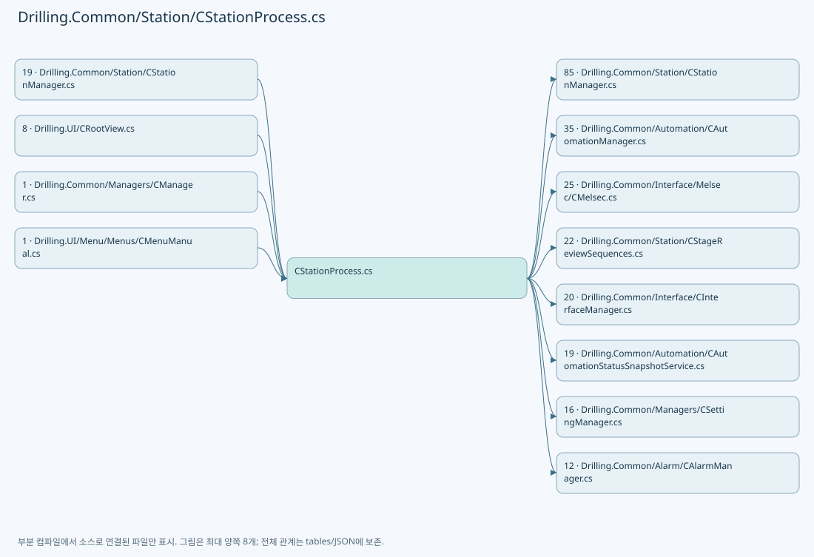

## 네임스페이스·타입·상속

| 타입 | 구분 | 원본 범위 | 선언/상속 |
| --- | --- | --- | --- |
| CStationProcess | ClassDeclaration | 23–4337 | CStationProcess: CtrlThread |
| CProcessStepAction | DelegateDeclaration | 171–171 | private delegate void CProcessStepAction(ST_PROCESS_MODEL processModel, CancellationToken cancellationToken); |
| ST_BUFFERED_RUN_GROUP_RESULT | RecordDeclaration | 2527–2527 | ST_BUFFERED_RUN_GROUP_RESULT |
| ST_BUFFERED_RUN_STOP_RESULT | RecordDeclaration | 2528–2528 | ST_BUFFERED_RUN_STOP_RESULT |
| ST_AUTOMATION_TASK_KEY | RecordStructDeclaration | 2529–2529 | ST_AUTOMATION_TASK_KEY |
| ST_AUTOMATION_TASK_TARGET | RecordDeclaration | 2530–2530 | ST_AUTOMATION_TASK_TARGET |
| ST_AUTOMATION_TASK_STATUS | RecordDeclaration | 2531–2531 | ST_AUTOMATION_TASK_STATUS |
| ST_AUTOMATION_TASK_LINE_STATUS | RecordDeclaration | 2532–2532 | ST_AUTOMATION_TASK_LINE_STATUS |
| ST_SCANNER_STATUS_LOG_AXIS_TARGET | RecordDeclaration | 2533–2533 | ST_SCANNER_STATUS_LOG_AXIS_TARGET |
| ST_QUEUE_COUNT_LOG_TARGET | RecordDeclaration | 2534–2534 | ST_QUEUE_COUNT_LOG_TARGET |
| ST_AUTO_STEP_INFO | RecordDeclaration | 2535–2535 | ST_AUTO_STEP_INFO |
| CScannerStatusLogger | ClassDeclaration | 2536–3099 | CScannerStatusLogger: IDisposable |
| CQueueCountLogger | ClassDeclaration | 3101–3317 | CQueueCountLogger: IDisposable |
| CBufferedRunWorker | ClassDeclaration | 3319–3398 | CBufferedRunWorker |
| CStageBufferedRun | ClassDeclaration | 4263–4267 | CStageBufferedRun |
| CHandshakeOutputReset | ClassDeclaration | 4340–4386 | CHandshakeOutputReset |
| ST_PROTECT_WINDOW_RETRY_EXHAUSTED | RecordDeclaration | 4388–4388 | ST_PROTECT_WINDOW_RETRY_EXHAUSTED |
| CProtectWindowUsageRequest | ClassDeclaration | 4390–4823 | CProtectWindowUsageRequest |
| CStageProcessDataPublisher | ClassDeclaration | 4826–4947 | CStageProcessDataPublisher |
| ST_STAGE_READY_POSITION_RESULT | RecordDeclaration | 4949–4949 | ST_STAGE_READY_POSITION_RESULT |
| CStageReadyPositionCheck | ClassDeclaration | 4951–5017 | CStageReadyPositionCheck |
| ST_STAGE_REQUEST_STATUS | RecordDeclaration | 5019–5023 | ST_STAGE_REQUEST_STATUS |
| ST_STAGE_SIGNAL_SNAPSHOT | RecordDeclaration | 5024–5027 | ST_STAGE_SIGNAL_SNAPSHOT |
| CStageRequestSequence | ClassDeclaration | 5029–5999 | CStageRequestSequence |
| ST_STAGE_DISTORTION_ACTIONS | RecordDeclaration | 6001–6005 | ST_STAGE_DISTORTION_ACTIONS |
| ST_STAGE_TPM_ACTIONS | RecordDeclaration | 6006–6006 | ST_STAGE_TPM_ACTIONS |
| ST_STAGE_REVIEW_ACTIONS | RecordDeclaration | 6007–6007 | ST_STAGE_REVIEW_ACTIONS |
| ST_STAGE_ZERO_LINE_ACTIONS | RecordDeclaration | 6008–6011 | ST_STAGE_ZERO_LINE_ACTIONS |
| ST_MANUAL_MOF_STATUS | RecordDeclaration | 6012–6012 | ST_MANUAL_MOF_STATUS |
| ST_MANUAL_MOF_COMPLETION | RecordDeclaration | 6013–6013 | ST_MANUAL_MOF_COMPLETION |
| CManualMofActionIds | ClassDeclaration | 6014–6017 | CManualMofActionIds |
| ST_STAGE_PROCESS_REQUEST | RecordDeclaration | 6019–6019 | ST_STAGE_PROCESS_REQUEST |
| ST_ZERO_LINE_PREWAIT_STATUS | RecordDeclaration | 6020–6020 | ST_ZERO_LINE_PREWAIT_STATUS |
| CZeroLinePrewaitMonitor | ClassDeclaration | 6022–6387 | CZeroLinePrewaitMonitor |
| CZeroLineProcessCoordinator | ClassDeclaration | 6390–6634 | CZeroLineProcessCoordinator |

## 멤버 빠른 목록

| 이름 | 종류 | 범위 | 서명 |
| --- | --- | --- | --- |
| AutoStepIdle | FieldDeclaration | L26–26 | string Drilling.Common.Station.CStationProcess.AutoStepIdle |
| AutoStepPowerCheck | FieldDeclaration | L27–27 | string Drilling.Common.Station.CStationProcess.AutoStepPowerCheck |
| AutoStepAlign | FieldDeclaration | L28–28 | string Drilling.Common.Station.CStationProcess.AutoStepAlign |
| AutoStepProcess | FieldDeclaration | L29–29 | string Drilling.Common.Station.CStationProcess.AutoStepProcess |
| AutoStepInspection | FieldDeclaration | L30–30 | string Drilling.Common.Station.CStationProcess.AutoStepInspection |
| AutoStepComplete | FieldDeclaration | L31–31 | string Drilling.Common.Station.CStationProcess.AutoStepComplete |
| ScriptBufferedRunUseKey | FieldDeclaration | L32–32 | string Drilling.Common.Station.CStationProcess.ScriptBufferedRunUseKey |
| ScriptRunTimeoutMsKey | FieldDeclaration | L33–33 | string Drilling.Common.Station.CStationProcess.ScriptRunTimeoutMsKey |
| ScriptRunPollIntervalMsKey | FieldDeclaration | L34–34 | string Drilling.Common.Station.CStationProcess.ScriptRunPollIntervalMsKey |
| ScriptBufferedRunLinesPerCommandKey | FieldDeclaration | L35–35 | string Drilling.Common.Station.CStationProcess.ScriptBufferedRunLinesPerCommandKey |
| ScriptBufferedRunTimeoutMsKey | FieldDeclaration | L36–36 | string Drilling.Common.Station.CStationProcess.ScriptBufferedRunTimeoutMsKey |
| ScriptBufferedRunQueueSizeKey | FieldDeclaration | L37–37 | string Drilling.Common.Station.CStationProcess.ScriptBufferedRunQueueSizeKey |
| StandardScriptDirectoryName | FieldDeclaration | L38–38 | string Drilling.Common.Station.CStationProcess.StandardScriptDirectoryName |
| BufferedRunScriptDirectoryName | FieldDeclaration | L39–39 | string Drilling.Common.Station.CStationProcess.BufferedRunScriptDirectoryName |
| QueueCountLogDirectoryName | FieldDeclaration | L40–40 | string Drilling.Common.Station.CStationProcess.QueueCountLogDirectoryName |
| ScannerStatusLogDirectoryName | FieldDeclaration | L41–41 | string Drilling.Common.Station.CStationProcess.ScannerStatusLogDirectoryName |
| ScriptRunDefaultTimeoutMs | FieldDeclaration | L42–42 | int Drilling.Common.Station.CStationProcess.ScriptRunDefaultTimeoutMs |
| ScriptRunDefaultPollIntervalMs | FieldDeclaration | L43–43 | int Drilling.Common.Station.CStationProcess.ScriptRunDefaultPollIntervalMs |
| EncoderScaleReleaseTimeoutMs | FieldDeclaration | L44–44 | int Drilling.Common.Station.CStationProcess.EncoderScaleReleaseTimeoutMs |
| QueueCountLogIntervalMs | FieldDeclaration | L45–45 | int Drilling.Common.Station.CStationProcess.QueueCountLogIntervalMs |
| ScannerStatusLogIntervalMs | FieldDeclaration | L46–46 | int Drilling.Common.Station.CStationProcess.ScannerStatusLogIntervalMs |
| QueueCountLogStopWaitMs | FieldDeclaration | L47–47 | int Drilling.Common.Station.CStationProcess.QueueCountLogStopWaitMs |
| MaximumProcessLogCount | FieldDeclaration | L48–48 | int Drilling.Common.Station.CStationProcess.MaximumProcessLogCount |
| AutoStepWait | FieldDeclaration | L49–49 | string Drilling.Common.Station.CStationProcess.AutoStepWait |
| AutoStepRunning | FieldDeclaration | L50–50 | string Drilling.Common.Station.CStationProcess.AutoStepRunning |
| AutoStepOk | FieldDeclaration | L51–51 | string Drilling.Common.Station.CStationProcess.AutoStepOk |
| AutoStepDone | FieldDeclaration | L52–52 | string Drilling.Common.Station.CStationProcess.AutoStepDone |
| AutoStepError | FieldDeclaration | L53–53 | string Drilling.Common.Station.CStationProcess.AutoStepError |
| AutoStepStop | FieldDeclaration | L54–54 | string Drilling.Common.Station.CStationProcess.AutoStepStop |
| AutoStepInfos | FieldDeclaration | L55–62 | System.Collections.Generic.IReadOnlyList<Drilling.Common.Station.CStationProcess.ST_AUTO_STEP_INFO> Drilling.Common.Station.CStationProcess.AutoStepInfos |
| ProcessFlowItems | FieldDeclaration | L63–70 | System.Collections.Generic.IReadOnlyList<Drilling.Common.Station.ST_STATION_PROCESS_FLOW_ITEM> Drilling.Common.Station.CStationProcess.ProcessFlowItems |
| _interfaceManager | FieldDeclaration | L71–71 | Drilling.Common.Interface.CInterfaceManager Drilling.Common.Station.CStationProcess._interfaceManager |
| _motionManager | FieldDeclaration | L72–72 | Drilling.Common.Motion.CMotionManager Drilling.Common.Station.CStationProcess._motionManager |
| _interLockManager | FieldDeclaration | L73–73 | Drilling.Common.InterLock.CInterLockManager Drilling.Common.Station.CStationProcess._interLockManager |
| _settingManager | FieldDeclaration | L74–74 | Drilling.Common.Managers.CSettingManager Drilling.Common.Station.CStationProcess._settingManager |
| _productManager | FieldDeclaration | L75–75 | Drilling.Common.Product.CProductManager? Drilling.Common.Station.CStationProcess._productManager |
| _recipeManager | FieldDeclaration | L76–76 | Drilling.Common.Managers.CRecipeManager? Drilling.Common.Station.CStationProcess._recipeManager |
| _zeroLineReview | FieldDeclaration | L77–77 | Drilling.Common.Review.CReviewManager? Drilling.Common.Station.CStationProcess._zeroLineReview |
| _protectWindowUsageRequest | FieldDeclaration | L78–78 | Drilling.Common.Station.CProtectWindowUsageRequest? Drilling.Common.Station.CStationProcess._protectWindowUsageRequest |
| _reviewOffsetFile | FieldDeclaration | L79–79 | Drilling.Common.Review.CReviewOffsetFileBase? Drilling.Common.Station.CStationProcess._reviewOffsetFile |
| _automationScriptFile | FieldDeclaration | L80–80 | Drilling.Common.Station.CAutomationScriptFileBase Drilling.Common.Station.CStationProcess._automationScriptFile |
| _automationManager | FieldDeclaration | L81–81 | Drilling.Common.Automation.CAutomationManager Drilling.Common.Station.CStationProcess._automationManager |
| _logManager | FieldDeclaration | L82–82 | Drilling.Common.Log.CLogManager? Drilling.Common.Station.CStationProcess._logManager |
| _manualMofCompletionPath | FieldDeclaration | L83–83 | string? Drilling.Common.Station.CStationProcess._manualMofCompletionPath |
| _sequenceLock | FieldDeclaration | L84–84 | object Drilling.Common.Station.CStationProcess._sequenceLock |
| _stageRequestResetGate | FieldDeclaration | L85–85 | System.Threading.SemaphoreSlim Drilling.Common.Station.CStationProcess._stageRequestResetGate |
| _processLogLock | FieldDeclaration | L86–86 | object Drilling.Common.Station.CStationProcess._processLogLock |
| _sequenceActions | FieldDeclaration | L87–87 | Drilling.Common.Station.CSequenceActionStatusStore Drilling.Common.Station.CStationProcess._sequenceActions |
| _processLogs | FieldDeclaration | L88–88 | System.Collections.Generic.List<Drilling.Common.Station.ST_PROCESS_LOG_ITEM> Drilling.Common.Station.CStationProcess._processLogs |
| _autoStepStates | FieldDeclaration | L89–89 | System.Collections.Generic.Dictionary<string, string> Drilling.Common.Station.CStationProcess._autoStepStates |
| _scriptCreatedAt | FieldDeclaration | L90–90 | System.DateTimeOffset? Drilling.Common.Station.CStationProcess._scriptCreatedAt |
| _scriptStartedAt | FieldDeclaration | L91–91 | System.DateTimeOffset? Drilling.Common.Station.CStationProcess._scriptStartedAt |
| _scriptCompletedAt | FieldDeclaration | L92–92 | System.DateTimeOffset? Drilling.Common.Station.CStationProcess._scriptCompletedAt |
| _lastScript | FieldDeclaration | L93–93 | Drilling.Common.Station.ST_SCRIPT_BUILD_RESULT? Drilling.Common.Station.CStationProcess._lastScript |
| _lastInterLockItems | FieldDeclaration | L94–94 | System.Collections.Generic.IReadOnlyList<Drilling.Common.InterLock.ST_INTERLOCK_ITEM> Drilling.Common.Station.CStationProcess._lastInterLockItems |
| _processModel | FieldDeclaration | L95–95 | Drilling.Common.Station.ST_PROCESS_MODEL? Drilling.Common.Station.CStationProcess._processModel |
| _preparedReviewOffsetFilePath | FieldDeclaration | L96–96 | string Drilling.Common.Station.CStationProcess._preparedReviewOffsetFilePath |
| _preparedReviewOffsetSavedAt | FieldDeclaration | L97–97 | System.DateTimeOffset Drilling.Common.Station.CStationProcess._preparedReviewOffsetSavedAt |
| _preparedReviewOffsetInvalidated | FieldDeclaration | L98–98 | bool Drilling.Common.Station.CStationProcess._preparedReviewOffsetInvalidated |
| _statistics | FieldDeclaration | L99–99 | Drilling.Common.Station.ST_PROCESS_STATISTICS Drilling.Common.Station.CStationProcess._statistics |
| _snapshot | FieldDeclaration | L100–100 | Drilling.Common.Station.ST_STATION_PROCESS_STATUS Drilling.Common.Station.CStationProcess._snapshot |
| _stationStatus | FieldDeclaration | L101–101 | Drilling.Common.Station.ST_STATION_STATUS Drilling.Common.Station.CStationProcess._stationStatus |
| _sequenceState | FieldDeclaration | L102–102 | Drilling.Common.Station.EN_STATION_SEQUENCE Drilling.Common.Station.CStationProcess._sequenceState |
| _sequenceCancellation | FieldDeclaration | L103–103 | System.Threading.CancellationTokenSource? Drilling.Common.Station.CStationProcess._sequenceCancellation |
| _sequenceError | FieldDeclaration | L104–104 | string Drilling.Common.Station.CStationProcess._sequenceError |
| _manualMofActions | FieldDeclaration | L105–105 | Drilling.Common.Station.CSequenceActionStatusStore Drilling.Common.Station.CStationProcess._manualMofActions |
| _manualMofCancellation | FieldDeclaration | L106–106 | System.Threading.CancellationTokenSource? Drilling.Common.Station.CStationProcess._manualMofCancellation |
| _manualMofExecution | FieldDeclaration | L107–107 | System.Threading.Tasks.Task Drilling.Common.Station.CStationProcess._manualMofExecution |
| _manualMofRunning | FieldDeclaration | L108–108 | bool Drilling.Common.Station.CStationProcess._manualMofRunning |
| _manualMofRequiresStop | FieldDeclaration | L109–109 | bool Drilling.Common.Station.CStationProcess._manualMofRequiresStop |
| _manualMofMessage | FieldDeclaration | L110–110 | string Drilling.Common.Station.CStationProcess._manualMofMessage |
| _manualMofDirectory | FieldDeclaration | L111–111 | string Drilling.Common.Station.CStationProcess._manualMofDirectory |
| _lastCompletedManualMof | FieldDeclaration | L112–112 | Drilling.Common.Station.ST_MANUAL_MOF_COMPLETION? Drilling.Common.Station.CStationProcess._lastCompletedManualMof |
| _protectWindowCountGate | FieldDeclaration | L113–113 | System.Threading.SemaphoreSlim Drilling.Common.Station.CStationProcess._protectWindowCountGate |
| _protectWindowCounted | FieldDeclaration | L114–114 | bool Drilling.Common.Station.CStationProcess._protectWindowCounted |
| _stageMachiningCompleted | FieldDeclaration | L115–115 | bool Drilling.Common.Station.CStationProcess._stageMachiningCompleted |
| _stageOwnedTasks | FieldDeclaration | L116–116 | System.Collections.Concurrent.ConcurrentDictionary<(int Controller, int Task), Drilling.Common.Station.ST_HEAD_SCRIPT_RESULT> Drilling.Common.Station.CStationProcess._stageOwnedTasks |
| _stageBufferedRuns | FieldDeclaration | L117–117 | System.Collections.Concurrent.ConcurrentDictionary<int, Drilling.Common.Station.CStationProcess.CStageBufferedRun> Drilling.Common.Station.CStationProcess._stageBufferedRuns |
| _stageModelLogCycle | FieldDeclaration | L118–118 | string Drilling.Common.Station.CStationProcess._stageModelLogCycle |
| _zeroLineCycle | FieldDeclaration | L119–119 | Drilling.Common.Station.CZeroLineProcessCoordinator? Drilling.Common.Station.CStationProcess._zeroLineCycle |
| _zeroLinePrewait | FieldDeclaration | L120–120 | Drilling.Common.Station.CZeroLinePrewaitMonitor? Drilling.Common.Station.CStationProcess._zeroLinePrewait |
| .ctor | ConstructorDeclaration | L123–167 | Drilling.Common.Station.CStationProcess.CStationProcess(Drilling.Common.Interface.CInterfaceManager, Drilling.Common.Motion.CMotionManager, Drilling.Common.InterLock.CInterLockManager, Drilling.Common.Managers.CSettingManager, Drilling.Common.Station.CAutomationScriptFileBase, Drilling.Common.Automation.CAutomationManager, Drilling.Common.Review.CReviewOffsetFileBase?, Drilling.Common.Product.CProductManager?, Drilling.Common.Log.CLogManager?, string, string?, Drilling.Common.Managers.CRecipeManager?, Drilling.Common.Review.CReviewManager?, System.Action<Drilling.Common.Station.ST_PROTECT_WINDOW_RETRY_EXHAUSTED>?) |
| CProcessStepAction | DelegateDeclaration | L171–171 | Drilling.Common.Station.CStationProcess.CProcessStepAction |
| Current | PropertyDeclaration | L172–188 | Drilling.Common.Station.ST_STATION_PROCESS_STATUS Drilling.Common.Station.CStationProcess.Current |
| get_Current | GetAccessorDeclaration | L174–187 | Drilling.Common.Station.ST_STATION_PROCESS_STATUS Drilling.Common.Station.CStationProcess.Current.get |
| Status | PropertyDeclaration | L190–196 | Drilling.Common.Station.ST_STATION_STATUS Drilling.Common.Station.CStationProcess.Status |
| get_Status | GetAccessorDeclaration | L192–195 | Drilling.Common.Station.ST_STATION_STATUS Drilling.Common.Station.CStationProcess.Status.get |
| SequenceState | PropertyDeclaration | L198–204 | Drilling.Common.Station.EN_STATION_SEQUENCE Drilling.Common.Station.CStationProcess.SequenceState |
| get_SequenceState | GetAccessorDeclaration | L200–203 | Drilling.Common.Station.EN_STATION_SEQUENCE Drilling.Common.Station.CStationProcess.SequenceState.get |
| GetProcessFlow | MethodDeclaration | L206–209 | System.Collections.Generic.IReadOnlyList<Drilling.Common.Station.ST_STATION_PROCESS_FLOW_ITEM> Drilling.Common.Station.CStationProcess.GetProcessFlow() |
| PrepareProcess | MethodDeclaration | L211–227 | Drilling.Common.Station.ST_STATION_PROCESS_STATUS Drilling.Common.Station.CStationProcess.PrepareProcess(string, string, string, string, System.Collections.Generic.IReadOnlyDictionary<string, string>, System.Threading.CancellationToken, bool) |
| PrepareProcessCore | MethodDeclaration | L229–270 | Drilling.Common.Station.ST_STATION_PROCESS_STATUS Drilling.Common.Station.CStationProcess.PrepareProcessCore(string, string, string, string, System.Collections.Generic.IReadOnlyDictionary<string, string>, System.Threading.CancellationToken, bool, System.Collections.Generic.IReadOnlySet<int>?) |
| Start | MethodDeclaration | L272–323 | Drilling.Common.Station.ST_STATION_PROCESS_STATUS Drilling.Common.Station.CStationProcess.Start(System.Threading.CancellationToken) |
| Run | MethodDeclaration | L325–382 | void Drilling.Common.Station.CStationProcess.Run() |
| RunSequenceStep | MethodDeclaration | L384–393 | void Drilling.Common.Station.CStationProcess.RunSequenceStep(Drilling.Common.Station.EN_STATION_SEQUENCE, string, Drilling.Common.Station.CStationProcess.CProcessStepAction, Drilling.Common.Station.EN_STATION_SEQUENCE) |
| CheckProcessModelLoaded | MethodDeclaration | L395–398 | Drilling.Common.Station.ST_PROCESS_MODEL Drilling.Common.Station.CStationProcess.CheckProcessModelLoaded() |
| GetSequenceCancellationToken | MethodDeclaration | L400–406 | System.Threading.CancellationToken Drilling.Common.Station.CStationProcess.GetSequenceCancellationToken() |
| FinishSequence | MethodDeclaration | L408–422 | void Drilling.Common.Station.CStationProcess.FinishSequence() |
| ProcessInterruptedSequence | MethodDeclaration | L424–433 | void Drilling.Common.Station.CStationProcess.ProcessInterruptedSequence() |
| CompleteSequence | MethodDeclaration | L435–438 | void Drilling.Common.Station.CStationProcess.CompleteSequence(Drilling.Common.Station.ST_PROCESS_MODEL, System.Threading.CancellationToken) |
| EnsureStartAllowed | MethodDeclaration | L440–446 | void Drilling.Common.Station.CStationProcess.EnsureStartAllowed() |
| ReadProcessModelForStart | MethodDeclaration | L448–458 | Drilling.Common.Station.ST_PROCESS_MODEL Drilling.Common.Station.CStationProcess.ReadProcessModelForStart() |
| GetLiveInterlockItems | MethodDeclaration | L460–460 | System.Collections.Generic.IReadOnlyList<Drilling.Common.InterLock.ST_INTERLOCK_ITEM> Drilling.Common.Station.CStationProcess.GetLiveInterlockItems(System.Threading.CancellationToken) |
| GetLiveInterlockItems | MethodDeclaration | L461–461 | System.Collections.Generic.IReadOnlyList<Drilling.Common.InterLock.ST_INTERLOCK_ITEM> Drilling.Common.Station.CStationProcess.GetLiveInterlockItems(System.Collections.Generic.IReadOnlyDictionary<string, string>, System.Threading.CancellationToken) |
| GetManualInterlockItems | MethodDeclaration | L462–472 | System.Collections.Generic.IReadOnlyList<Drilling.Common.InterLock.ST_INTERLOCK_ITEM> Drilling.Common.Station.CStationProcess.GetManualInterlockItems(System.Collections.Generic.IReadOnlyDictionary<string, string>, System.Collections.Generic.IReadOnlySet<int>, System.Threading.CancellationToken) |
| ExecuteAutoStep | MethodDeclaration | L474–499 | void Drilling.Common.Station.CStationProcess.ExecuteAutoStep(string, Drilling.Common.Station.ST_PROCESS_MODEL, Drilling.Common.Station.CStationProcess.CProcessStepAction, System.Threading.CancellationToken) |
| RunAlignStep | MethodDeclaration | L501–526 | void Drilling.Common.Station.CStationProcess.RunAlignStep(Drilling.Common.Station.ST_PROCESS_MODEL, System.Threading.CancellationToken) |
| UpdateProductAlignment | MethodDeclaration | L528–550 | void Drilling.Common.Station.CStationProcess.UpdateProductAlignment(Drilling.Common.Station.ST_PROCESS_MODEL, Drilling.Common.Product.EN_PRODUCT_PROCESS_STATE, string, System.Threading.CancellationToken) |
| TryUpdateProductAlignmentAfterFailure | MethodDeclaration | L552–562 | void Drilling.Common.Station.CStationProcess.TryUpdateProductAlignmentAfterFailure(Drilling.Common.Station.ST_PROCESS_MODEL, Drilling.Common.Product.EN_PRODUCT_PROCESS_STATE, string) |
| RunProcessStep | MethodDeclaration | L564–575 | void Drilling.Common.Station.CStationProcess.RunProcessStep(Drilling.Common.Station.ST_PROCESS_MODEL, System.Threading.CancellationToken) |
| MoveStageToScanStart | MethodDeclaration | L577–609 | void Drilling.Common.Station.CStationProcess.MoveStageToScanStart(Drilling.Common.Station.ST_PROCESS_MODEL, System.Threading.CancellationToken) |
| ResolveFirstShotStageY | MethodDeclaration | L611–637 | double Drilling.Common.Station.CStationProcess.ResolveFirstShotStageY(Drilling.Common.Station.ST_PROCESS_MODEL, double) |
| SelectShots | LocalFunctionStatement | L613–616 | System.Collections.Generic.IEnumerable<Drilling.Common.Recipe.ST_HEAD_SHOT_POINT> SelectShots(Drilling.Common.Station.ST_HEAD_PROCESS_PLAN) |
| SelectStageY | LocalFunctionStatement | L626–629 | double SelectStageY(Drilling.Common.Recipe.ST_HEAD_SHOT_POINT) |
| SelectStageY2 | LocalFunctionStatement | L631–634 | double SelectStageY2(Drilling.Common.Recipe.ST_HEAD_SHOT_POINT) |
| SendProcessControlCommand | MethodDeclaration | L639–651 | void Drilling.Common.Station.CStationProcess.SendProcessControlCommand(string, System.Collections.Generic.IReadOnlyList<(string Key, string Value)>, System.Threading.CancellationToken) |
| RunInspectionStep | MethodDeclaration | L653–656 | void Drilling.Common.Station.CStationProcess.RunInspectionStep(Drilling.Common.Station.ST_PROCESS_MODEL, System.Threading.CancellationToken) |
| BuildAutomationScript | MethodDeclaration | L658–667 | void Drilling.Common.Station.CStationProcess.BuildAutomationScript(Drilling.Common.Station.ST_PROCESS_MODEL, System.Threading.CancellationToken) |
| UploadAutomationScript | MethodDeclaration | L669–691 | void Drilling.Common.Station.CStationProcess.UploadAutomationScript(Drilling.Common.Station.ST_PROCESS_MODEL, System.Threading.CancellationToken) |
| ShouldIncludeItem | LocalFunctionStatement | L677–680 | bool ShouldIncludeItem(Drilling.Common.Station.ST_HEAD_SCRIPT_RESULT) |
| RunScannerProcess | MethodDeclaration | L693–751 | void Drilling.Common.Station.CStationProcess.RunScannerProcess(Drilling.Common.Station.ST_PROCESS_MODEL, System.Threading.CancellationToken) |
| ShouldIncludeItem | LocalFunctionStatement | L704–707 | bool ShouldIncludeItem(Drilling.Common.Station.ST_HEAD_SCRIPT_RESULT) |
| RunBufferedHeadScripts | MethodDeclaration | L753–843 | void Drilling.Common.Station.CStationProcess.RunBufferedHeadScripts(Drilling.Common.Station.ST_PROCESS_MODEL, System.Collections.Generic.IReadOnlyList<Drilling.Common.Station.ST_HEAD_SCRIPT_RESULT>, System.Threading.CancellationToken) |
| SelectAutomationNo | LocalFunctionStatement | L758–761 | int SelectAutomationNo(Drilling.Common.Station.ST_HEAD_SCRIPT_RESULT) |
| SelectItem | LocalFunctionStatement | L764–767 | string SelectItem(Drilling.Common.Station.ST_HEAD_SCRIPT_RESULT) |
| WaitForBufferedRunWorkers | MethodDeclaration | L845–869 | void Drilling.Common.Station.CStationProcess.WaitForBufferedRunWorkers(System.Collections.Generic.IReadOnlyList<Drilling.Common.Station.CStationProcess.CBufferedRunWorker>, int, string) |
| WaitAutomationHeadScriptsComplete | MethodDeclaration | L871–938 | void Drilling.Common.Station.CStationProcess.WaitAutomationHeadScriptsComplete(Drilling.Common.Station.ST_PROCESS_MODEL, System.Collections.Generic.IReadOnlyList<Drilling.Common.Station.ST_HEAD_SCRIPT_RESULT>, System.Threading.CancellationToken) |
| BuildAutomation | LocalFunctionStatement | L882–885 | Drilling.Common.Station.CStationProcess.ST_AUTOMATION_TASK_KEY BuildAutomation(Drilling.Common.Station.CStationProcess.ST_AUTOMATION_TASK_TARGET) |
| StopAutomationScriptTasks | MethodDeclaration | L940–963 | void Drilling.Common.Station.CStationProcess.StopAutomationScriptTasks(System.Collections.Generic.IReadOnlyList<Drilling.Common.Station.ST_HEAD_SCRIPT_RESULT>, string) |
| WaitAutomationScriptTasksStopped | MethodDeclaration | L965–979 | void Drilling.Common.Station.CStationProcess.WaitAutomationScriptTasksStopped(System.Collections.Generic.IReadOnlyList<Drilling.Common.Station.CStationProcess.ST_AUTOMATION_TASK_TARGET>) |
| WaitAutomationScriptTaskStopped | MethodDeclaration | L981–1007 | void Drilling.Common.Station.CStationProcess.WaitAutomationScriptTaskStopped(Drilling.Common.Station.CStationProcess.ST_AUTOMATION_TASK_TARGET) |
| CreateAutomationTaskTargets | MethodDeclaration | L1009–1017 | System.Collections.Generic.IReadOnlyList<Drilling.Common.Station.CStationProcess.ST_AUTOMATION_TASK_TARGET> Drilling.Common.Station.CStationProcess.CreateAutomationTaskTargets(System.Collections.Generic.IReadOnlyList<Drilling.Common.Station.ST_HEAD_SCRIPT_RESULT>) |
| ShouldIncludeItem | LocalFunctionStatement | L1011–1014 | bool ShouldIncludeItem(Drilling.Common.Station.ST_HEAD_SCRIPT_RESULT) |
| ParseAutomationTaskStatus | MethodDeclaration | L1019–1034 | Drilling.Common.Station.CStationProcess.ST_AUTOMATION_TASK_STATUS Drilling.Common.Station.CStationProcess.ParseAutomationTaskStatus(string) |
| ReadAutomationTaskLineStatus | MethodDeclaration | L1036–1040 | Drilling.Common.Station.CStationProcess.ST_AUTOMATION_TASK_LINE_STATUS Drilling.Common.Station.CStationProcess.ReadAutomationTaskLineStatus(int, int, System.Threading.CancellationToken) |
| ParseAutomationTaskLineStatus | MethodDeclaration | L1042–1057 | Drilling.Common.Station.CStationProcess.ST_AUTOMATION_TASK_LINE_STATUS Drilling.Common.Station.CStationProcess.ParseAutomationTaskLineStatus(string) |
| FormatAutomationErrorResponse | MethodDeclaration | L1059–1073 | string Drilling.Common.Station.CStationProcess.FormatAutomationErrorResponse(string) |
| IsAutomationTaskComplete | MethodDeclaration | L1075–1078 | bool Drilling.Common.Station.CStationProcess.IsAutomationTaskComplete(string) |
| IsAutomationTaskFailed | MethodDeclaration | L1080–1083 | bool Drilling.Common.Station.CStationProcess.IsAutomationTaskFailed(string) |
| FormatAutomationTaskTargets | MethodDeclaration | L1085–1093 | string Drilling.Common.Station.CStationProcess.FormatAutomationTaskTargets(System.Collections.Generic.IEnumerable<Drilling.Common.Station.CStationProcess.ST_AUTOMATION_TASK_TARGET>) |
| SelectItem | LocalFunctionStatement | L1087–1090 | string SelectItem(Drilling.Common.Station.CStationProcess.ST_AUTOMATION_TASK_TARGET) |
| RunBufferedHeadScriptGroup | MethodDeclaration | L1095–1109 | Drilling.Common.Station.CStationProcess.ST_BUFFERED_RUN_GROUP_RESULT Drilling.Common.Station.CStationProcess.RunBufferedHeadScriptGroup(int, System.Collections.Generic.IReadOnlyList<Drilling.Common.Station.ST_HEAD_SCRIPT_RESULT>, int, int, int, System.Threading.CancellationToken) |
| BuildBuffered | LocalFunctionStatement | L1097–1100 | Drilling.Common.Automation.ST_BUFFERED_SCRIPT_RUN_ITEM BuildBuffered(Drilling.Common.Station.ST_HEAD_SCRIPT_RESULT) |
| SelectItem | LocalFunctionStatement | L1103–1106 | string SelectItem(Drilling.Common.Station.ST_HEAD_SCRIPT_RESULT) |
| StopBufferedRunTasks | MethodDeclaration | L1111–1143 | void Drilling.Common.Station.CStationProcess.StopBufferedRunTasks(System.Collections.Generic.IReadOnlyList<Drilling.Common.Station.ST_HEAD_SCRIPT_RESULT>, System.Exception) |
| ShouldIncludeItem | LocalFunctionStatement | L1113–1116 | bool ShouldIncludeItem(Drilling.Common.Station.ST_HEAD_SCRIPT_RESULT) |
| RunReviewStep | MethodDeclaration | L1145–1149 | void Drilling.Common.Station.CStationProcess.RunReviewStep(Drilling.Common.Station.ST_PROCESS_MODEL, System.Threading.CancellationToken) |
| RunPowerCheckStep | MethodDeclaration | L1151–1155 | void Drilling.Common.Station.CStationProcess.RunPowerCheckStep(Drilling.Common.Station.ST_PROCESS_MODEL, System.Threading.CancellationToken) |
| CompleteProcess | MethodDeclaration | L1157–1188 | void Drilling.Common.Station.CStationProcess.CompleteProcess(System.Threading.CancellationToken) |
| SelectItem | LocalFunctionStatement | L1173–1179 | Drilling.Common.Station.ST_HEAD_PREVIEW_DATA SelectItem(Drilling.Common.Station.ST_HEAD_PREVIEW_DATA) |
| Stop | MethodDeclaration | L1190–1220 | Drilling.Common.Station.ST_STATION_PROCESS_STATUS Drilling.Common.Station.CStationProcess.Stop(System.Threading.CancellationToken) |
| ProcessStop | MethodDeclaration | L1222–1245 | Drilling.Common.Station.ST_STATION_PROCESS_STATUS Drilling.Common.Station.CStationProcess.ProcessStop(System.Threading.CancellationToken) |
| CanReset | PropertyDeclaration | L1247–1256 | bool Drilling.Common.Station.CStationProcess.CanReset |
| get_CanReset | GetAccessorDeclaration | L1249–1255 | bool Drilling.Common.Station.CStationProcess.CanReset.get |
| Reset | MethodDeclaration | L1258–1281 | Drilling.Common.Station.ST_STATION_PROCESS_STATUS Drilling.Common.Station.CStationProcess.Reset(System.Threading.CancellationToken) |
| ProcessReset | MethodDeclaration | L1283–1337 | Drilling.Common.Station.ST_STATION_PROCESS_STATUS Drilling.Common.Station.CStationProcess.ProcessReset(System.Threading.CancellationToken) |
| CreateSnapshot | MethodDeclaration | L1339–1362 | Drilling.Common.Station.ST_STATION_PROCESS_STATUS Drilling.Common.Station.CStationProcess.CreateSnapshot(Drilling.Common.Station.ST_PROCESS_MODEL?, System.Collections.Generic.IReadOnlyList<Drilling.Common.Station.ST_HEAD_PREVIEW_DATA>, Drilling.Common.Station.EN_SCRIPT_STATUS, Drilling.Common.Station.EN_PROCESS_STEP, Drilling.Common.Station.ST_PROCESS_RESULT?) |
| GetInterLockSummary | MethodDeclaration | L1364–1364 | Drilling.Common.InterLock.ST_INTERLOCK_SUMMARY Drilling.Common.Station.CStationProcess.GetInterLockSummary(System.Threading.CancellationToken, Drilling.Common.Station.ST_PROCESS_MODEL?) |
| EvaluateInterlocks | MethodDeclaration | L1365–1400 | Drilling.Common.InterLock.ST_INTERLOCK_SUMMARY Drilling.Common.Station.CStationProcess.EvaluateInterlocks(System.Collections.Generic.IReadOnlyDictionary<string, string>?, System.Threading.CancellationToken, bool, bool, bool) |
| GetDeviceStatus | MethodDeclaration | L1402–1413 | Drilling.Common.Managers.ST_DEVICE_STATUS Drilling.Common.Station.CStationProcess.GetDeviceStatus(System.Threading.CancellationToken, bool) |
| CompleteProduct | MethodDeclaration | L1415–1425 | void Drilling.Common.Station.CStationProcess.CompleteProduct(Drilling.Common.Station.ST_PROCESS_RESULT, bool, System.Threading.CancellationToken) |
| StopProduct | MethodDeclaration | L1427–1437 | void Drilling.Common.Station.CStationProcess.StopProduct(string, System.Threading.CancellationToken) |
| TryStopProduct | MethodDeclaration | L1439–1449 | void Drilling.Common.Station.CStationProcess.TryStopProduct(string, System.Threading.CancellationToken) |
| SetProductError | MethodDeclaration | L1451–1461 | void Drilling.Common.Station.CStationProcess.SetProductError(string, System.Threading.CancellationToken) |
| TrySetProductError | MethodDeclaration | L1463–1473 | void Drilling.Common.Station.CStationProcess.TrySetProductError(string, System.Threading.CancellationToken) |
| ReportProcessResult | MethodDeclaration | L1475–1489 | void Drilling.Common.Station.CStationProcess.ReportProcessResult(Drilling.Common.Station.ST_PROCESS_RESULT, string, System.Threading.CancellationToken, Drilling.Common.Station.EN_STATION_STATE?) |
| TryReportProcessResult | MethodDeclaration | L1491–1501 | void Drilling.Common.Station.CStationProcess.TryReportProcessResult(Drilling.Common.Station.ST_PROCESS_RESULT, string, System.Threading.CancellationToken, Drilling.Common.Station.EN_STATION_STATE) |
| IsTerminalCleanupException | MethodDeclaration | L1503–1506 | bool Drilling.Common.Station.CStationProcess.IsTerminalCleanupException(System.Exception) |
| GetCurrentProcessProductId | MethodDeclaration | L1508–1516 | string? Drilling.Common.Station.CStationProcess.GetCurrentProcessProductId() |
| BuildPreview | MethodDeclaration | L1518–1526 | System.Collections.Generic.IReadOnlyList<Drilling.Common.Station.ST_HEAD_PREVIEW_DATA> Drilling.Common.Station.CStationProcess.BuildPreview(Drilling.Common.Station.ST_PROCESS_MODEL, Drilling.Common.Station.EN_HEAD_PROCESS_STATUS) |
| BuildHead | LocalFunctionStatement | L1520–1523 | Drilling.Common.Station.ST_HEAD_PREVIEW_DATA BuildHead(Drilling.Common.Station.ST_HEAD_PROCESS_PLAN) |
| BuildRuntimeParameters | MethodDeclaration | L1528–1547 | System.Collections.Generic.IReadOnlyDictionary<string, string> Drilling.Common.Station.CStationProcess.BuildRuntimeParameters(string, System.Collections.Generic.IReadOnlyDictionary<string, string>, System.Threading.CancellationToken) |
| MergeLatestReviewOffsets | MethodDeclaration | L1549–1565 | void Drilling.Common.Station.CStationProcess.MergeLatestReviewOffsets(string, System.Collections.Generic.IDictionary<string, string>, System.Threading.CancellationToken) |
| InvalidatePreparedReviewOffset | MethodDeclaration | L1567–1577 | void Drilling.Common.Station.CStationProcess.InvalidatePreparedReviewOffset() |
| EnsurePreparedReviewOffsetIsCurrent | MethodDeclaration | L1579–1601 | void Drilling.Common.Station.CStationProcess.EnsurePreparedReviewOffsetIsCurrent(Drilling.Common.Station.ST_PROCESS_MODEL, System.Threading.CancellationToken) |
| NormalizeReviewOffsetShotId | MethodDeclaration | L1603–1606 | string Drilling.Common.Station.CStationProcess.NormalizeReviewOffsetShotId(string) |
| BuildProcessModel | MethodDeclaration | L1608–1679 | Drilling.Common.Station.ST_PROCESS_MODEL Drilling.Common.Station.CStationProcess.BuildProcessModel(string, string, string, string, System.Collections.Generic.IReadOnlyDictionary<string, string>) |
| SelectHeadNo | LocalFunctionStatement | L1616–1619 | int SelectHeadNo(Drilling.Common.Recipe.ST_HEAD_SHOT_POINT) |
| SelectKey | LocalFunctionStatement | L1621–1624 | int SelectKey(System.Linq.IGrouping<int, Drilling.Common.Recipe.ST_HEAD_SHOT_POINT>) |
| SelectValue | LocalFunctionStatement | L1626–1629 | Drilling.Common.Recipe.ST_HEAD_SHOT_POINT[] SelectValue(System.Linq.IGrouping<int, Drilling.Common.Recipe.ST_HEAD_SHOT_POINT>) |
| BuildHead | LocalFunctionStatement | L1646–1675 | Drilling.Common.Station.ST_HEAD_PROCESS_PLAN BuildHead(int) |
| SetHeadStatus | MethodDeclaration | L1681–1700 | System.Collections.Generic.IReadOnlyList<Drilling.Common.Station.ST_HEAD_PREVIEW_DATA> Drilling.Common.Station.CStationProcess.SetHeadStatus(System.Collections.Generic.IReadOnlyList<Drilling.Common.Station.ST_HEAD_PREVIEW_DATA>, Drilling.Common.Station.EN_PROCESS_STEP) |
| SelectItem | LocalFunctionStatement | L1683–1697 | Drilling.Common.Station.ST_HEAD_PREVIEW_DATA SelectItem(Drilling.Common.Station.ST_HEAD_PREVIEW_DATA) |
| BuildProcessSequence | MethodDeclaration | L1702–1710 | System.Collections.Generic.IReadOnlyList<Drilling.Common.Station.ST_PROCESS_DISPLAY_ITEM> Drilling.Common.Station.CStationProcess.BuildProcessSequence(Drilling.Common.Station.EN_SCRIPT_STATUS, Drilling.Common.Station.EN_PROCESS_STEP) |
| BuildProcess | LocalFunctionStatement | L1704–1707 | Drilling.Common.Station.ST_PROCESS_DISPLAY_ITEM BuildProcess(Drilling.Common.Station.ST_STATION_PROCESS_FLOW_ITEM) |
| BuildCurrentStepDetails | MethodDeclaration | L1712–1730 | System.Collections.Generic.IReadOnlyList<Drilling.Common.Station.ST_PROCESS_DISPLAY_ITEM> Drilling.Common.Station.CStationProcess.BuildCurrentStepDetails(Drilling.Common.Station.ST_PROCESS_MODEL?, Drilling.Common.Station.EN_SCRIPT_STATUS, Drilling.Common.Station.EN_PROCESS_STEP) |
| BuildProcess | LocalFunctionStatement | L1714–1717 | Drilling.Common.Station.ST_PROCESS_DISPLAY_ITEM BuildProcess(Drilling.Common.Station.CStationProcess.ST_AUTO_STEP_INFO) |
| BuildProcess2 | LocalFunctionStatement | L1724–1727 | Drilling.Common.Station.ST_PROCESS_DISPLAY_ITEM BuildProcess2(Drilling.Common.Station.CStationProcess.ST_AUTO_STEP_INFO) |
| BuildProcessSummary | MethodDeclaration | L1732–1736 | System.Collections.Generic.IReadOnlyList<Drilling.Common.Station.ST_PROCESS_DISPLAY_ITEM> Drilling.Common.Station.CStationProcess.BuildProcessSummary(Drilling.Common.Station.ST_PROCESS_MODEL?, Drilling.Common.Station.ST_PROCESS_STATISTICS) |
| BuildScriptStatusItems | MethodDeclaration | L1738–1764 | System.Collections.Generic.IReadOnlyList<Drilling.Common.Station.ST_PROCESS_DISPLAY_ITEM> Drilling.Common.Station.CStationProcess.BuildScriptStatusItems(Drilling.Common.Station.ST_PROCESS_MODEL?, Drilling.Common.Station.EN_SCRIPT_STATUS, Drilling.Common.Station.ST_PROCESS_RESULT?) |
| SelectFileName | LocalFunctionStatement | L1741–1744 | string SelectFileName(Drilling.Common.Station.ST_HEAD_SCRIPT_RESULT) |
| SelectItem | LocalFunctionStatement | L1747–1750 | string SelectItem(Drilling.Common.Station.ST_HEAD_SCRIPT_RESULT) |
| BuildScriptLifecycleItems | MethodDeclaration | L1766–1775 | System.Collections.Generic.IReadOnlyList<Drilling.Common.Station.ST_PROCESS_DISPLAY_ITEM> Drilling.Common.Station.CStationProcess.BuildScriptLifecycleItems(Drilling.Common.Station.EN_SCRIPT_STATUS, Drilling.Common.Station.EN_PROCESS_STEP) |
| BuildStatistics | MethodDeclaration | L1777–1786 | Drilling.Common.Station.ST_PROCESS_STATISTICS Drilling.Common.Station.CStationProcess.BuildStatistics(Drilling.Common.Station.ST_PROCESS_MODEL?, double, System.TimeSpan) |
| SelectValue | LocalFunctionStatement | L1779–1782 | int SelectValue(Drilling.Common.Station.ST_HEAD_PROCESS_PLAN) |
| EmptyStatistics | MethodDeclaration | L1788–1791 | Drilling.Common.Station.ST_PROCESS_STATISTICS Drilling.Common.Station.CStationProcess.EmptyStatistics() |
| RefreshSnapshot | MethodDeclaration | L1793–1796 | void Drilling.Common.Station.CStationProcess.RefreshSnapshot() |
| ResetAutoStepStates | MethodDeclaration | L1798–1798 | void Drilling.Common.Station.CStationProcess.ResetAutoStepStates() |
| ResetAutoStepStatesCore | MethodDeclaration | L1799–1808 | void Drilling.Common.Station.CStationProcess.ResetAutoStepStatesCore(bool) |
| SetAutoStepState | MethodDeclaration | L1810–1813 | void Drilling.Common.Station.CStationProcess.SetAutoStepState(string, string) |
| MarkRunningAutoSteps | MethodDeclaration | L1815–1824 | void Drilling.Common.Station.CStationProcess.MarkRunningAutoSteps(string) |
| ReadAutoStepState | MethodDeclaration | L1826–1840 | string Drilling.Common.Station.CStationProcess.ReadAutoStepState(string, Drilling.Common.Station.EN_SCRIPT_STATUS, Drilling.Common.Station.EN_PROCESS_STEP) |
| ResolveStepScriptStatus | MethodDeclaration | L1842–1855 | Drilling.Common.Station.EN_SCRIPT_STATUS Drilling.Common.Station.CStationProcess.ResolveStepScriptStatus(string, Drilling.Common.Station.EN_SCRIPT_STATUS) |
| GetCurrentScriptStatusForComplete | MethodDeclaration | L1857–1865 | Drilling.Common.Station.EN_SCRIPT_STATUS Drilling.Common.Station.CStationProcess.GetCurrentScriptStatusForComplete() |
| GetProcessFlowItem | MethodDeclaration | L1867–1875 | Drilling.Common.Station.ST_STATION_PROCESS_FLOW_ITEM Drilling.Common.Station.CStationProcess.GetProcessFlowItem(string) |
| MatchesItem | LocalFunctionStatement | L1869–1872 | bool MatchesItem(Drilling.Common.Station.ST_STATION_PROCESS_FLOW_ITEM) |
| GetAutoStepName | MethodDeclaration | L1877–1885 | string Drilling.Common.Station.CStationProcess.GetAutoStepName(string) |
| MatchesItem | LocalFunctionStatement | L1879–1882 | bool MatchesItem(Drilling.Common.Station.CStationProcess.ST_AUTO_STEP_INFO) |
| CreateAutoStepStateMap | MethodDeclaration | L1887–1900 | System.Collections.Generic.Dictionary<string, string> Drilling.Common.Station.CStationProcess.CreateAutoStepStateMap() |
| SelectKey | LocalFunctionStatement | L1889–1892 | string SelectKey(Drilling.Common.Station.CStationProcess.ST_AUTO_STEP_INFO) |
| SelectAutoStepWait | LocalFunctionStatement | L1894–1897 | string SelectAutoStepWait(Drilling.Common.Station.CStationProcess.ST_AUTO_STEP_INFO) |
| LifecycleState | MethodDeclaration | L1902–1915 | string Drilling.Common.Station.CStationProcess.LifecycleState(Drilling.Common.Station.EN_SCRIPT_STATUS, Drilling.Common.Station.EN_PROCESS_STEP, int) |
| FormatAttenuatorStatus | MethodDeclaration | L1917–1920 | string Drilling.Common.Station.CStationProcess.FormatAttenuatorStatus(Drilling.Common.Interface.ST_ATTENUATOR_STATUS) |
| FormatBETStatus | MethodDeclaration | L1922–1925 | string Drilling.Common.Station.CStationProcess.FormatBETStatus(Drilling.Common.Interface.ST_BET_STATUS) |
| FormatCommState | MethodDeclaration | L1927–1935 | string Drilling.Common.Station.CStationProcess.FormatCommState(Drilling.Common.Interface.EN_COMM_STATE) |
| FormatInterfaceName | MethodDeclaration | L1937–1940 | string Drilling.Common.Station.CStationProcess.FormatInterfaceName(Drilling.Common.Interface.ST_INTERFACE_DATA) |
| FormatInterfaceName | MethodDeclaration | L1942–1945 | string Drilling.Common.Station.CStationProcess.FormatInterfaceName(Drilling.Common.Interface.ST_INTERFACE_COMM_STATUS) |
| FormatDouble | MethodDeclaration | L1947–1950 | string Drilling.Common.Station.CStationProcess.FormatDouble(double) |
| ReadDirectionAny | MethodDeclaration | L1952–1970 | double Drilling.Common.Station.CStationProcess.ReadDirectionAny(System.Collections.Generic.IReadOnlyDictionary<string, string>, double, params string[]) |
| ShouldIncludeItem | LocalFunctionStatement | L1954–1957 | bool ShouldIncludeItem(string) |
| NormalizeDirection | MethodDeclaration | L1972–1991 | double Drilling.Common.Station.CStationProcess.NormalizeDirection(string, string) |
| NormalizeDirection | MethodDeclaration | L1993–2001 | double Drilling.Common.Station.CStationProcess.NormalizeDirection(double, string) |
| FormatCommand | MethodDeclaration | L2003–2011 | string Drilling.Common.Station.CStationProcess.FormatCommand(string, System.Collections.Generic.IReadOnlyList<(string Key, string Value)>) |
| SelectItem | LocalFunctionStatement | L2005–2008 | string SelectItem((string Key, string Value)) |
| IsProcessControlSuccessResponse | MethodDeclaration | L2013–2022 | bool Drilling.Common.Station.CStationProcess.IsProcessControlSuccessResponse(string) |
| FormatResponseForLog | MethodDeclaration | L2024–2027 | string Drilling.Common.Station.CStationProcess.FormatResponseForLog(string) |
| ReadNullableDoubleAny | MethodDeclaration | L2029–2045 | double? Drilling.Common.Station.CStationProcess.ReadNullableDoubleAny(System.Collections.Generic.IReadOnlyDictionary<string, string>, params string[]) |
| ShouldIncludeItem | LocalFunctionStatement | L2031–2034 | bool ShouldIncludeItem(string) |
| ReadNullableIntAny | MethodDeclaration | L2047–2073 | int? Drilling.Common.Station.CStationProcess.ReadNullableIntAny(System.Collections.Generic.IReadOnlyDictionary<string, string>, params string[]) |
| ShouldIncludeItem | LocalFunctionStatement | L2049–2052 | bool ShouldIncludeItem(string) |
| ReadDouble | MethodDeclaration | L2075–2078 | double Drilling.Common.Station.CStationProcess.ReadDouble(System.Collections.Generic.IReadOnlyDictionary<string, string>, string, double) |
| ReadInt | MethodDeclaration | L2080–2083 | int Drilling.Common.Station.CStationProcess.ReadInt(System.Collections.Generic.IReadOnlyDictionary<string, string>, string, int) |
| ReadDoubleAny | MethodDeclaration | L2085–2101 | double Drilling.Common.Station.CStationProcess.ReadDoubleAny(System.Collections.Generic.IReadOnlyDictionary<string, string>, double, params string[]) |
| ShouldIncludeItem | LocalFunctionStatement | L2087–2090 | bool ShouldIncludeItem(string) |
| ReadIntAny | MethodDeclaration | L2103–2129 | int Drilling.Common.Station.CStationProcess.ReadIntAny(System.Collections.Generic.IReadOnlyDictionary<string, string>, int, params string[]) |
| ShouldIncludeItem | LocalFunctionStatement | L2105–2108 | bool ShouldIncludeItem(string) |
| IsBufferedRunEnabled | MethodDeclaration | L2131–2134 | bool Drilling.Common.Station.CStationProcess.IsBufferedRunEnabled(System.Collections.Generic.IReadOnlyDictionary<string, string>) |
| ReadScriptRunTimeoutMs | MethodDeclaration | L2136–2139 | int Drilling.Common.Station.CStationProcess.ReadScriptRunTimeoutMs(System.Collections.Generic.IReadOnlyDictionary<string, string>) |
| ReadScriptRunPollIntervalMs | MethodDeclaration | L2141–2144 | int Drilling.Common.Station.CStationProcess.ReadScriptRunPollIntervalMs(System.Collections.Generic.IReadOnlyDictionary<string, string>) |
| ReadBufferedRunLinesPerCommand | MethodDeclaration | L2146–2149 | int Drilling.Common.Station.CStationProcess.ReadBufferedRunLinesPerCommand(System.Collections.Generic.IReadOnlyDictionary<string, string>) |
| ReadBufferedRunQueueSize | MethodDeclaration | L2151–2154 | int Drilling.Common.Station.CStationProcess.ReadBufferedRunQueueSize(System.Collections.Generic.IReadOnlyDictionary<string, string>) |
| ReadBufferedRunTimeoutMs | MethodDeclaration | L2156–2159 | int Drilling.Common.Station.CStationProcess.ReadBufferedRunTimeoutMs(System.Collections.Generic.IReadOnlyDictionary<string, string>) |
| ReadBool | MethodDeclaration | L2161–2174 | bool Drilling.Common.Station.CStationProcess.ReadBool(System.Collections.Generic.IReadOnlyDictionary<string, string>, string, bool) |
| ReadBoolAny | MethodDeclaration | L2176–2197 | bool Drilling.Common.Station.CStationProcess.ReadBoolAny(System.Collections.Generic.IReadOnlyDictionary<string, string>, bool, params string[]) |
| ShouldIncludeItem | LocalFunctionStatement | L2178–2181 | bool ShouldIncludeItem(string) |
| ReadBoolValue | MethodDeclaration | L2199–2212 | bool Drilling.Common.Station.CStationProcess.ReadBoolValue(string, bool) |
| ReadText | MethodDeclaration | L2214–2217 | string Drilling.Common.Station.CStationProcess.ReadText(System.Collections.Generic.IReadOnlyDictionary<string, string>, string, string) |
| ReadTextAny | MethodDeclaration | L2219–2235 | string Drilling.Common.Station.CStationProcess.ReadTextAny(System.Collections.Generic.IReadOnlyDictionary<string, string>, string, System.Collections.Generic.IEnumerable<string>) |
| ShouldIncludeItem | LocalFunctionStatement | L2221–2224 | bool ShouldIncludeItem(string) |
| CreateHeadKeys | MethodDeclaration | L2237–2246 | string[] Drilling.Common.Station.CStationProcess.CreateHeadKeys(int, params string[]) |
| SelectItem | LocalFunctionStatement | L2240–2243 | string SelectItem(string) |
| ReadHeadUse | MethodDeclaration | L2248–2251 | bool Drilling.Common.Station.CStationProcess.ReadHeadUse(System.Collections.Generic.IReadOnlyDictionary<string, string>, int) |
| ReadHeadAutomationNo | MethodDeclaration | L2253–2256 | int Drilling.Common.Station.CStationProcess.ReadHeadAutomationNo(System.Collections.Generic.IReadOnlyDictionary<string, string>, int) |
| ReadHeadAutomationTaskNo | MethodDeclaration | L2258–2262 | int Drilling.Common.Station.CStationProcess.ReadHeadAutomationTaskNo(System.Collections.Generic.IReadOnlyDictionary<string, string>, int) |
| ReadAnyParameter | MethodDeclaration | L2264–2275 | string Drilling.Common.Station.CStationProcess.ReadAnyParameter(Drilling.Common.Station.ST_PROCESS_MODEL, string, params string[]) |
| GetProcessModel | MethodDeclaration | L2277–2280 | Drilling.Common.Station.ST_PROCESS_MODEL Drilling.Common.Station.CStationProcess.GetProcessModel() |
| SetAlarm | MethodDeclaration | L2282–2293 | Drilling.Common.Station.ST_STATION_PROCESS_STATUS Drilling.Common.Station.CStationProcess.SetAlarm(string, System.Threading.CancellationToken) |
| SetSequenceState | MethodDeclaration | L2295–2312 | void Drilling.Common.Station.CStationProcess.SetSequenceState(Drilling.Common.Station.EN_STATION_SEQUENCE) |
| TryMoveSequenceState | MethodDeclaration | L2314–2332 | bool Drilling.Common.Station.CStationProcess.TryMoveSequenceState(Drilling.Common.Station.EN_STATION_SEQUENCE, Drilling.Common.Station.EN_STATION_SEQUENCE) |
| ReadSequenceState | MethodDeclaration | L2334–2340 | Drilling.Common.Station.EN_STATION_SEQUENCE Drilling.Common.Station.CStationProcess.ReadSequenceState() |
| ReadStationStatus | MethodDeclaration | L2342–2348 | Drilling.Common.Station.ST_STATION_STATUS Drilling.Common.Station.CStationProcess.ReadStationStatus() |
| SetStationState | MethodDeclaration | L2350–2369 | void Drilling.Common.Station.CStationProcess.SetStationState(Drilling.Common.Station.EN_STATION_STATE, Drilling.Common.Station.EN_PROCESS_STEP, Drilling.Common.Station.EN_SCRIPT_STATUS, string) |
| AddProcessLog | MethodDeclaration | L2371–2389 | void Drilling.Common.Station.CStationProcess.AddProcessLog(string, string, string) |
| ClearProcessLogs | MethodDeclaration | L2391–2397 | void Drilling.Common.Station.CStationProcess.ClearProcessLogs() |
| GetProcessLogsSnapshot | MethodDeclaration | L2399–2405 | Drilling.Common.Station.ST_PROCESS_LOG_ITEM[] Drilling.Common.Station.CStationProcess.GetProcessLogsSnapshot() |
| AddSequenceLog | MethodDeclaration | L2407–2419 | void Drilling.Common.Station.CStationProcess.AddSequenceLog(string, string, string) |
| FormatInterLockBlockedMessage | MethodDeclaration | L2421–2430 | string Drilling.Common.Station.CStationProcess.FormatInterLockBlockedMessage(Drilling.Common.InterLock.ST_INTERLOCK_SUMMARY) |
| MatchesItem | LocalFunctionStatement | L2423–2426 | bool MatchesItem(Drilling.Common.InterLock.ST_INTERLOCK_ITEM) |
| FormatStartInterLockBlockedMessage | MethodDeclaration | L2432–2452 | string Drilling.Common.Station.CStationProcess.FormatStartInterLockBlockedMessage(Drilling.Common.InterLock.ST_INTERLOCK_SUMMARY) |
| MatchesItem | LocalFunctionStatement | L2434–2437 | bool MatchesItem(Drilling.Common.InterLock.ST_INTERLOCK_ITEM) |
| FormatItem | LocalFunctionStatement | L2439–2443 | string FormatItem(Drilling.Common.InterLock.ST_INTERLOCK_ITEM) |
| FormatScriptStatus | MethodDeclaration | L2454–2460 | string Drilling.Common.Station.CStationProcess.FormatScriptStatus(Drilling.Common.Station.EN_SCRIPT_STATUS) |
| FormatExecuteState | MethodDeclaration | L2462–2481 | string Drilling.Common.Station.CStationProcess.FormatExecuteState(Drilling.Common.Station.EN_SCRIPT_STATUS, Drilling.Common.Station.ST_PROCESS_RESULT?, bool) |
| FormatScriptResult | MethodDeclaration | L2483–2496 | string Drilling.Common.Station.CStationProcess.FormatScriptResult(Drilling.Common.Station.EN_SCRIPT_STATUS, Drilling.Common.Station.ST_PROCESS_RESULT?, bool) |
| FormatDateTime | MethodDeclaration | L2498–2501 | string Drilling.Common.Station.CStationProcess.FormatDateTime(System.DateTimeOffset?) |
| FormatProcessResultDetail | MethodDeclaration | L2503–2515 | string Drilling.Common.Station.CStationProcess.FormatProcessResultDetail(Drilling.Common.Station.ST_PROCESS_RESULT, string, string, string) |
| GetProcessResultCode | MethodDeclaration | L2517–2520 | string Drilling.Common.Station.CStationProcess.GetProcessResultCode(Drilling.Common.Station.ST_PROCESS_RESULT) |
| FormatDuration | MethodDeclaration | L2522–2525 | string Drilling.Common.Station.CStationProcess.FormatDuration(System.TimeSpan) |
| ScannerStatusReadTimeoutMs | FieldDeclaration | L2538–2538 | int Drilling.Common.Station.CStationProcess.CScannerStatusLogger.ScannerStatusReadTimeoutMs |
| Header | FieldDeclaration | L2539–2539 | string Drilling.Common.Station.CStationProcess.CScannerStatusLogger.Header |
| _owner | FieldDeclaration | L2540–2540 | Drilling.Common.Station.CStationProcess Drilling.Common.Station.CStationProcess.CScannerStatusLogger._owner |
| _recipeId | FieldDeclaration | L2541–2541 | string Drilling.Common.Station.CStationProcess.CScannerStatusLogger._recipeId |
| _targets | FieldDeclaration | L2542–2542 | System.Collections.Generic.IReadOnlyList<Drilling.Common.Station.CStationProcess.ST_SCANNER_STATUS_LOG_AXIS_TARGET> Drilling.Common.Station.CStationProcess.CScannerStatusLogger._targets |
| _cancellation | FieldDeclaration | L2543–2543 | System.Threading.CancellationTokenSource Drilling.Common.Station.CStationProcess.CScannerStatusLogger._cancellation |
| _writeLock | FieldDeclaration | L2544–2544 | object Drilling.Common.Station.CStationProcess.CScannerStatusLogger._writeLock |
| _thread | FieldDeclaration | L2545–2545 | System.Threading.Thread Drilling.Common.Station.CStationProcess.CScannerStatusLogger._thread |
| _snapshotOwnerId | FieldDeclaration | L2546–2546 | System.Guid Drilling.Common.Station.CStationProcess.CScannerStatusLogger._snapshotOwnerId |
| _lastError | FieldDeclaration | L2547–2547 | string Drilling.Common.Station.CStationProcess.CScannerStatusLogger._lastError |
| _started | FieldDeclaration | L2548–2548 | bool Drilling.Common.Station.CStationProcess.CScannerStatusLogger._started |
| _stopped | FieldDeclaration | L2549–2549 | bool Drilling.Common.Station.CStationProcess.CScannerStatusLogger._stopped |
| .ctor | ConstructorDeclaration | L2550–2560 | Drilling.Common.Station.CStationProcess.CScannerStatusLogger.CScannerStatusLogger(Drilling.Common.Station.CStationProcess, string, System.Collections.Generic.IReadOnlyList<Drilling.Common.Station.CStationProcess.ST_SCANNER_STATUS_LOG_AXIS_TARGET>) |
| Create | MethodDeclaration | L2562–2566 | Drilling.Common.Station.CStationProcess.CScannerStatusLogger Drilling.Common.Station.CStationProcess.CScannerStatusLogger.Create(Drilling.Common.Station.CStationProcess, string, bool, System.Collections.Generic.IReadOnlyDictionary<string, string>, System.Collections.Generic.IReadOnlyList<Drilling.Common.Station.ST_HEAD_SCRIPT_RESULT>) |
| Start | MethodDeclaration | L2568–2578 | void Drilling.Common.Station.CStationProcess.CScannerStatusLogger.Start() |
| StopAndWriteFinal | MethodDeclaration | L2580–2604 | void Drilling.Common.Station.CStationProcess.CScannerStatusLogger.StopAndWriteFinal() |
| Dispose | MethodDeclaration | L2606–2610 | void Drilling.Common.Station.CStationProcess.CScannerStatusLogger.Dispose() |
| CreateTargets | MethodDeclaration | L2612–2643 | System.Collections.Generic.IReadOnlyList<Drilling.Common.Station.CStationProcess.ST_SCANNER_STATUS_LOG_AXIS_TARGET> Drilling.Common.Station.CStationProcess.CScannerStatusLogger.CreateTargets(bool, System.Collections.Generic.IReadOnlyDictionary<string, string>, System.Collections.Generic.IReadOnlyList<Drilling.Common.Station.ST_HEAD_SCRIPT_RESULT>) |
| AddAxisTarget | MethodDeclaration | L2645–2657 | void Drilling.Common.Station.CStationProcess.CScannerStatusLogger.AddAxisTarget(System.Collections.Generic.List<Drilling.Common.Station.CStationProcess.ST_SCANNER_STATUS_LOG_AXIS_TARGET>, Drilling.Common.Station.ST_HEAD_SCRIPT_RESULT, int, string, string, int, bool, string) |
| ResolveRootDirectory | MethodDeclaration | L2659–2687 | string Drilling.Common.Station.CStationProcess.CScannerStatusLogger.ResolveRootDirectory(System.Collections.Generic.IReadOnlyList<Drilling.Common.Station.ST_HEAD_SCRIPT_RESULT>) |
| Run | MethodDeclaration | L2689–2695 | void Drilling.Common.Station.CStationProcess.CScannerStatusLogger.Run() |
| WriteSnapshotOnce | MethodDeclaration | L2697–2731 | void Drilling.Common.Station.CStationProcess.CScannerStatusLogger.WriteSnapshotOnce() |
| ReadTargetSnapshot | MethodDeclaration | L2733–2892 | Drilling.Common.Automation.ST_SCANNER_AXIS_LIVE_STATUS Drilling.Common.Station.CStationProcess.CScannerStatusLogger.ReadTargetSnapshot(Drilling.Common.Station.CStationProcess.ST_SCANNER_STATUS_LOG_AXIS_TARGET, System.Collections.Generic.Dictionary<Drilling.Common.Station.CStationProcess.ST_AUTOMATION_TASK_KEY, string>, System.Collections.Generic.Dictionary<int, string>) |
| ReadTaskStatus | MethodDeclaration | L2894–2926 | string Drilling.Common.Station.CStationProcess.CScannerStatusLogger.ReadTaskStatus(Drilling.Common.Station.CStationProcess.ST_SCANNER_STATUS_LOG_AXIS_TARGET, System.Collections.Generic.Dictionary<Drilling.Common.Station.CStationProcess.ST_AUTOMATION_TASK_KEY, string>) |
| ReadProcessorUsage | MethodDeclaration | L2928–2959 | string Drilling.Common.Station.CStationProcess.CScannerStatusLogger.ReadProcessorUsage(Drilling.Common.Station.CStationProcess.ST_SCANNER_STATUS_LOG_AXIS_TARGET, System.Collections.Generic.Dictionary<int, string>) |
| WriteTargetSnapshot | MethodDeclaration | L2961–2977 | void Drilling.Common.Station.CStationProcess.CScannerStatusLogger.WriteTargetSnapshot(Drilling.Common.Station.CStationProcess.ST_SCANNER_STATUS_LOG_AXIS_TARGET, Drilling.Common.Automation.ST_SCANNER_AXIS_LIVE_STATUS) |
| RememberError | MethodDeclaration | L2979–2988 | void Drilling.Common.Station.CStationProcess.CScannerStatusLogger.RememberError(string) |
| FormatLine | MethodDeclaration | L2990–3012 | string Drilling.Common.Station.CStationProcess.CScannerStatusLogger.FormatLine(Drilling.Common.Automation.ST_SCANNER_AXIS_LIVE_STATUS) |
| ParseProcessorUsage | MethodDeclaration | L3014–3023 | string Drilling.Common.Station.CStationProcess.CScannerStatusLogger.ParseProcessorUsage(string) |
| FormatScannerPosition | MethodDeclaration | L3025–3033 | string Drilling.Common.Station.CStationProcess.CScannerStatusLogger.FormatScannerPosition(double) |
| FormatExtendedScannerValue | MethodDeclaration | L3035–3038 | string Drilling.Common.Station.CStationProcess.CScannerStatusLogger.FormatExtendedScannerValue(double, bool) |
| FormatExtendedScannerTemperature | MethodDeclaration | L3040–3048 | string Drilling.Common.Station.CStationProcess.CScannerStatusLogger.FormatExtendedScannerTemperature(double, bool) |
| FormatStatusText | MethodDeclaration | L3050–3053 | string Drilling.Common.Station.CStationProcess.CScannerStatusLogger.FormatStatusText(string) |
| IsAutomationAxisName | MethodDeclaration | L3055–3071 | bool Drilling.Common.Station.CStationProcess.CScannerStatusLogger.IsAutomationAxisName(string) |
| FormatCsv | MethodDeclaration | L3073–3087 | string Drilling.Common.Station.CStationProcess.CScannerStatusLogger.FormatCsv(System.Collections.Generic.IReadOnlyList<string>) |
| FormatCsvField | MethodDeclaration | L3089–3098 | string Drilling.Common.Station.CStationProcess.CScannerStatusLogger.FormatCsvField(string) |
| Header | FieldDeclaration | L3103–3103 | string Drilling.Common.Station.CStationProcess.CQueueCountLogger.Header |
| _owner | FieldDeclaration | L3104–3104 | Drilling.Common.Station.CStationProcess Drilling.Common.Station.CStationProcess.CQueueCountLogger._owner |
| _recipeId | FieldDeclaration | L3105–3105 | string Drilling.Common.Station.CStationProcess.CQueueCountLogger._recipeId |
| _targets | FieldDeclaration | L3106–3106 | System.Collections.Generic.IReadOnlyList<Drilling.Common.Station.CStationProcess.ST_QUEUE_COUNT_LOG_TARGET> Drilling.Common.Station.CStationProcess.CQueueCountLogger._targets |
| _cancellation | FieldDeclaration | L3107–3107 | System.Threading.CancellationTokenSource Drilling.Common.Station.CStationProcess.CQueueCountLogger._cancellation |
| _writeLock | FieldDeclaration | L3108–3108 | object Drilling.Common.Station.CStationProcess.CQueueCountLogger._writeLock |
| _thread | FieldDeclaration | L3109–3109 | System.Threading.Thread Drilling.Common.Station.CStationProcess.CQueueCountLogger._thread |
| _lastError | FieldDeclaration | L3110–3110 | string Drilling.Common.Station.CStationProcess.CQueueCountLogger._lastError |
| _started | FieldDeclaration | L3111–3111 | bool Drilling.Common.Station.CStationProcess.CQueueCountLogger._started |
| _stopped | FieldDeclaration | L3112–3112 | bool Drilling.Common.Station.CStationProcess.CQueueCountLogger._stopped |
| .ctor | ConstructorDeclaration | L3113–3123 | Drilling.Common.Station.CStationProcess.CQueueCountLogger.CQueueCountLogger(Drilling.Common.Station.CStationProcess, string, System.Collections.Generic.IReadOnlyList<Drilling.Common.Station.CStationProcess.ST_QUEUE_COUNT_LOG_TARGET>) |
| Create | MethodDeclaration | L3125–3129 | Drilling.Common.Station.CStationProcess.CQueueCountLogger Drilling.Common.Station.CStationProcess.CQueueCountLogger.Create(Drilling.Common.Station.CStationProcess, string, bool, System.Collections.Generic.IReadOnlyList<Drilling.Common.Station.ST_HEAD_SCRIPT_RESULT>) |
| Start | MethodDeclaration | L3131–3140 | void Drilling.Common.Station.CStationProcess.CQueueCountLogger.Start() |
| StopAndWriteFinal | MethodDeclaration | L3142–3162 | void Drilling.Common.Station.CStationProcess.CQueueCountLogger.StopAndWriteFinal() |
| Dispose | MethodDeclaration | L3164–3168 | void Drilling.Common.Station.CStationProcess.CQueueCountLogger.Dispose() |
| CreateTargets | MethodDeclaration | L3170–3189 | System.Collections.Generic.IReadOnlyList<Drilling.Common.Station.CStationProcess.ST_QUEUE_COUNT_LOG_TARGET> Drilling.Common.Station.CStationProcess.CQueueCountLogger.CreateTargets(bool, System.Collections.Generic.IReadOnlyList<Drilling.Common.Station.ST_HEAD_SCRIPT_RESULT>) |
| ResolveRootDirectory | MethodDeclaration | L3191–3219 | string Drilling.Common.Station.CStationProcess.CQueueCountLogger.ResolveRootDirectory(System.Collections.Generic.IReadOnlyList<Drilling.Common.Station.ST_HEAD_SCRIPT_RESULT>) |
| Run | MethodDeclaration | L3221–3227 | void Drilling.Common.Station.CStationProcess.CQueueCountLogger.Run() |
| WriteSnapshotOnce | MethodDeclaration | L3229–3243 | void Drilling.Common.Station.CStationProcess.CQueueCountLogger.WriteSnapshotOnce() |
| WriteTargetSnapshot | MethodDeclaration | L3245–3262 | void Drilling.Common.Station.CStationProcess.CQueueCountLogger.WriteTargetSnapshot(Drilling.Common.Station.CStationProcess.ST_QUEUE_COUNT_LOG_TARGET) |
| RememberError | MethodDeclaration | L3264–3273 | void Drilling.Common.Station.CStationProcess.CQueueCountLogger.RememberError(string) |
| FormatLine | MethodDeclaration | L3275–3289 | string Drilling.Common.Station.CStationProcess.CQueueCountLogger.FormatLine(Drilling.Common.Station.CStationProcess.ST_QUEUE_COUNT_LOG_TARGET, int) |
| FormatCsv | MethodDeclaration | L3291–3305 | string Drilling.Common.Station.CStationProcess.CQueueCountLogger.FormatCsv(System.Collections.Generic.IReadOnlyList<string>) |
| FormatCsvField | MethodDeclaration | L3307–3316 | string Drilling.Common.Station.CStationProcess.CQueueCountLogger.FormatCsvField(string) |
| _owner | FieldDeclaration | L3321–3321 | Drilling.Common.Station.CStationProcess Drilling.Common.Station.CStationProcess.CBufferedRunWorker._owner |
| _automationNo | FieldDeclaration | L3322–3322 | int Drilling.Common.Station.CStationProcess.CBufferedRunWorker._automationNo |
| _headScripts | FieldDeclaration | L3323–3323 | System.Collections.Generic.IReadOnlyList<Drilling.Common.Station.ST_HEAD_SCRIPT_RESULT> Drilling.Common.Station.CStationProcess.CBufferedRunWorker._headScripts |
| _queueSize | FieldDeclaration | L3324–3324 | int Drilling.Common.Station.CStationProcess.CBufferedRunWorker._queueSize |
| _linesPerCommand | FieldDeclaration | L3325–3325 | int Drilling.Common.Station.CStationProcess.CBufferedRunWorker._linesPerCommand |
| _timeoutMs | FieldDeclaration | L3326–3326 | int Drilling.Common.Station.CStationProcess.CBufferedRunWorker._timeoutMs |
| _cancellationToken | FieldDeclaration | L3327–3327 | System.Threading.CancellationToken Drilling.Common.Station.CStationProcess.CBufferedRunWorker._cancellationToken |
| _thread | FieldDeclaration | L3328–3328 | System.Threading.Thread Drilling.Common.Station.CStationProcess.CBufferedRunWorker._thread |
| _isComplete | FieldDeclaration | L3329–3329 | bool Drilling.Common.Station.CStationProcess.CBufferedRunWorker._isComplete |
| .ctor | ConstructorDeclaration | L3330–3352 | Drilling.Common.Station.CStationProcess.CBufferedRunWorker.CBufferedRunWorker(Drilling.Common.Station.CStationProcess, int, System.Collections.Generic.IReadOnlyList<Drilling.Common.Station.ST_HEAD_SCRIPT_RESULT>, int, int, int, System.Threading.CancellationToken) |
| IsComplete | PropertyDeclaration | L3354–3360 | bool Drilling.Common.Station.CStationProcess.CBufferedRunWorker.IsComplete |
| get_IsComplete | GetAccessorDeclaration | L3356–3359 | bool Drilling.Common.Station.CStationProcess.CBufferedRunWorker.IsComplete.get |
| Result | PropertyDeclaration | L3362–3362 | Drilling.Common.Station.CStationProcess.ST_BUFFERED_RUN_GROUP_RESULT? Drilling.Common.Station.CStationProcess.CBufferedRunWorker.Result |
| get_Result | GetAccessorDeclaration | L3362–3362 | Drilling.Common.Station.CStationProcess.ST_BUFFERED_RUN_GROUP_RESULT? Drilling.Common.Station.CStationProcess.CBufferedRunWorker.Result.get |
| set_Result | SetAccessorDeclaration | L3362–3362 | void Drilling.Common.Station.CStationProcess.CBufferedRunWorker.Result.set |
| Error | PropertyDeclaration | L3363–3363 | System.Exception? Drilling.Common.Station.CStationProcess.CBufferedRunWorker.Error |
| get_Error | GetAccessorDeclaration | L3363–3363 | System.Exception? Drilling.Common.Station.CStationProcess.CBufferedRunWorker.Error.get |
| set_Error | SetAccessorDeclaration | L3363–3363 | void Drilling.Common.Station.CStationProcess.CBufferedRunWorker.Error.set |
| AutomationNo | PropertyDeclaration | L3365–3371 | int Drilling.Common.Station.CStationProcess.CBufferedRunWorker.AutomationNo |
| get_AutomationNo | GetAccessorDeclaration | L3367–3370 | int Drilling.Common.Station.CStationProcess.CBufferedRunWorker.AutomationNo.get |
| Start | MethodDeclaration | L3373–3376 | void Drilling.Common.Station.CStationProcess.CBufferedRunWorker.Start() |
| WaitForCompletion | MethodDeclaration | L3378–3381 | bool Drilling.Common.Station.CStationProcess.CBufferedRunWorker.WaitForCompletion(int) |
| Run | MethodDeclaration | L3383–3397 | void Drilling.Common.Station.CStationProcess.CBufferedRunWorker.Run() |
| ManualMofStatus | PropertyDeclaration | L3402–3409 | Drilling.Common.Station.ST_MANUAL_MOF_STATUS Drilling.Common.Station.CStationProcess.ManualMofStatus |
| get_ManualMofStatus | GetAccessorDeclaration | L3404–3408 | Drilling.Common.Station.ST_MANUAL_MOF_STATUS Drilling.Common.Station.CStationProcess.ManualMofStatus.get |
| LastCompletedManualMof | PropertyDeclaration | L3411–3418 | Drilling.Common.Station.ST_MANUAL_MOF_COMPLETION? Drilling.Common.Station.CStationProcess.LastCompletedManualMof |
| get_LastCompletedManualMof | GetAccessorDeclaration | L3413–3417 | Drilling.Common.Station.ST_MANUAL_MOF_COMPLETION? Drilling.Common.Station.CStationProcess.LastCompletedManualMof.get |
| RunManualMofAsync | MethodDeclaration | L3420–3447 | System.Threading.Tasks.Task Drilling.Common.Station.CStationProcess.RunManualMofAsync(Drilling.Common.Station.ST_STAGE_PROCESS_REQUEST, System.Collections.Generic.IReadOnlySet<int>, System.Threading.CancellationToken) |
| StopManualMofAsync | MethodDeclaration | L3449–3482 | System.Threading.Tasks.Task Drilling.Common.Station.CStationProcess.StopManualMofAsync() |
| ObserveManualMofStop | MethodDeclaration | L3484–3493 | System.Threading.Tasks.Task Drilling.Common.Station.CStationProcess.ObserveManualMofStop(System.Threading.Tasks.Task) |
| ExecuteManualMof | MethodDeclaration | L3495–3639 | System.Threading.Tasks.Task Drilling.Common.Station.CStationProcess.ExecuteManualMof(Drilling.Common.Station.ST_STAGE_PROCESS_REQUEST, System.Collections.Generic.HashSet<int>, double, double, System.Threading.CancellationToken) |
| CheckManualMofInterlocks | MethodDeclaration | L3641–3647 | void Drilling.Common.Station.CStationProcess.CheckManualMofInterlocks(Drilling.Common.Station.ST_PROCESS_MODEL, System.Collections.Generic.IReadOnlySet<int>, System.Threading.CancellationToken) |
| CheckManualMofTasksIdle | MethodDeclaration | L3649–3681 | System.Threading.Tasks.Task Drilling.Common.Station.CStationProcess.CheckManualMofTasksIdle(Drilling.Common.Station.ST_PROCESS_MODEL, System.Threading.CancellationToken) |
| OpenManualMofStage | MethodDeclaration | L3683–3689 | Drilling.Common.Station.CStageReviewSequences.Session Drilling.Common.Station.CStationProcess.OpenManualMofStage() |
| RunManualMofStageMove | MethodDeclaration | L3691–3698 | System.Threading.Tasks.Task Drilling.Common.Station.CStationProcess.RunManualMofStageMove(Drilling.Common.Station.CStageReviewSequences.Session, double, double) |
| ObserveManualMofStageMove | MethodDeclaration | L3700–3710 | System.Threading.Tasks.Task Drilling.Common.Station.CStationProcess.ObserveManualMofStageMove(System.Threading.Tasks.Task) |
| ReadRequiredManualMofNumber | MethodDeclaration | L3712–3717 | double Drilling.Common.Station.CStationProcess.ReadRequiredManualMofNumber(System.Collections.Generic.IReadOnlyDictionary<string, string>, string) |
| ReadManualMofShiftOffset | MethodDeclaration | L3719–3726 | double Drilling.Common.Station.CStationProcess.ReadManualMofShiftOffset(System.Collections.Generic.IReadOnlyDictionary<string, string>, string) |
| ResolveManualMofCompletionPath | MethodDeclaration | L3728–3735 | string? Drilling.Common.Station.CStationProcess.ResolveManualMofCompletionPath(string?) |
| LoadManualMofCompletion | MethodDeclaration | L3737–3746 | Drilling.Common.Station.ST_MANUAL_MOF_COMPLETION? Drilling.Common.Station.CStationProcess.LoadManualMofCompletion(string?) |
| SaveManualMofCompletion | MethodDeclaration | L3748–3766 | void Drilling.Common.Station.CStationProcess.SaveManualMofCompletion(string?, Drilling.Common.Station.ST_MANUAL_MOF_COMPLETION) |
| StartProtectWindowCompletionMonitoring | MethodDeclaration | L3770–3770 | void Drilling.Common.Station.CStationProcess.StartProtectWindowCompletionMonitoring(System.Func<string>) |
| StopProtectWindowCompletionMonitoring | MethodDeclaration | L3771–3771 | System.Threading.Tasks.Task Drilling.Common.Station.CStationProcess.StopProtectWindowCompletionMonitoring() |
| CountCompletedProtectWindowGlass | MethodDeclaration | L3772–3792 | System.Threading.Tasks.Task Drilling.Common.Station.CStationProcess.CountCompletedProtectWindowGlass() |
| WaitStageMachining | MethodDeclaration | L3796–3865 | System.Threading.Tasks.Task Drilling.Common.Station.CStationProcess.WaitStageMachining(System.Threading.CancellationToken, bool) |
| SaveStageProcessResults | MethodDeclaration | L3867–3892 | System.Threading.Tasks.Task Drilling.Common.Station.CStationProcess.SaveStageProcessResults(System.Threading.CancellationToken) |
| Field | LocalFunctionStatement | L3878–3878 | string Field(string) |
| ReleaseCompletedStageTasks | MethodDeclaration | L3893–3906 | System.Threading.Tasks.Task Drilling.Common.Station.CStationProcess.ReleaseCompletedStageTasks(System.Threading.CancellationToken) |
| StageRequests | PropertyDeclaration | L3910–3910 | Drilling.Common.Station.CStageRequestSequence Drilling.Common.Station.CStationProcess.StageRequests |
| get_StageRequests | GetAccessorDeclaration | L3910–3910 | Drilling.Common.Station.CStageRequestSequence Drilling.Common.Station.CStationProcess.StageRequests.get |
| ResetStageRequestsAsync | MethodDeclaration | L3912–3959 | System.Threading.Tasks.Task Drilling.Common.Station.CStationProcess.ResetStageRequestsAsync(System.Threading.CancellationToken) |
| CreateStageRequestSequence | MethodDeclaration | L3961–3986 | Drilling.Common.Station.CStageRequestSequence Drilling.Common.Station.CStationProcess.CreateStageRequestSequence() |
| DescribeSequenceSignal | MethodDeclaration | L3987–3991 | string Drilling.Common.Station.CStationProcess.DescribeSequenceSignal(string) |
| StageProcessData | MethodDeclaration | L3993–3993 | Drilling.Common.Station.CStageProcessDataPublisher Drilling.Common.Station.CStationProcess.StageProcessData() |
| StageProcessSpeed | MethodDeclaration | L3994–3994 | double Drilling.Common.Station.CStationProcess.StageProcessSpeed() |
| UpdateStageProcessOptions | MethodDeclaration | L3995–3999 | System.Threading.Tasks.Task Drilling.Common.Station.CStationProcess.UpdateStageProcessOptions(System.Threading.CancellationToken) |
| UpdateProtectWindowUsageRequest | MethodDeclaration | L4001–4005 | System.Threading.Tasks.Task Drilling.Common.Station.CStationProcess.UpdateProtectWindowUsageRequest(System.Threading.CancellationToken) |
| VerifyStageReadyPosition | MethodDeclaration | L4007–4024 | System.Threading.Tasks.Task Drilling.Common.Station.CStationProcess.VerifyStageReadyPosition(System.Threading.CancellationToken) |
| StartStageRequests | MethodDeclaration | L4026–4085 | void Drilling.Common.Station.CStationProcess.StartStageRequests(System.Func<System.Threading.CancellationToken, System.Threading.Tasks.Task<Drilling.Common.Station.ST_STAGE_PROCESS_REQUEST>>, Drilling.Common.Station.ST_STAGE_REVIEW_ACTIONS?, Drilling.Common.Station.ST_STAGE_TPM_ACTIONS?, Drilling.Common.Station.ST_STAGE_DISTORTION_ACTIONS?) |
| RunStageTasks | MethodDeclaration | L4087–4187 | System.Threading.Tasks.Task Drilling.Common.Station.CStationProcess.RunStageTasks(System.Threading.CancellationToken) |
| StopStageTasks | MethodDeclaration | L4189–4238 | System.Threading.Tasks.Task Drilling.Common.Station.CStationProcess.StopStageTasks(System.Threading.CancellationToken) |
| CheckStageBufferedRuns | MethodDeclaration | L4240–4261 | void Drilling.Common.Station.CStationProcess.CheckStageBufferedRuns() |
| Stop | PropertyDeclaration | L4265–4265 | System.Threading.CancellationTokenSource Drilling.Common.Station.CStationProcess.CStageBufferedRun.Stop |
| get_Stop | GetAccessorDeclaration | L4265–4265 | System.Threading.CancellationTokenSource Drilling.Common.Station.CStationProcess.CStageBufferedRun.Stop.get |
| Completion | PropertyDeclaration | L4266–4266 | System.Threading.Tasks.Task<string> Drilling.Common.Station.CStationProcess.CStageBufferedRun.Completion |
| get_Completion | GetAccessorDeclaration | L4266–4266 | System.Threading.Tasks.Task<string> Drilling.Common.Station.CStationProcess.CStageBufferedRun.Completion.get |
| set_Completion | SetAccessorDeclaration | L4266–4266 | void Drilling.Common.Station.CStationProcess.CStageBufferedRun.Completion.set |
| ZeroLineActions | MethodDeclaration | L4271–4280 | Drilling.Common.Station.ST_STAGE_ZERO_LINE_ACTIONS Drilling.Common.Station.CStationProcess.ZeroLineActions() |
| CaptureZeroLineCycle | MethodDeclaration | L4281–4310 | System.Threading.Tasks.Task Drilling.Common.Station.CStationProcess.CaptureZeroLineCycle(Drilling.Common.Station.ST_STAGE_PROCESS_REQUEST, System.Threading.CancellationToken) |
| CompleteZeroLineFollowUp | MethodDeclaration | L4312–4313 | System.Threading.Tasks.Task Drilling.Common.Station.CStationProcess.CompleteZeroLineFollowUp(System.Guid, System.Threading.CancellationToken) |
| EnsureZeroLineFollowUpCompleted | MethodDeclaration | L4315–4321 | void Drilling.Common.Station.CStationProcess.EnsureZeroLineFollowUpCompleted() |
| StartZeroLinePrewaitMonitoring | MethodDeclaration | L4325–4333 | void Drilling.Common.Station.CStationProcess.StartZeroLinePrewaitMonitoring(System.Func<string>) |
| StopZeroLinePrewaitMonitoring | MethodDeclaration | L4335–4335 | System.Threading.Tasks.Task Drilling.Common.Station.CStationProcess.StopZeroLinePrewaitMonitoring() |
| IsTarget | MethodDeclaration | L4342–4342 | bool Drilling.Common.Station.CHandshakeOutputReset.IsTarget(Drilling.Common.Interface.ST_MELSEC_MAP_DATA) |
| Reset | MethodDeclaration | L4343–4383 | System.Threading.Tasks.Task Drilling.Common.Station.CHandshakeOutputReset.Reset(Drilling.Common.Interface.CInterfaceManager, System.Threading.CancellationToken, string?) |
| IsOff | MethodDeclaration | L4385–4385 | bool Drilling.Common.Station.CHandshakeOutputReset.IsOff(Drilling.Common.Interface.ST_MELSEC_CACHED_VALUE) |
| CompleteId | FieldDeclaration | L4397–4397 | string Drilling.Common.Station.CProtectWindowUsageRequest.CompleteId |
| HandoverCountId | FieldDeclaration | L4398–4398 | string Drilling.Common.Station.CProtectWindowUsageRequest.HandoverCountId |
| _monitorLock | FieldDeclaration | L4399–4399 | object Drilling.Common.Station.CProtectWindowUsageRequest._monitorLock |
| _monitorStop | FieldDeclaration | L4400–4400 | System.Threading.CancellationTokenSource? Drilling.Common.Station.CProtectWindowUsageRequest._monitorStop |
| _monitor | FieldDeclaration | L4401–4401 | System.Threading.Tasks.Task Drilling.Common.Station.CProtectWindowUsageRequest._monitor |
| _pendingRecipeId | FieldDeclaration | L4402–4402 | string? Drilling.Common.Station.CProtectWindowUsageRequest._pendingRecipeId |
| _pendingCycle | FieldDeclaration | L4403–4403 | object? Drilling.Common.Station.CProtectWindowUsageRequest._pendingCycle |
| _currentCycle | FieldDeclaration | L4404–4404 | object? Drilling.Common.Station.CProtectWindowUsageRequest._currentCycle |
| _acknowledgedCycle | FieldDeclaration | L4405–4405 | object? Drilling.Common.Station.CProtectWindowUsageRequest._acknowledgedCycle |
| _completionArmed | FieldDeclaration | L4406–4406 | bool Drilling.Common.Station.CProtectWindowUsageRequest._completionArmed |
| _committedHandoverCount | FieldDeclaration | L4407–4407 | int? Drilling.Common.Station.CProtectWindowUsageRequest._committedHandoverCount |
| _pendingMaximumCount | FieldDeclaration | L4408–4408 | int Drilling.Common.Station.CProtectWindowUsageRequest._pendingMaximumCount |
| _retryLimit | FieldDeclaration | L4409–4409 | int Drilling.Common.Station.CProtectWindowUsageRequest._retryLimit |
| _retryRequestsIssued | FieldDeclaration | L4410–4410 | int Drilling.Common.Station.CProtectWindowUsageRequest._retryRequestsIssued |
| _retryWaitingForCompleteOff | FieldDeclaration | L4411–4411 | bool Drilling.Common.Station.CProtectWindowUsageRequest._retryWaitingForCompleteOff |
| _lastRequest | FieldDeclaration | L4412–4412 | bool? Drilling.Common.Station.CProtectWindowUsageRequest._lastRequest |
| _lastCompletion | FieldDeclaration | L4413–4413 | bool? Drilling.Common.Station.CProtectWindowUsageRequest._lastCompletion |
| _lastSignalTrace | FieldDeclaration | L4414–4414 | string? Drilling.Common.Station.CProtectWindowUsageRequest._lastSignalTrace |
| MonitoringError | PropertyDeclaration | L4415–4415 | string Drilling.Common.Station.CProtectWindowUsageRequest.MonitoringError |
| get_MonitoringError | GetAccessorDeclaration | L4415–4415 | string Drilling.Common.Station.CProtectWindowUsageRequest.MonitoringError.get |
| set_MonitoringError | SetAccessorDeclaration | L4415–4415 | void Drilling.Common.Station.CProtectWindowUsageRequest.MonitoringError.set |
| CountId | FieldDeclaration | L4417–4417 | string Drilling.Common.Station.CProtectWindowUsageRequest.CountId |
| RequestId | FieldDeclaration | L4418–4418 | string Drilling.Common.Station.CProtectWindowUsageRequest.RequestId |
| _gate | FieldDeclaration | L4419–4419 | System.Threading.SemaphoreSlim Drilling.Common.Station.CProtectWindowUsageRequest._gate |
| Update | MethodDeclaration | L4422–4467 | System.Threading.Tasks.Task Drilling.Common.Station.CProtectWindowUsageRequest.Update(string, System.Threading.CancellationToken, object?) |
| Value | LocalFunctionStatement | L4430–4430 | string? Value(string) |
| Count | LocalFunctionStatement | L4431–4431 | int Count(string) |
| PublishIfChanged | MethodDeclaration | L4469–4520 | System.Threading.Tasks.Task Drilling.Common.Station.CProtectWindowUsageRequest.PublishIfChanged(string, int, System.Threading.CancellationToken) |
| WriteLog | MethodDeclaration | L4522–4539 | void Drilling.Common.Station.CProtectWindowUsageRequest.WriteLog(string) |
| EnsureConnectedRoute | MethodDeclaration | L4541–4548 | void Drilling.Common.Station.CProtectWindowUsageRequest.EnsureConnectedRoute(string, System.Collections.Generic.IReadOnlyList<Drilling.Common.Interface.ST_MELSEC_MAP_DATA>) |
| Matches | MethodDeclaration | L4550–4562 | bool Drilling.Common.Station.CProtectWindowUsageRequest.Matches(Drilling.Common.Interface.ST_MELSEC_CACHED_VALUE?, int) |
| StartCompletionMonitoring | MethodDeclaration | L4566–4603 | void Drilling.Common.Station.CProtectWindowUsageRequest.StartCompletionMonitoring(System.Func<string>) |
| StopCompletionMonitoring | MethodDeclaration | L4605–4635 | System.Threading.Tasks.Task Drilling.Common.Station.CProtectWindowUsageRequest.StopCompletionMonitoring() |
| CheckCompletion | MethodDeclaration | L4638–4762 | System.Threading.Tasks.Task Drilling.Common.Station.CProtectWindowUsageRequest.CheckCompletion(System.Func<string>, System.Threading.CancellationToken) |
| Signal | LocalFunctionStatement | L4645–4645 | bool? Signal(string) |
| ClearPending | MethodDeclaration | L4764–4774 | void Drilling.Common.Station.CProtectWindowUsageRequest.ClearPending() |
| LoadPolicy | MethodDeclaration | L4776–4785 | System.Threading.Tasks.Task<(int MaximumCount, int RetryCount)> Drilling.Common.Station.CProtectWindowUsageRequest.LoadPolicy(string, System.Threading.CancellationToken) |
| Value | LocalFunctionStatement | L4781–4781 | string? Value(string) |
| NotifyRetryExhausted | MethodDeclaration | L4787–4797 | void Drilling.Common.Station.CProtectWindowUsageRequest.NotifyRetryExhausted(Drilling.Common.Station.ST_PROTECT_WINDOW_RETRY_EXHAUSTED) |
| ReadHandoverCount | MethodDeclaration | L4799–4821 | System.Threading.Tasks.Task<int> Drilling.Common.Station.CProtectWindowUsageRequest.ReadHandoverCount(System.Collections.Generic.IReadOnlyList<Drilling.Common.Interface.ST_MELSEC_MAP_DATA>, System.Threading.CancellationToken) |
| SpeedId | FieldDeclaration | L4828–4828 | string Drilling.Common.Station.CStageProcessDataPublisher.SpeedId |
| MachiningCompleteId | FieldDeclaration | L4829–4829 | string Drilling.Common.Station.CStageProcessDataPublisher.MachiningCompleteId |
| PrepareDoReady | MethodDeclaration | L4830–4835 | System.Threading.Tasks.Task Drilling.Common.Station.CStageProcessDataPublisher.PrepareDoReady(double, System.Threading.CancellationToken) |
| PublishSpeed | MethodDeclaration | L4837–4841 | System.Threading.Tasks.Task Drilling.Common.Station.CStageProcessDataPublisher.PublishSpeed(double, System.Threading.CancellationToken) |
| PublishMachiningComplete | MethodDeclaration | L4843–4843 | System.Threading.Tasks.Task Drilling.Common.Station.CStageProcessDataPublisher.PublishMachiningComplete(System.Threading.CancellationToken) |
| ResetMachiningComplete | MethodDeclaration | L4844–4844 | System.Threading.Tasks.Task Drilling.Common.Station.CStageProcessDataPublisher.ResetMachiningComplete(System.Threading.CancellationToken) |
| ValidateSpeed | MethodDeclaration | L4845–4849 | void Drilling.Common.Station.CStageProcessDataPublisher.ValidateSpeed(double) |
| Publish | MethodDeclaration | L4851–4914 | System.Threading.Tasks.Task Drilling.Common.Station.CStageProcessDataPublisher.Publish(string, double, Drilling.Common.Interface.EN_MELSEC_DATA_TYPE, System.Threading.CancellationToken, bool) |
| Route | LocalFunctionStatement | L4905–4913 | Drilling.Common.Interface.ST_MELSEC_MAP_DATA Route(System.Collections.Generic.IReadOnlyList<Drilling.Common.Interface.ST_MELSEC_MAP_DATA>) |
| WriteLog | MethodDeclaration | L4916–4932 | void Drilling.Common.Station.CStageProcessDataPublisher.WriteLog(string) |
| Matches | MethodDeclaration | L4934–4946 | bool Drilling.Common.Station.CStageProcessDataPublisher.Matches(Drilling.Common.Interface.ST_MELSEC_CACHED_VALUE?, double, double) |
| ToleranceValueMm | FieldDeclaration | L4953–4953 | decimal Drilling.Common.Station.CStageReadyPositionCheck.ToleranceValueMm |
| ToleranceMm | FieldDeclaration | L4954–4954 | double Drilling.Common.Station.CStageReadyPositionCheck.ToleranceMm |
| PositionId | FieldDeclaration | L4955–4955 | string Drilling.Common.Station.CStageReadyPositionCheck.PositionId |
| BusyId | FieldDeclaration | L4956–4956 | string Drilling.Common.Station.CStageReadyPositionCheck.BusyId |
| Evaluate | MethodDeclaration | L4957–4994 | Drilling.Common.Station.ST_STAGE_READY_POSITION_RESULT Drilling.Common.Station.CStageReadyPositionCheck.Evaluate() |
| IsInputRoute | MethodDeclaration | L4996–4996 | bool Drilling.Common.Station.CStageReadyPositionCheck.IsInputRoute(Drilling.Common.Interface.ST_MELSEC_MAP_DATA?) |
| TryNumber | MethodDeclaration | L4997–5016 | bool Drilling.Common.Station.CStageReadyPositionCheck.TryNumber(Drilling.Common.Interface.ST_MELSEC_MAP_DATA?, System.Collections.Generic.IReadOnlyDictionary<string, Drilling.Common.Interface.ST_MELSEC_CACHED_VALUE>, out double) |
| Scenario | PropertyDeclaration | L5021–5021 | string Drilling.Common.Station.ST_STAGE_REQUEST_STATUS.Scenario |
| get_Scenario | GetAccessorDeclaration | L5021–5021 | string Drilling.Common.Station.ST_STAGE_REQUEST_STATUS.Scenario.get |
| set_Scenario | InitAccessorDeclaration | L5021–5021 | void Drilling.Common.Station.ST_STAGE_REQUEST_STATUS.Scenario.init |
| CycleId | PropertyDeclaration | L5022–5022 | string Drilling.Common.Station.ST_STAGE_REQUEST_STATUS.CycleId |
| get_CycleId | GetAccessorDeclaration | L5022–5022 | string Drilling.Common.Station.ST_STAGE_REQUEST_STATUS.CycleId.get |
| set_CycleId | InitAccessorDeclaration | L5022–5022 | void Drilling.Common.Station.ST_STAGE_REQUEST_STATUS.CycleId.init |
| ConnectedSignalIds | PropertyDeclaration | L5026–5026 | System.Collections.Generic.IReadOnlySet<string>? Drilling.Common.Station.ST_STAGE_SIGNAL_SNAPSHOT.ConnectedSignalIds |
| get_ConnectedSignalIds | GetAccessorDeclaration | L5026–5026 | System.Collections.Generic.IReadOnlySet<string>? Drilling.Common.Station.ST_STAGE_SIGNAL_SNAPSHOT.ConnectedSignalIds.get |
| set_ConnectedSignalIds | InitAccessorDeclaration | L5026–5026 | void Drilling.Common.Station.ST_STAGE_SIGNAL_SNAPSHOT.ConnectedSignalIds.init |
| StgAble | FieldDeclaration | L5046–5046 | string Drilling.Common.Station.CStageRequestSequence.StgAble |
| StgStart | FieldDeclaration | L5047–5047 | string Drilling.Common.Station.CStageRequestSequence.StgStart |
| StgComplete | FieldDeclaration | L5048–5048 | string Drilling.Common.Station.CStageRequestSequence.StgComplete |
| PrcAble | FieldDeclaration | L5049–5049 | string Drilling.Common.Station.CStageRequestSequence.PrcAble |
| PrcStart | FieldDeclaration | L5050–5050 | string Drilling.Common.Station.CStageRequestSequence.PrcStart |
| PrcComplete | FieldDeclaration | L5051–5051 | string Drilling.Common.Station.CStageRequestSequence.PrcComplete |
| StgProcessAble | FieldDeclaration | L5052–5052 | string Drilling.Common.Station.CStageRequestSequence.StgProcessAble |
| StgDistortionAble | FieldDeclaration | L5053–5053 | string Drilling.Common.Station.CStageRequestSequence.StgDistortionAble |
| StgDistortionComplete | FieldDeclaration | L5054–5054 | string Drilling.Common.Station.CStageRequestSequence.StgDistortionComplete |
| PrcDistortionAble | FieldDeclaration | L5055–5055 | string Drilling.Common.Station.CStageRequestSequence.PrcDistortionAble |
| PrcDistortionComplete | FieldDeclaration | L5056–5056 | string Drilling.Common.Station.CStageRequestSequence.PrcDistortionComplete |
| DistortionOutputs | FieldDeclaration | L5057–5057 | string[] Drilling.Common.Station.CStageRequestSequence.DistortionOutputs |
| DistortionActionIds | FieldDeclaration | L5058–5058 | string[] Drilling.Common.Station.CStageRequestSequence.DistortionActionIds |
| _sync | FieldDeclaration | L5059–5059 | object Drilling.Common.Station.CStageRequestSequence._sync |
| _stop | FieldDeclaration | L5060–5060 | System.Threading.CancellationTokenSource? Drilling.Common.Station.CStageRequestSequence._stop |
| _worker | FieldDeclaration | L5061–5061 | System.Threading.Tasks.Task? Drilling.Common.Station.CStageRequestSequence._worker |
| _cleanupFailed | FieldDeclaration | L5062–5062 | bool Drilling.Common.Station.CStageRequestSequence._cleanupFailed |
| _cleanupTasks | FieldDeclaration | L5063–5063 | bool Drilling.Common.Station.CStageRequestSequence._cleanupTasks |
| _cleanupOutputs | FieldDeclaration | L5064–5064 | bool Drilling.Common.Station.CStageRequestSequence._cleanupOutputs |
| _tasksIssued | FieldDeclaration | L5065–5065 | bool Drilling.Common.Station.CStageRequestSequence._tasksIssued |
| _loadLatestScripts | FieldDeclaration | L5066–5066 | System.Func<System.Threading.CancellationToken, System.Threading.Tasks.Task>? Drilling.Common.Station.CStageRequestSequence._loadLatestScripts |
| _distortionActions | FieldDeclaration | L5067–5067 | Drilling.Common.Station.ST_STAGE_DISTORTION_ACTIONS? Drilling.Common.Station.CStageRequestSequence._distortionActions |
| _distortionOutputsOwned | FieldDeclaration | L5068–5068 | bool Drilling.Common.Station.CStageRequestSequence._distortionOutputsOwned |
| _distortionNeedsDoReady | FieldDeclaration | L5068–5068 | bool Drilling.Common.Station.CStageRequestSequence._distortionNeedsDoReady |
| DistortionSnapshot | PropertyDeclaration | L5069–5069 | Drilling.Common.Correction.ST_DISTORTION_MEASUREMENT_SNAPSHOT? Drilling.Common.Station.CStageRequestSequence.DistortionSnapshot |
| DistortionGlassId | PropertyDeclaration | L5070–5070 | string Drilling.Common.Station.CStageRequestSequence.DistortionGlassId |
| NeedsCleanup | PropertyDeclaration | L5071–5071 | bool Drilling.Common.Station.CStageRequestSequence.NeedsCleanup |
| Failed | EventFieldDeclaration | L5072–5072 | System.Action<Drilling.Common.Alarm.CSequenceFailureException>? Drilling.Common.Station.CStageRequestSequence.Failed |
| _scenario | FieldDeclaration | L5073–5073 | string Drilling.Common.Station.CStageRequestSequence._scenario |
| ReportFailure | MethodDeclaration | L5074–5074 | void Drilling.Common.Station.CStageRequestSequence.ReportFailure(Drilling.Common.Alarm.CSequenceFailureException) |
| _status | FieldDeclaration | L5076–5076 | Drilling.Common.Station.ST_STAGE_REQUEST_STATUS Drilling.Common.Station.CStageRequestSequence._status |
| Status | PropertyDeclaration | L5077–5077 | Drilling.Common.Station.ST_STAGE_REQUEST_STATUS Drilling.Common.Station.CStageRequestSequence.Status |
| IsRunning | PropertyDeclaration | L5079–5086 | bool Drilling.Common.Station.CStageRequestSequence.IsRunning |
| get_IsRunning | GetAccessorDeclaration | L5081–5085 | bool Drilling.Common.Station.CStageRequestSequence.IsRunning.get |
| Start | MethodDeclaration | L5088–5125 | void Drilling.Common.Station.CStageRequestSequence.Start(System.Func<System.Threading.CancellationToken, System.Threading.Tasks.Task>, System.Func<System.Threading.CancellationToken, System.Threading.Tasks.Task>, System.Func<System.Threading.CancellationToken, System.Threading.Tasks.Task>, System.Func<System.Threading.CancellationToken, System.Threading.Tasks.Task>, Drilling.Common.Station.ST_STAGE_REVIEW_ACTIONS?, Drilling.Common.Station.ST_STAGE_TPM_ACTIONS?, System.Func<System.Threading.CancellationToken, System.Threading.Tasks.Task>?, Drilling.Common.Station.ST_STAGE_DISTORTION_ACTIONS?) |
| StopAsync | MethodDeclaration | L5127–5151 | System.Threading.Tasks.Task<bool> Drilling.Common.Station.CStageRequestSequence.StopAsync() |
| Run | MethodDeclaration | L5153–5356 | System.Threading.Tasks.Task Drilling.Common.Station.CStageRequestSequence.Run(System.Func<System.Threading.CancellationToken, System.Threading.Tasks.Task>, System.Func<System.Threading.CancellationToken, System.Threading.Tasks.Task>, System.Func<System.Threading.CancellationToken, System.Threading.Tasks.Task>, System.Func<System.Threading.CancellationToken, System.Threading.Tasks.Task>, System.Threading.CancellationToken) |
| Cleanup | MethodDeclaration | L5358–5418 | System.Threading.Tasks.Task Drilling.Common.Station.CStageRequestSequence.Cleanup(bool, bool) |
| Action | MethodDeclaration | L5420–5452 | System.Threading.Tasks.Task Drilling.Common.Station.CStageRequestSequence.Action(string, System.Func<System.Threading.CancellationToken, System.Threading.Tasks.Task>, System.Threading.CancellationToken, System.TimeSpan?, bool) |
| WriteConfirmed | MethodDeclaration | L5454–5473 | System.Threading.Tasks.Task Drilling.Common.Station.CStageRequestSequence.WriteConfirmed(string, int, System.Threading.CancellationToken) |
| WaitSignal | MethodDeclaration | L5475–5526 | System.Threading.Tasks.Task Drilling.Common.Station.CStageRequestSequence.WaitSignal(string, int, System.Threading.CancellationToken, System.DateTimeOffset?, System.TimeSpan?) |
| CheckActiveWork | MethodDeclaration | L5528–5533 | void Drilling.Common.Station.CStageRequestSequence.CheckActiveWork() |
| _initializedOutputs | FieldDeclaration | L5535–5535 | System.Collections.Generic.HashSet<string> Drilling.Common.Station.CStageRequestSequence._initializedOutputs |
| _doReadyOutputsOwned | FieldDeclaration | L5536–5536 | bool Drilling.Common.Station.CStageRequestSequence._doReadyOutputsOwned |
| InputsFor | MethodDeclaration | L5537–5544 | string[] Drilling.Common.Station.CStageRequestSequence.InputsFor(string) |
| CurrentInputs | MethodDeclaration | L5546–5546 | string[] Drilling.Common.Station.CStageRequestSequence.CurrentInputs() |
| OutputsFor | MethodDeclaration | L5547–5554 | string[] Drilling.Common.Station.CStageRequestSequence.OutputsFor(string) |
| SetOutputOwnership | MethodDeclaration | L5556–5566 | void Drilling.Common.Station.CStageRequestSequence.SetOutputOwnership(string, bool) |
| DescribeSample | MethodDeclaration | L5568–5572 | string Drilling.Common.Station.CStageRequestSequence.DescribeSample(Drilling.Common.Station.ST_STAGE_SIGNAL_SNAPSHOT, string) |
| ReadCurrentSignals | MethodDeclaration | L5574–5611 | System.Threading.Tasks.Task<Drilling.Common.Station.ST_STAGE_SIGNAL_SNAPSHOT> Drilling.Common.Station.CStageRequestSequence.ReadCurrentSignals(System.Threading.CancellationToken, string?) |
| TrySignal | MethodDeclaration | L5613–5631 | bool Drilling.Common.Station.CStageRequestSequence.TrySignal(Drilling.Common.Station.ST_STAGE_SIGNAL_SNAPSHOT, string, out int) |
| Set | MethodDeclaration | L5633–5637 | void Drilling.Common.Station.CStageRequestSequence.Set(string, string, bool) |
| StgProcessStart | FieldDeclaration | L5639–5639 | string Drilling.Common.Station.CStageRequestSequence.StgProcessStart |
| StgProcessComplete | FieldDeclaration | L5640–5640 | string Drilling.Common.Station.CStageRequestSequence.StgProcessComplete |
| PrcProcessAble | FieldDeclaration | L5641–5641 | string Drilling.Common.Station.CStageRequestSequence.PrcProcessAble |
| PrcProcessStart | FieldDeclaration | L5642–5642 | string Drilling.Common.Station.CStageRequestSequence.PrcProcessStart |
| PrcProcessComplete | FieldDeclaration | L5643–5643 | string Drilling.Common.Station.CStageRequestSequence.PrcProcessComplete |
| ProcessOutputs | FieldDeclaration | L5644–5644 | string[] Drilling.Common.Station.CStageRequestSequence.ProcessOutputs |
| CompletedProcessActions | FieldDeclaration | L5645–5654 | string[] Drilling.Common.Station.CStageRequestSequence.CompletedProcessActions |
| _processOutputsOwned | FieldDeclaration | L5655–5655 | bool Drilling.Common.Station.CStageRequestSequence._processOutputsOwned |
| PrepareProcessTasks | MethodDeclaration | L5656–5672 | System.Threading.Tasks.Task Drilling.Common.Station.CStageRequestSequence.PrepareProcessTasks(System.Func<System.Threading.CancellationToken, System.Threading.Tasks.Task>, System.Func<System.Threading.CancellationToken, System.Threading.Tasks.Task>, System.Threading.CancellationToken) |
| RunProcess | MethodDeclaration | L5674–5761 | System.Threading.Tasks.Task Drilling.Common.Station.CStageRequestSequence.RunProcess(System.Func<System.Threading.CancellationToken, System.Threading.Tasks.Task>, System.Func<System.Threading.CancellationToken, System.Threading.Tasks.Task>, System.Threading.CancellationToken) |
| StgReviewAble | FieldDeclaration | L5763–5763 | string Drilling.Common.Station.CStageRequestSequence.StgReviewAble |
| StgReviewStart | FieldDeclaration | L5764–5764 | string Drilling.Common.Station.CStageRequestSequence.StgReviewStart |
| StgReviewComplete | FieldDeclaration | L5765–5765 | string Drilling.Common.Station.CStageRequestSequence.StgReviewComplete |
| PrcReviewAble | FieldDeclaration | L5766–5766 | string Drilling.Common.Station.CStageRequestSequence.PrcReviewAble |
| PrcReviewStart | FieldDeclaration | L5767–5767 | string Drilling.Common.Station.CStageRequestSequence.PrcReviewStart |
| PrcReviewComplete | FieldDeclaration | L5768–5768 | string Drilling.Common.Station.CStageRequestSequence.PrcReviewComplete |
| ReviewOutputs | FieldDeclaration | L5769–5769 | string[] Drilling.Common.Station.CStageRequestSequence.ReviewOutputs |
| StgTpmAble | FieldDeclaration | L5770–5770 | string Drilling.Common.Station.CStageRequestSequence.StgTpmAble |
| StgTpmComplete | FieldDeclaration | L5771–5771 | string Drilling.Common.Station.CStageRequestSequence.StgTpmComplete |
| PrcTpmAble | FieldDeclaration | L5772–5772 | string Drilling.Common.Station.CStageRequestSequence.PrcTpmAble |
| PrcTpmComplete | FieldDeclaration | L5773–5773 | string Drilling.Common.Station.CStageRequestSequence.PrcTpmComplete |
| TpmOutputs | FieldDeclaration | L5774–5774 | string[] Drilling.Common.Station.CStageRequestSequence.TpmOutputs |
| RunDistortion | MethodDeclaration | L5775–5811 | System.Threading.Tasks.Task Drilling.Common.Station.CStageRequestSequence.RunDistortion(System.Threading.CancellationToken) |
| _tpmActions | FieldDeclaration | L5813–5813 | Drilling.Common.Station.ST_STAGE_TPM_ACTIONS? Drilling.Common.Station.CStageRequestSequence._tpmActions |
| _tpmOutputsOwned | FieldDeclaration | L5814–5814 | bool Drilling.Common.Station.CStageRequestSequence._tpmOutputsOwned |
| IsTpmReady | MethodDeclaration | L5815–5815 | bool Drilling.Common.Station.CStageRequestSequence.IsTpmReady(Drilling.Common.Station.ST_STAGE_SIGNAL_SNAPSHOT) |
| RunTpm | MethodDeclaration | L5816–5847 | System.Threading.Tasks.Task Drilling.Common.Station.CStageRequestSequence.RunTpm(System.Threading.CancellationToken) |
| _reviewActions | FieldDeclaration | L5848–5848 | Drilling.Common.Station.ST_STAGE_REVIEW_ACTIONS? Drilling.Common.Station.CStageRequestSequence._reviewActions |
| _reviewOutputsOwned | FieldDeclaration | L5849–5849 | bool Drilling.Common.Station.CStageRequestSequence._reviewOutputsOwned |
| IsReviewReady | MethodDeclaration | L5850–5850 | bool Drilling.Common.Station.CStageRequestSequence.IsReviewReady(Drilling.Common.Station.ST_STAGE_SIGNAL_SNAPSHOT) |
| RunReview | MethodDeclaration | L5851–5900 | System.Threading.Tasks.Task Drilling.Common.Station.CStageRequestSequence.RunReview(System.Threading.CancellationToken) |
| WaitMachiningAndZeroLine | MethodDeclaration | L5902–5925 | System.Threading.Tasks.Task Drilling.Common.Station.CStageRequestSequence.WaitMachiningAndZeroLine(System.Threading.CancellationToken) |
| _signalTraceLock | FieldDeclaration | L5927–5927 | object Drilling.Common.Station.CStageRequestSequence._signalTraceLock |
| _signalTraceValues | FieldDeclaration | L5928–5928 | System.Collections.Generic.Dictionary<string, string> Drilling.Common.Station.CStageRequestSequence._signalTraceValues |
| _logCycleId | FieldDeclaration | L5929–5929 | string Drilling.Common.Station.CStageRequestSequence._logCycleId |
| LogCycleId | PropertyDeclaration | L5930–5930 | string Drilling.Common.Station.CStageRequestSequence.LogCycleId |
| BeginLogCycle | MethodDeclaration | L5932–5936 | void Drilling.Common.Station.CStageRequestSequence.BeginLogCycle(string) |
| LogEvent | MethodDeclaration | L5938–5954 | void Drilling.Common.Station.CStageRequestSequence.LogEvent(string) |
| SignalRoute | MethodDeclaration | L5956–5966 | string Drilling.Common.Station.CStageRequestSequence.SignalRoute(string) |
| ReadSignals | MethodDeclaration | L5968–5998 | Drilling.Common.Station.ST_STAGE_SIGNAL_SNAPSHOT Drilling.Common.Station.CStageRequestSequence.ReadSignals() |
| Changed | LocalFunctionStatement | L5990–5997 | void Changed(string, string, string) |
| GlassId | PropertyDeclaration | L6003–6003 | System.Func<string>? Drilling.Common.Station.ST_STAGE_DISTORTION_ACTIONS.GlassId |
| get_GlassId | GetAccessorDeclaration | L6003–6003 | System.Func<string>? Drilling.Common.Station.ST_STAGE_DISTORTION_ACTIONS.GlassId.get |
| set_GlassId | InitAccessorDeclaration | L6003–6003 | void Drilling.Common.Station.ST_STAGE_DISTORTION_ACTIONS.GlassId.init |
| Snapshot | PropertyDeclaration | L6004–6004 | System.Func<Drilling.Common.Correction.ST_DISTORTION_MEASUREMENT_SNAPSHOT?>? Drilling.Common.Station.ST_STAGE_DISTORTION_ACTIONS.Snapshot |
| get_Snapshot | GetAccessorDeclaration | L6004–6004 | System.Func<Drilling.Common.Correction.ST_DISTORTION_MEASUREMENT_SNAPSHOT?>? Drilling.Common.Station.ST_STAGE_DISTORTION_ACTIONS.Snapshot.get |
| set_Snapshot | InitAccessorDeclaration | L6004–6004 | void Drilling.Common.Station.ST_STAGE_DISTORTION_ACTIONS.Snapshot.init |
| ReadResults | PropertyDeclaration | L6010–6010 | System.Func<System.Threading.CancellationToken, System.Threading.Tasks.Task>? Drilling.Common.Station.ST_STAGE_ZERO_LINE_ACTIONS.ReadResults |
| get_ReadResults | GetAccessorDeclaration | L6010–6010 | System.Func<System.Threading.CancellationToken, System.Threading.Tasks.Task>? Drilling.Common.Station.ST_STAGE_ZERO_LINE_ACTIONS.ReadResults.get |
| set_ReadResults | InitAccessorDeclaration | L6010–6010 | void Drilling.Common.Station.ST_STAGE_ZERO_LINE_ACTIONS.ReadResults.init |
| All | FieldDeclaration | L6016–6016 | string[] Drilling.Common.Station.CManualMofActionIds.All |
| AlignWordId | FieldDeclaration | L6031–6031 | string Drilling.Common.Station.CZeroLinePrewaitMonitor.AlignWordId |
| AlignBusyMask | FieldDeclaration | L6032–6032 | int Drilling.Common.Station.CZeroLinePrewaitMonitor.AlignBusyMask |
| _sync | FieldDeclaration | L6033–6033 | object Drilling.Common.Station.CZeroLinePrewaitMonitor._sync |
| _stop | FieldDeclaration | L6034–6034 | System.Threading.CancellationTokenSource? Drilling.Common.Station.CZeroLinePrewaitMonitor._stop |
| _worker | FieldDeclaration | L6035–6035 | System.Threading.Tasks.Task? Drilling.Common.Station.CZeroLinePrewaitMonitor._worker |
| _status | FieldDeclaration | L6036–6036 | Drilling.Common.Station.ST_ZERO_LINE_PREWAIT_STATUS Drilling.Common.Station.CZeroLinePrewaitMonitor._status |
| _completed | FieldDeclaration | L6037–6037 | Drilling.Common.Station.ST_ZERO_LINE_PREWAIT_STATUS? Drilling.Common.Station.CZeroLinePrewaitMonitor._completed |
| _generation | FieldDeclaration | L6038–6038 | long Drilling.Common.Station.CZeroLinePrewaitMonitor._generation |
| _consumed | FieldDeclaration | L6038–6038 | long Drilling.Common.Station.CZeroLinePrewaitMonitor._consumed |
| Status | PropertyDeclaration | L6039–6039 | Drilling.Common.Station.ST_ZERO_LINE_PREWAIT_STATUS Drilling.Common.Station.CZeroLinePrewaitMonitor.Status |
| DiscardCompleted | MethodDeclaration | L6041–6045 | void Drilling.Common.Station.CZeroLinePrewaitMonitor.DiscardCompleted() |
| WaitForFirstX | MethodDeclaration | L6047–6090 | System.Threading.Tasks.Task Drilling.Common.Station.CZeroLinePrewaitMonitor.WaitForFirstX(Drilling.Common.Review.ST_ZERO_LINE_CYCLE_PLAN, System.Threading.CancellationToken) |
| IsFirstXReady | MethodDeclaration | L6092–6117 | bool Drilling.Common.Station.CZeroLinePrewaitMonitor.IsFirstXReady(Drilling.Common.Review.ST_ZERO_LINE_CYCLE_PLAN) |
| Waiting | MethodDeclaration | L6119–6124 | void Drilling.Common.Station.CZeroLinePrewaitMonitor.Waiting(string) |
| SetStatus | MethodDeclaration | L6126–6146 | void Drilling.Common.Station.CZeroLinePrewaitMonitor.SetStatus(Drilling.Common.Station.ST_ZERO_LINE_PREWAIT_STATUS) |
| Start | MethodDeclaration | L6148–6158 | void Drilling.Common.Station.CZeroLinePrewaitMonitor.Start() |
| Stop | MethodDeclaration | L6160–6171 | System.Threading.Tasks.Task Drilling.Common.Station.CZeroLinePrewaitMonitor.Stop() |
| Run | MethodDeclaration | L6173–6386 | System.Threading.Tasks.Task Drilling.Common.Station.CZeroLinePrewaitMonitor.Run(System.Threading.CancellationToken) |
| Signal | LocalFunctionStatement | L6212–6212 | bool Signal(string, double) |
| RequestActive | LocalFunctionStatement | L6295–6299 | bool RequestActive() |
| StartSignalsOn | LocalFunctionStatement | L6300–6307 | bool StartSignalsOn() |
| _stage | FieldDeclaration | L6399–6399 | Drilling.Common.Station.CStageReviewSequences.Session? Drilling.Common.Station.CZeroLineProcessCoordinator._stage |
| _vision | FieldDeclaration | L6400–6400 | Drilling.Common.Review.CReviewManager.ZeroLineVisionSession? Drilling.Common.Station.CZeroLineProcessCoordinator._vision |
| _saved | FieldDeclaration | L6401–6401 | bool Drilling.Common.Station.CZeroLineProcessCoordinator._saved |
| _advanced | FieldDeclaration | L6401–6401 | bool Drilling.Common.Station.CZeroLineProcessCoordinator._advanced |
| _followUpCleanupRequired | FieldDeclaration | L6402–6402 | int Drilling.Common.Station.CZeroLineProcessCoordinator._followUpCleanupRequired |
| _acquisitionError | FieldDeclaration | L6403–6403 | System.Exception? Drilling.Common.Station.CZeroLineProcessCoordinator._acquisitionError |
| _status | FieldDeclaration | L6404–6407 | Drilling.Common.Review.ST_ZERO_LINE_CYCLE_STATUS Drilling.Common.Station.CZeroLineProcessCoordinator._status |
| Plan | PropertyDeclaration | L6408–6408 | Drilling.Common.Review.ST_ZERO_LINE_CYCLE_PLAN Drilling.Common.Station.CZeroLineProcessCoordinator.Plan |
| Status | PropertyDeclaration | L6409–6409 | Drilling.Common.Review.ST_ZERO_LINE_CYCLE_STATUS Drilling.Common.Station.CZeroLineProcessCoordinator.Status |
| NeedsFollowUpCleanup | PropertyDeclaration | L6412–6412 | bool Drilling.Common.Station.CZeroLineProcessCoordinator.NeedsFollowUpCleanup |
| Set | MethodDeclaration | L6414–6418 | void Drilling.Common.Station.CZeroLineProcessCoordinator.Set(string, string, System.Collections.Generic.IReadOnlyList<Drilling.Common.Review.ST_ZERO_LINE_POINT_RESULT>?) |
| Prepare | MethodDeclaration | L6420–6448 | System.Threading.Tasks.Task Drilling.Common.Station.CZeroLineProcessCoordinator.Prepare(System.Threading.CancellationToken) |
| Measure | MethodDeclaration | L6450–6463 | System.Threading.Tasks.Task Drilling.Common.Station.CZeroLineProcessCoordinator.Measure(System.Threading.CancellationToken) |
| ReadResults | MethodDeclaration | L6465–6501 | System.Threading.Tasks.Task Drilling.Common.Station.CZeroLineProcessCoordinator.ReadResults(System.Threading.CancellationToken) |
| Save | MethodDeclaration | L6503–6547 | System.Threading.Tasks.Task Drilling.Common.Station.CZeroLineProcessCoordinator.Save(System.Threading.CancellationToken) |
| CompleteFollowUp | MethodDeclaration | L6549–6556 | System.Threading.Tasks.Task Drilling.Common.Station.CZeroLineProcessCoordinator.CompleteFollowUp(System.Guid, System.Threading.CancellationToken) |
| ResetAfterStop | MethodDeclaration | L6558–6575 | System.Threading.Tasks.Task Drilling.Common.Station.CZeroLineProcessCoordinator.ResetAfterStop(System.Threading.CancellationToken) |
| SaveFile | MethodDeclaration | L6577–6585 | System.Threading.Tasks.Task Drilling.Common.Station.CZeroLineProcessCoordinator.SaveFile(System.Threading.CancellationToken) |
| PublishCycleFollowUp | MethodDeclaration | L6587–6594 | System.Threading.Tasks.Task Drilling.Common.Station.CZeroLineProcessCoordinator.PublishCycleFollowUp(bool, System.Threading.CancellationToken) |
| PublishFollowUp | MethodDeclaration | L6596–6612 | System.Threading.Tasks.Task Drilling.Common.Station.CZeroLineProcessCoordinator.PublishFollowUp(Drilling.Common.Interface.CInterfaceManager, bool, System.Threading.CancellationToken) |
| Release | MethodDeclaration | L6614–6633 | System.Threading.Tasks.Task Drilling.Common.Station.CZeroLineProcessCoordinator.Release() |

## 멤버별 상세 계약·호출·처리 해설

### FieldDeclaration `AutoStepIdle` · L26–26

[Drilling.Common/Station/CStationProcess.cs:26–26](https://github.com/kjuws10-rgb/A3Drilling/blob/334b3599651b2e8e0181fd4459bafaf3cddafff3/Drilling.Common/Station/CStationProcess.cs#L26-L26)

| 항목 | 실제 추출 값 |
| --- | --- |
| 서명 | string Drilling.Common.Station.CStationProcess.AutoStepIdle |
| 접근/수식자 | Private / private, const |
| 반환/값 타입 | string |
| 소속 타입 | NamedType:Drilling.Common.Station.CStationProcess |

현재 부분 분석에서 직접 연결된 호출자는 없습니다. XAML/이벤트/인터페이스·델리게이트·외부 진입을 추가 확인해야 하며, 미사용으로 판정한 것이 아닙니다.

본문의 실제 연산·분기·예외·반환 순서(원문 위치 순):

| 원본 행 | 종류 | 주석 해설 |
| --- | --- | --- |
| 26 | variable-initializer | 변수의 초기값을 지정합니다: AutoStepIdle = "IDLE" |

변경 전 점검: 입력/반환 타입, 위 호출자, 예외/취소 경로, 공유 상태와 저장·전송 소비자를 함께 확인합니다. 값의 단위나 물리 방향을 이름만으로 확정하지 않습니다.

### FieldDeclaration `AutoStepPowerCheck` · L27–27

[Drilling.Common/Station/CStationProcess.cs:27–27](https://github.com/kjuws10-rgb/A3Drilling/blob/334b3599651b2e8e0181fd4459bafaf3cddafff3/Drilling.Common/Station/CStationProcess.cs#L27-L27)

| 항목 | 실제 추출 값 |
| --- | --- |
| 서명 | string Drilling.Common.Station.CStationProcess.AutoStepPowerCheck |
| 접근/수식자 | Private / private, const |
| 반환/값 타입 | string |
| 소속 타입 | NamedType:Drilling.Common.Station.CStationProcess |

현재 부분 분석에서 직접 연결된 호출자는 없습니다. XAML/이벤트/인터페이스·델리게이트·외부 진입을 추가 확인해야 하며, 미사용으로 판정한 것이 아닙니다.

본문의 실제 연산·분기·예외·반환 순서(원문 위치 순):

| 원본 행 | 종류 | 주석 해설 |
| --- | --- | --- |
| 27 | variable-initializer | 변수의 초기값을 지정합니다: AutoStepPowerCheck = "POWER_CHECK" |

변경 전 점검: 입력/반환 타입, 위 호출자, 예외/취소 경로, 공유 상태와 저장·전송 소비자를 함께 확인합니다. 값의 단위나 물리 방향을 이름만으로 확정하지 않습니다.

### FieldDeclaration `AutoStepAlign` · L28–28

[Drilling.Common/Station/CStationProcess.cs:28–28](https://github.com/kjuws10-rgb/A3Drilling/blob/334b3599651b2e8e0181fd4459bafaf3cddafff3/Drilling.Common/Station/CStationProcess.cs#L28-L28)

| 항목 | 실제 추출 값 |
| --- | --- |
| 서명 | string Drilling.Common.Station.CStationProcess.AutoStepAlign |
| 접근/수식자 | Private / private, const |
| 반환/값 타입 | string |
| 소속 타입 | NamedType:Drilling.Common.Station.CStationProcess |

현재 부분 분석에서 직접 연결된 호출자는 없습니다. XAML/이벤트/인터페이스·델리게이트·외부 진입을 추가 확인해야 하며, 미사용으로 판정한 것이 아닙니다.

본문의 실제 연산·분기·예외·반환 순서(원문 위치 순):

| 원본 행 | 종류 | 주석 해설 |
| --- | --- | --- |
| 28 | variable-initializer | 변수의 초기값을 지정합니다: AutoStepAlign = "ALIGN" |

변경 전 점검: 입력/반환 타입, 위 호출자, 예외/취소 경로, 공유 상태와 저장·전송 소비자를 함께 확인합니다. 값의 단위나 물리 방향을 이름만으로 확정하지 않습니다.

### FieldDeclaration `AutoStepProcess` · L29–29

[Drilling.Common/Station/CStationProcess.cs:29–29](https://github.com/kjuws10-rgb/A3Drilling/blob/334b3599651b2e8e0181fd4459bafaf3cddafff3/Drilling.Common/Station/CStationProcess.cs#L29-L29)

| 항목 | 실제 추출 값 |
| --- | --- |
| 서명 | string Drilling.Common.Station.CStationProcess.AutoStepProcess |
| 접근/수식자 | Private / private, const |
| 반환/값 타입 | string |
| 소속 타입 | NamedType:Drilling.Common.Station.CStationProcess |

현재 부분 분석에서 직접 연결된 호출자는 없습니다. XAML/이벤트/인터페이스·델리게이트·외부 진입을 추가 확인해야 하며, 미사용으로 판정한 것이 아닙니다.

본문의 실제 연산·분기·예외·반환 순서(원문 위치 순):

| 원본 행 | 종류 | 주석 해설 |
| --- | --- | --- |
| 29 | variable-initializer | 변수의 초기값을 지정합니다: AutoStepProcess = "PROCESS" |

변경 전 점검: 입력/반환 타입, 위 호출자, 예외/취소 경로, 공유 상태와 저장·전송 소비자를 함께 확인합니다. 값의 단위나 물리 방향을 이름만으로 확정하지 않습니다.

### FieldDeclaration `AutoStepInspection` · L30–30

[Drilling.Common/Station/CStationProcess.cs:30–30](https://github.com/kjuws10-rgb/A3Drilling/blob/334b3599651b2e8e0181fd4459bafaf3cddafff3/Drilling.Common/Station/CStationProcess.cs#L30-L30)

| 항목 | 실제 추출 값 |
| --- | --- |
| 서명 | string Drilling.Common.Station.CStationProcess.AutoStepInspection |
| 접근/수식자 | Private / private, const |
| 반환/값 타입 | string |
| 소속 타입 | NamedType:Drilling.Common.Station.CStationProcess |

현재 부분 분석에서 직접 연결된 호출자는 없습니다. XAML/이벤트/인터페이스·델리게이트·외부 진입을 추가 확인해야 하며, 미사용으로 판정한 것이 아닙니다.

본문의 실제 연산·분기·예외·반환 순서(원문 위치 순):

| 원본 행 | 종류 | 주석 해설 |
| --- | --- | --- |
| 30 | variable-initializer | 변수의 초기값을 지정합니다: AutoStepInspection = "INSPECTION" |

변경 전 점검: 입력/반환 타입, 위 호출자, 예외/취소 경로, 공유 상태와 저장·전송 소비자를 함께 확인합니다. 값의 단위나 물리 방향을 이름만으로 확정하지 않습니다.

### FieldDeclaration `AutoStepComplete` · L31–31

[Drilling.Common/Station/CStationProcess.cs:31–31](https://github.com/kjuws10-rgb/A3Drilling/blob/334b3599651b2e8e0181fd4459bafaf3cddafff3/Drilling.Common/Station/CStationProcess.cs#L31-L31)

| 항목 | 실제 추출 값 |
| --- | --- |
| 서명 | string Drilling.Common.Station.CStationProcess.AutoStepComplete |
| 접근/수식자 | Private / private, const |
| 반환/값 타입 | string |
| 소속 타입 | NamedType:Drilling.Common.Station.CStationProcess |

현재 부분 분석에서 직접 연결된 호출자는 없습니다. XAML/이벤트/인터페이스·델리게이트·외부 진입을 추가 확인해야 하며, 미사용으로 판정한 것이 아닙니다.

본문의 실제 연산·분기·예외·반환 순서(원문 위치 순):

| 원본 행 | 종류 | 주석 해설 |
| --- | --- | --- |
| 31 | variable-initializer | 변수의 초기값을 지정합니다: AutoStepComplete = "COMPLETE" |

변경 전 점검: 입력/반환 타입, 위 호출자, 예외/취소 경로, 공유 상태와 저장·전송 소비자를 함께 확인합니다. 값의 단위나 물리 방향을 이름만으로 확정하지 않습니다.

### FieldDeclaration `ScriptBufferedRunUseKey` · L32–32

[Drilling.Common/Station/CStationProcess.cs:32–32](https://github.com/kjuws10-rgb/A3Drilling/blob/334b3599651b2e8e0181fd4459bafaf3cddafff3/Drilling.Common/Station/CStationProcess.cs#L32-L32)

| 항목 | 실제 추출 값 |
| --- | --- |
| 서명 | string Drilling.Common.Station.CStationProcess.ScriptBufferedRunUseKey |
| 접근/수식자 | Private / private, const |
| 반환/값 타입 | string |
| 소속 타입 | NamedType:Drilling.Common.Station.CStationProcess |

현재 부분 분석에서 직접 연결된 호출자는 없습니다. XAML/이벤트/인터페이스·델리게이트·외부 진입을 추가 확인해야 하며, 미사용으로 판정한 것이 아닙니다.

본문의 실제 연산·분기·예외·반환 순서(원문 위치 순):

| 원본 행 | 종류 | 주석 해설 |
| --- | --- | --- |
| 32 | variable-initializer | 변수의 초기값을 지정합니다: ScriptBufferedRunUseKey = "SCRIPT_BUFFERED_RUN_USE" |

변경 전 점검: 입력/반환 타입, 위 호출자, 예외/취소 경로, 공유 상태와 저장·전송 소비자를 함께 확인합니다. 값의 단위나 물리 방향을 이름만으로 확정하지 않습니다.

### FieldDeclaration `ScriptRunTimeoutMsKey` · L33–33

[Drilling.Common/Station/CStationProcess.cs:33–33](https://github.com/kjuws10-rgb/A3Drilling/blob/334b3599651b2e8e0181fd4459bafaf3cddafff3/Drilling.Common/Station/CStationProcess.cs#L33-L33)

| 항목 | 실제 추출 값 |
| --- | --- |
| 서명 | string Drilling.Common.Station.CStationProcess.ScriptRunTimeoutMsKey |
| 접근/수식자 | Private / private, const |
| 반환/값 타입 | string |
| 소속 타입 | NamedType:Drilling.Common.Station.CStationProcess |

현재 부분 분석에서 직접 연결된 호출자는 없습니다. XAML/이벤트/인터페이스·델리게이트·외부 진입을 추가 확인해야 하며, 미사용으로 판정한 것이 아닙니다.

본문의 실제 연산·분기·예외·반환 순서(원문 위치 순):

| 원본 행 | 종류 | 주석 해설 |
| --- | --- | --- |
| 33 | variable-initializer | 변수의 초기값을 지정합니다: ScriptRunTimeoutMsKey = "SCRIPT_RUN_TIMEOUT_MS" |

변경 전 점검: 입력/반환 타입, 위 호출자, 예외/취소 경로, 공유 상태와 저장·전송 소비자를 함께 확인합니다. 값의 단위나 물리 방향을 이름만으로 확정하지 않습니다.

### FieldDeclaration `ScriptRunPollIntervalMsKey` · L34–34

[Drilling.Common/Station/CStationProcess.cs:34–34](https://github.com/kjuws10-rgb/A3Drilling/blob/334b3599651b2e8e0181fd4459bafaf3cddafff3/Drilling.Common/Station/CStationProcess.cs#L34-L34)

| 항목 | 실제 추출 값 |
| --- | --- |
| 서명 | string Drilling.Common.Station.CStationProcess.ScriptRunPollIntervalMsKey |
| 접근/수식자 | Private / private, const |
| 반환/값 타입 | string |
| 소속 타입 | NamedType:Drilling.Common.Station.CStationProcess |

현재 부분 분석에서 직접 연결된 호출자는 없습니다. XAML/이벤트/인터페이스·델리게이트·외부 진입을 추가 확인해야 하며, 미사용으로 판정한 것이 아닙니다.

본문의 실제 연산·분기·예외·반환 순서(원문 위치 순):

| 원본 행 | 종류 | 주석 해설 |
| --- | --- | --- |
| 34 | variable-initializer | 변수의 초기값을 지정합니다: ScriptRunPollIntervalMsKey = "SCRIPT_RUN_POLL_INTERVAL_MS" |

변경 전 점검: 입력/반환 타입, 위 호출자, 예외/취소 경로, 공유 상태와 저장·전송 소비자를 함께 확인합니다. 값의 단위나 물리 방향을 이름만으로 확정하지 않습니다.

### FieldDeclaration `ScriptBufferedRunLinesPerCommandKey` · L35–35

[Drilling.Common/Station/CStationProcess.cs:35–35](https://github.com/kjuws10-rgb/A3Drilling/blob/334b3599651b2e8e0181fd4459bafaf3cddafff3/Drilling.Common/Station/CStationProcess.cs#L35-L35)

| 항목 | 실제 추출 값 |
| --- | --- |
| 서명 | string Drilling.Common.Station.CStationProcess.ScriptBufferedRunLinesPerCommandKey |
| 접근/수식자 | Private / private, const |
| 반환/값 타입 | string |
| 소속 타입 | NamedType:Drilling.Common.Station.CStationProcess |

현재 부분 분석에서 직접 연결된 호출자는 없습니다. XAML/이벤트/인터페이스·델리게이트·외부 진입을 추가 확인해야 하며, 미사용으로 판정한 것이 아닙니다.

본문의 실제 연산·분기·예외·반환 순서(원문 위치 순):

| 원본 행 | 종류 | 주석 해설 |
| --- | --- | --- |
| 35 | variable-initializer | 변수의 초기값을 지정합니다: ScriptBufferedRunLinesPerCommandKey = "SCRIPT_BUFFERED_RUN_LINES_PER_COMMAND" |

변경 전 점검: 입력/반환 타입, 위 호출자, 예외/취소 경로, 공유 상태와 저장·전송 소비자를 함께 확인합니다. 값의 단위나 물리 방향을 이름만으로 확정하지 않습니다.

### FieldDeclaration `ScriptBufferedRunTimeoutMsKey` · L36–36

[Drilling.Common/Station/CStationProcess.cs:36–36](https://github.com/kjuws10-rgb/A3Drilling/blob/334b3599651b2e8e0181fd4459bafaf3cddafff3/Drilling.Common/Station/CStationProcess.cs#L36-L36)

| 항목 | 실제 추출 값 |
| --- | --- |
| 서명 | string Drilling.Common.Station.CStationProcess.ScriptBufferedRunTimeoutMsKey |
| 접근/수식자 | Private / private, const |
| 반환/값 타입 | string |
| 소속 타입 | NamedType:Drilling.Common.Station.CStationProcess |

현재 부분 분석에서 직접 연결된 호출자는 없습니다. XAML/이벤트/인터페이스·델리게이트·외부 진입을 추가 확인해야 하며, 미사용으로 판정한 것이 아닙니다.

본문의 실제 연산·분기·예외·반환 순서(원문 위치 순):

| 원본 행 | 종류 | 주석 해설 |
| --- | --- | --- |
| 36 | variable-initializer | 변수의 초기값을 지정합니다: ScriptBufferedRunTimeoutMsKey = "SCRIPT_BUFFERED_RUN_TIMEOUT_MS" |

변경 전 점검: 입력/반환 타입, 위 호출자, 예외/취소 경로, 공유 상태와 저장·전송 소비자를 함께 확인합니다. 값의 단위나 물리 방향을 이름만으로 확정하지 않습니다.

### FieldDeclaration `ScriptBufferedRunQueueSizeKey` · L37–37

[Drilling.Common/Station/CStationProcess.cs:37–37](https://github.com/kjuws10-rgb/A3Drilling/blob/334b3599651b2e8e0181fd4459bafaf3cddafff3/Drilling.Common/Station/CStationProcess.cs#L37-L37)

| 항목 | 실제 추출 값 |
| --- | --- |
| 서명 | string Drilling.Common.Station.CStationProcess.ScriptBufferedRunQueueSizeKey |
| 접근/수식자 | Private / private, const |
| 반환/값 타입 | string |
| 소속 타입 | NamedType:Drilling.Common.Station.CStationProcess |

현재 부분 분석에서 직접 연결된 호출자는 없습니다. XAML/이벤트/인터페이스·델리게이트·외부 진입을 추가 확인해야 하며, 미사용으로 판정한 것이 아닙니다.

본문의 실제 연산·분기·예외·반환 순서(원문 위치 순):

| 원본 행 | 종류 | 주석 해설 |
| --- | --- | --- |
| 37 | variable-initializer | 변수의 초기값을 지정합니다: ScriptBufferedRunQueueSizeKey = "SCRIPT_BUFFERED_RUN_QUEUE_SIZE" |

변경 전 점검: 입력/반환 타입, 위 호출자, 예외/취소 경로, 공유 상태와 저장·전송 소비자를 함께 확인합니다. 값의 단위나 물리 방향을 이름만으로 확정하지 않습니다.

### FieldDeclaration `StandardScriptDirectoryName` · L38–38

[Drilling.Common/Station/CStationProcess.cs:38–38](https://github.com/kjuws10-rgb/A3Drilling/blob/334b3599651b2e8e0181fd4459bafaf3cddafff3/Drilling.Common/Station/CStationProcess.cs#L38-L38)

| 항목 | 실제 추출 값 |
| --- | --- |
| 서명 | string Drilling.Common.Station.CStationProcess.StandardScriptDirectoryName |
| 접근/수식자 | Private / private, const |
| 반환/값 타입 | string |
| 소속 타입 | NamedType:Drilling.Common.Station.CStationProcess |

현재 부분 분석에서 직접 연결된 호출자는 없습니다. XAML/이벤트/인터페이스·델리게이트·외부 진입을 추가 확인해야 하며, 미사용으로 판정한 것이 아닙니다.

본문의 실제 연산·분기·예외·반환 순서(원문 위치 순):

| 원본 행 | 종류 | 주석 해설 |
| --- | --- | --- |
| 38 | variable-initializer | 변수의 초기값을 지정합니다: StandardScriptDirectoryName = "Standard" |

변경 전 점검: 입력/반환 타입, 위 호출자, 예외/취소 경로, 공유 상태와 저장·전송 소비자를 함께 확인합니다. 값의 단위나 물리 방향을 이름만으로 확정하지 않습니다.

### FieldDeclaration `BufferedRunScriptDirectoryName` · L39–39

[Drilling.Common/Station/CStationProcess.cs:39–39](https://github.com/kjuws10-rgb/A3Drilling/blob/334b3599651b2e8e0181fd4459bafaf3cddafff3/Drilling.Common/Station/CStationProcess.cs#L39-L39)

| 항목 | 실제 추출 값 |
| --- | --- |
| 서명 | string Drilling.Common.Station.CStationProcess.BufferedRunScriptDirectoryName |
| 접근/수식자 | Private / private, const |
| 반환/값 타입 | string |
| 소속 타입 | NamedType:Drilling.Common.Station.CStationProcess |

현재 부분 분석에서 직접 연결된 호출자는 없습니다. XAML/이벤트/인터페이스·델리게이트·외부 진입을 추가 확인해야 하며, 미사용으로 판정한 것이 아닙니다.

본문의 실제 연산·분기·예외·반환 순서(원문 위치 순):

| 원본 행 | 종류 | 주석 해설 |
| --- | --- | --- |
| 39 | variable-initializer | 변수의 초기값을 지정합니다: BufferedRunScriptDirectoryName = "BufferedRun" |

변경 전 점검: 입력/반환 타입, 위 호출자, 예외/취소 경로, 공유 상태와 저장·전송 소비자를 함께 확인합니다. 값의 단위나 물리 방향을 이름만으로 확정하지 않습니다.

### FieldDeclaration `QueueCountLogDirectoryName` · L40–40

[Drilling.Common/Station/CStationProcess.cs:40–40](https://github.com/kjuws10-rgb/A3Drilling/blob/334b3599651b2e8e0181fd4459bafaf3cddafff3/Drilling.Common/Station/CStationProcess.cs#L40-L40)

| 항목 | 실제 추출 값 |
| --- | --- |
| 서명 | string Drilling.Common.Station.CStationProcess.QueueCountLogDirectoryName |
| 접근/수식자 | Private / private, const |
| 반환/값 타입 | string |
| 소속 타입 | NamedType:Drilling.Common.Station.CStationProcess |

현재 부분 분석에서 직접 연결된 호출자는 없습니다. XAML/이벤트/인터페이스·델리게이트·외부 진입을 추가 확인해야 하며, 미사용으로 판정한 것이 아닙니다.

본문의 실제 연산·분기·예외·반환 순서(원문 위치 순):

| 원본 행 | 종류 | 주석 해설 |
| --- | --- | --- |
| 40 | variable-initializer | 변수의 초기값을 지정합니다: QueueCountLogDirectoryName = "QueueCount" |

변경 전 점검: 입력/반환 타입, 위 호출자, 예외/취소 경로, 공유 상태와 저장·전송 소비자를 함께 확인합니다. 값의 단위나 물리 방향을 이름만으로 확정하지 않습니다.

### FieldDeclaration `ScannerStatusLogDirectoryName` · L41–41

[Drilling.Common/Station/CStationProcess.cs:41–41](https://github.com/kjuws10-rgb/A3Drilling/blob/334b3599651b2e8e0181fd4459bafaf3cddafff3/Drilling.Common/Station/CStationProcess.cs#L41-L41)

| 항목 | 실제 추출 값 |
| --- | --- |
| 서명 | string Drilling.Common.Station.CStationProcess.ScannerStatusLogDirectoryName |
| 접근/수식자 | Private / private, const |
| 반환/값 타입 | string |
| 소속 타입 | NamedType:Drilling.Common.Station.CStationProcess |

현재 부분 분석에서 직접 연결된 호출자는 없습니다. XAML/이벤트/인터페이스·델리게이트·외부 진입을 추가 확인해야 하며, 미사용으로 판정한 것이 아닙니다.

본문의 실제 연산·분기·예외·반환 순서(원문 위치 순):

| 원본 행 | 종류 | 주석 해설 |
| --- | --- | --- |
| 41 | variable-initializer | 변수의 초기값을 지정합니다: ScannerStatusLogDirectoryName = "ScannerStatus" |

변경 전 점검: 입력/반환 타입, 위 호출자, 예외/취소 경로, 공유 상태와 저장·전송 소비자를 함께 확인합니다. 값의 단위나 물리 방향을 이름만으로 확정하지 않습니다.

### FieldDeclaration `ScriptRunDefaultTimeoutMs` · L42–42

[Drilling.Common/Station/CStationProcess.cs:42–42](https://github.com/kjuws10-rgb/A3Drilling/blob/334b3599651b2e8e0181fd4459bafaf3cddafff3/Drilling.Common/Station/CStationProcess.cs#L42-L42)

| 항목 | 실제 추출 값 |
| --- | --- |
| 서명 | int Drilling.Common.Station.CStationProcess.ScriptRunDefaultTimeoutMs |
| 접근/수식자 | Private / private, const |
| 반환/값 타입 | int |
| 소속 타입 | NamedType:Drilling.Common.Station.CStationProcess |

현재 부분 분석에서 직접 연결된 호출자는 없습니다. XAML/이벤트/인터페이스·델리게이트·외부 진입을 추가 확인해야 하며, 미사용으로 판정한 것이 아닙니다.

본문의 실제 연산·분기·예외·반환 순서(원문 위치 순):

| 원본 행 | 종류 | 주석 해설 |
| --- | --- | --- |
| 42 | variable-initializer | 변수의 초기값을 지정합니다: ScriptRunDefaultTimeoutMs = 600000 |

변경 전 점검: 입력/반환 타입, 위 호출자, 예외/취소 경로, 공유 상태와 저장·전송 소비자를 함께 확인합니다. 값의 단위나 물리 방향을 이름만으로 확정하지 않습니다.

### FieldDeclaration `ScriptRunDefaultPollIntervalMs` · L43–43

[Drilling.Common/Station/CStationProcess.cs:43–43](https://github.com/kjuws10-rgb/A3Drilling/blob/334b3599651b2e8e0181fd4459bafaf3cddafff3/Drilling.Common/Station/CStationProcess.cs#L43-L43)

| 항목 | 실제 추출 값 |
| --- | --- |
| 서명 | int Drilling.Common.Station.CStationProcess.ScriptRunDefaultPollIntervalMs |
| 접근/수식자 | Private / private, const |
| 반환/값 타입 | int |
| 소속 타입 | NamedType:Drilling.Common.Station.CStationProcess |

현재 부분 분석에서 직접 연결된 호출자는 없습니다. XAML/이벤트/인터페이스·델리게이트·외부 진입을 추가 확인해야 하며, 미사용으로 판정한 것이 아닙니다.

본문의 실제 연산·분기·예외·반환 순서(원문 위치 순):

| 원본 행 | 종류 | 주석 해설 |
| --- | --- | --- |
| 43 | variable-initializer | 변수의 초기값을 지정합니다: ScriptRunDefaultPollIntervalMs = 100 |

변경 전 점검: 입력/반환 타입, 위 호출자, 예외/취소 경로, 공유 상태와 저장·전송 소비자를 함께 확인합니다. 값의 단위나 물리 방향을 이름만으로 확정하지 않습니다.

### FieldDeclaration `EncoderScaleReleaseTimeoutMs` · L44–44

[Drilling.Common/Station/CStationProcess.cs:44–44](https://github.com/kjuws10-rgb/A3Drilling/blob/334b3599651b2e8e0181fd4459bafaf3cddafff3/Drilling.Common/Station/CStationProcess.cs#L44-L44)

| 항목 | 실제 추출 값 |
| --- | --- |
| 서명 | int Drilling.Common.Station.CStationProcess.EncoderScaleReleaseTimeoutMs |
| 접근/수식자 | Private / private, const |
| 반환/값 타입 | int |
| 소속 타입 | NamedType:Drilling.Common.Station.CStationProcess |

현재 부분 분석에서 직접 연결된 호출자는 없습니다. XAML/이벤트/인터페이스·델리게이트·외부 진입을 추가 확인해야 하며, 미사용으로 판정한 것이 아닙니다.

본문의 실제 연산·분기·예외·반환 순서(원문 위치 순):

| 원본 행 | 종류 | 주석 해설 |
| --- | --- | --- |
| 44 | variable-initializer | 변수의 초기값을 지정합니다: EncoderScaleReleaseTimeoutMs = 5000 |

변경 전 점검: 입력/반환 타입, 위 호출자, 예외/취소 경로, 공유 상태와 저장·전송 소비자를 함께 확인합니다. 값의 단위나 물리 방향을 이름만으로 확정하지 않습니다.

### FieldDeclaration `QueueCountLogIntervalMs` · L45–45

[Drilling.Common/Station/CStationProcess.cs:45–45](https://github.com/kjuws10-rgb/A3Drilling/blob/334b3599651b2e8e0181fd4459bafaf3cddafff3/Drilling.Common/Station/CStationProcess.cs#L45-L45)

| 항목 | 실제 추출 값 |
| --- | --- |
| 서명 | int Drilling.Common.Station.CStationProcess.QueueCountLogIntervalMs |
| 접근/수식자 | Private / private, const |
| 반환/값 타입 | int |
| 소속 타입 | NamedType:Drilling.Common.Station.CStationProcess |

현재 부분 분석에서 직접 연결된 호출자는 없습니다. XAML/이벤트/인터페이스·델리게이트·외부 진입을 추가 확인해야 하며, 미사용으로 판정한 것이 아닙니다.

본문의 실제 연산·분기·예외·반환 순서(원문 위치 순):

| 원본 행 | 종류 | 주석 해설 |
| --- | --- | --- |
| 45 | variable-initializer | 변수의 초기값을 지정합니다: QueueCountLogIntervalMs = 5000 |

변경 전 점검: 입력/반환 타입, 위 호출자, 예외/취소 경로, 공유 상태와 저장·전송 소비자를 함께 확인합니다. 값의 단위나 물리 방향을 이름만으로 확정하지 않습니다.

### FieldDeclaration `ScannerStatusLogIntervalMs` · L46–46

[Drilling.Common/Station/CStationProcess.cs:46–46](https://github.com/kjuws10-rgb/A3Drilling/blob/334b3599651b2e8e0181fd4459bafaf3cddafff3/Drilling.Common/Station/CStationProcess.cs#L46-L46)

| 항목 | 실제 추출 값 |
| --- | --- |
| 서명 | int Drilling.Common.Station.CStationProcess.ScannerStatusLogIntervalMs |
| 접근/수식자 | Private / private, const |
| 반환/값 타입 | int |
| 소속 타입 | NamedType:Drilling.Common.Station.CStationProcess |

현재 부분 분석에서 직접 연결된 호출자는 없습니다. XAML/이벤트/인터페이스·델리게이트·외부 진입을 추가 확인해야 하며, 미사용으로 판정한 것이 아닙니다.

본문의 실제 연산·분기·예외·반환 순서(원문 위치 순):

| 원본 행 | 종류 | 주석 해설 |
| --- | --- | --- |
| 46 | variable-initializer | 변수의 초기값을 지정합니다: ScannerStatusLogIntervalMs = 1000 |

변경 전 점검: 입력/반환 타입, 위 호출자, 예외/취소 경로, 공유 상태와 저장·전송 소비자를 함께 확인합니다. 값의 단위나 물리 방향을 이름만으로 확정하지 않습니다.

### FieldDeclaration `QueueCountLogStopWaitMs` · L47–47

[Drilling.Common/Station/CStationProcess.cs:47–47](https://github.com/kjuws10-rgb/A3Drilling/blob/334b3599651b2e8e0181fd4459bafaf3cddafff3/Drilling.Common/Station/CStationProcess.cs#L47-L47)

| 항목 | 실제 추출 값 |
| --- | --- |
| 서명 | int Drilling.Common.Station.CStationProcess.QueueCountLogStopWaitMs |
| 접근/수식자 | Private / private, const |
| 반환/값 타입 | int |
| 소속 타입 | NamedType:Drilling.Common.Station.CStationProcess |

현재 부분 분석에서 직접 연결된 호출자는 없습니다. XAML/이벤트/인터페이스·델리게이트·외부 진입을 추가 확인해야 하며, 미사용으로 판정한 것이 아닙니다.

본문의 실제 연산·분기·예외·반환 순서(원문 위치 순):

| 원본 행 | 종류 | 주석 해설 |
| --- | --- | --- |
| 47 | variable-initializer | 변수의 초기값을 지정합니다: QueueCountLogStopWaitMs = 2000 |

변경 전 점검: 입력/반환 타입, 위 호출자, 예외/취소 경로, 공유 상태와 저장·전송 소비자를 함께 확인합니다. 값의 단위나 물리 방향을 이름만으로 확정하지 않습니다.

### FieldDeclaration `MaximumProcessLogCount` · L48–48

[Drilling.Common/Station/CStationProcess.cs:48–48](https://github.com/kjuws10-rgb/A3Drilling/blob/334b3599651b2e8e0181fd4459bafaf3cddafff3/Drilling.Common/Station/CStationProcess.cs#L48-L48)

| 항목 | 실제 추출 값 |
| --- | --- |
| 서명 | int Drilling.Common.Station.CStationProcess.MaximumProcessLogCount |
| 접근/수식자 | Private / private, const |
| 반환/값 타입 | int |
| 소속 타입 | NamedType:Drilling.Common.Station.CStationProcess |

현재 부분 분석에서 직접 연결된 호출자는 없습니다. XAML/이벤트/인터페이스·델리게이트·외부 진입을 추가 확인해야 하며, 미사용으로 판정한 것이 아닙니다.

본문의 실제 연산·분기·예외·반환 순서(원문 위치 순):

| 원본 행 | 종류 | 주석 해설 |
| --- | --- | --- |
| 48 | variable-initializer | 변수의 초기값을 지정합니다: MaximumProcessLogCount = 500 |

변경 전 점검: 입력/반환 타입, 위 호출자, 예외/취소 경로, 공유 상태와 저장·전송 소비자를 함께 확인합니다. 값의 단위나 물리 방향을 이름만으로 확정하지 않습니다.

### FieldDeclaration `AutoStepWait` · L49–49

[Drilling.Common/Station/CStationProcess.cs:49–49](https://github.com/kjuws10-rgb/A3Drilling/blob/334b3599651b2e8e0181fd4459bafaf3cddafff3/Drilling.Common/Station/CStationProcess.cs#L49-L49)

| 항목 | 실제 추출 값 |
| --- | --- |
| 서명 | string Drilling.Common.Station.CStationProcess.AutoStepWait |
| 접근/수식자 | Private / private, const |
| 반환/값 타입 | string |
| 소속 타입 | NamedType:Drilling.Common.Station.CStationProcess |

현재 부분 분석에서 직접 연결된 호출자는 없습니다. XAML/이벤트/인터페이스·델리게이트·외부 진입을 추가 확인해야 하며, 미사용으로 판정한 것이 아닙니다.

본문의 실제 연산·분기·예외·반환 순서(원문 위치 순):

| 원본 행 | 종류 | 주석 해설 |
| --- | --- | --- |
| 49 | variable-initializer | 변수의 초기값을 지정합니다: AutoStepWait = "WAIT" |

변경 전 점검: 입력/반환 타입, 위 호출자, 예외/취소 경로, 공유 상태와 저장·전송 소비자를 함께 확인합니다. 값의 단위나 물리 방향을 이름만으로 확정하지 않습니다.

### FieldDeclaration `AutoStepRunning` · L50–50

[Drilling.Common/Station/CStationProcess.cs:50–50](https://github.com/kjuws10-rgb/A3Drilling/blob/334b3599651b2e8e0181fd4459bafaf3cddafff3/Drilling.Common/Station/CStationProcess.cs#L50-L50)

| 항목 | 실제 추출 값 |
| --- | --- |
| 서명 | string Drilling.Common.Station.CStationProcess.AutoStepRunning |
| 접근/수식자 | Private / private, const |
| 반환/값 타입 | string |
| 소속 타입 | NamedType:Drilling.Common.Station.CStationProcess |

현재 부분 분석에서 직접 연결된 호출자는 없습니다. XAML/이벤트/인터페이스·델리게이트·외부 진입을 추가 확인해야 하며, 미사용으로 판정한 것이 아닙니다.

본문의 실제 연산·분기·예외·반환 순서(원문 위치 순):

| 원본 행 | 종류 | 주석 해설 |
| --- | --- | --- |
| 50 | variable-initializer | 변수의 초기값을 지정합니다: AutoStepRunning = "RUNNING" |

변경 전 점검: 입력/반환 타입, 위 호출자, 예외/취소 경로, 공유 상태와 저장·전송 소비자를 함께 확인합니다. 값의 단위나 물리 방향을 이름만으로 확정하지 않습니다.

### FieldDeclaration `AutoStepOk` · L51–51

[Drilling.Common/Station/CStationProcess.cs:51–51](https://github.com/kjuws10-rgb/A3Drilling/blob/334b3599651b2e8e0181fd4459bafaf3cddafff3/Drilling.Common/Station/CStationProcess.cs#L51-L51)

| 항목 | 실제 추출 값 |
| --- | --- |
| 서명 | string Drilling.Common.Station.CStationProcess.AutoStepOk |
| 접근/수식자 | Private / private, const |
| 반환/값 타입 | string |
| 소속 타입 | NamedType:Drilling.Common.Station.CStationProcess |

현재 부분 분석에서 직접 연결된 호출자는 없습니다. XAML/이벤트/인터페이스·델리게이트·외부 진입을 추가 확인해야 하며, 미사용으로 판정한 것이 아닙니다.

본문의 실제 연산·분기·예외·반환 순서(원문 위치 순):

| 원본 행 | 종류 | 주석 해설 |
| --- | --- | --- |
| 51 | variable-initializer | 변수의 초기값을 지정합니다: AutoStepOk = "OK" |

변경 전 점검: 입력/반환 타입, 위 호출자, 예외/취소 경로, 공유 상태와 저장·전송 소비자를 함께 확인합니다. 값의 단위나 물리 방향을 이름만으로 확정하지 않습니다.

### FieldDeclaration `AutoStepDone` · L52–52

[Drilling.Common/Station/CStationProcess.cs:52–52](https://github.com/kjuws10-rgb/A3Drilling/blob/334b3599651b2e8e0181fd4459bafaf3cddafff3/Drilling.Common/Station/CStationProcess.cs#L52-L52)

| 항목 | 실제 추출 값 |
| --- | --- |
| 서명 | string Drilling.Common.Station.CStationProcess.AutoStepDone |
| 접근/수식자 | Private / private, const |
| 반환/값 타입 | string |
| 소속 타입 | NamedType:Drilling.Common.Station.CStationProcess |

현재 부분 분석에서 직접 연결된 호출자는 없습니다. XAML/이벤트/인터페이스·델리게이트·외부 진입을 추가 확인해야 하며, 미사용으로 판정한 것이 아닙니다.

본문의 실제 연산·분기·예외·반환 순서(원문 위치 순):

| 원본 행 | 종류 | 주석 해설 |
| --- | --- | --- |
| 52 | variable-initializer | 변수의 초기값을 지정합니다: AutoStepDone = "DONE" |

변경 전 점검: 입력/반환 타입, 위 호출자, 예외/취소 경로, 공유 상태와 저장·전송 소비자를 함께 확인합니다. 값의 단위나 물리 방향을 이름만으로 확정하지 않습니다.

### FieldDeclaration `AutoStepError` · L53–53

[Drilling.Common/Station/CStationProcess.cs:53–53](https://github.com/kjuws10-rgb/A3Drilling/blob/334b3599651b2e8e0181fd4459bafaf3cddafff3/Drilling.Common/Station/CStationProcess.cs#L53-L53)

| 항목 | 실제 추출 값 |
| --- | --- |
| 서명 | string Drilling.Common.Station.CStationProcess.AutoStepError |
| 접근/수식자 | Private / private, const |
| 반환/값 타입 | string |
| 소속 타입 | NamedType:Drilling.Common.Station.CStationProcess |

현재 부분 분석에서 직접 연결된 호출자는 없습니다. XAML/이벤트/인터페이스·델리게이트·외부 진입을 추가 확인해야 하며, 미사용으로 판정한 것이 아닙니다.

본문의 실제 연산·분기·예외·반환 순서(원문 위치 순):

| 원본 행 | 종류 | 주석 해설 |
| --- | --- | --- |
| 53 | variable-initializer | 변수의 초기값을 지정합니다: AutoStepError = "ERROR" |

변경 전 점검: 입력/반환 타입, 위 호출자, 예외/취소 경로, 공유 상태와 저장·전송 소비자를 함께 확인합니다. 값의 단위나 물리 방향을 이름만으로 확정하지 않습니다.

### FieldDeclaration `AutoStepStop` · L54–54

[Drilling.Common/Station/CStationProcess.cs:54–54](https://github.com/kjuws10-rgb/A3Drilling/blob/334b3599651b2e8e0181fd4459bafaf3cddafff3/Drilling.Common/Station/CStationProcess.cs#L54-L54)

| 항목 | 실제 추출 값 |
| --- | --- |
| 서명 | string Drilling.Common.Station.CStationProcess.AutoStepStop |
| 접근/수식자 | Private / private, const |
| 반환/값 타입 | string |
| 소속 타입 | NamedType:Drilling.Common.Station.CStationProcess |

현재 부분 분석에서 직접 연결된 호출자는 없습니다. XAML/이벤트/인터페이스·델리게이트·외부 진입을 추가 확인해야 하며, 미사용으로 판정한 것이 아닙니다.

본문의 실제 연산·분기·예외·반환 순서(원문 위치 순):

| 원본 행 | 종류 | 주석 해설 |
| --- | --- | --- |
| 54 | variable-initializer | 변수의 초기값을 지정합니다: AutoStepStop = "STOP" |

변경 전 점검: 입력/반환 타입, 위 호출자, 예외/취소 경로, 공유 상태와 저장·전송 소비자를 함께 확인합니다. 값의 단위나 물리 방향을 이름만으로 확정하지 않습니다.

### FieldDeclaration `AutoStepInfos` · L55–62

[Drilling.Common/Station/CStationProcess.cs:55–62](https://github.com/kjuws10-rgb/A3Drilling/blob/334b3599651b2e8e0181fd4459bafaf3cddafff3/Drilling.Common/Station/CStationProcess.cs#L55-L62)

| 항목 | 실제 추출 값 |
| --- | --- |
| 서명 | System.Collections.Generic.IReadOnlyList<Drilling.Common.Station.CStationProcess.ST_AUTO_STEP_INFO> Drilling.Common.Station.CStationProcess.AutoStepInfos |
| 접근/수식자 | Private / private, static, readonly |
| 반환/값 타입 | System.Collections.Generic.IReadOnlyList<Drilling.Common.Station.CStationProcess.ST_AUTO_STEP_INFO> |
| 소속 타입 | NamedType:Drilling.Common.Station.CStationProcess |

현재 부분 분석에서 직접 연결된 호출자는 없습니다. XAML/이벤트/인터페이스·델리게이트·외부 진입을 추가 확인해야 하며, 미사용으로 판정한 것이 아닙니다.

호출하는 대상과 해석 범위:

| 원본 행 | 표현식 | 분석 상태 | 대상/소스 위치 |
| --- | --- | --- | --- |
| 56 | new | resolved | Drilling.Common.Station.CStationProcess.ST_AUTO_STEP_INFO.ST_AUTO_STEP_INFO(string, string) · Drilling.Common/Station/CStationProcess.cs:2535 |
| 57 | new | resolved | Drilling.Common.Station.CStationProcess.ST_AUTO_STEP_INFO.ST_AUTO_STEP_INFO(string, string) · Drilling.Common/Station/CStationProcess.cs:2535 |
| 58 | new | resolved | Drilling.Common.Station.CStationProcess.ST_AUTO_STEP_INFO.ST_AUTO_STEP_INFO(string, string) · Drilling.Common/Station/CStationProcess.cs:2535 |
| 59 | new | resolved | Drilling.Common.Station.CStationProcess.ST_AUTO_STEP_INFO.ST_AUTO_STEP_INFO(string, string) · Drilling.Common/Station/CStationProcess.cs:2535 |
| 60 | new | resolved | Drilling.Common.Station.CStationProcess.ST_AUTO_STEP_INFO.ST_AUTO_STEP_INFO(string, string) · Drilling.Common/Station/CStationProcess.cs:2535 |
| 61 | new | resolved | Drilling.Common.Station.CStationProcess.ST_AUTO_STEP_INFO.ST_AUTO_STEP_INFO(string, string) · Drilling.Common/Station/CStationProcess.cs:2535 |

본문의 실제 연산·분기·예외·반환 순서(원문 위치 순):

| 원본 행 | 종류 | 주석 해설 |
| --- | --- | --- |
| 55 | variable-initializer | 변수의 초기값을 지정합니다: AutoStepInfos = [ new(AutoStepIdle, "IDLE"), new(AutoStepPowerCheck, "POWERCHECK"), new(AutoStepAlign, "ALIGN"), new(AutoStepProcess, "PROCESS"), new(AutoStepInspection, "INSPECTION"), new(AutoStepComplete, "COMPLETE") ] |
| 56 | call | 함수·델리게이트 또는 객체 생성자를 호출합니다: new(AutoStepIdle, "IDLE") |
| 57 | call | 함수·델리게이트 또는 객체 생성자를 호출합니다: new(AutoStepPowerCheck, "POWERCHECK") |
| 58 | call | 함수·델리게이트 또는 객체 생성자를 호출합니다: new(AutoStepAlign, "ALIGN") |
| 59 | call | 함수·델리게이트 또는 객체 생성자를 호출합니다: new(AutoStepProcess, "PROCESS") |
| 60 | call | 함수·델리게이트 또는 객체 생성자를 호출합니다: new(AutoStepInspection, "INSPECTION") |
| 61 | call | 함수·델리게이트 또는 객체 생성자를 호출합니다: new(AutoStepComplete, "COMPLETE") |

변경 전 점검: 입력/반환 타입, 위 호출자, 예외/취소 경로, 공유 상태와 저장·전송 소비자를 함께 확인합니다. 값의 단위나 물리 방향을 이름만으로 확정하지 않습니다.

### FieldDeclaration `ProcessFlowItems` · L63–70

[Drilling.Common/Station/CStationProcess.cs:63–70](https://github.com/kjuws10-rgb/A3Drilling/blob/334b3599651b2e8e0181fd4459bafaf3cddafff3/Drilling.Common/Station/CStationProcess.cs#L63-L70)

| 항목 | 실제 추출 값 |
| --- | --- |
| 서명 | System.Collections.Generic.IReadOnlyList<Drilling.Common.Station.ST_STATION_PROCESS_FLOW_ITEM> Drilling.Common.Station.CStationProcess.ProcessFlowItems |
| 접근/수식자 | Private / private, static, readonly |
| 반환/값 타입 | System.Collections.Generic.IReadOnlyList<Drilling.Common.Station.ST_STATION_PROCESS_FLOW_ITEM> |
| 소속 타입 | NamedType:Drilling.Common.Station.CStationProcess |

현재 부분 분석에서 직접 연결된 호출자는 없습니다. XAML/이벤트/인터페이스·델리게이트·외부 진입을 추가 확인해야 하며, 미사용으로 판정한 것이 아닙니다.

호출하는 대상과 해석 범위:

| 원본 행 | 표현식 | 분석 상태 | 대상/소스 위치 |
| --- | --- | --- | --- |
| 64 | new | resolved | Drilling.Common.Station.ST_STATION_PROCESS_FLOW_ITEM.ST_STATION_PROCESS_FLOW_ITEM(int, string, string, Drilling.Common.Station.EN_STATION_STATE, Drilling.Common.Station.EN_PROCESS_STEP, Drilling.Common.Station.EN_SCRIPT_STATUS, string, string) · Drilling.Common/Station/CStationManager.cs:572 |
| 65 | new | resolved | Drilling.Common.Station.ST_STATION_PROCESS_FLOW_ITEM.ST_STATION_PROCESS_FLOW_ITEM(int, string, string, Drilling.Common.Station.EN_STATION_STATE, Drilling.Common.Station.EN_PROCESS_STEP, Drilling.Common.Station.EN_SCRIPT_STATUS, string, string) · Drilling.Common/Station/CStationManager.cs:572 |
| 66 | new | resolved | Drilling.Common.Station.ST_STATION_PROCESS_FLOW_ITEM.ST_STATION_PROCESS_FLOW_ITEM(int, string, string, Drilling.Common.Station.EN_STATION_STATE, Drilling.Common.Station.EN_PROCESS_STEP, Drilling.Common.Station.EN_SCRIPT_STATUS, string, string) · Drilling.Common/Station/CStationManager.cs:572 |
| 67 | new | resolved | Drilling.Common.Station.ST_STATION_PROCESS_FLOW_ITEM.ST_STATION_PROCESS_FLOW_ITEM(int, string, string, Drilling.Common.Station.EN_STATION_STATE, Drilling.Common.Station.EN_PROCESS_STEP, Drilling.Common.Station.EN_SCRIPT_STATUS, string, string) · Drilling.Common/Station/CStationManager.cs:572 |
| 68 | new | resolved | Drilling.Common.Station.ST_STATION_PROCESS_FLOW_ITEM.ST_STATION_PROCESS_FLOW_ITEM(int, string, string, Drilling.Common.Station.EN_STATION_STATE, Drilling.Common.Station.EN_PROCESS_STEP, Drilling.Common.Station.EN_SCRIPT_STATUS, string, string) · Drilling.Common/Station/CStationManager.cs:572 |
| 69 | new | resolved | Drilling.Common.Station.ST_STATION_PROCESS_FLOW_ITEM.ST_STATION_PROCESS_FLOW_ITEM(int, string, string, Drilling.Common.Station.EN_STATION_STATE, Drilling.Common.Station.EN_PROCESS_STEP, Drilling.Common.Station.EN_SCRIPT_STATUS, string, string) · Drilling.Common/Station/CStationManager.cs:572 |

본문의 실제 연산·분기·예외·반환 순서(원문 위치 순):

| 원본 행 | 종류 | 주석 해설 |
| --- | --- | --- |
| 63 | variable-initializer | 변수의 초기값을 지정합니다: ProcessFlowItems = [ new(1, AutoStepIdle, "IDLE", EN_STATION_STATE.Idle, EN_PROCESS_STEP.Idle, EN_SCRIPT_STATUS.NotCreated, AutoStepPowerCheck, "ALARM"), new(2, AutoStepPowerCheck, "POWERCHECK", EN_STATION_STATE.Check, EN_PROCESS_ |
| 64 | call | 함수·델리게이트 또는 객체 생성자를 호출합니다: new(1, AutoStepIdle, "IDLE", EN_STATION_STATE.Idle, EN_PROCESS_STEP.Idle, EN_SCRIPT_STATUS.NotCreated, AutoStepPowerCheck, "ALARM") |
| 65 | call | 함수·델리게이트 또는 객체 생성자를 호출합니다: new(2, AutoStepPowerCheck, "POWERCHECK", EN_STATION_STATE.Check, EN_PROCESS_STEP.PowerCheck, EN_SCRIPT_STATUS.NotCreated, AutoStepAlign, "ALARM") |
| 66 | call | 함수·델리게이트 또는 객체 생성자를 호출합니다: new(3, AutoStepAlign, "ALIGN", EN_STATION_STATE.Process, EN_PROCESS_STEP.Align, EN_SCRIPT_STATUS.NotCreated, AutoStepProcess, "ALARM") |
| 67 | call | 함수·델리게이트 또는 객체 생성자를 호출합니다: new(4, AutoStepProcess, "PROCESS", EN_STATION_STATE.Process, EN_PROCESS_STEP.Process, EN_SCRIPT_STATUS.Running, AutoStepInspection, "ALARM") |
| 68 | call | 함수·델리게이트 또는 객체 생성자를 호출합니다: new(5, AutoStepInspection, "INSPECTION", EN_STATION_STATE.Process, EN_PROCESS_STEP.Inspection, EN_SCRIPT_STATUS.Running, AutoStepComplete, "ALARM") |
| 69 | call | 함수·델리게이트 또는 객체 생성자를 호출합니다: new(6, AutoStepComplete, "COMPLETE", EN_STATION_STATE.Complete, EN_PROCESS_STEP.Completed, EN_SCRIPT_STATUS.Completed, "IDLE/RESET", "ALARM") |

변경 전 점검: 입력/반환 타입, 위 호출자, 예외/취소 경로, 공유 상태와 저장·전송 소비자를 함께 확인합니다. 값의 단위나 물리 방향을 이름만으로 확정하지 않습니다.

### FieldDeclaration `_interfaceManager` · L71–71

[Drilling.Common/Station/CStationProcess.cs:71–71](https://github.com/kjuws10-rgb/A3Drilling/blob/334b3599651b2e8e0181fd4459bafaf3cddafff3/Drilling.Common/Station/CStationProcess.cs#L71-L71)

| 항목 | 실제 추출 값 |
| --- | --- |
| 서명 | Drilling.Common.Interface.CInterfaceManager Drilling.Common.Station.CStationProcess._interfaceManager |
| 접근/수식자 | Private / private, readonly |
| 반환/값 타입 | Drilling.Common.Interface.CInterfaceManager |
| 소속 타입 | NamedType:Drilling.Common.Station.CStationProcess |

현재 부분 분석에서 직접 연결된 호출자는 없습니다. XAML/이벤트/인터페이스·델리게이트·외부 진입을 추가 확인해야 하며, 미사용으로 판정한 것이 아닙니다.

변경 전 점검: 입력/반환 타입, 위 호출자, 예외/취소 경로, 공유 상태와 저장·전송 소비자를 함께 확인합니다. 값의 단위나 물리 방향을 이름만으로 확정하지 않습니다.

### FieldDeclaration `_motionManager` · L72–72

[Drilling.Common/Station/CStationProcess.cs:72–72](https://github.com/kjuws10-rgb/A3Drilling/blob/334b3599651b2e8e0181fd4459bafaf3cddafff3/Drilling.Common/Station/CStationProcess.cs#L72-L72)

| 항목 | 실제 추출 값 |
| --- | --- |
| 서명 | Drilling.Common.Motion.CMotionManager Drilling.Common.Station.CStationProcess._motionManager |
| 접근/수식자 | Private / private, readonly |
| 반환/값 타입 | Drilling.Common.Motion.CMotionManager |
| 소속 타입 | NamedType:Drilling.Common.Station.CStationProcess |

현재 부분 분석에서 직접 연결된 호출자는 없습니다. XAML/이벤트/인터페이스·델리게이트·외부 진입을 추가 확인해야 하며, 미사용으로 판정한 것이 아닙니다.

변경 전 점검: 입력/반환 타입, 위 호출자, 예외/취소 경로, 공유 상태와 저장·전송 소비자를 함께 확인합니다. 값의 단위나 물리 방향을 이름만으로 확정하지 않습니다.

### FieldDeclaration `_interLockManager` · L73–73

[Drilling.Common/Station/CStationProcess.cs:73–73](https://github.com/kjuws10-rgb/A3Drilling/blob/334b3599651b2e8e0181fd4459bafaf3cddafff3/Drilling.Common/Station/CStationProcess.cs#L73-L73)

| 항목 | 실제 추출 값 |
| --- | --- |
| 서명 | Drilling.Common.InterLock.CInterLockManager Drilling.Common.Station.CStationProcess._interLockManager |
| 접근/수식자 | Private / private, readonly |
| 반환/값 타입 | Drilling.Common.InterLock.CInterLockManager |
| 소속 타입 | NamedType:Drilling.Common.Station.CStationProcess |

현재 부분 분석에서 직접 연결된 호출자는 없습니다. XAML/이벤트/인터페이스·델리게이트·외부 진입을 추가 확인해야 하며, 미사용으로 판정한 것이 아닙니다.

변경 전 점검: 입력/반환 타입, 위 호출자, 예외/취소 경로, 공유 상태와 저장·전송 소비자를 함께 확인합니다. 값의 단위나 물리 방향을 이름만으로 확정하지 않습니다.

### FieldDeclaration `_settingManager` · L74–74

[Drilling.Common/Station/CStationProcess.cs:74–74](https://github.com/kjuws10-rgb/A3Drilling/blob/334b3599651b2e8e0181fd4459bafaf3cddafff3/Drilling.Common/Station/CStationProcess.cs#L74-L74)

| 항목 | 실제 추출 값 |
| --- | --- |
| 서명 | Drilling.Common.Managers.CSettingManager Drilling.Common.Station.CStationProcess._settingManager |
| 접근/수식자 | Private / private, readonly |
| 반환/값 타입 | Drilling.Common.Managers.CSettingManager |
| 소속 타입 | NamedType:Drilling.Common.Station.CStationProcess |

현재 부분 분석에서 직접 연결된 호출자는 없습니다. XAML/이벤트/인터페이스·델리게이트·외부 진입을 추가 확인해야 하며, 미사용으로 판정한 것이 아닙니다.

변경 전 점검: 입력/반환 타입, 위 호출자, 예외/취소 경로, 공유 상태와 저장·전송 소비자를 함께 확인합니다. 값의 단위나 물리 방향을 이름만으로 확정하지 않습니다.

### FieldDeclaration `_productManager` · L75–75

[Drilling.Common/Station/CStationProcess.cs:75–75](https://github.com/kjuws10-rgb/A3Drilling/blob/334b3599651b2e8e0181fd4459bafaf3cddafff3/Drilling.Common/Station/CStationProcess.cs#L75-L75)

| 항목 | 실제 추출 값 |
| --- | --- |
| 서명 | Drilling.Common.Product.CProductManager? Drilling.Common.Station.CStationProcess._productManager |
| 접근/수식자 | Private / private, readonly |
| 반환/값 타입 | Drilling.Common.Product.CProductManager? |
| 소속 타입 | NamedType:Drilling.Common.Station.CStationProcess |

현재 부분 분석에서 직접 연결된 호출자는 없습니다. XAML/이벤트/인터페이스·델리게이트·외부 진입을 추가 확인해야 하며, 미사용으로 판정한 것이 아닙니다.

변경 전 점검: 입력/반환 타입, 위 호출자, 예외/취소 경로, 공유 상태와 저장·전송 소비자를 함께 확인합니다. 값의 단위나 물리 방향을 이름만으로 확정하지 않습니다.

### FieldDeclaration `_recipeManager` · L76–76

[Drilling.Common/Station/CStationProcess.cs:76–76](https://github.com/kjuws10-rgb/A3Drilling/blob/334b3599651b2e8e0181fd4459bafaf3cddafff3/Drilling.Common/Station/CStationProcess.cs#L76-L76)

| 항목 | 실제 추출 값 |
| --- | --- |
| 서명 | Drilling.Common.Managers.CRecipeManager? Drilling.Common.Station.CStationProcess._recipeManager |
| 접근/수식자 | Private / private, readonly |
| 반환/값 타입 | Drilling.Common.Managers.CRecipeManager? |
| 소속 타입 | NamedType:Drilling.Common.Station.CStationProcess |

현재 부분 분석에서 직접 연결된 호출자는 없습니다. XAML/이벤트/인터페이스·델리게이트·외부 진입을 추가 확인해야 하며, 미사용으로 판정한 것이 아닙니다.

변경 전 점검: 입력/반환 타입, 위 호출자, 예외/취소 경로, 공유 상태와 저장·전송 소비자를 함께 확인합니다. 값의 단위나 물리 방향을 이름만으로 확정하지 않습니다.

### FieldDeclaration `_zeroLineReview` · L77–77

[Drilling.Common/Station/CStationProcess.cs:77–77](https://github.com/kjuws10-rgb/A3Drilling/blob/334b3599651b2e8e0181fd4459bafaf3cddafff3/Drilling.Common/Station/CStationProcess.cs#L77-L77)

| 항목 | 실제 추출 값 |
| --- | --- |
| 서명 | Drilling.Common.Review.CReviewManager? Drilling.Common.Station.CStationProcess._zeroLineReview |
| 접근/수식자 | Private / private, readonly |
| 반환/값 타입 | Drilling.Common.Review.CReviewManager? |
| 소속 타입 | NamedType:Drilling.Common.Station.CStationProcess |

현재 부분 분석에서 직접 연결된 호출자는 없습니다. XAML/이벤트/인터페이스·델리게이트·외부 진입을 추가 확인해야 하며, 미사용으로 판정한 것이 아닙니다.

변경 전 점검: 입력/반환 타입, 위 호출자, 예외/취소 경로, 공유 상태와 저장·전송 소비자를 함께 확인합니다. 값의 단위나 물리 방향을 이름만으로 확정하지 않습니다.

### FieldDeclaration `_protectWindowUsageRequest` · L78–78

[Drilling.Common/Station/CStationProcess.cs:78–78](https://github.com/kjuws10-rgb/A3Drilling/blob/334b3599651b2e8e0181fd4459bafaf3cddafff3/Drilling.Common/Station/CStationProcess.cs#L78-L78)

| 항목 | 실제 추출 값 |
| --- | --- |
| 서명 | Drilling.Common.Station.CProtectWindowUsageRequest? Drilling.Common.Station.CStationProcess._protectWindowUsageRequest |
| 접근/수식자 | Private / private, readonly |
| 반환/값 타입 | Drilling.Common.Station.CProtectWindowUsageRequest? |
| 소속 타입 | NamedType:Drilling.Common.Station.CStationProcess |

현재 부분 분석에서 직접 연결된 호출자는 없습니다. XAML/이벤트/인터페이스·델리게이트·외부 진입을 추가 확인해야 하며, 미사용으로 판정한 것이 아닙니다.

변경 전 점검: 입력/반환 타입, 위 호출자, 예외/취소 경로, 공유 상태와 저장·전송 소비자를 함께 확인합니다. 값의 단위나 물리 방향을 이름만으로 확정하지 않습니다.

### FieldDeclaration `_reviewOffsetFile` · L79–79

[Drilling.Common/Station/CStationProcess.cs:79–79](https://github.com/kjuws10-rgb/A3Drilling/blob/334b3599651b2e8e0181fd4459bafaf3cddafff3/Drilling.Common/Station/CStationProcess.cs#L79-L79)

| 항목 | 실제 추출 값 |
| --- | --- |
| 서명 | Drilling.Common.Review.CReviewOffsetFileBase? Drilling.Common.Station.CStationProcess._reviewOffsetFile |
| 접근/수식자 | Private / private, readonly |
| 반환/값 타입 | Drilling.Common.Review.CReviewOffsetFileBase? |
| 소속 타입 | NamedType:Drilling.Common.Station.CStationProcess |

현재 부분 분석에서 직접 연결된 호출자는 없습니다. XAML/이벤트/인터페이스·델리게이트·외부 진입을 추가 확인해야 하며, 미사용으로 판정한 것이 아닙니다.

변경 전 점검: 입력/반환 타입, 위 호출자, 예외/취소 경로, 공유 상태와 저장·전송 소비자를 함께 확인합니다. 값의 단위나 물리 방향을 이름만으로 확정하지 않습니다.

### FieldDeclaration `_automationScriptFile` · L80–80

[Drilling.Common/Station/CStationProcess.cs:80–80](https://github.com/kjuws10-rgb/A3Drilling/blob/334b3599651b2e8e0181fd4459bafaf3cddafff3/Drilling.Common/Station/CStationProcess.cs#L80-L80)

| 항목 | 실제 추출 값 |
| --- | --- |
| 서명 | Drilling.Common.Station.CAutomationScriptFileBase Drilling.Common.Station.CStationProcess._automationScriptFile |
| 접근/수식자 | Private / private, readonly |
| 반환/값 타입 | Drilling.Common.Station.CAutomationScriptFileBase |
| 소속 타입 | NamedType:Drilling.Common.Station.CStationProcess |

현재 부분 분석에서 직접 연결된 호출자는 없습니다. XAML/이벤트/인터페이스·델리게이트·외부 진입을 추가 확인해야 하며, 미사용으로 판정한 것이 아닙니다.

변경 전 점검: 입력/반환 타입, 위 호출자, 예외/취소 경로, 공유 상태와 저장·전송 소비자를 함께 확인합니다. 값의 단위나 물리 방향을 이름만으로 확정하지 않습니다.

### FieldDeclaration `_automationManager` · L81–81

[Drilling.Common/Station/CStationProcess.cs:81–81](https://github.com/kjuws10-rgb/A3Drilling/blob/334b3599651b2e8e0181fd4459bafaf3cddafff3/Drilling.Common/Station/CStationProcess.cs#L81-L81)

| 항목 | 실제 추출 값 |
| --- | --- |
| 서명 | Drilling.Common.Automation.CAutomationManager Drilling.Common.Station.CStationProcess._automationManager |
| 접근/수식자 | Private / private, readonly |
| 반환/값 타입 | Drilling.Common.Automation.CAutomationManager |
| 소속 타입 | NamedType:Drilling.Common.Station.CStationProcess |

현재 부분 분석에서 직접 연결된 호출자는 없습니다. XAML/이벤트/인터페이스·델리게이트·외부 진입을 추가 확인해야 하며, 미사용으로 판정한 것이 아닙니다.

변경 전 점검: 입력/반환 타입, 위 호출자, 예외/취소 경로, 공유 상태와 저장·전송 소비자를 함께 확인합니다. 값의 단위나 물리 방향을 이름만으로 확정하지 않습니다.

### FieldDeclaration `_logManager` · L82–82

[Drilling.Common/Station/CStationProcess.cs:82–82](https://github.com/kjuws10-rgb/A3Drilling/blob/334b3599651b2e8e0181fd4459bafaf3cddafff3/Drilling.Common/Station/CStationProcess.cs#L82-L82)

| 항목 | 실제 추출 값 |
| --- | --- |
| 서명 | Drilling.Common.Log.CLogManager? Drilling.Common.Station.CStationProcess._logManager |
| 접근/수식자 | Private / private, readonly |
| 반환/값 타입 | Drilling.Common.Log.CLogManager? |
| 소속 타입 | NamedType:Drilling.Common.Station.CStationProcess |

현재 부분 분석에서 직접 연결된 호출자는 없습니다. XAML/이벤트/인터페이스·델리게이트·외부 진입을 추가 확인해야 하며, 미사용으로 판정한 것이 아닙니다.

변경 전 점검: 입력/반환 타입, 위 호출자, 예외/취소 경로, 공유 상태와 저장·전송 소비자를 함께 확인합니다. 값의 단위나 물리 방향을 이름만으로 확정하지 않습니다.

### FieldDeclaration `_manualMofCompletionPath` · L83–83

[Drilling.Common/Station/CStationProcess.cs:83–83](https://github.com/kjuws10-rgb/A3Drilling/blob/334b3599651b2e8e0181fd4459bafaf3cddafff3/Drilling.Common/Station/CStationProcess.cs#L83-L83)

| 항목 | 실제 추출 값 |
| --- | --- |
| 서명 | string? Drilling.Common.Station.CStationProcess._manualMofCompletionPath |
| 접근/수식자 | Private / private, readonly |
| 반환/값 타입 | string? |
| 소속 타입 | NamedType:Drilling.Common.Station.CStationProcess |

현재 부분 분석에서 직접 연결된 호출자는 없습니다. XAML/이벤트/인터페이스·델리게이트·외부 진입을 추가 확인해야 하며, 미사용으로 판정한 것이 아닙니다.

변경 전 점검: 입력/반환 타입, 위 호출자, 예외/취소 경로, 공유 상태와 저장·전송 소비자를 함께 확인합니다. 값의 단위나 물리 방향을 이름만으로 확정하지 않습니다.

### FieldDeclaration `_sequenceLock` · L84–84

[Drilling.Common/Station/CStationProcess.cs:84–84](https://github.com/kjuws10-rgb/A3Drilling/blob/334b3599651b2e8e0181fd4459bafaf3cddafff3/Drilling.Common/Station/CStationProcess.cs#L84-L84)

| 항목 | 실제 추출 값 |
| --- | --- |
| 서명 | object Drilling.Common.Station.CStationProcess._sequenceLock |
| 접근/수식자 | Private / private, readonly |
| 반환/값 타입 | object |
| 소속 타입 | NamedType:Drilling.Common.Station.CStationProcess |

현재 부분 분석에서 직접 연결된 호출자는 없습니다. XAML/이벤트/인터페이스·델리게이트·외부 진입을 추가 확인해야 하며, 미사용으로 판정한 것이 아닙니다.

호출하는 대상과 해석 범위:

| 원본 행 | 표현식 | 분석 상태 | 대상/소스 위치 |
| --- | --- | --- | --- |
| 84 | new | resolved | object.Object() |

본문의 실제 연산·분기·예외·반환 순서(원문 위치 순):

| 원본 행 | 종류 | 주석 해설 |
| --- | --- | --- |
| 84 | call | 함수·델리게이트 또는 객체 생성자를 호출합니다: new() |
| 84 | variable-initializer | 변수의 초기값을 지정합니다: _sequenceLock = new() |

변경 전 점검: 입력/반환 타입, 위 호출자, 예외/취소 경로, 공유 상태와 저장·전송 소비자를 함께 확인합니다. 값의 단위나 물리 방향을 이름만으로 확정하지 않습니다.

### FieldDeclaration `_stageRequestResetGate` · L85–85

[Drilling.Common/Station/CStationProcess.cs:85–85](https://github.com/kjuws10-rgb/A3Drilling/blob/334b3599651b2e8e0181fd4459bafaf3cddafff3/Drilling.Common/Station/CStationProcess.cs#L85-L85)

| 항목 | 실제 추출 값 |
| --- | --- |
| 서명 | System.Threading.SemaphoreSlim Drilling.Common.Station.CStationProcess._stageRequestResetGate |
| 접근/수식자 | Private / private, readonly |
| 반환/값 타입 | System.Threading.SemaphoreSlim |
| 소속 타입 | NamedType:Drilling.Common.Station.CStationProcess |

현재 부분 분석에서 직접 연결된 호출자는 없습니다. XAML/이벤트/인터페이스·델리게이트·외부 진입을 추가 확인해야 하며, 미사용으로 판정한 것이 아닙니다.

호출하는 대상과 해석 범위:

| 원본 행 | 표현식 | 분석 상태 | 대상/소스 위치 |
| --- | --- | --- | --- |
| 85 | new | resolved | System.Threading.SemaphoreSlim.SemaphoreSlim(int, int) |

본문의 실제 연산·분기·예외·반환 순서(원문 위치 순):

| 원본 행 | 종류 | 주석 해설 |
| --- | --- | --- |
| 85 | call | 함수·델리게이트 또는 객체 생성자를 호출합니다: new(1, 1) |
| 85 | variable-initializer | 변수의 초기값을 지정합니다: _stageRequestResetGate = new(1, 1) |

변경 전 점검: 입력/반환 타입, 위 호출자, 예외/취소 경로, 공유 상태와 저장·전송 소비자를 함께 확인합니다. 값의 단위나 물리 방향을 이름만으로 확정하지 않습니다.

### FieldDeclaration `_processLogLock` · L86–86

[Drilling.Common/Station/CStationProcess.cs:86–86](https://github.com/kjuws10-rgb/A3Drilling/blob/334b3599651b2e8e0181fd4459bafaf3cddafff3/Drilling.Common/Station/CStationProcess.cs#L86-L86)

| 항목 | 실제 추출 값 |
| --- | --- |
| 서명 | object Drilling.Common.Station.CStationProcess._processLogLock |
| 접근/수식자 | Private / private, readonly |
| 반환/값 타입 | object |
| 소속 타입 | NamedType:Drilling.Common.Station.CStationProcess |

현재 부분 분석에서 직접 연결된 호출자는 없습니다. XAML/이벤트/인터페이스·델리게이트·외부 진입을 추가 확인해야 하며, 미사용으로 판정한 것이 아닙니다.

호출하는 대상과 해석 범위:

| 원본 행 | 표현식 | 분석 상태 | 대상/소스 위치 |
| --- | --- | --- | --- |
| 86 | new | resolved | object.Object() |

본문의 실제 연산·분기·예외·반환 순서(원문 위치 순):

| 원본 행 | 종류 | 주석 해설 |
| --- | --- | --- |
| 86 | call | 함수·델리게이트 또는 객체 생성자를 호출합니다: new() |
| 86 | variable-initializer | 변수의 초기값을 지정합니다: _processLogLock = new() |

변경 전 점검: 입력/반환 타입, 위 호출자, 예외/취소 경로, 공유 상태와 저장·전송 소비자를 함께 확인합니다. 값의 단위나 물리 방향을 이름만으로 확정하지 않습니다.

### FieldDeclaration `_sequenceActions` · L87–87

[Drilling.Common/Station/CStationProcess.cs:87–87](https://github.com/kjuws10-rgb/A3Drilling/blob/334b3599651b2e8e0181fd4459bafaf3cddafff3/Drilling.Common/Station/CStationProcess.cs#L87-L87)

| 항목 | 실제 추출 값 |
| --- | --- |
| 서명 | Drilling.Common.Station.CSequenceActionStatusStore Drilling.Common.Station.CStationProcess._sequenceActions |
| 접근/수식자 | Private / private, readonly |
| 반환/값 타입 | Drilling.Common.Station.CSequenceActionStatusStore |
| 소속 타입 | NamedType:Drilling.Common.Station.CStationProcess |

현재 부분 분석에서 직접 연결된 호출자는 없습니다. XAML/이벤트/인터페이스·델리게이트·외부 진입을 추가 확인해야 하며, 미사용으로 판정한 것이 아닙니다.

호출하는 대상과 해석 범위:

| 원본 행 | 표현식 | 분석 상태 | 대상/소스 위치 |
| --- | --- | --- | --- |
| 87 | new | resolved | Drilling.Common.Station.CSequenceActionStatusStore.CSequenceActionStatusStore() · Drilling.Common/Station/CStationManager.cs:161 |

본문의 실제 연산·분기·예외·반환 순서(원문 위치 순):

| 원본 행 | 종류 | 주석 해설 |
| --- | --- | --- |
| 87 | call | 함수·델리게이트 또는 객체 생성자를 호출합니다: new() |
| 87 | variable-initializer | 변수의 초기값을 지정합니다: _sequenceActions = new() |

변경 전 점검: 입력/반환 타입, 위 호출자, 예외/취소 경로, 공유 상태와 저장·전송 소비자를 함께 확인합니다. 값의 단위나 물리 방향을 이름만으로 확정하지 않습니다.

### FieldDeclaration `_processLogs` · L88–88

[Drilling.Common/Station/CStationProcess.cs:88–88](https://github.com/kjuws10-rgb/A3Drilling/blob/334b3599651b2e8e0181fd4459bafaf3cddafff3/Drilling.Common/Station/CStationProcess.cs#L88-L88)

| 항목 | 실제 추출 값 |
| --- | --- |
| 서명 | System.Collections.Generic.List<Drilling.Common.Station.ST_PROCESS_LOG_ITEM> Drilling.Common.Station.CStationProcess._processLogs |
| 접근/수식자 | Private / private, readonly |
| 반환/값 타입 | System.Collections.Generic.List<Drilling.Common.Station.ST_PROCESS_LOG_ITEM> |
| 소속 타입 | NamedType:Drilling.Common.Station.CStationProcess |

현재 부분 분석에서 직접 연결된 호출자는 없습니다. XAML/이벤트/인터페이스·델리게이트·외부 진입을 추가 확인해야 하며, 미사용으로 판정한 것이 아닙니다.

본문의 실제 연산·분기·예외·반환 순서(원문 위치 순):

| 원본 행 | 종류 | 주석 해설 |
| --- | --- | --- |
| 88 | variable-initializer | 변수의 초기값을 지정합니다: _processLogs = [] |

변경 전 점검: 입력/반환 타입, 위 호출자, 예외/취소 경로, 공유 상태와 저장·전송 소비자를 함께 확인합니다. 값의 단위나 물리 방향을 이름만으로 확정하지 않습니다.

### FieldDeclaration `_autoStepStates` · L89–89

[Drilling.Common/Station/CStationProcess.cs:89–89](https://github.com/kjuws10-rgb/A3Drilling/blob/334b3599651b2e8e0181fd4459bafaf3cddafff3/Drilling.Common/Station/CStationProcess.cs#L89-L89)

| 항목 | 실제 추출 값 |
| --- | --- |
| 서명 | System.Collections.Generic.Dictionary<string, string> Drilling.Common.Station.CStationProcess._autoStepStates |
| 접근/수식자 | Private / private, readonly |
| 반환/값 타입 | System.Collections.Generic.Dictionary<string, string> |
| 소속 타입 | NamedType:Drilling.Common.Station.CStationProcess |

현재 부분 분석에서 직접 연결된 호출자는 없습니다. XAML/이벤트/인터페이스·델리게이트·외부 진입을 추가 확인해야 하며, 미사용으로 판정한 것이 아닙니다.

호출하는 대상과 해석 범위:

| 원본 행 | 표현식 | 분석 상태 | 대상/소스 위치 |
| --- | --- | --- | --- |
| 89 | CreateAutoStepStateMap | resolved | System.Collections.Generic.Dictionary<string, string> Drilling.Common.Station.CStationProcess.CreateAutoStepStateMap() · Drilling.Common/Station/CStationProcess.cs:1887 |

본문의 실제 연산·분기·예외·반환 순서(원문 위치 순):

| 원본 행 | 종류 | 주석 해설 |
| --- | --- | --- |
| 89 | call | 함수·델리게이트 또는 객체 생성자를 호출합니다: CreateAutoStepStateMap() |
| 89 | variable-initializer | 변수의 초기값을 지정합니다: _autoStepStates = CreateAutoStepStateMap() |

변경 전 점검: 입력/반환 타입, 위 호출자, 예외/취소 경로, 공유 상태와 저장·전송 소비자를 함께 확인합니다. 값의 단위나 물리 방향을 이름만으로 확정하지 않습니다.

### FieldDeclaration `_scriptCreatedAt` · L90–90

[Drilling.Common/Station/CStationProcess.cs:90–90](https://github.com/kjuws10-rgb/A3Drilling/blob/334b3599651b2e8e0181fd4459bafaf3cddafff3/Drilling.Common/Station/CStationProcess.cs#L90-L90)

| 항목 | 실제 추출 값 |
| --- | --- |
| 서명 | System.DateTimeOffset? Drilling.Common.Station.CStationProcess._scriptCreatedAt |
| 접근/수식자 | Private / private |
| 반환/값 타입 | System.DateTimeOffset? |
| 소속 타입 | NamedType:Drilling.Common.Station.CStationProcess |

현재 부분 분석에서 직접 연결된 호출자는 없습니다. XAML/이벤트/인터페이스·델리게이트·외부 진입을 추가 확인해야 하며, 미사용으로 판정한 것이 아닙니다.

변경 전 점검: 입력/반환 타입, 위 호출자, 예외/취소 경로, 공유 상태와 저장·전송 소비자를 함께 확인합니다. 값의 단위나 물리 방향을 이름만으로 확정하지 않습니다.

### FieldDeclaration `_scriptStartedAt` · L91–91

[Drilling.Common/Station/CStationProcess.cs:91–91](https://github.com/kjuws10-rgb/A3Drilling/blob/334b3599651b2e8e0181fd4459bafaf3cddafff3/Drilling.Common/Station/CStationProcess.cs#L91-L91)

| 항목 | 실제 추출 값 |
| --- | --- |
| 서명 | System.DateTimeOffset? Drilling.Common.Station.CStationProcess._scriptStartedAt |
| 접근/수식자 | Private / private |
| 반환/값 타입 | System.DateTimeOffset? |
| 소속 타입 | NamedType:Drilling.Common.Station.CStationProcess |

현재 부분 분석에서 직접 연결된 호출자는 없습니다. XAML/이벤트/인터페이스·델리게이트·외부 진입을 추가 확인해야 하며, 미사용으로 판정한 것이 아닙니다.

변경 전 점검: 입력/반환 타입, 위 호출자, 예외/취소 경로, 공유 상태와 저장·전송 소비자를 함께 확인합니다. 값의 단위나 물리 방향을 이름만으로 확정하지 않습니다.

### FieldDeclaration `_scriptCompletedAt` · L92–92

[Drilling.Common/Station/CStationProcess.cs:92–92](https://github.com/kjuws10-rgb/A3Drilling/blob/334b3599651b2e8e0181fd4459bafaf3cddafff3/Drilling.Common/Station/CStationProcess.cs#L92-L92)

| 항목 | 실제 추출 값 |
| --- | --- |
| 서명 | System.DateTimeOffset? Drilling.Common.Station.CStationProcess._scriptCompletedAt |
| 접근/수식자 | Private / private |
| 반환/값 타입 | System.DateTimeOffset? |
| 소속 타입 | NamedType:Drilling.Common.Station.CStationProcess |

현재 부분 분석에서 직접 연결된 호출자는 없습니다. XAML/이벤트/인터페이스·델리게이트·외부 진입을 추가 확인해야 하며, 미사용으로 판정한 것이 아닙니다.

변경 전 점검: 입력/반환 타입, 위 호출자, 예외/취소 경로, 공유 상태와 저장·전송 소비자를 함께 확인합니다. 값의 단위나 물리 방향을 이름만으로 확정하지 않습니다.

### FieldDeclaration `_lastScript` · L93–93

[Drilling.Common/Station/CStationProcess.cs:93–93](https://github.com/kjuws10-rgb/A3Drilling/blob/334b3599651b2e8e0181fd4459bafaf3cddafff3/Drilling.Common/Station/CStationProcess.cs#L93-L93)

| 항목 | 실제 추출 값 |
| --- | --- |
| 서명 | Drilling.Common.Station.ST_SCRIPT_BUILD_RESULT? Drilling.Common.Station.CStationProcess._lastScript |
| 접근/수식자 | Private / private |
| 반환/값 타입 | Drilling.Common.Station.ST_SCRIPT_BUILD_RESULT? |
| 소속 타입 | NamedType:Drilling.Common.Station.CStationProcess |

현재 부분 분석에서 직접 연결된 호출자는 없습니다. XAML/이벤트/인터페이스·델리게이트·외부 진입을 추가 확인해야 하며, 미사용으로 판정한 것이 아닙니다.

변경 전 점검: 입력/반환 타입, 위 호출자, 예외/취소 경로, 공유 상태와 저장·전송 소비자를 함께 확인합니다. 값의 단위나 물리 방향을 이름만으로 확정하지 않습니다.

### FieldDeclaration `_lastInterLockItems` · L94–94

[Drilling.Common/Station/CStationProcess.cs:94–94](https://github.com/kjuws10-rgb/A3Drilling/blob/334b3599651b2e8e0181fd4459bafaf3cddafff3/Drilling.Common/Station/CStationProcess.cs#L94-L94)

| 항목 | 실제 추출 값 |
| --- | --- |
| 서명 | System.Collections.Generic.IReadOnlyList<Drilling.Common.InterLock.ST_INTERLOCK_ITEM> Drilling.Common.Station.CStationProcess._lastInterLockItems |
| 접근/수식자 | Private / private |
| 반환/값 타입 | System.Collections.Generic.IReadOnlyList<Drilling.Common.InterLock.ST_INTERLOCK_ITEM> |
| 소속 타입 | NamedType:Drilling.Common.Station.CStationProcess |

현재 부분 분석에서 직접 연결된 호출자는 없습니다. XAML/이벤트/인터페이스·델리게이트·외부 진입을 추가 확인해야 하며, 미사용으로 판정한 것이 아닙니다.

본문의 실제 연산·분기·예외·반환 순서(원문 위치 순):

| 원본 행 | 종류 | 주석 해설 |
| --- | --- | --- |
| 94 | variable-initializer | 변수의 초기값을 지정합니다: _lastInterLockItems = [] |

변경 전 점검: 입력/반환 타입, 위 호출자, 예외/취소 경로, 공유 상태와 저장·전송 소비자를 함께 확인합니다. 값의 단위나 물리 방향을 이름만으로 확정하지 않습니다.

### FieldDeclaration `_processModel` · L95–95

[Drilling.Common/Station/CStationProcess.cs:95–95](https://github.com/kjuws10-rgb/A3Drilling/blob/334b3599651b2e8e0181fd4459bafaf3cddafff3/Drilling.Common/Station/CStationProcess.cs#L95-L95)

| 항목 | 실제 추출 값 |
| --- | --- |
| 서명 | Drilling.Common.Station.ST_PROCESS_MODEL? Drilling.Common.Station.CStationProcess._processModel |
| 접근/수식자 | Private / private |
| 반환/값 타입 | Drilling.Common.Station.ST_PROCESS_MODEL? |
| 소속 타입 | NamedType:Drilling.Common.Station.CStationProcess |

현재 부분 분석에서 직접 연결된 호출자는 없습니다. XAML/이벤트/인터페이스·델리게이트·외부 진입을 추가 확인해야 하며, 미사용으로 판정한 것이 아닙니다.

변경 전 점검: 입력/반환 타입, 위 호출자, 예외/취소 경로, 공유 상태와 저장·전송 소비자를 함께 확인합니다. 값의 단위나 물리 방향을 이름만으로 확정하지 않습니다.

### FieldDeclaration `_preparedReviewOffsetFilePath` · L96–96

[Drilling.Common/Station/CStationProcess.cs:96–96](https://github.com/kjuws10-rgb/A3Drilling/blob/334b3599651b2e8e0181fd4459bafaf3cddafff3/Drilling.Common/Station/CStationProcess.cs#L96-L96)

| 항목 | 실제 추출 값 |
| --- | --- |
| 서명 | string Drilling.Common.Station.CStationProcess._preparedReviewOffsetFilePath |
| 접근/수식자 | Private / private |
| 반환/값 타입 | string |
| 소속 타입 | NamedType:Drilling.Common.Station.CStationProcess |

현재 부분 분석에서 직접 연결된 호출자는 없습니다. XAML/이벤트/인터페이스·델리게이트·외부 진입을 추가 확인해야 하며, 미사용으로 판정한 것이 아닙니다.

본문의 실제 연산·분기·예외·반환 순서(원문 위치 순):

| 원본 행 | 종류 | 주석 해설 |
| --- | --- | --- |
| 96 | variable-initializer | 변수의 초기값을 지정합니다: _preparedReviewOffsetFilePath = "" |

변경 전 점검: 입력/반환 타입, 위 호출자, 예외/취소 경로, 공유 상태와 저장·전송 소비자를 함께 확인합니다. 값의 단위나 물리 방향을 이름만으로 확정하지 않습니다.

### FieldDeclaration `_preparedReviewOffsetSavedAt` · L97–97

[Drilling.Common/Station/CStationProcess.cs:97–97](https://github.com/kjuws10-rgb/A3Drilling/blob/334b3599651b2e8e0181fd4459bafaf3cddafff3/Drilling.Common/Station/CStationProcess.cs#L97-L97)

| 항목 | 실제 추출 값 |
| --- | --- |
| 서명 | System.DateTimeOffset Drilling.Common.Station.CStationProcess._preparedReviewOffsetSavedAt |
| 접근/수식자 | Private / private |
| 반환/값 타입 | System.DateTimeOffset |
| 소속 타입 | NamedType:Drilling.Common.Station.CStationProcess |

현재 부분 분석에서 직접 연결된 호출자는 없습니다. XAML/이벤트/인터페이스·델리게이트·외부 진입을 추가 확인해야 하며, 미사용으로 판정한 것이 아닙니다.

본문의 실제 연산·분기·예외·반환 순서(원문 위치 순):

| 원본 행 | 종류 | 주석 해설 |
| --- | --- | --- |
| 97 | variable-initializer | 변수의 초기값을 지정합니다: _preparedReviewOffsetSavedAt = DateTimeOffset.MinValue |

변경 전 점검: 입력/반환 타입, 위 호출자, 예외/취소 경로, 공유 상태와 저장·전송 소비자를 함께 확인합니다. 값의 단위나 물리 방향을 이름만으로 확정하지 않습니다.

### FieldDeclaration `_preparedReviewOffsetInvalidated` · L98–98

[Drilling.Common/Station/CStationProcess.cs:98–98](https://github.com/kjuws10-rgb/A3Drilling/blob/334b3599651b2e8e0181fd4459bafaf3cddafff3/Drilling.Common/Station/CStationProcess.cs#L98-L98)

| 항목 | 실제 추출 값 |
| --- | --- |
| 서명 | bool Drilling.Common.Station.CStationProcess._preparedReviewOffsetInvalidated |
| 접근/수식자 | Private / private |
| 반환/값 타입 | bool |
| 소속 타입 | NamedType:Drilling.Common.Station.CStationProcess |

현재 부분 분석에서 직접 연결된 호출자는 없습니다. XAML/이벤트/인터페이스·델리게이트·외부 진입을 추가 확인해야 하며, 미사용으로 판정한 것이 아닙니다.

변경 전 점검: 입력/반환 타입, 위 호출자, 예외/취소 경로, 공유 상태와 저장·전송 소비자를 함께 확인합니다. 값의 단위나 물리 방향을 이름만으로 확정하지 않습니다.

### FieldDeclaration `_statistics` · L99–99

[Drilling.Common/Station/CStationProcess.cs:99–99](https://github.com/kjuws10-rgb/A3Drilling/blob/334b3599651b2e8e0181fd4459bafaf3cddafff3/Drilling.Common/Station/CStationProcess.cs#L99-L99)

| 항목 | 실제 추출 값 |
| --- | --- |
| 서명 | Drilling.Common.Station.ST_PROCESS_STATISTICS Drilling.Common.Station.CStationProcess._statistics |
| 접근/수식자 | Private / private |
| 반환/값 타입 | Drilling.Common.Station.ST_PROCESS_STATISTICS |
| 소속 타입 | NamedType:Drilling.Common.Station.CStationProcess |

현재 부분 분석에서 직접 연결된 호출자는 없습니다. XAML/이벤트/인터페이스·델리게이트·외부 진입을 추가 확인해야 하며, 미사용으로 판정한 것이 아닙니다.

호출하는 대상과 해석 범위:

| 원본 행 | 표현식 | 분석 상태 | 대상/소스 위치 |
| --- | --- | --- | --- |
| 99 | EmptyStatistics | resolved | Drilling.Common.Station.ST_PROCESS_STATISTICS Drilling.Common.Station.CStationProcess.EmptyStatistics() · Drilling.Common/Station/CStationProcess.cs:1788 |

본문의 실제 연산·분기·예외·반환 순서(원문 위치 순):

| 원본 행 | 종류 | 주석 해설 |
| --- | --- | --- |
| 99 | call | 함수·델리게이트 또는 객체 생성자를 호출합니다: EmptyStatistics() |
| 99 | variable-initializer | 변수의 초기값을 지정합니다: _statistics = EmptyStatistics() |

변경 전 점검: 입력/반환 타입, 위 호출자, 예외/취소 경로, 공유 상태와 저장·전송 소비자를 함께 확인합니다. 값의 단위나 물리 방향을 이름만으로 확정하지 않습니다.

### FieldDeclaration `_snapshot` · L100–100

[Drilling.Common/Station/CStationProcess.cs:100–100](https://github.com/kjuws10-rgb/A3Drilling/blob/334b3599651b2e8e0181fd4459bafaf3cddafff3/Drilling.Common/Station/CStationProcess.cs#L100-L100)

| 항목 | 실제 추출 값 |
| --- | --- |
| 서명 | Drilling.Common.Station.ST_STATION_PROCESS_STATUS Drilling.Common.Station.CStationProcess._snapshot |
| 접근/수식자 | Private / private |
| 반환/값 타입 | Drilling.Common.Station.ST_STATION_PROCESS_STATUS |
| 소속 타입 | NamedType:Drilling.Common.Station.CStationProcess |

현재 부분 분석에서 직접 연결된 호출자는 없습니다. XAML/이벤트/인터페이스·델리게이트·외부 진입을 추가 확인해야 하며, 미사용으로 판정한 것이 아닙니다.

변경 전 점검: 입력/반환 타입, 위 호출자, 예외/취소 경로, 공유 상태와 저장·전송 소비자를 함께 확인합니다. 값의 단위나 물리 방향을 이름만으로 확정하지 않습니다.

### FieldDeclaration `_stationStatus` · L101–101

[Drilling.Common/Station/CStationProcess.cs:101–101](https://github.com/kjuws10-rgb/A3Drilling/blob/334b3599651b2e8e0181fd4459bafaf3cddafff3/Drilling.Common/Station/CStationProcess.cs#L101-L101)

| 항목 | 실제 추출 값 |
| --- | --- |
| 서명 | Drilling.Common.Station.ST_STATION_STATUS Drilling.Common.Station.CStationProcess._stationStatus |
| 접근/수식자 | Private / private |
| 반환/값 타입 | Drilling.Common.Station.ST_STATION_STATUS |
| 소속 타입 | NamedType:Drilling.Common.Station.CStationProcess |

현재 부분 분석에서 직접 연결된 호출자는 없습니다. XAML/이벤트/인터페이스·델리게이트·외부 진입을 추가 확인해야 하며, 미사용으로 판정한 것이 아닙니다.

변경 전 점검: 입력/반환 타입, 위 호출자, 예외/취소 경로, 공유 상태와 저장·전송 소비자를 함께 확인합니다. 값의 단위나 물리 방향을 이름만으로 확정하지 않습니다.

### FieldDeclaration `_sequenceState` · L102–102

[Drilling.Common/Station/CStationProcess.cs:102–102](https://github.com/kjuws10-rgb/A3Drilling/blob/334b3599651b2e8e0181fd4459bafaf3cddafff3/Drilling.Common/Station/CStationProcess.cs#L102-L102)

| 항목 | 실제 추출 값 |
| --- | --- |
| 서명 | Drilling.Common.Station.EN_STATION_SEQUENCE Drilling.Common.Station.CStationProcess._sequenceState |
| 접근/수식자 | Private / private |
| 반환/값 타입 | Drilling.Common.Station.EN_STATION_SEQUENCE |
| 소속 타입 | NamedType:Drilling.Common.Station.CStationProcess |

현재 부분 분석에서 직접 연결된 호출자는 없습니다. XAML/이벤트/인터페이스·델리게이트·외부 진입을 추가 확인해야 하며, 미사용으로 판정한 것이 아닙니다.

본문의 실제 연산·분기·예외·반환 순서(원문 위치 순):

| 원본 행 | 종류 | 주석 해설 |
| --- | --- | --- |
| 102 | variable-initializer | 변수의 초기값을 지정합니다: _sequenceState = EN_STATION_SEQUENCE.Ready |

변경 전 점검: 입력/반환 타입, 위 호출자, 예외/취소 경로, 공유 상태와 저장·전송 소비자를 함께 확인합니다. 값의 단위나 물리 방향을 이름만으로 확정하지 않습니다.

### FieldDeclaration `_sequenceCancellation` · L103–103

[Drilling.Common/Station/CStationProcess.cs:103–103](https://github.com/kjuws10-rgb/A3Drilling/blob/334b3599651b2e8e0181fd4459bafaf3cddafff3/Drilling.Common/Station/CStationProcess.cs#L103-L103)

| 항목 | 실제 추출 값 |
| --- | --- |
| 서명 | System.Threading.CancellationTokenSource? Drilling.Common.Station.CStationProcess._sequenceCancellation |
| 접근/수식자 | Private / private |
| 반환/값 타입 | System.Threading.CancellationTokenSource? |
| 소속 타입 | NamedType:Drilling.Common.Station.CStationProcess |

현재 부분 분석에서 직접 연결된 호출자는 없습니다. XAML/이벤트/인터페이스·델리게이트·외부 진입을 추가 확인해야 하며, 미사용으로 판정한 것이 아닙니다.

변경 전 점검: 입력/반환 타입, 위 호출자, 예외/취소 경로, 공유 상태와 저장·전송 소비자를 함께 확인합니다. 값의 단위나 물리 방향을 이름만으로 확정하지 않습니다.

### FieldDeclaration `_sequenceError` · L104–104

[Drilling.Common/Station/CStationProcess.cs:104–104](https://github.com/kjuws10-rgb/A3Drilling/blob/334b3599651b2e8e0181fd4459bafaf3cddafff3/Drilling.Common/Station/CStationProcess.cs#L104-L104)

| 항목 | 실제 추출 값 |
| --- | --- |
| 서명 | string Drilling.Common.Station.CStationProcess._sequenceError |
| 접근/수식자 | Private / private |
| 반환/값 타입 | string |
| 소속 타입 | NamedType:Drilling.Common.Station.CStationProcess |

현재 부분 분석에서 직접 연결된 호출자는 없습니다. XAML/이벤트/인터페이스·델리게이트·외부 진입을 추가 확인해야 하며, 미사용으로 판정한 것이 아닙니다.

본문의 실제 연산·분기·예외·반환 순서(원문 위치 순):

| 원본 행 | 종류 | 주석 해설 |
| --- | --- | --- |
| 104 | variable-initializer | 변수의 초기값을 지정합니다: _sequenceError = "" |

변경 전 점검: 입력/반환 타입, 위 호출자, 예외/취소 경로, 공유 상태와 저장·전송 소비자를 함께 확인합니다. 값의 단위나 물리 방향을 이름만으로 확정하지 않습니다.

### FieldDeclaration `_manualMofActions` · L105–105

[Drilling.Common/Station/CStationProcess.cs:105–105](https://github.com/kjuws10-rgb/A3Drilling/blob/334b3599651b2e8e0181fd4459bafaf3cddafff3/Drilling.Common/Station/CStationProcess.cs#L105-L105)

| 항목 | 실제 추출 값 |
| --- | --- |
| 서명 | Drilling.Common.Station.CSequenceActionStatusStore Drilling.Common.Station.CStationProcess._manualMofActions |
| 접근/수식자 | Private / private, readonly |
| 반환/값 타입 | Drilling.Common.Station.CSequenceActionStatusStore |
| 소속 타입 | NamedType:Drilling.Common.Station.CStationProcess |

현재 부분 분석에서 직접 연결된 호출자는 없습니다. XAML/이벤트/인터페이스·델리게이트·외부 진입을 추가 확인해야 하며, 미사용으로 판정한 것이 아닙니다.

호출하는 대상과 해석 범위:

| 원본 행 | 표현식 | 분석 상태 | 대상/소스 위치 |
| --- | --- | --- | --- |
| 105 | new | resolved | Drilling.Common.Station.CSequenceActionStatusStore.CSequenceActionStatusStore() · Drilling.Common/Station/CStationManager.cs:161 |

본문의 실제 연산·분기·예외·반환 순서(원문 위치 순):

| 원본 행 | 종류 | 주석 해설 |
| --- | --- | --- |
| 105 | call | 함수·델리게이트 또는 객체 생성자를 호출합니다: new() |
| 105 | variable-initializer | 변수의 초기값을 지정합니다: _manualMofActions = new() |

변경 전 점검: 입력/반환 타입, 위 호출자, 예외/취소 경로, 공유 상태와 저장·전송 소비자를 함께 확인합니다. 값의 단위나 물리 방향을 이름만으로 확정하지 않습니다.

### FieldDeclaration `_manualMofCancellation` · L106–106

[Drilling.Common/Station/CStationProcess.cs:106–106](https://github.com/kjuws10-rgb/A3Drilling/blob/334b3599651b2e8e0181fd4459bafaf3cddafff3/Drilling.Common/Station/CStationProcess.cs#L106-L106)

| 항목 | 실제 추출 값 |
| --- | --- |
| 서명 | System.Threading.CancellationTokenSource? Drilling.Common.Station.CStationProcess._manualMofCancellation |
| 접근/수식자 | Private / private |
| 반환/값 타입 | System.Threading.CancellationTokenSource? |
| 소속 타입 | NamedType:Drilling.Common.Station.CStationProcess |

현재 부분 분석에서 직접 연결된 호출자는 없습니다. XAML/이벤트/인터페이스·델리게이트·외부 진입을 추가 확인해야 하며, 미사용으로 판정한 것이 아닙니다.

변경 전 점검: 입력/반환 타입, 위 호출자, 예외/취소 경로, 공유 상태와 저장·전송 소비자를 함께 확인합니다. 값의 단위나 물리 방향을 이름만으로 확정하지 않습니다.

### FieldDeclaration `_manualMofExecution` · L107–107

[Drilling.Common/Station/CStationProcess.cs:107–107](https://github.com/kjuws10-rgb/A3Drilling/blob/334b3599651b2e8e0181fd4459bafaf3cddafff3/Drilling.Common/Station/CStationProcess.cs#L107-L107)

| 항목 | 실제 추출 값 |
| --- | --- |
| 서명 | System.Threading.Tasks.Task Drilling.Common.Station.CStationProcess._manualMofExecution |
| 접근/수식자 | Private / private |
| 반환/값 타입 | System.Threading.Tasks.Task |
| 소속 타입 | NamedType:Drilling.Common.Station.CStationProcess |

현재 부분 분석에서 직접 연결된 호출자는 없습니다. XAML/이벤트/인터페이스·델리게이트·외부 진입을 추가 확인해야 하며, 미사용으로 판정한 것이 아닙니다.

본문의 실제 연산·분기·예외·반환 순서(원문 위치 순):

| 원본 행 | 종류 | 주석 해설 |
| --- | --- | --- |
| 107 | variable-initializer | 변수의 초기값을 지정합니다: _manualMofExecution = Task.CompletedTask |

변경 전 점검: 입력/반환 타입, 위 호출자, 예외/취소 경로, 공유 상태와 저장·전송 소비자를 함께 확인합니다. 값의 단위나 물리 방향을 이름만으로 확정하지 않습니다.

### FieldDeclaration `_manualMofRunning` · L108–108

[Drilling.Common/Station/CStationProcess.cs:108–108](https://github.com/kjuws10-rgb/A3Drilling/blob/334b3599651b2e8e0181fd4459bafaf3cddafff3/Drilling.Common/Station/CStationProcess.cs#L108-L108)

| 항목 | 실제 추출 값 |
| --- | --- |
| 서명 | bool Drilling.Common.Station.CStationProcess._manualMofRunning |
| 접근/수식자 | Private / private |
| 반환/값 타입 | bool |
| 소속 타입 | NamedType:Drilling.Common.Station.CStationProcess |

현재 부분 분석에서 직접 연결된 호출자는 없습니다. XAML/이벤트/인터페이스·델리게이트·외부 진입을 추가 확인해야 하며, 미사용으로 판정한 것이 아닙니다.

변경 전 점검: 입력/반환 타입, 위 호출자, 예외/취소 경로, 공유 상태와 저장·전송 소비자를 함께 확인합니다. 값의 단위나 물리 방향을 이름만으로 확정하지 않습니다.

### FieldDeclaration `_manualMofRequiresStop` · L109–109

[Drilling.Common/Station/CStationProcess.cs:109–109](https://github.com/kjuws10-rgb/A3Drilling/blob/334b3599651b2e8e0181fd4459bafaf3cddafff3/Drilling.Common/Station/CStationProcess.cs#L109-L109)

| 항목 | 실제 추출 값 |
| --- | --- |
| 서명 | bool Drilling.Common.Station.CStationProcess._manualMofRequiresStop |
| 접근/수식자 | Private / private |
| 반환/값 타입 | bool |
| 소속 타입 | NamedType:Drilling.Common.Station.CStationProcess |

현재 부분 분석에서 직접 연결된 호출자는 없습니다. XAML/이벤트/인터페이스·델리게이트·외부 진입을 추가 확인해야 하며, 미사용으로 판정한 것이 아닙니다.

변경 전 점검: 입력/반환 타입, 위 호출자, 예외/취소 경로, 공유 상태와 저장·전송 소비자를 함께 확인합니다. 값의 단위나 물리 방향을 이름만으로 확정하지 않습니다.

### FieldDeclaration `_manualMofMessage` · L110–110

[Drilling.Common/Station/CStationProcess.cs:110–110](https://github.com/kjuws10-rgb/A3Drilling/blob/334b3599651b2e8e0181fd4459bafaf3cddafff3/Drilling.Common/Station/CStationProcess.cs#L110-L110)

| 항목 | 실제 추출 값 |
| --- | --- |
| 서명 | string Drilling.Common.Station.CStationProcess._manualMofMessage |
| 접근/수식자 | Private / private |
| 반환/값 타입 | string |
| 소속 타입 | NamedType:Drilling.Common.Station.CStationProcess |

현재 부분 분석에서 직접 연결된 호출자는 없습니다. XAML/이벤트/인터페이스·델리게이트·외부 진입을 추가 확인해야 하며, 미사용으로 판정한 것이 아닙니다.

본문의 실제 연산·분기·예외·반환 순서(원문 위치 순):

| 원본 행 | 종류 | 주석 해설 |
| --- | --- | --- |
| 110 | variable-initializer | 변수의 초기값을 지정합니다: _manualMofMessage = "" |

변경 전 점검: 입력/반환 타입, 위 호출자, 예외/취소 경로, 공유 상태와 저장·전송 소비자를 함께 확인합니다. 값의 단위나 물리 방향을 이름만으로 확정하지 않습니다.

### FieldDeclaration `_manualMofDirectory` · L111–111

[Drilling.Common/Station/CStationProcess.cs:111–111](https://github.com/kjuws10-rgb/A3Drilling/blob/334b3599651b2e8e0181fd4459bafaf3cddafff3/Drilling.Common/Station/CStationProcess.cs#L111-L111)

| 항목 | 실제 추출 값 |
| --- | --- |
| 서명 | string Drilling.Common.Station.CStationProcess._manualMofDirectory |
| 접근/수식자 | Private / private |
| 반환/값 타입 | string |
| 소속 타입 | NamedType:Drilling.Common.Station.CStationProcess |

현재 부분 분석에서 직접 연결된 호출자는 없습니다. XAML/이벤트/인터페이스·델리게이트·외부 진입을 추가 확인해야 하며, 미사용으로 판정한 것이 아닙니다.

본문의 실제 연산·분기·예외·반환 순서(원문 위치 순):

| 원본 행 | 종류 | 주석 해설 |
| --- | --- | --- |
| 111 | variable-initializer | 변수의 초기값을 지정합니다: _manualMofDirectory = "" |

변경 전 점검: 입력/반환 타입, 위 호출자, 예외/취소 경로, 공유 상태와 저장·전송 소비자를 함께 확인합니다. 값의 단위나 물리 방향을 이름만으로 확정하지 않습니다.

### FieldDeclaration `_lastCompletedManualMof` · L112–112

[Drilling.Common/Station/CStationProcess.cs:112–112](https://github.com/kjuws10-rgb/A3Drilling/blob/334b3599651b2e8e0181fd4459bafaf3cddafff3/Drilling.Common/Station/CStationProcess.cs#L112-L112)

| 항목 | 실제 추출 값 |
| --- | --- |
| 서명 | Drilling.Common.Station.ST_MANUAL_MOF_COMPLETION? Drilling.Common.Station.CStationProcess._lastCompletedManualMof |
| 접근/수식자 | Private / private |
| 반환/값 타입 | Drilling.Common.Station.ST_MANUAL_MOF_COMPLETION? |
| 소속 타입 | NamedType:Drilling.Common.Station.CStationProcess |

현재 부분 분석에서 직접 연결된 호출자는 없습니다. XAML/이벤트/인터페이스·델리게이트·외부 진입을 추가 확인해야 하며, 미사용으로 판정한 것이 아닙니다.

변경 전 점검: 입력/반환 타입, 위 호출자, 예외/취소 경로, 공유 상태와 저장·전송 소비자를 함께 확인합니다. 값의 단위나 물리 방향을 이름만으로 확정하지 않습니다.

### FieldDeclaration `_protectWindowCountGate` · L113–113

[Drilling.Common/Station/CStationProcess.cs:113–113](https://github.com/kjuws10-rgb/A3Drilling/blob/334b3599651b2e8e0181fd4459bafaf3cddafff3/Drilling.Common/Station/CStationProcess.cs#L113-L113)

| 항목 | 실제 추출 값 |
| --- | --- |
| 서명 | System.Threading.SemaphoreSlim Drilling.Common.Station.CStationProcess._protectWindowCountGate |
| 접근/수식자 | Private / private, readonly |
| 반환/값 타입 | System.Threading.SemaphoreSlim |
| 소속 타입 | NamedType:Drilling.Common.Station.CStationProcess |

현재 부분 분석에서 직접 연결된 호출자는 없습니다. XAML/이벤트/인터페이스·델리게이트·외부 진입을 추가 확인해야 하며, 미사용으로 판정한 것이 아닙니다.

호출하는 대상과 해석 범위:

| 원본 행 | 표현식 | 분석 상태 | 대상/소스 위치 |
| --- | --- | --- | --- |
| 113 | new | resolved | System.Threading.SemaphoreSlim.SemaphoreSlim(int, int) |

본문의 실제 연산·분기·예외·반환 순서(원문 위치 순):

| 원본 행 | 종류 | 주석 해설 |
| --- | --- | --- |
| 113 | call | 함수·델리게이트 또는 객체 생성자를 호출합니다: new(1, 1) |
| 113 | variable-initializer | 변수의 초기값을 지정합니다: _protectWindowCountGate = new(1, 1) |

변경 전 점검: 입력/반환 타입, 위 호출자, 예외/취소 경로, 공유 상태와 저장·전송 소비자를 함께 확인합니다. 값의 단위나 물리 방향을 이름만으로 확정하지 않습니다.

### FieldDeclaration `_protectWindowCounted` · L114–114

[Drilling.Common/Station/CStationProcess.cs:114–114](https://github.com/kjuws10-rgb/A3Drilling/blob/334b3599651b2e8e0181fd4459bafaf3cddafff3/Drilling.Common/Station/CStationProcess.cs#L114-L114)

| 항목 | 실제 추출 값 |
| --- | --- |
| 서명 | bool Drilling.Common.Station.CStationProcess._protectWindowCounted |
| 접근/수식자 | Private / private |
| 반환/값 타입 | bool |
| 소속 타입 | NamedType:Drilling.Common.Station.CStationProcess |

현재 부분 분석에서 직접 연결된 호출자는 없습니다. XAML/이벤트/인터페이스·델리게이트·외부 진입을 추가 확인해야 하며, 미사용으로 판정한 것이 아닙니다.

변경 전 점검: 입력/반환 타입, 위 호출자, 예외/취소 경로, 공유 상태와 저장·전송 소비자를 함께 확인합니다. 값의 단위나 물리 방향을 이름만으로 확정하지 않습니다.

### FieldDeclaration `_stageMachiningCompleted` · L115–115

[Drilling.Common/Station/CStationProcess.cs:115–115](https://github.com/kjuws10-rgb/A3Drilling/blob/334b3599651b2e8e0181fd4459bafaf3cddafff3/Drilling.Common/Station/CStationProcess.cs#L115-L115)

| 항목 | 실제 추출 값 |
| --- | --- |
| 서명 | bool Drilling.Common.Station.CStationProcess._stageMachiningCompleted |
| 접근/수식자 | Private / private |
| 반환/값 타입 | bool |
| 소속 타입 | NamedType:Drilling.Common.Station.CStationProcess |

현재 부분 분석에서 직접 연결된 호출자는 없습니다. XAML/이벤트/인터페이스·델리게이트·외부 진입을 추가 확인해야 하며, 미사용으로 판정한 것이 아닙니다.

변경 전 점검: 입력/반환 타입, 위 호출자, 예외/취소 경로, 공유 상태와 저장·전송 소비자를 함께 확인합니다. 값의 단위나 물리 방향을 이름만으로 확정하지 않습니다.

### FieldDeclaration `_stageOwnedTasks` · L116–116

[Drilling.Common/Station/CStationProcess.cs:116–116](https://github.com/kjuws10-rgb/A3Drilling/blob/334b3599651b2e8e0181fd4459bafaf3cddafff3/Drilling.Common/Station/CStationProcess.cs#L116-L116)

| 항목 | 실제 추출 값 |
| --- | --- |
| 서명 | System.Collections.Concurrent.ConcurrentDictionary<(int Controller, int Task), Drilling.Common.Station.ST_HEAD_SCRIPT_RESULT> Drilling.Common.Station.CStationProcess._stageOwnedTasks |
| 접근/수식자 | Private / private, readonly |
| 반환/값 타입 | System.Collections.Concurrent.ConcurrentDictionary<(int Controller, int Task), Drilling.Common.Station.ST_HEAD_SCRIPT_RESULT> |
| 소속 타입 | NamedType:Drilling.Common.Station.CStationProcess |

현재 부분 분석에서 직접 연결된 호출자는 없습니다. XAML/이벤트/인터페이스·델리게이트·외부 진입을 추가 확인해야 하며, 미사용으로 판정한 것이 아닙니다.

호출하는 대상과 해석 범위:

| 원본 행 | 표현식 | 분석 상태 | 대상/소스 위치 |
| --- | --- | --- | --- |
| 116 | new | resolved | System.Collections.Concurrent.ConcurrentDictionary<(int Controller, int Task), Drilling.Common.Station.ST_HEAD_SCRIPT_RESULT>.ConcurrentDictionary() |

본문의 실제 연산·분기·예외·반환 순서(원문 위치 순):

| 원본 행 | 종류 | 주석 해설 |
| --- | --- | --- |
| 116 | call | 함수·델리게이트 또는 객체 생성자를 호출합니다: new() |
| 116 | variable-initializer | 변수의 초기값을 지정합니다: _stageOwnedTasks = new() |

변경 전 점검: 입력/반환 타입, 위 호출자, 예외/취소 경로, 공유 상태와 저장·전송 소비자를 함께 확인합니다. 값의 단위나 물리 방향을 이름만으로 확정하지 않습니다.

### FieldDeclaration `_stageBufferedRuns` · L117–117

[Drilling.Common/Station/CStationProcess.cs:117–117](https://github.com/kjuws10-rgb/A3Drilling/blob/334b3599651b2e8e0181fd4459bafaf3cddafff3/Drilling.Common/Station/CStationProcess.cs#L117-L117)

| 항목 | 실제 추출 값 |
| --- | --- |
| 서명 | System.Collections.Concurrent.ConcurrentDictionary<int, Drilling.Common.Station.CStationProcess.CStageBufferedRun> Drilling.Common.Station.CStationProcess._stageBufferedRuns |
| 접근/수식자 | Private / private, readonly |
| 반환/값 타입 | System.Collections.Concurrent.ConcurrentDictionary<int, Drilling.Common.Station.CStationProcess.CStageBufferedRun> |
| 소속 타입 | NamedType:Drilling.Common.Station.CStationProcess |

현재 부분 분석에서 직접 연결된 호출자는 없습니다. XAML/이벤트/인터페이스·델리게이트·외부 진입을 추가 확인해야 하며, 미사용으로 판정한 것이 아닙니다.

호출하는 대상과 해석 범위:

| 원본 행 | 표현식 | 분석 상태 | 대상/소스 위치 |
| --- | --- | --- | --- |
| 117 | new | resolved | System.Collections.Concurrent.ConcurrentDictionary<int, Drilling.Common.Station.CStationProcess.CStageBufferedRun>.ConcurrentDictionary() |

본문의 실제 연산·분기·예외·반환 순서(원문 위치 순):

| 원본 행 | 종류 | 주석 해설 |
| --- | --- | --- |
| 117 | call | 함수·델리게이트 또는 객체 생성자를 호출합니다: new() |
| 117 | variable-initializer | 변수의 초기값을 지정합니다: _stageBufferedRuns = new() |

변경 전 점검: 입력/반환 타입, 위 호출자, 예외/취소 경로, 공유 상태와 저장·전송 소비자를 함께 확인합니다. 값의 단위나 물리 방향을 이름만으로 확정하지 않습니다.

### FieldDeclaration `_stageModelLogCycle` · L118–118

[Drilling.Common/Station/CStationProcess.cs:118–118](https://github.com/kjuws10-rgb/A3Drilling/blob/334b3599651b2e8e0181fd4459bafaf3cddafff3/Drilling.Common/Station/CStationProcess.cs#L118-L118)

| 항목 | 실제 추출 값 |
| --- | --- |
| 서명 | string Drilling.Common.Station.CStationProcess._stageModelLogCycle |
| 접근/수식자 | Private / private |
| 반환/값 타입 | string |
| 소속 타입 | NamedType:Drilling.Common.Station.CStationProcess |

현재 부분 분석에서 직접 연결된 호출자는 없습니다. XAML/이벤트/인터페이스·델리게이트·외부 진입을 추가 확인해야 하며, 미사용으로 판정한 것이 아닙니다.

본문의 실제 연산·분기·예외·반환 순서(원문 위치 순):

| 원본 행 | 종류 | 주석 해설 |
| --- | --- | --- |
| 118 | variable-initializer | 변수의 초기값을 지정합니다: _stageModelLogCycle = "" |

변경 전 점검: 입력/반환 타입, 위 호출자, 예외/취소 경로, 공유 상태와 저장·전송 소비자를 함께 확인합니다. 값의 단위나 물리 방향을 이름만으로 확정하지 않습니다.

### FieldDeclaration `_zeroLineCycle` · L119–119

[Drilling.Common/Station/CStationProcess.cs:119–119](https://github.com/kjuws10-rgb/A3Drilling/blob/334b3599651b2e8e0181fd4459bafaf3cddafff3/Drilling.Common/Station/CStationProcess.cs#L119-L119)

| 항목 | 실제 추출 값 |
| --- | --- |
| 서명 | Drilling.Common.Station.CZeroLineProcessCoordinator? Drilling.Common.Station.CStationProcess._zeroLineCycle |
| 접근/수식자 | Private / private |
| 반환/값 타입 | Drilling.Common.Station.CZeroLineProcessCoordinator? |
| 소속 타입 | NamedType:Drilling.Common.Station.CStationProcess |

현재 부분 분석에서 직접 연결된 호출자는 없습니다. XAML/이벤트/인터페이스·델리게이트·외부 진입을 추가 확인해야 하며, 미사용으로 판정한 것이 아닙니다.

변경 전 점검: 입력/반환 타입, 위 호출자, 예외/취소 경로, 공유 상태와 저장·전송 소비자를 함께 확인합니다. 값의 단위나 물리 방향을 이름만으로 확정하지 않습니다.

### FieldDeclaration `_zeroLinePrewait` · L120–120

[Drilling.Common/Station/CStationProcess.cs:120–120](https://github.com/kjuws10-rgb/A3Drilling/blob/334b3599651b2e8e0181fd4459bafaf3cddafff3/Drilling.Common/Station/CStationProcess.cs#L120-L120)

| 항목 | 실제 추출 값 |
| --- | --- |
| 서명 | Drilling.Common.Station.CZeroLinePrewaitMonitor? Drilling.Common.Station.CStationProcess._zeroLinePrewait |
| 접근/수식자 | Private / private |
| 반환/값 타입 | Drilling.Common.Station.CZeroLinePrewaitMonitor? |
| 소속 타입 | NamedType:Drilling.Common.Station.CStationProcess |

현재 부분 분석에서 직접 연결된 호출자는 없습니다. XAML/이벤트/인터페이스·델리게이트·외부 진입을 추가 확인해야 하며, 미사용으로 판정한 것이 아닙니다.

변경 전 점검: 입력/반환 타입, 위 호출자, 예외/취소 경로, 공유 상태와 저장·전송 소비자를 함께 확인합니다. 값의 단위나 물리 방향을 이름만으로 확정하지 않습니다.

### ConstructorDeclaration `.ctor` · L123–167

[Drilling.Common/Station/CStationProcess.cs:123–167](https://github.com/kjuws10-rgb/A3Drilling/blob/334b3599651b2e8e0181fd4459bafaf3cddafff3/Drilling.Common/Station/CStationProcess.cs#L123-L167)

| 항목 | 실제 추출 값 |
| --- | --- |
| 서명 | Drilling.Common.Station.CStationProcess.CStationProcess(Drilling.Common.Interface.CInterfaceManager, Drilling.Common.Motion.CMotionManager, Drilling.Common.InterLock.CInterLockManager, Drilling.Common.Managers.CSettingManager, Drilling.Common.Station.CAutomationScriptFileBase, Drilling.Common.Automation.CAutomationManager, Drilling.Common.Review.CReviewOffsetFileBase?, Drilling.Common.Product.CProductManager?, Drilling.Common.Log.CLogManager?, string, string?, Drilling.Common.Managers.CRecipeManager?, Drilling.Common.Review.CReviewManager?, System.Action<Drilling.Common.Station.ST_PROTECT_WINDOW_RETRY_EXHAUSTED>?) |
| 접근/수식자 | Public / public |
| 반환/값 타입 | void |
| 소속 타입 | NamedType:Drilling.Common.Station.CStationProcess |

입력 계약:

| 이름 | 타입 | 전달 | 선택/기본값 |
| --- | --- | --- | --- |
| interfaceManager | Drilling.Common.Interface.CInterfaceManager | None | False /  |
| motionManager | Drilling.Common.Motion.CMotionManager | None | False /  |
| interLockManager | Drilling.Common.InterLock.CInterLockManager | None | False /  |
| settingManager | Drilling.Common.Managers.CSettingManager | None | False /  |
| automationScriptFile | Drilling.Common.Station.CAutomationScriptFileBase | None | False /  |
| automationManager | Drilling.Common.Automation.CAutomationManager | None | False /  |
| reviewOffsetFile | Drilling.Common.Review.CReviewOffsetFileBase? | None | True / null |
| productManager | Drilling.Common.Product.CProductManager? | None | True / null |
| logManager | Drilling.Common.Log.CLogManager? | None | True / null |
| stationName | string | None | True / "PROCESS" |
| scriptDirectory | string? | None | True / null |
| recipeManager | Drilling.Common.Managers.CRecipeManager? | None | True / null |
| zeroLineReview | Drilling.Common.Review.CReviewManager? | None | True / null |
| protectWindowRetryExhausted | System.Action<Drilling.Common.Station.ST_PROTECT_WINDOW_RETRY_EXHAUSTED>? | None | True / null |

정적 호출자로 확인된 위치:

| 호출 파일/행 | 호출 표현식 | 런타임 분기 가능 |
| --- | --- | --- |
| [Drilling.Common/Station/CStationManager.cs:49–63](https://github.com/kjuws10-rgb/A3Drilling/blob/334b3599651b2e8e0181fd4459bafaf3cddafff3/Drilling.Common/Station/CStationManager.cs#L49-L63) | new CStationProcess | False |

호출하는 대상과 해석 범위:

| 원본 행 | 표현식 | 분석 상태 | 대상/소스 위치 |
| --- | --- | --- | --- |
| 148 | new | resolved | Drilling.Common.Station.CProtectWindowUsageRequest.CProtectWindowUsageRequest(Drilling.Common.Managers.CRecipeManager, Drilling.Common.Interface.CInterfaceManager, System.Action<string>?, System.Action<Drilling.Common.Station.ST_PROTECT_WINDOW_RETRY_EXHAUSTED>?) · Drilling.Common/Station/CStationProcess.cs:4390 |
| 148 | AddProcessLog | resolved | void Drilling.Common.Station.CStationProcess.AddProcessLog(string, string, string) · Drilling.Common/Station/CStationProcess.cs:2371 |
| 153 | ResolveManualMofCompletionPath | resolved | string? Drilling.Common.Station.CStationProcess.ResolveManualMofCompletionPath(string?) · Drilling.Common/Station/CStationProcess.cs:3728 |
| 154 | CreateSnapshot | resolved | Drilling.Common.Station.ST_STATION_PROCESS_STATUS Drilling.Common.Station.CStationProcess.CreateSnapshot(Drilling.Common.Station.ST_PROCESS_MODEL?, System.Collections.Generic.IReadOnlyList<Drilling.Common.Station.ST_HEAD_PREVIEW_DATA>, Drilling.Common.Station.EN_SCRIPT_STATUS, Drilling.Common.Station.EN_PROCESS_STEP, Drilling.Common.Station.ST_PROCESS_RESULT?) · Drilling.Common/Station/CStationProcess.cs:1339 |
| 155 | new ST_STATION_STATUS | resolved | Drilling.Common.Station.ST_STATION_STATUS.ST_STATION_STATUS(Drilling.Common.Station.EN_STATION_ID, string, Drilling.Common.Station.EN_STATION_STATE, Drilling.Common.Station.EN_PROCESS_STEP, Drilling.Common.Station.EN_SCRIPT_STATUS, string, System.DateTimeOffset) · Drilling.Common/Station/CStationManager.cs:516 |
| 156 | CreateStageRequestSequence | resolved | Drilling.Common.Station.CStageRequestSequence Drilling.Common.Station.CStationProcess.CreateStageRequestSequence() · Drilling.Common/Station/CStationProcess.cs:3961 |
| 159 | LoadManualMofCompletion | resolved | Drilling.Common.Station.ST_MANUAL_MOF_COMPLETION? Drilling.Common.Station.CStationProcess.LoadManualMofCompletion(string?) · Drilling.Common/Station/CStationProcess.cs:3737 |
| 166 | AddProcessLog | resolved | void Drilling.Common.Station.CStationProcess.AddProcessLog(string, string, string) · Drilling.Common/Station/CStationProcess.cs:2371 |
| 166 | FormattableString.Invariant | resolved | string System.FormattableString.Invariant(System.FormattableString) |

본문의 실제 연산·분기·예외·반환 순서(원문 위치 순):

| 원본 행 | 종류 | 주석 해설 |
| --- | --- | --- |
| 140 | assignment | 값을 대상에 대입합니다: _interfaceManager = interfaceManager |
| 141 | assignment | 값을 대상에 대입합니다: _motionManager = motionManager |
| 142 | assignment | 값을 대상에 대입합니다: _interLockManager = interLockManager |
| 143 | assignment | 값을 대상에 대입합니다: _settingManager = settingManager |
| 144 | assignment | 값을 대상에 대입합니다: _productManager = productManager |
| 145 | assignment | 값을 대상에 대입합니다: _recipeManager = recipeManager |
| 146 | assignment | 값을 대상에 대입합니다: _zeroLineReview = zeroLineReview |
| 147 | if | 조건에 따라 분기합니다: if (recipeManager is not null) |
| 148 | assignment | 값을 대상에 대입합니다: _protectWindowUsageRequest = new(recipeManager, interfaceManager, message => AddProcessLog("INFO", "PROTECT_WINDOW", message), protectWindowRetryExhausted) |
| 148 | call | 함수·델리게이트 또는 객체 생성자를 호출합니다: new(recipeManager, interfaceManager, message => AddProcessLog("INFO", "PROTECT_WINDOW", message), protectWindowRetryExhausted) |
| 148 | call | 함수·델리게이트 또는 객체 생성자를 호출합니다: AddProcessLog("INFO", "PROTECT_WINDOW", message) |
| 149 | assignment | 값을 대상에 대입합니다: _reviewOffsetFile = reviewOffsetFile |
| 150 | assignment | 값을 대상에 대입합니다: _automationScriptFile = automationScriptFile |
| 151 | assignment | 값을 대상에 대입합니다: _automationManager = automationManager |
| 152 | assignment | 값을 대상에 대입합니다: _logManager = logManager |
| 153 | assignment | 값을 대상에 대입합니다: _manualMofCompletionPath = ResolveManualMofCompletionPath(scriptDirectory) |
| 153 | call | 함수·델리게이트 또는 객체 생성자를 호출합니다: ResolveManualMofCompletionPath(scriptDirectory) |
| 154 | assignment | 값을 대상에 대입합니다: _snapshot = CreateSnapshot(null, [], EN_SCRIPT_STATUS.NotCreated, EN_PROCESS_STEP.Idle, null) |
| 154 | call | 함수·델리게이트 또는 객체 생성자를 호출합니다: CreateSnapshot(null, [], EN_SCRIPT_STATUS.NotCreated, EN_PROCESS_STEP.Idle, null) |
| 155 | assignment | 값을 대상에 대입합니다: _stationStatus = new ST_STATION_STATUS(EN_STATION_ID.Process, stationName, EN_STATION_STATE.Idle, EN_PROCESS_STEP.Idle, EN_SCRIPT_STATUS.NotCreated, "Station idle.", DateTimeOffset.Now) |
| 155 | call | 함수·델리게이트 또는 객체 생성자를 호출합니다: new ST_STATION_STATUS(EN_STATION_ID.Process, stationName, EN_STATION_STATE.Idle, EN_PROCESS_STEP.Idle, EN_SCRIPT_STATUS.NotCreated, "Station idle.", DateTimeOffset.Now) |
| 156 | assignment | 값을 대상에 대입합니다: StageRequests = CreateStageRequestSequence() |
| 156 | call | 함수·델리게이트 또는 객체 생성자를 호출합니다: CreateStageRequestSequence() |
| 157 | try | 예외 처리 범위입니다: try |
| 159 | assignment | 값을 대상에 대입합니다: _lastCompletedManualMof = LoadManualMofCompletion(_manualMofCompletionPath) |
| 159 | call | 함수·델리게이트 또는 객체 생성자를 호출합니다: LoadManualMofCompletion(_manualMofCompletionPath) |
| 161 | catch | 지정 예외를 처리합니다: catch (Exception exception) when (exception is IOException or UnauthorizedAccessException or JsonException or InvalidDataException) |
| 163 | assignment | 값을 대상에 대입합니다: _manualMofMessage = $"마지막 Manual MOF Shift 이력을 읽지 못했습니다: {exception.Message}" |
| 165 | if | 조건에 따라 분기합니다: if (_logManager is not null) |
| 166 | call | 함수·델리게이트 또는 객체 생성자를 호출합니다: AddProcessLog("INFO", "STAGE_MOVE_IOF", FormattableString.Invariant($"Event={item.Number}; MELSEC_{item.DeviceNo}; {item.Phase}; Value={item.Value}; {item.Detail}")) |
| 166 | call | 함수·델리게이트 또는 객체 생성자를 호출합니다: FormattableString.Invariant($"Event={item.Number}; MELSEC_{item.DeviceNo}; {item.Phase}; Value={item.Value}; {item.Detail}") |
| 166 | compound-assignment-or-event-subscription | 복합 대입 또는 이벤트 구독/해지 표현입니다: _interfaceManager.StageReviewSequences.Trace += item => AddProcessLog("INFO", "STAGE_MOVE_IOF", FormattableString.Invariant($"Event={item.Number}; MELSEC_{item.DeviceNo}; {item.Phase}; Value={item.Value}; {item.Detail}")) |

제어 구문의 포함 구조(실제 실행 순서/CFG가 아닌 구문 탐색 그림):

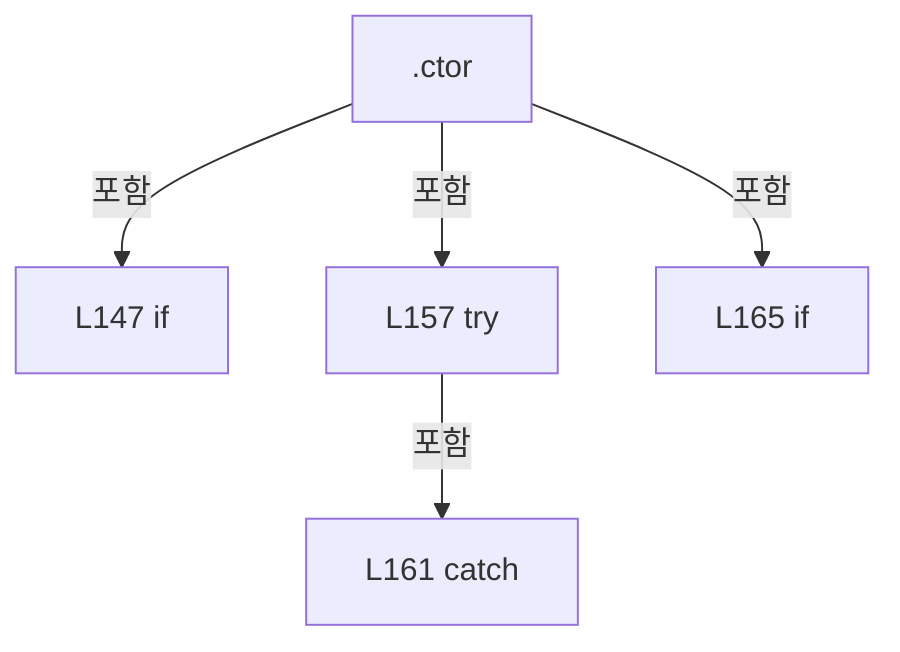

변경 전 점검: 입력/반환 타입, 위 호출자, 예외/취소 경로, 공유 상태와 저장·전송 소비자를 함께 확인합니다. 값의 단위나 물리 방향을 이름만으로 확정하지 않습니다.

### DelegateDeclaration `CProcessStepAction` · L171–171

[Drilling.Common/Station/CStationProcess.cs:171–171](https://github.com/kjuws10-rgb/A3Drilling/blob/334b3599651b2e8e0181fd4459bafaf3cddafff3/Drilling.Common/Station/CStationProcess.cs#L171-L171)

| 항목 | 실제 추출 값 |
| --- | --- |
| 서명 | Drilling.Common.Station.CStationProcess.CProcessStepAction |
| 접근/수식자 | Private / private |
| 반환/값 타입 | 타입 정보 없음 |
| 소속 타입 | NamedType:Drilling.Common.Station.CStationProcess |

입력 계약:

| 이름 | 타입 | 전달 | 선택/기본값 |
| --- | --- | --- | --- |
| processModel | Drilling.Common.Station.ST_PROCESS_MODEL | None | False /  |
| cancellationToken | System.Threading.CancellationToken | None | False /  |

현재 부분 분석에서 직접 연결된 호출자는 없습니다. XAML/이벤트/인터페이스·델리게이트·외부 진입을 추가 확인해야 하며, 미사용으로 판정한 것이 아닙니다.

변경 전 점검: 입력/반환 타입, 위 호출자, 예외/취소 경로, 공유 상태와 저장·전송 소비자를 함께 확인합니다. 값의 단위나 물리 방향을 이름만으로 확정하지 않습니다.

### PropertyDeclaration `Current` · L172–188

[Drilling.Common/Station/CStationProcess.cs:172–188](https://github.com/kjuws10-rgb/A3Drilling/blob/334b3599651b2e8e0181fd4459bafaf3cddafff3/Drilling.Common/Station/CStationProcess.cs#L172-L188)

| 항목 | 실제 추출 값 |
| --- | --- |
| 서명 | Drilling.Common.Station.ST_STATION_PROCESS_STATUS Drilling.Common.Station.CStationProcess.Current |
| 접근/수식자 | Public / public |
| 반환/값 타입 | Drilling.Common.Station.ST_STATION_PROCESS_STATUS |
| 소속 타입 | NamedType:Drilling.Common.Station.CStationProcess |

현재 부분 분석에서 직접 연결된 호출자는 없습니다. XAML/이벤트/인터페이스·델리게이트·외부 진입을 추가 확인해야 하며, 미사용으로 판정한 것이 아닙니다.

변경 전 점검: 입력/반환 타입, 위 호출자, 예외/취소 경로, 공유 상태와 저장·전송 소비자를 함께 확인합니다. 값의 단위나 물리 방향을 이름만으로 확정하지 않습니다.

### GetAccessorDeclaration `get_Current` · L174–187

[Drilling.Common/Station/CStationProcess.cs:174–187](https://github.com/kjuws10-rgb/A3Drilling/blob/334b3599651b2e8e0181fd4459bafaf3cddafff3/Drilling.Common/Station/CStationProcess.cs#L174-L187)

| 항목 | 실제 추출 값 |
| --- | --- |
| 서명 | Drilling.Common.Station.ST_STATION_PROCESS_STATUS Drilling.Common.Station.CStationProcess.Current.get |
| 접근/수식자 | Public / get |
| 반환/값 타입 | Drilling.Common.Station.ST_STATION_PROCESS_STATUS |
| 소속 타입 | NamedType:Drilling.Common.Station.CStationProcess |

현재 부분 분석에서 직접 연결된 호출자는 없습니다. XAML/이벤트/인터페이스·델리게이트·외부 진입을 추가 확인해야 하며, 미사용으로 판정한 것이 아닙니다.

호출하는 대상과 해석 범위:

| 원본 행 | 표현식 | 분석 상태 | 대상/소스 위치 |
| --- | --- | --- | --- |
| 176 | _sequenceActions.GetSnapshot().ToDictionary | resolved | System.Collections.Generic.Dictionary<string, Drilling.Common.Station.ST_SEQUENCE_ACTION_STATUS> System.Collections.Generic.IEnumerable<System.Collections.Generic.KeyValuePair<string, Drilling.Common.Station.ST_SEQUENCE_ACTION_STATUS>>.ToDictionary<System.Collections.Generic.KeyValuePair<string, Drilling.Common.Station.ST_SEQUENCE_ACTION_STATUS>, string, Drilling.Common.Station.ST_SEQUENCE_ACTION_STATUS>(System.Func<System.Collections.Generic.KeyValuePair<string, Drilling.Common.Station.ST_SEQUENCE_ACTION_STATUS>, string>, System.Func<System.Collections.Generic.KeyValuePair<string, Drilling.Common.Station.ST_SEQUENCE_ACTION_STATUS>, Drilling.Common.Station.ST_SEQUENCE_ACTION_STATUS>, System.Collections.Generic.IEqualityComparer<string>?) |
| 176 | _sequenceActions.GetSnapshot | resolved | System.Collections.Generic.IReadOnlyDictionary<string, Drilling.Common.Station.ST_SEQUENCE_ACTION_STATUS> Drilling.Common.Station.CSequenceActionStatusStore.GetSnapshot() · Drilling.Common/Station/CStationManager.cs:166 |
| 178 | _interfaceManager.StageReviewSequences.Actions.GetSnapshot | resolved | System.Collections.Generic.IReadOnlyDictionary<string, Drilling.Common.Station.ST_SEQUENCE_ACTION_STATUS> Drilling.Common.Station.CSequenceActionStatusStore.GetSnapshot() · Drilling.Common/Station/CStationManager.cs:166 |

본문의 실제 연산·분기·예외·반환 순서(원문 위치 순):

| 원본 행 | 종류 | 주석 해설 |
| --- | --- | --- |
| 176 | call | 함수·델리게이트 또는 객체 생성자를 호출합니다: _sequenceActions.GetSnapshot().ToDictionary(pair => pair.Key, pair => pair.Value, StringComparer.OrdinalIgnoreCase) |
| 176 | call | 함수·델리게이트 또는 객체 생성자를 호출합니다: _sequenceActions.GetSnapshot() |
| 176 | local-declaration | 지역 변수를 선언합니다: var actions = _sequenceActions.GetSnapshot().ToDictionary(pair => pair.Key, pair => pair.Value, StringComparer.OrdinalIgnoreCase); |
| 176 | variable-initializer | 변수의 초기값을 지정합니다: actions = _sequenceActions.GetSnapshot().ToDictionary(pair => pair.Key, pair => pair.Value, StringComparer.OrdinalIgnoreCase) |
| 177 | if | 조건에 따라 분기합니다: if (_interfaceManager is not null) |
| 178 | call | 함수·델리게이트 또는 객체 생성자를 호출합니다: _interfaceManager.StageReviewSequences.Actions.GetSnapshot() |
| 178 | foreach | 컬렉션 요소를 순회합니다: foreach (var pair in _interfaceManager.StageReviewSequences.Actions.GetSnapshot()) |
| 179 | assignment | 값을 대상에 대입합니다: actions[pair.Key] = pair.Value |
| 180 | return | 호출자에게 값 또는 제어를 반환합니다: return _snapshot with { SequenceActions = actions, StageRequest = StageRequests.Status, ZeroLinePrewait = _zeroLinePrewait?.Status, ZeroLine = _zeroLineCycle?.Status }; |
| 182 | assignment | 값을 대상에 대입합니다: SequenceActions = actions |
| 183 | assignment | 값을 대상에 대입합니다: StageRequest = StageRequests.Status |
| 184 | assignment | 값을 대상에 대입합니다: ZeroLinePrewait = _zeroLinePrewait?.Status |
| 185 | assignment | 값을 대상에 대입합니다: ZeroLine = _zeroLineCycle?.Status |

제어 구문의 포함 구조(실제 실행 순서/CFG가 아닌 구문 탐색 그림):

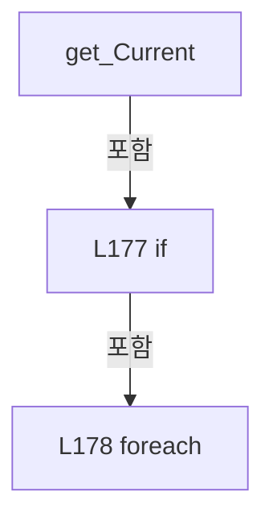

변경 전 점검: 입력/반환 타입, 위 호출자, 예외/취소 경로, 공유 상태와 저장·전송 소비자를 함께 확인합니다. 값의 단위나 물리 방향을 이름만으로 확정하지 않습니다.

### PropertyDeclaration `Status` · L190–196

[Drilling.Common/Station/CStationProcess.cs:190–196](https://github.com/kjuws10-rgb/A3Drilling/blob/334b3599651b2e8e0181fd4459bafaf3cddafff3/Drilling.Common/Station/CStationProcess.cs#L190-L196)

| 항목 | 실제 추출 값 |
| --- | --- |
| 서명 | Drilling.Common.Station.ST_STATION_STATUS Drilling.Common.Station.CStationProcess.Status |
| 접근/수식자 | Public / public |
| 반환/값 타입 | Drilling.Common.Station.ST_STATION_STATUS |
| 소속 타입 | NamedType:Drilling.Common.Station.CStationProcess |

현재 부분 분석에서 직접 연결된 호출자는 없습니다. XAML/이벤트/인터페이스·델리게이트·외부 진입을 추가 확인해야 하며, 미사용으로 판정한 것이 아닙니다.

변경 전 점검: 입력/반환 타입, 위 호출자, 예외/취소 경로, 공유 상태와 저장·전송 소비자를 함께 확인합니다. 값의 단위나 물리 방향을 이름만으로 확정하지 않습니다.

### GetAccessorDeclaration `get_Status` · L192–195

[Drilling.Common/Station/CStationProcess.cs:192–195](https://github.com/kjuws10-rgb/A3Drilling/blob/334b3599651b2e8e0181fd4459bafaf3cddafff3/Drilling.Common/Station/CStationProcess.cs#L192-L195)

| 항목 | 실제 추출 값 |
| --- | --- |
| 서명 | Drilling.Common.Station.ST_STATION_STATUS Drilling.Common.Station.CStationProcess.Status.get |
| 접근/수식자 | Public / get |
| 반환/값 타입 | Drilling.Common.Station.ST_STATION_STATUS |
| 소속 타입 | NamedType:Drilling.Common.Station.CStationProcess |

현재 부분 분석에서 직접 연결된 호출자는 없습니다. XAML/이벤트/인터페이스·델리게이트·외부 진입을 추가 확인해야 하며, 미사용으로 판정한 것이 아닙니다.

호출하는 대상과 해석 범위:

| 원본 행 | 표현식 | 분석 상태 | 대상/소스 위치 |
| --- | --- | --- | --- |
| 194 | ReadStationStatus | resolved | Drilling.Common.Station.ST_STATION_STATUS Drilling.Common.Station.CStationProcess.ReadStationStatus() · Drilling.Common/Station/CStationProcess.cs:2342 |

본문의 실제 연산·분기·예외·반환 순서(원문 위치 순):

| 원본 행 | 종류 | 주석 해설 |
| --- | --- | --- |
| 194 | call | 함수·델리게이트 또는 객체 생성자를 호출합니다: ReadStationStatus() |
| 194 | return | 호출자에게 값 또는 제어를 반환합니다: return ReadStationStatus(); |

변경 전 점검: 입력/반환 타입, 위 호출자, 예외/취소 경로, 공유 상태와 저장·전송 소비자를 함께 확인합니다. 값의 단위나 물리 방향을 이름만으로 확정하지 않습니다.

### PropertyDeclaration `SequenceState` · L198–204

[Drilling.Common/Station/CStationProcess.cs:198–204](https://github.com/kjuws10-rgb/A3Drilling/blob/334b3599651b2e8e0181fd4459bafaf3cddafff3/Drilling.Common/Station/CStationProcess.cs#L198-L204)

| 항목 | 실제 추출 값 |
| --- | --- |
| 서명 | Drilling.Common.Station.EN_STATION_SEQUENCE Drilling.Common.Station.CStationProcess.SequenceState |
| 접근/수식자 | Public / public |
| 반환/값 타입 | Drilling.Common.Station.EN_STATION_SEQUENCE |
| 소속 타입 | NamedType:Drilling.Common.Station.CStationProcess |

현재 부분 분석에서 직접 연결된 호출자는 없습니다. XAML/이벤트/인터페이스·델리게이트·외부 진입을 추가 확인해야 하며, 미사용으로 판정한 것이 아닙니다.

변경 전 점검: 입력/반환 타입, 위 호출자, 예외/취소 경로, 공유 상태와 저장·전송 소비자를 함께 확인합니다. 값의 단위나 물리 방향을 이름만으로 확정하지 않습니다.

### GetAccessorDeclaration `get_SequenceState` · L200–203

[Drilling.Common/Station/CStationProcess.cs:200–203](https://github.com/kjuws10-rgb/A3Drilling/blob/334b3599651b2e8e0181fd4459bafaf3cddafff3/Drilling.Common/Station/CStationProcess.cs#L200-L203)

| 항목 | 실제 추출 값 |
| --- | --- |
| 서명 | Drilling.Common.Station.EN_STATION_SEQUENCE Drilling.Common.Station.CStationProcess.SequenceState.get |
| 접근/수식자 | Public / get |
| 반환/값 타입 | Drilling.Common.Station.EN_STATION_SEQUENCE |
| 소속 타입 | NamedType:Drilling.Common.Station.CStationProcess |

현재 부분 분석에서 직접 연결된 호출자는 없습니다. XAML/이벤트/인터페이스·델리게이트·외부 진입을 추가 확인해야 하며, 미사용으로 판정한 것이 아닙니다.

호출하는 대상과 해석 범위:

| 원본 행 | 표현식 | 분석 상태 | 대상/소스 위치 |
| --- | --- | --- | --- |
| 202 | ReadSequenceState | resolved | Drilling.Common.Station.EN_STATION_SEQUENCE Drilling.Common.Station.CStationProcess.ReadSequenceState() · Drilling.Common/Station/CStationProcess.cs:2334 |

본문의 실제 연산·분기·예외·반환 순서(원문 위치 순):

| 원본 행 | 종류 | 주석 해설 |
| --- | --- | --- |
| 202 | call | 함수·델리게이트 또는 객체 생성자를 호출합니다: ReadSequenceState() |
| 202 | return | 호출자에게 값 또는 제어를 반환합니다: return ReadSequenceState(); |

변경 전 점검: 입력/반환 타입, 위 호출자, 예외/취소 경로, 공유 상태와 저장·전송 소비자를 함께 확인합니다. 값의 단위나 물리 방향을 이름만으로 확정하지 않습니다.

### MethodDeclaration `GetProcessFlow` · L206–209

[Drilling.Common/Station/CStationProcess.cs:206–209](https://github.com/kjuws10-rgb/A3Drilling/blob/334b3599651b2e8e0181fd4459bafaf3cddafff3/Drilling.Common/Station/CStationProcess.cs#L206-L209)

| 항목 | 실제 추출 값 |
| --- | --- |
| 서명 | System.Collections.Generic.IReadOnlyList<Drilling.Common.Station.ST_STATION_PROCESS_FLOW_ITEM> Drilling.Common.Station.CStationProcess.GetProcessFlow() |
| 접근/수식자 | Public / public, static |
| 반환/값 타입 | System.Collections.Generic.IReadOnlyList<Drilling.Common.Station.ST_STATION_PROCESS_FLOW_ITEM> |
| 소속 타입 | NamedType:Drilling.Common.Station.CStationProcess |

정적 호출자로 확인된 위치:

| 호출 파일/행 | 호출 표현식 | 런타임 분기 가능 |
| --- | --- | --- |
| [Drilling.Common/Station/CStationManager.cs:88–88](https://github.com/kjuws10-rgb/A3Drilling/blob/334b3599651b2e8e0181fd4459bafaf3cddafff3/Drilling.Common/Station/CStationManager.cs#L88-L88) | CStationProcess.GetProcessFlow | False |

본문의 실제 연산·분기·예외·반환 순서(원문 위치 순):

| 원본 행 | 종류 | 주석 해설 |
| --- | --- | --- |
| 208 | return | 호출자에게 값 또는 제어를 반환합니다: return ProcessFlowItems; |

변경 전 점검: 입력/반환 타입, 위 호출자, 예외/취소 경로, 공유 상태와 저장·전송 소비자를 함께 확인합니다. 값의 단위나 물리 방향을 이름만으로 확정하지 않습니다.

### MethodDeclaration `PrepareProcess` · L211–227

[Drilling.Common/Station/CStationProcess.cs:211–227](https://github.com/kjuws10-rgb/A3Drilling/blob/334b3599651b2e8e0181fd4459bafaf3cddafff3/Drilling.Common/Station/CStationProcess.cs#L211-L227)

| 항목 | 실제 추출 값 |
| --- | --- |
| 서명 | Drilling.Common.Station.ST_STATION_PROCESS_STATUS Drilling.Common.Station.CStationProcess.PrepareProcess(string, string, string, string, System.Collections.Generic.IReadOnlyDictionary<string, string>, System.Threading.CancellationToken, bool) |
| 접근/수식자 | Public / public |
| 반환/값 타입 | Drilling.Common.Station.ST_STATION_PROCESS_STATUS |
| 소속 타입 | NamedType:Drilling.Common.Station.CStationProcess |

입력 계약:

| 이름 | 타입 | 전달 | 선택/기본값 |
| --- | --- | --- | --- |
| processId | string | None | False /  |
| recipeId | string | None | False /  |
| glassId | string | None | False /  |
| lotId | string | None | False /  |
| parameters | System.Collections.Generic.IReadOnlyDictionary<string, string> | None | False /  |
| cancellationToken | System.Threading.CancellationToken | None | True / null |
| preserveSequenceActions | bool | None | True / false |

정적 호출자로 확인된 위치:

| 호출 파일/행 | 호출 표현식 | 런타임 분기 가능 |
| --- | --- | --- |
| [Drilling.Common/Station/CStationManager.cs:95–95](https://github.com/kjuws10-rgb/A3Drilling/blob/334b3599651b2e8e0181fd4459bafaf3cddafff3/Drilling.Common/Station/CStationManager.cs#L95-L95) | _processStation.PrepareProcess | False |
| [Drilling.Common/Station/CStationProcess.cs:4050–4050](https://github.com/kjuws10-rgb/A3Drilling/blob/334b3599651b2e8e0181fd4459bafaf3cddafff3/Drilling.Common/Station/CStationProcess.cs#L4050-L4050) | PrepareProcess | False |

호출하는 대상과 해석 범위:

| 원본 행 | 표현식 | 분석 상태 | 대상/소스 위치 |
| --- | --- | --- | --- |
| 223 | ReadSequenceState | resolved | Drilling.Common.Station.EN_STATION_SEQUENCE Drilling.Common.Station.CStationProcess.ReadSequenceState() · Drilling.Common/Station/CStationProcess.cs:2334 |
| 224 | new InvalidOperationException | resolved | System.InvalidOperationException.InvalidOperationException(string?) |
| 225 | PrepareProcessCore | resolved | Drilling.Common.Station.ST_STATION_PROCESS_STATUS Drilling.Common.Station.CStationProcess.PrepareProcessCore(string, string, string, string, System.Collections.Generic.IReadOnlyDictionary<string, string>, System.Threading.CancellationToken, bool, System.Collections.Generic.IReadOnlySet<int>?) · Drilling.Common/Station/CStationProcess.cs:229 |

본문의 실제 연산·분기·예외·반환 순서(원문 위치 순):

| 원본 행 | 종류 | 주석 해설 |
| --- | --- | --- |
| 221 | lock | 공유 상태의 임계 구역에 진입합니다: lock (_sequenceLock) |
| 223 | call | 함수·델리게이트 또는 객체 생성자를 호출합니다: ReadSequenceState() |
| 223 | if | 조건에 따라 분기합니다: if (_manualMofRunning &#124;&#124; _manualMofRequiresStop &#124;&#124; ReadSequenceState() != EN_STATION_SEQUENCE.Ready) |
| 224 | call | 함수·델리게이트 또는 객체 생성자를 호출합니다: new InvalidOperationException("Station is busy. PrepareProcess is not allowed during processing.") |
| 224 | throw | 예외를 발생/전달합니다: throw new InvalidOperationException("Station is busy. PrepareProcess is not allowed during processing."); |
| 225 | call | 함수·델리게이트 또는 객체 생성자를 호출합니다: PrepareProcessCore(processId, recipeId, glassId, lotId, parameters, cancellationToken, preserveSequenceActions) |
| 225 | return | 호출자에게 값 또는 제어를 반환합니다: return PrepareProcessCore(processId, recipeId, glassId, lotId, parameters, cancellationToken, preserveSequenceActions); |

제어 구문의 포함 구조(실제 실행 순서/CFG가 아닌 구문 탐색 그림):


변경 전 점검: 입력/반환 타입, 위 호출자, 예외/취소 경로, 공유 상태와 저장·전송 소비자를 함께 확인합니다. 값의 단위나 물리 방향을 이름만으로 확정하지 않습니다.

### MethodDeclaration `PrepareProcessCore` · L229–270

[Drilling.Common/Station/CStationProcess.cs:229–270](https://github.com/kjuws10-rgb/A3Drilling/blob/334b3599651b2e8e0181fd4459bafaf3cddafff3/Drilling.Common/Station/CStationProcess.cs#L229-L270)

| 항목 | 실제 추출 값 |
| --- | --- |
| 서명 | Drilling.Common.Station.ST_STATION_PROCESS_STATUS Drilling.Common.Station.CStationProcess.PrepareProcessCore(string, string, string, string, System.Collections.Generic.IReadOnlyDictionary<string, string>, System.Threading.CancellationToken, bool, System.Collections.Generic.IReadOnlySet<int>?) |
| 접근/수식자 | Private / private |
| 반환/값 타입 | Drilling.Common.Station.ST_STATION_PROCESS_STATUS |
| 소속 타입 | NamedType:Drilling.Common.Station.CStationProcess |

입력 계약:

| 이름 | 타입 | 전달 | 선택/기본값 |
| --- | --- | --- | --- |
| processId | string | None | False /  |
| recipeId | string | None | False /  |
| glassId | string | None | False /  |
| lotId | string | None | False /  |
| parameters | System.Collections.Generic.IReadOnlyDictionary<string, string> | None | False /  |
| cancellationToken | System.Threading.CancellationToken | None | False /  |
| preserveSequenceActions | bool | None | False /  |
| manualHeads | System.Collections.Generic.IReadOnlySet<int>? | None | True / null |

정적 호출자로 확인된 위치:

| 호출 파일/행 | 호출 표현식 | 런타임 분기 가능 |
| --- | --- | --- |
| [Drilling.Common/Station/CStationProcess.cs:225–225](https://github.com/kjuws10-rgb/A3Drilling/blob/334b3599651b2e8e0181fd4459bafaf3cddafff3/Drilling.Common/Station/CStationProcess.cs#L225-L225) | PrepareProcessCore | False |
| [Drilling.Common/Station/CStationProcess.cs:3511–3511](https://github.com/kjuws10-rgb/A3Drilling/blob/334b3599651b2e8e0181fd4459bafaf3cddafff3/Drilling.Common/Station/CStationProcess.cs#L3511-L3511) | PrepareProcessCore | False |

호출하는 대상과 해석 범위:

| 원본 행 | 표현식 | 분석 상태 | 대상/소스 위치 |
| --- | --- | --- | --- |
| 240 | cancellationToken.ThrowIfCancellationRequested | resolved | void System.Threading.CancellationToken.ThrowIfCancellationRequested() |
| 241 | ClearProcessLogs | resolved | void Drilling.Common.Station.CStationProcess.ClearProcessLogs() · Drilling.Common/Station/CStationProcess.cs:2391 |
| 247 | ResetAutoStepStatesCore | resolved | void Drilling.Common.Station.CStationProcess.ResetAutoStepStatesCore(bool) · Drilling.Common/Station/CStationProcess.cs:1799 |
| 248 | SetSequenceState | resolved | void Drilling.Common.Station.CStationProcess.SetSequenceState(Drilling.Common.Station.EN_STATION_SEQUENCE) · Drilling.Common/Station/CStationProcess.cs:2295 |
| 249 | BuildRuntimeParameters | resolved | System.Collections.Generic.IReadOnlyDictionary<string, string> Drilling.Common.Station.CStationProcess.BuildRuntimeParameters(string, System.Collections.Generic.IReadOnlyDictionary<string, string>, System.Threading.CancellationToken) · Drilling.Common/Station/CStationProcess.cs:1528 |
| 252 | new Dictionary<string, string> | resolved | System.Collections.Generic.Dictionary<string, string>.Dictionary(System.Collections.Generic.IEnumerable<System.Collections.Generic.KeyValuePair<string, string>>, System.Collections.Generic.IEqualityComparer<string>?) |
| 254 | manualHeads.Contains | resolved · 동적 구현 선택 가능 | bool System.Collections.Generic.IReadOnlySet<int>.Contains(int) |
| 258 | BuildProcessModel | resolved | Drilling.Common.Station.ST_PROCESS_MODEL Drilling.Common.Station.CStationProcess.BuildProcessModel(string, string, string, string, System.Collections.Generic.IReadOnlyDictionary<string, string>) · Drilling.Common/Station/CStationProcess.cs:1608 |
| 262 | BuildPreview | resolved | System.Collections.Generic.IReadOnlyList<Drilling.Common.Station.ST_HEAD_PREVIEW_DATA> Drilling.Common.Station.CStationProcess.BuildPreview(Drilling.Common.Station.ST_PROCESS_MODEL, Drilling.Common.Station.EN_HEAD_PROCESS_STATUS) · Drilling.Common/Station/CStationProcess.cs:1518 |
| 263 | BuildStatistics | resolved | Drilling.Common.Station.ST_PROCESS_STATISTICS Drilling.Common.Station.CStationProcess.BuildStatistics(Drilling.Common.Station.ST_PROCESS_MODEL?, double, System.TimeSpan) · Drilling.Common/Station/CStationProcess.cs:1777 |
| 264 | AddProcessLog | resolved | void Drilling.Common.Station.CStationProcess.AddProcessLog(string, string, string) · Drilling.Common/Station/CStationProcess.cs:2371 |
| 265 | AddProcessLog | resolved | void Drilling.Common.Station.CStationProcess.AddProcessLog(string, string, string) · Drilling.Common/Station/CStationProcess.cs:2371 |
| 266 | SetAutoStepState | resolved | void Drilling.Common.Station.CStationProcess.SetAutoStepState(string, string) · Drilling.Common/Station/CStationProcess.cs:1810 |
| 267 | CreateSnapshot | resolved | Drilling.Common.Station.ST_STATION_PROCESS_STATUS Drilling.Common.Station.CStationProcess.CreateSnapshot(Drilling.Common.Station.ST_PROCESS_MODEL?, System.Collections.Generic.IReadOnlyList<Drilling.Common.Station.ST_HEAD_PREVIEW_DATA>, Drilling.Common.Station.EN_SCRIPT_STATUS, Drilling.Common.Station.EN_PROCESS_STEP, Drilling.Common.Station.ST_PROCESS_RESULT?) · Drilling.Common/Station/CStationProcess.cs:1339 |
| 268 | SetStationState | resolved | void Drilling.Common.Station.CStationProcess.SetStationState(Drilling.Common.Station.EN_STATION_STATE, Drilling.Common.Station.EN_PROCESS_STEP, Drilling.Common.Station.EN_SCRIPT_STATUS, string) · Drilling.Common/Station/CStationProcess.cs:2350 |

본문의 실제 연산·분기·예외·반환 순서(원문 위치 순):

| 원본 행 | 종류 | 주석 해설 |
| --- | --- | --- |
| 240 | call | 함수·델리게이트 또는 객체 생성자를 호출합니다: cancellationToken.ThrowIfCancellationRequested() |
| 241 | call | 함수·델리게이트 또는 객체 생성자를 호출합니다: ClearProcessLogs() |
| 242 | assignment | 값을 대상에 대입합니다: _lastInterLockItems = [] |
| 243 | assignment | 값을 대상에 대입합니다: _scriptCreatedAt = null |
| 244 | assignment | 값을 대상에 대입합니다: _scriptStartedAt = null |
| 245 | assignment | 값을 대상에 대입합니다: _scriptCompletedAt = null |
| 246 | assignment | 값을 대상에 대입합니다: _lastScript = null |
| 247 | call | 함수·델리게이트 또는 객체 생성자를 호출합니다: ResetAutoStepStatesCore(preserveSequenceActions) |
| 248 | call | 함수·델리게이트 또는 객체 생성자를 호출합니다: SetSequenceState(EN_STATION_SEQUENCE.Ready) |
| 249 | call | 함수·델리게이트 또는 객체 생성자를 호출합니다: BuildRuntimeParameters(recipeId, parameters, cancellationToken) |
| 249 | local-declaration | 지역 변수를 선언합니다: var runtimeParameters = BuildRuntimeParameters(recipeId, parameters, cancellationToken); |
| 249 | variable-initializer | 변수의 초기값을 지정합니다: runtimeParameters = BuildRuntimeParameters(recipeId, parameters, cancellationToken) |
| 250 | if | 조건에 따라 분기합니다: if (manualHeads is not null) |
| 252 | call | 함수·델리게이트 또는 객체 생성자를 호출합니다: new Dictionary<string, string>(runtimeParameters, StringComparer.OrdinalIgnoreCase) |
| 252 | local-declaration | 지역 변수를 선언합니다: var scoped = new Dictionary<string, string>(runtimeParameters, StringComparer.OrdinalIgnoreCase); |
| 252 | variable-initializer | 변수의 초기값을 지정합니다: scoped = new Dictionary<string, string>(runtimeParameters, StringComparer.OrdinalIgnoreCase) |
| 253 | variable-initializer | 변수의 초기값을 지정합니다: head = 1 |
| 253 | for | 초기화·조건·증감이 있는 반복입니다: for (var head = 1; head <= 8; head++) |
| 254 | assignment | 값을 대상에 대입합니다: scoped[$"H{head:00}_USE"] = manualHeads.Contains(head) ? "ON" : "OFF" |
| 254 | call | 함수·델리게이트 또는 객체 생성자를 호출합니다: manualHeads.Contains(head) |
| 254 | conditional-expression | 조건에 따라 결과식을 선택합니다: manualHeads.Contains(head) ? "ON" : "OFF" |
| 255 | assignment | 값을 대상에 대입합니다: runtimeParameters = scoped |
| 258 | assignment | 값을 대상에 대입합니다: _processModel = BuildProcessModel(processId, recipeId, glassId, lotId, runtimeParameters) |
| 258 | call | 함수·델리게이트 또는 객체 생성자를 호출합니다: BuildProcessModel(processId, recipeId, glassId, lotId, runtimeParameters) |
| 259 | assignment | 값을 대상에 대입합니다: _preparedReviewOffsetInvalidated = false |
| 260 | assignment | 값을 대상에 대입합니다: _stageModelLogCycle = StageRequests?.LogCycleId ?? "" |
| 261 | assignment | 값을 대상에 대입합니다: _protectWindowCounted = false |
| 262 | call | 함수·델리게이트 또는 객체 생성자를 호출합니다: BuildPreview(_processModel, EN_HEAD_PROCESS_STATUS.Ready) |
| 262 | local-declaration | 지역 변수를 선언합니다: var preview = BuildPreview(_processModel, EN_HEAD_PROCESS_STATUS.Ready); |
| 262 | variable-initializer | 변수의 초기값을 지정합니다: preview = BuildPreview(_processModel, EN_HEAD_PROCESS_STATUS.Ready) |
| 263 | assignment | 값을 대상에 대입합니다: _statistics = BuildStatistics(_processModel, 0.0, TimeSpan.Zero) |
| 263 | call | 함수·델리게이트 또는 객체 생성자를 호출합니다: BuildStatistics(_processModel, 0.0, TimeSpan.Zero) |
| 264 | call | 함수·델리게이트 또는 객체 생성자를 호출합니다: AddProcessLog("INFO", "SCAN_PC", $"Process model prepared ({_processModel.ProcessId})") |
| 265 | call | 함수·델리게이트 또는 객체 생성자를 호출합니다: AddProcessLog("INFO", "PARSER", $"Head parameter parsed ({preview.Count} heads / {_statistics.TotalShots} shots)") |
| 266 | call | 함수·델리게이트 또는 객체 생성자를 호출합니다: SetAutoStepState(AutoStepIdle, AutoStepOk) |
| 267 | assignment | 값을 대상에 대입합니다: _snapshot = CreateSnapshot(_processModel, preview, EN_SCRIPT_STATUS.NotCreated, EN_PROCESS_STEP.Idle, null) |
| 267 | call | 함수·델리게이트 또는 객체 생성자를 호출합니다: CreateSnapshot(_processModel, preview, EN_SCRIPT_STATUS.NotCreated, EN_PROCESS_STEP.Idle, null) |
| 268 | call | 함수·델리게이트 또는 객체 생성자를 호출합니다: SetStationState(EN_STATION_STATE.Idle, EN_PROCESS_STEP.Idle, EN_SCRIPT_STATUS.NotCreated, $"Process model prepared: {_processModel.ProcessId}") |
| 269 | return | 호출자에게 값 또는 제어를 반환합니다: return _snapshot; |

제어 구문의 포함 구조(실제 실행 순서/CFG가 아닌 구문 탐색 그림):

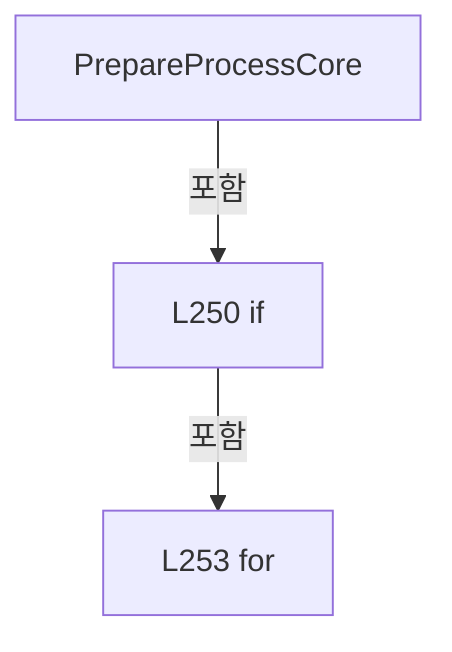

변경 전 점검: 입력/반환 타입, 위 호출자, 예외/취소 경로, 공유 상태와 저장·전송 소비자를 함께 확인합니다. 값의 단위나 물리 방향을 이름만으로 확정하지 않습니다.

### MethodDeclaration `Start` · L272–323

[Drilling.Common/Station/CStationProcess.cs:272–323](https://github.com/kjuws10-rgb/A3Drilling/blob/334b3599651b2e8e0181fd4459bafaf3cddafff3/Drilling.Common/Station/CStationProcess.cs#L272-L323)

| 항목 | 실제 추출 값 |
| --- | --- |
| 서명 | Drilling.Common.Station.ST_STATION_PROCESS_STATUS Drilling.Common.Station.CStationProcess.Start(System.Threading.CancellationToken) |
| 접근/수식자 | Public / public |
| 반환/값 타입 | Drilling.Common.Station.ST_STATION_PROCESS_STATUS |
| 소속 타입 | NamedType:Drilling.Common.Station.CStationProcess |

입력 계약:

| 이름 | 타입 | 전달 | 선택/기본값 |
| --- | --- | --- | --- |
| cancellationToken | System.Threading.CancellationToken | None | True / null |

정적 호출자로 확인된 위치:

| 호출 파일/행 | 호출 표현식 | 런타임 분기 가능 |
| --- | --- | --- |
| [Drilling.Common/Station/CStationManager.cs:102–102](https://github.com/kjuws10-rgb/A3Drilling/blob/334b3599651b2e8e0181fd4459bafaf3cddafff3/Drilling.Common/Station/CStationManager.cs#L102-L102) | _processStation.Start | False |

호출하는 대상과 해석 범위:

| 원본 행 | 표현식 | 분석 상태 | 대상/소스 위치 |
| --- | --- | --- | --- |
| 274 | cancellationToken.ThrowIfCancellationRequested | resolved | void System.Threading.CancellationToken.ThrowIfCancellationRequested() |
| 284 | new InvalidOperationException | resolved | System.InvalidOperationException.InvalidOperationException(string?) |
| 285 | EnsureStartAllowed | resolved | void Drilling.Common.Station.CStationProcess.EnsureStartAllowed() · Drilling.Common/Station/CStationProcess.cs:440 |
| 286 | ReadProcessModelForStart | resolved | Drilling.Common.Station.ST_PROCESS_MODEL Drilling.Common.Station.CStationProcess.ReadProcessModelForStart() · Drilling.Common/Station/CStationProcess.cs:448 |
| 289 | EnsurePreparedReviewOffsetIsCurrent | resolved | void Drilling.Common.Station.CStationProcess.EnsurePreparedReviewOffsetIsCurrent(Drilling.Common.Station.ST_PROCESS_MODEL, System.Threading.CancellationToken) · Drilling.Common/Station/CStationProcess.cs:1579 |
| 291 | GetInterLockSummary | resolved | Drilling.Common.InterLock.ST_INTERLOCK_SUMMARY Drilling.Common.Station.CStationProcess.GetInterLockSummary(System.Threading.CancellationToken, Drilling.Common.Station.ST_PROCESS_MODEL?) · Drilling.Common/Station/CStationProcess.cs:1364 |
| 294 | new InvalidOperationException | resolved | System.InvalidOperationException.InvalidOperationException(string?) |
| 294 | FormatStartInterLockBlockedMessage | resolved | string Drilling.Common.Station.CStationProcess.FormatStartInterLockBlockedMessage(Drilling.Common.InterLock.ST_INTERLOCK_SUMMARY) · Drilling.Common/Station/CStationProcess.cs:2432 |
| 305 | new InvalidOperationException | resolved | System.InvalidOperationException.InvalidOperationException(string?) |
| 306 | EnsureStartAllowed | resolved | void Drilling.Common.Station.CStationProcess.EnsureStartAllowed() · Drilling.Common/Station/CStationProcess.cs:440 |
| 308 | new InvalidOperationException | resolved | System.InvalidOperationException.InvalidOperationException(string?) |
| 309 | .Dispose | resolved | void System.Threading.CancellationTokenSource.Dispose() |
| 310 | CancellationTokenSource.CreateLinkedTokenSource | resolved | System.Threading.CancellationTokenSource System.Threading.CancellationTokenSource.CreateLinkedTokenSource(System.Threading.CancellationToken) |
| 313 | (_stationStatus with { ChangedAt = DateTimeOffset.Now } ).WithSequenceState | resolved | Drilling.Common.Station.ST_STATION_STATUS Drilling.Common.Station.ST_STATION_STATUS.WithSequenceState(Drilling.Common.Station.EN_STATION_SEQUENCE?) · Drilling.Common/Station/CStationManager.cs:537 |
| 321 | base.Start | resolved | void Drilling.Common.Threading.CtrlThread.Start(int, string) · Drilling.Common/Threading/CtrlThread.cs:60 |

본문의 실제 연산·분기·예외·반환 순서(원문 위치 순):

| 원본 행 | 종류 | 주석 해설 |
| --- | --- | --- |
| 274 | call | 함수·델리게이트 또는 객체 생성자를 호출합니다: cancellationToken.ThrowIfCancellationRequested() |
| 275 | local-declaration | 지역 변수를 선언합니다: ST_PROCESS_MODEL processModel; |
| 276 | lock | 공유 상태의 임계 구역에 진입합니다: lock (_sequenceLock) |
| 278 | if | 조건에 따라 분기합니다: if (_sequenceState != EN_STATION_SEQUENCE.Ready) |
| 280 | return | 호출자에게 값 또는 제어를 반환합니다: return _snapshot; |
| 283 | if | 조건에 따라 분기합니다: if (_manualMofRunning &#124;&#124; _manualMofRequiresStop) |
| 284 | call | 함수·델리게이트 또는 객체 생성자를 호출합니다: new InvalidOperationException("Manual MOF is active or requires STOP.") |
| 284 | throw | 예외를 발생/전달합니다: throw new InvalidOperationException("Manual MOF is active or requires STOP."); |
| 285 | call | 함수·델리게이트 또는 객체 생성자를 호출합니다: EnsureStartAllowed() |
| 286 | assignment | 값을 대상에 대입합니다: processModel = ReadProcessModelForStart() |
| 286 | call | 함수·델리게이트 또는 객체 생성자를 호출합니다: ReadProcessModelForStart() |
| 289 | call | 함수·델리게이트 또는 객체 생성자를 호출합니다: EnsurePreparedReviewOffsetIsCurrent(processModel, cancellationToken) |
| 291 | call | 함수·델리게이트 또는 객체 생성자를 호출합니다: GetInterLockSummary(cancellationToken, processModel) |
| 291 | local-declaration | 지역 변수를 선언합니다: var startInterLock = GetInterLockSummary(cancellationToken, processModel); |
| 291 | variable-initializer | 변수의 초기값을 지정합니다: startInterLock = GetInterLockSummary(cancellationToken, processModel) |
| 292 | if | 조건에 따라 분기합니다: if (!startInterLock.CanAutoRun) |
| 294 | call | 함수·델리게이트 또는 객체 생성자를 호출합니다: new InvalidOperationException(FormatStartInterLockBlockedMessage(startInterLock)) |
| 294 | call | 함수·델리게이트 또는 객체 생성자를 호출합니다: FormatStartInterLockBlockedMessage(startInterLock) |
| 294 | throw | 예외를 발생/전달합니다: throw new InvalidOperationException(FormatStartInterLockBlockedMessage(startInterLock)); |
| 297 | lock | 공유 상태의 임계 구역에 진입합니다: lock (_sequenceLock) |
| 299 | if | 조건에 따라 분기합니다: if (_sequenceState != EN_STATION_SEQUENCE.Ready) |
| 301 | return | 호출자에게 값 또는 제어를 반환합니다: return _snapshot; |
| 304 | if | 조건에 따라 분기합니다: if (_manualMofRunning &#124;&#124; _manualMofRequiresStop) |
| 305 | call | 함수·델리게이트 또는 객체 생성자를 호출합니다: new InvalidOperationException("Manual MOF is active or requires STOP.") |
| 305 | throw | 예외를 발생/전달합니다: throw new InvalidOperationException("Manual MOF is active or requires STOP."); |
| 306 | call | 함수·델리게이트 또는 객체 생성자를 호출합니다: EnsureStartAllowed() |
| 307 | if | 조건에 따라 분기합니다: if (_preparedReviewOffsetInvalidated) |
| 308 | call | 함수·델리게이트 또는 객체 생성자를 호출합니다: new InvalidOperationException("Review Offset이 변경되어 준비된 가공 모델이 무효화되었습니다. DoReady를 다시 실행해 주세요.") |
| 308 | throw | 예외를 발생/전달합니다: throw new InvalidOperationException("Review Offset이 변경되어 준비된 가공 모델이 무효화되었습니다. DoReady를 다시 실행해 주세요."); |
| 309 | call | 함수·델리게이트 또는 객체 생성자를 호출합니다: .Dispose() |
| 310 | assignment | 값을 대상에 대입합니다: _sequenceCancellation = CancellationTokenSource.CreateLinkedTokenSource(cancellationToken) |
| 310 | call | 함수·델리게이트 또는 객체 생성자를 호출합니다: CancellationTokenSource.CreateLinkedTokenSource(cancellationToken) |
| 311 | assignment | 값을 대상에 대입합니다: _sequenceError = "" |
| 312 | assignment | 값을 대상에 대입합니다: _sequenceState = EN_STATION_SEQUENCE.PowerCheck |
| 313 | assignment | 값을 대상에 대입합니다: _stationStatus = (_stationStatus with { ChangedAt = DateTimeOffset.Now } ).WithSequenceState(EN_STATION_SEQUENCE.PowerCheck) |
| 313 | call | 함수·델리게이트 또는 객체 생성자를 호출합니다: (_stationStatus with { ChangedAt = DateTimeOffset.Now } ).WithSequenceState(EN_STATION_SEQUENCE.PowerCheck) |
| 315 | assignment | 값을 대상에 대입합니다: ChangedAt = DateTimeOffset.Now |
| 321 | call | 함수·델리게이트 또는 객체 생성자를 호출합니다: base.Start(10, "StationProcess") |
| 322 | return | 호출자에게 값 또는 제어를 반환합니다: return _snapshot; |

제어 구문의 포함 구조(실제 실행 순서/CFG가 아닌 구문 탐색 그림):

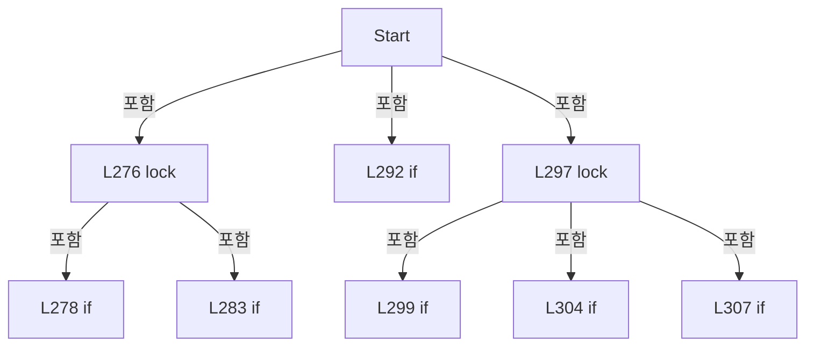

변경 전 점검: 입력/반환 타입, 위 호출자, 예외/취소 경로, 공유 상태와 저장·전송 소비자를 함께 확인합니다. 값의 단위나 물리 방향을 이름만으로 확정하지 않습니다.

### MethodDeclaration `Run` · L325–382

[Drilling.Common/Station/CStationProcess.cs:325–382](https://github.com/kjuws10-rgb/A3Drilling/blob/334b3599651b2e8e0181fd4459bafaf3cddafff3/Drilling.Common/Station/CStationProcess.cs#L325-L382)

| 항목 | 실제 추출 값 |
| --- | --- |
| 서명 | void Drilling.Common.Station.CStationProcess.Run() |
| 접근/수식자 | Public / public, override |
| 반환/값 타입 | void |
| 소속 타입 | NamedType:Drilling.Common.Station.CStationProcess |

현재 부분 분석에서 직접 연결된 호출자는 없습니다. XAML/이벤트/인터페이스·델리게이트·외부 진입을 추가 확인해야 하며, 미사용으로 판정한 것이 아닙니다.

호출하는 대상과 해석 범위:

| 원본 행 | 표현식 | 분석 상태 | 대상/소스 위치 |
| --- | --- | --- | --- |
| 344 | RunSequenceStep | resolved | void Drilling.Common.Station.CStationProcess.RunSequenceStep(Drilling.Common.Station.EN_STATION_SEQUENCE, string, Drilling.Common.Station.CStationProcess.CProcessStepAction, Drilling.Common.Station.EN_STATION_SEQUENCE) · Drilling.Common/Station/CStationProcess.cs:384 |
| 347 | RunSequenceStep | resolved | void Drilling.Common.Station.CStationProcess.RunSequenceStep(Drilling.Common.Station.EN_STATION_SEQUENCE, string, Drilling.Common.Station.CStationProcess.CProcessStepAction, Drilling.Common.Station.EN_STATION_SEQUENCE) · Drilling.Common/Station/CStationProcess.cs:384 |
| 350 | RunSequenceStep | resolved | void Drilling.Common.Station.CStationProcess.RunSequenceStep(Drilling.Common.Station.EN_STATION_SEQUENCE, string, Drilling.Common.Station.CStationProcess.CProcessStepAction, Drilling.Common.Station.EN_STATION_SEQUENCE) · Drilling.Common/Station/CStationProcess.cs:384 |
| 353 | RunSequenceStep | resolved | void Drilling.Common.Station.CStationProcess.RunSequenceStep(Drilling.Common.Station.EN_STATION_SEQUENCE, string, Drilling.Common.Station.CStationProcess.CProcessStepAction, Drilling.Common.Station.EN_STATION_SEQUENCE) · Drilling.Common/Station/CStationProcess.cs:384 |
| 356 | RunSequenceStep | resolved | void Drilling.Common.Station.CStationProcess.RunSequenceStep(Drilling.Common.Station.EN_STATION_SEQUENCE, string, Drilling.Common.Station.CStationProcess.CProcessStepAction, Drilling.Common.Station.EN_STATION_SEQUENCE) · Drilling.Common/Station/CStationProcess.cs:384 |
| 357 | FinishSequence | resolved | void Drilling.Common.Station.CStationProcess.FinishSequence() · Drilling.Common/Station/CStationProcess.cs:408 |
| 360 | ProcessStop | resolved | Drilling.Common.Station.ST_STATION_PROCESS_STATUS Drilling.Common.Station.CStationProcess.ProcessStop(System.Threading.CancellationToken) · Drilling.Common/Station/CStationProcess.cs:1222 |
| 361 | FinishSequence | resolved | void Drilling.Common.Station.CStationProcess.FinishSequence() · Drilling.Common/Station/CStationProcess.cs:408 |
| 364 | ProcessReset | resolved | Drilling.Common.Station.ST_STATION_PROCESS_STATUS Drilling.Common.Station.CStationProcess.ProcessReset(System.Threading.CancellationToken) · Drilling.Common/Station/CStationProcess.cs:1283 |
| 365 | FinishSequence | resolved | void Drilling.Common.Station.CStationProcess.FinishSequence() · Drilling.Common/Station/CStationProcess.cs:408 |
| 368 | SetAlarm | resolved | Drilling.Common.Station.ST_STATION_PROCESS_STATUS Drilling.Common.Station.CStationProcess.SetAlarm(string, System.Threading.CancellationToken) · Drilling.Common/Station/CStationProcess.cs:2282 |
| 369 | FinishSequence | resolved | void Drilling.Common.Station.CStationProcess.FinishSequence() · Drilling.Common/Station/CStationProcess.cs:408 |
| 375 | SetSequenceState | resolved | void Drilling.Common.Station.CStationProcess.SetSequenceState(Drilling.Common.Station.EN_STATION_SEQUENCE) · Drilling.Common/Station/CStationProcess.cs:2295 |
| 380 | SetSequenceState | resolved | void Drilling.Common.Station.CStationProcess.SetSequenceState(Drilling.Common.Station.EN_STATION_SEQUENCE) · Drilling.Common/Station/CStationProcess.cs:2295 |

본문의 실제 연산·분기·예외·반환 순서(원문 위치 순):

| 원본 행 | 종류 | 주석 해설 |
| --- | --- | --- |
| 327 | local-declaration | 지역 변수를 선언합니다: EN_STATION_SEQUENCE sequenceState; |
| 328 | lock | 공유 상태의 임계 구역에 진입합니다: lock (_sequenceLock) |
| 332 | if | 조건에 따라 분기합니다: if (_manualMofRunning &#124;&#124; _manualMofRequiresStop) |
| 333 | return | 호출자에게 값 또는 제어를 반환합니다: return; |
| 334 | assignment | 값을 대상에 대입합니다: sequenceState = _sequenceState |
| 337 | try | 예외 처리 범위입니다: try |
| 339 | switch | 값에 따라 분기합니다: switch (sequenceState) |
| 341 | case | 분기값/패턴의 구간입니다: case EN_STATION_SEQUENCE.Ready: |
| 342 | return | 호출자에게 값 또는 제어를 반환합니다: return; |
| 343 | case | 분기값/패턴의 구간입니다: case EN_STATION_SEQUENCE.PowerCheck: |
| 344 | call | 함수·델리게이트 또는 객체 생성자를 호출합니다: RunSequenceStep(EN_STATION_SEQUENCE.PowerCheck, AutoStepPowerCheck, RunPowerCheckStep, EN_STATION_SEQUENCE.Align) |
| 345 | break | 해당 반복/분기 구간을 종료합니다: break; |
| 346 | case | 분기값/패턴의 구간입니다: case EN_STATION_SEQUENCE.Align: |
| 347 | call | 함수·델리게이트 또는 객체 생성자를 호출합니다: RunSequenceStep(EN_STATION_SEQUENCE.Align, AutoStepAlign, RunAlignStep, EN_STATION_SEQUENCE.Process) |
| 348 | break | 해당 반복/분기 구간을 종료합니다: break; |
| 349 | case | 분기값/패턴의 구간입니다: case EN_STATION_SEQUENCE.Process: |
| 350 | call | 함수·델리게이트 또는 객체 생성자를 호출합니다: RunSequenceStep(EN_STATION_SEQUENCE.Process, AutoStepProcess, RunProcessStep, EN_STATION_SEQUENCE.Inspection) |
| 351 | break | 해당 반복/분기 구간을 종료합니다: break; |
| 352 | case | 분기값/패턴의 구간입니다: case EN_STATION_SEQUENCE.Inspection: |
| 353 | call | 함수·델리게이트 또는 객체 생성자를 호출합니다: RunSequenceStep(EN_STATION_SEQUENCE.Inspection, AutoStepInspection, RunInspectionStep, EN_STATION_SEQUENCE.Complete) |
| 354 | break | 해당 반복/분기 구간을 종료합니다: break; |
| 355 | case | 분기값/패턴의 구간입니다: case EN_STATION_SEQUENCE.Complete: |
| 356 | call | 함수·델리게이트 또는 객체 생성자를 호출합니다: RunSequenceStep(EN_STATION_SEQUENCE.Complete, AutoStepComplete, CompleteSequence, EN_STATION_SEQUENCE.Ready) |
| 357 | call | 함수·델리게이트 또는 객체 생성자를 호출합니다: FinishSequence() |
| 358 | break | 해당 반복/분기 구간을 종료합니다: break; |
| 359 | case | 분기값/패턴의 구간입니다: case EN_STATION_SEQUENCE.Stop: |
| 360 | call | 함수·델리게이트 또는 객체 생성자를 호출합니다: ProcessStop(CancellationToken.None) |
| 361 | call | 함수·델리게이트 또는 객체 생성자를 호출합니다: FinishSequence() |
| 362 | break | 해당 반복/분기 구간을 종료합니다: break; |
| 363 | case | 분기값/패턴의 구간입니다: case EN_STATION_SEQUENCE.Reset: |
| 364 | call | 함수·델리게이트 또는 객체 생성자를 호출합니다: ProcessReset(CancellationToken.None) |
| 365 | call | 함수·델리게이트 또는 객체 생성자를 호출합니다: FinishSequence() |
| 366 | break | 해당 반복/분기 구간을 종료합니다: break; |
| 367 | case | 분기값/패턴의 구간입니다: case EN_STATION_SEQUENCE.Error: |
| 368 | call | 함수·델리게이트 또는 객체 생성자를 호출합니다: SetAlarm(_sequenceError, CancellationToken.None) |
| 369 | call | 함수·델리게이트 또는 객체 생성자를 호출합니다: FinishSequence() |
| 370 | break | 해당 반복/분기 구간을 종료합니다: break; |
| 373 | catch | 지정 예외를 처리합니다: catch (OperationCanceledException) |
| 375 | call | 함수·델리게이트 또는 객체 생성자를 호출합니다: SetSequenceState(EN_STATION_SEQUENCE.Stop) |
| 377 | catch | 지정 예외를 처리합니다: catch (Exception exception) when (exception is InvalidOperationException or TimeoutException or IOException or KeyNotFoundException) |
| 379 | assignment | 값을 대상에 대입합니다: _sequenceError = exception.Message |
| 380 | call | 함수·델리게이트 또는 객체 생성자를 호출합니다: SetSequenceState(EN_STATION_SEQUENCE.Error) |

제어 구문의 포함 구조(실제 실행 순서/CFG가 아닌 구문 탐색 그림):

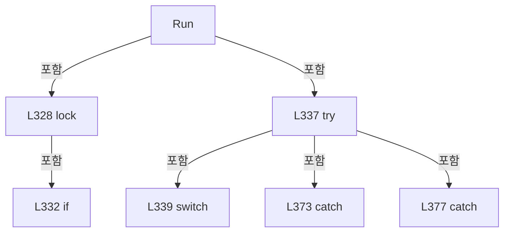

변경 전 점검: 입력/반환 타입, 위 호출자, 예외/취소 경로, 공유 상태와 저장·전송 소비자를 함께 확인합니다. 값의 단위나 물리 방향을 이름만으로 확정하지 않습니다.

### MethodDeclaration `RunSequenceStep` · L384–393

[Drilling.Common/Station/CStationProcess.cs:384–393](https://github.com/kjuws10-rgb/A3Drilling/blob/334b3599651b2e8e0181fd4459bafaf3cddafff3/Drilling.Common/Station/CStationProcess.cs#L384-L393)

| 항목 | 실제 추출 값 |
| --- | --- |
| 서명 | void Drilling.Common.Station.CStationProcess.RunSequenceStep(Drilling.Common.Station.EN_STATION_SEQUENCE, string, Drilling.Common.Station.CStationProcess.CProcessStepAction, Drilling.Common.Station.EN_STATION_SEQUENCE) |
| 접근/수식자 | Private / private |
| 반환/값 타입 | void |
| 소속 타입 | NamedType:Drilling.Common.Station.CStationProcess |

입력 계약:

| 이름 | 타입 | 전달 | 선택/기본값 |
| --- | --- | --- | --- |
| expectedSequence | Drilling.Common.Station.EN_STATION_SEQUENCE | None | False /  |
| stepKey | string | None | False /  |
| action | Drilling.Common.Station.CStationProcess.CProcessStepAction | None | False /  |
| nextSequence | Drilling.Common.Station.EN_STATION_SEQUENCE | None | False /  |

정적 호출자로 확인된 위치:

| 호출 파일/행 | 호출 표현식 | 런타임 분기 가능 |
| --- | --- | --- |
| [Drilling.Common/Station/CStationProcess.cs:344–344](https://github.com/kjuws10-rgb/A3Drilling/blob/334b3599651b2e8e0181fd4459bafaf3cddafff3/Drilling.Common/Station/CStationProcess.cs#L344-L344) | RunSequenceStep | False |
| [Drilling.Common/Station/CStationProcess.cs:347–347](https://github.com/kjuws10-rgb/A3Drilling/blob/334b3599651b2e8e0181fd4459bafaf3cddafff3/Drilling.Common/Station/CStationProcess.cs#L347-L347) | RunSequenceStep | False |
| [Drilling.Common/Station/CStationProcess.cs:350–350](https://github.com/kjuws10-rgb/A3Drilling/blob/334b3599651b2e8e0181fd4459bafaf3cddafff3/Drilling.Common/Station/CStationProcess.cs#L350-L350) | RunSequenceStep | False |
| [Drilling.Common/Station/CStationProcess.cs:353–353](https://github.com/kjuws10-rgb/A3Drilling/blob/334b3599651b2e8e0181fd4459bafaf3cddafff3/Drilling.Common/Station/CStationProcess.cs#L353-L353) | RunSequenceStep | False |
| [Drilling.Common/Station/CStationProcess.cs:356–356](https://github.com/kjuws10-rgb/A3Drilling/blob/334b3599651b2e8e0181fd4459bafaf3cddafff3/Drilling.Common/Station/CStationProcess.cs#L356-L356) | RunSequenceStep | False |

호출하는 대상과 해석 범위:

| 원본 행 | 표현식 | 분석 상태 | 대상/소스 위치 |
| --- | --- | --- | --- |
| 386 | GetSequenceCancellationToken | resolved | System.Threading.CancellationToken Drilling.Common.Station.CStationProcess.GetSequenceCancellationToken() · Drilling.Common/Station/CStationProcess.cs:400 |
| 387 | CheckProcessModelLoaded | resolved | Drilling.Common.Station.ST_PROCESS_MODEL Drilling.Common.Station.CStationProcess.CheckProcessModelLoaded() · Drilling.Common/Station/CStationProcess.cs:395 |
| 388 | ExecuteAutoStep | resolved | void Drilling.Common.Station.CStationProcess.ExecuteAutoStep(string, Drilling.Common.Station.ST_PROCESS_MODEL, Drilling.Common.Station.CStationProcess.CProcessStepAction, System.Threading.CancellationToken) · Drilling.Common/Station/CStationProcess.cs:474 |
| 389 | TryMoveSequenceState | resolved | bool Drilling.Common.Station.CStationProcess.TryMoveSequenceState(Drilling.Common.Station.EN_STATION_SEQUENCE, Drilling.Common.Station.EN_STATION_SEQUENCE) · Drilling.Common/Station/CStationProcess.cs:2314 |
| 391 | ProcessInterruptedSequence | resolved | void Drilling.Common.Station.CStationProcess.ProcessInterruptedSequence() · Drilling.Common/Station/CStationProcess.cs:424 |

본문의 실제 연산·분기·예외·반환 순서(원문 위치 순):

| 원본 행 | 종류 | 주석 해설 |
| --- | --- | --- |
| 386 | call | 함수·델리게이트 또는 객체 생성자를 호출합니다: GetSequenceCancellationToken() |
| 386 | local-declaration | 지역 변수를 선언합니다: var cancellationToken = GetSequenceCancellationToken(); |
| 386 | variable-initializer | 변수의 초기값을 지정합니다: cancellationToken = GetSequenceCancellationToken() |
| 387 | call | 함수·델리게이트 또는 객체 생성자를 호출합니다: CheckProcessModelLoaded() |
| 387 | local-declaration | 지역 변수를 선언합니다: var processModel = CheckProcessModelLoaded(); |
| 387 | variable-initializer | 변수의 초기값을 지정합니다: processModel = CheckProcessModelLoaded() |
| 388 | call | 함수·델리게이트 또는 객체 생성자를 호출합니다: ExecuteAutoStep(stepKey, processModel, action, cancellationToken) |
| 389 | call | 함수·델리게이트 또는 객체 생성자를 호출합니다: TryMoveSequenceState(expectedSequence, nextSequence) |
| 389 | if | 조건에 따라 분기합니다: if (!TryMoveSequenceState(expectedSequence, nextSequence)) |
| 391 | call | 함수·델리게이트 또는 객체 생성자를 호출합니다: ProcessInterruptedSequence() |

제어 구문의 포함 구조(실제 실행 순서/CFG가 아닌 구문 탐색 그림):


변경 전 점검: 입력/반환 타입, 위 호출자, 예외/취소 경로, 공유 상태와 저장·전송 소비자를 함께 확인합니다. 값의 단위나 물리 방향을 이름만으로 확정하지 않습니다.

### MethodDeclaration `CheckProcessModelLoaded` · L395–398

[Drilling.Common/Station/CStationProcess.cs:395–398](https://github.com/kjuws10-rgb/A3Drilling/blob/334b3599651b2e8e0181fd4459bafaf3cddafff3/Drilling.Common/Station/CStationProcess.cs#L395-L398)

| 항목 | 실제 추출 값 |
| --- | --- |
| 서명 | Drilling.Common.Station.ST_PROCESS_MODEL Drilling.Common.Station.CStationProcess.CheckProcessModelLoaded() |
| 접근/수식자 | Private / private |
| 반환/값 타입 | Drilling.Common.Station.ST_PROCESS_MODEL |
| 소속 타입 | NamedType:Drilling.Common.Station.CStationProcess |

정적 호출자로 확인된 위치:

| 호출 파일/행 | 호출 표현식 | 런타임 분기 가능 |
| --- | --- | --- |
| [Drilling.Common/Station/CStationProcess.cs:387–387](https://github.com/kjuws10-rgb/A3Drilling/blob/334b3599651b2e8e0181fd4459bafaf3cddafff3/Drilling.Common/Station/CStationProcess.cs#L387-L387) | CheckProcessModelLoaded | False |

호출하는 대상과 해석 범위:

| 원본 행 | 표현식 | 분석 상태 | 대상/소스 위치 |
| --- | --- | --- | --- |
| 397 | new InvalidOperationException | resolved | System.InvalidOperationException.InvalidOperationException(string?) |

본문의 실제 연산·분기·예외·반환 순서(원문 위치 순):

| 원본 행 | 종류 | 주석 해설 |
| --- | --- | --- |
| 397 | call | 함수·델리게이트 또는 객체 생성자를 호출합니다: new InvalidOperationException("Process Model is not loaded.") |
| 397 | return | 호출자에게 값 또는 제어를 반환합니다: return _processModel ?? throw new InvalidOperationException("Process Model is not loaded."); |
| 397 | throw | 예외를 발생/전달합니다: throw new InvalidOperationException("Process Model is not loaded.") |

변경 전 점검: 입력/반환 타입, 위 호출자, 예외/취소 경로, 공유 상태와 저장·전송 소비자를 함께 확인합니다. 값의 단위나 물리 방향을 이름만으로 확정하지 않습니다.

### MethodDeclaration `GetSequenceCancellationToken` · L400–406

[Drilling.Common/Station/CStationProcess.cs:400–406](https://github.com/kjuws10-rgb/A3Drilling/blob/334b3599651b2e8e0181fd4459bafaf3cddafff3/Drilling.Common/Station/CStationProcess.cs#L400-L406)

| 항목 | 실제 추출 값 |
| --- | --- |
| 서명 | System.Threading.CancellationToken Drilling.Common.Station.CStationProcess.GetSequenceCancellationToken() |
| 접근/수식자 | Private / private |
| 반환/값 타입 | System.Threading.CancellationToken |
| 소속 타입 | NamedType:Drilling.Common.Station.CStationProcess |

정적 호출자로 확인된 위치:

| 호출 파일/행 | 호출 표현식 | 런타임 분기 가능 |
| --- | --- | --- |
| [Drilling.Common/Station/CStationProcess.cs:386–386](https://github.com/kjuws10-rgb/A3Drilling/blob/334b3599651b2e8e0181fd4459bafaf3cddafff3/Drilling.Common/Station/CStationProcess.cs#L386-L386) | GetSequenceCancellationToken | False |

본문의 실제 연산·분기·예외·반환 순서(원문 위치 순):

| 원본 행 | 종류 | 주석 해설 |
| --- | --- | --- |
| 402 | lock | 공유 상태의 임계 구역에 진입합니다: lock (_sequenceLock) |
| 404 | return | 호출자에게 값 또는 제어를 반환합니다: return _sequenceCancellation?.Token ?? CancellationToken.None; |

제어 구문의 포함 구조(실제 실행 순서/CFG가 아닌 구문 탐색 그림):


변경 전 점검: 입력/반환 타입, 위 호출자, 예외/취소 경로, 공유 상태와 저장·전송 소비자를 함께 확인합니다. 값의 단위나 물리 방향을 이름만으로 확정하지 않습니다.

### MethodDeclaration `FinishSequence` · L408–422

[Drilling.Common/Station/CStationProcess.cs:408–422](https://github.com/kjuws10-rgb/A3Drilling/blob/334b3599651b2e8e0181fd4459bafaf3cddafff3/Drilling.Common/Station/CStationProcess.cs#L408-L422)

| 항목 | 실제 추출 값 |
| --- | --- |
| 서명 | void Drilling.Common.Station.CStationProcess.FinishSequence() |
| 접근/수식자 | Private / private |
| 반환/값 타입 | void |
| 소속 타입 | NamedType:Drilling.Common.Station.CStationProcess |

정적 호출자로 확인된 위치:

| 호출 파일/행 | 호출 표현식 | 런타임 분기 가능 |
| --- | --- | --- |
| [Drilling.Common/Station/CStationProcess.cs:357–357](https://github.com/kjuws10-rgb/A3Drilling/blob/334b3599651b2e8e0181fd4459bafaf3cddafff3/Drilling.Common/Station/CStationProcess.cs#L357-L357) | FinishSequence | False |
| [Drilling.Common/Station/CStationProcess.cs:361–361](https://github.com/kjuws10-rgb/A3Drilling/blob/334b3599651b2e8e0181fd4459bafaf3cddafff3/Drilling.Common/Station/CStationProcess.cs#L361-L361) | FinishSequence | False |
| [Drilling.Common/Station/CStationProcess.cs:365–365](https://github.com/kjuws10-rgb/A3Drilling/blob/334b3599651b2e8e0181fd4459bafaf3cddafff3/Drilling.Common/Station/CStationProcess.cs#L365-L365) | FinishSequence | False |
| [Drilling.Common/Station/CStationProcess.cs:369–369](https://github.com/kjuws10-rgb/A3Drilling/blob/334b3599651b2e8e0181fd4459bafaf3cddafff3/Drilling.Common/Station/CStationProcess.cs#L369-L369) | FinishSequence | False |

호출하는 대상과 해석 범위:

| 원본 행 | 표현식 | 분석 상태 | 대상/소스 위치 |
| --- | --- | --- | --- |
| 413 | (_stationStatus with { ChangedAt = DateTimeOffset.Now } ).WithSequenceState | resolved | Drilling.Common.Station.ST_STATION_STATUS Drilling.Common.Station.ST_STATION_STATUS.WithSequenceState(Drilling.Common.Station.EN_STATION_SEQUENCE?) · Drilling.Common/Station/CStationManager.cs:537 |
| 419 | .Dispose | resolved | void System.Threading.CancellationTokenSource.Dispose() |

본문의 실제 연산·분기·예외·반환 순서(원문 위치 순):

| 원본 행 | 종류 | 주석 해설 |
| --- | --- | --- |
| 410 | lock | 공유 상태의 임계 구역에 진입합니다: lock (_sequenceLock) |
| 412 | assignment | 값을 대상에 대입합니다: _sequenceState = EN_STATION_SEQUENCE.Ready |
| 413 | assignment | 값을 대상에 대입합니다: _stationStatus = (_stationStatus with { ChangedAt = DateTimeOffset.Now } ).WithSequenceState(EN_STATION_SEQUENCE.Ready) |
| 413 | call | 함수·델리게이트 또는 객체 생성자를 호출합니다: (_stationStatus with { ChangedAt = DateTimeOffset.Now } ).WithSequenceState(EN_STATION_SEQUENCE.Ready) |
| 415 | assignment | 값을 대상에 대입합니다: ChangedAt = DateTimeOffset.Now |
| 419 | call | 함수·델리게이트 또는 객체 생성자를 호출합니다: .Dispose() |
| 420 | assignment | 값을 대상에 대입합니다: _sequenceCancellation = null |

제어 구문의 포함 구조(실제 실행 순서/CFG가 아닌 구문 탐색 그림):

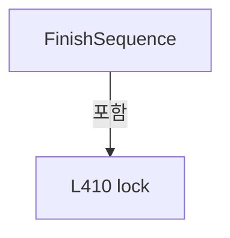

변경 전 점검: 입력/반환 타입, 위 호출자, 예외/취소 경로, 공유 상태와 저장·전송 소비자를 함께 확인합니다. 값의 단위나 물리 방향을 이름만으로 확정하지 않습니다.

### MethodDeclaration `ProcessInterruptedSequence` · L424–433

[Drilling.Common/Station/CStationProcess.cs:424–433](https://github.com/kjuws10-rgb/A3Drilling/blob/334b3599651b2e8e0181fd4459bafaf3cddafff3/Drilling.Common/Station/CStationProcess.cs#L424-L433)

| 항목 | 실제 추출 값 |
| --- | --- |
| 서명 | void Drilling.Common.Station.CStationProcess.ProcessInterruptedSequence() |
| 접근/수식자 | Private / private |
| 반환/값 타입 | void |
| 소속 타입 | NamedType:Drilling.Common.Station.CStationProcess |

정적 호출자로 확인된 위치:

| 호출 파일/행 | 호출 표현식 | 런타임 분기 가능 |
| --- | --- | --- |
| [Drilling.Common/Station/CStationProcess.cs:391–391](https://github.com/kjuws10-rgb/A3Drilling/blob/334b3599651b2e8e0181fd4459bafaf3cddafff3/Drilling.Common/Station/CStationProcess.cs#L391-L391) | ProcessInterruptedSequence | False |

호출하는 대상과 해석 범위:

| 원본 행 | 표현식 | 분석 상태 | 대상/소스 위치 |
| --- | --- | --- | --- |
| 426 | ReadSequenceState | resolved | Drilling.Common.Station.EN_STATION_SEQUENCE Drilling.Common.Station.CStationProcess.ReadSequenceState() · Drilling.Common/Station/CStationProcess.cs:2334 |
| 429 | new OperationCanceledException | resolved | System.OperationCanceledException.OperationCanceledException() |
| 432 | new InvalidOperationException | resolved | System.InvalidOperationException.InvalidOperationException(string?) |

본문의 실제 연산·분기·예외·반환 순서(원문 위치 순):

| 원본 행 | 종류 | 주석 해설 |
| --- | --- | --- |
| 426 | call | 함수·델리게이트 또는 객체 생성자를 호출합니다: ReadSequenceState() |
| 426 | local-declaration | 지역 변수를 선언합니다: var sequenceState = ReadSequenceState(); |
| 426 | variable-initializer | 변수의 초기값을 지정합니다: sequenceState = ReadSequenceState() |
| 427 | if | 조건에 따라 분기합니다: if (sequenceState == EN_STATION_SEQUENCE.Stop) |
| 429 | call | 함수·델리게이트 또는 객체 생성자를 호출합니다: new OperationCanceledException() |
| 429 | throw | 예외를 발생/전달합니다: throw new OperationCanceledException(); |
| 432 | call | 함수·델리게이트 또는 객체 생성자를 호출합니다: new InvalidOperationException($"Station sequence entered {sequenceState} during auto start.") |
| 432 | throw | 예외를 발생/전달합니다: throw new InvalidOperationException($"Station sequence entered {sequenceState} during auto start."); |

제어 구문의 포함 구조(실제 실행 순서/CFG가 아닌 구문 탐색 그림):

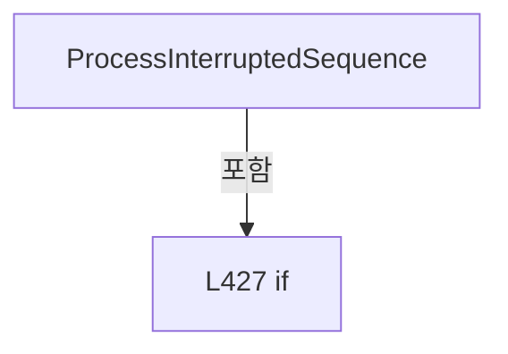

변경 전 점검: 입력/반환 타입, 위 호출자, 예외/취소 경로, 공유 상태와 저장·전송 소비자를 함께 확인합니다. 값의 단위나 물리 방향을 이름만으로 확정하지 않습니다.

### MethodDeclaration `CompleteSequence` · L435–438

[Drilling.Common/Station/CStationProcess.cs:435–438](https://github.com/kjuws10-rgb/A3Drilling/blob/334b3599651b2e8e0181fd4459bafaf3cddafff3/Drilling.Common/Station/CStationProcess.cs#L435-L438)

| 항목 | 실제 추출 값 |
| --- | --- |
| 서명 | void Drilling.Common.Station.CStationProcess.CompleteSequence(Drilling.Common.Station.ST_PROCESS_MODEL, System.Threading.CancellationToken) |
| 접근/수식자 | Private / private |
| 반환/값 타입 | void |
| 소속 타입 | NamedType:Drilling.Common.Station.CStationProcess |

입력 계약:

| 이름 | 타입 | 전달 | 선택/기본값 |
| --- | --- | --- | --- |
| processModel | Drilling.Common.Station.ST_PROCESS_MODEL | None | False /  |
| cancellationToken | System.Threading.CancellationToken | None | False /  |

현재 부분 분석에서 직접 연결된 호출자는 없습니다. XAML/이벤트/인터페이스·델리게이트·외부 진입을 추가 확인해야 하며, 미사용으로 판정한 것이 아닙니다.

호출하는 대상과 해석 범위:

| 원본 행 | 표현식 | 분석 상태 | 대상/소스 위치 |
| --- | --- | --- | --- |
| 437 | CompleteProcess | resolved | void Drilling.Common.Station.CStationProcess.CompleteProcess(System.Threading.CancellationToken) · Drilling.Common/Station/CStationProcess.cs:1157 |

본문의 실제 연산·분기·예외·반환 순서(원문 위치 순):

| 원본 행 | 종류 | 주석 해설 |
| --- | --- | --- |
| 437 | call | 함수·델리게이트 또는 객체 생성자를 호출합니다: CompleteProcess(cancellationToken) |

변경 전 점검: 입력/반환 타입, 위 호출자, 예외/취소 경로, 공유 상태와 저장·전송 소비자를 함께 확인합니다. 값의 단위나 물리 방향을 이름만으로 확정하지 않습니다.

### MethodDeclaration `EnsureStartAllowed` · L440–446

[Drilling.Common/Station/CStationProcess.cs:440–446](https://github.com/kjuws10-rgb/A3Drilling/blob/334b3599651b2e8e0181fd4459bafaf3cddafff3/Drilling.Common/Station/CStationProcess.cs#L440-L446)

| 항목 | 실제 추출 값 |
| --- | --- |
| 서명 | void Drilling.Common.Station.CStationProcess.EnsureStartAllowed() |
| 접근/수식자 | Private / private |
| 반환/값 타입 | void |
| 소속 타입 | NamedType:Drilling.Common.Station.CStationProcess |

정적 호출자로 확인된 위치:

| 호출 파일/행 | 호출 표현식 | 런타임 분기 가능 |
| --- | --- | --- |
| [Drilling.Common/Station/CStationProcess.cs:285–285](https://github.com/kjuws10-rgb/A3Drilling/blob/334b3599651b2e8e0181fd4459bafaf3cddafff3/Drilling.Common/Station/CStationProcess.cs#L285-L285) | EnsureStartAllowed | False |
| [Drilling.Common/Station/CStationProcess.cs:306–306](https://github.com/kjuws10-rgb/A3Drilling/blob/334b3599651b2e8e0181fd4459bafaf3cddafff3/Drilling.Common/Station/CStationProcess.cs#L306-L306) | EnsureStartAllowed | False |

호출하는 대상과 해석 범위:

| 원본 행 | 표현식 | 분석 상태 | 대상/소스 위치 |
| --- | --- | --- | --- |
| 442 | ReadStationStatus | resolved | Drilling.Common.Station.ST_STATION_STATUS Drilling.Common.Station.CStationProcess.ReadStationStatus() · Drilling.Common/Station/CStationProcess.cs:2342 |
| 444 | new InvalidOperationException | resolved | System.InvalidOperationException.InvalidOperationException(string?) |

본문의 실제 연산·분기·예외·반환 순서(원문 위치 순):

| 원본 행 | 종류 | 주석 해설 |
| --- | --- | --- |
| 442 | call | 함수·델리게이트 또는 객체 생성자를 호출합니다: ReadStationStatus() |
| 442 | if | 조건에 따라 분기합니다: if (ReadStationStatus().State == EN_STATION_STATE.Alarm) |
| 444 | call | 함수·델리게이트 또는 객체 생성자를 호출합니다: new InvalidOperationException("Station alarm is active. Reset alarm before auto start.") |
| 444 | throw | 예외를 발생/전달합니다: throw new InvalidOperationException("Station alarm is active. Reset alarm before auto start."); |

제어 구문의 포함 구조(실제 실행 순서/CFG가 아닌 구문 탐색 그림):


변경 전 점검: 입력/반환 타입, 위 호출자, 예외/취소 경로, 공유 상태와 저장·전송 소비자를 함께 확인합니다. 값의 단위나 물리 방향을 이름만으로 확정하지 않습니다.

### MethodDeclaration `ReadProcessModelForStart` · L448–458

[Drilling.Common/Station/CStationProcess.cs:448–458](https://github.com/kjuws10-rgb/A3Drilling/blob/334b3599651b2e8e0181fd4459bafaf3cddafff3/Drilling.Common/Station/CStationProcess.cs#L448-L458)

| 항목 | 실제 추출 값 |
| --- | --- |
| 서명 | Drilling.Common.Station.ST_PROCESS_MODEL Drilling.Common.Station.CStationProcess.ReadProcessModelForStart() |
| 접근/수식자 | Private / private |
| 반환/값 타입 | Drilling.Common.Station.ST_PROCESS_MODEL |
| 소속 타입 | NamedType:Drilling.Common.Station.CStationProcess |

정적 호출자로 확인된 위치:

| 호출 파일/행 | 호출 표현식 | 런타임 분기 가능 |
| --- | --- | --- |
| [Drilling.Common/Station/CStationProcess.cs:286–286](https://github.com/kjuws10-rgb/A3Drilling/blob/334b3599651b2e8e0181fd4459bafaf3cddafff3/Drilling.Common/Station/CStationProcess.cs#L286-L286) | ReadProcessModelForStart | False |

호출하는 대상과 해석 범위:

| 원본 행 | 표현식 | 분석 상태 | 대상/소스 위치 |
| --- | --- | --- | --- |
| 455 | SetAutoStepState | resolved | void Drilling.Common.Station.CStationProcess.SetAutoStepState(string, string) · Drilling.Common/Station/CStationProcess.cs:1810 |
| 456 | SetSequenceState | resolved | void Drilling.Common.Station.CStationProcess.SetSequenceState(Drilling.Common.Station.EN_STATION_SEQUENCE) · Drilling.Common/Station/CStationProcess.cs:2295 |
| 457 | new InvalidOperationException | resolved | System.InvalidOperationException.InvalidOperationException(string?) |

본문의 실제 연산·분기·예외·반환 순서(원문 위치 순):

| 원본 행 | 종류 | 주석 해설 |
| --- | --- | --- |
| 450 | if | 조건에 따라 분기합니다: if (_snapshot.ProcessModel is not null) |
| 452 | return | 호출자에게 값 또는 제어를 반환합니다: return _snapshot.ProcessModel; |
| 455 | call | 함수·델리게이트 또는 객체 생성자를 호출합니다: SetAutoStepState(AutoStepIdle, AutoStepError) |
| 456 | call | 함수·델리게이트 또는 객체 생성자를 호출합니다: SetSequenceState(EN_STATION_SEQUENCE.Error) |
| 457 | call | 함수·델리게이트 또는 객체 생성자를 호출합니다: new InvalidOperationException("Process model is not loaded.") |
| 457 | throw | 예외를 발생/전달합니다: throw new InvalidOperationException("Process model is not loaded."); |

제어 구문의 포함 구조(실제 실행 순서/CFG가 아닌 구문 탐색 그림):

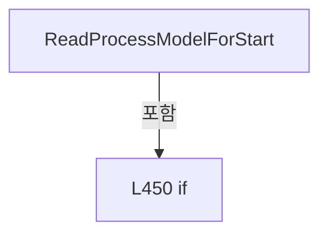

변경 전 점검: 입력/반환 타입, 위 호출자, 예외/취소 경로, 공유 상태와 저장·전송 소비자를 함께 확인합니다. 값의 단위나 물리 방향을 이름만으로 확정하지 않습니다.

### MethodDeclaration `GetLiveInterlockItems` · L460–460

[Drilling.Common/Station/CStationProcess.cs:460–460](https://github.com/kjuws10-rgb/A3Drilling/blob/334b3599651b2e8e0181fd4459bafaf3cddafff3/Drilling.Common/Station/CStationProcess.cs#L460-L460)

| 항목 | 실제 추출 값 |
| --- | --- |
| 서명 | System.Collections.Generic.IReadOnlyList<Drilling.Common.InterLock.ST_INTERLOCK_ITEM> Drilling.Common.Station.CStationProcess.GetLiveInterlockItems(System.Threading.CancellationToken) |
| 접근/수식자 | Public / public |
| 반환/값 타입 | System.Collections.Generic.IReadOnlyList<Drilling.Common.InterLock.ST_INTERLOCK_ITEM> |
| 소속 타입 | NamedType:Drilling.Common.Station.CStationProcess |

입력 계약:

| 이름 | 타입 | 전달 | 선택/기본값 |
| --- | --- | --- | --- |
| cancellationToken | System.Threading.CancellationToken | None | True / null |

정적 호출자로 확인된 위치:

| 호출 파일/행 | 호출 표현식 | 런타임 분기 가능 |
| --- | --- | --- |
| [Drilling.Common/Station/CStationManager.cs:76–76](https://github.com/kjuws10-rgb/A3Drilling/blob/334b3599651b2e8e0181fd4459bafaf3cddafff3/Drilling.Common/Station/CStationManager.cs#L76-L76) | _processStation.GetLiveInterlockItems | False |

호출하는 대상과 해석 범위:

| 원본 행 | 표현식 | 분석 상태 | 대상/소스 위치 |
| --- | --- | --- | --- |
| 460 | EvaluateInterlocks | resolved | Drilling.Common.InterLock.ST_INTERLOCK_SUMMARY Drilling.Common.Station.CStationProcess.EvaluateInterlocks(System.Collections.Generic.IReadOnlyDictionary<string, string>?, System.Threading.CancellationToken, bool, bool, bool) · Drilling.Common/Station/CStationProcess.cs:1365 |

본문의 실제 연산·분기·예외·반환 순서(원문 위치 순):

| 원본 행 | 종류 | 주석 해설 |
| --- | --- | --- |
| 460 | call | 함수·델리게이트 또는 객체 생성자를 호출합니다: EvaluateInterlocks(_snapshot.ProcessModel?.Parameters, cancellationToken, cachedStatusOnly: true, requireAllHeadsUsed: true) |

변경 전 점검: 입력/반환 타입, 위 호출자, 예외/취소 경로, 공유 상태와 저장·전송 소비자를 함께 확인합니다. 값의 단위나 물리 방향을 이름만으로 확정하지 않습니다.

### MethodDeclaration `GetLiveInterlockItems` · L461–461

[Drilling.Common/Station/CStationProcess.cs:461–461](https://github.com/kjuws10-rgb/A3Drilling/blob/334b3599651b2e8e0181fd4459bafaf3cddafff3/Drilling.Common/Station/CStationProcess.cs#L461-L461)

| 항목 | 실제 추출 값 |
| --- | --- |
| 서명 | System.Collections.Generic.IReadOnlyList<Drilling.Common.InterLock.ST_INTERLOCK_ITEM> Drilling.Common.Station.CStationProcess.GetLiveInterlockItems(System.Collections.Generic.IReadOnlyDictionary<string, string>, System.Threading.CancellationToken) |
| 접근/수식자 | Public / public |
| 반환/값 타입 | System.Collections.Generic.IReadOnlyList<Drilling.Common.InterLock.ST_INTERLOCK_ITEM> |
| 소속 타입 | NamedType:Drilling.Common.Station.CStationProcess |

입력 계약:

| 이름 | 타입 | 전달 | 선택/기본값 |
| --- | --- | --- | --- |
| parameters | System.Collections.Generic.IReadOnlyDictionary<string, string> | None | False /  |
| cancellationToken | System.Threading.CancellationToken | None | True / null |

정적 호출자로 확인된 위치:

| 호출 파일/행 | 호출 표현식 | 런타임 분기 가능 |
| --- | --- | --- |
| [Drilling.Common/Station/CStationManager.cs:72–72](https://github.com/kjuws10-rgb/A3Drilling/blob/334b3599651b2e8e0181fd4459bafaf3cddafff3/Drilling.Common/Station/CStationManager.cs#L72-L72) | _processStation.GetLiveInterlockItems | False |

호출하는 대상과 해석 범위:

| 원본 행 | 표현식 | 분석 상태 | 대상/소스 위치 |
| --- | --- | --- | --- |
| 461 | EvaluateInterlocks | resolved | Drilling.Common.InterLock.ST_INTERLOCK_SUMMARY Drilling.Common.Station.CStationProcess.EvaluateInterlocks(System.Collections.Generic.IReadOnlyDictionary<string, string>?, System.Threading.CancellationToken, bool, bool, bool) · Drilling.Common/Station/CStationProcess.cs:1365 |

본문의 실제 연산·분기·예외·반환 순서(원문 위치 순):

| 원본 행 | 종류 | 주석 해설 |
| --- | --- | --- |
| 461 | call | 함수·델리게이트 또는 객체 생성자를 호출합니다: EvaluateInterlocks(parameters, cancellationToken, cachedStatusOnly: true, requireAllHeadsUsed: true) |

변경 전 점검: 입력/반환 타입, 위 호출자, 예외/취소 경로, 공유 상태와 저장·전송 소비자를 함께 확인합니다. 값의 단위나 물리 방향을 이름만으로 확정하지 않습니다.

### MethodDeclaration `GetManualInterlockItems` · L462–472

[Drilling.Common/Station/CStationProcess.cs:462–472](https://github.com/kjuws10-rgb/A3Drilling/blob/334b3599651b2e8e0181fd4459bafaf3cddafff3/Drilling.Common/Station/CStationProcess.cs#L462-L472)

| 항목 | 실제 추출 값 |
| --- | --- |
| 서명 | System.Collections.Generic.IReadOnlyList<Drilling.Common.InterLock.ST_INTERLOCK_ITEM> Drilling.Common.Station.CStationProcess.GetManualInterlockItems(System.Collections.Generic.IReadOnlyDictionary<string, string>, System.Collections.Generic.IReadOnlySet<int>, System.Threading.CancellationToken) |
| 접근/수식자 | Public / public |
| 반환/값 타입 | System.Collections.Generic.IReadOnlyList<Drilling.Common.InterLock.ST_INTERLOCK_ITEM> |
| 소속 타입 | NamedType:Drilling.Common.Station.CStationProcess |

입력 계약:

| 이름 | 타입 | 전달 | 선택/기본값 |
| --- | --- | --- | --- |
| parameters | System.Collections.Generic.IReadOnlyDictionary<string, string> | None | False /  |
| selectedHeads | System.Collections.Generic.IReadOnlySet<int> | None | False /  |
| cancellationToken | System.Threading.CancellationToken | None | True / null |

정적 호출자로 확인된 위치:

| 호출 파일/행 | 호출 표현식 | 런타임 분기 가능 |
| --- | --- | --- |
| [Drilling.Common/Station/CStationManager.cs:79–79](https://github.com/kjuws10-rgb/A3Drilling/blob/334b3599651b2e8e0181fd4459bafaf3cddafff3/Drilling.Common/Station/CStationManager.cs#L79-L79) | _processStation.GetManualInterlockItems | False |
| [Drilling.Common/Station/CStationProcess.cs:3644–3644](https://github.com/kjuws10-rgb/A3Drilling/blob/334b3599651b2e8e0181fd4459bafaf3cddafff3/Drilling.Common/Station/CStationProcess.cs#L3644-L3644) | GetManualInterlockItems | False |

호출하는 대상과 해석 범위:

| 원본 행 | 표현식 | 분석 상태 | 대상/소스 위치 |
| --- | --- | --- | --- |
| 464 | selectedHeads.Where(head => head is >= 1 and <= 8).ToHashSet | resolved | System.Collections.Generic.HashSet<int> System.Collections.Generic.IEnumerable<int>.ToHashSet<int>() |
| 464 | selectedHeads.Where | resolved | System.Collections.Generic.IEnumerable<int> System.Collections.Generic.IEnumerable<int>.Where<int>(System.Func<int, bool>) |
| 465 | new Dictionary<string, string> | resolved | System.Collections.Generic.Dictionary<string, string>.Dictionary(System.Collections.Generic.IEnumerable<System.Collections.Generic.KeyValuePair<string, string>>, System.Collections.Generic.IEqualityComparer<string>?) |
| 467 | heads.Contains | resolved | bool System.Collections.Generic.HashSet<int>.Contains(int) |
| 469 | EvaluateInterlocks | resolved | Drilling.Common.InterLock.ST_INTERLOCK_SUMMARY Drilling.Common.Station.CStationProcess.EvaluateInterlocks(System.Collections.Generic.IReadOnlyDictionary<string, string>?, System.Threading.CancellationToken, bool, bool, bool) · Drilling.Common/Station/CStationProcess.cs:1365 |
| 470 | _interfaceManager.GetInterfaceList(EN_EQP_MODULE.Bet).FirstOrDefault | resolved | Drilling.Common.Interface.ST_INTERFACE_DATA? System.Collections.Generic.IEnumerable<Drilling.Common.Interface.ST_INTERFACE_DATA>.FirstOrDefault<Drilling.Common.Interface.ST_INTERFACE_DATA>() |
| 470 | _interfaceManager.GetInterfaceList | resolved | System.Collections.Generic.IReadOnlyList<Drilling.Common.Interface.ST_INTERFACE_DATA> Drilling.Common.Interface.CInterfaceManager.GetInterfaceList(Drilling.Common.Interface.EN_EQP_MODULE?) · Drilling.Common/Interface/CInterfaceManager.cs:442 |
| 471 | items.Select(item => item.HeadNo is null && item.Signal.Equals("BET", StringComparison.OrdinalIgnoreCase) && firstBet is { Number: >= 0 and < 8 } ? item with { HeadNo = firstBet.Number + 1 } : item).Where(item => item.HeadNo is not > 0 &#124;&#124; heads.Contains(item.HeadNo.Value)).ToArray | resolved | Drilling.Common.InterLock.ST_INTERLOCK_ITEM[] System.Collections.Generic.IEnumerable<Drilling.Common.InterLock.ST_INTERLOCK_ITEM>.ToArray<Drilling.Common.InterLock.ST_INTERLOCK_ITEM>() |
| 471 | items.Select(item => item.HeadNo is null && item.Signal.Equals("BET", StringComparison.OrdinalIgnoreCase) && firstBet is { Number: >= 0 and < 8 } ? item with { HeadNo = firstBet.Number + 1 } : item).Where | resolved | System.Collections.Generic.IEnumerable<Drilling.Common.InterLock.ST_INTERLOCK_ITEM> System.Collections.Generic.IEnumerable<Drilling.Common.InterLock.ST_INTERLOCK_ITEM>.Where<Drilling.Common.InterLock.ST_INTERLOCK_ITEM>(System.Func<Drilling.Common.InterLock.ST_INTERLOCK_ITEM, bool>) |
| 471 | items.Select | resolved | System.Collections.Generic.IEnumerable<Drilling.Common.InterLock.ST_INTERLOCK_ITEM> System.Collections.Generic.IEnumerable<Drilling.Common.InterLock.ST_INTERLOCK_ITEM>.Select<Drilling.Common.InterLock.ST_INTERLOCK_ITEM, Drilling.Common.InterLock.ST_INTERLOCK_ITEM>(System.Func<Drilling.Common.InterLock.ST_INTERLOCK_ITEM, Drilling.Common.InterLock.ST_INTERLOCK_ITEM>) |
| 471 | item.Signal.Equals | resolved | bool string.Equals(string?, System.StringComparison) |
| 471 | heads.Contains | resolved | bool System.Collections.Generic.HashSet<int>.Contains(int) |

본문의 실제 연산·분기·예외·반환 순서(원문 위치 순):

| 원본 행 | 종류 | 주석 해설 |
| --- | --- | --- |
| 464 | call | 함수·델리게이트 또는 객체 생성자를 호출합니다: selectedHeads.Where(head => head is >= 1 and <= 8).ToHashSet() |
| 464 | call | 함수·델리게이트 또는 객체 생성자를 호출합니다: selectedHeads.Where(head => head is >= 1 and <= 8) |
| 464 | local-declaration | 지역 변수를 선언합니다: var heads = selectedHeads.Where(head => head is >= 1 and <= 8).ToHashSet(); |
| 464 | variable-initializer | 변수의 초기값을 지정합니다: heads = selectedHeads.Where(head => head is >= 1 and <= 8).ToHashSet() |
| 465 | call | 함수·델리게이트 또는 객체 생성자를 호출합니다: new Dictionary<string, string>(parameters, StringComparer.OrdinalIgnoreCase) |
| 465 | local-declaration | 지역 변수를 선언합니다: var manualParameters = new Dictionary<string, string>(parameters, StringComparer.OrdinalIgnoreCase); |
| 465 | variable-initializer | 변수의 초기값을 지정합니다: manualParameters = new Dictionary<string, string>(parameters, StringComparer.OrdinalIgnoreCase) |
| 466 | variable-initializer | 변수의 초기값을 지정합니다: head = 1 |
| 466 | for | 초기화·조건·증감이 있는 반복입니다: for (var head = 1; head <= 8; head++) |
| 467 | assignment | 값을 대상에 대입합니다: manualParameters[$"H{head:00}_USE"] = heads.Contains(head) ? "ON" : "OFF" |
| 467 | call | 함수·델리게이트 또는 객체 생성자를 호출합니다: heads.Contains(head) |
| 467 | conditional-expression | 조건에 따라 결과식을 선택합니다: heads.Contains(head) ? "ON" : "OFF" |
| 469 | call | 함수·델리게이트 또는 객체 생성자를 호출합니다: EvaluateInterlocks(manualParameters, cancellationToken, cachedStatusOnly: true, publish: false) |
| 469 | local-declaration | 지역 변수를 선언합니다: var items = EvaluateInterlocks(manualParameters, cancellationToken, cachedStatusOnly: true, publish: false).Items; |
| 469 | variable-initializer | 변수의 초기값을 지정합니다: items = EvaluateInterlocks(manualParameters, cancellationToken, cachedStatusOnly: true, publish: false).Items |
| 470 | call | 함수·델리게이트 또는 객체 생성자를 호출합니다: _interfaceManager.GetInterfaceList(EN_EQP_MODULE.Bet).FirstOrDefault() |
| 470 | call | 함수·델리게이트 또는 객체 생성자를 호출합니다: _interfaceManager.GetInterfaceList(EN_EQP_MODULE.Bet) |
| 470 | local-declaration | 지역 변수를 선언합니다: var firstBet = _interfaceManager.GetInterfaceList(EN_EQP_MODULE.Bet).FirstOrDefault(); |
| 470 | variable-initializer | 변수의 초기값을 지정합니다: firstBet = _interfaceManager.GetInterfaceList(EN_EQP_MODULE.Bet).FirstOrDefault() |
| 471 | assignment | 값을 대상에 대입합니다: HeadNo = firstBet.Number + 1 |
| 471 | call | 함수·델리게이트 또는 객체 생성자를 호출합니다: items.Select(item => item.HeadNo is null && item.Signal.Equals("BET", StringComparison.OrdinalIgnoreCase) && firstBet is { Number: >= 0 and < 8 } ? item with { HeadNo = firstBet.Number + 1 } : item).Where(item => item.He… |
| 471 | call | 함수·델리게이트 또는 객체 생성자를 호출합니다: items.Select(item => item.HeadNo is null && item.Signal.Equals("BET", StringComparison.OrdinalIgnoreCase) && firstBet is { Number: >= 0 and < 8 } ? item with { HeadNo = firstBet.Number + 1 } : item).Where(item => item.He… |
| 471 | call | 함수·델리게이트 또는 객체 생성자를 호출합니다: items.Select(item => item.HeadNo is null && item.Signal.Equals("BET", StringComparison.OrdinalIgnoreCase) && firstBet is { Number: >= 0 and < 8 } ? item with { HeadNo = firstBet.Number + 1 } : item) |
| 471 | call | 함수·델리게이트 또는 객체 생성자를 호출합니다: item.Signal.Equals("BET", StringComparison.OrdinalIgnoreCase) |
| 471 | call | 함수·델리게이트 또는 객체 생성자를 호출합니다: heads.Contains(item.HeadNo.Value) |
| 471 | conditional-expression | 조건에 따라 결과식을 선택합니다: item.HeadNo is null && item.Signal.Equals("BET", StringComparison.OrdinalIgnoreCase) && firstBet is { Number: >= 0 and < 8 } ? item with { HeadNo = firstBet.Number + 1 } : item |
| 471 | return | 호출자에게 값 또는 제어를 반환합니다: return items.Select(item => item.HeadNo is null && item.Signal.Equals("BET", StringComparison.OrdinalIgnoreCase) && firstBet is { Number: >= 0 and < 8 } ? item with { HeadNo = firstBet.Number + 1 } : item).Where(item => item.HeadN |

제어 구문의 포함 구조(실제 실행 순서/CFG가 아닌 구문 탐색 그림):


변경 전 점검: 입력/반환 타입, 위 호출자, 예외/취소 경로, 공유 상태와 저장·전송 소비자를 함께 확인합니다. 값의 단위나 물리 방향을 이름만으로 확정하지 않습니다.

### MethodDeclaration `ExecuteAutoStep` · L474–499

[Drilling.Common/Station/CStationProcess.cs:474–499](https://github.com/kjuws10-rgb/A3Drilling/blob/334b3599651b2e8e0181fd4459bafaf3cddafff3/Drilling.Common/Station/CStationProcess.cs#L474-L499)

| 항목 | 실제 추출 값 |
| --- | --- |
| 서명 | void Drilling.Common.Station.CStationProcess.ExecuteAutoStep(string, Drilling.Common.Station.ST_PROCESS_MODEL, Drilling.Common.Station.CStationProcess.CProcessStepAction, System.Threading.CancellationToken) |
| 접근/수식자 | Private / private |
| 반환/값 타입 | void |
| 소속 타입 | NamedType:Drilling.Common.Station.CStationProcess |

입력 계약:

| 이름 | 타입 | 전달 | 선택/기본값 |
| --- | --- | --- | --- |
| stepKey | string | None | False /  |
| processModel | Drilling.Common.Station.ST_PROCESS_MODEL | None | False /  |
| action | Drilling.Common.Station.CStationProcess.CProcessStepAction | None | False /  |
| cancellationToken | System.Threading.CancellationToken | None | False /  |

정적 호출자로 확인된 위치:

| 호출 파일/행 | 호출 표현식 | 런타임 분기 가능 |
| --- | --- | --- |
| [Drilling.Common/Station/CStationProcess.cs:388–388](https://github.com/kjuws10-rgb/A3Drilling/blob/334b3599651b2e8e0181fd4459bafaf3cddafff3/Drilling.Common/Station/CStationProcess.cs#L388-L388) | ExecuteAutoStep | False |

호출하는 대상과 해석 범위:

| 원본 행 | 표현식 | 분석 상태 | 대상/소스 위치 |
| --- | --- | --- | --- |
| 476 | cancellationToken.ThrowIfCancellationRequested | resolved | void System.Threading.CancellationToken.ThrowIfCancellationRequested() |
| 477 | GetAutoStepName | resolved | string Drilling.Common.Station.CStationProcess.GetAutoStepName(string) · Drilling.Common/Station/CStationProcess.cs:1877 |
| 478 | GetProcessFlowItem | resolved | Drilling.Common.Station.ST_STATION_PROCESS_FLOW_ITEM Drilling.Common.Station.CStationProcess.GetProcessFlowItem(string) · Drilling.Common/Station/CStationProcess.cs:1867 |
| 479 | ResolveStepScriptStatus | resolved | Drilling.Common.Station.EN_SCRIPT_STATUS Drilling.Common.Station.CStationProcess.ResolveStepScriptStatus(string, Drilling.Common.Station.EN_SCRIPT_STATUS) · Drilling.Common/Station/CStationProcess.cs:1842 |
| 480 | SetAutoStepState | resolved | void Drilling.Common.Station.CStationProcess.SetAutoStepState(string, string) · Drilling.Common/Station/CStationProcess.cs:1810 |
| 481 | AddProcessLog | resolved | void Drilling.Common.Station.CStationProcess.AddProcessLog(string, string, string) · Drilling.Common/Station/CStationProcess.cs:2371 |
| 482 | CreateSnapshot | resolved | Drilling.Common.Station.ST_STATION_PROCESS_STATUS Drilling.Common.Station.CStationProcess.CreateSnapshot(Drilling.Common.Station.ST_PROCESS_MODEL?, System.Collections.Generic.IReadOnlyList<Drilling.Common.Station.ST_HEAD_PREVIEW_DATA>, Drilling.Common.Station.EN_SCRIPT_STATUS, Drilling.Common.Station.EN_PROCESS_STEP, Drilling.Common.Station.ST_PROCESS_RESULT?) · Drilling.Common/Station/CStationProcess.cs:1339 |
| 482 | SetHeadStatus | resolved | System.Collections.Generic.IReadOnlyList<Drilling.Common.Station.ST_HEAD_PREVIEW_DATA> Drilling.Common.Station.CStationProcess.SetHeadStatus(System.Collections.Generic.IReadOnlyList<Drilling.Common.Station.ST_HEAD_PREVIEW_DATA>, Drilling.Common.Station.EN_PROCESS_STEP) · Drilling.Common/Station/CStationProcess.cs:1681 |
| 483 | SetStationState | resolved | void Drilling.Common.Station.CStationProcess.SetStationState(Drilling.Common.Station.EN_STATION_STATE, Drilling.Common.Station.EN_PROCESS_STEP, Drilling.Common.Station.EN_SCRIPT_STATUS, string) · Drilling.Common/Station/CStationProcess.cs:2350 |
| 484 | RefreshSnapshot | resolved | void Drilling.Common.Station.CStationProcess.RefreshSnapshot() · Drilling.Common/Station/CStationProcess.cs:1793 |
| 487 | action | resolved · 동적 구현 선택 가능 | void Drilling.Common.Station.CStationProcess.CProcessStepAction.Invoke(Drilling.Common.Station.ST_PROCESS_MODEL, System.Threading.CancellationToken) · Drilling.Common/Station/CStationProcess.cs:171 |
| 488 | SetAutoStepState | resolved | void Drilling.Common.Station.CStationProcess.SetAutoStepState(string, string) · Drilling.Common/Station/CStationProcess.cs:1810 |
| 489 | AddProcessLog | resolved | void Drilling.Common.Station.CStationProcess.AddProcessLog(string, string, string) · Drilling.Common/Station/CStationProcess.cs:2371 |
| 490 | RefreshSnapshot | resolved | void Drilling.Common.Station.CStationProcess.RefreshSnapshot() · Drilling.Common/Station/CStationProcess.cs:1793 |
| 494 | SetAutoStepState | resolved | void Drilling.Common.Station.CStationProcess.SetAutoStepState(string, string) · Drilling.Common/Station/CStationProcess.cs:1810 |
| 495 | AddProcessLog | resolved | void Drilling.Common.Station.CStationProcess.AddProcessLog(string, string, string) · Drilling.Common/Station/CStationProcess.cs:2371 |
| 496 | RefreshSnapshot | resolved | void Drilling.Common.Station.CStationProcess.RefreshSnapshot() · Drilling.Common/Station/CStationProcess.cs:1793 |

본문의 실제 연산·분기·예외·반환 순서(원문 위치 순):

| 원본 행 | 종류 | 주석 해설 |
| --- | --- | --- |
| 476 | call | 함수·델리게이트 또는 객체 생성자를 호출합니다: cancellationToken.ThrowIfCancellationRequested() |
| 477 | call | 함수·델리게이트 또는 객체 생성자를 호출합니다: GetAutoStepName(stepKey) |
| 477 | local-declaration | 지역 변수를 선언합니다: var stepName = GetAutoStepName(stepKey); |
| 477 | variable-initializer | 변수의 초기값을 지정합니다: stepName = GetAutoStepName(stepKey) |
| 478 | call | 함수·델리게이트 또는 객체 생성자를 호출합니다: GetProcessFlowItem(stepKey) |
| 478 | local-declaration | 지역 변수를 선언합니다: var flowItem = GetProcessFlowItem(stepKey); |
| 478 | variable-initializer | 변수의 초기값을 지정합니다: flowItem = GetProcessFlowItem(stepKey) |
| 479 | call | 함수·델리게이트 또는 객체 생성자를 호출합니다: ResolveStepScriptStatus(stepKey, flowItem.ScriptStatus) |
| 479 | local-declaration | 지역 변수를 선언합니다: var runningScriptStatus = ResolveStepScriptStatus(stepKey, flowItem.ScriptStatus); |
| 479 | variable-initializer | 변수의 초기값을 지정합니다: runningScriptStatus = ResolveStepScriptStatus(stepKey, flowItem.ScriptStatus) |
| 480 | call | 함수·델리게이트 또는 객체 생성자를 호출합니다: SetAutoStepState(stepKey, AutoStepRunning) |
| 481 | call | 함수·델리게이트 또는 객체 생성자를 호출합니다: AddProcessLog("INFO", "STEP", $"{stepName} started.") |
| 482 | assignment | 값을 대상에 대입합니다: _snapshot = CreateSnapshot(_snapshot.ProcessModel, SetHeadStatus(_snapshot.HeadPreviews, flowItem.RunningStep), runningScriptStatus, flowItem.RunningStep, null) |
| 482 | call | 함수·델리게이트 또는 객체 생성자를 호출합니다: CreateSnapshot(_snapshot.ProcessModel, SetHeadStatus(_snapshot.HeadPreviews, flowItem.RunningStep), runningScriptStatus, flowItem.RunningStep, null) |
| 482 | call | 함수·델리게이트 또는 객체 생성자를 호출합니다: SetHeadStatus(_snapshot.HeadPreviews, flowItem.RunningStep) |
| 483 | call | 함수·델리게이트 또는 객체 생성자를 호출합니다: SetStationState(flowItem.RunningState, flowItem.RunningStep, runningScriptStatus, $"{stepName} started.") |
| 484 | call | 함수·델리게이트 또는 객체 생성자를 호출합니다: RefreshSnapshot() |
| 485 | try | 예외 처리 범위입니다: try |
| 487 | call | 함수·델리게이트 또는 객체 생성자를 호출합니다: action(processModel, cancellationToken) |
| 488 | call | 함수·델리게이트 또는 객체 생성자를 호출합니다: SetAutoStepState(stepKey, stepKey == AutoStepComplete ? AutoStepDone : AutoStepOk) |
| 488 | conditional-expression | 조건에 따라 결과식을 선택합니다: stepKey == AutoStepComplete ? AutoStepDone : AutoStepOk |
| 489 | call | 함수·델리게이트 또는 객체 생성자를 호출합니다: AddProcessLog("INFO", "STEP", $"{stepName} completed.") |
| 490 | call | 함수·델리게이트 또는 객체 생성자를 호출합니다: RefreshSnapshot() |
| 492 | catch | 지정 예외를 처리합니다: catch (Exception exception) |
| 494 | call | 함수·델리게이트 또는 객체 생성자를 호출합니다: SetAutoStepState(stepKey, AutoStepError) |
| 495 | call | 함수·델리게이트 또는 객체 생성자를 호출합니다: AddProcessLog("ERROR", "STEP", $"{stepName} failed. {exception.Message}") |
| 496 | call | 함수·델리게이트 또는 객체 생성자를 호출합니다: RefreshSnapshot() |
| 497 | throw | 예외를 발생/전달합니다: throw; |

제어 구문의 포함 구조(실제 실행 순서/CFG가 아닌 구문 탐색 그림):

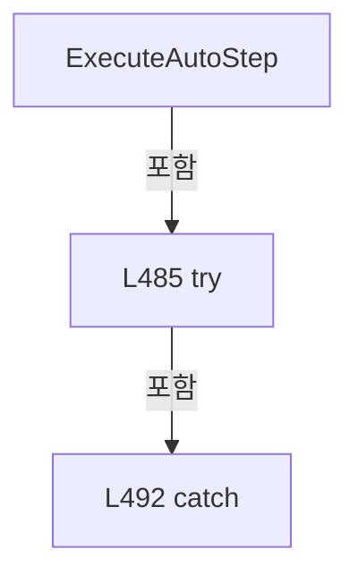

변경 전 점검: 입력/반환 타입, 위 호출자, 예외/취소 경로, 공유 상태와 저장·전송 소비자를 함께 확인합니다. 값의 단위나 물리 방향을 이름만으로 확정하지 않습니다.

### MethodDeclaration `RunAlignStep` · L501–526

[Drilling.Common/Station/CStationProcess.cs:501–526](https://github.com/kjuws10-rgb/A3Drilling/blob/334b3599651b2e8e0181fd4459bafaf3cddafff3/Drilling.Common/Station/CStationProcess.cs#L501-L526)

| 항목 | 실제 추출 값 |
| --- | --- |
| 서명 | void Drilling.Common.Station.CStationProcess.RunAlignStep(Drilling.Common.Station.ST_PROCESS_MODEL, System.Threading.CancellationToken) |
| 접근/수식자 | Private / private |
| 반환/값 타입 | void |
| 소속 타입 | NamedType:Drilling.Common.Station.CStationProcess |

입력 계약:

| 이름 | 타입 | 전달 | 선택/기본값 |
| --- | --- | --- | --- |
| processModel | Drilling.Common.Station.ST_PROCESS_MODEL | None | False /  |
| cancellationToken | System.Threading.CancellationToken | None | False /  |

현재 부분 분석에서 직접 연결된 호출자는 없습니다. XAML/이벤트/인터페이스·델리게이트·외부 진입을 추가 확인해야 하며, 미사용으로 판정한 것이 아닙니다.

호출하는 대상과 해석 범위:

| 원본 행 | 표현식 | 분석 상태 | 대상/소스 위치 |
| --- | --- | --- | --- |
| 503 | cancellationToken.ThrowIfCancellationRequested | resolved | void System.Threading.CancellationToken.ThrowIfCancellationRequested() |
| 505 | ReadDoubleAny | resolved | double Drilling.Common.Station.CStationProcess.ReadDoubleAny(System.Collections.Generic.IReadOnlyDictionary<string, string>, double, params string[]) · Drilling.Common/Station/CStationProcess.cs:2085 |
| 506 | ReadDoubleAny | resolved | double Drilling.Common.Station.CStationProcess.ReadDoubleAny(System.Collections.Generic.IReadOnlyDictionary<string, string>, double, params string[]) · Drilling.Common/Station/CStationProcess.cs:2085 |
| 507 | ReadDoubleAny | resolved | double Drilling.Common.Station.CStationProcess.ReadDoubleAny(System.Collections.Generic.IReadOnlyDictionary<string, string>, double, params string[]) · Drilling.Common/Station/CStationProcess.cs:2085 |
| 510 | UpdateProductAlignment | resolved | void Drilling.Common.Station.CStationProcess.UpdateProductAlignment(Drilling.Common.Station.ST_PROCESS_MODEL, Drilling.Common.Product.EN_PRODUCT_PROCESS_STATE, string, System.Threading.CancellationToken) · Drilling.Common/Station/CStationProcess.cs:528 |
| 511 | SendProcessControlCommand | resolved | void Drilling.Common.Station.CStationProcess.SendProcessControlCommand(string, System.Collections.Generic.IReadOnlyList<(string Key, string Value)>, System.Threading.CancellationToken) · Drilling.Common/Station/CStationProcess.cs:639 |
| 511 | FormatDouble | resolved | string Drilling.Common.Station.CStationProcess.FormatDouble(double) · Drilling.Common/Station/CStationProcess.cs:1947 |
| 511 | FormatDouble | resolved | string Drilling.Common.Station.CStationProcess.FormatDouble(double) · Drilling.Common/Station/CStationProcess.cs:1947 |
| 511 | FormatDouble | resolved | string Drilling.Common.Station.CStationProcess.FormatDouble(double) · Drilling.Common/Station/CStationProcess.cs:1947 |
| 512 | UpdateProductAlignment | resolved | void Drilling.Common.Station.CStationProcess.UpdateProductAlignment(Drilling.Common.Station.ST_PROCESS_MODEL, Drilling.Common.Product.EN_PRODUCT_PROCESS_STATE, string, System.Threading.CancellationToken) · Drilling.Common/Station/CStationProcess.cs:528 |
| 516 | TryUpdateProductAlignmentAfterFailure | resolved | void Drilling.Common.Station.CStationProcess.TryUpdateProductAlignmentAfterFailure(Drilling.Common.Station.ST_PROCESS_MODEL, Drilling.Common.Product.EN_PRODUCT_PROCESS_STATE, string) · Drilling.Common/Station/CStationProcess.cs:552 |
| 521 | TryUpdateProductAlignmentAfterFailure | resolved | void Drilling.Common.Station.CStationProcess.TryUpdateProductAlignmentAfterFailure(Drilling.Common.Station.ST_PROCESS_MODEL, Drilling.Common.Product.EN_PRODUCT_PROCESS_STATE, string) · Drilling.Common/Station/CStationProcess.cs:552 |
| 525 | AddProcessLog | resolved | void Drilling.Common.Station.CStationProcess.AddProcessLog(string, string, string) · Drilling.Common/Station/CStationProcess.cs:2371 |
| 525 | FormatDouble | resolved | string Drilling.Common.Station.CStationProcess.FormatDouble(double) · Drilling.Common/Station/CStationProcess.cs:1947 |
| 525 | FormatDouble | resolved | string Drilling.Common.Station.CStationProcess.FormatDouble(double) · Drilling.Common/Station/CStationProcess.cs:1947 |

본문의 실제 연산·분기·예외·반환 순서(원문 위치 순):

| 원본 행 | 종류 | 주석 해설 |
| --- | --- | --- |
| 503 | call | 함수·델리게이트 또는 객체 생성자를 호출합니다: cancellationToken.ThrowIfCancellationRequested() |
| 504 | local-declaration | 지역 변수를 선언합니다: var parameters = processModel.Parameters; |
| 504 | variable-initializer | 변수의 초기값을 지정합니다: parameters = processModel.Parameters |
| 505 | call | 함수·델리게이트 또는 객체 생성자를 호출합니다: ReadDoubleAny(parameters, 0.0, "REVIEW_CAMERA_ALIGN_KEY_POS_X") |
| 505 | local-declaration | 지역 변수를 선언합니다: var reviewCameraAlignKeyPosX = ReadDoubleAny(parameters, 0.0, "REVIEW_CAMERA_ALIGN_KEY_POS_X"); |
| 505 | variable-initializer | 변수의 초기값을 지정합니다: reviewCameraAlignKeyPosX = ReadDoubleAny(parameters, 0.0, "REVIEW_CAMERA_ALIGN_KEY_POS_X") |
| 506 | call | 함수·델리게이트 또는 객체 생성자를 호출합니다: ReadDoubleAny(parameters, 0.0, "REVIEW_CAMERA_ALIGN_KEY_POS_Y") |
| 506 | local-declaration | 지역 변수를 선언합니다: var reviewCameraAlignKeyPosY = ReadDoubleAny(parameters, 0.0, "REVIEW_CAMERA_ALIGN_KEY_POS_Y"); |
| 506 | variable-initializer | 변수의 초기값을 지정합니다: reviewCameraAlignKeyPosY = ReadDoubleAny(parameters, 0.0, "REVIEW_CAMERA_ALIGN_KEY_POS_Y") |
| 507 | call | 함수·델리게이트 또는 객체 생성자를 호출합니다: ReadDoubleAny(parameters, 100.0, "STAGE_SPEED") |
| 507 | local-declaration | 지역 변수를 선언합니다: var stageYSpeed = ReadDoubleAny(parameters, 100.0, "STAGE_SPEED"); |
| 507 | variable-initializer | 변수의 초기값을 지정합니다: stageYSpeed = ReadDoubleAny(parameters, 100.0, "STAGE_SPEED") |
| 508 | try | 예외 처리 범위입니다: try |
| 510 | call | 함수·델리게이트 또는 객체 생성자를 호출합니다: UpdateProductAlignment(processModel, EN_PRODUCT_PROCESS_STATE.Running, "RUNNING", cancellationToken) |
| 511 | call | 함수·델리게이트 또는 객체 생성자를 호출합니다: SendProcessControlCommand("ALIGN_REVIEW_CAMERA_MOVE", [("CAMERA_X", FormatDouble(reviewCameraAlignKeyPosX)), ("STAGE_Y", FormatDouble(reviewCameraAlignKeyPosY)), ("SPEED_Y", FormatDouble(stageYSpeed))], cancellationToken… |
| 511 | call | 함수·델리게이트 또는 객체 생성자를 호출합니다: FormatDouble(reviewCameraAlignKeyPosX) |
| 511 | call | 함수·델리게이트 또는 객체 생성자를 호출합니다: FormatDouble(reviewCameraAlignKeyPosY) |
| 511 | call | 함수·델리게이트 또는 객체 생성자를 호출합니다: FormatDouble(stageYSpeed) |
| 512 | call | 함수·델리게이트 또는 객체 생성자를 호출합니다: UpdateProductAlignment(processModel, EN_PRODUCT_PROCESS_STATE.Completed, "OK", cancellationToken) |
| 514 | catch | 지정 예외를 처리합니다: catch (OperationCanceledException) |
| 516 | call | 함수·델리게이트 또는 객체 생성자를 호출합니다: TryUpdateProductAlignmentAfterFailure(processModel, EN_PRODUCT_PROCESS_STATE.Stopped, "STOPPED") |
| 517 | throw | 예외를 발생/전달합니다: throw; |
| 519 | catch | 지정 예외를 처리합니다: catch  |
| 521 | call | 함수·델리게이트 또는 객체 생성자를 호출합니다: TryUpdateProductAlignmentAfterFailure(processModel, EN_PRODUCT_PROCESS_STATE.Error, "ERROR") |
| 522 | throw | 예외를 발생/전달합니다: throw; |
| 525 | call | 함수·델리게이트 또는 객체 생성자를 호출합니다: AddProcessLog("INFO", "ALIGN", $"Review camera align key position requested. CameraX={FormatDouble(reviewCameraAlignKeyPosX)}, StageY={FormatDouble(reviewCameraAlignKeyPosY)}") |
| 525 | call | 함수·델리게이트 또는 객체 생성자를 호출합니다: FormatDouble(reviewCameraAlignKeyPosX) |
| 525 | call | 함수·델리게이트 또는 객체 생성자를 호출합니다: FormatDouble(reviewCameraAlignKeyPosY) |

제어 구문의 포함 구조(실제 실행 순서/CFG가 아닌 구문 탐색 그림):

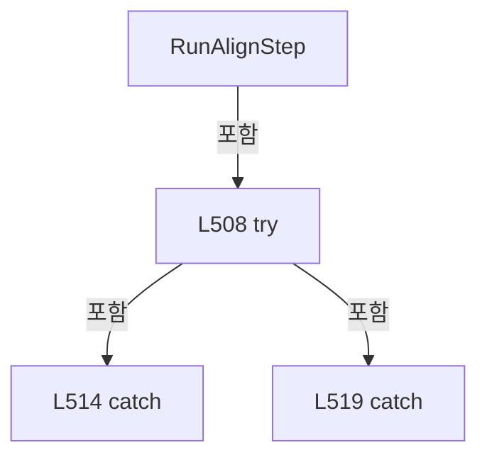

변경 전 점검: 입력/반환 타입, 위 호출자, 예외/취소 경로, 공유 상태와 저장·전송 소비자를 함께 확인합니다. 값의 단위나 물리 방향을 이름만으로 확정하지 않습니다.

### MethodDeclaration `UpdateProductAlignment` · L528–550

[Drilling.Common/Station/CStationProcess.cs:528–550](https://github.com/kjuws10-rgb/A3Drilling/blob/334b3599651b2e8e0181fd4459bafaf3cddafff3/Drilling.Common/Station/CStationProcess.cs#L528-L550)

| 항목 | 실제 추출 값 |
| --- | --- |
| 서명 | void Drilling.Common.Station.CStationProcess.UpdateProductAlignment(Drilling.Common.Station.ST_PROCESS_MODEL, Drilling.Common.Product.EN_PRODUCT_PROCESS_STATE, string, System.Threading.CancellationToken) |
| 접근/수식자 | Private / private |
| 반환/값 타입 | void |
| 소속 타입 | NamedType:Drilling.Common.Station.CStationProcess |

입력 계약:

| 이름 | 타입 | 전달 | 선택/기본값 |
| --- | --- | --- | --- |
| processModel | Drilling.Common.Station.ST_PROCESS_MODEL | None | False /  |
| state | Drilling.Common.Product.EN_PRODUCT_PROCESS_STATE | None | False /  |
| result | string | None | False /  |
| cancellationToken | System.Threading.CancellationToken | None | False /  |

정적 호출자로 확인된 위치:

| 호출 파일/행 | 호출 표현식 | 런타임 분기 가능 |
| --- | --- | --- |
| [Drilling.Common/Station/CStationProcess.cs:510–510](https://github.com/kjuws10-rgb/A3Drilling/blob/334b3599651b2e8e0181fd4459bafaf3cddafff3/Drilling.Common/Station/CStationProcess.cs#L510-L510) | UpdateProductAlignment | False |
| [Drilling.Common/Station/CStationProcess.cs:512–512](https://github.com/kjuws10-rgb/A3Drilling/blob/334b3599651b2e8e0181fd4459bafaf3cddafff3/Drilling.Common/Station/CStationProcess.cs#L512-L512) | UpdateProductAlignment | False |
| [Drilling.Common/Station/CStationProcess.cs:556–556](https://github.com/kjuws10-rgb/A3Drilling/blob/334b3599651b2e8e0181fd4459bafaf3cddafff3/Drilling.Common/Station/CStationProcess.cs#L556-L556) | UpdateProductAlignment | False |

호출하는 대상과 해석 범위:

| 원본 행 | 표현식 | 분석 상태 | 대상/소스 위치 |
| --- | --- | --- | --- |
| 530 | GetCurrentProcessProductId | resolved | string? Drilling.Common.Station.CStationProcess.GetCurrentProcessProductId() · Drilling.Common/Station/CStationProcess.cs:1508 |
| 531 | string.IsNullOrWhiteSpace | resolved | bool string.IsNullOrWhiteSpace(string?) |
| 538 | _productManager.SetAlignment( productId, new ST_PRODUCT_ALIGN_DATA( state, result, includeResults ? ReadNullableDoubleAny(parameters, "ALIGN_OFFSET_X") : null, includeResults ? ReadNullableDoubleAny(parameters, "ALIGN_OFFSET_Y") : null, includeResults ? ReadNullableDoubleAny(parameters, "ALIGN_ROTATION") : null ), new ST_PRODUCT_DISTORTION_DATA(sta… | resolved | Drilling.Common.Product.ST_PRODUCT_DATA System.Runtime.CompilerServices.TaskAwaiter<Drilling.Common.Product.ST_PRODUCT_DATA>.GetResult() |
| 538 | _productManager.SetAlignment( productId, new ST_PRODUCT_ALIGN_DATA( state, result, includeResults ? ReadNullableDoubleAny(parameters, "ALIGN_OFFSET_X") : null, includeResults ? ReadNullableDoubleAny(parameters, "ALIGN_OFFSET_Y") : null, includeResults ? ReadNullableDoubleAny(parameters, "ALIGN_ROTATION") : null ), new ST_PRODUCT_DISTORTION_DATA(sta… | resolved | System.Runtime.CompilerServices.TaskAwaiter<Drilling.Common.Product.ST_PRODUCT_DATA> System.Threading.Tasks.Task<Drilling.Common.Product.ST_PRODUCT_DATA>.GetAwaiter() |
| 538 | _productManager.SetAlignment | resolved | System.Threading.Tasks.Task<Drilling.Common.Product.ST_PRODUCT_DATA> Drilling.Common.Product.CProductManager.SetAlignment(string, Drilling.Common.Product.ST_PRODUCT_ALIGN_DATA, Drilling.Common.Product.ST_PRODUCT_DISTORTION_DATA, System.Threading.CancellationToken) · Drilling.Common/Product/CProductManager.cs:424 |
| 540 | new ST_PRODUCT_ALIGN_DATA | resolved | Drilling.Common.Product.ST_PRODUCT_ALIGN_DATA.ST_PRODUCT_ALIGN_DATA(Drilling.Common.Product.EN_PRODUCT_PROCESS_STATE, string, double?, double?, double?) · Drilling.Common/Product/CProductManager.cs:996 |
| 543 | ReadNullableDoubleAny | resolved | double? Drilling.Common.Station.CStationProcess.ReadNullableDoubleAny(System.Collections.Generic.IReadOnlyDictionary<string, string>, params string[]) · Drilling.Common/Station/CStationProcess.cs:2029 |
| 544 | ReadNullableDoubleAny | resolved | double? Drilling.Common.Station.CStationProcess.ReadNullableDoubleAny(System.Collections.Generic.IReadOnlyDictionary<string, string>, params string[]) · Drilling.Common/Station/CStationProcess.cs:2029 |
| 545 | ReadNullableDoubleAny | resolved | double? Drilling.Common.Station.CStationProcess.ReadNullableDoubleAny(System.Collections.Generic.IReadOnlyDictionary<string, string>, params string[]) · Drilling.Common/Station/CStationProcess.cs:2029 |
| 547 | new ST_PRODUCT_DISTORTION_DATA | resolved | Drilling.Common.Product.ST_PRODUCT_DISTORTION_DATA.ST_PRODUCT_DISTORTION_DATA(Drilling.Common.Product.EN_PRODUCT_PROCESS_STATE, string, double?) · Drilling.Common/Product/CProductManager.cs:997 |
| 547 | ReadNullableDoubleAny | resolved | double? Drilling.Common.Station.CStationProcess.ReadNullableDoubleAny(System.Collections.Generic.IReadOnlyDictionary<string, string>, params string[]) · Drilling.Common/Station/CStationProcess.cs:2029 |

본문의 실제 연산·분기·예외·반환 순서(원문 위치 순):

| 원본 행 | 종류 | 주석 해설 |
| --- | --- | --- |
| 530 | call | 함수·델리게이트 또는 객체 생성자를 호출합니다: GetCurrentProcessProductId() |
| 530 | local-declaration | 지역 변수를 선언합니다: var productId = GetCurrentProcessProductId(); |
| 530 | variable-initializer | 변수의 초기값을 지정합니다: productId = GetCurrentProcessProductId() |
| 531 | call | 함수·델리게이트 또는 객체 생성자를 호출합니다: string.IsNullOrWhiteSpace(productId) |
| 531 | if | 조건에 따라 분기합니다: if (_productManager is null &#124;&#124; string.IsNullOrWhiteSpace(productId)) |
| 533 | return | 호출자에게 값 또는 제어를 반환합니다: return; |
| 536 | local-declaration | 지역 변수를 선언합니다: var parameters = processModel.Parameters; |
| 536 | variable-initializer | 변수의 초기값을 지정합니다: parameters = processModel.Parameters |
| 537 | local-declaration | 지역 변수를 선언합니다: var includeResults = state == EN_PRODUCT_PROCESS_STATE.Completed; |
| 537 | variable-initializer | 변수의 초기값을 지정합니다: includeResults = state == EN_PRODUCT_PROCESS_STATE.Completed |
| 538 | call | 함수·델리게이트 또는 객체 생성자를 호출합니다: _productManager.SetAlignment( productId, new ST_PRODUCT_ALIGN_DATA( state, result, includeResults ? ReadNullableDoubleAny(parameters, "ALIGN_OFFSET_X") : null, includeResults ? ReadNullableDoubleAny(parameters, "ALIGN_OF… |
| 538 | call | 함수·델리게이트 또는 객체 생성자를 호출합니다: _productManager.SetAlignment( productId, new ST_PRODUCT_ALIGN_DATA( state, result, includeResults ? ReadNullableDoubleAny(parameters, "ALIGN_OFFSET_X") : null, includeResults ? ReadNullableDoubleAny(parameters, "ALIGN_OF… |
| 538 | call | 함수·델리게이트 또는 객체 생성자를 호출합니다: _productManager.SetAlignment( productId, new ST_PRODUCT_ALIGN_DATA( state, result, includeResults ? ReadNullableDoubleAny(parameters, "ALIGN_OFFSET_X") : null, includeResults ? ReadNullableDoubleAny(parameters, "ALIGN_OF… |
| 540 | call | 함수·델리게이트 또는 객체 생성자를 호출합니다: new ST_PRODUCT_ALIGN_DATA( state, result, includeResults ? ReadNullableDoubleAny(parameters, "ALIGN_OFFSET_X") : null, includeResults ? ReadNullableDoubleAny(parameters, "ALIGN_OFFSET_Y") : null, includeResults ? ReadNul… |
| 543 | call | 함수·델리게이트 또는 객체 생성자를 호출합니다: ReadNullableDoubleAny(parameters, "ALIGN_OFFSET_X") |
| 543 | conditional-expression | 조건에 따라 결과식을 선택합니다: includeResults ? ReadNullableDoubleAny(parameters, "ALIGN_OFFSET_X") : null |
| 544 | call | 함수·델리게이트 또는 객체 생성자를 호출합니다: ReadNullableDoubleAny(parameters, "ALIGN_OFFSET_Y") |
| 544 | conditional-expression | 조건에 따라 결과식을 선택합니다: includeResults ? ReadNullableDoubleAny(parameters, "ALIGN_OFFSET_Y") : null |
| 545 | call | 함수·델리게이트 또는 객체 생성자를 호출합니다: ReadNullableDoubleAny(parameters, "ALIGN_ROTATION") |
| 545 | conditional-expression | 조건에 따라 결과식을 선택합니다: includeResults ? ReadNullableDoubleAny(parameters, "ALIGN_ROTATION") : null |
| 547 | call | 함수·델리게이트 또는 객체 생성자를 호출합니다: new ST_PRODUCT_DISTORTION_DATA(state, result, includeResults ? ReadNullableDoubleAny(parameters, "DISTORTION_MAX_DA", "MAX_DA") : null) |
| 547 | call | 함수·델리게이트 또는 객체 생성자를 호출합니다: ReadNullableDoubleAny(parameters, "DISTORTION_MAX_DA", "MAX_DA") |
| 547 | conditional-expression | 조건에 따라 결과식을 선택합니다: includeResults ? ReadNullableDoubleAny(parameters, "DISTORTION_MAX_DA", "MAX_DA") : null |

제어 구문의 포함 구조(실제 실행 순서/CFG가 아닌 구문 탐색 그림):

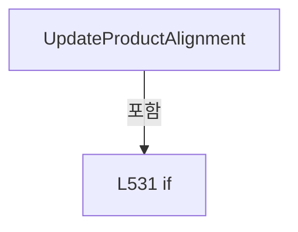

변경 전 점검: 입력/반환 타입, 위 호출자, 예외/취소 경로, 공유 상태와 저장·전송 소비자를 함께 확인합니다. 값의 단위나 물리 방향을 이름만으로 확정하지 않습니다.

### MethodDeclaration `TryUpdateProductAlignmentAfterFailure` · L552–562

[Drilling.Common/Station/CStationProcess.cs:552–562](https://github.com/kjuws10-rgb/A3Drilling/blob/334b3599651b2e8e0181fd4459bafaf3cddafff3/Drilling.Common/Station/CStationProcess.cs#L552-L562)

| 항목 | 실제 추출 값 |
| --- | --- |
| 서명 | void Drilling.Common.Station.CStationProcess.TryUpdateProductAlignmentAfterFailure(Drilling.Common.Station.ST_PROCESS_MODEL, Drilling.Common.Product.EN_PRODUCT_PROCESS_STATE, string) |
| 접근/수식자 | Private / private |
| 반환/값 타입 | void |
| 소속 타입 | NamedType:Drilling.Common.Station.CStationProcess |

입력 계약:

| 이름 | 타입 | 전달 | 선택/기본값 |
| --- | --- | --- | --- |
| processModel | Drilling.Common.Station.ST_PROCESS_MODEL | None | False /  |
| state | Drilling.Common.Product.EN_PRODUCT_PROCESS_STATE | None | False /  |
| result | string | None | False /  |

정적 호출자로 확인된 위치:

| 호출 파일/행 | 호출 표현식 | 런타임 분기 가능 |
| --- | --- | --- |
| [Drilling.Common/Station/CStationProcess.cs:516–516](https://github.com/kjuws10-rgb/A3Drilling/blob/334b3599651b2e8e0181fd4459bafaf3cddafff3/Drilling.Common/Station/CStationProcess.cs#L516-L516) | TryUpdateProductAlignmentAfterFailure | False |
| [Drilling.Common/Station/CStationProcess.cs:521–521](https://github.com/kjuws10-rgb/A3Drilling/blob/334b3599651b2e8e0181fd4459bafaf3cddafff3/Drilling.Common/Station/CStationProcess.cs#L521-L521) | TryUpdateProductAlignmentAfterFailure | False |

호출하는 대상과 해석 범위:

| 원본 행 | 표현식 | 분석 상태 | 대상/소스 위치 |
| --- | --- | --- | --- |
| 556 | UpdateProductAlignment | resolved | void Drilling.Common.Station.CStationProcess.UpdateProductAlignment(Drilling.Common.Station.ST_PROCESS_MODEL, Drilling.Common.Product.EN_PRODUCT_PROCESS_STATE, string, System.Threading.CancellationToken) · Drilling.Common/Station/CStationProcess.cs:528 |
| 560 | AddProcessLog | resolved | void Drilling.Common.Station.CStationProcess.AddProcessLog(string, string, string) · Drilling.Common/Station/CStationProcess.cs:2371 |

본문의 실제 연산·분기·예외·반환 순서(원문 위치 순):

| 원본 행 | 종류 | 주석 해설 |
| --- | --- | --- |
| 554 | try | 예외 처리 범위입니다: try |
| 556 | call | 함수·델리게이트 또는 객체 생성자를 호출합니다: UpdateProductAlignment(processModel, state, result, CancellationToken.None) |
| 558 | catch | 지정 예외를 처리합니다: catch (Exception updateException) |
| 560 | call | 함수·델리게이트 또는 객체 생성자를 호출합니다: AddProcessLog("ERROR", "PRODUCT", $"Product align state update failed. {updateException.Message}") |

제어 구문의 포함 구조(실제 실행 순서/CFG가 아닌 구문 탐색 그림):

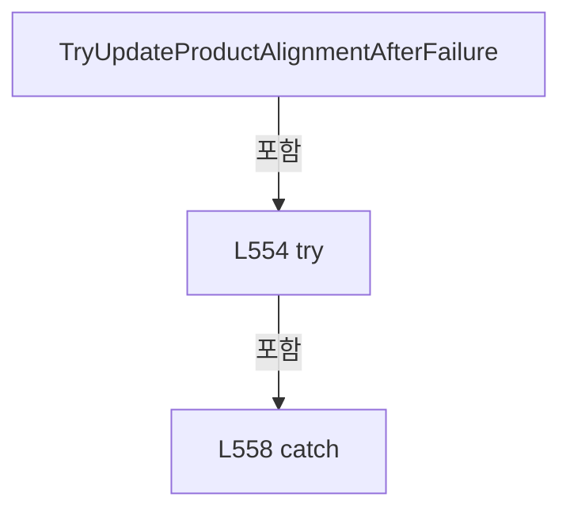

변경 전 점검: 입력/반환 타입, 위 호출자, 예외/취소 경로, 공유 상태와 저장·전송 소비자를 함께 확인합니다. 값의 단위나 물리 방향을 이름만으로 확정하지 않습니다.

### MethodDeclaration `RunProcessStep` · L564–575

[Drilling.Common/Station/CStationProcess.cs:564–575](https://github.com/kjuws10-rgb/A3Drilling/blob/334b3599651b2e8e0181fd4459bafaf3cddafff3/Drilling.Common/Station/CStationProcess.cs#L564-L575)

| 항목 | 실제 추출 값 |
| --- | --- |
| 서명 | void Drilling.Common.Station.CStationProcess.RunProcessStep(Drilling.Common.Station.ST_PROCESS_MODEL, System.Threading.CancellationToken) |
| 접근/수식자 | Private / private |
| 반환/값 타입 | void |
| 소속 타입 | NamedType:Drilling.Common.Station.CStationProcess |

입력 계약:

| 이름 | 타입 | 전달 | 선택/기본값 |
| --- | --- | --- | --- |
| processModel | Drilling.Common.Station.ST_PROCESS_MODEL | None | False /  |
| cancellationToken | System.Threading.CancellationToken | None | False /  |

현재 부분 분석에서 직접 연결된 호출자는 없습니다. XAML/이벤트/인터페이스·델리게이트·외부 진입을 추가 확인해야 하며, 미사용으로 판정한 것이 아닙니다.

호출하는 대상과 해석 범위:

| 원본 행 | 표현식 | 분석 상태 | 대상/소스 위치 |
| --- | --- | --- | --- |
| 566 | EnsurePreparedReviewOffsetIsCurrent | resolved | void Drilling.Common.Station.CStationProcess.EnsurePreparedReviewOffsetIsCurrent(Drilling.Common.Station.ST_PROCESS_MODEL, System.Threading.CancellationToken) · Drilling.Common/Station/CStationProcess.cs:1579 |
| 567 | _sequenceActions.Run | resolved | void Drilling.Common.Station.CSequenceActionStatusStore.Run(string, System.Action) · Drilling.Common/Station/CStationManager.cs:199 |
| 569 | BuildAutomationScript | resolved | void Drilling.Common.Station.CStationProcess.BuildAutomationScript(Drilling.Common.Station.ST_PROCESS_MODEL, System.Threading.CancellationToken) · Drilling.Common/Station/CStationProcess.cs:658 |
| 570 | UploadAutomationScript | resolved | void Drilling.Common.Station.CStationProcess.UploadAutomationScript(Drilling.Common.Station.ST_PROCESS_MODEL, System.Threading.CancellationToken) · Drilling.Common/Station/CStationProcess.cs:669 |
| 574 | RunScannerProcess | resolved | void Drilling.Common.Station.CStationProcess.RunScannerProcess(Drilling.Common.Station.ST_PROCESS_MODEL, System.Threading.CancellationToken) · Drilling.Common/Station/CStationProcess.cs:693 |

본문의 실제 연산·분기·예외·반환 순서(원문 위치 순):

| 원본 행 | 종류 | 주석 해설 |
| --- | --- | --- |
| 566 | call | 함수·델리게이트 또는 객체 생성자를 호출합니다: EnsurePreparedReviewOffsetIsCurrent(processModel, cancellationToken) |
| 567 | call | 함수·델리게이트 또는 객체 생성자를 호출합니다: _sequenceActions.Run(CSequenceActionIds.BuildUploadScript, () => { BuildAutomationScript(processModel, cancellationToken); UploadAutomationScript(processModel, cancellationToken); }) |
| 569 | call | 함수·델리게이트 또는 객체 생성자를 호출합니다: BuildAutomationScript(processModel, cancellationToken) |
| 570 | call | 함수·델리게이트 또는 객체 생성자를 호출합니다: UploadAutomationScript(processModel, cancellationToken) |
| 574 | call | 함수·델리게이트 또는 객체 생성자를 호출합니다: RunScannerProcess(processModel, cancellationToken) |

변경 전 점검: 입력/반환 타입, 위 호출자, 예외/취소 경로, 공유 상태와 저장·전송 소비자를 함께 확인합니다. 값의 단위나 물리 방향을 이름만으로 확정하지 않습니다.

### MethodDeclaration `MoveStageToScanStart` · L577–609

[Drilling.Common/Station/CStationProcess.cs:577–609](https://github.com/kjuws10-rgb/A3Drilling/blob/334b3599651b2e8e0181fd4459bafaf3cddafff3/Drilling.Common/Station/CStationProcess.cs#L577-L609)

| 항목 | 실제 추출 값 |
| --- | --- |
| 서명 | void Drilling.Common.Station.CStationProcess.MoveStageToScanStart(Drilling.Common.Station.ST_PROCESS_MODEL, System.Threading.CancellationToken) |
| 접근/수식자 | Private / private |
| 반환/값 타입 | void |
| 소속 타입 | NamedType:Drilling.Common.Station.CStationProcess |

입력 계약:

| 이름 | 타입 | 전달 | 선택/기본값 |
| --- | --- | --- | --- |
| processModel | Drilling.Common.Station.ST_PROCESS_MODEL | None | False /  |
| cancellationToken | System.Threading.CancellationToken | None | False /  |

현재 부분 분석에서 직접 연결된 호출자는 없습니다. XAML/이벤트/인터페이스·델리게이트·외부 진입을 추가 확인해야 하며, 미사용으로 판정한 것이 아닙니다.

호출하는 대상과 해석 범위:

| 원본 행 | 표현식 | 분석 상태 | 대상/소스 위치 |
| --- | --- | --- | --- |
| 579 | cancellationToken.ThrowIfCancellationRequested | resolved | void System.Threading.CancellationToken.ThrowIfCancellationRequested() |
| 581 | ReadDoubleAny | resolved | double Drilling.Common.Station.CStationProcess.ReadDoubleAny(System.Collections.Generic.IReadOnlyDictionary<string, string>, double, params string[]) · Drilling.Common/Station/CStationProcess.cs:2085 |
| 582 | ReadDoubleAny | resolved | double Drilling.Common.Station.CStationProcess.ReadDoubleAny(System.Collections.Generic.IReadOnlyDictionary<string, string>, double, params string[]) · Drilling.Common/Station/CStationProcess.cs:2085 |
| 583 | ReadDoubleAny | resolved | double Drilling.Common.Station.CStationProcess.ReadDoubleAny(System.Collections.Generic.IReadOnlyDictionary<string, string>, double, params string[]) · Drilling.Common/Station/CStationProcess.cs:2085 |
| 584 | ReadDoubleAny | resolved | double Drilling.Common.Station.CStationProcess.ReadDoubleAny(System.Collections.Generic.IReadOnlyDictionary<string, string>, double, params string[]) · Drilling.Common/Station/CStationProcess.cs:2085 |
| 585 | ReadDoubleAny | resolved | double Drilling.Common.Station.CStationProcess.ReadDoubleAny(System.Collections.Generic.IReadOnlyDictionary<string, string>, double, params string[]) · Drilling.Common/Station/CStationProcess.cs:2085 |
| 586 | ReadDoubleAny | resolved | double Drilling.Common.Station.CStationProcess.ReadDoubleAny(System.Collections.Generic.IReadOnlyDictionary<string, string>, double, params string[]) · Drilling.Common/Station/CStationProcess.cs:2085 |
| 589 | Math.Abs | resolved | double System.Math.Abs(double) |
| 589 | ReadDoubleAny | resolved | double Drilling.Common.Station.CStationProcess.ReadDoubleAny(System.Collections.Generic.IReadOnlyDictionary<string, string>, double, params string[]) · Drilling.Common/Station/CStationProcess.cs:2085 |
| 590 | ReadDirectionAny | resolved | double Drilling.Common.Station.CStationProcess.ReadDirectionAny(System.Collections.Generic.IReadOnlyDictionary<string, string>, double, params string[]) · Drilling.Common/Station/CStationProcess.cs:1952 |
| 591 | ResolveFirstShotStageY | resolved | double Drilling.Common.Station.CStationProcess.ResolveFirstShotStageY(Drilling.Common.Station.ST_PROCESS_MODEL, double) · Drilling.Common/Station/CStationProcess.cs:611 |
| 593 | ReadDoubleAny | resolved | double Drilling.Common.Station.CStationProcess.ReadDoubleAny(System.Collections.Generic.IReadOnlyDictionary<string, string>, double, params string[]) · Drilling.Common/Station/CStationProcess.cs:2085 |
| 594 | SendProcessControlCommand | resolved | void Drilling.Common.Station.CStationProcess.SendProcessControlCommand(string, System.Collections.Generic.IReadOnlyList<(string Key, string Value)>, System.Threading.CancellationToken) · Drilling.Common/Station/CStationProcess.cs:639 |
| 594 | FormatDouble | resolved | string Drilling.Common.Station.CStationProcess.FormatDouble(double) · Drilling.Common/Station/CStationProcess.cs:1947 |
| 594 | FormatDouble | resolved | string Drilling.Common.Station.CStationProcess.FormatDouble(double) · Drilling.Common/Station/CStationProcess.cs:1947 |
| 594 | FormatDouble | resolved | string Drilling.Common.Station.CStationProcess.FormatDouble(double) · Drilling.Common/Station/CStationProcess.cs:1947 |
| 595 | SendProcessControlCommand | resolved | void Drilling.Common.Station.CStationProcess.SendProcessControlCommand(string, System.Collections.Generic.IReadOnlyList<(string Key, string Value)>, System.Threading.CancellationToken) · Drilling.Common/Station/CStationProcess.cs:639 |
| 596 | FormatDouble | resolved | string Drilling.Common.Station.CStationProcess.FormatDouble(double) · Drilling.Common/Station/CStationProcess.cs:1947 |
| 597 | FormatDouble | resolved | string Drilling.Common.Station.CStationProcess.FormatDouble(double) · Drilling.Common/Station/CStationProcess.cs:1947 |
| 598 | FormatDouble | resolved | string Drilling.Common.Station.CStationProcess.FormatDouble(double) · Drilling.Common/Station/CStationProcess.cs:1947 |
| 599 | FormatDouble | resolved | string Drilling.Common.Station.CStationProcess.FormatDouble(double) · Drilling.Common/Station/CStationProcess.cs:1947 |
| 600 | FormatDouble | resolved | string Drilling.Common.Station.CStationProcess.FormatDouble(double) · Drilling.Common/Station/CStationProcess.cs:1947 |
| 601 | FormatDouble | resolved | string Drilling.Common.Station.CStationProcess.FormatDouble(double) · Drilling.Common/Station/CStationProcess.cs:1947 |
| 602 | FormatDouble | resolved | string Drilling.Common.Station.CStationProcess.FormatDouble(double) · Drilling.Common/Station/CStationProcess.cs:1947 |
| 603 | FormatDouble | resolved | string Drilling.Common.Station.CStationProcess.FormatDouble(double) · Drilling.Common/Station/CStationProcess.cs:1947 |
| 604 | FormatDouble | resolved | string Drilling.Common.Station.CStationProcess.FormatDouble(double) · Drilling.Common/Station/CStationProcess.cs:1947 |
| 605 | FormatDouble | resolved | string Drilling.Common.Station.CStationProcess.FormatDouble(double) · Drilling.Common/Station/CStationProcess.cs:1947 |
| 606 | FormatDouble | resolved | string Drilling.Common.Station.CStationProcess.FormatDouble(double) · Drilling.Common/Station/CStationProcess.cs:1947 |
| 608 | AddProcessLog | resolved | void Drilling.Common.Station.CStationProcess.AddProcessLog(string, string, string) · Drilling.Common/Station/CStationProcess.cs:2371 |
| 608 | FormatDouble | resolved | string Drilling.Common.Station.CStationProcess.FormatDouble(double) · Drilling.Common/Station/CStationProcess.cs:1947 |
| 608 | FormatDouble | resolved | string Drilling.Common.Station.CStationProcess.FormatDouble(double) · Drilling.Common/Station/CStationProcess.cs:1947 |
| 608 | FormatDouble | resolved | string Drilling.Common.Station.CStationProcess.FormatDouble(double) · Drilling.Common/Station/CStationProcess.cs:1947 |
| 608 | FormatDouble | resolved | string Drilling.Common.Station.CStationProcess.FormatDouble(double) · Drilling.Common/Station/CStationProcess.cs:1947 |
| 608 | FormatDouble | resolved | string Drilling.Common.Station.CStationProcess.FormatDouble(double) · Drilling.Common/Station/CStationProcess.cs:1947 |
| 608 | FormatDouble | resolved | string Drilling.Common.Station.CStationProcess.FormatDouble(double) · Drilling.Common/Station/CStationProcess.cs:1947 |
| 608 | FormatDouble | resolved | string Drilling.Common.Station.CStationProcess.FormatDouble(double) · Drilling.Common/Station/CStationProcess.cs:1947 |
| 608 | FormatDouble | resolved | string Drilling.Common.Station.CStationProcess.FormatDouble(double) · Drilling.Common/Station/CStationProcess.cs:1947 |
| 608 | FormatDouble | resolved | string Drilling.Common.Station.CStationProcess.FormatDouble(double) · Drilling.Common/Station/CStationProcess.cs:1947 |

본문의 실제 연산·분기·예외·반환 순서(원문 위치 순):

| 원본 행 | 종류 | 주석 해설 |
| --- | --- | --- |
| 579 | call | 함수·델리게이트 또는 객체 생성자를 호출합니다: cancellationToken.ThrowIfCancellationRequested() |
| 580 | local-declaration | 지역 변수를 선언합니다: var parameters = processModel.Parameters; |
| 580 | variable-initializer | 변수의 초기값을 지정합니다: parameters = processModel.Parameters |
| 581 | call | 함수·델리게이트 또는 객체 생성자를 호출합니다: ReadDoubleAny(parameters, 0.0, "STAGE_START_POS_X") |
| 581 | local-declaration | 지역 변수를 선언합니다: var startX = ReadDoubleAny(parameters, 0.0, "STAGE_START_POS_X"); |
| 581 | variable-initializer | 변수의 초기값을 지정합니다: startX = ReadDoubleAny(parameters, 0.0, "STAGE_START_POS_X") |
| 582 | call | 함수·델리게이트 또는 객체 생성자를 호출합니다: ReadDoubleAny(parameters, 0.0, "STAGE_START_POS_Y") |
| 582 | local-declaration | 지역 변수를 선언합니다: var startY = ReadDoubleAny(parameters, 0.0, "STAGE_START_POS_Y"); |
| 582 | variable-initializer | 변수의 초기값을 지정합니다: startY = ReadDoubleAny(parameters, 0.0, "STAGE_START_POS_Y") |
| 583 | call | 함수·델리게이트 또는 객체 생성자를 호출합니다: ReadDoubleAny(parameters, 0.0, "REVIEW_CAMERA_ALIGN_KEY_POS_X") |
| 583 | local-declaration | 지역 변수를 선언합니다: var reviewCameraAlignKeyPosX = ReadDoubleAny(parameters, 0.0, "REVIEW_CAMERA_ALIGN_KEY_POS_X"); |
| 583 | variable-initializer | 변수의 초기값을 지정합니다: reviewCameraAlignKeyPosX = ReadDoubleAny(parameters, 0.0, "REVIEW_CAMERA_ALIGN_KEY_POS_X") |
| 584 | call | 함수·델리게이트 또는 객체 생성자를 호출합니다: ReadDoubleAny(parameters, startY, "REVIEW_CAMERA_ALIGN_KEY_POS_Y") |
| 584 | local-declaration | 지역 변수를 선언합니다: var reviewCameraAlignKeyPosY = ReadDoubleAny(parameters, startY, "REVIEW_CAMERA_ALIGN_KEY_POS_Y"); |
| 584 | variable-initializer | 변수의 초기값을 지정합니다: reviewCameraAlignKeyPosY = ReadDoubleAny(parameters, startY, "REVIEW_CAMERA_ALIGN_KEY_POS_Y") |
| 585 | call | 함수·델리게이트 또는 객체 생성자를 호출합니다: ReadDoubleAny(parameters, 0.0, "REVIEW_TO_HEAD1_GAP_Y") |
| 585 | local-declaration | 지역 변수를 선언합니다: var reviewToHead1GapY = ReadDoubleAny(parameters, 0.0, "REVIEW_TO_HEAD1_GAP_Y"); |
| 585 | variable-initializer | 변수의 초기값을 지정합니다: reviewToHead1GapY = ReadDoubleAny(parameters, 0.0, "REVIEW_TO_HEAD1_GAP_Y") |
| 586 | call | 함수·델리게이트 또는 객체 생성자를 호출합니다: ReadDoubleAny(parameters, 0.0, "HeadGapY") |
| 586 | local-declaration | 지역 변수를 선언합니다: var headGapY = ReadDoubleAny(parameters, 0.0, "HeadGapY"); |
| 586 | variable-initializer | 변수의 초기값을 지정합니다: headGapY = ReadDoubleAny(parameters, 0.0, "HeadGapY") |
| 587 | local-declaration | 지역 변수를 선언합니다: var head1AlignKeyY = reviewCameraAlignKeyPosY + reviewToHead1GapY; |
| 587 | variable-initializer | 변수의 초기값을 지정합니다: head1AlignKeyY = reviewCameraAlignKeyPosY + reviewToHead1GapY |
| 588 | local-declaration | 지역 변수를 선언합니다: var head2AlignKeyY = head1AlignKeyY + headGapY; |
| 588 | variable-initializer | 변수의 초기값을 지정합니다: head2AlignKeyY = head1AlignKeyY + headGapY |
| 589 | call | 함수·델리게이트 또는 객체 생성자를 호출합니다: Math.Abs(ReadDoubleAny(parameters, 0.0, "SCAN_START_DELAY_LENGTH_Y")) |
| 589 | call | 함수·델리게이트 또는 객체 생성자를 호출합니다: ReadDoubleAny(parameters, 0.0, "SCAN_START_DELAY_LENGTH_Y") |
| 589 | local-declaration | 지역 변수를 선언합니다: var delayLengthY = Math.Abs(ReadDoubleAny(parameters, 0.0, "SCAN_START_DELAY_LENGTH_Y")); |
| 589 | variable-initializer | 변수의 초기값을 지정합니다: delayLengthY = Math.Abs(ReadDoubleAny(parameters, 0.0, "SCAN_START_DELAY_LENGTH_Y")) |
| 590 | call | 함수·델리게이트 또는 객체 생성자를 호출합니다: ReadDirectionAny(parameters, -1.0, "STAGE_SCAN_DIRECTION_Y") |
| 590 | local-declaration | 지역 변수를 선언합니다: var stageScanDirectionY = ReadDirectionAny(parameters, -1.0, "STAGE_SCAN_DIRECTION_Y"); |
| 590 | variable-initializer | 변수의 초기값을 지정합니다: stageScanDirectionY = ReadDirectionAny(parameters, -1.0, "STAGE_SCAN_DIRECTION_Y") |
| 591 | call | 함수·델리게이트 또는 객체 생성자를 호출합니다: ResolveFirstShotStageY(processModel, stageScanDirectionY) |
| 591 | local-declaration | 지역 변수를 선언합니다: var firstShotStageY = ResolveFirstShotStageY(processModel, stageScanDirectionY); |
| 591 | variable-initializer | 변수의 초기값을 지정합니다: firstShotStageY = ResolveFirstShotStageY(processModel, stageScanDirectionY) |
| 592 | local-declaration | 지역 변수를 선언합니다: var scanStartY = reviewCameraAlignKeyPosY + firstShotStageY - (stageScanDirectionY * delayLengthY); |
| 592 | variable-initializer | 변수의 초기값을 지정합니다: scanStartY = reviewCameraAlignKeyPosY + firstShotStageY - (stageScanDirectionY * delayLengthY) |
| 593 | call | 함수·델리게이트 또는 객체 생성자를 호출합니다: ReadDoubleAny(parameters, 100.0, "STAGE_SPEED") |
| 593 | local-declaration | 지역 변수를 선언합니다: var stageYSpeed = ReadDoubleAny(parameters, 100.0, "STAGE_SPEED"); |
| 593 | variable-initializer | 변수의 초기값을 지정합니다: stageYSpeed = ReadDoubleAny(parameters, 100.0, "STAGE_SPEED") |
| 594 | call | 함수·델리게이트 또는 객체 생성자를 호출합니다: SendProcessControlCommand("PROCESS_STAGE_START_MOVE", [("X", FormatDouble(startX)), ("Y", FormatDouble(startY)), ("SPEED_Y", FormatDouble(stageYSpeed))], cancellationToken) |
| 594 | call | 함수·델리게이트 또는 객체 생성자를 호출합니다: FormatDouble(startX) |
| 594 | call | 함수·델리게이트 또는 객체 생성자를 호출합니다: FormatDouble(startY) |
| 594 | call | 함수·델리게이트 또는 객체 생성자를 호출합니다: FormatDouble(stageYSpeed) |
| 595 | call | 함수·델리게이트 또는 객체 생성자를 호출합니다: SendProcessControlCommand("PROCESS_STAGE_SCAN_START_MOVE", [ ("Y", FormatDouble(scanStartY)), ("REVIEW_CAMERA_X", FormatDouble(reviewCameraAlignKeyPosX)), ("REVIEW_CAMERA_ALIGN_KEY_Y", FormatDouble(reviewCameraAlignKeyPo… |
| 596 | call | 함수·델리게이트 또는 객체 생성자를 호출합니다: FormatDouble(scanStartY) |
| 597 | call | 함수·델리게이트 또는 객체 생성자를 호출합니다: FormatDouble(reviewCameraAlignKeyPosX) |
| 598 | call | 함수·델리게이트 또는 객체 생성자를 호출합니다: FormatDouble(reviewCameraAlignKeyPosY) |
| 599 | call | 함수·델리게이트 또는 객체 생성자를 호출합니다: FormatDouble(reviewToHead1GapY) |
| 600 | call | 함수·델리게이트 또는 객체 생성자를 호출합니다: FormatDouble(headGapY) |
| 601 | call | 함수·델리게이트 또는 객체 생성자를 호출합니다: FormatDouble(head1AlignKeyY) |
| 602 | call | 함수·델리게이트 또는 객체 생성자를 호출합니다: FormatDouble(head2AlignKeyY) |
| 603 | call | 함수·델리게이트 또는 객체 생성자를 호출합니다: FormatDouble(reviewCameraAlignKeyPosY + firstShotStageY) |
| 604 | call | 함수·델리게이트 또는 객체 생성자를 호출합니다: FormatDouble(delayLengthY) |
| 605 | call | 함수·델리게이트 또는 객체 생성자를 호출합니다: FormatDouble(stageScanDirectionY) |
| 606 | call | 함수·델리게이트 또는 객체 생성자를 호출합니다: FormatDouble(stageYSpeed) |
| 608 | call | 함수·델리게이트 또는 객체 생성자를 호출합니다: AddProcessLog("INFO", "STAGE", $"Stage scan start ready. Start=({FormatDouble(startX)}, {FormatDouble(startY)}), ReviewCameraAlignKey=({FormatDouble(reviewCameraAlignKeyPosX)}, {FormatDouble(reviewCameraAlignKeyPosY)}), … |
| 608 | call | 함수·델리게이트 또는 객체 생성자를 호출합니다: FormatDouble(startX) |
| 608 | call | 함수·델리게이트 또는 객체 생성자를 호출합니다: FormatDouble(startY) |
| 608 | call | 함수·델리게이트 또는 객체 생성자를 호출합니다: FormatDouble(reviewCameraAlignKeyPosX) |
| 608 | call | 함수·델리게이트 또는 객체 생성자를 호출합니다: FormatDouble(reviewCameraAlignKeyPosY) |
| 608 | call | 함수·델리게이트 또는 객체 생성자를 호출합니다: FormatDouble(reviewToHead1GapY) |
| 608 | call | 함수·델리게이트 또는 객체 생성자를 호출합니다: FormatDouble(headGapY) |
| 608 | call | 함수·델리게이트 또는 객체 생성자를 호출합니다: FormatDouble(reviewCameraAlignKeyPosY + firstShotStageY) |
| 608 | call | 함수·델리게이트 또는 객체 생성자를 호출합니다: FormatDouble(delayLengthY) |
| 608 | call | 함수·델리게이트 또는 객체 생성자를 호출합니다: FormatDouble(scanStartY) |

변경 전 점검: 입력/반환 타입, 위 호출자, 예외/취소 경로, 공유 상태와 저장·전송 소비자를 함께 확인합니다. 값의 단위나 물리 방향을 이름만으로 확정하지 않습니다.

### MethodDeclaration `ResolveFirstShotStageY` · L611–637

[Drilling.Common/Station/CStationProcess.cs:611–637](https://github.com/kjuws10-rgb/A3Drilling/blob/334b3599651b2e8e0181fd4459bafaf3cddafff3/Drilling.Common/Station/CStationProcess.cs#L611-L637)

| 항목 | 실제 추출 값 |
| --- | --- |
| 서명 | double Drilling.Common.Station.CStationProcess.ResolveFirstShotStageY(Drilling.Common.Station.ST_PROCESS_MODEL, double) |
| 접근/수식자 | Private / private |
| 반환/값 타입 | double |
| 소속 타입 | NamedType:Drilling.Common.Station.CStationProcess |

입력 계약:

| 이름 | 타입 | 전달 | 선택/기본값 |
| --- | --- | --- | --- |
| processModel | Drilling.Common.Station.ST_PROCESS_MODEL | None | False /  |
| stageScanDirectionY | double | None | False /  |

정적 호출자로 확인된 위치:

| 호출 파일/행 | 호출 표현식 | 런타임 분기 가능 |
| --- | --- | --- |
| [Drilling.Common/Station/CStationProcess.cs:591–591](https://github.com/kjuws10-rgb/A3Drilling/blob/334b3599651b2e8e0181fd4459bafaf3cddafff3/Drilling.Common/Station/CStationProcess.cs#L591-L591) | ResolveFirstShotStageY | False |

호출하는 대상과 해석 범위:

| 원본 행 | 표현식 | 분석 상태 | 대상/소스 위치 |
| --- | --- | --- | --- |
| 618 | processModel.HeadPlans.SelectMany(SelectShots).ToArray | resolved | Drilling.Common.Recipe.ST_HEAD_SHOT_POINT[] System.Collections.Generic.IEnumerable<Drilling.Common.Recipe.ST_HEAD_SHOT_POINT>.ToArray<Drilling.Common.Recipe.ST_HEAD_SHOT_POINT>() |
| 618 | processModel.HeadPlans.SelectMany | resolved | System.Collections.Generic.IEnumerable<Drilling.Common.Recipe.ST_HEAD_SHOT_POINT> System.Collections.Generic.IEnumerable<Drilling.Common.Station.ST_HEAD_PROCESS_PLAN>.SelectMany<Drilling.Common.Station.ST_HEAD_PROCESS_PLAN, Drilling.Common.Recipe.ST_HEAD_SHOT_POINT>(System.Func<Drilling.Common.Station.ST_HEAD_PROCESS_PLAN, System.Collections.Generic.IEnumerable<Drilling.Common.Recipe.ST_HEAD_SHOT_POINT>>) |
| 621 | ReadDoubleAny | resolved | double Drilling.Common.Station.CStationProcess.ReadDoubleAny(System.Collections.Generic.IReadOnlyDictionary<string, string>, double, params string[]) · Drilling.Common/Station/CStationProcess.cs:2085 |
| 622 | ReadDoubleAny | resolved | double Drilling.Common.Station.CStationProcess.ReadDoubleAny(System.Collections.Generic.IReadOnlyDictionary<string, string>, double, params string[]) · Drilling.Common/Station/CStationProcess.cs:2085 |
| 636 | shots.Max | resolved | double System.Collections.Generic.IEnumerable<Drilling.Common.Recipe.ST_HEAD_SHOT_POINT>.Max<Drilling.Common.Recipe.ST_HEAD_SHOT_POINT>(System.Func<Drilling.Common.Recipe.ST_HEAD_SHOT_POINT, double>) |
| 636 | shots.Min | resolved | double System.Collections.Generic.IEnumerable<Drilling.Common.Recipe.ST_HEAD_SHOT_POINT>.Min<Drilling.Common.Recipe.ST_HEAD_SHOT_POINT>(System.Func<Drilling.Common.Recipe.ST_HEAD_SHOT_POINT, double>) |

본문의 실제 연산·분기·예외·반환 순서(원문 위치 순):

| 원본 행 | 종류 | 주석 해설 |
| --- | --- | --- |
| 618 | call | 함수·델리게이트 또는 객체 생성자를 호출합니다: processModel.HeadPlans.SelectMany(SelectShots).ToArray() |
| 618 | call | 함수·델리게이트 또는 객체 생성자를 호출합니다: processModel.HeadPlans.SelectMany(SelectShots) |
| 618 | local-declaration | 지역 변수를 선언합니다: var shots = processModel.HeadPlans.SelectMany(SelectShots).ToArray(); |
| 618 | variable-initializer | 변수의 초기값을 지정합니다: shots = processModel.HeadPlans.SelectMany(SelectShots).ToArray() |
| 619 | if | 조건에 따라 분기합니다: if (shots.Length == 0) |
| 621 | call | 함수·델리게이트 또는 객체 생성자를 호출합니다: ReadDoubleAny(processModel.Parameters, 0.0, "REVIEW_TO_HEAD1_GAP_Y") |
| 621 | local-declaration | 지역 변수를 선언합니다: var reviewToHead1GapY = ReadDoubleAny(processModel.Parameters, 0.0, "REVIEW_TO_HEAD1_GAP_Y"); |
| 621 | variable-initializer | 변수의 초기값을 지정합니다: reviewToHead1GapY = ReadDoubleAny(processModel.Parameters, 0.0, "REVIEW_TO_HEAD1_GAP_Y") |
| 622 | call | 함수·델리게이트 또는 객체 생성자를 호출합니다: ReadDoubleAny(processModel.Parameters, 0.0, "HeadGapY") |
| 622 | local-declaration | 지역 변수를 선언합니다: var headGapY = ReadDoubleAny(processModel.Parameters, 0.0, "HeadGapY"); |
| 622 | variable-initializer | 변수의 초기값을 지정합니다: headGapY = ReadDoubleAny(processModel.Parameters, 0.0, "HeadGapY") |
| 623 | return | 호출자에게 값 또는 제어를 반환합니다: return reviewToHead1GapY + headGapY; |
| 636 | call | 함수·델리게이트 또는 객체 생성자를 호출합니다: shots.Max(SelectStageY) |
| 636 | call | 함수·델리게이트 또는 객체 생성자를 호출합니다: shots.Min(SelectStageY2) |
| 636 | conditional-expression | 조건에 따라 결과식을 선택합니다: stageScanDirectionY < 0.0 ? shots.Max(SelectStageY) : shots.Min(SelectStageY2) |
| 636 | return | 호출자에게 값 또는 제어를 반환합니다: return stageScanDirectionY < 0.0 ? shots.Max(SelectStageY) : shots.Min(SelectStageY2); |

제어 구문의 포함 구조(실제 실행 순서/CFG가 아닌 구문 탐색 그림):


변경 전 점검: 입력/반환 타입, 위 호출자, 예외/취소 경로, 공유 상태와 저장·전송 소비자를 함께 확인합니다. 값의 단위나 물리 방향을 이름만으로 확정하지 않습니다.

### LocalFunctionStatement `SelectShots` · L613–616

[Drilling.Common/Station/CStationProcess.cs:613–616](https://github.com/kjuws10-rgb/A3Drilling/blob/334b3599651b2e8e0181fd4459bafaf3cddafff3/Drilling.Common/Station/CStationProcess.cs#L613-L616)

| 항목 | 실제 추출 값 |
| --- | --- |
| 서명 | System.Collections.Generic.IEnumerable<Drilling.Common.Recipe.ST_HEAD_SHOT_POINT> SelectShots(Drilling.Common.Station.ST_HEAD_PROCESS_PLAN) |
| 접근/수식자 | Private /  |
| 반환/값 타입 | System.Collections.Generic.IEnumerable<Drilling.Common.Recipe.ST_HEAD_SHOT_POINT> |
| 소속 타입 | NamedType:Drilling.Common.Station.CStationProcess |

입력 계약:

| 이름 | 타입 | 전달 | 선택/기본값 |
| --- | --- | --- | --- |
| head | Drilling.Common.Station.ST_HEAD_PROCESS_PLAN | None | False /  |

현재 부분 분석에서 직접 연결된 호출자는 없습니다. XAML/이벤트/인터페이스·델리게이트·외부 진입을 추가 확인해야 하며, 미사용으로 판정한 것이 아닙니다.

본문의 실제 연산·분기·예외·반환 순서(원문 위치 순):

| 원본 행 | 종류 | 주석 해설 |
| --- | --- | --- |
| 615 | return | 호출자에게 값 또는 제어를 반환합니다: return head.Shots; |

변경 전 점검: 입력/반환 타입, 위 호출자, 예외/취소 경로, 공유 상태와 저장·전송 소비자를 함께 확인합니다. 값의 단위나 물리 방향을 이름만으로 확정하지 않습니다.

### LocalFunctionStatement `SelectStageY` · L626–629

[Drilling.Common/Station/CStationProcess.cs:626–629](https://github.com/kjuws10-rgb/A3Drilling/blob/334b3599651b2e8e0181fd4459bafaf3cddafff3/Drilling.Common/Station/CStationProcess.cs#L626-L629)

| 항목 | 실제 추출 값 |
| --- | --- |
| 서명 | double SelectStageY(Drilling.Common.Recipe.ST_HEAD_SHOT_POINT) |
| 접근/수식자 | Private /  |
| 반환/값 타입 | double |
| 소속 타입 | NamedType:Drilling.Common.Station.CStationProcess |

입력 계약:

| 이름 | 타입 | 전달 | 선택/기본값 |
| --- | --- | --- | --- |
| shot | Drilling.Common.Recipe.ST_HEAD_SHOT_POINT | None | False /  |

현재 부분 분석에서 직접 연결된 호출자는 없습니다. XAML/이벤트/인터페이스·델리게이트·외부 진입을 추가 확인해야 하며, 미사용으로 판정한 것이 아닙니다.

본문의 실제 연산·분기·예외·반환 순서(원문 위치 순):

| 원본 행 | 종류 | 주석 해설 |
| --- | --- | --- |
| 628 | return | 호출자에게 값 또는 제어를 반환합니다: return shot.StageY; |

변경 전 점검: 입력/반환 타입, 위 호출자, 예외/취소 경로, 공유 상태와 저장·전송 소비자를 함께 확인합니다. 값의 단위나 물리 방향을 이름만으로 확정하지 않습니다.

### LocalFunctionStatement `SelectStageY2` · L631–634

[Drilling.Common/Station/CStationProcess.cs:631–634](https://github.com/kjuws10-rgb/A3Drilling/blob/334b3599651b2e8e0181fd4459bafaf3cddafff3/Drilling.Common/Station/CStationProcess.cs#L631-L634)

| 항목 | 실제 추출 값 |
| --- | --- |
| 서명 | double SelectStageY2(Drilling.Common.Recipe.ST_HEAD_SHOT_POINT) |
| 접근/수식자 | Private /  |
| 반환/값 타입 | double |
| 소속 타입 | NamedType:Drilling.Common.Station.CStationProcess |

입력 계약:

| 이름 | 타입 | 전달 | 선택/기본값 |
| --- | --- | --- | --- |
| shot | Drilling.Common.Recipe.ST_HEAD_SHOT_POINT | None | False /  |

현재 부분 분석에서 직접 연결된 호출자는 없습니다. XAML/이벤트/인터페이스·델리게이트·외부 진입을 추가 확인해야 하며, 미사용으로 판정한 것이 아닙니다.

본문의 실제 연산·분기·예외·반환 순서(원문 위치 순):

| 원본 행 | 종류 | 주석 해설 |
| --- | --- | --- |
| 633 | return | 호출자에게 값 또는 제어를 반환합니다: return shot.StageY; |

변경 전 점검: 입력/반환 타입, 위 호출자, 예외/취소 경로, 공유 상태와 저장·전송 소비자를 함께 확인합니다. 값의 단위나 물리 방향을 이름만으로 확정하지 않습니다.

### MethodDeclaration `SendProcessControlCommand` · L639–651

[Drilling.Common/Station/CStationProcess.cs:639–651](https://github.com/kjuws10-rgb/A3Drilling/blob/334b3599651b2e8e0181fd4459bafaf3cddafff3/Drilling.Common/Station/CStationProcess.cs#L639-L651)

| 항목 | 실제 추출 값 |
| --- | --- |
| 서명 | void Drilling.Common.Station.CStationProcess.SendProcessControlCommand(string, System.Collections.Generic.IReadOnlyList<(string Key, string Value)>, System.Threading.CancellationToken) |
| 접근/수식자 | Private / private |
| 반환/값 타입 | void |
| 소속 타입 | NamedType:Drilling.Common.Station.CStationProcess |

입력 계약:

| 이름 | 타입 | 전달 | 선택/기본값 |
| --- | --- | --- | --- |
| commandName | string | None | False /  |
| arguments | System.Collections.Generic.IReadOnlyList<(string Key, string Value)> | None | False /  |
| cancellationToken | System.Threading.CancellationToken | None | False /  |

정적 호출자로 확인된 위치:

| 호출 파일/행 | 호출 표현식 | 런타임 분기 가능 |
| --- | --- | --- |
| [Drilling.Common/Station/CStationProcess.cs:511–511](https://github.com/kjuws10-rgb/A3Drilling/blob/334b3599651b2e8e0181fd4459bafaf3cddafff3/Drilling.Common/Station/CStationProcess.cs#L511-L511) | SendProcessControlCommand | False |
| [Drilling.Common/Station/CStationProcess.cs:594–594](https://github.com/kjuws10-rgb/A3Drilling/blob/334b3599651b2e8e0181fd4459bafaf3cddafff3/Drilling.Common/Station/CStationProcess.cs#L594-L594) | SendProcessControlCommand | False |
| [Drilling.Common/Station/CStationProcess.cs:595–607](https://github.com/kjuws10-rgb/A3Drilling/blob/334b3599651b2e8e0181fd4459bafaf3cddafff3/Drilling.Common/Station/CStationProcess.cs#L595-L607) | SendProcessControlCommand | False |

호출하는 대상과 해석 범위:

| 원본 행 | 표현식 | 분석 상태 | 대상/소스 위치 |
| --- | --- | --- | --- |
| 641 | FormatCommand | resolved | string Drilling.Common.Station.CStationProcess.FormatCommand(string, System.Collections.Generic.IReadOnlyList<(string Key, string Value)>) · Drilling.Common/Station/CStationProcess.cs:2003 |
| 642 | AddProcessLog | resolved | void Drilling.Common.Station.CStationProcess.AddProcessLog(string, string, string) · Drilling.Common/Station/CStationProcess.cs:2371 |
| 643 | _interfaceManager.ExecuteFunction(EN_EQP_MODULE.WonikCtrl, 0, command, cancellationToken).GetAwaiter().GetResult | resolved | string System.Runtime.CompilerServices.TaskAwaiter<string>.GetResult() |
| 643 | _interfaceManager.ExecuteFunction(EN_EQP_MODULE.WonikCtrl, 0, command, cancellationToken).GetAwaiter | resolved | System.Runtime.CompilerServices.TaskAwaiter<string> System.Threading.Tasks.Task<string>.GetAwaiter() |
| 643 | _interfaceManager.ExecuteFunction | resolved · 동적 구현 선택 가능 | System.Threading.Tasks.Task<string> Drilling.Common.Interface.CInterfaceManager.ExecuteFunction(Drilling.Common.Interface.EN_EQP_MODULE, int, string, System.Threading.CancellationToken) · Drilling.Common/Interface/CInterfaceManager.cs:320 |
| 644 | IsProcessControlSuccessResponse | resolved | bool Drilling.Common.Station.CStationProcess.IsProcessControlSuccessResponse(string) · Drilling.Common/Station/CStationProcess.cs:2013 |
| 646 | AddProcessLog | resolved | void Drilling.Common.Station.CStationProcess.AddProcessLog(string, string, string) · Drilling.Common/Station/CStationProcess.cs:2371 |
| 646 | FormatResponseForLog | resolved | string Drilling.Common.Station.CStationProcess.FormatResponseForLog(string) · Drilling.Common/Station/CStationProcess.cs:2024 |
| 647 | new InvalidOperationException | resolved | System.InvalidOperationException.InvalidOperationException(string?) |
| 647 | FormatResponseForLog | resolved | string Drilling.Common.Station.CStationProcess.FormatResponseForLog(string) · Drilling.Common/Station/CStationProcess.cs:2024 |
| 650 | AddProcessLog | resolved | void Drilling.Common.Station.CStationProcess.AddProcessLog(string, string, string) · Drilling.Common/Station/CStationProcess.cs:2371 |

본문의 실제 연산·분기·예외·반환 순서(원문 위치 순):

| 원본 행 | 종류 | 주석 해설 |
| --- | --- | --- |
| 641 | call | 함수·델리게이트 또는 객체 생성자를 호출합니다: FormatCommand(commandName, arguments) |
| 641 | local-declaration | 지역 변수를 선언합니다: var command = FormatCommand(commandName, arguments); |
| 641 | variable-initializer | 변수의 초기값을 지정합니다: command = FormatCommand(commandName, arguments) |
| 642 | call | 함수·델리게이트 또는 객체 생성자를 호출합니다: AddProcessLog("INFO", "STAGE", $"Stage command requested. {command}") |
| 643 | call | 함수·델리게이트 또는 객체 생성자를 호출합니다: _interfaceManager.ExecuteFunction(EN_EQP_MODULE.WonikCtrl, 0, command, cancellationToken).GetAwaiter().GetResult() |
| 643 | call | 함수·델리게이트 또는 객체 생성자를 호출합니다: _interfaceManager.ExecuteFunction(EN_EQP_MODULE.WonikCtrl, 0, command, cancellationToken).GetAwaiter() |
| 643 | call | 함수·델리게이트 또는 객체 생성자를 호출합니다: _interfaceManager.ExecuteFunction(EN_EQP_MODULE.WonikCtrl, 0, command, cancellationToken) |
| 643 | local-declaration | 지역 변수를 선언합니다: var response = _interfaceManager.ExecuteFunction(EN_EQP_MODULE.WonikCtrl, 0, command, cancellationToken).GetAwaiter().GetResult(); |
| 643 | variable-initializer | 변수의 초기값을 지정합니다: response = _interfaceManager.ExecuteFunction(EN_EQP_MODULE.WonikCtrl, 0, command, cancellationToken).GetAwaiter().GetResult() |
| 644 | call | 함수·델리게이트 또는 객체 생성자를 호출합니다: IsProcessControlSuccessResponse(response) |
| 644 | if | 조건에 따라 분기합니다: if (!IsProcessControlSuccessResponse(response)) |
| 646 | call | 함수·델리게이트 또는 객체 생성자를 호출합니다: AddProcessLog("ERROR", "STAGE", $"Stage command rejected. {commandName}: {FormatResponseForLog(response)}") |
| 646 | call | 함수·델리게이트 또는 객체 생성자를 호출합니다: FormatResponseForLog(response) |
| 647 | call | 함수·델리게이트 또는 객체 생성자를 호출합니다: new InvalidOperationException($"Stage command failed: {commandName}. Response={FormatResponseForLog(response)}") |
| 647 | call | 함수·델리게이트 또는 객체 생성자를 호출합니다: FormatResponseForLog(response) |
| 647 | throw | 예외를 발생/전달합니다: throw new InvalidOperationException($"Stage command failed: {commandName}. Response={FormatResponseForLog(response)}"); |
| 650 | call | 함수·델리게이트 또는 객체 생성자를 호출합니다: AddProcessLog("INFO", "STAGE", $"Stage command accepted. {response}") |

제어 구문의 포함 구조(실제 실행 순서/CFG가 아닌 구문 탐색 그림):

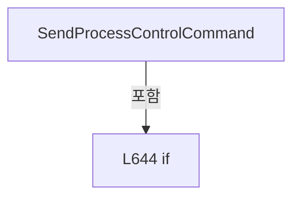

변경 전 점검: 입력/반환 타입, 위 호출자, 예외/취소 경로, 공유 상태와 저장·전송 소비자를 함께 확인합니다. 값의 단위나 물리 방향을 이름만으로 확정하지 않습니다.

### MethodDeclaration `RunInspectionStep` · L653–656

[Drilling.Common/Station/CStationProcess.cs:653–656](https://github.com/kjuws10-rgb/A3Drilling/blob/334b3599651b2e8e0181fd4459bafaf3cddafff3/Drilling.Common/Station/CStationProcess.cs#L653-L656)

| 항목 | 실제 추출 값 |
| --- | --- |
| 서명 | void Drilling.Common.Station.CStationProcess.RunInspectionStep(Drilling.Common.Station.ST_PROCESS_MODEL, System.Threading.CancellationToken) |
| 접근/수식자 | Private / private |
| 반환/값 타입 | void |
| 소속 타입 | NamedType:Drilling.Common.Station.CStationProcess |

입력 계약:

| 이름 | 타입 | 전달 | 선택/기본값 |
| --- | --- | --- | --- |
| processModel | Drilling.Common.Station.ST_PROCESS_MODEL | None | False /  |
| cancellationToken | System.Threading.CancellationToken | None | False /  |

현재 부분 분석에서 직접 연결된 호출자는 없습니다. XAML/이벤트/인터페이스·델리게이트·외부 진입을 추가 확인해야 하며, 미사용으로 판정한 것이 아닙니다.

호출하는 대상과 해석 범위:

| 원본 행 | 표현식 | 분석 상태 | 대상/소스 위치 |
| --- | --- | --- | --- |
| 655 | RunReviewStep | resolved | void Drilling.Common.Station.CStationProcess.RunReviewStep(Drilling.Common.Station.ST_PROCESS_MODEL, System.Threading.CancellationToken) · Drilling.Common/Station/CStationProcess.cs:1145 |

본문의 실제 연산·분기·예외·반환 순서(원문 위치 순):

| 원본 행 | 종류 | 주석 해설 |
| --- | --- | --- |
| 655 | call | 함수·델리게이트 또는 객체 생성자를 호출합니다: RunReviewStep(processModel, cancellationToken) |

변경 전 점검: 입력/반환 타입, 위 호출자, 예외/취소 경로, 공유 상태와 저장·전송 소비자를 함께 확인합니다. 값의 단위나 물리 방향을 이름만으로 확정하지 않습니다.

### MethodDeclaration `BuildAutomationScript` · L658–667

[Drilling.Common/Station/CStationProcess.cs:658–667](https://github.com/kjuws10-rgb/A3Drilling/blob/334b3599651b2e8e0181fd4459bafaf3cddafff3/Drilling.Common/Station/CStationProcess.cs#L658-L667)

| 항목 | 실제 추출 값 |
| --- | --- |
| 서명 | void Drilling.Common.Station.CStationProcess.BuildAutomationScript(Drilling.Common.Station.ST_PROCESS_MODEL, System.Threading.CancellationToken) |
| 접근/수식자 | Private / private |
| 반환/값 타입 | void |
| 소속 타입 | NamedType:Drilling.Common.Station.CStationProcess |

입력 계약:

| 이름 | 타입 | 전달 | 선택/기본값 |
| --- | --- | --- | --- |
| processModel | Drilling.Common.Station.ST_PROCESS_MODEL | None | False /  |
| cancellationToken | System.Threading.CancellationToken | None | False /  |

정적 호출자로 확인된 위치:

| 호출 파일/행 | 호출 표현식 | 런타임 분기 가능 |
| --- | --- | --- |
| [Drilling.Common/Station/CStationProcess.cs:569–569](https://github.com/kjuws10-rgb/A3Drilling/blob/334b3599651b2e8e0181fd4459bafaf3cddafff3/Drilling.Common/Station/CStationProcess.cs#L569-L569) | BuildAutomationScript | False |
| [Drilling.Common/Station/CStationProcess.cs:4057–4057](https://github.com/kjuws10-rgb/A3Drilling/blob/334b3599651b2e8e0181fd4459bafaf3cddafff3/Drilling.Common/Station/CStationProcess.cs#L4057-L4057) | BuildAutomationScript | False |

호출하는 대상과 해석 범위:

| 원본 행 | 표현식 | 분석 상태 | 대상/소스 위치 |
| --- | --- | --- | --- |
| 660 | IsBufferedRunEnabled | resolved | bool Drilling.Common.Station.CStationProcess.IsBufferedRunEnabled(System.Collections.Generic.IReadOnlyDictionary<string, string>) · Drilling.Common/Station/CStationProcess.cs:2131 |
| 662 | _automationScriptFile.Build | resolved | Drilling.Common.Station.ST_SCRIPT_BUILD_RESULT Drilling.Common.Station.CAutomationScriptFileBase.Build(Drilling.Common.Station.ST_PROCESS_MODEL, string, System.Threading.CancellationToken) · Drilling.Common/Station/CStationManager.cs:490 |
| 662 | GetProcessModel | resolved | Drilling.Common.Station.ST_PROCESS_MODEL Drilling.Common.Station.CStationProcess.GetProcessModel() · Drilling.Common/Station/CStationProcess.cs:2277 |
| 664 | BuildStatistics | resolved | Drilling.Common.Station.ST_PROCESS_STATISTICS Drilling.Common.Station.CStationProcess.BuildStatistics(Drilling.Common.Station.ST_PROCESS_MODEL?, double, System.TimeSpan) · Drilling.Common/Station/CStationProcess.cs:1777 |
| 664 | TimeSpan.FromSeconds | resolved | System.TimeSpan System.TimeSpan.FromSeconds(long) |
| 665 | AddProcessLog | resolved | void Drilling.Common.Station.CStationProcess.AddProcessLog(string, string, string) · Drilling.Common/Station/CStationProcess.cs:2371 |
| 666 | CreateSnapshot | resolved | Drilling.Common.Station.ST_STATION_PROCESS_STATUS Drilling.Common.Station.CStationProcess.CreateSnapshot(Drilling.Common.Station.ST_PROCESS_MODEL?, System.Collections.Generic.IReadOnlyList<Drilling.Common.Station.ST_HEAD_PREVIEW_DATA>, Drilling.Common.Station.EN_SCRIPT_STATUS, Drilling.Common.Station.EN_PROCESS_STEP, Drilling.Common.Station.ST_PROCESS_RESULT?) · Drilling.Common/Station/CStationProcess.cs:1339 |

본문의 실제 연산·분기·예외·반환 순서(원문 위치 순):

| 원본 행 | 종류 | 주석 해설 |
| --- | --- | --- |
| 660 | call | 함수·델리게이트 또는 객체 생성자를 호출합니다: IsBufferedRunEnabled(processModel.Parameters) |
| 660 | local-declaration | 지역 변수를 선언합니다: var bufferedRun = IsBufferedRunEnabled(processModel.Parameters); |
| 660 | variable-initializer | 변수의 초기값을 지정합니다: bufferedRun = IsBufferedRunEnabled(processModel.Parameters) |
| 661 | conditional-expression | 조건에 따라 결과식을 선택합니다: bufferedRun ? BufferedRunScriptDirectoryName : StandardScriptDirectoryName |
| 661 | local-declaration | 지역 변수를 선언합니다: var scriptDirectoryName = bufferedRun ? BufferedRunScriptDirectoryName : StandardScriptDirectoryName; |
| 661 | variable-initializer | 변수의 초기값을 지정합니다: scriptDirectoryName = bufferedRun ? BufferedRunScriptDirectoryName : StandardScriptDirectoryName |
| 662 | assignment | 값을 대상에 대입합니다: _lastScript = _automationScriptFile.Build(GetProcessModel(), scriptDirectoryName, cancellationToken) |
| 662 | call | 함수·델리게이트 또는 객체 생성자를 호출합니다: _automationScriptFile.Build(GetProcessModel(), scriptDirectoryName, cancellationToken) |
| 662 | call | 함수·델리게이트 또는 객체 생성자를 호출합니다: GetProcessModel() |
| 663 | assignment | 값을 대상에 대입합니다: _scriptCreatedAt = _lastScript.CreatedAt |
| 664 | assignment | 값을 대상에 대입합니다: _statistics = BuildStatistics(processModel, 35.0, TimeSpan.FromSeconds(12)) |
| 664 | call | 함수·델리게이트 또는 객체 생성자를 호출합니다: BuildStatistics(processModel, 35.0, TimeSpan.FromSeconds(12)) |
| 664 | call | 함수·델리게이트 또는 객체 생성자를 호출합니다: TimeSpan.FromSeconds(12) |
| 665 | call | 함수·델리게이트 또는 객체 생성자를 호출합니다: AddProcessLog("INFO", "SCRIPT", $"{_lastScript.FileName} generated in {scriptDirectoryName}. ({_lastScript.TotalShots} shots)") |
| 666 | assignment | 값을 대상에 대입합니다: _snapshot = CreateSnapshot(_snapshot.ProcessModel, _snapshot.HeadPreviews, EN_SCRIPT_STATUS.Created, EN_PROCESS_STEP.Process, null) |
| 666 | call | 함수·델리게이트 또는 객체 생성자를 호출합니다: CreateSnapshot(_snapshot.ProcessModel, _snapshot.HeadPreviews, EN_SCRIPT_STATUS.Created, EN_PROCESS_STEP.Process, null) |

변경 전 점검: 입력/반환 타입, 위 호출자, 예외/취소 경로, 공유 상태와 저장·전송 소비자를 함께 확인합니다. 값의 단위나 물리 방향을 이름만으로 확정하지 않습니다.

### MethodDeclaration `UploadAutomationScript` · L669–691

[Drilling.Common/Station/CStationProcess.cs:669–691](https://github.com/kjuws10-rgb/A3Drilling/blob/334b3599651b2e8e0181fd4459bafaf3cddafff3/Drilling.Common/Station/CStationProcess.cs#L669-L691)

| 항목 | 실제 추출 값 |
| --- | --- |
| 서명 | void Drilling.Common.Station.CStationProcess.UploadAutomationScript(Drilling.Common.Station.ST_PROCESS_MODEL, System.Threading.CancellationToken) |
| 접근/수식자 | Private / private |
| 반환/값 타입 | void |
| 소속 타입 | NamedType:Drilling.Common.Station.CStationProcess |

입력 계약:

| 이름 | 타입 | 전달 | 선택/기본값 |
| --- | --- | --- | --- |
| processModel | Drilling.Common.Station.ST_PROCESS_MODEL | None | False /  |
| cancellationToken | System.Threading.CancellationToken | None | False /  |

정적 호출자로 확인된 위치:

| 호출 파일/행 | 호출 표현식 | 런타임 분기 가능 |
| --- | --- | --- |
| [Drilling.Common/Station/CStationProcess.cs:570–570](https://github.com/kjuws10-rgb/A3Drilling/blob/334b3599651b2e8e0181fd4459bafaf3cddafff3/Drilling.Common/Station/CStationProcess.cs#L570-L570) | UploadAutomationScript | False |
| [Drilling.Common/Station/CStationProcess.cs:3543–3543](https://github.com/kjuws10-rgb/A3Drilling/blob/334b3599651b2e8e0181fd4459bafaf3cddafff3/Drilling.Common/Station/CStationProcess.cs#L3543-L3543) | UploadAutomationScript | False |
| [Drilling.Common/Station/CStationProcess.cs:4058–4058](https://github.com/kjuws10-rgb/A3Drilling/blob/334b3599651b2e8e0181fd4459bafaf3cddafff3/Drilling.Common/Station/CStationProcess.cs#L4058-L4058) | UploadAutomationScript | False |
| [Drilling.Common/Station/CStationProcess.cs:4080–4080](https://github.com/kjuws10-rgb/A3Drilling/blob/334b3599651b2e8e0181fd4459bafaf3cddafff3/Drilling.Common/Station/CStationProcess.cs#L4080-L4080) | UploadAutomationScript | False |

호출하는 대상과 해석 범위:

| 원본 행 | 표현식 | 분석 상태 | 대상/소스 위치 |
| --- | --- | --- | --- |
| 671 | cancellationToken.ThrowIfCancellationRequested | resolved | void System.Threading.CancellationToken.ThrowIfCancellationRequested() |
| 674 | new InvalidOperationException | resolved | System.InvalidOperationException.InvalidOperationException(string?) |
| 682 | _lastScript.HeadScripts.Where | resolved | System.Collections.Generic.IEnumerable<Drilling.Common.Station.ST_HEAD_SCRIPT_RESULT> System.Collections.Generic.IEnumerable<Drilling.Common.Station.ST_HEAD_SCRIPT_RESULT>.Where<Drilling.Common.Station.ST_HEAD_SCRIPT_RESULT>(System.Func<Drilling.Common.Station.ST_HEAD_SCRIPT_RESULT, bool>) |
| 684 | AddProcessLog | resolved | void Drilling.Common.Station.CStationProcess.AddProcessLog(string, string, string) · Drilling.Common/Station/CStationProcess.cs:2371 |
| 685 | _automationManager.UploadScript(headScript.FilePath, headScript.FileName, headScript.AutomationNo, cancellationToken: cancellationToken).GetAwaiter().GetResult | resolved | string System.Runtime.CompilerServices.TaskAwaiter<string>.GetResult() |
| 685 | _automationManager.UploadScript(headScript.FilePath, headScript.FileName, headScript.AutomationNo, cancellationToken: cancellationToken).GetAwaiter | resolved | System.Runtime.CompilerServices.TaskAwaiter<string> System.Threading.Tasks.Task<string>.GetAwaiter() |
| 685 | _automationManager.UploadScript | resolved · 동적 구현 선택 가능 | System.Threading.Tasks.Task<string> Drilling.Common.Automation.CAutomationManager.UploadScript(string, string, int, System.Threading.CancellationToken) · Drilling.Common/Automation/CAutomationManager.cs:315 |
| 686 | string.IsNullOrWhiteSpace | resolved | bool string.IsNullOrWhiteSpace(string?) |
| 686 | response.StartsWith | resolved | bool string.StartsWith(string, System.StringComparison) |
| 686 | response.EndsWith | resolved | bool string.EndsWith(string, System.StringComparison) |
| 687 | IsProcessControlSuccessResponse | resolved | bool Drilling.Common.Station.CStationProcess.IsProcessControlSuccessResponse(string) · Drilling.Common/Station/CStationProcess.cs:2013 |
| 688 | new InvalidOperationException | resolved | System.InvalidOperationException.InvalidOperationException(string?) |
| 688 | FormatResponseForLog | resolved | string Drilling.Common.Station.CStationProcess.FormatResponseForLog(string) · Drilling.Common/Station/CStationProcess.cs:2024 |
| 689 | AddProcessLog | resolved | void Drilling.Common.Station.CStationProcess.AddProcessLog(string, string, string) · Drilling.Common/Station/CStationProcess.cs:2371 |

본문의 실제 연산·분기·예외·반환 순서(원문 위치 순):

| 원본 행 | 종류 | 주석 해설 |
| --- | --- | --- |
| 671 | call | 함수·델리게이트 또는 객체 생성자를 호출합니다: cancellationToken.ThrowIfCancellationRequested() |
| 672 | if | 조건에 따라 분기합니다: if (_lastScript is null) |
| 674 | call | 함수·델리게이트 또는 객체 생성자를 호출합니다: new InvalidOperationException("Automation script is not built.") |
| 674 | throw | 예외를 발생/전달합니다: throw new InvalidOperationException("Automation script is not built."); |
| 682 | call | 함수·델리게이트 또는 객체 생성자를 호출합니다: _lastScript.HeadScripts.Where(ShouldIncludeItem) |
| 682 | foreach | 컬렉션 요소를 순회합니다: foreach (var headScript in _lastScript.HeadScripts.Where(ShouldIncludeItem)) |
| 684 | call | 함수·델리게이트 또는 객체 생성자를 호출합니다: AddProcessLog("INFO", "A1_UPLOAD", $"Upload requested. H{headScript.HeadNo:00} -> Automation1 #{headScript.AutomationNo}, {headScript.FileName}") |
| 685 | call | 함수·델리게이트 또는 객체 생성자를 호출합니다: _automationManager.UploadScript(headScript.FilePath, headScript.FileName, headScript.AutomationNo, cancellationToken: cancellationToken).GetAwaiter().GetResult() |
| 685 | call | 함수·델리게이트 또는 객체 생성자를 호출합니다: _automationManager.UploadScript(headScript.FilePath, headScript.FileName, headScript.AutomationNo, cancellationToken: cancellationToken).GetAwaiter() |
| 685 | call | 함수·델리게이트 또는 객체 생성자를 호출합니다: _automationManager.UploadScript(headScript.FilePath, headScript.FileName, headScript.AutomationNo, cancellationToken: cancellationToken) |
| 685 | local-declaration | 지역 변수를 선언합니다: var response = _automationManager.UploadScript(headScript.FilePath, headScript.FileName, headScript.AutomationNo, cancellationToken: cancellationToken).GetAwaiter().GetResult(); |
| 685 | variable-initializer | 변수의 초기값을 지정합니다: response = _automationManager.UploadScript(headScript.FilePath, headScript.FileName, headScript.AutomationNo, cancellationToken: cancellationToken).GetAwaiter().GetResult() |
| 686 | call | 함수·델리게이트 또는 객체 생성자를 호출합니다: string.IsNullOrWhiteSpace(response) |
| 686 | call | 함수·델리게이트 또는 객체 생성자를 호출합니다: response.StartsWith("SIM:", StringComparison.OrdinalIgnoreCase) |
| 686 | call | 함수·델리게이트 또는 객체 생성자를 호출합니다: response.EndsWith(":OK", StringComparison.OrdinalIgnoreCase) |
| 686 | local-declaration | 지역 변수를 선언합니다: var simulationSucceeded = !string.IsNullOrWhiteSpace(response) && response.StartsWith("SIM:", StringComparison.OrdinalIgnoreCase) && response.EndsWith(":OK", StringComparison.OrdinalIgnoreCase); |
| 686 | variable-initializer | 변수의 초기값을 지정합니다: simulationSucceeded = !string.IsNullOrWhiteSpace(response) && response.StartsWith("SIM:", StringComparison.OrdinalIgnoreCase) && response.EndsWith(":OK", StringComparison.OrdinalIgnoreCase) |
| 687 | call | 함수·델리게이트 또는 객체 생성자를 호출합니다: IsProcessControlSuccessResponse(response) |
| 687 | if | 조건에 따라 분기합니다: if (!IsProcessControlSuccessResponse(response) && !simulationSucceeded) |
| 688 | call | 함수·델리게이트 또는 객체 생성자를 호출합니다: new InvalidOperationException($"Automation1 script upload failed. H{headScript.HeadNo:00}, {headScript.FileName}: {FormatResponseForLog(response)}") |
| 688 | call | 함수·델리게이트 또는 객체 생성자를 호출합니다: FormatResponseForLog(response) |
| 688 | throw | 예외를 발생/전달합니다: throw new InvalidOperationException($"Automation1 script upload failed. H{headScript.HeadNo:00}, {headScript.FileName}: {FormatResponseForLog(response)}"); |
| 689 | call | 함수·델리게이트 또는 객체 생성자를 호출합니다: AddProcessLog("INFO", "A1_UPLOAD", $"Upload completed. H{headScript.HeadNo:00}, Automation1 #{headScript.AutomationNo}: {response}") |

제어 구문의 포함 구조(실제 실행 순서/CFG가 아닌 구문 탐색 그림):


변경 전 점검: 입력/반환 타입, 위 호출자, 예외/취소 경로, 공유 상태와 저장·전송 소비자를 함께 확인합니다. 값의 단위나 물리 방향을 이름만으로 확정하지 않습니다.

### LocalFunctionStatement `ShouldIncludeItem` · L677–680

[Drilling.Common/Station/CStationProcess.cs:677–680](https://github.com/kjuws10-rgb/A3Drilling/blob/334b3599651b2e8e0181fd4459bafaf3cddafff3/Drilling.Common/Station/CStationProcess.cs#L677-L680)

| 항목 | 실제 추출 값 |
| --- | --- |
| 서명 | bool ShouldIncludeItem(Drilling.Common.Station.ST_HEAD_SCRIPT_RESULT) |
| 접근/수식자 | Private /  |
| 반환/값 타입 | bool |
| 소속 타입 | NamedType:Drilling.Common.Station.CStationProcess |

입력 계약:

| 이름 | 타입 | 전달 | 선택/기본값 |
| --- | --- | --- | --- |
| script | Drilling.Common.Station.ST_HEAD_SCRIPT_RESULT | None | False /  |

현재 부분 분석에서 직접 연결된 호출자는 없습니다. XAML/이벤트/인터페이스·델리게이트·외부 진입을 추가 확인해야 하며, 미사용으로 판정한 것이 아닙니다.

본문의 실제 연산·분기·예외·반환 순서(원문 위치 순):

| 원본 행 | 종류 | 주석 해설 |
| --- | --- | --- |
| 679 | return | 호출자에게 값 또는 제어를 반환합니다: return script.TotalShots > 0; |

변경 전 점검: 입력/반환 타입, 위 호출자, 예외/취소 경로, 공유 상태와 저장·전송 소비자를 함께 확인합니다. 값의 단위나 물리 방향을 이름만으로 확정하지 않습니다.

### MethodDeclaration `RunScannerProcess` · L693–751

[Drilling.Common/Station/CStationProcess.cs:693–751](https://github.com/kjuws10-rgb/A3Drilling/blob/334b3599651b2e8e0181fd4459bafaf3cddafff3/Drilling.Common/Station/CStationProcess.cs#L693-L751)

| 항목 | 실제 추출 값 |
| --- | --- |
| 서명 | void Drilling.Common.Station.CStationProcess.RunScannerProcess(Drilling.Common.Station.ST_PROCESS_MODEL, System.Threading.CancellationToken) |
| 접근/수식자 | Private / private |
| 반환/값 타입 | void |
| 소속 타입 | NamedType:Drilling.Common.Station.CStationProcess |

입력 계약:

| 이름 | 타입 | 전달 | 선택/기본값 |
| --- | --- | --- | --- |
| processModel | Drilling.Common.Station.ST_PROCESS_MODEL | None | False /  |
| cancellationToken | System.Threading.CancellationToken | None | False /  |

정적 호출자로 확인된 위치:

| 호출 파일/행 | 호출 표현식 | 런타임 분기 가능 |
| --- | --- | --- |
| [Drilling.Common/Station/CStationProcess.cs:574–574](https://github.com/kjuws10-rgb/A3Drilling/blob/334b3599651b2e8e0181fd4459bafaf3cddafff3/Drilling.Common/Station/CStationProcess.cs#L574-L574) | RunScannerProcess | False |

호출하는 대상과 해석 범위:

| 원본 행 | 표현식 | 분석 상태 | 대상/소스 위치 |
| --- | --- | --- | --- |
| 695 | SetStationState | resolved | void Drilling.Common.Station.CStationProcess.SetStationState(Drilling.Common.Station.EN_STATION_STATE, Drilling.Common.Station.EN_PROCESS_STEP, Drilling.Common.Station.EN_SCRIPT_STATUS, string) · Drilling.Common/Station/CStationProcess.cs:2350 |
| 697 | SetHeadStatus | resolved | System.Collections.Generic.IReadOnlyList<Drilling.Common.Station.ST_HEAD_PREVIEW_DATA> Drilling.Common.Station.CStationProcess.SetHeadStatus(System.Collections.Generic.IReadOnlyList<Drilling.Common.Station.ST_HEAD_PREVIEW_DATA>, Drilling.Common.Station.EN_PROCESS_STEP) · Drilling.Common/Station/CStationProcess.cs:1681 |
| 698 | BuildStatistics | resolved | Drilling.Common.Station.ST_PROCESS_STATISTICS Drilling.Common.Station.CStationProcess.BuildStatistics(Drilling.Common.Station.ST_PROCESS_MODEL?, double, System.TimeSpan) · Drilling.Common/Station/CStationProcess.cs:1777 |
| 698 | TimeSpan.FromSeconds | resolved | System.TimeSpan System.TimeSpan.FromSeconds(long) |
| 701 | new InvalidOperationException | resolved | System.InvalidOperationException.InvalidOperationException(string?) |
| 709 | _lastScript.HeadScripts.Where(ShouldIncludeItem).ToArray | resolved | Drilling.Common.Station.ST_HEAD_SCRIPT_RESULT[] System.Collections.Generic.IEnumerable<Drilling.Common.Station.ST_HEAD_SCRIPT_RESULT>.ToArray<Drilling.Common.Station.ST_HEAD_SCRIPT_RESULT>() |
| 709 | _lastScript.HeadScripts.Where | resolved | System.Collections.Generic.IEnumerable<Drilling.Common.Station.ST_HEAD_SCRIPT_RESULT> System.Collections.Generic.IEnumerable<Drilling.Common.Station.ST_HEAD_SCRIPT_RESULT>.Where<Drilling.Common.Station.ST_HEAD_SCRIPT_RESULT>(System.Func<Drilling.Common.Station.ST_HEAD_SCRIPT_RESULT, bool>) |
| 710 | IsBufferedRunEnabled | resolved | bool Drilling.Common.Station.CStationProcess.IsBufferedRunEnabled(System.Collections.Generic.IReadOnlyDictionary<string, string>) · Drilling.Common/Station/CStationProcess.cs:2131 |
| 711 | CQueueCountLogger.Create | resolved | Drilling.Common.Station.CStationProcess.CQueueCountLogger Drilling.Common.Station.CStationProcess.CQueueCountLogger.Create(Drilling.Common.Station.CStationProcess, string, bool, System.Collections.Generic.IReadOnlyList<Drilling.Common.Station.ST_HEAD_SCRIPT_RESULT>) · Drilling.Common/Station/CStationProcess.cs:3125 |
| 712 | CScannerStatusLogger.Create | resolved | Drilling.Common.Station.CStationProcess.CScannerStatusLogger Drilling.Common.Station.CStationProcess.CScannerStatusLogger.Create(Drilling.Common.Station.CStationProcess, string, bool, System.Collections.Generic.IReadOnlyDictionary<string, string>, System.Collections.Generic.IReadOnlyList<Drilling.Common.Station.ST_HEAD_SCRIPT_RESULT>) · Drilling.Common/Station/CStationProcess.cs:2562 |
| 714 | CreateSnapshot | resolved | Drilling.Common.Station.ST_STATION_PROCESS_STATUS Drilling.Common.Station.CStationProcess.CreateSnapshot(Drilling.Common.Station.ST_PROCESS_MODEL?, System.Collections.Generic.IReadOnlyList<Drilling.Common.Station.ST_HEAD_PREVIEW_DATA>, Drilling.Common.Station.EN_SCRIPT_STATUS, Drilling.Common.Station.EN_PROCESS_STEP, Drilling.Common.Station.ST_PROCESS_RESULT?) · Drilling.Common/Station/CStationProcess.cs:1339 |
| 719 | queueCountLogger.Start | resolved | void Drilling.Common.Station.CStationProcess.CQueueCountLogger.Start() · Drilling.Common/Station/CStationProcess.cs:3131 |
| 720 | scannerStatusLogger.Start | resolved | void Drilling.Common.Station.CStationProcess.CScannerStatusLogger.Start() · Drilling.Common/Station/CStationProcess.cs:2568 |
| 721 | RunBufferedHeadScripts | resolved | void Drilling.Common.Station.CStationProcess.RunBufferedHeadScripts(Drilling.Common.Station.ST_PROCESS_MODEL, System.Collections.Generic.IReadOnlyList<Drilling.Common.Station.ST_HEAD_SCRIPT_RESULT>, System.Threading.CancellationToken) · Drilling.Common/Station/CStationProcess.cs:753 |
| 727 | AddProcessLog | resolved | void Drilling.Common.Station.CStationProcess.AddProcessLog(string, string, string) · Drilling.Common/Station/CStationProcess.cs:2371 |
| 728 | _automationManager.RunScript(headScript.FileName, headScript.TaskNo, headScript.AutomationNo, cancellationToken: cancellationToken).GetAwaiter().GetResult | resolved | string System.Runtime.CompilerServices.TaskAwaiter<string>.GetResult() |
| 728 | _automationManager.RunScript(headScript.FileName, headScript.TaskNo, headScript.AutomationNo, cancellationToken: cancellationToken).GetAwaiter | resolved | System.Runtime.CompilerServices.TaskAwaiter<string> System.Threading.Tasks.Task<string>.GetAwaiter() |
| 728 | _automationManager.RunScript | resolved · 동적 구현 선택 가능 | System.Threading.Tasks.Task<string> Drilling.Common.Automation.CAutomationManager.RunScript(string, int, int, System.Threading.CancellationToken) · Drilling.Common/Automation/CAutomationManager.cs:324 |
| 729 | AddProcessLog | resolved | void Drilling.Common.Station.CStationProcess.AddProcessLog(string, string, string) · Drilling.Common/Station/CStationProcess.cs:2371 |
| 732 | queueCountLogger.Start | resolved | void Drilling.Common.Station.CStationProcess.CQueueCountLogger.Start() · Drilling.Common/Station/CStationProcess.cs:3131 |
| 733 | scannerStatusLogger.Start | resolved | void Drilling.Common.Station.CStationProcess.CScannerStatusLogger.Start() · Drilling.Common/Station/CStationProcess.cs:2568 |
| 734 | WaitAutomationHeadScriptsComplete | resolved | void Drilling.Common.Station.CStationProcess.WaitAutomationHeadScriptsComplete(Drilling.Common.Station.ST_PROCESS_MODEL, System.Collections.Generic.IReadOnlyList<Drilling.Common.Station.ST_HEAD_SCRIPT_RESULT>, System.Threading.CancellationToken) · Drilling.Common/Station/CStationProcess.cs:871 |
| 744 | scannerStatusLogger.StopAndWriteFinal | resolved | void Drilling.Common.Station.CStationProcess.CScannerStatusLogger.StopAndWriteFinal() · Drilling.Common/Station/CStationProcess.cs:2580 |
| 745 | queueCountLogger.StopAndWriteFinal | resolved | void Drilling.Common.Station.CStationProcess.CQueueCountLogger.StopAndWriteFinal() · Drilling.Common/Station/CStationProcess.cs:3142 |
| 748 | StopAutomationScriptTasks | resolved | void Drilling.Common.Station.CStationProcess.StopAutomationScriptTasks(System.Collections.Generic.IReadOnlyList<Drilling.Common.Station.ST_HEAD_SCRIPT_RESULT>, string) · Drilling.Common/Station/CStationProcess.cs:940 |

본문의 실제 연산·분기·예외·반환 순서(원문 위치 순):

| 원본 행 | 종류 | 주석 해설 |
| --- | --- | --- |
| 695 | call | 함수·델리게이트 또는 객체 생성자를 호출합니다: SetStationState(EN_STATION_STATE.Process, EN_PROCESS_STEP.Process, EN_SCRIPT_STATUS.Running, $"Scanner run started. Process: {processModel.ProcessId}") |
| 696 | assignment | 값을 대상에 대입합니다: _scriptStartedAt = DateTimeOffset.Now |
| 697 | call | 함수·델리게이트 또는 객체 생성자를 호출합니다: SetHeadStatus(_snapshot.HeadPreviews, EN_PROCESS_STEP.Process) |
| 697 | local-declaration | 지역 변수를 선언합니다: var runningPreview = SetHeadStatus(_snapshot.HeadPreviews, EN_PROCESS_STEP.Process); |
| 697 | variable-initializer | 변수의 초기값을 지정합니다: runningPreview = SetHeadStatus(_snapshot.HeadPreviews, EN_PROCESS_STEP.Process) |
| 698 | assignment | 값을 대상에 대입합니다: _statistics = BuildStatistics(processModel, 56.3, TimeSpan.FromSeconds(45)) |
| 698 | call | 함수·델리게이트 또는 객체 생성자를 호출합니다: BuildStatistics(processModel, 56.3, TimeSpan.FromSeconds(45)) |
| 698 | call | 함수·델리게이트 또는 객체 생성자를 호출합니다: TimeSpan.FromSeconds(45) |
| 699 | if | 조건에 따라 분기합니다: if (_lastScript is null) |
| 701 | call | 함수·델리게이트 또는 객체 생성자를 호출합니다: new InvalidOperationException("Automation script is not built.") |
| 701 | throw | 예외를 발생/전달합니다: throw new InvalidOperationException("Automation script is not built."); |
| 709 | call | 함수·델리게이트 또는 객체 생성자를 호출합니다: _lastScript.HeadScripts.Where(ShouldIncludeItem).ToArray() |
| 709 | call | 함수·델리게이트 또는 객체 생성자를 호출합니다: _lastScript.HeadScripts.Where(ShouldIncludeItem) |
| 709 | local-declaration | 지역 변수를 선언합니다: var headScripts = _lastScript.HeadScripts.Where(ShouldIncludeItem).ToArray(); |
| 709 | variable-initializer | 변수의 초기값을 지정합니다: headScripts = _lastScript.HeadScripts.Where(ShouldIncludeItem).ToArray() |
| 710 | call | 함수·델리게이트 또는 객체 생성자를 호출합니다: IsBufferedRunEnabled(processModel.Parameters) |
| 710 | local-declaration | 지역 변수를 선언합니다: var bufferedRun = IsBufferedRunEnabled(processModel.Parameters); |
| 710 | variable-initializer | 변수의 초기값을 지정합니다: bufferedRun = IsBufferedRunEnabled(processModel.Parameters) |
| 711 | call | 함수·델리게이트 또는 객체 생성자를 호출합니다: CQueueCountLogger.Create(this, processModel.RecipeId, bufferedRun, headScripts) |
| 711 | using-declaration | 정리할 자원을 선언합니다: using var queueCountLogger = CQueueCountLogger.Create(this, processModel.RecipeId, bufferedRun, headScripts); |
| 711 | variable-initializer | 변수의 초기값을 지정합니다: queueCountLogger = CQueueCountLogger.Create(this, processModel.RecipeId, bufferedRun, headScripts) |
| 712 | call | 함수·델리게이트 또는 객체 생성자를 호출합니다: CScannerStatusLogger.Create(this, processModel.RecipeId, bufferedRun, processModel.Parameters, headScripts) |
| 712 | using-declaration | 정리할 자원을 선언합니다: using var scannerStatusLogger = CScannerStatusLogger.Create(this, processModel.RecipeId, bufferedRun, processModel.Parameters, headScripts); |
| 712 | variable-initializer | 변수의 초기값을 지정합니다: scannerStatusLogger = CScannerStatusLogger.Create(this, processModel.RecipeId, bufferedRun, processModel.Parameters, headScripts) |
| 713 | local-declaration | 지역 변수를 선언합니다: var stopTasksOnExit = false; |
| 713 | variable-initializer | 변수의 초기값을 지정합니다: stopTasksOnExit = false |
| 714 | assignment | 값을 대상에 대입합니다: _snapshot = CreateSnapshot(_snapshot.ProcessModel, runningPreview, EN_SCRIPT_STATUS.Running, EN_PROCESS_STEP.Process, null) |
| 714 | call | 함수·델리게이트 또는 객체 생성자를 호출합니다: CreateSnapshot(_snapshot.ProcessModel, runningPreview, EN_SCRIPT_STATUS.Running, EN_PROCESS_STEP.Process, null) |
| 715 | try | 예외 처리 범위입니다: try |
| 717 | if | 조건에 따라 분기합니다: if (bufferedRun) |
| 719 | call | 함수·델리게이트 또는 객체 생성자를 호출합니다: queueCountLogger.Start() |
| 720 | call | 함수·델리게이트 또는 객체 생성자를 호출합니다: scannerStatusLogger.Start() |
| 721 | call | 함수·델리게이트 또는 객체 생성자를 호출합니다: RunBufferedHeadScripts(processModel, headScripts, cancellationToken) |
| 723 | else | 앞 조건이 거짓인 경로입니다: else |
| 725 | foreach | 컬렉션 요소를 순회합니다: foreach (var headScript in headScripts) |
| 727 | call | 함수·델리게이트 또는 객체 생성자를 호출합니다: AddProcessLog("INFO", "A1_RUN", $"Automation1 #{headScript.AutomationNo} Task {headScript.TaskNo} run requested. H{headScript.HeadNo:00}, {headScript.FileName}") |
| 728 | call | 함수·델리게이트 또는 객체 생성자를 호출합니다: _automationManager.RunScript(headScript.FileName, headScript.TaskNo, headScript.AutomationNo, cancellationToken: cancellationToken).GetAwaiter().GetResult() |
| 728 | call | 함수·델리게이트 또는 객체 생성자를 호출합니다: _automationManager.RunScript(headScript.FileName, headScript.TaskNo, headScript.AutomationNo, cancellationToken: cancellationToken).GetAwaiter() |
| 728 | call | 함수·델리게이트 또는 객체 생성자를 호출합니다: _automationManager.RunScript(headScript.FileName, headScript.TaskNo, headScript.AutomationNo, cancellationToken: cancellationToken) |
| 728 | local-declaration | 지역 변수를 선언합니다: var response = _automationManager.RunScript(headScript.FileName, headScript.TaskNo, headScript.AutomationNo, cancellationToken: cancellationToken).GetAwaiter().GetResult(); |
| 728 | variable-initializer | 변수의 초기값을 지정합니다: response = _automationManager.RunScript(headScript.FileName, headScript.TaskNo, headScript.AutomationNo, cancellationToken: cancellationToken).GetAwaiter().GetResult() |
| 729 | call | 함수·델리게이트 또는 객체 생성자를 호출합니다: AddProcessLog("INFO", "A1_RUN", $"Run command accepted. H{headScript.HeadNo:00}, Automation1 #{headScript.AutomationNo}, Task {headScript.TaskNo}: {response}") |
| 732 | call | 함수·델리게이트 또는 객체 생성자를 호출합니다: queueCountLogger.Start() |
| 733 | call | 함수·델리게이트 또는 객체 생성자를 호출합니다: scannerStatusLogger.Start() |
| 734 | call | 함수·델리게이트 또는 객체 생성자를 호출합니다: WaitAutomationHeadScriptsComplete(processModel, headScripts, cancellationToken) |
| 737 | catch | 지정 예외를 처리합니다: catch  |
| 739 | assignment | 값을 대상에 대입합니다: stopTasksOnExit = !bufferedRun |
| 740 | throw | 예외를 발생/전달합니다: throw; |
| 742 | finally | 종료 정리 구간입니다: finally |
| 744 | call | 함수·델리게이트 또는 객체 생성자를 호출합니다: scannerStatusLogger.StopAndWriteFinal() |
| 745 | call | 함수·델리게이트 또는 객체 생성자를 호출합니다: queueCountLogger.StopAndWriteFinal() |
| 746 | if | 조건에 따라 분기합니다: if (stopTasksOnExit) |
| 748 | call | 함수·델리게이트 또는 객체 생성자를 호출합니다: StopAutomationScriptTasks(headScripts, "scanner process ended before task completion") |

제어 구문의 포함 구조(실제 실행 순서/CFG가 아닌 구문 탐색 그림):

```mermaid
flowchart TD
 M["RunScannerProcess"]
 N0["L699 if"]
 M -->|포함| N0
 N1["L715 try"]
 M -->|포함| N1
 N2["L717 if"]
 N1 -->|포함| N2
 N3["L723 else"]
 N2 -->|포함| N3
 N4["L725 foreach"]
 N3 -->|포함| N4
 N5["L737 catch"]
 N1 -->|포함| N5
 N6["L742 finally"]
 N1 -->|포함| N6
 N7["L746 if"]
 N6 -->|포함| N7
```

변경 전 점검: 입력/반환 타입, 위 호출자, 예외/취소 경로, 공유 상태와 저장·전송 소비자를 함께 확인합니다. 값의 단위나 물리 방향을 이름만으로 확정하지 않습니다.

### LocalFunctionStatement `ShouldIncludeItem` · L704–707

[Drilling.Common/Station/CStationProcess.cs:704–707](https://github.com/kjuws10-rgb/A3Drilling/blob/334b3599651b2e8e0181fd4459bafaf3cddafff3/Drilling.Common/Station/CStationProcess.cs#L704-L707)

| 항목 | 실제 추출 값 |
| --- | --- |
| 서명 | bool ShouldIncludeItem(Drilling.Common.Station.ST_HEAD_SCRIPT_RESULT) |
| 접근/수식자 | Private /  |
| 반환/값 타입 | bool |
| 소속 타입 | NamedType:Drilling.Common.Station.CStationProcess |

입력 계약:

| 이름 | 타입 | 전달 | 선택/기본값 |
| --- | --- | --- | --- |
| script | Drilling.Common.Station.ST_HEAD_SCRIPT_RESULT | None | False /  |

현재 부분 분석에서 직접 연결된 호출자는 없습니다. XAML/이벤트/인터페이스·델리게이트·외부 진입을 추가 확인해야 하며, 미사용으로 판정한 것이 아닙니다.

본문의 실제 연산·분기·예외·반환 순서(원문 위치 순):

| 원본 행 | 종류 | 주석 해설 |
| --- | --- | --- |
| 706 | return | 호출자에게 값 또는 제어를 반환합니다: return script.TotalShots > 0; |

변경 전 점검: 입력/반환 타입, 위 호출자, 예외/취소 경로, 공유 상태와 저장·전송 소비자를 함께 확인합니다. 값의 단위나 물리 방향을 이름만으로 확정하지 않습니다.

### MethodDeclaration `RunBufferedHeadScripts` · L753–843

[Drilling.Common/Station/CStationProcess.cs:753–843](https://github.com/kjuws10-rgb/A3Drilling/blob/334b3599651b2e8e0181fd4459bafaf3cddafff3/Drilling.Common/Station/CStationProcess.cs#L753-L843)

| 항목 | 실제 추출 값 |
| --- | --- |
| 서명 | void Drilling.Common.Station.CStationProcess.RunBufferedHeadScripts(Drilling.Common.Station.ST_PROCESS_MODEL, System.Collections.Generic.IReadOnlyList<Drilling.Common.Station.ST_HEAD_SCRIPT_RESULT>, System.Threading.CancellationToken) |
| 접근/수식자 | Private / private |
| 반환/값 타입 | void |
| 소속 타입 | NamedType:Drilling.Common.Station.CStationProcess |

입력 계약:

| 이름 | 타입 | 전달 | 선택/기본값 |
| --- | --- | --- | --- |
| processModel | Drilling.Common.Station.ST_PROCESS_MODEL | None | False /  |
| headScripts | System.Collections.Generic.IReadOnlyList<Drilling.Common.Station.ST_HEAD_SCRIPT_RESULT> | None | False /  |
| cancellationToken | System.Threading.CancellationToken | None | False /  |

정적 호출자로 확인된 위치:

| 호출 파일/행 | 호출 표현식 | 런타임 분기 가능 |
| --- | --- | --- |
| [Drilling.Common/Station/CStationProcess.cs:721–721](https://github.com/kjuws10-rgb/A3Drilling/blob/334b3599651b2e8e0181fd4459bafaf3cddafff3/Drilling.Common/Station/CStationProcess.cs#L721-L721) | RunBufferedHeadScripts | False |

호출하는 대상과 해석 범위:

| 원본 행 | 표현식 | 분석 상태 | 대상/소스 위치 |
| --- | --- | --- | --- |
| 755 | ReadBufferedRunQueueSize | resolved | int Drilling.Common.Station.CStationProcess.ReadBufferedRunQueueSize(System.Collections.Generic.IReadOnlyDictionary<string, string>) · Drilling.Common/Station/CStationProcess.cs:2151 |
| 756 | ReadBufferedRunLinesPerCommand | resolved | int Drilling.Common.Station.CStationProcess.ReadBufferedRunLinesPerCommand(System.Collections.Generic.IReadOnlyDictionary<string, string>) · Drilling.Common/Station/CStationProcess.cs:2146 |
| 757 | ReadBufferedRunTimeoutMs | resolved | int Drilling.Common.Station.CStationProcess.ReadBufferedRunTimeoutMs(System.Collections.Generic.IReadOnlyDictionary<string, string>) · Drilling.Common/Station/CStationProcess.cs:2156 |
| 763 | headScripts.GroupBy(SelectAutomationNo).ToArray | resolved | System.Linq.IGrouping<int, Drilling.Common.Station.ST_HEAD_SCRIPT_RESULT>[] System.Collections.Generic.IEnumerable<System.Linq.IGrouping<int, Drilling.Common.Station.ST_HEAD_SCRIPT_RESULT>>.ToArray<System.Linq.IGrouping<int, Drilling.Common.Station.ST_HEAD_SCRIPT_RESULT>>() |
| 763 | headScripts.GroupBy | resolved | System.Collections.Generic.IEnumerable<System.Linq.IGrouping<int, Drilling.Common.Station.ST_HEAD_SCRIPT_RESULT>> System.Collections.Generic.IEnumerable<Drilling.Common.Station.ST_HEAD_SCRIPT_RESULT>.GroupBy<Drilling.Common.Station.ST_HEAD_SCRIPT_RESULT, int>(System.Func<Drilling.Common.Station.ST_HEAD_SCRIPT_RESULT, int>) |
| 771 | AddProcessLog | resolved | void Drilling.Common.Station.CStationProcess.AddProcessLog(string, string, string) · Drilling.Common/Station/CStationProcess.cs:2371 |
| 771 | string.Join | resolved | string string.Join(string?, System.Collections.Generic.IEnumerable<string?>) |
| 771 | group.Select | resolved | System.Collections.Generic.IEnumerable<string> System.Collections.Generic.IEnumerable<Drilling.Common.Station.ST_HEAD_SCRIPT_RESULT>.Select<Drilling.Common.Station.ST_HEAD_SCRIPT_RESULT, string>(System.Func<Drilling.Common.Station.ST_HEAD_SCRIPT_RESULT, string>) |
| 774 | CancellationTokenSource.CreateLinkedTokenSource | resolved | System.Threading.CancellationTokenSource System.Threading.CancellationTokenSource.CreateLinkedTokenSource(System.Threading.CancellationToken) |
| 775 | groups.Select(group => new CBufferedRunWorker(this, group.Key, group.ToArray(), queueSize, linesPerCommand, timeoutMs, bufferedRunCancellation.Token)).ToArray | resolved | Drilling.Common.Station.CStationProcess.CBufferedRunWorker[] System.Collections.Generic.IEnumerable<Drilling.Common.Station.CStationProcess.CBufferedRunWorker>.ToArray<Drilling.Common.Station.CStationProcess.CBufferedRunWorker>() |
| 775 | groups.Select | resolved | System.Collections.Generic.IEnumerable<Drilling.Common.Station.CStationProcess.CBufferedRunWorker> System.Collections.Generic.IEnumerable<System.Linq.IGrouping<int, Drilling.Common.Station.ST_HEAD_SCRIPT_RESULT>>.Select<System.Linq.IGrouping<int, Drilling.Common.Station.ST_HEAD_SCRIPT_RESULT>, Drilling.Common.Station.CStationProcess.CBufferedRunWorker>(System.Func<System.Linq.IGrouping<int, Drilling.Common.Station.ST_HEAD_SCRIPT_RESULT>, Drilling.Common.Station.CStationProcess.CBufferedRunWorker>) |
| 775 | new CBufferedRunWorker | resolved | Drilling.Common.Station.CStationProcess.CBufferedRunWorker.CBufferedRunWorker(Drilling.Common.Station.CStationProcess, int, System.Collections.Generic.IReadOnlyList<Drilling.Common.Station.ST_HEAD_SCRIPT_RESULT>, int, int, int, System.Threading.CancellationToken) · Drilling.Common/Station/CStationProcess.cs:3330 |
| 775 | group.ToArray | resolved | Drilling.Common.Station.ST_HEAD_SCRIPT_RESULT[] System.Collections.Generic.IEnumerable<Drilling.Common.Station.ST_HEAD_SCRIPT_RESULT>.ToArray<Drilling.Common.Station.ST_HEAD_SCRIPT_RESULT>() |
| 776 | new List<ST_BUFFERED_RUN_GROUP_RESULT> | resolved | System.Collections.Generic.List<Drilling.Common.Station.CStationProcess.ST_BUFFERED_RUN_GROUP_RESULT>.List() |
| 780 | worker.Start | resolved | void Drilling.Common.Station.CStationProcess.CBufferedRunWorker.Start() · Drilling.Common/Station/CStationProcess.cs:3373 |
| 785 | new HashSet<CBufferedRunWorker> | resolved | System.Collections.Generic.HashSet<Drilling.Common.Station.CStationProcess.CBufferedRunWorker>.HashSet() |
| 788 | cancellationToken.ThrowIfCancellationRequested | resolved | void System.Threading.CancellationToken.ThrowIfCancellationRequested() |
| 791 | completedWorkers.Contains | resolved | bool System.Collections.Generic.HashSet<Drilling.Common.Station.CStationProcess.CBufferedRunWorker>.Contains(Drilling.Common.Station.CStationProcess.CBufferedRunWorker) |
| 796 | completedWorkers.Add | resolved | bool System.Collections.Generic.HashSet<Drilling.Common.Station.CStationProcess.CBufferedRunWorker>.Add(Drilling.Common.Station.CStationProcess.CBufferedRunWorker) |
| 800 | AddProcessLog | resolved | void Drilling.Common.Station.CStationProcess.AddProcessLog(string, string, string) · Drilling.Common/Station/CStationProcess.cs:2371 |
| 806 | results.Add | resolved | void System.Collections.Generic.List<Drilling.Common.Station.CStationProcess.ST_BUFFERED_RUN_GROUP_RESULT>.Add(Drilling.Common.Station.CStationProcess.ST_BUFFERED_RUN_GROUP_RESULT) |
| 817 | Thread.Sleep | resolved | void System.Threading.Thread.Sleep(int) |
| 823 | new OperationCanceledException | resolved | System.OperationCanceledException.OperationCanceledException(string?, System.Threading.CancellationToken) |
| 824 | bufferedRunCancellation.Cancel | resolved | void System.Threading.CancellationTokenSource.Cancel() |
| 825 | WaitForBufferedRunWorkers | resolved | void Drilling.Common.Station.CStationProcess.WaitForBufferedRunWorkers(System.Collections.Generic.IReadOnlyList<Drilling.Common.Station.CStationProcess.CBufferedRunWorker>, int, string) · Drilling.Common/Station/CStationProcess.cs:845 |
| 826 | StopBufferedRunTasks | resolved | void Drilling.Common.Station.CStationProcess.StopBufferedRunTasks(System.Collections.Generic.IReadOnlyList<Drilling.Common.Station.ST_HEAD_SCRIPT_RESULT>, System.Exception) · Drilling.Common/Station/CStationProcess.cs:1111 |
| 827 | WaitForBufferedRunWorkers | resolved | void Drilling.Common.Station.CStationProcess.WaitForBufferedRunWorkers(System.Collections.Generic.IReadOnlyList<Drilling.Common.Station.CStationProcess.CBufferedRunWorker>, int, string) · Drilling.Common/Station/CStationProcess.cs:845 |
| 833 | bufferedRunCancellation.Cancel | resolved | void System.Threading.CancellationTokenSource.Cancel() |
| 834 | StopBufferedRunTasks | resolved | void Drilling.Common.Station.CStationProcess.StopBufferedRunTasks(System.Collections.Generic.IReadOnlyList<Drilling.Common.Station.ST_HEAD_SCRIPT_RESULT>, System.Exception) · Drilling.Common/Station/CStationProcess.cs:1111 |
| 835 | WaitForBufferedRunWorkers | resolved | void Drilling.Common.Station.CStationProcess.WaitForBufferedRunWorkers(System.Collections.Generic.IReadOnlyList<Drilling.Common.Station.CStationProcess.CBufferedRunWorker>, int, string) · Drilling.Common/Station/CStationProcess.cs:845 |
| 836 | ExceptionDispatchInfo.Capture(firstException).Throw | resolved | void System.Runtime.ExceptionServices.ExceptionDispatchInfo.Throw() |
| 836 | ExceptionDispatchInfo.Capture | resolved | System.Runtime.ExceptionServices.ExceptionDispatchInfo System.Runtime.ExceptionServices.ExceptionDispatchInfo.Capture(System.Exception) |
| 841 | AddProcessLog | resolved | void Drilling.Common.Station.CStationProcess.AddProcessLog(string, string, string) · Drilling.Common/Station/CStationProcess.cs:2371 |

본문의 실제 연산·분기·예외·반환 순서(원문 위치 순):

| 원본 행 | 종류 | 주석 해설 |
| --- | --- | --- |
| 755 | call | 함수·델리게이트 또는 객체 생성자를 호출합니다: ReadBufferedRunQueueSize(processModel.Parameters) |
| 755 | local-declaration | 지역 변수를 선언합니다: var queueSize = ReadBufferedRunQueueSize(processModel.Parameters); |
| 755 | variable-initializer | 변수의 초기값을 지정합니다: queueSize = ReadBufferedRunQueueSize(processModel.Parameters) |
| 756 | call | 함수·델리게이트 또는 객체 생성자를 호출합니다: ReadBufferedRunLinesPerCommand(processModel.Parameters) |
| 756 | local-declaration | 지역 변수를 선언합니다: var linesPerCommand = ReadBufferedRunLinesPerCommand(processModel.Parameters); |
| 756 | variable-initializer | 변수의 초기값을 지정합니다: linesPerCommand = ReadBufferedRunLinesPerCommand(processModel.Parameters) |
| 757 | call | 함수·델리게이트 또는 객체 생성자를 호출합니다: ReadBufferedRunTimeoutMs(processModel.Parameters) |
| 757 | local-declaration | 지역 변수를 선언합니다: var timeoutMs = ReadBufferedRunTimeoutMs(processModel.Parameters); |
| 757 | variable-initializer | 변수의 초기값을 지정합니다: timeoutMs = ReadBufferedRunTimeoutMs(processModel.Parameters) |
| 763 | call | 함수·델리게이트 또는 객체 생성자를 호출합니다: headScripts.GroupBy(SelectAutomationNo).ToArray() |
| 763 | call | 함수·델리게이트 또는 객체 생성자를 호출합니다: headScripts.GroupBy(SelectAutomationNo) |
| 763 | local-declaration | 지역 변수를 선언합니다: var groups = headScripts.GroupBy(SelectAutomationNo).ToArray(); |
| 763 | variable-initializer | 변수의 초기값을 지정합니다: groups = headScripts.GroupBy(SelectAutomationNo).ToArray() |
| 769 | foreach | 컬렉션 요소를 순회합니다: foreach (var group in groups) |
| 771 | call | 함수·델리게이트 또는 객체 생성자를 호출합니다: AddProcessLog("INFO", "A1_RUN", $"Automation1 #{group.Key} buffered run group requested. Heads={string.Join(", ", group.Select(SelectItem))}, Queue={queueSize}, LinesPerCommand={linesPerCommand}, TimeoutMs={timeoutMs}") |
| 771 | call | 함수·델리게이트 또는 객체 생성자를 호출합니다: string.Join(", ", group.Select(SelectItem)) |
| 771 | call | 함수·델리게이트 또는 객체 생성자를 호출합니다: group.Select(SelectItem) |
| 774 | call | 함수·델리게이트 또는 객체 생성자를 호출합니다: CancellationTokenSource.CreateLinkedTokenSource(cancellationToken) |
| 774 | using-declaration | 정리할 자원을 선언합니다: using var bufferedRunCancellation = CancellationTokenSource.CreateLinkedTokenSource(cancellationToken); |
| 774 | variable-initializer | 변수의 초기값을 지정합니다: bufferedRunCancellation = CancellationTokenSource.CreateLinkedTokenSource(cancellationToken) |
| 775 | call | 함수·델리게이트 또는 객체 생성자를 호출합니다: groups.Select(group => new CBufferedRunWorker(this, group.Key, group.ToArray(), queueSize, linesPerCommand, timeoutMs, bufferedRunCancellation.Token)).ToArray() |
| 775 | call | 함수·델리게이트 또는 객체 생성자를 호출합니다: groups.Select(group => new CBufferedRunWorker(this, group.Key, group.ToArray(), queueSize, linesPerCommand, timeoutMs, bufferedRunCancellation.Token)) |
| 775 | call | 함수·델리게이트 또는 객체 생성자를 호출합니다: new CBufferedRunWorker(this, group.Key, group.ToArray(), queueSize, linesPerCommand, timeoutMs, bufferedRunCancellation.Token) |
| 775 | call | 함수·델리게이트 또는 객체 생성자를 호출합니다: group.ToArray() |
| 775 | local-declaration | 지역 변수를 선언합니다: var workers = groups.Select(group => new CBufferedRunWorker(this, group.Key, group.ToArray(), queueSize, linesPerCommand, timeoutMs, bufferedRunCancellation.Token)).ToArray(); |
| 775 | variable-initializer | 변수의 초기값을 지정합니다: workers = groups.Select(group => new CBufferedRunWorker(this, group.Key, group.ToArray(), queueSize, linesPerCommand, timeoutMs, bufferedRunCancellation.Token)).ToArray() |
| 776 | call | 함수·델리게이트 또는 객체 생성자를 호출합니다: new List<ST_BUFFERED_RUN_GROUP_RESULT>() |
| 776 | local-declaration | 지역 변수를 선언합니다: var results = new List<ST_BUFFERED_RUN_GROUP_RESULT>(); |
| 776 | variable-initializer | 변수의 초기값을 지정합니다: results = new List<ST_BUFFERED_RUN_GROUP_RESULT>() |
| 777 | local-declaration | 지역 변수를 선언합니다: Exception? firstException = null; |
| 777 | variable-initializer | 변수의 초기값을 지정합니다: firstException = null |
| 778 | foreach | 컬렉션 요소를 순회합니다: foreach (var worker in workers) |
| 780 | call | 함수·델리게이트 또는 객체 생성자를 호출합니다: worker.Start() |
| 783 | try | 예외 처리 범위입니다: try |
| 785 | call | 함수·델리게이트 또는 객체 생성자를 호출합니다: new HashSet<CBufferedRunWorker>() |
| 785 | local-declaration | 지역 변수를 선언합니다: var completedWorkers = new HashSet<CBufferedRunWorker>(); |
| 785 | variable-initializer | 변수의 초기값을 지정합니다: completedWorkers = new HashSet<CBufferedRunWorker>() |
| 786 | while | 조건을 먼저 확인하며 반복합니다: while (completedWorkers.Count < workers.Length) |
| 788 | call | 함수·델리게이트 또는 객체 생성자를 호출합니다: cancellationToken.ThrowIfCancellationRequested() |
| 789 | foreach | 컬렉션 요소를 순회합니다: foreach (var worker in workers) |
| 791 | call | 함수·델리게이트 또는 객체 생성자를 호출합니다: completedWorkers.Contains(worker) |
| 791 | if | 조건에 따라 분기합니다: if (completedWorkers.Contains(worker) &#124;&#124; !worker.IsComplete) |
| 793 | continue | 다음 반복으로 진행합니다: continue; |
| 796 | call | 함수·델리게이트 또는 객체 생성자를 호출합니다: completedWorkers.Add(worker) |
| 797 | if | 조건에 따라 분기합니다: if (worker.Error is not null) |
| 799 | assignment | 값을 대상에 대입합니다: firstException = worker.Error |
| 800 | call | 함수·델리게이트 또는 객체 생성자를 호출합니다: AddProcessLog("ERROR", "A1_RUN", $"Buffered run group failed. {firstException.Message}") |
| 801 | break | 해당 반복/분기 구간을 종료합니다: break; |
| 804 | if | 조건에 따라 분기합니다: if (worker.Result is not null) |
| 806 | call | 함수·델리게이트 또는 객체 생성자를 호출합니다: results.Add(worker.Result) |
| 810 | if | 조건에 따라 분기합니다: if (firstException is not null) |
| 812 | break | 해당 반복/분기 구간을 종료합니다: break; |
| 815 | if | 조건에 따라 분기합니다: if (completedWorkers.Count < workers.Length) |
| 817 | call | 함수·델리게이트 또는 객체 생성자를 호출합니다: Thread.Sleep(10) |
| 821 | catch | 지정 예외를 처리합니다: catch (OperationCanceledException) when (cancellationToken.IsCancellationRequested) |
| 823 | call | 함수·델리게이트 또는 객체 생성자를 호출합니다: new OperationCanceledException("Automation1 buffered run canceled by station stop.", cancellationToken) |
| 823 | local-declaration | 지역 변수를 선언합니다: var stopException = new OperationCanceledException("Automation1 buffered run canceled by station stop.", cancellationToken); |
| 823 | variable-initializer | 변수의 초기값을 지정합니다: stopException = new OperationCanceledException("Automation1 buffered run canceled by station stop.", cancellationToken) |
| 824 | call | 함수·델리게이트 또는 객체 생성자를 호출합니다: bufferedRunCancellation.Cancel() |
| 825 | call | 함수·델리게이트 또는 객체 생성자를 호출합니다: WaitForBufferedRunWorkers(workers, 5000, "station stop") |
| 826 | call | 함수·델리게이트 또는 객체 생성자를 호출합니다: StopBufferedRunTasks(headScripts, stopException) |
| 827 | call | 함수·델리게이트 또는 객체 생성자를 호출합니다: WaitForBufferedRunWorkers(workers, 5000, "station stop fallback") |
| 828 | throw | 예외를 발생/전달합니다: throw; |
| 831 | if | 조건에 따라 분기합니다: if (firstException is not null) |
| 833 | call | 함수·델리게이트 또는 객체 생성자를 호출합니다: bufferedRunCancellation.Cancel() |
| 834 | call | 함수·델리게이트 또는 객체 생성자를 호출합니다: StopBufferedRunTasks(headScripts, firstException) |
| 835 | call | 함수·델리게이트 또는 객체 생성자를 호출합니다: WaitForBufferedRunWorkers(workers, 3000, "failure cleanup") |
| 836 | call | 함수·델리게이트 또는 객체 생성자를 호출합니다: ExceptionDispatchInfo.Capture(firstException).Throw() |
| 836 | call | 함수·델리게이트 또는 객체 생성자를 호출합니다: ExceptionDispatchInfo.Capture(firstException) |
| 839 | foreach | 컬렉션 요소를 순회합니다: foreach (var result in results) |
| 841 | call | 함수·델리게이트 또는 객체 생성자를 호출합니다: AddProcessLog("INFO", "A1_RUN", $"Buffered run completed. Automation1 #{result.AutomationNo}, Heads={result.HeadSummary}: {result.Response}") |

제어 구문의 포함 구조(실제 실행 순서/CFG가 아닌 구문 탐색 그림):

```mermaid
flowchart TD
 M["RunBufferedHeadScripts"]
 N0["L769 foreach"]
 M -->|포함| N0
 N1["L778 foreach"]
 M -->|포함| N1
 N2["L783 try"]
 M -->|포함| N2
 N3["L786 while"]
 N2 -->|포함| N3
 N4["L789 foreach"]
 N3 -->|포함| N4
 N5["L791 if"]
 N4 -->|포함| N5
 N6["L797 if"]
 N4 -->|포함| N6
 N7["L804 if"]
 N4 -->|포함| N7
 N8["L810 if"]
 N3 -->|포함| N8
 N9["L815 if"]
 N3 -->|포함| N9
 N10["L821 catch"]
 N2 -->|포함| N10
 N11["L831 if"]
 M -->|포함| N11
 N12["L839 foreach"]
 M -->|포함| N12
```

변경 전 점검: 입력/반환 타입, 위 호출자, 예외/취소 경로, 공유 상태와 저장·전송 소비자를 함께 확인합니다. 값의 단위나 물리 방향을 이름만으로 확정하지 않습니다.

### LocalFunctionStatement `SelectAutomationNo` · L758–761

[Drilling.Common/Station/CStationProcess.cs:758–761](https://github.com/kjuws10-rgb/A3Drilling/blob/334b3599651b2e8e0181fd4459bafaf3cddafff3/Drilling.Common/Station/CStationProcess.cs#L758-L761)

| 항목 | 실제 추출 값 |
| --- | --- |
| 서명 | int SelectAutomationNo(Drilling.Common.Station.ST_HEAD_SCRIPT_RESULT) |
| 접근/수식자 | Private /  |
| 반환/값 타입 | int |
| 소속 타입 | NamedType:Drilling.Common.Station.CStationProcess |

입력 계약:

| 이름 | 타입 | 전달 | 선택/기본값 |
| --- | --- | --- | --- |
| script | Drilling.Common.Station.ST_HEAD_SCRIPT_RESULT | None | False /  |

현재 부분 분석에서 직접 연결된 호출자는 없습니다. XAML/이벤트/인터페이스·델리게이트·외부 진입을 추가 확인해야 하며, 미사용으로 판정한 것이 아닙니다.

본문의 실제 연산·분기·예외·반환 순서(원문 위치 순):

| 원본 행 | 종류 | 주석 해설 |
| --- | --- | --- |
| 760 | return | 호출자에게 값 또는 제어를 반환합니다: return script.AutomationNo; |

변경 전 점검: 입력/반환 타입, 위 호출자, 예외/취소 경로, 공유 상태와 저장·전송 소비자를 함께 확인합니다. 값의 단위나 물리 방향을 이름만으로 확정하지 않습니다.

### LocalFunctionStatement `SelectItem` · L764–767

[Drilling.Common/Station/CStationProcess.cs:764–767](https://github.com/kjuws10-rgb/A3Drilling/blob/334b3599651b2e8e0181fd4459bafaf3cddafff3/Drilling.Common/Station/CStationProcess.cs#L764-L767)

| 항목 | 실제 추출 값 |
| --- | --- |
| 서명 | string SelectItem(Drilling.Common.Station.ST_HEAD_SCRIPT_RESULT) |
| 접근/수식자 | Private /  |
| 반환/값 타입 | string |
| 소속 타입 | NamedType:Drilling.Common.Station.CStationProcess |

입력 계약:

| 이름 | 타입 | 전달 | 선택/기본값 |
| --- | --- | --- | --- |
| script | Drilling.Common.Station.ST_HEAD_SCRIPT_RESULT | None | False /  |

현재 부분 분석에서 직접 연결된 호출자는 없습니다. XAML/이벤트/인터페이스·델리게이트·외부 진입을 추가 확인해야 하며, 미사용으로 판정한 것이 아닙니다.

본문의 실제 연산·분기·예외·반환 순서(원문 위치 순):

| 원본 행 | 종류 | 주석 해설 |
| --- | --- | --- |
| 766 | return | 호출자에게 값 또는 제어를 반환합니다: return $"H{script.HeadNo:00}/T{script.TaskNo}"; |

변경 전 점검: 입력/반환 타입, 위 호출자, 예외/취소 경로, 공유 상태와 저장·전송 소비자를 함께 확인합니다. 값의 단위나 물리 방향을 이름만으로 확정하지 않습니다.

### MethodDeclaration `WaitForBufferedRunWorkers` · L845–869

[Drilling.Common/Station/CStationProcess.cs:845–869](https://github.com/kjuws10-rgb/A3Drilling/blob/334b3599651b2e8e0181fd4459bafaf3cddafff3/Drilling.Common/Station/CStationProcess.cs#L845-L869)

| 항목 | 실제 추출 값 |
| --- | --- |
| 서명 | void Drilling.Common.Station.CStationProcess.WaitForBufferedRunWorkers(System.Collections.Generic.IReadOnlyList<Drilling.Common.Station.CStationProcess.CBufferedRunWorker>, int, string) |
| 접근/수식자 | Private / private |
| 반환/값 타입 | void |
| 소속 타입 | NamedType:Drilling.Common.Station.CStationProcess |

입력 계약:

| 이름 | 타입 | 전달 | 선택/기본값 |
| --- | --- | --- | --- |
| workers | System.Collections.Generic.IReadOnlyList<Drilling.Common.Station.CStationProcess.CBufferedRunWorker> | None | False /  |
| timeoutMs | int | None | False /  |
| reason | string | None | False /  |

정적 호출자로 확인된 위치:

| 호출 파일/행 | 호출 표현식 | 런타임 분기 가능 |
| --- | --- | --- |
| [Drilling.Common/Station/CStationProcess.cs:825–825](https://github.com/kjuws10-rgb/A3Drilling/blob/334b3599651b2e8e0181fd4459bafaf3cddafff3/Drilling.Common/Station/CStationProcess.cs#L825-L825) | WaitForBufferedRunWorkers | False |
| [Drilling.Common/Station/CStationProcess.cs:827–827](https://github.com/kjuws10-rgb/A3Drilling/blob/334b3599651b2e8e0181fd4459bafaf3cddafff3/Drilling.Common/Station/CStationProcess.cs#L827-L827) | WaitForBufferedRunWorkers | False |
| [Drilling.Common/Station/CStationProcess.cs:835–835](https://github.com/kjuws10-rgb/A3Drilling/blob/334b3599651b2e8e0181fd4459bafaf3cddafff3/Drilling.Common/Station/CStationProcess.cs#L835-L835) | WaitForBufferedRunWorkers | False |

호출하는 대상과 해석 범위:

| 원본 행 | 표현식 | 분석 상태 | 대상/소스 위치 |
| --- | --- | --- | --- |
| 856 | Math.Max | resolved | int System.Math.Max(int, int) |
| 856 | Math.Min | resolved | long System.Math.Min(long, long) |
| 857 | worker.WaitForCompletion | resolved | bool Drilling.Common.Station.CStationProcess.CBufferedRunWorker.WaitForCompletion(int) · Drilling.Common/Station/CStationProcess.cs:3378 |
| 867 | AddProcessLog | resolved | void Drilling.Common.Station.CStationProcess.AddProcessLog(string, string, string) · Drilling.Common/Station/CStationProcess.cs:2371 |

본문의 실제 연산·분기·예외·반환 순서(원문 위치 순):

| 원본 행 | 종류 | 주석 해설 |
| --- | --- | --- |
| 847 | local-declaration | 지역 변수를 선언합니다: var startedAt = Environment.TickCount64; |
| 847 | variable-initializer | 변수의 초기값을 지정합니다: startedAt = Environment.TickCount64 |
| 848 | foreach | 컬렉션 요소를 순회합니다: foreach (var worker in workers) |
| 850 | if | 조건에 따라 분기합니다: if (worker.IsComplete) |
| 852 | continue | 다음 반복으로 진행합니다: continue; |
| 855 | local-declaration | 지역 변수를 선언합니다: var elapsedMs = Environment.TickCount64 - startedAt; |
| 855 | variable-initializer | 변수의 초기값을 지정합니다: elapsedMs = Environment.TickCount64 - startedAt |
| 856 | call | 함수·델리게이트 또는 객체 생성자를 호출합니다: Math.Max(0, timeoutMs - (int)Math.Min(timeoutMs, elapsedMs)) |
| 856 | call | 함수·델리게이트 또는 객체 생성자를 호출합니다: Math.Min(timeoutMs, elapsedMs) |
| 856 | local-declaration | 지역 변수를 선언합니다: var remainingTimeoutMs = Math.Max(0, timeoutMs - (int)Math.Min(timeoutMs, elapsedMs)); |
| 856 | variable-initializer | 변수의 초기값을 지정합니다: remainingTimeoutMs = Math.Max(0, timeoutMs - (int)Math.Min(timeoutMs, elapsedMs)) |
| 857 | call | 함수·델리게이트 또는 객체 생성자를 호출합니다: worker.WaitForCompletion(remainingTimeoutMs) |
| 857 | if | 조건에 따라 분기합니다: if (remainingTimeoutMs > 0 && worker.WaitForCompletion(remainingTimeoutMs)) |
| 859 | continue | 다음 반복으로 진행합니다: continue; |
| 862 | if | 조건에 따라 분기합니다: if (worker.IsComplete) |
| 864 | continue | 다음 반복으로 진행합니다: continue; |
| 867 | call | 함수·델리게이트 또는 객체 생성자를 호출합니다: AddProcessLog("WARN", "A1_RUN", $"Buffered run worker did not finish during {reason}. Automation1 #{worker.AutomationNo}") |

제어 구문의 포함 구조(실제 실행 순서/CFG가 아닌 구문 탐색 그림):

```mermaid
flowchart TD
 M["WaitForBufferedRunWorkers"]
 N0["L848 foreach"]
 M -->|포함| N0
 N1["L850 if"]
 N0 -->|포함| N1
 N2["L857 if"]
 N0 -->|포함| N2
 N3["L862 if"]
 N0 -->|포함| N3
```

변경 전 점검: 입력/반환 타입, 위 호출자, 예외/취소 경로, 공유 상태와 저장·전송 소비자를 함께 확인합니다. 값의 단위나 물리 방향을 이름만으로 확정하지 않습니다.

### MethodDeclaration `WaitAutomationHeadScriptsComplete` · L871–938

[Drilling.Common/Station/CStationProcess.cs:871–938](https://github.com/kjuws10-rgb/A3Drilling/blob/334b3599651b2e8e0181fd4459bafaf3cddafff3/Drilling.Common/Station/CStationProcess.cs#L871-L938)

| 항목 | 실제 추출 값 |
| --- | --- |
| 서명 | void Drilling.Common.Station.CStationProcess.WaitAutomationHeadScriptsComplete(Drilling.Common.Station.ST_PROCESS_MODEL, System.Collections.Generic.IReadOnlyList<Drilling.Common.Station.ST_HEAD_SCRIPT_RESULT>, System.Threading.CancellationToken) |
| 접근/수식자 | Private / private |
| 반환/값 타입 | void |
| 소속 타입 | NamedType:Drilling.Common.Station.CStationProcess |

입력 계약:

| 이름 | 타입 | 전달 | 선택/기본값 |
| --- | --- | --- | --- |
| processModel | Drilling.Common.Station.ST_PROCESS_MODEL | None | False /  |
| headScripts | System.Collections.Generic.IReadOnlyList<Drilling.Common.Station.ST_HEAD_SCRIPT_RESULT> | None | False /  |
| cancellationToken | System.Threading.CancellationToken | None | False /  |

정적 호출자로 확인된 위치:

| 호출 파일/행 | 호출 표현식 | 런타임 분기 가능 |
| --- | --- | --- |
| [Drilling.Common/Station/CStationProcess.cs:734–734](https://github.com/kjuws10-rgb/A3Drilling/blob/334b3599651b2e8e0181fd4459bafaf3cddafff3/Drilling.Common/Station/CStationProcess.cs#L734-L734) | WaitAutomationHeadScriptsComplete | False |

호출하는 대상과 해석 범위:

| 원본 행 | 표현식 | 분석 상태 | 대상/소스 위치 |
| --- | --- | --- | --- |
| 873 | CreateAutomationTaskTargets | resolved | System.Collections.Generic.IReadOnlyList<Drilling.Common.Station.CStationProcess.ST_AUTOMATION_TASK_TARGET> Drilling.Common.Station.CStationProcess.CreateAutomationTaskTargets(System.Collections.Generic.IReadOnlyList<Drilling.Common.Station.ST_HEAD_SCRIPT_RESULT>) · Drilling.Common/Station/CStationProcess.cs:1009 |
| 879 | ReadScriptRunTimeoutMs | resolved | int Drilling.Common.Station.CStationProcess.ReadScriptRunTimeoutMs(System.Collections.Generic.IReadOnlyDictionary<string, string>) · Drilling.Common/Station/CStationProcess.cs:2136 |
| 880 | ReadScriptRunPollIntervalMs | resolved | int Drilling.Common.Station.CStationProcess.ReadScriptRunPollIntervalMs(System.Collections.Generic.IReadOnlyDictionary<string, string>) · Drilling.Common/Station/CStationProcess.cs:2141 |
| 887 | targets.ToDictionary | resolved | System.Collections.Generic.Dictionary<Drilling.Common.Station.CStationProcess.ST_AUTOMATION_TASK_KEY, Drilling.Common.Station.CStationProcess.ST_AUTOMATION_TASK_TARGET> System.Collections.Generic.IEnumerable<Drilling.Common.Station.CStationProcess.ST_AUTOMATION_TASK_TARGET>.ToDictionary<Drilling.Common.Station.CStationProcess.ST_AUTOMATION_TASK_TARGET, Drilling.Common.Station.CStationProcess.ST_AUTOMATION_TASK_KEY>(System.Func<Drilling.Common.Station.CStationProcess.ST_AUTOMATION_TASK_TARGET, Drilling.Common.Station.CStationProcess.ST_AUTOMATION_TASK_KEY>) |
| 890 | cancellationToken.ThrowIfCancellationRequested | resolved | void System.Threading.CancellationToken.ThrowIfCancellationRequested() |
| 891 | ReadSequenceState | resolved | Drilling.Common.Station.EN_STATION_SEQUENCE Drilling.Common.Station.CStationProcess.ReadSequenceState() · Drilling.Common/Station/CStationProcess.cs:2334 |
| 893 | new OperationCanceledException | resolved | System.OperationCanceledException.OperationCanceledException(System.Threading.CancellationToken) |
| 896 | pendingTargets.Values.ToArray | resolved | Drilling.Common.Station.CStationProcess.ST_AUTOMATION_TASK_TARGET[] System.Collections.Generic.IEnumerable<Drilling.Common.Station.CStationProcess.ST_AUTOMATION_TASK_TARGET>.ToArray<Drilling.Common.Station.CStationProcess.ST_AUTOMATION_TASK_TARGET>() |
| 898 | _automationManager.ReadTaskStatus(target.TaskNo, target.AutomationNo, cancellationToken).GetAwaiter().GetResult | resolved | string System.Runtime.CompilerServices.TaskAwaiter<string>.GetResult() |
| 898 | _automationManager.ReadTaskStatus(target.TaskNo, target.AutomationNo, cancellationToken).GetAwaiter | resolved | System.Runtime.CompilerServices.TaskAwaiter<string> System.Threading.Tasks.Task<string>.GetAwaiter() |
| 898 | _automationManager.ReadTaskStatus | resolved · 동적 구현 선택 가능 | System.Threading.Tasks.Task<string> Drilling.Common.Automation.CAutomationManager.ReadTaskStatus(int, int, System.Threading.CancellationToken) · Drilling.Common/Automation/CAutomationManager.cs:521 |
| 899 | ParseAutomationTaskStatus | resolved | Drilling.Common.Station.CStationProcess.ST_AUTOMATION_TASK_STATUS Drilling.Common.Station.CStationProcess.ParseAutomationTaskStatus(string) · Drilling.Common/Station/CStationProcess.cs:1019 |
| 902 | new InvalidOperationException | resolved | System.InvalidOperationException.InvalidOperationException(string?) |
| 905 | IsAutomationTaskComplete | resolved | bool Drilling.Common.Station.CStationProcess.IsAutomationTaskComplete(string) · Drilling.Common/Station/CStationProcess.cs:1075 |
| 907 | pendingTargets.Remove | resolved | bool System.Collections.Generic.Dictionary<Drilling.Common.Station.CStationProcess.ST_AUTOMATION_TASK_KEY, Drilling.Common.Station.CStationProcess.ST_AUTOMATION_TASK_TARGET>.Remove(Drilling.Common.Station.CStationProcess.ST_AUTOMATION_TASK_KEY) |
| 907 | new ST_AUTOMATION_TASK_KEY | resolved | Drilling.Common.Station.CStationProcess.ST_AUTOMATION_TASK_KEY.ST_AUTOMATION_TASK_KEY(int, int) · Drilling.Common/Station/CStationProcess.cs:2529 |
| 908 | AddProcessLog | resolved | void Drilling.Common.Station.CStationProcess.AddProcessLog(string, string, string) · Drilling.Common/Station/CStationProcess.cs:2371 |
| 912 | IsAutomationTaskFailed | resolved | bool Drilling.Common.Station.CStationProcess.IsAutomationTaskFailed(string) · Drilling.Common/Station/CStationProcess.cs:1080 |
| 914 | new InvalidOperationException | resolved | System.InvalidOperationException.InvalidOperationException(string?) |
| 928 | new TimeoutException | resolved | System.TimeoutException.TimeoutException(string?) |
| 928 | FormatAutomationTaskTargets | resolved | string Drilling.Common.Station.CStationProcess.FormatAutomationTaskTargets(System.Collections.Generic.IEnumerable<Drilling.Common.Station.CStationProcess.ST_AUTOMATION_TASK_TARGET>) · Drilling.Common/Station/CStationProcess.cs:1085 |
| 931 | cancellationToken.WaitHandle.WaitOne | resolved · 동적 구현 선택 가능 | bool System.Threading.WaitHandle.WaitOne(int) |
| 931 | Math.Min | resolved | long System.Math.Min(long, long) |
| 931 | Math.Max | resolved | long System.Math.Max(long, long) |
| 935 | cancellationToken.WaitHandle.WaitOne | resolved · 동적 구현 선택 가능 | bool System.Threading.WaitHandle.WaitOne(int) |

본문의 실제 연산·분기·예외·반환 순서(원문 위치 순):

| 원본 행 | 종류 | 주석 해설 |
| --- | --- | --- |
| 873 | call | 함수·델리게이트 또는 객체 생성자를 호출합니다: CreateAutomationTaskTargets(headScripts) |
| 873 | local-declaration | 지역 변수를 선언합니다: var targets = CreateAutomationTaskTargets(headScripts); |
| 873 | variable-initializer | 변수의 초기값을 지정합니다: targets = CreateAutomationTaskTargets(headScripts) |
| 874 | if | 조건에 따라 분기합니다: if (targets.Count == 0) |
| 876 | return | 호출자에게 값 또는 제어를 반환합니다: return; |
| 879 | call | 함수·델리게이트 또는 객체 생성자를 호출합니다: ReadScriptRunTimeoutMs(processModel.Parameters) |
| 879 | local-declaration | 지역 변수를 선언합니다: var timeoutMs = ReadScriptRunTimeoutMs(processModel.Parameters); |
| 879 | variable-initializer | 변수의 초기값을 지정합니다: timeoutMs = ReadScriptRunTimeoutMs(processModel.Parameters) |
| 880 | call | 함수·델리게이트 또는 객체 생성자를 호출합니다: ReadScriptRunPollIntervalMs(processModel.Parameters) |
| 880 | local-declaration | 지역 변수를 선언합니다: var pollIntervalMs = ReadScriptRunPollIntervalMs(processModel.Parameters); |
| 880 | variable-initializer | 변수의 초기값을 지정합니다: pollIntervalMs = ReadScriptRunPollIntervalMs(processModel.Parameters) |
| 881 | local-declaration | 지역 변수를 선언합니다: var startedAt = Environment.TickCount64; |
| 881 | variable-initializer | 변수의 초기값을 지정합니다: startedAt = Environment.TickCount64 |
| 887 | call | 함수·델리게이트 또는 객체 생성자를 호출합니다: targets.ToDictionary(BuildAutomation) |
| 887 | local-declaration | 지역 변수를 선언합니다: var pendingTargets = targets.ToDictionary(BuildAutomation); |
| 887 | variable-initializer | 변수의 초기값을 지정합니다: pendingTargets = targets.ToDictionary(BuildAutomation) |
| 888 | while | 조건을 먼저 확인하며 반복합니다: while (pendingTargets.Count > 0) |
| 890 | call | 함수·델리게이트 또는 객체 생성자를 호출합니다: cancellationToken.ThrowIfCancellationRequested() |
| 891 | call | 함수·델리게이트 또는 객체 생성자를 호출합니다: ReadSequenceState() |
| 891 | if | 조건에 따라 분기합니다: if (ReadSequenceState() == EN_STATION_SEQUENCE.Stop) |
| 893 | call | 함수·델리게이트 또는 객체 생성자를 호출합니다: new OperationCanceledException(cancellationToken) |
| 893 | throw | 예외를 발생/전달합니다: throw new OperationCanceledException(cancellationToken); |
| 896 | call | 함수·델리게이트 또는 객체 생성자를 호출합니다: pendingTargets.Values.ToArray() |
| 896 | foreach | 컬렉션 요소를 순회합니다: foreach (var target in pendingTargets.Values.ToArray()) |
| 898 | call | 함수·델리게이트 또는 객체 생성자를 호출합니다: _automationManager.ReadTaskStatus(target.TaskNo, target.AutomationNo, cancellationToken).GetAwaiter().GetResult() |
| 898 | call | 함수·델리게이트 또는 객체 생성자를 호출합니다: _automationManager.ReadTaskStatus(target.TaskNo, target.AutomationNo, cancellationToken).GetAwaiter() |
| 898 | call | 함수·델리게이트 또는 객체 생성자를 호출합니다: _automationManager.ReadTaskStatus(target.TaskNo, target.AutomationNo, cancellationToken) |
| 898 | local-declaration | 지역 변수를 선언합니다: var response = _automationManager.ReadTaskStatus(target.TaskNo, target.AutomationNo, cancellationToken).GetAwaiter().GetResult(); |
| 898 | variable-initializer | 변수의 초기값을 지정합니다: response = _automationManager.ReadTaskStatus(target.TaskNo, target.AutomationNo, cancellationToken).GetAwaiter().GetResult() |
| 899 | call | 함수·델리게이트 또는 객체 생성자를 호출합니다: ParseAutomationTaskStatus(response) |
| 899 | local-declaration | 지역 변수를 선언합니다: var status = ParseAutomationTaskStatus(response); |
| 899 | variable-initializer | 변수의 초기값을 지정합니다: status = ParseAutomationTaskStatus(response) |
| 900 | if | 조건에 따라 분기합니다: if (status.TaskNo != target.TaskNo) |
| 902 | call | 함수·델리게이트 또는 객체 생성자를 호출합니다: new InvalidOperationException($"Automation1 task status response task mismatch. Expected={target.TaskNo}, Response={status.RawResponse}") |
| 902 | throw | 예외를 발생/전달합니다: throw new InvalidOperationException($"Automation1 task status response task mismatch. Expected={target.TaskNo}, Response={status.RawResponse}"); |
| 905 | call | 함수·델리게이트 또는 객체 생성자를 호출합니다: IsAutomationTaskComplete(status.State) |
| 905 | if | 조건에 따라 분기합니다: if (IsAutomationTaskComplete(status.State)) |
| 907 | call | 함수·델리게이트 또는 객체 생성자를 호출합니다: pendingTargets.Remove(new ST_AUTOMATION_TASK_KEY(target.AutomationNo, target.TaskNo)) |
| 907 | call | 함수·델리게이트 또는 객체 생성자를 호출합니다: new ST_AUTOMATION_TASK_KEY(target.AutomationNo, target.TaskNo) |
| 908 | call | 함수·델리게이트 또는 객체 생성자를 호출합니다: AddProcessLog("INFO", "A1_RUN", $"Automation1 #{target.AutomationNo} Task {target.TaskNo} completed. Heads={target.HeadSummary}, State={status.State}") |
| 909 | continue | 다음 반복으로 진행합니다: continue; |
| 912 | call | 함수·델리게이트 또는 객체 생성자를 호출합니다: IsAutomationTaskFailed(status.State) |
| 912 | if | 조건에 따라 분기합니다: if (IsAutomationTaskFailed(status.State)) |
| 914 | call | 함수·델리게이트 또는 객체 생성자를 호출합니다: new InvalidOperationException($"Automation1 task failed. Automation1=#{target.AutomationNo}, Task={target.TaskNo}, Heads={target.HeadSummary}, State={status.State}, Error={status.ErrorMessage}") |
| 914 | throw | 예외를 발생/전달합니다: throw new InvalidOperationException($"Automation1 task failed. Automation1=#{target.AutomationNo}, Task={target.TaskNo}, Heads={target.HeadSummary}, State={status.State}, Error={status.ErrorMessage}"); |
| 918 | if | 조건에 따라 분기합니다: if (pendingTargets.Count == 0) |
| 920 | return | 호출자에게 값 또는 제어를 반환합니다: return; |
| 923 | if | 조건에 따라 분기합니다: if (timeoutMs > 0) |
| 925 | local-declaration | 지역 변수를 선언합니다: var elapsedMs = Environment.TickCount64 - startedAt; |
| 925 | variable-initializer | 변수의 초기값을 지정합니다: elapsedMs = Environment.TickCount64 - startedAt |
| 926 | if | 조건에 따라 분기합니다: if (elapsedMs >= timeoutMs) |
| 928 | call | 함수·델리게이트 또는 객체 생성자를 호출합니다: new TimeoutException($"Automation1 task completion timeout. TimeoutMs={timeoutMs}, Pending={FormatAutomationTaskTargets(pendingTargets.Values)}") |
| 928 | call | 함수·델리게이트 또는 객체 생성자를 호출합니다: FormatAutomationTaskTargets(pendingTargets.Values) |
| 928 | throw | 예외를 발생/전달합니다: throw new TimeoutException($"Automation1 task completion timeout. TimeoutMs={timeoutMs}, Pending={FormatAutomationTaskTargets(pendingTargets.Values)}"); |
| 931 | call | 함수·델리게이트 또는 객체 생성자를 호출합니다: cancellationToken.WaitHandle.WaitOne((int)Math.Min(pollIntervalMs, Math.Max(1, timeoutMs - elapsedMs))) |
| 931 | call | 함수·델리게이트 또는 객체 생성자를 호출합니다: Math.Min(pollIntervalMs, Math.Max(1, timeoutMs - elapsedMs)) |
| 931 | call | 함수·델리게이트 또는 객체 생성자를 호출합니다: Math.Max(1, timeoutMs - elapsedMs) |
| 933 | else | 앞 조건이 거짓인 경로입니다: else |
| 935 | call | 함수·델리게이트 또는 객체 생성자를 호출합니다: cancellationToken.WaitHandle.WaitOne(pollIntervalMs) |

제어 구문의 포함 구조(실제 실행 순서/CFG가 아닌 구문 탐색 그림):

```mermaid
flowchart TD
 M["WaitAutomationHeadScriptsComplete"]
 N0["L874 if"]
 M -->|포함| N0
 N1["L888 while"]
 M -->|포함| N1
 N2["L891 if"]
 N1 -->|포함| N2
 N3["L896 foreach"]
 N1 -->|포함| N3
 N4["L900 if"]
 N3 -->|포함| N4
 N5["L905 if"]
 N3 -->|포함| N5
 N6["L912 if"]
 N3 -->|포함| N6
 N7["L918 if"]
 N1 -->|포함| N7
 N8["L923 if"]
 N1 -->|포함| N8
 N9["L926 if"]
 N8 -->|포함| N9
 N10["L933 else"]
 N8 -->|포함| N10
```

변경 전 점검: 입력/반환 타입, 위 호출자, 예외/취소 경로, 공유 상태와 저장·전송 소비자를 함께 확인합니다. 값의 단위나 물리 방향을 이름만으로 확정하지 않습니다.

### LocalFunctionStatement `BuildAutomation` · L882–885

[Drilling.Common/Station/CStationProcess.cs:882–885](https://github.com/kjuws10-rgb/A3Drilling/blob/334b3599651b2e8e0181fd4459bafaf3cddafff3/Drilling.Common/Station/CStationProcess.cs#L882-L885)

| 항목 | 실제 추출 값 |
| --- | --- |
| 서명 | Drilling.Common.Station.CStationProcess.ST_AUTOMATION_TASK_KEY BuildAutomation(Drilling.Common.Station.CStationProcess.ST_AUTOMATION_TASK_TARGET) |
| 접근/수식자 | Private /  |
| 반환/값 타입 | Drilling.Common.Station.CStationProcess.ST_AUTOMATION_TASK_KEY |
| 소속 타입 | NamedType:Drilling.Common.Station.CStationProcess |

입력 계약:

| 이름 | 타입 | 전달 | 선택/기본값 |
| --- | --- | --- | --- |
| target | Drilling.Common.Station.CStationProcess.ST_AUTOMATION_TASK_TARGET | None | False /  |

현재 부분 분석에서 직접 연결된 호출자는 없습니다. XAML/이벤트/인터페이스·델리게이트·외부 진입을 추가 확인해야 하며, 미사용으로 판정한 것이 아닙니다.

호출하는 대상과 해석 범위:

| 원본 행 | 표현식 | 분석 상태 | 대상/소스 위치 |
| --- | --- | --- | --- |
| 884 | new ST_AUTOMATION_TASK_KEY | resolved | Drilling.Common.Station.CStationProcess.ST_AUTOMATION_TASK_KEY.ST_AUTOMATION_TASK_KEY(int, int) · Drilling.Common/Station/CStationProcess.cs:2529 |

본문의 실제 연산·분기·예외·반환 순서(원문 위치 순):

| 원본 행 | 종류 | 주석 해설 |
| --- | --- | --- |
| 884 | call | 함수·델리게이트 또는 객체 생성자를 호출합니다: new ST_AUTOMATION_TASK_KEY(target.AutomationNo, target.TaskNo) |
| 884 | return | 호출자에게 값 또는 제어를 반환합니다: return new ST_AUTOMATION_TASK_KEY(target.AutomationNo, target.TaskNo); |

변경 전 점검: 입력/반환 타입, 위 호출자, 예외/취소 경로, 공유 상태와 저장·전송 소비자를 함께 확인합니다. 값의 단위나 물리 방향을 이름만으로 확정하지 않습니다.

### MethodDeclaration `StopAutomationScriptTasks` · L940–963

[Drilling.Common/Station/CStationProcess.cs:940–963](https://github.com/kjuws10-rgb/A3Drilling/blob/334b3599651b2e8e0181fd4459bafaf3cddafff3/Drilling.Common/Station/CStationProcess.cs#L940-L963)

| 항목 | 실제 추출 값 |
| --- | --- |
| 서명 | void Drilling.Common.Station.CStationProcess.StopAutomationScriptTasks(System.Collections.Generic.IReadOnlyList<Drilling.Common.Station.ST_HEAD_SCRIPT_RESULT>, string) |
| 접근/수식자 | Private / private |
| 반환/값 타입 | void |
| 소속 타입 | NamedType:Drilling.Common.Station.CStationProcess |

입력 계약:

| 이름 | 타입 | 전달 | 선택/기본값 |
| --- | --- | --- | --- |
| headScripts | System.Collections.Generic.IReadOnlyList<Drilling.Common.Station.ST_HEAD_SCRIPT_RESULT> | None | False /  |
| reason | string | None | False /  |

정적 호출자로 확인된 위치:

| 호출 파일/행 | 호출 표현식 | 런타임 분기 가능 |
| --- | --- | --- |
| [Drilling.Common/Station/CStationProcess.cs:748–748](https://github.com/kjuws10-rgb/A3Drilling/blob/334b3599651b2e8e0181fd4459bafaf3cddafff3/Drilling.Common/Station/CStationProcess.cs#L748-L748) | StopAutomationScriptTasks | False |
| [Drilling.Common/Station/CStationProcess.cs:1233–1233](https://github.com/kjuws10-rgb/A3Drilling/blob/334b3599651b2e8e0181fd4459bafaf3cddafff3/Drilling.Common/Station/CStationProcess.cs#L1233-L1233) | StopAutomationScriptTasks | False |

호출하는 대상과 해석 범위:

| 원본 행 | 표현식 | 분석 상태 | 대상/소스 위치 |
| --- | --- | --- | --- |
| 942 | CreateAutomationTaskTargets | resolved | System.Collections.Generic.IReadOnlyList<Drilling.Common.Station.CStationProcess.ST_AUTOMATION_TASK_TARGET> Drilling.Common.Station.CStationProcess.CreateAutomationTaskTargets(System.Collections.Generic.IReadOnlyList<Drilling.Common.Station.ST_HEAD_SCRIPT_RESULT>) · Drilling.Common/Station/CStationProcess.cs:1009 |
| 948 | AddProcessLog | resolved | void Drilling.Common.Station.CStationProcess.AddProcessLog(string, string, string) · Drilling.Common/Station/CStationProcess.cs:2371 |
| 948 | FormatAutomationTaskTargets | resolved | string Drilling.Common.Station.CStationProcess.FormatAutomationTaskTargets(System.Collections.Generic.IEnumerable<Drilling.Common.Station.CStationProcess.ST_AUTOMATION_TASK_TARGET>) · Drilling.Common/Station/CStationProcess.cs:1085 |
| 953 | _automationManager.StopTask(target.TaskNo, target.AutomationNo, CancellationToken.None).GetAwaiter().GetResult | resolved | string System.Runtime.CompilerServices.TaskAwaiter<string>.GetResult() |
| 953 | _automationManager.StopTask(target.TaskNo, target.AutomationNo, CancellationToken.None).GetAwaiter | resolved | System.Runtime.CompilerServices.TaskAwaiter<string> System.Threading.Tasks.Task<string>.GetAwaiter() |
| 953 | _automationManager.StopTask | resolved · 동적 구현 선택 가능 | System.Threading.Tasks.Task<string> Drilling.Common.Automation.CAutomationManager.StopTask(int, int, System.Threading.CancellationToken) · Drilling.Common/Automation/CAutomationManager.cs:504 |
| 954 | AddProcessLog | resolved | void Drilling.Common.Station.CStationProcess.AddProcessLog(string, string, string) · Drilling.Common/Station/CStationProcess.cs:2371 |
| 958 | AddProcessLog | resolved | void Drilling.Common.Station.CStationProcess.AddProcessLog(string, string, string) · Drilling.Common/Station/CStationProcess.cs:2371 |
| 962 | WaitAutomationScriptTasksStopped | resolved | void Drilling.Common.Station.CStationProcess.WaitAutomationScriptTasksStopped(System.Collections.Generic.IReadOnlyList<Drilling.Common.Station.CStationProcess.ST_AUTOMATION_TASK_TARGET>) · Drilling.Common/Station/CStationProcess.cs:965 |

본문의 실제 연산·분기·예외·반환 순서(원문 위치 순):

| 원본 행 | 종류 | 주석 해설 |
| --- | --- | --- |
| 942 | call | 함수·델리게이트 또는 객체 생성자를 호출합니다: CreateAutomationTaskTargets(headScripts) |
| 942 | local-declaration | 지역 변수를 선언합니다: var targets = CreateAutomationTaskTargets(headScripts); |
| 942 | variable-initializer | 변수의 초기값을 지정합니다: targets = CreateAutomationTaskTargets(headScripts) |
| 943 | if | 조건에 따라 분기합니다: if (targets.Count == 0) |
| 945 | return | 호출자에게 값 또는 제어를 반환합니다: return; |
| 948 | call | 함수·델리게이트 또는 객체 생성자를 호출합니다: AddProcessLog("WARN", "A1_RUN", $"Stopping Automation1 tasks. Reason={reason}, Targets={FormatAutomationTaskTargets(targets)}") |
| 948 | call | 함수·델리게이트 또는 객체 생성자를 호출합니다: FormatAutomationTaskTargets(targets) |
| 949 | foreach | 컬렉션 요소를 순회합니다: foreach (var target in targets) |
| 951 | try | 예외 처리 범위입니다: try |
| 953 | call | 함수·델리게이트 또는 객체 생성자를 호출합니다: _automationManager.StopTask(target.TaskNo, target.AutomationNo, CancellationToken.None).GetAwaiter().GetResult() |
| 953 | call | 함수·델리게이트 또는 객체 생성자를 호출합니다: _automationManager.StopTask(target.TaskNo, target.AutomationNo, CancellationToken.None).GetAwaiter() |
| 953 | call | 함수·델리게이트 또는 객체 생성자를 호출합니다: _automationManager.StopTask(target.TaskNo, target.AutomationNo, CancellationToken.None) |
| 953 | local-declaration | 지역 변수를 선언합니다: var response = _automationManager.StopTask(target.TaskNo, target.AutomationNo, CancellationToken.None).GetAwaiter().GetResult(); |
| 953 | variable-initializer | 변수의 초기값을 지정합니다: response = _automationManager.StopTask(target.TaskNo, target.AutomationNo, CancellationToken.None).GetAwaiter().GetResult() |
| 954 | call | 함수·델리게이트 또는 객체 생성자를 호출합니다: AddProcessLog("WARN", "A1_RUN", $"Automation1 task stop requested. Automation1 #{target.AutomationNo}, Task {target.TaskNo}, Heads={target.HeadSummary}: {response}") |
| 956 | catch | 지정 예외를 처리합니다: catch (Exception exception) |
| 958 | call | 함수·델리게이트 또는 객체 생성자를 호출합니다: AddProcessLog("ERROR", "A1_RUN", $"Automation1 task stop failed. Automation1 #{target.AutomationNo}, Task {target.TaskNo}, Heads={target.HeadSummary}: {exception.Message}") |
| 962 | call | 함수·델리게이트 또는 객체 생성자를 호출합니다: WaitAutomationScriptTasksStopped(targets) |

제어 구문의 포함 구조(실제 실행 순서/CFG가 아닌 구문 탐색 그림):

```mermaid
flowchart TD
 M["StopAutomationScriptTasks"]
 N0["L943 if"]
 M -->|포함| N0
 N1["L949 foreach"]
 M -->|포함| N1
 N2["L951 try"]
 N1 -->|포함| N2
 N3["L956 catch"]
 N2 -->|포함| N3
```

변경 전 점검: 입력/반환 타입, 위 호출자, 예외/취소 경로, 공유 상태와 저장·전송 소비자를 함께 확인합니다. 값의 단위나 물리 방향을 이름만으로 확정하지 않습니다.

### MethodDeclaration `WaitAutomationScriptTasksStopped` · L965–979

[Drilling.Common/Station/CStationProcess.cs:965–979](https://github.com/kjuws10-rgb/A3Drilling/blob/334b3599651b2e8e0181fd4459bafaf3cddafff3/Drilling.Common/Station/CStationProcess.cs#L965-L979)

| 항목 | 실제 추출 값 |
| --- | --- |
| 서명 | void Drilling.Common.Station.CStationProcess.WaitAutomationScriptTasksStopped(System.Collections.Generic.IReadOnlyList<Drilling.Common.Station.CStationProcess.ST_AUTOMATION_TASK_TARGET>) |
| 접근/수식자 | Private / private |
| 반환/값 타입 | void |
| 소속 타입 | NamedType:Drilling.Common.Station.CStationProcess |

입력 계약:

| 이름 | 타입 | 전달 | 선택/기본값 |
| --- | --- | --- | --- |
| targets | System.Collections.Generic.IReadOnlyList<Drilling.Common.Station.CStationProcess.ST_AUTOMATION_TASK_TARGET> | None | False /  |

정적 호출자로 확인된 위치:

| 호출 파일/행 | 호출 표현식 | 런타임 분기 가능 |
| --- | --- | --- |
| [Drilling.Common/Station/CStationProcess.cs:962–962](https://github.com/kjuws10-rgb/A3Drilling/blob/334b3599651b2e8e0181fd4459bafaf3cddafff3/Drilling.Common/Station/CStationProcess.cs#L962-L962) | WaitAutomationScriptTasksStopped | False |

호출하는 대상과 해석 범위:

| 원본 행 | 표현식 | 분석 상태 | 대상/소스 위치 |
| --- | --- | --- | --- |
| 971 | WaitAutomationScriptTaskStopped | resolved | void Drilling.Common.Station.CStationProcess.WaitAutomationScriptTaskStopped(Drilling.Common.Station.CStationProcess.ST_AUTOMATION_TASK_TARGET) · Drilling.Common/Station/CStationProcess.cs:981 |
| 972 | AddProcessLog | resolved | void Drilling.Common.Station.CStationProcess.AddProcessLog(string, string, string) · Drilling.Common/Station/CStationProcess.cs:2371 |
| 976 | AddProcessLog | resolved | void Drilling.Common.Station.CStationProcess.AddProcessLog(string, string, string) · Drilling.Common/Station/CStationProcess.cs:2371 |

본문의 실제 연산·분기·예외·반환 순서(원문 위치 순):

| 원본 행 | 종류 | 주석 해설 |
| --- | --- | --- |
| 967 | foreach | 컬렉션 요소를 순회합니다: foreach (var target in targets) |
| 969 | try | 예외 처리 범위입니다: try |
| 971 | call | 함수·델리게이트 또는 객체 생성자를 호출합니다: WaitAutomationScriptTaskStopped(target) |
| 972 | call | 함수·델리게이트 또는 객체 생성자를 호출합니다: AddProcessLog("INFO", "A1_RUN", $"Automation1 task stopped. Automation1 #{target.AutomationNo}, Task {target.TaskNo}, Heads={target.HeadSummary}") |
| 974 | catch | 지정 예외를 처리합니다: catch (Exception exception) |
| 976 | call | 함수·델리게이트 또는 객체 생성자를 호출합니다: AddProcessLog("ERROR", "A1_RUN", $"Automation1 task stop confirmation failed. Automation1 #{target.AutomationNo}, Task {target.TaskNo}, Heads={target.HeadSummary}: {exception.Message}") |

제어 구문의 포함 구조(실제 실행 순서/CFG가 아닌 구문 탐색 그림):

```mermaid
flowchart TD
 M["WaitAutomationScriptTasksStopped"]
 N0["L967 foreach"]
 M -->|포함| N0
 N1["L969 try"]
 N0 -->|포함| N1
 N2["L974 catch"]
 N1 -->|포함| N2
```

변경 전 점검: 입력/반환 타입, 위 호출자, 예외/취소 경로, 공유 상태와 저장·전송 소비자를 함께 확인합니다. 값의 단위나 물리 방향을 이름만으로 확정하지 않습니다.

### MethodDeclaration `WaitAutomationScriptTaskStopped` · L981–1007

[Drilling.Common/Station/CStationProcess.cs:981–1007](https://github.com/kjuws10-rgb/A3Drilling/blob/334b3599651b2e8e0181fd4459bafaf3cddafff3/Drilling.Common/Station/CStationProcess.cs#L981-L1007)

| 항목 | 실제 추출 값 |
| --- | --- |
| 서명 | void Drilling.Common.Station.CStationProcess.WaitAutomationScriptTaskStopped(Drilling.Common.Station.CStationProcess.ST_AUTOMATION_TASK_TARGET) |
| 접근/수식자 | Private / private |
| 반환/값 타입 | void |
| 소속 타입 | NamedType:Drilling.Common.Station.CStationProcess |

입력 계약:

| 이름 | 타입 | 전달 | 선택/기본값 |
| --- | --- | --- | --- |
| target | Drilling.Common.Station.CStationProcess.ST_AUTOMATION_TASK_TARGET | None | False /  |

정적 호출자로 확인된 위치:

| 호출 파일/행 | 호출 표현식 | 런타임 분기 가능 |
| --- | --- | --- |
| [Drilling.Common/Station/CStationProcess.cs:971–971](https://github.com/kjuws10-rgb/A3Drilling/blob/334b3599651b2e8e0181fd4459bafaf3cddafff3/Drilling.Common/Station/CStationProcess.cs#L971-L971) | WaitAutomationScriptTaskStopped | False |

호출하는 대상과 해석 범위:

| 원본 행 | 표현식 | 분석 상태 | 대상/소스 위치 |
| --- | --- | --- | --- |
| 986 | new CancellationTokenSource | resolved | System.Threading.CancellationTokenSource.CancellationTokenSource(int) |
| 987 | _automationManager.ReadTaskStatus(target.TaskNo, target.AutomationNo, statusTimeout.Token).GetAwaiter().GetResult | resolved | string System.Runtime.CompilerServices.TaskAwaiter<string>.GetResult() |
| 987 | _automationManager.ReadTaskStatus(target.TaskNo, target.AutomationNo, statusTimeout.Token).GetAwaiter | resolved | System.Runtime.CompilerServices.TaskAwaiter<string> System.Threading.Tasks.Task<string>.GetAwaiter() |
| 987 | _automationManager.ReadTaskStatus | resolved · 동적 구현 선택 가능 | System.Threading.Tasks.Task<string> Drilling.Common.Automation.CAutomationManager.ReadTaskStatus(int, int, System.Threading.CancellationToken) · Drilling.Common/Automation/CAutomationManager.cs:521 |
| 988 | ParseAutomationTaskStatus | resolved | Drilling.Common.Station.CStationProcess.ST_AUTOMATION_TASK_STATUS Drilling.Common.Station.CStationProcess.ParseAutomationTaskStatus(string) · Drilling.Common/Station/CStationProcess.cs:1019 |
| 991 | new InvalidOperationException | resolved | System.InvalidOperationException.InvalidOperationException(string?) |
| 994 | IsAutomationTaskComplete | resolved | bool Drilling.Common.Station.CStationProcess.IsAutomationTaskComplete(string) · Drilling.Common/Station/CStationProcess.cs:1075 |
| 994 | IsAutomationTaskFailed | resolved | bool Drilling.Common.Station.CStationProcess.IsAutomationTaskFailed(string) · Drilling.Common/Station/CStationProcess.cs:1080 |
| 1002 | new TimeoutException | resolved | System.TimeoutException.TimeoutException(string?) |
| 1005 | Thread.Sleep | resolved | void System.Threading.Thread.Sleep(int) |
| 1005 | Math.Min | resolved | long System.Math.Min(long, long) |
| 1005 | Math.Max | resolved | long System.Math.Max(long, long) |

본문의 실제 연산·분기·예외·반환 순서(원문 위치 순):

| 원본 행 | 종류 | 주석 해설 |
| --- | --- | --- |
| 983 | local-declaration | 지역 변수를 선언합니다: var startedAt = Environment.TickCount64; |
| 983 | variable-initializer | 변수의 초기값을 지정합니다: startedAt = Environment.TickCount64 |
| 984 | while | 조건을 먼저 확인하며 반복합니다: while (true) |
| 986 | call | 함수·델리게이트 또는 객체 생성자를 호출합니다: new CancellationTokenSource(EncoderScaleReleaseTimeoutMs) |
| 986 | using-declaration | 정리할 자원을 선언합니다: using var statusTimeout = new CancellationTokenSource(EncoderScaleReleaseTimeoutMs); |
| 986 | variable-initializer | 변수의 초기값을 지정합니다: statusTimeout = new CancellationTokenSource(EncoderScaleReleaseTimeoutMs) |
| 987 | call | 함수·델리게이트 또는 객체 생성자를 호출합니다: _automationManager.ReadTaskStatus(target.TaskNo, target.AutomationNo, statusTimeout.Token).GetAwaiter().GetResult() |
| 987 | call | 함수·델리게이트 또는 객체 생성자를 호출합니다: _automationManager.ReadTaskStatus(target.TaskNo, target.AutomationNo, statusTimeout.Token).GetAwaiter() |
| 987 | call | 함수·델리게이트 또는 객체 생성자를 호출합니다: _automationManager.ReadTaskStatus(target.TaskNo, target.AutomationNo, statusTimeout.Token) |
| 987 | local-declaration | 지역 변수를 선언합니다: var response = _automationManager.ReadTaskStatus(target.TaskNo, target.AutomationNo, statusTimeout.Token).GetAwaiter().GetResult(); |
| 987 | variable-initializer | 변수의 초기값을 지정합니다: response = _automationManager.ReadTaskStatus(target.TaskNo, target.AutomationNo, statusTimeout.Token).GetAwaiter().GetResult() |
| 988 | call | 함수·델리게이트 또는 객체 생성자를 호출합니다: ParseAutomationTaskStatus(response) |
| 988 | local-declaration | 지역 변수를 선언합니다: var status = ParseAutomationTaskStatus(response); |
| 988 | variable-initializer | 변수의 초기값을 지정합니다: status = ParseAutomationTaskStatus(response) |
| 989 | if | 조건에 따라 분기합니다: if (status.TaskNo != target.TaskNo) |
| 991 | call | 함수·델리게이트 또는 객체 생성자를 호출합니다: new InvalidOperationException($"Automation1 task status response task mismatch. Expected={target.TaskNo}, Response={status.RawResponse}") |
| 991 | throw | 예외를 발생/전달합니다: throw new InvalidOperationException($"Automation1 task status response task mismatch. Expected={target.TaskNo}, Response={status.RawResponse}"); |
| 994 | call | 함수·델리게이트 또는 객체 생성자를 호출합니다: IsAutomationTaskComplete(status.State) |
| 994 | call | 함수·델리게이트 또는 객체 생성자를 호출합니다: IsAutomationTaskFailed(status.State) |
| 994 | if | 조건에 따라 분기합니다: if (IsAutomationTaskComplete(status.State) &#124;&#124; IsAutomationTaskFailed(status.State)) |
| 996 | return | 호출자에게 값 또는 제어를 반환합니다: return; |
| 999 | local-declaration | 지역 변수를 선언합니다: var elapsedMs = Environment.TickCount64 - startedAt; |
| 999 | variable-initializer | 변수의 초기값을 지정합니다: elapsedMs = Environment.TickCount64 - startedAt |
| 1000 | if | 조건에 따라 분기합니다: if (elapsedMs >= EncoderScaleReleaseTimeoutMs) |
| 1002 | call | 함수·델리게이트 또는 객체 생성자를 호출합니다: new TimeoutException($"Automation1 task did not stop after StopTask. State={status.State}, Response={status.RawResponse}") |
| 1002 | throw | 예외를 발생/전달합니다: throw new TimeoutException($"Automation1 task did not stop after StopTask. State={status.State}, Response={status.RawResponse}"); |
| 1005 | call | 함수·델리게이트 또는 객체 생성자를 호출합니다: Thread.Sleep((int)Math.Min(ScriptRunDefaultPollIntervalMs, Math.Max(1, EncoderScaleReleaseTimeoutMs - elapsedMs))) |
| 1005 | call | 함수·델리게이트 또는 객체 생성자를 호출합니다: Math.Min(ScriptRunDefaultPollIntervalMs, Math.Max(1, EncoderScaleReleaseTimeoutMs - elapsedMs)) |
| 1005 | call | 함수·델리게이트 또는 객체 생성자를 호출합니다: Math.Max(1, EncoderScaleReleaseTimeoutMs - elapsedMs) |

제어 구문의 포함 구조(실제 실행 순서/CFG가 아닌 구문 탐색 그림):

```mermaid
flowchart TD
 M["WaitAutomationScriptTaskStopped"]
 N0["L984 while"]
 M -->|포함| N0
 N1["L989 if"]
 N0 -->|포함| N1
 N2["L994 if"]
 N0 -->|포함| N2
 N3["L1000 if"]
 N0 -->|포함| N3
```

변경 전 점검: 입력/반환 타입, 위 호출자, 예외/취소 경로, 공유 상태와 저장·전송 소비자를 함께 확인합니다. 값의 단위나 물리 방향을 이름만으로 확정하지 않습니다.

### MethodDeclaration `CreateAutomationTaskTargets` · L1009–1017

[Drilling.Common/Station/CStationProcess.cs:1009–1017](https://github.com/kjuws10-rgb/A3Drilling/blob/334b3599651b2e8e0181fd4459bafaf3cddafff3/Drilling.Common/Station/CStationProcess.cs#L1009-L1017)

| 항목 | 실제 추출 값 |
| --- | --- |
| 서명 | System.Collections.Generic.IReadOnlyList<Drilling.Common.Station.CStationProcess.ST_AUTOMATION_TASK_TARGET> Drilling.Common.Station.CStationProcess.CreateAutomationTaskTargets(System.Collections.Generic.IReadOnlyList<Drilling.Common.Station.ST_HEAD_SCRIPT_RESULT>) |
| 접근/수식자 | Private / private, static |
| 반환/값 타입 | System.Collections.Generic.IReadOnlyList<Drilling.Common.Station.CStationProcess.ST_AUTOMATION_TASK_TARGET> |
| 소속 타입 | NamedType:Drilling.Common.Station.CStationProcess |

입력 계약:

| 이름 | 타입 | 전달 | 선택/기본값 |
| --- | --- | --- | --- |
| headScripts | System.Collections.Generic.IReadOnlyList<Drilling.Common.Station.ST_HEAD_SCRIPT_RESULT> | None | False /  |

정적 호출자로 확인된 위치:

| 호출 파일/행 | 호출 표현식 | 런타임 분기 가능 |
| --- | --- | --- |
| [Drilling.Common/Station/CStationProcess.cs:873–873](https://github.com/kjuws10-rgb/A3Drilling/blob/334b3599651b2e8e0181fd4459bafaf3cddafff3/Drilling.Common/Station/CStationProcess.cs#L873-L873) | CreateAutomationTaskTargets | False |
| [Drilling.Common/Station/CStationProcess.cs:942–942](https://github.com/kjuws10-rgb/A3Drilling/blob/334b3599651b2e8e0181fd4459bafaf3cddafff3/Drilling.Common/Station/CStationProcess.cs#L942-L942) | CreateAutomationTaskTargets | False |

호출하는 대상과 해석 범위:

| 원본 행 | 표현식 | 분석 상태 | 대상/소스 위치 |
| --- | --- | --- | --- |
| 1016 | headScripts.Where(ShouldIncludeItem).GroupBy(script => new { script.AutomationNo, script.TaskNo }).Select(group => new ST_AUTOMATION_TASK_TARGET(group.Key.AutomationNo, group.Key.TaskNo, string.Join(", ", group.Select(script => $"H{script.HeadNo:00}")))).ToArray | resolved | Drilling.Common.Station.CStationProcess.ST_AUTOMATION_TASK_TARGET[] System.Collections.Generic.IEnumerable<Drilling.Common.Station.CStationProcess.ST_AUTOMATION_TASK_TARGET>.ToArray<Drilling.Common.Station.CStationProcess.ST_AUTOMATION_TASK_TARGET>() |
| 1016 | headScripts.Where(ShouldIncludeItem).GroupBy(script => new { script.AutomationNo, script.TaskNo }).Select | resolved | System.Collections.Generic.IEnumerable<Drilling.Common.Station.CStationProcess.ST_AUTOMATION_TASK_TARGET> System.Collections.Generic.IEnumerable<System.Linq.IGrouping<<anonymous type: int AutomationNo, int TaskNo>, Drilling.Common.Station.ST_HEAD_SCRIPT_RESULT>>.Select<System.Linq.IGrouping<<anonymous type: int AutomationNo, int TaskNo>, Drilling.Common.Station.ST_HEAD_SCRIPT_RESULT>, Drilling.Common.Station.CStationProcess.ST_AUTOMATION_TASK_TARGET>(System.Func<System.Linq.IGrouping<<anonymous type: int AutomationNo, int TaskNo>, Drilling.Common.Station.ST_HEAD_SCRIPT_RESULT>, Drilling.Common.Station.CStationProcess.ST_AUTOMATION_TASK_TARGET>) |
| 1016 | headScripts.Where(ShouldIncludeItem).GroupBy | resolved | System.Collections.Generic.IEnumerable<System.Linq.IGrouping<<anonymous type: int AutomationNo, int TaskNo>, Drilling.Common.Station.ST_HEAD_SCRIPT_RESULT>> System.Collections.Generic.IEnumerable<Drilling.Common.Station.ST_HEAD_SCRIPT_RESULT>.GroupBy<Drilling.Common.Station.ST_HEAD_SCRIPT_RESULT, <anonymous type: int AutomationNo, int TaskNo>>(System.Func<Drilling.Common.Station.ST_HEAD_SCRIPT_RESULT, <anonymous type: int AutomationNo, int TaskNo>>) |
| 1016 | headScripts.Where | resolved | System.Collections.Generic.IEnumerable<Drilling.Common.Station.ST_HEAD_SCRIPT_RESULT> System.Collections.Generic.IEnumerable<Drilling.Common.Station.ST_HEAD_SCRIPT_RESULT>.Where<Drilling.Common.Station.ST_HEAD_SCRIPT_RESULT>(System.Func<Drilling.Common.Station.ST_HEAD_SCRIPT_RESULT, bool>) |
| 1016 | new ST_AUTOMATION_TASK_TARGET | resolved | Drilling.Common.Station.CStationProcess.ST_AUTOMATION_TASK_TARGET.ST_AUTOMATION_TASK_TARGET(int, int, string) · Drilling.Common/Station/CStationProcess.cs:2530 |
| 1016 | string.Join | resolved | string string.Join(string?, System.Collections.Generic.IEnumerable<string?>) |
| 1016 | group.Select | resolved | System.Collections.Generic.IEnumerable<string> System.Collections.Generic.IEnumerable<Drilling.Common.Station.ST_HEAD_SCRIPT_RESULT>.Select<Drilling.Common.Station.ST_HEAD_SCRIPT_RESULT, string>(System.Func<Drilling.Common.Station.ST_HEAD_SCRIPT_RESULT, string>) |

본문의 실제 연산·분기·예외·반환 순서(원문 위치 순):

| 원본 행 | 종류 | 주석 해설 |
| --- | --- | --- |
| 1016 | call | 함수·델리게이트 또는 객체 생성자를 호출합니다: headScripts.Where(ShouldIncludeItem).GroupBy(script => new { script.AutomationNo, script.TaskNo }).Select(group => new ST_AUTOMATION_TASK_TARGET(group.Key.AutomationNo, group.Key.TaskNo, string.Join(", ", group.Select(sc… |
| 1016 | call | 함수·델리게이트 또는 객체 생성자를 호출합니다: headScripts.Where(ShouldIncludeItem).GroupBy(script => new { script.AutomationNo, script.TaskNo }).Select(group => new ST_AUTOMATION_TASK_TARGET(group.Key.AutomationNo, group.Key.TaskNo, string.Join(", ", group.Select(sc… |
| 1016 | call | 함수·델리게이트 또는 객체 생성자를 호출합니다: headScripts.Where(ShouldIncludeItem).GroupBy(script => new { script.AutomationNo, script.TaskNo }) |
| 1016 | call | 함수·델리게이트 또는 객체 생성자를 호출합니다: headScripts.Where(ShouldIncludeItem) |
| 1016 | call | 함수·델리게이트 또는 객체 생성자를 호출합니다: new ST_AUTOMATION_TASK_TARGET(group.Key.AutomationNo, group.Key.TaskNo, string.Join(", ", group.Select(script => $"H{script.HeadNo:00}"))) |
| 1016 | call | 함수·델리게이트 또는 객체 생성자를 호출합니다: string.Join(", ", group.Select(script => $"H{script.HeadNo:00}")) |
| 1016 | call | 함수·델리게이트 또는 객체 생성자를 호출합니다: group.Select(script => $"H{script.HeadNo:00}") |
| 1016 | return | 호출자에게 값 또는 제어를 반환합니다: return headScripts.Where(ShouldIncludeItem).GroupBy(script => new { script.AutomationNo, script.TaskNo }).Select(group => new ST_AUTOMATION_TASK_TARGET(group.Key.AutomationNo, group.Key.TaskNo, string.Join(", ", group.Select(scrip |

변경 전 점검: 입력/반환 타입, 위 호출자, 예외/취소 경로, 공유 상태와 저장·전송 소비자를 함께 확인합니다. 값의 단위나 물리 방향을 이름만으로 확정하지 않습니다.

### LocalFunctionStatement `ShouldIncludeItem` · L1011–1014

[Drilling.Common/Station/CStationProcess.cs:1011–1014](https://github.com/kjuws10-rgb/A3Drilling/blob/334b3599651b2e8e0181fd4459bafaf3cddafff3/Drilling.Common/Station/CStationProcess.cs#L1011-L1014)

| 항목 | 실제 추출 값 |
| --- | --- |
| 서명 | bool ShouldIncludeItem(Drilling.Common.Station.ST_HEAD_SCRIPT_RESULT) |
| 접근/수식자 | Private /  |
| 반환/값 타입 | bool |
| 소속 타입 | NamedType:Drilling.Common.Station.CStationProcess |

입력 계약:

| 이름 | 타입 | 전달 | 선택/기본값 |
| --- | --- | --- | --- |
| script | Drilling.Common.Station.ST_HEAD_SCRIPT_RESULT | None | False /  |

현재 부분 분석에서 직접 연결된 호출자는 없습니다. XAML/이벤트/인터페이스·델리게이트·외부 진입을 추가 확인해야 하며, 미사용으로 판정한 것이 아닙니다.

본문의 실제 연산·분기·예외·반환 순서(원문 위치 순):

| 원본 행 | 종류 | 주석 해설 |
| --- | --- | --- |
| 1013 | return | 호출자에게 값 또는 제어를 반환합니다: return script.TotalShots > 0; |

변경 전 점검: 입력/반환 타입, 위 호출자, 예외/취소 경로, 공유 상태와 저장·전송 소비자를 함께 확인합니다. 값의 단위나 물리 방향을 이름만으로 확정하지 않습니다.

### MethodDeclaration `ParseAutomationTaskStatus` · L1019–1034

[Drilling.Common/Station/CStationProcess.cs:1019–1034](https://github.com/kjuws10-rgb/A3Drilling/blob/334b3599651b2e8e0181fd4459bafaf3cddafff3/Drilling.Common/Station/CStationProcess.cs#L1019-L1034)

| 항목 | 실제 추출 값 |
| --- | --- |
| 서명 | Drilling.Common.Station.CStationProcess.ST_AUTOMATION_TASK_STATUS Drilling.Common.Station.CStationProcess.ParseAutomationTaskStatus(string) |
| 접근/수식자 | Private / private, static |
| 반환/값 타입 | Drilling.Common.Station.CStationProcess.ST_AUTOMATION_TASK_STATUS |
| 소속 타입 | NamedType:Drilling.Common.Station.CStationProcess |

입력 계약:

| 이름 | 타입 | 전달 | 선택/기본값 |
| --- | --- | --- | --- |
| response | string | None | False /  |

정적 호출자로 확인된 위치:

| 호출 파일/행 | 호출 표현식 | 런타임 분기 가능 |
| --- | --- | --- |
| [Drilling.Common/Station/CStationProcess.cs:899–899](https://github.com/kjuws10-rgb/A3Drilling/blob/334b3599651b2e8e0181fd4459bafaf3cddafff3/Drilling.Common/Station/CStationProcess.cs#L899-L899) | ParseAutomationTaskStatus | False |
| [Drilling.Common/Station/CStationProcess.cs:988–988](https://github.com/kjuws10-rgb/A3Drilling/blob/334b3599651b2e8e0181fd4459bafaf3cddafff3/Drilling.Common/Station/CStationProcess.cs#L988-L988) | ParseAutomationTaskStatus | False |
| [Drilling.Common/Station/CStationProcess.cs:2916–2916](https://github.com/kjuws10-rgb/A3Drilling/blob/334b3599651b2e8e0181fd4459bafaf3cddafff3/Drilling.Common/Station/CStationProcess.cs#L2916-L2916) | ParseAutomationTaskStatus | False |
| [Drilling.Common/Station/CStationProcess.cs:3670–3670](https://github.com/kjuws10-rgb/A3Drilling/blob/334b3599651b2e8e0181fd4459bafaf3cddafff3/Drilling.Common/Station/CStationProcess.cs#L3670-L3670) | ParseAutomationTaskStatus | False |
| [Drilling.Common/Station/CStationProcess.cs:3828–3828](https://github.com/kjuws10-rgb/A3Drilling/blob/334b3599651b2e8e0181fd4459bafaf3cddafff3/Drilling.Common/Station/CStationProcess.cs#L3828-L3828) | ParseAutomationTaskStatus | False |
| [Drilling.Common/Station/CStationProcess.cs:4170–4170](https://github.com/kjuws10-rgb/A3Drilling/blob/334b3599651b2e8e0181fd4459bafaf3cddafff3/Drilling.Common/Station/CStationProcess.cs#L4170-L4170) | ParseAutomationTaskStatus | False |

호출하는 대상과 해석 범위:

| 원본 행 | 표현식 | 분석 상태 | 대상/소스 위치 |
| --- | --- | --- | --- |
| 1021 | FormatAutomationErrorResponse | resolved | string Drilling.Common.Station.CStationProcess.FormatAutomationErrorResponse(string) · Drilling.Common/Station/CStationProcess.cs:1059 |
| 1022 | string.IsNullOrWhiteSpace | resolved | bool string.IsNullOrWhiteSpace(string?) |
| 1024 | new InvalidOperationException | resolved | System.InvalidOperationException.InvalidOperationException(string?) |
| 1027 | response.Split | resolved | string[] string.Split(char, System.StringSplitOptions) |
| 1028 | fields[0].Equals | resolved | bool string.Equals(string?, System.StringComparison) |
| 1028 | fields[1].Equals | resolved | bool string.Equals(string?, System.StringComparison) |
| 1028 | int.TryParse | resolved | bool int.TryParse(string?, System.Globalization.NumberStyles, System.IFormatProvider?, out int) |
| 1030 | new InvalidOperationException | resolved | System.InvalidOperationException.InvalidOperationException(string?) |
| 1033 | new ST_AUTOMATION_TASK_STATUS | resolved | Drilling.Common.Station.CStationProcess.ST_AUTOMATION_TASK_STATUS.ST_AUTOMATION_TASK_STATUS(int, string, string, string, string) · Drilling.Common/Station/CStationProcess.cs:2531 |
| 1033 | fields[3].Trim | resolved | string string.Trim() |
| 1033 | fields[4].Trim | resolved | string string.Trim() |
| 1033 | string.Join(":", fields.Skip(5)).Trim | resolved | string string.Trim() |
| 1033 | string.Join | resolved | string string.Join(string?, System.Collections.Generic.IEnumerable<string?>) |
| 1033 | fields.Skip | resolved | System.Collections.Generic.IEnumerable<string> System.Collections.Generic.IEnumerable<string>.Skip<string>(int) |

본문의 실제 연산·분기·예외·반환 순서(원문 위치 순):

| 원본 행 | 종류 | 주석 해설 |
| --- | --- | --- |
| 1021 | call | 함수·델리게이트 또는 객체 생성자를 호출합니다: FormatAutomationErrorResponse(response) |
| 1021 | local-declaration | 지역 변수를 선언합니다: var automationError = FormatAutomationErrorResponse(response); |
| 1021 | variable-initializer | 변수의 초기값을 지정합니다: automationError = FormatAutomationErrorResponse(response) |
| 1022 | call | 함수·델리게이트 또는 객체 생성자를 호출합니다: string.IsNullOrWhiteSpace(automationError) |
| 1022 | if | 조건에 따라 분기합니다: if (!string.IsNullOrWhiteSpace(automationError)) |
| 1024 | call | 함수·델리게이트 또는 객체 생성자를 호출합니다: new InvalidOperationException($"Automation1 task status response failed: {automationError}") |
| 1024 | throw | 예외를 발생/전달합니다: throw new InvalidOperationException($"Automation1 task status response failed: {automationError}"); |
| 1027 | call | 함수·델리게이트 또는 객체 생성자를 호출합니다: response.Split(':') |
| 1027 | local-declaration | 지역 변수를 선언합니다: var fields = response.Split(':'); |
| 1027 | variable-initializer | 변수의 초기값을 지정합니다: fields = response.Split(':') |
| 1028 | call | 함수·델리게이트 또는 객체 생성자를 호출합니다: fields[0].Equals("OK", StringComparison.OrdinalIgnoreCase) |
| 1028 | call | 함수·델리게이트 또는 객체 생성자를 호출합니다: fields[1].Equals("TASK", StringComparison.OrdinalIgnoreCase) |
| 1028 | call | 함수·델리게이트 또는 객체 생성자를 호출합니다: int.TryParse(fields[2], NumberStyles.Integer, CultureInfo.InvariantCulture, out var taskNo) |
| 1028 | if | 조건에 따라 분기합니다: if (fields.Length < 4 &#124;&#124; !fields[0].Equals("OK", StringComparison.OrdinalIgnoreCase) &#124;&#124; !fields[1].Equals("TASK", StringComparison.OrdinalIgnoreCase) &#124;&#124; !int.TryParse(fields[2], NumberStyles.Integer, CultureInfo.InvariantCul…) |
| 1030 | call | 함수·델리게이트 또는 객체 생성자를 호출합니다: new InvalidOperationException($"Automation1 task status response is invalid: {response}") |
| 1030 | throw | 예외를 발생/전달합니다: throw new InvalidOperationException($"Automation1 task status response is invalid: {response}"); |
| 1033 | call | 함수·델리게이트 또는 객체 생성자를 호출합니다: new ST_AUTOMATION_TASK_STATUS(taskNo, fields[3].Trim(), fields.Length > 4 ? fields[4].Trim() : "", fields.Length > 5 ? string.Join(":", fields.Skip(5)).Trim() : "", response) |
| 1033 | call | 함수·델리게이트 또는 객체 생성자를 호출합니다: fields[3].Trim() |
| 1033 | call | 함수·델리게이트 또는 객체 생성자를 호출합니다: fields[4].Trim() |
| 1033 | call | 함수·델리게이트 또는 객체 생성자를 호출합니다: string.Join(":", fields.Skip(5)).Trim() |
| 1033 | call | 함수·델리게이트 또는 객체 생성자를 호출합니다: string.Join(":", fields.Skip(5)) |
| 1033 | call | 함수·델리게이트 또는 객체 생성자를 호출합니다: fields.Skip(5) |
| 1033 | conditional-expression | 조건에 따라 결과식을 선택합니다: fields.Length > 4 ? fields[4].Trim() : "" |
| 1033 | conditional-expression | 조건에 따라 결과식을 선택합니다: fields.Length > 5 ? string.Join(":", fields.Skip(5)).Trim() : "" |
| 1033 | return | 호출자에게 값 또는 제어를 반환합니다: return new ST_AUTOMATION_TASK_STATUS(taskNo, fields[3].Trim(), fields.Length > 4 ? fields[4].Trim() : "", fields.Length > 5 ? string.Join(":", fields.Skip(5)).Trim() : "", response); |

제어 구문의 포함 구조(실제 실행 순서/CFG가 아닌 구문 탐색 그림):

```mermaid
flowchart TD
 M["ParseAutomationTaskStatus"]
 N0["L1022 if"]
 M -->|포함| N0
 N1["L1028 if"]
 M -->|포함| N1
```

변경 전 점검: 입력/반환 타입, 위 호출자, 예외/취소 경로, 공유 상태와 저장·전송 소비자를 함께 확인합니다. 값의 단위나 물리 방향을 이름만으로 확정하지 않습니다.

### MethodDeclaration `ReadAutomationTaskLineStatus` · L1036–1040

[Drilling.Common/Station/CStationProcess.cs:1036–1040](https://github.com/kjuws10-rgb/A3Drilling/blob/334b3599651b2e8e0181fd4459bafaf3cddafff3/Drilling.Common/Station/CStationProcess.cs#L1036-L1040)

| 항목 | 실제 추출 값 |
| --- | --- |
| 서명 | Drilling.Common.Station.CStationProcess.ST_AUTOMATION_TASK_LINE_STATUS Drilling.Common.Station.CStationProcess.ReadAutomationTaskLineStatus(int, int, System.Threading.CancellationToken) |
| 접근/수식자 | Private / private |
| 반환/값 타입 | Drilling.Common.Station.CStationProcess.ST_AUTOMATION_TASK_LINE_STATUS |
| 소속 타입 | NamedType:Drilling.Common.Station.CStationProcess |

입력 계약:

| 이름 | 타입 | 전달 | 선택/기본값 |
| --- | --- | --- | --- |
| automationNo | int | None | False /  |
| taskNo | int | None | False /  |
| cancellationToken | System.Threading.CancellationToken | None | False /  |

정적 호출자로 확인된 위치:

| 호출 파일/행 | 호출 표현식 | 런타임 분기 가능 |
| --- | --- | --- |
| [Drilling.Common/Station/CStationProcess.cs:3249–3249](https://github.com/kjuws10-rgb/A3Drilling/blob/334b3599651b2e8e0181fd4459bafaf3cddafff3/Drilling.Common/Station/CStationProcess.cs#L3249-L3249) | _owner.ReadAutomationTaskLineStatus | False |

호출하는 대상과 해석 범위:

| 원본 행 | 표현식 | 분석 상태 | 대상/소스 위치 |
| --- | --- | --- | --- |
| 1038 | _automationManager.ReadTaskLineStatus(taskNo, automationNo, cancellationToken).GetAwaiter().GetResult | resolved | string System.Runtime.CompilerServices.TaskAwaiter<string>.GetResult() |
| 1038 | _automationManager.ReadTaskLineStatus(taskNo, automationNo, cancellationToken).GetAwaiter | resolved | System.Runtime.CompilerServices.TaskAwaiter<string> System.Threading.Tasks.Task<string>.GetAwaiter() |
| 1038 | _automationManager.ReadTaskLineStatus | resolved · 동적 구현 선택 가능 | System.Threading.Tasks.Task<string> Drilling.Common.Automation.CAutomationManager.ReadTaskLineStatus(int, int, System.Threading.CancellationToken) · Drilling.Common/Automation/CAutomationManager.cs:532 |
| 1039 | ParseAutomationTaskLineStatus | resolved | Drilling.Common.Station.CStationProcess.ST_AUTOMATION_TASK_LINE_STATUS Drilling.Common.Station.CStationProcess.ParseAutomationTaskLineStatus(string) · Drilling.Common/Station/CStationProcess.cs:1042 |

본문의 실제 연산·분기·예외·반환 순서(원문 위치 순):

| 원본 행 | 종류 | 주석 해설 |
| --- | --- | --- |
| 1038 | call | 함수·델리게이트 또는 객체 생성자를 호출합니다: _automationManager.ReadTaskLineStatus(taskNo, automationNo, cancellationToken).GetAwaiter().GetResult() |
| 1038 | call | 함수·델리게이트 또는 객체 생성자를 호출합니다: _automationManager.ReadTaskLineStatus(taskNo, automationNo, cancellationToken).GetAwaiter() |
| 1038 | call | 함수·델리게이트 또는 객체 생성자를 호출합니다: _automationManager.ReadTaskLineStatus(taskNo, automationNo, cancellationToken) |
| 1038 | local-declaration | 지역 변수를 선언합니다: var response = _automationManager.ReadTaskLineStatus(taskNo, automationNo, cancellationToken).GetAwaiter().GetResult(); |
| 1038 | variable-initializer | 변수의 초기값을 지정합니다: response = _automationManager.ReadTaskLineStatus(taskNo, automationNo, cancellationToken).GetAwaiter().GetResult() |
| 1039 | call | 함수·델리게이트 또는 객체 생성자를 호출합니다: ParseAutomationTaskLineStatus(response) |
| 1039 | return | 호출자에게 값 또는 제어를 반환합니다: return ParseAutomationTaskLineStatus(response); |

변경 전 점검: 입력/반환 타입, 위 호출자, 예외/취소 경로, 공유 상태와 저장·전송 소비자를 함께 확인합니다. 값의 단위나 물리 방향을 이름만으로 확정하지 않습니다.

### MethodDeclaration `ParseAutomationTaskLineStatus` · L1042–1057

[Drilling.Common/Station/CStationProcess.cs:1042–1057](https://github.com/kjuws10-rgb/A3Drilling/blob/334b3599651b2e8e0181fd4459bafaf3cddafff3/Drilling.Common/Station/CStationProcess.cs#L1042-L1057)

| 항목 | 실제 추출 값 |
| --- | --- |
| 서명 | Drilling.Common.Station.CStationProcess.ST_AUTOMATION_TASK_LINE_STATUS Drilling.Common.Station.CStationProcess.ParseAutomationTaskLineStatus(string) |
| 접근/수식자 | Private / private, static |
| 반환/값 타입 | Drilling.Common.Station.CStationProcess.ST_AUTOMATION_TASK_LINE_STATUS |
| 소속 타입 | NamedType:Drilling.Common.Station.CStationProcess |

입력 계약:

| 이름 | 타입 | 전달 | 선택/기본값 |
| --- | --- | --- | --- |
| response | string | None | False /  |

정적 호출자로 확인된 위치:

| 호출 파일/행 | 호출 표현식 | 런타임 분기 가능 |
| --- | --- | --- |
| [Drilling.Common/Station/CStationProcess.cs:1039–1039](https://github.com/kjuws10-rgb/A3Drilling/blob/334b3599651b2e8e0181fd4459bafaf3cddafff3/Drilling.Common/Station/CStationProcess.cs#L1039-L1039) | ParseAutomationTaskLineStatus | False |

호출하는 대상과 해석 범위:

| 원본 행 | 표현식 | 분석 상태 | 대상/소스 위치 |
| --- | --- | --- | --- |
| 1044 | FormatAutomationErrorResponse | resolved | string Drilling.Common.Station.CStationProcess.FormatAutomationErrorResponse(string) · Drilling.Common/Station/CStationProcess.cs:1059 |
| 1045 | string.IsNullOrWhiteSpace | resolved | bool string.IsNullOrWhiteSpace(string?) |
| 1047 | new InvalidOperationException | resolved | System.InvalidOperationException.InvalidOperationException(string?) |
| 1050 | response.Split | resolved | string[] string.Split(char, System.StringSplitOptions) |
| 1051 | fields[0].Equals | resolved | bool string.Equals(string?, System.StringComparison) |
| 1051 | fields[1].Equals | resolved | bool string.Equals(string?, System.StringComparison) |
| 1051 | int.TryParse | resolved | bool int.TryParse(string?, System.Globalization.NumberStyles, System.IFormatProvider?, out int) |
| 1051 | int.TryParse | resolved | bool int.TryParse(string?, System.Globalization.NumberStyles, System.IFormatProvider?, out int) |
| 1053 | new InvalidOperationException | resolved | System.InvalidOperationException.InvalidOperationException(string?) |
| 1056 | new ST_AUTOMATION_TASK_LINE_STATUS | resolved | Drilling.Common.Station.CStationProcess.ST_AUTOMATION_TASK_LINE_STATUS.ST_AUTOMATION_TASK_LINE_STATUS(int, int, string) · Drilling.Common/Station/CStationProcess.cs:2532 |
| 1056 | Math.Max | resolved | int System.Math.Max(int, int) |

본문의 실제 연산·분기·예외·반환 순서(원문 위치 순):

| 원본 행 | 종류 | 주석 해설 |
| --- | --- | --- |
| 1044 | call | 함수·델리게이트 또는 객체 생성자를 호출합니다: FormatAutomationErrorResponse(response) |
| 1044 | local-declaration | 지역 변수를 선언합니다: var automationError = FormatAutomationErrorResponse(response); |
| 1044 | variable-initializer | 변수의 초기값을 지정합니다: automationError = FormatAutomationErrorResponse(response) |
| 1045 | call | 함수·델리게이트 또는 객체 생성자를 호출합니다: string.IsNullOrWhiteSpace(automationError) |
| 1045 | if | 조건에 따라 분기합니다: if (!string.IsNullOrWhiteSpace(automationError)) |
| 1047 | call | 함수·델리게이트 또는 객체 생성자를 호출합니다: new InvalidOperationException($"Automation1 task line status response failed: {automationError}") |
| 1047 | throw | 예외를 발생/전달합니다: throw new InvalidOperationException($"Automation1 task line status response failed: {automationError}"); |
| 1050 | call | 함수·델리게이트 또는 객체 생성자를 호출합니다: response.Split(':') |
| 1050 | local-declaration | 지역 변수를 선언합니다: var fields = response.Split(':'); |
| 1050 | variable-initializer | 변수의 초기값을 지정합니다: fields = response.Split(':') |
| 1051 | call | 함수·델리게이트 또는 객체 생성자를 호출합니다: fields[0].Equals("OK", StringComparison.OrdinalIgnoreCase) |
| 1051 | call | 함수·델리게이트 또는 객체 생성자를 호출합니다: fields[1].Equals("TASK_LINE", StringComparison.OrdinalIgnoreCase) |
| 1051 | call | 함수·델리게이트 또는 객체 생성자를 호출합니다: int.TryParse(fields[2], NumberStyles.Integer, CultureInfo.InvariantCulture, out var taskNo) |
| 1051 | call | 함수·델리게이트 또는 객체 생성자를 호출합니다: int.TryParse(fields[3], NumberStyles.Integer, CultureInfo.InvariantCulture, out var currentLine) |
| 1051 | if | 조건에 따라 분기합니다: if (fields.Length < 4 &#124;&#124; !fields[0].Equals("OK", StringComparison.OrdinalIgnoreCase) &#124;&#124; !fields[1].Equals("TASK_LINE", StringComparison.OrdinalIgnoreCase) &#124;&#124; !int.TryParse(fields[2], NumberStyles.Integer, CultureInfo.Invaria…) |
| 1053 | call | 함수·델리게이트 또는 객체 생성자를 호출합니다: new InvalidOperationException($"Automation1 task line status response is invalid: {response}") |
| 1053 | throw | 예외를 발생/전달합니다: throw new InvalidOperationException($"Automation1 task line status response is invalid: {response}"); |
| 1056 | call | 함수·델리게이트 또는 객체 생성자를 호출합니다: new ST_AUTOMATION_TASK_LINE_STATUS(taskNo, Math.Max(0, currentLine), response) |
| 1056 | call | 함수·델리게이트 또는 객체 생성자를 호출합니다: Math.Max(0, currentLine) |
| 1056 | return | 호출자에게 값 또는 제어를 반환합니다: return new ST_AUTOMATION_TASK_LINE_STATUS(taskNo, Math.Max(0, currentLine), response); |

제어 구문의 포함 구조(실제 실행 순서/CFG가 아닌 구문 탐색 그림):

```mermaid
flowchart TD
 M["ParseAutomationTaskLineStatus"]
 N0["L1045 if"]
 M -->|포함| N0
 N1["L1051 if"]
 M -->|포함| N1
```

변경 전 점검: 입력/반환 타입, 위 호출자, 예외/취소 경로, 공유 상태와 저장·전송 소비자를 함께 확인합니다. 값의 단위나 물리 방향을 이름만으로 확정하지 않습니다.

### MethodDeclaration `FormatAutomationErrorResponse` · L1059–1073

[Drilling.Common/Station/CStationProcess.cs:1059–1073](https://github.com/kjuws10-rgb/A3Drilling/blob/334b3599651b2e8e0181fd4459bafaf3cddafff3/Drilling.Common/Station/CStationProcess.cs#L1059-L1073)

| 항목 | 실제 추출 값 |
| --- | --- |
| 서명 | string Drilling.Common.Station.CStationProcess.FormatAutomationErrorResponse(string) |
| 접근/수식자 | Private / private, static |
| 반환/값 타입 | string |
| 소속 타입 | NamedType:Drilling.Common.Station.CStationProcess |

입력 계약:

| 이름 | 타입 | 전달 | 선택/기본값 |
| --- | --- | --- | --- |
| response | string | None | False /  |

정적 호출자로 확인된 위치:

| 호출 파일/행 | 호출 표현식 | 런타임 분기 가능 |
| --- | --- | --- |
| [Drilling.Common/Station/CStationProcess.cs:1021–1021](https://github.com/kjuws10-rgb/A3Drilling/blob/334b3599651b2e8e0181fd4459bafaf3cddafff3/Drilling.Common/Station/CStationProcess.cs#L1021-L1021) | FormatAutomationErrorResponse | False |
| [Drilling.Common/Station/CStationProcess.cs:1044–1044](https://github.com/kjuws10-rgb/A3Drilling/blob/334b3599651b2e8e0181fd4459bafaf3cddafff3/Drilling.Common/Station/CStationProcess.cs#L1044-L1044) | FormatAutomationErrorResponse | False |

호출하는 대상과 해석 범위:

| 원본 행 | 표현식 | 분석 상태 | 대상/소스 위치 |
| --- | --- | --- | --- |
| 1061 | string.IsNullOrWhiteSpace | resolved | bool string.IsNullOrWhiteSpace(string?) |
| 1066 | response.Trim().Split | resolved | string[] string.Split(char, int, System.StringSplitOptions) |
| 1066 | response.Trim | resolved | string string.Trim() |
| 1067 | fields[0].Equals | resolved | bool string.Equals(string?, System.StringComparison) |
| 1067 | fields[1].Equals | resolved | bool string.Equals(string?, System.StringComparison) |

본문의 실제 연산·분기·예외·반환 순서(원문 위치 순):

| 원본 행 | 종류 | 주석 해설 |
| --- | --- | --- |
| 1061 | call | 함수·델리게이트 또는 객체 생성자를 호출합니다: string.IsNullOrWhiteSpace(response) |
| 1061 | if | 조건에 따라 분기합니다: if (string.IsNullOrWhiteSpace(response)) |
| 1063 | return | 호출자에게 값 또는 제어를 반환합니다: return ""; |
| 1066 | call | 함수·델리게이트 또는 객체 생성자를 호출합니다: response.Trim().Split(':', 4, StringSplitOptions.TrimEntries) |
| 1066 | call | 함수·델리게이트 또는 객체 생성자를 호출합니다: response.Trim() |
| 1066 | local-declaration | 지역 변수를 선언합니다: var fields = response.Trim().Split(':', 4, StringSplitOptions.TrimEntries); |
| 1066 | variable-initializer | 변수의 초기값을 지정합니다: fields = response.Trim().Split(':', 4, StringSplitOptions.TrimEntries) |
| 1067 | call | 함수·델리게이트 또는 객체 생성자를 호출합니다: fields[0].Equals("ERROR", StringComparison.OrdinalIgnoreCase) |
| 1067 | call | 함수·델리게이트 또는 객체 생성자를 호출합니다: fields[1].Equals("AUTOMATION1", StringComparison.OrdinalIgnoreCase) |
| 1067 | if | 조건에 따라 분기합니다: if (fields.Length >= 4 && fields[0].Equals("ERROR", StringComparison.OrdinalIgnoreCase) && fields[1].Equals("AUTOMATION1", StringComparison.OrdinalIgnoreCase)) |
| 1069 | return | 호출자에게 값 또는 제어를 반환합니다: return $"{fields[2]}: {fields[3]}"; |
| 1072 | return | 호출자에게 값 또는 제어를 반환합니다: return ""; |

제어 구문의 포함 구조(실제 실행 순서/CFG가 아닌 구문 탐색 그림):

```mermaid
flowchart TD
 M["FormatAutomationErrorResponse"]
 N0["L1061 if"]
 M -->|포함| N0
 N1["L1067 if"]
 M -->|포함| N1
```

변경 전 점검: 입력/반환 타입, 위 호출자, 예외/취소 경로, 공유 상태와 저장·전송 소비자를 함께 확인합니다. 값의 단위나 물리 방향을 이름만으로 확정하지 않습니다.

### MethodDeclaration `IsAutomationTaskComplete` · L1075–1078

[Drilling.Common/Station/CStationProcess.cs:1075–1078](https://github.com/kjuws10-rgb/A3Drilling/blob/334b3599651b2e8e0181fd4459bafaf3cddafff3/Drilling.Common/Station/CStationProcess.cs#L1075-L1078)

| 항목 | 실제 추출 값 |
| --- | --- |
| 서명 | bool Drilling.Common.Station.CStationProcess.IsAutomationTaskComplete(string) |
| 접근/수식자 | Private / private, static |
| 반환/값 타입 | bool |
| 소속 타입 | NamedType:Drilling.Common.Station.CStationProcess |

입력 계약:

| 이름 | 타입 | 전달 | 선택/기본값 |
| --- | --- | --- | --- |
| state | string | None | False /  |

정적 호출자로 확인된 위치:

| 호출 파일/행 | 호출 표현식 | 런타임 분기 가능 |
| --- | --- | --- |
| [Drilling.Common/Station/CStationProcess.cs:905–905](https://github.com/kjuws10-rgb/A3Drilling/blob/334b3599651b2e8e0181fd4459bafaf3cddafff3/Drilling.Common/Station/CStationProcess.cs#L905-L905) | IsAutomationTaskComplete | False |
| [Drilling.Common/Station/CStationProcess.cs:994–994](https://github.com/kjuws10-rgb/A3Drilling/blob/334b3599651b2e8e0181fd4459bafaf3cddafff3/Drilling.Common/Station/CStationProcess.cs#L994-L994) | IsAutomationTaskComplete | False |

호출하는 대상과 해석 범위:

| 원본 행 | 표현식 | 분석 상태 | 대상/소스 위치 |
| --- | --- | --- | --- |
| 1077 | state.Equals | resolved | bool string.Equals(string?, System.StringComparison) |
| 1077 | state.Equals | resolved | bool string.Equals(string?, System.StringComparison) |

본문의 실제 연산·분기·예외·반환 순서(원문 위치 순):

| 원본 행 | 종류 | 주석 해설 |
| --- | --- | --- |
| 1077 | call | 함수·델리게이트 또는 객체 생성자를 호출합니다: state.Equals("Idle", StringComparison.OrdinalIgnoreCase) |
| 1077 | call | 함수·델리게이트 또는 객체 생성자를 호출합니다: state.Equals("ProgramComplete", StringComparison.OrdinalIgnoreCase) |
| 1077 | return | 호출자에게 값 또는 제어를 반환합니다: return state.Equals("Idle", StringComparison.OrdinalIgnoreCase) &#124;&#124; state.Equals("ProgramComplete", StringComparison.OrdinalIgnoreCase); |

변경 전 점검: 입력/반환 타입, 위 호출자, 예외/취소 경로, 공유 상태와 저장·전송 소비자를 함께 확인합니다. 값의 단위나 물리 방향을 이름만으로 확정하지 않습니다.

### MethodDeclaration `IsAutomationTaskFailed` · L1080–1083

[Drilling.Common/Station/CStationProcess.cs:1080–1083](https://github.com/kjuws10-rgb/A3Drilling/blob/334b3599651b2e8e0181fd4459bafaf3cddafff3/Drilling.Common/Station/CStationProcess.cs#L1080-L1083)

| 항목 | 실제 추출 값 |
| --- | --- |
| 서명 | bool Drilling.Common.Station.CStationProcess.IsAutomationTaskFailed(string) |
| 접근/수식자 | Private / private, static |
| 반환/값 타입 | bool |
| 소속 타입 | NamedType:Drilling.Common.Station.CStationProcess |

입력 계약:

| 이름 | 타입 | 전달 | 선택/기본값 |
| --- | --- | --- | --- |
| state | string | None | False /  |

정적 호출자로 확인된 위치:

| 호출 파일/행 | 호출 표현식 | 런타임 분기 가능 |
| --- | --- | --- |
| [Drilling.Common/Station/CStationProcess.cs:912–912](https://github.com/kjuws10-rgb/A3Drilling/blob/334b3599651b2e8e0181fd4459bafaf3cddafff3/Drilling.Common/Station/CStationProcess.cs#L912-L912) | IsAutomationTaskFailed | False |
| [Drilling.Common/Station/CStationProcess.cs:994–994](https://github.com/kjuws10-rgb/A3Drilling/blob/334b3599651b2e8e0181fd4459bafaf3cddafff3/Drilling.Common/Station/CStationProcess.cs#L994-L994) | IsAutomationTaskFailed | False |
| [Drilling.Common/Station/CStationProcess.cs:3831–3831](https://github.com/kjuws10-rgb/A3Drilling/blob/334b3599651b2e8e0181fd4459bafaf3cddafff3/Drilling.Common/Station/CStationProcess.cs#L3831-L3831) | IsAutomationTaskFailed | False |
| [Drilling.Common/Station/CStationProcess.cs:4171–4171](https://github.com/kjuws10-rgb/A3Drilling/blob/334b3599651b2e8e0181fd4459bafaf3cddafff3/Drilling.Common/Station/CStationProcess.cs#L4171-L4171) | IsAutomationTaskFailed | False |

호출하는 대상과 해석 범위:

| 원본 행 | 표현식 | 분석 상태 | 대상/소스 위치 |
| --- | --- | --- | --- |
| 1082 | state.Equals | resolved | bool string.Equals(string?, System.StringComparison) |
| 1082 | state.Equals | resolved | bool string.Equals(string?, System.StringComparison) |
| 1082 | state.Equals | resolved | bool string.Equals(string?, System.StringComparison) |

본문의 실제 연산·분기·예외·반환 순서(원문 위치 순):

| 원본 행 | 종류 | 주석 해설 |
| --- | --- | --- |
| 1082 | call | 함수·델리게이트 또는 객체 생성자를 호출합니다: state.Equals("Error", StringComparison.OrdinalIgnoreCase) |
| 1082 | call | 함수·델리게이트 또는 객체 생성자를 호출합니다: state.Equals("Unavailable", StringComparison.OrdinalIgnoreCase) |
| 1082 | call | 함수·델리게이트 또는 객체 생성자를 호출합니다: state.Equals("Inactive", StringComparison.OrdinalIgnoreCase) |
| 1082 | return | 호출자에게 값 또는 제어를 반환합니다: return state.Equals("Error", StringComparison.OrdinalIgnoreCase) &#124;&#124; state.Equals("Unavailable", StringComparison.OrdinalIgnoreCase) &#124;&#124; state.Equals("Inactive", StringComparison.OrdinalIgnoreCase); |

변경 전 점검: 입력/반환 타입, 위 호출자, 예외/취소 경로, 공유 상태와 저장·전송 소비자를 함께 확인합니다. 값의 단위나 물리 방향을 이름만으로 확정하지 않습니다.

### MethodDeclaration `FormatAutomationTaskTargets` · L1085–1093

[Drilling.Common/Station/CStationProcess.cs:1085–1093](https://github.com/kjuws10-rgb/A3Drilling/blob/334b3599651b2e8e0181fd4459bafaf3cddafff3/Drilling.Common/Station/CStationProcess.cs#L1085-L1093)

| 항목 | 실제 추출 값 |
| --- | --- |
| 서명 | string Drilling.Common.Station.CStationProcess.FormatAutomationTaskTargets(System.Collections.Generic.IEnumerable<Drilling.Common.Station.CStationProcess.ST_AUTOMATION_TASK_TARGET>) |
| 접근/수식자 | Private / private, static |
| 반환/값 타입 | string |
| 소속 타입 | NamedType:Drilling.Common.Station.CStationProcess |

입력 계약:

| 이름 | 타입 | 전달 | 선택/기본값 |
| --- | --- | --- | --- |
| targets | System.Collections.Generic.IEnumerable<Drilling.Common.Station.CStationProcess.ST_AUTOMATION_TASK_TARGET> | None | False /  |

정적 호출자로 확인된 위치:

| 호출 파일/행 | 호출 표현식 | 런타임 분기 가능 |
| --- | --- | --- |
| [Drilling.Common/Station/CStationProcess.cs:928–928](https://github.com/kjuws10-rgb/A3Drilling/blob/334b3599651b2e8e0181fd4459bafaf3cddafff3/Drilling.Common/Station/CStationProcess.cs#L928-L928) | FormatAutomationTaskTargets | False |
| [Drilling.Common/Station/CStationProcess.cs:948–948](https://github.com/kjuws10-rgb/A3Drilling/blob/334b3599651b2e8e0181fd4459bafaf3cddafff3/Drilling.Common/Station/CStationProcess.cs#L948-L948) | FormatAutomationTaskTargets | False |

호출하는 대상과 해석 범위:

| 원본 행 | 표현식 | 분석 상태 | 대상/소스 위치 |
| --- | --- | --- | --- |
| 1092 | string.Join | resolved | string string.Join(string?, System.Collections.Generic.IEnumerable<string?>) |
| 1092 | targets.Select | resolved | System.Collections.Generic.IEnumerable<string> System.Collections.Generic.IEnumerable<Drilling.Common.Station.CStationProcess.ST_AUTOMATION_TASK_TARGET>.Select<Drilling.Common.Station.CStationProcess.ST_AUTOMATION_TASK_TARGET, string>(System.Func<Drilling.Common.Station.CStationProcess.ST_AUTOMATION_TASK_TARGET, string>) |

본문의 실제 연산·분기·예외·반환 순서(원문 위치 순):

| 원본 행 | 종류 | 주석 해설 |
| --- | --- | --- |
| 1092 | call | 함수·델리게이트 또는 객체 생성자를 호출합니다: string.Join(", ", targets.Select(SelectItem)) |
| 1092 | call | 함수·델리게이트 또는 객체 생성자를 호출합니다: targets.Select(SelectItem) |
| 1092 | return | 호출자에게 값 또는 제어를 반환합니다: return string.Join(", ", targets.Select(SelectItem)); |

변경 전 점검: 입력/반환 타입, 위 호출자, 예외/취소 경로, 공유 상태와 저장·전송 소비자를 함께 확인합니다. 값의 단위나 물리 방향을 이름만으로 확정하지 않습니다.

### LocalFunctionStatement `SelectItem` · L1087–1090

[Drilling.Common/Station/CStationProcess.cs:1087–1090](https://github.com/kjuws10-rgb/A3Drilling/blob/334b3599651b2e8e0181fd4459bafaf3cddafff3/Drilling.Common/Station/CStationProcess.cs#L1087-L1090)

| 항목 | 실제 추출 값 |
| --- | --- |
| 서명 | string SelectItem(Drilling.Common.Station.CStationProcess.ST_AUTOMATION_TASK_TARGET) |
| 접근/수식자 | Private /  |
| 반환/값 타입 | string |
| 소속 타입 | NamedType:Drilling.Common.Station.CStationProcess |

입력 계약:

| 이름 | 타입 | 전달 | 선택/기본값 |
| --- | --- | --- | --- |
| target | Drilling.Common.Station.CStationProcess.ST_AUTOMATION_TASK_TARGET | None | False /  |

현재 부분 분석에서 직접 연결된 호출자는 없습니다. XAML/이벤트/인터페이스·델리게이트·외부 진입을 추가 확인해야 하며, 미사용으로 판정한 것이 아닙니다.

본문의 실제 연산·분기·예외·반환 순서(원문 위치 순):

| 원본 행 | 종류 | 주석 해설 |
| --- | --- | --- |
| 1089 | return | 호출자에게 값 또는 제어를 반환합니다: return $"Automation1 #{target.AutomationNo}/Task {target.TaskNo}/Heads={target.HeadSummary}"; |

변경 전 점검: 입력/반환 타입, 위 호출자, 예외/취소 경로, 공유 상태와 저장·전송 소비자를 함께 확인합니다. 값의 단위나 물리 방향을 이름만으로 확정하지 않습니다.

### MethodDeclaration `RunBufferedHeadScriptGroup` · L1095–1109

[Drilling.Common/Station/CStationProcess.cs:1095–1109](https://github.com/kjuws10-rgb/A3Drilling/blob/334b3599651b2e8e0181fd4459bafaf3cddafff3/Drilling.Common/Station/CStationProcess.cs#L1095-L1109)

| 항목 | 실제 추출 값 |
| --- | --- |
| 서명 | Drilling.Common.Station.CStationProcess.ST_BUFFERED_RUN_GROUP_RESULT Drilling.Common.Station.CStationProcess.RunBufferedHeadScriptGroup(int, System.Collections.Generic.IReadOnlyList<Drilling.Common.Station.ST_HEAD_SCRIPT_RESULT>, int, int, int, System.Threading.CancellationToken) |
| 접근/수식자 | Private / private |
| 반환/값 타입 | Drilling.Common.Station.CStationProcess.ST_BUFFERED_RUN_GROUP_RESULT |
| 소속 타입 | NamedType:Drilling.Common.Station.CStationProcess |

입력 계약:

| 이름 | 타입 | 전달 | 선택/기본값 |
| --- | --- | --- | --- |
| automationNo | int | None | False /  |
| headScripts | System.Collections.Generic.IReadOnlyList<Drilling.Common.Station.ST_HEAD_SCRIPT_RESULT> | None | False /  |
| queueSize | int | None | False /  |
| linesPerCommand | int | None | False /  |
| timeoutMs | int | None | False /  |
| cancellationToken | System.Threading.CancellationToken | None | False /  |

정적 호출자로 확인된 위치:

| 호출 파일/행 | 호출 표현식 | 런타임 분기 가능 |
| --- | --- | --- |
| [Drilling.Common/Station/CStationProcess.cs:3387–3387](https://github.com/kjuws10-rgb/A3Drilling/blob/334b3599651b2e8e0181fd4459bafaf3cddafff3/Drilling.Common/Station/CStationProcess.cs#L3387-L3387) | _owner.RunBufferedHeadScriptGroup | False |

호출하는 대상과 해석 범위:

| 원본 행 | 표현식 | 분석 상태 | 대상/소스 위치 |
| --- | --- | --- | --- |
| 1102 | _automationManager.RunBufferedScripts(headScripts.Select(BuildBuffered).ToArray(), automationNo, queueSize, linesPerCommand, timeoutMs, cancellationToken).GetAwaiter().GetResult | resolved | string System.Runtime.CompilerServices.TaskAwaiter<string>.GetResult() |
| 1102 | _automationManager.RunBufferedScripts(headScripts.Select(BuildBuffered).ToArray(), automationNo, queueSize, linesPerCommand, timeoutMs, cancellationToken).GetAwaiter | resolved | System.Runtime.CompilerServices.TaskAwaiter<string> System.Threading.Tasks.Task<string>.GetAwaiter() |
| 1102 | _automationManager.RunBufferedScripts | resolved | System.Threading.Tasks.Task<string> Drilling.Common.Automation.CAutomationManager.RunBufferedScripts(System.Collections.Generic.IReadOnlyList<Drilling.Common.Automation.ST_BUFFERED_SCRIPT_RUN_ITEM>, int, int, int, int, System.Threading.CancellationToken) · Drilling.Common/Automation/CAutomationManager.cs:361 |
| 1102 | headScripts.Select(BuildBuffered).ToArray | resolved | Drilling.Common.Automation.ST_BUFFERED_SCRIPT_RUN_ITEM[] System.Collections.Generic.IEnumerable<Drilling.Common.Automation.ST_BUFFERED_SCRIPT_RUN_ITEM>.ToArray<Drilling.Common.Automation.ST_BUFFERED_SCRIPT_RUN_ITEM>() |
| 1102 | headScripts.Select | resolved | System.Collections.Generic.IEnumerable<Drilling.Common.Automation.ST_BUFFERED_SCRIPT_RUN_ITEM> System.Collections.Generic.IEnumerable<Drilling.Common.Station.ST_HEAD_SCRIPT_RESULT>.Select<Drilling.Common.Station.ST_HEAD_SCRIPT_RESULT, Drilling.Common.Automation.ST_BUFFERED_SCRIPT_RUN_ITEM>(System.Func<Drilling.Common.Station.ST_HEAD_SCRIPT_RESULT, Drilling.Common.Automation.ST_BUFFERED_SCRIPT_RUN_ITEM>) |
| 1108 | new ST_BUFFERED_RUN_GROUP_RESULT | resolved | Drilling.Common.Station.CStationProcess.ST_BUFFERED_RUN_GROUP_RESULT.ST_BUFFERED_RUN_GROUP_RESULT(int, string, string) · Drilling.Common/Station/CStationProcess.cs:2527 |
| 1108 | string.Join | resolved | string string.Join(string?, System.Collections.Generic.IEnumerable<string?>) |
| 1108 | headScripts.Select | resolved | System.Collections.Generic.IEnumerable<string> System.Collections.Generic.IEnumerable<Drilling.Common.Station.ST_HEAD_SCRIPT_RESULT>.Select<Drilling.Common.Station.ST_HEAD_SCRIPT_RESULT, string>(System.Func<Drilling.Common.Station.ST_HEAD_SCRIPT_RESULT, string>) |

본문의 실제 연산·분기·예외·반환 순서(원문 위치 순):

| 원본 행 | 종류 | 주석 해설 |
| --- | --- | --- |
| 1102 | call | 함수·델리게이트 또는 객체 생성자를 호출합니다: _automationManager.RunBufferedScripts(headScripts.Select(BuildBuffered).ToArray(), automationNo, queueSize, linesPerCommand, timeoutMs, cancellationToken).GetAwaiter().GetResult() |
| 1102 | call | 함수·델리게이트 또는 객체 생성자를 호출합니다: _automationManager.RunBufferedScripts(headScripts.Select(BuildBuffered).ToArray(), automationNo, queueSize, linesPerCommand, timeoutMs, cancellationToken).GetAwaiter() |
| 1102 | call | 함수·델리게이트 또는 객체 생성자를 호출합니다: _automationManager.RunBufferedScripts(headScripts.Select(BuildBuffered).ToArray(), automationNo, queueSize, linesPerCommand, timeoutMs, cancellationToken) |
| 1102 | call | 함수·델리게이트 또는 객체 생성자를 호출합니다: headScripts.Select(BuildBuffered).ToArray() |
| 1102 | call | 함수·델리게이트 또는 객체 생성자를 호출합니다: headScripts.Select(BuildBuffered) |
| 1102 | local-declaration | 지역 변수를 선언합니다: var response = _automationManager.RunBufferedScripts(headScripts.Select(BuildBuffered).ToArray(), automationNo, queueSize, linesPerCommand, timeoutMs, cancellationToken).GetAwaiter().GetResult(); |
| 1102 | variable-initializer | 변수의 초기값을 지정합니다: response = _automationManager.RunBufferedScripts(headScripts.Select(BuildBuffered).ToArray(), automationNo, queueSize, linesPerCommand, timeoutMs, cancellationToken).GetAwaiter().GetResult() |
| 1108 | call | 함수·델리게이트 또는 객체 생성자를 호출합니다: new ST_BUFFERED_RUN_GROUP_RESULT(automationNo, string.Join(", ", headScripts.Select(SelectItem)), response) |
| 1108 | call | 함수·델리게이트 또는 객체 생성자를 호출합니다: string.Join(", ", headScripts.Select(SelectItem)) |
| 1108 | call | 함수·델리게이트 또는 객체 생성자를 호출합니다: headScripts.Select(SelectItem) |
| 1108 | return | 호출자에게 값 또는 제어를 반환합니다: return new ST_BUFFERED_RUN_GROUP_RESULT(automationNo, string.Join(", ", headScripts.Select(SelectItem)), response); |

변경 전 점검: 입력/반환 타입, 위 호출자, 예외/취소 경로, 공유 상태와 저장·전송 소비자를 함께 확인합니다. 값의 단위나 물리 방향을 이름만으로 확정하지 않습니다.

### LocalFunctionStatement `BuildBuffered` · L1097–1100

[Drilling.Common/Station/CStationProcess.cs:1097–1100](https://github.com/kjuws10-rgb/A3Drilling/blob/334b3599651b2e8e0181fd4459bafaf3cddafff3/Drilling.Common/Station/CStationProcess.cs#L1097-L1100)

| 항목 | 실제 추출 값 |
| --- | --- |
| 서명 | Drilling.Common.Automation.ST_BUFFERED_SCRIPT_RUN_ITEM BuildBuffered(Drilling.Common.Station.ST_HEAD_SCRIPT_RESULT) |
| 접근/수식자 | Private /  |
| 반환/값 타입 | Drilling.Common.Automation.ST_BUFFERED_SCRIPT_RUN_ITEM |
| 소속 타입 | NamedType:Drilling.Common.Station.CStationProcess |

입력 계약:

| 이름 | 타입 | 전달 | 선택/기본값 |
| --- | --- | --- | --- |
| script | Drilling.Common.Station.ST_HEAD_SCRIPT_RESULT | None | False /  |

현재 부분 분석에서 직접 연결된 호출자는 없습니다. XAML/이벤트/인터페이스·델리게이트·외부 진입을 추가 확인해야 하며, 미사용으로 판정한 것이 아닙니다.

호출하는 대상과 해석 범위:

| 원본 행 | 표현식 | 분석 상태 | 대상/소스 위치 |
| --- | --- | --- | --- |
| 1099 | new ST_BUFFERED_SCRIPT_RUN_ITEM | resolved | Drilling.Common.Automation.ST_BUFFERED_SCRIPT_RUN_ITEM.ST_BUFFERED_SCRIPT_RUN_ITEM(string, string, int) · Drilling.Common/Automation/CAutomationManager.cs:1506 |

본문의 실제 연산·분기·예외·반환 순서(원문 위치 순):

| 원본 행 | 종류 | 주석 해설 |
| --- | --- | --- |
| 1099 | call | 함수·델리게이트 또는 객체 생성자를 호출합니다: new ST_BUFFERED_SCRIPT_RUN_ITEM(script.FilePath, script.FileName, script.TaskNo) |
| 1099 | return | 호출자에게 값 또는 제어를 반환합니다: return new ST_BUFFERED_SCRIPT_RUN_ITEM(script.FilePath, script.FileName, script.TaskNo); |

변경 전 점검: 입력/반환 타입, 위 호출자, 예외/취소 경로, 공유 상태와 저장·전송 소비자를 함께 확인합니다. 값의 단위나 물리 방향을 이름만으로 확정하지 않습니다.

### LocalFunctionStatement `SelectItem` · L1103–1106

[Drilling.Common/Station/CStationProcess.cs:1103–1106](https://github.com/kjuws10-rgb/A3Drilling/blob/334b3599651b2e8e0181fd4459bafaf3cddafff3/Drilling.Common/Station/CStationProcess.cs#L1103-L1106)

| 항목 | 실제 추출 값 |
| --- | --- |
| 서명 | string SelectItem(Drilling.Common.Station.ST_HEAD_SCRIPT_RESULT) |
| 접근/수식자 | Private /  |
| 반환/값 타입 | string |
| 소속 타입 | NamedType:Drilling.Common.Station.CStationProcess |

입력 계약:

| 이름 | 타입 | 전달 | 선택/기본값 |
| --- | --- | --- | --- |
| script | Drilling.Common.Station.ST_HEAD_SCRIPT_RESULT | None | False /  |

현재 부분 분석에서 직접 연결된 호출자는 없습니다. XAML/이벤트/인터페이스·델리게이트·외부 진입을 추가 확인해야 하며, 미사용으로 판정한 것이 아닙니다.

본문의 실제 연산·분기·예외·반환 순서(원문 위치 순):

| 원본 행 | 종류 | 주석 해설 |
| --- | --- | --- |
| 1105 | return | 호출자에게 값 또는 제어를 반환합니다: return $"H{script.HeadNo:00}/T{script.TaskNo}"; |

변경 전 점검: 입력/반환 타입, 위 호출자, 예외/취소 경로, 공유 상태와 저장·전송 소비자를 함께 확인합니다. 값의 단위나 물리 방향을 이름만으로 확정하지 않습니다.

### MethodDeclaration `StopBufferedRunTasks` · L1111–1143

[Drilling.Common/Station/CStationProcess.cs:1111–1143](https://github.com/kjuws10-rgb/A3Drilling/blob/334b3599651b2e8e0181fd4459bafaf3cddafff3/Drilling.Common/Station/CStationProcess.cs#L1111-L1143)

| 항목 | 실제 추출 값 |
| --- | --- |
| 서명 | void Drilling.Common.Station.CStationProcess.StopBufferedRunTasks(System.Collections.Generic.IReadOnlyList<Drilling.Common.Station.ST_HEAD_SCRIPT_RESULT>, System.Exception) |
| 접근/수식자 | Private / private |
| 반환/값 타입 | void |
| 소속 타입 | NamedType:Drilling.Common.Station.CStationProcess |

입력 계약:

| 이름 | 타입 | 전달 | 선택/기본값 |
| --- | --- | --- | --- |
| headScripts | System.Collections.Generic.IReadOnlyList<Drilling.Common.Station.ST_HEAD_SCRIPT_RESULT> | None | False /  |
| cause | System.Exception | None | False /  |

정적 호출자로 확인된 위치:

| 호출 파일/행 | 호출 표현식 | 런타임 분기 가능 |
| --- | --- | --- |
| [Drilling.Common/Station/CStationProcess.cs:826–826](https://github.com/kjuws10-rgb/A3Drilling/blob/334b3599651b2e8e0181fd4459bafaf3cddafff3/Drilling.Common/Station/CStationProcess.cs#L826-L826) | StopBufferedRunTasks | False |
| [Drilling.Common/Station/CStationProcess.cs:834–834](https://github.com/kjuws10-rgb/A3Drilling/blob/334b3599651b2e8e0181fd4459bafaf3cddafff3/Drilling.Common/Station/CStationProcess.cs#L834-L834) | StopBufferedRunTasks | False |

호출하는 대상과 해석 범위:

| 원본 행 | 표현식 | 분석 상태 | 대상/소스 위치 |
| --- | --- | --- | --- |
| 1118 | headScripts.Where(ShouldIncludeItem).GroupBy(script => new { script.AutomationNo, script.TaskNo }).Select(group => new { group.Key.AutomationNo, group.Key.TaskNo, HeadSummary = string.Join(", ", group.Select(script => $"H{script.HeadNo:00}")) }).ToArray | resolved | <anonymous type: int AutomationNo, int TaskNo, string HeadSummary>[] System.Collections.Generic.IEnumerable<<anonymous type: int AutomationNo, int TaskNo, string HeadSummary>>.ToArray<<anonymous type: int AutomationNo, int TaskNo, string HeadSummary>>() |
| 1118 | headScripts.Where(ShouldIncludeItem).GroupBy(script => new { script.AutomationNo, script.TaskNo }).Select | resolved | System.Collections.Generic.IEnumerable<<anonymous type: int AutomationNo, int TaskNo, string HeadSummary>> System.Collections.Generic.IEnumerable<System.Linq.IGrouping<<anonymous type: int AutomationNo, int TaskNo>, Drilling.Common.Station.ST_HEAD_SCRIPT_RESULT>>.Select<System.Linq.IGrouping<<anonymous type: int AutomationNo, int TaskNo>, Drilling.Common.Station.ST_HEAD_SCRIPT_RESULT>, <anonymous type: int AutomationNo, int TaskNo, string HeadSummary>>(System.Func<System.Linq.IGrouping<<anonymous type: int AutomationNo, int TaskNo>, Drilling.Common.Station.ST_HEAD_SCRIPT_RESULT>, <anonymous type: int AutomationNo, int TaskNo, string HeadSummary>>) |
| 1118 | headScripts.Where(ShouldIncludeItem).GroupBy | resolved | System.Collections.Generic.IEnumerable<System.Linq.IGrouping<<anonymous type: int AutomationNo, int TaskNo>, Drilling.Common.Station.ST_HEAD_SCRIPT_RESULT>> System.Collections.Generic.IEnumerable<Drilling.Common.Station.ST_HEAD_SCRIPT_RESULT>.GroupBy<Drilling.Common.Station.ST_HEAD_SCRIPT_RESULT, <anonymous type: int AutomationNo, int TaskNo>>(System.Func<Drilling.Common.Station.ST_HEAD_SCRIPT_RESULT, <anonymous type: int AutomationNo, int TaskNo>>) |
| 1118 | headScripts.Where | resolved | System.Collections.Generic.IEnumerable<Drilling.Common.Station.ST_HEAD_SCRIPT_RESULT> System.Collections.Generic.IEnumerable<Drilling.Common.Station.ST_HEAD_SCRIPT_RESULT>.Where<Drilling.Common.Station.ST_HEAD_SCRIPT_RESULT>(System.Func<Drilling.Common.Station.ST_HEAD_SCRIPT_RESULT, bool>) |
| 1118 | string.Join | resolved | string string.Join(string?, System.Collections.Generic.IEnumerable<string?>) |
| 1118 | group.Select | resolved | System.Collections.Generic.IEnumerable<string> System.Collections.Generic.IEnumerable<Drilling.Common.Station.ST_HEAD_SCRIPT_RESULT>.Select<Drilling.Common.Station.ST_HEAD_SCRIPT_RESULT, string>(System.Func<Drilling.Common.Station.ST_HEAD_SCRIPT_RESULT, string>) |
| 1119 | AddProcessLog | resolved | void Drilling.Common.Station.CStationProcess.AddProcessLog(string, string, string) · Drilling.Common/Station/CStationProcess.cs:2371 |
| 1120 | targets.Select(target => { try { var response = _automationManager.StopTask(target.TaskNo, target.AutomationNo, CancellationToken.None).GetAwaiter().GetResult(); return new ST_BUFFERED_RUN_STOP_RESULT(target.AutomationNo, target.TaskNo, target.HeadSummary, true, response, ""); } catch (Exception ex) { return new ST_BUFFERED_RUN_STOP_RESULT(target.A… | resolved | Drilling.Common.Station.CStationProcess.ST_BUFFERED_RUN_STOP_RESULT[] System.Collections.Generic.IEnumerable<Drilling.Common.Station.CStationProcess.ST_BUFFERED_RUN_STOP_RESULT>.ToArray<Drilling.Common.Station.CStationProcess.ST_BUFFERED_RUN_STOP_RESULT>() |
| 1120 | targets.Select | resolved | System.Collections.Generic.IEnumerable<Drilling.Common.Station.CStationProcess.ST_BUFFERED_RUN_STOP_RESULT> System.Collections.Generic.IEnumerable<<anonymous type: int AutomationNo, int TaskNo, string HeadSummary>>.Select<<anonymous type: int AutomationNo, int TaskNo, string HeadSummary>, Drilling.Common.Station.CStationProcess.ST_BUFFERED_RUN_STOP_RESULT>(System.Func<<anonymous type: int AutomationNo, int TaskNo, string HeadSummary>, Drilling.Common.Station.CStationProcess.ST_BUFFERED_RUN_STOP_RESULT>) |
| 1124 | _automationManager.StopTask(target.TaskNo, target.AutomationNo, CancellationToken.None).GetAwaiter().GetResult | resolved | string System.Runtime.CompilerServices.TaskAwaiter<string>.GetResult() |
| 1124 | _automationManager.StopTask(target.TaskNo, target.AutomationNo, CancellationToken.None).GetAwaiter | resolved | System.Runtime.CompilerServices.TaskAwaiter<string> System.Threading.Tasks.Task<string>.GetAwaiter() |
| 1124 | _automationManager.StopTask | resolved · 동적 구현 선택 가능 | System.Threading.Tasks.Task<string> Drilling.Common.Automation.CAutomationManager.StopTask(int, int, System.Threading.CancellationToken) · Drilling.Common/Automation/CAutomationManager.cs:504 |
| 1125 | new ST_BUFFERED_RUN_STOP_RESULT | resolved | Drilling.Common.Station.CStationProcess.ST_BUFFERED_RUN_STOP_RESULT.ST_BUFFERED_RUN_STOP_RESULT(int, int, string, bool, string, string) · Drilling.Common/Station/CStationProcess.cs:2528 |
| 1129 | new ST_BUFFERED_RUN_STOP_RESULT | resolved | Drilling.Common.Station.CStationProcess.ST_BUFFERED_RUN_STOP_RESULT.ST_BUFFERED_RUN_STOP_RESULT(int, int, string, bool, string, string) · Drilling.Common/Station/CStationProcess.cs:2528 |
| 1136 | AddProcessLog | resolved | void Drilling.Common.Station.CStationProcess.AddProcessLog(string, string, string) · Drilling.Common/Station/CStationProcess.cs:2371 |
| 1140 | AddProcessLog | resolved | void Drilling.Common.Station.CStationProcess.AddProcessLog(string, string, string) · Drilling.Common/Station/CStationProcess.cs:2371 |

본문의 실제 연산·분기·예외·반환 순서(원문 위치 순):

| 원본 행 | 종류 | 주석 해설 |
| --- | --- | --- |
| 1118 | call | 함수·델리게이트 또는 객체 생성자를 호출합니다: headScripts.Where(ShouldIncludeItem).GroupBy(script => new { script.AutomationNo, script.TaskNo }).Select(group => new { group.Key.AutomationNo, group.Key.TaskNo, HeadSummary = string.Join(", ", group.Select(script => $"… |
| 1118 | call | 함수·델리게이트 또는 객체 생성자를 호출합니다: headScripts.Where(ShouldIncludeItem).GroupBy(script => new { script.AutomationNo, script.TaskNo }).Select(group => new { group.Key.AutomationNo, group.Key.TaskNo, HeadSummary = string.Join(", ", group.Select(script => $"… |
| 1118 | call | 함수·델리게이트 또는 객체 생성자를 호출합니다: headScripts.Where(ShouldIncludeItem).GroupBy(script => new { script.AutomationNo, script.TaskNo }) |
| 1118 | call | 함수·델리게이트 또는 객체 생성자를 호출합니다: headScripts.Where(ShouldIncludeItem) |
| 1118 | call | 함수·델리게이트 또는 객체 생성자를 호출합니다: string.Join(", ", group.Select(script => $"H{script.HeadNo:00}")) |
| 1118 | call | 함수·델리게이트 또는 객체 생성자를 호출합니다: group.Select(script => $"H{script.HeadNo:00}") |
| 1118 | local-declaration | 지역 변수를 선언합니다: var targets = headScripts.Where(ShouldIncludeItem).GroupBy(script => new { script.AutomationNo, script.TaskNo }).Select(group => new { group.Key.AutomationNo, group.Key.TaskNo, HeadSummary = string.Join(", ", group.Select(script = |
| 1118 | variable-initializer | 변수의 초기값을 지정합니다: targets = headScripts.Where(ShouldIncludeItem).GroupBy(script => new { script.AutomationNo, script.TaskNo }).Select(group => new { group.Key.AutomationNo, group.Key.TaskNo, HeadSummary = string.Join(", ", group.Select(script => $" |
| 1119 | call | 함수·델리게이트 또는 객체 생성자를 호출합니다: AddProcessLog("WARN", "A1_RUN", $"Stopping buffered run tasks after failure. Reason={cause.Message}, Targets={targets.Length}") |
| 1120 | call | 함수·델리게이트 또는 객체 생성자를 호출합니다: targets.Select(target => { try { var response = _automationManager.StopTask(target.TaskNo, target.AutomationNo, CancellationToken.None).GetAwaiter().GetResult(); return new ST_BUFFERED_RUN_STOP_RESULT(target.AutomationNo… |
| 1120 | call | 함수·델리게이트 또는 객체 생성자를 호출합니다: targets.Select(target => { try { var response = _automationManager.StopTask(target.TaskNo, target.AutomationNo, CancellationToken.None).GetAwaiter().GetResult(); return new ST_BUFFERED_RUN_STOP_RESULT(target.AutomationNo… |
| 1120 | local-declaration | 지역 변수를 선언합니다: var stopResults = targets.Select(target => { try { var response = _automationManager.StopTask(target.TaskNo, target.AutomationNo, CancellationToken.None).GetAwaiter().GetResult(); return new ST_BUFFERED_RUN_STOP_RESULT(target.Auto |
| 1120 | variable-initializer | 변수의 초기값을 지정합니다: stopResults = targets.Select(target => { try { var response = _automationManager.StopTask(target.TaskNo, target.AutomationNo, CancellationToken.None).GetAwaiter().GetResult(); return new ST_BUFFERED_RUN_STOP_RESULT(target.Automati |
| 1122 | try | 예외 처리 범위입니다: try |
| 1124 | call | 함수·델리게이트 또는 객체 생성자를 호출합니다: _automationManager.StopTask(target.TaskNo, target.AutomationNo, CancellationToken.None).GetAwaiter().GetResult() |
| 1124 | call | 함수·델리게이트 또는 객체 생성자를 호출합니다: _automationManager.StopTask(target.TaskNo, target.AutomationNo, CancellationToken.None).GetAwaiter() |
| 1124 | call | 함수·델리게이트 또는 객체 생성자를 호출합니다: _automationManager.StopTask(target.TaskNo, target.AutomationNo, CancellationToken.None) |
| 1124 | local-declaration | 지역 변수를 선언합니다: var response = _automationManager.StopTask(target.TaskNo, target.AutomationNo, CancellationToken.None).GetAwaiter().GetResult(); |
| 1124 | variable-initializer | 변수의 초기값을 지정합니다: response = _automationManager.StopTask(target.TaskNo, target.AutomationNo, CancellationToken.None).GetAwaiter().GetResult() |
| 1125 | call | 함수·델리게이트 또는 객체 생성자를 호출합니다: new ST_BUFFERED_RUN_STOP_RESULT(target.AutomationNo, target.TaskNo, target.HeadSummary, true, response, "") |
| 1125 | return | 호출자에게 값 또는 제어를 반환합니다: return new ST_BUFFERED_RUN_STOP_RESULT(target.AutomationNo, target.TaskNo, target.HeadSummary, true, response, ""); |
| 1127 | catch | 지정 예외를 처리합니다: catch (Exception ex) |
| 1129 | call | 함수·델리게이트 또는 객체 생성자를 호출합니다: new ST_BUFFERED_RUN_STOP_RESULT(target.AutomationNo, target.TaskNo, target.HeadSummary, false, "", ex.Message) |
| 1129 | return | 호출자에게 값 또는 제어를 반환합니다: return new ST_BUFFERED_RUN_STOP_RESULT(target.AutomationNo, target.TaskNo, target.HeadSummary, false, "", ex.Message); |
| 1132 | foreach | 컬렉션 요소를 순회합니다: foreach (var stopResult in stopResults) |
| 1134 | if | 조건에 따라 분기합니다: if (stopResult.IsSuccess) |
| 1136 | call | 함수·델리게이트 또는 객체 생성자를 호출합니다: AddProcessLog("WARN", "A1_RUN", $"Buffered run stop requested. Automation1 #{stopResult.AutomationNo}, Task {stopResult.TaskNo}, Heads={stopResult.HeadSummary}: {stopResult.Response}") |
| 1138 | else | 앞 조건이 거짓인 경로입니다: else |
| 1140 | call | 함수·델리게이트 또는 객체 생성자를 호출합니다: AddProcessLog("ERROR", "A1_RUN", $"Buffered run stop failed. Automation1 #{stopResult.AutomationNo}, Task {stopResult.TaskNo}, Heads={stopResult.HeadSummary}: {stopResult.ErrorMessage}") |

제어 구문의 포함 구조(실제 실행 순서/CFG가 아닌 구문 탐색 그림):

```mermaid
flowchart TD
 M["StopBufferedRunTasks"]
 N0["L1122 try"]
 M -->|포함| N0
 N1["L1127 catch"]
 N0 -->|포함| N1
 N2["L1132 foreach"]
 M -->|포함| N2
 N3["L1134 if"]
 N2 -->|포함| N3
 N4["L1138 else"]
 N3 -->|포함| N4
```

변경 전 점검: 입력/반환 타입, 위 호출자, 예외/취소 경로, 공유 상태와 저장·전송 소비자를 함께 확인합니다. 값의 단위나 물리 방향을 이름만으로 확정하지 않습니다.

### LocalFunctionStatement `ShouldIncludeItem` · L1113–1116

[Drilling.Common/Station/CStationProcess.cs:1113–1116](https://github.com/kjuws10-rgb/A3Drilling/blob/334b3599651b2e8e0181fd4459bafaf3cddafff3/Drilling.Common/Station/CStationProcess.cs#L1113-L1116)

| 항목 | 실제 추출 값 |
| --- | --- |
| 서명 | bool ShouldIncludeItem(Drilling.Common.Station.ST_HEAD_SCRIPT_RESULT) |
| 접근/수식자 | Private /  |
| 반환/값 타입 | bool |
| 소속 타입 | NamedType:Drilling.Common.Station.CStationProcess |

입력 계약:

| 이름 | 타입 | 전달 | 선택/기본값 |
| --- | --- | --- | --- |
| script | Drilling.Common.Station.ST_HEAD_SCRIPT_RESULT | None | False /  |

현재 부분 분석에서 직접 연결된 호출자는 없습니다. XAML/이벤트/인터페이스·델리게이트·외부 진입을 추가 확인해야 하며, 미사용으로 판정한 것이 아닙니다.

본문의 실제 연산·분기·예외·반환 순서(원문 위치 순):

| 원본 행 | 종류 | 주석 해설 |
| --- | --- | --- |
| 1115 | return | 호출자에게 값 또는 제어를 반환합니다: return script.TotalShots > 0; |

변경 전 점검: 입력/반환 타입, 위 호출자, 예외/취소 경로, 공유 상태와 저장·전송 소비자를 함께 확인합니다. 값의 단위나 물리 방향을 이름만으로 확정하지 않습니다.

### MethodDeclaration `RunReviewStep` · L1145–1149

[Drilling.Common/Station/CStationProcess.cs:1145–1149](https://github.com/kjuws10-rgb/A3Drilling/blob/334b3599651b2e8e0181fd4459bafaf3cddafff3/Drilling.Common/Station/CStationProcess.cs#L1145-L1149)

| 항목 | 실제 추출 값 |
| --- | --- |
| 서명 | void Drilling.Common.Station.CStationProcess.RunReviewStep(Drilling.Common.Station.ST_PROCESS_MODEL, System.Threading.CancellationToken) |
| 접근/수식자 | Private / private |
| 반환/값 타입 | void |
| 소속 타입 | NamedType:Drilling.Common.Station.CStationProcess |

입력 계약:

| 이름 | 타입 | 전달 | 선택/기본값 |
| --- | --- | --- | --- |
| processModel | Drilling.Common.Station.ST_PROCESS_MODEL | None | False /  |
| cancellationToken | System.Threading.CancellationToken | None | False /  |

정적 호출자로 확인된 위치:

| 호출 파일/행 | 호출 표현식 | 런타임 분기 가능 |
| --- | --- | --- |
| [Drilling.Common/Station/CStationProcess.cs:655–655](https://github.com/kjuws10-rgb/A3Drilling/blob/334b3599651b2e8e0181fd4459bafaf3cddafff3/Drilling.Common/Station/CStationProcess.cs#L655-L655) | RunReviewStep | False |

호출하는 대상과 해석 범위:

| 원본 행 | 표현식 | 분석 상태 | 대상/소스 위치 |
| --- | --- | --- | --- |
| 1147 | cancellationToken.ThrowIfCancellationRequested | resolved | void System.Threading.CancellationToken.ThrowIfCancellationRequested() |
| 1148 | AddProcessLog | resolved | void Drilling.Common.Station.CStationProcess.AddProcessLog(string, string, string) · Drilling.Common/Station/CStationProcess.cs:2371 |

본문의 실제 연산·분기·예외·반환 순서(원문 위치 순):

| 원본 행 | 종류 | 주석 해설 |
| --- | --- | --- |
| 1147 | call | 함수·델리게이트 또는 객체 생성자를 호출합니다: cancellationToken.ThrowIfCancellationRequested() |
| 1148 | call | 함수·델리게이트 또는 객체 생성자를 호출합니다: AddProcessLog("INFO", "REVIEW", "Review step reserved. Stage PC Y move, Vision X move, and Vision measure will be connected later.") |

변경 전 점검: 입력/반환 타입, 위 호출자, 예외/취소 경로, 공유 상태와 저장·전송 소비자를 함께 확인합니다. 값의 단위나 물리 방향을 이름만으로 확정하지 않습니다.

### MethodDeclaration `RunPowerCheckStep` · L1151–1155

[Drilling.Common/Station/CStationProcess.cs:1151–1155](https://github.com/kjuws10-rgb/A3Drilling/blob/334b3599651b2e8e0181fd4459bafaf3cddafff3/Drilling.Common/Station/CStationProcess.cs#L1151-L1155)

| 항목 | 실제 추출 값 |
| --- | --- |
| 서명 | void Drilling.Common.Station.CStationProcess.RunPowerCheckStep(Drilling.Common.Station.ST_PROCESS_MODEL, System.Threading.CancellationToken) |
| 접근/수식자 | Private / private |
| 반환/값 타입 | void |
| 소속 타입 | NamedType:Drilling.Common.Station.CStationProcess |

입력 계약:

| 이름 | 타입 | 전달 | 선택/기본값 |
| --- | --- | --- | --- |
| processModel | Drilling.Common.Station.ST_PROCESS_MODEL | None | False /  |
| cancellationToken | System.Threading.CancellationToken | None | False /  |

현재 부분 분석에서 직접 연결된 호출자는 없습니다. XAML/이벤트/인터페이스·델리게이트·외부 진입을 추가 확인해야 하며, 미사용으로 판정한 것이 아닙니다.

호출하는 대상과 해석 범위:

| 원본 행 | 표현식 | 분석 상태 | 대상/소스 위치 |
| --- | --- | --- | --- |
| 1153 | _interfaceManager.GetPowerMeterStatus | resolved | Drilling.Common.Managers.ST_POWER_METER_STATUS Drilling.Common.Interface.CInterfaceManager.GetPowerMeterStatus(System.Threading.CancellationToken) · Drilling.Common/Interface/CInterfaceManager.cs:1395 |
| 1154 | AddProcessLog | resolved | void Drilling.Common.Station.CStationProcess.AddProcessLog(string, string, string) · Drilling.Common/Station/CStationProcess.cs:2371 |
| 1154 | powerMeterStatus.MeasuredPower.ToString | resolved | string double.ToString(string?, System.IFormatProvider?) |

본문의 실제 연산·분기·예외·반환 순서(원문 위치 순):

| 원본 행 | 종류 | 주석 해설 |
| --- | --- | --- |
| 1153 | call | 함수·델리게이트 또는 객체 생성자를 호출합니다: _interfaceManager.GetPowerMeterStatus(cancellationToken) |
| 1153 | local-declaration | 지역 변수를 선언합니다: var powerMeterStatus = _interfaceManager.GetPowerMeterStatus(cancellationToken); |
| 1153 | variable-initializer | 변수의 초기값을 지정합니다: powerMeterStatus = _interfaceManager.GetPowerMeterStatus(cancellationToken) |
| 1154 | call | 함수·델리게이트 또는 객체 생성자를 호출합니다: AddProcessLog("INFO", "POWER", $"Power check step reserved. Current power={powerMeterStatus.MeasuredPower.ToString("F4", CultureInfo.InvariantCulture)} {powerMeterStatus.Unit}") |
| 1154 | call | 함수·델리게이트 또는 객체 생성자를 호출합니다: powerMeterStatus.MeasuredPower.ToString("F4", CultureInfo.InvariantCulture) |

변경 전 점검: 입력/반환 타입, 위 호출자, 예외/취소 경로, 공유 상태와 저장·전송 소비자를 함께 확인합니다. 값의 단위나 물리 방향을 이름만으로 확정하지 않습니다.

### MethodDeclaration `CompleteProcess` · L1157–1188

[Drilling.Common/Station/CStationProcess.cs:1157–1188](https://github.com/kjuws10-rgb/A3Drilling/blob/334b3599651b2e8e0181fd4459bafaf3cddafff3/Drilling.Common/Station/CStationProcess.cs#L1157-L1188)

| 항목 | 실제 추출 값 |
| --- | --- |
| 서명 | void Drilling.Common.Station.CStationProcess.CompleteProcess(System.Threading.CancellationToken) |
| 접근/수식자 | Private / private |
| 반환/값 타입 | void |
| 소속 타입 | NamedType:Drilling.Common.Station.CStationProcess |

입력 계약:

| 이름 | 타입 | 전달 | 선택/기본값 |
| --- | --- | --- | --- |
| cancellationToken | System.Threading.CancellationToken | None | False /  |

정적 호출자로 확인된 위치:

| 호출 파일/행 | 호출 표현식 | 런타임 분기 가능 |
| --- | --- | --- |
| [Drilling.Common/Station/CStationProcess.cs:437–437](https://github.com/kjuws10-rgb/A3Drilling/blob/334b3599651b2e8e0181fd4459bafaf3cddafff3/Drilling.Common/Station/CStationProcess.cs#L437-L437) | CompleteProcess | False |

호출하는 대상과 해석 범위:

| 원본 행 | 표현식 | 분석 상태 | 대상/소스 위치 |
| --- | --- | --- | --- |
| 1159 | GetCurrentScriptStatusForComplete | resolved | Drilling.Common.Station.EN_SCRIPT_STATUS Drilling.Common.Station.CStationProcess.GetCurrentScriptStatusForComplete() · Drilling.Common/Station/CStationProcess.cs:1857 |
| 1163 | AddProcessLog | resolved | void Drilling.Common.Station.CStationProcess.AddProcessLog(string, string, string) · Drilling.Common/Station/CStationProcess.cs:2371 |
| 1167 | AddProcessLog | resolved | void Drilling.Common.Station.CStationProcess.AddProcessLog(string, string, string) · Drilling.Common/Station/CStationProcess.cs:2371 |
| 1172 | CountCompletedProtectWindowGlass().GetAwaiter().GetResult | resolved | void System.Runtime.CompilerServices.TaskAwaiter.GetResult() |
| 1172 | CountCompletedProtectWindowGlass().GetAwaiter | resolved | System.Runtime.CompilerServices.TaskAwaiter System.Threading.Tasks.Task.GetAwaiter() |
| 1172 | CountCompletedProtectWindowGlass | resolved | System.Threading.Tasks.Task Drilling.Common.Station.CStationProcess.CountCompletedProtectWindowGlass() · Drilling.Common/Station/CStationProcess.cs:3772 |
| 1181 | SetHeadStatus | resolved | System.Collections.Generic.IReadOnlyList<Drilling.Common.Station.ST_HEAD_PREVIEW_DATA> Drilling.Common.Station.CStationProcess.SetHeadStatus(System.Collections.Generic.IReadOnlyList<Drilling.Common.Station.ST_HEAD_PREVIEW_DATA>, Drilling.Common.Station.EN_PROCESS_STEP) · Drilling.Common/Station/CStationProcess.cs:1681 |
| 1181 | _snapshot.HeadPreviews.Select(SelectItem).ToArray | resolved | Drilling.Common.Station.ST_HEAD_PREVIEW_DATA[] System.Collections.Generic.IEnumerable<Drilling.Common.Station.ST_HEAD_PREVIEW_DATA>.ToArray<Drilling.Common.Station.ST_HEAD_PREVIEW_DATA>() |
| 1181 | _snapshot.HeadPreviews.Select | resolved | System.Collections.Generic.IEnumerable<Drilling.Common.Station.ST_HEAD_PREVIEW_DATA> System.Collections.Generic.IEnumerable<Drilling.Common.Station.ST_HEAD_PREVIEW_DATA>.Select<Drilling.Common.Station.ST_HEAD_PREVIEW_DATA, Drilling.Common.Station.ST_HEAD_PREVIEW_DATA>(System.Func<Drilling.Common.Station.ST_HEAD_PREVIEW_DATA, Drilling.Common.Station.ST_HEAD_PREVIEW_DATA>) |
| 1182 | BuildStatistics | resolved | Drilling.Common.Station.ST_PROCESS_STATISTICS Drilling.Common.Station.CStationProcess.BuildStatistics(Drilling.Common.Station.ST_PROCESS_MODEL?, double, System.TimeSpan) · Drilling.Common/Station/CStationProcess.cs:1777 |
| 1182 | TimeSpan.FromSeconds | resolved | System.TimeSpan System.TimeSpan.FromSeconds(long) |
| 1183 | new ST_PROCESS_RESULT | resolved | Drilling.Common.Station.ST_PROCESS_RESULT.ST_PROCESS_RESULT(bool, string, System.DateTimeOffset, string) · Drilling.Common/Station/CStationManager.cs:332 |
| 1183 | new ST_PROCESS_RESULT | resolved | Drilling.Common.Station.ST_PROCESS_RESULT.ST_PROCESS_RESULT(bool, string, System.DateTimeOffset, string) · Drilling.Common/Station/CStationManager.cs:332 |
| 1184 | CompleteProduct | resolved | void Drilling.Common.Station.CStationProcess.CompleteProduct(Drilling.Common.Station.ST_PROCESS_RESULT, bool, System.Threading.CancellationToken) · Drilling.Common/Station/CStationProcess.cs:1415 |
| 1185 | ReportProcessResult | resolved | void Drilling.Common.Station.CStationProcess.ReportProcessResult(Drilling.Common.Station.ST_PROCESS_RESULT, string, System.Threading.CancellationToken, Drilling.Common.Station.EN_STATION_STATE?) · Drilling.Common/Station/CStationProcess.cs:1475 |
| 1186 | CreateSnapshot | resolved | Drilling.Common.Station.ST_STATION_PROCESS_STATUS Drilling.Common.Station.CStationProcess.CreateSnapshot(Drilling.Common.Station.ST_PROCESS_MODEL?, System.Collections.Generic.IReadOnlyList<Drilling.Common.Station.ST_HEAD_PREVIEW_DATA>, Drilling.Common.Station.EN_SCRIPT_STATUS, Drilling.Common.Station.EN_PROCESS_STEP, Drilling.Common.Station.ST_PROCESS_RESULT?) · Drilling.Common/Station/CStationProcess.cs:1339 |
| 1187 | SetStationState | resolved | void Drilling.Common.Station.CStationProcess.SetStationState(Drilling.Common.Station.EN_STATION_STATE, Drilling.Common.Station.EN_PROCESS_STEP, Drilling.Common.Station.EN_SCRIPT_STATUS, string) · Drilling.Common/Station/CStationProcess.cs:2350 |

본문의 실제 연산·분기·예외·반환 순서(원문 위치 순):

| 원본 행 | 종류 | 주석 해설 |
| --- | --- | --- |
| 1159 | call | 함수·델리게이트 또는 객체 생성자를 호출합니다: GetCurrentScriptStatusForComplete() |
| 1159 | local-declaration | 지역 변수를 선언합니다: var scriptStatus = GetCurrentScriptStatusForComplete(); |
| 1159 | variable-initializer | 변수의 초기값을 지정합니다: scriptStatus = GetCurrentScriptStatusForComplete() |
| 1160 | if | 조건에 따라 분기합니다: if (scriptStatus == EN_SCRIPT_STATUS.Completed) |
| 1162 | assignment | 값을 대상에 대입합니다: _scriptCompletedAt = DateTimeOffset.Now |
| 1163 | call | 함수·델리게이트 또는 객체 생성자를 호출합니다: AddProcessLog("INFO", "A1_TASK", "Automation1 task completed.") |
| 1165 | else | 앞 조건이 거짓인 경로입니다: else |
| 1167 | call | 함수·델리게이트 또는 객체 생성자를 호출합니다: AddProcessLog("INFO", "A1_TASK", "Automation1 script was not executed. PROCESS step was skipped.") |
| 1170 | local-declaration | 지역 변수를 선언합니다: var processExecuted = scriptStatus == EN_SCRIPT_STATUS.Completed; |
| 1170 | variable-initializer | 변수의 초기값을 지정합니다: processExecuted = scriptStatus == EN_SCRIPT_STATUS.Completed |
| 1171 | if | 조건에 따라 분기합니다: if (processExecuted) |
| 1172 | call | 함수·델리게이트 또는 객체 생성자를 호출합니다: CountCompletedProtectWindowGlass().GetAwaiter().GetResult() |
| 1172 | call | 함수·델리게이트 또는 객체 생성자를 호출합니다: CountCompletedProtectWindowGlass().GetAwaiter() |
| 1172 | call | 함수·델리게이트 또는 객체 생성자를 호출합니다: CountCompletedProtectWindowGlass() |
| 1181 | call | 함수·델리게이트 또는 객체 생성자를 호출합니다: SetHeadStatus(_snapshot.HeadPreviews, EN_PROCESS_STEP.Completed) |
| 1181 | call | 함수·델리게이트 또는 객체 생성자를 호출합니다: _snapshot.HeadPreviews.Select(SelectItem).ToArray() |
| 1181 | call | 함수·델리게이트 또는 객체 생성자를 호출합니다: _snapshot.HeadPreviews.Select(SelectItem) |
| 1181 | conditional-expression | 조건에 따라 결과식을 선택합니다: processExecuted ? SetHeadStatus(_snapshot.HeadPreviews, EN_PROCESS_STEP.Completed) : _snapshot.HeadPreviews.Select(SelectItem).ToArray() |
| 1181 | local-declaration | 지역 변수를 선언합니다: var completedPreview = processExecuted ? SetHeadStatus(_snapshot.HeadPreviews, EN_PROCESS_STEP.Completed) : _snapshot.HeadPreviews.Select(SelectItem).ToArray(); |
| 1181 | variable-initializer | 변수의 초기값을 지정합니다: completedPreview = processExecuted ? SetHeadStatus(_snapshot.HeadPreviews, EN_PROCESS_STEP.Completed) : _snapshot.HeadPreviews.Select(SelectItem).ToArray() |
| 1182 | assignment | 값을 대상에 대입합니다: _statistics = BuildStatistics(_snapshot.ProcessModel, processExecuted ? 100.0 : _statistics.ProgressPercent, processExecuted ? TimeSpan.FromSeconds(80) : _statistics.ElapsedTime) |
| 1182 | call | 함수·델리게이트 또는 객체 생성자를 호출합니다: BuildStatistics(_snapshot.ProcessModel, processExecuted ? 100.0 : _statistics.ProgressPercent, processExecuted ? TimeSpan.FromSeconds(80) : _statistics.ElapsedTime) |
| 1182 | call | 함수·델리게이트 또는 객체 생성자를 호출합니다: TimeSpan.FromSeconds(80) |
| 1182 | conditional-expression | 조건에 따라 결과식을 선택합니다: processExecuted ? 100.0 : _statistics.ProgressPercent |
| 1182 | conditional-expression | 조건에 따라 결과식을 선택합니다: processExecuted ? TimeSpan.FromSeconds(80) : _statistics.ElapsedTime |
| 1183 | call | 함수·델리게이트 또는 객체 생성자를 호출합니다: new ST_PROCESS_RESULT(true, "Station PROCESS completed.", DateTimeOffset.Now, "OK") |
| 1183 | call | 함수·델리게이트 또는 객체 생성자를 호출합니다: new ST_PROCESS_RESULT(true, "Station PROCESS skipped by setting option.", DateTimeOffset.Now, "SKIPPED") |
| 1183 | conditional-expression | 조건에 따라 결과식을 선택합니다: processExecuted ? new ST_PROCESS_RESULT(true, "Station PROCESS completed.", DateTimeOffset.Now, "OK") : new ST_PROCESS_RESULT(true, "Station PROCESS skipped by setting option.", DateTimeOffset.Now, "SKIPPED") |
| 1183 | local-declaration | 지역 변수를 선언합니다: var result = processExecuted ? new ST_PROCESS_RESULT(true, "Station PROCESS completed.", DateTimeOffset.Now, "OK") : new ST_PROCESS_RESULT(true, "Station PROCESS skipped by setting option.", DateTimeOffset.Now, "SKIPPED"); |
| 1183 | variable-initializer | 변수의 초기값을 지정합니다: result = processExecuted ? new ST_PROCESS_RESULT(true, "Station PROCESS completed.", DateTimeOffset.Now, "OK") : new ST_PROCESS_RESULT(true, "Station PROCESS skipped by setting option.", DateTimeOffset.Now, "SKIPPED") |
| 1184 | call | 함수·델리게이트 또는 객체 생성자를 호출합니다: CompleteProduct(result, processExecuted, cancellationToken) |
| 1185 | call | 함수·델리게이트 또는 객체 생성자를 호출합니다: ReportProcessResult(result, processExecuted ? "COMPLETE" : "SKIP", cancellationToken, EN_STATION_STATE.Complete) |
| 1185 | conditional-expression | 조건에 따라 결과식을 선택합니다: processExecuted ? "COMPLETE" : "SKIP" |
| 1186 | assignment | 값을 대상에 대입합니다: _snapshot = CreateSnapshot(_snapshot.ProcessModel, completedPreview, scriptStatus, EN_PROCESS_STEP.Completed, result) |
| 1186 | call | 함수·델리게이트 또는 객체 생성자를 호출합니다: CreateSnapshot(_snapshot.ProcessModel, completedPreview, scriptStatus, EN_PROCESS_STEP.Completed, result) |
| 1187 | call | 함수·델리게이트 또는 객체 생성자를 호출합니다: SetStationState(EN_STATION_STATE.Complete, EN_PROCESS_STEP.Completed, scriptStatus, "Process station completed.") |

제어 구문의 포함 구조(실제 실행 순서/CFG가 아닌 구문 탐색 그림):

```mermaid
flowchart TD
 M["CompleteProcess"]
 N0["L1160 if"]
 M -->|포함| N0
 N1["L1165 else"]
 N0 -->|포함| N1
 N2["L1171 if"]
 M -->|포함| N2
```

변경 전 점검: 입력/반환 타입, 위 호출자, 예외/취소 경로, 공유 상태와 저장·전송 소비자를 함께 확인합니다. 값의 단위나 물리 방향을 이름만으로 확정하지 않습니다.

### LocalFunctionStatement `SelectItem` · L1173–1179

[Drilling.Common/Station/CStationProcess.cs:1173–1179](https://github.com/kjuws10-rgb/A3Drilling/blob/334b3599651b2e8e0181fd4459bafaf3cddafff3/Drilling.Common/Station/CStationProcess.cs#L1173-L1179)

| 항목 | 실제 추출 값 |
| --- | --- |
| 서명 | Drilling.Common.Station.ST_HEAD_PREVIEW_DATA SelectItem(Drilling.Common.Station.ST_HEAD_PREVIEW_DATA) |
| 접근/수식자 | Private /  |
| 반환/값 타입 | Drilling.Common.Station.ST_HEAD_PREVIEW_DATA |
| 소속 타입 | NamedType:Drilling.Common.Station.CStationProcess |

입력 계약:

| 이름 | 타입 | 전달 | 선택/기본값 |
| --- | --- | --- | --- |
| head | Drilling.Common.Station.ST_HEAD_PREVIEW_DATA | None | False /  |

현재 부분 분석에서 직접 연결된 호출자는 없습니다. XAML/이벤트/인터페이스·델리게이트·외부 진입을 추가 확인해야 하며, 미사용으로 판정한 것이 아닙니다.

본문의 실제 연산·분기·예외·반환 순서(원문 위치 순):

| 원본 행 | 종류 | 주석 해설 |
| --- | --- | --- |
| 1175 | return | 호출자에게 값 또는 제어를 반환합니다: return head with { Status = EN_HEAD_PROCESS_STATUS.Disabled }; |
| 1177 | assignment | 값을 대상에 대입합니다: Status = EN_HEAD_PROCESS_STATUS.Disabled |

변경 전 점검: 입력/반환 타입, 위 호출자, 예외/취소 경로, 공유 상태와 저장·전송 소비자를 함께 확인합니다. 값의 단위나 물리 방향을 이름만으로 확정하지 않습니다.

### MethodDeclaration `Stop` · L1190–1220

[Drilling.Common/Station/CStationProcess.cs:1190–1220](https://github.com/kjuws10-rgb/A3Drilling/blob/334b3599651b2e8e0181fd4459bafaf3cddafff3/Drilling.Common/Station/CStationProcess.cs#L1190-L1220)

| 항목 | 실제 추출 값 |
| --- | --- |
| 서명 | Drilling.Common.Station.ST_STATION_PROCESS_STATUS Drilling.Common.Station.CStationProcess.Stop(System.Threading.CancellationToken) |
| 접근/수식자 | Public / public |
| 반환/값 타입 | Drilling.Common.Station.ST_STATION_PROCESS_STATUS |
| 소속 타입 | NamedType:Drilling.Common.Station.CStationProcess |

입력 계약:

| 이름 | 타입 | 전달 | 선택/기본값 |
| --- | --- | --- | --- |
| cancellationToken | System.Threading.CancellationToken | None | True / null |

정적 호출자로 확인된 위치:

| 호출 파일/행 | 호출 표현식 | 런타임 분기 가능 |
| --- | --- | --- |
| [Drilling.Common/Station/CStationManager.cs:107–107](https://github.com/kjuws10-rgb/A3Drilling/blob/334b3599651b2e8e0181fd4459bafaf3cddafff3/Drilling.Common/Station/CStationManager.cs#L107-L107) | _processStation.Stop | False |

호출하는 대상과 해석 범위:

| 원본 행 | 표현식 | 분석 상태 | 대상/소스 위치 |
| --- | --- | --- | --- |
| 1192 | cancellationToken.ThrowIfCancellationRequested | resolved | void System.Threading.CancellationToken.ThrowIfCancellationRequested() |
| 1197 | StopManualMofAsync().ContinueWith | resolved | System.Threading.Tasks.Task System.Threading.Tasks.Task.ContinueWith(System.Action<System.Threading.Tasks.Task>, System.Threading.Tasks.TaskScheduler) |
| 1197 | StopManualMofAsync | resolved | System.Threading.Tasks.Task Drilling.Common.Station.CStationProcess.StopManualMofAsync() · Drilling.Common/Station/CStationProcess.cs:3449 |
| 1200 | AddProcessLog | resolved | void Drilling.Common.Station.CStationProcess.AddProcessLog(string, string, string) · Drilling.Common/Station/CStationProcess.cs:2371 |
| 1200 | error.GetBaseException | resolved · 동적 구현 선택 가능 | System.Exception System.AggregateException.GetBaseException() |
| 1208 | .Cancel | resolved | void System.Threading.CancellationTokenSource.Cancel() |
| 1210 | (_stationStatus with { ChangedAt = DateTimeOffset.Now } ).WithSequenceState | resolved | Drilling.Common.Station.ST_STATION_STATUS Drilling.Common.Station.ST_STATION_STATUS.WithSequenceState(Drilling.Common.Station.EN_STATION_SEQUENCE?) · Drilling.Common/Station/CStationManager.cs:537 |
| 1218 | base.Start | resolved | void Drilling.Common.Threading.CtrlThread.Start(int, string) · Drilling.Common/Threading/CtrlThread.cs:60 |

본문의 실제 연산·분기·예외·반환 순서(원문 위치 순):

| 원본 행 | 종류 | 주석 해설 |
| --- | --- | --- |
| 1192 | call | 함수·델리게이트 또는 객체 생성자를 호출합니다: cancellationToken.ThrowIfCancellationRequested() |
| 1193 | lock | 공유 상태의 임계 구역에 진입합니다: lock (_sequenceLock) |
| 1195 | if | 조건에 따라 분기합니다: if (_manualMofRunning &#124;&#124; _manualMofRequiresStop) |
| 1197 | call | 함수·델리게이트 또는 객체 생성자를 호출합니다: StopManualMofAsync() |
| 1197 | assignment | 값을 대상에 대입합니다: _ = StopManualMofAsync().ContinueWith(task => { if (task.Exception is { } error) AddProcessLog("ERROR", "MANUAL_MOF_STOP", error.GetBaseException().Message); }, TaskScheduler.Default) |
| 1197 | call | 함수·델리게이트 또는 객체 생성자를 호출합니다: StopManualMofAsync().ContinueWith(task => { if (task.Exception is { } error) AddProcessLog("ERROR", "MANUAL_MOF_STOP", error.GetBaseException().Message); }, TaskScheduler.Default) |
| 1199 | if | 조건에 따라 분기합니다: if (task.Exception is { } error) |
| 1200 | call | 함수·델리게이트 또는 객체 생성자를 호출합니다: AddProcessLog("ERROR", "MANUAL_MOF_STOP", error.GetBaseException().Message) |
| 1200 | call | 함수·델리게이트 또는 객체 생성자를 호출합니다: error.GetBaseException() |
| 1202 | return | 호출자에게 값 또는 제어를 반환합니다: return _snapshot; |
| 1206 | lock | 공유 상태의 임계 구역에 진입합니다: lock (_sequenceLock) |
| 1208 | call | 함수·델리게이트 또는 객체 생성자를 호출합니다: .Cancel() |
| 1209 | assignment | 값을 대상에 대입합니다: _sequenceState = EN_STATION_SEQUENCE.Stop |
| 1210 | assignment | 값을 대상에 대입합니다: _stationStatus = (_stationStatus with { ChangedAt = DateTimeOffset.Now } ).WithSequenceState(EN_STATION_SEQUENCE.Stop) |
| 1210 | call | 함수·델리게이트 또는 객체 생성자를 호출합니다: (_stationStatus with { ChangedAt = DateTimeOffset.Now } ).WithSequenceState(EN_STATION_SEQUENCE.Stop) |
| 1212 | assignment | 값을 대상에 대입합니다: ChangedAt = DateTimeOffset.Now |
| 1218 | call | 함수·델리게이트 또는 객체 생성자를 호출합니다: base.Start(10, "StationProcess") |
| 1219 | return | 호출자에게 값 또는 제어를 반환합니다: return _snapshot; |

제어 구문의 포함 구조(실제 실행 순서/CFG가 아닌 구문 탐색 그림):

```mermaid
flowchart TD
 M["Stop"]
 N0["L1193 lock"]
 M -->|포함| N0
 N1["L1195 if"]
 N0 -->|포함| N1
 N2["L1199 if"]
 N1 -->|포함| N2
 N3["L1206 lock"]
 M -->|포함| N3
```

변경 전 점검: 입력/반환 타입, 위 호출자, 예외/취소 경로, 공유 상태와 저장·전송 소비자를 함께 확인합니다. 값의 단위나 물리 방향을 이름만으로 확정하지 않습니다.

### MethodDeclaration `ProcessStop` · L1222–1245

[Drilling.Common/Station/CStationProcess.cs:1222–1245](https://github.com/kjuws10-rgb/A3Drilling/blob/334b3599651b2e8e0181fd4459bafaf3cddafff3/Drilling.Common/Station/CStationProcess.cs#L1222-L1245)

| 항목 | 실제 추출 값 |
| --- | --- |
| 서명 | Drilling.Common.Station.ST_STATION_PROCESS_STATUS Drilling.Common.Station.CStationProcess.ProcessStop(System.Threading.CancellationToken) |
| 접근/수식자 | Private / private |
| 반환/값 타입 | Drilling.Common.Station.ST_STATION_PROCESS_STATUS |
| 소속 타입 | NamedType:Drilling.Common.Station.CStationProcess |

입력 계약:

| 이름 | 타입 | 전달 | 선택/기본값 |
| --- | --- | --- | --- |
| cancellationToken | System.Threading.CancellationToken | None | False /  |

정적 호출자로 확인된 위치:

| 호출 파일/행 | 호출 표현식 | 런타임 분기 가능 |
| --- | --- | --- |
| [Drilling.Common/Station/CStationProcess.cs:360–360](https://github.com/kjuws10-rgb/A3Drilling/blob/334b3599651b2e8e0181fd4459bafaf3cddafff3/Drilling.Common/Station/CStationProcess.cs#L360-L360) | ProcessStop | False |

호출하는 대상과 해석 범위:

| 원본 행 | 표현식 | 분석 상태 | 대상/소스 위치 |
| --- | --- | --- | --- |
| 1224 | cancellationToken.ThrowIfCancellationRequested | resolved | void System.Threading.CancellationToken.ThrowIfCancellationRequested() |
| 1225 | ReadStationStatus | resolved | Drilling.Common.Station.ST_STATION_STATUS Drilling.Common.Station.CStationProcess.ReadStationStatus() · Drilling.Common/Station/CStationProcess.cs:2342 |
| 1230 | AddProcessLog | resolved | void Drilling.Common.Station.CStationProcess.AddProcessLog(string, string, string) · Drilling.Common/Station/CStationProcess.cs:2371 |
| 1233 | StopAutomationScriptTasks | resolved | void Drilling.Common.Station.CStationProcess.StopAutomationScriptTasks(System.Collections.Generic.IReadOnlyList<Drilling.Common.Station.ST_HEAD_SCRIPT_RESULT>, string) · Drilling.Common/Station/CStationProcess.cs:940 |
| 1236 | BuildStatistics | resolved | Drilling.Common.Station.ST_PROCESS_STATISTICS Drilling.Common.Station.CStationProcess.BuildStatistics(Drilling.Common.Station.ST_PROCESS_MODEL?, double, System.TimeSpan) · Drilling.Common/Station/CStationProcess.cs:1777 |
| 1237 | new ST_PROCESS_RESULT | resolved | Drilling.Common.Station.ST_PROCESS_RESULT.ST_PROCESS_RESULT(bool, string, System.DateTimeOffset, string) · Drilling.Common/Station/CStationManager.cs:332 |
| 1238 | TryStopProduct | resolved | void Drilling.Common.Station.CStationProcess.TryStopProduct(string, System.Threading.CancellationToken) · Drilling.Common/Station/CStationProcess.cs:1439 |
| 1239 | TryReportProcessResult | resolved | void Drilling.Common.Station.CStationProcess.TryReportProcessResult(Drilling.Common.Station.ST_PROCESS_RESULT, string, System.Threading.CancellationToken, Drilling.Common.Station.EN_STATION_STATE) · Drilling.Common/Station/CStationProcess.cs:1491 |
| 1240 | CreateSnapshot | resolved | Drilling.Common.Station.ST_STATION_PROCESS_STATUS Drilling.Common.Station.CStationProcess.CreateSnapshot(Drilling.Common.Station.ST_PROCESS_MODEL?, System.Collections.Generic.IReadOnlyList<Drilling.Common.Station.ST_HEAD_PREVIEW_DATA>, Drilling.Common.Station.EN_SCRIPT_STATUS, Drilling.Common.Station.EN_PROCESS_STEP, Drilling.Common.Station.ST_PROCESS_RESULT?) · Drilling.Common/Station/CStationProcess.cs:1339 |
| 1240 | SetHeadStatus | resolved | System.Collections.Generic.IReadOnlyList<Drilling.Common.Station.ST_HEAD_PREVIEW_DATA> Drilling.Common.Station.CStationProcess.SetHeadStatus(System.Collections.Generic.IReadOnlyList<Drilling.Common.Station.ST_HEAD_PREVIEW_DATA>, Drilling.Common.Station.EN_PROCESS_STEP) · Drilling.Common/Station/CStationProcess.cs:1681 |
| 1241 | MarkRunningAutoSteps | resolved | void Drilling.Common.Station.CStationProcess.MarkRunningAutoSteps(string) · Drilling.Common/Station/CStationProcess.cs:1815 |
| 1242 | RefreshSnapshot | resolved | void Drilling.Common.Station.CStationProcess.RefreshSnapshot() · Drilling.Common/Station/CStationProcess.cs:1793 |
| 1243 | SetStationState | resolved | void Drilling.Common.Station.CStationProcess.SetStationState(Drilling.Common.Station.EN_STATION_STATE, Drilling.Common.Station.EN_PROCESS_STEP, Drilling.Common.Station.EN_SCRIPT_STATUS, string) · Drilling.Common/Station/CStationProcess.cs:2350 |

본문의 실제 연산·분기·예외·반환 순서(원문 위치 순):

| 원본 행 | 종류 | 주석 해설 |
| --- | --- | --- |
| 1224 | call | 함수·델리게이트 또는 객체 생성자를 호출합니다: cancellationToken.ThrowIfCancellationRequested() |
| 1225 | call | 함수·델리게이트 또는 객체 생성자를 호출합니다: ReadStationStatus() |
| 1225 | if | 조건에 따라 분기합니다: if (ReadStationStatus().State == EN_STATION_STATE.Stopped) |
| 1227 | return | 호출자에게 값 또는 제어를 반환합니다: return _snapshot; |
| 1230 | call | 함수·델리게이트 또는 객체 생성자를 호출합니다: AddProcessLog("WARN", "OPERATOR", "Station PROCESS stopped by operator.") |
| 1231 | if | 조건에 따라 분기합니다: if (_lastScript is not null && _snapshot.ScriptStatus == EN_SCRIPT_STATUS.Running) |
| 1233 | call | 함수·델리게이트 또는 객체 생성자를 호출합니다: StopAutomationScriptTasks(_lastScript.HeadScripts, "operator stop requested") |
| 1236 | assignment | 값을 대상에 대입합니다: _statistics = BuildStatistics(_snapshot.ProcessModel, _statistics.ProgressPercent, _statistics.ElapsedTime) |
| 1236 | call | 함수·델리게이트 또는 객체 생성자를 호출합니다: BuildStatistics(_snapshot.ProcessModel, _statistics.ProgressPercent, _statistics.ElapsedTime) |
| 1237 | call | 함수·델리게이트 또는 객체 생성자를 호출합니다: new ST_PROCESS_RESULT(false, "Station PROCESS stopped by operator.", DateTimeOffset.Now) |
| 1237 | local-declaration | 지역 변수를 선언합니다: var result = new ST_PROCESS_RESULT(false, "Station PROCESS stopped by operator.", DateTimeOffset.Now); |
| 1237 | variable-initializer | 변수의 초기값을 지정합니다: result = new ST_PROCESS_RESULT(false, "Station PROCESS stopped by operator.", DateTimeOffset.Now) |
| 1238 | call | 함수·델리게이트 또는 객체 생성자를 호출합니다: TryStopProduct(result.Message, cancellationToken) |
| 1239 | call | 함수·델리게이트 또는 객체 생성자를 호출합니다: TryReportProcessResult(result, "STOP", cancellationToken, EN_STATION_STATE.Stopped) |
| 1240 | assignment | 값을 대상에 대입합니다: _snapshot = CreateSnapshot(_snapshot.ProcessModel, SetHeadStatus(_snapshot.HeadPreviews, EN_PROCESS_STEP.Stopped), EN_SCRIPT_STATUS.NotCreated, EN_PROCESS_STEP.Stopped, result) |
| 1240 | call | 함수·델리게이트 또는 객체 생성자를 호출합니다: CreateSnapshot(_snapshot.ProcessModel, SetHeadStatus(_snapshot.HeadPreviews, EN_PROCESS_STEP.Stopped), EN_SCRIPT_STATUS.NotCreated, EN_PROCESS_STEP.Stopped, result) |
| 1240 | call | 함수·델리게이트 또는 객체 생성자를 호출합니다: SetHeadStatus(_snapshot.HeadPreviews, EN_PROCESS_STEP.Stopped) |
| 1241 | call | 함수·델리게이트 또는 객체 생성자를 호출합니다: MarkRunningAutoSteps(AutoStepStop) |
| 1242 | call | 함수·델리게이트 또는 객체 생성자를 호출합니다: RefreshSnapshot() |
| 1243 | call | 함수·델리게이트 또는 객체 생성자를 호출합니다: SetStationState(EN_STATION_STATE.Stopped, EN_PROCESS_STEP.Stopped, EN_SCRIPT_STATUS.NotCreated, "Station stopped by operator.") |
| 1244 | return | 호출자에게 값 또는 제어를 반환합니다: return _snapshot; |

제어 구문의 포함 구조(실제 실행 순서/CFG가 아닌 구문 탐색 그림):

```mermaid
flowchart TD
 M["ProcessStop"]
 N0["L1225 if"]
 M -->|포함| N0
 N1["L1231 if"]
 M -->|포함| N1
```

변경 전 점검: 입력/반환 타입, 위 호출자, 예외/취소 경로, 공유 상태와 저장·전송 소비자를 함께 확인합니다. 값의 단위나 물리 방향을 이름만으로 확정하지 않습니다.

### PropertyDeclaration `CanReset` · L1247–1256

[Drilling.Common/Station/CStationProcess.cs:1247–1256](https://github.com/kjuws10-rgb/A3Drilling/blob/334b3599651b2e8e0181fd4459bafaf3cddafff3/Drilling.Common/Station/CStationProcess.cs#L1247-L1256)

| 항목 | 실제 추출 값 |
| --- | --- |
| 서명 | bool Drilling.Common.Station.CStationProcess.CanReset |
| 접근/수식자 | Public / public |
| 반환/값 타입 | bool |
| 소속 타입 | NamedType:Drilling.Common.Station.CStationProcess |

현재 부분 분석에서 직접 연결된 호출자는 없습니다. XAML/이벤트/인터페이스·델리게이트·외부 진입을 추가 확인해야 하며, 미사용으로 판정한 것이 아닙니다.

변경 전 점검: 입력/반환 타입, 위 호출자, 예외/취소 경로, 공유 상태와 저장·전송 소비자를 함께 확인합니다. 값의 단위나 물리 방향을 이름만으로 확정하지 않습니다.

### GetAccessorDeclaration `get_CanReset` · L1249–1255

[Drilling.Common/Station/CStationProcess.cs:1249–1255](https://github.com/kjuws10-rgb/A3Drilling/blob/334b3599651b2e8e0181fd4459bafaf3cddafff3/Drilling.Common/Station/CStationProcess.cs#L1249-L1255)

| 항목 | 실제 추출 값 |
| --- | --- |
| 서명 | bool Drilling.Common.Station.CStationProcess.CanReset.get |
| 접근/수식자 | Public / get |
| 반환/값 타입 | bool |
| 소속 타입 | NamedType:Drilling.Common.Station.CStationProcess |

현재 부분 분석에서 직접 연결된 호출자는 없습니다. XAML/이벤트/인터페이스·델리게이트·외부 진입을 추가 확인해야 하며, 미사용으로 판정한 것이 아닙니다.

본문의 실제 연산·분기·예외·반환 순서(원문 위치 순):

| 원본 행 | 종류 | 주석 해설 |
| --- | --- | --- |
| 1251 | lock | 공유 상태의 임계 구역에 진입합니다: lock (_sequenceLock) |
| 1252 | return | 호출자에게 값 또는 제어를 반환합니다: return !_manualMofRunning && !_manualMofRequiresStop && !StageRequests.IsRunning && !StageRequests.NeedsCleanup && !_interfaceManager.StageReviewSequences.IsActive && _stageOwnedTasks.IsEmpty && _stageBufferedRuns.IsEmpty && _sequ |

제어 구문의 포함 구조(실제 실행 순서/CFG가 아닌 구문 탐색 그림):

```mermaid
flowchart TD
 M["get_CanReset"]
 N0["L1251 lock"]
 M -->|포함| N0
```

변경 전 점검: 입력/반환 타입, 위 호출자, 예외/취소 경로, 공유 상태와 저장·전송 소비자를 함께 확인합니다. 값의 단위나 물리 방향을 이름만으로 확정하지 않습니다.

### MethodDeclaration `Reset` · L1258–1281

[Drilling.Common/Station/CStationProcess.cs:1258–1281](https://github.com/kjuws10-rgb/A3Drilling/blob/334b3599651b2e8e0181fd4459bafaf3cddafff3/Drilling.Common/Station/CStationProcess.cs#L1258-L1281)

| 항목 | 실제 추출 값 |
| --- | --- |
| 서명 | Drilling.Common.Station.ST_STATION_PROCESS_STATUS Drilling.Common.Station.CStationProcess.Reset(System.Threading.CancellationToken) |
| 접근/수식자 | Public / public |
| 반환/값 타입 | Drilling.Common.Station.ST_STATION_PROCESS_STATUS |
| 소속 타입 | NamedType:Drilling.Common.Station.CStationProcess |

입력 계약:

| 이름 | 타입 | 전달 | 선택/기본값 |
| --- | --- | --- | --- |
| cancellationToken | System.Threading.CancellationToken | None | True / null |

정적 호출자로 확인된 위치:

| 호출 파일/행 | 호출 표현식 | 런타임 분기 가능 |
| --- | --- | --- |
| [Drilling.Common/Station/CStationManager.cs:114–114](https://github.com/kjuws10-rgb/A3Drilling/blob/334b3599651b2e8e0181fd4459bafaf3cddafff3/Drilling.Common/Station/CStationManager.cs#L114-L114) | _processStation.Reset | False |

호출하는 대상과 해석 범위:

| 원본 행 | 표현식 | 분석 상태 | 대상/소스 위치 |
| --- | --- | --- | --- |
| 1260 | cancellationToken.ThrowIfCancellationRequested | resolved | void System.Threading.CancellationToken.ThrowIfCancellationRequested() |
| 1265 | AddProcessLog | resolved | void Drilling.Common.Station.CStationProcess.AddProcessLog(string, string, string) · Drilling.Common/Station/CStationProcess.cs:2371 |
| 1266 | RefreshSnapshot | resolved | void Drilling.Common.Station.CStationProcess.RefreshSnapshot() · Drilling.Common/Station/CStationProcess.cs:1793 |
| 1271 | (_stationStatus with { ChangedAt = DateTimeOffset.Now } ).WithSequenceState | resolved | Drilling.Common.Station.ST_STATION_STATUS Drilling.Common.Station.ST_STATION_STATUS.WithSequenceState(Drilling.Common.Station.EN_STATION_SEQUENCE?) · Drilling.Common/Station/CStationManager.cs:537 |
| 1279 | base.Start | resolved | void Drilling.Common.Threading.CtrlThread.Start(int, string) · Drilling.Common/Threading/CtrlThread.cs:60 |

본문의 실제 연산·분기·예외·반환 순서(원문 위치 순):

| 원본 행 | 종류 | 주석 해설 |
| --- | --- | --- |
| 1260 | call | 함수·델리게이트 또는 객체 생성자를 호출합니다: cancellationToken.ThrowIfCancellationRequested() |
| 1261 | lock | 공유 상태의 임계 구역에 진입합니다: lock (_sequenceLock) |
| 1263 | if | 조건에 따라 분기합니다: if (!CanReset) |
| 1265 | call | 함수·델리게이트 또는 객체 생성자를 호출합니다: AddProcessLog("WARN", "RESET", "Reset ignored while station is running.") |
| 1266 | call | 함수·델리게이트 또는 객체 생성자를 호출합니다: RefreshSnapshot() |
| 1267 | return | 호출자에게 값 또는 제어를 반환합니다: return _snapshot; |
| 1270 | assignment | 값을 대상에 대입합니다: _sequenceState = EN_STATION_SEQUENCE.Reset |
| 1271 | assignment | 값을 대상에 대입합니다: _stationStatus = (_stationStatus with { ChangedAt = DateTimeOffset.Now } ).WithSequenceState(EN_STATION_SEQUENCE.Reset) |
| 1271 | call | 함수·델리게이트 또는 객체 생성자를 호출합니다: (_stationStatus with { ChangedAt = DateTimeOffset.Now } ).WithSequenceState(EN_STATION_SEQUENCE.Reset) |
| 1273 | assignment | 값을 대상에 대입합니다: ChangedAt = DateTimeOffset.Now |
| 1279 | call | 함수·델리게이트 또는 객체 생성자를 호출합니다: base.Start(10, "StationProcess") |
| 1280 | return | 호출자에게 값 또는 제어를 반환합니다: return _snapshot; |

제어 구문의 포함 구조(실제 실행 순서/CFG가 아닌 구문 탐색 그림):

```mermaid
flowchart TD
 M["Reset"]
 N0["L1261 lock"]
 M -->|포함| N0
 N1["L1263 if"]
 N0 -->|포함| N1
```

변경 전 점검: 입력/반환 타입, 위 호출자, 예외/취소 경로, 공유 상태와 저장·전송 소비자를 함께 확인합니다. 값의 단위나 물리 방향을 이름만으로 확정하지 않습니다.

### MethodDeclaration `ProcessReset` · L1283–1337

[Drilling.Common/Station/CStationProcess.cs:1283–1337](https://github.com/kjuws10-rgb/A3Drilling/blob/334b3599651b2e8e0181fd4459bafaf3cddafff3/Drilling.Common/Station/CStationProcess.cs#L1283-L1337)

| 항목 | 실제 추출 값 |
| --- | --- |
| 서명 | Drilling.Common.Station.ST_STATION_PROCESS_STATUS Drilling.Common.Station.CStationProcess.ProcessReset(System.Threading.CancellationToken) |
| 접근/수식자 | Private / private |
| 반환/값 타입 | Drilling.Common.Station.ST_STATION_PROCESS_STATUS |
| 소속 타입 | NamedType:Drilling.Common.Station.CStationProcess |

입력 계약:

| 이름 | 타입 | 전달 | 선택/기본값 |
| --- | --- | --- | --- |
| cancellationToken | System.Threading.CancellationToken | None | False /  |

정적 호출자로 확인된 위치:

| 호출 파일/행 | 호출 표현식 | 런타임 분기 가능 |
| --- | --- | --- |
| [Drilling.Common/Station/CStationProcess.cs:364–364](https://github.com/kjuws10-rgb/A3Drilling/blob/334b3599651b2e8e0181fd4459bafaf3cddafff3/Drilling.Common/Station/CStationProcess.cs#L364-L364) | ProcessReset | False |

호출하는 대상과 해석 범위:

| 원본 행 | 표현식 | 분석 상태 | 대상/소스 위치 |
| --- | --- | --- | --- |
| 1285 | cancellationToken.ThrowIfCancellationRequested | resolved | void System.Threading.CancellationToken.ThrowIfCancellationRequested() |
| 1286 | ReadStationStatus | resolved | Drilling.Common.Station.ST_STATION_STATUS Drilling.Common.Station.CStationProcess.ReadStationStatus() · Drilling.Common/Station/CStationProcess.cs:2342 |
| 1289 | GetInterLockSummary | resolved | Drilling.Common.InterLock.ST_INTERLOCK_SUMMARY Drilling.Common.Station.CStationProcess.GetInterLockSummary(System.Threading.CancellationToken, Drilling.Common.Station.ST_PROCESS_MODEL?) · Drilling.Common/Station/CStationProcess.cs:1364 |
| 1292 | FormatInterLockBlockedMessage | resolved | string Drilling.Common.Station.CStationProcess.FormatInterLockBlockedMessage(Drilling.Common.InterLock.ST_INTERLOCK_SUMMARY) · Drilling.Common/Station/CStationProcess.cs:2421 |
| 1293 | AddProcessLog | resolved | void Drilling.Common.Station.CStationProcess.AddProcessLog(string, string, string) · Drilling.Common/Station/CStationProcess.cs:2371 |
| 1294 | SetSequenceState | resolved | void Drilling.Common.Station.CStationProcess.SetSequenceState(Drilling.Common.Station.EN_STATION_SEQUENCE) · Drilling.Common/Station/CStationProcess.cs:2295 |
| 1295 | CreateSnapshot | resolved | Drilling.Common.Station.ST_STATION_PROCESS_STATUS Drilling.Common.Station.CStationProcess.CreateSnapshot(Drilling.Common.Station.ST_PROCESS_MODEL?, System.Collections.Generic.IReadOnlyList<Drilling.Common.Station.ST_HEAD_PREVIEW_DATA>, Drilling.Common.Station.EN_SCRIPT_STATUS, Drilling.Common.Station.EN_PROCESS_STEP, Drilling.Common.Station.ST_PROCESS_RESULT?) · Drilling.Common/Station/CStationProcess.cs:1339 |
| 1295 | SetHeadStatus | resolved | System.Collections.Generic.IReadOnlyList<Drilling.Common.Station.ST_HEAD_PREVIEW_DATA> Drilling.Common.Station.CStationProcess.SetHeadStatus(System.Collections.Generic.IReadOnlyList<Drilling.Common.Station.ST_HEAD_PREVIEW_DATA>, Drilling.Common.Station.EN_PROCESS_STEP) · Drilling.Common/Station/CStationProcess.cs:1681 |
| 1295 | new ST_PROCESS_RESULT | resolved | Drilling.Common.Station.ST_PROCESS_RESULT.ST_PROCESS_RESULT(bool, string, System.DateTimeOffset, string) · Drilling.Common/Station/CStationManager.cs:332 |
| 1296 | SetStationState | resolved | void Drilling.Common.Station.CStationProcess.SetStationState(Drilling.Common.Station.EN_STATION_STATE, Drilling.Common.Station.EN_PROCESS_STEP, Drilling.Common.Station.EN_SCRIPT_STATUS, string) · Drilling.Common/Station/CStationProcess.cs:2350 |
| 1300 | AddProcessLog | resolved | void Drilling.Common.Station.CStationProcess.AddProcessLog(string, string, string) · Drilling.Common/Station/CStationProcess.cs:2371 |
| 1307 | CancellationTokenSource.CreateLinkedTokenSource | resolved | System.Threading.CancellationTokenSource System.Threading.CancellationTokenSource.CreateLinkedTokenSource(System.Threading.CancellationToken) |
| 1308 | resetFollowUp.CancelAfter | resolved | void System.Threading.CancellationTokenSource.CancelAfter(System.TimeSpan) |
| 1308 | TimeSpan.FromSeconds | resolved | System.TimeSpan System.TimeSpan.FromSeconds(long) |
| 1311 | previousCycle.ResetAfterStop(resetFollowUp.Token).GetAwaiter().GetResult | resolved | void System.Runtime.CompilerServices.TaskAwaiter.GetResult() |
| 1311 | previousCycle.ResetAfterStop(resetFollowUp.Token).GetAwaiter | resolved | System.Runtime.CompilerServices.TaskAwaiter System.Threading.Tasks.Task.GetAwaiter() |
| 1311 | previousCycle.ResetAfterStop | resolved | System.Threading.Tasks.Task Drilling.Common.Station.CZeroLineProcessCoordinator.ResetAfterStop(System.Threading.CancellationToken) · Drilling.Common/Station/CStationProcess.cs:6558 |
| 1316 | AddProcessLog | resolved | void Drilling.Common.Station.CStationProcess.AddProcessLog(string, string, string) · Drilling.Common/Station/CStationProcess.cs:2371 |
| 1317 | new InvalidOperationException | resolved | System.InvalidOperationException.InvalidOperationException(string?, System.Exception?) |
| 1320 | .DiscardCompleted | resolved | void Drilling.Common.Station.CZeroLinePrewaitMonitor.DiscardCompleted() · Drilling.Common/Station/CStationProcess.cs:6041 |
| 1321 | AddProcessLog | resolved | void Drilling.Common.Station.CStationProcess.AddProcessLog(string, string, string) · Drilling.Common/Station/CStationProcess.cs:2371 |
| 1324 | ClearProcessLogs | resolved | void Drilling.Common.Station.CStationProcess.ClearProcessLogs() · Drilling.Common/Station/CStationProcess.cs:2391 |
| 1331 | ResetAutoStepStates | resolved | void Drilling.Common.Station.CStationProcess.ResetAutoStepStates() · Drilling.Common/Station/CStationProcess.cs:1798 |
| 1332 | EmptyStatistics | resolved | Drilling.Common.Station.ST_PROCESS_STATISTICS Drilling.Common.Station.CStationProcess.EmptyStatistics() · Drilling.Common/Station/CStationProcess.cs:1788 |
| 1333 | CreateSnapshot | resolved | Drilling.Common.Station.ST_STATION_PROCESS_STATUS Drilling.Common.Station.CStationProcess.CreateSnapshot(Drilling.Common.Station.ST_PROCESS_MODEL?, System.Collections.Generic.IReadOnlyList<Drilling.Common.Station.ST_HEAD_PREVIEW_DATA>, Drilling.Common.Station.EN_SCRIPT_STATUS, Drilling.Common.Station.EN_PROCESS_STEP, Drilling.Common.Station.ST_PROCESS_RESULT?) · Drilling.Common/Station/CStationProcess.cs:1339 |
| 1334 | SetStationState | resolved | void Drilling.Common.Station.CStationProcess.SetStationState(Drilling.Common.Station.EN_STATION_STATE, Drilling.Common.Station.EN_PROCESS_STEP, Drilling.Common.Station.EN_SCRIPT_STATUS, string) · Drilling.Common/Station/CStationProcess.cs:2350 |
| 1335 | SetSequenceState | resolved | void Drilling.Common.Station.CStationProcess.SetSequenceState(Drilling.Common.Station.EN_STATION_SEQUENCE) · Drilling.Common/Station/CStationProcess.cs:2295 |

본문의 실제 연산·분기·예외·반환 순서(원문 위치 순):

| 원본 행 | 종류 | 주석 해설 |
| --- | --- | --- |
| 1285 | call | 함수·델리게이트 또는 객체 생성자를 호출합니다: cancellationToken.ThrowIfCancellationRequested() |
| 1286 | call | 함수·델리게이트 또는 객체 생성자를 호출합니다: ReadStationStatus() |
| 1286 | local-declaration | 지역 변수를 선언합니다: var stationStatus = ReadStationStatus(); |
| 1286 | variable-initializer | 변수의 초기값을 지정합니다: stationStatus = ReadStationStatus() |
| 1287 | if | 조건에 따라 분기합니다: if (stationStatus.State == EN_STATION_STATE.Alarm) |
| 1289 | call | 함수·델리게이트 또는 객체 생성자를 호출합니다: GetInterLockSummary(cancellationToken) |
| 1289 | local-declaration | 지역 변수를 선언합니다: var interLock = GetInterLockSummary(cancellationToken); |
| 1289 | variable-initializer | 변수의 초기값을 지정합니다: interLock = GetInterLockSummary(cancellationToken) |
| 1290 | if | 조건에 따라 분기합니다: if (!interLock.CanAutoRun) |
| 1292 | call | 함수·델리게이트 또는 객체 생성자를 호출합니다: FormatInterLockBlockedMessage(interLock) |
| 1292 | local-declaration | 지역 변수를 선언합니다: var message = FormatInterLockBlockedMessage(interLock); |
| 1292 | variable-initializer | 변수의 초기값을 지정합니다: message = FormatInterLockBlockedMessage(interLock) |
| 1293 | call | 함수·델리게이트 또는 객체 생성자를 호출합니다: AddProcessLog("WARN", "RESET", $"Reset blocked. {message}") |
| 1294 | call | 함수·델리게이트 또는 객체 생성자를 호출합니다: SetSequenceState(EN_STATION_SEQUENCE.Error) |
| 1295 | assignment | 값을 대상에 대입합니다: _snapshot = CreateSnapshot(_snapshot.ProcessModel, SetHeadStatus(_snapshot.HeadPreviews, EN_PROCESS_STEP.Error), EN_SCRIPT_STATUS.Error, EN_PROCESS_STEP.Error, new ST_PROCESS_RESULT(false, message, DateTimeOffset.Now)) |
| 1295 | call | 함수·델리게이트 또는 객체 생성자를 호출합니다: CreateSnapshot(_snapshot.ProcessModel, SetHeadStatus(_snapshot.HeadPreviews, EN_PROCESS_STEP.Error), EN_SCRIPT_STATUS.Error, EN_PROCESS_STEP.Error, new ST_PROCESS_RESULT(false, message, DateTimeOffset.Now)) |
| 1295 | call | 함수·델리게이트 또는 객체 생성자를 호출합니다: SetHeadStatus(_snapshot.HeadPreviews, EN_PROCESS_STEP.Error) |
| 1295 | call | 함수·델리게이트 또는 객체 생성자를 호출합니다: new ST_PROCESS_RESULT(false, message, DateTimeOffset.Now) |
| 1296 | call | 함수·델리게이트 또는 객체 생성자를 호출합니다: SetStationState(EN_STATION_STATE.Alarm, EN_PROCESS_STEP.Error, EN_SCRIPT_STATUS.Error, $"Reset blocked. {message}") |
| 1297 | return | 호출자에게 값 또는 제어를 반환합니다: return _snapshot; |
| 1300 | call | 함수·델리게이트 또는 객체 생성자를 호출합니다: AddProcessLog("INFO", "RESET", "Alarm reset accepted. InterLock is clear.") |
| 1305 | if | 조건에 따라 분기합니다: if (_zeroLineCycle is { NeedsFollowUpCleanup: true } previousCycle) |
| 1307 | call | 함수·델리게이트 또는 객체 생성자를 호출합니다: CancellationTokenSource.CreateLinkedTokenSource(cancellationToken) |
| 1307 | using-declaration | 정리할 자원을 선언합니다: using var resetFollowUp = CancellationTokenSource.CreateLinkedTokenSource(cancellationToken); |
| 1307 | variable-initializer | 변수의 초기값을 지정합니다: resetFollowUp = CancellationTokenSource.CreateLinkedTokenSource(cancellationToken) |
| 1308 | call | 함수·델리게이트 또는 객체 생성자를 호출합니다: resetFollowUp.CancelAfter(TimeSpan.FromSeconds(5)) |
| 1308 | call | 함수·델리게이트 또는 객체 생성자를 호출합니다: TimeSpan.FromSeconds(5) |
| 1309 | try | 예외 처리 범위입니다: try |
| 1311 | call | 함수·델리게이트 또는 객체 생성자를 호출합니다: previousCycle.ResetAfterStop(resetFollowUp.Token).GetAwaiter().GetResult() |
| 1311 | call | 함수·델리게이트 또는 객체 생성자를 호출합니다: previousCycle.ResetAfterStop(resetFollowUp.Token).GetAwaiter() |
| 1311 | call | 함수·델리게이트 또는 객체 생성자를 호출합니다: previousCycle.ResetAfterStop(resetFollowUp.Token) |
| 1313 | catch | 지정 예외를 처리합니다: catch (Exception error) |
| 1315 | local-declaration | 지역 변수를 선언합니다: var message = $"0선 RESET 정리 실패 · 이전 Glass 후속 요청과 재시작 차단을 유지합니다: {error.Message}"; |
| 1315 | variable-initializer | 변수의 초기값을 지정합니다: message = $"0선 RESET 정리 실패 · 이전 Glass 후속 요청과 재시작 차단을 유지합니다: {error.Message}" |
| 1316 | call | 함수·델리게이트 또는 객체 생성자를 호출합니다: AddProcessLog("ERROR", "ZERO_LINE", message) |
| 1317 | call | 함수·델리게이트 또는 객체 생성자를 호출합니다: new InvalidOperationException(message, error) |
| 1317 | throw | 예외를 발생/전달합니다: throw new InvalidOperationException(message, error); |
| 1319 | assignment | 값을 대상에 대입합니다: _zeroLineCycle = null |
| 1320 | call | 함수·델리게이트 또는 객체 생성자를 호출합니다: .DiscardCompleted() |
| 1321 | call | 함수·델리게이트 또는 객체 생성자를 호출합니다: AddProcessLog("INFO", "ZERO_LINE", $"RESET_FOLLOWUP_CLEARED Glass={previousCycle.Plan.GlassId}; Run={previousCycle.Plan.RunId}; Group={previousCycle.Plan.Group}; W8218=0 confirmed; Previous result file preserved.") |
| 1324 | call | 함수·델리게이트 또는 객체 생성자를 호출합니다: ClearProcessLogs() |
| 1325 | assignment | 값을 대상에 대입합니다: _lastInterLockItems = [] |
| 1326 | assignment | 값을 대상에 대입합니다: _scriptCreatedAt = null |
| 1327 | assignment | 값을 대상에 대입합니다: _scriptStartedAt = null |
| 1328 | assignment | 값을 대상에 대입합니다: _scriptCompletedAt = null |
| 1329 | assignment | 값을 대상에 대입합니다: _lastScript = null |
| 1330 | assignment | 값을 대상에 대입합니다: _processModel = null |
| 1331 | call | 함수·델리게이트 또는 객체 생성자를 호출합니다: ResetAutoStepStates() |
| 1332 | assignment | 값을 대상에 대입합니다: _statistics = EmptyStatistics() |
| 1332 | call | 함수·델리게이트 또는 객체 생성자를 호출합니다: EmptyStatistics() |
| 1333 | assignment | 값을 대상에 대입합니다: _snapshot = CreateSnapshot(null, [], EN_SCRIPT_STATUS.NotCreated, EN_PROCESS_STEP.Idle, null) |
| 1333 | call | 함수·델리게이트 또는 객체 생성자를 호출합니다: CreateSnapshot(null, [], EN_SCRIPT_STATUS.NotCreated, EN_PROCESS_STEP.Idle, null) |
| 1334 | call | 함수·델리게이트 또는 객체 생성자를 호출합니다: SetStationState(EN_STATION_STATE.Idle, EN_PROCESS_STEP.Idle, EN_SCRIPT_STATUS.NotCreated, "Station reset to idle.") |
| 1335 | call | 함수·델리게이트 또는 객체 생성자를 호출합니다: SetSequenceState(EN_STATION_SEQUENCE.Ready) |
| 1336 | return | 호출자에게 값 또는 제어를 반환합니다: return _snapshot; |

제어 구문의 포함 구조(실제 실행 순서/CFG가 아닌 구문 탐색 그림):

```mermaid
flowchart TD
 M["ProcessReset"]
 N0["L1287 if"]
 M -->|포함| N0
 N1["L1290 if"]
 N0 -->|포함| N1
 N2["L1305 if"]
 M -->|포함| N2
 N3["L1309 try"]
 N2 -->|포함| N3
 N4["L1313 catch"]
 N3 -->|포함| N4
```

변경 전 점검: 입력/반환 타입, 위 호출자, 예외/취소 경로, 공유 상태와 저장·전송 소비자를 함께 확인합니다. 값의 단위나 물리 방향을 이름만으로 확정하지 않습니다.

### MethodDeclaration `CreateSnapshot` · L1339–1362

[Drilling.Common/Station/CStationProcess.cs:1339–1362](https://github.com/kjuws10-rgb/A3Drilling/blob/334b3599651b2e8e0181fd4459bafaf3cddafff3/Drilling.Common/Station/CStationProcess.cs#L1339-L1362)

| 항목 | 실제 추출 값 |
| --- | --- |
| 서명 | Drilling.Common.Station.ST_STATION_PROCESS_STATUS Drilling.Common.Station.CStationProcess.CreateSnapshot(Drilling.Common.Station.ST_PROCESS_MODEL?, System.Collections.Generic.IReadOnlyList<Drilling.Common.Station.ST_HEAD_PREVIEW_DATA>, Drilling.Common.Station.EN_SCRIPT_STATUS, Drilling.Common.Station.EN_PROCESS_STEP, Drilling.Common.Station.ST_PROCESS_RESULT?) |
| 접근/수식자 | Private / private |
| 반환/값 타입 | Drilling.Common.Station.ST_STATION_PROCESS_STATUS |
| 소속 타입 | NamedType:Drilling.Common.Station.CStationProcess |

입력 계약:

| 이름 | 타입 | 전달 | 선택/기본값 |
| --- | --- | --- | --- |
| processModel | Drilling.Common.Station.ST_PROCESS_MODEL? | None | False /  |
| preview | System.Collections.Generic.IReadOnlyList<Drilling.Common.Station.ST_HEAD_PREVIEW_DATA> | None | False /  |
| scriptStatus | Drilling.Common.Station.EN_SCRIPT_STATUS | None | False /  |
| processStep | Drilling.Common.Station.EN_PROCESS_STEP | None | False /  |
| result | Drilling.Common.Station.ST_PROCESS_RESULT? | None | False /  |

정적 호출자로 확인된 위치:

| 호출 파일/행 | 호출 표현식 | 런타임 분기 가능 |
| --- | --- | --- |
| [Drilling.Common/Station/CStationProcess.cs:154–154](https://github.com/kjuws10-rgb/A3Drilling/blob/334b3599651b2e8e0181fd4459bafaf3cddafff3/Drilling.Common/Station/CStationProcess.cs#L154-L154) | CreateSnapshot | False |
| [Drilling.Common/Station/CStationProcess.cs:267–267](https://github.com/kjuws10-rgb/A3Drilling/blob/334b3599651b2e8e0181fd4459bafaf3cddafff3/Drilling.Common/Station/CStationProcess.cs#L267-L267) | CreateSnapshot | False |
| [Drilling.Common/Station/CStationProcess.cs:482–482](https://github.com/kjuws10-rgb/A3Drilling/blob/334b3599651b2e8e0181fd4459bafaf3cddafff3/Drilling.Common/Station/CStationProcess.cs#L482-L482) | CreateSnapshot | False |
| [Drilling.Common/Station/CStationProcess.cs:666–666](https://github.com/kjuws10-rgb/A3Drilling/blob/334b3599651b2e8e0181fd4459bafaf3cddafff3/Drilling.Common/Station/CStationProcess.cs#L666-L666) | CreateSnapshot | False |
| [Drilling.Common/Station/CStationProcess.cs:714–714](https://github.com/kjuws10-rgb/A3Drilling/blob/334b3599651b2e8e0181fd4459bafaf3cddafff3/Drilling.Common/Station/CStationProcess.cs#L714-L714) | CreateSnapshot | False |
| [Drilling.Common/Station/CStationProcess.cs:1186–1186](https://github.com/kjuws10-rgb/A3Drilling/blob/334b3599651b2e8e0181fd4459bafaf3cddafff3/Drilling.Common/Station/CStationProcess.cs#L1186-L1186) | CreateSnapshot | False |
| [Drilling.Common/Station/CStationProcess.cs:1240–1240](https://github.com/kjuws10-rgb/A3Drilling/blob/334b3599651b2e8e0181fd4459bafaf3cddafff3/Drilling.Common/Station/CStationProcess.cs#L1240-L1240) | CreateSnapshot | False |
| [Drilling.Common/Station/CStationProcess.cs:1295–1295](https://github.com/kjuws10-rgb/A3Drilling/blob/334b3599651b2e8e0181fd4459bafaf3cddafff3/Drilling.Common/Station/CStationProcess.cs#L1295-L1295) | CreateSnapshot | False |
| [Drilling.Common/Station/CStationProcess.cs:1333–1333](https://github.com/kjuws10-rgb/A3Drilling/blob/334b3599651b2e8e0181fd4459bafaf3cddafff3/Drilling.Common/Station/CStationProcess.cs#L1333-L1333) | CreateSnapshot | False |
| [Drilling.Common/Station/CStationProcess.cs:1795–1795](https://github.com/kjuws10-rgb/A3Drilling/blob/334b3599651b2e8e0181fd4459bafaf3cddafff3/Drilling.Common/Station/CStationProcess.cs#L1795-L1795) | CreateSnapshot | False |
| [Drilling.Common/Station/CStationProcess.cs:2290–2290](https://github.com/kjuws10-rgb/A3Drilling/blob/334b3599651b2e8e0181fd4459bafaf3cddafff3/Drilling.Common/Station/CStationProcess.cs#L2290-L2290) | CreateSnapshot | False |
| [Drilling.Common/Station/CStationProcess.cs:3623–3629](https://github.com/kjuws10-rgb/A3Drilling/blob/334b3599651b2e8e0181fd4459bafaf3cddafff3/Drilling.Common/Station/CStationProcess.cs#L3623-L3629) | CreateSnapshot | False |
| [Drilling.Common/Station/CStationProcess.cs:3807–3807](https://github.com/kjuws10-rgb/A3Drilling/blob/334b3599651b2e8e0181fd4459bafaf3cddafff3/Drilling.Common/Station/CStationProcess.cs#L3807-L3807) | CreateSnapshot | False |
| [Drilling.Common/Station/CStationProcess.cs:3859–3859](https://github.com/kjuws10-rgb/A3Drilling/blob/334b3599651b2e8e0181fd4459bafaf3cddafff3/Drilling.Common/Station/CStationProcess.cs#L3859-L3859) | CreateSnapshot | False |
| [Drilling.Common/Station/CStationProcess.cs:3890–3890](https://github.com/kjuws10-rgb/A3Drilling/blob/334b3599651b2e8e0181fd4459bafaf3cddafff3/Drilling.Common/Station/CStationProcess.cs#L3890-L3890) | CreateSnapshot | False |

호출하는 대상과 해석 범위:

| 원본 행 | 표현식 | 분석 상태 | 대상/소스 위치 |
| --- | --- | --- | --- |
| 1347 | new ST_STATION_PROCESS_STATUS | resolved | Drilling.Common.Station.ST_STATION_PROCESS_STATUS.ST_STATION_PROCESS_STATUS(Drilling.Common.Station.ST_PROCESS_MODEL?, System.Collections.Generic.IReadOnlyList<Drilling.Common.Station.ST_HEAD_PREVIEW_DATA>, Drilling.Common.Station.EN_SCRIPT_STATUS, Drilling.Common.Station.EN_PROCESS_STEP, Drilling.Common.Station.ST_PROCESS_RESULT?, System.Collections.Generic.IReadOnlyList<Drilling.Common.Station.ST_PROCESS_DISPLAY_ITEM>, System.Collections.Generic.IReadOnlyList<Drilling.Common.Station.ST_PROCESS_DISPLAY_ITEM>, System.Collections.Generic.IReadOnlyList<Drilling.Common.Station.ST_PROCESS_DISPLAY_ITEM>, System.Collections.Generic.IReadOnlyList<Drilling.Common.Station.ST_PROCESS_LOG_ITEM>, System.Collections.Generic.IReadOnlyList<Drilling.Common.Station.ST_PROCESS_DISPLAY_ITEM>, System.Collections.Generic.IReadOnlyList<Drilling.Common.Station.ST_PROCESS_DISPLAY_ITEM>, System.Collections.Generic.IReadOnlyList<Drilling.Common.InterLock.ST_INTERLOCK_ITEM>, Drilling.Common.Station.ST_PROCESS_STATISTICS) · Drilling.Common/Station/CStationManager.cs:494 |
| 1353 | BuildProcessSequence | resolved | System.Collections.Generic.IReadOnlyList<Drilling.Common.Station.ST_PROCESS_DISPLAY_ITEM> Drilling.Common.Station.CStationProcess.BuildProcessSequence(Drilling.Common.Station.EN_SCRIPT_STATUS, Drilling.Common.Station.EN_PROCESS_STEP) · Drilling.Common/Station/CStationProcess.cs:1702 |
| 1354 | BuildCurrentStepDetails | resolved | System.Collections.Generic.IReadOnlyList<Drilling.Common.Station.ST_PROCESS_DISPLAY_ITEM> Drilling.Common.Station.CStationProcess.BuildCurrentStepDetails(Drilling.Common.Station.ST_PROCESS_MODEL?, Drilling.Common.Station.EN_SCRIPT_STATUS, Drilling.Common.Station.EN_PROCESS_STEP) · Drilling.Common/Station/CStationProcess.cs:1712 |
| 1355 | BuildProcessSummary | resolved | System.Collections.Generic.IReadOnlyList<Drilling.Common.Station.ST_PROCESS_DISPLAY_ITEM> Drilling.Common.Station.CStationProcess.BuildProcessSummary(Drilling.Common.Station.ST_PROCESS_MODEL?, Drilling.Common.Station.ST_PROCESS_STATISTICS) · Drilling.Common/Station/CStationProcess.cs:1732 |
| 1356 | GetProcessLogsSnapshot | resolved | Drilling.Common.Station.ST_PROCESS_LOG_ITEM[] Drilling.Common.Station.CStationProcess.GetProcessLogsSnapshot() · Drilling.Common/Station/CStationProcess.cs:2399 |
| 1357 | BuildScriptStatusItems | resolved | System.Collections.Generic.IReadOnlyList<Drilling.Common.Station.ST_PROCESS_DISPLAY_ITEM> Drilling.Common.Station.CStationProcess.BuildScriptStatusItems(Drilling.Common.Station.ST_PROCESS_MODEL?, Drilling.Common.Station.EN_SCRIPT_STATUS, Drilling.Common.Station.ST_PROCESS_RESULT?) · Drilling.Common/Station/CStationProcess.cs:1738 |
| 1358 | BuildScriptLifecycleItems | resolved | System.Collections.Generic.IReadOnlyList<Drilling.Common.Station.ST_PROCESS_DISPLAY_ITEM> Drilling.Common.Station.CStationProcess.BuildScriptLifecycleItems(Drilling.Common.Station.EN_SCRIPT_STATUS, Drilling.Common.Station.EN_PROCESS_STEP) · Drilling.Common/Station/CStationProcess.cs:1766 |

본문의 실제 연산·분기·예외·반환 순서(원문 위치 순):

| 원본 행 | 종류 | 주석 해설 |
| --- | --- | --- |
| 1347 | call | 함수·델리게이트 또는 객체 생성자를 호출합니다: new ST_STATION_PROCESS_STATUS( processModel, preview, scriptStatus, processStep, result, BuildProcessSequence(scriptStatus, processStep), BuildCurrentStepDetails(processModel, scriptStatus, processStep), BuildProcessSumm… |
| 1347 | return | 호출자에게 값 또는 제어를 반환합니다: return new ST_STATION_PROCESS_STATUS( processModel, preview, scriptStatus, processStep, result, BuildProcessSequence(scriptStatus, processStep), BuildCurrentStepDetails(processModel, scriptStatus, processStep), BuildProcessSummary |
| 1353 | call | 함수·델리게이트 또는 객체 생성자를 호출합니다: BuildProcessSequence(scriptStatus, processStep) |
| 1354 | call | 함수·델리게이트 또는 객체 생성자를 호출합니다: BuildCurrentStepDetails(processModel, scriptStatus, processStep) |
| 1355 | call | 함수·델리게이트 또는 객체 생성자를 호출합니다: BuildProcessSummary(processModel, _statistics) |
| 1356 | call | 함수·델리게이트 또는 객체 생성자를 호출합니다: GetProcessLogsSnapshot() |
| 1357 | call | 함수·델리게이트 또는 객체 생성자를 호출합니다: BuildScriptStatusItems(processModel, scriptStatus, result) |
| 1358 | call | 함수·델리게이트 또는 객체 생성자를 호출합니다: BuildScriptLifecycleItems(scriptStatus, processStep) |

변경 전 점검: 입력/반환 타입, 위 호출자, 예외/취소 경로, 공유 상태와 저장·전송 소비자를 함께 확인합니다. 값의 단위나 물리 방향을 이름만으로 확정하지 않습니다.

### MethodDeclaration `GetInterLockSummary` · L1364–1364

[Drilling.Common/Station/CStationProcess.cs:1364–1364](https://github.com/kjuws10-rgb/A3Drilling/blob/334b3599651b2e8e0181fd4459bafaf3cddafff3/Drilling.Common/Station/CStationProcess.cs#L1364-L1364)

| 항목 | 실제 추출 값 |
| --- | --- |
| 서명 | Drilling.Common.InterLock.ST_INTERLOCK_SUMMARY Drilling.Common.Station.CStationProcess.GetInterLockSummary(System.Threading.CancellationToken, Drilling.Common.Station.ST_PROCESS_MODEL?) |
| 접근/수식자 | Private / private |
| 반환/값 타입 | Drilling.Common.InterLock.ST_INTERLOCK_SUMMARY |
| 소속 타입 | NamedType:Drilling.Common.Station.CStationProcess |

입력 계약:

| 이름 | 타입 | 전달 | 선택/기본값 |
| --- | --- | --- | --- |
| cancellationToken | System.Threading.CancellationToken | None | False /  |
| processModel | Drilling.Common.Station.ST_PROCESS_MODEL? | None | True / null |

정적 호출자로 확인된 위치:

| 호출 파일/행 | 호출 표현식 | 런타임 분기 가능 |
| --- | --- | --- |
| [Drilling.Common/Station/CStationProcess.cs:291–291](https://github.com/kjuws10-rgb/A3Drilling/blob/334b3599651b2e8e0181fd4459bafaf3cddafff3/Drilling.Common/Station/CStationProcess.cs#L291-L291) | GetInterLockSummary | False |
| [Drilling.Common/Station/CStationProcess.cs:1289–1289](https://github.com/kjuws10-rgb/A3Drilling/blob/334b3599651b2e8e0181fd4459bafaf3cddafff3/Drilling.Common/Station/CStationProcess.cs#L1289-L1289) | GetInterLockSummary | False |

호출하는 대상과 해석 범위:

| 원본 행 | 표현식 | 분석 상태 | 대상/소스 위치 |
| --- | --- | --- | --- |
| 1364 | EvaluateInterlocks | resolved | Drilling.Common.InterLock.ST_INTERLOCK_SUMMARY Drilling.Common.Station.CStationProcess.EvaluateInterlocks(System.Collections.Generic.IReadOnlyDictionary<string, string>?, System.Threading.CancellationToken, bool, bool, bool) · Drilling.Common/Station/CStationProcess.cs:1365 |

본문의 실제 연산·분기·예외·반환 순서(원문 위치 순):

| 원본 행 | 종류 | 주석 해설 |
| --- | --- | --- |
| 1364 | call | 함수·델리게이트 또는 객체 생성자를 호출합니다: EvaluateInterlocks(processModel?.Parameters, cancellationToken) |

변경 전 점검: 입력/반환 타입, 위 호출자, 예외/취소 경로, 공유 상태와 저장·전송 소비자를 함께 확인합니다. 값의 단위나 물리 방향을 이름만으로 확정하지 않습니다.

### MethodDeclaration `EvaluateInterlocks` · L1365–1400

[Drilling.Common/Station/CStationProcess.cs:1365–1400](https://github.com/kjuws10-rgb/A3Drilling/blob/334b3599651b2e8e0181fd4459bafaf3cddafff3/Drilling.Common/Station/CStationProcess.cs#L1365-L1400)

| 항목 | 실제 추출 값 |
| --- | --- |
| 서명 | Drilling.Common.InterLock.ST_INTERLOCK_SUMMARY Drilling.Common.Station.CStationProcess.EvaluateInterlocks(System.Collections.Generic.IReadOnlyDictionary<string, string>?, System.Threading.CancellationToken, bool, bool, bool) |
| 접근/수식자 | Private / private |
| 반환/값 타입 | Drilling.Common.InterLock.ST_INTERLOCK_SUMMARY |
| 소속 타입 | NamedType:Drilling.Common.Station.CStationProcess |

입력 계약:

| 이름 | 타입 | 전달 | 선택/기본값 |
| --- | --- | --- | --- |
| parameters | System.Collections.Generic.IReadOnlyDictionary<string, string>? | None | False /  |
| cancellationToken | System.Threading.CancellationToken | None | False /  |
| cachedStatusOnly | bool | None | True / false |
| publish | bool | None | True / true |
| requireAllHeadsUsed | bool | None | True / false |

정적 호출자로 확인된 위치:

| 호출 파일/행 | 호출 표현식 | 런타임 분기 가능 |
| --- | --- | --- |
| [Drilling.Common/Station/CStationProcess.cs:460–460](https://github.com/kjuws10-rgb/A3Drilling/blob/334b3599651b2e8e0181fd4459bafaf3cddafff3/Drilling.Common/Station/CStationProcess.cs#L460-L460) | EvaluateInterlocks | False |
| [Drilling.Common/Station/CStationProcess.cs:461–461](https://github.com/kjuws10-rgb/A3Drilling/blob/334b3599651b2e8e0181fd4459bafaf3cddafff3/Drilling.Common/Station/CStationProcess.cs#L461-L461) | EvaluateInterlocks | False |
| [Drilling.Common/Station/CStationProcess.cs:469–469](https://github.com/kjuws10-rgb/A3Drilling/blob/334b3599651b2e8e0181fd4459bafaf3cddafff3/Drilling.Common/Station/CStationProcess.cs#L469-L469) | EvaluateInterlocks | False |
| [Drilling.Common/Station/CStationProcess.cs:1364–1364](https://github.com/kjuws10-rgb/A3Drilling/blob/334b3599651b2e8e0181fd4459bafaf3cddafff3/Drilling.Common/Station/CStationProcess.cs#L1364-L1364) | EvaluateInterlocks | False |

호출하는 대상과 해석 범위:

| 원본 행 | 표현식 | 분석 상태 | 대상/소스 위치 |
| --- | --- | --- | --- |
| 1373 | cancellationToken.ThrowIfCancellationRequested | resolved | void System.Threading.CancellationToken.ThrowIfCancellationRequested() |
| 1374 | _interLockManager.Evaluate | resolved | Drilling.Common.InterLock.ST_INTERLOCK_SUMMARY Drilling.Common.InterLock.CInterLockManager.Evaluate(Drilling.Common.Managers.ST_DEVICE_STATUS) · Drilling.Common/InterLock/CInterLockManager.cs:28 |
| 1374 | GetDeviceStatus | resolved | Drilling.Common.Managers.ST_DEVICE_STATUS Drilling.Common.Station.CStationProcess.GetDeviceStatus(System.Threading.CancellationToken, bool) · Drilling.Common/Station/CStationProcess.cs:1402 |
| 1377 | CInterLockManager.EvaluateOptics(parameters, _interfaceManager.GetInterfaceList(), _interfaceManager.OpticSnapshots.GetLaser, _interfaceManager.OpticSnapshots.GetBet, _interfaceManager.AttenuatorSnapshots.GetSnapshot).Concat(CInterLockManager.EvaluateDoeZ(parameters, axis => _automationManager is not null && (_automationManager.IsSimul(axis.Automat… | resolved | Drilling.Common.InterLock.ST_INTERLOCK_ITEM[] System.Collections.Generic.IEnumerable<Drilling.Common.InterLock.ST_INTERLOCK_ITEM>.ToArray<Drilling.Common.InterLock.ST_INTERLOCK_ITEM>() |
| 1377 | CInterLockManager.EvaluateOptics(parameters, _interfaceManager.GetInterfaceList(), _interfaceManager.OpticSnapshots.GetLaser, _interfaceManager.OpticSnapshots.GetBet, _interfaceManager.AttenuatorSnapshots.GetSnapshot).Concat | resolved | System.Collections.Generic.IEnumerable<Drilling.Common.InterLock.ST_INTERLOCK_ITEM> System.Collections.Generic.IEnumerable<Drilling.Common.InterLock.ST_INTERLOCK_ITEM>.Concat<Drilling.Common.InterLock.ST_INTERLOCK_ITEM>(System.Collections.Generic.IEnumerable<Drilling.Common.InterLock.ST_INTERLOCK_ITEM>) |
| 1377 | CInterLockManager.EvaluateOptics | resolved | System.Collections.Generic.IReadOnlyList<Drilling.Common.InterLock.ST_INTERLOCK_ITEM> Drilling.Common.InterLock.CInterLockManager.EvaluateOptics(System.Collections.Generic.IReadOnlyDictionary<string, string>, System.Collections.Generic.IReadOnlyList<Drilling.Common.Interface.ST_INTERFACE_DATA>, System.Func<int, Drilling.Common.Interface.ST_SHARED_DEVICE_SNAPSHOT<Drilling.Common.Interface.ST_LASER_STATUS>>, System.Func<int, Drilling.Common.Interface.ST_SHARED_DEVICE_SNAPSHOT<Drilling.Common.Interface.ST_BET_STATUS>>, System.Func<int, Drilling.Common.Interface.ST_ATTENUATOR_STATUS_SNAPSHOT>) · Drilling.Common/InterLock/CInterLockManager.cs:177 |
| 1377 | _interfaceManager.GetInterfaceList | resolved | System.Collections.Generic.IReadOnlyList<Drilling.Common.Interface.ST_INTERFACE_DATA> Drilling.Common.Interface.CInterfaceManager.GetInterfaceList(Drilling.Common.Interface.EN_EQP_MODULE?) · Drilling.Common/Interface/CInterfaceManager.cs:442 |
| 1377 | CInterLockManager.EvaluateDoeZ | resolved | System.Collections.Generic.IReadOnlyList<Drilling.Common.InterLock.ST_INTERLOCK_ITEM> Drilling.Common.InterLock.CInterLockManager.EvaluateDoeZ(System.Collections.Generic.IReadOnlyDictionary<string, string>, System.Func<Drilling.Common.Automation.ST_SCANNER_AXIS_SETTING, Drilling.Common.Automation.ST_AUTOMATION_STATUS_SNAPSHOT<Drilling.Common.Automation.ST_AUTOMATION_AXIS_STATUS>>) · Drilling.Common/InterLock/CInterLockManager.cs:124 |
| 1377 | _automationManager.IsSimul | resolved | bool Drilling.Common.Automation.CAutomationManager.IsSimul(int) · Drilling.Common/Automation/CAutomationManager.cs:63 |
| 1377 | _automationManager.IsConnect | resolved | bool Drilling.Common.Automation.CAutomationManager.IsConnect(int) · Drilling.Common/Automation/CAutomationManager.cs:58 |
| 1377 | _automationManager.StatusSnapshots.GetAxis | resolved | Drilling.Common.Automation.ST_AUTOMATION_STATUS_SNAPSHOT<Drilling.Common.Automation.ST_AUTOMATION_AXIS_STATUS> Drilling.Common.Automation.CAutomationStatusSnapshotService.GetAxis(string, int, int, bool) · Drilling.Common/Automation/CAutomationStatusSnapshotService.cs:23 |
| 1377 | new | resolved | Drilling.Common.Automation.ST_AUTOMATION_STATUS_SNAPSHOT<Drilling.Common.Automation.ST_AUTOMATION_AXIS_STATUS>.ST_AUTOMATION_STATUS_SNAPSHOT(Drilling.Common.Automation.ST_AUTOMATION_AXIS_STATUS?, string, string, System.DateTimeOffset) · Drilling.Common/Automation/CAutomationStatusSnapshotService.cs:392 |
| 1380 | result.Items.Concat(optics).ToArray | resolved | Drilling.Common.InterLock.ST_INTERLOCK_ITEM[] System.Collections.Generic.IEnumerable<Drilling.Common.InterLock.ST_INTERLOCK_ITEM>.ToArray<Drilling.Common.InterLock.ST_INTERLOCK_ITEM>() |
| 1380 | result.Items.Concat | resolved | System.Collections.Generic.IEnumerable<Drilling.Common.InterLock.ST_INTERLOCK_ITEM> System.Collections.Generic.IEnumerable<Drilling.Common.InterLock.ST_INTERLOCK_ITEM>.Concat<Drilling.Common.InterLock.ST_INTERLOCK_ITEM>(System.Collections.Generic.IEnumerable<Drilling.Common.InterLock.ST_INTERLOCK_ITEM>) |
| 1381 | optics.All | resolved | bool System.Collections.Generic.IEnumerable<Drilling.Common.InterLock.ST_INTERLOCK_ITEM>.All<Drilling.Common.InterLock.ST_INTERLOCK_ITEM>(System.Func<Drilling.Common.InterLock.ST_INTERLOCK_ITEM, bool>) |
| 1382 | optics.Any | resolved | bool System.Collections.Generic.IEnumerable<Drilling.Common.InterLock.ST_INTERLOCK_ITEM>.Any<Drilling.Common.InterLock.ST_INTERLOCK_ITEM>(System.Func<Drilling.Common.InterLock.ST_INTERLOCK_ITEM, bool>) |
| 1388 | CInterLockManager.EvaluateHeadUse | resolved | System.Collections.Generic.IReadOnlyList<Drilling.Common.InterLock.ST_INTERLOCK_ITEM> Drilling.Common.InterLock.CInterLockManager.EvaluateHeadUse(System.Collections.Generic.IReadOnlyDictionary<string, string>?) · Drilling.Common/InterLock/CInterLockManager.cs:110 |
| 1391 | result.Items.Concat(headUse).ToArray | resolved | Drilling.Common.InterLock.ST_INTERLOCK_ITEM[] System.Collections.Generic.IEnumerable<Drilling.Common.InterLock.ST_INTERLOCK_ITEM>.ToArray<Drilling.Common.InterLock.ST_INTERLOCK_ITEM>() |
| 1391 | result.Items.Concat | resolved | System.Collections.Generic.IEnumerable<Drilling.Common.InterLock.ST_INTERLOCK_ITEM> System.Collections.Generic.IEnumerable<Drilling.Common.InterLock.ST_INTERLOCK_ITEM>.Concat<Drilling.Common.InterLock.ST_INTERLOCK_ITEM>(System.Collections.Generic.IEnumerable<Drilling.Common.InterLock.ST_INTERLOCK_ITEM>) |
| 1392 | headUse.All | resolved | bool System.Collections.Generic.IEnumerable<Drilling.Common.InterLock.ST_INTERLOCK_ITEM>.All<Drilling.Common.InterLock.ST_INTERLOCK_ITEM>(System.Func<Drilling.Common.InterLock.ST_INTERLOCK_ITEM, bool>) |
| 1393 | headUse.Any | resolved | bool System.Collections.Generic.IEnumerable<Drilling.Common.InterLock.ST_INTERLOCK_ITEM>.Any<Drilling.Common.InterLock.ST_INTERLOCK_ITEM>(System.Func<Drilling.Common.InterLock.ST_INTERLOCK_ITEM, bool>) |

본문의 실제 연산·분기·예외·반환 순서(원문 위치 순):

| 원본 행 | 종류 | 주석 해설 |
| --- | --- | --- |
| 1373 | call | 함수·델리게이트 또는 객체 생성자를 호출합니다: cancellationToken.ThrowIfCancellationRequested() |
| 1374 | call | 함수·델리게이트 또는 객체 생성자를 호출합니다: _interLockManager.Evaluate(GetDeviceStatus(cancellationToken, cachedStatusOnly)) |
| 1374 | call | 함수·델리게이트 또는 객체 생성자를 호출합니다: GetDeviceStatus(cancellationToken, cachedStatusOnly) |
| 1374 | local-declaration | 지역 변수를 선언합니다: var result = _interLockManager.Evaluate(GetDeviceStatus(cancellationToken, cachedStatusOnly)); |
| 1374 | variable-initializer | 변수의 초기값을 지정합니다: result = _interLockManager.Evaluate(GetDeviceStatus(cancellationToken, cachedStatusOnly)) |
| 1375 | if | 조건에 따라 분기합니다: if (parameters is not null) |
| 1377 | call | 함수·델리게이트 또는 객체 생성자를 호출합니다: CInterLockManager.EvaluateOptics(parameters, _interfaceManager.GetInterfaceList(), _interfaceManager.OpticSnapshots.GetLaser, _interfaceManager.OpticSnapshots.GetBet, _interfaceManager.AttenuatorSnapshots.GetSnapshot).Co… |
| 1377 | call | 함수·델리게이트 또는 객체 생성자를 호출합니다: CInterLockManager.EvaluateOptics(parameters, _interfaceManager.GetInterfaceList(), _interfaceManager.OpticSnapshots.GetLaser, _interfaceManager.OpticSnapshots.GetBet, _interfaceManager.AttenuatorSnapshots.GetSnapshot).Co… |
| 1377 | call | 함수·델리게이트 또는 객체 생성자를 호출합니다: CInterLockManager.EvaluateOptics(parameters, _interfaceManager.GetInterfaceList(), _interfaceManager.OpticSnapshots.GetLaser, _interfaceManager.OpticSnapshots.GetBet, _interfaceManager.AttenuatorSnapshots.GetSnapshot) |
| 1377 | call | 함수·델리게이트 또는 객체 생성자를 호출합니다: _interfaceManager.GetInterfaceList() |
| 1377 | call | 함수·델리게이트 또는 객체 생성자를 호출합니다: CInterLockManager.EvaluateDoeZ(parameters, axis => _automationManager is not null && (_automationManager.IsSimul(axis.AutomationNo) &#124;&#124; _automationManager.IsConnect(axis.AutomationNo)) ? _automationManager.StatusSnapshots… |
| 1377 | call | 함수·델리게이트 또는 객체 생성자를 호출합니다: _automationManager.IsSimul(axis.AutomationNo) |
| 1377 | call | 함수·델리게이트 또는 객체 생성자를 호출합니다: _automationManager.IsConnect(axis.AutomationNo) |
| 1377 | call | 함수·델리게이트 또는 객체 생성자를 호출합니다: _automationManager.StatusSnapshots.GetAxis(axis.AxisReference, axis.AutomationNo, axis.AioNo, axis.ReadExtendedStatus) |
| 1377 | call | 함수·델리게이트 또는 객체 생성자를 호출합니다: new(null, "OFFLINE", "Automation controller is offline.", default) |
| 1377 | conditional-expression | 조건에 따라 결과식을 선택합니다: _automationManager is not null && (_automationManager.IsSimul(axis.AutomationNo) &#124;&#124; _automationManager.IsConnect(axis.AutomationNo)) ? _automationManager.StatusSnapshots.GetAxis(axis.AxisReference, axis.AutomationNo, axis.AioNo, a |
| 1377 | local-declaration | 지역 변수를 선언합니다: var optics = CInterLockManager.EvaluateOptics(parameters, _interfaceManager.GetInterfaceList(), _interfaceManager.OpticSnapshots.GetLaser, _interfaceManager.OpticSnapshots.GetBet, _interfaceManager.AttenuatorSnapshots.GetSnapshot) |
| 1377 | variable-initializer | 변수의 초기값을 지정합니다: optics = CInterLockManager.EvaluateOptics(parameters, _interfaceManager.GetInterfaceList(), _interfaceManager.OpticSnapshots.GetLaser, _interfaceManager.OpticSnapshots.GetBet, _interfaceManager.AttenuatorSnapshots.GetSnapshot).Con |
| 1378 | assignment | 값을 대상에 대입합니다: result = result with { Items = result.Items.Concat(optics).ToArray(), CanAutoRun = result.CanAutoRun && optics.All(item => !item.BlocksAutoRun), HasError = result.HasError &#124;&#124; optics.Any(item => item.Level == EN_INTERLOCK_LEVEL.Err |
| 1380 | assignment | 값을 대상에 대입합니다: Items = result.Items.Concat(optics).ToArray() |
| 1380 | call | 함수·델리게이트 또는 객체 생성자를 호출합니다: result.Items.Concat(optics).ToArray() |
| 1380 | call | 함수·델리게이트 또는 객체 생성자를 호출합니다: result.Items.Concat(optics) |
| 1381 | assignment | 값을 대상에 대입합니다: CanAutoRun = result.CanAutoRun && optics.All(item => !item.BlocksAutoRun) |
| 1381 | call | 함수·델리게이트 또는 객체 생성자를 호출합니다: optics.All(item => !item.BlocksAutoRun) |
| 1382 | assignment | 값을 대상에 대입합니다: HasError = result.HasError &#124;&#124; optics.Any(item => item.Level == EN_INTERLOCK_LEVEL.Error) |
| 1382 | call | 함수·델리게이트 또는 객체 생성자를 호출합니다: optics.Any(item => item.Level == EN_INTERLOCK_LEVEL.Error) |
| 1386 | if | 조건에 따라 분기합니다: if (requireAllHeadsUsed) |
| 1388 | call | 함수·델리게이트 또는 객체 생성자를 호출합니다: CInterLockManager.EvaluateHeadUse(parameters) |
| 1388 | local-declaration | 지역 변수를 선언합니다: var headUse = CInterLockManager.EvaluateHeadUse(parameters); |
| 1388 | variable-initializer | 변수의 초기값을 지정합니다: headUse = CInterLockManager.EvaluateHeadUse(parameters) |
| 1389 | assignment | 값을 대상에 대입합니다: result = result with { Items = result.Items.Concat(headUse).ToArray(), CanAutoRun = result.CanAutoRun && headUse.All(item => !item.BlocksAutoRun), HasError = result.HasError &#124;&#124; headUse.Any(item => item.Level == EN_INTERLOCK_LEVEL. |
| 1391 | assignment | 값을 대상에 대입합니다: Items = result.Items.Concat(headUse).ToArray() |
| 1391 | call | 함수·델리게이트 또는 객체 생성자를 호출합니다: result.Items.Concat(headUse).ToArray() |
| 1391 | call | 함수·델리게이트 또는 객체 생성자를 호출합니다: result.Items.Concat(headUse) |
| 1392 | assignment | 값을 대상에 대입합니다: CanAutoRun = result.CanAutoRun && headUse.All(item => !item.BlocksAutoRun) |
| 1392 | call | 함수·델리게이트 또는 객체 생성자를 호출합니다: headUse.All(item => !item.BlocksAutoRun) |
| 1393 | assignment | 값을 대상에 대입합니다: HasError = result.HasError &#124;&#124; headUse.Any(item => item.Level == EN_INTERLOCK_LEVEL.Error) |
| 1393 | call | 함수·델리게이트 또는 객체 생성자를 호출합니다: headUse.Any(item => item.Level == EN_INTERLOCK_LEVEL.Error) |
| 1397 | if | 조건에 따라 분기합니다: if (publish) |
| 1398 | assignment | 값을 대상에 대입합니다: _lastInterLockItems = result.Items |
| 1399 | return | 호출자에게 값 또는 제어를 반환합니다: return result; |

제어 구문의 포함 구조(실제 실행 순서/CFG가 아닌 구문 탐색 그림):

```mermaid
flowchart TD
 M["EvaluateInterlocks"]
 N0["L1375 if"]
 M -->|포함| N0
 N1["L1386 if"]
 M -->|포함| N1
 N2["L1397 if"]
 M -->|포함| N2
```

변경 전 점검: 입력/반환 타입, 위 호출자, 예외/취소 경로, 공유 상태와 저장·전송 소비자를 함께 확인합니다. 값의 단위나 물리 방향을 이름만으로 확정하지 않습니다.

### MethodDeclaration `GetDeviceStatus` · L1402–1413

[Drilling.Common/Station/CStationProcess.cs:1402–1413](https://github.com/kjuws10-rgb/A3Drilling/blob/334b3599651b2e8e0181fd4459bafaf3cddafff3/Drilling.Common/Station/CStationProcess.cs#L1402-L1413)

| 항목 | 실제 추출 값 |
| --- | --- |
| 서명 | Drilling.Common.Managers.ST_DEVICE_STATUS Drilling.Common.Station.CStationProcess.GetDeviceStatus(System.Threading.CancellationToken, bool) |
| 접근/수식자 | Private / private |
| 반환/값 타입 | Drilling.Common.Managers.ST_DEVICE_STATUS |
| 소속 타입 | NamedType:Drilling.Common.Station.CStationProcess |

입력 계약:

| 이름 | 타입 | 전달 | 선택/기본값 |
| --- | --- | --- | --- |
| cancellationToken | System.Threading.CancellationToken | None | False /  |
| cachedStatusOnly | bool | None | True / false |

정적 호출자로 확인된 위치:

| 호출 파일/행 | 호출 표현식 | 런타임 분기 가능 |
| --- | --- | --- |
| [Drilling.Common/Station/CStationProcess.cs:1374–1374](https://github.com/kjuws10-rgb/A3Drilling/blob/334b3599651b2e8e0181fd4459bafaf3cddafff3/Drilling.Common/Station/CStationProcess.cs#L1374-L1374) | GetDeviceStatus | False |

호출하는 대상과 해석 범위:

| 원본 행 | 표현식 | 분석 상태 | 대상/소스 위치 |
| --- | --- | --- | --- |
| 1405 | _motionManager.GetCachedAxisStatus | resolved | System.Collections.Generic.IReadOnlyList<Drilling.Common.Motion.ST_MOTOR_AXIS_STATUS> Drilling.Common.Motion.CMotionManager.GetCachedAxisStatus() · Drilling.Common/Motion/CMotionManager.cs:176 |
| 1405 | _motionManager.GetAxisStatus | resolved | System.Collections.Generic.IReadOnlyList<Drilling.Common.Motion.ST_MOTOR_AXIS_STATUS> Drilling.Common.Motion.CMotionManager.GetAxisStatus(System.Threading.CancellationToken) · Drilling.Common/Motion/CMotionManager.cs:146 |
| 1406 | _interfaceManager.GetInterfaceList(EN_EQP_MODULE.TalonLaser).FirstOrDefault | resolved | Drilling.Common.Interface.ST_INTERFACE_DATA? System.Collections.Generic.IEnumerable<Drilling.Common.Interface.ST_INTERFACE_DATA>.FirstOrDefault<Drilling.Common.Interface.ST_INTERFACE_DATA>() |
| 1406 | _interfaceManager.GetInterfaceList | resolved | System.Collections.Generic.IReadOnlyList<Drilling.Common.Interface.ST_INTERFACE_DATA> Drilling.Common.Interface.CInterfaceManager.GetInterfaceList(Drilling.Common.Interface.EN_EQP_MODULE?) · Drilling.Common/Interface/CInterfaceManager.cs:442 |
| 1407 | _interfaceManager.GetCachedLaserStatus | resolved | Drilling.Common.Interface.ST_LASER_STATUS Drilling.Common.Interface.CInterfaceManager.GetCachedLaserStatus(int) · Drilling.Common/Interface/CInterfaceManager.cs:2047 |
| 1408 | _interfaceManager.GetAttenuatorStatus | resolved | Drilling.Common.Interface.ST_ATTENUATOR_STATUS Drilling.Common.Interface.CInterfaceManager.GetAttenuatorStatus(System.Threading.CancellationToken) · Drilling.Common/Interface/CInterfaceManager.cs:1008 |
| 1409 | _interfaceManager.GetInterfaceList(EN_EQP_MODULE.Bet).FirstOrDefault | resolved | Drilling.Common.Interface.ST_INTERFACE_DATA? System.Collections.Generic.IEnumerable<Drilling.Common.Interface.ST_INTERFACE_DATA>.FirstOrDefault<Drilling.Common.Interface.ST_INTERFACE_DATA>() |
| 1409 | _interfaceManager.GetInterfaceList | resolved | System.Collections.Generic.IReadOnlyList<Drilling.Common.Interface.ST_INTERFACE_DATA> Drilling.Common.Interface.CInterfaceManager.GetInterfaceList(Drilling.Common.Interface.EN_EQP_MODULE?) · Drilling.Common/Interface/CInterfaceManager.cs:442 |
| 1410 | _interfaceManager.GetCachedBetStatus | resolved | Drilling.Common.Interface.ST_BET_STATUS Drilling.Common.Interface.CInterfaceManager.GetCachedBetStatus(int) · Drilling.Common/Interface/CInterfaceManager.cs:2056 |
| 1411 | _interfaceManager.GetPowerMeterStatus | resolved | Drilling.Common.Managers.ST_POWER_METER_STATUS Drilling.Common.Interface.CInterfaceManager.GetPowerMeterStatus(System.Threading.CancellationToken) · Drilling.Common/Interface/CInterfaceManager.cs:1395 |
| 1412 | new ST_DEVICE_STATUS | resolved | Drilling.Common.Managers.ST_DEVICE_STATUS.ST_DEVICE_STATUS(System.Collections.Generic.IReadOnlyList<Drilling.Common.Motion.ST_IO_STATUS>, System.Collections.Generic.IReadOnlyList<Drilling.Common.Motion.ST_MOTOR_AXIS_STATUS>, Drilling.Common.Interface.ST_LASER_STATUS, Drilling.Common.Interface.ST_ATTENUATOR_STATUS, Drilling.Common.Interface.ST_BET_STATUS, Drilling.Common.Managers.ST_POWER_METER_STATUS) · Drilling.Common/Managers/CManager.cs:734 |

본문의 실제 연산·분기·예외·반환 순서(원문 위치 순):

| 원본 행 | 종류 | 주석 해설 |
| --- | --- | --- |
| 1404 | local-declaration | 지역 변수를 선언합니다: IReadOnlyList<ST_IO_STATUS> io = []; |
| 1404 | variable-initializer | 변수의 초기값을 지정합니다: io = [] |
| 1405 | call | 함수·델리게이트 또는 객체 생성자를 호출합니다: _motionManager.GetCachedAxisStatus() |
| 1405 | call | 함수·델리게이트 또는 객체 생성자를 호출합니다: _motionManager.GetAxisStatus(cancellationToken) |
| 1405 | conditional-expression | 조건에 따라 결과식을 선택합니다: cachedStatusOnly ? _motionManager.GetCachedAxisStatus() : _motionManager.GetAxisStatus(cancellationToken) |
| 1405 | local-declaration | 지역 변수를 선언합니다: var motors = cachedStatusOnly ? _motionManager.GetCachedAxisStatus() : _motionManager.GetAxisStatus(cancellationToken); |
| 1405 | variable-initializer | 변수의 초기값을 지정합니다: motors = cachedStatusOnly ? _motionManager.GetCachedAxisStatus() : _motionManager.GetAxisStatus(cancellationToken) |
| 1406 | call | 함수·델리게이트 또는 객체 생성자를 호출합니다: _interfaceManager.GetInterfaceList(EN_EQP_MODULE.TalonLaser).FirstOrDefault() |
| 1406 | call | 함수·델리게이트 또는 객체 생성자를 호출합니다: _interfaceManager.GetInterfaceList(EN_EQP_MODULE.TalonLaser) |
| 1406 | local-declaration | 지역 변수를 선언합니다: var laserNo = _interfaceManager.GetInterfaceList(EN_EQP_MODULE.TalonLaser).FirstOrDefault()?.Number ?? 0; |
| 1406 | variable-initializer | 변수의 초기값을 지정합니다: laserNo = _interfaceManager.GetInterfaceList(EN_EQP_MODULE.TalonLaser).FirstOrDefault()?.Number ?? 0 |
| 1407 | call | 함수·델리게이트 또는 객체 생성자를 호출합니다: _interfaceManager.GetCachedLaserStatus(laserNo) |
| 1407 | local-declaration | 지역 변수를 선언합니다: var laserStatus = _interfaceManager.GetCachedLaserStatus(laserNo); |
| 1407 | variable-initializer | 변수의 초기값을 지정합니다: laserStatus = _interfaceManager.GetCachedLaserStatus(laserNo) |
| 1408 | call | 함수·델리게이트 또는 객체 생성자를 호출합니다: _interfaceManager.GetAttenuatorStatus(cancellationToken) |
| 1408 | local-declaration | 지역 변수를 선언합니다: var attenuatorStatus = _interfaceManager.GetAttenuatorStatus(cancellationToken); |
| 1408 | variable-initializer | 변수의 초기값을 지정합니다: attenuatorStatus = _interfaceManager.GetAttenuatorStatus(cancellationToken) |
| 1409 | call | 함수·델리게이트 또는 객체 생성자를 호출합니다: _interfaceManager.GetInterfaceList(EN_EQP_MODULE.Bet).FirstOrDefault() |
| 1409 | call | 함수·델리게이트 또는 객체 생성자를 호출합니다: _interfaceManager.GetInterfaceList(EN_EQP_MODULE.Bet) |
| 1409 | local-declaration | 지역 변수를 선언합니다: var betNo = _interfaceManager.GetInterfaceList(EN_EQP_MODULE.Bet).FirstOrDefault()?.Number ?? 0; |
| 1409 | variable-initializer | 변수의 초기값을 지정합니다: betNo = _interfaceManager.GetInterfaceList(EN_EQP_MODULE.Bet).FirstOrDefault()?.Number ?? 0 |
| 1410 | call | 함수·델리게이트 또는 객체 생성자를 호출합니다: _interfaceManager.GetCachedBetStatus(betNo) |
| 1410 | local-declaration | 지역 변수를 선언합니다: var betStatus = _interfaceManager.GetCachedBetStatus(betNo); |
| 1410 | variable-initializer | 변수의 초기값을 지정합니다: betStatus = _interfaceManager.GetCachedBetStatus(betNo) |
| 1411 | call | 함수·델리게이트 또는 객체 생성자를 호출합니다: _interfaceManager.GetPowerMeterStatus(cancellationToken) |
| 1411 | local-declaration | 지역 변수를 선언합니다: var powerMeterStatus = _interfaceManager.GetPowerMeterStatus(cancellationToken); |
| 1411 | variable-initializer | 변수의 초기값을 지정합니다: powerMeterStatus = _interfaceManager.GetPowerMeterStatus(cancellationToken) |
| 1412 | call | 함수·델리게이트 또는 객체 생성자를 호출합니다: new ST_DEVICE_STATUS(io, motors, laserStatus, attenuatorStatus, betStatus, powerMeterStatus) |
| 1412 | return | 호출자에게 값 또는 제어를 반환합니다: return new ST_DEVICE_STATUS(io, motors, laserStatus, attenuatorStatus, betStatus, powerMeterStatus); |

변경 전 점검: 입력/반환 타입, 위 호출자, 예외/취소 경로, 공유 상태와 저장·전송 소비자를 함께 확인합니다. 값의 단위나 물리 방향을 이름만으로 확정하지 않습니다.

### MethodDeclaration `CompleteProduct` · L1415–1425

[Drilling.Common/Station/CStationProcess.cs:1415–1425](https://github.com/kjuws10-rgb/A3Drilling/blob/334b3599651b2e8e0181fd4459bafaf3cddafff3/Drilling.Common/Station/CStationProcess.cs#L1415-L1425)

| 항목 | 실제 추출 값 |
| --- | --- |
| 서명 | void Drilling.Common.Station.CStationProcess.CompleteProduct(Drilling.Common.Station.ST_PROCESS_RESULT, bool, System.Threading.CancellationToken) |
| 접근/수식자 | Private / private |
| 반환/값 타입 | void |
| 소속 타입 | NamedType:Drilling.Common.Station.CStationProcess |

입력 계약:

| 이름 | 타입 | 전달 | 선택/기본값 |
| --- | --- | --- | --- |
| result | Drilling.Common.Station.ST_PROCESS_RESULT | None | False /  |
| processExecuted | bool | None | False /  |
| cancellationToken | System.Threading.CancellationToken | None | False /  |

정적 호출자로 확인된 위치:

| 호출 파일/행 | 호출 표현식 | 런타임 분기 가능 |
| --- | --- | --- |
| [Drilling.Common/Station/CStationProcess.cs:1184–1184](https://github.com/kjuws10-rgb/A3Drilling/blob/334b3599651b2e8e0181fd4459bafaf3cddafff3/Drilling.Common/Station/CStationProcess.cs#L1184-L1184) | CompleteProduct | False |
| [Drilling.Common/Station/CStationProcess.cs:3888–3888](https://github.com/kjuws10-rgb/A3Drilling/blob/334b3599651b2e8e0181fd4459bafaf3cddafff3/Drilling.Common/Station/CStationProcess.cs#L3888-L3888) | CompleteProduct | False |

호출하는 대상과 해석 범위:

| 원본 행 | 표현식 | 분석 상태 | 대상/소스 위치 |
| --- | --- | --- | --- |
| 1417 | GetCurrentProcessProductId | resolved | string? Drilling.Common.Station.CStationProcess.GetCurrentProcessProductId() · Drilling.Common/Station/CStationProcess.cs:1508 |
| 1418 | string.IsNullOrWhiteSpace | resolved | bool string.IsNullOrWhiteSpace(string?) |
| 1423 | _productManager.CompleteProduct(productId, result.IsSuccess, processExecuted, result.Message, cancellationToken).GetAwaiter().GetResult | resolved | Drilling.Common.Product.ST_PRODUCT_DATA System.Runtime.CompilerServices.TaskAwaiter<Drilling.Common.Product.ST_PRODUCT_DATA>.GetResult() |
| 1423 | _productManager.CompleteProduct(productId, result.IsSuccess, processExecuted, result.Message, cancellationToken).GetAwaiter | resolved | System.Runtime.CompilerServices.TaskAwaiter<Drilling.Common.Product.ST_PRODUCT_DATA> System.Threading.Tasks.Task<Drilling.Common.Product.ST_PRODUCT_DATA>.GetAwaiter() |
| 1423 | _productManager.CompleteProduct | resolved | System.Threading.Tasks.Task<Drilling.Common.Product.ST_PRODUCT_DATA> Drilling.Common.Product.CProductManager.CompleteProduct(string, bool, bool, string, System.Threading.CancellationToken) · Drilling.Common/Product/CProductManager.cs:558 |
| 1424 | AddProcessLog | resolved | void Drilling.Common.Station.CStationProcess.AddProcessLog(string, string, string) · Drilling.Common/Station/CStationProcess.cs:2371 |

본문의 실제 연산·분기·예외·반환 순서(원문 위치 순):

| 원본 행 | 종류 | 주석 해설 |
| --- | --- | --- |
| 1417 | call | 함수·델리게이트 또는 객체 생성자를 호출합니다: GetCurrentProcessProductId() |
| 1417 | local-declaration | 지역 변수를 선언합니다: var productId = GetCurrentProcessProductId(); |
| 1417 | variable-initializer | 변수의 초기값을 지정합니다: productId = GetCurrentProcessProductId() |
| 1418 | call | 함수·델리게이트 또는 객체 생성자를 호출합니다: string.IsNullOrWhiteSpace(productId) |
| 1418 | if | 조건에 따라 분기합니다: if (_productManager is null &#124;&#124; string.IsNullOrWhiteSpace(productId)) |
| 1420 | return | 호출자에게 값 또는 제어를 반환합니다: return; |
| 1423 | call | 함수·델리게이트 또는 객체 생성자를 호출합니다: _productManager.CompleteProduct(productId, result.IsSuccess, processExecuted, result.Message, cancellationToken).GetAwaiter().GetResult() |
| 1423 | call | 함수·델리게이트 또는 객체 생성자를 호출합니다: _productManager.CompleteProduct(productId, result.IsSuccess, processExecuted, result.Message, cancellationToken).GetAwaiter() |
| 1423 | call | 함수·델리게이트 또는 객체 생성자를 호출합니다: _productManager.CompleteProduct(productId, result.IsSuccess, processExecuted, result.Message, cancellationToken) |
| 1424 | call | 함수·델리게이트 또는 객체 생성자를 호출합니다: AddProcessLog("INFO", "PRODUCT", $"Product completed ({productId})") |

제어 구문의 포함 구조(실제 실행 순서/CFG가 아닌 구문 탐색 그림):

```mermaid
flowchart TD
 M["CompleteProduct"]
 N0["L1418 if"]
 M -->|포함| N0
```

변경 전 점검: 입력/반환 타입, 위 호출자, 예외/취소 경로, 공유 상태와 저장·전송 소비자를 함께 확인합니다. 값의 단위나 물리 방향을 이름만으로 확정하지 않습니다.

### MethodDeclaration `StopProduct` · L1427–1437

[Drilling.Common/Station/CStationProcess.cs:1427–1437](https://github.com/kjuws10-rgb/A3Drilling/blob/334b3599651b2e8e0181fd4459bafaf3cddafff3/Drilling.Common/Station/CStationProcess.cs#L1427-L1437)

| 항목 | 실제 추출 값 |
| --- | --- |
| 서명 | void Drilling.Common.Station.CStationProcess.StopProduct(string, System.Threading.CancellationToken) |
| 접근/수식자 | Private / private |
| 반환/값 타입 | void |
| 소속 타입 | NamedType:Drilling.Common.Station.CStationProcess |

입력 계약:

| 이름 | 타입 | 전달 | 선택/기본값 |
| --- | --- | --- | --- |
| message | string | None | False /  |
| cancellationToken | System.Threading.CancellationToken | None | False /  |

정적 호출자로 확인된 위치:

| 호출 파일/행 | 호출 표현식 | 런타임 분기 가능 |
| --- | --- | --- |
| [Drilling.Common/Station/CStationProcess.cs:1443–1443](https://github.com/kjuws10-rgb/A3Drilling/blob/334b3599651b2e8e0181fd4459bafaf3cddafff3/Drilling.Common/Station/CStationProcess.cs#L1443-L1443) | StopProduct | False |

호출하는 대상과 해석 범위:

| 원본 행 | 표현식 | 분석 상태 | 대상/소스 위치 |
| --- | --- | --- | --- |
| 1429 | GetCurrentProcessProductId | resolved | string? Drilling.Common.Station.CStationProcess.GetCurrentProcessProductId() · Drilling.Common/Station/CStationProcess.cs:1508 |
| 1430 | string.IsNullOrWhiteSpace | resolved | bool string.IsNullOrWhiteSpace(string?) |
| 1435 | _productManager.StopProduct(productId, message, cancellationToken).GetAwaiter().GetResult | resolved | Drilling.Common.Product.ST_PRODUCT_DATA System.Runtime.CompilerServices.TaskAwaiter<Drilling.Common.Product.ST_PRODUCT_DATA>.GetResult() |
| 1435 | _productManager.StopProduct(productId, message, cancellationToken).GetAwaiter | resolved | System.Runtime.CompilerServices.TaskAwaiter<Drilling.Common.Product.ST_PRODUCT_DATA> System.Threading.Tasks.Task<Drilling.Common.Product.ST_PRODUCT_DATA>.GetAwaiter() |
| 1435 | _productManager.StopProduct | resolved | System.Threading.Tasks.Task<Drilling.Common.Product.ST_PRODUCT_DATA> Drilling.Common.Product.CProductManager.StopProduct(string, string, System.Threading.CancellationToken) · Drilling.Common/Product/CProductManager.cs:610 |
| 1436 | AddProcessLog | resolved | void Drilling.Common.Station.CStationProcess.AddProcessLog(string, string, string) · Drilling.Common/Station/CStationProcess.cs:2371 |

본문의 실제 연산·분기·예외·반환 순서(원문 위치 순):

| 원본 행 | 종류 | 주석 해설 |
| --- | --- | --- |
| 1429 | call | 함수·델리게이트 또는 객체 생성자를 호출합니다: GetCurrentProcessProductId() |
| 1429 | local-declaration | 지역 변수를 선언합니다: var productId = GetCurrentProcessProductId(); |
| 1429 | variable-initializer | 변수의 초기값을 지정합니다: productId = GetCurrentProcessProductId() |
| 1430 | call | 함수·델리게이트 또는 객체 생성자를 호출합니다: string.IsNullOrWhiteSpace(productId) |
| 1430 | if | 조건에 따라 분기합니다: if (_productManager is null &#124;&#124; string.IsNullOrWhiteSpace(productId)) |
| 1432 | return | 호출자에게 값 또는 제어를 반환합니다: return; |
| 1435 | call | 함수·델리게이트 또는 객체 생성자를 호출합니다: _productManager.StopProduct(productId, message, cancellationToken).GetAwaiter().GetResult() |
| 1435 | call | 함수·델리게이트 또는 객체 생성자를 호출합니다: _productManager.StopProduct(productId, message, cancellationToken).GetAwaiter() |
| 1435 | call | 함수·델리게이트 또는 객체 생성자를 호출합니다: _productManager.StopProduct(productId, message, cancellationToken) |
| 1436 | call | 함수·델리게이트 또는 객체 생성자를 호출합니다: AddProcessLog("WARN", "PRODUCT", $"Product stopped ({productId})") |

제어 구문의 포함 구조(실제 실행 순서/CFG가 아닌 구문 탐색 그림):

```mermaid
flowchart TD
 M["StopProduct"]
 N0["L1430 if"]
 M -->|포함| N0
```

변경 전 점검: 입력/반환 타입, 위 호출자, 예외/취소 경로, 공유 상태와 저장·전송 소비자를 함께 확인합니다. 값의 단위나 물리 방향을 이름만으로 확정하지 않습니다.

### MethodDeclaration `TryStopProduct` · L1439–1449

[Drilling.Common/Station/CStationProcess.cs:1439–1449](https://github.com/kjuws10-rgb/A3Drilling/blob/334b3599651b2e8e0181fd4459bafaf3cddafff3/Drilling.Common/Station/CStationProcess.cs#L1439-L1449)

| 항목 | 실제 추출 값 |
| --- | --- |
| 서명 | void Drilling.Common.Station.CStationProcess.TryStopProduct(string, System.Threading.CancellationToken) |
| 접근/수식자 | Private / private |
| 반환/값 타입 | void |
| 소속 타입 | NamedType:Drilling.Common.Station.CStationProcess |

입력 계약:

| 이름 | 타입 | 전달 | 선택/기본값 |
| --- | --- | --- | --- |
| message | string | None | False /  |
| cancellationToken | System.Threading.CancellationToken | None | False /  |

정적 호출자로 확인된 위치:

| 호출 파일/행 | 호출 표현식 | 런타임 분기 가능 |
| --- | --- | --- |
| [Drilling.Common/Station/CStationProcess.cs:1238–1238](https://github.com/kjuws10-rgb/A3Drilling/blob/334b3599651b2e8e0181fd4459bafaf3cddafff3/Drilling.Common/Station/CStationProcess.cs#L1238-L1238) | TryStopProduct | False |

호출하는 대상과 해석 범위:

| 원본 행 | 표현식 | 분석 상태 | 대상/소스 위치 |
| --- | --- | --- | --- |
| 1443 | StopProduct | resolved | void Drilling.Common.Station.CStationProcess.StopProduct(string, System.Threading.CancellationToken) · Drilling.Common/Station/CStationProcess.cs:1427 |
| 1445 | IsTerminalCleanupException | resolved | bool Drilling.Common.Station.CStationProcess.IsTerminalCleanupException(System.Exception) · Drilling.Common/Station/CStationProcess.cs:1503 |
| 1447 | AddSequenceLog | resolved | void Drilling.Common.Station.CStationProcess.AddSequenceLog(string, string, string) · Drilling.Common/Station/CStationProcess.cs:2407 |

본문의 실제 연산·분기·예외·반환 순서(원문 위치 순):

| 원본 행 | 종류 | 주석 해설 |
| --- | --- | --- |
| 1441 | try | 예외 처리 범위입니다: try |
| 1443 | call | 함수·델리게이트 또는 객체 생성자를 호출합니다: StopProduct(message, cancellationToken) |
| 1445 | call | 함수·델리게이트 또는 객체 생성자를 호출합니다: IsTerminalCleanupException(exception) |
| 1445 | catch | 지정 예외를 처리합니다: catch (Exception exception) when (IsTerminalCleanupException(exception)) |
| 1447 | call | 함수·델리게이트 또는 객체 생성자를 호출합니다: AddSequenceLog("WARN", "PRODUCT", $"Product stop failed during station stop cleanup. {exception.Message}") |

제어 구문의 포함 구조(실제 실행 순서/CFG가 아닌 구문 탐색 그림):

```mermaid
flowchart TD
 M["TryStopProduct"]
 N0["L1441 try"]
 M -->|포함| N0
 N1["L1445 catch"]
 N0 -->|포함| N1
```

변경 전 점검: 입력/반환 타입, 위 호출자, 예외/취소 경로, 공유 상태와 저장·전송 소비자를 함께 확인합니다. 값의 단위나 물리 방향을 이름만으로 확정하지 않습니다.

### MethodDeclaration `SetProductError` · L1451–1461

[Drilling.Common/Station/CStationProcess.cs:1451–1461](https://github.com/kjuws10-rgb/A3Drilling/blob/334b3599651b2e8e0181fd4459bafaf3cddafff3/Drilling.Common/Station/CStationProcess.cs#L1451-L1461)

| 항목 | 실제 추출 값 |
| --- | --- |
| 서명 | void Drilling.Common.Station.CStationProcess.SetProductError(string, System.Threading.CancellationToken) |
| 접근/수식자 | Private / private |
| 반환/값 타입 | void |
| 소속 타입 | NamedType:Drilling.Common.Station.CStationProcess |

입력 계약:

| 이름 | 타입 | 전달 | 선택/기본값 |
| --- | --- | --- | --- |
| message | string | None | False /  |
| cancellationToken | System.Threading.CancellationToken | None | False /  |

정적 호출자로 확인된 위치:

| 호출 파일/행 | 호출 표현식 | 런타임 분기 가능 |
| --- | --- | --- |
| [Drilling.Common/Station/CStationProcess.cs:1467–1467](https://github.com/kjuws10-rgb/A3Drilling/blob/334b3599651b2e8e0181fd4459bafaf3cddafff3/Drilling.Common/Station/CStationProcess.cs#L1467-L1467) | SetProductError | False |

호출하는 대상과 해석 범위:

| 원본 행 | 표현식 | 분석 상태 | 대상/소스 위치 |
| --- | --- | --- | --- |
| 1453 | GetCurrentProcessProductId | resolved | string? Drilling.Common.Station.CStationProcess.GetCurrentProcessProductId() · Drilling.Common/Station/CStationProcess.cs:1508 |
| 1454 | string.IsNullOrWhiteSpace | resolved | bool string.IsNullOrWhiteSpace(string?) |
| 1459 | _productManager.SetError(productId, message, cancellationToken).GetAwaiter().GetResult | resolved | Drilling.Common.Product.ST_PRODUCT_DATA System.Runtime.CompilerServices.TaskAwaiter<Drilling.Common.Product.ST_PRODUCT_DATA>.GetResult() |
| 1459 | _productManager.SetError(productId, message, cancellationToken).GetAwaiter | resolved | System.Runtime.CompilerServices.TaskAwaiter<Drilling.Common.Product.ST_PRODUCT_DATA> System.Threading.Tasks.Task<Drilling.Common.Product.ST_PRODUCT_DATA>.GetAwaiter() |
| 1459 | _productManager.SetError | resolved | System.Threading.Tasks.Task<Drilling.Common.Product.ST_PRODUCT_DATA> Drilling.Common.Product.CProductManager.SetError(string, string, System.Threading.CancellationToken) · Drilling.Common/Product/CProductManager.cs:647 |
| 1460 | AddProcessLog | resolved | void Drilling.Common.Station.CStationProcess.AddProcessLog(string, string, string) · Drilling.Common/Station/CStationProcess.cs:2371 |

본문의 실제 연산·분기·예외·반환 순서(원문 위치 순):

| 원본 행 | 종류 | 주석 해설 |
| --- | --- | --- |
| 1453 | call | 함수·델리게이트 또는 객체 생성자를 호출합니다: GetCurrentProcessProductId() |
| 1453 | local-declaration | 지역 변수를 선언합니다: var productId = GetCurrentProcessProductId(); |
| 1453 | variable-initializer | 변수의 초기값을 지정합니다: productId = GetCurrentProcessProductId() |
| 1454 | call | 함수·델리게이트 또는 객체 생성자를 호출합니다: string.IsNullOrWhiteSpace(productId) |
| 1454 | if | 조건에 따라 분기합니다: if (_productManager is null &#124;&#124; string.IsNullOrWhiteSpace(productId)) |
| 1456 | return | 호출자에게 값 또는 제어를 반환합니다: return; |
| 1459 | call | 함수·델리게이트 또는 객체 생성자를 호출합니다: _productManager.SetError(productId, message, cancellationToken).GetAwaiter().GetResult() |
| 1459 | call | 함수·델리게이트 또는 객체 생성자를 호출합니다: _productManager.SetError(productId, message, cancellationToken).GetAwaiter() |
| 1459 | call | 함수·델리게이트 또는 객체 생성자를 호출합니다: _productManager.SetError(productId, message, cancellationToken) |
| 1460 | call | 함수·델리게이트 또는 객체 생성자를 호출합니다: AddProcessLog("ERROR", "PRODUCT", $"Product error ({productId})") |

제어 구문의 포함 구조(실제 실행 순서/CFG가 아닌 구문 탐색 그림):

```mermaid
flowchart TD
 M["SetProductError"]
 N0["L1454 if"]
 M -->|포함| N0
```

변경 전 점검: 입력/반환 타입, 위 호출자, 예외/취소 경로, 공유 상태와 저장·전송 소비자를 함께 확인합니다. 값의 단위나 물리 방향을 이름만으로 확정하지 않습니다.

### MethodDeclaration `TrySetProductError` · L1463–1473

[Drilling.Common/Station/CStationProcess.cs:1463–1473](https://github.com/kjuws10-rgb/A3Drilling/blob/334b3599651b2e8e0181fd4459bafaf3cddafff3/Drilling.Common/Station/CStationProcess.cs#L1463-L1473)

| 항목 | 실제 추출 값 |
| --- | --- |
| 서명 | void Drilling.Common.Station.CStationProcess.TrySetProductError(string, System.Threading.CancellationToken) |
| 접근/수식자 | Private / private |
| 반환/값 타입 | void |
| 소속 타입 | NamedType:Drilling.Common.Station.CStationProcess |

입력 계약:

| 이름 | 타입 | 전달 | 선택/기본값 |
| --- | --- | --- | --- |
| message | string | None | False /  |
| cancellationToken | System.Threading.CancellationToken | None | False /  |

정적 호출자로 확인된 위치:

| 호출 파일/행 | 호출 표현식 | 런타임 분기 가능 |
| --- | --- | --- |
| [Drilling.Common/Station/CStationProcess.cs:2287–2287](https://github.com/kjuws10-rgb/A3Drilling/blob/334b3599651b2e8e0181fd4459bafaf3cddafff3/Drilling.Common/Station/CStationProcess.cs#L2287-L2287) | TrySetProductError | False |

호출하는 대상과 해석 범위:

| 원본 행 | 표현식 | 분석 상태 | 대상/소스 위치 |
| --- | --- | --- | --- |
| 1467 | SetProductError | resolved | void Drilling.Common.Station.CStationProcess.SetProductError(string, System.Threading.CancellationToken) · Drilling.Common/Station/CStationProcess.cs:1451 |
| 1469 | IsTerminalCleanupException | resolved | bool Drilling.Common.Station.CStationProcess.IsTerminalCleanupException(System.Exception) · Drilling.Common/Station/CStationProcess.cs:1503 |
| 1471 | AddSequenceLog | resolved | void Drilling.Common.Station.CStationProcess.AddSequenceLog(string, string, string) · Drilling.Common/Station/CStationProcess.cs:2407 |

본문의 실제 연산·분기·예외·반환 순서(원문 위치 순):

| 원본 행 | 종류 | 주석 해설 |
| --- | --- | --- |
| 1465 | try | 예외 처리 범위입니다: try |
| 1467 | call | 함수·델리게이트 또는 객체 생성자를 호출합니다: SetProductError(message, cancellationToken) |
| 1469 | call | 함수·델리게이트 또는 객체 생성자를 호출합니다: IsTerminalCleanupException(exception) |
| 1469 | catch | 지정 예외를 처리합니다: catch (Exception exception) when (IsTerminalCleanupException(exception)) |
| 1471 | call | 함수·델리게이트 또는 객체 생성자를 호출합니다: AddSequenceLog("WARN", "PRODUCT", $"Product error update failed during station alarm cleanup. {exception.Message}") |

제어 구문의 포함 구조(실제 실행 순서/CFG가 아닌 구문 탐색 그림):

```mermaid
flowchart TD
 M["TrySetProductError"]
 N0["L1465 try"]
 M -->|포함| N0
 N1["L1469 catch"]
 N0 -->|포함| N1
```

변경 전 점검: 입력/반환 타입, 위 호출자, 예외/취소 경로, 공유 상태와 저장·전송 소비자를 함께 확인합니다. 값의 단위나 물리 방향을 이름만으로 확정하지 않습니다.

### MethodDeclaration `ReportProcessResult` · L1475–1489

[Drilling.Common/Station/CStationProcess.cs:1475–1489](https://github.com/kjuws10-rgb/A3Drilling/blob/334b3599651b2e8e0181fd4459bafaf3cddafff3/Drilling.Common/Station/CStationProcess.cs#L1475-L1489)

| 항목 | 실제 추출 값 |
| --- | --- |
| 서명 | void Drilling.Common.Station.CStationProcess.ReportProcessResult(Drilling.Common.Station.ST_PROCESS_RESULT, string, System.Threading.CancellationToken, Drilling.Common.Station.EN_STATION_STATE?) |
| 접근/수식자 | Private / private |
| 반환/값 타입 | void |
| 소속 타입 | NamedType:Drilling.Common.Station.CStationProcess |

입력 계약:

| 이름 | 타입 | 전달 | 선택/기본값 |
| --- | --- | --- | --- |
| result | Drilling.Common.Station.ST_PROCESS_RESULT | None | False /  |
| action | string | None | False /  |
| cancellationToken | System.Threading.CancellationToken | None | False /  |
| resultStationState | Drilling.Common.Station.EN_STATION_STATE? | None | True / null |

정적 호출자로 확인된 위치:

| 호출 파일/행 | 호출 표현식 | 런타임 분기 가능 |
| --- | --- | --- |
| [Drilling.Common/Station/CStationProcess.cs:1185–1185](https://github.com/kjuws10-rgb/A3Drilling/blob/334b3599651b2e8e0181fd4459bafaf3cddafff3/Drilling.Common/Station/CStationProcess.cs#L1185-L1185) | ReportProcessResult | False |
| [Drilling.Common/Station/CStationProcess.cs:1495–1495](https://github.com/kjuws10-rgb/A3Drilling/blob/334b3599651b2e8e0181fd4459bafaf3cddafff3/Drilling.Common/Station/CStationProcess.cs#L1495-L1495) | ReportProcessResult | False |
| [Drilling.Common/Station/CStationProcess.cs:3889–3889](https://github.com/kjuws10-rgb/A3Drilling/blob/334b3599651b2e8e0181fd4459bafaf3cddafff3/Drilling.Common/Station/CStationProcess.cs#L3889-L3889) | ReportProcessResult | False |

호출하는 대상과 해석 범위:

| 원본 행 | 표현식 | 분석 상태 | 대상/소스 위치 |
| --- | --- | --- | --- |
| 1477 | cancellationToken.ThrowIfCancellationRequested | resolved | void System.Threading.CancellationToken.ThrowIfCancellationRequested() |
| 1480 | GetCurrentProcessProductId | resolved | string? Drilling.Common.Station.CStationProcess.GetCurrentProcessProductId() · Drilling.Common/Station/CStationProcess.cs:1508 |
| 1481 | GetProcessResultCode | resolved | string Drilling.Common.Station.CStationProcess.GetProcessResultCode(Drilling.Common.Station.ST_PROCESS_RESULT) · Drilling.Common/Station/CStationProcess.cs:2517 |
| 1482 | FormatProcessResultDetail | resolved | string Drilling.Common.Station.CStationProcess.FormatProcessResultDetail(Drilling.Common.Station.ST_PROCESS_RESULT, string, string, string) · Drilling.Common/Station/CStationProcess.cs:2503 |
| 1483 | _interfaceManager.GetInterfaceData | resolved | Drilling.Common.Interface.ST_INTERFACE_DATA? Drilling.Common.Interface.CInterfaceManager.GetInterfaceData(Drilling.Common.Interface.EN_EQP_MODULE, int) · Drilling.Common/Interface/CInterfaceManager.cs:348 |
| 1484 | ReadStationStatus | resolved | Drilling.Common.Station.ST_STATION_STATUS Drilling.Common.Station.CStationProcess.ReadStationStatus() · Drilling.Common/Station/CStationProcess.cs:2342 |
| 1486 | AddProcessLog | resolved | void Drilling.Common.Station.CStationProcess.AddProcessLog(string, string, string) · Drilling.Common/Station/CStationProcess.cs:2371 |
| 1487 | .WriteStationState | resolved | void Drilling.Common.Log.CLogManager.WriteStationState(string, string, string, string) · Drilling.Common/Log/CLogManager.cs:175 |
| 1487 | stationState.ToString().ToUpperInvariant | resolved | string string.ToUpperInvariant() |
| 1487 | stationState.ToString | resolved · 동적 구현 선택 가능 | string System.Enum.ToString() |
| 1488 | .WriteInterfaceCommand | resolved | void Drilling.Common.Log.CLogManager.WriteInterfaceCommand(Drilling.Common.Interface.EN_EQP_MODULE, string, string, string, string) · Drilling.Common/Log/CLogManager.cs:307 |

본문의 실제 연산·분기·예외·반환 순서(원문 위치 순):

| 원본 행 | 종류 | 주석 해설 |
| --- | --- | --- |
| 1477 | call | 함수·델리게이트 또는 객체 생성자를 호출합니다: cancellationToken.ThrowIfCancellationRequested() |
| 1478 | local-declaration | 지역 변수를 선언합니다: var processId = _snapshot.ProcessModel?.ProcessId ?? "-"; |
| 1478 | variable-initializer | 변수의 초기값을 지정합니다: processId = _snapshot.ProcessModel?.ProcessId ?? "-" |
| 1479 | local-declaration | 지역 변수를 선언합니다: var recipeId = _snapshot.ProcessModel?.RecipeId ?? "-"; |
| 1479 | variable-initializer | 변수의 초기값을 지정합니다: recipeId = _snapshot.ProcessModel?.RecipeId ?? "-" |
| 1480 | call | 함수·델리게이트 또는 객체 생성자를 호출합니다: GetCurrentProcessProductId() |
| 1480 | local-declaration | 지역 변수를 선언합니다: var productId = GetCurrentProcessProductId() ?? processId; |
| 1480 | variable-initializer | 변수의 초기값을 지정합니다: productId = GetCurrentProcessProductId() ?? processId |
| 1481 | call | 함수·델리게이트 또는 객체 생성자를 호출합니다: GetProcessResultCode(result) |
| 1481 | local-declaration | 지역 변수를 선언합니다: var reportState = GetProcessResultCode(result); |
| 1481 | variable-initializer | 변수의 초기값을 지정합니다: reportState = GetProcessResultCode(result) |
| 1482 | call | 함수·델리게이트 또는 객체 생성자를 호출합니다: FormatProcessResultDetail(result, processId, recipeId, productId) |
| 1482 | local-declaration | 지역 변수를 선언합니다: var detail = FormatProcessResultDetail(result, processId, recipeId, productId); |
| 1482 | variable-initializer | 변수의 초기값을 지정합니다: detail = FormatProcessResultDetail(result, processId, recipeId, productId) |
| 1483 | call | 함수·델리게이트 또는 객체 생성자를 호출합니다: _interfaceManager.GetInterfaceData(EN_EQP_MODULE.WonikCtrl, 0) |
| 1483 | local-declaration | 지역 변수를 선언합니다: var hostNickName = _interfaceManager.GetInterfaceData(EN_EQP_MODULE.WonikCtrl, 0)?.NickName ?? "WONIK_CTRL"; |
| 1483 | variable-initializer | 변수의 초기값을 지정합니다: hostNickName = _interfaceManager.GetInterfaceData(EN_EQP_MODULE.WonikCtrl, 0)?.NickName ?? "WONIK_CTRL" |
| 1484 | call | 함수·델리게이트 또는 객체 생성자를 호출합니다: ReadStationStatus() |
| 1484 | local-declaration | 지역 변수를 선언합니다: var stationStatus = ReadStationStatus(); |
| 1484 | variable-initializer | 변수의 초기값을 지정합니다: stationStatus = ReadStationStatus() |
| 1485 | local-declaration | 지역 변수를 선언합니다: var stationState = resultStationState ?? stationStatus.State; |
| 1485 | variable-initializer | 변수의 초기값을 지정합니다: stationState = resultStationState ?? stationStatus.State |
| 1486 | call | 함수·델리게이트 또는 객체 생성자를 호출합니다: AddProcessLog("INFO", "RESULT", $"{action} result reported. {detail}") |
| 1487 | call | 함수·델리게이트 또는 객체 생성자를 호출합니다: .WriteStationState(stationStatus.StationName, stationState.ToString().ToUpperInvariant(), $"RESULT_{action}", detail) |
| 1487 | call | 함수·델리게이트 또는 객체 생성자를 호출합니다: stationState.ToString().ToUpperInvariant() |
| 1487 | call | 함수·델리게이트 또는 객체 생성자를 호출합니다: stationState.ToString() |
| 1488 | call | 함수·델리게이트 또는 객체 생성자를 호출합니다: .WriteInterfaceCommand(EN_EQP_MODULE.WonikCtrl, hostNickName, $"PROCESS_RESULT_{action}", reportState, detail) |

변경 전 점검: 입력/반환 타입, 위 호출자, 예외/취소 경로, 공유 상태와 저장·전송 소비자를 함께 확인합니다. 값의 단위나 물리 방향을 이름만으로 확정하지 않습니다.

### MethodDeclaration `TryReportProcessResult` · L1491–1501

[Drilling.Common/Station/CStationProcess.cs:1491–1501](https://github.com/kjuws10-rgb/A3Drilling/blob/334b3599651b2e8e0181fd4459bafaf3cddafff3/Drilling.Common/Station/CStationProcess.cs#L1491-L1501)

| 항목 | 실제 추출 값 |
| --- | --- |
| 서명 | void Drilling.Common.Station.CStationProcess.TryReportProcessResult(Drilling.Common.Station.ST_PROCESS_RESULT, string, System.Threading.CancellationToken, Drilling.Common.Station.EN_STATION_STATE) |
| 접근/수식자 | Private / private |
| 반환/값 타입 | void |
| 소속 타입 | NamedType:Drilling.Common.Station.CStationProcess |

입력 계약:

| 이름 | 타입 | 전달 | 선택/기본값 |
| --- | --- | --- | --- |
| result | Drilling.Common.Station.ST_PROCESS_RESULT | None | False /  |
| action | string | None | False /  |
| cancellationToken | System.Threading.CancellationToken | None | False /  |
| resultStationState | Drilling.Common.Station.EN_STATION_STATE | None | False /  |

정적 호출자로 확인된 위치:

| 호출 파일/행 | 호출 표현식 | 런타임 분기 가능 |
| --- | --- | --- |
| [Drilling.Common/Station/CStationProcess.cs:1239–1239](https://github.com/kjuws10-rgb/A3Drilling/blob/334b3599651b2e8e0181fd4459bafaf3cddafff3/Drilling.Common/Station/CStationProcess.cs#L1239-L1239) | TryReportProcessResult | False |
| [Drilling.Common/Station/CStationProcess.cs:2289–2289](https://github.com/kjuws10-rgb/A3Drilling/blob/334b3599651b2e8e0181fd4459bafaf3cddafff3/Drilling.Common/Station/CStationProcess.cs#L2289-L2289) | TryReportProcessResult | False |

호출하는 대상과 해석 범위:

| 원본 행 | 표현식 | 분석 상태 | 대상/소스 위치 |
| --- | --- | --- | --- |
| 1495 | ReportProcessResult | resolved | void Drilling.Common.Station.CStationProcess.ReportProcessResult(Drilling.Common.Station.ST_PROCESS_RESULT, string, System.Threading.CancellationToken, Drilling.Common.Station.EN_STATION_STATE?) · Drilling.Common/Station/CStationProcess.cs:1475 |
| 1497 | IsTerminalCleanupException | resolved | bool Drilling.Common.Station.CStationProcess.IsTerminalCleanupException(System.Exception) · Drilling.Common/Station/CStationProcess.cs:1503 |
| 1499 | AddSequenceLog | resolved | void Drilling.Common.Station.CStationProcess.AddSequenceLog(string, string, string) · Drilling.Common/Station/CStationProcess.cs:2407 |

본문의 실제 연산·분기·예외·반환 순서(원문 위치 순):

| 원본 행 | 종류 | 주석 해설 |
| --- | --- | --- |
| 1493 | try | 예외 처리 범위입니다: try |
| 1495 | call | 함수·델리게이트 또는 객체 생성자를 호출합니다: ReportProcessResult(result, action, cancellationToken, resultStationState) |
| 1497 | call | 함수·델리게이트 또는 객체 생성자를 호출합니다: IsTerminalCleanupException(exception) |
| 1497 | catch | 지정 예외를 처리합니다: catch (Exception exception) when (IsTerminalCleanupException(exception)) |
| 1499 | call | 함수·델리게이트 또는 객체 생성자를 호출합니다: AddSequenceLog("WARN", "RESULT", $"{action} result report failed during station terminal cleanup. {exception.Message}") |

제어 구문의 포함 구조(실제 실행 순서/CFG가 아닌 구문 탐색 그림):

```mermaid
flowchart TD
 M["TryReportProcessResult"]
 N0["L1493 try"]
 M -->|포함| N0
 N1["L1497 catch"]
 N0 -->|포함| N1
```

변경 전 점검: 입력/반환 타입, 위 호출자, 예외/취소 경로, 공유 상태와 저장·전송 소비자를 함께 확인합니다. 값의 단위나 물리 방향을 이름만으로 확정하지 않습니다.

### MethodDeclaration `IsTerminalCleanupException` · L1503–1506

[Drilling.Common/Station/CStationProcess.cs:1503–1506](https://github.com/kjuws10-rgb/A3Drilling/blob/334b3599651b2e8e0181fd4459bafaf3cddafff3/Drilling.Common/Station/CStationProcess.cs#L1503-L1506)

| 항목 | 실제 추출 값 |
| --- | --- |
| 서명 | bool Drilling.Common.Station.CStationProcess.IsTerminalCleanupException(System.Exception) |
| 접근/수식자 | Private / private, static |
| 반환/값 타입 | bool |
| 소속 타입 | NamedType:Drilling.Common.Station.CStationProcess |

입력 계약:

| 이름 | 타입 | 전달 | 선택/기본값 |
| --- | --- | --- | --- |
| exception | System.Exception | None | False /  |

정적 호출자로 확인된 위치:

| 호출 파일/행 | 호출 표현식 | 런타임 분기 가능 |
| --- | --- | --- |
| [Drilling.Common/Station/CStationProcess.cs:1445–1445](https://github.com/kjuws10-rgb/A3Drilling/blob/334b3599651b2e8e0181fd4459bafaf3cddafff3/Drilling.Common/Station/CStationProcess.cs#L1445-L1445) | IsTerminalCleanupException | False |
| [Drilling.Common/Station/CStationProcess.cs:1469–1469](https://github.com/kjuws10-rgb/A3Drilling/blob/334b3599651b2e8e0181fd4459bafaf3cddafff3/Drilling.Common/Station/CStationProcess.cs#L1469-L1469) | IsTerminalCleanupException | False |
| [Drilling.Common/Station/CStationProcess.cs:1497–1497](https://github.com/kjuws10-rgb/A3Drilling/blob/334b3599651b2e8e0181fd4459bafaf3cddafff3/Drilling.Common/Station/CStationProcess.cs#L1497-L1497) | IsTerminalCleanupException | False |

본문의 실제 연산·분기·예외·반환 순서(원문 위치 순):

| 원본 행 | 종류 | 주석 해설 |
| --- | --- | --- |
| 1505 | return | 호출자에게 값 또는 제어를 반환합니다: return exception is InvalidOperationException or IOException or TimeoutException or KeyNotFoundException or OperationCanceledException or UnauthorizedAccessException; |

변경 전 점검: 입력/반환 타입, 위 호출자, 예외/취소 경로, 공유 상태와 저장·전송 소비자를 함께 확인합니다. 값의 단위나 물리 방향을 이름만으로 확정하지 않습니다.

### MethodDeclaration `GetCurrentProcessProductId` · L1508–1516

[Drilling.Common/Station/CStationProcess.cs:1508–1516](https://github.com/kjuws10-rgb/A3Drilling/blob/334b3599651b2e8e0181fd4459bafaf3cddafff3/Drilling.Common/Station/CStationProcess.cs#L1508-L1516)

| 항목 | 실제 추출 값 |
| --- | --- |
| 서명 | string? Drilling.Common.Station.CStationProcess.GetCurrentProcessProductId() |
| 접근/수식자 | Private / private |
| 반환/값 타입 | string? |
| 소속 타입 | NamedType:Drilling.Common.Station.CStationProcess |

정적 호출자로 확인된 위치:

| 호출 파일/행 | 호출 표현식 | 런타임 분기 가능 |
| --- | --- | --- |
| [Drilling.Common/Station/CStationProcess.cs:530–530](https://github.com/kjuws10-rgb/A3Drilling/blob/334b3599651b2e8e0181fd4459bafaf3cddafff3/Drilling.Common/Station/CStationProcess.cs#L530-L530) | GetCurrentProcessProductId | False |
| [Drilling.Common/Station/CStationProcess.cs:1417–1417](https://github.com/kjuws10-rgb/A3Drilling/blob/334b3599651b2e8e0181fd4459bafaf3cddafff3/Drilling.Common/Station/CStationProcess.cs#L1417-L1417) | GetCurrentProcessProductId | False |
| [Drilling.Common/Station/CStationProcess.cs:1429–1429](https://github.com/kjuws10-rgb/A3Drilling/blob/334b3599651b2e8e0181fd4459bafaf3cddafff3/Drilling.Common/Station/CStationProcess.cs#L1429-L1429) | GetCurrentProcessProductId | False |
| [Drilling.Common/Station/CStationProcess.cs:1453–1453](https://github.com/kjuws10-rgb/A3Drilling/blob/334b3599651b2e8e0181fd4459bafaf3cddafff3/Drilling.Common/Station/CStationProcess.cs#L1453-L1453) | GetCurrentProcessProductId | False |
| [Drilling.Common/Station/CStationProcess.cs:1480–1480](https://github.com/kjuws10-rgb/A3Drilling/blob/334b3599651b2e8e0181fd4459bafaf3cddafff3/Drilling.Common/Station/CStationProcess.cs#L1480-L1480) | GetCurrentProcessProductId | False |

호출하는 대상과 해석 범위:

| 원본 행 | 표현식 | 분석 상태 | 대상/소스 위치 |
| --- | --- | --- | --- |
| 1515 | _productManager.Current.ProcessId.Equals | resolved | bool string.Equals(string?, System.StringComparison) |

본문의 실제 연산·분기·예외·반환 순서(원문 위치 순):

| 원본 행 | 종류 | 주석 해설 |
| --- | --- | --- |
| 1510 | if | 조건에 따라 분기합니다: if (_productManager?.Current is null &#124;&#124; _snapshot.ProcessModel is null) |
| 1512 | return | 호출자에게 값 또는 제어를 반환합니다: return null; |
| 1515 | call | 함수·델리게이트 또는 객체 생성자를 호출합니다: _productManager.Current.ProcessId.Equals(_snapshot.ProcessModel.ProcessId, StringComparison.OrdinalIgnoreCase) |
| 1515 | conditional-expression | 조건에 따라 결과식을 선택합니다: _productManager.Current.ProcessId.Equals(_snapshot.ProcessModel.ProcessId, StringComparison.OrdinalIgnoreCase) ? _productManager.Current.GlassId : null |
| 1515 | return | 호출자에게 값 또는 제어를 반환합니다: return _productManager.Current.ProcessId.Equals(_snapshot.ProcessModel.ProcessId, StringComparison.OrdinalIgnoreCase) ? _productManager.Current.GlassId : null; |

제어 구문의 포함 구조(실제 실행 순서/CFG가 아닌 구문 탐색 그림):

```mermaid
flowchart TD
 M["GetCurrentProcessProductId"]
 N0["L1510 if"]
 M -->|포함| N0
```

변경 전 점검: 입력/반환 타입, 위 호출자, 예외/취소 경로, 공유 상태와 저장·전송 소비자를 함께 확인합니다. 값의 단위나 물리 방향을 이름만으로 확정하지 않습니다.

### MethodDeclaration `BuildPreview` · L1518–1526

[Drilling.Common/Station/CStationProcess.cs:1518–1526](https://github.com/kjuws10-rgb/A3Drilling/blob/334b3599651b2e8e0181fd4459bafaf3cddafff3/Drilling.Common/Station/CStationProcess.cs#L1518-L1526)

| 항목 | 실제 추출 값 |
| --- | --- |
| 서명 | System.Collections.Generic.IReadOnlyList<Drilling.Common.Station.ST_HEAD_PREVIEW_DATA> Drilling.Common.Station.CStationProcess.BuildPreview(Drilling.Common.Station.ST_PROCESS_MODEL, Drilling.Common.Station.EN_HEAD_PROCESS_STATUS) |
| 접근/수식자 | Private / private, static |
| 반환/값 타입 | System.Collections.Generic.IReadOnlyList<Drilling.Common.Station.ST_HEAD_PREVIEW_DATA> |
| 소속 타입 | NamedType:Drilling.Common.Station.CStationProcess |

입력 계약:

| 이름 | 타입 | 전달 | 선택/기본값 |
| --- | --- | --- | --- |
| processModel | Drilling.Common.Station.ST_PROCESS_MODEL | None | False /  |
| status | Drilling.Common.Station.EN_HEAD_PROCESS_STATUS | None | False /  |

정적 호출자로 확인된 위치:

| 호출 파일/행 | 호출 표현식 | 런타임 분기 가능 |
| --- | --- | --- |
| [Drilling.Common/Station/CStationProcess.cs:262–262](https://github.com/kjuws10-rgb/A3Drilling/blob/334b3599651b2e8e0181fd4459bafaf3cddafff3/Drilling.Common/Station/CStationProcess.cs#L262-L262) | BuildPreview | False |

호출하는 대상과 해석 범위:

| 원본 행 | 표현식 | 분석 상태 | 대상/소스 위치 |
| --- | --- | --- | --- |
| 1525 | processModel.HeadPlans.Select(BuildHead).ToArray | resolved | Drilling.Common.Station.ST_HEAD_PREVIEW_DATA[] System.Collections.Generic.IEnumerable<Drilling.Common.Station.ST_HEAD_PREVIEW_DATA>.ToArray<Drilling.Common.Station.ST_HEAD_PREVIEW_DATA>() |
| 1525 | processModel.HeadPlans.Select | resolved | System.Collections.Generic.IEnumerable<Drilling.Common.Station.ST_HEAD_PREVIEW_DATA> System.Collections.Generic.IEnumerable<Drilling.Common.Station.ST_HEAD_PROCESS_PLAN>.Select<Drilling.Common.Station.ST_HEAD_PROCESS_PLAN, Drilling.Common.Station.ST_HEAD_PREVIEW_DATA>(System.Func<Drilling.Common.Station.ST_HEAD_PROCESS_PLAN, Drilling.Common.Station.ST_HEAD_PREVIEW_DATA>) |

본문의 실제 연산·분기·예외·반환 순서(원문 위치 순):

| 원본 행 | 종류 | 주석 해설 |
| --- | --- | --- |
| 1525 | call | 함수·델리게이트 또는 객체 생성자를 호출합니다: processModel.HeadPlans.Select(BuildHead).ToArray() |
| 1525 | call | 함수·델리게이트 또는 객체 생성자를 호출합니다: processModel.HeadPlans.Select(BuildHead) |
| 1525 | return | 호출자에게 값 또는 제어를 반환합니다: return processModel.HeadPlans.Select(BuildHead).ToArray(); |

변경 전 점검: 입력/반환 타입, 위 호출자, 예외/취소 경로, 공유 상태와 저장·전송 소비자를 함께 확인합니다. 값의 단위나 물리 방향을 이름만으로 확정하지 않습니다.

### LocalFunctionStatement `BuildHead` · L1520–1523

[Drilling.Common/Station/CStationProcess.cs:1520–1523](https://github.com/kjuws10-rgb/A3Drilling/blob/334b3599651b2e8e0181fd4459bafaf3cddafff3/Drilling.Common/Station/CStationProcess.cs#L1520-L1523)

| 항목 | 실제 추출 값 |
| --- | --- |
| 서명 | Drilling.Common.Station.ST_HEAD_PREVIEW_DATA BuildHead(Drilling.Common.Station.ST_HEAD_PROCESS_PLAN) |
| 접근/수식자 | Private /  |
| 반환/값 타입 | Drilling.Common.Station.ST_HEAD_PREVIEW_DATA |
| 소속 타입 | NamedType:Drilling.Common.Station.CStationProcess |

입력 계약:

| 이름 | 타입 | 전달 | 선택/기본값 |
| --- | --- | --- | --- |
| head | Drilling.Common.Station.ST_HEAD_PROCESS_PLAN | None | False /  |

현재 부분 분석에서 직접 연결된 호출자는 없습니다. XAML/이벤트/인터페이스·델리게이트·외부 진입을 추가 확인해야 하며, 미사용으로 판정한 것이 아닙니다.

호출하는 대상과 해석 범위:

| 원본 행 | 표현식 | 분석 상태 | 대상/소스 위치 |
| --- | --- | --- | --- |
| 1522 | new ST_HEAD_PREVIEW_DATA | resolved | Drilling.Common.Station.ST_HEAD_PREVIEW_DATA.ST_HEAD_PREVIEW_DATA(int, Drilling.Common.Station.EN_HEAD_PROCESS_STATUS, int) · Drilling.Common/Station/CStationManager.cs:331 |

본문의 실제 연산·분기·예외·반환 순서(원문 위치 순):

| 원본 행 | 종류 | 주석 해설 |
| --- | --- | --- |
| 1522 | call | 함수·델리게이트 또는 객체 생성자를 호출합니다: new ST_HEAD_PREVIEW_DATA(head.HeadNo, status, head.Shots.Count) |
| 1522 | return | 호출자에게 값 또는 제어를 반환합니다: return new ST_HEAD_PREVIEW_DATA(head.HeadNo, status, head.Shots.Count); |

변경 전 점검: 입력/반환 타입, 위 호출자, 예외/취소 경로, 공유 상태와 저장·전송 소비자를 함께 확인합니다. 값의 단위나 물리 방향을 이름만으로 확정하지 않습니다.

### MethodDeclaration `BuildRuntimeParameters` · L1528–1547

[Drilling.Common/Station/CStationProcess.cs:1528–1547](https://github.com/kjuws10-rgb/A3Drilling/blob/334b3599651b2e8e0181fd4459bafaf3cddafff3/Drilling.Common/Station/CStationProcess.cs#L1528-L1547)

| 항목 | 실제 추출 값 |
| --- | --- |
| 서명 | System.Collections.Generic.IReadOnlyDictionary<string, string> Drilling.Common.Station.CStationProcess.BuildRuntimeParameters(string, System.Collections.Generic.IReadOnlyDictionary<string, string>, System.Threading.CancellationToken) |
| 접근/수식자 | Private / private |
| 반환/값 타입 | System.Collections.Generic.IReadOnlyDictionary<string, string> |
| 소속 타입 | NamedType:Drilling.Common.Station.CStationProcess |

입력 계약:

| 이름 | 타입 | 전달 | 선택/기본값 |
| --- | --- | --- | --- |
| recipeId | string | None | False /  |
| sourceParameters | System.Collections.Generic.IReadOnlyDictionary<string, string> | None | False /  |
| cancellationToken | System.Threading.CancellationToken | None | False /  |

정적 호출자로 확인된 위치:

| 호출 파일/행 | 호출 표현식 | 런타임 분기 가능 |
| --- | --- | --- |
| [Drilling.Common/Station/CStationProcess.cs:249–249](https://github.com/kjuws10-rgb/A3Drilling/blob/334b3599651b2e8e0181fd4459bafaf3cddafff3/Drilling.Common/Station/CStationProcess.cs#L249-L249) | BuildRuntimeParameters | False |

호출하는 대상과 해석 범위:

| 원본 행 | 표현식 | 분석 상태 | 대상/소스 위치 |
| --- | --- | --- | --- |
| 1531 | new Dictionary<string, string> | resolved | System.Collections.Generic.Dictionary<string, string>.Dictionary(System.Collections.Generic.IEnumerable<System.Collections.Generic.KeyValuePair<string, string>>, System.Collections.Generic.IEqualityComparer<string>?) |
| 1532 | new List<ST_SYSTEM_PARAMETER> | resolved | System.Collections.Generic.List<Drilling.Common.Managers.ST_SYSTEM_PARAMETER>.List() |
| 1533 | processSettings.AddRange | resolved | void System.Collections.Generic.List<Drilling.Common.Managers.ST_SYSTEM_PARAMETER>.AddRange(System.Collections.Generic.IEnumerable<Drilling.Common.Managers.ST_SYSTEM_PARAMETER>) |
| 1533 | _settingManager.LoadSection | resolved | System.Collections.Generic.IReadOnlyList<Drilling.Common.Managers.ST_SYSTEM_PARAMETER> Drilling.Common.Managers.CSettingManager.LoadSection(Drilling.Common.Managers.EN_SETTING_TAB, System.Threading.CancellationToken) · Drilling.Common/Managers/CSettingManager.cs:26 |
| 1534 | processSettings.AddRange | resolved | void System.Collections.Generic.List<Drilling.Common.Managers.ST_SYSTEM_PARAMETER>.AddRange(System.Collections.Generic.IEnumerable<Drilling.Common.Managers.ST_SYSTEM_PARAMETER>) |
| 1534 | _settingManager.LoadSection | resolved | System.Collections.Generic.IReadOnlyList<Drilling.Common.Managers.ST_SYSTEM_PARAMETER> Drilling.Common.Managers.CSettingManager.LoadSection(Drilling.Common.Managers.EN_SETTING_TAB, System.Threading.CancellationToken) · Drilling.Common/Managers/CSettingManager.cs:26 |
| 1537 | string.IsNullOrWhiteSpace | resolved | bool string.IsNullOrWhiteSpace(string?) |
| 1545 | MergeLatestReviewOffsets | resolved | void Drilling.Common.Station.CStationProcess.MergeLatestReviewOffsets(string, System.Collections.Generic.IDictionary<string, string>, System.Threading.CancellationToken) · Drilling.Common/Station/CStationProcess.cs:1549 |

본문의 실제 연산·분기·예외·반환 순서(원문 위치 순):

| 원본 행 | 종류 | 주석 해설 |
| --- | --- | --- |
| 1531 | call | 함수·델리게이트 또는 객체 생성자를 호출합니다: new Dictionary<string, string>(sourceParameters, StringComparer.OrdinalIgnoreCase) |
| 1531 | local-declaration | 지역 변수를 선언합니다: var parameters = new Dictionary<string, string>(sourceParameters, StringComparer.OrdinalIgnoreCase); |
| 1531 | variable-initializer | 변수의 초기값을 지정합니다: parameters = new Dictionary<string, string>(sourceParameters, StringComparer.OrdinalIgnoreCase) |
| 1532 | call | 함수·델리게이트 또는 객체 생성자를 호출합니다: new List<ST_SYSTEM_PARAMETER>() |
| 1532 | local-declaration | 지역 변수를 선언합니다: var processSettings = new List<ST_SYSTEM_PARAMETER>(); |
| 1532 | variable-initializer | 변수의 초기값을 지정합니다: processSettings = new List<ST_SYSTEM_PARAMETER>() |
| 1533 | call | 함수·델리게이트 또는 객체 생성자를 호출합니다: processSettings.AddRange(_settingManager.LoadSection(EN_SETTING_TAB.Option, cancellationToken)) |
| 1533 | call | 함수·델리게이트 또는 객체 생성자를 호출합니다: _settingManager.LoadSection(EN_SETTING_TAB.Option, cancellationToken) |
| 1534 | call | 함수·델리게이트 또는 객체 생성자를 호출합니다: processSettings.AddRange(_settingManager.LoadSection(EN_SETTING_TAB.Motor, cancellationToken)) |
| 1534 | call | 함수·델리게이트 또는 객체 생성자를 호출합니다: _settingManager.LoadSection(EN_SETTING_TAB.Motor, cancellationToken) |
| 1535 | foreach | 컬렉션 요소를 순회합니다: foreach (var setting in processSettings) |
| 1537 | call | 함수·델리게이트 또는 객체 생성자를 호출합니다: string.IsNullOrWhiteSpace(setting.Key) |
| 1537 | if | 조건에 따라 분기합니다: if (string.IsNullOrWhiteSpace(setting.Key)) |
| 1539 | continue | 다음 반복으로 진행합니다: continue; |
| 1542 | assignment | 값을 대상에 대입합니다: parameters[setting.Key] = setting.Value |
| 1545 | call | 함수·델리게이트 또는 객체 생성자를 호출합니다: MergeLatestReviewOffsets(recipeId, parameters, cancellationToken) |
| 1546 | return | 호출자에게 값 또는 제어를 반환합니다: return parameters; |

제어 구문의 포함 구조(실제 실행 순서/CFG가 아닌 구문 탐색 그림):

```mermaid
flowchart TD
 M["BuildRuntimeParameters"]
 N0["L1535 foreach"]
 M -->|포함| N0
 N1["L1537 if"]
 N0 -->|포함| N1
```

변경 전 점검: 입력/반환 타입, 위 호출자, 예외/취소 경로, 공유 상태와 저장·전송 소비자를 함께 확인합니다. 값의 단위나 물리 방향을 이름만으로 확정하지 않습니다.

### MethodDeclaration `MergeLatestReviewOffsets` · L1549–1565

[Drilling.Common/Station/CStationProcess.cs:1549–1565](https://github.com/kjuws10-rgb/A3Drilling/blob/334b3599651b2e8e0181fd4459bafaf3cddafff3/Drilling.Common/Station/CStationProcess.cs#L1549-L1565)

| 항목 | 실제 추출 값 |
| --- | --- |
| 서명 | void Drilling.Common.Station.CStationProcess.MergeLatestReviewOffsets(string, System.Collections.Generic.IDictionary<string, string>, System.Threading.CancellationToken) |
| 접근/수식자 | Private / private |
| 반환/값 타입 | void |
| 소속 타입 | NamedType:Drilling.Common.Station.CStationProcess |

입력 계약:

| 이름 | 타입 | 전달 | 선택/기본값 |
| --- | --- | --- | --- |
| recipeId | string | None | False /  |
| parameters | System.Collections.Generic.IDictionary<string, string> | None | False /  |
| cancellationToken | System.Threading.CancellationToken | None | False /  |

정적 호출자로 확인된 위치:

| 호출 파일/행 | 호출 표현식 | 런타임 분기 가능 |
| --- | --- | --- |
| [Drilling.Common/Station/CStationProcess.cs:1545–1545](https://github.com/kjuws10-rgb/A3Drilling/blob/334b3599651b2e8e0181fd4459bafaf3cddafff3/Drilling.Common/Station/CStationProcess.cs#L1545-L1545) | MergeLatestReviewOffsets | False |

호출하는 대상과 해석 범위:

| 원본 행 | 표현식 | 분석 상태 | 대상/소스 위치 |
| --- | --- | --- | --- |
| 1555 | CReviewOffsetData.RemoveFromParameters | resolved | void Drilling.Common.Recipe.CReviewOffsetData.RemoveFromParameters(System.Collections.Generic.IDictionary<string, string>) · Drilling.Common/Recipe/CShotCoordinatePlanBuilder.cs:1157 |
| 1560 | _reviewOffsetFile.LoadLatest(recipeId, cancellationToken).GetAwaiter().GetResult | resolved | Drilling.Common.Review.ST_REVIEW_OFFSET_FILE_DATA System.Runtime.CompilerServices.TaskAwaiter<Drilling.Common.Review.ST_REVIEW_OFFSET_FILE_DATA>.GetResult() |
| 1560 | _reviewOffsetFile.LoadLatest(recipeId, cancellationToken).GetAwaiter | resolved | System.Runtime.CompilerServices.TaskAwaiter<Drilling.Common.Review.ST_REVIEW_OFFSET_FILE_DATA> System.Threading.Tasks.Task<Drilling.Common.Review.ST_REVIEW_OFFSET_FILE_DATA>.GetAwaiter() |
| 1560 | _reviewOffsetFile.LoadLatest | resolved | System.Threading.Tasks.Task<Drilling.Common.Review.ST_REVIEW_OFFSET_FILE_DATA> Drilling.Common.Review.CReviewOffsetFileBase.LoadLatest(string, System.Threading.CancellationToken) · Drilling.Common/Review/CReviewManager.cs:4397 |
| 1563 | CReviewOffsetData.ApplyToParameters | resolved | void Drilling.Common.Recipe.CReviewOffsetData.ApplyToParameters(System.Collections.Generic.IDictionary<string, string>, Drilling.Common.Review.ST_REVIEW_OFFSET_FILE_DATA) · Drilling.Common/Recipe/CShotCoordinatePlanBuilder.cs:1190 |
| 1564 | AddProcessLog | resolved | void Drilling.Common.Station.CStationProcess.AddProcessLog(string, string, string) · Drilling.Common/Station/CStationProcess.cs:2371 |

본문의 실제 연산·분기·예외·반환 순서(원문 위치 순):

| 원본 행 | 종류 | 주석 해설 |
| --- | --- | --- |
| 1551 | if | 조건에 따라 분기합니다: if (_reviewOffsetFile is null) |
| 1553 | assignment | 값을 대상에 대입합니다: _preparedReviewOffsetFilePath = "" |
| 1554 | assignment | 값을 대상에 대입합니다: _preparedReviewOffsetSavedAt = DateTimeOffset.MinValue |
| 1555 | call | 함수·델리게이트 또는 객체 생성자를 호출합니다: CReviewOffsetData.RemoveFromParameters(parameters) |
| 1556 | return | 호출자에게 값 또는 제어를 반환합니다: return; |
| 1560 | call | 함수·델리게이트 또는 객체 생성자를 호출합니다: _reviewOffsetFile.LoadLatest(recipeId, cancellationToken).GetAwaiter().GetResult() |
| 1560 | call | 함수·델리게이트 또는 객체 생성자를 호출합니다: _reviewOffsetFile.LoadLatest(recipeId, cancellationToken).GetAwaiter() |
| 1560 | call | 함수·델리게이트 또는 객체 생성자를 호출합니다: _reviewOffsetFile.LoadLatest(recipeId, cancellationToken) |
| 1560 | local-declaration | 지역 변수를 선언합니다: var reviewOffset = _reviewOffsetFile.LoadLatest(recipeId, cancellationToken).GetAwaiter().GetResult(); |
| 1560 | variable-initializer | 변수의 초기값을 지정합니다: reviewOffset = _reviewOffsetFile.LoadLatest(recipeId, cancellationToken).GetAwaiter().GetResult() |
| 1561 | assignment | 값을 대상에 대입합니다: _preparedReviewOffsetFilePath = reviewOffset.FilePath |
| 1562 | assignment | 값을 대상에 대입합니다: _preparedReviewOffsetSavedAt = reviewOffset.SavedAt |
| 1563 | call | 함수·델리게이트 또는 객체 생성자를 호출합니다: CReviewOffsetData.ApplyToParameters(parameters, reviewOffset) |
| 1564 | call | 함수·델리게이트 또는 객체 생성자를 호출합니다: AddProcessLog("INFO", "REVIEW_OFFSET", $"Loaded latest Review Offset file: {reviewOffset.FileName} ({reviewOffset.Rows.Count} rows)") |

제어 구문의 포함 구조(실제 실행 순서/CFG가 아닌 구문 탐색 그림):

```mermaid
flowchart TD
 M["MergeLatestReviewOffsets"]
 N0["L1551 if"]
 M -->|포함| N0
```

변경 전 점검: 입력/반환 타입, 위 호출자, 예외/취소 경로, 공유 상태와 저장·전송 소비자를 함께 확인합니다. 값의 단위나 물리 방향을 이름만으로 확정하지 않습니다.

### MethodDeclaration `InvalidatePreparedReviewOffset` · L1567–1577

[Drilling.Common/Station/CStationProcess.cs:1567–1577](https://github.com/kjuws10-rgb/A3Drilling/blob/334b3599651b2e8e0181fd4459bafaf3cddafff3/Drilling.Common/Station/CStationProcess.cs#L1567-L1577)

| 항목 | 실제 추출 값 |
| --- | --- |
| 서명 | void Drilling.Common.Station.CStationProcess.InvalidatePreparedReviewOffset() |
| 접근/수식자 | Public / public |
| 반환/값 타입 | void |
| 소속 타입 | NamedType:Drilling.Common.Station.CStationProcess |

정적 호출자로 확인된 위치:

| 호출 파일/행 | 호출 표현식 | 런타임 분기 가능 |
| --- | --- | --- |
| [Drilling.Common/Station/CStationManager.cs:121–121](https://github.com/kjuws10-rgb/A3Drilling/blob/334b3599651b2e8e0181fd4459bafaf3cddafff3/Drilling.Common/Station/CStationManager.cs#L121-L121) | _processStation.InvalidatePreparedReviewOffset | False |

호출하는 대상과 해석 범위:

| 원본 행 | 표현식 | 분석 상태 | 대상/소스 위치 |
| --- | --- | --- | --- |
| 1572 | new InvalidOperationException | resolved | System.InvalidOperationException.InvalidOperationException(string?) |
| 1575 | AddProcessLog | resolved | void Drilling.Common.Station.CStationProcess.AddProcessLog(string, string, string) · Drilling.Common/Station/CStationProcess.cs:2371 |

본문의 실제 연산·분기·예외·반환 순서(원문 위치 순):

| 원본 행 | 종류 | 주석 해설 |
| --- | --- | --- |
| 1569 | lock | 공유 상태의 임계 구역에 진입합니다: lock (_sequenceLock) |
| 1571 | if | 조건에 따라 분기합니다: if (_sequenceState != EN_STATION_SEQUENCE.Ready &#124;&#124; _manualMofRunning &#124;&#124; _manualMofRequiresStop) |
| 1572 | call | 함수·델리게이트 또는 객체 생성자를 호출합니다: new InvalidOperationException("가공 또는 Manual MOF가 진행 중일 때 Review Offset을 롤백할 수 없습니다.") |
| 1572 | throw | 예외를 발생/전달합니다: throw new InvalidOperationException("가공 또는 Manual MOF가 진행 중일 때 Review Offset을 롤백할 수 없습니다."); |
| 1574 | assignment | 값을 대상에 대입합니다: _preparedReviewOffsetInvalidated = true |
| 1575 | call | 함수·델리게이트 또는 객체 생성자를 호출합니다: AddProcessLog("WARN", "REVIEW_OFFSET", "Prepared process model invalidated by Review Offset rollback.") |

제어 구문의 포함 구조(실제 실행 순서/CFG가 아닌 구문 탐색 그림):

```mermaid
flowchart TD
 M["InvalidatePreparedReviewOffset"]
 N0["L1569 lock"]
 M -->|포함| N0
 N1["L1571 if"]
 N0 -->|포함| N1
```

변경 전 점검: 입력/반환 타입, 위 호출자, 예외/취소 경로, 공유 상태와 저장·전송 소비자를 함께 확인합니다. 값의 단위나 물리 방향을 이름만으로 확정하지 않습니다.

### MethodDeclaration `EnsurePreparedReviewOffsetIsCurrent` · L1579–1601

[Drilling.Common/Station/CStationProcess.cs:1579–1601](https://github.com/kjuws10-rgb/A3Drilling/blob/334b3599651b2e8e0181fd4459bafaf3cddafff3/Drilling.Common/Station/CStationProcess.cs#L1579-L1601)

| 항목 | 실제 추출 값 |
| --- | --- |
| 서명 | void Drilling.Common.Station.CStationProcess.EnsurePreparedReviewOffsetIsCurrent(Drilling.Common.Station.ST_PROCESS_MODEL, System.Threading.CancellationToken) |
| 접근/수식자 | Private / private |
| 반환/값 타입 | void |
| 소속 타입 | NamedType:Drilling.Common.Station.CStationProcess |

입력 계약:

| 이름 | 타입 | 전달 | 선택/기본값 |
| --- | --- | --- | --- |
| processModel | Drilling.Common.Station.ST_PROCESS_MODEL | None | False /  |
| cancellationToken | System.Threading.CancellationToken | None | False /  |

정적 호출자로 확인된 위치:

| 호출 파일/행 | 호출 표현식 | 런타임 분기 가능 |
| --- | --- | --- |
| [Drilling.Common/Station/CStationProcess.cs:289–289](https://github.com/kjuws10-rgb/A3Drilling/blob/334b3599651b2e8e0181fd4459bafaf3cddafff3/Drilling.Common/Station/CStationProcess.cs#L289-L289) | EnsurePreparedReviewOffsetIsCurrent | False |
| [Drilling.Common/Station/CStationProcess.cs:566–566](https://github.com/kjuws10-rgb/A3Drilling/blob/334b3599651b2e8e0181fd4459bafaf3cddafff3/Drilling.Common/Station/CStationProcess.cs#L566-L566) | EnsurePreparedReviewOffsetIsCurrent | False |

호출하는 대상과 해석 범위:

| 원본 행 | 표현식 | 분석 상태 | 대상/소스 위치 |
| --- | --- | --- | --- |
| 1589 | new InvalidOperationException | resolved | System.InvalidOperationException.InvalidOperationException(string?) |
| 1595 | _reviewOffsetFile.LoadLatest(processModel.RecipeId, cancellationToken).GetAwaiter().GetResult | resolved | Drilling.Common.Review.ST_REVIEW_OFFSET_FILE_DATA System.Runtime.CompilerServices.TaskAwaiter<Drilling.Common.Review.ST_REVIEW_OFFSET_FILE_DATA>.GetResult() |
| 1595 | _reviewOffsetFile.LoadLatest(processModel.RecipeId, cancellationToken).GetAwaiter | resolved | System.Runtime.CompilerServices.TaskAwaiter<Drilling.Common.Review.ST_REVIEW_OFFSET_FILE_DATA> System.Threading.Tasks.Task<Drilling.Common.Review.ST_REVIEW_OFFSET_FILE_DATA>.GetAwaiter() |
| 1595 | _reviewOffsetFile.LoadLatest | resolved | System.Threading.Tasks.Task<Drilling.Common.Review.ST_REVIEW_OFFSET_FILE_DATA> Drilling.Common.Review.CReviewOffsetFileBase.LoadLatest(string, System.Threading.CancellationToken) · Drilling.Common/Review/CReviewManager.cs:4397 |
| 1596 | current.FilePath.Equals | resolved | bool string.Equals(string?, System.StringComparison) |
| 1599 | new InvalidOperationException | resolved | System.InvalidOperationException.InvalidOperationException(string?) |

본문의 실제 연산·분기·예외·반환 순서(원문 위치 순):

| 원본 행 | 종류 | 주석 해설 |
| --- | --- | --- |
| 1581 | if | 조건에 따라 분기합니다: if (_reviewOffsetFile is null) |
| 1582 | return | 호출자에게 값 또는 제어를 반환합니다: return; |
| 1584 | local-declaration | 지역 변수를 선언합니다: string expectedPath; |
| 1585 | local-declaration | 지역 변수를 선언합니다: DateTimeOffset expectedSavedAt; |
| 1586 | lock | 공유 상태의 임계 구역에 진입합니다: lock (_sequenceLock) |
| 1588 | if | 조건에 따라 분기합니다: if (_preparedReviewOffsetInvalidated) |
| 1589 | call | 함수·델리게이트 또는 객체 생성자를 호출합니다: new InvalidOperationException("Review Offset이 변경되어 준비된 가공 모델이 무효화되었습니다. DoReady를 다시 실행해 주세요.") |
| 1589 | throw | 예외를 발생/전달합니다: throw new InvalidOperationException("Review Offset이 변경되어 준비된 가공 모델이 무효화되었습니다. DoReady를 다시 실행해 주세요."); |
| 1590 | assignment | 값을 대상에 대입합니다: expectedPath = _preparedReviewOffsetFilePath |
| 1591 | assignment | 값을 대상에 대입합니다: expectedSavedAt = _preparedReviewOffsetSavedAt |
| 1595 | call | 함수·델리게이트 또는 객체 생성자를 호출합니다: _reviewOffsetFile.LoadLatest(processModel.RecipeId, cancellationToken).GetAwaiter().GetResult() |
| 1595 | call | 함수·델리게이트 또는 객체 생성자를 호출합니다: _reviewOffsetFile.LoadLatest(processModel.RecipeId, cancellationToken).GetAwaiter() |
| 1595 | call | 함수·델리게이트 또는 객체 생성자를 호출합니다: _reviewOffsetFile.LoadLatest(processModel.RecipeId, cancellationToken) |
| 1595 | local-declaration | 지역 변수를 선언합니다: var current = _reviewOffsetFile.LoadLatest(processModel.RecipeId, cancellationToken).GetAwaiter().GetResult(); |
| 1595 | variable-initializer | 변수의 초기값을 지정합니다: current = _reviewOffsetFile.LoadLatest(processModel.RecipeId, cancellationToken).GetAwaiter().GetResult() |
| 1596 | call | 함수·델리게이트 또는 객체 생성자를 호출합니다: current.FilePath.Equals(expectedPath, StringComparison.OrdinalIgnoreCase) |
| 1596 | if | 조건에 따라 분기합니다: if (!current.FilePath.Equals(expectedPath, StringComparison.OrdinalIgnoreCase) &#124;&#124; current.SavedAt != expectedSavedAt) |
| 1599 | call | 함수·델리게이트 또는 객체 생성자를 호출합니다: new InvalidOperationException("가공 준비 후 Review Offset 파일이 변경되었습니다. 삭제되거나 이전 버전인 Offset으로 가공하지 않도록 DoReady를 다시 실행해 주세요.") |
| 1599 | throw | 예외를 발생/전달합니다: throw new InvalidOperationException("가공 준비 후 Review Offset 파일이 변경되었습니다. 삭제되거나 이전 버전인 Offset으로 가공하지 않도록 DoReady를 다시 실행해 주세요."); |

제어 구문의 포함 구조(실제 실행 순서/CFG가 아닌 구문 탐색 그림):

```mermaid
flowchart TD
 M["EnsurePreparedReviewOffsetIsCurrent"]
 N0["L1581 if"]
 M -->|포함| N0
 N1["L1586 lock"]
 M -->|포함| N1
 N2["L1588 if"]
 N1 -->|포함| N2
 N3["L1596 if"]
 M -->|포함| N3
```

변경 전 점검: 입력/반환 타입, 위 호출자, 예외/취소 경로, 공유 상태와 저장·전송 소비자를 함께 확인합니다. 값의 단위나 물리 방향을 이름만으로 확정하지 않습니다.

### MethodDeclaration `NormalizeReviewOffsetShotId` · L1603–1606

[Drilling.Common/Station/CStationProcess.cs:1603–1606](https://github.com/kjuws10-rgb/A3Drilling/blob/334b3599651b2e8e0181fd4459bafaf3cddafff3/Drilling.Common/Station/CStationProcess.cs#L1603-L1606)

| 항목 | 실제 추출 값 |
| --- | --- |
| 서명 | string Drilling.Common.Station.CStationProcess.NormalizeReviewOffsetShotId(string) |
| 접근/수식자 | Private / private, static |
| 반환/값 타입 | string |
| 소속 타입 | NamedType:Drilling.Common.Station.CStationProcess |

입력 계약:

| 이름 | 타입 | 전달 | 선택/기본값 |
| --- | --- | --- | --- |
| value | string | None | False /  |

현재 부분 분석에서 직접 연결된 호출자는 없습니다. XAML/이벤트/인터페이스·델리게이트·외부 진입을 추가 확인해야 하며, 미사용으로 판정한 것이 아닙니다.

호출하는 대상과 해석 범위:

| 원본 행 | 표현식 | 분석 상태 | 대상/소스 위치 |
| --- | --- | --- | --- |
| 1605 | (value ?? "").Trim().Replace("-", "_", StringComparison.Ordinal).Replace(".", "_", StringComparison.Ordinal).ToUpperInvariant | resolved | string string.ToUpperInvariant() |
| 1605 | (value ?? "").Trim().Replace("-", "_", StringComparison.Ordinal).Replace | resolved | string string.Replace(string, string?, System.StringComparison) |
| 1605 | (value ?? "").Trim().Replace | resolved | string string.Replace(string, string?, System.StringComparison) |
| 1605 | (value ?? "").Trim | resolved | string string.Trim() |

본문의 실제 연산·분기·예외·반환 순서(원문 위치 순):

| 원본 행 | 종류 | 주석 해설 |
| --- | --- | --- |
| 1605 | call | 함수·델리게이트 또는 객체 생성자를 호출합니다: (value ?? "").Trim().Replace("-", "_", StringComparison.Ordinal).Replace(".", "_", StringComparison.Ordinal).ToUpperInvariant() |
| 1605 | call | 함수·델리게이트 또는 객체 생성자를 호출합니다: (value ?? "").Trim().Replace("-", "_", StringComparison.Ordinal).Replace(".", "_", StringComparison.Ordinal) |
| 1605 | call | 함수·델리게이트 또는 객체 생성자를 호출합니다: (value ?? "").Trim().Replace("-", "_", StringComparison.Ordinal) |
| 1605 | call | 함수·델리게이트 또는 객체 생성자를 호출합니다: (value ?? "").Trim() |
| 1605 | return | 호출자에게 값 또는 제어를 반환합니다: return (value ?? "").Trim().Replace("-", "_", StringComparison.Ordinal).Replace(".", "_", StringComparison.Ordinal).ToUpperInvariant(); |

변경 전 점검: 입력/반환 타입, 위 호출자, 예외/취소 경로, 공유 상태와 저장·전송 소비자를 함께 확인합니다. 값의 단위나 물리 방향을 이름만으로 확정하지 않습니다.

### MethodDeclaration `BuildProcessModel` · L1608–1679

[Drilling.Common/Station/CStationProcess.cs:1608–1679](https://github.com/kjuws10-rgb/A3Drilling/blob/334b3599651b2e8e0181fd4459bafaf3cddafff3/Drilling.Common/Station/CStationProcess.cs#L1608-L1679)

| 항목 | 실제 추출 값 |
| --- | --- |
| 서명 | Drilling.Common.Station.ST_PROCESS_MODEL Drilling.Common.Station.CStationProcess.BuildProcessModel(string, string, string, string, System.Collections.Generic.IReadOnlyDictionary<string, string>) |
| 접근/수식자 | Private / private, static |
| 반환/값 타입 | Drilling.Common.Station.ST_PROCESS_MODEL |
| 소속 타입 | NamedType:Drilling.Common.Station.CStationProcess |

입력 계약:

| 이름 | 타입 | 전달 | 선택/기본값 |
| --- | --- | --- | --- |
| processId | string | None | False /  |
| recipeId | string | None | False /  |
| glassId | string | None | False /  |
| lotId | string | None | False /  |
| sourceParameters | System.Collections.Generic.IReadOnlyDictionary<string, string> | None | False /  |

정적 호출자로 확인된 위치:

| 호출 파일/행 | 호출 표현식 | 런타임 분기 가능 |
| --- | --- | --- |
| [Drilling.Common/Station/CStationProcess.cs:258–258](https://github.com/kjuws10-rgb/A3Drilling/blob/334b3599651b2e8e0181fd4459bafaf3cddafff3/Drilling.Common/Station/CStationProcess.cs#L258-L258) | BuildProcessModel | False |

호출하는 대상과 해석 범위:

| 원본 행 | 표현식 | 분석 상태 | 대상/소스 위치 |
| --- | --- | --- | --- |
| 1610 | new Dictionary<string, string> | resolved | System.Collections.Generic.Dictionary<string, string>.Dictionary(System.Collections.Generic.IEnumerable<System.Collections.Generic.KeyValuePair<string, string>>, System.Collections.Generic.IEqualityComparer<string>?) |
| 1611 | CShotCoordinatePlanBuilder.Build | resolved | Drilling.Common.Recipe.ST_SHOT_COORDINATE_PLAN Drilling.Common.Recipe.CShotCoordinatePlanBuilder.Build(System.Collections.Generic.IReadOnlyDictionary<string, string>) · Drilling.Common/Recipe/CShotCoordinatePlanBuilder.cs:11 |
| 1612 | CRecipeShotMaskingPlan.Build | resolved | Drilling.Common.Recipe.CRecipeShotMaskingPlan Drilling.Common.Recipe.CRecipeShotMaskingPlan.Build(System.Collections.Generic.IReadOnlyDictionary<string, string>) · Drilling.Common/Recipe/CShotCoordinatePlanBuilder.cs:836 |
| 1613 | coordinatePlan.Shots.Where(shot => !shotMaskingPlan.EvaluateShot(shot).IsChessSkipped).Select((shot, index) => shot with { SequenceNo = index + 1 }).ToArray | resolved | Drilling.Common.Recipe.ST_HEAD_SHOT_POINT[] System.Collections.Generic.IEnumerable<Drilling.Common.Recipe.ST_HEAD_SHOT_POINT>.ToArray<Drilling.Common.Recipe.ST_HEAD_SHOT_POINT>() |
| 1613 | coordinatePlan.Shots.Where(shot => !shotMaskingPlan.EvaluateShot(shot).IsChessSkipped).Select | resolved | System.Collections.Generic.IEnumerable<Drilling.Common.Recipe.ST_HEAD_SHOT_POINT> System.Collections.Generic.IEnumerable<Drilling.Common.Recipe.ST_HEAD_SHOT_POINT>.Select<Drilling.Common.Recipe.ST_HEAD_SHOT_POINT, Drilling.Common.Recipe.ST_HEAD_SHOT_POINT>(System.Func<Drilling.Common.Recipe.ST_HEAD_SHOT_POINT, int, Drilling.Common.Recipe.ST_HEAD_SHOT_POINT>) |
| 1613 | coordinatePlan.Shots.Where | resolved | System.Collections.Generic.IEnumerable<Drilling.Common.Recipe.ST_HEAD_SHOT_POINT> System.Collections.Generic.IEnumerable<Drilling.Common.Recipe.ST_HEAD_SHOT_POINT>.Where<Drilling.Common.Recipe.ST_HEAD_SHOT_POINT>(System.Func<Drilling.Common.Recipe.ST_HEAD_SHOT_POINT, bool>) |
| 1613 | shotMaskingPlan.EvaluateShot | resolved | Drilling.Common.Recipe.ST_RECIPE_SHOT_MASKING_RESULT Drilling.Common.Recipe.CRecipeShotMaskingPlan.EvaluateShot(Drilling.Common.Recipe.ST_HEAD_SHOT_POINT) · Drilling.Common/Recipe/CShotCoordinatePlanBuilder.cs:876 |
| 1614 | ReadDoubleAny | resolved | double Drilling.Common.Station.CStationProcess.ReadDoubleAny(System.Collections.Generic.IReadOnlyDictionary<string, string>, double, params string[]) · Drilling.Common/Station/CStationProcess.cs:2085 |
| 1615 | ReadDoubleAny | resolved | double Drilling.Common.Station.CStationProcess.ReadDoubleAny(System.Collections.Generic.IReadOnlyDictionary<string, string>, double, params string[]) · Drilling.Common/Station/CStationProcess.cs:2085 |
| 1631 | processShots.GroupBy(SelectHeadNo).ToDictionary | resolved | System.Collections.Generic.Dictionary<int, Drilling.Common.Recipe.ST_HEAD_SHOT_POINT[]> System.Collections.Generic.IEnumerable<System.Linq.IGrouping<int, Drilling.Common.Recipe.ST_HEAD_SHOT_POINT>>.ToDictionary<System.Linq.IGrouping<int, Drilling.Common.Recipe.ST_HEAD_SHOT_POINT>, int, Drilling.Common.Recipe.ST_HEAD_SHOT_POINT[]>(System.Func<System.Linq.IGrouping<int, Drilling.Common.Recipe.ST_HEAD_SHOT_POINT>, int>, System.Func<System.Linq.IGrouping<int, Drilling.Common.Recipe.ST_HEAD_SHOT_POINT>, Drilling.Common.Recipe.ST_HEAD_SHOT_POINT[]>, System.Collections.Generic.IEqualityComparer<int>?) |
| 1631 | processShots.GroupBy | resolved | System.Collections.Generic.IEnumerable<System.Linq.IGrouping<int, Drilling.Common.Recipe.ST_HEAD_SHOT_POINT>> System.Collections.Generic.IEnumerable<Drilling.Common.Recipe.ST_HEAD_SHOT_POINT>.GroupBy<Drilling.Common.Recipe.ST_HEAD_SHOT_POINT, int>(System.Func<Drilling.Common.Recipe.ST_HEAD_SHOT_POINT, int>) |
| 1632 | new List<int> | resolved | System.Collections.Generic.List<int>.List(int) |
| 1635 | ReadHeadUse | resolved | bool Drilling.Common.Station.CStationProcess.ReadHeadUse(System.Collections.Generic.IReadOnlyDictionary<string, string>, int) · Drilling.Common/Station/CStationProcess.cs:2248 |
| 1637 | activeHeadNos.Add | resolved | void System.Collections.Generic.List<int>.Add(int) |
| 1643 | new InvalidOperationException | resolved | System.InvalidOperationException.InvalidOperationException(string?) |
| 1677 | activeHeadNos.Select(BuildHead).ToArray | resolved | Drilling.Common.Station.ST_HEAD_PROCESS_PLAN[] System.Collections.Generic.IEnumerable<Drilling.Common.Station.ST_HEAD_PROCESS_PLAN>.ToArray<Drilling.Common.Station.ST_HEAD_PROCESS_PLAN>() |
| 1677 | activeHeadNos.Select | resolved | System.Collections.Generic.IEnumerable<Drilling.Common.Station.ST_HEAD_PROCESS_PLAN> System.Collections.Generic.IEnumerable<int>.Select<int, Drilling.Common.Station.ST_HEAD_PROCESS_PLAN>(System.Func<int, Drilling.Common.Station.ST_HEAD_PROCESS_PLAN>) |
| 1678 | new ST_PROCESS_MODEL | resolved | Drilling.Common.Station.ST_PROCESS_MODEL.ST_PROCESS_MODEL(string, string, string, string, System.Collections.Generic.IReadOnlyList<Drilling.Common.Station.ST_HEAD_PROCESS_PLAN>, System.Collections.Generic.IReadOnlyDictionary<string, string>, System.DateTimeOffset) · Drilling.Common/Station/CStationManager.cs:322 |

본문의 실제 연산·분기·예외·반환 순서(원문 위치 순):

| 원본 행 | 종류 | 주석 해설 |
| --- | --- | --- |
| 1610 | call | 함수·델리게이트 또는 객체 생성자를 호출합니다: new Dictionary<string, string>(sourceParameters, StringComparer.OrdinalIgnoreCase) |
| 1610 | local-declaration | 지역 변수를 선언합니다: var parameters = new Dictionary<string, string>(sourceParameters, StringComparer.OrdinalIgnoreCase); |
| 1610 | variable-initializer | 변수의 초기값을 지정합니다: parameters = new Dictionary<string, string>(sourceParameters, StringComparer.OrdinalIgnoreCase) |
| 1611 | call | 함수·델리게이트 또는 객체 생성자를 호출합니다: CShotCoordinatePlanBuilder.Build(parameters) |
| 1611 | local-declaration | 지역 변수를 선언합니다: var coordinatePlan = CShotCoordinatePlanBuilder.Build(parameters); |
| 1611 | variable-initializer | 변수의 초기값을 지정합니다: coordinatePlan = CShotCoordinatePlanBuilder.Build(parameters) |
| 1612 | call | 함수·델리게이트 또는 객체 생성자를 호출합니다: CRecipeShotMaskingPlan.Build(parameters) |
| 1612 | local-declaration | 지역 변수를 선언합니다: var shotMaskingPlan = CRecipeShotMaskingPlan.Build(parameters); |
| 1612 | variable-initializer | 변수의 초기값을 지정합니다: shotMaskingPlan = CRecipeShotMaskingPlan.Build(parameters) |
| 1613 | assignment | 값을 대상에 대입합니다: SequenceNo = index + 1 |
| 1613 | call | 함수·델리게이트 또는 객체 생성자를 호출합니다: coordinatePlan.Shots.Where(shot => !shotMaskingPlan.EvaluateShot(shot).IsChessSkipped).Select((shot, index) => shot with { SequenceNo = index + 1 }).ToArray() |
| 1613 | call | 함수·델리게이트 또는 객체 생성자를 호출합니다: coordinatePlan.Shots.Where(shot => !shotMaskingPlan.EvaluateShot(shot).IsChessSkipped).Select((shot, index) => shot with { SequenceNo = index + 1 }) |
| 1613 | call | 함수·델리게이트 또는 객체 생성자를 호출합니다: coordinatePlan.Shots.Where(shot => !shotMaskingPlan.EvaluateShot(shot).IsChessSkipped) |
| 1613 | call | 함수·델리게이트 또는 객체 생성자를 호출합니다: shotMaskingPlan.EvaluateShot(shot) |
| 1613 | local-declaration | 지역 변수를 선언합니다: var processShots = coordinatePlan.Shots.Where(shot => !shotMaskingPlan.EvaluateShot(shot).IsChessSkipped).Select((shot, index) => shot with { SequenceNo = index + 1 }).ToArray(); |
| 1613 | variable-initializer | 변수의 초기값을 지정합니다: processShots = coordinatePlan.Shots.Where(shot => !shotMaskingPlan.EvaluateShot(shot).IsChessSkipped).Select((shot, index) => shot with { SequenceNo = index + 1 }).ToArray() |
| 1614 | call | 함수·델리게이트 또는 객체 생성자를 호출합니다: ReadDoubleAny(parameters, 900.0, "SCANNER_MARK_SPEED") |
| 1614 | local-declaration | 지역 변수를 선언합니다: var defaultMarkSpeed = ReadDoubleAny(parameters, 900.0, "SCANNER_MARK_SPEED"); |
| 1614 | variable-initializer | 변수의 초기값을 지정합니다: defaultMarkSpeed = ReadDoubleAny(parameters, 900.0, "SCANNER_MARK_SPEED") |
| 1615 | call | 함수·델리게이트 또는 객체 생성자를 호출합니다: ReadDoubleAny(parameters, 1500.0, "SCANNER_JUMP_SPEED") |
| 1615 | local-declaration | 지역 변수를 선언합니다: var defaultJumpSpeed = ReadDoubleAny(parameters, 1500.0, "SCANNER_JUMP_SPEED"); |
| 1615 | variable-initializer | 변수의 초기값을 지정합니다: defaultJumpSpeed = ReadDoubleAny(parameters, 1500.0, "SCANNER_JUMP_SPEED") |
| 1631 | call | 함수·델리게이트 또는 객체 생성자를 호출합니다: processShots.GroupBy(SelectHeadNo).ToDictionary(SelectKey, SelectValue, EqualityComparer<int>.Default) |
| 1631 | call | 함수·델리게이트 또는 객체 생성자를 호출합니다: processShots.GroupBy(SelectHeadNo) |
| 1631 | local-declaration | 지역 변수를 선언합니다: var shotsByHead = processShots.GroupBy(SelectHeadNo).ToDictionary(SelectKey, SelectValue, EqualityComparer<int>.Default); |
| 1631 | variable-initializer | 변수의 초기값을 지정합니다: shotsByHead = processShots.GroupBy(SelectHeadNo).ToDictionary(SelectKey, SelectValue, EqualityComparer<int>.Default) |
| 1632 | call | 함수·델리게이트 또는 객체 생성자를 호출합니다: new List<int>(coordinatePlan.HeadCount) |
| 1632 | local-declaration | 지역 변수를 선언합니다: var activeHeadNos = new List<int>(coordinatePlan.HeadCount); |
| 1632 | variable-initializer | 변수의 초기값을 지정합니다: activeHeadNos = new List<int>(coordinatePlan.HeadCount) |
| 1633 | variable-initializer | 변수의 초기값을 지정합니다: headNo = 1 |
| 1633 | for | 초기화·조건·증감이 있는 반복입니다: for (var headNo = 1; headNo <= coordinatePlan.HeadCount; headNo++) |
| 1635 | call | 함수·델리게이트 또는 객체 생성자를 호출합니다: ReadHeadUse(parameters, headNo) |
| 1635 | if | 조건에 따라 분기합니다: if (ReadHeadUse(parameters, headNo)) |
| 1637 | call | 함수·델리게이트 또는 객체 생성자를 호출합니다: activeHeadNos.Add(headNo) |
| 1641 | if | 조건에 따라 분기합니다: if (activeHeadNos.Count == 0) |
| 1643 | call | 함수·델리게이트 또는 객체 생성자를 호출합니다: new InvalidOperationException("At least one head must be enabled. Check Hxx_USE option settings.") |
| 1643 | throw | 예외를 발생/전달합니다: throw new InvalidOperationException("At least one head must be enabled. Check Hxx_USE option settings."); |
| 1677 | call | 함수·델리게이트 또는 객체 생성자를 호출합니다: activeHeadNos.Select(BuildHead).ToArray() |
| 1677 | call | 함수·델리게이트 또는 객체 생성자를 호출합니다: activeHeadNos.Select(BuildHead) |
| 1677 | local-declaration | 지역 변수를 선언합니다: var headPlans = activeHeadNos.Select(BuildHead).ToArray(); |
| 1677 | variable-initializer | 변수의 초기값을 지정합니다: headPlans = activeHeadNos.Select(BuildHead).ToArray() |
| 1678 | call | 함수·델리게이트 또는 객체 생성자를 호출합니다: new ST_PROCESS_MODEL(processId, recipeId, glassId, lotId, headPlans, parameters, DateTimeOffset.Now) |
| 1678 | return | 호출자에게 값 또는 제어를 반환합니다: return new ST_PROCESS_MODEL(processId, recipeId, glassId, lotId, headPlans, parameters, DateTimeOffset.Now); |

제어 구문의 포함 구조(실제 실행 순서/CFG가 아닌 구문 탐색 그림):

```mermaid
flowchart TD
 M["BuildProcessModel"]
 N0["L1633 for"]
 M -->|포함| N0
 N1["L1635 if"]
 N0 -->|포함| N1
 N2["L1641 if"]
 M -->|포함| N2
```

변경 전 점검: 입력/반환 타입, 위 호출자, 예외/취소 경로, 공유 상태와 저장·전송 소비자를 함께 확인합니다. 값의 단위나 물리 방향을 이름만으로 확정하지 않습니다.

### LocalFunctionStatement `SelectHeadNo` · L1616–1619

[Drilling.Common/Station/CStationProcess.cs:1616–1619](https://github.com/kjuws10-rgb/A3Drilling/blob/334b3599651b2e8e0181fd4459bafaf3cddafff3/Drilling.Common/Station/CStationProcess.cs#L1616-L1619)

| 항목 | 실제 추출 값 |
| --- | --- |
| 서명 | int SelectHeadNo(Drilling.Common.Recipe.ST_HEAD_SHOT_POINT) |
| 접근/수식자 | Private /  |
| 반환/값 타입 | int |
| 소속 타입 | NamedType:Drilling.Common.Station.CStationProcess |

입력 계약:

| 이름 | 타입 | 전달 | 선택/기본값 |
| --- | --- | --- | --- |
| shot | Drilling.Common.Recipe.ST_HEAD_SHOT_POINT | None | False /  |

현재 부분 분석에서 직접 연결된 호출자는 없습니다. XAML/이벤트/인터페이스·델리게이트·외부 진입을 추가 확인해야 하며, 미사용으로 판정한 것이 아닙니다.

본문의 실제 연산·분기·예외·반환 순서(원문 위치 순):

| 원본 행 | 종류 | 주석 해설 |
| --- | --- | --- |
| 1618 | return | 호출자에게 값 또는 제어를 반환합니다: return shot.HeadNo; |

변경 전 점검: 입력/반환 타입, 위 호출자, 예외/취소 경로, 공유 상태와 저장·전송 소비자를 함께 확인합니다. 값의 단위나 물리 방향을 이름만으로 확정하지 않습니다.

### LocalFunctionStatement `SelectKey` · L1621–1624

[Drilling.Common/Station/CStationProcess.cs:1621–1624](https://github.com/kjuws10-rgb/A3Drilling/blob/334b3599651b2e8e0181fd4459bafaf3cddafff3/Drilling.Common/Station/CStationProcess.cs#L1621-L1624)

| 항목 | 실제 추출 값 |
| --- | --- |
| 서명 | int SelectKey(System.Linq.IGrouping<int, Drilling.Common.Recipe.ST_HEAD_SHOT_POINT>) |
| 접근/수식자 | Private /  |
| 반환/값 타입 | int |
| 소속 타입 | NamedType:Drilling.Common.Station.CStationProcess |

입력 계약:

| 이름 | 타입 | 전달 | 선택/기본값 |
| --- | --- | --- | --- |
| group | System.Linq.IGrouping<int, Drilling.Common.Recipe.ST_HEAD_SHOT_POINT> | None | False /  |

현재 부분 분석에서 직접 연결된 호출자는 없습니다. XAML/이벤트/인터페이스·델리게이트·외부 진입을 추가 확인해야 하며, 미사용으로 판정한 것이 아닙니다.

본문의 실제 연산·분기·예외·반환 순서(원문 위치 순):

| 원본 행 | 종류 | 주석 해설 |
| --- | --- | --- |
| 1623 | return | 호출자에게 값 또는 제어를 반환합니다: return group.Key; |

변경 전 점검: 입력/반환 타입, 위 호출자, 예외/취소 경로, 공유 상태와 저장·전송 소비자를 함께 확인합니다. 값의 단위나 물리 방향을 이름만으로 확정하지 않습니다.

### LocalFunctionStatement `SelectValue` · L1626–1629

[Drilling.Common/Station/CStationProcess.cs:1626–1629](https://github.com/kjuws10-rgb/A3Drilling/blob/334b3599651b2e8e0181fd4459bafaf3cddafff3/Drilling.Common/Station/CStationProcess.cs#L1626-L1629)

| 항목 | 실제 추출 값 |
| --- | --- |
| 서명 | Drilling.Common.Recipe.ST_HEAD_SHOT_POINT[] SelectValue(System.Linq.IGrouping<int, Drilling.Common.Recipe.ST_HEAD_SHOT_POINT>) |
| 접근/수식자 | Private /  |
| 반환/값 타입 | Drilling.Common.Recipe.ST_HEAD_SHOT_POINT[] |
| 소속 타입 | NamedType:Drilling.Common.Station.CStationProcess |

입력 계약:

| 이름 | 타입 | 전달 | 선택/기본값 |
| --- | --- | --- | --- |
| group | System.Linq.IGrouping<int, Drilling.Common.Recipe.ST_HEAD_SHOT_POINT> | None | False /  |

현재 부분 분석에서 직접 연결된 호출자는 없습니다. XAML/이벤트/인터페이스·델리게이트·외부 진입을 추가 확인해야 하며, 미사용으로 판정한 것이 아닙니다.

호출하는 대상과 해석 범위:

| 원본 행 | 표현식 | 분석 상태 | 대상/소스 위치 |
| --- | --- | --- | --- |
| 1628 | group.ToArray | resolved | Drilling.Common.Recipe.ST_HEAD_SHOT_POINT[] System.Collections.Generic.IEnumerable<Drilling.Common.Recipe.ST_HEAD_SHOT_POINT>.ToArray<Drilling.Common.Recipe.ST_HEAD_SHOT_POINT>() |

본문의 실제 연산·분기·예외·반환 순서(원문 위치 순):

| 원본 행 | 종류 | 주석 해설 |
| --- | --- | --- |
| 1628 | call | 함수·델리게이트 또는 객체 생성자를 호출합니다: group.ToArray() |
| 1628 | return | 호출자에게 값 또는 제어를 반환합니다: return group.ToArray(); |

변경 전 점검: 입력/반환 타입, 위 호출자, 예외/취소 경로, 공유 상태와 저장·전송 소비자를 함께 확인합니다. 값의 단위나 물리 방향을 이름만으로 확정하지 않습니다.

### LocalFunctionStatement `BuildHead` · L1646–1675

[Drilling.Common/Station/CStationProcess.cs:1646–1675](https://github.com/kjuws10-rgb/A3Drilling/blob/334b3599651b2e8e0181fd4459bafaf3cddafff3/Drilling.Common/Station/CStationProcess.cs#L1646-L1675)

| 항목 | 실제 추출 값 |
| --- | --- |
| 서명 | Drilling.Common.Station.ST_HEAD_PROCESS_PLAN BuildHead(int) |
| 접근/수식자 | Private /  |
| 반환/값 타입 | Drilling.Common.Station.ST_HEAD_PROCESS_PLAN |
| 소속 타입 | NamedType:Drilling.Common.Station.CStationProcess |

입력 계약:

| 이름 | 타입 | 전달 | 선택/기본값 |
| --- | --- | --- | --- |
| headNo | int | None | False /  |

현재 부분 분석에서 직접 연결된 호출자는 없습니다. XAML/이벤트/인터페이스·델리게이트·외부 진입을 추가 확인해야 하며, 미사용으로 판정한 것이 아닙니다.

호출하는 대상과 해석 범위:

| 원본 행 | 표현식 | 분석 상태 | 대상/소스 위치 |
| --- | --- | --- | --- |
| 1648 | shotsByHead.TryGetValue | resolved | bool System.Collections.Generic.Dictionary<int, Drilling.Common.Recipe.ST_HEAD_SHOT_POINT[]>.TryGetValue(int, out Drilling.Common.Recipe.ST_HEAD_SHOT_POINT[]) |
| 1649 | ReadDoubleAny | resolved | double Drilling.Common.Station.CStationProcess.ReadDoubleAny(System.Collections.Generic.IReadOnlyDictionary<string, string>, double, params string[]) · Drilling.Common/Station/CStationProcess.cs:2085 |
| 1649 | CreateHeadKeys | resolved | string[] Drilling.Common.Station.CStationProcess.CreateHeadKeys(int, params string[]) · Drilling.Common/Station/CStationProcess.cs:2237 |
| 1650 | ReadDoubleAny | resolved | double Drilling.Common.Station.CStationProcess.ReadDoubleAny(System.Collections.Generic.IReadOnlyDictionary<string, string>, double, params string[]) · Drilling.Common/Station/CStationProcess.cs:2085 |
| 1650 | CreateHeadKeys | resolved | string[] Drilling.Common.Station.CStationProcess.CreateHeadKeys(int, params string[]) · Drilling.Common/Station/CStationProcess.cs:2237 |
| 1651 | ReadDoubleAny | resolved | double Drilling.Common.Station.CStationProcess.ReadDoubleAny(System.Collections.Generic.IReadOnlyDictionary<string, string>, double, params string[]) · Drilling.Common/Station/CStationProcess.cs:2085 |
| 1651 | CreateHeadKeys | resolved | string[] Drilling.Common.Station.CStationProcess.CreateHeadKeys(int, params string[]) · Drilling.Common/Station/CStationProcess.cs:2237 |
| 1652 | ReadDoubleAny | resolved | double Drilling.Common.Station.CStationProcess.ReadDoubleAny(System.Collections.Generic.IReadOnlyDictionary<string, string>, double, params string[]) · Drilling.Common/Station/CStationProcess.cs:2085 |
| 1652 | CreateHeadKeys | resolved | string[] Drilling.Common.Station.CStationProcess.CreateHeadKeys(int, params string[]) · Drilling.Common/Station/CStationProcess.cs:2237 |
| 1653 | ReadDoubleAny | resolved | double Drilling.Common.Station.CStationProcess.ReadDoubleAny(System.Collections.Generic.IReadOnlyDictionary<string, string>, double, params string[]) · Drilling.Common/Station/CStationProcess.cs:2085 |
| 1653 | CreateHeadKeys | resolved | string[] Drilling.Common.Station.CStationProcess.CreateHeadKeys(int, params string[]) · Drilling.Common/Station/CStationProcess.cs:2237 |
| 1654 | ReadDoubleAny | resolved | double Drilling.Common.Station.CStationProcess.ReadDoubleAny(System.Collections.Generic.IReadOnlyDictionary<string, string>, double, params string[]) · Drilling.Common/Station/CStationProcess.cs:2085 |
| 1654 | CreateHeadKeys | resolved | string[] Drilling.Common.Station.CStationProcess.CreateHeadKeys(int, params string[]) · Drilling.Common/Station/CStationProcess.cs:2237 |
| 1655 | ReadDoubleAny | resolved | double Drilling.Common.Station.CStationProcess.ReadDoubleAny(System.Collections.Generic.IReadOnlyDictionary<string, string>, double, params string[]) · Drilling.Common/Station/CStationProcess.cs:2085 |
| 1656 | new ST_HEAD_PROCESS_PLAN | resolved | Drilling.Common.Station.ST_HEAD_PROCESS_PLAN.ST_HEAD_PROCESS_PLAN(int, double, double, int, double, double, double, double, double, double, double, double, System.Collections.Generic.IReadOnlyList<Drilling.Common.Recipe.ST_HEAD_SHOT_POINT>) · Drilling.Common/Station/CStationManager.cs:301 |
| 1658 | ReadDoubleAny | resolved | double Drilling.Common.Station.CStationProcess.ReadDoubleAny(System.Collections.Generic.IReadOnlyDictionary<string, string>, double, params string[]) · Drilling.Common/Station/CStationProcess.cs:2085 |
| 1658 | CreateHeadKeys | resolved | string[] Drilling.Common.Station.CStationProcess.CreateHeadKeys(int, params string[]) · Drilling.Common/Station/CStationProcess.cs:2237 |
| 1659 | ReadDoubleAny | resolved | double Drilling.Common.Station.CStationProcess.ReadDoubleAny(System.Collections.Generic.IReadOnlyDictionary<string, string>, double, params string[]) · Drilling.Common/Station/CStationProcess.cs:2085 |
| 1659 | CreateHeadKeys | resolved | string[] Drilling.Common.Station.CStationProcess.CreateHeadKeys(int, params string[]) · Drilling.Common/Station/CStationProcess.cs:2237 |
| 1660 | ReadIntAny | resolved | int Drilling.Common.Station.CStationProcess.ReadIntAny(System.Collections.Generic.IReadOnlyDictionary<string, string>, int, params string[]) · Drilling.Common/Station/CStationProcess.cs:2103 |
| 1660 | CreateHeadKeys | resolved | string[] Drilling.Common.Station.CStationProcess.CreateHeadKeys(int, params string[]) · Drilling.Common/Station/CStationProcess.cs:2237 |
| 1668 | ReadDoubleAny | resolved | double Drilling.Common.Station.CStationProcess.ReadDoubleAny(System.Collections.Generic.IReadOnlyDictionary<string, string>, double, params string[]) · Drilling.Common/Station/CStationProcess.cs:2085 |
| 1668 | CreateHeadKeys | resolved | string[] Drilling.Common.Station.CStationProcess.CreateHeadKeys(int, params string[]) · Drilling.Common/Station/CStationProcess.cs:2237 |
| 1672 | ReadHeadAutomationNo | resolved | int Drilling.Common.Station.CStationProcess.ReadHeadAutomationNo(System.Collections.Generic.IReadOnlyDictionary<string, string>, int) · Drilling.Common/Station/CStationProcess.cs:2253 |
| 1673 | ReadHeadAutomationTaskNo | resolved | int Drilling.Common.Station.CStationProcess.ReadHeadAutomationTaskNo(System.Collections.Generic.IReadOnlyDictionary<string, string>, int) · Drilling.Common/Station/CStationProcess.cs:2258 |

본문의 실제 연산·분기·예외·반환 순서(원문 위치 순):

| 원본 행 | 종류 | 주석 해설 |
| --- | --- | --- |
| 1648 | call | 함수·델리게이트 또는 객체 생성자를 호출합니다: shotsByHead.TryGetValue(headNo, out var values) |
| 1648 | conditional-expression | 조건에 따라 결과식을 선택합니다: shotsByHead.TryGetValue(headNo, out var values) ? values : [] |
| 1648 | local-declaration | 지역 변수를 선언합니다: var headShots = shotsByHead.TryGetValue(headNo, out var values) ? values : []; |
| 1648 | variable-initializer | 변수의 초기값을 지정합니다: headShots = shotsByHead.TryGetValue(headNo, out var values) ? values : [] |
| 1649 | call | 함수·델리게이트 또는 객체 생성자를 호출합니다: ReadDoubleAny(parameters, defaultMarkSpeed, CreateHeadKeys(headNo, "SCANNER_MARK_SPEED")) |
| 1649 | call | 함수·델리게이트 또는 객체 생성자를 호출합니다: CreateHeadKeys(headNo, "SCANNER_MARK_SPEED") |
| 1649 | local-declaration | 지역 변수를 선언합니다: var scannerMarkSpeed = ReadDoubleAny(parameters, defaultMarkSpeed, CreateHeadKeys(headNo, "SCANNER_MARK_SPEED")); |
| 1649 | variable-initializer | 변수의 초기값을 지정합니다: scannerMarkSpeed = ReadDoubleAny(parameters, defaultMarkSpeed, CreateHeadKeys(headNo, "SCANNER_MARK_SPEED")) |
| 1650 | call | 함수·델리게이트 또는 객체 생성자를 호출합니다: ReadDoubleAny(parameters, defaultJumpSpeed, CreateHeadKeys(headNo, "SCANNER_JUMP_SPEED")) |
| 1650 | call | 함수·델리게이트 또는 객체 생성자를 호출합니다: CreateHeadKeys(headNo, "SCANNER_JUMP_SPEED") |
| 1650 | local-declaration | 지역 변수를 선언합니다: var scannerJumpSpeed = ReadDoubleAny(parameters, defaultJumpSpeed, CreateHeadKeys(headNo, "SCANNER_JUMP_SPEED")); |
| 1650 | variable-initializer | 변수의 초기값을 지정합니다: scannerJumpSpeed = ReadDoubleAny(parameters, defaultJumpSpeed, CreateHeadKeys(headNo, "SCANNER_JUMP_SPEED")) |
| 1651 | call | 함수·델리게이트 또는 객체 생성자를 호출합니다: ReadDoubleAny(parameters, 30000.0, CreateHeadKeys(headNo, "SCANNER_X_RAMP_RATE", "SCANNER_RAMP_RATE")) |
| 1651 | call | 함수·델리게이트 또는 객체 생성자를 호출합니다: CreateHeadKeys(headNo, "SCANNER_X_RAMP_RATE", "SCANNER_RAMP_RATE") |
| 1651 | local-declaration | 지역 변수를 선언합니다: var scannerXRampRate = ReadDoubleAny(parameters, 30000.0, CreateHeadKeys(headNo, "SCANNER_X_RAMP_RATE", "SCANNER_RAMP_RATE")); |
| 1651 | variable-initializer | 변수의 초기값을 지정합니다: scannerXRampRate = ReadDoubleAny(parameters, 30000.0, CreateHeadKeys(headNo, "SCANNER_X_RAMP_RATE", "SCANNER_RAMP_RATE")) |
| 1652 | call | 함수·델리게이트 또는 객체 생성자를 호출합니다: ReadDoubleAny(parameters, scannerXRampRate, CreateHeadKeys(headNo, "SCANNER_Y_RAMP_RATE", "SCANNER_RAMP_RATE")) |
| 1652 | call | 함수·델리게이트 또는 객체 생성자를 호출합니다: CreateHeadKeys(headNo, "SCANNER_Y_RAMP_RATE", "SCANNER_RAMP_RATE") |
| 1652 | local-declaration | 지역 변수를 선언합니다: var scannerYRampRate = ReadDoubleAny(parameters, scannerXRampRate, CreateHeadKeys(headNo, "SCANNER_Y_RAMP_RATE", "SCANNER_RAMP_RATE")); |
| 1652 | variable-initializer | 변수의 초기값을 지정합니다: scannerYRampRate = ReadDoubleAny(parameters, scannerXRampRate, CreateHeadKeys(headNo, "SCANNER_Y_RAMP_RATE", "SCANNER_RAMP_RATE")) |
| 1653 | call | 함수·델리게이트 또는 객체 생성자를 호출합니다: ReadDoubleAny(parameters, scannerYRampRate, CreateHeadKeys(headNo, "SCANNER_Z_RAMP_RATE")) |
| 1653 | call | 함수·델리게이트 또는 객체 생성자를 호출합니다: CreateHeadKeys(headNo, "SCANNER_Z_RAMP_RATE") |
| 1653 | local-declaration | 지역 변수를 선언합니다: var scannerZRampRate = ReadDoubleAny(parameters, scannerYRampRate, CreateHeadKeys(headNo, "SCANNER_Z_RAMP_RATE")); |
| 1653 | variable-initializer | 변수의 초기값을 지정합니다: scannerZRampRate = ReadDoubleAny(parameters, scannerYRampRate, CreateHeadKeys(headNo, "SCANNER_Z_RAMP_RATE")) |
| 1654 | call | 함수·델리게이트 또는 객체 생성자를 호출합니다: ReadDoubleAny(parameters, scannerJumpSpeed, CreateHeadKeys(headNo, "SCANNER_Z_SPEED")) |
| 1654 | call | 함수·델리게이트 또는 객체 생성자를 호출합니다: CreateHeadKeys(headNo, "SCANNER_Z_SPEED") |
| 1654 | local-declaration | 지역 변수를 선언합니다: var scannerZSpeed = ReadDoubleAny(parameters, scannerJumpSpeed, CreateHeadKeys(headNo, "SCANNER_Z_SPEED")); |
| 1654 | variable-initializer | 변수의 초기값을 지정합니다: scannerZSpeed = ReadDoubleAny(parameters, scannerJumpSpeed, CreateHeadKeys(headNo, "SCANNER_Z_SPEED")) |
| 1655 | call | 함수·델리게이트 또는 객체 생성자를 호출합니다: ReadDoubleAny(parameters, 100000.0, "SCAN_ACC_LIMIT", "SCANNER_ACC_LIMIT") |
| 1655 | local-declaration | 지역 변수를 선언합니다: var scannerAccLimit = ReadDoubleAny(parameters, 100000.0, "SCAN_ACC_LIMIT", "SCANNER_ACC_LIMIT"); |
| 1655 | variable-initializer | 변수의 초기값을 지정합니다: scannerAccLimit = ReadDoubleAny(parameters, 100000.0, "SCAN_ACC_LIMIT", "SCANNER_ACC_LIMIT") |
| 1656 | call | 함수·델리게이트 또는 객체 생성자를 호출합니다: new ST_HEAD_PROCESS_PLAN( headNo, ReadDoubleAny(parameters, 1.0, CreateHeadKeys(headNo, "LASER_POWER")), ReadDoubleAny(parameters, 20.0, CreateHeadKeys(headNo, "LASER_FREQUENCY")), ReadIntAny(parameters, 10, CreateHeadKe… |
| 1656 | return | 호출자에게 값 또는 제어를 반환합니다: return new ST_HEAD_PROCESS_PLAN( headNo, ReadDoubleAny(parameters, 1.0, CreateHeadKeys(headNo, "LASER_POWER")), ReadDoubleAny(parameters, 20.0, CreateHeadKeys(headNo, "LASER_FREQUENCY")), ReadIntAny(parameters, 10, CreateHeadKeys( |
| 1658 | call | 함수·델리게이트 또는 객체 생성자를 호출합니다: ReadDoubleAny(parameters, 1.0, CreateHeadKeys(headNo, "LASER_POWER")) |
| 1658 | call | 함수·델리게이트 또는 객체 생성자를 호출합니다: CreateHeadKeys(headNo, "LASER_POWER") |
| 1659 | call | 함수·델리게이트 또는 객체 생성자를 호출합니다: ReadDoubleAny(parameters, 20.0, CreateHeadKeys(headNo, "LASER_FREQUENCY")) |
| 1659 | call | 함수·델리게이트 또는 객체 생성자를 호출합니다: CreateHeadKeys(headNo, "LASER_FREQUENCY") |
| 1660 | call | 함수·델리게이트 또는 객체 생성자를 호출합니다: ReadIntAny(parameters, 10, CreateHeadKeys(headNo, "SHOT_COUNT")) |
| 1660 | call | 함수·델리게이트 또는 객체 생성자를 호출합니다: CreateHeadKeys(headNo, "SHOT_COUNT") |
| 1668 | call | 함수·델리게이트 또는 객체 생성자를 호출합니다: ReadDoubleAny(parameters, 0.0, CreateHeadKeys(headNo, "DOE_Z_POSITION")) |
| 1668 | call | 함수·델리게이트 또는 객체 생성자를 호출합니다: CreateHeadKeys(headNo, "DOE_Z_POSITION") |
| 1672 | assignment | 값을 대상에 대입합니다: AutomationNo = ReadHeadAutomationNo(parameters, headNo) |
| 1672 | call | 함수·델리게이트 또는 객체 생성자를 호출합니다: ReadHeadAutomationNo(parameters, headNo) |
| 1673 | assignment | 값을 대상에 대입합니다: TaskNo = ReadHeadAutomationTaskNo(parameters, headNo) |
| 1673 | call | 함수·델리게이트 또는 객체 생성자를 호출합니다: ReadHeadAutomationTaskNo(parameters, headNo) |
| 1674 | assignment | 값을 대상에 대입합니다: ScriptFileName = $"PROCESS_H{headNo:00}.ascript" |

변경 전 점검: 입력/반환 타입, 위 호출자, 예외/취소 경로, 공유 상태와 저장·전송 소비자를 함께 확인합니다. 값의 단위나 물리 방향을 이름만으로 확정하지 않습니다.

### MethodDeclaration `SetHeadStatus` · L1681–1700

[Drilling.Common/Station/CStationProcess.cs:1681–1700](https://github.com/kjuws10-rgb/A3Drilling/blob/334b3599651b2e8e0181fd4459bafaf3cddafff3/Drilling.Common/Station/CStationProcess.cs#L1681-L1700)

| 항목 | 실제 추출 값 |
| --- | --- |
| 서명 | System.Collections.Generic.IReadOnlyList<Drilling.Common.Station.ST_HEAD_PREVIEW_DATA> Drilling.Common.Station.CStationProcess.SetHeadStatus(System.Collections.Generic.IReadOnlyList<Drilling.Common.Station.ST_HEAD_PREVIEW_DATA>, Drilling.Common.Station.EN_PROCESS_STEP) |
| 접근/수식자 | Private / private, static |
| 반환/값 타입 | System.Collections.Generic.IReadOnlyList<Drilling.Common.Station.ST_HEAD_PREVIEW_DATA> |
| 소속 타입 | NamedType:Drilling.Common.Station.CStationProcess |

입력 계약:

| 이름 | 타입 | 전달 | 선택/기본값 |
| --- | --- | --- | --- |
| preview | System.Collections.Generic.IReadOnlyList<Drilling.Common.Station.ST_HEAD_PREVIEW_DATA> | None | False /  |
| processStep | Drilling.Common.Station.EN_PROCESS_STEP | None | False /  |

정적 호출자로 확인된 위치:

| 호출 파일/행 | 호출 표현식 | 런타임 분기 가능 |
| --- | --- | --- |
| [Drilling.Common/Station/CStationProcess.cs:482–482](https://github.com/kjuws10-rgb/A3Drilling/blob/334b3599651b2e8e0181fd4459bafaf3cddafff3/Drilling.Common/Station/CStationProcess.cs#L482-L482) | SetHeadStatus | False |
| [Drilling.Common/Station/CStationProcess.cs:697–697](https://github.com/kjuws10-rgb/A3Drilling/blob/334b3599651b2e8e0181fd4459bafaf3cddafff3/Drilling.Common/Station/CStationProcess.cs#L697-L697) | SetHeadStatus | False |
| [Drilling.Common/Station/CStationProcess.cs:1181–1181](https://github.com/kjuws10-rgb/A3Drilling/blob/334b3599651b2e8e0181fd4459bafaf3cddafff3/Drilling.Common/Station/CStationProcess.cs#L1181-L1181) | SetHeadStatus | False |
| [Drilling.Common/Station/CStationProcess.cs:1240–1240](https://github.com/kjuws10-rgb/A3Drilling/blob/334b3599651b2e8e0181fd4459bafaf3cddafff3/Drilling.Common/Station/CStationProcess.cs#L1240-L1240) | SetHeadStatus | False |
| [Drilling.Common/Station/CStationProcess.cs:1295–1295](https://github.com/kjuws10-rgb/A3Drilling/blob/334b3599651b2e8e0181fd4459bafaf3cddafff3/Drilling.Common/Station/CStationProcess.cs#L1295-L1295) | SetHeadStatus | False |
| [Drilling.Common/Station/CStationProcess.cs:2290–2290](https://github.com/kjuws10-rgb/A3Drilling/blob/334b3599651b2e8e0181fd4459bafaf3cddafff3/Drilling.Common/Station/CStationProcess.cs#L2290-L2290) | SetHeadStatus | False |
| [Drilling.Common/Station/CStationProcess.cs:3625–3625](https://github.com/kjuws10-rgb/A3Drilling/blob/334b3599651b2e8e0181fd4459bafaf3cddafff3/Drilling.Common/Station/CStationProcess.cs#L3625-L3625) | SetHeadStatus | False |
| [Drilling.Common/Station/CStationProcess.cs:3807–3807](https://github.com/kjuws10-rgb/A3Drilling/blob/334b3599651b2e8e0181fd4459bafaf3cddafff3/Drilling.Common/Station/CStationProcess.cs#L3807-L3807) | SetHeadStatus | False |
| [Drilling.Common/Station/CStationProcess.cs:3859–3859](https://github.com/kjuws10-rgb/A3Drilling/blob/334b3599651b2e8e0181fd4459bafaf3cddafff3/Drilling.Common/Station/CStationProcess.cs#L3859-L3859) | SetHeadStatus | False |
| [Drilling.Common/Station/CStationProcess.cs:3890–3890](https://github.com/kjuws10-rgb/A3Drilling/blob/334b3599651b2e8e0181fd4459bafaf3cddafff3/Drilling.Common/Station/CStationProcess.cs#L3890-L3890) | SetHeadStatus | False |

호출하는 대상과 해석 범위:

| 원본 행 | 표현식 | 분석 상태 | 대상/소스 위치 |
| --- | --- | --- | --- |
| 1699 | preview.Select(SelectItem).ToArray | resolved | Drilling.Common.Station.ST_HEAD_PREVIEW_DATA[] System.Collections.Generic.IEnumerable<Drilling.Common.Station.ST_HEAD_PREVIEW_DATA>.ToArray<Drilling.Common.Station.ST_HEAD_PREVIEW_DATA>() |
| 1699 | preview.Select | resolved | System.Collections.Generic.IEnumerable<Drilling.Common.Station.ST_HEAD_PREVIEW_DATA> System.Collections.Generic.IEnumerable<Drilling.Common.Station.ST_HEAD_PREVIEW_DATA>.Select<Drilling.Common.Station.ST_HEAD_PREVIEW_DATA, Drilling.Common.Station.ST_HEAD_PREVIEW_DATA>(System.Func<Drilling.Common.Station.ST_HEAD_PREVIEW_DATA, Drilling.Common.Station.ST_HEAD_PREVIEW_DATA>) |

본문의 실제 연산·분기·예외·반환 순서(원문 위치 순):

| 원본 행 | 종류 | 주석 해설 |
| --- | --- | --- |
| 1699 | call | 함수·델리게이트 또는 객체 생성자를 호출합니다: preview.Select(SelectItem).ToArray() |
| 1699 | call | 함수·델리게이트 또는 객체 생성자를 호출합니다: preview.Select(SelectItem) |
| 1699 | return | 호출자에게 값 또는 제어를 반환합니다: return preview.Select(SelectItem).ToArray(); |

변경 전 점검: 입력/반환 타입, 위 호출자, 예외/취소 경로, 공유 상태와 저장·전송 소비자를 함께 확인합니다. 값의 단위나 물리 방향을 이름만으로 확정하지 않습니다.

### LocalFunctionStatement `SelectItem` · L1683–1697

[Drilling.Common/Station/CStationProcess.cs:1683–1697](https://github.com/kjuws10-rgb/A3Drilling/blob/334b3599651b2e8e0181fd4459bafaf3cddafff3/Drilling.Common/Station/CStationProcess.cs#L1683-L1697)

| 항목 | 실제 추출 값 |
| --- | --- |
| 서명 | Drilling.Common.Station.ST_HEAD_PREVIEW_DATA SelectItem(Drilling.Common.Station.ST_HEAD_PREVIEW_DATA) |
| 접근/수식자 | Private /  |
| 반환/값 타입 | Drilling.Common.Station.ST_HEAD_PREVIEW_DATA |
| 소속 타입 | NamedType:Drilling.Common.Station.CStationProcess |

입력 계약:

| 이름 | 타입 | 전달 | 선택/기본값 |
| --- | --- | --- | --- |
| head | Drilling.Common.Station.ST_HEAD_PREVIEW_DATA | None | False /  |

현재 부분 분석에서 직접 연결된 호출자는 없습니다. XAML/이벤트/인터페이스·델리게이트·외부 진입을 추가 확인해야 하며, 미사용으로 판정한 것이 아닙니다.

본문의 실제 연산·분기·예외·반환 순서(원문 위치 순):

| 원본 행 | 종류 | 주석 해설 |
| --- | --- | --- |
| 1685 | local-declaration | 지역 변수를 선언합니다: var status = processStep switch { EN_PROCESS_STEP.Process => head.ShotCount > 0 ? EN_HEAD_PROCESS_STATUS.Running : EN_HEAD_PROCESS_STATUS.Disabled, EN_PROCESS_STEP.Completed => head.ShotCount > 0 ? EN_HEAD_PROCESS_STATUS.Completed |
| 1685 | switch-expression | 값별 결과식을 선택합니다: processStep switch { EN_PROCESS_STEP.Process => head.ShotCount > 0 ? EN_HEAD_PROCESS_STATUS.Running : EN_HEAD_PROCESS_STATUS.Disabled, EN_PROCESS_STEP.Completed => head.ShotCount > 0 ? EN_HEAD_PROCESS_STATUS.Completed : EN_HEAD_PR |
| 1685 | variable-initializer | 변수의 초기값을 지정합니다: status = processStep switch { EN_PROCESS_STEP.Process => head.ShotCount > 0 ? EN_HEAD_PROCESS_STATUS.Running : EN_HEAD_PROCESS_STATUS.Disabled, EN_PROCESS_STEP.Completed => head.ShotCount > 0 ? EN_HEAD_PROCESS_STATUS.Completed : E |
| 1687 | conditional-expression | 조건에 따라 결과식을 선택합니다: head.ShotCount > 0 ? EN_HEAD_PROCESS_STATUS.Running : EN_HEAD_PROCESS_STATUS.Disabled |
| 1688 | conditional-expression | 조건에 따라 결과식을 선택합니다: head.ShotCount > 0 ? EN_HEAD_PROCESS_STATUS.Completed : EN_HEAD_PROCESS_STATUS.Disabled |
| 1693 | return | 호출자에게 값 또는 제어를 반환합니다: return head with { Status = status }; |
| 1695 | assignment | 값을 대상에 대입합니다: Status = status |

제어 구문의 포함 구조(실제 실행 순서/CFG가 아닌 구문 탐색 그림):

```mermaid
flowchart TD
 M["SelectItem"]
 N0["L1685 switch-expression"]
 M -->|포함| N0
```

변경 전 점검: 입력/반환 타입, 위 호출자, 예외/취소 경로, 공유 상태와 저장·전송 소비자를 함께 확인합니다. 값의 단위나 물리 방향을 이름만으로 확정하지 않습니다.

### MethodDeclaration `BuildProcessSequence` · L1702–1710

[Drilling.Common/Station/CStationProcess.cs:1702–1710](https://github.com/kjuws10-rgb/A3Drilling/blob/334b3599651b2e8e0181fd4459bafaf3cddafff3/Drilling.Common/Station/CStationProcess.cs#L1702-L1710)

| 항목 | 실제 추출 값 |
| --- | --- |
| 서명 | System.Collections.Generic.IReadOnlyList<Drilling.Common.Station.ST_PROCESS_DISPLAY_ITEM> Drilling.Common.Station.CStationProcess.BuildProcessSequence(Drilling.Common.Station.EN_SCRIPT_STATUS, Drilling.Common.Station.EN_PROCESS_STEP) |
| 접근/수식자 | Private / private |
| 반환/값 타입 | System.Collections.Generic.IReadOnlyList<Drilling.Common.Station.ST_PROCESS_DISPLAY_ITEM> |
| 소속 타입 | NamedType:Drilling.Common.Station.CStationProcess |

입력 계약:

| 이름 | 타입 | 전달 | 선택/기본값 |
| --- | --- | --- | --- |
| scriptStatus | Drilling.Common.Station.EN_SCRIPT_STATUS | None | False /  |
| processStep | Drilling.Common.Station.EN_PROCESS_STEP | None | False /  |

정적 호출자로 확인된 위치:

| 호출 파일/행 | 호출 표현식 | 런타임 분기 가능 |
| --- | --- | --- |
| [Drilling.Common/Station/CStationProcess.cs:1353–1353](https://github.com/kjuws10-rgb/A3Drilling/blob/334b3599651b2e8e0181fd4459bafaf3cddafff3/Drilling.Common/Station/CStationProcess.cs#L1353-L1353) | BuildProcessSequence | False |

호출하는 대상과 해석 범위:

| 원본 행 | 표현식 | 분석 상태 | 대상/소스 위치 |
| --- | --- | --- | --- |
| 1709 | ProcessFlowItems.Select(BuildProcess).ToArray | resolved | Drilling.Common.Station.ST_PROCESS_DISPLAY_ITEM[] System.Collections.Generic.IEnumerable<Drilling.Common.Station.ST_PROCESS_DISPLAY_ITEM>.ToArray<Drilling.Common.Station.ST_PROCESS_DISPLAY_ITEM>() |
| 1709 | ProcessFlowItems.Select | resolved | System.Collections.Generic.IEnumerable<Drilling.Common.Station.ST_PROCESS_DISPLAY_ITEM> System.Collections.Generic.IEnumerable<Drilling.Common.Station.ST_STATION_PROCESS_FLOW_ITEM>.Select<Drilling.Common.Station.ST_STATION_PROCESS_FLOW_ITEM, Drilling.Common.Station.ST_PROCESS_DISPLAY_ITEM>(System.Func<Drilling.Common.Station.ST_STATION_PROCESS_FLOW_ITEM, Drilling.Common.Station.ST_PROCESS_DISPLAY_ITEM>) |

본문의 실제 연산·분기·예외·반환 순서(원문 위치 순):

| 원본 행 | 종류 | 주석 해설 |
| --- | --- | --- |
| 1709 | call | 함수·델리게이트 또는 객체 생성자를 호출합니다: ProcessFlowItems.Select(BuildProcess).ToArray() |
| 1709 | call | 함수·델리게이트 또는 객체 생성자를 호출합니다: ProcessFlowItems.Select(BuildProcess) |
| 1709 | return | 호출자에게 값 또는 제어를 반환합니다: return ProcessFlowItems.Select(BuildProcess).ToArray(); |

변경 전 점검: 입력/반환 타입, 위 호출자, 예외/취소 경로, 공유 상태와 저장·전송 소비자를 함께 확인합니다. 값의 단위나 물리 방향을 이름만으로 확정하지 않습니다.

### LocalFunctionStatement `BuildProcess` · L1704–1707

[Drilling.Common/Station/CStationProcess.cs:1704–1707](https://github.com/kjuws10-rgb/A3Drilling/blob/334b3599651b2e8e0181fd4459bafaf3cddafff3/Drilling.Common/Station/CStationProcess.cs#L1704-L1707)

| 항목 | 실제 추출 값 |
| --- | --- |
| 서명 | Drilling.Common.Station.ST_PROCESS_DISPLAY_ITEM BuildProcess(Drilling.Common.Station.ST_STATION_PROCESS_FLOW_ITEM) |
| 접근/수식자 | Private /  |
| 반환/값 타입 | Drilling.Common.Station.ST_PROCESS_DISPLAY_ITEM |
| 소속 타입 | NamedType:Drilling.Common.Station.CStationProcess |

입력 계약:

| 이름 | 타입 | 전달 | 선택/기본값 |
| --- | --- | --- | --- |
| step | Drilling.Common.Station.ST_STATION_PROCESS_FLOW_ITEM | None | False /  |

현재 부분 분석에서 직접 연결된 호출자는 없습니다. XAML/이벤트/인터페이스·델리게이트·외부 진입을 추가 확인해야 하며, 미사용으로 판정한 것이 아닙니다.

호출하는 대상과 해석 범위:

| 원본 행 | 표현식 | 분석 상태 | 대상/소스 위치 |
| --- | --- | --- | --- |
| 1706 | new ST_PROCESS_DISPLAY_ITEM | resolved | Drilling.Common.Station.ST_PROCESS_DISPLAY_ITEM.ST_PROCESS_DISPLAY_ITEM(string, string, string) · Drilling.Common/Station/CStationManager.cs:333 |
| 1706 | step.Order.ToString | resolved | string int.ToString(System.IFormatProvider?) |
| 1706 | ReadAutoStepState | resolved | string Drilling.Common.Station.CStationProcess.ReadAutoStepState(string, Drilling.Common.Station.EN_SCRIPT_STATUS, Drilling.Common.Station.EN_PROCESS_STEP) · Drilling.Common/Station/CStationProcess.cs:1826 |

본문의 실제 연산·분기·예외·반환 순서(원문 위치 순):

| 원본 행 | 종류 | 주석 해설 |
| --- | --- | --- |
| 1706 | call | 함수·델리게이트 또는 객체 생성자를 호출합니다: new ST_PROCESS_DISPLAY_ITEM(step.Order.ToString(CultureInfo.InvariantCulture), step.StepName, ReadAutoStepState(step.StepKey, scriptStatus, processStep)) |
| 1706 | call | 함수·델리게이트 또는 객체 생성자를 호출합니다: step.Order.ToString(CultureInfo.InvariantCulture) |
| 1706 | call | 함수·델리게이트 또는 객체 생성자를 호출합니다: ReadAutoStepState(step.StepKey, scriptStatus, processStep) |
| 1706 | return | 호출자에게 값 또는 제어를 반환합니다: return new ST_PROCESS_DISPLAY_ITEM(step.Order.ToString(CultureInfo.InvariantCulture), step.StepName, ReadAutoStepState(step.StepKey, scriptStatus, processStep)); |

변경 전 점검: 입력/반환 타입, 위 호출자, 예외/취소 경로, 공유 상태와 저장·전송 소비자를 함께 확인합니다. 값의 단위나 물리 방향을 이름만으로 확정하지 않습니다.

### MethodDeclaration `BuildCurrentStepDetails` · L1712–1730

[Drilling.Common/Station/CStationProcess.cs:1712–1730](https://github.com/kjuws10-rgb/A3Drilling/blob/334b3599651b2e8e0181fd4459bafaf3cddafff3/Drilling.Common/Station/CStationProcess.cs#L1712-L1730)

| 항목 | 실제 추출 값 |
| --- | --- |
| 서명 | System.Collections.Generic.IReadOnlyList<Drilling.Common.Station.ST_PROCESS_DISPLAY_ITEM> Drilling.Common.Station.CStationProcess.BuildCurrentStepDetails(Drilling.Common.Station.ST_PROCESS_MODEL?, Drilling.Common.Station.EN_SCRIPT_STATUS, Drilling.Common.Station.EN_PROCESS_STEP) |
| 접근/수식자 | Private / private |
| 반환/값 타입 | System.Collections.Generic.IReadOnlyList<Drilling.Common.Station.ST_PROCESS_DISPLAY_ITEM> |
| 소속 타입 | NamedType:Drilling.Common.Station.CStationProcess |

입력 계약:

| 이름 | 타입 | 전달 | 선택/기본값 |
| --- | --- | --- | --- |
| processModel | Drilling.Common.Station.ST_PROCESS_MODEL? | None | False /  |
| scriptStatus | Drilling.Common.Station.EN_SCRIPT_STATUS | None | False /  |
| processStep | Drilling.Common.Station.EN_PROCESS_STEP | None | False /  |

정적 호출자로 확인된 위치:

| 호출 파일/행 | 호출 표현식 | 런타임 분기 가능 |
| --- | --- | --- |
| [Drilling.Common/Station/CStationProcess.cs:1354–1354](https://github.com/kjuws10-rgb/A3Drilling/blob/334b3599651b2e8e0181fd4459bafaf3cddafff3/Drilling.Common/Station/CStationProcess.cs#L1354-L1354) | BuildCurrentStepDetails | False |

호출하는 대상과 해석 범위:

| 원본 행 | 표현식 | 분석 상태 | 대상/소스 위치 |
| --- | --- | --- | --- |
| 1721 | AutoStepInfos.Select(BuildProcess).ToArray | resolved | Drilling.Common.Station.ST_PROCESS_DISPLAY_ITEM[] System.Collections.Generic.IEnumerable<Drilling.Common.Station.ST_PROCESS_DISPLAY_ITEM>.ToArray<Drilling.Common.Station.ST_PROCESS_DISPLAY_ITEM>() |
| 1721 | AutoStepInfos.Select | resolved | System.Collections.Generic.IEnumerable<Drilling.Common.Station.ST_PROCESS_DISPLAY_ITEM> System.Collections.Generic.IEnumerable<Drilling.Common.Station.CStationProcess.ST_AUTO_STEP_INFO>.Select<Drilling.Common.Station.CStationProcess.ST_AUTO_STEP_INFO, Drilling.Common.Station.ST_PROCESS_DISPLAY_ITEM>(System.Func<Drilling.Common.Station.CStationProcess.ST_AUTO_STEP_INFO, Drilling.Common.Station.ST_PROCESS_DISPLAY_ITEM>) |
| 1729 | AutoStepInfos.Select(BuildProcess2).ToArray | resolved | Drilling.Common.Station.ST_PROCESS_DISPLAY_ITEM[] System.Collections.Generic.IEnumerable<Drilling.Common.Station.ST_PROCESS_DISPLAY_ITEM>.ToArray<Drilling.Common.Station.ST_PROCESS_DISPLAY_ITEM>() |
| 1729 | AutoStepInfos.Select | resolved | System.Collections.Generic.IEnumerable<Drilling.Common.Station.ST_PROCESS_DISPLAY_ITEM> System.Collections.Generic.IEnumerable<Drilling.Common.Station.CStationProcess.ST_AUTO_STEP_INFO>.Select<Drilling.Common.Station.CStationProcess.ST_AUTO_STEP_INFO, Drilling.Common.Station.ST_PROCESS_DISPLAY_ITEM>(System.Func<Drilling.Common.Station.CStationProcess.ST_AUTO_STEP_INFO, Drilling.Common.Station.ST_PROCESS_DISPLAY_ITEM>) |

본문의 실제 연산·분기·예외·반환 순서(원문 위치 순):

| 원본 행 | 종류 | 주석 해설 |
| --- | --- | --- |
| 1719 | if | 조건에 따라 분기합니다: if (processModel is null) |
| 1721 | call | 함수·델리게이트 또는 객체 생성자를 호출합니다: AutoStepInfos.Select(BuildProcess).ToArray() |
| 1721 | call | 함수·델리게이트 또는 객체 생성자를 호출합니다: AutoStepInfos.Select(BuildProcess) |
| 1721 | return | 호출자에게 값 또는 제어를 반환합니다: return AutoStepInfos.Select(BuildProcess).ToArray(); |
| 1729 | call | 함수·델리게이트 또는 객체 생성자를 호출합니다: AutoStepInfos.Select(BuildProcess2).ToArray() |
| 1729 | call | 함수·델리게이트 또는 객체 생성자를 호출합니다: AutoStepInfos.Select(BuildProcess2) |
| 1729 | return | 호출자에게 값 또는 제어를 반환합니다: return AutoStepInfos.Select(BuildProcess2).ToArray(); |

제어 구문의 포함 구조(실제 실행 순서/CFG가 아닌 구문 탐색 그림):

```mermaid
flowchart TD
 M["BuildCurrentStepDetails"]
 N0["L1719 if"]
 M -->|포함| N0
```

변경 전 점검: 입력/반환 타입, 위 호출자, 예외/취소 경로, 공유 상태와 저장·전송 소비자를 함께 확인합니다. 값의 단위나 물리 방향을 이름만으로 확정하지 않습니다.

### LocalFunctionStatement `BuildProcess` · L1714–1717

[Drilling.Common/Station/CStationProcess.cs:1714–1717](https://github.com/kjuws10-rgb/A3Drilling/blob/334b3599651b2e8e0181fd4459bafaf3cddafff3/Drilling.Common/Station/CStationProcess.cs#L1714-L1717)

| 항목 | 실제 추출 값 |
| --- | --- |
| 서명 | Drilling.Common.Station.ST_PROCESS_DISPLAY_ITEM BuildProcess(Drilling.Common.Station.CStationProcess.ST_AUTO_STEP_INFO) |
| 접근/수식자 | Private /  |
| 반환/값 타입 | Drilling.Common.Station.ST_PROCESS_DISPLAY_ITEM |
| 소속 타입 | NamedType:Drilling.Common.Station.CStationProcess |

입력 계약:

| 이름 | 타입 | 전달 | 선택/기본값 |
| --- | --- | --- | --- |
| step | Drilling.Common.Station.CStationProcess.ST_AUTO_STEP_INFO | None | False /  |

현재 부분 분석에서 직접 연결된 호출자는 없습니다. XAML/이벤트/인터페이스·델리게이트·외부 진입을 추가 확인해야 하며, 미사용으로 판정한 것이 아닙니다.

호출하는 대상과 해석 범위:

| 원본 행 | 표현식 | 분석 상태 | 대상/소스 위치 |
| --- | --- | --- | --- |
| 1716 | new ST_PROCESS_DISPLAY_ITEM | resolved | Drilling.Common.Station.ST_PROCESS_DISPLAY_ITEM.ST_PROCESS_DISPLAY_ITEM(string, string, string) · Drilling.Common/Station/CStationManager.cs:333 |

본문의 실제 연산·분기·예외·반환 순서(원문 위치 순):

| 원본 행 | 종류 | 주석 해설 |
| --- | --- | --- |
| 1716 | call | 함수·델리게이트 또는 객체 생성자를 호출합니다: new ST_PROCESS_DISPLAY_ITEM(step.DisplayName, AutoStepWait) |
| 1716 | return | 호출자에게 값 또는 제어를 반환합니다: return new ST_PROCESS_DISPLAY_ITEM(step.DisplayName, AutoStepWait); |

변경 전 점검: 입력/반환 타입, 위 호출자, 예외/취소 경로, 공유 상태와 저장·전송 소비자를 함께 확인합니다. 값의 단위나 물리 방향을 이름만으로 확정하지 않습니다.

### LocalFunctionStatement `BuildProcess2` · L1724–1727

[Drilling.Common/Station/CStationProcess.cs:1724–1727](https://github.com/kjuws10-rgb/A3Drilling/blob/334b3599651b2e8e0181fd4459bafaf3cddafff3/Drilling.Common/Station/CStationProcess.cs#L1724-L1727)

| 항목 | 실제 추출 값 |
| --- | --- |
| 서명 | Drilling.Common.Station.ST_PROCESS_DISPLAY_ITEM BuildProcess2(Drilling.Common.Station.CStationProcess.ST_AUTO_STEP_INFO) |
| 접근/수식자 | Private /  |
| 반환/값 타입 | Drilling.Common.Station.ST_PROCESS_DISPLAY_ITEM |
| 소속 타입 | NamedType:Drilling.Common.Station.CStationProcess |

입력 계약:

| 이름 | 타입 | 전달 | 선택/기본값 |
| --- | --- | --- | --- |
| step | Drilling.Common.Station.CStationProcess.ST_AUTO_STEP_INFO | None | False /  |

현재 부분 분석에서 직접 연결된 호출자는 없습니다. XAML/이벤트/인터페이스·델리게이트·외부 진입을 추가 확인해야 하며, 미사용으로 판정한 것이 아닙니다.

호출하는 대상과 해석 범위:

| 원본 행 | 표현식 | 분석 상태 | 대상/소스 위치 |
| --- | --- | --- | --- |
| 1726 | new ST_PROCESS_DISPLAY_ITEM | resolved | Drilling.Common.Station.ST_PROCESS_DISPLAY_ITEM.ST_PROCESS_DISPLAY_ITEM(string, string, string) · Drilling.Common/Station/CStationManager.cs:333 |
| 1726 | ReadAutoStepState | resolved | string Drilling.Common.Station.CStationProcess.ReadAutoStepState(string, Drilling.Common.Station.EN_SCRIPT_STATUS, Drilling.Common.Station.EN_PROCESS_STEP) · Drilling.Common/Station/CStationProcess.cs:1826 |

본문의 실제 연산·분기·예외·반환 순서(원문 위치 순):

| 원본 행 | 종류 | 주석 해설 |
| --- | --- | --- |
| 1726 | call | 함수·델리게이트 또는 객체 생성자를 호출합니다: new ST_PROCESS_DISPLAY_ITEM(step.DisplayName, ReadAutoStepState(step.Key, scriptStatus, processStep)) |
| 1726 | call | 함수·델리게이트 또는 객체 생성자를 호출합니다: ReadAutoStepState(step.Key, scriptStatus, processStep) |
| 1726 | return | 호출자에게 값 또는 제어를 반환합니다: return new ST_PROCESS_DISPLAY_ITEM(step.DisplayName, ReadAutoStepState(step.Key, scriptStatus, processStep)); |

변경 전 점검: 입력/반환 타입, 위 호출자, 예외/취소 경로, 공유 상태와 저장·전송 소비자를 함께 확인합니다. 값의 단위나 물리 방향을 이름만으로 확정하지 않습니다.

### MethodDeclaration `BuildProcessSummary` · L1732–1736

[Drilling.Common/Station/CStationProcess.cs:1732–1736](https://github.com/kjuws10-rgb/A3Drilling/blob/334b3599651b2e8e0181fd4459bafaf3cddafff3/Drilling.Common/Station/CStationProcess.cs#L1732-L1736)

| 항목 | 실제 추출 값 |
| --- | --- |
| 서명 | System.Collections.Generic.IReadOnlyList<Drilling.Common.Station.ST_PROCESS_DISPLAY_ITEM> Drilling.Common.Station.CStationProcess.BuildProcessSummary(Drilling.Common.Station.ST_PROCESS_MODEL?, Drilling.Common.Station.ST_PROCESS_STATISTICS) |
| 접근/수식자 | Private / private, static |
| 반환/값 타입 | System.Collections.Generic.IReadOnlyList<Drilling.Common.Station.ST_PROCESS_DISPLAY_ITEM> |
| 소속 타입 | NamedType:Drilling.Common.Station.CStationProcess |

입력 계약:

| 이름 | 타입 | 전달 | 선택/기본값 |
| --- | --- | --- | --- |
| processModel | Drilling.Common.Station.ST_PROCESS_MODEL? | None | False /  |
| statistics | Drilling.Common.Station.ST_PROCESS_STATISTICS | None | False /  |

정적 호출자로 확인된 위치:

| 호출 파일/행 | 호출 표현식 | 런타임 분기 가능 |
| --- | --- | --- |
| [Drilling.Common/Station/CStationProcess.cs:1355–1355](https://github.com/kjuws10-rgb/A3Drilling/blob/334b3599651b2e8e0181fd4459bafaf3cddafff3/Drilling.Common/Station/CStationProcess.cs#L1355-L1355) | BuildProcessSummary | False |

호출하는 대상과 해석 범위:

| 원본 행 | 표현식 | 분석 상태 | 대상/소스 위치 |
| --- | --- | --- | --- |
| 1735 | new | resolved | Drilling.Common.Station.ST_PROCESS_DISPLAY_ITEM.ST_PROCESS_DISPLAY_ITEM(string, string, string) · Drilling.Common/Station/CStationManager.cs:333 |
| 1735 | string.IsNullOrWhiteSpace | resolved | bool string.IsNullOrWhiteSpace(string?) |
| 1735 | new | resolved | Drilling.Common.Station.ST_PROCESS_DISPLAY_ITEM.ST_PROCESS_DISPLAY_ITEM(string, string, string) · Drilling.Common/Station/CStationManager.cs:333 |
| 1735 | FormatDuration | resolved | string Drilling.Common.Station.CStationProcess.FormatDuration(System.TimeSpan) · Drilling.Common/Station/CStationProcess.cs:2522 |

본문의 실제 연산·분기·예외·반환 순서(원문 위치 순):

| 원본 행 | 종류 | 주석 해설 |
| --- | --- | --- |
| 1734 | local-declaration | 지역 변수를 선언합니다: var glassId = processModel?.GlassId ?? "-"; |
| 1734 | variable-initializer | 변수의 초기값을 지정합니다: glassId = processModel?.GlassId ?? "-" |
| 1735 | call | 함수·델리게이트 또는 객체 생성자를 호출합니다: new("Product Glass ID", string.IsNullOrWhiteSpace(glassId) ? "-" : glassId) |
| 1735 | call | 함수·델리게이트 또는 객체 생성자를 호출합니다: string.IsNullOrWhiteSpace(glassId) |
| 1735 | call | 함수·델리게이트 또는 객체 생성자를 호출합니다: new("Tact Time", FormatDuration(statistics.EstimatedTime)) |
| 1735 | call | 함수·델리게이트 또는 객체 생성자를 호출합니다: FormatDuration(statistics.EstimatedTime) |
| 1735 | conditional-expression | 조건에 따라 결과식을 선택합니다: string.IsNullOrWhiteSpace(glassId) ? "-" : glassId |
| 1735 | return | 호출자에게 값 또는 제어를 반환합니다: return[new("Product Glass ID", string.IsNullOrWhiteSpace(glassId) ? "-" : glassId), new("Tact Time", FormatDuration(statistics.EstimatedTime))]; |

변경 전 점검: 입력/반환 타입, 위 호출자, 예외/취소 경로, 공유 상태와 저장·전송 소비자를 함께 확인합니다. 값의 단위나 물리 방향을 이름만으로 확정하지 않습니다.

### MethodDeclaration `BuildScriptStatusItems` · L1738–1764

[Drilling.Common/Station/CStationProcess.cs:1738–1764](https://github.com/kjuws10-rgb/A3Drilling/blob/334b3599651b2e8e0181fd4459bafaf3cddafff3/Drilling.Common/Station/CStationProcess.cs#L1738-L1764)

| 항목 | 실제 추출 값 |
| --- | --- |
| 서명 | System.Collections.Generic.IReadOnlyList<Drilling.Common.Station.ST_PROCESS_DISPLAY_ITEM> Drilling.Common.Station.CStationProcess.BuildScriptStatusItems(Drilling.Common.Station.ST_PROCESS_MODEL?, Drilling.Common.Station.EN_SCRIPT_STATUS, Drilling.Common.Station.ST_PROCESS_RESULT?) |
| 접근/수식자 | Private / private |
| 반환/값 타입 | System.Collections.Generic.IReadOnlyList<Drilling.Common.Station.ST_PROCESS_DISPLAY_ITEM> |
| 소속 타입 | NamedType:Drilling.Common.Station.CStationProcess |

입력 계약:

| 이름 | 타입 | 전달 | 선택/기본값 |
| --- | --- | --- | --- |
| processModel | Drilling.Common.Station.ST_PROCESS_MODEL? | None | False /  |
| scriptStatus | Drilling.Common.Station.EN_SCRIPT_STATUS | None | False /  |
| result | Drilling.Common.Station.ST_PROCESS_RESULT? | None | False /  |

정적 호출자로 확인된 위치:

| 호출 파일/행 | 호출 표현식 | 런타임 분기 가능 |
| --- | --- | --- |
| [Drilling.Common/Station/CStationProcess.cs:1357–1357](https://github.com/kjuws10-rgb/A3Drilling/blob/334b3599651b2e8e0181fd4459bafaf3cddafff3/Drilling.Common/Station/CStationProcess.cs#L1357-L1357) | BuildScriptStatusItems | False |

호출하는 대상과 해석 범위:

| 원본 행 | 표현식 | 분석 상태 | 대상/소스 위치 |
| --- | --- | --- | --- |
| 1746 | string.Join | resolved | string string.Join(string?, System.Collections.Generic.IEnumerable<string?>) |
| 1746 | _lastScript.HeadScripts.Select | resolved | System.Collections.Generic.IEnumerable<string> System.Collections.Generic.IEnumerable<Drilling.Common.Station.ST_HEAD_SCRIPT_RESULT>.Select<Drilling.Common.Station.ST_HEAD_SCRIPT_RESULT, string>(System.Func<Drilling.Common.Station.ST_HEAD_SCRIPT_RESULT, string>) |
| 1752 | string.Join | resolved | string string.Join(string?, System.Collections.Generic.IEnumerable<string?>) |
| 1752 | _lastScript.HeadScripts.Select | resolved | System.Collections.Generic.IEnumerable<string> System.Collections.Generic.IEnumerable<Drilling.Common.Station.ST_HEAD_SCRIPT_RESULT>.Select<Drilling.Common.Station.ST_HEAD_SCRIPT_RESULT, string>(System.Func<Drilling.Common.Station.ST_HEAD_SCRIPT_RESULT, string>) |
| 1754 | new | resolved | Drilling.Common.Station.ST_PROCESS_DISPLAY_ITEM.ST_PROCESS_DISPLAY_ITEM(string, string, string) · Drilling.Common/Station/CStationManager.cs:333 |
| 1754 | FormatScriptStatus | resolved | string Drilling.Common.Station.CStationProcess.FormatScriptStatus(Drilling.Common.Station.EN_SCRIPT_STATUS) · Drilling.Common/Station/CStationProcess.cs:2454 |
| 1755 | new | resolved | Drilling.Common.Station.ST_PROCESS_DISPLAY_ITEM.ST_PROCESS_DISPLAY_ITEM(string, string, string) · Drilling.Common/Station/CStationManager.cs:333 |
| 1756 | new | resolved | Drilling.Common.Station.ST_PROCESS_DISPLAY_ITEM.ST_PROCESS_DISPLAY_ITEM(string, string, string) · Drilling.Common/Station/CStationManager.cs:333 |
| 1757 | new | resolved | Drilling.Common.Station.ST_PROCESS_DISPLAY_ITEM.ST_PROCESS_DISPLAY_ITEM(string, string, string) · Drilling.Common/Station/CStationManager.cs:333 |
| 1757 | FormatExecuteState | resolved | string Drilling.Common.Station.CStationProcess.FormatExecuteState(Drilling.Common.Station.EN_SCRIPT_STATUS, Drilling.Common.Station.ST_PROCESS_RESULT?, bool) · Drilling.Common/Station/CStationProcess.cs:2462 |
| 1758 | new | resolved | Drilling.Common.Station.ST_PROCESS_DISPLAY_ITEM.ST_PROCESS_DISPLAY_ITEM(string, string, string) · Drilling.Common/Station/CStationManager.cs:333 |
| 1758 | FormatDateTime | resolved | string Drilling.Common.Station.CStationProcess.FormatDateTime(System.DateTimeOffset?) · Drilling.Common/Station/CStationProcess.cs:2498 |
| 1759 | new | resolved | Drilling.Common.Station.ST_PROCESS_DISPLAY_ITEM.ST_PROCESS_DISPLAY_ITEM(string, string, string) · Drilling.Common/Station/CStationManager.cs:333 |
| 1759 | FormatDateTime | resolved | string Drilling.Common.Station.CStationProcess.FormatDateTime(System.DateTimeOffset?) · Drilling.Common/Station/CStationProcess.cs:2498 |
| 1760 | new | resolved | Drilling.Common.Station.ST_PROCESS_DISPLAY_ITEM.ST_PROCESS_DISPLAY_ITEM(string, string, string) · Drilling.Common/Station/CStationManager.cs:333 |
| 1760 | FormatDateTime | resolved | string Drilling.Common.Station.CStationProcess.FormatDateTime(System.DateTimeOffset?) · Drilling.Common/Station/CStationProcess.cs:2498 |
| 1761 | new | resolved | Drilling.Common.Station.ST_PROCESS_DISPLAY_ITEM.ST_PROCESS_DISPLAY_ITEM(string, string, string) · Drilling.Common/Station/CStationManager.cs:333 |
| 1761 | FormatScriptResult | resolved | string Drilling.Common.Station.CStationProcess.FormatScriptResult(Drilling.Common.Station.EN_SCRIPT_STATUS, Drilling.Common.Station.ST_PROCESS_RESULT?, bool) · Drilling.Common/Station/CStationProcess.cs:2483 |
| 1762 | new | resolved | Drilling.Common.Station.ST_PROCESS_DISPLAY_ITEM.ST_PROCESS_DISPLAY_ITEM(string, string, string) · Drilling.Common/Station/CStationManager.cs:333 |

본문의 실제 연산·분기·예외·반환 순서(원문 위치 순):

| 원본 행 | 종류 | 주석 해설 |
| --- | --- | --- |
| 1740 | local-declaration | 지역 변수를 선언합니다: var hasScript = processModel is not null && _lastScript is not null; |
| 1740 | variable-initializer | 변수의 초기값을 지정합니다: hasScript = processModel is not null && _lastScript is not null |
| 1746 | call | 함수·델리게이트 또는 객체 생성자를 호출합니다: string.Join(", ", _lastScript.HeadScripts.Select(SelectFileName)) |
| 1746 | call | 함수·델리게이트 또는 객체 생성자를 호출합니다: _lastScript.HeadScripts.Select(SelectFileName) |
| 1746 | conditional-expression | 조건에 따라 결과식을 선택합니다: hasScript && _lastScript!.HeadScripts.Count > 0 ? string.Join(", ", _lastScript.HeadScripts.Select(SelectFileName)) : hasScript ? _lastScript!.FileName : "-" |
| 1746 | conditional-expression | 조건에 따라 결과식을 선택합니다: hasScript ? _lastScript!.FileName : "-" |
| 1746 | local-declaration | 지역 변수를 선언합니다: var scriptFiles = hasScript && _lastScript!.HeadScripts.Count > 0 ? string.Join(", ", _lastScript.HeadScripts.Select(SelectFileName)) : hasScript ? _lastScript!.FileName : "-"; |
| 1746 | variable-initializer | 변수의 초기값을 지정합니다: scriptFiles = hasScript && _lastScript!.HeadScripts.Count > 0 ? string.Join(", ", _lastScript.HeadScripts.Select(SelectFileName)) : hasScript ? _lastScript!.FileName : "-" |
| 1752 | call | 함수·델리게이트 또는 객체 생성자를 호출합니다: string.Join(", ", _lastScript.HeadScripts.Select(SelectItem)) |
| 1752 | call | 함수·델리게이트 또는 객체 생성자를 호출합니다: _lastScript.HeadScripts.Select(SelectItem) |
| 1752 | conditional-expression | 조건에 따라 결과식을 선택합니다: hasScript && _lastScript!.HeadScripts.Count > 0 ? string.Join(", ", _lastScript.HeadScripts.Select(SelectItem)) : hasScript ? "1" : "-" |
| 1752 | conditional-expression | 조건에 따라 결과식을 선택합니다: hasScript ? "1" : "-" |
| 1752 | local-declaration | 지역 변수를 선언합니다: var taskNumbers = hasScript && _lastScript!.HeadScripts.Count > 0 ? string.Join(", ", _lastScript.HeadScripts.Select(SelectItem)) : hasScript ? "1" : "-"; |
| 1752 | variable-initializer | 변수의 초기값을 지정합니다: taskNumbers = hasScript && _lastScript!.HeadScripts.Count > 0 ? string.Join(", ", _lastScript.HeadScripts.Select(SelectItem)) : hasScript ? "1" : "-" |
| 1753 | return | 호출자에게 값 또는 제어를 반환합니다: return[ new("Script Build", FormatScriptStatus(scriptStatus)), new("Script File", scriptFiles, hasScript ? _lastScript!.FilePath : ""), new("Task No", taskNumbers), new("Execute State", FormatExecuteState(scriptStatus, result, has |
| 1754 | call | 함수·델리게이트 또는 객체 생성자를 호출합니다: new("Script Build", FormatScriptStatus(scriptStatus)) |
| 1754 | call | 함수·델리게이트 또는 객체 생성자를 호출합니다: FormatScriptStatus(scriptStatus) |
| 1755 | call | 함수·델리게이트 또는 객체 생성자를 호출합니다: new("Script File", scriptFiles, hasScript ? _lastScript!.FilePath : "") |
| 1755 | conditional-expression | 조건에 따라 결과식을 선택합니다: hasScript ? _lastScript!.FilePath : "" |
| 1756 | call | 함수·델리게이트 또는 객체 생성자를 호출합니다: new("Task No", taskNumbers) |
| 1757 | call | 함수·델리게이트 또는 객체 생성자를 호출합니다: new("Execute State", FormatExecuteState(scriptStatus, result, hasScript)) |
| 1757 | call | 함수·델리게이트 또는 객체 생성자를 호출합니다: FormatExecuteState(scriptStatus, result, hasScript) |
| 1758 | call | 함수·델리게이트 또는 객체 생성자를 호출합니다: new("Created Time", FormatDateTime(_scriptCreatedAt)) |
| 1758 | call | 함수·델리게이트 또는 객체 생성자를 호출합니다: FormatDateTime(_scriptCreatedAt) |
| 1759 | call | 함수·델리게이트 또는 객체 생성자를 호출합니다: new("Started Time", FormatDateTime(_scriptStartedAt)) |
| 1759 | call | 함수·델리게이트 또는 객체 생성자를 호출합니다: FormatDateTime(_scriptStartedAt) |
| 1760 | call | 함수·델리게이트 또는 객체 생성자를 호출합니다: new("Completed Time", FormatDateTime(_scriptCompletedAt)) |
| 1760 | call | 함수·델리게이트 또는 객체 생성자를 호출합니다: FormatDateTime(_scriptCompletedAt) |
| 1761 | call | 함수·델리게이트 또는 객체 생성자를 호출합니다: new("Result", FormatScriptResult(scriptStatus, result, hasScript)) |
| 1761 | call | 함수·델리게이트 또는 객체 생성자를 호출합니다: FormatScriptResult(scriptStatus, result, hasScript) |
| 1762 | call | 함수·델리게이트 또는 객체 생성자를 호출합니다: new("Error Code", result is { IsSuccess: false } ? "1" : "0") |
| 1762 | conditional-expression | 조건에 따라 결과식을 선택합니다: result is { IsSuccess: false } ? "1" : "0" |

변경 전 점검: 입력/반환 타입, 위 호출자, 예외/취소 경로, 공유 상태와 저장·전송 소비자를 함께 확인합니다. 값의 단위나 물리 방향을 이름만으로 확정하지 않습니다.

### LocalFunctionStatement `SelectFileName` · L1741–1744

[Drilling.Common/Station/CStationProcess.cs:1741–1744](https://github.com/kjuws10-rgb/A3Drilling/blob/334b3599651b2e8e0181fd4459bafaf3cddafff3/Drilling.Common/Station/CStationProcess.cs#L1741-L1744)

| 항목 | 실제 추출 값 |
| --- | --- |
| 서명 | string SelectFileName(Drilling.Common.Station.ST_HEAD_SCRIPT_RESULT) |
| 접근/수식자 | Private /  |
| 반환/값 타입 | string |
| 소속 타입 | NamedType:Drilling.Common.Station.CStationProcess |

입력 계약:

| 이름 | 타입 | 전달 | 선택/기본값 |
| --- | --- | --- | --- |
| script | Drilling.Common.Station.ST_HEAD_SCRIPT_RESULT | None | False /  |

현재 부분 분석에서 직접 연결된 호출자는 없습니다. XAML/이벤트/인터페이스·델리게이트·외부 진입을 추가 확인해야 하며, 미사용으로 판정한 것이 아닙니다.

본문의 실제 연산·분기·예외·반환 순서(원문 위치 순):

| 원본 행 | 종류 | 주석 해설 |
| --- | --- | --- |
| 1743 | return | 호출자에게 값 또는 제어를 반환합니다: return script.FileName; |

변경 전 점검: 입력/반환 타입, 위 호출자, 예외/취소 경로, 공유 상태와 저장·전송 소비자를 함께 확인합니다. 값의 단위나 물리 방향을 이름만으로 확정하지 않습니다.

### LocalFunctionStatement `SelectItem` · L1747–1750

[Drilling.Common/Station/CStationProcess.cs:1747–1750](https://github.com/kjuws10-rgb/A3Drilling/blob/334b3599651b2e8e0181fd4459bafaf3cddafff3/Drilling.Common/Station/CStationProcess.cs#L1747-L1750)

| 항목 | 실제 추출 값 |
| --- | --- |
| 서명 | string SelectItem(Drilling.Common.Station.ST_HEAD_SCRIPT_RESULT) |
| 접근/수식자 | Private /  |
| 반환/값 타입 | string |
| 소속 타입 | NamedType:Drilling.Common.Station.CStationProcess |

입력 계약:

| 이름 | 타입 | 전달 | 선택/기본값 |
| --- | --- | --- | --- |
| script | Drilling.Common.Station.ST_HEAD_SCRIPT_RESULT | None | False /  |

현재 부분 분석에서 직접 연결된 호출자는 없습니다. XAML/이벤트/인터페이스·델리게이트·외부 진입을 추가 확인해야 하며, 미사용으로 판정한 것이 아닙니다.

호출하는 대상과 해석 범위:

| 원본 행 | 표현식 | 분석 상태 | 대상/소스 위치 |
| --- | --- | --- | --- |
| 1749 | script.TaskNo.ToString | resolved | string int.ToString(System.IFormatProvider?) |

본문의 실제 연산·분기·예외·반환 순서(원문 위치 순):

| 원본 행 | 종류 | 주석 해설 |
| --- | --- | --- |
| 1749 | call | 함수·델리게이트 또는 객체 생성자를 호출합니다: script.TaskNo.ToString(CultureInfo.InvariantCulture) |
| 1749 | return | 호출자에게 값 또는 제어를 반환합니다: return script.TaskNo.ToString(CultureInfo.InvariantCulture); |

변경 전 점검: 입력/반환 타입, 위 호출자, 예외/취소 경로, 공유 상태와 저장·전송 소비자를 함께 확인합니다. 값의 단위나 물리 방향을 이름만으로 확정하지 않습니다.

### MethodDeclaration `BuildScriptLifecycleItems` · L1766–1775

[Drilling.Common/Station/CStationProcess.cs:1766–1775](https://github.com/kjuws10-rgb/A3Drilling/blob/334b3599651b2e8e0181fd4459bafaf3cddafff3/Drilling.Common/Station/CStationProcess.cs#L1766-L1775)

| 항목 | 실제 추출 값 |
| --- | --- |
| 서명 | System.Collections.Generic.IReadOnlyList<Drilling.Common.Station.ST_PROCESS_DISPLAY_ITEM> Drilling.Common.Station.CStationProcess.BuildScriptLifecycleItems(Drilling.Common.Station.EN_SCRIPT_STATUS, Drilling.Common.Station.EN_PROCESS_STEP) |
| 접근/수식자 | Private / private, static |
| 반환/값 타입 | System.Collections.Generic.IReadOnlyList<Drilling.Common.Station.ST_PROCESS_DISPLAY_ITEM> |
| 소속 타입 | NamedType:Drilling.Common.Station.CStationProcess |

입력 계약:

| 이름 | 타입 | 전달 | 선택/기본값 |
| --- | --- | --- | --- |
| scriptStatus | Drilling.Common.Station.EN_SCRIPT_STATUS | None | False /  |
| processStep | Drilling.Common.Station.EN_PROCESS_STEP | None | False /  |

정적 호출자로 확인된 위치:

| 호출 파일/행 | 호출 표현식 | 런타임 분기 가능 |
| --- | --- | --- |
| [Drilling.Common/Station/CStationProcess.cs:1358–1358](https://github.com/kjuws10-rgb/A3Drilling/blob/334b3599651b2e8e0181fd4459bafaf3cddafff3/Drilling.Common/Station/CStationProcess.cs#L1358-L1358) | BuildScriptLifecycleItems | False |

호출하는 대상과 해석 범위:

| 원본 행 | 표현식 | 분석 상태 | 대상/소스 위치 |
| --- | --- | --- | --- |
| 1769 | new | resolved | Drilling.Common.Station.ST_PROCESS_DISPLAY_ITEM.ST_PROCESS_DISPLAY_ITEM(string, string, string) · Drilling.Common/Station/CStationManager.cs:333 |
| 1769 | LifecycleState | resolved | string Drilling.Common.Station.CStationProcess.LifecycleState(Drilling.Common.Station.EN_SCRIPT_STATUS, Drilling.Common.Station.EN_PROCESS_STEP, int) · Drilling.Common/Station/CStationProcess.cs:1902 |
| 1770 | new | resolved | Drilling.Common.Station.ST_PROCESS_DISPLAY_ITEM.ST_PROCESS_DISPLAY_ITEM(string, string, string) · Drilling.Common/Station/CStationManager.cs:333 |
| 1770 | LifecycleState | resolved | string Drilling.Common.Station.CStationProcess.LifecycleState(Drilling.Common.Station.EN_SCRIPT_STATUS, Drilling.Common.Station.EN_PROCESS_STEP, int) · Drilling.Common/Station/CStationProcess.cs:1902 |
| 1771 | new | resolved | Drilling.Common.Station.ST_PROCESS_DISPLAY_ITEM.ST_PROCESS_DISPLAY_ITEM(string, string, string) · Drilling.Common/Station/CStationManager.cs:333 |
| 1771 | LifecycleState | resolved | string Drilling.Common.Station.CStationProcess.LifecycleState(Drilling.Common.Station.EN_SCRIPT_STATUS, Drilling.Common.Station.EN_PROCESS_STEP, int) · Drilling.Common/Station/CStationProcess.cs:1902 |
| 1772 | new | resolved | Drilling.Common.Station.ST_PROCESS_DISPLAY_ITEM.ST_PROCESS_DISPLAY_ITEM(string, string, string) · Drilling.Common/Station/CStationManager.cs:333 |
| 1772 | LifecycleState | resolved | string Drilling.Common.Station.CStationProcess.LifecycleState(Drilling.Common.Station.EN_SCRIPT_STATUS, Drilling.Common.Station.EN_PROCESS_STEP, int) · Drilling.Common/Station/CStationProcess.cs:1902 |
| 1773 | new | resolved | Drilling.Common.Station.ST_PROCESS_DISPLAY_ITEM.ST_PROCESS_DISPLAY_ITEM(string, string, string) · Drilling.Common/Station/CStationManager.cs:333 |
| 1773 | LifecycleState | resolved | string Drilling.Common.Station.CStationProcess.LifecycleState(Drilling.Common.Station.EN_SCRIPT_STATUS, Drilling.Common.Station.EN_PROCESS_STEP, int) · Drilling.Common/Station/CStationProcess.cs:1902 |

본문의 실제 연산·분기·예외·반환 순서(원문 위치 순):

| 원본 행 | 종류 | 주석 해설 |
| --- | --- | --- |
| 1768 | return | 호출자에게 값 또는 제어를 반환합니다: return[ new("Not Created", LifecycleState(scriptStatus, processStep, 0)), new("Created", LifecycleState(scriptStatus, processStep, 1)), new("Started", LifecycleState(scriptStatus, processStep, 2)), new("Running", LifecycleState(sc |
| 1769 | call | 함수·델리게이트 또는 객체 생성자를 호출합니다: new("Not Created", LifecycleState(scriptStatus, processStep, 0)) |
| 1769 | call | 함수·델리게이트 또는 객체 생성자를 호출합니다: LifecycleState(scriptStatus, processStep, 0) |
| 1770 | call | 함수·델리게이트 또는 객체 생성자를 호출합니다: new("Created", LifecycleState(scriptStatus, processStep, 1)) |
| 1770 | call | 함수·델리게이트 또는 객체 생성자를 호출합니다: LifecycleState(scriptStatus, processStep, 1) |
| 1771 | call | 함수·델리게이트 또는 객체 생성자를 호출합니다: new("Started", LifecycleState(scriptStatus, processStep, 2)) |
| 1771 | call | 함수·델리게이트 또는 객체 생성자를 호출합니다: LifecycleState(scriptStatus, processStep, 2) |
| 1772 | call | 함수·델리게이트 또는 객체 생성자를 호출합니다: new("Running", LifecycleState(scriptStatus, processStep, 3)) |
| 1772 | call | 함수·델리게이트 또는 객체 생성자를 호출합니다: LifecycleState(scriptStatus, processStep, 3) |
| 1773 | call | 함수·델리게이트 또는 객체 생성자를 호출합니다: new("Completed", LifecycleState(scriptStatus, processStep, 4)) |
| 1773 | call | 함수·델리게이트 또는 객체 생성자를 호출합니다: LifecycleState(scriptStatus, processStep, 4) |

변경 전 점검: 입력/반환 타입, 위 호출자, 예외/취소 경로, 공유 상태와 저장·전송 소비자를 함께 확인합니다. 값의 단위나 물리 방향을 이름만으로 확정하지 않습니다.

### MethodDeclaration `BuildStatistics` · L1777–1786

[Drilling.Common/Station/CStationProcess.cs:1777–1786](https://github.com/kjuws10-rgb/A3Drilling/blob/334b3599651b2e8e0181fd4459bafaf3cddafff3/Drilling.Common/Station/CStationProcess.cs#L1777-L1786)

| 항목 | 실제 추출 값 |
| --- | --- |
| 서명 | Drilling.Common.Station.ST_PROCESS_STATISTICS Drilling.Common.Station.CStationProcess.BuildStatistics(Drilling.Common.Station.ST_PROCESS_MODEL?, double, System.TimeSpan) |
| 접근/수식자 | Private / private, static |
| 반환/값 타입 | Drilling.Common.Station.ST_PROCESS_STATISTICS |
| 소속 타입 | NamedType:Drilling.Common.Station.CStationProcess |

입력 계약:

| 이름 | 타입 | 전달 | 선택/기본값 |
| --- | --- | --- | --- |
| processModel | Drilling.Common.Station.ST_PROCESS_MODEL? | None | False /  |
| progressPercent | double | None | False /  |
| elapsedTime | System.TimeSpan | None | False /  |

정적 호출자로 확인된 위치:

| 호출 파일/행 | 호출 표현식 | 런타임 분기 가능 |
| --- | --- | --- |
| [Drilling.Common/Station/CStationProcess.cs:263–263](https://github.com/kjuws10-rgb/A3Drilling/blob/334b3599651b2e8e0181fd4459bafaf3cddafff3/Drilling.Common/Station/CStationProcess.cs#L263-L263) | BuildStatistics | False |
| [Drilling.Common/Station/CStationProcess.cs:664–664](https://github.com/kjuws10-rgb/A3Drilling/blob/334b3599651b2e8e0181fd4459bafaf3cddafff3/Drilling.Common/Station/CStationProcess.cs#L664-L664) | BuildStatistics | False |
| [Drilling.Common/Station/CStationProcess.cs:698–698](https://github.com/kjuws10-rgb/A3Drilling/blob/334b3599651b2e8e0181fd4459bafaf3cddafff3/Drilling.Common/Station/CStationProcess.cs#L698-L698) | BuildStatistics | False |
| [Drilling.Common/Station/CStationProcess.cs:1182–1182](https://github.com/kjuws10-rgb/A3Drilling/blob/334b3599651b2e8e0181fd4459bafaf3cddafff3/Drilling.Common/Station/CStationProcess.cs#L1182-L1182) | BuildStatistics | False |
| [Drilling.Common/Station/CStationProcess.cs:1236–1236](https://github.com/kjuws10-rgb/A3Drilling/blob/334b3599651b2e8e0181fd4459bafaf3cddafff3/Drilling.Common/Station/CStationProcess.cs#L1236-L1236) | BuildStatistics | False |

호출하는 대상과 해석 범위:

| 원본 행 | 표현식 | 분석 상태 | 대상/소스 위치 |
| --- | --- | --- | --- |
| 1784 | .HeadPlans.Sum | resolved | int System.Collections.Generic.IEnumerable<Drilling.Common.Station.ST_HEAD_PROCESS_PLAN>.Sum<Drilling.Common.Station.ST_HEAD_PROCESS_PLAN>(System.Func<Drilling.Common.Station.ST_HEAD_PROCESS_PLAN, int>) |
| 1785 | new ST_PROCESS_STATISTICS | resolved | Drilling.Common.Station.ST_PROCESS_STATISTICS.ST_PROCESS_STATISTICS(int, int, int, System.TimeSpan, System.TimeSpan, double) · Drilling.Common/Station/CStationManager.cs:335 |
| 1785 | Math.Round | resolved | double System.Math.Round(double) |
| 1785 | Math.Round | resolved | double System.Math.Round(double) |
| 1785 | TimeSpan.FromSeconds | resolved | System.TimeSpan System.TimeSpan.FromSeconds(long) |
| 1785 | Math.Clamp | resolved | double System.Math.Clamp(double, double, double) |

본문의 실제 연산·분기·예외·반환 순서(원문 위치 순):

| 원본 행 | 종류 | 주석 해설 |
| --- | --- | --- |
| 1784 | call | 함수·델리게이트 또는 객체 생성자를 호출합니다: .HeadPlans.Sum(SelectValue) |
| 1784 | local-declaration | 지역 변수를 선언합니다: var totalShots = processModel?.HeadPlans.Sum(SelectValue) ?? 0; |
| 1784 | variable-initializer | 변수의 초기값을 지정합니다: totalShots = processModel?.HeadPlans.Sum(SelectValue) ?? 0 |
| 1785 | call | 함수·델리게이트 또는 객체 생성자를 호출합니다: new ST_PROCESS_STATISTICS(totalShots, (int)Math.Round(totalShots * 0.60), (int)Math.Round(totalShots * 0.40), totalShots == 0 ? TimeSpan.Zero : TimeSpan.FromSeconds(80), elapsedTime, Math.Clamp(progressPercent, 0.0, 100.… |
| 1785 | call | 함수·델리게이트 또는 객체 생성자를 호출합니다: Math.Round(totalShots * 0.60) |
| 1785 | call | 함수·델리게이트 또는 객체 생성자를 호출합니다: Math.Round(totalShots * 0.40) |
| 1785 | call | 함수·델리게이트 또는 객체 생성자를 호출합니다: TimeSpan.FromSeconds(80) |
| 1785 | call | 함수·델리게이트 또는 객체 생성자를 호출합니다: Math.Clamp(progressPercent, 0.0, 100.0) |
| 1785 | conditional-expression | 조건에 따라 결과식을 선택합니다: totalShots == 0 ? TimeSpan.Zero : TimeSpan.FromSeconds(80) |
| 1785 | return | 호출자에게 값 또는 제어를 반환합니다: return new ST_PROCESS_STATISTICS(totalShots, (int)Math.Round(totalShots * 0.60), (int)Math.Round(totalShots * 0.40), totalShots == 0 ? TimeSpan.Zero : TimeSpan.FromSeconds(80), elapsedTime, Math.Clamp(progressPercent, 0.0, 100.0)) |

변경 전 점검: 입력/반환 타입, 위 호출자, 예외/취소 경로, 공유 상태와 저장·전송 소비자를 함께 확인합니다. 값의 단위나 물리 방향을 이름만으로 확정하지 않습니다.

### LocalFunctionStatement `SelectValue` · L1779–1782

[Drilling.Common/Station/CStationProcess.cs:1779–1782](https://github.com/kjuws10-rgb/A3Drilling/blob/334b3599651b2e8e0181fd4459bafaf3cddafff3/Drilling.Common/Station/CStationProcess.cs#L1779-L1782)

| 항목 | 실제 추출 값 |
| --- | --- |
| 서명 | int SelectValue(Drilling.Common.Station.ST_HEAD_PROCESS_PLAN) |
| 접근/수식자 | Private /  |
| 반환/값 타입 | int |
| 소속 타입 | NamedType:Drilling.Common.Station.CStationProcess |

입력 계약:

| 이름 | 타입 | 전달 | 선택/기본값 |
| --- | --- | --- | --- |
| head | Drilling.Common.Station.ST_HEAD_PROCESS_PLAN | None | False /  |

현재 부분 분석에서 직접 연결된 호출자는 없습니다. XAML/이벤트/인터페이스·델리게이트·외부 진입을 추가 확인해야 하며, 미사용으로 판정한 것이 아닙니다.

본문의 실제 연산·분기·예외·반환 순서(원문 위치 순):

| 원본 행 | 종류 | 주석 해설 |
| --- | --- | --- |
| 1781 | return | 호출자에게 값 또는 제어를 반환합니다: return head.Shots.Count; |

변경 전 점검: 입력/반환 타입, 위 호출자, 예외/취소 경로, 공유 상태와 저장·전송 소비자를 함께 확인합니다. 값의 단위나 물리 방향을 이름만으로 확정하지 않습니다.

### MethodDeclaration `EmptyStatistics` · L1788–1791

[Drilling.Common/Station/CStationProcess.cs:1788–1791](https://github.com/kjuws10-rgb/A3Drilling/blob/334b3599651b2e8e0181fd4459bafaf3cddafff3/Drilling.Common/Station/CStationProcess.cs#L1788-L1791)

| 항목 | 실제 추출 값 |
| --- | --- |
| 서명 | Drilling.Common.Station.ST_PROCESS_STATISTICS Drilling.Common.Station.CStationProcess.EmptyStatistics() |
| 접근/수식자 | Private / private, static |
| 반환/값 타입 | Drilling.Common.Station.ST_PROCESS_STATISTICS |
| 소속 타입 | NamedType:Drilling.Common.Station.CStationProcess |

정적 호출자로 확인된 위치:

| 호출 파일/행 | 호출 표현식 | 런타임 분기 가능 |
| --- | --- | --- |
| [Drilling.Common/Station/CStationProcess.cs:99–99](https://github.com/kjuws10-rgb/A3Drilling/blob/334b3599651b2e8e0181fd4459bafaf3cddafff3/Drilling.Common/Station/CStationProcess.cs#L99-L99) | EmptyStatistics | False |
| [Drilling.Common/Station/CStationProcess.cs:1332–1332](https://github.com/kjuws10-rgb/A3Drilling/blob/334b3599651b2e8e0181fd4459bafaf3cddafff3/Drilling.Common/Station/CStationProcess.cs#L1332-L1332) | EmptyStatistics | False |

호출하는 대상과 해석 범위:

| 원본 행 | 표현식 | 분석 상태 | 대상/소스 위치 |
| --- | --- | --- | --- |
| 1790 | new ST_PROCESS_STATISTICS | resolved | Drilling.Common.Station.ST_PROCESS_STATISTICS.ST_PROCESS_STATISTICS(int, int, int, System.TimeSpan, System.TimeSpan, double) · Drilling.Common/Station/CStationManager.cs:335 |

본문의 실제 연산·분기·예외·반환 순서(원문 위치 순):

| 원본 행 | 종류 | 주석 해설 |
| --- | --- | --- |
| 1790 | call | 함수·델리게이트 또는 객체 생성자를 호출합니다: new ST_PROCESS_STATISTICS(0, 0, 0, TimeSpan.Zero, TimeSpan.Zero, 0.0) |
| 1790 | return | 호출자에게 값 또는 제어를 반환합니다: return new ST_PROCESS_STATISTICS(0, 0, 0, TimeSpan.Zero, TimeSpan.Zero, 0.0); |

변경 전 점검: 입력/반환 타입, 위 호출자, 예외/취소 경로, 공유 상태와 저장·전송 소비자를 함께 확인합니다. 값의 단위나 물리 방향을 이름만으로 확정하지 않습니다.

### MethodDeclaration `RefreshSnapshot` · L1793–1796

[Drilling.Common/Station/CStationProcess.cs:1793–1796](https://github.com/kjuws10-rgb/A3Drilling/blob/334b3599651b2e8e0181fd4459bafaf3cddafff3/Drilling.Common/Station/CStationProcess.cs#L1793-L1796)

| 항목 | 실제 추출 값 |
| --- | --- |
| 서명 | void Drilling.Common.Station.CStationProcess.RefreshSnapshot() |
| 접근/수식자 | Private / private |
| 반환/값 타입 | void |
| 소속 타입 | NamedType:Drilling.Common.Station.CStationProcess |

정적 호출자로 확인된 위치:

| 호출 파일/행 | 호출 표현식 | 런타임 분기 가능 |
| --- | --- | --- |
| [Drilling.Common/Station/CStationProcess.cs:484–484](https://github.com/kjuws10-rgb/A3Drilling/blob/334b3599651b2e8e0181fd4459bafaf3cddafff3/Drilling.Common/Station/CStationProcess.cs#L484-L484) | RefreshSnapshot | False |
| [Drilling.Common/Station/CStationProcess.cs:490–490](https://github.com/kjuws10-rgb/A3Drilling/blob/334b3599651b2e8e0181fd4459bafaf3cddafff3/Drilling.Common/Station/CStationProcess.cs#L490-L490) | RefreshSnapshot | False |
| [Drilling.Common/Station/CStationProcess.cs:496–496](https://github.com/kjuws10-rgb/A3Drilling/blob/334b3599651b2e8e0181fd4459bafaf3cddafff3/Drilling.Common/Station/CStationProcess.cs#L496-L496) | RefreshSnapshot | False |
| [Drilling.Common/Station/CStationProcess.cs:1242–1242](https://github.com/kjuws10-rgb/A3Drilling/blob/334b3599651b2e8e0181fd4459bafaf3cddafff3/Drilling.Common/Station/CStationProcess.cs#L1242-L1242) | RefreshSnapshot | False |
| [Drilling.Common/Station/CStationProcess.cs:1266–1266](https://github.com/kjuws10-rgb/A3Drilling/blob/334b3599651b2e8e0181fd4459bafaf3cddafff3/Drilling.Common/Station/CStationProcess.cs#L1266-L1266) | RefreshSnapshot | False |

호출하는 대상과 해석 범위:

| 원본 행 | 표현식 | 분석 상태 | 대상/소스 위치 |
| --- | --- | --- | --- |
| 1795 | CreateSnapshot | resolved | Drilling.Common.Station.ST_STATION_PROCESS_STATUS Drilling.Common.Station.CStationProcess.CreateSnapshot(Drilling.Common.Station.ST_PROCESS_MODEL?, System.Collections.Generic.IReadOnlyList<Drilling.Common.Station.ST_HEAD_PREVIEW_DATA>, Drilling.Common.Station.EN_SCRIPT_STATUS, Drilling.Common.Station.EN_PROCESS_STEP, Drilling.Common.Station.ST_PROCESS_RESULT?) · Drilling.Common/Station/CStationProcess.cs:1339 |

본문의 실제 연산·분기·예외·반환 순서(원문 위치 순):

| 원본 행 | 종류 | 주석 해설 |
| --- | --- | --- |
| 1795 | assignment | 값을 대상에 대입합니다: _snapshot = CreateSnapshot(_snapshot.ProcessModel, _snapshot.HeadPreviews, _snapshot.ScriptStatus, _snapshot.ProcessStep, _snapshot.Result) |
| 1795 | call | 함수·델리게이트 또는 객체 생성자를 호출합니다: CreateSnapshot(_snapshot.ProcessModel, _snapshot.HeadPreviews, _snapshot.ScriptStatus, _snapshot.ProcessStep, _snapshot.Result) |

변경 전 점검: 입력/반환 타입, 위 호출자, 예외/취소 경로, 공유 상태와 저장·전송 소비자를 함께 확인합니다. 값의 단위나 물리 방향을 이름만으로 확정하지 않습니다.

### MethodDeclaration `ResetAutoStepStates` · L1798–1798

[Drilling.Common/Station/CStationProcess.cs:1798–1798](https://github.com/kjuws10-rgb/A3Drilling/blob/334b3599651b2e8e0181fd4459bafaf3cddafff3/Drilling.Common/Station/CStationProcess.cs#L1798-L1798)

| 항목 | 실제 추출 값 |
| --- | --- |
| 서명 | void Drilling.Common.Station.CStationProcess.ResetAutoStepStates() |
| 접근/수식자 | Private / private |
| 반환/값 타입 | void |
| 소속 타입 | NamedType:Drilling.Common.Station.CStationProcess |

정적 호출자로 확인된 위치:

| 호출 파일/행 | 호출 표현식 | 런타임 분기 가능 |
| --- | --- | --- |
| [Drilling.Common/Station/CStationProcess.cs:1331–1331](https://github.com/kjuws10-rgb/A3Drilling/blob/334b3599651b2e8e0181fd4459bafaf3cddafff3/Drilling.Common/Station/CStationProcess.cs#L1331-L1331) | ResetAutoStepStates | False |

호출하는 대상과 해석 범위:

| 원본 행 | 표현식 | 분석 상태 | 대상/소스 위치 |
| --- | --- | --- | --- |
| 1798 | ResetAutoStepStatesCore | resolved | void Drilling.Common.Station.CStationProcess.ResetAutoStepStatesCore(bool) · Drilling.Common/Station/CStationProcess.cs:1799 |

본문의 실제 연산·분기·예외·반환 순서(원문 위치 순):

| 원본 행 | 종류 | 주석 해설 |
| --- | --- | --- |
| 1798 | call | 함수·델리게이트 또는 객체 생성자를 호출합니다: ResetAutoStepStatesCore(false) |

변경 전 점검: 입력/반환 타입, 위 호출자, 예외/취소 경로, 공유 상태와 저장·전송 소비자를 함께 확인합니다. 값의 단위나 물리 방향을 이름만으로 확정하지 않습니다.

### MethodDeclaration `ResetAutoStepStatesCore` · L1799–1808

[Drilling.Common/Station/CStationProcess.cs:1799–1808](https://github.com/kjuws10-rgb/A3Drilling/blob/334b3599651b2e8e0181fd4459bafaf3cddafff3/Drilling.Common/Station/CStationProcess.cs#L1799-L1808)

| 항목 | 실제 추출 값 |
| --- | --- |
| 서명 | void Drilling.Common.Station.CStationProcess.ResetAutoStepStatesCore(bool) |
| 접근/수식자 | Private / private |
| 반환/값 타입 | void |
| 소속 타입 | NamedType:Drilling.Common.Station.CStationProcess |

입력 계약:

| 이름 | 타입 | 전달 | 선택/기본값 |
| --- | --- | --- | --- |
| preserveSequenceActions | bool | None | False /  |

정적 호출자로 확인된 위치:

| 호출 파일/행 | 호출 표현식 | 런타임 분기 가능 |
| --- | --- | --- |
| [Drilling.Common/Station/CStationProcess.cs:247–247](https://github.com/kjuws10-rgb/A3Drilling/blob/334b3599651b2e8e0181fd4459bafaf3cddafff3/Drilling.Common/Station/CStationProcess.cs#L247-L247) | ResetAutoStepStatesCore | False |
| [Drilling.Common/Station/CStationProcess.cs:1798–1798](https://github.com/kjuws10-rgb/A3Drilling/blob/334b3599651b2e8e0181fd4459bafaf3cddafff3/Drilling.Common/Station/CStationProcess.cs#L1798-L1798) | ResetAutoStepStatesCore | False |

호출하는 대상과 해석 범위:

| 원본 행 | 표현식 | 분석 상태 | 대상/소스 위치 |
| --- | --- | --- | --- |
| 1802 | _sequenceActions.Reset | resolved | void Drilling.Common.Station.CSequenceActionStatusStore.Reset() · Drilling.Common/Station/CStationManager.cs:172 |
| 1803 | _autoStepStates.Clear | resolved | void System.Collections.Generic.Dictionary<string, string>.Clear() |

본문의 실제 연산·분기·예외·반환 순서(원문 위치 순):

| 원본 행 | 종류 | 주석 해설 |
| --- | --- | --- |
| 1801 | if | 조건에 따라 분기합니다: if (!preserveSequenceActions) |
| 1802 | call | 함수·델리게이트 또는 객체 생성자를 호출합니다: _sequenceActions.Reset() |
| 1803 | call | 함수·델리게이트 또는 객체 생성자를 호출합니다: _autoStepStates.Clear() |
| 1804 | foreach | 컬렉션 요소를 순회합니다: foreach (var step in AutoStepInfos) |
| 1806 | assignment | 값을 대상에 대입합니다: _autoStepStates[step.Key] = AutoStepWait |

제어 구문의 포함 구조(실제 실행 순서/CFG가 아닌 구문 탐색 그림):

```mermaid
flowchart TD
 M["ResetAutoStepStatesCore"]
 N0["L1801 if"]
 M -->|포함| N0
 N1["L1804 foreach"]
 M -->|포함| N1
```

변경 전 점검: 입력/반환 타입, 위 호출자, 예외/취소 경로, 공유 상태와 저장·전송 소비자를 함께 확인합니다. 값의 단위나 물리 방향을 이름만으로 확정하지 않습니다.

### MethodDeclaration `SetAutoStepState` · L1810–1813

[Drilling.Common/Station/CStationProcess.cs:1810–1813](https://github.com/kjuws10-rgb/A3Drilling/blob/334b3599651b2e8e0181fd4459bafaf3cddafff3/Drilling.Common/Station/CStationProcess.cs#L1810-L1813)

| 항목 | 실제 추출 값 |
| --- | --- |
| 서명 | void Drilling.Common.Station.CStationProcess.SetAutoStepState(string, string) |
| 접근/수식자 | Private / private |
| 반환/값 타입 | void |
| 소속 타입 | NamedType:Drilling.Common.Station.CStationProcess |

입력 계약:

| 이름 | 타입 | 전달 | 선택/기본값 |
| --- | --- | --- | --- |
| stepKey | string | None | False /  |
| state | string | None | False /  |

정적 호출자로 확인된 위치:

| 호출 파일/행 | 호출 표현식 | 런타임 분기 가능 |
| --- | --- | --- |
| [Drilling.Common/Station/CStationProcess.cs:266–266](https://github.com/kjuws10-rgb/A3Drilling/blob/334b3599651b2e8e0181fd4459bafaf3cddafff3/Drilling.Common/Station/CStationProcess.cs#L266-L266) | SetAutoStepState | False |
| [Drilling.Common/Station/CStationProcess.cs:455–455](https://github.com/kjuws10-rgb/A3Drilling/blob/334b3599651b2e8e0181fd4459bafaf3cddafff3/Drilling.Common/Station/CStationProcess.cs#L455-L455) | SetAutoStepState | False |
| [Drilling.Common/Station/CStationProcess.cs:480–480](https://github.com/kjuws10-rgb/A3Drilling/blob/334b3599651b2e8e0181fd4459bafaf3cddafff3/Drilling.Common/Station/CStationProcess.cs#L480-L480) | SetAutoStepState | False |
| [Drilling.Common/Station/CStationProcess.cs:488–488](https://github.com/kjuws10-rgb/A3Drilling/blob/334b3599651b2e8e0181fd4459bafaf3cddafff3/Drilling.Common/Station/CStationProcess.cs#L488-L488) | SetAutoStepState | False |
| [Drilling.Common/Station/CStationProcess.cs:494–494](https://github.com/kjuws10-rgb/A3Drilling/blob/334b3599651b2e8e0181fd4459bafaf3cddafff3/Drilling.Common/Station/CStationProcess.cs#L494-L494) | SetAutoStepState | False |

본문의 실제 연산·분기·예외·반환 순서(원문 위치 순):

| 원본 행 | 종류 | 주석 해설 |
| --- | --- | --- |
| 1812 | assignment | 값을 대상에 대입합니다: _autoStepStates[stepKey] = state |

변경 전 점검: 입력/반환 타입, 위 호출자, 예외/취소 경로, 공유 상태와 저장·전송 소비자를 함께 확인합니다. 값의 단위나 물리 방향을 이름만으로 확정하지 않습니다.

### MethodDeclaration `MarkRunningAutoSteps` · L1815–1824

[Drilling.Common/Station/CStationProcess.cs:1815–1824](https://github.com/kjuws10-rgb/A3Drilling/blob/334b3599651b2e8e0181fd4459bafaf3cddafff3/Drilling.Common/Station/CStationProcess.cs#L1815-L1824)

| 항목 | 실제 추출 값 |
| --- | --- |
| 서명 | void Drilling.Common.Station.CStationProcess.MarkRunningAutoSteps(string) |
| 접근/수식자 | Private / private |
| 반환/값 타입 | void |
| 소속 타입 | NamedType:Drilling.Common.Station.CStationProcess |

입력 계약:

| 이름 | 타입 | 전달 | 선택/기본값 |
| --- | --- | --- | --- |
| state | string | None | False /  |

정적 호출자로 확인된 위치:

| 호출 파일/행 | 호출 표현식 | 런타임 분기 가능 |
| --- | --- | --- |
| [Drilling.Common/Station/CStationProcess.cs:1241–1241](https://github.com/kjuws10-rgb/A3Drilling/blob/334b3599651b2e8e0181fd4459bafaf3cddafff3/Drilling.Common/Station/CStationProcess.cs#L1241-L1241) | MarkRunningAutoSteps | False |
| [Drilling.Common/Station/CStationProcess.cs:2286–2286](https://github.com/kjuws10-rgb/A3Drilling/blob/334b3599651b2e8e0181fd4459bafaf3cddafff3/Drilling.Common/Station/CStationProcess.cs#L2286-L2286) | MarkRunningAutoSteps | False |

호출하는 대상과 해석 범위:

| 원본 행 | 표현식 | 분석 상태 | 대상/소스 위치 |
| --- | --- | --- | --- |
| 1819 | _autoStepStates.TryGetValue | resolved | bool System.Collections.Generic.Dictionary<string, string>.TryGetValue(string, out string) |

본문의 실제 연산·분기·예외·반환 순서(원문 위치 순):

| 원본 행 | 종류 | 주석 해설 |
| --- | --- | --- |
| 1817 | foreach | 컬렉션 요소를 순회합니다: foreach (var step in AutoStepInfos) |
| 1819 | call | 함수·델리게이트 또는 객체 생성자를 호출합니다: _autoStepStates.TryGetValue(step.Key, out var currentState) |
| 1819 | if | 조건에 따라 분기합니다: if (_autoStepStates.TryGetValue(step.Key, out var currentState) && currentState == AutoStepRunning) |
| 1821 | assignment | 값을 대상에 대입합니다: _autoStepStates[step.Key] = state |

제어 구문의 포함 구조(실제 실행 순서/CFG가 아닌 구문 탐색 그림):

```mermaid
flowchart TD
 M["MarkRunningAutoSteps"]
 N0["L1817 foreach"]
 M -->|포함| N0
 N1["L1819 if"]
 N0 -->|포함| N1
```

변경 전 점검: 입력/반환 타입, 위 호출자, 예외/취소 경로, 공유 상태와 저장·전송 소비자를 함께 확인합니다. 값의 단위나 물리 방향을 이름만으로 확정하지 않습니다.

### MethodDeclaration `ReadAutoStepState` · L1826–1840

[Drilling.Common/Station/CStationProcess.cs:1826–1840](https://github.com/kjuws10-rgb/A3Drilling/blob/334b3599651b2e8e0181fd4459bafaf3cddafff3/Drilling.Common/Station/CStationProcess.cs#L1826-L1840)

| 항목 | 실제 추출 값 |
| --- | --- |
| 서명 | string Drilling.Common.Station.CStationProcess.ReadAutoStepState(string, Drilling.Common.Station.EN_SCRIPT_STATUS, Drilling.Common.Station.EN_PROCESS_STEP) |
| 접근/수식자 | Private / private |
| 반환/값 타입 | string |
| 소속 타입 | NamedType:Drilling.Common.Station.CStationProcess |

입력 계약:

| 이름 | 타입 | 전달 | 선택/기본값 |
| --- | --- | --- | --- |
| stepKey | string | None | False /  |
| scriptStatus | Drilling.Common.Station.EN_SCRIPT_STATUS | None | False /  |
| processStep | Drilling.Common.Station.EN_PROCESS_STEP | None | False /  |

정적 호출자로 확인된 위치:

| 호출 파일/행 | 호출 표현식 | 런타임 분기 가능 |
| --- | --- | --- |
| [Drilling.Common/Station/CStationProcess.cs:1706–1706](https://github.com/kjuws10-rgb/A3Drilling/blob/334b3599651b2e8e0181fd4459bafaf3cddafff3/Drilling.Common/Station/CStationProcess.cs#L1706-L1706) | ReadAutoStepState | False |
| [Drilling.Common/Station/CStationProcess.cs:1726–1726](https://github.com/kjuws10-rgb/A3Drilling/blob/334b3599651b2e8e0181fd4459bafaf3cddafff3/Drilling.Common/Station/CStationProcess.cs#L1726-L1726) | ReadAutoStepState | False |

호출하는 대상과 해석 범위:

| 원본 행 | 표현식 | 분석 상태 | 대상/소스 위치 |
| --- | --- | --- | --- |
| 1828 | _autoStepStates.TryGetValue | resolved | bool System.Collections.Generic.Dictionary<string, string>.TryGetValue(string, out string) |

본문의 실제 연산·분기·예외·반환 순서(원문 위치 순):

| 원본 행 | 종류 | 주석 해설 |
| --- | --- | --- |
| 1828 | call | 함수·델리게이트 또는 객체 생성자를 호출합니다: _autoStepStates.TryGetValue(stepKey, out var state) |
| 1828 | if | 조건에 따라 분기합니다: if (_autoStepStates.TryGetValue(stepKey, out var state)) |
| 1830 | return | 호출자에게 값 또는 제어를 반환합니다: return state; |
| 1833 | return | 호출자에게 값 또는 제어를 반환합니다: return (stepKey, scriptStatus, processStep) switch { (AutoStepProcess, EN_SCRIPT_STATUS.Created or EN_SCRIPT_STATUS.Running or EN_SCRIPT_STATUS.Completed, EN_PROCESS_STEP.Process) => AutoStepRunning, (AutoStepInspection, EN_SCRIPT |
| 1833 | switch-expression | 값별 결과식을 선택합니다: (stepKey, scriptStatus, processStep) switch { (AutoStepProcess, EN_SCRIPT_STATUS.Created or EN_SCRIPT_STATUS.Running or EN_SCRIPT_STATUS.Completed, EN_PROCESS_STEP.Process) => AutoStepRunning, (AutoStepInspection, EN_SCRIPT_STATUS |

제어 구문의 포함 구조(실제 실행 순서/CFG가 아닌 구문 탐색 그림):

```mermaid
flowchart TD
 M["ReadAutoStepState"]
 N0["L1828 if"]
 M -->|포함| N0
 N1["L1833 switch-expression"]
 M -->|포함| N1
```

변경 전 점검: 입력/반환 타입, 위 호출자, 예외/취소 경로, 공유 상태와 저장·전송 소비자를 함께 확인합니다. 값의 단위나 물리 방향을 이름만으로 확정하지 않습니다.

### MethodDeclaration `ResolveStepScriptStatus` · L1842–1855

[Drilling.Common/Station/CStationProcess.cs:1842–1855](https://github.com/kjuws10-rgb/A3Drilling/blob/334b3599651b2e8e0181fd4459bafaf3cddafff3/Drilling.Common/Station/CStationProcess.cs#L1842-L1855)

| 항목 | 실제 추출 값 |
| --- | --- |
| 서명 | Drilling.Common.Station.EN_SCRIPT_STATUS Drilling.Common.Station.CStationProcess.ResolveStepScriptStatus(string, Drilling.Common.Station.EN_SCRIPT_STATUS) |
| 접근/수식자 | Private / private |
| 반환/값 타입 | Drilling.Common.Station.EN_SCRIPT_STATUS |
| 소속 타입 | NamedType:Drilling.Common.Station.CStationProcess |

입력 계약:

| 이름 | 타입 | 전달 | 선택/기본값 |
| --- | --- | --- | --- |
| stepKey | string | None | False /  |
| defaultStatus | Drilling.Common.Station.EN_SCRIPT_STATUS | None | False /  |

정적 호출자로 확인된 위치:

| 호출 파일/행 | 호출 표현식 | 런타임 분기 가능 |
| --- | --- | --- |
| [Drilling.Common/Station/CStationProcess.cs:479–479](https://github.com/kjuws10-rgb/A3Drilling/blob/334b3599651b2e8e0181fd4459bafaf3cddafff3/Drilling.Common/Station/CStationProcess.cs#L479-L479) | ResolveStepScriptStatus | False |

호출하는 대상과 해석 범위:

| 원본 행 | 표현식 | 분석 상태 | 대상/소스 위치 |
| --- | --- | --- | --- |
| 1844 | stepKey.Equals | resolved | bool string.Equals(string?, System.StringComparison) |
| 1846 | GetCurrentScriptStatusForComplete | resolved | Drilling.Common.Station.EN_SCRIPT_STATUS Drilling.Common.Station.CStationProcess.GetCurrentScriptStatusForComplete() · Drilling.Common/Station/CStationProcess.cs:1857 |
| 1849 | stepKey.Equals | resolved | bool string.Equals(string?, System.StringComparison) |

본문의 실제 연산·분기·예외·반환 순서(원문 위치 순):

| 원본 행 | 종류 | 주석 해설 |
| --- | --- | --- |
| 1844 | call | 함수·델리게이트 또는 객체 생성자를 호출합니다: stepKey.Equals(AutoStepComplete, StringComparison.OrdinalIgnoreCase) |
| 1844 | if | 조건에 따라 분기합니다: if (stepKey.Equals(AutoStepComplete, StringComparison.OrdinalIgnoreCase)) |
| 1846 | call | 함수·델리게이트 또는 객체 생성자를 호출합니다: GetCurrentScriptStatusForComplete() |
| 1846 | return | 호출자에게 값 또는 제어를 반환합니다: return GetCurrentScriptStatusForComplete(); |
| 1849 | call | 함수·델리게이트 또는 객체 생성자를 호출합니다: stepKey.Equals(AutoStepInspection, StringComparison.OrdinalIgnoreCase) |
| 1849 | if | 조건에 따라 분기합니다: if (stepKey.Equals(AutoStepInspection, StringComparison.OrdinalIgnoreCase) && _lastScript is null) |
| 1851 | return | 호출자에게 값 또는 제어를 반환합니다: return EN_SCRIPT_STATUS.NotCreated; |
| 1854 | return | 호출자에게 값 또는 제어를 반환합니다: return defaultStatus; |

제어 구문의 포함 구조(실제 실행 순서/CFG가 아닌 구문 탐색 그림):

```mermaid
flowchart TD
 M["ResolveStepScriptStatus"]
 N0["L1844 if"]
 M -->|포함| N0
 N1["L1849 if"]
 M -->|포함| N1
```

변경 전 점검: 입력/반환 타입, 위 호출자, 예외/취소 경로, 공유 상태와 저장·전송 소비자를 함께 확인합니다. 값의 단위나 물리 방향을 이름만으로 확정하지 않습니다.

### MethodDeclaration `GetCurrentScriptStatusForComplete` · L1857–1865

[Drilling.Common/Station/CStationProcess.cs:1857–1865](https://github.com/kjuws10-rgb/A3Drilling/blob/334b3599651b2e8e0181fd4459bafaf3cddafff3/Drilling.Common/Station/CStationProcess.cs#L1857-L1865)

| 항목 | 실제 추출 값 |
| --- | --- |
| 서명 | Drilling.Common.Station.EN_SCRIPT_STATUS Drilling.Common.Station.CStationProcess.GetCurrentScriptStatusForComplete() |
| 접근/수식자 | Private / private |
| 반환/값 타입 | Drilling.Common.Station.EN_SCRIPT_STATUS |
| 소속 타입 | NamedType:Drilling.Common.Station.CStationProcess |

정적 호출자로 확인된 위치:

| 호출 파일/행 | 호출 표현식 | 런타임 분기 가능 |
| --- | --- | --- |
| [Drilling.Common/Station/CStationProcess.cs:1159–1159](https://github.com/kjuws10-rgb/A3Drilling/blob/334b3599651b2e8e0181fd4459bafaf3cddafff3/Drilling.Common/Station/CStationProcess.cs#L1159-L1159) | GetCurrentScriptStatusForComplete | False |
| [Drilling.Common/Station/CStationProcess.cs:1846–1846](https://github.com/kjuws10-rgb/A3Drilling/blob/334b3599651b2e8e0181fd4459bafaf3cddafff3/Drilling.Common/Station/CStationProcess.cs#L1846-L1846) | GetCurrentScriptStatusForComplete | False |

본문의 실제 연산·분기·예외·반환 순서(원문 위치 순):

| 원본 행 | 종류 | 주석 해설 |
| --- | --- | --- |
| 1859 | if | 조건에 따라 분기합니다: if (_lastScript is null) |
| 1861 | return | 호출자에게 값 또는 제어를 반환합니다: return EN_SCRIPT_STATUS.NotCreated; |
| 1864 | conditional-expression | 조건에 따라 결과식을 선택합니다: _scriptStartedAt is null ? EN_SCRIPT_STATUS.Created : EN_SCRIPT_STATUS.Completed |
| 1864 | return | 호출자에게 값 또는 제어를 반환합니다: return _scriptStartedAt is null ? EN_SCRIPT_STATUS.Created : EN_SCRIPT_STATUS.Completed; |

제어 구문의 포함 구조(실제 실행 순서/CFG가 아닌 구문 탐색 그림):

```mermaid
flowchart TD
 M["GetCurrentScriptStatusForComplete"]
 N0["L1859 if"]
 M -->|포함| N0
```

변경 전 점검: 입력/반환 타입, 위 호출자, 예외/취소 경로, 공유 상태와 저장·전송 소비자를 함께 확인합니다. 값의 단위나 물리 방향을 이름만으로 확정하지 않습니다.

### MethodDeclaration `GetProcessFlowItem` · L1867–1875

[Drilling.Common/Station/CStationProcess.cs:1867–1875](https://github.com/kjuws10-rgb/A3Drilling/blob/334b3599651b2e8e0181fd4459bafaf3cddafff3/Drilling.Common/Station/CStationProcess.cs#L1867-L1875)

| 항목 | 실제 추출 값 |
| --- | --- |
| 서명 | Drilling.Common.Station.ST_STATION_PROCESS_FLOW_ITEM Drilling.Common.Station.CStationProcess.GetProcessFlowItem(string) |
| 접근/수식자 | Private / private, static |
| 반환/값 타입 | Drilling.Common.Station.ST_STATION_PROCESS_FLOW_ITEM |
| 소속 타입 | NamedType:Drilling.Common.Station.CStationProcess |

입력 계약:

| 이름 | 타입 | 전달 | 선택/기본값 |
| --- | --- | --- | --- |
| stepKey | string | None | False /  |

정적 호출자로 확인된 위치:

| 호출 파일/행 | 호출 표현식 | 런타임 분기 가능 |
| --- | --- | --- |
| [Drilling.Common/Station/CStationProcess.cs:478–478](https://github.com/kjuws10-rgb/A3Drilling/blob/334b3599651b2e8e0181fd4459bafaf3cddafff3/Drilling.Common/Station/CStationProcess.cs#L478-L478) | GetProcessFlowItem | False |

호출하는 대상과 해석 범위:

| 원본 행 | 표현식 | 분석 상태 | 대상/소스 위치 |
| --- | --- | --- | --- |
| 1874 | ProcessFlowItems.FirstOrDefault | resolved | Drilling.Common.Station.ST_STATION_PROCESS_FLOW_ITEM? System.Collections.Generic.IEnumerable<Drilling.Common.Station.ST_STATION_PROCESS_FLOW_ITEM>.FirstOrDefault<Drilling.Common.Station.ST_STATION_PROCESS_FLOW_ITEM>(System.Func<Drilling.Common.Station.ST_STATION_PROCESS_FLOW_ITEM, bool>) |
| 1874 | new InvalidOperationException | resolved | System.InvalidOperationException.InvalidOperationException(string?) |

본문의 실제 연산·분기·예외·반환 순서(원문 위치 순):

| 원본 행 | 종류 | 주석 해설 |
| --- | --- | --- |
| 1874 | call | 함수·델리게이트 또는 객체 생성자를 호출합니다: ProcessFlowItems.FirstOrDefault(MatchesItem) |
| 1874 | call | 함수·델리게이트 또는 객체 생성자를 호출합니다: new InvalidOperationException($"Auto step is not defined: {stepKey}") |
| 1874 | return | 호출자에게 값 또는 제어를 반환합니다: return ProcessFlowItems.FirstOrDefault(MatchesItem) ?? throw new InvalidOperationException($"Auto step is not defined: {stepKey}"); |
| 1874 | throw | 예외를 발생/전달합니다: throw new InvalidOperationException($"Auto step is not defined: {stepKey}") |

변경 전 점검: 입력/반환 타입, 위 호출자, 예외/취소 경로, 공유 상태와 저장·전송 소비자를 함께 확인합니다. 값의 단위나 물리 방향을 이름만으로 확정하지 않습니다.

### LocalFunctionStatement `MatchesItem` · L1869–1872

[Drilling.Common/Station/CStationProcess.cs:1869–1872](https://github.com/kjuws10-rgb/A3Drilling/blob/334b3599651b2e8e0181fd4459bafaf3cddafff3/Drilling.Common/Station/CStationProcess.cs#L1869-L1872)

| 항목 | 실제 추출 값 |
| --- | --- |
| 서명 | bool MatchesItem(Drilling.Common.Station.ST_STATION_PROCESS_FLOW_ITEM) |
| 접근/수식자 | Private /  |
| 반환/값 타입 | bool |
| 소속 타입 | NamedType:Drilling.Common.Station.CStationProcess |

입력 계약:

| 이름 | 타입 | 전달 | 선택/기본값 |
| --- | --- | --- | --- |
| step | Drilling.Common.Station.ST_STATION_PROCESS_FLOW_ITEM | None | False /  |

현재 부분 분석에서 직접 연결된 호출자는 없습니다. XAML/이벤트/인터페이스·델리게이트·외부 진입을 추가 확인해야 하며, 미사용으로 판정한 것이 아닙니다.

호출하는 대상과 해석 범위:

| 원본 행 | 표현식 | 분석 상태 | 대상/소스 위치 |
| --- | --- | --- | --- |
| 1871 | step.StepKey.Equals | resolved | bool string.Equals(string?, System.StringComparison) |

본문의 실제 연산·분기·예외·반환 순서(원문 위치 순):

| 원본 행 | 종류 | 주석 해설 |
| --- | --- | --- |
| 1871 | call | 함수·델리게이트 또는 객체 생성자를 호출합니다: step.StepKey.Equals(stepKey, StringComparison.OrdinalIgnoreCase) |
| 1871 | return | 호출자에게 값 또는 제어를 반환합니다: return step.StepKey.Equals(stepKey, StringComparison.OrdinalIgnoreCase); |

변경 전 점검: 입력/반환 타입, 위 호출자, 예외/취소 경로, 공유 상태와 저장·전송 소비자를 함께 확인합니다. 값의 단위나 물리 방향을 이름만으로 확정하지 않습니다.

### MethodDeclaration `GetAutoStepName` · L1877–1885

[Drilling.Common/Station/CStationProcess.cs:1877–1885](https://github.com/kjuws10-rgb/A3Drilling/blob/334b3599651b2e8e0181fd4459bafaf3cddafff3/Drilling.Common/Station/CStationProcess.cs#L1877-L1885)

| 항목 | 실제 추출 값 |
| --- | --- |
| 서명 | string Drilling.Common.Station.CStationProcess.GetAutoStepName(string) |
| 접근/수식자 | Private / private, static |
| 반환/값 타입 | string |
| 소속 타입 | NamedType:Drilling.Common.Station.CStationProcess |

입력 계약:

| 이름 | 타입 | 전달 | 선택/기본값 |
| --- | --- | --- | --- |
| stepKey | string | None | False /  |

정적 호출자로 확인된 위치:

| 호출 파일/행 | 호출 표현식 | 런타임 분기 가능 |
| --- | --- | --- |
| [Drilling.Common/Station/CStationProcess.cs:477–477](https://github.com/kjuws10-rgb/A3Drilling/blob/334b3599651b2e8e0181fd4459bafaf3cddafff3/Drilling.Common/Station/CStationProcess.cs#L477-L477) | GetAutoStepName | False |

호출하는 대상과 해석 범위:

| 원본 행 | 표현식 | 분석 상태 | 대상/소스 위치 |
| --- | --- | --- | --- |
| 1884 | AutoStepInfos.FirstOrDefault | resolved | Drilling.Common.Station.CStationProcess.ST_AUTO_STEP_INFO? System.Collections.Generic.IEnumerable<Drilling.Common.Station.CStationProcess.ST_AUTO_STEP_INFO>.FirstOrDefault<Drilling.Common.Station.CStationProcess.ST_AUTO_STEP_INFO>(System.Func<Drilling.Common.Station.CStationProcess.ST_AUTO_STEP_INFO, bool>) |

본문의 실제 연산·분기·예외·반환 순서(원문 위치 순):

| 원본 행 | 종류 | 주석 해설 |
| --- | --- | --- |
| 1884 | call | 함수·델리게이트 또는 객체 생성자를 호출합니다: AutoStepInfos.FirstOrDefault(MatchesItem) |
| 1884 | return | 호출자에게 값 또는 제어를 반환합니다: return AutoStepInfos.FirstOrDefault(MatchesItem)?.DisplayName ?? stepKey; |

변경 전 점검: 입력/반환 타입, 위 호출자, 예외/취소 경로, 공유 상태와 저장·전송 소비자를 함께 확인합니다. 값의 단위나 물리 방향을 이름만으로 확정하지 않습니다.

### LocalFunctionStatement `MatchesItem` · L1879–1882

[Drilling.Common/Station/CStationProcess.cs:1879–1882](https://github.com/kjuws10-rgb/A3Drilling/blob/334b3599651b2e8e0181fd4459bafaf3cddafff3/Drilling.Common/Station/CStationProcess.cs#L1879-L1882)

| 항목 | 실제 추출 값 |
| --- | --- |
| 서명 | bool MatchesItem(Drilling.Common.Station.CStationProcess.ST_AUTO_STEP_INFO) |
| 접근/수식자 | Private /  |
| 반환/값 타입 | bool |
| 소속 타입 | NamedType:Drilling.Common.Station.CStationProcess |

입력 계약:

| 이름 | 타입 | 전달 | 선택/기본값 |
| --- | --- | --- | --- |
| step | Drilling.Common.Station.CStationProcess.ST_AUTO_STEP_INFO | None | False /  |

현재 부분 분석에서 직접 연결된 호출자는 없습니다. XAML/이벤트/인터페이스·델리게이트·외부 진입을 추가 확인해야 하며, 미사용으로 판정한 것이 아닙니다.

본문의 실제 연산·분기·예외·반환 순서(원문 위치 순):

| 원본 행 | 종류 | 주석 해설 |
| --- | --- | --- |
| 1881 | return | 호출자에게 값 또는 제어를 반환합니다: return step.Key == stepKey; |

변경 전 점검: 입력/반환 타입, 위 호출자, 예외/취소 경로, 공유 상태와 저장·전송 소비자를 함께 확인합니다. 값의 단위나 물리 방향을 이름만으로 확정하지 않습니다.

### MethodDeclaration `CreateAutoStepStateMap` · L1887–1900

[Drilling.Common/Station/CStationProcess.cs:1887–1900](https://github.com/kjuws10-rgb/A3Drilling/blob/334b3599651b2e8e0181fd4459bafaf3cddafff3/Drilling.Common/Station/CStationProcess.cs#L1887-L1900)

| 항목 | 실제 추출 값 |
| --- | --- |
| 서명 | System.Collections.Generic.Dictionary<string, string> Drilling.Common.Station.CStationProcess.CreateAutoStepStateMap() |
| 접근/수식자 | Private / private, static |
| 반환/값 타입 | System.Collections.Generic.Dictionary<string, string> |
| 소속 타입 | NamedType:Drilling.Common.Station.CStationProcess |

정적 호출자로 확인된 위치:

| 호출 파일/행 | 호출 표현식 | 런타임 분기 가능 |
| --- | --- | --- |
| [Drilling.Common/Station/CStationProcess.cs:89–89](https://github.com/kjuws10-rgb/A3Drilling/blob/334b3599651b2e8e0181fd4459bafaf3cddafff3/Drilling.Common/Station/CStationProcess.cs#L89-L89) | CreateAutoStepStateMap | False |

호출하는 대상과 해석 범위:

| 원본 행 | 표현식 | 분석 상태 | 대상/소스 위치 |
| --- | --- | --- | --- |
| 1899 | AutoStepInfos.ToDictionary | resolved | System.Collections.Generic.Dictionary<string, string> System.Collections.Generic.IEnumerable<Drilling.Common.Station.CStationProcess.ST_AUTO_STEP_INFO>.ToDictionary<Drilling.Common.Station.CStationProcess.ST_AUTO_STEP_INFO, string, string>(System.Func<Drilling.Common.Station.CStationProcess.ST_AUTO_STEP_INFO, string>, System.Func<Drilling.Common.Station.CStationProcess.ST_AUTO_STEP_INFO, string>, System.Collections.Generic.IEqualityComparer<string>?) |

본문의 실제 연산·분기·예외·반환 순서(원문 위치 순):

| 원본 행 | 종류 | 주석 해설 |
| --- | --- | --- |
| 1899 | call | 함수·델리게이트 또는 객체 생성자를 호출합니다: AutoStepInfos.ToDictionary(SelectKey, SelectAutoStepWait, StringComparer.OrdinalIgnoreCase) |
| 1899 | return | 호출자에게 값 또는 제어를 반환합니다: return AutoStepInfos.ToDictionary(SelectKey, SelectAutoStepWait, StringComparer.OrdinalIgnoreCase); |

변경 전 점검: 입력/반환 타입, 위 호출자, 예외/취소 경로, 공유 상태와 저장·전송 소비자를 함께 확인합니다. 값의 단위나 물리 방향을 이름만으로 확정하지 않습니다.

### LocalFunctionStatement `SelectKey` · L1889–1892

[Drilling.Common/Station/CStationProcess.cs:1889–1892](https://github.com/kjuws10-rgb/A3Drilling/blob/334b3599651b2e8e0181fd4459bafaf3cddafff3/Drilling.Common/Station/CStationProcess.cs#L1889-L1892)

| 항목 | 실제 추출 값 |
| --- | --- |
| 서명 | string SelectKey(Drilling.Common.Station.CStationProcess.ST_AUTO_STEP_INFO) |
| 접근/수식자 | Private /  |
| 반환/값 타입 | string |
| 소속 타입 | NamedType:Drilling.Common.Station.CStationProcess |

입력 계약:

| 이름 | 타입 | 전달 | 선택/기본값 |
| --- | --- | --- | --- |
| step | Drilling.Common.Station.CStationProcess.ST_AUTO_STEP_INFO | None | False /  |

현재 부분 분석에서 직접 연결된 호출자는 없습니다. XAML/이벤트/인터페이스·델리게이트·외부 진입을 추가 확인해야 하며, 미사용으로 판정한 것이 아닙니다.

본문의 실제 연산·분기·예외·반환 순서(원문 위치 순):

| 원본 행 | 종류 | 주석 해설 |
| --- | --- | --- |
| 1891 | return | 호출자에게 값 또는 제어를 반환합니다: return step.Key; |

변경 전 점검: 입력/반환 타입, 위 호출자, 예외/취소 경로, 공유 상태와 저장·전송 소비자를 함께 확인합니다. 값의 단위나 물리 방향을 이름만으로 확정하지 않습니다.

### LocalFunctionStatement `SelectAutoStepWait` · L1894–1897

[Drilling.Common/Station/CStationProcess.cs:1894–1897](https://github.com/kjuws10-rgb/A3Drilling/blob/334b3599651b2e8e0181fd4459bafaf3cddafff3/Drilling.Common/Station/CStationProcess.cs#L1894-L1897)

| 항목 | 실제 추출 값 |
| --- | --- |
| 서명 | string SelectAutoStepWait(Drilling.Common.Station.CStationProcess.ST_AUTO_STEP_INFO) |
| 접근/수식자 | Private /  |
| 반환/값 타입 | string |
| 소속 타입 | NamedType:Drilling.Common.Station.CStationProcess |

입력 계약:

| 이름 | 타입 | 전달 | 선택/기본값 |
| --- | --- | --- | --- |
| arg0 | Drilling.Common.Station.CStationProcess.ST_AUTO_STEP_INFO | None | False /  |

현재 부분 분석에서 직접 연결된 호출자는 없습니다. XAML/이벤트/인터페이스·델리게이트·외부 진입을 추가 확인해야 하며, 미사용으로 판정한 것이 아닙니다.

본문의 실제 연산·분기·예외·반환 순서(원문 위치 순):

| 원본 행 | 종류 | 주석 해설 |
| --- | --- | --- |
| 1896 | return | 호출자에게 값 또는 제어를 반환합니다: return AutoStepWait; |

변경 전 점검: 입력/반환 타입, 위 호출자, 예외/취소 경로, 공유 상태와 저장·전송 소비자를 함께 확인합니다. 값의 단위나 물리 방향을 이름만으로 확정하지 않습니다.

### MethodDeclaration `LifecycleState` · L1902–1915

[Drilling.Common/Station/CStationProcess.cs:1902–1915](https://github.com/kjuws10-rgb/A3Drilling/blob/334b3599651b2e8e0181fd4459bafaf3cddafff3/Drilling.Common/Station/CStationProcess.cs#L1902-L1915)

| 항목 | 실제 추출 값 |
| --- | --- |
| 서명 | string Drilling.Common.Station.CStationProcess.LifecycleState(Drilling.Common.Station.EN_SCRIPT_STATUS, Drilling.Common.Station.EN_PROCESS_STEP, int) |
| 접근/수식자 | Private / private, static |
| 반환/값 타입 | string |
| 소속 타입 | NamedType:Drilling.Common.Station.CStationProcess |

입력 계약:

| 이름 | 타입 | 전달 | 선택/기본값 |
| --- | --- | --- | --- |
| scriptStatus | Drilling.Common.Station.EN_SCRIPT_STATUS | None | False /  |
| processStep | Drilling.Common.Station.EN_PROCESS_STEP | None | False /  |
| stepNo | int | None | False /  |

정적 호출자로 확인된 위치:

| 호출 파일/행 | 호출 표현식 | 런타임 분기 가능 |
| --- | --- | --- |
| [Drilling.Common/Station/CStationProcess.cs:1769–1769](https://github.com/kjuws10-rgb/A3Drilling/blob/334b3599651b2e8e0181fd4459bafaf3cddafff3/Drilling.Common/Station/CStationProcess.cs#L1769-L1769) | LifecycleState | False |
| [Drilling.Common/Station/CStationProcess.cs:1770–1770](https://github.com/kjuws10-rgb/A3Drilling/blob/334b3599651b2e8e0181fd4459bafaf3cddafff3/Drilling.Common/Station/CStationProcess.cs#L1770-L1770) | LifecycleState | False |
| [Drilling.Common/Station/CStationProcess.cs:1771–1771](https://github.com/kjuws10-rgb/A3Drilling/blob/334b3599651b2e8e0181fd4459bafaf3cddafff3/Drilling.Common/Station/CStationProcess.cs#L1771-L1771) | LifecycleState | False |
| [Drilling.Common/Station/CStationProcess.cs:1772–1772](https://github.com/kjuws10-rgb/A3Drilling/blob/334b3599651b2e8e0181fd4459bafaf3cddafff3/Drilling.Common/Station/CStationProcess.cs#L1772-L1772) | LifecycleState | False |
| [Drilling.Common/Station/CStationProcess.cs:1773–1773](https://github.com/kjuws10-rgb/A3Drilling/blob/334b3599651b2e8e0181fd4459bafaf3cddafff3/Drilling.Common/Station/CStationProcess.cs#L1773-L1773) | LifecycleState | False |

본문의 실제 연산·분기·예외·반환 순서(원문 위치 순):

| 원본 행 | 종류 | 주석 해설 |
| --- | --- | --- |
| 1904 | return | 호출자에게 값 또는 제어를 반환합니다: return (scriptStatus, processStep, stepNo) switch { (EN_SCRIPT_STATUS.NotCreated, _, 0) => "ACTIVE", (EN_SCRIPT_STATUS.Created, _, 0) => "DONE", (EN_SCRIPT_STATUS.Created, _, 1) => "ACTIVE", (EN_SCRIPT_STATUS.Running, _, <= 2) =>  |
| 1904 | switch-expression | 값별 결과식을 선택합니다: (scriptStatus, processStep, stepNo) switch { (EN_SCRIPT_STATUS.NotCreated, _, 0) => "ACTIVE", (EN_SCRIPT_STATUS.Created, _, 0) => "DONE", (EN_SCRIPT_STATUS.Created, _, 1) => "ACTIVE", (EN_SCRIPT_STATUS.Running, _, <= 2) => "DONE", |
| 1911 | conditional-expression | 조건에 따라 결과식을 선택합니다: stepNo < 4 ? "DONE" : "ACTIVE" |
| 1912 | conditional-expression | 조건에 따라 결과식을 선택합니다: stepNo == 3 ? "ERROR" : "-" |

제어 구문의 포함 구조(실제 실행 순서/CFG가 아닌 구문 탐색 그림):

```mermaid
flowchart TD
 M["LifecycleState"]
 N0["L1904 switch-expression"]
 M -->|포함| N0
```

변경 전 점검: 입력/반환 타입, 위 호출자, 예외/취소 경로, 공유 상태와 저장·전송 소비자를 함께 확인합니다. 값의 단위나 물리 방향을 이름만으로 확정하지 않습니다.

### MethodDeclaration `FormatAttenuatorStatus` · L1917–1920

[Drilling.Common/Station/CStationProcess.cs:1917–1920](https://github.com/kjuws10-rgb/A3Drilling/blob/334b3599651b2e8e0181fd4459bafaf3cddafff3/Drilling.Common/Station/CStationProcess.cs#L1917-L1920)

| 항목 | 실제 추출 값 |
| --- | --- |
| 서명 | string Drilling.Common.Station.CStationProcess.FormatAttenuatorStatus(Drilling.Common.Interface.ST_ATTENUATOR_STATUS) |
| 접근/수식자 | Private / private, static |
| 반환/값 타입 | string |
| 소속 타입 | NamedType:Drilling.Common.Station.CStationProcess |

입력 계약:

| 이름 | 타입 | 전달 | 선택/기본값 |
| --- | --- | --- | --- |
| status | Drilling.Common.Interface.ST_ATTENUATOR_STATUS | None | False /  |

현재 부분 분석에서 직접 연결된 호출자는 없습니다. XAML/이벤트/인터페이스·델리게이트·외부 진입을 추가 확인해야 하며, 미사용으로 판정한 것이 아닙니다.

호출하는 대상과 해석 범위:

| 원본 행 | 표현식 | 분석 상태 | 대상/소스 위치 |
| --- | --- | --- | --- |
| 1919 | FormatDouble | resolved | string Drilling.Common.Station.CStationProcess.FormatDouble(double) · Drilling.Common/Station/CStationProcess.cs:1947 |
| 1919 | FormatDouble | resolved | string Drilling.Common.Station.CStationProcess.FormatDouble(double) · Drilling.Common/Station/CStationProcess.cs:1947 |

본문의 실제 연산·분기·예외·반환 순서(원문 위치 순):

| 원본 행 | 종류 | 주석 해설 |
| --- | --- | --- |
| 1919 | call | 함수·델리게이트 또는 객체 생성자를 호출합니다: FormatDouble(status.CurrentPosition) |
| 1919 | call | 함수·델리게이트 또는 객체 생성자를 호출합니다: FormatDouble(status.TargetPosition) |
| 1919 | return | 호출자에게 값 또는 제어를 반환합니다: return $"Current={FormatDouble(status.CurrentPosition)}, Target={FormatDouble(status.TargetPosition)}, State={status.CommandState}, Error={status.LastError}"; |

변경 전 점검: 입력/반환 타입, 위 호출자, 예외/취소 경로, 공유 상태와 저장·전송 소비자를 함께 확인합니다. 값의 단위나 물리 방향을 이름만으로 확정하지 않습니다.

### MethodDeclaration `FormatBETStatus` · L1922–1925

[Drilling.Common/Station/CStationProcess.cs:1922–1925](https://github.com/kjuws10-rgb/A3Drilling/blob/334b3599651b2e8e0181fd4459bafaf3cddafff3/Drilling.Common/Station/CStationProcess.cs#L1922-L1925)

| 항목 | 실제 추출 값 |
| --- | --- |
| 서명 | string Drilling.Common.Station.CStationProcess.FormatBETStatus(Drilling.Common.Interface.ST_BET_STATUS) |
| 접근/수식자 | Private / private, static |
| 반환/값 타입 | string |
| 소속 타입 | NamedType:Drilling.Common.Station.CStationProcess |

입력 계약:

| 이름 | 타입 | 전달 | 선택/기본값 |
| --- | --- | --- | --- |
| status | Drilling.Common.Interface.ST_BET_STATUS | None | False /  |

현재 부분 분석에서 직접 연결된 호출자는 없습니다. XAML/이벤트/인터페이스·델리게이트·외부 진입을 추가 확인해야 하며, 미사용으로 판정한 것이 아닙니다.

호출하는 대상과 해석 범위:

| 원본 행 | 표현식 | 분석 상태 | 대상/소스 위치 |
| --- | --- | --- | --- |
| 1924 | FormatDouble | resolved | string Drilling.Common.Station.CStationProcess.FormatDouble(double) · Drilling.Common/Station/CStationProcess.cs:1947 |
| 1924 | FormatDouble | resolved | string Drilling.Common.Station.CStationProcess.FormatDouble(double) · Drilling.Common/Station/CStationProcess.cs:1947 |
| 1924 | FormatDouble | resolved | string Drilling.Common.Station.CStationProcess.FormatDouble(double) · Drilling.Common/Station/CStationProcess.cs:1947 |
| 1924 | FormatDouble | resolved | string Drilling.Common.Station.CStationProcess.FormatDouble(double) · Drilling.Common/Station/CStationProcess.cs:1947 |

본문의 실제 연산·분기·예외·반환 순서(원문 위치 순):

| 원본 행 | 종류 | 주석 해설 |
| --- | --- | --- |
| 1924 | call | 함수·델리게이트 또는 객체 생성자를 호출합니다: FormatDouble(status.CurrentMagnification) |
| 1924 | call | 함수·델리게이트 또는 객체 생성자를 호출합니다: FormatDouble(status.TargetMagnification) |
| 1924 | call | 함수·델리게이트 또는 객체 생성자를 호출합니다: FormatDouble(status.CurrentDivergence) |
| 1924 | call | 함수·델리게이트 또는 객체 생성자를 호출합니다: FormatDouble(status.TargetDivergence) |
| 1924 | return | 호출자에게 값 또는 제어를 반환합니다: return $"MAG={FormatDouble(status.CurrentMagnification)}/{FormatDouble(status.TargetMagnification)}, DIV={FormatDouble(status.CurrentDivergence)}/{FormatDouble(status.TargetDivergence)}, Moving={status.IsMoving}, Alarm={status.Ala |

변경 전 점검: 입력/반환 타입, 위 호출자, 예외/취소 경로, 공유 상태와 저장·전송 소비자를 함께 확인합니다. 값의 단위나 물리 방향을 이름만으로 확정하지 않습니다.

### MethodDeclaration `FormatCommState` · L1927–1935

[Drilling.Common/Station/CStationProcess.cs:1927–1935](https://github.com/kjuws10-rgb/A3Drilling/blob/334b3599651b2e8e0181fd4459bafaf3cddafff3/Drilling.Common/Station/CStationProcess.cs#L1927-L1935)

| 항목 | 실제 추출 값 |
| --- | --- |
| 서명 | string Drilling.Common.Station.CStationProcess.FormatCommState(Drilling.Common.Interface.EN_COMM_STATE) |
| 접근/수식자 | Private / private, static |
| 반환/값 타입 | string |
| 소속 타입 | NamedType:Drilling.Common.Station.CStationProcess |

입력 계약:

| 이름 | 타입 | 전달 | 선택/기본값 |
| --- | --- | --- | --- |
| state | Drilling.Common.Interface.EN_COMM_STATE | None | False /  |

현재 부분 분석에서 직접 연결된 호출자는 없습니다. XAML/이벤트/인터페이스·델리게이트·외부 진입을 추가 확인해야 하며, 미사용으로 판정한 것이 아닙니다.

본문의 실제 연산·분기·예외·반환 순서(원문 위치 순):

| 원본 행 | 종류 | 주석 해설 |
| --- | --- | --- |
| 1929 | return | 호출자에게 값 또는 제어를 반환합니다: return state switch { EN_COMM_STATE.Online => "ONLINE", EN_COMM_STATE.Simulation => "SIMULATION", _ => "OFFLINE" }; |
| 1929 | switch-expression | 값별 결과식을 선택합니다: state switch { EN_COMM_STATE.Online => "ONLINE", EN_COMM_STATE.Simulation => "SIMULATION", _ => "OFFLINE" } |

제어 구문의 포함 구조(실제 실행 순서/CFG가 아닌 구문 탐색 그림):

```mermaid
flowchart TD
 M["FormatCommState"]
 N0["L1929 switch-expression"]
 M -->|포함| N0
```

변경 전 점검: 입력/반환 타입, 위 호출자, 예외/취소 경로, 공유 상태와 저장·전송 소비자를 함께 확인합니다. 값의 단위나 물리 방향을 이름만으로 확정하지 않습니다.

### MethodDeclaration `FormatInterfaceName` · L1937–1940

[Drilling.Common/Station/CStationProcess.cs:1937–1940](https://github.com/kjuws10-rgb/A3Drilling/blob/334b3599651b2e8e0181fd4459bafaf3cddafff3/Drilling.Common/Station/CStationProcess.cs#L1937-L1940)

| 항목 | 실제 추출 값 |
| --- | --- |
| 서명 | string Drilling.Common.Station.CStationProcess.FormatInterfaceName(Drilling.Common.Interface.ST_INTERFACE_DATA) |
| 접근/수식자 | Private / private, static |
| 반환/값 타입 | string |
| 소속 타입 | NamedType:Drilling.Common.Station.CStationProcess |

입력 계약:

| 이름 | 타입 | 전달 | 선택/기본값 |
| --- | --- | --- | --- |
| data | Drilling.Common.Interface.ST_INTERFACE_DATA | None | False /  |

현재 부분 분석에서 직접 연결된 호출자는 없습니다. XAML/이벤트/인터페이스·델리게이트·외부 진입을 추가 확인해야 하며, 미사용으로 판정한 것이 아닙니다.

본문의 실제 연산·분기·예외·반환 순서(원문 위치 순):

| 원본 행 | 종류 | 주석 해설 |
| --- | --- | --- |
| 1939 | return | 호출자에게 값 또는 제어를 반환합니다: return $"{data.Device}[{data.Number}]/{data.NickName}"; |

변경 전 점검: 입력/반환 타입, 위 호출자, 예외/취소 경로, 공유 상태와 저장·전송 소비자를 함께 확인합니다. 값의 단위나 물리 방향을 이름만으로 확정하지 않습니다.

### MethodDeclaration `FormatInterfaceName` · L1942–1945

[Drilling.Common/Station/CStationProcess.cs:1942–1945](https://github.com/kjuws10-rgb/A3Drilling/blob/334b3599651b2e8e0181fd4459bafaf3cddafff3/Drilling.Common/Station/CStationProcess.cs#L1942-L1945)

| 항목 | 실제 추출 값 |
| --- | --- |
| 서명 | string Drilling.Common.Station.CStationProcess.FormatInterfaceName(Drilling.Common.Interface.ST_INTERFACE_COMM_STATUS) |
| 접근/수식자 | Private / private, static |
| 반환/값 타입 | string |
| 소속 타입 | NamedType:Drilling.Common.Station.CStationProcess |

입력 계약:

| 이름 | 타입 | 전달 | 선택/기본값 |
| --- | --- | --- | --- |
| status | Drilling.Common.Interface.ST_INTERFACE_COMM_STATUS | None | False /  |

현재 부분 분석에서 직접 연결된 호출자는 없습니다. XAML/이벤트/인터페이스·델리게이트·외부 진입을 추가 확인해야 하며, 미사용으로 판정한 것이 아닙니다.

본문의 실제 연산·분기·예외·반환 순서(원문 위치 순):

| 원본 행 | 종류 | 주석 해설 |
| --- | --- | --- |
| 1944 | return | 호출자에게 값 또는 제어를 반환합니다: return $"{status.Module}[{status.Number}]/{status.NickName}"; |

변경 전 점검: 입력/반환 타입, 위 호출자, 예외/취소 경로, 공유 상태와 저장·전송 소비자를 함께 확인합니다. 값의 단위나 물리 방향을 이름만으로 확정하지 않습니다.

### MethodDeclaration `FormatDouble` · L1947–1950

[Drilling.Common/Station/CStationProcess.cs:1947–1950](https://github.com/kjuws10-rgb/A3Drilling/blob/334b3599651b2e8e0181fd4459bafaf3cddafff3/Drilling.Common/Station/CStationProcess.cs#L1947-L1950)

| 항목 | 실제 추출 값 |
| --- | --- |
| 서명 | string Drilling.Common.Station.CStationProcess.FormatDouble(double) |
| 접근/수식자 | Private / private, static |
| 반환/값 타입 | string |
| 소속 타입 | NamedType:Drilling.Common.Station.CStationProcess |

입력 계약:

| 이름 | 타입 | 전달 | 선택/기본값 |
| --- | --- | --- | --- |
| value | double | None | False /  |

정적 호출자로 확인된 위치:

| 호출 파일/행 | 호출 표현식 | 런타임 분기 가능 |
| --- | --- | --- |
| [Drilling.Common/Station/CStationProcess.cs:511–511](https://github.com/kjuws10-rgb/A3Drilling/blob/334b3599651b2e8e0181fd4459bafaf3cddafff3/Drilling.Common/Station/CStationProcess.cs#L511-L511) | FormatDouble | False |
| [Drilling.Common/Station/CStationProcess.cs:511–511](https://github.com/kjuws10-rgb/A3Drilling/blob/334b3599651b2e8e0181fd4459bafaf3cddafff3/Drilling.Common/Station/CStationProcess.cs#L511-L511) | FormatDouble | False |
| [Drilling.Common/Station/CStationProcess.cs:511–511](https://github.com/kjuws10-rgb/A3Drilling/blob/334b3599651b2e8e0181fd4459bafaf3cddafff3/Drilling.Common/Station/CStationProcess.cs#L511-L511) | FormatDouble | False |
| [Drilling.Common/Station/CStationProcess.cs:525–525](https://github.com/kjuws10-rgb/A3Drilling/blob/334b3599651b2e8e0181fd4459bafaf3cddafff3/Drilling.Common/Station/CStationProcess.cs#L525-L525) | FormatDouble | False |
| [Drilling.Common/Station/CStationProcess.cs:525–525](https://github.com/kjuws10-rgb/A3Drilling/blob/334b3599651b2e8e0181fd4459bafaf3cddafff3/Drilling.Common/Station/CStationProcess.cs#L525-L525) | FormatDouble | False |
| [Drilling.Common/Station/CStationProcess.cs:594–594](https://github.com/kjuws10-rgb/A3Drilling/blob/334b3599651b2e8e0181fd4459bafaf3cddafff3/Drilling.Common/Station/CStationProcess.cs#L594-L594) | FormatDouble | False |
| [Drilling.Common/Station/CStationProcess.cs:594–594](https://github.com/kjuws10-rgb/A3Drilling/blob/334b3599651b2e8e0181fd4459bafaf3cddafff3/Drilling.Common/Station/CStationProcess.cs#L594-L594) | FormatDouble | False |
| [Drilling.Common/Station/CStationProcess.cs:594–594](https://github.com/kjuws10-rgb/A3Drilling/blob/334b3599651b2e8e0181fd4459bafaf3cddafff3/Drilling.Common/Station/CStationProcess.cs#L594-L594) | FormatDouble | False |
| [Drilling.Common/Station/CStationProcess.cs:596–596](https://github.com/kjuws10-rgb/A3Drilling/blob/334b3599651b2e8e0181fd4459bafaf3cddafff3/Drilling.Common/Station/CStationProcess.cs#L596-L596) | FormatDouble | False |
| [Drilling.Common/Station/CStationProcess.cs:597–597](https://github.com/kjuws10-rgb/A3Drilling/blob/334b3599651b2e8e0181fd4459bafaf3cddafff3/Drilling.Common/Station/CStationProcess.cs#L597-L597) | FormatDouble | False |
| [Drilling.Common/Station/CStationProcess.cs:598–598](https://github.com/kjuws10-rgb/A3Drilling/blob/334b3599651b2e8e0181fd4459bafaf3cddafff3/Drilling.Common/Station/CStationProcess.cs#L598-L598) | FormatDouble | False |
| [Drilling.Common/Station/CStationProcess.cs:599–599](https://github.com/kjuws10-rgb/A3Drilling/blob/334b3599651b2e8e0181fd4459bafaf3cddafff3/Drilling.Common/Station/CStationProcess.cs#L599-L599) | FormatDouble | False |
| [Drilling.Common/Station/CStationProcess.cs:600–600](https://github.com/kjuws10-rgb/A3Drilling/blob/334b3599651b2e8e0181fd4459bafaf3cddafff3/Drilling.Common/Station/CStationProcess.cs#L600-L600) | FormatDouble | False |
| [Drilling.Common/Station/CStationProcess.cs:601–601](https://github.com/kjuws10-rgb/A3Drilling/blob/334b3599651b2e8e0181fd4459bafaf3cddafff3/Drilling.Common/Station/CStationProcess.cs#L601-L601) | FormatDouble | False |
| [Drilling.Common/Station/CStationProcess.cs:602–602](https://github.com/kjuws10-rgb/A3Drilling/blob/334b3599651b2e8e0181fd4459bafaf3cddafff3/Drilling.Common/Station/CStationProcess.cs#L602-L602) | FormatDouble | False |
| [Drilling.Common/Station/CStationProcess.cs:603–603](https://github.com/kjuws10-rgb/A3Drilling/blob/334b3599651b2e8e0181fd4459bafaf3cddafff3/Drilling.Common/Station/CStationProcess.cs#L603-L603) | FormatDouble | False |
| [Drilling.Common/Station/CStationProcess.cs:604–604](https://github.com/kjuws10-rgb/A3Drilling/blob/334b3599651b2e8e0181fd4459bafaf3cddafff3/Drilling.Common/Station/CStationProcess.cs#L604-L604) | FormatDouble | False |
| [Drilling.Common/Station/CStationProcess.cs:605–605](https://github.com/kjuws10-rgb/A3Drilling/blob/334b3599651b2e8e0181fd4459bafaf3cddafff3/Drilling.Common/Station/CStationProcess.cs#L605-L605) | FormatDouble | False |
| [Drilling.Common/Station/CStationProcess.cs:606–606](https://github.com/kjuws10-rgb/A3Drilling/blob/334b3599651b2e8e0181fd4459bafaf3cddafff3/Drilling.Common/Station/CStationProcess.cs#L606-L606) | FormatDouble | False |
| [Drilling.Common/Station/CStationProcess.cs:608–608](https://github.com/kjuws10-rgb/A3Drilling/blob/334b3599651b2e8e0181fd4459bafaf3cddafff3/Drilling.Common/Station/CStationProcess.cs#L608-L608) | FormatDouble | False |
| [Drilling.Common/Station/CStationProcess.cs:608–608](https://github.com/kjuws10-rgb/A3Drilling/blob/334b3599651b2e8e0181fd4459bafaf3cddafff3/Drilling.Common/Station/CStationProcess.cs#L608-L608) | FormatDouble | False |
| [Drilling.Common/Station/CStationProcess.cs:608–608](https://github.com/kjuws10-rgb/A3Drilling/blob/334b3599651b2e8e0181fd4459bafaf3cddafff3/Drilling.Common/Station/CStationProcess.cs#L608-L608) | FormatDouble | False |
| [Drilling.Common/Station/CStationProcess.cs:608–608](https://github.com/kjuws10-rgb/A3Drilling/blob/334b3599651b2e8e0181fd4459bafaf3cddafff3/Drilling.Common/Station/CStationProcess.cs#L608-L608) | FormatDouble | False |
| [Drilling.Common/Station/CStationProcess.cs:608–608](https://github.com/kjuws10-rgb/A3Drilling/blob/334b3599651b2e8e0181fd4459bafaf3cddafff3/Drilling.Common/Station/CStationProcess.cs#L608-L608) | FormatDouble | False |
| [Drilling.Common/Station/CStationProcess.cs:608–608](https://github.com/kjuws10-rgb/A3Drilling/blob/334b3599651b2e8e0181fd4459bafaf3cddafff3/Drilling.Common/Station/CStationProcess.cs#L608-L608) | FormatDouble | False |
| [Drilling.Common/Station/CStationProcess.cs:608–608](https://github.com/kjuws10-rgb/A3Drilling/blob/334b3599651b2e8e0181fd4459bafaf3cddafff3/Drilling.Common/Station/CStationProcess.cs#L608-L608) | FormatDouble | False |
| [Drilling.Common/Station/CStationProcess.cs:608–608](https://github.com/kjuws10-rgb/A3Drilling/blob/334b3599651b2e8e0181fd4459bafaf3cddafff3/Drilling.Common/Station/CStationProcess.cs#L608-L608) | FormatDouble | False |
| [Drilling.Common/Station/CStationProcess.cs:608–608](https://github.com/kjuws10-rgb/A3Drilling/blob/334b3599651b2e8e0181fd4459bafaf3cddafff3/Drilling.Common/Station/CStationProcess.cs#L608-L608) | FormatDouble | False |
| [Drilling.Common/Station/CStationProcess.cs:1919–1919](https://github.com/kjuws10-rgb/A3Drilling/blob/334b3599651b2e8e0181fd4459bafaf3cddafff3/Drilling.Common/Station/CStationProcess.cs#L1919-L1919) | FormatDouble | False |
| [Drilling.Common/Station/CStationProcess.cs:1919–1919](https://github.com/kjuws10-rgb/A3Drilling/blob/334b3599651b2e8e0181fd4459bafaf3cddafff3/Drilling.Common/Station/CStationProcess.cs#L1919-L1919) | FormatDouble | False |
| [Drilling.Common/Station/CStationProcess.cs:1924–1924](https://github.com/kjuws10-rgb/A3Drilling/blob/334b3599651b2e8e0181fd4459bafaf3cddafff3/Drilling.Common/Station/CStationProcess.cs#L1924-L1924) | FormatDouble | False |
| [Drilling.Common/Station/CStationProcess.cs:1924–1924](https://github.com/kjuws10-rgb/A3Drilling/blob/334b3599651b2e8e0181fd4459bafaf3cddafff3/Drilling.Common/Station/CStationProcess.cs#L1924-L1924) | FormatDouble | False |
| [Drilling.Common/Station/CStationProcess.cs:1924–1924](https://github.com/kjuws10-rgb/A3Drilling/blob/334b3599651b2e8e0181fd4459bafaf3cddafff3/Drilling.Common/Station/CStationProcess.cs#L1924-L1924) | FormatDouble | False |
| [Drilling.Common/Station/CStationProcess.cs:1924–1924](https://github.com/kjuws10-rgb/A3Drilling/blob/334b3599651b2e8e0181fd4459bafaf3cddafff3/Drilling.Common/Station/CStationProcess.cs#L1924-L1924) | FormatDouble | False |

호출하는 대상과 해석 범위:

| 원본 행 | 표현식 | 분석 상태 | 대상/소스 위치 |
| --- | --- | --- | --- |
| 1949 | value.ToString | resolved | string double.ToString(string?, System.IFormatProvider?) |

본문의 실제 연산·분기·예외·반환 순서(원문 위치 순):

| 원본 행 | 종류 | 주석 해설 |
| --- | --- | --- |
| 1949 | call | 함수·델리게이트 또는 객체 생성자를 호출합니다: value.ToString("F3", CultureInfo.InvariantCulture) |
| 1949 | return | 호출자에게 값 또는 제어를 반환합니다: return value.ToString("F3", CultureInfo.InvariantCulture); |

변경 전 점검: 입력/반환 타입, 위 호출자, 예외/취소 경로, 공유 상태와 저장·전송 소비자를 함께 확인합니다. 값의 단위나 물리 방향을 이름만으로 확정하지 않습니다.

### MethodDeclaration `ReadDirectionAny` · L1952–1970

[Drilling.Common/Station/CStationProcess.cs:1952–1970](https://github.com/kjuws10-rgb/A3Drilling/blob/334b3599651b2e8e0181fd4459bafaf3cddafff3/Drilling.Common/Station/CStationProcess.cs#L1952-L1970)

| 항목 | 실제 추출 값 |
| --- | --- |
| 서명 | double Drilling.Common.Station.CStationProcess.ReadDirectionAny(System.Collections.Generic.IReadOnlyDictionary<string, string>, double, params string[]) |
| 접근/수식자 | Private / private, static |
| 반환/값 타입 | double |
| 소속 타입 | NamedType:Drilling.Common.Station.CStationProcess |

입력 계약:

| 이름 | 타입 | 전달 | 선택/기본값 |
| --- | --- | --- | --- |
| parameters | System.Collections.Generic.IReadOnlyDictionary<string, string> | None | False /  |
| defaultValue | double | None | False /  |
| keys | string[] | None | False /  |

정적 호출자로 확인된 위치:

| 호출 파일/행 | 호출 표현식 | 런타임 분기 가능 |
| --- | --- | --- |
| [Drilling.Common/Station/CStationProcess.cs:590–590](https://github.com/kjuws10-rgb/A3Drilling/blob/334b3599651b2e8e0181fd4459bafaf3cddafff3/Drilling.Common/Station/CStationProcess.cs#L590-L590) | ReadDirectionAny | False |

호출하는 대상과 해석 범위:

| 원본 행 | 표현식 | 분석 상태 | 대상/소스 위치 |
| --- | --- | --- | --- |
| 1959 | keys.Where | resolved | System.Collections.Generic.IEnumerable<string> System.Collections.Generic.IEnumerable<string>.Where<string>(System.Func<string, bool>) |
| 1961 | parameters.TryGetValue | resolved · 동적 구현 선택 가능 | bool System.Collections.Generic.IReadOnlyDictionary<string, string>.TryGetValue(string, out string) |
| 1961 | string.IsNullOrWhiteSpace | resolved | bool string.IsNullOrWhiteSpace(string?) |
| 1966 | NormalizeDirection | resolved | double Drilling.Common.Station.CStationProcess.NormalizeDirection(string, string) · Drilling.Common/Station/CStationProcess.cs:1972 |
| 1966 | value.Trim | resolved | string string.Trim() |
| 1969 | NormalizeDirection | resolved | double Drilling.Common.Station.CStationProcess.NormalizeDirection(double, string) · Drilling.Common/Station/CStationProcess.cs:1993 |

본문의 실제 연산·분기·예외·반환 순서(원문 위치 순):

| 원본 행 | 종류 | 주석 해설 |
| --- | --- | --- |
| 1959 | call | 함수·델리게이트 또는 객체 생성자를 호출합니다: keys.Where(ShouldIncludeItem) |
| 1959 | foreach | 컬렉션 요소를 순회합니다: foreach (var key in keys.Where(ShouldIncludeItem)) |
| 1961 | call | 함수·델리게이트 또는 객체 생성자를 호출합니다: parameters.TryGetValue(key, out var value) |
| 1961 | call | 함수·델리게이트 또는 객체 생성자를 호출합니다: string.IsNullOrWhiteSpace(value) |
| 1961 | if | 조건에 따라 분기합니다: if (!parameters.TryGetValue(key, out var value) &#124;&#124; string.IsNullOrWhiteSpace(value)) |
| 1963 | continue | 다음 반복으로 진행합니다: continue; |
| 1966 | call | 함수·델리게이트 또는 객체 생성자를 호출합니다: NormalizeDirection(value.Trim(), key) |
| 1966 | call | 함수·델리게이트 또는 객체 생성자를 호출합니다: value.Trim() |
| 1966 | return | 호출자에게 값 또는 제어를 반환합니다: return NormalizeDirection(value.Trim(), key); |
| 1969 | call | 함수·델리게이트 또는 객체 생성자를 호출합니다: NormalizeDirection(defaultValue, "DEFAULT_DIRECTION") |
| 1969 | return | 호출자에게 값 또는 제어를 반환합니다: return NormalizeDirection(defaultValue, "DEFAULT_DIRECTION"); |

제어 구문의 포함 구조(실제 실행 순서/CFG가 아닌 구문 탐색 그림):

```mermaid
flowchart TD
 M["ReadDirectionAny"]
 N0["L1959 foreach"]
 M -->|포함| N0
 N1["L1961 if"]
 N0 -->|포함| N1
```

변경 전 점검: 입력/반환 타입, 위 호출자, 예외/취소 경로, 공유 상태와 저장·전송 소비자를 함께 확인합니다. 값의 단위나 물리 방향을 이름만으로 확정하지 않습니다.

### LocalFunctionStatement `ShouldIncludeItem` · L1954–1957

[Drilling.Common/Station/CStationProcess.cs:1954–1957](https://github.com/kjuws10-rgb/A3Drilling/blob/334b3599651b2e8e0181fd4459bafaf3cddafff3/Drilling.Common/Station/CStationProcess.cs#L1954-L1957)

| 항목 | 실제 추출 값 |
| --- | --- |
| 서명 | bool ShouldIncludeItem(string) |
| 접근/수식자 | Private /  |
| 반환/값 타입 | bool |
| 소속 타입 | NamedType:Drilling.Common.Station.CStationProcess |

입력 계약:

| 이름 | 타입 | 전달 | 선택/기본값 |
| --- | --- | --- | --- |
| key | string | None | False /  |

현재 부분 분석에서 직접 연결된 호출자는 없습니다. XAML/이벤트/인터페이스·델리게이트·외부 진입을 추가 확인해야 하며, 미사용으로 판정한 것이 아닙니다.

호출하는 대상과 해석 범위:

| 원본 행 | 표현식 | 분석 상태 | 대상/소스 위치 |
| --- | --- | --- | --- |
| 1956 | string.IsNullOrWhiteSpace | resolved | bool string.IsNullOrWhiteSpace(string?) |

본문의 실제 연산·분기·예외·반환 순서(원문 위치 순):

| 원본 행 | 종류 | 주석 해설 |
| --- | --- | --- |
| 1956 | call | 함수·델리게이트 또는 객체 생성자를 호출합니다: string.IsNullOrWhiteSpace(key) |
| 1956 | return | 호출자에게 값 또는 제어를 반환합니다: return !string.IsNullOrWhiteSpace(key); |

변경 전 점검: 입력/반환 타입, 위 호출자, 예외/취소 경로, 공유 상태와 저장·전송 소비자를 함께 확인합니다. 값의 단위나 물리 방향을 이름만으로 확정하지 않습니다.

### MethodDeclaration `NormalizeDirection` · L1972–1991

[Drilling.Common/Station/CStationProcess.cs:1972–1991](https://github.com/kjuws10-rgb/A3Drilling/blob/334b3599651b2e8e0181fd4459bafaf3cddafff3/Drilling.Common/Station/CStationProcess.cs#L1972-L1991)

| 항목 | 실제 추출 값 |
| --- | --- |
| 서명 | double Drilling.Common.Station.CStationProcess.NormalizeDirection(string, string) |
| 접근/수식자 | Private / private, static |
| 반환/값 타입 | double |
| 소속 타입 | NamedType:Drilling.Common.Station.CStationProcess |

입력 계약:

| 이름 | 타입 | 전달 | 선택/기본값 |
| --- | --- | --- | --- |
| value | string | None | False /  |
| key | string | None | False /  |

정적 호출자로 확인된 위치:

| 호출 파일/행 | 호출 표현식 | 런타임 분기 가능 |
| --- | --- | --- |
| [Drilling.Common/Station/CStationProcess.cs:1966–1966](https://github.com/kjuws10-rgb/A3Drilling/blob/334b3599651b2e8e0181fd4459bafaf3cddafff3/Drilling.Common/Station/CStationProcess.cs#L1966-L1966) | NormalizeDirection | False |

호출하는 대상과 해석 범위:

| 원본 행 | 표현식 | 분석 상태 | 대상/소스 위치 |
| --- | --- | --- | --- |
| 1974 | value.Trim().ToUpperInvariant | resolved | string string.ToUpperInvariant() |
| 1974 | value.Trim | resolved | string string.Trim() |
| 1975 | double.TryParse | resolved | bool double.TryParse(string?, System.Globalization.NumberStyles, System.IFormatProvider?, out double) |
| 1977 | NormalizeDirection | resolved | double Drilling.Common.Station.CStationProcess.NormalizeDirection(double, string) · Drilling.Common/Station/CStationProcess.cs:1993 |
| 1990 | new InvalidOperationException | resolved | System.InvalidOperationException.InvalidOperationException(string?) |

본문의 실제 연산·분기·예외·반환 순서(원문 위치 순):

| 원본 행 | 종류 | 주석 해설 |
| --- | --- | --- |
| 1974 | call | 함수·델리게이트 또는 객체 생성자를 호출합니다: value.Trim().ToUpperInvariant() |
| 1974 | call | 함수·델리게이트 또는 객체 생성자를 호출합니다: value.Trim() |
| 1974 | local-declaration | 지역 변수를 선언합니다: var normalized = value.Trim().ToUpperInvariant(); |
| 1974 | variable-initializer | 변수의 초기값을 지정합니다: normalized = value.Trim().ToUpperInvariant() |
| 1975 | call | 함수·델리게이트 또는 객체 생성자를 호출합니다: double.TryParse(normalized, NumberStyles.Any, CultureInfo.InvariantCulture, out var number) |
| 1975 | if | 조건에 따라 분기합니다: if (double.TryParse(normalized, NumberStyles.Any, CultureInfo.InvariantCulture, out var number)) |
| 1977 | call | 함수·델리게이트 또는 객체 생성자를 호출합니다: NormalizeDirection(number, key) |
| 1977 | return | 호출자에게 값 또는 제어를 반환합니다: return NormalizeDirection(number, key); |
| 1980 | if | 조건에 따라 분기합니다: if (normalized is "-" or "-1" or "REVERSE" or "REV" or "NEGATIVE" or "MINUS") |
| 1982 | return | 호출자에게 값 또는 제어를 반환합니다: return -1.0; |
| 1985 | if | 조건에 따라 분기합니다: if (normalized is "+" or "+1" or "FORWARD" or "FWD" or "POSITIVE" or "PLUS") |
| 1987 | return | 호출자에게 값 또는 제어를 반환합니다: return 1.0; |
| 1990 | call | 함수·델리게이트 또는 객체 생성자를 호출합니다: new InvalidOperationException($"Invalid direction value. {key}={value}") |
| 1990 | throw | 예외를 발생/전달합니다: throw new InvalidOperationException($"Invalid direction value. {key}={value}"); |

제어 구문의 포함 구조(실제 실행 순서/CFG가 아닌 구문 탐색 그림):

```mermaid
flowchart TD
 M["NormalizeDirection"]
 N0["L1975 if"]
 M -->|포함| N0
 N1["L1980 if"]
 M -->|포함| N1
 N2["L1985 if"]
 M -->|포함| N2
```

변경 전 점검: 입력/반환 타입, 위 호출자, 예외/취소 경로, 공유 상태와 저장·전송 소비자를 함께 확인합니다. 값의 단위나 물리 방향을 이름만으로 확정하지 않습니다.

### MethodDeclaration `NormalizeDirection` · L1993–2001

[Drilling.Common/Station/CStationProcess.cs:1993–2001](https://github.com/kjuws10-rgb/A3Drilling/blob/334b3599651b2e8e0181fd4459bafaf3cddafff3/Drilling.Common/Station/CStationProcess.cs#L1993-L2001)

| 항목 | 실제 추출 값 |
| --- | --- |
| 서명 | double Drilling.Common.Station.CStationProcess.NormalizeDirection(double, string) |
| 접근/수식자 | Private / private, static |
| 반환/값 타입 | double |
| 소속 타입 | NamedType:Drilling.Common.Station.CStationProcess |

입력 계약:

| 이름 | 타입 | 전달 | 선택/기본값 |
| --- | --- | --- | --- |
| value | double | None | False /  |
| key | string | None | False /  |

정적 호출자로 확인된 위치:

| 호출 파일/행 | 호출 표현식 | 런타임 분기 가능 |
| --- | --- | --- |
| [Drilling.Common/Station/CStationProcess.cs:1969–1969](https://github.com/kjuws10-rgb/A3Drilling/blob/334b3599651b2e8e0181fd4459bafaf3cddafff3/Drilling.Common/Station/CStationProcess.cs#L1969-L1969) | NormalizeDirection | False |
| [Drilling.Common/Station/CStationProcess.cs:1977–1977](https://github.com/kjuws10-rgb/A3Drilling/blob/334b3599651b2e8e0181fd4459bafaf3cddafff3/Drilling.Common/Station/CStationProcess.cs#L1977-L1977) | NormalizeDirection | False |

호출하는 대상과 해석 범위:

| 원본 행 | 표현식 | 분석 상태 | 대상/소스 위치 |
| --- | --- | --- | --- |
| 1995 | double.IsFinite | resolved | bool double.IsFinite(double) |
| 1997 | new InvalidOperationException | resolved | System.InvalidOperationException.InvalidOperationException(string?) |

본문의 실제 연산·분기·예외·반환 순서(원문 위치 순):

| 원본 행 | 종류 | 주석 해설 |
| --- | --- | --- |
| 1995 | call | 함수·델리게이트 또는 객체 생성자를 호출합니다: double.IsFinite(value) |
| 1995 | if | 조건에 따라 분기합니다: if (!double.IsFinite(value) &#124;&#124; (value != -1.0 && value != 1.0)) |
| 1997 | call | 함수·델리게이트 또는 객체 생성자를 호출합니다: new InvalidOperationException($"Direction setting {key} must be -1 or +1. Current value: {value}") |
| 1997 | throw | 예외를 발생/전달합니다: throw new InvalidOperationException($"Direction setting {key} must be -1 or +1. Current value: {value}"); |
| 2000 | return | 호출자에게 값 또는 제어를 반환합니다: return value; |

제어 구문의 포함 구조(실제 실행 순서/CFG가 아닌 구문 탐색 그림):

```mermaid
flowchart TD
 M["NormalizeDirection"]
 N0["L1995 if"]
 M -->|포함| N0
```

변경 전 점검: 입력/반환 타입, 위 호출자, 예외/취소 경로, 공유 상태와 저장·전송 소비자를 함께 확인합니다. 값의 단위나 물리 방향을 이름만으로 확정하지 않습니다.

### MethodDeclaration `FormatCommand` · L2003–2011

[Drilling.Common/Station/CStationProcess.cs:2003–2011](https://github.com/kjuws10-rgb/A3Drilling/blob/334b3599651b2e8e0181fd4459bafaf3cddafff3/Drilling.Common/Station/CStationProcess.cs#L2003-L2011)

| 항목 | 실제 추출 값 |
| --- | --- |
| 서명 | string Drilling.Common.Station.CStationProcess.FormatCommand(string, System.Collections.Generic.IReadOnlyList<(string Key, string Value)>) |
| 접근/수식자 | Private / private, static |
| 반환/값 타입 | string |
| 소속 타입 | NamedType:Drilling.Common.Station.CStationProcess |

입력 계약:

| 이름 | 타입 | 전달 | 선택/기본값 |
| --- | --- | --- | --- |
| command | string | None | False /  |
| arguments | System.Collections.Generic.IReadOnlyList<(string Key, string Value)> | None | False /  |

정적 호출자로 확인된 위치:

| 호출 파일/행 | 호출 표현식 | 런타임 분기 가능 |
| --- | --- | --- |
| [Drilling.Common/Station/CStationProcess.cs:641–641](https://github.com/kjuws10-rgb/A3Drilling/blob/334b3599651b2e8e0181fd4459bafaf3cddafff3/Drilling.Common/Station/CStationProcess.cs#L641-L641) | FormatCommand | False |

호출하는 대상과 해석 범위:

| 원본 행 | 표현식 | 분석 상태 | 대상/소스 위치 |
| --- | --- | --- | --- |
| 2010 | string.Join | resolved | string string.Join(string?, System.Collections.Generic.IEnumerable<string?>) |
| 2010 | new[] { command }.Concat | resolved | System.Collections.Generic.IEnumerable<string> System.Collections.Generic.IEnumerable<string>.Concat<string>(System.Collections.Generic.IEnumerable<string>) |
| 2010 | arguments.Select | resolved | System.Collections.Generic.IEnumerable<string> System.Collections.Generic.IEnumerable<(string Key, string Value)>.Select<(string Key, string Value), string>(System.Func<(string Key, string Value), string>) |

본문의 실제 연산·분기·예외·반환 순서(원문 위치 순):

| 원본 행 | 종류 | 주석 해설 |
| --- | --- | --- |
| 2010 | call | 함수·델리게이트 또는 객체 생성자를 호출합니다: string.Join(";", new[] { command }.Concat(arguments.Select(SelectItem))) |
| 2010 | call | 함수·델리게이트 또는 객체 생성자를 호출합니다: new[] { command }.Concat(arguments.Select(SelectItem)) |
| 2010 | call | 함수·델리게이트 또는 객체 생성자를 호출합니다: arguments.Select(SelectItem) |
| 2010 | return | 호출자에게 값 또는 제어를 반환합니다: return string.Join(";", new[] { command }.Concat(arguments.Select(SelectItem))); |

변경 전 점검: 입력/반환 타입, 위 호출자, 예외/취소 경로, 공유 상태와 저장·전송 소비자를 함께 확인합니다. 값의 단위나 물리 방향을 이름만으로 확정하지 않습니다.

### LocalFunctionStatement `SelectItem` · L2005–2008

[Drilling.Common/Station/CStationProcess.cs:2005–2008](https://github.com/kjuws10-rgb/A3Drilling/blob/334b3599651b2e8e0181fd4459bafaf3cddafff3/Drilling.Common/Station/CStationProcess.cs#L2005-L2008)

| 항목 | 실제 추출 값 |
| --- | --- |
| 서명 | string SelectItem((string Key, string Value)) |
| 접근/수식자 | Private /  |
| 반환/값 타입 | string |
| 소속 타입 | NamedType:Drilling.Common.Station.CStationProcess |

입력 계약:

| 이름 | 타입 | 전달 | 선택/기본값 |
| --- | --- | --- | --- |
| argument | (string Key, string Value) | None | False /  |

현재 부분 분석에서 직접 연결된 호출자는 없습니다. XAML/이벤트/인터페이스·델리게이트·외부 진입을 추가 확인해야 하며, 미사용으로 판정한 것이 아닙니다.

본문의 실제 연산·분기·예외·반환 순서(원문 위치 순):

| 원본 행 | 종류 | 주석 해설 |
| --- | --- | --- |
| 2007 | return | 호출자에게 값 또는 제어를 반환합니다: return $"{argument.Key}={argument.Value}"; |

변경 전 점검: 입력/반환 타입, 위 호출자, 예외/취소 경로, 공유 상태와 저장·전송 소비자를 함께 확인합니다. 값의 단위나 물리 방향을 이름만으로 확정하지 않습니다.

### MethodDeclaration `IsProcessControlSuccessResponse` · L2013–2022

[Drilling.Common/Station/CStationProcess.cs:2013–2022](https://github.com/kjuws10-rgb/A3Drilling/blob/334b3599651b2e8e0181fd4459bafaf3cddafff3/Drilling.Common/Station/CStationProcess.cs#L2013-L2022)

| 항목 | 실제 추출 값 |
| --- | --- |
| 서명 | bool Drilling.Common.Station.CStationProcess.IsProcessControlSuccessResponse(string) |
| 접근/수식자 | Private / private, static |
| 반환/값 타입 | bool |
| 소속 타입 | NamedType:Drilling.Common.Station.CStationProcess |

입력 계약:

| 이름 | 타입 | 전달 | 선택/기본값 |
| --- | --- | --- | --- |
| response | string | None | False /  |

정적 호출자로 확인된 위치:

| 호출 파일/행 | 호출 표현식 | 런타임 분기 가능 |
| --- | --- | --- |
| [Drilling.Common/Station/CStationProcess.cs:644–644](https://github.com/kjuws10-rgb/A3Drilling/blob/334b3599651b2e8e0181fd4459bafaf3cddafff3/Drilling.Common/Station/CStationProcess.cs#L644-L644) | IsProcessControlSuccessResponse | False |
| [Drilling.Common/Station/CStationProcess.cs:687–687](https://github.com/kjuws10-rgb/A3Drilling/blob/334b3599651b2e8e0181fd4459bafaf3cddafff3/Drilling.Common/Station/CStationProcess.cs#L687-L687) | IsProcessControlSuccessResponse | False |
| [Drilling.Common/Station/CStationProcess.cs:4249–4249](https://github.com/kjuws10-rgb/A3Drilling/blob/334b3599651b2e8e0181fd4459bafaf3cddafff3/Drilling.Common/Station/CStationProcess.cs#L4249-L4249) | IsProcessControlSuccessResponse | False |

호출하는 대상과 해석 범위:

| 원본 행 | 표현식 | 분석 상태 | 대상/소스 위치 |
| --- | --- | --- | --- |
| 2015 | string.IsNullOrWhiteSpace | resolved | bool string.IsNullOrWhiteSpace(string?) |
| 2020 | response.Trim().ToUpperInvariant().Split([';', '&#124;', ':', ',', ' ', '\t', '\r', '\n'], StringSplitOptions.RemoveEmptyEntries).FirstOrDefault | resolved | string? System.Collections.Generic.IEnumerable<string>.FirstOrDefault<string>() |
| 2020 | response.Trim().ToUpperInvariant().Split | resolved | string[] string.Split(char[]?, System.StringSplitOptions) |
| 2020 | response.Trim().ToUpperInvariant | resolved | string string.ToUpperInvariant() |
| 2020 | response.Trim | resolved | string string.Trim() |

본문의 실제 연산·분기·예외·반환 순서(원문 위치 순):

| 원본 행 | 종류 | 주석 해설 |
| --- | --- | --- |
| 2015 | call | 함수·델리게이트 또는 객체 생성자를 호출합니다: string.IsNullOrWhiteSpace(response) |
| 2015 | if | 조건에 따라 분기합니다: if (string.IsNullOrWhiteSpace(response)) |
| 2017 | return | 호출자에게 값 또는 제어를 반환합니다: return false; |
| 2020 | call | 함수·델리게이트 또는 객체 생성자를 호출합니다: response.Trim().ToUpperInvariant().Split([';', '&#124;', ':', ',', ' ', '\t', '\r', '\n'], StringSplitOptions.RemoveEmptyEntries).FirstOrDefault() |
| 2020 | call | 함수·델리게이트 또는 객체 생성자를 호출합니다: response.Trim().ToUpperInvariant().Split([';', '&#124;', ':', ',', ' ', '\t', '\r', '\n'], StringSplitOptions.RemoveEmptyEntries) |
| 2020 | call | 함수·델리게이트 또는 객체 생성자를 호출합니다: response.Trim().ToUpperInvariant() |
| 2020 | call | 함수·델리게이트 또는 객체 생성자를 호출합니다: response.Trim() |
| 2020 | local-declaration | 지역 변수를 선언합니다: var firstToken = response.Trim().ToUpperInvariant().Split([';', '&#124;', ':', ',', ' ', '\t', '\r', '\n'], StringSplitOptions.RemoveEmptyEntries).FirstOrDefault(); |
| 2020 | variable-initializer | 변수의 초기값을 지정합니다: firstToken = response.Trim().ToUpperInvariant().Split([';', '&#124;', ':', ',', ' ', '\t', '\r', '\n'], StringSplitOptions.RemoveEmptyEntries).FirstOrDefault() |
| 2021 | return | 호출자에게 값 또는 제어를 반환합니다: return firstToken is "OK" or "ACK" or "SUCCESS" or "ACCEPTED" or "DONE"; |

제어 구문의 포함 구조(실제 실행 순서/CFG가 아닌 구문 탐색 그림):

```mermaid
flowchart TD
 M["IsProcessControlSuccessResponse"]
 N0["L2015 if"]
 M -->|포함| N0
```

변경 전 점검: 입력/반환 타입, 위 호출자, 예외/취소 경로, 공유 상태와 저장·전송 소비자를 함께 확인합니다. 값의 단위나 물리 방향을 이름만으로 확정하지 않습니다.

### MethodDeclaration `FormatResponseForLog` · L2024–2027

[Drilling.Common/Station/CStationProcess.cs:2024–2027](https://github.com/kjuws10-rgb/A3Drilling/blob/334b3599651b2e8e0181fd4459bafaf3cddafff3/Drilling.Common/Station/CStationProcess.cs#L2024-L2027)

| 항목 | 실제 추출 값 |
| --- | --- |
| 서명 | string Drilling.Common.Station.CStationProcess.FormatResponseForLog(string) |
| 접근/수식자 | Private / private, static |
| 반환/값 타입 | string |
| 소속 타입 | NamedType:Drilling.Common.Station.CStationProcess |

입력 계약:

| 이름 | 타입 | 전달 | 선택/기본값 |
| --- | --- | --- | --- |
| response | string | None | False /  |

정적 호출자로 확인된 위치:

| 호출 파일/행 | 호출 표현식 | 런타임 분기 가능 |
| --- | --- | --- |
| [Drilling.Common/Station/CStationProcess.cs:646–646](https://github.com/kjuws10-rgb/A3Drilling/blob/334b3599651b2e8e0181fd4459bafaf3cddafff3/Drilling.Common/Station/CStationProcess.cs#L646-L646) | FormatResponseForLog | False |
| [Drilling.Common/Station/CStationProcess.cs:647–647](https://github.com/kjuws10-rgb/A3Drilling/blob/334b3599651b2e8e0181fd4459bafaf3cddafff3/Drilling.Common/Station/CStationProcess.cs#L647-L647) | FormatResponseForLog | False |
| [Drilling.Common/Station/CStationProcess.cs:688–688](https://github.com/kjuws10-rgb/A3Drilling/blob/334b3599651b2e8e0181fd4459bafaf3cddafff3/Drilling.Common/Station/CStationProcess.cs#L688-L688) | FormatResponseForLog | False |

호출하는 대상과 해석 범위:

| 원본 행 | 표현식 | 분석 상태 | 대상/소스 위치 |
| --- | --- | --- | --- |
| 2026 | string.IsNullOrWhiteSpace | resolved | bool string.IsNullOrWhiteSpace(string?) |
| 2026 | response.Replace('\r', ' ').Replace('\n', ' ').Trim | resolved | string string.Trim() |
| 2026 | response.Replace('\r', ' ').Replace | resolved | string string.Replace(char, char) |
| 2026 | response.Replace | resolved | string string.Replace(char, char) |

본문의 실제 연산·분기·예외·반환 순서(원문 위치 순):

| 원본 행 | 종류 | 주석 해설 |
| --- | --- | --- |
| 2026 | call | 함수·델리게이트 또는 객체 생성자를 호출합니다: string.IsNullOrWhiteSpace(response) |
| 2026 | call | 함수·델리게이트 또는 객체 생성자를 호출합니다: response.Replace('\r', ' ').Replace('\n', ' ').Trim() |
| 2026 | call | 함수·델리게이트 또는 객체 생성자를 호출합니다: response.Replace('\r', ' ').Replace('\n', ' ') |
| 2026 | call | 함수·델리게이트 또는 객체 생성자를 호출합니다: response.Replace('\r', ' ') |
| 2026 | conditional-expression | 조건에 따라 결과식을 선택합니다: string.IsNullOrWhiteSpace(response) ? "<empty>" : response.Replace('\r', ' ').Replace('\n', ' ').Trim() |
| 2026 | return | 호출자에게 값 또는 제어를 반환합니다: return string.IsNullOrWhiteSpace(response) ? "<empty>" : response.Replace('\r', ' ').Replace('\n', ' ').Trim(); |

변경 전 점검: 입력/반환 타입, 위 호출자, 예외/취소 경로, 공유 상태와 저장·전송 소비자를 함께 확인합니다. 값의 단위나 물리 방향을 이름만으로 확정하지 않습니다.

### MethodDeclaration `ReadNullableDoubleAny` · L2029–2045

[Drilling.Common/Station/CStationProcess.cs:2029–2045](https://github.com/kjuws10-rgb/A3Drilling/blob/334b3599651b2e8e0181fd4459bafaf3cddafff3/Drilling.Common/Station/CStationProcess.cs#L2029-L2045)

| 항목 | 실제 추출 값 |
| --- | --- |
| 서명 | double? Drilling.Common.Station.CStationProcess.ReadNullableDoubleAny(System.Collections.Generic.IReadOnlyDictionary<string, string>, params string[]) |
| 접근/수식자 | Private / private, static |
| 반환/값 타입 | double? |
| 소속 타입 | NamedType:Drilling.Common.Station.CStationProcess |

입력 계약:

| 이름 | 타입 | 전달 | 선택/기본값 |
| --- | --- | --- | --- |
| parameters | System.Collections.Generic.IReadOnlyDictionary<string, string> | None | False /  |
| keys | string[] | None | False /  |

정적 호출자로 확인된 위치:

| 호출 파일/행 | 호출 표현식 | 런타임 분기 가능 |
| --- | --- | --- |
| [Drilling.Common/Station/CStationProcess.cs:543–543](https://github.com/kjuws10-rgb/A3Drilling/blob/334b3599651b2e8e0181fd4459bafaf3cddafff3/Drilling.Common/Station/CStationProcess.cs#L543-L543) | ReadNullableDoubleAny | False |
| [Drilling.Common/Station/CStationProcess.cs:544–544](https://github.com/kjuws10-rgb/A3Drilling/blob/334b3599651b2e8e0181fd4459bafaf3cddafff3/Drilling.Common/Station/CStationProcess.cs#L544-L544) | ReadNullableDoubleAny | False |
| [Drilling.Common/Station/CStationProcess.cs:545–545](https://github.com/kjuws10-rgb/A3Drilling/blob/334b3599651b2e8e0181fd4459bafaf3cddafff3/Drilling.Common/Station/CStationProcess.cs#L545-L545) | ReadNullableDoubleAny | False |
| [Drilling.Common/Station/CStationProcess.cs:547–547](https://github.com/kjuws10-rgb/A3Drilling/blob/334b3599651b2e8e0181fd4459bafaf3cddafff3/Drilling.Common/Station/CStationProcess.cs#L547-L547) | ReadNullableDoubleAny | False |

호출하는 대상과 해석 범위:

| 원본 행 | 표현식 | 분석 상태 | 대상/소스 위치 |
| --- | --- | --- | --- |
| 2036 | keys.Where | resolved | System.Collections.Generic.IEnumerable<string> System.Collections.Generic.IEnumerable<string>.Where<string>(System.Func<string, bool>) |
| 2038 | parameters.TryGetValue | resolved · 동적 구현 선택 가능 | bool System.Collections.Generic.IReadOnlyDictionary<string, string>.TryGetValue(string, out string) |
| 2038 | double.TryParse | resolved | bool double.TryParse(string?, System.Globalization.NumberStyles, System.IFormatProvider?, out double) |

본문의 실제 연산·분기·예외·반환 순서(원문 위치 순):

| 원본 행 | 종류 | 주석 해설 |
| --- | --- | --- |
| 2036 | call | 함수·델리게이트 또는 객체 생성자를 호출합니다: keys.Where(ShouldIncludeItem) |
| 2036 | foreach | 컬렉션 요소를 순회합니다: foreach (var key in keys.Where(ShouldIncludeItem)) |
| 2038 | call | 함수·델리게이트 또는 객체 생성자를 호출합니다: parameters.TryGetValue(key, out var value) |
| 2038 | call | 함수·델리게이트 또는 객체 생성자를 호출합니다: double.TryParse(value, NumberStyles.Any, CultureInfo.InvariantCulture, out var result) |
| 2038 | if | 조건에 따라 분기합니다: if (parameters.TryGetValue(key, out var value) && double.TryParse(value, NumberStyles.Any, CultureInfo.InvariantCulture, out var result)) |
| 2040 | return | 호출자에게 값 또는 제어를 반환합니다: return result; |
| 2044 | return | 호출자에게 값 또는 제어를 반환합니다: return null; |

제어 구문의 포함 구조(실제 실행 순서/CFG가 아닌 구문 탐색 그림):

```mermaid
flowchart TD
 M["ReadNullableDoubleAny"]
 N0["L2036 foreach"]
 M -->|포함| N0
 N1["L2038 if"]
 N0 -->|포함| N1
```

변경 전 점검: 입력/반환 타입, 위 호출자, 예외/취소 경로, 공유 상태와 저장·전송 소비자를 함께 확인합니다. 값의 단위나 물리 방향을 이름만으로 확정하지 않습니다.

### LocalFunctionStatement `ShouldIncludeItem` · L2031–2034

[Drilling.Common/Station/CStationProcess.cs:2031–2034](https://github.com/kjuws10-rgb/A3Drilling/blob/334b3599651b2e8e0181fd4459bafaf3cddafff3/Drilling.Common/Station/CStationProcess.cs#L2031-L2034)

| 항목 | 실제 추출 값 |
| --- | --- |
| 서명 | bool ShouldIncludeItem(string) |
| 접근/수식자 | Private /  |
| 반환/값 타입 | bool |
| 소속 타입 | NamedType:Drilling.Common.Station.CStationProcess |

입력 계약:

| 이름 | 타입 | 전달 | 선택/기본값 |
| --- | --- | --- | --- |
| key | string | None | False /  |

현재 부분 분석에서 직접 연결된 호출자는 없습니다. XAML/이벤트/인터페이스·델리게이트·외부 진입을 추가 확인해야 하며, 미사용으로 판정한 것이 아닙니다.

호출하는 대상과 해석 범위:

| 원본 행 | 표현식 | 분석 상태 | 대상/소스 위치 |
| --- | --- | --- | --- |
| 2033 | string.IsNullOrWhiteSpace | resolved | bool string.IsNullOrWhiteSpace(string?) |

본문의 실제 연산·분기·예외·반환 순서(원문 위치 순):

| 원본 행 | 종류 | 주석 해설 |
| --- | --- | --- |
| 2033 | call | 함수·델리게이트 또는 객체 생성자를 호출합니다: string.IsNullOrWhiteSpace(key) |
| 2033 | return | 호출자에게 값 또는 제어를 반환합니다: return !string.IsNullOrWhiteSpace(key); |

변경 전 점검: 입력/반환 타입, 위 호출자, 예외/취소 경로, 공유 상태와 저장·전송 소비자를 함께 확인합니다. 값의 단위나 물리 방향을 이름만으로 확정하지 않습니다.

### MethodDeclaration `ReadNullableIntAny` · L2047–2073

[Drilling.Common/Station/CStationProcess.cs:2047–2073](https://github.com/kjuws10-rgb/A3Drilling/blob/334b3599651b2e8e0181fd4459bafaf3cddafff3/Drilling.Common/Station/CStationProcess.cs#L2047-L2073)

| 항목 | 실제 추출 값 |
| --- | --- |
| 서명 | int? Drilling.Common.Station.CStationProcess.ReadNullableIntAny(System.Collections.Generic.IReadOnlyDictionary<string, string>, params string[]) |
| 접근/수식자 | Private / private, static |
| 반환/값 타입 | int? |
| 소속 타입 | NamedType:Drilling.Common.Station.CStationProcess |

입력 계약:

| 이름 | 타입 | 전달 | 선택/기본값 |
| --- | --- | --- | --- |
| parameters | System.Collections.Generic.IReadOnlyDictionary<string, string> | None | False /  |
| keys | string[] | None | False /  |

현재 부분 분석에서 직접 연결된 호출자는 없습니다. XAML/이벤트/인터페이스·델리게이트·외부 진입을 추가 확인해야 하며, 미사용으로 판정한 것이 아닙니다.

호출하는 대상과 해석 범위:

| 원본 행 | 표현식 | 분석 상태 | 대상/소스 위치 |
| --- | --- | --- | --- |
| 2054 | keys.Where | resolved | System.Collections.Generic.IEnumerable<string> System.Collections.Generic.IEnumerable<string>.Where<string>(System.Func<string, bool>) |
| 2056 | parameters.TryGetValue | resolved · 동적 구현 선택 가능 | bool System.Collections.Generic.IReadOnlyDictionary<string, string>.TryGetValue(string, out string) |
| 2061 | int.TryParse | resolved | bool int.TryParse(string?, System.Globalization.NumberStyles, System.IFormatProvider?, out int) |
| 2066 | double.TryParse | resolved | bool double.TryParse(string?, System.Globalization.NumberStyles, System.IFormatProvider?, out double) |
| 2068 | Math.Round | resolved | double System.Math.Round(double) |

본문의 실제 연산·분기·예외·반환 순서(원문 위치 순):

| 원본 행 | 종류 | 주석 해설 |
| --- | --- | --- |
| 2054 | call | 함수·델리게이트 또는 객체 생성자를 호출합니다: keys.Where(ShouldIncludeItem) |
| 2054 | foreach | 컬렉션 요소를 순회합니다: foreach (var key in keys.Where(ShouldIncludeItem)) |
| 2056 | call | 함수·델리게이트 또는 객체 생성자를 호출합니다: parameters.TryGetValue(key, out var value) |
| 2056 | if | 조건에 따라 분기합니다: if (!parameters.TryGetValue(key, out var value)) |
| 2058 | continue | 다음 반복으로 진행합니다: continue; |
| 2061 | call | 함수·델리게이트 또는 객체 생성자를 호출합니다: int.TryParse(value, NumberStyles.Integer, CultureInfo.InvariantCulture, out var intResult) |
| 2061 | if | 조건에 따라 분기합니다: if (int.TryParse(value, NumberStyles.Integer, CultureInfo.InvariantCulture, out var intResult)) |
| 2063 | return | 호출자에게 값 또는 제어를 반환합니다: return intResult; |
| 2066 | call | 함수·델리게이트 또는 객체 생성자를 호출합니다: double.TryParse(value, NumberStyles.Any, CultureInfo.InvariantCulture, out var doubleResult) |
| 2066 | if | 조건에 따라 분기합니다: if (double.TryParse(value, NumberStyles.Any, CultureInfo.InvariantCulture, out var doubleResult)) |
| 2068 | call | 함수·델리게이트 또는 객체 생성자를 호출합니다: Math.Round(doubleResult) |
| 2068 | return | 호출자에게 값 또는 제어를 반환합니다: return (int)Math.Round(doubleResult); |
| 2072 | return | 호출자에게 값 또는 제어를 반환합니다: return null; |

제어 구문의 포함 구조(실제 실행 순서/CFG가 아닌 구문 탐색 그림):

```mermaid
flowchart TD
 M["ReadNullableIntAny"]
 N0["L2054 foreach"]
 M -->|포함| N0
 N1["L2056 if"]
 N0 -->|포함| N1
 N2["L2061 if"]
 N0 -->|포함| N2
 N3["L2066 if"]
 N0 -->|포함| N3
```

변경 전 점검: 입력/반환 타입, 위 호출자, 예외/취소 경로, 공유 상태와 저장·전송 소비자를 함께 확인합니다. 값의 단위나 물리 방향을 이름만으로 확정하지 않습니다.

### LocalFunctionStatement `ShouldIncludeItem` · L2049–2052

[Drilling.Common/Station/CStationProcess.cs:2049–2052](https://github.com/kjuws10-rgb/A3Drilling/blob/334b3599651b2e8e0181fd4459bafaf3cddafff3/Drilling.Common/Station/CStationProcess.cs#L2049-L2052)

| 항목 | 실제 추출 값 |
| --- | --- |
| 서명 | bool ShouldIncludeItem(string) |
| 접근/수식자 | Private /  |
| 반환/값 타입 | bool |
| 소속 타입 | NamedType:Drilling.Common.Station.CStationProcess |

입력 계약:

| 이름 | 타입 | 전달 | 선택/기본값 |
| --- | --- | --- | --- |
| key | string | None | False /  |

현재 부분 분석에서 직접 연결된 호출자는 없습니다. XAML/이벤트/인터페이스·델리게이트·외부 진입을 추가 확인해야 하며, 미사용으로 판정한 것이 아닙니다.

호출하는 대상과 해석 범위:

| 원본 행 | 표현식 | 분석 상태 | 대상/소스 위치 |
| --- | --- | --- | --- |
| 2051 | string.IsNullOrWhiteSpace | resolved | bool string.IsNullOrWhiteSpace(string?) |

본문의 실제 연산·분기·예외·반환 순서(원문 위치 순):

| 원본 행 | 종류 | 주석 해설 |
| --- | --- | --- |
| 2051 | call | 함수·델리게이트 또는 객체 생성자를 호출합니다: string.IsNullOrWhiteSpace(key) |
| 2051 | return | 호출자에게 값 또는 제어를 반환합니다: return !string.IsNullOrWhiteSpace(key); |

변경 전 점검: 입력/반환 타입, 위 호출자, 예외/취소 경로, 공유 상태와 저장·전송 소비자를 함께 확인합니다. 값의 단위나 물리 방향을 이름만으로 확정하지 않습니다.

### MethodDeclaration `ReadDouble` · L2075–2078

[Drilling.Common/Station/CStationProcess.cs:2075–2078](https://github.com/kjuws10-rgb/A3Drilling/blob/334b3599651b2e8e0181fd4459bafaf3cddafff3/Drilling.Common/Station/CStationProcess.cs#L2075-L2078)

| 항목 | 실제 추출 값 |
| --- | --- |
| 서명 | double Drilling.Common.Station.CStationProcess.ReadDouble(System.Collections.Generic.IReadOnlyDictionary<string, string>, string, double) |
| 접근/수식자 | Private / private, static |
| 반환/값 타입 | double |
| 소속 타입 | NamedType:Drilling.Common.Station.CStationProcess |

입력 계약:

| 이름 | 타입 | 전달 | 선택/기본값 |
| --- | --- | --- | --- |
| parameters | System.Collections.Generic.IReadOnlyDictionary<string, string> | None | False /  |
| key | string | None | False /  |
| defaultValue | double | None | False /  |

현재 부분 분석에서 직접 연결된 호출자는 없습니다. XAML/이벤트/인터페이스·델리게이트·외부 진입을 추가 확인해야 하며, 미사용으로 판정한 것이 아닙니다.

호출하는 대상과 해석 범위:

| 원본 행 | 표현식 | 분석 상태 | 대상/소스 위치 |
| --- | --- | --- | --- |
| 2077 | parameters.TryGetValue | resolved · 동적 구현 선택 가능 | bool System.Collections.Generic.IReadOnlyDictionary<string, string>.TryGetValue(string, out string) |
| 2077 | double.TryParse | resolved | bool double.TryParse(string?, System.Globalization.NumberStyles, System.IFormatProvider?, out double) |

본문의 실제 연산·분기·예외·반환 순서(원문 위치 순):

| 원본 행 | 종류 | 주석 해설 |
| --- | --- | --- |
| 2077 | call | 함수·델리게이트 또는 객체 생성자를 호출합니다: parameters.TryGetValue(key, out var value) |
| 2077 | call | 함수·델리게이트 또는 객체 생성자를 호출합니다: double.TryParse(value, NumberStyles.Any, CultureInfo.InvariantCulture, out var result) |
| 2077 | conditional-expression | 조건에 따라 결과식을 선택합니다: parameters.TryGetValue(key, out var value) && double.TryParse(value, NumberStyles.Any, CultureInfo.InvariantCulture, out var result) ? result : defaultValue |
| 2077 | return | 호출자에게 값 또는 제어를 반환합니다: return parameters.TryGetValue(key, out var value) && double.TryParse(value, NumberStyles.Any, CultureInfo.InvariantCulture, out var result) ? result : defaultValue; |

변경 전 점검: 입력/반환 타입, 위 호출자, 예외/취소 경로, 공유 상태와 저장·전송 소비자를 함께 확인합니다. 값의 단위나 물리 방향을 이름만으로 확정하지 않습니다.

### MethodDeclaration `ReadInt` · L2080–2083

[Drilling.Common/Station/CStationProcess.cs:2080–2083](https://github.com/kjuws10-rgb/A3Drilling/blob/334b3599651b2e8e0181fd4459bafaf3cddafff3/Drilling.Common/Station/CStationProcess.cs#L2080-L2083)

| 항목 | 실제 추출 값 |
| --- | --- |
| 서명 | int Drilling.Common.Station.CStationProcess.ReadInt(System.Collections.Generic.IReadOnlyDictionary<string, string>, string, int) |
| 접근/수식자 | Private / private, static |
| 반환/값 타입 | int |
| 소속 타입 | NamedType:Drilling.Common.Station.CStationProcess |

입력 계약:

| 이름 | 타입 | 전달 | 선택/기본값 |
| --- | --- | --- | --- |
| parameters | System.Collections.Generic.IReadOnlyDictionary<string, string> | None | False /  |
| key | string | None | False /  |
| defaultValue | int | None | False /  |

현재 부분 분석에서 직접 연결된 호출자는 없습니다. XAML/이벤트/인터페이스·델리게이트·외부 진입을 추가 확인해야 하며, 미사용으로 판정한 것이 아닙니다.

호출하는 대상과 해석 범위:

| 원본 행 | 표현식 | 분석 상태 | 대상/소스 위치 |
| --- | --- | --- | --- |
| 2082 | parameters.TryGetValue | resolved · 동적 구현 선택 가능 | bool System.Collections.Generic.IReadOnlyDictionary<string, string>.TryGetValue(string, out string) |
| 2082 | int.TryParse | resolved | bool int.TryParse(string?, System.Globalization.NumberStyles, System.IFormatProvider?, out int) |

본문의 실제 연산·분기·예외·반환 순서(원문 위치 순):

| 원본 행 | 종류 | 주석 해설 |
| --- | --- | --- |
| 2082 | call | 함수·델리게이트 또는 객체 생성자를 호출합니다: parameters.TryGetValue(key, out var value) |
| 2082 | call | 함수·델리게이트 또는 객체 생성자를 호출합니다: int.TryParse(value, NumberStyles.Integer, CultureInfo.InvariantCulture, out var result) |
| 2082 | conditional-expression | 조건에 따라 결과식을 선택합니다: parameters.TryGetValue(key, out var value) && int.TryParse(value, NumberStyles.Integer, CultureInfo.InvariantCulture, out var result) ? result : defaultValue |
| 2082 | return | 호출자에게 값 또는 제어를 반환합니다: return parameters.TryGetValue(key, out var value) && int.TryParse(value, NumberStyles.Integer, CultureInfo.InvariantCulture, out var result) ? result : defaultValue; |

변경 전 점검: 입력/반환 타입, 위 호출자, 예외/취소 경로, 공유 상태와 저장·전송 소비자를 함께 확인합니다. 값의 단위나 물리 방향을 이름만으로 확정하지 않습니다.

### MethodDeclaration `ReadDoubleAny` · L2085–2101

[Drilling.Common/Station/CStationProcess.cs:2085–2101](https://github.com/kjuws10-rgb/A3Drilling/blob/334b3599651b2e8e0181fd4459bafaf3cddafff3/Drilling.Common/Station/CStationProcess.cs#L2085-L2101)

| 항목 | 실제 추출 값 |
| --- | --- |
| 서명 | double Drilling.Common.Station.CStationProcess.ReadDoubleAny(System.Collections.Generic.IReadOnlyDictionary<string, string>, double, params string[]) |
| 접근/수식자 | Private / private, static |
| 반환/값 타입 | double |
| 소속 타입 | NamedType:Drilling.Common.Station.CStationProcess |

입력 계약:

| 이름 | 타입 | 전달 | 선택/기본값 |
| --- | --- | --- | --- |
| parameters | System.Collections.Generic.IReadOnlyDictionary<string, string> | None | False /  |
| defaultValue | double | None | False /  |
| keys | string[] | None | False /  |

정적 호출자로 확인된 위치:

| 호출 파일/행 | 호출 표현식 | 런타임 분기 가능 |
| --- | --- | --- |
| [Drilling.Common/Station/CStationProcess.cs:505–505](https://github.com/kjuws10-rgb/A3Drilling/blob/334b3599651b2e8e0181fd4459bafaf3cddafff3/Drilling.Common/Station/CStationProcess.cs#L505-L505) | ReadDoubleAny | False |
| [Drilling.Common/Station/CStationProcess.cs:506–506](https://github.com/kjuws10-rgb/A3Drilling/blob/334b3599651b2e8e0181fd4459bafaf3cddafff3/Drilling.Common/Station/CStationProcess.cs#L506-L506) | ReadDoubleAny | False |
| [Drilling.Common/Station/CStationProcess.cs:507–507](https://github.com/kjuws10-rgb/A3Drilling/blob/334b3599651b2e8e0181fd4459bafaf3cddafff3/Drilling.Common/Station/CStationProcess.cs#L507-L507) | ReadDoubleAny | False |
| [Drilling.Common/Station/CStationProcess.cs:581–581](https://github.com/kjuws10-rgb/A3Drilling/blob/334b3599651b2e8e0181fd4459bafaf3cddafff3/Drilling.Common/Station/CStationProcess.cs#L581-L581) | ReadDoubleAny | False |
| [Drilling.Common/Station/CStationProcess.cs:582–582](https://github.com/kjuws10-rgb/A3Drilling/blob/334b3599651b2e8e0181fd4459bafaf3cddafff3/Drilling.Common/Station/CStationProcess.cs#L582-L582) | ReadDoubleAny | False |
| [Drilling.Common/Station/CStationProcess.cs:583–583](https://github.com/kjuws10-rgb/A3Drilling/blob/334b3599651b2e8e0181fd4459bafaf3cddafff3/Drilling.Common/Station/CStationProcess.cs#L583-L583) | ReadDoubleAny | False |
| [Drilling.Common/Station/CStationProcess.cs:584–584](https://github.com/kjuws10-rgb/A3Drilling/blob/334b3599651b2e8e0181fd4459bafaf3cddafff3/Drilling.Common/Station/CStationProcess.cs#L584-L584) | ReadDoubleAny | False |
| [Drilling.Common/Station/CStationProcess.cs:585–585](https://github.com/kjuws10-rgb/A3Drilling/blob/334b3599651b2e8e0181fd4459bafaf3cddafff3/Drilling.Common/Station/CStationProcess.cs#L585-L585) | ReadDoubleAny | False |
| [Drilling.Common/Station/CStationProcess.cs:586–586](https://github.com/kjuws10-rgb/A3Drilling/blob/334b3599651b2e8e0181fd4459bafaf3cddafff3/Drilling.Common/Station/CStationProcess.cs#L586-L586) | ReadDoubleAny | False |
| [Drilling.Common/Station/CStationProcess.cs:589–589](https://github.com/kjuws10-rgb/A3Drilling/blob/334b3599651b2e8e0181fd4459bafaf3cddafff3/Drilling.Common/Station/CStationProcess.cs#L589-L589) | ReadDoubleAny | False |
| [Drilling.Common/Station/CStationProcess.cs:593–593](https://github.com/kjuws10-rgb/A3Drilling/blob/334b3599651b2e8e0181fd4459bafaf3cddafff3/Drilling.Common/Station/CStationProcess.cs#L593-L593) | ReadDoubleAny | False |
| [Drilling.Common/Station/CStationProcess.cs:621–621](https://github.com/kjuws10-rgb/A3Drilling/blob/334b3599651b2e8e0181fd4459bafaf3cddafff3/Drilling.Common/Station/CStationProcess.cs#L621-L621) | ReadDoubleAny | False |
| [Drilling.Common/Station/CStationProcess.cs:622–622](https://github.com/kjuws10-rgb/A3Drilling/blob/334b3599651b2e8e0181fd4459bafaf3cddafff3/Drilling.Common/Station/CStationProcess.cs#L622-L622) | ReadDoubleAny | False |
| [Drilling.Common/Station/CStationProcess.cs:1614–1614](https://github.com/kjuws10-rgb/A3Drilling/blob/334b3599651b2e8e0181fd4459bafaf3cddafff3/Drilling.Common/Station/CStationProcess.cs#L1614-L1614) | ReadDoubleAny | False |
| [Drilling.Common/Station/CStationProcess.cs:1615–1615](https://github.com/kjuws10-rgb/A3Drilling/blob/334b3599651b2e8e0181fd4459bafaf3cddafff3/Drilling.Common/Station/CStationProcess.cs#L1615-L1615) | ReadDoubleAny | False |
| [Drilling.Common/Station/CStationProcess.cs:1649–1649](https://github.com/kjuws10-rgb/A3Drilling/blob/334b3599651b2e8e0181fd4459bafaf3cddafff3/Drilling.Common/Station/CStationProcess.cs#L1649-L1649) | ReadDoubleAny | False |
| [Drilling.Common/Station/CStationProcess.cs:1650–1650](https://github.com/kjuws10-rgb/A3Drilling/blob/334b3599651b2e8e0181fd4459bafaf3cddafff3/Drilling.Common/Station/CStationProcess.cs#L1650-L1650) | ReadDoubleAny | False |
| [Drilling.Common/Station/CStationProcess.cs:1651–1651](https://github.com/kjuws10-rgb/A3Drilling/blob/334b3599651b2e8e0181fd4459bafaf3cddafff3/Drilling.Common/Station/CStationProcess.cs#L1651-L1651) | ReadDoubleAny | False |
| [Drilling.Common/Station/CStationProcess.cs:1652–1652](https://github.com/kjuws10-rgb/A3Drilling/blob/334b3599651b2e8e0181fd4459bafaf3cddafff3/Drilling.Common/Station/CStationProcess.cs#L1652-L1652) | ReadDoubleAny | False |
| [Drilling.Common/Station/CStationProcess.cs:1653–1653](https://github.com/kjuws10-rgb/A3Drilling/blob/334b3599651b2e8e0181fd4459bafaf3cddafff3/Drilling.Common/Station/CStationProcess.cs#L1653-L1653) | ReadDoubleAny | False |
| [Drilling.Common/Station/CStationProcess.cs:1654–1654](https://github.com/kjuws10-rgb/A3Drilling/blob/334b3599651b2e8e0181fd4459bafaf3cddafff3/Drilling.Common/Station/CStationProcess.cs#L1654-L1654) | ReadDoubleAny | False |
| [Drilling.Common/Station/CStationProcess.cs:1655–1655](https://github.com/kjuws10-rgb/A3Drilling/blob/334b3599651b2e8e0181fd4459bafaf3cddafff3/Drilling.Common/Station/CStationProcess.cs#L1655-L1655) | ReadDoubleAny | False |
| [Drilling.Common/Station/CStationProcess.cs:1658–1658](https://github.com/kjuws10-rgb/A3Drilling/blob/334b3599651b2e8e0181fd4459bafaf3cddafff3/Drilling.Common/Station/CStationProcess.cs#L1658-L1658) | ReadDoubleAny | False |
| [Drilling.Common/Station/CStationProcess.cs:1659–1659](https://github.com/kjuws10-rgb/A3Drilling/blob/334b3599651b2e8e0181fd4459bafaf3cddafff3/Drilling.Common/Station/CStationProcess.cs#L1659-L1659) | ReadDoubleAny | False |
| [Drilling.Common/Station/CStationProcess.cs:1668–1668](https://github.com/kjuws10-rgb/A3Drilling/blob/334b3599651b2e8e0181fd4459bafaf3cddafff3/Drilling.Common/Station/CStationProcess.cs#L1668-L1668) | ReadDoubleAny | False |
| [Drilling.Common/Station/CStationProcess.cs:3994–3994](https://github.com/kjuws10-rgb/A3Drilling/blob/334b3599651b2e8e0181fd4459bafaf3cddafff3/Drilling.Common/Station/CStationProcess.cs#L3994-L3994) | ReadDoubleAny | False |

호출하는 대상과 해석 범위:

| 원본 행 | 표현식 | 분석 상태 | 대상/소스 위치 |
| --- | --- | --- | --- |
| 2092 | keys.Where | resolved | System.Collections.Generic.IEnumerable<string> System.Collections.Generic.IEnumerable<string>.Where<string>(System.Func<string, bool>) |
| 2094 | parameters.TryGetValue | resolved · 동적 구현 선택 가능 | bool System.Collections.Generic.IReadOnlyDictionary<string, string>.TryGetValue(string, out string) |
| 2094 | double.TryParse | resolved | bool double.TryParse(string?, System.Globalization.NumberStyles, System.IFormatProvider?, out double) |

본문의 실제 연산·분기·예외·반환 순서(원문 위치 순):

| 원본 행 | 종류 | 주석 해설 |
| --- | --- | --- |
| 2092 | call | 함수·델리게이트 또는 객체 생성자를 호출합니다: keys.Where(ShouldIncludeItem) |
| 2092 | foreach | 컬렉션 요소를 순회합니다: foreach (var key in keys.Where(ShouldIncludeItem)) |
| 2094 | call | 함수·델리게이트 또는 객체 생성자를 호출합니다: parameters.TryGetValue(key, out var value) |
| 2094 | call | 함수·델리게이트 또는 객체 생성자를 호출합니다: double.TryParse(value, NumberStyles.Any, CultureInfo.InvariantCulture, out var result) |
| 2094 | if | 조건에 따라 분기합니다: if (parameters.TryGetValue(key, out var value) && double.TryParse(value, NumberStyles.Any, CultureInfo.InvariantCulture, out var result)) |
| 2096 | return | 호출자에게 값 또는 제어를 반환합니다: return result; |
| 2100 | return | 호출자에게 값 또는 제어를 반환합니다: return defaultValue; |

제어 구문의 포함 구조(실제 실행 순서/CFG가 아닌 구문 탐색 그림):

```mermaid
flowchart TD
 M["ReadDoubleAny"]
 N0["L2092 foreach"]
 M -->|포함| N0
 N1["L2094 if"]
 N0 -->|포함| N1
```

변경 전 점검: 입력/반환 타입, 위 호출자, 예외/취소 경로, 공유 상태와 저장·전송 소비자를 함께 확인합니다. 값의 단위나 물리 방향을 이름만으로 확정하지 않습니다.

### LocalFunctionStatement `ShouldIncludeItem` · L2087–2090

[Drilling.Common/Station/CStationProcess.cs:2087–2090](https://github.com/kjuws10-rgb/A3Drilling/blob/334b3599651b2e8e0181fd4459bafaf3cddafff3/Drilling.Common/Station/CStationProcess.cs#L2087-L2090)

| 항목 | 실제 추출 값 |
| --- | --- |
| 서명 | bool ShouldIncludeItem(string) |
| 접근/수식자 | Private /  |
| 반환/값 타입 | bool |
| 소속 타입 | NamedType:Drilling.Common.Station.CStationProcess |

입력 계약:

| 이름 | 타입 | 전달 | 선택/기본값 |
| --- | --- | --- | --- |
| key | string | None | False /  |

현재 부분 분석에서 직접 연결된 호출자는 없습니다. XAML/이벤트/인터페이스·델리게이트·외부 진입을 추가 확인해야 하며, 미사용으로 판정한 것이 아닙니다.

호출하는 대상과 해석 범위:

| 원본 행 | 표현식 | 분석 상태 | 대상/소스 위치 |
| --- | --- | --- | --- |
| 2089 | string.IsNullOrWhiteSpace | resolved | bool string.IsNullOrWhiteSpace(string?) |

본문의 실제 연산·분기·예외·반환 순서(원문 위치 순):

| 원본 행 | 종류 | 주석 해설 |
| --- | --- | --- |
| 2089 | call | 함수·델리게이트 또는 객체 생성자를 호출합니다: string.IsNullOrWhiteSpace(key) |
| 2089 | return | 호출자에게 값 또는 제어를 반환합니다: return !string.IsNullOrWhiteSpace(key); |

변경 전 점검: 입력/반환 타입, 위 호출자, 예외/취소 경로, 공유 상태와 저장·전송 소비자를 함께 확인합니다. 값의 단위나 물리 방향을 이름만으로 확정하지 않습니다.

### MethodDeclaration `ReadIntAny` · L2103–2129

[Drilling.Common/Station/CStationProcess.cs:2103–2129](https://github.com/kjuws10-rgb/A3Drilling/blob/334b3599651b2e8e0181fd4459bafaf3cddafff3/Drilling.Common/Station/CStationProcess.cs#L2103-L2129)

| 항목 | 실제 추출 값 |
| --- | --- |
| 서명 | int Drilling.Common.Station.CStationProcess.ReadIntAny(System.Collections.Generic.IReadOnlyDictionary<string, string>, int, params string[]) |
| 접근/수식자 | Private / private, static |
| 반환/값 타입 | int |
| 소속 타입 | NamedType:Drilling.Common.Station.CStationProcess |

입력 계약:

| 이름 | 타입 | 전달 | 선택/기본값 |
| --- | --- | --- | --- |
| parameters | System.Collections.Generic.IReadOnlyDictionary<string, string> | None | False /  |
| defaultValue | int | None | False /  |
| keys | string[] | None | False /  |

정적 호출자로 확인된 위치:

| 호출 파일/행 | 호출 표현식 | 런타임 분기 가능 |
| --- | --- | --- |
| [Drilling.Common/Station/CStationProcess.cs:1660–1660](https://github.com/kjuws10-rgb/A3Drilling/blob/334b3599651b2e8e0181fd4459bafaf3cddafff3/Drilling.Common/Station/CStationProcess.cs#L1660-L1660) | ReadIntAny | False |
| [Drilling.Common/Station/CStationProcess.cs:2138–2138](https://github.com/kjuws10-rgb/A3Drilling/blob/334b3599651b2e8e0181fd4459bafaf3cddafff3/Drilling.Common/Station/CStationProcess.cs#L2138-L2138) | ReadIntAny | False |
| [Drilling.Common/Station/CStationProcess.cs:2143–2143](https://github.com/kjuws10-rgb/A3Drilling/blob/334b3599651b2e8e0181fd4459bafaf3cddafff3/Drilling.Common/Station/CStationProcess.cs#L2143-L2143) | ReadIntAny | False |
| [Drilling.Common/Station/CStationProcess.cs:2148–2148](https://github.com/kjuws10-rgb/A3Drilling/blob/334b3599651b2e8e0181fd4459bafaf3cddafff3/Drilling.Common/Station/CStationProcess.cs#L2148-L2148) | ReadIntAny | False |
| [Drilling.Common/Station/CStationProcess.cs:2153–2153](https://github.com/kjuws10-rgb/A3Drilling/blob/334b3599651b2e8e0181fd4459bafaf3cddafff3/Drilling.Common/Station/CStationProcess.cs#L2153-L2153) | ReadIntAny | False |
| [Drilling.Common/Station/CStationProcess.cs:2158–2158](https://github.com/kjuws10-rgb/A3Drilling/blob/334b3599651b2e8e0181fd4459bafaf3cddafff3/Drilling.Common/Station/CStationProcess.cs#L2158-L2158) | ReadIntAny | False |
| [Drilling.Common/Station/CStationProcess.cs:2255–2255](https://github.com/kjuws10-rgb/A3Drilling/blob/334b3599651b2e8e0181fd4459bafaf3cddafff3/Drilling.Common/Station/CStationProcess.cs#L2255-L2255) | ReadIntAny | False |
| [Drilling.Common/Station/CStationProcess.cs:2261–2261](https://github.com/kjuws10-rgb/A3Drilling/blob/334b3599651b2e8e0181fd4459bafaf3cddafff3/Drilling.Common/Station/CStationProcess.cs#L2261-L2261) | ReadIntAny | False |
| [Drilling.Common/Station/CStationProcess.cs:2633–2633](https://github.com/kjuws10-rgb/A3Drilling/blob/334b3599651b2e8e0181fd4459bafaf3cddafff3/Drilling.Common/Station/CStationProcess.cs#L2633-L2633) | ReadIntAny | False |

호출하는 대상과 해석 범위:

| 원본 행 | 표현식 | 분석 상태 | 대상/소스 위치 |
| --- | --- | --- | --- |
| 2110 | keys.Where | resolved | System.Collections.Generic.IEnumerable<string> System.Collections.Generic.IEnumerable<string>.Where<string>(System.Func<string, bool>) |
| 2112 | parameters.TryGetValue | resolved · 동적 구현 선택 가능 | bool System.Collections.Generic.IReadOnlyDictionary<string, string>.TryGetValue(string, out string) |
| 2117 | int.TryParse | resolved | bool int.TryParse(string?, System.Globalization.NumberStyles, System.IFormatProvider?, out int) |
| 2122 | double.TryParse | resolved | bool double.TryParse(string?, System.Globalization.NumberStyles, System.IFormatProvider?, out double) |
| 2124 | Math.Round | resolved | double System.Math.Round(double) |

본문의 실제 연산·분기·예외·반환 순서(원문 위치 순):

| 원본 행 | 종류 | 주석 해설 |
| --- | --- | --- |
| 2110 | call | 함수·델리게이트 또는 객체 생성자를 호출합니다: keys.Where(ShouldIncludeItem) |
| 2110 | foreach | 컬렉션 요소를 순회합니다: foreach (var key in keys.Where(ShouldIncludeItem)) |
| 2112 | call | 함수·델리게이트 또는 객체 생성자를 호출합니다: parameters.TryGetValue(key, out var value) |
| 2112 | if | 조건에 따라 분기합니다: if (!parameters.TryGetValue(key, out var value)) |
| 2114 | continue | 다음 반복으로 진행합니다: continue; |
| 2117 | call | 함수·델리게이트 또는 객체 생성자를 호출합니다: int.TryParse(value, NumberStyles.Integer, CultureInfo.InvariantCulture, out var intResult) |
| 2117 | if | 조건에 따라 분기합니다: if (int.TryParse(value, NumberStyles.Integer, CultureInfo.InvariantCulture, out var intResult)) |
| 2119 | return | 호출자에게 값 또는 제어를 반환합니다: return intResult; |
| 2122 | call | 함수·델리게이트 또는 객체 생성자를 호출합니다: double.TryParse(value, NumberStyles.Any, CultureInfo.InvariantCulture, out var doubleResult) |
| 2122 | if | 조건에 따라 분기합니다: if (double.TryParse(value, NumberStyles.Any, CultureInfo.InvariantCulture, out var doubleResult)) |
| 2124 | call | 함수·델리게이트 또는 객체 생성자를 호출합니다: Math.Round(doubleResult) |
| 2124 | return | 호출자에게 값 또는 제어를 반환합니다: return (int)Math.Round(doubleResult); |
| 2128 | return | 호출자에게 값 또는 제어를 반환합니다: return defaultValue; |

제어 구문의 포함 구조(실제 실행 순서/CFG가 아닌 구문 탐색 그림):

```mermaid
flowchart TD
 M["ReadIntAny"]
 N0["L2110 foreach"]
 M -->|포함| N0
 N1["L2112 if"]
 N0 -->|포함| N1
 N2["L2117 if"]
 N0 -->|포함| N2
 N3["L2122 if"]
 N0 -->|포함| N3
```

변경 전 점검: 입력/반환 타입, 위 호출자, 예외/취소 경로, 공유 상태와 저장·전송 소비자를 함께 확인합니다. 값의 단위나 물리 방향을 이름만으로 확정하지 않습니다.

### LocalFunctionStatement `ShouldIncludeItem` · L2105–2108

[Drilling.Common/Station/CStationProcess.cs:2105–2108](https://github.com/kjuws10-rgb/A3Drilling/blob/334b3599651b2e8e0181fd4459bafaf3cddafff3/Drilling.Common/Station/CStationProcess.cs#L2105-L2108)

| 항목 | 실제 추출 값 |
| --- | --- |
| 서명 | bool ShouldIncludeItem(string) |
| 접근/수식자 | Private /  |
| 반환/값 타입 | bool |
| 소속 타입 | NamedType:Drilling.Common.Station.CStationProcess |

입력 계약:

| 이름 | 타입 | 전달 | 선택/기본값 |
| --- | --- | --- | --- |
| key | string | None | False /  |

현재 부분 분석에서 직접 연결된 호출자는 없습니다. XAML/이벤트/인터페이스·델리게이트·외부 진입을 추가 확인해야 하며, 미사용으로 판정한 것이 아닙니다.

호출하는 대상과 해석 범위:

| 원본 행 | 표현식 | 분석 상태 | 대상/소스 위치 |
| --- | --- | --- | --- |
| 2107 | string.IsNullOrWhiteSpace | resolved | bool string.IsNullOrWhiteSpace(string?) |

본문의 실제 연산·분기·예외·반환 순서(원문 위치 순):

| 원본 행 | 종류 | 주석 해설 |
| --- | --- | --- |
| 2107 | call | 함수·델리게이트 또는 객체 생성자를 호출합니다: string.IsNullOrWhiteSpace(key) |
| 2107 | return | 호출자에게 값 또는 제어를 반환합니다: return !string.IsNullOrWhiteSpace(key); |

변경 전 점검: 입력/반환 타입, 위 호출자, 예외/취소 경로, 공유 상태와 저장·전송 소비자를 함께 확인합니다. 값의 단위나 물리 방향을 이름만으로 확정하지 않습니다.

### MethodDeclaration `IsBufferedRunEnabled` · L2131–2134

[Drilling.Common/Station/CStationProcess.cs:2131–2134](https://github.com/kjuws10-rgb/A3Drilling/blob/334b3599651b2e8e0181fd4459bafaf3cddafff3/Drilling.Common/Station/CStationProcess.cs#L2131-L2134)

| 항목 | 실제 추출 값 |
| --- | --- |
| 서명 | bool Drilling.Common.Station.CStationProcess.IsBufferedRunEnabled(System.Collections.Generic.IReadOnlyDictionary<string, string>) |
| 접근/수식자 | Private / private, static |
| 반환/값 타입 | bool |
| 소속 타입 | NamedType:Drilling.Common.Station.CStationProcess |

입력 계약:

| 이름 | 타입 | 전달 | 선택/기본값 |
| --- | --- | --- | --- |
| parameters | System.Collections.Generic.IReadOnlyDictionary<string, string> | None | False /  |

정적 호출자로 확인된 위치:

| 호출 파일/행 | 호출 표현식 | 런타임 분기 가능 |
| --- | --- | --- |
| [Drilling.Common/Station/CStationProcess.cs:660–660](https://github.com/kjuws10-rgb/A3Drilling/blob/334b3599651b2e8e0181fd4459bafaf3cddafff3/Drilling.Common/Station/CStationProcess.cs#L660-L660) | IsBufferedRunEnabled | False |
| [Drilling.Common/Station/CStationProcess.cs:710–710](https://github.com/kjuws10-rgb/A3Drilling/blob/334b3599651b2e8e0181fd4459bafaf3cddafff3/Drilling.Common/Station/CStationProcess.cs#L710-L710) | IsBufferedRunEnabled | False |
| [Drilling.Common/Station/CStationProcess.cs:3534–3534](https://github.com/kjuws10-rgb/A3Drilling/blob/334b3599651b2e8e0181fd4459bafaf3cddafff3/Drilling.Common/Station/CStationProcess.cs#L3534-L3534) | IsBufferedRunEnabled | False |
| [Drilling.Common/Station/CStationProcess.cs:3802–3802](https://github.com/kjuws10-rgb/A3Drilling/blob/334b3599651b2e8e0181fd4459bafaf3cddafff3/Drilling.Common/Station/CStationProcess.cs#L3802-L3802) | IsBufferedRunEnabled | False |
| [Drilling.Common/Station/CStationProcess.cs:4076–4076](https://github.com/kjuws10-rgb/A3Drilling/blob/334b3599651b2e8e0181fd4459bafaf3cddafff3/Drilling.Common/Station/CStationProcess.cs#L4076-L4076) | IsBufferedRunEnabled | False |
| [Drilling.Common/Station/CStationProcess.cs:4101–4101](https://github.com/kjuws10-rgb/A3Drilling/blob/334b3599651b2e8e0181fd4459bafaf3cddafff3/Drilling.Common/Station/CStationProcess.cs#L4101-L4101) | IsBufferedRunEnabled | False |

호출하는 대상과 해석 범위:

| 원본 행 | 표현식 | 분석 상태 | 대상/소스 위치 |
| --- | --- | --- | --- |
| 2133 | ReadBoolAny | resolved | bool Drilling.Common.Station.CStationProcess.ReadBoolAny(System.Collections.Generic.IReadOnlyDictionary<string, string>, bool, params string[]) · Drilling.Common/Station/CStationProcess.cs:2176 |

본문의 실제 연산·분기·예외·반환 순서(원문 위치 순):

| 원본 행 | 종류 | 주석 해설 |
| --- | --- | --- |
| 2133 | call | 함수·델리게이트 또는 객체 생성자를 호출합니다: ReadBoolAny(parameters, false, ScriptBufferedRunUseKey) |
| 2133 | return | 호출자에게 값 또는 제어를 반환합니다: return ReadBoolAny(parameters, false, ScriptBufferedRunUseKey); |

변경 전 점검: 입력/반환 타입, 위 호출자, 예외/취소 경로, 공유 상태와 저장·전송 소비자를 함께 확인합니다. 값의 단위나 물리 방향을 이름만으로 확정하지 않습니다.

### MethodDeclaration `ReadScriptRunTimeoutMs` · L2136–2139

[Drilling.Common/Station/CStationProcess.cs:2136–2139](https://github.com/kjuws10-rgb/A3Drilling/blob/334b3599651b2e8e0181fd4459bafaf3cddafff3/Drilling.Common/Station/CStationProcess.cs#L2136-L2139)

| 항목 | 실제 추출 값 |
| --- | --- |
| 서명 | int Drilling.Common.Station.CStationProcess.ReadScriptRunTimeoutMs(System.Collections.Generic.IReadOnlyDictionary<string, string>) |
| 접근/수식자 | Private / private, static |
| 반환/값 타입 | int |
| 소속 타입 | NamedType:Drilling.Common.Station.CStationProcess |

입력 계약:

| 이름 | 타입 | 전달 | 선택/기본값 |
| --- | --- | --- | --- |
| parameters | System.Collections.Generic.IReadOnlyDictionary<string, string> | None | False /  |

정적 호출자로 확인된 위치:

| 호출 파일/행 | 호출 표현식 | 런타임 분기 가능 |
| --- | --- | --- |
| [Drilling.Common/Station/CStationProcess.cs:879–879](https://github.com/kjuws10-rgb/A3Drilling/blob/334b3599651b2e8e0181fd4459bafaf3cddafff3/Drilling.Common/Station/CStationProcess.cs#L879-L879) | ReadScriptRunTimeoutMs | False |
| [Drilling.Common/Station/CStationProcess.cs:3803–3803](https://github.com/kjuws10-rgb/A3Drilling/blob/334b3599651b2e8e0181fd4459bafaf3cddafff3/Drilling.Common/Station/CStationProcess.cs#L3803-L3803) | ReadScriptRunTimeoutMs | False |

호출하는 대상과 해석 범위:

| 원본 행 | 표현식 | 분석 상태 | 대상/소스 위치 |
| --- | --- | --- | --- |
| 2138 | Math.Max | resolved | int System.Math.Max(int, int) |
| 2138 | ReadIntAny | resolved | int Drilling.Common.Station.CStationProcess.ReadIntAny(System.Collections.Generic.IReadOnlyDictionary<string, string>, int, params string[]) · Drilling.Common/Station/CStationProcess.cs:2103 |

본문의 실제 연산·분기·예외·반환 순서(원문 위치 순):

| 원본 행 | 종류 | 주석 해설 |
| --- | --- | --- |
| 2138 | call | 함수·델리게이트 또는 객체 생성자를 호출합니다: Math.Max(0, ReadIntAny(parameters, ScriptRunDefaultTimeoutMs, ScriptRunTimeoutMsKey, ScriptBufferedRunTimeoutMsKey)) |
| 2138 | call | 함수·델리게이트 또는 객체 생성자를 호출합니다: ReadIntAny(parameters, ScriptRunDefaultTimeoutMs, ScriptRunTimeoutMsKey, ScriptBufferedRunTimeoutMsKey) |
| 2138 | return | 호출자에게 값 또는 제어를 반환합니다: return Math.Max(0, ReadIntAny(parameters, ScriptRunDefaultTimeoutMs, ScriptRunTimeoutMsKey, ScriptBufferedRunTimeoutMsKey)); |

변경 전 점검: 입력/반환 타입, 위 호출자, 예외/취소 경로, 공유 상태와 저장·전송 소비자를 함께 확인합니다. 값의 단위나 물리 방향을 이름만으로 확정하지 않습니다.

### MethodDeclaration `ReadScriptRunPollIntervalMs` · L2141–2144

[Drilling.Common/Station/CStationProcess.cs:2141–2144](https://github.com/kjuws10-rgb/A3Drilling/blob/334b3599651b2e8e0181fd4459bafaf3cddafff3/Drilling.Common/Station/CStationProcess.cs#L2141-L2144)

| 항목 | 실제 추출 값 |
| --- | --- |
| 서명 | int Drilling.Common.Station.CStationProcess.ReadScriptRunPollIntervalMs(System.Collections.Generic.IReadOnlyDictionary<string, string>) |
| 접근/수식자 | Private / private, static |
| 반환/값 타입 | int |
| 소속 타입 | NamedType:Drilling.Common.Station.CStationProcess |

입력 계약:

| 이름 | 타입 | 전달 | 선택/기본값 |
| --- | --- | --- | --- |
| parameters | System.Collections.Generic.IReadOnlyDictionary<string, string> | None | False /  |

정적 호출자로 확인된 위치:

| 호출 파일/행 | 호출 표현식 | 런타임 분기 가능 |
| --- | --- | --- |
| [Drilling.Common/Station/CStationProcess.cs:880–880](https://github.com/kjuws10-rgb/A3Drilling/blob/334b3599651b2e8e0181fd4459bafaf3cddafff3/Drilling.Common/Station/CStationProcess.cs#L880-L880) | ReadScriptRunPollIntervalMs | False |

호출하는 대상과 해석 범위:

| 원본 행 | 표현식 | 분석 상태 | 대상/소스 위치 |
| --- | --- | --- | --- |
| 2143 | Math.Max | resolved | int System.Math.Max(int, int) |
| 2143 | ReadIntAny | resolved | int Drilling.Common.Station.CStationProcess.ReadIntAny(System.Collections.Generic.IReadOnlyDictionary<string, string>, int, params string[]) · Drilling.Common/Station/CStationProcess.cs:2103 |

본문의 실제 연산·분기·예외·반환 순서(원문 위치 순):

| 원본 행 | 종류 | 주석 해설 |
| --- | --- | --- |
| 2143 | call | 함수·델리게이트 또는 객체 생성자를 호출합니다: Math.Max(10, ReadIntAny(parameters, ScriptRunDefaultPollIntervalMs, ScriptRunPollIntervalMsKey)) |
| 2143 | call | 함수·델리게이트 또는 객체 생성자를 호출합니다: ReadIntAny(parameters, ScriptRunDefaultPollIntervalMs, ScriptRunPollIntervalMsKey) |
| 2143 | return | 호출자에게 값 또는 제어를 반환합니다: return Math.Max(10, ReadIntAny(parameters, ScriptRunDefaultPollIntervalMs, ScriptRunPollIntervalMsKey)); |

변경 전 점검: 입력/반환 타입, 위 호출자, 예외/취소 경로, 공유 상태와 저장·전송 소비자를 함께 확인합니다. 값의 단위나 물리 방향을 이름만으로 확정하지 않습니다.

### MethodDeclaration `ReadBufferedRunLinesPerCommand` · L2146–2149

[Drilling.Common/Station/CStationProcess.cs:2146–2149](https://github.com/kjuws10-rgb/A3Drilling/blob/334b3599651b2e8e0181fd4459bafaf3cddafff3/Drilling.Common/Station/CStationProcess.cs#L2146-L2149)

| 항목 | 실제 추출 값 |
| --- | --- |
| 서명 | int Drilling.Common.Station.CStationProcess.ReadBufferedRunLinesPerCommand(System.Collections.Generic.IReadOnlyDictionary<string, string>) |
| 접근/수식자 | Private / private, static |
| 반환/값 타입 | int |
| 소속 타입 | NamedType:Drilling.Common.Station.CStationProcess |

입력 계약:

| 이름 | 타입 | 전달 | 선택/기본값 |
| --- | --- | --- | --- |
| parameters | System.Collections.Generic.IReadOnlyDictionary<string, string> | None | False /  |

정적 호출자로 확인된 위치:

| 호출 파일/행 | 호출 표현식 | 런타임 분기 가능 |
| --- | --- | --- |
| [Drilling.Common/Station/CStationProcess.cs:756–756](https://github.com/kjuws10-rgb/A3Drilling/blob/334b3599651b2e8e0181fd4459bafaf3cddafff3/Drilling.Common/Station/CStationProcess.cs#L756-L756) | ReadBufferedRunLinesPerCommand | False |
| [Drilling.Common/Station/CStationProcess.cs:4142–4142](https://github.com/kjuws10-rgb/A3Drilling/blob/334b3599651b2e8e0181fd4459bafaf3cddafff3/Drilling.Common/Station/CStationProcess.cs#L4142-L4142) | ReadBufferedRunLinesPerCommand | False |

호출하는 대상과 해석 범위:

| 원본 행 | 표현식 | 분석 상태 | 대상/소스 위치 |
| --- | --- | --- | --- |
| 2148 | Math.Max | resolved | int System.Math.Max(int, int) |
| 2148 | ReadIntAny | resolved | int Drilling.Common.Station.CStationProcess.ReadIntAny(System.Collections.Generic.IReadOnlyDictionary<string, string>, int, params string[]) · Drilling.Common/Station/CStationProcess.cs:2103 |

본문의 실제 연산·분기·예외·반환 순서(원문 위치 순):

| 원본 행 | 종류 | 주석 해설 |
| --- | --- | --- |
| 2148 | call | 함수·델리게이트 또는 객체 생성자를 호출합니다: Math.Max(2, ReadIntAny(parameters, 1000, ScriptBufferedRunLinesPerCommandKey)) |
| 2148 | call | 함수·델리게이트 또는 객체 생성자를 호출합니다: ReadIntAny(parameters, 1000, ScriptBufferedRunLinesPerCommandKey) |
| 2148 | return | 호출자에게 값 또는 제어를 반환합니다: return Math.Max(2, ReadIntAny(parameters, 1000, ScriptBufferedRunLinesPerCommandKey)); |

변경 전 점검: 입력/반환 타입, 위 호출자, 예외/취소 경로, 공유 상태와 저장·전송 소비자를 함께 확인합니다. 값의 단위나 물리 방향을 이름만으로 확정하지 않습니다.

### MethodDeclaration `ReadBufferedRunQueueSize` · L2151–2154

[Drilling.Common/Station/CStationProcess.cs:2151–2154](https://github.com/kjuws10-rgb/A3Drilling/blob/334b3599651b2e8e0181fd4459bafaf3cddafff3/Drilling.Common/Station/CStationProcess.cs#L2151-L2154)

| 항목 | 실제 추출 값 |
| --- | --- |
| 서명 | int Drilling.Common.Station.CStationProcess.ReadBufferedRunQueueSize(System.Collections.Generic.IReadOnlyDictionary<string, string>) |
| 접근/수식자 | Private / private, static |
| 반환/값 타입 | int |
| 소속 타입 | NamedType:Drilling.Common.Station.CStationProcess |

입력 계약:

| 이름 | 타입 | 전달 | 선택/기본값 |
| --- | --- | --- | --- |
| parameters | System.Collections.Generic.IReadOnlyDictionary<string, string> | None | False /  |

정적 호출자로 확인된 위치:

| 호출 파일/행 | 호출 표현식 | 런타임 분기 가능 |
| --- | --- | --- |
| [Drilling.Common/Station/CStationProcess.cs:755–755](https://github.com/kjuws10-rgb/A3Drilling/blob/334b3599651b2e8e0181fd4459bafaf3cddafff3/Drilling.Common/Station/CStationProcess.cs#L755-L755) | ReadBufferedRunQueueSize | False |
| [Drilling.Common/Station/CStationProcess.cs:4142–4142](https://github.com/kjuws10-rgb/A3Drilling/blob/334b3599651b2e8e0181fd4459bafaf3cddafff3/Drilling.Common/Station/CStationProcess.cs#L4142-L4142) | ReadBufferedRunQueueSize | False |

호출하는 대상과 해석 범위:

| 원본 행 | 표현식 | 분석 상태 | 대상/소스 위치 |
| --- | --- | --- | --- |
| 2153 | Math.Max | resolved | int System.Math.Max(int, int) |
| 2153 | ReadIntAny | resolved | int Drilling.Common.Station.CStationProcess.ReadIntAny(System.Collections.Generic.IReadOnlyDictionary<string, string>, int, params string[]) · Drilling.Common/Station/CStationProcess.cs:2103 |

본문의 실제 연산·분기·예외·반환 순서(원문 위치 순):

| 원본 행 | 종류 | 주석 해설 |
| --- | --- | --- |
| 2153 | call | 함수·델리게이트 또는 객체 생성자를 호출합니다: Math.Max(1, ReadIntAny(parameters, 100, ScriptBufferedRunQueueSizeKey)) |
| 2153 | call | 함수·델리게이트 또는 객체 생성자를 호출합니다: ReadIntAny(parameters, 100, ScriptBufferedRunQueueSizeKey) |
| 2153 | return | 호출자에게 값 또는 제어를 반환합니다: return Math.Max(1, ReadIntAny(parameters, 100, ScriptBufferedRunQueueSizeKey)); |

변경 전 점검: 입력/반환 타입, 위 호출자, 예외/취소 경로, 공유 상태와 저장·전송 소비자를 함께 확인합니다. 값의 단위나 물리 방향을 이름만으로 확정하지 않습니다.

### MethodDeclaration `ReadBufferedRunTimeoutMs` · L2156–2159

[Drilling.Common/Station/CStationProcess.cs:2156–2159](https://github.com/kjuws10-rgb/A3Drilling/blob/334b3599651b2e8e0181fd4459bafaf3cddafff3/Drilling.Common/Station/CStationProcess.cs#L2156-L2159)

| 항목 | 실제 추출 값 |
| --- | --- |
| 서명 | int Drilling.Common.Station.CStationProcess.ReadBufferedRunTimeoutMs(System.Collections.Generic.IReadOnlyDictionary<string, string>) |
| 접근/수식자 | Private / private, static |
| 반환/값 타입 | int |
| 소속 타입 | NamedType:Drilling.Common.Station.CStationProcess |

입력 계약:

| 이름 | 타입 | 전달 | 선택/기본값 |
| --- | --- | --- | --- |
| parameters | System.Collections.Generic.IReadOnlyDictionary<string, string> | None | False /  |

정적 호출자로 확인된 위치:

| 호출 파일/행 | 호출 표현식 | 런타임 분기 가능 |
| --- | --- | --- |
| [Drilling.Common/Station/CStationProcess.cs:757–757](https://github.com/kjuws10-rgb/A3Drilling/blob/334b3599651b2e8e0181fd4459bafaf3cddafff3/Drilling.Common/Station/CStationProcess.cs#L757-L757) | ReadBufferedRunTimeoutMs | False |
| [Drilling.Common/Station/CStationProcess.cs:3803–3803](https://github.com/kjuws10-rgb/A3Drilling/blob/334b3599651b2e8e0181fd4459bafaf3cddafff3/Drilling.Common/Station/CStationProcess.cs#L3803-L3803) | ReadBufferedRunTimeoutMs | False |
| [Drilling.Common/Station/CStationProcess.cs:4142–4142](https://github.com/kjuws10-rgb/A3Drilling/blob/334b3599651b2e8e0181fd4459bafaf3cddafff3/Drilling.Common/Station/CStationProcess.cs#L4142-L4142) | ReadBufferedRunTimeoutMs | False |

호출하는 대상과 해석 범위:

| 원본 행 | 표현식 | 분석 상태 | 대상/소스 위치 |
| --- | --- | --- | --- |
| 2158 | Math.Max | resolved | int System.Math.Max(int, int) |
| 2158 | ReadIntAny | resolved | int Drilling.Common.Station.CStationProcess.ReadIntAny(System.Collections.Generic.IReadOnlyDictionary<string, string>, int, params string[]) · Drilling.Common/Station/CStationProcess.cs:2103 |

본문의 실제 연산·분기·예외·반환 순서(원문 위치 순):

| 원본 행 | 종류 | 주석 해설 |
| --- | --- | --- |
| 2158 | call | 함수·델리게이트 또는 객체 생성자를 호출합니다: Math.Max(0, ReadIntAny(parameters, 600000, ScriptBufferedRunTimeoutMsKey)) |
| 2158 | call | 함수·델리게이트 또는 객체 생성자를 호출합니다: ReadIntAny(parameters, 600000, ScriptBufferedRunTimeoutMsKey) |
| 2158 | return | 호출자에게 값 또는 제어를 반환합니다: return Math.Max(0, ReadIntAny(parameters, 600000, ScriptBufferedRunTimeoutMsKey)); |

변경 전 점검: 입력/반환 타입, 위 호출자, 예외/취소 경로, 공유 상태와 저장·전송 소비자를 함께 확인합니다. 값의 단위나 물리 방향을 이름만으로 확정하지 않습니다.

### MethodDeclaration `ReadBool` · L2161–2174

[Drilling.Common/Station/CStationProcess.cs:2161–2174](https://github.com/kjuws10-rgb/A3Drilling/blob/334b3599651b2e8e0181fd4459bafaf3cddafff3/Drilling.Common/Station/CStationProcess.cs#L2161-L2174)

| 항목 | 실제 추출 값 |
| --- | --- |
| 서명 | bool Drilling.Common.Station.CStationProcess.ReadBool(System.Collections.Generic.IReadOnlyDictionary<string, string>, string, bool) |
| 접근/수식자 | Private / private, static |
| 반환/값 타입 | bool |
| 소속 타입 | NamedType:Drilling.Common.Station.CStationProcess |

입력 계약:

| 이름 | 타입 | 전달 | 선택/기본값 |
| --- | --- | --- | --- |
| parameters | System.Collections.Generic.IReadOnlyDictionary<string, string> | None | False /  |
| key | string | None | False /  |
| defaultValue | bool | None | False /  |

현재 부분 분석에서 직접 연결된 호출자는 없습니다. XAML/이벤트/인터페이스·델리게이트·외부 진입을 추가 확인해야 하며, 미사용으로 판정한 것이 아닙니다.

호출하는 대상과 해석 범위:

| 원본 행 | 표현식 | 분석 상태 | 대상/소스 위치 |
| --- | --- | --- | --- |
| 2163 | parameters.TryGetValue | resolved · 동적 구현 선택 가능 | bool System.Collections.Generic.IReadOnlyDictionary<string, string>.TryGetValue(string, out string) |
| 2163 | string.IsNullOrWhiteSpace | resolved | bool string.IsNullOrWhiteSpace(string?) |
| 2168 | value.Trim().ToUpperInvariant | resolved | string string.ToUpperInvariant() |
| 2168 | value.Trim | resolved | string string.Trim() |

본문의 실제 연산·분기·예외·반환 순서(원문 위치 순):

| 원본 행 | 종류 | 주석 해설 |
| --- | --- | --- |
| 2163 | call | 함수·델리게이트 또는 객체 생성자를 호출합니다: parameters.TryGetValue(key, out var value) |
| 2163 | call | 함수·델리게이트 또는 객체 생성자를 호출합니다: string.IsNullOrWhiteSpace(value) |
| 2163 | if | 조건에 따라 분기합니다: if (!parameters.TryGetValue(key, out var value) &#124;&#124; string.IsNullOrWhiteSpace(value)) |
| 2165 | return | 호출자에게 값 또는 제어를 반환합니다: return defaultValue; |
| 2168 | call | 함수·델리게이트 또는 객체 생성자를 호출합니다: value.Trim().ToUpperInvariant() |
| 2168 | call | 함수·델리게이트 또는 객체 생성자를 호출합니다: value.Trim() |
| 2168 | return | 호출자에게 값 또는 제어를 반환합니다: return value.Trim().ToUpperInvariant() switch { "1" or "Y" or "YES" or "TRUE" or "ON" or "USE" => true, "0" or "N" or "NO" or "FALSE" or "OFF" or "SKIP" => false, _ => defaultValue }; |
| 2168 | switch-expression | 값별 결과식을 선택합니다: value.Trim().ToUpperInvariant() switch { "1" or "Y" or "YES" or "TRUE" or "ON" or "USE" => true, "0" or "N" or "NO" or "FALSE" or "OFF" or "SKIP" => false, _ => defaultValue } |

제어 구문의 포함 구조(실제 실행 순서/CFG가 아닌 구문 탐색 그림):

```mermaid
flowchart TD
 M["ReadBool"]
 N0["L2163 if"]
 M -->|포함| N0
 N1["L2168 switch-expression"]
 M -->|포함| N1
```

변경 전 점검: 입력/반환 타입, 위 호출자, 예외/취소 경로, 공유 상태와 저장·전송 소비자를 함께 확인합니다. 값의 단위나 물리 방향을 이름만으로 확정하지 않습니다.

### MethodDeclaration `ReadBoolAny` · L2176–2197

[Drilling.Common/Station/CStationProcess.cs:2176–2197](https://github.com/kjuws10-rgb/A3Drilling/blob/334b3599651b2e8e0181fd4459bafaf3cddafff3/Drilling.Common/Station/CStationProcess.cs#L2176-L2197)

| 항목 | 실제 추출 값 |
| --- | --- |
| 서명 | bool Drilling.Common.Station.CStationProcess.ReadBoolAny(System.Collections.Generic.IReadOnlyDictionary<string, string>, bool, params string[]) |
| 접근/수식자 | Private / private, static |
| 반환/값 타입 | bool |
| 소속 타입 | NamedType:Drilling.Common.Station.CStationProcess |

입력 계약:

| 이름 | 타입 | 전달 | 선택/기본값 |
| --- | --- | --- | --- |
| parameters | System.Collections.Generic.IReadOnlyDictionary<string, string> | None | False /  |
| defaultValue | bool | None | False /  |
| keys | string[] | None | False /  |

정적 호출자로 확인된 위치:

| 호출 파일/행 | 호출 표현식 | 런타임 분기 가능 |
| --- | --- | --- |
| [Drilling.Common/Station/CStationProcess.cs:2133–2133](https://github.com/kjuws10-rgb/A3Drilling/blob/334b3599651b2e8e0181fd4459bafaf3cddafff3/Drilling.Common/Station/CStationProcess.cs#L2133-L2133) | ReadBoolAny | False |
| [Drilling.Common/Station/CStationProcess.cs:2250–2250](https://github.com/kjuws10-rgb/A3Drilling/blob/334b3599651b2e8e0181fd4459bafaf3cddafff3/Drilling.Common/Station/CStationProcess.cs#L2250-L2250) | ReadBoolAny | False |
| [Drilling.Common/Station/CStationProcess.cs:2636–2636](https://github.com/kjuws10-rgb/A3Drilling/blob/334b3599651b2e8e0181fd4459bafaf3cddafff3/Drilling.Common/Station/CStationProcess.cs#L2636-L2636) | ReadBoolAny | False |

호출하는 대상과 해석 범위:

| 원본 행 | 표현식 | 분석 상태 | 대상/소스 위치 |
| --- | --- | --- | --- |
| 2183 | keys.Where | resolved | System.Collections.Generic.IEnumerable<string> System.Collections.Generic.IEnumerable<string>.Where<string>(System.Func<string, bool>) |
| 2185 | parameters.TryGetValue | resolved · 동적 구현 선택 가능 | bool System.Collections.Generic.IReadOnlyDictionary<string, string>.TryGetValue(string, out string) |
| 2185 | string.IsNullOrWhiteSpace | resolved | bool string.IsNullOrWhiteSpace(string?) |
| 2187 | value.Trim().ToUpperInvariant | resolved | string string.ToUpperInvariant() |
| 2187 | value.Trim | resolved | string string.Trim() |

본문의 실제 연산·분기·예외·반환 순서(원문 위치 순):

| 원본 행 | 종류 | 주석 해설 |
| --- | --- | --- |
| 2183 | call | 함수·델리게이트 또는 객체 생성자를 호출합니다: keys.Where(ShouldIncludeItem) |
| 2183 | foreach | 컬렉션 요소를 순회합니다: foreach (var key in keys.Where(ShouldIncludeItem)) |
| 2185 | call | 함수·델리게이트 또는 객체 생성자를 호출합니다: parameters.TryGetValue(key, out var value) |
| 2185 | call | 함수·델리게이트 또는 객체 생성자를 호출합니다: string.IsNullOrWhiteSpace(value) |
| 2185 | if | 조건에 따라 분기합니다: if (parameters.TryGetValue(key, out var value) && !string.IsNullOrWhiteSpace(value)) |
| 2187 | call | 함수·델리게이트 또는 객체 생성자를 호출합니다: value.Trim().ToUpperInvariant() |
| 2187 | call | 함수·델리게이트 또는 객체 생성자를 호출합니다: value.Trim() |
| 2187 | return | 호출자에게 값 또는 제어를 반환합니다: return value.Trim().ToUpperInvariant() switch { "1" or "Y" or "YES" or "TRUE" or "ON" or "USE" => true, "0" or "N" or "NO" or "FALSE" or "OFF" or "SKIP" => false, _ => defaultValue }; |
| 2187 | switch-expression | 값별 결과식을 선택합니다: value.Trim().ToUpperInvariant() switch { "1" or "Y" or "YES" or "TRUE" or "ON" or "USE" => true, "0" or "N" or "NO" or "FALSE" or "OFF" or "SKIP" => false, _ => defaultValue } |
| 2196 | return | 호출자에게 값 또는 제어를 반환합니다: return defaultValue; |

제어 구문의 포함 구조(실제 실행 순서/CFG가 아닌 구문 탐색 그림):

```mermaid
flowchart TD
 M["ReadBoolAny"]
 N0["L2183 foreach"]
 M -->|포함| N0
 N1["L2185 if"]
 N0 -->|포함| N1
 N2["L2187 switch-expression"]
 N1 -->|포함| N2
```

변경 전 점검: 입력/반환 타입, 위 호출자, 예외/취소 경로, 공유 상태와 저장·전송 소비자를 함께 확인합니다. 값의 단위나 물리 방향을 이름만으로 확정하지 않습니다.

### LocalFunctionStatement `ShouldIncludeItem` · L2178–2181

[Drilling.Common/Station/CStationProcess.cs:2178–2181](https://github.com/kjuws10-rgb/A3Drilling/blob/334b3599651b2e8e0181fd4459bafaf3cddafff3/Drilling.Common/Station/CStationProcess.cs#L2178-L2181)

| 항목 | 실제 추출 값 |
| --- | --- |
| 서명 | bool ShouldIncludeItem(string) |
| 접근/수식자 | Private /  |
| 반환/값 타입 | bool |
| 소속 타입 | NamedType:Drilling.Common.Station.CStationProcess |

입력 계약:

| 이름 | 타입 | 전달 | 선택/기본값 |
| --- | --- | --- | --- |
| key | string | None | False /  |

현재 부분 분석에서 직접 연결된 호출자는 없습니다. XAML/이벤트/인터페이스·델리게이트·외부 진입을 추가 확인해야 하며, 미사용으로 판정한 것이 아닙니다.

호출하는 대상과 해석 범위:

| 원본 행 | 표현식 | 분석 상태 | 대상/소스 위치 |
| --- | --- | --- | --- |
| 2180 | string.IsNullOrWhiteSpace | resolved | bool string.IsNullOrWhiteSpace(string?) |

본문의 실제 연산·분기·예외·반환 순서(원문 위치 순):

| 원본 행 | 종류 | 주석 해설 |
| --- | --- | --- |
| 2180 | call | 함수·델리게이트 또는 객체 생성자를 호출합니다: string.IsNullOrWhiteSpace(key) |
| 2180 | return | 호출자에게 값 또는 제어를 반환합니다: return !string.IsNullOrWhiteSpace(key); |

변경 전 점검: 입력/반환 타입, 위 호출자, 예외/취소 경로, 공유 상태와 저장·전송 소비자를 함께 확인합니다. 값의 단위나 물리 방향을 이름만으로 확정하지 않습니다.

### MethodDeclaration `ReadBoolValue` · L2199–2212

[Drilling.Common/Station/CStationProcess.cs:2199–2212](https://github.com/kjuws10-rgb/A3Drilling/blob/334b3599651b2e8e0181fd4459bafaf3cddafff3/Drilling.Common/Station/CStationProcess.cs#L2199-L2212)

| 항목 | 실제 추출 값 |
| --- | --- |
| 서명 | bool Drilling.Common.Station.CStationProcess.ReadBoolValue(string, bool) |
| 접근/수식자 | Private / private, static |
| 반환/값 타입 | bool |
| 소속 타입 | NamedType:Drilling.Common.Station.CStationProcess |

입력 계약:

| 이름 | 타입 | 전달 | 선택/기본값 |
| --- | --- | --- | --- |
| value | string | None | False /  |
| defaultValue | bool | None | False /  |

현재 부분 분석에서 직접 연결된 호출자는 없습니다. XAML/이벤트/인터페이스·델리게이트·외부 진입을 추가 확인해야 하며, 미사용으로 판정한 것이 아닙니다.

호출하는 대상과 해석 범위:

| 원본 행 | 표현식 | 분석 상태 | 대상/소스 위치 |
| --- | --- | --- | --- |
| 2201 | string.IsNullOrWhiteSpace | resolved | bool string.IsNullOrWhiteSpace(string?) |
| 2206 | value.Trim().ToUpperInvariant | resolved | string string.ToUpperInvariant() |
| 2206 | value.Trim | resolved | string string.Trim() |

본문의 실제 연산·분기·예외·반환 순서(원문 위치 순):

| 원본 행 | 종류 | 주석 해설 |
| --- | --- | --- |
| 2201 | call | 함수·델리게이트 또는 객체 생성자를 호출합니다: string.IsNullOrWhiteSpace(value) |
| 2201 | if | 조건에 따라 분기합니다: if (string.IsNullOrWhiteSpace(value)) |
| 2203 | return | 호출자에게 값 또는 제어를 반환합니다: return defaultValue; |
| 2206 | call | 함수·델리게이트 또는 객체 생성자를 호출합니다: value.Trim().ToUpperInvariant() |
| 2206 | call | 함수·델리게이트 또는 객체 생성자를 호출합니다: value.Trim() |
| 2206 | return | 호출자에게 값 또는 제어를 반환합니다: return value.Trim().ToUpperInvariant() switch { "1" or "Y" or "YES" or "TRUE" or "ON" or "USE" => true, "0" or "N" or "NO" or "FALSE" or "OFF" or "SKIP" => false, _ => defaultValue }; |
| 2206 | switch-expression | 값별 결과식을 선택합니다: value.Trim().ToUpperInvariant() switch { "1" or "Y" or "YES" or "TRUE" or "ON" or "USE" => true, "0" or "N" or "NO" or "FALSE" or "OFF" or "SKIP" => false, _ => defaultValue } |

제어 구문의 포함 구조(실제 실행 순서/CFG가 아닌 구문 탐색 그림):

```mermaid
flowchart TD
 M["ReadBoolValue"]
 N0["L2201 if"]
 M -->|포함| N0
 N1["L2206 switch-expression"]
 M -->|포함| N1
```

변경 전 점검: 입력/반환 타입, 위 호출자, 예외/취소 경로, 공유 상태와 저장·전송 소비자를 함께 확인합니다. 값의 단위나 물리 방향을 이름만으로 확정하지 않습니다.

### MethodDeclaration `ReadText` · L2214–2217

[Drilling.Common/Station/CStationProcess.cs:2214–2217](https://github.com/kjuws10-rgb/A3Drilling/blob/334b3599651b2e8e0181fd4459bafaf3cddafff3/Drilling.Common/Station/CStationProcess.cs#L2214-L2217)

| 항목 | 실제 추출 값 |
| --- | --- |
| 서명 | string Drilling.Common.Station.CStationProcess.ReadText(System.Collections.Generic.IReadOnlyDictionary<string, string>, string, string) |
| 접근/수식자 | Private / private, static |
| 반환/값 타입 | string |
| 소속 타입 | NamedType:Drilling.Common.Station.CStationProcess |

입력 계약:

| 이름 | 타입 | 전달 | 선택/기본값 |
| --- | --- | --- | --- |
| parameters | System.Collections.Generic.IReadOnlyDictionary<string, string> | None | False /  |
| key | string | None | False /  |
| defaultValue | string | None | False /  |

현재 부분 분석에서 직접 연결된 호출자는 없습니다. XAML/이벤트/인터페이스·델리게이트·외부 진입을 추가 확인해야 하며, 미사용으로 판정한 것이 아닙니다.

호출하는 대상과 해석 범위:

| 원본 행 | 표현식 | 분석 상태 | 대상/소스 위치 |
| --- | --- | --- | --- |
| 2216 | parameters.TryGetValue | resolved · 동적 구현 선택 가능 | bool System.Collections.Generic.IReadOnlyDictionary<string, string>.TryGetValue(string, out string) |
| 2216 | string.IsNullOrWhiteSpace | resolved | bool string.IsNullOrWhiteSpace(string?) |
| 2216 | value.Trim | resolved | string string.Trim() |

본문의 실제 연산·분기·예외·반환 순서(원문 위치 순):

| 원본 행 | 종류 | 주석 해설 |
| --- | --- | --- |
| 2216 | call | 함수·델리게이트 또는 객체 생성자를 호출합니다: parameters.TryGetValue(key, out var value) |
| 2216 | call | 함수·델리게이트 또는 객체 생성자를 호출합니다: string.IsNullOrWhiteSpace(value) |
| 2216 | call | 함수·델리게이트 또는 객체 생성자를 호출합니다: value.Trim() |
| 2216 | conditional-expression | 조건에 따라 결과식을 선택합니다: parameters.TryGetValue(key, out var value) && !string.IsNullOrWhiteSpace(value) ? value.Trim() : defaultValue |
| 2216 | return | 호출자에게 값 또는 제어를 반환합니다: return parameters.TryGetValue(key, out var value) && !string.IsNullOrWhiteSpace(value) ? value.Trim() : defaultValue; |

변경 전 점검: 입력/반환 타입, 위 호출자, 예외/취소 경로, 공유 상태와 저장·전송 소비자를 함께 확인합니다. 값의 단위나 물리 방향을 이름만으로 확정하지 않습니다.

### MethodDeclaration `ReadTextAny` · L2219–2235

[Drilling.Common/Station/CStationProcess.cs:2219–2235](https://github.com/kjuws10-rgb/A3Drilling/blob/334b3599651b2e8e0181fd4459bafaf3cddafff3/Drilling.Common/Station/CStationProcess.cs#L2219-L2235)

| 항목 | 실제 추출 값 |
| --- | --- |
| 서명 | string Drilling.Common.Station.CStationProcess.ReadTextAny(System.Collections.Generic.IReadOnlyDictionary<string, string>, string, System.Collections.Generic.IEnumerable<string>) |
| 접근/수식자 | Private / private, static |
| 반환/값 타입 | string |
| 소속 타입 | NamedType:Drilling.Common.Station.CStationProcess |

입력 계약:

| 이름 | 타입 | 전달 | 선택/기본값 |
| --- | --- | --- | --- |
| parameters | System.Collections.Generic.IReadOnlyDictionary<string, string> | None | False /  |
| defaultValue | string | None | False /  |
| keys | System.Collections.Generic.IEnumerable<string> | None | False /  |

정적 호출자로 확인된 위치:

| 호출 파일/행 | 호출 표현식 | 런타임 분기 가능 |
| --- | --- | --- |
| [Drilling.Common/Station/CStationProcess.cs:2634–2634](https://github.com/kjuws10-rgb/A3Drilling/blob/334b3599651b2e8e0181fd4459bafaf3cddafff3/Drilling.Common/Station/CStationProcess.cs#L2634-L2634) | ReadTextAny | False |
| [Drilling.Common/Station/CStationProcess.cs:2635–2635](https://github.com/kjuws10-rgb/A3Drilling/blob/334b3599651b2e8e0181fd4459bafaf3cddafff3/Drilling.Common/Station/CStationProcess.cs#L2635-L2635) | ReadTextAny | False |
| [Drilling.Common/Station/CStationProcess.cs:2638–2638](https://github.com/kjuws10-rgb/A3Drilling/blob/334b3599651b2e8e0181fd4459bafaf3cddafff3/Drilling.Common/Station/CStationProcess.cs#L2638-L2638) | ReadTextAny | False |
| [Drilling.Common/Station/CStationProcess.cs:3549–3549](https://github.com/kjuws10-rgb/A3Drilling/blob/334b3599651b2e8e0181fd4459bafaf3cddafff3/Drilling.Common/Station/CStationProcess.cs#L3549-L3549) | ReadTextAny | False |
| [Drilling.Common/Station/CStationProcess.cs:3549–3549](https://github.com/kjuws10-rgb/A3Drilling/blob/334b3599651b2e8e0181fd4459bafaf3cddafff3/Drilling.Common/Station/CStationProcess.cs#L3549-L3549) | ReadTextAny | False |
| [Drilling.Common/Station/CStationProcess.cs:4066–4066](https://github.com/kjuws10-rgb/A3Drilling/blob/334b3599651b2e8e0181fd4459bafaf3cddafff3/Drilling.Common/Station/CStationProcess.cs#L4066-L4066) | ReadTextAny | False |
| [Drilling.Common/Station/CStationProcess.cs:4066–4066](https://github.com/kjuws10-rgb/A3Drilling/blob/334b3599651b2e8e0181fd4459bafaf3cddafff3/Drilling.Common/Station/CStationProcess.cs#L4066-L4066) | ReadTextAny | False |
| [Drilling.Common/Station/CStationProcess.cs:4223–4223](https://github.com/kjuws10-rgb/A3Drilling/blob/334b3599651b2e8e0181fd4459bafaf3cddafff3/Drilling.Common/Station/CStationProcess.cs#L4223-L4223) | ReadTextAny | False |
| [Drilling.Common/Station/CStationProcess.cs:4224–4224](https://github.com/kjuws10-rgb/A3Drilling/blob/334b3599651b2e8e0181fd4459bafaf3cddafff3/Drilling.Common/Station/CStationProcess.cs#L4224-L4224) | ReadTextAny | False |

호출하는 대상과 해석 범위:

| 원본 행 | 표현식 | 분석 상태 | 대상/소스 위치 |
| --- | --- | --- | --- |
| 2226 | keys.Where | resolved | System.Collections.Generic.IEnumerable<string> System.Collections.Generic.IEnumerable<string>.Where<string>(System.Func<string, bool>) |
| 2228 | parameters.TryGetValue | resolved · 동적 구현 선택 가능 | bool System.Collections.Generic.IReadOnlyDictionary<string, string>.TryGetValue(string, out string) |
| 2228 | string.IsNullOrWhiteSpace | resolved | bool string.IsNullOrWhiteSpace(string?) |
| 2230 | value.Trim | resolved | string string.Trim() |

본문의 실제 연산·분기·예외·반환 순서(원문 위치 순):

| 원본 행 | 종류 | 주석 해설 |
| --- | --- | --- |
| 2226 | call | 함수·델리게이트 또는 객체 생성자를 호출합니다: keys.Where(ShouldIncludeItem) |
| 2226 | foreach | 컬렉션 요소를 순회합니다: foreach (var key in keys.Where(ShouldIncludeItem)) |
| 2228 | call | 함수·델리게이트 또는 객체 생성자를 호출합니다: parameters.TryGetValue(key, out var value) |
| 2228 | call | 함수·델리게이트 또는 객체 생성자를 호출합니다: string.IsNullOrWhiteSpace(value) |
| 2228 | if | 조건에 따라 분기합니다: if (parameters.TryGetValue(key, out var value) && !string.IsNullOrWhiteSpace(value)) |
| 2230 | call | 함수·델리게이트 또는 객체 생성자를 호출합니다: value.Trim() |
| 2230 | return | 호출자에게 값 또는 제어를 반환합니다: return value.Trim(); |
| 2234 | return | 호출자에게 값 또는 제어를 반환합니다: return defaultValue; |

제어 구문의 포함 구조(실제 실행 순서/CFG가 아닌 구문 탐색 그림):

```mermaid
flowchart TD
 M["ReadTextAny"]
 N0["L2226 foreach"]
 M -->|포함| N0
 N1["L2228 if"]
 N0 -->|포함| N1
```

변경 전 점검: 입력/반환 타입, 위 호출자, 예외/취소 경로, 공유 상태와 저장·전송 소비자를 함께 확인합니다. 값의 단위나 물리 방향을 이름만으로 확정하지 않습니다.

### LocalFunctionStatement `ShouldIncludeItem` · L2221–2224

[Drilling.Common/Station/CStationProcess.cs:2221–2224](https://github.com/kjuws10-rgb/A3Drilling/blob/334b3599651b2e8e0181fd4459bafaf3cddafff3/Drilling.Common/Station/CStationProcess.cs#L2221-L2224)

| 항목 | 실제 추출 값 |
| --- | --- |
| 서명 | bool ShouldIncludeItem(string) |
| 접근/수식자 | Private /  |
| 반환/값 타입 | bool |
| 소속 타입 | NamedType:Drilling.Common.Station.CStationProcess |

입력 계약:

| 이름 | 타입 | 전달 | 선택/기본값 |
| --- | --- | --- | --- |
| key | string | None | False /  |

현재 부분 분석에서 직접 연결된 호출자는 없습니다. XAML/이벤트/인터페이스·델리게이트·외부 진입을 추가 확인해야 하며, 미사용으로 판정한 것이 아닙니다.

호출하는 대상과 해석 범위:

| 원본 행 | 표현식 | 분석 상태 | 대상/소스 위치 |
| --- | --- | --- | --- |
| 2223 | string.IsNullOrWhiteSpace | resolved | bool string.IsNullOrWhiteSpace(string?) |

본문의 실제 연산·분기·예외·반환 순서(원문 위치 순):

| 원본 행 | 종류 | 주석 해설 |
| --- | --- | --- |
| 2223 | call | 함수·델리게이트 또는 객체 생성자를 호출합니다: string.IsNullOrWhiteSpace(key) |
| 2223 | return | 호출자에게 값 또는 제어를 반환합니다: return !string.IsNullOrWhiteSpace(key); |

변경 전 점검: 입력/반환 타입, 위 호출자, 예외/취소 경로, 공유 상태와 저장·전송 소비자를 함께 확인합니다. 값의 단위나 물리 방향을 이름만으로 확정하지 않습니다.

### MethodDeclaration `CreateHeadKeys` · L2237–2246

[Drilling.Common/Station/CStationProcess.cs:2237–2246](https://github.com/kjuws10-rgb/A3Drilling/blob/334b3599651b2e8e0181fd4459bafaf3cddafff3/Drilling.Common/Station/CStationProcess.cs#L2237-L2246)

| 항목 | 실제 추출 값 |
| --- | --- |
| 서명 | string[] Drilling.Common.Station.CStationProcess.CreateHeadKeys(int, params string[]) |
| 접근/수식자 | Private / private, static |
| 반환/값 타입 | string[] |
| 소속 타입 | NamedType:Drilling.Common.Station.CStationProcess |

입력 계약:

| 이름 | 타입 | 전달 | 선택/기본값 |
| --- | --- | --- | --- |
| headNo | int | None | False /  |
| names | string[] | None | False /  |

정적 호출자로 확인된 위치:

| 호출 파일/행 | 호출 표현식 | 런타임 분기 가능 |
| --- | --- | --- |
| [Drilling.Common/Station/CStationProcess.cs:1649–1649](https://github.com/kjuws10-rgb/A3Drilling/blob/334b3599651b2e8e0181fd4459bafaf3cddafff3/Drilling.Common/Station/CStationProcess.cs#L1649-L1649) | CreateHeadKeys | False |
| [Drilling.Common/Station/CStationProcess.cs:1650–1650](https://github.com/kjuws10-rgb/A3Drilling/blob/334b3599651b2e8e0181fd4459bafaf3cddafff3/Drilling.Common/Station/CStationProcess.cs#L1650-L1650) | CreateHeadKeys | False |
| [Drilling.Common/Station/CStationProcess.cs:1651–1651](https://github.com/kjuws10-rgb/A3Drilling/blob/334b3599651b2e8e0181fd4459bafaf3cddafff3/Drilling.Common/Station/CStationProcess.cs#L1651-L1651) | CreateHeadKeys | False |
| [Drilling.Common/Station/CStationProcess.cs:1652–1652](https://github.com/kjuws10-rgb/A3Drilling/blob/334b3599651b2e8e0181fd4459bafaf3cddafff3/Drilling.Common/Station/CStationProcess.cs#L1652-L1652) | CreateHeadKeys | False |
| [Drilling.Common/Station/CStationProcess.cs:1653–1653](https://github.com/kjuws10-rgb/A3Drilling/blob/334b3599651b2e8e0181fd4459bafaf3cddafff3/Drilling.Common/Station/CStationProcess.cs#L1653-L1653) | CreateHeadKeys | False |
| [Drilling.Common/Station/CStationProcess.cs:1654–1654](https://github.com/kjuws10-rgb/A3Drilling/blob/334b3599651b2e8e0181fd4459bafaf3cddafff3/Drilling.Common/Station/CStationProcess.cs#L1654-L1654) | CreateHeadKeys | False |
| [Drilling.Common/Station/CStationProcess.cs:1658–1658](https://github.com/kjuws10-rgb/A3Drilling/blob/334b3599651b2e8e0181fd4459bafaf3cddafff3/Drilling.Common/Station/CStationProcess.cs#L1658-L1658) | CreateHeadKeys | False |
| [Drilling.Common/Station/CStationProcess.cs:1659–1659](https://github.com/kjuws10-rgb/A3Drilling/blob/334b3599651b2e8e0181fd4459bafaf3cddafff3/Drilling.Common/Station/CStationProcess.cs#L1659-L1659) | CreateHeadKeys | False |
| [Drilling.Common/Station/CStationProcess.cs:1660–1660](https://github.com/kjuws10-rgb/A3Drilling/blob/334b3599651b2e8e0181fd4459bafaf3cddafff3/Drilling.Common/Station/CStationProcess.cs#L1660-L1660) | CreateHeadKeys | False |
| [Drilling.Common/Station/CStationProcess.cs:1668–1668](https://github.com/kjuws10-rgb/A3Drilling/blob/334b3599651b2e8e0181fd4459bafaf3cddafff3/Drilling.Common/Station/CStationProcess.cs#L1668-L1668) | CreateHeadKeys | False |
| [Drilling.Common/Station/CStationProcess.cs:2250–2250](https://github.com/kjuws10-rgb/A3Drilling/blob/334b3599651b2e8e0181fd4459bafaf3cddafff3/Drilling.Common/Station/CStationProcess.cs#L2250-L2250) | CreateHeadKeys | False |
| [Drilling.Common/Station/CStationProcess.cs:2255–2255](https://github.com/kjuws10-rgb/A3Drilling/blob/334b3599651b2e8e0181fd4459bafaf3cddafff3/Drilling.Common/Station/CStationProcess.cs#L2255-L2255) | CreateHeadKeys | False |
| [Drilling.Common/Station/CStationProcess.cs:2261–2261](https://github.com/kjuws10-rgb/A3Drilling/blob/334b3599651b2e8e0181fd4459bafaf3cddafff3/Drilling.Common/Station/CStationProcess.cs#L2261-L2261) | CreateHeadKeys | False |
| [Drilling.Common/Station/CStationProcess.cs:2633–2633](https://github.com/kjuws10-rgb/A3Drilling/blob/334b3599651b2e8e0181fd4459bafaf3cddafff3/Drilling.Common/Station/CStationProcess.cs#L2633-L2633) | CreateHeadKeys | False |
| [Drilling.Common/Station/CStationProcess.cs:2634–2634](https://github.com/kjuws10-rgb/A3Drilling/blob/334b3599651b2e8e0181fd4459bafaf3cddafff3/Drilling.Common/Station/CStationProcess.cs#L2634-L2634) | CreateHeadKeys | False |
| [Drilling.Common/Station/CStationProcess.cs:2635–2635](https://github.com/kjuws10-rgb/A3Drilling/blob/334b3599651b2e8e0181fd4459bafaf3cddafff3/Drilling.Common/Station/CStationProcess.cs#L2635-L2635) | CreateHeadKeys | False |
| [Drilling.Common/Station/CStationProcess.cs:2636–2636](https://github.com/kjuws10-rgb/A3Drilling/blob/334b3599651b2e8e0181fd4459bafaf3cddafff3/Drilling.Common/Station/CStationProcess.cs#L2636-L2636) | CreateHeadKeys | False |
| [Drilling.Common/Station/CStationProcess.cs:2638–2638](https://github.com/kjuws10-rgb/A3Drilling/blob/334b3599651b2e8e0181fd4459bafaf3cddafff3/Drilling.Common/Station/CStationProcess.cs#L2638-L2638) | CreateHeadKeys | False |
| [Drilling.Common/Station/CStationProcess.cs:3549–3549](https://github.com/kjuws10-rgb/A3Drilling/blob/334b3599651b2e8e0181fd4459bafaf3cddafff3/Drilling.Common/Station/CStationProcess.cs#L3549-L3549) | CreateHeadKeys | False |
| [Drilling.Common/Station/CStationProcess.cs:3549–3549](https://github.com/kjuws10-rgb/A3Drilling/blob/334b3599651b2e8e0181fd4459bafaf3cddafff3/Drilling.Common/Station/CStationProcess.cs#L3549-L3549) | CreateHeadKeys | False |
| [Drilling.Common/Station/CStationProcess.cs:4066–4066](https://github.com/kjuws10-rgb/A3Drilling/blob/334b3599651b2e8e0181fd4459bafaf3cddafff3/Drilling.Common/Station/CStationProcess.cs#L4066-L4066) | CreateHeadKeys | False |
| [Drilling.Common/Station/CStationProcess.cs:4066–4066](https://github.com/kjuws10-rgb/A3Drilling/blob/334b3599651b2e8e0181fd4459bafaf3cddafff3/Drilling.Common/Station/CStationProcess.cs#L4066-L4066) | CreateHeadKeys | False |
| [Drilling.Common/Station/CStationProcess.cs:4223–4223](https://github.com/kjuws10-rgb/A3Drilling/blob/334b3599651b2e8e0181fd4459bafaf3cddafff3/Drilling.Common/Station/CStationProcess.cs#L4223-L4223) | CreateHeadKeys | False |
| [Drilling.Common/Station/CStationProcess.cs:4224–4224](https://github.com/kjuws10-rgb/A3Drilling/blob/334b3599651b2e8e0181fd4459bafaf3cddafff3/Drilling.Common/Station/CStationProcess.cs#L4224-L4224) | CreateHeadKeys | False |

호출하는 대상과 해석 범위:

| 원본 행 | 표현식 | 분석 상태 | 대상/소스 위치 |
| --- | --- | --- | --- |
| 2239 | headNo.ToString | resolved | string int.ToString(string?, System.IFormatProvider?) |
| 2245 | names.Select(SelectItem).ToArray | resolved | string[] System.Collections.Generic.IEnumerable<string>.ToArray<string>() |
| 2245 | names.Select | resolved | System.Collections.Generic.IEnumerable<string> System.Collections.Generic.IEnumerable<string>.Select<string, string>(System.Func<string, string>) |

본문의 실제 연산·분기·예외·반환 순서(원문 위치 순):

| 원본 행 | 종류 | 주석 해설 |
| --- | --- | --- |
| 2239 | call | 함수·델리게이트 또는 객체 생성자를 호출합니다: headNo.ToString("00", CultureInfo.InvariantCulture) |
| 2239 | local-declaration | 지역 변수를 선언합니다: var paddedHeadNoText = headNo.ToString("00", CultureInfo.InvariantCulture); |
| 2239 | variable-initializer | 변수의 초기값을 지정합니다: paddedHeadNoText = headNo.ToString("00", CultureInfo.InvariantCulture) |
| 2245 | call | 함수·델리게이트 또는 객체 생성자를 호출합니다: names.Select(SelectItem).ToArray() |
| 2245 | call | 함수·델리게이트 또는 객체 생성자를 호출합니다: names.Select(SelectItem) |
| 2245 | return | 호출자에게 값 또는 제어를 반환합니다: return names.Select(SelectItem).ToArray(); |

변경 전 점검: 입력/반환 타입, 위 호출자, 예외/취소 경로, 공유 상태와 저장·전송 소비자를 함께 확인합니다. 값의 단위나 물리 방향을 이름만으로 확정하지 않습니다.

### LocalFunctionStatement `SelectItem` · L2240–2243

[Drilling.Common/Station/CStationProcess.cs:2240–2243](https://github.com/kjuws10-rgb/A3Drilling/blob/334b3599651b2e8e0181fd4459bafaf3cddafff3/Drilling.Common/Station/CStationProcess.cs#L2240-L2243)

| 항목 | 실제 추출 값 |
| --- | --- |
| 서명 | string SelectItem(string) |
| 접근/수식자 | Private /  |
| 반환/값 타입 | string |
| 소속 타입 | NamedType:Drilling.Common.Station.CStationProcess |

입력 계약:

| 이름 | 타입 | 전달 | 선택/기본값 |
| --- | --- | --- | --- |
| name | string | None | False /  |

현재 부분 분석에서 직접 연결된 호출자는 없습니다. XAML/이벤트/인터페이스·델리게이트·외부 진입을 추가 확인해야 하며, 미사용으로 판정한 것이 아닙니다.

본문의 실제 연산·분기·예외·반환 순서(원문 위치 순):

| 원본 행 | 종류 | 주석 해설 |
| --- | --- | --- |
| 2242 | return | 호출자에게 값 또는 제어를 반환합니다: return $"H{paddedHeadNoText}_{name}"; |

변경 전 점검: 입력/반환 타입, 위 호출자, 예외/취소 경로, 공유 상태와 저장·전송 소비자를 함께 확인합니다. 값의 단위나 물리 방향을 이름만으로 확정하지 않습니다.

### MethodDeclaration `ReadHeadUse` · L2248–2251

[Drilling.Common/Station/CStationProcess.cs:2248–2251](https://github.com/kjuws10-rgb/A3Drilling/blob/334b3599651b2e8e0181fd4459bafaf3cddafff3/Drilling.Common/Station/CStationProcess.cs#L2248-L2251)

| 항목 | 실제 추출 값 |
| --- | --- |
| 서명 | bool Drilling.Common.Station.CStationProcess.ReadHeadUse(System.Collections.Generic.IReadOnlyDictionary<string, string>, int) |
| 접근/수식자 | Private / private, static |
| 반환/값 타입 | bool |
| 소속 타입 | NamedType:Drilling.Common.Station.CStationProcess |

입력 계약:

| 이름 | 타입 | 전달 | 선택/기본값 |
| --- | --- | --- | --- |
| parameters | System.Collections.Generic.IReadOnlyDictionary<string, string> | None | False /  |
| headNo | int | None | False /  |

정적 호출자로 확인된 위치:

| 호출 파일/행 | 호출 표현식 | 런타임 분기 가능 |
| --- | --- | --- |
| [Drilling.Common/Station/CStationProcess.cs:1635–1635](https://github.com/kjuws10-rgb/A3Drilling/blob/334b3599651b2e8e0181fd4459bafaf3cddafff3/Drilling.Common/Station/CStationProcess.cs#L1635-L1635) | ReadHeadUse | False |
| [Drilling.Common/Station/CStationProcess.cs:2626–2626](https://github.com/kjuws10-rgb/A3Drilling/blob/334b3599651b2e8e0181fd4459bafaf3cddafff3/Drilling.Common/Station/CStationProcess.cs#L2626-L2626) | ReadHeadUse | False |

호출하는 대상과 해석 범위:

| 원본 행 | 표현식 | 분석 상태 | 대상/소스 위치 |
| --- | --- | --- | --- |
| 2250 | ReadBoolAny | resolved | bool Drilling.Common.Station.CStationProcess.ReadBoolAny(System.Collections.Generic.IReadOnlyDictionary<string, string>, bool, params string[]) · Drilling.Common/Station/CStationProcess.cs:2176 |
| 2250 | CreateHeadKeys | resolved | string[] Drilling.Common.Station.CStationProcess.CreateHeadKeys(int, params string[]) · Drilling.Common/Station/CStationProcess.cs:2237 |

본문의 실제 연산·분기·예외·반환 순서(원문 위치 순):

| 원본 행 | 종류 | 주석 해설 |
| --- | --- | --- |
| 2250 | call | 함수·델리게이트 또는 객체 생성자를 호출합니다: ReadBoolAny(parameters, true, CreateHeadKeys(headNo, "USE")) |
| 2250 | call | 함수·델리게이트 또는 객체 생성자를 호출합니다: CreateHeadKeys(headNo, "USE") |
| 2250 | return | 호출자에게 값 또는 제어를 반환합니다: return ReadBoolAny(parameters, true, CreateHeadKeys(headNo, "USE")); |

변경 전 점검: 입력/반환 타입, 위 호출자, 예외/취소 경로, 공유 상태와 저장·전송 소비자를 함께 확인합니다. 값의 단위나 물리 방향을 이름만으로 확정하지 않습니다.

### MethodDeclaration `ReadHeadAutomationNo` · L2253–2256

[Drilling.Common/Station/CStationProcess.cs:2253–2256](https://github.com/kjuws10-rgb/A3Drilling/blob/334b3599651b2e8e0181fd4459bafaf3cddafff3/Drilling.Common/Station/CStationProcess.cs#L2253-L2256)

| 항목 | 실제 추출 값 |
| --- | --- |
| 서명 | int Drilling.Common.Station.CStationProcess.ReadHeadAutomationNo(System.Collections.Generic.IReadOnlyDictionary<string, string>, int) |
| 접근/수식자 | Private / private, static |
| 반환/값 타입 | int |
| 소속 타입 | NamedType:Drilling.Common.Station.CStationProcess |

입력 계약:

| 이름 | 타입 | 전달 | 선택/기본값 |
| --- | --- | --- | --- |
| parameters | System.Collections.Generic.IReadOnlyDictionary<string, string> | None | False /  |
| headNo | int | None | False /  |

정적 호출자로 확인된 위치:

| 호출 파일/행 | 호출 표현식 | 런타임 분기 가능 |
| --- | --- | --- |
| [Drilling.Common/Station/CStationProcess.cs:1672–1672](https://github.com/kjuws10-rgb/A3Drilling/blob/334b3599651b2e8e0181fd4459bafaf3cddafff3/Drilling.Common/Station/CStationProcess.cs#L1672-L1672) | ReadHeadAutomationNo | False |

호출하는 대상과 해석 범위:

| 원본 행 | 표현식 | 분석 상태 | 대상/소스 위치 |
| --- | --- | --- | --- |
| 2255 | Math.Max | resolved | int System.Math.Max(int, int) |
| 2255 | ReadIntAny | resolved | int Drilling.Common.Station.CStationProcess.ReadIntAny(System.Collections.Generic.IReadOnlyDictionary<string, string>, int, params string[]) · Drilling.Common/Station/CStationProcess.cs:2103 |
| 2255 | CreateHeadKeys | resolved | string[] Drilling.Common.Station.CStationProcess.CreateHeadKeys(int, params string[]) · Drilling.Common/Station/CStationProcess.cs:2237 |

본문의 실제 연산·분기·예외·반환 순서(원문 위치 순):

| 원본 행 | 종류 | 주석 해설 |
| --- | --- | --- |
| 2255 | call | 함수·델리게이트 또는 객체 생성자를 호출합니다: Math.Max(0, ReadIntAny(parameters, headNo <= 4 ? 0 : 1, CreateHeadKeys(headNo, "AUTOMATION_NO"))) |
| 2255 | call | 함수·델리게이트 또는 객체 생성자를 호출합니다: ReadIntAny(parameters, headNo <= 4 ? 0 : 1, CreateHeadKeys(headNo, "AUTOMATION_NO")) |
| 2255 | call | 함수·델리게이트 또는 객체 생성자를 호출합니다: CreateHeadKeys(headNo, "AUTOMATION_NO") |
| 2255 | conditional-expression | 조건에 따라 결과식을 선택합니다: headNo <= 4 ? 0 : 1 |
| 2255 | return | 호출자에게 값 또는 제어를 반환합니다: return Math.Max(0, ReadIntAny(parameters, headNo <= 4 ? 0 : 1, CreateHeadKeys(headNo, "AUTOMATION_NO"))); |

변경 전 점검: 입력/반환 타입, 위 호출자, 예외/취소 경로, 공유 상태와 저장·전송 소비자를 함께 확인합니다. 값의 단위나 물리 방향을 이름만으로 확정하지 않습니다.

### MethodDeclaration `ReadHeadAutomationTaskNo` · L2258–2262

[Drilling.Common/Station/CStationProcess.cs:2258–2262](https://github.com/kjuws10-rgb/A3Drilling/blob/334b3599651b2e8e0181fd4459bafaf3cddafff3/Drilling.Common/Station/CStationProcess.cs#L2258-L2262)

| 항목 | 실제 추출 값 |
| --- | --- |
| 서명 | int Drilling.Common.Station.CStationProcess.ReadHeadAutomationTaskNo(System.Collections.Generic.IReadOnlyDictionary<string, string>, int) |
| 접근/수식자 | Private / private, static |
| 반환/값 타입 | int |
| 소속 타입 | NamedType:Drilling.Common.Station.CStationProcess |

입력 계약:

| 이름 | 타입 | 전달 | 선택/기본값 |
| --- | --- | --- | --- |
| parameters | System.Collections.Generic.IReadOnlyDictionary<string, string> | None | False /  |
| headNo | int | None | False /  |

정적 호출자로 확인된 위치:

| 호출 파일/행 | 호출 표현식 | 런타임 분기 가능 |
| --- | --- | --- |
| [Drilling.Common/Station/CStationProcess.cs:1673–1673](https://github.com/kjuws10-rgb/A3Drilling/blob/334b3599651b2e8e0181fd4459bafaf3cddafff3/Drilling.Common/Station/CStationProcess.cs#L1673-L1673) | ReadHeadAutomationTaskNo | False |

호출하는 대상과 해석 범위:

| 원본 행 | 표현식 | 분석 상태 | 대상/소스 위치 |
| --- | --- | --- | --- |
| 2261 | Math.Max | resolved | int System.Math.Max(int, int) |
| 2261 | ReadIntAny | resolved | int Drilling.Common.Station.CStationProcess.ReadIntAny(System.Collections.Generic.IReadOnlyDictionary<string, string>, int, params string[]) · Drilling.Common/Station/CStationProcess.cs:2103 |
| 2261 | CreateHeadKeys | resolved | string[] Drilling.Common.Station.CStationProcess.CreateHeadKeys(int, params string[]) · Drilling.Common/Station/CStationProcess.cs:2237 |

본문의 실제 연산·분기·예외·반환 순서(원문 위치 순):

| 원본 행 | 종류 | 주석 해설 |
| --- | --- | --- |
| 2260 | local-declaration | 지역 변수를 선언합니다: var defaultTaskNo = ((headNo - 1) % 4) + 1; |
| 2260 | variable-initializer | 변수의 초기값을 지정합니다: defaultTaskNo = ((headNo - 1) % 4) + 1 |
| 2261 | call | 함수·델리게이트 또는 객체 생성자를 호출합니다: Math.Max(1, ReadIntAny(parameters, defaultTaskNo, CreateHeadKeys(headNo, "AUTOMATION_TASK_NO"))) |
| 2261 | call | 함수·델리게이트 또는 객체 생성자를 호출합니다: ReadIntAny(parameters, defaultTaskNo, CreateHeadKeys(headNo, "AUTOMATION_TASK_NO")) |
| 2261 | call | 함수·델리게이트 또는 객체 생성자를 호출합니다: CreateHeadKeys(headNo, "AUTOMATION_TASK_NO") |
| 2261 | return | 호출자에게 값 또는 제어를 반환합니다: return Math.Max(1, ReadIntAny(parameters, defaultTaskNo, CreateHeadKeys(headNo, "AUTOMATION_TASK_NO"))); |

변경 전 점검: 입력/반환 타입, 위 호출자, 예외/취소 경로, 공유 상태와 저장·전송 소비자를 함께 확인합니다. 값의 단위나 물리 방향을 이름만으로 확정하지 않습니다.

### MethodDeclaration `ReadAnyParameter` · L2264–2275

[Drilling.Common/Station/CStationProcess.cs:2264–2275](https://github.com/kjuws10-rgb/A3Drilling/blob/334b3599651b2e8e0181fd4459bafaf3cddafff3/Drilling.Common/Station/CStationProcess.cs#L2264-L2275)

| 항목 | 실제 추출 값 |
| --- | --- |
| 서명 | string Drilling.Common.Station.CStationProcess.ReadAnyParameter(Drilling.Common.Station.ST_PROCESS_MODEL, string, params string[]) |
| 접근/수식자 | Private / private, static |
| 반환/값 타입 | string |
| 소속 타입 | NamedType:Drilling.Common.Station.CStationProcess |

입력 계약:

| 이름 | 타입 | 전달 | 선택/기본값 |
| --- | --- | --- | --- |
| processModel | Drilling.Common.Station.ST_PROCESS_MODEL | None | False /  |
| defaultValue | string | None | False /  |
| keys | string[] | None | False /  |

현재 부분 분석에서 직접 연결된 호출자는 없습니다. XAML/이벤트/인터페이스·델리게이트·외부 진입을 추가 확인해야 하며, 미사용으로 판정한 것이 아닙니다.

호출하는 대상과 해석 범위:

| 원본 행 | 표현식 | 분석 상태 | 대상/소스 위치 |
| --- | --- | --- | --- |
| 2268 | processModel.Parameters.TryGetValue | resolved · 동적 구현 선택 가능 | bool System.Collections.Generic.IReadOnlyDictionary<string, string>.TryGetValue(string, out string) |
| 2268 | string.IsNullOrWhiteSpace | resolved | bool string.IsNullOrWhiteSpace(string?) |
| 2270 | value.Trim | resolved | string string.Trim() |

본문의 실제 연산·분기·예외·반환 순서(원문 위치 순):

| 원본 행 | 종류 | 주석 해설 |
| --- | --- | --- |
| 2266 | foreach | 컬렉션 요소를 순회합니다: foreach (var key in keys) |
| 2268 | call | 함수·델리게이트 또는 객체 생성자를 호출합니다: processModel.Parameters.TryGetValue(key, out var value) |
| 2268 | call | 함수·델리게이트 또는 객체 생성자를 호출합니다: string.IsNullOrWhiteSpace(value) |
| 2268 | if | 조건에 따라 분기합니다: if (processModel.Parameters.TryGetValue(key, out var value) && !string.IsNullOrWhiteSpace(value)) |
| 2270 | call | 함수·델리게이트 또는 객체 생성자를 호출합니다: value.Trim() |
| 2270 | return | 호출자에게 값 또는 제어를 반환합니다: return value.Trim(); |
| 2274 | return | 호출자에게 값 또는 제어를 반환합니다: return defaultValue; |

제어 구문의 포함 구조(실제 실행 순서/CFG가 아닌 구문 탐색 그림):

```mermaid
flowchart TD
 M["ReadAnyParameter"]
 N0["L2266 foreach"]
 M -->|포함| N0
 N1["L2268 if"]
 N0 -->|포함| N1
```

변경 전 점검: 입력/반환 타입, 위 호출자, 예외/취소 경로, 공유 상태와 저장·전송 소비자를 함께 확인합니다. 값의 단위나 물리 방향을 이름만으로 확정하지 않습니다.

### MethodDeclaration `GetProcessModel` · L2277–2280

[Drilling.Common/Station/CStationProcess.cs:2277–2280](https://github.com/kjuws10-rgb/A3Drilling/blob/334b3599651b2e8e0181fd4459bafaf3cddafff3/Drilling.Common/Station/CStationProcess.cs#L2277-L2280)

| 항목 | 실제 추출 값 |
| --- | --- |
| 서명 | Drilling.Common.Station.ST_PROCESS_MODEL Drilling.Common.Station.CStationProcess.GetProcessModel() |
| 접근/수식자 | Private / private |
| 반환/값 타입 | Drilling.Common.Station.ST_PROCESS_MODEL |
| 소속 타입 | NamedType:Drilling.Common.Station.CStationProcess |

정적 호출자로 확인된 위치:

| 호출 파일/행 | 호출 표현식 | 런타임 분기 가능 |
| --- | --- | --- |
| [Drilling.Common/Station/CStationProcess.cs:662–662](https://github.com/kjuws10-rgb/A3Drilling/blob/334b3599651b2e8e0181fd4459bafaf3cddafff3/Drilling.Common/Station/CStationProcess.cs#L662-L662) | GetProcessModel | False |
| [Drilling.Common/Station/CStationProcess.cs:3513–3513](https://github.com/kjuws10-rgb/A3Drilling/blob/334b3599651b2e8e0181fd4459bafaf3cddafff3/Drilling.Common/Station/CStationProcess.cs#L3513-L3513) | GetProcessModel | False |
| [Drilling.Common/Station/CStationProcess.cs:3530–3530](https://github.com/kjuws10-rgb/A3Drilling/blob/334b3599651b2e8e0181fd4459bafaf3cddafff3/Drilling.Common/Station/CStationProcess.cs#L3530-L3530) | GetProcessModel | False |
| [Drilling.Common/Station/CStationProcess.cs:3781–3781](https://github.com/kjuws10-rgb/A3Drilling/blob/334b3599651b2e8e0181fd4459bafaf3cddafff3/Drilling.Common/Station/CStationProcess.cs#L3781-L3781) | GetProcessModel | False |
| [Drilling.Common/Station/CStationProcess.cs:3801–3801](https://github.com/kjuws10-rgb/A3Drilling/blob/334b3599651b2e8e0181fd4459bafaf3cddafff3/Drilling.Common/Station/CStationProcess.cs#L3801-L3801) | GetProcessModel | False |
| [Drilling.Common/Station/CStationProcess.cs:3872–3872](https://github.com/kjuws10-rgb/A3Drilling/blob/334b3599651b2e8e0181fd4459bafaf3cddafff3/Drilling.Common/Station/CStationProcess.cs#L3872-L3872) | GetProcessModel | False |
| [Drilling.Common/Station/CStationProcess.cs:3994–3994](https://github.com/kjuws10-rgb/A3Drilling/blob/334b3599651b2e8e0181fd4459bafaf3cddafff3/Drilling.Common/Station/CStationProcess.cs#L3994-L3994) | GetProcessModel | False |
| [Drilling.Common/Station/CStationProcess.cs:4003–4003](https://github.com/kjuws10-rgb/A3Drilling/blob/334b3599651b2e8e0181fd4459bafaf3cddafff3/Drilling.Common/Station/CStationProcess.cs#L4003-L4003) | GetProcessModel | False |
| [Drilling.Common/Station/CStationProcess.cs:4056–4056](https://github.com/kjuws10-rgb/A3Drilling/blob/334b3599651b2e8e0181fd4459bafaf3cddafff3/Drilling.Common/Station/CStationProcess.cs#L4056-L4056) | GetProcessModel | False |
| [Drilling.Common/Station/CStationProcess.cs:4065–4065](https://github.com/kjuws10-rgb/A3Drilling/blob/334b3599651b2e8e0181fd4459bafaf3cddafff3/Drilling.Common/Station/CStationProcess.cs#L4065-L4065) | GetProcessModel | False |
| [Drilling.Common/Station/CStationProcess.cs:4075–4075](https://github.com/kjuws10-rgb/A3Drilling/blob/334b3599651b2e8e0181fd4459bafaf3cddafff3/Drilling.Common/Station/CStationProcess.cs#L4075-L4075) | GetProcessModel | False |
| [Drilling.Common/Station/CStationProcess.cs:4101–4101](https://github.com/kjuws10-rgb/A3Drilling/blob/334b3599651b2e8e0181fd4459bafaf3cddafff3/Drilling.Common/Station/CStationProcess.cs#L4101-L4101) | GetProcessModel | False |
| [Drilling.Common/Station/CStationProcess.cs:4126–4126](https://github.com/kjuws10-rgb/A3Drilling/blob/334b3599651b2e8e0181fd4459bafaf3cddafff3/Drilling.Common/Station/CStationProcess.cs#L4126-L4126) | GetProcessModel | False |
| [Drilling.Common/Station/CStationProcess.cs:4222–4222](https://github.com/kjuws10-rgb/A3Drilling/blob/334b3599651b2e8e0181fd4459bafaf3cddafff3/Drilling.Common/Station/CStationProcess.cs#L4222-L4222) | GetProcessModel | False |

호출하는 대상과 해석 범위:

| 원본 행 | 표현식 | 분석 상태 | 대상/소스 위치 |
| --- | --- | --- | --- |
| 2279 | new InvalidOperationException | resolved | System.InvalidOperationException.InvalidOperationException(string?) |

본문의 실제 연산·분기·예외·반환 순서(원문 위치 순):

| 원본 행 | 종류 | 주석 해설 |
| --- | --- | --- |
| 2279 | call | 함수·델리게이트 또는 객체 생성자를 호출합니다: new InvalidOperationException("Process Model is not built.") |
| 2279 | return | 호출자에게 값 또는 제어를 반환합니다: return _processModel ?? throw new InvalidOperationException("Process Model is not built."); |
| 2279 | throw | 예외를 발생/전달합니다: throw new InvalidOperationException("Process Model is not built.") |

변경 전 점검: 입력/반환 타입, 위 호출자, 예외/취소 경로, 공유 상태와 저장·전송 소비자를 함께 확인합니다. 값의 단위나 물리 방향을 이름만으로 확정하지 않습니다.

### MethodDeclaration `SetAlarm` · L2282–2293

[Drilling.Common/Station/CStationProcess.cs:2282–2293](https://github.com/kjuws10-rgb/A3Drilling/blob/334b3599651b2e8e0181fd4459bafaf3cddafff3/Drilling.Common/Station/CStationProcess.cs#L2282-L2293)

| 항목 | 실제 추출 값 |
| --- | --- |
| 서명 | Drilling.Common.Station.ST_STATION_PROCESS_STATUS Drilling.Common.Station.CStationProcess.SetAlarm(string, System.Threading.CancellationToken) |
| 접근/수식자 | Private / private |
| 반환/값 타입 | Drilling.Common.Station.ST_STATION_PROCESS_STATUS |
| 소속 타입 | NamedType:Drilling.Common.Station.CStationProcess |

입력 계약:

| 이름 | 타입 | 전달 | 선택/기본값 |
| --- | --- | --- | --- |
| message | string | None | False /  |
| cancellationToken | System.Threading.CancellationToken | None | False /  |

정적 호출자로 확인된 위치:

| 호출 파일/행 | 호출 표현식 | 런타임 분기 가능 |
| --- | --- | --- |
| [Drilling.Common/Station/CStationProcess.cs:368–368](https://github.com/kjuws10-rgb/A3Drilling/blob/334b3599651b2e8e0181fd4459bafaf3cddafff3/Drilling.Common/Station/CStationProcess.cs#L368-L368) | SetAlarm | False |

호출하는 대상과 해석 범위:

| 원본 행 | 표현식 | 분석 상태 | 대상/소스 위치 |
| --- | --- | --- | --- |
| 2284 | SetSequenceState | resolved | void Drilling.Common.Station.CStationProcess.SetSequenceState(Drilling.Common.Station.EN_STATION_SEQUENCE) · Drilling.Common/Station/CStationProcess.cs:2295 |
| 2285 | AddProcessLog | resolved | void Drilling.Common.Station.CStationProcess.AddProcessLog(string, string, string) · Drilling.Common/Station/CStationProcess.cs:2371 |
| 2286 | MarkRunningAutoSteps | resolved | void Drilling.Common.Station.CStationProcess.MarkRunningAutoSteps(string) · Drilling.Common/Station/CStationProcess.cs:1815 |
| 2287 | TrySetProductError | resolved | void Drilling.Common.Station.CStationProcess.TrySetProductError(string, System.Threading.CancellationToken) · Drilling.Common/Station/CStationProcess.cs:1463 |
| 2288 | new ST_PROCESS_RESULT | resolved | Drilling.Common.Station.ST_PROCESS_RESULT.ST_PROCESS_RESULT(bool, string, System.DateTimeOffset, string) · Drilling.Common/Station/CStationManager.cs:332 |
| 2289 | TryReportProcessResult | resolved | void Drilling.Common.Station.CStationProcess.TryReportProcessResult(Drilling.Common.Station.ST_PROCESS_RESULT, string, System.Threading.CancellationToken, Drilling.Common.Station.EN_STATION_STATE) · Drilling.Common/Station/CStationProcess.cs:1491 |
| 2290 | CreateSnapshot | resolved | Drilling.Common.Station.ST_STATION_PROCESS_STATUS Drilling.Common.Station.CStationProcess.CreateSnapshot(Drilling.Common.Station.ST_PROCESS_MODEL?, System.Collections.Generic.IReadOnlyList<Drilling.Common.Station.ST_HEAD_PREVIEW_DATA>, Drilling.Common.Station.EN_SCRIPT_STATUS, Drilling.Common.Station.EN_PROCESS_STEP, Drilling.Common.Station.ST_PROCESS_RESULT?) · Drilling.Common/Station/CStationProcess.cs:1339 |
| 2290 | SetHeadStatus | resolved | System.Collections.Generic.IReadOnlyList<Drilling.Common.Station.ST_HEAD_PREVIEW_DATA> Drilling.Common.Station.CStationProcess.SetHeadStatus(System.Collections.Generic.IReadOnlyList<Drilling.Common.Station.ST_HEAD_PREVIEW_DATA>, Drilling.Common.Station.EN_PROCESS_STEP) · Drilling.Common/Station/CStationProcess.cs:1681 |
| 2291 | SetStationState | resolved | void Drilling.Common.Station.CStationProcess.SetStationState(Drilling.Common.Station.EN_STATION_STATE, Drilling.Common.Station.EN_PROCESS_STEP, Drilling.Common.Station.EN_SCRIPT_STATUS, string) · Drilling.Common/Station/CStationProcess.cs:2350 |

본문의 실제 연산·분기·예외·반환 순서(원문 위치 순):

| 원본 행 | 종류 | 주석 해설 |
| --- | --- | --- |
| 2284 | call | 함수·델리게이트 또는 객체 생성자를 호출합니다: SetSequenceState(EN_STATION_SEQUENCE.Error) |
| 2285 | call | 함수·델리게이트 또는 객체 생성자를 호출합니다: AddProcessLog("ERROR", "STATION", message) |
| 2286 | call | 함수·델리게이트 또는 객체 생성자를 호출합니다: MarkRunningAutoSteps(AutoStepError) |
| 2287 | call | 함수·델리게이트 또는 객체 생성자를 호출합니다: TrySetProductError(message, cancellationToken) |
| 2288 | call | 함수·델리게이트 또는 객체 생성자를 호출합니다: new ST_PROCESS_RESULT(false, message, DateTimeOffset.Now) |
| 2288 | local-declaration | 지역 변수를 선언합니다: var result = new ST_PROCESS_RESULT(false, message, DateTimeOffset.Now); |
| 2288 | variable-initializer | 변수의 초기값을 지정합니다: result = new ST_PROCESS_RESULT(false, message, DateTimeOffset.Now) |
| 2289 | call | 함수·델리게이트 또는 객체 생성자를 호출합니다: TryReportProcessResult(result, "ALARM", cancellationToken, EN_STATION_STATE.Alarm) |
| 2290 | assignment | 값을 대상에 대입합니다: _snapshot = CreateSnapshot(_snapshot.ProcessModel, SetHeadStatus(_snapshot.HeadPreviews, EN_PROCESS_STEP.Error), EN_SCRIPT_STATUS.Error, EN_PROCESS_STEP.Error, result) |
| 2290 | call | 함수·델리게이트 또는 객체 생성자를 호출합니다: CreateSnapshot(_snapshot.ProcessModel, SetHeadStatus(_snapshot.HeadPreviews, EN_PROCESS_STEP.Error), EN_SCRIPT_STATUS.Error, EN_PROCESS_STEP.Error, result) |
| 2290 | call | 함수·델리게이트 또는 객체 생성자를 호출합니다: SetHeadStatus(_snapshot.HeadPreviews, EN_PROCESS_STEP.Error) |
| 2291 | call | 함수·델리게이트 또는 객체 생성자를 호출합니다: SetStationState(EN_STATION_STATE.Alarm, EN_PROCESS_STEP.Error, EN_SCRIPT_STATUS.Error, message) |
| 2292 | return | 호출자에게 값 또는 제어를 반환합니다: return _snapshot; |

변경 전 점검: 입력/반환 타입, 위 호출자, 예외/취소 경로, 공유 상태와 저장·전송 소비자를 함께 확인합니다. 값의 단위나 물리 방향을 이름만으로 확정하지 않습니다.

### MethodDeclaration `SetSequenceState` · L2295–2312

[Drilling.Common/Station/CStationProcess.cs:2295–2312](https://github.com/kjuws10-rgb/A3Drilling/blob/334b3599651b2e8e0181fd4459bafaf3cddafff3/Drilling.Common/Station/CStationProcess.cs#L2295-L2312)

| 항목 | 실제 추출 값 |
| --- | --- |
| 서명 | void Drilling.Common.Station.CStationProcess.SetSequenceState(Drilling.Common.Station.EN_STATION_SEQUENCE) |
| 접근/수식자 | Private / private |
| 반환/값 타입 | void |
| 소속 타입 | NamedType:Drilling.Common.Station.CStationProcess |

입력 계약:

| 이름 | 타입 | 전달 | 선택/기본값 |
| --- | --- | --- | --- |
| sequenceState | Drilling.Common.Station.EN_STATION_SEQUENCE | None | False /  |

정적 호출자로 확인된 위치:

| 호출 파일/행 | 호출 표현식 | 런타임 분기 가능 |
| --- | --- | --- |
| [Drilling.Common/Station/CStationProcess.cs:248–248](https://github.com/kjuws10-rgb/A3Drilling/blob/334b3599651b2e8e0181fd4459bafaf3cddafff3/Drilling.Common/Station/CStationProcess.cs#L248-L248) | SetSequenceState | False |
| [Drilling.Common/Station/CStationProcess.cs:375–375](https://github.com/kjuws10-rgb/A3Drilling/blob/334b3599651b2e8e0181fd4459bafaf3cddafff3/Drilling.Common/Station/CStationProcess.cs#L375-L375) | SetSequenceState | False |
| [Drilling.Common/Station/CStationProcess.cs:380–380](https://github.com/kjuws10-rgb/A3Drilling/blob/334b3599651b2e8e0181fd4459bafaf3cddafff3/Drilling.Common/Station/CStationProcess.cs#L380-L380) | SetSequenceState | False |
| [Drilling.Common/Station/CStationProcess.cs:456–456](https://github.com/kjuws10-rgb/A3Drilling/blob/334b3599651b2e8e0181fd4459bafaf3cddafff3/Drilling.Common/Station/CStationProcess.cs#L456-L456) | SetSequenceState | False |
| [Drilling.Common/Station/CStationProcess.cs:1294–1294](https://github.com/kjuws10-rgb/A3Drilling/blob/334b3599651b2e8e0181fd4459bafaf3cddafff3/Drilling.Common/Station/CStationProcess.cs#L1294-L1294) | SetSequenceState | False |
| [Drilling.Common/Station/CStationProcess.cs:1335–1335](https://github.com/kjuws10-rgb/A3Drilling/blob/334b3599651b2e8e0181fd4459bafaf3cddafff3/Drilling.Common/Station/CStationProcess.cs#L1335-L1335) | SetSequenceState | False |
| [Drilling.Common/Station/CStationProcess.cs:2284–2284](https://github.com/kjuws10-rgb/A3Drilling/blob/334b3599651b2e8e0181fd4459bafaf3cddafff3/Drilling.Common/Station/CStationProcess.cs#L2284-L2284) | SetSequenceState | False |
| [Drilling.Common/Station/CStationProcess.cs:3512–3512](https://github.com/kjuws10-rgb/A3Drilling/blob/334b3599651b2e8e0181fd4459bafaf3cddafff3/Drilling.Common/Station/CStationProcess.cs#L3512-L3512) | SetSequenceState | False |

호출하는 대상과 해석 범위:

| 원본 행 | 표현식 | 분석 상태 | 대상/소스 위치 |
| --- | --- | --- | --- |
| 2305 | (_stationStatus with { ChangedAt = DateTimeOffset.Now } ).WithSequenceState | resolved | Drilling.Common.Station.ST_STATION_STATUS Drilling.Common.Station.ST_STATION_STATUS.WithSequenceState(Drilling.Common.Station.EN_STATION_SEQUENCE?) · Drilling.Common/Station/CStationManager.cs:537 |

본문의 실제 연산·분기·예외·반환 순서(원문 위치 순):

| 원본 행 | 종류 | 주석 해설 |
| --- | --- | --- |
| 2297 | lock | 공유 상태의 임계 구역에 진입합니다: lock (_sequenceLock) |
| 2299 | if | 조건에 따라 분기합니다: if (_sequenceState == sequenceState) |
| 2301 | return | 호출자에게 값 또는 제어를 반환합니다: return; |
| 2304 | assignment | 값을 대상에 대입합니다: _sequenceState = sequenceState |
| 2305 | assignment | 값을 대상에 대입합니다: _stationStatus = (_stationStatus with { ChangedAt = DateTimeOffset.Now } ).WithSequenceState(sequenceState) |
| 2305 | call | 함수·델리게이트 또는 객체 생성자를 호출합니다: (_stationStatus with { ChangedAt = DateTimeOffset.Now } ).WithSequenceState(sequenceState) |
| 2307 | assignment | 값을 대상에 대입합니다: ChangedAt = DateTimeOffset.Now |

제어 구문의 포함 구조(실제 실행 순서/CFG가 아닌 구문 탐색 그림):

```mermaid
flowchart TD
 M["SetSequenceState"]
 N0["L2297 lock"]
 M -->|포함| N0
 N1["L2299 if"]
 N0 -->|포함| N1
```

변경 전 점검: 입력/반환 타입, 위 호출자, 예외/취소 경로, 공유 상태와 저장·전송 소비자를 함께 확인합니다. 값의 단위나 물리 방향을 이름만으로 확정하지 않습니다.

### MethodDeclaration `TryMoveSequenceState` · L2314–2332

[Drilling.Common/Station/CStationProcess.cs:2314–2332](https://github.com/kjuws10-rgb/A3Drilling/blob/334b3599651b2e8e0181fd4459bafaf3cddafff3/Drilling.Common/Station/CStationProcess.cs#L2314-L2332)

| 항목 | 실제 추출 값 |
| --- | --- |
| 서명 | bool Drilling.Common.Station.CStationProcess.TryMoveSequenceState(Drilling.Common.Station.EN_STATION_SEQUENCE, Drilling.Common.Station.EN_STATION_SEQUENCE) |
| 접근/수식자 | Private / private |
| 반환/값 타입 | bool |
| 소속 타입 | NamedType:Drilling.Common.Station.CStationProcess |

입력 계약:

| 이름 | 타입 | 전달 | 선택/기본값 |
| --- | --- | --- | --- |
| expectedState | Drilling.Common.Station.EN_STATION_SEQUENCE | None | False /  |
| nextState | Drilling.Common.Station.EN_STATION_SEQUENCE | None | False /  |

정적 호출자로 확인된 위치:

| 호출 파일/행 | 호출 표현식 | 런타임 분기 가능 |
| --- | --- | --- |
| [Drilling.Common/Station/CStationProcess.cs:389–389](https://github.com/kjuws10-rgb/A3Drilling/blob/334b3599651b2e8e0181fd4459bafaf3cddafff3/Drilling.Common/Station/CStationProcess.cs#L389-L389) | TryMoveSequenceState | False |

호출하는 대상과 해석 범위:

| 원본 행 | 표현식 | 분석 상태 | 대상/소스 위치 |
| --- | --- | --- | --- |
| 2324 | (_stationStatus with { ChangedAt = DateTimeOffset.Now } ).WithSequenceState | resolved | Drilling.Common.Station.ST_STATION_STATUS Drilling.Common.Station.ST_STATION_STATUS.WithSequenceState(Drilling.Common.Station.EN_STATION_SEQUENCE?) · Drilling.Common/Station/CStationManager.cs:537 |

본문의 실제 연산·분기·예외·반환 순서(원문 위치 순):

| 원본 행 | 종류 | 주석 해설 |
| --- | --- | --- |
| 2316 | lock | 공유 상태의 임계 구역에 진입합니다: lock (_sequenceLock) |
| 2318 | if | 조건에 따라 분기합니다: if (_sequenceState != expectedState) |
| 2320 | return | 호출자에게 값 또는 제어를 반환합니다: return false; |
| 2323 | assignment | 값을 대상에 대입합니다: _sequenceState = nextState |
| 2324 | assignment | 값을 대상에 대입합니다: _stationStatus = (_stationStatus with { ChangedAt = DateTimeOffset.Now } ).WithSequenceState(nextState) |
| 2324 | call | 함수·델리게이트 또는 객체 생성자를 호출합니다: (_stationStatus with { ChangedAt = DateTimeOffset.Now } ).WithSequenceState(nextState) |
| 2326 | assignment | 값을 대상에 대입합니다: ChangedAt = DateTimeOffset.Now |
| 2330 | return | 호출자에게 값 또는 제어를 반환합니다: return true; |

제어 구문의 포함 구조(실제 실행 순서/CFG가 아닌 구문 탐색 그림):

```mermaid
flowchart TD
 M["TryMoveSequenceState"]
 N0["L2316 lock"]
 M -->|포함| N0
 N1["L2318 if"]
 N0 -->|포함| N1
```

변경 전 점검: 입력/반환 타입, 위 호출자, 예외/취소 경로, 공유 상태와 저장·전송 소비자를 함께 확인합니다. 값의 단위나 물리 방향을 이름만으로 확정하지 않습니다.

### MethodDeclaration `ReadSequenceState` · L2334–2340

[Drilling.Common/Station/CStationProcess.cs:2334–2340](https://github.com/kjuws10-rgb/A3Drilling/blob/334b3599651b2e8e0181fd4459bafaf3cddafff3/Drilling.Common/Station/CStationProcess.cs#L2334-L2340)

| 항목 | 실제 추출 값 |
| --- | --- |
| 서명 | Drilling.Common.Station.EN_STATION_SEQUENCE Drilling.Common.Station.CStationProcess.ReadSequenceState() |
| 접근/수식자 | Private / private |
| 반환/값 타입 | Drilling.Common.Station.EN_STATION_SEQUENCE |
| 소속 타입 | NamedType:Drilling.Common.Station.CStationProcess |

정적 호출자로 확인된 위치:

| 호출 파일/행 | 호출 표현식 | 런타임 분기 가능 |
| --- | --- | --- |
| [Drilling.Common/Station/CStationProcess.cs:202–202](https://github.com/kjuws10-rgb/A3Drilling/blob/334b3599651b2e8e0181fd4459bafaf3cddafff3/Drilling.Common/Station/CStationProcess.cs#L202-L202) | ReadSequenceState | False |
| [Drilling.Common/Station/CStationProcess.cs:223–223](https://github.com/kjuws10-rgb/A3Drilling/blob/334b3599651b2e8e0181fd4459bafaf3cddafff3/Drilling.Common/Station/CStationProcess.cs#L223-L223) | ReadSequenceState | False |
| [Drilling.Common/Station/CStationProcess.cs:426–426](https://github.com/kjuws10-rgb/A3Drilling/blob/334b3599651b2e8e0181fd4459bafaf3cddafff3/Drilling.Common/Station/CStationProcess.cs#L426-L426) | ReadSequenceState | False |
| [Drilling.Common/Station/CStationProcess.cs:891–891](https://github.com/kjuws10-rgb/A3Drilling/blob/334b3599651b2e8e0181fd4459bafaf3cddafff3/Drilling.Common/Station/CStationProcess.cs#L891-L891) | ReadSequenceState | False |

본문의 실제 연산·분기·예외·반환 순서(원문 위치 순):

| 원본 행 | 종류 | 주석 해설 |
| --- | --- | --- |
| 2336 | lock | 공유 상태의 임계 구역에 진입합니다: lock (_sequenceLock) |
| 2338 | return | 호출자에게 값 또는 제어를 반환합니다: return _sequenceState; |

제어 구문의 포함 구조(실제 실행 순서/CFG가 아닌 구문 탐색 그림):

```mermaid
flowchart TD
 M["ReadSequenceState"]
 N0["L2336 lock"]
 M -->|포함| N0
```

변경 전 점검: 입력/반환 타입, 위 호출자, 예외/취소 경로, 공유 상태와 저장·전송 소비자를 함께 확인합니다. 값의 단위나 물리 방향을 이름만으로 확정하지 않습니다.

### MethodDeclaration `ReadStationStatus` · L2342–2348

[Drilling.Common/Station/CStationProcess.cs:2342–2348](https://github.com/kjuws10-rgb/A3Drilling/blob/334b3599651b2e8e0181fd4459bafaf3cddafff3/Drilling.Common/Station/CStationProcess.cs#L2342-L2348)

| 항목 | 실제 추출 값 |
| --- | --- |
| 서명 | Drilling.Common.Station.ST_STATION_STATUS Drilling.Common.Station.CStationProcess.ReadStationStatus() |
| 접근/수식자 | Private / private |
| 반환/값 타입 | Drilling.Common.Station.ST_STATION_STATUS |
| 소속 타입 | NamedType:Drilling.Common.Station.CStationProcess |

정적 호출자로 확인된 위치:

| 호출 파일/행 | 호출 표현식 | 런타임 분기 가능 |
| --- | --- | --- |
| [Drilling.Common/Station/CStationProcess.cs:194–194](https://github.com/kjuws10-rgb/A3Drilling/blob/334b3599651b2e8e0181fd4459bafaf3cddafff3/Drilling.Common/Station/CStationProcess.cs#L194-L194) | ReadStationStatus | False |
| [Drilling.Common/Station/CStationProcess.cs:442–442](https://github.com/kjuws10-rgb/A3Drilling/blob/334b3599651b2e8e0181fd4459bafaf3cddafff3/Drilling.Common/Station/CStationProcess.cs#L442-L442) | ReadStationStatus | False |
| [Drilling.Common/Station/CStationProcess.cs:1225–1225](https://github.com/kjuws10-rgb/A3Drilling/blob/334b3599651b2e8e0181fd4459bafaf3cddafff3/Drilling.Common/Station/CStationProcess.cs#L1225-L1225) | ReadStationStatus | False |
| [Drilling.Common/Station/CStationProcess.cs:1286–1286](https://github.com/kjuws10-rgb/A3Drilling/blob/334b3599651b2e8e0181fd4459bafaf3cddafff3/Drilling.Common/Station/CStationProcess.cs#L1286-L1286) | ReadStationStatus | False |
| [Drilling.Common/Station/CStationProcess.cs:1484–1484](https://github.com/kjuws10-rgb/A3Drilling/blob/334b3599651b2e8e0181fd4459bafaf3cddafff3/Drilling.Common/Station/CStationProcess.cs#L1484-L1484) | ReadStationStatus | False |
| [Drilling.Common/Station/CStationProcess.cs:2409–2409](https://github.com/kjuws10-rgb/A3Drilling/blob/334b3599651b2e8e0181fd4459bafaf3cddafff3/Drilling.Common/Station/CStationProcess.cs#L2409-L2409) | ReadStationStatus | False |

본문의 실제 연산·분기·예외·반환 순서(원문 위치 순):

| 원본 행 | 종류 | 주석 해설 |
| --- | --- | --- |
| 2344 | lock | 공유 상태의 임계 구역에 진입합니다: lock (_sequenceLock) |
| 2346 | return | 호출자에게 값 또는 제어를 반환합니다: return _stationStatus; |

제어 구문의 포함 구조(실제 실행 순서/CFG가 아닌 구문 탐색 그림):

```mermaid
flowchart TD
 M["ReadStationStatus"]
 N0["L2344 lock"]
 M -->|포함| N0
```

변경 전 점검: 입력/반환 타입, 위 호출자, 예외/취소 경로, 공유 상태와 저장·전송 소비자를 함께 확인합니다. 값의 단위나 물리 방향을 이름만으로 확정하지 않습니다.

### MethodDeclaration `SetStationState` · L2350–2369

[Drilling.Common/Station/CStationProcess.cs:2350–2369](https://github.com/kjuws10-rgb/A3Drilling/blob/334b3599651b2e8e0181fd4459bafaf3cddafff3/Drilling.Common/Station/CStationProcess.cs#L2350-L2369)

| 항목 | 실제 추출 값 |
| --- | --- |
| 서명 | void Drilling.Common.Station.CStationProcess.SetStationState(Drilling.Common.Station.EN_STATION_STATE, Drilling.Common.Station.EN_PROCESS_STEP, Drilling.Common.Station.EN_SCRIPT_STATUS, string) |
| 접근/수식자 | Private / private |
| 반환/값 타입 | void |
| 소속 타입 | NamedType:Drilling.Common.Station.CStationProcess |

입력 계약:

| 이름 | 타입 | 전달 | 선택/기본값 |
| --- | --- | --- | --- |
| state | Drilling.Common.Station.EN_STATION_STATE | None | False /  |
| processStep | Drilling.Common.Station.EN_PROCESS_STEP | None | False /  |
| scriptStatus | Drilling.Common.Station.EN_SCRIPT_STATUS | None | False /  |
| message | string | None | False /  |

정적 호출자로 확인된 위치:

| 호출 파일/행 | 호출 표현식 | 런타임 분기 가능 |
| --- | --- | --- |
| [Drilling.Common/Station/CStationProcess.cs:268–268](https://github.com/kjuws10-rgb/A3Drilling/blob/334b3599651b2e8e0181fd4459bafaf3cddafff3/Drilling.Common/Station/CStationProcess.cs#L268-L268) | SetStationState | False |
| [Drilling.Common/Station/CStationProcess.cs:483–483](https://github.com/kjuws10-rgb/A3Drilling/blob/334b3599651b2e8e0181fd4459bafaf3cddafff3/Drilling.Common/Station/CStationProcess.cs#L483-L483) | SetStationState | False |
| [Drilling.Common/Station/CStationProcess.cs:695–695](https://github.com/kjuws10-rgb/A3Drilling/blob/334b3599651b2e8e0181fd4459bafaf3cddafff3/Drilling.Common/Station/CStationProcess.cs#L695-L695) | SetStationState | False |
| [Drilling.Common/Station/CStationProcess.cs:1187–1187](https://github.com/kjuws10-rgb/A3Drilling/blob/334b3599651b2e8e0181fd4459bafaf3cddafff3/Drilling.Common/Station/CStationProcess.cs#L1187-L1187) | SetStationState | False |
| [Drilling.Common/Station/CStationProcess.cs:1243–1243](https://github.com/kjuws10-rgb/A3Drilling/blob/334b3599651b2e8e0181fd4459bafaf3cddafff3/Drilling.Common/Station/CStationProcess.cs#L1243-L1243) | SetStationState | False |
| [Drilling.Common/Station/CStationProcess.cs:1296–1296](https://github.com/kjuws10-rgb/A3Drilling/blob/334b3599651b2e8e0181fd4459bafaf3cddafff3/Drilling.Common/Station/CStationProcess.cs#L1296-L1296) | SetStationState | False |
| [Drilling.Common/Station/CStationProcess.cs:1334–1334](https://github.com/kjuws10-rgb/A3Drilling/blob/334b3599651b2e8e0181fd4459bafaf3cddafff3/Drilling.Common/Station/CStationProcess.cs#L1334-L1334) | SetStationState | False |
| [Drilling.Common/Station/CStationProcess.cs:2291–2291](https://github.com/kjuws10-rgb/A3Drilling/blob/334b3599651b2e8e0181fd4459bafaf3cddafff3/Drilling.Common/Station/CStationProcess.cs#L2291-L2291) | SetStationState | False |
| [Drilling.Common/Station/CStationProcess.cs:3630–3630](https://github.com/kjuws10-rgb/A3Drilling/blob/334b3599651b2e8e0181fd4459bafaf3cddafff3/Drilling.Common/Station/CStationProcess.cs#L3630-L3630) | SetStationState | False |
| [Drilling.Common/Station/CStationProcess.cs:3808–3808](https://github.com/kjuws10-rgb/A3Drilling/blob/334b3599651b2e8e0181fd4459bafaf3cddafff3/Drilling.Common/Station/CStationProcess.cs#L3808-L3808) | SetStationState | False |

호출하는 대상과 해석 범위:

| 원본 행 | 표현식 | 분석 상태 | 대상/소스 위치 |
| --- | --- | --- | --- |
| 2355 | (_stationStatus with { State = state, ProcessStep = processStep, ScriptStatus = scriptStatus, LastMessage = message, ChangedAt = DateTimeOffset.Now } ).WithSequenceState | resolved | Drilling.Common.Station.ST_STATION_STATUS Drilling.Common.Station.ST_STATION_STATUS.WithSequenceState(Drilling.Common.Station.EN_STATION_SEQUENCE?) · Drilling.Common/Station/CStationManager.cs:537 |
| 2368 | .WriteStationState | resolved | void Drilling.Common.Log.CLogManager.WriteStationState(string, string, string, string) · Drilling.Common/Log/CLogManager.cs:175 |
| 2368 | state.ToString().ToUpperInvariant | resolved | string string.ToUpperInvariant() |
| 2368 | state.ToString | resolved · 동적 구현 선택 가능 | string System.Enum.ToString() |
| 2368 | processStep.ToString().ToUpperInvariant | resolved | string string.ToUpperInvariant() |
| 2368 | processStep.ToString | resolved · 동적 구현 선택 가능 | string System.Enum.ToString() |

본문의 실제 연산·분기·예외·반환 순서(원문 위치 순):

| 원본 행 | 종류 | 주석 해설 |
| --- | --- | --- |
| 2352 | local-declaration | 지역 변수를 선언합니다: ST_STATION_STATUS stationStatus; |
| 2353 | lock | 공유 상태의 임계 구역에 진입합니다: lock (_sequenceLock) |
| 2355 | assignment | 값을 대상에 대입합니다: _stationStatus = (_stationStatus with { State = state, ProcessStep = processStep, ScriptStatus = scriptStatus, LastMessage = message, ChangedAt = DateTimeOffset.Now } ).WithSequenceState(_sequenceState) |
| 2355 | call | 함수·델리게이트 또는 객체 생성자를 호출합니다: (_stationStatus with { State = state, ProcessStep = processStep, ScriptStatus = scriptStatus, LastMessage = message, ChangedAt = DateTimeOffset.Now } ).WithSequenceState(_sequenceState) |
| 2357 | assignment | 값을 대상에 대입합니다: State = state |
| 2358 | assignment | 값을 대상에 대입합니다: ProcessStep = processStep |
| 2359 | assignment | 값을 대상에 대입합니다: ScriptStatus = scriptStatus |
| 2360 | assignment | 값을 대상에 대입합니다: LastMessage = message |
| 2361 | assignment | 값을 대상에 대입합니다: ChangedAt = DateTimeOffset.Now |
| 2365 | assignment | 값을 대상에 대입합니다: stationStatus = _stationStatus |
| 2368 | call | 함수·델리게이트 또는 객체 생성자를 호출합니다: .WriteStationState(stationStatus.StationName, state.ToString().ToUpperInvariant(), processStep.ToString().ToUpperInvariant(), message) |
| 2368 | call | 함수·델리게이트 또는 객체 생성자를 호출합니다: state.ToString().ToUpperInvariant() |
| 2368 | call | 함수·델리게이트 또는 객체 생성자를 호출합니다: state.ToString() |
| 2368 | call | 함수·델리게이트 또는 객체 생성자를 호출합니다: processStep.ToString().ToUpperInvariant() |
| 2368 | call | 함수·델리게이트 또는 객체 생성자를 호출합니다: processStep.ToString() |

제어 구문의 포함 구조(실제 실행 순서/CFG가 아닌 구문 탐색 그림):

```mermaid
flowchart TD
 M["SetStationState"]
 N0["L2353 lock"]
 M -->|포함| N0
```

변경 전 점검: 입력/반환 타입, 위 호출자, 예외/취소 경로, 공유 상태와 저장·전송 소비자를 함께 확인합니다. 값의 단위나 물리 방향을 이름만으로 확정하지 않습니다.

### MethodDeclaration `AddProcessLog` · L2371–2389

[Drilling.Common/Station/CStationProcess.cs:2371–2389](https://github.com/kjuws10-rgb/A3Drilling/blob/334b3599651b2e8e0181fd4459bafaf3cddafff3/Drilling.Common/Station/CStationProcess.cs#L2371-L2389)

| 항목 | 실제 추출 값 |
| --- | --- |
| 서명 | void Drilling.Common.Station.CStationProcess.AddProcessLog(string, string, string) |
| 접근/수식자 | Private / private |
| 반환/값 타입 | void |
| 소속 타입 | NamedType:Drilling.Common.Station.CStationProcess |

입력 계약:

| 이름 | 타입 | 전달 | 선택/기본값 |
| --- | --- | --- | --- |
| level | string | None | False /  |
| source | string | None | False /  |
| message | string | None | False /  |

정적 호출자로 확인된 위치:

| 호출 파일/행 | 호출 표현식 | 런타임 분기 가능 |
| --- | --- | --- |
| [Drilling.Common/Station/CStationProcess.cs:148–148](https://github.com/kjuws10-rgb/A3Drilling/blob/334b3599651b2e8e0181fd4459bafaf3cddafff3/Drilling.Common/Station/CStationProcess.cs#L148-L148) | AddProcessLog | False |
| [Drilling.Common/Station/CStationProcess.cs:166–166](https://github.com/kjuws10-rgb/A3Drilling/blob/334b3599651b2e8e0181fd4459bafaf3cddafff3/Drilling.Common/Station/CStationProcess.cs#L166-L166) | AddProcessLog | False |
| [Drilling.Common/Station/CStationProcess.cs:264–264](https://github.com/kjuws10-rgb/A3Drilling/blob/334b3599651b2e8e0181fd4459bafaf3cddafff3/Drilling.Common/Station/CStationProcess.cs#L264-L264) | AddProcessLog | False |
| [Drilling.Common/Station/CStationProcess.cs:265–265](https://github.com/kjuws10-rgb/A3Drilling/blob/334b3599651b2e8e0181fd4459bafaf3cddafff3/Drilling.Common/Station/CStationProcess.cs#L265-L265) | AddProcessLog | False |
| [Drilling.Common/Station/CStationProcess.cs:481–481](https://github.com/kjuws10-rgb/A3Drilling/blob/334b3599651b2e8e0181fd4459bafaf3cddafff3/Drilling.Common/Station/CStationProcess.cs#L481-L481) | AddProcessLog | False |
| [Drilling.Common/Station/CStationProcess.cs:489–489](https://github.com/kjuws10-rgb/A3Drilling/blob/334b3599651b2e8e0181fd4459bafaf3cddafff3/Drilling.Common/Station/CStationProcess.cs#L489-L489) | AddProcessLog | False |
| [Drilling.Common/Station/CStationProcess.cs:495–495](https://github.com/kjuws10-rgb/A3Drilling/blob/334b3599651b2e8e0181fd4459bafaf3cddafff3/Drilling.Common/Station/CStationProcess.cs#L495-L495) | AddProcessLog | False |
| [Drilling.Common/Station/CStationProcess.cs:525–525](https://github.com/kjuws10-rgb/A3Drilling/blob/334b3599651b2e8e0181fd4459bafaf3cddafff3/Drilling.Common/Station/CStationProcess.cs#L525-L525) | AddProcessLog | False |
| [Drilling.Common/Station/CStationProcess.cs:560–560](https://github.com/kjuws10-rgb/A3Drilling/blob/334b3599651b2e8e0181fd4459bafaf3cddafff3/Drilling.Common/Station/CStationProcess.cs#L560-L560) | AddProcessLog | False |
| [Drilling.Common/Station/CStationProcess.cs:608–608](https://github.com/kjuws10-rgb/A3Drilling/blob/334b3599651b2e8e0181fd4459bafaf3cddafff3/Drilling.Common/Station/CStationProcess.cs#L608-L608) | AddProcessLog | False |
| [Drilling.Common/Station/CStationProcess.cs:642–642](https://github.com/kjuws10-rgb/A3Drilling/blob/334b3599651b2e8e0181fd4459bafaf3cddafff3/Drilling.Common/Station/CStationProcess.cs#L642-L642) | AddProcessLog | False |
| [Drilling.Common/Station/CStationProcess.cs:646–646](https://github.com/kjuws10-rgb/A3Drilling/blob/334b3599651b2e8e0181fd4459bafaf3cddafff3/Drilling.Common/Station/CStationProcess.cs#L646-L646) | AddProcessLog | False |
| [Drilling.Common/Station/CStationProcess.cs:650–650](https://github.com/kjuws10-rgb/A3Drilling/blob/334b3599651b2e8e0181fd4459bafaf3cddafff3/Drilling.Common/Station/CStationProcess.cs#L650-L650) | AddProcessLog | False |
| [Drilling.Common/Station/CStationProcess.cs:665–665](https://github.com/kjuws10-rgb/A3Drilling/blob/334b3599651b2e8e0181fd4459bafaf3cddafff3/Drilling.Common/Station/CStationProcess.cs#L665-L665) | AddProcessLog | False |
| [Drilling.Common/Station/CStationProcess.cs:684–684](https://github.com/kjuws10-rgb/A3Drilling/blob/334b3599651b2e8e0181fd4459bafaf3cddafff3/Drilling.Common/Station/CStationProcess.cs#L684-L684) | AddProcessLog | False |
| [Drilling.Common/Station/CStationProcess.cs:689–689](https://github.com/kjuws10-rgb/A3Drilling/blob/334b3599651b2e8e0181fd4459bafaf3cddafff3/Drilling.Common/Station/CStationProcess.cs#L689-L689) | AddProcessLog | False |
| [Drilling.Common/Station/CStationProcess.cs:727–727](https://github.com/kjuws10-rgb/A3Drilling/blob/334b3599651b2e8e0181fd4459bafaf3cddafff3/Drilling.Common/Station/CStationProcess.cs#L727-L727) | AddProcessLog | False |
| [Drilling.Common/Station/CStationProcess.cs:729–729](https://github.com/kjuws10-rgb/A3Drilling/blob/334b3599651b2e8e0181fd4459bafaf3cddafff3/Drilling.Common/Station/CStationProcess.cs#L729-L729) | AddProcessLog | False |
| [Drilling.Common/Station/CStationProcess.cs:771–771](https://github.com/kjuws10-rgb/A3Drilling/blob/334b3599651b2e8e0181fd4459bafaf3cddafff3/Drilling.Common/Station/CStationProcess.cs#L771-L771) | AddProcessLog | False |
| [Drilling.Common/Station/CStationProcess.cs:800–800](https://github.com/kjuws10-rgb/A3Drilling/blob/334b3599651b2e8e0181fd4459bafaf3cddafff3/Drilling.Common/Station/CStationProcess.cs#L800-L800) | AddProcessLog | False |
| [Drilling.Common/Station/CStationProcess.cs:841–841](https://github.com/kjuws10-rgb/A3Drilling/blob/334b3599651b2e8e0181fd4459bafaf3cddafff3/Drilling.Common/Station/CStationProcess.cs#L841-L841) | AddProcessLog | False |
| [Drilling.Common/Station/CStationProcess.cs:867–867](https://github.com/kjuws10-rgb/A3Drilling/blob/334b3599651b2e8e0181fd4459bafaf3cddafff3/Drilling.Common/Station/CStationProcess.cs#L867-L867) | AddProcessLog | False |
| [Drilling.Common/Station/CStationProcess.cs:908–908](https://github.com/kjuws10-rgb/A3Drilling/blob/334b3599651b2e8e0181fd4459bafaf3cddafff3/Drilling.Common/Station/CStationProcess.cs#L908-L908) | AddProcessLog | False |
| [Drilling.Common/Station/CStationProcess.cs:948–948](https://github.com/kjuws10-rgb/A3Drilling/blob/334b3599651b2e8e0181fd4459bafaf3cddafff3/Drilling.Common/Station/CStationProcess.cs#L948-L948) | AddProcessLog | False |
| [Drilling.Common/Station/CStationProcess.cs:954–954](https://github.com/kjuws10-rgb/A3Drilling/blob/334b3599651b2e8e0181fd4459bafaf3cddafff3/Drilling.Common/Station/CStationProcess.cs#L954-L954) | AddProcessLog | False |
| [Drilling.Common/Station/CStationProcess.cs:958–958](https://github.com/kjuws10-rgb/A3Drilling/blob/334b3599651b2e8e0181fd4459bafaf3cddafff3/Drilling.Common/Station/CStationProcess.cs#L958-L958) | AddProcessLog | False |
| [Drilling.Common/Station/CStationProcess.cs:972–972](https://github.com/kjuws10-rgb/A3Drilling/blob/334b3599651b2e8e0181fd4459bafaf3cddafff3/Drilling.Common/Station/CStationProcess.cs#L972-L972) | AddProcessLog | False |
| [Drilling.Common/Station/CStationProcess.cs:976–976](https://github.com/kjuws10-rgb/A3Drilling/blob/334b3599651b2e8e0181fd4459bafaf3cddafff3/Drilling.Common/Station/CStationProcess.cs#L976-L976) | AddProcessLog | False |
| [Drilling.Common/Station/CStationProcess.cs:1119–1119](https://github.com/kjuws10-rgb/A3Drilling/blob/334b3599651b2e8e0181fd4459bafaf3cddafff3/Drilling.Common/Station/CStationProcess.cs#L1119-L1119) | AddProcessLog | False |
| [Drilling.Common/Station/CStationProcess.cs:1136–1136](https://github.com/kjuws10-rgb/A3Drilling/blob/334b3599651b2e8e0181fd4459bafaf3cddafff3/Drilling.Common/Station/CStationProcess.cs#L1136-L1136) | AddProcessLog | False |
| [Drilling.Common/Station/CStationProcess.cs:1140–1140](https://github.com/kjuws10-rgb/A3Drilling/blob/334b3599651b2e8e0181fd4459bafaf3cddafff3/Drilling.Common/Station/CStationProcess.cs#L1140-L1140) | AddProcessLog | False |
| [Drilling.Common/Station/CStationProcess.cs:1148–1148](https://github.com/kjuws10-rgb/A3Drilling/blob/334b3599651b2e8e0181fd4459bafaf3cddafff3/Drilling.Common/Station/CStationProcess.cs#L1148-L1148) | AddProcessLog | False |
| [Drilling.Common/Station/CStationProcess.cs:1154–1154](https://github.com/kjuws10-rgb/A3Drilling/blob/334b3599651b2e8e0181fd4459bafaf3cddafff3/Drilling.Common/Station/CStationProcess.cs#L1154-L1154) | AddProcessLog | False |
| [Drilling.Common/Station/CStationProcess.cs:1163–1163](https://github.com/kjuws10-rgb/A3Drilling/blob/334b3599651b2e8e0181fd4459bafaf3cddafff3/Drilling.Common/Station/CStationProcess.cs#L1163-L1163) | AddProcessLog | False |
| [Drilling.Common/Station/CStationProcess.cs:1167–1167](https://github.com/kjuws10-rgb/A3Drilling/blob/334b3599651b2e8e0181fd4459bafaf3cddafff3/Drilling.Common/Station/CStationProcess.cs#L1167-L1167) | AddProcessLog | False |
| [Drilling.Common/Station/CStationProcess.cs:1200–1200](https://github.com/kjuws10-rgb/A3Drilling/blob/334b3599651b2e8e0181fd4459bafaf3cddafff3/Drilling.Common/Station/CStationProcess.cs#L1200-L1200) | AddProcessLog | False |
| [Drilling.Common/Station/CStationProcess.cs:1230–1230](https://github.com/kjuws10-rgb/A3Drilling/blob/334b3599651b2e8e0181fd4459bafaf3cddafff3/Drilling.Common/Station/CStationProcess.cs#L1230-L1230) | AddProcessLog | False |
| [Drilling.Common/Station/CStationProcess.cs:1265–1265](https://github.com/kjuws10-rgb/A3Drilling/blob/334b3599651b2e8e0181fd4459bafaf3cddafff3/Drilling.Common/Station/CStationProcess.cs#L1265-L1265) | AddProcessLog | False |
| [Drilling.Common/Station/CStationProcess.cs:1293–1293](https://github.com/kjuws10-rgb/A3Drilling/blob/334b3599651b2e8e0181fd4459bafaf3cddafff3/Drilling.Common/Station/CStationProcess.cs#L1293-L1293) | AddProcessLog | False |
| [Drilling.Common/Station/CStationProcess.cs:1300–1300](https://github.com/kjuws10-rgb/A3Drilling/blob/334b3599651b2e8e0181fd4459bafaf3cddafff3/Drilling.Common/Station/CStationProcess.cs#L1300-L1300) | AddProcessLog | False |
| [Drilling.Common/Station/CStationProcess.cs:1316–1316](https://github.com/kjuws10-rgb/A3Drilling/blob/334b3599651b2e8e0181fd4459bafaf3cddafff3/Drilling.Common/Station/CStationProcess.cs#L1316-L1316) | AddProcessLog | False |
| [Drilling.Common/Station/CStationProcess.cs:1321–1321](https://github.com/kjuws10-rgb/A3Drilling/blob/334b3599651b2e8e0181fd4459bafaf3cddafff3/Drilling.Common/Station/CStationProcess.cs#L1321-L1321) | AddProcessLog | False |
| [Drilling.Common/Station/CStationProcess.cs:1424–1424](https://github.com/kjuws10-rgb/A3Drilling/blob/334b3599651b2e8e0181fd4459bafaf3cddafff3/Drilling.Common/Station/CStationProcess.cs#L1424-L1424) | AddProcessLog | False |
| [Drilling.Common/Station/CStationProcess.cs:1436–1436](https://github.com/kjuws10-rgb/A3Drilling/blob/334b3599651b2e8e0181fd4459bafaf3cddafff3/Drilling.Common/Station/CStationProcess.cs#L1436-L1436) | AddProcessLog | False |
| [Drilling.Common/Station/CStationProcess.cs:1460–1460](https://github.com/kjuws10-rgb/A3Drilling/blob/334b3599651b2e8e0181fd4459bafaf3cddafff3/Drilling.Common/Station/CStationProcess.cs#L1460-L1460) | AddProcessLog | False |
| [Drilling.Common/Station/CStationProcess.cs:1486–1486](https://github.com/kjuws10-rgb/A3Drilling/blob/334b3599651b2e8e0181fd4459bafaf3cddafff3/Drilling.Common/Station/CStationProcess.cs#L1486-L1486) | AddProcessLog | False |
| [Drilling.Common/Station/CStationProcess.cs:1564–1564](https://github.com/kjuws10-rgb/A3Drilling/blob/334b3599651b2e8e0181fd4459bafaf3cddafff3/Drilling.Common/Station/CStationProcess.cs#L1564-L1564) | AddProcessLog | False |
| [Drilling.Common/Station/CStationProcess.cs:1575–1575](https://github.com/kjuws10-rgb/A3Drilling/blob/334b3599651b2e8e0181fd4459bafaf3cddafff3/Drilling.Common/Station/CStationProcess.cs#L1575-L1575) | AddProcessLog | False |
| [Drilling.Common/Station/CStationProcess.cs:2285–2285](https://github.com/kjuws10-rgb/A3Drilling/blob/334b3599651b2e8e0181fd4459bafaf3cddafff3/Drilling.Common/Station/CStationProcess.cs#L2285-L2285) | AddProcessLog | False |
| [Drilling.Common/Station/CStationProcess.cs:2410–2410](https://github.com/kjuws10-rgb/A3Drilling/blob/334b3599651b2e8e0181fd4459bafaf3cddafff3/Drilling.Common/Station/CStationProcess.cs#L2410-L2410) | AddProcessLog | False |
| [Drilling.Common/Station/CStationProcess.cs:2591–2591](https://github.com/kjuws10-rgb/A3Drilling/blob/334b3599651b2e8e0181fd4459bafaf3cddafff3/Drilling.Common/Station/CStationProcess.cs#L2591-L2591) | _owner.AddProcessLog | False |
| [Drilling.Common/Station/CStationProcess.cs:2987–2987](https://github.com/kjuws10-rgb/A3Drilling/blob/334b3599651b2e8e0181fd4459bafaf3cddafff3/Drilling.Common/Station/CStationProcess.cs#L2987-L2987) | _owner.AddProcessLog | False |
| [Drilling.Common/Station/CStationProcess.cs:3158–3158](https://github.com/kjuws10-rgb/A3Drilling/blob/334b3599651b2e8e0181fd4459bafaf3cddafff3/Drilling.Common/Station/CStationProcess.cs#L3158-L3158) | _owner.AddProcessLog | False |
| [Drilling.Common/Station/CStationProcess.cs:3272–3272](https://github.com/kjuws10-rgb/A3Drilling/blob/334b3599651b2e8e0181fd4459bafaf3cddafff3/Drilling.Common/Station/CStationProcess.cs#L3272-L3272) | _owner.AddProcessLog | False |
| [Drilling.Common/Station/CStationProcess.cs:3528–3528](https://github.com/kjuws10-rgb/A3Drilling/blob/334b3599651b2e8e0181fd4459bafaf3cddafff3/Drilling.Common/Station/CStationProcess.cs#L3528-L3528) | AddProcessLog | False |
| [Drilling.Common/Station/CStationProcess.cs:3595–3595](https://github.com/kjuws10-rgb/A3Drilling/blob/334b3599651b2e8e0181fd4459bafaf3cddafff3/Drilling.Common/Station/CStationProcess.cs#L3595-L3595) | AddProcessLog | False |
| [Drilling.Common/Station/CStationProcess.cs:3614–3614](https://github.com/kjuws10-rgb/A3Drilling/blob/334b3599651b2e8e0181fd4459bafaf3cddafff3/Drilling.Common/Station/CStationProcess.cs#L3614-L3614) | AddProcessLog | False |
| [Drilling.Common/Station/CStationProcess.cs:3707–3707](https://github.com/kjuws10-rgb/A3Drilling/blob/334b3599651b2e8e0181fd4459bafaf3cddafff3/Drilling.Common/Station/CStationProcess.cs#L3707-L3707) | AddProcessLog | False |
| [Drilling.Common/Station/CStationProcess.cs:3786–3786](https://github.com/kjuws10-rgb/A3Drilling/blob/334b3599651b2e8e0181fd4459bafaf3cddafff3/Drilling.Common/Station/CStationProcess.cs#L3786-L3786) | AddProcessLog | False |
| [Drilling.Common/Station/CStationProcess.cs:3844–3844](https://github.com/kjuws10-rgb/A3Drilling/blob/334b3599651b2e8e0181fd4459bafaf3cddafff3/Drilling.Common/Station/CStationProcess.cs#L3844-L3844) | AddProcessLog | False |
| [Drilling.Common/Station/CStationProcess.cs:3891–3891](https://github.com/kjuws10-rgb/A3Drilling/blob/334b3599651b2e8e0181fd4459bafaf3cddafff3/Drilling.Common/Station/CStationProcess.cs#L3891-L3891) | AddProcessLog | False |
| [Drilling.Common/Station/CStationProcess.cs:3917–3917](https://github.com/kjuws10-rgb/A3Drilling/blob/334b3599651b2e8e0181fd4459bafaf3cddafff3/Drilling.Common/Station/CStationProcess.cs#L3917-L3917) | AddProcessLog | False |
| [Drilling.Common/Station/CStationProcess.cs:3948–3948](https://github.com/kjuws10-rgb/A3Drilling/blob/334b3599651b2e8e0181fd4459bafaf3cddafff3/Drilling.Common/Station/CStationProcess.cs#L3948-L3948) | AddProcessLog | False |
| [Drilling.Common/Station/CStationProcess.cs:3952–3952](https://github.com/kjuws10-rgb/A3Drilling/blob/334b3599651b2e8e0181fd4459bafaf3cddafff3/Drilling.Common/Station/CStationProcess.cs#L3952-L3952) | AddProcessLog | False |
| [Drilling.Common/Station/CStationProcess.cs:3974–3974](https://github.com/kjuws10-rgb/A3Drilling/blob/334b3599651b2e8e0181fd4459bafaf3cddafff3/Drilling.Common/Station/CStationProcess.cs#L3974-L3974) | AddProcessLog | False |
| [Drilling.Common/Station/CStationProcess.cs:3993–3993](https://github.com/kjuws10-rgb/A3Drilling/blob/334b3599651b2e8e0181fd4459bafaf3cddafff3/Drilling.Common/Station/CStationProcess.cs#L3993-L3993) | AddProcessLog | False |
| [Drilling.Common/Station/CStationProcess.cs:4018–4018](https://github.com/kjuws10-rgb/A3Drilling/blob/334b3599651b2e8e0181fd4459bafaf3cddafff3/Drilling.Common/Station/CStationProcess.cs#L4018-L4018) | AddProcessLog | False |
| [Drilling.Common/Station/CStationProcess.cs:4068–4068](https://github.com/kjuws10-rgb/A3Drilling/blob/334b3599651b2e8e0181fd4459bafaf3cddafff3/Drilling.Common/Station/CStationProcess.cs#L4068-L4068) | AddProcessLog | False |
| [Drilling.Common/Station/CStationProcess.cs:4079–4079](https://github.com/kjuws10-rgb/A3Drilling/blob/334b3599651b2e8e0181fd4459bafaf3cddafff3/Drilling.Common/Station/CStationProcess.cs#L4079-L4079) | AddProcessLog | False |
| [Drilling.Common/Station/CStationProcess.cs:4095–4095](https://github.com/kjuws10-rgb/A3Drilling/blob/334b3599651b2e8e0181fd4459bafaf3cddafff3/Drilling.Common/Station/CStationProcess.cs#L4095-L4095) | AddProcessLog | False |
| [Drilling.Common/Station/CStationProcess.cs:4105–4105](https://github.com/kjuws10-rgb/A3Drilling/blob/334b3599651b2e8e0181fd4459bafaf3cddafff3/Drilling.Common/Station/CStationProcess.cs#L4105-L4105) | AddProcessLog | False |
| [Drilling.Common/Station/CStationProcess.cs:4107–4107](https://github.com/kjuws10-rgb/A3Drilling/blob/334b3599651b2e8e0181fd4459bafaf3cddafff3/Drilling.Common/Station/CStationProcess.cs#L4107-L4107) | AddProcessLog | False |
| [Drilling.Common/Station/CStationProcess.cs:4118–4118](https://github.com/kjuws10-rgb/A3Drilling/blob/334b3599651b2e8e0181fd4459bafaf3cddafff3/Drilling.Common/Station/CStationProcess.cs#L4118-L4118) | AddProcessLog | False |
| [Drilling.Common/Station/CStationProcess.cs:4120–4120](https://github.com/kjuws10-rgb/A3Drilling/blob/334b3599651b2e8e0181fd4459bafaf3cddafff3/Drilling.Common/Station/CStationProcess.cs#L4120-L4120) | AddProcessLog | False |
| [Drilling.Common/Station/CStationProcess.cs:4143–4143](https://github.com/kjuws10-rgb/A3Drilling/blob/334b3599651b2e8e0181fd4459bafaf3cddafff3/Drilling.Common/Station/CStationProcess.cs#L4143-L4143) | AddProcessLog | False |
| [Drilling.Common/Station/CStationProcess.cs:4181–4181](https://github.com/kjuws10-rgb/A3Drilling/blob/334b3599651b2e8e0181fd4459bafaf3cddafff3/Drilling.Common/Station/CStationProcess.cs#L4181-L4181) | AddProcessLog | False |
| [Drilling.Common/Station/CStationProcess.cs:4205–4205](https://github.com/kjuws10-rgb/A3Drilling/blob/334b3599651b2e8e0181fd4459bafaf3cddafff3/Drilling.Common/Station/CStationProcess.cs#L4205-L4205) | AddProcessLog | False |
| [Drilling.Common/Station/CStationProcess.cs:4219–4219](https://github.com/kjuws10-rgb/A3Drilling/blob/334b3599651b2e8e0181fd4459bafaf3cddafff3/Drilling.Common/Station/CStationProcess.cs#L4219-L4219) | AddProcessLog | False |
| [Drilling.Common/Station/CStationProcess.cs:4221–4221](https://github.com/kjuws10-rgb/A3Drilling/blob/334b3599651b2e8e0181fd4459bafaf3cddafff3/Drilling.Common/Station/CStationProcess.cs#L4221-L4221) | AddProcessLog | False |
| [Drilling.Common/Station/CStationProcess.cs:4226–4226](https://github.com/kjuws10-rgb/A3Drilling/blob/334b3599651b2e8e0181fd4459bafaf3cddafff3/Drilling.Common/Station/CStationProcess.cs#L4226-L4226) | AddProcessLog | False |
| [Drilling.Common/Station/CStationProcess.cs:4231–4231](https://github.com/kjuws10-rgb/A3Drilling/blob/334b3599651b2e8e0181fd4459bafaf3cddafff3/Drilling.Common/Station/CStationProcess.cs#L4231-L4231) | AddProcessLog | False |
| [Drilling.Common/Station/CStationProcess.cs:4307–4307](https://github.com/kjuws10-rgb/A3Drilling/blob/334b3599651b2e8e0181fd4459bafaf3cddafff3/Drilling.Common/Station/CStationProcess.cs#L4307-L4307) | AddProcessLog | False |
| [Drilling.Common/Station/CStationProcess.cs:4308–4308](https://github.com/kjuws10-rgb/A3Drilling/blob/334b3599651b2e8e0181fd4459bafaf3cddafff3/Drilling.Common/Station/CStationProcess.cs#L4308-L4308) | AddProcessLog | False |
| [Drilling.Common/Station/CStationProcess.cs:4331–4331](https://github.com/kjuws10-rgb/A3Drilling/blob/334b3599651b2e8e0181fd4459bafaf3cddafff3/Drilling.Common/Station/CStationProcess.cs#L4331-L4331) | AddProcessLog | False |

호출하는 대상과 해석 범위:

| 원본 행 | 표현식 | 분석 상태 | 대상/소스 위치 |
| --- | --- | --- | --- |
| 2379 | .WriteSequence | resolved | void Drilling.Common.Log.CLogManager.WriteSequence(string, string, string, string) · Drilling.Common/Log/CLogManager.cs:805 |
| 2382 | _processLogs.Add | resolved | void System.Collections.Generic.List<Drilling.Common.Station.ST_PROCESS_LOG_ITEM>.Add(Drilling.Common.Station.ST_PROCESS_LOG_ITEM) |
| 2382 | new ST_PROCESS_LOG_ITEM | resolved | Drilling.Common.Station.ST_PROCESS_LOG_ITEM.ST_PROCESS_LOG_ITEM(System.DateTimeOffset, string, string, string) · Drilling.Common/Station/CStationManager.cs:334 |
| 2386 | _processLogs.RemoveRange | resolved | void System.Collections.Generic.List<Drilling.Common.Station.ST_PROCESS_LOG_ITEM>.RemoveRange(int, int) |

본문의 실제 연산·분기·예외·반환 순서(원문 위치 순):

| 원본 행 | 종류 | 주석 해설 |
| --- | --- | --- |
| 2374 | local-declaration | 지역 변수를 선언합니다: var cycle = StageRequests?.LogCycleId ?? ""; |
| 2374 | variable-initializer | 변수의 초기값을 지정합니다: cycle = StageRequests?.LogCycleId ?? "" |
| 2375 | local-declaration | 지역 변수를 선언합니다: var model = _processModel; |
| 2375 | variable-initializer | 변수의 초기값을 지정합니다: model = _processModel |
| 2376 | if | 조건에 따라 분기합니다: if (StageRequests?.IsRunning == true && (cycle.Length == 0 &#124;&#124; cycle != _stageModelLogCycle)) |
| 2377 | assignment | 값을 대상에 대입합니다: model = null |
| 2378 | conditional-expression | 조건에 따라 결과식을 선택합니다: StageRequests?.Status.Scenario == "DISTORTION" ? StageRequests.DistortionGlassId : model?.GlassId |
| 2378 | local-declaration | 지역 변수를 선언합니다: var glass = StageRequests?.Status.Scenario == "DISTORTION" ? StageRequests.DistortionGlassId : model?.GlassId; |
| 2378 | variable-initializer | 변수의 초기값을 지정합니다: glass = StageRequests?.Status.Scenario == "DISTORTION" ? StageRequests.DistortionGlassId : model?.GlassId |
| 2379 | call | 함수·델리게이트 또는 객체 생성자를 호출합니다: .WriteSequence(level, source, message, $"Cycle={cycle}; Process={model?.ProcessId}; Recipe={model?.RecipeId}; Glass={glass}; Lot={model?.LotId}") |
| 2380 | lock | 공유 상태의 임계 구역에 진입합니다: lock (_processLogLock) |
| 2382 | call | 함수·델리게이트 또는 객체 생성자를 호출합니다: _processLogs.Add(new ST_PROCESS_LOG_ITEM(DateTimeOffset.Now, level, source, message)) |
| 2382 | call | 함수·델리게이트 또는 객체 생성자를 호출합니다: new ST_PROCESS_LOG_ITEM(DateTimeOffset.Now, level, source, message) |
| 2383 | local-declaration | 지역 변수를 선언합니다: var overflowCount = _processLogs.Count - MaximumProcessLogCount; |
| 2383 | variable-initializer | 변수의 초기값을 지정합니다: overflowCount = _processLogs.Count - MaximumProcessLogCount |
| 2384 | if | 조건에 따라 분기합니다: if (overflowCount > 0) |
| 2386 | call | 함수·델리게이트 또는 객체 생성자를 호출합니다: _processLogs.RemoveRange(0, overflowCount) |

제어 구문의 포함 구조(실제 실행 순서/CFG가 아닌 구문 탐색 그림):

```mermaid
flowchart TD
 M["AddProcessLog"]
 N0["L2376 if"]
 M -->|포함| N0
 N1["L2380 lock"]
 M -->|포함| N1
 N2["L2384 if"]
 N1 -->|포함| N2
```

변경 전 점검: 입력/반환 타입, 위 호출자, 예외/취소 경로, 공유 상태와 저장·전송 소비자를 함께 확인합니다. 값의 단위나 물리 방향을 이름만으로 확정하지 않습니다.

### MethodDeclaration `ClearProcessLogs` · L2391–2397

[Drilling.Common/Station/CStationProcess.cs:2391–2397](https://github.com/kjuws10-rgb/A3Drilling/blob/334b3599651b2e8e0181fd4459bafaf3cddafff3/Drilling.Common/Station/CStationProcess.cs#L2391-L2397)

| 항목 | 실제 추출 값 |
| --- | --- |
| 서명 | void Drilling.Common.Station.CStationProcess.ClearProcessLogs() |
| 접근/수식자 | Private / private |
| 반환/값 타입 | void |
| 소속 타입 | NamedType:Drilling.Common.Station.CStationProcess |

정적 호출자로 확인된 위치:

| 호출 파일/행 | 호출 표현식 | 런타임 분기 가능 |
| --- | --- | --- |
| [Drilling.Common/Station/CStationProcess.cs:241–241](https://github.com/kjuws10-rgb/A3Drilling/blob/334b3599651b2e8e0181fd4459bafaf3cddafff3/Drilling.Common/Station/CStationProcess.cs#L241-L241) | ClearProcessLogs | False |
| [Drilling.Common/Station/CStationProcess.cs:1324–1324](https://github.com/kjuws10-rgb/A3Drilling/blob/334b3599651b2e8e0181fd4459bafaf3cddafff3/Drilling.Common/Station/CStationProcess.cs#L1324-L1324) | ClearProcessLogs | False |

호출하는 대상과 해석 범위:

| 원본 행 | 표현식 | 분석 상태 | 대상/소스 위치 |
| --- | --- | --- | --- |
| 2395 | _processLogs.Clear | resolved | void System.Collections.Generic.List<Drilling.Common.Station.ST_PROCESS_LOG_ITEM>.Clear() |

본문의 실제 연산·분기·예외·반환 순서(원문 위치 순):

| 원본 행 | 종류 | 주석 해설 |
| --- | --- | --- |
| 2393 | lock | 공유 상태의 임계 구역에 진입합니다: lock (_processLogLock) |
| 2395 | call | 함수·델리게이트 또는 객체 생성자를 호출합니다: _processLogs.Clear() |

제어 구문의 포함 구조(실제 실행 순서/CFG가 아닌 구문 탐색 그림):

```mermaid
flowchart TD
 M["ClearProcessLogs"]
 N0["L2393 lock"]
 M -->|포함| N0
```

변경 전 점검: 입력/반환 타입, 위 호출자, 예외/취소 경로, 공유 상태와 저장·전송 소비자를 함께 확인합니다. 값의 단위나 물리 방향을 이름만으로 확정하지 않습니다.

### MethodDeclaration `GetProcessLogsSnapshot` · L2399–2405

[Drilling.Common/Station/CStationProcess.cs:2399–2405](https://github.com/kjuws10-rgb/A3Drilling/blob/334b3599651b2e8e0181fd4459bafaf3cddafff3/Drilling.Common/Station/CStationProcess.cs#L2399-L2405)

| 항목 | 실제 추출 값 |
| --- | --- |
| 서명 | Drilling.Common.Station.ST_PROCESS_LOG_ITEM[] Drilling.Common.Station.CStationProcess.GetProcessLogsSnapshot() |
| 접근/수식자 | Private / private |
| 반환/값 타입 | Drilling.Common.Station.ST_PROCESS_LOG_ITEM[] |
| 소속 타입 | NamedType:Drilling.Common.Station.CStationProcess |

정적 호출자로 확인된 위치:

| 호출 파일/행 | 호출 표현식 | 런타임 분기 가능 |
| --- | --- | --- |
| [Drilling.Common/Station/CStationProcess.cs:1356–1356](https://github.com/kjuws10-rgb/A3Drilling/blob/334b3599651b2e8e0181fd4459bafaf3cddafff3/Drilling.Common/Station/CStationProcess.cs#L1356-L1356) | GetProcessLogsSnapshot | False |

호출하는 대상과 해석 범위:

| 원본 행 | 표현식 | 분석 상태 | 대상/소스 위치 |
| --- | --- | --- | --- |
| 2403 | _processLogs.ToArray | resolved | Drilling.Common.Station.ST_PROCESS_LOG_ITEM[] System.Collections.Generic.List<Drilling.Common.Station.ST_PROCESS_LOG_ITEM>.ToArray() |

본문의 실제 연산·분기·예외·반환 순서(원문 위치 순):

| 원본 행 | 종류 | 주석 해설 |
| --- | --- | --- |
| 2401 | lock | 공유 상태의 임계 구역에 진입합니다: lock (_processLogLock) |
| 2403 | call | 함수·델리게이트 또는 객체 생성자를 호출합니다: _processLogs.ToArray() |
| 2403 | return | 호출자에게 값 또는 제어를 반환합니다: return _processLogs.ToArray(); |

제어 구문의 포함 구조(실제 실행 순서/CFG가 아닌 구문 탐색 그림):

```mermaid
flowchart TD
 M["GetProcessLogsSnapshot"]
 N0["L2401 lock"]
 M -->|포함| N0
```

변경 전 점검: 입력/반환 타입, 위 호출자, 예외/취소 경로, 공유 상태와 저장·전송 소비자를 함께 확인합니다. 값의 단위나 물리 방향을 이름만으로 확정하지 않습니다.

### MethodDeclaration `AddSequenceLog` · L2407–2419

[Drilling.Common/Station/CStationProcess.cs:2407–2419](https://github.com/kjuws10-rgb/A3Drilling/blob/334b3599651b2e8e0181fd4459bafaf3cddafff3/Drilling.Common/Station/CStationProcess.cs#L2407-L2419)

| 항목 | 실제 추출 값 |
| --- | --- |
| 서명 | void Drilling.Common.Station.CStationProcess.AddSequenceLog(string, string, string) |
| 접근/수식자 | Private / private |
| 반환/값 타입 | void |
| 소속 타입 | NamedType:Drilling.Common.Station.CStationProcess |

입력 계약:

| 이름 | 타입 | 전달 | 선택/기본값 |
| --- | --- | --- | --- |
| level | string | None | False /  |
| source | string | None | False /  |
| message | string | None | False /  |

정적 호출자로 확인된 위치:

| 호출 파일/행 | 호출 표현식 | 런타임 분기 가능 |
| --- | --- | --- |
| [Drilling.Common/Station/CStationProcess.cs:1447–1447](https://github.com/kjuws10-rgb/A3Drilling/blob/334b3599651b2e8e0181fd4459bafaf3cddafff3/Drilling.Common/Station/CStationProcess.cs#L1447-L1447) | AddSequenceLog | False |
| [Drilling.Common/Station/CStationProcess.cs:1471–1471](https://github.com/kjuws10-rgb/A3Drilling/blob/334b3599651b2e8e0181fd4459bafaf3cddafff3/Drilling.Common/Station/CStationProcess.cs#L1471-L1471) | AddSequenceLog | False |
| [Drilling.Common/Station/CStationProcess.cs:1499–1499](https://github.com/kjuws10-rgb/A3Drilling/blob/334b3599651b2e8e0181fd4459bafaf3cddafff3/Drilling.Common/Station/CStationProcess.cs#L1499-L1499) | AddSequenceLog | False |

호출하는 대상과 해석 범위:

| 원본 행 | 표현식 | 분석 상태 | 대상/소스 위치 |
| --- | --- | --- | --- |
| 2409 | ReadStationStatus | resolved | Drilling.Common.Station.ST_STATION_STATUS Drilling.Common.Station.CStationProcess.ReadStationStatus() · Drilling.Common/Station/CStationProcess.cs:2342 |
| 2410 | AddProcessLog | resolved | void Drilling.Common.Station.CStationProcess.AddProcessLog(string, string, string) · Drilling.Common/Station/CStationProcess.cs:2371 |
| 2413 | .WriteStationState | resolved | void Drilling.Common.Log.CLogManager.WriteStationState(string, string, string, string) · Drilling.Common/Log/CLogManager.cs:175 |
| 2413 | stationStatus.State.ToString().ToUpperInvariant | resolved | string string.ToUpperInvariant() |
| 2413 | stationStatus.State.ToString | resolved · 동적 구현 선택 가능 | string System.Enum.ToString() |

본문의 실제 연산·분기·예외·반환 순서(원문 위치 순):

| 원본 행 | 종류 | 주석 해설 |
| --- | --- | --- |
| 2409 | call | 함수·델리게이트 또는 객체 생성자를 호출합니다: ReadStationStatus() |
| 2409 | local-declaration | 지역 변수를 선언합니다: var stationStatus = ReadStationStatus(); |
| 2409 | variable-initializer | 변수의 초기값을 지정합니다: stationStatus = ReadStationStatus() |
| 2410 | call | 함수·델리게이트 또는 객체 생성자를 호출합니다: AddProcessLog(level, source, message) |
| 2411 | try | 예외 처리 범위입니다: try |
| 2413 | call | 함수·델리게이트 또는 객체 생성자를 호출합니다: .WriteStationState(stationStatus.StationName, stationStatus.State.ToString().ToUpperInvariant(), $"SEQ_{source}_{level}", message) |
| 2413 | call | 함수·델리게이트 또는 객체 생성자를 호출합니다: stationStatus.State.ToString().ToUpperInvariant() |
| 2413 | call | 함수·델리게이트 또는 객체 생성자를 호출합니다: stationStatus.State.ToString() |
| 2415 | catch | 지정 예외를 처리합니다: catch  |

제어 구문의 포함 구조(실제 실행 순서/CFG가 아닌 구문 탐색 그림):

```mermaid
flowchart TD
 M["AddSequenceLog"]
 N0["L2411 try"]
 M -->|포함| N0
 N1["L2415 catch"]
 N0 -->|포함| N1
```

변경 전 점검: 입력/반환 타입, 위 호출자, 예외/취소 경로, 공유 상태와 저장·전송 소비자를 함께 확인합니다. 값의 단위나 물리 방향을 이름만으로 확정하지 않습니다.

### MethodDeclaration `FormatInterLockBlockedMessage` · L2421–2430

[Drilling.Common/Station/CStationProcess.cs:2421–2430](https://github.com/kjuws10-rgb/A3Drilling/blob/334b3599651b2e8e0181fd4459bafaf3cddafff3/Drilling.Common/Station/CStationProcess.cs#L2421-L2430)

| 항목 | 실제 추출 값 |
| --- | --- |
| 서명 | string Drilling.Common.Station.CStationProcess.FormatInterLockBlockedMessage(Drilling.Common.InterLock.ST_INTERLOCK_SUMMARY) |
| 접근/수식자 | Private / private, static |
| 반환/값 타입 | string |
| 소속 타입 | NamedType:Drilling.Common.Station.CStationProcess |

입력 계약:

| 이름 | 타입 | 전달 | 선택/기본값 |
| --- | --- | --- | --- |
| interLock | Drilling.Common.InterLock.ST_INTERLOCK_SUMMARY | None | False /  |

정적 호출자로 확인된 위치:

| 호출 파일/행 | 호출 표현식 | 런타임 분기 가능 |
| --- | --- | --- |
| [Drilling.Common/Station/CStationProcess.cs:1292–1292](https://github.com/kjuws10-rgb/A3Drilling/blob/334b3599651b2e8e0181fd4459bafaf3cddafff3/Drilling.Common/Station/CStationProcess.cs#L1292-L1292) | FormatInterLockBlockedMessage | False |

호출하는 대상과 해석 범위:

| 원본 행 | 표현식 | 분석 상태 | 대상/소스 위치 |
| --- | --- | --- | --- |
| 2428 | interLock.Items.FirstOrDefault | resolved | Drilling.Common.InterLock.ST_INTERLOCK_ITEM? System.Collections.Generic.IEnumerable<Drilling.Common.InterLock.ST_INTERLOCK_ITEM>.FirstOrDefault<Drilling.Common.InterLock.ST_INTERLOCK_ITEM>(System.Func<Drilling.Common.InterLock.ST_INTERLOCK_ITEM, bool>) |

본문의 실제 연산·분기·예외·반환 순서(원문 위치 순):

| 원본 행 | 종류 | 주석 해설 |
| --- | --- | --- |
| 2428 | call | 함수·델리게이트 또는 객체 생성자를 호출합니다: interLock.Items.FirstOrDefault(MatchesItem) |
| 2428 | local-declaration | 지역 변수를 선언합니다: var item = interLock.Items.FirstOrDefault(MatchesItem); |
| 2428 | variable-initializer | 변수의 초기값을 지정합니다: item = interLock.Items.FirstOrDefault(MatchesItem) |
| 2429 | conditional-expression | 조건에 따라 결과식을 선택합니다: item is null ? "InterLock is not ready." : $"InterLock is not ready. {item.Signal}: {item.Detail}" |
| 2429 | return | 호출자에게 값 또는 제어를 반환합니다: return item is null ? "InterLock is not ready." : $"InterLock is not ready. {item.Signal}: {item.Detail}"; |

변경 전 점검: 입력/반환 타입, 위 호출자, 예외/취소 경로, 공유 상태와 저장·전송 소비자를 함께 확인합니다. 값의 단위나 물리 방향을 이름만으로 확정하지 않습니다.

### LocalFunctionStatement `MatchesItem` · L2423–2426

[Drilling.Common/Station/CStationProcess.cs:2423–2426](https://github.com/kjuws10-rgb/A3Drilling/blob/334b3599651b2e8e0181fd4459bafaf3cddafff3/Drilling.Common/Station/CStationProcess.cs#L2423-L2426)

| 항목 | 실제 추출 값 |
| --- | --- |
| 서명 | bool MatchesItem(Drilling.Common.InterLock.ST_INTERLOCK_ITEM) |
| 접근/수식자 | Private /  |
| 반환/값 타입 | bool |
| 소속 타입 | NamedType:Drilling.Common.Station.CStationProcess |

입력 계약:

| 이름 | 타입 | 전달 | 선택/기본값 |
| --- | --- | --- | --- |
| x | Drilling.Common.InterLock.ST_INTERLOCK_ITEM | None | False /  |

현재 부분 분석에서 직접 연결된 호출자는 없습니다. XAML/이벤트/인터페이스·델리게이트·외부 진입을 추가 확인해야 하며, 미사용으로 판정한 것이 아닙니다.

본문의 실제 연산·분기·예외·반환 순서(원문 위치 순):

| 원본 행 | 종류 | 주석 해설 |
| --- | --- | --- |
| 2425 | return | 호출자에게 값 또는 제어를 반환합니다: return x.Level != EN_INTERLOCK_LEVEL.Ok; |

변경 전 점검: 입력/반환 타입, 위 호출자, 예외/취소 경로, 공유 상태와 저장·전송 소비자를 함께 확인합니다. 값의 단위나 물리 방향을 이름만으로 확정하지 않습니다.

### MethodDeclaration `FormatStartInterLockBlockedMessage` · L2432–2452

[Drilling.Common/Station/CStationProcess.cs:2432–2452](https://github.com/kjuws10-rgb/A3Drilling/blob/334b3599651b2e8e0181fd4459bafaf3cddafff3/Drilling.Common/Station/CStationProcess.cs#L2432-L2452)

| 항목 | 실제 추출 값 |
| --- | --- |
| 서명 | string Drilling.Common.Station.CStationProcess.FormatStartInterLockBlockedMessage(Drilling.Common.InterLock.ST_INTERLOCK_SUMMARY) |
| 접근/수식자 | Private / private, static |
| 반환/값 타입 | string |
| 소속 타입 | NamedType:Drilling.Common.Station.CStationProcess |

입력 계약:

| 이름 | 타입 | 전달 | 선택/기본값 |
| --- | --- | --- | --- |
| interLock | Drilling.Common.InterLock.ST_INTERLOCK_SUMMARY | None | False /  |

정적 호출자로 확인된 위치:

| 호출 파일/행 | 호출 표현식 | 런타임 분기 가능 |
| --- | --- | --- |
| [Drilling.Common/Station/CStationProcess.cs:294–294](https://github.com/kjuws10-rgb/A3Drilling/blob/334b3599651b2e8e0181fd4459bafaf3cddafff3/Drilling.Common/Station/CStationProcess.cs#L294-L294) | FormatStartInterLockBlockedMessage | False |

호출하는 대상과 해석 범위:

| 원본 행 | 표현식 | 분석 상태 | 대상/소스 위치 |
| --- | --- | --- | --- |
| 2445 | interLock.Items.Where(MatchesItem).Select(FormatItem).ToArray | resolved | string[] System.Collections.Generic.IEnumerable<string>.ToArray<string>() |
| 2445 | interLock.Items.Where(MatchesItem).Select | resolved | System.Collections.Generic.IEnumerable<string> System.Collections.Generic.IEnumerable<Drilling.Common.InterLock.ST_INTERLOCK_ITEM>.Select<Drilling.Common.InterLock.ST_INTERLOCK_ITEM, string>(System.Func<Drilling.Common.InterLock.ST_INTERLOCK_ITEM, string>) |
| 2445 | interLock.Items.Where | resolved | System.Collections.Generic.IEnumerable<Drilling.Common.InterLock.ST_INTERLOCK_ITEM> System.Collections.Generic.IEnumerable<Drilling.Common.InterLock.ST_INTERLOCK_ITEM>.Where<Drilling.Common.InterLock.ST_INTERLOCK_ITEM>(System.Func<Drilling.Common.InterLock.ST_INTERLOCK_ITEM, bool>) |
| 2451 | string.Join | resolved | string string.Join(string?, params string?[]) |

본문의 실제 연산·분기·예외·반환 순서(원문 위치 순):

| 원본 행 | 종류 | 주석 해설 |
| --- | --- | --- |
| 2445 | call | 함수·델리게이트 또는 객체 생성자를 호출합니다: interLock.Items.Where(MatchesItem).Select(FormatItem).ToArray() |
| 2445 | call | 함수·델리게이트 또는 객체 생성자를 호출합니다: interLock.Items.Where(MatchesItem).Select(FormatItem) |
| 2445 | call | 함수·델리게이트 또는 객체 생성자를 호출합니다: interLock.Items.Where(MatchesItem) |
| 2445 | local-declaration | 지역 변수를 선언합니다: var blockedItems = interLock.Items.Where(MatchesItem).Select(FormatItem).ToArray(); |
| 2445 | variable-initializer | 변수의 초기값을 지정합니다: blockedItems = interLock.Items.Where(MatchesItem).Select(FormatItem).ToArray() |
| 2446 | if | 조건에 따라 분기합니다: if (blockedItems.Length == 0) |
| 2448 | return | 호출자에게 값 또는 제어를 반환합니다: return "공정 시작에 실패했습니다. 인터락을 확인하세요."; |
| 2451 | call | 함수·델리게이트 또는 객체 생성자를 호출합니다: string.Join(Environment.NewLine, blockedItems) |
| 2451 | return | 호출자에게 값 또는 제어를 반환합니다: return "공정 시작에 실패했습니다. 인터락을 확인하세요." + Environment.NewLine + string.Join(Environment.NewLine, blockedItems); |

제어 구문의 포함 구조(실제 실행 순서/CFG가 아닌 구문 탐색 그림):

```mermaid
flowchart TD
 M["FormatStartInterLockBlockedMessage"]
 N0["L2446 if"]
 M -->|포함| N0
```

변경 전 점검: 입력/반환 타입, 위 호출자, 예외/취소 경로, 공유 상태와 저장·전송 소비자를 함께 확인합니다. 값의 단위나 물리 방향을 이름만으로 확정하지 않습니다.

### LocalFunctionStatement `MatchesItem` · L2434–2437

[Drilling.Common/Station/CStationProcess.cs:2434–2437](https://github.com/kjuws10-rgb/A3Drilling/blob/334b3599651b2e8e0181fd4459bafaf3cddafff3/Drilling.Common/Station/CStationProcess.cs#L2434-L2437)

| 항목 | 실제 추출 값 |
| --- | --- |
| 서명 | bool MatchesItem(Drilling.Common.InterLock.ST_INTERLOCK_ITEM) |
| 접근/수식자 | Private /  |
| 반환/값 타입 | bool |
| 소속 타입 | NamedType:Drilling.Common.Station.CStationProcess |

입력 계약:

| 이름 | 타입 | 전달 | 선택/기본값 |
| --- | --- | --- | --- |
| item | Drilling.Common.InterLock.ST_INTERLOCK_ITEM | None | False /  |

현재 부분 분석에서 직접 연결된 호출자는 없습니다. XAML/이벤트/인터페이스·델리게이트·외부 진입을 추가 확인해야 하며, 미사용으로 판정한 것이 아닙니다.

본문의 실제 연산·분기·예외·반환 순서(원문 위치 순):

| 원본 행 | 종류 | 주석 해설 |
| --- | --- | --- |
| 2436 | return | 호출자에게 값 또는 제어를 반환합니다: return item.Level != EN_INTERLOCK_LEVEL.Ok; |

변경 전 점검: 입력/반환 타입, 위 호출자, 예외/취소 경로, 공유 상태와 저장·전송 소비자를 함께 확인합니다. 값의 단위나 물리 방향을 이름만으로 확정하지 않습니다.

### LocalFunctionStatement `FormatItem` · L2439–2443

[Drilling.Common/Station/CStationProcess.cs:2439–2443](https://github.com/kjuws10-rgb/A3Drilling/blob/334b3599651b2e8e0181fd4459bafaf3cddafff3/Drilling.Common/Station/CStationProcess.cs#L2439-L2443)

| 항목 | 실제 추출 값 |
| --- | --- |
| 서명 | string FormatItem(Drilling.Common.InterLock.ST_INTERLOCK_ITEM) |
| 접근/수식자 | Private /  |
| 반환/값 타입 | string |
| 소속 타입 | NamedType:Drilling.Common.Station.CStationProcess |

입력 계약:

| 이름 | 타입 | 전달 | 선택/기본값 |
| --- | --- | --- | --- |
| item | Drilling.Common.InterLock.ST_INTERLOCK_ITEM | None | False /  |

현재 부분 분석에서 직접 연결된 호출자는 없습니다. XAML/이벤트/인터페이스·델리게이트·외부 진입을 추가 확인해야 하며, 미사용으로 판정한 것이 아닙니다.

호출하는 대상과 해석 범위:

| 원본 행 | 표현식 | 분석 상태 | 대상/소스 위치 |
| --- | --- | --- | --- |
| 2441 | string.IsNullOrWhiteSpace | resolved | bool string.IsNullOrWhiteSpace(string?) |

본문의 실제 연산·분기·예외·반환 순서(원문 위치 순):

| 원본 행 | 종류 | 주석 해설 |
| --- | --- | --- |
| 2441 | call | 함수·델리게이트 또는 객체 생성자를 호출합니다: string.IsNullOrWhiteSpace(item.Detail) |
| 2441 | conditional-expression | 조건에 따라 결과식을 선택합니다: string.IsNullOrWhiteSpace(item.Detail) ? item.State : item.Detail |
| 2441 | local-declaration | 지역 변수를 선언합니다: var detail = string.IsNullOrWhiteSpace(item.Detail) ? item.State : item.Detail; |
| 2441 | variable-initializer | 변수의 초기값을 지정합니다: detail = string.IsNullOrWhiteSpace(item.Detail) ? item.State : item.Detail |
| 2442 | return | 호출자에게 값 또는 제어를 반환합니다: return $"- {item.Signal}: {detail}"; |

변경 전 점검: 입력/반환 타입, 위 호출자, 예외/취소 경로, 공유 상태와 저장·전송 소비자를 함께 확인합니다. 값의 단위나 물리 방향을 이름만으로 확정하지 않습니다.

### MethodDeclaration `FormatScriptStatus` · L2454–2460

[Drilling.Common/Station/CStationProcess.cs:2454–2460](https://github.com/kjuws10-rgb/A3Drilling/blob/334b3599651b2e8e0181fd4459bafaf3cddafff3/Drilling.Common/Station/CStationProcess.cs#L2454-L2460)

| 항목 | 실제 추출 값 |
| --- | --- |
| 서명 | string Drilling.Common.Station.CStationProcess.FormatScriptStatus(Drilling.Common.Station.EN_SCRIPT_STATUS) |
| 접근/수식자 | Private / private, static |
| 반환/값 타입 | string |
| 소속 타입 | NamedType:Drilling.Common.Station.CStationProcess |

입력 계약:

| 이름 | 타입 | 전달 | 선택/기본값 |
| --- | --- | --- | --- |
| status | Drilling.Common.Station.EN_SCRIPT_STATUS | None | False /  |

정적 호출자로 확인된 위치:

| 호출 파일/행 | 호출 표현식 | 런타임 분기 가능 |
| --- | --- | --- |
| [Drilling.Common/Station/CStationProcess.cs:1754–1754](https://github.com/kjuws10-rgb/A3Drilling/blob/334b3599651b2e8e0181fd4459bafaf3cddafff3/Drilling.Common/Station/CStationProcess.cs#L1754-L1754) | FormatScriptStatus | False |

호출하는 대상과 해석 범위:

| 원본 행 | 표현식 | 분석 상태 | 대상/소스 위치 |
| --- | --- | --- | --- |
| 2459 | status.ToString | resolved · 동적 구현 선택 가능 | string System.Enum.ToString() |

본문의 실제 연산·분기·예외·반환 순서(원문 위치 순):

| 원본 행 | 종류 | 주석 해설 |
| --- | --- | --- |
| 2456 | return | 호출자에게 값 또는 제어를 반환합니다: return status switch { EN_SCRIPT_STATUS.NotCreated => "Not Created", _ => status.ToString()}; |
| 2456 | switch-expression | 값별 결과식을 선택합니다: status switch { EN_SCRIPT_STATUS.NotCreated => "Not Created", _ => status.ToString()} |
| 2459 | call | 함수·델리게이트 또는 객체 생성자를 호출합니다: status.ToString() |

제어 구문의 포함 구조(실제 실행 순서/CFG가 아닌 구문 탐색 그림):

```mermaid
flowchart TD
 M["FormatScriptStatus"]
 N0["L2456 switch-expression"]
 M -->|포함| N0
```

변경 전 점검: 입력/반환 타입, 위 호출자, 예외/취소 경로, 공유 상태와 저장·전송 소비자를 함께 확인합니다. 값의 단위나 물리 방향을 이름만으로 확정하지 않습니다.

### MethodDeclaration `FormatExecuteState` · L2462–2481

[Drilling.Common/Station/CStationProcess.cs:2462–2481](https://github.com/kjuws10-rgb/A3Drilling/blob/334b3599651b2e8e0181fd4459bafaf3cddafff3/Drilling.Common/Station/CStationProcess.cs#L2462-L2481)

| 항목 | 실제 추출 값 |
| --- | --- |
| 서명 | string Drilling.Common.Station.CStationProcess.FormatExecuteState(Drilling.Common.Station.EN_SCRIPT_STATUS, Drilling.Common.Station.ST_PROCESS_RESULT?, bool) |
| 접근/수식자 | Private / private, static |
| 반환/값 타입 | string |
| 소속 타입 | NamedType:Drilling.Common.Station.CStationProcess |

입력 계약:

| 이름 | 타입 | 전달 | 선택/기본값 |
| --- | --- | --- | --- |
| scriptStatus | Drilling.Common.Station.EN_SCRIPT_STATUS | None | False /  |
| result | Drilling.Common.Station.ST_PROCESS_RESULT? | None | False /  |
| hasScript | bool | None | False /  |

정적 호출자로 확인된 위치:

| 호출 파일/행 | 호출 표현식 | 런타임 분기 가능 |
| --- | --- | --- |
| [Drilling.Common/Station/CStationProcess.cs:1757–1757](https://github.com/kjuws10-rgb/A3Drilling/blob/334b3599651b2e8e0181fd4459bafaf3cddafff3/Drilling.Common/Station/CStationProcess.cs#L1757-L1757) | FormatExecuteState | False |

호출하는 대상과 해석 범위:

| 원본 행 | 표현식 | 분석 상태 | 대상/소스 위치 |
| --- | --- | --- | --- |
| 2471 | GetProcessResultCode | resolved | string Drilling.Common.Station.CStationProcess.GetProcessResultCode(Drilling.Common.Station.ST_PROCESS_RESULT) · Drilling.Common/Station/CStationProcess.cs:2517 |

본문의 실제 연산·분기·예외·반환 순서(원문 위치 순):

| 원본 행 | 종류 | 주석 해설 |
| --- | --- | --- |
| 2464 | if | 조건에 따라 분기합니다: if (!hasScript) |
| 2466 | conditional-expression | 조건에 따라 결과식을 선택합니다: result is null ? "-" : "Not Executed" |
| 2466 | return | 호출자에게 값 또는 제어를 반환합니다: return result is null ? "-" : "Not Executed"; |
| 2469 | if | 조건에 따라 분기합니다: if (result is not null) |
| 2471 | call | 함수·델리게이트 또는 객체 생성자를 호출합니다: GetProcessResultCode(result) |
| 2471 | conditional-expression | 조건에 따라 결과식을 선택합니다: GetProcessResultCode(result) == "SKIPPED" ? "Skipped" : result.IsSuccess ? "Completed" : "Failed" |
| 2471 | conditional-expression | 조건에 따라 결과식을 선택합니다: result.IsSuccess ? "Completed" : "Failed" |
| 2471 | return | 호출자에게 값 또는 제어를 반환합니다: return GetProcessResultCode(result) == "SKIPPED" ? "Skipped" : result.IsSuccess ? "Completed" : "Failed"; |
| 2474 | return | 호출자에게 값 또는 제어를 반환합니다: return scriptStatus switch { EN_SCRIPT_STATUS.Running => "Running", EN_SCRIPT_STATUS.Created => "Ready", EN_SCRIPT_STATUS.Error => "Error", _ => "-" }; |
| 2474 | switch-expression | 값별 결과식을 선택합니다: scriptStatus switch { EN_SCRIPT_STATUS.Running => "Running", EN_SCRIPT_STATUS.Created => "Ready", EN_SCRIPT_STATUS.Error => "Error", _ => "-" } |

제어 구문의 포함 구조(실제 실행 순서/CFG가 아닌 구문 탐색 그림):

```mermaid
flowchart TD
 M["FormatExecuteState"]
 N0["L2464 if"]
 M -->|포함| N0
 N1["L2469 if"]
 M -->|포함| N1
 N2["L2474 switch-expression"]
 M -->|포함| N2
```

변경 전 점검: 입력/반환 타입, 위 호출자, 예외/취소 경로, 공유 상태와 저장·전송 소비자를 함께 확인합니다. 값의 단위나 물리 방향을 이름만으로 확정하지 않습니다.

### MethodDeclaration `FormatScriptResult` · L2483–2496

[Drilling.Common/Station/CStationProcess.cs:2483–2496](https://github.com/kjuws10-rgb/A3Drilling/blob/334b3599651b2e8e0181fd4459bafaf3cddafff3/Drilling.Common/Station/CStationProcess.cs#L2483-L2496)

| 항목 | 실제 추출 값 |
| --- | --- |
| 서명 | string Drilling.Common.Station.CStationProcess.FormatScriptResult(Drilling.Common.Station.EN_SCRIPT_STATUS, Drilling.Common.Station.ST_PROCESS_RESULT?, bool) |
| 접근/수식자 | Private / private, static |
| 반환/값 타입 | string |
| 소속 타입 | NamedType:Drilling.Common.Station.CStationProcess |

입력 계약:

| 이름 | 타입 | 전달 | 선택/기본값 |
| --- | --- | --- | --- |
| scriptStatus | Drilling.Common.Station.EN_SCRIPT_STATUS | None | False /  |
| result | Drilling.Common.Station.ST_PROCESS_RESULT? | None | False /  |
| hasScript | bool | None | False /  |

정적 호출자로 확인된 위치:

| 호출 파일/행 | 호출 표현식 | 런타임 분기 가능 |
| --- | --- | --- |
| [Drilling.Common/Station/CStationProcess.cs:1761–1761](https://github.com/kjuws10-rgb/A3Drilling/blob/334b3599651b2e8e0181fd4459bafaf3cddafff3/Drilling.Common/Station/CStationProcess.cs#L1761-L1761) | FormatScriptResult | False |

호출하는 대상과 해석 범위:

| 원본 행 | 표현식 | 분석 상태 | 대상/소스 위치 |
| --- | --- | --- | --- |
| 2492 | GetProcessResultCode | resolved | string Drilling.Common.Station.CStationProcess.GetProcessResultCode(Drilling.Common.Station.ST_PROCESS_RESULT) · Drilling.Common/Station/CStationProcess.cs:2517 |

본문의 실제 연산·분기·예외·반환 순서(원문 위치 순):

| 원본 행 | 종류 | 주석 해설 |
| --- | --- | --- |
| 2485 | if | 조건에 따라 분기합니다: if (!hasScript) |
| 2487 | conditional-expression | 조건에 따라 결과식을 선택합니다: result is null ? "-" : "Not Executed" |
| 2487 | return | 호출자에게 값 또는 제어를 반환합니다: return result is null ? "-" : "Not Executed"; |
| 2490 | if | 조건에 따라 분기합니다: if (result is not null) |
| 2492 | call | 함수·델리게이트 또는 객체 생성자를 호출합니다: GetProcessResultCode(result) |
| 2492 | return | 호출자에게 값 또는 제어를 반환합니다: return GetProcessResultCode(result); |
| 2495 | conditional-expression | 조건에 따라 결과식을 선택합니다: scriptStatus is EN_SCRIPT_STATUS.Created or EN_SCRIPT_STATUS.Running ? "In Progress" : "-" |
| 2495 | return | 호출자에게 값 또는 제어를 반환합니다: return scriptStatus is EN_SCRIPT_STATUS.Created or EN_SCRIPT_STATUS.Running ? "In Progress" : "-"; |

제어 구문의 포함 구조(실제 실행 순서/CFG가 아닌 구문 탐색 그림):

```mermaid
flowchart TD
 M["FormatScriptResult"]
 N0["L2485 if"]
 M -->|포함| N0
 N1["L2490 if"]
 M -->|포함| N1
```

변경 전 점검: 입력/반환 타입, 위 호출자, 예외/취소 경로, 공유 상태와 저장·전송 소비자를 함께 확인합니다. 값의 단위나 물리 방향을 이름만으로 확정하지 않습니다.

### MethodDeclaration `FormatDateTime` · L2498–2501

[Drilling.Common/Station/CStationProcess.cs:2498–2501](https://github.com/kjuws10-rgb/A3Drilling/blob/334b3599651b2e8e0181fd4459bafaf3cddafff3/Drilling.Common/Station/CStationProcess.cs#L2498-L2501)

| 항목 | 실제 추출 값 |
| --- | --- |
| 서명 | string Drilling.Common.Station.CStationProcess.FormatDateTime(System.DateTimeOffset?) |
| 접근/수식자 | Private / private, static |
| 반환/값 타입 | string |
| 소속 타입 | NamedType:Drilling.Common.Station.CStationProcess |

입력 계약:

| 이름 | 타입 | 전달 | 선택/기본값 |
| --- | --- | --- | --- |
| value | System.DateTimeOffset? | None | False /  |

정적 호출자로 확인된 위치:

| 호출 파일/행 | 호출 표현식 | 런타임 분기 가능 |
| --- | --- | --- |
| [Drilling.Common/Station/CStationProcess.cs:1758–1758](https://github.com/kjuws10-rgb/A3Drilling/blob/334b3599651b2e8e0181fd4459bafaf3cddafff3/Drilling.Common/Station/CStationProcess.cs#L1758-L1758) | FormatDateTime | False |
| [Drilling.Common/Station/CStationProcess.cs:1759–1759](https://github.com/kjuws10-rgb/A3Drilling/blob/334b3599651b2e8e0181fd4459bafaf3cddafff3/Drilling.Common/Station/CStationProcess.cs#L1759-L1759) | FormatDateTime | False |
| [Drilling.Common/Station/CStationProcess.cs:1760–1760](https://github.com/kjuws10-rgb/A3Drilling/blob/334b3599651b2e8e0181fd4459bafaf3cddafff3/Drilling.Common/Station/CStationProcess.cs#L1760-L1760) | FormatDateTime | False |

호출하는 대상과 해석 범위:

| 원본 행 | 표현식 | 분석 상태 | 대상/소스 위치 |
| --- | --- | --- | --- |
| 2500 | .ToString | resolved | string System.DateTimeOffset.ToString(string?, System.IFormatProvider?) |

본문의 실제 연산·분기·예외·반환 순서(원문 위치 순):

| 원본 행 | 종류 | 주석 해설 |
| --- | --- | --- |
| 2500 | call | 함수·델리게이트 또는 객체 생성자를 호출합니다: .ToString("yyyy-MM-dd HH:mm:ss.fff", CultureInfo.InvariantCulture) |
| 2500 | return | 호출자에게 값 또는 제어를 반환합니다: return value?.ToString("yyyy-MM-dd HH:mm:ss.fff", CultureInfo.InvariantCulture) ?? "-"; |

변경 전 점검: 입력/반환 타입, 위 호출자, 예외/취소 경로, 공유 상태와 저장·전송 소비자를 함께 확인합니다. 값의 단위나 물리 방향을 이름만으로 확정하지 않습니다.

### MethodDeclaration `FormatProcessResultDetail` · L2503–2515

[Drilling.Common/Station/CStationProcess.cs:2503–2515](https://github.com/kjuws10-rgb/A3Drilling/blob/334b3599651b2e8e0181fd4459bafaf3cddafff3/Drilling.Common/Station/CStationProcess.cs#L2503-L2515)

| 항목 | 실제 추출 값 |
| --- | --- |
| 서명 | string Drilling.Common.Station.CStationProcess.FormatProcessResultDetail(Drilling.Common.Station.ST_PROCESS_RESULT, string, string, string) |
| 접근/수식자 | Private / private, static |
| 반환/값 타입 | string |
| 소속 타입 | NamedType:Drilling.Common.Station.CStationProcess |

입력 계약:

| 이름 | 타입 | 전달 | 선택/기본값 |
| --- | --- | --- | --- |
| result | Drilling.Common.Station.ST_PROCESS_RESULT | None | False /  |
| processId | string | None | False /  |
| recipeId | string | None | False /  |
| productId | string | None | False /  |

정적 호출자로 확인된 위치:

| 호출 파일/행 | 호출 표현식 | 런타임 분기 가능 |
| --- | --- | --- |
| [Drilling.Common/Station/CStationProcess.cs:1482–1482](https://github.com/kjuws10-rgb/A3Drilling/blob/334b3599651b2e8e0181fd4459bafaf3cddafff3/Drilling.Common/Station/CStationProcess.cs#L1482-L1482) | FormatProcessResultDetail | False |

호출하는 대상과 해석 범위:

| 원본 행 | 표현식 | 분석 상태 | 대상/소스 위치 |
| --- | --- | --- | --- |
| 2505 | GetProcessResultCode | resolved | string Drilling.Common.Station.CStationProcess.GetProcessResultCode(Drilling.Common.Station.ST_PROCESS_RESULT) · Drilling.Common/Station/CStationProcess.cs:2517 |
| 2506 | string.Join | resolved | string string.Join(string?, params System.ReadOnlySpan<string?>) |
| 2513 | result.CompletedAt.ToString | resolved | string System.DateTimeOffset.ToString(string?, System.IFormatProvider?) |

본문의 실제 연산·분기·예외·반환 순서(원문 위치 순):

| 원본 행 | 종류 | 주석 해설 |
| --- | --- | --- |
| 2505 | call | 함수·델리게이트 또는 객체 생성자를 호출합니다: GetProcessResultCode(result) |
| 2505 | local-declaration | 지역 변수를 선언합니다: var state = GetProcessResultCode(result); |
| 2505 | variable-initializer | 변수의 초기값을 지정합니다: state = GetProcessResultCode(result) |
| 2506 | call | 함수·델리게이트 또는 객체 생성자를 호출합니다: string.Join( ", ", $"Process={processId}", $"Recipe={recipeId}", $"Product={productId}", $"Result={state}", $"Message={result.Message}", $"Time={result.CompletedAt.ToString("yyyy-MM-dd HH:mm:ss.fff", CultureInfo.Invarian… |
| 2506 | return | 호출자에게 값 또는 제어를 반환합니다: return string.Join( ", ", $"Process={processId}", $"Recipe={recipeId}", $"Product={productId}", $"Result={state}", $"Message={result.Message}", $"Time={result.CompletedAt.ToString("yyyy-MM-dd HH:mm:ss.fff", CultureInfo.InvariantCu |
| 2513 | call | 함수·델리게이트 또는 객체 생성자를 호출합니다: result.CompletedAt.ToString("yyyy-MM-dd HH:mm:ss.fff", CultureInfo.InvariantCulture) |

변경 전 점검: 입력/반환 타입, 위 호출자, 예외/취소 경로, 공유 상태와 저장·전송 소비자를 함께 확인합니다. 값의 단위나 물리 방향을 이름만으로 확정하지 않습니다.

### MethodDeclaration `GetProcessResultCode` · L2517–2520

[Drilling.Common/Station/CStationProcess.cs:2517–2520](https://github.com/kjuws10-rgb/A3Drilling/blob/334b3599651b2e8e0181fd4459bafaf3cddafff3/Drilling.Common/Station/CStationProcess.cs#L2517-L2520)

| 항목 | 실제 추출 값 |
| --- | --- |
| 서명 | string Drilling.Common.Station.CStationProcess.GetProcessResultCode(Drilling.Common.Station.ST_PROCESS_RESULT) |
| 접근/수식자 | Private / private, static |
| 반환/값 타입 | string |
| 소속 타입 | NamedType:Drilling.Common.Station.CStationProcess |

입력 계약:

| 이름 | 타입 | 전달 | 선택/기본값 |
| --- | --- | --- | --- |
| result | Drilling.Common.Station.ST_PROCESS_RESULT | None | False /  |

정적 호출자로 확인된 위치:

| 호출 파일/행 | 호출 표현식 | 런타임 분기 가능 |
| --- | --- | --- |
| [Drilling.Common/Station/CStationProcess.cs:1481–1481](https://github.com/kjuws10-rgb/A3Drilling/blob/334b3599651b2e8e0181fd4459bafaf3cddafff3/Drilling.Common/Station/CStationProcess.cs#L1481-L1481) | GetProcessResultCode | False |
| [Drilling.Common/Station/CStationProcess.cs:2471–2471](https://github.com/kjuws10-rgb/A3Drilling/blob/334b3599651b2e8e0181fd4459bafaf3cddafff3/Drilling.Common/Station/CStationProcess.cs#L2471-L2471) | GetProcessResultCode | False |
| [Drilling.Common/Station/CStationProcess.cs:2492–2492](https://github.com/kjuws10-rgb/A3Drilling/blob/334b3599651b2e8e0181fd4459bafaf3cddafff3/Drilling.Common/Station/CStationProcess.cs#L2492-L2492) | GetProcessResultCode | False |
| [Drilling.Common/Station/CStationProcess.cs:2505–2505](https://github.com/kjuws10-rgb/A3Drilling/blob/334b3599651b2e8e0181fd4459bafaf3cddafff3/Drilling.Common/Station/CStationProcess.cs#L2505-L2505) | GetProcessResultCode | False |

호출하는 대상과 해석 범위:

| 원본 행 | 표현식 | 분석 상태 | 대상/소스 위치 |
| --- | --- | --- | --- |
| 2519 | string.IsNullOrWhiteSpace | resolved | bool string.IsNullOrWhiteSpace(string?) |
| 2519 | result.ResultCode.Trim().ToUpperInvariant | resolved | string string.ToUpperInvariant() |
| 2519 | result.ResultCode.Trim | resolved | string string.Trim() |

본문의 실제 연산·분기·예외·반환 순서(원문 위치 순):

| 원본 행 | 종류 | 주석 해설 |
| --- | --- | --- |
| 2519 | call | 함수·델리게이트 또는 객체 생성자를 호출합니다: string.IsNullOrWhiteSpace(result.ResultCode) |
| 2519 | call | 함수·델리게이트 또는 객체 생성자를 호출합니다: result.ResultCode.Trim().ToUpperInvariant() |
| 2519 | call | 함수·델리게이트 또는 객체 생성자를 호출합니다: result.ResultCode.Trim() |
| 2519 | conditional-expression | 조건에 따라 결과식을 선택합니다: string.IsNullOrWhiteSpace(result.ResultCode) ? result.IsSuccess ? "OK" : "NG" : result.ResultCode.Trim().ToUpperInvariant() |
| 2519 | conditional-expression | 조건에 따라 결과식을 선택합니다: result.IsSuccess ? "OK" : "NG" |
| 2519 | return | 호출자에게 값 또는 제어를 반환합니다: return string.IsNullOrWhiteSpace(result.ResultCode) ? result.IsSuccess ? "OK" : "NG" : result.ResultCode.Trim().ToUpperInvariant(); |

변경 전 점검: 입력/반환 타입, 위 호출자, 예외/취소 경로, 공유 상태와 저장·전송 소비자를 함께 확인합니다. 값의 단위나 물리 방향을 이름만으로 확정하지 않습니다.

### MethodDeclaration `FormatDuration` · L2522–2525

[Drilling.Common/Station/CStationProcess.cs:2522–2525](https://github.com/kjuws10-rgb/A3Drilling/blob/334b3599651b2e8e0181fd4459bafaf3cddafff3/Drilling.Common/Station/CStationProcess.cs#L2522-L2525)

| 항목 | 실제 추출 값 |
| --- | --- |
| 서명 | string Drilling.Common.Station.CStationProcess.FormatDuration(System.TimeSpan) |
| 접근/수식자 | Private / private, static |
| 반환/값 타입 | string |
| 소속 타입 | NamedType:Drilling.Common.Station.CStationProcess |

입력 계약:

| 이름 | 타입 | 전달 | 선택/기본값 |
| --- | --- | --- | --- |
| value | System.TimeSpan | None | False /  |

정적 호출자로 확인된 위치:

| 호출 파일/행 | 호출 표현식 | 런타임 분기 가능 |
| --- | --- | --- |
| [Drilling.Common/Station/CStationProcess.cs:1735–1735](https://github.com/kjuws10-rgb/A3Drilling/blob/334b3599651b2e8e0181fd4459bafaf3cddafff3/Drilling.Common/Station/CStationProcess.cs#L1735-L1735) | FormatDuration | False |

호출하는 대상과 해석 범위:

| 원본 행 | 표현식 | 분석 상태 | 대상/소스 위치 |
| --- | --- | --- | --- |
| 2524 | value.ToString | resolved | string System.TimeSpan.ToString(string?, System.IFormatProvider?) |

본문의 실제 연산·분기·예외·반환 순서(원문 위치 순):

| 원본 행 | 종류 | 주석 해설 |
| --- | --- | --- |
| 2524 | call | 함수·델리게이트 또는 객체 생성자를 호출합니다: value.ToString(@"hh\:mm\:ss", CultureInfo.InvariantCulture) |
| 2524 | conditional-expression | 조건에 따라 결과식을 선택합니다: value == TimeSpan.Zero ? "00:00:00" : value.ToString(@"hh\:mm\:ss", CultureInfo.InvariantCulture) |
| 2524 | return | 호출자에게 값 또는 제어를 반환합니다: return value == TimeSpan.Zero ? "00:00:00" : value.ToString(@"hh\:mm\:ss", CultureInfo.InvariantCulture); |

변경 전 점검: 입력/반환 타입, 위 호출자, 예외/취소 경로, 공유 상태와 저장·전송 소비자를 함께 확인합니다. 값의 단위나 물리 방향을 이름만으로 확정하지 않습니다.

### FieldDeclaration `ScannerStatusReadTimeoutMs` · L2538–2538

[Drilling.Common/Station/CStationProcess.cs:2538–2538](https://github.com/kjuws10-rgb/A3Drilling/blob/334b3599651b2e8e0181fd4459bafaf3cddafff3/Drilling.Common/Station/CStationProcess.cs#L2538-L2538)

| 항목 | 실제 추출 값 |
| --- | --- |
| 서명 | int Drilling.Common.Station.CStationProcess.CScannerStatusLogger.ScannerStatusReadTimeoutMs |
| 접근/수식자 | Private / private, const |
| 반환/값 타입 | int |
| 소속 타입 | NamedType:Drilling.Common.Station.CStationProcess.CScannerStatusLogger |

현재 부분 분석에서 직접 연결된 호출자는 없습니다. XAML/이벤트/인터페이스·델리게이트·외부 진입을 추가 확인해야 하며, 미사용으로 판정한 것이 아닙니다.

본문의 실제 연산·분기·예외·반환 순서(원문 위치 순):

| 원본 행 | 종류 | 주석 해설 |
| --- | --- | --- |
| 2538 | variable-initializer | 변수의 초기값을 지정합니다: ScannerStatusReadTimeoutMs = 5000 |

변경 전 점검: 입력/반환 타입, 위 호출자, 예외/취소 경로, 공유 상태와 저장·전송 소비자를 함께 확인합니다. 값의 단위나 물리 방향을 이름만으로 확정하지 않습니다.

### FieldDeclaration `Header` · L2539–2539

[Drilling.Common/Station/CStationProcess.cs:2539–2539](https://github.com/kjuws10-rgb/A3Drilling/blob/334b3599651b2e8e0181fd4459bafaf3cddafff3/Drilling.Common/Station/CStationProcess.cs#L2539-L2539)

| 항목 | 실제 추출 값 |
| --- | --- |
| 서명 | string Drilling.Common.Station.CStationProcess.CScannerStatusLogger.Header |
| 접근/수식자 | Private / private, const |
| 반환/값 타입 | string |
| 소속 타입 | NamedType:Drilling.Common.Station.CStationProcess.CScannerStatusLogger |

현재 부분 분석에서 직접 연결된 호출자는 없습니다. XAML/이벤트/인터페이스·델리게이트·외부 진입을 추가 확인해야 하며, 미사용으로 판정한 것이 아닙니다.

본문의 실제 연산·분기·예외·반환 순서(원문 위치 순):

| 원본 행 | 종류 | 주석 해설 |
| --- | --- | --- |
| 2539 | variable-initializer | 변수의 초기값을 지정합니다: Header = "Timestamp,RecipeId,Head,ControllerNo,TaskNo,AxisName,AxisPosition,AxisCurrentFeedback,AxisEnableStatus,AxisHomeStatus,AxisFault,GalvoTemperature,GalvoLaserOutputRaw,PositionFbkAux,TaskStatus,ProcessorUsage" |

변경 전 점검: 입력/반환 타입, 위 호출자, 예외/취소 경로, 공유 상태와 저장·전송 소비자를 함께 확인합니다. 값의 단위나 물리 방향을 이름만으로 확정하지 않습니다.

### FieldDeclaration `_owner` · L2540–2540

[Drilling.Common/Station/CStationProcess.cs:2540–2540](https://github.com/kjuws10-rgb/A3Drilling/blob/334b3599651b2e8e0181fd4459bafaf3cddafff3/Drilling.Common/Station/CStationProcess.cs#L2540-L2540)

| 항목 | 실제 추출 값 |
| --- | --- |
| 서명 | Drilling.Common.Station.CStationProcess Drilling.Common.Station.CStationProcess.CScannerStatusLogger._owner |
| 접근/수식자 | Private / private, readonly |
| 반환/값 타입 | Drilling.Common.Station.CStationProcess |
| 소속 타입 | NamedType:Drilling.Common.Station.CStationProcess.CScannerStatusLogger |

현재 부분 분석에서 직접 연결된 호출자는 없습니다. XAML/이벤트/인터페이스·델리게이트·외부 진입을 추가 확인해야 하며, 미사용으로 판정한 것이 아닙니다.

변경 전 점검: 입력/반환 타입, 위 호출자, 예외/취소 경로, 공유 상태와 저장·전송 소비자를 함께 확인합니다. 값의 단위나 물리 방향을 이름만으로 확정하지 않습니다.

### FieldDeclaration `_recipeId` · L2541–2541

[Drilling.Common/Station/CStationProcess.cs:2541–2541](https://github.com/kjuws10-rgb/A3Drilling/blob/334b3599651b2e8e0181fd4459bafaf3cddafff3/Drilling.Common/Station/CStationProcess.cs#L2541-L2541)

| 항목 | 실제 추출 값 |
| --- | --- |
| 서명 | string Drilling.Common.Station.CStationProcess.CScannerStatusLogger._recipeId |
| 접근/수식자 | Private / private, readonly |
| 반환/값 타입 | string |
| 소속 타입 | NamedType:Drilling.Common.Station.CStationProcess.CScannerStatusLogger |

현재 부분 분석에서 직접 연결된 호출자는 없습니다. XAML/이벤트/인터페이스·델리게이트·외부 진입을 추가 확인해야 하며, 미사용으로 판정한 것이 아닙니다.

변경 전 점검: 입력/반환 타입, 위 호출자, 예외/취소 경로, 공유 상태와 저장·전송 소비자를 함께 확인합니다. 값의 단위나 물리 방향을 이름만으로 확정하지 않습니다.

### FieldDeclaration `_targets` · L2542–2542

[Drilling.Common/Station/CStationProcess.cs:2542–2542](https://github.com/kjuws10-rgb/A3Drilling/blob/334b3599651b2e8e0181fd4459bafaf3cddafff3/Drilling.Common/Station/CStationProcess.cs#L2542-L2542)

| 항목 | 실제 추출 값 |
| --- | --- |
| 서명 | System.Collections.Generic.IReadOnlyList<Drilling.Common.Station.CStationProcess.ST_SCANNER_STATUS_LOG_AXIS_TARGET> Drilling.Common.Station.CStationProcess.CScannerStatusLogger._targets |
| 접근/수식자 | Private / private, readonly |
| 반환/값 타입 | System.Collections.Generic.IReadOnlyList<Drilling.Common.Station.CStationProcess.ST_SCANNER_STATUS_LOG_AXIS_TARGET> |
| 소속 타입 | NamedType:Drilling.Common.Station.CStationProcess.CScannerStatusLogger |

현재 부분 분석에서 직접 연결된 호출자는 없습니다. XAML/이벤트/인터페이스·델리게이트·외부 진입을 추가 확인해야 하며, 미사용으로 판정한 것이 아닙니다.

변경 전 점검: 입력/반환 타입, 위 호출자, 예외/취소 경로, 공유 상태와 저장·전송 소비자를 함께 확인합니다. 값의 단위나 물리 방향을 이름만으로 확정하지 않습니다.

### FieldDeclaration `_cancellation` · L2543–2543

[Drilling.Common/Station/CStationProcess.cs:2543–2543](https://github.com/kjuws10-rgb/A3Drilling/blob/334b3599651b2e8e0181fd4459bafaf3cddafff3/Drilling.Common/Station/CStationProcess.cs#L2543-L2543)

| 항목 | 실제 추출 값 |
| --- | --- |
| 서명 | System.Threading.CancellationTokenSource Drilling.Common.Station.CStationProcess.CScannerStatusLogger._cancellation |
| 접근/수식자 | Private / private, readonly |
| 반환/값 타입 | System.Threading.CancellationTokenSource |
| 소속 타입 | NamedType:Drilling.Common.Station.CStationProcess.CScannerStatusLogger |

현재 부분 분석에서 직접 연결된 호출자는 없습니다. XAML/이벤트/인터페이스·델리게이트·외부 진입을 추가 확인해야 하며, 미사용으로 판정한 것이 아닙니다.

호출하는 대상과 해석 범위:

| 원본 행 | 표현식 | 분석 상태 | 대상/소스 위치 |
| --- | --- | --- | --- |
| 2543 | new | resolved | System.Threading.CancellationTokenSource.CancellationTokenSource() |

본문의 실제 연산·분기·예외·반환 순서(원문 위치 순):

| 원본 행 | 종류 | 주석 해설 |
| --- | --- | --- |
| 2543 | call | 함수·델리게이트 또는 객체 생성자를 호출합니다: new() |
| 2543 | variable-initializer | 변수의 초기값을 지정합니다: _cancellation = new() |

변경 전 점검: 입력/반환 타입, 위 호출자, 예외/취소 경로, 공유 상태와 저장·전송 소비자를 함께 확인합니다. 값의 단위나 물리 방향을 이름만으로 확정하지 않습니다.

### FieldDeclaration `_writeLock` · L2544–2544

[Drilling.Common/Station/CStationProcess.cs:2544–2544](https://github.com/kjuws10-rgb/A3Drilling/blob/334b3599651b2e8e0181fd4459bafaf3cddafff3/Drilling.Common/Station/CStationProcess.cs#L2544-L2544)

| 항목 | 실제 추출 값 |
| --- | --- |
| 서명 | object Drilling.Common.Station.CStationProcess.CScannerStatusLogger._writeLock |
| 접근/수식자 | Private / private, readonly |
| 반환/값 타입 | object |
| 소속 타입 | NamedType:Drilling.Common.Station.CStationProcess.CScannerStatusLogger |

현재 부분 분석에서 직접 연결된 호출자는 없습니다. XAML/이벤트/인터페이스·델리게이트·외부 진입을 추가 확인해야 하며, 미사용으로 판정한 것이 아닙니다.

호출하는 대상과 해석 범위:

| 원본 행 | 표현식 | 분석 상태 | 대상/소스 위치 |
| --- | --- | --- | --- |
| 2544 | new | resolved | object.Object() |

본문의 실제 연산·분기·예외·반환 순서(원문 위치 순):

| 원본 행 | 종류 | 주석 해설 |
| --- | --- | --- |
| 2544 | call | 함수·델리게이트 또는 객체 생성자를 호출합니다: new() |
| 2544 | variable-initializer | 변수의 초기값을 지정합니다: _writeLock = new() |

변경 전 점검: 입력/반환 타입, 위 호출자, 예외/취소 경로, 공유 상태와 저장·전송 소비자를 함께 확인합니다. 값의 단위나 물리 방향을 이름만으로 확정하지 않습니다.

### FieldDeclaration `_thread` · L2545–2545

[Drilling.Common/Station/CStationProcess.cs:2545–2545](https://github.com/kjuws10-rgb/A3Drilling/blob/334b3599651b2e8e0181fd4459bafaf3cddafff3/Drilling.Common/Station/CStationProcess.cs#L2545-L2545)

| 항목 | 실제 추출 값 |
| --- | --- |
| 서명 | System.Threading.Thread Drilling.Common.Station.CStationProcess.CScannerStatusLogger._thread |
| 접근/수식자 | Private / private, readonly |
| 반환/값 타입 | System.Threading.Thread |
| 소속 타입 | NamedType:Drilling.Common.Station.CStationProcess.CScannerStatusLogger |

현재 부분 분석에서 직접 연결된 호출자는 없습니다. XAML/이벤트/인터페이스·델리게이트·외부 진입을 추가 확인해야 하며, 미사용으로 판정한 것이 아닙니다.

변경 전 점검: 입력/반환 타입, 위 호출자, 예외/취소 경로, 공유 상태와 저장·전송 소비자를 함께 확인합니다. 값의 단위나 물리 방향을 이름만으로 확정하지 않습니다.

### FieldDeclaration `_snapshotOwnerId` · L2546–2546

[Drilling.Common/Station/CStationProcess.cs:2546–2546](https://github.com/kjuws10-rgb/A3Drilling/blob/334b3599651b2e8e0181fd4459bafaf3cddafff3/Drilling.Common/Station/CStationProcess.cs#L2546-L2546)

| 항목 | 실제 추출 값 |
| --- | --- |
| 서명 | System.Guid Drilling.Common.Station.CStationProcess.CScannerStatusLogger._snapshotOwnerId |
| 접근/수식자 | Private / private |
| 반환/값 타입 | System.Guid |
| 소속 타입 | NamedType:Drilling.Common.Station.CStationProcess.CScannerStatusLogger |

현재 부분 분석에서 직접 연결된 호출자는 없습니다. XAML/이벤트/인터페이스·델리게이트·외부 진입을 추가 확인해야 하며, 미사용으로 판정한 것이 아닙니다.

본문의 실제 연산·분기·예외·반환 순서(원문 위치 순):

| 원본 행 | 종류 | 주석 해설 |
| --- | --- | --- |
| 2546 | variable-initializer | 변수의 초기값을 지정합니다: _snapshotOwnerId = Guid.Empty |

변경 전 점검: 입력/반환 타입, 위 호출자, 예외/취소 경로, 공유 상태와 저장·전송 소비자를 함께 확인합니다. 값의 단위나 물리 방향을 이름만으로 확정하지 않습니다.

### FieldDeclaration `_lastError` · L2547–2547

[Drilling.Common/Station/CStationProcess.cs:2547–2547](https://github.com/kjuws10-rgb/A3Drilling/blob/334b3599651b2e8e0181fd4459bafaf3cddafff3/Drilling.Common/Station/CStationProcess.cs#L2547-L2547)

| 항목 | 실제 추출 값 |
| --- | --- |
| 서명 | string Drilling.Common.Station.CStationProcess.CScannerStatusLogger._lastError |
| 접근/수식자 | Private / private |
| 반환/값 타입 | string |
| 소속 타입 | NamedType:Drilling.Common.Station.CStationProcess.CScannerStatusLogger |

현재 부분 분석에서 직접 연결된 호출자는 없습니다. XAML/이벤트/인터페이스·델리게이트·외부 진입을 추가 확인해야 하며, 미사용으로 판정한 것이 아닙니다.

본문의 실제 연산·분기·예외·반환 순서(원문 위치 순):

| 원본 행 | 종류 | 주석 해설 |
| --- | --- | --- |
| 2547 | variable-initializer | 변수의 초기값을 지정합니다: _lastError = "" |

변경 전 점검: 입력/반환 타입, 위 호출자, 예외/취소 경로, 공유 상태와 저장·전송 소비자를 함께 확인합니다. 값의 단위나 물리 방향을 이름만으로 확정하지 않습니다.

### FieldDeclaration `_started` · L2548–2548

[Drilling.Common/Station/CStationProcess.cs:2548–2548](https://github.com/kjuws10-rgb/A3Drilling/blob/334b3599651b2e8e0181fd4459bafaf3cddafff3/Drilling.Common/Station/CStationProcess.cs#L2548-L2548)

| 항목 | 실제 추출 값 |
| --- | --- |
| 서명 | bool Drilling.Common.Station.CStationProcess.CScannerStatusLogger._started |
| 접근/수식자 | Private / private |
| 반환/값 타입 | bool |
| 소속 타입 | NamedType:Drilling.Common.Station.CStationProcess.CScannerStatusLogger |

현재 부분 분석에서 직접 연결된 호출자는 없습니다. XAML/이벤트/인터페이스·델리게이트·외부 진입을 추가 확인해야 하며, 미사용으로 판정한 것이 아닙니다.

변경 전 점검: 입력/반환 타입, 위 호출자, 예외/취소 경로, 공유 상태와 저장·전송 소비자를 함께 확인합니다. 값의 단위나 물리 방향을 이름만으로 확정하지 않습니다.

### FieldDeclaration `_stopped` · L2549–2549

[Drilling.Common/Station/CStationProcess.cs:2549–2549](https://github.com/kjuws10-rgb/A3Drilling/blob/334b3599651b2e8e0181fd4459bafaf3cddafff3/Drilling.Common/Station/CStationProcess.cs#L2549-L2549)

| 항목 | 실제 추출 값 |
| --- | --- |
| 서명 | bool Drilling.Common.Station.CStationProcess.CScannerStatusLogger._stopped |
| 접근/수식자 | Private / private |
| 반환/값 타입 | bool |
| 소속 타입 | NamedType:Drilling.Common.Station.CStationProcess.CScannerStatusLogger |

현재 부분 분석에서 직접 연결된 호출자는 없습니다. XAML/이벤트/인터페이스·델리게이트·외부 진입을 추가 확인해야 하며, 미사용으로 판정한 것이 아닙니다.

변경 전 점검: 입력/반환 타입, 위 호출자, 예외/취소 경로, 공유 상태와 저장·전송 소비자를 함께 확인합니다. 값의 단위나 물리 방향을 이름만으로 확정하지 않습니다.

### ConstructorDeclaration `.ctor` · L2550–2560

[Drilling.Common/Station/CStationProcess.cs:2550–2560](https://github.com/kjuws10-rgb/A3Drilling/blob/334b3599651b2e8e0181fd4459bafaf3cddafff3/Drilling.Common/Station/CStationProcess.cs#L2550-L2560)

| 항목 | 실제 추출 값 |
| --- | --- |
| 서명 | Drilling.Common.Station.CStationProcess.CScannerStatusLogger.CScannerStatusLogger(Drilling.Common.Station.CStationProcess, string, System.Collections.Generic.IReadOnlyList<Drilling.Common.Station.CStationProcess.ST_SCANNER_STATUS_LOG_AXIS_TARGET>) |
| 접근/수식자 | Private / private |
| 반환/값 타입 | void |
| 소속 타입 | NamedType:Drilling.Common.Station.CStationProcess.CScannerStatusLogger |

입력 계약:

| 이름 | 타입 | 전달 | 선택/기본값 |
| --- | --- | --- | --- |
| owner | Drilling.Common.Station.CStationProcess | None | False /  |
| recipeId | string | None | False /  |
| targets | System.Collections.Generic.IReadOnlyList<Drilling.Common.Station.CStationProcess.ST_SCANNER_STATUS_LOG_AXIS_TARGET> | None | False /  |

정적 호출자로 확인된 위치:

| 호출 파일/행 | 호출 표현식 | 런타임 분기 가능 |
| --- | --- | --- |
| [Drilling.Common/Station/CStationProcess.cs:2565–2565](https://github.com/kjuws10-rgb/A3Drilling/blob/334b3599651b2e8e0181fd4459bafaf3cddafff3/Drilling.Common/Station/CStationProcess.cs#L2565-L2565) | new CScannerStatusLogger | False |

호출하는 대상과 해석 범위:

| 원본 행 | 표현식 | 분석 상태 | 대상/소스 위치 |
| --- | --- | --- | --- |
| 2555 | new Thread | resolved | System.Threading.Thread.Thread(System.Threading.ThreadStart) |

본문의 실제 연산·분기·예외·반환 순서(원문 위치 순):

| 원본 행 | 종류 | 주석 해설 |
| --- | --- | --- |
| 2552 | assignment | 값을 대상에 대입합니다: _owner = owner |
| 2553 | assignment | 값을 대상에 대입합니다: _recipeId = recipeId |
| 2554 | assignment | 값을 대상에 대입합니다: _targets = targets |
| 2555 | assignment | 값을 대상에 대입합니다: _thread = new Thread(Run) { IsBackground = true, Name = "ScannerStatusLogger" } |
| 2555 | call | 함수·델리게이트 또는 객체 생성자를 호출합니다: new Thread(Run) { IsBackground = true, Name = "ScannerStatusLogger" } |
| 2557 | assignment | 값을 대상에 대입합니다: IsBackground = true |
| 2558 | assignment | 값을 대상에 대입합니다: Name = "ScannerStatusLogger" |

변경 전 점검: 입력/반환 타입, 위 호출자, 예외/취소 경로, 공유 상태와 저장·전송 소비자를 함께 확인합니다. 값의 단위나 물리 방향을 이름만으로 확정하지 않습니다.

### MethodDeclaration `Create` · L2562–2566

[Drilling.Common/Station/CStationProcess.cs:2562–2566](https://github.com/kjuws10-rgb/A3Drilling/blob/334b3599651b2e8e0181fd4459bafaf3cddafff3/Drilling.Common/Station/CStationProcess.cs#L2562-L2566)

| 항목 | 실제 추출 값 |
| --- | --- |
| 서명 | Drilling.Common.Station.CStationProcess.CScannerStatusLogger Drilling.Common.Station.CStationProcess.CScannerStatusLogger.Create(Drilling.Common.Station.CStationProcess, string, bool, System.Collections.Generic.IReadOnlyDictionary<string, string>, System.Collections.Generic.IReadOnlyList<Drilling.Common.Station.ST_HEAD_SCRIPT_RESULT>) |
| 접근/수식자 | Public / public, static |
| 반환/값 타입 | Drilling.Common.Station.CStationProcess.CScannerStatusLogger |
| 소속 타입 | NamedType:Drilling.Common.Station.CStationProcess.CScannerStatusLogger |

입력 계약:

| 이름 | 타입 | 전달 | 선택/기본값 |
| --- | --- | --- | --- |
| owner | Drilling.Common.Station.CStationProcess | None | False /  |
| recipeId | string | None | False /  |
| bufferedRun | bool | None | False /  |
| parameters | System.Collections.Generic.IReadOnlyDictionary<string, string> | None | False /  |
| headScripts | System.Collections.Generic.IReadOnlyList<Drilling.Common.Station.ST_HEAD_SCRIPT_RESULT> | None | False /  |

정적 호출자로 확인된 위치:

| 호출 파일/행 | 호출 표현식 | 런타임 분기 가능 |
| --- | --- | --- |
| [Drilling.Common/Station/CStationProcess.cs:712–712](https://github.com/kjuws10-rgb/A3Drilling/blob/334b3599651b2e8e0181fd4459bafaf3cddafff3/Drilling.Common/Station/CStationProcess.cs#L712-L712) | CScannerStatusLogger.Create | False |

호출하는 대상과 해석 범위:

| 원본 행 | 표현식 | 분석 상태 | 대상/소스 위치 |
| --- | --- | --- | --- |
| 2564 | CreateTargets | resolved | System.Collections.Generic.IReadOnlyList<Drilling.Common.Station.CStationProcess.ST_SCANNER_STATUS_LOG_AXIS_TARGET> Drilling.Common.Station.CStationProcess.CScannerStatusLogger.CreateTargets(bool, System.Collections.Generic.IReadOnlyDictionary<string, string>, System.Collections.Generic.IReadOnlyList<Drilling.Common.Station.ST_HEAD_SCRIPT_RESULT>) · Drilling.Common/Station/CStationProcess.cs:2612 |
| 2565 | new CScannerStatusLogger | resolved | Drilling.Common.Station.CStationProcess.CScannerStatusLogger.CScannerStatusLogger(Drilling.Common.Station.CStationProcess, string, System.Collections.Generic.IReadOnlyList<Drilling.Common.Station.CStationProcess.ST_SCANNER_STATUS_LOG_AXIS_TARGET>) · Drilling.Common/Station/CStationProcess.cs:2550 |

본문의 실제 연산·분기·예외·반환 순서(원문 위치 순):

| 원본 행 | 종류 | 주석 해설 |
| --- | --- | --- |
| 2564 | call | 함수·델리게이트 또는 객체 생성자를 호출합니다: CreateTargets(bufferedRun, parameters, headScripts) |
| 2564 | local-declaration | 지역 변수를 선언합니다: var targets = CreateTargets(bufferedRun, parameters, headScripts); |
| 2564 | variable-initializer | 변수의 초기값을 지정합니다: targets = CreateTargets(bufferedRun, parameters, headScripts) |
| 2565 | call | 함수·델리게이트 또는 객체 생성자를 호출합니다: new CScannerStatusLogger(owner, recipeId, targets) |
| 2565 | return | 호출자에게 값 또는 제어를 반환합니다: return new CScannerStatusLogger(owner, recipeId, targets); |

변경 전 점검: 입력/반환 타입, 위 호출자, 예외/취소 경로, 공유 상태와 저장·전송 소비자를 함께 확인합니다. 값의 단위나 물리 방향을 이름만으로 확정하지 않습니다.

### MethodDeclaration `Start` · L2568–2578

[Drilling.Common/Station/CStationProcess.cs:2568–2578](https://github.com/kjuws10-rgb/A3Drilling/blob/334b3599651b2e8e0181fd4459bafaf3cddafff3/Drilling.Common/Station/CStationProcess.cs#L2568-L2578)

| 항목 | 실제 추출 값 |
| --- | --- |
| 서명 | void Drilling.Common.Station.CStationProcess.CScannerStatusLogger.Start() |
| 접근/수식자 | Public / public |
| 반환/값 타입 | void |
| 소속 타입 | NamedType:Drilling.Common.Station.CStationProcess.CScannerStatusLogger |

정적 호출자로 확인된 위치:

| 호출 파일/행 | 호출 표현식 | 런타임 분기 가능 |
| --- | --- | --- |
| [Drilling.Common/Station/CStationProcess.cs:720–720](https://github.com/kjuws10-rgb/A3Drilling/blob/334b3599651b2e8e0181fd4459bafaf3cddafff3/Drilling.Common/Station/CStationProcess.cs#L720-L720) | scannerStatusLogger.Start | False |
| [Drilling.Common/Station/CStationProcess.cs:733–733](https://github.com/kjuws10-rgb/A3Drilling/blob/334b3599651b2e8e0181fd4459bafaf3cddafff3/Drilling.Common/Station/CStationProcess.cs#L733-L733) | scannerStatusLogger.Start | False |

호출하는 대상과 해석 범위:

| 원본 행 | 표현식 | 분석 상태 | 대상/소스 위치 |
| --- | --- | --- | --- |
| 2575 | CScannerStatusLiveSnapshotStore.Begin | resolved | System.Guid Drilling.Common.Automation.CScannerStatusLiveSnapshotStore.Begin() · Drilling.Common/Automation/CAutomationStatusSnapshotService.cs:435 |
| 2577 | _thread.Start | resolved | void System.Threading.Thread.Start() |

본문의 실제 연산·분기·예외·반환 순서(원문 위치 순):

| 원본 행 | 종류 | 주석 해설 |
| --- | --- | --- |
| 2570 | if | 조건에 따라 분기합니다: if (_started &#124;&#124; _targets.Count == 0) |
| 2572 | return | 호출자에게 값 또는 제어를 반환합니다: return; |
| 2575 | assignment | 값을 대상에 대입합니다: _snapshotOwnerId = CScannerStatusLiveSnapshotStore.Begin() |
| 2575 | call | 함수·델리게이트 또는 객체 생성자를 호출합니다: CScannerStatusLiveSnapshotStore.Begin() |
| 2576 | assignment | 값을 대상에 대입합니다: _started = true |
| 2577 | call | 함수·델리게이트 또는 객체 생성자를 호출합니다: _thread.Start() |

제어 구문의 포함 구조(실제 실행 순서/CFG가 아닌 구문 탐색 그림):

```mermaid
flowchart TD
 M["Start"]
 N0["L2570 if"]
 M -->|포함| N0
```

변경 전 점검: 입력/반환 타입, 위 호출자, 예외/취소 경로, 공유 상태와 저장·전송 소비자를 함께 확인합니다. 값의 단위나 물리 방향을 이름만으로 확정하지 않습니다.

### MethodDeclaration `StopAndWriteFinal` · L2580–2604

[Drilling.Common/Station/CStationProcess.cs:2580–2604](https://github.com/kjuws10-rgb/A3Drilling/blob/334b3599651b2e8e0181fd4459bafaf3cddafff3/Drilling.Common/Station/CStationProcess.cs#L2580-L2604)

| 항목 | 실제 추출 값 |
| --- | --- |
| 서명 | void Drilling.Common.Station.CStationProcess.CScannerStatusLogger.StopAndWriteFinal() |
| 접근/수식자 | Public / public |
| 반환/값 타입 | void |
| 소속 타입 | NamedType:Drilling.Common.Station.CStationProcess.CScannerStatusLogger |

정적 호출자로 확인된 위치:

| 호출 파일/행 | 호출 표현식 | 런타임 분기 가능 |
| --- | --- | --- |
| [Drilling.Common/Station/CStationProcess.cs:744–744](https://github.com/kjuws10-rgb/A3Drilling/blob/334b3599651b2e8e0181fd4459bafaf3cddafff3/Drilling.Common/Station/CStationProcess.cs#L744-L744) | scannerStatusLogger.StopAndWriteFinal | False |
| [Drilling.Common/Station/CStationProcess.cs:2608–2608](https://github.com/kjuws10-rgb/A3Drilling/blob/334b3599651b2e8e0181fd4459bafaf3cddafff3/Drilling.Common/Station/CStationProcess.cs#L2608-L2608) | StopAndWriteFinal | False |

호출하는 대상과 해석 범위:

| 원본 행 | 표현식 | 분석 상태 | 대상/소스 위치 |
| --- | --- | --- | --- |
| 2588 | _cancellation.Cancel | resolved | void System.Threading.CancellationTokenSource.Cancel() |
| 2589 | _thread.Join | resolved | bool System.Threading.Thread.Join(int) |
| 2591 | _owner.AddProcessLog | resolved | void Drilling.Common.Station.CStationProcess.AddProcessLog(string, string, string) · Drilling.Common/Station/CStationProcess.cs:2371 |
| 2596 | WriteSnapshotOnce | resolved | void Drilling.Common.Station.CStationProcess.CScannerStatusLogger.WriteSnapshotOnce() · Drilling.Common/Station/CStationProcess.cs:2697 |
| 2601 | CScannerStatusLiveSnapshotStore.End | resolved | void Drilling.Common.Automation.CScannerStatusLiveSnapshotStore.End(System.Guid) · Drilling.Common/Automation/CAutomationStatusSnapshotService.cs:460 |

본문의 실제 연산·분기·예외·반환 순서(원문 위치 순):

| 원본 행 | 종류 | 주석 해설 |
| --- | --- | --- |
| 2582 | if | 조건에 따라 분기합니다: if (_stopped) |
| 2584 | return | 호출자에게 값 또는 제어를 반환합니다: return; |
| 2587 | assignment | 값을 대상에 대입합니다: _stopped = true |
| 2588 | call | 함수·델리게이트 또는 객체 생성자를 호출합니다: _cancellation.Cancel() |
| 2589 | call | 함수·델리게이트 또는 객체 생성자를 호출합니다: _thread.Join(QueueCountLogStopWaitMs) |
| 2589 | if | 조건에 따라 분기합니다: if (_started && !_thread.Join(QueueCountLogStopWaitMs)) |
| 2591 | call | 함수·델리게이트 또는 객체 생성자를 호출합니다: _owner.AddProcessLog("WARN", "SCANNER_STATUS", "Scanner status logger did not stop before timeout.") |
| 2594 | if | 조건에 따라 분기합니다: if (_started) |
| 2596 | call | 함수·델리게이트 또는 객체 생성자를 호출합니다: WriteSnapshotOnce() |
| 2599 | if | 조건에 따라 분기합니다: if (_snapshotOwnerId != Guid.Empty) |
| 2601 | call | 함수·델리게이트 또는 객체 생성자를 호출합니다: CScannerStatusLiveSnapshotStore.End(_snapshotOwnerId) |
| 2602 | assignment | 값을 대상에 대입합니다: _snapshotOwnerId = Guid.Empty |

제어 구문의 포함 구조(실제 실행 순서/CFG가 아닌 구문 탐색 그림):

```mermaid
flowchart TD
 M["StopAndWriteFinal"]
 N0["L2582 if"]
 M -->|포함| N0
 N1["L2589 if"]
 M -->|포함| N1
 N2["L2594 if"]
 M -->|포함| N2
 N3["L2599 if"]
 M -->|포함| N3
```

변경 전 점검: 입력/반환 타입, 위 호출자, 예외/취소 경로, 공유 상태와 저장·전송 소비자를 함께 확인합니다. 값의 단위나 물리 방향을 이름만으로 확정하지 않습니다.

### MethodDeclaration `Dispose` · L2606–2610

[Drilling.Common/Station/CStationProcess.cs:2606–2610](https://github.com/kjuws10-rgb/A3Drilling/blob/334b3599651b2e8e0181fd4459bafaf3cddafff3/Drilling.Common/Station/CStationProcess.cs#L2606-L2610)

| 항목 | 실제 추출 값 |
| --- | --- |
| 서명 | void Drilling.Common.Station.CStationProcess.CScannerStatusLogger.Dispose() |
| 접근/수식자 | Public / public |
| 반환/값 타입 | void |
| 소속 타입 | NamedType:Drilling.Common.Station.CStationProcess.CScannerStatusLogger |

현재 부분 분석에서 직접 연결된 호출자는 없습니다. XAML/이벤트/인터페이스·델리게이트·외부 진입을 추가 확인해야 하며, 미사용으로 판정한 것이 아닙니다.

호출하는 대상과 해석 범위:

| 원본 행 | 표현식 | 분석 상태 | 대상/소스 위치 |
| --- | --- | --- | --- |
| 2608 | StopAndWriteFinal | resolved | void Drilling.Common.Station.CStationProcess.CScannerStatusLogger.StopAndWriteFinal() · Drilling.Common/Station/CStationProcess.cs:2580 |
| 2609 | _cancellation.Dispose | resolved | void System.Threading.CancellationTokenSource.Dispose() |

본문의 실제 연산·분기·예외·반환 순서(원문 위치 순):

| 원본 행 | 종류 | 주석 해설 |
| --- | --- | --- |
| 2608 | call | 함수·델리게이트 또는 객체 생성자를 호출합니다: StopAndWriteFinal() |
| 2609 | call | 함수·델리게이트 또는 객체 생성자를 호출합니다: _cancellation.Dispose() |

변경 전 점검: 입력/반환 타입, 위 호출자, 예외/취소 경로, 공유 상태와 저장·전송 소비자를 함께 확인합니다. 값의 단위나 물리 방향을 이름만으로 확정하지 않습니다.

### MethodDeclaration `CreateTargets` · L2612–2643

[Drilling.Common/Station/CStationProcess.cs:2612–2643](https://github.com/kjuws10-rgb/A3Drilling/blob/334b3599651b2e8e0181fd4459bafaf3cddafff3/Drilling.Common/Station/CStationProcess.cs#L2612-L2643)

| 항목 | 실제 추출 값 |
| --- | --- |
| 서명 | System.Collections.Generic.IReadOnlyList<Drilling.Common.Station.CStationProcess.ST_SCANNER_STATUS_LOG_AXIS_TARGET> Drilling.Common.Station.CStationProcess.CScannerStatusLogger.CreateTargets(bool, System.Collections.Generic.IReadOnlyDictionary<string, string>, System.Collections.Generic.IReadOnlyList<Drilling.Common.Station.ST_HEAD_SCRIPT_RESULT>) |
| 접근/수식자 | Private / private, static |
| 반환/값 타입 | System.Collections.Generic.IReadOnlyList<Drilling.Common.Station.CStationProcess.ST_SCANNER_STATUS_LOG_AXIS_TARGET> |
| 소속 타입 | NamedType:Drilling.Common.Station.CStationProcess.CScannerStatusLogger |

입력 계약:

| 이름 | 타입 | 전달 | 선택/기본값 |
| --- | --- | --- | --- |
| bufferedRun | bool | None | False /  |
| parameters | System.Collections.Generic.IReadOnlyDictionary<string, string> | None | False /  |
| headScripts | System.Collections.Generic.IReadOnlyList<Drilling.Common.Station.ST_HEAD_SCRIPT_RESULT> | None | False /  |

정적 호출자로 확인된 위치:

| 호출 파일/행 | 호출 표현식 | 런타임 분기 가능 |
| --- | --- | --- |
| [Drilling.Common/Station/CStationProcess.cs:2564–2564](https://github.com/kjuws10-rgb/A3Drilling/blob/334b3599651b2e8e0181fd4459bafaf3cddafff3/Drilling.Common/Station/CStationProcess.cs#L2564-L2564) | CreateTargets | False |

호출하는 대상과 해석 범위:

| 원본 행 | 표현식 | 분석 상태 | 대상/소스 위치 |
| --- | --- | --- | --- |
| 2614 | new List<ST_SCANNER_STATUS_LOG_AXIS_TARGET> | resolved | System.Collections.Generic.List<Drilling.Common.Station.CStationProcess.ST_SCANNER_STATUS_LOG_AXIS_TARGET>.List() |
| 2615 | ResolveRootDirectory | resolved | string Drilling.Common.Station.CStationProcess.CScannerStatusLogger.ResolveRootDirectory(System.Collections.Generic.IReadOnlyList<Drilling.Common.Station.ST_HEAD_SCRIPT_RESULT>) · Drilling.Common/Station/CStationProcess.cs:2659 |
| 2616 | DateTime.Now.ToString | resolved | string System.DateTime.ToString(string?, System.IFormatProvider?) |
| 2626 | ReadHeadUse | resolved | bool Drilling.Common.Station.CStationProcess.ReadHeadUse(System.Collections.Generic.IReadOnlyDictionary<string, string>, int) · Drilling.Common/Station/CStationProcess.cs:2248 |
| 2632 | Path.Combine | resolved | string System.IO.Path.Combine(params System.ReadOnlySpan<string>) |
| 2632 | controllerNo.ToString | resolved | string int.ToString(System.IFormatProvider?) |
| 2632 | script.TaskNo.ToString | resolved | string int.ToString(System.IFormatProvider?) |
| 2633 | Math.Max | resolved | int System.Math.Max(int, int) |
| 2633 | ReadIntAny | resolved | int Drilling.Common.Station.CStationProcess.ReadIntAny(System.Collections.Generic.IReadOnlyDictionary<string, string>, int, params string[]) · Drilling.Common/Station/CStationProcess.cs:2103 |
| 2633 | CreateHeadKeys | resolved | string[] Drilling.Common.Station.CStationProcess.CreateHeadKeys(int, params string[]) · Drilling.Common/Station/CStationProcess.cs:2237 |
| 2634 | AddAxisTarget | resolved | void Drilling.Common.Station.CStationProcess.CScannerStatusLogger.AddAxisTarget(System.Collections.Generic.List<Drilling.Common.Station.CStationProcess.ST_SCANNER_STATUS_LOG_AXIS_TARGET>, Drilling.Common.Station.ST_HEAD_SCRIPT_RESULT, int, string, string, int, bool, string) · Drilling.Common/Station/CStationProcess.cs:2645 |
| 2634 | ReadTextAny | resolved | string Drilling.Common.Station.CStationProcess.ReadTextAny(System.Collections.Generic.IReadOnlyDictionary<string, string>, string, System.Collections.Generic.IEnumerable<string>) · Drilling.Common/Station/CStationProcess.cs:2219 |
| 2634 | CreateHeadKeys | resolved | string[] Drilling.Common.Station.CStationProcess.CreateHeadKeys(int, params string[]) · Drilling.Common/Station/CStationProcess.cs:2237 |
| 2635 | AddAxisTarget | resolved | void Drilling.Common.Station.CStationProcess.CScannerStatusLogger.AddAxisTarget(System.Collections.Generic.List<Drilling.Common.Station.CStationProcess.ST_SCANNER_STATUS_LOG_AXIS_TARGET>, Drilling.Common.Station.ST_HEAD_SCRIPT_RESULT, int, string, string, int, bool, string) · Drilling.Common/Station/CStationProcess.cs:2645 |
| 2635 | ReadTextAny | resolved | string Drilling.Common.Station.CStationProcess.ReadTextAny(System.Collections.Generic.IReadOnlyDictionary<string, string>, string, System.Collections.Generic.IEnumerable<string>) · Drilling.Common/Station/CStationProcess.cs:2219 |
| 2635 | CreateHeadKeys | resolved | string[] Drilling.Common.Station.CStationProcess.CreateHeadKeys(int, params string[]) · Drilling.Common/Station/CStationProcess.cs:2237 |
| 2636 | ReadBoolAny | resolved | bool Drilling.Common.Station.CStationProcess.ReadBoolAny(System.Collections.Generic.IReadOnlyDictionary<string, string>, bool, params string[]) · Drilling.Common/Station/CStationProcess.cs:2176 |
| 2636 | CreateHeadKeys | resolved | string[] Drilling.Common.Station.CStationProcess.CreateHeadKeys(int, params string[]) · Drilling.Common/Station/CStationProcess.cs:2237 |
| 2638 | AddAxisTarget | resolved | void Drilling.Common.Station.CStationProcess.CScannerStatusLogger.AddAxisTarget(System.Collections.Generic.List<Drilling.Common.Station.CStationProcess.ST_SCANNER_STATUS_LOG_AXIS_TARGET>, Drilling.Common.Station.ST_HEAD_SCRIPT_RESULT, int, string, string, int, bool, string) · Drilling.Common/Station/CStationProcess.cs:2645 |
| 2638 | ReadTextAny | resolved | string Drilling.Common.Station.CStationProcess.ReadTextAny(System.Collections.Generic.IReadOnlyDictionary<string, string>, string, System.Collections.Generic.IEnumerable<string>) · Drilling.Common/Station/CStationProcess.cs:2219 |
| 2638 | CreateHeadKeys | resolved | string[] Drilling.Common.Station.CStationProcess.CreateHeadKeys(int, params string[]) · Drilling.Common/Station/CStationProcess.cs:2237 |

본문의 실제 연산·분기·예외·반환 순서(원문 위치 순):

| 원본 행 | 종류 | 주석 해설 |
| --- | --- | --- |
| 2614 | call | 함수·델리게이트 또는 객체 생성자를 호출합니다: new List<ST_SCANNER_STATUS_LOG_AXIS_TARGET>() |
| 2614 | local-declaration | 지역 변수를 선언합니다: var targets = new List<ST_SCANNER_STATUS_LOG_AXIS_TARGET>(); |
| 2614 | variable-initializer | 변수의 초기값을 지정합니다: targets = new List<ST_SCANNER_STATUS_LOG_AXIS_TARGET>() |
| 2615 | call | 함수·델리게이트 또는 객체 생성자를 호출합니다: ResolveRootDirectory(headScripts) |
| 2615 | local-declaration | 지역 변수를 선언합니다: var rootDirectory = ResolveRootDirectory(headScripts); |
| 2615 | variable-initializer | 변수의 초기값을 지정합니다: rootDirectory = ResolveRootDirectory(headScripts) |
| 2616 | call | 함수·델리게이트 또는 객체 생성자를 호출합니다: DateTime.Now.ToString("yyyyMMdd", CultureInfo.InvariantCulture) |
| 2616 | local-declaration | 지역 변수를 선언합니다: var dateDirectory = DateTime.Now.ToString("yyyyMMdd", CultureInfo.InvariantCulture); |
| 2616 | variable-initializer | 변수의 초기값을 지정합니다: dateDirectory = DateTime.Now.ToString("yyyyMMdd", CultureInfo.InvariantCulture) |
| 2617 | conditional-expression | 조건에 따라 결과식을 선택합니다: bufferedRun ? "Buffered" : "Standard" |
| 2617 | local-declaration | 지역 변수를 선언합니다: var modeDirectory = bufferedRun ? "Buffered" : "Standard"; |
| 2617 | variable-initializer | 변수의 초기값을 지정합니다: modeDirectory = bufferedRun ? "Buffered" : "Standard" |
| 2618 | foreach | 컬렉션 요소를 순회합니다: foreach (var script in headScripts) |
| 2620 | if | 조건에 따라 분기합니다: if (script.TotalShots <= 0) |
| 2622 | continue | 다음 반복으로 진행합니다: continue; |
| 2625 | local-declaration | 지역 변수를 선언합니다: var headNo = script.HeadNo; |
| 2625 | variable-initializer | 변수의 초기값을 지정합니다: headNo = script.HeadNo |
| 2626 | call | 함수·델리게이트 또는 객체 생성자를 호출합니다: ReadHeadUse(parameters, headNo) |
| 2626 | if | 조건에 따라 분기합니다: if (!ReadHeadUse(parameters, headNo)) |
| 2628 | continue | 다음 반복으로 진행합니다: continue; |
| 2631 | local-declaration | 지역 변수를 선언합니다: var controllerNo = script.AutomationNo + 1; |
| 2631 | variable-initializer | 변수의 초기값을 지정합니다: controllerNo = script.AutomationNo + 1 |
| 2632 | call | 함수·델리게이트 또는 객체 생성자를 호출합니다: Path.Combine(rootDirectory, dateDirectory, modeDirectory, $"Controller {controllerNo.ToString(CultureInfo.InvariantCulture)}", $"Task {script.TaskNo.ToString(CultureInfo.InvariantCulture)}.txt") |
| 2632 | call | 함수·델리게이트 또는 객체 생성자를 호출합니다: controllerNo.ToString(CultureInfo.InvariantCulture) |
| 2632 | call | 함수·델리게이트 또는 객체 생성자를 호출합니다: script.TaskNo.ToString(CultureInfo.InvariantCulture) |
| 2632 | local-declaration | 지역 변수를 선언합니다: var filePath = Path.Combine(rootDirectory, dateDirectory, modeDirectory, $"Controller {controllerNo.ToString(CultureInfo.InvariantCulture)}", $"Task {script.TaskNo.ToString(CultureInfo.InvariantCulture)}.txt"); |
| 2632 | variable-initializer | 변수의 초기값을 지정합니다: filePath = Path.Combine(rootDirectory, dateDirectory, modeDirectory, $"Controller {controllerNo.ToString(CultureInfo.InvariantCulture)}", $"Task {script.TaskNo.ToString(CultureInfo.InvariantCulture)}.txt") |
| 2633 | call | 함수·델리게이트 또는 객체 생성자를 호출합니다: Math.Max(0, ReadIntAny(parameters, 0, CreateHeadKeys(headNo, "SCANNER_AIO_NO"))) |
| 2633 | call | 함수·델리게이트 또는 객체 생성자를 호출합니다: ReadIntAny(parameters, 0, CreateHeadKeys(headNo, "SCANNER_AIO_NO")) |
| 2633 | call | 함수·델리게이트 또는 객체 생성자를 호출합니다: CreateHeadKeys(headNo, "SCANNER_AIO_NO") |
| 2633 | local-declaration | 지역 변수를 선언합니다: var aioNo = Math.Max(0, ReadIntAny(parameters, 0, CreateHeadKeys(headNo, "SCANNER_AIO_NO"))); |
| 2633 | variable-initializer | 변수의 초기값을 지정합니다: aioNo = Math.Max(0, ReadIntAny(parameters, 0, CreateHeadKeys(headNo, "SCANNER_AIO_NO"))) |
| 2634 | call | 함수·델리게이트 또는 객체 생성자를 호출합니다: AddAxisTarget(targets, script, controllerNo, "X", ReadTextAny(parameters, "", CreateHeadKeys(headNo, "X_AXIS", "GX_AXIS")), aioNo, true, filePath) |
| 2634 | call | 함수·델리게이트 또는 객체 생성자를 호출합니다: ReadTextAny(parameters, "", CreateHeadKeys(headNo, "X_AXIS", "GX_AXIS")) |
| 2634 | call | 함수·델리게이트 또는 객체 생성자를 호출합니다: CreateHeadKeys(headNo, "X_AXIS", "GX_AXIS") |
| 2635 | call | 함수·델리게이트 또는 객체 생성자를 호출합니다: AddAxisTarget(targets, script, controllerNo, "Y", ReadTextAny(parameters, "", CreateHeadKeys(headNo, "Y_AXIS", "GY_AXIS")), aioNo, true, filePath) |
| 2635 | call | 함수·델리게이트 또는 객체 생성자를 호출합니다: ReadTextAny(parameters, "", CreateHeadKeys(headNo, "Y_AXIS", "GY_AXIS")) |
| 2635 | call | 함수·델리게이트 또는 객체 생성자를 호출합니다: CreateHeadKeys(headNo, "Y_AXIS", "GY_AXIS") |
| 2636 | call | 함수·델리게이트 또는 객체 생성자를 호출합니다: ReadBoolAny(parameters, false, CreateHeadKeys(headNo, "SCANNER_Z_USE", "Z_USE")) |
| 2636 | call | 함수·델리게이트 또는 객체 생성자를 호출합니다: CreateHeadKeys(headNo, "SCANNER_Z_USE", "Z_USE") |
| 2636 | if | 조건에 따라 분기합니다: if (ReadBoolAny(parameters, false, CreateHeadKeys(headNo, "SCANNER_Z_USE", "Z_USE"))) |
| 2638 | call | 함수·델리게이트 또는 객체 생성자를 호출합니다: AddAxisTarget(targets, script, controllerNo, "Z", ReadTextAny(parameters, "", CreateHeadKeys(headNo, "SCANNER_Z_AXIS", "Z_AXIS")), aioNo, false, filePath) |
| 2638 | call | 함수·델리게이트 또는 객체 생성자를 호출합니다: ReadTextAny(parameters, "", CreateHeadKeys(headNo, "SCANNER_Z_AXIS", "Z_AXIS")) |
| 2638 | call | 함수·델리게이트 또는 객체 생성자를 호출합니다: CreateHeadKeys(headNo, "SCANNER_Z_AXIS", "Z_AXIS") |
| 2642 | return | 호출자에게 값 또는 제어를 반환합니다: return targets; |

제어 구문의 포함 구조(실제 실행 순서/CFG가 아닌 구문 탐색 그림):

```mermaid
flowchart TD
 M["CreateTargets"]
 N0["L2618 foreach"]
 M -->|포함| N0
 N1["L2620 if"]
 N0 -->|포함| N1
 N2["L2626 if"]
 N0 -->|포함| N2
 N3["L2636 if"]
 N0 -->|포함| N3
```

변경 전 점검: 입력/반환 타입, 위 호출자, 예외/취소 경로, 공유 상태와 저장·전송 소비자를 함께 확인합니다. 값의 단위나 물리 방향을 이름만으로 확정하지 않습니다.

### MethodDeclaration `AddAxisTarget` · L2645–2657

[Drilling.Common/Station/CStationProcess.cs:2645–2657](https://github.com/kjuws10-rgb/A3Drilling/blob/334b3599651b2e8e0181fd4459bafaf3cddafff3/Drilling.Common/Station/CStationProcess.cs#L2645-L2657)

| 항목 | 실제 추출 값 |
| --- | --- |
| 서명 | void Drilling.Common.Station.CStationProcess.CScannerStatusLogger.AddAxisTarget(System.Collections.Generic.List<Drilling.Common.Station.CStationProcess.ST_SCANNER_STATUS_LOG_AXIS_TARGET>, Drilling.Common.Station.ST_HEAD_SCRIPT_RESULT, int, string, string, int, bool, string) |
| 접근/수식자 | Private / private, static |
| 반환/값 타입 | void |
| 소속 타입 | NamedType:Drilling.Common.Station.CStationProcess.CScannerStatusLogger |

입력 계약:

| 이름 | 타입 | 전달 | 선택/기본값 |
| --- | --- | --- | --- |
| targets | System.Collections.Generic.List<Drilling.Common.Station.CStationProcess.ST_SCANNER_STATUS_LOG_AXIS_TARGET> | None | False /  |
| script | Drilling.Common.Station.ST_HEAD_SCRIPT_RESULT | None | False /  |
| controllerNo | int | None | False /  |
| axisRole | string | None | False /  |
| axisName | string | None | False /  |
| aioNo | int | None | False /  |
| readExtendedStatus | bool | None | False /  |
| filePath | string | None | False /  |

정적 호출자로 확인된 위치:

| 호출 파일/행 | 호출 표현식 | 런타임 분기 가능 |
| --- | --- | --- |
| [Drilling.Common/Station/CStationProcess.cs:2634–2634](https://github.com/kjuws10-rgb/A3Drilling/blob/334b3599651b2e8e0181fd4459bafaf3cddafff3/Drilling.Common/Station/CStationProcess.cs#L2634-L2634) | AddAxisTarget | False |
| [Drilling.Common/Station/CStationProcess.cs:2635–2635](https://github.com/kjuws10-rgb/A3Drilling/blob/334b3599651b2e8e0181fd4459bafaf3cddafff3/Drilling.Common/Station/CStationProcess.cs#L2635-L2635) | AddAxisTarget | False |
| [Drilling.Common/Station/CStationProcess.cs:2638–2638](https://github.com/kjuws10-rgb/A3Drilling/blob/334b3599651b2e8e0181fd4459bafaf3cddafff3/Drilling.Common/Station/CStationProcess.cs#L2638-L2638) | AddAxisTarget | False |

호출하는 대상과 해석 범위:

| 원본 행 | 표현식 | 분석 상태 | 대상/소스 위치 |
| --- | --- | --- | --- |
| 2656 | targets.Add | resolved | void System.Collections.Generic.List<Drilling.Common.Station.CStationProcess.ST_SCANNER_STATUS_LOG_AXIS_TARGET>.Add(Drilling.Common.Station.CStationProcess.ST_SCANNER_STATUS_LOG_AXIS_TARGET) |
| 2656 | new ST_SCANNER_STATUS_LOG_AXIS_TARGET | resolved | Drilling.Common.Station.CStationProcess.ST_SCANNER_STATUS_LOG_AXIS_TARGET.ST_SCANNER_STATUS_LOG_AXIS_TARGET(int, int, int, int, string, string, int, bool, string) · Drilling.Common/Station/CStationProcess.cs:2533 |
| 2656 | axisName.Trim | resolved | string string.Trim() |

본문의 실제 연산·분기·예외·반환 순서(원문 위치 순):

| 원본 행 | 종류 | 주석 해설 |
| --- | --- | --- |
| 2656 | call | 함수·델리게이트 또는 객체 생성자를 호출합니다: targets.Add(new ST_SCANNER_STATUS_LOG_AXIS_TARGET(script.HeadNo, script.AutomationNo, controllerNo, script.TaskNo, axisRole, axisName.Trim(), aioNo, readExtendedStatus, filePath)) |
| 2656 | call | 함수·델리게이트 또는 객체 생성자를 호출합니다: new ST_SCANNER_STATUS_LOG_AXIS_TARGET(script.HeadNo, script.AutomationNo, controllerNo, script.TaskNo, axisRole, axisName.Trim(), aioNo, readExtendedStatus, filePath) |
| 2656 | call | 함수·델리게이트 또는 객체 생성자를 호출합니다: axisName.Trim() |

변경 전 점검: 입력/반환 타입, 위 호출자, 예외/취소 경로, 공유 상태와 저장·전송 소비자를 함께 확인합니다. 값의 단위나 물리 방향을 이름만으로 확정하지 않습니다.

### MethodDeclaration `ResolveRootDirectory` · L2659–2687

[Drilling.Common/Station/CStationProcess.cs:2659–2687](https://github.com/kjuws10-rgb/A3Drilling/blob/334b3599651b2e8e0181fd4459bafaf3cddafff3/Drilling.Common/Station/CStationProcess.cs#L2659-L2687)

| 항목 | 실제 추출 값 |
| --- | --- |
| 서명 | string Drilling.Common.Station.CStationProcess.CScannerStatusLogger.ResolveRootDirectory(System.Collections.Generic.IReadOnlyList<Drilling.Common.Station.ST_HEAD_SCRIPT_RESULT>) |
| 접근/수식자 | Private / private, static |
| 반환/값 타입 | string |
| 소속 타입 | NamedType:Drilling.Common.Station.CStationProcess.CScannerStatusLogger |

입력 계약:

| 이름 | 타입 | 전달 | 선택/기본값 |
| --- | --- | --- | --- |
| headScripts | System.Collections.Generic.IReadOnlyList<Drilling.Common.Station.ST_HEAD_SCRIPT_RESULT> | None | False /  |

정적 호출자로 확인된 위치:

| 호출 파일/행 | 호출 표현식 | 런타임 분기 가능 |
| --- | --- | --- |
| [Drilling.Common/Station/CStationProcess.cs:2615–2615](https://github.com/kjuws10-rgb/A3Drilling/blob/334b3599651b2e8e0181fd4459bafaf3cddafff3/Drilling.Common/Station/CStationProcess.cs#L2615-L2615) | ResolveRootDirectory | False |

호출하는 대상과 해석 범위:

| 원본 행 | 표현식 | 분석 상태 | 대상/소스 위치 |
| --- | --- | --- | --- |
| 2663 | string.IsNullOrWhiteSpace | resolved | bool string.IsNullOrWhiteSpace(string?) |
| 2668 | Path.GetDirectoryName | resolved | string? System.IO.Path.GetDirectoryName(string?) |
| 2668 | Path.GetFullPath | resolved | string System.IO.Path.GetFullPath(string) |
| 2669 | string.IsNullOrWhiteSpace | resolved | bool string.IsNullOrWhiteSpace(string?) |
| 2674 | new DirectoryInfo | resolved | System.IO.DirectoryInfo.DirectoryInfo(string) |
| 2677 | directory.Name.Equals | resolved | bool string.Equals(string?, System.StringComparison) |
| 2679 | Path.Combine | resolved | string System.IO.Path.Combine(string, string, string) |
| 2686 | Path.Combine | resolved | string System.IO.Path.Combine(string, string, string) |

본문의 실제 연산·분기·예외·반환 순서(원문 위치 순):

| 원본 행 | 종류 | 주석 해설 |
| --- | --- | --- |
| 2661 | foreach | 컬렉션 요소를 순회합니다: foreach (var script in headScripts) |
| 2663 | call | 함수·델리게이트 또는 객체 생성자를 호출합니다: string.IsNullOrWhiteSpace(script.FilePath) |
| 2663 | if | 조건에 따라 분기합니다: if (string.IsNullOrWhiteSpace(script.FilePath)) |
| 2665 | continue | 다음 반복으로 진행합니다: continue; |
| 2668 | call | 함수·델리게이트 또는 객체 생성자를 호출합니다: Path.GetDirectoryName(Path.GetFullPath(script.FilePath)) |
| 2668 | call | 함수·델리게이트 또는 객체 생성자를 호출합니다: Path.GetFullPath(script.FilePath) |
| 2668 | local-declaration | 지역 변수를 선언합니다: var directoryPath = Path.GetDirectoryName(Path.GetFullPath(script.FilePath)); |
| 2668 | variable-initializer | 변수의 초기값을 지정합니다: directoryPath = Path.GetDirectoryName(Path.GetFullPath(script.FilePath)) |
| 2669 | call | 함수·델리게이트 또는 객체 생성자를 호출합니다: string.IsNullOrWhiteSpace(directoryPath) |
| 2669 | if | 조건에 따라 분기합니다: if (string.IsNullOrWhiteSpace(directoryPath)) |
| 2671 | continue | 다음 반복으로 진행합니다: continue; |
| 2674 | call | 함수·델리게이트 또는 객체 생성자를 호출합니다: new DirectoryInfo(directoryPath) |
| 2674 | local-declaration | 지역 변수를 선언합니다: var directory = new DirectoryInfo(directoryPath); |
| 2674 | variable-initializer | 변수의 초기값을 지정합니다: directory = new DirectoryInfo(directoryPath) |
| 2675 | while | 조건을 먼저 확인하며 반복합니다: while (directory is not null) |
| 2677 | call | 함수·델리게이트 또는 객체 생성자를 호출합니다: directory.Name.Equals("Data", StringComparison.OrdinalIgnoreCase) |
| 2677 | if | 조건에 따라 분기합니다: if (directory.Name.Equals("Data", StringComparison.OrdinalIgnoreCase) && directory.Parent is not null) |
| 2679 | call | 함수·델리게이트 또는 객체 생성자를 호출합니다: Path.Combine(directory.Parent.FullName, "Log", ScannerStatusLogDirectoryName) |
| 2679 | return | 호출자에게 값 또는 제어를 반환합니다: return Path.Combine(directory.Parent.FullName, "Log", ScannerStatusLogDirectoryName); |
| 2682 | assignment | 값을 대상에 대입합니다: directory = directory.Parent |
| 2686 | call | 함수·델리게이트 또는 객체 생성자를 호출합니다: Path.Combine(AppContext.BaseDirectory, "Log", ScannerStatusLogDirectoryName) |
| 2686 | return | 호출자에게 값 또는 제어를 반환합니다: return Path.Combine(AppContext.BaseDirectory, "Log", ScannerStatusLogDirectoryName); |

제어 구문의 포함 구조(실제 실행 순서/CFG가 아닌 구문 탐색 그림):

```mermaid
flowchart TD
 M["ResolveRootDirectory"]
 N0["L2661 foreach"]
 M -->|포함| N0
 N1["L2663 if"]
 N0 -->|포함| N1
 N2["L2669 if"]
 N0 -->|포함| N2
 N3["L2675 while"]
 N0 -->|포함| N3
 N4["L2677 if"]
 N3 -->|포함| N4
```

변경 전 점검: 입력/반환 타입, 위 호출자, 예외/취소 경로, 공유 상태와 저장·전송 소비자를 함께 확인합니다. 값의 단위나 물리 방향을 이름만으로 확정하지 않습니다.

### MethodDeclaration `Run` · L2689–2695

[Drilling.Common/Station/CStationProcess.cs:2689–2695](https://github.com/kjuws10-rgb/A3Drilling/blob/334b3599651b2e8e0181fd4459bafaf3cddafff3/Drilling.Common/Station/CStationProcess.cs#L2689-L2695)

| 항목 | 실제 추출 값 |
| --- | --- |
| 서명 | void Drilling.Common.Station.CStationProcess.CScannerStatusLogger.Run() |
| 접근/수식자 | Private / private |
| 반환/값 타입 | void |
| 소속 타입 | NamedType:Drilling.Common.Station.CStationProcess.CScannerStatusLogger |

현재 부분 분석에서 직접 연결된 호출자는 없습니다. XAML/이벤트/인터페이스·델리게이트·외부 진입을 추가 확인해야 하며, 미사용으로 판정한 것이 아닙니다.

호출하는 대상과 해석 범위:

| 원본 행 | 표현식 | 분석 상태 | 대상/소스 위치 |
| --- | --- | --- | --- |
| 2691 | _cancellation.Token.WaitHandle.WaitOne | resolved · 동적 구현 선택 가능 | bool System.Threading.WaitHandle.WaitOne(int) |
| 2693 | WriteSnapshotOnce | resolved | void Drilling.Common.Station.CStationProcess.CScannerStatusLogger.WriteSnapshotOnce() · Drilling.Common/Station/CStationProcess.cs:2697 |

본문의 실제 연산·분기·예외·반환 순서(원문 위치 순):

| 원본 행 | 종류 | 주석 해설 |
| --- | --- | --- |
| 2691 | call | 함수·델리게이트 또는 객체 생성자를 호출합니다: _cancellation.Token.WaitHandle.WaitOne(ScannerStatusLogIntervalMs) |
| 2691 | while | 조건을 먼저 확인하며 반복합니다: while (!_cancellation.Token.WaitHandle.WaitOne(ScannerStatusLogIntervalMs)) |
| 2693 | call | 함수·델리게이트 또는 객체 생성자를 호출합니다: WriteSnapshotOnce() |

제어 구문의 포함 구조(실제 실행 순서/CFG가 아닌 구문 탐색 그림):

```mermaid
flowchart TD
 M["Run"]
 N0["L2691 while"]
 M -->|포함| N0
```

변경 전 점검: 입력/반환 타입, 위 호출자, 예외/취소 경로, 공유 상태와 저장·전송 소비자를 함께 확인합니다. 값의 단위나 물리 방향을 이름만으로 확정하지 않습니다.

### MethodDeclaration `WriteSnapshotOnce` · L2697–2731

[Drilling.Common/Station/CStationProcess.cs:2697–2731](https://github.com/kjuws10-rgb/A3Drilling/blob/334b3599651b2e8e0181fd4459bafaf3cddafff3/Drilling.Common/Station/CStationProcess.cs#L2697-L2731)

| 항목 | 실제 추출 값 |
| --- | --- |
| 서명 | void Drilling.Common.Station.CStationProcess.CScannerStatusLogger.WriteSnapshotOnce() |
| 접근/수식자 | Private / private |
| 반환/값 타입 | void |
| 소속 타입 | NamedType:Drilling.Common.Station.CStationProcess.CScannerStatusLogger |

정적 호출자로 확인된 위치:

| 호출 파일/행 | 호출 표현식 | 런타임 분기 가능 |
| --- | --- | --- |
| [Drilling.Common/Station/CStationProcess.cs:2596–2596](https://github.com/kjuws10-rgb/A3Drilling/blob/334b3599651b2e8e0181fd4459bafaf3cddafff3/Drilling.Common/Station/CStationProcess.cs#L2596-L2596) | WriteSnapshotOnce | False |
| [Drilling.Common/Station/CStationProcess.cs:2693–2693](https://github.com/kjuws10-rgb/A3Drilling/blob/334b3599651b2e8e0181fd4459bafaf3cddafff3/Drilling.Common/Station/CStationProcess.cs#L2693-L2693) | WriteSnapshotOnce | False |

호출하는 대상과 해석 범위:

| 원본 행 | 표현식 | 분석 상태 | 대상/소스 위치 |
| --- | --- | --- | --- |
| 2704 | Stopwatch.StartNew | resolved | System.Diagnostics.Stopwatch System.Diagnostics.Stopwatch.StartNew() |
| 2707 | new Dictionary<ST_AUTOMATION_TASK_KEY, string> | resolved | System.Collections.Generic.Dictionary<Drilling.Common.Station.CStationProcess.ST_AUTOMATION_TASK_KEY, string>.Dictionary() |
| 2708 | new Dictionary<int, string> | resolved | System.Collections.Generic.Dictionary<int, string>.Dictionary() |
| 2709 | new List<ST_SCANNER_AXIS_LIVE_STATUS> | resolved | System.Collections.Generic.List<Drilling.Common.Automation.ST_SCANNER_AXIS_LIVE_STATUS>.List(int) |
| 2712 | ReadTargetSnapshot | resolved | Drilling.Common.Automation.ST_SCANNER_AXIS_LIVE_STATUS Drilling.Common.Station.CStationProcess.CScannerStatusLogger.ReadTargetSnapshot(Drilling.Common.Station.CStationProcess.ST_SCANNER_STATUS_LOG_AXIS_TARGET, System.Collections.Generic.Dictionary<Drilling.Common.Station.CStationProcess.ST_AUTOMATION_TASK_KEY, string>, System.Collections.Generic.Dictionary<int, string>) · Drilling.Common/Station/CStationProcess.cs:2733 |
| 2713 | snapshot.Add | resolved | void System.Collections.Generic.List<Drilling.Common.Automation.ST_SCANNER_AXIS_LIVE_STATUS>.Add(Drilling.Common.Automation.ST_SCANNER_AXIS_LIVE_STATUS) |
| 2714 | target.AxisRole.Equals | resolved | bool string.Equals(string?, System.StringComparison) |
| 2716 | WriteTargetSnapshot | resolved | void Drilling.Common.Station.CStationProcess.CScannerStatusLogger.WriteTargetSnapshot(Drilling.Common.Station.CStationProcess.ST_SCANNER_STATUS_LOG_AXIS_TARGET, Drilling.Common.Automation.ST_SCANNER_AXIS_LIVE_STATUS) · Drilling.Common/Station/CStationProcess.cs:2961 |
| 2722 | CScannerStatusLiveSnapshotStore.Update | resolved | void Drilling.Common.Automation.CScannerStatusLiveSnapshotStore.Update(System.Guid, System.Collections.Generic.IReadOnlyList<Drilling.Common.Automation.ST_SCANNER_AXIS_LIVE_STATUS>) · Drilling.Common/Automation/CAutomationStatusSnapshotService.cs:447 |
| 2726 | elapsed.Stop | resolved | void System.Diagnostics.Stopwatch.Stop() |
| 2729 | RememberError | resolved | void Drilling.Common.Station.CStationProcess.CScannerStatusLogger.RememberError(string) · Drilling.Common/Station/CStationProcess.cs:2979 |
| 2729 | elapsed.ElapsedMilliseconds.ToString | resolved | string long.ToString(System.IFormatProvider?) |
| 2729 | _targets.Count.ToString | resolved | string int.ToString(System.IFormatProvider?) |

본문의 실제 연산·분기·예외·반환 순서(원문 위치 순):

| 원본 행 | 종류 | 주석 해설 |
| --- | --- | --- |
| 2699 | if | 조건에 따라 분기합니다: if (_targets.Count == 0) |
| 2701 | return | 호출자에게 값 또는 제어를 반환합니다: return; |
| 2704 | call | 함수·델리게이트 또는 객체 생성자를 호출합니다: Stopwatch.StartNew() |
| 2704 | local-declaration | 지역 변수를 선언합니다: var elapsed = Stopwatch.StartNew(); |
| 2704 | variable-initializer | 변수의 초기값을 지정합니다: elapsed = Stopwatch.StartNew() |
| 2705 | lock | 공유 상태의 임계 구역에 진입합니다: lock (_writeLock) |
| 2707 | call | 함수·델리게이트 또는 객체 생성자를 호출합니다: new Dictionary<ST_AUTOMATION_TASK_KEY, string>() |
| 2707 | local-declaration | 지역 변수를 선언합니다: var taskStatusCache = new Dictionary<ST_AUTOMATION_TASK_KEY, string>(); |
| 2707 | variable-initializer | 변수의 초기값을 지정합니다: taskStatusCache = new Dictionary<ST_AUTOMATION_TASK_KEY, string>() |
| 2708 | call | 함수·델리게이트 또는 객체 생성자를 호출합니다: new Dictionary<int, string>() |
| 2708 | local-declaration | 지역 변수를 선언합니다: var processorUsageCache = new Dictionary<int, string>(); |
| 2708 | variable-initializer | 변수의 초기값을 지정합니다: processorUsageCache = new Dictionary<int, string>() |
| 2709 | call | 함수·델리게이트 또는 객체 생성자를 호출합니다: new List<ST_SCANNER_AXIS_LIVE_STATUS>(_targets.Count) |
| 2709 | local-declaration | 지역 변수를 선언합니다: var snapshot = new List<ST_SCANNER_AXIS_LIVE_STATUS>(_targets.Count); |
| 2709 | variable-initializer | 변수의 초기값을 지정합니다: snapshot = new List<ST_SCANNER_AXIS_LIVE_STATUS>(_targets.Count) |
| 2710 | foreach | 컬렉션 요소를 순회합니다: foreach (var target in _targets) |
| 2712 | call | 함수·델리게이트 또는 객체 생성자를 호출합니다: ReadTargetSnapshot(target, taskStatusCache, processorUsageCache) |
| 2712 | local-declaration | 지역 변수를 선언합니다: var liveStatus = ReadTargetSnapshot(target, taskStatusCache, processorUsageCache); |
| 2712 | variable-initializer | 변수의 초기값을 지정합니다: liveStatus = ReadTargetSnapshot(target, taskStatusCache, processorUsageCache) |
| 2713 | call | 함수·델리게이트 또는 객체 생성자를 호출합니다: snapshot.Add(liveStatus) |
| 2714 | call | 함수·델리게이트 또는 객체 생성자를 호출합니다: target.AxisRole.Equals("Z", StringComparison.OrdinalIgnoreCase) |
| 2714 | if | 조건에 따라 분기합니다: if (!target.AxisRole.Equals("Z", StringComparison.OrdinalIgnoreCase)) |
| 2716 | call | 함수·델리게이트 또는 객체 생성자를 호출합니다: WriteTargetSnapshot(target, liveStatus) |
| 2720 | if | 조건에 따라 분기합니다: if (_snapshotOwnerId != Guid.Empty) |
| 2722 | call | 함수·델리게이트 또는 객체 생성자를 호출합니다: CScannerStatusLiveSnapshotStore.Update(_snapshotOwnerId, snapshot) |
| 2726 | call | 함수·델리게이트 또는 객체 생성자를 호출합니다: elapsed.Stop() |
| 2727 | if | 조건에 따라 분기합니다: if (elapsed.ElapsedMilliseconds >= ScannerStatusReadTimeoutMs) |
| 2729 | call | 함수·델리게이트 또는 객체 생성자를 호출합니다: RememberError($"Scanner status snapshot delayed. ElapsedMs={elapsed.ElapsedMilliseconds.ToString(CultureInfo.InvariantCulture)}, TargetCount={_targets.Count.ToString(CultureInfo.InvariantCulture)}") |
| 2729 | call | 함수·델리게이트 또는 객체 생성자를 호출합니다: elapsed.ElapsedMilliseconds.ToString(CultureInfo.InvariantCulture) |
| 2729 | call | 함수·델리게이트 또는 객체 생성자를 호출합니다: _targets.Count.ToString(CultureInfo.InvariantCulture) |

제어 구문의 포함 구조(실제 실행 순서/CFG가 아닌 구문 탐색 그림):

```mermaid
flowchart TD
 M["WriteSnapshotOnce"]
 N0["L2699 if"]
 M -->|포함| N0
 N1["L2705 lock"]
 M -->|포함| N1
 N2["L2710 foreach"]
 N1 -->|포함| N2
 N3["L2714 if"]
 N2 -->|포함| N3
 N4["L2720 if"]
 N1 -->|포함| N4
 N5["L2727 if"]
 M -->|포함| N5
```

변경 전 점검: 입력/반환 타입, 위 호출자, 예외/취소 경로, 공유 상태와 저장·전송 소비자를 함께 확인합니다. 값의 단위나 물리 방향을 이름만으로 확정하지 않습니다.

### MethodDeclaration `ReadTargetSnapshot` · L2733–2892

[Drilling.Common/Station/CStationProcess.cs:2733–2892](https://github.com/kjuws10-rgb/A3Drilling/blob/334b3599651b2e8e0181fd4459bafaf3cddafff3/Drilling.Common/Station/CStationProcess.cs#L2733-L2892)

| 항목 | 실제 추출 값 |
| --- | --- |
| 서명 | Drilling.Common.Automation.ST_SCANNER_AXIS_LIVE_STATUS Drilling.Common.Station.CStationProcess.CScannerStatusLogger.ReadTargetSnapshot(Drilling.Common.Station.CStationProcess.ST_SCANNER_STATUS_LOG_AXIS_TARGET, System.Collections.Generic.Dictionary<Drilling.Common.Station.CStationProcess.ST_AUTOMATION_TASK_KEY, string>, System.Collections.Generic.Dictionary<int, string>) |
| 접근/수식자 | Private / private |
| 반환/값 타입 | Drilling.Common.Automation.ST_SCANNER_AXIS_LIVE_STATUS |
| 소속 타입 | NamedType:Drilling.Common.Station.CStationProcess.CScannerStatusLogger |

입력 계약:

| 이름 | 타입 | 전달 | 선택/기본값 |
| --- | --- | --- | --- |
| target | Drilling.Common.Station.CStationProcess.ST_SCANNER_STATUS_LOG_AXIS_TARGET | None | False /  |
| taskStatusCache | System.Collections.Generic.Dictionary<Drilling.Common.Station.CStationProcess.ST_AUTOMATION_TASK_KEY, string> | None | False /  |
| processorUsageCache | System.Collections.Generic.Dictionary<int, string> | None | False /  |

정적 호출자로 확인된 위치:

| 호출 파일/행 | 호출 표현식 | 런타임 분기 가능 |
| --- | --- | --- |
| [Drilling.Common/Station/CStationProcess.cs:2712–2712](https://github.com/kjuws10-rgb/A3Drilling/blob/334b3599651b2e8e0181fd4459bafaf3cddafff3/Drilling.Common/Station/CStationProcess.cs#L2712-L2712) | ReadTargetSnapshot | False |

호출하는 대상과 해석 범위:

| 원본 행 | 표현식 | 분석 상태 | 대상/소스 위치 |
| --- | --- | --- | --- |
| 2735 | ReadTaskStatus | resolved | string Drilling.Common.Station.CStationProcess.CScannerStatusLogger.ReadTaskStatus(Drilling.Common.Station.CStationProcess.ST_SCANNER_STATUS_LOG_AXIS_TARGET, System.Collections.Generic.Dictionary<Drilling.Common.Station.CStationProcess.ST_AUTOMATION_TASK_KEY, string>) · Drilling.Common/Station/CStationProcess.cs:2894 |
| 2736 | ReadProcessorUsage | resolved | string Drilling.Common.Station.CStationProcess.CScannerStatusLogger.ReadProcessorUsage(Drilling.Common.Station.CStationProcess.ST_SCANNER_STATUS_LOG_AXIS_TARGET, System.Collections.Generic.Dictionary<int, string>) · Drilling.Common/Station/CStationProcess.cs:2928 |
| 2738 | target.AutomationNo.ToString | resolved | string int.ToString(System.IFormatProvider?) |
| 2739 | string.IsNullOrWhiteSpace | resolved | bool string.IsNullOrWhiteSpace(string?) |
| 2739 | target.AxisName.Equals | resolved | bool string.Equals(string?, System.StringComparison) |
| 2741 | new ST_SCANNER_AXIS_LIVE_STATUS | resolved | Drilling.Common.Automation.ST_SCANNER_AXIS_LIVE_STATUS.ST_SCANNER_AXIS_LIVE_STATUS(int, int, int, int, string, string, string, string, string, string, string, string, string, string, string, string, string, string, string, string) · Drilling.Common/Automation/CAutomationStatusSnapshotService.cs:408 |
| 2765 | IsAutomationAxisName | resolved | bool Drilling.Common.Station.CStationProcess.CScannerStatusLogger.IsAutomationAxisName(string) · Drilling.Common/Station/CStationProcess.cs:3055 |
| 2767 | new ST_SCANNER_AXIS_LIVE_STATUS | resolved | Drilling.Common.Automation.ST_SCANNER_AXIS_LIVE_STATUS.ST_SCANNER_AXIS_LIVE_STATUS(int, int, int, int, string, string, string, string, string, string, string, string, string, string, string, string, string, string, string, string) · Drilling.Common/Automation/CAutomationStatusSnapshotService.cs:408 |
| 2793 | _owner._automationManager.IsSimul | resolved | bool Drilling.Common.Automation.CAutomationManager.IsSimul(int) · Drilling.Common/Automation/CAutomationManager.cs:63 |
| 2793 | _owner._automationManager.IsConnect | resolved | bool Drilling.Common.Automation.CAutomationManager.IsConnect(int) · Drilling.Common/Automation/CAutomationManager.cs:58 |
| 2795 | new ST_SCANNER_AXIS_LIVE_STATUS | resolved | Drilling.Common.Automation.ST_SCANNER_AXIS_LIVE_STATUS.ST_SCANNER_AXIS_LIVE_STATUS(int, int, int, int, string, string, string, string, string, string, string, string, string, string, string, string, string, string, string, string) · Drilling.Common/Automation/CAutomationStatusSnapshotService.cs:408 |
| 2819 | _owner._automationManager.StatusSnapshots.GetAxis | resolved | Drilling.Common.Automation.ST_AUTOMATION_STATUS_SNAPSHOT<Drilling.Common.Automation.ST_AUTOMATION_AXIS_STATUS> Drilling.Common.Automation.CAutomationStatusSnapshotService.GetAxis(string, int, int, bool) · Drilling.Common/Automation/CAutomationStatusSnapshotService.cs:23 |
| 2821 | new ST_SCANNER_AXIS_LIVE_STATUS | resolved | Drilling.Common.Automation.ST_SCANNER_AXIS_LIVE_STATUS.ST_SCANNER_AXIS_LIVE_STATUS(int, int, int, int, string, string, string, string, string, string, string, string, string, string, string, string, string, string, string, string) · Drilling.Common/Automation/CAutomationStatusSnapshotService.cs:408 |
| 2843 | new ST_SCANNER_AXIS_LIVE_STATUS | resolved | Drilling.Common.Automation.ST_SCANNER_AXIS_LIVE_STATUS.ST_SCANNER_AXIS_LIVE_STATUS(int, int, int, int, string, string, string, string, string, string, string, string, string, string, string, string, string, string, string, string) · Drilling.Common/Automation/CAutomationStatusSnapshotService.cs:408 |
| 2852 | FormatScannerPosition | resolved | string Drilling.Common.Station.CStationProcess.CScannerStatusLogger.FormatScannerPosition(double) · Drilling.Common/Station/CStationProcess.cs:3025 |
| 2853 | FormatExtendedScannerValue | resolved | string Drilling.Common.Station.CStationProcess.CScannerStatusLogger.FormatExtendedScannerValue(double, bool) · Drilling.Common/Station/CStationProcess.cs:3035 |
| 2856 | FormatStatusText | resolved | string Drilling.Common.Station.CStationProcess.CScannerStatusLogger.FormatStatusText(string) · Drilling.Common/Station/CStationProcess.cs:3050 |
| 2857 | FormatExtendedScannerTemperature | resolved | string Drilling.Common.Station.CStationProcess.CScannerStatusLogger.FormatExtendedScannerTemperature(double, bool) · Drilling.Common/Station/CStationProcess.cs:3040 |
| 2858 | FormatExtendedScannerValue | resolved | string Drilling.Common.Station.CStationProcess.CScannerStatusLogger.FormatExtendedScannerValue(double, bool) · Drilling.Common/Station/CStationProcess.cs:3035 |
| 2859 | FormatExtendedScannerValue | resolved | string Drilling.Common.Station.CStationProcess.CScannerStatusLogger.FormatExtendedScannerValue(double, bool) · Drilling.Common/Station/CStationProcess.cs:3035 |
| 2863 | string.IsNullOrWhiteSpace | resolved | bool string.IsNullOrWhiteSpace(string?) |
| 2868 | RememberError | resolved | void Drilling.Common.Station.CStationProcess.CScannerStatusLogger.RememberError(string) · Drilling.Common/Station/CStationProcess.cs:2979 |
| 2869 | new ST_SCANNER_AXIS_LIVE_STATUS | resolved | Drilling.Common.Automation.ST_SCANNER_AXIS_LIVE_STATUS.ST_SCANNER_AXIS_LIVE_STATUS(int, int, int, int, string, string, string, string, string, string, string, string, string, string, string, string, string, string, string, string) · Drilling.Common/Automation/CAutomationStatusSnapshotService.cs:408 |

본문의 실제 연산·분기·예외·반환 순서(원문 위치 순):

| 원본 행 | 종류 | 주석 해설 |
| --- | --- | --- |
| 2735 | call | 함수·델리게이트 또는 객체 생성자를 호출합니다: ReadTaskStatus(target, taskStatusCache) |
| 2735 | local-declaration | 지역 변수를 선언합니다: var taskStatus = ReadTaskStatus(target, taskStatusCache); |
| 2735 | variable-initializer | 변수의 초기값을 지정합니다: taskStatus = ReadTaskStatus(target, taskStatusCache) |
| 2736 | call | 함수·델리게이트 또는 객체 생성자를 호출합니다: ReadProcessorUsage(target, processorUsageCache) |
| 2736 | local-declaration | 지역 변수를 선언합니다: var processorUsage = ReadProcessorUsage(target, processorUsageCache); |
| 2736 | variable-initializer | 변수의 초기값을 지정합니다: processorUsage = ReadProcessorUsage(target, processorUsageCache) |
| 2737 | local-declaration | 지역 변수를 선언합니다: var headName = $"H{target.HeadNo:00}"; |
| 2737 | variable-initializer | 변수의 초기값을 지정합니다: headName = $"H{target.HeadNo:00}" |
| 2738 | call | 함수·델리게이트 또는 객체 생성자를 호출합니다: target.AutomationNo.ToString(CultureInfo.InvariantCulture) |
| 2738 | local-declaration | 지역 변수를 선언합니다: var automationLabel = $"#{target.AutomationNo.ToString(CultureInfo.InvariantCulture)}"; |
| 2738 | variable-initializer | 변수의 초기값을 지정합니다: automationLabel = $"#{target.AutomationNo.ToString(CultureInfo.InvariantCulture)}" |
| 2739 | call | 함수·델리게이트 또는 객체 생성자를 호출합니다: string.IsNullOrWhiteSpace(target.AxisName) |
| 2739 | call | 함수·델리게이트 또는 객체 생성자를 호출합니다: target.AxisName.Equals("-", StringComparison.Ordinal) |
| 2739 | if | 조건에 따라 분기합니다: if (string.IsNullOrWhiteSpace(target.AxisName) &#124;&#124; target.AxisName.Equals("-", StringComparison.Ordinal)) |
| 2741 | call | 함수·델리게이트 또는 객체 생성자를 호출합니다: new ST_SCANNER_AXIS_LIVE_STATUS( target.HeadNo, target.AutomationNo, target.ControllerNo, target.TaskNo, headName, automationLabel, target.AxisRole, "-", "-", "-", "NOT CONFIGURED", "NO", "-", "-", "-", "-", taskStatus, … |
| 2741 | return | 호출자에게 값 또는 제어를 반환합니다: return new ST_SCANNER_AXIS_LIVE_STATUS( target.HeadNo, target.AutomationNo, target.ControllerNo, target.TaskNo, headName, automationLabel, target.AxisRole, "-", "-", "-", "NOT CONFIGURED", "NO", "-", "-", "-", "-", taskStatus, pro |
| 2765 | call | 함수·델리게이트 또는 객체 생성자를 호출합니다: IsAutomationAxisName(target.AxisName) |
| 2765 | if | 조건에 따라 분기합니다: if (!IsAutomationAxisName(target.AxisName)) |
| 2767 | call | 함수·델리게이트 또는 객체 생성자를 호출합니다: new ST_SCANNER_AXIS_LIVE_STATUS( target.HeadNo, target.AutomationNo, target.ControllerNo, target.TaskNo, headName, automationLabel, target.AxisRole, target.AxisName, "-", "-", "NOT CONFIGURED", "NO", "-", "-", "-", "-", … |
| 2767 | return | 호출자에게 값 또는 제어를 반환합니다: return new ST_SCANNER_AXIS_LIVE_STATUS( target.HeadNo, target.AutomationNo, target.ControllerNo, target.TaskNo, headName, automationLabel, target.AxisRole, target.AxisName, "-", "-", "NOT CONFIGURED", "NO", "-", "-", "-", "-", tas |
| 2791 | try | 예외 처리 범위입니다: try |
| 2793 | call | 함수·델리게이트 또는 객체 생성자를 호출합니다: _owner._automationManager.IsSimul(target.AutomationNo) |
| 2793 | call | 함수·델리게이트 또는 객체 생성자를 호출합니다: _owner._automationManager.IsConnect(target.AutomationNo) |
| 2793 | if | 조건에 따라 분기합니다: if (!_owner._automationManager.IsSimul(target.AutomationNo) && !_owner._automationManager.IsConnect(target.AutomationNo)) |
| 2795 | call | 함수·델리게이트 또는 객체 생성자를 호출합니다: new ST_SCANNER_AXIS_LIVE_STATUS( target.HeadNo, target.AutomationNo, target.ControllerNo, target.TaskNo, headName, automationLabel, target.AxisRole, target.AxisName, "-", "-", "OFFLINE", "-", "-", "-", "-", "-", taskStat… |
| 2795 | return | 호출자에게 값 또는 제어를 반환합니다: return new ST_SCANNER_AXIS_LIVE_STATUS( target.HeadNo, target.AutomationNo, target.ControllerNo, target.TaskNo, headName, automationLabel, target.AxisRole, target.AxisName, "-", "-", "OFFLINE", "-", "-", "-", "-", "-", taskStatus, |
| 2819 | call | 함수·델리게이트 또는 객체 생성자를 호출합니다: _owner._automationManager.StatusSnapshots.GetAxis(target.AxisName, target.AutomationNo, target.AioNo, target.ReadExtendedStatus) |
| 2819 | local-declaration | 지역 변수를 선언합니다: var cached = _owner._automationManager.StatusSnapshots.GetAxis(target.AxisName, target.AutomationNo, target.AioNo, target.ReadExtendedStatus); |
| 2819 | variable-initializer | 변수의 초기값을 지정합니다: cached = _owner._automationManager.StatusSnapshots.GetAxis(target.AxisName, target.AutomationNo, target.AioNo, target.ReadExtendedStatus) |
| 2820 | if | 조건에 따라 분기합니다: if (cached.Value is not { } status) |
| 2821 | call | 함수·델리게이트 또는 객체 생성자를 호출합니다: new ST_SCANNER_AXIS_LIVE_STATUS( target.HeadNo, target.AutomationNo, target.ControllerNo, target.TaskNo, headName, automationLabel, target.AxisRole, target.AxisName, "-", "-", cached.State, "-", "-", "-", "-", "-", taskS… |
| 2821 | return | 호출자에게 값 또는 제어를 반환합니다: return new ST_SCANNER_AXIS_LIVE_STATUS( target.HeadNo, target.AutomationNo, target.ControllerNo, target.TaskNo, headName, automationLabel, target.AxisRole, target.AxisName, "-", "-", cached.State, "-", "-", "-", "-", "-", taskStat |
| 2843 | call | 함수·델리게이트 또는 객체 생성자를 호출합니다: new ST_SCANNER_AXIS_LIVE_STATUS( target.HeadNo, target.AutomationNo, target.ControllerNo, target.TaskNo, headName, automationLabel, target.AxisRole, target.AxisName, FormatScannerPosition(status.PositionFeedback), Format… |
| 2843 | return | 호출자에게 값 또는 제어를 반환합니다: return new ST_SCANNER_AXIS_LIVE_STATUS( target.HeadNo, target.AutomationNo, target.ControllerNo, target.TaskNo, headName, automationLabel, target.AxisRole, target.AxisName, FormatScannerPosition(status.PositionFeedback), FormatExt |
| 2852 | call | 함수·델리게이트 또는 객체 생성자를 호출합니다: FormatScannerPosition(status.PositionFeedback) |
| 2853 | call | 함수·델리게이트 또는 객체 생성자를 호출합니다: FormatExtendedScannerValue(status.CurrentFeedback, target.ReadExtendedStatus) |
| 2854 | conditional-expression | 조건에 따라 결과식을 선택합니다: status.Able ? "ABLE" : "DISABLE" |
| 2855 | conditional-expression | 조건에 따라 결과식을 선택합니다: status.HomeDone ? "OK" : "NO" |
| 2856 | call | 함수·델리게이트 또는 객체 생성자를 호출합니다: FormatStatusText(status.Fault) |
| 2857 | call | 함수·델리게이트 또는 객체 생성자를 호출합니다: FormatExtendedScannerTemperature(status.MotorTemperature, target.ReadExtendedStatus) |
| 2858 | call | 함수·델리게이트 또는 객체 생성자를 호출합니다: FormatExtendedScannerValue(status.GalvoLaserOutputRaw, target.ReadExtendedStatus) |
| 2859 | call | 함수·델리게이트 또는 객체 생성자를 호출합니다: FormatExtendedScannerValue(status.AuxiliaryFeedback, target.ReadExtendedStatus) |
| 2862 | conditional-expression | 조건에 따라 결과식을 선택합니다: status.HasError ? "ERROR" : "OK" |
| 2863 | call | 함수·델리게이트 또는 객체 생성자를 호출합니다: string.IsNullOrWhiteSpace(status.RawResponse) |
| 2863 | conditional-expression | 조건에 따라 결과식을 선택합니다: string.IsNullOrWhiteSpace(status.RawResponse) ? "-" : status.RawResponse |
| 2866 | catch | 지정 예외를 처리합니다: catch (Exception ex) |
| 2868 | call | 함수·델리게이트 또는 객체 생성자를 호출합니다: RememberError($"Scanner status log skipped. Controller {target.ControllerNo}, Task {target.TaskNo}, H{target.HeadNo:00} {target.AxisRole}: {ex.Message}") |
| 2869 | call | 함수·델리게이트 또는 객체 생성자를 호출합니다: new ST_SCANNER_AXIS_LIVE_STATUS( target.HeadNo, target.AutomationNo, target.ControllerNo, target.TaskNo, headName, automationLabel, target.AxisRole, target.AxisName, "-", "-", "ERROR", "NO", "-", "-", "-", "-", taskStatu… |
| 2869 | return | 호출자에게 값 또는 제어를 반환합니다: return new ST_SCANNER_AXIS_LIVE_STATUS( target.HeadNo, target.AutomationNo, target.ControllerNo, target.TaskNo, headName, automationLabel, target.AxisRole, target.AxisName, "-", "-", "ERROR", "NO", "-", "-", "-", "-", taskStatus,  |

제어 구문의 포함 구조(실제 실행 순서/CFG가 아닌 구문 탐색 그림):

```mermaid
flowchart TD
 M["ReadTargetSnapshot"]
 N0["L2739 if"]
 M -->|포함| N0
 N1["L2765 if"]
 M -->|포함| N1
 N2["L2791 try"]
 M -->|포함| N2
 N3["L2793 if"]
 N2 -->|포함| N3
 N4["L2820 if"]
 N2 -->|포함| N4
 N5["L2866 catch"]
 N2 -->|포함| N5
```

변경 전 점검: 입력/반환 타입, 위 호출자, 예외/취소 경로, 공유 상태와 저장·전송 소비자를 함께 확인합니다. 값의 단위나 물리 방향을 이름만으로 확정하지 않습니다.

### MethodDeclaration `ReadTaskStatus` · L2894–2926

[Drilling.Common/Station/CStationProcess.cs:2894–2926](https://github.com/kjuws10-rgb/A3Drilling/blob/334b3599651b2e8e0181fd4459bafaf3cddafff3/Drilling.Common/Station/CStationProcess.cs#L2894-L2926)

| 항목 | 실제 추출 값 |
| --- | --- |
| 서명 | string Drilling.Common.Station.CStationProcess.CScannerStatusLogger.ReadTaskStatus(Drilling.Common.Station.CStationProcess.ST_SCANNER_STATUS_LOG_AXIS_TARGET, System.Collections.Generic.Dictionary<Drilling.Common.Station.CStationProcess.ST_AUTOMATION_TASK_KEY, string>) |
| 접근/수식자 | Private / private |
| 반환/값 타입 | string |
| 소속 타입 | NamedType:Drilling.Common.Station.CStationProcess.CScannerStatusLogger |

입력 계약:

| 이름 | 타입 | 전달 | 선택/기본값 |
| --- | --- | --- | --- |
| target | Drilling.Common.Station.CStationProcess.ST_SCANNER_STATUS_LOG_AXIS_TARGET | None | False /  |
| cache | System.Collections.Generic.Dictionary<Drilling.Common.Station.CStationProcess.ST_AUTOMATION_TASK_KEY, string> | None | False /  |

정적 호출자로 확인된 위치:

| 호출 파일/행 | 호출 표현식 | 런타임 분기 가능 |
| --- | --- | --- |
| [Drilling.Common/Station/CStationProcess.cs:2735–2735](https://github.com/kjuws10-rgb/A3Drilling/blob/334b3599651b2e8e0181fd4459bafaf3cddafff3/Drilling.Common/Station/CStationProcess.cs#L2735-L2735) | ReadTaskStatus | False |

호출하는 대상과 해석 범위:

| 원본 행 | 표현식 | 분석 상태 | 대상/소스 위치 |
| --- | --- | --- | --- |
| 2896 | new ST_AUTOMATION_TASK_KEY | resolved | Drilling.Common.Station.CStationProcess.ST_AUTOMATION_TASK_KEY.ST_AUTOMATION_TASK_KEY(int, int) · Drilling.Common/Station/CStationProcess.cs:2529 |
| 2897 | cache.TryGetValue | resolved | bool System.Collections.Generic.Dictionary<Drilling.Common.Station.CStationProcess.ST_AUTOMATION_TASK_KEY, string>.TryGetValue(Drilling.Common.Station.CStationProcess.ST_AUTOMATION_TASK_KEY, out string) |
| 2905 | _owner._automationManager.IsSimul | resolved | bool Drilling.Common.Automation.CAutomationManager.IsSimul(int) · Drilling.Common/Automation/CAutomationManager.cs:63 |
| 2909 | _owner._automationManager.IsConnect | resolved | bool Drilling.Common.Automation.CAutomationManager.IsConnect(int) · Drilling.Common/Automation/CAutomationManager.cs:58 |
| 2915 | _owner._automationManager.StatusSnapshots.GetTask | resolved | Drilling.Common.Automation.ST_AUTOMATION_STATUS_SNAPSHOT<string> Drilling.Common.Automation.CAutomationStatusSnapshotService.GetTask(int, int) · Drilling.Common/Automation/CAutomationStatusSnapshotService.cs:44 |
| 2916 | ParseAutomationTaskStatus | resolved | Drilling.Common.Station.CStationProcess.ST_AUTOMATION_TASK_STATUS Drilling.Common.Station.CStationProcess.ParseAutomationTaskStatus(string) · Drilling.Common/Station/CStationProcess.cs:1019 |
| 2921 | RememberError | resolved | void Drilling.Common.Station.CStationProcess.CScannerStatusLogger.RememberError(string) · Drilling.Common/Station/CStationProcess.cs:2979 |

본문의 실제 연산·분기·예외·반환 순서(원문 위치 순):

| 원본 행 | 종류 | 주석 해설 |
| --- | --- | --- |
| 2896 | call | 함수·델리게이트 또는 객체 생성자를 호출합니다: new ST_AUTOMATION_TASK_KEY(target.AutomationNo, target.TaskNo) |
| 2896 | local-declaration | 지역 변수를 선언합니다: var key = new ST_AUTOMATION_TASK_KEY(target.AutomationNo, target.TaskNo); |
| 2896 | variable-initializer | 변수의 초기값을 지정합니다: key = new ST_AUTOMATION_TASK_KEY(target.AutomationNo, target.TaskNo) |
| 2897 | call | 함수·델리게이트 또는 객체 생성자를 호출합니다: cache.TryGetValue(key, out var cached) |
| 2897 | if | 조건에 따라 분기합니다: if (cache.TryGetValue(key, out var cached)) |
| 2899 | return | 호출자에게 값 또는 제어를 반환합니다: return cached; |
| 2902 | local-declaration | 지역 변수를 선언합니다: var status = "ERROR"; |
| 2902 | variable-initializer | 변수의 초기값을 지정합니다: status = "ERROR" |
| 2903 | try | 예외 처리 범위입니다: try |
| 2905 | call | 함수·델리게이트 또는 객체 생성자를 호출합니다: _owner._automationManager.IsSimul(target.AutomationNo) |
| 2905 | if | 조건에 따라 분기합니다: if (_owner._automationManager.IsSimul(target.AutomationNo)) |
| 2907 | assignment | 값을 대상에 대입합니다: status = "SIM" |
| 2909 | call | 함수·델리게이트 또는 객체 생성자를 호출합니다: _owner._automationManager.IsConnect(target.AutomationNo) |
| 2909 | else | 앞 조건이 거짓인 경로입니다: else |
| 2909 | if | 조건에 따라 분기합니다: if (!_owner._automationManager.IsConnect(target.AutomationNo)) |
| 2911 | assignment | 값을 대상에 대입합니다: status = "OFFLINE" |
| 2913 | else | 앞 조건이 거짓인 경로입니다: else |
| 2915 | call | 함수·델리게이트 또는 객체 생성자를 호출합니다: _owner._automationManager.StatusSnapshots.GetTask(target.TaskNo, target.AutomationNo) |
| 2915 | local-declaration | 지역 변수를 선언합니다: var shared = _owner._automationManager.StatusSnapshots.GetTask(target.TaskNo, target.AutomationNo); |
| 2915 | variable-initializer | 변수의 초기값을 지정합니다: shared = _owner._automationManager.StatusSnapshots.GetTask(target.TaskNo, target.AutomationNo) |
| 2916 | assignment | 값을 대상에 대입합니다: status = shared.Value is { } response ? ParseAutomationTaskStatus(response).State : shared.State |
| 2916 | call | 함수·델리게이트 또는 객체 생성자를 호출합니다: ParseAutomationTaskStatus(response) |
| 2916 | conditional-expression | 조건에 따라 결과식을 선택합니다: shared.Value is { } response ? ParseAutomationTaskStatus(response).State : shared.State |
| 2919 | catch | 지정 예외를 처리합니다: catch (Exception ex) |
| 2921 | call | 함수·델리게이트 또는 객체 생성자를 호출합니다: RememberError($"Scanner status task read skipped. Controller {target.ControllerNo}, Task {target.TaskNo}: {ex.Message}") |
| 2924 | assignment | 값을 대상에 대입합니다: cache[key] = status |
| 2925 | return | 호출자에게 값 또는 제어를 반환합니다: return status; |

제어 구문의 포함 구조(실제 실행 순서/CFG가 아닌 구문 탐색 그림):

```mermaid
flowchart TD
 M["ReadTaskStatus"]
 N0["L2897 if"]
 M -->|포함| N0
 N1["L2903 try"]
 M -->|포함| N1
 N2["L2905 if"]
 N1 -->|포함| N2
 N3["L2909 else"]
 N2 -->|포함| N3
 N4["L2909 if"]
 N2 -->|포함| N4
 N5["L2913 else"]
 N3 -->|포함| N5
 N6["L2919 catch"]
 N1 -->|포함| N6
```

변경 전 점검: 입력/반환 타입, 위 호출자, 예외/취소 경로, 공유 상태와 저장·전송 소비자를 함께 확인합니다. 값의 단위나 물리 방향을 이름만으로 확정하지 않습니다.

### MethodDeclaration `ReadProcessorUsage` · L2928–2959

[Drilling.Common/Station/CStationProcess.cs:2928–2959](https://github.com/kjuws10-rgb/A3Drilling/blob/334b3599651b2e8e0181fd4459bafaf3cddafff3/Drilling.Common/Station/CStationProcess.cs#L2928-L2959)

| 항목 | 실제 추출 값 |
| --- | --- |
| 서명 | string Drilling.Common.Station.CStationProcess.CScannerStatusLogger.ReadProcessorUsage(Drilling.Common.Station.CStationProcess.ST_SCANNER_STATUS_LOG_AXIS_TARGET, System.Collections.Generic.Dictionary<int, string>) |
| 접근/수식자 | Private / private |
| 반환/값 타입 | string |
| 소속 타입 | NamedType:Drilling.Common.Station.CStationProcess.CScannerStatusLogger |

입력 계약:

| 이름 | 타입 | 전달 | 선택/기본값 |
| --- | --- | --- | --- |
| target | Drilling.Common.Station.CStationProcess.ST_SCANNER_STATUS_LOG_AXIS_TARGET | None | False /  |
| cache | System.Collections.Generic.Dictionary<int, string> | None | False /  |

정적 호출자로 확인된 위치:

| 호출 파일/행 | 호출 표현식 | 런타임 분기 가능 |
| --- | --- | --- |
| [Drilling.Common/Station/CStationProcess.cs:2736–2736](https://github.com/kjuws10-rgb/A3Drilling/blob/334b3599651b2e8e0181fd4459bafaf3cddafff3/Drilling.Common/Station/CStationProcess.cs#L2736-L2736) | ReadProcessorUsage | False |

호출하는 대상과 해석 범위:

| 원본 행 | 표현식 | 분석 상태 | 대상/소스 위치 |
| --- | --- | --- | --- |
| 2930 | cache.TryGetValue | resolved | bool System.Collections.Generic.Dictionary<int, string>.TryGetValue(int, out string) |
| 2938 | _owner._automationManager.IsSimul | resolved | bool Drilling.Common.Automation.CAutomationManager.IsSimul(int) · Drilling.Common/Automation/CAutomationManager.cs:63 |
| 2942 | _owner._automationManager.IsConnect | resolved | bool Drilling.Common.Automation.CAutomationManager.IsConnect(int) · Drilling.Common/Automation/CAutomationManager.cs:58 |
| 2948 | _owner._automationManager.StatusSnapshots.GetProcessorUsage | resolved | Drilling.Common.Automation.ST_AUTOMATION_STATUS_SNAPSHOT<string> Drilling.Common.Automation.CAutomationStatusSnapshotService.GetProcessorUsage(int) · Drilling.Common/Automation/CAutomationStatusSnapshotService.cs:45 |
| 2949 | ParseProcessorUsage | resolved | string Drilling.Common.Station.CStationProcess.CScannerStatusLogger.ParseProcessorUsage(string) · Drilling.Common/Station/CStationProcess.cs:3014 |
| 2954 | RememberError | resolved | void Drilling.Common.Station.CStationProcess.CScannerStatusLogger.RememberError(string) · Drilling.Common/Station/CStationProcess.cs:2979 |

본문의 실제 연산·분기·예외·반환 순서(원문 위치 순):

| 원본 행 | 종류 | 주석 해설 |
| --- | --- | --- |
| 2930 | call | 함수·델리게이트 또는 객체 생성자를 호출합니다: cache.TryGetValue(target.AutomationNo, out var cached) |
| 2930 | if | 조건에 따라 분기합니다: if (cache.TryGetValue(target.AutomationNo, out var cached)) |
| 2932 | return | 호출자에게 값 또는 제어를 반환합니다: return cached; |
| 2935 | local-declaration | 지역 변수를 선언합니다: var processorUsage = "ERROR"; |
| 2935 | variable-initializer | 변수의 초기값을 지정합니다: processorUsage = "ERROR" |
| 2936 | try | 예외 처리 범위입니다: try |
| 2938 | call | 함수·델리게이트 또는 객체 생성자를 호출합니다: _owner._automationManager.IsSimul(target.AutomationNo) |
| 2938 | if | 조건에 따라 분기합니다: if (_owner._automationManager.IsSimul(target.AutomationNo)) |
| 2940 | assignment | 값을 대상에 대입합니다: processorUsage = "SIM" |
| 2942 | call | 함수·델리게이트 또는 객체 생성자를 호출합니다: _owner._automationManager.IsConnect(target.AutomationNo) |
| 2942 | else | 앞 조건이 거짓인 경로입니다: else |
| 2942 | if | 조건에 따라 분기합니다: if (!_owner._automationManager.IsConnect(target.AutomationNo)) |
| 2944 | assignment | 값을 대상에 대입합니다: processorUsage = "OFFLINE" |
| 2946 | else | 앞 조건이 거짓인 경로입니다: else |
| 2948 | call | 함수·델리게이트 또는 객체 생성자를 호출합니다: _owner._automationManager.StatusSnapshots.GetProcessorUsage(target.AutomationNo) |
| 2948 | local-declaration | 지역 변수를 선언합니다: var shared = _owner._automationManager.StatusSnapshots.GetProcessorUsage(target.AutomationNo); |
| 2948 | variable-initializer | 변수의 초기값을 지정합니다: shared = _owner._automationManager.StatusSnapshots.GetProcessorUsage(target.AutomationNo) |
| 2949 | assignment | 값을 대상에 대입합니다: processorUsage = shared.Value is { } response ? ParseProcessorUsage(response) : shared.State |
| 2949 | call | 함수·델리게이트 또는 객체 생성자를 호출합니다: ParseProcessorUsage(response) |
| 2949 | conditional-expression | 조건에 따라 결과식을 선택합니다: shared.Value is { } response ? ParseProcessorUsage(response) : shared.State |
| 2952 | catch | 지정 예외를 처리합니다: catch (Exception ex) |
| 2954 | call | 함수·델리게이트 또는 객체 생성자를 호출합니다: RememberError($"Scanner status processor usage read skipped. Controller {target.ControllerNo}: {ex.Message}") |
| 2957 | assignment | 값을 대상에 대입합니다: cache[target.AutomationNo] = processorUsage |
| 2958 | return | 호출자에게 값 또는 제어를 반환합니다: return processorUsage; |

제어 구문의 포함 구조(실제 실행 순서/CFG가 아닌 구문 탐색 그림):

```mermaid
flowchart TD
 M["ReadProcessorUsage"]
 N0["L2930 if"]
 M -->|포함| N0
 N1["L2936 try"]
 M -->|포함| N1
 N2["L2938 if"]
 N1 -->|포함| N2
 N3["L2942 else"]
 N2 -->|포함| N3
 N4["L2942 if"]
 N2 -->|포함| N4
 N5["L2946 else"]
 N3 -->|포함| N5
 N6["L2952 catch"]
 N1 -->|포함| N6
```

변경 전 점검: 입력/반환 타입, 위 호출자, 예외/취소 경로, 공유 상태와 저장·전송 소비자를 함께 확인합니다. 값의 단위나 물리 방향을 이름만으로 확정하지 않습니다.

### MethodDeclaration `WriteTargetSnapshot` · L2961–2977

[Drilling.Common/Station/CStationProcess.cs:2961–2977](https://github.com/kjuws10-rgb/A3Drilling/blob/334b3599651b2e8e0181fd4459bafaf3cddafff3/Drilling.Common/Station/CStationProcess.cs#L2961-L2977)

| 항목 | 실제 추출 값 |
| --- | --- |
| 서명 | void Drilling.Common.Station.CStationProcess.CScannerStatusLogger.WriteTargetSnapshot(Drilling.Common.Station.CStationProcess.ST_SCANNER_STATUS_LOG_AXIS_TARGET, Drilling.Common.Automation.ST_SCANNER_AXIS_LIVE_STATUS) |
| 접근/수식자 | Private / private |
| 반환/값 타입 | void |
| 소속 타입 | NamedType:Drilling.Common.Station.CStationProcess.CScannerStatusLogger |

입력 계약:

| 이름 | 타입 | 전달 | 선택/기본값 |
| --- | --- | --- | --- |
| target | Drilling.Common.Station.CStationProcess.ST_SCANNER_STATUS_LOG_AXIS_TARGET | None | False /  |
| status | Drilling.Common.Automation.ST_SCANNER_AXIS_LIVE_STATUS | None | False /  |

정적 호출자로 확인된 위치:

| 호출 파일/행 | 호출 표현식 | 런타임 분기 가능 |
| --- | --- | --- |
| [Drilling.Common/Station/CStationProcess.cs:2716–2716](https://github.com/kjuws10-rgb/A3Drilling/blob/334b3599651b2e8e0181fd4459bafaf3cddafff3/Drilling.Common/Station/CStationProcess.cs#L2716-L2716) | WriteTargetSnapshot | False |

호출하는 대상과 해석 범위:

| 원본 행 | 표현식 | 분석 상태 | 대상/소스 위치 |
| --- | --- | --- | --- |
| 2965 | Directory.CreateDirectory | resolved | System.IO.DirectoryInfo System.IO.Directory.CreateDirectory(string) |
| 2965 | Path.GetDirectoryName | resolved | string? System.IO.Path.GetDirectoryName(string?) |
| 2966 | File.Exists | unresolved | None |
| 2966 | new FileInfo | resolved | System.IO.FileInfo.FileInfo(string) |
| 2968 | File.AppendAllText | unresolved | None |
| 2971 | File.AppendAllText | unresolved | None |
| 2971 | FormatLine | resolved | string Drilling.Common.Station.CStationProcess.CScannerStatusLogger.FormatLine(Drilling.Common.Automation.ST_SCANNER_AXIS_LIVE_STATUS) · Drilling.Common/Station/CStationProcess.cs:2990 |
| 2975 | RememberError | resolved | void Drilling.Common.Station.CStationProcess.CScannerStatusLogger.RememberError(string) · Drilling.Common/Station/CStationProcess.cs:2979 |

본문의 실제 연산·분기·예외·반환 순서(원문 위치 순):

| 원본 행 | 종류 | 주석 해설 |
| --- | --- | --- |
| 2963 | try | 예외 처리 범위입니다: try |
| 2965 | call | 함수·델리게이트 또는 객체 생성자를 호출합니다: Directory.CreateDirectory(Path.GetDirectoryName(target.FilePath) ?? "") |
| 2965 | call | 함수·델리게이트 또는 객체 생성자를 호출합니다: Path.GetDirectoryName(target.FilePath) |
| 2966 | call | 함수·델리게이트 또는 객체 생성자를 호출합니다: File.Exists(target.FilePath) |
| 2966 | call | 함수·델리게이트 또는 객체 생성자를 호출합니다: new FileInfo(target.FilePath) |
| 2966 | if | 조건에 따라 분기합니다: if (!File.Exists(target.FilePath) &#124;&#124; new FileInfo(target.FilePath).Length == 0) |
| 2968 | call | 함수·델리게이트 또는 객체 생성자를 호출합니다: File.AppendAllText(target.FilePath, Header + Environment.NewLine, Encoding.UTF8) |
| 2971 | call | 함수·델리게이트 또는 객체 생성자를 호출합니다: File.AppendAllText(target.FilePath, FormatLine(status) + Environment.NewLine, Encoding.UTF8) |
| 2971 | call | 함수·델리게이트 또는 객체 생성자를 호출합니다: FormatLine(status) |
| 2973 | catch | 지정 예외를 처리합니다: catch (Exception ex) |
| 2975 | call | 함수·델리게이트 또는 객체 생성자를 호출합니다: RememberError($"Scanner status log write skipped. Controller {target.ControllerNo}, Task {target.TaskNo}: {ex.Message}") |

제어 구문의 포함 구조(실제 실행 순서/CFG가 아닌 구문 탐색 그림):

```mermaid
flowchart TD
 M["WriteTargetSnapshot"]
 N0["L2963 try"]
 M -->|포함| N0
 N1["L2966 if"]
 N0 -->|포함| N1
 N2["L2973 catch"]
 N0 -->|포함| N2
```

변경 전 점검: 입력/반환 타입, 위 호출자, 예외/취소 경로, 공유 상태와 저장·전송 소비자를 함께 확인합니다. 값의 단위나 물리 방향을 이름만으로 확정하지 않습니다.

### MethodDeclaration `RememberError` · L2979–2988

[Drilling.Common/Station/CStationProcess.cs:2979–2988](https://github.com/kjuws10-rgb/A3Drilling/blob/334b3599651b2e8e0181fd4459bafaf3cddafff3/Drilling.Common/Station/CStationProcess.cs#L2979-L2988)

| 항목 | 실제 추출 값 |
| --- | --- |
| 서명 | void Drilling.Common.Station.CStationProcess.CScannerStatusLogger.RememberError(string) |
| 접근/수식자 | Private / private |
| 반환/값 타입 | void |
| 소속 타입 | NamedType:Drilling.Common.Station.CStationProcess.CScannerStatusLogger |

입력 계약:

| 이름 | 타입 | 전달 | 선택/기본값 |
| --- | --- | --- | --- |
| message | string | None | False /  |

정적 호출자로 확인된 위치:

| 호출 파일/행 | 호출 표현식 | 런타임 분기 가능 |
| --- | --- | --- |
| [Drilling.Common/Station/CStationProcess.cs:2729–2729](https://github.com/kjuws10-rgb/A3Drilling/blob/334b3599651b2e8e0181fd4459bafaf3cddafff3/Drilling.Common/Station/CStationProcess.cs#L2729-L2729) | RememberError | False |
| [Drilling.Common/Station/CStationProcess.cs:2868–2868](https://github.com/kjuws10-rgb/A3Drilling/blob/334b3599651b2e8e0181fd4459bafaf3cddafff3/Drilling.Common/Station/CStationProcess.cs#L2868-L2868) | RememberError | False |
| [Drilling.Common/Station/CStationProcess.cs:2921–2921](https://github.com/kjuws10-rgb/A3Drilling/blob/334b3599651b2e8e0181fd4459bafaf3cddafff3/Drilling.Common/Station/CStationProcess.cs#L2921-L2921) | RememberError | False |
| [Drilling.Common/Station/CStationProcess.cs:2954–2954](https://github.com/kjuws10-rgb/A3Drilling/blob/334b3599651b2e8e0181fd4459bafaf3cddafff3/Drilling.Common/Station/CStationProcess.cs#L2954-L2954) | RememberError | False |
| [Drilling.Common/Station/CStationProcess.cs:2975–2975](https://github.com/kjuws10-rgb/A3Drilling/blob/334b3599651b2e8e0181fd4459bafaf3cddafff3/Drilling.Common/Station/CStationProcess.cs#L2975-L2975) | RememberError | False |

호출하는 대상과 해석 범위:

| 원본 행 | 표현식 | 분석 상태 | 대상/소스 위치 |
| --- | --- | --- | --- |
| 2981 | message.Equals | resolved | bool string.Equals(string?, System.StringComparison) |
| 2987 | _owner.AddProcessLog | resolved | void Drilling.Common.Station.CStationProcess.AddProcessLog(string, string, string) · Drilling.Common/Station/CStationProcess.cs:2371 |

본문의 실제 연산·분기·예외·반환 순서(원문 위치 순):

| 원본 행 | 종류 | 주석 해설 |
| --- | --- | --- |
| 2981 | call | 함수·델리게이트 또는 객체 생성자를 호출합니다: message.Equals(_lastError, StringComparison.Ordinal) |
| 2981 | if | 조건에 따라 분기합니다: if (message.Equals(_lastError, StringComparison.Ordinal)) |
| 2983 | return | 호출자에게 값 또는 제어를 반환합니다: return; |
| 2986 | assignment | 값을 대상에 대입합니다: _lastError = message |
| 2987 | call | 함수·델리게이트 또는 객체 생성자를 호출합니다: _owner.AddProcessLog("WARN", "SCANNER_STATUS", message) |

제어 구문의 포함 구조(실제 실행 순서/CFG가 아닌 구문 탐색 그림):

```mermaid
flowchart TD
 M["RememberError"]
 N0["L2981 if"]
 M -->|포함| N0
```

변경 전 점검: 입력/반환 타입, 위 호출자, 예외/취소 경로, 공유 상태와 저장·전송 소비자를 함께 확인합니다. 값의 단위나 물리 방향을 이름만으로 확정하지 않습니다.

### MethodDeclaration `FormatLine` · L2990–3012

[Drilling.Common/Station/CStationProcess.cs:2990–3012](https://github.com/kjuws10-rgb/A3Drilling/blob/334b3599651b2e8e0181fd4459bafaf3cddafff3/Drilling.Common/Station/CStationProcess.cs#L2990-L3012)

| 항목 | 실제 추출 값 |
| --- | --- |
| 서명 | string Drilling.Common.Station.CStationProcess.CScannerStatusLogger.FormatLine(Drilling.Common.Automation.ST_SCANNER_AXIS_LIVE_STATUS) |
| 접근/수식자 | Private / private |
| 반환/값 타입 | string |
| 소속 타입 | NamedType:Drilling.Common.Station.CStationProcess.CScannerStatusLogger |

입력 계약:

| 이름 | 타입 | 전달 | 선택/기본값 |
| --- | --- | --- | --- |
| status | Drilling.Common.Automation.ST_SCANNER_AXIS_LIVE_STATUS | None | False /  |

정적 호출자로 확인된 위치:

| 호출 파일/행 | 호출 표현식 | 런타임 분기 가능 |
| --- | --- | --- |
| [Drilling.Common/Station/CStationProcess.cs:2971–2971](https://github.com/kjuws10-rgb/A3Drilling/blob/334b3599651b2e8e0181fd4459bafaf3cddafff3/Drilling.Common/Station/CStationProcess.cs#L2971-L2971) | FormatLine | False |

호출하는 대상과 해석 범위:

| 원본 행 | 표현식 | 분석 상태 | 대상/소스 위치 |
| --- | --- | --- | --- |
| 2994 | DateTimeOffset.Now.ToString | resolved | string System.DateTimeOffset.ToString(string?, System.IFormatProvider?) |
| 2997 | status.ControllerNo.ToString | resolved | string int.ToString(System.IFormatProvider?) |
| 2998 | status.TaskNo.ToString | resolved | string int.ToString(System.IFormatProvider?) |
| 3011 | FormatCsv | resolved | string Drilling.Common.Station.CStationProcess.CScannerStatusLogger.FormatCsv(System.Collections.Generic.IReadOnlyList<string>) · Drilling.Common/Station/CStationProcess.cs:3073 |

본문의 실제 연산·분기·예외·반환 순서(원문 위치 순):

| 원본 행 | 종류 | 주석 해설 |
| --- | --- | --- |
| 2992 | local-declaration | 지역 변수를 선언합니다: var fields = new[] { DateTimeOffset.Now.ToString("yyyy-MM-dd HH:mm:ss.fff", CultureInfo.InvariantCulture), _recipeId, status.Head, status.ControllerNo.ToString(CultureInfo.InvariantCulture), status.TaskNo.ToString(CultureInfo.Inva |
| 2992 | variable-initializer | 변수의 초기값을 지정합니다: fields = new[] { DateTimeOffset.Now.ToString("yyyy-MM-dd HH:mm:ss.fff", CultureInfo.InvariantCulture), _recipeId, status.Head, status.ControllerNo.ToString(CultureInfo.InvariantCulture), status.TaskNo.ToString(CultureInfo.Invarian |
| 2994 | call | 함수·델리게이트 또는 객체 생성자를 호출합니다: DateTimeOffset.Now.ToString("yyyy-MM-dd HH:mm:ss.fff", CultureInfo.InvariantCulture) |
| 2997 | call | 함수·델리게이트 또는 객체 생성자를 호출합니다: status.ControllerNo.ToString(CultureInfo.InvariantCulture) |
| 2998 | call | 함수·델리게이트 또는 객체 생성자를 호출합니다: status.TaskNo.ToString(CultureInfo.InvariantCulture) |
| 3011 | call | 함수·델리게이트 또는 객체 생성자를 호출합니다: FormatCsv(fields) |
| 3011 | return | 호출자에게 값 또는 제어를 반환합니다: return FormatCsv(fields); |

변경 전 점검: 입력/반환 타입, 위 호출자, 예외/취소 경로, 공유 상태와 저장·전송 소비자를 함께 확인합니다. 값의 단위나 물리 방향을 이름만으로 확정하지 않습니다.

### MethodDeclaration `ParseProcessorUsage` · L3014–3023

[Drilling.Common/Station/CStationProcess.cs:3014–3023](https://github.com/kjuws10-rgb/A3Drilling/blob/334b3599651b2e8e0181fd4459bafaf3cddafff3/Drilling.Common/Station/CStationProcess.cs#L3014-L3023)

| 항목 | 실제 추출 값 |
| --- | --- |
| 서명 | string Drilling.Common.Station.CStationProcess.CScannerStatusLogger.ParseProcessorUsage(string) |
| 접근/수식자 | Private / private, static |
| 반환/값 타입 | string |
| 소속 타입 | NamedType:Drilling.Common.Station.CStationProcess.CScannerStatusLogger |

입력 계약:

| 이름 | 타입 | 전달 | 선택/기본값 |
| --- | --- | --- | --- |
| response | string | None | False /  |

정적 호출자로 확인된 위치:

| 호출 파일/행 | 호출 표현식 | 런타임 분기 가능 |
| --- | --- | --- |
| [Drilling.Common/Station/CStationProcess.cs:2949–2949](https://github.com/kjuws10-rgb/A3Drilling/blob/334b3599651b2e8e0181fd4459bafaf3cddafff3/Drilling.Common/Station/CStationProcess.cs#L2949-L2949) | ParseProcessorUsage | False |

호출하는 대상과 해석 범위:

| 원본 행 | 표현식 | 분석 상태 | 대상/소스 위치 |
| --- | --- | --- | --- |
| 3016 | response.Split | resolved | string[] string.Split(char, System.StringSplitOptions) |
| 3017 | fields[0].Equals | resolved | bool string.Equals(string?, System.StringComparison) |
| 3017 | fields[1].Equals | resolved | bool string.Equals(string?, System.StringComparison) |
| 3017 | fields[2].Equals | resolved | bool string.Equals(string?, System.StringComparison) |
| 3017 | double.TryParse | resolved | bool double.TryParse(string?, System.Globalization.NumberStyles, System.IFormatProvider?, out double) |
| 3019 | Math.Clamp(usage, 0.0, 100.0).ToString | resolved | string double.ToString(string?, System.IFormatProvider?) |
| 3019 | Math.Clamp | resolved | double System.Math.Clamp(double, double, double) |
| 3022 | response.StartsWith | resolved | bool string.StartsWith(string, System.StringComparison) |

본문의 실제 연산·분기·예외·반환 순서(원문 위치 순):

| 원본 행 | 종류 | 주석 해설 |
| --- | --- | --- |
| 3016 | call | 함수·델리게이트 또는 객체 생성자를 호출합니다: response.Split(':') |
| 3016 | local-declaration | 지역 변수를 선언합니다: var fields = response.Split(':'); |
| 3016 | variable-initializer | 변수의 초기값을 지정합니다: fields = response.Split(':') |
| 3017 | call | 함수·델리게이트 또는 객체 생성자를 호출합니다: fields[0].Equals("OK", StringComparison.OrdinalIgnoreCase) |
| 3017 | call | 함수·델리게이트 또는 객체 생성자를 호출합니다: fields[1].Equals("SYSTEM", StringComparison.OrdinalIgnoreCase) |
| 3017 | call | 함수·델리게이트 또는 객체 생성자를 호출합니다: fields[2].Equals("PROCESSOR_USAGE", StringComparison.OrdinalIgnoreCase) |
| 3017 | call | 함수·델리게이트 또는 객체 생성자를 호출합니다: double.TryParse(fields[3], NumberStyles.Float, CultureInfo.InvariantCulture, out var usage) |
| 3017 | if | 조건에 따라 분기합니다: if (fields.Length >= 4 && fields[0].Equals("OK", StringComparison.OrdinalIgnoreCase) && fields[1].Equals("SYSTEM", StringComparison.OrdinalIgnoreCase) && fields[2].Equals("PROCESSOR_USAGE", StringComparison.OrdinalIgnoreCase…) |
| 3019 | call | 함수·델리게이트 또는 객체 생성자를 호출합니다: Math.Clamp(usage, 0.0, 100.0).ToString("F1", CultureInfo.InvariantCulture) |
| 3019 | call | 함수·델리게이트 또는 객체 생성자를 호출합니다: Math.Clamp(usage, 0.0, 100.0) |
| 3019 | return | 호출자에게 값 또는 제어를 반환합니다: return Math.Clamp(usage, 0.0, 100.0).ToString("F1", CultureInfo.InvariantCulture); |
| 3022 | call | 함수·델리게이트 또는 객체 생성자를 호출합니다: response.StartsWith("OK", StringComparison.OrdinalIgnoreCase) |
| 3022 | conditional-expression | 조건에 따라 결과식을 선택합니다: response.StartsWith("OK", StringComparison.OrdinalIgnoreCase) ? "0.0" : "ERROR" |
| 3022 | return | 호출자에게 값 또는 제어를 반환합니다: return response.StartsWith("OK", StringComparison.OrdinalIgnoreCase) ? "0.0" : "ERROR"; |

제어 구문의 포함 구조(실제 실행 순서/CFG가 아닌 구문 탐색 그림):

```mermaid
flowchart TD
 M["ParseProcessorUsage"]
 N0["L3017 if"]
 M -->|포함| N0
```

변경 전 점검: 입력/반환 타입, 위 호출자, 예외/취소 경로, 공유 상태와 저장·전송 소비자를 함께 확인합니다. 값의 단위나 물리 방향을 이름만으로 확정하지 않습니다.

### MethodDeclaration `FormatScannerPosition` · L3025–3033

[Drilling.Common/Station/CStationProcess.cs:3025–3033](https://github.com/kjuws10-rgb/A3Drilling/blob/334b3599651b2e8e0181fd4459bafaf3cddafff3/Drilling.Common/Station/CStationProcess.cs#L3025-L3033)

| 항목 | 실제 추출 값 |
| --- | --- |
| 서명 | string Drilling.Common.Station.CStationProcess.CScannerStatusLogger.FormatScannerPosition(double) |
| 접근/수식자 | Private / private, static |
| 반환/값 타입 | string |
| 소속 타입 | NamedType:Drilling.Common.Station.CStationProcess.CScannerStatusLogger |

입력 계약:

| 이름 | 타입 | 전달 | 선택/기본값 |
| --- | --- | --- | --- |
| value | double | None | False /  |

정적 호출자로 확인된 위치:

| 호출 파일/행 | 호출 표현식 | 런타임 분기 가능 |
| --- | --- | --- |
| [Drilling.Common/Station/CStationProcess.cs:2852–2852](https://github.com/kjuws10-rgb/A3Drilling/blob/334b3599651b2e8e0181fd4459bafaf3cddafff3/Drilling.Common/Station/CStationProcess.cs#L2852-L2852) | FormatScannerPosition | False |
| [Drilling.Common/Station/CStationProcess.cs:3037–3037](https://github.com/kjuws10-rgb/A3Drilling/blob/334b3599651b2e8e0181fd4459bafaf3cddafff3/Drilling.Common/Station/CStationProcess.cs#L3037-L3037) | FormatScannerPosition | False |

호출하는 대상과 해석 범위:

| 원본 행 | 표현식 | 분석 상태 | 대상/소스 위치 |
| --- | --- | --- | --- |
| 3027 | double.IsFinite | resolved | bool double.IsFinite(double) |
| 3032 | value.ToString | resolved | string double.ToString(string?, System.IFormatProvider?) |

본문의 실제 연산·분기·예외·반환 순서(원문 위치 순):

| 원본 행 | 종류 | 주석 해설 |
| --- | --- | --- |
| 3027 | call | 함수·델리게이트 또는 객체 생성자를 호출합니다: double.IsFinite(value) |
| 3027 | if | 조건에 따라 분기합니다: if (!double.IsFinite(value)) |
| 3029 | return | 호출자에게 값 또는 제어를 반환합니다: return "-"; |
| 3032 | call | 함수·델리게이트 또는 객체 생성자를 호출합니다: value.ToString("F3", CultureInfo.InvariantCulture) |
| 3032 | return | 호출자에게 값 또는 제어를 반환합니다: return value.ToString("F3", CultureInfo.InvariantCulture); |

제어 구문의 포함 구조(실제 실행 순서/CFG가 아닌 구문 탐색 그림):

```mermaid
flowchart TD
 M["FormatScannerPosition"]
 N0["L3027 if"]
 M -->|포함| N0
```

변경 전 점검: 입력/반환 타입, 위 호출자, 예외/취소 경로, 공유 상태와 저장·전송 소비자를 함께 확인합니다. 값의 단위나 물리 방향을 이름만으로 확정하지 않습니다.

### MethodDeclaration `FormatExtendedScannerValue` · L3035–3038

[Drilling.Common/Station/CStationProcess.cs:3035–3038](https://github.com/kjuws10-rgb/A3Drilling/blob/334b3599651b2e8e0181fd4459bafaf3cddafff3/Drilling.Common/Station/CStationProcess.cs#L3035-L3038)

| 항목 | 실제 추출 값 |
| --- | --- |
| 서명 | string Drilling.Common.Station.CStationProcess.CScannerStatusLogger.FormatExtendedScannerValue(double, bool) |
| 접근/수식자 | Private / private, static |
| 반환/값 타입 | string |
| 소속 타입 | NamedType:Drilling.Common.Station.CStationProcess.CScannerStatusLogger |

입력 계약:

| 이름 | 타입 | 전달 | 선택/기본값 |
| --- | --- | --- | --- |
| value | double | None | False /  |
| readExtendedStatus | bool | None | False /  |

정적 호출자로 확인된 위치:

| 호출 파일/행 | 호출 표현식 | 런타임 분기 가능 |
| --- | --- | --- |
| [Drilling.Common/Station/CStationProcess.cs:2853–2853](https://github.com/kjuws10-rgb/A3Drilling/blob/334b3599651b2e8e0181fd4459bafaf3cddafff3/Drilling.Common/Station/CStationProcess.cs#L2853-L2853) | FormatExtendedScannerValue | False |
| [Drilling.Common/Station/CStationProcess.cs:2858–2858](https://github.com/kjuws10-rgb/A3Drilling/blob/334b3599651b2e8e0181fd4459bafaf3cddafff3/Drilling.Common/Station/CStationProcess.cs#L2858-L2858) | FormatExtendedScannerValue | False |
| [Drilling.Common/Station/CStationProcess.cs:2859–2859](https://github.com/kjuws10-rgb/A3Drilling/blob/334b3599651b2e8e0181fd4459bafaf3cddafff3/Drilling.Common/Station/CStationProcess.cs#L2859-L2859) | FormatExtendedScannerValue | False |

호출하는 대상과 해석 범위:

| 원본 행 | 표현식 | 분석 상태 | 대상/소스 위치 |
| --- | --- | --- | --- |
| 3037 | FormatScannerPosition | resolved | string Drilling.Common.Station.CStationProcess.CScannerStatusLogger.FormatScannerPosition(double) · Drilling.Common/Station/CStationProcess.cs:3025 |

본문의 실제 연산·분기·예외·반환 순서(원문 위치 순):

| 원본 행 | 종류 | 주석 해설 |
| --- | --- | --- |
| 3037 | call | 함수·델리게이트 또는 객체 생성자를 호출합니다: FormatScannerPosition(value) |
| 3037 | conditional-expression | 조건에 따라 결과식을 선택합니다: readExtendedStatus ? FormatScannerPosition(value) : "-" |
| 3037 | return | 호출자에게 값 또는 제어를 반환합니다: return readExtendedStatus ? FormatScannerPosition(value) : "-"; |

변경 전 점검: 입력/반환 타입, 위 호출자, 예외/취소 경로, 공유 상태와 저장·전송 소비자를 함께 확인합니다. 값의 단위나 물리 방향을 이름만으로 확정하지 않습니다.

### MethodDeclaration `FormatExtendedScannerTemperature` · L3040–3048

[Drilling.Common/Station/CStationProcess.cs:3040–3048](https://github.com/kjuws10-rgb/A3Drilling/blob/334b3599651b2e8e0181fd4459bafaf3cddafff3/Drilling.Common/Station/CStationProcess.cs#L3040-L3048)

| 항목 | 실제 추출 값 |
| --- | --- |
| 서명 | string Drilling.Common.Station.CStationProcess.CScannerStatusLogger.FormatExtendedScannerTemperature(double, bool) |
| 접근/수식자 | Private / private, static |
| 반환/값 타입 | string |
| 소속 타입 | NamedType:Drilling.Common.Station.CStationProcess.CScannerStatusLogger |

입력 계약:

| 이름 | 타입 | 전달 | 선택/기본값 |
| --- | --- | --- | --- |
| value | double | None | False /  |
| readExtendedStatus | bool | None | False /  |

정적 호출자로 확인된 위치:

| 호출 파일/행 | 호출 표현식 | 런타임 분기 가능 |
| --- | --- | --- |
| [Drilling.Common/Station/CStationProcess.cs:2857–2857](https://github.com/kjuws10-rgb/A3Drilling/blob/334b3599651b2e8e0181fd4459bafaf3cddafff3/Drilling.Common/Station/CStationProcess.cs#L2857-L2857) | FormatExtendedScannerTemperature | False |

호출하는 대상과 해석 범위:

| 원본 행 | 표현식 | 분석 상태 | 대상/소스 위치 |
| --- | --- | --- | --- |
| 3047 | CGalvoTemperature.FormatCelsius | resolved | string Drilling.Common.Automation.CGalvoTemperature.FormatCelsius(double) · Drilling.Common/Automation/CAutomationManager.cs:1666 |

본문의 실제 연산·분기·예외·반환 순서(원문 위치 순):

| 원본 행 | 종류 | 주석 해설 |
| --- | --- | --- |
| 3042 | if | 조건에 따라 분기합니다: if (!readExtendedStatus) |
| 3044 | return | 호출자에게 값 또는 제어를 반환합니다: return "-"; |
| 3047 | call | 함수·델리게이트 또는 객체 생성자를 호출합니다: CGalvoTemperature.FormatCelsius(value) |
| 3047 | return | 호출자에게 값 또는 제어를 반환합니다: return CGalvoTemperature.FormatCelsius(value); |

제어 구문의 포함 구조(실제 실행 순서/CFG가 아닌 구문 탐색 그림):

```mermaid
flowchart TD
 M["FormatExtendedScannerTemperature"]
 N0["L3042 if"]
 M -->|포함| N0
```

변경 전 점검: 입력/반환 타입, 위 호출자, 예외/취소 경로, 공유 상태와 저장·전송 소비자를 함께 확인합니다. 값의 단위나 물리 방향을 이름만으로 확정하지 않습니다.

### MethodDeclaration `FormatStatusText` · L3050–3053

[Drilling.Common/Station/CStationProcess.cs:3050–3053](https://github.com/kjuws10-rgb/A3Drilling/blob/334b3599651b2e8e0181fd4459bafaf3cddafff3/Drilling.Common/Station/CStationProcess.cs#L3050-L3053)

| 항목 | 실제 추출 값 |
| --- | --- |
| 서명 | string Drilling.Common.Station.CStationProcess.CScannerStatusLogger.FormatStatusText(string) |
| 접근/수식자 | Private / private, static |
| 반환/값 타입 | string |
| 소속 타입 | NamedType:Drilling.Common.Station.CStationProcess.CScannerStatusLogger |

입력 계약:

| 이름 | 타입 | 전달 | 선택/기본값 |
| --- | --- | --- | --- |
| value | string | None | False /  |

정적 호출자로 확인된 위치:

| 호출 파일/행 | 호출 표현식 | 런타임 분기 가능 |
| --- | --- | --- |
| [Drilling.Common/Station/CStationProcess.cs:2856–2856](https://github.com/kjuws10-rgb/A3Drilling/blob/334b3599651b2e8e0181fd4459bafaf3cddafff3/Drilling.Common/Station/CStationProcess.cs#L2856-L2856) | FormatStatusText | False |

호출하는 대상과 해석 범위:

| 원본 행 | 표현식 | 분석 상태 | 대상/소스 위치 |
| --- | --- | --- | --- |
| 3052 | string.IsNullOrWhiteSpace | resolved | bool string.IsNullOrWhiteSpace(string?) |
| 3052 | value.Trim | resolved | string string.Trim() |

본문의 실제 연산·분기·예외·반환 순서(원문 위치 순):

| 원본 행 | 종류 | 주석 해설 |
| --- | --- | --- |
| 3052 | call | 함수·델리게이트 또는 객체 생성자를 호출합니다: string.IsNullOrWhiteSpace(value) |
| 3052 | call | 함수·델리게이트 또는 객체 생성자를 호출합니다: value.Trim() |
| 3052 | conditional-expression | 조건에 따라 결과식을 선택합니다: string.IsNullOrWhiteSpace(value) ? "-" : value.Trim() |
| 3052 | return | 호출자에게 값 또는 제어를 반환합니다: return string.IsNullOrWhiteSpace(value) ? "-" : value.Trim(); |

변경 전 점검: 입력/반환 타입, 위 호출자, 예외/취소 경로, 공유 상태와 저장·전송 소비자를 함께 확인합니다. 값의 단위나 물리 방향을 이름만으로 확정하지 않습니다.

### MethodDeclaration `IsAutomationAxisName` · L3055–3071

[Drilling.Common/Station/CStationProcess.cs:3055–3071](https://github.com/kjuws10-rgb/A3Drilling/blob/334b3599651b2e8e0181fd4459bafaf3cddafff3/Drilling.Common/Station/CStationProcess.cs#L3055-L3071)

| 항목 | 실제 추출 값 |
| --- | --- |
| 서명 | bool Drilling.Common.Station.CStationProcess.CScannerStatusLogger.IsAutomationAxisName(string) |
| 접근/수식자 | Private / private, static |
| 반환/값 타입 | bool |
| 소속 타입 | NamedType:Drilling.Common.Station.CStationProcess.CScannerStatusLogger |

입력 계약:

| 이름 | 타입 | 전달 | 선택/기본값 |
| --- | --- | --- | --- |
| value | string | None | False /  |

정적 호출자로 확인된 위치:

| 호출 파일/행 | 호출 표현식 | 런타임 분기 가능 |
| --- | --- | --- |
| [Drilling.Common/Station/CStationProcess.cs:2765–2765](https://github.com/kjuws10-rgb/A3Drilling/blob/334b3599651b2e8e0181fd4459bafaf3cddafff3/Drilling.Common/Station/CStationProcess.cs#L2765-L2765) | IsAutomationAxisName | False |

호출하는 대상과 해석 범위:

| 원본 행 | 표현식 | 분석 상태 | 대상/소스 위치 |
| --- | --- | --- | --- |
| 3057 | char.IsAsciiLetter | resolved | bool char.IsAsciiLetter(char) |
| 3064 | char.IsAsciiLetter | resolved | bool char.IsAsciiLetter(char) |
| 3064 | char.IsAsciiDigit | resolved | bool char.IsAsciiDigit(char) |

본문의 실제 연산·분기·예외·반환 순서(원문 위치 순):

| 원본 행 | 종류 | 주석 해설 |
| --- | --- | --- |
| 3057 | call | 함수·델리게이트 또는 객체 생성자를 호출합니다: char.IsAsciiLetter(value[0]) |
| 3057 | if | 조건에 따라 분기합니다: if (value.Length == 0 &#124;&#124; !char.IsAsciiLetter(value[0])) |
| 3059 | return | 호출자에게 값 또는 제어를 반환합니다: return false; |
| 3062 | foreach | 컬렉션 요소를 순회합니다: foreach (var character in value) |
| 3064 | call | 함수·델리게이트 또는 객체 생성자를 호출합니다: char.IsAsciiLetter(character) |
| 3064 | call | 함수·델리게이트 또는 객체 생성자를 호출합니다: char.IsAsciiDigit(character) |
| 3064 | if | 조건에 따라 분기합니다: if (!char.IsAsciiLetter(character) && !char.IsAsciiDigit(character) && character != '_') |
| 3066 | return | 호출자에게 값 또는 제어를 반환합니다: return false; |
| 3070 | return | 호출자에게 값 또는 제어를 반환합니다: return true; |

제어 구문의 포함 구조(실제 실행 순서/CFG가 아닌 구문 탐색 그림):

```mermaid
flowchart TD
 M["IsAutomationAxisName"]
 N0["L3057 if"]
 M -->|포함| N0
 N1["L3062 foreach"]
 M -->|포함| N1
 N2["L3064 if"]
 N1 -->|포함| N2
```

변경 전 점검: 입력/반환 타입, 위 호출자, 예외/취소 경로, 공유 상태와 저장·전송 소비자를 함께 확인합니다. 값의 단위나 물리 방향을 이름만으로 확정하지 않습니다.

### MethodDeclaration `FormatCsv` · L3073–3087

[Drilling.Common/Station/CStationProcess.cs:3073–3087](https://github.com/kjuws10-rgb/A3Drilling/blob/334b3599651b2e8e0181fd4459bafaf3cddafff3/Drilling.Common/Station/CStationProcess.cs#L3073-L3087)

| 항목 | 실제 추출 값 |
| --- | --- |
| 서명 | string Drilling.Common.Station.CStationProcess.CScannerStatusLogger.FormatCsv(System.Collections.Generic.IReadOnlyList<string>) |
| 접근/수식자 | Private / private, static |
| 반환/값 타입 | string |
| 소속 타입 | NamedType:Drilling.Common.Station.CStationProcess.CScannerStatusLogger |

입력 계약:

| 이름 | 타입 | 전달 | 선택/기본값 |
| --- | --- | --- | --- |
| fields | System.Collections.Generic.IReadOnlyList<string> | None | False /  |

정적 호출자로 확인된 위치:

| 호출 파일/행 | 호출 표현식 | 런타임 분기 가능 |
| --- | --- | --- |
| [Drilling.Common/Station/CStationProcess.cs:3011–3011](https://github.com/kjuws10-rgb/A3Drilling/blob/334b3599651b2e8e0181fd4459bafaf3cddafff3/Drilling.Common/Station/CStationProcess.cs#L3011-L3011) | FormatCsv | False |

호출하는 대상과 해석 범위:

| 원본 행 | 표현식 | 분석 상태 | 대상/소스 위치 |
| --- | --- | --- | --- |
| 3075 | new StringBuilder | resolved | System.Text.StringBuilder.StringBuilder() |
| 3080 | builder.Append | resolved | System.Text.StringBuilder System.Text.StringBuilder.Append(char) |
| 3083 | builder.Append | resolved | System.Text.StringBuilder System.Text.StringBuilder.Append(string?) |
| 3083 | FormatCsvField | resolved | string Drilling.Common.Station.CStationProcess.CScannerStatusLogger.FormatCsvField(string) · Drilling.Common/Station/CStationProcess.cs:3089 |
| 3086 | builder.ToString | resolved · 동적 구현 선택 가능 | string System.Text.StringBuilder.ToString() |

본문의 실제 연산·분기·예외·반환 순서(원문 위치 순):

| 원본 행 | 종류 | 주석 해설 |
| --- | --- | --- |
| 3075 | call | 함수·델리게이트 또는 객체 생성자를 호출합니다: new StringBuilder() |
| 3075 | local-declaration | 지역 변수를 선언합니다: var builder = new StringBuilder(); |
| 3075 | variable-initializer | 변수의 초기값을 지정합니다: builder = new StringBuilder() |
| 3076 | variable-initializer | 변수의 초기값을 지정합니다: i = 0 |
| 3076 | for | 초기화·조건·증감이 있는 반복입니다: for (var i = 0; i < fields.Count; i++) |
| 3078 | if | 조건에 따라 분기합니다: if (i > 0) |
| 3080 | call | 함수·델리게이트 또는 객체 생성자를 호출합니다: builder.Append(',') |
| 3083 | call | 함수·델리게이트 또는 객체 생성자를 호출합니다: builder.Append(FormatCsvField(fields[i])) |
| 3083 | call | 함수·델리게이트 또는 객체 생성자를 호출합니다: FormatCsvField(fields[i]) |
| 3086 | call | 함수·델리게이트 또는 객체 생성자를 호출합니다: builder.ToString() |
| 3086 | return | 호출자에게 값 또는 제어를 반환합니다: return builder.ToString(); |

제어 구문의 포함 구조(실제 실행 순서/CFG가 아닌 구문 탐색 그림):

```mermaid
flowchart TD
 M["FormatCsv"]
 N0["L3076 for"]
 M -->|포함| N0
 N1["L3078 if"]
 N0 -->|포함| N1
```

변경 전 점검: 입력/반환 타입, 위 호출자, 예외/취소 경로, 공유 상태와 저장·전송 소비자를 함께 확인합니다. 값의 단위나 물리 방향을 이름만으로 확정하지 않습니다.

### MethodDeclaration `FormatCsvField` · L3089–3098

[Drilling.Common/Station/CStationProcess.cs:3089–3098](https://github.com/kjuws10-rgb/A3Drilling/blob/334b3599651b2e8e0181fd4459bafaf3cddafff3/Drilling.Common/Station/CStationProcess.cs#L3089-L3098)

| 항목 | 실제 추출 값 |
| --- | --- |
| 서명 | string Drilling.Common.Station.CStationProcess.CScannerStatusLogger.FormatCsvField(string) |
| 접근/수식자 | Private / private, static |
| 반환/값 타입 | string |
| 소속 타입 | NamedType:Drilling.Common.Station.CStationProcess.CScannerStatusLogger |

입력 계약:

| 이름 | 타입 | 전달 | 선택/기본값 |
| --- | --- | --- | --- |
| value | string | None | False /  |

정적 호출자로 확인된 위치:

| 호출 파일/행 | 호출 표현식 | 런타임 분기 가능 |
| --- | --- | --- |
| [Drilling.Common/Station/CStationProcess.cs:3083–3083](https://github.com/kjuws10-rgb/A3Drilling/blob/334b3599651b2e8e0181fd4459bafaf3cddafff3/Drilling.Common/Station/CStationProcess.cs#L3083-L3083) | FormatCsvField | False |

호출하는 대상과 해석 범위:

| 원본 행 | 표현식 | 분석 상태 | 대상/소스 위치 |
| --- | --- | --- | --- |
| 3092 | text.Contains | resolved | bool string.Contains(char, System.StringComparison) |
| 3092 | text.Contains | resolved | bool string.Contains(char, System.StringComparison) |
| 3092 | text.Contains | resolved | bool string.Contains(char, System.StringComparison) |
| 3092 | text.Contains | resolved | bool string.Contains(char, System.StringComparison) |
| 3097 | text.Replace | resolved | string string.Replace(string, string?, System.StringComparison) |

본문의 실제 연산·분기·예외·반환 순서(원문 위치 순):

| 원본 행 | 종류 | 주석 해설 |
| --- | --- | --- |
| 3091 | local-declaration | 지역 변수를 선언합니다: var text = value ?? ""; |
| 3091 | variable-initializer | 변수의 초기값을 지정합니다: text = value ?? "" |
| 3092 | call | 함수·델리게이트 또는 객체 생성자를 호출합니다: text.Contains(',', StringComparison.Ordinal) |
| 3092 | call | 함수·델리게이트 또는 객체 생성자를 호출합니다: text.Contains('"', StringComparison.Ordinal) |
| 3092 | call | 함수·델리게이트 또는 객체 생성자를 호출합니다: text.Contains('\r', StringComparison.Ordinal) |
| 3092 | call | 함수·델리게이트 또는 객체 생성자를 호출합니다: text.Contains('\n', StringComparison.Ordinal) |
| 3092 | if | 조건에 따라 분기합니다: if (!text.Contains(',', StringComparison.Ordinal) && !text.Contains('"', StringComparison.Ordinal) && !text.Contains('\r', StringComparison.Ordinal) && !text.Contains('\n', StringComparison.Ordinal)) |
| 3094 | return | 호출자에게 값 또는 제어를 반환합니다: return text; |
| 3097 | call | 함수·델리게이트 또는 객체 생성자를 호출합니다: text.Replace("\"", "\"\"", StringComparison.Ordinal) |
| 3097 | return | 호출자에게 값 또는 제어를 반환합니다: return "\"" + text.Replace("\"", "\"\"", StringComparison.Ordinal) + "\""; |

제어 구문의 포함 구조(실제 실행 순서/CFG가 아닌 구문 탐색 그림):

```mermaid
flowchart TD
 M["FormatCsvField"]
 N0["L3092 if"]
 M -->|포함| N0
```

변경 전 점검: 입력/반환 타입, 위 호출자, 예외/취소 경로, 공유 상태와 저장·전송 소비자를 함께 확인합니다. 값의 단위나 물리 방향을 이름만으로 확정하지 않습니다.

### FieldDeclaration `Header` · L3103–3103

[Drilling.Common/Station/CStationProcess.cs:3103–3103](https://github.com/kjuws10-rgb/A3Drilling/blob/334b3599651b2e8e0181fd4459bafaf3cddafff3/Drilling.Common/Station/CStationProcess.cs#L3103-L3103)

| 항목 | 실제 추출 값 |
| --- | --- |
| 서명 | string Drilling.Common.Station.CStationProcess.CQueueCountLogger.Header |
| 접근/수식자 | Private / private, const |
| 반환/값 타입 | string |
| 소속 타입 | NamedType:Drilling.Common.Station.CStationProcess.CQueueCountLogger |

현재 부분 분석에서 직접 연결된 호출자는 없습니다. XAML/이벤트/인터페이스·델리게이트·외부 진입을 추가 확인해야 하며, 미사용으로 판정한 것이 아닙니다.

본문의 실제 연산·분기·예외·반환 순서(원문 위치 순):

| 원본 행 | 종류 | 주석 해설 |
| --- | --- | --- |
| 3103 | variable-initializer | 변수의 초기값을 지정합니다: Header = "Timestamp,RecipeId,ControllerNo,TaskNo,HeadNo,ScriptFile,CurrentLine,TotalLine" |

변경 전 점검: 입력/반환 타입, 위 호출자, 예외/취소 경로, 공유 상태와 저장·전송 소비자를 함께 확인합니다. 값의 단위나 물리 방향을 이름만으로 확정하지 않습니다.

### FieldDeclaration `_owner` · L3104–3104

[Drilling.Common/Station/CStationProcess.cs:3104–3104](https://github.com/kjuws10-rgb/A3Drilling/blob/334b3599651b2e8e0181fd4459bafaf3cddafff3/Drilling.Common/Station/CStationProcess.cs#L3104-L3104)

| 항목 | 실제 추출 값 |
| --- | --- |
| 서명 | Drilling.Common.Station.CStationProcess Drilling.Common.Station.CStationProcess.CQueueCountLogger._owner |
| 접근/수식자 | Private / private, readonly |
| 반환/값 타입 | Drilling.Common.Station.CStationProcess |
| 소속 타입 | NamedType:Drilling.Common.Station.CStationProcess.CQueueCountLogger |

현재 부분 분석에서 직접 연결된 호출자는 없습니다. XAML/이벤트/인터페이스·델리게이트·외부 진입을 추가 확인해야 하며, 미사용으로 판정한 것이 아닙니다.

변경 전 점검: 입력/반환 타입, 위 호출자, 예외/취소 경로, 공유 상태와 저장·전송 소비자를 함께 확인합니다. 값의 단위나 물리 방향을 이름만으로 확정하지 않습니다.

### FieldDeclaration `_recipeId` · L3105–3105

[Drilling.Common/Station/CStationProcess.cs:3105–3105](https://github.com/kjuws10-rgb/A3Drilling/blob/334b3599651b2e8e0181fd4459bafaf3cddafff3/Drilling.Common/Station/CStationProcess.cs#L3105-L3105)

| 항목 | 실제 추출 값 |
| --- | --- |
| 서명 | string Drilling.Common.Station.CStationProcess.CQueueCountLogger._recipeId |
| 접근/수식자 | Private / private, readonly |
| 반환/값 타입 | string |
| 소속 타입 | NamedType:Drilling.Common.Station.CStationProcess.CQueueCountLogger |

현재 부분 분석에서 직접 연결된 호출자는 없습니다. XAML/이벤트/인터페이스·델리게이트·외부 진입을 추가 확인해야 하며, 미사용으로 판정한 것이 아닙니다.

변경 전 점검: 입력/반환 타입, 위 호출자, 예외/취소 경로, 공유 상태와 저장·전송 소비자를 함께 확인합니다. 값의 단위나 물리 방향을 이름만으로 확정하지 않습니다.

### FieldDeclaration `_targets` · L3106–3106

[Drilling.Common/Station/CStationProcess.cs:3106–3106](https://github.com/kjuws10-rgb/A3Drilling/blob/334b3599651b2e8e0181fd4459bafaf3cddafff3/Drilling.Common/Station/CStationProcess.cs#L3106-L3106)

| 항목 | 실제 추출 값 |
| --- | --- |
| 서명 | System.Collections.Generic.IReadOnlyList<Drilling.Common.Station.CStationProcess.ST_QUEUE_COUNT_LOG_TARGET> Drilling.Common.Station.CStationProcess.CQueueCountLogger._targets |
| 접근/수식자 | Private / private, readonly |
| 반환/값 타입 | System.Collections.Generic.IReadOnlyList<Drilling.Common.Station.CStationProcess.ST_QUEUE_COUNT_LOG_TARGET> |
| 소속 타입 | NamedType:Drilling.Common.Station.CStationProcess.CQueueCountLogger |

현재 부분 분석에서 직접 연결된 호출자는 없습니다. XAML/이벤트/인터페이스·델리게이트·외부 진입을 추가 확인해야 하며, 미사용으로 판정한 것이 아닙니다.

변경 전 점검: 입력/반환 타입, 위 호출자, 예외/취소 경로, 공유 상태와 저장·전송 소비자를 함께 확인합니다. 값의 단위나 물리 방향을 이름만으로 확정하지 않습니다.

### FieldDeclaration `_cancellation` · L3107–3107

[Drilling.Common/Station/CStationProcess.cs:3107–3107](https://github.com/kjuws10-rgb/A3Drilling/blob/334b3599651b2e8e0181fd4459bafaf3cddafff3/Drilling.Common/Station/CStationProcess.cs#L3107-L3107)

| 항목 | 실제 추출 값 |
| --- | --- |
| 서명 | System.Threading.CancellationTokenSource Drilling.Common.Station.CStationProcess.CQueueCountLogger._cancellation |
| 접근/수식자 | Private / private, readonly |
| 반환/값 타입 | System.Threading.CancellationTokenSource |
| 소속 타입 | NamedType:Drilling.Common.Station.CStationProcess.CQueueCountLogger |

현재 부분 분석에서 직접 연결된 호출자는 없습니다. XAML/이벤트/인터페이스·델리게이트·외부 진입을 추가 확인해야 하며, 미사용으로 판정한 것이 아닙니다.

호출하는 대상과 해석 범위:

| 원본 행 | 표현식 | 분석 상태 | 대상/소스 위치 |
| --- | --- | --- | --- |
| 3107 | new | resolved | System.Threading.CancellationTokenSource.CancellationTokenSource() |

본문의 실제 연산·분기·예외·반환 순서(원문 위치 순):

| 원본 행 | 종류 | 주석 해설 |
| --- | --- | --- |
| 3107 | call | 함수·델리게이트 또는 객체 생성자를 호출합니다: new() |
| 3107 | variable-initializer | 변수의 초기값을 지정합니다: _cancellation = new() |

변경 전 점검: 입력/반환 타입, 위 호출자, 예외/취소 경로, 공유 상태와 저장·전송 소비자를 함께 확인합니다. 값의 단위나 물리 방향을 이름만으로 확정하지 않습니다.

### FieldDeclaration `_writeLock` · L3108–3108

[Drilling.Common/Station/CStationProcess.cs:3108–3108](https://github.com/kjuws10-rgb/A3Drilling/blob/334b3599651b2e8e0181fd4459bafaf3cddafff3/Drilling.Common/Station/CStationProcess.cs#L3108-L3108)

| 항목 | 실제 추출 값 |
| --- | --- |
| 서명 | object Drilling.Common.Station.CStationProcess.CQueueCountLogger._writeLock |
| 접근/수식자 | Private / private, readonly |
| 반환/값 타입 | object |
| 소속 타입 | NamedType:Drilling.Common.Station.CStationProcess.CQueueCountLogger |

현재 부분 분석에서 직접 연결된 호출자는 없습니다. XAML/이벤트/인터페이스·델리게이트·외부 진입을 추가 확인해야 하며, 미사용으로 판정한 것이 아닙니다.

호출하는 대상과 해석 범위:

| 원본 행 | 표현식 | 분석 상태 | 대상/소스 위치 |
| --- | --- | --- | --- |
| 3108 | new | resolved | object.Object() |

본문의 실제 연산·분기·예외·반환 순서(원문 위치 순):

| 원본 행 | 종류 | 주석 해설 |
| --- | --- | --- |
| 3108 | call | 함수·델리게이트 또는 객체 생성자를 호출합니다: new() |
| 3108 | variable-initializer | 변수의 초기값을 지정합니다: _writeLock = new() |

변경 전 점검: 입력/반환 타입, 위 호출자, 예외/취소 경로, 공유 상태와 저장·전송 소비자를 함께 확인합니다. 값의 단위나 물리 방향을 이름만으로 확정하지 않습니다.

### FieldDeclaration `_thread` · L3109–3109

[Drilling.Common/Station/CStationProcess.cs:3109–3109](https://github.com/kjuws10-rgb/A3Drilling/blob/334b3599651b2e8e0181fd4459bafaf3cddafff3/Drilling.Common/Station/CStationProcess.cs#L3109-L3109)

| 항목 | 실제 추출 값 |
| --- | --- |
| 서명 | System.Threading.Thread Drilling.Common.Station.CStationProcess.CQueueCountLogger._thread |
| 접근/수식자 | Private / private, readonly |
| 반환/값 타입 | System.Threading.Thread |
| 소속 타입 | NamedType:Drilling.Common.Station.CStationProcess.CQueueCountLogger |

현재 부분 분석에서 직접 연결된 호출자는 없습니다. XAML/이벤트/인터페이스·델리게이트·외부 진입을 추가 확인해야 하며, 미사용으로 판정한 것이 아닙니다.

변경 전 점검: 입력/반환 타입, 위 호출자, 예외/취소 경로, 공유 상태와 저장·전송 소비자를 함께 확인합니다. 값의 단위나 물리 방향을 이름만으로 확정하지 않습니다.

### FieldDeclaration `_lastError` · L3110–3110

[Drilling.Common/Station/CStationProcess.cs:3110–3110](https://github.com/kjuws10-rgb/A3Drilling/blob/334b3599651b2e8e0181fd4459bafaf3cddafff3/Drilling.Common/Station/CStationProcess.cs#L3110-L3110)

| 항목 | 실제 추출 값 |
| --- | --- |
| 서명 | string Drilling.Common.Station.CStationProcess.CQueueCountLogger._lastError |
| 접근/수식자 | Private / private |
| 반환/값 타입 | string |
| 소속 타입 | NamedType:Drilling.Common.Station.CStationProcess.CQueueCountLogger |

현재 부분 분석에서 직접 연결된 호출자는 없습니다. XAML/이벤트/인터페이스·델리게이트·외부 진입을 추가 확인해야 하며, 미사용으로 판정한 것이 아닙니다.

본문의 실제 연산·분기·예외·반환 순서(원문 위치 순):

| 원본 행 | 종류 | 주석 해설 |
| --- | --- | --- |
| 3110 | variable-initializer | 변수의 초기값을 지정합니다: _lastError = "" |

변경 전 점검: 입력/반환 타입, 위 호출자, 예외/취소 경로, 공유 상태와 저장·전송 소비자를 함께 확인합니다. 값의 단위나 물리 방향을 이름만으로 확정하지 않습니다.

### FieldDeclaration `_started` · L3111–3111

[Drilling.Common/Station/CStationProcess.cs:3111–3111](https://github.com/kjuws10-rgb/A3Drilling/blob/334b3599651b2e8e0181fd4459bafaf3cddafff3/Drilling.Common/Station/CStationProcess.cs#L3111-L3111)

| 항목 | 실제 추출 값 |
| --- | --- |
| 서명 | bool Drilling.Common.Station.CStationProcess.CQueueCountLogger._started |
| 접근/수식자 | Private / private |
| 반환/값 타입 | bool |
| 소속 타입 | NamedType:Drilling.Common.Station.CStationProcess.CQueueCountLogger |

현재 부분 분석에서 직접 연결된 호출자는 없습니다. XAML/이벤트/인터페이스·델리게이트·외부 진입을 추가 확인해야 하며, 미사용으로 판정한 것이 아닙니다.

변경 전 점검: 입력/반환 타입, 위 호출자, 예외/취소 경로, 공유 상태와 저장·전송 소비자를 함께 확인합니다. 값의 단위나 물리 방향을 이름만으로 확정하지 않습니다.

### FieldDeclaration `_stopped` · L3112–3112

[Drilling.Common/Station/CStationProcess.cs:3112–3112](https://github.com/kjuws10-rgb/A3Drilling/blob/334b3599651b2e8e0181fd4459bafaf3cddafff3/Drilling.Common/Station/CStationProcess.cs#L3112-L3112)

| 항목 | 실제 추출 값 |
| --- | --- |
| 서명 | bool Drilling.Common.Station.CStationProcess.CQueueCountLogger._stopped |
| 접근/수식자 | Private / private |
| 반환/값 타입 | bool |
| 소속 타입 | NamedType:Drilling.Common.Station.CStationProcess.CQueueCountLogger |

현재 부분 분석에서 직접 연결된 호출자는 없습니다. XAML/이벤트/인터페이스·델리게이트·외부 진입을 추가 확인해야 하며, 미사용으로 판정한 것이 아닙니다.

변경 전 점검: 입력/반환 타입, 위 호출자, 예외/취소 경로, 공유 상태와 저장·전송 소비자를 함께 확인합니다. 값의 단위나 물리 방향을 이름만으로 확정하지 않습니다.

### ConstructorDeclaration `.ctor` · L3113–3123

[Drilling.Common/Station/CStationProcess.cs:3113–3123](https://github.com/kjuws10-rgb/A3Drilling/blob/334b3599651b2e8e0181fd4459bafaf3cddafff3/Drilling.Common/Station/CStationProcess.cs#L3113-L3123)

| 항목 | 실제 추출 값 |
| --- | --- |
| 서명 | Drilling.Common.Station.CStationProcess.CQueueCountLogger.CQueueCountLogger(Drilling.Common.Station.CStationProcess, string, System.Collections.Generic.IReadOnlyList<Drilling.Common.Station.CStationProcess.ST_QUEUE_COUNT_LOG_TARGET>) |
| 접근/수식자 | Private / private |
| 반환/값 타입 | void |
| 소속 타입 | NamedType:Drilling.Common.Station.CStationProcess.CQueueCountLogger |

입력 계약:

| 이름 | 타입 | 전달 | 선택/기본값 |
| --- | --- | --- | --- |
| owner | Drilling.Common.Station.CStationProcess | None | False /  |
| recipeId | string | None | False /  |
| targets | System.Collections.Generic.IReadOnlyList<Drilling.Common.Station.CStationProcess.ST_QUEUE_COUNT_LOG_TARGET> | None | False /  |

정적 호출자로 확인된 위치:

| 호출 파일/행 | 호출 표현식 | 런타임 분기 가능 |
| --- | --- | --- |
| [Drilling.Common/Station/CStationProcess.cs:3128–3128](https://github.com/kjuws10-rgb/A3Drilling/blob/334b3599651b2e8e0181fd4459bafaf3cddafff3/Drilling.Common/Station/CStationProcess.cs#L3128-L3128) | new CQueueCountLogger | False |

호출하는 대상과 해석 범위:

| 원본 행 | 표현식 | 분석 상태 | 대상/소스 위치 |
| --- | --- | --- | --- |
| 3118 | new Thread | resolved | System.Threading.Thread.Thread(System.Threading.ThreadStart) |

본문의 실제 연산·분기·예외·반환 순서(원문 위치 순):

| 원본 행 | 종류 | 주석 해설 |
| --- | --- | --- |
| 3115 | assignment | 값을 대상에 대입합니다: _owner = owner |
| 3116 | assignment | 값을 대상에 대입합니다: _recipeId = recipeId |
| 3117 | assignment | 값을 대상에 대입합니다: _targets = targets |
| 3118 | assignment | 값을 대상에 대입합니다: _thread = new Thread(Run) { IsBackground = true, Name = "QueueCountLogger" } |
| 3118 | call | 함수·델리게이트 또는 객체 생성자를 호출합니다: new Thread(Run) { IsBackground = true, Name = "QueueCountLogger" } |
| 3120 | assignment | 값을 대상에 대입합니다: IsBackground = true |
| 3121 | assignment | 값을 대상에 대입합니다: Name = "QueueCountLogger" |

변경 전 점검: 입력/반환 타입, 위 호출자, 예외/취소 경로, 공유 상태와 저장·전송 소비자를 함께 확인합니다. 값의 단위나 물리 방향을 이름만으로 확정하지 않습니다.

### MethodDeclaration `Create` · L3125–3129

[Drilling.Common/Station/CStationProcess.cs:3125–3129](https://github.com/kjuws10-rgb/A3Drilling/blob/334b3599651b2e8e0181fd4459bafaf3cddafff3/Drilling.Common/Station/CStationProcess.cs#L3125-L3129)

| 항목 | 실제 추출 값 |
| --- | --- |
| 서명 | Drilling.Common.Station.CStationProcess.CQueueCountLogger Drilling.Common.Station.CStationProcess.CQueueCountLogger.Create(Drilling.Common.Station.CStationProcess, string, bool, System.Collections.Generic.IReadOnlyList<Drilling.Common.Station.ST_HEAD_SCRIPT_RESULT>) |
| 접근/수식자 | Public / public, static |
| 반환/값 타입 | Drilling.Common.Station.CStationProcess.CQueueCountLogger |
| 소속 타입 | NamedType:Drilling.Common.Station.CStationProcess.CQueueCountLogger |

입력 계약:

| 이름 | 타입 | 전달 | 선택/기본값 |
| --- | --- | --- | --- |
| owner | Drilling.Common.Station.CStationProcess | None | False /  |
| recipeId | string | None | False /  |
| bufferedRun | bool | None | False /  |
| headScripts | System.Collections.Generic.IReadOnlyList<Drilling.Common.Station.ST_HEAD_SCRIPT_RESULT> | None | False /  |

정적 호출자로 확인된 위치:

| 호출 파일/행 | 호출 표현식 | 런타임 분기 가능 |
| --- | --- | --- |
| [Drilling.Common/Station/CStationProcess.cs:711–711](https://github.com/kjuws10-rgb/A3Drilling/blob/334b3599651b2e8e0181fd4459bafaf3cddafff3/Drilling.Common/Station/CStationProcess.cs#L711-L711) | CQueueCountLogger.Create | False |

호출하는 대상과 해석 범위:

| 원본 행 | 표현식 | 분석 상태 | 대상/소스 위치 |
| --- | --- | --- | --- |
| 3127 | CreateTargets | resolved | System.Collections.Generic.IReadOnlyList<Drilling.Common.Station.CStationProcess.ST_QUEUE_COUNT_LOG_TARGET> Drilling.Common.Station.CStationProcess.CQueueCountLogger.CreateTargets(bool, System.Collections.Generic.IReadOnlyList<Drilling.Common.Station.ST_HEAD_SCRIPT_RESULT>) · Drilling.Common/Station/CStationProcess.cs:3170 |
| 3128 | new CQueueCountLogger | resolved | Drilling.Common.Station.CStationProcess.CQueueCountLogger.CQueueCountLogger(Drilling.Common.Station.CStationProcess, string, System.Collections.Generic.IReadOnlyList<Drilling.Common.Station.CStationProcess.ST_QUEUE_COUNT_LOG_TARGET>) · Drilling.Common/Station/CStationProcess.cs:3113 |

본문의 실제 연산·분기·예외·반환 순서(원문 위치 순):

| 원본 행 | 종류 | 주석 해설 |
| --- | --- | --- |
| 3127 | call | 함수·델리게이트 또는 객체 생성자를 호출합니다: CreateTargets(bufferedRun, headScripts) |
| 3127 | local-declaration | 지역 변수를 선언합니다: var targets = CreateTargets(bufferedRun, headScripts); |
| 3127 | variable-initializer | 변수의 초기값을 지정합니다: targets = CreateTargets(bufferedRun, headScripts) |
| 3128 | call | 함수·델리게이트 또는 객체 생성자를 호출합니다: new CQueueCountLogger(owner, recipeId, targets) |
| 3128 | return | 호출자에게 값 또는 제어를 반환합니다: return new CQueueCountLogger(owner, recipeId, targets); |

변경 전 점검: 입력/반환 타입, 위 호출자, 예외/취소 경로, 공유 상태와 저장·전송 소비자를 함께 확인합니다. 값의 단위나 물리 방향을 이름만으로 확정하지 않습니다.

### MethodDeclaration `Start` · L3131–3140

[Drilling.Common/Station/CStationProcess.cs:3131–3140](https://github.com/kjuws10-rgb/A3Drilling/blob/334b3599651b2e8e0181fd4459bafaf3cddafff3/Drilling.Common/Station/CStationProcess.cs#L3131-L3140)

| 항목 | 실제 추출 값 |
| --- | --- |
| 서명 | void Drilling.Common.Station.CStationProcess.CQueueCountLogger.Start() |
| 접근/수식자 | Public / public |
| 반환/값 타입 | void |
| 소속 타입 | NamedType:Drilling.Common.Station.CStationProcess.CQueueCountLogger |

정적 호출자로 확인된 위치:

| 호출 파일/행 | 호출 표현식 | 런타임 분기 가능 |
| --- | --- | --- |
| [Drilling.Common/Station/CStationProcess.cs:719–719](https://github.com/kjuws10-rgb/A3Drilling/blob/334b3599651b2e8e0181fd4459bafaf3cddafff3/Drilling.Common/Station/CStationProcess.cs#L719-L719) | queueCountLogger.Start | False |
| [Drilling.Common/Station/CStationProcess.cs:732–732](https://github.com/kjuws10-rgb/A3Drilling/blob/334b3599651b2e8e0181fd4459bafaf3cddafff3/Drilling.Common/Station/CStationProcess.cs#L732-L732) | queueCountLogger.Start | False |

호출하는 대상과 해석 범위:

| 원본 행 | 표현식 | 분석 상태 | 대상/소스 위치 |
| --- | --- | --- | --- |
| 3139 | _thread.Start | resolved | void System.Threading.Thread.Start() |

본문의 실제 연산·분기·예외·반환 순서(원문 위치 순):

| 원본 행 | 종류 | 주석 해설 |
| --- | --- | --- |
| 3133 | if | 조건에 따라 분기합니다: if (_started &#124;&#124; _targets.Count == 0) |
| 3135 | return | 호출자에게 값 또는 제어를 반환합니다: return; |
| 3138 | assignment | 값을 대상에 대입합니다: _started = true |
| 3139 | call | 함수·델리게이트 또는 객체 생성자를 호출합니다: _thread.Start() |

제어 구문의 포함 구조(실제 실행 순서/CFG가 아닌 구문 탐색 그림):

```mermaid
flowchart TD
 M["Start"]
 N0["L3133 if"]
 M -->|포함| N0
```

변경 전 점검: 입력/반환 타입, 위 호출자, 예외/취소 경로, 공유 상태와 저장·전송 소비자를 함께 확인합니다. 값의 단위나 물리 방향을 이름만으로 확정하지 않습니다.

### MethodDeclaration `StopAndWriteFinal` · L3142–3162

[Drilling.Common/Station/CStationProcess.cs:3142–3162](https://github.com/kjuws10-rgb/A3Drilling/blob/334b3599651b2e8e0181fd4459bafaf3cddafff3/Drilling.Common/Station/CStationProcess.cs#L3142-L3162)

| 항목 | 실제 추출 값 |
| --- | --- |
| 서명 | void Drilling.Common.Station.CStationProcess.CQueueCountLogger.StopAndWriteFinal() |
| 접근/수식자 | Public / public |
| 반환/값 타입 | void |
| 소속 타입 | NamedType:Drilling.Common.Station.CStationProcess.CQueueCountLogger |

정적 호출자로 확인된 위치:

| 호출 파일/행 | 호출 표현식 | 런타임 분기 가능 |
| --- | --- | --- |
| [Drilling.Common/Station/CStationProcess.cs:745–745](https://github.com/kjuws10-rgb/A3Drilling/blob/334b3599651b2e8e0181fd4459bafaf3cddafff3/Drilling.Common/Station/CStationProcess.cs#L745-L745) | queueCountLogger.StopAndWriteFinal | False |
| [Drilling.Common/Station/CStationProcess.cs:3166–3166](https://github.com/kjuws10-rgb/A3Drilling/blob/334b3599651b2e8e0181fd4459bafaf3cddafff3/Drilling.Common/Station/CStationProcess.cs#L3166-L3166) | StopAndWriteFinal | False |

호출하는 대상과 해석 범위:

| 원본 행 | 표현식 | 분석 상태 | 대상/소스 위치 |
| --- | --- | --- | --- |
| 3150 | _cancellation.Cancel | resolved | void System.Threading.CancellationTokenSource.Cancel() |
| 3156 | _thread.Join | resolved | bool System.Threading.Thread.Join(int) |
| 3158 | _owner.AddProcessLog | resolved | void Drilling.Common.Station.CStationProcess.AddProcessLog(string, string, string) · Drilling.Common/Station/CStationProcess.cs:2371 |
| 3161 | WriteSnapshotOnce | resolved | void Drilling.Common.Station.CStationProcess.CQueueCountLogger.WriteSnapshotOnce() · Drilling.Common/Station/CStationProcess.cs:3229 |

본문의 실제 연산·분기·예외·반환 순서(원문 위치 순):

| 원본 행 | 종류 | 주석 해설 |
| --- | --- | --- |
| 3144 | if | 조건에 따라 분기합니다: if (_stopped) |
| 3146 | return | 호출자에게 값 또는 제어를 반환합니다: return; |
| 3149 | assignment | 값을 대상에 대입합니다: _stopped = true |
| 3150 | call | 함수·델리게이트 또는 객체 생성자를 호출합니다: _cancellation.Cancel() |
| 3151 | if | 조건에 따라 분기합니다: if (!_started) |
| 3153 | return | 호출자에게 값 또는 제어를 반환합니다: return; |
| 3156 | call | 함수·델리게이트 또는 객체 생성자를 호출합니다: _thread.Join(QueueCountLogStopWaitMs) |
| 3156 | if | 조건에 따라 분기합니다: if (_started && !_thread.Join(QueueCountLogStopWaitMs)) |
| 3158 | call | 함수·델리게이트 또는 객체 생성자를 호출합니다: _owner.AddProcessLog("WARN", "QUEUE_COUNT", "Queue count logger did not stop before timeout.") |
| 3161 | call | 함수·델리게이트 또는 객체 생성자를 호출합니다: WriteSnapshotOnce() |

제어 구문의 포함 구조(실제 실행 순서/CFG가 아닌 구문 탐색 그림):

```mermaid
flowchart TD
 M["StopAndWriteFinal"]
 N0["L3144 if"]
 M -->|포함| N0
 N1["L3151 if"]
 M -->|포함| N1
 N2["L3156 if"]
 M -->|포함| N2
```

변경 전 점검: 입력/반환 타입, 위 호출자, 예외/취소 경로, 공유 상태와 저장·전송 소비자를 함께 확인합니다. 값의 단위나 물리 방향을 이름만으로 확정하지 않습니다.

### MethodDeclaration `Dispose` · L3164–3168

[Drilling.Common/Station/CStationProcess.cs:3164–3168](https://github.com/kjuws10-rgb/A3Drilling/blob/334b3599651b2e8e0181fd4459bafaf3cddafff3/Drilling.Common/Station/CStationProcess.cs#L3164-L3168)

| 항목 | 실제 추출 값 |
| --- | --- |
| 서명 | void Drilling.Common.Station.CStationProcess.CQueueCountLogger.Dispose() |
| 접근/수식자 | Public / public |
| 반환/값 타입 | void |
| 소속 타입 | NamedType:Drilling.Common.Station.CStationProcess.CQueueCountLogger |

현재 부분 분석에서 직접 연결된 호출자는 없습니다. XAML/이벤트/인터페이스·델리게이트·외부 진입을 추가 확인해야 하며, 미사용으로 판정한 것이 아닙니다.

호출하는 대상과 해석 범위:

| 원본 행 | 표현식 | 분석 상태 | 대상/소스 위치 |
| --- | --- | --- | --- |
| 3166 | StopAndWriteFinal | resolved | void Drilling.Common.Station.CStationProcess.CQueueCountLogger.StopAndWriteFinal() · Drilling.Common/Station/CStationProcess.cs:3142 |
| 3167 | _cancellation.Dispose | resolved | void System.Threading.CancellationTokenSource.Dispose() |

본문의 실제 연산·분기·예외·반환 순서(원문 위치 순):

| 원본 행 | 종류 | 주석 해설 |
| --- | --- | --- |
| 3166 | call | 함수·델리게이트 또는 객체 생성자를 호출합니다: StopAndWriteFinal() |
| 3167 | call | 함수·델리게이트 또는 객체 생성자를 호출합니다: _cancellation.Dispose() |

변경 전 점검: 입력/반환 타입, 위 호출자, 예외/취소 경로, 공유 상태와 저장·전송 소비자를 함께 확인합니다. 값의 단위나 물리 방향을 이름만으로 확정하지 않습니다.

### MethodDeclaration `CreateTargets` · L3170–3189

[Drilling.Common/Station/CStationProcess.cs:3170–3189](https://github.com/kjuws10-rgb/A3Drilling/blob/334b3599651b2e8e0181fd4459bafaf3cddafff3/Drilling.Common/Station/CStationProcess.cs#L3170-L3189)

| 항목 | 실제 추출 값 |
| --- | --- |
| 서명 | System.Collections.Generic.IReadOnlyList<Drilling.Common.Station.CStationProcess.ST_QUEUE_COUNT_LOG_TARGET> Drilling.Common.Station.CStationProcess.CQueueCountLogger.CreateTargets(bool, System.Collections.Generic.IReadOnlyList<Drilling.Common.Station.ST_HEAD_SCRIPT_RESULT>) |
| 접근/수식자 | Private / private, static |
| 반환/값 타입 | System.Collections.Generic.IReadOnlyList<Drilling.Common.Station.CStationProcess.ST_QUEUE_COUNT_LOG_TARGET> |
| 소속 타입 | NamedType:Drilling.Common.Station.CStationProcess.CQueueCountLogger |

입력 계약:

| 이름 | 타입 | 전달 | 선택/기본값 |
| --- | --- | --- | --- |
| bufferedRun | bool | None | False /  |
| headScripts | System.Collections.Generic.IReadOnlyList<Drilling.Common.Station.ST_HEAD_SCRIPT_RESULT> | None | False /  |

정적 호출자로 확인된 위치:

| 호출 파일/행 | 호출 표현식 | 런타임 분기 가능 |
| --- | --- | --- |
| [Drilling.Common/Station/CStationProcess.cs:3127–3127](https://github.com/kjuws10-rgb/A3Drilling/blob/334b3599651b2e8e0181fd4459bafaf3cddafff3/Drilling.Common/Station/CStationProcess.cs#L3127-L3127) | CreateTargets | False |

호출하는 대상과 해석 범위:

| 원본 행 | 표현식 | 분석 상태 | 대상/소스 위치 |
| --- | --- | --- | --- |
| 3172 | new List<ST_QUEUE_COUNT_LOG_TARGET> | resolved | System.Collections.Generic.List<Drilling.Common.Station.CStationProcess.ST_QUEUE_COUNT_LOG_TARGET>.List() |
| 3173 | ResolveRootDirectory | resolved | string Drilling.Common.Station.CStationProcess.CQueueCountLogger.ResolveRootDirectory(System.Collections.Generic.IReadOnlyList<Drilling.Common.Station.ST_HEAD_SCRIPT_RESULT>) · Drilling.Common/Station/CStationProcess.cs:3191 |
| 3174 | DateTime.Now.ToString | resolved | string System.DateTime.ToString(string?, System.IFormatProvider?) |
| 3184 | Path.Combine | resolved | string System.IO.Path.Combine(params System.ReadOnlySpan<string>) |
| 3184 | controllerNo.ToString | resolved | string int.ToString(System.IFormatProvider?) |
| 3184 | script.TaskNo.ToString | resolved | string int.ToString(System.IFormatProvider?) |
| 3185 | targets.Add | resolved | void System.Collections.Generic.List<Drilling.Common.Station.CStationProcess.ST_QUEUE_COUNT_LOG_TARGET>.Add(Drilling.Common.Station.CStationProcess.ST_QUEUE_COUNT_LOG_TARGET) |
| 3185 | new ST_QUEUE_COUNT_LOG_TARGET | resolved | Drilling.Common.Station.CStationProcess.ST_QUEUE_COUNT_LOG_TARGET.ST_QUEUE_COUNT_LOG_TARGET(int, int, int, string, string, int, string) · Drilling.Common/Station/CStationProcess.cs:2534 |
| 3185 | Math.Max | resolved | int System.Math.Max(int, int) |

본문의 실제 연산·분기·예외·반환 순서(원문 위치 순):

| 원본 행 | 종류 | 주석 해설 |
| --- | --- | --- |
| 3172 | call | 함수·델리게이트 또는 객체 생성자를 호출합니다: new List<ST_QUEUE_COUNT_LOG_TARGET>() |
| 3172 | local-declaration | 지역 변수를 선언합니다: var targets = new List<ST_QUEUE_COUNT_LOG_TARGET>(); |
| 3172 | variable-initializer | 변수의 초기값을 지정합니다: targets = new List<ST_QUEUE_COUNT_LOG_TARGET>() |
| 3173 | call | 함수·델리게이트 또는 객체 생성자를 호출합니다: ResolveRootDirectory(headScripts) |
| 3173 | local-declaration | 지역 변수를 선언합니다: var rootDirectory = ResolveRootDirectory(headScripts); |
| 3173 | variable-initializer | 변수의 초기값을 지정합니다: rootDirectory = ResolveRootDirectory(headScripts) |
| 3174 | call | 함수·델리게이트 또는 객체 생성자를 호출합니다: DateTime.Now.ToString("yyyyMMdd", CultureInfo.InvariantCulture) |
| 3174 | local-declaration | 지역 변수를 선언합니다: var dateDirectory = DateTime.Now.ToString("yyyyMMdd", CultureInfo.InvariantCulture); |
| 3174 | variable-initializer | 변수의 초기값을 지정합니다: dateDirectory = DateTime.Now.ToString("yyyyMMdd", CultureInfo.InvariantCulture) |
| 3175 | conditional-expression | 조건에 따라 결과식을 선택합니다: bufferedRun ? "Buffered" : "Standard" |
| 3175 | local-declaration | 지역 변수를 선언합니다: var modeDirectory = bufferedRun ? "Buffered" : "Standard"; |
| 3175 | variable-initializer | 변수의 초기값을 지정합니다: modeDirectory = bufferedRun ? "Buffered" : "Standard" |
| 3176 | foreach | 컬렉션 요소를 순회합니다: foreach (var script in headScripts) |
| 3178 | if | 조건에 따라 분기합니다: if (script.TotalShots <= 0) |
| 3180 | continue | 다음 반복으로 진행합니다: continue; |
| 3183 | local-declaration | 지역 변수를 선언합니다: var controllerNo = script.AutomationNo + 1; |
| 3183 | variable-initializer | 변수의 초기값을 지정합니다: controllerNo = script.AutomationNo + 1 |
| 3184 | call | 함수·델리게이트 또는 객체 생성자를 호출합니다: Path.Combine(rootDirectory, dateDirectory, modeDirectory, $"Controller {controllerNo.ToString(CultureInfo.InvariantCulture)}", $"Task {script.TaskNo.ToString(CultureInfo.InvariantCulture)}.txt") |
| 3184 | call | 함수·델리게이트 또는 객체 생성자를 호출합니다: controllerNo.ToString(CultureInfo.InvariantCulture) |
| 3184 | call | 함수·델리게이트 또는 객체 생성자를 호출합니다: script.TaskNo.ToString(CultureInfo.InvariantCulture) |
| 3184 | local-declaration | 지역 변수를 선언합니다: var filePath = Path.Combine(rootDirectory, dateDirectory, modeDirectory, $"Controller {controllerNo.ToString(CultureInfo.InvariantCulture)}", $"Task {script.TaskNo.ToString(CultureInfo.InvariantCulture)}.txt"); |
| 3184 | variable-initializer | 변수의 초기값을 지정합니다: filePath = Path.Combine(rootDirectory, dateDirectory, modeDirectory, $"Controller {controllerNo.ToString(CultureInfo.InvariantCulture)}", $"Task {script.TaskNo.ToString(CultureInfo.InvariantCulture)}.txt") |
| 3185 | call | 함수·델리게이트 또는 객체 생성자를 호출합니다: targets.Add(new ST_QUEUE_COUNT_LOG_TARGET(script.AutomationNo, controllerNo, script.TaskNo, $"H{script.HeadNo:00}", script.FileName, Math.Max(0, script.TotalLines), filePath)) |
| 3185 | call | 함수·델리게이트 또는 객체 생성자를 호출합니다: new ST_QUEUE_COUNT_LOG_TARGET(script.AutomationNo, controllerNo, script.TaskNo, $"H{script.HeadNo:00}", script.FileName, Math.Max(0, script.TotalLines), filePath) |
| 3185 | call | 함수·델리게이트 또는 객체 생성자를 호출합니다: Math.Max(0, script.TotalLines) |
| 3188 | return | 호출자에게 값 또는 제어를 반환합니다: return targets; |

제어 구문의 포함 구조(실제 실행 순서/CFG가 아닌 구문 탐색 그림):

```mermaid
flowchart TD
 M["CreateTargets"]
 N0["L3176 foreach"]
 M -->|포함| N0
 N1["L3178 if"]
 N0 -->|포함| N1
```

변경 전 점검: 입력/반환 타입, 위 호출자, 예외/취소 경로, 공유 상태와 저장·전송 소비자를 함께 확인합니다. 값의 단위나 물리 방향을 이름만으로 확정하지 않습니다.

### MethodDeclaration `ResolveRootDirectory` · L3191–3219

[Drilling.Common/Station/CStationProcess.cs:3191–3219](https://github.com/kjuws10-rgb/A3Drilling/blob/334b3599651b2e8e0181fd4459bafaf3cddafff3/Drilling.Common/Station/CStationProcess.cs#L3191-L3219)

| 항목 | 실제 추출 값 |
| --- | --- |
| 서명 | string Drilling.Common.Station.CStationProcess.CQueueCountLogger.ResolveRootDirectory(System.Collections.Generic.IReadOnlyList<Drilling.Common.Station.ST_HEAD_SCRIPT_RESULT>) |
| 접근/수식자 | Private / private, static |
| 반환/값 타입 | string |
| 소속 타입 | NamedType:Drilling.Common.Station.CStationProcess.CQueueCountLogger |

입력 계약:

| 이름 | 타입 | 전달 | 선택/기본값 |
| --- | --- | --- | --- |
| headScripts | System.Collections.Generic.IReadOnlyList<Drilling.Common.Station.ST_HEAD_SCRIPT_RESULT> | None | False /  |

정적 호출자로 확인된 위치:

| 호출 파일/행 | 호출 표현식 | 런타임 분기 가능 |
| --- | --- | --- |
| [Drilling.Common/Station/CStationProcess.cs:3173–3173](https://github.com/kjuws10-rgb/A3Drilling/blob/334b3599651b2e8e0181fd4459bafaf3cddafff3/Drilling.Common/Station/CStationProcess.cs#L3173-L3173) | ResolveRootDirectory | False |

호출하는 대상과 해석 범위:

| 원본 행 | 표현식 | 분석 상태 | 대상/소스 위치 |
| --- | --- | --- | --- |
| 3195 | string.IsNullOrWhiteSpace | resolved | bool string.IsNullOrWhiteSpace(string?) |
| 3200 | Path.GetDirectoryName | resolved | string? System.IO.Path.GetDirectoryName(string?) |
| 3200 | Path.GetFullPath | resolved | string System.IO.Path.GetFullPath(string) |
| 3201 | string.IsNullOrWhiteSpace | resolved | bool string.IsNullOrWhiteSpace(string?) |
| 3206 | new DirectoryInfo | resolved | System.IO.DirectoryInfo.DirectoryInfo(string) |
| 3209 | directory.Name.Equals | resolved | bool string.Equals(string?, System.StringComparison) |
| 3211 | Path.Combine | resolved | string System.IO.Path.Combine(string, string, string) |
| 3218 | Path.Combine | resolved | string System.IO.Path.Combine(string, string, string) |

본문의 실제 연산·분기·예외·반환 순서(원문 위치 순):

| 원본 행 | 종류 | 주석 해설 |
| --- | --- | --- |
| 3193 | foreach | 컬렉션 요소를 순회합니다: foreach (var script in headScripts) |
| 3195 | call | 함수·델리게이트 또는 객체 생성자를 호출합니다: string.IsNullOrWhiteSpace(script.FilePath) |
| 3195 | if | 조건에 따라 분기합니다: if (string.IsNullOrWhiteSpace(script.FilePath)) |
| 3197 | continue | 다음 반복으로 진행합니다: continue; |
| 3200 | call | 함수·델리게이트 또는 객체 생성자를 호출합니다: Path.GetDirectoryName(Path.GetFullPath(script.FilePath)) |
| 3200 | call | 함수·델리게이트 또는 객체 생성자를 호출합니다: Path.GetFullPath(script.FilePath) |
| 3200 | local-declaration | 지역 변수를 선언합니다: var directoryPath = Path.GetDirectoryName(Path.GetFullPath(script.FilePath)); |
| 3200 | variable-initializer | 변수의 초기값을 지정합니다: directoryPath = Path.GetDirectoryName(Path.GetFullPath(script.FilePath)) |
| 3201 | call | 함수·델리게이트 또는 객체 생성자를 호출합니다: string.IsNullOrWhiteSpace(directoryPath) |
| 3201 | if | 조건에 따라 분기합니다: if (string.IsNullOrWhiteSpace(directoryPath)) |
| 3203 | continue | 다음 반복으로 진행합니다: continue; |
| 3206 | call | 함수·델리게이트 또는 객체 생성자를 호출합니다: new DirectoryInfo(directoryPath) |
| 3206 | local-declaration | 지역 변수를 선언합니다: var directory = new DirectoryInfo(directoryPath); |
| 3206 | variable-initializer | 변수의 초기값을 지정합니다: directory = new DirectoryInfo(directoryPath) |
| 3207 | while | 조건을 먼저 확인하며 반복합니다: while (directory is not null) |
| 3209 | call | 함수·델리게이트 또는 객체 생성자를 호출합니다: directory.Name.Equals("Data", StringComparison.OrdinalIgnoreCase) |
| 3209 | if | 조건에 따라 분기합니다: if (directory.Name.Equals("Data", StringComparison.OrdinalIgnoreCase) && directory.Parent is not null) |
| 3211 | call | 함수·델리게이트 또는 객체 생성자를 호출합니다: Path.Combine(directory.Parent.FullName, "Log", QueueCountLogDirectoryName) |
| 3211 | return | 호출자에게 값 또는 제어를 반환합니다: return Path.Combine(directory.Parent.FullName, "Log", QueueCountLogDirectoryName); |
| 3214 | assignment | 값을 대상에 대입합니다: directory = directory.Parent |
| 3218 | call | 함수·델리게이트 또는 객체 생성자를 호출합니다: Path.Combine(AppContext.BaseDirectory, "Log", QueueCountLogDirectoryName) |
| 3218 | return | 호출자에게 값 또는 제어를 반환합니다: return Path.Combine(AppContext.BaseDirectory, "Log", QueueCountLogDirectoryName); |

제어 구문의 포함 구조(실제 실행 순서/CFG가 아닌 구문 탐색 그림):

```mermaid
flowchart TD
 M["ResolveRootDirectory"]
 N0["L3193 foreach"]
 M -->|포함| N0
 N1["L3195 if"]
 N0 -->|포함| N1
 N2["L3201 if"]
 N0 -->|포함| N2
 N3["L3207 while"]
 N0 -->|포함| N3
 N4["L3209 if"]
 N3 -->|포함| N4
```

변경 전 점검: 입력/반환 타입, 위 호출자, 예외/취소 경로, 공유 상태와 저장·전송 소비자를 함께 확인합니다. 값의 단위나 물리 방향을 이름만으로 확정하지 않습니다.

### MethodDeclaration `Run` · L3221–3227

[Drilling.Common/Station/CStationProcess.cs:3221–3227](https://github.com/kjuws10-rgb/A3Drilling/blob/334b3599651b2e8e0181fd4459bafaf3cddafff3/Drilling.Common/Station/CStationProcess.cs#L3221-L3227)

| 항목 | 실제 추출 값 |
| --- | --- |
| 서명 | void Drilling.Common.Station.CStationProcess.CQueueCountLogger.Run() |
| 접근/수식자 | Private / private |
| 반환/값 타입 | void |
| 소속 타입 | NamedType:Drilling.Common.Station.CStationProcess.CQueueCountLogger |

현재 부분 분석에서 직접 연결된 호출자는 없습니다. XAML/이벤트/인터페이스·델리게이트·외부 진입을 추가 확인해야 하며, 미사용으로 판정한 것이 아닙니다.

호출하는 대상과 해석 범위:

| 원본 행 | 표현식 | 분석 상태 | 대상/소스 위치 |
| --- | --- | --- | --- |
| 3223 | _cancellation.Token.WaitHandle.WaitOne | resolved · 동적 구현 선택 가능 | bool System.Threading.WaitHandle.WaitOne(int) |
| 3225 | WriteSnapshotOnce | resolved | void Drilling.Common.Station.CStationProcess.CQueueCountLogger.WriteSnapshotOnce() · Drilling.Common/Station/CStationProcess.cs:3229 |

본문의 실제 연산·분기·예외·반환 순서(원문 위치 순):

| 원본 행 | 종류 | 주석 해설 |
| --- | --- | --- |
| 3223 | call | 함수·델리게이트 또는 객체 생성자를 호출합니다: _cancellation.Token.WaitHandle.WaitOne(QueueCountLogIntervalMs) |
| 3223 | while | 조건을 먼저 확인하며 반복합니다: while (!_cancellation.Token.WaitHandle.WaitOne(QueueCountLogIntervalMs)) |
| 3225 | call | 함수·델리게이트 또는 객체 생성자를 호출합니다: WriteSnapshotOnce() |

제어 구문의 포함 구조(실제 실행 순서/CFG가 아닌 구문 탐색 그림):

```mermaid
flowchart TD
 M["Run"]
 N0["L3223 while"]
 M -->|포함| N0
```

변경 전 점검: 입력/반환 타입, 위 호출자, 예외/취소 경로, 공유 상태와 저장·전송 소비자를 함께 확인합니다. 값의 단위나 물리 방향을 이름만으로 확정하지 않습니다.

### MethodDeclaration `WriteSnapshotOnce` · L3229–3243

[Drilling.Common/Station/CStationProcess.cs:3229–3243](https://github.com/kjuws10-rgb/A3Drilling/blob/334b3599651b2e8e0181fd4459bafaf3cddafff3/Drilling.Common/Station/CStationProcess.cs#L3229-L3243)

| 항목 | 실제 추출 값 |
| --- | --- |
| 서명 | void Drilling.Common.Station.CStationProcess.CQueueCountLogger.WriteSnapshotOnce() |
| 접근/수식자 | Private / private |
| 반환/값 타입 | void |
| 소속 타입 | NamedType:Drilling.Common.Station.CStationProcess.CQueueCountLogger |

정적 호출자로 확인된 위치:

| 호출 파일/행 | 호출 표현식 | 런타임 분기 가능 |
| --- | --- | --- |
| [Drilling.Common/Station/CStationProcess.cs:3161–3161](https://github.com/kjuws10-rgb/A3Drilling/blob/334b3599651b2e8e0181fd4459bafaf3cddafff3/Drilling.Common/Station/CStationProcess.cs#L3161-L3161) | WriteSnapshotOnce | False |
| [Drilling.Common/Station/CStationProcess.cs:3225–3225](https://github.com/kjuws10-rgb/A3Drilling/blob/334b3599651b2e8e0181fd4459bafaf3cddafff3/Drilling.Common/Station/CStationProcess.cs#L3225-L3225) | WriteSnapshotOnce | False |

호출하는 대상과 해석 범위:

| 원본 행 | 표현식 | 분석 상태 | 대상/소스 위치 |
| --- | --- | --- | --- |
| 3240 | WriteTargetSnapshot | resolved | void Drilling.Common.Station.CStationProcess.CQueueCountLogger.WriteTargetSnapshot(Drilling.Common.Station.CStationProcess.ST_QUEUE_COUNT_LOG_TARGET) · Drilling.Common/Station/CStationProcess.cs:3245 |

본문의 실제 연산·분기·예외·반환 순서(원문 위치 순):

| 원본 행 | 종류 | 주석 해설 |
| --- | --- | --- |
| 3231 | if | 조건에 따라 분기합니다: if (_targets.Count == 0) |
| 3233 | return | 호출자에게 값 또는 제어를 반환합니다: return; |
| 3236 | lock | 공유 상태의 임계 구역에 진입합니다: lock (_writeLock) |
| 3238 | foreach | 컬렉션 요소를 순회합니다: foreach (var target in _targets) |
| 3240 | call | 함수·델리게이트 또는 객체 생성자를 호출합니다: WriteTargetSnapshot(target) |

제어 구문의 포함 구조(실제 실행 순서/CFG가 아닌 구문 탐색 그림):

```mermaid
flowchart TD
 M["WriteSnapshotOnce"]
 N0["L3231 if"]
 M -->|포함| N0
 N1["L3236 lock"]
 M -->|포함| N1
 N2["L3238 foreach"]
 N1 -->|포함| N2
```

변경 전 점검: 입력/반환 타입, 위 호출자, 예외/취소 경로, 공유 상태와 저장·전송 소비자를 함께 확인합니다. 값의 단위나 물리 방향을 이름만으로 확정하지 않습니다.

### MethodDeclaration `WriteTargetSnapshot` · L3245–3262

[Drilling.Common/Station/CStationProcess.cs:3245–3262](https://github.com/kjuws10-rgb/A3Drilling/blob/334b3599651b2e8e0181fd4459bafaf3cddafff3/Drilling.Common/Station/CStationProcess.cs#L3245-L3262)

| 항목 | 실제 추출 값 |
| --- | --- |
| 서명 | void Drilling.Common.Station.CStationProcess.CQueueCountLogger.WriteTargetSnapshot(Drilling.Common.Station.CStationProcess.ST_QUEUE_COUNT_LOG_TARGET) |
| 접근/수식자 | Private / private |
| 반환/값 타입 | void |
| 소속 타입 | NamedType:Drilling.Common.Station.CStationProcess.CQueueCountLogger |

입력 계약:

| 이름 | 타입 | 전달 | 선택/기본값 |
| --- | --- | --- | --- |
| target | Drilling.Common.Station.CStationProcess.ST_QUEUE_COUNT_LOG_TARGET | None | False /  |

정적 호출자로 확인된 위치:

| 호출 파일/행 | 호출 표현식 | 런타임 분기 가능 |
| --- | --- | --- |
| [Drilling.Common/Station/CStationProcess.cs:3240–3240](https://github.com/kjuws10-rgb/A3Drilling/blob/334b3599651b2e8e0181fd4459bafaf3cddafff3/Drilling.Common/Station/CStationProcess.cs#L3240-L3240) | WriteTargetSnapshot | False |

호출하는 대상과 해석 범위:

| 원본 행 | 표현식 | 분석 상태 | 대상/소스 위치 |
| --- | --- | --- | --- |
| 3249 | _owner.ReadAutomationTaskLineStatus | resolved | Drilling.Common.Station.CStationProcess.ST_AUTOMATION_TASK_LINE_STATUS Drilling.Common.Station.CStationProcess.ReadAutomationTaskLineStatus(int, int, System.Threading.CancellationToken) · Drilling.Common/Station/CStationProcess.cs:1036 |
| 3250 | Directory.CreateDirectory | resolved | System.IO.DirectoryInfo System.IO.Directory.CreateDirectory(string) |
| 3250 | Path.GetDirectoryName | resolved | string? System.IO.Path.GetDirectoryName(string?) |
| 3251 | File.Exists | unresolved | None |
| 3251 | new FileInfo | resolved | System.IO.FileInfo.FileInfo(string) |
| 3253 | File.AppendAllText | unresolved | None |
| 3256 | File.AppendAllText | unresolved | None |
| 3256 | FormatLine | resolved | string Drilling.Common.Station.CStationProcess.CQueueCountLogger.FormatLine(Drilling.Common.Station.CStationProcess.ST_QUEUE_COUNT_LOG_TARGET, int) · Drilling.Common/Station/CStationProcess.cs:3275 |
| 3260 | RememberError | resolved | void Drilling.Common.Station.CStationProcess.CQueueCountLogger.RememberError(string) · Drilling.Common/Station/CStationProcess.cs:3264 |

본문의 실제 연산·분기·예외·반환 순서(원문 위치 순):

| 원본 행 | 종류 | 주석 해설 |
| --- | --- | --- |
| 3247 | try | 예외 처리 범위입니다: try |
| 3249 | call | 함수·델리게이트 또는 객체 생성자를 호출합니다: _owner.ReadAutomationTaskLineStatus(target.AutomationNo, target.TaskNo, CancellationToken.None) |
| 3249 | local-declaration | 지역 변수를 선언합니다: var lineStatus = _owner.ReadAutomationTaskLineStatus(target.AutomationNo, target.TaskNo, CancellationToken.None); |
| 3249 | variable-initializer | 변수의 초기값을 지정합니다: lineStatus = _owner.ReadAutomationTaskLineStatus(target.AutomationNo, target.TaskNo, CancellationToken.None) |
| 3250 | call | 함수·델리게이트 또는 객체 생성자를 호출합니다: Directory.CreateDirectory(Path.GetDirectoryName(target.FilePath) ?? "") |
| 3250 | call | 함수·델리게이트 또는 객체 생성자를 호출합니다: Path.GetDirectoryName(target.FilePath) |
| 3251 | call | 함수·델리게이트 또는 객체 생성자를 호출합니다: File.Exists(target.FilePath) |
| 3251 | call | 함수·델리게이트 또는 객체 생성자를 호출합니다: new FileInfo(target.FilePath) |
| 3251 | if | 조건에 따라 분기합니다: if (!File.Exists(target.FilePath) &#124;&#124; new FileInfo(target.FilePath).Length == 0) |
| 3253 | call | 함수·델리게이트 또는 객체 생성자를 호출합니다: File.AppendAllText(target.FilePath, Header + Environment.NewLine, Encoding.UTF8) |
| 3256 | call | 함수·델리게이트 또는 객체 생성자를 호출합니다: File.AppendAllText(target.FilePath, FormatLine(target, lineStatus.CurrentLine) + Environment.NewLine, Encoding.UTF8) |
| 3256 | call | 함수·델리게이트 또는 객체 생성자를 호출합니다: FormatLine(target, lineStatus.CurrentLine) |
| 3258 | catch | 지정 예외를 처리합니다: catch (Exception ex) |
| 3260 | call | 함수·델리게이트 또는 객체 생성자를 호출합니다: RememberError($"Queue count log skipped. Controller {target.ControllerNo}, Task {target.TaskNo}: {ex.Message}") |

제어 구문의 포함 구조(실제 실행 순서/CFG가 아닌 구문 탐색 그림):

```mermaid
flowchart TD
 M["WriteTargetSnapshot"]
 N0["L3247 try"]
 M -->|포함| N0
 N1["L3251 if"]
 N0 -->|포함| N1
 N2["L3258 catch"]
 N0 -->|포함| N2
```

변경 전 점검: 입력/반환 타입, 위 호출자, 예외/취소 경로, 공유 상태와 저장·전송 소비자를 함께 확인합니다. 값의 단위나 물리 방향을 이름만으로 확정하지 않습니다.

### MethodDeclaration `RememberError` · L3264–3273

[Drilling.Common/Station/CStationProcess.cs:3264–3273](https://github.com/kjuws10-rgb/A3Drilling/blob/334b3599651b2e8e0181fd4459bafaf3cddafff3/Drilling.Common/Station/CStationProcess.cs#L3264-L3273)

| 항목 | 실제 추출 값 |
| --- | --- |
| 서명 | void Drilling.Common.Station.CStationProcess.CQueueCountLogger.RememberError(string) |
| 접근/수식자 | Private / private |
| 반환/값 타입 | void |
| 소속 타입 | NamedType:Drilling.Common.Station.CStationProcess.CQueueCountLogger |

입력 계약:

| 이름 | 타입 | 전달 | 선택/기본값 |
| --- | --- | --- | --- |
| message | string | None | False /  |

정적 호출자로 확인된 위치:

| 호출 파일/행 | 호출 표현식 | 런타임 분기 가능 |
| --- | --- | --- |
| [Drilling.Common/Station/CStationProcess.cs:3260–3260](https://github.com/kjuws10-rgb/A3Drilling/blob/334b3599651b2e8e0181fd4459bafaf3cddafff3/Drilling.Common/Station/CStationProcess.cs#L3260-L3260) | RememberError | False |

호출하는 대상과 해석 범위:

| 원본 행 | 표현식 | 분석 상태 | 대상/소스 위치 |
| --- | --- | --- | --- |
| 3266 | message.Equals | resolved | bool string.Equals(string?, System.StringComparison) |
| 3272 | _owner.AddProcessLog | resolved | void Drilling.Common.Station.CStationProcess.AddProcessLog(string, string, string) · Drilling.Common/Station/CStationProcess.cs:2371 |

본문의 실제 연산·분기·예외·반환 순서(원문 위치 순):

| 원본 행 | 종류 | 주석 해설 |
| --- | --- | --- |
| 3266 | call | 함수·델리게이트 또는 객체 생성자를 호출합니다: message.Equals(_lastError, StringComparison.Ordinal) |
| 3266 | if | 조건에 따라 분기합니다: if (message.Equals(_lastError, StringComparison.Ordinal)) |
| 3268 | return | 호출자에게 값 또는 제어를 반환합니다: return; |
| 3271 | assignment | 값을 대상에 대입합니다: _lastError = message |
| 3272 | call | 함수·델리게이트 또는 객체 생성자를 호출합니다: _owner.AddProcessLog("WARN", "QUEUE_COUNT", message) |

제어 구문의 포함 구조(실제 실행 순서/CFG가 아닌 구문 탐색 그림):

```mermaid
flowchart TD
 M["RememberError"]
 N0["L3266 if"]
 M -->|포함| N0
```

변경 전 점검: 입력/반환 타입, 위 호출자, 예외/취소 경로, 공유 상태와 저장·전송 소비자를 함께 확인합니다. 값의 단위나 물리 방향을 이름만으로 확정하지 않습니다.

### MethodDeclaration `FormatLine` · L3275–3289

[Drilling.Common/Station/CStationProcess.cs:3275–3289](https://github.com/kjuws10-rgb/A3Drilling/blob/334b3599651b2e8e0181fd4459bafaf3cddafff3/Drilling.Common/Station/CStationProcess.cs#L3275-L3289)

| 항목 | 실제 추출 값 |
| --- | --- |
| 서명 | string Drilling.Common.Station.CStationProcess.CQueueCountLogger.FormatLine(Drilling.Common.Station.CStationProcess.ST_QUEUE_COUNT_LOG_TARGET, int) |
| 접근/수식자 | Private / private |
| 반환/값 타입 | string |
| 소속 타입 | NamedType:Drilling.Common.Station.CStationProcess.CQueueCountLogger |

입력 계약:

| 이름 | 타입 | 전달 | 선택/기본값 |
| --- | --- | --- | --- |
| target | Drilling.Common.Station.CStationProcess.ST_QUEUE_COUNT_LOG_TARGET | None | False /  |
| currentLine | int | None | False /  |

정적 호출자로 확인된 위치:

| 호출 파일/행 | 호출 표현식 | 런타임 분기 가능 |
| --- | --- | --- |
| [Drilling.Common/Station/CStationProcess.cs:3256–3256](https://github.com/kjuws10-rgb/A3Drilling/blob/334b3599651b2e8e0181fd4459bafaf3cddafff3/Drilling.Common/Station/CStationProcess.cs#L3256-L3256) | FormatLine | False |

호출하는 대상과 해석 범위:

| 원본 행 | 표현식 | 분석 상태 | 대상/소스 위치 |
| --- | --- | --- | --- |
| 3279 | DateTimeOffset.Now.ToString | resolved | string System.DateTimeOffset.ToString(string?, System.IFormatProvider?) |
| 3281 | target.ControllerNo.ToString | resolved | string int.ToString(System.IFormatProvider?) |
| 3282 | target.TaskNo.ToString | resolved | string int.ToString(System.IFormatProvider?) |
| 3285 | Math.Max(0, currentLine).ToString | resolved | string int.ToString(System.IFormatProvider?) |
| 3285 | Math.Max | resolved | int System.Math.Max(int, int) |
| 3286 | target.TotalLine.ToString | resolved | string int.ToString(System.IFormatProvider?) |
| 3288 | FormatCsv | resolved | string Drilling.Common.Station.CStationProcess.CQueueCountLogger.FormatCsv(System.Collections.Generic.IReadOnlyList<string>) · Drilling.Common/Station/CStationProcess.cs:3291 |

본문의 실제 연산·분기·예외·반환 순서(원문 위치 순):

| 원본 행 | 종류 | 주석 해설 |
| --- | --- | --- |
| 3277 | local-declaration | 지역 변수를 선언합니다: var fields = new[] { DateTimeOffset.Now.ToString("yyyy-MM-dd HH:mm:ss.fff", CultureInfo.InvariantCulture), _recipeId, target.ControllerNo.ToString(CultureInfo.InvariantCulture), target.TaskNo.ToString(CultureInfo.InvariantCulture) |
| 3277 | variable-initializer | 변수의 초기값을 지정합니다: fields = new[] { DateTimeOffset.Now.ToString("yyyy-MM-dd HH:mm:ss.fff", CultureInfo.InvariantCulture), _recipeId, target.ControllerNo.ToString(CultureInfo.InvariantCulture), target.TaskNo.ToString(CultureInfo.InvariantCulture), ta |
| 3279 | call | 함수·델리게이트 또는 객체 생성자를 호출합니다: DateTimeOffset.Now.ToString("yyyy-MM-dd HH:mm:ss.fff", CultureInfo.InvariantCulture) |
| 3281 | call | 함수·델리게이트 또는 객체 생성자를 호출합니다: target.ControllerNo.ToString(CultureInfo.InvariantCulture) |
| 3282 | call | 함수·델리게이트 또는 객체 생성자를 호출합니다: target.TaskNo.ToString(CultureInfo.InvariantCulture) |
| 3285 | call | 함수·델리게이트 또는 객체 생성자를 호출합니다: Math.Max(0, currentLine).ToString(CultureInfo.InvariantCulture) |
| 3285 | call | 함수·델리게이트 또는 객체 생성자를 호출합니다: Math.Max(0, currentLine) |
| 3286 | call | 함수·델리게이트 또는 객체 생성자를 호출합니다: target.TotalLine.ToString(CultureInfo.InvariantCulture) |
| 3288 | call | 함수·델리게이트 또는 객체 생성자를 호출합니다: FormatCsv(fields) |
| 3288 | return | 호출자에게 값 또는 제어를 반환합니다: return FormatCsv(fields); |

변경 전 점검: 입력/반환 타입, 위 호출자, 예외/취소 경로, 공유 상태와 저장·전송 소비자를 함께 확인합니다. 값의 단위나 물리 방향을 이름만으로 확정하지 않습니다.

### MethodDeclaration `FormatCsv` · L3291–3305

[Drilling.Common/Station/CStationProcess.cs:3291–3305](https://github.com/kjuws10-rgb/A3Drilling/blob/334b3599651b2e8e0181fd4459bafaf3cddafff3/Drilling.Common/Station/CStationProcess.cs#L3291-L3305)

| 항목 | 실제 추출 값 |
| --- | --- |
| 서명 | string Drilling.Common.Station.CStationProcess.CQueueCountLogger.FormatCsv(System.Collections.Generic.IReadOnlyList<string>) |
| 접근/수식자 | Private / private, static |
| 반환/값 타입 | string |
| 소속 타입 | NamedType:Drilling.Common.Station.CStationProcess.CQueueCountLogger |

입력 계약:

| 이름 | 타입 | 전달 | 선택/기본값 |
| --- | --- | --- | --- |
| fields | System.Collections.Generic.IReadOnlyList<string> | None | False /  |

정적 호출자로 확인된 위치:

| 호출 파일/행 | 호출 표현식 | 런타임 분기 가능 |
| --- | --- | --- |
| [Drilling.Common/Station/CStationProcess.cs:3288–3288](https://github.com/kjuws10-rgb/A3Drilling/blob/334b3599651b2e8e0181fd4459bafaf3cddafff3/Drilling.Common/Station/CStationProcess.cs#L3288-L3288) | FormatCsv | False |

호출하는 대상과 해석 범위:

| 원본 행 | 표현식 | 분석 상태 | 대상/소스 위치 |
| --- | --- | --- | --- |
| 3293 | new StringBuilder | resolved | System.Text.StringBuilder.StringBuilder() |
| 3298 | builder.Append | resolved | System.Text.StringBuilder System.Text.StringBuilder.Append(char) |
| 3301 | builder.Append | resolved | System.Text.StringBuilder System.Text.StringBuilder.Append(string?) |
| 3301 | FormatCsvField | resolved | string Drilling.Common.Station.CStationProcess.CQueueCountLogger.FormatCsvField(string) · Drilling.Common/Station/CStationProcess.cs:3307 |
| 3304 | builder.ToString | resolved · 동적 구현 선택 가능 | string System.Text.StringBuilder.ToString() |

본문의 실제 연산·분기·예외·반환 순서(원문 위치 순):

| 원본 행 | 종류 | 주석 해설 |
| --- | --- | --- |
| 3293 | call | 함수·델리게이트 또는 객체 생성자를 호출합니다: new StringBuilder() |
| 3293 | local-declaration | 지역 변수를 선언합니다: var builder = new StringBuilder(); |
| 3293 | variable-initializer | 변수의 초기값을 지정합니다: builder = new StringBuilder() |
| 3294 | variable-initializer | 변수의 초기값을 지정합니다: i = 0 |
| 3294 | for | 초기화·조건·증감이 있는 반복입니다: for (var i = 0; i < fields.Count; i++) |
| 3296 | if | 조건에 따라 분기합니다: if (i > 0) |
| 3298 | call | 함수·델리게이트 또는 객체 생성자를 호출합니다: builder.Append(',') |
| 3301 | call | 함수·델리게이트 또는 객체 생성자를 호출합니다: builder.Append(FormatCsvField(fields[i])) |
| 3301 | call | 함수·델리게이트 또는 객체 생성자를 호출합니다: FormatCsvField(fields[i]) |
| 3304 | call | 함수·델리게이트 또는 객체 생성자를 호출합니다: builder.ToString() |
| 3304 | return | 호출자에게 값 또는 제어를 반환합니다: return builder.ToString(); |

제어 구문의 포함 구조(실제 실행 순서/CFG가 아닌 구문 탐색 그림):

```mermaid
flowchart TD
 M["FormatCsv"]
 N0["L3294 for"]
 M -->|포함| N0
 N1["L3296 if"]
 N0 -->|포함| N1
```

변경 전 점검: 입력/반환 타입, 위 호출자, 예외/취소 경로, 공유 상태와 저장·전송 소비자를 함께 확인합니다. 값의 단위나 물리 방향을 이름만으로 확정하지 않습니다.

### MethodDeclaration `FormatCsvField` · L3307–3316

[Drilling.Common/Station/CStationProcess.cs:3307–3316](https://github.com/kjuws10-rgb/A3Drilling/blob/334b3599651b2e8e0181fd4459bafaf3cddafff3/Drilling.Common/Station/CStationProcess.cs#L3307-L3316)

| 항목 | 실제 추출 값 |
| --- | --- |
| 서명 | string Drilling.Common.Station.CStationProcess.CQueueCountLogger.FormatCsvField(string) |
| 접근/수식자 | Private / private, static |
| 반환/값 타입 | string |
| 소속 타입 | NamedType:Drilling.Common.Station.CStationProcess.CQueueCountLogger |

입력 계약:

| 이름 | 타입 | 전달 | 선택/기본값 |
| --- | --- | --- | --- |
| value | string | None | False /  |

정적 호출자로 확인된 위치:

| 호출 파일/행 | 호출 표현식 | 런타임 분기 가능 |
| --- | --- | --- |
| [Drilling.Common/Station/CStationProcess.cs:3301–3301](https://github.com/kjuws10-rgb/A3Drilling/blob/334b3599651b2e8e0181fd4459bafaf3cddafff3/Drilling.Common/Station/CStationProcess.cs#L3301-L3301) | FormatCsvField | False |

호출하는 대상과 해석 범위:

| 원본 행 | 표현식 | 분석 상태 | 대상/소스 위치 |
| --- | --- | --- | --- |
| 3310 | text.Contains | resolved | bool string.Contains(char, System.StringComparison) |
| 3310 | text.Contains | resolved | bool string.Contains(char, System.StringComparison) |
| 3310 | text.Contains | resolved | bool string.Contains(char, System.StringComparison) |
| 3310 | text.Contains | resolved | bool string.Contains(char, System.StringComparison) |
| 3315 | text.Replace | resolved | string string.Replace(string, string?, System.StringComparison) |

본문의 실제 연산·분기·예외·반환 순서(원문 위치 순):

| 원본 행 | 종류 | 주석 해설 |
| --- | --- | --- |
| 3309 | local-declaration | 지역 변수를 선언합니다: var text = value ?? ""; |
| 3309 | variable-initializer | 변수의 초기값을 지정합니다: text = value ?? "" |
| 3310 | call | 함수·델리게이트 또는 객체 생성자를 호출합니다: text.Contains(',', StringComparison.Ordinal) |
| 3310 | call | 함수·델리게이트 또는 객체 생성자를 호출합니다: text.Contains('"', StringComparison.Ordinal) |
| 3310 | call | 함수·델리게이트 또는 객체 생성자를 호출합니다: text.Contains('\r', StringComparison.Ordinal) |
| 3310 | call | 함수·델리게이트 또는 객체 생성자를 호출합니다: text.Contains('\n', StringComparison.Ordinal) |
| 3310 | if | 조건에 따라 분기합니다: if (!text.Contains(',', StringComparison.Ordinal) && !text.Contains('"', StringComparison.Ordinal) && !text.Contains('\r', StringComparison.Ordinal) && !text.Contains('\n', StringComparison.Ordinal)) |
| 3312 | return | 호출자에게 값 또는 제어를 반환합니다: return text; |
| 3315 | call | 함수·델리게이트 또는 객체 생성자를 호출합니다: text.Replace("\"", "\"\"", StringComparison.Ordinal) |
| 3315 | return | 호출자에게 값 또는 제어를 반환합니다: return "\"" + text.Replace("\"", "\"\"", StringComparison.Ordinal) + "\""; |

제어 구문의 포함 구조(실제 실행 순서/CFG가 아닌 구문 탐색 그림):

```mermaid
flowchart TD
 M["FormatCsvField"]
 N0["L3310 if"]
 M -->|포함| N0
```

변경 전 점검: 입력/반환 타입, 위 호출자, 예외/취소 경로, 공유 상태와 저장·전송 소비자를 함께 확인합니다. 값의 단위나 물리 방향을 이름만으로 확정하지 않습니다.

### FieldDeclaration `_owner` · L3321–3321

[Drilling.Common/Station/CStationProcess.cs:3321–3321](https://github.com/kjuws10-rgb/A3Drilling/blob/334b3599651b2e8e0181fd4459bafaf3cddafff3/Drilling.Common/Station/CStationProcess.cs#L3321-L3321)

| 항목 | 실제 추출 값 |
| --- | --- |
| 서명 | Drilling.Common.Station.CStationProcess Drilling.Common.Station.CStationProcess.CBufferedRunWorker._owner |
| 접근/수식자 | Private / private, readonly |
| 반환/값 타입 | Drilling.Common.Station.CStationProcess |
| 소속 타입 | NamedType:Drilling.Common.Station.CStationProcess.CBufferedRunWorker |

현재 부분 분석에서 직접 연결된 호출자는 없습니다. XAML/이벤트/인터페이스·델리게이트·외부 진입을 추가 확인해야 하며, 미사용으로 판정한 것이 아닙니다.

변경 전 점검: 입력/반환 타입, 위 호출자, 예외/취소 경로, 공유 상태와 저장·전송 소비자를 함께 확인합니다. 값의 단위나 물리 방향을 이름만으로 확정하지 않습니다.

### FieldDeclaration `_automationNo` · L3322–3322

[Drilling.Common/Station/CStationProcess.cs:3322–3322](https://github.com/kjuws10-rgb/A3Drilling/blob/334b3599651b2e8e0181fd4459bafaf3cddafff3/Drilling.Common/Station/CStationProcess.cs#L3322-L3322)

| 항목 | 실제 추출 값 |
| --- | --- |
| 서명 | int Drilling.Common.Station.CStationProcess.CBufferedRunWorker._automationNo |
| 접근/수식자 | Private / private, readonly |
| 반환/값 타입 | int |
| 소속 타입 | NamedType:Drilling.Common.Station.CStationProcess.CBufferedRunWorker |

현재 부분 분석에서 직접 연결된 호출자는 없습니다. XAML/이벤트/인터페이스·델리게이트·외부 진입을 추가 확인해야 하며, 미사용으로 판정한 것이 아닙니다.

변경 전 점검: 입력/반환 타입, 위 호출자, 예외/취소 경로, 공유 상태와 저장·전송 소비자를 함께 확인합니다. 값의 단위나 물리 방향을 이름만으로 확정하지 않습니다.

### FieldDeclaration `_headScripts` · L3323–3323

[Drilling.Common/Station/CStationProcess.cs:3323–3323](https://github.com/kjuws10-rgb/A3Drilling/blob/334b3599651b2e8e0181fd4459bafaf3cddafff3/Drilling.Common/Station/CStationProcess.cs#L3323-L3323)

| 항목 | 실제 추출 값 |
| --- | --- |
| 서명 | System.Collections.Generic.IReadOnlyList<Drilling.Common.Station.ST_HEAD_SCRIPT_RESULT> Drilling.Common.Station.CStationProcess.CBufferedRunWorker._headScripts |
| 접근/수식자 | Private / private, readonly |
| 반환/값 타입 | System.Collections.Generic.IReadOnlyList<Drilling.Common.Station.ST_HEAD_SCRIPT_RESULT> |
| 소속 타입 | NamedType:Drilling.Common.Station.CStationProcess.CBufferedRunWorker |

현재 부분 분석에서 직접 연결된 호출자는 없습니다. XAML/이벤트/인터페이스·델리게이트·외부 진입을 추가 확인해야 하며, 미사용으로 판정한 것이 아닙니다.

변경 전 점검: 입력/반환 타입, 위 호출자, 예외/취소 경로, 공유 상태와 저장·전송 소비자를 함께 확인합니다. 값의 단위나 물리 방향을 이름만으로 확정하지 않습니다.

### FieldDeclaration `_queueSize` · L3324–3324

[Drilling.Common/Station/CStationProcess.cs:3324–3324](https://github.com/kjuws10-rgb/A3Drilling/blob/334b3599651b2e8e0181fd4459bafaf3cddafff3/Drilling.Common/Station/CStationProcess.cs#L3324-L3324)

| 항목 | 실제 추출 값 |
| --- | --- |
| 서명 | int Drilling.Common.Station.CStationProcess.CBufferedRunWorker._queueSize |
| 접근/수식자 | Private / private, readonly |
| 반환/값 타입 | int |
| 소속 타입 | NamedType:Drilling.Common.Station.CStationProcess.CBufferedRunWorker |

현재 부분 분석에서 직접 연결된 호출자는 없습니다. XAML/이벤트/인터페이스·델리게이트·외부 진입을 추가 확인해야 하며, 미사용으로 판정한 것이 아닙니다.

변경 전 점검: 입력/반환 타입, 위 호출자, 예외/취소 경로, 공유 상태와 저장·전송 소비자를 함께 확인합니다. 값의 단위나 물리 방향을 이름만으로 확정하지 않습니다.

### FieldDeclaration `_linesPerCommand` · L3325–3325

[Drilling.Common/Station/CStationProcess.cs:3325–3325](https://github.com/kjuws10-rgb/A3Drilling/blob/334b3599651b2e8e0181fd4459bafaf3cddafff3/Drilling.Common/Station/CStationProcess.cs#L3325-L3325)

| 항목 | 실제 추출 값 |
| --- | --- |
| 서명 | int Drilling.Common.Station.CStationProcess.CBufferedRunWorker._linesPerCommand |
| 접근/수식자 | Private / private, readonly |
| 반환/값 타입 | int |
| 소속 타입 | NamedType:Drilling.Common.Station.CStationProcess.CBufferedRunWorker |

현재 부분 분석에서 직접 연결된 호출자는 없습니다. XAML/이벤트/인터페이스·델리게이트·외부 진입을 추가 확인해야 하며, 미사용으로 판정한 것이 아닙니다.

변경 전 점검: 입력/반환 타입, 위 호출자, 예외/취소 경로, 공유 상태와 저장·전송 소비자를 함께 확인합니다. 값의 단위나 물리 방향을 이름만으로 확정하지 않습니다.

### FieldDeclaration `_timeoutMs` · L3326–3326

[Drilling.Common/Station/CStationProcess.cs:3326–3326](https://github.com/kjuws10-rgb/A3Drilling/blob/334b3599651b2e8e0181fd4459bafaf3cddafff3/Drilling.Common/Station/CStationProcess.cs#L3326-L3326)

| 항목 | 실제 추출 값 |
| --- | --- |
| 서명 | int Drilling.Common.Station.CStationProcess.CBufferedRunWorker._timeoutMs |
| 접근/수식자 | Private / private, readonly |
| 반환/값 타입 | int |
| 소속 타입 | NamedType:Drilling.Common.Station.CStationProcess.CBufferedRunWorker |

현재 부분 분석에서 직접 연결된 호출자는 없습니다. XAML/이벤트/인터페이스·델리게이트·외부 진입을 추가 확인해야 하며, 미사용으로 판정한 것이 아닙니다.

변경 전 점검: 입력/반환 타입, 위 호출자, 예외/취소 경로, 공유 상태와 저장·전송 소비자를 함께 확인합니다. 값의 단위나 물리 방향을 이름만으로 확정하지 않습니다.

### FieldDeclaration `_cancellationToken` · L3327–3327

[Drilling.Common/Station/CStationProcess.cs:3327–3327](https://github.com/kjuws10-rgb/A3Drilling/blob/334b3599651b2e8e0181fd4459bafaf3cddafff3/Drilling.Common/Station/CStationProcess.cs#L3327-L3327)

| 항목 | 실제 추출 값 |
| --- | --- |
| 서명 | System.Threading.CancellationToken Drilling.Common.Station.CStationProcess.CBufferedRunWorker._cancellationToken |
| 접근/수식자 | Private / private, readonly |
| 반환/값 타입 | System.Threading.CancellationToken |
| 소속 타입 | NamedType:Drilling.Common.Station.CStationProcess.CBufferedRunWorker |

현재 부분 분석에서 직접 연결된 호출자는 없습니다. XAML/이벤트/인터페이스·델리게이트·외부 진입을 추가 확인해야 하며, 미사용으로 판정한 것이 아닙니다.

변경 전 점검: 입력/반환 타입, 위 호출자, 예외/취소 경로, 공유 상태와 저장·전송 소비자를 함께 확인합니다. 값의 단위나 물리 방향을 이름만으로 확정하지 않습니다.

### FieldDeclaration `_thread` · L3328–3328

[Drilling.Common/Station/CStationProcess.cs:3328–3328](https://github.com/kjuws10-rgb/A3Drilling/blob/334b3599651b2e8e0181fd4459bafaf3cddafff3/Drilling.Common/Station/CStationProcess.cs#L3328-L3328)

| 항목 | 실제 추출 값 |
| --- | --- |
| 서명 | System.Threading.Thread Drilling.Common.Station.CStationProcess.CBufferedRunWorker._thread |
| 접근/수식자 | Private / private, readonly |
| 반환/값 타입 | System.Threading.Thread |
| 소속 타입 | NamedType:Drilling.Common.Station.CStationProcess.CBufferedRunWorker |

현재 부분 분석에서 직접 연결된 호출자는 없습니다. XAML/이벤트/인터페이스·델리게이트·외부 진입을 추가 확인해야 하며, 미사용으로 판정한 것이 아닙니다.

변경 전 점검: 입력/반환 타입, 위 호출자, 예외/취소 경로, 공유 상태와 저장·전송 소비자를 함께 확인합니다. 값의 단위나 물리 방향을 이름만으로 확정하지 않습니다.

### FieldDeclaration `_isComplete` · L3329–3329

[Drilling.Common/Station/CStationProcess.cs:3329–3329](https://github.com/kjuws10-rgb/A3Drilling/blob/334b3599651b2e8e0181fd4459bafaf3cddafff3/Drilling.Common/Station/CStationProcess.cs#L3329-L3329)

| 항목 | 실제 추출 값 |
| --- | --- |
| 서명 | bool Drilling.Common.Station.CStationProcess.CBufferedRunWorker._isComplete |
| 접근/수식자 | Private / private, volatile |
| 반환/값 타입 | bool |
| 소속 타입 | NamedType:Drilling.Common.Station.CStationProcess.CBufferedRunWorker |

현재 부분 분석에서 직접 연결된 호출자는 없습니다. XAML/이벤트/인터페이스·델리게이트·외부 진입을 추가 확인해야 하며, 미사용으로 판정한 것이 아닙니다.

변경 전 점검: 입력/반환 타입, 위 호출자, 예외/취소 경로, 공유 상태와 저장·전송 소비자를 함께 확인합니다. 값의 단위나 물리 방향을 이름만으로 확정하지 않습니다.

### ConstructorDeclaration `.ctor` · L3330–3352

[Drilling.Common/Station/CStationProcess.cs:3330–3352](https://github.com/kjuws10-rgb/A3Drilling/blob/334b3599651b2e8e0181fd4459bafaf3cddafff3/Drilling.Common/Station/CStationProcess.cs#L3330-L3352)

| 항목 | 실제 추출 값 |
| --- | --- |
| 서명 | Drilling.Common.Station.CStationProcess.CBufferedRunWorker.CBufferedRunWorker(Drilling.Common.Station.CStationProcess, int, System.Collections.Generic.IReadOnlyList<Drilling.Common.Station.ST_HEAD_SCRIPT_RESULT>, int, int, int, System.Threading.CancellationToken) |
| 접근/수식자 | Public / public |
| 반환/값 타입 | void |
| 소속 타입 | NamedType:Drilling.Common.Station.CStationProcess.CBufferedRunWorker |

입력 계약:

| 이름 | 타입 | 전달 | 선택/기본값 |
| --- | --- | --- | --- |
| owner | Drilling.Common.Station.CStationProcess | None | False /  |
| automationNo | int | None | False /  |
| headScripts | System.Collections.Generic.IReadOnlyList<Drilling.Common.Station.ST_HEAD_SCRIPT_RESULT> | None | False /  |
| queueSize | int | None | False /  |
| linesPerCommand | int | None | False /  |
| timeoutMs | int | None | False /  |
| cancellationToken | System.Threading.CancellationToken | None | False /  |

정적 호출자로 확인된 위치:

| 호출 파일/행 | 호출 표현식 | 런타임 분기 가능 |
| --- | --- | --- |
| [Drilling.Common/Station/CStationProcess.cs:775–775](https://github.com/kjuws10-rgb/A3Drilling/blob/334b3599651b2e8e0181fd4459bafaf3cddafff3/Drilling.Common/Station/CStationProcess.cs#L775-L775) | new CBufferedRunWorker | False |

호출하는 대상과 해석 범위:

| 원본 행 | 표현식 | 분석 상태 | 대상/소스 위치 |
| --- | --- | --- | --- |
| 3347 | new Thread | resolved | System.Threading.Thread.Thread(System.Threading.ThreadStart) |
| 3350 | automationNo.ToString | resolved | string int.ToString(System.IFormatProvider?) |

본문의 실제 연산·분기·예외·반환 순서(원문 위치 순):

| 원본 행 | 종류 | 주석 해설 |
| --- | --- | --- |
| 3340 | assignment | 값을 대상에 대입합니다: _owner = owner |
| 3341 | assignment | 값을 대상에 대입합니다: _automationNo = automationNo |
| 3342 | assignment | 값을 대상에 대입합니다: _headScripts = headScripts |
| 3343 | assignment | 값을 대상에 대입합니다: _queueSize = queueSize |
| 3344 | assignment | 값을 대상에 대입합니다: _linesPerCommand = linesPerCommand |
| 3345 | assignment | 값을 대상에 대입합니다: _timeoutMs = timeoutMs |
| 3346 | assignment | 값을 대상에 대입합니다: _cancellationToken = cancellationToken |
| 3347 | assignment | 값을 대상에 대입합니다: _thread = new Thread(Run) { IsBackground = true, Name = "BufferedRunA1_" + automationNo.ToString(CultureInfo.InvariantCulture) } |
| 3347 | call | 함수·델리게이트 또는 객체 생성자를 호출합니다: new Thread(Run) { IsBackground = true, Name = "BufferedRunA1_" + automationNo.ToString(CultureInfo.InvariantCulture) } |
| 3349 | assignment | 값을 대상에 대입합니다: IsBackground = true |
| 3350 | assignment | 값을 대상에 대입합니다: Name = "BufferedRunA1_" + automationNo.ToString(CultureInfo.InvariantCulture) |
| 3350 | call | 함수·델리게이트 또는 객체 생성자를 호출합니다: automationNo.ToString(CultureInfo.InvariantCulture) |

변경 전 점검: 입력/반환 타입, 위 호출자, 예외/취소 경로, 공유 상태와 저장·전송 소비자를 함께 확인합니다. 값의 단위나 물리 방향을 이름만으로 확정하지 않습니다.

### PropertyDeclaration `IsComplete` · L3354–3360

[Drilling.Common/Station/CStationProcess.cs:3354–3360](https://github.com/kjuws10-rgb/A3Drilling/blob/334b3599651b2e8e0181fd4459bafaf3cddafff3/Drilling.Common/Station/CStationProcess.cs#L3354-L3360)

| 항목 | 실제 추출 값 |
| --- | --- |
| 서명 | bool Drilling.Common.Station.CStationProcess.CBufferedRunWorker.IsComplete |
| 접근/수식자 | Public / public |
| 반환/값 타입 | bool |
| 소속 타입 | NamedType:Drilling.Common.Station.CStationProcess.CBufferedRunWorker |

현재 부분 분석에서 직접 연결된 호출자는 없습니다. XAML/이벤트/인터페이스·델리게이트·외부 진입을 추가 확인해야 하며, 미사용으로 판정한 것이 아닙니다.

변경 전 점검: 입력/반환 타입, 위 호출자, 예외/취소 경로, 공유 상태와 저장·전송 소비자를 함께 확인합니다. 값의 단위나 물리 방향을 이름만으로 확정하지 않습니다.

### GetAccessorDeclaration `get_IsComplete` · L3356–3359

[Drilling.Common/Station/CStationProcess.cs:3356–3359](https://github.com/kjuws10-rgb/A3Drilling/blob/334b3599651b2e8e0181fd4459bafaf3cddafff3/Drilling.Common/Station/CStationProcess.cs#L3356-L3359)

| 항목 | 실제 추출 값 |
| --- | --- |
| 서명 | bool Drilling.Common.Station.CStationProcess.CBufferedRunWorker.IsComplete.get |
| 접근/수식자 | Public / get |
| 반환/값 타입 | bool |
| 소속 타입 | NamedType:Drilling.Common.Station.CStationProcess.CBufferedRunWorker |

현재 부분 분석에서 직접 연결된 호출자는 없습니다. XAML/이벤트/인터페이스·델리게이트·외부 진입을 추가 확인해야 하며, 미사용으로 판정한 것이 아닙니다.

본문의 실제 연산·분기·예외·반환 순서(원문 위치 순):

| 원본 행 | 종류 | 주석 해설 |
| --- | --- | --- |
| 3358 | return | 호출자에게 값 또는 제어를 반환합니다: return _isComplete; |

변경 전 점검: 입력/반환 타입, 위 호출자, 예외/취소 경로, 공유 상태와 저장·전송 소비자를 함께 확인합니다. 값의 단위나 물리 방향을 이름만으로 확정하지 않습니다.

### PropertyDeclaration `Result` · L3362–3362

[Drilling.Common/Station/CStationProcess.cs:3362–3362](https://github.com/kjuws10-rgb/A3Drilling/blob/334b3599651b2e8e0181fd4459bafaf3cddafff3/Drilling.Common/Station/CStationProcess.cs#L3362-L3362)

| 항목 | 실제 추출 값 |
| --- | --- |
| 서명 | Drilling.Common.Station.CStationProcess.ST_BUFFERED_RUN_GROUP_RESULT? Drilling.Common.Station.CStationProcess.CBufferedRunWorker.Result |
| 접근/수식자 | Public / public |
| 반환/값 타입 | Drilling.Common.Station.CStationProcess.ST_BUFFERED_RUN_GROUP_RESULT? |
| 소속 타입 | NamedType:Drilling.Common.Station.CStationProcess.CBufferedRunWorker |

현재 부분 분석에서 직접 연결된 호출자는 없습니다. XAML/이벤트/인터페이스·델리게이트·외부 진입을 추가 확인해야 하며, 미사용으로 판정한 것이 아닙니다.

변경 전 점검: 입력/반환 타입, 위 호출자, 예외/취소 경로, 공유 상태와 저장·전송 소비자를 함께 확인합니다. 값의 단위나 물리 방향을 이름만으로 확정하지 않습니다.

### GetAccessorDeclaration `get_Result` · L3362–3362

[Drilling.Common/Station/CStationProcess.cs:3362–3362](https://github.com/kjuws10-rgb/A3Drilling/blob/334b3599651b2e8e0181fd4459bafaf3cddafff3/Drilling.Common/Station/CStationProcess.cs#L3362-L3362)

| 항목 | 실제 추출 값 |
| --- | --- |
| 서명 | Drilling.Common.Station.CStationProcess.ST_BUFFERED_RUN_GROUP_RESULT? Drilling.Common.Station.CStationProcess.CBufferedRunWorker.Result.get |
| 접근/수식자 | Public / get |
| 반환/값 타입 | Drilling.Common.Station.CStationProcess.ST_BUFFERED_RUN_GROUP_RESULT? |
| 소속 타입 | NamedType:Drilling.Common.Station.CStationProcess.CBufferedRunWorker |

현재 부분 분석에서 직접 연결된 호출자는 없습니다. XAML/이벤트/인터페이스·델리게이트·외부 진입을 추가 확인해야 하며, 미사용으로 판정한 것이 아닙니다.

변경 전 점검: 입력/반환 타입, 위 호출자, 예외/취소 경로, 공유 상태와 저장·전송 소비자를 함께 확인합니다. 값의 단위나 물리 방향을 이름만으로 확정하지 않습니다.

### SetAccessorDeclaration `set_Result` · L3362–3362

[Drilling.Common/Station/CStationProcess.cs:3362–3362](https://github.com/kjuws10-rgb/A3Drilling/blob/334b3599651b2e8e0181fd4459bafaf3cddafff3/Drilling.Common/Station/CStationProcess.cs#L3362-L3362)

| 항목 | 실제 추출 값 |
| --- | --- |
| 서명 | void Drilling.Common.Station.CStationProcess.CBufferedRunWorker.Result.set |
| 접근/수식자 | Private / private, set |
| 반환/값 타입 | void |
| 소속 타입 | NamedType:Drilling.Common.Station.CStationProcess.CBufferedRunWorker |

입력 계약:

| 이름 | 타입 | 전달 | 선택/기본값 |
| --- | --- | --- | --- |
| value | Drilling.Common.Station.CStationProcess.ST_BUFFERED_RUN_GROUP_RESULT? | None | False /  |

현재 부분 분석에서 직접 연결된 호출자는 없습니다. XAML/이벤트/인터페이스·델리게이트·외부 진입을 추가 확인해야 하며, 미사용으로 판정한 것이 아닙니다.

변경 전 점검: 입력/반환 타입, 위 호출자, 예외/취소 경로, 공유 상태와 저장·전송 소비자를 함께 확인합니다. 값의 단위나 물리 방향을 이름만으로 확정하지 않습니다.

### PropertyDeclaration `Error` · L3363–3363

[Drilling.Common/Station/CStationProcess.cs:3363–3363](https://github.com/kjuws10-rgb/A3Drilling/blob/334b3599651b2e8e0181fd4459bafaf3cddafff3/Drilling.Common/Station/CStationProcess.cs#L3363-L3363)

| 항목 | 실제 추출 값 |
| --- | --- |
| 서명 | System.Exception? Drilling.Common.Station.CStationProcess.CBufferedRunWorker.Error |
| 접근/수식자 | Public / public |
| 반환/값 타입 | System.Exception? |
| 소속 타입 | NamedType:Drilling.Common.Station.CStationProcess.CBufferedRunWorker |

현재 부분 분석에서 직접 연결된 호출자는 없습니다. XAML/이벤트/인터페이스·델리게이트·외부 진입을 추가 확인해야 하며, 미사용으로 판정한 것이 아닙니다.

변경 전 점검: 입력/반환 타입, 위 호출자, 예외/취소 경로, 공유 상태와 저장·전송 소비자를 함께 확인합니다. 값의 단위나 물리 방향을 이름만으로 확정하지 않습니다.

### GetAccessorDeclaration `get_Error` · L3363–3363

[Drilling.Common/Station/CStationProcess.cs:3363–3363](https://github.com/kjuws10-rgb/A3Drilling/blob/334b3599651b2e8e0181fd4459bafaf3cddafff3/Drilling.Common/Station/CStationProcess.cs#L3363-L3363)

| 항목 | 실제 추출 값 |
| --- | --- |
| 서명 | System.Exception? Drilling.Common.Station.CStationProcess.CBufferedRunWorker.Error.get |
| 접근/수식자 | Public / get |
| 반환/값 타입 | System.Exception? |
| 소속 타입 | NamedType:Drilling.Common.Station.CStationProcess.CBufferedRunWorker |

현재 부분 분석에서 직접 연결된 호출자는 없습니다. XAML/이벤트/인터페이스·델리게이트·외부 진입을 추가 확인해야 하며, 미사용으로 판정한 것이 아닙니다.

변경 전 점검: 입력/반환 타입, 위 호출자, 예외/취소 경로, 공유 상태와 저장·전송 소비자를 함께 확인합니다. 값의 단위나 물리 방향을 이름만으로 확정하지 않습니다.

### SetAccessorDeclaration `set_Error` · L3363–3363

[Drilling.Common/Station/CStationProcess.cs:3363–3363](https://github.com/kjuws10-rgb/A3Drilling/blob/334b3599651b2e8e0181fd4459bafaf3cddafff3/Drilling.Common/Station/CStationProcess.cs#L3363-L3363)

| 항목 | 실제 추출 값 |
| --- | --- |
| 서명 | void Drilling.Common.Station.CStationProcess.CBufferedRunWorker.Error.set |
| 접근/수식자 | Private / private, set |
| 반환/값 타입 | void |
| 소속 타입 | NamedType:Drilling.Common.Station.CStationProcess.CBufferedRunWorker |

입력 계약:

| 이름 | 타입 | 전달 | 선택/기본값 |
| --- | --- | --- | --- |
| value | System.Exception? | None | False /  |

현재 부분 분석에서 직접 연결된 호출자는 없습니다. XAML/이벤트/인터페이스·델리게이트·외부 진입을 추가 확인해야 하며, 미사용으로 판정한 것이 아닙니다.

변경 전 점검: 입력/반환 타입, 위 호출자, 예외/취소 경로, 공유 상태와 저장·전송 소비자를 함께 확인합니다. 값의 단위나 물리 방향을 이름만으로 확정하지 않습니다.

### PropertyDeclaration `AutomationNo` · L3365–3371

[Drilling.Common/Station/CStationProcess.cs:3365–3371](https://github.com/kjuws10-rgb/A3Drilling/blob/334b3599651b2e8e0181fd4459bafaf3cddafff3/Drilling.Common/Station/CStationProcess.cs#L3365-L3371)

| 항목 | 실제 추출 값 |
| --- | --- |
| 서명 | int Drilling.Common.Station.CStationProcess.CBufferedRunWorker.AutomationNo |
| 접근/수식자 | Public / public |
| 반환/값 타입 | int |
| 소속 타입 | NamedType:Drilling.Common.Station.CStationProcess.CBufferedRunWorker |

현재 부분 분석에서 직접 연결된 호출자는 없습니다. XAML/이벤트/인터페이스·델리게이트·외부 진입을 추가 확인해야 하며, 미사용으로 판정한 것이 아닙니다.

변경 전 점검: 입력/반환 타입, 위 호출자, 예외/취소 경로, 공유 상태와 저장·전송 소비자를 함께 확인합니다. 값의 단위나 물리 방향을 이름만으로 확정하지 않습니다.

### GetAccessorDeclaration `get_AutomationNo` · L3367–3370

[Drilling.Common/Station/CStationProcess.cs:3367–3370](https://github.com/kjuws10-rgb/A3Drilling/blob/334b3599651b2e8e0181fd4459bafaf3cddafff3/Drilling.Common/Station/CStationProcess.cs#L3367-L3370)

| 항목 | 실제 추출 값 |
| --- | --- |
| 서명 | int Drilling.Common.Station.CStationProcess.CBufferedRunWorker.AutomationNo.get |
| 접근/수식자 | Public / get |
| 반환/값 타입 | int |
| 소속 타입 | NamedType:Drilling.Common.Station.CStationProcess.CBufferedRunWorker |

현재 부분 분석에서 직접 연결된 호출자는 없습니다. XAML/이벤트/인터페이스·델리게이트·외부 진입을 추가 확인해야 하며, 미사용으로 판정한 것이 아닙니다.

본문의 실제 연산·분기·예외·반환 순서(원문 위치 순):

| 원본 행 | 종류 | 주석 해설 |
| --- | --- | --- |
| 3369 | return | 호출자에게 값 또는 제어를 반환합니다: return _automationNo; |

변경 전 점검: 입력/반환 타입, 위 호출자, 예외/취소 경로, 공유 상태와 저장·전송 소비자를 함께 확인합니다. 값의 단위나 물리 방향을 이름만으로 확정하지 않습니다.

### MethodDeclaration `Start` · L3373–3376

[Drilling.Common/Station/CStationProcess.cs:3373–3376](https://github.com/kjuws10-rgb/A3Drilling/blob/334b3599651b2e8e0181fd4459bafaf3cddafff3/Drilling.Common/Station/CStationProcess.cs#L3373-L3376)

| 항목 | 실제 추출 값 |
| --- | --- |
| 서명 | void Drilling.Common.Station.CStationProcess.CBufferedRunWorker.Start() |
| 접근/수식자 | Public / public |
| 반환/값 타입 | void |
| 소속 타입 | NamedType:Drilling.Common.Station.CStationProcess.CBufferedRunWorker |

정적 호출자로 확인된 위치:

| 호출 파일/행 | 호출 표현식 | 런타임 분기 가능 |
| --- | --- | --- |
| [Drilling.Common/Station/CStationProcess.cs:780–780](https://github.com/kjuws10-rgb/A3Drilling/blob/334b3599651b2e8e0181fd4459bafaf3cddafff3/Drilling.Common/Station/CStationProcess.cs#L780-L780) | worker.Start | False |

호출하는 대상과 해석 범위:

| 원본 행 | 표현식 | 분석 상태 | 대상/소스 위치 |
| --- | --- | --- | --- |
| 3375 | _thread.Start | resolved | void System.Threading.Thread.Start() |

본문의 실제 연산·분기·예외·반환 순서(원문 위치 순):

| 원본 행 | 종류 | 주석 해설 |
| --- | --- | --- |
| 3375 | call | 함수·델리게이트 또는 객체 생성자를 호출합니다: _thread.Start() |

변경 전 점검: 입력/반환 타입, 위 호출자, 예외/취소 경로, 공유 상태와 저장·전송 소비자를 함께 확인합니다. 값의 단위나 물리 방향을 이름만으로 확정하지 않습니다.

### MethodDeclaration `WaitForCompletion` · L3378–3381

[Drilling.Common/Station/CStationProcess.cs:3378–3381](https://github.com/kjuws10-rgb/A3Drilling/blob/334b3599651b2e8e0181fd4459bafaf3cddafff3/Drilling.Common/Station/CStationProcess.cs#L3378-L3381)

| 항목 | 실제 추출 값 |
| --- | --- |
| 서명 | bool Drilling.Common.Station.CStationProcess.CBufferedRunWorker.WaitForCompletion(int) |
| 접근/수식자 | Public / public |
| 반환/값 타입 | bool |
| 소속 타입 | NamedType:Drilling.Common.Station.CStationProcess.CBufferedRunWorker |

입력 계약:

| 이름 | 타입 | 전달 | 선택/기본값 |
| --- | --- | --- | --- |
| timeoutMs | int | None | False /  |

정적 호출자로 확인된 위치:

| 호출 파일/행 | 호출 표현식 | 런타임 분기 가능 |
| --- | --- | --- |
| [Drilling.Common/Station/CStationProcess.cs:857–857](https://github.com/kjuws10-rgb/A3Drilling/blob/334b3599651b2e8e0181fd4459bafaf3cddafff3/Drilling.Common/Station/CStationProcess.cs#L857-L857) | worker.WaitForCompletion | False |

호출하는 대상과 해석 범위:

| 원본 행 | 표현식 | 분석 상태 | 대상/소스 위치 |
| --- | --- | --- | --- |
| 3380 | _thread.Join | resolved | bool System.Threading.Thread.Join(int) |

본문의 실제 연산·분기·예외·반환 순서(원문 위치 순):

| 원본 행 | 종류 | 주석 해설 |
| --- | --- | --- |
| 3380 | call | 함수·델리게이트 또는 객체 생성자를 호출합니다: _thread.Join(timeoutMs) |
| 3380 | return | 호출자에게 값 또는 제어를 반환합니다: return _thread.Join(timeoutMs); |

변경 전 점검: 입력/반환 타입, 위 호출자, 예외/취소 경로, 공유 상태와 저장·전송 소비자를 함께 확인합니다. 값의 단위나 물리 방향을 이름만으로 확정하지 않습니다.

### MethodDeclaration `Run` · L3383–3397

[Drilling.Common/Station/CStationProcess.cs:3383–3397](https://github.com/kjuws10-rgb/A3Drilling/blob/334b3599651b2e8e0181fd4459bafaf3cddafff3/Drilling.Common/Station/CStationProcess.cs#L3383-L3397)

| 항목 | 실제 추출 값 |
| --- | --- |
| 서명 | void Drilling.Common.Station.CStationProcess.CBufferedRunWorker.Run() |
| 접근/수식자 | Private / private |
| 반환/값 타입 | void |
| 소속 타입 | NamedType:Drilling.Common.Station.CStationProcess.CBufferedRunWorker |

현재 부분 분석에서 직접 연결된 호출자는 없습니다. XAML/이벤트/인터페이스·델리게이트·외부 진입을 추가 확인해야 하며, 미사용으로 판정한 것이 아닙니다.

호출하는 대상과 해석 범위:

| 원본 행 | 표현식 | 분석 상태 | 대상/소스 위치 |
| --- | --- | --- | --- |
| 3387 | _owner.RunBufferedHeadScriptGroup | resolved | Drilling.Common.Station.CStationProcess.ST_BUFFERED_RUN_GROUP_RESULT Drilling.Common.Station.CStationProcess.RunBufferedHeadScriptGroup(int, System.Collections.Generic.IReadOnlyList<Drilling.Common.Station.ST_HEAD_SCRIPT_RESULT>, int, int, int, System.Threading.CancellationToken) · Drilling.Common/Station/CStationProcess.cs:1095 |

본문의 실제 연산·분기·예외·반환 순서(원문 위치 순):

| 원본 행 | 종류 | 주석 해설 |
| --- | --- | --- |
| 3385 | try | 예외 처리 범위입니다: try |
| 3387 | assignment | 값을 대상에 대입합니다: Result = _owner.RunBufferedHeadScriptGroup(_automationNo, _headScripts, _queueSize, _linesPerCommand, _timeoutMs, _cancellationToken) |
| 3387 | call | 함수·델리게이트 또는 객체 생성자를 호출합니다: _owner.RunBufferedHeadScriptGroup(_automationNo, _headScripts, _queueSize, _linesPerCommand, _timeoutMs, _cancellationToken) |
| 3389 | catch | 지정 예외를 처리합니다: catch (Exception exception) |
| 3391 | assignment | 값을 대상에 대입합니다: Error = exception |
| 3393 | finally | 종료 정리 구간입니다: finally |
| 3395 | assignment | 값을 대상에 대입합니다: _isComplete = true |

제어 구문의 포함 구조(실제 실행 순서/CFG가 아닌 구문 탐색 그림):

```mermaid
flowchart TD
 M["Run"]
 N0["L3385 try"]
 M -->|포함| N0
 N1["L3389 catch"]
 N0 -->|포함| N1
 N2["L3393 finally"]
 N0 -->|포함| N2
```

변경 전 점검: 입력/반환 타입, 위 호출자, 예외/취소 경로, 공유 상태와 저장·전송 소비자를 함께 확인합니다. 값의 단위나 물리 방향을 이름만으로 확정하지 않습니다.

### PropertyDeclaration `ManualMofStatus` · L3402–3409

[Drilling.Common/Station/CStationProcess.cs:3402–3409](https://github.com/kjuws10-rgb/A3Drilling/blob/334b3599651b2e8e0181fd4459bafaf3cddafff3/Drilling.Common/Station/CStationProcess.cs#L3402-L3409)

| 항목 | 실제 추출 값 |
| --- | --- |
| 서명 | Drilling.Common.Station.ST_MANUAL_MOF_STATUS Drilling.Common.Station.CStationProcess.ManualMofStatus |
| 접근/수식자 | Public / public |
| 반환/값 타입 | Drilling.Common.Station.ST_MANUAL_MOF_STATUS |
| 소속 타입 | NamedType:Drilling.Common.Station.CStationProcess |

현재 부분 분석에서 직접 연결된 호출자는 없습니다. XAML/이벤트/인터페이스·델리게이트·외부 진입을 추가 확인해야 하며, 미사용으로 판정한 것이 아닙니다.

변경 전 점검: 입력/반환 타입, 위 호출자, 예외/취소 경로, 공유 상태와 저장·전송 소비자를 함께 확인합니다. 값의 단위나 물리 방향을 이름만으로 확정하지 않습니다.

### GetAccessorDeclaration `get_ManualMofStatus` · L3404–3408

[Drilling.Common/Station/CStationProcess.cs:3404–3408](https://github.com/kjuws10-rgb/A3Drilling/blob/334b3599651b2e8e0181fd4459bafaf3cddafff3/Drilling.Common/Station/CStationProcess.cs#L3404-L3408)

| 항목 | 실제 추출 값 |
| --- | --- |
| 서명 | Drilling.Common.Station.ST_MANUAL_MOF_STATUS Drilling.Common.Station.CStationProcess.ManualMofStatus.get |
| 접근/수식자 | Public / get |
| 반환/값 타입 | Drilling.Common.Station.ST_MANUAL_MOF_STATUS |
| 소속 타입 | NamedType:Drilling.Common.Station.CStationProcess |

현재 부분 분석에서 직접 연결된 호출자는 없습니다. XAML/이벤트/인터페이스·델리게이트·외부 진입을 추가 확인해야 하며, 미사용으로 판정한 것이 아닙니다.

호출하는 대상과 해석 범위:

| 원본 행 | 표현식 | 분석 상태 | 대상/소스 위치 |
| --- | --- | --- | --- |
| 3407 | new | resolved | Drilling.Common.Station.ST_MANUAL_MOF_STATUS.ST_MANUAL_MOF_STATUS(bool, bool, string, string, System.Collections.Generic.IReadOnlyDictionary<string, Drilling.Common.Station.ST_SEQUENCE_ACTION_STATUS>) · Drilling.Common/Station/CStationProcess.cs:6012 |
| 3407 | _manualMofActions.GetSnapshot | resolved | System.Collections.Generic.IReadOnlyDictionary<string, Drilling.Common.Station.ST_SEQUENCE_ACTION_STATUS> Drilling.Common.Station.CSequenceActionStatusStore.GetSnapshot() · Drilling.Common/Station/CStationManager.cs:166 |

본문의 실제 연산·분기·예외·반환 순서(원문 위치 순):

| 원본 행 | 종류 | 주석 해설 |
| --- | --- | --- |
| 3406 | lock | 공유 상태의 임계 구역에 진입합니다: lock (_sequenceLock) |
| 3407 | call | 함수·델리게이트 또는 객체 생성자를 호출합니다: new(_manualMofRunning, _manualMofRequiresStop, _manualMofMessage, _manualMofDirectory, _manualMofActions.GetSnapshot()) |
| 3407 | call | 함수·델리게이트 또는 객체 생성자를 호출합니다: _manualMofActions.GetSnapshot() |
| 3407 | return | 호출자에게 값 또는 제어를 반환합니다: return new(_manualMofRunning, _manualMofRequiresStop, _manualMofMessage, _manualMofDirectory, _manualMofActions.GetSnapshot()); |

제어 구문의 포함 구조(실제 실행 순서/CFG가 아닌 구문 탐색 그림):

```mermaid
flowchart TD
 M["get_ManualMofStatus"]
 N0["L3406 lock"]
 M -->|포함| N0
```

변경 전 점검: 입력/반환 타입, 위 호출자, 예외/취소 경로, 공유 상태와 저장·전송 소비자를 함께 확인합니다. 값의 단위나 물리 방향을 이름만으로 확정하지 않습니다.

### PropertyDeclaration `LastCompletedManualMof` · L3411–3418

[Drilling.Common/Station/CStationProcess.cs:3411–3418](https://github.com/kjuws10-rgb/A3Drilling/blob/334b3599651b2e8e0181fd4459bafaf3cddafff3/Drilling.Common/Station/CStationProcess.cs#L3411-L3418)

| 항목 | 실제 추출 값 |
| --- | --- |
| 서명 | Drilling.Common.Station.ST_MANUAL_MOF_COMPLETION? Drilling.Common.Station.CStationProcess.LastCompletedManualMof |
| 접근/수식자 | Public / public |
| 반환/값 타입 | Drilling.Common.Station.ST_MANUAL_MOF_COMPLETION? |
| 소속 타입 | NamedType:Drilling.Common.Station.CStationProcess |

현재 부분 분석에서 직접 연결된 호출자는 없습니다. XAML/이벤트/인터페이스·델리게이트·외부 진입을 추가 확인해야 하며, 미사용으로 판정한 것이 아닙니다.

변경 전 점검: 입력/반환 타입, 위 호출자, 예외/취소 경로, 공유 상태와 저장·전송 소비자를 함께 확인합니다. 값의 단위나 물리 방향을 이름만으로 확정하지 않습니다.

### GetAccessorDeclaration `get_LastCompletedManualMof` · L3413–3417

[Drilling.Common/Station/CStationProcess.cs:3413–3417](https://github.com/kjuws10-rgb/A3Drilling/blob/334b3599651b2e8e0181fd4459bafaf3cddafff3/Drilling.Common/Station/CStationProcess.cs#L3413-L3417)

| 항목 | 실제 추출 값 |
| --- | --- |
| 서명 | Drilling.Common.Station.ST_MANUAL_MOF_COMPLETION? Drilling.Common.Station.CStationProcess.LastCompletedManualMof.get |
| 접근/수식자 | Public / get |
| 반환/값 타입 | Drilling.Common.Station.ST_MANUAL_MOF_COMPLETION? |
| 소속 타입 | NamedType:Drilling.Common.Station.CStationProcess |

현재 부분 분석에서 직접 연결된 호출자는 없습니다. XAML/이벤트/인터페이스·델리게이트·외부 진입을 추가 확인해야 하며, 미사용으로 판정한 것이 아닙니다.

본문의 실제 연산·분기·예외·반환 순서(원문 위치 순):

| 원본 행 | 종류 | 주석 해설 |
| --- | --- | --- |
| 3415 | lock | 공유 상태의 임계 구역에 진입합니다: lock (_sequenceLock) |
| 3416 | return | 호출자에게 값 또는 제어를 반환합니다: return _lastCompletedManualMof; |

제어 구문의 포함 구조(실제 실행 순서/CFG가 아닌 구문 탐색 그림):

```mermaid
flowchart TD
 M["get_LastCompletedManualMof"]
 N0["L3415 lock"]
 M -->|포함| N0
```

변경 전 점검: 입력/반환 타입, 위 호출자, 예외/취소 경로, 공유 상태와 저장·전송 소비자를 함께 확인합니다. 값의 단위나 물리 방향을 이름만으로 확정하지 않습니다.

### MethodDeclaration `RunManualMofAsync` · L3420–3447

[Drilling.Common/Station/CStationProcess.cs:3420–3447](https://github.com/kjuws10-rgb/A3Drilling/blob/334b3599651b2e8e0181fd4459bafaf3cddafff3/Drilling.Common/Station/CStationProcess.cs#L3420-L3447)

| 항목 | 실제 추출 값 |
| --- | --- |
| 서명 | System.Threading.Tasks.Task Drilling.Common.Station.CStationProcess.RunManualMofAsync(Drilling.Common.Station.ST_STAGE_PROCESS_REQUEST, System.Collections.Generic.IReadOnlySet<int>, System.Threading.CancellationToken) |
| 접근/수식자 | Public / public |
| 반환/값 타입 | System.Threading.Tasks.Task |
| 소속 타입 | NamedType:Drilling.Common.Station.CStationProcess |

입력 계약:

| 이름 | 타입 | 전달 | 선택/기본값 |
| --- | --- | --- | --- |
| request | Drilling.Common.Station.ST_STAGE_PROCESS_REQUEST | None | False /  |
| selectedHeads | System.Collections.Generic.IReadOnlySet<int> | None | False /  |
| token | System.Threading.CancellationToken | None | True / null |

정적 호출자로 확인된 위치:

| 호출 파일/행 | 호출 표현식 | 런타임 분기 가능 |
| --- | --- | --- |
| [Drilling.Common/Station/CStationManager.cs:25–25](https://github.com/kjuws10-rgb/A3Drilling/blob/334b3599651b2e8e0181fd4459bafaf3cddafff3/Drilling.Common/Station/CStationManager.cs#L25-L25) | _processStation.RunManualMofAsync | False |

호출하는 대상과 해석 범위:

| 원본 행 | 표현식 | 분석 상태 | 대상/소스 위치 |
| --- | --- | --- | --- |
| 3422 | selectedHeads.Where(head => head is >= 1 and <= 8).ToHashSet | resolved | System.Collections.Generic.HashSet<int> System.Collections.Generic.IEnumerable<int>.ToHashSet<int>() |
| 3422 | selectedHeads.Where | resolved | System.Collections.Generic.IEnumerable<int> System.Collections.Generic.IEnumerable<int>.Where<int>(System.Func<int, bool>) |
| 3424 | new InvalidOperationException | resolved | System.InvalidOperationException.InvalidOperationException(string?) |
| 3428 | new Dictionary<string, string> | resolved | System.Collections.Generic.Dictionary<string, string>.Dictionary(System.Collections.Generic.IEnumerable<System.Collections.Generic.KeyValuePair<string, string>>, System.Collections.Generic.IEqualityComparer<string>?) |
| 3430 | ReadManualMofShiftOffset | resolved | double Drilling.Common.Station.CStationProcess.ReadManualMofShiftOffset(System.Collections.Generic.IReadOnlyDictionary<string, string>, string) · Drilling.Common/Station/CStationProcess.cs:3719 |
| 3431 | ReadManualMofShiftOffset | resolved | double Drilling.Common.Station.CStationProcess.ReadManualMofShiftOffset(System.Collections.Generic.IReadOnlyDictionary<string, string>, string) · Drilling.Common/Station/CStationProcess.cs:3719 |
| 3435 | new InvalidOperationException | resolved | System.InvalidOperationException.InvalidOperationException(string?) |
| 3436 | token.ThrowIfCancellationRequested | resolved | void System.Threading.CancellationToken.ThrowIfCancellationRequested() |
| 3437 | .Dispose | resolved | void System.Threading.CancellationTokenSource.Dispose() |
| 3438 | CancellationTokenSource.CreateLinkedTokenSource | resolved | System.Threading.CancellationTokenSource System.Threading.CancellationTokenSource.CreateLinkedTokenSource(System.Threading.CancellationToken) |
| 3442 | _manualMofActions.ResetToWaiting | resolved | void Drilling.Common.Station.CSequenceActionStatusStore.ResetToWaiting(System.Collections.Generic.IEnumerable<string>) · Drilling.Common/Station/CStationManager.cs:178 |
| 3444 | Task.Run | resolved | System.Threading.Tasks.Task System.Threading.Tasks.Task.Run(System.Func<System.Threading.Tasks.Task?>) |
| 3444 | ExecuteManualMof | resolved | System.Threading.Tasks.Task Drilling.Common.Station.CStationProcess.ExecuteManualMof(Drilling.Common.Station.ST_STAGE_PROCESS_REQUEST, System.Collections.Generic.HashSet<int>, double, double, System.Threading.CancellationToken) · Drilling.Common/Station/CStationProcess.cs:3495 |

본문의 실제 연산·분기·예외·반환 순서(원문 위치 순):

| 원본 행 | 종류 | 주석 해설 |
| --- | --- | --- |
| 3422 | call | 함수·델리게이트 또는 객체 생성자를 호출합니다: selectedHeads.Where(head => head is >= 1 and <= 8).ToHashSet() |
| 3422 | call | 함수·델리게이트 또는 객체 생성자를 호출합니다: selectedHeads.Where(head => head is >= 1 and <= 8) |
| 3422 | local-declaration | 지역 변수를 선언합니다: var heads = selectedHeads.Where(head => head is >= 1 and <= 8).ToHashSet(); |
| 3422 | variable-initializer | 변수의 초기값을 지정합니다: heads = selectedHeads.Where(head => head is >= 1 and <= 8).ToHashSet() |
| 3423 | if | 조건에 따라 분기합니다: if (heads.Count == 0) |
| 3424 | call | 함수·델리게이트 또는 객체 생성자를 호출합니다: new InvalidOperationException("Head를 선택해 주세요.") |
| 3424 | throw | 예외를 발생/전달합니다: throw new InvalidOperationException("Head를 선택해 주세요."); |
| 3426 | local-declaration | 지역 변수를 선언합니다: var frozen = request with { Parameters = new Dictionary<string, string>(request.Parameters, StringComparer.OrdinalIgnoreCase) }; |
| 3426 | variable-initializer | 변수의 초기값을 지정합니다: frozen = request with { Parameters = new Dictionary<string, string>(request.Parameters, StringComparer.OrdinalIgnoreCase) } |
| 3428 | assignment | 값을 대상에 대입합니다: Parameters = new Dictionary<string, string>(request.Parameters, StringComparer.OrdinalIgnoreCase) |
| 3428 | call | 함수·델리게이트 또는 객체 생성자를 호출합니다: new Dictionary<string, string>(request.Parameters, StringComparer.OrdinalIgnoreCase) |
| 3430 | call | 함수·델리게이트 또는 객체 생성자를 호출합니다: ReadManualMofShiftOffset(frozen.Parameters, "SHIFT_OFFSET_X") |
| 3430 | local-declaration | 지역 변수를 선언합니다: var shiftOffsetX = ReadManualMofShiftOffset(frozen.Parameters, "SHIFT_OFFSET_X"); |
| 3430 | variable-initializer | 변수의 초기값을 지정합니다: shiftOffsetX = ReadManualMofShiftOffset(frozen.Parameters, "SHIFT_OFFSET_X") |
| 3431 | call | 함수·델리게이트 또는 객체 생성자를 호출합니다: ReadManualMofShiftOffset(frozen.Parameters, "SHIFT_OFFSET_Y") |
| 3431 | local-declaration | 지역 변수를 선언합니다: var shiftOffsetY = ReadManualMofShiftOffset(frozen.Parameters, "SHIFT_OFFSET_Y"); |
| 3431 | variable-initializer | 변수의 초기값을 지정합니다: shiftOffsetY = ReadManualMofShiftOffset(frozen.Parameters, "SHIFT_OFFSET_Y") |
| 3432 | lock | 공유 상태의 임계 구역에 진입합니다: lock (_sequenceLock) |
| 3434 | if | 조건에 따라 분기합니다: if (_manualMofRunning &#124;&#124; _manualMofRequiresStop &#124;&#124; StageRequests.IsRunning &#124;&#124; _sequenceState != EN_STATION_SEQUENCE.Ready &#124;&#124; !_stageOwnedTasks.IsEmpty &#124;&#124; !_stageBufferedRuns.IsEmpty) |
| 3435 | call | 함수·델리게이트 또는 객체 생성자를 호출합니다: new InvalidOperationException("다른 가공이 실행 중이거나 정지가 확인되지 않았습니다.") |
| 3435 | throw | 예외를 발생/전달합니다: throw new InvalidOperationException("다른 가공이 실행 중이거나 정지가 확인되지 않았습니다."); |
| 3436 | call | 함수·델리게이트 또는 객체 생성자를 호출합니다: token.ThrowIfCancellationRequested() |
| 3437 | call | 함수·델리게이트 또는 객체 생성자를 호출합니다: .Dispose() |
| 3438 | assignment | 값을 대상에 대입합니다: _manualMofCancellation = CancellationTokenSource.CreateLinkedTokenSource(token) |
| 3438 | call | 함수·델리게이트 또는 객체 생성자를 호출합니다: CancellationTokenSource.CreateLinkedTokenSource(token) |
| 3439 | assignment | 값을 대상에 대입합니다: _manualMofRunning = true |
| 3440 | assignment | 값을 대상에 대입합니다: _manualMofMessage = "MOF 준비 중" |
| 3441 | assignment | 값을 대상에 대입합니다: _manualMofDirectory = "" |
| 3442 | call | 함수·델리게이트 또는 객체 생성자를 호출합니다: _manualMofActions.ResetToWaiting(CManualMofActionIds.All) |
| 3443 | local-declaration | 지역 변수를 선언합니다: var runToken = _manualMofCancellation.Token; |
| 3443 | variable-initializer | 변수의 초기값을 지정합니다: runToken = _manualMofCancellation.Token |
| 3444 | assignment | 값을 대상에 대입합니다: _manualMofExecution = Task.Run(() => ExecuteManualMof(frozen, heads, shiftOffsetX, shiftOffsetY, runToken)) |
| 3444 | call | 함수·델리게이트 또는 객체 생성자를 호출합니다: Task.Run(() => ExecuteManualMof(frozen, heads, shiftOffsetX, shiftOffsetY, runToken)) |
| 3444 | call | 함수·델리게이트 또는 객체 생성자를 호출합니다: ExecuteManualMof(frozen, heads, shiftOffsetX, shiftOffsetY, runToken) |
| 3445 | return | 호출자에게 값 또는 제어를 반환합니다: return _manualMofExecution; |

제어 구문의 포함 구조(실제 실행 순서/CFG가 아닌 구문 탐색 그림):

```mermaid
flowchart TD
 M["RunManualMofAsync"]
 N0["L3423 if"]
 M -->|포함| N0
 N1["L3432 lock"]
 M -->|포함| N1
 N2["L3434 if"]
 N1 -->|포함| N2
```

변경 전 점검: 입력/반환 타입, 위 호출자, 예외/취소 경로, 공유 상태와 저장·전송 소비자를 함께 확인합니다. 값의 단위나 물리 방향을 이름만으로 확정하지 않습니다.

### MethodDeclaration `StopManualMofAsync` · L3449–3482

[Drilling.Common/Station/CStationProcess.cs:3449–3482](https://github.com/kjuws10-rgb/A3Drilling/blob/334b3599651b2e8e0181fd4459bafaf3cddafff3/Drilling.Common/Station/CStationProcess.cs#L3449-L3482)

| 항목 | 실제 추출 값 |
| --- | --- |
| 서명 | System.Threading.Tasks.Task Drilling.Common.Station.CStationProcess.StopManualMofAsync() |
| 접근/수식자 | Public / public |
| 반환/값 타입 | System.Threading.Tasks.Task |
| 소속 타입 | NamedType:Drilling.Common.Station.CStationProcess |

정적 호출자로 확인된 위치:

| 호출 파일/행 | 호출 표현식 | 런타임 분기 가능 |
| --- | --- | --- |
| [Drilling.Common/Station/CStationManager.cs:26–26](https://github.com/kjuws10-rgb/A3Drilling/blob/334b3599651b2e8e0181fd4459bafaf3cddafff3/Drilling.Common/Station/CStationManager.cs#L26-L26) | _processStation.StopManualMofAsync | False |
| [Drilling.Common/Station/CStationProcess.cs:1197–1197](https://github.com/kjuws10-rgb/A3Drilling/blob/334b3599651b2e8e0181fd4459bafaf3cddafff3/Drilling.Common/Station/CStationProcess.cs#L1197-L1197) | StopManualMofAsync | False |

호출하는 대상과 해석 범위:

| 원본 행 | 표현식 | 분석 상태 | 대상/소스 위치 |
| --- | --- | --- | --- |
| 3455 | .Cancel | resolved | void System.Threading.CancellationTokenSource.Cancel() |
| 3456 | ObserveManualMofStop | resolved | System.Threading.Tasks.Task Drilling.Common.Station.CStationProcess.ObserveManualMofStop(System.Threading.Tasks.Task) · Drilling.Common/Station/CStationProcess.cs:3484 |
| 3462 | Task.Run | resolved | System.Threading.Tasks.Task System.Threading.Tasks.Task.Run(System.Func<System.Threading.Tasks.Task?>) |
| 3466 | new CancellationTokenSource | resolved | System.Threading.CancellationTokenSource.CancellationTokenSource(System.TimeSpan) |
| 3466 | TimeSpan.FromSeconds | resolved | System.TimeSpan System.TimeSpan.FromSeconds(long) |
| 3467 | StopStageTasks(timeout.Token).ConfigureAwait | resolved | System.Runtime.CompilerServices.ConfiguredTaskAwaitable System.Threading.Tasks.Task.ConfigureAwait(bool) |
| 3467 | StopStageTasks | resolved | System.Threading.Tasks.Task Drilling.Common.Station.CStationProcess.StopStageTasks(System.Threading.CancellationToken) · Drilling.Common/Station/CStationProcess.cs:4189 |

본문의 실제 연산·분기·예외·반환 순서(원문 위치 순):

| 원본 행 | 종류 | 주석 해설 |
| --- | --- | --- |
| 3451 | lock | 공유 상태의 임계 구역에 진입합니다: lock (_sequenceLock) |
| 3453 | if | 조건에 따라 분기합니다: if (_manualMofRunning) |
| 3455 | call | 함수·델리게이트 또는 객체 생성자를 호출합니다: .Cancel() |
| 3456 | call | 함수·델리게이트 또는 객체 생성자를 호출합니다: ObserveManualMofStop(_manualMofExecution) |
| 3456 | return | 호출자에게 값 또는 제어를 반환합니다: return ObserveManualMofStop(_manualMofExecution); |
| 3459 | if | 조건에 따라 분기합니다: if (!_manualMofRequiresStop) |
| 3460 | return | 호출자에게 값 또는 제어를 반환합니다: return Task.CompletedTask; |
| 3461 | assignment | 값을 대상에 대입합니다: _manualMofRunning = true |
| 3462 | assignment | 값을 대상에 대입합니다: _manualMofExecution = Task.Run(async () => { try { using var timeout = new CancellationTokenSource(TimeSpan.FromSeconds(15)); await StopStageTasks(timeout.Token).ConfigureAwait(false); lock (_sequenceLock) { _manualMofRequiresStop |
| 3462 | call | 함수·델리게이트 또는 객체 생성자를 호출합니다: Task.Run(async () => { try { using var timeout = new CancellationTokenSource(TimeSpan.FromSeconds(15)); await StopStageTasks(timeout.Token).ConfigureAwait(false); lock (_sequenceLock) { _manualMofRequiresStop = false; _s… |
| 3462 | return | 호출자에게 값 또는 제어를 반환합니다: return _manualMofExecution = Task.Run(async () => { try { using var timeout = new CancellationTokenSource(TimeSpan.FromSeconds(15)); await StopStageTasks(timeout.Token).ConfigureAwait(false); lock (_sequenceLock) { _manualMofRequi |
| 3464 | try | 예외 처리 범위입니다: try |
| 3466 | call | 함수·델리게이트 또는 객체 생성자를 호출합니다: new CancellationTokenSource(TimeSpan.FromSeconds(15)) |
| 3466 | call | 함수·델리게이트 또는 객체 생성자를 호출합니다: TimeSpan.FromSeconds(15) |
| 3466 | using-declaration | 정리할 자원을 선언합니다: using var timeout = new CancellationTokenSource(TimeSpan.FromSeconds(15)); |
| 3466 | variable-initializer | 변수의 초기값을 지정합니다: timeout = new CancellationTokenSource(TimeSpan.FromSeconds(15)) |
| 3467 | await | 비동기 완료를 기다립니다: await StopStageTasks(timeout.Token).ConfigureAwait(false) |
| 3467 | call | 함수·델리게이트 또는 객체 생성자를 호출합니다: StopStageTasks(timeout.Token).ConfigureAwait(false) |
| 3467 | call | 함수·델리게이트 또는 객체 생성자를 호출합니다: StopStageTasks(timeout.Token) |
| 3468 | lock | 공유 상태의 임계 구역에 진입합니다: lock (_sequenceLock) |
| 3470 | assignment | 값을 대상에 대입합니다: _manualMofRequiresStop = false |
| 3471 | assignment | 값을 대상에 대입합니다: _sequenceState = EN_STATION_SEQUENCE.Ready |
| 3472 | assignment | 값을 대상에 대입합니다: _manualMofMessage = "MOF 정지 완료" |
| 3475 | finally | 종료 정리 구간입니다: finally |
| 3477 | lock | 공유 상태의 임계 구역에 진입합니다: lock (_sequenceLock) |
| 3478 | assignment | 값을 대상에 대입합니다: _manualMofRunning = false |

제어 구문의 포함 구조(실제 실행 순서/CFG가 아닌 구문 탐색 그림):

```mermaid
flowchart TD
 M["StopManualMofAsync"]
 N0["L3451 lock"]
 M -->|포함| N0
 N1["L3453 if"]
 N0 -->|포함| N1
 N2["L3459 if"]
 N0 -->|포함| N2
 N3["L3464 try"]
 N0 -->|포함| N3
 N4["L3468 lock"]
 N3 -->|포함| N4
 N5["L3475 finally"]
 N3 -->|포함| N5
 N6["L3477 lock"]
 N5 -->|포함| N6
```

변경 전 점검: 입력/반환 타입, 위 호출자, 예외/취소 경로, 공유 상태와 저장·전송 소비자를 함께 확인합니다. 값의 단위나 물리 방향을 이름만으로 확정하지 않습니다.

### MethodDeclaration `ObserveManualMofStop` · L3484–3493

[Drilling.Common/Station/CStationProcess.cs:3484–3493](https://github.com/kjuws10-rgb/A3Drilling/blob/334b3599651b2e8e0181fd4459bafaf3cddafff3/Drilling.Common/Station/CStationProcess.cs#L3484-L3493)

| 항목 | 실제 추출 값 |
| --- | --- |
| 서명 | System.Threading.Tasks.Task Drilling.Common.Station.CStationProcess.ObserveManualMofStop(System.Threading.Tasks.Task) |
| 접근/수식자 | Private / private, static, async |
| 반환/값 타입 | System.Threading.Tasks.Task |
| 소속 타입 | NamedType:Drilling.Common.Station.CStationProcess |

입력 계약:

| 이름 | 타입 | 전달 | 선택/기본값 |
| --- | --- | --- | --- |
| execution | System.Threading.Tasks.Task | None | False /  |

정적 호출자로 확인된 위치:

| 호출 파일/행 | 호출 표현식 | 런타임 분기 가능 |
| --- | --- | --- |
| [Drilling.Common/Station/CStationProcess.cs:3456–3456](https://github.com/kjuws10-rgb/A3Drilling/blob/334b3599651b2e8e0181fd4459bafaf3cddafff3/Drilling.Common/Station/CStationProcess.cs#L3456-L3456) | ObserveManualMofStop | False |

호출하는 대상과 해석 범위:

| 원본 행 | 표현식 | 분석 상태 | 대상/소스 위치 |
| --- | --- | --- | --- |
| 3488 | execution.ConfigureAwait | resolved | System.Runtime.CompilerServices.ConfiguredTaskAwaitable System.Threading.Tasks.Task.ConfigureAwait(bool) |

본문의 실제 연산·분기·예외·반환 순서(원문 위치 순):

| 원본 행 | 종류 | 주석 해설 |
| --- | --- | --- |
| 3486 | try | 예외 처리 범위입니다: try |
| 3488 | await | 비동기 완료를 기다립니다: await execution.ConfigureAwait(false) |
| 3488 | call | 함수·델리게이트 또는 객체 생성자를 호출합니다: execution.ConfigureAwait(false) |
| 3490 | catch | 지정 예외를 처리합니다: catch (OperationCanceledException) |

제어 구문의 포함 구조(실제 실행 순서/CFG가 아닌 구문 탐색 그림):

```mermaid
flowchart TD
 M["ObserveManualMofStop"]
 N0["L3486 try"]
 M -->|포함| N0
 N1["L3490 catch"]
 N0 -->|포함| N1
```

변경 전 점검: 입력/반환 타입, 위 호출자, 예외/취소 경로, 공유 상태와 저장·전송 소비자를 함께 확인합니다. 값의 단위나 물리 방향을 이름만으로 확정하지 않습니다.

### MethodDeclaration `ExecuteManualMof` · L3495–3639

[Drilling.Common/Station/CStationProcess.cs:3495–3639](https://github.com/kjuws10-rgb/A3Drilling/blob/334b3599651b2e8e0181fd4459bafaf3cddafff3/Drilling.Common/Station/CStationProcess.cs#L3495-L3639)

| 항목 | 실제 추출 값 |
| --- | --- |
| 서명 | System.Threading.Tasks.Task Drilling.Common.Station.CStationProcess.ExecuteManualMof(Drilling.Common.Station.ST_STAGE_PROCESS_REQUEST, System.Collections.Generic.HashSet<int>, double, double, System.Threading.CancellationToken) |
| 접근/수식자 | Private / private, async |
| 반환/값 타입 | System.Threading.Tasks.Task |
| 소속 타입 | NamedType:Drilling.Common.Station.CStationProcess |

입력 계약:

| 이름 | 타입 | 전달 | 선택/기본값 |
| --- | --- | --- | --- |
| request | Drilling.Common.Station.ST_STAGE_PROCESS_REQUEST | None | False /  |
| heads | System.Collections.Generic.HashSet<int> | None | False /  |
| shiftOffsetX | double | None | False /  |
| shiftOffsetY | double | None | False /  |
| token | System.Threading.CancellationToken | None | False /  |

정적 호출자로 확인된 위치:

| 호출 파일/행 | 호출 표현식 | 런타임 분기 가능 |
| --- | --- | --- |
| [Drilling.Common/Station/CStationProcess.cs:3444–3444](https://github.com/kjuws10-rgb/A3Drilling/blob/334b3599651b2e8e0181fd4459bafaf3cddafff3/Drilling.Common/Station/CStationProcess.cs#L3444-L3444) | ExecuteManualMof | False |

호출하는 대상과 해석 범위:

| 원본 행 | 표현식 | 분석 상태 | 대상/소스 위치 |
| --- | --- | --- | --- |
| 3509 | _manualMofActions.RunAsync("PREPARE", async () => { PrepareProcessCore(request.ProcessId, request.RecipeId, request.GlassId, request.LotId, request.Parameters, token, preserveSequenceActions: true, manualHeads: heads); SetSequenceState(EN_STATION_SEQUENCE.Process); var model = GetProcessModel(); if (model.HeadPlans.Count == 0 &#124;&#124; !model.HeadPlans.An… | resolved | System.Runtime.CompilerServices.ConfiguredTaskAwaitable System.Threading.Tasks.Task.ConfigureAwait(bool) |
| 3509 | _manualMofActions.RunAsync | resolved | System.Threading.Tasks.Task Drilling.Common.Station.CSequenceActionStatusStore.RunAsync(string, System.Func<System.Threading.Tasks.Task>, bool) · Drilling.Common/Station/CStationManager.cs:204 |
| 3511 | PrepareProcessCore | resolved | Drilling.Common.Station.ST_STATION_PROCESS_STATUS Drilling.Common.Station.CStationProcess.PrepareProcessCore(string, string, string, string, System.Collections.Generic.IReadOnlyDictionary<string, string>, System.Threading.CancellationToken, bool, System.Collections.Generic.IReadOnlySet<int>?) · Drilling.Common/Station/CStationProcess.cs:229 |
| 3512 | SetSequenceState | resolved | void Drilling.Common.Station.CStationProcess.SetSequenceState(Drilling.Common.Station.EN_STATION_SEQUENCE) · Drilling.Common/Station/CStationProcess.cs:2295 |
| 3513 | GetProcessModel | resolved | Drilling.Common.Station.ST_PROCESS_MODEL Drilling.Common.Station.CStationProcess.GetProcessModel() · Drilling.Common/Station/CStationProcess.cs:2277 |
| 3514 | model.HeadPlans.Any | resolved | bool System.Collections.Generic.IEnumerable<Drilling.Common.Station.ST_HEAD_PROCESS_PLAN>.Any<Drilling.Common.Station.ST_HEAD_PROCESS_PLAN>(System.Func<Drilling.Common.Station.ST_HEAD_PROCESS_PLAN, bool>) |
| 3515 | new InvalidOperationException | resolved | System.InvalidOperationException.InvalidOperationException(string?) |
| 3516 | CheckManualMofInterlocks | resolved | void Drilling.Common.Station.CStationProcess.CheckManualMofInterlocks(Drilling.Common.Station.ST_PROCESS_MODEL, System.Collections.Generic.IReadOnlySet<int>, System.Threading.CancellationToken) · Drilling.Common/Station/CStationProcess.cs:3641 |
| 3517 | CheckManualMofTasksIdle(model, token).ConfigureAwait | resolved | System.Runtime.CompilerServices.ConfiguredTaskAwaitable System.Threading.Tasks.Task.ConfigureAwait(bool) |
| 3517 | CheckManualMofTasksIdle | resolved | System.Threading.Tasks.Task Drilling.Common.Station.CStationProcess.CheckManualMofTasksIdle(Drilling.Common.Station.ST_PROCESS_MODEL, System.Threading.CancellationToken) · Drilling.Common/Station/CStationProcess.cs:3649 |
| 3518 | OpenManualMofStage | resolved | Drilling.Common.Station.CStageReviewSequences.Session Drilling.Common.Station.CStationProcess.OpenManualMofStage() · Drilling.Common/Station/CStationProcess.cs:3683 |
| 3519 | stage.ReadStationaryPosition(EN_MANUAL_STAGE_AXIS.StageY, token).ConfigureAwait | resolved | System.Runtime.CompilerServices.ConfiguredTaskAwaitable<double> System.Threading.Tasks.Task<double>.ConfigureAwait(bool) |
| 3519 | stage.ReadStationaryPosition | resolved | System.Threading.Tasks.Task<double> Drilling.Common.Station.CStageReviewSequences.Session.ReadStationaryPosition(Drilling.Common.Motion.EN_MANUAL_STAGE_AXIS, System.Threading.CancellationToken) · Drilling.Common/Station/CStageReviewSequences.cs:528 |
| 3520 | ReadRequiredManualMofNumber | resolved | double Drilling.Common.Station.CStationProcess.ReadRequiredManualMofNumber(System.Collections.Generic.IReadOnlyDictionary<string, string>, string) · Drilling.Common/Station/CStationProcess.cs:3712 |
| 3521 | ReadRequiredManualMofNumber | resolved | double Drilling.Common.Station.CStationProcess.ReadRequiredManualMofNumber(System.Collections.Generic.IReadOnlyDictionary<string, string>, string) · Drilling.Common/Station/CStationProcess.cs:3712 |
| 3522 | ReadRequiredManualMofNumber | resolved | double Drilling.Common.Station.CStationProcess.ReadRequiredManualMofNumber(System.Collections.Generic.IReadOnlyDictionary<string, string>, string) · Drilling.Common/Station/CStationProcess.cs:3712 |
| 3524 | new InvalidOperationException | resolved | System.InvalidOperationException.InvalidOperationException(string?) |
| 3526 | double.IsFinite | resolved | bool double.IsFinite(double) |
| 3526 | double.IsFinite | resolved | bool double.IsFinite(double) |
| 3527 | new InvalidOperationException | resolved | System.InvalidOperationException.InvalidOperationException(string?) |
| 3528 | AddProcessLog | resolved | void Drilling.Common.Station.CStationProcess.AddProcessLog(string, string, string) · Drilling.Common/Station/CStationProcess.cs:2371 |
| 3528 | string.Join | resolved | string string.Join<int>(string?, System.Collections.Generic.IEnumerable<int>) |
| 3528 | heads.Order | resolved | System.Linq.IOrderedEnumerable<int> System.Collections.Generic.IEnumerable<int>.Order<int>() |
| 3530 | GetProcessModel | resolved | Drilling.Common.Station.ST_PROCESS_MODEL Drilling.Common.Station.CStationProcess.GetProcessModel() · Drilling.Common/Station/CStationProcess.cs:2277 |
| 3531 | _manualMofActions.RunAsync("BUILD", () => { token.ThrowIfCancellationRequested(); var mode = IsBufferedRunEnabled(model.Parameters) ? "Buffered" : "Standard"; _lastScript = _automationScriptFile.Build(model, Path.Combine("ManualMOF", mode), token); _scriptCreatedAt = _lastScript.CreatedAt; lock (_sequenceLock) _manualMofDirectory = Path.GetDirector… | resolved | System.Runtime.CompilerServices.ConfiguredTaskAwaitable System.Threading.Tasks.Task.ConfigureAwait(bool) |
| 3531 | _manualMofActions.RunAsync | resolved | System.Threading.Tasks.Task Drilling.Common.Station.CSequenceActionStatusStore.RunAsync(string, System.Func<System.Threading.Tasks.Task>, bool) · Drilling.Common/Station/CStationManager.cs:204 |
| 3533 | token.ThrowIfCancellationRequested | resolved | void System.Threading.CancellationToken.ThrowIfCancellationRequested() |
| 3534 | IsBufferedRunEnabled | resolved | bool Drilling.Common.Station.CStationProcess.IsBufferedRunEnabled(System.Collections.Generic.IReadOnlyDictionary<string, string>) · Drilling.Common/Station/CStationProcess.cs:2131 |
| 3535 | _automationScriptFile.Build | resolved | Drilling.Common.Station.ST_SCRIPT_BUILD_RESULT Drilling.Common.Station.CAutomationScriptFileBase.Build(Drilling.Common.Station.ST_PROCESS_MODEL, string, System.Threading.CancellationToken) · Drilling.Common/Station/CStationManager.cs:490 |
| 3535 | Path.Combine | resolved | string System.IO.Path.Combine(string, string) |
| 3538 | Path.GetDirectoryName | resolved | string? System.IO.Path.GetDirectoryName(string?) |
| 3541 | _manualMofActions.RunAsync("UPLOAD", () => { UploadAutomationScript(model, token); return Task.CompletedTask; }).ConfigureAwait | resolved | System.Runtime.CompilerServices.ConfiguredTaskAwaitable System.Threading.Tasks.Task.ConfigureAwait(bool) |
| 3541 | _manualMofActions.RunAsync | resolved | System.Threading.Tasks.Task Drilling.Common.Station.CSequenceActionStatusStore.RunAsync(string, System.Func<System.Threading.Tasks.Task>, bool) · Drilling.Common/Station/CStationManager.cs:204 |
| 3543 | UploadAutomationScript | resolved | void Drilling.Common.Station.CStationProcess.UploadAutomationScript(Drilling.Common.Station.ST_PROCESS_MODEL, System.Threading.CancellationToken) · Drilling.Common/Station/CStationProcess.cs:669 |
| 3546 | _manualMofActions.RunAsync("ZERO", async () => { CheckManualMofInterlocks(model, heads, token); var targets = model.HeadPlans.Select(head => new ST_MOF_ZERO_TARGET(head.AutomationNo, head.TaskNo, ReadTextAny(model.Parameters, ReadTextAny(model.Parameters, "GX", CreateHeadKeys(head.HeadNo, "X_AXIS")), CreateHeadKeys(head.HeadNo, "ENCODER_AXIS")))); … | resolved | System.Runtime.CompilerServices.ConfiguredTaskAwaitable System.Threading.Tasks.Task.ConfigureAwait(bool) |
| 3546 | _manualMofActions.RunAsync | resolved | System.Threading.Tasks.Task Drilling.Common.Station.CSequenceActionStatusStore.RunAsync(string, System.Func<System.Threading.Tasks.Task>, bool) · Drilling.Common/Station/CStationManager.cs:204 |
| 3548 | CheckManualMofInterlocks | resolved | void Drilling.Common.Station.CStationProcess.CheckManualMofInterlocks(Drilling.Common.Station.ST_PROCESS_MODEL, System.Collections.Generic.IReadOnlySet<int>, System.Threading.CancellationToken) · Drilling.Common/Station/CStationProcess.cs:3641 |
| 3549 | model.HeadPlans.Select | resolved | System.Collections.Generic.IEnumerable<Drilling.Common.Automation.ST_MOF_ZERO_TARGET> System.Collections.Generic.IEnumerable<Drilling.Common.Station.ST_HEAD_PROCESS_PLAN>.Select<Drilling.Common.Station.ST_HEAD_PROCESS_PLAN, Drilling.Common.Automation.ST_MOF_ZERO_TARGET>(System.Func<Drilling.Common.Station.ST_HEAD_PROCESS_PLAN, Drilling.Common.Automation.ST_MOF_ZERO_TARGET>) |
| 3549 | new ST_MOF_ZERO_TARGET | resolved | Drilling.Common.Automation.ST_MOF_ZERO_TARGET.ST_MOF_ZERO_TARGET(int, int, string) · Drilling.Common/Automation/CAutomationManager.cs:1442 |
| 3549 | ReadTextAny | resolved | string Drilling.Common.Station.CStationProcess.ReadTextAny(System.Collections.Generic.IReadOnlyDictionary<string, string>, string, System.Collections.Generic.IEnumerable<string>) · Drilling.Common/Station/CStationProcess.cs:2219 |
| 3549 | ReadTextAny | resolved | string Drilling.Common.Station.CStationProcess.ReadTextAny(System.Collections.Generic.IReadOnlyDictionary<string, string>, string, System.Collections.Generic.IEnumerable<string>) · Drilling.Common/Station/CStationProcess.cs:2219 |
| 3549 | CreateHeadKeys | resolved | string[] Drilling.Common.Station.CStationProcess.CreateHeadKeys(int, params string[]) · Drilling.Common/Station/CStationProcess.cs:2237 |
| 3549 | CreateHeadKeys | resolved | string[] Drilling.Common.Station.CStationProcess.CreateHeadKeys(int, params string[]) · Drilling.Common/Station/CStationProcess.cs:2237 |
| 3550 | _automationManager.ZeroMofFeedbackIfNeeded(targets, token).ConfigureAwait | resolved | System.Runtime.CompilerServices.ConfiguredTaskAwaitable System.Threading.Tasks.Task.ConfigureAwait(bool) |
| 3550 | _automationManager.ZeroMofFeedbackIfNeeded | resolved | System.Threading.Tasks.Task Drilling.Common.Automation.CAutomationManager.ZeroMofFeedbackIfNeeded(System.Collections.Generic.IEnumerable<Drilling.Common.Automation.ST_MOF_ZERO_TARGET>, System.Threading.CancellationToken) · Drilling.Common/Automation/CAutomationManager.cs:1160 |
| 3552 | _manualMofActions.RunAsync("RUN", () => RunStageTasks(token)).ConfigureAwait | resolved | System.Runtime.CompilerServices.ConfiguredTaskAwaitable System.Threading.Tasks.Task.ConfigureAwait(bool) |
| 3552 | _manualMofActions.RunAsync | resolved | System.Threading.Tasks.Task Drilling.Common.Station.CSequenceActionStatusStore.RunAsync(string, System.Func<System.Threading.Tasks.Task>, bool) · Drilling.Common/Station/CStationManager.cs:204 |
| 3552 | RunStageTasks | resolved | System.Threading.Tasks.Task Drilling.Common.Station.CStationProcess.RunStageTasks(System.Threading.CancellationToken) · Drilling.Common/Station/CStationProcess.cs:4087 |
| 3553 | _manualMofActions.RunAsync("SCAN", async () => { token.ThrowIfCancellationRequested(); var current = await stage!.ReadStationaryPosition(EN_MANUAL_STAGE_AXIS.StageY, token).ConfigureAwait(false); if (Math.Abs(current - start) > 0.001) throw new InvalidOperationException("준비 중 Stage 위치가 변경되었습니다. 다시 실행해 주세요."); using var scan = CancellationTokenSourc… | resolved | System.Runtime.CompilerServices.ConfiguredTaskAwaitable System.Threading.Tasks.Task.ConfigureAwait(bool) |
| 3553 | _manualMofActions.RunAsync | resolved | System.Threading.Tasks.Task Drilling.Common.Station.CSequenceActionStatusStore.RunAsync(string, System.Func<System.Threading.Tasks.Task>, bool) · Drilling.Common/Station/CStationManager.cs:204 |
| 3555 | token.ThrowIfCancellationRequested | resolved | void System.Threading.CancellationToken.ThrowIfCancellationRequested() |
| 3556 | stage!.ReadStationaryPosition(EN_MANUAL_STAGE_AXIS.StageY, token).ConfigureAwait | resolved | System.Runtime.CompilerServices.ConfiguredTaskAwaitable<double> System.Threading.Tasks.Task<double>.ConfigureAwait(bool) |
| 3556 | stage!.ReadStationaryPosition | resolved | System.Threading.Tasks.Task<double> Drilling.Common.Station.CStageReviewSequences.Session.ReadStationaryPosition(Drilling.Common.Motion.EN_MANUAL_STAGE_AXIS, System.Threading.CancellationToken) · Drilling.Common/Station/CStageReviewSequences.cs:528 |
| 3557 | Math.Abs | resolved | double System.Math.Abs(double) |
| 3558 | new InvalidOperationException | resolved | System.InvalidOperationException.InvalidOperationException(string?) |
| 3559 | CancellationTokenSource.CreateLinkedTokenSource | resolved | System.Threading.CancellationTokenSource System.Threading.CancellationTokenSource.CreateLinkedTokenSource(System.Threading.CancellationToken) |
| 3565 | RunManualMofStageMove | resolved | System.Threading.Tasks.Task Drilling.Common.Station.CStationProcess.RunManualMofStageMove(Drilling.Common.Station.CStageReviewSequences.Session, double, double) · Drilling.Common/Station/CStationProcess.cs:3691 |
| 3566 | ObserveManualMofStageMove | resolved | System.Threading.Tasks.Task Drilling.Common.Station.CStationProcess.ObserveManualMofStageMove(System.Threading.Tasks.Task) · Drilling.Common/Station/CStationProcess.cs:3700 |
| 3567 | stageTravel.WaitAsync | resolved | System.Threading.Tasks.Task System.Threading.Tasks.Task.WaitAsync(System.Threading.CancellationToken) |
| 3568 | WaitStageMachining | resolved | System.Threading.Tasks.Task Drilling.Common.Station.CStationProcess.WaitStageMachining(System.Threading.CancellationToken, bool) · Drilling.Common/Station/CStationProcess.cs:3796 |
| 3569 | Task.WhenAny(move, machining).ConfigureAwait | resolved | System.Runtime.CompilerServices.ConfiguredTaskAwaitable<System.Threading.Tasks.Task> System.Threading.Tasks.Task<System.Threading.Tasks.Task>.ConfigureAwait(bool) |
| 3569 | Task.WhenAny | resolved | System.Threading.Tasks.Task<System.Threading.Tasks.Task> System.Threading.Tasks.Task.WhenAny(System.Threading.Tasks.Task, System.Threading.Tasks.Task) |
| 3571 | scan.Cancel | resolved | void System.Threading.CancellationTokenSource.Cancel() |
| 3574 | Task.WhenAll(move, machining).ConfigureAwait | resolved | System.Runtime.CompilerServices.ConfiguredTaskAwaitable System.Threading.Tasks.Task.ConfigureAwait(bool) |
| 3574 | Task.WhenAll | resolved | System.Threading.Tasks.Task System.Threading.Tasks.Task.WhenAll(params System.ReadOnlySpan<System.Threading.Tasks.Task>) |
| 3578 | scan.Cancel | resolved | void System.Threading.CancellationTokenSource.Cancel() |
| 3582 | _manualMofActions.RunAsync("COMPLETE", () => ReleaseCompletedStageTasks(token)).ConfigureAwait | resolved | System.Runtime.CompilerServices.ConfiguredTaskAwaitable System.Threading.Tasks.Task.ConfigureAwait(bool) |
| 3582 | _manualMofActions.RunAsync | resolved | System.Threading.Tasks.Task Drilling.Common.Station.CSequenceActionStatusStore.RunAsync(string, System.Func<System.Threading.Tasks.Task>, bool) · Drilling.Common/Station/CStationManager.cs:204 |
| 3582 | ReleaseCompletedStageTasks | resolved | System.Threading.Tasks.Task Drilling.Common.Station.CStationProcess.ReleaseCompletedStageTasks(System.Threading.CancellationToken) · Drilling.Common/Station/CStationProcess.cs:3893 |
| 3585 | new ST_MANUAL_MOF_COMPLETION | resolved | Drilling.Common.Station.ST_MANUAL_MOF_COMPLETION.ST_MANUAL_MOF_COMPLETION(System.DateTimeOffset, double, double) · Drilling.Common/Station/CStationProcess.cs:6013 |
| 3590 | SaveManualMofCompletion | resolved | void Drilling.Common.Station.CStationProcess.SaveManualMofCompletion(string?, Drilling.Common.Station.ST_MANUAL_MOF_COMPLETION) · Drilling.Common/Station/CStationProcess.cs:3748 |
| 3595 | AddProcessLog | resolved | void Drilling.Common.Station.CStationProcess.AddProcessLog(string, string, string) · Drilling.Common/Station/CStationProcess.cs:2371 |
| 3606 | new CancellationTokenSource | resolved | System.Threading.CancellationTokenSource.CancellationTokenSource(System.TimeSpan) |
| 3606 | TimeSpan.FromSeconds | resolved | System.TimeSpan System.TimeSpan.FromSeconds(long) |
| 3607 | StopStageTasks(stop.Token).ConfigureAwait | resolved | System.Runtime.CompilerServices.ConfiguredTaskAwaitable System.Threading.Tasks.Task.ConfigureAwait(bool) |
| 3607 | StopStageTasks | resolved | System.Threading.Tasks.Task Drilling.Common.Station.CStationProcess.StopStageTasks(System.Threading.CancellationToken) · Drilling.Common/Station/CStationProcess.cs:4189 |
| 3614 | AddProcessLog | resolved | void Drilling.Common.Station.CStationProcess.AddProcessLog(string, string, string) · Drilling.Common/Station/CStationProcess.cs:2371 |
| 3616 | new OperationCanceledException | resolved | System.OperationCanceledException.OperationCanceledException(string?, System.Exception?, System.Threading.CancellationToken) |
| 3617 | new InvalidOperationException | resolved | System.InvalidOperationException.InvalidOperationException(string?, System.Exception?) |
| 3621 | .Dispose | resolved | void Drilling.Common.Station.CStageReviewSequences.Session.Dispose() · Drilling.Common/Station/CStageReviewSequences.cs:502 |
| 3622 | new ST_PROCESS_RESULT | resolved | Drilling.Common.Station.ST_PROCESS_RESULT.ST_PROCESS_RESULT(bool, string, System.DateTimeOffset, string) · Drilling.Common/Station/CStationManager.cs:332 |
| 3623 | CreateSnapshot | resolved | Drilling.Common.Station.ST_STATION_PROCESS_STATUS Drilling.Common.Station.CStationProcess.CreateSnapshot(Drilling.Common.Station.ST_PROCESS_MODEL?, System.Collections.Generic.IReadOnlyList<Drilling.Common.Station.ST_HEAD_PREVIEW_DATA>, Drilling.Common.Station.EN_SCRIPT_STATUS, Drilling.Common.Station.EN_PROCESS_STEP, Drilling.Common.Station.ST_PROCESS_RESULT?) · Drilling.Common/Station/CStationProcess.cs:1339 |
| 3625 | SetHeadStatus | resolved | System.Collections.Generic.IReadOnlyList<Drilling.Common.Station.ST_HEAD_PREVIEW_DATA> Drilling.Common.Station.CStationProcess.SetHeadStatus(System.Collections.Generic.IReadOnlyList<Drilling.Common.Station.ST_HEAD_PREVIEW_DATA>, Drilling.Common.Station.EN_PROCESS_STEP) · Drilling.Common/Station/CStationProcess.cs:1681 |
| 3630 | SetStationState | resolved | void Drilling.Common.Station.CStationProcess.SetStationState(Drilling.Common.Station.EN_STATION_STATE, Drilling.Common.Station.EN_PROCESS_STEP, Drilling.Common.Station.EN_SCRIPT_STATUS, string) · Drilling.Common/Station/CStationProcess.cs:2350 |

본문의 실제 연산·분기·예외·반환 순서(원문 위치 순):

| 원본 행 | 종류 | 주석 해설 |
| --- | --- | --- |
| 3502 | local-declaration | 지역 변수를 선언합니다: CStageReviewSequences.Session? stage = null; |
| 3502 | variable-initializer | 변수의 초기값을 지정합니다: stage = null |
| 3503 | local-declaration | 지역 변수를 선언합니다: var success = false; |
| 3503 | variable-initializer | 변수의 초기값을 지정합니다: success = false |
| 3504 | local-declaration | 지역 변수를 선언합니다: var cancelled = false; |
| 3504 | variable-initializer | 변수의 초기값을 지정합니다: cancelled = false |
| 3505 | local-declaration | 지역 변수를 선언합니다: var message = ""; |
| 3505 | variable-initializer | 변수의 초기값을 지정합니다: message = "" |
| 3506 | try | 예외 처리 범위입니다: try |
| 3508 | local-declaration | 지역 변수를 선언합니다: double start = 0, target = 0, speed = 0; |
| 3508 | variable-initializer | 변수의 초기값을 지정합니다: start = 0 |
| 3508 | variable-initializer | 변수의 초기값을 지정합니다: target = 0 |
| 3508 | variable-initializer | 변수의 초기값을 지정합니다: speed = 0 |
| 3509 | await | 비동기 완료를 기다립니다: await _manualMofActions.RunAsync("PREPARE", async () => { PrepareProcessCore(request.ProcessId, request.RecipeId, request.GlassId, request.LotId, request.Parameters, token, preserveSequenceActions: true, manualHeads: heads); SetSe |
| 3509 | call | 함수·델리게이트 또는 객체 생성자를 호출합니다: _manualMofActions.RunAsync("PREPARE", async () => { PrepareProcessCore(request.ProcessId, request.RecipeId, request.GlassId, request.LotId, request.Parameters, token, preserveSequenceActions: true, manualHeads: heads); S… |
| 3509 | call | 함수·델리게이트 또는 객체 생성자를 호출합니다: _manualMofActions.RunAsync("PREPARE", async () => { PrepareProcessCore(request.ProcessId, request.RecipeId, request.GlassId, request.LotId, request.Parameters, token, preserveSequenceActions: true, manualHeads: heads); S… |
| 3511 | call | 함수·델리게이트 또는 객체 생성자를 호출합니다: PrepareProcessCore(request.ProcessId, request.RecipeId, request.GlassId, request.LotId, request.Parameters, token, preserveSequenceActions: true, manualHeads: heads) |
| 3512 | call | 함수·델리게이트 또는 객체 생성자를 호출합니다: SetSequenceState(EN_STATION_SEQUENCE.Process) |
| 3513 | call | 함수·델리게이트 또는 객체 생성자를 호출합니다: GetProcessModel() |
| 3513 | local-declaration | 지역 변수를 선언합니다: var model = GetProcessModel(); |
| 3513 | variable-initializer | 변수의 초기값을 지정합니다: model = GetProcessModel() |
| 3514 | call | 함수·델리게이트 또는 객체 생성자를 호출합니다: model.HeadPlans.Any(head => head.Shots.Count > 0) |
| 3514 | if | 조건에 따라 분기합니다: if (model.HeadPlans.Count == 0 &#124;&#124; !model.HeadPlans.Any(head => head.Shots.Count > 0)) |
| 3515 | call | 함수·델리게이트 또는 객체 생성자를 호출합니다: new InvalidOperationException("선택한 Head에 가공할 Shot이 없습니다.") |
| 3515 | throw | 예외를 발생/전달합니다: throw new InvalidOperationException("선택한 Head에 가공할 Shot이 없습니다."); |
| 3516 | call | 함수·델리게이트 또는 객체 생성자를 호출합니다: CheckManualMofInterlocks(model, heads, token) |
| 3517 | await | 비동기 완료를 기다립니다: await CheckManualMofTasksIdle(model, token).ConfigureAwait(false) |
| 3517 | call | 함수·델리게이트 또는 객체 생성자를 호출합니다: CheckManualMofTasksIdle(model, token).ConfigureAwait(false) |
| 3517 | call | 함수·델리게이트 또는 객체 생성자를 호출합니다: CheckManualMofTasksIdle(model, token) |
| 3518 | assignment | 값을 대상에 대입합니다: stage = OpenManualMofStage() |
| 3518 | call | 함수·델리게이트 또는 객체 생성자를 호출합니다: OpenManualMofStage() |
| 3519 | assignment | 값을 대상에 대입합니다: start = await stage.ReadStationaryPosition(EN_MANUAL_STAGE_AXIS.StageY, token).ConfigureAwait(false) |
| 3519 | await | 비동기 완료를 기다립니다: await stage.ReadStationaryPosition(EN_MANUAL_STAGE_AXIS.StageY, token).ConfigureAwait(false) |
| 3519 | call | 함수·델리게이트 또는 객체 생성자를 호출합니다: stage.ReadStationaryPosition(EN_MANUAL_STAGE_AXIS.StageY, token).ConfigureAwait(false) |
| 3519 | call | 함수·델리게이트 또는 객체 생성자를 호출합니다: stage.ReadStationaryPosition(EN_MANUAL_STAGE_AXIS.StageY, token) |
| 3520 | call | 함수·델리게이트 또는 객체 생성자를 호출합니다: ReadRequiredManualMofNumber(model.Parameters, "GLASS_SIZE_Y") |
| 3520 | local-declaration | 지역 변수를 선언합니다: var length = ReadRequiredManualMofNumber(model.Parameters, "GLASS_SIZE_Y"); |
| 3520 | variable-initializer | 변수의 초기값을 지정합니다: length = ReadRequiredManualMofNumber(model.Parameters, "GLASS_SIZE_Y") |
| 3521 | assignment | 값을 대상에 대입합니다: speed = ReadRequiredManualMofNumber(model.Parameters, "STAGE_SPEED") |
| 3521 | call | 함수·델리게이트 또는 객체 생성자를 호출합니다: ReadRequiredManualMofNumber(model.Parameters, "STAGE_SPEED") |
| 3522 | call | 함수·델리게이트 또는 객체 생성자를 호출합니다: ReadRequiredManualMofNumber(model.Parameters, "STAGE_SCAN_DIRECTION_Y") |
| 3522 | local-declaration | 지역 변수를 선언합니다: var direction = ReadRequiredManualMofNumber(model.Parameters, "STAGE_SCAN_DIRECTION_Y"); |
| 3522 | variable-initializer | 변수의 초기값을 지정합니다: direction = ReadRequiredManualMofNumber(model.Parameters, "STAGE_SCAN_DIRECTION_Y") |
| 3523 | if | 조건에 따라 분기합니다: if (length <= 0 &#124;&#124; speed <= 0 &#124;&#124; direction is not (-1 or 1)) |
| 3524 | call | 함수·델리게이트 또는 객체 생성자를 호출합니다: new InvalidOperationException("Glass Size Y와 Stage Speed는 0보다 커야 하며 Stage Direction은 -1 또는 1이어야 합니다.") |
| 3524 | throw | 예외를 발생/전달합니다: throw new InvalidOperationException("Glass Size Y와 Stage Speed는 0보다 커야 하며 Stage Direction은 -1 또는 1이어야 합니다."); |
| 3525 | assignment | 값을 대상에 대입합니다: target = start + length * direction |
| 3526 | call | 함수·델리게이트 또는 객체 생성자를 호출합니다: double.IsFinite(target) |
| 3526 | call | 함수·델리게이트 또는 객체 생성자를 호출합니다: double.IsFinite(length / speed) |
| 3526 | if | 조건에 따라 분기합니다: if (!double.IsFinite(target) &#124;&#124; !double.IsFinite(length / speed)) |
| 3527 | call | 함수·델리게이트 또는 객체 생성자를 호출합니다: new InvalidOperationException("Stage 목표 위치 또는 이동 시간을 확인해 주세요.") |
| 3527 | throw | 예외를 발생/전달합니다: throw new InvalidOperationException("Stage 목표 위치 또는 이동 시간을 확인해 주세요."); |
| 3528 | call | 함수·델리게이트 또는 객체 생성자를 호출합니다: AddProcessLog("INFO", "MANUAL_MOF", $"Stage {(stage.IsSimulation ? "SIMULATION" : "ONLINE")} Process Move: {start:F3} -> {target:F3} mm, {speed:F3} mm/sec; Heads={string.Join(",", heads.Order())}") |
| 3528 | call | 함수·델리게이트 또는 객체 생성자를 호출합니다: string.Join(",", heads.Order()) |
| 3528 | call | 함수·델리게이트 또는 객체 생성자를 호출합니다: heads.Order() |
| 3528 | conditional-expression | 조건에 따라 결과식을 선택합니다: stage.IsSimulation ? "SIMULATION" : "ONLINE" |
| 3530 | call | 함수·델리게이트 또는 객체 생성자를 호출합니다: GetProcessModel() |
| 3530 | local-declaration | 지역 변수를 선언합니다: var model = GetProcessModel(); |
| 3530 | variable-initializer | 변수의 초기값을 지정합니다: model = GetProcessModel() |
| 3531 | await | 비동기 완료를 기다립니다: await _manualMofActions.RunAsync("BUILD", () => { token.ThrowIfCancellationRequested(); var mode = IsBufferedRunEnabled(model.Parameters) ? "Buffered" : "Standard"; _lastScript = _automationScriptFile.Build(model, Path.Combine("Ma |
| 3531 | call | 함수·델리게이트 또는 객체 생성자를 호출합니다: _manualMofActions.RunAsync("BUILD", () => { token.ThrowIfCancellationRequested(); var mode = IsBufferedRunEnabled(model.Parameters) ? "Buffered" : "Standard"; _lastScript = _automationScriptFile.Build(model, Path.Combine… |
| 3531 | call | 함수·델리게이트 또는 객체 생성자를 호출합니다: _manualMofActions.RunAsync("BUILD", () => { token.ThrowIfCancellationRequested(); var mode = IsBufferedRunEnabled(model.Parameters) ? "Buffered" : "Standard"; _lastScript = _automationScriptFile.Build(model, Path.Combine… |
| 3533 | call | 함수·델리게이트 또는 객체 생성자를 호출합니다: token.ThrowIfCancellationRequested() |
| 3534 | call | 함수·델리게이트 또는 객체 생성자를 호출합니다: IsBufferedRunEnabled(model.Parameters) |
| 3534 | conditional-expression | 조건에 따라 결과식을 선택합니다: IsBufferedRunEnabled(model.Parameters) ? "Buffered" : "Standard" |
| 3534 | local-declaration | 지역 변수를 선언합니다: var mode = IsBufferedRunEnabled(model.Parameters) ? "Buffered" : "Standard"; |
| 3534 | variable-initializer | 변수의 초기값을 지정합니다: mode = IsBufferedRunEnabled(model.Parameters) ? "Buffered" : "Standard" |
| 3535 | assignment | 값을 대상에 대입합니다: _lastScript = _automationScriptFile.Build(model, Path.Combine("ManualMOF", mode), token) |
| 3535 | call | 함수·델리게이트 또는 객체 생성자를 호출합니다: _automationScriptFile.Build(model, Path.Combine("ManualMOF", mode), token) |
| 3535 | call | 함수·델리게이트 또는 객체 생성자를 호출합니다: Path.Combine("ManualMOF", mode) |
| 3536 | assignment | 값을 대상에 대입합니다: _scriptCreatedAt = _lastScript.CreatedAt |
| 3537 | lock | 공유 상태의 임계 구역에 진입합니다: lock (_sequenceLock) |
| 3538 | assignment | 값을 대상에 대입합니다: _manualMofDirectory = Path.GetDirectoryName(_lastScript.FilePath) ?? "" |
| 3538 | call | 함수·델리게이트 또는 객체 생성자를 호출합니다: Path.GetDirectoryName(_lastScript.FilePath) |
| 3539 | return | 호출자에게 값 또는 제어를 반환합니다: return Task.CompletedTask; |
| 3541 | await | 비동기 완료를 기다립니다: await _manualMofActions.RunAsync("UPLOAD", () => { UploadAutomationScript(model, token); return Task.CompletedTask; }).ConfigureAwait(false) |
| 3541 | call | 함수·델리게이트 또는 객체 생성자를 호출합니다: _manualMofActions.RunAsync("UPLOAD", () => { UploadAutomationScript(model, token); return Task.CompletedTask; }).ConfigureAwait(false) |
| 3541 | call | 함수·델리게이트 또는 객체 생성자를 호출합니다: _manualMofActions.RunAsync("UPLOAD", () => { UploadAutomationScript(model, token); return Task.CompletedTask; }) |
| 3543 | call | 함수·델리게이트 또는 객체 생성자를 호출합니다: UploadAutomationScript(model, token) |
| 3544 | return | 호출자에게 값 또는 제어를 반환합니다: return Task.CompletedTask; |
| 3546 | await | 비동기 완료를 기다립니다: await _manualMofActions.RunAsync("ZERO", async () => { CheckManualMofInterlocks(model, heads, token); var targets = model.HeadPlans.Select(head => new ST_MOF_ZERO_TARGET(head.AutomationNo, head.TaskNo, ReadTextAny(model.Parameters |
| 3546 | call | 함수·델리게이트 또는 객체 생성자를 호출합니다: _manualMofActions.RunAsync("ZERO", async () => { CheckManualMofInterlocks(model, heads, token); var targets = model.HeadPlans.Select(head => new ST_MOF_ZERO_TARGET(head.AutomationNo, head.TaskNo, ReadTextAny(model.Parame… |
| 3546 | call | 함수·델리게이트 또는 객체 생성자를 호출합니다: _manualMofActions.RunAsync("ZERO", async () => { CheckManualMofInterlocks(model, heads, token); var targets = model.HeadPlans.Select(head => new ST_MOF_ZERO_TARGET(head.AutomationNo, head.TaskNo, ReadTextAny(model.Parame… |
| 3548 | call | 함수·델리게이트 또는 객체 생성자를 호출합니다: CheckManualMofInterlocks(model, heads, token) |
| 3549 | call | 함수·델리게이트 또는 객체 생성자를 호출합니다: model.HeadPlans.Select(head => new ST_MOF_ZERO_TARGET(head.AutomationNo, head.TaskNo, ReadTextAny(model.Parameters, ReadTextAny(model.Parameters, "GX", CreateHeadKeys(head.HeadNo, "X_AXIS")), CreateHeadKeys(head.HeadNo, … |
| 3549 | call | 함수·델리게이트 또는 객체 생성자를 호출합니다: new ST_MOF_ZERO_TARGET(head.AutomationNo, head.TaskNo, ReadTextAny(model.Parameters, ReadTextAny(model.Parameters, "GX", CreateHeadKeys(head.HeadNo, "X_AXIS")), CreateHeadKeys(head.HeadNo, "ENCODER_AXIS"))) |
| 3549 | call | 함수·델리게이트 또는 객체 생성자를 호출합니다: ReadTextAny(model.Parameters, ReadTextAny(model.Parameters, "GX", CreateHeadKeys(head.HeadNo, "X_AXIS")), CreateHeadKeys(head.HeadNo, "ENCODER_AXIS")) |
| 3549 | call | 함수·델리게이트 또는 객체 생성자를 호출합니다: ReadTextAny(model.Parameters, "GX", CreateHeadKeys(head.HeadNo, "X_AXIS")) |
| 3549 | call | 함수·델리게이트 또는 객체 생성자를 호출합니다: CreateHeadKeys(head.HeadNo, "X_AXIS") |
| 3549 | call | 함수·델리게이트 또는 객체 생성자를 호출합니다: CreateHeadKeys(head.HeadNo, "ENCODER_AXIS") |
| 3549 | local-declaration | 지역 변수를 선언합니다: var targets = model.HeadPlans.Select(head => new ST_MOF_ZERO_TARGET(head.AutomationNo, head.TaskNo, ReadTextAny(model.Parameters, ReadTextAny(model.Parameters, "GX", CreateHeadKeys(head.HeadNo, "X_AXIS")), CreateHeadKeys(head.Head |
| 3549 | variable-initializer | 변수의 초기값을 지정합니다: targets = model.HeadPlans.Select(head => new ST_MOF_ZERO_TARGET(head.AutomationNo, head.TaskNo, ReadTextAny(model.Parameters, ReadTextAny(model.Parameters, "GX", CreateHeadKeys(head.HeadNo, "X_AXIS")), CreateHeadKeys(head.HeadNo,  |
| 3550 | await | 비동기 완료를 기다립니다: await _automationManager.ZeroMofFeedbackIfNeeded(targets, token).ConfigureAwait(false) |
| 3550 | call | 함수·델리게이트 또는 객체 생성자를 호출합니다: _automationManager.ZeroMofFeedbackIfNeeded(targets, token).ConfigureAwait(false) |
| 3550 | call | 함수·델리게이트 또는 객체 생성자를 호출합니다: _automationManager.ZeroMofFeedbackIfNeeded(targets, token) |
| 3552 | await | 비동기 완료를 기다립니다: await _manualMofActions.RunAsync("RUN", () => RunStageTasks(token)).ConfigureAwait(false) |
| 3552 | call | 함수·델리게이트 또는 객체 생성자를 호출합니다: _manualMofActions.RunAsync("RUN", () => RunStageTasks(token)).ConfigureAwait(false) |
| 3552 | call | 함수·델리게이트 또는 객체 생성자를 호출합니다: _manualMofActions.RunAsync("RUN", () => RunStageTasks(token)) |
| 3552 | call | 함수·델리게이트 또는 객체 생성자를 호출합니다: RunStageTasks(token) |
| 3553 | await | 비동기 완료를 기다립니다: await _manualMofActions.RunAsync("SCAN", async () => { token.ThrowIfCancellationRequested(); var current = await stage!.ReadStationaryPosition(EN_MANUAL_STAGE_AXIS.StageY, token).ConfigureAwait(false); if (Math.Abs(current - start |
| 3553 | call | 함수·델리게이트 또는 객체 생성자를 호출합니다: _manualMofActions.RunAsync("SCAN", async () => { token.ThrowIfCancellationRequested(); var current = await stage!.ReadStationaryPosition(EN_MANUAL_STAGE_AXIS.StageY, token).ConfigureAwait(false); if (Math.Abs(current - s… |
| 3553 | call | 함수·델리게이트 또는 객체 생성자를 호출합니다: _manualMofActions.RunAsync("SCAN", async () => { token.ThrowIfCancellationRequested(); var current = await stage!.ReadStationaryPosition(EN_MANUAL_STAGE_AXIS.StageY, token).ConfigureAwait(false); if (Math.Abs(current - s… |
| 3555 | call | 함수·델리게이트 또는 객체 생성자를 호출합니다: token.ThrowIfCancellationRequested() |
| 3556 | await | 비동기 완료를 기다립니다: await stage!.ReadStationaryPosition(EN_MANUAL_STAGE_AXIS.StageY, token).ConfigureAwait(false) |
| 3556 | call | 함수·델리게이트 또는 객체 생성자를 호출합니다: stage!.ReadStationaryPosition(EN_MANUAL_STAGE_AXIS.StageY, token).ConfigureAwait(false) |
| 3556 | call | 함수·델리게이트 또는 객체 생성자를 호출합니다: stage!.ReadStationaryPosition(EN_MANUAL_STAGE_AXIS.StageY, token) |
| 3556 | local-declaration | 지역 변수를 선언합니다: var current = await stage!.ReadStationaryPosition(EN_MANUAL_STAGE_AXIS.StageY, token).ConfigureAwait(false); |
| 3556 | variable-initializer | 변수의 초기값을 지정합니다: current = await stage!.ReadStationaryPosition(EN_MANUAL_STAGE_AXIS.StageY, token).ConfigureAwait(false) |
| 3557 | call | 함수·델리게이트 또는 객체 생성자를 호출합니다: Math.Abs(current - start) |
| 3557 | if | 조건에 따라 분기합니다: if (Math.Abs(current - start) > 0.001) |
| 3558 | call | 함수·델리게이트 또는 객체 생성자를 호출합니다: new InvalidOperationException("준비 중 Stage 위치가 변경되었습니다. 다시 실행해 주세요.") |
| 3558 | throw | 예외를 발생/전달합니다: throw new InvalidOperationException("준비 중 Stage 위치가 변경되었습니다. 다시 실행해 주세요."); |
| 3559 | call | 함수·델리게이트 또는 객체 생성자를 호출합니다: CancellationTokenSource.CreateLinkedTokenSource(token) |
| 3559 | using-declaration | 정리할 자원을 선언합니다: using var scan = CancellationTokenSource.CreateLinkedTokenSource(token); |
| 3559 | variable-initializer | 변수의 초기값을 지정합니다: scan = CancellationTokenSource.CreateLinkedTokenSource(token) |
| 3563 | local-declaration | 지역 변수를 선언합니다: var acceptedStage = stage; |
| 3563 | variable-initializer | 변수의 초기값을 지정합니다: acceptedStage = stage |
| 3564 | assignment | 값을 대상에 대입합니다: stage = null |
| 3565 | call | 함수·델리게이트 또는 객체 생성자를 호출합니다: RunManualMofStageMove(acceptedStage, target, speed) |
| 3565 | local-declaration | 지역 변수를 선언합니다: var stageTravel = RunManualMofStageMove(acceptedStage, target, speed); |
| 3565 | variable-initializer | 변수의 초기값을 지정합니다: stageTravel = RunManualMofStageMove(acceptedStage, target, speed) |
| 3566 | assignment | 값을 대상에 대입합니다: _ = ObserveManualMofStageMove(stageTravel) |
| 3566 | call | 함수·델리게이트 또는 객체 생성자를 호출합니다: ObserveManualMofStageMove(stageTravel) |
| 3567 | call | 함수·델리게이트 또는 객체 생성자를 호출합니다: stageTravel.WaitAsync(scan.Token) |
| 3567 | local-declaration | 지역 변수를 선언합니다: var move = stageTravel.WaitAsync(scan.Token); |
| 3567 | variable-initializer | 변수의 초기값을 지정합니다: move = stageTravel.WaitAsync(scan.Token) |
| 3568 | call | 함수·델리게이트 또는 객체 생성자를 호출합니다: WaitStageMachining(scan.Token) |
| 3568 | local-declaration | 지역 변수를 선언합니다: var machining = WaitStageMachining(scan.Token); |
| 3568 | variable-initializer | 변수의 초기값을 지정합니다: machining = WaitStageMachining(scan.Token) |
| 3569 | await | 비동기 완료를 기다립니다: await Task.WhenAny(move, machining).ConfigureAwait(false) |
| 3569 | call | 함수·델리게이트 또는 객체 생성자를 호출합니다: Task.WhenAny(move, machining).ConfigureAwait(false) |
| 3569 | call | 함수·델리게이트 또는 객체 생성자를 호출합니다: Task.WhenAny(move, machining) |
| 3569 | local-declaration | 지역 변수를 선언합니다: var first = await Task.WhenAny(move, machining).ConfigureAwait(false); |
| 3569 | variable-initializer | 변수의 초기값을 지정합니다: first = await Task.WhenAny(move, machining).ConfigureAwait(false) |
| 3570 | if | 조건에 따라 분기합니다: if (!first.IsCompletedSuccessfully) |
| 3571 | call | 함수·델리게이트 또는 객체 생성자를 호출합니다: scan.Cancel() |
| 3572 | try | 예외 처리 범위입니다: try |
| 3574 | await | 비동기 완료를 기다립니다: await Task.WhenAll(move, machining).ConfigureAwait(false) |
| 3574 | call | 함수·델리게이트 또는 객체 생성자를 호출합니다: Task.WhenAll(move, machining).ConfigureAwait(false) |
| 3574 | call | 함수·델리게이트 또는 객체 생성자를 호출합니다: Task.WhenAll(move, machining) |
| 3576 | catch | 지정 예외를 처리합니다: catch  |
| 3578 | call | 함수·델리게이트 또는 객체 생성자를 호출합니다: scan.Cancel() |
| 3579 | throw | 예외를 발생/전달합니다: throw; |
| 3582 | await | 비동기 완료를 기다립니다: await _manualMofActions.RunAsync("COMPLETE", () => ReleaseCompletedStageTasks(token)).ConfigureAwait(false) |
| 3582 | call | 함수·델리게이트 또는 객체 생성자를 호출합니다: _manualMofActions.RunAsync("COMPLETE", () => ReleaseCompletedStageTasks(token)).ConfigureAwait(false) |
| 3582 | call | 함수·델리게이트 또는 객체 생성자를 호출합니다: _manualMofActions.RunAsync("COMPLETE", () => ReleaseCompletedStageTasks(token)) |
| 3582 | call | 함수·델리게이트 또는 객체 생성자를 호출합니다: ReleaseCompletedStageTasks(token) |
| 3583 | assignment | 값을 대상에 대입합니다: success = true |
| 3584 | assignment | 값을 대상에 대입합니다: message = "MOF 가공 완료" |
| 3585 | call | 함수·델리게이트 또는 객체 생성자를 호출합니다: new ST_MANUAL_MOF_COMPLETION(DateTimeOffset.Now, shiftOffsetX, shiftOffsetY) |
| 3585 | local-declaration | 지역 변수를 선언합니다: var completion = new ST_MANUAL_MOF_COMPLETION(DateTimeOffset.Now, shiftOffsetX, shiftOffsetY); |
| 3585 | variable-initializer | 변수의 초기값을 지정합니다: completion = new ST_MANUAL_MOF_COMPLETION(DateTimeOffset.Now, shiftOffsetX, shiftOffsetY) |
| 3586 | lock | 공유 상태의 임계 구역에 진입합니다: lock (_sequenceLock) |
| 3587 | assignment | 값을 대상에 대입합니다: _lastCompletedManualMof = completion |
| 3588 | try | 예외 처리 범위입니다: try |
| 3590 | call | 함수·델리게이트 또는 객체 생성자를 호출합니다: SaveManualMofCompletion(_manualMofCompletionPath, completion) |
| 3592 | catch | 지정 예외를 처리합니다: catch (Exception exception) when (exception is IOException or UnauthorizedAccessException) |
| 3594 | compound-assignment-or-event-subscription | 복합 대입 또는 이벤트 구독/해지 표현입니다: message += $" / Shift 이력 저장 실패: {exception.Message}" |
| 3595 | call | 함수·델리게이트 또는 객체 생성자를 호출합니다: AddProcessLog("ERROR", "MANUAL_MOF", message) |
| 3598 | catch | 지정 예외를 처리합니다: catch (Exception exception) |
| 3600 | assignment | 값을 대상에 대입합니다: cancelled = exception is OperationCanceledException && token.IsCancellationRequested |
| 3601 | assignment | 값을 대상에 대입합니다: message = cancelled ? "MOF 정지" : $"MOF 실패: {exception.Message}" |
| 3601 | conditional-expression | 조건에 따라 결과식을 선택합니다: cancelled ? "MOF 정지" : $"MOF 실패: {exception.Message}" |
| 3604 | try | 예외 처리 범위입니다: try |
| 3606 | call | 함수·델리게이트 또는 객체 생성자를 호출합니다: new CancellationTokenSource(TimeSpan.FromSeconds(15)) |
| 3606 | call | 함수·델리게이트 또는 객체 생성자를 호출합니다: TimeSpan.FromSeconds(15) |
| 3606 | using-declaration | 정리할 자원을 선언합니다: using var stop = new CancellationTokenSource(TimeSpan.FromSeconds(15)); |
| 3606 | variable-initializer | 변수의 초기값을 지정합니다: stop = new CancellationTokenSource(TimeSpan.FromSeconds(15)) |
| 3607 | await | 비동기 완료를 기다립니다: await StopStageTasks(stop.Token).ConfigureAwait(false) |
| 3607 | call | 함수·델리게이트 또는 객체 생성자를 호출합니다: StopStageTasks(stop.Token).ConfigureAwait(false) |
| 3607 | call | 함수·델리게이트 또는 객체 생성자를 호출합니다: StopStageTasks(stop.Token) |
| 3609 | catch | 지정 예외를 처리합니다: catch (Exception stopError) |
| 3611 | compound-assignment-or-event-subscription | 복합 대입 또는 이벤트 구독/해지 표현입니다: message += $" / Task 정지 확인 실패: {stopError.Message}" |
| 3614 | call | 함수·델리게이트 또는 객체 생성자를 호출합니다: AddProcessLog(cancelled ? "WARN" : "ERROR", "MANUAL_MOF", message) |
| 3614 | conditional-expression | 조건에 따라 결과식을 선택합니다: cancelled ? "WARN" : "ERROR" |
| 3615 | if | 조건에 따라 분기합니다: if (cancelled) |
| 3616 | call | 함수·델리게이트 또는 객체 생성자를 호출합니다: new OperationCanceledException(message, exception, token) |
| 3616 | throw | 예외를 발생/전달합니다: throw new OperationCanceledException(message, exception, token); |
| 3617 | call | 함수·델리게이트 또는 객체 생성자를 호출합니다: new InvalidOperationException(message, exception) |
| 3617 | throw | 예외를 발생/전달합니다: throw new InvalidOperationException(message, exception); |
| 3619 | finally | 종료 정리 구간입니다: finally |
| 3621 | call | 함수·델리게이트 또는 객체 생성자를 호출합니다: .Dispose() |
| 3622 | call | 함수·델리게이트 또는 객체 생성자를 호출합니다: new ST_PROCESS_RESULT(success, message, DateTimeOffset.Now) |
| 3622 | local-declaration | 지역 변수를 선언합니다: var result = new ST_PROCESS_RESULT(success, message, DateTimeOffset.Now); |
| 3622 | variable-initializer | 변수의 초기값을 지정합니다: result = new ST_PROCESS_RESULT(success, message, DateTimeOffset.Now) |
| 3623 | assignment | 값을 대상에 대입합니다: _snapshot = CreateSnapshot( _processModel, SetHeadStatus(_snapshot.HeadPreviews, success ? EN_PROCESS_STEP.Completed : cancelled ? EN_PROCESS_STEP.Stopped : EN_PROCESS_STEP.Error), success ? EN_SCRIPT_STATUS.Completed : EN_SCRIPT_ |
| 3623 | call | 함수·델리게이트 또는 객체 생성자를 호출합니다: CreateSnapshot( _processModel, SetHeadStatus(_snapshot.HeadPreviews, success ? EN_PROCESS_STEP.Completed : cancelled ? EN_PROCESS_STEP.Stopped : EN_PROCESS_STEP.Error), success ? EN_SCRIPT_STATUS.Completed : EN_SCRIPT_ST… |
| 3625 | call | 함수·델리게이트 또는 객체 생성자를 호출합니다: SetHeadStatus(_snapshot.HeadPreviews, success ? EN_PROCESS_STEP.Completed : cancelled ? EN_PROCESS_STEP.Stopped : EN_PROCESS_STEP.Error) |
| 3625 | conditional-expression | 조건에 따라 결과식을 선택합니다: success ? EN_PROCESS_STEP.Completed : cancelled ? EN_PROCESS_STEP.Stopped : EN_PROCESS_STEP.Error |
| 3625 | conditional-expression | 조건에 따라 결과식을 선택합니다: cancelled ? EN_PROCESS_STEP.Stopped : EN_PROCESS_STEP.Error |
| 3626 | conditional-expression | 조건에 따라 결과식을 선택합니다: success ? EN_SCRIPT_STATUS.Completed : EN_SCRIPT_STATUS.Error |
| 3627 | conditional-expression | 조건에 따라 결과식을 선택합니다: success ? EN_PROCESS_STEP.Completed : cancelled ? EN_PROCESS_STEP.Stopped : EN_PROCESS_STEP.Error |
| 3627 | conditional-expression | 조건에 따라 결과식을 선택합니다: cancelled ? EN_PROCESS_STEP.Stopped : EN_PROCESS_STEP.Error |
| 3630 | call | 함수·델리게이트 또는 객체 생성자를 호출합니다: SetStationState(success ? EN_STATION_STATE.Complete : cancelled ? EN_STATION_STATE.Stopped : EN_STATION_STATE.Alarm, _snapshot.ProcessStep, _snapshot.ScriptStatus, message) |
| 3630 | conditional-expression | 조건에 따라 결과식을 선택합니다: success ? EN_STATION_STATE.Complete : cancelled ? EN_STATION_STATE.Stopped : EN_STATION_STATE.Alarm |
| 3630 | conditional-expression | 조건에 따라 결과식을 선택합니다: cancelled ? EN_STATION_STATE.Stopped : EN_STATION_STATE.Alarm |
| 3631 | lock | 공유 상태의 임계 구역에 진입합니다: lock (_sequenceLock) |
| 3633 | assignment | 값을 대상에 대입합니다: _manualMofRunning = false |
| 3634 | assignment | 값을 대상에 대입합니다: _manualMofRequiresStop = !_stageOwnedTasks.IsEmpty &#124;&#124; !_stageBufferedRuns.IsEmpty |
| 3635 | assignment | 값을 대상에 대입합니다: _manualMofMessage = message |
| 3636 | assignment | 값을 대상에 대입합니다: _sequenceState = _manualMofRequiresStop ? EN_STATION_SEQUENCE.Error : EN_STATION_SEQUENCE.Ready |
| 3636 | conditional-expression | 조건에 따라 결과식을 선택합니다: _manualMofRequiresStop ? EN_STATION_SEQUENCE.Error : EN_STATION_SEQUENCE.Ready |

제어 구문의 포함 구조(실제 실행 순서/CFG가 아닌 구문 탐색 그림):

```mermaid
flowchart TD
 M["ExecuteManualMof"]
 N0["L3506 try"]
 M -->|포함| N0
 N1["L3514 if"]
 N0 -->|포함| N1
 N2["L3523 if"]
 N0 -->|포함| N2
 N3["L3526 if"]
 N0 -->|포함| N3
 N4["L3537 lock"]
 N0 -->|포함| N4
 N5["L3557 if"]
 N0 -->|포함| N5
 N6["L3570 if"]
 N0 -->|포함| N6
 N7["L3572 try"]
 N0 -->|포함| N7
 N8["L3576 catch"]
 N7 -->|포함| N8
 N9["L3586 lock"]
 N0 -->|포함| N9
 N10["L3588 try"]
 N0 -->|포함| N10
 N11["L3592 catch"]
 N10 -->|포함| N11
 N12["L3598 catch"]
 N0 -->|포함| N12
 N13["L3604 try"]
 N12 -->|포함| N13
 N14["L3609 catch"]
 N13 -->|포함| N14
 N15["L3615 if"]
 N12 -->|포함| N15
 N16["L3619 finally"]
 N0 -->|포함| N16
 N17["L3631 lock"]
 N16 -->|포함| N17
```

변경 전 점검: 입력/반환 타입, 위 호출자, 예외/취소 경로, 공유 상태와 저장·전송 소비자를 함께 확인합니다. 값의 단위나 물리 방향을 이름만으로 확정하지 않습니다.

### MethodDeclaration `CheckManualMofInterlocks` · L3641–3647

[Drilling.Common/Station/CStationProcess.cs:3641–3647](https://github.com/kjuws10-rgb/A3Drilling/blob/334b3599651b2e8e0181fd4459bafaf3cddafff3/Drilling.Common/Station/CStationProcess.cs#L3641-L3647)

| 항목 | 실제 추출 값 |
| --- | --- |
| 서명 | void Drilling.Common.Station.CStationProcess.CheckManualMofInterlocks(Drilling.Common.Station.ST_PROCESS_MODEL, System.Collections.Generic.IReadOnlySet<int>, System.Threading.CancellationToken) |
| 접근/수식자 | Private / private |
| 반환/값 타입 | void |
| 소속 타입 | NamedType:Drilling.Common.Station.CStationProcess |

입력 계약:

| 이름 | 타입 | 전달 | 선택/기본값 |
| --- | --- | --- | --- |
| model | Drilling.Common.Station.ST_PROCESS_MODEL | None | False /  |
| heads | System.Collections.Generic.IReadOnlySet<int> | None | False /  |
| token | System.Threading.CancellationToken | None | False /  |

정적 호출자로 확인된 위치:

| 호출 파일/행 | 호출 표현식 | 런타임 분기 가능 |
| --- | --- | --- |
| [Drilling.Common/Station/CStationProcess.cs:3516–3516](https://github.com/kjuws10-rgb/A3Drilling/blob/334b3599651b2e8e0181fd4459bafaf3cddafff3/Drilling.Common/Station/CStationProcess.cs#L3516-L3516) | CheckManualMofInterlocks | False |
| [Drilling.Common/Station/CStationProcess.cs:3548–3548](https://github.com/kjuws10-rgb/A3Drilling/blob/334b3599651b2e8e0181fd4459bafaf3cddafff3/Drilling.Common/Station/CStationProcess.cs#L3548-L3548) | CheckManualMofInterlocks | False |

호출하는 대상과 해석 범위:

| 원본 행 | 표현식 | 분석 상태 | 대상/소스 위치 |
| --- | --- | --- | --- |
| 3643 | token.ThrowIfCancellationRequested | resolved | void System.Threading.CancellationToken.ThrowIfCancellationRequested() |
| 3644 | GetManualInterlockItems | resolved | System.Collections.Generic.IReadOnlyList<Drilling.Common.InterLock.ST_INTERLOCK_ITEM> Drilling.Common.Station.CStationProcess.GetManualInterlockItems(System.Collections.Generic.IReadOnlyDictionary<string, string>, System.Collections.Generic.IReadOnlySet<int>, System.Threading.CancellationToken) · Drilling.Common/Station/CStationProcess.cs:462 |
| 3645 | items.Any | resolved | bool System.Collections.Generic.IEnumerable<Drilling.Common.InterLock.ST_INTERLOCK_ITEM>.Any<Drilling.Common.InterLock.ST_INTERLOCK_ITEM>(System.Func<Drilling.Common.InterLock.ST_INTERLOCK_ITEM, bool>) |
| 3646 | new InvalidOperationException | resolved | System.InvalidOperationException.InvalidOperationException(string?) |

본문의 실제 연산·분기·예외·반환 순서(원문 위치 순):

| 원본 행 | 종류 | 주석 해설 |
| --- | --- | --- |
| 3643 | call | 함수·델리게이트 또는 객체 생성자를 호출합니다: token.ThrowIfCancellationRequested() |
| 3644 | call | 함수·델리게이트 또는 객체 생성자를 호출합니다: GetManualInterlockItems(model.Parameters, heads, token) |
| 3644 | local-declaration | 지역 변수를 선언합니다: var items = GetManualInterlockItems(model.Parameters, heads, token); |
| 3644 | variable-initializer | 변수의 초기값을 지정합니다: items = GetManualInterlockItems(model.Parameters, heads, token) |
| 3645 | call | 함수·델리게이트 또는 객체 생성자를 호출합니다: items.Any(item => item.Level != EN_INTERLOCK_LEVEL.Ok &#124;&#124; item.BlocksAutoRun) |
| 3645 | if | 조건에 따라 분기합니다: if (items.Count == 0 &#124;&#124; items.Any(item => item.Level != EN_INTERLOCK_LEVEL.Ok &#124;&#124; item.BlocksAutoRun)) |
| 3646 | call | 함수·델리게이트 또는 객체 생성자를 호출합니다: new InvalidOperationException("Interlock/Safety를 확인해 주세요.") |
| 3646 | throw | 예외를 발생/전달합니다: throw new InvalidOperationException("Interlock/Safety를 확인해 주세요."); |

제어 구문의 포함 구조(실제 실행 순서/CFG가 아닌 구문 탐색 그림):

```mermaid
flowchart TD
 M["CheckManualMofInterlocks"]
 N0["L3645 if"]
 M -->|포함| N0
```

변경 전 점검: 입력/반환 타입, 위 호출자, 예외/취소 경로, 공유 상태와 저장·전송 소비자를 함께 확인합니다. 값의 단위나 물리 방향을 이름만으로 확정하지 않습니다.

### MethodDeclaration `CheckManualMofTasksIdle` · L3649–3681

[Drilling.Common/Station/CStationProcess.cs:3649–3681](https://github.com/kjuws10-rgb/A3Drilling/blob/334b3599651b2e8e0181fd4459bafaf3cddafff3/Drilling.Common/Station/CStationProcess.cs#L3649-L3681)

| 항목 | 실제 추출 값 |
| --- | --- |
| 서명 | System.Threading.Tasks.Task Drilling.Common.Station.CStationProcess.CheckManualMofTasksIdle(Drilling.Common.Station.ST_PROCESS_MODEL, System.Threading.CancellationToken) |
| 접근/수식자 | Private / private, async |
| 반환/값 타입 | System.Threading.Tasks.Task |
| 소속 타입 | NamedType:Drilling.Common.Station.CStationProcess |

입력 계약:

| 이름 | 타입 | 전달 | 선택/기본값 |
| --- | --- | --- | --- |
| model | Drilling.Common.Station.ST_PROCESS_MODEL | None | False /  |
| token | System.Threading.CancellationToken | None | False /  |

정적 호출자로 확인된 위치:

| 호출 파일/행 | 호출 표현식 | 런타임 분기 가능 |
| --- | --- | --- |
| [Drilling.Common/Station/CStationProcess.cs:3517–3517](https://github.com/kjuws10-rgb/A3Drilling/blob/334b3599651b2e8e0181fd4459bafaf3cddafff3/Drilling.Common/Station/CStationProcess.cs#L3517-L3517) | CheckManualMofTasksIdle | False |

호출하는 대상과 해석 범위:

| 원본 행 | 표현식 | 분석 상태 | 대상/소스 위치 |
| --- | --- | --- | --- |
| 3651 | model.HeadPlans.Where(head => head.Shots.Count > 0).ToArray | resolved | Drilling.Common.Station.ST_HEAD_PROCESS_PLAN[] System.Collections.Generic.IEnumerable<Drilling.Common.Station.ST_HEAD_PROCESS_PLAN>.ToArray<Drilling.Common.Station.ST_HEAD_PROCESS_PLAN>() |
| 3651 | model.HeadPlans.Where | resolved | System.Collections.Generic.IEnumerable<Drilling.Common.Station.ST_HEAD_PROCESS_PLAN> System.Collections.Generic.IEnumerable<Drilling.Common.Station.ST_HEAD_PROCESS_PLAN>.Where<Drilling.Common.Station.ST_HEAD_PROCESS_PLAN>(System.Func<Drilling.Common.Station.ST_HEAD_PROCESS_PLAN, bool>) |
| 3652 | targets.GroupBy(head => (head.AutomationNo, head.TaskNo)).Any | resolved | bool System.Collections.Generic.IEnumerable<System.Linq.IGrouping<(int AutomationNo, int TaskNo), Drilling.Common.Station.ST_HEAD_PROCESS_PLAN>>.Any<System.Linq.IGrouping<(int AutomationNo, int TaskNo), Drilling.Common.Station.ST_HEAD_PROCESS_PLAN>>(System.Func<System.Linq.IGrouping<(int AutomationNo, int TaskNo), Drilling.Common.Station.ST_HEAD_PROCESS_PLAN>, bool>) |
| 3652 | targets.GroupBy | resolved | System.Collections.Generic.IEnumerable<System.Linq.IGrouping<(int AutomationNo, int TaskNo), Drilling.Common.Station.ST_HEAD_PROCESS_PLAN>> System.Collections.Generic.IEnumerable<Drilling.Common.Station.ST_HEAD_PROCESS_PLAN>.GroupBy<Drilling.Common.Station.ST_HEAD_PROCESS_PLAN, (int AutomationNo, int TaskNo)>(System.Func<Drilling.Common.Station.ST_HEAD_PROCESS_PLAN, (int AutomationNo, int TaskNo)>) |
| 3652 | group.Count | resolved | int System.Collections.Generic.IEnumerable<Drilling.Common.Station.ST_HEAD_PROCESS_PLAN>.Count<Drilling.Common.Station.ST_HEAD_PROCESS_PLAN>() |
| 3653 | new InvalidOperationException | resolved | System.InvalidOperationException.InvalidOperationException(string?) |
| 3654 | DateTimeOffset.UtcNow.AddSeconds | resolved | System.DateTimeOffset System.DateTimeOffset.AddSeconds(double) |
| 3657 | token.ThrowIfCancellationRequested | resolved | void System.Threading.CancellationToken.ThrowIfCancellationRequested() |
| 3661 | _automationManager.StatusSnapshots.GetTask | resolved | Drilling.Common.Automation.ST_AUTOMATION_STATUS_SNAPSHOT<string> Drilling.Common.Automation.CAutomationStatusSnapshotService.GetTask(int, int) · Drilling.Common/Automation/CAutomationStatusSnapshotService.cs:44 |
| 3663 | new InvalidOperationException | resolved | System.InvalidOperationException.InvalidOperationException(string?) |
| 3670 | ParseAutomationTaskStatus | resolved | Drilling.Common.Station.CStationProcess.ST_AUTOMATION_TASK_STATUS Drilling.Common.Station.CStationProcess.ParseAutomationTaskStatus(string) · Drilling.Common/Station/CStationProcess.cs:1019 |
| 3671 | task.State.ToUpperInvariant | resolved | string string.ToUpperInvariant() |
| 3672 | new InvalidOperationException | resolved | System.InvalidOperationException.InvalidOperationException(string?) |
| 3678 | new TimeoutException | resolved | System.TimeoutException.TimeoutException(string?) |
| 3679 | Task.Delay(50, token).ConfigureAwait | resolved | System.Runtime.CompilerServices.ConfiguredTaskAwaitable System.Threading.Tasks.Task.ConfigureAwait(bool) |
| 3679 | Task.Delay | resolved | System.Threading.Tasks.Task System.Threading.Tasks.Task.Delay(int, System.Threading.CancellationToken) |

본문의 실제 연산·분기·예외·반환 순서(원문 위치 순):

| 원본 행 | 종류 | 주석 해설 |
| --- | --- | --- |
| 3651 | call | 함수·델리게이트 또는 객체 생성자를 호출합니다: model.HeadPlans.Where(head => head.Shots.Count > 0).ToArray() |
| 3651 | call | 함수·델리게이트 또는 객체 생성자를 호출합니다: model.HeadPlans.Where(head => head.Shots.Count > 0) |
| 3651 | local-declaration | 지역 변수를 선언합니다: var targets = model.HeadPlans.Where(head => head.Shots.Count > 0).ToArray(); |
| 3651 | variable-initializer | 변수의 초기값을 지정합니다: targets = model.HeadPlans.Where(head => head.Shots.Count > 0).ToArray() |
| 3652 | call | 함수·델리게이트 또는 객체 생성자를 호출합니다: targets.GroupBy(head => (head.AutomationNo, head.TaskNo)).Any(group => group.Count() > 1) |
| 3652 | call | 함수·델리게이트 또는 객체 생성자를 호출합니다: targets.GroupBy(head => (head.AutomationNo, head.TaskNo)) |
| 3652 | call | 함수·델리게이트 또는 객체 생성자를 호출합니다: group.Count() |
| 3652 | if | 조건에 따라 분기합니다: if (targets.GroupBy(head => (head.AutomationNo, head.TaskNo)).Any(group => group.Count() > 1)) |
| 3653 | call | 함수·델리게이트 또는 객체 생성자를 호출합니다: new InvalidOperationException("선택한 Head의 Controller / Task 할당이 중복되었습니다.") |
| 3653 | throw | 예외를 발생/전달합니다: throw new InvalidOperationException("선택한 Head의 Controller / Task 할당이 중복되었습니다."); |
| 3654 | call | 함수·델리게이트 또는 객체 생성자를 호출합니다: DateTimeOffset.UtcNow.AddSeconds(5) |
| 3654 | local-declaration | 지역 변수를 선언합니다: var deadline = DateTimeOffset.UtcNow.AddSeconds(5); |
| 3654 | variable-initializer | 변수의 초기값을 지정합니다: deadline = DateTimeOffset.UtcNow.AddSeconds(5) |
| 3655 | while | 조건을 먼저 확인하며 반복합니다: while (true) |
| 3657 | call | 함수·델리게이트 또는 객체 생성자를 호출합니다: token.ThrowIfCancellationRequested() |
| 3658 | local-declaration | 지역 변수를 선언합니다: var ready = true; |
| 3658 | variable-initializer | 변수의 초기값을 지정합니다: ready = true |
| 3659 | foreach | 컬렉션 요소를 순회합니다: foreach (var head in targets) |
| 3661 | call | 함수·델리게이트 또는 객체 생성자를 호출합니다: _automationManager.StatusSnapshots.GetTask(head.TaskNo, head.AutomationNo) |
| 3661 | local-declaration | 지역 변수를 선언합니다: var sample = _automationManager.StatusSnapshots.GetTask(head.TaskNo, head.AutomationNo); |
| 3661 | variable-initializer | 변수의 초기값을 지정합니다: sample = _automationManager.StatusSnapshots.GetTask(head.TaskNo, head.AutomationNo) |
| 3662 | if | 조건에 따라 분기합니다: if (sample.State is "ERROR" or "OFFLINE" or "STOPPED") |
| 3663 | call | 함수·델리게이트 또는 객체 생성자를 호출합니다: new InvalidOperationException($"HEAD {head.HeadNo:00} Task 상태를 확인할 수 없습니다. {sample.Detail}") |
| 3663 | throw | 예외를 발생/전달합니다: throw new InvalidOperationException($"HEAD {head.HeadNo:00} Task 상태를 확인할 수 없습니다. {sample.Detail}"); |
| 3664 | if | 조건에 따라 분기합니다: if (sample.State != "OK" &#124;&#124; sample.Value is null) |
| 3666 | assignment | 값을 대상에 대입합니다: ready = false |
| 3667 | continue | 다음 반복으로 진행합니다: continue; |
| 3670 | call | 함수·델리게이트 또는 객체 생성자를 호출합니다: ParseAutomationTaskStatus(sample.Value) |
| 3670 | local-declaration | 지역 변수를 선언합니다: var task = ParseAutomationTaskStatus(sample.Value); |
| 3670 | variable-initializer | 변수의 초기값을 지정합니다: task = ParseAutomationTaskStatus(sample.Value) |
| 3671 | call | 함수·델리게이트 또는 객체 생성자를 호출합니다: task.State.ToUpperInvariant() |
| 3671 | if | 조건에 따라 분기합니다: if (task.TaskNo != head.TaskNo &#124;&#124; task.State.ToUpperInvariant()is not ("IDLE" or "PROGRAMREADY" or "PROGRAMCOMPLETE" or "PROGRAMSTOPPED" or "QUEUECOMPLETE" or "STOPPED" or "READY")) |
| 3672 | call | 함수·델리게이트 또는 객체 생성자를 호출합니다: new InvalidOperationException($"HEAD {head.HeadNo:00}의 Task가 실행 가능한 대기 상태가 아닙니다. {task.State}") |
| 3672 | throw | 예외를 발생/전달합니다: throw new InvalidOperationException($"HEAD {head.HeadNo:00}의 Task가 실행 가능한 대기 상태가 아닙니다. {task.State}"); |
| 3675 | if | 조건에 따라 분기합니다: if (ready) |
| 3676 | return | 호출자에게 값 또는 제어를 반환합니다: return; |
| 3677 | if | 조건에 따라 분기합니다: if (DateTimeOffset.UtcNow >= deadline) |
| 3678 | call | 함수·델리게이트 또는 객체 생성자를 호출합니다: new TimeoutException("Task 대기 상태 확인 시간이 초과되었습니다.") |
| 3678 | throw | 예외를 발생/전달합니다: throw new TimeoutException("Task 대기 상태 확인 시간이 초과되었습니다."); |
| 3679 | await | 비동기 완료를 기다립니다: await Task.Delay(50, token).ConfigureAwait(false) |
| 3679 | call | 함수·델리게이트 또는 객체 생성자를 호출합니다: Task.Delay(50, token).ConfigureAwait(false) |
| 3679 | call | 함수·델리게이트 또는 객체 생성자를 호출합니다: Task.Delay(50, token) |

제어 구문의 포함 구조(실제 실행 순서/CFG가 아닌 구문 탐색 그림):

```mermaid
flowchart TD
 M["CheckManualMofTasksIdle"]
 N0["L3652 if"]
 M -->|포함| N0
 N1["L3655 while"]
 M -->|포함| N1
 N2["L3659 foreach"]
 N1 -->|포함| N2
 N3["L3662 if"]
 N2 -->|포함| N3
 N4["L3664 if"]
 N2 -->|포함| N4
 N5["L3671 if"]
 N2 -->|포함| N5
 N6["L3675 if"]
 N1 -->|포함| N6
 N7["L3677 if"]
 N1 -->|포함| N7
```

변경 전 점검: 입력/반환 타입, 위 호출자, 예외/취소 경로, 공유 상태와 저장·전송 소비자를 함께 확인합니다. 값의 단위나 물리 방향을 이름만으로 확정하지 않습니다.

### MethodDeclaration `OpenManualMofStage` · L3683–3689

[Drilling.Common/Station/CStationProcess.cs:3683–3689](https://github.com/kjuws10-rgb/A3Drilling/blob/334b3599651b2e8e0181fd4459bafaf3cddafff3/Drilling.Common/Station/CStationProcess.cs#L3683-L3689)

| 항목 | 실제 추출 값 |
| --- | --- |
| 서명 | Drilling.Common.Station.CStageReviewSequences.Session Drilling.Common.Station.CStationProcess.OpenManualMofStage() |
| 접근/수식자 | Private / private |
| 반환/값 타입 | Drilling.Common.Station.CStageReviewSequences.Session |
| 소속 타입 | NamedType:Drilling.Common.Station.CStationProcess |

정적 호출자로 확인된 위치:

| 호출 파일/행 | 호출 표현식 | 런타임 분기 가능 |
| --- | --- | --- |
| [Drilling.Common/Station/CStationProcess.cs:3518–3518](https://github.com/kjuws10-rgb/A3Drilling/blob/334b3599651b2e8e0181fd4459bafaf3cddafff3/Drilling.Common/Station/CStationProcess.cs#L3518-L3518) | OpenManualMofStage | False |

호출하는 대상과 해석 범위:

| 원본 행 | 표현식 | 분석 상태 | 대상/소스 위치 |
| --- | --- | --- | --- |
| 3685 | _interfaceManager.Melsec.Map.SingleOrDefault | resolved | Drilling.Common.Interface.ST_MELSEC_MAP_DATA? System.Collections.Generic.IEnumerable<Drilling.Common.Interface.ST_MELSEC_MAP_DATA>.SingleOrDefault<Drilling.Common.Interface.ST_MELSEC_MAP_DATA>(System.Func<Drilling.Common.Interface.ST_MELSEC_MAP_DATA, bool>) |
| 3685 | item.Id.Equals | resolved | bool string.Equals(string?, System.StringComparison) |
| 3686 | new InvalidOperationException | resolved | System.InvalidOperationException.InvalidOperationException(string?) |
| 3687 | _interfaceManager.StageReviewSequences.ValidateMoveReadiness | resolved | void Drilling.Common.Station.CStageReviewSequences.ValidateMoveReadiness(int) · Drilling.Common/Station/CStageReviewSequences.cs:118 |
| 3688 | _interfaceManager.StageReviewSequences.Open | resolved | Drilling.Common.Station.CStageReviewSequences.Session Drilling.Common.Station.CStageReviewSequences.Open(int, System.Func<bool>?, bool, bool) · Drilling.Common/Station/CStageReviewSequences.cs:176 |

본문의 실제 연산·분기·예외·반환 순서(원문 위치 순):

| 원본 행 | 종류 | 주석 해설 |
| --- | --- | --- |
| 3685 | call | 함수·델리게이트 또는 객체 생성자를 호출합니다: _interfaceManager.Melsec.Map.SingleOrDefault(item => item.Use && item.Id.Equals("MOTOR_STAGE_Y_CUR_POS", StringComparison.OrdinalIgnoreCase)) |
| 3685 | call | 함수·델리게이트 또는 객체 생성자를 호출합니다: item.Id.Equals("MOTOR_STAGE_Y_CUR_POS", StringComparison.OrdinalIgnoreCase) |
| 3685 | local-declaration | 지역 변수를 선언합니다: var row = _interfaceManager.Melsec.Map.SingleOrDefault(item => item.Use && item.Id.Equals("MOTOR_STAGE_Y_CUR_POS", StringComparison.OrdinalIgnoreCase)) ?? throw new InvalidOperationException("MOTOR_STAGE_Y_CUR_POS 맵이 사용 설정되어 있지 않습 |
| 3685 | variable-initializer | 변수의 초기값을 지정합니다: row = _interfaceManager.Melsec.Map.SingleOrDefault(item => item.Use && item.Id.Equals("MOTOR_STAGE_Y_CUR_POS", StringComparison.OrdinalIgnoreCase)) ?? throw new InvalidOperationException("MOTOR_STAGE_Y_CUR_POS 맵이 사용 설정되어 있지 않습니다." |
| 3686 | call | 함수·델리게이트 또는 객체 생성자를 호출합니다: new InvalidOperationException("MOTOR_STAGE_Y_CUR_POS 맵이 사용 설정되어 있지 않습니다.") |
| 3686 | throw | 예외를 발생/전달합니다: throw new InvalidOperationException("MOTOR_STAGE_Y_CUR_POS 맵이 사용 설정되어 있지 않습니다.") |
| 3687 | call | 함수·델리게이트 또는 객체 생성자를 호출합니다: _interfaceManager.StageReviewSequences.ValidateMoveReadiness(row.DeviceNo) |
| 3688 | call | 함수·델리게이트 또는 객체 생성자를 호출합니다: _interfaceManager.StageReviewSequences.Open(row.DeviceNo) |
| 3688 | return | 호출자에게 값 또는 제어를 반환합니다: return _interfaceManager.StageReviewSequences.Open(row.DeviceNo); |

변경 전 점검: 입력/반환 타입, 위 호출자, 예외/취소 경로, 공유 상태와 저장·전송 소비자를 함께 확인합니다. 값의 단위나 물리 방향을 이름만으로 확정하지 않습니다.

### MethodDeclaration `RunManualMofStageMove` · L3691–3698

[Drilling.Common/Station/CStationProcess.cs:3691–3698](https://github.com/kjuws10-rgb/A3Drilling/blob/334b3599651b2e8e0181fd4459bafaf3cddafff3/Drilling.Common/Station/CStationProcess.cs#L3691-L3698)

| 항목 | 실제 추출 값 |
| --- | --- |
| 서명 | System.Threading.Tasks.Task Drilling.Common.Station.CStationProcess.RunManualMofStageMove(Drilling.Common.Station.CStageReviewSequences.Session, double, double) |
| 접근/수식자 | Private / private, static, async |
| 반환/값 타입 | System.Threading.Tasks.Task |
| 소속 타입 | NamedType:Drilling.Common.Station.CStationProcess |

입력 계약:

| 이름 | 타입 | 전달 | 선택/기본값 |
| --- | --- | --- | --- |
| stage | Drilling.Common.Station.CStageReviewSequences.Session | None | False /  |
| target | double | None | False /  |
| speed | double | None | False /  |

정적 호출자로 확인된 위치:

| 호출 파일/행 | 호출 표현식 | 런타임 분기 가능 |
| --- | --- | --- |
| [Drilling.Common/Station/CStationProcess.cs:3565–3565](https://github.com/kjuws10-rgb/A3Drilling/blob/334b3599651b2e8e0181fd4459bafaf3cddafff3/Drilling.Common/Station/CStationProcess.cs#L3565-L3565) | RunManualMofStageMove | False |

호출하는 대상과 해석 범위:

| 원본 행 | 표현식 | 분석 상태 | 대상/소스 위치 |
| --- | --- | --- | --- |
| 3695 | stage.Move(new(stage.CurrentX, target, speed, speed, Mode: EN_STAGE_MOVE_MODE.StageY), CancellationToken.None).ConfigureAwait | resolved | System.Runtime.CompilerServices.ConfiguredTaskAwaitable System.Threading.Tasks.Task.ConfigureAwait(bool) |
| 3695 | stage.Move | resolved | System.Threading.Tasks.Task Drilling.Common.Station.CStageReviewSequences.Session.Move(Drilling.Common.Station.ST_STAGE_MOVE_TARGET, System.Threading.CancellationToken) · Drilling.Common/Station/CStageReviewSequences.cs:540 |
| 3695 | new | resolved | Drilling.Common.Station.ST_STAGE_MOVE_TARGET.ST_STAGE_MOVE_TARGET(double, double, double, double, double, Drilling.Common.Station.EN_STAGE_MOVE_MODE) · Drilling.Common/Station/CStageReviewSequences.cs:936 |

본문의 실제 연산·분기·예외·반환 순서(원문 위치 순):

| 원본 행 | 종류 | 주석 해설 |
| --- | --- | --- |
| 3693 | using | 자원 사용과 정리 범위를 지정합니다: using (stage) |
| 3695 | call | 함수·델리게이트 또는 객체 생성자를 호출합니다: new(stage.CurrentX, target, speed, speed, Mode: EN_STAGE_MOVE_MODE.StageY) |
| 3695 | await | 비동기 완료를 기다립니다: await stage.Move(new(stage.CurrentX, target, speed, speed, Mode: EN_STAGE_MOVE_MODE.StageY), CancellationToken.None).ConfigureAwait(false) |
| 3695 | call | 함수·델리게이트 또는 객체 생성자를 호출합니다: stage.Move(new(stage.CurrentX, target, speed, speed, Mode: EN_STAGE_MOVE_MODE.StageY), CancellationToken.None).ConfigureAwait(false) |
| 3695 | call | 함수·델리게이트 또는 객체 생성자를 호출합니다: stage.Move(new(stage.CurrentX, target, speed, speed, Mode: EN_STAGE_MOVE_MODE.StageY), CancellationToken.None) |

제어 구문의 포함 구조(실제 실행 순서/CFG가 아닌 구문 탐색 그림):

```mermaid
flowchart TD
 M["RunManualMofStageMove"]
 N0["L3693 using"]
 M -->|포함| N0
```

변경 전 점검: 입력/반환 타입, 위 호출자, 예외/취소 경로, 공유 상태와 저장·전송 소비자를 함께 확인합니다. 값의 단위나 물리 방향을 이름만으로 확정하지 않습니다.

### MethodDeclaration `ObserveManualMofStageMove` · L3700–3710

[Drilling.Common/Station/CStationProcess.cs:3700–3710](https://github.com/kjuws10-rgb/A3Drilling/blob/334b3599651b2e8e0181fd4459bafaf3cddafff3/Drilling.Common/Station/CStationProcess.cs#L3700-L3710)

| 항목 | 실제 추출 값 |
| --- | --- |
| 서명 | System.Threading.Tasks.Task Drilling.Common.Station.CStationProcess.ObserveManualMofStageMove(System.Threading.Tasks.Task) |
| 접근/수식자 | Private / private, async |
| 반환/값 타입 | System.Threading.Tasks.Task |
| 소속 타입 | NamedType:Drilling.Common.Station.CStationProcess |

입력 계약:

| 이름 | 타입 | 전달 | 선택/기본값 |
| --- | --- | --- | --- |
| move | System.Threading.Tasks.Task | None | False /  |

정적 호출자로 확인된 위치:

| 호출 파일/행 | 호출 표현식 | 런타임 분기 가능 |
| --- | --- | --- |
| [Drilling.Common/Station/CStationProcess.cs:3566–3566](https://github.com/kjuws10-rgb/A3Drilling/blob/334b3599651b2e8e0181fd4459bafaf3cddafff3/Drilling.Common/Station/CStationProcess.cs#L3566-L3566) | ObserveManualMofStageMove | False |

호출하는 대상과 해석 범위:

| 원본 행 | 표현식 | 분석 상태 | 대상/소스 위치 |
| --- | --- | --- | --- |
| 3702 | move.ConfigureAwait | resolved | System.Runtime.CompilerServices.ConfiguredTaskAwaitable System.Threading.Tasks.Task.ConfigureAwait(bool) |
| 3707 | AddProcessLog | resolved | void Drilling.Common.Station.CStationProcess.AddProcessLog(string, string, string) · Drilling.Common/Station/CStationProcess.cs:2371 |
| 3707 | error.ToString | resolved · 동적 구현 선택 가능 | string System.Exception.ToString() |
| 3708 | System.Diagnostics.Trace.TraceError | resolved | void System.Diagnostics.Trace.TraceError(string?) |
| 3708 | error.ToString | resolved · 동적 구현 선택 가능 | string System.Exception.ToString() |

본문의 실제 연산·분기·예외·반환 순서(원문 위치 순):

| 원본 행 | 종류 | 주석 해설 |
| --- | --- | --- |
| 3702 | await | 비동기 완료를 기다립니다: await move.ConfigureAwait(false) |
| 3702 | call | 함수·델리게이트 또는 객체 생성자를 호출합니다: move.ConfigureAwait(false) |
| 3702 | try | 예외 처리 범위입니다: try |
| 3703 | catch | 지정 예외를 처리합니다: catch (Exception error) |
| 3707 | call | 함수·델리게이트 또는 객체 생성자를 호출합니다: AddProcessLog("ERROR", "MANUAL_MOF_STAGE", error.ToString()) |
| 3707 | call | 함수·델리게이트 또는 객체 생성자를 호출합니다: error.ToString() |
| 3707 | try | 예외 처리 범위입니다: try |
| 3708 | call | 함수·델리게이트 또는 객체 생성자를 호출합니다: System.Diagnostics.Trace.TraceError(error.ToString()) |
| 3708 | call | 함수·델리게이트 또는 객체 생성자를 호출합니다: error.ToString() |
| 3708 | catch | 지정 예외를 처리합니다: catch  |

제어 구문의 포함 구조(실제 실행 순서/CFG가 아닌 구문 탐색 그림):

```mermaid
flowchart TD
 M["ObserveManualMofStageMove"]
 N0["L3702 try"]
 M -->|포함| N0
 N1["L3703 catch"]
 N0 -->|포함| N1
 N2["L3707 try"]
 N1 -->|포함| N2
 N3["L3708 catch"]
 N2 -->|포함| N3
```

변경 전 점검: 입력/반환 타입, 위 호출자, 예외/취소 경로, 공유 상태와 저장·전송 소비자를 함께 확인합니다. 값의 단위나 물리 방향을 이름만으로 확정하지 않습니다.

### MethodDeclaration `ReadRequiredManualMofNumber` · L3712–3717

[Drilling.Common/Station/CStationProcess.cs:3712–3717](https://github.com/kjuws10-rgb/A3Drilling/blob/334b3599651b2e8e0181fd4459bafaf3cddafff3/Drilling.Common/Station/CStationProcess.cs#L3712-L3717)

| 항목 | 실제 추출 값 |
| --- | --- |
| 서명 | double Drilling.Common.Station.CStationProcess.ReadRequiredManualMofNumber(System.Collections.Generic.IReadOnlyDictionary<string, string>, string) |
| 접근/수식자 | Private / private, static |
| 반환/값 타입 | double |
| 소속 타입 | NamedType:Drilling.Common.Station.CStationProcess |

입력 계약:

| 이름 | 타입 | 전달 | 선택/기본값 |
| --- | --- | --- | --- |
| parameters | System.Collections.Generic.IReadOnlyDictionary<string, string> | None | False /  |
| key | string | None | False /  |

정적 호출자로 확인된 위치:

| 호출 파일/행 | 호출 표현식 | 런타임 분기 가능 |
| --- | --- | --- |
| [Drilling.Common/Station/CStationProcess.cs:3520–3520](https://github.com/kjuws10-rgb/A3Drilling/blob/334b3599651b2e8e0181fd4459bafaf3cddafff3/Drilling.Common/Station/CStationProcess.cs#L3520-L3520) | ReadRequiredManualMofNumber | False |
| [Drilling.Common/Station/CStationProcess.cs:3521–3521](https://github.com/kjuws10-rgb/A3Drilling/blob/334b3599651b2e8e0181fd4459bafaf3cddafff3/Drilling.Common/Station/CStationProcess.cs#L3521-L3521) | ReadRequiredManualMofNumber | False |
| [Drilling.Common/Station/CStationProcess.cs:3522–3522](https://github.com/kjuws10-rgb/A3Drilling/blob/334b3599651b2e8e0181fd4459bafaf3cddafff3/Drilling.Common/Station/CStationProcess.cs#L3522-L3522) | ReadRequiredManualMofNumber | False |

호출하는 대상과 해석 범위:

| 원본 행 | 표현식 | 분석 상태 | 대상/소스 위치 |
| --- | --- | --- | --- |
| 3714 | parameters.TryGetValue | resolved · 동적 구현 선택 가능 | bool System.Collections.Generic.IReadOnlyDictionary<string, string>.TryGetValue(string, out string) |
| 3714 | double.TryParse | resolved | bool double.TryParse(string?, System.Globalization.NumberStyles, System.IFormatProvider?, out double) |
| 3714 | double.IsFinite | resolved | bool double.IsFinite(double) |
| 3715 | new InvalidOperationException | resolved | System.InvalidOperationException.InvalidOperationException(string?) |

본문의 실제 연산·분기·예외·반환 순서(원문 위치 순):

| 원본 행 | 종류 | 주석 해설 |
| --- | --- | --- |
| 3714 | call | 함수·델리게이트 또는 객체 생성자를 호출합니다: parameters.TryGetValue(key, out var text) |
| 3714 | call | 함수·델리게이트 또는 객체 생성자를 호출합니다: double.TryParse(text, NumberStyles.Float, CultureInfo.InvariantCulture, out var value) |
| 3714 | call | 함수·델리게이트 또는 객체 생성자를 호출합니다: double.IsFinite(value) |
| 3714 | if | 조건에 따라 분기합니다: if (!parameters.TryGetValue(key, out var text) &#124;&#124; !double.TryParse(text, NumberStyles.Float, CultureInfo.InvariantCulture, out var value) &#124;&#124; !double.IsFinite(value)) |
| 3715 | call | 함수·델리게이트 또는 객체 생성자를 호출합니다: new InvalidOperationException($"{key} 설정값을 확인해 주세요.") |
| 3715 | throw | 예외를 발생/전달합니다: throw new InvalidOperationException($"{key} 설정값을 확인해 주세요."); |
| 3716 | return | 호출자에게 값 또는 제어를 반환합니다: return value; |

제어 구문의 포함 구조(실제 실행 순서/CFG가 아닌 구문 탐색 그림):

```mermaid
flowchart TD
 M["ReadRequiredManualMofNumber"]
 N0["L3714 if"]
 M -->|포함| N0
```

변경 전 점검: 입력/반환 타입, 위 호출자, 예외/취소 경로, 공유 상태와 저장·전송 소비자를 함께 확인합니다. 값의 단위나 물리 방향을 이름만으로 확정하지 않습니다.

### MethodDeclaration `ReadManualMofShiftOffset` · L3719–3726

[Drilling.Common/Station/CStationProcess.cs:3719–3726](https://github.com/kjuws10-rgb/A3Drilling/blob/334b3599651b2e8e0181fd4459bafaf3cddafff3/Drilling.Common/Station/CStationProcess.cs#L3719-L3726)

| 항목 | 실제 추출 값 |
| --- | --- |
| 서명 | double Drilling.Common.Station.CStationProcess.ReadManualMofShiftOffset(System.Collections.Generic.IReadOnlyDictionary<string, string>, string) |
| 접근/수식자 | Private / private, static |
| 반환/값 타입 | double |
| 소속 타입 | NamedType:Drilling.Common.Station.CStationProcess |

입력 계약:

| 이름 | 타입 | 전달 | 선택/기본값 |
| --- | --- | --- | --- |
| parameters | System.Collections.Generic.IReadOnlyDictionary<string, string> | None | False /  |
| key | string | None | False /  |

정적 호출자로 확인된 위치:

| 호출 파일/행 | 호출 표현식 | 런타임 분기 가능 |
| --- | --- | --- |
| [Drilling.Common/Station/CStationProcess.cs:3430–3430](https://github.com/kjuws10-rgb/A3Drilling/blob/334b3599651b2e8e0181fd4459bafaf3cddafff3/Drilling.Common/Station/CStationProcess.cs#L3430-L3430) | ReadManualMofShiftOffset | False |
| [Drilling.Common/Station/CStationProcess.cs:3431–3431](https://github.com/kjuws10-rgb/A3Drilling/blob/334b3599651b2e8e0181fd4459bafaf3cddafff3/Drilling.Common/Station/CStationProcess.cs#L3431-L3431) | ReadManualMofShiftOffset | False |

호출하는 대상과 해석 범위:

| 원본 행 | 표현식 | 분석 상태 | 대상/소스 위치 |
| --- | --- | --- | --- |
| 3721 | parameters.TryGetValue | resolved · 동적 구현 선택 가능 | bool System.Collections.Generic.IReadOnlyDictionary<string, string>.TryGetValue(string, out string) |
| 3721 | string.IsNullOrWhiteSpace | resolved | bool string.IsNullOrWhiteSpace(string?) |
| 3723 | double.TryParse | resolved | bool double.TryParse(string?, System.Globalization.NumberStyles, System.IFormatProvider?, out double) |
| 3723 | double.IsFinite | resolved | bool double.IsFinite(double) |
| 3724 | new InvalidOperationException | resolved | System.InvalidOperationException.InvalidOperationException(string?) |

본문의 실제 연산·분기·예외·반환 순서(원문 위치 순):

| 원본 행 | 종류 | 주석 해설 |
| --- | --- | --- |
| 3721 | call | 함수·델리게이트 또는 객체 생성자를 호출합니다: parameters.TryGetValue(key, out var text) |
| 3721 | call | 함수·델리게이트 또는 객체 생성자를 호출합니다: string.IsNullOrWhiteSpace(text) |
| 3721 | if | 조건에 따라 분기합니다: if (!parameters.TryGetValue(key, out var text) &#124;&#124; string.IsNullOrWhiteSpace(text)) |
| 3722 | return | 호출자에게 값 또는 제어를 반환합니다: return 0.0; |
| 3723 | call | 함수·델리게이트 또는 객체 생성자를 호출합니다: double.TryParse(text, NumberStyles.Float, CultureInfo.InvariantCulture, out var value) |
| 3723 | call | 함수·델리게이트 또는 객체 생성자를 호출합니다: double.IsFinite(value) |
| 3723 | if | 조건에 따라 분기합니다: if (!double.TryParse(text, NumberStyles.Float, CultureInfo.InvariantCulture, out var value) &#124;&#124; !double.IsFinite(value)) |
| 3724 | call | 함수·델리게이트 또는 객체 생성자를 호출합니다: new InvalidOperationException($"{key} 설정값을 확인해 주세요.") |
| 3724 | throw | 예외를 발생/전달합니다: throw new InvalidOperationException($"{key} 설정값을 확인해 주세요."); |
| 3725 | return | 호출자에게 값 또는 제어를 반환합니다: return value; |

제어 구문의 포함 구조(실제 실행 순서/CFG가 아닌 구문 탐색 그림):

```mermaid
flowchart TD
 M["ReadManualMofShiftOffset"]
 N0["L3721 if"]
 M -->|포함| N0
 N1["L3723 if"]
 M -->|포함| N1
```

변경 전 점검: 입력/반환 타입, 위 호출자, 예외/취소 경로, 공유 상태와 저장·전송 소비자를 함께 확인합니다. 값의 단위나 물리 방향을 이름만으로 확정하지 않습니다.

### MethodDeclaration `ResolveManualMofCompletionPath` · L3728–3735

[Drilling.Common/Station/CStationProcess.cs:3728–3735](https://github.com/kjuws10-rgb/A3Drilling/blob/334b3599651b2e8e0181fd4459bafaf3cddafff3/Drilling.Common/Station/CStationProcess.cs#L3728-L3735)

| 항목 | 실제 추출 값 |
| --- | --- |
| 서명 | string? Drilling.Common.Station.CStationProcess.ResolveManualMofCompletionPath(string?) |
| 접근/수식자 | Private / private, static |
| 반환/값 타입 | string? |
| 소속 타입 | NamedType:Drilling.Common.Station.CStationProcess |

입력 계약:

| 이름 | 타입 | 전달 | 선택/기본값 |
| --- | --- | --- | --- |
| scriptDirectory | string? | None | False /  |

정적 호출자로 확인된 위치:

| 호출 파일/행 | 호출 표현식 | 런타임 분기 가능 |
| --- | --- | --- |
| [Drilling.Common/Station/CStationProcess.cs:153–153](https://github.com/kjuws10-rgb/A3Drilling/blob/334b3599651b2e8e0181fd4459bafaf3cddafff3/Drilling.Common/Station/CStationProcess.cs#L153-L153) | ResolveManualMofCompletionPath | False |

호출하는 대상과 해석 범위:

| 원본 행 | 표현식 | 분석 상태 | 대상/소스 위치 |
| --- | --- | --- | --- |
| 3730 | string.IsNullOrWhiteSpace | resolved | bool string.IsNullOrWhiteSpace(string?) |
| 3732 | Path.GetFullPath | resolved | string System.IO.Path.GetFullPath(string) |
| 3733 | Directory.GetParent | resolved | System.IO.DirectoryInfo? System.IO.Directory.GetParent(string) |
| 3734 | Path.Combine | resolved | string System.IO.Path.Combine(string, string, string) |

본문의 실제 연산·분기·예외·반환 순서(원문 위치 순):

| 원본 행 | 종류 | 주석 해설 |
| --- | --- | --- |
| 3730 | call | 함수·델리게이트 또는 객체 생성자를 호출합니다: string.IsNullOrWhiteSpace(scriptDirectory) |
| 3730 | if | 조건에 따라 분기합니다: if (string.IsNullOrWhiteSpace(scriptDirectory)) |
| 3731 | return | 호출자에게 값 또는 제어를 반환합니다: return null; |
| 3732 | call | 함수·델리게이트 또는 객체 생성자를 호출합니다: Path.GetFullPath(scriptDirectory) |
| 3732 | local-declaration | 지역 변수를 선언합니다: var fullScriptDirectory = Path.GetFullPath(scriptDirectory); |
| 3732 | variable-initializer | 변수의 초기값을 지정합니다: fullScriptDirectory = Path.GetFullPath(scriptDirectory) |
| 3733 | call | 함수·델리게이트 또는 객체 생성자를 호출합니다: Directory.GetParent(fullScriptDirectory) |
| 3733 | local-declaration | 지역 변수를 선언합니다: var dataDirectory = Directory.GetParent(fullScriptDirectory)?.FullName ?? fullScriptDirectory; |
| 3733 | variable-initializer | 변수의 초기값을 지정합니다: dataDirectory = Directory.GetParent(fullScriptDirectory)?.FullName ?? fullScriptDirectory |
| 3734 | call | 함수·델리게이트 또는 객체 생성자를 호출합니다: Path.Combine(dataDirectory, "ManualMof", "LastSuccessfulMof.json") |
| 3734 | return | 호출자에게 값 또는 제어를 반환합니다: return Path.Combine(dataDirectory, "ManualMof", "LastSuccessfulMof.json"); |

제어 구문의 포함 구조(실제 실행 순서/CFG가 아닌 구문 탐색 그림):

```mermaid
flowchart TD
 M["ResolveManualMofCompletionPath"]
 N0["L3730 if"]
 M -->|포함| N0
```

변경 전 점검: 입력/반환 타입, 위 호출자, 예외/취소 경로, 공유 상태와 저장·전송 소비자를 함께 확인합니다. 값의 단위나 물리 방향을 이름만으로 확정하지 않습니다.

### MethodDeclaration `LoadManualMofCompletion` · L3737–3746

[Drilling.Common/Station/CStationProcess.cs:3737–3746](https://github.com/kjuws10-rgb/A3Drilling/blob/334b3599651b2e8e0181fd4459bafaf3cddafff3/Drilling.Common/Station/CStationProcess.cs#L3737-L3746)

| 항목 | 실제 추출 값 |
| --- | --- |
| 서명 | Drilling.Common.Station.ST_MANUAL_MOF_COMPLETION? Drilling.Common.Station.CStationProcess.LoadManualMofCompletion(string?) |
| 접근/수식자 | Private / private, static |
| 반환/값 타입 | Drilling.Common.Station.ST_MANUAL_MOF_COMPLETION? |
| 소속 타입 | NamedType:Drilling.Common.Station.CStationProcess |

입력 계약:

| 이름 | 타입 | 전달 | 선택/기본값 |
| --- | --- | --- | --- |
| path | string? | None | False /  |

정적 호출자로 확인된 위치:

| 호출 파일/행 | 호출 표현식 | 런타임 분기 가능 |
| --- | --- | --- |
| [Drilling.Common/Station/CStationProcess.cs:159–159](https://github.com/kjuws10-rgb/A3Drilling/blob/334b3599651b2e8e0181fd4459bafaf3cddafff3/Drilling.Common/Station/CStationProcess.cs#L159-L159) | LoadManualMofCompletion | False |

호출하는 대상과 해석 범위:

| 원본 행 | 표현식 | 분석 상태 | 대상/소스 위치 |
| --- | --- | --- | --- |
| 3739 | string.IsNullOrWhiteSpace | resolved | bool string.IsNullOrWhiteSpace(string?) |
| 3739 | File.Exists | unresolved | None |
| 3741 | JsonSerializer.Deserialize<ST_MANUAL_MOF_COMPLETION> | candidate | OverloadResolutionFailure |
| 3741 | File.ReadAllText | unresolved | None |
| 3742 | new InvalidDataException | resolved | System.IO.InvalidDataException.InvalidDataException(string?) |
| 3743 | double.IsFinite | candidate | OverloadResolutionFailure |
| 3743 | double.IsFinite | candidate | OverloadResolutionFailure |
| 3744 | new InvalidDataException | resolved | System.IO.InvalidDataException.InvalidDataException(string?) |

본문의 실제 연산·분기·예외·반환 순서(원문 위치 순):

| 원본 행 | 종류 | 주석 해설 |
| --- | --- | --- |
| 3739 | call | 함수·델리게이트 또는 객체 생성자를 호출합니다: string.IsNullOrWhiteSpace(path) |
| 3739 | call | 함수·델리게이트 또는 객체 생성자를 호출합니다: File.Exists(path) |
| 3739 | if | 조건에 따라 분기합니다: if (string.IsNullOrWhiteSpace(path) &#124;&#124; !File.Exists(path)) |
| 3740 | return | 호출자에게 값 또는 제어를 반환합니다: return null; |
| 3741 | call | 함수·델리게이트 또는 객체 생성자를 호출합니다: JsonSerializer.Deserialize<ST_MANUAL_MOF_COMPLETION>(File.ReadAllText(path)) |
| 3741 | call | 함수·델리게이트 또는 객체 생성자를 호출합니다: File.ReadAllText(path) |
| 3741 | local-declaration | 지역 변수를 선언합니다: var completion = JsonSerializer.Deserialize<ST_MANUAL_MOF_COMPLETION>(File.ReadAllText(path)) ?? throw new InvalidDataException("Manual MOF Shift 이력 내용이 없습니다."); |
| 3741 | variable-initializer | 변수의 초기값을 지정합니다: completion = JsonSerializer.Deserialize<ST_MANUAL_MOF_COMPLETION>(File.ReadAllText(path)) ?? throw new InvalidDataException("Manual MOF Shift 이력 내용이 없습니다.") |
| 3742 | call | 함수·델리게이트 또는 객체 생성자를 호출합니다: new InvalidDataException("Manual MOF Shift 이력 내용이 없습니다.") |
| 3742 | throw | 예외를 발생/전달합니다: throw new InvalidDataException("Manual MOF Shift 이력 내용이 없습니다.") |
| 3743 | call | 함수·델리게이트 또는 객체 생성자를 호출합니다: double.IsFinite(completion.ShiftOffsetX) |
| 3743 | call | 함수·델리게이트 또는 객체 생성자를 호출합니다: double.IsFinite(completion.ShiftOffsetY) |
| 3743 | if | 조건에 따라 분기합니다: if (completion.CompletedAt == default &#124;&#124; !double.IsFinite(completion.ShiftOffsetX) &#124;&#124; !double.IsFinite(completion.ShiftOffsetY)) |
| 3744 | call | 함수·델리게이트 또는 객체 생성자를 호출합니다: new InvalidDataException("Manual MOF Shift 이력 값이 올바르지 않습니다.") |
| 3744 | throw | 예외를 발생/전달합니다: throw new InvalidDataException("Manual MOF Shift 이력 값이 올바르지 않습니다."); |
| 3745 | return | 호출자에게 값 또는 제어를 반환합니다: return completion; |

제어 구문의 포함 구조(실제 실행 순서/CFG가 아닌 구문 탐색 그림):

```mermaid
flowchart TD
 M["LoadManualMofCompletion"]
 N0["L3739 if"]
 M -->|포함| N0
 N1["L3743 if"]
 M -->|포함| N1
```

변경 전 점검: 입력/반환 타입, 위 호출자, 예외/취소 경로, 공유 상태와 저장·전송 소비자를 함께 확인합니다. 값의 단위나 물리 방향을 이름만으로 확정하지 않습니다.

### MethodDeclaration `SaveManualMofCompletion` · L3748–3766

[Drilling.Common/Station/CStationProcess.cs:3748–3766](https://github.com/kjuws10-rgb/A3Drilling/blob/334b3599651b2e8e0181fd4459bafaf3cddafff3/Drilling.Common/Station/CStationProcess.cs#L3748-L3766)

| 항목 | 실제 추출 값 |
| --- | --- |
| 서명 | void Drilling.Common.Station.CStationProcess.SaveManualMofCompletion(string?, Drilling.Common.Station.ST_MANUAL_MOF_COMPLETION) |
| 접근/수식자 | Private / private, static |
| 반환/값 타입 | void |
| 소속 타입 | NamedType:Drilling.Common.Station.CStationProcess |

입력 계약:

| 이름 | 타입 | 전달 | 선택/기본값 |
| --- | --- | --- | --- |
| path | string? | None | False /  |
| completion | Drilling.Common.Station.ST_MANUAL_MOF_COMPLETION | None | False /  |

정적 호출자로 확인된 위치:

| 호출 파일/행 | 호출 표현식 | 런타임 분기 가능 |
| --- | --- | --- |
| [Drilling.Common/Station/CStationProcess.cs:3590–3590](https://github.com/kjuws10-rgb/A3Drilling/blob/334b3599651b2e8e0181fd4459bafaf3cddafff3/Drilling.Common/Station/CStationProcess.cs#L3590-L3590) | SaveManualMofCompletion | False |

호출하는 대상과 해석 범위:

| 원본 행 | 표현식 | 분석 상태 | 대상/소스 위치 |
| --- | --- | --- | --- |
| 3750 | string.IsNullOrWhiteSpace | resolved | bool string.IsNullOrWhiteSpace(string?) |
| 3752 | Path.GetDirectoryName | resolved | string? System.IO.Path.GetDirectoryName(string?) |
| 3753 | new IOException | resolved | System.IO.IOException.IOException(string?) |
| 3754 | Directory.CreateDirectory | resolved | System.IO.DirectoryInfo System.IO.Directory.CreateDirectory(string) |
| 3755 | Path.Combine | resolved | string System.IO.Path.Combine(string, string) |
| 3755 | Path.GetFileName | resolved | string? System.IO.Path.GetFileName(string?) |
| 3755 | Guid.NewGuid | resolved | System.Guid System.Guid.NewGuid() |
| 3758 | File.WriteAllText | unresolved | None |
| 3758 | JsonSerializer.Serialize | resolved | string System.Text.Json.JsonSerializer.Serialize<Drilling.Common.Station.ST_MANUAL_MOF_COMPLETION>(Drilling.Common.Station.ST_MANUAL_MOF_COMPLETION, System.Text.Json.JsonSerializerOptions?) |
| 3759 | File.Move | unresolved | None |
| 3763 | File.Exists | unresolved | None |
| 3764 | File.Delete | unresolved | None |

본문의 실제 연산·분기·예외·반환 순서(원문 위치 순):

| 원본 행 | 종류 | 주석 해설 |
| --- | --- | --- |
| 3750 | call | 함수·델리게이트 또는 객체 생성자를 호출합니다: string.IsNullOrWhiteSpace(path) |
| 3750 | if | 조건에 따라 분기합니다: if (string.IsNullOrWhiteSpace(path)) |
| 3751 | return | 호출자에게 값 또는 제어를 반환합니다: return; |
| 3752 | call | 함수·델리게이트 또는 객체 생성자를 호출합니다: Path.GetDirectoryName(path) |
| 3752 | local-declaration | 지역 변수를 선언합니다: var directory = Path.GetDirectoryName(path) ?? throw new IOException("Manual MOF Shift 이력 경로를 확인할 수 없습니다."); |
| 3752 | variable-initializer | 변수의 초기값을 지정합니다: directory = Path.GetDirectoryName(path) ?? throw new IOException("Manual MOF Shift 이력 경로를 확인할 수 없습니다.") |
| 3753 | call | 함수·델리게이트 또는 객체 생성자를 호출합니다: new IOException("Manual MOF Shift 이력 경로를 확인할 수 없습니다.") |
| 3753 | throw | 예외를 발생/전달합니다: throw new IOException("Manual MOF Shift 이력 경로를 확인할 수 없습니다.") |
| 3754 | call | 함수·델리게이트 또는 객체 생성자를 호출합니다: Directory.CreateDirectory(directory) |
| 3755 | call | 함수·델리게이트 또는 객체 생성자를 호출합니다: Path.Combine(directory, $".{Path.GetFileName(path)}.{Guid.NewGuid():N}.tmp") |
| 3755 | call | 함수·델리게이트 또는 객체 생성자를 호출합니다: Path.GetFileName(path) |
| 3755 | call | 함수·델리게이트 또는 객체 생성자를 호출합니다: Guid.NewGuid() |
| 3755 | local-declaration | 지역 변수를 선언합니다: var temporaryPath = Path.Combine(directory, $".{Path.GetFileName(path)}.{Guid.NewGuid():N}.tmp"); |
| 3755 | variable-initializer | 변수의 초기값을 지정합니다: temporaryPath = Path.Combine(directory, $".{Path.GetFileName(path)}.{Guid.NewGuid():N}.tmp") |
| 3756 | try | 예외 처리 범위입니다: try |
| 3758 | call | 함수·델리게이트 또는 객체 생성자를 호출합니다: File.WriteAllText(temporaryPath, JsonSerializer.Serialize(completion)) |
| 3758 | call | 함수·델리게이트 또는 객체 생성자를 호출합니다: JsonSerializer.Serialize(completion) |
| 3759 | call | 함수·델리게이트 또는 객체 생성자를 호출합니다: File.Move(temporaryPath, path, overwrite: true) |
| 3761 | finally | 종료 정리 구간입니다: finally |
| 3763 | call | 함수·델리게이트 또는 객체 생성자를 호출합니다: File.Exists(temporaryPath) |
| 3763 | if | 조건에 따라 분기합니다: if (File.Exists(temporaryPath)) |
| 3764 | call | 함수·델리게이트 또는 객체 생성자를 호출합니다: File.Delete(temporaryPath) |

제어 구문의 포함 구조(실제 실행 순서/CFG가 아닌 구문 탐색 그림):

```mermaid
flowchart TD
 M["SaveManualMofCompletion"]
 N0["L3750 if"]
 M -->|포함| N0
 N1["L3756 try"]
 M -->|포함| N1
 N2["L3761 finally"]
 N1 -->|포함| N2
 N3["L3763 if"]
 N2 -->|포함| N3
```

변경 전 점검: 입력/반환 타입, 위 호출자, 예외/취소 경로, 공유 상태와 저장·전송 소비자를 함께 확인합니다. 값의 단위나 물리 방향을 이름만으로 확정하지 않습니다.

### MethodDeclaration `StartProtectWindowCompletionMonitoring` · L3770–3770

[Drilling.Common/Station/CStationProcess.cs:3770–3770](https://github.com/kjuws10-rgb/A3Drilling/blob/334b3599651b2e8e0181fd4459bafaf3cddafff3/Drilling.Common/Station/CStationProcess.cs#L3770-L3770)

| 항목 | 실제 추출 값 |
| --- | --- |
| 서명 | void Drilling.Common.Station.CStationProcess.StartProtectWindowCompletionMonitoring(System.Func<string>) |
| 접근/수식자 | Public / public |
| 반환/값 타입 | void |
| 소속 타입 | NamedType:Drilling.Common.Station.CStationProcess |

입력 계약:

| 이름 | 타입 | 전달 | 선택/기본값 |
| --- | --- | --- | --- |
| selectedRecipe | System.Func<string> | None | False /  |

정적 호출자로 확인된 위치:

| 호출 파일/행 | 호출 표현식 | 런타임 분기 가능 |
| --- | --- | --- |
| [Drilling.Common/Station/CStationManager.cs:20–20](https://github.com/kjuws10-rgb/A3Drilling/blob/334b3599651b2e8e0181fd4459bafaf3cddafff3/Drilling.Common/Station/CStationManager.cs#L20-L20) | _processStation.StartProtectWindowCompletionMonitoring | False |

호출하는 대상과 해석 범위:

| 원본 행 | 표현식 | 분석 상태 | 대상/소스 위치 |
| --- | --- | --- | --- |
| 3770 | .StartCompletionMonitoring | resolved | void Drilling.Common.Station.CProtectWindowUsageRequest.StartCompletionMonitoring(System.Func<string>) · Drilling.Common/Station/CStationProcess.cs:4566 |

본문의 실제 연산·분기·예외·반환 순서(원문 위치 순):

| 원본 행 | 종류 | 주석 해설 |
| --- | --- | --- |
| 3770 | call | 함수·델리게이트 또는 객체 생성자를 호출합니다: .StartCompletionMonitoring(selectedRecipe) |

변경 전 점검: 입력/반환 타입, 위 호출자, 예외/취소 경로, 공유 상태와 저장·전송 소비자를 함께 확인합니다. 값의 단위나 물리 방향을 이름만으로 확정하지 않습니다.

### MethodDeclaration `StopProtectWindowCompletionMonitoring` · L3771–3771

[Drilling.Common/Station/CStationProcess.cs:3771–3771](https://github.com/kjuws10-rgb/A3Drilling/blob/334b3599651b2e8e0181fd4459bafaf3cddafff3/Drilling.Common/Station/CStationProcess.cs#L3771-L3771)

| 항목 | 실제 추출 값 |
| --- | --- |
| 서명 | System.Threading.Tasks.Task Drilling.Common.Station.CStationProcess.StopProtectWindowCompletionMonitoring() |
| 접근/수식자 | Public / public |
| 반환/값 타입 | System.Threading.Tasks.Task |
| 소속 타입 | NamedType:Drilling.Common.Station.CStationProcess |

정적 호출자로 확인된 위치:

| 호출 파일/행 | 호출 표현식 | 런타임 분기 가능 |
| --- | --- | --- |
| [Drilling.Common/Station/CStationManager.cs:21–21](https://github.com/kjuws10-rgb/A3Drilling/blob/334b3599651b2e8e0181fd4459bafaf3cddafff3/Drilling.Common/Station/CStationManager.cs#L21-L21) | _processStation.StopProtectWindowCompletionMonitoring | False |

호출하는 대상과 해석 범위:

| 원본 행 | 표현식 | 분석 상태 | 대상/소스 위치 |
| --- | --- | --- | --- |
| 3771 | .StopCompletionMonitoring | resolved | System.Threading.Tasks.Task Drilling.Common.Station.CProtectWindowUsageRequest.StopCompletionMonitoring() · Drilling.Common/Station/CStationProcess.cs:4605 |

본문의 실제 연산·분기·예외·반환 순서(원문 위치 순):

| 원본 행 | 종류 | 주석 해설 |
| --- | --- | --- |
| 3771 | call | 함수·델리게이트 또는 객체 생성자를 호출합니다: .StopCompletionMonitoring() |

변경 전 점검: 입력/반환 타입, 위 호출자, 예외/취소 경로, 공유 상태와 저장·전송 소비자를 함께 확인합니다. 값의 단위나 물리 방향을 이름만으로 확정하지 않습니다.

### MethodDeclaration `CountCompletedProtectWindowGlass` · L3772–3792

[Drilling.Common/Station/CStationProcess.cs:3772–3792](https://github.com/kjuws10-rgb/A3Drilling/blob/334b3599651b2e8e0181fd4459bafaf3cddafff3/Drilling.Common/Station/CStationProcess.cs#L3772-L3792)

| 항목 | 실제 추출 값 |
| --- | --- |
| 서명 | System.Threading.Tasks.Task Drilling.Common.Station.CStationProcess.CountCompletedProtectWindowGlass() |
| 접근/수식자 | Private / private, async |
| 반환/값 타입 | System.Threading.Tasks.Task |
| 소속 타입 | NamedType:Drilling.Common.Station.CStationProcess |

정적 호출자로 확인된 위치:

| 호출 파일/행 | 호출 표현식 | 런타임 분기 가능 |
| --- | --- | --- |
| [Drilling.Common/Station/CStationProcess.cs:1172–1172](https://github.com/kjuws10-rgb/A3Drilling/blob/334b3599651b2e8e0181fd4459bafaf3cddafff3/Drilling.Common/Station/CStationProcess.cs#L1172-L1172) | CountCompletedProtectWindowGlass | False |
| [Drilling.Common/Station/CStationProcess.cs:3853–3853](https://github.com/kjuws10-rgb/A3Drilling/blob/334b3599651b2e8e0181fd4459bafaf3cddafff3/Drilling.Common/Station/CStationProcess.cs#L3853-L3853) | CountCompletedProtectWindowGlass | False |

호출하는 대상과 해석 범위:

| 원본 행 | 표현식 | 분석 상태 | 대상/소스 위치 |
| --- | --- | --- | --- |
| 3776 | _protectWindowCountGate.WaitAsync().ConfigureAwait | resolved | System.Runtime.CompilerServices.ConfiguredTaskAwaitable System.Threading.Tasks.Task.ConfigureAwait(bool) |
| 3776 | _protectWindowCountGate.WaitAsync | resolved | System.Threading.Tasks.Task System.Threading.SemaphoreSlim.WaitAsync() |
| 3781 | GetProcessModel | resolved | Drilling.Common.Station.ST_PROCESS_MODEL Drilling.Common.Station.CStationProcess.GetProcessModel() · Drilling.Common/Station/CStationProcess.cs:2277 |
| 3784 | _recipeManager.IncrementProtectWindowCount(model.RecipeId, CancellationToken.None).ConfigureAwait | resolved | System.Runtime.CompilerServices.ConfiguredTaskAwaitable<int> System.Threading.Tasks.Task<int>.ConfigureAwait(bool) |
| 3784 | _recipeManager.IncrementProtectWindowCount | resolved | System.Threading.Tasks.Task<int> Drilling.Common.Managers.CRecipeManager.IncrementProtectWindowCount(string, System.Threading.CancellationToken) · Drilling.Common/Managers/CRecipeManager.cs:209 |
| 3786 | AddProcessLog | resolved | void Drilling.Common.Station.CStationProcess.AddProcessLog(string, string, string) · Drilling.Common/Station/CStationProcess.cs:2371 |
| 3790 | _protectWindowCountGate.Release | resolved | int System.Threading.SemaphoreSlim.Release() |

본문의 실제 연산·분기·예외·반환 순서(원문 위치 순):

| 원본 행 | 종류 | 주석 해설 |
| --- | --- | --- |
| 3774 | if | 조건에 따라 분기합니다: if (_recipeManager is null) |
| 3775 | return | 호출자에게 값 또는 제어를 반환합니다: return; |
| 3776 | await | 비동기 완료를 기다립니다: await _protectWindowCountGate.WaitAsync().ConfigureAwait(false) |
| 3776 | call | 함수·델리게이트 또는 객체 생성자를 호출합니다: _protectWindowCountGate.WaitAsync().ConfigureAwait(false) |
| 3776 | call | 함수·델리게이트 또는 객체 생성자를 호출합니다: _protectWindowCountGate.WaitAsync() |
| 3777 | try | 예외 처리 범위입니다: try |
| 3779 | if | 조건에 따라 분기합니다: if (_protectWindowCounted) |
| 3780 | return | 호출자에게 값 또는 제어를 반환합니다: return; |
| 3781 | call | 함수·델리게이트 또는 객체 생성자를 호출합니다: GetProcessModel() |
| 3781 | local-declaration | 지역 변수를 선언합니다: var model = GetProcessModel(); |
| 3781 | variable-initializer | 변수의 초기값을 지정합니다: model = GetProcessModel() |
| 3784 | await | 비동기 완료를 기다립니다: await _recipeManager.IncrementProtectWindowCount(model.RecipeId, CancellationToken.None).ConfigureAwait(false) |
| 3784 | call | 함수·델리게이트 또는 객체 생성자를 호출합니다: _recipeManager.IncrementProtectWindowCount(model.RecipeId, CancellationToken.None).ConfigureAwait(false) |
| 3784 | call | 함수·델리게이트 또는 객체 생성자를 호출합니다: _recipeManager.IncrementProtectWindowCount(model.RecipeId, CancellationToken.None) |
| 3784 | local-declaration | 지역 변수를 선언합니다: var count = await _recipeManager.IncrementProtectWindowCount(model.RecipeId, CancellationToken.None).ConfigureAwait(false); |
| 3784 | variable-initializer | 변수의 초기값을 지정합니다: count = await _recipeManager.IncrementProtectWindowCount(model.RecipeId, CancellationToken.None).ConfigureAwait(false) |
| 3785 | assignment | 값을 대상에 대입합니다: _protectWindowCounted = true |
| 3786 | call | 함수·델리게이트 또는 객체 생성자를 호출합니다: AddProcessLog("INFO", "PROTECT_WINDOW", $"Recipe={model.RecipeId}, Process={model.ProcessId}, Current Process Count={count}") |
| 3788 | finally | 종료 정리 구간입니다: finally |
| 3790 | call | 함수·델리게이트 또는 객체 생성자를 호출합니다: _protectWindowCountGate.Release() |

제어 구문의 포함 구조(실제 실행 순서/CFG가 아닌 구문 탐색 그림):

```mermaid
flowchart TD
 M["CountCompletedProtectWindowGlass"]
 N0["L3774 if"]
 M -->|포함| N0
 N1["L3777 try"]
 M -->|포함| N1
 N2["L3779 if"]
 N1 -->|포함| N2
 N3["L3788 finally"]
 N1 -->|포함| N3
```

변경 전 점검: 입력/반환 타입, 위 호출자, 예외/취소 경로, 공유 상태와 저장·전송 소비자를 함께 확인합니다. 값의 단위나 물리 방향을 이름만으로 확정하지 않습니다.

### MethodDeclaration `WaitStageMachining` · L3796–3865

[Drilling.Common/Station/CStationProcess.cs:3796–3865](https://github.com/kjuws10-rgb/A3Drilling/blob/334b3599651b2e8e0181fd4459bafaf3cddafff3/Drilling.Common/Station/CStationProcess.cs#L3796-L3865)

| 항목 | 실제 추출 값 |
| --- | --- |
| 서명 | System.Threading.Tasks.Task Drilling.Common.Station.CStationProcess.WaitStageMachining(System.Threading.CancellationToken, bool) |
| 접근/수식자 | Private / private, async |
| 반환/값 타입 | System.Threading.Tasks.Task |
| 소속 타입 | NamedType:Drilling.Common.Station.CStationProcess |

입력 계약:

| 이름 | 타입 | 전달 | 선택/기본값 |
| --- | --- | --- | --- |
| token | System.Threading.CancellationToken | None | False /  |
| publishProtectWindow | bool | None | True / false |

정적 호출자로 확인된 위치:

| 호출 파일/행 | 호출 표현식 | 런타임 분기 가능 |
| --- | --- | --- |
| [Drilling.Common/Station/CStationProcess.cs:3568–3568](https://github.com/kjuws10-rgb/A3Drilling/blob/334b3599651b2e8e0181fd4459bafaf3cddafff3/Drilling.Common/Station/CStationProcess.cs#L3568-L3568) | WaitStageMachining | False |
| [Drilling.Common/Station/CStationProcess.cs:3978–3978](https://github.com/kjuws10-rgb/A3Drilling/blob/334b3599651b2e8e0181fd4459bafaf3cddafff3/Drilling.Common/Station/CStationProcess.cs#L3978-L3978) | WaitStageMachining | False |

호출하는 대상과 해석 범위:

| 원본 행 | 표현식 | 분석 상태 | 대상/소스 위치 |
| --- | --- | --- | --- |
| 3798 | _stageOwnedTasks.Values.OrderBy(head => head.HeadNo).ToArray | resolved | Drilling.Common.Station.ST_HEAD_SCRIPT_RESULT[] System.Collections.Generic.IEnumerable<Drilling.Common.Station.ST_HEAD_SCRIPT_RESULT>.ToArray<Drilling.Common.Station.ST_HEAD_SCRIPT_RESULT>() |
| 3798 | _stageOwnedTasks.Values.OrderBy | resolved | System.Linq.IOrderedEnumerable<Drilling.Common.Station.ST_HEAD_SCRIPT_RESULT> System.Collections.Generic.IEnumerable<Drilling.Common.Station.ST_HEAD_SCRIPT_RESULT>.OrderBy<Drilling.Common.Station.ST_HEAD_SCRIPT_RESULT, int>(System.Func<Drilling.Common.Station.ST_HEAD_SCRIPT_RESULT, int>) |
| 3800 | new InvalidOperationException | resolved | System.InvalidOperationException.InvalidOperationException(string?) |
| 3801 | GetProcessModel | resolved | Drilling.Common.Station.ST_PROCESS_MODEL Drilling.Common.Station.CStationProcess.GetProcessModel() · Drilling.Common/Station/CStationProcess.cs:2277 |
| 3802 | IsBufferedRunEnabled | resolved | bool Drilling.Common.Station.CStationProcess.IsBufferedRunEnabled(System.Collections.Generic.IReadOnlyDictionary<string, string>) · Drilling.Common/Station/CStationProcess.cs:2131 |
| 3803 | ReadBufferedRunTimeoutMs | resolved | int Drilling.Common.Station.CStationProcess.ReadBufferedRunTimeoutMs(System.Collections.Generic.IReadOnlyDictionary<string, string>) · Drilling.Common/Station/CStationProcess.cs:2156 |
| 3803 | ReadScriptRunTimeoutMs | resolved | int Drilling.Common.Station.CStationProcess.ReadScriptRunTimeoutMs(System.Collections.Generic.IReadOnlyDictionary<string, string>) · Drilling.Common/Station/CStationProcess.cs:2136 |
| 3804 | CancellationTokenSource.CreateLinkedTokenSource | resolved | System.Threading.CancellationTokenSource System.Threading.CancellationTokenSource.CreateLinkedTokenSource(System.Threading.CancellationToken) |
| 3806 | limit.CancelAfter | resolved | void System.Threading.CancellationTokenSource.CancelAfter(int) |
| 3807 | CreateSnapshot | resolved | Drilling.Common.Station.ST_STATION_PROCESS_STATUS Drilling.Common.Station.CStationProcess.CreateSnapshot(Drilling.Common.Station.ST_PROCESS_MODEL?, System.Collections.Generic.IReadOnlyList<Drilling.Common.Station.ST_HEAD_PREVIEW_DATA>, Drilling.Common.Station.EN_SCRIPT_STATUS, Drilling.Common.Station.EN_PROCESS_STEP, Drilling.Common.Station.ST_PROCESS_RESULT?) · Drilling.Common/Station/CStationProcess.cs:1339 |
| 3807 | SetHeadStatus | resolved | System.Collections.Generic.IReadOnlyList<Drilling.Common.Station.ST_HEAD_PREVIEW_DATA> Drilling.Common.Station.CStationProcess.SetHeadStatus(System.Collections.Generic.IReadOnlyList<Drilling.Common.Station.ST_HEAD_PREVIEW_DATA>, Drilling.Common.Station.EN_PROCESS_STEP) · Drilling.Common/Station/CStationProcess.cs:1681 |
| 3808 | SetStationState | resolved | void Drilling.Common.Station.CStationProcess.SetStationState(Drilling.Common.Station.EN_STATION_STATE, Drilling.Common.Station.EN_PROCESS_STEP, Drilling.Common.Station.EN_SCRIPT_STATUS, string) · Drilling.Common/Station/CStationProcess.cs:2350 |
| 3810 | _automationManager.StartStageMachiningSimulation | resolved | void Drilling.Common.Automation.CAutomationManager.StartStageMachiningSimulation(System.Collections.Generic.IReadOnlyList<Drilling.Common.Automation.ST_STAGE_TASK_SIMULATION_TARGET>, System.Threading.CancellationToken) · Drilling.Common/Automation/CAutomationManager.cs:1298 |
| 3810 | heads.Select(head => new ST_STAGE_TASK_SIMULATION_TARGET(head.HeadNo, head.AutomationNo, head.TaskNo)).ToArray | resolved | Drilling.Common.Automation.ST_STAGE_TASK_SIMULATION_TARGET[] System.Collections.Generic.IEnumerable<Drilling.Common.Automation.ST_STAGE_TASK_SIMULATION_TARGET>.ToArray<Drilling.Common.Automation.ST_STAGE_TASK_SIMULATION_TARGET>() |
| 3810 | heads.Select | resolved | System.Collections.Generic.IEnumerable<Drilling.Common.Automation.ST_STAGE_TASK_SIMULATION_TARGET> System.Collections.Generic.IEnumerable<Drilling.Common.Station.ST_HEAD_SCRIPT_RESULT>.Select<Drilling.Common.Station.ST_HEAD_SCRIPT_RESULT, Drilling.Common.Automation.ST_STAGE_TASK_SIMULATION_TARGET>(System.Func<Drilling.Common.Station.ST_HEAD_SCRIPT_RESULT, Drilling.Common.Automation.ST_STAGE_TASK_SIMULATION_TARGET>) |
| 3810 | new ST_STAGE_TASK_SIMULATION_TARGET | resolved | Drilling.Common.Automation.ST_STAGE_TASK_SIMULATION_TARGET.ST_STAGE_TASK_SIMULATION_TARGET(int, int, int) · Drilling.Common/Automation/CAutomationManager.cs:1532 |
| 3811 | new HashSet<(int Controller, int Task)> | resolved | System.Collections.Generic.HashSet<(int Controller, int Task)>.HashSet() |
| 3816 | limit.Token.ThrowIfCancellationRequested | resolved | void System.Threading.CancellationToken.ThrowIfCancellationRequested() |
| 3817 | CheckStageBufferedRuns | resolved | void Drilling.Common.Station.CStationProcess.CheckStageBufferedRuns() · Drilling.Common/Station/CStationProcess.cs:4240 |
| 3821 | completed.Contains | resolved | bool System.Collections.Generic.HashSet<(int Controller, int Task)>.Contains((int Controller, int Task)) |
| 3823 | _automationManager.StatusSnapshots.GetTask | resolved | Drilling.Common.Automation.ST_AUTOMATION_STATUS_SNAPSHOT<string> Drilling.Common.Automation.CAutomationStatusSnapshotService.GetTask(int, int) · Drilling.Common/Automation/CAutomationStatusSnapshotService.cs:44 |
| 3825 | new InvalidOperationException | resolved | System.InvalidOperationException.InvalidOperationException(string?) |
| 3828 | ParseAutomationTaskStatus | resolved | Drilling.Common.Station.CStationProcess.ST_AUTOMATION_TASK_STATUS Drilling.Common.Station.CStationProcess.ParseAutomationTaskStatus(string) · Drilling.Common/Station/CStationProcess.cs:1019 |
| 3830 | new InvalidOperationException | resolved | System.InvalidOperationException.InvalidOperationException(string?) |
| 3831 | IsAutomationTaskFailed | resolved | bool Drilling.Common.Station.CStationProcess.IsAutomationTaskFailed(string) · Drilling.Common/Station/CStationProcess.cs:1080 |
| 3831 | status.State.Equals | resolved | bool string.Equals(string?, System.StringComparison) |
| 3832 | new InvalidOperationException | resolved | System.InvalidOperationException.InvalidOperationException(string?) |
| 3834 | status.State.Equals | resolved | bool string.Equals(string?, System.StringComparison) |
| 3837 | _stageBufferedRuns.TryGetValue | resolved | bool System.Collections.Concurrent.ConcurrentDictionary<int, Drilling.Common.Station.CStationProcess.CStageBufferedRun>.TryGetValue(int, out Drilling.Common.Station.CStationProcess.CStageBufferedRun) |
| 3838 | _automationManager.IsSimul | resolved | bool Drilling.Common.Automation.CAutomationManager.IsSimul(int) · Drilling.Common/Automation/CAutomationManager.cs:63 |
| 3838 | status.State.Equals | resolved | bool string.Equals(string?, System.StringComparison) |
| 3843 | completed.Add | resolved | bool System.Collections.Generic.HashSet<(int Controller, int Task)>.Add((int Controller, int Task)) |
| 3844 | AddProcessLog | resolved | void Drilling.Common.Station.CStationProcess.AddProcessLog(string, string, string) · Drilling.Common/Station/CStationProcess.cs:2371 |
| 3844 | _automationManager.IsSimul | resolved | bool Drilling.Common.Automation.CAutomationManager.IsSimul(int) · Drilling.Common/Automation/CAutomationManager.cs:63 |
| 3848 | Task.Delay(50, limit.Token).ConfigureAwait | resolved | System.Runtime.CompilerServices.ConfiguredTaskAwaitable System.Threading.Tasks.Task.ConfigureAwait(bool) |
| 3848 | Task.Delay | resolved | System.Threading.Tasks.Task System.Threading.Tasks.Task.Delay(int, System.Threading.CancellationToken) |
| 3853 | CountCompletedProtectWindowGlass().ConfigureAwait | resolved | System.Runtime.CompilerServices.ConfiguredTaskAwaitable System.Threading.Tasks.Task.ConfigureAwait(bool) |
| 3853 | CountCompletedProtectWindowGlass | resolved | System.Threading.Tasks.Task Drilling.Common.Station.CStationProcess.CountCompletedProtectWindowGlass() · Drilling.Common/Station/CStationProcess.cs:3772 |
| 3856 | StageProcessData().PublishMachiningComplete(token).ConfigureAwait | resolved | System.Runtime.CompilerServices.ConfiguredTaskAwaitable System.Threading.Tasks.Task.ConfigureAwait(bool) |
| 3856 | StageProcessData().PublishMachiningComplete | resolved | System.Threading.Tasks.Task Drilling.Common.Station.CStageProcessDataPublisher.PublishMachiningComplete(System.Threading.CancellationToken) · Drilling.Common/Station/CStationProcess.cs:4843 |
| 3856 | StageProcessData | resolved | Drilling.Common.Station.CStageProcessDataPublisher Drilling.Common.Station.CStationProcess.StageProcessData() · Drilling.Common/Station/CStationProcess.cs:3993 |
| 3858 | UpdateProtectWindowUsageRequest(token).ConfigureAwait | resolved | System.Runtime.CompilerServices.ConfiguredTaskAwaitable System.Threading.Tasks.Task.ConfigureAwait(bool) |
| 3858 | UpdateProtectWindowUsageRequest | resolved | System.Threading.Tasks.Task Drilling.Common.Station.CStationProcess.UpdateProtectWindowUsageRequest(System.Threading.CancellationToken) · Drilling.Common/Station/CStationProcess.cs:4001 |
| 3859 | CreateSnapshot | resolved | Drilling.Common.Station.ST_STATION_PROCESS_STATUS Drilling.Common.Station.CStationProcess.CreateSnapshot(Drilling.Common.Station.ST_PROCESS_MODEL?, System.Collections.Generic.IReadOnlyList<Drilling.Common.Station.ST_HEAD_PREVIEW_DATA>, Drilling.Common.Station.EN_SCRIPT_STATUS, Drilling.Common.Station.EN_PROCESS_STEP, Drilling.Common.Station.ST_PROCESS_RESULT?) · Drilling.Common/Station/CStationProcess.cs:1339 |
| 3859 | SetHeadStatus | resolved | System.Collections.Generic.IReadOnlyList<Drilling.Common.Station.ST_HEAD_PREVIEW_DATA> Drilling.Common.Station.CStationProcess.SetHeadStatus(System.Collections.Generic.IReadOnlyList<Drilling.Common.Station.ST_HEAD_PREVIEW_DATA>, Drilling.Common.Station.EN_PROCESS_STEP) · Drilling.Common/Station/CStationProcess.cs:1681 |
| 3863 | new TimeoutException | resolved | System.TimeoutException.TimeoutException(string?) |

본문의 실제 연산·분기·예외·반환 순서(원문 위치 순):

| 원본 행 | 종류 | 주석 해설 |
| --- | --- | --- |
| 3798 | call | 함수·델리게이트 또는 객체 생성자를 호출합니다: _stageOwnedTasks.Values.OrderBy(head => head.HeadNo).ToArray() |
| 3798 | call | 함수·델리게이트 또는 객체 생성자를 호출합니다: _stageOwnedTasks.Values.OrderBy(head => head.HeadNo) |
| 3798 | local-declaration | 지역 변수를 선언합니다: var heads = _stageOwnedTasks.Values.OrderBy(head => head.HeadNo).ToArray(); |
| 3798 | variable-initializer | 변수의 초기값을 지정합니다: heads = _stageOwnedTasks.Values.OrderBy(head => head.HeadNo).ToArray() |
| 3799 | if | 조건에 따라 분기합니다: if (heads.Length == 0) |
| 3800 | call | 함수·델리게이트 또는 객체 생성자를 호출합니다: new InvalidOperationException("No Tasks owned by the current Process request.") |
| 3800 | throw | 예외를 발생/전달합니다: throw new InvalidOperationException("No Tasks owned by the current Process request."); |
| 3801 | call | 함수·델리게이트 또는 객체 생성자를 호출합니다: GetProcessModel() |
| 3801 | local-declaration | 지역 변수를 선언합니다: var model = GetProcessModel(); |
| 3801 | variable-initializer | 변수의 초기값을 지정합니다: model = GetProcessModel() |
| 3802 | call | 함수·델리게이트 또는 객체 생성자를 호출합니다: IsBufferedRunEnabled(model.Parameters) |
| 3802 | local-declaration | 지역 변수를 선언합니다: var buffered = IsBufferedRunEnabled(model.Parameters); |
| 3802 | variable-initializer | 변수의 초기값을 지정합니다: buffered = IsBufferedRunEnabled(model.Parameters) |
| 3803 | call | 함수·델리게이트 또는 객체 생성자를 호출합니다: ReadBufferedRunTimeoutMs(model.Parameters) |
| 3803 | call | 함수·델리게이트 또는 객체 생성자를 호출합니다: ReadScriptRunTimeoutMs(model.Parameters) |
| 3803 | conditional-expression | 조건에 따라 결과식을 선택합니다: buffered ? ReadBufferedRunTimeoutMs(model.Parameters) : ReadScriptRunTimeoutMs(model.Parameters) |
| 3803 | local-declaration | 지역 변수를 선언합니다: var timeoutMs = buffered ? ReadBufferedRunTimeoutMs(model.Parameters) : ReadScriptRunTimeoutMs(model.Parameters); |
| 3803 | variable-initializer | 변수의 초기값을 지정합니다: timeoutMs = buffered ? ReadBufferedRunTimeoutMs(model.Parameters) : ReadScriptRunTimeoutMs(model.Parameters) |
| 3804 | call | 함수·델리게이트 또는 객체 생성자를 호출합니다: CancellationTokenSource.CreateLinkedTokenSource(token) |
| 3804 | using-declaration | 정리할 자원을 선언합니다: using var limit = CancellationTokenSource.CreateLinkedTokenSource(token); |
| 3804 | variable-initializer | 변수의 초기값을 지정합니다: limit = CancellationTokenSource.CreateLinkedTokenSource(token) |
| 3805 | if | 조건에 따라 분기합니다: if (timeoutMs > 0) |
| 3806 | call | 함수·델리게이트 또는 객체 생성자를 호출합니다: limit.CancelAfter(timeoutMs) |
| 3807 | assignment | 값을 대상에 대입합니다: _snapshot = CreateSnapshot(model, SetHeadStatus(_snapshot.HeadPreviews, EN_PROCESS_STEP.Process), EN_SCRIPT_STATUS.Running, EN_PROCESS_STEP.Process, null) |
| 3807 | call | 함수·델리게이트 또는 객체 생성자를 호출합니다: CreateSnapshot(model, SetHeadStatus(_snapshot.HeadPreviews, EN_PROCESS_STEP.Process), EN_SCRIPT_STATUS.Running, EN_PROCESS_STEP.Process, null) |
| 3807 | call | 함수·델리게이트 또는 객체 생성자를 호출합니다: SetHeadStatus(_snapshot.HeadPreviews, EN_PROCESS_STEP.Process) |
| 3808 | call | 함수·델리게이트 또는 객체 생성자를 호출합니다: SetStationState(EN_STATION_STATE.Process, EN_PROCESS_STEP.Process, EN_SCRIPT_STATUS.Running, "Stage Process START acknowledged.") |
| 3810 | call | 함수·델리게이트 또는 객체 생성자를 호출합니다: _automationManager.StartStageMachiningSimulation(heads.Select(head => new ST_STAGE_TASK_SIMULATION_TARGET(head.HeadNo, head.AutomationNo, head.TaskNo)).ToArray(), limit.Token) |
| 3810 | call | 함수·델리게이트 또는 객체 생성자를 호출합니다: heads.Select(head => new ST_STAGE_TASK_SIMULATION_TARGET(head.HeadNo, head.AutomationNo, head.TaskNo)).ToArray() |
| 3810 | call | 함수·델리게이트 또는 객체 생성자를 호출합니다: heads.Select(head => new ST_STAGE_TASK_SIMULATION_TARGET(head.HeadNo, head.AutomationNo, head.TaskNo)) |
| 3810 | call | 함수·델리게이트 또는 객체 생성자를 호출합니다: new ST_STAGE_TASK_SIMULATION_TARGET(head.HeadNo, head.AutomationNo, head.TaskNo) |
| 3811 | call | 함수·델리게이트 또는 객체 생성자를 호출합니다: new HashSet<(int Controller, int Task)>() |
| 3811 | local-declaration | 지역 변수를 선언합니다: var completed = new HashSet<(int Controller, int Task)>(); |
| 3811 | variable-initializer | 변수의 초기값을 지정합니다: completed = new HashSet<(int Controller, int Task)>() |
| 3812 | try | 예외 처리 범위입니다: try |
| 3814 | while | 조건을 먼저 확인하며 반복합니다: while (completed.Count < heads.Length) |
| 3816 | call | 함수·델리게이트 또는 객체 생성자를 호출합니다: limit.Token.ThrowIfCancellationRequested() |
| 3817 | call | 함수·델리게이트 또는 객체 생성자를 호출합니다: CheckStageBufferedRuns() |
| 3818 | foreach | 컬렉션 요소를 순회합니다: foreach (var head in heads) |
| 3820 | local-declaration | 지역 변수를 선언합니다: var key = (head.AutomationNo, head.TaskNo); |
| 3820 | variable-initializer | 변수의 초기값을 지정합니다: key = (head.AutomationNo, head.TaskNo) |
| 3821 | call | 함수·델리게이트 또는 객체 생성자를 호출합니다: completed.Contains(key) |
| 3821 | if | 조건에 따라 분기합니다: if (completed.Contains(key)) |
| 3822 | continue | 다음 반복으로 진행합니다: continue; |
| 3823 | call | 함수·델리게이트 또는 객체 생성자를 호출합니다: _automationManager.StatusSnapshots.GetTask(head.TaskNo, head.AutomationNo) |
| 3823 | local-declaration | 지역 변수를 선언합니다: var sample = _automationManager.StatusSnapshots.GetTask(head.TaskNo, head.AutomationNo); |
| 3823 | variable-initializer | 변수의 초기값을 지정합니다: sample = _automationManager.StatusSnapshots.GetTask(head.TaskNo, head.AutomationNo) |
| 3824 | if | 조건에 따라 분기합니다: if (sample.State is "ERROR" or "OFFLINE" or "STOPPED") |
| 3825 | call | 함수·델리게이트 또는 객체 생성자를 호출합니다: new InvalidOperationException($"Task feedback unavailable: H{head.HeadNo:00}. {sample.Detail}") |
| 3825 | throw | 예외를 발생/전달합니다: throw new InvalidOperationException($"Task feedback unavailable: H{head.HeadNo:00}. {sample.Detail}"); |
| 3826 | if | 조건에 따라 분기합니다: if (sample.State != "OK" &#124;&#124; sample.Value is null) |
| 3827 | continue | 다음 반복으로 진행합니다: continue; |
| 3828 | call | 함수·델리게이트 또는 객체 생성자를 호출합니다: ParseAutomationTaskStatus(sample.Value) |
| 3828 | local-declaration | 지역 변수를 선언합니다: var status = ParseAutomationTaskStatus(sample.Value); |
| 3828 | variable-initializer | 변수의 초기값을 지정합니다: status = ParseAutomationTaskStatus(sample.Value) |
| 3829 | if | 조건에 따라 분기합니다: if (status.TaskNo != head.TaskNo) |
| 3830 | call | 함수·델리게이트 또는 객체 생성자를 호출합니다: new InvalidOperationException("Task feedback identity mismatch.") |
| 3830 | throw | 예외를 발생/전달합니다: throw new InvalidOperationException("Task feedback identity mismatch."); |
| 3831 | call | 함수·델리게이트 또는 객체 생성자를 호출합니다: IsAutomationTaskFailed(status.State) |
| 3831 | call | 함수·델리게이트 또는 객체 생성자를 호출합니다: status.State.Equals("Stopped", StringComparison.OrdinalIgnoreCase) |
| 3831 | if | 조건에 따라 분기합니다: if (IsAutomationTaskFailed(status.State) &#124;&#124; status.State.Equals("Stopped", StringComparison.OrdinalIgnoreCase)) |
| 3832 | call | 함수·델리게이트 또는 객체 생성자를 호출합니다: new InvalidOperationException($"Task did not finish normally: H{head.HeadNo:00}. {sample.Value}") |
| 3832 | throw | 예외를 발생/전달합니다: throw new InvalidOperationException($"Task did not finish normally: H{head.HeadNo:00}. {sample.Value}"); |
| 3834 | call | 함수·델리게이트 또는 객체 생성자를 호출합니다: status.State.Equals("ProgramComplete", StringComparison.OrdinalIgnoreCase) |
| 3834 | local-declaration | 지역 변수를 선언합니다: var done = status.State.Equals("ProgramComplete", StringComparison.OrdinalIgnoreCase); |
| 3834 | variable-initializer | 변수의 초기값을 지정합니다: done = status.State.Equals("ProgramComplete", StringComparison.OrdinalIgnoreCase) |
| 3835 | if | 조건에 따라 분기합니다: if (buffered) |
| 3837 | call | 함수·델리게이트 또는 객체 생성자를 호출합니다: _stageBufferedRuns.TryGetValue(head.AutomationNo, out var group) |
| 3837 | local-declaration | 지역 변수를 선언합니다: var groupComplete = _stageBufferedRuns.TryGetValue(head.AutomationNo, out var group) && group.Completion.IsCompletedSuccessfully; |
| 3837 | variable-initializer | 변수의 초기값을 지정합니다: groupComplete = _stageBufferedRuns.TryGetValue(head.AutomationNo, out var group) && group.Completion.IsCompletedSuccessfully |
| 3838 | assignment | 값을 대상에 대입합니다: done = _automationManager.IsSimul(head.AutomationNo) ? groupComplete && status.State.Equals("QueueComplete", StringComparison.OrdinalIgnoreCase) : groupComplete |
| 3838 | call | 함수·델리게이트 또는 객체 생성자를 호출합니다: _automationManager.IsSimul(head.AutomationNo) |
| 3838 | call | 함수·델리게이트 또는 객체 생성자를 호출합니다: status.State.Equals("QueueComplete", StringComparison.OrdinalIgnoreCase) |
| 3838 | conditional-expression | 조건에 따라 결과식을 선택합니다: _automationManager.IsSimul(head.AutomationNo) ? groupComplete && status.State.Equals("QueueComplete", StringComparison.OrdinalIgnoreCase) : groupComplete |
| 3841 | if | 조건에 따라 분기합니다: if (!done) |
| 3842 | continue | 다음 반복으로 진행합니다: continue; |
| 3843 | call | 함수·델리게이트 또는 객체 생성자를 호출합니다: completed.Add(key) |
| 3844 | call | 함수·델리게이트 또는 객체 생성자를 호출합니다: AddProcessLog("INFO", "STAGE_PROCESS", $"H{head.HeadNo:00} normal completion. A{head.AutomationNo}/T{head.TaskNo}, State={status.State}, Simulation={_automationManager.IsSimul(head.AutomationNo)}") |
| 3844 | call | 함수·델리게이트 또는 객체 생성자를 호출합니다: _automationManager.IsSimul(head.AutomationNo) |
| 3847 | if | 조건에 따라 분기합니다: if (completed.Count < heads.Length) |
| 3848 | await | 비동기 완료를 기다립니다: await Task.Delay(50, limit.Token).ConfigureAwait(false) |
| 3848 | call | 함수·델리게이트 또는 객체 생성자를 호출합니다: Task.Delay(50, limit.Token).ConfigureAwait(false) |
| 3848 | call | 함수·델리게이트 또는 객체 생성자를 호출합니다: Task.Delay(50, limit.Token) |
| 3851 | assignment | 값을 대상에 대입합니다: _stageMachiningCompleted = true |
| 3852 | assignment | 값을 대상에 대입합니다: _scriptCompletedAt = DateTimeOffset.Now |
| 3853 | await | 비동기 완료를 기다립니다: await CountCompletedProtectWindowGlass().ConfigureAwait(false) |
| 3853 | call | 함수·델리게이트 또는 객체 생성자를 호출합니다: CountCompletedProtectWindowGlass().ConfigureAwait(false) |
| 3853 | call | 함수·델리게이트 또는 객체 생성자를 호출합니다: CountCompletedProtectWindowGlass() |
| 3855 | if | 조건에 따라 분기합니다: if (publishProtectWindow) |
| 3856 | await | 비동기 완료를 기다립니다: await StageProcessData().PublishMachiningComplete(token).ConfigureAwait(false) |
| 3856 | call | 함수·델리게이트 또는 객체 생성자를 호출합니다: StageProcessData().PublishMachiningComplete(token).ConfigureAwait(false) |
| 3856 | call | 함수·델리게이트 또는 객체 생성자를 호출합니다: StageProcessData().PublishMachiningComplete(token) |
| 3856 | call | 함수·델리게이트 또는 객체 생성자를 호출합니다: StageProcessData() |
| 3857 | if | 조건에 따라 분기합니다: if (publishProtectWindow) |
| 3858 | await | 비동기 완료를 기다립니다: await UpdateProtectWindowUsageRequest(token).ConfigureAwait(false) |
| 3858 | call | 함수·델리게이트 또는 객체 생성자를 호출합니다: UpdateProtectWindowUsageRequest(token).ConfigureAwait(false) |
| 3858 | call | 함수·델리게이트 또는 객체 생성자를 호출합니다: UpdateProtectWindowUsageRequest(token) |
| 3859 | assignment | 값을 대상에 대입합니다: _snapshot = CreateSnapshot(model, SetHeadStatus(_snapshot.HeadPreviews, EN_PROCESS_STEP.Completed), EN_SCRIPT_STATUS.Completed, EN_PROCESS_STEP.Process, null) |
| 3859 | call | 함수·델리게이트 또는 객체 생성자를 호출합니다: CreateSnapshot(model, SetHeadStatus(_snapshot.HeadPreviews, EN_PROCESS_STEP.Completed), EN_SCRIPT_STATUS.Completed, EN_PROCESS_STEP.Process, null) |
| 3859 | call | 함수·델리게이트 또는 객체 생성자를 호출합니다: SetHeadStatus(_snapshot.HeadPreviews, EN_PROCESS_STEP.Completed) |
| 3861 | catch | 지정 예외를 처리합니다: catch (OperationCanceledException) when (!token.IsCancellationRequested && limit.IsCancellationRequested) |
| 3863 | call | 함수·델리게이트 또는 객체 생성자를 호출합니다: new TimeoutException($"Process machining timeout. TimeoutMs={timeoutMs}.") |
| 3863 | throw | 예외를 발생/전달합니다: throw new TimeoutException($"Process machining timeout. TimeoutMs={timeoutMs}."); |

제어 구문의 포함 구조(실제 실행 순서/CFG가 아닌 구문 탐색 그림):

```mermaid
flowchart TD
 M["WaitStageMachining"]
 N0["L3799 if"]
 M -->|포함| N0
 N1["L3805 if"]
 M -->|포함| N1
 N2["L3812 try"]
 M -->|포함| N2
 N3["L3814 while"]
 N2 -->|포함| N3
 N4["L3818 foreach"]
 N3 -->|포함| N4
 N5["L3821 if"]
 N4 -->|포함| N5
 N6["L3824 if"]
 N4 -->|포함| N6
 N7["L3826 if"]
 N4 -->|포함| N7
 N8["L3829 if"]
 N4 -->|포함| N8
 N9["L3831 if"]
 N4 -->|포함| N9
 N10["L3835 if"]
 N4 -->|포함| N10
 N11["L3841 if"]
 N4 -->|포함| N11
 N12["L3847 if"]
 N3 -->|포함| N12
 N13["L3855 if"]
 N2 -->|포함| N13
 N14["L3857 if"]
 N2 -->|포함| N14
 N15["L3861 catch"]
 N2 -->|포함| N15
```

변경 전 점검: 입력/반환 타입, 위 호출자, 예외/취소 경로, 공유 상태와 저장·전송 소비자를 함께 확인합니다. 값의 단위나 물리 방향을 이름만으로 확정하지 않습니다.

### MethodDeclaration `SaveStageProcessResults` · L3867–3892

[Drilling.Common/Station/CStationProcess.cs:3867–3892](https://github.com/kjuws10-rgb/A3Drilling/blob/334b3599651b2e8e0181fd4459bafaf3cddafff3/Drilling.Common/Station/CStationProcess.cs#L3867-L3892)

| 항목 | 실제 추출 값 |
| --- | --- |
| 서명 | System.Threading.Tasks.Task Drilling.Common.Station.CStationProcess.SaveStageProcessResults(System.Threading.CancellationToken) |
| 접근/수식자 | Private / private |
| 반환/값 타입 | System.Threading.Tasks.Task |
| 소속 타입 | NamedType:Drilling.Common.Station.CStationProcess |

입력 계약:

| 이름 | 타입 | 전달 | 선택/기본값 |
| --- | --- | --- | --- |
| token | System.Threading.CancellationToken | None | False /  |

현재 부분 분석에서 직접 연결된 호출자는 없습니다. XAML/이벤트/인터페이스·델리게이트·외부 진입을 추가 확인해야 하며, 미사용으로 판정한 것이 아닙니다.

호출하는 대상과 해석 범위:

| 원본 행 | 표현식 | 분석 상태 | 대상/소스 위치 |
| --- | --- | --- | --- |
| 3867 | Task.Run | resolved | System.Threading.Tasks.Task System.Threading.Tasks.Task.Run(System.Action, System.Threading.CancellationToken) |
| 3869 | token.ThrowIfCancellationRequested | resolved | void System.Threading.CancellationToken.ThrowIfCancellationRequested() |
| 3871 | new InvalidOperationException | resolved | System.InvalidOperationException.InvalidOperationException(string?) |
| 3872 | GetProcessModel | resolved | Drilling.Common.Station.ST_PROCESS_MODEL Drilling.Common.Station.CStationProcess.GetProcessModel() · Drilling.Common/Station/CStationProcess.cs:2277 |
| 3874 | _stageOwnedTasks.Values.OrderBy(head => head.HeadNo).ToArray | resolved | Drilling.Common.Station.ST_HEAD_SCRIPT_RESULT[] System.Collections.Generic.IEnumerable<Drilling.Common.Station.ST_HEAD_SCRIPT_RESULT>.ToArray<Drilling.Common.Station.ST_HEAD_SCRIPT_RESULT>() |
| 3874 | _stageOwnedTasks.Values.OrderBy | resolved | System.Linq.IOrderedEnumerable<Drilling.Common.Station.ST_HEAD_SCRIPT_RESULT> System.Collections.Generic.IEnumerable<Drilling.Common.Station.ST_HEAD_SCRIPT_RESULT>.OrderBy<Drilling.Common.Station.ST_HEAD_SCRIPT_RESULT, int>(System.Func<Drilling.Common.Station.ST_HEAD_SCRIPT_RESULT, int>) |
| 3875 | Path.Combine | resolved | string System.IO.Path.Combine(string, string, string) |
| 3875 | Path.Combine | resolved | string System.IO.Path.Combine(string, string) |
| 3875 | now.ToString | resolved | string System.DateTimeOffset.ToString(string?, System.IFormatProvider?) |
| 3876 | Directory.CreateDirectory | resolved | System.IO.DirectoryInfo System.IO.Directory.CreateDirectory(string) |
| 3877 | Path.Combine | resolved | string System.IO.Path.Combine(string, string) |
| 3879 | new List<string> | resolved | System.Collections.Generic.List<string>.List() |
| 3883 | lines.AddRange | resolved | void System.Collections.Generic.List<string>.AddRange(System.Collections.Generic.IEnumerable<string>) |
| 3883 | heads.Select | resolved | System.Collections.Generic.IEnumerable<string> System.Collections.Generic.IEnumerable<Drilling.Common.Station.ST_HEAD_SCRIPT_RESULT>.Select<Drilling.Common.Station.ST_HEAD_SCRIPT_RESULT, string>(System.Func<Drilling.Common.Station.ST_HEAD_SCRIPT_RESULT, string>) |
| 3883 | string.Join | resolved | string string.Join(string?, System.Collections.Generic.IEnumerable<string?>) |
| 3883 | new[] { model.ProcessId, model.RecipeId, model.GlassId, $"HEAD {head.HeadNo:00}", head.AutomationNo.ToString(CultureInfo.InvariantCulture), head.TaskNo.ToString(CultureInfo.InvariantCulture), _automationManager.IsSimul(head.AutomationNo) ? "SIMULATION" : "ONLINE", "OK", now.ToString("O", CultureInfo.InvariantCulture) }.Select | resolved | System.Collections.Generic.IEnumerable<string> System.Collections.Generic.IEnumerable<string>.Select<string, string>(System.Func<string, string>) |
| 3883 | head.AutomationNo.ToString | resolved | string int.ToString(System.IFormatProvider?) |
| 3883 | head.TaskNo.ToString | resolved | string int.ToString(System.IFormatProvider?) |
| 3883 | _automationManager.IsSimul | resolved | bool Drilling.Common.Automation.CAutomationManager.IsSimul(int) · Drilling.Common/Automation/CAutomationManager.cs:63 |
| 3883 | now.ToString | resolved | string System.DateTimeOffset.ToString(string?, System.IFormatProvider?) |
| 3884 | System.IO.File.WriteAllLines | resolved | void System.IO.File.WriteAllLines(string, System.Collections.Generic.IEnumerable<string>, System.Text.Encoding) |
| 3884 | new UTF8Encoding | resolved | System.Text.UTF8Encoding.UTF8Encoding(bool) |
| 3885 | token.ThrowIfCancellationRequested | resolved | void System.Threading.CancellationToken.ThrowIfCancellationRequested() |
| 3886 | heads.Any | resolved | bool System.Collections.Generic.IEnumerable<Drilling.Common.Station.ST_HEAD_SCRIPT_RESULT>.Any<Drilling.Common.Station.ST_HEAD_SCRIPT_RESULT>(System.Func<Drilling.Common.Station.ST_HEAD_SCRIPT_RESULT, bool>) |
| 3886 | _automationManager.IsSimul | resolved | bool Drilling.Common.Automation.CAutomationManager.IsSimul(int) · Drilling.Common/Automation/CAutomationManager.cs:63 |
| 3887 | new ST_PROCESS_RESULT | resolved | Drilling.Common.Station.ST_PROCESS_RESULT.ST_PROCESS_RESULT(bool, string, System.DateTimeOffset, string) · Drilling.Common/Station/CStationManager.cs:332 |
| 3888 | CompleteProduct | resolved | void Drilling.Common.Station.CStationProcess.CompleteProduct(Drilling.Common.Station.ST_PROCESS_RESULT, bool, System.Threading.CancellationToken) · Drilling.Common/Station/CStationProcess.cs:1415 |
| 3889 | ReportProcessResult | resolved | void Drilling.Common.Station.CStationProcess.ReportProcessResult(Drilling.Common.Station.ST_PROCESS_RESULT, string, System.Threading.CancellationToken, Drilling.Common.Station.EN_STATION_STATE?) · Drilling.Common/Station/CStationProcess.cs:1475 |
| 3890 | CreateSnapshot | resolved | Drilling.Common.Station.ST_STATION_PROCESS_STATUS Drilling.Common.Station.CStationProcess.CreateSnapshot(Drilling.Common.Station.ST_PROCESS_MODEL?, System.Collections.Generic.IReadOnlyList<Drilling.Common.Station.ST_HEAD_PREVIEW_DATA>, Drilling.Common.Station.EN_SCRIPT_STATUS, Drilling.Common.Station.EN_PROCESS_STEP, Drilling.Common.Station.ST_PROCESS_RESULT?) · Drilling.Common/Station/CStationProcess.cs:1339 |
| 3890 | SetHeadStatus | resolved | System.Collections.Generic.IReadOnlyList<Drilling.Common.Station.ST_HEAD_PREVIEW_DATA> Drilling.Common.Station.CStationProcess.SetHeadStatus(System.Collections.Generic.IReadOnlyList<Drilling.Common.Station.ST_HEAD_PREVIEW_DATA>, Drilling.Common.Station.EN_PROCESS_STEP) · Drilling.Common/Station/CStationProcess.cs:1681 |
| 3891 | AddProcessLog | resolved | void Drilling.Common.Station.CStationProcess.AddProcessLog(string, string, string) · Drilling.Common/Station/CStationProcess.cs:2371 |

본문의 실제 연산·분기·예외·반환 순서(원문 위치 순):

| 원본 행 | 종류 | 주석 해설 |
| --- | --- | --- |
| 3867 | call | 함수·델리게이트 또는 객체 생성자를 호출합니다: Task.Run(() => { token.ThrowIfCancellationRequested(); if (!_stageMachiningCompleted) throw new InvalidOperationException("Machining has not completed normally."); var model = GetProcessModel(); var now = DateTimeOffset.… |
| 3869 | call | 함수·델리게이트 또는 객체 생성자를 호출합니다: token.ThrowIfCancellationRequested() |
| 3870 | if | 조건에 따라 분기합니다: if (!_stageMachiningCompleted) |
| 3871 | call | 함수·델리게이트 또는 객체 생성자를 호출합니다: new InvalidOperationException("Machining has not completed normally.") |
| 3871 | throw | 예외를 발생/전달합니다: throw new InvalidOperationException("Machining has not completed normally."); |
| 3872 | call | 함수·델리게이트 또는 객체 생성자를 호출합니다: GetProcessModel() |
| 3872 | local-declaration | 지역 변수를 선언합니다: var model = GetProcessModel(); |
| 3872 | variable-initializer | 변수의 초기값을 지정합니다: model = GetProcessModel() |
| 3873 | local-declaration | 지역 변수를 선언합니다: var now = DateTimeOffset.Now; |
| 3873 | variable-initializer | 변수의 초기값을 지정합니다: now = DateTimeOffset.Now |
| 3874 | call | 함수·델리게이트 또는 객체 생성자를 호출합니다: _stageOwnedTasks.Values.OrderBy(head => head.HeadNo).ToArray() |
| 3874 | call | 함수·델리게이트 또는 객체 생성자를 호출합니다: _stageOwnedTasks.Values.OrderBy(head => head.HeadNo) |
| 3874 | local-declaration | 지역 변수를 선언합니다: var heads = _stageOwnedTasks.Values.OrderBy(head => head.HeadNo).ToArray(); |
| 3874 | variable-initializer | 변수의 초기값을 지정합니다: heads = _stageOwnedTasks.Values.OrderBy(head => head.HeadNo).ToArray() |
| 3875 | call | 함수·델리게이트 또는 객체 생성자를 호출합니다: Path.Combine(_logManager?.LogDirectory ?? Path.Combine(AppContext.BaseDirectory, "Log"), "Station", now.ToString("yyyyMMdd", CultureInfo.InvariantCulture)) |
| 3875 | call | 함수·델리게이트 또는 객체 생성자를 호출합니다: Path.Combine(AppContext.BaseDirectory, "Log") |
| 3875 | call | 함수·델리게이트 또는 객체 생성자를 호출합니다: now.ToString("yyyyMMdd", CultureInfo.InvariantCulture) |
| 3875 | local-declaration | 지역 변수를 선언합니다: var directory = Path.Combine(_logManager?.LogDirectory ?? Path.Combine(AppContext.BaseDirectory, "Log"), "Station", now.ToString("yyyyMMdd", CultureInfo.InvariantCulture)); |
| 3875 | variable-initializer | 변수의 초기값을 지정합니다: directory = Path.Combine(_logManager?.LogDirectory ?? Path.Combine(AppContext.BaseDirectory, "Log"), "Station", now.ToString("yyyyMMdd", CultureInfo.InvariantCulture)) |
| 3876 | call | 함수·델리게이트 또는 객체 생성자를 호출합니다: Directory.CreateDirectory(directory) |
| 3877 | call | 함수·델리게이트 또는 객체 생성자를 호출합니다: Path.Combine(directory, $"ProcessResult_{now:yyyyMMdd_HHmmss_fffffff}.csv") |
| 3877 | local-declaration | 지역 변수를 선언합니다: var path = Path.Combine(directory, $"ProcessResult_{now:yyyyMMdd_HHmmss_fffffff}.csv"); |
| 3877 | variable-initializer | 변수의 초기값을 지정합니다: path = Path.Combine(directory, $"ProcessResult_{now:yyyyMMdd_HHmmss_fffffff}.csv") |
| 3879 | call | 함수·델리게이트 또는 객체 생성자를 호출합니다: new List<string> { "Process ID,Recipe ID,Glass ID,Head,Automation,Task,Simulation,Result,Completed At" } |
| 3879 | local-declaration | 지역 변수를 선언합니다: var lines = new List<string> { "Process ID,Recipe ID,Glass ID,Head,Automation,Task,Simulation,Result,Completed At" }; |
| 3879 | variable-initializer | 변수의 초기값을 지정합니다: lines = new List<string> { "Process ID,Recipe ID,Glass ID,Head,Automation,Task,Simulation,Result,Completed At" } |
| 3883 | call | 함수·델리게이트 또는 객체 생성자를 호출합니다: lines.AddRange(heads.Select(head => string.Join(",", new[] { model.ProcessId, model.RecipeId, model.GlassId, $"HEAD {head.HeadNo:00}", head.AutomationNo.ToString(CultureInfo.InvariantCulture), head.TaskNo.ToString(Cultur… |
| 3883 | call | 함수·델리게이트 또는 객체 생성자를 호출합니다: heads.Select(head => string.Join(",", new[] { model.ProcessId, model.RecipeId, model.GlassId, $"HEAD {head.HeadNo:00}", head.AutomationNo.ToString(CultureInfo.InvariantCulture), head.TaskNo.ToString(CultureInfo.Invariant… |
| 3883 | call | 함수·델리게이트 또는 객체 생성자를 호출합니다: string.Join(",", new[] { model.ProcessId, model.RecipeId, model.GlassId, $"HEAD {head.HeadNo:00}", head.AutomationNo.ToString(CultureInfo.InvariantCulture), head.TaskNo.ToString(CultureInfo.InvariantCulture), _automation… |
| 3883 | call | 함수·델리게이트 또는 객체 생성자를 호출합니다: new[] { model.ProcessId, model.RecipeId, model.GlassId, $"HEAD {head.HeadNo:00}", head.AutomationNo.ToString(CultureInfo.InvariantCulture), head.TaskNo.ToString(CultureInfo.InvariantCulture), _automationManager.IsSimul(h… |
| 3883 | call | 함수·델리게이트 또는 객체 생성자를 호출합니다: head.AutomationNo.ToString(CultureInfo.InvariantCulture) |
| 3883 | call | 함수·델리게이트 또는 객체 생성자를 호출합니다: head.TaskNo.ToString(CultureInfo.InvariantCulture) |
| 3883 | call | 함수·델리게이트 또는 객체 생성자를 호출합니다: _automationManager.IsSimul(head.AutomationNo) |
| 3883 | call | 함수·델리게이트 또는 객체 생성자를 호출합니다: now.ToString("O", CultureInfo.InvariantCulture) |
| 3883 | conditional-expression | 조건에 따라 결과식을 선택합니다: _automationManager.IsSimul(head.AutomationNo) ? "SIMULATION" : "ONLINE" |
| 3884 | call | 함수·델리게이트 또는 객체 생성자를 호출합니다: System.IO.File.WriteAllLines(path, lines, new UTF8Encoding(true)) |
| 3884 | call | 함수·델리게이트 또는 객체 생성자를 호출합니다: new UTF8Encoding(true) |
| 3885 | call | 함수·델리게이트 또는 객체 생성자를 호출합니다: token.ThrowIfCancellationRequested() |
| 3886 | call | 함수·델리게이트 또는 객체 생성자를 호출합니다: heads.Any(head => _automationManager.IsSimul(head.AutomationNo)) |
| 3886 | call | 함수·델리게이트 또는 객체 생성자를 호출합니다: _automationManager.IsSimul(head.AutomationNo) |
| 3886 | local-declaration | 지역 변수를 선언합니다: var simulation = heads.Any(head => _automationManager.IsSimul(head.AutomationNo)); |
| 3886 | variable-initializer | 변수의 초기값을 지정합니다: simulation = heads.Any(head => _automationManager.IsSimul(head.AutomationNo)) |
| 3887 | call | 함수·델리게이트 또는 객체 생성자를 호출합니다: new ST_PROCESS_RESULT(true, simulation ? "Stage Process completed (includes simulated Tasks)." : "Stage Process completed.", now, simulation ? "SIMULATION" : "OK") |
| 3887 | conditional-expression | 조건에 따라 결과식을 선택합니다: simulation ? "Stage Process completed (includes simulated Tasks)." : "Stage Process completed." |
| 3887 | conditional-expression | 조건에 따라 결과식을 선택합니다: simulation ? "SIMULATION" : "OK" |
| 3887 | local-declaration | 지역 변수를 선언합니다: var result = new ST_PROCESS_RESULT(true, simulation ? "Stage Process completed (includes simulated Tasks)." : "Stage Process completed.", now, simulation ? "SIMULATION" : "OK"); |
| 3887 | variable-initializer | 변수의 초기값을 지정합니다: result = new ST_PROCESS_RESULT(true, simulation ? "Stage Process completed (includes simulated Tasks)." : "Stage Process completed.", now, simulation ? "SIMULATION" : "OK") |
| 3888 | call | 함수·델리게이트 또는 객체 생성자를 호출합니다: CompleteProduct(result, true, token) |
| 3889 | call | 함수·델리게이트 또는 객체 생성자를 호출합니다: ReportProcessResult(result, "COMPLETE", token, EN_STATION_STATE.Complete) |
| 3890 | assignment | 값을 대상에 대입합니다: _snapshot = CreateSnapshot(model, SetHeadStatus(_snapshot.HeadPreviews, EN_PROCESS_STEP.Completed), EN_SCRIPT_STATUS.Completed, EN_PROCESS_STEP.Completed, result) |
| 3890 | call | 함수·델리게이트 또는 객체 생성자를 호출합니다: CreateSnapshot(model, SetHeadStatus(_snapshot.HeadPreviews, EN_PROCESS_STEP.Completed), EN_SCRIPT_STATUS.Completed, EN_PROCESS_STEP.Completed, result) |
| 3890 | call | 함수·델리게이트 또는 객체 생성자를 호출합니다: SetHeadStatus(_snapshot.HeadPreviews, EN_PROCESS_STEP.Completed) |
| 3891 | call | 함수·델리게이트 또는 객체 생성자를 호출합니다: AddProcessLog("INFO", "STAGE_PROCESS", $"Process result saved: {path}") |

제어 구문의 포함 구조(실제 실행 순서/CFG가 아닌 구문 탐색 그림):

```mermaid
flowchart TD
 M["SaveStageProcessResults"]
 N0["L3870 if"]
 M -->|포함| N0
```

변경 전 점검: 입력/반환 타입, 위 호출자, 예외/취소 경로, 공유 상태와 저장·전송 소비자를 함께 확인합니다. 값의 단위나 물리 방향을 이름만으로 확정하지 않습니다.

### LocalFunctionStatement `Field` · L3878–3878

[Drilling.Common/Station/CStationProcess.cs:3878–3878](https://github.com/kjuws10-rgb/A3Drilling/blob/334b3599651b2e8e0181fd4459bafaf3cddafff3/Drilling.Common/Station/CStationProcess.cs#L3878-L3878)

| 항목 | 실제 추출 값 |
| --- | --- |
| 서명 | string Field(string) |
| 접근/수식자 | Private / static |
| 반환/값 타입 | string |
| 소속 타입 | NamedType:Drilling.Common.Station.CStationProcess |

입력 계약:

| 이름 | 타입 | 전달 | 선택/기본값 |
| --- | --- | --- | --- |
| text | string | None | False /  |

현재 부분 분석에서 직접 연결된 호출자는 없습니다. XAML/이벤트/인터페이스·델리게이트·외부 진입을 추가 확인해야 하며, 미사용으로 판정한 것이 아닙니다.

호출하는 대상과 해석 범위:

| 원본 행 | 표현식 | 분석 상태 | 대상/소스 위치 |
| --- | --- | --- | --- |
| 3878 | text.Replace | resolved | string string.Replace(string, string?, System.StringComparison) |

본문의 실제 연산·분기·예외·반환 순서(원문 위치 순):

| 원본 행 | 종류 | 주석 해설 |
| --- | --- | --- |
| 3878 | call | 함수·델리게이트 또는 객체 생성자를 호출합니다: text.Replace("\"", "\"\"", StringComparison.Ordinal) |

변경 전 점검: 입력/반환 타입, 위 호출자, 예외/취소 경로, 공유 상태와 저장·전송 소비자를 함께 확인합니다. 값의 단위나 물리 방향을 이름만으로 확정하지 않습니다.

### MethodDeclaration `ReleaseCompletedStageTasks` · L3893–3906

[Drilling.Common/Station/CStationProcess.cs:3893–3906](https://github.com/kjuws10-rgb/A3Drilling/blob/334b3599651b2e8e0181fd4459bafaf3cddafff3/Drilling.Common/Station/CStationProcess.cs#L3893-L3906)

| 항목 | 실제 추출 값 |
| --- | --- |
| 서명 | System.Threading.Tasks.Task Drilling.Common.Station.CStationProcess.ReleaseCompletedStageTasks(System.Threading.CancellationToken) |
| 접근/수식자 | Private / private, async |
| 반환/값 타입 | System.Threading.Tasks.Task |
| 소속 타입 | NamedType:Drilling.Common.Station.CStationProcess |

입력 계약:

| 이름 | 타입 | 전달 | 선택/기본값 |
| --- | --- | --- | --- |
| token | System.Threading.CancellationToken | None | False /  |

정적 호출자로 확인된 위치:

| 호출 파일/행 | 호출 표현식 | 런타임 분기 가능 |
| --- | --- | --- |
| [Drilling.Common/Station/CStationProcess.cs:3582–3582](https://github.com/kjuws10-rgb/A3Drilling/blob/334b3599651b2e8e0181fd4459bafaf3cddafff3/Drilling.Common/Station/CStationProcess.cs#L3582-L3582) | ReleaseCompletedStageTasks | False |

호출하는 대상과 해석 범위:

| 원본 행 | 표현식 | 분석 상태 | 대상/소스 위치 |
| --- | --- | --- | --- |
| 3896 | new InvalidOperationException | resolved | System.InvalidOperationException.InvalidOperationException(string?) |
| 3897 | _stageBufferedRuns.ToArray | resolved | System.Collections.Generic.KeyValuePair<int, Drilling.Common.Station.CStationProcess.CStageBufferedRun>[] System.Collections.Concurrent.ConcurrentDictionary<int, Drilling.Common.Station.CStationProcess.CStageBufferedRun>.ToArray() |
| 3899 | pair.Value.Completion.WaitAsync(token).ConfigureAwait | resolved | System.Runtime.CompilerServices.ConfiguredTaskAwaitable<string> System.Threading.Tasks.Task<string>.ConfigureAwait(bool) |
| 3899 | pair.Value.Completion.WaitAsync | resolved | System.Threading.Tasks.Task<string> System.Threading.Tasks.Task<string>.WaitAsync(System.Threading.CancellationToken) |
| 3900 | _stageBufferedRuns.TryRemove | resolved | bool System.Collections.Concurrent.ConcurrentDictionary<int, Drilling.Common.Station.CStationProcess.CStageBufferedRun>.TryRemove(int, out Drilling.Common.Station.CStationProcess.CStageBufferedRun) |
| 3901 | pair.Value.Stop.Dispose | resolved | void System.Threading.CancellationTokenSource.Dispose() |
| 3904 | _stageOwnedTasks.Clear | resolved | void System.Collections.Concurrent.ConcurrentDictionary<(int Controller, int Task), Drilling.Common.Station.ST_HEAD_SCRIPT_RESULT>.Clear() |

본문의 실제 연산·분기·예외·반환 순서(원문 위치 순):

| 원본 행 | 종류 | 주석 해설 |
| --- | --- | --- |
| 3895 | if | 조건에 따라 분기합니다: if (!_stageMachiningCompleted) |
| 3896 | call | 함수·델리게이트 또는 객체 생성자를 호출합니다: new InvalidOperationException("Cannot release unfinished Process Tasks.") |
| 3896 | throw | 예외를 발생/전달합니다: throw new InvalidOperationException("Cannot release unfinished Process Tasks."); |
| 3897 | call | 함수·델리게이트 또는 객체 생성자를 호출합니다: _stageBufferedRuns.ToArray() |
| 3897 | foreach | 컬렉션 요소를 순회합니다: foreach (var pair in _stageBufferedRuns.ToArray()) |
| 3899 | await | 비동기 완료를 기다립니다: await pair.Value.Completion.WaitAsync(token).ConfigureAwait(false) |
| 3899 | call | 함수·델리게이트 또는 객체 생성자를 호출합니다: pair.Value.Completion.WaitAsync(token).ConfigureAwait(false) |
| 3899 | call | 함수·델리게이트 또는 객체 생성자를 호출합니다: pair.Value.Completion.WaitAsync(token) |
| 3900 | call | 함수·델리게이트 또는 객체 생성자를 호출합니다: _stageBufferedRuns.TryRemove(pair.Key, out _) |
| 3900 | if | 조건에 따라 분기합니다: if (_stageBufferedRuns.TryRemove(pair.Key, out _)) |
| 3901 | call | 함수·델리게이트 또는 객체 생성자를 호출합니다: pair.Value.Stop.Dispose() |
| 3904 | call | 함수·델리게이트 또는 객체 생성자를 호출합니다: _stageOwnedTasks.Clear() |

제어 구문의 포함 구조(실제 실행 순서/CFG가 아닌 구문 탐색 그림):

```mermaid
flowchart TD
 M["ReleaseCompletedStageTasks"]
 N0["L3895 if"]
 M -->|포함| N0
 N1["L3897 foreach"]
 M -->|포함| N1
 N2["L3900 if"]
 N1 -->|포함| N2
```

변경 전 점검: 입력/반환 타입, 위 호출자, 예외/취소 경로, 공유 상태와 저장·전송 소비자를 함께 확인합니다. 값의 단위나 물리 방향을 이름만으로 확정하지 않습니다.

### PropertyDeclaration `StageRequests` · L3910–3910

[Drilling.Common/Station/CStationProcess.cs:3910–3910](https://github.com/kjuws10-rgb/A3Drilling/blob/334b3599651b2e8e0181fd4459bafaf3cddafff3/Drilling.Common/Station/CStationProcess.cs#L3910-L3910)

| 항목 | 실제 추출 값 |
| --- | --- |
| 서명 | Drilling.Common.Station.CStageRequestSequence Drilling.Common.Station.CStationProcess.StageRequests |
| 접근/수식자 | Public / public |
| 반환/값 타입 | Drilling.Common.Station.CStageRequestSequence |
| 소속 타입 | NamedType:Drilling.Common.Station.CStationProcess |

현재 부분 분석에서 직접 연결된 호출자는 없습니다. XAML/이벤트/인터페이스·델리게이트·외부 진입을 추가 확인해야 하며, 미사용으로 판정한 것이 아닙니다.

변경 전 점검: 입력/반환 타입, 위 호출자, 예외/취소 경로, 공유 상태와 저장·전송 소비자를 함께 확인합니다. 값의 단위나 물리 방향을 이름만으로 확정하지 않습니다.

### GetAccessorDeclaration `get_StageRequests` · L3910–3910

[Drilling.Common/Station/CStationProcess.cs:3910–3910](https://github.com/kjuws10-rgb/A3Drilling/blob/334b3599651b2e8e0181fd4459bafaf3cddafff3/Drilling.Common/Station/CStationProcess.cs#L3910-L3910)

| 항목 | 실제 추출 값 |
| --- | --- |
| 서명 | Drilling.Common.Station.CStageRequestSequence Drilling.Common.Station.CStationProcess.StageRequests.get |
| 접근/수식자 | Public / get |
| 반환/값 타입 | Drilling.Common.Station.CStageRequestSequence |
| 소속 타입 | NamedType:Drilling.Common.Station.CStationProcess |

현재 부분 분석에서 직접 연결된 호출자는 없습니다. XAML/이벤트/인터페이스·델리게이트·외부 진입을 추가 확인해야 하며, 미사용으로 판정한 것이 아닙니다.

변경 전 점검: 입력/반환 타입, 위 호출자, 예외/취소 경로, 공유 상태와 저장·전송 소비자를 함께 확인합니다. 값의 단위나 물리 방향을 이름만으로 확정하지 않습니다.

### MethodDeclaration `ResetStageRequestsAsync` · L3912–3959

[Drilling.Common/Station/CStationProcess.cs:3912–3959](https://github.com/kjuws10-rgb/A3Drilling/blob/334b3599651b2e8e0181fd4459bafaf3cddafff3/Drilling.Common/Station/CStationProcess.cs#L3912-L3959)

| 항목 | 실제 추출 값 |
| --- | --- |
| 서명 | System.Threading.Tasks.Task Drilling.Common.Station.CStationProcess.ResetStageRequestsAsync(System.Threading.CancellationToken) |
| 접근/수식자 | Public / public, async |
| 반환/값 타입 | System.Threading.Tasks.Task |
| 소속 타입 | NamedType:Drilling.Common.Station.CStationProcess |

입력 계약:

| 이름 | 타입 | 전달 | 선택/기본값 |
| --- | --- | --- | --- |
| token | System.Threading.CancellationToken | None | True / null |

정적 호출자로 확인된 위치:

| 호출 파일/행 | 호출 표현식 | 런타임 분기 가능 |
| --- | --- | --- |
| [Drilling.Common/Station/CStationManager.cs:31–31](https://github.com/kjuws10-rgb/A3Drilling/blob/334b3599651b2e8e0181fd4459bafaf3cddafff3/Drilling.Common/Station/CStationManager.cs#L31-L31) | _processStation.ResetStageRequestsAsync | False |

호출하는 대상과 해석 범위:

| 원본 행 | 표현식 | 분석 상태 | 대상/소스 위치 |
| --- | --- | --- | --- |
| 3914 | _stageRequestResetGate.WaitAsync(token).ConfigureAwait | resolved | System.Runtime.CompilerServices.ConfiguredTaskAwaitable System.Threading.Tasks.Task.ConfigureAwait(bool) |
| 3914 | _stageRequestResetGate.WaitAsync | resolved | System.Threading.Tasks.Task System.Threading.SemaphoreSlim.WaitAsync(System.Threading.CancellationToken) |
| 3917 | AddProcessLog | resolved | void Drilling.Common.Station.CStationProcess.AddProcessLog(string, string, string) · Drilling.Common/Station/CStationProcess.cs:2371 |
| 3919 | DateTimeOffset.UtcNow.AddSeconds | resolved | System.DateTimeOffset System.DateTimeOffset.AddSeconds(double) |
| 3920 | StageRequests.StopAsync().ConfigureAwait | resolved | System.Runtime.CompilerServices.ConfiguredTaskAwaitable<bool> System.Threading.Tasks.Task<bool>.ConfigureAwait(bool) |
| 3920 | StageRequests.StopAsync | resolved | System.Threading.Tasks.Task<bool> Drilling.Common.Station.CStageRequestSequence.StopAsync() · Drilling.Common/Station/CStationProcess.cs:5127 |
| 3922 | token.ThrowIfCancellationRequested | resolved | void System.Threading.CancellationToken.ThrowIfCancellationRequested() |
| 3924 | new TimeoutException | resolved | System.TimeoutException.TimeoutException(string?) |
| 3925 | Task.Delay(50, token).ConfigureAwait | resolved | System.Runtime.CompilerServices.ConfiguredTaskAwaitable System.Threading.Tasks.Task.ConfigureAwait(bool) |
| 3925 | Task.Delay | resolved | System.Threading.Tasks.Task System.Threading.Tasks.Task.Delay(int, System.Threading.CancellationToken) |
| 3930 | token.ThrowIfCancellationRequested | resolved | void System.Threading.CancellationToken.ThrowIfCancellationRequested() |
| 3932 | new TimeoutException | resolved | System.TimeoutException.TimeoutException(string?) |
| 3933 | Task.Delay(50, token).ConfigureAwait | resolved | System.Runtime.CompilerServices.ConfiguredTaskAwaitable System.Threading.Tasks.Task.ConfigureAwait(bool) |
| 3933 | Task.Delay | resolved | System.Threading.Tasks.Task System.Threading.Tasks.Task.Delay(int, System.Threading.CancellationToken) |
| 3936 | _interfaceManager.StageReviewSequences.RecoverIdleCleanup(token).ConfigureAwait | resolved | System.Runtime.CompilerServices.ConfiguredTaskAwaitable System.Threading.Tasks.Task.ConfigureAwait(bool) |
| 3936 | _interfaceManager.StageReviewSequences.RecoverIdleCleanup | resolved | System.Threading.Tasks.Task Drilling.Common.Station.CStageReviewSequences.RecoverIdleCleanup(System.Threading.CancellationToken) · Drilling.Common/Station/CStageReviewSequences.cs:64 |
| 3937 | CHandshakeOutputReset.Reset(_interfaceManager, token).ConfigureAwait | resolved | System.Runtime.CompilerServices.ConfiguredTaskAwaitable System.Threading.Tasks.Task.ConfigureAwait(bool) |
| 3937 | CHandshakeOutputReset.Reset | resolved | System.Threading.Tasks.Task Drilling.Common.Station.CHandshakeOutputReset.Reset(Drilling.Common.Interface.CInterfaceManager, System.Threading.CancellationToken, string?) · Drilling.Common/Station/CStationProcess.cs:4343 |
| 3938 | StageProcessData().ResetMachiningComplete(token).ConfigureAwait | resolved | System.Runtime.CompilerServices.ConfiguredTaskAwaitable System.Threading.Tasks.Task.ConfigureAwait(bool) |
| 3938 | StageProcessData().ResetMachiningComplete | resolved | System.Threading.Tasks.Task Drilling.Common.Station.CStageProcessDataPublisher.ResetMachiningComplete(System.Threading.CancellationToken) · Drilling.Common/Station/CStationProcess.cs:4844 |
| 3938 | StageProcessData | resolved | Drilling.Common.Station.CStageProcessDataPublisher Drilling.Common.Station.CStationProcess.StageProcessData() · Drilling.Common/Station/CStationProcess.cs:3993 |
| 3943 | new InvalidOperationException | resolved | System.InvalidOperationException.InvalidOperationException(string?) |
| 3944 | _sequenceActions.Reset | resolved | void Drilling.Common.Station.CSequenceActionStatusStore.Reset() · Drilling.Common/Station/CStationManager.cs:172 |
| 3945 | _interfaceManager.StageReviewSequences.Actions.Reset | resolved | void Drilling.Common.Station.CSequenceActionStatusStore.Reset() · Drilling.Common/Station/CStationManager.cs:172 |
| 3948 | AddProcessLog | resolved | void Drilling.Common.Station.CStationProcess.AddProcessLog(string, string, string) · Drilling.Common/Station/CStationProcess.cs:2371 |
| 3952 | AddProcessLog | resolved | void Drilling.Common.Station.CStationProcess.AddProcessLog(string, string, string) · Drilling.Common/Station/CStationProcess.cs:2371 |
| 3957 | _stageRequestResetGate.Release | resolved | int System.Threading.SemaphoreSlim.Release() |

본문의 실제 연산·분기·예외·반환 순서(원문 위치 순):

| 원본 행 | 종류 | 주석 해설 |
| --- | --- | --- |
| 3914 | await | 비동기 완료를 기다립니다: await _stageRequestResetGate.WaitAsync(token).ConfigureAwait(false) |
| 3914 | call | 함수·델리게이트 또는 객체 생성자를 호출합니다: _stageRequestResetGate.WaitAsync(token).ConfigureAwait(false) |
| 3914 | call | 함수·델리게이트 또는 객체 생성자를 호출합니다: _stageRequestResetGate.WaitAsync(token) |
| 3915 | try | 예외 처리 범위입니다: try |
| 3917 | call | 함수·델리게이트 또는 객체 생성자를 호출합니다: AddProcessLog("WARN", "AUTO_INIT", "AUTO 시퀀스 INIT 시작 · 진행 동작 정지 및 Process Handshake OFF 확인") |
| 3919 | call | 함수·델리게이트 또는 객체 생성자를 호출합니다: DateTimeOffset.UtcNow.AddSeconds(15) |
| 3919 | local-declaration | 지역 변수를 선언합니다: var stopDeadline = DateTimeOffset.UtcNow.AddSeconds(15); |
| 3919 | variable-initializer | 변수의 초기값을 지정합니다: stopDeadline = DateTimeOffset.UtcNow.AddSeconds(15) |
| 3920 | await | 비동기 완료를 기다립니다: await StageRequests.StopAsync().ConfigureAwait(false) |
| 3920 | call | 함수·델리게이트 또는 객체 생성자를 호출합니다: StageRequests.StopAsync().ConfigureAwait(false) |
| 3920 | call | 함수·델리게이트 또는 객체 생성자를 호출합니다: StageRequests.StopAsync() |
| 3920 | while | 조건을 먼저 확인하며 반복합니다: while (!await StageRequests.StopAsync().ConfigureAwait(false)) |
| 3922 | call | 함수·델리게이트 또는 객체 생성자를 호출합니다: token.ThrowIfCancellationRequested() |
| 3923 | if | 조건에 따라 분기합니다: if (DateTimeOffset.UtcNow >= stopDeadline) |
| 3924 | call | 함수·델리게이트 또는 객체 생성자를 호출합니다: new TimeoutException("AUTO Stage 시퀀스 정지 확인 시간이 초과되었습니다.") |
| 3924 | throw | 예외를 발생/전달합니다: throw new TimeoutException("AUTO Stage 시퀀스 정지 확인 시간이 초과되었습니다."); |
| 3925 | await | 비동기 완료를 기다립니다: await Task.Delay(50, token).ConfigureAwait(false) |
| 3925 | call | 함수·델리게이트 또는 객체 생성자를 호출합니다: Task.Delay(50, token).ConfigureAwait(false) |
| 3925 | call | 함수·델리게이트 또는 객체 생성자를 호출합니다: Task.Delay(50, token) |
| 3928 | while | 조건을 먼저 확인하며 반복합니다: while (_interfaceManager.StageReviewSequences.HasRunningSession) |
| 3930 | call | 함수·델리게이트 또는 객체 생성자를 호출합니다: token.ThrowIfCancellationRequested() |
| 3931 | if | 조건에 따라 분기합니다: if (DateTimeOffset.UtcNow >= stopDeadline) |
| 3932 | call | 함수·델리게이트 또는 객체 생성자를 호출합니다: new TimeoutException("Review/Stage 공통 동작 정지 확인 시간이 초과되었습니다.") |
| 3932 | throw | 예외를 발생/전달합니다: throw new TimeoutException("Review/Stage 공통 동작 정지 확인 시간이 초과되었습니다."); |
| 3933 | await | 비동기 완료를 기다립니다: await Task.Delay(50, token).ConfigureAwait(false) |
| 3933 | call | 함수·델리게이트 또는 객체 생성자를 호출합니다: Task.Delay(50, token).ConfigureAwait(false) |
| 3933 | call | 함수·델리게이트 또는 객체 생성자를 호출합니다: Task.Delay(50, token) |
| 3936 | await | 비동기 완료를 기다립니다: await _interfaceManager.StageReviewSequences.RecoverIdleCleanup(token).ConfigureAwait(false) |
| 3936 | call | 함수·델리게이트 또는 객체 생성자를 호출합니다: _interfaceManager.StageReviewSequences.RecoverIdleCleanup(token).ConfigureAwait(false) |
| 3936 | call | 함수·델리게이트 또는 객체 생성자를 호출합니다: _interfaceManager.StageReviewSequences.RecoverIdleCleanup(token) |
| 3937 | await | 비동기 완료를 기다립니다: await CHandshakeOutputReset.Reset(_interfaceManager, token).ConfigureAwait(false) |
| 3937 | call | 함수·델리게이트 또는 객체 생성자를 호출합니다: CHandshakeOutputReset.Reset(_interfaceManager, token).ConfigureAwait(false) |
| 3937 | call | 함수·델리게이트 또는 객체 생성자를 호출합니다: CHandshakeOutputReset.Reset(_interfaceManager, token) |
| 3938 | await | 비동기 완료를 기다립니다: await StageProcessData().ResetMachiningComplete(token).ConfigureAwait(false) |
| 3938 | call | 함수·델리게이트 또는 객체 생성자를 호출합니다: StageProcessData().ResetMachiningComplete(token).ConfigureAwait(false) |
| 3938 | call | 함수·델리게이트 또는 객체 생성자를 호출합니다: StageProcessData().ResetMachiningComplete(token) |
| 3938 | call | 함수·델리게이트 또는 객체 생성자를 호출합니다: StageProcessData() |
| 3940 | lock | 공유 상태의 임계 구역에 진입합니다: lock (_sequenceLock) |
| 3942 | if | 조건에 따라 분기합니다: if (_interfaceManager.StageReviewSequences.IsActive &#124;&#124; !_stageOwnedTasks.IsEmpty &#124;&#124; !_stageBufferedRuns.IsEmpty) |
| 3943 | call | 함수·델리게이트 또는 객체 생성자를 호출합니다: new InvalidOperationException("AUTO 동작 소유권 또는 Task 정리가 남아 있어 Action 상태를 초기화할 수 없습니다.") |
| 3943 | throw | 예외를 발생/전달합니다: throw new InvalidOperationException("AUTO 동작 소유권 또는 Task 정리가 남아 있어 Action 상태를 초기화할 수 없습니다."); |
| 3944 | call | 함수·델리게이트 또는 객체 생성자를 호출합니다: _sequenceActions.Reset() |
| 3945 | call | 함수·델리게이트 또는 객체 생성자를 호출합니다: _interfaceManager.StageReviewSequences.Actions.Reset() |
| 3948 | call | 함수·델리게이트 또는 객체 생성자를 호출합니다: AddProcessLog("INFO", "AUTO_INIT", "AUTO 시퀀스 INIT 완료 · Process Handshake OFF 및 Action WAIT 확인") |
| 3950 | catch | 지정 예외를 처리합니다: catch (Exception error) |
| 3952 | call | 함수·델리게이트 또는 객체 생성자를 호출합니다: AddProcessLog("ERROR", "AUTO_INIT", $"AUTO 시퀀스 INIT 실패: {error.Message}") |
| 3953 | throw | 예외를 발생/전달합니다: throw; |
| 3955 | finally | 종료 정리 구간입니다: finally |
| 3957 | call | 함수·델리게이트 또는 객체 생성자를 호출합니다: _stageRequestResetGate.Release() |

제어 구문의 포함 구조(실제 실행 순서/CFG가 아닌 구문 탐색 그림):

```mermaid
flowchart TD
 M["ResetStageRequestsAsync"]
 N0["L3915 try"]
 M -->|포함| N0
 N1["L3920 while"]
 N0 -->|포함| N1
 N2["L3923 if"]
 N1 -->|포함| N2
 N3["L3928 while"]
 N0 -->|포함| N3
 N4["L3931 if"]
 N3 -->|포함| N4
 N5["L3940 lock"]
 N0 -->|포함| N5
 N6["L3942 if"]
 N5 -->|포함| N6
 N7["L3950 catch"]
 N0 -->|포함| N7
 N8["L3955 finally"]
 N0 -->|포함| N8
```

변경 전 점검: 입력/반환 타입, 위 호출자, 예외/취소 경로, 공유 상태와 저장·전송 소비자를 함께 확인합니다. 값의 단위나 물리 방향을 이름만으로 확정하지 않습니다.

### MethodDeclaration `CreateStageRequestSequence` · L3961–3986

[Drilling.Common/Station/CStationProcess.cs:3961–3986](https://github.com/kjuws10-rgb/A3Drilling/blob/334b3599651b2e8e0181fd4459bafaf3cddafff3/Drilling.Common/Station/CStationProcess.cs#L3961-L3986)

| 항목 | 실제 추출 값 |
| --- | --- |
| 서명 | Drilling.Common.Station.CStageRequestSequence Drilling.Common.Station.CStationProcess.CreateStageRequestSequence() |
| 접근/수식자 | Private / private |
| 반환/값 타입 | Drilling.Common.Station.CStageRequestSequence |
| 소속 타입 | NamedType:Drilling.Common.Station.CStationProcess |

정적 호출자로 확인된 위치:

| 호출 파일/행 | 호출 표현식 | 런타임 분기 가능 |
| --- | --- | --- |
| [Drilling.Common/Station/CStationProcess.cs:156–156](https://github.com/kjuws10-rgb/A3Drilling/blob/334b3599651b2e8e0181fd4459bafaf3cddafff3/Drilling.Common/Station/CStationProcess.cs#L156-L156) | CreateStageRequestSequence | False |

호출하는 대상과 해석 범위:

| 원본 행 | 표현식 | 분석 상태 | 대상/소스 위치 |
| --- | --- | --- | --- |
| 3961 | new | resolved | Drilling.Common.Station.CStageRequestSequence.CStageRequestSequence(System.Func<Drilling.Common.Station.ST_STAGE_SIGNAL_SNAPSHOT>, System.Func<string, int, System.Threading.CancellationToken, System.Threading.Tasks.Task>, Drilling.Common.Station.CSequenceActionStatusStore, System.Action<string>, System.Func<System.Threading.CancellationToken, System.Threading.Tasks.Task>?, System.Action?, System.Func<System.Threading.CancellationToken, System.Threading.Tasks.Task>?, System.Func<System.Threading.CancellationToken, System.Threading.Tasks.Task>?, System.Func<System.Threading.CancellationToken, System.Threading.Tasks.Task>?, System.Func<System.Threading.CancellationToken, System.Threading.Tasks.Task>?, System.Func<System.Threading.CancellationToken, System.Threading.Tasks.Task>?, Drilling.Common.Station.ST_STAGE_ZERO_LINE_ACTIONS?, System.Func<string, string>?, System.Func<System.Collections.Generic.IReadOnlyList<string>, System.Threading.CancellationToken, System.Threading.Tasks.Task>?) · Drilling.Common/Station/CStationProcess.cs:5029 |
| 3965 | melsec.GetCachedSnapshot | resolved | System.Collections.Generic.IReadOnlyDictionary<string, Drilling.Common.Interface.ST_MELSEC_CACHED_VALUE> Drilling.Common.Interface.CMelsec.GetCachedSnapshot(System.Collections.Generic.IEnumerable<string>, out System.Collections.Generic.IReadOnlyList<Drilling.Common.Interface.ST_MELSEC_MAP_DATA>) · Drilling.Common/Interface/Melsec/CMelsec.cs:2551 |
| 3965 | melsec.Map.Where(row => row.Id.StartsWith("HANDSHAKE_", StringComparison.OrdinalIgnoreCase)).Select | resolved | System.Collections.Generic.IEnumerable<string> System.Collections.Generic.IEnumerable<Drilling.Common.Interface.ST_MELSEC_MAP_DATA>.Select<Drilling.Common.Interface.ST_MELSEC_MAP_DATA, string>(System.Func<Drilling.Common.Interface.ST_MELSEC_MAP_DATA, string>) |
| 3965 | melsec.Map.Where | resolved | System.Collections.Generic.IEnumerable<Drilling.Common.Interface.ST_MELSEC_MAP_DATA> System.Collections.Generic.IEnumerable<Drilling.Common.Interface.ST_MELSEC_MAP_DATA>.Where<Drilling.Common.Interface.ST_MELSEC_MAP_DATA>(System.Func<Drilling.Common.Interface.ST_MELSEC_MAP_DATA, bool>) |
| 3965 | row.Id.StartsWith | resolved | bool string.StartsWith(string, System.StringComparison) |
| 3966 | _interfaceManager.GetInterfaceCommunicationList | resolved | System.Collections.Generic.IReadOnlyList<Drilling.Common.Interface.ST_INTERFACE_COMM_STATUS> Drilling.Common.Interface.CInterfaceManager.GetInterfaceCommunicationList(Drilling.Common.Interface.EN_EQP_MODULE?) · Drilling.Common/Interface/CInterfaceManager.cs:472 |
| 3967 | map.Where(row => row.Use && row.Id.StartsWith("HANDSHAKE_", StringComparison.OrdinalIgnoreCase) && devices.Any(device => device.Number == row.DeviceNo && (!CMelsec.IsSimulationOnlyRoute(row) &#124;&#124; device.IsSimulation) && (device.IsSimulation &#124;&#124; device.ConnectionState == EN_COMM_STATE.Online))) .Select(row => row.Id).ToHashSet | resolved | System.Collections.Generic.HashSet<string> System.Collections.Generic.IEnumerable<string>.ToHashSet<string>(System.Collections.Generic.IEqualityComparer<string>?) |
| 3967 | map.Where(row => row.Use && row.Id.StartsWith("HANDSHAKE_", StringComparison.OrdinalIgnoreCase) && devices.Any(device => device.Number == row.DeviceNo && (!CMelsec.IsSimulationOnlyRoute(row) &#124;&#124; device.IsSimulation) && (device.IsSimulation &#124;&#124; device.ConnectionState == EN_COMM_STATE.Online))) .Select | resolved | System.Collections.Generic.IEnumerable<string> System.Collections.Generic.IEnumerable<Drilling.Common.Interface.ST_MELSEC_MAP_DATA>.Select<Drilling.Common.Interface.ST_MELSEC_MAP_DATA, string>(System.Func<Drilling.Common.Interface.ST_MELSEC_MAP_DATA, string>) |
| 3967 | map.Where | resolved | System.Collections.Generic.IEnumerable<Drilling.Common.Interface.ST_MELSEC_MAP_DATA> System.Collections.Generic.IEnumerable<Drilling.Common.Interface.ST_MELSEC_MAP_DATA>.Where<Drilling.Common.Interface.ST_MELSEC_MAP_DATA>(System.Func<Drilling.Common.Interface.ST_MELSEC_MAP_DATA, bool>) |
| 3967 | row.Id.StartsWith | resolved | bool string.StartsWith(string, System.StringComparison) |
| 3968 | devices.Any | resolved | bool System.Collections.Generic.IEnumerable<Drilling.Common.Interface.ST_INTERFACE_COMM_STATUS>.Any<Drilling.Common.Interface.ST_INTERFACE_COMM_STATUS>(System.Func<Drilling.Common.Interface.ST_INTERFACE_COMM_STATUS, bool>) |
| 3968 | CMelsec.IsSimulationOnlyRoute | resolved | bool Drilling.Common.Interface.CMelsec.IsSimulationOnlyRoute(Drilling.Common.Interface.ST_MELSEC_MAP_DATA) · Drilling.Common/Interface/Melsec/CMelsec.cs:3054 |
| 3970 | new | resolved | Drilling.Common.Station.ST_STAGE_SIGNAL_SNAPSHOT.ST_STAGE_SIGNAL_SNAPSHOT(bool, System.Collections.Generic.IReadOnlyDictionary<string, Drilling.Common.Interface.ST_MELSEC_CACHED_VALUE>) · Drilling.Common/Station/CStationProcess.cs:5024 |
| 3972 | Task.Run | resolved | System.Threading.Tasks.Task System.Threading.Tasks.Task.Run(System.Action, System.Threading.CancellationToken) |
| 3972 | _interfaceManager.Melsec.WriteWord | resolved | void Drilling.Common.Interface.CMelsec.WriteWord(string, double, System.Threading.CancellationToken) · Drilling.Common/Interface/Melsec/CMelsec.cs:371 |
| 3974 | AddProcessLog | resolved | void Drilling.Common.Station.CStationProcess.AddProcessLog(string, string, string) · Drilling.Common/Station/CStationProcess.cs:2371 |
| 3974 | message.Contains | resolved | bool string.Contains(string) |
| 3974 | message.Contains | resolved | bool string.Contains(string) |
| 3978 | WaitStageMachining | resolved | System.Threading.Tasks.Task Drilling.Common.Station.CStationProcess.WaitStageMachining(System.Threading.CancellationToken, bool) · Drilling.Common/Station/CStationProcess.cs:3796 |
| 3982 | ZeroLineActions | resolved | Drilling.Common.Station.ST_STAGE_ZERO_LINE_ACTIONS Drilling.Common.Station.CStationProcess.ZeroLineActions() · Drilling.Common/Station/CStationProcess.cs:4271 |
| 3984 | Task.WhenAll | resolved | System.Threading.Tasks.Task<Drilling.Common.Interface.ST_MELSEC_CACHED_VALUE[]> System.Threading.Tasks.Task.WhenAll<Drilling.Common.Interface.ST_MELSEC_CACHED_VALUE>(System.Collections.Generic.IEnumerable<System.Threading.Tasks.Task<Drilling.Common.Interface.ST_MELSEC_CACHED_VALUE>>) |
| 3984 | ids.Distinct(StringComparer.OrdinalIgnoreCase) .Select | resolved | System.Collections.Generic.IEnumerable<System.Threading.Tasks.Task<Drilling.Common.Interface.ST_MELSEC_CACHED_VALUE>> System.Collections.Generic.IEnumerable<string>.Select<string, System.Threading.Tasks.Task<Drilling.Common.Interface.ST_MELSEC_CACHED_VALUE>>(System.Func<string, System.Threading.Tasks.Task<Drilling.Common.Interface.ST_MELSEC_CACHED_VALUE>>) |
| 3984 | ids.Distinct | resolved | System.Collections.Generic.IEnumerable<string> System.Collections.Generic.IEnumerable<string>.Distinct<string>(System.Collections.Generic.IEqualityComparer<string>?) |
| 3985 | _interfaceManager.Melsec.RefreshCachedValueAsync | resolved | System.Threading.Tasks.Task<Drilling.Common.Interface.ST_MELSEC_CACHED_VALUE> Drilling.Common.Interface.CMelsec.RefreshCachedValueAsync(string, System.Threading.CancellationToken) · Drilling.Common/Interface/Melsec/CMelsec.cs:2578 |

본문의 실제 연산·분기·예외·반환 순서(원문 위치 순):

| 원본 행 | 종류 | 주석 해설 |
| --- | --- | --- |
| 3961 | call | 함수·델리게이트 또는 객체 생성자를 호출합니다: new( () => { var melsec = _interfaceManager.Melsec; var cache = melsec.GetCachedSnapshot(melsec.Map.Where(row => row.Id.StartsWith("HANDSHAKE_", StringComparison.OrdinalIgnoreCase)).Select(row => row.Id), out var map); v… |
| 3964 | local-declaration | 지역 변수를 선언합니다: var melsec = _interfaceManager.Melsec; |
| 3964 | variable-initializer | 변수의 초기값을 지정합니다: melsec = _interfaceManager.Melsec |
| 3965 | call | 함수·델리게이트 또는 객체 생성자를 호출합니다: melsec.GetCachedSnapshot(melsec.Map.Where(row => row.Id.StartsWith("HANDSHAKE_", StringComparison.OrdinalIgnoreCase)).Select(row => row.Id), out var map) |
| 3965 | call | 함수·델리게이트 또는 객체 생성자를 호출합니다: melsec.Map.Where(row => row.Id.StartsWith("HANDSHAKE_", StringComparison.OrdinalIgnoreCase)).Select(row => row.Id) |
| 3965 | call | 함수·델리게이트 또는 객체 생성자를 호출합니다: melsec.Map.Where(row => row.Id.StartsWith("HANDSHAKE_", StringComparison.OrdinalIgnoreCase)) |
| 3965 | call | 함수·델리게이트 또는 객체 생성자를 호출합니다: row.Id.StartsWith("HANDSHAKE_", StringComparison.OrdinalIgnoreCase) |
| 3965 | local-declaration | 지역 변수를 선언합니다: var cache = melsec.GetCachedSnapshot(melsec.Map.Where(row => row.Id.StartsWith("HANDSHAKE_", StringComparison.OrdinalIgnoreCase)).Select(row => row.Id), out var map); |
| 3965 | variable-initializer | 변수의 초기값을 지정합니다: cache = melsec.GetCachedSnapshot(melsec.Map.Where(row => row.Id.StartsWith("HANDSHAKE_", StringComparison.OrdinalIgnoreCase)).Select(row => row.Id), out var map) |
| 3966 | call | 함수·델리게이트 또는 객체 생성자를 호출합니다: _interfaceManager.GetInterfaceCommunicationList(EN_EQP_MODULE.Melsec) |
| 3966 | local-declaration | 지역 변수를 선언합니다: var devices = _interfaceManager.GetInterfaceCommunicationList(EN_EQP_MODULE.Melsec); |
| 3966 | variable-initializer | 변수의 초기값을 지정합니다: devices = _interfaceManager.GetInterfaceCommunicationList(EN_EQP_MODULE.Melsec) |
| 3967 | call | 함수·델리게이트 또는 객체 생성자를 호출합니다: row.Id.StartsWith("HANDSHAKE_", StringComparison.OrdinalIgnoreCase) |
| 3967 | call | 함수·델리게이트 또는 객체 생성자를 호출합니다: map.Where(row => row.Use && row.Id.StartsWith("HANDSHAKE_", StringComparison.OrdinalIgnoreCase) && devices.Any(device => device.Number == row.DeviceNo && (!CMelsec.IsSimulationOnlyRoute(row) &#124;&#124; device.IsSimulation) && (d… |
| 3967 | call | 함수·델리게이트 또는 객체 생성자를 호출합니다: map.Where(row => row.Use && row.Id.StartsWith("HANDSHAKE_", StringComparison.OrdinalIgnoreCase) && devices.Any(device => device.Number == row.DeviceNo && (!CMelsec.IsSimulationOnlyRoute(row) &#124;&#124; device.IsSimulation) && (d… |
| 3967 | call | 함수·델리게이트 또는 객체 생성자를 호출합니다: map.Where(row => row.Use && row.Id.StartsWith("HANDSHAKE_", StringComparison.OrdinalIgnoreCase) && devices.Any(device => device.Number == row.DeviceNo && (!CMelsec.IsSimulationOnlyRoute(row) &#124;&#124; device.IsSimulation) && (d… |
| 3967 | local-declaration | 지역 변수를 선언합니다: var connectedIds = map.Where(row => row.Use && row.Id.StartsWith("HANDSHAKE_", StringComparison.OrdinalIgnoreCase) && devices.Any(device => device.Number == row.DeviceNo && (!CMelsec.IsSimulationOnlyRoute(row) &#124;&#124; device.IsSimulati |
| 3967 | variable-initializer | 변수의 초기값을 지정합니다: connectedIds = map.Where(row => row.Use && row.Id.StartsWith("HANDSHAKE_", StringComparison.OrdinalIgnoreCase) && devices.Any(device => device.Number == row.DeviceNo && (!CMelsec.IsSimulationOnlyRoute(row) &#124;&#124; device.IsSimulation)  |
| 3968 | call | 함수·델리게이트 또는 객체 생성자를 호출합니다: devices.Any(device => device.Number == row.DeviceNo && (!CMelsec.IsSimulationOnlyRoute(row) &#124;&#124; device.IsSimulation) && (device.IsSimulation &#124;&#124; device.ConnectionState == EN_COMM_STATE.Online)) |
| 3968 | call | 함수·델리게이트 또는 객체 생성자를 호출합니다: CMelsec.IsSimulationOnlyRoute(row) |
| 3970 | assignment | 값을 대상에 대입합니다: ConnectedSignalIds = connectedIds |
| 3970 | call | 함수·델리게이트 또는 객체 생성자를 호출합니다: new(connectedIds.Count > 0, cache) { ConnectedSignalIds = connectedIds } |
| 3970 | return | 호출자에게 값 또는 제어를 반환합니다: return new(connectedIds.Count > 0, cache) { ConnectedSignalIds = connectedIds }; |
| 3972 | call | 함수·델리게이트 또는 객체 생성자를 호출합니다: Task.Run(() => _interfaceManager.Melsec.WriteWord(id, value, token), token) |
| 3972 | call | 함수·델리게이트 또는 객체 생성자를 호출합니다: _interfaceManager.Melsec.WriteWord(id, value, token) |
| 3974 | call | 함수·델리게이트 또는 객체 생성자를 호출합니다: AddProcessLog(message.Contains("FAILED") &#124;&#124; message.Contains(" ERROR:") ? "ERROR" : "INFO", "STAGE_SEQUENCE", message) |
| 3974 | call | 함수·델리게이트 또는 객체 생성자를 호출합니다: message.Contains("FAILED") |
| 3974 | call | 함수·델리게이트 또는 객체 생성자를 호출합니다: message.Contains(" ERROR:") |
| 3974 | conditional-expression | 조건에 따라 결과식을 선택합니다: message.Contains("FAILED") &#124;&#124; message.Contains(" ERROR:") ? "ERROR" : "INFO" |
| 3978 | call | 함수·델리게이트 또는 객체 생성자를 호출합니다: WaitStageMachining(token, publishProtectWindow: true) |
| 3982 | call | 함수·델리게이트 또는 객체 생성자를 호출합니다: ZeroLineActions() |
| 3984 | call | 함수·델리게이트 또는 객체 생성자를 호출합니다: ids.Distinct(StringComparer.OrdinalIgnoreCase) |
| 3984 | call | 함수·델리게이트 또는 객체 생성자를 호출합니다: Task.WhenAll(ids.Distinct(StringComparer.OrdinalIgnoreCase) .Select(id => _interfaceManager.Melsec.RefreshCachedValueAsync(id, token))) |
| 3984 | call | 함수·델리게이트 또는 객체 생성자를 호출합니다: ids.Distinct(StringComparer.OrdinalIgnoreCase) .Select(id => _interfaceManager.Melsec.RefreshCachedValueAsync(id, token)) |
| 3985 | call | 함수·델리게이트 또는 객체 생성자를 호출합니다: _interfaceManager.Melsec.RefreshCachedValueAsync(id, token) |

변경 전 점검: 입력/반환 타입, 위 호출자, 예외/취소 경로, 공유 상태와 저장·전송 소비자를 함께 확인합니다. 값의 단위나 물리 방향을 이름만으로 확정하지 않습니다.

### MethodDeclaration `DescribeSequenceSignal` · L3987–3991

[Drilling.Common/Station/CStationProcess.cs:3987–3991](https://github.com/kjuws10-rgb/A3Drilling/blob/334b3599651b2e8e0181fd4459bafaf3cddafff3/Drilling.Common/Station/CStationProcess.cs#L3987-L3991)

| 항목 | 실제 추출 값 |
| --- | --- |
| 서명 | string Drilling.Common.Station.CStationProcess.DescribeSequenceSignal(string) |
| 접근/수식자 | Private / private |
| 반환/값 타입 | string |
| 소속 타입 | NamedType:Drilling.Common.Station.CStationProcess |

입력 계약:

| 이름 | 타입 | 전달 | 선택/기본값 |
| --- | --- | --- | --- |
| id | string | None | False /  |

현재 부분 분석에서 직접 연결된 호출자는 없습니다. XAML/이벤트/인터페이스·델리게이트·외부 진입을 추가 확인해야 하며, 미사용으로 판정한 것이 아닙니다.

호출하는 대상과 해석 범위:

| 원본 행 | 표현식 | 분석 상태 | 대상/소스 위치 |
| --- | --- | --- | --- |
| 3989 | _interfaceManager.Melsec.Map.FirstOrDefault | resolved | Drilling.Common.Interface.ST_MELSEC_MAP_DATA? System.Collections.Generic.IEnumerable<Drilling.Common.Interface.ST_MELSEC_MAP_DATA>.FirstOrDefault<Drilling.Common.Interface.ST_MELSEC_MAP_DATA>(System.Func<Drilling.Common.Interface.ST_MELSEC_MAP_DATA, bool>) |
| 3989 | item.Id.Equals | resolved | bool string.Equals(string?, System.StringComparison) |
| 3990 | FormattableString.Invariant | resolved | string System.FormattableString.Invariant(System.FormattableString) |

본문의 실제 연산·분기·예외·반환 순서(원문 위치 순):

| 원본 행 | 종류 | 주석 해설 |
| --- | --- | --- |
| 3989 | call | 함수·델리게이트 또는 객체 생성자를 호출합니다: _interfaceManager.Melsec.Map.FirstOrDefault(item => item.Use && item.Id.Equals(id, StringComparison.OrdinalIgnoreCase)) |
| 3989 | call | 함수·델리게이트 또는 객체 생성자를 호출합니다: item.Id.Equals(id, StringComparison.OrdinalIgnoreCase) |
| 3989 | local-declaration | 지역 변수를 선언합니다: var row = _interfaceManager.Melsec.Map.FirstOrDefault(item => item.Use && item.Id.Equals(id, StringComparison.OrdinalIgnoreCase)); |
| 3989 | variable-initializer | 변수의 초기값을 지정합니다: row = _interfaceManager.Melsec.Map.FirstOrDefault(item => item.Use && item.Id.Equals(id, StringComparison.OrdinalIgnoreCase)) |
| 3990 | call | 함수·델리게이트 또는 객체 생성자를 호출합니다: FormattableString.Invariant($"{id} [MELSEC_{row.DeviceNo}; Address={row.Address}; {row.Direction}; {row.DataType}; ReadScale={row.ReadScale}; WriteScale={row.WriteScale}]") |
| 3990 | conditional-expression | 조건에 따라 결과식을 선택합니다: row is null ? id : FormattableString.Invariant($"{id} [MELSEC_{row.DeviceNo}; Address={row.Address}; {row.Direction}; {row.DataType}; ReadScale={row.ReadScale}; WriteScale={row.WriteScale}]") |
| 3990 | return | 호출자에게 값 또는 제어를 반환합니다: return row is null ? id : FormattableString.Invariant($"{id} [MELSEC_{row.DeviceNo}; Address={row.Address}; {row.Direction}; {row.DataType}; ReadScale={row.ReadScale}; WriteScale={row.WriteScale}]"); |

변경 전 점검: 입력/반환 타입, 위 호출자, 예외/취소 경로, 공유 상태와 저장·전송 소비자를 함께 확인합니다. 값의 단위나 물리 방향을 이름만으로 확정하지 않습니다.

### MethodDeclaration `StageProcessData` · L3993–3993

[Drilling.Common/Station/CStationProcess.cs:3993–3993](https://github.com/kjuws10-rgb/A3Drilling/blob/334b3599651b2e8e0181fd4459bafaf3cddafff3/Drilling.Common/Station/CStationProcess.cs#L3993-L3993)

| 항목 | 실제 추출 값 |
| --- | --- |
| 서명 | Drilling.Common.Station.CStageProcessDataPublisher Drilling.Common.Station.CStationProcess.StageProcessData() |
| 접근/수식자 | Private / private |
| 반환/값 타입 | Drilling.Common.Station.CStageProcessDataPublisher |
| 소속 타입 | NamedType:Drilling.Common.Station.CStationProcess |

정적 호출자로 확인된 위치:

| 호출 파일/행 | 호출 표현식 | 런타임 분기 가능 |
| --- | --- | --- |
| [Drilling.Common/Station/CStationProcess.cs:3856–3856](https://github.com/kjuws10-rgb/A3Drilling/blob/334b3599651b2e8e0181fd4459bafaf3cddafff3/Drilling.Common/Station/CStationProcess.cs#L3856-L3856) | StageProcessData | False |
| [Drilling.Common/Station/CStationProcess.cs:3938–3938](https://github.com/kjuws10-rgb/A3Drilling/blob/334b3599651b2e8e0181fd4459bafaf3cddafff3/Drilling.Common/Station/CStationProcess.cs#L3938-L3938) | StageProcessData | False |
| [Drilling.Common/Station/CStationProcess.cs:3997–3997](https://github.com/kjuws10-rgb/A3Drilling/blob/334b3599651b2e8e0181fd4459bafaf3cddafff3/Drilling.Common/Station/CStationProcess.cs#L3997-L3997) | StageProcessData | False |
| [Drilling.Common/Station/CStationProcess.cs:4017–4017](https://github.com/kjuws10-rgb/A3Drilling/blob/334b3599651b2e8e0181fd4459bafaf3cddafff3/Drilling.Common/Station/CStationProcess.cs#L4017-L4017) | StageProcessData | False |
| [Drilling.Common/Station/CStationProcess.cs:4051–4051](https://github.com/kjuws10-rgb/A3Drilling/blob/334b3599651b2e8e0181fd4459bafaf3cddafff3/Drilling.Common/Station/CStationProcess.cs#L4051-L4051) | StageProcessData | False |

호출하는 대상과 해석 범위:

| 원본 행 | 표현식 | 분석 상태 | 대상/소스 위치 |
| --- | --- | --- | --- |
| 3993 | new | resolved | Drilling.Common.Station.CStageProcessDataPublisher.CStageProcessDataPublisher(Drilling.Common.Interface.CInterfaceManager, System.Action<string>?) · Drilling.Common/Station/CStationProcess.cs:4826 |
| 3993 | AddProcessLog | resolved | void Drilling.Common.Station.CStationProcess.AddProcessLog(string, string, string) · Drilling.Common/Station/CStationProcess.cs:2371 |

본문의 실제 연산·분기·예외·반환 순서(원문 위치 순):

| 원본 행 | 종류 | 주석 해설 |
| --- | --- | --- |
| 3993 | call | 함수·델리게이트 또는 객체 생성자를 호출합니다: new(_interfaceManager, message => AddProcessLog("INFO", "STAGE_DATA", message)) |
| 3993 | call | 함수·델리게이트 또는 객체 생성자를 호출합니다: AddProcessLog("INFO", "STAGE_DATA", message) |

변경 전 점검: 입력/반환 타입, 위 호출자, 예외/취소 경로, 공유 상태와 저장·전송 소비자를 함께 확인합니다. 값의 단위나 물리 방향을 이름만으로 확정하지 않습니다.

### MethodDeclaration `StageProcessSpeed` · L3994–3994

[Drilling.Common/Station/CStationProcess.cs:3994–3994](https://github.com/kjuws10-rgb/A3Drilling/blob/334b3599651b2e8e0181fd4459bafaf3cddafff3/Drilling.Common/Station/CStationProcess.cs#L3994-L3994)

| 항목 | 실제 추출 값 |
| --- | --- |
| 서명 | double Drilling.Common.Station.CStationProcess.StageProcessSpeed() |
| 접근/수식자 | Private / private |
| 반환/값 타입 | double |
| 소속 타입 | NamedType:Drilling.Common.Station.CStationProcess |

정적 호출자로 확인된 위치:

| 호출 파일/행 | 호출 표현식 | 런타임 분기 가능 |
| --- | --- | --- |
| [Drilling.Common/Station/CStationProcess.cs:3997–3997](https://github.com/kjuws10-rgb/A3Drilling/blob/334b3599651b2e8e0181fd4459bafaf3cddafff3/Drilling.Common/Station/CStationProcess.cs#L3997-L3997) | StageProcessSpeed | False |
| [Drilling.Common/Station/CStationProcess.cs:4017–4017](https://github.com/kjuws10-rgb/A3Drilling/blob/334b3599651b2e8e0181fd4459bafaf3cddafff3/Drilling.Common/Station/CStationProcess.cs#L4017-L4017) | StageProcessSpeed | False |
| [Drilling.Common/Station/CStationProcess.cs:4051–4051](https://github.com/kjuws10-rgb/A3Drilling/blob/334b3599651b2e8e0181fd4459bafaf3cddafff3/Drilling.Common/Station/CStationProcess.cs#L4051-L4051) | StageProcessSpeed | False |

호출하는 대상과 해석 범위:

| 원본 행 | 표현식 | 분석 상태 | 대상/소스 위치 |
| --- | --- | --- | --- |
| 3994 | ReadDoubleAny | resolved | double Drilling.Common.Station.CStationProcess.ReadDoubleAny(System.Collections.Generic.IReadOnlyDictionary<string, string>, double, params string[]) · Drilling.Common/Station/CStationProcess.cs:2085 |
| 3994 | GetProcessModel | resolved | Drilling.Common.Station.ST_PROCESS_MODEL Drilling.Common.Station.CStationProcess.GetProcessModel() · Drilling.Common/Station/CStationProcess.cs:2277 |

본문의 실제 연산·분기·예외·반환 순서(원문 위치 순):

| 원본 행 | 종류 | 주석 해설 |
| --- | --- | --- |
| 3994 | call | 함수·델리게이트 또는 객체 생성자를 호출합니다: ReadDoubleAny(GetProcessModel().Parameters, double.NaN, "STAGE_SPEED") |
| 3994 | call | 함수·델리게이트 또는 객체 생성자를 호출합니다: GetProcessModel() |

변경 전 점검: 입력/반환 타입, 위 호출자, 예외/취소 경로, 공유 상태와 저장·전송 소비자를 함께 확인합니다. 값의 단위나 물리 방향을 이름만으로 확정하지 않습니다.

### MethodDeclaration `UpdateStageProcessOptions` · L3995–3999

[Drilling.Common/Station/CStationProcess.cs:3995–3999](https://github.com/kjuws10-rgb/A3Drilling/blob/334b3599651b2e8e0181fd4459bafaf3cddafff3/Drilling.Common/Station/CStationProcess.cs#L3995-L3999)

| 항목 | 실제 추출 값 |
| --- | --- |
| 서명 | System.Threading.Tasks.Task Drilling.Common.Station.CStationProcess.UpdateStageProcessOptions(System.Threading.CancellationToken) |
| 접근/수식자 | Private / private, async |
| 반환/값 타입 | System.Threading.Tasks.Task |
| 소속 타입 | NamedType:Drilling.Common.Station.CStationProcess |

입력 계약:

| 이름 | 타입 | 전달 | 선택/기본값 |
| --- | --- | --- | --- |
| token | System.Threading.CancellationToken | None | False /  |

현재 부분 분석에서 직접 연결된 호출자는 없습니다. XAML/이벤트/인터페이스·델리게이트·외부 진입을 추가 확인해야 하며, 미사용으로 판정한 것이 아닙니다.

호출하는 대상과 해석 범위:

| 원본 행 | 표현식 | 분석 상태 | 대상/소스 위치 |
| --- | --- | --- | --- |
| 3997 | StageProcessData().PublishSpeed(StageProcessSpeed(), token).ConfigureAwait | resolved | System.Runtime.CompilerServices.ConfiguredTaskAwaitable System.Threading.Tasks.Task.ConfigureAwait(bool) |
| 3997 | StageProcessData().PublishSpeed | resolved | System.Threading.Tasks.Task Drilling.Common.Station.CStageProcessDataPublisher.PublishSpeed(double, System.Threading.CancellationToken) · Drilling.Common/Station/CStationProcess.cs:4837 |
| 3997 | StageProcessData | resolved | Drilling.Common.Station.CStageProcessDataPublisher Drilling.Common.Station.CStationProcess.StageProcessData() · Drilling.Common/Station/CStationProcess.cs:3993 |
| 3997 | StageProcessSpeed | resolved | double Drilling.Common.Station.CStationProcess.StageProcessSpeed() · Drilling.Common/Station/CStationProcess.cs:3994 |
| 3998 | UpdateProtectWindowUsageRequest(token).ConfigureAwait | resolved | System.Runtime.CompilerServices.ConfiguredTaskAwaitable System.Threading.Tasks.Task.ConfigureAwait(bool) |
| 3998 | UpdateProtectWindowUsageRequest | resolved | System.Threading.Tasks.Task Drilling.Common.Station.CStationProcess.UpdateProtectWindowUsageRequest(System.Threading.CancellationToken) · Drilling.Common/Station/CStationProcess.cs:4001 |

본문의 실제 연산·분기·예외·반환 순서(원문 위치 순):

| 원본 행 | 종류 | 주석 해설 |
| --- | --- | --- |
| 3997 | await | 비동기 완료를 기다립니다: await StageProcessData().PublishSpeed(StageProcessSpeed(), token).ConfigureAwait(false) |
| 3997 | call | 함수·델리게이트 또는 객체 생성자를 호출합니다: StageProcessData().PublishSpeed(StageProcessSpeed(), token).ConfigureAwait(false) |
| 3997 | call | 함수·델리게이트 또는 객체 생성자를 호출합니다: StageProcessData().PublishSpeed(StageProcessSpeed(), token) |
| 3997 | call | 함수·델리게이트 또는 객체 생성자를 호출합니다: StageProcessData() |
| 3997 | call | 함수·델리게이트 또는 객체 생성자를 호출합니다: StageProcessSpeed() |
| 3998 | await | 비동기 완료를 기다립니다: await UpdateProtectWindowUsageRequest(token).ConfigureAwait(false) |
| 3998 | call | 함수·델리게이트 또는 객체 생성자를 호출합니다: UpdateProtectWindowUsageRequest(token).ConfigureAwait(false) |
| 3998 | call | 함수·델리게이트 또는 객체 생성자를 호출합니다: UpdateProtectWindowUsageRequest(token) |

변경 전 점검: 입력/반환 타입, 위 호출자, 예외/취소 경로, 공유 상태와 저장·전송 소비자를 함께 확인합니다. 값의 단위나 물리 방향을 이름만으로 확정하지 않습니다.

### MethodDeclaration `UpdateProtectWindowUsageRequest` · L4001–4005

[Drilling.Common/Station/CStationProcess.cs:4001–4005](https://github.com/kjuws10-rgb/A3Drilling/blob/334b3599651b2e8e0181fd4459bafaf3cddafff3/Drilling.Common/Station/CStationProcess.cs#L4001-L4005)

| 항목 | 실제 추출 값 |
| --- | --- |
| 서명 | System.Threading.Tasks.Task Drilling.Common.Station.CStationProcess.UpdateProtectWindowUsageRequest(System.Threading.CancellationToken) |
| 접근/수식자 | Private / private |
| 반환/값 타입 | System.Threading.Tasks.Task |
| 소속 타입 | NamedType:Drilling.Common.Station.CStationProcess |

입력 계약:

| 이름 | 타입 | 전달 | 선택/기본값 |
| --- | --- | --- | --- |
| token | System.Threading.CancellationToken | None | False /  |

정적 호출자로 확인된 위치:

| 호출 파일/행 | 호출 표현식 | 런타임 분기 가능 |
| --- | --- | --- |
| [Drilling.Common/Station/CStationProcess.cs:3858–3858](https://github.com/kjuws10-rgb/A3Drilling/blob/334b3599651b2e8e0181fd4459bafaf3cddafff3/Drilling.Common/Station/CStationProcess.cs#L3858-L3858) | UpdateProtectWindowUsageRequest | False |
| [Drilling.Common/Station/CStationProcess.cs:3998–3998](https://github.com/kjuws10-rgb/A3Drilling/blob/334b3599651b2e8e0181fd4459bafaf3cddafff3/Drilling.Common/Station/CStationProcess.cs#L3998-L3998) | UpdateProtectWindowUsageRequest | False |

호출하는 대상과 해석 범위:

| 원본 행 | 표현식 | 분석 상태 | 대상/소스 위치 |
| --- | --- | --- | --- |
| 4003 | GetProcessModel | resolved | Drilling.Common.Station.ST_PROCESS_MODEL Drilling.Common.Station.CStationProcess.GetProcessModel() · Drilling.Common/Station/CStationProcess.cs:2277 |
| 4004 | .Update | resolved | System.Threading.Tasks.Task Drilling.Common.Station.CProtectWindowUsageRequest.Update(string, System.Threading.CancellationToken, object?) · Drilling.Common/Station/CStationProcess.cs:4422 |

본문의 실제 연산·분기·예외·반환 순서(원문 위치 순):

| 원본 행 | 종류 | 주석 해설 |
| --- | --- | --- |
| 4003 | call | 함수·델리게이트 또는 객체 생성자를 호출합니다: GetProcessModel() |
| 4003 | local-declaration | 지역 변수를 선언합니다: var model = GetProcessModel(); |
| 4003 | variable-initializer | 변수의 초기값을 지정합니다: model = GetProcessModel() |
| 4004 | call | 함수·델리게이트 또는 객체 생성자를 호출합니다: .Update(model.RecipeId, token, model) |
| 4004 | return | 호출자에게 값 또는 제어를 반환합니다: return _protectWindowUsageRequest?.Update(model.RecipeId, token, model) ?? Task.CompletedTask; |

변경 전 점검: 입력/반환 타입, 위 호출자, 예외/취소 경로, 공유 상태와 저장·전송 소비자를 함께 확인합니다. 값의 단위나 물리 방향을 이름만으로 확정하지 않습니다.

### MethodDeclaration `VerifyStageReadyPosition` · L4007–4024

[Drilling.Common/Station/CStationProcess.cs:4007–4024](https://github.com/kjuws10-rgb/A3Drilling/blob/334b3599651b2e8e0181fd4459bafaf3cddafff3/Drilling.Common/Station/CStationProcess.cs#L4007-L4024)

| 항목 | 실제 추출 값 |
| --- | --- |
| 서명 | System.Threading.Tasks.Task Drilling.Common.Station.CStationProcess.VerifyStageReadyPosition(System.Threading.CancellationToken) |
| 접근/수식자 | Private / private, async |
| 반환/값 타입 | System.Threading.Tasks.Task |
| 소속 타입 | NamedType:Drilling.Common.Station.CStationProcess |

입력 계약:

| 이름 | 타입 | 전달 | 선택/기본값 |
| --- | --- | --- | --- |
| token | System.Threading.CancellationToken | None | False /  |

현재 부분 분석에서 직접 연결된 호출자는 없습니다. XAML/이벤트/인터페이스·델리게이트·외부 진입을 추가 확인해야 하며, 미사용으로 판정한 것이 아닙니다.

호출하는 대상과 해석 범위:

| 원본 행 | 표현식 | 분석 상태 | 대상/소스 위치 |
| --- | --- | --- | --- |
| 4009 | new CStageReadyPositionCheck | resolved | Drilling.Common.Station.CStageReadyPositionCheck.CStageReadyPositionCheck(Drilling.Common.Interface.CInterfaceManager, Drilling.Common.Managers.CSettingManager) · Drilling.Common/Station/CStationProcess.cs:4951 |
| 4012 | token.ThrowIfCancellationRequested | resolved | void System.Threading.CancellationToken.ThrowIfCancellationRequested() |
| 4013 | CheckStageBufferedRuns | resolved | void Drilling.Common.Station.CStationProcess.CheckStageBufferedRuns() · Drilling.Common/Station/CStationProcess.cs:4240 |
| 4014 | check.Evaluate | resolved | Drilling.Common.Station.ST_STAGE_READY_POSITION_RESULT Drilling.Common.Station.CStageReadyPositionCheck.Evaluate() · Drilling.Common/Station/CStationProcess.cs:4957 |
| 4017 | StageProcessData().PublishSpeed(StageProcessSpeed(), token).ConfigureAwait | resolved | System.Runtime.CompilerServices.ConfiguredTaskAwaitable System.Threading.Tasks.Task.ConfigureAwait(bool) |
| 4017 | StageProcessData().PublishSpeed | resolved | System.Threading.Tasks.Task Drilling.Common.Station.CStageProcessDataPublisher.PublishSpeed(double, System.Threading.CancellationToken) · Drilling.Common/Station/CStationProcess.cs:4837 |
| 4017 | StageProcessData | resolved | Drilling.Common.Station.CStageProcessDataPublisher Drilling.Common.Station.CStationProcess.StageProcessData() · Drilling.Common/Station/CStationProcess.cs:3993 |
| 4017 | StageProcessSpeed | resolved | double Drilling.Common.Station.CStationProcess.StageProcessSpeed() · Drilling.Common/Station/CStationProcess.cs:3994 |
| 4018 | AddProcessLog | resolved | void Drilling.Common.Station.CStationProcess.AddProcessLog(string, string, string) · Drilling.Common/Station/CStationProcess.cs:2371 |
| 4022 | Task.Delay(50, token).ConfigureAwait | resolved | System.Runtime.CompilerServices.ConfiguredTaskAwaitable System.Threading.Tasks.Task.ConfigureAwait(bool) |
| 4022 | Task.Delay | resolved | System.Threading.Tasks.Task System.Threading.Tasks.Task.Delay(int, System.Threading.CancellationToken) |

본문의 실제 연산·분기·예외·반환 순서(원문 위치 순):

| 원본 행 | 종류 | 주석 해설 |
| --- | --- | --- |
| 4009 | call | 함수·델리게이트 또는 객체 생성자를 호출합니다: new CStageReadyPositionCheck(_interfaceManager, _settingManager) |
| 4009 | local-declaration | 지역 변수를 선언합니다: var check = new CStageReadyPositionCheck(_interfaceManager, _settingManager); |
| 4009 | variable-initializer | 변수의 초기값을 지정합니다: check = new CStageReadyPositionCheck(_interfaceManager, _settingManager) |
| 4010 | while | 조건을 먼저 확인하며 반복합니다: while (true) |
| 4012 | call | 함수·델리게이트 또는 객체 생성자를 호출합니다: token.ThrowIfCancellationRequested() |
| 4013 | call | 함수·델리게이트 또는 객체 생성자를 호출합니다: CheckStageBufferedRuns() |
| 4014 | call | 함수·델리게이트 또는 객체 생성자를 호출합니다: check.Evaluate() |
| 4014 | local-declaration | 지역 변수를 선언합니다: var result = check.Evaluate(); |
| 4014 | variable-initializer | 변수의 초기값을 지정합니다: result = check.Evaluate() |
| 4015 | if | 조건에 따라 분기합니다: if (result.IsReady) |
| 4017 | await | 비동기 완료를 기다립니다: await StageProcessData().PublishSpeed(StageProcessSpeed(), token).ConfigureAwait(false) |
| 4017 | call | 함수·델리게이트 또는 객체 생성자를 호출합니다: StageProcessData().PublishSpeed(StageProcessSpeed(), token).ConfigureAwait(false) |
| 4017 | call | 함수·델리게이트 또는 객체 생성자를 호출합니다: StageProcessData().PublishSpeed(StageProcessSpeed(), token) |
| 4017 | call | 함수·델리게이트 또는 객체 생성자를 호출합니다: StageProcessData() |
| 4017 | call | 함수·델리게이트 또는 객체 생성자를 호출합니다: StageProcessSpeed() |
| 4018 | call | 함수·델리게이트 또는 객체 생성자를 호출합니다: AddProcessLog("INFO", "STAGE_READY", result.Detail) |
| 4019 | return | 호출자에게 값 또는 제어를 반환합니다: return; |
| 4022 | await | 비동기 완료를 기다립니다: await Task.Delay(50, token).ConfigureAwait(false) |
| 4022 | call | 함수·델리게이트 또는 객체 생성자를 호출합니다: Task.Delay(50, token).ConfigureAwait(false) |
| 4022 | call | 함수·델리게이트 또는 객체 생성자를 호출합니다: Task.Delay(50, token) |

제어 구문의 포함 구조(실제 실행 순서/CFG가 아닌 구문 탐색 그림):

```mermaid
flowchart TD
 M["VerifyStageReadyPosition"]
 N0["L4010 while"]
 M -->|포함| N0
 N1["L4015 if"]
 N0 -->|포함| N1
```

변경 전 점검: 입력/반환 타입, 위 호출자, 예외/취소 경로, 공유 상태와 저장·전송 소비자를 함께 확인합니다. 값의 단위나 물리 방향을 이름만으로 확정하지 않습니다.

### MethodDeclaration `StartStageRequests` · L4026–4085

[Drilling.Common/Station/CStationProcess.cs:4026–4085](https://github.com/kjuws10-rgb/A3Drilling/blob/334b3599651b2e8e0181fd4459bafaf3cddafff3/Drilling.Common/Station/CStationProcess.cs#L4026-L4085)

| 항목 | 실제 추출 값 |
| --- | --- |
| 서명 | void Drilling.Common.Station.CStationProcess.StartStageRequests(System.Func<System.Threading.CancellationToken, System.Threading.Tasks.Task<Drilling.Common.Station.ST_STAGE_PROCESS_REQUEST>>, Drilling.Common.Station.ST_STAGE_REVIEW_ACTIONS?, Drilling.Common.Station.ST_STAGE_TPM_ACTIONS?, Drilling.Common.Station.ST_STAGE_DISTORTION_ACTIONS?) |
| 접근/수식자 | Public / public |
| 반환/값 타입 | void |
| 소속 타입 | NamedType:Drilling.Common.Station.CStationProcess |

입력 계약:

| 이름 | 타입 | 전달 | 선택/기본값 |
| --- | --- | --- | --- |
| request | System.Func<System.Threading.CancellationToken, System.Threading.Tasks.Task<Drilling.Common.Station.ST_STAGE_PROCESS_REQUEST>> | None | False /  |
| review | Drilling.Common.Station.ST_STAGE_REVIEW_ACTIONS? | None | True / null |
| tpm | Drilling.Common.Station.ST_STAGE_TPM_ACTIONS? | None | True / null |
| distortion | Drilling.Common.Station.ST_STAGE_DISTORTION_ACTIONS? | None | True / null |

정적 호출자로 확인된 위치:

| 호출 파일/행 | 호출 표현식 | 런타임 분기 가능 |
| --- | --- | --- |
| [Drilling.Common/Station/CStationManager.cs:30–30](https://github.com/kjuws10-rgb/A3Drilling/blob/334b3599651b2e8e0181fd4459bafaf3cddafff3/Drilling.Common/Station/CStationManager.cs#L30-L30) | _processStation.StartStageRequests | False |

호출하는 대상과 해석 범위:

| 원본 행 | 표현식 | 분석 상태 | 대상/소스 위치 |
| --- | --- | --- | --- |
| 4031 | new InvalidOperationException | resolved | System.InvalidOperationException.InvalidOperationException(string?) |
| 4033 | new InvalidOperationException | resolved | System.InvalidOperationException.InvalidOperationException(string?) |
| 4035 | new InvalidOperationException | resolved | System.InvalidOperationException.InvalidOperationException(string?) |
| 4037 | new InvalidOperationException | resolved | System.InvalidOperationException.InvalidOperationException(string?) |
| 4039 | StageRequests.Start | resolved | void Drilling.Common.Station.CStageRequestSequence.Start(System.Func<System.Threading.CancellationToken, System.Threading.Tasks.Task>, System.Func<System.Threading.CancellationToken, System.Threading.Tasks.Task>, System.Func<System.Threading.CancellationToken, System.Threading.Tasks.Task>, System.Func<System.Threading.CancellationToken, System.Threading.Tasks.Task>, Drilling.Common.Station.ST_STAGE_REVIEW_ACTIONS?, Drilling.Common.Station.ST_STAGE_TPM_ACTIONS?, System.Func<System.Threading.CancellationToken, System.Threading.Tasks.Task>?, Drilling.Common.Station.ST_STAGE_DISTORTION_ACTIONS?) · Drilling.Common/Station/CStationProcess.cs:5088 |
| 4044 | EnsureZeroLineFollowUpCompleted | resolved | void Drilling.Common.Station.CStationProcess.EnsureZeroLineFollowUpCompleted() · Drilling.Common/Station/CStationProcess.cs:4315 |
| 4045 | request(token).ConfigureAwait | resolved | System.Runtime.CompilerServices.ConfiguredTaskAwaitable<Drilling.Common.Station.ST_STAGE_PROCESS_REQUEST> System.Threading.Tasks.Task<Drilling.Common.Station.ST_STAGE_PROCESS_REQUEST>.ConfigureAwait(bool) |
| 4045 | request | resolved · 동적 구현 선택 가능 | System.Threading.Tasks.Task<Drilling.Common.Station.ST_STAGE_PROCESS_REQUEST> System.Func<System.Threading.CancellationToken, System.Threading.Tasks.Task<Drilling.Common.Station.ST_STAGE_PROCESS_REQUEST>>.Invoke(System.Threading.CancellationToken) |
| 4046 | new Dictionary<string, string> | resolved | System.Collections.Generic.Dictionary<string, string>.Dictionary(System.Collections.Generic.IEnumerable<System.Collections.Generic.KeyValuePair<string, string>>, System.Collections.Generic.IEqualityComparer<string>?) |
| 4050 | PrepareProcess | resolved | Drilling.Common.Station.ST_STATION_PROCESS_STATUS Drilling.Common.Station.CStationProcess.PrepareProcess(string, string, string, string, System.Collections.Generic.IReadOnlyDictionary<string, string>, System.Threading.CancellationToken, bool) · Drilling.Common/Station/CStationProcess.cs:211 |
| 4051 | StageProcessData().PrepareDoReady(StageProcessSpeed(), token).ConfigureAwait | resolved | System.Runtime.CompilerServices.ConfiguredTaskAwaitable System.Threading.Tasks.Task.ConfigureAwait(bool) |
| 4051 | StageProcessData().PrepareDoReady | resolved | System.Threading.Tasks.Task Drilling.Common.Station.CStageProcessDataPublisher.PrepareDoReady(double, System.Threading.CancellationToken) · Drilling.Common/Station/CStationProcess.cs:4830 |
| 4051 | StageProcessData | resolved | Drilling.Common.Station.CStageProcessDataPublisher Drilling.Common.Station.CStationProcess.StageProcessData() · Drilling.Common/Station/CStationProcess.cs:3993 |
| 4051 | StageProcessSpeed | resolved | double Drilling.Common.Station.CStationProcess.StageProcessSpeed() · Drilling.Common/Station/CStationProcess.cs:3994 |
| 4052 | CaptureZeroLineCycle(data, token).ConfigureAwait | resolved | System.Runtime.CompilerServices.ConfiguredTaskAwaitable System.Threading.Tasks.Task.ConfigureAwait(bool) |
| 4052 | CaptureZeroLineCycle | resolved | System.Threading.Tasks.Task Drilling.Common.Station.CStationProcess.CaptureZeroLineCycle(Drilling.Common.Station.ST_STAGE_PROCESS_REQUEST, System.Threading.CancellationToken) · Drilling.Common/Station/CStationProcess.cs:4281 |
| 4054 | Task.Run | resolved | System.Threading.Tasks.Task System.Threading.Tasks.Task.Run(System.Action, System.Threading.CancellationToken) |
| 4056 | GetProcessModel | resolved | Drilling.Common.Station.ST_PROCESS_MODEL Drilling.Common.Station.CStationProcess.GetProcessModel() · Drilling.Common/Station/CStationProcess.cs:2277 |
| 4057 | BuildAutomationScript | resolved | void Drilling.Common.Station.CStationProcess.BuildAutomationScript(Drilling.Common.Station.ST_PROCESS_MODEL, System.Threading.CancellationToken) · Drilling.Common/Station/CStationProcess.cs:658 |
| 4058 | UploadAutomationScript | resolved | void Drilling.Common.Station.CStationProcess.UploadAutomationScript(Drilling.Common.Station.ST_PROCESS_MODEL, System.Threading.CancellationToken) · Drilling.Common/Station/CStationProcess.cs:669 |
| 4059 | token.ThrowIfCancellationRequested | resolved | void System.Threading.CancellationToken.ThrowIfCancellationRequested() |
| 4065 | GetProcessModel | resolved | Drilling.Common.Station.ST_PROCESS_MODEL Drilling.Common.Station.CStationProcess.GetProcessModel() · Drilling.Common/Station/CStationProcess.cs:2277 |
| 4066 | model.HeadPlans.Select | resolved | System.Collections.Generic.IEnumerable<Drilling.Common.Automation.ST_MOF_ZERO_TARGET> System.Collections.Generic.IEnumerable<Drilling.Common.Station.ST_HEAD_PROCESS_PLAN>.Select<Drilling.Common.Station.ST_HEAD_PROCESS_PLAN, Drilling.Common.Automation.ST_MOF_ZERO_TARGET>(System.Func<Drilling.Common.Station.ST_HEAD_PROCESS_PLAN, Drilling.Common.Automation.ST_MOF_ZERO_TARGET>) |
| 4066 | new ST_MOF_ZERO_TARGET | resolved | Drilling.Common.Automation.ST_MOF_ZERO_TARGET.ST_MOF_ZERO_TARGET(int, int, string) · Drilling.Common/Automation/CAutomationManager.cs:1442 |
| 4066 | ReadTextAny | resolved | string Drilling.Common.Station.CStationProcess.ReadTextAny(System.Collections.Generic.IReadOnlyDictionary<string, string>, string, System.Collections.Generic.IEnumerable<string>) · Drilling.Common/Station/CStationProcess.cs:2219 |
| 4066 | ReadTextAny | resolved | string Drilling.Common.Station.CStationProcess.ReadTextAny(System.Collections.Generic.IReadOnlyDictionary<string, string>, string, System.Collections.Generic.IEnumerable<string>) · Drilling.Common/Station/CStationProcess.cs:2219 |
| 4066 | CreateHeadKeys | resolved | string[] Drilling.Common.Station.CStationProcess.CreateHeadKeys(int, params string[]) · Drilling.Common/Station/CStationProcess.cs:2237 |
| 4066 | CreateHeadKeys | resolved | string[] Drilling.Common.Station.CStationProcess.CreateHeadKeys(int, params string[]) · Drilling.Common/Station/CStationProcess.cs:2237 |
| 4067 | targets.ToArray | resolved | Drilling.Common.Automation.ST_MOF_ZERO_TARGET[] System.Collections.Generic.IEnumerable<Drilling.Common.Automation.ST_MOF_ZERO_TARGET>.ToArray<Drilling.Common.Automation.ST_MOF_ZERO_TARGET>() |
| 4068 | AddProcessLog | resolved | void Drilling.Common.Station.CStationProcess.AddProcessLog(string, string, string) · Drilling.Common/Station/CStationProcess.cs:2371 |
| 4068 | string.Join | resolved | string string.Join(string?, System.Collections.Generic.IEnumerable<string?>) |
| 4068 | frozen.Select | resolved | System.Collections.Generic.IEnumerable<string> System.Collections.Generic.IEnumerable<Drilling.Common.Automation.ST_MOF_ZERO_TARGET>.Select<Drilling.Common.Automation.ST_MOF_ZERO_TARGET, string>(System.Func<Drilling.Common.Automation.ST_MOF_ZERO_TARGET, string>) |
| 4068 | target.ToString | resolved · 동적 구현 선택 가능 | string Drilling.Common.Automation.ST_MOF_ZERO_TARGET.ToString() · Drilling.Common/Automation/CAutomationManager.cs:1442 |
| 4069 | _automationManager.ZeroMofFeedbackIfNeeded | resolved | System.Threading.Tasks.Task Drilling.Common.Automation.CAutomationManager.ZeroMofFeedbackIfNeeded(System.Collections.Generic.IEnumerable<Drilling.Common.Automation.ST_MOF_ZERO_TARGET>, System.Threading.CancellationToken) · Drilling.Common/Automation/CAutomationManager.cs:1160 |
| 4073 | Task.Run | resolved | System.Threading.Tasks.Task System.Threading.Tasks.Task.Run(System.Action, System.Threading.CancellationToken) |
| 4075 | GetProcessModel | resolved | Drilling.Common.Station.ST_PROCESS_MODEL Drilling.Common.Station.CStationProcess.GetProcessModel() · Drilling.Common/Station/CStationProcess.cs:2277 |
| 4076 | IsBufferedRunEnabled | resolved | bool Drilling.Common.Station.CStationProcess.IsBufferedRunEnabled(System.Collections.Generic.IReadOnlyDictionary<string, string>) · Drilling.Common/Station/CStationProcess.cs:2131 |
| 4077 | _automationScriptFile.LoadLatest | resolved | Drilling.Common.Station.ST_SCRIPT_BUILD_RESULT Drilling.Common.Station.CAutomationScriptFileBase.LoadLatest(Drilling.Common.Station.ST_PROCESS_MODEL, string, System.Threading.CancellationToken) · Drilling.Common/Station/CStationManager.cs:491 |
| 4079 | AddProcessLog | resolved | void Drilling.Common.Station.CStationProcess.AddProcessLog(string, string, string) · Drilling.Common/Station/CStationProcess.cs:2371 |
| 4080 | UploadAutomationScript | resolved | void Drilling.Common.Station.CStationProcess.UploadAutomationScript(Drilling.Common.Station.ST_PROCESS_MODEL, System.Threading.CancellationToken) · Drilling.Common/Station/CStationProcess.cs:669 |

본문의 실제 연산·분기·예외·반환 순서(원문 위치 순):

| 원본 행 | 종류 | 주석 해설 |
| --- | --- | --- |
| 4028 | lock | 공유 상태의 임계 구역에 진입합니다: lock (_sequenceLock) |
| 4030 | if | 조건에 따라 분기합니다: if (_manualMofRunning &#124;&#124; _manualMofRequiresStop) |
| 4031 | call | 함수·델리게이트 또는 객체 생성자를 호출합니다: new InvalidOperationException("Manual MOF is active or requires STOP.") |
| 4031 | throw | 예외를 발생/전달합니다: throw new InvalidOperationException("Manual MOF is active or requires STOP."); |
| 4032 | if | 조건에 따라 분기합니다: if (_interfaceManager.StageReviewSequences.IsActive) |
| 4033 | call | 함수·델리게이트 또는 객체 생성자를 호출합니다: new InvalidOperationException("Stage/Review motion or cleanup must finish before AUTO request monitoring.") |
| 4033 | throw | 예외를 발생/전달합니다: throw new InvalidOperationException("Stage/Review motion or cleanup must finish before AUTO request monitoring."); |
| 4034 | if | 조건에 따라 분기합니다: if (SequenceState != EN_STATION_SEQUENCE.Ready) |
| 4035 | call | 함수·델리게이트 또는 객체 생성자를 호출합니다: new InvalidOperationException("Station must be Ready before AUTO request monitoring.") |
| 4035 | throw | 예외를 발생/전달합니다: throw new InvalidOperationException("Station must be Ready before AUTO request monitoring."); |
| 4036 | if | 조건에 따라 분기합니다: if (!_stageOwnedTasks.IsEmpty &#124;&#124; !_stageBufferedRuns.IsEmpty) |
| 4037 | call | 함수·델리게이트 또는 객체 생성자를 호출합니다: new InvalidOperationException("Previous AUTO Tasks have not been confirmed stopped.") |
| 4037 | throw | 예외를 발생/전달합니다: throw new InvalidOperationException("Previous AUTO Tasks have not been confirmed stopped."); |
| 4039 | call | 함수·델리게이트 또는 객체 생성자를 호출합니다: StageRequests.Start( async token => { // Preserve the preceding glass's frozen identity until its requested // diagnostic Review is handled. Do not replace ProcessModel first. EnsureZeroLineFollowUpCompleted(); var data … |
| 4044 | call | 함수·델리게이트 또는 객체 생성자를 호출합니다: EnsureZeroLineFollowUpCompleted() |
| 4045 | await | 비동기 완료를 기다립니다: await request(token).ConfigureAwait(false) |
| 4045 | call | 함수·델리게이트 또는 객체 생성자를 호출합니다: request(token).ConfigureAwait(false) |
| 4045 | call | 함수·델리게이트 또는 객체 생성자를 호출합니다: request(token) |
| 4045 | local-declaration | 지역 변수를 선언합니다: var data = await request(token).ConfigureAwait(false); |
| 4045 | variable-initializer | 변수의 초기값을 지정합니다: data = await request(token).ConfigureAwait(false) |
| 4046 | call | 함수·델리게이트 또는 객체 생성자를 호출합니다: new Dictionary<string, string>(data.Parameters, StringComparer.OrdinalIgnoreCase) |
| 4046 | local-declaration | 지역 변수를 선언합니다: var parameters = new Dictionary<string, string>(data.Parameters, StringComparer.OrdinalIgnoreCase); |
| 4046 | variable-initializer | 변수의 초기값을 지정합니다: parameters = new Dictionary<string, string>(data.Parameters, StringComparer.OrdinalIgnoreCase) |
| 4048 | assignment | 값을 대상에 대입합니다: parameters["SHIFT_OFFSET_X"] = "0.000000" |
| 4049 | assignment | 값을 대상에 대입합니다: parameters["SHIFT_OFFSET_Y"] = "0.000000" |
| 4050 | call | 함수·델리게이트 또는 객체 생성자를 호출합니다: PrepareProcess(data.ProcessId, data.RecipeId, data.GlassId, data.LotId, parameters, token, preserveSequenceActions: true) |
| 4051 | await | 비동기 완료를 기다립니다: await StageProcessData().PrepareDoReady(StageProcessSpeed(), token).ConfigureAwait(false) |
| 4051 | call | 함수·델리게이트 또는 객체 생성자를 호출합니다: StageProcessData().PrepareDoReady(StageProcessSpeed(), token).ConfigureAwait(false) |
| 4051 | call | 함수·델리게이트 또는 객체 생성자를 호출합니다: StageProcessData().PrepareDoReady(StageProcessSpeed(), token) |
| 4051 | call | 함수·델리게이트 또는 객체 생성자를 호출합니다: StageProcessData() |
| 4051 | call | 함수·델리게이트 또는 객체 생성자를 호출합니다: StageProcessSpeed() |
| 4052 | await | 비동기 완료를 기다립니다: await CaptureZeroLineCycle(data, token).ConfigureAwait(false) |
| 4052 | call | 함수·델리게이트 또는 객체 생성자를 호출합니다: CaptureZeroLineCycle(data, token).ConfigureAwait(false) |
| 4052 | call | 함수·델리게이트 또는 객체 생성자를 호출합니다: CaptureZeroLineCycle(data, token) |
| 4054 | call | 함수·델리게이트 또는 객체 생성자를 호출합니다: Task.Run(() => { var model = GetProcessModel(); BuildAutomationScript(model, token); UploadAutomationScript(model, token); token.ThrowIfCancellationRequested(); // DoReady uploads only. MOF zero and Task RUN execute afte… |
| 4056 | call | 함수·델리게이트 또는 객체 생성자를 호출합니다: GetProcessModel() |
| 4056 | local-declaration | 지역 변수를 선언합니다: var model = GetProcessModel(); |
| 4056 | variable-initializer | 변수의 초기값을 지정합니다: model = GetProcessModel() |
| 4057 | call | 함수·델리게이트 또는 객체 생성자를 호출합니다: BuildAutomationScript(model, token) |
| 4058 | call | 함수·델리게이트 또는 객체 생성자를 호출합니다: UploadAutomationScript(model, token) |
| 4059 | call | 함수·델리게이트 또는 객체 생성자를 호출합니다: token.ThrowIfCancellationRequested() |
| 4065 | call | 함수·델리게이트 또는 객체 생성자를 호출합니다: GetProcessModel() |
| 4065 | local-declaration | 지역 변수를 선언합니다: var model = GetProcessModel(); |
| 4065 | variable-initializer | 변수의 초기값을 지정합니다: model = GetProcessModel() |
| 4066 | call | 함수·델리게이트 또는 객체 생성자를 호출합니다: model.HeadPlans.Select(head => new ST_MOF_ZERO_TARGET(head.AutomationNo, head.TaskNo, ReadTextAny(model.Parameters, ReadTextAny(model.Parameters, "GX", CreateHeadKeys(head.HeadNo, "X_AXIS")), CreateHeadKeys(head.HeadNo, … |
| 4066 | call | 함수·델리게이트 또는 객체 생성자를 호출합니다: new ST_MOF_ZERO_TARGET(head.AutomationNo, head.TaskNo, ReadTextAny(model.Parameters, ReadTextAny(model.Parameters, "GX", CreateHeadKeys(head.HeadNo, "X_AXIS")), CreateHeadKeys(head.HeadNo, "ENCODER_AXIS"))) |
| 4066 | call | 함수·델리게이트 또는 객체 생성자를 호출합니다: ReadTextAny(model.Parameters, ReadTextAny(model.Parameters, "GX", CreateHeadKeys(head.HeadNo, "X_AXIS")), CreateHeadKeys(head.HeadNo, "ENCODER_AXIS")) |
| 4066 | call | 함수·델리게이트 또는 객체 생성자를 호출합니다: ReadTextAny(model.Parameters, "GX", CreateHeadKeys(head.HeadNo, "X_AXIS")) |
| 4066 | call | 함수·델리게이트 또는 객체 생성자를 호출합니다: CreateHeadKeys(head.HeadNo, "X_AXIS") |
| 4066 | call | 함수·델리게이트 또는 객체 생성자를 호출합니다: CreateHeadKeys(head.HeadNo, "ENCODER_AXIS") |
| 4066 | local-declaration | 지역 변수를 선언합니다: var targets = model.HeadPlans.Select(head => new ST_MOF_ZERO_TARGET(head.AutomationNo, head.TaskNo, ReadTextAny(model.Parameters, ReadTextAny(model.Parameters, "GX", CreateHeadKeys(head.HeadNo, "X_AXIS")), CreateHeadKeys(head.Head |
| 4066 | variable-initializer | 변수의 초기값을 지정합니다: targets = model.HeadPlans.Select(head => new ST_MOF_ZERO_TARGET(head.AutomationNo, head.TaskNo, ReadTextAny(model.Parameters, ReadTextAny(model.Parameters, "GX", CreateHeadKeys(head.HeadNo, "X_AXIS")), CreateHeadKeys(head.HeadNo,  |
| 4067 | call | 함수·델리게이트 또는 객체 생성자를 호출합니다: targets.ToArray() |
| 4067 | local-declaration | 지역 변수를 선언합니다: var frozen = targets.ToArray(); |
| 4067 | variable-initializer | 변수의 초기값을 지정합니다: frozen = targets.ToArray() |
| 4068 | call | 함수·델리게이트 또는 객체 생성자를 호출합니다: AddProcessLog("INFO", "MOF_ZERO", $"Auxiliary zero check requested. Targets={string.Join(";", frozen.Select(target => target.ToString()))}") |
| 4068 | call | 함수·델리게이트 또는 객체 생성자를 호출합니다: string.Join(";", frozen.Select(target => target.ToString())) |
| 4068 | call | 함수·델리게이트 또는 객체 생성자를 호출합니다: frozen.Select(target => target.ToString()) |
| 4068 | call | 함수·델리게이트 또는 객체 생성자를 호출합니다: target.ToString() |
| 4069 | call | 함수·델리게이트 또는 객체 생성자를 호출합니다: _automationManager.ZeroMofFeedbackIfNeeded(frozen, token) |
| 4069 | return | 호출자에게 값 또는 제어를 반환합니다: return _automationManager.ZeroMofFeedbackIfNeeded(frozen, token); |
| 4073 | call | 함수·델리게이트 또는 객체 생성자를 호출합니다: Task.Run(() => { var model = GetProcessModel(); var mode = IsBufferedRunEnabled(model.Parameters) ? BufferedRunScriptDirectoryName : StandardScriptDirectoryName; _lastScript = _automationScriptFile.LoadLatest(model, mode… |
| 4075 | call | 함수·델리게이트 또는 객체 생성자를 호출합니다: GetProcessModel() |
| 4075 | local-declaration | 지역 변수를 선언합니다: var model = GetProcessModel(); |
| 4075 | variable-initializer | 변수의 초기값을 지정합니다: model = GetProcessModel() |
| 4076 | call | 함수·델리게이트 또는 객체 생성자를 호출합니다: IsBufferedRunEnabled(model.Parameters) |
| 4076 | conditional-expression | 조건에 따라 결과식을 선택합니다: IsBufferedRunEnabled(model.Parameters) ? BufferedRunScriptDirectoryName : StandardScriptDirectoryName |
| 4076 | local-declaration | 지역 변수를 선언합니다: var mode = IsBufferedRunEnabled(model.Parameters) ? BufferedRunScriptDirectoryName : StandardScriptDirectoryName; |
| 4076 | variable-initializer | 변수의 초기값을 지정합니다: mode = IsBufferedRunEnabled(model.Parameters) ? BufferedRunScriptDirectoryName : StandardScriptDirectoryName |
| 4077 | assignment | 값을 대상에 대입합니다: _lastScript = _automationScriptFile.LoadLatest(model, mode, token) |
| 4077 | call | 함수·델리게이트 또는 객체 생성자를 호출합니다: _automationScriptFile.LoadLatest(model, mode, token) |
| 4078 | assignment | 값을 대상에 대입합니다: _scriptCreatedAt = _lastScript.CreatedAt |
| 4079 | call | 함수·델리게이트 또는 객체 생성자를 호출합니다: AddProcessLog("INFO", "SCRIPT", $"Process 단독 실행 · 마지막 {mode} 스크립트: {_lastScript.FilePath} / {_lastScript.HeadScripts.Count} Head / {_lastScript.TotalShots} Shot") |
| 4080 | call | 함수·델리게이트 또는 객체 생성자를 호출합니다: UploadAutomationScript(model, token) |

제어 구문의 포함 구조(실제 실행 순서/CFG가 아닌 구문 탐색 그림):

```mermaid
flowchart TD
 M["StartStageRequests"]
 N0["L4028 lock"]
 M -->|포함| N0
 N1["L4030 if"]
 N0 -->|포함| N1
 N2["L4032 if"]
 N0 -->|포함| N2
 N3["L4034 if"]
 N0 -->|포함| N3
 N4["L4036 if"]
 N0 -->|포함| N4
```

변경 전 점검: 입력/반환 타입, 위 호출자, 예외/취소 경로, 공유 상태와 저장·전송 소비자를 함께 확인합니다. 값의 단위나 물리 방향을 이름만으로 확정하지 않습니다.

### MethodDeclaration `RunStageTasks` · L4087–4187

[Drilling.Common/Station/CStationProcess.cs:4087–4187](https://github.com/kjuws10-rgb/A3Drilling/blob/334b3599651b2e8e0181fd4459bafaf3cddafff3/Drilling.Common/Station/CStationProcess.cs#L4087-L4187)

| 항목 | 실제 추출 값 |
| --- | --- |
| 서명 | System.Threading.Tasks.Task Drilling.Common.Station.CStationProcess.RunStageTasks(System.Threading.CancellationToken) |
| 접근/수식자 | Private / private, async |
| 반환/값 타입 | System.Threading.Tasks.Task |
| 소속 타입 | NamedType:Drilling.Common.Station.CStationProcess |

입력 계약:

| 이름 | 타입 | 전달 | 선택/기본값 |
| --- | --- | --- | --- |
| token | System.Threading.CancellationToken | None | False /  |

정적 호출자로 확인된 위치:

| 호출 파일/행 | 호출 표현식 | 런타임 분기 가능 |
| --- | --- | --- |
| [Drilling.Common/Station/CStationProcess.cs:3552–3552](https://github.com/kjuws10-rgb/A3Drilling/blob/334b3599651b2e8e0181fd4459bafaf3cddafff3/Drilling.Common/Station/CStationProcess.cs#L3552-L3552) | RunStageTasks | False |

호출하는 대상과 해석 범위:

| 원본 행 | 표현식 | 분석 상태 | 대상/소스 위치 |
| --- | --- | --- | --- |
| 4091 | new InvalidOperationException | resolved | System.InvalidOperationException.InvalidOperationException(string?) |
| 4092 | _lastScript.HeadScripts.Where(head => head.TotalShots > 0).ToArray | resolved | Drilling.Common.Station.ST_HEAD_SCRIPT_RESULT[] System.Collections.Generic.IEnumerable<Drilling.Common.Station.ST_HEAD_SCRIPT_RESULT>.ToArray<Drilling.Common.Station.ST_HEAD_SCRIPT_RESULT>() |
| 4092 | _lastScript.HeadScripts.Where | resolved | System.Collections.Generic.IEnumerable<Drilling.Common.Station.ST_HEAD_SCRIPT_RESULT> System.Collections.Generic.IEnumerable<Drilling.Common.Station.ST_HEAD_SCRIPT_RESULT>.Where<Drilling.Common.Station.ST_HEAD_SCRIPT_RESULT>(System.Func<Drilling.Common.Station.ST_HEAD_SCRIPT_RESULT, bool>) |
| 4094 | new InvalidOperationException | resolved | System.InvalidOperationException.InvalidOperationException(string?) |
| 4095 | AddProcessLog | resolved | void Drilling.Common.Station.CStationProcess.AddProcessLog(string, string, string) · Drilling.Common/Station/CStationProcess.cs:2371 |
| 4095 | heads.Sum | resolved | long System.Collections.Generic.IEnumerable<Drilling.Common.Station.ST_HEAD_SCRIPT_RESULT>.Sum<Drilling.Common.Station.ST_HEAD_SCRIPT_RESULT>(System.Func<Drilling.Common.Station.ST_HEAD_SCRIPT_RESULT, long>) |
| 4096 | heads.GroupBy(head => (head.AutomationNo, head.TaskNo)).Any | resolved | bool System.Collections.Generic.IEnumerable<System.Linq.IGrouping<(int AutomationNo, int TaskNo), Drilling.Common.Station.ST_HEAD_SCRIPT_RESULT>>.Any<System.Linq.IGrouping<(int AutomationNo, int TaskNo), Drilling.Common.Station.ST_HEAD_SCRIPT_RESULT>>(System.Func<System.Linq.IGrouping<(int AutomationNo, int TaskNo), Drilling.Common.Station.ST_HEAD_SCRIPT_RESULT>, bool>) |
| 4096 | heads.GroupBy | resolved | System.Collections.Generic.IEnumerable<System.Linq.IGrouping<(int AutomationNo, int TaskNo), Drilling.Common.Station.ST_HEAD_SCRIPT_RESULT>> System.Collections.Generic.IEnumerable<Drilling.Common.Station.ST_HEAD_SCRIPT_RESULT>.GroupBy<Drilling.Common.Station.ST_HEAD_SCRIPT_RESULT, (int AutomationNo, int TaskNo)>(System.Func<Drilling.Common.Station.ST_HEAD_SCRIPT_RESULT, (int AutomationNo, int TaskNo)>) |
| 4096 | group.Count | resolved | int System.Collections.Generic.IEnumerable<Drilling.Common.Station.ST_HEAD_SCRIPT_RESULT>.Count<Drilling.Common.Station.ST_HEAD_SCRIPT_RESULT>() |
| 4097 | new InvalidOperationException | resolved | System.InvalidOperationException.InvalidOperationException(string?) |
| 4100 | new InvalidOperationException | resolved | System.InvalidOperationException.InvalidOperationException(string?) |
| 4101 | IsBufferedRunEnabled | resolved | bool Drilling.Common.Station.CStationProcess.IsBufferedRunEnabled(System.Collections.Generic.IReadOnlyDictionary<string, string>) · Drilling.Common/Station/CStationProcess.cs:2131 |
| 4101 | GetProcessModel | resolved | Drilling.Common.Station.ST_PROCESS_MODEL Drilling.Common.Station.CStationProcess.GetProcessModel() · Drilling.Common/Station/CStationProcess.cs:2277 |
| 4105 | AddProcessLog | resolved | void Drilling.Common.Station.CStationProcess.AddProcessLog(string, string, string) · Drilling.Common/Station/CStationProcess.cs:2371 |
| 4106 | _automationManager.PrepareMofReadiness(head.TaskNo, head.AutomationNo, readyRunId, token).ConfigureAwait | resolved | System.Runtime.CompilerServices.ConfiguredTaskAwaitable System.Threading.Tasks.Task.ConfigureAwait(bool) |
| 4106 | _automationManager.PrepareMofReadiness | resolved · 동적 구현 선택 가능 | System.Threading.Tasks.Task Drilling.Common.Automation.CAutomationManager.PrepareMofReadiness(int, int, long, System.Threading.CancellationToken) · Drilling.Common/Automation/CAutomationManager.cs:1235 |
| 4107 | AddProcessLog | resolved | void Drilling.Common.Station.CStationProcess.AddProcessLog(string, string, string) · Drilling.Common/Station/CStationProcess.cs:2371 |
| 4112 | token.ThrowIfCancellationRequested | resolved | void System.Threading.CancellationToken.ThrowIfCancellationRequested() |
| 4115 | _automationManager.StatusSnapshots.InvalidateTask | resolved | void Drilling.Common.Automation.CAutomationStatusSnapshotService.InvalidateTask(int, int) · Drilling.Common/Automation/CAutomationStatusSnapshotService.cs:361 |
| 4118 | AddProcessLog | resolved | void Drilling.Common.Station.CStationProcess.AddProcessLog(string, string, string) · Drilling.Common/Station/CStationProcess.cs:2371 |
| 4119 | _automationManager.RunStagePreparedScript(head.FileName, head.TaskNo, head.AutomationNo, token).ConfigureAwait | resolved | System.Runtime.CompilerServices.ConfiguredTaskAwaitable System.Threading.Tasks.Task.ConfigureAwait(bool) |
| 4119 | _automationManager.RunStagePreparedScript | resolved | System.Threading.Tasks.Task Drilling.Common.Automation.CAutomationManager.RunStagePreparedScript(string, int, int, System.Threading.CancellationToken) · Drilling.Common/Automation/CAutomationManager.cs:1096 |
| 4120 | AddProcessLog | resolved | void Drilling.Common.Station.CStationProcess.AddProcessLog(string, string, string) · Drilling.Common/Station/CStationProcess.cs:2371 |
| 4126 | GetProcessModel | resolved | Drilling.Common.Station.ST_PROCESS_MODEL Drilling.Common.Station.CStationProcess.GetProcessModel() · Drilling.Common/Station/CStationProcess.cs:2277 |
| 4127 | heads.GroupBy | resolved | System.Collections.Generic.IEnumerable<System.Linq.IGrouping<int, Drilling.Common.Station.ST_HEAD_SCRIPT_RESULT>> System.Collections.Generic.IEnumerable<Drilling.Common.Station.ST_HEAD_SCRIPT_RESULT>.GroupBy<Drilling.Common.Station.ST_HEAD_SCRIPT_RESULT, int>(System.Func<Drilling.Common.Station.ST_HEAD_SCRIPT_RESULT, int>) |
| 4129 | token.ThrowIfCancellationRequested | resolved | void System.Threading.CancellationToken.ThrowIfCancellationRequested() |
| 4131 | group.Select(head => new ST_BUFFERED_SCRIPT_RUN_ITEM(head.FilePath, head.FileName, head.TaskNo)).ToArray | resolved | Drilling.Common.Automation.ST_BUFFERED_SCRIPT_RUN_ITEM[] System.Collections.Generic.IEnumerable<Drilling.Common.Automation.ST_BUFFERED_SCRIPT_RUN_ITEM>.ToArray<Drilling.Common.Automation.ST_BUFFERED_SCRIPT_RUN_ITEM>() |
| 4131 | group.Select | resolved | System.Collections.Generic.IEnumerable<Drilling.Common.Automation.ST_BUFFERED_SCRIPT_RUN_ITEM> System.Collections.Generic.IEnumerable<Drilling.Common.Station.ST_HEAD_SCRIPT_RESULT>.Select<Drilling.Common.Station.ST_HEAD_SCRIPT_RESULT, Drilling.Common.Automation.ST_BUFFERED_SCRIPT_RUN_ITEM>(System.Func<Drilling.Common.Station.ST_HEAD_SCRIPT_RESULT, Drilling.Common.Automation.ST_BUFFERED_SCRIPT_RUN_ITEM>) |
| 4131 | new ST_BUFFERED_SCRIPT_RUN_ITEM | resolved | Drilling.Common.Automation.ST_BUFFERED_SCRIPT_RUN_ITEM.ST_BUFFERED_SCRIPT_RUN_ITEM(string, string, int) · Drilling.Common/Automation/CAutomationManager.cs:1506 |
| 4134 | new CancellationTokenSource | resolved | System.Threading.CancellationTokenSource.CancellationTokenSource() |
| 4135 | new CStageBufferedRun | resolved | Drilling.Common.Station.CStationProcess.CStageBufferedRun.CStageBufferedRun(System.Threading.CancellationTokenSource) · Drilling.Common/Station/CStationProcess.cs:4263 |
| 4136 | _stageBufferedRuns.TryAdd | resolved | bool System.Collections.Concurrent.ConcurrentDictionary<int, Drilling.Common.Station.CStationProcess.CStageBufferedRun>.TryAdd(int, Drilling.Common.Station.CStationProcess.CStageBufferedRun) |
| 4138 | stop.Dispose | resolved | void System.Threading.CancellationTokenSource.Dispose() |
| 4139 | new InvalidOperationException | resolved | System.InvalidOperationException.InvalidOperationException(string?) |
| 4142 | Task.Run | resolved | System.Threading.Tasks.Task<string> System.Threading.Tasks.Task.Run<string>(System.Func<System.Threading.Tasks.Task<string>?>) |
| 4142 | _automationManager.RunStagePreparedBufferedScripts | resolved · 동적 구현 선택 가능 | System.Threading.Tasks.Task<string> Drilling.Common.Automation.CAutomationManager.RunStagePreparedBufferedScripts(System.Collections.Generic.IReadOnlyList<Drilling.Common.Automation.ST_BUFFERED_SCRIPT_RUN_ITEM>, int, int, int, int, System.Threading.CancellationToken) · Drilling.Common/Automation/CAutomationManager.cs:370 |
| 4142 | ReadBufferedRunQueueSize | resolved | int Drilling.Common.Station.CStationProcess.ReadBufferedRunQueueSize(System.Collections.Generic.IReadOnlyDictionary<string, string>) · Drilling.Common/Station/CStationProcess.cs:2151 |
| 4142 | ReadBufferedRunLinesPerCommand | resolved | int Drilling.Common.Station.CStationProcess.ReadBufferedRunLinesPerCommand(System.Collections.Generic.IReadOnlyDictionary<string, string>) · Drilling.Common/Station/CStationProcess.cs:2146 |
| 4142 | ReadBufferedRunTimeoutMs | resolved | int Drilling.Common.Station.CStationProcess.ReadBufferedRunTimeoutMs(System.Collections.Generic.IReadOnlyDictionary<string, string>) · Drilling.Common/Station/CStationProcess.cs:2156 |
| 4143 | AddProcessLog | resolved | void Drilling.Common.Station.CStationProcess.AddProcessLog(string, string, string) · Drilling.Common/Station/CStationProcess.cs:2371 |
| 4143 | string.Join | resolved | string string.Join<int>(string?, System.Collections.Generic.IEnumerable<int>) |
| 4143 | scripts.Select | resolved | System.Collections.Generic.IEnumerable<int> System.Collections.Generic.IEnumerable<Drilling.Common.Automation.ST_BUFFERED_SCRIPT_RUN_ITEM>.Select<Drilling.Common.Automation.ST_BUFFERED_SCRIPT_RUN_ITEM, int>(System.Func<Drilling.Common.Automation.ST_BUFFERED_SCRIPT_RUN_ITEM, int>) |
| 4147 | CancellationTokenSource.CreateLinkedTokenSource | resolved | System.Threading.CancellationTokenSource System.Threading.CancellationTokenSource.CreateLinkedTokenSource(System.Threading.CancellationToken) |
| 4148 | limit.CancelAfter | resolved | void System.Threading.CancellationTokenSource.CancelAfter(System.TimeSpan) |
| 4148 | TimeSpan.FromSeconds | resolved | System.TimeSpan System.TimeSpan.FromSeconds(long) |
| 4152 | new TimeoutException | resolved | System.TimeoutException.TimeoutException(string?) |
| 4153 | limit.Token.ThrowIfCancellationRequested | resolved | void System.Threading.CancellationToken.ThrowIfCancellationRequested() |
| 4154 | CheckStageBufferedRuns | resolved | void Drilling.Common.Station.CStationProcess.CheckStageBufferedRuns() · Drilling.Common/Station/CStationProcess.cs:4240 |
| 4158 | _automationManager.StatusSnapshots.GetMofReadiness | resolved | Drilling.Common.Automation.ST_AUTOMATION_STATUS_SNAPSHOT<Drilling.Common.Automation.ST_MOF_READINESS> Drilling.Common.Automation.CAutomationStatusSnapshotService.GetMofReadiness(int, int) · Drilling.Common/Automation/CAutomationStatusSnapshotService.cs:384 |
| 4160 | new InvalidOperationException | resolved | System.InvalidOperationException.InvalidOperationException(string?) |
| 4161 | _automationManager.StatusSnapshots.GetTask | resolved | Drilling.Common.Automation.ST_AUTOMATION_STATUS_SNAPSHOT<string> Drilling.Common.Automation.CAutomationStatusSnapshotService.GetTask(int, int) · Drilling.Common/Automation/CAutomationStatusSnapshotService.cs:44 |
| 4163 | new InvalidOperationException | resolved | System.InvalidOperationException.InvalidOperationException(string?) |
| 4170 | ParseAutomationTaskStatus | resolved | Drilling.Common.Station.CStationProcess.ST_AUTOMATION_TASK_STATUS Drilling.Common.Station.CStationProcess.ParseAutomationTaskStatus(string) · Drilling.Common/Station/CStationProcess.cs:1019 |
| 4171 | IsAutomationTaskFailed | resolved | bool Drilling.Common.Station.CStationProcess.IsAutomationTaskFailed(string) · Drilling.Common/Station/CStationProcess.cs:1080 |
| 4172 | new InvalidOperationException | resolved | System.InvalidOperationException.InvalidOperationException(string?) |
| 4175 | status.State.Equals | resolved | bool string.Equals(string?, System.StringComparison) |
| 4175 | status.State.Equals | resolved | bool string.Equals(string?, System.StringComparison) |
| 4175 | status.ErrorMessage.StartsWith | resolved | bool string.StartsWith(string, System.StringComparison) |
| 4175 | status.State.Equals | resolved | bool string.Equals(string?, System.StringComparison) |
| 4181 | AddProcessLog | resolved | void Drilling.Common.Station.CStationProcess.AddProcessLog(string, string, string) · Drilling.Common/Station/CStationProcess.cs:2371 |
| 4181 | string.Join | resolved | string string.Join<int>(string?, System.Collections.Generic.IEnumerable<int>) |
| 4181 | heads.Select | resolved | System.Collections.Generic.IEnumerable<int> System.Collections.Generic.IEnumerable<Drilling.Common.Station.ST_HEAD_SCRIPT_RESULT>.Select<Drilling.Common.Station.ST_HEAD_SCRIPT_RESULT, int>(System.Func<Drilling.Common.Station.ST_HEAD_SCRIPT_RESULT, int>) |
| 4185 | Task.Delay(50, token).ConfigureAwait | resolved | System.Runtime.CompilerServices.ConfiguredTaskAwaitable System.Threading.Tasks.Task.ConfigureAwait(bool) |
| 4185 | Task.Delay | resolved | System.Threading.Tasks.Task System.Threading.Tasks.Task.Delay(int, System.Threading.CancellationToken) |

본문의 실제 연산·분기·예외·반환 순서(원문 위치 순):

| 원본 행 | 종류 | 주석 해설 |
| --- | --- | --- |
| 4089 | assignment | 값을 대상에 대입합니다: _stageMachiningCompleted = false |
| 4090 | if | 조건에 따라 분기합니다: if (_lastScript is null) |
| 4091 | call | 함수·델리게이트 또는 객체 생성자를 호출합니다: new InvalidOperationException("No prepared scripts.") |
| 4091 | throw | 예외를 발생/전달합니다: throw new InvalidOperationException("No prepared scripts."); |
| 4092 | call | 함수·델리게이트 또는 객체 생성자를 호출합니다: _lastScript.HeadScripts.Where(head => head.TotalShots > 0).ToArray() |
| 4092 | call | 함수·델리게이트 또는 객체 생성자를 호출합니다: _lastScript.HeadScripts.Where(head => head.TotalShots > 0) |
| 4092 | local-declaration | 지역 변수를 선언합니다: var heads = _lastScript.HeadScripts.Where(head => head.TotalShots > 0).ToArray(); |
| 4092 | variable-initializer | 변수의 초기값을 지정합니다: heads = _lastScript.HeadScripts.Where(head => head.TotalShots > 0).ToArray() |
| 4093 | if | 조건에 따라 분기합니다: if (heads.Length == 0) |
| 4094 | call | 함수·델리게이트 또는 객체 생성자를 호출합니다: new InvalidOperationException("No USE head machining scripts.") |
| 4094 | throw | 예외를 발생/전달합니다: throw new InvalidOperationException("No USE head machining scripts."); |
| 4095 | call | 함수·델리게이트 또는 객체 생성자를 호출합니다: AddProcessLog("INFO", "STAGE_PROCESS", $"가공 대상: {heads.Length} Head / {heads.Sum(head => (long)head.TotalShots):N0} Shot") |
| 4095 | call | 함수·델리게이트 또는 객체 생성자를 호출합니다: heads.Sum(head => (long)head.TotalShots) |
| 4096 | call | 함수·델리게이트 또는 객체 생성자를 호출합니다: heads.GroupBy(head => (head.AutomationNo, head.TaskNo)).Any(group => group.Count() != 1) |
| 4096 | call | 함수·델리게이트 또는 객체 생성자를 호출합니다: heads.GroupBy(head => (head.AutomationNo, head.TaskNo)) |
| 4096 | call | 함수·델리게이트 또는 객체 생성자를 호출합니다: group.Count() |
| 4096 | if | 조건에 따라 분기합니다: if (heads.GroupBy(head => (head.AutomationNo, head.TaskNo)).Any(group => group.Count() != 1)) |
| 4097 | call | 함수·델리게이트 또는 객체 생성자를 호출합니다: new InvalidOperationException("USE heads must have distinct controller / Task assignments.") |
| 4097 | throw | 예외를 발생/전달합니다: throw new InvalidOperationException("USE heads must have distinct controller / Task assignments."); |
| 4098 | local-declaration | 지역 변수를 선언합니다: var readyRunId = _lastScript.MofReadyRunId; |
| 4098 | variable-initializer | 변수의 초기값을 지정합니다: readyRunId = _lastScript.MofReadyRunId |
| 4099 | if | 조건에 따라 분기합니다: if (readyRunId <= 0) |
| 4100 | call | 함수·델리게이트 또는 객체 생성자를 호출합니다: new InvalidOperationException("Prepared scripts have no MOF readiness run ID. Rebuild the scripts before RUN.") |
| 4100 | throw | 예외를 발생/전달합니다: throw new InvalidOperationException("Prepared scripts have no MOF readiness run ID. Rebuild the scripts before RUN."); |
| 4101 | call | 함수·델리게이트 또는 객체 생성자를 호출합니다: IsBufferedRunEnabled(GetProcessModel().Parameters) |
| 4101 | call | 함수·델리게이트 또는 객체 생성자를 호출합니다: GetProcessModel() |
| 4101 | local-declaration | 지역 변수를 선언합니다: var buffered = IsBufferedRunEnabled(GetProcessModel().Parameters); |
| 4101 | variable-initializer | 변수의 초기값을 지정합니다: buffered = IsBufferedRunEnabled(GetProcessModel().Parameters) |
| 4103 | foreach | 컬렉션 요소를 순회합니다: foreach (var head in heads) |
| 4105 | call | 함수·델리게이트 또는 객체 생성자를 호출합니다: AddProcessLog("INFO", "MOF_READY", $"Readiness slot reset requested. H{head.HeadNo:00}; Automation={head.AutomationNo}; Task={head.TaskNo}; RunId={readyRunId}") |
| 4106 | await | 비동기 완료를 기다립니다: await _automationManager.PrepareMofReadiness(head.TaskNo, head.AutomationNo, readyRunId, token).ConfigureAwait(false) |
| 4106 | call | 함수·델리게이트 또는 객체 생성자를 호출합니다: _automationManager.PrepareMofReadiness(head.TaskNo, head.AutomationNo, readyRunId, token).ConfigureAwait(false) |
| 4106 | call | 함수·델리게이트 또는 객체 생성자를 호출합니다: _automationManager.PrepareMofReadiness(head.TaskNo, head.AutomationNo, readyRunId, token) |
| 4107 | call | 함수·델리게이트 또는 객체 생성자를 호출합니다: AddProcessLog("INFO", "MOF_READY", $"Readiness slot reset complete. H{head.HeadNo:00}; Automation={head.AutomationNo}; Task={head.TaskNo}; RunId={readyRunId}") |
| 4110 | foreach | 컬렉션 요소를 순회합니다: foreach (var head in heads) |
| 4112 | call | 함수·델리게이트 또는 객체 생성자를 호출합니다: token.ThrowIfCancellationRequested() |
| 4114 | assignment | 값을 대상에 대입합니다: _stageOwnedTasks[(head.AutomationNo, head.TaskNo)] = head |
| 4115 | call | 함수·델리게이트 또는 객체 생성자를 호출합니다: _automationManager.StatusSnapshots.InvalidateTask(head.TaskNo, head.AutomationNo) |
| 4116 | if | 조건에 따라 분기합니다: if (!buffered) |
| 4118 | call | 함수·델리게이트 또는 객체 생성자를 호출합니다: AddProcessLog("INFO", "A1_RUN", $"Task RUN requested. H{head.HeadNo:00}; Automation={head.AutomationNo}; Task={head.TaskNo}; File={head.FileName}; RunId={readyRunId}") |
| 4119 | await | 비동기 완료를 기다립니다: await _automationManager.RunStagePreparedScript(head.FileName, head.TaskNo, head.AutomationNo, token).ConfigureAwait(false) |
| 4119 | call | 함수·델리게이트 또는 객체 생성자를 호출합니다: _automationManager.RunStagePreparedScript(head.FileName, head.TaskNo, head.AutomationNo, token).ConfigureAwait(false) |
| 4119 | call | 함수·델리게이트 또는 객체 생성자를 호출합니다: _automationManager.RunStagePreparedScript(head.FileName, head.TaskNo, head.AutomationNo, token) |
| 4120 | call | 함수·델리게이트 또는 객체 생성자를 호출합니다: AddProcessLog("INFO", "A1_RUN", $"Task RUN command accepted. H{head.HeadNo:00}; Automation={head.AutomationNo}; Task={head.TaskNo}; awaiting encoder-wait readiness.") |
| 4124 | if | 조건에 따라 분기합니다: if (buffered) |
| 4126 | call | 함수·델리게이트 또는 객체 생성자를 호출합니다: GetProcessModel() |
| 4126 | local-declaration | 지역 변수를 선언합니다: var parameters = GetProcessModel().Parameters; |
| 4126 | variable-initializer | 변수의 초기값을 지정합니다: parameters = GetProcessModel().Parameters |
| 4127 | call | 함수·델리게이트 또는 객체 생성자를 호출합니다: heads.GroupBy(head => head.AutomationNo) |
| 4127 | foreach | 컬렉션 요소를 순회합니다: foreach (var group in heads.GroupBy(head => head.AutomationNo)) |
| 4129 | call | 함수·델리게이트 또는 객체 생성자를 호출합니다: token.ThrowIfCancellationRequested() |
| 4130 | local-declaration | 지역 변수를 선언합니다: var controller = group.Key; |
| 4130 | variable-initializer | 변수의 초기값을 지정합니다: controller = group.Key |
| 4131 | call | 함수·델리게이트 또는 객체 생성자를 호출합니다: group.Select(head => new ST_BUFFERED_SCRIPT_RUN_ITEM(head.FilePath, head.FileName, head.TaskNo)).ToArray() |
| 4131 | call | 함수·델리게이트 또는 객체 생성자를 호출합니다: group.Select(head => new ST_BUFFERED_SCRIPT_RUN_ITEM(head.FilePath, head.FileName, head.TaskNo)) |
| 4131 | call | 함수·델리게이트 또는 객체 생성자를 호출합니다: new ST_BUFFERED_SCRIPT_RUN_ITEM(head.FilePath, head.FileName, head.TaskNo) |
| 4131 | local-declaration | 지역 변수를 선언합니다: var scripts = group.Select(head => new ST_BUFFERED_SCRIPT_RUN_ITEM(head.FilePath, head.FileName, head.TaskNo)).ToArray(); |
| 4131 | variable-initializer | 변수의 초기값을 지정합니다: scripts = group.Select(head => new ST_BUFFERED_SCRIPT_RUN_ITEM(head.FilePath, head.FileName, head.TaskNo)).ToArray() |
| 4134 | call | 함수·델리게이트 또는 객체 생성자를 호출합니다: new CancellationTokenSource() |
| 4134 | local-declaration | 지역 변수를 선언합니다: var stop = new CancellationTokenSource(); |
| 4134 | variable-initializer | 변수의 초기값을 지정합니다: stop = new CancellationTokenSource() |
| 4135 | call | 함수·델리게이트 또는 객체 생성자를 호출합니다: new CStageBufferedRun(stop) |
| 4135 | local-declaration | 지역 변수를 선언합니다: var run = new CStageBufferedRun(stop); |
| 4135 | variable-initializer | 변수의 초기값을 지정합니다: run = new CStageBufferedRun(stop) |
| 4136 | call | 함수·델리게이트 또는 객체 생성자를 호출합니다: _stageBufferedRuns.TryAdd(controller, run) |
| 4136 | if | 조건에 따라 분기합니다: if (!_stageBufferedRuns.TryAdd(controller, run)) |
| 4138 | call | 함수·델리게이트 또는 객체 생성자를 호출합니다: stop.Dispose() |
| 4139 | call | 함수·델리게이트 또는 객체 생성자를 호출합니다: new InvalidOperationException($"Buffered group already exists: Automation1 #{controller}.") |
| 4139 | throw | 예외를 발생/전달합니다: throw new InvalidOperationException($"Buffered group already exists: Automation1 #{controller}."); |
| 4142 | assignment | 값을 대상에 대입합니다: run.Completion = Task.Run(() => _automationManager.RunStagePreparedBufferedScripts(scripts, controller, ReadBufferedRunQueueSize(parameters), ReadBufferedRunLinesPerCommand(parameters), ReadBufferedRunTimeoutMs(parameters), stop.T |
| 4142 | call | 함수·델리게이트 또는 객체 생성자를 호출합니다: Task.Run(() => _automationManager.RunStagePreparedBufferedScripts(scripts, controller, ReadBufferedRunQueueSize(parameters), ReadBufferedRunLinesPerCommand(parameters), ReadBufferedRunTimeoutMs(parameters), stop.Token)) |
| 4142 | call | 함수·델리게이트 또는 객체 생성자를 호출합니다: _automationManager.RunStagePreparedBufferedScripts(scripts, controller, ReadBufferedRunQueueSize(parameters), ReadBufferedRunLinesPerCommand(parameters), ReadBufferedRunTimeoutMs(parameters), stop.Token) |
| 4142 | call | 함수·델리게이트 또는 객체 생성자를 호출합니다: ReadBufferedRunQueueSize(parameters) |
| 4142 | call | 함수·델리게이트 또는 객체 생성자를 호출합니다: ReadBufferedRunLinesPerCommand(parameters) |
| 4142 | call | 함수·델리게이트 또는 객체 생성자를 호출합니다: ReadBufferedRunTimeoutMs(parameters) |
| 4143 | call | 함수·델리게이트 또는 객체 생성자를 호출합니다: AddProcessLog("INFO", "A1_RUN", $"Stage buffered group started. Automation1 #{controller}, Tasks={string.Join(",", scripts.Select(script => script.TaskIndex))}") |
| 4143 | call | 함수·델리게이트 또는 객체 생성자를 호출합니다: string.Join(",", scripts.Select(script => script.TaskIndex)) |
| 4143 | call | 함수·델리게이트 또는 객체 생성자를 호출합니다: scripts.Select(script => script.TaskIndex) |
| 4147 | call | 함수·델리게이트 또는 객체 생성자를 호출합니다: CancellationTokenSource.CreateLinkedTokenSource(token) |
| 4147 | using-declaration | 정리할 자원을 선언합니다: using var limit = CancellationTokenSource.CreateLinkedTokenSource(token); |
| 4147 | variable-initializer | 변수의 초기값을 지정합니다: limit = CancellationTokenSource.CreateLinkedTokenSource(token) |
| 4148 | call | 함수·델리게이트 또는 객체 생성자를 호출합니다: limit.CancelAfter(TimeSpan.FromSeconds(15)) |
| 4148 | call | 함수·델리게이트 또는 객체 생성자를 호출합니다: TimeSpan.FromSeconds(15) |
| 4149 | while | 조건을 먼저 확인하며 반복합니다: while (true) |
| 4151 | if | 조건에 따라 분기합니다: if (limit.IsCancellationRequested && !token.IsCancellationRequested) |
| 4152 | call | 함수·델리게이트 또는 객체 생성자를 호출합니다: new TimeoutException("MOF 준비 완료 확인 시간이 초과되었습니다. Task 실행 상태와 이번 실행번호가 15초 이내에 확인되지 않았습니다.") |
| 4152 | throw | 예외를 발생/전달합니다: throw new TimeoutException("MOF 준비 완료 확인 시간이 초과되었습니다. Task 실행 상태와 이번 실행번호가 15초 이내에 확인되지 않았습니다."); |
| 4153 | call | 함수·델리게이트 또는 객체 생성자를 호출합니다: limit.Token.ThrowIfCancellationRequested() |
| 4154 | call | 함수·델리게이트 또는 객체 생성자를 호출합니다: CheckStageBufferedRuns() |
| 4155 | local-declaration | 지역 변수를 선언합니다: var allRunning = true; |
| 4155 | variable-initializer | 변수의 초기값을 지정합니다: allRunning = true |
| 4156 | foreach | 컬렉션 요소를 순회합니다: foreach (var head in heads) |
| 4158 | call | 함수·델리게이트 또는 객체 생성자를 호출합니다: _automationManager.StatusSnapshots.GetMofReadiness(head.TaskNo, head.AutomationNo) |
| 4158 | local-declaration | 지역 변수를 선언합니다: var ready = _automationManager.StatusSnapshots.GetMofReadiness(head.TaskNo, head.AutomationNo); |
| 4158 | variable-initializer | 변수의 초기값을 지정합니다: ready = _automationManager.StatusSnapshots.GetMofReadiness(head.TaskNo, head.AutomationNo) |
| 4159 | if | 조건에 따라 분기합니다: if (ready.State is "ERROR" or "OFFLINE" or "STOPPED") |
| 4160 | call | 함수·델리게이트 또는 객체 생성자를 호출합니다: new InvalidOperationException($"MOF readiness unavailable: H{head.HeadNo:00}. {ready.Detail}") |
| 4160 | throw | 예외를 발생/전달합니다: throw new InvalidOperationException($"MOF readiness unavailable: H{head.HeadNo:00}. {ready.Detail}"); |
| 4161 | call | 함수·델리게이트 또는 객체 생성자를 호출합니다: _automationManager.StatusSnapshots.GetTask(head.TaskNo, head.AutomationNo) |
| 4161 | local-declaration | 지역 변수를 선언합니다: var sample = _automationManager.StatusSnapshots.GetTask(head.TaskNo, head.AutomationNo); |
| 4161 | variable-initializer | 변수의 초기값을 지정합니다: sample = _automationManager.StatusSnapshots.GetTask(head.TaskNo, head.AutomationNo) |
| 4162 | if | 조건에 따라 분기합니다: if (sample.State is "ERROR" or "OFFLINE" or "STOPPED") |
| 4163 | call | 함수·델리게이트 또는 객체 생성자를 호출합니다: new InvalidOperationException($"Task status unavailable: H{head.HeadNo:00}. {sample.Detail}") |
| 4163 | throw | 예외를 발생/전달합니다: throw new InvalidOperationException($"Task status unavailable: H{head.HeadNo:00}. {sample.Detail}"); |
| 4164 | if | 조건에 따라 분기합니다: if (sample.State != "OK" &#124;&#124; sample.Value is null) |
| 4166 | assignment | 값을 대상에 대입합니다: allRunning = false |
| 4167 | continue | 다음 반복으로 진행합니다: continue; |
| 4170 | call | 함수·델리게이트 또는 객체 생성자를 호출합니다: ParseAutomationTaskStatus(sample.Value) |
| 4170 | local-declaration | 지역 변수를 선언합니다: var status = ParseAutomationTaskStatus(sample.Value); |
| 4170 | variable-initializer | 변수의 초기값을 지정합니다: status = ParseAutomationTaskStatus(sample.Value) |
| 4171 | call | 함수·델리게이트 또는 객체 생성자를 호출합니다: IsAutomationTaskFailed(status.State) |
| 4171 | if | 조건에 따라 분기합니다: if (IsAutomationTaskFailed(status.State)) |
| 4172 | call | 함수·델리게이트 또는 객체 생성자를 호출합니다: new InvalidOperationException($"Task failed: H{head.HeadNo:00}. {sample.Value}") |
| 4172 | throw | 예외를 발생/전달합니다: throw new InvalidOperationException($"Task failed: H{head.HeadNo:00}. {sample.Value}"); |
| 4175 | call | 함수·델리게이트 또는 객체 생성자를 호출합니다: status.State.Equals("QueueRunning", StringComparison.OrdinalIgnoreCase) |
| 4175 | call | 함수·델리게이트 또는 객체 생성자를 호출합니다: status.State.Equals("ProgramRunning", StringComparison.OrdinalIgnoreCase) |
| 4175 | call | 함수·델리게이트 또는 객체 생성자를 호출합니다: status.ErrorMessage.StartsWith("QueueEmpty=", StringComparison.Ordinal) |
| 4175 | call | 함수·델리게이트 또는 객체 생성자를 호출합니다: status.State.Equals("ProgramRunning", StringComparison.OrdinalIgnoreCase) |
| 4175 | conditional-expression | 조건에 따라 결과식을 선택합니다: buffered ? status.State.Equals("QueueRunning", StringComparison.OrdinalIgnoreCase) &#124;&#124; (status.State.Equals("ProgramRunning", StringComparison.OrdinalIgnoreCase) && status.ErrorMessage.StartsWith("QueueEmpty=", StringComparison.Ord |
| 4175 | local-declaration | 지역 변수를 선언합니다: var running = buffered ? status.State.Equals("QueueRunning", StringComparison.OrdinalIgnoreCase) &#124;&#124; (status.State.Equals("ProgramRunning", StringComparison.OrdinalIgnoreCase) && status.ErrorMessage.StartsWith("QueueEmpty=", String |
| 4175 | variable-initializer | 변수의 초기값을 지정합니다: running = buffered ? status.State.Equals("QueueRunning", StringComparison.OrdinalIgnoreCase) &#124;&#124; (status.State.Equals("ProgramRunning", StringComparison.OrdinalIgnoreCase) && status.ErrorMessage.StartsWith("QueueEmpty=", StringComp |
| 4176 | assignment | 값을 대상에 대입합니다: allRunning &= status.TaskNo == head.TaskNo && running && ready.State == "OK" && ready.Value?.RunId == readyRunId |
| 4179 | if | 조건에 따라 분기합니다: if (allRunning) |
| 4181 | call | 함수·델리게이트 또는 객체 생성자를 호출합니다: AddProcessLog("INFO", "MOF_READY", $"All participating Tasks initialized for RunId={readyRunId}. Heads={string.Join(",", heads.Select(head => head.HeadNo))}") |
| 4181 | call | 함수·델리게이트 또는 객체 생성자를 호출합니다: string.Join(",", heads.Select(head => head.HeadNo)) |
| 4181 | call | 함수·델리게이트 또는 객체 생성자를 호출합니다: heads.Select(head => head.HeadNo) |
| 4182 | return | 호출자에게 값 또는 제어를 반환합니다: return; |
| 4185 | await | 비동기 완료를 기다립니다: await Task.Delay(50, token).ConfigureAwait(false) |
| 4185 | call | 함수·델리게이트 또는 객체 생성자를 호출합니다: Task.Delay(50, token).ConfigureAwait(false) |
| 4185 | call | 함수·델리게이트 또는 객체 생성자를 호출합니다: Task.Delay(50, token) |

제어 구문의 포함 구조(실제 실행 순서/CFG가 아닌 구문 탐색 그림):

```mermaid
flowchart TD
 M["RunStageTasks"]
 N0["L4090 if"]
 M -->|포함| N0
 N1["L4093 if"]
 M -->|포함| N1
 N2["L4096 if"]
 M -->|포함| N2
 N3["L4099 if"]
 M -->|포함| N3
 N4["L4103 foreach"]
 M -->|포함| N4
 N5["L4110 foreach"]
 M -->|포함| N5
 N6["L4116 if"]
 N5 -->|포함| N6
 N7["L4124 if"]
 M -->|포함| N7
 N8["L4127 foreach"]
 N7 -->|포함| N8
 N9["L4136 if"]
 N8 -->|포함| N9
 N10["L4149 while"]
 M -->|포함| N10
 N11["L4151 if"]
 N10 -->|포함| N11
 N12["L4156 foreach"]
 N10 -->|포함| N12
 N13["L4159 if"]
 N12 -->|포함| N13
 N14["L4162 if"]
 N12 -->|포함| N14
 N15["L4164 if"]
 N12 -->|포함| N15
 N16["L4171 if"]
 N12 -->|포함| N16
 N17["L4179 if"]
 N10 -->|포함| N17
```

변경 전 점검: 입력/반환 타입, 위 호출자, 예외/취소 경로, 공유 상태와 저장·전송 소비자를 함께 확인합니다. 값의 단위나 물리 방향을 이름만으로 확정하지 않습니다.

### MethodDeclaration `StopStageTasks` · L4189–4238

[Drilling.Common/Station/CStationProcess.cs:4189–4238](https://github.com/kjuws10-rgb/A3Drilling/blob/334b3599651b2e8e0181fd4459bafaf3cddafff3/Drilling.Common/Station/CStationProcess.cs#L4189-L4238)

| 항목 | 실제 추출 값 |
| --- | --- |
| 서명 | System.Threading.Tasks.Task Drilling.Common.Station.CStationProcess.StopStageTasks(System.Threading.CancellationToken) |
| 접근/수식자 | Private / private, async |
| 반환/값 타입 | System.Threading.Tasks.Task |
| 소속 타입 | NamedType:Drilling.Common.Station.CStationProcess |

입력 계약:

| 이름 | 타입 | 전달 | 선택/기본값 |
| --- | --- | --- | --- |
| token | System.Threading.CancellationToken | None | False /  |

정적 호출자로 확인된 위치:

| 호출 파일/행 | 호출 표현식 | 런타임 분기 가능 |
| --- | --- | --- |
| [Drilling.Common/Station/CStationProcess.cs:3467–3467](https://github.com/kjuws10-rgb/A3Drilling/blob/334b3599651b2e8e0181fd4459bafaf3cddafff3/Drilling.Common/Station/CStationProcess.cs#L3467-L3467) | StopStageTasks | False |
| [Drilling.Common/Station/CStationProcess.cs:3607–3607](https://github.com/kjuws10-rgb/A3Drilling/blob/334b3599651b2e8e0181fd4459bafaf3cddafff3/Drilling.Common/Station/CStationProcess.cs#L3607-L3607) | StopStageTasks | False |

호출하는 대상과 해석 범위:

| 원본 행 | 표현식 | 분석 상태 | 대상/소스 위치 |
| --- | --- | --- | --- |
| 4193 | run.Stop.Cancel | resolved | void System.Threading.CancellationTokenSource.Cancel() |
| 4194 | _stageBufferedRuns.ToArray | resolved | System.Collections.Generic.KeyValuePair<int, Drilling.Common.Station.CStationProcess.CStageBufferedRun>[] System.Collections.Concurrent.ConcurrentDictionary<int, Drilling.Common.Station.CStationProcess.CStageBufferedRun>.ToArray() |
| 4199 | run.Completion.WaitAsync(token).ConfigureAwait | resolved | System.Runtime.CompilerServices.ConfiguredTaskAwaitable<string> System.Threading.Tasks.Task<string>.ConfigureAwait(bool) |
| 4199 | run.Completion.WaitAsync | resolved | System.Threading.Tasks.Task<string> System.Threading.Tasks.Task<string>.WaitAsync(System.Threading.CancellationToken) |
| 4205 | AddProcessLog | resolved | void Drilling.Common.Station.CStationProcess.AddProcessLog(string, string, string) · Drilling.Common/Station/CStationProcess.cs:2371 |
| 4209 | _stageBufferedRuns.TryRemove | resolved | bool System.Collections.Concurrent.ConcurrentDictionary<int, Drilling.Common.Station.CStationProcess.CStageBufferedRun>.TryRemove(int, out Drilling.Common.Station.CStationProcess.CStageBufferedRun) |
| 4210 | run.Stop.Dispose | resolved | void System.Threading.CancellationTokenSource.Dispose() |
| 4214 | new List<Exception> | resolved | System.Collections.Generic.List<System.Exception>.List() |
| 4215 | _stageOwnedTasks.ToArray | resolved | System.Collections.Generic.KeyValuePair<(int Controller, int Task), Drilling.Common.Station.ST_HEAD_SCRIPT_RESULT>[] System.Collections.Concurrent.ConcurrentDictionary<(int Controller, int Task), Drilling.Common.Station.ST_HEAD_SCRIPT_RESULT>.ToArray() |
| 4219 | AddProcessLog | resolved | void Drilling.Common.Station.CStationProcess.AddProcessLog(string, string, string) · Drilling.Common/Station/CStationProcess.cs:2371 |
| 4220 | _automationManager.StopStagePreparedTask(pair.Key.Task, pair.Key.Controller, token).ConfigureAwait | resolved | System.Runtime.CompilerServices.ConfiguredTaskAwaitable System.Threading.Tasks.Task.ConfigureAwait(bool) |
| 4220 | _automationManager.StopStagePreparedTask | resolved | System.Threading.Tasks.Task Drilling.Common.Automation.CAutomationManager.StopStagePreparedTask(int, int, System.Threading.CancellationToken) · Drilling.Common/Automation/CAutomationManager.cs:1106 |
| 4221 | AddProcessLog | resolved | void Drilling.Common.Station.CStationProcess.AddProcessLog(string, string, string) · Drilling.Common/Station/CStationProcess.cs:2371 |
| 4222 | GetProcessModel | resolved | Drilling.Common.Station.ST_PROCESS_MODEL Drilling.Common.Station.CStationProcess.GetProcessModel() · Drilling.Common/Station/CStationProcess.cs:2277 |
| 4223 | ReadTextAny | resolved | string Drilling.Common.Station.CStationProcess.ReadTextAny(System.Collections.Generic.IReadOnlyDictionary<string, string>, string, System.Collections.Generic.IEnumerable<string>) · Drilling.Common/Station/CStationProcess.cs:2219 |
| 4223 | CreateHeadKeys | resolved | string[] Drilling.Common.Station.CStationProcess.CreateHeadKeys(int, params string[]) · Drilling.Common/Station/CStationProcess.cs:2237 |
| 4224 | ReadTextAny | resolved | string Drilling.Common.Station.CStationProcess.ReadTextAny(System.Collections.Generic.IReadOnlyDictionary<string, string>, string, System.Collections.Generic.IEnumerable<string>) · Drilling.Common/Station/CStationProcess.cs:2219 |
| 4224 | CreateHeadKeys | resolved | string[] Drilling.Common.Station.CStationProcess.CreateHeadKeys(int, params string[]) · Drilling.Common/Station/CStationProcess.cs:2237 |
| 4225 | _automationManager.SetGalvoLaserOutput(laser, false, pair.Key.Task, pair.Key.Controller, token).ConfigureAwait | resolved | System.Runtime.CompilerServices.ConfiguredTaskAwaitable<string> System.Threading.Tasks.Task<string>.ConfigureAwait(bool) |
| 4225 | _automationManager.SetGalvoLaserOutput | resolved · 동적 구현 선택 가능 | System.Threading.Tasks.Task<string> Drilling.Common.Automation.CAutomationManager.SetGalvoLaserOutput(string, bool, int, int, System.Threading.CancellationToken) · Drilling.Common/Automation/CAutomationManager.cs:552 |
| 4226 | AddProcessLog | resolved | void Drilling.Common.Station.CStationProcess.AddProcessLog(string, string, string) · Drilling.Common/Station/CStationProcess.cs:2371 |
| 4227 | _stageOwnedTasks.TryRemove | resolved | bool System.Collections.Concurrent.ConcurrentDictionary<(int Controller, int Task), Drilling.Common.Station.ST_HEAD_SCRIPT_RESULT>.TryRemove((int Controller, int Task), out Drilling.Common.Station.ST_HEAD_SCRIPT_RESULT) |
| 4231 | AddProcessLog | resolved | void Drilling.Common.Station.CStationProcess.AddProcessLog(string, string, string) · Drilling.Common/Station/CStationProcess.cs:2371 |
| 4232 | errors.Add | resolved | void System.Collections.Generic.List<System.Exception>.Add(System.Exception) |
| 4237 | new AggregateException | resolved | System.AggregateException.AggregateException(string?, System.Collections.Generic.IEnumerable<System.Exception>) |

본문의 실제 연산·분기·예외·반환 순서(원문 위치 순):

| 원본 행 | 종류 | 주석 해설 |
| --- | --- | --- |
| 4192 | foreach | 컬렉션 요소를 순회합니다: foreach (var run in _stageBufferedRuns.Values) |
| 4193 | call | 함수·델리게이트 또는 객체 생성자를 호출합니다: run.Stop.Cancel() |
| 4194 | call | 함수·델리게이트 또는 객체 생성자를 호출합니다: _stageBufferedRuns.ToArray() |
| 4194 | foreach | 컬렉션 요소를 순회합니다: foreach (var pair in _stageBufferedRuns.ToArray()) |
| 4196 | local-declaration | 지역 변수를 선언합니다: var run = pair.Value; |
| 4196 | variable-initializer | 변수의 초기값을 지정합니다: run = pair.Value |
| 4197 | try | 예외 처리 범위입니다: try |
| 4199 | await | 비동기 완료를 기다립니다: await run.Completion.WaitAsync(token).ConfigureAwait(false) |
| 4199 | call | 함수·델리게이트 또는 객체 생성자를 호출합니다: run.Completion.WaitAsync(token).ConfigureAwait(false) |
| 4199 | call | 함수·델리게이트 또는 객체 생성자를 호출합니다: run.Completion.WaitAsync(token) |
| 4201 | catch | 지정 예외를 처리합니다: catch (Exception exception) when (run.Completion.IsCompleted) |
| 4204 | if | 조건에 따라 분기합니다: if (exception is not OperationCanceledException) |
| 4205 | call | 함수·델리게이트 또는 객체 생성자를 호출합니다: AddProcessLog("WARN", "A1_RUN", $"Buffered group ended with an error. Automation1 #{pair.Key}: {exception.Message}") |
| 4207 | finally | 종료 정리 구간입니다: finally |
| 4209 | call | 함수·델리게이트 또는 객체 생성자를 호출합니다: _stageBufferedRuns.TryRemove(pair.Key, out _) |
| 4209 | if | 조건에 따라 분기합니다: if (run.Completion.IsCompleted && _stageBufferedRuns.TryRemove(pair.Key, out _)) |
| 4210 | call | 함수·델리게이트 또는 객체 생성자를 호출합니다: run.Stop.Dispose() |
| 4214 | call | 함수·델리게이트 또는 객체 생성자를 호출합니다: new List<Exception>() |
| 4214 | local-declaration | 지역 변수를 선언합니다: var errors = new List<Exception>(); |
| 4214 | variable-initializer | 변수의 초기값을 지정합니다: errors = new List<Exception>() |
| 4215 | call | 함수·델리게이트 또는 객체 생성자를 호출합니다: _stageOwnedTasks.ToArray() |
| 4215 | foreach | 컬렉션 요소를 순회합니다: foreach (var pair in _stageOwnedTasks.ToArray()) |
| 4217 | try | 예외 처리 범위입니다: try |
| 4219 | call | 함수·델리게이트 또는 객체 생성자를 호출합니다: AddProcessLog("WARN", "A1_RUN", $"Task STOP requested. H{pair.Value.HeadNo:00}; Automation={pair.Key.Controller}; Task={pair.Key.Task}") |
| 4220 | await | 비동기 완료를 기다립니다: await _automationManager.StopStagePreparedTask(pair.Key.Task, pair.Key.Controller, token).ConfigureAwait(false) |
| 4220 | call | 함수·델리게이트 또는 객체 생성자를 호출합니다: _automationManager.StopStagePreparedTask(pair.Key.Task, pair.Key.Controller, token).ConfigureAwait(false) |
| 4220 | call | 함수·델리게이트 또는 객체 생성자를 호출합니다: _automationManager.StopStagePreparedTask(pair.Key.Task, pair.Key.Controller, token) |
| 4221 | call | 함수·델리게이트 또는 객체 생성자를 호출합니다: AddProcessLog("INFO", "A1_RUN", $"Task STOP confirmed. H{pair.Value.HeadNo:00}; Automation={pair.Key.Controller}; Task={pair.Key.Task}") |
| 4222 | call | 함수·델리게이트 또는 객체 생성자를 호출합니다: GetProcessModel() |
| 4222 | local-declaration | 지역 변수를 선언합니다: var model = GetProcessModel(); |
| 4222 | variable-initializer | 변수의 초기값을 지정합니다: model = GetProcessModel() |
| 4223 | call | 함수·델리게이트 또는 객체 생성자를 호출합니다: ReadTextAny(model.Parameters, "GX", CreateHeadKeys(pair.Value.HeadNo, "X_AXIS")) |
| 4223 | call | 함수·델리게이트 또는 객체 생성자를 호출합니다: CreateHeadKeys(pair.Value.HeadNo, "X_AXIS") |
| 4223 | local-declaration | 지역 변수를 선언합니다: var x = ReadTextAny(model.Parameters, "GX", CreateHeadKeys(pair.Value.HeadNo, "X_AXIS")); |
| 4223 | variable-initializer | 변수의 초기값을 지정합니다: x = ReadTextAny(model.Parameters, "GX", CreateHeadKeys(pair.Value.HeadNo, "X_AXIS")) |
| 4224 | call | 함수·델리게이트 또는 객체 생성자를 호출합니다: ReadTextAny(model.Parameters, x, CreateHeadKeys(pair.Value.HeadNo, "LASER_AXIS")) |
| 4224 | call | 함수·델리게이트 또는 객체 생성자를 호출합니다: CreateHeadKeys(pair.Value.HeadNo, "LASER_AXIS") |
| 4224 | local-declaration | 지역 변수를 선언합니다: var laser = ReadTextAny(model.Parameters, x, CreateHeadKeys(pair.Value.HeadNo, "LASER_AXIS")); |
| 4224 | variable-initializer | 변수의 초기값을 지정합니다: laser = ReadTextAny(model.Parameters, x, CreateHeadKeys(pair.Value.HeadNo, "LASER_AXIS")) |
| 4225 | await | 비동기 완료를 기다립니다: await _automationManager.SetGalvoLaserOutput(laser, false, pair.Key.Task, pair.Key.Controller, token).ConfigureAwait(false) |
| 4225 | call | 함수·델리게이트 또는 객체 생성자를 호출합니다: _automationManager.SetGalvoLaserOutput(laser, false, pair.Key.Task, pair.Key.Controller, token).ConfigureAwait(false) |
| 4225 | call | 함수·델리게이트 또는 객체 생성자를 호출합니다: _automationManager.SetGalvoLaserOutput(laser, false, pair.Key.Task, pair.Key.Controller, token) |
| 4226 | call | 함수·델리게이트 또는 객체 생성자를 호출합니다: AddProcessLog("INFO", "A1_RUN", $"Stopped Task Galvo laser OFF command completed. H{pair.Value.HeadNo:00}; Automation={pair.Key.Controller}; Task={pair.Key.Task}; Axis={laser}") |
| 4227 | call | 함수·델리게이트 또는 객체 생성자를 호출합니다: _stageOwnedTasks.TryRemove(pair.Key, out _) |
| 4229 | catch | 지정 예외를 처리합니다: catch (Exception exception) |
| 4231 | call | 함수·델리게이트 또는 객체 생성자를 호출합니다: AddProcessLog("ERROR", "A1_RUN", $"Task STOP cleanup failed. H{pair.Value.HeadNo:00}; Automation={pair.Key.Controller}; Task={pair.Key.Task}; {exception}") |
| 4232 | call | 함수·델리게이트 또는 객체 생성자를 호출합니다: errors.Add(exception) |
| 4236 | if | 조건에 따라 분기합니다: if (errors.Count != 0) |
| 4237 | call | 함수·델리게이트 또는 객체 생성자를 호출합니다: new AggregateException("AUTO Task stop failed.", errors) |
| 4237 | throw | 예외를 발생/전달합니다: throw new AggregateException("AUTO Task stop failed.", errors); |

제어 구문의 포함 구조(실제 실행 순서/CFG가 아닌 구문 탐색 그림):

```mermaid
flowchart TD
 M["StopStageTasks"]
 N0["L4192 foreach"]
 M -->|포함| N0
 N1["L4194 foreach"]
 M -->|포함| N1
 N2["L4197 try"]
 N1 -->|포함| N2
 N3["L4201 catch"]
 N2 -->|포함| N3
 N4["L4204 if"]
 N3 -->|포함| N4
 N5["L4207 finally"]
 N2 -->|포함| N5
 N6["L4209 if"]
 N5 -->|포함| N6
 N7["L4215 foreach"]
 M -->|포함| N7
 N8["L4217 try"]
 N7 -->|포함| N8
 N9["L4229 catch"]
 N8 -->|포함| N9
 N10["L4236 if"]
 M -->|포함| N10
```

변경 전 점검: 입력/반환 타입, 위 호출자, 예외/취소 경로, 공유 상태와 저장·전송 소비자를 함께 확인합니다. 값의 단위나 물리 방향을 이름만으로 확정하지 않습니다.

### MethodDeclaration `CheckStageBufferedRuns` · L4240–4261

[Drilling.Common/Station/CStationProcess.cs:4240–4261](https://github.com/kjuws10-rgb/A3Drilling/blob/334b3599651b2e8e0181fd4459bafaf3cddafff3/Drilling.Common/Station/CStationProcess.cs#L4240-L4261)

| 항목 | 실제 추출 값 |
| --- | --- |
| 서명 | void Drilling.Common.Station.CStationProcess.CheckStageBufferedRuns() |
| 접근/수식자 | Private / private |
| 반환/값 타입 | void |
| 소속 타입 | NamedType:Drilling.Common.Station.CStationProcess |

정적 호출자로 확인된 위치:

| 호출 파일/행 | 호출 표현식 | 런타임 분기 가능 |
| --- | --- | --- |
| [Drilling.Common/Station/CStationProcess.cs:3817–3817](https://github.com/kjuws10-rgb/A3Drilling/blob/334b3599651b2e8e0181fd4459bafaf3cddafff3/Drilling.Common/Station/CStationProcess.cs#L3817-L3817) | CheckStageBufferedRuns | False |
| [Drilling.Common/Station/CStationProcess.cs:4013–4013](https://github.com/kjuws10-rgb/A3Drilling/blob/334b3599651b2e8e0181fd4459bafaf3cddafff3/Drilling.Common/Station/CStationProcess.cs#L4013-L4013) | CheckStageBufferedRuns | False |
| [Drilling.Common/Station/CStationProcess.cs:4154–4154](https://github.com/kjuws10-rgb/A3Drilling/blob/334b3599651b2e8e0181fd4459bafaf3cddafff3/Drilling.Common/Station/CStationProcess.cs#L4154-L4154) | CheckStageBufferedRuns | False |

호출하는 대상과 해석 범위:

| 원본 행 | 표현식 | 분석 상태 | 대상/소스 위치 |
| --- | --- | --- | --- |
| 4248 | pair.Value.Completion.GetAwaiter().GetResult | resolved | string System.Runtime.CompilerServices.TaskAwaiter<string>.GetResult() |
| 4248 | pair.Value.Completion.GetAwaiter | resolved | System.Runtime.CompilerServices.TaskAwaiter<string> System.Threading.Tasks.Task<string>.GetAwaiter() |
| 4249 | IsProcessControlSuccessResponse | resolved | bool Drilling.Common.Station.CStationProcess.IsProcessControlSuccessResponse(string) · Drilling.Common/Station/CStationProcess.cs:2013 |
| 4249 | response.StartsWith | resolved | bool string.StartsWith(string, System.StringComparison) |
| 4249 | response.EndsWith | resolved | bool string.EndsWith(string, System.StringComparison) |
| 4250 | new InvalidOperationException | resolved | System.InvalidOperationException.InvalidOperationException(string?) |
| 4254 | new InvalidOperationException | resolved | System.InvalidOperationException.InvalidOperationException(string?, System.Exception?) |
| 4255 | _sequenceActions.GetSnapshot().GetValueOrDefault | resolved | Drilling.Common.Station.ST_SEQUENCE_ACTION_STATUS? System.Collections.Generic.IReadOnlyDictionary<string, Drilling.Common.Station.ST_SEQUENCE_ACTION_STATUS>.GetValueOrDefault<string, Drilling.Common.Station.ST_SEQUENCE_ACTION_STATUS>(string) |
| 4255 | _sequenceActions.GetSnapshot | resolved | System.Collections.Generic.IReadOnlyDictionary<string, Drilling.Common.Station.ST_SEQUENCE_ACTION_STATUS> Drilling.Common.Station.CSequenceActionStatusStore.GetSnapshot() · Drilling.Common/Station/CStationManager.cs:166 |
| 4257 | _sequenceActions.SetError | resolved | void Drilling.Common.Station.CSequenceActionStatusStore.SetError(string, string) · Drilling.Common/Station/CStationManager.cs:192 |

본문의 실제 연산·분기·예외·반환 순서(원문 위치 순):

| 원본 행 | 종류 | 주석 해설 |
| --- | --- | --- |
| 4242 | foreach | 컬렉션 요소를 순회합니다: foreach (var pair in _stageBufferedRuns) |
| 4244 | if | 조건에 따라 분기합니다: if (!pair.Value.Completion.IsCompleted) |
| 4245 | continue | 다음 반복으로 진행합니다: continue; |
| 4246 | try | 예외 처리 범위입니다: try |
| 4248 | call | 함수·델리게이트 또는 객체 생성자를 호출합니다: pair.Value.Completion.GetAwaiter().GetResult() |
| 4248 | call | 함수·델리게이트 또는 객체 생성자를 호출합니다: pair.Value.Completion.GetAwaiter() |
| 4248 | local-declaration | 지역 변수를 선언합니다: var response = pair.Value.Completion.GetAwaiter().GetResult(); |
| 4248 | variable-initializer | 변수의 초기값을 지정합니다: response = pair.Value.Completion.GetAwaiter().GetResult() |
| 4249 | call | 함수·델리게이트 또는 객체 생성자를 호출합니다: IsProcessControlSuccessResponse(response) |
| 4249 | call | 함수·델리게이트 또는 객체 생성자를 호출합니다: response.StartsWith("SIM:", StringComparison.OrdinalIgnoreCase) |
| 4249 | call | 함수·델리게이트 또는 객체 생성자를 호출합니다: response.EndsWith(":OK", StringComparison.OrdinalIgnoreCase) |
| 4249 | if | 조건에 따라 분기합니다: if (!IsProcessControlSuccessResponse(response) && !(response.StartsWith("SIM:", StringComparison.OrdinalIgnoreCase) && response.EndsWith(":OK", StringComparison.OrdinalIgnoreCase))) |
| 4250 | call | 함수·델리게이트 또는 객체 생성자를 호출합니다: new InvalidOperationException(response) |
| 4250 | throw | 예외를 발생/전달합니다: throw new InvalidOperationException(response); |
| 4252 | catch | 지정 예외를 처리합니다: catch (Exception exception) |
| 4254 | call | 함수·델리게이트 또는 객체 생성자를 호출합니다: new InvalidOperationException($"Buffered run failed. Automation1 #{pair.Key}: {exception.Message}", exception) |
| 4254 | local-declaration | 지역 변수를 선언합니다: var error = new InvalidOperationException($"Buffered run failed. Automation1 #{pair.Key}: {exception.Message}", exception); |
| 4254 | variable-initializer | 변수의 초기값을 지정합니다: error = new InvalidOperationException($"Buffered run failed. Automation1 #{pair.Key}: {exception.Message}", exception) |
| 4255 | call | 함수·델리게이트 또는 객체 생성자를 호출합니다: _sequenceActions.GetSnapshot().GetValueOrDefault(CSequenceActionIds.ProcessMachining) |
| 4255 | call | 함수·델리게이트 또는 객체 생성자를 호출합니다: _sequenceActions.GetSnapshot() |
| 4255 | conditional-expression | 조건에 따라 결과식을 선택합니다: _sequenceActions.GetSnapshot().GetValueOrDefault(CSequenceActionIds.ProcessMachining)?.State == EN_SEQUENCE_ACTION_STATE.Running ? CSequenceActionIds.ProcessMachining : CSequenceActionIds.ProcessTaskRun |
| 4255 | local-declaration | 지역 변수를 선언합니다: var action = _sequenceActions.GetSnapshot().GetValueOrDefault(CSequenceActionIds.ProcessMachining)?.State == EN_SEQUENCE_ACTION_STATE.Running ? CSequenceActionIds.ProcessMachining : CSequenceActionIds.ProcessTaskRun; |
| 4255 | variable-initializer | 변수의 초기값을 지정합니다: action = _sequenceActions.GetSnapshot().GetValueOrDefault(CSequenceActionIds.ProcessMachining)?.State == EN_SEQUENCE_ACTION_STATE.Running ? CSequenceActionIds.ProcessMachining : CSequenceActionIds.ProcessTaskRun |
| 4256 | if | 조건에 따라 분기합니다: if (!_manualMofRunning) |
| 4257 | call | 함수·델리게이트 또는 객체 생성자를 호출합니다: _sequenceActions.SetError(action, error.Message) |
| 4258 | throw | 예외를 발생/전달합니다: throw error; |

제어 구문의 포함 구조(실제 실행 순서/CFG가 아닌 구문 탐색 그림):

```mermaid
flowchart TD
 M["CheckStageBufferedRuns"]
 N0["L4242 foreach"]
 M -->|포함| N0
 N1["L4244 if"]
 N0 -->|포함| N1
 N2["L4246 try"]
 N0 -->|포함| N2
 N3["L4249 if"]
 N2 -->|포함| N3
 N4["L4252 catch"]
 N2 -->|포함| N4
 N5["L4256 if"]
 N4 -->|포함| N5
```

변경 전 점검: 입력/반환 타입, 위 호출자, 예외/취소 경로, 공유 상태와 저장·전송 소비자를 함께 확인합니다. 값의 단위나 물리 방향을 이름만으로 확정하지 않습니다.

### PropertyDeclaration `Stop` · L4265–4265

[Drilling.Common/Station/CStationProcess.cs:4265–4265](https://github.com/kjuws10-rgb/A3Drilling/blob/334b3599651b2e8e0181fd4459bafaf3cddafff3/Drilling.Common/Station/CStationProcess.cs#L4265-L4265)

| 항목 | 실제 추출 값 |
| --- | --- |
| 서명 | System.Threading.CancellationTokenSource Drilling.Common.Station.CStationProcess.CStageBufferedRun.Stop |
| 접근/수식자 | Public / public |
| 반환/값 타입 | System.Threading.CancellationTokenSource |
| 소속 타입 | NamedType:Drilling.Common.Station.CStationProcess.CStageBufferedRun |

현재 부분 분석에서 직접 연결된 호출자는 없습니다. XAML/이벤트/인터페이스·델리게이트·외부 진입을 추가 확인해야 하며, 미사용으로 판정한 것이 아닙니다.

변경 전 점검: 입력/반환 타입, 위 호출자, 예외/취소 경로, 공유 상태와 저장·전송 소비자를 함께 확인합니다. 값의 단위나 물리 방향을 이름만으로 확정하지 않습니다.

### GetAccessorDeclaration `get_Stop` · L4265–4265

[Drilling.Common/Station/CStationProcess.cs:4265–4265](https://github.com/kjuws10-rgb/A3Drilling/blob/334b3599651b2e8e0181fd4459bafaf3cddafff3/Drilling.Common/Station/CStationProcess.cs#L4265-L4265)

| 항목 | 실제 추출 값 |
| --- | --- |
| 서명 | System.Threading.CancellationTokenSource Drilling.Common.Station.CStationProcess.CStageBufferedRun.Stop.get |
| 접근/수식자 | Public / get |
| 반환/값 타입 | System.Threading.CancellationTokenSource |
| 소속 타입 | NamedType:Drilling.Common.Station.CStationProcess.CStageBufferedRun |

현재 부분 분석에서 직접 연결된 호출자는 없습니다. XAML/이벤트/인터페이스·델리게이트·외부 진입을 추가 확인해야 하며, 미사용으로 판정한 것이 아닙니다.

변경 전 점검: 입력/반환 타입, 위 호출자, 예외/취소 경로, 공유 상태와 저장·전송 소비자를 함께 확인합니다. 값의 단위나 물리 방향을 이름만으로 확정하지 않습니다.

### PropertyDeclaration `Completion` · L4266–4266

[Drilling.Common/Station/CStationProcess.cs:4266–4266](https://github.com/kjuws10-rgb/A3Drilling/blob/334b3599651b2e8e0181fd4459bafaf3cddafff3/Drilling.Common/Station/CStationProcess.cs#L4266-L4266)

| 항목 | 실제 추출 값 |
| --- | --- |
| 서명 | System.Threading.Tasks.Task<string> Drilling.Common.Station.CStationProcess.CStageBufferedRun.Completion |
| 접근/수식자 | Public / public |
| 반환/값 타입 | System.Threading.Tasks.Task<string> |
| 소속 타입 | NamedType:Drilling.Common.Station.CStationProcess.CStageBufferedRun |

현재 부분 분석에서 직접 연결된 호출자는 없습니다. XAML/이벤트/인터페이스·델리게이트·외부 진입을 추가 확인해야 하며, 미사용으로 판정한 것이 아닙니다.

호출하는 대상과 해석 범위:

| 원본 행 | 표현식 | 분석 상태 | 대상/소스 위치 |
| --- | --- | --- | --- |
| 4266 | Task.FromResult | resolved | System.Threading.Tasks.Task<string> System.Threading.Tasks.Task.FromResult<string>(string) |

본문의 실제 연산·분기·예외·반환 순서(원문 위치 순):

| 원본 행 | 종류 | 주석 해설 |
| --- | --- | --- |
| 4266 | call | 함수·델리게이트 또는 객체 생성자를 호출합니다: Task.FromResult("OK:STARTING") |

변경 전 점검: 입력/반환 타입, 위 호출자, 예외/취소 경로, 공유 상태와 저장·전송 소비자를 함께 확인합니다. 값의 단위나 물리 방향을 이름만으로 확정하지 않습니다.

### GetAccessorDeclaration `get_Completion` · L4266–4266

[Drilling.Common/Station/CStationProcess.cs:4266–4266](https://github.com/kjuws10-rgb/A3Drilling/blob/334b3599651b2e8e0181fd4459bafaf3cddafff3/Drilling.Common/Station/CStationProcess.cs#L4266-L4266)

| 항목 | 실제 추출 값 |
| --- | --- |
| 서명 | System.Threading.Tasks.Task<string> Drilling.Common.Station.CStationProcess.CStageBufferedRun.Completion.get |
| 접근/수식자 | Public / get |
| 반환/값 타입 | System.Threading.Tasks.Task<string> |
| 소속 타입 | NamedType:Drilling.Common.Station.CStationProcess.CStageBufferedRun |

현재 부분 분석에서 직접 연결된 호출자는 없습니다. XAML/이벤트/인터페이스·델리게이트·외부 진입을 추가 확인해야 하며, 미사용으로 판정한 것이 아닙니다.

변경 전 점검: 입력/반환 타입, 위 호출자, 예외/취소 경로, 공유 상태와 저장·전송 소비자를 함께 확인합니다. 값의 단위나 물리 방향을 이름만으로 확정하지 않습니다.

### SetAccessorDeclaration `set_Completion` · L4266–4266

[Drilling.Common/Station/CStationProcess.cs:4266–4266](https://github.com/kjuws10-rgb/A3Drilling/blob/334b3599651b2e8e0181fd4459bafaf3cddafff3/Drilling.Common/Station/CStationProcess.cs#L4266-L4266)

| 항목 | 실제 추출 값 |
| --- | --- |
| 서명 | void Drilling.Common.Station.CStationProcess.CStageBufferedRun.Completion.set |
| 접근/수식자 | Public / set |
| 반환/값 타입 | void |
| 소속 타입 | NamedType:Drilling.Common.Station.CStationProcess.CStageBufferedRun |

입력 계약:

| 이름 | 타입 | 전달 | 선택/기본값 |
| --- | --- | --- | --- |
| value | System.Threading.Tasks.Task<string> | None | False /  |

현재 부분 분석에서 직접 연결된 호출자는 없습니다. XAML/이벤트/인터페이스·델리게이트·외부 진입을 추가 확인해야 하며, 미사용으로 판정한 것이 아닙니다.

변경 전 점검: 입력/반환 타입, 위 호출자, 예외/취소 경로, 공유 상태와 저장·전송 소비자를 함께 확인합니다. 값의 단위나 물리 방향을 이름만으로 확정하지 않습니다.

### MethodDeclaration `ZeroLineActions` · L4271–4280

[Drilling.Common/Station/CStationProcess.cs:4271–4280](https://github.com/kjuws10-rgb/A3Drilling/blob/334b3599651b2e8e0181fd4459bafaf3cddafff3/Drilling.Common/Station/CStationProcess.cs#L4271-L4280)

| 항목 | 실제 추출 값 |
| --- | --- |
| 서명 | Drilling.Common.Station.ST_STAGE_ZERO_LINE_ACTIONS Drilling.Common.Station.CStationProcess.ZeroLineActions() |
| 접근/수식자 | Private / private |
| 반환/값 타입 | Drilling.Common.Station.ST_STAGE_ZERO_LINE_ACTIONS |
| 소속 타입 | NamedType:Drilling.Common.Station.CStationProcess |

정적 호출자로 확인된 위치:

| 호출 파일/행 | 호출 표현식 | 런타임 분기 가능 |
| --- | --- | --- |
| [Drilling.Common/Station/CStationProcess.cs:3982–3982](https://github.com/kjuws10-rgb/A3Drilling/blob/334b3599651b2e8e0181fd4459bafaf3cddafff3/Drilling.Common/Station/CStationProcess.cs#L3982-L3982) | ZeroLineActions | False |

호출하는 대상과 해석 범위:

| 원본 행 | 표현식 | 분석 상태 | 대상/소스 위치 |
| --- | --- | --- | --- |
| 4271 | new | resolved | Drilling.Common.Station.ST_STAGE_ZERO_LINE_ACTIONS.ST_STAGE_ZERO_LINE_ACTIONS(System.Func<bool>, System.Func<System.Threading.CancellationToken, System.Threading.Tasks.Task>, System.Func<System.Threading.CancellationToken, System.Threading.Tasks.Task>, System.Func<System.Threading.CancellationToken, System.Threading.Tasks.Task>, System.Func<System.Threading.Tasks.Task>) · Drilling.Common/Station/CStationProcess.cs:6008 |
| 4273 | .Prepare | resolved | System.Threading.Tasks.Task Drilling.Common.Station.CZeroLineProcessCoordinator.Prepare(System.Threading.CancellationToken) · Drilling.Common/Station/CStationProcess.cs:6420 |
| 4274 | .Measure | resolved | System.Threading.Tasks.Task Drilling.Common.Station.CZeroLineProcessCoordinator.Measure(System.Threading.CancellationToken) · Drilling.Common/Station/CStationProcess.cs:6450 |
| 4275 | .Save | resolved | System.Threading.Tasks.Task Drilling.Common.Station.CZeroLineProcessCoordinator.Save(System.Threading.CancellationToken) · Drilling.Common/Station/CStationProcess.cs:6503 |
| 4276 | .Release | resolved | System.Threading.Tasks.Task Drilling.Common.Station.CZeroLineProcessCoordinator.Release() · Drilling.Common/Station/CStationProcess.cs:6614 |
| 4279 | .ReadResults | resolved | System.Threading.Tasks.Task Drilling.Common.Station.CZeroLineProcessCoordinator.ReadResults(System.Threading.CancellationToken) · Drilling.Common/Station/CStationProcess.cs:6465 |

본문의 실제 연산·분기·예외·반환 순서(원문 위치 순):

| 원본 행 | 종류 | 주석 해설 |
| --- | --- | --- |
| 4271 | call | 함수·델리게이트 또는 객체 생성자를 호출합니다: new( () => _zeroLineCycle is not null, token => _zeroLineCycle?.Prepare(token) ?? Task.CompletedTask, token => _zeroLineCycle?.Measure(token) ?? Task.CompletedTask, token => _zeroLineCycle?.Save(token) ?? Task.CompletedT… |
| 4273 | call | 함수·델리게이트 또는 객체 생성자를 호출합니다: .Prepare(token) |
| 4274 | call | 함수·델리게이트 또는 객체 생성자를 호출합니다: .Measure(token) |
| 4275 | call | 함수·델리게이트 또는 객체 생성자를 호출합니다: .Save(token) |
| 4276 | call | 함수·델리게이트 또는 객체 생성자를 호출합니다: .Release() |
| 4279 | assignment | 값을 대상에 대입합니다: ReadResults = token => _zeroLineCycle?.ReadResults(token) ?? Task.CompletedTask |
| 4279 | call | 함수·델리게이트 또는 객체 생성자를 호출합니다: .ReadResults(token) |

변경 전 점검: 입력/반환 타입, 위 호출자, 예외/취소 경로, 공유 상태와 저장·전송 소비자를 함께 확인합니다. 값의 단위나 물리 방향을 이름만으로 확정하지 않습니다.

### MethodDeclaration `CaptureZeroLineCycle` · L4281–4310

[Drilling.Common/Station/CStationProcess.cs:4281–4310](https://github.com/kjuws10-rgb/A3Drilling/blob/334b3599651b2e8e0181fd4459bafaf3cddafff3/Drilling.Common/Station/CStationProcess.cs#L4281-L4310)

| 항목 | 실제 추출 값 |
| --- | --- |
| 서명 | System.Threading.Tasks.Task Drilling.Common.Station.CStationProcess.CaptureZeroLineCycle(Drilling.Common.Station.ST_STAGE_PROCESS_REQUEST, System.Threading.CancellationToken) |
| 접근/수식자 | Private / private, async |
| 반환/값 타입 | System.Threading.Tasks.Task |
| 소속 타입 | NamedType:Drilling.Common.Station.CStationProcess |

입력 계약:

| 이름 | 타입 | 전달 | 선택/기본값 |
| --- | --- | --- | --- |
| request | Drilling.Common.Station.ST_STAGE_PROCESS_REQUEST | None | False /  |
| token | System.Threading.CancellationToken | None | False /  |

정적 호출자로 확인된 위치:

| 호출 파일/행 | 호출 표현식 | 런타임 분기 가능 |
| --- | --- | --- |
| [Drilling.Common/Station/CStationProcess.cs:4052–4052](https://github.com/kjuws10-rgb/A3Drilling/blob/334b3599651b2e8e0181fd4459bafaf3cddafff3/Drilling.Common/Station/CStationProcess.cs#L4052-L4052) | CaptureZeroLineCycle | False |

호출하는 대상과 해석 범위:

| 원본 행 | 표현식 | 분석 상태 | 대상/소스 위치 |
| --- | --- | --- | --- |
| 4283 | EnsureZeroLineFollowUpCompleted | resolved | void Drilling.Common.Station.CStationProcess.EnsureZeroLineFollowUpCompleted() · Drilling.Common/Station/CStationProcess.cs:4315 |
| 4285 | _zeroLineCycle.Release().ConfigureAwait | resolved | System.Runtime.CompilerServices.ConfiguredTaskAwaitable System.Threading.Tasks.Task.ConfigureAwait(bool) |
| 4285 | _zeroLineCycle.Release | resolved | System.Threading.Tasks.Task Drilling.Common.Station.CZeroLineProcessCoordinator.Release() · Drilling.Common/Station/CStationProcess.cs:6614 |
| 4287 | _sequenceActions.ResetToWaiting | resolved | void Drilling.Common.Station.CSequenceActionStatusStore.ResetToWaiting(System.Collections.Generic.IEnumerable<string>) · Drilling.Common/Station/CStationManager.cs:178 |
| 4290 | _interfaceManager.Melsec.Map.Any | resolved | bool System.Collections.Generic.IEnumerable<Drilling.Common.Interface.ST_MELSEC_MAP_DATA>.Any<Drilling.Common.Interface.ST_MELSEC_MAP_DATA>(System.Func<Drilling.Common.Interface.ST_MELSEC_MAP_DATA, bool>) |
| 4291 | CZeroLineProcessCoordinator.PublishFollowUp(_interfaceManager, false, token).ConfigureAwait | resolved | System.Runtime.CompilerServices.ConfiguredTaskAwaitable System.Threading.Tasks.Task.ConfigureAwait(bool) |
| 4291 | CZeroLineProcessCoordinator.PublishFollowUp | resolved | System.Threading.Tasks.Task Drilling.Common.Station.CZeroLineProcessCoordinator.PublishFollowUp(Drilling.Common.Interface.CInterfaceManager, bool, System.Threading.CancellationToken) · Drilling.Common/Station/CStationProcess.cs:6596 |
| 4292 | new ST_RECIPE_DEFINITION | resolved | Drilling.Common.Managers.ST_RECIPE_DEFINITION.ST_RECIPE_DEFINITION(string, string, System.Collections.Generic.IReadOnlyList<Drilling.Common.Managers.ST_RECIPE_PARAMETER>, System.Collections.Generic.IReadOnlyList<Drilling.Common.Managers.ST_RECIPE_HISTORY>) · Drilling.Common/Managers/CRecipeManager.cs:387 |
| 4292 | request.Parameters.Select(p => new ST_RECIPE_PARAMETER(p.Key, p.Value, "", "", p.Value, Key: p.Key)).ToArray | resolved | Drilling.Common.Managers.ST_RECIPE_PARAMETER[] System.Collections.Generic.IEnumerable<Drilling.Common.Managers.ST_RECIPE_PARAMETER>.ToArray<Drilling.Common.Managers.ST_RECIPE_PARAMETER>() |
| 4292 | request.Parameters.Select | resolved | System.Collections.Generic.IEnumerable<Drilling.Common.Managers.ST_RECIPE_PARAMETER> System.Collections.Generic.IEnumerable<System.Collections.Generic.KeyValuePair<string, string>>.Select<System.Collections.Generic.KeyValuePair<string, string>, Drilling.Common.Managers.ST_RECIPE_PARAMETER>(System.Func<System.Collections.Generic.KeyValuePair<string, string>, Drilling.Common.Managers.ST_RECIPE_PARAMETER>) |
| 4292 | new ST_RECIPE_PARAMETER | resolved | Drilling.Common.Managers.ST_RECIPE_PARAMETER.ST_RECIPE_PARAMETER(string, string, string, string, string, string, string, string, string, bool, bool, int, Drilling.Common.Managers.EN_RECIPE_DATA_TYPE, double, double, double, System.Collections.Generic.IReadOnlyDictionary<string, string>?) · Drilling.Common/Managers/CRecipeManager.cs:357 |
| 4293 | _settingManager.LoadSection(EN_SETTING_TAB.Option).Concat(_settingManager.LoadSection(EN_SETTING_TAB.Motor)).ToArray | resolved | Drilling.Common.Managers.ST_SYSTEM_PARAMETER[] System.Collections.Generic.IEnumerable<Drilling.Common.Managers.ST_SYSTEM_PARAMETER>.ToArray<Drilling.Common.Managers.ST_SYSTEM_PARAMETER>() |
| 4293 | _settingManager.LoadSection(EN_SETTING_TAB.Option).Concat | resolved | System.Collections.Generic.IEnumerable<Drilling.Common.Managers.ST_SYSTEM_PARAMETER> System.Collections.Generic.IEnumerable<Drilling.Common.Managers.ST_SYSTEM_PARAMETER>.Concat<Drilling.Common.Managers.ST_SYSTEM_PARAMETER>(System.Collections.Generic.IEnumerable<Drilling.Common.Managers.ST_SYSTEM_PARAMETER>) |
| 4293 | _settingManager.LoadSection | resolved | System.Collections.Generic.IReadOnlyList<Drilling.Common.Managers.ST_SYSTEM_PARAMETER> Drilling.Common.Managers.CSettingManager.LoadSection(Drilling.Common.Managers.EN_SETTING_TAB, System.Threading.CancellationToken) · Drilling.Common/Managers/CSettingManager.cs:26 |
| 4293 | _settingManager.LoadSection | resolved | System.Collections.Generic.IReadOnlyList<Drilling.Common.Managers.ST_SYSTEM_PARAMETER> Drilling.Common.Managers.CSettingManager.LoadSection(Drilling.Common.Managers.EN_SETTING_TAB, System.Threading.CancellationToken) · Drilling.Common/Managers/CSettingManager.cs:26 |
| 4294 | CZeroLineCyclePlan.Build | resolved | Drilling.Common.Review.ST_ZERO_LINE_CYCLE_PLAN? Drilling.Common.Review.CZeroLineCyclePlan.Build(Drilling.Common.Managers.ST_RECIPE_DEFINITION, string, System.Collections.Generic.IReadOnlyList<Drilling.Common.Managers.ST_SYSTEM_PARAMETER>) · Drilling.Common/Review/CZeroDefenceRecipePlan.cs:266 |
| 4297 | .DiscardCompleted | resolved | void Drilling.Common.Station.CZeroLinePrewaitMonitor.DiscardCompleted() · Drilling.Common/Station/CStationProcess.cs:6041 |
| 4299 | _interfaceManager.StageReviewSequences.ClearZeroLineSimulation | resolved | void Drilling.Common.Station.CStageReviewSequences.ClearZeroLineSimulation() · Drilling.Common/Station/CStageReviewSequences.cs:49 |
| 4303 | CRunOptionSettings.Read | resolved | Drilling.Common.Managers.ST_RUN_OPTION_SETTINGS Drilling.Common.Managers.CRunOptionSettings.Read(System.Collections.Generic.IReadOnlyList<Drilling.Common.Managers.ST_SYSTEM_PARAMETER>) · Drilling.Common/Managers/CSettingManager.cs:206 |
| 4304 | _settingManager.SetValue | resolved | void Drilling.Common.Managers.CSettingManager.SetValue(Drilling.Common.Managers.EN_SETTING_TAB, string, string, System.Threading.CancellationToken) · Drilling.Common/Managers/CSettingManager.cs:73 |
| 4304 | plan.Group.ToString | resolved | string int.ToString(System.IFormatProvider?) |
| 4306 | new InvalidOperationException | resolved | System.InvalidOperationException.InvalidOperationException(string?) |
| 4307 | new | resolved | Drilling.Common.Station.CZeroLineProcessCoordinator.CZeroLineProcessCoordinator(Drilling.Common.Review.ST_ZERO_LINE_CYCLE_PLAN, Drilling.Common.Interface.CInterfaceManager, Drilling.Common.Review.CReviewManager, Drilling.Common.Managers.CSettingManager, System.Func<Drilling.Common.Review.ST_ZERO_LINE_CYCLE_PLAN, System.Threading.CancellationToken, System.Threading.Tasks.Task>, System.Action<string>?) · Drilling.Common/Station/CStationProcess.cs:6390 |
| 4307 | AddProcessLog | resolved | void Drilling.Common.Station.CStationProcess.AddProcessLog(string, string, string) · Drilling.Common/Station/CStationProcess.cs:2371 |
| 4308 | AddProcessLog | resolved | void Drilling.Common.Station.CStationProcess.AddProcessLog(string, string, string) · Drilling.Common/Station/CStationProcess.cs:2371 |
| 4309 | token.ThrowIfCancellationRequested | resolved | void System.Threading.CancellationToken.ThrowIfCancellationRequested() |

본문의 실제 연산·분기·예외·반환 순서(원문 위치 순):

| 원본 행 | 종류 | 주석 해설 |
| --- | --- | --- |
| 4283 | call | 함수·델리게이트 또는 객체 생성자를 호출합니다: EnsureZeroLineFollowUpCompleted() |
| 4284 | if | 조건에 따라 분기합니다: if (_zeroLineCycle is not null) |
| 4285 | await | 비동기 완료를 기다립니다: await _zeroLineCycle.Release().ConfigureAwait(false) |
| 4285 | call | 함수·델리게이트 또는 객체 생성자를 호출합니다: _zeroLineCycle.Release().ConfigureAwait(false) |
| 4285 | call | 함수·델리게이트 또는 객체 생성자를 호출합니다: _zeroLineCycle.Release() |
| 4286 | assignment | 값을 대상에 대입합니다: _zeroLineCycle = null |
| 4287 | call | 함수·델리게이트 또는 객체 생성자를 호출합니다: _sequenceActions.ResetToWaiting([CSequenceActionIds.ProcessZeroPrepare, CSequenceActionIds.ProcessZeroMeasure, CSequenceActionIds.ProcessZeroResults]) |
| 4290 | call | 함수·델리게이트 또는 객체 생성자를 호출합니다: _interfaceManager.Melsec.Map.Any(row => row.Use && row.Id == "SDC_REVIEW_RETRY_REQUEST") |
| 4290 | if | 조건에 따라 분기합니다: if (_interfaceManager.Melsec.Map.Any(row => row.Use && row.Id == "SDC_REVIEW_RETRY_REQUEST")) |
| 4291 | await | 비동기 완료를 기다립니다: await CZeroLineProcessCoordinator.PublishFollowUp(_interfaceManager, false, token).ConfigureAwait(false) |
| 4291 | call | 함수·델리게이트 또는 객체 생성자를 호출합니다: CZeroLineProcessCoordinator.PublishFollowUp(_interfaceManager, false, token).ConfigureAwait(false) |
| 4291 | call | 함수·델리게이트 또는 객체 생성자를 호출합니다: CZeroLineProcessCoordinator.PublishFollowUp(_interfaceManager, false, token) |
| 4292 | call | 함수·델리게이트 또는 객체 생성자를 호출합니다: new ST_RECIPE_DEFINITION(request.RecipeId, request.RecipeId, request.Parameters.Select(p => new ST_RECIPE_PARAMETER(p.Key, p.Value, "", "", p.Value, Key: p.Key)).ToArray(), []) |
| 4292 | call | 함수·델리게이트 또는 객체 생성자를 호출합니다: request.Parameters.Select(p => new ST_RECIPE_PARAMETER(p.Key, p.Value, "", "", p.Value, Key: p.Key)).ToArray() |
| 4292 | call | 함수·델리게이트 또는 객체 생성자를 호출합니다: request.Parameters.Select(p => new ST_RECIPE_PARAMETER(p.Key, p.Value, "", "", p.Value, Key: p.Key)) |
| 4292 | call | 함수·델리게이트 또는 객체 생성자를 호출합니다: new ST_RECIPE_PARAMETER(p.Key, p.Value, "", "", p.Value, Key: p.Key) |
| 4292 | local-declaration | 지역 변수를 선언합니다: var recipe = new ST_RECIPE_DEFINITION(request.RecipeId, request.RecipeId, request.Parameters.Select(p => new ST_RECIPE_PARAMETER(p.Key, p.Value, "", "", p.Value, Key: p.Key)).ToArray(), []); |
| 4292 | variable-initializer | 변수의 초기값을 지정합니다: recipe = new ST_RECIPE_DEFINITION(request.RecipeId, request.RecipeId, request.Parameters.Select(p => new ST_RECIPE_PARAMETER(p.Key, p.Value, "", "", p.Value, Key: p.Key)).ToArray(), []) |
| 4293 | call | 함수·델리게이트 또는 객체 생성자를 호출합니다: _settingManager.LoadSection(EN_SETTING_TAB.Option).Concat(_settingManager.LoadSection(EN_SETTING_TAB.Motor)).ToArray() |
| 4293 | call | 함수·델리게이트 또는 객체 생성자를 호출합니다: _settingManager.LoadSection(EN_SETTING_TAB.Option).Concat(_settingManager.LoadSection(EN_SETTING_TAB.Motor)) |
| 4293 | call | 함수·델리게이트 또는 객체 생성자를 호출합니다: _settingManager.LoadSection(EN_SETTING_TAB.Option) |
| 4293 | call | 함수·델리게이트 또는 객체 생성자를 호출합니다: _settingManager.LoadSection(EN_SETTING_TAB.Motor) |
| 4293 | local-declaration | 지역 변수를 선언합니다: var parameters = _settingManager.LoadSection(EN_SETTING_TAB.Option).Concat(_settingManager.LoadSection(EN_SETTING_TAB.Motor)).ToArray(); |
| 4293 | variable-initializer | 변수의 초기값을 지정합니다: parameters = _settingManager.LoadSection(EN_SETTING_TAB.Option).Concat(_settingManager.LoadSection(EN_SETTING_TAB.Motor)).ToArray() |
| 4294 | call | 함수·델리게이트 또는 객체 생성자를 호출합니다: CZeroLineCyclePlan.Build(recipe, request.GlassId, parameters) |
| 4294 | local-declaration | 지역 변수를 선언합니다: var plan = CZeroLineCyclePlan.Build(recipe, request.GlassId, parameters); |
| 4294 | variable-initializer | 변수의 초기값을 지정합니다: plan = CZeroLineCyclePlan.Build(recipe, request.GlassId, parameters) |
| 4295 | if | 조건에 따라 분기합니다: if (plan is null) |
| 4297 | call | 함수·델리게이트 또는 객체 생성자를 호출합니다: .DiscardCompleted() |
| 4298 | if | 조건에 따라 분기합니다: if (!_interfaceManager.StageReviewSequences.IsActive) |
| 4299 | call | 함수·델리게이트 또는 객체 생성자를 호출합니다: _interfaceManager.StageReviewSequences.ClearZeroLineSimulation() |
| 4300 | return | 호출자에게 값 또는 제어를 반환합니다: return; |
| 4303 | call | 함수·델리게이트 또는 객체 생성자를 호출합니다: CRunOptionSettings.Read(parameters) |
| 4303 | if | 조건에 따라 분기합니다: if (CRunOptionSettings.Read(parameters).CurrentGroup != plan.Group) |
| 4304 | call | 함수·델리게이트 또는 객체 생성자를 호출합니다: _settingManager.SetValue(EN_SETTING_TAB.Option, CRunOptionSettings.CurrentGroup, plan.Group.ToString(CultureInfo.InvariantCulture), token) |
| 4304 | call | 함수·델리게이트 또는 객체 생성자를 호출합니다: plan.Group.ToString(CultureInfo.InvariantCulture) |
| 4305 | if | 조건에 따라 분기합니다: if (_zeroLineReview is null &#124;&#124; _zeroLinePrewait is null) |
| 4306 | call | 함수·델리게이트 또는 객체 생성자를 호출합니다: new InvalidOperationException("0선방어 Review/선대기 서비스가 시작되지 않았습니다.") |
| 4306 | throw | 예외를 발생/전달합니다: throw new InvalidOperationException("0선방어 Review/선대기 서비스가 시작되지 않았습니다."); |
| 4307 | assignment | 값을 대상에 대입합니다: _zeroLineCycle = new(plan, _interfaceManager, _zeroLineReview, _settingManager, _zeroLinePrewait.WaitForFirstX, message => AddProcessLog("INFO", "ZERO_LINE", message)) |
| 4307 | call | 함수·델리게이트 또는 객체 생성자를 호출합니다: new(plan, _interfaceManager, _zeroLineReview, _settingManager, _zeroLinePrewait.WaitForFirstX, message => AddProcessLog("INFO", "ZERO_LINE", message)) |
| 4307 | call | 함수·델리게이트 또는 객체 생성자를 호출합니다: AddProcessLog("INFO", "ZERO_LINE", message) |
| 4308 | call | 함수·델리게이트 또는 객체 생성자를 호출합니다: AddProcessLog("INFO", "ZERO_LINE", $"Plan frozen: Glass={request.GlassId}, Group={plan.Group}/{plan.TotalGroups}, N={plan.Points.Count}, FollowUp={plan.FollowUp}") |
| 4309 | call | 함수·델리게이트 또는 객체 생성자를 호출합니다: token.ThrowIfCancellationRequested() |

제어 구문의 포함 구조(실제 실행 순서/CFG가 아닌 구문 탐색 그림):

```mermaid
flowchart TD
 M["CaptureZeroLineCycle"]
 N0["L4284 if"]
 M -->|포함| N0
 N1["L4290 if"]
 M -->|포함| N1
 N2["L4295 if"]
 M -->|포함| N2
 N3["L4298 if"]
 N2 -->|포함| N3
 N4["L4303 if"]
 M -->|포함| N4
 N5["L4305 if"]
 M -->|포함| N5
```

변경 전 점검: 입력/반환 타입, 위 호출자, 예외/취소 경로, 공유 상태와 저장·전송 소비자를 함께 확인합니다. 값의 단위나 물리 방향을 이름만으로 확정하지 않습니다.

### MethodDeclaration `CompleteZeroLineFollowUp` · L4312–4313

[Drilling.Common/Station/CStationProcess.cs:4312–4313](https://github.com/kjuws10-rgb/A3Drilling/blob/334b3599651b2e8e0181fd4459bafaf3cddafff3/Drilling.Common/Station/CStationProcess.cs#L4312-L4313)

| 항목 | 실제 추출 값 |
| --- | --- |
| 서명 | System.Threading.Tasks.Task Drilling.Common.Station.CStationProcess.CompleteZeroLineFollowUp(System.Guid, System.Threading.CancellationToken) |
| 접근/수식자 | Public / public |
| 반환/값 타입 | System.Threading.Tasks.Task |
| 소속 타입 | NamedType:Drilling.Common.Station.CStationProcess |

입력 계약:

| 이름 | 타입 | 전달 | 선택/기본값 |
| --- | --- | --- | --- |
| runId | System.Guid | None | False /  |
| token | System.Threading.CancellationToken | None | False /  |

정적 호출자로 확인된 위치:

| 호출 파일/행 | 호출 표현식 | 런타임 분기 가능 |
| --- | --- | --- |
| [Drilling.Common/Station/CStationManager.cs:19–19](https://github.com/kjuws10-rgb/A3Drilling/blob/334b3599651b2e8e0181fd4459bafaf3cddafff3/Drilling.Common/Station/CStationManager.cs#L19-L19) | _processStation.CompleteZeroLineFollowUp | False |

호출하는 대상과 해석 범위:

| 원본 행 | 표현식 | 분석 상태 | 대상/소스 위치 |
| --- | --- | --- | --- |
| 4313 | (_zeroLineCycle ?? throw new InvalidOperationException("0선 후속 검사 대상이 없습니다.")).CompleteFollowUp | resolved | System.Threading.Tasks.Task Drilling.Common.Station.CZeroLineProcessCoordinator.CompleteFollowUp(System.Guid, System.Threading.CancellationToken) · Drilling.Common/Station/CStationProcess.cs:6549 |
| 4313 | new InvalidOperationException | resolved | System.InvalidOperationException.InvalidOperationException(string?) |

본문의 실제 연산·분기·예외·반환 순서(원문 위치 순):

| 원본 행 | 종류 | 주석 해설 |
| --- | --- | --- |
| 4313 | call | 함수·델리게이트 또는 객체 생성자를 호출합니다: (_zeroLineCycle ?? throw new InvalidOperationException("0선 후속 검사 대상이 없습니다.")).CompleteFollowUp(runId, token) |
| 4313 | call | 함수·델리게이트 또는 객체 생성자를 호출합니다: new InvalidOperationException("0선 후속 검사 대상이 없습니다.") |
| 4313 | throw | 예외를 발생/전달합니다: throw new InvalidOperationException("0선 후속 검사 대상이 없습니다.") |

변경 전 점검: 입력/반환 타입, 위 호출자, 예외/취소 경로, 공유 상태와 저장·전송 소비자를 함께 확인합니다. 값의 단위나 물리 방향을 이름만으로 확정하지 않습니다.

### MethodDeclaration `EnsureZeroLineFollowUpCompleted` · L4315–4321

[Drilling.Common/Station/CStationProcess.cs:4315–4321](https://github.com/kjuws10-rgb/A3Drilling/blob/334b3599651b2e8e0181fd4459bafaf3cddafff3/Drilling.Common/Station/CStationProcess.cs#L4315-L4321)

| 항목 | 실제 추출 값 |
| --- | --- |
| 서명 | void Drilling.Common.Station.CStationProcess.EnsureZeroLineFollowUpCompleted() |
| 접근/수식자 | Private / private |
| 반환/값 타입 | void |
| 소속 타입 | NamedType:Drilling.Common.Station.CStationProcess |

정적 호출자로 확인된 위치:

| 호출 파일/행 | 호출 표현식 | 런타임 분기 가능 |
| --- | --- | --- |
| [Drilling.Common/Station/CStationProcess.cs:4044–4044](https://github.com/kjuws10-rgb/A3Drilling/blob/334b3599651b2e8e0181fd4459bafaf3cddafff3/Drilling.Common/Station/CStationProcess.cs#L4044-L4044) | EnsureZeroLineFollowUpCompleted | False |
| [Drilling.Common/Station/CStationProcess.cs:4283–4283](https://github.com/kjuws10-rgb/A3Drilling/blob/334b3599651b2e8e0181fd4459bafaf3cddafff3/Drilling.Common/Station/CStationProcess.cs#L4283-L4283) | EnsureZeroLineFollowUpCompleted | False |

호출하는 대상과 해석 범위:

| 원본 행 | 표현식 | 분석 상태 | 대상/소스 위치 |
| --- | --- | --- | --- |
| 4318 | new InvalidOperationException | resolved | System.InvalidOperationException.InvalidOperationException(string?) |

본문의 실제 연산·분기·예외·반환 순서(원문 위치 순):

| 원본 행 | 종류 | 주석 해설 |
| --- | --- | --- |
| 4317 | if | 조건에 따라 분기합니다: if (_zeroLineCycle is { NeedsFollowUpCleanup: true } cycle) |
| 4318 | call | 함수·델리게이트 또는 객체 생성자를 호출합니다: new InvalidOperationException(cycle.Status.FollowUpRequested ? "0선 NG 후속 1줄 검사가 남아 있습니다. Stage Review 시퀀스를 완료한 뒤 다음 가공을 준비해 주세요." : "0선 후속 요청의 출력 확인이 완료되지 않았습니다. RESET으로 W8218 OFF를 확인한 뒤 다음 가공을 준비해 주세요.") |
| 4318 | conditional-expression | 조건에 따라 결과식을 선택합니다: cycle.Status.FollowUpRequested ? "0선 NG 후속 1줄 검사가 남아 있습니다. Stage Review 시퀀스를 완료한 뒤 다음 가공을 준비해 주세요." : "0선 후속 요청의 출력 확인이 완료되지 않았습니다. RESET으로 W8218 OFF를 확인한 뒤 다음 가공을 준비해 주세요." |
| 4318 | throw | 예외를 발생/전달합니다: throw new InvalidOperationException(cycle.Status.FollowUpRequested ? "0선 NG 후속 1줄 검사가 남아 있습니다. Stage Review 시퀀스를 완료한 뒤 다음 가공을 준비해 주세요." : "0선 후속 요청의 출력 확인이 완료되지 않았습니다. RESET으로 W8218 OFF를 확인한 뒤 다음 가공을 준비해 주세요."); |

제어 구문의 포함 구조(실제 실행 순서/CFG가 아닌 구문 탐색 그림):

```mermaid
flowchart TD
 M["EnsureZeroLineFollowUpCompleted"]
 N0["L4317 if"]
 M -->|포함| N0
```

변경 전 점검: 입력/반환 타입, 위 호출자, 예외/취소 경로, 공유 상태와 저장·전송 소비자를 함께 확인합니다. 값의 단위나 물리 방향을 이름만으로 확정하지 않습니다.

### MethodDeclaration `StartZeroLinePrewaitMonitoring` · L4325–4333

[Drilling.Common/Station/CStationProcess.cs:4325–4333](https://github.com/kjuws10-rgb/A3Drilling/blob/334b3599651b2e8e0181fd4459bafaf3cddafff3/Drilling.Common/Station/CStationProcess.cs#L4325-L4333)

| 항목 | 실제 추출 값 |
| --- | --- |
| 서명 | void Drilling.Common.Station.CStationProcess.StartZeroLinePrewaitMonitoring(System.Func<string>) |
| 접근/수식자 | Public / public |
| 반환/값 타입 | void |
| 소속 타입 | NamedType:Drilling.Common.Station.CStationProcess |

입력 계약:

| 이름 | 타입 | 전달 | 선택/기본값 |
| --- | --- | --- | --- |
| selectedRecipe | System.Func<string> | None | False /  |

정적 호출자로 확인된 위치:

| 호출 파일/행 | 호출 표현식 | 런타임 분기 가능 |
| --- | --- | --- |
| [Drilling.Common/Station/CStationManager.cs:17–17](https://github.com/kjuws10-rgb/A3Drilling/blob/334b3599651b2e8e0181fd4459bafaf3cddafff3/Drilling.Common/Station/CStationManager.cs#L17-L17) | _processStation.StartZeroLinePrewaitMonitoring | False |

호출하는 대상과 해석 범위:

| 원본 행 | 표현식 | 분석 상태 | 대상/소스 위치 |
| --- | --- | --- | --- |
| 4329 | new | resolved | Drilling.Common.Station.CZeroLinePrewaitMonitor.CZeroLinePrewaitMonitor(Drilling.Common.Interface.CInterfaceManager, Drilling.Common.Managers.CRecipeManager, Drilling.Common.Managers.CSettingManager, System.Func<bool>, System.Func<string>, System.Action<string>?) · Drilling.Common/Station/CStationProcess.cs:6022 |
| 4331 | AddProcessLog | resolved | void Drilling.Common.Station.CStationProcess.AddProcessLog(string, string, string) · Drilling.Common/Station/CStationProcess.cs:2371 |
| 4332 | _zeroLinePrewait.Start | resolved | void Drilling.Common.Station.CZeroLinePrewaitMonitor.Start() · Drilling.Common/Station/CStationProcess.cs:6148 |

본문의 실제 연산·분기·예외·반환 순서(원문 위치 순):

| 원본 행 | 종류 | 주석 해설 |
| --- | --- | --- |
| 4327 | if | 조건에 따라 분기합니다: if (_recipeManager is null) |
| 4328 | return | 호출자에게 값 또는 제어를 반환합니다: return; |
| 4329 | assignment | 값을 대상에 대입합니다: _zeroLinePrewait ??= new(_interfaceManager, _recipeManager, _settingManager, () => StageRequests.IsRunning && StageRequests.Status.State is not ("STOPPING" or "ERROR" or "STOPPED"), selectedRecipe, message => AddProcessLog("INFO", |
| 4329 | call | 함수·델리게이트 또는 객체 생성자를 호출합니다: new(_interfaceManager, _recipeManager, _settingManager, () => StageRequests.IsRunning && StageRequests.Status.State is not ("STOPPING" or "ERROR" or "STOPPED"), selectedRecipe, message => AddProcessLog("INFO", "ZERO_LINE… |
| 4331 | call | 함수·델리게이트 또는 객체 생성자를 호출합니다: AddProcessLog("INFO", "ZERO_LINE_PREWAIT", message) |
| 4332 | call | 함수·델리게이트 또는 객체 생성자를 호출합니다: _zeroLinePrewait.Start() |

제어 구문의 포함 구조(실제 실행 순서/CFG가 아닌 구문 탐색 그림):

```mermaid
flowchart TD
 M["StartZeroLinePrewaitMonitoring"]
 N0["L4327 if"]
 M -->|포함| N0
```

변경 전 점검: 입력/반환 타입, 위 호출자, 예외/취소 경로, 공유 상태와 저장·전송 소비자를 함께 확인합니다. 값의 단위나 물리 방향을 이름만으로 확정하지 않습니다.

### MethodDeclaration `StopZeroLinePrewaitMonitoring` · L4335–4335

[Drilling.Common/Station/CStationProcess.cs:4335–4335](https://github.com/kjuws10-rgb/A3Drilling/blob/334b3599651b2e8e0181fd4459bafaf3cddafff3/Drilling.Common/Station/CStationProcess.cs#L4335-L4335)

| 항목 | 실제 추출 값 |
| --- | --- |
| 서명 | System.Threading.Tasks.Task Drilling.Common.Station.CStationProcess.StopZeroLinePrewaitMonitoring() |
| 접근/수식자 | Public / public |
| 반환/값 타입 | System.Threading.Tasks.Task |
| 소속 타입 | NamedType:Drilling.Common.Station.CStationProcess |

정적 호출자로 확인된 위치:

| 호출 파일/행 | 호출 표현식 | 런타임 분기 가능 |
| --- | --- | --- |
| [Drilling.Common/Station/CStationManager.cs:18–18](https://github.com/kjuws10-rgb/A3Drilling/blob/334b3599651b2e8e0181fd4459bafaf3cddafff3/Drilling.Common/Station/CStationManager.cs#L18-L18) | _processStation.StopZeroLinePrewaitMonitoring | False |

호출하는 대상과 해석 범위:

| 원본 행 | 표현식 | 분석 상태 | 대상/소스 위치 |
| --- | --- | --- | --- |
| 4335 | .Stop | resolved | System.Threading.Tasks.Task Drilling.Common.Station.CZeroLinePrewaitMonitor.Stop() · Drilling.Common/Station/CStationProcess.cs:6160 |

본문의 실제 연산·분기·예외·반환 순서(원문 위치 순):

| 원본 행 | 종류 | 주석 해설 |
| --- | --- | --- |
| 4335 | call | 함수·델리게이트 또는 객체 생성자를 호출합니다: .Stop() |

변경 전 점검: 입력/반환 타입, 위 호출자, 예외/취소 경로, 공유 상태와 저장·전송 소비자를 함께 확인합니다. 값의 단위나 물리 방향을 이름만으로 확정하지 않습니다.

### MethodDeclaration `IsTarget` · L4342–4342

[Drilling.Common/Station/CStationProcess.cs:4342–4342](https://github.com/kjuws10-rgb/A3Drilling/blob/334b3599651b2e8e0181fd4459bafaf3cddafff3/Drilling.Common/Station/CStationProcess.cs#L4342-L4342)

| 항목 | 실제 추출 값 |
| --- | --- |
| 서명 | bool Drilling.Common.Station.CHandshakeOutputReset.IsTarget(Drilling.Common.Interface.ST_MELSEC_MAP_DATA) |
| 접근/수식자 | Public / public, static |
| 반환/값 타입 | bool |
| 소속 타입 | NamedType:Drilling.Common.Station.CHandshakeOutputReset |

입력 계약:

| 이름 | 타입 | 전달 | 선택/기본값 |
| --- | --- | --- | --- |
| row | Drilling.Common.Interface.ST_MELSEC_MAP_DATA | None | False /  |

정적 호출자로 확인된 위치:

| 호출 파일/행 | 호출 표현식 | 런타임 분기 가능 |
| --- | --- | --- |
| [Drilling.Common/Station/CStationProcess.cs:4355–4355](https://github.com/kjuws10-rgb/A3Drilling/blob/334b3599651b2e8e0181fd4459bafaf3cddafff3/Drilling.Common/Station/CStationProcess.cs#L4355-L4355) | IsTarget | False |

호출하는 대상과 해석 범위:

| 원본 행 | 표현식 | 분석 상태 | 대상/소스 위치 |
| --- | --- | --- | --- |
| 4342 | row.Id.StartsWith | resolved | bool string.StartsWith(string, System.StringComparison) |

본문의 실제 연산·분기·예외·반환 순서(원문 위치 순):

| 원본 행 | 종류 | 주석 해설 |
| --- | --- | --- |
| 4342 | call | 함수·델리게이트 또는 객체 생성자를 호출합니다: row.Id.StartsWith("HANDSHAKE_PRC_", StringComparison.OrdinalIgnoreCase) |

변경 전 점검: 입력/반환 타입, 위 호출자, 예외/취소 경로, 공유 상태와 저장·전송 소비자를 함께 확인합니다. 값의 단위나 물리 방향을 이름만으로 확정하지 않습니다.

### MethodDeclaration `Reset` · L4343–4383

[Drilling.Common/Station/CStationProcess.cs:4343–4383](https://github.com/kjuws10-rgb/A3Drilling/blob/334b3599651b2e8e0181fd4459bafaf3cddafff3/Drilling.Common/Station/CStationProcess.cs#L4343-L4383)

| 항목 | 실제 추출 값 |
| --- | --- |
| 서명 | System.Threading.Tasks.Task Drilling.Common.Station.CHandshakeOutputReset.Reset(Drilling.Common.Interface.CInterfaceManager, System.Threading.CancellationToken, string?) |
| 접근/수식자 | Public / public, static, async |
| 반환/값 타입 | System.Threading.Tasks.Task |
| 소속 타입 | NamedType:Drilling.Common.Station.CHandshakeOutputReset |

입력 계약:

| 이름 | 타입 | 전달 | 선택/기본값 |
| --- | --- | --- | --- |
| interfaces | Drilling.Common.Interface.CInterfaceManager | None | False /  |
| token | System.Threading.CancellationToken | None | True / null |
| scenario | string? | None | True / null |

정적 호출자로 확인된 위치:

| 호출 파일/행 | 호출 표현식 | 런타임 분기 가능 |
| --- | --- | --- |
| [Drilling.Common/Station/CStationProcess.cs:3937–3937](https://github.com/kjuws10-rgb/A3Drilling/blob/334b3599651b2e8e0181fd4459bafaf3cddafff3/Drilling.Common/Station/CStationProcess.cs#L3937-L3937) | CHandshakeOutputReset.Reset | False |
| [Drilling.UI/CRootView.cs:3083–3083](https://github.com/kjuws10-rgb/A3Drilling/blob/334b3599651b2e8e0181fd4459bafaf3cddafff3/Drilling.UI/CRootView.cs#L3083-L3083) | CHandshakeOutputReset.Reset | False |

호출하는 대상과 해석 범위:

| 원본 행 | 표현식 | 분석 상태 | 대상/소스 위치 |
| --- | --- | --- | --- |
| 4345 | new List<string> | resolved | System.Collections.Generic.List<string>.List() |
| 4355 | interfaces.Melsec.Map.Where(row => IsTarget(row) && (scope is null &#124;&#124; row.Id.StartsWith(scope, StringComparison.OrdinalIgnoreCase) && row.Id[(scope.Length)..] is "ABLE" or "START" or "COMPLETE")).ToArray | resolved | Drilling.Common.Interface.ST_MELSEC_MAP_DATA[] System.Collections.Generic.IEnumerable<Drilling.Common.Interface.ST_MELSEC_MAP_DATA>.ToArray<Drilling.Common.Interface.ST_MELSEC_MAP_DATA>() |
| 4355 | interfaces.Melsec.Map.Where | resolved | System.Collections.Generic.IEnumerable<Drilling.Common.Interface.ST_MELSEC_MAP_DATA> System.Collections.Generic.IEnumerable<Drilling.Common.Interface.ST_MELSEC_MAP_DATA>.Where<Drilling.Common.Interface.ST_MELSEC_MAP_DATA>(System.Func<Drilling.Common.Interface.ST_MELSEC_MAP_DATA, bool>) |
| 4355 | IsTarget | resolved | bool Drilling.Common.Station.CHandshakeOutputReset.IsTarget(Drilling.Common.Interface.ST_MELSEC_MAP_DATA) · Drilling.Common/Station/CStationProcess.cs:4342 |
| 4356 | row.Id.StartsWith | resolved | bool string.StartsWith(string, System.StringComparison) |
| 4359 | new InvalidOperationException | resolved | System.InvalidOperationException.InvalidOperationException(string?) |
| 4364 | token.ThrowIfCancellationRequested | resolved | void System.Threading.CancellationToken.ThrowIfCancellationRequested() |
| 4365 | interfaces.GetInterfaceCommunicationList(EN_EQP_MODULE.Melsec).SingleOrDefault | resolved | Drilling.Common.Interface.ST_INTERFACE_COMM_STATUS? System.Collections.Generic.IEnumerable<Drilling.Common.Interface.ST_INTERFACE_COMM_STATUS>.SingleOrDefault<Drilling.Common.Interface.ST_INTERFACE_COMM_STATUS>(System.Func<Drilling.Common.Interface.ST_INTERFACE_COMM_STATUS, bool>) |
| 4365 | interfaces.GetInterfaceCommunicationList | resolved | System.Collections.Generic.IReadOnlyList<Drilling.Common.Interface.ST_INTERFACE_COMM_STATUS> Drilling.Common.Interface.CInterfaceManager.GetInterfaceCommunicationList(Drilling.Common.Interface.EN_EQP_MODULE?) · Drilling.Common/Interface/CInterfaceManager.cs:472 |
| 4367 | new IOException | resolved | System.IO.IOException.IOException(string?) |
| 4368 | CancellationTokenSource.CreateLinkedTokenSource | resolved | System.Threading.CancellationTokenSource System.Threading.CancellationTokenSource.CreateLinkedTokenSource(System.Threading.CancellationToken) |
| 4369 | limit.CancelAfter | resolved | void System.Threading.CancellationTokenSource.CancelAfter(System.TimeSpan) |
| 4369 | TimeSpan.FromSeconds | resolved | System.TimeSpan System.TimeSpan.FromSeconds(long) |
| 4370 | Task.Run(() => interfaces.Melsec.WriteWord(row.Id, 0, limit.Token), limit.Token).ConfigureAwait | resolved | System.Runtime.CompilerServices.ConfiguredTaskAwaitable System.Threading.Tasks.Task.ConfigureAwait(bool) |
| 4370 | Task.Run | resolved | System.Threading.Tasks.Task System.Threading.Tasks.Task.Run(System.Action, System.Threading.CancellationToken) |
| 4370 | interfaces.Melsec.WriteWord | resolved | void Drilling.Common.Interface.CMelsec.WriteWord(string, double, System.Threading.CancellationToken) · Drilling.Common/Interface/Melsec/CMelsec.cs:371 |
| 4371 | interfaces.Melsec.RefreshCachedValueAsync(row.Id, limit.Token).ConfigureAwait | resolved | System.Runtime.CompilerServices.ConfiguredTaskAwaitable<Drilling.Common.Interface.ST_MELSEC_CACHED_VALUE> System.Threading.Tasks.Task<Drilling.Common.Interface.ST_MELSEC_CACHED_VALUE>.ConfigureAwait(bool) |
| 4371 | interfaces.Melsec.RefreshCachedValueAsync | resolved | System.Threading.Tasks.Task<Drilling.Common.Interface.ST_MELSEC_CACHED_VALUE> Drilling.Common.Interface.CMelsec.RefreshCachedValueAsync(string, System.Threading.CancellationToken) · Drilling.Common/Interface/Melsec/CMelsec.cs:2578 |
| 4372 | IsOff | resolved | bool Drilling.Common.Station.CHandshakeOutputReset.IsOff(Drilling.Common.Interface.ST_MELSEC_CACHED_VALUE) · Drilling.Common/Station/CStationProcess.cs:4385 |
| 4373 | new IOException | resolved | System.IO.IOException.IOException(string?) |
| 4377 | failures.Add | resolved | void System.Collections.Generic.List<string>.Add(string) |
| 4382 | new IOException | resolved | System.IO.IOException.IOException(string?) |
| 4382 | string.Join | resolved | string string.Join(string?, System.Collections.Generic.IEnumerable<string?>) |

본문의 실제 연산·분기·예외·반환 순서(원문 위치 순):

| 원본 행 | 종류 | 주석 해설 |
| --- | --- | --- |
| 4345 | call | 함수·델리게이트 또는 객체 생성자를 호출합니다: new List<string>() |
| 4345 | local-declaration | 지역 변수를 선언합니다: var failures = new List<string>(); |
| 4345 | variable-initializer | 변수의 초기값을 지정합니다: failures = new List<string>() |
| 4346 | local-declaration | 지역 변수를 선언합니다: var scope = scenario switch { "DOREADY" => "HANDSHAKE_PRC_DOREADY_", "PROCESS" => "HANDSHAKE_PRC_PROCESS_", "REVIEW" => "HANDSHAKE_PRC_REVIEW_", "TPM" => "HANDSHAKE_PRC_TOP_POWERMETER_", "DISTORTION" => "HANDSHAKE_PRC_DISTORTION_" |
| 4346 | switch-expression | 값별 결과식을 선택합니다: scenario switch { "DOREADY" => "HANDSHAKE_PRC_DOREADY_", "PROCESS" => "HANDSHAKE_PRC_PROCESS_", "REVIEW" => "HANDSHAKE_PRC_REVIEW_", "TPM" => "HANDSHAKE_PRC_TOP_POWERMETER_", "DISTORTION" => "HANDSHAKE_PRC_DISTORTION_", _ => null  |
| 4346 | variable-initializer | 변수의 초기값을 지정합니다: scope = scenario switch { "DOREADY" => "HANDSHAKE_PRC_DOREADY_", "PROCESS" => "HANDSHAKE_PRC_PROCESS_", "REVIEW" => "HANDSHAKE_PRC_REVIEW_", "TPM" => "HANDSHAKE_PRC_TOP_POWERMETER_", "DISTORTION" => "HANDSHAKE_PRC_DISTORTION_", _  |
| 4355 | call | 함수·델리게이트 또는 객체 생성자를 호출합니다: IsTarget(row) |
| 4355 | call | 함수·델리게이트 또는 객체 생성자를 호출합니다: interfaces.Melsec.Map.Where(row => IsTarget(row) && (scope is null &#124;&#124; row.Id.StartsWith(scope, StringComparison.OrdinalIgnoreCase) && row.Id[(scope.Length)..] is "ABLE" or "START" or "COMPLETE")).ToArray() |
| 4355 | call | 함수·델리게이트 또는 객체 생성자를 호출합니다: interfaces.Melsec.Map.Where(row => IsTarget(row) && (scope is null &#124;&#124; row.Id.StartsWith(scope, StringComparison.OrdinalIgnoreCase) && row.Id[(scope.Length)..] is "ABLE" or "START" or "COMPLETE")) |
| 4355 | local-declaration | 지역 변수를 선언합니다: var targets = interfaces.Melsec.Map.Where(row => IsTarget(row) && (scope is null &#124;&#124; row.Id.StartsWith(scope, StringComparison.OrdinalIgnoreCase) && row.Id[(scope.Length)..] is "ABLE" or "START" or "COMPLETE")).ToArray(); |
| 4355 | variable-initializer | 변수의 초기값을 지정합니다: targets = interfaces.Melsec.Map.Where(row => IsTarget(row) && (scope is null &#124;&#124; row.Id.StartsWith(scope, StringComparison.OrdinalIgnoreCase) && row.Id[(scope.Length)..] is "ABLE" or "START" or "COMPLETE")).ToArray() |
| 4356 | call | 함수·델리게이트 또는 객체 생성자를 호출합니다: row.Id.StartsWith(scope, StringComparison.OrdinalIgnoreCase) |
| 4358 | if | 조건에 따라 분기합니다: if (targets.Length == 0) |
| 4359 | call | 함수·델리게이트 또는 객체 생성자를 호출합니다: new InvalidOperationException("초기화할 활성 Handshake 출력 맵이 없습니다.") |
| 4359 | throw | 예외를 발생/전달합니다: throw new InvalidOperationException("초기화할 활성 Handshake 출력 맵이 없습니다."); |
| 4360 | foreach | 컬렉션 요소를 순회합니다: foreach (var row in targets) |
| 4362 | try | 예외 처리 범위입니다: try |
| 4364 | call | 함수·델리게이트 또는 객체 생성자를 호출합니다: token.ThrowIfCancellationRequested() |
| 4365 | call | 함수·델리게이트 또는 객체 생성자를 호출합니다: interfaces.GetInterfaceCommunicationList(EN_EQP_MODULE.Melsec).SingleOrDefault(d => d.Number == row.DeviceNo) |
| 4365 | call | 함수·델리게이트 또는 객체 생성자를 호출합니다: interfaces.GetInterfaceCommunicationList(EN_EQP_MODULE.Melsec) |
| 4365 | local-declaration | 지역 변수를 선언합니다: var device = interfaces.GetInterfaceCommunicationList(EN_EQP_MODULE.Melsec).SingleOrDefault(d => d.Number == row.DeviceNo); |
| 4365 | variable-initializer | 변수의 초기값을 지정합니다: device = interfaces.GetInterfaceCommunicationList(EN_EQP_MODULE.Melsec).SingleOrDefault(d => d.Number == row.DeviceNo) |
| 4366 | if | 조건에 따라 분기합니다: if (device is null &#124;&#124; !device.IsSimulation && device.ConnectionState != EN_COMM_STATE.Online) |
| 4367 | call | 함수·델리게이트 또는 객체 생성자를 호출합니다: new IOException($"MELSEC_{row.DeviceNo} OFFLINE") |
| 4367 | throw | 예외를 발생/전달합니다: throw new IOException($"MELSEC_{row.DeviceNo} OFFLINE"); |
| 4368 | call | 함수·델리게이트 또는 객체 생성자를 호출합니다: CancellationTokenSource.CreateLinkedTokenSource(token) |
| 4368 | using-declaration | 정리할 자원을 선언합니다: using var limit = CancellationTokenSource.CreateLinkedTokenSource(token); |
| 4368 | variable-initializer | 변수의 초기값을 지정합니다: limit = CancellationTokenSource.CreateLinkedTokenSource(token) |
| 4369 | call | 함수·델리게이트 또는 객체 생성자를 호출합니다: limit.CancelAfter(TimeSpan.FromSeconds(5)) |
| 4369 | call | 함수·델리게이트 또는 객체 생성자를 호출합니다: TimeSpan.FromSeconds(5) |
| 4370 | await | 비동기 완료를 기다립니다: await Task.Run(() => interfaces.Melsec.WriteWord(row.Id, 0, limit.Token), limit.Token).ConfigureAwait(false) |
| 4370 | call | 함수·델리게이트 또는 객체 생성자를 호출합니다: Task.Run(() => interfaces.Melsec.WriteWord(row.Id, 0, limit.Token), limit.Token).ConfigureAwait(false) |
| 4370 | call | 함수·델리게이트 또는 객체 생성자를 호출합니다: Task.Run(() => interfaces.Melsec.WriteWord(row.Id, 0, limit.Token), limit.Token) |
| 4370 | call | 함수·델리게이트 또는 객체 생성자를 호출합니다: interfaces.Melsec.WriteWord(row.Id, 0, limit.Token) |
| 4371 | await | 비동기 완료를 기다립니다: await interfaces.Melsec.RefreshCachedValueAsync(row.Id, limit.Token).ConfigureAwait(false) |
| 4371 | call | 함수·델리게이트 또는 객체 생성자를 호출합니다: interfaces.Melsec.RefreshCachedValueAsync(row.Id, limit.Token).ConfigureAwait(false) |
| 4371 | call | 함수·델리게이트 또는 객체 생성자를 호출합니다: interfaces.Melsec.RefreshCachedValueAsync(row.Id, limit.Token) |
| 4371 | local-declaration | 지역 변수를 선언합니다: var value = await interfaces.Melsec.RefreshCachedValueAsync(row.Id, limit.Token).ConfigureAwait(false); |
| 4371 | variable-initializer | 변수의 초기값을 지정합니다: value = await interfaces.Melsec.RefreshCachedValueAsync(row.Id, limit.Token).ConfigureAwait(false) |
| 4372 | call | 함수·델리게이트 또는 객체 생성자를 호출합니다: IsOff(value) |
| 4372 | if | 조건에 따라 분기합니다: if (!IsOff(value)) |
| 4373 | call | 함수·델리게이트 또는 객체 생성자를 호출합니다: new IOException("OFF 읽기 확인 실패") |
| 4373 | throw | 예외를 발생/전달합니다: throw new IOException("OFF 읽기 확인 실패"); |
| 4375 | catch | 지정 예외를 처리합니다: catch (Exception error) when (!token.IsCancellationRequested) |
| 4377 | call | 함수·델리게이트 또는 객체 생성자를 호출합니다: failures.Add($"{row.Id}: {error.Message}") |
| 4381 | if | 조건에 따라 분기합니다: if (failures.Count > 0) |
| 4382 | call | 함수·델리게이트 또는 객체 생성자를 호출합니다: new IOException(string.Join(Environment.NewLine, failures)) |
| 4382 | call | 함수·델리게이트 또는 객체 생성자를 호출합니다: string.Join(Environment.NewLine, failures) |
| 4382 | throw | 예외를 발생/전달합니다: throw new IOException(string.Join(Environment.NewLine, failures)); |

제어 구문의 포함 구조(실제 실행 순서/CFG가 아닌 구문 탐색 그림):

```mermaid
flowchart TD
 M["Reset"]
 N0["L4346 switch-expression"]
 M -->|포함| N0
 N1["L4358 if"]
 M -->|포함| N1
 N2["L4360 foreach"]
 M -->|포함| N2
 N3["L4362 try"]
 N2 -->|포함| N3
 N4["L4366 if"]
 N3 -->|포함| N4
 N5["L4372 if"]
 N3 -->|포함| N5
 N6["L4375 catch"]
 N3 -->|포함| N6
 N7["L4381 if"]
 M -->|포함| N7
```

변경 전 점검: 입력/반환 타입, 위 호출자, 예외/취소 경로, 공유 상태와 저장·전송 소비자를 함께 확인합니다. 값의 단위나 물리 방향을 이름만으로 확정하지 않습니다.

### MethodDeclaration `IsOff` · L4385–4385

[Drilling.Common/Station/CStationProcess.cs:4385–4385](https://github.com/kjuws10-rgb/A3Drilling/blob/334b3599651b2e8e0181fd4459bafaf3cddafff3/Drilling.Common/Station/CStationProcess.cs#L4385-L4385)

| 항목 | 실제 추출 값 |
| --- | --- |
| 서명 | bool Drilling.Common.Station.CHandshakeOutputReset.IsOff(Drilling.Common.Interface.ST_MELSEC_CACHED_VALUE) |
| 접근/수식자 | Private / private, static |
| 반환/값 타입 | bool |
| 소속 타입 | NamedType:Drilling.Common.Station.CHandshakeOutputReset |

입력 계약:

| 이름 | 타입 | 전달 | 선택/기본값 |
| --- | --- | --- | --- |
| value | Drilling.Common.Interface.ST_MELSEC_CACHED_VALUE | None | False /  |

정적 호출자로 확인된 위치:

| 호출 파일/행 | 호출 표현식 | 런타임 분기 가능 |
| --- | --- | --- |
| [Drilling.Common/Station/CStationProcess.cs:4372–4372](https://github.com/kjuws10-rgb/A3Drilling/blob/334b3599651b2e8e0181fd4459bafaf3cddafff3/Drilling.Common/Station/CStationProcess.cs#L4372-L4372) | IsOff | False |

호출하는 대상과 해석 범위:

| 원본 행 | 표현식 | 분석 상태 | 대상/소스 위치 |
| --- | --- | --- | --- |
| 4385 | Convert.ToDouble | resolved | double System.Convert.ToDouble(object?, System.IFormatProvider?) |

본문의 실제 연산·분기·예외·반환 순서(원문 위치 순):

| 원본 행 | 종류 | 주석 해설 |
| --- | --- | --- |
| 4385 | call | 함수·델리게이트 또는 객체 생성자를 호출합니다: Convert.ToDouble(value.Value, CultureInfo.InvariantCulture) |

변경 전 점검: 입력/반환 타입, 위 호출자, 예외/취소 경로, 공유 상태와 저장·전송 소비자를 함께 확인합니다. 값의 단위나 물리 방향을 이름만으로 확정하지 않습니다.

### FieldDeclaration `CompleteId` · L4397–4397

[Drilling.Common/Station/CStationProcess.cs:4397–4397](https://github.com/kjuws10-rgb/A3Drilling/blob/334b3599651b2e8e0181fd4459bafaf3cddafff3/Drilling.Common/Station/CStationProcess.cs#L4397-L4397)

| 항목 | 실제 추출 값 |
| --- | --- |
| 서명 | string Drilling.Common.Station.CProtectWindowUsageRequest.CompleteId |
| 접근/수식자 | Public / public, const |
| 반환/값 타입 | string |
| 소속 타입 | NamedType:Drilling.Common.Station.CProtectWindowUsageRequest |

현재 부분 분석에서 직접 연결된 호출자는 없습니다. XAML/이벤트/인터페이스·델리게이트·외부 진입을 추가 확인해야 하며, 미사용으로 판정한 것이 아닙니다.

본문의 실제 연산·분기·예외·반환 순서(원문 위치 순):

| 원본 행 | 종류 | 주석 해설 |
| --- | --- | --- |
| 4397 | variable-initializer | 변수의 초기값을 지정합니다: CompleteId = "PTW_EXCHANGE_SEQ_COMPLETE" |

변경 전 점검: 입력/반환 타입, 위 호출자, 예외/취소 경로, 공유 상태와 저장·전송 소비자를 함께 확인합니다. 값의 단위나 물리 방향을 이름만으로 확정하지 않습니다.

### FieldDeclaration `HandoverCountId` · L4398–4398

[Drilling.Common/Station/CStationProcess.cs:4398–4398](https://github.com/kjuws10-rgb/A3Drilling/blob/334b3599651b2e8e0181fd4459bafaf3cddafff3/Drilling.Common/Station/CStationProcess.cs#L4398-L4398)

| 항목 | 실제 추출 값 |
| --- | --- |
| 서명 | string Drilling.Common.Station.CProtectWindowUsageRequest.HandoverCountId |
| 접근/수식자 | Public / public, const |
| 반환/값 타입 | string |
| 소속 타입 | NamedType:Drilling.Common.Station.CProtectWindowUsageRequest |

현재 부분 분석에서 직접 연결된 호출자는 없습니다. XAML/이벤트/인터페이스·델리게이트·외부 진입을 추가 확인해야 하며, 미사용으로 판정한 것이 아닙니다.

본문의 실제 연산·분기·예외·반환 순서(원문 위치 순):

| 원본 행 | 종류 | 주석 해설 |
| --- | --- | --- |
| 4398 | variable-initializer | 변수의 초기값을 지정합니다: HandoverCountId = "PTW_TRAY_COUNT" |

변경 전 점검: 입력/반환 타입, 위 호출자, 예외/취소 경로, 공유 상태와 저장·전송 소비자를 함께 확인합니다. 값의 단위나 물리 방향을 이름만으로 확정하지 않습니다.

### FieldDeclaration `_monitorLock` · L4399–4399

[Drilling.Common/Station/CStationProcess.cs:4399–4399](https://github.com/kjuws10-rgb/A3Drilling/blob/334b3599651b2e8e0181fd4459bafaf3cddafff3/Drilling.Common/Station/CStationProcess.cs#L4399-L4399)

| 항목 | 실제 추출 값 |
| --- | --- |
| 서명 | object Drilling.Common.Station.CProtectWindowUsageRequest._monitorLock |
| 접근/수식자 | Private / private, readonly |
| 반환/값 타입 | object |
| 소속 타입 | NamedType:Drilling.Common.Station.CProtectWindowUsageRequest |

현재 부분 분석에서 직접 연결된 호출자는 없습니다. XAML/이벤트/인터페이스·델리게이트·외부 진입을 추가 확인해야 하며, 미사용으로 판정한 것이 아닙니다.

호출하는 대상과 해석 범위:

| 원본 행 | 표현식 | 분석 상태 | 대상/소스 위치 |
| --- | --- | --- | --- |
| 4399 | new | resolved | object.Object() |

본문의 실제 연산·분기·예외·반환 순서(원문 위치 순):

| 원본 행 | 종류 | 주석 해설 |
| --- | --- | --- |
| 4399 | call | 함수·델리게이트 또는 객체 생성자를 호출합니다: new() |
| 4399 | variable-initializer | 변수의 초기값을 지정합니다: _monitorLock = new() |

변경 전 점검: 입력/반환 타입, 위 호출자, 예외/취소 경로, 공유 상태와 저장·전송 소비자를 함께 확인합니다. 값의 단위나 물리 방향을 이름만으로 확정하지 않습니다.

### FieldDeclaration `_monitorStop` · L4400–4400

[Drilling.Common/Station/CStationProcess.cs:4400–4400](https://github.com/kjuws10-rgb/A3Drilling/blob/334b3599651b2e8e0181fd4459bafaf3cddafff3/Drilling.Common/Station/CStationProcess.cs#L4400-L4400)

| 항목 | 실제 추출 값 |
| --- | --- |
| 서명 | System.Threading.CancellationTokenSource? Drilling.Common.Station.CProtectWindowUsageRequest._monitorStop |
| 접근/수식자 | Private / private |
| 반환/값 타입 | System.Threading.CancellationTokenSource? |
| 소속 타입 | NamedType:Drilling.Common.Station.CProtectWindowUsageRequest |

현재 부분 분석에서 직접 연결된 호출자는 없습니다. XAML/이벤트/인터페이스·델리게이트·외부 진입을 추가 확인해야 하며, 미사용으로 판정한 것이 아닙니다.

변경 전 점검: 입력/반환 타입, 위 호출자, 예외/취소 경로, 공유 상태와 저장·전송 소비자를 함께 확인합니다. 값의 단위나 물리 방향을 이름만으로 확정하지 않습니다.

### FieldDeclaration `_monitor` · L4401–4401

[Drilling.Common/Station/CStationProcess.cs:4401–4401](https://github.com/kjuws10-rgb/A3Drilling/blob/334b3599651b2e8e0181fd4459bafaf3cddafff3/Drilling.Common/Station/CStationProcess.cs#L4401-L4401)

| 항목 | 실제 추출 값 |
| --- | --- |
| 서명 | System.Threading.Tasks.Task Drilling.Common.Station.CProtectWindowUsageRequest._monitor |
| 접근/수식자 | Private / private |
| 반환/값 타입 | System.Threading.Tasks.Task |
| 소속 타입 | NamedType:Drilling.Common.Station.CProtectWindowUsageRequest |

현재 부분 분석에서 직접 연결된 호출자는 없습니다. XAML/이벤트/인터페이스·델리게이트·외부 진입을 추가 확인해야 하며, 미사용으로 판정한 것이 아닙니다.

본문의 실제 연산·분기·예외·반환 순서(원문 위치 순):

| 원본 행 | 종류 | 주석 해설 |
| --- | --- | --- |
| 4401 | variable-initializer | 변수의 초기값을 지정합니다: _monitor = Task.CompletedTask |

변경 전 점검: 입력/반환 타입, 위 호출자, 예외/취소 경로, 공유 상태와 저장·전송 소비자를 함께 확인합니다. 값의 단위나 물리 방향을 이름만으로 확정하지 않습니다.

### FieldDeclaration `_pendingRecipeId` · L4402–4402

[Drilling.Common/Station/CStationProcess.cs:4402–4402](https://github.com/kjuws10-rgb/A3Drilling/blob/334b3599651b2e8e0181fd4459bafaf3cddafff3/Drilling.Common/Station/CStationProcess.cs#L4402-L4402)

| 항목 | 실제 추출 값 |
| --- | --- |
| 서명 | string? Drilling.Common.Station.CProtectWindowUsageRequest._pendingRecipeId |
| 접근/수식자 | Private / private |
| 반환/값 타입 | string? |
| 소속 타입 | NamedType:Drilling.Common.Station.CProtectWindowUsageRequest |

현재 부분 분석에서 직접 연결된 호출자는 없습니다. XAML/이벤트/인터페이스·델리게이트·외부 진입을 추가 확인해야 하며, 미사용으로 판정한 것이 아닙니다.

변경 전 점검: 입력/반환 타입, 위 호출자, 예외/취소 경로, 공유 상태와 저장·전송 소비자를 함께 확인합니다. 값의 단위나 물리 방향을 이름만으로 확정하지 않습니다.

### FieldDeclaration `_pendingCycle` · L4403–4403

[Drilling.Common/Station/CStationProcess.cs:4403–4403](https://github.com/kjuws10-rgb/A3Drilling/blob/334b3599651b2e8e0181fd4459bafaf3cddafff3/Drilling.Common/Station/CStationProcess.cs#L4403-L4403)

| 항목 | 실제 추출 값 |
| --- | --- |
| 서명 | object? Drilling.Common.Station.CProtectWindowUsageRequest._pendingCycle |
| 접근/수식자 | Private / private |
| 반환/값 타입 | object? |
| 소속 타입 | NamedType:Drilling.Common.Station.CProtectWindowUsageRequest |

현재 부분 분석에서 직접 연결된 호출자는 없습니다. XAML/이벤트/인터페이스·델리게이트·외부 진입을 추가 확인해야 하며, 미사용으로 판정한 것이 아닙니다.

변경 전 점검: 입력/반환 타입, 위 호출자, 예외/취소 경로, 공유 상태와 저장·전송 소비자를 함께 확인합니다. 값의 단위나 물리 방향을 이름만으로 확정하지 않습니다.

### FieldDeclaration `_currentCycle` · L4404–4404

[Drilling.Common/Station/CStationProcess.cs:4404–4404](https://github.com/kjuws10-rgb/A3Drilling/blob/334b3599651b2e8e0181fd4459bafaf3cddafff3/Drilling.Common/Station/CStationProcess.cs#L4404-L4404)

| 항목 | 실제 추출 값 |
| --- | --- |
| 서명 | object? Drilling.Common.Station.CProtectWindowUsageRequest._currentCycle |
| 접근/수식자 | Private / private |
| 반환/값 타입 | object? |
| 소속 타입 | NamedType:Drilling.Common.Station.CProtectWindowUsageRequest |

현재 부분 분석에서 직접 연결된 호출자는 없습니다. XAML/이벤트/인터페이스·델리게이트·외부 진입을 추가 확인해야 하며, 미사용으로 판정한 것이 아닙니다.

변경 전 점검: 입력/반환 타입, 위 호출자, 예외/취소 경로, 공유 상태와 저장·전송 소비자를 함께 확인합니다. 값의 단위나 물리 방향을 이름만으로 확정하지 않습니다.

### FieldDeclaration `_acknowledgedCycle` · L4405–4405

[Drilling.Common/Station/CStationProcess.cs:4405–4405](https://github.com/kjuws10-rgb/A3Drilling/blob/334b3599651b2e8e0181fd4459bafaf3cddafff3/Drilling.Common/Station/CStationProcess.cs#L4405-L4405)

| 항목 | 실제 추출 값 |
| --- | --- |
| 서명 | object? Drilling.Common.Station.CProtectWindowUsageRequest._acknowledgedCycle |
| 접근/수식자 | Private / private |
| 반환/값 타입 | object? |
| 소속 타입 | NamedType:Drilling.Common.Station.CProtectWindowUsageRequest |

현재 부분 분석에서 직접 연결된 호출자는 없습니다. XAML/이벤트/인터페이스·델리게이트·외부 진입을 추가 확인해야 하며, 미사용으로 판정한 것이 아닙니다.

변경 전 점검: 입력/반환 타입, 위 호출자, 예외/취소 경로, 공유 상태와 저장·전송 소비자를 함께 확인합니다. 값의 단위나 물리 방향을 이름만으로 확정하지 않습니다.

### FieldDeclaration `_completionArmed` · L4406–4406

[Drilling.Common/Station/CStationProcess.cs:4406–4406](https://github.com/kjuws10-rgb/A3Drilling/blob/334b3599651b2e8e0181fd4459bafaf3cddafff3/Drilling.Common/Station/CStationProcess.cs#L4406-L4406)

| 항목 | 실제 추출 값 |
| --- | --- |
| 서명 | bool Drilling.Common.Station.CProtectWindowUsageRequest._completionArmed |
| 접근/수식자 | Private / private |
| 반환/값 타입 | bool |
| 소속 타입 | NamedType:Drilling.Common.Station.CProtectWindowUsageRequest |

현재 부분 분석에서 직접 연결된 호출자는 없습니다. XAML/이벤트/인터페이스·델리게이트·외부 진입을 추가 확인해야 하며, 미사용으로 판정한 것이 아닙니다.

변경 전 점검: 입력/반환 타입, 위 호출자, 예외/취소 경로, 공유 상태와 저장·전송 소비자를 함께 확인합니다. 값의 단위나 물리 방향을 이름만으로 확정하지 않습니다.

### FieldDeclaration `_committedHandoverCount` · L4407–4407

[Drilling.Common/Station/CStationProcess.cs:4407–4407](https://github.com/kjuws10-rgb/A3Drilling/blob/334b3599651b2e8e0181fd4459bafaf3cddafff3/Drilling.Common/Station/CStationProcess.cs#L4407-L4407)

| 항목 | 실제 추출 값 |
| --- | --- |
| 서명 | int? Drilling.Common.Station.CProtectWindowUsageRequest._committedHandoverCount |
| 접근/수식자 | Private / private |
| 반환/값 타입 | int? |
| 소속 타입 | NamedType:Drilling.Common.Station.CProtectWindowUsageRequest |

현재 부분 분석에서 직접 연결된 호출자는 없습니다. XAML/이벤트/인터페이스·델리게이트·외부 진입을 추가 확인해야 하며, 미사용으로 판정한 것이 아닙니다.

변경 전 점검: 입력/반환 타입, 위 호출자, 예외/취소 경로, 공유 상태와 저장·전송 소비자를 함께 확인합니다. 값의 단위나 물리 방향을 이름만으로 확정하지 않습니다.

### FieldDeclaration `_pendingMaximumCount` · L4408–4408

[Drilling.Common/Station/CStationProcess.cs:4408–4408](https://github.com/kjuws10-rgb/A3Drilling/blob/334b3599651b2e8e0181fd4459bafaf3cddafff3/Drilling.Common/Station/CStationProcess.cs#L4408-L4408)

| 항목 | 실제 추출 값 |
| --- | --- |
| 서명 | int Drilling.Common.Station.CProtectWindowUsageRequest._pendingMaximumCount |
| 접근/수식자 | Private / private |
| 반환/값 타입 | int |
| 소속 타입 | NamedType:Drilling.Common.Station.CProtectWindowUsageRequest |

현재 부분 분석에서 직접 연결된 호출자는 없습니다. XAML/이벤트/인터페이스·델리게이트·외부 진입을 추가 확인해야 하며, 미사용으로 판정한 것이 아닙니다.

변경 전 점검: 입력/반환 타입, 위 호출자, 예외/취소 경로, 공유 상태와 저장·전송 소비자를 함께 확인합니다. 값의 단위나 물리 방향을 이름만으로 확정하지 않습니다.

### FieldDeclaration `_retryLimit` · L4409–4409

[Drilling.Common/Station/CStationProcess.cs:4409–4409](https://github.com/kjuws10-rgb/A3Drilling/blob/334b3599651b2e8e0181fd4459bafaf3cddafff3/Drilling.Common/Station/CStationProcess.cs#L4409-L4409)

| 항목 | 실제 추출 값 |
| --- | --- |
| 서명 | int Drilling.Common.Station.CProtectWindowUsageRequest._retryLimit |
| 접근/수식자 | Private / private |
| 반환/값 타입 | int |
| 소속 타입 | NamedType:Drilling.Common.Station.CProtectWindowUsageRequest |

현재 부분 분석에서 직접 연결된 호출자는 없습니다. XAML/이벤트/인터페이스·델리게이트·외부 진입을 추가 확인해야 하며, 미사용으로 판정한 것이 아닙니다.

변경 전 점검: 입력/반환 타입, 위 호출자, 예외/취소 경로, 공유 상태와 저장·전송 소비자를 함께 확인합니다. 값의 단위나 물리 방향을 이름만으로 확정하지 않습니다.

### FieldDeclaration `_retryRequestsIssued` · L4410–4410

[Drilling.Common/Station/CStationProcess.cs:4410–4410](https://github.com/kjuws10-rgb/A3Drilling/blob/334b3599651b2e8e0181fd4459bafaf3cddafff3/Drilling.Common/Station/CStationProcess.cs#L4410-L4410)

| 항목 | 실제 추출 값 |
| --- | --- |
| 서명 | int Drilling.Common.Station.CProtectWindowUsageRequest._retryRequestsIssued |
| 접근/수식자 | Private / private |
| 반환/값 타입 | int |
| 소속 타입 | NamedType:Drilling.Common.Station.CProtectWindowUsageRequest |

현재 부분 분석에서 직접 연결된 호출자는 없습니다. XAML/이벤트/인터페이스·델리게이트·외부 진입을 추가 확인해야 하며, 미사용으로 판정한 것이 아닙니다.

변경 전 점검: 입력/반환 타입, 위 호출자, 예외/취소 경로, 공유 상태와 저장·전송 소비자를 함께 확인합니다. 값의 단위나 물리 방향을 이름만으로 확정하지 않습니다.

### FieldDeclaration `_retryWaitingForCompleteOff` · L4411–4411

[Drilling.Common/Station/CStationProcess.cs:4411–4411](https://github.com/kjuws10-rgb/A3Drilling/blob/334b3599651b2e8e0181fd4459bafaf3cddafff3/Drilling.Common/Station/CStationProcess.cs#L4411-L4411)

| 항목 | 실제 추출 값 |
| --- | --- |
| 서명 | bool Drilling.Common.Station.CProtectWindowUsageRequest._retryWaitingForCompleteOff |
| 접근/수식자 | Private / private |
| 반환/값 타입 | bool |
| 소속 타입 | NamedType:Drilling.Common.Station.CProtectWindowUsageRequest |

현재 부분 분석에서 직접 연결된 호출자는 없습니다. XAML/이벤트/인터페이스·델리게이트·외부 진입을 추가 확인해야 하며, 미사용으로 판정한 것이 아닙니다.

변경 전 점검: 입력/반환 타입, 위 호출자, 예외/취소 경로, 공유 상태와 저장·전송 소비자를 함께 확인합니다. 값의 단위나 물리 방향을 이름만으로 확정하지 않습니다.

### FieldDeclaration `_lastRequest` · L4412–4412

[Drilling.Common/Station/CStationProcess.cs:4412–4412](https://github.com/kjuws10-rgb/A3Drilling/blob/334b3599651b2e8e0181fd4459bafaf3cddafff3/Drilling.Common/Station/CStationProcess.cs#L4412-L4412)

| 항목 | 실제 추출 값 |
| --- | --- |
| 서명 | bool? Drilling.Common.Station.CProtectWindowUsageRequest._lastRequest |
| 접근/수식자 | Private / private |
| 반환/값 타입 | bool? |
| 소속 타입 | NamedType:Drilling.Common.Station.CProtectWindowUsageRequest |

현재 부분 분석에서 직접 연결된 호출자는 없습니다. XAML/이벤트/인터페이스·델리게이트·외부 진입을 추가 확인해야 하며, 미사용으로 판정한 것이 아닙니다.

변경 전 점검: 입력/반환 타입, 위 호출자, 예외/취소 경로, 공유 상태와 저장·전송 소비자를 함께 확인합니다. 값의 단위나 물리 방향을 이름만으로 확정하지 않습니다.

### FieldDeclaration `_lastCompletion` · L4413–4413

[Drilling.Common/Station/CStationProcess.cs:4413–4413](https://github.com/kjuws10-rgb/A3Drilling/blob/334b3599651b2e8e0181fd4459bafaf3cddafff3/Drilling.Common/Station/CStationProcess.cs#L4413-L4413)

| 항목 | 실제 추출 값 |
| --- | --- |
| 서명 | bool? Drilling.Common.Station.CProtectWindowUsageRequest._lastCompletion |
| 접근/수식자 | Private / private |
| 반환/값 타입 | bool? |
| 소속 타입 | NamedType:Drilling.Common.Station.CProtectWindowUsageRequest |

현재 부분 분석에서 직접 연결된 호출자는 없습니다. XAML/이벤트/인터페이스·델리게이트·외부 진입을 추가 확인해야 하며, 미사용으로 판정한 것이 아닙니다.

변경 전 점검: 입력/반환 타입, 위 호출자, 예외/취소 경로, 공유 상태와 저장·전송 소비자를 함께 확인합니다. 값의 단위나 물리 방향을 이름만으로 확정하지 않습니다.

### FieldDeclaration `_lastSignalTrace` · L4414–4414

[Drilling.Common/Station/CStationProcess.cs:4414–4414](https://github.com/kjuws10-rgb/A3Drilling/blob/334b3599651b2e8e0181fd4459bafaf3cddafff3/Drilling.Common/Station/CStationProcess.cs#L4414-L4414)

| 항목 | 실제 추출 값 |
| --- | --- |
| 서명 | string? Drilling.Common.Station.CProtectWindowUsageRequest._lastSignalTrace |
| 접근/수식자 | Private / private |
| 반환/값 타입 | string? |
| 소속 타입 | NamedType:Drilling.Common.Station.CProtectWindowUsageRequest |

현재 부분 분석에서 직접 연결된 호출자는 없습니다. XAML/이벤트/인터페이스·델리게이트·외부 진입을 추가 확인해야 하며, 미사용으로 판정한 것이 아닙니다.

변경 전 점검: 입력/반환 타입, 위 호출자, 예외/취소 경로, 공유 상태와 저장·전송 소비자를 함께 확인합니다. 값의 단위나 물리 방향을 이름만으로 확정하지 않습니다.

### PropertyDeclaration `MonitoringError` · L4415–4415

[Drilling.Common/Station/CStationProcess.cs:4415–4415](https://github.com/kjuws10-rgb/A3Drilling/blob/334b3599651b2e8e0181fd4459bafaf3cddafff3/Drilling.Common/Station/CStationProcess.cs#L4415-L4415)

| 항목 | 실제 추출 값 |
| --- | --- |
| 서명 | string Drilling.Common.Station.CProtectWindowUsageRequest.MonitoringError |
| 접근/수식자 | Public / public |
| 반환/값 타입 | string |
| 소속 타입 | NamedType:Drilling.Common.Station.CProtectWindowUsageRequest |

현재 부분 분석에서 직접 연결된 호출자는 없습니다. XAML/이벤트/인터페이스·델리게이트·외부 진입을 추가 확인해야 하며, 미사용으로 판정한 것이 아닙니다.

변경 전 점검: 입력/반환 타입, 위 호출자, 예외/취소 경로, 공유 상태와 저장·전송 소비자를 함께 확인합니다. 값의 단위나 물리 방향을 이름만으로 확정하지 않습니다.

### GetAccessorDeclaration `get_MonitoringError` · L4415–4415

[Drilling.Common/Station/CStationProcess.cs:4415–4415](https://github.com/kjuws10-rgb/A3Drilling/blob/334b3599651b2e8e0181fd4459bafaf3cddafff3/Drilling.Common/Station/CStationProcess.cs#L4415-L4415)

| 항목 | 실제 추출 값 |
| --- | --- |
| 서명 | string Drilling.Common.Station.CProtectWindowUsageRequest.MonitoringError.get |
| 접근/수식자 | Public / get |
| 반환/값 타입 | string |
| 소속 타입 | NamedType:Drilling.Common.Station.CProtectWindowUsageRequest |

현재 부분 분석에서 직접 연결된 호출자는 없습니다. XAML/이벤트/인터페이스·델리게이트·외부 진입을 추가 확인해야 하며, 미사용으로 판정한 것이 아닙니다.

변경 전 점검: 입력/반환 타입, 위 호출자, 예외/취소 경로, 공유 상태와 저장·전송 소비자를 함께 확인합니다. 값의 단위나 물리 방향을 이름만으로 확정하지 않습니다.

### SetAccessorDeclaration `set_MonitoringError` · L4415–4415

[Drilling.Common/Station/CStationProcess.cs:4415–4415](https://github.com/kjuws10-rgb/A3Drilling/blob/334b3599651b2e8e0181fd4459bafaf3cddafff3/Drilling.Common/Station/CStationProcess.cs#L4415-L4415)

| 항목 | 실제 추출 값 |
| --- | --- |
| 서명 | void Drilling.Common.Station.CProtectWindowUsageRequest.MonitoringError.set |
| 접근/수식자 | Private / private, set |
| 반환/값 타입 | void |
| 소속 타입 | NamedType:Drilling.Common.Station.CProtectWindowUsageRequest |

입력 계약:

| 이름 | 타입 | 전달 | 선택/기본값 |
| --- | --- | --- | --- |
| value | string | None | False /  |

현재 부분 분석에서 직접 연결된 호출자는 없습니다. XAML/이벤트/인터페이스·델리게이트·외부 진입을 추가 확인해야 하며, 미사용으로 판정한 것이 아닙니다.

변경 전 점검: 입력/반환 타입, 위 호출자, 예외/취소 경로, 공유 상태와 저장·전송 소비자를 함께 확인합니다. 값의 단위나 물리 방향을 이름만으로 확정하지 않습니다.

### FieldDeclaration `CountId` · L4417–4417

[Drilling.Common/Station/CStationProcess.cs:4417–4417](https://github.com/kjuws10-rgb/A3Drilling/blob/334b3599651b2e8e0181fd4459bafaf3cddafff3/Drilling.Common/Station/CStationProcess.cs#L4417-L4417)

| 항목 | 실제 추출 값 |
| --- | --- |
| 서명 | string Drilling.Common.Station.CProtectWindowUsageRequest.CountId |
| 접근/수식자 | Public / public, const |
| 반환/값 타입 | string |
| 소속 타입 | NamedType:Drilling.Common.Station.CProtectWindowUsageRequest |

현재 부분 분석에서 직접 연결된 호출자는 없습니다. XAML/이벤트/인터페이스·델리게이트·외부 진입을 추가 확인해야 하며, 미사용으로 판정한 것이 아닙니다.

본문의 실제 연산·분기·예외·반환 순서(원문 위치 순):

| 원본 행 | 종류 | 주석 해설 |
| --- | --- | --- |
| 4417 | variable-initializer | 변수의 초기값을 지정합니다: CountId = "PROCESS_SEQUENCE_PTW_PROCESS_COUNT" |

변경 전 점검: 입력/반환 타입, 위 호출자, 예외/취소 경로, 공유 상태와 저장·전송 소비자를 함께 확인합니다. 값의 단위나 물리 방향을 이름만으로 확정하지 않습니다.

### FieldDeclaration `RequestId` · L4418–4418

[Drilling.Common/Station/CStationProcess.cs:4418–4418](https://github.com/kjuws10-rgb/A3Drilling/blob/334b3599651b2e8e0181fd4459bafaf3cddafff3/Drilling.Common/Station/CStationProcess.cs#L4418-L4418)

| 항목 | 실제 추출 값 |
| --- | --- |
| 서명 | string Drilling.Common.Station.CProtectWindowUsageRequest.RequestId |
| 접근/수식자 | Public / public, const |
| 반환/값 타입 | string |
| 소속 타입 | NamedType:Drilling.Common.Station.CProtectWindowUsageRequest |

현재 부분 분석에서 직접 연결된 호출자는 없습니다. XAML/이벤트/인터페이스·델리게이트·외부 진입을 추가 확인해야 하며, 미사용으로 판정한 것이 아닙니다.

본문의 실제 연산·분기·예외·반환 순서(원문 위치 순):

| 원본 행 | 종류 | 주석 해설 |
| --- | --- | --- |
| 4418 | variable-initializer | 변수의 초기값을 지정합니다: RequestId = "PROCESS_SEQUENCE_TPD_PTW_EXCHANGE_FLAG" |

변경 전 점검: 입력/반환 타입, 위 호출자, 예외/취소 경로, 공유 상태와 저장·전송 소비자를 함께 확인합니다. 값의 단위나 물리 방향을 이름만으로 확정하지 않습니다.

### FieldDeclaration `_gate` · L4419–4419

[Drilling.Common/Station/CStationProcess.cs:4419–4419](https://github.com/kjuws10-rgb/A3Drilling/blob/334b3599651b2e8e0181fd4459bafaf3cddafff3/Drilling.Common/Station/CStationProcess.cs#L4419-L4419)

| 항목 | 실제 추출 값 |
| --- | --- |
| 서명 | System.Threading.SemaphoreSlim Drilling.Common.Station.CProtectWindowUsageRequest._gate |
| 접근/수식자 | Private / private, readonly |
| 반환/값 타입 | System.Threading.SemaphoreSlim |
| 소속 타입 | NamedType:Drilling.Common.Station.CProtectWindowUsageRequest |

현재 부분 분석에서 직접 연결된 호출자는 없습니다. XAML/이벤트/인터페이스·델리게이트·외부 진입을 추가 확인해야 하며, 미사용으로 판정한 것이 아닙니다.

호출하는 대상과 해석 범위:

| 원본 행 | 표현식 | 분석 상태 | 대상/소스 위치 |
| --- | --- | --- | --- |
| 4419 | new | resolved | System.Threading.SemaphoreSlim.SemaphoreSlim(int, int) |

본문의 실제 연산·분기·예외·반환 순서(원문 위치 순):

| 원본 행 | 종류 | 주석 해설 |
| --- | --- | --- |
| 4419 | call | 함수·델리게이트 또는 객체 생성자를 호출합니다: new(1, 1) |
| 4419 | variable-initializer | 변수의 초기값을 지정합니다: _gate = new(1, 1) |

변경 전 점검: 입력/반환 타입, 위 호출자, 예외/취소 경로, 공유 상태와 저장·전송 소비자를 함께 확인합니다. 값의 단위나 물리 방향을 이름만으로 확정하지 않습니다.

### MethodDeclaration `Update` · L4422–4467

[Drilling.Common/Station/CStationProcess.cs:4422–4467](https://github.com/kjuws10-rgb/A3Drilling/blob/334b3599651b2e8e0181fd4459bafaf3cddafff3/Drilling.Common/Station/CStationProcess.cs#L4422-L4467)

| 항목 | 실제 추출 값 |
| --- | --- |
| 서명 | System.Threading.Tasks.Task Drilling.Common.Station.CProtectWindowUsageRequest.Update(string, System.Threading.CancellationToken, object?) |
| 접근/수식자 | Public / public, async |
| 반환/값 타입 | System.Threading.Tasks.Task |
| 소속 타입 | NamedType:Drilling.Common.Station.CProtectWindowUsageRequest |

입력 계약:

| 이름 | 타입 | 전달 | 선택/기본값 |
| --- | --- | --- | --- |
| recipeId | string | None | False /  |
| token | System.Threading.CancellationToken | None | True / null |
| cycle | object? | None | True / null |

정적 호출자로 확인된 위치:

| 호출 파일/행 | 호출 표현식 | 런타임 분기 가능 |
| --- | --- | --- |
| [Drilling.Common/Station/CStationProcess.cs:4004–4004](https://github.com/kjuws10-rgb/A3Drilling/blob/334b3599651b2e8e0181fd4459bafaf3cddafff3/Drilling.Common/Station/CStationProcess.cs#L4004-L4004) | .Update | False |

호출하는 대상과 해석 범위:

| 원본 행 | 표현식 | 분석 상태 | 대상/소스 위치 |
| --- | --- | --- | --- |
| 4424 | token.ThrowIfCancellationRequested | resolved | void System.Threading.CancellationToken.ThrowIfCancellationRequested() |
| 4425 | _gate.WaitAsync(token).ConfigureAwait | resolved | System.Runtime.CompilerServices.ConfiguredTaskAwaitable System.Threading.Tasks.Task.ConfigureAwait(bool) |
| 4425 | _gate.WaitAsync | resolved | System.Threading.Tasks.Task System.Threading.SemaphoreSlim.WaitAsync(System.Threading.CancellationToken) |
| 4429 | (await recipes.LoadRecipes(token).ConfigureAwait(false)).SingleOrDefault | resolved | Drilling.Common.Managers.ST_RECIPE_DEFINITION? System.Collections.Generic.IEnumerable<Drilling.Common.Managers.ST_RECIPE_DEFINITION>.SingleOrDefault<Drilling.Common.Managers.ST_RECIPE_DEFINITION>(System.Func<Drilling.Common.Managers.ST_RECIPE_DEFINITION, bool>) |
| 4429 | recipes.LoadRecipes(token).ConfigureAwait | resolved | System.Runtime.CompilerServices.ConfiguredTaskAwaitable<System.Collections.Generic.IReadOnlyList<Drilling.Common.Managers.ST_RECIPE_DEFINITION>> System.Threading.Tasks.Task<System.Collections.Generic.IReadOnlyList<Drilling.Common.Managers.ST_RECIPE_DEFINITION>>.ConfigureAwait(bool) |
| 4429 | recipes.LoadRecipes | resolved | System.Threading.Tasks.Task<System.Collections.Generic.IReadOnlyList<Drilling.Common.Managers.ST_RECIPE_DEFINITION>> Drilling.Common.Managers.CRecipeManager.LoadRecipes(System.Threading.CancellationToken) · Drilling.Common/Managers/CRecipeManager.cs:40 |
| 4429 | item.Id.Equals | resolved | bool string.Equals(string?, System.StringComparison) |
| 4429 | new InvalidOperationException | resolved | System.InvalidOperationException.InvalidOperationException(string?) |
| 4432 | Count | resolved | int Count(string) · Drilling.Common/Station/CStationProcess.cs:4431 |
| 4433 | Count | resolved | int Count(string) · Drilling.Common/Station/CStationProcess.cs:4431 |
| 4434 | CProtectWindowRecipeData.ParseRetryCount | resolved | int Drilling.Common.Recipe.CProtectWindowRecipeData.ParseRetryCount(string?) · Drilling.Common/Managers/CRecipeManager.cs:442 |
| 4434 | Value | resolved | string? Value(string) · Drilling.Common/Station/CStationProcess.cs:4430 |
| 4435 | WriteLog | resolved | void Drilling.Common.Station.CProtectWindowUsageRequest.WriteLog(string) · Drilling.Common/Station/CStationProcess.cs:4522 |
| 4435 | ReferenceEquals | resolved | bool object.ReferenceEquals(object?, object?) |
| 4436 | PublishIfChanged(CountId, current, token).ConfigureAwait | resolved | System.Runtime.CompilerServices.ConfiguredTaskAwaitable System.Threading.Tasks.Task.ConfigureAwait(bool) |
| 4436 | PublishIfChanged | resolved | System.Threading.Tasks.Task Drilling.Common.Station.CProtectWindowUsageRequest.PublishIfChanged(string, int, System.Threading.CancellationToken) · Drilling.Common/Station/CStationProcess.cs:4469 |
| 4440 | WriteLog | resolved | void Drilling.Common.Station.CProtectWindowUsageRequest.WriteLog(string) · Drilling.Common/Station/CStationProcess.cs:4522 |
| 4445 | ReferenceEquals | resolved | bool object.ReferenceEquals(object?, object?) |
| 4447 | interfaces.Melsec.GetCachedSnapshot | resolved | System.Collections.Generic.IReadOnlyDictionary<string, Drilling.Common.Interface.ST_MELSEC_CACHED_VALUE> Drilling.Common.Interface.CMelsec.GetCachedSnapshot() · Drilling.Common/Interface/Melsec/CMelsec.cs:2536 |
| 4448 | Matches | resolved | bool Drilling.Common.Station.CProtectWindowUsageRequest.Matches(Drilling.Common.Interface.ST_MELSEC_CACHED_VALUE?, int) · Drilling.Common/Station/CStationProcess.cs:4550 |
| 4448 | values.GetValueOrDefault | resolved | Drilling.Common.Interface.ST_MELSEC_CACHED_VALUE? System.Collections.Generic.IReadOnlyDictionary<string, Drilling.Common.Interface.ST_MELSEC_CACHED_VALUE>.GetValueOrDefault<string, Drilling.Common.Interface.ST_MELSEC_CACHED_VALUE>(string) |
| 4456 | Matches | resolved | bool Drilling.Common.Station.CProtectWindowUsageRequest.Matches(Drilling.Common.Interface.ST_MELSEC_CACHED_VALUE?, int) · Drilling.Common/Station/CStationProcess.cs:4550 |
| 4456 | values.GetValueOrDefault | resolved | Drilling.Common.Interface.ST_MELSEC_CACHED_VALUE? System.Collections.Generic.IReadOnlyDictionary<string, Drilling.Common.Interface.ST_MELSEC_CACHED_VALUE>.GetValueOrDefault<string, Drilling.Common.Interface.ST_MELSEC_CACHED_VALUE>(string) |
| 4456 | Matches | resolved | bool Drilling.Common.Station.CProtectWindowUsageRequest.Matches(Drilling.Common.Interface.ST_MELSEC_CACHED_VALUE?, int) · Drilling.Common/Station/CStationProcess.cs:4550 |
| 4456 | values.GetValueOrDefault | resolved | Drilling.Common.Interface.ST_MELSEC_CACHED_VALUE? System.Collections.Generic.IReadOnlyDictionary<string, Drilling.Common.Interface.ST_MELSEC_CACHED_VALUE>.GetValueOrDefault<string, Drilling.Common.Interface.ST_MELSEC_CACHED_VALUE>(string) |
| 4459 | WriteLog | resolved | void Drilling.Common.Station.CProtectWindowUsageRequest.WriteLog(string) · Drilling.Common/Station/CStationProcess.cs:4522 |
| 4460 | PublishIfChanged(RequestId, 1, token).ConfigureAwait | resolved | System.Runtime.CompilerServices.ConfiguredTaskAwaitable System.Threading.Tasks.Task.ConfigureAwait(bool) |
| 4460 | PublishIfChanged | resolved | System.Threading.Tasks.Task Drilling.Common.Station.CProtectWindowUsageRequest.PublishIfChanged(string, int, System.Threading.CancellationToken) · Drilling.Common/Station/CStationProcess.cs:4469 |
| 4465 | _gate.Release | resolved | int System.Threading.SemaphoreSlim.Release() |

본문의 실제 연산·분기·예외·반환 순서(원문 위치 순):

| 원본 행 | 종류 | 주석 해설 |
| --- | --- | --- |
| 4424 | call | 함수·델리게이트 또는 객체 생성자를 호출합니다: token.ThrowIfCancellationRequested() |
| 4425 | await | 비동기 완료를 기다립니다: await _gate.WaitAsync(token).ConfigureAwait(false) |
| 4425 | call | 함수·델리게이트 또는 객체 생성자를 호출합니다: _gate.WaitAsync(token).ConfigureAwait(false) |
| 4425 | call | 함수·델리게이트 또는 객체 생성자를 호출합니다: _gate.WaitAsync(token) |
| 4426 | try | 예외 처리 범위입니다: try |
| 4429 | await | 비동기 완료를 기다립니다: await recipes.LoadRecipes(token).ConfigureAwait(false) |
| 4429 | call | 함수·델리게이트 또는 객체 생성자를 호출합니다: (await recipes.LoadRecipes(token).ConfigureAwait(false)).SingleOrDefault(item => item.Id.Equals(recipeId, StringComparison.OrdinalIgnoreCase)) |
| 4429 | call | 함수·델리게이트 또는 객체 생성자를 호출합니다: recipes.LoadRecipes(token).ConfigureAwait(false) |
| 4429 | call | 함수·델리게이트 또는 객체 생성자를 호출합니다: recipes.LoadRecipes(token) |
| 4429 | call | 함수·델리게이트 또는 객체 생성자를 호출합니다: item.Id.Equals(recipeId, StringComparison.OrdinalIgnoreCase) |
| 4429 | call | 함수·델리게이트 또는 객체 생성자를 호출합니다: new InvalidOperationException($"Protect Window recipe not found: {recipeId}") |
| 4429 | local-declaration | 지역 변수를 선언합니다: var recipe = (await recipes.LoadRecipes(token).ConfigureAwait(false)).SingleOrDefault(item => item.Id.Equals(recipeId, StringComparison.OrdinalIgnoreCase)) ?? throw new InvalidOperationException($"Protect Window recipe not found:  |
| 4429 | throw | 예외를 발생/전달합니다: throw new InvalidOperationException($"Protect Window recipe not found: {recipeId}") |
| 4429 | variable-initializer | 변수의 초기값을 지정합니다: recipe = (await recipes.LoadRecipes(token).ConfigureAwait(false)).SingleOrDefault(item => item.Id.Equals(recipeId, StringComparison.OrdinalIgnoreCase)) ?? throw new InvalidOperationException($"Protect Window recipe not found: {rec |
| 4432 | call | 함수·델리게이트 또는 객체 생성자를 호출합니다: Count(CProtectWindowRecipeData.CurrentCountKey) |
| 4432 | local-declaration | 지역 변수를 선언합니다: var current = Count(CProtectWindowRecipeData.CurrentCountKey); |
| 4432 | variable-initializer | 변수의 초기값을 지정합니다: current = Count(CProtectWindowRecipeData.CurrentCountKey) |
| 4433 | call | 함수·델리게이트 또는 객체 생성자를 호출합니다: Count(CProtectWindowRecipeData.MaximumCountKey) |
| 4433 | local-declaration | 지역 변수를 선언합니다: var maximum = Count(CProtectWindowRecipeData.MaximumCountKey); |
| 4433 | variable-initializer | 변수의 초기값을 지정합니다: maximum = Count(CProtectWindowRecipeData.MaximumCountKey) |
| 4434 | call | 함수·델리게이트 또는 객체 생성자를 호출합니다: CProtectWindowRecipeData.ParseRetryCount(Value(CProtectWindowRecipeData.RetryCountKey)) |
| 4434 | call | 함수·델리게이트 또는 객체 생성자를 호출합니다: Value(CProtectWindowRecipeData.RetryCountKey) |
| 4434 | local-declaration | 지역 변수를 선언합니다: var retryLimit = CProtectWindowRecipeData.ParseRetryCount(Value(CProtectWindowRecipeData.RetryCountKey)); |
| 4434 | variable-initializer | 변수의 초기값을 지정합니다: retryLimit = CProtectWindowRecipeData.ParseRetryCount(Value(CProtectWindowRecipeData.RetryCountKey)) |
| 4435 | call | 함수·델리게이트 또는 객체 생성자를 호출합니다: WriteLog($"USAGE_CHECK Recipe={recipeId}; Current={current}; Maximum={maximum}; RetryLimit={retryLimit}; ThresholdReached={current >= maximum}; AlreadyAcknowledged={cycle is not null && ReferenceEquals(cycle, _acknowledg… |
| 4435 | call | 함수·델리게이트 또는 객체 생성자를 호출합니다: ReferenceEquals(cycle, _acknowledgedCycle) |
| 4436 | await | 비동기 완료를 기다립니다: await PublishIfChanged(CountId, current, token).ConfigureAwait(false) |
| 4436 | call | 함수·델리게이트 또는 객체 생성자를 호출합니다: PublishIfChanged(CountId, current, token).ConfigureAwait(false) |
| 4436 | call | 함수·델리게이트 또는 객체 생성자를 호출합니다: PublishIfChanged(CountId, current, token) |
| 4437 | assignment | 값을 대상에 대입합니다: _currentCycle = cycle |
| 4438 | if | 조건에 따라 분기합니다: if (_retryWaitingForCompleteOff) |
| 4440 | call | 함수·델리게이트 또는 객체 생성자를 호출합니다: WriteLog($"EXCHANGE_RETRY_HANDSHAKE Recipe={_pendingRecipeId}; waiting for Request=OFF and Complete=OFF before retry {_retryRequestsIssued}/{_retryLimit}.") |
| 4441 | return | 호출자에게 값 또는 제어를 반환합니다: return; |
| 4445 | call | 함수·델리게이트 또는 객체 생성자를 호출합니다: ReferenceEquals(cycle, _acknowledgedCycle) |
| 4445 | if | 조건에 따라 분기합니다: if (current >= maximum && !(cycle is not null && ReferenceEquals(cycle, _acknowledgedCycle))) |
| 4447 | call | 함수·델리게이트 또는 객체 생성자를 호출합니다: interfaces.Melsec.GetCachedSnapshot() |
| 4447 | local-declaration | 지역 변수를 선언합니다: var values = interfaces.Melsec.GetCachedSnapshot(); |
| 4447 | variable-initializer | 변수의 초기값을 지정합니다: values = interfaces.Melsec.GetCachedSnapshot() |
| 4448 | call | 함수·델리게이트 또는 객체 생성자를 호출합니다: Matches(values.GetValueOrDefault(RequestId), 1) |
| 4448 | call | 함수·델리게이트 또는 객체 생성자를 호출합니다: values.GetValueOrDefault(RequestId) |
| 4448 | if | 조건에 따라 분기합니다: if (!Matches(values.GetValueOrDefault(RequestId), 1) &#124;&#124; _pendingRecipeId is null) |
| 4450 | assignment | 값을 대상에 대입합니다: _pendingRecipeId = recipeId |
| 4451 | assignment | 값을 대상에 대입합니다: _pendingCycle = cycle |
| 4452 | assignment | 값을 대상에 대입합니다: _committedHandoverCount = null |
| 4453 | assignment | 값을 대상에 대입합니다: _pendingMaximumCount = maximum |
| 4454 | assignment | 값을 대상에 대입합니다: _retryLimit = retryLimit |
| 4455 | assignment | 값을 대상에 대입합니다: _retryRequestsIssued = 0 |
| 4456 | assignment | 값을 대상에 대입합니다: _completionArmed = Matches(values.GetValueOrDefault(CompleteId), 0) &#124;&#124; (_lastRequest is null && Matches(values.GetValueOrDefault(RequestId), 1)) |
| 4456 | call | 함수·델리게이트 또는 객체 생성자를 호출합니다: Matches(values.GetValueOrDefault(CompleteId), 0) |
| 4456 | call | 함수·델리게이트 또는 객체 생성자를 호출합니다: values.GetValueOrDefault(CompleteId) |
| 4456 | call | 함수·델리게이트 또는 객체 생성자를 호출합니다: Matches(values.GetValueOrDefault(RequestId), 1) |
| 4456 | call | 함수·델리게이트 또는 객체 생성자를 호출합니다: values.GetValueOrDefault(RequestId) |
| 4459 | call | 함수·델리게이트 또는 객체 생성자를 호출합니다: WriteLog($"EXCHANGE_REQUEST Recipe={recipeId}; Current={current}; Maximum={maximum}; RetryLimit={retryLimit}; CompletionArmed={_completionArmed}") |
| 4460 | await | 비동기 완료를 기다립니다: await PublishIfChanged(RequestId, 1, token).ConfigureAwait(false) |
| 4460 | call | 함수·델리게이트 또는 객체 생성자를 호출합니다: PublishIfChanged(RequestId, 1, token).ConfigureAwait(false) |
| 4460 | call | 함수·델리게이트 또는 객체 생성자를 호출합니다: PublishIfChanged(RequestId, 1, token) |
| 4463 | finally | 종료 정리 구간입니다: finally |
| 4465 | call | 함수·델리게이트 또는 객체 생성자를 호출합니다: _gate.Release() |

제어 구문의 포함 구조(실제 실행 순서/CFG가 아닌 구문 탐색 그림):

```mermaid
flowchart TD
 M["Update"]
 N0["L4426 try"]
 M -->|포함| N0
 N1["L4438 if"]
 N0 -->|포함| N1
 N2["L4445 if"]
 N0 -->|포함| N2
 N3["L4448 if"]
 N2 -->|포함| N3
 N4["L4463 finally"]
 N0 -->|포함| N4
```

변경 전 점검: 입력/반환 타입, 위 호출자, 예외/취소 경로, 공유 상태와 저장·전송 소비자를 함께 확인합니다. 값의 단위나 물리 방향을 이름만으로 확정하지 않습니다.

### LocalFunctionStatement `Value` · L4430–4430

[Drilling.Common/Station/CStationProcess.cs:4430–4430](https://github.com/kjuws10-rgb/A3Drilling/blob/334b3599651b2e8e0181fd4459bafaf3cddafff3/Drilling.Common/Station/CStationProcess.cs#L4430-L4430)

| 항목 | 실제 추출 값 |
| --- | --- |
| 서명 | string? Value(string) |
| 접근/수식자 | Private /  |
| 반환/값 타입 | string? |
| 소속 타입 | NamedType:Drilling.Common.Station.CProtectWindowUsageRequest |

입력 계약:

| 이름 | 타입 | 전달 | 선택/기본값 |
| --- | --- | --- | --- |
| key | string | None | False /  |

정적 호출자로 확인된 위치:

| 호출 파일/행 | 호출 표현식 | 런타임 분기 가능 |
| --- | --- | --- |
| [Drilling.Common/Station/CStationProcess.cs:4431–4431](https://github.com/kjuws10-rgb/A3Drilling/blob/334b3599651b2e8e0181fd4459bafaf3cddafff3/Drilling.Common/Station/CStationProcess.cs#L4431-L4431) | Value | False |
| [Drilling.Common/Station/CStationProcess.cs:4434–4434](https://github.com/kjuws10-rgb/A3Drilling/blob/334b3599651b2e8e0181fd4459bafaf3cddafff3/Drilling.Common/Station/CStationProcess.cs#L4434-L4434) | Value | False |

호출하는 대상과 해석 범위:

| 원본 행 | 표현식 | 분석 상태 | 대상/소스 위치 |
| --- | --- | --- | --- |
| 4430 | recipe.Parameters.LastOrDefault | resolved | Drilling.Common.Managers.ST_RECIPE_PARAMETER? System.Collections.Generic.IEnumerable<Drilling.Common.Managers.ST_RECIPE_PARAMETER>.LastOrDefault<Drilling.Common.Managers.ST_RECIPE_PARAMETER>(System.Func<Drilling.Common.Managers.ST_RECIPE_PARAMETER, bool>) |
| 4430 | item.Key.Equals | resolved | bool string.Equals(string?, System.StringComparison) |

본문의 실제 연산·분기·예외·반환 순서(원문 위치 순):

| 원본 행 | 종류 | 주석 해설 |
| --- | --- | --- |
| 4430 | call | 함수·델리게이트 또는 객체 생성자를 호출합니다: recipe.Parameters.LastOrDefault(item => item.Use && item.Key.Equals(key, StringComparison.OrdinalIgnoreCase)) |
| 4430 | call | 함수·델리게이트 또는 객체 생성자를 호출합니다: item.Key.Equals(key, StringComparison.OrdinalIgnoreCase) |

변경 전 점검: 입력/반환 타입, 위 호출자, 예외/취소 경로, 공유 상태와 저장·전송 소비자를 함께 확인합니다. 값의 단위나 물리 방향을 이름만으로 확정하지 않습니다.

### LocalFunctionStatement `Count` · L4431–4431

[Drilling.Common/Station/CStationProcess.cs:4431–4431](https://github.com/kjuws10-rgb/A3Drilling/blob/334b3599651b2e8e0181fd4459bafaf3cddafff3/Drilling.Common/Station/CStationProcess.cs#L4431-L4431)

| 항목 | 실제 추출 값 |
| --- | --- |
| 서명 | int Count(string) |
| 접근/수식자 | Private /  |
| 반환/값 타입 | int |
| 소속 타입 | NamedType:Drilling.Common.Station.CProtectWindowUsageRequest |

입력 계약:

| 이름 | 타입 | 전달 | 선택/기본값 |
| --- | --- | --- | --- |
| key | string | None | False /  |

정적 호출자로 확인된 위치:

| 호출 파일/행 | 호출 표현식 | 런타임 분기 가능 |
| --- | --- | --- |
| [Drilling.Common/Station/CStationProcess.cs:4432–4432](https://github.com/kjuws10-rgb/A3Drilling/blob/334b3599651b2e8e0181fd4459bafaf3cddafff3/Drilling.Common/Station/CStationProcess.cs#L4432-L4432) | Count | False |
| [Drilling.Common/Station/CStationProcess.cs:4433–4433](https://github.com/kjuws10-rgb/A3Drilling/blob/334b3599651b2e8e0181fd4459bafaf3cddafff3/Drilling.Common/Station/CStationProcess.cs#L4433-L4433) | Count | False |

호출하는 대상과 해석 범위:

| 원본 행 | 표현식 | 분석 상태 | 대상/소스 위치 |
| --- | --- | --- | --- |
| 4431 | CProtectWindowRecipeData.ParseCount | resolved | int Drilling.Common.Recipe.CProtectWindowRecipeData.ParseCount(string?, string) · Drilling.Common/Managers/CRecipeManager.cs:435 |
| 4431 | Value | resolved | string? Value(string) · Drilling.Common/Station/CStationProcess.cs:4430 |

본문의 실제 연산·분기·예외·반환 순서(원문 위치 순):

| 원본 행 | 종류 | 주석 해설 |
| --- | --- | --- |
| 4431 | call | 함수·델리게이트 또는 객체 생성자를 호출합니다: CProtectWindowRecipeData.ParseCount(Value(key), key) |
| 4431 | call | 함수·델리게이트 또는 객체 생성자를 호출합니다: Value(key) |

변경 전 점검: 입력/반환 타입, 위 호출자, 예외/취소 경로, 공유 상태와 저장·전송 소비자를 함께 확인합니다. 값의 단위나 물리 방향을 이름만으로 확정하지 않습니다.

### MethodDeclaration `PublishIfChanged` · L4469–4520

[Drilling.Common/Station/CStationProcess.cs:4469–4520](https://github.com/kjuws10-rgb/A3Drilling/blob/334b3599651b2e8e0181fd4459bafaf3cddafff3/Drilling.Common/Station/CStationProcess.cs#L4469-L4520)

| 항목 | 실제 추출 값 |
| --- | --- |
| 서명 | System.Threading.Tasks.Task Drilling.Common.Station.CProtectWindowUsageRequest.PublishIfChanged(string, int, System.Threading.CancellationToken) |
| 접근/수식자 | Private / private, async |
| 반환/값 타입 | System.Threading.Tasks.Task |
| 소속 타입 | NamedType:Drilling.Common.Station.CProtectWindowUsageRequest |

입력 계약:

| 이름 | 타입 | 전달 | 선택/기본값 |
| --- | --- | --- | --- |
| id | string | None | False /  |
| expected | int | None | False /  |
| token | System.Threading.CancellationToken | None | False /  |

정적 호출자로 확인된 위치:

| 호출 파일/행 | 호출 표현식 | 런타임 분기 가능 |
| --- | --- | --- |
| [Drilling.Common/Station/CStationProcess.cs:4436–4436](https://github.com/kjuws10-rgb/A3Drilling/blob/334b3599651b2e8e0181fd4459bafaf3cddafff3/Drilling.Common/Station/CStationProcess.cs#L4436-L4436) | PublishIfChanged | False |
| [Drilling.Common/Station/CStationProcess.cs:4460–4460](https://github.com/kjuws10-rgb/A3Drilling/blob/334b3599651b2e8e0181fd4459bafaf3cddafff3/Drilling.Common/Station/CStationProcess.cs#L4460-L4460) | PublishIfChanged | False |
| [Drilling.Common/Station/CStationProcess.cs:4667–4667](https://github.com/kjuws10-rgb/A3Drilling/blob/334b3599651b2e8e0181fd4459bafaf3cddafff3/Drilling.Common/Station/CStationProcess.cs#L4667-L4667) | PublishIfChanged | False |
| [Drilling.Common/Station/CStationProcess.cs:4722–4722](https://github.com/kjuws10-rgb/A3Drilling/blob/334b3599651b2e8e0181fd4459bafaf3cddafff3/Drilling.Common/Station/CStationProcess.cs#L4722-L4722) | PublishIfChanged | False |
| [Drilling.Common/Station/CStationProcess.cs:4723–4723](https://github.com/kjuws10-rgb/A3Drilling/blob/334b3599651b2e8e0181fd4459bafaf3cddafff3/Drilling.Common/Station/CStationProcess.cs#L4723-L4723) | PublishIfChanged | False |

호출하는 대상과 해석 범위:

| 원본 행 | 표현식 | 분석 상태 | 대상/소스 위치 |
| --- | --- | --- | --- |
| 4471 | interfaces.Melsec.GetCachedSnapshot | resolved | System.Collections.Generic.IReadOnlyDictionary<string, Drilling.Common.Interface.ST_MELSEC_CACHED_VALUE> Drilling.Common.Interface.CMelsec.GetCachedSnapshot(System.Collections.Generic.IEnumerable<string>, out System.Collections.Generic.IReadOnlyList<Drilling.Common.Interface.ST_MELSEC_MAP_DATA>) · Drilling.Common/Interface/Melsec/CMelsec.cs:2551 |
| 4472 | EnsureConnectedRoute | resolved | void Drilling.Common.Station.CProtectWindowUsageRequest.EnsureConnectedRoute(string, System.Collections.Generic.IReadOnlyList<Drilling.Common.Interface.ST_MELSEC_MAP_DATA>) · Drilling.Common/Station/CStationProcess.cs:4541 |
| 4473 | Matches | resolved | bool Drilling.Common.Station.CProtectWindowUsageRequest.Matches(Drilling.Common.Interface.ST_MELSEC_CACHED_VALUE?, int) · Drilling.Common/Station/CStationProcess.cs:4550 |
| 4473 | values.GetValueOrDefault | resolved | Drilling.Common.Interface.ST_MELSEC_CACHED_VALUE? System.Collections.Generic.IReadOnlyDictionary<string, Drilling.Common.Interface.ST_MELSEC_CACHED_VALUE>.GetValueOrDefault<string, Drilling.Common.Interface.ST_MELSEC_CACHED_VALUE>(string) |
| 4475 | WriteLog | resolved | void Drilling.Common.Station.CProtectWindowUsageRequest.WriteLog(string) · Drilling.Common/Station/CStationProcess.cs:4522 |
| 4479 | map.First | resolved | Drilling.Common.Interface.ST_MELSEC_MAP_DATA System.Collections.Generic.IEnumerable<Drilling.Common.Interface.ST_MELSEC_MAP_DATA>.First<Drilling.Common.Interface.ST_MELSEC_MAP_DATA>(System.Func<Drilling.Common.Interface.ST_MELSEC_MAP_DATA, bool>) |
| 4479 | item.Id.Equals | resolved | bool string.Equals(string?, System.StringComparison) |
| 4480 | Stopwatch.StartNew | resolved | System.Diagnostics.Stopwatch System.Diagnostics.Stopwatch.StartNew() |
| 4481 | WriteLog | resolved | void Drilling.Common.Station.CProtectWindowUsageRequest.WriteLog(string) · Drilling.Common/Station/CStationProcess.cs:4522 |
| 4481 | FormattableString.Invariant | resolved | string System.FormattableString.Invariant(System.FormattableString) |
| 4482 | CancellationTokenSource.CreateLinkedTokenSource | resolved | System.Threading.CancellationTokenSource System.Threading.CancellationTokenSource.CreateLinkedTokenSource(System.Threading.CancellationToken) |
| 4483 | timeout.CancelAfter | resolved | void System.Threading.CancellationTokenSource.CancelAfter(System.TimeSpan) |
| 4483 | TimeSpan.FromSeconds | resolved | System.TimeSpan System.TimeSpan.FromSeconds(long) |
| 4490 | Task.Run(() => interfaces.Melsec.WriteWord(id, expected, timeout.Token), timeout.Token).ConfigureAwait | resolved | System.Runtime.CompilerServices.ConfiguredTaskAwaitable System.Threading.Tasks.Task.ConfigureAwait(bool) |
| 4490 | Task.Run | resolved | System.Threading.Tasks.Task System.Threading.Tasks.Task.Run(System.Action, System.Threading.CancellationToken) |
| 4490 | interfaces.Melsec.WriteWord | resolved | void Drilling.Common.Interface.CMelsec.WriteWord(string, double, System.Threading.CancellationToken) · Drilling.Common/Interface/Melsec/CMelsec.cs:371 |
| 4491 | WriteLog | resolved | void Drilling.Common.Station.CProtectWindowUsageRequest.WriteLog(string) · Drilling.Common/Station/CStationProcess.cs:4522 |
| 4492 | Stopwatch.StartNew | resolved | System.Diagnostics.Stopwatch System.Diagnostics.Stopwatch.StartNew() |
| 4493 | TimeSpan.FromSeconds | resolved | System.TimeSpan System.TimeSpan.FromSeconds(long) |
| 4495 | timeout.Token.ThrowIfCancellationRequested | resolved | void System.Threading.CancellationToken.ThrowIfCancellationRequested() |
| 4496 | interfaces.Melsec.GetCachedSnapshot | resolved | System.Collections.Generic.IReadOnlyDictionary<string, Drilling.Common.Interface.ST_MELSEC_CACHED_VALUE> Drilling.Common.Interface.CMelsec.GetCachedSnapshot(System.Collections.Generic.IEnumerable<string>, out System.Collections.Generic.IReadOnlyList<Drilling.Common.Interface.ST_MELSEC_MAP_DATA>) · Drilling.Common/Interface/Melsec/CMelsec.cs:2551 |
| 4497 | EnsureConnectedRoute | resolved | void Drilling.Common.Station.CProtectWindowUsageRequest.EnsureConnectedRoute(string, System.Collections.Generic.IReadOnlyList<Drilling.Common.Interface.ST_MELSEC_MAP_DATA>) · Drilling.Common/Station/CStationProcess.cs:4541 |
| 4498 | values.GetValueOrDefault | resolved | Drilling.Common.Interface.ST_MELSEC_CACHED_VALUE? System.Collections.Generic.IReadOnlyDictionary<string, Drilling.Common.Interface.ST_MELSEC_CACHED_VALUE>.GetValueOrDefault<string, Drilling.Common.Interface.ST_MELSEC_CACHED_VALUE>(string) |
| 4499 | Matches | resolved | bool Drilling.Common.Station.CProtectWindowUsageRequest.Matches(Drilling.Common.Interface.ST_MELSEC_CACHED_VALUE?, int) · Drilling.Common/Station/CStationProcess.cs:4550 |
| 4501 | WriteLog | resolved | void Drilling.Common.Station.CProtectWindowUsageRequest.WriteLog(string) · Drilling.Common/Station/CStationProcess.cs:4522 |
| 4505 | Task.Delay(50, timeout.Token).ConfigureAwait | resolved | System.Runtime.CompilerServices.ConfiguredTaskAwaitable System.Threading.Tasks.Task.ConfigureAwait(bool) |
| 4505 | Task.Delay | resolved | System.Threading.Tasks.Task System.Threading.Tasks.Task.Delay(int, System.Threading.CancellationToken) |
| 4508 | new TimeoutException | resolved | System.TimeoutException.TimeoutException(string?) |
| 4512 | WriteLog | resolved | void Drilling.Common.Station.CProtectWindowUsageRequest.WriteLog(string) · Drilling.Common/Station/CStationProcess.cs:4522 |
| 4513 | new TimeoutException | resolved | System.TimeoutException.TimeoutException(string?) |
| 4517 | WriteLog | resolved | void Drilling.Common.Station.CProtectWindowUsageRequest.WriteLog(string) · Drilling.Common/Station/CStationProcess.cs:4522 |

본문의 실제 연산·분기·예외·반환 순서(원문 위치 순):

| 원본 행 | 종류 | 주석 해설 |
| --- | --- | --- |
| 4471 | call | 함수·델리게이트 또는 객체 생성자를 호출합니다: interfaces.Melsec.GetCachedSnapshot([id], out var map) |
| 4471 | local-declaration | 지역 변수를 선언합니다: var values = interfaces.Melsec.GetCachedSnapshot([id], out var map); |
| 4471 | variable-initializer | 변수의 초기값을 지정합니다: values = interfaces.Melsec.GetCachedSnapshot([id], out var map) |
| 4472 | call | 함수·델리게이트 또는 객체 생성자를 호출합니다: EnsureConnectedRoute(id, map) |
| 4473 | call | 함수·델리게이트 또는 객체 생성자를 호출합니다: Matches(values.GetValueOrDefault(id), expected) |
| 4473 | call | 함수·델리게이트 또는 객체 생성자를 호출합니다: values.GetValueOrDefault(id) |
| 4473 | if | 조건에 따라 분기합니다: if (Matches(values.GetValueOrDefault(id), expected)) |
| 4475 | call | 함수·델리게이트 또는 객체 생성자를 호출합니다: WriteLog($"OUTPUT_UNCHANGED {id}={expected}; no write required.") |
| 4476 | return | 호출자에게 값 또는 제어를 반환합니다: return; |
| 4479 | call | 함수·델리게이트 또는 객체 생성자를 호출합니다: map.First(item => item.Use && item.Id.Equals(id, StringComparison.OrdinalIgnoreCase)) |
| 4479 | call | 함수·델리게이트 또는 객체 생성자를 호출합니다: item.Id.Equals(id, StringComparison.OrdinalIgnoreCase) |
| 4479 | local-declaration | 지역 변수를 선언합니다: var route = map.First(item => item.Use && item.Id.Equals(id, StringComparison.OrdinalIgnoreCase)); |
| 4479 | variable-initializer | 변수의 초기값을 지정합니다: route = map.First(item => item.Use && item.Id.Equals(id, StringComparison.OrdinalIgnoreCase)) |
| 4480 | call | 함수·델리게이트 또는 객체 생성자를 호출합니다: Stopwatch.StartNew() |
| 4480 | local-declaration | 지역 변수를 선언합니다: var elapsed = Stopwatch.StartNew(); |
| 4480 | variable-initializer | 변수의 초기값을 지정합니다: elapsed = Stopwatch.StartNew() |
| 4481 | call | 함수·델리게이트 또는 객체 생성자를 호출합니다: WriteLog(FormattableString.Invariant($"OUTPUT_REQUEST {id}; MELSEC_{route.DeviceNo}; Address={route.Address}; Logical={expected}; ReadScale={route.ReadScale}; WriteScale={route.WriteScale}")) |
| 4481 | call | 함수·델리게이트 또는 객체 생성자를 호출합니다: FormattableString.Invariant($"OUTPUT_REQUEST {id}; MELSEC_{route.DeviceNo}; Address={route.Address}; Logical={expected}; ReadScale={route.ReadScale}; WriteScale={route.WriteScale}") |
| 4482 | call | 함수·델리게이트 또는 객체 생성자를 호출합니다: CancellationTokenSource.CreateLinkedTokenSource(token) |
| 4482 | using-declaration | 정리할 자원을 선언합니다: using var timeout = CancellationTokenSource.CreateLinkedTokenSource(token); |
| 4482 | variable-initializer | 변수의 초기값을 지정합니다: timeout = CancellationTokenSource.CreateLinkedTokenSource(token) |
| 4483 | call | 함수·델리게이트 또는 객체 생성자를 호출합니다: timeout.CancelAfter(TimeSpan.FromSeconds(5)) |
| 4483 | call | 함수·델리게이트 또는 객체 생성자를 호출합니다: TimeSpan.FromSeconds(5) |
| 4484 | try | 예외 처리 범위입니다: try |
| 4489 | local-declaration | 지역 변수를 선언합니다: var writeStartedAt = DateTimeOffset.UtcNow; |
| 4489 | variable-initializer | 변수의 초기값을 지정합니다: writeStartedAt = DateTimeOffset.UtcNow |
| 4490 | await | 비동기 완료를 기다립니다: await Task.Run(() => interfaces.Melsec.WriteWord(id, expected, timeout.Token), timeout.Token).ConfigureAwait(false) |
| 4490 | call | 함수·델리게이트 또는 객체 생성자를 호출합니다: Task.Run(() => interfaces.Melsec.WriteWord(id, expected, timeout.Token), timeout.Token).ConfigureAwait(false) |
| 4490 | call | 함수·델리게이트 또는 객체 생성자를 호출합니다: Task.Run(() => interfaces.Melsec.WriteWord(id, expected, timeout.Token), timeout.Token) |
| 4490 | call | 함수·델리게이트 또는 객체 생성자를 호출합니다: interfaces.Melsec.WriteWord(id, expected, timeout.Token) |
| 4491 | call | 함수·델리게이트 또는 객체 생성자를 호출합니다: WriteLog($"OUTPUT_SENT {id}={expected}; ElapsedMs={elapsed.ElapsedMilliseconds}") |
| 4492 | call | 함수·델리게이트 또는 객체 생성자를 호출합니다: Stopwatch.StartNew() |
| 4492 | local-declaration | 지역 변수를 선언합니다: var wait = Stopwatch.StartNew(); |
| 4492 | variable-initializer | 변수의 초기값을 지정합니다: wait = Stopwatch.StartNew() |
| 4493 | call | 함수·델리게이트 또는 객체 생성자를 호출합니다: TimeSpan.FromSeconds(5) |
| 4493 | while | 조건을 먼저 확인하며 반복합니다: while (wait.Elapsed < TimeSpan.FromSeconds(5)) |
| 4495 | call | 함수·델리게이트 또는 객체 생성자를 호출합니다: timeout.Token.ThrowIfCancellationRequested() |
| 4496 | assignment | 값을 대상에 대입합니다: values = interfaces.Melsec.GetCachedSnapshot([id], out map) |
| 4496 | call | 함수·델리게이트 또는 객체 생성자를 호출합니다: interfaces.Melsec.GetCachedSnapshot([id], out map) |
| 4497 | call | 함수·델리게이트 또는 객체 생성자를 호출합니다: EnsureConnectedRoute(id, map) |
| 4498 | call | 함수·델리게이트 또는 객체 생성자를 호출합니다: values.GetValueOrDefault(id) |
| 4498 | local-declaration | 지역 변수를 선언합니다: var sample = values.GetValueOrDefault(id); |
| 4498 | variable-initializer | 변수의 초기값을 지정합니다: sample = values.GetValueOrDefault(id) |
| 4499 | call | 함수·델리게이트 또는 객체 생성자를 호출합니다: Matches(sample, expected) |
| 4499 | if | 조건에 따라 분기합니다: if (Matches(sample, expected) && sample!.UpdatedAt >= writeStartedAt) |
| 4501 | call | 함수·델리게이트 또는 객체 생성자를 호출합니다: WriteLog($"{id}={expected} confirmed from the shared snapshot. ElapsedMs={elapsed.ElapsedMilliseconds}; SampleAt={sample.UpdatedAt:O}") |
| 4502 | return | 호출자에게 값 또는 제어를 반환합니다: return; |
| 4505 | await | 비동기 완료를 기다립니다: await Task.Delay(50, timeout.Token).ConfigureAwait(false) |
| 4505 | call | 함수·델리게이트 또는 객체 생성자를 호출합니다: Task.Delay(50, timeout.Token).ConfigureAwait(false) |
| 4505 | call | 함수·델리게이트 또는 객체 생성자를 호출합니다: Task.Delay(50, timeout.Token) |
| 4508 | call | 함수·델리게이트 또는 객체 생성자를 호출합니다: new TimeoutException($"Protect Window readback timeout: {id}={expected}") |
| 4508 | throw | 예외를 발생/전달합니다: throw new TimeoutException($"Protect Window readback timeout: {id}={expected}"); |
| 4510 | catch | 지정 예외를 처리합니다: catch (OperationCanceledException) when (!token.IsCancellationRequested && timeout.IsCancellationRequested) |
| 4512 | call | 함수·델리게이트 또는 객체 생성자를 호출합니다: WriteLog($"OUTPUT_FAILED {id}={expected}; Timeout; ElapsedMs={elapsed.ElapsedMilliseconds}") |
| 4513 | call | 함수·델리게이트 또는 객체 생성자를 호출합니다: new TimeoutException($"Protect Window write/readback timeout: {id}={expected}") |
| 4513 | throw | 예외를 발생/전달합니다: throw new TimeoutException($"Protect Window write/readback timeout: {id}={expected}"); |
| 4515 | catch | 지정 예외를 처리합니다: catch (Exception error) |
| 4517 | call | 함수·델리게이트 또는 객체 생성자를 호출합니다: WriteLog($"OUTPUT_FAILED {id}={expected}; ElapsedMs={elapsed.ElapsedMilliseconds}; {error}") |
| 4518 | throw | 예외를 발생/전달합니다: throw; |

제어 구문의 포함 구조(실제 실행 순서/CFG가 아닌 구문 탐색 그림):

```mermaid
flowchart TD
 M["PublishIfChanged"]
 N0["L4473 if"]
 M -->|포함| N0
 N1["L4484 try"]
 M -->|포함| N1
 N2["L4493 while"]
 N1 -->|포함| N2
 N3["L4499 if"]
 N2 -->|포함| N3
 N4["L4510 catch"]
 N1 -->|포함| N4
 N5["L4515 catch"]
 N1 -->|포함| N5
```

변경 전 점검: 입력/반환 타입, 위 호출자, 예외/취소 경로, 공유 상태와 저장·전송 소비자를 함께 확인합니다. 값의 단위나 물리 방향을 이름만으로 확정하지 않습니다.

### MethodDeclaration `WriteLog` · L4522–4539

[Drilling.Common/Station/CStationProcess.cs:4522–4539](https://github.com/kjuws10-rgb/A3Drilling/blob/334b3599651b2e8e0181fd4459bafaf3cddafff3/Drilling.Common/Station/CStationProcess.cs#L4522-L4539)

| 항목 | 실제 추출 값 |
| --- | --- |
| 서명 | void Drilling.Common.Station.CProtectWindowUsageRequest.WriteLog(string) |
| 접근/수식자 | Private / private |
| 반환/값 타입 | void |
| 소속 타입 | NamedType:Drilling.Common.Station.CProtectWindowUsageRequest |

입력 계약:

| 이름 | 타입 | 전달 | 선택/기본값 |
| --- | --- | --- | --- |
| message | string | None | False /  |

정적 호출자로 확인된 위치:

| 호출 파일/행 | 호출 표현식 | 런타임 분기 가능 |
| --- | --- | --- |
| [Drilling.Common/Station/CStationProcess.cs:4435–4435](https://github.com/kjuws10-rgb/A3Drilling/blob/334b3599651b2e8e0181fd4459bafaf3cddafff3/Drilling.Common/Station/CStationProcess.cs#L4435-L4435) | WriteLog | False |
| [Drilling.Common/Station/CStationProcess.cs:4440–4440](https://github.com/kjuws10-rgb/A3Drilling/blob/334b3599651b2e8e0181fd4459bafaf3cddafff3/Drilling.Common/Station/CStationProcess.cs#L4440-L4440) | WriteLog | False |
| [Drilling.Common/Station/CStationProcess.cs:4459–4459](https://github.com/kjuws10-rgb/A3Drilling/blob/334b3599651b2e8e0181fd4459bafaf3cddafff3/Drilling.Common/Station/CStationProcess.cs#L4459-L4459) | WriteLog | False |
| [Drilling.Common/Station/CStationProcess.cs:4475–4475](https://github.com/kjuws10-rgb/A3Drilling/blob/334b3599651b2e8e0181fd4459bafaf3cddafff3/Drilling.Common/Station/CStationProcess.cs#L4475-L4475) | WriteLog | False |
| [Drilling.Common/Station/CStationProcess.cs:4481–4481](https://github.com/kjuws10-rgb/A3Drilling/blob/334b3599651b2e8e0181fd4459bafaf3cddafff3/Drilling.Common/Station/CStationProcess.cs#L4481-L4481) | WriteLog | False |
| [Drilling.Common/Station/CStationProcess.cs:4491–4491](https://github.com/kjuws10-rgb/A3Drilling/blob/334b3599651b2e8e0181fd4459bafaf3cddafff3/Drilling.Common/Station/CStationProcess.cs#L4491-L4491) | WriteLog | False |
| [Drilling.Common/Station/CStationProcess.cs:4501–4501](https://github.com/kjuws10-rgb/A3Drilling/blob/334b3599651b2e8e0181fd4459bafaf3cddafff3/Drilling.Common/Station/CStationProcess.cs#L4501-L4501) | WriteLog | False |
| [Drilling.Common/Station/CStationProcess.cs:4512–4512](https://github.com/kjuws10-rgb/A3Drilling/blob/334b3599651b2e8e0181fd4459bafaf3cddafff3/Drilling.Common/Station/CStationProcess.cs#L4512-L4512) | WriteLog | False |
| [Drilling.Common/Station/CStationProcess.cs:4517–4517](https://github.com/kjuws10-rgb/A3Drilling/blob/334b3599651b2e8e0181fd4459bafaf3cddafff3/Drilling.Common/Station/CStationProcess.cs#L4517-L4517) | WriteLog | False |
| [Drilling.Common/Station/CStationProcess.cs:4594–4594](https://github.com/kjuws10-rgb/A3Drilling/blob/334b3599651b2e8e0181fd4459bafaf3cddafff3/Drilling.Common/Station/CStationProcess.cs#L4594-L4594) | WriteLog | False |
| [Drilling.Common/Station/CStationProcess.cs:4656–4656](https://github.com/kjuws10-rgb/A3Drilling/blob/334b3599651b2e8e0181fd4459bafaf3cddafff3/Drilling.Common/Station/CStationProcess.cs#L4656-L4656) | WriteLog | False |
| [Drilling.Common/Station/CStationProcess.cs:4672–4672](https://github.com/kjuws10-rgb/A3Drilling/blob/334b3599651b2e8e0181fd4459bafaf3cddafff3/Drilling.Common/Station/CStationProcess.cs#L4672-L4672) | WriteLog | False |
| [Drilling.Common/Station/CStationProcess.cs:4698–4698](https://github.com/kjuws10-rgb/A3Drilling/blob/334b3599651b2e8e0181fd4459bafaf3cddafff3/Drilling.Common/Station/CStationProcess.cs#L4698-L4698) | WriteLog | False |
| [Drilling.Common/Station/CStationProcess.cs:4715–4715](https://github.com/kjuws10-rgb/A3Drilling/blob/334b3599651b2e8e0181fd4459bafaf3cddafff3/Drilling.Common/Station/CStationProcess.cs#L4715-L4715) | WriteLog | False |
| [Drilling.Common/Station/CStationProcess.cs:4717–4717](https://github.com/kjuws10-rgb/A3Drilling/blob/334b3599651b2e8e0181fd4459bafaf3cddafff3/Drilling.Common/Station/CStationProcess.cs#L4717-L4717) | WriteLog | False |
| [Drilling.Common/Station/CStationProcess.cs:4719–4719](https://github.com/kjuws10-rgb/A3Drilling/blob/334b3599651b2e8e0181fd4459bafaf3cddafff3/Drilling.Common/Station/CStationProcess.cs#L4719-L4719) | WriteLog | False |
| [Drilling.Common/Station/CStationProcess.cs:4736–4736](https://github.com/kjuws10-rgb/A3Drilling/blob/334b3599651b2e8e0181fd4459bafaf3cddafff3/Drilling.Common/Station/CStationProcess.cs#L4736-L4736) | WriteLog | False |
| [Drilling.Common/Station/CStationProcess.cs:4750–4750](https://github.com/kjuws10-rgb/A3Drilling/blob/334b3599651b2e8e0181fd4459bafaf3cddafff3/Drilling.Common/Station/CStationProcess.cs#L4750-L4750) | WriteLog | False |
| [Drilling.Common/Station/CStationProcess.cs:4755–4755](https://github.com/kjuws10-rgb/A3Drilling/blob/334b3599651b2e8e0181fd4459bafaf3cddafff3/Drilling.Common/Station/CStationProcess.cs#L4755-L4755) | WriteLog | False |
| [Drilling.Common/Station/CStationProcess.cs:4795–4795](https://github.com/kjuws10-rgb/A3Drilling/blob/334b3599651b2e8e0181fd4459bafaf3cddafff3/Drilling.Common/Station/CStationProcess.cs#L4795-L4795) | WriteLog | False |

호출하는 대상과 해석 범위:

| 원본 행 | 표현식 | 분석 상태 | 대상/소스 위치 |
| --- | --- | --- | --- |
| 4526 | .Invoke | resolved · 동적 구현 선택 가능 | void System.Action<string>.Invoke(string) |
| 4533 | Trace.TraceError | resolved | void System.Diagnostics.Trace.TraceError(string?) |

본문의 실제 연산·분기·예외·반환 순서(원문 위치 순):

| 원본 행 | 종류 | 주석 해설 |
| --- | --- | --- |
| 4524 | try | 예외 처리 범위입니다: try |
| 4526 | call | 함수·델리게이트 또는 객체 생성자를 호출합니다: .Invoke(message) |
| 4528 | catch | 지정 예외를 처리합니다: catch (Exception error) |
| 4531 | try | 예외 처리 범위입니다: try |
| 4533 | call | 함수·델리게이트 또는 객체 생성자를 호출합니다: Trace.TraceError($"Protect Window log callback failed: {error}") |
| 4535 | catch | 지정 예외를 처리합니다: catch  |

제어 구문의 포함 구조(실제 실행 순서/CFG가 아닌 구문 탐색 그림):

```mermaid
flowchart TD
 M["WriteLog"]
 N0["L4524 try"]
 M -->|포함| N0
 N1["L4528 catch"]
 N0 -->|포함| N1
 N2["L4531 try"]
 N1 -->|포함| N2
 N3["L4535 catch"]
 N2 -->|포함| N3
```

변경 전 점검: 입력/반환 타입, 위 호출자, 예외/취소 경로, 공유 상태와 저장·전송 소비자를 함께 확인합니다. 값의 단위나 물리 방향을 이름만으로 확정하지 않습니다.

### MethodDeclaration `EnsureConnectedRoute` · L4541–4548

[Drilling.Common/Station/CStationProcess.cs:4541–4548](https://github.com/kjuws10-rgb/A3Drilling/blob/334b3599651b2e8e0181fd4459bafaf3cddafff3/Drilling.Common/Station/CStationProcess.cs#L4541-L4548)

| 항목 | 실제 추출 값 |
| --- | --- |
| 서명 | void Drilling.Common.Station.CProtectWindowUsageRequest.EnsureConnectedRoute(string, System.Collections.Generic.IReadOnlyList<Drilling.Common.Interface.ST_MELSEC_MAP_DATA>) |
| 접근/수식자 | Private / private |
| 반환/값 타입 | void |
| 소속 타입 | NamedType:Drilling.Common.Station.CProtectWindowUsageRequest |

입력 계약:

| 이름 | 타입 | 전달 | 선택/기본값 |
| --- | --- | --- | --- |
| id | string | None | False /  |
| map | System.Collections.Generic.IReadOnlyList<Drilling.Common.Interface.ST_MELSEC_MAP_DATA> | None | False /  |

정적 호출자로 확인된 위치:

| 호출 파일/행 | 호출 표현식 | 런타임 분기 가능 |
| --- | --- | --- |
| [Drilling.Common/Station/CStationProcess.cs:4472–4472](https://github.com/kjuws10-rgb/A3Drilling/blob/334b3599651b2e8e0181fd4459bafaf3cddafff3/Drilling.Common/Station/CStationProcess.cs#L4472-L4472) | EnsureConnectedRoute | False |
| [Drilling.Common/Station/CStationProcess.cs:4497–4497](https://github.com/kjuws10-rgb/A3Drilling/blob/334b3599651b2e8e0181fd4459bafaf3cddafff3/Drilling.Common/Station/CStationProcess.cs#L4497-L4497) | EnsureConnectedRoute | False |
| [Drilling.Common/Station/CStationProcess.cs:4710–4710](https://github.com/kjuws10-rgb/A3Drilling/blob/334b3599651b2e8e0181fd4459bafaf3cddafff3/Drilling.Common/Station/CStationProcess.cs#L4710-L4710) | EnsureConnectedRoute | False |
| [Drilling.Common/Station/CStationProcess.cs:4711–4711](https://github.com/kjuws10-rgb/A3Drilling/blob/334b3599651b2e8e0181fd4459bafaf3cddafff3/Drilling.Common/Station/CStationProcess.cs#L4711-L4711) | EnsureConnectedRoute | False |

호출하는 대상과 해석 범위:

| 원본 행 | 표현식 | 분석 상태 | 대상/소스 위치 |
| --- | --- | --- | --- |
| 4543 | map.FirstOrDefault | resolved | Drilling.Common.Interface.ST_MELSEC_MAP_DATA? System.Collections.Generic.IEnumerable<Drilling.Common.Interface.ST_MELSEC_MAP_DATA>.FirstOrDefault<Drilling.Common.Interface.ST_MELSEC_MAP_DATA>(System.Func<Drilling.Common.Interface.ST_MELSEC_MAP_DATA, bool>) |
| 4543 | item.Id.Equals | resolved | bool string.Equals(string?, System.StringComparison) |
| 4545 | new InvalidOperationException | resolved | System.InvalidOperationException.InvalidOperationException(string?) |
| 4546 | interfaces.GetInterfaceCommunicationList(EN_EQP_MODULE.Melsec).Any | resolved | bool System.Collections.Generic.IEnumerable<Drilling.Common.Interface.ST_INTERFACE_COMM_STATUS>.Any<Drilling.Common.Interface.ST_INTERFACE_COMM_STATUS>(System.Func<Drilling.Common.Interface.ST_INTERFACE_COMM_STATUS, bool>) |
| 4546 | interfaces.GetInterfaceCommunicationList | resolved | System.Collections.Generic.IReadOnlyList<Drilling.Common.Interface.ST_INTERFACE_COMM_STATUS> Drilling.Common.Interface.CInterfaceManager.GetInterfaceCommunicationList(Drilling.Common.Interface.EN_EQP_MODULE?) · Drilling.Common/Interface/CInterfaceManager.cs:472 |
| 4547 | new InvalidOperationException | resolved | System.InvalidOperationException.InvalidOperationException(string?) |

본문의 실제 연산·분기·예외·반환 순서(원문 위치 순):

| 원본 행 | 종류 | 주석 해설 |
| --- | --- | --- |
| 4543 | call | 함수·델리게이트 또는 객체 생성자를 호출합니다: map.FirstOrDefault(item => item.Use && item.Id.Equals(id, StringComparison.OrdinalIgnoreCase)) |
| 4543 | call | 함수·델리게이트 또는 객체 생성자를 호출합니다: item.Id.Equals(id, StringComparison.OrdinalIgnoreCase) |
| 4543 | local-declaration | 지역 변수를 선언합니다: var row = map.FirstOrDefault(item => item.Use && item.Id.Equals(id, StringComparison.OrdinalIgnoreCase)); |
| 4543 | variable-initializer | 변수의 초기값을 지정합니다: row = map.FirstOrDefault(item => item.Use && item.Id.Equals(id, StringComparison.OrdinalIgnoreCase)) |
| 4544 | if | 조건에 따라 분기합니다: if (row is null &#124;&#124; row.Address == "UNASSIGNED" &#124;&#124; row.Access != EN_MELSEC_ACCESS.ReadWrite &#124;&#124; row.Direction != EN_MELSEC_DIRECTION.Out) |
| 4545 | call | 함수·델리게이트 또는 객체 생성자를 호출합니다: new InvalidOperationException($"Protect Window read/write route is unavailable: {id}") |
| 4545 | throw | 예외를 발생/전달합니다: throw new InvalidOperationException($"Protect Window read/write route is unavailable: {id}"); |
| 4546 | call | 함수·델리게이트 또는 객체 생성자를 호출합니다: interfaces.GetInterfaceCommunicationList(EN_EQP_MODULE.Melsec).Any(device => device.Number == row.DeviceNo && (device.IsSimulation &#124;&#124; device.ConnectionState == EN_COMM_STATE.Online)) |
| 4546 | call | 함수·델리게이트 또는 객체 생성자를 호출합니다: interfaces.GetInterfaceCommunicationList(EN_EQP_MODULE.Melsec) |
| 4546 | if | 조건에 따라 분기합니다: if (!interfaces.GetInterfaceCommunicationList(EN_EQP_MODULE.Melsec).Any(device => device.Number == row.DeviceNo && (device.IsSimulation &#124;&#124; device.ConnectionState == EN_COMM_STATE.Online))) |
| 4547 | call | 함수·델리게이트 또는 객체 생성자를 호출합니다: new InvalidOperationException($"MELSEC offline for Protect Window: {id}") |
| 4547 | throw | 예외를 발생/전달합니다: throw new InvalidOperationException($"MELSEC offline for Protect Window: {id}"); |

제어 구문의 포함 구조(실제 실행 순서/CFG가 아닌 구문 탐색 그림):

```mermaid
flowchart TD
 M["EnsureConnectedRoute"]
 N0["L4544 if"]
 M -->|포함| N0
 N1["L4546 if"]
 M -->|포함| N1
```

변경 전 점검: 입력/반환 타입, 위 호출자, 예외/취소 경로, 공유 상태와 저장·전송 소비자를 함께 확인합니다. 값의 단위나 물리 방향을 이름만으로 확정하지 않습니다.

### MethodDeclaration `Matches` · L4550–4562

[Drilling.Common/Station/CStationProcess.cs:4550–4562](https://github.com/kjuws10-rgb/A3Drilling/blob/334b3599651b2e8e0181fd4459bafaf3cddafff3/Drilling.Common/Station/CStationProcess.cs#L4550-L4562)

| 항목 | 실제 추출 값 |
| --- | --- |
| 서명 | bool Drilling.Common.Station.CProtectWindowUsageRequest.Matches(Drilling.Common.Interface.ST_MELSEC_CACHED_VALUE?, int) |
| 접근/수식자 | Private / private, static |
| 반환/값 타입 | bool |
| 소속 타입 | NamedType:Drilling.Common.Station.CProtectWindowUsageRequest |

입력 계약:

| 이름 | 타입 | 전달 | 선택/기본값 |
| --- | --- | --- | --- |
| sample | Drilling.Common.Interface.ST_MELSEC_CACHED_VALUE? | None | False /  |
| expected | int | None | False /  |

정적 호출자로 확인된 위치:

| 호출 파일/행 | 호출 표현식 | 런타임 분기 가능 |
| --- | --- | --- |
| [Drilling.Common/Station/CStationProcess.cs:4448–4448](https://github.com/kjuws10-rgb/A3Drilling/blob/334b3599651b2e8e0181fd4459bafaf3cddafff3/Drilling.Common/Station/CStationProcess.cs#L4448-L4448) | Matches | False |
| [Drilling.Common/Station/CStationProcess.cs:4456–4456](https://github.com/kjuws10-rgb/A3Drilling/blob/334b3599651b2e8e0181fd4459bafaf3cddafff3/Drilling.Common/Station/CStationProcess.cs#L4456-L4456) | Matches | False |
| [Drilling.Common/Station/CStationProcess.cs:4456–4456](https://github.com/kjuws10-rgb/A3Drilling/blob/334b3599651b2e8e0181fd4459bafaf3cddafff3/Drilling.Common/Station/CStationProcess.cs#L4456-L4456) | Matches | False |
| [Drilling.Common/Station/CStationProcess.cs:4473–4473](https://github.com/kjuws10-rgb/A3Drilling/blob/334b3599651b2e8e0181fd4459bafaf3cddafff3/Drilling.Common/Station/CStationProcess.cs#L4473-L4473) | Matches | False |
| [Drilling.Common/Station/CStationProcess.cs:4499–4499](https://github.com/kjuws10-rgb/A3Drilling/blob/334b3599651b2e8e0181fd4459bafaf3cddafff3/Drilling.Common/Station/CStationProcess.cs#L4499-L4499) | Matches | False |
| [Drilling.Common/Station/CStationProcess.cs:4645–4645](https://github.com/kjuws10-rgb/A3Drilling/blob/334b3599651b2e8e0181fd4459bafaf3cddafff3/Drilling.Common/Station/CStationProcess.cs#L4645-L4645) | Matches | False |
| [Drilling.Common/Station/CStationProcess.cs:4645–4645](https://github.com/kjuws10-rgb/A3Drilling/blob/334b3599651b2e8e0181fd4459bafaf3cddafff3/Drilling.Common/Station/CStationProcess.cs#L4645-L4645) | Matches | False |

호출하는 대상과 해석 범위:

| 원본 행 | 표현식 | 분석 상태 | 대상/소스 위치 |
| --- | --- | --- | --- |
| 4556 | Math.Abs | resolved | double System.Math.Abs(double) |
| 4556 | Convert.ToDouble | resolved | double System.Convert.ToDouble(object?, System.IFormatProvider?) |

본문의 실제 연산·분기·예외·반환 순서(원문 위치 순):

| 원본 행 | 종류 | 주석 해설 |
| --- | --- | --- |
| 4552 | if | 조건에 따라 분기합니다: if (sample?.IsValid != true &#124;&#124; sample.Value is null) |
| 4553 | return | 호출자에게 값 또는 제어를 반환합니다: return false; |
| 4554 | try | 예외 처리 범위입니다: try |
| 4556 | call | 함수·델리게이트 또는 객체 생성자를 호출합니다: Math.Abs(Convert.ToDouble(sample.Value, CultureInfo.InvariantCulture) - expected) |
| 4556 | call | 함수·델리게이트 또는 객체 생성자를 호출합니다: Convert.ToDouble(sample.Value, CultureInfo.InvariantCulture) |
| 4556 | return | 호출자에게 값 또는 제어를 반환합니다: return Math.Abs(Convert.ToDouble(sample.Value, CultureInfo.InvariantCulture) - expected) < 1e-8; |
| 4558 | catch | 지정 예외를 처리합니다: catch (Exception error) when (error is FormatException or InvalidCastException or OverflowException) |
| 4560 | return | 호출자에게 값 또는 제어를 반환합니다: return false; |

제어 구문의 포함 구조(실제 실행 순서/CFG가 아닌 구문 탐색 그림):

```mermaid
flowchart TD
 M["Matches"]
 N0["L4552 if"]
 M -->|포함| N0
 N1["L4554 try"]
 M -->|포함| N1
 N2["L4558 catch"]
 N1 -->|포함| N2
```

변경 전 점검: 입력/반환 타입, 위 호출자, 예외/취소 경로, 공유 상태와 저장·전송 소비자를 함께 확인합니다. 값의 단위나 물리 방향을 이름만으로 확정하지 않습니다.

### MethodDeclaration `StartCompletionMonitoring` · L4566–4603

[Drilling.Common/Station/CStationProcess.cs:4566–4603](https://github.com/kjuws10-rgb/A3Drilling/blob/334b3599651b2e8e0181fd4459bafaf3cddafff3/Drilling.Common/Station/CStationProcess.cs#L4566-L4603)

| 항목 | 실제 추출 값 |
| --- | --- |
| 서명 | void Drilling.Common.Station.CProtectWindowUsageRequest.StartCompletionMonitoring(System.Func<string>) |
| 접근/수식자 | Public / public |
| 반환/값 타입 | void |
| 소속 타입 | NamedType:Drilling.Common.Station.CProtectWindowUsageRequest |

입력 계약:

| 이름 | 타입 | 전달 | 선택/기본값 |
| --- | --- | --- | --- |
| selectedRecipe | System.Func<string> | None | False /  |

정적 호출자로 확인된 위치:

| 호출 파일/행 | 호출 표현식 | 런타임 분기 가능 |
| --- | --- | --- |
| [Drilling.Common/Station/CStationProcess.cs:3770–3770](https://github.com/kjuws10-rgb/A3Drilling/blob/334b3599651b2e8e0181fd4459bafaf3cddafff3/Drilling.Common/Station/CStationProcess.cs#L3770-L3770) | .StartCompletionMonitoring | False |

호출하는 대상과 해석 범위:

| 원본 행 | 표현식 | 분석 상태 | 대상/소스 위치 |
| --- | --- | --- | --- |
| 4572 | .Dispose | resolved | void System.Threading.CancellationTokenSource.Dispose() |
| 4573 | new | resolved | System.Threading.CancellationTokenSource.CancellationTokenSource() |
| 4575 | Task.Run | resolved | System.Threading.Tasks.Task System.Threading.Tasks.Task.Run(System.Func<System.Threading.Tasks.Task?>, System.Threading.CancellationToken) |
| 4577 | new PeriodicTimer | resolved | System.Threading.PeriodicTimer.PeriodicTimer(System.TimeSpan) |
| 4577 | TimeSpan.FromSeconds | resolved | System.TimeSpan System.TimeSpan.FromSeconds(long) |
| 4582 | CheckCompletion(selectedRecipe, token).ConfigureAwait | resolved | System.Runtime.CompilerServices.ConfiguredTaskAwaitable System.Threading.Tasks.Task.ConfigureAwait(bool) |
| 4582 | CheckCompletion | resolved | System.Threading.Tasks.Task Drilling.Common.Station.CProtectWindowUsageRequest.CheckCompletion(System.Func<string>, System.Threading.CancellationToken) · Drilling.Common/Station/CStationProcess.cs:4638 |
| 4593 | System.Diagnostics.Trace.TraceError | resolved | void System.Diagnostics.Trace.TraceError(string?) |
| 4594 | WriteLog | resolved | void Drilling.Common.Station.CProtectWindowUsageRequest.WriteLog(string) · Drilling.Common/Station/CStationProcess.cs:4522 |
| 4600 | timer.WaitForNextTickAsync(token).ConfigureAwait | resolved | System.Runtime.CompilerServices.ConfiguredValueTaskAwaitable<bool> System.Threading.Tasks.ValueTask<bool>.ConfigureAwait(bool) |
| 4600 | timer.WaitForNextTickAsync | resolved | System.Threading.Tasks.ValueTask<bool> System.Threading.PeriodicTimer.WaitForNextTickAsync(System.Threading.CancellationToken) |

본문의 실제 연산·분기·예외·반환 순서(원문 위치 순):

| 원본 행 | 종류 | 주석 해설 |
| --- | --- | --- |
| 4568 | lock | 공유 상태의 임계 구역에 진입합니다: lock (_monitorLock) |
| 4570 | if | 조건에 따라 분기합니다: if (!_monitor.IsCompleted) |
| 4571 | return | 호출자에게 값 또는 제어를 반환합니다: return; |
| 4572 | call | 함수·델리게이트 또는 객체 생성자를 호출합니다: .Dispose() |
| 4573 | assignment | 값을 대상에 대입합니다: _monitorStop = new() |
| 4573 | call | 함수·델리게이트 또는 객체 생성자를 호출합니다: new() |
| 4574 | local-declaration | 지역 변수를 선언합니다: var token = _monitorStop.Token; |
| 4574 | variable-initializer | 변수의 초기값을 지정합니다: token = _monitorStop.Token |
| 4575 | assignment | 값을 대상에 대입합니다: _monitor = Task.Run(async () => { using var timer = new PeriodicTimer(TimeSpan.FromSeconds(1)); do { try { await CheckCompletion(selectedRecipe, token).ConfigureAwait(false); MonitoringError = ""; } catch (OperationCanceledExcepti |
| 4575 | call | 함수·델리게이트 또는 객체 생성자를 호출합니다: Task.Run(async () => { using var timer = new PeriodicTimer(TimeSpan.FromSeconds(1)); do { try { await CheckCompletion(selectedRecipe, token).ConfigureAwait(false); MonitoringError = ""; } catch (OperationCanceledExceptio… |
| 4577 | call | 함수·델리게이트 또는 객체 생성자를 호출합니다: new PeriodicTimer(TimeSpan.FromSeconds(1)) |
| 4577 | call | 함수·델리게이트 또는 객체 생성자를 호출합니다: TimeSpan.FromSeconds(1) |
| 4577 | using-declaration | 정리할 자원을 선언합니다: using var timer = new PeriodicTimer(TimeSpan.FromSeconds(1)); |
| 4577 | variable-initializer | 변수의 초기값을 지정합니다: timer = new PeriodicTimer(TimeSpan.FromSeconds(1)) |
| 4578 | do | 본문 실행 후 반복 조건을 확인합니다: do ... while (await timer.WaitForNextTickAsync(token).ConfigureAwait(false)) |
| 4580 | try | 예외 처리 범위입니다: try |
| 4582 | await | 비동기 완료를 기다립니다: await CheckCompletion(selectedRecipe, token).ConfigureAwait(false) |
| 4582 | call | 함수·델리게이트 또는 객체 생성자를 호출합니다: CheckCompletion(selectedRecipe, token).ConfigureAwait(false) |
| 4582 | call | 함수·델리게이트 또는 객체 생성자를 호출합니다: CheckCompletion(selectedRecipe, token) |
| 4583 | assignment | 값을 대상에 대입합니다: MonitoringError = "" |
| 4585 | catch | 지정 예외를 처리합니다: catch (OperationCanceledException) when (token.IsCancellationRequested) |
| 4587 | break | 해당 반복/분기 구간을 종료합니다: break; |
| 4589 | catch | 지정 예외를 처리합니다: catch (Exception error) |
| 4591 | if | 조건에 따라 분기합니다: if (MonitoringError != error.Message) |
| 4593 | call | 함수·델리게이트 또는 객체 생성자를 호출합니다: System.Diagnostics.Trace.TraceError($"Protect Window completion check failed: {error}") |
| 4594 | call | 함수·델리게이트 또는 객체 생성자를 호출합니다: WriteLog($"ERROR: Protect Window completion acknowledgement failed: {error.Message}") |
| 4597 | assignment | 값을 대상에 대입합니다: MonitoringError = error.Message |
| 4600 | await | 비동기 완료를 기다립니다: await timer.WaitForNextTickAsync(token).ConfigureAwait(false) |
| 4600 | call | 함수·델리게이트 또는 객체 생성자를 호출합니다: timer.WaitForNextTickAsync(token).ConfigureAwait(false) |
| 4600 | call | 함수·델리게이트 또는 객체 생성자를 호출합니다: timer.WaitForNextTickAsync(token) |

제어 구문의 포함 구조(실제 실행 순서/CFG가 아닌 구문 탐색 그림):

```mermaid
flowchart TD
 M["StartCompletionMonitoring"]
 N0["L4568 lock"]
 M -->|포함| N0
 N1["L4570 if"]
 N0 -->|포함| N1
 N2["L4578 do"]
 N0 -->|포함| N2
 N3["L4580 try"]
 N2 -->|포함| N3
 N4["L4585 catch"]
 N3 -->|포함| N4
 N5["L4589 catch"]
 N3 -->|포함| N5
 N6["L4591 if"]
 N5 -->|포함| N6
```

변경 전 점검: 입력/반환 타입, 위 호출자, 예외/취소 경로, 공유 상태와 저장·전송 소비자를 함께 확인합니다. 값의 단위나 물리 방향을 이름만으로 확정하지 않습니다.

### MethodDeclaration `StopCompletionMonitoring` · L4605–4635

[Drilling.Common/Station/CStationProcess.cs:4605–4635](https://github.com/kjuws10-rgb/A3Drilling/blob/334b3599651b2e8e0181fd4459bafaf3cddafff3/Drilling.Common/Station/CStationProcess.cs#L4605-L4635)

| 항목 | 실제 추출 값 |
| --- | --- |
| 서명 | System.Threading.Tasks.Task Drilling.Common.Station.CProtectWindowUsageRequest.StopCompletionMonitoring() |
| 접근/수식자 | Public / public, async |
| 반환/값 타입 | System.Threading.Tasks.Task |
| 소속 타입 | NamedType:Drilling.Common.Station.CProtectWindowUsageRequest |

정적 호출자로 확인된 위치:

| 호출 파일/행 | 호출 표현식 | 런타임 분기 가능 |
| --- | --- | --- |
| [Drilling.Common/Station/CStationProcess.cs:3771–3771](https://github.com/kjuws10-rgb/A3Drilling/blob/334b3599651b2e8e0181fd4459bafaf3cddafff3/Drilling.Common/Station/CStationProcess.cs#L3771-L3771) | .StopCompletionMonitoring | False |

호출하는 대상과 해석 범위:

| 원본 행 | 표현식 | 분석 상태 | 대상/소스 위치 |
| --- | --- | --- | --- |
| 4612 | .Cancel | resolved | void System.Threading.CancellationTokenSource.Cancel() |
| 4618 | monitor.ConfigureAwait | resolved | System.Runtime.CompilerServices.ConfiguredTaskAwaitable System.Threading.Tasks.Task.ConfigureAwait(bool) |
| 4628 | ReferenceEquals | resolved | bool object.ReferenceEquals(object?, object?) |
| 4631 | .Dispose | resolved | void System.Threading.CancellationTokenSource.Dispose() |

본문의 실제 연산·분기·예외·반환 순서(원문 위치 순):

| 원본 행 | 종류 | 주석 해설 |
| --- | --- | --- |
| 4607 | local-declaration | 지역 변수를 선언합니다: Task monitor; |
| 4608 | local-declaration | 지역 변수를 선언합니다: CancellationTokenSource? stop; |
| 4609 | lock | 공유 상태의 임계 구역에 진입합니다: lock (_monitorLock) |
| 4611 | assignment | 값을 대상에 대입합니다: stop = _monitorStop |
| 4612 | call | 함수·델리게이트 또는 객체 생성자를 호출합니다: .Cancel() |
| 4613 | assignment | 값을 대상에 대입합니다: monitor = _monitor |
| 4616 | try | 예외 처리 범위입니다: try |
| 4618 | await | 비동기 완료를 기다립니다: await monitor.ConfigureAwait(false) |
| 4618 | call | 함수·델리게이트 또는 객체 생성자를 호출합니다: monitor.ConfigureAwait(false) |
| 4620 | catch | 지정 예외를 처리합니다: catch (OperationCanceledException) |
| 4623 | finally | 종료 정리 구간입니다: finally |
| 4625 | lock | 공유 상태의 임계 구역에 진입합니다: lock (_monitorLock) |
| 4628 | call | 함수·델리게이트 또는 객체 생성자를 호출합니다: ReferenceEquals(_monitorStop, stop) |
| 4628 | if | 조건에 따라 분기합니다: if (ReferenceEquals(_monitorStop, stop)) |
| 4630 | assignment | 값을 대상에 대입합니다: _monitorStop = null |
| 4631 | call | 함수·델리게이트 또는 객체 생성자를 호출합니다: .Dispose() |

제어 구문의 포함 구조(실제 실행 순서/CFG가 아닌 구문 탐색 그림):

```mermaid
flowchart TD
 M["StopCompletionMonitoring"]
 N0["L4609 lock"]
 M -->|포함| N0
 N1["L4616 try"]
 M -->|포함| N1
 N2["L4620 catch"]
 N1 -->|포함| N2
 N3["L4623 finally"]
 N1 -->|포함| N3
 N4["L4625 lock"]
 N3 -->|포함| N4
 N5["L4628 if"]
 N4 -->|포함| N5
```

변경 전 점검: 입력/반환 타입, 위 호출자, 예외/취소 경로, 공유 상태와 저장·전송 소비자를 함께 확인합니다. 값의 단위나 물리 방향을 이름만으로 확정하지 않습니다.

### MethodDeclaration `CheckCompletion` · L4638–4762

[Drilling.Common/Station/CStationProcess.cs:4638–4762](https://github.com/kjuws10-rgb/A3Drilling/blob/334b3599651b2e8e0181fd4459bafaf3cddafff3/Drilling.Common/Station/CStationProcess.cs#L4638-L4762)

| 항목 | 실제 추출 값 |
| --- | --- |
| 서명 | System.Threading.Tasks.Task Drilling.Common.Station.CProtectWindowUsageRequest.CheckCompletion(System.Func<string>, System.Threading.CancellationToken) |
| 접근/수식자 | Public / public, async |
| 반환/값 타입 | System.Threading.Tasks.Task |
| 소속 타입 | NamedType:Drilling.Common.Station.CProtectWindowUsageRequest |

원본 XML 주석:

````xml
/// <summary>Checks request/completion snapshots. Reads Stage's count only for an armed completion.</summary>
````

입력 계약:

| 이름 | 타입 | 전달 | 선택/기본값 |
| --- | --- | --- | --- |
| selectedRecipe | System.Func<string> | None | False /  |
| token | System.Threading.CancellationToken | None | True / null |

정적 호출자로 확인된 위치:

| 호출 파일/행 | 호출 표현식 | 런타임 분기 가능 |
| --- | --- | --- |
| [Drilling.Common/Station/CStationProcess.cs:4582–4582](https://github.com/kjuws10-rgb/A3Drilling/blob/334b3599651b2e8e0181fd4459bafaf3cddafff3/Drilling.Common/Station/CStationProcess.cs#L4582-L4582) | CheckCompletion | False |

호출하는 대상과 해석 범위:

| 원본 행 | 표현식 | 분석 상태 | 대상/소스 위치 |
| --- | --- | --- | --- |
| 4641 | _gate.WaitAsync(token).ConfigureAwait | resolved | System.Runtime.CompilerServices.ConfiguredTaskAwaitable System.Threading.Tasks.Task.ConfigureAwait(bool) |
| 4641 | _gate.WaitAsync | resolved | System.Threading.Tasks.Task System.Threading.SemaphoreSlim.WaitAsync(System.Threading.CancellationToken) |
| 4644 | interfaces.Melsec.GetCachedSnapshot | resolved | System.Collections.Generic.IReadOnlyDictionary<string, Drilling.Common.Interface.ST_MELSEC_CACHED_VALUE> Drilling.Common.Interface.CMelsec.GetCachedSnapshot(System.Collections.Generic.IEnumerable<string>, out System.Collections.Generic.IReadOnlyList<Drilling.Common.Interface.ST_MELSEC_MAP_DATA>) · Drilling.Common/Interface/Melsec/CMelsec.cs:2551 |
| 4646 | Signal | resolved | bool? Signal(string) · Drilling.Common/Station/CStationProcess.cs:4645 |
| 4647 | Signal | resolved | bool? Signal(string) · Drilling.Common/Station/CStationProcess.cs:4645 |
| 4648 | map.FirstOrDefault | resolved | Drilling.Common.Interface.ST_MELSEC_MAP_DATA? System.Collections.Generic.IEnumerable<Drilling.Common.Interface.ST_MELSEC_MAP_DATA>.FirstOrDefault<Drilling.Common.Interface.ST_MELSEC_MAP_DATA>(System.Func<Drilling.Common.Interface.ST_MELSEC_MAP_DATA, bool>) |
| 4649 | interfaces.GetInterfaceCommunicationList(Drilling.Common.Interface.EN_EQP_MODULE.Melsec).Any | resolved | bool System.Collections.Generic.IEnumerable<Drilling.Common.Interface.ST_INTERFACE_COMM_STATUS>.Any<Drilling.Common.Interface.ST_INTERFACE_COMM_STATUS>(System.Func<Drilling.Common.Interface.ST_INTERFACE_COMM_STATUS, bool>) |
| 4649 | interfaces.GetInterfaceCommunicationList | resolved | System.Collections.Generic.IReadOnlyList<Drilling.Common.Interface.ST_INTERFACE_COMM_STATUS> Drilling.Common.Interface.CInterfaceManager.GetInterfaceCommunicationList(Drilling.Common.Interface.EN_EQP_MODULE?) · Drilling.Common/Interface/CInterfaceManager.cs:472 |
| 4651 | .ToString | resolved · 동적 구현 선택 가능 | string bool.ToString() |
| 4651 | .ToString | resolved · 동적 구현 선택 가능 | string bool.ToString() |
| 4655 | map.FirstOrDefault | resolved | Drilling.Common.Interface.ST_MELSEC_MAP_DATA? System.Collections.Generic.IEnumerable<Drilling.Common.Interface.ST_MELSEC_MAP_DATA>.FirstOrDefault<Drilling.Common.Interface.ST_MELSEC_MAP_DATA>(System.Func<Drilling.Common.Interface.ST_MELSEC_MAP_DATA, bool>) |
| 4656 | WriteLog | resolved | void Drilling.Common.Station.CProtectWindowUsageRequest.WriteLog(string) · Drilling.Common/Station/CStationProcess.cs:4522 |
| 4667 | PublishIfChanged(RequestId, 1, token).ConfigureAwait | resolved | System.Runtime.CompilerServices.ConfiguredTaskAwaitable System.Threading.Tasks.Task.ConfigureAwait(bool) |
| 4667 | PublishIfChanged | resolved | System.Threading.Tasks.Task Drilling.Common.Station.CProtectWindowUsageRequest.PublishIfChanged(string, int, System.Threading.CancellationToken) · Drilling.Common/Station/CStationProcess.cs:4469 |
| 4672 | WriteLog | resolved | void Drilling.Common.Station.CProtectWindowUsageRequest.WriteLog(string) · Drilling.Common/Station/CStationProcess.cs:4522 |
| 4680 | ClearPending | resolved | void Drilling.Common.Station.CProtectWindowUsageRequest.ClearPending() · Drilling.Common/Station/CStationProcess.cs:4764 |
| 4690 | selectedRecipe | resolved · 동적 구현 선택 가능 | string System.Func<string>.Invoke() |
| 4692 | LoadPolicy(_pendingRecipeId, token).ConfigureAwait | resolved | System.Runtime.CompilerServices.ConfiguredTaskAwaitable<(int MaximumCount, int RetryCount)> System.Threading.Tasks.Task<(int MaximumCount, int RetryCount)>.ConfigureAwait(bool) |
| 4692 | LoadPolicy | resolved | System.Threading.Tasks.Task<(int MaximumCount, int RetryCount)> Drilling.Common.Station.CProtectWindowUsageRequest.LoadPolicy(string, System.Threading.CancellationToken) · Drilling.Common/Station/CStationProcess.cs:4776 |
| 4698 | WriteLog | resolved | void Drilling.Common.Station.CProtectWindowUsageRequest.WriteLog(string) · Drilling.Common/Station/CStationProcess.cs:4522 |
| 4710 | EnsureConnectedRoute | resolved | void Drilling.Common.Station.CProtectWindowUsageRequest.EnsureConnectedRoute(string, System.Collections.Generic.IReadOnlyList<Drilling.Common.Interface.ST_MELSEC_MAP_DATA>) · Drilling.Common/Station/CStationProcess.cs:4541 |
| 4711 | EnsureConnectedRoute | resolved | void Drilling.Common.Station.CProtectWindowUsageRequest.EnsureConnectedRoute(string, System.Collections.Generic.IReadOnlyList<Drilling.Common.Interface.ST_MELSEC_MAP_DATA>) · Drilling.Common/Station/CStationProcess.cs:4541 |
| 4715 | WriteLog | resolved | void Drilling.Common.Station.CProtectWindowUsageRequest.WriteLog(string) · Drilling.Common/Station/CStationProcess.cs:4522 |
| 4716 | ReadHandoverCount(map, token).ConfigureAwait | resolved | System.Runtime.CompilerServices.ConfiguredTaskAwaitable<int> System.Threading.Tasks.Task<int>.ConfigureAwait(bool) |
| 4716 | ReadHandoverCount | resolved | System.Threading.Tasks.Task<int> Drilling.Common.Station.CProtectWindowUsageRequest.ReadHandoverCount(System.Collections.Generic.IReadOnlyList<Drilling.Common.Interface.ST_MELSEC_MAP_DATA>, System.Threading.CancellationToken) · Drilling.Common/Station/CStationProcess.cs:4799 |
| 4717 | WriteLog | resolved | void Drilling.Common.Station.CProtectWindowUsageRequest.WriteLog(string) · Drilling.Common/Station/CStationProcess.cs:4522 |
| 4718 | recipes.SetProtectWindowCount(_pendingRecipeId, count, token).ConfigureAwait | resolved | System.Runtime.CompilerServices.ConfiguredTaskAwaitable<int> System.Threading.Tasks.Task<int>.ConfigureAwait(bool) |
| 4718 | recipes.SetProtectWindowCount | resolved | System.Threading.Tasks.Task<int> Drilling.Common.Managers.CRecipeManager.SetProtectWindowCount(string, int, System.Threading.CancellationToken) · Drilling.Common/Managers/CRecipeManager.cs:211 |
| 4719 | WriteLog | resolved | void Drilling.Common.Station.CProtectWindowUsageRequest.WriteLog(string) · Drilling.Common/Station/CStationProcess.cs:4522 |
| 4722 | PublishIfChanged(CountId, _committedHandoverCount.Value, token).ConfigureAwait | resolved | System.Runtime.CompilerServices.ConfiguredTaskAwaitable System.Threading.Tasks.Task.ConfigureAwait(bool) |
| 4722 | PublishIfChanged | resolved | System.Threading.Tasks.Task Drilling.Common.Station.CProtectWindowUsageRequest.PublishIfChanged(string, int, System.Threading.CancellationToken) · Drilling.Common/Station/CStationProcess.cs:4469 |
| 4723 | PublishIfChanged(RequestId, 0, token).ConfigureAwait | resolved | System.Runtime.CompilerServices.ConfiguredTaskAwaitable System.Threading.Tasks.Task.ConfigureAwait(bool) |
| 4723 | PublishIfChanged | resolved | System.Threading.Tasks.Task Drilling.Common.Station.CProtectWindowUsageRequest.PublishIfChanged(string, int, System.Threading.CancellationToken) · Drilling.Common/Station/CStationProcess.cs:4469 |
| 4736 | WriteLog | resolved | void Drilling.Common.Station.CProtectWindowUsageRequest.WriteLog(string) · Drilling.Common/Station/CStationProcess.cs:4522 |
| 4744 | ClearPending | resolved | void Drilling.Common.Station.CProtectWindowUsageRequest.ClearPending() · Drilling.Common/Station/CStationProcess.cs:4764 |
| 4750 | WriteLog | resolved | void Drilling.Common.Station.CProtectWindowUsageRequest.WriteLog(string) · Drilling.Common/Station/CStationProcess.cs:4522 |
| 4751 | NotifyRetryExhausted | resolved | void Drilling.Common.Station.CProtectWindowUsageRequest.NotifyRetryExhausted(Drilling.Common.Station.ST_PROTECT_WINDOW_RETRY_EXHAUSTED) · Drilling.Common/Station/CStationProcess.cs:4787 |
| 4751 | new | resolved | Drilling.Common.Station.ST_PROTECT_WINDOW_RETRY_EXHAUSTED.ST_PROTECT_WINDOW_RETRY_EXHAUSTED(string, int, int, int) · Drilling.Common/Station/CStationProcess.cs:4388 |
| 4755 | WriteLog | resolved | void Drilling.Common.Station.CProtectWindowUsageRequest.WriteLog(string) · Drilling.Common/Station/CStationProcess.cs:4522 |
| 4760 | _gate.Release | resolved | int System.Threading.SemaphoreSlim.Release() |

본문의 실제 연산·분기·예외·반환 순서(원문 위치 순):

| 원본 행 | 종류 | 주석 해설 |
| --- | --- | --- |
| 4641 | await | 비동기 완료를 기다립니다: await _gate.WaitAsync(token).ConfigureAwait(false) |
| 4641 | call | 함수·델리게이트 또는 객체 생성자를 호출합니다: _gate.WaitAsync(token).ConfigureAwait(false) |
| 4641 | call | 함수·델리게이트 또는 객체 생성자를 호출합니다: _gate.WaitAsync(token) |
| 4642 | try | 예외 처리 범위입니다: try |
| 4644 | call | 함수·델리게이트 또는 객체 생성자를 호출합니다: interfaces.Melsec.GetCachedSnapshot([RequestId, CompleteId, CountId, HandoverCountId], out var map) |
| 4644 | local-declaration | 지역 변수를 선언합니다: var values = interfaces.Melsec.GetCachedSnapshot([RequestId, CompleteId, CountId, HandoverCountId], out var map); |
| 4644 | variable-initializer | 변수의 초기값을 지정합니다: values = interfaces.Melsec.GetCachedSnapshot([RequestId, CompleteId, CountId, HandoverCountId], out var map) |
| 4646 | call | 함수·델리게이트 또는 객체 생성자를 호출합니다: Signal(RequestId) |
| 4646 | local-declaration | 지역 변수를 선언합니다: var request = Signal(RequestId); |
| 4646 | variable-initializer | 변수의 초기값을 지정합니다: request = Signal(RequestId) |
| 4647 | call | 함수·델리게이트 또는 객체 생성자를 호출합니다: Signal(CompleteId) |
| 4647 | local-declaration | 지역 변수를 선언합니다: var complete = Signal(CompleteId); |
| 4647 | variable-initializer | 변수의 초기값을 지정합니다: complete = Signal(CompleteId) |
| 4648 | call | 함수·델리게이트 또는 객체 생성자를 호출합니다: map.FirstOrDefault(row => row.Use && row.Id == CompleteId && row.Direction == Drilling.Common.Interface.EN_MELSEC_DIRECTION.In) |
| 4648 | local-declaration | 지역 변수를 선언합니다: var completionRow = map.FirstOrDefault(row => row.Use && row.Id == CompleteId && row.Direction == Drilling.Common.Interface.EN_MELSEC_DIRECTION.In); |
| 4648 | variable-initializer | 변수의 초기값을 지정합니다: completionRow = map.FirstOrDefault(row => row.Use && row.Id == CompleteId && row.Direction == Drilling.Common.Interface.EN_MELSEC_DIRECTION.In) |
| 4649 | call | 함수·델리게이트 또는 객체 생성자를 호출합니다: interfaces.GetInterfaceCommunicationList(Drilling.Common.Interface.EN_EQP_MODULE.Melsec).Any(device => device.Number == completionRow.DeviceNo && (device.IsSimulation &#124;&#124; device.ConnectionState == Drilling.Common.Interfac… |
| 4649 | call | 함수·델리게이트 또는 객체 생성자를 호출합니다: interfaces.GetInterfaceCommunicationList(Drilling.Common.Interface.EN_EQP_MODULE.Melsec) |
| 4649 | if | 조건에 따라 분기합니다: if (completionRow is null &#124;&#124; !interfaces.GetInterfaceCommunicationList(Drilling.Common.Interface.EN_EQP_MODULE.Melsec).Any(device => device.Number == completionRow.DeviceNo && (device.IsSimulation &#124;&#124; device.ConnectionState =…) |
| 4650 | assignment | 값을 대상에 대입합니다: complete = null |
| 4651 | call | 함수·델리게이트 또는 객체 생성자를 호출합니다: .ToString() |
| 4651 | call | 함수·델리게이트 또는 객체 생성자를 호출합니다: .ToString() |
| 4651 | local-declaration | 지역 변수를 선언합니다: var signalTrace = $"Request={request?.ToString() ?? "INVALID"}; Complete={complete?.ToString() ?? "INVALID"}"; |
| 4651 | variable-initializer | 변수의 초기값을 지정합니다: signalTrace = $"Request={request?.ToString() ?? "INVALID"}; Complete={complete?.ToString() ?? "INVALID"}" |
| 4652 | if | 조건에 따라 분기합니다: if (_lastSignalTrace != signalTrace) |
| 4654 | assignment | 값을 대상에 대입합니다: _lastSignalTrace = signalTrace |
| 4655 | call | 함수·델리게이트 또는 객체 생성자를 호출합니다: map.FirstOrDefault(row => row.Use && row.Id == RequestId) |
| 4655 | local-declaration | 지역 변수를 선언합니다: var requestRoute = map.FirstOrDefault(row => row.Use && row.Id == RequestId); |
| 4655 | variable-initializer | 변수의 초기값을 지정합니다: requestRoute = map.FirstOrDefault(row => row.Use && row.Id == RequestId) |
| 4656 | call | 함수·델리게이트 또는 객체 생성자를 호출합니다: WriteLog($"EXCHANGE_SIGNALS {signalTrace}; RequestAddress={requestRoute?.Address}; CompleteAddress={completionRow?.Address}; Recipe={_pendingRecipeId}") |
| 4659 | if | 조건에 따라 분기합니다: if (_retryWaitingForCompleteOff) |
| 4661 | assignment | 값을 대상에 대입합니다: _lastRequest = request |
| 4662 | if | 조건에 따라 분기합니다: if (complete is not null) |
| 4663 | assignment | 값을 대상에 대입합니다: _lastCompletion = complete |
| 4664 | if | 조건에 따라 분기합니다: if (request != false &#124;&#124; complete != false) |
| 4665 | return | 호출자에게 값 또는 제어를 반환합니다: return; |
| 4667 | await | 비동기 완료를 기다립니다: await PublishIfChanged(RequestId, 1, token).ConfigureAwait(false) |
| 4667 | call | 함수·델리게이트 또는 객체 생성자를 호출합니다: PublishIfChanged(RequestId, 1, token).ConfigureAwait(false) |
| 4667 | call | 함수·델리게이트 또는 객체 생성자를 호출합니다: PublishIfChanged(RequestId, 1, token) |
| 4668 | assignment | 값을 대상에 대입합니다: _retryWaitingForCompleteOff = false |
| 4669 | assignment | 값을 대상에 대입합니다: _completionArmed = true |
| 4670 | assignment | 값을 대상에 대입합니다: _lastRequest = true |
| 4671 | assignment | 값을 대상에 대입합니다: _lastCompletion = false |
| 4672 | call | 함수·델리게이트 또는 객체 생성자를 호출합니다: WriteLog($"EXCHANGE_RETRY_REQUEST Recipe={_pendingRecipeId}; Attempt={_retryRequestsIssued}/{_retryLimit}; Request=ON after completion reset.") |
| 4673 | return | 호출자에게 값 또는 제어를 반환합니다: return; |
| 4676 | if | 조건에 따라 분기합니다: if (request is null) |
| 4677 | return | 호출자에게 값 또는 제어를 반환합니다: return; |
| 4678 | if | 조건에 따라 분기합니다: if (request == false) |
| 4680 | call | 함수·델리게이트 또는 객체 생성자를 호출합니다: ClearPending() |
| 4681 | assignment | 값을 대상에 대입합니다: _lastRequest = false |
| 4682 | if | 조건에 따라 분기합니다: if (complete is not null) |
| 4683 | assignment | 값을 대상에 대입합니다: _lastCompletion = complete |
| 4684 | return | 호출자에게 값 또는 제어를 반환합니다: return; |
| 4687 | if | 조건에 따라 분기합니다: if (_pendingRecipeId is null) |
| 4690 | assignment | 값을 대상에 대입합니다: _pendingRecipeId = selectedRecipe() |
| 4690 | call | 함수·델리게이트 또는 객체 생성자를 호출합니다: selectedRecipe() |
| 4691 | assignment | 값을 대상에 대입합니다: _pendingCycle = _currentCycle |
| 4692 | await | 비동기 완료를 기다립니다: await LoadPolicy(_pendingRecipeId, token).ConfigureAwait(false) |
| 4692 | call | 함수·델리게이트 또는 객체 생성자를 호출합니다: LoadPolicy(_pendingRecipeId, token).ConfigureAwait(false) |
| 4692 | call | 함수·델리게이트 또는 객체 생성자를 호출합니다: LoadPolicy(_pendingRecipeId, token) |
| 4692 | local-declaration | 지역 변수를 선언합니다: var policy = await LoadPolicy(_pendingRecipeId, token).ConfigureAwait(false); |
| 4692 | variable-initializer | 변수의 초기값을 지정합니다: policy = await LoadPolicy(_pendingRecipeId, token).ConfigureAwait(false) |
| 4693 | assignment | 값을 대상에 대입합니다: _pendingMaximumCount = policy.MaximumCount |
| 4694 | assignment | 값을 대상에 대입합니다: _retryLimit = policy.RetryCount |
| 4695 | assignment | 값을 대상에 대입합니다: _retryRequestsIssued = 0 |
| 4696 | assignment | 값을 대상에 대입합니다: _completionArmed = complete == false &#124;&#124; _lastCompletion == false &#124;&#124; _lastRequest is null |
| 4697 | assignment | 값을 대상에 대입합니다: _committedHandoverCount = null |
| 4698 | call | 함수·델리게이트 또는 객체 생성자를 호출합니다: WriteLog($"EXCHANGE_RECOVERY_REQUEST Recipe={_pendingRecipeId}; Maximum={_pendingMaximumCount}; RetryLimit={_retryLimit}; Complete={complete}; CompletionArmed={_completionArmed}; FirstObservation={_lastRequest is null}") |
| 4701 | if | 조건에 따라 분기합니다: if (complete == false) |
| 4702 | assignment | 값을 대상에 대입합니다: _completionArmed = true |
| 4703 | assignment | 값을 대상에 대입합니다: _lastRequest = true |
| 4704 | if | 조건에 따라 분기합니다: if (complete is not null) |
| 4705 | assignment | 값을 대상에 대입합니다: _lastCompletion = complete |
| 4706 | if | 조건에 따라 분기합니다: if (complete != true &#124;&#124; !_completionArmed) |
| 4707 | return | 호출자에게 값 또는 제어를 반환합니다: return; |
| 4710 | call | 함수·델리게이트 또는 객체 생성자를 호출합니다: EnsureConnectedRoute(RequestId, map) |
| 4711 | call | 함수·델리게이트 또는 객체 생성자를 호출합니다: EnsureConnectedRoute(CountId, map) |
| 4713 | if | 조건에 따라 분기합니다: if (_committedHandoverCount is null) |
| 4715 | call | 함수·델리게이트 또는 객체 생성자를 호출합니다: WriteLog($"EXCHANGE_COMPLETE_ACCEPTED Recipe={_pendingRecipeId}; reading {HandoverCountId} before persistence.") |
| 4716 | await | 비동기 완료를 기다립니다: await ReadHandoverCount(map, token).ConfigureAwait(false) |
| 4716 | call | 함수·델리게이트 또는 객체 생성자를 호출합니다: ReadHandoverCount(map, token).ConfigureAwait(false) |
| 4716 | call | 함수·델리게이트 또는 객체 생성자를 호출합니다: ReadHandoverCount(map, token) |
| 4716 | local-declaration | 지역 변수를 선언합니다: var count = await ReadHandoverCount(map, token).ConfigureAwait(false); |
| 4716 | variable-initializer | 변수의 초기값을 지정합니다: count = await ReadHandoverCount(map, token).ConfigureAwait(false) |
| 4717 | call | 함수·델리게이트 또는 객체 생성자를 호출합니다: WriteLog($"TRAY_COUNT_RECEIVED Recipe={_pendingRecipeId}; Count={count}; persistence requested.") |
| 4718 | assignment | 값을 대상에 대입합니다: _committedHandoverCount = await recipes.SetProtectWindowCount(_pendingRecipeId, count, token).ConfigureAwait(false) |
| 4718 | await | 비동기 완료를 기다립니다: await recipes.SetProtectWindowCount(_pendingRecipeId, count, token).ConfigureAwait(false) |
| 4718 | call | 함수·델리게이트 또는 객체 생성자를 호출합니다: recipes.SetProtectWindowCount(_pendingRecipeId, count, token).ConfigureAwait(false) |
| 4718 | call | 함수·델리게이트 또는 객체 생성자를 호출합니다: recipes.SetProtectWindowCount(_pendingRecipeId, count, token) |
| 4719 | call | 함수·델리게이트 또는 객체 생성자를 호출합니다: WriteLog($"TRAY_COUNT_PERSISTED Recipe={_pendingRecipeId}; Count={_committedHandoverCount}") |
| 4722 | await | 비동기 완료를 기다립니다: await PublishIfChanged(CountId, _committedHandoverCount.Value, token).ConfigureAwait(false) |
| 4722 | call | 함수·델리게이트 또는 객체 생성자를 호출합니다: PublishIfChanged(CountId, _committedHandoverCount.Value, token).ConfigureAwait(false) |
| 4722 | call | 함수·델리게이트 또는 객체 생성자를 호출합니다: PublishIfChanged(CountId, _committedHandoverCount.Value, token) |
| 4723 | await | 비동기 완료를 기다립니다: await PublishIfChanged(RequestId, 0, token).ConfigureAwait(false) |
| 4723 | call | 함수·델리게이트 또는 객체 생성자를 호출합니다: PublishIfChanged(RequestId, 0, token).ConfigureAwait(false) |
| 4723 | call | 함수·델리게이트 또는 객체 생성자를 호출합니다: PublishIfChanged(RequestId, 0, token) |
| 4724 | local-declaration | 지역 변수를 선언합니다: var completedRecipe = _pendingRecipeId; |
| 4724 | variable-initializer | 변수의 초기값을 지정합니다: completedRecipe = _pendingRecipeId |
| 4725 | local-declaration | 지역 변수를 선언합니다: var completedCount = _committedHandoverCount.Value; |
| 4725 | variable-initializer | 변수의 초기값을 지정합니다: completedCount = _committedHandoverCount.Value |
| 4726 | local-declaration | 지역 변수를 선언합니다: var requiresAnotherExchange = completedCount >= _pendingMaximumCount; |
| 4726 | variable-initializer | 변수의 초기값을 지정합니다: requiresAnotherExchange = completedCount >= _pendingMaximumCount |
| 4728 | if | 조건에 따라 분기합니다: if (requiresAnotherExchange && _retryRequestsIssued < _retryLimit) |
| 4731 | assignment | 값을 대상에 대입합니다: _retryWaitingForCompleteOff = true |
| 4732 | assignment | 값을 대상에 대입합니다: _completionArmed = false |
| 4733 | assignment | 값을 대상에 대입합니다: _committedHandoverCount = null |
| 4734 | assignment | 값을 대상에 대입합니다: _lastRequest = false |
| 4735 | assignment | 값을 대상에 대입합니다: _lastCompletion = true |
| 4736 | call | 함수·델리게이트 또는 객체 생성자를 호출합니다: WriteLog($"EXCHANGE_RETRY_PENDING Recipe={completedRecipe}; TrayCount={completedCount}; Maximum={_pendingMaximumCount}; Attempt={_retryRequestsIssued}/{_retryLimit}; request OFF, waiting for completion OFF.") |
| 4737 | return | 호출자에게 값 또는 제어를 반환합니다: return; |
| 4740 | local-declaration | 지역 변수를 선언합니다: var exhausted = requiresAnotherExchange; |
| 4740 | variable-initializer | 변수의 초기값을 지정합니다: exhausted = requiresAnotherExchange |
| 4741 | local-declaration | 지역 변수를 선언합니다: var exhaustedMaximum = _pendingMaximumCount; |
| 4741 | variable-initializer | 변수의 초기값을 지정합니다: exhaustedMaximum = _pendingMaximumCount |
| 4742 | local-declaration | 지역 변수를 선언합니다: var exhaustedRetryCount = _retryRequestsIssued; |
| 4742 | variable-initializer | 변수의 초기값을 지정합니다: exhaustedRetryCount = _retryRequestsIssued |
| 4743 | assignment | 값을 대상에 대입합니다: _acknowledgedCycle = _pendingCycle |
| 4744 | call | 함수·델리게이트 또는 객체 생성자를 호출합니다: ClearPending() |
| 4745 | assignment | 값을 대상에 대입합니다: _lastRequest = false |
| 4746 | assignment | 값을 대상에 대입합니다: _lastCompletion = true |
| 4747 | if | 조건에 따라 분기합니다: if (exhausted) |
| 4750 | call | 함수·델리게이트 또는 객체 생성자를 호출합니다: WriteLog($"EXCHANGE_RETRY_EXHAUSTED Recipe={completedRecipe}; TrayCount={completedCount}; Maximum={exhaustedMaximum}; RetryCount={exhaustedRetryCount}; LIGHT alarm requested; AUTO continues.") |
| 4751 | call | 함수·델리게이트 또는 객체 생성자를 호출합니다: NotifyRetryExhausted(new(completedRecipe, completedCount, exhaustedMaximum, exhaustedRetryCount)) |
| 4751 | call | 함수·델리게이트 또는 객체 생성자를 호출합니다: new(completedRecipe, completedCount, exhaustedMaximum, exhaustedRetryCount) |
| 4753 | else | 앞 조건이 거짓인 경로입니다: else |
| 4755 | call | 함수·델리게이트 또는 객체 생성자를 호출합니다: WriteLog($"Stage replacement complete: Recipe={completedRecipe}; Stage Tray Count={completedCount}; usage persisted/reported; request OFF. TPM remains separate.") |
| 4758 | finally | 종료 정리 구간입니다: finally |
| 4760 | call | 함수·델리게이트 또는 객체 생성자를 호출합니다: _gate.Release() |

제어 구문의 포함 구조(실제 실행 순서/CFG가 아닌 구문 탐색 그림):

```mermaid
flowchart TD
 M["CheckCompletion"]
 N0["L4642 try"]
 M -->|포함| N0
 N1["L4649 if"]
 N0 -->|포함| N1
 N2["L4652 if"]
 N0 -->|포함| N2
 N3["L4659 if"]
 N0 -->|포함| N3
 N4["L4662 if"]
 N3 -->|포함| N4
 N5["L4664 if"]
 N3 -->|포함| N5
 N6["L4676 if"]
 N0 -->|포함| N6
 N7["L4678 if"]
 N0 -->|포함| N7
 N8["L4682 if"]
 N7 -->|포함| N8
 N9["L4687 if"]
 N0 -->|포함| N9
 N10["L4701 if"]
 N0 -->|포함| N10
 N11["L4704 if"]
 N0 -->|포함| N11
 N12["L4706 if"]
 N0 -->|포함| N12
 N13["L4713 if"]
 N0 -->|포함| N13
 N14["L4728 if"]
 N0 -->|포함| N14
 N15["L4747 if"]
 N0 -->|포함| N15
 N16["L4753 else"]
 N15 -->|포함| N16
 N17["L4758 finally"]
 N0 -->|포함| N17
```

변경 전 점검: 입력/반환 타입, 위 호출자, 예외/취소 경로, 공유 상태와 저장·전송 소비자를 함께 확인합니다. 값의 단위나 물리 방향을 이름만으로 확정하지 않습니다.

### LocalFunctionStatement `Signal` · L4645–4645

[Drilling.Common/Station/CStationProcess.cs:4645–4645](https://github.com/kjuws10-rgb/A3Drilling/blob/334b3599651b2e8e0181fd4459bafaf3cddafff3/Drilling.Common/Station/CStationProcess.cs#L4645-L4645)

| 항목 | 실제 추출 값 |
| --- | --- |
| 서명 | bool? Signal(string) |
| 접근/수식자 | Private /  |
| 반환/값 타입 | bool? |
| 소속 타입 | NamedType:Drilling.Common.Station.CProtectWindowUsageRequest |

입력 계약:

| 이름 | 타입 | 전달 | 선택/기본값 |
| --- | --- | --- | --- |
| id | string | None | False /  |

정적 호출자로 확인된 위치:

| 호출 파일/행 | 호출 표현식 | 런타임 분기 가능 |
| --- | --- | --- |
| [Drilling.Common/Station/CStationProcess.cs:4646–4646](https://github.com/kjuws10-rgb/A3Drilling/blob/334b3599651b2e8e0181fd4459bafaf3cddafff3/Drilling.Common/Station/CStationProcess.cs#L4646-L4646) | Signal | False |
| [Drilling.Common/Station/CStationProcess.cs:4647–4647](https://github.com/kjuws10-rgb/A3Drilling/blob/334b3599651b2e8e0181fd4459bafaf3cddafff3/Drilling.Common/Station/CStationProcess.cs#L4647-L4647) | Signal | False |

호출하는 대상과 해석 범위:

| 원본 행 | 표현식 | 분석 상태 | 대상/소스 위치 |
| --- | --- | --- | --- |
| 4645 | Matches | resolved | bool Drilling.Common.Station.CProtectWindowUsageRequest.Matches(Drilling.Common.Interface.ST_MELSEC_CACHED_VALUE?, int) · Drilling.Common/Station/CStationProcess.cs:4550 |
| 4645 | values.GetValueOrDefault | resolved | Drilling.Common.Interface.ST_MELSEC_CACHED_VALUE? System.Collections.Generic.IReadOnlyDictionary<string, Drilling.Common.Interface.ST_MELSEC_CACHED_VALUE>.GetValueOrDefault<string, Drilling.Common.Interface.ST_MELSEC_CACHED_VALUE>(string) |
| 4645 | Matches | resolved | bool Drilling.Common.Station.CProtectWindowUsageRequest.Matches(Drilling.Common.Interface.ST_MELSEC_CACHED_VALUE?, int) · Drilling.Common/Station/CStationProcess.cs:4550 |
| 4645 | values.GetValueOrDefault | resolved | Drilling.Common.Interface.ST_MELSEC_CACHED_VALUE? System.Collections.Generic.IReadOnlyDictionary<string, Drilling.Common.Interface.ST_MELSEC_CACHED_VALUE>.GetValueOrDefault<string, Drilling.Common.Interface.ST_MELSEC_CACHED_VALUE>(string) |

본문의 실제 연산·분기·예외·반환 순서(원문 위치 순):

| 원본 행 | 종류 | 주석 해설 |
| --- | --- | --- |
| 4645 | call | 함수·델리게이트 또는 객체 생성자를 호출합니다: Matches(values.GetValueOrDefault(id), 0) |
| 4645 | call | 함수·델리게이트 또는 객체 생성자를 호출합니다: values.GetValueOrDefault(id) |
| 4645 | call | 함수·델리게이트 또는 객체 생성자를 호출합니다: Matches(values.GetValueOrDefault(id), 1) |
| 4645 | call | 함수·델리게이트 또는 객체 생성자를 호출합니다: values.GetValueOrDefault(id) |
| 4645 | conditional-expression | 조건에 따라 결과식을 선택합니다: Matches(values.GetValueOrDefault(id), 0) ? false : Matches(values.GetValueOrDefault(id), 1) ? true : null |
| 4645 | conditional-expression | 조건에 따라 결과식을 선택합니다: Matches(values.GetValueOrDefault(id), 1) ? true : null |

변경 전 점검: 입력/반환 타입, 위 호출자, 예외/취소 경로, 공유 상태와 저장·전송 소비자를 함께 확인합니다. 값의 단위나 물리 방향을 이름만으로 확정하지 않습니다.

### MethodDeclaration `ClearPending` · L4764–4774

[Drilling.Common/Station/CStationProcess.cs:4764–4774](https://github.com/kjuws10-rgb/A3Drilling/blob/334b3599651b2e8e0181fd4459bafaf3cddafff3/Drilling.Common/Station/CStationProcess.cs#L4764-L4774)

| 항목 | 실제 추출 값 |
| --- | --- |
| 서명 | void Drilling.Common.Station.CProtectWindowUsageRequest.ClearPending() |
| 접근/수식자 | Private / private |
| 반환/값 타입 | void |
| 소속 타입 | NamedType:Drilling.Common.Station.CProtectWindowUsageRequest |

정적 호출자로 확인된 위치:

| 호출 파일/행 | 호출 표현식 | 런타임 분기 가능 |
| --- | --- | --- |
| [Drilling.Common/Station/CStationProcess.cs:4680–4680](https://github.com/kjuws10-rgb/A3Drilling/blob/334b3599651b2e8e0181fd4459bafaf3cddafff3/Drilling.Common/Station/CStationProcess.cs#L4680-L4680) | ClearPending | False |
| [Drilling.Common/Station/CStationProcess.cs:4744–4744](https://github.com/kjuws10-rgb/A3Drilling/blob/334b3599651b2e8e0181fd4459bafaf3cddafff3/Drilling.Common/Station/CStationProcess.cs#L4744-L4744) | ClearPending | False |

본문의 실제 연산·분기·예외·반환 순서(원문 위치 순):

| 원본 행 | 종류 | 주석 해설 |
| --- | --- | --- |
| 4766 | assignment | 값을 대상에 대입합니다: _pendingRecipeId = null |
| 4767 | assignment | 값을 대상에 대입합니다: _pendingCycle = null |
| 4768 | assignment | 값을 대상에 대입합니다: _completionArmed = false |
| 4769 | assignment | 값을 대상에 대입합니다: _committedHandoverCount = null |
| 4770 | assignment | 값을 대상에 대입합니다: _pendingMaximumCount = 0 |
| 4771 | assignment | 값을 대상에 대입합니다: _retryLimit = 0 |
| 4772 | assignment | 값을 대상에 대입합니다: _retryRequestsIssued = 0 |
| 4773 | assignment | 값을 대상에 대입합니다: _retryWaitingForCompleteOff = false |

변경 전 점검: 입력/반환 타입, 위 호출자, 예외/취소 경로, 공유 상태와 저장·전송 소비자를 함께 확인합니다. 값의 단위나 물리 방향을 이름만으로 확정하지 않습니다.

### MethodDeclaration `LoadPolicy` · L4776–4785

[Drilling.Common/Station/CStationProcess.cs:4776–4785](https://github.com/kjuws10-rgb/A3Drilling/blob/334b3599651b2e8e0181fd4459bafaf3cddafff3/Drilling.Common/Station/CStationProcess.cs#L4776-L4785)

| 항목 | 실제 추출 값 |
| --- | --- |
| 서명 | System.Threading.Tasks.Task<(int MaximumCount, int RetryCount)> Drilling.Common.Station.CProtectWindowUsageRequest.LoadPolicy(string, System.Threading.CancellationToken) |
| 접근/수식자 | Private / private, async |
| 반환/값 타입 | System.Threading.Tasks.Task<(int MaximumCount, int RetryCount)> |
| 소속 타입 | NamedType:Drilling.Common.Station.CProtectWindowUsageRequest |

입력 계약:

| 이름 | 타입 | 전달 | 선택/기본값 |
| --- | --- | --- | --- |
| recipeId | string | None | False /  |
| token | System.Threading.CancellationToken | None | False /  |

정적 호출자로 확인된 위치:

| 호출 파일/행 | 호출 표현식 | 런타임 분기 가능 |
| --- | --- | --- |
| [Drilling.Common/Station/CStationProcess.cs:4692–4692](https://github.com/kjuws10-rgb/A3Drilling/blob/334b3599651b2e8e0181fd4459bafaf3cddafff3/Drilling.Common/Station/CStationProcess.cs#L4692-L4692) | LoadPolicy | False |

호출하는 대상과 해석 범위:

| 원본 행 | 표현식 | 분석 상태 | 대상/소스 위치 |
| --- | --- | --- | --- |
| 4778 | (await recipes.LoadRecipes(token).ConfigureAwait(false)) .SingleOrDefault | resolved | Drilling.Common.Managers.ST_RECIPE_DEFINITION? System.Collections.Generic.IEnumerable<Drilling.Common.Managers.ST_RECIPE_DEFINITION>.SingleOrDefault<Drilling.Common.Managers.ST_RECIPE_DEFINITION>(System.Func<Drilling.Common.Managers.ST_RECIPE_DEFINITION, bool>) |
| 4778 | recipes.LoadRecipes(token).ConfigureAwait | resolved | System.Runtime.CompilerServices.ConfiguredTaskAwaitable<System.Collections.Generic.IReadOnlyList<Drilling.Common.Managers.ST_RECIPE_DEFINITION>> System.Threading.Tasks.Task<System.Collections.Generic.IReadOnlyList<Drilling.Common.Managers.ST_RECIPE_DEFINITION>>.ConfigureAwait(bool) |
| 4778 | recipes.LoadRecipes | resolved | System.Threading.Tasks.Task<System.Collections.Generic.IReadOnlyList<Drilling.Common.Managers.ST_RECIPE_DEFINITION>> Drilling.Common.Managers.CRecipeManager.LoadRecipes(System.Threading.CancellationToken) · Drilling.Common/Managers/CRecipeManager.cs:40 |
| 4779 | item.Id.Equals | resolved | bool string.Equals(string?, System.StringComparison) |
| 4780 | new InvalidOperationException | resolved | System.InvalidOperationException.InvalidOperationException(string?) |
| 4783 | CProtectWindowRecipeData.ParseCount | resolved | int Drilling.Common.Recipe.CProtectWindowRecipeData.ParseCount(string?, string) · Drilling.Common/Managers/CRecipeManager.cs:435 |
| 4783 | Value | resolved | string? Value(string) · Drilling.Common/Station/CStationProcess.cs:4781 |
| 4784 | CProtectWindowRecipeData.ParseRetryCount | resolved | int Drilling.Common.Recipe.CProtectWindowRecipeData.ParseRetryCount(string?) · Drilling.Common/Managers/CRecipeManager.cs:442 |
| 4784 | Value | resolved | string? Value(string) · Drilling.Common/Station/CStationProcess.cs:4781 |

본문의 실제 연산·분기·예외·반환 순서(원문 위치 순):

| 원본 행 | 종류 | 주석 해설 |
| --- | --- | --- |
| 4778 | await | 비동기 완료를 기다립니다: await recipes.LoadRecipes(token).ConfigureAwait(false) |
| 4778 | call | 함수·델리게이트 또는 객체 생성자를 호출합니다: recipes.LoadRecipes(token).ConfigureAwait(false) |
| 4778 | call | 함수·델리게이트 또는 객체 생성자를 호출합니다: recipes.LoadRecipes(token) |
| 4778 | call | 함수·델리게이트 또는 객체 생성자를 호출합니다: (await recipes.LoadRecipes(token).ConfigureAwait(false)) .SingleOrDefault(item => item.Id.Equals(recipeId, StringComparison.OrdinalIgnoreCase)) |
| 4778 | local-declaration | 지역 변수를 선언합니다: var recipe = (await recipes.LoadRecipes(token).ConfigureAwait(false)) .SingleOrDefault(item => item.Id.Equals(recipeId, StringComparison.OrdinalIgnoreCase)) ?? throw new InvalidOperationException($"Protect Window recipe not found: |
| 4778 | variable-initializer | 변수의 초기값을 지정합니다: recipe = (await recipes.LoadRecipes(token).ConfigureAwait(false)) .SingleOrDefault(item => item.Id.Equals(recipeId, StringComparison.OrdinalIgnoreCase)) ?? throw new InvalidOperationException($"Protect Window recipe not found: {re |
| 4779 | call | 함수·델리게이트 또는 객체 생성자를 호출합니다: item.Id.Equals(recipeId, StringComparison.OrdinalIgnoreCase) |
| 4780 | call | 함수·델리게이트 또는 객체 생성자를 호출합니다: new InvalidOperationException($"Protect Window recipe not found: {recipeId}") |
| 4780 | throw | 예외를 발생/전달합니다: throw new InvalidOperationException($"Protect Window recipe not found: {recipeId}") |
| 4782 | return | 호출자에게 값 또는 제어를 반환합니다: return ( CProtectWindowRecipeData.ParseCount(Value(CProtectWindowRecipeData.MaximumCountKey), CProtectWindowRecipeData.MaximumCountKey), CProtectWindowRecipeData.ParseRetryCount(Value(CProtectWindowRecipeData.RetryCountKey))); |
| 4783 | call | 함수·델리게이트 또는 객체 생성자를 호출합니다: CProtectWindowRecipeData.ParseCount(Value(CProtectWindowRecipeData.MaximumCountKey), CProtectWindowRecipeData.MaximumCountKey) |
| 4783 | call | 함수·델리게이트 또는 객체 생성자를 호출합니다: Value(CProtectWindowRecipeData.MaximumCountKey) |
| 4784 | call | 함수·델리게이트 또는 객체 생성자를 호출합니다: CProtectWindowRecipeData.ParseRetryCount(Value(CProtectWindowRecipeData.RetryCountKey)) |
| 4784 | call | 함수·델리게이트 또는 객체 생성자를 호출합니다: Value(CProtectWindowRecipeData.RetryCountKey) |

변경 전 점검: 입력/반환 타입, 위 호출자, 예외/취소 경로, 공유 상태와 저장·전송 소비자를 함께 확인합니다. 값의 단위나 물리 방향을 이름만으로 확정하지 않습니다.

### LocalFunctionStatement `Value` · L4781–4781

[Drilling.Common/Station/CStationProcess.cs:4781–4781](https://github.com/kjuws10-rgb/A3Drilling/blob/334b3599651b2e8e0181fd4459bafaf3cddafff3/Drilling.Common/Station/CStationProcess.cs#L4781-L4781)

| 항목 | 실제 추출 값 |
| --- | --- |
| 서명 | string? Value(string) |
| 접근/수식자 | Private /  |
| 반환/값 타입 | string? |
| 소속 타입 | NamedType:Drilling.Common.Station.CProtectWindowUsageRequest |

입력 계약:

| 이름 | 타입 | 전달 | 선택/기본값 |
| --- | --- | --- | --- |
| key | string | None | False /  |

정적 호출자로 확인된 위치:

| 호출 파일/행 | 호출 표현식 | 런타임 분기 가능 |
| --- | --- | --- |
| [Drilling.Common/Station/CStationProcess.cs:4783–4783](https://github.com/kjuws10-rgb/A3Drilling/blob/334b3599651b2e8e0181fd4459bafaf3cddafff3/Drilling.Common/Station/CStationProcess.cs#L4783-L4783) | Value | False |
| [Drilling.Common/Station/CStationProcess.cs:4784–4784](https://github.com/kjuws10-rgb/A3Drilling/blob/334b3599651b2e8e0181fd4459bafaf3cddafff3/Drilling.Common/Station/CStationProcess.cs#L4784-L4784) | Value | False |

호출하는 대상과 해석 범위:

| 원본 행 | 표현식 | 분석 상태 | 대상/소스 위치 |
| --- | --- | --- | --- |
| 4781 | recipe.Parameters.LastOrDefault | resolved | Drilling.Common.Managers.ST_RECIPE_PARAMETER? System.Collections.Generic.IEnumerable<Drilling.Common.Managers.ST_RECIPE_PARAMETER>.LastOrDefault<Drilling.Common.Managers.ST_RECIPE_PARAMETER>(System.Func<Drilling.Common.Managers.ST_RECIPE_PARAMETER, bool>) |
| 4781 | item.Key.Equals | resolved | bool string.Equals(string?, System.StringComparison) |

본문의 실제 연산·분기·예외·반환 순서(원문 위치 순):

| 원본 행 | 종류 | 주석 해설 |
| --- | --- | --- |
| 4781 | call | 함수·델리게이트 또는 객체 생성자를 호출합니다: recipe.Parameters.LastOrDefault(item => item.Use && item.Key.Equals(key, StringComparison.OrdinalIgnoreCase)) |
| 4781 | call | 함수·델리게이트 또는 객체 생성자를 호출합니다: item.Key.Equals(key, StringComparison.OrdinalIgnoreCase) |

변경 전 점검: 입력/반환 타입, 위 호출자, 예외/취소 경로, 공유 상태와 저장·전송 소비자를 함께 확인합니다. 값의 단위나 물리 방향을 이름만으로 확정하지 않습니다.

### MethodDeclaration `NotifyRetryExhausted` · L4787–4797

[Drilling.Common/Station/CStationProcess.cs:4787–4797](https://github.com/kjuws10-rgb/A3Drilling/blob/334b3599651b2e8e0181fd4459bafaf3cddafff3/Drilling.Common/Station/CStationProcess.cs#L4787-L4797)

| 항목 | 실제 추출 값 |
| --- | --- |
| 서명 | void Drilling.Common.Station.CProtectWindowUsageRequest.NotifyRetryExhausted(Drilling.Common.Station.ST_PROTECT_WINDOW_RETRY_EXHAUSTED) |
| 접근/수식자 | Private / private |
| 반환/값 타입 | void |
| 소속 타입 | NamedType:Drilling.Common.Station.CProtectWindowUsageRequest |

입력 계약:

| 이름 | 타입 | 전달 | 선택/기본값 |
| --- | --- | --- | --- |
| exhausted | Drilling.Common.Station.ST_PROTECT_WINDOW_RETRY_EXHAUSTED | None | False /  |

정적 호출자로 확인된 위치:

| 호출 파일/행 | 호출 표현식 | 런타임 분기 가능 |
| --- | --- | --- |
| [Drilling.Common/Station/CStationProcess.cs:4751–4751](https://github.com/kjuws10-rgb/A3Drilling/blob/334b3599651b2e8e0181fd4459bafaf3cddafff3/Drilling.Common/Station/CStationProcess.cs#L4751-L4751) | NotifyRetryExhausted | False |

호출하는 대상과 해석 범위:

| 원본 행 | 표현식 | 분석 상태 | 대상/소스 위치 |
| --- | --- | --- | --- |
| 4791 | .Invoke | resolved · 동적 구현 선택 가능 | void System.Action<Drilling.Common.Station.ST_PROTECT_WINDOW_RETRY_EXHAUSTED>.Invoke(Drilling.Common.Station.ST_PROTECT_WINDOW_RETRY_EXHAUSTED) |
| 4795 | WriteLog | resolved | void Drilling.Common.Station.CProtectWindowUsageRequest.WriteLog(string) · Drilling.Common/Station/CStationProcess.cs:4522 |

본문의 실제 연산·분기·예외·반환 순서(원문 위치 순):

| 원본 행 | 종류 | 주석 해설 |
| --- | --- | --- |
| 4789 | try | 예외 처리 범위입니다: try |
| 4791 | call | 함수·델리게이트 또는 객체 생성자를 호출합니다: .Invoke(exhausted) |
| 4793 | catch | 지정 예외를 처리합니다: catch (Exception error) |
| 4795 | call | 함수·델리게이트 또는 객체 생성자를 호출합니다: WriteLog($"ERROR: Protect Window retry warning callback failed without stopping AUTO: {error}") |

제어 구문의 포함 구조(실제 실행 순서/CFG가 아닌 구문 탐색 그림):

```mermaid
flowchart TD
 M["NotifyRetryExhausted"]
 N0["L4789 try"]
 M -->|포함| N0
 N1["L4793 catch"]
 N0 -->|포함| N1
```

변경 전 점검: 입력/반환 타입, 위 호출자, 예외/취소 경로, 공유 상태와 저장·전송 소비자를 함께 확인합니다. 값의 단위나 물리 방향을 이름만으로 확정하지 않습니다.

### MethodDeclaration `ReadHandoverCount` · L4799–4821

[Drilling.Common/Station/CStationProcess.cs:4799–4821](https://github.com/kjuws10-rgb/A3Drilling/blob/334b3599651b2e8e0181fd4459bafaf3cddafff3/Drilling.Common/Station/CStationProcess.cs#L4799-L4821)

| 항목 | 실제 추출 값 |
| --- | --- |
| 서명 | System.Threading.Tasks.Task<int> Drilling.Common.Station.CProtectWindowUsageRequest.ReadHandoverCount(System.Collections.Generic.IReadOnlyList<Drilling.Common.Interface.ST_MELSEC_MAP_DATA>, System.Threading.CancellationToken) |
| 접근/수식자 | Private / private, async |
| 반환/값 타입 | System.Threading.Tasks.Task<int> |
| 소속 타입 | NamedType:Drilling.Common.Station.CProtectWindowUsageRequest |

입력 계약:

| 이름 | 타입 | 전달 | 선택/기본값 |
| --- | --- | --- | --- |
| map | System.Collections.Generic.IReadOnlyList<Drilling.Common.Interface.ST_MELSEC_MAP_DATA> | None | False /  |
| token | System.Threading.CancellationToken | None | False /  |

정적 호출자로 확인된 위치:

| 호출 파일/행 | 호출 표현식 | 런타임 분기 가능 |
| --- | --- | --- |
| [Drilling.Common/Station/CStationProcess.cs:4716–4716](https://github.com/kjuws10-rgb/A3Drilling/blob/334b3599651b2e8e0181fd4459bafaf3cddafff3/Drilling.Common/Station/CStationProcess.cs#L4716-L4716) | ReadHandoverCount | False |

호출하는 대상과 해석 범위:

| 원본 행 | 표현식 | 분석 상태 | 대상/소스 위치 |
| --- | --- | --- | --- |
| 4801 | map.SingleOrDefault | resolved | Drilling.Common.Interface.ST_MELSEC_MAP_DATA? System.Collections.Generic.IEnumerable<Drilling.Common.Interface.ST_MELSEC_MAP_DATA>.SingleOrDefault<Drilling.Common.Interface.ST_MELSEC_MAP_DATA>(System.Func<Drilling.Common.Interface.ST_MELSEC_MAP_DATA, bool>) |
| 4801 | row.Id.Equals | resolved | bool string.Equals(string?, System.StringComparison) |
| 4803 | new InvalidOperationException | resolved | System.InvalidOperationException.InvalidOperationException(string?) |
| 4804 | interfaces.GetInterfaceCommunicationList(EN_EQP_MODULE.Melsec).Any | resolved | bool System.Collections.Generic.IEnumerable<Drilling.Common.Interface.ST_INTERFACE_COMM_STATUS>.Any<Drilling.Common.Interface.ST_INTERFACE_COMM_STATUS>(System.Func<Drilling.Common.Interface.ST_INTERFACE_COMM_STATUS, bool>) |
| 4804 | interfaces.GetInterfaceCommunicationList | resolved | System.Collections.Generic.IReadOnlyList<Drilling.Common.Interface.ST_INTERFACE_COMM_STATUS> Drilling.Common.Interface.CInterfaceManager.GetInterfaceCommunicationList(Drilling.Common.Interface.EN_EQP_MODULE?) · Drilling.Common/Interface/CInterfaceManager.cs:472 |
| 4805 | new IOException | resolved | System.IO.IOException.IOException(string?) |
| 4806 | CancellationTokenSource.CreateLinkedTokenSource | resolved | System.Threading.CancellationTokenSource System.Threading.CancellationTokenSource.CreateLinkedTokenSource(System.Threading.CancellationToken) |
| 4807 | limit.CancelAfter | resolved | void System.Threading.CancellationTokenSource.CancelAfter(System.TimeSpan) |
| 4807 | TimeSpan.FromSeconds | resolved | System.TimeSpan System.TimeSpan.FromSeconds(long) |
| 4811 | interfaces.Melsec.RefreshCachedValueAsync(HandoverCountId, limit.Token).ConfigureAwait | resolved | System.Runtime.CompilerServices.ConfiguredTaskAwaitable<Drilling.Common.Interface.ST_MELSEC_CACHED_VALUE> System.Threading.Tasks.Task<Drilling.Common.Interface.ST_MELSEC_CACHED_VALUE>.ConfigureAwait(bool) |
| 4811 | interfaces.Melsec.RefreshCachedValueAsync | resolved | System.Threading.Tasks.Task<Drilling.Common.Interface.ST_MELSEC_CACHED_VALUE> Drilling.Common.Interface.CMelsec.RefreshCachedValueAsync(string, System.Threading.CancellationToken) · Drilling.Common/Interface/Melsec/CMelsec.cs:2578 |
| 4812 | Convert.ToDouble | resolved | double System.Convert.ToDouble(object?, System.IFormatProvider?) |
| 4813 | double.IsFinite | resolved | bool double.IsFinite(double) |
| 4813 | Math.Truncate | resolved | double System.Math.Truncate(double) |
| 4814 | new IOException | resolved | System.IO.IOException.IOException(string?) |
| 4819 | new TimeoutException | resolved | System.TimeoutException.TimeoutException(string?) |

본문의 실제 연산·분기·예외·반환 순서(원문 위치 순):

| 원본 행 | 종류 | 주석 해설 |
| --- | --- | --- |
| 4801 | call | 함수·델리게이트 또는 객체 생성자를 호출합니다: map.SingleOrDefault(row => row.Use && row.Id.Equals(HandoverCountId, StringComparison.OrdinalIgnoreCase)) |
| 4801 | call | 함수·델리게이트 또는 객체 생성자를 호출합니다: row.Id.Equals(HandoverCountId, StringComparison.OrdinalIgnoreCase) |
| 4801 | local-declaration | 지역 변수를 선언합니다: var route = map.SingleOrDefault(row => row.Use && row.Id.Equals(HandoverCountId, StringComparison.OrdinalIgnoreCase)); |
| 4801 | variable-initializer | 변수의 초기값을 지정합니다: route = map.SingleOrDefault(row => row.Use && row.Id.Equals(HandoverCountId, StringComparison.OrdinalIgnoreCase)) |
| 4802 | if | 조건에 따라 분기합니다: if (route is null &#124;&#124; route.Address == "UNASSIGNED" &#124;&#124; route.Direction != EN_MELSEC_DIRECTION.In &#124;&#124; route.Access == EN_MELSEC_ACCESS.Write &#124;&#124; route.DataType != EN_MELSEC_DATA_TYPE.Word &#124;&#124; route.Length != 1) |
| 4803 | call | 함수·델리게이트 또는 객체 생성자를 호출합니다: new InvalidOperationException("보호윈도우 Tray Count 인계 수신 맵을 확인해 주세요: " + HandoverCountId) |
| 4803 | throw | 예외를 발생/전달합니다: throw new InvalidOperationException("보호윈도우 Tray Count 인계 수신 맵을 확인해 주세요: " + HandoverCountId); |
| 4804 | call | 함수·델리게이트 또는 객체 생성자를 호출합니다: interfaces.GetInterfaceCommunicationList(EN_EQP_MODULE.Melsec).Any(device => device.Number == route.DeviceNo && (device.IsSimulation &#124;&#124; device.ConnectionState == EN_COMM_STATE.Online)) |
| 4804 | call | 함수·델리게이트 또는 객체 생성자를 호출합니다: interfaces.GetInterfaceCommunicationList(EN_EQP_MODULE.Melsec) |
| 4804 | if | 조건에 따라 분기합니다: if (!interfaces.GetInterfaceCommunicationList(EN_EQP_MODULE.Melsec).Any(device => device.Number == route.DeviceNo && (device.IsSimulation &#124;&#124; device.ConnectionState == EN_COMM_STATE.Online))) |
| 4805 | call | 함수·델리게이트 또는 객체 생성자를 호출합니다: new IOException("보호윈도우 Tray Count 수신 MELSEC가 OFFLINE입니다.") |
| 4805 | throw | 예외를 발생/전달합니다: throw new IOException("보호윈도우 Tray Count 수신 MELSEC가 OFFLINE입니다."); |
| 4806 | call | 함수·델리게이트 또는 객체 생성자를 호출합니다: CancellationTokenSource.CreateLinkedTokenSource(token) |
| 4806 | using-declaration | 정리할 자원을 선언합니다: using var limit = CancellationTokenSource.CreateLinkedTokenSource(token); |
| 4806 | variable-initializer | 변수의 초기값을 지정합니다: limit = CancellationTokenSource.CreateLinkedTokenSource(token) |
| 4807 | call | 함수·델리게이트 또는 객체 생성자를 호출합니다: limit.CancelAfter(TimeSpan.FromSeconds(5)) |
| 4807 | call | 함수·델리게이트 또는 객체 생성자를 호출합니다: TimeSpan.FromSeconds(5) |
| 4808 | try | 예외 처리 범위입니다: try |
| 4811 | await | 비동기 완료를 기다립니다: await interfaces.Melsec.RefreshCachedValueAsync(HandoverCountId, limit.Token).ConfigureAwait(false) |
| 4811 | call | 함수·델리게이트 또는 객체 생성자를 호출합니다: interfaces.Melsec.RefreshCachedValueAsync(HandoverCountId, limit.Token).ConfigureAwait(false) |
| 4811 | call | 함수·델리게이트 또는 객체 생성자를 호출합니다: interfaces.Melsec.RefreshCachedValueAsync(HandoverCountId, limit.Token) |
| 4811 | local-declaration | 지역 변수를 선언합니다: var sample = await interfaces.Melsec.RefreshCachedValueAsync(HandoverCountId, limit.Token).ConfigureAwait(false); |
| 4811 | variable-initializer | 변수의 초기값을 지정합니다: sample = await interfaces.Melsec.RefreshCachedValueAsync(HandoverCountId, limit.Token).ConfigureAwait(false) |
| 4812 | call | 함수·델리게이트 또는 객체 생성자를 호출합니다: Convert.ToDouble(sample.Value, CultureInfo.InvariantCulture) |
| 4812 | conditional-expression | 조건에 따라 결과식을 선택합니다: sample.IsValid && sample.Value is not null ? Convert.ToDouble(sample.Value, CultureInfo.InvariantCulture) : double.NaN |
| 4812 | local-declaration | 지역 변수를 선언합니다: var count = sample.IsValid && sample.Value is not null ? Convert.ToDouble(sample.Value, CultureInfo.InvariantCulture) : double.NaN; |
| 4812 | variable-initializer | 변수의 초기값을 지정합니다: count = sample.IsValid && sample.Value is not null ? Convert.ToDouble(sample.Value, CultureInfo.InvariantCulture) : double.NaN |
| 4813 | call | 함수·델리게이트 또는 객체 생성자를 호출합니다: double.IsFinite(count) |
| 4813 | call | 함수·델리게이트 또는 객체 생성자를 호출합니다: Math.Truncate(count) |
| 4813 | if | 조건에 따라 분기합니다: if (!double.IsFinite(count) &#124;&#124; count < 0 &#124;&#124; count > ushort.MaxValue &#124;&#124; count != Math.Truncate(count)) |
| 4814 | call | 함수·델리게이트 또는 객체 생성자를 호출합니다: new IOException("보호윈도우 Tray Count 인계값이 유효한 1 Word 매수가 아닙니다.") |
| 4814 | throw | 예외를 발생/전달합니다: throw new IOException("보호윈도우 Tray Count 인계값이 유효한 1 Word 매수가 아닙니다."); |
| 4815 | return | 호출자에게 값 또는 제어를 반환합니다: return (int)count; |
| 4817 | catch | 지정 예외를 처리합니다: catch (OperationCanceledException) when (!token.IsCancellationRequested && limit.IsCancellationRequested) |
| 4819 | call | 함수·델리게이트 또는 객체 생성자를 호출합니다: new TimeoutException("보호윈도우 Tray Count 수신 확인 시간이 초과되었습니다.") |
| 4819 | throw | 예외를 발생/전달합니다: throw new TimeoutException("보호윈도우 Tray Count 수신 확인 시간이 초과되었습니다."); |

제어 구문의 포함 구조(실제 실행 순서/CFG가 아닌 구문 탐색 그림):

```mermaid
flowchart TD
 M["ReadHandoverCount"]
 N0["L4802 if"]
 M -->|포함| N0
 N1["L4804 if"]
 M -->|포함| N1
 N2["L4808 try"]
 M -->|포함| N2
 N3["L4813 if"]
 N2 -->|포함| N3
 N4["L4817 catch"]
 N2 -->|포함| N4
```

변경 전 점검: 입력/반환 타입, 위 호출자, 예외/취소 경로, 공유 상태와 저장·전송 소비자를 함께 확인합니다. 값의 단위나 물리 방향을 이름만으로 확정하지 않습니다.

### FieldDeclaration `SpeedId` · L4828–4828

[Drilling.Common/Station/CStationProcess.cs:4828–4828](https://github.com/kjuws10-rgb/A3Drilling/blob/334b3599651b2e8e0181fd4459bafaf3cddafff3/Drilling.Common/Station/CStationProcess.cs#L4828-L4828)

| 항목 | 실제 추출 값 |
| --- | --- |
| 서명 | string Drilling.Common.Station.CStageProcessDataPublisher.SpeedId |
| 접근/수식자 | Public / public, const |
| 반환/값 타입 | string |
| 소속 타입 | NamedType:Drilling.Common.Station.CStageProcessDataPublisher |

현재 부분 분석에서 직접 연결된 호출자는 없습니다. XAML/이벤트/인터페이스·델리게이트·외부 진입을 추가 확인해야 하며, 미사용으로 판정한 것이 아닙니다.

본문의 실제 연산·분기·예외·반환 순서(원문 위치 순):

| 원본 행 | 종류 | 주석 해설 |
| --- | --- | --- |
| 4828 | variable-initializer | 변수의 초기값을 지정합니다: SpeedId = "PROCESS_STAGE_SPEED" |

변경 전 점검: 입력/반환 타입, 위 호출자, 예외/취소 경로, 공유 상태와 저장·전송 소비자를 함께 확인합니다. 값의 단위나 물리 방향을 이름만으로 확정하지 않습니다.

### FieldDeclaration `MachiningCompleteId` · L4829–4829

[Drilling.Common/Station/CStationProcess.cs:4829–4829](https://github.com/kjuws10-rgb/A3Drilling/blob/334b3599651b2e8e0181fd4459bafaf3cddafff3/Drilling.Common/Station/CStationProcess.cs#L4829-L4829)

| 항목 | 실제 추출 값 |
| --- | --- |
| 서명 | string Drilling.Common.Station.CStageProcessDataPublisher.MachiningCompleteId |
| 접근/수식자 | Public / public, const |
| 반환/값 타입 | string |
| 소속 타입 | NamedType:Drilling.Common.Station.CStageProcessDataPublisher |

현재 부분 분석에서 직접 연결된 호출자는 없습니다. XAML/이벤트/인터페이스·델리게이트·외부 진입을 추가 확인해야 하며, 미사용으로 판정한 것이 아닙니다.

본문의 실제 연산·분기·예외·반환 순서(원문 위치 순):

| 원본 행 | 종류 | 주석 해설 |
| --- | --- | --- |
| 4829 | variable-initializer | 변수의 초기값을 지정합니다: MachiningCompleteId = "PROCESS_PROCESS_COMPLETE" |

변경 전 점검: 입력/반환 타입, 위 호출자, 예외/취소 경로, 공유 상태와 저장·전송 소비자를 함께 확인합니다. 값의 단위나 물리 방향을 이름만으로 확정하지 않습니다.

### MethodDeclaration `PrepareDoReady` · L4830–4835

[Drilling.Common/Station/CStationProcess.cs:4830–4835](https://github.com/kjuws10-rgb/A3Drilling/blob/334b3599651b2e8e0181fd4459bafaf3cddafff3/Drilling.Common/Station/CStationProcess.cs#L4830-L4835)

| 항목 | 실제 추출 값 |
| --- | --- |
| 서명 | System.Threading.Tasks.Task Drilling.Common.Station.CStageProcessDataPublisher.PrepareDoReady(double, System.Threading.CancellationToken) |
| 접근/수식자 | Public / public, async |
| 반환/값 타입 | System.Threading.Tasks.Task |
| 소속 타입 | NamedType:Drilling.Common.Station.CStageProcessDataPublisher |

입력 계약:

| 이름 | 타입 | 전달 | 선택/기본값 |
| --- | --- | --- | --- |
| speed | double | None | False /  |
| token | System.Threading.CancellationToken | None | False /  |

정적 호출자로 확인된 위치:

| 호출 파일/행 | 호출 표현식 | 런타임 분기 가능 |
| --- | --- | --- |
| [Drilling.Common/Station/CStationProcess.cs:4051–4051](https://github.com/kjuws10-rgb/A3Drilling/blob/334b3599651b2e8e0181fd4459bafaf3cddafff3/Drilling.Common/Station/CStationProcess.cs#L4051-L4051) | StageProcessData().PrepareDoReady | False |

호출하는 대상과 해석 범위:

| 원본 행 | 표현식 | 분석 상태 | 대상/소스 위치 |
| --- | --- | --- | --- |
| 4832 | ValidateSpeed | resolved | void Drilling.Common.Station.CStageProcessDataPublisher.ValidateSpeed(double) · Drilling.Common/Station/CStationProcess.cs:4845 |
| 4833 | Publish(MachiningCompleteId, 0, EN_MELSEC_DATA_TYPE.DWord, token).ConfigureAwait | resolved | System.Runtime.CompilerServices.ConfiguredTaskAwaitable System.Threading.Tasks.Task.ConfigureAwait(bool) |
| 4833 | Publish | resolved | System.Threading.Tasks.Task Drilling.Common.Station.CStageProcessDataPublisher.Publish(string, double, Drilling.Common.Interface.EN_MELSEC_DATA_TYPE, System.Threading.CancellationToken, bool) · Drilling.Common/Station/CStationProcess.cs:4851 |
| 4834 | PublishSpeed(speed, token).ConfigureAwait | resolved | System.Runtime.CompilerServices.ConfiguredTaskAwaitable System.Threading.Tasks.Task.ConfigureAwait(bool) |
| 4834 | PublishSpeed | resolved | System.Threading.Tasks.Task Drilling.Common.Station.CStageProcessDataPublisher.PublishSpeed(double, System.Threading.CancellationToken) · Drilling.Common/Station/CStationProcess.cs:4837 |

본문의 실제 연산·분기·예외·반환 순서(원문 위치 순):

| 원본 행 | 종류 | 주석 해설 |
| --- | --- | --- |
| 4832 | call | 함수·델리게이트 또는 객체 생성자를 호출합니다: ValidateSpeed(speed) |
| 4833 | await | 비동기 완료를 기다립니다: await Publish(MachiningCompleteId, 0, EN_MELSEC_DATA_TYPE.DWord, token).ConfigureAwait(false) |
| 4833 | call | 함수·델리게이트 또는 객체 생성자를 호출합니다: Publish(MachiningCompleteId, 0, EN_MELSEC_DATA_TYPE.DWord, token).ConfigureAwait(false) |
| 4833 | call | 함수·델리게이트 또는 객체 생성자를 호출합니다: Publish(MachiningCompleteId, 0, EN_MELSEC_DATA_TYPE.DWord, token) |
| 4834 | await | 비동기 완료를 기다립니다: await PublishSpeed(speed, token).ConfigureAwait(false) |
| 4834 | call | 함수·델리게이트 또는 객체 생성자를 호출합니다: PublishSpeed(speed, token).ConfigureAwait(false) |
| 4834 | call | 함수·델리게이트 또는 객체 생성자를 호출합니다: PublishSpeed(speed, token) |

변경 전 점검: 입력/반환 타입, 위 호출자, 예외/취소 경로, 공유 상태와 저장·전송 소비자를 함께 확인합니다. 값의 단위나 물리 방향을 이름만으로 확정하지 않습니다.

### MethodDeclaration `PublishSpeed` · L4837–4841

[Drilling.Common/Station/CStationProcess.cs:4837–4841](https://github.com/kjuws10-rgb/A3Drilling/blob/334b3599651b2e8e0181fd4459bafaf3cddafff3/Drilling.Common/Station/CStationProcess.cs#L4837-L4841)

| 항목 | 실제 추출 값 |
| --- | --- |
| 서명 | System.Threading.Tasks.Task Drilling.Common.Station.CStageProcessDataPublisher.PublishSpeed(double, System.Threading.CancellationToken) |
| 접근/수식자 | Public / public |
| 반환/값 타입 | System.Threading.Tasks.Task |
| 소속 타입 | NamedType:Drilling.Common.Station.CStageProcessDataPublisher |

입력 계약:

| 이름 | 타입 | 전달 | 선택/기본값 |
| --- | --- | --- | --- |
| speed | double | None | False /  |
| token | System.Threading.CancellationToken | None | False /  |

정적 호출자로 확인된 위치:

| 호출 파일/행 | 호출 표현식 | 런타임 분기 가능 |
| --- | --- | --- |
| [Drilling.Common/Station/CStationProcess.cs:3997–3997](https://github.com/kjuws10-rgb/A3Drilling/blob/334b3599651b2e8e0181fd4459bafaf3cddafff3/Drilling.Common/Station/CStationProcess.cs#L3997-L3997) | StageProcessData().PublishSpeed | False |
| [Drilling.Common/Station/CStationProcess.cs:4017–4017](https://github.com/kjuws10-rgb/A3Drilling/blob/334b3599651b2e8e0181fd4459bafaf3cddafff3/Drilling.Common/Station/CStationProcess.cs#L4017-L4017) | StageProcessData().PublishSpeed | False |
| [Drilling.Common/Station/CStationProcess.cs:4834–4834](https://github.com/kjuws10-rgb/A3Drilling/blob/334b3599651b2e8e0181fd4459bafaf3cddafff3/Drilling.Common/Station/CStationProcess.cs#L4834-L4834) | PublishSpeed | False |

호출하는 대상과 해석 범위:

| 원본 행 | 표현식 | 분석 상태 | 대상/소스 위치 |
| --- | --- | --- | --- |
| 4839 | ValidateSpeed | resolved | void Drilling.Common.Station.CStageProcessDataPublisher.ValidateSpeed(double) · Drilling.Common/Station/CStationProcess.cs:4845 |
| 4840 | Publish | resolved | System.Threading.Tasks.Task Drilling.Common.Station.CStageProcessDataPublisher.Publish(string, double, Drilling.Common.Interface.EN_MELSEC_DATA_TYPE, System.Threading.CancellationToken, bool) · Drilling.Common/Station/CStationProcess.cs:4851 |

본문의 실제 연산·분기·예외·반환 순서(원문 위치 순):

| 원본 행 | 종류 | 주석 해설 |
| --- | --- | --- |
| 4839 | call | 함수·델리게이트 또는 객체 생성자를 호출합니다: ValidateSpeed(speed) |
| 4840 | call | 함수·델리게이트 또는 객체 생성자를 호출합니다: Publish(SpeedId, speed, EN_MELSEC_DATA_TYPE.Double, token) |
| 4840 | return | 호출자에게 값 또는 제어를 반환합니다: return Publish(SpeedId, speed, EN_MELSEC_DATA_TYPE.Double, token); |

변경 전 점검: 입력/반환 타입, 위 호출자, 예외/취소 경로, 공유 상태와 저장·전송 소비자를 함께 확인합니다. 값의 단위나 물리 방향을 이름만으로 확정하지 않습니다.

### MethodDeclaration `PublishMachiningComplete` · L4843–4843

[Drilling.Common/Station/CStationProcess.cs:4843–4843](https://github.com/kjuws10-rgb/A3Drilling/blob/334b3599651b2e8e0181fd4459bafaf3cddafff3/Drilling.Common/Station/CStationProcess.cs#L4843-L4843)

| 항목 | 실제 추출 값 |
| --- | --- |
| 서명 | System.Threading.Tasks.Task Drilling.Common.Station.CStageProcessDataPublisher.PublishMachiningComplete(System.Threading.CancellationToken) |
| 접근/수식자 | Public / public |
| 반환/값 타입 | System.Threading.Tasks.Task |
| 소속 타입 | NamedType:Drilling.Common.Station.CStageProcessDataPublisher |

입력 계약:

| 이름 | 타입 | 전달 | 선택/기본값 |
| --- | --- | --- | --- |
| token | System.Threading.CancellationToken | None | False /  |

정적 호출자로 확인된 위치:

| 호출 파일/행 | 호출 표현식 | 런타임 분기 가능 |
| --- | --- | --- |
| [Drilling.Common/Station/CStationProcess.cs:3856–3856](https://github.com/kjuws10-rgb/A3Drilling/blob/334b3599651b2e8e0181fd4459bafaf3cddafff3/Drilling.Common/Station/CStationProcess.cs#L3856-L3856) | StageProcessData().PublishMachiningComplete | False |

호출하는 대상과 해석 범위:

| 원본 행 | 표현식 | 분석 상태 | 대상/소스 위치 |
| --- | --- | --- | --- |
| 4843 | Publish | resolved | System.Threading.Tasks.Task Drilling.Common.Station.CStageProcessDataPublisher.Publish(string, double, Drilling.Common.Interface.EN_MELSEC_DATA_TYPE, System.Threading.CancellationToken, bool) · Drilling.Common/Station/CStationProcess.cs:4851 |

본문의 실제 연산·분기·예외·반환 순서(원문 위치 순):

| 원본 행 | 종류 | 주석 해설 |
| --- | --- | --- |
| 4843 | call | 함수·델리게이트 또는 객체 생성자를 호출합니다: Publish(MachiningCompleteId, 1, EN_MELSEC_DATA_TYPE.DWord, token) |

변경 전 점검: 입력/반환 타입, 위 호출자, 예외/취소 경로, 공유 상태와 저장·전송 소비자를 함께 확인합니다. 값의 단위나 물리 방향을 이름만으로 확정하지 않습니다.

### MethodDeclaration `ResetMachiningComplete` · L4844–4844

[Drilling.Common/Station/CStationProcess.cs:4844–4844](https://github.com/kjuws10-rgb/A3Drilling/blob/334b3599651b2e8e0181fd4459bafaf3cddafff3/Drilling.Common/Station/CStationProcess.cs#L4844-L4844)

| 항목 | 실제 추출 값 |
| --- | --- |
| 서명 | System.Threading.Tasks.Task Drilling.Common.Station.CStageProcessDataPublisher.ResetMachiningComplete(System.Threading.CancellationToken) |
| 접근/수식자 | Public / public |
| 반환/값 타입 | System.Threading.Tasks.Task |
| 소속 타입 | NamedType:Drilling.Common.Station.CStageProcessDataPublisher |

입력 계약:

| 이름 | 타입 | 전달 | 선택/기본값 |
| --- | --- | --- | --- |
| token | System.Threading.CancellationToken | None | False /  |

정적 호출자로 확인된 위치:

| 호출 파일/행 | 호출 표현식 | 런타임 분기 가능 |
| --- | --- | --- |
| [Drilling.Common/Station/CStationProcess.cs:3938–3938](https://github.com/kjuws10-rgb/A3Drilling/blob/334b3599651b2e8e0181fd4459bafaf3cddafff3/Drilling.Common/Station/CStationProcess.cs#L3938-L3938) | StageProcessData().ResetMachiningComplete | False |

호출하는 대상과 해석 범위:

| 원본 행 | 표현식 | 분석 상태 | 대상/소스 위치 |
| --- | --- | --- | --- |
| 4844 | Publish | resolved | System.Threading.Tasks.Task Drilling.Common.Station.CStageProcessDataPublisher.Publish(string, double, Drilling.Common.Interface.EN_MELSEC_DATA_TYPE, System.Threading.CancellationToken, bool) · Drilling.Common/Station/CStationProcess.cs:4851 |

본문의 실제 연산·분기·예외·반환 순서(원문 위치 순):

| 원본 행 | 종류 | 주석 해설 |
| --- | --- | --- |
| 4844 | call | 함수·델리게이트 또는 객체 생성자를 호출합니다: Publish(MachiningCompleteId, 0, EN_MELSEC_DATA_TYPE.DWord, token, forceWrite: true) |

변경 전 점검: 입력/반환 타입, 위 호출자, 예외/취소 경로, 공유 상태와 저장·전송 소비자를 함께 확인합니다. 값의 단위나 물리 방향을 이름만으로 확정하지 않습니다.

### MethodDeclaration `ValidateSpeed` · L4845–4849

[Drilling.Common/Station/CStationProcess.cs:4845–4849](https://github.com/kjuws10-rgb/A3Drilling/blob/334b3599651b2e8e0181fd4459bafaf3cddafff3/Drilling.Common/Station/CStationProcess.cs#L4845-L4849)

| 항목 | 실제 추출 값 |
| --- | --- |
| 서명 | void Drilling.Common.Station.CStageProcessDataPublisher.ValidateSpeed(double) |
| 접근/수식자 | Private / private, static |
| 반환/값 타입 | void |
| 소속 타입 | NamedType:Drilling.Common.Station.CStageProcessDataPublisher |

입력 계약:

| 이름 | 타입 | 전달 | 선택/기본값 |
| --- | --- | --- | --- |
| speed | double | None | False /  |

정적 호출자로 확인된 위치:

| 호출 파일/행 | 호출 표현식 | 런타임 분기 가능 |
| --- | --- | --- |
| [Drilling.Common/Station/CStationProcess.cs:4832–4832](https://github.com/kjuws10-rgb/A3Drilling/blob/334b3599651b2e8e0181fd4459bafaf3cddafff3/Drilling.Common/Station/CStationProcess.cs#L4832-L4832) | ValidateSpeed | False |
| [Drilling.Common/Station/CStationProcess.cs:4839–4839](https://github.com/kjuws10-rgb/A3Drilling/blob/334b3599651b2e8e0181fd4459bafaf3cddafff3/Drilling.Common/Station/CStationProcess.cs#L4839-L4839) | ValidateSpeed | False |

호출하는 대상과 해석 범위:

| 원본 행 | 표현식 | 분석 상태 | 대상/소스 위치 |
| --- | --- | --- | --- |
| 4847 | double.IsFinite | resolved | bool double.IsFinite(double) |
| 4848 | new InvalidOperationException | resolved | System.InvalidOperationException.InvalidOperationException(string?) |

본문의 실제 연산·분기·예외·반환 순서(원문 위치 순):

| 원본 행 | 종류 | 주석 해설 |
| --- | --- | --- |
| 4847 | call | 함수·델리게이트 또는 객체 생성자를 호출합니다: double.IsFinite(speed) |
| 4847 | if | 조건에 따라 분기합니다: if (!double.IsFinite(speed) &#124;&#124; speed <= 0) |
| 4848 | call | 함수·델리게이트 또는 객체 생성자를 호출합니다: new InvalidOperationException("Recipe STAGE_SPEED must be a finite positive speed in mm/sec.") |
| 4848 | throw | 예외를 발생/전달합니다: throw new InvalidOperationException("Recipe STAGE_SPEED must be a finite positive speed in mm/sec."); |

제어 구문의 포함 구조(실제 실행 순서/CFG가 아닌 구문 탐색 그림):

```mermaid
flowchart TD
 M["ValidateSpeed"]
 N0["L4847 if"]
 M -->|포함| N0
```

변경 전 점검: 입력/반환 타입, 위 호출자, 예외/취소 경로, 공유 상태와 저장·전송 소비자를 함께 확인합니다. 값의 단위나 물리 방향을 이름만으로 확정하지 않습니다.

### MethodDeclaration `Publish` · L4851–4914

[Drilling.Common/Station/CStationProcess.cs:4851–4914](https://github.com/kjuws10-rgb/A3Drilling/blob/334b3599651b2e8e0181fd4459bafaf3cddafff3/Drilling.Common/Station/CStationProcess.cs#L4851-L4914)

| 항목 | 실제 추출 값 |
| --- | --- |
| 서명 | System.Threading.Tasks.Task Drilling.Common.Station.CStageProcessDataPublisher.Publish(string, double, Drilling.Common.Interface.EN_MELSEC_DATA_TYPE, System.Threading.CancellationToken, bool) |
| 접근/수식자 | Private / private, async |
| 반환/값 타입 | System.Threading.Tasks.Task |
| 소속 타입 | NamedType:Drilling.Common.Station.CStageProcessDataPublisher |

입력 계약:

| 이름 | 타입 | 전달 | 선택/기본값 |
| --- | --- | --- | --- |
| id | string | None | False /  |
| expected | double | None | False /  |
| type | Drilling.Common.Interface.EN_MELSEC_DATA_TYPE | None | False /  |
| token | System.Threading.CancellationToken | None | False /  |
| forceWrite | bool | None | True / false |

정적 호출자로 확인된 위치:

| 호출 파일/행 | 호출 표현식 | 런타임 분기 가능 |
| --- | --- | --- |
| [Drilling.Common/Station/CStationProcess.cs:4833–4833](https://github.com/kjuws10-rgb/A3Drilling/blob/334b3599651b2e8e0181fd4459bafaf3cddafff3/Drilling.Common/Station/CStationProcess.cs#L4833-L4833) | Publish | False |
| [Drilling.Common/Station/CStationProcess.cs:4840–4840](https://github.com/kjuws10-rgb/A3Drilling/blob/334b3599651b2e8e0181fd4459bafaf3cddafff3/Drilling.Common/Station/CStationProcess.cs#L4840-L4840) | Publish | False |
| [Drilling.Common/Station/CStationProcess.cs:4843–4843](https://github.com/kjuws10-rgb/A3Drilling/blob/334b3599651b2e8e0181fd4459bafaf3cddafff3/Drilling.Common/Station/CStationProcess.cs#L4843-L4843) | Publish | False |
| [Drilling.Common/Station/CStationProcess.cs:4844–4844](https://github.com/kjuws10-rgb/A3Drilling/blob/334b3599651b2e8e0181fd4459bafaf3cddafff3/Drilling.Common/Station/CStationProcess.cs#L4844-L4844) | Publish | False |

호출하는 대상과 해석 범위:

| 원본 행 | 표현식 | 분석 상태 | 대상/소스 위치 |
| --- | --- | --- | --- |
| 4853 | token.ThrowIfCancellationRequested | resolved | void System.Threading.CancellationToken.ThrowIfCancellationRequested() |
| 4854 | interfaces.Melsec.GetCachedSnapshot | resolved | System.Collections.Generic.IReadOnlyDictionary<string, Drilling.Common.Interface.ST_MELSEC_CACHED_VALUE> Drilling.Common.Interface.CMelsec.GetCachedSnapshot(out System.Collections.Generic.IReadOnlyList<Drilling.Common.Interface.ST_MELSEC_MAP_DATA>) · Drilling.Common/Interface/Melsec/CMelsec.cs:2539 |
| 4855 | Route | resolved | Drilling.Common.Interface.ST_MELSEC_MAP_DATA Route(System.Collections.Generic.IReadOnlyList<Drilling.Common.Interface.ST_MELSEC_MAP_DATA>) · Drilling.Common/Station/CStationProcess.cs:4905 |
| 4856 | Math.Max | resolved | double System.Math.Max(double, double) |
| 4856 | Math.Abs | resolved | double System.Math.Abs(double) |
| 4857 | Matches | resolved | bool Drilling.Common.Station.CStageProcessDataPublisher.Matches(Drilling.Common.Interface.ST_MELSEC_CACHED_VALUE?, double, double) · Drilling.Common/Station/CStationProcess.cs:4934 |
| 4857 | values.GetValueOrDefault | resolved | Drilling.Common.Interface.ST_MELSEC_CACHED_VALUE? System.Collections.Generic.IReadOnlyDictionary<string, Drilling.Common.Interface.ST_MELSEC_CACHED_VALUE>.GetValueOrDefault<string, Drilling.Common.Interface.ST_MELSEC_CACHED_VALUE>(string) |
| 4859 | WriteLog | resolved | void Drilling.Common.Station.CStageProcessDataPublisher.WriteLog(string) · Drilling.Common/Station/CStationProcess.cs:4916 |
| 4859 | expected.ToString | resolved | string double.ToString(System.IFormatProvider?) |
| 4863 | Stopwatch.StartNew | resolved | System.Diagnostics.Stopwatch System.Diagnostics.Stopwatch.StartNew() |
| 4864 | WriteLog | resolved | void Drilling.Common.Station.CStageProcessDataPublisher.WriteLog(string) · Drilling.Common/Station/CStationProcess.cs:4916 |
| 4864 | FormattableString.Invariant | resolved | string System.FormattableString.Invariant(System.FormattableString) |
| 4865 | CancellationTokenSource.CreateLinkedTokenSource | resolved | System.Threading.CancellationTokenSource System.Threading.CancellationTokenSource.CreateLinkedTokenSource(System.Threading.CancellationToken) |
| 4866 | timeout.CancelAfter | resolved | void System.Threading.CancellationTokenSource.CancelAfter(System.TimeSpan) |
| 4866 | TimeSpan.FromSeconds | resolved | System.TimeSpan System.TimeSpan.FromSeconds(long) |
| 4871 | Task.Run(() => { if (type == EN_MELSEC_DATA_TYPE.Double) interfaces.Melsec.WriteDouble(id, expected, timeout.Token); else interfaces.Melsec.WriteWord(id, (int)expected, timeout.Token); }, timeout.Token).ConfigureAwait | resolved | System.Runtime.CompilerServices.ConfiguredTaskAwaitable System.Threading.Tasks.Task.ConfigureAwait(bool) |
| 4871 | Task.Run | resolved | System.Threading.Tasks.Task System.Threading.Tasks.Task.Run(System.Action, System.Threading.CancellationToken) |
| 4874 | interfaces.Melsec.WriteDouble | resolved | void Drilling.Common.Interface.CMelsec.WriteDouble(string, double, System.Threading.CancellationToken) · Drilling.Common/Interface/Melsec/CMelsec.cs:391 |
| 4876 | interfaces.Melsec.WriteWord | resolved | void Drilling.Common.Interface.CMelsec.WriteWord(string, double, System.Threading.CancellationToken) · Drilling.Common/Interface/Melsec/CMelsec.cs:371 |
| 4878 | WriteLog | resolved | void Drilling.Common.Station.CStageProcessDataPublisher.WriteLog(string) · Drilling.Common/Station/CStationProcess.cs:4916 |
| 4881 | timeout.Token.ThrowIfCancellationRequested | resolved | void System.Threading.CancellationToken.ThrowIfCancellationRequested() |
| 4882 | interfaces.Melsec.GetCachedSnapshot | resolved | System.Collections.Generic.IReadOnlyDictionary<string, Drilling.Common.Interface.ST_MELSEC_CACHED_VALUE> Drilling.Common.Interface.CMelsec.GetCachedSnapshot(out System.Collections.Generic.IReadOnlyList<Drilling.Common.Interface.ST_MELSEC_MAP_DATA>) · Drilling.Common/Interface/Melsec/CMelsec.cs:2539 |
| 4883 | Route | resolved | Drilling.Common.Interface.ST_MELSEC_MAP_DATA Route(System.Collections.Generic.IReadOnlyList<Drilling.Common.Interface.ST_MELSEC_MAP_DATA>) · Drilling.Common/Station/CStationProcess.cs:4905 |
| 4884 | values.GetValueOrDefault | resolved | Drilling.Common.Interface.ST_MELSEC_CACHED_VALUE? System.Collections.Generic.IReadOnlyDictionary<string, Drilling.Common.Interface.ST_MELSEC_CACHED_VALUE>.GetValueOrDefault<string, Drilling.Common.Interface.ST_MELSEC_CACHED_VALUE>(string) |
| 4885 | Matches | resolved | bool Drilling.Common.Station.CStageProcessDataPublisher.Matches(Drilling.Common.Interface.ST_MELSEC_CACHED_VALUE?, double, double) · Drilling.Common/Station/CStationProcess.cs:4934 |
| 4887 | WriteLog | resolved | void Drilling.Common.Station.CStageProcessDataPublisher.WriteLog(string) · Drilling.Common/Station/CStationProcess.cs:4916 |
| 4887 | expected.ToString | resolved | string double.ToString(System.IFormatProvider?) |
| 4891 | Task.Delay(50, timeout.Token).ConfigureAwait | resolved | System.Runtime.CompilerServices.ConfiguredTaskAwaitable System.Threading.Tasks.Task.ConfigureAwait(bool) |
| 4891 | Task.Delay | resolved | System.Threading.Tasks.Task System.Threading.Tasks.Task.Delay(int, System.Threading.CancellationToken) |
| 4896 | WriteLog | resolved | void Drilling.Common.Station.CStageProcessDataPublisher.WriteLog(string) · Drilling.Common/Station/CStationProcess.cs:4916 |
| 4897 | new TimeoutException | resolved | System.TimeoutException.TimeoutException(string?) |
| 4901 | WriteLog | resolved | void Drilling.Common.Station.CStageProcessDataPublisher.WriteLog(string) · Drilling.Common/Station/CStationProcess.cs:4916 |

본문의 실제 연산·분기·예외·반환 순서(원문 위치 순):

| 원본 행 | 종류 | 주석 해설 |
| --- | --- | --- |
| 4853 | call | 함수·델리게이트 또는 객체 생성자를 호출합니다: token.ThrowIfCancellationRequested() |
| 4854 | call | 함수·델리게이트 또는 객체 생성자를 호출합니다: interfaces.Melsec.GetCachedSnapshot(out var map) |
| 4854 | local-declaration | 지역 변수를 선언합니다: var values = interfaces.Melsec.GetCachedSnapshot(out var map); |
| 4854 | variable-initializer | 변수의 초기값을 지정합니다: values = interfaces.Melsec.GetCachedSnapshot(out var map) |
| 4855 | call | 함수·델리게이트 또는 객체 생성자를 호출합니다: Route(map) |
| 4855 | local-declaration | 지역 변수를 선언합니다: var row = Route(map); |
| 4855 | variable-initializer | 변수의 초기값을 지정합니다: row = Route(map) |
| 4856 | call | 함수·델리게이트 또는 객체 생성자를 호출합니다: Math.Max(1e-8, Math.Abs(row.ReadScale) / 2 + 1e-9) |
| 4856 | call | 함수·델리게이트 또는 객체 생성자를 호출합니다: Math.Abs(row.ReadScale) |
| 4856 | local-declaration | 지역 변수를 선언합니다: var tolerance = Math.Max(1e-8, Math.Abs(row.ReadScale) / 2 + 1e-9); |
| 4856 | variable-initializer | 변수의 초기값을 지정합니다: tolerance = Math.Max(1e-8, Math.Abs(row.ReadScale) / 2 + 1e-9) |
| 4857 | call | 함수·델리게이트 또는 객체 생성자를 호출합니다: Matches(values.GetValueOrDefault(id), expected, tolerance) |
| 4857 | call | 함수·델리게이트 또는 객체 생성자를 호출합니다: values.GetValueOrDefault(id) |
| 4857 | if | 조건에 따라 분기합니다: if (!forceWrite && Matches(values.GetValueOrDefault(id), expected, tolerance)) |
| 4859 | call | 함수·델리게이트 또는 객체 생성자를 호출합니다: WriteLog($"OUTPUT_UNCHANGED {id}; Logical={expected.ToString(CultureInfo.InvariantCulture)}") |
| 4859 | call | 함수·델리게이트 또는 객체 생성자를 호출합니다: expected.ToString(CultureInfo.InvariantCulture) |
| 4860 | return | 호출자에게 값 또는 제어를 반환합니다: return; |
| 4863 | call | 함수·델리게이트 또는 객체 생성자를 호출합니다: Stopwatch.StartNew() |
| 4863 | local-declaration | 지역 변수를 선언합니다: var elapsed = Stopwatch.StartNew(); |
| 4863 | variable-initializer | 변수의 초기값을 지정합니다: elapsed = Stopwatch.StartNew() |
| 4864 | call | 함수·델리게이트 또는 객체 생성자를 호출합니다: WriteLog(FormattableString.Invariant($"OUTPUT_REQUEST {id}; MELSEC_{row.DeviceNo}; Address={row.Address}; Logical={expected}; ReadScale={row.ReadScale}; WriteScale={row.WriteScale}")) |
| 4864 | call | 함수·델리게이트 또는 객체 생성자를 호출합니다: FormattableString.Invariant($"OUTPUT_REQUEST {id}; MELSEC_{row.DeviceNo}; Address={row.Address}; Logical={expected}; ReadScale={row.ReadScale}; WriteScale={row.WriteScale}") |
| 4865 | call | 함수·델리게이트 또는 객체 생성자를 호출합니다: CancellationTokenSource.CreateLinkedTokenSource(token) |
| 4865 | using-declaration | 정리할 자원을 선언합니다: using var timeout = CancellationTokenSource.CreateLinkedTokenSource(token); |
| 4865 | variable-initializer | 변수의 초기값을 지정합니다: timeout = CancellationTokenSource.CreateLinkedTokenSource(token) |
| 4866 | call | 함수·델리게이트 또는 객체 생성자를 호출합니다: timeout.CancelAfter(TimeSpan.FromSeconds(5)) |
| 4866 | call | 함수·델리게이트 또는 객체 생성자를 호출합니다: TimeSpan.FromSeconds(5) |
| 4867 | try | 예외 처리 범위입니다: try |
| 4870 | local-declaration | 지역 변수를 선언합니다: var writeStartedAt = DateTimeOffset.UtcNow; |
| 4870 | variable-initializer | 변수의 초기값을 지정합니다: writeStartedAt = DateTimeOffset.UtcNow |
| 4871 | await | 비동기 완료를 기다립니다: await Task.Run(() => { if (type == EN_MELSEC_DATA_TYPE.Double) interfaces.Melsec.WriteDouble(id, expected, timeout.Token); else interfaces.Melsec.WriteWord(id, (int)expected, timeout.Token); }, timeout.Token).ConfigureAwait(false) |
| 4871 | call | 함수·델리게이트 또는 객체 생성자를 호출합니다: Task.Run(() => { if (type == EN_MELSEC_DATA_TYPE.Double) interfaces.Melsec.WriteDouble(id, expected, timeout.Token); else interfaces.Melsec.WriteWord(id, (int)expected, timeout.Token); }, timeout.Token).ConfigureAwait(fa… |
| 4871 | call | 함수·델리게이트 또는 객체 생성자를 호출합니다: Task.Run(() => { if (type == EN_MELSEC_DATA_TYPE.Double) interfaces.Melsec.WriteDouble(id, expected, timeout.Token); else interfaces.Melsec.WriteWord(id, (int)expected, timeout.Token); }, timeout.Token) |
| 4873 | if | 조건에 따라 분기합니다: if (type == EN_MELSEC_DATA_TYPE.Double) |
| 4874 | call | 함수·델리게이트 또는 객체 생성자를 호출합니다: interfaces.Melsec.WriteDouble(id, expected, timeout.Token) |
| 4875 | else | 앞 조건이 거짓인 경로입니다: else |
| 4876 | call | 함수·델리게이트 또는 객체 생성자를 호출합니다: interfaces.Melsec.WriteWord(id, (int)expected, timeout.Token) |
| 4878 | call | 함수·델리게이트 또는 객체 생성자를 호출합니다: WriteLog($"OUTPUT_SENT {id}; ElapsedMs={elapsed.ElapsedMilliseconds}") |
| 4879 | while | 조건을 먼저 확인하며 반복합니다: while (true) |
| 4881 | call | 함수·델리게이트 또는 객체 생성자를 호출합니다: timeout.Token.ThrowIfCancellationRequested() |
| 4882 | assignment | 값을 대상에 대입합니다: values = interfaces.Melsec.GetCachedSnapshot(out map) |
| 4882 | call | 함수·델리게이트 또는 객체 생성자를 호출합니다: interfaces.Melsec.GetCachedSnapshot(out map) |
| 4883 | call | 함수·델리게이트 또는 객체 생성자를 호출합니다: Route(map) |
| 4884 | call | 함수·델리게이트 또는 객체 생성자를 호출합니다: values.GetValueOrDefault(id) |
| 4884 | local-declaration | 지역 변수를 선언합니다: var sample = values.GetValueOrDefault(id); |
| 4884 | variable-initializer | 변수의 초기값을 지정합니다: sample = values.GetValueOrDefault(id) |
| 4885 | call | 함수·델리게이트 또는 객체 생성자를 호출합니다: Matches(sample, expected, tolerance) |
| 4885 | if | 조건에 따라 분기합니다: if (Matches(sample, expected, tolerance) && sample!.UpdatedAt >= writeStartedAt) |
| 4887 | call | 함수·델리게이트 또는 객체 생성자를 호출합니다: WriteLog($"{id}={expected.ToString(CultureInfo.InvariantCulture)} confirmed from shared readback. ElapsedMs={elapsed.ElapsedMilliseconds}; SampleAt={sample.UpdatedAt:O}") |
| 4887 | call | 함수·델리게이트 또는 객체 생성자를 호출합니다: expected.ToString(CultureInfo.InvariantCulture) |
| 4888 | return | 호출자에게 값 또는 제어를 반환합니다: return; |
| 4891 | await | 비동기 완료를 기다립니다: await Task.Delay(50, timeout.Token).ConfigureAwait(false) |
| 4891 | call | 함수·델리게이트 또는 객체 생성자를 호출합니다: Task.Delay(50, timeout.Token).ConfigureAwait(false) |
| 4891 | call | 함수·델리게이트 또는 객체 생성자를 호출합니다: Task.Delay(50, timeout.Token) |
| 4894 | catch | 지정 예외를 처리합니다: catch (OperationCanceledException) when (!token.IsCancellationRequested && timeout.IsCancellationRequested) |
| 4896 | call | 함수·델리게이트 또는 객체 생성자를 호출합니다: WriteLog($"OUTPUT_FAILED {id}; Timeout; ElapsedMs={elapsed.ElapsedMilliseconds}") |
| 4897 | call | 함수·델리게이트 또는 객체 생성자를 호출합니다: new TimeoutException($"Process data write/readback timeout: {id}={expected}.") |
| 4897 | throw | 예외를 발생/전달합니다: throw new TimeoutException($"Process data write/readback timeout: {id}={expected}."); |
| 4899 | catch | 지정 예외를 처리합니다: catch (Exception error) |
| 4901 | call | 함수·델리게이트 또는 객체 생성자를 호출합니다: WriteLog($"OUTPUT_FAILED {id}; ElapsedMs={elapsed.ElapsedMilliseconds}; {error}") |
| 4902 | throw | 예외를 발생/전달합니다: throw; |

제어 구문의 포함 구조(실제 실행 순서/CFG가 아닌 구문 탐색 그림):

```mermaid
flowchart TD
 M["Publish"]
 N0["L4857 if"]
 M -->|포함| N0
 N1["L4867 try"]
 M -->|포함| N1
 N2["L4873 if"]
 N1 -->|포함| N2
 N3["L4875 else"]
 N2 -->|포함| N3
 N4["L4879 while"]
 N1 -->|포함| N4
 N5["L4885 if"]
 N4 -->|포함| N5
 N6["L4894 catch"]
 N1 -->|포함| N6
 N7["L4899 catch"]
 N1 -->|포함| N7
```

변경 전 점검: 입력/반환 타입, 위 호출자, 예외/취소 경로, 공유 상태와 저장·전송 소비자를 함께 확인합니다. 값의 단위나 물리 방향을 이름만으로 확정하지 않습니다.

### LocalFunctionStatement `Route` · L4905–4913

[Drilling.Common/Station/CStationProcess.cs:4905–4913](https://github.com/kjuws10-rgb/A3Drilling/blob/334b3599651b2e8e0181fd4459bafaf3cddafff3/Drilling.Common/Station/CStationProcess.cs#L4905-L4913)

| 항목 | 실제 추출 값 |
| --- | --- |
| 서명 | Drilling.Common.Interface.ST_MELSEC_MAP_DATA Route(System.Collections.Generic.IReadOnlyList<Drilling.Common.Interface.ST_MELSEC_MAP_DATA>) |
| 접근/수식자 | Private /  |
| 반환/값 타입 | Drilling.Common.Interface.ST_MELSEC_MAP_DATA |
| 소속 타입 | NamedType:Drilling.Common.Station.CStageProcessDataPublisher |

입력 계약:

| 이름 | 타입 | 전달 | 선택/기본값 |
| --- | --- | --- | --- |
| rows | System.Collections.Generic.IReadOnlyList<Drilling.Common.Interface.ST_MELSEC_MAP_DATA> | None | False /  |

정적 호출자로 확인된 위치:

| 호출 파일/행 | 호출 표현식 | 런타임 분기 가능 |
| --- | --- | --- |
| [Drilling.Common/Station/CStationProcess.cs:4855–4855](https://github.com/kjuws10-rgb/A3Drilling/blob/334b3599651b2e8e0181fd4459bafaf3cddafff3/Drilling.Common/Station/CStationProcess.cs#L4855-L4855) | Route | False |
| [Drilling.Common/Station/CStationProcess.cs:4883–4883](https://github.com/kjuws10-rgb/A3Drilling/blob/334b3599651b2e8e0181fd4459bafaf3cddafff3/Drilling.Common/Station/CStationProcess.cs#L4883-L4883) | Route | False |

호출하는 대상과 해석 범위:

| 원본 행 | 표현식 | 분석 상태 | 대상/소스 위치 |
| --- | --- | --- | --- |
| 4907 | rows.SingleOrDefault | resolved | Drilling.Common.Interface.ST_MELSEC_MAP_DATA? System.Collections.Generic.IEnumerable<Drilling.Common.Interface.ST_MELSEC_MAP_DATA>.SingleOrDefault<Drilling.Common.Interface.ST_MELSEC_MAP_DATA>(System.Func<Drilling.Common.Interface.ST_MELSEC_MAP_DATA, bool>) |
| 4907 | item.Id.Equals | resolved | bool string.Equals(string?, System.StringComparison) |
| 4909 | new InvalidOperationException | resolved | System.InvalidOperationException.InvalidOperationException(string?) |
| 4910 | interfaces.GetInterfaceCommunicationList(EN_EQP_MODULE.Melsec).Any | resolved | bool System.Collections.Generic.IEnumerable<Drilling.Common.Interface.ST_INTERFACE_COMM_STATUS>.Any<Drilling.Common.Interface.ST_INTERFACE_COMM_STATUS>(System.Func<Drilling.Common.Interface.ST_INTERFACE_COMM_STATUS, bool>) |
| 4910 | interfaces.GetInterfaceCommunicationList | resolved | System.Collections.Generic.IReadOnlyList<Drilling.Common.Interface.ST_INTERFACE_COMM_STATUS> Drilling.Common.Interface.CInterfaceManager.GetInterfaceCommunicationList(Drilling.Common.Interface.EN_EQP_MODULE?) · Drilling.Common/Interface/CInterfaceManager.cs:472 |
| 4911 | new InvalidOperationException | resolved | System.InvalidOperationException.InvalidOperationException(string?) |

본문의 실제 연산·분기·예외·반환 순서(원문 위치 순):

| 원본 행 | 종류 | 주석 해설 |
| --- | --- | --- |
| 4907 | call | 함수·델리게이트 또는 객체 생성자를 호출합니다: rows.SingleOrDefault(item => item.Use && item.Id.Equals(id, StringComparison.OrdinalIgnoreCase)) |
| 4907 | call | 함수·델리게이트 또는 객체 생성자를 호출합니다: item.Id.Equals(id, StringComparison.OrdinalIgnoreCase) |
| 4907 | local-declaration | 지역 변수를 선언합니다: var found = rows.SingleOrDefault(item => item.Use && item.Id.Equals(id, StringComparison.OrdinalIgnoreCase)); |
| 4907 | variable-initializer | 변수의 초기값을 지정합니다: found = rows.SingleOrDefault(item => item.Use && item.Id.Equals(id, StringComparison.OrdinalIgnoreCase)) |
| 4908 | if | 조건에 따라 분기합니다: if (found is null &#124;&#124; found.Direction != EN_MELSEC_DIRECTION.Out &#124;&#124; found.Access != EN_MELSEC_ACCESS.ReadWrite &#124;&#124; found.DataType != type &#124;&#124; found.Length != 2) |
| 4909 | call | 함수·델리게이트 또는 객체 생성자를 호출합니다: new InvalidOperationException($"Process data route unavailable: {id}.") |
| 4909 | throw | 예외를 발생/전달합니다: throw new InvalidOperationException($"Process data route unavailable: {id}."); |
| 4910 | call | 함수·델리게이트 또는 객체 생성자를 호출합니다: interfaces.GetInterfaceCommunicationList(EN_EQP_MODULE.Melsec).Any(device => device.Number == found.DeviceNo && (device.IsSimulation &#124;&#124; device.ConnectionState == EN_COMM_STATE.Online)) |
| 4910 | call | 함수·델리게이트 또는 객체 생성자를 호출합니다: interfaces.GetInterfaceCommunicationList(EN_EQP_MODULE.Melsec) |
| 4910 | if | 조건에 따라 분기합니다: if (!interfaces.GetInterfaceCommunicationList(EN_EQP_MODULE.Melsec).Any(device => device.Number == found.DeviceNo && (device.IsSimulation &#124;&#124; device.ConnectionState == EN_COMM_STATE.Online))) |
| 4911 | call | 함수·델리게이트 또는 객체 생성자를 호출합니다: new InvalidOperationException($"MELSEC offline for process data: {id}.") |
| 4911 | throw | 예외를 발생/전달합니다: throw new InvalidOperationException($"MELSEC offline for process data: {id}."); |
| 4912 | return | 호출자에게 값 또는 제어를 반환합니다: return found; |

제어 구문의 포함 구조(실제 실행 순서/CFG가 아닌 구문 탐색 그림):

```mermaid
flowchart TD
 M["Route"]
 N0["L4908 if"]
 M -->|포함| N0
 N1["L4910 if"]
 M -->|포함| N1
```

변경 전 점검: 입력/반환 타입, 위 호출자, 예외/취소 경로, 공유 상태와 저장·전송 소비자를 함께 확인합니다. 값의 단위나 물리 방향을 이름만으로 확정하지 않습니다.

### MethodDeclaration `WriteLog` · L4916–4932

[Drilling.Common/Station/CStationProcess.cs:4916–4932](https://github.com/kjuws10-rgb/A3Drilling/blob/334b3599651b2e8e0181fd4459bafaf3cddafff3/Drilling.Common/Station/CStationProcess.cs#L4916-L4932)

| 항목 | 실제 추출 값 |
| --- | --- |
| 서명 | void Drilling.Common.Station.CStageProcessDataPublisher.WriteLog(string) |
| 접근/수식자 | Private / private |
| 반환/값 타입 | void |
| 소속 타입 | NamedType:Drilling.Common.Station.CStageProcessDataPublisher |

입력 계약:

| 이름 | 타입 | 전달 | 선택/기본값 |
| --- | --- | --- | --- |
| detail | string | None | False /  |

정적 호출자로 확인된 위치:

| 호출 파일/행 | 호출 표현식 | 런타임 분기 가능 |
| --- | --- | --- |
| [Drilling.Common/Station/CStationProcess.cs:4859–4859](https://github.com/kjuws10-rgb/A3Drilling/blob/334b3599651b2e8e0181fd4459bafaf3cddafff3/Drilling.Common/Station/CStationProcess.cs#L4859-L4859) | WriteLog | False |
| [Drilling.Common/Station/CStationProcess.cs:4864–4864](https://github.com/kjuws10-rgb/A3Drilling/blob/334b3599651b2e8e0181fd4459bafaf3cddafff3/Drilling.Common/Station/CStationProcess.cs#L4864-L4864) | WriteLog | False |
| [Drilling.Common/Station/CStationProcess.cs:4878–4878](https://github.com/kjuws10-rgb/A3Drilling/blob/334b3599651b2e8e0181fd4459bafaf3cddafff3/Drilling.Common/Station/CStationProcess.cs#L4878-L4878) | WriteLog | False |
| [Drilling.Common/Station/CStationProcess.cs:4887–4887](https://github.com/kjuws10-rgb/A3Drilling/blob/334b3599651b2e8e0181fd4459bafaf3cddafff3/Drilling.Common/Station/CStationProcess.cs#L4887-L4887) | WriteLog | False |
| [Drilling.Common/Station/CStationProcess.cs:4896–4896](https://github.com/kjuws10-rgb/A3Drilling/blob/334b3599651b2e8e0181fd4459bafaf3cddafff3/Drilling.Common/Station/CStationProcess.cs#L4896-L4896) | WriteLog | False |
| [Drilling.Common/Station/CStationProcess.cs:4901–4901](https://github.com/kjuws10-rgb/A3Drilling/blob/334b3599651b2e8e0181fd4459bafaf3cddafff3/Drilling.Common/Station/CStationProcess.cs#L4901-L4901) | WriteLog | False |

호출하는 대상과 해석 범위:

| 원본 행 | 표현식 | 분석 상태 | 대상/소스 위치 |
| --- | --- | --- | --- |
| 4920 | .Invoke | resolved · 동적 구현 선택 가능 | void System.Action<string>.Invoke(string) |
| 4926 | Trace.TraceError | resolved | void System.Diagnostics.Trace.TraceError(string?) |

본문의 실제 연산·분기·예외·반환 순서(원문 위치 순):

| 원본 행 | 종류 | 주석 해설 |
| --- | --- | --- |
| 4918 | try | 예외 처리 범위입니다: try |
| 4920 | call | 함수·델리게이트 또는 객체 생성자를 호출합니다: .Invoke(detail) |
| 4922 | catch | 지정 예외를 처리합니다: catch (Exception error) |
| 4924 | try | 예외 처리 범위입니다: try |
| 4926 | call | 함수·델리게이트 또는 객체 생성자를 호출합니다: Trace.TraceError($"Process data log failed: {error}") |
| 4928 | catch | 지정 예외를 처리합니다: catch  |

제어 구문의 포함 구조(실제 실행 순서/CFG가 아닌 구문 탐색 그림):

```mermaid
flowchart TD
 M["WriteLog"]
 N0["L4918 try"]
 M -->|포함| N0
 N1["L4922 catch"]
 N0 -->|포함| N1
 N2["L4924 try"]
 N1 -->|포함| N2
 N3["L4928 catch"]
 N2 -->|포함| N3
```

변경 전 점검: 입력/반환 타입, 위 호출자, 예외/취소 경로, 공유 상태와 저장·전송 소비자를 함께 확인합니다. 값의 단위나 물리 방향을 이름만으로 확정하지 않습니다.

### MethodDeclaration `Matches` · L4934–4946

[Drilling.Common/Station/CStationProcess.cs:4934–4946](https://github.com/kjuws10-rgb/A3Drilling/blob/334b3599651b2e8e0181fd4459bafaf3cddafff3/Drilling.Common/Station/CStationProcess.cs#L4934-L4946)

| 항목 | 실제 추출 값 |
| --- | --- |
| 서명 | bool Drilling.Common.Station.CStageProcessDataPublisher.Matches(Drilling.Common.Interface.ST_MELSEC_CACHED_VALUE?, double, double) |
| 접근/수식자 | Private / private, static |
| 반환/값 타입 | bool |
| 소속 타입 | NamedType:Drilling.Common.Station.CStageProcessDataPublisher |

입력 계약:

| 이름 | 타입 | 전달 | 선택/기본값 |
| --- | --- | --- | --- |
| sample | Drilling.Common.Interface.ST_MELSEC_CACHED_VALUE? | None | False /  |
| expected | double | None | False /  |
| tolerance | double | None | False /  |

정적 호출자로 확인된 위치:

| 호출 파일/행 | 호출 표현식 | 런타임 분기 가능 |
| --- | --- | --- |
| [Drilling.Common/Station/CStationProcess.cs:4857–4857](https://github.com/kjuws10-rgb/A3Drilling/blob/334b3599651b2e8e0181fd4459bafaf3cddafff3/Drilling.Common/Station/CStationProcess.cs#L4857-L4857) | Matches | False |
| [Drilling.Common/Station/CStationProcess.cs:4885–4885](https://github.com/kjuws10-rgb/A3Drilling/blob/334b3599651b2e8e0181fd4459bafaf3cddafff3/Drilling.Common/Station/CStationProcess.cs#L4885-L4885) | Matches | False |

호출하는 대상과 해석 범위:

| 원본 행 | 표현식 | 분석 상태 | 대상/소스 위치 |
| --- | --- | --- | --- |
| 4940 | Math.Abs | resolved | double System.Math.Abs(double) |
| 4940 | Convert.ToDouble | resolved | double System.Convert.ToDouble(object?, System.IFormatProvider?) |

본문의 실제 연산·분기·예외·반환 순서(원문 위치 순):

| 원본 행 | 종류 | 주석 해설 |
| --- | --- | --- |
| 4936 | if | 조건에 따라 분기합니다: if (sample?.IsValid != true &#124;&#124; sample.Value is null) |
| 4937 | return | 호출자에게 값 또는 제어를 반환합니다: return false; |
| 4938 | try | 예외 처리 범위입니다: try |
| 4940 | call | 함수·델리게이트 또는 객체 생성자를 호출합니다: Math.Abs(Convert.ToDouble(sample.Value, CultureInfo.InvariantCulture) - expected) |
| 4940 | call | 함수·델리게이트 또는 객체 생성자를 호출합니다: Convert.ToDouble(sample.Value, CultureInfo.InvariantCulture) |
| 4940 | return | 호출자에게 값 또는 제어를 반환합니다: return Math.Abs(Convert.ToDouble(sample.Value, CultureInfo.InvariantCulture) - expected) <= tolerance; |
| 4942 | catch | 지정 예외를 처리합니다: catch (Exception error) when (error is FormatException or InvalidCastException or OverflowException) |
| 4944 | return | 호출자에게 값 또는 제어를 반환합니다: return false; |

제어 구문의 포함 구조(실제 실행 순서/CFG가 아닌 구문 탐색 그림):

```mermaid
flowchart TD
 M["Matches"]
 N0["L4936 if"]
 M -->|포함| N0
 N1["L4938 try"]
 M -->|포함| N1
 N2["L4942 catch"]
 N1 -->|포함| N2
```

변경 전 점검: 입력/반환 타입, 위 호출자, 예외/취소 경로, 공유 상태와 저장·전송 소비자를 함께 확인합니다. 값의 단위나 물리 방향을 이름만으로 확정하지 않습니다.

### FieldDeclaration `ToleranceValueMm` · L4953–4953

[Drilling.Common/Station/CStationProcess.cs:4953–4953](https://github.com/kjuws10-rgb/A3Drilling/blob/334b3599651b2e8e0181fd4459bafaf3cddafff3/Drilling.Common/Station/CStationProcess.cs#L4953-L4953)

| 항목 | 실제 추출 값 |
| --- | --- |
| 서명 | decimal Drilling.Common.Station.CStageReadyPositionCheck.ToleranceValueMm |
| 접근/수식자 | Private / private, const |
| 반환/값 타입 | decimal |
| 소속 타입 | NamedType:Drilling.Common.Station.CStageReadyPositionCheck |

현재 부분 분석에서 직접 연결된 호출자는 없습니다. XAML/이벤트/인터페이스·델리게이트·외부 진입을 추가 확인해야 하며, 미사용으로 판정한 것이 아닙니다.

본문의 실제 연산·분기·예외·반환 순서(원문 위치 순):

| 원본 행 | 종류 | 주석 해설 |
| --- | --- | --- |
| 4953 | variable-initializer | 변수의 초기값을 지정합니다: ToleranceValueMm = 0.03m |

변경 전 점검: 입력/반환 타입, 위 호출자, 예외/취소 경로, 공유 상태와 저장·전송 소비자를 함께 확인합니다. 값의 단위나 물리 방향을 이름만으로 확정하지 않습니다.

### FieldDeclaration `ToleranceMm` · L4954–4954

[Drilling.Common/Station/CStationProcess.cs:4954–4954](https://github.com/kjuws10-rgb/A3Drilling/blob/334b3599651b2e8e0181fd4459bafaf3cddafff3/Drilling.Common/Station/CStationProcess.cs#L4954-L4954)

| 항목 | 실제 추출 값 |
| --- | --- |
| 서명 | double Drilling.Common.Station.CStageReadyPositionCheck.ToleranceMm |
| 접근/수식자 | Public / public, const |
| 반환/값 타입 | double |
| 소속 타입 | NamedType:Drilling.Common.Station.CStageReadyPositionCheck |

현재 부분 분석에서 직접 연결된 호출자는 없습니다. XAML/이벤트/인터페이스·델리게이트·외부 진입을 추가 확인해야 하며, 미사용으로 판정한 것이 아닙니다.

본문의 실제 연산·분기·예외·반환 순서(원문 위치 순):

| 원본 행 | 종류 | 주석 해설 |
| --- | --- | --- |
| 4954 | variable-initializer | 변수의 초기값을 지정합니다: ToleranceMm = (double)ToleranceValueMm |

변경 전 점검: 입력/반환 타입, 위 호출자, 예외/취소 경로, 공유 상태와 저장·전송 소비자를 함께 확인합니다. 값의 단위나 물리 방향을 이름만으로 확정하지 않습니다.

### FieldDeclaration `PositionId` · L4955–4955

[Drilling.Common/Station/CStationProcess.cs:4955–4955](https://github.com/kjuws10-rgb/A3Drilling/blob/334b3599651b2e8e0181fd4459bafaf3cddafff3/Drilling.Common/Station/CStationProcess.cs#L4955-L4955)

| 항목 | 실제 추출 값 |
| --- | --- |
| 서명 | string Drilling.Common.Station.CStageReadyPositionCheck.PositionId |
| 접근/수식자 | Public / public, const |
| 반환/값 타입 | string |
| 소속 타입 | NamedType:Drilling.Common.Station.CStageReadyPositionCheck |

현재 부분 분석에서 직접 연결된 호출자는 없습니다. XAML/이벤트/인터페이스·델리게이트·외부 진입을 추가 확인해야 하며, 미사용으로 판정한 것이 아닙니다.

본문의 실제 연산·분기·예외·반환 순서(원문 위치 순):

| 원본 행 | 종류 | 주석 해설 |
| --- | --- | --- |
| 4955 | variable-initializer | 변수의 초기값을 지정합니다: PositionId = "MOTOR_STAGE_Y_CUR_POS" |

변경 전 점검: 입력/반환 타입, 위 호출자, 예외/취소 경로, 공유 상태와 저장·전송 소비자를 함께 확인합니다. 값의 단위나 물리 방향을 이름만으로 확정하지 않습니다.

### FieldDeclaration `BusyId` · L4956–4956

[Drilling.Common/Station/CStationProcess.cs:4956–4956](https://github.com/kjuws10-rgb/A3Drilling/blob/334b3599651b2e8e0181fd4459bafaf3cddafff3/Drilling.Common/Station/CStationProcess.cs#L4956-L4956)

| 항목 | 실제 추출 값 |
| --- | --- |
| 서명 | string Drilling.Common.Station.CStageReadyPositionCheck.BusyId |
| 접근/수식자 | Public / public, const |
| 반환/값 타입 | string |
| 소속 타입 | NamedType:Drilling.Common.Station.CStageReadyPositionCheck |

현재 부분 분석에서 직접 연결된 호출자는 없습니다. XAML/이벤트/인터페이스·델리게이트·외부 진입을 추가 확인해야 하며, 미사용으로 판정한 것이 아닙니다.

본문의 실제 연산·분기·예외·반환 순서(원문 위치 순):

| 원본 행 | 종류 | 주석 해설 |
| --- | --- | --- |
| 4956 | variable-initializer | 변수의 초기값을 지정합니다: BusyId = "MOTOR_STAGE_Y_BUSY" |

변경 전 점검: 입력/반환 타입, 위 호출자, 예외/취소 경로, 공유 상태와 저장·전송 소비자를 함께 확인합니다. 값의 단위나 물리 방향을 이름만으로 확정하지 않습니다.

### MethodDeclaration `Evaluate` · L4957–4994

[Drilling.Common/Station/CStationProcess.cs:4957–4994](https://github.com/kjuws10-rgb/A3Drilling/blob/334b3599651b2e8e0181fd4459bafaf3cddafff3/Drilling.Common/Station/CStationProcess.cs#L4957-L4994)

| 항목 | 실제 추출 값 |
| --- | --- |
| 서명 | Drilling.Common.Station.ST_STAGE_READY_POSITION_RESULT Drilling.Common.Station.CStageReadyPositionCheck.Evaluate() |
| 접근/수식자 | Public / public |
| 반환/값 타입 | Drilling.Common.Station.ST_STAGE_READY_POSITION_RESULT |
| 소속 타입 | NamedType:Drilling.Common.Station.CStageReadyPositionCheck |

정적 호출자로 확인된 위치:

| 호출 파일/행 | 호출 표현식 | 런타임 분기 가능 |
| --- | --- | --- |
| [Drilling.Common/Station/CStationProcess.cs:4014–4014](https://github.com/kjuws10-rgb/A3Drilling/blob/334b3599651b2e8e0181fd4459bafaf3cddafff3/Drilling.Common/Station/CStationProcess.cs#L4014-L4014) | check.Evaluate | False |

호출하는 대상과 해석 범위:

| 원본 행 | 표현식 | 분석 상태 | 대상/소스 위치 |
| --- | --- | --- | --- |
| 4959 | interfaces.Melsec.GetCachedSnapshot | resolved | System.Collections.Generic.IReadOnlyDictionary<string, Drilling.Common.Interface.ST_MELSEC_CACHED_VALUE> Drilling.Common.Interface.CMelsec.GetCachedSnapshot(System.Collections.Generic.IEnumerable<string>, out System.Collections.Generic.IReadOnlyList<Drilling.Common.Interface.ST_MELSEC_MAP_DATA>) · Drilling.Common/Interface/Melsec/CMelsec.cs:2551 |
| 4960 | map.FirstOrDefault | resolved | Drilling.Common.Interface.ST_MELSEC_MAP_DATA? System.Collections.Generic.IEnumerable<Drilling.Common.Interface.ST_MELSEC_MAP_DATA>.FirstOrDefault<Drilling.Common.Interface.ST_MELSEC_MAP_DATA>(System.Func<Drilling.Common.Interface.ST_MELSEC_MAP_DATA, bool>) |
| 4960 | row.Id.Equals | resolved | bool string.Equals(string?, System.StringComparison) |
| 4961 | map.FirstOrDefault | resolved | Drilling.Common.Interface.ST_MELSEC_MAP_DATA? System.Collections.Generic.IEnumerable<Drilling.Common.Interface.ST_MELSEC_MAP_DATA>.FirstOrDefault<Drilling.Common.Interface.ST_MELSEC_MAP_DATA>(System.Func<Drilling.Common.Interface.ST_MELSEC_MAP_DATA, bool>) |
| 4961 | row.Id.Equals | resolved | bool string.Equals(string?, System.StringComparison) |
| 4962 | interfaces.GetInterfaceCommunicationList | resolved | System.Collections.Generic.IReadOnlyList<Drilling.Common.Interface.ST_INTERFACE_COMM_STATUS> Drilling.Common.Interface.CInterfaceManager.GetInterfaceCommunicationList(Drilling.Common.Interface.EN_EQP_MODULE?) · Drilling.Common/Interface/CInterfaceManager.cs:472 |
| 4966 | map.FirstOrDefault | resolved | Drilling.Common.Interface.ST_MELSEC_MAP_DATA? System.Collections.Generic.IEnumerable<Drilling.Common.Interface.ST_MELSEC_MAP_DATA>.FirstOrDefault<Drilling.Common.Interface.ST_MELSEC_MAP_DATA>(System.Func<Drilling.Common.Interface.ST_MELSEC_MAP_DATA, bool>) |
| 4966 | row.Id.Equals | resolved | bool string.Equals(string?, System.StringComparison) |
| 4967 | devices.Any | resolved | bool System.Collections.Generic.IEnumerable<Drilling.Common.Interface.ST_INTERFACE_COMM_STATUS>.Any<Drilling.Common.Interface.ST_INTERFACE_COMM_STATUS>(System.Func<Drilling.Common.Interface.ST_INTERFACE_COMM_STATUS, bool>) |
| 4968 | new | resolved | Drilling.Common.Station.ST_STAGE_READY_POSITION_RESULT.ST_STAGE_READY_POSITION_RESULT(bool, string) · Drilling.Common/Station/CStationProcess.cs:4949 |
| 4971 | IsInputRoute | resolved | bool Drilling.Common.Station.CStageReadyPositionCheck.IsInputRoute(Drilling.Common.Interface.ST_MELSEC_MAP_DATA?) · Drilling.Common/Station/CStationProcess.cs:4996 |
| 4971 | IsInputRoute | resolved | bool Drilling.Common.Station.CStageReadyPositionCheck.IsInputRoute(Drilling.Common.Interface.ST_MELSEC_MAP_DATA?) · Drilling.Common/Station/CStationProcess.cs:4996 |
| 4972 | new | resolved | Drilling.Common.Station.ST_STAGE_READY_POSITION_RESULT.ST_STAGE_READY_POSITION_RESULT(bool, string) · Drilling.Common/Station/CStationProcess.cs:4949 |
| 4973 | devices.FirstOrDefault | resolved | Drilling.Common.Interface.ST_INTERFACE_COMM_STATUS? System.Collections.Generic.IEnumerable<Drilling.Common.Interface.ST_INTERFACE_COMM_STATUS>.FirstOrDefault<Drilling.Common.Interface.ST_INTERFACE_COMM_STATUS>(System.Func<Drilling.Common.Interface.ST_INTERFACE_COMM_STATUS, bool>) |
| 4974 | devices.FirstOrDefault | resolved | Drilling.Common.Interface.ST_INTERFACE_COMM_STATUS? System.Collections.Generic.IEnumerable<Drilling.Common.Interface.ST_INTERFACE_COMM_STATUS>.FirstOrDefault<Drilling.Common.Interface.ST_INTERFACE_COMM_STATUS>(System.Func<Drilling.Common.Interface.ST_INTERFACE_COMM_STATUS, bool>) |
| 4976 | new | resolved | Drilling.Common.Station.ST_STAGE_READY_POSITION_RESULT.ST_STAGE_READY_POSITION_RESULT(bool, string) · Drilling.Common/Station/CStationProcess.cs:4949 |
| 4978 | new | resolved | Drilling.Common.Station.ST_STAGE_READY_POSITION_RESULT.ST_STAGE_READY_POSITION_RESULT(bool, string) · Drilling.Common/Station/CStationProcess.cs:4949 |
| 4982 | new | resolved | Drilling.Common.Station.ST_STAGE_READY_POSITION_RESULT.ST_STAGE_READY_POSITION_RESULT(bool, string) · Drilling.Common/Station/CStationProcess.cs:4949 |
| 4983 | settings.GetValue | resolved | string Drilling.Common.Managers.CSettingManager.GetValue(Drilling.Common.Managers.EN_SETTING_TAB, string, string, System.Threading.CancellationToken) · Drilling.Common/Managers/CSettingManager.cs:60 |
| 4984 | double.TryParse | resolved | bool double.TryParse(string?, System.Globalization.NumberStyles, System.IFormatProvider?, out double) |
| 4984 | double.IsFinite | resolved | bool double.IsFinite(double) |
| 4985 | new InvalidOperationException | resolved | System.InvalidOperationException.InvalidOperationException(string?) |
| 4986 | TryNumber | resolved | bool Drilling.Common.Station.CStageReadyPositionCheck.TryNumber(Drilling.Common.Interface.ST_MELSEC_MAP_DATA?, System.Collections.Generic.IReadOnlyDictionary<string, Drilling.Common.Interface.ST_MELSEC_CACHED_VALUE>, out double) · Drilling.Common/Station/CStationProcess.cs:4997 |
| 4986 | TryNumber | resolved | bool Drilling.Common.Station.CStageReadyPositionCheck.TryNumber(Drilling.Common.Interface.ST_MELSEC_MAP_DATA?, System.Collections.Generic.IReadOnlyDictionary<string, Drilling.Common.Interface.ST_MELSEC_CACHED_VALUE>, out double) · Drilling.Common/Station/CStationProcess.cs:4997 |
| 4987 | new | resolved | Drilling.Common.Station.ST_STAGE_READY_POSITION_RESULT.ST_STAGE_READY_POSITION_RESULT(bool, string) · Drilling.Common/Station/CStationProcess.cs:4949 |
| 4989 | new | resolved | Drilling.Common.Station.ST_STAGE_READY_POSITION_RESULT.ST_STAGE_READY_POSITION_RESULT(bool, string) · Drilling.Common/Station/CStationProcess.cs:4949 |
| 4991 | Math.Abs | resolved | decimal System.Math.Abs(decimal) |
| 4993 | new | resolved | Drilling.Common.Station.ST_STAGE_READY_POSITION_RESULT.ST_STAGE_READY_POSITION_RESULT(bool, string) · Drilling.Common/Station/CStationProcess.cs:4949 |
| 4993 | string.Create | resolved | string string.Create(System.IFormatProvider?, ref System.Runtime.CompilerServices.DefaultInterpolatedStringHandler) |

본문의 실제 연산·분기·예외·반환 순서(원문 위치 순):

| 원본 행 | 종류 | 주석 해설 |
| --- | --- | --- |
| 4959 | call | 함수·델리게이트 또는 객체 생성자를 호출합니다: interfaces.Melsec.GetCachedSnapshot([PositionId, BusyId], out var map) |
| 4959 | local-declaration | 지역 변수를 선언합니다: var values = interfaces.Melsec.GetCachedSnapshot([PositionId, BusyId], out var map); |
| 4959 | variable-initializer | 변수의 초기값을 지정합니다: values = interfaces.Melsec.GetCachedSnapshot([PositionId, BusyId], out var map) |
| 4960 | call | 함수·델리게이트 또는 객체 생성자를 호출합니다: map.FirstOrDefault(row => row.Use && row.Id.Equals(PositionId, StringComparison.OrdinalIgnoreCase)) |
| 4960 | call | 함수·델리게이트 또는 객체 생성자를 호출합니다: row.Id.Equals(PositionId, StringComparison.OrdinalIgnoreCase) |
| 4960 | local-declaration | 지역 변수를 선언합니다: var positionRow = map.FirstOrDefault(row => row.Use && row.Id.Equals(PositionId, StringComparison.OrdinalIgnoreCase)); |
| 4960 | variable-initializer | 변수의 초기값을 지정합니다: positionRow = map.FirstOrDefault(row => row.Use && row.Id.Equals(PositionId, StringComparison.OrdinalIgnoreCase)) |
| 4961 | call | 함수·델리게이트 또는 객체 생성자를 호출합니다: map.FirstOrDefault(row => row.Use && row.Id.Equals(BusyId, StringComparison.OrdinalIgnoreCase)) |
| 4961 | call | 함수·델리게이트 또는 객체 생성자를 호출합니다: row.Id.Equals(BusyId, StringComparison.OrdinalIgnoreCase) |
| 4961 | local-declaration | 지역 변수를 선언합니다: var busyRow = map.FirstOrDefault(row => row.Use && row.Id.Equals(BusyId, StringComparison.OrdinalIgnoreCase)); |
| 4961 | variable-initializer | 변수의 초기값을 지정합니다: busyRow = map.FirstOrDefault(row => row.Use && row.Id.Equals(BusyId, StringComparison.OrdinalIgnoreCase)) |
| 4962 | call | 함수·델리게이트 또는 객체 생성자를 호출합니다: interfaces.GetInterfaceCommunicationList(EN_EQP_MODULE.Melsec) |
| 4962 | local-declaration | 지역 변수를 선언합니다: var devices = interfaces.GetInterfaceCommunicationList(EN_EQP_MODULE.Melsec); |
| 4962 | variable-initializer | 변수의 초기값을 지정합니다: devices = interfaces.GetInterfaceCommunicationList(EN_EQP_MODULE.Melsec) |
| 4964 | if | 조건에 따라 분기합니다: if (positionRow is null && busyRow is null) |
| 4966 | call | 함수·델리게이트 또는 객체 생성자를 호출합니다: map.FirstOrDefault(row => row.Use && row.Id.Equals(CStageRequestSequence.StgAble, StringComparison.OrdinalIgnoreCase)) |
| 4966 | call | 함수·델리게이트 또는 객체 생성자를 호출합니다: row.Id.Equals(CStageRequestSequence.StgAble, StringComparison.OrdinalIgnoreCase) |
| 4966 | local-declaration | 지역 변수를 선언합니다: var stageDeviceNo = map.FirstOrDefault(row => row.Use && row.Id.Equals(CStageRequestSequence.StgAble, StringComparison.OrdinalIgnoreCase))?.DeviceNo; |
| 4966 | variable-initializer | 변수의 초기값을 지정합니다: stageDeviceNo = map.FirstOrDefault(row => row.Use && row.Id.Equals(CStageRequestSequence.StgAble, StringComparison.OrdinalIgnoreCase))?.DeviceNo |
| 4967 | call | 함수·델리게이트 또는 객체 생성자를 호출합니다: devices.Any(device => device.Number == stageDeviceNo && device.IsSimulation) |
| 4967 | if | 조건에 따라 분기합니다: if (devices.Any(device => device.Number == stageDeviceNo && device.IsSimulation)) |
| 4968 | call | 함수·델리게이트 또는 객체 생성자를 호출합니다: new(true, "MELSEC SIMULATION: Stage Y Ready OK.") |
| 4968 | return | 호출자에게 값 또는 제어를 반환합니다: return new(true, "MELSEC SIMULATION: Stage Y Ready OK."); |
| 4971 | call | 함수·델리게이트 또는 객체 생성자를 호출합니다: IsInputRoute(positionRow) |
| 4971 | call | 함수·델리게이트 또는 객체 생성자를 호출합니다: IsInputRoute(busyRow) |
| 4971 | if | 조건에 따라 분기합니다: if (!IsInputRoute(positionRow) &#124;&#124; !IsInputRoute(busyRow)) |
| 4972 | call | 함수·델리게이트 또는 객체 생성자를 호출합니다: new(false, "Stage Y position / Busy input map is missing or unassigned.") |
| 4972 | return | 호출자에게 값 또는 제어를 반환합니다: return new(false, "Stage Y position / Busy input map is missing or unassigned."); |
| 4973 | call | 함수·델리게이트 또는 객체 생성자를 호출합니다: devices.FirstOrDefault(device => device.Number == positionRow.DeviceNo) |
| 4973 | local-declaration | 지역 변수를 선언합니다: var positionDevice = devices.FirstOrDefault(device => device.Number == positionRow.DeviceNo); |
| 4973 | variable-initializer | 변수의 초기값을 지정합니다: positionDevice = devices.FirstOrDefault(device => device.Number == positionRow.DeviceNo) |
| 4974 | call | 함수·델리게이트 또는 객체 생성자를 호출합니다: devices.FirstOrDefault(device => device.Number == busyRow.DeviceNo) |
| 4974 | local-declaration | 지역 변수를 선언합니다: var busyDevice = devices.FirstOrDefault(device => device.Number == busyRow.DeviceNo); |
| 4974 | variable-initializer | 변수의 초기값을 지정합니다: busyDevice = devices.FirstOrDefault(device => device.Number == busyRow.DeviceNo) |
| 4975 | if | 조건에 따라 분기합니다: if (positionDevice is null &#124;&#124; (!positionDevice.IsSimulation && positionDevice.ConnectionState != EN_COMM_STATE.Online)) |
| 4976 | call | 함수·델리게이트 또는 객체 생성자를 호출합니다: new(false, "Stage Y position MELSEC is offline.") |
| 4976 | return | 호출자에게 값 또는 제어를 반환합니다: return new(false, "Stage Y position MELSEC is offline."); |
| 4977 | if | 조건에 따라 분기합니다: if (busyDevice is null &#124;&#124; (!busyDevice.IsSimulation && busyDevice.ConnectionState != EN_COMM_STATE.Online)) |
| 4978 | call | 함수·델리게이트 또는 객체 생성자를 호출합니다: new(false, "Stage Y Busy MELSEC is offline.") |
| 4978 | return | 호출자에게 값 또는 제어를 반환합니다: return new(false, "Stage Y Busy MELSEC is offline."); |
| 4981 | if | 조건에 따라 분기합니다: if (positionDevice.IsSimulation && busyDevice.IsSimulation) |
| 4982 | call | 함수·델리게이트 또는 객체 생성자를 호출합니다: new(true, "MELSEC SIMULATION: Stage Y Ready OK.") |
| 4982 | return | 호출자에게 값 또는 제어를 반환합니다: return new(true, "MELSEC SIMULATION: Stage Y Ready OK."); |
| 4983 | call | 함수·델리게이트 또는 객체 생성자를 호출합니다: settings.GetValue(EN_SETTING_TAB.Motor, "STAGE_START_POS_Y") |
| 4983 | local-declaration | 지역 변수를 선언합니다: var targetText = settings.GetValue(EN_SETTING_TAB.Motor, "STAGE_START_POS_Y"); |
| 4983 | variable-initializer | 변수의 초기값을 지정합니다: targetText = settings.GetValue(EN_SETTING_TAB.Motor, "STAGE_START_POS_Y") |
| 4984 | call | 함수·델리게이트 또는 객체 생성자를 호출합니다: double.TryParse(targetText, NumberStyles.Float, CultureInfo.InvariantCulture, out var target) |
| 4984 | call | 함수·델리게이트 또는 객체 생성자를 호출합니다: double.IsFinite(target) |
| 4984 | if | 조건에 따라 분기합니다: if (!double.TryParse(targetText, NumberStyles.Float, CultureInfo.InvariantCulture, out var target) &#124;&#124; !double.IsFinite(target) &#124;&#124; target < (double)decimal.MinValue &#124;&#124; target > (double)decimal.MaxValue) |
| 4985 | call | 함수·델리게이트 또는 객체 생성자를 호출합니다: new InvalidOperationException("Stage Y Start Position setting is missing or invalid.") |
| 4985 | throw | 예외를 발생/전달합니다: throw new InvalidOperationException("Stage Y Start Position setting is missing or invalid."); |
| 4986 | call | 함수·델리게이트 또는 객체 생성자를 호출합니다: TryNumber(positionRow, values, out var position) |
| 4986 | call | 함수·델리게이트 또는 객체 생성자를 호출합니다: TryNumber(busyRow, values, out var busy) |
| 4986 | if | 조건에 따라 분기합니다: if (!TryNumber(positionRow, values, out var position) &#124;&#124; !TryNumber(busyRow, values, out var busy)) |
| 4987 | call | 함수·델리게이트 또는 객체 생성자를 호출합니다: new(false, "Waiting for valid shared Stage Y position / Busy feedback.") |
| 4987 | return | 호출자에게 값 또는 제어를 반환합니다: return new(false, "Waiting for valid shared Stage Y position / Busy feedback."); |
| 4988 | if | 조건에 따라 분기합니다: if (position < (double)decimal.MinValue &#124;&#124; position > (double)decimal.MaxValue) |
| 4989 | call | 함수·델리게이트 또는 객체 생성자를 호출합니다: new(false, "Stage Y position is out of range.") |
| 4989 | return | 호출자에게 값 또는 제어를 반환합니다: return new(false, "Stage Y position is out of range."); |
| 4991 | call | 함수·델리게이트 또는 객체 생성자를 호출합니다: Math.Abs((decimal)position - (decimal)target) |
| 4991 | local-declaration | 지역 변수를 선언합니다: var difference = Math.Abs((decimal)position - (decimal)target); |
| 4991 | variable-initializer | 변수의 초기값을 지정합니다: difference = Math.Abs((decimal)position - (decimal)target) |
| 4992 | local-declaration | 지역 변수를 선언합니다: var ready = difference <= ToleranceValueMm && busy == 0; |
| 4992 | variable-initializer | 변수의 초기값을 지정합니다: ready = difference <= ToleranceValueMm && busy == 0 |
| 4993 | call | 함수·델리게이트 또는 객체 생성자를 호출합니다: new(ready, string.Create(CultureInfo.InvariantCulture, $"Stage Y Current={position:F4} mm, Setting Target={target:F4} mm, Difference={difference:F4} mm, Tolerance={ToleranceValueMm:F4} mm, Busy={busy}.")) |
| 4993 | call | 함수·델리게이트 또는 객체 생성자를 호출합니다: string.Create(CultureInfo.InvariantCulture, $"Stage Y Current={position:F4} mm, Setting Target={target:F4} mm, Difference={difference:F4} mm, Tolerance={ToleranceValueMm:F4} mm, Busy={busy}.") |
| 4993 | return | 호출자에게 값 또는 제어를 반환합니다: return new(ready, string.Create(CultureInfo.InvariantCulture, $"Stage Y Current={position:F4} mm, Setting Target={target:F4} mm, Difference={difference:F4} mm, Tolerance={ToleranceValueMm:F4} mm, Busy={busy}.")); |

제어 구문의 포함 구조(실제 실행 순서/CFG가 아닌 구문 탐색 그림):

```mermaid
flowchart TD
 M["Evaluate"]
 N0["L4964 if"]
 M -->|포함| N0
 N1["L4967 if"]
 N0 -->|포함| N1
 N2["L4971 if"]
 M -->|포함| N2
 N3["L4975 if"]
 M -->|포함| N3
 N4["L4977 if"]
 M -->|포함| N4
 N5["L4981 if"]
 M -->|포함| N5
 N6["L4984 if"]
 M -->|포함| N6
 N7["L4986 if"]
 M -->|포함| N7
 N8["L4988 if"]
 M -->|포함| N8
```

변경 전 점검: 입력/반환 타입, 위 호출자, 예외/취소 경로, 공유 상태와 저장·전송 소비자를 함께 확인합니다. 값의 단위나 물리 방향을 이름만으로 확정하지 않습니다.

### MethodDeclaration `IsInputRoute` · L4996–4996

[Drilling.Common/Station/CStationProcess.cs:4996–4996](https://github.com/kjuws10-rgb/A3Drilling/blob/334b3599651b2e8e0181fd4459bafaf3cddafff3/Drilling.Common/Station/CStationProcess.cs#L4996-L4996)

| 항목 | 실제 추출 값 |
| --- | --- |
| 서명 | bool Drilling.Common.Station.CStageReadyPositionCheck.IsInputRoute(Drilling.Common.Interface.ST_MELSEC_MAP_DATA?) |
| 접근/수식자 | Private / private, static |
| 반환/값 타입 | bool |
| 소속 타입 | NamedType:Drilling.Common.Station.CStageReadyPositionCheck |

입력 계약:

| 이름 | 타입 | 전달 | 선택/기본값 |
| --- | --- | --- | --- |
| row | Drilling.Common.Interface.ST_MELSEC_MAP_DATA? | None | False /  |

정적 호출자로 확인된 위치:

| 호출 파일/행 | 호출 표현식 | 런타임 분기 가능 |
| --- | --- | --- |
| [Drilling.Common/Station/CStationProcess.cs:4971–4971](https://github.com/kjuws10-rgb/A3Drilling/blob/334b3599651b2e8e0181fd4459bafaf3cddafff3/Drilling.Common/Station/CStationProcess.cs#L4971-L4971) | IsInputRoute | False |
| [Drilling.Common/Station/CStationProcess.cs:4971–4971](https://github.com/kjuws10-rgb/A3Drilling/blob/334b3599651b2e8e0181fd4459bafaf3cddafff3/Drilling.Common/Station/CStationProcess.cs#L4971-L4971) | IsInputRoute | False |
| [Drilling.Common/Station/CStationProcess.cs:5000–5000](https://github.com/kjuws10-rgb/A3Drilling/blob/334b3599651b2e8e0181fd4459bafaf3cddafff3/Drilling.Common/Station/CStationProcess.cs#L5000-L5000) | IsInputRoute | False |

호출하는 대상과 해석 범위:

| 원본 행 | 표현식 | 분석 상태 | 대상/소스 위치 |
| --- | --- | --- | --- |
| 4996 | string.IsNullOrWhiteSpace | resolved | bool string.IsNullOrWhiteSpace(string?) |
| 4996 | row.Address.Trim().Equals | resolved | bool string.Equals(string?, System.StringComparison) |
| 4996 | row.Address.Trim | resolved | string string.Trim() |

본문의 실제 연산·분기·예외·반환 순서(원문 위치 순):

| 원본 행 | 종류 | 주석 해설 |
| --- | --- | --- |
| 4996 | call | 함수·델리게이트 또는 객체 생성자를 호출합니다: string.IsNullOrWhiteSpace(row.Address) |
| 4996 | call | 함수·델리게이트 또는 객체 생성자를 호출합니다: row.Address.Trim().Equals("UNASSIGNED", StringComparison.OrdinalIgnoreCase) |
| 4996 | call | 함수·델리게이트 또는 객체 생성자를 호출합니다: row.Address.Trim() |

변경 전 점검: 입력/반환 타입, 위 호출자, 예외/취소 경로, 공유 상태와 저장·전송 소비자를 함께 확인합니다. 값의 단위나 물리 방향을 이름만으로 확정하지 않습니다.

### MethodDeclaration `TryNumber` · L4997–5016

[Drilling.Common/Station/CStationProcess.cs:4997–5016](https://github.com/kjuws10-rgb/A3Drilling/blob/334b3599651b2e8e0181fd4459bafaf3cddafff3/Drilling.Common/Station/CStationProcess.cs#L4997-L5016)

| 항목 | 실제 추출 값 |
| --- | --- |
| 서명 | bool Drilling.Common.Station.CStageReadyPositionCheck.TryNumber(Drilling.Common.Interface.ST_MELSEC_MAP_DATA?, System.Collections.Generic.IReadOnlyDictionary<string, Drilling.Common.Interface.ST_MELSEC_CACHED_VALUE>, out double) |
| 접근/수식자 | Private / private, static |
| 반환/값 타입 | bool |
| 소속 타입 | NamedType:Drilling.Common.Station.CStageReadyPositionCheck |

입력 계약:

| 이름 | 타입 | 전달 | 선택/기본값 |
| --- | --- | --- | --- |
| row | Drilling.Common.Interface.ST_MELSEC_MAP_DATA? | None | False /  |
| values | System.Collections.Generic.IReadOnlyDictionary<string, Drilling.Common.Interface.ST_MELSEC_CACHED_VALUE> | None | False /  |
| number | double | Out | False /  |

정적 호출자로 확인된 위치:

| 호출 파일/행 | 호출 표현식 | 런타임 분기 가능 |
| --- | --- | --- |
| [Drilling.Common/Station/CStationProcess.cs:4986–4986](https://github.com/kjuws10-rgb/A3Drilling/blob/334b3599651b2e8e0181fd4459bafaf3cddafff3/Drilling.Common/Station/CStationProcess.cs#L4986-L4986) | TryNumber | False |
| [Drilling.Common/Station/CStationProcess.cs:4986–4986](https://github.com/kjuws10-rgb/A3Drilling/blob/334b3599651b2e8e0181fd4459bafaf3cddafff3/Drilling.Common/Station/CStationProcess.cs#L4986-L4986) | TryNumber | False |

호출하는 대상과 해석 범위:

| 원본 행 | 표현식 | 분석 상태 | 대상/소스 위치 |
| --- | --- | --- | --- |
| 5000 | IsInputRoute | resolved | bool Drilling.Common.Station.CStageReadyPositionCheck.IsInputRoute(Drilling.Common.Interface.ST_MELSEC_MAP_DATA?) · Drilling.Common/Station/CStationProcess.cs:4996 |
| 5000 | values.TryGetValue | resolved · 동적 구현 선택 가능 | bool System.Collections.Generic.IReadOnlyDictionary<string, Drilling.Common.Interface.ST_MELSEC_CACHED_VALUE>.TryGetValue(string, out Drilling.Common.Interface.ST_MELSEC_CACHED_VALUE) |
| 5004 | Convert.ToDouble | resolved | double System.Convert.ToDouble(object?, System.IFormatProvider?) |
| 5010 | double.IsFinite | resolved | bool double.IsFinite(double) |

본문의 실제 연산·분기·예외·반환 순서(원문 위치 순):

| 원본 행 | 종류 | 주석 해설 |
| --- | --- | --- |
| 4999 | assignment | 값을 대상에 대입합니다: number = double.NaN |
| 5000 | call | 함수·델리게이트 또는 객체 생성자를 호출합니다: IsInputRoute(row) |
| 5000 | call | 함수·델리게이트 또는 객체 생성자를 호출합니다: values.TryGetValue(row.Id, out var sample) |
| 5000 | if | 조건에 따라 분기합니다: if (!IsInputRoute(row) &#124;&#124; !values.TryGetValue(row.Id, out var sample) &#124;&#124; !sample.IsValid &#124;&#124; sample.Value is null) |
| 5001 | return | 호출자에게 값 또는 제어를 반환합니다: return false; |
| 5002 | try | 예외 처리 범위입니다: try |
| 5004 | call | 함수·델리게이트 또는 객체 생성자를 호출합니다: Convert.ToDouble(sample.Value, CultureInfo.InvariantCulture) |
| 5004 | local-declaration | 지역 변수를 선언합니다: var value = Convert.ToDouble(sample.Value, CultureInfo.InvariantCulture); |
| 5004 | variable-initializer | 변수의 초기값을 지정합니다: value = Convert.ToDouble(sample.Value, CultureInfo.InvariantCulture) |
| 5005 | assignment | 값을 대상에 대입합니다: number = row.DataType switch { EN_MELSEC_DATA_TYPE.Word or EN_MELSEC_DATA_TYPE.DWord or EN_MELSEC_DATA_TYPE.Double or EN_MELSEC_DATA_TYPE.Float => value, _ => double.NaN } |
| 5005 | switch-expression | 값별 결과식을 선택합니다: row.DataType switch { EN_MELSEC_DATA_TYPE.Word or EN_MELSEC_DATA_TYPE.DWord or EN_MELSEC_DATA_TYPE.Double or EN_MELSEC_DATA_TYPE.Float => value, _ => double.NaN } |
| 5010 | call | 함수·델리게이트 또는 객체 생성자를 호출합니다: double.IsFinite(number) |
| 5010 | return | 호출자에게 값 또는 제어를 반환합니다: return double.IsFinite(number); |
| 5012 | catch | 지정 예외를 처리합니다: catch (Exception exception) when (exception is FormatException or InvalidCastException or OverflowException) |
| 5014 | return | 호출자에게 값 또는 제어를 반환합니다: return false; |

제어 구문의 포함 구조(실제 실행 순서/CFG가 아닌 구문 탐색 그림):

```mermaid
flowchart TD
 M["TryNumber"]
 N0["L5000 if"]
 M -->|포함| N0
 N1["L5002 try"]
 M -->|포함| N1
 N2["L5005 switch-expression"]
 N1 -->|포함| N2
 N3["L5012 catch"]
 N1 -->|포함| N3
```

변경 전 점검: 입력/반환 타입, 위 호출자, 예외/취소 경로, 공유 상태와 저장·전송 소비자를 함께 확인합니다. 값의 단위나 물리 방향을 이름만으로 확정하지 않습니다.

### PropertyDeclaration `Scenario` · L5021–5021

[Drilling.Common/Station/CStationProcess.cs:5021–5021](https://github.com/kjuws10-rgb/A3Drilling/blob/334b3599651b2e8e0181fd4459bafaf3cddafff3/Drilling.Common/Station/CStationProcess.cs#L5021-L5021)

| 항목 | 실제 추출 값 |
| --- | --- |
| 서명 | string Drilling.Common.Station.ST_STAGE_REQUEST_STATUS.Scenario |
| 접근/수식자 | Public / public |
| 반환/값 타입 | string |
| 소속 타입 | NamedType:Drilling.Common.Station.ST_STAGE_REQUEST_STATUS |

현재 부분 분석에서 직접 연결된 호출자는 없습니다. XAML/이벤트/인터페이스·델리게이트·외부 진입을 추가 확인해야 하며, 미사용으로 판정한 것이 아닙니다.

변경 전 점검: 입력/반환 타입, 위 호출자, 예외/취소 경로, 공유 상태와 저장·전송 소비자를 함께 확인합니다. 값의 단위나 물리 방향을 이름만으로 확정하지 않습니다.

### GetAccessorDeclaration `get_Scenario` · L5021–5021

[Drilling.Common/Station/CStationProcess.cs:5021–5021](https://github.com/kjuws10-rgb/A3Drilling/blob/334b3599651b2e8e0181fd4459bafaf3cddafff3/Drilling.Common/Station/CStationProcess.cs#L5021-L5021)

| 항목 | 실제 추출 값 |
| --- | --- |
| 서명 | string Drilling.Common.Station.ST_STAGE_REQUEST_STATUS.Scenario.get |
| 접근/수식자 | Public / get |
| 반환/값 타입 | string |
| 소속 타입 | NamedType:Drilling.Common.Station.ST_STAGE_REQUEST_STATUS |

현재 부분 분석에서 직접 연결된 호출자는 없습니다. XAML/이벤트/인터페이스·델리게이트·외부 진입을 추가 확인해야 하며, 미사용으로 판정한 것이 아닙니다.

변경 전 점검: 입력/반환 타입, 위 호출자, 예외/취소 경로, 공유 상태와 저장·전송 소비자를 함께 확인합니다. 값의 단위나 물리 방향을 이름만으로 확정하지 않습니다.

### InitAccessorDeclaration `set_Scenario` · L5021–5021

[Drilling.Common/Station/CStationProcess.cs:5021–5021](https://github.com/kjuws10-rgb/A3Drilling/blob/334b3599651b2e8e0181fd4459bafaf3cddafff3/Drilling.Common/Station/CStationProcess.cs#L5021-L5021)

| 항목 | 실제 추출 값 |
| --- | --- |
| 서명 | void Drilling.Common.Station.ST_STAGE_REQUEST_STATUS.Scenario.init |
| 접근/수식자 | Public / init |
| 반환/값 타입 | void |
| 소속 타입 | NamedType:Drilling.Common.Station.ST_STAGE_REQUEST_STATUS |

입력 계약:

| 이름 | 타입 | 전달 | 선택/기본값 |
| --- | --- | --- | --- |
| value | string | None | False /  |

현재 부분 분석에서 직접 연결된 호출자는 없습니다. XAML/이벤트/인터페이스·델리게이트·외부 진입을 추가 확인해야 하며, 미사용으로 판정한 것이 아닙니다.

변경 전 점검: 입력/반환 타입, 위 호출자, 예외/취소 경로, 공유 상태와 저장·전송 소비자를 함께 확인합니다. 값의 단위나 물리 방향을 이름만으로 확정하지 않습니다.

### PropertyDeclaration `CycleId` · L5022–5022

[Drilling.Common/Station/CStationProcess.cs:5022–5022](https://github.com/kjuws10-rgb/A3Drilling/blob/334b3599651b2e8e0181fd4459bafaf3cddafff3/Drilling.Common/Station/CStationProcess.cs#L5022-L5022)

| 항목 | 실제 추출 값 |
| --- | --- |
| 서명 | string Drilling.Common.Station.ST_STAGE_REQUEST_STATUS.CycleId |
| 접근/수식자 | Public / public |
| 반환/값 타입 | string |
| 소속 타입 | NamedType:Drilling.Common.Station.ST_STAGE_REQUEST_STATUS |

현재 부분 분석에서 직접 연결된 호출자는 없습니다. XAML/이벤트/인터페이스·델리게이트·외부 진입을 추가 확인해야 하며, 미사용으로 판정한 것이 아닙니다.

변경 전 점검: 입력/반환 타입, 위 호출자, 예외/취소 경로, 공유 상태와 저장·전송 소비자를 함께 확인합니다. 값의 단위나 물리 방향을 이름만으로 확정하지 않습니다.

### GetAccessorDeclaration `get_CycleId` · L5022–5022

[Drilling.Common/Station/CStationProcess.cs:5022–5022](https://github.com/kjuws10-rgb/A3Drilling/blob/334b3599651b2e8e0181fd4459bafaf3cddafff3/Drilling.Common/Station/CStationProcess.cs#L5022-L5022)

| 항목 | 실제 추출 값 |
| --- | --- |
| 서명 | string Drilling.Common.Station.ST_STAGE_REQUEST_STATUS.CycleId.get |
| 접근/수식자 | Public / get |
| 반환/값 타입 | string |
| 소속 타입 | NamedType:Drilling.Common.Station.ST_STAGE_REQUEST_STATUS |

현재 부분 분석에서 직접 연결된 호출자는 없습니다. XAML/이벤트/인터페이스·델리게이트·외부 진입을 추가 확인해야 하며, 미사용으로 판정한 것이 아닙니다.

변경 전 점검: 입력/반환 타입, 위 호출자, 예외/취소 경로, 공유 상태와 저장·전송 소비자를 함께 확인합니다. 값의 단위나 물리 방향을 이름만으로 확정하지 않습니다.

### InitAccessorDeclaration `set_CycleId` · L5022–5022

[Drilling.Common/Station/CStationProcess.cs:5022–5022](https://github.com/kjuws10-rgb/A3Drilling/blob/334b3599651b2e8e0181fd4459bafaf3cddafff3/Drilling.Common/Station/CStationProcess.cs#L5022-L5022)

| 항목 | 실제 추출 값 |
| --- | --- |
| 서명 | void Drilling.Common.Station.ST_STAGE_REQUEST_STATUS.CycleId.init |
| 접근/수식자 | Public / init |
| 반환/값 타입 | void |
| 소속 타입 | NamedType:Drilling.Common.Station.ST_STAGE_REQUEST_STATUS |

입력 계약:

| 이름 | 타입 | 전달 | 선택/기본값 |
| --- | --- | --- | --- |
| value | string | None | False /  |

현재 부분 분석에서 직접 연결된 호출자는 없습니다. XAML/이벤트/인터페이스·델리게이트·외부 진입을 추가 확인해야 하며, 미사용으로 판정한 것이 아닙니다.

변경 전 점검: 입력/반환 타입, 위 호출자, 예외/취소 경로, 공유 상태와 저장·전송 소비자를 함께 확인합니다. 값의 단위나 물리 방향을 이름만으로 확정하지 않습니다.

### PropertyDeclaration `ConnectedSignalIds` · L5026–5026

[Drilling.Common/Station/CStationProcess.cs:5026–5026](https://github.com/kjuws10-rgb/A3Drilling/blob/334b3599651b2e8e0181fd4459bafaf3cddafff3/Drilling.Common/Station/CStationProcess.cs#L5026-L5026)

| 항목 | 실제 추출 값 |
| --- | --- |
| 서명 | System.Collections.Generic.IReadOnlySet<string>? Drilling.Common.Station.ST_STAGE_SIGNAL_SNAPSHOT.ConnectedSignalIds |
| 접근/수식자 | Public / public |
| 반환/값 타입 | System.Collections.Generic.IReadOnlySet<string>? |
| 소속 타입 | NamedType:Drilling.Common.Station.ST_STAGE_SIGNAL_SNAPSHOT |

현재 부분 분석에서 직접 연결된 호출자는 없습니다. XAML/이벤트/인터페이스·델리게이트·외부 진입을 추가 확인해야 하며, 미사용으로 판정한 것이 아닙니다.

변경 전 점검: 입력/반환 타입, 위 호출자, 예외/취소 경로, 공유 상태와 저장·전송 소비자를 함께 확인합니다. 값의 단위나 물리 방향을 이름만으로 확정하지 않습니다.

### GetAccessorDeclaration `get_ConnectedSignalIds` · L5026–5026

[Drilling.Common/Station/CStationProcess.cs:5026–5026](https://github.com/kjuws10-rgb/A3Drilling/blob/334b3599651b2e8e0181fd4459bafaf3cddafff3/Drilling.Common/Station/CStationProcess.cs#L5026-L5026)

| 항목 | 실제 추출 값 |
| --- | --- |
| 서명 | System.Collections.Generic.IReadOnlySet<string>? Drilling.Common.Station.ST_STAGE_SIGNAL_SNAPSHOT.ConnectedSignalIds.get |
| 접근/수식자 | Public / get |
| 반환/값 타입 | System.Collections.Generic.IReadOnlySet<string>? |
| 소속 타입 | NamedType:Drilling.Common.Station.ST_STAGE_SIGNAL_SNAPSHOT |

현재 부분 분석에서 직접 연결된 호출자는 없습니다. XAML/이벤트/인터페이스·델리게이트·외부 진입을 추가 확인해야 하며, 미사용으로 판정한 것이 아닙니다.

변경 전 점검: 입력/반환 타입, 위 호출자, 예외/취소 경로, 공유 상태와 저장·전송 소비자를 함께 확인합니다. 값의 단위나 물리 방향을 이름만으로 확정하지 않습니다.

### InitAccessorDeclaration `set_ConnectedSignalIds` · L5026–5026

[Drilling.Common/Station/CStationProcess.cs:5026–5026](https://github.com/kjuws10-rgb/A3Drilling/blob/334b3599651b2e8e0181fd4459bafaf3cddafff3/Drilling.Common/Station/CStationProcess.cs#L5026-L5026)

| 항목 | 실제 추출 값 |
| --- | --- |
| 서명 | void Drilling.Common.Station.ST_STAGE_SIGNAL_SNAPSHOT.ConnectedSignalIds.init |
| 접근/수식자 | Public / init |
| 반환/값 타입 | void |
| 소속 타입 | NamedType:Drilling.Common.Station.ST_STAGE_SIGNAL_SNAPSHOT |

입력 계약:

| 이름 | 타입 | 전달 | 선택/기본값 |
| --- | --- | --- | --- |
| value | System.Collections.Generic.IReadOnlySet<string>? | None | False /  |

현재 부분 분석에서 직접 연결된 호출자는 없습니다. XAML/이벤트/인터페이스·델리게이트·외부 진입을 추가 확인해야 하며, 미사용으로 판정한 것이 아닙니다.

변경 전 점검: 입력/반환 타입, 위 호출자, 예외/취소 경로, 공유 상태와 저장·전송 소비자를 함께 확인합니다. 값의 단위나 물리 방향을 이름만으로 확정하지 않습니다.

### FieldDeclaration `StgAble` · L5046–5046

[Drilling.Common/Station/CStationProcess.cs:5046–5046](https://github.com/kjuws10-rgb/A3Drilling/blob/334b3599651b2e8e0181fd4459bafaf3cddafff3/Drilling.Common/Station/CStationProcess.cs#L5046-L5046)

| 항목 | 실제 추출 값 |
| --- | --- |
| 서명 | string Drilling.Common.Station.CStageRequestSequence.StgAble |
| 접근/수식자 | Public / public, const |
| 반환/값 타입 | string |
| 소속 타입 | NamedType:Drilling.Common.Station.CStageRequestSequence |

현재 부분 분석에서 직접 연결된 호출자는 없습니다. XAML/이벤트/인터페이스·델리게이트·외부 진입을 추가 확인해야 하며, 미사용으로 판정한 것이 아닙니다.

본문의 실제 연산·분기·예외·반환 순서(원문 위치 순):

| 원본 행 | 종류 | 주석 해설 |
| --- | --- | --- |
| 5046 | variable-initializer | 변수의 초기값을 지정합니다: StgAble = "HANDSHAKE_STG_DOREADY_ABLE" |

변경 전 점검: 입력/반환 타입, 위 호출자, 예외/취소 경로, 공유 상태와 저장·전송 소비자를 함께 확인합니다. 값의 단위나 물리 방향을 이름만으로 확정하지 않습니다.

### FieldDeclaration `StgStart` · L5047–5047

[Drilling.Common/Station/CStationProcess.cs:5047–5047](https://github.com/kjuws10-rgb/A3Drilling/blob/334b3599651b2e8e0181fd4459bafaf3cddafff3/Drilling.Common/Station/CStationProcess.cs#L5047-L5047)

| 항목 | 실제 추출 값 |
| --- | --- |
| 서명 | string Drilling.Common.Station.CStageRequestSequence.StgStart |
| 접근/수식자 | Public / public, const |
| 반환/값 타입 | string |
| 소속 타입 | NamedType:Drilling.Common.Station.CStageRequestSequence |

현재 부분 분석에서 직접 연결된 호출자는 없습니다. XAML/이벤트/인터페이스·델리게이트·외부 진입을 추가 확인해야 하며, 미사용으로 판정한 것이 아닙니다.

본문의 실제 연산·분기·예외·반환 순서(원문 위치 순):

| 원본 행 | 종류 | 주석 해설 |
| --- | --- | --- |
| 5047 | variable-initializer | 변수의 초기값을 지정합니다: StgStart = "HANDSHAKE_STG_DOREADY_START" |

변경 전 점검: 입력/반환 타입, 위 호출자, 예외/취소 경로, 공유 상태와 저장·전송 소비자를 함께 확인합니다. 값의 단위나 물리 방향을 이름만으로 확정하지 않습니다.

### FieldDeclaration `StgComplete` · L5048–5048

[Drilling.Common/Station/CStationProcess.cs:5048–5048](https://github.com/kjuws10-rgb/A3Drilling/blob/334b3599651b2e8e0181fd4459bafaf3cddafff3/Drilling.Common/Station/CStationProcess.cs#L5048-L5048)

| 항목 | 실제 추출 값 |
| --- | --- |
| 서명 | string Drilling.Common.Station.CStageRequestSequence.StgComplete |
| 접근/수식자 | Public / public, const |
| 반환/값 타입 | string |
| 소속 타입 | NamedType:Drilling.Common.Station.CStageRequestSequence |

현재 부분 분석에서 직접 연결된 호출자는 없습니다. XAML/이벤트/인터페이스·델리게이트·외부 진입을 추가 확인해야 하며, 미사용으로 판정한 것이 아닙니다.

본문의 실제 연산·분기·예외·반환 순서(원문 위치 순):

| 원본 행 | 종류 | 주석 해설 |
| --- | --- | --- |
| 5048 | variable-initializer | 변수의 초기값을 지정합니다: StgComplete = "HANDSHAKE_STG_DOREADY_COMPLETE" |

변경 전 점검: 입력/반환 타입, 위 호출자, 예외/취소 경로, 공유 상태와 저장·전송 소비자를 함께 확인합니다. 값의 단위나 물리 방향을 이름만으로 확정하지 않습니다.

### FieldDeclaration `PrcAble` · L5049–5049

[Drilling.Common/Station/CStationProcess.cs:5049–5049](https://github.com/kjuws10-rgb/A3Drilling/blob/334b3599651b2e8e0181fd4459bafaf3cddafff3/Drilling.Common/Station/CStationProcess.cs#L5049-L5049)

| 항목 | 실제 추출 값 |
| --- | --- |
| 서명 | string Drilling.Common.Station.CStageRequestSequence.PrcAble |
| 접근/수식자 | Public / public, const |
| 반환/값 타입 | string |
| 소속 타입 | NamedType:Drilling.Common.Station.CStageRequestSequence |

현재 부분 분석에서 직접 연결된 호출자는 없습니다. XAML/이벤트/인터페이스·델리게이트·외부 진입을 추가 확인해야 하며, 미사용으로 판정한 것이 아닙니다.

본문의 실제 연산·분기·예외·반환 순서(원문 위치 순):

| 원본 행 | 종류 | 주석 해설 |
| --- | --- | --- |
| 5049 | variable-initializer | 변수의 초기값을 지정합니다: PrcAble = "HANDSHAKE_PRC_DOREADY_ABLE" |

변경 전 점검: 입력/반환 타입, 위 호출자, 예외/취소 경로, 공유 상태와 저장·전송 소비자를 함께 확인합니다. 값의 단위나 물리 방향을 이름만으로 확정하지 않습니다.

### FieldDeclaration `PrcStart` · L5050–5050

[Drilling.Common/Station/CStationProcess.cs:5050–5050](https://github.com/kjuws10-rgb/A3Drilling/blob/334b3599651b2e8e0181fd4459bafaf3cddafff3/Drilling.Common/Station/CStationProcess.cs#L5050-L5050)

| 항목 | 실제 추출 값 |
| --- | --- |
| 서명 | string Drilling.Common.Station.CStageRequestSequence.PrcStart |
| 접근/수식자 | Public / public, const |
| 반환/값 타입 | string |
| 소속 타입 | NamedType:Drilling.Common.Station.CStageRequestSequence |

현재 부분 분석에서 직접 연결된 호출자는 없습니다. XAML/이벤트/인터페이스·델리게이트·외부 진입을 추가 확인해야 하며, 미사용으로 판정한 것이 아닙니다.

본문의 실제 연산·분기·예외·반환 순서(원문 위치 순):

| 원본 행 | 종류 | 주석 해설 |
| --- | --- | --- |
| 5050 | variable-initializer | 변수의 초기값을 지정합니다: PrcStart = "HANDSHAKE_PRC_DOREADY_START" |

변경 전 점검: 입력/반환 타입, 위 호출자, 예외/취소 경로, 공유 상태와 저장·전송 소비자를 함께 확인합니다. 값의 단위나 물리 방향을 이름만으로 확정하지 않습니다.

### FieldDeclaration `PrcComplete` · L5051–5051

[Drilling.Common/Station/CStationProcess.cs:5051–5051](https://github.com/kjuws10-rgb/A3Drilling/blob/334b3599651b2e8e0181fd4459bafaf3cddafff3/Drilling.Common/Station/CStationProcess.cs#L5051-L5051)

| 항목 | 실제 추출 값 |
| --- | --- |
| 서명 | string Drilling.Common.Station.CStageRequestSequence.PrcComplete |
| 접근/수식자 | Public / public, const |
| 반환/값 타입 | string |
| 소속 타입 | NamedType:Drilling.Common.Station.CStageRequestSequence |

현재 부분 분석에서 직접 연결된 호출자는 없습니다. XAML/이벤트/인터페이스·델리게이트·외부 진입을 추가 확인해야 하며, 미사용으로 판정한 것이 아닙니다.

본문의 실제 연산·분기·예외·반환 순서(원문 위치 순):

| 원본 행 | 종류 | 주석 해설 |
| --- | --- | --- |
| 5051 | variable-initializer | 변수의 초기값을 지정합니다: PrcComplete = "HANDSHAKE_PRC_DOREADY_COMPLETE" |

변경 전 점검: 입력/반환 타입, 위 호출자, 예외/취소 경로, 공유 상태와 저장·전송 소비자를 함께 확인합니다. 값의 단위나 물리 방향을 이름만으로 확정하지 않습니다.

### FieldDeclaration `StgProcessAble` · L5052–5052

[Drilling.Common/Station/CStationProcess.cs:5052–5052](https://github.com/kjuws10-rgb/A3Drilling/blob/334b3599651b2e8e0181fd4459bafaf3cddafff3/Drilling.Common/Station/CStationProcess.cs#L5052-L5052)

| 항목 | 실제 추출 값 |
| --- | --- |
| 서명 | string Drilling.Common.Station.CStageRequestSequence.StgProcessAble |
| 접근/수식자 | Public / public, const |
| 반환/값 타입 | string |
| 소속 타입 | NamedType:Drilling.Common.Station.CStageRequestSequence |

현재 부분 분석에서 직접 연결된 호출자는 없습니다. XAML/이벤트/인터페이스·델리게이트·외부 진입을 추가 확인해야 하며, 미사용으로 판정한 것이 아닙니다.

본문의 실제 연산·분기·예외·반환 순서(원문 위치 순):

| 원본 행 | 종류 | 주석 해설 |
| --- | --- | --- |
| 5052 | variable-initializer | 변수의 초기값을 지정합니다: StgProcessAble = "HANDSHAKE_STG_PROCESS_ABLE" |

변경 전 점검: 입력/반환 타입, 위 호출자, 예외/취소 경로, 공유 상태와 저장·전송 소비자를 함께 확인합니다. 값의 단위나 물리 방향을 이름만으로 확정하지 않습니다.

### FieldDeclaration `StgDistortionAble` · L5053–5053

[Drilling.Common/Station/CStationProcess.cs:5053–5053](https://github.com/kjuws10-rgb/A3Drilling/blob/334b3599651b2e8e0181fd4459bafaf3cddafff3/Drilling.Common/Station/CStationProcess.cs#L5053-L5053)

| 항목 | 실제 추출 값 |
| --- | --- |
| 서명 | string Drilling.Common.Station.CStageRequestSequence.StgDistortionAble |
| 접근/수식자 | Public / public, const |
| 반환/값 타입 | string |
| 소속 타입 | NamedType:Drilling.Common.Station.CStageRequestSequence |

현재 부분 분석에서 직접 연결된 호출자는 없습니다. XAML/이벤트/인터페이스·델리게이트·외부 진입을 추가 확인해야 하며, 미사용으로 판정한 것이 아닙니다.

본문의 실제 연산·분기·예외·반환 순서(원문 위치 순):

| 원본 행 | 종류 | 주석 해설 |
| --- | --- | --- |
| 5053 | variable-initializer | 변수의 초기값을 지정합니다: StgDistortionAble = "HANDSHAKE_STG_DISTORTION_ABLE" |

변경 전 점검: 입력/반환 타입, 위 호출자, 예외/취소 경로, 공유 상태와 저장·전송 소비자를 함께 확인합니다. 값의 단위나 물리 방향을 이름만으로 확정하지 않습니다.

### FieldDeclaration `StgDistortionComplete` · L5054–5054

[Drilling.Common/Station/CStationProcess.cs:5054–5054](https://github.com/kjuws10-rgb/A3Drilling/blob/334b3599651b2e8e0181fd4459bafaf3cddafff3/Drilling.Common/Station/CStationProcess.cs#L5054-L5054)

| 항목 | 실제 추출 값 |
| --- | --- |
| 서명 | string Drilling.Common.Station.CStageRequestSequence.StgDistortionComplete |
| 접근/수식자 | Public / public, const |
| 반환/값 타입 | string |
| 소속 타입 | NamedType:Drilling.Common.Station.CStageRequestSequence |

현재 부분 분석에서 직접 연결된 호출자는 없습니다. XAML/이벤트/인터페이스·델리게이트·외부 진입을 추가 확인해야 하며, 미사용으로 판정한 것이 아닙니다.

본문의 실제 연산·분기·예외·반환 순서(원문 위치 순):

| 원본 행 | 종류 | 주석 해설 |
| --- | --- | --- |
| 5054 | variable-initializer | 변수의 초기값을 지정합니다: StgDistortionComplete = "HANDSHAKE_STG_DISTORTION_COMPLETE" |

변경 전 점검: 입력/반환 타입, 위 호출자, 예외/취소 경로, 공유 상태와 저장·전송 소비자를 함께 확인합니다. 값의 단위나 물리 방향을 이름만으로 확정하지 않습니다.

### FieldDeclaration `PrcDistortionAble` · L5055–5055

[Drilling.Common/Station/CStationProcess.cs:5055–5055](https://github.com/kjuws10-rgb/A3Drilling/blob/334b3599651b2e8e0181fd4459bafaf3cddafff3/Drilling.Common/Station/CStationProcess.cs#L5055-L5055)

| 항목 | 실제 추출 값 |
| --- | --- |
| 서명 | string Drilling.Common.Station.CStageRequestSequence.PrcDistortionAble |
| 접근/수식자 | Public / public, const |
| 반환/값 타입 | string |
| 소속 타입 | NamedType:Drilling.Common.Station.CStageRequestSequence |

현재 부분 분석에서 직접 연결된 호출자는 없습니다. XAML/이벤트/인터페이스·델리게이트·외부 진입을 추가 확인해야 하며, 미사용으로 판정한 것이 아닙니다.

본문의 실제 연산·분기·예외·반환 순서(원문 위치 순):

| 원본 행 | 종류 | 주석 해설 |
| --- | --- | --- |
| 5055 | variable-initializer | 변수의 초기값을 지정합니다: PrcDistortionAble = "HANDSHAKE_PRC_DISTORTION_ABLE" |

변경 전 점검: 입력/반환 타입, 위 호출자, 예외/취소 경로, 공유 상태와 저장·전송 소비자를 함께 확인합니다. 값의 단위나 물리 방향을 이름만으로 확정하지 않습니다.

### FieldDeclaration `PrcDistortionComplete` · L5056–5056

[Drilling.Common/Station/CStationProcess.cs:5056–5056](https://github.com/kjuws10-rgb/A3Drilling/blob/334b3599651b2e8e0181fd4459bafaf3cddafff3/Drilling.Common/Station/CStationProcess.cs#L5056-L5056)

| 항목 | 실제 추출 값 |
| --- | --- |
| 서명 | string Drilling.Common.Station.CStageRequestSequence.PrcDistortionComplete |
| 접근/수식자 | Public / public, const |
| 반환/값 타입 | string |
| 소속 타입 | NamedType:Drilling.Common.Station.CStageRequestSequence |

현재 부분 분석에서 직접 연결된 호출자는 없습니다. XAML/이벤트/인터페이스·델리게이트·외부 진입을 추가 확인해야 하며, 미사용으로 판정한 것이 아닙니다.

본문의 실제 연산·분기·예외·반환 순서(원문 위치 순):

| 원본 행 | 종류 | 주석 해설 |
| --- | --- | --- |
| 5056 | variable-initializer | 변수의 초기값을 지정합니다: PrcDistortionComplete = "HANDSHAKE_PRC_DISTORTION_COMPLETE" |

변경 전 점검: 입력/반환 타입, 위 호출자, 예외/취소 경로, 공유 상태와 저장·전송 소비자를 함께 확인합니다. 값의 단위나 물리 방향을 이름만으로 확정하지 않습니다.

### FieldDeclaration `DistortionOutputs` · L5057–5057

[Drilling.Common/Station/CStationProcess.cs:5057–5057](https://github.com/kjuws10-rgb/A3Drilling/blob/334b3599651b2e8e0181fd4459bafaf3cddafff3/Drilling.Common/Station/CStationProcess.cs#L5057-L5057)

| 항목 | 실제 추출 값 |
| --- | --- |
| 서명 | string[] Drilling.Common.Station.CStageRequestSequence.DistortionOutputs |
| 접근/수식자 | Private / private, static, readonly |
| 반환/값 타입 | string[] |
| 소속 타입 | NamedType:Drilling.Common.Station.CStageRequestSequence |

현재 부분 분석에서 직접 연결된 호출자는 없습니다. XAML/이벤트/인터페이스·델리게이트·외부 진입을 추가 확인해야 하며, 미사용으로 판정한 것이 아닙니다.

본문의 실제 연산·분기·예외·반환 순서(원문 위치 순):

| 원본 행 | 종류 | 주석 해설 |
| --- | --- | --- |
| 5057 | variable-initializer | 변수의 초기값을 지정합니다: DistortionOutputs = [PrcDistortionComplete, PrcDistortionAble] |

변경 전 점검: 입력/반환 타입, 위 호출자, 예외/취소 경로, 공유 상태와 저장·전송 소비자를 함께 확인합니다. 값의 단위나 물리 방향을 이름만으로 확정하지 않습니다.

### FieldDeclaration `DistortionActionIds` · L5058–5058

[Drilling.Common/Station/CStationProcess.cs:5058–5058](https://github.com/kjuws10-rgb/A3Drilling/blob/334b3599651b2e8e0181fd4459bafaf3cddafff3/Drilling.Common/Station/CStationProcess.cs#L5058-L5058)

| 항목 | 실제 추출 값 |
| --- | --- |
| 서명 | string[] Drilling.Common.Station.CStageRequestSequence.DistortionActionIds |
| 접근/수식자 | Private / private, static, readonly |
| 반환/값 타입 | string[] |
| 소속 타입 | NamedType:Drilling.Common.Station.CStageRequestSequence |

현재 부분 분석에서 직접 연결된 호출자는 없습니다. XAML/이벤트/인터페이스·델리게이트·외부 진입을 추가 확인해야 하며, 미사용으로 판정한 것이 아닙니다.

본문의 실제 연산·분기·예외·반환 순서(원문 위치 순):

| 원본 행 | 종류 | 주석 해설 |
| --- | --- | --- |
| 5058 | variable-initializer | 변수의 초기값을 지정합니다: DistortionActionIds = [CSequenceActionIds.DistortionPrepare, CSequenceActionIds.DistortionLoad, CSequenceActionIds.DistortionCalculate, CSequenceActionIds.DistortionSave, CSequenceActionIds.DistortionSignalsClear] |

변경 전 점검: 입력/반환 타입, 위 호출자, 예외/취소 경로, 공유 상태와 저장·전송 소비자를 함께 확인합니다. 값의 단위나 물리 방향을 이름만으로 확정하지 않습니다.

### FieldDeclaration `_sync` · L5059–5059

[Drilling.Common/Station/CStationProcess.cs:5059–5059](https://github.com/kjuws10-rgb/A3Drilling/blob/334b3599651b2e8e0181fd4459bafaf3cddafff3/Drilling.Common/Station/CStationProcess.cs#L5059-L5059)

| 항목 | 실제 추출 값 |
| --- | --- |
| 서명 | object Drilling.Common.Station.CStageRequestSequence._sync |
| 접근/수식자 | Private / private, readonly |
| 반환/값 타입 | object |
| 소속 타입 | NamedType:Drilling.Common.Station.CStageRequestSequence |

현재 부분 분석에서 직접 연결된 호출자는 없습니다. XAML/이벤트/인터페이스·델리게이트·외부 진입을 추가 확인해야 하며, 미사용으로 판정한 것이 아닙니다.

호출하는 대상과 해석 범위:

| 원본 행 | 표현식 | 분석 상태 | 대상/소스 위치 |
| --- | --- | --- | --- |
| 5059 | new | resolved | object.Object() |

본문의 실제 연산·분기·예외·반환 순서(원문 위치 순):

| 원본 행 | 종류 | 주석 해설 |
| --- | --- | --- |
| 5059 | call | 함수·델리게이트 또는 객체 생성자를 호출합니다: new() |
| 5059 | variable-initializer | 변수의 초기값을 지정합니다: _sync = new() |

변경 전 점검: 입력/반환 타입, 위 호출자, 예외/취소 경로, 공유 상태와 저장·전송 소비자를 함께 확인합니다. 값의 단위나 물리 방향을 이름만으로 확정하지 않습니다.

### FieldDeclaration `_stop` · L5060–5060

[Drilling.Common/Station/CStationProcess.cs:5060–5060](https://github.com/kjuws10-rgb/A3Drilling/blob/334b3599651b2e8e0181fd4459bafaf3cddafff3/Drilling.Common/Station/CStationProcess.cs#L5060-L5060)

| 항목 | 실제 추출 값 |
| --- | --- |
| 서명 | System.Threading.CancellationTokenSource? Drilling.Common.Station.CStageRequestSequence._stop |
| 접근/수식자 | Private / private |
| 반환/값 타입 | System.Threading.CancellationTokenSource? |
| 소속 타입 | NamedType:Drilling.Common.Station.CStageRequestSequence |

현재 부분 분석에서 직접 연결된 호출자는 없습니다. XAML/이벤트/인터페이스·델리게이트·외부 진입을 추가 확인해야 하며, 미사용으로 판정한 것이 아닙니다.

변경 전 점검: 입력/반환 타입, 위 호출자, 예외/취소 경로, 공유 상태와 저장·전송 소비자를 함께 확인합니다. 값의 단위나 물리 방향을 이름만으로 확정하지 않습니다.

### FieldDeclaration `_worker` · L5061–5061

[Drilling.Common/Station/CStationProcess.cs:5061–5061](https://github.com/kjuws10-rgb/A3Drilling/blob/334b3599651b2e8e0181fd4459bafaf3cddafff3/Drilling.Common/Station/CStationProcess.cs#L5061-L5061)

| 항목 | 실제 추출 값 |
| --- | --- |
| 서명 | System.Threading.Tasks.Task? Drilling.Common.Station.CStageRequestSequence._worker |
| 접근/수식자 | Private / private |
| 반환/값 타입 | System.Threading.Tasks.Task? |
| 소속 타입 | NamedType:Drilling.Common.Station.CStageRequestSequence |

현재 부분 분석에서 직접 연결된 호출자는 없습니다. XAML/이벤트/인터페이스·델리게이트·외부 진입을 추가 확인해야 하며, 미사용으로 판정한 것이 아닙니다.

변경 전 점검: 입력/반환 타입, 위 호출자, 예외/취소 경로, 공유 상태와 저장·전송 소비자를 함께 확인합니다. 값의 단위나 물리 방향을 이름만으로 확정하지 않습니다.

### FieldDeclaration `_cleanupFailed` · L5062–5062

[Drilling.Common/Station/CStationProcess.cs:5062–5062](https://github.com/kjuws10-rgb/A3Drilling/blob/334b3599651b2e8e0181fd4459bafaf3cddafff3/Drilling.Common/Station/CStationProcess.cs#L5062-L5062)

| 항목 | 실제 추출 값 |
| --- | --- |
| 서명 | bool Drilling.Common.Station.CStageRequestSequence._cleanupFailed |
| 접근/수식자 | Private / private |
| 반환/값 타입 | bool |
| 소속 타입 | NamedType:Drilling.Common.Station.CStageRequestSequence |

현재 부분 분석에서 직접 연결된 호출자는 없습니다. XAML/이벤트/인터페이스·델리게이트·외부 진입을 추가 확인해야 하며, 미사용으로 판정한 것이 아닙니다.

변경 전 점검: 입력/반환 타입, 위 호출자, 예외/취소 경로, 공유 상태와 저장·전송 소비자를 함께 확인합니다. 값의 단위나 물리 방향을 이름만으로 확정하지 않습니다.

### FieldDeclaration `_cleanupTasks` · L5063–5063

[Drilling.Common/Station/CStationProcess.cs:5063–5063](https://github.com/kjuws10-rgb/A3Drilling/blob/334b3599651b2e8e0181fd4459bafaf3cddafff3/Drilling.Common/Station/CStationProcess.cs#L5063-L5063)

| 항목 | 실제 추출 값 |
| --- | --- |
| 서명 | bool Drilling.Common.Station.CStageRequestSequence._cleanupTasks |
| 접근/수식자 | Private / private |
| 반환/값 타입 | bool |
| 소속 타입 | NamedType:Drilling.Common.Station.CStageRequestSequence |

현재 부분 분석에서 직접 연결된 호출자는 없습니다. XAML/이벤트/인터페이스·델리게이트·외부 진입을 추가 확인해야 하며, 미사용으로 판정한 것이 아닙니다.

변경 전 점검: 입력/반환 타입, 위 호출자, 예외/취소 경로, 공유 상태와 저장·전송 소비자를 함께 확인합니다. 값의 단위나 물리 방향을 이름만으로 확정하지 않습니다.

### FieldDeclaration `_cleanupOutputs` · L5064–5064

[Drilling.Common/Station/CStationProcess.cs:5064–5064](https://github.com/kjuws10-rgb/A3Drilling/blob/334b3599651b2e8e0181fd4459bafaf3cddafff3/Drilling.Common/Station/CStationProcess.cs#L5064-L5064)

| 항목 | 실제 추출 값 |
| --- | --- |
| 서명 | bool Drilling.Common.Station.CStageRequestSequence._cleanupOutputs |
| 접근/수식자 | Private / private |
| 반환/값 타입 | bool |
| 소속 타입 | NamedType:Drilling.Common.Station.CStageRequestSequence |

현재 부분 분석에서 직접 연결된 호출자는 없습니다. XAML/이벤트/인터페이스·델리게이트·외부 진입을 추가 확인해야 하며, 미사용으로 판정한 것이 아닙니다.

변경 전 점검: 입력/반환 타입, 위 호출자, 예외/취소 경로, 공유 상태와 저장·전송 소비자를 함께 확인합니다. 값의 단위나 물리 방향을 이름만으로 확정하지 않습니다.

### FieldDeclaration `_tasksIssued` · L5065–5065

[Drilling.Common/Station/CStationProcess.cs:5065–5065](https://github.com/kjuws10-rgb/A3Drilling/blob/334b3599651b2e8e0181fd4459bafaf3cddafff3/Drilling.Common/Station/CStationProcess.cs#L5065-L5065)

| 항목 | 실제 추출 값 |
| --- | --- |
| 서명 | bool Drilling.Common.Station.CStageRequestSequence._tasksIssued |
| 접근/수식자 | Private / private |
| 반환/값 타입 | bool |
| 소속 타입 | NamedType:Drilling.Common.Station.CStageRequestSequence |

현재 부분 분석에서 직접 연결된 호출자는 없습니다. XAML/이벤트/인터페이스·델리게이트·외부 진입을 추가 확인해야 하며, 미사용으로 판정한 것이 아닙니다.

변경 전 점검: 입력/반환 타입, 위 호출자, 예외/취소 경로, 공유 상태와 저장·전송 소비자를 함께 확인합니다. 값의 단위나 물리 방향을 이름만으로 확정하지 않습니다.

### FieldDeclaration `_loadLatestScripts` · L5066–5066

[Drilling.Common/Station/CStationProcess.cs:5066–5066](https://github.com/kjuws10-rgb/A3Drilling/blob/334b3599651b2e8e0181fd4459bafaf3cddafff3/Drilling.Common/Station/CStationProcess.cs#L5066-L5066)

| 항목 | 실제 추출 값 |
| --- | --- |
| 서명 | System.Func<System.Threading.CancellationToken, System.Threading.Tasks.Task>? Drilling.Common.Station.CStageRequestSequence._loadLatestScripts |
| 접근/수식자 | Private / private |
| 반환/값 타입 | System.Func<System.Threading.CancellationToken, System.Threading.Tasks.Task>? |
| 소속 타입 | NamedType:Drilling.Common.Station.CStageRequestSequence |

현재 부분 분석에서 직접 연결된 호출자는 없습니다. XAML/이벤트/인터페이스·델리게이트·외부 진입을 추가 확인해야 하며, 미사용으로 판정한 것이 아닙니다.

변경 전 점검: 입력/반환 타입, 위 호출자, 예외/취소 경로, 공유 상태와 저장·전송 소비자를 함께 확인합니다. 값의 단위나 물리 방향을 이름만으로 확정하지 않습니다.

### FieldDeclaration `_distortionActions` · L5067–5067

[Drilling.Common/Station/CStationProcess.cs:5067–5067](https://github.com/kjuws10-rgb/A3Drilling/blob/334b3599651b2e8e0181fd4459bafaf3cddafff3/Drilling.Common/Station/CStationProcess.cs#L5067-L5067)

| 항목 | 실제 추출 값 |
| --- | --- |
| 서명 | Drilling.Common.Station.ST_STAGE_DISTORTION_ACTIONS? Drilling.Common.Station.CStageRequestSequence._distortionActions |
| 접근/수식자 | Private / private |
| 반환/값 타입 | Drilling.Common.Station.ST_STAGE_DISTORTION_ACTIONS? |
| 소속 타입 | NamedType:Drilling.Common.Station.CStageRequestSequence |

현재 부분 분석에서 직접 연결된 호출자는 없습니다. XAML/이벤트/인터페이스·델리게이트·외부 진입을 추가 확인해야 하며, 미사용으로 판정한 것이 아닙니다.

변경 전 점검: 입력/반환 타입, 위 호출자, 예외/취소 경로, 공유 상태와 저장·전송 소비자를 함께 확인합니다. 값의 단위나 물리 방향을 이름만으로 확정하지 않습니다.

### FieldDeclaration `_distortionOutputsOwned` · L5068–5068

[Drilling.Common/Station/CStationProcess.cs:5068–5068](https://github.com/kjuws10-rgb/A3Drilling/blob/334b3599651b2e8e0181fd4459bafaf3cddafff3/Drilling.Common/Station/CStationProcess.cs#L5068-L5068)

| 항목 | 실제 추출 값 |
| --- | --- |
| 서명 | bool Drilling.Common.Station.CStageRequestSequence._distortionOutputsOwned |
| 접근/수식자 | Private / private |
| 반환/값 타입 | bool |
| 소속 타입 | NamedType:Drilling.Common.Station.CStageRequestSequence |

현재 부분 분석에서 직접 연결된 호출자는 없습니다. XAML/이벤트/인터페이스·델리게이트·외부 진입을 추가 확인해야 하며, 미사용으로 판정한 것이 아닙니다.

변경 전 점검: 입력/반환 타입, 위 호출자, 예외/취소 경로, 공유 상태와 저장·전송 소비자를 함께 확인합니다. 값의 단위나 물리 방향을 이름만으로 확정하지 않습니다.

### FieldDeclaration `_distortionNeedsDoReady` · L5068–5068

[Drilling.Common/Station/CStationProcess.cs:5068–5068](https://github.com/kjuws10-rgb/A3Drilling/blob/334b3599651b2e8e0181fd4459bafaf3cddafff3/Drilling.Common/Station/CStationProcess.cs#L5068-L5068)

| 항목 | 실제 추출 값 |
| --- | --- |
| 서명 | bool Drilling.Common.Station.CStageRequestSequence._distortionNeedsDoReady |
| 접근/수식자 | Private / private |
| 반환/값 타입 | bool |
| 소속 타입 | NamedType:Drilling.Common.Station.CStageRequestSequence |

현재 부분 분석에서 직접 연결된 호출자는 없습니다. XAML/이벤트/인터페이스·델리게이트·외부 진입을 추가 확인해야 하며, 미사용으로 판정한 것이 아닙니다.

변경 전 점검: 입력/반환 타입, 위 호출자, 예외/취소 경로, 공유 상태와 저장·전송 소비자를 함께 확인합니다. 값의 단위나 물리 방향을 이름만으로 확정하지 않습니다.

### PropertyDeclaration `DistortionSnapshot` · L5069–5069

[Drilling.Common/Station/CStationProcess.cs:5069–5069](https://github.com/kjuws10-rgb/A3Drilling/blob/334b3599651b2e8e0181fd4459bafaf3cddafff3/Drilling.Common/Station/CStationProcess.cs#L5069-L5069)

| 항목 | 실제 추출 값 |
| --- | --- |
| 서명 | Drilling.Common.Correction.ST_DISTORTION_MEASUREMENT_SNAPSHOT? Drilling.Common.Station.CStageRequestSequence.DistortionSnapshot |
| 접근/수식자 | Public / public |
| 반환/값 타입 | Drilling.Common.Correction.ST_DISTORTION_MEASUREMENT_SNAPSHOT? |
| 소속 타입 | NamedType:Drilling.Common.Station.CStageRequestSequence |

현재 부분 분석에서 직접 연결된 호출자는 없습니다. XAML/이벤트/인터페이스·델리게이트·외부 진입을 추가 확인해야 하며, 미사용으로 판정한 것이 아닙니다.

호출하는 대상과 해석 범위:

| 원본 행 | 표현식 | 분석 상태 | 대상/소스 위치 |
| --- | --- | --- | --- |
| 5069 | .Invoke | resolved · 동적 구현 선택 가능 | Drilling.Common.Correction.ST_DISTORTION_MEASUREMENT_SNAPSHOT? System.Func<Drilling.Common.Correction.ST_DISTORTION_MEASUREMENT_SNAPSHOT?>.Invoke() |

본문의 실제 연산·분기·예외·반환 순서(원문 위치 순):

| 원본 행 | 종류 | 주석 해설 |
| --- | --- | --- |
| 5069 | call | 함수·델리게이트 또는 객체 생성자를 호출합니다: .Invoke() |

변경 전 점검: 입력/반환 타입, 위 호출자, 예외/취소 경로, 공유 상태와 저장·전송 소비자를 함께 확인합니다. 값의 단위나 물리 방향을 이름만으로 확정하지 않습니다.

### PropertyDeclaration `DistortionGlassId` · L5070–5070

[Drilling.Common/Station/CStationProcess.cs:5070–5070](https://github.com/kjuws10-rgb/A3Drilling/blob/334b3599651b2e8e0181fd4459bafaf3cddafff3/Drilling.Common/Station/CStationProcess.cs#L5070-L5070)

| 항목 | 실제 추출 값 |
| --- | --- |
| 서명 | string Drilling.Common.Station.CStageRequestSequence.DistortionGlassId |
| 접근/수식자 | Public / public |
| 반환/값 타입 | string |
| 소속 타입 | NamedType:Drilling.Common.Station.CStageRequestSequence |

현재 부분 분석에서 직접 연결된 호출자는 없습니다. XAML/이벤트/인터페이스·델리게이트·외부 진입을 추가 확인해야 하며, 미사용으로 판정한 것이 아닙니다.

호출하는 대상과 해석 범위:

| 원본 행 | 표현식 | 분석 상태 | 대상/소스 위치 |
| --- | --- | --- | --- |
| 5070 | .Invoke | resolved · 동적 구현 선택 가능 | string System.Func<string>.Invoke() |

본문의 실제 연산·분기·예외·반환 순서(원문 위치 순):

| 원본 행 | 종류 | 주석 해설 |
| --- | --- | --- |
| 5070 | call | 함수·델리게이트 또는 객체 생성자를 호출합니다: .Invoke() |

변경 전 점검: 입력/반환 타입, 위 호출자, 예외/취소 경로, 공유 상태와 저장·전송 소비자를 함께 확인합니다. 값의 단위나 물리 방향을 이름만으로 확정하지 않습니다.

### PropertyDeclaration `NeedsCleanup` · L5071–5071

[Drilling.Common/Station/CStationProcess.cs:5071–5071](https://github.com/kjuws10-rgb/A3Drilling/blob/334b3599651b2e8e0181fd4459bafaf3cddafff3/Drilling.Common/Station/CStationProcess.cs#L5071-L5071)

| 항목 | 실제 추출 값 |
| --- | --- |
| 서명 | bool Drilling.Common.Station.CStageRequestSequence.NeedsCleanup |
| 접근/수식자 | Public / public |
| 반환/값 타입 | bool |
| 소속 타입 | NamedType:Drilling.Common.Station.CStageRequestSequence |

현재 부분 분석에서 직접 연결된 호출자는 없습니다. XAML/이벤트/인터페이스·델리게이트·외부 진입을 추가 확인해야 하며, 미사용으로 판정한 것이 아닙니다.

호출하는 대상과 해석 범위:

| 원본 행 | 표현식 | 분석 상태 | 대상/소스 위치 |
| --- | --- | --- | --- |
| 5071 | Volatile.Read | resolved | bool System.Threading.Volatile.Read(ref readonly bool) |

본문의 실제 연산·분기·예외·반환 순서(원문 위치 순):

| 원본 행 | 종류 | 주석 해설 |
| --- | --- | --- |
| 5071 | call | 함수·델리게이트 또는 객체 생성자를 호출합니다: Volatile.Read(ref _cleanupFailed) |

변경 전 점검: 입력/반환 타입, 위 호출자, 예외/취소 경로, 공유 상태와 저장·전송 소비자를 함께 확인합니다. 값의 단위나 물리 방향을 이름만으로 확정하지 않습니다.

### EventFieldDeclaration `Failed` · L5072–5072

[Drilling.Common/Station/CStationProcess.cs:5072–5072](https://github.com/kjuws10-rgb/A3Drilling/blob/334b3599651b2e8e0181fd4459bafaf3cddafff3/Drilling.Common/Station/CStationProcess.cs#L5072-L5072)

| 항목 | 실제 추출 값 |
| --- | --- |
| 서명 | System.Action<Drilling.Common.Alarm.CSequenceFailureException>? Drilling.Common.Station.CStageRequestSequence.Failed |
| 접근/수식자 | Public / public, event |
| 반환/값 타입 | System.Action<Drilling.Common.Alarm.CSequenceFailureException>? |
| 소속 타입 | NamedType:Drilling.Common.Station.CStageRequestSequence |

현재 부분 분석에서 직접 연결된 호출자는 없습니다. XAML/이벤트/인터페이스·델리게이트·외부 진입을 추가 확인해야 하며, 미사용으로 판정한 것이 아닙니다.

변경 전 점검: 입력/반환 타입, 위 호출자, 예외/취소 경로, 공유 상태와 저장·전송 소비자를 함께 확인합니다. 값의 단위나 물리 방향을 이름만으로 확정하지 않습니다.

### FieldDeclaration `_scenario` · L5073–5073

[Drilling.Common/Station/CStationProcess.cs:5073–5073](https://github.com/kjuws10-rgb/A3Drilling/blob/334b3599651b2e8e0181fd4459bafaf3cddafff3/Drilling.Common/Station/CStationProcess.cs#L5073-L5073)

| 항목 | 실제 추출 값 |
| --- | --- |
| 서명 | string Drilling.Common.Station.CStageRequestSequence._scenario |
| 접근/수식자 | Private / private |
| 반환/값 타입 | string |
| 소속 타입 | NamedType:Drilling.Common.Station.CStageRequestSequence |

현재 부분 분석에서 직접 연결된 호출자는 없습니다. XAML/이벤트/인터페이스·델리게이트·외부 진입을 추가 확인해야 하며, 미사용으로 판정한 것이 아닙니다.

본문의 실제 연산·분기·예외·반환 순서(원문 위치 순):

| 원본 행 | 종류 | 주석 해설 |
| --- | --- | --- |
| 5073 | variable-initializer | 변수의 초기값을 지정합니다: _scenario = "AUTO" |

변경 전 점검: 입력/반환 타입, 위 호출자, 예외/취소 경로, 공유 상태와 저장·전송 소비자를 함께 확인합니다. 값의 단위나 물리 방향을 이름만으로 확정하지 않습니다.

### MethodDeclaration `ReportFailure` · L5074–5074

[Drilling.Common/Station/CStationProcess.cs:5074–5074](https://github.com/kjuws10-rgb/A3Drilling/blob/334b3599651b2e8e0181fd4459bafaf3cddafff3/Drilling.Common/Station/CStationProcess.cs#L5074-L5074)

| 항목 | 실제 추출 값 |
| --- | --- |
| 서명 | void Drilling.Common.Station.CStageRequestSequence.ReportFailure(Drilling.Common.Alarm.CSequenceFailureException) |
| 접근/수식자 | Private / private |
| 반환/값 타입 | void |
| 소속 타입 | NamedType:Drilling.Common.Station.CStageRequestSequence |

입력 계약:

| 이름 | 타입 | 전달 | 선택/기본값 |
| --- | --- | --- | --- |
| failure | Drilling.Common.Alarm.CSequenceFailureException | None | False /  |

정적 호출자로 확인된 위치:

| 호출 파일/행 | 호출 표현식 | 런타임 분기 가능 |
| --- | --- | --- |
| [Drilling.Common/Station/CStationProcess.cs:5348–5348](https://github.com/kjuws10-rgb/A3Drilling/blob/334b3599651b2e8e0181fd4459bafaf3cddafff3/Drilling.Common/Station/CStationProcess.cs#L5348-L5348) | ReportFailure | False |
| [Drilling.Common/Station/CStationProcess.cs:5374–5374](https://github.com/kjuws10-rgb/A3Drilling/blob/334b3599651b2e8e0181fd4459bafaf3cddafff3/Drilling.Common/Station/CStationProcess.cs#L5374-L5374) | ReportFailure | False |
| [Drilling.Common/Station/CStationProcess.cs:5389–5389](https://github.com/kjuws10-rgb/A3Drilling/blob/334b3599651b2e8e0181fd4459bafaf3cddafff3/Drilling.Common/Station/CStationProcess.cs#L5389-L5389) | ReportFailure | False |
| [Drilling.Common/Station/CStationProcess.cs:5409–5409](https://github.com/kjuws10-rgb/A3Drilling/blob/334b3599651b2e8e0181fd4459bafaf3cddafff3/Drilling.Common/Station/CStationProcess.cs#L5409-L5409) | ReportFailure | False |

호출하는 대상과 해석 범위:

| 원본 행 | 표현식 | 분석 상태 | 대상/소스 위치 |
| --- | --- | --- | --- |
| 5074 | failure.Publish | resolved | void Drilling.Common.Alarm.CSequenceFailureException.Publish(System.Action<Drilling.Common.Alarm.CSequenceFailureException>?) · Drilling.Common/Alarm/CAlarmManager.cs:650 |

본문의 실제 연산·분기·예외·반환 순서(원문 위치 순):

| 원본 행 | 종류 | 주석 해설 |
| --- | --- | --- |
| 5074 | call | 함수·델리게이트 또는 객체 생성자를 호출합니다: failure.Publish(Failed) |

변경 전 점검: 입력/반환 타입, 위 호출자, 예외/취소 경로, 공유 상태와 저장·전송 소비자를 함께 확인합니다. 값의 단위나 물리 방향을 이름만으로 확정하지 않습니다.

### FieldDeclaration `_status` · L5076–5076

[Drilling.Common/Station/CStationProcess.cs:5076–5076](https://github.com/kjuws10-rgb/A3Drilling/blob/334b3599651b2e8e0181fd4459bafaf3cddafff3/Drilling.Common/Station/CStationProcess.cs#L5076-L5076)

| 항목 | 실제 추출 값 |
| --- | --- |
| 서명 | Drilling.Common.Station.ST_STAGE_REQUEST_STATUS Drilling.Common.Station.CStageRequestSequence._status |
| 접근/수식자 | Private / private |
| 반환/값 타입 | Drilling.Common.Station.ST_STAGE_REQUEST_STATUS |
| 소속 타입 | NamedType:Drilling.Common.Station.CStageRequestSequence |

현재 부분 분석에서 직접 연결된 호출자는 없습니다. XAML/이벤트/인터페이스·델리게이트·외부 진입을 추가 확인해야 하며, 미사용으로 판정한 것이 아닙니다.

호출하는 대상과 해석 범위:

| 원본 행 | 표현식 | 분석 상태 | 대상/소스 위치 |
| --- | --- | --- | --- |
| 5076 | new | resolved | Drilling.Common.Station.ST_STAGE_REQUEST_STATUS.ST_STAGE_REQUEST_STATUS(string, string, bool) · Drilling.Common/Station/CStationProcess.cs:5019 |

본문의 실제 연산·분기·예외·반환 순서(원문 위치 순):

| 원본 행 | 종류 | 주석 해설 |
| --- | --- | --- |
| 5076 | call | 함수·델리게이트 또는 객체 생성자를 호출합니다: new("DISABLED", "Stage request monitoring disabled.") |
| 5076 | variable-initializer | 변수의 초기값을 지정합니다: _status = new("DISABLED", "Stage request monitoring disabled.") |

변경 전 점검: 입력/반환 타입, 위 호출자, 예외/취소 경로, 공유 상태와 저장·전송 소비자를 함께 확인합니다. 값의 단위나 물리 방향을 이름만으로 확정하지 않습니다.

### PropertyDeclaration `Status` · L5077–5077

[Drilling.Common/Station/CStationProcess.cs:5077–5077](https://github.com/kjuws10-rgb/A3Drilling/blob/334b3599651b2e8e0181fd4459bafaf3cddafff3/Drilling.Common/Station/CStationProcess.cs#L5077-L5077)

| 항목 | 실제 추출 값 |
| --- | --- |
| 서명 | Drilling.Common.Station.ST_STAGE_REQUEST_STATUS Drilling.Common.Station.CStageRequestSequence.Status |
| 접근/수식자 | Public / public |
| 반환/값 타입 | Drilling.Common.Station.ST_STAGE_REQUEST_STATUS |
| 소속 타입 | NamedType:Drilling.Common.Station.CStageRequestSequence |

현재 부분 분석에서 직접 연결된 호출자는 없습니다. XAML/이벤트/인터페이스·델리게이트·외부 진입을 추가 확인해야 하며, 미사용으로 판정한 것이 아닙니다.

호출하는 대상과 해석 범위:

| 원본 행 | 표현식 | 분석 상태 | 대상/소스 위치 |
| --- | --- | --- | --- |
| 5077 | Volatile.Read | resolved | Drilling.Common.Station.ST_STAGE_REQUEST_STATUS System.Threading.Volatile.Read<Drilling.Common.Station.ST_STAGE_REQUEST_STATUS>(ref readonly Drilling.Common.Station.ST_STAGE_REQUEST_STATUS) |

본문의 실제 연산·분기·예외·반환 순서(원문 위치 순):

| 원본 행 | 종류 | 주석 해설 |
| --- | --- | --- |
| 5077 | call | 함수·델리게이트 또는 객체 생성자를 호출합니다: Volatile.Read(ref _status) |

변경 전 점검: 입력/반환 타입, 위 호출자, 예외/취소 경로, 공유 상태와 저장·전송 소비자를 함께 확인합니다. 값의 단위나 물리 방향을 이름만으로 확정하지 않습니다.

### PropertyDeclaration `IsRunning` · L5079–5086

[Drilling.Common/Station/CStationProcess.cs:5079–5086](https://github.com/kjuws10-rgb/A3Drilling/blob/334b3599651b2e8e0181fd4459bafaf3cddafff3/Drilling.Common/Station/CStationProcess.cs#L5079-L5086)

| 항목 | 실제 추출 값 |
| --- | --- |
| 서명 | bool Drilling.Common.Station.CStageRequestSequence.IsRunning |
| 접근/수식자 | Public / public |
| 반환/값 타입 | bool |
| 소속 타입 | NamedType:Drilling.Common.Station.CStageRequestSequence |

현재 부분 분석에서 직접 연결된 호출자는 없습니다. XAML/이벤트/인터페이스·델리게이트·외부 진입을 추가 확인해야 하며, 미사용으로 판정한 것이 아닙니다.

변경 전 점검: 입력/반환 타입, 위 호출자, 예외/취소 경로, 공유 상태와 저장·전송 소비자를 함께 확인합니다. 값의 단위나 물리 방향을 이름만으로 확정하지 않습니다.

### GetAccessorDeclaration `get_IsRunning` · L5081–5085

[Drilling.Common/Station/CStationProcess.cs:5081–5085](https://github.com/kjuws10-rgb/A3Drilling/blob/334b3599651b2e8e0181fd4459bafaf3cddafff3/Drilling.Common/Station/CStationProcess.cs#L5081-L5085)

| 항목 | 실제 추출 값 |
| --- | --- |
| 서명 | bool Drilling.Common.Station.CStageRequestSequence.IsRunning.get |
| 접근/수식자 | Public / get |
| 반환/값 타입 | bool |
| 소속 타입 | NamedType:Drilling.Common.Station.CStageRequestSequence |

현재 부분 분석에서 직접 연결된 호출자는 없습니다. XAML/이벤트/인터페이스·델리게이트·외부 진입을 추가 확인해야 하며, 미사용으로 판정한 것이 아닙니다.

본문의 실제 연산·분기·예외·반환 순서(원문 위치 순):

| 원본 행 | 종류 | 주석 해설 |
| --- | --- | --- |
| 5083 | lock | 공유 상태의 임계 구역에 진입합니다: lock (_sync) |
| 5084 | return | 호출자에게 값 또는 제어를 반환합니다: return _worker is { IsCompleted: false }; |

제어 구문의 포함 구조(실제 실행 순서/CFG가 아닌 구문 탐색 그림):

```mermaid
flowchart TD
 M["get_IsRunning"]
 N0["L5083 lock"]
 M -->|포함| N0
```

변경 전 점검: 입력/반환 타입, 위 호출자, 예외/취소 경로, 공유 상태와 저장·전송 소비자를 함께 확인합니다. 값의 단위나 물리 방향을 이름만으로 확정하지 않습니다.

### MethodDeclaration `Start` · L5088–5125

[Drilling.Common/Station/CStationProcess.cs:5088–5125](https://github.com/kjuws10-rgb/A3Drilling/blob/334b3599651b2e8e0181fd4459bafaf3cddafff3/Drilling.Common/Station/CStationProcess.cs#L5088-L5125)

| 항목 | 실제 추출 값 |
| --- | --- |
| 서명 | void Drilling.Common.Station.CStageRequestSequence.Start(System.Func<System.Threading.CancellationToken, System.Threading.Tasks.Task>, System.Func<System.Threading.CancellationToken, System.Threading.Tasks.Task>, System.Func<System.Threading.CancellationToken, System.Threading.Tasks.Task>, System.Func<System.Threading.CancellationToken, System.Threading.Tasks.Task>, Drilling.Common.Station.ST_STAGE_REVIEW_ACTIONS?, Drilling.Common.Station.ST_STAGE_TPM_ACTIONS?, System.Func<System.Threading.CancellationToken, System.Threading.Tasks.Task>?, Drilling.Common.Station.ST_STAGE_DISTORTION_ACTIONS?) |
| 접근/수식자 | Public / public |
| 반환/값 타입 | void |
| 소속 타입 | NamedType:Drilling.Common.Station.CStageRequestSequence |

입력 계약:

| 이름 | 타입 | 전달 | 선택/기본값 |
| --- | --- | --- | --- |
| prepare | System.Func<System.Threading.CancellationToken, System.Threading.Tasks.Task> | None | False /  |
| buildUpload | System.Func<System.Threading.CancellationToken, System.Threading.Tasks.Task> | None | False /  |
| zero | System.Func<System.Threading.CancellationToken, System.Threading.Tasks.Task> | None | False /  |
| runTasks | System.Func<System.Threading.CancellationToken, System.Threading.Tasks.Task> | None | False /  |
| review | Drilling.Common.Station.ST_STAGE_REVIEW_ACTIONS? | None | True / null |
| tpm | Drilling.Common.Station.ST_STAGE_TPM_ACTIONS? | None | True / null |
| loadLatestScripts | System.Func<System.Threading.CancellationToken, System.Threading.Tasks.Task>? | None | True / null |
| distortion | Drilling.Common.Station.ST_STAGE_DISTORTION_ACTIONS? | None | True / null |

정적 호출자로 확인된 위치:

| 호출 파일/행 | 호출 표현식 | 런타임 분기 가능 |
| --- | --- | --- |
| [Drilling.Common/Station/CStationProcess.cs:4039–4083](https://github.com/kjuws10-rgb/A3Drilling/blob/334b3599651b2e8e0181fd4459bafaf3cddafff3/Drilling.Common/Station/CStationProcess.cs#L4039-L4083) | StageRequests.Start | False |

호출하는 대상과 해석 범위:

| 원본 행 | 표현식 | 분석 상태 | 대상/소스 위치 |
| --- | --- | --- | --- |
| 5101 | new InvalidOperationException | resolved | System.InvalidOperationException.InvalidOperationException(string?) |
| 5103 | new InvalidOperationException | resolved | System.InvalidOperationException.InvalidOperationException(string?) |
| 5104 | .Dispose | resolved | void System.Threading.CancellationTokenSource.Dispose() |
| 5105 | new CancellationTokenSource | resolved | System.Threading.CancellationTokenSource.CancellationTokenSource() |
| 5107 | _signalTraceValues.Clear | resolved | void System.Collections.Generic.Dictionary<string, string>.Clear() |
| 5108 | Volatile.Write | resolved | void System.Threading.Volatile.Write<string>(ref string, string) |
| 5109 | LogEvent | resolved | void Drilling.Common.Station.CStageRequestSequence.LogEvent(string) · Drilling.Common/Station/CStationProcess.cs:5938 |
| 5110 | actions.Reset | resolved | void Drilling.Common.Station.CSequenceActionStatusStore.Reset() · Drilling.Common/Station/CStationManager.cs:172 |
| 5113 | _initializedOutputs.Clear | resolved | void System.Collections.Generic.HashSet<string>.Clear() |
| 5123 | Task.Run | resolved | System.Threading.Tasks.Task System.Threading.Tasks.Task.Run(System.Func<System.Threading.Tasks.Task?>) |
| 5123 | Run | resolved | System.Threading.Tasks.Task Drilling.Common.Station.CStageRequestSequence.Run(System.Func<System.Threading.CancellationToken, System.Threading.Tasks.Task>, System.Func<System.Threading.CancellationToken, System.Threading.Tasks.Task>, System.Func<System.Threading.CancellationToken, System.Threading.Tasks.Task>, System.Func<System.Threading.CancellationToken, System.Threading.Tasks.Task>, System.Threading.CancellationToken) · Drilling.Common/Station/CStationProcess.cs:5153 |

본문의 실제 연산·분기·예외·반환 순서(원문 위치 순):

| 원본 행 | 종류 | 주석 해설 |
| --- | --- | --- |
| 5098 | lock | 공유 상태의 임계 구역에 진입합니다: lock (_sync) |
| 5100 | if | 조건에 따라 분기합니다: if (_worker is { IsCompleted: false }) |
| 5101 | call | 함수·델리게이트 또는 객체 생성자를 호출합니다: new InvalidOperationException("Previous Stage sequence has not stopped.") |
| 5101 | throw | 예외를 발생/전달합니다: throw new InvalidOperationException("Previous Stage sequence has not stopped."); |
| 5102 | if | 조건에 따라 분기합니다: if (_cleanupFailed) |
| 5103 | call | 함수·델리게이트 또는 객체 생성자를 호출합니다: new InvalidOperationException("Previous Stage cleanup has not completed.") |
| 5103 | throw | 예외를 발생/전달합니다: throw new InvalidOperationException("Previous Stage cleanup has not completed."); |
| 5104 | call | 함수·델리게이트 또는 객체 생성자를 호출합니다: .Dispose() |
| 5105 | assignment | 값을 대상에 대입합니다: _stop = new CancellationTokenSource() |
| 5105 | call | 함수·델리게이트 또는 객체 생성자를 호출합니다: new CancellationTokenSource() |
| 5106 | lock | 공유 상태의 임계 구역에 진입합니다: lock (_signalTraceLock) |
| 5107 | call | 함수·델리게이트 또는 객체 생성자를 호출합니다: _signalTraceValues.Clear() |
| 5108 | call | 함수·델리게이트 또는 객체 생성자를 호출합니다: Volatile.Write(ref _logCycleId, "") |
| 5109 | call | 함수·델리게이트 또는 객체 생성자를 호출합니다: LogEvent("AUTO_MONITOR_START Actions reset to WAIT.") |
| 5110 | call | 함수·델리게이트 또는 객체 생성자를 호출합니다: actions.Reset() |
| 5111 | assignment | 값을 대상에 대입합니다: _reviewActions = review |
| 5112 | assignment | 값을 대상에 대입합니다: _scenario = "AUTO" |
| 5113 | call | 함수·델리게이트 또는 객체 생성자를 호출합니다: _initializedOutputs.Clear() |
| 5114 | assignment | 값을 대상에 대입합니다: _doReadyOutputsOwned = false |
| 5115 | assignment | 값을 대상에 대입합니다: _processOutputsOwned = false |
| 5116 | assignment | 값을 대상에 대입합니다: _reviewOutputsOwned = false |
| 5117 | assignment | 값을 대상에 대입합니다: _tpmActions = tpm |
| 5118 | assignment | 값을 대상에 대입합니다: _loadLatestScripts = loadLatestScripts |
| 5119 | assignment | 값을 대상에 대입합니다: _tpmOutputsOwned = false |
| 5120 | assignment | 값을 대상에 대입합니다: _distortionActions = distortion |
| 5121 | assignment | 값을 대상에 대입합니다: _distortionOutputsOwned = false |
| 5122 | assignment | 값을 대상에 대입합니다: _distortionNeedsDoReady = false |
| 5123 | assignment | 값을 대상에 대입합니다: _worker = Task.Run(() => Run(prepare, buildUpload, zero, runTasks, _stop.Token)) |
| 5123 | call | 함수·델리게이트 또는 객체 생성자를 호출합니다: Task.Run(() => Run(prepare, buildUpload, zero, runTasks, _stop.Token)) |
| 5123 | call | 함수·델리게이트 또는 객체 생성자를 호출합니다: Run(prepare, buildUpload, zero, runTasks, _stop.Token) |

제어 구문의 포함 구조(실제 실행 순서/CFG가 아닌 구문 탐색 그림):

```mermaid
flowchart TD
 M["Start"]
 N0["L5098 lock"]
 M -->|포함| N0
 N1["L5100 if"]
 N0 -->|포함| N1
 N2["L5102 if"]
 N0 -->|포함| N2
 N3["L5106 lock"]
 N0 -->|포함| N3
```

변경 전 점검: 입력/반환 타입, 위 호출자, 예외/취소 경로, 공유 상태와 저장·전송 소비자를 함께 확인합니다. 값의 단위나 물리 방향을 이름만으로 확정하지 않습니다.

### MethodDeclaration `StopAsync` · L5127–5151

[Drilling.Common/Station/CStationProcess.cs:5127–5151](https://github.com/kjuws10-rgb/A3Drilling/blob/334b3599651b2e8e0181fd4459bafaf3cddafff3/Drilling.Common/Station/CStationProcess.cs#L5127-L5151)

| 항목 | 실제 추출 값 |
| --- | --- |
| 서명 | System.Threading.Tasks.Task<bool> Drilling.Common.Station.CStageRequestSequence.StopAsync() |
| 접근/수식자 | Public / public, async |
| 반환/값 타입 | System.Threading.Tasks.Task<bool> |
| 소속 타입 | NamedType:Drilling.Common.Station.CStageRequestSequence |

정적 호출자로 확인된 위치:

| 호출 파일/행 | 호출 표현식 | 런타임 분기 가능 |
| --- | --- | --- |
| [Drilling.Common/Managers/CManager.cs:280–280](https://github.com/kjuws10-rgb/A3Drilling/blob/334b3599651b2e8e0181fd4459bafaf3cddafff3/Drilling.Common/Managers/CManager.cs#L280-L280) | _stationManager.StageRequests.StopAsync | False |
| [Drilling.Common/Station/CStationProcess.cs:3920–3920](https://github.com/kjuws10-rgb/A3Drilling/blob/334b3599651b2e8e0181fd4459bafaf3cddafff3/Drilling.Common/Station/CStationProcess.cs#L3920-L3920) | StageRequests.StopAsync | False |
| [Drilling.UI/CRootView.cs:731–731](https://github.com/kjuws10-rgb/A3Drilling/blob/334b3599651b2e8e0181fd4459bafaf3cddafff3/Drilling.UI/CRootView.cs#L731-L731) | _stationManager.StageRequests.StopAsync | False |
| [Drilling.UI/CRootView.cs:2077–2077](https://github.com/kjuws10-rgb/A3Drilling/blob/334b3599651b2e8e0181fd4459bafaf3cddafff3/Drilling.UI/CRootView.cs#L2077-L2077) | _stationManager.StageRequests.StopAsync | False |
| [Drilling.UI/CRootView.cs:3055–3055](https://github.com/kjuws10-rgb/A3Drilling/blob/334b3599651b2e8e0181fd4459bafaf3cddafff3/Drilling.UI/CRootView.cs#L3055-L3055) | _stationManager.StageRequests.StopAsync | False |

호출하는 대상과 해석 범위:

| 원본 행 | 표현식 | 분석 상태 | 대상/소스 위치 |
| --- | --- | --- | --- |
| 5129 | LogEvent | resolved | void Drilling.Common.Station.CStageRequestSequence.LogEvent(string) · Drilling.Common/Station/CStationProcess.cs:5938 |
| 5133 | .Cancel | resolved | void System.Threading.CancellationTokenSource.Cancel() |
| 5135 | Task.Run | resolved | System.Threading.Tasks.Task System.Threading.Tasks.Task.Run(System.Func<System.Threading.Tasks.Task?>) |
| 5135 | Cleanup | resolved | System.Threading.Tasks.Task Drilling.Common.Station.CStageRequestSequence.Cleanup(bool, bool) · Drilling.Common/Station/CStationProcess.cs:5358 |
| 5143 | worker.WaitAsync(TimeSpan.FromSeconds(5)).ConfigureAwait | resolved | System.Runtime.CompilerServices.ConfiguredTaskAwaitable System.Threading.Tasks.Task.ConfigureAwait(bool) |
| 5143 | worker.WaitAsync | resolved | System.Threading.Tasks.Task System.Threading.Tasks.Task.WaitAsync(System.TimeSpan) |
| 5143 | TimeSpan.FromSeconds | resolved | System.TimeSpan System.TimeSpan.FromSeconds(long) |
| 5148 | Set | resolved | void Drilling.Common.Station.CStageRequestSequence.Set(string, string, bool) · Drilling.Common/Station/CStationProcess.cs:5633 |

본문의 실제 연산·분기·예외·반환 순서(원문 위치 순):

| 원본 행 | 종류 | 주석 해설 |
| --- | --- | --- |
| 5129 | call | 함수·델리게이트 또는 객체 생성자를 호출합니다: LogEvent("AUTO_MONITOR_STOP_REQUESTED") |
| 5130 | local-declaration | 지역 변수를 선언합니다: Task? worker; |
| 5131 | lock | 공유 상태의 임계 구역에 진입합니다: lock (_sync) |
| 5133 | call | 함수·델리게이트 또는 객체 생성자를 호출합니다: .Cancel() |
| 5134 | if | 조건에 따라 분기합니다: if (_worker is { IsCompleted: true } && _cleanupFailed) |
| 5135 | assignment | 값을 대상에 대입합니다: _worker = Task.Run(() => Cleanup(_cleanupTasks, _cleanupOutputs)) |
| 5135 | call | 함수·델리게이트 또는 객체 생성자를 호출합니다: Task.Run(() => Cleanup(_cleanupTasks, _cleanupOutputs)) |
| 5135 | call | 함수·델리게이트 또는 객체 생성자를 호출합니다: Cleanup(_cleanupTasks, _cleanupOutputs) |
| 5136 | assignment | 값을 대상에 대입합니다: worker = _worker |
| 5139 | if | 조건에 따라 분기합니다: if (worker is null) |
| 5140 | return | 호출자에게 값 또는 제어를 반환합니다: return true; |
| 5141 | try | 예외 처리 범위입니다: try |
| 5143 | await | 비동기 완료를 기다립니다: await worker.WaitAsync(TimeSpan.FromSeconds(5)).ConfigureAwait(false) |
| 5143 | call | 함수·델리게이트 또는 객체 생성자를 호출합니다: worker.WaitAsync(TimeSpan.FromSeconds(5)).ConfigureAwait(false) |
| 5143 | call | 함수·델리게이트 또는 객체 생성자를 호출합니다: worker.WaitAsync(TimeSpan.FromSeconds(5)) |
| 5143 | call | 함수·델리게이트 또는 객체 생성자를 호출합니다: TimeSpan.FromSeconds(5) |
| 5144 | return | 호출자에게 값 또는 제어를 반환합니다: return !NeedsCleanup; |
| 5146 | catch | 지정 예외를 처리합니다: catch (TimeoutException) |
| 5148 | call | 함수·델리게이트 또는 객체 생성자를 호출합니다: Set("STOPPING", "Waiting for the existing device operation to stop; restart is blocked.") |
| 5149 | return | 호출자에게 값 또는 제어를 반환합니다: return false; |

제어 구문의 포함 구조(실제 실행 순서/CFG가 아닌 구문 탐색 그림):

```mermaid
flowchart TD
 M["StopAsync"]
 N0["L5131 lock"]
 M -->|포함| N0
 N1["L5134 if"]
 N0 -->|포함| N1
 N2["L5139 if"]
 M -->|포함| N2
 N3["L5141 try"]
 M -->|포함| N3
 N4["L5146 catch"]
 N3 -->|포함| N4
```

변경 전 점검: 입력/반환 타입, 위 호출자, 예외/취소 경로, 공유 상태와 저장·전송 소비자를 함께 확인합니다. 값의 단위나 물리 방향을 이름만으로 확정하지 않습니다.

### MethodDeclaration `Run` · L5153–5356

[Drilling.Common/Station/CStationProcess.cs:5153–5356](https://github.com/kjuws10-rgb/A3Drilling/blob/334b3599651b2e8e0181fd4459bafaf3cddafff3/Drilling.Common/Station/CStationProcess.cs#L5153-L5356)

| 항목 | 실제 추출 값 |
| --- | --- |
| 서명 | System.Threading.Tasks.Task Drilling.Common.Station.CStageRequestSequence.Run(System.Func<System.Threading.CancellationToken, System.Threading.Tasks.Task>, System.Func<System.Threading.CancellationToken, System.Threading.Tasks.Task>, System.Func<System.Threading.CancellationToken, System.Threading.Tasks.Task>, System.Func<System.Threading.CancellationToken, System.Threading.Tasks.Task>, System.Threading.CancellationToken) |
| 접근/수식자 | Private / private, async |
| 반환/값 타입 | System.Threading.Tasks.Task |
| 소속 타입 | NamedType:Drilling.Common.Station.CStageRequestSequence |

입력 계약:

| 이름 | 타입 | 전달 | 선택/기본값 |
| --- | --- | --- | --- |
| prepare | System.Func<System.Threading.CancellationToken, System.Threading.Tasks.Task> | None | False /  |
| buildUpload | System.Func<System.Threading.CancellationToken, System.Threading.Tasks.Task> | None | False /  |
| zero | System.Func<System.Threading.CancellationToken, System.Threading.Tasks.Task> | None | False /  |
| runTasks | System.Func<System.Threading.CancellationToken, System.Threading.Tasks.Task> | None | False /  |
| token | System.Threading.CancellationToken | None | False /  |

정적 호출자로 확인된 위치:

| 호출 파일/행 | 호출 표현식 | 런타임 분기 가능 |
| --- | --- | --- |
| [Drilling.Common/Station/CStationProcess.cs:5123–5123](https://github.com/kjuws10-rgb/A3Drilling/blob/334b3599651b2e8e0181fd4459bafaf3cddafff3/Drilling.Common/Station/CStationProcess.cs#L5123-L5123) | Run | False |

호출하는 대상과 해석 범위:

| 원본 행 | 표현식 | 분석 상태 | 대상/소스 위치 |
| --- | --- | --- | --- |
| 5169 | Set | resolved | void Drilling.Common.Station.CStageRequestSequence.Set(string, string, bool) · Drilling.Common/Station/CStationProcess.cs:5633 |
| 5173 | token.ThrowIfCancellationRequested | resolved | void System.Threading.CancellationToken.ThrowIfCancellationRequested() |
| 5174 | ReadSignals | resolved | Drilling.Common.Station.ST_STAGE_SIGNAL_SNAPSHOT Drilling.Common.Station.CStageRequestSequence.ReadSignals() · Drilling.Common/Station/CStationProcess.cs:5968 |
| 5177 | new[] { "TPM", "REVIEW", "DISTORTION", "DOREADY", "PROCESS" }.Where(scenario => (scenario != "TPM" &#124;&#124; _tpmActions is not null) && (scenario != "DISTORTION" &#124;&#124; _distortionActions is not null) && (scenario != "REVIEW" &#124;&#124; _reviewActions is not null) && (scenario != "PROCESS" &#124;&#124; processMachining is not null)).ToArray | resolved | string[] System.Collections.Generic.IEnumerable<string>.ToArray<string>() |
| 5177 | new[] { "TPM", "REVIEW", "DISTORTION", "DOREADY", "PROCESS" }.Where | resolved | System.Collections.Generic.IEnumerable<string> System.Collections.Generic.IEnumerable<string>.Where<string>(System.Func<string, bool>) |
| 5182 | candidates.FirstOrDefault | resolved | string? System.Collections.Generic.IEnumerable<string>.FirstOrDefault<string>(System.Func<string, bool>) |
| 5182 | InputsFor(scenario).Select((id, index) => TrySignal(sample, id, out var value) && value == (index == 0 ? 1 : 0)).All | resolved | bool System.Collections.Generic.IEnumerable<bool>.All<bool>(System.Func<bool, bool>) |
| 5182 | InputsFor(scenario).Select | resolved | System.Collections.Generic.IEnumerable<bool> System.Collections.Generic.IEnumerable<string>.Select<string, bool>(System.Func<string, int, bool>) |
| 5182 | InputsFor | resolved | string[] Drilling.Common.Station.CStageRequestSequence.InputsFor(string) · Drilling.Common/Station/CStationProcess.cs:5537 |
| 5183 | TrySignal | resolved | bool Drilling.Common.Station.CStageRequestSequence.TrySignal(Drilling.Common.Station.ST_STAGE_SIGNAL_SNAPSHOT, string, out int) · Drilling.Common/Station/CStationProcess.cs:5613 |
| 5184 | candidates.FirstOrDefault | resolved | string? System.Collections.Generic.IEnumerable<string>.FirstOrDefault<string>(System.Func<string, bool>) |
| 5184 | TrySignal | resolved | bool Drilling.Common.Station.CStageRequestSequence.TrySignal(Drilling.Common.Station.ST_STAGE_SIGNAL_SNAPSHOT, string, out int) · Drilling.Common/Station/CStationProcess.cs:5613 |
| 5184 | InputsFor | resolved | string[] Drilling.Common.Station.CStageRequestSequence.InputsFor(string) · Drilling.Common/Station/CStationProcess.cs:5537 |
| 5185 | candidates.FirstOrDefault | resolved | string? System.Collections.Generic.IEnumerable<string>.FirstOrDefault<string>(System.Func<string, bool>) |
| 5185 | _initializedOutputs.Contains | resolved | bool System.Collections.Generic.HashSet<string>.Contains(string) |
| 5186 | OutputsFor(scenario).Any | resolved | bool System.Collections.Generic.IEnumerable<string>.Any<string>(System.Func<string, bool>) |
| 5186 | OutputsFor | resolved | string[] Drilling.Common.Station.CStageRequestSequence.OutputsFor(string) · Drilling.Common/Station/CStationProcess.cs:5547 |
| 5186 | TrySignal | resolved | bool Drilling.Common.Station.CStageRequestSequence.TrySignal(Drilling.Common.Station.ST_STAGE_SIGNAL_SNAPSHOT, string, out int) · Drilling.Common/Station/CStationProcess.cs:5613 |
| 5187 | _initializedOutputs.Contains | resolved | bool System.Collections.Generic.HashSet<string>.Contains(string) |
| 5189 | OutputsFor | resolved | string[] Drilling.Common.Station.CStageRequestSequence.OutputsFor(string) · Drilling.Common/Station/CStationProcess.cs:5547 |
| 5192 | SetOutputOwnership | resolved | void Drilling.Common.Station.CStageRequestSequence.SetOutputOwnership(string, bool) · Drilling.Common/Station/CStationProcess.cs:5556 |
| 5194 | WriteConfirmed(id, 0, token).ConfigureAwait | resolved | System.Runtime.CompilerServices.ConfiguredTaskAwaitable System.Threading.Tasks.Task.ConfigureAwait(bool) |
| 5194 | WriteConfirmed | resolved | System.Threading.Tasks.Task Drilling.Common.Station.CStageRequestSequence.WriteConfirmed(string, int, System.Threading.CancellationToken) · Drilling.Common/Station/CStationProcess.cs:5454 |
| 5195 | SetOutputOwnership | resolved | void Drilling.Common.Station.CStageRequestSequence.SetOutputOwnership(string, bool) · Drilling.Common/Station/CStationProcess.cs:5556 |
| 5196 | _initializedOutputs.Add | resolved | bool System.Collections.Generic.HashSet<string>.Add(string) |
| 5201 | IsTpmReady | resolved | bool Drilling.Common.Station.CStageRequestSequence.IsTpmReady(Drilling.Common.Station.ST_STAGE_SIGNAL_SNAPSHOT) · Drilling.Common/Station/CStationProcess.cs:5815 |
| 5203 | RunTpm(token).ConfigureAwait | resolved | System.Runtime.CompilerServices.ConfiguredTaskAwaitable System.Threading.Tasks.Task.ConfigureAwait(bool) |
| 5203 | RunTpm | resolved | System.Threading.Tasks.Task Drilling.Common.Station.CStageRequestSequence.RunTpm(System.Threading.CancellationToken) · Drilling.Common/Station/CStationProcess.cs:5816 |
| 5205 | Set | resolved | void Drilling.Common.Station.CStageRequestSequence.Set(string, string, bool) · Drilling.Common/Station/CStationProcess.cs:5633 |
| 5210 | IsReviewReady | resolved | bool Drilling.Common.Station.CStageRequestSequence.IsReviewReady(Drilling.Common.Station.ST_STAGE_SIGNAL_SNAPSHOT) · Drilling.Common/Station/CStationProcess.cs:5850 |
| 5212 | RunReview(token).ConfigureAwait | resolved | System.Runtime.CompilerServices.ConfiguredTaskAwaitable System.Threading.Tasks.Task.ConfigureAwait(bool) |
| 5212 | RunReview | resolved | System.Threading.Tasks.Task Drilling.Common.Station.CStageRequestSequence.RunReview(System.Threading.CancellationToken) · Drilling.Common/Station/CStationProcess.cs:5851 |
| 5214 | Set | resolved | void Drilling.Common.Station.CStageRequestSequence.Set(string, string, bool) · Drilling.Common/Station/CStationProcess.cs:5633 |
| 5218 | TrySignal | resolved | bool Drilling.Common.Station.CStageRequestSequence.TrySignal(Drilling.Common.Station.ST_STAGE_SIGNAL_SNAPSHOT, string, out int) · Drilling.Common/Station/CStationProcess.cs:5613 |
| 5220 | RunDistortion(token).ConfigureAwait | resolved | System.Runtime.CompilerServices.ConfiguredTaskAwaitable System.Threading.Tasks.Task.ConfigureAwait(bool) |
| 5220 | RunDistortion | resolved | System.Threading.Tasks.Task Drilling.Common.Station.CStageRequestSequence.RunDistortion(System.Threading.CancellationToken) · Drilling.Common/Station/CStationProcess.cs:5775 |
| 5222 | Set | resolved | void Drilling.Common.Station.CStageRequestSequence.Set(string, string, bool) · Drilling.Common/Station/CStationProcess.cs:5633 |
| 5225 | TrySignal | resolved | bool Drilling.Common.Station.CStageRequestSequence.TrySignal(Drilling.Common.Station.ST_STAGE_SIGNAL_SNAPSHOT, string, out int) · Drilling.Common/Station/CStationProcess.cs:5613 |
| 5225 | TrySignal | resolved | bool Drilling.Common.Station.CStageRequestSequence.TrySignal(Drilling.Common.Station.ST_STAGE_SIGNAL_SNAPSHOT, string, out int) · Drilling.Common/Station/CStationProcess.cs:5613 |
| 5225 | TrySignal | resolved | bool Drilling.Common.Station.CStageRequestSequence.TrySignal(Drilling.Common.Station.ST_STAGE_SIGNAL_SNAPSHOT, string, out int) · Drilling.Common/Station/CStationProcess.cs:5613 |
| 5227 | TrySignal | resolved | bool Drilling.Common.Station.CStageRequestSequence.TrySignal(Drilling.Common.Station.ST_STAGE_SIGNAL_SNAPSHOT, string, out int) · Drilling.Common/Station/CStationProcess.cs:5613 |
| 5228 | TrySignal | resolved | bool Drilling.Common.Station.CStageRequestSequence.TrySignal(Drilling.Common.Station.ST_STAGE_SIGNAL_SNAPSHOT, string, out int) · Drilling.Common/Station/CStationProcess.cs:5613 |
| 5229 | TrySignal | resolved | bool Drilling.Common.Station.CStageRequestSequence.TrySignal(Drilling.Common.Station.ST_STAGE_SIGNAL_SNAPSHOT, string, out int) · Drilling.Common/Station/CStationProcess.cs:5613 |
| 5234 | Task.Delay(100, token).ConfigureAwait | resolved | System.Runtime.CompilerServices.ConfiguredTaskAwaitable System.Threading.Tasks.Task.ConfigureAwait(bool) |
| 5234 | Task.Delay | resolved | System.Threading.Tasks.Task System.Threading.Tasks.Task.Delay(int, System.Threading.CancellationToken) |
| 5241 | BeginLogCycle | resolved | void Drilling.Common.Station.CStageRequestSequence.BeginLogCycle(string) · Drilling.Common/Station/CStationProcess.cs:5932 |
| 5244 | LogEvent | resolved | void Drilling.Common.Station.CStageRequestSequence.LogEvent(string) · Drilling.Common/Station/CStationProcess.cs:5938 |
| 5245 | actions.Reset | resolved | void Drilling.Common.Station.CSequenceActionStatusStore.Reset() · Drilling.Common/Station/CStationManager.cs:172 |
| 5246 | Set | resolved | void Drilling.Common.Station.CStageRequestSequence.Set(string, string, bool) · Drilling.Common/Station/CStationProcess.cs:5633 |
| 5247 | Action(CSequenceActionIds.PrepareData, prepare, token).ConfigureAwait | resolved | System.Runtime.CompilerServices.ConfiguredTaskAwaitable System.Threading.Tasks.Task.ConfigureAwait(bool) |
| 5247 | Action | resolved | System.Threading.Tasks.Task Drilling.Common.Station.CStageRequestSequence.Action(string, System.Func<System.Threading.CancellationToken, System.Threading.Tasks.Task>, System.Threading.CancellationToken, System.TimeSpan?, bool) · Drilling.Common/Station/CStationProcess.cs:5420 |
| 5248 | Set | resolved | void Drilling.Common.Station.CStageRequestSequence.Set(string, string, bool) · Drilling.Common/Station/CStationProcess.cs:5633 |
| 5249 | Action(CSequenceActionIds.BuildUploadScript, _loadLatestScripts ?? (_ => throw new InvalidOperationException("마지막 AUTO 스크립트를 읽는 기능이 연결되지 않았습니다.")), token).ConfigureAwait | resolved | System.Runtime.CompilerServices.ConfiguredTaskAwaitable System.Threading.Tasks.Task.ConfigureAwait(bool) |
| 5249 | Action | resolved | System.Threading.Tasks.Task Drilling.Common.Station.CStageRequestSequence.Action(string, System.Func<System.Threading.CancellationToken, System.Threading.Tasks.Task>, System.Threading.CancellationToken, System.TimeSpan?, bool) · Drilling.Common/Station/CStationProcess.cs:5420 |
| 5249 | new InvalidOperationException | resolved | System.InvalidOperationException.InvalidOperationException(string?) |
| 5250 | actions.ResetToWaiting | resolved | void Drilling.Common.Station.CSequenceActionStatusStore.ResetToWaiting(System.Collections.Generic.IEnumerable<string>) · Drilling.Common/Station/CStationManager.cs:178 |
| 5251 | RunProcess(zero, runTasks, token).ConfigureAwait | resolved | System.Runtime.CompilerServices.ConfiguredTaskAwaitable System.Threading.Tasks.Task.ConfigureAwait(bool) |
| 5251 | RunProcess | resolved | System.Threading.Tasks.Task Drilling.Common.Station.CStageRequestSequence.RunProcess(System.Func<System.Threading.CancellationToken, System.Threading.Tasks.Task>, System.Func<System.Threading.CancellationToken, System.Threading.Tasks.Task>, System.Threading.CancellationToken) · Drilling.Common/Station/CStationProcess.cs:5674 |
| 5253 | LogEvent | resolved | void Drilling.Common.Station.CStageRequestSequence.LogEvent(string) · Drilling.Common/Station/CStationProcess.cs:5938 |
| 5254 | Volatile.Write | resolved | void System.Threading.Volatile.Write<string>(ref string, string) |
| 5260 | BeginLogCycle | resolved | void Drilling.Common.Station.CStageRequestSequence.BeginLogCycle(string) · Drilling.Common/Station/CStationProcess.cs:5932 |
| 5261 | LogEvent | resolved | void Drilling.Common.Station.CStageRequestSequence.LogEvent(string) · Drilling.Common/Station/CStationProcess.cs:5938 |
| 5262 | actions.Reset | resolved | void Drilling.Common.Station.CSequenceActionStatusStore.Reset() · Drilling.Common/Station/CStationManager.cs:172 |
| 5263 | WriteConfirmed(PrcAble, 1, token).ConfigureAwait | resolved | System.Runtime.CompilerServices.ConfiguredTaskAwaitable System.Threading.Tasks.Task.ConfigureAwait(bool) |
| 5263 | WriteConfirmed | resolved | System.Threading.Tasks.Task Drilling.Common.Station.CStageRequestSequence.WriteConfirmed(string, int, System.Threading.CancellationToken) · Drilling.Common/Station/CStationProcess.cs:5454 |
| 5264 | Set | resolved | void Drilling.Common.Station.CStageRequestSequence.Set(string, string, bool) · Drilling.Common/Station/CStationProcess.cs:5633 |
| 5265 | WaitSignal(StgStart, 1, token).ConfigureAwait | resolved | System.Runtime.CompilerServices.ConfiguredTaskAwaitable System.Threading.Tasks.Task.ConfigureAwait(bool) |
| 5265 | WaitSignal | resolved | System.Threading.Tasks.Task Drilling.Common.Station.CStageRequestSequence.WaitSignal(string, int, System.Threading.CancellationToken, System.DateTimeOffset?, System.TimeSpan?) · Drilling.Common/Station/CStationProcess.cs:5475 |
| 5266 | WriteConfirmed(PrcStart, 1, token).ConfigureAwait | resolved | System.Runtime.CompilerServices.ConfiguredTaskAwaitable System.Threading.Tasks.Task.ConfigureAwait(bool) |
| 5266 | WriteConfirmed | resolved | System.Threading.Tasks.Task Drilling.Common.Station.CStageRequestSequence.WriteConfirmed(string, int, System.Threading.CancellationToken) · Drilling.Common/Station/CStationProcess.cs:5454 |
| 5267 | Set | resolved | void Drilling.Common.Station.CStageRequestSequence.Set(string, string, bool) · Drilling.Common/Station/CStationProcess.cs:5633 |
| 5268 | Action(CSequenceActionIds.PrepareData, prepare, token).ConfigureAwait | resolved | System.Runtime.CompilerServices.ConfiguredTaskAwaitable System.Threading.Tasks.Task.ConfigureAwait(bool) |
| 5268 | Action | resolved | System.Threading.Tasks.Task Drilling.Common.Station.CStageRequestSequence.Action(string, System.Func<System.Threading.CancellationToken, System.Threading.Tasks.Task>, System.Threading.CancellationToken, System.TimeSpan?, bool) · Drilling.Common/Station/CStationProcess.cs:5420 |
| 5269 | Set | resolved | void Drilling.Common.Station.CStageRequestSequence.Set(string, string, bool) · Drilling.Common/Station/CStationProcess.cs:5633 |
| 5270 | Action(CSequenceActionIds.BuildUploadScript, buildUpload, token).ConfigureAwait | resolved | System.Runtime.CompilerServices.ConfiguredTaskAwaitable System.Threading.Tasks.Task.ConfigureAwait(bool) |
| 5270 | Action | resolved | System.Threading.Tasks.Task Drilling.Common.Station.CStageRequestSequence.Action(string, System.Func<System.Threading.CancellationToken, System.Threading.Tasks.Task>, System.Threading.CancellationToken, System.TimeSpan?, bool) · Drilling.Common/Station/CStationProcess.cs:5420 |
| 5272 | WriteConfirmed(PrcComplete, 1, token).ConfigureAwait | resolved | System.Runtime.CompilerServices.ConfiguredTaskAwaitable System.Threading.Tasks.Task.ConfigureAwait(bool) |
| 5272 | WriteConfirmed | resolved | System.Threading.Tasks.Task Drilling.Common.Station.CStageRequestSequence.WriteConfirmed(string, int, System.Threading.CancellationToken) · Drilling.Common/Station/CStationProcess.cs:5454 |
| 5273 | Set | resolved | void Drilling.Common.Station.CStageRequestSequence.Set(string, string, bool) · Drilling.Common/Station/CStationProcess.cs:5633 |
| 5274 | WaitSignal(StgComplete, 1, token).ConfigureAwait | resolved | System.Runtime.CompilerServices.ConfiguredTaskAwaitable System.Threading.Tasks.Task.ConfigureAwait(bool) |
| 5274 | WaitSignal | resolved | System.Threading.Tasks.Task Drilling.Common.Station.CStageRequestSequence.WaitSignal(string, int, System.Threading.CancellationToken, System.DateTimeOffset?, System.TimeSpan?) · Drilling.Common/Station/CStationProcess.cs:5475 |
| 5275 | Set | resolved | void Drilling.Common.Station.CStageRequestSequence.Set(string, string, bool) · Drilling.Common/Station/CStationProcess.cs:5633 |
| 5276 | Action( CSequenceActionIds.DoReadySignalsClear, async ct => { foreach (var id in new[] { PrcComplete, PrcStart, PrcAble } ) await WriteConfirmed(id, 0, ct).ConfigureAwait(false); actions.ResetToWaiting([CSequenceActionIds.PrepareData, CSequenceActionIds.BuildUploadScript]); LogEvent("ACTIONS_RESET DOREADY_DATA_PREPARE,DOREADY_SCRIPT_BUILD_UPLOAD ->… | resolved | System.Runtime.CompilerServices.ConfiguredTaskAwaitable System.Threading.Tasks.Task.ConfigureAwait(bool) |
| 5276 | Action | resolved | System.Threading.Tasks.Task Drilling.Common.Station.CStageRequestSequence.Action(string, System.Func<System.Threading.CancellationToken, System.Threading.Tasks.Task>, System.Threading.CancellationToken, System.TimeSpan?, bool) · Drilling.Common/Station/CStationProcess.cs:5420 |
| 5288 | WriteConfirmed(id, 0, ct).ConfigureAwait | resolved | System.Runtime.CompilerServices.ConfiguredTaskAwaitable System.Threading.Tasks.Task.ConfigureAwait(bool) |
| 5288 | WriteConfirmed | resolved | System.Threading.Tasks.Task Drilling.Common.Station.CStageRequestSequence.WriteConfirmed(string, int, System.Threading.CancellationToken) · Drilling.Common/Station/CStationProcess.cs:5454 |
| 5289 | actions.ResetToWaiting | resolved | void Drilling.Common.Station.CSequenceActionStatusStore.ResetToWaiting(System.Collections.Generic.IEnumerable<string>) · Drilling.Common/Station/CStationManager.cs:178 |
| 5290 | LogEvent | resolved | void Drilling.Common.Station.CStageRequestSequence.LogEvent(string) · Drilling.Common/Station/CStationProcess.cs:5938 |
| 5300 | WaitSignal(id, 0, ct).ConfigureAwait | resolved | System.Runtime.CompilerServices.ConfiguredTaskAwaitable System.Threading.Tasks.Task.ConfigureAwait(bool) |
| 5300 | WaitSignal | resolved | System.Threading.Tasks.Task Drilling.Common.Station.CStageRequestSequence.WaitSignal(string, int, System.Threading.CancellationToken, System.DateTimeOffset?, System.TimeSpan?) · Drilling.Common/Station/CStationProcess.cs:5475 |
| 5306 | Set | resolved | void Drilling.Common.Station.CStageRequestSequence.Set(string, string, bool) · Drilling.Common/Station/CStationProcess.cs:5633 |
| 5310 | RunProcess(zero, runTasks, token).ConfigureAwait | resolved | System.Runtime.CompilerServices.ConfiguredTaskAwaitable System.Threading.Tasks.Task.ConfigureAwait(bool) |
| 5310 | RunProcess | resolved | System.Threading.Tasks.Task Drilling.Common.Station.CStageRequestSequence.RunProcess(System.Func<System.Threading.CancellationToken, System.Threading.Tasks.Task>, System.Func<System.Threading.CancellationToken, System.Threading.Tasks.Task>, System.Threading.CancellationToken) · Drilling.Common/Station/CStationProcess.cs:5674 |
| 5314 | LogEvent | resolved | void Drilling.Common.Station.CStageRequestSequence.LogEvent(string) · Drilling.Common/Station/CStationProcess.cs:5938 |
| 5315 | Volatile.Write | resolved | void System.Threading.Volatile.Write<string>(ref string, string) |
| 5323 | token.ThrowIfCancellationRequested | resolved | void System.Threading.CancellationToken.ThrowIfCancellationRequested() |
| 5324 | ReadCurrentSignals(token).ConfigureAwait | resolved | System.Runtime.CompilerServices.ConfiguredTaskAwaitable<Drilling.Common.Station.ST_STAGE_SIGNAL_SNAPSHOT> System.Threading.Tasks.Task<Drilling.Common.Station.ST_STAGE_SIGNAL_SNAPSHOT>.ConfigureAwait(bool) |
| 5324 | ReadCurrentSignals | resolved | System.Threading.Tasks.Task<Drilling.Common.Station.ST_STAGE_SIGNAL_SNAPSHOT> Drilling.Common.Station.CStageRequestSequence.ReadCurrentSignals(System.Threading.CancellationToken, string?) · Drilling.Common/Station/CStationProcess.cs:5574 |
| 5325 | CheckActiveWork | resolved | void Drilling.Common.Station.CStageRequestSequence.CheckActiveWork() · Drilling.Common/Station/CStationProcess.cs:5528 |
| 5326 | TrySignal | resolved | bool Drilling.Common.Station.CStageRequestSequence.TrySignal(Drilling.Common.Station.ST_STAGE_SIGNAL_SNAPSHOT, string, out int) · Drilling.Common/Station/CStationProcess.cs:5613 |
| 5328 | PrepareProcessTasks(zero, runTasks, token).ConfigureAwait | resolved | System.Runtime.CompilerServices.ConfiguredTaskAwaitable System.Threading.Tasks.Task.ConfigureAwait(bool) |
| 5328 | PrepareProcessTasks | resolved | System.Threading.Tasks.Task Drilling.Common.Station.CStageRequestSequence.PrepareProcessTasks(System.Func<System.Threading.CancellationToken, System.Threading.Tasks.Task>, System.Func<System.Threading.CancellationToken, System.Threading.Tasks.Task>, System.Threading.CancellationToken) · Drilling.Common/Station/CStationProcess.cs:5656 |
| 5330 | Set | resolved | void Drilling.Common.Station.CStageRequestSequence.Set(string, string, bool) · Drilling.Common/Station/CStationProcess.cs:5633 |
| 5334 | Task.Delay(100, token).ConfigureAwait | resolved | System.Runtime.CompilerServices.ConfiguredTaskAwaitable System.Threading.Tasks.Task.ConfigureAwait(bool) |
| 5334 | Task.Delay | resolved | System.Threading.Tasks.Task System.Threading.Tasks.Task.Delay(int, System.Threading.CancellationToken) |
| 5340 | Set | resolved | void Drilling.Common.Station.CStageRequestSequence.Set(string, string, bool) · Drilling.Common/Station/CStationProcess.cs:5633 |
| 5345 | LogEvent | resolved | void Drilling.Common.Station.CStageRequestSequence.LogEvent(string) · Drilling.Common/Station/CStationProcess.cs:5938 |
| 5346 | CSequenceFailureException.ScenarioFailure | resolved | Drilling.Common.Alarm.CSequenceFailureException Drilling.Common.Alarm.CSequenceFailureException.ScenarioFailure(string, System.Exception) · Drilling.Common/Alarm/CAlarmManager.cs:649 |
| 5347 | Set | resolved | void Drilling.Common.Station.CStageRequestSequence.Set(string, string, bool) · Drilling.Common/Station/CStationProcess.cs:5633 |
| 5348 | ReportFailure | resolved | void Drilling.Common.Station.CStageRequestSequence.ReportFailure(Drilling.Common.Alarm.CSequenceFailureException) · Drilling.Common/Station/CStationProcess.cs:5074 |
| 5352 | Cleanup(_tasksIssued, outputsOwned).ConfigureAwait | resolved | System.Runtime.CompilerServices.ConfiguredTaskAwaitable System.Threading.Tasks.Task.ConfigureAwait(bool) |
| 5352 | Cleanup | resolved | System.Threading.Tasks.Task Drilling.Common.Station.CStageRequestSequence.Cleanup(bool, bool) · Drilling.Common/Station/CStationProcess.cs:5358 |
| 5354 | Set | resolved | void Drilling.Common.Station.CStageRequestSequence.Set(string, string, bool) · Drilling.Common/Station/CStationProcess.cs:5633 |

본문의 실제 연산·분기·예외·반환 순서(원문 위치 순):

| 원본 행 | 종류 | 주석 해설 |
| --- | --- | --- |
| 5161 | local-declaration | 지역 변수를 선언합니다: var outputsOwned = false; |
| 5161 | variable-initializer | 변수의 초기값을 지정합니다: outputsOwned = false |
| 5162 | assignment | 값을 대상에 대입합니다: _tasksIssued = false |
| 5163 | local-declaration | 지역 변수를 선언합니다: var failed = false; |
| 5163 | variable-initializer | 변수의 초기값을 지정합니다: failed = false |
| 5164 | try | 예외 처리 범위입니다: try |
| 5166 | while | 조건을 먼저 확인하며 반복합니다: while (true) |
| 5168 | assignment | 값을 대상에 대입합니다: _scenario = "AUTO" |
| 5169 | call | 함수·델리게이트 또는 객체 생성자를 호출합니다: Set(_reviewActions is null ? "WAIT_DOREADY" : "WAIT_REQUEST", "Waiting for Stage DoReady / Review ABLE (START/COMPLETE must be OFF).") |
| 5169 | conditional-expression | 조건에 따라 결과식을 선택합니다: _reviewActions is null ? "WAIT_DOREADY" : "WAIT_REQUEST" |
| 5170 | local-declaration | 지역 변수를 선언합니다: var processOnly = false; |
| 5170 | variable-initializer | 변수의 초기값을 지정합니다: processOnly = false |
| 5171 | while | 조건을 먼저 확인하며 반복합니다: while (true) |
| 5173 | call | 함수·델리게이트 또는 객체 생성자를 호출합니다: token.ThrowIfCancellationRequested() |
| 5174 | call | 함수·델리게이트 또는 객체 생성자를 호출합니다: ReadSignals() |
| 5174 | local-declaration | 지역 변수를 선언합니다: var sample = ReadSignals(); |
| 5174 | variable-initializer | 변수의 초기값을 지정합니다: sample = ReadSignals() |
| 5177 | call | 함수·델리게이트 또는 객체 생성자를 호출합니다: new[] { "TPM", "REVIEW", "DISTORTION", "DOREADY", "PROCESS" }.Where(scenario => (scenario != "TPM" &#124;&#124; _tpmActions is not null) && (scenario != "DISTORTION" &#124;&#124; _distortionActions is not null) && (scenario != "REVIEW" &#124;&#124; _… |
| 5177 | call | 함수·델리게이트 또는 객체 생성자를 호출합니다: new[] { "TPM", "REVIEW", "DISTORTION", "DOREADY", "PROCESS" }.Where(scenario => (scenario != "TPM" &#124;&#124; _tpmActions is not null) && (scenario != "DISTORTION" &#124;&#124; _distortionActions is not null) && (scenario != "REVIEW" &#124;&#124; _… |
| 5177 | local-declaration | 지역 변수를 선언합니다: var candidates = new[] { "TPM", "REVIEW", "DISTORTION", "DOREADY", "PROCESS" }.Where(scenario => (scenario != "TPM" &#124;&#124; _tpmActions is not null) && (scenario != "DISTORTION" &#124;&#124; _distortionActions is not null) && (scenario != "REVIE |
| 5177 | variable-initializer | 변수의 초기값을 지정합니다: candidates = new[] { "TPM", "REVIEW", "DISTORTION", "DOREADY", "PROCESS" }.Where(scenario => (scenario != "TPM" &#124;&#124; _tpmActions is not null) && (scenario != "DISTORTION" &#124;&#124; _distortionActions is not null) && (scenario != "REVIEW" &#124; |
| 5182 | call | 함수·델리게이트 또는 객체 생성자를 호출합니다: InputsFor(scenario) |
| 5182 | call | 함수·델리게이트 또는 객체 생성자를 호출합니다: candidates.FirstOrDefault(scenario => InputsFor(scenario).Select((id, index) => TrySignal(sample, id, out var value) && value == (index == 0 ? 1 : 0)).All(ready => ready)) |
| 5182 | call | 함수·델리게이트 또는 객체 생성자를 호출합니다: InputsFor(scenario).Select((id, index) => TrySignal(sample, id, out var value) && value == (index == 0 ? 1 : 0)).All(ready => ready) |
| 5182 | call | 함수·델리게이트 또는 객체 생성자를 호출합니다: InputsFor(scenario).Select((id, index) => TrySignal(sample, id, out var value) && value == (index == 0 ? 1 : 0)) |
| 5182 | local-declaration | 지역 변수를 선언합니다: var requestedScenario = candidates.FirstOrDefault(scenario => InputsFor(scenario).Select((id, index) => TrySignal(sample, id, out var value) && value == (index == 0 ? 1 : 0)).All(ready => ready)) ?? candidates.FirstOrDefault(scena |
| 5182 | variable-initializer | 변수의 초기값을 지정합니다: requestedScenario = candidates.FirstOrDefault(scenario => InputsFor(scenario).Select((id, index) => TrySignal(sample, id, out var value) && value == (index == 0 ? 1 : 0)).All(ready => ready)) ?? candidates.FirstOrDefault(scenario  |
| 5183 | call | 함수·델리게이트 또는 객체 생성자를 호출합니다: TrySignal(sample, id, out var value) |
| 5183 | conditional-expression | 조건에 따라 결과식을 선택합니다: index == 0 ? 1 : 0 |
| 5184 | call | 함수·델리게이트 또는 객체 생성자를 호출합니다: candidates.FirstOrDefault(scenario => TrySignal(sample, InputsFor(scenario)[0], out var able) && able == 1) |
| 5184 | call | 함수·델리게이트 또는 객체 생성자를 호출합니다: TrySignal(sample, InputsFor(scenario)[0], out var able) |
| 5184 | call | 함수·델리게이트 또는 객체 생성자를 호출합니다: InputsFor(scenario) |
| 5185 | call | 함수·델리게이트 또는 객체 생성자를 호출합니다: _initializedOutputs.Contains(scenario) |
| 5185 | call | 함수·델리게이트 또는 객체 생성자를 호출합니다: candidates.FirstOrDefault(scenario => !_initializedOutputs.Contains(scenario) && OutputsFor(scenario).Any(id => TrySignal(sample, id, out var value) && value == 1)) |
| 5186 | call | 함수·델리게이트 또는 객체 생성자를 호출합니다: OutputsFor(scenario).Any(id => TrySignal(sample, id, out var value) && value == 1) |
| 5186 | call | 함수·델리게이트 또는 객체 생성자를 호출합니다: OutputsFor(scenario) |
| 5186 | call | 함수·델리게이트 또는 객체 생성자를 호출합니다: TrySignal(sample, id, out var value) |
| 5187 | call | 함수·델리게이트 또는 객체 생성자를 호출합니다: _initializedOutputs.Contains(scenario) |
| 5187 | if | 조건에 따라 분기합니다: if (requestedScenario is { } scenario && !_initializedOutputs.Contains(scenario)) |
| 5189 | call | 함수·델리게이트 또는 객체 생성자를 호출합니다: OutputsFor(scenario) |
| 5189 | local-declaration | 지역 변수를 선언합니다: var outputs = OutputsFor(scenario); |
| 5189 | variable-initializer | 변수의 초기값을 지정합니다: outputs = OutputsFor(scenario) |
| 5190 | assignment | 값을 대상에 대입합니다: _scenario = scenario |
| 5191 | assignment | 값을 대상에 대입합니다: outputsOwned = true |
| 5192 | call | 함수·델리게이트 또는 객체 생성자를 호출합니다: SetOutputOwnership(scenario, true) |
| 5193 | foreach | 컬렉션 요소를 순회합니다: foreach (var id in outputs) |
| 5194 | await | 비동기 완료를 기다립니다: await WriteConfirmed(id, 0, token).ConfigureAwait(false) |
| 5194 | call | 함수·델리게이트 또는 객체 생성자를 호출합니다: WriteConfirmed(id, 0, token).ConfigureAwait(false) |
| 5194 | call | 함수·델리게이트 또는 객체 생성자를 호출합니다: WriteConfirmed(id, 0, token) |
| 5195 | call | 함수·델리게이트 또는 객체 생성자를 호출합니다: SetOutputOwnership(scenario, false) |
| 5196 | call | 함수·델리게이트 또는 객체 생성자를 호출합니다: _initializedOutputs.Add(scenario) |
| 5197 | assignment | 값을 대상에 대입합니다: _scenario = "AUTO" |
| 5199 | continue | 다음 반복으로 진행합니다: continue; |
| 5201 | call | 함수·델리게이트 또는 객체 생성자를 호출합니다: IsTpmReady(sample) |
| 5201 | if | 조건에 따라 분기합니다: if (IsTpmReady(sample)) |
| 5203 | await | 비동기 완료를 기다립니다: await RunTpm(token).ConfigureAwait(false) |
| 5203 | call | 함수·델리게이트 또는 객체 생성자를 호출합니다: RunTpm(token).ConfigureAwait(false) |
| 5203 | call | 함수·델리게이트 또는 객체 생성자를 호출합니다: RunTpm(token) |
| 5204 | assignment | 값을 대상에 대입합니다: _scenario = "AUTO" |
| 5205 | call | 함수·델리게이트 또는 객체 생성자를 호출합니다: Set("WAIT_REQUEST", "Waiting for Stage DoReady / Review / TPM ABLE.") |
| 5206 | continue | 다음 반복으로 진행합니다: continue; |
| 5210 | call | 함수·델리게이트 또는 객체 생성자를 호출합니다: IsReviewReady(sample) |
| 5210 | if | 조건에 따라 분기합니다: if (IsReviewReady(sample)) |
| 5212 | await | 비동기 완료를 기다립니다: await RunReview(token).ConfigureAwait(false) |
| 5212 | call | 함수·델리게이트 또는 객체 생성자를 호출합니다: RunReview(token).ConfigureAwait(false) |
| 5212 | call | 함수·델리게이트 또는 객체 생성자를 호출합니다: RunReview(token) |
| 5213 | assignment | 값을 대상에 대입합니다: _scenario = "AUTO" |
| 5214 | call | 함수·델리게이트 또는 객체 생성자를 호출합니다: Set("WAIT_REQUEST", "Waiting for Stage DoReady / Review ABLE.") |
| 5215 | continue | 다음 반복으로 진행합니다: continue; |
| 5218 | call | 함수·델리게이트 또는 객체 생성자를 호출합니다: TrySignal(sample, StgDistortionAble, out var distortionAble) |
| 5218 | if | 조건에 따라 분기합니다: if (_distortionActions is not null && TrySignal(sample, StgDistortionAble, out var distortionAble) && distortionAble == 1) |
| 5220 | await | 비동기 완료를 기다립니다: await RunDistortion(token).ConfigureAwait(false) |
| 5220 | call | 함수·델리게이트 또는 객체 생성자를 호출합니다: RunDistortion(token).ConfigureAwait(false) |
| 5220 | call | 함수·델리게이트 또는 객체 생성자를 호출합니다: RunDistortion(token) |
| 5221 | assignment | 값을 대상에 대입합니다: _scenario = "AUTO" |
| 5222 | call | 함수·델리게이트 또는 객체 생성자를 호출합니다: Set("WAIT_REQUEST", "Distortion offset saved; waiting for DoReady to build scripts for this Glass.") |
| 5223 | continue | 다음 반복으로 진행합니다: continue; |
| 5225 | call | 함수·델리게이트 또는 객체 생성자를 호출합니다: TrySignal(sample, StgAble, out var able) |
| 5225 | call | 함수·델리게이트 또는 객체 생성자를 호출합니다: TrySignal(sample, StgStart, out var start) |
| 5225 | call | 함수·델리게이트 또는 객체 생성자를 호출합니다: TrySignal(sample, StgComplete, out var complete) |
| 5225 | if | 조건에 따라 분기합니다: if (TrySignal(sample, StgAble, out var able) && TrySignal(sample, StgStart, out var start) && TrySignal(sample, StgComplete, out var complete) && able == 1 && start == 0 && complete == 0) |
| 5226 | break | 해당 반복/분기 구간을 종료합니다: break; |
| 5227 | call | 함수·델리게이트 또는 객체 생성자를 호출합니다: TrySignal(sample, StgProcessAble, out var processAble) |
| 5227 | if | 조건에 따라 분기합니다: if (!_distortionNeedsDoReady && processMachining is not null && TrySignal(sample, StgProcessAble, out var processAble) && processAble == 1 && TrySignal(sample, StgProcessStart, out var processStart) && processStart == 0 && T…) |
| 5228 | call | 함수·델리게이트 또는 객체 생성자를 호출합니다: TrySignal(sample, StgProcessStart, out var processStart) |
| 5229 | call | 함수·델리게이트 또는 객체 생성자를 호출합니다: TrySignal(sample, StgProcessComplete, out var processComplete) |
| 5231 | assignment | 값을 대상에 대입합니다: processOnly = true |
| 5232 | break | 해당 반복/분기 구간을 종료합니다: break; |
| 5234 | await | 비동기 완료를 기다립니다: await Task.Delay(100, token).ConfigureAwait(false) |
| 5234 | call | 함수·델리게이트 또는 객체 생성자를 호출합니다: Task.Delay(100, token).ConfigureAwait(false) |
| 5234 | call | 함수·델리게이트 또는 객체 생성자를 호출합니다: Task.Delay(100, token) |
| 5237 | if | 조건에 따라 분기합니다: if (processOnly) |
| 5239 | assignment | 값을 대상에 대입합니다: _scenario = "PROCESS" |
| 5240 | assignment | 값을 대상에 대입합니다: _processOutputsOwned = true |
| 5241 | call | 함수·델리게이트 또는 객체 생성자를 호출합니다: BeginLogCycle("PROCESS_ONLY") |
| 5244 | call | 함수·델리게이트 또는 객체 생성자를 호출합니다: LogEvent("Process 단독 요청 접수 · DoReady 신호 교환 없이 마지막 스크립트 준비") |
| 5245 | call | 함수·델리게이트 또는 객체 생성자를 호출합니다: actions.Reset() |
| 5246 | call | 함수·델리게이트 또는 객체 생성자를 호출합니다: Set("PROCESS_SCRIPT_PREPARE", "Preparing conditions for the latest stored AUTO script set.") |
| 5247 | await | 비동기 완료를 기다립니다: await Action(CSequenceActionIds.PrepareData, prepare, token).ConfigureAwait(false) |
| 5247 | call | 함수·델리게이트 또는 객체 생성자를 호출합니다: Action(CSequenceActionIds.PrepareData, prepare, token).ConfigureAwait(false) |
| 5247 | call | 함수·델리게이트 또는 객체 생성자를 호출합니다: Action(CSequenceActionIds.PrepareData, prepare, token) |
| 5248 | call | 함수·델리게이트 또는 객체 생성자를 호출합니다: Set("PROCESS_SCRIPT_UPLOAD", "Loading and uploading the latest stored AUTO scripts; no script rebuild.") |
| 5249 | await | 비동기 완료를 기다립니다: await Action(CSequenceActionIds.BuildUploadScript, _loadLatestScripts ?? (_ => throw new InvalidOperationException("마지막 AUTO 스크립트를 읽는 기능이 연결되지 않았습니다.")), token).ConfigureAwait(false) |
| 5249 | call | 함수·델리게이트 또는 객체 생성자를 호출합니다: Action(CSequenceActionIds.BuildUploadScript, _loadLatestScripts ?? (_ => throw new InvalidOperationException("마지막 AUTO 스크립트를 읽는 기능이 연결되지 않았습니다.")), token).ConfigureAwait(false) |
| 5249 | call | 함수·델리게이트 또는 객체 생성자를 호출합니다: Action(CSequenceActionIds.BuildUploadScript, _loadLatestScripts ?? (_ => throw new InvalidOperationException("마지막 AUTO 스크립트를 읽는 기능이 연결되지 않았습니다.")), token) |
| 5249 | call | 함수·델리게이트 또는 객체 생성자를 호출합니다: new InvalidOperationException("마지막 AUTO 스크립트를 읽는 기능이 연결되지 않았습니다.") |
| 5249 | throw | 예외를 발생/전달합니다: throw new InvalidOperationException("마지막 AUTO 스크립트를 읽는 기능이 연결되지 않았습니다.") |
| 5250 | call | 함수·델리게이트 또는 객체 생성자를 호출합니다: actions.ResetToWaiting([CSequenceActionIds.PrepareData, CSequenceActionIds.BuildUploadScript]) |
| 5251 | await | 비동기 완료를 기다립니다: await RunProcess(zero, runTasks, token).ConfigureAwait(false) |
| 5251 | call | 함수·델리게이트 또는 객체 생성자를 호출합니다: RunProcess(zero, runTasks, token).ConfigureAwait(false) |
| 5251 | call | 함수·델리게이트 또는 객체 생성자를 호출합니다: RunProcess(zero, runTasks, token) |
| 5252 | assignment | 값을 대상에 대입합니다: _tasksIssued = false |
| 5253 | call | 함수·델리게이트 또는 객체 생성자를 호출합니다: LogEvent("CYCLE_COMPLETE Kind=PROCESS_ONLY") |
| 5254 | call | 함수·델리게이트 또는 객체 생성자를 호출합니다: Volatile.Write(ref _logCycleId, "") |
| 5255 | continue | 다음 반복으로 진행합니다: continue; |
| 5258 | assignment | 값을 대상에 대입합니다: _scenario = "DOREADY" |
| 5259 | assignment | 값을 대상에 대입합니다: _doReadyOutputsOwned = true |
| 5260 | call | 함수·델리게이트 또는 객체 생성자를 호출합니다: BeginLogCycle("DOREADY_PROCESS") |
| 5261 | call | 함수·델리게이트 또는 객체 생성자를 호출합니다: LogEvent("ACTIONS_RESET All actions -> WAIT for a new request.") |
| 5262 | call | 함수·델리게이트 또는 객체 생성자를 호출합니다: actions.Reset() |
| 5263 | await | 비동기 완료를 기다립니다: await WriteConfirmed(PrcAble, 1, token).ConfigureAwait(false) |
| 5263 | call | 함수·델리게이트 또는 객체 생성자를 호출합니다: WriteConfirmed(PrcAble, 1, token).ConfigureAwait(false) |
| 5263 | call | 함수·델리게이트 또는 객체 생성자를 호출합니다: WriteConfirmed(PrcAble, 1, token) |
| 5264 | call | 함수·델리게이트 또는 객체 생성자를 호출합니다: Set("WAIT_START", "DoReady ABLE acknowledged; waiting for Stage START.") |
| 5265 | await | 비동기 완료를 기다립니다: await WaitSignal(StgStart, 1, token).ConfigureAwait(false) |
| 5265 | call | 함수·델리게이트 또는 객체 생성자를 호출합니다: WaitSignal(StgStart, 1, token).ConfigureAwait(false) |
| 5265 | call | 함수·델리게이트 또는 객체 생성자를 호출합니다: WaitSignal(StgStart, 1, token) |
| 5266 | await | 비동기 완료를 기다립니다: await WriteConfirmed(PrcStart, 1, token).ConfigureAwait(false) |
| 5266 | call | 함수·델리게이트 또는 객체 생성자를 호출합니다: WriteConfirmed(PrcStart, 1, token).ConfigureAwait(false) |
| 5266 | call | 함수·델리게이트 또는 객체 생성자를 호출합니다: WriteConfirmed(PrcStart, 1, token) |
| 5267 | call | 함수·델리게이트 또는 객체 생성자를 호출합니다: Set("PREPARE", "Preparing the request recipe and coordinates.") |
| 5268 | await | 비동기 완료를 기다립니다: await Action(CSequenceActionIds.PrepareData, prepare, token).ConfigureAwait(false) |
| 5268 | call | 함수·델리게이트 또는 객체 생성자를 호출합니다: Action(CSequenceActionIds.PrepareData, prepare, token).ConfigureAwait(false) |
| 5268 | call | 함수·델리게이트 또는 객체 생성자를 호출합니다: Action(CSequenceActionIds.PrepareData, prepare, token) |
| 5269 | call | 함수·델리게이트 또는 객체 생성자를 호출합니다: Set("BUILD_UPLOAD", "Building and uploading scripts only; MOF initialization and Task RUN belong to Process preparation.") |
| 5270 | await | 비동기 완료를 기다립니다: await Action(CSequenceActionIds.BuildUploadScript, buildUpload, token).ConfigureAwait(false) |
| 5270 | call | 함수·델리게이트 또는 객체 생성자를 호출합니다: Action(CSequenceActionIds.BuildUploadScript, buildUpload, token).ConfigureAwait(false) |
| 5270 | call | 함수·델리게이트 또는 객체 생성자를 호출합니다: Action(CSequenceActionIds.BuildUploadScript, buildUpload, token) |
| 5271 | assignment | 값을 대상에 대입합니다: _distortionNeedsDoReady = false |
| 5272 | await | 비동기 완료를 기다립니다: await WriteConfirmed(PrcComplete, 1, token).ConfigureAwait(false) |
| 5272 | call | 함수·델리게이트 또는 객체 생성자를 호출합니다: WriteConfirmed(PrcComplete, 1, token).ConfigureAwait(false) |
| 5272 | call | 함수·델리게이트 또는 객체 생성자를 호출합니다: WriteConfirmed(PrcComplete, 1, token) |
| 5273 | call | 함수·델리게이트 또는 객체 생성자를 호출합니다: Set("WAIT_COMPLETE", "Scripts uploaded; waiting for Stage DoReady COMPLETE.") |
| 5274 | await | 비동기 완료를 기다립니다: await WaitSignal(StgComplete, 1, token).ConfigureAwait(false) |
| 5274 | call | 함수·델리게이트 또는 객체 생성자를 호출합니다: WaitSignal(StgComplete, 1, token).ConfigureAwait(false) |
| 5274 | call | 함수·델리게이트 또는 객체 생성자를 호출합니다: WaitSignal(StgComplete, 1, token) |
| 5275 | call | 함수·델리게이트 또는 객체 생성자를 호출합니다: Set("DOREADY_SIGNALS_CLEAR", "Clearing our DoReady signals and waiting for Stage DoReady signals OFF.") |
| 5276 | await | 비동기 완료를 기다립니다: await Action( CSequenceActionIds.DoReadySignalsClear, async ct => { foreach (var id in new[] { PrcComplete, PrcStart, PrcAble } ) await WriteConfirmed(id, 0, ct).ConfigureAwait(false); actions.ResetToWaiting([CSequenceActionIds.Pr |
| 5276 | call | 함수·델리게이트 또는 객체 생성자를 호출합니다: Action( CSequenceActionIds.DoReadySignalsClear, async ct => { foreach (var id in new[] { PrcComplete, PrcStart, PrcAble } ) await WriteConfirmed(id, 0, ct).ConfigureAwait(false); actions.ResetToWaiting([CSequenceActionId… |
| 5276 | call | 함수·델리게이트 또는 객체 생성자를 호출합니다: Action( CSequenceActionIds.DoReadySignalsClear, async ct => { foreach (var id in new[] { PrcComplete, PrcStart, PrcAble } ) await WriteConfirmed(id, 0, ct).ConfigureAwait(false); actions.ResetToWaiting([CSequenceActionId… |
| 5280 | foreach | 컬렉션 요소를 순회합니다: foreach (var id in new[] { PrcComplete, PrcStart, PrcAble }) |
| 5288 | await | 비동기 완료를 기다립니다: await WriteConfirmed(id, 0, ct).ConfigureAwait(false) |
| 5288 | call | 함수·델리게이트 또는 객체 생성자를 호출합니다: WriteConfirmed(id, 0, ct).ConfigureAwait(false) |
| 5288 | call | 함수·델리게이트 또는 객체 생성자를 호출합니다: WriteConfirmed(id, 0, ct) |
| 5289 | call | 함수·델리게이트 또는 객체 생성자를 호출합니다: actions.ResetToWaiting([CSequenceActionIds.PrepareData, CSequenceActionIds.BuildUploadScript]) |
| 5290 | call | 함수·델리게이트 또는 객체 생성자를 호출합니다: LogEvent("ACTIONS_RESET DOREADY_DATA_PREPARE,DOREADY_SCRIPT_BUILD_UPLOAD -> WAIT") |
| 5292 | foreach | 컬렉션 요소를 순회합니다: foreach (var id in new[] { StgComplete, StgStart, StgAble }) |
| 5300 | await | 비동기 완료를 기다립니다: await WaitSignal(id, 0, ct).ConfigureAwait(false) |
| 5300 | call | 함수·델리게이트 또는 객체 생성자를 호출합니다: WaitSignal(id, 0, ct).ConfigureAwait(false) |
| 5300 | call | 함수·델리게이트 또는 객체 생성자를 호출합니다: WaitSignal(id, 0, ct) |
| 5305 | assignment | 값을 대상에 대입합니다: _doReadyOutputsOwned = false |
| 5306 | call | 함수·델리게이트 또는 객체 생성자를 호출합니다: Set("WAIT_PROCESS", "DoReady handshake cleared; waiting for Stage Process ABLE before MOF initialization and Task RUN.") |
| 5307 | assignment | 값을 대상에 대입합니다: _scenario = "PROCESS" |
| 5308 | if | 조건에 따라 분기합니다: if (processMachining is not null) |
| 5310 | await | 비동기 완료를 기다립니다: await RunProcess(zero, runTasks, token).ConfigureAwait(false) |
| 5310 | call | 함수·델리게이트 또는 객체 생성자를 호출합니다: RunProcess(zero, runTasks, token).ConfigureAwait(false) |
| 5310 | call | 함수·델리게이트 또는 객체 생성자를 호출합니다: RunProcess(zero, runTasks, token) |
| 5313 | assignment | 값을 대상에 대입합니다: _tasksIssued = false |
| 5314 | call | 함수·델리게이트 또는 객체 생성자를 호출합니다: LogEvent("CYCLE_COMPLETE Kind=DOREADY_PROCESS") |
| 5315 | call | 함수·델리게이트 또는 객체 생성자를 호출합니다: Volatile.Write(ref _logCycleId, "") |
| 5316 | continue | 다음 반복으로 진행합니다: continue; |
| 5319 | local-declaration | 지역 변수를 선언합니다: var processPrepared = false; |
| 5319 | variable-initializer | 변수의 초기값을 지정합니다: processPrepared = false |
| 5321 | while | 조건을 먼저 확인하며 반복합니다: while (true) |
| 5323 | call | 함수·델리게이트 또는 객체 생성자를 호출합니다: token.ThrowIfCancellationRequested() |
| 5324 | await | 비동기 완료를 기다립니다: await ReadCurrentSignals(token).ConfigureAwait(false) |
| 5324 | call | 함수·델리게이트 또는 객체 생성자를 호출합니다: ReadCurrentSignals(token).ConfigureAwait(false) |
| 5324 | call | 함수·델리게이트 또는 객체 생성자를 호출합니다: ReadCurrentSignals(token) |
| 5324 | local-declaration | 지역 변수를 선언합니다: var sample = await ReadCurrentSignals(token).ConfigureAwait(false); |
| 5324 | variable-initializer | 변수의 초기값을 지정합니다: sample = await ReadCurrentSignals(token).ConfigureAwait(false) |
| 5325 | call | 함수·델리게이트 또는 객체 생성자를 호출합니다: CheckActiveWork() |
| 5326 | call | 함수·델리게이트 또는 객체 생성자를 호출합니다: TrySignal(sample, StgProcessAble, out var able) |
| 5326 | if | 조건에 따라 분기합니다: if (!processPrepared && TrySignal(sample, StgProcessAble, out var able) && able == 1) |
| 5328 | await | 비동기 완료를 기다립니다: await PrepareProcessTasks(zero, runTasks, token).ConfigureAwait(false) |
| 5328 | call | 함수·델리게이트 또는 객체 생성자를 호출합니다: PrepareProcessTasks(zero, runTasks, token).ConfigureAwait(false) |
| 5328 | call | 함수·델리게이트 또는 객체 생성자를 호출합니다: PrepareProcessTasks(zero, runTasks, token) |
| 5329 | assignment | 값을 대상에 대입합니다: processPrepared = true |
| 5330 | call | 함수·델리게이트 또는 객체 생성자를 호출합니다: Set("PROCESS_READY_VERIFIED", "Stage Y Ready position and Task encoder-wait readiness verified.", true) |
| 5334 | await | 비동기 완료를 기다립니다: await Task.Delay(100, token).ConfigureAwait(false) |
| 5334 | call | 함수·델리게이트 또는 객체 생성자를 호출합니다: Task.Delay(100, token).ConfigureAwait(false) |
| 5334 | call | 함수·델리게이트 또는 객체 생성자를 호출합니다: Task.Delay(100, token) |
| 5338 | catch | 지정 예외를 처리합니다: catch (OperationCanceledException) when (token.IsCancellationRequested) |
| 5340 | call | 함수·델리게이트 또는 객체 생성자를 호출합니다: Set("STOPPED", "Stage request sequence stopped.") |
| 5342 | catch | 지정 예외를 처리합니다: catch (Exception exception) |
| 5344 | assignment | 값을 대상에 대입합니다: failed = true |
| 5345 | call | 함수·델리게이트 또는 객체 생성자를 호출합니다: LogEvent($"SEQUENCE_FAILED {exception}") |
| 5346 | call | 함수·델리게이트 또는 객체 생성자를 호출합니다: CSequenceFailureException.ScenarioFailure(_scenario, exception) |
| 5346 | local-declaration | 지역 변수를 선언합니다: var failure = CSequenceFailureException.ScenarioFailure(_scenario, exception); |
| 5346 | variable-initializer | 변수의 초기값을 지정합니다: failure = CSequenceFailureException.ScenarioFailure(_scenario, exception) |
| 5347 | call | 함수·델리게이트 또는 객체 생성자를 호출합니다: Set("ERROR", failure.Message) |
| 5348 | call | 함수·델리게이트 또는 객체 생성자를 호출합니다: ReportFailure(failure) |
| 5350 | finally | 종료 정리 구간입니다: finally |
| 5352 | await | 비동기 완료를 기다립니다: await Cleanup(_tasksIssued, outputsOwned).ConfigureAwait(false) |
| 5352 | call | 함수·델리게이트 또는 객체 생성자를 호출합니다: Cleanup(_tasksIssued, outputsOwned).ConfigureAwait(false) |
| 5352 | call | 함수·델리게이트 또는 객체 생성자를 호출합니다: Cleanup(_tasksIssued, outputsOwned) |
| 5353 | if | 조건에 따라 분기합니다: if (!failed && !NeedsCleanup) |
| 5354 | call | 함수·델리게이트 또는 객체 생성자를 호출합니다: Set("STOPPED", "Stage request sequence stopped.") |

제어 구문의 포함 구조(실제 실행 순서/CFG가 아닌 구문 탐색 그림):

```mermaid
flowchart TD
 M["Run"]
 N0["L5164 try"]
 M -->|포함| N0
 N1["L5166 while"]
 N0 -->|포함| N1
 N2["L5171 while"]
 N1 -->|포함| N2
 N3["L5187 if"]
 N2 -->|포함| N3
 N4["L5193 foreach"]
 N3 -->|포함| N4
 N5["L5201 if"]
 N2 -->|포함| N5
 N6["L5210 if"]
 N2 -->|포함| N6
 N7["L5218 if"]
 N2 -->|포함| N7
 N8["L5225 if"]
 N2 -->|포함| N8
 N9["L5227 if"]
 N2 -->|포함| N9
 N10["L5237 if"]
 N1 -->|포함| N10
 N11["L5280 foreach"]
 N1 -->|포함| N11
 N12["L5292 foreach"]
 N1 -->|포함| N12
 N13["L5308 if"]
 N1 -->|포함| N13
 N14["L5321 while"]
 N1 -->|포함| N14
 N15["L5326 if"]
 N14 -->|포함| N15
 N16["L5338 catch"]
 N0 -->|포함| N16
 N17["L5342 catch"]
 N0 -->|포함| N17
 N18["L5350 finally"]
 N0 -->|포함| N18
 N19["L5353 if"]
 N18 -->|포함| N19
```

변경 전 점검: 입력/반환 타입, 위 호출자, 예외/취소 경로, 공유 상태와 저장·전송 소비자를 함께 확인합니다. 값의 단위나 물리 방향을 이름만으로 확정하지 않습니다.

### MethodDeclaration `Cleanup` · L5358–5418

[Drilling.Common/Station/CStationProcess.cs:5358–5418](https://github.com/kjuws10-rgb/A3Drilling/blob/334b3599651b2e8e0181fd4459bafaf3cddafff3/Drilling.Common/Station/CStationProcess.cs#L5358-L5418)

| 항목 | 실제 추출 값 |
| --- | --- |
| 서명 | System.Threading.Tasks.Task Drilling.Common.Station.CStageRequestSequence.Cleanup(bool, bool) |
| 접근/수식자 | Private / private, async |
| 반환/값 타입 | System.Threading.Tasks.Task |
| 소속 타입 | NamedType:Drilling.Common.Station.CStageRequestSequence |

입력 계약:

| 이름 | 타입 | 전달 | 선택/기본값 |
| --- | --- | --- | --- |
| tasksIssued | bool | None | False /  |
| outputsOwned | bool | None | False /  |

정적 호출자로 확인된 위치:

| 호출 파일/행 | 호출 표현식 | 런타임 분기 가능 |
| --- | --- | --- |
| [Drilling.Common/Station/CStationProcess.cs:5135–5135](https://github.com/kjuws10-rgb/A3Drilling/blob/334b3599651b2e8e0181fd4459bafaf3cddafff3/Drilling.Common/Station/CStationProcess.cs#L5135-L5135) | Cleanup | False |
| [Drilling.Common/Station/CStationProcess.cs:5352–5352](https://github.com/kjuws10-rgb/A3Drilling/blob/334b3599651b2e8e0181fd4459bafaf3cddafff3/Drilling.Common/Station/CStationProcess.cs#L5352-L5352) | Cleanup | False |

호출하는 대상과 해석 범위:

| 원본 행 | 표현식 | 분석 상태 | 대상/소스 위치 |
| --- | --- | --- | --- |
| 5360 | LogEvent | resolved | void Drilling.Common.Station.CStageRequestSequence.LogEvent(string) · Drilling.Common/Station/CStationProcess.cs:5938 |
| 5368 | zeroLine.Release().ConfigureAwait | resolved | System.Runtime.CompilerServices.ConfiguredTaskAwaitable System.Threading.Tasks.Task.ConfigureAwait(bool) |
| 5368 | zeroLine.Release | resolved · 동적 구현 선택 가능 | System.Threading.Tasks.Task System.Func<System.Threading.Tasks.Task>.Invoke() |
| 5373 | Set | resolved | void Drilling.Common.Station.CStageRequestSequence.Set(string, string, bool) · Drilling.Common/Station/CStationProcess.cs:5633 |
| 5374 | ReportFailure | resolved | void Drilling.Common.Station.CStageRequestSequence.ReportFailure(Drilling.Common.Alarm.CSequenceFailureException) · Drilling.Common/Station/CStationProcess.cs:5074 |
| 5374 | CSequenceFailureException.Action | resolved | Drilling.Common.Alarm.CSequenceFailureException Drilling.Common.Alarm.CSequenceFailureException.Action(string, System.Exception) · Drilling.Common/Alarm/CAlarmManager.cs:645 |
| 5382 | new CancellationTokenSource | resolved | System.Threading.CancellationTokenSource.CancellationTokenSource(System.TimeSpan) |
| 5382 | TimeSpan.FromSeconds | resolved | System.TimeSpan System.TimeSpan.FromSeconds(long) |
| 5383 | stopTasks(cleanup.Token).ConfigureAwait | resolved | System.Runtime.CompilerServices.ConfiguredTaskAwaitable System.Threading.Tasks.Task.ConfigureAwait(bool) |
| 5383 | stopTasks | resolved · 동적 구현 선택 가능 | System.Threading.Tasks.Task System.Func<System.Threading.CancellationToken, System.Threading.Tasks.Task>.Invoke(System.Threading.CancellationToken) |
| 5388 | Set | resolved | void Drilling.Common.Station.CStageRequestSequence.Set(string, string, bool) · Drilling.Common/Station/CStationProcess.cs:5633 |
| 5389 | ReportFailure | resolved | void Drilling.Common.Station.CStageRequestSequence.ReportFailure(Drilling.Common.Alarm.CSequenceFailureException) · Drilling.Common/Station/CStationProcess.cs:5074 |
| 5389 | CSequenceFailureException.Action | resolved | Drilling.Common.Alarm.CSequenceFailureException Drilling.Common.Alarm.CSequenceFailureException.Action(string, System.Exception) · Drilling.Common/Alarm/CAlarmManager.cs:645 |
| 5395 | (_doReadyOutputsOwned ? OutputsFor("DOREADY") : []) .Concat(_processOutputsOwned ? ProcessOutputs : []).Concat(_reviewOutputsOwned ? ReviewOutputs : []).Concat(_tpmOutputsOwned ? TpmOutputs : []).Concat | resolved | System.Collections.Generic.IEnumerable<string> System.Collections.Generic.IEnumerable<string>.Concat<string>(System.Collections.Generic.IEnumerable<string>) |
| 5395 | (_doReadyOutputsOwned ? OutputsFor("DOREADY") : []) .Concat(_processOutputsOwned ? ProcessOutputs : []).Concat(_reviewOutputsOwned ? ReviewOutputs : []).Concat | resolved | System.Collections.Generic.IEnumerable<string> System.Collections.Generic.IEnumerable<string>.Concat<string>(System.Collections.Generic.IEnumerable<string>) |
| 5395 | (_doReadyOutputsOwned ? OutputsFor("DOREADY") : []) .Concat(_processOutputsOwned ? ProcessOutputs : []).Concat | resolved | System.Collections.Generic.IEnumerable<string> System.Collections.Generic.IEnumerable<string>.Concat<string>(System.Collections.Generic.IEnumerable<string>) |
| 5395 | (_doReadyOutputsOwned ? OutputsFor("DOREADY") : []) .Concat | resolved | System.Collections.Generic.IEnumerable<string> System.Collections.Generic.IEnumerable<string>.Concat<string>(System.Collections.Generic.IEnumerable<string>) |
| 5395 | OutputsFor | resolved | string[] Drilling.Common.Station.CStageRequestSequence.OutputsFor(string) · Drilling.Common/Station/CStationProcess.cs:5547 |
| 5400 | new CancellationTokenSource | resolved | System.Threading.CancellationTokenSource.CancellationTokenSource(System.TimeSpan) |
| 5400 | TimeSpan.FromSeconds | resolved | System.TimeSpan System.TimeSpan.FromSeconds(long) |
| 5401 | LogEvent | resolved | void Drilling.Common.Station.CStageRequestSequence.LogEvent(string) · Drilling.Common/Station/CStationProcess.cs:5938 |
| 5401 | SignalRoute | resolved | string Drilling.Common.Station.CStageRequestSequence.SignalRoute(string) · Drilling.Common/Station/CStationProcess.cs:5956 |
| 5402 | write(id, 0, cleanup.Token).ConfigureAwait | resolved | System.Runtime.CompilerServices.ConfiguredTaskAwaitable System.Threading.Tasks.Task.ConfigureAwait(bool) |
| 5402 | write | resolved · 동적 구현 선택 가능 | System.Threading.Tasks.Task System.Func<string, int, System.Threading.CancellationToken, System.Threading.Tasks.Task>.Invoke(string, int, System.Threading.CancellationToken) |
| 5403 | LogEvent | resolved | void Drilling.Common.Station.CStageRequestSequence.LogEvent(string) · Drilling.Common/Station/CStationProcess.cs:5938 |
| 5403 | SignalRoute | resolved | string Drilling.Common.Station.CStageRequestSequence.SignalRoute(string) · Drilling.Common/Station/CStationProcess.cs:5956 |
| 5408 | Set | resolved | void Drilling.Common.Station.CStageRequestSequence.Set(string, string, bool) · Drilling.Common/Station/CStationProcess.cs:5633 |
| 5409 | ReportFailure | resolved | void Drilling.Common.Station.CStageRequestSequence.ReportFailure(Drilling.Common.Alarm.CSequenceFailureException) · Drilling.Common/Station/CStationProcess.cs:5074 |
| 5409 | CSequenceFailureException.Signal | resolved | Drilling.Common.Alarm.CSequenceFailureException Drilling.Common.Alarm.CSequenceFailureException.Signal(string, string, bool, System.Exception) · Drilling.Common/Alarm/CAlarmManager.cs:647 |
| 5414 | LogEvent | resolved | void Drilling.Common.Station.CStageRequestSequence.LogEvent(string) · Drilling.Common/Station/CStationProcess.cs:5938 |
| 5415 | Volatile.Write | resolved | void System.Threading.Volatile.Write(ref bool, bool) |
| 5417 | Set | resolved | void Drilling.Common.Station.CStageRequestSequence.Set(string, string, bool) · Drilling.Common/Station/CStationProcess.cs:5633 |

본문의 실제 연산·분기·예외·반환 순서(원문 위치 순):

| 원본 행 | 종류 | 주석 해설 |
| --- | --- | --- |
| 5360 | call | 함수·델리게이트 또는 객체 생성자를 호출합니다: LogEvent($"CLEANUP_BEGIN TasksIssued={tasksIssued}; OutputsOwned={outputsOwned}; ReviewOwned={_reviewOutputsOwned}; ProcessOwned={_processOutputsOwned}") |
| 5361 | assignment | 값을 대상에 대입합니다: _cleanupTasks = tasksIssued |
| 5362 | assignment | 값을 대상에 대입합니다: _cleanupOutputs = outputsOwned |
| 5363 | local-declaration | 지역 변수를 선언합니다: var failed = false; |
| 5363 | variable-initializer | 변수의 초기값을 지정합니다: failed = false |
| 5364 | if | 조건에 따라 분기합니다: if ((_processOutputsOwned &#124;&#124; tasksIssued) && zeroLine is not null) |
| 5366 | try | 예외 처리 범위입니다: try |
| 5368 | await | 비동기 완료를 기다립니다: await zeroLine.Release().ConfigureAwait(false) |
| 5368 | call | 함수·델리게이트 또는 객체 생성자를 호출합니다: zeroLine.Release().ConfigureAwait(false) |
| 5368 | call | 함수·델리게이트 또는 객체 생성자를 호출합니다: zeroLine.Release() |
| 5370 | catch | 지정 예외를 처리합니다: catch (Exception error) |
| 5372 | assignment | 값을 대상에 대입합니다: failed = true |
| 5373 | call | 함수·델리게이트 또는 객체 생성자를 호출합니다: Set("ERROR", $"0선 정리 실패: {error.Message}") |
| 5374 | call | 함수·델리게이트 또는 객체 생성자를 호출합니다: ReportFailure(CSequenceFailureException.Action(CSequenceActionIds.ProcessSignalsClear, error)) |
| 5374 | call | 함수·델리게이트 또는 객체 생성자를 호출합니다: CSequenceFailureException.Action(CSequenceActionIds.ProcessSignalsClear, error) |
| 5378 | if | 조건에 따라 분기합니다: if (tasksIssued && stopTasks is not null) |
| 5380 | try | 예외 처리 범위입니다: try |
| 5382 | call | 함수·델리게이트 또는 객체 생성자를 호출합니다: new CancellationTokenSource(TimeSpan.FromSeconds(10)) |
| 5382 | call | 함수·델리게이트 또는 객체 생성자를 호출합니다: TimeSpan.FromSeconds(10) |
| 5382 | using-declaration | 정리할 자원을 선언합니다: using var cleanup = new CancellationTokenSource(TimeSpan.FromSeconds(10)); |
| 5382 | variable-initializer | 변수의 초기값을 지정합니다: cleanup = new CancellationTokenSource(TimeSpan.FromSeconds(10)) |
| 5383 | await | 비동기 완료를 기다립니다: await stopTasks(cleanup.Token).ConfigureAwait(false) |
| 5383 | call | 함수·델리게이트 또는 객체 생성자를 호출합니다: stopTasks(cleanup.Token).ConfigureAwait(false) |
| 5383 | call | 함수·델리게이트 또는 객체 생성자를 호출합니다: stopTasks(cleanup.Token) |
| 5385 | catch | 지정 예외를 처리합니다: catch (Exception exception) |
| 5387 | assignment | 값을 대상에 대입합니다: failed = true |
| 5388 | call | 함수·델리게이트 또는 객체 생성자를 호출합니다: Set("ERROR", $"{Status.Detail} Task cleanup failed: {exception.Message}") |
| 5389 | call | 함수·델리게이트 또는 객체 생성자를 호출합니다: ReportFailure(CSequenceFailureException.Action(CSequenceActionIds.ProcessSignalsClear, exception)) |
| 5389 | call | 함수·델리게이트 또는 객체 생성자를 호출합니다: CSequenceFailureException.Action(CSequenceActionIds.ProcessSignalsClear, exception) |
| 5393 | if | 조건에 따라 분기합니다: if (outputsOwned) |
| 5395 | call | 함수·델리게이트 또는 객체 생성자를 호출합니다: OutputsFor("DOREADY") |
| 5395 | conditional-expression | 조건에 따라 결과식을 선택합니다: _doReadyOutputsOwned ? OutputsFor("DOREADY") : [] |
| 5395 | call | 함수·델리게이트 또는 객체 생성자를 호출합니다: (_doReadyOutputsOwned ? OutputsFor("DOREADY") : []) .Concat(_processOutputsOwned ? ProcessOutputs : []).Concat(_reviewOutputsOwned ? ReviewOutputs : []).Concat(_tpmOutputsOwned ? TpmOutputs : []).Concat(_distortionOutput… |
| 5395 | call | 함수·델리게이트 또는 객체 생성자를 호출합니다: (_doReadyOutputsOwned ? OutputsFor("DOREADY") : []) .Concat(_processOutputsOwned ? ProcessOutputs : []).Concat(_reviewOutputsOwned ? ReviewOutputs : []).Concat(_tpmOutputsOwned ? TpmOutputs : []) |
| 5395 | call | 함수·델리게이트 또는 객체 생성자를 호출합니다: (_doReadyOutputsOwned ? OutputsFor("DOREADY") : []) .Concat(_processOutputsOwned ? ProcessOutputs : []).Concat(_reviewOutputsOwned ? ReviewOutputs : []) |
| 5395 | call | 함수·델리게이트 또는 객체 생성자를 호출합니다: (_doReadyOutputsOwned ? OutputsFor("DOREADY") : []) .Concat(_processOutputsOwned ? ProcessOutputs : []) |
| 5395 | foreach | 컬렉션 요소를 순회합니다: foreach (var id in (_doReadyOutputsOwned ? OutputsFor("DOREADY") : []) .Concat(_processOutputsOwned ? ProcessOutputs : []).Concat(_reviewOutputsOwned ? ReviewOutputs : []).Concat(_tpmOutputsOwned ? TpmOutputs : []).Concat(_distort |
| 5396 | conditional-expression | 조건에 따라 결과식을 선택합니다: _processOutputsOwned ? ProcessOutputs : [] |
| 5396 | conditional-expression | 조건에 따라 결과식을 선택합니다: _reviewOutputsOwned ? ReviewOutputs : [] |
| 5396 | conditional-expression | 조건에 따라 결과식을 선택합니다: _tpmOutputsOwned ? TpmOutputs : [] |
| 5396 | conditional-expression | 조건에 따라 결과식을 선택합니다: _distortionOutputsOwned ? DistortionOutputs : [] |
| 5398 | try | 예외 처리 범위입니다: try |
| 5400 | call | 함수·델리게이트 또는 객체 생성자를 호출합니다: new CancellationTokenSource(TimeSpan.FromSeconds(3)) |
| 5400 | call | 함수·델리게이트 또는 객체 생성자를 호출합니다: TimeSpan.FromSeconds(3) |
| 5400 | using-declaration | 정리할 자원을 선언합니다: using var cleanup = new CancellationTokenSource(TimeSpan.FromSeconds(3)); |
| 5400 | variable-initializer | 변수의 초기값을 지정합니다: cleanup = new CancellationTokenSource(TimeSpan.FromSeconds(3)) |
| 5401 | call | 함수·델리게이트 또는 객체 생성자를 호출합니다: LogEvent($"CLEANUP_OUTPUT_REQUEST {SignalRoute(id)}; Logical=0") |
| 5401 | call | 함수·델리게이트 또는 객체 생성자를 호출합니다: SignalRoute(id) |
| 5402 | await | 비동기 완료를 기다립니다: await write(id, 0, cleanup.Token).ConfigureAwait(false) |
| 5402 | call | 함수·델리게이트 또는 객체 생성자를 호출합니다: write(id, 0, cleanup.Token).ConfigureAwait(false) |
| 5402 | call | 함수·델리게이트 또는 객체 생성자를 호출합니다: write(id, 0, cleanup.Token) |
| 5403 | call | 함수·델리게이트 또는 객체 생성자를 호출합니다: LogEvent($"CLEANUP_OUTPUT_SENT {SignalRoute(id)}; Logical=0; Readback=not requested by cleanup policy") |
| 5403 | call | 함수·델리게이트 또는 객체 생성자를 호출합니다: SignalRoute(id) |
| 5405 | catch | 지정 예외를 처리합니다: catch (Exception exception) |
| 5407 | assignment | 값을 대상에 대입합니다: failed = true |
| 5408 | call | 함수·델리게이트 또는 객체 생성자를 호출합니다: Set("ERROR", $"{Status.Detail} Signal cleanup failed: {id}. {exception.Message}") |
| 5409 | call | 함수·델리게이트 또는 객체 생성자를 호출합니다: ReportFailure(CSequenceFailureException.Signal(_scenario, id, exception is TimeoutException or OperationCanceledException, exception)) |
| 5409 | call | 함수·델리게이트 또는 객체 생성자를 호출합니다: CSequenceFailureException.Signal(_scenario, id, exception is TimeoutException or OperationCanceledException, exception) |
| 5414 | call | 함수·델리게이트 또는 객체 생성자를 호출합니다: LogEvent($"CLEANUP_END Success={!failed}") |
| 5415 | call | 함수·델리게이트 또는 객체 생성자를 호출합니다: Volatile.Write(ref _cleanupFailed, failed) |
| 5416 | if | 조건에 따라 분기합니다: if (!failed && (Status.State is "STOPPING" or "ERROR") && _stop?.IsCancellationRequested == true) |
| 5417 | call | 함수·델리게이트 또는 객체 생성자를 호출합니다: Set("STOPPED", "Stage request sequence stop and cleanup confirmed.") |

제어 구문의 포함 구조(실제 실행 순서/CFG가 아닌 구문 탐색 그림):

```mermaid
flowchart TD
 M["Cleanup"]
 N0["L5364 if"]
 M -->|포함| N0
 N1["L5366 try"]
 N0 -->|포함| N1
 N2["L5370 catch"]
 N1 -->|포함| N2
 N3["L5378 if"]
 M -->|포함| N3
 N4["L5380 try"]
 N3 -->|포함| N4
 N5["L5385 catch"]
 N4 -->|포함| N5
 N6["L5393 if"]
 M -->|포함| N6
 N7["L5395 foreach"]
 N6 -->|포함| N7
 N8["L5398 try"]
 N7 -->|포함| N8
 N9["L5405 catch"]
 N8 -->|포함| N9
 N10["L5416 if"]
 M -->|포함| N10
```

변경 전 점검: 입력/반환 타입, 위 호출자, 예외/취소 경로, 공유 상태와 저장·전송 소비자를 함께 확인합니다. 값의 단위나 물리 방향을 이름만으로 확정하지 않습니다.

### MethodDeclaration `Action` · L5420–5452

[Drilling.Common/Station/CStationProcess.cs:5420–5452](https://github.com/kjuws10-rgb/A3Drilling/blob/334b3599651b2e8e0181fd4459bafaf3cddafff3/Drilling.Common/Station/CStationProcess.cs#L5420-L5452)

| 항목 | 실제 추출 값 |
| --- | --- |
| 서명 | System.Threading.Tasks.Task Drilling.Common.Station.CStageRequestSequence.Action(string, System.Func<System.Threading.CancellationToken, System.Threading.Tasks.Task>, System.Threading.CancellationToken, System.TimeSpan?, bool) |
| 접근/수식자 | Private / private, async |
| 반환/값 타입 | System.Threading.Tasks.Task |
| 소속 타입 | NamedType:Drilling.Common.Station.CStageRequestSequence |

입력 계약:

| 이름 | 타입 | 전달 | 선택/기본값 |
| --- | --- | --- | --- |
| id | string | None | False /  |
| action | System.Func<System.Threading.CancellationToken, System.Threading.Tasks.Task> | None | False /  |
| token | System.Threading.CancellationToken | None | False /  |
| timeout | System.TimeSpan? | None | True / null |
| resetToWaitingOnSuccess | bool | None | True / false |

정적 호출자로 확인된 위치:

| 호출 파일/행 | 호출 표현식 | 런타임 분기 가능 |
| --- | --- | --- |
| [Drilling.Common/Station/CStationProcess.cs:5247–5247](https://github.com/kjuws10-rgb/A3Drilling/blob/334b3599651b2e8e0181fd4459bafaf3cddafff3/Drilling.Common/Station/CStationProcess.cs#L5247-L5247) | Action | False |
| [Drilling.Common/Station/CStationProcess.cs:5249–5249](https://github.com/kjuws10-rgb/A3Drilling/blob/334b3599651b2e8e0181fd4459bafaf3cddafff3/Drilling.Common/Station/CStationProcess.cs#L5249-L5249) | Action | False |
| [Drilling.Common/Station/CStationProcess.cs:5268–5268](https://github.com/kjuws10-rgb/A3Drilling/blob/334b3599651b2e8e0181fd4459bafaf3cddafff3/Drilling.Common/Station/CStationProcess.cs#L5268-L5268) | Action | False |
| [Drilling.Common/Station/CStationProcess.cs:5270–5270](https://github.com/kjuws10-rgb/A3Drilling/blob/334b3599651b2e8e0181fd4459bafaf3cddafff3/Drilling.Common/Station/CStationProcess.cs#L5270-L5270) | Action | False |
| [Drilling.Common/Station/CStationProcess.cs:5276–5304](https://github.com/kjuws10-rgb/A3Drilling/blob/334b3599651b2e8e0181fd4459bafaf3cddafff3/Drilling.Common/Station/CStationProcess.cs#L5276-L5304) | Action | False |
| [Drilling.Common/Station/CStationProcess.cs:5659–5659](https://github.com/kjuws10-rgb/A3Drilling/blob/334b3599651b2e8e0181fd4459bafaf3cddafff3/Drilling.Common/Station/CStationProcess.cs#L5659-L5659) | Action | False |
| [Drilling.Common/Station/CStationProcess.cs:5663–5663](https://github.com/kjuws10-rgb/A3Drilling/blob/334b3599651b2e8e0181fd4459bafaf3cddafff3/Drilling.Common/Station/CStationProcess.cs#L5663-L5663) | Action | False |
| [Drilling.Common/Station/CStationProcess.cs:5667–5667](https://github.com/kjuws10-rgb/A3Drilling/blob/334b3599651b2e8e0181fd4459bafaf3cddafff3/Drilling.Common/Station/CStationProcess.cs#L5667-L5667) | Action | False |
| [Drilling.Common/Station/CStationProcess.cs:5671–5671](https://github.com/kjuws10-rgb/A3Drilling/blob/334b3599651b2e8e0181fd4459bafaf3cddafff3/Drilling.Common/Station/CStationProcess.cs#L5671-L5671) | Action | False |
| [Drilling.Common/Station/CStationProcess.cs:5707–5720](https://github.com/kjuws10-rgb/A3Drilling/blob/334b3599651b2e8e0181fd4459bafaf3cddafff3/Drilling.Common/Station/CStationProcess.cs#L5707-L5720) | Action | False |
| [Drilling.Common/Station/CStationProcess.cs:5724–5724](https://github.com/kjuws10-rgb/A3Drilling/blob/334b3599651b2e8e0181fd4459bafaf3cddafff3/Drilling.Common/Station/CStationProcess.cs#L5724-L5724) | Action | False |
| [Drilling.Common/Station/CStationProcess.cs:5732–5758](https://github.com/kjuws10-rgb/A3Drilling/blob/334b3599651b2e8e0181fd4459bafaf3cddafff3/Drilling.Common/Station/CStationProcess.cs#L5732-L5758) | Action | False |
| [Drilling.Common/Station/CStationProcess.cs:5785–5785](https://github.com/kjuws10-rgb/A3Drilling/blob/334b3599651b2e8e0181fd4459bafaf3cddafff3/Drilling.Common/Station/CStationProcess.cs#L5785-L5785) | Action | False |
| [Drilling.Common/Station/CStationProcess.cs:5792–5792](https://github.com/kjuws10-rgb/A3Drilling/blob/334b3599651b2e8e0181fd4459bafaf3cddafff3/Drilling.Common/Station/CStationProcess.cs#L5792-L5792) | Action | False |
| [Drilling.Common/Station/CStationProcess.cs:5794–5794](https://github.com/kjuws10-rgb/A3Drilling/blob/334b3599651b2e8e0181fd4459bafaf3cddafff3/Drilling.Common/Station/CStationProcess.cs#L5794-L5794) | Action | False |
| [Drilling.Common/Station/CStationProcess.cs:5796–5796](https://github.com/kjuws10-rgb/A3Drilling/blob/334b3599651b2e8e0181fd4459bafaf3cddafff3/Drilling.Common/Station/CStationProcess.cs#L5796-L5796) | Action | False |
| [Drilling.Common/Station/CStationProcess.cs:5800–5807](https://github.com/kjuws10-rgb/A3Drilling/blob/334b3599651b2e8e0181fd4459bafaf3cddafff3/Drilling.Common/Station/CStationProcess.cs#L5800-L5807) | Action | False |
| [Drilling.Common/Station/CStationProcess.cs:5827–5827](https://github.com/kjuws10-rgb/A3Drilling/blob/334b3599651b2e8e0181fd4459bafaf3cddafff3/Drilling.Common/Station/CStationProcess.cs#L5827-L5827) | Action | False |
| [Drilling.Common/Station/CStationProcess.cs:5830–5830](https://github.com/kjuws10-rgb/A3Drilling/blob/334b3599651b2e8e0181fd4459bafaf3cddafff3/Drilling.Common/Station/CStationProcess.cs#L5830-L5830) | Action | False |
| [Drilling.Common/Station/CStationProcess.cs:5831–5831](https://github.com/kjuws10-rgb/A3Drilling/blob/334b3599651b2e8e0181fd4459bafaf3cddafff3/Drilling.Common/Station/CStationProcess.cs#L5831-L5831) | Action | False |
| [Drilling.Common/Station/CStationProcess.cs:5835–5841](https://github.com/kjuws10-rgb/A3Drilling/blob/334b3599651b2e8e0181fd4459bafaf3cddafff3/Drilling.Common/Station/CStationProcess.cs#L5835-L5841) | Action | False |
| [Drilling.Common/Station/CStationProcess.cs:5860–5860](https://github.com/kjuws10-rgb/A3Drilling/blob/334b3599651b2e8e0181fd4459bafaf3cddafff3/Drilling.Common/Station/CStationProcess.cs#L5860-L5860) | Action | False |
| [Drilling.Common/Station/CStationProcess.cs:5866–5866](https://github.com/kjuws10-rgb/A3Drilling/blob/334b3599651b2e8e0181fd4459bafaf3cddafff3/Drilling.Common/Station/CStationProcess.cs#L5866-L5866) | Action | False |
| [Drilling.Common/Station/CStationProcess.cs:5868–5868](https://github.com/kjuws10-rgb/A3Drilling/blob/334b3599651b2e8e0181fd4459bafaf3cddafff3/Drilling.Common/Station/CStationProcess.cs#L5868-L5868) | Action | False |
| [Drilling.Common/Station/CStationProcess.cs:5876–5895](https://github.com/kjuws10-rgb/A3Drilling/blob/334b3599651b2e8e0181fd4459bafaf3cddafff3/Drilling.Common/Station/CStationProcess.cs#L5876-L5895) | Action | False |
| [Drilling.Common/Station/CStationProcess.cs:5904–5904](https://github.com/kjuws10-rgb/A3Drilling/blob/334b3599651b2e8e0181fd4459bafaf3cddafff3/Drilling.Common/Station/CStationProcess.cs#L5904-L5904) | Action | False |
| [Drilling.Common/Station/CStationProcess.cs:5912–5918](https://github.com/kjuws10-rgb/A3Drilling/blob/334b3599651b2e8e0181fd4459bafaf3cddafff3/Drilling.Common/Station/CStationProcess.cs#L5912-L5918) | Action | False |

호출하는 대상과 해석 범위:

| 원본 행 | 표현식 | 분석 상태 | 대상/소스 위치 |
| --- | --- | --- | --- |
| 5422 | Stopwatch.StartNew | resolved | System.Diagnostics.Stopwatch System.Diagnostics.Stopwatch.StartNew() |
| 5423 | LogEvent | resolved | void Drilling.Common.Station.CStageRequestSequence.LogEvent(string) · Drilling.Common/Station/CStationProcess.cs:5938 |
| 5423 | TimeSpan.FromMinutes | resolved | System.TimeSpan System.TimeSpan.FromMinutes(long) |
| 5426 | actions.RunAsync(id, async () => { using var limit = CancellationTokenSource.CreateLinkedTokenSource(token); limit.CancelAfter(timeout ?? TimeSpan.FromMinutes(2)); try { await action(limit.Token).ConfigureAwait(false); limit.Token.ThrowIfCancellationRequested(); await ReadCurrentSignals(limit.Token).ConfigureAwait(false); } catch (OperationCanceled… | resolved | System.Runtime.CompilerServices.ConfiguredTaskAwaitable System.Threading.Tasks.Task.ConfigureAwait(bool) |
| 5426 | actions.RunAsync | resolved | System.Threading.Tasks.Task Drilling.Common.Station.CSequenceActionStatusStore.RunAsync(string, System.Func<System.Threading.Tasks.Task>, bool) · Drilling.Common/Station/CStationManager.cs:204 |
| 5428 | CancellationTokenSource.CreateLinkedTokenSource | resolved | System.Threading.CancellationTokenSource System.Threading.CancellationTokenSource.CreateLinkedTokenSource(System.Threading.CancellationToken) |
| 5429 | limit.CancelAfter | resolved | void System.Threading.CancellationTokenSource.CancelAfter(System.TimeSpan) |
| 5429 | TimeSpan.FromMinutes | resolved | System.TimeSpan System.TimeSpan.FromMinutes(long) |
| 5432 | action(limit.Token).ConfigureAwait | resolved | System.Runtime.CompilerServices.ConfiguredTaskAwaitable System.Threading.Tasks.Task.ConfigureAwait(bool) |
| 5432 | action | resolved · 동적 구현 선택 가능 | System.Threading.Tasks.Task System.Func<System.Threading.CancellationToken, System.Threading.Tasks.Task>.Invoke(System.Threading.CancellationToken) |
| 5433 | limit.Token.ThrowIfCancellationRequested | resolved | void System.Threading.CancellationToken.ThrowIfCancellationRequested() |
| 5434 | ReadCurrentSignals(limit.Token).ConfigureAwait | resolved | System.Runtime.CompilerServices.ConfiguredTaskAwaitable<Drilling.Common.Station.ST_STAGE_SIGNAL_SNAPSHOT> System.Threading.Tasks.Task<Drilling.Common.Station.ST_STAGE_SIGNAL_SNAPSHOT>.ConfigureAwait(bool) |
| 5434 | ReadCurrentSignals | resolved | System.Threading.Tasks.Task<Drilling.Common.Station.ST_STAGE_SIGNAL_SNAPSHOT> Drilling.Common.Station.CStageRequestSequence.ReadCurrentSignals(System.Threading.CancellationToken, string?) · Drilling.Common/Station/CStationProcess.cs:5574 |
| 5439 | CSequenceFailureException.Signal | resolved | Drilling.Common.Alarm.CSequenceFailureException Drilling.Common.Alarm.CSequenceFailureException.Signal(string, string, bool, System.Exception) · Drilling.Common/Alarm/CAlarmManager.cs:647 |
| 5440 | new TimeoutException | resolved | System.TimeoutException.TimeoutException(string?) |
| 5444 | LogEvent | resolved | void Drilling.Common.Station.CStageRequestSequence.LogEvent(string) · Drilling.Common/Station/CStationProcess.cs:5938 |
| 5448 | LogEvent | resolved | void Drilling.Common.Station.CStageRequestSequence.LogEvent(string) · Drilling.Common/Station/CStationProcess.cs:5938 |
| 5450 | CSequenceFailureException.Action | resolved | Drilling.Common.Alarm.CSequenceFailureException Drilling.Common.Alarm.CSequenceFailureException.Action(string, System.Exception) · Drilling.Common/Alarm/CAlarmManager.cs:645 |

본문의 실제 연산·분기·예외·반환 순서(원문 위치 순):

| 원본 행 | 종류 | 주석 해설 |
| --- | --- | --- |
| 5422 | call | 함수·델리게이트 또는 객체 생성자를 호출합니다: Stopwatch.StartNew() |
| 5422 | local-declaration | 지역 변수를 선언합니다: var elapsed = Stopwatch.StartNew(); |
| 5422 | variable-initializer | 변수의 초기값을 지정합니다: elapsed = Stopwatch.StartNew() |
| 5423 | call | 함수·델리게이트 또는 객체 생성자를 호출합니다: LogEvent($"ACTION_BEGIN {id}; TimeoutMs={(timeout ?? TimeSpan.FromMinutes(2)).TotalMilliseconds}") |
| 5423 | call | 함수·델리게이트 또는 객체 생성자를 호출합니다: TimeSpan.FromMinutes(2) |
| 5424 | try | 예외 처리 범위입니다: try |
| 5426 | await | 비동기 완료를 기다립니다: await actions.RunAsync(id, async () => { using var limit = CancellationTokenSource.CreateLinkedTokenSource(token); limit.CancelAfter(timeout ?? TimeSpan.FromMinutes(2)); try { await action(limit.Token).ConfigureAwait(false); limit |
| 5426 | call | 함수·델리게이트 또는 객체 생성자를 호출합니다: actions.RunAsync(id, async () => { using var limit = CancellationTokenSource.CreateLinkedTokenSource(token); limit.CancelAfter(timeout ?? TimeSpan.FromMinutes(2)); try { await action(limit.Token).ConfigureAwait(false); l… |
| 5426 | call | 함수·델리게이트 또는 객체 생성자를 호출합니다: actions.RunAsync(id, async () => { using var limit = CancellationTokenSource.CreateLinkedTokenSource(token); limit.CancelAfter(timeout ?? TimeSpan.FromMinutes(2)); try { await action(limit.Token).ConfigureAwait(false); l… |
| 5428 | call | 함수·델리게이트 또는 객체 생성자를 호출합니다: CancellationTokenSource.CreateLinkedTokenSource(token) |
| 5428 | using-declaration | 정리할 자원을 선언합니다: using var limit = CancellationTokenSource.CreateLinkedTokenSource(token); |
| 5428 | variable-initializer | 변수의 초기값을 지정합니다: limit = CancellationTokenSource.CreateLinkedTokenSource(token) |
| 5429 | call | 함수·델리게이트 또는 객체 생성자를 호출합니다: limit.CancelAfter(timeout ?? TimeSpan.FromMinutes(2)) |
| 5429 | call | 함수·델리게이트 또는 객체 생성자를 호출합니다: TimeSpan.FromMinutes(2) |
| 5430 | try | 예외 처리 범위입니다: try |
| 5432 | await | 비동기 완료를 기다립니다: await action(limit.Token).ConfigureAwait(false) |
| 5432 | call | 함수·델리게이트 또는 객체 생성자를 호출합니다: action(limit.Token).ConfigureAwait(false) |
| 5432 | call | 함수·델리게이트 또는 객체 생성자를 호출합니다: action(limit.Token) |
| 5433 | call | 함수·델리게이트 또는 객체 생성자를 호출합니다: limit.Token.ThrowIfCancellationRequested() |
| 5434 | await | 비동기 완료를 기다립니다: await ReadCurrentSignals(limit.Token).ConfigureAwait(false) |
| 5434 | call | 함수·델리게이트 또는 객체 생성자를 호출합니다: ReadCurrentSignals(limit.Token).ConfigureAwait(false) |
| 5434 | call | 함수·델리게이트 또는 객체 생성자를 호출합니다: ReadCurrentSignals(limit.Token) |
| 5436 | catch | 지정 예외를 처리합니다: catch (OperationCanceledException error) when (!token.IsCancellationRequested && limit.IsCancellationRequested) |
| 5438 | if | 조건에 따라 분기합니다: if (error is CSequenceSignalCanceledException wait) |
| 5439 | call | 함수·델리게이트 또는 객체 생성자를 호출합니다: CSequenceFailureException.Signal(wait.Scenario, wait.Signal, true, error) |
| 5439 | throw | 예외를 발생/전달합니다: throw CSequenceFailureException.Signal(wait.Scenario, wait.Signal, true, error); |
| 5440 | call | 함수·델리게이트 또는 객체 생성자를 호출합니다: new TimeoutException($"Sequence action timed out: {id}.") |
| 5440 | throw | 예외를 발생/전달합니다: throw new TimeoutException($"Sequence action timed out: {id}."); |
| 5444 | call | 함수·델리게이트 또는 객체 생성자를 호출합니다: LogEvent($"ACTION_DONE {id}; ElapsedMs={elapsed.ElapsedMilliseconds}; State={(resetToWaitingOnSuccess ? "WAIT" : "DONE")}") |
| 5444 | conditional-expression | 조건에 따라 결과식을 선택합니다: resetToWaitingOnSuccess ? "WAIT" : "DONE" |
| 5446 | catch | 지정 예외를 처리합니다: catch (Exception error) |
| 5448 | call | 함수·델리게이트 또는 객체 생성자를 호출합니다: LogEvent($"ACTION_{(error is OperationCanceledException ? "CANCELED" : "FAILED")} {id}; ElapsedMs={elapsed.ElapsedMilliseconds}; {error}") |
| 5448 | conditional-expression | 조건에 따라 결과식을 선택합니다: error is OperationCanceledException ? "CANCELED" : "FAILED" |
| 5449 | if | 조건에 따라 분기합니다: if (error is OperationCanceledException && token.IsCancellationRequested) |
| 5449 | throw | 예외를 발생/전달합니다: throw; |
| 5450 | call | 함수·델리게이트 또는 객체 생성자를 호출합니다: CSequenceFailureException.Action(id, error) |
| 5450 | throw | 예외를 발생/전달합니다: throw CSequenceFailureException.Action(id, error); |

제어 구문의 포함 구조(실제 실행 순서/CFG가 아닌 구문 탐색 그림):

```mermaid
flowchart TD
 M["Action"]
 N0["L5424 try"]
 M -->|포함| N0
 N1["L5430 try"]
 N0 -->|포함| N1
 N2["L5436 catch"]
 N1 -->|포함| N2
 N3["L5438 if"]
 N2 -->|포함| N3
 N4["L5446 catch"]
 N0 -->|포함| N4
 N5["L5449 if"]
 N4 -->|포함| N5
```

변경 전 점검: 입력/반환 타입, 위 호출자, 예외/취소 경로, 공유 상태와 저장·전송 소비자를 함께 확인합니다. 값의 단위나 물리 방향을 이름만으로 확정하지 않습니다.

### MethodDeclaration `WriteConfirmed` · L5454–5473

[Drilling.Common/Station/CStationProcess.cs:5454–5473](https://github.com/kjuws10-rgb/A3Drilling/blob/334b3599651b2e8e0181fd4459bafaf3cddafff3/Drilling.Common/Station/CStationProcess.cs#L5454-L5473)

| 항목 | 실제 추출 값 |
| --- | --- |
| 서명 | System.Threading.Tasks.Task Drilling.Common.Station.CStageRequestSequence.WriteConfirmed(string, int, System.Threading.CancellationToken) |
| 접근/수식자 | Private / private, async |
| 반환/값 타입 | System.Threading.Tasks.Task |
| 소속 타입 | NamedType:Drilling.Common.Station.CStageRequestSequence |

입력 계약:

| 이름 | 타입 | 전달 | 선택/기본값 |
| --- | --- | --- | --- |
| id | string | None | False /  |
| value | int | None | False /  |
| token | System.Threading.CancellationToken | None | False /  |

정적 호출자로 확인된 위치:

| 호출 파일/행 | 호출 표현식 | 런타임 분기 가능 |
| --- | --- | --- |
| [Drilling.Common/Station/CStationProcess.cs:5194–5194](https://github.com/kjuws10-rgb/A3Drilling/blob/334b3599651b2e8e0181fd4459bafaf3cddafff3/Drilling.Common/Station/CStationProcess.cs#L5194-L5194) | WriteConfirmed | False |
| [Drilling.Common/Station/CStationProcess.cs:5263–5263](https://github.com/kjuws10-rgb/A3Drilling/blob/334b3599651b2e8e0181fd4459bafaf3cddafff3/Drilling.Common/Station/CStationProcess.cs#L5263-L5263) | WriteConfirmed | False |
| [Drilling.Common/Station/CStationProcess.cs:5266–5266](https://github.com/kjuws10-rgb/A3Drilling/blob/334b3599651b2e8e0181fd4459bafaf3cddafff3/Drilling.Common/Station/CStationProcess.cs#L5266-L5266) | WriteConfirmed | False |
| [Drilling.Common/Station/CStationProcess.cs:5272–5272](https://github.com/kjuws10-rgb/A3Drilling/blob/334b3599651b2e8e0181fd4459bafaf3cddafff3/Drilling.Common/Station/CStationProcess.cs#L5272-L5272) | WriteConfirmed | False |
| [Drilling.Common/Station/CStationProcess.cs:5288–5288](https://github.com/kjuws10-rgb/A3Drilling/blob/334b3599651b2e8e0181fd4459bafaf3cddafff3/Drilling.Common/Station/CStationProcess.cs#L5288-L5288) | WriteConfirmed | False |
| [Drilling.Common/Station/CStationProcess.cs:5691–5691](https://github.com/kjuws10-rgb/A3Drilling/blob/334b3599651b2e8e0181fd4459bafaf3cddafff3/Drilling.Common/Station/CStationProcess.cs#L5691-L5691) | WriteConfirmed | False |
| [Drilling.Common/Station/CStationProcess.cs:5695–5695](https://github.com/kjuws10-rgb/A3Drilling/blob/334b3599651b2e8e0181fd4459bafaf3cddafff3/Drilling.Common/Station/CStationProcess.cs#L5695-L5695) | WriteConfirmed | False |
| [Drilling.Common/Station/CStationProcess.cs:5700–5700](https://github.com/kjuws10-rgb/A3Drilling/blob/334b3599651b2e8e0181fd4459bafaf3cddafff3/Drilling.Common/Station/CStationProcess.cs#L5700-L5700) | WriteConfirmed | False |
| [Drilling.Common/Station/CStationProcess.cs:5728–5728](https://github.com/kjuws10-rgb/A3Drilling/blob/334b3599651b2e8e0181fd4459bafaf3cddafff3/Drilling.Common/Station/CStationProcess.cs#L5728-L5728) | WriteConfirmed | False |
| [Drilling.Common/Station/CStationProcess.cs:5737–5737](https://github.com/kjuws10-rgb/A3Drilling/blob/334b3599651b2e8e0181fd4459bafaf3cddafff3/Drilling.Common/Station/CStationProcess.cs#L5737-L5737) | WriteConfirmed | False |
| [Drilling.Common/Station/CStationProcess.cs:5782–5782](https://github.com/kjuws10-rgb/A3Drilling/blob/334b3599651b2e8e0181fd4459bafaf3cddafff3/Drilling.Common/Station/CStationProcess.cs#L5782-L5782) | WriteConfirmed | False |
| [Drilling.Common/Station/CStationProcess.cs:5788–5788](https://github.com/kjuws10-rgb/A3Drilling/blob/334b3599651b2e8e0181fd4459bafaf3cddafff3/Drilling.Common/Station/CStationProcess.cs#L5788-L5788) | WriteConfirmed | False |
| [Drilling.Common/Station/CStationProcess.cs:5798–5798](https://github.com/kjuws10-rgb/A3Drilling/blob/334b3599651b2e8e0181fd4459bafaf3cddafff3/Drilling.Common/Station/CStationProcess.cs#L5798-L5798) | WriteConfirmed | False |
| [Drilling.Common/Station/CStationProcess.cs:5805–5805](https://github.com/kjuws10-rgb/A3Drilling/blob/334b3599651b2e8e0181fd4459bafaf3cddafff3/Drilling.Common/Station/CStationProcess.cs#L5805-L5805) | WriteConfirmed | False |
| [Drilling.Common/Station/CStationProcess.cs:5825–5825](https://github.com/kjuws10-rgb/A3Drilling/blob/334b3599651b2e8e0181fd4459bafaf3cddafff3/Drilling.Common/Station/CStationProcess.cs#L5825-L5825) | WriteConfirmed | False |
| [Drilling.Common/Station/CStationProcess.cs:5828–5828](https://github.com/kjuws10-rgb/A3Drilling/blob/334b3599651b2e8e0181fd4459bafaf3cddafff3/Drilling.Common/Station/CStationProcess.cs#L5828-L5828) | WriteConfirmed | False |
| [Drilling.Common/Station/CStationProcess.cs:5832–5832](https://github.com/kjuws10-rgb/A3Drilling/blob/334b3599651b2e8e0181fd4459bafaf3cddafff3/Drilling.Common/Station/CStationProcess.cs#L5832-L5832) | WriteConfirmed | False |
| [Drilling.Common/Station/CStationProcess.cs:5837–5837](https://github.com/kjuws10-rgb/A3Drilling/blob/334b3599651b2e8e0181fd4459bafaf3cddafff3/Drilling.Common/Station/CStationProcess.cs#L5837-L5837) | WriteConfirmed | False |
| [Drilling.Common/Station/CStationProcess.cs:5861–5861](https://github.com/kjuws10-rgb/A3Drilling/blob/334b3599651b2e8e0181fd4459bafaf3cddafff3/Drilling.Common/Station/CStationProcess.cs#L5861-L5861) | WriteConfirmed | False |
| [Drilling.Common/Station/CStationProcess.cs:5864–5864](https://github.com/kjuws10-rgb/A3Drilling/blob/334b3599651b2e8e0181fd4459bafaf3cddafff3/Drilling.Common/Station/CStationProcess.cs#L5864-L5864) | WriteConfirmed | False |
| [Drilling.Common/Station/CStationProcess.cs:5871–5871](https://github.com/kjuws10-rgb/A3Drilling/blob/334b3599651b2e8e0181fd4459bafaf3cddafff3/Drilling.Common/Station/CStationProcess.cs#L5871-L5871) | WriteConfirmed | False |
| [Drilling.Common/Station/CStationProcess.cs:5881–5881](https://github.com/kjuws10-rgb/A3Drilling/blob/334b3599651b2e8e0181fd4459bafaf3cddafff3/Drilling.Common/Station/CStationProcess.cs#L5881-L5881) | WriteConfirmed | False |

호출하는 대상과 해석 범위:

| 원본 행 | 표현식 | 분석 상태 | 대상/소스 위치 |
| --- | --- | --- | --- |
| 5456 | Stopwatch.StartNew | resolved | System.Diagnostics.Stopwatch System.Diagnostics.Stopwatch.StartNew() |
| 5457 | LogEvent | resolved | void Drilling.Common.Station.CStageRequestSequence.LogEvent(string) · Drilling.Common/Station/CStationProcess.cs:5938 |
| 5457 | SignalRoute | resolved | string Drilling.Common.Station.CStageRequestSequence.SignalRoute(string) · Drilling.Common/Station/CStationProcess.cs:5956 |
| 5460 | ReadCurrentSignals(token).ConfigureAwait | resolved | System.Runtime.CompilerServices.ConfiguredTaskAwaitable<Drilling.Common.Station.ST_STAGE_SIGNAL_SNAPSHOT> System.Threading.Tasks.Task<Drilling.Common.Station.ST_STAGE_SIGNAL_SNAPSHOT>.ConfigureAwait(bool) |
| 5460 | ReadCurrentSignals | resolved | System.Threading.Tasks.Task<Drilling.Common.Station.ST_STAGE_SIGNAL_SNAPSHOT> Drilling.Common.Station.CStageRequestSequence.ReadCurrentSignals(System.Threading.CancellationToken, string?) · Drilling.Common/Station/CStationProcess.cs:5574 |
| 5462 | write(id, value, token).ConfigureAwait | resolved | System.Runtime.CompilerServices.ConfiguredTaskAwaitable System.Threading.Tasks.Task.ConfigureAwait(bool) |
| 5462 | write | resolved · 동적 구현 선택 가능 | System.Threading.Tasks.Task System.Func<string, int, System.Threading.CancellationToken, System.Threading.Tasks.Task>.Invoke(string, int, System.Threading.CancellationToken) |
| 5463 | LogEvent | resolved | void Drilling.Common.Station.CStageRequestSequence.LogEvent(string) · Drilling.Common/Station/CStationProcess.cs:5938 |
| 5463 | SignalRoute | resolved | string Drilling.Common.Station.CStageRequestSequence.SignalRoute(string) · Drilling.Common/Station/CStationProcess.cs:5956 |
| 5464 | WaitSignal(id, value, token, acknowledgedAt, TimeSpan.FromSeconds(5)).ConfigureAwait | resolved | System.Runtime.CompilerServices.ConfiguredTaskAwaitable System.Threading.Tasks.Task.ConfigureAwait(bool) |
| 5464 | WaitSignal | resolved | System.Threading.Tasks.Task Drilling.Common.Station.CStageRequestSequence.WaitSignal(string, int, System.Threading.CancellationToken, System.DateTimeOffset?, System.TimeSpan?) · Drilling.Common/Station/CStationProcess.cs:5475 |
| 5464 | TimeSpan.FromSeconds | resolved | System.TimeSpan System.TimeSpan.FromSeconds(long) |
| 5465 | LogEvent | resolved | void Drilling.Common.Station.CStageRequestSequence.LogEvent(string) · Drilling.Common/Station/CStationProcess.cs:5938 |
| 5465 | SignalRoute | resolved | string Drilling.Common.Station.CStageRequestSequence.SignalRoute(string) · Drilling.Common/Station/CStationProcess.cs:5956 |
| 5469 | LogEvent | resolved | void Drilling.Common.Station.CStageRequestSequence.LogEvent(string) · Drilling.Common/Station/CStationProcess.cs:5938 |
| 5469 | SignalRoute | resolved | string Drilling.Common.Station.CStageRequestSequence.SignalRoute(string) · Drilling.Common/Station/CStationProcess.cs:5956 |
| 5471 | CSequenceFailureException.Signal | resolved | Drilling.Common.Alarm.CSequenceFailureException Drilling.Common.Alarm.CSequenceFailureException.Signal(string, string, bool, System.Exception) · Drilling.Common/Alarm/CAlarmManager.cs:647 |

본문의 실제 연산·분기·예외·반환 순서(원문 위치 순):

| 원본 행 | 종류 | 주석 해설 |
| --- | --- | --- |
| 5456 | call | 함수·델리게이트 또는 객체 생성자를 호출합니다: Stopwatch.StartNew() |
| 5456 | local-declaration | 지역 변수를 선언합니다: var elapsed = Stopwatch.StartNew(); |
| 5456 | variable-initializer | 변수의 초기값을 지정합니다: elapsed = Stopwatch.StartNew() |
| 5457 | call | 함수·델리게이트 또는 객체 생성자를 호출합니다: LogEvent($"OUTPUT_REQUEST {SignalRoute(id)}; Logical={value}") |
| 5457 | call | 함수·델리게이트 또는 객체 생성자를 호출합니다: SignalRoute(id) |
| 5458 | try | 예외 처리 범위입니다: try |
| 5460 | await | 비동기 완료를 기다립니다: await ReadCurrentSignals(token).ConfigureAwait(false) |
| 5460 | call | 함수·델리게이트 또는 객체 생성자를 호출합니다: ReadCurrentSignals(token).ConfigureAwait(false) |
| 5460 | call | 함수·델리게이트 또는 객체 생성자를 호출합니다: ReadCurrentSignals(token) |
| 5461 | local-declaration | 지역 변수를 선언합니다: var acknowledgedAt = DateTimeOffset.UtcNow; |
| 5461 | variable-initializer | 변수의 초기값을 지정합니다: acknowledgedAt = DateTimeOffset.UtcNow |
| 5462 | await | 비동기 완료를 기다립니다: await write(id, value, token).ConfigureAwait(false) |
| 5462 | call | 함수·델리게이트 또는 객체 생성자를 호출합니다: write(id, value, token).ConfigureAwait(false) |
| 5462 | call | 함수·델리게이트 또는 객체 생성자를 호출합니다: write(id, value, token) |
| 5463 | call | 함수·델리게이트 또는 객체 생성자를 호출합니다: LogEvent($"OUTPUT_SENT {SignalRoute(id)}; Logical={value}; ElapsedMs={elapsed.ElapsedMilliseconds}") |
| 5463 | call | 함수·델리게이트 또는 객체 생성자를 호출합니다: SignalRoute(id) |
| 5464 | await | 비동기 완료를 기다립니다: await WaitSignal(id, value, token, acknowledgedAt, TimeSpan.FromSeconds(5)).ConfigureAwait(false) |
| 5464 | call | 함수·델리게이트 또는 객체 생성자를 호출합니다: WaitSignal(id, value, token, acknowledgedAt, TimeSpan.FromSeconds(5)).ConfigureAwait(false) |
| 5464 | call | 함수·델리게이트 또는 객체 생성자를 호출합니다: WaitSignal(id, value, token, acknowledgedAt, TimeSpan.FromSeconds(5)) |
| 5464 | call | 함수·델리게이트 또는 객체 생성자를 호출합니다: TimeSpan.FromSeconds(5) |
| 5465 | call | 함수·델리게이트 또는 객체 생성자를 호출합니다: LogEvent($"OUTPUT_CONFIRMED {SignalRoute(id)}; Logical={value}; ElapsedMs={elapsed.ElapsedMilliseconds}") |
| 5465 | call | 함수·델리게이트 또는 객체 생성자를 호출합니다: SignalRoute(id) |
| 5467 | catch | 지정 예외를 처리합니다: catch (Exception error) |
| 5469 | call | 함수·델리게이트 또는 객체 생성자를 호출합니다: LogEvent($"OUTPUT_FAILED {SignalRoute(id)}; Logical={value}; ElapsedMs={elapsed.ElapsedMilliseconds}; {error}") |
| 5469 | call | 함수·델리게이트 또는 객체 생성자를 호출합니다: SignalRoute(id) |
| 5470 | if | 조건에 따라 분기합니다: if (error is OperationCanceledException && token.IsCancellationRequested) |
| 5470 | throw | 예외를 발생/전달합니다: throw; |
| 5471 | call | 함수·델리게이트 또는 객체 생성자를 호출합니다: CSequenceFailureException.Signal(_scenario, id, error is TimeoutException or OperationCanceledException, error) |
| 5471 | throw | 예외를 발생/전달합니다: throw CSequenceFailureException.Signal(_scenario, id, error is TimeoutException or OperationCanceledException, error); |

제어 구문의 포함 구조(실제 실행 순서/CFG가 아닌 구문 탐색 그림):

```mermaid
flowchart TD
 M["WriteConfirmed"]
 N0["L5458 try"]
 M -->|포함| N0
 N1["L5467 catch"]
 N0 -->|포함| N1
 N2["L5470 if"]
 N1 -->|포함| N2
```

변경 전 점검: 입력/반환 타입, 위 호출자, 예외/취소 경로, 공유 상태와 저장·전송 소비자를 함께 확인합니다. 값의 단위나 물리 방향을 이름만으로 확정하지 않습니다.

### MethodDeclaration `WaitSignal` · L5475–5526

[Drilling.Common/Station/CStationProcess.cs:5475–5526](https://github.com/kjuws10-rgb/A3Drilling/blob/334b3599651b2e8e0181fd4459bafaf3cddafff3/Drilling.Common/Station/CStationProcess.cs#L5475-L5526)

| 항목 | 실제 추출 값 |
| --- | --- |
| 서명 | System.Threading.Tasks.Task Drilling.Common.Station.CStageRequestSequence.WaitSignal(string, int, System.Threading.CancellationToken, System.DateTimeOffset?, System.TimeSpan?) |
| 접근/수식자 | Private / private, async |
| 반환/값 타입 | System.Threading.Tasks.Task |
| 소속 타입 | NamedType:Drilling.Common.Station.CStageRequestSequence |

입력 계약:

| 이름 | 타입 | 전달 | 선택/기본값 |
| --- | --- | --- | --- |
| id | string | None | False /  |
| value | int | None | False /  |
| token | System.Threading.CancellationToken | None | False /  |
| after | System.DateTimeOffset? | None | True / null |
| timeout | System.TimeSpan? | None | True / null |

정적 호출자로 확인된 위치:

| 호출 파일/행 | 호출 표현식 | 런타임 분기 가능 |
| --- | --- | --- |
| [Drilling.Common/Station/CStationProcess.cs:5265–5265](https://github.com/kjuws10-rgb/A3Drilling/blob/334b3599651b2e8e0181fd4459bafaf3cddafff3/Drilling.Common/Station/CStationProcess.cs#L5265-L5265) | WaitSignal | False |
| [Drilling.Common/Station/CStationProcess.cs:5274–5274](https://github.com/kjuws10-rgb/A3Drilling/blob/334b3599651b2e8e0181fd4459bafaf3cddafff3/Drilling.Common/Station/CStationProcess.cs#L5274-L5274) | WaitSignal | False |
| [Drilling.Common/Station/CStationProcess.cs:5300–5300](https://github.com/kjuws10-rgb/A3Drilling/blob/334b3599651b2e8e0181fd4459bafaf3cddafff3/Drilling.Common/Station/CStationProcess.cs#L5300-L5300) | WaitSignal | False |
| [Drilling.Common/Station/CStationProcess.cs:5464–5464](https://github.com/kjuws10-rgb/A3Drilling/blob/334b3599651b2e8e0181fd4459bafaf3cddafff3/Drilling.Common/Station/CStationProcess.cs#L5464-L5464) | WaitSignal | False |
| [Drilling.Common/Station/CStationProcess.cs:5697–5697](https://github.com/kjuws10-rgb/A3Drilling/blob/334b3599651b2e8e0181fd4459bafaf3cddafff3/Drilling.Common/Station/CStationProcess.cs#L5697-L5697) | WaitSignal | False |
| [Drilling.Common/Station/CStationProcess.cs:5730–5730](https://github.com/kjuws10-rgb/A3Drilling/blob/334b3599651b2e8e0181fd4459bafaf3cddafff3/Drilling.Common/Station/CStationProcess.cs#L5730-L5730) | WaitSignal | False |
| [Drilling.Common/Station/CStationProcess.cs:5750–5750](https://github.com/kjuws10-rgb/A3Drilling/blob/334b3599651b2e8e0181fd4459bafaf3cddafff3/Drilling.Common/Station/CStationProcess.cs#L5750-L5750) | WaitSignal | False |
| [Drilling.Common/Station/CStationProcess.cs:5783–5783](https://github.com/kjuws10-rgb/A3Drilling/blob/334b3599651b2e8e0181fd4459bafaf3cddafff3/Drilling.Common/Station/CStationProcess.cs#L5783-L5783) | WaitSignal | False |
| [Drilling.Common/Station/CStationProcess.cs:5786–5786](https://github.com/kjuws10-rgb/A3Drilling/blob/334b3599651b2e8e0181fd4459bafaf3cddafff3/Drilling.Common/Station/CStationProcess.cs#L5786-L5786) | WaitSignal | False |
| [Drilling.Common/Station/CStationProcess.cs:5790–5790](https://github.com/kjuws10-rgb/A3Drilling/blob/334b3599651b2e8e0181fd4459bafaf3cddafff3/Drilling.Common/Station/CStationProcess.cs#L5790-L5790) | WaitSignal | False |
| [Drilling.Common/Station/CStationProcess.cs:5803–5803](https://github.com/kjuws10-rgb/A3Drilling/blob/334b3599651b2e8e0181fd4459bafaf3cddafff3/Drilling.Common/Station/CStationProcess.cs#L5803-L5803) | WaitSignal | False |
| [Drilling.Common/Station/CStationProcess.cs:5804–5804](https://github.com/kjuws10-rgb/A3Drilling/blob/334b3599651b2e8e0181fd4459bafaf3cddafff3/Drilling.Common/Station/CStationProcess.cs#L5804-L5804) | WaitSignal | False |
| [Drilling.Common/Station/CStationProcess.cs:5834–5834](https://github.com/kjuws10-rgb/A3Drilling/blob/334b3599651b2e8e0181fd4459bafaf3cddafff3/Drilling.Common/Station/CStationProcess.cs#L5834-L5834) | WaitSignal | False |
| [Drilling.Common/Station/CStationProcess.cs:5838–5838](https://github.com/kjuws10-rgb/A3Drilling/blob/334b3599651b2e8e0181fd4459bafaf3cddafff3/Drilling.Common/Station/CStationProcess.cs#L5838-L5838) | WaitSignal | False |
| [Drilling.Common/Station/CStationProcess.cs:5839–5839](https://github.com/kjuws10-rgb/A3Drilling/blob/334b3599651b2e8e0181fd4459bafaf3cddafff3/Drilling.Common/Station/CStationProcess.cs#L5839-L5839) | WaitSignal | False |
| [Drilling.Common/Station/CStationProcess.cs:5863–5863](https://github.com/kjuws10-rgb/A3Drilling/blob/334b3599651b2e8e0181fd4459bafaf3cddafff3/Drilling.Common/Station/CStationProcess.cs#L5863-L5863) | WaitSignal | False |
| [Drilling.Common/Station/CStationProcess.cs:5874–5874](https://github.com/kjuws10-rgb/A3Drilling/blob/334b3599651b2e8e0181fd4459bafaf3cddafff3/Drilling.Common/Station/CStationProcess.cs#L5874-L5874) | WaitSignal | False |
| [Drilling.Common/Station/CStationProcess.cs:5890–5890](https://github.com/kjuws10-rgb/A3Drilling/blob/334b3599651b2e8e0181fd4459bafaf3cddafff3/Drilling.Common/Station/CStationProcess.cs#L5890-L5890) | WaitSignal | False |

호출하는 대상과 해석 범위:

| 원본 행 | 표현식 | 분석 상태 | 대상/소스 위치 |
| --- | --- | --- | --- |
| 5477 | Stopwatch.StartNew | resolved | System.Diagnostics.Stopwatch System.Diagnostics.Stopwatch.StartNew() |
| 5479 | CancellationTokenSource.CreateLinkedTokenSource | resolved | System.Threading.CancellationTokenSource System.Threading.CancellationTokenSource.CreateLinkedTokenSource(System.Threading.CancellationToken) |
| 5480 | limit.CancelAfter | resolved | void System.Threading.CancellationTokenSource.CancelAfter(System.TimeSpan) |
| 5480 | TimeSpan.FromMinutes | resolved | System.TimeSpan System.TimeSpan.FromMinutes(long) |
| 5481 | LogEvent | resolved | void Drilling.Common.Station.CStageRequestSequence.LogEvent(string) · Drilling.Common/Station/CStationProcess.cs:5938 |
| 5481 | SignalRoute | resolved | string Drilling.Common.Station.CStageRequestSequence.SignalRoute(string) · Drilling.Common/Station/CStationProcess.cs:5956 |
| 5481 | TimeSpan.FromMinutes | resolved | System.TimeSpan System.TimeSpan.FromMinutes(long) |
| 5484 | TimeSpan.FromMinutes | resolved | System.TimeSpan System.TimeSpan.FromMinutes(long) |
| 5486 | limit.Token.ThrowIfCancellationRequested | resolved | void System.Threading.CancellationToken.ThrowIfCancellationRequested() |
| 5487 | ReadCurrentSignals(limit.Token, id).ConfigureAwait | resolved | System.Runtime.CompilerServices.ConfiguredTaskAwaitable<Drilling.Common.Station.ST_STAGE_SIGNAL_SNAPSHOT> System.Threading.Tasks.Task<Drilling.Common.Station.ST_STAGE_SIGNAL_SNAPSHOT>.ConfigureAwait(bool) |
| 5487 | ReadCurrentSignals | resolved | System.Threading.Tasks.Task<Drilling.Common.Station.ST_STAGE_SIGNAL_SNAPSHOT> Drilling.Common.Station.CStageRequestSequence.ReadCurrentSignals(System.Threading.CancellationToken, string?) · Drilling.Common/Station/CStationProcess.cs:5574 |
| 5489 | CheckActiveWork | resolved | void Drilling.Common.Station.CStageRequestSequence.CheckActiveWork() · Drilling.Common/Station/CStationProcess.cs:5528 |
| 5490 | TrySignal | resolved | bool Drilling.Common.Station.CStageRequestSequence.TrySignal(Drilling.Common.Station.ST_STAGE_SIGNAL_SNAPSHOT, string, out int) · Drilling.Common/Station/CStationProcess.cs:5613 |
| 5492 | sample.Values.TryGetValue | resolved · 동적 구현 선택 가능 | bool System.Collections.Generic.IReadOnlyDictionary<string, Drilling.Common.Interface.ST_MELSEC_CACHED_VALUE>.TryGetValue(string, out Drilling.Common.Interface.ST_MELSEC_CACHED_VALUE) |
| 5494 | Task.Delay(50, limit.Token).ConfigureAwait | resolved | System.Runtime.CompilerServices.ConfiguredTaskAwaitable System.Threading.Tasks.Task.ConfigureAwait(bool) |
| 5494 | Task.Delay | resolved | System.Threading.Tasks.Task System.Threading.Tasks.Task.Delay(int, System.Threading.CancellationToken) |
| 5498 | new InvalidOperationException | resolved | System.InvalidOperationException.InvalidOperationException(string?) |
| 5498 | DescribeSample | resolved | string Drilling.Common.Station.CStageRequestSequence.DescribeSample(Drilling.Common.Station.ST_STAGE_SIGNAL_SNAPSHOT, string) · Drilling.Common/Station/CStationProcess.cs:5568 |
| 5503 | LogEvent | resolved | void Drilling.Common.Station.CStageRequestSequence.LogEvent(string) · Drilling.Common/Station/CStationProcess.cs:5938 |
| 5503 | SignalRoute | resolved | string Drilling.Common.Station.CStageRequestSequence.SignalRoute(string) · Drilling.Common/Station/CStationProcess.cs:5956 |
| 5507 | Task.Delay(50, limit.Token).ConfigureAwait | resolved | System.Runtime.CompilerServices.ConfiguredTaskAwaitable System.Threading.Tasks.Task.ConfigureAwait(bool) |
| 5507 | Task.Delay | resolved | System.Threading.Tasks.Task System.Threading.Tasks.Task.Delay(int, System.Threading.CancellationToken) |
| 5510 | new TimeoutException | resolved | System.TimeoutException.TimeoutException(string?) |
| 5515 | new TimeoutException | resolved | System.TimeoutException.TimeoutException(string?, System.Exception?) |
| 5519 | string.Join | resolved | string string.Join(string?, System.Collections.Generic.IEnumerable<string?>) |
| 5519 | InputsFor("PROCESS").Select | resolved | System.Collections.Generic.IEnumerable<string> System.Collections.Generic.IEnumerable<string>.Select<string, string>(System.Func<string, string>) |
| 5519 | InputsFor | resolved | string[] Drilling.Common.Station.CStageRequestSequence.InputsFor(string) · Drilling.Common/Station/CStationProcess.cs:5537 |
| 5519 | DescribeSample | resolved | string Drilling.Common.Station.CStageRequestSequence.DescribeSample(Drilling.Common.Station.ST_STAGE_SIGNAL_SNAPSHOT, string) · Drilling.Common/Station/CStationProcess.cs:5568 |
| 5520 | new TimeoutException | resolved | System.TimeoutException.TimeoutException(string?, System.Exception?) |
| 5522 | LogEvent | resolved | void Drilling.Common.Station.CStageRequestSequence.LogEvent(string) · Drilling.Common/Station/CStationProcess.cs:5938 |
| 5522 | SignalRoute | resolved | string Drilling.Common.Station.CStageRequestSequence.SignalRoute(string) · Drilling.Common/Station/CStationProcess.cs:5956 |
| 5523 | new CSequenceSignalCanceledException | resolved | Drilling.Common.Alarm.CSequenceSignalCanceledException.CSequenceSignalCanceledException(string, string, System.OperationCanceledException) · Drilling.Common/Alarm/CAlarmManager.cs:660 |
| 5524 | CSequenceFailureException.Signal | resolved | Drilling.Common.Alarm.CSequenceFailureException Drilling.Common.Alarm.CSequenceFailureException.Signal(string, string, bool, System.Exception) · Drilling.Common/Alarm/CAlarmManager.cs:647 |

본문의 실제 연산·분기·예외·반환 순서(원문 위치 순):

| 원본 행 | 종류 | 주석 해설 |
| --- | --- | --- |
| 5477 | call | 함수·델리게이트 또는 객체 생성자를 호출합니다: Stopwatch.StartNew() |
| 5477 | local-declaration | 지역 변수를 선언합니다: var elapsed = Stopwatch.StartNew(); |
| 5477 | variable-initializer | 변수의 초기값을 지정합니다: elapsed = Stopwatch.StartNew() |
| 5478 | local-declaration | 지역 변수를 선언합니다: ST_STAGE_SIGNAL_SNAPSHOT? lastSample = null; |
| 5478 | variable-initializer | 변수의 초기값을 지정합니다: lastSample = null |
| 5479 | call | 함수·델리게이트 또는 객체 생성자를 호출합니다: CancellationTokenSource.CreateLinkedTokenSource(token) |
| 5479 | using-declaration | 정리할 자원을 선언합니다: using var limit = CancellationTokenSource.CreateLinkedTokenSource(token); |
| 5479 | variable-initializer | 변수의 초기값을 지정합니다: limit = CancellationTokenSource.CreateLinkedTokenSource(token) |
| 5480 | call | 함수·델리게이트 또는 객체 생성자를 호출합니다: limit.CancelAfter(timeout ?? TimeSpan.FromMinutes(2)) |
| 5480 | call | 함수·델리게이트 또는 객체 생성자를 호출합니다: TimeSpan.FromMinutes(2) |
| 5481 | call | 함수·델리게이트 또는 객체 생성자를 호출합니다: LogEvent($"WAIT_BEGIN {SignalRoute(id)}; Expected={value}; TimeoutMs={(timeout ?? TimeSpan.FromMinutes(2)).TotalMilliseconds}; SampleAfter={after:O}") |
| 5481 | call | 함수·델리게이트 또는 객체 생성자를 호출합니다: SignalRoute(id) |
| 5481 | call | 함수·델리게이트 또는 객체 생성자를 호출합니다: TimeSpan.FromMinutes(2) |
| 5482 | try | 예외 처리 범위입니다: try |
| 5484 | call | 함수·델리게이트 또는 객체 생성자를 호출합니다: TimeSpan.FromMinutes(2) |
| 5484 | while | 조건을 먼저 확인하며 반복합니다: while (elapsed.Elapsed < (timeout ?? TimeSpan.FromMinutes(2))) |
| 5486 | call | 함수·델리게이트 또는 객체 생성자를 호출합니다: limit.Token.ThrowIfCancellationRequested() |
| 5487 | await | 비동기 완료를 기다립니다: await ReadCurrentSignals(limit.Token, id).ConfigureAwait(false) |
| 5487 | call | 함수·델리게이트 또는 객체 생성자를 호출합니다: ReadCurrentSignals(limit.Token, id).ConfigureAwait(false) |
| 5487 | call | 함수·델리게이트 또는 객체 생성자를 호출합니다: ReadCurrentSignals(limit.Token, id) |
| 5487 | local-declaration | 지역 변수를 선언합니다: var sample = await ReadCurrentSignals(limit.Token, id).ConfigureAwait(false); |
| 5487 | variable-initializer | 변수의 초기값을 지정합니다: sample = await ReadCurrentSignals(limit.Token, id).ConfigureAwait(false) |
| 5488 | assignment | 값을 대상에 대입합니다: lastSample = sample |
| 5489 | call | 함수·델리게이트 또는 객체 생성자를 호출합니다: CheckActiveWork() |
| 5490 | call | 함수·델리게이트 또는 객체 생성자를 호출합니다: TrySignal(sample, id, out var actual) |
| 5490 | if | 조건에 따라 분기합니다: if (!TrySignal(sample, id, out var actual)) |
| 5492 | call | 함수·델리게이트 또는 객체 생성자를 호출합니다: sample.Values.TryGetValue(id, out var pending) |
| 5492 | if | 조건에 따라 분기합니다: if (!sample.Values.TryGetValue(id, out var pending) &#124;&#124; pending.State == EN_MELSEC_CACHE_STATE.Pending) |
| 5494 | await | 비동기 완료를 기다립니다: await Task.Delay(50, limit.Token).ConfigureAwait(false) |
| 5494 | call | 함수·델리게이트 또는 객체 생성자를 호출합니다: Task.Delay(50, limit.Token).ConfigureAwait(false) |
| 5494 | call | 함수·델리게이트 또는 객체 생성자를 호출합니다: Task.Delay(50, limit.Token) |
| 5495 | continue | 다음 반복으로 진행합니다: continue; |
| 5498 | call | 함수·델리게이트 또는 객체 생성자를 호출합니다: new InvalidOperationException("Invalid or unavailable handshake: " + DescribeSample(sample, id)) |
| 5498 | call | 함수·델리게이트 또는 객체 생성자를 호출합니다: DescribeSample(sample, id) |
| 5498 | throw | 예외를 발생/전달합니다: throw new InvalidOperationException("Invalid or unavailable handshake: " + DescribeSample(sample, id)); |
| 5501 | if | 조건에 따라 분기합니다: if (actual == value && (after is null &#124;&#124; sample.Values[id].UpdatedAt >= after)) |
| 5503 | call | 함수·델리게이트 또는 객체 생성자를 호출합니다: LogEvent($"WAIT_MATCH {SignalRoute(id)}; Expected={value}; Actual={actual}; ElapsedMs={elapsed.ElapsedMilliseconds}; SampleAt={sample.Values[id].UpdatedAt:O}") |
| 5503 | call | 함수·델리게이트 또는 객체 생성자를 호출합니다: SignalRoute(id) |
| 5504 | return | 호출자에게 값 또는 제어를 반환합니다: return; |
| 5507 | await | 비동기 완료를 기다립니다: await Task.Delay(50, limit.Token).ConfigureAwait(false) |
| 5507 | call | 함수·델리게이트 또는 객체 생성자를 호출합니다: Task.Delay(50, limit.Token).ConfigureAwait(false) |
| 5507 | call | 함수·델리게이트 또는 객체 생성자를 호출합니다: Task.Delay(50, limit.Token) |
| 5510 | call | 함수·델리게이트 또는 객체 생성자를 호출합니다: new TimeoutException($"Handshake timeout: {id} = {value}.") |
| 5510 | throw | 예외를 발생/전달합니다: throw new TimeoutException($"Handshake timeout: {id} = {value}."); |
| 5512 | catch | 지정 예외를 처리합니다: catch (Exception error) |
| 5514 | if | 조건에 따라 분기합니다: if (error is OperationCanceledException && !token.IsCancellationRequested && limit.IsCancellationRequested) |
| 5515 | assignment | 값을 대상에 대입합니다: error = new TimeoutException($"Handshake timeout: {id} = {value}.", error) |
| 5515 | call | 함수·델리게이트 또는 객체 생성자를 호출합니다: new TimeoutException($"Handshake timeout: {id} = {value}.", error) |
| 5516 | if | 조건에 따라 분기합니다: if (error is TimeoutException && id == StgProcessComplete && _scenario == "PROCESS") |
| 5518 | conditional-expression | 조건에 따라 결과식을 선택합니다: lastSample is null ? "No completed Stage read." : string.Join(" &#124; ", InputsFor("PROCESS").Select(signal => DescribeSample(lastSample, signal))) |
| 5518 | local-declaration | 지역 변수를 선언합니다: var evidence = lastSample is null ? "No completed Stage read." : string.Join(" &#124; ", InputsFor("PROCESS").Select(signal => DescribeSample(lastSample, signal))); |
| 5518 | variable-initializer | 변수의 초기값을 지정합니다: evidence = lastSample is null ? "No completed Stage read." : string.Join(" &#124; ", InputsFor("PROCESS").Select(signal => DescribeSample(lastSample, signal))) |
| 5519 | call | 함수·델리게이트 또는 객체 생성자를 호출합니다: string.Join(" &#124; ", InputsFor("PROCESS").Select(signal => DescribeSample(lastSample, signal))) |
| 5519 | call | 함수·델리게이트 또는 객체 생성자를 호출합니다: InputsFor("PROCESS").Select(signal => DescribeSample(lastSample, signal)) |
| 5519 | call | 함수·델리게이트 또는 객체 생성자를 호출합니다: InputsFor("PROCESS") |
| 5519 | call | 함수·델리게이트 또는 객체 생성자를 호출합니다: DescribeSample(lastSample, signal) |
| 5520 | assignment | 값을 대상에 대입합니다: error = new TimeoutException($"Stage Process COMPLETE timeout. Expected={value}; ElapsedMs={elapsed.ElapsedMilliseconds}; LastRead=[{evidence}]", error) |
| 5520 | call | 함수·델리게이트 또는 객체 생성자를 호출합니다: new TimeoutException($"Stage Process COMPLETE timeout. Expected={value}; ElapsedMs={elapsed.ElapsedMilliseconds}; LastRead=[{evidence}]", error) |
| 5522 | call | 함수·델리게이트 또는 객체 생성자를 호출합니다: LogEvent($"WAIT_{(error is OperationCanceledException ? "CANCELED" : "FAILED")} {SignalRoute(id)}; Expected={value}; ElapsedMs={elapsed.ElapsedMilliseconds}; {error}") |
| 5522 | call | 함수·델리게이트 또는 객체 생성자를 호출합니다: SignalRoute(id) |
| 5522 | conditional-expression | 조건에 따라 결과식을 선택합니다: error is OperationCanceledException ? "CANCELED" : "FAILED" |
| 5523 | call | 함수·델리게이트 또는 객체 생성자를 호출합니다: new CSequenceSignalCanceledException(_scenario, id, canceled) |
| 5523 | if | 조건에 따라 분기합니다: if (error is OperationCanceledException canceled) |
| 5523 | throw | 예외를 발생/전달합니다: throw new CSequenceSignalCanceledException(_scenario, id, canceled); |
| 5524 | call | 함수·델리게이트 또는 객체 생성자를 호출합니다: CSequenceFailureException.Signal(_scenario, id, error is TimeoutException, error) |
| 5524 | throw | 예외를 발생/전달합니다: throw CSequenceFailureException.Signal(_scenario, id, error is TimeoutException, error); |

제어 구문의 포함 구조(실제 실행 순서/CFG가 아닌 구문 탐색 그림):

```mermaid
flowchart TD
 M["WaitSignal"]
 N0["L5482 try"]
 M -->|포함| N0
 N1["L5484 while"]
 N0 -->|포함| N1
 N2["L5490 if"]
 N1 -->|포함| N2
 N3["L5492 if"]
 N2 -->|포함| N3
 N4["L5501 if"]
 N1 -->|포함| N4
 N5["L5512 catch"]
 N0 -->|포함| N5
 N6["L5514 if"]
 N5 -->|포함| N6
 N7["L5516 if"]
 N5 -->|포함| N7
 N8["L5523 if"]
 N5 -->|포함| N8
```

변경 전 점검: 입력/반환 타입, 위 호출자, 예외/취소 경로, 공유 상태와 저장·전송 소비자를 함께 확인합니다. 값의 단위나 물리 방향을 이름만으로 확정하지 않습니다.

### MethodDeclaration `CheckActiveWork` · L5528–5533

[Drilling.Common/Station/CStationProcess.cs:5528–5533](https://github.com/kjuws10-rgb/A3Drilling/blob/334b3599651b2e8e0181fd4459bafaf3cddafff3/Drilling.Common/Station/CStationProcess.cs#L5528-L5533)

| 항목 | 실제 추출 값 |
| --- | --- |
| 서명 | void Drilling.Common.Station.CStageRequestSequence.CheckActiveWork() |
| 접근/수식자 | Private / private |
| 반환/값 타입 | void |
| 소속 타입 | NamedType:Drilling.Common.Station.CStageRequestSequence |

정적 호출자로 확인된 위치:

| 호출 파일/행 | 호출 표현식 | 런타임 분기 가능 |
| --- | --- | --- |
| [Drilling.Common/Station/CStationProcess.cs:5325–5325](https://github.com/kjuws10-rgb/A3Drilling/blob/334b3599651b2e8e0181fd4459bafaf3cddafff3/Drilling.Common/Station/CStationProcess.cs#L5325-L5325) | CheckActiveWork | False |
| [Drilling.Common/Station/CStationProcess.cs:5489–5489](https://github.com/kjuws10-rgb/A3Drilling/blob/334b3599651b2e8e0181fd4459bafaf3cddafff3/Drilling.Common/Station/CStationProcess.cs#L5489-L5489) | CheckActiveWork | False |
| [Drilling.Common/Station/CStationProcess.cs:5681–5681](https://github.com/kjuws10-rgb/A3Drilling/blob/334b3599651b2e8e0181fd4459bafaf3cddafff3/Drilling.Common/Station/CStationProcess.cs#L5681-L5681) | CheckActiveWork | False |

호출하는 대상과 해석 범위:

| 원본 행 | 표현식 | 분석 상태 | 대상/소스 위치 |
| --- | --- | --- | --- |
| 5530 | .Invoke | resolved · 동적 구현 선택 가능 | void System.Action.Invoke() |
| 5532 | CSequenceFailureException.Action | resolved | Drilling.Common.Alarm.CSequenceFailureException Drilling.Common.Alarm.CSequenceFailureException.Action(string, System.Exception) · Drilling.Common/Alarm/CAlarmManager.cs:645 |

본문의 실제 연산·분기·예외·반환 순서(원문 위치 순):

| 원본 행 | 종류 | 주석 해설 |
| --- | --- | --- |
| 5530 | call | 함수·델리게이트 또는 객체 생성자를 호출합니다: .Invoke() |
| 5530 | try | 예외 처리 범위입니다: try |
| 5531 | catch | 지정 예외를 처리합니다: catch (OperationCanceledException) |
| 5531 | throw | 예외를 발생/전달합니다: throw; |
| 5532 | call | 함수·델리게이트 또는 객체 생성자를 호출합니다: CSequenceFailureException.Action(CSequenceActionIds.ProcessMachining, error) |
| 5532 | catch | 지정 예외를 처리합니다: catch (Exception error) |
| 5532 | throw | 예외를 발생/전달합니다: throw CSequenceFailureException.Action(CSequenceActionIds.ProcessMachining, error); |

제어 구문의 포함 구조(실제 실행 순서/CFG가 아닌 구문 탐색 그림):

```mermaid
flowchart TD
 M["CheckActiveWork"]
 N0["L5530 try"]
 M -->|포함| N0
 N1["L5531 catch"]
 N0 -->|포함| N1
 N2["L5532 catch"]
 N0 -->|포함| N2
```

변경 전 점검: 입력/반환 타입, 위 호출자, 예외/취소 경로, 공유 상태와 저장·전송 소비자를 함께 확인합니다. 값의 단위나 물리 방향을 이름만으로 확정하지 않습니다.

### FieldDeclaration `_initializedOutputs` · L5535–5535

[Drilling.Common/Station/CStationProcess.cs:5535–5535](https://github.com/kjuws10-rgb/A3Drilling/blob/334b3599651b2e8e0181fd4459bafaf3cddafff3/Drilling.Common/Station/CStationProcess.cs#L5535-L5535)

| 항목 | 실제 추출 값 |
| --- | --- |
| 서명 | System.Collections.Generic.HashSet<string> Drilling.Common.Station.CStageRequestSequence._initializedOutputs |
| 접근/수식자 | Private / private, readonly |
| 반환/값 타입 | System.Collections.Generic.HashSet<string> |
| 소속 타입 | NamedType:Drilling.Common.Station.CStageRequestSequence |

현재 부분 분석에서 직접 연결된 호출자는 없습니다. XAML/이벤트/인터페이스·델리게이트·외부 진입을 추가 확인해야 하며, 미사용으로 판정한 것이 아닙니다.

본문의 실제 연산·분기·예외·반환 순서(원문 위치 순):

| 원본 행 | 종류 | 주석 해설 |
| --- | --- | --- |
| 5535 | variable-initializer | 변수의 초기값을 지정합니다: _initializedOutputs = [] |

변경 전 점검: 입력/반환 타입, 위 호출자, 예외/취소 경로, 공유 상태와 저장·전송 소비자를 함께 확인합니다. 값의 단위나 물리 방향을 이름만으로 확정하지 않습니다.

### FieldDeclaration `_doReadyOutputsOwned` · L5536–5536

[Drilling.Common/Station/CStationProcess.cs:5536–5536](https://github.com/kjuws10-rgb/A3Drilling/blob/334b3599651b2e8e0181fd4459bafaf3cddafff3/Drilling.Common/Station/CStationProcess.cs#L5536-L5536)

| 항목 | 실제 추출 값 |
| --- | --- |
| 서명 | bool Drilling.Common.Station.CStageRequestSequence._doReadyOutputsOwned |
| 접근/수식자 | Private / private |
| 반환/값 타입 | bool |
| 소속 타입 | NamedType:Drilling.Common.Station.CStageRequestSequence |

현재 부분 분석에서 직접 연결된 호출자는 없습니다. XAML/이벤트/인터페이스·델리게이트·외부 진입을 추가 확인해야 하며, 미사용으로 판정한 것이 아닙니다.

변경 전 점검: 입력/반환 타입, 위 호출자, 예외/취소 경로, 공유 상태와 저장·전송 소비자를 함께 확인합니다. 값의 단위나 물리 방향을 이름만으로 확정하지 않습니다.

### MethodDeclaration `InputsFor` · L5537–5544

[Drilling.Common/Station/CStationProcess.cs:5537–5544](https://github.com/kjuws10-rgb/A3Drilling/blob/334b3599651b2e8e0181fd4459bafaf3cddafff3/Drilling.Common/Station/CStationProcess.cs#L5537-L5544)

| 항목 | 실제 추출 값 |
| --- | --- |
| 서명 | string[] Drilling.Common.Station.CStageRequestSequence.InputsFor(string) |
| 접근/수식자 | Private / private, static |
| 반환/값 타입 | string[] |
| 소속 타입 | NamedType:Drilling.Common.Station.CStageRequestSequence |

입력 계약:

| 이름 | 타입 | 전달 | 선택/기본값 |
| --- | --- | --- | --- |
| scenario | string | None | False /  |

정적 호출자로 확인된 위치:

| 호출 파일/행 | 호출 표현식 | 런타임 분기 가능 |
| --- | --- | --- |
| [Drilling.Common/Station/CStationProcess.cs:5182–5182](https://github.com/kjuws10-rgb/A3Drilling/blob/334b3599651b2e8e0181fd4459bafaf3cddafff3/Drilling.Common/Station/CStationProcess.cs#L5182-L5182) | InputsFor | False |
| [Drilling.Common/Station/CStationProcess.cs:5184–5184](https://github.com/kjuws10-rgb/A3Drilling/blob/334b3599651b2e8e0181fd4459bafaf3cddafff3/Drilling.Common/Station/CStationProcess.cs#L5184-L5184) | InputsFor | False |
| [Drilling.Common/Station/CStationProcess.cs:5519–5519](https://github.com/kjuws10-rgb/A3Drilling/blob/334b3599651b2e8e0181fd4459bafaf3cddafff3/Drilling.Common/Station/CStationProcess.cs#L5519-L5519) | InputsFor | False |
| [Drilling.Common/Station/CStationProcess.cs:5546–5546](https://github.com/kjuws10-rgb/A3Drilling/blob/334b3599651b2e8e0181fd4459bafaf3cddafff3/Drilling.Common/Station/CStationProcess.cs#L5546-L5546) | InputsFor | False |
| [Drilling.Common/Station/CStationProcess.cs:5977–5977](https://github.com/kjuws10-rgb/A3Drilling/blob/334b3599651b2e8e0181fd4459bafaf3cddafff3/Drilling.Common/Station/CStationProcess.cs#L5977-L5977) | InputsFor | False |
| [Drilling.Common/Station/CStationProcess.cs:5977–5977](https://github.com/kjuws10-rgb/A3Drilling/blob/334b3599651b2e8e0181fd4459bafaf3cddafff3/Drilling.Common/Station/CStationProcess.cs#L5977-L5977) | InputsFor | False |
| [Drilling.Common/Station/CStationProcess.cs:5978–5978](https://github.com/kjuws10-rgb/A3Drilling/blob/334b3599651b2e8e0181fd4459bafaf3cddafff3/Drilling.Common/Station/CStationProcess.cs#L5978-L5978) | InputsFor | False |
| [Drilling.Common/Station/CStationProcess.cs:5978–5978](https://github.com/kjuws10-rgb/A3Drilling/blob/334b3599651b2e8e0181fd4459bafaf3cddafff3/Drilling.Common/Station/CStationProcess.cs#L5978-L5978) | InputsFor | False |
| [Drilling.Common/Station/CStationProcess.cs:5978–5978](https://github.com/kjuws10-rgb/A3Drilling/blob/334b3599651b2e8e0181fd4459bafaf3cddafff3/Drilling.Common/Station/CStationProcess.cs#L5978-L5978) | InputsFor | False |

본문의 실제 연산·분기·예외·반환 순서(원문 위치 순):

| 원본 행 | 종류 | 주석 해설 |
| --- | --- | --- |
| 5537 | switch-expression | 값별 결과식을 선택합니다: scenario switch { "DISTORTION" => [StgDistortionAble, StgDistortionComplete], "REVIEW" => [StgReviewAble, StgReviewStart, StgReviewComplete], "TPM" => [StgTpmAble, StgTpmComplete], "PROCESS" => [StgProcessAble, StgProcessStart, St |

제어 구문의 포함 구조(실제 실행 순서/CFG가 아닌 구문 탐색 그림):

```mermaid
flowchart TD
 M["InputsFor"]
 N0["L5537 switch-expression"]
 M -->|포함| N0
```

변경 전 점검: 입력/반환 타입, 위 호출자, 예외/취소 경로, 공유 상태와 저장·전송 소비자를 함께 확인합니다. 값의 단위나 물리 방향을 이름만으로 확정하지 않습니다.

### MethodDeclaration `CurrentInputs` · L5546–5546

[Drilling.Common/Station/CStationProcess.cs:5546–5546](https://github.com/kjuws10-rgb/A3Drilling/blob/334b3599651b2e8e0181fd4459bafaf3cddafff3/Drilling.Common/Station/CStationProcess.cs#L5546-L5546)

| 항목 | 실제 추출 값 |
| --- | --- |
| 서명 | string[] Drilling.Common.Station.CStageRequestSequence.CurrentInputs() |
| 접근/수식자 | Private / private |
| 반환/값 타입 | string[] |
| 소속 타입 | NamedType:Drilling.Common.Station.CStageRequestSequence |

정적 호출자로 확인된 위치:

| 호출 파일/행 | 호출 표현식 | 런타임 분기 가능 |
| --- | --- | --- |
| [Drilling.Common/Station/CStationProcess.cs:5579–5579](https://github.com/kjuws10-rgb/A3Drilling/blob/334b3599651b2e8e0181fd4459bafaf3cddafff3/Drilling.Common/Station/CStationProcess.cs#L5579-L5579) | CurrentInputs | False |
| [Drilling.Common/Station/CStationProcess.cs:5979–5979](https://github.com/kjuws10-rgb/A3Drilling/blob/334b3599651b2e8e0181fd4459bafaf3cddafff3/Drilling.Common/Station/CStationProcess.cs#L5979-L5979) | CurrentInputs | False |

호출하는 대상과 해석 범위:

| 원본 행 | 표현식 | 분석 상태 | 대상/소스 위치 |
| --- | --- | --- | --- |
| 5546 | InputsFor | resolved | string[] Drilling.Common.Station.CStageRequestSequence.InputsFor(string) · Drilling.Common/Station/CStationProcess.cs:5537 |

본문의 실제 연산·분기·예외·반환 순서(원문 위치 순):

| 원본 행 | 종류 | 주석 해설 |
| --- | --- | --- |
| 5546 | call | 함수·델리게이트 또는 객체 생성자를 호출합니다: InputsFor(_scenario) |

변경 전 점검: 입력/반환 타입, 위 호출자, 예외/취소 경로, 공유 상태와 저장·전송 소비자를 함께 확인합니다. 값의 단위나 물리 방향을 이름만으로 확정하지 않습니다.

### MethodDeclaration `OutputsFor` · L5547–5554

[Drilling.Common/Station/CStationProcess.cs:5547–5554](https://github.com/kjuws10-rgb/A3Drilling/blob/334b3599651b2e8e0181fd4459bafaf3cddafff3/Drilling.Common/Station/CStationProcess.cs#L5547-L5554)

| 항목 | 실제 추출 값 |
| --- | --- |
| 서명 | string[] Drilling.Common.Station.CStageRequestSequence.OutputsFor(string) |
| 접근/수식자 | Private / private, static |
| 반환/값 타입 | string[] |
| 소속 타입 | NamedType:Drilling.Common.Station.CStageRequestSequence |

입력 계약:

| 이름 | 타입 | 전달 | 선택/기본값 |
| --- | --- | --- | --- |
| scenario | string | None | False /  |

정적 호출자로 확인된 위치:

| 호출 파일/행 | 호출 표현식 | 런타임 분기 가능 |
| --- | --- | --- |
| [Drilling.Common/Station/CStationProcess.cs:5186–5186](https://github.com/kjuws10-rgb/A3Drilling/blob/334b3599651b2e8e0181fd4459bafaf3cddafff3/Drilling.Common/Station/CStationProcess.cs#L5186-L5186) | OutputsFor | False |
| [Drilling.Common/Station/CStationProcess.cs:5189–5189](https://github.com/kjuws10-rgb/A3Drilling/blob/334b3599651b2e8e0181fd4459bafaf3cddafff3/Drilling.Common/Station/CStationProcess.cs#L5189-L5189) | OutputsFor | False |
| [Drilling.Common/Station/CStationProcess.cs:5395–5395](https://github.com/kjuws10-rgb/A3Drilling/blob/334b3599651b2e8e0181fd4459bafaf3cddafff3/Drilling.Common/Station/CStationProcess.cs#L5395-L5395) | OutputsFor | False |
| [Drilling.Common/Station/CStationProcess.cs:5979–5979](https://github.com/kjuws10-rgb/A3Drilling/blob/334b3599651b2e8e0181fd4459bafaf3cddafff3/Drilling.Common/Station/CStationProcess.cs#L5979-L5979) | OutputsFor | False |

본문의 실제 연산·분기·예외·반환 순서(원문 위치 순):

| 원본 행 | 종류 | 주석 해설 |
| --- | --- | --- |
| 5547 | switch-expression | 값별 결과식을 선택합니다: scenario switch { "DISTORTION" => DistortionOutputs, "REVIEW" => ReviewOutputs, "TPM" => TpmOutputs, "PROCESS" => ProcessOutputs, _ => [PrcComplete, PrcStart, PrcAble] } |

제어 구문의 포함 구조(실제 실행 순서/CFG가 아닌 구문 탐색 그림):

```mermaid
flowchart TD
 M["OutputsFor"]
 N0["L5547 switch-expression"]
 M -->|포함| N0
```

변경 전 점검: 입력/반환 타입, 위 호출자, 예외/취소 경로, 공유 상태와 저장·전송 소비자를 함께 확인합니다. 값의 단위나 물리 방향을 이름만으로 확정하지 않습니다.

### MethodDeclaration `SetOutputOwnership` · L5556–5566

[Drilling.Common/Station/CStationProcess.cs:5556–5566](https://github.com/kjuws10-rgb/A3Drilling/blob/334b3599651b2e8e0181fd4459bafaf3cddafff3/Drilling.Common/Station/CStationProcess.cs#L5556-L5566)

| 항목 | 실제 추출 값 |
| --- | --- |
| 서명 | void Drilling.Common.Station.CStageRequestSequence.SetOutputOwnership(string, bool) |
| 접근/수식자 | Private / private |
| 반환/값 타입 | void |
| 소속 타입 | NamedType:Drilling.Common.Station.CStageRequestSequence |

입력 계약:

| 이름 | 타입 | 전달 | 선택/기본값 |
| --- | --- | --- | --- |
| scenario | string | None | False /  |
| owned | bool | None | False /  |

정적 호출자로 확인된 위치:

| 호출 파일/행 | 호출 표현식 | 런타임 분기 가능 |
| --- | --- | --- |
| [Drilling.Common/Station/CStationProcess.cs:5192–5192](https://github.com/kjuws10-rgb/A3Drilling/blob/334b3599651b2e8e0181fd4459bafaf3cddafff3/Drilling.Common/Station/CStationProcess.cs#L5192-L5192) | SetOutputOwnership | False |
| [Drilling.Common/Station/CStationProcess.cs:5195–5195](https://github.com/kjuws10-rgb/A3Drilling/blob/334b3599651b2e8e0181fd4459bafaf3cddafff3/Drilling.Common/Station/CStationProcess.cs#L5195-L5195) | SetOutputOwnership | False |

본문의 실제 연산·분기·예외·반환 순서(원문 위치 순):

| 원본 행 | 종류 | 주석 해설 |
| --- | --- | --- |
| 5558 | switch | 값에 따라 분기합니다: switch (scenario) |
| 5560 | assignment | 값을 대상에 대입합니다: _distortionOutputsOwned = owned |
| 5560 | break | 해당 반복/분기 구간을 종료합니다: break; |
| 5560 | case | 분기값/패턴의 구간입니다: case "DISTORTION": |
| 5561 | assignment | 값을 대상에 대입합니다: _reviewOutputsOwned = owned |
| 5561 | break | 해당 반복/분기 구간을 종료합니다: break; |
| 5561 | case | 분기값/패턴의 구간입니다: case "REVIEW": |
| 5562 | assignment | 값을 대상에 대입합니다: _tpmOutputsOwned = owned |
| 5562 | break | 해당 반복/분기 구간을 종료합니다: break; |
| 5562 | case | 분기값/패턴의 구간입니다: case "TPM": |
| 5563 | assignment | 값을 대상에 대입합니다: _processOutputsOwned = owned |
| 5563 | break | 해당 반복/분기 구간을 종료합니다: break; |
| 5563 | case | 분기값/패턴의 구간입니다: case "PROCESS": |
| 5564 | assignment | 값을 대상에 대입합니다: _doReadyOutputsOwned = owned |
| 5564 | break | 해당 반복/분기 구간을 종료합니다: break; |
| 5564 | case | 분기값/패턴의 구간입니다: default: |

제어 구문의 포함 구조(실제 실행 순서/CFG가 아닌 구문 탐색 그림):

```mermaid
flowchart TD
 M["SetOutputOwnership"]
 N0["L5558 switch"]
 M -->|포함| N0
```

변경 전 점검: 입력/반환 타입, 위 호출자, 예외/취소 경로, 공유 상태와 저장·전송 소비자를 함께 확인합니다. 값의 단위나 물리 방향을 이름만으로 확정하지 않습니다.

### MethodDeclaration `DescribeSample` · L5568–5572

[Drilling.Common/Station/CStationProcess.cs:5568–5572](https://github.com/kjuws10-rgb/A3Drilling/blob/334b3599651b2e8e0181fd4459bafaf3cddafff3/Drilling.Common/Station/CStationProcess.cs#L5568-L5572)

| 항목 | 실제 추출 값 |
| --- | --- |
| 서명 | string Drilling.Common.Station.CStageRequestSequence.DescribeSample(Drilling.Common.Station.ST_STAGE_SIGNAL_SNAPSHOT, string) |
| 접근/수식자 | Private / private |
| 반환/값 타입 | string |
| 소속 타입 | NamedType:Drilling.Common.Station.CStageRequestSequence |

입력 계약:

| 이름 | 타입 | 전달 | 선택/기본값 |
| --- | --- | --- | --- |
| snapshot | Drilling.Common.Station.ST_STAGE_SIGNAL_SNAPSHOT | None | False /  |
| id | string | None | False /  |

정적 호출자로 확인된 위치:

| 호출 파일/행 | 호출 표현식 | 런타임 분기 가능 |
| --- | --- | --- |
| [Drilling.Common/Station/CStationProcess.cs:5498–5498](https://github.com/kjuws10-rgb/A3Drilling/blob/334b3599651b2e8e0181fd4459bafaf3cddafff3/Drilling.Common/Station/CStationProcess.cs#L5498-L5498) | DescribeSample | False |
| [Drilling.Common/Station/CStationProcess.cs:5519–5519](https://github.com/kjuws10-rgb/A3Drilling/blob/334b3599651b2e8e0181fd4459bafaf3cddafff3/Drilling.Common/Station/CStationProcess.cs#L5519-L5519) | DescribeSample | False |
| [Drilling.Common/Station/CStationProcess.cs:5587–5587](https://github.com/kjuws10-rgb/A3Drilling/blob/334b3599651b2e8e0181fd4459bafaf3cddafff3/Drilling.Common/Station/CStationProcess.cs#L5587-L5587) | DescribeSample | False |
| [Drilling.Common/Station/CStationProcess.cs:5598–5598](https://github.com/kjuws10-rgb/A3Drilling/blob/334b3599651b2e8e0181fd4459bafaf3cddafff3/Drilling.Common/Station/CStationProcess.cs#L5598-L5598) | DescribeSample | False |
| [Drilling.Common/Station/CStationProcess.cs:5608–5608](https://github.com/kjuws10-rgb/A3Drilling/blob/334b3599651b2e8e0181fd4459bafaf3cddafff3/Drilling.Common/Station/CStationProcess.cs#L5608-L5608) | DescribeSample | False |

호출하는 대상과 해석 범위:

| 원본 행 | 표현식 | 분석 상태 | 대상/소스 위치 |
| --- | --- | --- | --- |
| 5570 | snapshot.Values.GetValueOrDefault | resolved | Drilling.Common.Interface.ST_MELSEC_CACHED_VALUE? System.Collections.Generic.IReadOnlyDictionary<string, Drilling.Common.Interface.ST_MELSEC_CACHED_VALUE>.GetValueOrDefault<string, Drilling.Common.Interface.ST_MELSEC_CACHED_VALUE>(string) |
| 5571 | SignalRoute | resolved | string Drilling.Common.Station.CStageRequestSequence.SignalRoute(string) · Drilling.Common/Station/CStationProcess.cs:5956 |

본문의 실제 연산·분기·예외·반환 순서(원문 위치 순):

| 원본 행 | 종류 | 주석 해설 |
| --- | --- | --- |
| 5570 | call | 함수·델리게이트 또는 객체 생성자를 호출합니다: snapshot.Values.GetValueOrDefault(id) |
| 5570 | local-declaration | 지역 변수를 선언합니다: var sample = snapshot.Values.GetValueOrDefault(id); |
| 5570 | variable-initializer | 변수의 초기값을 지정합니다: sample = snapshot.Values.GetValueOrDefault(id) |
| 5571 | call | 함수·델리게이트 또는 객체 생성자를 호출합니다: SignalRoute(id) |
| 5571 | return | 호출자에게 값 또는 제어를 반환합니다: return $"{SignalRoute(id)}; Scenario={_scenario}; Value={sample?.Value}; State={sample?.State}; SampleAt={sample?.UpdatedAt:O}; Error={sample?.ErrorMessage}"; |

변경 전 점검: 입력/반환 타입, 위 호출자, 예외/취소 경로, 공유 상태와 저장·전송 소비자를 함께 확인합니다. 값의 단위나 물리 방향을 이름만으로 확정하지 않습니다.

### MethodDeclaration `ReadCurrentSignals` · L5574–5611

[Drilling.Common/Station/CStationProcess.cs:5574–5611](https://github.com/kjuws10-rgb/A3Drilling/blob/334b3599651b2e8e0181fd4459bafaf3cddafff3/Drilling.Common/Station/CStationProcess.cs#L5574-L5611)

| 항목 | 실제 추출 값 |
| --- | --- |
| 서명 | System.Threading.Tasks.Task<Drilling.Common.Station.ST_STAGE_SIGNAL_SNAPSHOT> Drilling.Common.Station.CStageRequestSequence.ReadCurrentSignals(System.Threading.CancellationToken, string?) |
| 접근/수식자 | Private / private, async |
| 반환/값 타입 | System.Threading.Tasks.Task<Drilling.Common.Station.ST_STAGE_SIGNAL_SNAPSHOT> |
| 소속 타입 | NamedType:Drilling.Common.Station.CStageRequestSequence |

입력 계약:

| 이름 | 타입 | 전달 | 선택/기본값 |
| --- | --- | --- | --- |
| token | System.Threading.CancellationToken | None | False /  |
| waitId | string? | None | True / null |

정적 호출자로 확인된 위치:

| 호출 파일/행 | 호출 표현식 | 런타임 분기 가능 |
| --- | --- | --- |
| [Drilling.Common/Station/CStationProcess.cs:5324–5324](https://github.com/kjuws10-rgb/A3Drilling/blob/334b3599651b2e8e0181fd4459bafaf3cddafff3/Drilling.Common/Station/CStationProcess.cs#L5324-L5324) | ReadCurrentSignals | False |
| [Drilling.Common/Station/CStationProcess.cs:5434–5434](https://github.com/kjuws10-rgb/A3Drilling/blob/334b3599651b2e8e0181fd4459bafaf3cddafff3/Drilling.Common/Station/CStationProcess.cs#L5434-L5434) | ReadCurrentSignals | False |
| [Drilling.Common/Station/CStationProcess.cs:5460–5460](https://github.com/kjuws10-rgb/A3Drilling/blob/334b3599651b2e8e0181fd4459bafaf3cddafff3/Drilling.Common/Station/CStationProcess.cs#L5460-L5460) | ReadCurrentSignals | False |
| [Drilling.Common/Station/CStationProcess.cs:5487–5487](https://github.com/kjuws10-rgb/A3Drilling/blob/334b3599651b2e8e0181fd4459bafaf3cddafff3/Drilling.Common/Station/CStationProcess.cs#L5487-L5487) | ReadCurrentSignals | False |
| [Drilling.Common/Station/CStationProcess.cs:5680–5680](https://github.com/kjuws10-rgb/A3Drilling/blob/334b3599651b2e8e0181fd4459bafaf3cddafff3/Drilling.Common/Station/CStationProcess.cs#L5680-L5680) | ReadCurrentSignals | False |

호출하는 대상과 해석 범위:

| 원본 행 | 표현식 | 분석 상태 | 대상/소스 위치 |
| --- | --- | --- | --- |
| 5576 | ReadSignals | resolved | Drilling.Common.Station.ST_STAGE_SIGNAL_SNAPSHOT Drilling.Common.Station.CStageRequestSequence.ReadSignals() · Drilling.Common/Station/CStationProcess.cs:5968 |
| 5578 | new InvalidOperationException | resolved | System.InvalidOperationException.InvalidOperationException(string?) |
| 5579 | CurrentInputs | resolved | string[] Drilling.Common.Station.CStageRequestSequence.CurrentInputs() · Drilling.Common/Station/CStationProcess.cs:5546 |
| 5580 | (waitId is null ? inputs : inputs.Append(waitId)).Distinct(StringComparer.OrdinalIgnoreCase).ToArray | resolved | string[] System.Collections.Generic.IEnumerable<string>.ToArray<string>() |
| 5580 | (waitId is null ? inputs : inputs.Append(waitId)).Distinct | resolved | System.Collections.Generic.IEnumerable<string> System.Collections.Generic.IEnumerable<string>.Distinct<string>(System.Collections.Generic.IEqualityComparer<string>?) |
| 5580 | inputs.Append | resolved | System.Collections.Generic.IEnumerable<string> System.Collections.Generic.IEnumerable<string>.Append<string>(string) |
| 5581 | requested.Any | resolved | bool System.Collections.Generic.IEnumerable<string>.Any<string>(System.Func<string, bool>) |
| 5581 | connected.Contains | resolved · 동적 구현 선택 가능 | bool System.Collections.Generic.IReadOnlySet<string>.Contains(string) |
| 5582 | new InvalidOperationException | resolved | System.InvalidOperationException.InvalidOperationException(string?) |
| 5583 | string.Join | resolved | string string.Join(string?, System.Collections.Generic.IEnumerable<string?>) |
| 5583 | requested.Where | resolved | System.Collections.Generic.IEnumerable<string> System.Collections.Generic.IEnumerable<string>.Where<string>(System.Func<string, bool>) |
| 5583 | connected.Contains | resolved · 동적 구현 선택 가능 | bool System.Collections.Generic.IReadOnlySet<string>.Contains(string) |
| 5586 | sample.Values.GetValueOrDefault | resolved | Drilling.Common.Interface.ST_MELSEC_CACHED_VALUE? System.Collections.Generic.IReadOnlyDictionary<string, Drilling.Common.Interface.ST_MELSEC_CACHED_VALUE>.GetValueOrDefault<string, Drilling.Common.Interface.ST_MELSEC_CACHED_VALUE>(string) |
| 5587 | new InvalidOperationException | resolved | System.InvalidOperationException.InvalidOperationException(string?) |
| 5587 | DescribeSample | resolved | string Drilling.Common.Station.CStageRequestSequence.DescribeSample(Drilling.Common.Station.ST_STAGE_SIGNAL_SNAPSHOT, string) · Drilling.Common/Station/CStationProcess.cs:5568 |
| 5592 | refreshSignals(requested, token).ConfigureAwait | resolved | System.Runtime.CompilerServices.ConfiguredTaskAwaitable System.Threading.Tasks.Task.ConfigureAwait(bool) |
| 5592 | refreshSignals | resolved · 동적 구현 선택 가능 | System.Threading.Tasks.Task System.Func<System.Collections.Generic.IReadOnlyList<string>, System.Threading.CancellationToken, System.Threading.Tasks.Task>.Invoke(System.Collections.Generic.IReadOnlyList<string>, System.Threading.CancellationToken) |
| 5593 | ReadSignals | resolved | Drilling.Common.Station.ST_STAGE_SIGNAL_SNAPSHOT Drilling.Common.Station.CStageRequestSequence.ReadSignals() · Drilling.Common/Station/CStationProcess.cs:5968 |
| 5594 | new InvalidOperationException | resolved | System.InvalidOperationException.InvalidOperationException(string?) |
| 5598 | LogEvent | resolved | void Drilling.Common.Station.CStageRequestSequence.LogEvent(string) · Drilling.Common/Station/CStationProcess.cs:5938 |
| 5598 | string.Join | resolved | string string.Join(string?, System.Collections.Generic.IEnumerable<string?>) |
| 5598 | requested.Select | resolved | System.Collections.Generic.IEnumerable<string> System.Collections.Generic.IEnumerable<string>.Select<string, string>(System.Func<string, string>) |
| 5598 | DescribeSample | resolved | string Drilling.Common.Station.CStageRequestSequence.DescribeSample(Drilling.Common.Station.ST_STAGE_SIGNAL_SNAPSHOT, string) · Drilling.Common/Station/CStationProcess.cs:5568 |
| 5598 | ReadSignals | resolved | Drilling.Common.Station.ST_STAGE_SIGNAL_SNAPSHOT Drilling.Common.Station.CStageRequestSequence.ReadSignals() · Drilling.Common/Station/CStationProcess.cs:5968 |
| 5605 | sample.Values.GetValueOrDefault | resolved | Drilling.Common.Interface.ST_MELSEC_CACHED_VALUE? System.Collections.Generic.IReadOnlyDictionary<string, Drilling.Common.Interface.ST_MELSEC_CACHED_VALUE>.GetValueOrDefault<string, Drilling.Common.Interface.ST_MELSEC_CACHED_VALUE>(string) |
| 5607 | TrySignal | resolved | bool Drilling.Common.Station.CStageRequestSequence.TrySignal(Drilling.Common.Station.ST_STAGE_SIGNAL_SNAPSHOT, string, out int) · Drilling.Common/Station/CStationProcess.cs:5613 |
| 5608 | new InvalidOperationException | resolved | System.InvalidOperationException.InvalidOperationException(string?) |
| 5608 | DescribeSample | resolved | string Drilling.Common.Station.CStageRequestSequence.DescribeSample(Drilling.Common.Station.ST_STAGE_SIGNAL_SNAPSHOT, string) · Drilling.Common/Station/CStationProcess.cs:5568 |

본문의 실제 연산·분기·예외·반환 순서(원문 위치 순):

| 원본 행 | 종류 | 주석 해설 |
| --- | --- | --- |
| 5576 | call | 함수·델리게이트 또는 객체 생성자를 호출합니다: ReadSignals() |
| 5576 | local-declaration | 지역 변수를 선언합니다: var sample = ReadSignals(); |
| 5576 | variable-initializer | 변수의 초기값을 지정합니다: sample = ReadSignals() |
| 5577 | if | 조건에 따라 분기합니다: if (!sample.Connected) |
| 5578 | call | 함수·델리게이트 또는 객체 생성자를 호출합니다: new InvalidOperationException("MELSEC offline during Stage sequence.") |
| 5578 | throw | 예외를 발생/전달합니다: throw new InvalidOperationException("MELSEC offline during Stage sequence."); |
| 5579 | call | 함수·델리게이트 또는 객체 생성자를 호출합니다: CurrentInputs() |
| 5579 | local-declaration | 지역 변수를 선언합니다: var inputs = CurrentInputs(); |
| 5579 | variable-initializer | 변수의 초기값을 지정합니다: inputs = CurrentInputs() |
| 5580 | call | 함수·델리게이트 또는 객체 생성자를 호출합니다: (waitId is null ? inputs : inputs.Append(waitId)).Distinct(StringComparer.OrdinalIgnoreCase).ToArray() |
| 5580 | call | 함수·델리게이트 또는 객체 생성자를 호출합니다: (waitId is null ? inputs : inputs.Append(waitId)).Distinct(StringComparer.OrdinalIgnoreCase) |
| 5580 | call | 함수·델리게이트 또는 객체 생성자를 호출합니다: inputs.Append(waitId) |
| 5580 | conditional-expression | 조건에 따라 결과식을 선택합니다: waitId is null ? inputs : inputs.Append(waitId) |
| 5580 | local-declaration | 지역 변수를 선언합니다: var requested = (waitId is null ? inputs : inputs.Append(waitId)).Distinct(StringComparer.OrdinalIgnoreCase).ToArray(); |
| 5580 | variable-initializer | 변수의 초기값을 지정합니다: requested = (waitId is null ? inputs : inputs.Append(waitId)).Distinct(StringComparer.OrdinalIgnoreCase).ToArray() |
| 5581 | call | 함수·델리게이트 또는 객체 생성자를 호출합니다: requested.Any(id => !connected.Contains(id)) |
| 5581 | call | 함수·델리게이트 또는 객체 생성자를 호출합니다: connected.Contains(id) |
| 5581 | if | 조건에 따라 분기합니다: if (sample.ConnectedSignalIds is { } connected && requested.Any(id => !connected.Contains(id))) |
| 5582 | call | 함수·델리게이트 또는 객체 생성자를 호출합니다: new InvalidOperationException($"Current Stage handshake route is offline or unassigned: Scenario={_scenario}; " + string.Join(",", requested.Where(id => !connected.Contains(id)))) |
| 5582 | throw | 예외를 발생/전달합니다: throw new InvalidOperationException($"Current Stage handshake route is offline or unassigned: Scenario={_scenario}; " + string.Join(",", requested.Where(id => !connected.Contains(id)))); |
| 5583 | call | 함수·델리게이트 또는 객체 생성자를 호출합니다: string.Join(",", requested.Where(id => !connected.Contains(id))) |
| 5583 | call | 함수·델리게이트 또는 객체 생성자를 호출합니다: requested.Where(id => !connected.Contains(id)) |
| 5583 | call | 함수·델리게이트 또는 객체 생성자를 호출합니다: connected.Contains(id) |
| 5585 | foreach | 컬렉션 요소를 순회합니다: foreach (var id in requested) |
| 5586 | call | 함수·델리게이트 또는 객체 생성자를 호출합니다: sample.Values.GetValueOrDefault(id) |
| 5586 | if | 조건에 따라 분기합니다: if (sample.Values.GetValueOrDefault(id)?.State is EN_MELSEC_CACHE_STATE.Error or EN_MELSEC_CACHE_STATE.Offline) |
| 5587 | call | 함수·델리게이트 또는 객체 생성자를 호출합니다: new InvalidOperationException("Stage handshake receive error: " + DescribeSample(sample, id)) |
| 5587 | call | 함수·델리게이트 또는 객체 생성자를 호출합니다: DescribeSample(sample, id) |
| 5587 | throw | 예외를 발생/전달합니다: throw new InvalidOperationException("Stage handshake receive error: " + DescribeSample(sample, id)); |
| 5588 | if | 조건에 따라 분기합니다: if (refreshSignals is not null) |
| 5590 | try | 예외 처리 범위입니다: try |
| 5592 | await | 비동기 완료를 기다립니다: await refreshSignals(requested, token).ConfigureAwait(false) |
| 5592 | call | 함수·델리게이트 또는 객체 생성자를 호출합니다: refreshSignals(requested, token).ConfigureAwait(false) |
| 5592 | call | 함수·델리게이트 또는 객체 생성자를 호출합니다: refreshSignals(requested, token) |
| 5593 | assignment | 값을 대상에 대입합니다: sample = ReadSignals() |
| 5593 | call | 함수·델리게이트 또는 객체 생성자를 호출합니다: ReadSignals() |
| 5594 | call | 함수·델리게이트 또는 객체 생성자를 호출합니다: new InvalidOperationException("MELSEC offline during Stage refresh.") |
| 5594 | if | 조건에 따라 분기합니다: if (!sample.Connected) |
| 5594 | throw | 예외를 발생/전달합니다: throw new InvalidOperationException("MELSEC offline during Stage refresh."); |
| 5596 | catch | 지정 예외를 처리합니다: catch (Exception error) |
| 5598 | call | 함수·델리게이트 또는 객체 생성자를 호출합니다: LogEvent($"SIGNALS_REFRESH_FAILED Scenario={_scenario}; " + string.Join(" &#124; ", requested.Select(id => DescribeSample(ReadSignals(), id))) + $"; {error}") |
| 5598 | call | 함수·델리게이트 또는 객체 생성자를 호출합니다: string.Join(" &#124; ", requested.Select(id => DescribeSample(ReadSignals(), id))) |
| 5598 | call | 함수·델리게이트 또는 객체 생성자를 호출합니다: requested.Select(id => DescribeSample(ReadSignals(), id)) |
| 5598 | call | 함수·델리게이트 또는 객체 생성자를 호출합니다: DescribeSample(ReadSignals(), id) |
| 5598 | call | 함수·델리게이트 또는 객체 생성자를 호출합니다: ReadSignals() |
| 5599 | throw | 예외를 발생/전달합니다: throw; |
| 5602 | foreach | 컬렉션 요소를 순회합니다: foreach (var id in inputs) |
| 5605 | call | 함수·델리게이트 또는 객체 생성자를 호출합니다: sample.Values.GetValueOrDefault(id) |
| 5605 | if | 조건에 따라 분기합니다: if (id == waitId && sample.Values.GetValueOrDefault(id)?.State == EN_MELSEC_CACHE_STATE.Pending) |
| 5606 | continue | 다음 반복으로 진행합니다: continue; |
| 5607 | call | 함수·델리게이트 또는 객체 생성자를 호출합니다: TrySignal(sample, id, out _) |
| 5607 | if | 조건에 따라 분기합니다: if (!TrySignal(sample, id, out _)) |
| 5608 | call | 함수·델리게이트 또는 객체 생성자를 호출합니다: new InvalidOperationException("Invalid or stale Stage handshake: " + DescribeSample(sample, id)) |
| 5608 | call | 함수·델리게이트 또는 객체 생성자를 호출합니다: DescribeSample(sample, id) |
| 5608 | throw | 예외를 발생/전달합니다: throw new InvalidOperationException("Invalid or stale Stage handshake: " + DescribeSample(sample, id)); |
| 5610 | return | 호출자에게 값 또는 제어를 반환합니다: return sample; |

제어 구문의 포함 구조(실제 실행 순서/CFG가 아닌 구문 탐색 그림):

```mermaid
flowchart TD
 M["ReadCurrentSignals"]
 N0["L5577 if"]
 M -->|포함| N0
 N1["L5581 if"]
 M -->|포함| N1
 N2["L5585 foreach"]
 M -->|포함| N2
 N3["L5586 if"]
 N2 -->|포함| N3
 N4["L5588 if"]
 M -->|포함| N4
 N5["L5590 try"]
 N4 -->|포함| N5
 N6["L5594 if"]
 N5 -->|포함| N6
 N7["L5596 catch"]
 N5 -->|포함| N7
 N8["L5602 foreach"]
 M -->|포함| N8
 N9["L5605 if"]
 N8 -->|포함| N9
 N10["L5607 if"]
 N8 -->|포함| N10
```

변경 전 점검: 입력/반환 타입, 위 호출자, 예외/취소 경로, 공유 상태와 저장·전송 소비자를 함께 확인합니다. 값의 단위나 물리 방향을 이름만으로 확정하지 않습니다.

### MethodDeclaration `TrySignal` · L5613–5631

[Drilling.Common/Station/CStationProcess.cs:5613–5631](https://github.com/kjuws10-rgb/A3Drilling/blob/334b3599651b2e8e0181fd4459bafaf3cddafff3/Drilling.Common/Station/CStationProcess.cs#L5613-L5631)

| 항목 | 실제 추출 값 |
| --- | --- |
| 서명 | bool Drilling.Common.Station.CStageRequestSequence.TrySignal(Drilling.Common.Station.ST_STAGE_SIGNAL_SNAPSHOT, string, out int) |
| 접근/수식자 | Private / private, static |
| 반환/값 타입 | bool |
| 소속 타입 | NamedType:Drilling.Common.Station.CStageRequestSequence |

입력 계약:

| 이름 | 타입 | 전달 | 선택/기본값 |
| --- | --- | --- | --- |
| snapshot | Drilling.Common.Station.ST_STAGE_SIGNAL_SNAPSHOT | None | False /  |
| id | string | None | False /  |
| value | int | Out | False /  |

정적 호출자로 확인된 위치:

| 호출 파일/행 | 호출 표현식 | 런타임 분기 가능 |
| --- | --- | --- |
| [Drilling.Common/Station/CStationProcess.cs:5183–5183](https://github.com/kjuws10-rgb/A3Drilling/blob/334b3599651b2e8e0181fd4459bafaf3cddafff3/Drilling.Common/Station/CStationProcess.cs#L5183-L5183) | TrySignal | False |
| [Drilling.Common/Station/CStationProcess.cs:5184–5184](https://github.com/kjuws10-rgb/A3Drilling/blob/334b3599651b2e8e0181fd4459bafaf3cddafff3/Drilling.Common/Station/CStationProcess.cs#L5184-L5184) | TrySignal | False |
| [Drilling.Common/Station/CStationProcess.cs:5186–5186](https://github.com/kjuws10-rgb/A3Drilling/blob/334b3599651b2e8e0181fd4459bafaf3cddafff3/Drilling.Common/Station/CStationProcess.cs#L5186-L5186) | TrySignal | False |
| [Drilling.Common/Station/CStationProcess.cs:5218–5218](https://github.com/kjuws10-rgb/A3Drilling/blob/334b3599651b2e8e0181fd4459bafaf3cddafff3/Drilling.Common/Station/CStationProcess.cs#L5218-L5218) | TrySignal | False |
| [Drilling.Common/Station/CStationProcess.cs:5225–5225](https://github.com/kjuws10-rgb/A3Drilling/blob/334b3599651b2e8e0181fd4459bafaf3cddafff3/Drilling.Common/Station/CStationProcess.cs#L5225-L5225) | TrySignal | False |
| [Drilling.Common/Station/CStationProcess.cs:5225–5225](https://github.com/kjuws10-rgb/A3Drilling/blob/334b3599651b2e8e0181fd4459bafaf3cddafff3/Drilling.Common/Station/CStationProcess.cs#L5225-L5225) | TrySignal | False |
| [Drilling.Common/Station/CStationProcess.cs:5225–5225](https://github.com/kjuws10-rgb/A3Drilling/blob/334b3599651b2e8e0181fd4459bafaf3cddafff3/Drilling.Common/Station/CStationProcess.cs#L5225-L5225) | TrySignal | False |
| [Drilling.Common/Station/CStationProcess.cs:5227–5227](https://github.com/kjuws10-rgb/A3Drilling/blob/334b3599651b2e8e0181fd4459bafaf3cddafff3/Drilling.Common/Station/CStationProcess.cs#L5227-L5227) | TrySignal | False |
| [Drilling.Common/Station/CStationProcess.cs:5228–5228](https://github.com/kjuws10-rgb/A3Drilling/blob/334b3599651b2e8e0181fd4459bafaf3cddafff3/Drilling.Common/Station/CStationProcess.cs#L5228-L5228) | TrySignal | False |
| [Drilling.Common/Station/CStationProcess.cs:5229–5229](https://github.com/kjuws10-rgb/A3Drilling/blob/334b3599651b2e8e0181fd4459bafaf3cddafff3/Drilling.Common/Station/CStationProcess.cs#L5229-L5229) | TrySignal | False |
| [Drilling.Common/Station/CStationProcess.cs:5326–5326](https://github.com/kjuws10-rgb/A3Drilling/blob/334b3599651b2e8e0181fd4459bafaf3cddafff3/Drilling.Common/Station/CStationProcess.cs#L5326-L5326) | TrySignal | False |
| [Drilling.Common/Station/CStationProcess.cs:5490–5490](https://github.com/kjuws10-rgb/A3Drilling/blob/334b3599651b2e8e0181fd4459bafaf3cddafff3/Drilling.Common/Station/CStationProcess.cs#L5490-L5490) | TrySignal | False |
| [Drilling.Common/Station/CStationProcess.cs:5607–5607](https://github.com/kjuws10-rgb/A3Drilling/blob/334b3599651b2e8e0181fd4459bafaf3cddafff3/Drilling.Common/Station/CStationProcess.cs#L5607-L5607) | TrySignal | False |
| [Drilling.Common/Station/CStationProcess.cs:5682–5682](https://github.com/kjuws10-rgb/A3Drilling/blob/334b3599651b2e8e0181fd4459bafaf3cddafff3/Drilling.Common/Station/CStationProcess.cs#L5682-L5682) | TrySignal | False |
| [Drilling.Common/Station/CStationProcess.cs:5682–5682](https://github.com/kjuws10-rgb/A3Drilling/blob/334b3599651b2e8e0181fd4459bafaf3cddafff3/Drilling.Common/Station/CStationProcess.cs#L5682-L5682) | TrySignal | False |
| [Drilling.Common/Station/CStationProcess.cs:5682–5682](https://github.com/kjuws10-rgb/A3Drilling/blob/334b3599651b2e8e0181fd4459bafaf3cddafff3/Drilling.Common/Station/CStationProcess.cs#L5682-L5682) | TrySignal | False |
| [Drilling.Common/Station/CStationProcess.cs:5815–5815](https://github.com/kjuws10-rgb/A3Drilling/blob/334b3599651b2e8e0181fd4459bafaf3cddafff3/Drilling.Common/Station/CStationProcess.cs#L5815-L5815) | TrySignal | False |
| [Drilling.Common/Station/CStationProcess.cs:5815–5815](https://github.com/kjuws10-rgb/A3Drilling/blob/334b3599651b2e8e0181fd4459bafaf3cddafff3/Drilling.Common/Station/CStationProcess.cs#L5815-L5815) | TrySignal | False |
| [Drilling.Common/Station/CStationProcess.cs:5850–5850](https://github.com/kjuws10-rgb/A3Drilling/blob/334b3599651b2e8e0181fd4459bafaf3cddafff3/Drilling.Common/Station/CStationProcess.cs#L5850-L5850) | TrySignal | False |
| [Drilling.Common/Station/CStationProcess.cs:5850–5850](https://github.com/kjuws10-rgb/A3Drilling/blob/334b3599651b2e8e0181fd4459bafaf3cddafff3/Drilling.Common/Station/CStationProcess.cs#L5850-L5850) | TrySignal | False |
| [Drilling.Common/Station/CStationProcess.cs:5850–5850](https://github.com/kjuws10-rgb/A3Drilling/blob/334b3599651b2e8e0181fd4459bafaf3cddafff3/Drilling.Common/Station/CStationProcess.cs#L5850-L5850) | TrySignal | False |

호출하는 대상과 해석 범위:

| 원본 행 | 표현식 | 분석 상태 | 대상/소스 위치 |
| --- | --- | --- | --- |
| 5616 | connected.Contains | resolved · 동적 구현 선택 가능 | bool System.Collections.Generic.IReadOnlySet<string>.Contains(string) |
| 5617 | snapshot.Values.TryGetValue | resolved · 동적 구현 선택 가능 | bool System.Collections.Generic.IReadOnlyDictionary<string, Drilling.Common.Interface.ST_MELSEC_CACHED_VALUE>.TryGetValue(string, out Drilling.Common.Interface.ST_MELSEC_CACHED_VALUE) |
| 5621 | Convert.ToDouble | resolved | double System.Convert.ToDouble(object?, System.IFormatProvider?) |

본문의 실제 연산·분기·예외·반환 순서(원문 위치 순):

| 원본 행 | 종류 | 주석 해설 |
| --- | --- | --- |
| 5615 | assignment | 값을 대상에 대입합니다: value = -1 |
| 5616 | call | 함수·델리게이트 또는 객체 생성자를 호출합니다: connected.Contains(id) |
| 5616 | if | 조건에 따라 분기합니다: if (!snapshot.Connected &#124;&#124; snapshot.ConnectedSignalIds is { } connected && !connected.Contains(id) &#124;&#124; !snapshot.Values.TryGetValue(id, out var sample) &#124;&#124; !sample.IsValid &#124;&#124; sample.Value is null) |
| 5617 | call | 함수·델리게이트 또는 객체 생성자를 호출합니다: snapshot.Values.TryGetValue(id, out var sample) |
| 5618 | return | 호출자에게 값 또는 제어를 반환합니다: return false; |
| 5619 | try | 예외 처리 범위입니다: try |
| 5621 | call | 함수·델리게이트 또는 객체 생성자를 호출합니다: Convert.ToDouble(sample.Value, CultureInfo.InvariantCulture) |
| 5621 | local-declaration | 지역 변수를 선언합니다: var number = Convert.ToDouble(sample.Value, CultureInfo.InvariantCulture); |
| 5621 | variable-initializer | 변수의 초기값을 지정합니다: number = Convert.ToDouble(sample.Value, CultureInfo.InvariantCulture) |
| 5622 | if | 조건에 따라 분기합니다: if (number is not (0 or 1)) |
| 5623 | return | 호출자에게 값 또는 제어를 반환합니다: return false; |
| 5624 | assignment | 값을 대상에 대입합니다: value = (int)number |
| 5625 | return | 호출자에게 값 또는 제어를 반환합니다: return true; |
| 5627 | catch | 지정 예외를 처리합니다: catch (Exception exception) when (exception is FormatException or InvalidCastException or OverflowException) |
| 5629 | return | 호출자에게 값 또는 제어를 반환합니다: return false; |

제어 구문의 포함 구조(실제 실행 순서/CFG가 아닌 구문 탐색 그림):

```mermaid
flowchart TD
 M["TrySignal"]
 N0["L5616 if"]
 M -->|포함| N0
 N1["L5619 try"]
 M -->|포함| N1
 N2["L5622 if"]
 N1 -->|포함| N2
 N3["L5627 catch"]
 N1 -->|포함| N3
```

변경 전 점검: 입력/반환 타입, 위 호출자, 예외/취소 경로, 공유 상태와 저장·전송 소비자를 함께 확인합니다. 값의 단위나 물리 방향을 이름만으로 확정하지 않습니다.

### MethodDeclaration `Set` · L5633–5637

[Drilling.Common/Station/CStationProcess.cs:5633–5637](https://github.com/kjuws10-rgb/A3Drilling/blob/334b3599651b2e8e0181fd4459bafaf3cddafff3/Drilling.Common/Station/CStationProcess.cs#L5633-L5637)

| 항목 | 실제 추출 값 |
| --- | --- |
| 서명 | void Drilling.Common.Station.CStageRequestSequence.Set(string, string, bool) |
| 접근/수식자 | Private / private |
| 반환/값 타입 | void |
| 소속 타입 | NamedType:Drilling.Common.Station.CStageRequestSequence |

입력 계약:

| 이름 | 타입 | 전달 | 선택/기본값 |
| --- | --- | --- | --- |
| state | string | None | False /  |
| detail | string | None | False /  |
| ready | bool | None | True / false |

정적 호출자로 확인된 위치:

| 호출 파일/행 | 호출 표현식 | 런타임 분기 가능 |
| --- | --- | --- |
| [Drilling.Common/Station/CStationProcess.cs:5148–5148](https://github.com/kjuws10-rgb/A3Drilling/blob/334b3599651b2e8e0181fd4459bafaf3cddafff3/Drilling.Common/Station/CStationProcess.cs#L5148-L5148) | Set | False |
| [Drilling.Common/Station/CStationProcess.cs:5169–5169](https://github.com/kjuws10-rgb/A3Drilling/blob/334b3599651b2e8e0181fd4459bafaf3cddafff3/Drilling.Common/Station/CStationProcess.cs#L5169-L5169) | Set | False |
| [Drilling.Common/Station/CStationProcess.cs:5205–5205](https://github.com/kjuws10-rgb/A3Drilling/blob/334b3599651b2e8e0181fd4459bafaf3cddafff3/Drilling.Common/Station/CStationProcess.cs#L5205-L5205) | Set | False |
| [Drilling.Common/Station/CStationProcess.cs:5214–5214](https://github.com/kjuws10-rgb/A3Drilling/blob/334b3599651b2e8e0181fd4459bafaf3cddafff3/Drilling.Common/Station/CStationProcess.cs#L5214-L5214) | Set | False |
| [Drilling.Common/Station/CStationProcess.cs:5222–5222](https://github.com/kjuws10-rgb/A3Drilling/blob/334b3599651b2e8e0181fd4459bafaf3cddafff3/Drilling.Common/Station/CStationProcess.cs#L5222-L5222) | Set | False |
| [Drilling.Common/Station/CStationProcess.cs:5246–5246](https://github.com/kjuws10-rgb/A3Drilling/blob/334b3599651b2e8e0181fd4459bafaf3cddafff3/Drilling.Common/Station/CStationProcess.cs#L5246-L5246) | Set | False |
| [Drilling.Common/Station/CStationProcess.cs:5248–5248](https://github.com/kjuws10-rgb/A3Drilling/blob/334b3599651b2e8e0181fd4459bafaf3cddafff3/Drilling.Common/Station/CStationProcess.cs#L5248-L5248) | Set | False |
| [Drilling.Common/Station/CStationProcess.cs:5264–5264](https://github.com/kjuws10-rgb/A3Drilling/blob/334b3599651b2e8e0181fd4459bafaf3cddafff3/Drilling.Common/Station/CStationProcess.cs#L5264-L5264) | Set | False |
| [Drilling.Common/Station/CStationProcess.cs:5267–5267](https://github.com/kjuws10-rgb/A3Drilling/blob/334b3599651b2e8e0181fd4459bafaf3cddafff3/Drilling.Common/Station/CStationProcess.cs#L5267-L5267) | Set | False |
| [Drilling.Common/Station/CStationProcess.cs:5269–5269](https://github.com/kjuws10-rgb/A3Drilling/blob/334b3599651b2e8e0181fd4459bafaf3cddafff3/Drilling.Common/Station/CStationProcess.cs#L5269-L5269) | Set | False |
| [Drilling.Common/Station/CStationProcess.cs:5273–5273](https://github.com/kjuws10-rgb/A3Drilling/blob/334b3599651b2e8e0181fd4459bafaf3cddafff3/Drilling.Common/Station/CStationProcess.cs#L5273-L5273) | Set | False |
| [Drilling.Common/Station/CStationProcess.cs:5275–5275](https://github.com/kjuws10-rgb/A3Drilling/blob/334b3599651b2e8e0181fd4459bafaf3cddafff3/Drilling.Common/Station/CStationProcess.cs#L5275-L5275) | Set | False |
| [Drilling.Common/Station/CStationProcess.cs:5306–5306](https://github.com/kjuws10-rgb/A3Drilling/blob/334b3599651b2e8e0181fd4459bafaf3cddafff3/Drilling.Common/Station/CStationProcess.cs#L5306-L5306) | Set | False |
| [Drilling.Common/Station/CStationProcess.cs:5330–5330](https://github.com/kjuws10-rgb/A3Drilling/blob/334b3599651b2e8e0181fd4459bafaf3cddafff3/Drilling.Common/Station/CStationProcess.cs#L5330-L5330) | Set | False |
| [Drilling.Common/Station/CStationProcess.cs:5340–5340](https://github.com/kjuws10-rgb/A3Drilling/blob/334b3599651b2e8e0181fd4459bafaf3cddafff3/Drilling.Common/Station/CStationProcess.cs#L5340-L5340) | Set | False |
| [Drilling.Common/Station/CStationProcess.cs:5347–5347](https://github.com/kjuws10-rgb/A3Drilling/blob/334b3599651b2e8e0181fd4459bafaf3cddafff3/Drilling.Common/Station/CStationProcess.cs#L5347-L5347) | Set | False |
| [Drilling.Common/Station/CStationProcess.cs:5354–5354](https://github.com/kjuws10-rgb/A3Drilling/blob/334b3599651b2e8e0181fd4459bafaf3cddafff3/Drilling.Common/Station/CStationProcess.cs#L5354-L5354) | Set | False |
| [Drilling.Common/Station/CStationProcess.cs:5373–5373](https://github.com/kjuws10-rgb/A3Drilling/blob/334b3599651b2e8e0181fd4459bafaf3cddafff3/Drilling.Common/Station/CStationProcess.cs#L5373-L5373) | Set | False |
| [Drilling.Common/Station/CStationProcess.cs:5388–5388](https://github.com/kjuws10-rgb/A3Drilling/blob/334b3599651b2e8e0181fd4459bafaf3cddafff3/Drilling.Common/Station/CStationProcess.cs#L5388-L5388) | Set | False |
| [Drilling.Common/Station/CStationProcess.cs:5408–5408](https://github.com/kjuws10-rgb/A3Drilling/blob/334b3599651b2e8e0181fd4459bafaf3cddafff3/Drilling.Common/Station/CStationProcess.cs#L5408-L5408) | Set | False |
| [Drilling.Common/Station/CStationProcess.cs:5417–5417](https://github.com/kjuws10-rgb/A3Drilling/blob/334b3599651b2e8e0181fd4459bafaf3cddafff3/Drilling.Common/Station/CStationProcess.cs#L5417-L5417) | Set | False |
| [Drilling.Common/Station/CStationProcess.cs:5658–5658](https://github.com/kjuws10-rgb/A3Drilling/blob/334b3599651b2e8e0181fd4459bafaf3cddafff3/Drilling.Common/Station/CStationProcess.cs#L5658-L5658) | Set | False |
| [Drilling.Common/Station/CStationProcess.cs:5662–5662](https://github.com/kjuws10-rgb/A3Drilling/blob/334b3599651b2e8e0181fd4459bafaf3cddafff3/Drilling.Common/Station/CStationProcess.cs#L5662-L5662) | Set | False |
| [Drilling.Common/Station/CStationProcess.cs:5666–5666](https://github.com/kjuws10-rgb/A3Drilling/blob/334b3599651b2e8e0181fd4459bafaf3cddafff3/Drilling.Common/Station/CStationProcess.cs#L5666-L5666) | Set | False |
| [Drilling.Common/Station/CStationProcess.cs:5670–5670](https://github.com/kjuws10-rgb/A3Drilling/blob/334b3599651b2e8e0181fd4459bafaf3cddafff3/Drilling.Common/Station/CStationProcess.cs#L5670-L5670) | Set | False |
| [Drilling.Common/Station/CStationProcess.cs:5696–5696](https://github.com/kjuws10-rgb/A3Drilling/blob/334b3599651b2e8e0181fd4459bafaf3cddafff3/Drilling.Common/Station/CStationProcess.cs#L5696-L5696) | Set | False |
| [Drilling.Common/Station/CStationProcess.cs:5701–5701](https://github.com/kjuws10-rgb/A3Drilling/blob/334b3599651b2e8e0181fd4459bafaf3cddafff3/Drilling.Common/Station/CStationProcess.cs#L5701-L5701) | Set | False |
| [Drilling.Common/Station/CStationProcess.cs:5706–5706](https://github.com/kjuws10-rgb/A3Drilling/blob/334b3599651b2e8e0181fd4459bafaf3cddafff3/Drilling.Common/Station/CStationProcess.cs#L5706-L5706) | Set | False |
| [Drilling.Common/Station/CStationProcess.cs:5723–5723](https://github.com/kjuws10-rgb/A3Drilling/blob/334b3599651b2e8e0181fd4459bafaf3cddafff3/Drilling.Common/Station/CStationProcess.cs#L5723-L5723) | Set | False |
| [Drilling.Common/Station/CStationProcess.cs:5729–5729](https://github.com/kjuws10-rgb/A3Drilling/blob/334b3599651b2e8e0181fd4459bafaf3cddafff3/Drilling.Common/Station/CStationProcess.cs#L5729-L5729) | Set | False |
| [Drilling.Common/Station/CStationProcess.cs:5731–5731](https://github.com/kjuws10-rgb/A3Drilling/blob/334b3599651b2e8e0181fd4459bafaf3cddafff3/Drilling.Common/Station/CStationProcess.cs#L5731-L5731) | Set | False |
| [Drilling.Common/Station/CStationProcess.cs:5760–5760](https://github.com/kjuws10-rgb/A3Drilling/blob/334b3599651b2e8e0181fd4459bafaf3cddafff3/Drilling.Common/Station/CStationProcess.cs#L5760-L5760) | Set | False |
| [Drilling.Common/Station/CStationProcess.cs:5784–5784](https://github.com/kjuws10-rgb/A3Drilling/blob/334b3599651b2e8e0181fd4459bafaf3cddafff3/Drilling.Common/Station/CStationProcess.cs#L5784-L5784) | Set | False |
| [Drilling.Common/Station/CStationProcess.cs:5789–5789](https://github.com/kjuws10-rgb/A3Drilling/blob/334b3599651b2e8e0181fd4459bafaf3cddafff3/Drilling.Common/Station/CStationProcess.cs#L5789-L5789) | Set | False |
| [Drilling.Common/Station/CStationProcess.cs:5791–5791](https://github.com/kjuws10-rgb/A3Drilling/blob/334b3599651b2e8e0181fd4459bafaf3cddafff3/Drilling.Common/Station/CStationProcess.cs#L5791-L5791) | Set | False |
| [Drilling.Common/Station/CStationProcess.cs:5793–5793](https://github.com/kjuws10-rgb/A3Drilling/blob/334b3599651b2e8e0181fd4459bafaf3cddafff3/Drilling.Common/Station/CStationProcess.cs#L5793-L5793) | Set | False |
| [Drilling.Common/Station/CStationProcess.cs:5795–5795](https://github.com/kjuws10-rgb/A3Drilling/blob/334b3599651b2e8e0181fd4459bafaf3cddafff3/Drilling.Common/Station/CStationProcess.cs#L5795-L5795) | Set | False |
| [Drilling.Common/Station/CStationProcess.cs:5799–5799](https://github.com/kjuws10-rgb/A3Drilling/blob/334b3599651b2e8e0181fd4459bafaf3cddafff3/Drilling.Common/Station/CStationProcess.cs#L5799-L5799) | Set | False |
| [Drilling.Common/Station/CStationProcess.cs:5826–5826](https://github.com/kjuws10-rgb/A3Drilling/blob/334b3599651b2e8e0181fd4459bafaf3cddafff3/Drilling.Common/Station/CStationProcess.cs#L5826-L5826) | Set | False |
| [Drilling.Common/Station/CStationProcess.cs:5829–5829](https://github.com/kjuws10-rgb/A3Drilling/blob/334b3599651b2e8e0181fd4459bafaf3cddafff3/Drilling.Common/Station/CStationProcess.cs#L5829-L5829) | Set | False |
| [Drilling.Common/Station/CStationProcess.cs:5833–5833](https://github.com/kjuws10-rgb/A3Drilling/blob/334b3599651b2e8e0181fd4459bafaf3cddafff3/Drilling.Common/Station/CStationProcess.cs#L5833-L5833) | Set | False |
| [Drilling.Common/Station/CStationProcess.cs:5859–5859](https://github.com/kjuws10-rgb/A3Drilling/blob/334b3599651b2e8e0181fd4459bafaf3cddafff3/Drilling.Common/Station/CStationProcess.cs#L5859-L5859) | Set | False |
| [Drilling.Common/Station/CStationProcess.cs:5862–5862](https://github.com/kjuws10-rgb/A3Drilling/blob/334b3599651b2e8e0181fd4459bafaf3cddafff3/Drilling.Common/Station/CStationProcess.cs#L5862-L5862) | Set | False |
| [Drilling.Common/Station/CStationProcess.cs:5865–5865](https://github.com/kjuws10-rgb/A3Drilling/blob/334b3599651b2e8e0181fd4459bafaf3cddafff3/Drilling.Common/Station/CStationProcess.cs#L5865-L5865) | Set | False |
| [Drilling.Common/Station/CStationProcess.cs:5867–5867](https://github.com/kjuws10-rgb/A3Drilling/blob/334b3599651b2e8e0181fd4459bafaf3cddafff3/Drilling.Common/Station/CStationProcess.cs#L5867-L5867) | Set | False |
| [Drilling.Common/Station/CStationProcess.cs:5869–5869](https://github.com/kjuws10-rgb/A3Drilling/blob/334b3599651b2e8e0181fd4459bafaf3cddafff3/Drilling.Common/Station/CStationProcess.cs#L5869-L5869) | Set | False |
| [Drilling.Common/Station/CStationProcess.cs:5873–5873](https://github.com/kjuws10-rgb/A3Drilling/blob/334b3599651b2e8e0181fd4459bafaf3cddafff3/Drilling.Common/Station/CStationProcess.cs#L5873-L5873) | Set | False |
| [Drilling.Common/Station/CStationProcess.cs:5875–5875](https://github.com/kjuws10-rgb/A3Drilling/blob/334b3599651b2e8e0181fd4459bafaf3cddafff3/Drilling.Common/Station/CStationProcess.cs#L5875-L5875) | Set | False |
| [Drilling.Common/Station/CStationProcess.cs:5897–5897](https://github.com/kjuws10-rgb/A3Drilling/blob/334b3599651b2e8e0181fd4459bafaf3cddafff3/Drilling.Common/Station/CStationProcess.cs#L5897-L5897) | Set | False |

호출하는 대상과 해석 범위:

| 원본 행 | 표현식 | 분석 상태 | 대상/소스 위치 |
| --- | --- | --- | --- |
| 5635 | Volatile.Write | resolved | void System.Threading.Volatile.Write<Drilling.Common.Station.ST_STAGE_REQUEST_STATUS>(ref Drilling.Common.Station.ST_STAGE_REQUEST_STATUS, Drilling.Common.Station.ST_STAGE_REQUEST_STATUS) |
| 5635 | new | resolved | Drilling.Common.Station.ST_STAGE_REQUEST_STATUS.ST_STAGE_REQUEST_STATUS(string, string, bool) · Drilling.Common/Station/CStationProcess.cs:5019 |
| 5636 | LogEvent | resolved | void Drilling.Common.Station.CStageRequestSequence.LogEvent(string) · Drilling.Common/Station/CStationProcess.cs:5938 |

본문의 실제 연산·분기·예외·반환 순서(원문 위치 순):

| 원본 행 | 종류 | 주석 해설 |
| --- | --- | --- |
| 5635 | assignment | 값을 대상에 대입합니다: Scenario = _scenario |
| 5635 | assignment | 값을 대상에 대입합니다: CycleId = LogCycleId |
| 5635 | call | 함수·델리게이트 또는 객체 생성자를 호출합니다: Volatile.Write(ref _status, new(state, detail, ready) { Scenario = _scenario, CycleId = LogCycleId }) |
| 5635 | call | 함수·델리게이트 또는 객체 생성자를 호출합니다: new(state, detail, ready) { Scenario = _scenario, CycleId = LogCycleId } |
| 5636 | call | 함수·델리게이트 또는 객체 생성자를 호출합니다: LogEvent($"{state}: {detail}") |

변경 전 점검: 입력/반환 타입, 위 호출자, 예외/취소 경로, 공유 상태와 저장·전송 소비자를 함께 확인합니다. 값의 단위나 물리 방향을 이름만으로 확정하지 않습니다.

### FieldDeclaration `StgProcessStart` · L5639–5639

[Drilling.Common/Station/CStationProcess.cs:5639–5639](https://github.com/kjuws10-rgb/A3Drilling/blob/334b3599651b2e8e0181fd4459bafaf3cddafff3/Drilling.Common/Station/CStationProcess.cs#L5639-L5639)

| 항목 | 실제 추출 값 |
| --- | --- |
| 서명 | string Drilling.Common.Station.CStageRequestSequence.StgProcessStart |
| 접근/수식자 | Public / public, const |
| 반환/값 타입 | string |
| 소속 타입 | NamedType:Drilling.Common.Station.CStageRequestSequence |

현재 부분 분석에서 직접 연결된 호출자는 없습니다. XAML/이벤트/인터페이스·델리게이트·외부 진입을 추가 확인해야 하며, 미사용으로 판정한 것이 아닙니다.

본문의 실제 연산·분기·예외·반환 순서(원문 위치 순):

| 원본 행 | 종류 | 주석 해설 |
| --- | --- | --- |
| 5639 | variable-initializer | 변수의 초기값을 지정합니다: StgProcessStart = "HANDSHAKE_STG_PROCESS_START" |

변경 전 점검: 입력/반환 타입, 위 호출자, 예외/취소 경로, 공유 상태와 저장·전송 소비자를 함께 확인합니다. 값의 단위나 물리 방향을 이름만으로 확정하지 않습니다.

### FieldDeclaration `StgProcessComplete` · L5640–5640

[Drilling.Common/Station/CStationProcess.cs:5640–5640](https://github.com/kjuws10-rgb/A3Drilling/blob/334b3599651b2e8e0181fd4459bafaf3cddafff3/Drilling.Common/Station/CStationProcess.cs#L5640-L5640)

| 항목 | 실제 추출 값 |
| --- | --- |
| 서명 | string Drilling.Common.Station.CStageRequestSequence.StgProcessComplete |
| 접근/수식자 | Public / public, const |
| 반환/값 타입 | string |
| 소속 타입 | NamedType:Drilling.Common.Station.CStageRequestSequence |

현재 부분 분석에서 직접 연결된 호출자는 없습니다. XAML/이벤트/인터페이스·델리게이트·외부 진입을 추가 확인해야 하며, 미사용으로 판정한 것이 아닙니다.

본문의 실제 연산·분기·예외·반환 순서(원문 위치 순):

| 원본 행 | 종류 | 주석 해설 |
| --- | --- | --- |
| 5640 | variable-initializer | 변수의 초기값을 지정합니다: StgProcessComplete = "HANDSHAKE_STG_PROCESS_COMPLETE" |

변경 전 점검: 입력/반환 타입, 위 호출자, 예외/취소 경로, 공유 상태와 저장·전송 소비자를 함께 확인합니다. 값의 단위나 물리 방향을 이름만으로 확정하지 않습니다.

### FieldDeclaration `PrcProcessAble` · L5641–5641

[Drilling.Common/Station/CStationProcess.cs:5641–5641](https://github.com/kjuws10-rgb/A3Drilling/blob/334b3599651b2e8e0181fd4459bafaf3cddafff3/Drilling.Common/Station/CStationProcess.cs#L5641-L5641)

| 항목 | 실제 추출 값 |
| --- | --- |
| 서명 | string Drilling.Common.Station.CStageRequestSequence.PrcProcessAble |
| 접근/수식자 | Public / public, const |
| 반환/값 타입 | string |
| 소속 타입 | NamedType:Drilling.Common.Station.CStageRequestSequence |

현재 부분 분석에서 직접 연결된 호출자는 없습니다. XAML/이벤트/인터페이스·델리게이트·외부 진입을 추가 확인해야 하며, 미사용으로 판정한 것이 아닙니다.

본문의 실제 연산·분기·예외·반환 순서(원문 위치 순):

| 원본 행 | 종류 | 주석 해설 |
| --- | --- | --- |
| 5641 | variable-initializer | 변수의 초기값을 지정합니다: PrcProcessAble = "HANDSHAKE_PRC_PROCESS_ABLE" |

변경 전 점검: 입력/반환 타입, 위 호출자, 예외/취소 경로, 공유 상태와 저장·전송 소비자를 함께 확인합니다. 값의 단위나 물리 방향을 이름만으로 확정하지 않습니다.

### FieldDeclaration `PrcProcessStart` · L5642–5642

[Drilling.Common/Station/CStationProcess.cs:5642–5642](https://github.com/kjuws10-rgb/A3Drilling/blob/334b3599651b2e8e0181fd4459bafaf3cddafff3/Drilling.Common/Station/CStationProcess.cs#L5642-L5642)

| 항목 | 실제 추출 값 |
| --- | --- |
| 서명 | string Drilling.Common.Station.CStageRequestSequence.PrcProcessStart |
| 접근/수식자 | Public / public, const |
| 반환/값 타입 | string |
| 소속 타입 | NamedType:Drilling.Common.Station.CStageRequestSequence |

현재 부분 분석에서 직접 연결된 호출자는 없습니다. XAML/이벤트/인터페이스·델리게이트·외부 진입을 추가 확인해야 하며, 미사용으로 판정한 것이 아닙니다.

본문의 실제 연산·분기·예외·반환 순서(원문 위치 순):

| 원본 행 | 종류 | 주석 해설 |
| --- | --- | --- |
| 5642 | variable-initializer | 변수의 초기값을 지정합니다: PrcProcessStart = "HANDSHAKE_PRC_PROCESS_START" |

변경 전 점검: 입력/반환 타입, 위 호출자, 예외/취소 경로, 공유 상태와 저장·전송 소비자를 함께 확인합니다. 값의 단위나 물리 방향을 이름만으로 확정하지 않습니다.

### FieldDeclaration `PrcProcessComplete` · L5643–5643

[Drilling.Common/Station/CStationProcess.cs:5643–5643](https://github.com/kjuws10-rgb/A3Drilling/blob/334b3599651b2e8e0181fd4459bafaf3cddafff3/Drilling.Common/Station/CStationProcess.cs#L5643-L5643)

| 항목 | 실제 추출 값 |
| --- | --- |
| 서명 | string Drilling.Common.Station.CStageRequestSequence.PrcProcessComplete |
| 접근/수식자 | Public / public, const |
| 반환/값 타입 | string |
| 소속 타입 | NamedType:Drilling.Common.Station.CStageRequestSequence |

현재 부분 분석에서 직접 연결된 호출자는 없습니다. XAML/이벤트/인터페이스·델리게이트·외부 진입을 추가 확인해야 하며, 미사용으로 판정한 것이 아닙니다.

본문의 실제 연산·분기·예외·반환 순서(원문 위치 순):

| 원본 행 | 종류 | 주석 해설 |
| --- | --- | --- |
| 5643 | variable-initializer | 변수의 초기값을 지정합니다: PrcProcessComplete = "HANDSHAKE_PRC_PROCESS_COMPLETE" |

변경 전 점검: 입력/반환 타입, 위 호출자, 예외/취소 경로, 공유 상태와 저장·전송 소비자를 함께 확인합니다. 값의 단위나 물리 방향을 이름만으로 확정하지 않습니다.

### FieldDeclaration `ProcessOutputs` · L5644–5644

[Drilling.Common/Station/CStationProcess.cs:5644–5644](https://github.com/kjuws10-rgb/A3Drilling/blob/334b3599651b2e8e0181fd4459bafaf3cddafff3/Drilling.Common/Station/CStationProcess.cs#L5644-L5644)

| 항목 | 실제 추출 값 |
| --- | --- |
| 서명 | string[] Drilling.Common.Station.CStageRequestSequence.ProcessOutputs |
| 접근/수식자 | Private / private, static, readonly |
| 반환/값 타입 | string[] |
| 소속 타입 | NamedType:Drilling.Common.Station.CStageRequestSequence |

현재 부분 분석에서 직접 연결된 호출자는 없습니다. XAML/이벤트/인터페이스·델리게이트·외부 진입을 추가 확인해야 하며, 미사용으로 판정한 것이 아닙니다.

본문의 실제 연산·분기·예외·반환 순서(원문 위치 순):

| 원본 행 | 종류 | 주석 해설 |
| --- | --- | --- |
| 5644 | variable-initializer | 변수의 초기값을 지정합니다: ProcessOutputs = [PrcProcessComplete, PrcProcessStart, PrcProcessAble] |

변경 전 점검: 입력/반환 타입, 위 호출자, 예외/취소 경로, 공유 상태와 저장·전송 소비자를 함께 확인합니다. 값의 단위나 물리 방향을 이름만으로 확정하지 않습니다.

### FieldDeclaration `CompletedProcessActions` · L5645–5654

[Drilling.Common/Station/CStationProcess.cs:5645–5654](https://github.com/kjuws10-rgb/A3Drilling/blob/334b3599651b2e8e0181fd4459bafaf3cddafff3/Drilling.Common/Station/CStationProcess.cs#L5645-L5654)

| 항목 | 실제 추출 값 |
| --- | --- |
| 서명 | string[] Drilling.Common.Station.CStageRequestSequence.CompletedProcessActions |
| 접근/수식자 | Private / private, static, readonly |
| 반환/값 타입 | string[] |
| 소속 타입 | NamedType:Drilling.Common.Station.CStageRequestSequence |

현재 부분 분석에서 직접 연결된 호출자는 없습니다. XAML/이벤트/인터페이스·델리게이트·외부 진입을 추가 확인해야 하며, 미사용으로 판정한 것이 아닙니다.

본문의 실제 연산·분기·예외·반환 순서(원문 위치 순):

| 원본 행 | 종류 | 주석 해설 |
| --- | --- | --- |
| 5645 | variable-initializer | 변수의 초기값을 지정합니다: CompletedProcessActions = [ CSequenceActionIds.ProcessMofZero, CSequenceActionIds.ProcessTaskRun, CSequenceActionIds.ProcessReadyPosition, CSequenceActionIds.ProcessMachining, CSequenceActionIds.ProcessResults, CSequenceActionIds. |

변경 전 점검: 입력/반환 타입, 위 호출자, 예외/취소 경로, 공유 상태와 저장·전송 소비자를 함께 확인합니다. 값의 단위나 물리 방향을 이름만으로 확정하지 않습니다.

### FieldDeclaration `_processOutputsOwned` · L5655–5655

[Drilling.Common/Station/CStationProcess.cs:5655–5655](https://github.com/kjuws10-rgb/A3Drilling/blob/334b3599651b2e8e0181fd4459bafaf3cddafff3/Drilling.Common/Station/CStationProcess.cs#L5655-L5655)

| 항목 | 실제 추출 값 |
| --- | --- |
| 서명 | bool Drilling.Common.Station.CStageRequestSequence._processOutputsOwned |
| 접근/수식자 | Private / private |
| 반환/값 타입 | bool |
| 소속 타입 | NamedType:Drilling.Common.Station.CStageRequestSequence |

현재 부분 분석에서 직접 연결된 호출자는 없습니다. XAML/이벤트/인터페이스·델리게이트·외부 진입을 추가 확인해야 하며, 미사용으로 판정한 것이 아닙니다.

변경 전 점검: 입력/반환 타입, 위 호출자, 예외/취소 경로, 공유 상태와 저장·전송 소비자를 함께 확인합니다. 값의 단위나 물리 방향을 이름만으로 확정하지 않습니다.

### MethodDeclaration `PrepareProcessTasks` · L5656–5672

[Drilling.Common/Station/CStationProcess.cs:5656–5672](https://github.com/kjuws10-rgb/A3Drilling/blob/334b3599651b2e8e0181fd4459bafaf3cddafff3/Drilling.Common/Station/CStationProcess.cs#L5656-L5672)

| 항목 | 실제 추출 값 |
| --- | --- |
| 서명 | System.Threading.Tasks.Task Drilling.Common.Station.CStageRequestSequence.PrepareProcessTasks(System.Func<System.Threading.CancellationToken, System.Threading.Tasks.Task>, System.Func<System.Threading.CancellationToken, System.Threading.Tasks.Task>, System.Threading.CancellationToken) |
| 접근/수식자 | Private / private, async |
| 반환/값 타입 | System.Threading.Tasks.Task |
| 소속 타입 | NamedType:Drilling.Common.Station.CStageRequestSequence |

입력 계약:

| 이름 | 타입 | 전달 | 선택/기본값 |
| --- | --- | --- | --- |
| zero | System.Func<System.Threading.CancellationToken, System.Threading.Tasks.Task> | None | False /  |
| runTasks | System.Func<System.Threading.CancellationToken, System.Threading.Tasks.Task> | None | False /  |
| token | System.Threading.CancellationToken | None | False /  |

정적 호출자로 확인된 위치:

| 호출 파일/행 | 호출 표현식 | 런타임 분기 가능 |
| --- | --- | --- |
| [Drilling.Common/Station/CStationProcess.cs:5328–5328](https://github.com/kjuws10-rgb/A3Drilling/blob/334b3599651b2e8e0181fd4459bafaf3cddafff3/Drilling.Common/Station/CStationProcess.cs#L5328-L5328) | PrepareProcessTasks | False |
| [Drilling.Common/Station/CStationProcess.cs:5694–5694](https://github.com/kjuws10-rgb/A3Drilling/blob/334b3599651b2e8e0181fd4459bafaf3cddafff3/Drilling.Common/Station/CStationProcess.cs#L5694-L5694) | PrepareProcessTasks | False |

호출하는 대상과 해석 범위:

| 원본 행 | 표현식 | 분석 상태 | 대상/소스 위치 |
| --- | --- | --- | --- |
| 5658 | Set | resolved | void Drilling.Common.Station.CStageRequestSequence.Set(string, string, bool) · Drilling.Common/Station/CStationProcess.cs:5633 |
| 5659 | Action(CSequenceActionIds.ProcessReadyPosition, verifyProcessReady ?? (_ => Task.CompletedTask), token).ConfigureAwait | resolved | System.Runtime.CompilerServices.ConfiguredTaskAwaitable System.Threading.Tasks.Task.ConfigureAwait(bool) |
| 5659 | Action | resolved | System.Threading.Tasks.Task Drilling.Common.Station.CStageRequestSequence.Action(string, System.Func<System.Threading.CancellationToken, System.Threading.Tasks.Task>, System.Threading.CancellationToken, System.TimeSpan?, bool) · Drilling.Common/Station/CStationProcess.cs:5420 |
| 5660 | .Enabled | resolved · 동적 구현 선택 가능 | bool System.Func<bool>.Invoke() |
| 5662 | Set | resolved | void Drilling.Common.Station.CStageRequestSequence.Set(string, string, bool) · Drilling.Common/Station/CStationProcess.cs:5633 |
| 5663 | Action(CSequenceActionIds.ProcessZeroPrepare, zeroLine.Prepare, token).ConfigureAwait | resolved | System.Runtime.CompilerServices.ConfiguredTaskAwaitable System.Threading.Tasks.Task.ConfigureAwait(bool) |
| 5663 | Action | resolved | System.Threading.Tasks.Task Drilling.Common.Station.CStageRequestSequence.Action(string, System.Func<System.Threading.CancellationToken, System.Threading.Tasks.Task>, System.Threading.CancellationToken, System.TimeSpan?, bool) · Drilling.Common/Station/CStationProcess.cs:5420 |
| 5666 | Set | resolved | void Drilling.Common.Station.CStageRequestSequence.Set(string, string, bool) · Drilling.Common/Station/CStationProcess.cs:5633 |
| 5667 | Action(CSequenceActionIds.ProcessMofZero, zero, token).ConfigureAwait | resolved | System.Runtime.CompilerServices.ConfiguredTaskAwaitable System.Threading.Tasks.Task.ConfigureAwait(bool) |
| 5667 | Action | resolved | System.Threading.Tasks.Task Drilling.Common.Station.CStageRequestSequence.Action(string, System.Func<System.Threading.CancellationToken, System.Threading.Tasks.Task>, System.Threading.CancellationToken, System.TimeSpan?, bool) · Drilling.Common/Station/CStationProcess.cs:5420 |
| 5670 | Set | resolved | void Drilling.Common.Station.CStageRequestSequence.Set(string, string, bool) · Drilling.Common/Station/CStationProcess.cs:5633 |
| 5671 | Action(CSequenceActionIds.ProcessTaskRun, runTasks, token).ConfigureAwait | resolved | System.Runtime.CompilerServices.ConfiguredTaskAwaitable System.Threading.Tasks.Task.ConfigureAwait(bool) |
| 5671 | Action | resolved | System.Threading.Tasks.Task Drilling.Common.Station.CStageRequestSequence.Action(string, System.Func<System.Threading.CancellationToken, System.Threading.Tasks.Task>, System.Threading.CancellationToken, System.TimeSpan?, bool) · Drilling.Common/Station/CStationProcess.cs:5420 |

본문의 실제 연산·분기·예외·반환 순서(원문 위치 순):

| 원본 행 | 종류 | 주석 해설 |
| --- | --- | --- |
| 5658 | call | 함수·델리게이트 또는 객체 생성자를 호출합니다: Set("PROCESS_READY_CHECK", "Checking Stage Y Ready position and Busy OFF before MOF initialization.") |
| 5659 | await | 비동기 완료를 기다립니다: await Action(CSequenceActionIds.ProcessReadyPosition, verifyProcessReady ?? (_ => Task.CompletedTask), token).ConfigureAwait(false) |
| 5659 | call | 함수·델리게이트 또는 객체 생성자를 호출합니다: Action(CSequenceActionIds.ProcessReadyPosition, verifyProcessReady ?? (_ => Task.CompletedTask), token).ConfigureAwait(false) |
| 5659 | call | 함수·델리게이트 또는 객체 생성자를 호출합니다: Action(CSequenceActionIds.ProcessReadyPosition, verifyProcessReady ?? (_ => Task.CompletedTask), token) |
| 5660 | call | 함수·델리게이트 또는 객체 생성자를 호출합니다: .Enabled() |
| 5660 | if | 조건에 따라 분기합니다: if (zeroLine?.Enabled() == true) |
| 5662 | call | 함수·델리게이트 또는 객체 생성자를 호출합니다: Set("PROCESS_ZERO_PREPARE", "Preparing 0-line IOF buffer, first X and Vision before Process ABLE.") |
| 5663 | await | 비동기 완료를 기다립니다: await Action(CSequenceActionIds.ProcessZeroPrepare, zeroLine.Prepare, token).ConfigureAwait(false) |
| 5663 | call | 함수·델리게이트 또는 객체 생성자를 호출합니다: Action(CSequenceActionIds.ProcessZeroPrepare, zeroLine.Prepare, token).ConfigureAwait(false) |
| 5663 | call | 함수·델리게이트 또는 객체 생성자를 호출합니다: Action(CSequenceActionIds.ProcessZeroPrepare, zeroLine.Prepare, token) |
| 5666 | call | 함수·델리게이트 또는 객체 생성자를 호출합니다: Set("PROCESS_MOF_ZERO", "Checking auxiliary feedback and zeroing only nonzero axes.") |
| 5667 | await | 비동기 완료를 기다립니다: await Action(CSequenceActionIds.ProcessMofZero, zero, token).ConfigureAwait(false) |
| 5667 | call | 함수·델리게이트 또는 객체 생성자를 호출합니다: Action(CSequenceActionIds.ProcessMofZero, zero, token).ConfigureAwait(false) |
| 5667 | call | 함수·델리게이트 또는 객체 생성자를 호출합니다: Action(CSequenceActionIds.ProcessMofZero, zero, token) |
| 5669 | assignment | 값을 대상에 대입합니다: _tasksIssued = true |
| 5670 | call | 함수·델리게이트 또는 객체 생성자를 호출합니다: Set("PROCESS_TASK_RUN", "Initializing MOF and verifying every participating Task is waiting for encoder motion.") |
| 5671 | await | 비동기 완료를 기다립니다: await Action(CSequenceActionIds.ProcessTaskRun, runTasks, token).ConfigureAwait(false) |
| 5671 | call | 함수·델리게이트 또는 객체 생성자를 호출합니다: Action(CSequenceActionIds.ProcessTaskRun, runTasks, token).ConfigureAwait(false) |
| 5671 | call | 함수·델리게이트 또는 객체 생성자를 호출합니다: Action(CSequenceActionIds.ProcessTaskRun, runTasks, token) |

제어 구문의 포함 구조(실제 실행 순서/CFG가 아닌 구문 탐색 그림):

```mermaid
flowchart TD
 M["PrepareProcessTasks"]
 N0["L5660 if"]
 M -->|포함| N0
```

변경 전 점검: 입력/반환 타입, 위 호출자, 예외/취소 경로, 공유 상태와 저장·전송 소비자를 함께 확인합니다. 값의 단위나 물리 방향을 이름만으로 확정하지 않습니다.

### MethodDeclaration `RunProcess` · L5674–5761

[Drilling.Common/Station/CStationProcess.cs:5674–5761](https://github.com/kjuws10-rgb/A3Drilling/blob/334b3599651b2e8e0181fd4459bafaf3cddafff3/Drilling.Common/Station/CStationProcess.cs#L5674-L5761)

| 항목 | 실제 추출 값 |
| --- | --- |
| 서명 | System.Threading.Tasks.Task Drilling.Common.Station.CStageRequestSequence.RunProcess(System.Func<System.Threading.CancellationToken, System.Threading.Tasks.Task>, System.Func<System.Threading.CancellationToken, System.Threading.Tasks.Task>, System.Threading.CancellationToken) |
| 접근/수식자 | Private / private, async |
| 반환/값 타입 | System.Threading.Tasks.Task |
| 소속 타입 | NamedType:Drilling.Common.Station.CStageRequestSequence |

입력 계약:

| 이름 | 타입 | 전달 | 선택/기본값 |
| --- | --- | --- | --- |
| zero | System.Func<System.Threading.CancellationToken, System.Threading.Tasks.Task> | None | False /  |
| runTasks | System.Func<System.Threading.CancellationToken, System.Threading.Tasks.Task> | None | False /  |
| token | System.Threading.CancellationToken | None | False /  |

정적 호출자로 확인된 위치:

| 호출 파일/행 | 호출 표현식 | 런타임 분기 가능 |
| --- | --- | --- |
| [Drilling.Common/Station/CStationProcess.cs:5251–5251](https://github.com/kjuws10-rgb/A3Drilling/blob/334b3599651b2e8e0181fd4459bafaf3cddafff3/Drilling.Common/Station/CStationProcess.cs#L5251-L5251) | RunProcess | False |
| [Drilling.Common/Station/CStationProcess.cs:5310–5310](https://github.com/kjuws10-rgb/A3Drilling/blob/334b3599651b2e8e0181fd4459bafaf3cddafff3/Drilling.Common/Station/CStationProcess.cs#L5310-L5310) | RunProcess | False |

호출하는 대상과 해석 범위:

| 원본 행 | 표현식 | 분석 상태 | 대상/소스 위치 |
| --- | --- | --- | --- |
| 5679 | token.ThrowIfCancellationRequested | resolved | void System.Threading.CancellationToken.ThrowIfCancellationRequested() |
| 5680 | ReadCurrentSignals(token).ConfigureAwait | resolved | System.Runtime.CompilerServices.ConfiguredTaskAwaitable<Drilling.Common.Station.ST_STAGE_SIGNAL_SNAPSHOT> System.Threading.Tasks.Task<Drilling.Common.Station.ST_STAGE_SIGNAL_SNAPSHOT>.ConfigureAwait(bool) |
| 5680 | ReadCurrentSignals | resolved | System.Threading.Tasks.Task<Drilling.Common.Station.ST_STAGE_SIGNAL_SNAPSHOT> Drilling.Common.Station.CStageRequestSequence.ReadCurrentSignals(System.Threading.CancellationToken, string?) · Drilling.Common/Station/CStationProcess.cs:5574 |
| 5681 | CheckActiveWork | resolved | void Drilling.Common.Station.CStageRequestSequence.CheckActiveWork() · Drilling.Common/Station/CStationProcess.cs:5528 |
| 5682 | TrySignal | resolved | bool Drilling.Common.Station.CStageRequestSequence.TrySignal(Drilling.Common.Station.ST_STAGE_SIGNAL_SNAPSHOT, string, out int) · Drilling.Common/Station/CStationProcess.cs:5613 |
| 5682 | TrySignal | resolved | bool Drilling.Common.Station.CStageRequestSequence.TrySignal(Drilling.Common.Station.ST_STAGE_SIGNAL_SNAPSHOT, string, out int) · Drilling.Common/Station/CStationProcess.cs:5613 |
| 5682 | TrySignal | resolved | bool Drilling.Common.Station.CStageRequestSequence.TrySignal(Drilling.Common.Station.ST_STAGE_SIGNAL_SNAPSHOT, string, out int) · Drilling.Common/Station/CStationProcess.cs:5613 |
| 5684 | Task.Delay(100, token).ConfigureAwait | resolved | System.Runtime.CompilerServices.ConfiguredTaskAwaitable System.Threading.Tasks.Task.ConfigureAwait(bool) |
| 5684 | Task.Delay | resolved | System.Threading.Tasks.Task System.Threading.Tasks.Task.Delay(int, System.Threading.CancellationToken) |
| 5688 | _initializedOutputs.Contains | resolved | bool System.Collections.Generic.HashSet<string>.Contains(string) |
| 5691 | WriteConfirmed(id, 0, token).ConfigureAwait | resolved | System.Runtime.CompilerServices.ConfiguredTaskAwaitable System.Threading.Tasks.Task.ConfigureAwait(bool) |
| 5691 | WriteConfirmed | resolved | System.Threading.Tasks.Task Drilling.Common.Station.CStageRequestSequence.WriteConfirmed(string, int, System.Threading.CancellationToken) · Drilling.Common/Station/CStationProcess.cs:5454 |
| 5692 | _initializedOutputs.Add | resolved | bool System.Collections.Generic.HashSet<string>.Add(string) |
| 5694 | PrepareProcessTasks(zero, runTasks, token).ConfigureAwait | resolved | System.Runtime.CompilerServices.ConfiguredTaskAwaitable System.Threading.Tasks.Task.ConfigureAwait(bool) |
| 5694 | PrepareProcessTasks | resolved | System.Threading.Tasks.Task Drilling.Common.Station.CStageRequestSequence.PrepareProcessTasks(System.Func<System.Threading.CancellationToken, System.Threading.Tasks.Task>, System.Func<System.Threading.CancellationToken, System.Threading.Tasks.Task>, System.Threading.CancellationToken) · Drilling.Common/Station/CStationProcess.cs:5656 |
| 5695 | WriteConfirmed(PrcProcessAble, 1, token).ConfigureAwait | resolved | System.Runtime.CompilerServices.ConfiguredTaskAwaitable System.Threading.Tasks.Task.ConfigureAwait(bool) |
| 5695 | WriteConfirmed | resolved | System.Threading.Tasks.Task Drilling.Common.Station.CStageRequestSequence.WriteConfirmed(string, int, System.Threading.CancellationToken) · Drilling.Common/Station/CStationProcess.cs:5454 |
| 5696 | Set | resolved | void Drilling.Common.Station.CStageRequestSequence.Set(string, string, bool) · Drilling.Common/Station/CStationProcess.cs:5633 |
| 5697 | WaitSignal(StgProcessStart, 1, token).ConfigureAwait | resolved | System.Runtime.CompilerServices.ConfiguredTaskAwaitable System.Threading.Tasks.Task.ConfigureAwait(bool) |
| 5697 | WaitSignal | resolved | System.Threading.Tasks.Task Drilling.Common.Station.CStageRequestSequence.WaitSignal(string, int, System.Threading.CancellationToken, System.DateTimeOffset?, System.TimeSpan?) · Drilling.Common/Station/CStationProcess.cs:5475 |
| 5699 | updateProcessOptions(token).ConfigureAwait | resolved | System.Runtime.CompilerServices.ConfiguredTaskAwaitable System.Threading.Tasks.Task.ConfigureAwait(bool) |
| 5699 | updateProcessOptions | resolved · 동적 구현 선택 가능 | System.Threading.Tasks.Task System.Func<System.Threading.CancellationToken, System.Threading.Tasks.Task>.Invoke(System.Threading.CancellationToken) |
| 5700 | WriteConfirmed(PrcProcessStart, 1, token).ConfigureAwait | resolved | System.Runtime.CompilerServices.ConfiguredTaskAwaitable System.Threading.Tasks.Task.ConfigureAwait(bool) |
| 5700 | WriteConfirmed | resolved | System.Threading.Tasks.Task Drilling.Common.Station.CStageRequestSequence.WriteConfirmed(string, int, System.Threading.CancellationToken) · Drilling.Common/Station/CStationProcess.cs:5454 |
| 5701 | Set | resolved | void Drilling.Common.Station.CStageRequestSequence.Set(string, string, bool) · Drilling.Common/Station/CStationProcess.cs:5633 |
| 5703 | WaitMachiningAndZeroLine(token).ConfigureAwait | resolved | System.Runtime.CompilerServices.ConfiguredTaskAwaitable System.Threading.Tasks.Task.ConfigureAwait(bool) |
| 5703 | WaitMachiningAndZeroLine | resolved | System.Threading.Tasks.Task Drilling.Common.Station.CStageRequestSequence.WaitMachiningAndZeroLine(System.Threading.CancellationToken) · Drilling.Common/Station/CStationProcess.cs:5902 |
| 5704 | .Enabled | resolved · 동적 구현 선택 가능 | bool System.Func<bool>.Invoke() |
| 5706 | Set | resolved | void Drilling.Common.Station.CStageRequestSequence.Set(string, string, bool) · Drilling.Common/Station/CStationProcess.cs:5633 |
| 5707 | Action(CSequenceActionIds.ProcessZeroResults, async ct => { try { if (zeroLine.ReadResults is not null) await zeroLine.ReadResults(ct).ConfigureAwait(false); await zeroLine.Save(ct).ConfigureAwait(false); } catch (Exception error) { LogEvent($"PROCESS_COMPLETE_BLOCKED Cause=ZeroLineResults; Process COMPLETE ON was not requested; {error.Message}"); … | resolved | System.Runtime.CompilerServices.ConfiguredTaskAwaitable System.Threading.Tasks.Task.ConfigureAwait(bool) |
| 5707 | Action | resolved | System.Threading.Tasks.Task Drilling.Common.Station.CStageRequestSequence.Action(string, System.Func<System.Threading.CancellationToken, System.Threading.Tasks.Task>, System.Threading.CancellationToken, System.TimeSpan?, bool) · Drilling.Common/Station/CStationProcess.cs:5420 |
| 5712 | zeroLine.ReadResults(ct).ConfigureAwait | resolved | System.Runtime.CompilerServices.ConfiguredTaskAwaitable System.Threading.Tasks.Task.ConfigureAwait(bool) |
| 5712 | zeroLine.ReadResults | resolved · 동적 구현 선택 가능 | System.Threading.Tasks.Task System.Func<System.Threading.CancellationToken, System.Threading.Tasks.Task>.Invoke(System.Threading.CancellationToken) |
| 5713 | zeroLine.Save(ct).ConfigureAwait | resolved | System.Runtime.CompilerServices.ConfiguredTaskAwaitable System.Threading.Tasks.Task.ConfigureAwait(bool) |
| 5713 | zeroLine.Save | resolved · 동적 구현 선택 가능 | System.Threading.Tasks.Task System.Func<System.Threading.CancellationToken, System.Threading.Tasks.Task>.Invoke(System.Threading.CancellationToken) |
| 5717 | LogEvent | resolved | void Drilling.Common.Station.CStageRequestSequence.LogEvent(string) · Drilling.Common/Station/CStationProcess.cs:5938 |
| 5723 | Set | resolved | void Drilling.Common.Station.CStageRequestSequence.Set(string, string, bool) · Drilling.Common/Station/CStationProcess.cs:5633 |
| 5724 | Action(CSequenceActionIds.ProcessResults, processResults ?? (_ => Task.CompletedTask), token).ConfigureAwait | resolved | System.Runtime.CompilerServices.ConfiguredTaskAwaitable System.Threading.Tasks.Task.ConfigureAwait(bool) |
| 5724 | Action | resolved | System.Threading.Tasks.Task Drilling.Common.Station.CStageRequestSequence.Action(string, System.Func<System.Threading.CancellationToken, System.Threading.Tasks.Task>, System.Threading.CancellationToken, System.TimeSpan?, bool) · Drilling.Common/Station/CStationProcess.cs:5420 |
| 5726 | updateProcessOptions(token).ConfigureAwait | resolved | System.Runtime.CompilerServices.ConfiguredTaskAwaitable System.Threading.Tasks.Task.ConfigureAwait(bool) |
| 5726 | updateProcessOptions | resolved · 동적 구현 선택 가능 | System.Threading.Tasks.Task System.Func<System.Threading.CancellationToken, System.Threading.Tasks.Task>.Invoke(System.Threading.CancellationToken) |
| 5728 | WriteConfirmed(PrcProcessComplete, 1, token).ConfigureAwait | resolved | System.Runtime.CompilerServices.ConfiguredTaskAwaitable System.Threading.Tasks.Task.ConfigureAwait(bool) |
| 5728 | WriteConfirmed | resolved | System.Threading.Tasks.Task Drilling.Common.Station.CStageRequestSequence.WriteConfirmed(string, int, System.Threading.CancellationToken) · Drilling.Common/Station/CStationProcess.cs:5454 |
| 5729 | Set | resolved | void Drilling.Common.Station.CStageRequestSequence.Set(string, string, bool) · Drilling.Common/Station/CStationProcess.cs:5633 |
| 5730 | WaitSignal(StgProcessComplete, 1, token).ConfigureAwait | resolved | System.Runtime.CompilerServices.ConfiguredTaskAwaitable System.Threading.Tasks.Task.ConfigureAwait(bool) |
| 5730 | WaitSignal | resolved | System.Threading.Tasks.Task Drilling.Common.Station.CStageRequestSequence.WaitSignal(string, int, System.Threading.CancellationToken, System.DateTimeOffset?, System.TimeSpan?) · Drilling.Common/Station/CStationProcess.cs:5475 |
| 5731 | Set | resolved | void Drilling.Common.Station.CStageRequestSequence.Set(string, string, bool) · Drilling.Common/Station/CStationProcess.cs:5633 |
| 5732 | Action( CSequenceActionIds.ProcessSignalsClear, async ct => { foreach (var id in ProcessOutputs) await WriteConfirmed(id, 0, ct).ConfigureAwait(false); actions.ResetToWaiting(CompletedProcessActions); LogEvent($"ACTIONS_RESET {string.Join(",", CompletedProcessActions)} -> WAIT"); // This action remains RUNNING while waiting for the peer and releasi… | resolved | System.Runtime.CompilerServices.ConfiguredTaskAwaitable System.Threading.Tasks.Task.ConfigureAwait(bool) |
| 5732 | Action | resolved | System.Threading.Tasks.Task Drilling.Common.Station.CStageRequestSequence.Action(string, System.Func<System.Threading.CancellationToken, System.Threading.Tasks.Task>, System.Threading.CancellationToken, System.TimeSpan?, bool) · Drilling.Common/Station/CStationProcess.cs:5420 |
| 5737 | WriteConfirmed(id, 0, ct).ConfigureAwait | resolved | System.Runtime.CompilerServices.ConfiguredTaskAwaitable System.Threading.Tasks.Task.ConfigureAwait(bool) |
| 5737 | WriteConfirmed | resolved | System.Threading.Tasks.Task Drilling.Common.Station.CStageRequestSequence.WriteConfirmed(string, int, System.Threading.CancellationToken) · Drilling.Common/Station/CStationProcess.cs:5454 |
| 5738 | actions.ResetToWaiting | resolved | void Drilling.Common.Station.CSequenceActionStatusStore.ResetToWaiting(System.Collections.Generic.IEnumerable<string>) · Drilling.Common/Station/CStationManager.cs:178 |
| 5739 | LogEvent | resolved | void Drilling.Common.Station.CStageRequestSequence.LogEvent(string) · Drilling.Common/Station/CStationProcess.cs:5938 |
| 5739 | string.Join | resolved | string string.Join(string?, params string?[]) |
| 5750 | WaitSignal(id, 0, ct).ConfigureAwait | resolved | System.Runtime.CompilerServices.ConfiguredTaskAwaitable System.Threading.Tasks.Task.ConfigureAwait(bool) |
| 5750 | WaitSignal | resolved | System.Threading.Tasks.Task Drilling.Common.Station.CStageRequestSequence.WaitSignal(string, int, System.Threading.CancellationToken, System.DateTimeOffset?, System.TimeSpan?) · Drilling.Common/Station/CStationProcess.cs:5475 |
| 5752 | releaseProcessTasks(ct).ConfigureAwait | resolved | System.Runtime.CompilerServices.ConfiguredTaskAwaitable System.Threading.Tasks.Task.ConfigureAwait(bool) |
| 5752 | releaseProcessTasks | resolved · 동적 구현 선택 가능 | System.Threading.Tasks.Task System.Func<System.Threading.CancellationToken, System.Threading.Tasks.Task>.Invoke(System.Threading.CancellationToken) |
| 5754 | zeroLine.Release().ConfigureAwait | resolved | System.Runtime.CompilerServices.ConfiguredTaskAwaitable System.Threading.Tasks.Task.ConfigureAwait(bool) |
| 5754 | zeroLine.Release | resolved · 동적 구현 선택 가능 | System.Threading.Tasks.Task System.Func<System.Threading.Tasks.Task>.Invoke() |
| 5760 | Set | resolved | void Drilling.Common.Station.CStageRequestSequence.Set(string, string, bool) · Drilling.Common/Station/CStationProcess.cs:5633 |

본문의 실제 연산·분기·예외·반환 순서(원문 위치 순):

| 원본 행 | 종류 | 주석 해설 |
| --- | --- | --- |
| 5677 | while | 조건을 먼저 확인하며 반복합니다: while (true) |
| 5679 | call | 함수·델리게이트 또는 객체 생성자를 호출합니다: token.ThrowIfCancellationRequested() |
| 5680 | await | 비동기 완료를 기다립니다: await ReadCurrentSignals(token).ConfigureAwait(false) |
| 5680 | call | 함수·델리게이트 또는 객체 생성자를 호출합니다: ReadCurrentSignals(token).ConfigureAwait(false) |
| 5680 | call | 함수·델리게이트 또는 객체 생성자를 호출합니다: ReadCurrentSignals(token) |
| 5680 | local-declaration | 지역 변수를 선언합니다: var sample = await ReadCurrentSignals(token).ConfigureAwait(false); |
| 5680 | variable-initializer | 변수의 초기값을 지정합니다: sample = await ReadCurrentSignals(token).ConfigureAwait(false) |
| 5681 | call | 함수·델리게이트 또는 객체 생성자를 호출합니다: CheckActiveWork() |
| 5682 | call | 함수·델리게이트 또는 객체 생성자를 호출합니다: TrySignal(sample, StgProcessAble, out var able) |
| 5682 | call | 함수·델리게이트 또는 객체 생성자를 호출합니다: TrySignal(sample, StgProcessStart, out var start) |
| 5682 | call | 함수·델리게이트 또는 객체 생성자를 호출합니다: TrySignal(sample, StgProcessComplete, out var complete) |
| 5682 | if | 조건에 따라 분기합니다: if (TrySignal(sample, StgProcessAble, out var able) && able == 1 && TrySignal(sample, StgProcessStart, out var start) && start == 0 && TrySignal(sample, StgProcessComplete, out var complete) && complete == 0) |
| 5683 | break | 해당 반복/분기 구간을 종료합니다: break; |
| 5684 | await | 비동기 완료를 기다립니다: await Task.Delay(100, token).ConfigureAwait(false) |
| 5684 | call | 함수·델리게이트 또는 객체 생성자를 호출합니다: Task.Delay(100, token).ConfigureAwait(false) |
| 5684 | call | 함수·델리게이트 또는 객체 생성자를 호출합니다: Task.Delay(100, token) |
| 5687 | assignment | 값을 대상에 대입합니다: _processOutputsOwned = true |
| 5688 | call | 함수·델리게이트 또는 객체 생성자를 호출합니다: _initializedOutputs.Contains("PROCESS") |
| 5688 | if | 조건에 따라 분기합니다: if (!_initializedOutputs.Contains("PROCESS")) |
| 5690 | foreach | 컬렉션 요소를 순회합니다: foreach (var id in ProcessOutputs) |
| 5691 | await | 비동기 완료를 기다립니다: await WriteConfirmed(id, 0, token).ConfigureAwait(false) |
| 5691 | call | 함수·델리게이트 또는 객체 생성자를 호출합니다: WriteConfirmed(id, 0, token).ConfigureAwait(false) |
| 5691 | call | 함수·델리게이트 또는 객체 생성자를 호출합니다: WriteConfirmed(id, 0, token) |
| 5692 | call | 함수·델리게이트 또는 객체 생성자를 호출합니다: _initializedOutputs.Add("PROCESS") |
| 5694 | await | 비동기 완료를 기다립니다: await PrepareProcessTasks(zero, runTasks, token).ConfigureAwait(false) |
| 5694 | call | 함수·델리게이트 또는 객체 생성자를 호출합니다: PrepareProcessTasks(zero, runTasks, token).ConfigureAwait(false) |
| 5694 | call | 함수·델리게이트 또는 객체 생성자를 호출합니다: PrepareProcessTasks(zero, runTasks, token) |
| 5695 | await | 비동기 완료를 기다립니다: await WriteConfirmed(PrcProcessAble, 1, token).ConfigureAwait(false) |
| 5695 | call | 함수·델리게이트 또는 객체 생성자를 호출합니다: WriteConfirmed(PrcProcessAble, 1, token).ConfigureAwait(false) |
| 5695 | call | 함수·델리게이트 또는 객체 생성자를 호출합니다: WriteConfirmed(PrcProcessAble, 1, token) |
| 5696 | call | 함수·델리게이트 또는 객체 생성자를 호출합니다: Set("PROCESS_WAIT_START", "Process preparation complete and ABLE acknowledged; waiting for Stage START.", true) |
| 5697 | await | 비동기 완료를 기다립니다: await WaitSignal(StgProcessStart, 1, token).ConfigureAwait(false) |
| 5697 | call | 함수·델리게이트 또는 객체 생성자를 호출합니다: WaitSignal(StgProcessStart, 1, token).ConfigureAwait(false) |
| 5697 | call | 함수·델리게이트 또는 객체 생성자를 호출합니다: WaitSignal(StgProcessStart, 1, token) |
| 5698 | if | 조건에 따라 분기합니다: if (updateProcessOptions is not null) |
| 5699 | await | 비동기 완료를 기다립니다: await updateProcessOptions(token).ConfigureAwait(false) |
| 5699 | call | 함수·델리게이트 또는 객체 생성자를 호출합니다: updateProcessOptions(token).ConfigureAwait(false) |
| 5699 | call | 함수·델리게이트 또는 객체 생성자를 호출합니다: updateProcessOptions(token) |
| 5700 | await | 비동기 완료를 기다립니다: await WriteConfirmed(PrcProcessStart, 1, token).ConfigureAwait(false) |
| 5700 | call | 함수·델리게이트 또는 객체 생성자를 호출합니다: WriteConfirmed(PrcProcessStart, 1, token).ConfigureAwait(false) |
| 5700 | call | 함수·델리게이트 또는 객체 생성자를 호출합니다: WriteConfirmed(PrcProcessStart, 1, token) |
| 5701 | call | 함수·델리게이트 또는 객체 생성자를 호출합니다: Set("PROCESS_MACHINING", "Waiting for normal completion of every machining Task / queue.") |
| 5703 | await | 비동기 완료를 기다립니다: await WaitMachiningAndZeroLine(token).ConfigureAwait(false) |
| 5703 | call | 함수·델리게이트 또는 객체 생성자를 호출합니다: WaitMachiningAndZeroLine(token).ConfigureAwait(false) |
| 5703 | call | 함수·델리게이트 또는 객체 생성자를 호출합니다: WaitMachiningAndZeroLine(token) |
| 5704 | call | 함수·델리게이트 또는 객체 생성자를 호출합니다: .Enabled() |
| 5704 | if | 조건에 따라 분기합니다: if (zeroLine?.Enabled() == true) |
| 5706 | call | 함수·델리게이트 또는 객체 생성자를 호출합니다: Set("PROCESS_ZERO_RESULTS", "가공 완료 후 0선 Vision 결과 일괄 수신·판정·저장 및 후속 요청 처리") |
| 5707 | await | 비동기 완료를 기다립니다: await Action(CSequenceActionIds.ProcessZeroResults, async ct => { try { if (zeroLine.ReadResults is not null) await zeroLine.ReadResults(ct).ConfigureAwait(false); await zeroLine.Save(ct).ConfigureAwait(false); } catch (Exception  |
| 5707 | call | 함수·델리게이트 또는 객체 생성자를 호출합니다: Action(CSequenceActionIds.ProcessZeroResults, async ct => { try { if (zeroLine.ReadResults is not null) await zeroLine.ReadResults(ct).ConfigureAwait(false); await zeroLine.Save(ct).ConfigureAwait(false); } catch (Except… |
| 5707 | call | 함수·델리게이트 또는 객체 생성자를 호출합니다: Action(CSequenceActionIds.ProcessZeroResults, async ct => { try { if (zeroLine.ReadResults is not null) await zeroLine.ReadResults(ct).ConfigureAwait(false); await zeroLine.Save(ct).ConfigureAwait(false); } catch (Except… |
| 5709 | try | 예외 처리 범위입니다: try |
| 5711 | if | 조건에 따라 분기합니다: if (zeroLine.ReadResults is not null) |
| 5712 | await | 비동기 완료를 기다립니다: await zeroLine.ReadResults(ct).ConfigureAwait(false) |
| 5712 | call | 함수·델리게이트 또는 객체 생성자를 호출합니다: zeroLine.ReadResults(ct).ConfigureAwait(false) |
| 5712 | call | 함수·델리게이트 또는 객체 생성자를 호출합니다: zeroLine.ReadResults(ct) |
| 5713 | await | 비동기 완료를 기다립니다: await zeroLine.Save(ct).ConfigureAwait(false) |
| 5713 | call | 함수·델리게이트 또는 객체 생성자를 호출합니다: zeroLine.Save(ct).ConfigureAwait(false) |
| 5713 | call | 함수·델리게이트 또는 객체 생성자를 호출합니다: zeroLine.Save(ct) |
| 5715 | catch | 지정 예외를 처리합니다: catch (Exception error) |
| 5717 | call | 함수·델리게이트 또는 객체 생성자를 호출합니다: LogEvent($"PROCESS_COMPLETE_BLOCKED Cause=ZeroLineResults; Process COMPLETE ON was not requested; {error.Message}") |
| 5718 | throw | 예외를 발생/전달합니다: throw; |
| 5723 | call | 함수·델리게이트 또는 객체 생성자를 호출합니다: Set("PROCESS_RESULTS", "Validating and saving machining results.") |
| 5724 | await | 비동기 완료를 기다립니다: await Action(CSequenceActionIds.ProcessResults, processResults ?? (_ => Task.CompletedTask), token).ConfigureAwait(false) |
| 5724 | call | 함수·델리게이트 또는 객체 생성자를 호출합니다: Action(CSequenceActionIds.ProcessResults, processResults ?? (_ => Task.CompletedTask), token).ConfigureAwait(false) |
| 5724 | call | 함수·델리게이트 또는 객체 생성자를 호출합니다: Action(CSequenceActionIds.ProcessResults, processResults ?? (_ => Task.CompletedTask), token) |
| 5725 | if | 조건에 따라 분기합니다: if (updateProcessOptions is not null) |
| 5726 | await | 비동기 완료를 기다립니다: await updateProcessOptions(token).ConfigureAwait(false) |
| 5726 | call | 함수·델리게이트 또는 객체 생성자를 호출합니다: updateProcessOptions(token).ConfigureAwait(false) |
| 5726 | call | 함수·델리게이트 또는 객체 생성자를 호출합니다: updateProcessOptions(token) |
| 5728 | await | 비동기 완료를 기다립니다: await WriteConfirmed(PrcProcessComplete, 1, token).ConfigureAwait(false) |
| 5728 | call | 함수·델리게이트 또는 객체 생성자를 호출합니다: WriteConfirmed(PrcProcessComplete, 1, token).ConfigureAwait(false) |
| 5728 | call | 함수·델리게이트 또는 객체 생성자를 호출합니다: WriteConfirmed(PrcProcessComplete, 1, token) |
| 5729 | call | 함수·델리게이트 또는 객체 생성자를 호출합니다: Set("PROCESS_WAIT_COMPLETE", "Machining complete; waiting for Stage Process COMPLETE.") |
| 5730 | await | 비동기 완료를 기다립니다: await WaitSignal(StgProcessComplete, 1, token).ConfigureAwait(false) |
| 5730 | call | 함수·델리게이트 또는 객체 생성자를 호출합니다: WaitSignal(StgProcessComplete, 1, token).ConfigureAwait(false) |
| 5730 | call | 함수·델리게이트 또는 객체 생성자를 호출합니다: WaitSignal(StgProcessComplete, 1, token) |
| 5731 | call | 함수·델리게이트 또는 객체 생성자를 호출합니다: Set("PROCESS_SIGNALS_CLEAR", "Clearing our Process signals and action feedback; waiting for Stage Process signals OFF.") |
| 5732 | await | 비동기 완료를 기다립니다: await Action( CSequenceActionIds.ProcessSignalsClear, async ct => { foreach (var id in ProcessOutputs) await WriteConfirmed(id, 0, ct).ConfigureAwait(false); actions.ResetToWaiting(CompletedProcessActions); LogEvent($"ACTIONS_RESE |
| 5732 | call | 함수·델리게이트 또는 객체 생성자를 호출합니다: Action( CSequenceActionIds.ProcessSignalsClear, async ct => { foreach (var id in ProcessOutputs) await WriteConfirmed(id, 0, ct).ConfigureAwait(false); actions.ResetToWaiting(CompletedProcessActions); LogEvent($"ACTIONS_… |
| 5732 | call | 함수·델리게이트 또는 객체 생성자를 호출합니다: Action( CSequenceActionIds.ProcessSignalsClear, async ct => { foreach (var id in ProcessOutputs) await WriteConfirmed(id, 0, ct).ConfigureAwait(false); actions.ResetToWaiting(CompletedProcessActions); LogEvent($"ACTIONS_… |
| 5736 | foreach | 컬렉션 요소를 순회합니다: foreach (var id in ProcessOutputs) |
| 5737 | await | 비동기 완료를 기다립니다: await WriteConfirmed(id, 0, ct).ConfigureAwait(false) |
| 5737 | call | 함수·델리게이트 또는 객체 생성자를 호출합니다: WriteConfirmed(id, 0, ct).ConfigureAwait(false) |
| 5737 | call | 함수·델리게이트 또는 객체 생성자를 호출합니다: WriteConfirmed(id, 0, ct) |
| 5738 | call | 함수·델리게이트 또는 객체 생성자를 호출합니다: actions.ResetToWaiting(CompletedProcessActions) |
| 5739 | call | 함수·델리게이트 또는 객체 생성자를 호출합니다: LogEvent($"ACTIONS_RESET {string.Join(",", CompletedProcessActions)} -> WAIT") |
| 5739 | call | 함수·델리게이트 또는 객체 생성자를 호출합니다: string.Join(",", CompletedProcessActions) |
| 5742 | foreach | 컬렉션 요소를 순회합니다: foreach (var id in new[] { StgProcessComplete, StgProcessStart, StgProcessAble }) |
| 5750 | await | 비동기 완료를 기다립니다: await WaitSignal(id, 0, ct).ConfigureAwait(false) |
| 5750 | call | 함수·델리게이트 또는 객체 생성자를 호출합니다: WaitSignal(id, 0, ct).ConfigureAwait(false) |
| 5750 | call | 함수·델리게이트 또는 객체 생성자를 호출합니다: WaitSignal(id, 0, ct) |
| 5751 | if | 조건에 따라 분기합니다: if (releaseProcessTasks is not null) |
| 5752 | await | 비동기 완료를 기다립니다: await releaseProcessTasks(ct).ConfigureAwait(false) |
| 5752 | call | 함수·델리게이트 또는 객체 생성자를 호출합니다: releaseProcessTasks(ct).ConfigureAwait(false) |
| 5752 | call | 함수·델리게이트 또는 객체 생성자를 호출합니다: releaseProcessTasks(ct) |
| 5753 | if | 조건에 따라 분기합니다: if (zeroLine is not null) |
| 5754 | await | 비동기 완료를 기다립니다: await zeroLine.Release().ConfigureAwait(false) |
| 5754 | call | 함수·델리게이트 또는 객체 생성자를 호출합니다: zeroLine.Release().ConfigureAwait(false) |
| 5754 | call | 함수·델리게이트 또는 객체 생성자를 호출합니다: zeroLine.Release() |
| 5759 | assignment | 값을 대상에 대입합니다: _processOutputsOwned = false |
| 5760 | call | 함수·델리게이트 또는 객체 생성자를 호출합니다: Set("PROCESS_COMPLETE", "Process handshake completed; waiting for the next DoReady request.") |

제어 구문의 포함 구조(실제 실행 순서/CFG가 아닌 구문 탐색 그림):

```mermaid
flowchart TD
 M["RunProcess"]
 N0["L5677 while"]
 M -->|포함| N0
 N1["L5682 if"]
 N0 -->|포함| N1
 N2["L5688 if"]
 M -->|포함| N2
 N3["L5690 foreach"]
 N2 -->|포함| N3
 N4["L5698 if"]
 M -->|포함| N4
 N5["L5704 if"]
 M -->|포함| N5
 N6["L5709 try"]
 N5 -->|포함| N6
 N7["L5711 if"]
 N6 -->|포함| N7
 N8["L5715 catch"]
 N6 -->|포함| N8
 N9["L5725 if"]
 M -->|포함| N9
 N10["L5736 foreach"]
 M -->|포함| N10
 N11["L5742 foreach"]
 M -->|포함| N11
 N12["L5751 if"]
 M -->|포함| N12
 N13["L5753 if"]
 M -->|포함| N13
```

변경 전 점검: 입력/반환 타입, 위 호출자, 예외/취소 경로, 공유 상태와 저장·전송 소비자를 함께 확인합니다. 값의 단위나 물리 방향을 이름만으로 확정하지 않습니다.

### FieldDeclaration `StgReviewAble` · L5763–5763

[Drilling.Common/Station/CStationProcess.cs:5763–5763](https://github.com/kjuws10-rgb/A3Drilling/blob/334b3599651b2e8e0181fd4459bafaf3cddafff3/Drilling.Common/Station/CStationProcess.cs#L5763-L5763)

| 항목 | 실제 추출 값 |
| --- | --- |
| 서명 | string Drilling.Common.Station.CStageRequestSequence.StgReviewAble |
| 접근/수식자 | Public / public, const |
| 반환/값 타입 | string |
| 소속 타입 | NamedType:Drilling.Common.Station.CStageRequestSequence |

현재 부분 분석에서 직접 연결된 호출자는 없습니다. XAML/이벤트/인터페이스·델리게이트·외부 진입을 추가 확인해야 하며, 미사용으로 판정한 것이 아닙니다.

본문의 실제 연산·분기·예외·반환 순서(원문 위치 순):

| 원본 행 | 종류 | 주석 해설 |
| --- | --- | --- |
| 5763 | variable-initializer | 변수의 초기값을 지정합니다: StgReviewAble = "HANDSHAKE_STG_REVIEW_ABLE" |

변경 전 점검: 입력/반환 타입, 위 호출자, 예외/취소 경로, 공유 상태와 저장·전송 소비자를 함께 확인합니다. 값의 단위나 물리 방향을 이름만으로 확정하지 않습니다.

### FieldDeclaration `StgReviewStart` · L5764–5764

[Drilling.Common/Station/CStationProcess.cs:5764–5764](https://github.com/kjuws10-rgb/A3Drilling/blob/334b3599651b2e8e0181fd4459bafaf3cddafff3/Drilling.Common/Station/CStationProcess.cs#L5764-L5764)

| 항목 | 실제 추출 값 |
| --- | --- |
| 서명 | string Drilling.Common.Station.CStageRequestSequence.StgReviewStart |
| 접근/수식자 | Public / public, const |
| 반환/값 타입 | string |
| 소속 타입 | NamedType:Drilling.Common.Station.CStageRequestSequence |

현재 부분 분석에서 직접 연결된 호출자는 없습니다. XAML/이벤트/인터페이스·델리게이트·외부 진입을 추가 확인해야 하며, 미사용으로 판정한 것이 아닙니다.

본문의 실제 연산·분기·예외·반환 순서(원문 위치 순):

| 원본 행 | 종류 | 주석 해설 |
| --- | --- | --- |
| 5764 | variable-initializer | 변수의 초기값을 지정합니다: StgReviewStart = "HANDSHAKE_STG_REVIEW_START" |

변경 전 점검: 입력/반환 타입, 위 호출자, 예외/취소 경로, 공유 상태와 저장·전송 소비자를 함께 확인합니다. 값의 단위나 물리 방향을 이름만으로 확정하지 않습니다.

### FieldDeclaration `StgReviewComplete` · L5765–5765

[Drilling.Common/Station/CStationProcess.cs:5765–5765](https://github.com/kjuws10-rgb/A3Drilling/blob/334b3599651b2e8e0181fd4459bafaf3cddafff3/Drilling.Common/Station/CStationProcess.cs#L5765-L5765)

| 항목 | 실제 추출 값 |
| --- | --- |
| 서명 | string Drilling.Common.Station.CStageRequestSequence.StgReviewComplete |
| 접근/수식자 | Public / public, const |
| 반환/값 타입 | string |
| 소속 타입 | NamedType:Drilling.Common.Station.CStageRequestSequence |

현재 부분 분석에서 직접 연결된 호출자는 없습니다. XAML/이벤트/인터페이스·델리게이트·외부 진입을 추가 확인해야 하며, 미사용으로 판정한 것이 아닙니다.

본문의 실제 연산·분기·예외·반환 순서(원문 위치 순):

| 원본 행 | 종류 | 주석 해설 |
| --- | --- | --- |
| 5765 | variable-initializer | 변수의 초기값을 지정합니다: StgReviewComplete = "HANDSHAKE_STG_REVIEW_COMPLETE" |

변경 전 점검: 입력/반환 타입, 위 호출자, 예외/취소 경로, 공유 상태와 저장·전송 소비자를 함께 확인합니다. 값의 단위나 물리 방향을 이름만으로 확정하지 않습니다.

### FieldDeclaration `PrcReviewAble` · L5766–5766

[Drilling.Common/Station/CStationProcess.cs:5766–5766](https://github.com/kjuws10-rgb/A3Drilling/blob/334b3599651b2e8e0181fd4459bafaf3cddafff3/Drilling.Common/Station/CStationProcess.cs#L5766-L5766)

| 항목 | 실제 추출 값 |
| --- | --- |
| 서명 | string Drilling.Common.Station.CStageRequestSequence.PrcReviewAble |
| 접근/수식자 | Public / public, const |
| 반환/값 타입 | string |
| 소속 타입 | NamedType:Drilling.Common.Station.CStageRequestSequence |

현재 부분 분석에서 직접 연결된 호출자는 없습니다. XAML/이벤트/인터페이스·델리게이트·외부 진입을 추가 확인해야 하며, 미사용으로 판정한 것이 아닙니다.

본문의 실제 연산·분기·예외·반환 순서(원문 위치 순):

| 원본 행 | 종류 | 주석 해설 |
| --- | --- | --- |
| 5766 | variable-initializer | 변수의 초기값을 지정합니다: PrcReviewAble = "HANDSHAKE_PRC_REVIEW_ABLE" |

변경 전 점검: 입력/반환 타입, 위 호출자, 예외/취소 경로, 공유 상태와 저장·전송 소비자를 함께 확인합니다. 값의 단위나 물리 방향을 이름만으로 확정하지 않습니다.

### FieldDeclaration `PrcReviewStart` · L5767–5767

[Drilling.Common/Station/CStationProcess.cs:5767–5767](https://github.com/kjuws10-rgb/A3Drilling/blob/334b3599651b2e8e0181fd4459bafaf3cddafff3/Drilling.Common/Station/CStationProcess.cs#L5767-L5767)

| 항목 | 실제 추출 값 |
| --- | --- |
| 서명 | string Drilling.Common.Station.CStageRequestSequence.PrcReviewStart |
| 접근/수식자 | Public / public, const |
| 반환/값 타입 | string |
| 소속 타입 | NamedType:Drilling.Common.Station.CStageRequestSequence |

현재 부분 분석에서 직접 연결된 호출자는 없습니다. XAML/이벤트/인터페이스·델리게이트·외부 진입을 추가 확인해야 하며, 미사용으로 판정한 것이 아닙니다.

본문의 실제 연산·분기·예외·반환 순서(원문 위치 순):

| 원본 행 | 종류 | 주석 해설 |
| --- | --- | --- |
| 5767 | variable-initializer | 변수의 초기값을 지정합니다: PrcReviewStart = "HANDSHAKE_PRC_REVIEW_START" |

변경 전 점검: 입력/반환 타입, 위 호출자, 예외/취소 경로, 공유 상태와 저장·전송 소비자를 함께 확인합니다. 값의 단위나 물리 방향을 이름만으로 확정하지 않습니다.

### FieldDeclaration `PrcReviewComplete` · L5768–5768

[Drilling.Common/Station/CStationProcess.cs:5768–5768](https://github.com/kjuws10-rgb/A3Drilling/blob/334b3599651b2e8e0181fd4459bafaf3cddafff3/Drilling.Common/Station/CStationProcess.cs#L5768-L5768)

| 항목 | 실제 추출 값 |
| --- | --- |
| 서명 | string Drilling.Common.Station.CStageRequestSequence.PrcReviewComplete |
| 접근/수식자 | Public / public, const |
| 반환/값 타입 | string |
| 소속 타입 | NamedType:Drilling.Common.Station.CStageRequestSequence |

현재 부분 분석에서 직접 연결된 호출자는 없습니다. XAML/이벤트/인터페이스·델리게이트·외부 진입을 추가 확인해야 하며, 미사용으로 판정한 것이 아닙니다.

본문의 실제 연산·분기·예외·반환 순서(원문 위치 순):

| 원본 행 | 종류 | 주석 해설 |
| --- | --- | --- |
| 5768 | variable-initializer | 변수의 초기값을 지정합니다: PrcReviewComplete = "HANDSHAKE_PRC_REVIEW_COMPLETE" |

변경 전 점검: 입력/반환 타입, 위 호출자, 예외/취소 경로, 공유 상태와 저장·전송 소비자를 함께 확인합니다. 값의 단위나 물리 방향을 이름만으로 확정하지 않습니다.

### FieldDeclaration `ReviewOutputs` · L5769–5769

[Drilling.Common/Station/CStationProcess.cs:5769–5769](https://github.com/kjuws10-rgb/A3Drilling/blob/334b3599651b2e8e0181fd4459bafaf3cddafff3/Drilling.Common/Station/CStationProcess.cs#L5769-L5769)

| 항목 | 실제 추출 값 |
| --- | --- |
| 서명 | string[] Drilling.Common.Station.CStageRequestSequence.ReviewOutputs |
| 접근/수식자 | Private / private, static, readonly |
| 반환/값 타입 | string[] |
| 소속 타입 | NamedType:Drilling.Common.Station.CStageRequestSequence |

현재 부분 분석에서 직접 연결된 호출자는 없습니다. XAML/이벤트/인터페이스·델리게이트·외부 진입을 추가 확인해야 하며, 미사용으로 판정한 것이 아닙니다.

본문의 실제 연산·분기·예외·반환 순서(원문 위치 순):

| 원본 행 | 종류 | 주석 해설 |
| --- | --- | --- |
| 5769 | variable-initializer | 변수의 초기값을 지정합니다: ReviewOutputs = [PrcReviewComplete, PrcReviewStart, PrcReviewAble] |

변경 전 점검: 입력/반환 타입, 위 호출자, 예외/취소 경로, 공유 상태와 저장·전송 소비자를 함께 확인합니다. 값의 단위나 물리 방향을 이름만으로 확정하지 않습니다.

### FieldDeclaration `StgTpmAble` · L5770–5770

[Drilling.Common/Station/CStationProcess.cs:5770–5770](https://github.com/kjuws10-rgb/A3Drilling/blob/334b3599651b2e8e0181fd4459bafaf3cddafff3/Drilling.Common/Station/CStationProcess.cs#L5770-L5770)

| 항목 | 실제 추출 값 |
| --- | --- |
| 서명 | string Drilling.Common.Station.CStageRequestSequence.StgTpmAble |
| 접근/수식자 | Public / public, const |
| 반환/값 타입 | string |
| 소속 타입 | NamedType:Drilling.Common.Station.CStageRequestSequence |

현재 부분 분석에서 직접 연결된 호출자는 없습니다. XAML/이벤트/인터페이스·델리게이트·외부 진입을 추가 확인해야 하며, 미사용으로 판정한 것이 아닙니다.

본문의 실제 연산·분기·예외·반환 순서(원문 위치 순):

| 원본 행 | 종류 | 주석 해설 |
| --- | --- | --- |
| 5770 | variable-initializer | 변수의 초기값을 지정합니다: StgTpmAble = "HANDSHAKE_STG_TOP_POWERMETER_ABLE" |

변경 전 점검: 입력/반환 타입, 위 호출자, 예외/취소 경로, 공유 상태와 저장·전송 소비자를 함께 확인합니다. 값의 단위나 물리 방향을 이름만으로 확정하지 않습니다.

### FieldDeclaration `StgTpmComplete` · L5771–5771

[Drilling.Common/Station/CStationProcess.cs:5771–5771](https://github.com/kjuws10-rgb/A3Drilling/blob/334b3599651b2e8e0181fd4459bafaf3cddafff3/Drilling.Common/Station/CStationProcess.cs#L5771-L5771)

| 항목 | 실제 추출 값 |
| --- | --- |
| 서명 | string Drilling.Common.Station.CStageRequestSequence.StgTpmComplete |
| 접근/수식자 | Public / public, const |
| 반환/값 타입 | string |
| 소속 타입 | NamedType:Drilling.Common.Station.CStageRequestSequence |

현재 부분 분석에서 직접 연결된 호출자는 없습니다. XAML/이벤트/인터페이스·델리게이트·외부 진입을 추가 확인해야 하며, 미사용으로 판정한 것이 아닙니다.

본문의 실제 연산·분기·예외·반환 순서(원문 위치 순):

| 원본 행 | 종류 | 주석 해설 |
| --- | --- | --- |
| 5771 | variable-initializer | 변수의 초기값을 지정합니다: StgTpmComplete = "HANDSHAKE_STG_TOP_POWERMETER_COMPLETE" |

변경 전 점검: 입력/반환 타입, 위 호출자, 예외/취소 경로, 공유 상태와 저장·전송 소비자를 함께 확인합니다. 값의 단위나 물리 방향을 이름만으로 확정하지 않습니다.

### FieldDeclaration `PrcTpmAble` · L5772–5772

[Drilling.Common/Station/CStationProcess.cs:5772–5772](https://github.com/kjuws10-rgb/A3Drilling/blob/334b3599651b2e8e0181fd4459bafaf3cddafff3/Drilling.Common/Station/CStationProcess.cs#L5772-L5772)

| 항목 | 실제 추출 값 |
| --- | --- |
| 서명 | string Drilling.Common.Station.CStageRequestSequence.PrcTpmAble |
| 접근/수식자 | Public / public, const |
| 반환/값 타입 | string |
| 소속 타입 | NamedType:Drilling.Common.Station.CStageRequestSequence |

현재 부분 분석에서 직접 연결된 호출자는 없습니다. XAML/이벤트/인터페이스·델리게이트·외부 진입을 추가 확인해야 하며, 미사용으로 판정한 것이 아닙니다.

본문의 실제 연산·분기·예외·반환 순서(원문 위치 순):

| 원본 행 | 종류 | 주석 해설 |
| --- | --- | --- |
| 5772 | variable-initializer | 변수의 초기값을 지정합니다: PrcTpmAble = "HANDSHAKE_PRC_TOP_POWERMETER_ABLE" |

변경 전 점검: 입력/반환 타입, 위 호출자, 예외/취소 경로, 공유 상태와 저장·전송 소비자를 함께 확인합니다. 값의 단위나 물리 방향을 이름만으로 확정하지 않습니다.

### FieldDeclaration `PrcTpmComplete` · L5773–5773

[Drilling.Common/Station/CStationProcess.cs:5773–5773](https://github.com/kjuws10-rgb/A3Drilling/blob/334b3599651b2e8e0181fd4459bafaf3cddafff3/Drilling.Common/Station/CStationProcess.cs#L5773-L5773)

| 항목 | 실제 추출 값 |
| --- | --- |
| 서명 | string Drilling.Common.Station.CStageRequestSequence.PrcTpmComplete |
| 접근/수식자 | Public / public, const |
| 반환/값 타입 | string |
| 소속 타입 | NamedType:Drilling.Common.Station.CStageRequestSequence |

현재 부분 분석에서 직접 연결된 호출자는 없습니다. XAML/이벤트/인터페이스·델리게이트·외부 진입을 추가 확인해야 하며, 미사용으로 판정한 것이 아닙니다.

본문의 실제 연산·분기·예외·반환 순서(원문 위치 순):

| 원본 행 | 종류 | 주석 해설 |
| --- | --- | --- |
| 5773 | variable-initializer | 변수의 초기값을 지정합니다: PrcTpmComplete = "HANDSHAKE_PRC_TOP_POWERMETER_COMPLETE" |

변경 전 점검: 입력/반환 타입, 위 호출자, 예외/취소 경로, 공유 상태와 저장·전송 소비자를 함께 확인합니다. 값의 단위나 물리 방향을 이름만으로 확정하지 않습니다.

### FieldDeclaration `TpmOutputs` · L5774–5774

[Drilling.Common/Station/CStationProcess.cs:5774–5774](https://github.com/kjuws10-rgb/A3Drilling/blob/334b3599651b2e8e0181fd4459bafaf3cddafff3/Drilling.Common/Station/CStationProcess.cs#L5774-L5774)

| 항목 | 실제 추출 값 |
| --- | --- |
| 서명 | string[] Drilling.Common.Station.CStageRequestSequence.TpmOutputs |
| 접근/수식자 | Private / private, static, readonly |
| 반환/값 타입 | string[] |
| 소속 타입 | NamedType:Drilling.Common.Station.CStageRequestSequence |

현재 부분 분석에서 직접 연결된 호출자는 없습니다. XAML/이벤트/인터페이스·델리게이트·외부 진입을 추가 확인해야 하며, 미사용으로 판정한 것이 아닙니다.

본문의 실제 연산·분기·예외·반환 순서(원문 위치 순):

| 원본 행 | 종류 | 주석 해설 |
| --- | --- | --- |
| 5774 | variable-initializer | 변수의 초기값을 지정합니다: TpmOutputs = [PrcTpmComplete, PrcTpmAble] |

변경 전 점검: 입력/반환 타입, 위 호출자, 예외/취소 경로, 공유 상태와 저장·전송 소비자를 함께 확인합니다. 값의 단위나 물리 방향을 이름만으로 확정하지 않습니다.

### MethodDeclaration `RunDistortion` · L5775–5811

[Drilling.Common/Station/CStationProcess.cs:5775–5811](https://github.com/kjuws10-rgb/A3Drilling/blob/334b3599651b2e8e0181fd4459bafaf3cddafff3/Drilling.Common/Station/CStationProcess.cs#L5775-L5811)

| 항목 | 실제 추출 값 |
| --- | --- |
| 서명 | System.Threading.Tasks.Task Drilling.Common.Station.CStageRequestSequence.RunDistortion(System.Threading.CancellationToken) |
| 접근/수식자 | Private / private, async |
| 반환/값 타입 | System.Threading.Tasks.Task |
| 소속 타입 | NamedType:Drilling.Common.Station.CStageRequestSequence |

입력 계약:

| 이름 | 타입 | 전달 | 선택/기본값 |
| --- | --- | --- | --- |
| token | System.Threading.CancellationToken | None | False /  |

정적 호출자로 확인된 위치:

| 호출 파일/행 | 호출 표현식 | 런타임 분기 가능 |
| --- | --- | --- |
| [Drilling.Common/Station/CStationProcess.cs:5220–5220](https://github.com/kjuws10-rgb/A3Drilling/blob/334b3599651b2e8e0181fd4459bafaf3cddafff3/Drilling.Common/Station/CStationProcess.cs#L5220-L5220) | RunDistortion | False |

호출하는 대상과 해석 범위:

| 원본 행 | 표현식 | 분석 상태 | 대상/소스 위치 |
| --- | --- | --- | --- |
| 5778 | new InvalidOperationException | resolved | System.InvalidOperationException.InvalidOperationException(string?) |
| 5779 | BeginLogCycle | resolved | void Drilling.Common.Station.CStageRequestSequence.BeginLogCycle(string) · Drilling.Common/Station/CStationProcess.cs:5932 |
| 5780 | actions.ResetToWaiting | resolved | void Drilling.Common.Station.CSequenceActionStatusStore.ResetToWaiting(System.Collections.Generic.IEnumerable<string>) · Drilling.Common/Station/CStationManager.cs:178 |
| 5782 | WriteConfirmed(id, 0, token).ConfigureAwait | resolved | System.Runtime.CompilerServices.ConfiguredTaskAwaitable System.Threading.Tasks.Task.ConfigureAwait(bool) |
| 5782 | WriteConfirmed | resolved | System.Threading.Tasks.Task Drilling.Common.Station.CStageRequestSequence.WriteConfirmed(string, int, System.Threading.CancellationToken) · Drilling.Common/Station/CStationProcess.cs:5454 |
| 5783 | WaitSignal(StgDistortionComplete, 0, token).ConfigureAwait | resolved | System.Runtime.CompilerServices.ConfiguredTaskAwaitable System.Threading.Tasks.Task.ConfigureAwait(bool) |
| 5783 | WaitSignal | resolved | System.Threading.Tasks.Task Drilling.Common.Station.CStageRequestSequence.WaitSignal(string, int, System.Threading.CancellationToken, System.DateTimeOffset?, System.TimeSpan?) · Drilling.Common/Station/CStationProcess.cs:5475 |
| 5784 | Set | resolved | void Drilling.Common.Station.CStageRequestSequence.Set(string, string, bool) · Drilling.Common/Station/CStationProcess.cs:5633 |
| 5785 | Action(CSequenceActionIds.DistortionPrepare, work.Prepare, token).ConfigureAwait | resolved | System.Runtime.CompilerServices.ConfiguredTaskAwaitable System.Threading.Tasks.Task.ConfigureAwait(bool) |
| 5785 | Action | resolved | System.Threading.Tasks.Task Drilling.Common.Station.CStageRequestSequence.Action(string, System.Func<System.Threading.CancellationToken, System.Threading.Tasks.Task>, System.Threading.CancellationToken, System.TimeSpan?, bool) · Drilling.Common/Station/CStationProcess.cs:5420 |
| 5786 | WaitSignal(StgDistortionComplete, 0, token).ConfigureAwait | resolved | System.Runtime.CompilerServices.ConfiguredTaskAwaitable System.Threading.Tasks.Task.ConfigureAwait(bool) |
| 5786 | WaitSignal | resolved | System.Threading.Tasks.Task Drilling.Common.Station.CStageRequestSequence.WaitSignal(string, int, System.Threading.CancellationToken, System.DateTimeOffset?, System.TimeSpan?) · Drilling.Common/Station/CStationProcess.cs:5475 |
| 5788 | WriteConfirmed(PrcDistortionAble, 1, token).ConfigureAwait | resolved | System.Runtime.CompilerServices.ConfiguredTaskAwaitable System.Threading.Tasks.Task.ConfigureAwait(bool) |
| 5788 | WriteConfirmed | resolved | System.Threading.Tasks.Task Drilling.Common.Station.CStageRequestSequence.WriteConfirmed(string, int, System.Threading.CancellationToken) · Drilling.Common/Station/CStationProcess.cs:5454 |
| 5789 | Set | resolved | void Drilling.Common.Station.CStageRequestSequence.Set(string, string, bool) · Drilling.Common/Station/CStationProcess.cs:5633 |
| 5790 | WaitSignal(StgDistortionComplete, 1, token, readyAt).ConfigureAwait | resolved | System.Runtime.CompilerServices.ConfiguredTaskAwaitable System.Threading.Tasks.Task.ConfigureAwait(bool) |
| 5790 | WaitSignal | resolved | System.Threading.Tasks.Task Drilling.Common.Station.CStageRequestSequence.WaitSignal(string, int, System.Threading.CancellationToken, System.DateTimeOffset?, System.TimeSpan?) · Drilling.Common/Station/CStationProcess.cs:5475 |
| 5791 | Set | resolved | void Drilling.Common.Station.CStageRequestSequence.Set(string, string, bool) · Drilling.Common/Station/CStationProcess.cs:5633 |
| 5792 | Action(CSequenceActionIds.DistortionLoad, work.Load, token).ConfigureAwait | resolved | System.Runtime.CompilerServices.ConfiguredTaskAwaitable System.Threading.Tasks.Task.ConfigureAwait(bool) |
| 5792 | Action | resolved | System.Threading.Tasks.Task Drilling.Common.Station.CStageRequestSequence.Action(string, System.Func<System.Threading.CancellationToken, System.Threading.Tasks.Task>, System.Threading.CancellationToken, System.TimeSpan?, bool) · Drilling.Common/Station/CStationProcess.cs:5420 |
| 5793 | Set | resolved | void Drilling.Common.Station.CStageRequestSequence.Set(string, string, bool) · Drilling.Common/Station/CStationProcess.cs:5633 |
| 5794 | Action(CSequenceActionIds.DistortionCalculate, work.Calculate, token).ConfigureAwait | resolved | System.Runtime.CompilerServices.ConfiguredTaskAwaitable System.Threading.Tasks.Task.ConfigureAwait(bool) |
| 5794 | Action | resolved | System.Threading.Tasks.Task Drilling.Common.Station.CStageRequestSequence.Action(string, System.Func<System.Threading.CancellationToken, System.Threading.Tasks.Task>, System.Threading.CancellationToken, System.TimeSpan?, bool) · Drilling.Common/Station/CStationProcess.cs:5420 |
| 5795 | Set | resolved | void Drilling.Common.Station.CStageRequestSequence.Set(string, string, bool) · Drilling.Common/Station/CStationProcess.cs:5633 |
| 5796 | Action(CSequenceActionIds.DistortionSave, work.Save, token).ConfigureAwait | resolved | System.Runtime.CompilerServices.ConfiguredTaskAwaitable System.Threading.Tasks.Task.ConfigureAwait(bool) |
| 5796 | Action | resolved | System.Threading.Tasks.Task Drilling.Common.Station.CStageRequestSequence.Action(string, System.Func<System.Threading.CancellationToken, System.Threading.Tasks.Task>, System.Threading.CancellationToken, System.TimeSpan?, bool) · Drilling.Common/Station/CStationProcess.cs:5420 |
| 5798 | WriteConfirmed(PrcDistortionComplete, 1, token).ConfigureAwait | resolved | System.Runtime.CompilerServices.ConfiguredTaskAwaitable System.Threading.Tasks.Task.ConfigureAwait(bool) |
| 5798 | WriteConfirmed | resolved | System.Threading.Tasks.Task Drilling.Common.Station.CStageRequestSequence.WriteConfirmed(string, int, System.Threading.CancellationToken) · Drilling.Common/Station/CStationProcess.cs:5454 |
| 5799 | Set | resolved | void Drilling.Common.Station.CStageRequestSequence.Set(string, string, bool) · Drilling.Common/Station/CStationProcess.cs:5633 |
| 5800 | Action(CSequenceActionIds.DistortionSignalsClear, async ct => { // Stage releases both inputs after observing our COMPLETE; only then release our outputs. await WaitSignal(StgDistortionComplete, 0, ct).ConfigureAwait(false); await WaitSignal(StgDistortionAble, 0, ct).ConfigureAwait(false); foreach (var id in DistortionOutputs) await WriteConfirmed(… | resolved | System.Runtime.CompilerServices.ConfiguredTaskAwaitable System.Threading.Tasks.Task.ConfigureAwait(bool) |
| 5800 | Action | resolved | System.Threading.Tasks.Task Drilling.Common.Station.CStageRequestSequence.Action(string, System.Func<System.Threading.CancellationToken, System.Threading.Tasks.Task>, System.Threading.CancellationToken, System.TimeSpan?, bool) · Drilling.Common/Station/CStationProcess.cs:5420 |
| 5803 | WaitSignal(StgDistortionComplete, 0, ct).ConfigureAwait | resolved | System.Runtime.CompilerServices.ConfiguredTaskAwaitable System.Threading.Tasks.Task.ConfigureAwait(bool) |
| 5803 | WaitSignal | resolved | System.Threading.Tasks.Task Drilling.Common.Station.CStageRequestSequence.WaitSignal(string, int, System.Threading.CancellationToken, System.DateTimeOffset?, System.TimeSpan?) · Drilling.Common/Station/CStationProcess.cs:5475 |
| 5804 | WaitSignal(StgDistortionAble, 0, ct).ConfigureAwait | resolved | System.Runtime.CompilerServices.ConfiguredTaskAwaitable System.Threading.Tasks.Task.ConfigureAwait(bool) |
| 5804 | WaitSignal | resolved | System.Threading.Tasks.Task Drilling.Common.Station.CStageRequestSequence.WaitSignal(string, int, System.Threading.CancellationToken, System.DateTimeOffset?, System.TimeSpan?) · Drilling.Common/Station/CStationProcess.cs:5475 |
| 5805 | WriteConfirmed(id, 0, ct).ConfigureAwait | resolved | System.Runtime.CompilerServices.ConfiguredTaskAwaitable System.Threading.Tasks.Task.ConfigureAwait(bool) |
| 5805 | WriteConfirmed | resolved | System.Threading.Tasks.Task Drilling.Common.Station.CStageRequestSequence.WriteConfirmed(string, int, System.Threading.CancellationToken) · Drilling.Common/Station/CStationProcess.cs:5454 |
| 5806 | actions.ResetToWaiting | resolved | void Drilling.Common.Station.CSequenceActionStatusStore.ResetToWaiting(System.Collections.Generic.IEnumerable<string>) · Drilling.Common/Station/CStationManager.cs:178 |
| 5806 | DistortionActionIds.Where | resolved | System.Collections.Generic.IEnumerable<string> System.Collections.Generic.IEnumerable<string>.Where<string>(System.Func<string, bool>) |
| 5809 | LogEvent | resolved | void Drilling.Common.Station.CStageRequestSequence.LogEvent(string) · Drilling.Common/Station/CStationProcess.cs:5938 |
| 5810 | Volatile.Write | resolved | void System.Threading.Volatile.Write<string>(ref string, string) |

본문의 실제 연산·분기·예외·반환 순서(원문 위치 순):

| 원본 행 | 종류 | 주석 해설 |
| --- | --- | --- |
| 5777 | assignment | 값을 대상에 대입합니다: _scenario = "DISTORTION" |
| 5778 | call | 함수·델리게이트 또는 객체 생성자를 호출합니다: new InvalidOperationException("Distortion actions are not configured.") |
| 5778 | local-declaration | 지역 변수를 선언합니다: var work = _distortionActions ?? throw new InvalidOperationException("Distortion actions are not configured."); |
| 5778 | throw | 예외를 발생/전달합니다: throw new InvalidOperationException("Distortion actions are not configured.") |
| 5778 | variable-initializer | 변수의 초기값을 지정합니다: work = _distortionActions ?? throw new InvalidOperationException("Distortion actions are not configured.") |
| 5779 | call | 함수·델리게이트 또는 객체 생성자를 호출합니다: BeginLogCycle("DISTORTION") |
| 5780 | call | 함수·델리게이트 또는 객체 생성자를 호출합니다: actions.ResetToWaiting(DistortionActionIds) |
| 5781 | assignment | 값을 대상에 대입합니다: _distortionOutputsOwned = true |
| 5782 | await | 비동기 완료를 기다립니다: await WriteConfirmed(id, 0, token).ConfigureAwait(false) |
| 5782 | call | 함수·델리게이트 또는 객체 생성자를 호출합니다: WriteConfirmed(id, 0, token).ConfigureAwait(false) |
| 5782 | call | 함수·델리게이트 또는 객체 생성자를 호출합니다: WriteConfirmed(id, 0, token) |
| 5782 | foreach | 컬렉션 요소를 순회합니다: foreach (var id in DistortionOutputs) |
| 5783 | await | 비동기 완료를 기다립니다: await WaitSignal(StgDistortionComplete, 0, token).ConfigureAwait(false) |
| 5783 | call | 함수·델리게이트 또는 객체 생성자를 호출합니다: WaitSignal(StgDistortionComplete, 0, token).ConfigureAwait(false) |
| 5783 | call | 함수·델리게이트 또는 객체 생성자를 호출합니다: WaitSignal(StgDistortionComplete, 0, token) |
| 5784 | call | 함수·델리게이트 또는 객체 생성자를 호출합니다: Set("DISTORTION_PREPARE", "Stage Distortion ABLE received; freezing recipe, Run Option groups and measurement conditions.") |
| 5785 | await | 비동기 완료를 기다립니다: await Action(CSequenceActionIds.DistortionPrepare, work.Prepare, token).ConfigureAwait(false) |
| 5785 | call | 함수·델리게이트 또는 객체 생성자를 호출합니다: Action(CSequenceActionIds.DistortionPrepare, work.Prepare, token).ConfigureAwait(false) |
| 5785 | call | 함수·델리게이트 또는 객체 생성자를 호출합니다: Action(CSequenceActionIds.DistortionPrepare, work.Prepare, token) |
| 5786 | await | 비동기 완료를 기다립니다: await WaitSignal(StgDistortionComplete, 0, token).ConfigureAwait(false) |
| 5786 | call | 함수·델리게이트 또는 객체 생성자를 호출합니다: WaitSignal(StgDistortionComplete, 0, token).ConfigureAwait(false) |
| 5786 | call | 함수·델리게이트 또는 객체 생성자를 호출합니다: WaitSignal(StgDistortionComplete, 0, token) |
| 5787 | local-declaration | 지역 변수를 선언합니다: var readyAt = DateTimeOffset.UtcNow; |
| 5787 | variable-initializer | 변수의 초기값을 지정합니다: readyAt = DateTimeOffset.UtcNow |
| 5788 | await | 비동기 완료를 기다립니다: await WriteConfirmed(PrcDistortionAble, 1, token).ConfigureAwait(false) |
| 5788 | call | 함수·델리게이트 또는 객체 생성자를 호출합니다: WriteConfirmed(PrcDistortionAble, 1, token).ConfigureAwait(false) |
| 5788 | call | 함수·델리게이트 또는 객체 생성자를 호출합니다: WriteConfirmed(PrcDistortionAble, 1, token) |
| 5789 | call | 함수·델리게이트 또는 객체 생성자를 호출합니다: Set("DISTORTION_WAIT_COMPLETE", "Measurement conditions published; waiting for Stage Distortion COMPLETE.") |
| 5790 | await | 비동기 완료를 기다립니다: await WaitSignal(StgDistortionComplete, 1, token, readyAt).ConfigureAwait(false) |
| 5790 | call | 함수·델리게이트 또는 객체 생성자를 호출합니다: WaitSignal(StgDistortionComplete, 1, token, readyAt).ConfigureAwait(false) |
| 5790 | call | 함수·델리게이트 또는 객체 생성자를 호출합니다: WaitSignal(StgDistortionComplete, 1, token, readyAt) |
| 5791 | call | 함수·델리게이트 또는 객체 생성자를 호출합니다: Set("DISTORTION_LOAD", "Reading AK and selected DK pair results in millimetres.") |
| 5792 | await | 비동기 완료를 기다립니다: await Action(CSequenceActionIds.DistortionLoad, work.Load, token).ConfigureAwait(false) |
| 5792 | call | 함수·델리게이트 또는 객체 생성자를 호출합니다: Action(CSequenceActionIds.DistortionLoad, work.Load, token).ConfigureAwait(false) |
| 5792 | call | 함수·델리게이트 또는 객체 생성자를 호출합니다: Action(CSequenceActionIds.DistortionLoad, work.Load, token) |
| 5793 | call | 함수·델리게이트 또는 객체 생성자를 호출합니다: Set("DISTORTION_CALCULATE", "Calculating design-coordinate Base-LastLoad Lagrange offsets and tolerance checks.") |
| 5794 | await | 비동기 완료를 기다립니다: await Action(CSequenceActionIds.DistortionCalculate, work.Calculate, token).ConfigureAwait(false) |
| 5794 | call | 함수·델리게이트 또는 객체 생성자를 호출합니다: Action(CSequenceActionIds.DistortionCalculate, work.Calculate, token).ConfigureAwait(false) |
| 5794 | call | 함수·델리게이트 또는 객체 생성자를 호출합니다: Action(CSequenceActionIds.DistortionCalculate, work.Calculate, token) |
| 5795 | call | 함수·델리게이트 또는 객체 생성자를 호출합니다: Set("DISTORTION_SAVE", "Replacing this Glass's Align Offsets and saving the audit record.") |
| 5796 | await | 비동기 완료를 기다립니다: await Action(CSequenceActionIds.DistortionSave, work.Save, token).ConfigureAwait(false) |
| 5796 | call | 함수·델리게이트 또는 객체 생성자를 호출합니다: Action(CSequenceActionIds.DistortionSave, work.Save, token).ConfigureAwait(false) |
| 5796 | call | 함수·델리게이트 또는 객체 생성자를 호출합니다: Action(CSequenceActionIds.DistortionSave, work.Save, token) |
| 5797 | assignment | 값을 대상에 대입합니다: _distortionNeedsDoReady = true |
| 5798 | await | 비동기 완료를 기다립니다: await WriteConfirmed(PrcDistortionComplete, 1, token).ConfigureAwait(false) |
| 5798 | call | 함수·델리게이트 또는 객체 생성자를 호출합니다: WriteConfirmed(PrcDistortionComplete, 1, token).ConfigureAwait(false) |
| 5798 | call | 함수·델리게이트 또는 객체 생성자를 호출합니다: WriteConfirmed(PrcDistortionComplete, 1, token) |
| 5799 | call | 함수·델리게이트 또는 객체 생성자를 호출합니다: Set("DISTORTION_SIGNALS_CLEAR", "Correction saved; completing the Distortion signal reset handshake.") |
| 5800 | await | 비동기 완료를 기다립니다: await Action(CSequenceActionIds.DistortionSignalsClear, async ct => { // Stage releases both inputs after observing our COMPLETE; only then release our outputs. await WaitSignal(StgDistortionComplete, 0, ct).ConfigureAwait(false); |
| 5800 | call | 함수·델리게이트 또는 객체 생성자를 호출합니다: Action(CSequenceActionIds.DistortionSignalsClear, async ct => { // Stage releases both inputs after observing our COMPLETE; only then release our outputs. await WaitSignal(StgDistortionComplete, 0, ct).ConfigureAwait(fal… |
| 5800 | call | 함수·델리게이트 또는 객체 생성자를 호출합니다: Action(CSequenceActionIds.DistortionSignalsClear, async ct => { // Stage releases both inputs after observing our COMPLETE; only then release our outputs. await WaitSignal(StgDistortionComplete, 0, ct).ConfigureAwait(fal… |
| 5803 | await | 비동기 완료를 기다립니다: await WaitSignal(StgDistortionComplete, 0, ct).ConfigureAwait(false) |
| 5803 | call | 함수·델리게이트 또는 객체 생성자를 호출합니다: WaitSignal(StgDistortionComplete, 0, ct).ConfigureAwait(false) |
| 5803 | call | 함수·델리게이트 또는 객체 생성자를 호출합니다: WaitSignal(StgDistortionComplete, 0, ct) |
| 5804 | await | 비동기 완료를 기다립니다: await WaitSignal(StgDistortionAble, 0, ct).ConfigureAwait(false) |
| 5804 | call | 함수·델리게이트 또는 객체 생성자를 호출합니다: WaitSignal(StgDistortionAble, 0, ct).ConfigureAwait(false) |
| 5804 | call | 함수·델리게이트 또는 객체 생성자를 호출합니다: WaitSignal(StgDistortionAble, 0, ct) |
| 5805 | await | 비동기 완료를 기다립니다: await WriteConfirmed(id, 0, ct).ConfigureAwait(false) |
| 5805 | call | 함수·델리게이트 또는 객체 생성자를 호출합니다: WriteConfirmed(id, 0, ct).ConfigureAwait(false) |
| 5805 | call | 함수·델리게이트 또는 객체 생성자를 호출합니다: WriteConfirmed(id, 0, ct) |
| 5805 | foreach | 컬렉션 요소를 순회합니다: foreach (var id in DistortionOutputs) |
| 5806 | call | 함수·델리게이트 또는 객체 생성자를 호출합니다: actions.ResetToWaiting(DistortionActionIds.Where(id => id != CSequenceActionIds.DistortionSignalsClear)) |
| 5806 | call | 함수·델리게이트 또는 객체 생성자를 호출합니다: DistortionActionIds.Where(id => id != CSequenceActionIds.DistortionSignalsClear) |
| 5808 | assignment | 값을 대상에 대입합니다: _distortionOutputsOwned = false |
| 5809 | call | 함수·델리게이트 또는 객체 생성자를 호출합니다: LogEvent("CYCLE_COMPLETE Kind=DISTORTION; next request must rebuild scripts in DoReady.") |
| 5810 | call | 함수·델리게이트 또는 객체 생성자를 호출합니다: Volatile.Write(ref _logCycleId, "") |

제어 구문의 포함 구조(실제 실행 순서/CFG가 아닌 구문 탐색 그림):

```mermaid
flowchart TD
 M["RunDistortion"]
 N0["L5782 foreach"]
 M -->|포함| N0
 N1["L5805 foreach"]
 M -->|포함| N1
```

변경 전 점검: 입력/반환 타입, 위 호출자, 예외/취소 경로, 공유 상태와 저장·전송 소비자를 함께 확인합니다. 값의 단위나 물리 방향을 이름만으로 확정하지 않습니다.

### FieldDeclaration `_tpmActions` · L5813–5813

[Drilling.Common/Station/CStationProcess.cs:5813–5813](https://github.com/kjuws10-rgb/A3Drilling/blob/334b3599651b2e8e0181fd4459bafaf3cddafff3/Drilling.Common/Station/CStationProcess.cs#L5813-L5813)

| 항목 | 실제 추출 값 |
| --- | --- |
| 서명 | Drilling.Common.Station.ST_STAGE_TPM_ACTIONS? Drilling.Common.Station.CStageRequestSequence._tpmActions |
| 접근/수식자 | Private / private |
| 반환/값 타입 | Drilling.Common.Station.ST_STAGE_TPM_ACTIONS? |
| 소속 타입 | NamedType:Drilling.Common.Station.CStageRequestSequence |

현재 부분 분석에서 직접 연결된 호출자는 없습니다. XAML/이벤트/인터페이스·델리게이트·외부 진입을 추가 확인해야 하며, 미사용으로 판정한 것이 아닙니다.

변경 전 점검: 입력/반환 타입, 위 호출자, 예외/취소 경로, 공유 상태와 저장·전송 소비자를 함께 확인합니다. 값의 단위나 물리 방향을 이름만으로 확정하지 않습니다.

### FieldDeclaration `_tpmOutputsOwned` · L5814–5814

[Drilling.Common/Station/CStationProcess.cs:5814–5814](https://github.com/kjuws10-rgb/A3Drilling/blob/334b3599651b2e8e0181fd4459bafaf3cddafff3/Drilling.Common/Station/CStationProcess.cs#L5814-L5814)

| 항목 | 실제 추출 값 |
| --- | --- |
| 서명 | bool Drilling.Common.Station.CStageRequestSequence._tpmOutputsOwned |
| 접근/수식자 | Private / private |
| 반환/값 타입 | bool |
| 소속 타입 | NamedType:Drilling.Common.Station.CStageRequestSequence |

현재 부분 분석에서 직접 연결된 호출자는 없습니다. XAML/이벤트/인터페이스·델리게이트·외부 진입을 추가 확인해야 하며, 미사용으로 판정한 것이 아닙니다.

변경 전 점검: 입력/반환 타입, 위 호출자, 예외/취소 경로, 공유 상태와 저장·전송 소비자를 함께 확인합니다. 값의 단위나 물리 방향을 이름만으로 확정하지 않습니다.

### MethodDeclaration `IsTpmReady` · L5815–5815

[Drilling.Common/Station/CStationProcess.cs:5815–5815](https://github.com/kjuws10-rgb/A3Drilling/blob/334b3599651b2e8e0181fd4459bafaf3cddafff3/Drilling.Common/Station/CStationProcess.cs#L5815-L5815)

| 항목 | 실제 추출 값 |
| --- | --- |
| 서명 | bool Drilling.Common.Station.CStageRequestSequence.IsTpmReady(Drilling.Common.Station.ST_STAGE_SIGNAL_SNAPSHOT) |
| 접근/수식자 | Private / private |
| 반환/값 타입 | bool |
| 소속 타입 | NamedType:Drilling.Common.Station.CStageRequestSequence |

입력 계약:

| 이름 | 타입 | 전달 | 선택/기본값 |
| --- | --- | --- | --- |
| sample | Drilling.Common.Station.ST_STAGE_SIGNAL_SNAPSHOT | None | False /  |

정적 호출자로 확인된 위치:

| 호출 파일/행 | 호출 표현식 | 런타임 분기 가능 |
| --- | --- | --- |
| [Drilling.Common/Station/CStationProcess.cs:5201–5201](https://github.com/kjuws10-rgb/A3Drilling/blob/334b3599651b2e8e0181fd4459bafaf3cddafff3/Drilling.Common/Station/CStationProcess.cs#L5201-L5201) | IsTpmReady | False |

호출하는 대상과 해석 범위:

| 원본 행 | 표현식 | 분석 상태 | 대상/소스 위치 |
| --- | --- | --- | --- |
| 5815 | TrySignal | resolved | bool Drilling.Common.Station.CStageRequestSequence.TrySignal(Drilling.Common.Station.ST_STAGE_SIGNAL_SNAPSHOT, string, out int) · Drilling.Common/Station/CStationProcess.cs:5613 |
| 5815 | TrySignal | resolved | bool Drilling.Common.Station.CStageRequestSequence.TrySignal(Drilling.Common.Station.ST_STAGE_SIGNAL_SNAPSHOT, string, out int) · Drilling.Common/Station/CStationProcess.cs:5613 |

본문의 실제 연산·분기·예외·반환 순서(원문 위치 순):

| 원본 행 | 종류 | 주석 해설 |
| --- | --- | --- |
| 5815 | call | 함수·델리게이트 또는 객체 생성자를 호출합니다: TrySignal(sample, StgTpmAble, out var able) |
| 5815 | call | 함수·델리게이트 또는 객체 생성자를 호출합니다: TrySignal(sample, StgTpmComplete, out var complete) |

변경 전 점검: 입력/반환 타입, 위 호출자, 예외/취소 경로, 공유 상태와 저장·전송 소비자를 함께 확인합니다. 값의 단위나 물리 방향을 이름만으로 확정하지 않습니다.

### MethodDeclaration `RunTpm` · L5816–5847

[Drilling.Common/Station/CStationProcess.cs:5816–5847](https://github.com/kjuws10-rgb/A3Drilling/blob/334b3599651b2e8e0181fd4459bafaf3cddafff3/Drilling.Common/Station/CStationProcess.cs#L5816-L5847)

| 항목 | 실제 추출 값 |
| --- | --- |
| 서명 | System.Threading.Tasks.Task Drilling.Common.Station.CStageRequestSequence.RunTpm(System.Threading.CancellationToken) |
| 접근/수식자 | Private / private, async |
| 반환/값 타입 | System.Threading.Tasks.Task |
| 소속 타입 | NamedType:Drilling.Common.Station.CStageRequestSequence |

입력 계약:

| 이름 | 타입 | 전달 | 선택/기본값 |
| --- | --- | --- | --- |
| token | System.Threading.CancellationToken | None | False /  |

정적 호출자로 확인된 위치:

| 호출 파일/행 | 호출 표현식 | 런타임 분기 가능 |
| --- | --- | --- |
| [Drilling.Common/Station/CStationProcess.cs:5203–5203](https://github.com/kjuws10-rgb/A3Drilling/blob/334b3599651b2e8e0181fd4459bafaf3cddafff3/Drilling.Common/Station/CStationProcess.cs#L5203-L5203) | RunTpm | False |

호출하는 대상과 해석 범위:

| 원본 행 | 표현식 | 분석 상태 | 대상/소스 위치 |
| --- | --- | --- | --- |
| 5819 | new InvalidOperationException | resolved | System.InvalidOperationException.InvalidOperationException(string?) |
| 5820 | BeginLogCycle | resolved | void Drilling.Common.Station.CStageRequestSequence.BeginLogCycle(string) · Drilling.Common/Station/CStationProcess.cs:5932 |
| 5822 | actions.ResetToWaiting | resolved | void Drilling.Common.Station.CSequenceActionStatusStore.ResetToWaiting(System.Collections.Generic.IEnumerable<string>) · Drilling.Common/Station/CStationManager.cs:178 |
| 5825 | WriteConfirmed(id, 0, token).ConfigureAwait | resolved | System.Runtime.CompilerServices.ConfiguredTaskAwaitable System.Threading.Tasks.Task.ConfigureAwait(bool) |
| 5825 | WriteConfirmed | resolved | System.Threading.Tasks.Task Drilling.Common.Station.CStageRequestSequence.WriteConfirmed(string, int, System.Threading.CancellationToken) · Drilling.Common/Station/CStationProcess.cs:5454 |
| 5826 | Set | resolved | void Drilling.Common.Station.CStageRequestSequence.Set(string, string, bool) · Drilling.Common/Station/CStationProcess.cs:5633 |
| 5827 | Action("TPM_PREPARE", tpm.Prepare, token).ConfigureAwait | resolved | System.Runtime.CompilerServices.ConfiguredTaskAwaitable System.Threading.Tasks.Task.ConfigureAwait(bool) |
| 5827 | Action | resolved | System.Threading.Tasks.Task Drilling.Common.Station.CStageRequestSequence.Action(string, System.Func<System.Threading.CancellationToken, System.Threading.Tasks.Task>, System.Threading.CancellationToken, System.TimeSpan?, bool) · Drilling.Common/Station/CStationProcess.cs:5420 |
| 5828 | WriteConfirmed(PrcTpmAble, 1, token).ConfigureAwait | resolved | System.Runtime.CompilerServices.ConfiguredTaskAwaitable System.Threading.Tasks.Task.ConfigureAwait(bool) |
| 5828 | WriteConfirmed | resolved | System.Threading.Tasks.Task Drilling.Common.Station.CStageRequestSequence.WriteConfirmed(string, int, System.Threading.CancellationToken) · Drilling.Common/Station/CStationProcess.cs:5454 |
| 5829 | Set | resolved | void Drilling.Common.Station.CStageRequestSequence.Set(string, string, bool) · Drilling.Common/Station/CStationProcess.cs:5633 |
| 5830 | Action("TPM_MEASURE", tpm.Measure, token, Timeout.InfiniteTimeSpan).ConfigureAwait | resolved | System.Runtime.CompilerServices.ConfiguredTaskAwaitable System.Threading.Tasks.Task.ConfigureAwait(bool) |
| 5830 | Action | resolved | System.Threading.Tasks.Task Drilling.Common.Station.CStageRequestSequence.Action(string, System.Func<System.Threading.CancellationToken, System.Threading.Tasks.Task>, System.Threading.CancellationToken, System.TimeSpan?, bool) · Drilling.Common/Station/CStationProcess.cs:5420 |
| 5831 | Action("TPM_RESULTS", tpm.Save, token).ConfigureAwait | resolved | System.Runtime.CompilerServices.ConfiguredTaskAwaitable System.Threading.Tasks.Task.ConfigureAwait(bool) |
| 5831 | Action | resolved | System.Threading.Tasks.Task Drilling.Common.Station.CStageRequestSequence.Action(string, System.Func<System.Threading.CancellationToken, System.Threading.Tasks.Task>, System.Threading.CancellationToken, System.TimeSpan?, bool) · Drilling.Common/Station/CStationProcess.cs:5420 |
| 5832 | WriteConfirmed(PrcTpmComplete, 1, token).ConfigureAwait | resolved | System.Runtime.CompilerServices.ConfiguredTaskAwaitable System.Threading.Tasks.Task.ConfigureAwait(bool) |
| 5832 | WriteConfirmed | resolved | System.Threading.Tasks.Task Drilling.Common.Station.CStageRequestSequence.WriteConfirmed(string, int, System.Threading.CancellationToken) · Drilling.Common/Station/CStationProcess.cs:5454 |
| 5833 | Set | resolved | void Drilling.Common.Station.CStageRequestSequence.Set(string, string, bool) · Drilling.Common/Station/CStationProcess.cs:5633 |
| 5834 | WaitSignal(StgTpmComplete, 1, token).ConfigureAwait | resolved | System.Runtime.CompilerServices.ConfiguredTaskAwaitable System.Threading.Tasks.Task.ConfigureAwait(bool) |
| 5834 | WaitSignal | resolved | System.Threading.Tasks.Task Drilling.Common.Station.CStageRequestSequence.WaitSignal(string, int, System.Threading.CancellationToken, System.DateTimeOffset?, System.TimeSpan?) · Drilling.Common/Station/CStationProcess.cs:5475 |
| 5835 | Action("TPM_SIGNALS_CLEAR", async ct => { foreach (var id in TpmOutputs) await WriteConfirmed(id, 0, ct).ConfigureAwait(false); await WaitSignal(StgTpmComplete, 0, ct).ConfigureAwait(false); await WaitSignal(StgTpmAble, 0, ct).ConfigureAwait(false); actions.ResetToWaiting(["TPM_PREPARE", "TPM_MEASURE", "TPM_RESULTS"]); }, token, resetToWaitingOnSuc… | resolved | System.Runtime.CompilerServices.ConfiguredTaskAwaitable System.Threading.Tasks.Task.ConfigureAwait(bool) |
| 5835 | Action | resolved | System.Threading.Tasks.Task Drilling.Common.Station.CStageRequestSequence.Action(string, System.Func<System.Threading.CancellationToken, System.Threading.Tasks.Task>, System.Threading.CancellationToken, System.TimeSpan?, bool) · Drilling.Common/Station/CStationProcess.cs:5420 |
| 5837 | WriteConfirmed(id, 0, ct).ConfigureAwait | resolved | System.Runtime.CompilerServices.ConfiguredTaskAwaitable System.Threading.Tasks.Task.ConfigureAwait(bool) |
| 5837 | WriteConfirmed | resolved | System.Threading.Tasks.Task Drilling.Common.Station.CStageRequestSequence.WriteConfirmed(string, int, System.Threading.CancellationToken) · Drilling.Common/Station/CStationProcess.cs:5454 |
| 5838 | WaitSignal(StgTpmComplete, 0, ct).ConfigureAwait | resolved | System.Runtime.CompilerServices.ConfiguredTaskAwaitable System.Threading.Tasks.Task.ConfigureAwait(bool) |
| 5838 | WaitSignal | resolved | System.Threading.Tasks.Task Drilling.Common.Station.CStageRequestSequence.WaitSignal(string, int, System.Threading.CancellationToken, System.DateTimeOffset?, System.TimeSpan?) · Drilling.Common/Station/CStationProcess.cs:5475 |
| 5839 | WaitSignal(StgTpmAble, 0, ct).ConfigureAwait | resolved | System.Runtime.CompilerServices.ConfiguredTaskAwaitable System.Threading.Tasks.Task.ConfigureAwait(bool) |
| 5839 | WaitSignal | resolved | System.Threading.Tasks.Task Drilling.Common.Station.CStageRequestSequence.WaitSignal(string, int, System.Threading.CancellationToken, System.DateTimeOffset?, System.TimeSpan?) · Drilling.Common/Station/CStationProcess.cs:5475 |
| 5840 | actions.ResetToWaiting | resolved | void Drilling.Common.Station.CSequenceActionStatusStore.ResetToWaiting(System.Collections.Generic.IEnumerable<string>) · Drilling.Common/Station/CStationManager.cs:178 |
| 5843 | LogEvent | resolved | void Drilling.Common.Station.CStageRequestSequence.LogEvent(string) · Drilling.Common/Station/CStationProcess.cs:5938 |
| 5844 | Volatile.Write | resolved | void System.Threading.Volatile.Write<string>(ref string, string) |
| 5846 | tpm.Release().ConfigureAwait | resolved | System.Runtime.CompilerServices.ConfiguredTaskAwaitable System.Threading.Tasks.Task.ConfigureAwait(bool) |
| 5846 | tpm.Release | resolved · 동적 구현 선택 가능 | System.Threading.Tasks.Task System.Func<System.Threading.Tasks.Task>.Invoke() |

본문의 실제 연산·분기·예외·반환 순서(원문 위치 순):

| 원본 행 | 종류 | 주석 해설 |
| --- | --- | --- |
| 5818 | assignment | 값을 대상에 대입합니다: _scenario = "TPM" |
| 5819 | call | 함수·델리게이트 또는 객체 생성자를 호출합니다: new InvalidOperationException("TPM actions are not configured.") |
| 5819 | local-declaration | 지역 변수를 선언합니다: var tpm = _tpmActions ?? throw new InvalidOperationException("TPM actions are not configured."); |
| 5819 | throw | 예외를 발생/전달합니다: throw new InvalidOperationException("TPM actions are not configured.") |
| 5819 | variable-initializer | 변수의 초기값을 지정합니다: tpm = _tpmActions ?? throw new InvalidOperationException("TPM actions are not configured.") |
| 5820 | call | 함수·델리게이트 또는 객체 생성자를 호출합니다: BeginLogCycle("TPM") |
| 5821 | assignment | 값을 대상에 대입합니다: _tpmOutputsOwned = true |
| 5822 | call | 함수·델리게이트 또는 객체 생성자를 호출합니다: actions.ResetToWaiting(["TPM_PREPARE", "TPM_MEASURE", "TPM_RESULTS", "TPM_SIGNALS_CLEAR"]) |
| 5823 | try | 예외 처리 범위입니다: try |
| 5825 | await | 비동기 완료를 기다립니다: await WriteConfirmed(id, 0, token).ConfigureAwait(false) |
| 5825 | call | 함수·델리게이트 또는 객체 생성자를 호출합니다: WriteConfirmed(id, 0, token).ConfigureAwait(false) |
| 5825 | call | 함수·델리게이트 또는 객체 생성자를 호출합니다: WriteConfirmed(id, 0, token) |
| 5825 | foreach | 컬렉션 요소를 순회합니다: foreach (var id in TpmOutputs) |
| 5826 | call | 함수·델리게이트 또는 객체 생성자를 호출합니다: Set("TPM_PREPARE", "Stage TPM ABLE received; checking Stage Y=0, dedicated sensors and CENTER conditions.") |
| 5827 | await | 비동기 완료를 기다립니다: await Action("TPM_PREPARE", tpm.Prepare, token).ConfigureAwait(false) |
| 5827 | call | 함수·델리게이트 또는 객체 생성자를 호출합니다: Action("TPM_PREPARE", tpm.Prepare, token).ConfigureAwait(false) |
| 5827 | call | 함수·델리게이트 또는 객체 생성자를 호출합니다: Action("TPM_PREPARE", tpm.Prepare, token) |
| 5828 | await | 비동기 완료를 기다립니다: await WriteConfirmed(PrcTpmAble, 1, token).ConfigureAwait(false) |
| 5828 | call | 함수·델리게이트 또는 객체 생성자를 호출합니다: WriteConfirmed(PrcTpmAble, 1, token).ConfigureAwait(false) |
| 5828 | call | 함수·델리게이트 또는 객체 생성자를 호출합니다: WriteConfirmed(PrcTpmAble, 1, token) |
| 5829 | call | 함수·델리게이트 또는 객체 생성자를 호출합니다: Set("TPM_MEASURE", "Parallel Head power measurement and ATT correction.") |
| 5830 | await | 비동기 완료를 기다립니다: await Action("TPM_MEASURE", tpm.Measure, token, Timeout.InfiniteTimeSpan).ConfigureAwait(false) |
| 5830 | call | 함수·델리게이트 또는 객체 생성자를 호출합니다: Action("TPM_MEASURE", tpm.Measure, token, Timeout.InfiniteTimeSpan).ConfigureAwait(false) |
| 5830 | call | 함수·델리게이트 또는 객체 생성자를 호출합니다: Action("TPM_MEASURE", tpm.Measure, token, Timeout.InfiniteTimeSpan) |
| 5831 | await | 비동기 완료를 기다립니다: await Action("TPM_RESULTS", tpm.Save, token).ConfigureAwait(false) |
| 5831 | call | 함수·델리게이트 또는 객체 생성자를 호출합니다: Action("TPM_RESULTS", tpm.Save, token).ConfigureAwait(false) |
| 5831 | call | 함수·델리게이트 또는 객체 생성자를 호출합니다: Action("TPM_RESULTS", tpm.Save, token) |
| 5832 | await | 비동기 완료를 기다립니다: await WriteConfirmed(PrcTpmComplete, 1, token).ConfigureAwait(false) |
| 5832 | call | 함수·델리게이트 또는 객체 생성자를 호출합니다: WriteConfirmed(PrcTpmComplete, 1, token).ConfigureAwait(false) |
| 5832 | call | 함수·델리게이트 또는 객체 생성자를 호출합니다: WriteConfirmed(PrcTpmComplete, 1, token) |
| 5833 | call | 함수·델리게이트 또는 객체 생성자를 호출합니다: Set("TPM_WAIT_COMPLETE", "Power correction saved; waiting for Stage TPM COMPLETE.") |
| 5834 | await | 비동기 완료를 기다립니다: await WaitSignal(StgTpmComplete, 1, token).ConfigureAwait(false) |
| 5834 | call | 함수·델리게이트 또는 객체 생성자를 호출합니다: WaitSignal(StgTpmComplete, 1, token).ConfigureAwait(false) |
| 5834 | call | 함수·델리게이트 또는 객체 생성자를 호출합니다: WaitSignal(StgTpmComplete, 1, token) |
| 5835 | await | 비동기 완료를 기다립니다: await Action("TPM_SIGNALS_CLEAR", async ct => { foreach (var id in TpmOutputs) await WriteConfirmed(id, 0, ct).ConfigureAwait(false); await WaitSignal(StgTpmComplete, 0, ct).ConfigureAwait(false); await WaitSignal(StgTpmAble, 0, c |
| 5835 | call | 함수·델리게이트 또는 객체 생성자를 호출합니다: Action("TPM_SIGNALS_CLEAR", async ct => { foreach (var id in TpmOutputs) await WriteConfirmed(id, 0, ct).ConfigureAwait(false); await WaitSignal(StgTpmComplete, 0, ct).ConfigureAwait(false); await WaitSignal(StgTpmAble, … |
| 5835 | call | 함수·델리게이트 또는 객체 생성자를 호출합니다: Action("TPM_SIGNALS_CLEAR", async ct => { foreach (var id in TpmOutputs) await WriteConfirmed(id, 0, ct).ConfigureAwait(false); await WaitSignal(StgTpmComplete, 0, ct).ConfigureAwait(false); await WaitSignal(StgTpmAble, … |
| 5837 | await | 비동기 완료를 기다립니다: await WriteConfirmed(id, 0, ct).ConfigureAwait(false) |
| 5837 | call | 함수·델리게이트 또는 객체 생성자를 호출합니다: WriteConfirmed(id, 0, ct).ConfigureAwait(false) |
| 5837 | call | 함수·델리게이트 또는 객체 생성자를 호출합니다: WriteConfirmed(id, 0, ct) |
| 5837 | foreach | 컬렉션 요소를 순회합니다: foreach (var id in TpmOutputs) |
| 5838 | await | 비동기 완료를 기다립니다: await WaitSignal(StgTpmComplete, 0, ct).ConfigureAwait(false) |
| 5838 | call | 함수·델리게이트 또는 객체 생성자를 호출합니다: WaitSignal(StgTpmComplete, 0, ct).ConfigureAwait(false) |
| 5838 | call | 함수·델리게이트 또는 객체 생성자를 호출합니다: WaitSignal(StgTpmComplete, 0, ct) |
| 5839 | await | 비동기 완료를 기다립니다: await WaitSignal(StgTpmAble, 0, ct).ConfigureAwait(false) |
| 5839 | call | 함수·델리게이트 또는 객체 생성자를 호출합니다: WaitSignal(StgTpmAble, 0, ct).ConfigureAwait(false) |
| 5839 | call | 함수·델리게이트 또는 객체 생성자를 호출합니다: WaitSignal(StgTpmAble, 0, ct) |
| 5840 | call | 함수·델리게이트 또는 객체 생성자를 호출합니다: actions.ResetToWaiting(["TPM_PREPARE", "TPM_MEASURE", "TPM_RESULTS"]) |
| 5842 | assignment | 값을 대상에 대입합니다: _tpmOutputsOwned = false |
| 5843 | call | 함수·델리게이트 또는 객체 생성자를 호출합니다: LogEvent("CYCLE_COMPLETE Kind=TPM") |
| 5844 | call | 함수·델리게이트 또는 객체 생성자를 호출합니다: Volatile.Write(ref _logCycleId, "") |
| 5846 | await | 비동기 완료를 기다립니다: await tpm.Release().ConfigureAwait(false) |
| 5846 | call | 함수·델리게이트 또는 객체 생성자를 호출합니다: tpm.Release().ConfigureAwait(false) |
| 5846 | call | 함수·델리게이트 또는 객체 생성자를 호출합니다: tpm.Release() |
| 5846 | finally | 종료 정리 구간입니다: finally |

제어 구문의 포함 구조(실제 실행 순서/CFG가 아닌 구문 탐색 그림):

```mermaid
flowchart TD
 M["RunTpm"]
 N0["L5823 try"]
 M -->|포함| N0
 N1["L5825 foreach"]
 N0 -->|포함| N1
 N2["L5837 foreach"]
 N0 -->|포함| N2
 N3["L5846 finally"]
 N0 -->|포함| N3
```

변경 전 점검: 입력/반환 타입, 위 호출자, 예외/취소 경로, 공유 상태와 저장·전송 소비자를 함께 확인합니다. 값의 단위나 물리 방향을 이름만으로 확정하지 않습니다.

### FieldDeclaration `_reviewActions` · L5848–5848

[Drilling.Common/Station/CStationProcess.cs:5848–5848](https://github.com/kjuws10-rgb/A3Drilling/blob/334b3599651b2e8e0181fd4459bafaf3cddafff3/Drilling.Common/Station/CStationProcess.cs#L5848-L5848)

| 항목 | 실제 추출 값 |
| --- | --- |
| 서명 | Drilling.Common.Station.ST_STAGE_REVIEW_ACTIONS? Drilling.Common.Station.CStageRequestSequence._reviewActions |
| 접근/수식자 | Private / private |
| 반환/값 타입 | Drilling.Common.Station.ST_STAGE_REVIEW_ACTIONS? |
| 소속 타입 | NamedType:Drilling.Common.Station.CStageRequestSequence |

현재 부분 분석에서 직접 연결된 호출자는 없습니다. XAML/이벤트/인터페이스·델리게이트·외부 진입을 추가 확인해야 하며, 미사용으로 판정한 것이 아닙니다.

변경 전 점검: 입력/반환 타입, 위 호출자, 예외/취소 경로, 공유 상태와 저장·전송 소비자를 함께 확인합니다. 값의 단위나 물리 방향을 이름만으로 확정하지 않습니다.

### FieldDeclaration `_reviewOutputsOwned` · L5849–5849

[Drilling.Common/Station/CStationProcess.cs:5849–5849](https://github.com/kjuws10-rgb/A3Drilling/blob/334b3599651b2e8e0181fd4459bafaf3cddafff3/Drilling.Common/Station/CStationProcess.cs#L5849-L5849)

| 항목 | 실제 추출 값 |
| --- | --- |
| 서명 | bool Drilling.Common.Station.CStageRequestSequence._reviewOutputsOwned |
| 접근/수식자 | Private / private |
| 반환/값 타입 | bool |
| 소속 타입 | NamedType:Drilling.Common.Station.CStageRequestSequence |

현재 부분 분석에서 직접 연결된 호출자는 없습니다. XAML/이벤트/인터페이스·델리게이트·외부 진입을 추가 확인해야 하며, 미사용으로 판정한 것이 아닙니다.

변경 전 점검: 입력/반환 타입, 위 호출자, 예외/취소 경로, 공유 상태와 저장·전송 소비자를 함께 확인합니다. 값의 단위나 물리 방향을 이름만으로 확정하지 않습니다.

### MethodDeclaration `IsReviewReady` · L5850–5850

[Drilling.Common/Station/CStationProcess.cs:5850–5850](https://github.com/kjuws10-rgb/A3Drilling/blob/334b3599651b2e8e0181fd4459bafaf3cddafff3/Drilling.Common/Station/CStationProcess.cs#L5850-L5850)

| 항목 | 실제 추출 값 |
| --- | --- |
| 서명 | bool Drilling.Common.Station.CStageRequestSequence.IsReviewReady(Drilling.Common.Station.ST_STAGE_SIGNAL_SNAPSHOT) |
| 접근/수식자 | Private / private |
| 반환/값 타입 | bool |
| 소속 타입 | NamedType:Drilling.Common.Station.CStageRequestSequence |

입력 계약:

| 이름 | 타입 | 전달 | 선택/기본값 |
| --- | --- | --- | --- |
| sample | Drilling.Common.Station.ST_STAGE_SIGNAL_SNAPSHOT | None | False /  |

정적 호출자로 확인된 위치:

| 호출 파일/행 | 호출 표현식 | 런타임 분기 가능 |
| --- | --- | --- |
| [Drilling.Common/Station/CStationProcess.cs:5210–5210](https://github.com/kjuws10-rgb/A3Drilling/blob/334b3599651b2e8e0181fd4459bafaf3cddafff3/Drilling.Common/Station/CStationProcess.cs#L5210-L5210) | IsReviewReady | False |

호출하는 대상과 해석 범위:

| 원본 행 | 표현식 | 분석 상태 | 대상/소스 위치 |
| --- | --- | --- | --- |
| 5850 | TrySignal | resolved | bool Drilling.Common.Station.CStageRequestSequence.TrySignal(Drilling.Common.Station.ST_STAGE_SIGNAL_SNAPSHOT, string, out int) · Drilling.Common/Station/CStationProcess.cs:5613 |
| 5850 | TrySignal | resolved | bool Drilling.Common.Station.CStageRequestSequence.TrySignal(Drilling.Common.Station.ST_STAGE_SIGNAL_SNAPSHOT, string, out int) · Drilling.Common/Station/CStationProcess.cs:5613 |
| 5850 | TrySignal | resolved | bool Drilling.Common.Station.CStageRequestSequence.TrySignal(Drilling.Common.Station.ST_STAGE_SIGNAL_SNAPSHOT, string, out int) · Drilling.Common/Station/CStationProcess.cs:5613 |

본문의 실제 연산·분기·예외·반환 순서(원문 위치 순):

| 원본 행 | 종류 | 주석 해설 |
| --- | --- | --- |
| 5850 | call | 함수·델리게이트 또는 객체 생성자를 호출합니다: TrySignal(sample, StgReviewAble, out var able) |
| 5850 | call | 함수·델리게이트 또는 객체 생성자를 호출합니다: TrySignal(sample, StgReviewStart, out var start) |
| 5850 | call | 함수·델리게이트 또는 객체 생성자를 호출합니다: TrySignal(sample, StgReviewComplete, out var complete) |

변경 전 점검: 입력/반환 타입, 위 호출자, 예외/취소 경로, 공유 상태와 저장·전송 소비자를 함께 확인합니다. 값의 단위나 물리 방향을 이름만으로 확정하지 않습니다.

### MethodDeclaration `RunReview` · L5851–5900

[Drilling.Common/Station/CStationProcess.cs:5851–5900](https://github.com/kjuws10-rgb/A3Drilling/blob/334b3599651b2e8e0181fd4459bafaf3cddafff3/Drilling.Common/Station/CStationProcess.cs#L5851-L5900)

| 항목 | 실제 추출 값 |
| --- | --- |
| 서명 | System.Threading.Tasks.Task Drilling.Common.Station.CStageRequestSequence.RunReview(System.Threading.CancellationToken) |
| 접근/수식자 | Private / private, async |
| 반환/값 타입 | System.Threading.Tasks.Task |
| 소속 타입 | NamedType:Drilling.Common.Station.CStageRequestSequence |

입력 계약:

| 이름 | 타입 | 전달 | 선택/기본값 |
| --- | --- | --- | --- |
| token | System.Threading.CancellationToken | None | False /  |

정적 호출자로 확인된 위치:

| 호출 파일/행 | 호출 표현식 | 런타임 분기 가능 |
| --- | --- | --- |
| [Drilling.Common/Station/CStationProcess.cs:5212–5212](https://github.com/kjuws10-rgb/A3Drilling/blob/334b3599651b2e8e0181fd4459bafaf3cddafff3/Drilling.Common/Station/CStationProcess.cs#L5212-L5212) | RunReview | False |

호출하는 대상과 해석 범위:

| 원본 행 | 표현식 | 분석 상태 | 대상/소스 위치 |
| --- | --- | --- | --- |
| 5856 | BeginLogCycle | resolved | void Drilling.Common.Station.CStageRequestSequence.BeginLogCycle(string) · Drilling.Common/Station/CStationProcess.cs:5932 |
| 5857 | new InvalidOperationException | resolved | System.InvalidOperationException.InvalidOperationException(string?) |
| 5858 | actions.ResetToWaiting | resolved | void Drilling.Common.Station.CSequenceActionStatusStore.ResetToWaiting(System.Collections.Generic.IEnumerable<string>) · Drilling.Common/Station/CStationManager.cs:178 |
| 5859 | Set | resolved | void Drilling.Common.Station.CStageRequestSequence.Set(string, string, bool) · Drilling.Common/Station/CStationProcess.cs:5633 |
| 5860 | Action(CSequenceActionIds.ReviewPlan, review.Prepare, token).ConfigureAwait | resolved | System.Runtime.CompilerServices.ConfiguredTaskAwaitable System.Threading.Tasks.Task.ConfigureAwait(bool) |
| 5860 | Action | resolved | System.Threading.Tasks.Task Drilling.Common.Station.CStageRequestSequence.Action(string, System.Func<System.Threading.CancellationToken, System.Threading.Tasks.Task>, System.Threading.CancellationToken, System.TimeSpan?, bool) · Drilling.Common/Station/CStationProcess.cs:5420 |
| 5861 | WriteConfirmed(PrcReviewAble, 1, token).ConfigureAwait | resolved | System.Runtime.CompilerServices.ConfiguredTaskAwaitable System.Threading.Tasks.Task.ConfigureAwait(bool) |
| 5861 | WriteConfirmed | resolved | System.Threading.Tasks.Task Drilling.Common.Station.CStageRequestSequence.WriteConfirmed(string, int, System.Threading.CancellationToken) · Drilling.Common/Station/CStationProcess.cs:5454 |
| 5862 | Set | resolved | void Drilling.Common.Station.CStageRequestSequence.Set(string, string, bool) · Drilling.Common/Station/CStationProcess.cs:5633 |
| 5863 | WaitSignal(StgReviewStart, 1, token).ConfigureAwait | resolved | System.Runtime.CompilerServices.ConfiguredTaskAwaitable System.Threading.Tasks.Task.ConfigureAwait(bool) |
| 5863 | WaitSignal | resolved | System.Threading.Tasks.Task Drilling.Common.Station.CStageRequestSequence.WaitSignal(string, int, System.Threading.CancellationToken, System.DateTimeOffset?, System.TimeSpan?) · Drilling.Common/Station/CStationProcess.cs:5475 |
| 5864 | WriteConfirmed(PrcReviewStart, 1, token).ConfigureAwait | resolved | System.Runtime.CompilerServices.ConfiguredTaskAwaitable System.Threading.Tasks.Task.ConfigureAwait(bool) |
| 5864 | WriteConfirmed | resolved | System.Threading.Tasks.Task Drilling.Common.Station.CStageRequestSequence.WriteConfirmed(string, int, System.Threading.CancellationToken) · Drilling.Common/Station/CStationProcess.cs:5454 |
| 5865 | Set | resolved | void Drilling.Common.Station.CStageRequestSequence.Set(string, string, bool) · Drilling.Common/Station/CStationProcess.cs:5633 |
| 5866 | Action(CSequenceActionIds.ReviewMeasure, review.Measure, token, Timeout.InfiniteTimeSpan).ConfigureAwait | resolved | System.Runtime.CompilerServices.ConfiguredTaskAwaitable System.Threading.Tasks.Task.ConfigureAwait(bool) |
| 5866 | Action | resolved | System.Threading.Tasks.Task Drilling.Common.Station.CStageRequestSequence.Action(string, System.Func<System.Threading.CancellationToken, System.Threading.Tasks.Task>, System.Threading.CancellationToken, System.TimeSpan?, bool) · Drilling.Common/Station/CStationProcess.cs:5420 |
| 5867 | Set | resolved | void Drilling.Common.Station.CStageRequestSequence.Set(string, string, bool) · Drilling.Common/Station/CStationProcess.cs:5633 |
| 5868 | Action(CSequenceActionIds.ReviewResults, review.Save, token).ConfigureAwait | resolved | System.Runtime.CompilerServices.ConfiguredTaskAwaitable System.Threading.Tasks.Task.ConfigureAwait(bool) |
| 5868 | Action | resolved | System.Threading.Tasks.Task Drilling.Common.Station.CStageRequestSequence.Action(string, System.Func<System.Threading.CancellationToken, System.Threading.Tasks.Task>, System.Threading.CancellationToken, System.TimeSpan?, bool) · Drilling.Common/Station/CStationProcess.cs:5420 |
| 5869 | Set | resolved | void Drilling.Common.Station.CStageRequestSequence.Set(string, string, bool) · Drilling.Common/Station/CStationProcess.cs:5633 |
| 5871 | WriteConfirmed(PrcReviewComplete, 1, token).ConfigureAwait | resolved | System.Runtime.CompilerServices.ConfiguredTaskAwaitable System.Threading.Tasks.Task.ConfigureAwait(bool) |
| 5871 | WriteConfirmed | resolved | System.Threading.Tasks.Task Drilling.Common.Station.CStageRequestSequence.WriteConfirmed(string, int, System.Threading.CancellationToken) · Drilling.Common/Station/CStationProcess.cs:5454 |
| 5872 | LogEvent | resolved | void Drilling.Common.Station.CStageRequestSequence.LogEvent(string) · Drilling.Common/Station/CStationProcess.cs:5938 |
| 5872 | SignalRoute | resolved | string Drilling.Common.Station.CStageRequestSequence.SignalRoute(string) · Drilling.Common/Station/CStationProcess.cs:5956 |
| 5873 | Set | resolved | void Drilling.Common.Station.CStageRequestSequence.Set(string, string, bool) · Drilling.Common/Station/CStationProcess.cs:5633 |
| 5874 | WaitSignal(StgReviewComplete, 1, token).ConfigureAwait | resolved | System.Runtime.CompilerServices.ConfiguredTaskAwaitable System.Threading.Tasks.Task.ConfigureAwait(bool) |
| 5874 | WaitSignal | resolved | System.Threading.Tasks.Task Drilling.Common.Station.CStageRequestSequence.WaitSignal(string, int, System.Threading.CancellationToken, System.DateTimeOffset?, System.TimeSpan?) · Drilling.Common/Station/CStationProcess.cs:5475 |
| 5875 | Set | resolved | void Drilling.Common.Station.CStageRequestSequence.Set(string, string, bool) · Drilling.Common/Station/CStationProcess.cs:5633 |
| 5876 | Action( CSequenceActionIds.ReviewSignalsClear, async ct => { foreach (var id in ReviewOutputs) await WriteConfirmed(id, 0, ct).ConfigureAwait(false); foreach (var id in new[] { StgReviewComplete, StgReviewStart, StgReviewAble } ) await WaitSignal(id, 0, ct).ConfigureAwait(false); actions.ResetToWaiting([CSequenceActionIds.ReviewPlan, CSequenceActio… | resolved | System.Runtime.CompilerServices.ConfiguredTaskAwaitable System.Threading.Tasks.Task.ConfigureAwait(bool) |
| 5876 | Action | resolved | System.Threading.Tasks.Task Drilling.Common.Station.CStageRequestSequence.Action(string, System.Func<System.Threading.CancellationToken, System.Threading.Tasks.Task>, System.Threading.CancellationToken, System.TimeSpan?, bool) · Drilling.Common/Station/CStationProcess.cs:5420 |
| 5881 | WriteConfirmed(id, 0, ct).ConfigureAwait | resolved | System.Runtime.CompilerServices.ConfiguredTaskAwaitable System.Threading.Tasks.Task.ConfigureAwait(bool) |
| 5881 | WriteConfirmed | resolved | System.Threading.Tasks.Task Drilling.Common.Station.CStageRequestSequence.WriteConfirmed(string, int, System.Threading.CancellationToken) · Drilling.Common/Station/CStationProcess.cs:5454 |
| 5890 | WaitSignal(id, 0, ct).ConfigureAwait | resolved | System.Runtime.CompilerServices.ConfiguredTaskAwaitable System.Threading.Tasks.Task.ConfigureAwait(bool) |
| 5890 | WaitSignal | resolved | System.Threading.Tasks.Task Drilling.Common.Station.CStageRequestSequence.WaitSignal(string, int, System.Threading.CancellationToken, System.DateTimeOffset?, System.TimeSpan?) · Drilling.Common/Station/CStationProcess.cs:5475 |
| 5891 | actions.ResetToWaiting | resolved | void Drilling.Common.Station.CSequenceActionStatusStore.ResetToWaiting(System.Collections.Generic.IEnumerable<string>) · Drilling.Common/Station/CStationManager.cs:178 |
| 5897 | Set | resolved | void Drilling.Common.Station.CStageRequestSequence.Set(string, string, bool) · Drilling.Common/Station/CStationProcess.cs:5633 |
| 5898 | LogEvent | resolved | void Drilling.Common.Station.CStageRequestSequence.LogEvent(string) · Drilling.Common/Station/CStationProcess.cs:5938 |
| 5899 | Volatile.Write | resolved | void System.Threading.Volatile.Write<string>(ref string, string) |

본문의 실제 연산·분기·예외·반환 순서(원문 위치 순):

| 원본 행 | 종류 | 주석 해설 |
| --- | --- | --- |
| 5854 | assignment | 값을 대상에 대입합니다: _scenario = "REVIEW" |
| 5855 | assignment | 값을 대상에 대입합니다: _reviewOutputsOwned = true |
| 5856 | call | 함수·델리게이트 또는 객체 생성자를 호출합니다: BeginLogCycle("REVIEW") |
| 5857 | call | 함수·델리게이트 또는 객체 생성자를 호출합니다: new InvalidOperationException("Review actions are not configured.") |
| 5857 | local-declaration | 지역 변수를 선언합니다: var review = _reviewActions ?? throw new InvalidOperationException("Review actions are not configured."); |
| 5857 | throw | 예외를 발생/전달합니다: throw new InvalidOperationException("Review actions are not configured.") |
| 5857 | variable-initializer | 변수의 초기값을 지정합니다: review = _reviewActions ?? throw new InvalidOperationException("Review actions are not configured.") |
| 5858 | call | 함수·델리게이트 또는 객체 생성자를 호출합니다: actions.ResetToWaiting([CSequenceActionIds.ReviewPlan, CSequenceActionIds.ReviewMeasure, CSequenceActionIds.ReviewResults, CSequenceActionIds.ReviewSignalsClear]) |
| 5859 | call | 함수·델리게이트 또는 객체 생성자를 호출합니다: Set("REVIEW_PLAN", "Stage Review ABLE received; freezing Glass / Recipe / Run Option and Beam 11 plan before our ABLE.") |
| 5860 | await | 비동기 완료를 기다립니다: await Action(CSequenceActionIds.ReviewPlan, review.Prepare, token).ConfigureAwait(false) |
| 5860 | call | 함수·델리게이트 또는 객체 생성자를 호출합니다: Action(CSequenceActionIds.ReviewPlan, review.Prepare, token).ConfigureAwait(false) |
| 5860 | call | 함수·델리게이트 또는 객체 생성자를 호출합니다: Action(CSequenceActionIds.ReviewPlan, review.Prepare, token) |
| 5861 | await | 비동기 완료를 기다립니다: await WriteConfirmed(PrcReviewAble, 1, token).ConfigureAwait(false) |
| 5861 | call | 함수·델리게이트 또는 객체 생성자를 호출합니다: WriteConfirmed(PrcReviewAble, 1, token).ConfigureAwait(false) |
| 5861 | call | 함수·델리게이트 또는 객체 생성자를 호출합니다: WriteConfirmed(PrcReviewAble, 1, token) |
| 5862 | call | 함수·델리게이트 또는 객체 생성자를 호출합니다: Set("REVIEW_WAIT_START", "Inspection plan ready; waiting for Stage Review START.") |
| 5863 | await | 비동기 완료를 기다립니다: await WaitSignal(StgReviewStart, 1, token).ConfigureAwait(false) |
| 5863 | call | 함수·델리게이트 또는 객체 생성자를 호출합니다: WaitSignal(StgReviewStart, 1, token).ConfigureAwait(false) |
| 5863 | call | 함수·델리게이트 또는 객체 생성자를 호출합니다: WaitSignal(StgReviewStart, 1, token) |
| 5864 | await | 비동기 완료를 기다립니다: await WriteConfirmed(PrcReviewStart, 1, token).ConfigureAwait(false) |
| 5864 | call | 함수·델리게이트 또는 객체 생성자를 호출합니다: WriteConfirmed(PrcReviewStart, 1, token).ConfigureAwait(false) |
| 5864 | call | 함수·델리게이트 또는 객체 생성자를 호출합니다: WriteConfirmed(PrcReviewStart, 1, token) |
| 5865 | call | 함수·델리게이트 또는 객체 생성자를 호출합니다: Set("REVIEW_MEASURE", "FINE inspection running. Quality NG does not stop later targets.") |
| 5866 | await | 비동기 완료를 기다립니다: await Action(CSequenceActionIds.ReviewMeasure, review.Measure, token, Timeout.InfiniteTimeSpan).ConfigureAwait(false) |
| 5866 | call | 함수·델리게이트 또는 객체 생성자를 호출합니다: Action(CSequenceActionIds.ReviewMeasure, review.Measure, token, Timeout.InfiniteTimeSpan).ConfigureAwait(false) |
| 5866 | call | 함수·델리게이트 또는 객체 생성자를 호출합니다: Action(CSequenceActionIds.ReviewMeasure, review.Measure, token, Timeout.InfiniteTimeSpan) |
| 5867 | call | 함수·델리게이트 또는 객체 생성자를 호출합니다: Set("REVIEW_RESULTS", "검사 결과 확인·저장. 0선 후속 1줄은 보정 미적용, 일반 AUTO Review만 전체 OK일 때 다음 Glass 보정 저장.") |
| 5868 | await | 비동기 완료를 기다립니다: await Action(CSequenceActionIds.ReviewResults, review.Save, token).ConfigureAwait(false) |
| 5868 | call | 함수·델리게이트 또는 객체 생성자를 호출합니다: Action(CSequenceActionIds.ReviewResults, review.Save, token).ConfigureAwait(false) |
| 5868 | call | 함수·델리게이트 또는 객체 생성자를 호출합니다: Action(CSequenceActionIds.ReviewResults, review.Save, token) |
| 5869 | call | 함수·델리게이트 또는 객체 생성자를 호출합니다: Set("REVIEW_COMPLETE_SEND", "Review 결과 처리 완료; Process Review COMPLETE ON 송신·새 수신 확인.") |
| 5871 | await | 비동기 완료를 기다립니다: await WriteConfirmed(PrcReviewComplete, 1, token).ConfigureAwait(false) |
| 5871 | call | 함수·델리게이트 또는 객체 생성자를 호출합니다: WriteConfirmed(PrcReviewComplete, 1, token).ConfigureAwait(false) |
| 5871 | call | 함수·델리게이트 또는 객체 생성자를 호출합니다: WriteConfirmed(PrcReviewComplete, 1, token) |
| 5872 | call | 함수·델리게이트 또는 객체 생성자를 호출합니다: LogEvent($"REVIEW_COMPLETE_ON_CONFIRMED {SignalRoute(PrcReviewComplete)}; ResultsHandled=True") |
| 5872 | call | 함수·델리게이트 또는 객체 생성자를 호출합니다: SignalRoute(PrcReviewComplete) |
| 5873 | call | 함수·델리게이트 또는 객체 생성자를 호출합니다: Set("REVIEW_WAIT_COMPLETE", "All inspection results handled; waiting for Stage Review COMPLETE.") |
| 5874 | await | 비동기 완료를 기다립니다: await WaitSignal(StgReviewComplete, 1, token).ConfigureAwait(false) |
| 5874 | call | 함수·델리게이트 또는 객체 생성자를 호출합니다: WaitSignal(StgReviewComplete, 1, token).ConfigureAwait(false) |
| 5874 | call | 함수·델리게이트 또는 객체 생성자를 호출합니다: WaitSignal(StgReviewComplete, 1, token) |
| 5875 | call | 함수·델리게이트 또는 객체 생성자를 호출합니다: Set("REVIEW_SIGNALS_CLEAR", "Clearing Review signals and waiting for all Stage Review signals OFF.") |
| 5876 | await | 비동기 완료를 기다립니다: await Action( CSequenceActionIds.ReviewSignalsClear, async ct => { foreach (var id in ReviewOutputs) await WriteConfirmed(id, 0, ct).ConfigureAwait(false); foreach (var id in new[] { StgReviewComplete, StgReviewStart, StgReviewAbl |
| 5876 | call | 함수·델리게이트 또는 객체 생성자를 호출합니다: Action( CSequenceActionIds.ReviewSignalsClear, async ct => { foreach (var id in ReviewOutputs) await WriteConfirmed(id, 0, ct).ConfigureAwait(false); foreach (var id in new[] { StgReviewComplete, StgReviewStart, StgRevie… |
| 5876 | call | 함수·델리게이트 또는 객체 생성자를 호출합니다: Action( CSequenceActionIds.ReviewSignalsClear, async ct => { foreach (var id in ReviewOutputs) await WriteConfirmed(id, 0, ct).ConfigureAwait(false); foreach (var id in new[] { StgReviewComplete, StgReviewStart, StgRevie… |
| 5880 | foreach | 컬렉션 요소를 순회합니다: foreach (var id in ReviewOutputs) |
| 5881 | await | 비동기 완료를 기다립니다: await WriteConfirmed(id, 0, ct).ConfigureAwait(false) |
| 5881 | call | 함수·델리게이트 또는 객체 생성자를 호출합니다: WriteConfirmed(id, 0, ct).ConfigureAwait(false) |
| 5881 | call | 함수·델리게이트 또는 객체 생성자를 호출합니다: WriteConfirmed(id, 0, ct) |
| 5882 | foreach | 컬렉션 요소를 순회합니다: foreach (var id in new[] { StgReviewComplete, StgReviewStart, StgReviewAble }) |
| 5890 | await | 비동기 완료를 기다립니다: await WaitSignal(id, 0, ct).ConfigureAwait(false) |
| 5890 | call | 함수·델리게이트 또는 객체 생성자를 호출합니다: WaitSignal(id, 0, ct).ConfigureAwait(false) |
| 5890 | call | 함수·델리게이트 또는 객체 생성자를 호출합니다: WaitSignal(id, 0, ct) |
| 5891 | call | 함수·델리게이트 또는 객체 생성자를 호출합니다: actions.ResetToWaiting([CSequenceActionIds.ReviewPlan, CSequenceActionIds.ReviewMeasure, CSequenceActionIds.ReviewResults]) |
| 5896 | assignment | 값을 대상에 대입합니다: _reviewOutputsOwned = false |
| 5897 | call | 함수·델리게이트 또는 객체 생성자를 호출합니다: Set("REVIEW_COMPLETE", "Review handshake completed; waiting for Stage's next request.") |
| 5898 | call | 함수·델리게이트 또는 객체 생성자를 호출합니다: LogEvent("CYCLE_COMPLETE Kind=REVIEW") |
| 5899 | call | 함수·델리게이트 또는 객체 생성자를 호출합니다: Volatile.Write(ref _logCycleId, "") |

제어 구문의 포함 구조(실제 실행 순서/CFG가 아닌 구문 탐색 그림):

```mermaid
flowchart TD
 M["RunReview"]
 N0["L5880 foreach"]
 M -->|포함| N0
 N1["L5882 foreach"]
 M -->|포함| N1
```

변경 전 점검: 입력/반환 타입, 위 호출자, 예외/취소 경로, 공유 상태와 저장·전송 소비자를 함께 확인합니다. 값의 단위나 물리 방향을 이름만으로 확정하지 않습니다.

### MethodDeclaration `WaitMachiningAndZeroLine` · L5902–5925

[Drilling.Common/Station/CStationProcess.cs:5902–5925](https://github.com/kjuws10-rgb/A3Drilling/blob/334b3599651b2e8e0181fd4459bafaf3cddafff3/Drilling.Common/Station/CStationProcess.cs#L5902-L5925)

| 항목 | 실제 추출 값 |
| --- | --- |
| 서명 | System.Threading.Tasks.Task Drilling.Common.Station.CStageRequestSequence.WaitMachiningAndZeroLine(System.Threading.CancellationToken) |
| 접근/수식자 | Private / private, async |
| 반환/값 타입 | System.Threading.Tasks.Task |
| 소속 타입 | NamedType:Drilling.Common.Station.CStageRequestSequence |

입력 계약:

| 이름 | 타입 | 전달 | 선택/기본값 |
| --- | --- | --- | --- |
| token | System.Threading.CancellationToken | None | False /  |

정적 호출자로 확인된 위치:

| 호출 파일/행 | 호출 표현식 | 런타임 분기 가능 |
| --- | --- | --- |
| [Drilling.Common/Station/CStationProcess.cs:5703–5703](https://github.com/kjuws10-rgb/A3Drilling/blob/334b3599651b2e8e0181fd4459bafaf3cddafff3/Drilling.Common/Station/CStationProcess.cs#L5703-L5703) | WaitMachiningAndZeroLine | False |

호출하는 대상과 해석 범위:

| 원본 행 | 표현식 | 분석 상태 | 대상/소스 위치 |
| --- | --- | --- | --- |
| 5904 | Action | resolved | System.Threading.Tasks.Task Drilling.Common.Station.CStageRequestSequence.Action(string, System.Func<System.Threading.CancellationToken, System.Threading.Tasks.Task>, System.Threading.CancellationToken, System.TimeSpan?, bool) · Drilling.Common/Station/CStationProcess.cs:5420 |
| 5905 | .Enabled | resolved · 동적 구현 선택 가능 | bool System.Func<bool>.Invoke() |
| 5907 | machining.ConfigureAwait | resolved | System.Runtime.CompilerServices.ConfiguredTaskAwaitable System.Threading.Tasks.Task.ConfigureAwait(bool) |
| 5911 | CancellationTokenSource.CreateLinkedTokenSource | resolved | System.Threading.CancellationTokenSource System.Threading.CancellationTokenSource.CreateLinkedTokenSource(System.Threading.CancellationToken) |
| 5912 | Action | resolved | System.Threading.Tasks.Task Drilling.Common.Station.CStageRequestSequence.Action(string, System.Func<System.Threading.CancellationToken, System.Threading.Tasks.Task>, System.Threading.CancellationToken, System.TimeSpan?, bool) · Drilling.Common/Station/CStationProcess.cs:5420 |
| 5916 | zeroLine.Measure(ct).ConfigureAwait | resolved | System.Runtime.CompilerServices.ConfiguredTaskAwaitable System.Threading.Tasks.Task.ConfigureAwait(bool) |
| 5916 | zeroLine.Measure | resolved · 동적 구현 선택 가능 | System.Threading.Tasks.Task System.Func<System.Threading.CancellationToken, System.Threading.Tasks.Task>.Invoke(System.Threading.CancellationToken) |
| 5917 | machining.WaitAsync(ct).ConfigureAwait | resolved | System.Runtime.CompilerServices.ConfiguredTaskAwaitable System.Threading.Tasks.Task.ConfigureAwait(bool) |
| 5917 | machining.WaitAsync | resolved | System.Threading.Tasks.Task System.Threading.Tasks.Task.WaitAsync(System.Threading.CancellationToken) |
| 5919 | Task.WhenAny(machining, inspection).ConfigureAwait | resolved | System.Runtime.CompilerServices.ConfiguredTaskAwaitable<System.Threading.Tasks.Task> System.Threading.Tasks.Task<System.Threading.Tasks.Task>.ConfigureAwait(bool) |
| 5919 | Task.WhenAny | resolved | System.Threading.Tasks.Task<System.Threading.Tasks.Task> System.Threading.Tasks.Task.WhenAny(System.Threading.Tasks.Task, System.Threading.Tasks.Task) |
| 5923 | inspectionStop.Cancel | resolved | void System.Threading.CancellationTokenSource.Cancel() |
| 5924 | Task.WhenAll(machining, inspection).ConfigureAwait | resolved | System.Runtime.CompilerServices.ConfiguredTaskAwaitable System.Threading.Tasks.Task.ConfigureAwait(bool) |
| 5924 | Task.WhenAll | resolved | System.Threading.Tasks.Task System.Threading.Tasks.Task.WhenAll(params System.ReadOnlySpan<System.Threading.Tasks.Task>) |

본문의 실제 연산·분기·예외·반환 순서(원문 위치 순):

| 원본 행 | 종류 | 주석 해설 |
| --- | --- | --- |
| 5904 | call | 함수·델리게이트 또는 객체 생성자를 호출합니다: Action(CSequenceActionIds.ProcessMachining, processMachining!, token, Timeout.InfiniteTimeSpan) |
| 5904 | local-declaration | 지역 변수를 선언합니다: var machining = Action(CSequenceActionIds.ProcessMachining, processMachining!, token, Timeout.InfiniteTimeSpan); |
| 5904 | variable-initializer | 변수의 초기값을 지정합니다: machining = Action(CSequenceActionIds.ProcessMachining, processMachining!, token, Timeout.InfiniteTimeSpan) |
| 5905 | call | 함수·델리게이트 또는 객체 생성자를 호출합니다: .Enabled() |
| 5905 | if | 조건에 따라 분기합니다: if (zeroLine?.Enabled() != true) |
| 5907 | await | 비동기 완료를 기다립니다: await machining.ConfigureAwait(false) |
| 5907 | call | 함수·델리게이트 또는 객체 생성자를 호출합니다: machining.ConfigureAwait(false) |
| 5908 | return | 호출자에게 값 또는 제어를 반환합니다: return; |
| 5911 | call | 함수·델리게이트 또는 객체 생성자를 호출합니다: CancellationTokenSource.CreateLinkedTokenSource(token) |
| 5911 | using-declaration | 정리할 자원을 선언합니다: using var inspectionStop = CancellationTokenSource.CreateLinkedTokenSource(token); |
| 5911 | variable-initializer | 변수의 초기값을 지정합니다: inspectionStop = CancellationTokenSource.CreateLinkedTokenSource(token) |
| 5912 | call | 함수·델리게이트 또는 객체 생성자를 호출합니다: Action(CSequenceActionIds.ProcessZeroMeasure, async ct => { // Stage executes the IOF buffer prepared in Action 03. Do not // infer capture success from individual X/Y feedback samples. await zeroLine.Measure(ct).Configu… |
| 5912 | local-declaration | 지역 변수를 선언합니다: var inspection = Action(CSequenceActionIds.ProcessZeroMeasure, async ct => { // Stage executes the IOF buffer prepared in Action 03. Do not // infer capture success from individual X/Y feedback samples. await zeroLine.Measure(ct). |
| 5912 | variable-initializer | 변수의 초기값을 지정합니다: inspection = Action(CSequenceActionIds.ProcessZeroMeasure, async ct => { // Stage executes the IOF buffer prepared in Action 03. Do not // infer capture success from individual X/Y feedback samples. await zeroLine.Measure(ct).Conf |
| 5916 | await | 비동기 완료를 기다립니다: await zeroLine.Measure(ct).ConfigureAwait(false) |
| 5916 | call | 함수·델리게이트 또는 객체 생성자를 호출합니다: zeroLine.Measure(ct).ConfigureAwait(false) |
| 5916 | call | 함수·델리게이트 또는 객체 생성자를 호출합니다: zeroLine.Measure(ct) |
| 5917 | await | 비동기 완료를 기다립니다: await machining.WaitAsync(ct).ConfigureAwait(false) |
| 5917 | call | 함수·델리게이트 또는 객체 생성자를 호출합니다: machining.WaitAsync(ct).ConfigureAwait(false) |
| 5917 | call | 함수·델리게이트 또는 객체 생성자를 호출합니다: machining.WaitAsync(ct) |
| 5919 | await | 비동기 완료를 기다립니다: await Task.WhenAny(machining, inspection).ConfigureAwait(false) |
| 5919 | call | 함수·델리게이트 또는 객체 생성자를 호출합니다: Task.WhenAny(machining, inspection).ConfigureAwait(false) |
| 5919 | call | 함수·델리게이트 또는 객체 생성자를 호출합니다: Task.WhenAny(machining, inspection) |
| 5919 | local-declaration | 지역 변수를 선언합니다: var first = await Task.WhenAny(machining, inspection).ConfigureAwait(false); |
| 5919 | variable-initializer | 변수의 초기값을 지정합니다: first = await Task.WhenAny(machining, inspection).ConfigureAwait(false) |
| 5922 | if | 조건에 따라 분기합니다: if (first == machining && !machining.IsCompletedSuccessfully) |
| 5923 | call | 함수·델리게이트 또는 객체 생성자를 호출합니다: inspectionStop.Cancel() |
| 5924 | await | 비동기 완료를 기다립니다: await Task.WhenAll(machining, inspection).ConfigureAwait(false) |
| 5924 | call | 함수·델리게이트 또는 객체 생성자를 호출합니다: Task.WhenAll(machining, inspection).ConfigureAwait(false) |
| 5924 | call | 함수·델리게이트 또는 객체 생성자를 호출합니다: Task.WhenAll(machining, inspection) |

제어 구문의 포함 구조(실제 실행 순서/CFG가 아닌 구문 탐색 그림):

```mermaid
flowchart TD
 M["WaitMachiningAndZeroLine"]
 N0["L5905 if"]
 M -->|포함| N0
 N1["L5922 if"]
 M -->|포함| N1
```

변경 전 점검: 입력/반환 타입, 위 호출자, 예외/취소 경로, 공유 상태와 저장·전송 소비자를 함께 확인합니다. 값의 단위나 물리 방향을 이름만으로 확정하지 않습니다.

### FieldDeclaration `_signalTraceLock` · L5927–5927

[Drilling.Common/Station/CStationProcess.cs:5927–5927](https://github.com/kjuws10-rgb/A3Drilling/blob/334b3599651b2e8e0181fd4459bafaf3cddafff3/Drilling.Common/Station/CStationProcess.cs#L5927-L5927)

| 항목 | 실제 추출 값 |
| --- | --- |
| 서명 | object Drilling.Common.Station.CStageRequestSequence._signalTraceLock |
| 접근/수식자 | Private / private, readonly |
| 반환/값 타입 | object |
| 소속 타입 | NamedType:Drilling.Common.Station.CStageRequestSequence |

현재 부분 분석에서 직접 연결된 호출자는 없습니다. XAML/이벤트/인터페이스·델리게이트·외부 진입을 추가 확인해야 하며, 미사용으로 판정한 것이 아닙니다.

호출하는 대상과 해석 범위:

| 원본 행 | 표현식 | 분석 상태 | 대상/소스 위치 |
| --- | --- | --- | --- |
| 5927 | new | resolved | object.Object() |

본문의 실제 연산·분기·예외·반환 순서(원문 위치 순):

| 원본 행 | 종류 | 주석 해설 |
| --- | --- | --- |
| 5927 | call | 함수·델리게이트 또는 객체 생성자를 호출합니다: new() |
| 5927 | variable-initializer | 변수의 초기값을 지정합니다: _signalTraceLock = new() |

변경 전 점검: 입력/반환 타입, 위 호출자, 예외/취소 경로, 공유 상태와 저장·전송 소비자를 함께 확인합니다. 값의 단위나 물리 방향을 이름만으로 확정하지 않습니다.

### FieldDeclaration `_signalTraceValues` · L5928–5928

[Drilling.Common/Station/CStationProcess.cs:5928–5928](https://github.com/kjuws10-rgb/A3Drilling/blob/334b3599651b2e8e0181fd4459bafaf3cddafff3/Drilling.Common/Station/CStationProcess.cs#L5928-L5928)

| 항목 | 실제 추출 값 |
| --- | --- |
| 서명 | System.Collections.Generic.Dictionary<string, string> Drilling.Common.Station.CStageRequestSequence._signalTraceValues |
| 접근/수식자 | Private / private, readonly |
| 반환/값 타입 | System.Collections.Generic.Dictionary<string, string> |
| 소속 타입 | NamedType:Drilling.Common.Station.CStageRequestSequence |

현재 부분 분석에서 직접 연결된 호출자는 없습니다. XAML/이벤트/인터페이스·델리게이트·외부 진입을 추가 확인해야 하며, 미사용으로 판정한 것이 아닙니다.

호출하는 대상과 해석 범위:

| 원본 행 | 표현식 | 분석 상태 | 대상/소스 위치 |
| --- | --- | --- | --- |
| 5928 | new | resolved | System.Collections.Generic.Dictionary<string, string>.Dictionary(System.Collections.Generic.IEqualityComparer<string>?) |

본문의 실제 연산·분기·예외·반환 순서(원문 위치 순):

| 원본 행 | 종류 | 주석 해설 |
| --- | --- | --- |
| 5928 | call | 함수·델리게이트 또는 객체 생성자를 호출합니다: new(StringComparer.OrdinalIgnoreCase) |
| 5928 | variable-initializer | 변수의 초기값을 지정합니다: _signalTraceValues = new(StringComparer.OrdinalIgnoreCase) |

변경 전 점검: 입력/반환 타입, 위 호출자, 예외/취소 경로, 공유 상태와 저장·전송 소비자를 함께 확인합니다. 값의 단위나 물리 방향을 이름만으로 확정하지 않습니다.

### FieldDeclaration `_logCycleId` · L5929–5929

[Drilling.Common/Station/CStationProcess.cs:5929–5929](https://github.com/kjuws10-rgb/A3Drilling/blob/334b3599651b2e8e0181fd4459bafaf3cddafff3/Drilling.Common/Station/CStationProcess.cs#L5929-L5929)

| 항목 | 실제 추출 값 |
| --- | --- |
| 서명 | string Drilling.Common.Station.CStageRequestSequence._logCycleId |
| 접근/수식자 | Private / private |
| 반환/값 타입 | string |
| 소속 타입 | NamedType:Drilling.Common.Station.CStageRequestSequence |

현재 부분 분석에서 직접 연결된 호출자는 없습니다. XAML/이벤트/인터페이스·델리게이트·외부 진입을 추가 확인해야 하며, 미사용으로 판정한 것이 아닙니다.

본문의 실제 연산·분기·예외·반환 순서(원문 위치 순):

| 원본 행 | 종류 | 주석 해설 |
| --- | --- | --- |
| 5929 | variable-initializer | 변수의 초기값을 지정합니다: _logCycleId = "" |

변경 전 점검: 입력/반환 타입, 위 호출자, 예외/취소 경로, 공유 상태와 저장·전송 소비자를 함께 확인합니다. 값의 단위나 물리 방향을 이름만으로 확정하지 않습니다.

### PropertyDeclaration `LogCycleId` · L5930–5930

[Drilling.Common/Station/CStationProcess.cs:5930–5930](https://github.com/kjuws10-rgb/A3Drilling/blob/334b3599651b2e8e0181fd4459bafaf3cddafff3/Drilling.Common/Station/CStationProcess.cs#L5930-L5930)

| 항목 | 실제 추출 값 |
| --- | --- |
| 서명 | string Drilling.Common.Station.CStageRequestSequence.LogCycleId |
| 접근/수식자 | Public / public |
| 반환/값 타입 | string |
| 소속 타입 | NamedType:Drilling.Common.Station.CStageRequestSequence |

현재 부분 분석에서 직접 연결된 호출자는 없습니다. XAML/이벤트/인터페이스·델리게이트·외부 진입을 추가 확인해야 하며, 미사용으로 판정한 것이 아닙니다.

호출하는 대상과 해석 범위:

| 원본 행 | 표현식 | 분석 상태 | 대상/소스 위치 |
| --- | --- | --- | --- |
| 5930 | Volatile.Read | resolved | string System.Threading.Volatile.Read<string>(ref readonly string) |

본문의 실제 연산·분기·예외·반환 순서(원문 위치 순):

| 원본 행 | 종류 | 주석 해설 |
| --- | --- | --- |
| 5930 | call | 함수·델리게이트 또는 객체 생성자를 호출합니다: Volatile.Read(ref _logCycleId) |

변경 전 점검: 입력/반환 타입, 위 호출자, 예외/취소 경로, 공유 상태와 저장·전송 소비자를 함께 확인합니다. 값의 단위나 물리 방향을 이름만으로 확정하지 않습니다.

### MethodDeclaration `BeginLogCycle` · L5932–5936

[Drilling.Common/Station/CStationProcess.cs:5932–5936](https://github.com/kjuws10-rgb/A3Drilling/blob/334b3599651b2e8e0181fd4459bafaf3cddafff3/Drilling.Common/Station/CStationProcess.cs#L5932-L5936)

| 항목 | 실제 추출 값 |
| --- | --- |
| 서명 | void Drilling.Common.Station.CStageRequestSequence.BeginLogCycle(string) |
| 접근/수식자 | Private / private |
| 반환/값 타입 | void |
| 소속 타입 | NamedType:Drilling.Common.Station.CStageRequestSequence |

입력 계약:

| 이름 | 타입 | 전달 | 선택/기본값 |
| --- | --- | --- | --- |
| kind | string | None | False /  |

정적 호출자로 확인된 위치:

| 호출 파일/행 | 호출 표현식 | 런타임 분기 가능 |
| --- | --- | --- |
| [Drilling.Common/Station/CStationProcess.cs:5241–5241](https://github.com/kjuws10-rgb/A3Drilling/blob/334b3599651b2e8e0181fd4459bafaf3cddafff3/Drilling.Common/Station/CStationProcess.cs#L5241-L5241) | BeginLogCycle | False |
| [Drilling.Common/Station/CStationProcess.cs:5260–5260](https://github.com/kjuws10-rgb/A3Drilling/blob/334b3599651b2e8e0181fd4459bafaf3cddafff3/Drilling.Common/Station/CStationProcess.cs#L5260-L5260) | BeginLogCycle | False |
| [Drilling.Common/Station/CStationProcess.cs:5779–5779](https://github.com/kjuws10-rgb/A3Drilling/blob/334b3599651b2e8e0181fd4459bafaf3cddafff3/Drilling.Common/Station/CStationProcess.cs#L5779-L5779) | BeginLogCycle | False |
| [Drilling.Common/Station/CStationProcess.cs:5820–5820](https://github.com/kjuws10-rgb/A3Drilling/blob/334b3599651b2e8e0181fd4459bafaf3cddafff3/Drilling.Common/Station/CStationProcess.cs#L5820-L5820) | BeginLogCycle | False |
| [Drilling.Common/Station/CStationProcess.cs:5856–5856](https://github.com/kjuws10-rgb/A3Drilling/blob/334b3599651b2e8e0181fd4459bafaf3cddafff3/Drilling.Common/Station/CStationProcess.cs#L5856-L5856) | BeginLogCycle | False |

호출하는 대상과 해석 범위:

| 원본 행 | 표현식 | 분석 상태 | 대상/소스 위치 |
| --- | --- | --- | --- |
| 5934 | Volatile.Write | resolved | void System.Threading.Volatile.Write<string>(ref string, string) |
| 5934 | Guid.NewGuid().ToString | resolved | string System.Guid.ToString(string?) |
| 5934 | Guid.NewGuid | resolved | System.Guid System.Guid.NewGuid() |
| 5935 | LogEvent | resolved | void Drilling.Common.Station.CStageRequestSequence.LogEvent(string) · Drilling.Common/Station/CStationProcess.cs:5938 |

본문의 실제 연산·분기·예외·반환 순서(원문 위치 순):

| 원본 행 | 종류 | 주석 해설 |
| --- | --- | --- |
| 5934 | call | 함수·델리게이트 또는 객체 생성자를 호출합니다: Volatile.Write(ref _logCycleId, Guid.NewGuid().ToString("N")) |
| 5934 | call | 함수·델리게이트 또는 객체 생성자를 호출합니다: Guid.NewGuid().ToString("N") |
| 5934 | call | 함수·델리게이트 또는 객체 생성자를 호출합니다: Guid.NewGuid() |
| 5935 | call | 함수·델리게이트 또는 객체 생성자를 호출합니다: LogEvent(kind == "DISTORTION" ? "CYCLE_ACCEPTED Kind=DISTORTION; Stage ABLE=1; waiting for COMPLETE=0 before preparation." : $"CYCLE_ACCEPTED Kind={kind}; Stage ABLE=1 START=0 COMPLETE=0.") |
| 5935 | conditional-expression | 조건에 따라 결과식을 선택합니다: kind == "DISTORTION" ? "CYCLE_ACCEPTED Kind=DISTORTION; Stage ABLE=1; waiting for COMPLETE=0 before preparation." : $"CYCLE_ACCEPTED Kind={kind}; Stage ABLE=1 START=0 COMPLETE=0." |

변경 전 점검: 입력/반환 타입, 위 호출자, 예외/취소 경로, 공유 상태와 저장·전송 소비자를 함께 확인합니다. 값의 단위나 물리 방향을 이름만으로 확정하지 않습니다.

### MethodDeclaration `LogEvent` · L5938–5954

[Drilling.Common/Station/CStationProcess.cs:5938–5954](https://github.com/kjuws10-rgb/A3Drilling/blob/334b3599651b2e8e0181fd4459bafaf3cddafff3/Drilling.Common/Station/CStationProcess.cs#L5938-L5954)

| 항목 | 실제 추출 값 |
| --- | --- |
| 서명 | void Drilling.Common.Station.CStageRequestSequence.LogEvent(string) |
| 접근/수식자 | Private / private |
| 반환/값 타입 | void |
| 소속 타입 | NamedType:Drilling.Common.Station.CStageRequestSequence |

입력 계약:

| 이름 | 타입 | 전달 | 선택/기본값 |
| --- | --- | --- | --- |
| detail | string | None | False /  |

정적 호출자로 확인된 위치:

| 호출 파일/행 | 호출 표현식 | 런타임 분기 가능 |
| --- | --- | --- |
| [Drilling.Common/Station/CStationProcess.cs:5109–5109](https://github.com/kjuws10-rgb/A3Drilling/blob/334b3599651b2e8e0181fd4459bafaf3cddafff3/Drilling.Common/Station/CStationProcess.cs#L5109-L5109) | LogEvent | False |
| [Drilling.Common/Station/CStationProcess.cs:5129–5129](https://github.com/kjuws10-rgb/A3Drilling/blob/334b3599651b2e8e0181fd4459bafaf3cddafff3/Drilling.Common/Station/CStationProcess.cs#L5129-L5129) | LogEvent | False |
| [Drilling.Common/Station/CStationProcess.cs:5244–5244](https://github.com/kjuws10-rgb/A3Drilling/blob/334b3599651b2e8e0181fd4459bafaf3cddafff3/Drilling.Common/Station/CStationProcess.cs#L5244-L5244) | LogEvent | False |
| [Drilling.Common/Station/CStationProcess.cs:5253–5253](https://github.com/kjuws10-rgb/A3Drilling/blob/334b3599651b2e8e0181fd4459bafaf3cddafff3/Drilling.Common/Station/CStationProcess.cs#L5253-L5253) | LogEvent | False |
| [Drilling.Common/Station/CStationProcess.cs:5261–5261](https://github.com/kjuws10-rgb/A3Drilling/blob/334b3599651b2e8e0181fd4459bafaf3cddafff3/Drilling.Common/Station/CStationProcess.cs#L5261-L5261) | LogEvent | False |
| [Drilling.Common/Station/CStationProcess.cs:5290–5290](https://github.com/kjuws10-rgb/A3Drilling/blob/334b3599651b2e8e0181fd4459bafaf3cddafff3/Drilling.Common/Station/CStationProcess.cs#L5290-L5290) | LogEvent | False |
| [Drilling.Common/Station/CStationProcess.cs:5314–5314](https://github.com/kjuws10-rgb/A3Drilling/blob/334b3599651b2e8e0181fd4459bafaf3cddafff3/Drilling.Common/Station/CStationProcess.cs#L5314-L5314) | LogEvent | False |
| [Drilling.Common/Station/CStationProcess.cs:5345–5345](https://github.com/kjuws10-rgb/A3Drilling/blob/334b3599651b2e8e0181fd4459bafaf3cddafff3/Drilling.Common/Station/CStationProcess.cs#L5345-L5345) | LogEvent | False |
| [Drilling.Common/Station/CStationProcess.cs:5360–5360](https://github.com/kjuws10-rgb/A3Drilling/blob/334b3599651b2e8e0181fd4459bafaf3cddafff3/Drilling.Common/Station/CStationProcess.cs#L5360-L5360) | LogEvent | False |
| [Drilling.Common/Station/CStationProcess.cs:5401–5401](https://github.com/kjuws10-rgb/A3Drilling/blob/334b3599651b2e8e0181fd4459bafaf3cddafff3/Drilling.Common/Station/CStationProcess.cs#L5401-L5401) | LogEvent | False |
| [Drilling.Common/Station/CStationProcess.cs:5403–5403](https://github.com/kjuws10-rgb/A3Drilling/blob/334b3599651b2e8e0181fd4459bafaf3cddafff3/Drilling.Common/Station/CStationProcess.cs#L5403-L5403) | LogEvent | False |
| [Drilling.Common/Station/CStationProcess.cs:5414–5414](https://github.com/kjuws10-rgb/A3Drilling/blob/334b3599651b2e8e0181fd4459bafaf3cddafff3/Drilling.Common/Station/CStationProcess.cs#L5414-L5414) | LogEvent | False |
| [Drilling.Common/Station/CStationProcess.cs:5423–5423](https://github.com/kjuws10-rgb/A3Drilling/blob/334b3599651b2e8e0181fd4459bafaf3cddafff3/Drilling.Common/Station/CStationProcess.cs#L5423-L5423) | LogEvent | False |
| [Drilling.Common/Station/CStationProcess.cs:5444–5444](https://github.com/kjuws10-rgb/A3Drilling/blob/334b3599651b2e8e0181fd4459bafaf3cddafff3/Drilling.Common/Station/CStationProcess.cs#L5444-L5444) | LogEvent | False |
| [Drilling.Common/Station/CStationProcess.cs:5448–5448](https://github.com/kjuws10-rgb/A3Drilling/blob/334b3599651b2e8e0181fd4459bafaf3cddafff3/Drilling.Common/Station/CStationProcess.cs#L5448-L5448) | LogEvent | False |
| [Drilling.Common/Station/CStationProcess.cs:5457–5457](https://github.com/kjuws10-rgb/A3Drilling/blob/334b3599651b2e8e0181fd4459bafaf3cddafff3/Drilling.Common/Station/CStationProcess.cs#L5457-L5457) | LogEvent | False |
| [Drilling.Common/Station/CStationProcess.cs:5463–5463](https://github.com/kjuws10-rgb/A3Drilling/blob/334b3599651b2e8e0181fd4459bafaf3cddafff3/Drilling.Common/Station/CStationProcess.cs#L5463-L5463) | LogEvent | False |
| [Drilling.Common/Station/CStationProcess.cs:5465–5465](https://github.com/kjuws10-rgb/A3Drilling/blob/334b3599651b2e8e0181fd4459bafaf3cddafff3/Drilling.Common/Station/CStationProcess.cs#L5465-L5465) | LogEvent | False |
| [Drilling.Common/Station/CStationProcess.cs:5469–5469](https://github.com/kjuws10-rgb/A3Drilling/blob/334b3599651b2e8e0181fd4459bafaf3cddafff3/Drilling.Common/Station/CStationProcess.cs#L5469-L5469) | LogEvent | False |
| [Drilling.Common/Station/CStationProcess.cs:5481–5481](https://github.com/kjuws10-rgb/A3Drilling/blob/334b3599651b2e8e0181fd4459bafaf3cddafff3/Drilling.Common/Station/CStationProcess.cs#L5481-L5481) | LogEvent | False |
| [Drilling.Common/Station/CStationProcess.cs:5503–5503](https://github.com/kjuws10-rgb/A3Drilling/blob/334b3599651b2e8e0181fd4459bafaf3cddafff3/Drilling.Common/Station/CStationProcess.cs#L5503-L5503) | LogEvent | False |
| [Drilling.Common/Station/CStationProcess.cs:5522–5522](https://github.com/kjuws10-rgb/A3Drilling/blob/334b3599651b2e8e0181fd4459bafaf3cddafff3/Drilling.Common/Station/CStationProcess.cs#L5522-L5522) | LogEvent | False |
| [Drilling.Common/Station/CStationProcess.cs:5598–5598](https://github.com/kjuws10-rgb/A3Drilling/blob/334b3599651b2e8e0181fd4459bafaf3cddafff3/Drilling.Common/Station/CStationProcess.cs#L5598-L5598) | LogEvent | False |
| [Drilling.Common/Station/CStationProcess.cs:5636–5636](https://github.com/kjuws10-rgb/A3Drilling/blob/334b3599651b2e8e0181fd4459bafaf3cddafff3/Drilling.Common/Station/CStationProcess.cs#L5636-L5636) | LogEvent | False |
| [Drilling.Common/Station/CStationProcess.cs:5717–5717](https://github.com/kjuws10-rgb/A3Drilling/blob/334b3599651b2e8e0181fd4459bafaf3cddafff3/Drilling.Common/Station/CStationProcess.cs#L5717-L5717) | LogEvent | False |
| [Drilling.Common/Station/CStationProcess.cs:5739–5739](https://github.com/kjuws10-rgb/A3Drilling/blob/334b3599651b2e8e0181fd4459bafaf3cddafff3/Drilling.Common/Station/CStationProcess.cs#L5739-L5739) | LogEvent | False |
| [Drilling.Common/Station/CStationProcess.cs:5809–5809](https://github.com/kjuws10-rgb/A3Drilling/blob/334b3599651b2e8e0181fd4459bafaf3cddafff3/Drilling.Common/Station/CStationProcess.cs#L5809-L5809) | LogEvent | False |
| [Drilling.Common/Station/CStationProcess.cs:5843–5843](https://github.com/kjuws10-rgb/A3Drilling/blob/334b3599651b2e8e0181fd4459bafaf3cddafff3/Drilling.Common/Station/CStationProcess.cs#L5843-L5843) | LogEvent | False |
| [Drilling.Common/Station/CStationProcess.cs:5872–5872](https://github.com/kjuws10-rgb/A3Drilling/blob/334b3599651b2e8e0181fd4459bafaf3cddafff3/Drilling.Common/Station/CStationProcess.cs#L5872-L5872) | LogEvent | False |
| [Drilling.Common/Station/CStationProcess.cs:5898–5898](https://github.com/kjuws10-rgb/A3Drilling/blob/334b3599651b2e8e0181fd4459bafaf3cddafff3/Drilling.Common/Station/CStationProcess.cs#L5898-L5898) | LogEvent | False |
| [Drilling.Common/Station/CStationProcess.cs:5935–5935](https://github.com/kjuws10-rgb/A3Drilling/blob/334b3599651b2e8e0181fd4459bafaf3cddafff3/Drilling.Common/Station/CStationProcess.cs#L5935-L5935) | LogEvent | False |
| [Drilling.Common/Station/CStationProcess.cs:5996–5996](https://github.com/kjuws10-rgb/A3Drilling/blob/334b3599651b2e8e0181fd4459bafaf3cddafff3/Drilling.Common/Station/CStationProcess.cs#L5996-L5996) | LogEvent | False |

호출하는 대상과 해석 범위:

| 원본 행 | 표현식 | 분석 상태 | 대상/소스 위치 |
| --- | --- | --- | --- |
| 5942 | log | resolved · 동적 구현 선택 가능 | void System.Action<string>.Invoke(string) |
| 5948 | Trace.TraceError | resolved | void System.Diagnostics.Trace.TraceError(string?) |

본문의 실제 연산·분기·예외·반환 순서(원문 위치 순):

| 원본 행 | 종류 | 주석 해설 |
| --- | --- | --- |
| 5940 | try | 예외 처리 범위입니다: try |
| 5942 | call | 함수·델리게이트 또는 객체 생성자를 호출합니다: log($"Cycle={LogCycleId} {detail}") |
| 5944 | catch | 지정 예외를 처리합니다: catch (Exception error) |
| 5946 | try | 예외 처리 범위입니다: try |
| 5948 | call | 함수·델리게이트 또는 객체 생성자를 호출합니다: Trace.TraceError($"Stage sequence log failed: {error}") |
| 5950 | catch | 지정 예외를 처리합니다: catch  |

제어 구문의 포함 구조(실제 실행 순서/CFG가 아닌 구문 탐색 그림):

```mermaid
flowchart TD
 M["LogEvent"]
 N0["L5940 try"]
 M -->|포함| N0
 N1["L5944 catch"]
 N0 -->|포함| N1
 N2["L5946 try"]
 N1 -->|포함| N2
 N3["L5950 catch"]
 N2 -->|포함| N3
```

변경 전 점검: 입력/반환 타입, 위 호출자, 예외/취소 경로, 공유 상태와 저장·전송 소비자를 함께 확인합니다. 값의 단위나 물리 방향을 이름만으로 확정하지 않습니다.

### MethodDeclaration `SignalRoute` · L5956–5966

[Drilling.Common/Station/CStationProcess.cs:5956–5966](https://github.com/kjuws10-rgb/A3Drilling/blob/334b3599651b2e8e0181fd4459bafaf3cddafff3/Drilling.Common/Station/CStationProcess.cs#L5956-L5966)

| 항목 | 실제 추출 값 |
| --- | --- |
| 서명 | string Drilling.Common.Station.CStageRequestSequence.SignalRoute(string) |
| 접근/수식자 | Private / private |
| 반환/값 타입 | string |
| 소속 타입 | NamedType:Drilling.Common.Station.CStageRequestSequence |

입력 계약:

| 이름 | 타입 | 전달 | 선택/기본값 |
| --- | --- | --- | --- |
| id | string | None | False /  |

정적 호출자로 확인된 위치:

| 호출 파일/행 | 호출 표현식 | 런타임 분기 가능 |
| --- | --- | --- |
| [Drilling.Common/Station/CStationProcess.cs:5401–5401](https://github.com/kjuws10-rgb/A3Drilling/blob/334b3599651b2e8e0181fd4459bafaf3cddafff3/Drilling.Common/Station/CStationProcess.cs#L5401-L5401) | SignalRoute | False |
| [Drilling.Common/Station/CStationProcess.cs:5403–5403](https://github.com/kjuws10-rgb/A3Drilling/blob/334b3599651b2e8e0181fd4459bafaf3cddafff3/Drilling.Common/Station/CStationProcess.cs#L5403-L5403) | SignalRoute | False |
| [Drilling.Common/Station/CStationProcess.cs:5457–5457](https://github.com/kjuws10-rgb/A3Drilling/blob/334b3599651b2e8e0181fd4459bafaf3cddafff3/Drilling.Common/Station/CStationProcess.cs#L5457-L5457) | SignalRoute | False |
| [Drilling.Common/Station/CStationProcess.cs:5463–5463](https://github.com/kjuws10-rgb/A3Drilling/blob/334b3599651b2e8e0181fd4459bafaf3cddafff3/Drilling.Common/Station/CStationProcess.cs#L5463-L5463) | SignalRoute | False |
| [Drilling.Common/Station/CStationProcess.cs:5465–5465](https://github.com/kjuws10-rgb/A3Drilling/blob/334b3599651b2e8e0181fd4459bafaf3cddafff3/Drilling.Common/Station/CStationProcess.cs#L5465-L5465) | SignalRoute | False |
| [Drilling.Common/Station/CStationProcess.cs:5469–5469](https://github.com/kjuws10-rgb/A3Drilling/blob/334b3599651b2e8e0181fd4459bafaf3cddafff3/Drilling.Common/Station/CStationProcess.cs#L5469-L5469) | SignalRoute | False |
| [Drilling.Common/Station/CStationProcess.cs:5481–5481](https://github.com/kjuws10-rgb/A3Drilling/blob/334b3599651b2e8e0181fd4459bafaf3cddafff3/Drilling.Common/Station/CStationProcess.cs#L5481-L5481) | SignalRoute | False |
| [Drilling.Common/Station/CStationProcess.cs:5503–5503](https://github.com/kjuws10-rgb/A3Drilling/blob/334b3599651b2e8e0181fd4459bafaf3cddafff3/Drilling.Common/Station/CStationProcess.cs#L5503-L5503) | SignalRoute | False |
| [Drilling.Common/Station/CStationProcess.cs:5522–5522](https://github.com/kjuws10-rgb/A3Drilling/blob/334b3599651b2e8e0181fd4459bafaf3cddafff3/Drilling.Common/Station/CStationProcess.cs#L5522-L5522) | SignalRoute | False |
| [Drilling.Common/Station/CStationProcess.cs:5571–5571](https://github.com/kjuws10-rgb/A3Drilling/blob/334b3599651b2e8e0181fd4459bafaf3cddafff3/Drilling.Common/Station/CStationProcess.cs#L5571-L5571) | SignalRoute | False |
| [Drilling.Common/Station/CStationProcess.cs:5872–5872](https://github.com/kjuws10-rgb/A3Drilling/blob/334b3599651b2e8e0181fd4459bafaf3cddafff3/Drilling.Common/Station/CStationProcess.cs#L5872-L5872) | SignalRoute | False |
| [Drilling.Common/Station/CStationProcess.cs:5996–5996](https://github.com/kjuws10-rgb/A3Drilling/blob/334b3599651b2e8e0181fd4459bafaf3cddafff3/Drilling.Common/Station/CStationProcess.cs#L5996-L5996) | SignalRoute | False |

호출하는 대상과 해석 범위:

| 원본 행 | 표현식 | 분석 상태 | 대상/소스 위치 |
| --- | --- | --- | --- |
| 5960 | .Invoke | resolved · 동적 구현 선택 가능 | string System.Func<string, string>.Invoke(string) |

본문의 실제 연산·분기·예외·반환 순서(원문 위치 순):

| 원본 행 | 종류 | 주석 해설 |
| --- | --- | --- |
| 5958 | try | 예외 처리 범위입니다: try |
| 5960 | call | 함수·델리게이트 또는 객체 생성자를 호출합니다: .Invoke(id) |
| 5960 | return | 호출자에게 값 또는 제어를 반환합니다: return describeSignal?.Invoke(id) ?? id; |
| 5962 | catch | 지정 예외를 처리합니다: catch  |
| 5964 | return | 호출자에게 값 또는 제어를 반환합니다: return id; |

제어 구문의 포함 구조(실제 실행 순서/CFG가 아닌 구문 탐색 그림):

```mermaid
flowchart TD
 M["SignalRoute"]
 N0["L5958 try"]
 M -->|포함| N0
 N1["L5962 catch"]
 N0 -->|포함| N1
```

변경 전 점검: 입력/반환 타입, 위 호출자, 예외/취소 경로, 공유 상태와 저장·전송 소비자를 함께 확인합니다. 값의 단위나 물리 방향을 이름만으로 확정하지 않습니다.

### MethodDeclaration `ReadSignals` · L5968–5998

[Drilling.Common/Station/CStationProcess.cs:5968–5998](https://github.com/kjuws10-rgb/A3Drilling/blob/334b3599651b2e8e0181fd4459bafaf3cddafff3/Drilling.Common/Station/CStationProcess.cs#L5968-L5998)

| 항목 | 실제 추출 값 |
| --- | --- |
| 서명 | Drilling.Common.Station.ST_STAGE_SIGNAL_SNAPSHOT Drilling.Common.Station.CStageRequestSequence.ReadSignals() |
| 접근/수식자 | Private / private |
| 반환/값 타입 | Drilling.Common.Station.ST_STAGE_SIGNAL_SNAPSHOT |
| 소속 타입 | NamedType:Drilling.Common.Station.CStageRequestSequence |

정적 호출자로 확인된 위치:

| 호출 파일/행 | 호출 표현식 | 런타임 분기 가능 |
| --- | --- | --- |
| [Drilling.Common/Station/CStationProcess.cs:5174–5174](https://github.com/kjuws10-rgb/A3Drilling/blob/334b3599651b2e8e0181fd4459bafaf3cddafff3/Drilling.Common/Station/CStationProcess.cs#L5174-L5174) | ReadSignals | False |
| [Drilling.Common/Station/CStationProcess.cs:5576–5576](https://github.com/kjuws10-rgb/A3Drilling/blob/334b3599651b2e8e0181fd4459bafaf3cddafff3/Drilling.Common/Station/CStationProcess.cs#L5576-L5576) | ReadSignals | False |
| [Drilling.Common/Station/CStationProcess.cs:5593–5593](https://github.com/kjuws10-rgb/A3Drilling/blob/334b3599651b2e8e0181fd4459bafaf3cddafff3/Drilling.Common/Station/CStationProcess.cs#L5593-L5593) | ReadSignals | False |
| [Drilling.Common/Station/CStationProcess.cs:5598–5598](https://github.com/kjuws10-rgb/A3Drilling/blob/334b3599651b2e8e0181fd4459bafaf3cddafff3/Drilling.Common/Station/CStationProcess.cs#L5598-L5598) | ReadSignals | False |

호출하는 대상과 해석 범위:

| 원본 행 | 표현식 | 분석 상태 | 대상/소스 위치 |
| --- | --- | --- | --- |
| 5970 | read | resolved · 동적 구현 선택 가능 | Drilling.Common.Station.ST_STAGE_SIGNAL_SNAPSHOT System.Func<Drilling.Common.Station.ST_STAGE_SIGNAL_SNAPSHOT>.Invoke() |
| 5975 | Changed | resolved | void Changed(string, string, string) · Drilling.Common/Station/CStationProcess.cs:5990 |
| 5975 | snapshot.Connected.ToString | resolved · 동적 구현 선택 가능 | string bool.ToString() |
| 5977 | InputsFor("DOREADY").Concat(processMachining is not null ? InputsFor("PROCESS") : []) .Concat(_reviewActions is not null ? InputsFor("REVIEW") : []).Concat(_tpmActions is not null ? InputsFor("TPM") : []).Concat | resolved | System.Collections.Generic.IEnumerable<string> System.Collections.Generic.IEnumerable<string>.Concat<string>(System.Collections.Generic.IEnumerable<string>) |
| 5977 | InputsFor("DOREADY").Concat(processMachining is not null ? InputsFor("PROCESS") : []) .Concat(_reviewActions is not null ? InputsFor("REVIEW") : []).Concat | resolved | System.Collections.Generic.IEnumerable<string> System.Collections.Generic.IEnumerable<string>.Concat<string>(System.Collections.Generic.IEnumerable<string>) |
| 5977 | InputsFor("DOREADY").Concat(processMachining is not null ? InputsFor("PROCESS") : []) .Concat | resolved | System.Collections.Generic.IEnumerable<string> System.Collections.Generic.IEnumerable<string>.Concat<string>(System.Collections.Generic.IEnumerable<string>) |
| 5977 | InputsFor("DOREADY").Concat | resolved | System.Collections.Generic.IEnumerable<string> System.Collections.Generic.IEnumerable<string>.Concat<string>(System.Collections.Generic.IEnumerable<string>) |
| 5977 | InputsFor | resolved | string[] Drilling.Common.Station.CStageRequestSequence.InputsFor(string) · Drilling.Common/Station/CStationProcess.cs:5537 |
| 5977 | InputsFor | resolved | string[] Drilling.Common.Station.CStageRequestSequence.InputsFor(string) · Drilling.Common/Station/CStationProcess.cs:5537 |
| 5978 | InputsFor | resolved | string[] Drilling.Common.Station.CStageRequestSequence.InputsFor(string) · Drilling.Common/Station/CStationProcess.cs:5537 |
| 5978 | InputsFor | resolved | string[] Drilling.Common.Station.CStageRequestSequence.InputsFor(string) · Drilling.Common/Station/CStationProcess.cs:5537 |
| 5978 | InputsFor | resolved | string[] Drilling.Common.Station.CStageRequestSequence.InputsFor(string) · Drilling.Common/Station/CStationProcess.cs:5537 |
| 5979 | CurrentInputs().Concat | resolved | System.Collections.Generic.IEnumerable<string> System.Collections.Generic.IEnumerable<string>.Concat<string>(System.Collections.Generic.IEnumerable<string>) |
| 5979 | CurrentInputs | resolved | string[] Drilling.Common.Station.CStageRequestSequence.CurrentInputs() · Drilling.Common/Station/CStationProcess.cs:5546 |
| 5979 | OutputsFor | resolved | string[] Drilling.Common.Station.CStageRequestSequence.OutputsFor(string) · Drilling.Common/Station/CStationProcess.cs:5547 |
| 5982 | snapshot.Values.TryGetValue | resolved · 동적 구현 선택 가능 | bool System.Collections.Generic.IReadOnlyDictionary<string, Drilling.Common.Interface.ST_MELSEC_CACHED_VALUE>.TryGetValue(string, out Drilling.Common.Interface.ST_MELSEC_CACHED_VALUE) |
| 5984 | Convert.ToString | resolved | string? System.Convert.ToString(object?, System.IFormatProvider?) |
| 5985 | Changed | resolved | void Changed(string, string, string) · Drilling.Common/Station/CStationProcess.cs:5990 |

본문의 실제 연산·분기·예외·반환 순서(원문 위치 순):

| 원본 행 | 종류 | 주석 해설 |
| --- | --- | --- |
| 5970 | call | 함수·델리게이트 또는 객체 생성자를 호출합니다: read() |
| 5970 | local-declaration | 지역 변수를 선언합니다: var snapshot = read(); |
| 5970 | variable-initializer | 변수의 초기값을 지정합니다: snapshot = read() |
| 5973 | lock | 공유 상태의 임계 구역에 진입합니다: lock (_signalTraceLock) |
| 5975 | call | 함수·델리게이트 또는 객체 생성자를 호출합니다: Changed("MELSEC_CONNECTED", snapshot.Connected.ToString(), "") |
| 5975 | call | 함수·델리게이트 또는 객체 생성자를 호출합니다: snapshot.Connected.ToString() |
| 5976 | conditional-expression | 조건에 따라 결과식을 선택합니다: _scenario == "AUTO" ? InputsFor("DOREADY").Concat(processMachining is not null ? InputsFor("PROCESS") : []) .Concat(_reviewActions is not null ? InputsFor("REVIEW") : []).Concat(_tpmActions is not null ? InputsFor("TPM") : []).Con |
| 5976 | local-declaration | 지역 변수를 선언합니다: var observed = _scenario == "AUTO" ? InputsFor("DOREADY").Concat(processMachining is not null ? InputsFor("PROCESS") : []) .Concat(_reviewActions is not null ? InputsFor("REVIEW") : []).Concat(_tpmActions is not null ? InputsFor(" |
| 5976 | variable-initializer | 변수의 초기값을 지정합니다: observed = _scenario == "AUTO" ? InputsFor("DOREADY").Concat(processMachining is not null ? InputsFor("PROCESS") : []) .Concat(_reviewActions is not null ? InputsFor("REVIEW") : []).Concat(_tpmActions is not null ? InputsFor("TPM" |
| 5977 | call | 함수·델리게이트 또는 객체 생성자를 호출합니다: InputsFor("DOREADY").Concat(processMachining is not null ? InputsFor("PROCESS") : []) |
| 5977 | call | 함수·델리게이트 또는 객체 생성자를 호출합니다: InputsFor("DOREADY") |
| 5977 | call | 함수·델리게이트 또는 객체 생성자를 호출합니다: InputsFor("PROCESS") |
| 5977 | conditional-expression | 조건에 따라 결과식을 선택합니다: processMachining is not null ? InputsFor("PROCESS") : [] |
| 5977 | call | 함수·델리게이트 또는 객체 생성자를 호출합니다: InputsFor("DOREADY").Concat(processMachining is not null ? InputsFor("PROCESS") : []) .Concat(_reviewActions is not null ? InputsFor("REVIEW") : []).Concat(_tpmActions is not null ? InputsFor("TPM") : []).Concat(_distort… |
| 5977 | call | 함수·델리게이트 또는 객체 생성자를 호출합니다: InputsFor("DOREADY").Concat(processMachining is not null ? InputsFor("PROCESS") : []) .Concat(_reviewActions is not null ? InputsFor("REVIEW") : []).Concat(_tpmActions is not null ? InputsFor("TPM") : []) |
| 5977 | call | 함수·델리게이트 또는 객체 생성자를 호출합니다: InputsFor("DOREADY").Concat(processMachining is not null ? InputsFor("PROCESS") : []) .Concat(_reviewActions is not null ? InputsFor("REVIEW") : []) |
| 5978 | call | 함수·델리게이트 또는 객체 생성자를 호출합니다: InputsFor("REVIEW") |
| 5978 | call | 함수·델리게이트 또는 객체 생성자를 호출합니다: InputsFor("TPM") |
| 5978 | call | 함수·델리게이트 또는 객체 생성자를 호출합니다: InputsFor("DISTORTION") |
| 5978 | conditional-expression | 조건에 따라 결과식을 선택합니다: _reviewActions is not null ? InputsFor("REVIEW") : [] |
| 5978 | conditional-expression | 조건에 따라 결과식을 선택합니다: _tpmActions is not null ? InputsFor("TPM") : [] |
| 5978 | conditional-expression | 조건에 따라 결과식을 선택합니다: _distortionActions is not null ? InputsFor("DISTORTION") : [] |
| 5979 | call | 함수·델리게이트 또는 객체 생성자를 호출합니다: CurrentInputs().Concat(OutputsFor(_scenario)) |
| 5979 | call | 함수·델리게이트 또는 객체 생성자를 호출합니다: CurrentInputs() |
| 5979 | call | 함수·델리게이트 또는 객체 생성자를 호출합니다: OutputsFor(_scenario) |
| 5980 | foreach | 컬렉션 요소를 순회합니다: foreach (var id in observed) |
| 5982 | call | 함수·델리게이트 또는 객체 생성자를 호출합니다: snapshot.Values.TryGetValue(id, out var sample) |
| 5982 | if | 조건에 따라 분기합니다: if (!snapshot.Values.TryGetValue(id, out var sample)) |
| 5983 | continue | 다음 반복으로 진행합니다: continue; |
| 5984 | call | 함수·델리게이트 또는 객체 생성자를 호출합니다: Convert.ToString(sample.Value, CultureInfo.InvariantCulture) |
| 5984 | local-declaration | 지역 변수를 선언합니다: var value = Convert.ToString(sample.Value, CultureInfo.InvariantCulture) ?? "<null>"; |
| 5984 | variable-initializer | 변수의 초기값을 지정합니다: value = Convert.ToString(sample.Value, CultureInfo.InvariantCulture) ?? "<null>" |
| 5985 | call | 함수·델리게이트 또는 객체 생성자를 호출합니다: Changed(id, $"State={sample.State}; Value={value}; Error={sample.ErrorMessage}", $"; SampleAt={sample.UpdatedAt:O}") |
| 5989 | return | 호출자에게 값 또는 제어를 반환합니다: return snapshot; |

제어 구문의 포함 구조(실제 실행 순서/CFG가 아닌 구문 탐색 그림):

```mermaid
flowchart TD
 M["ReadSignals"]
 N0["L5973 lock"]
 M -->|포함| N0
 N1["L5980 foreach"]
 N0 -->|포함| N1
 N2["L5982 if"]
 N1 -->|포함| N2
```

변경 전 점검: 입력/반환 타입, 위 호출자, 예외/취소 경로, 공유 상태와 저장·전송 소비자를 함께 확인합니다. 값의 단위나 물리 방향을 이름만으로 확정하지 않습니다.

### LocalFunctionStatement `Changed` · L5990–5997

[Drilling.Common/Station/CStationProcess.cs:5990–5997](https://github.com/kjuws10-rgb/A3Drilling/blob/334b3599651b2e8e0181fd4459bafaf3cddafff3/Drilling.Common/Station/CStationProcess.cs#L5990-L5997)

| 항목 | 실제 추출 값 |
| --- | --- |
| 서명 | void Changed(string, string, string) |
| 접근/수식자 | Private /  |
| 반환/값 타입 | void |
| 소속 타입 | NamedType:Drilling.Common.Station.CStageRequestSequence |

입력 계약:

| 이름 | 타입 | 전달 | 선택/기본값 |
| --- | --- | --- | --- |
| id | string | None | False /  |
| signature | string | None | False /  |
| evidence | string | None | False /  |

정적 호출자로 확인된 위치:

| 호출 파일/행 | 호출 표현식 | 런타임 분기 가능 |
| --- | --- | --- |
| [Drilling.Common/Station/CStationProcess.cs:5975–5975](https://github.com/kjuws10-rgb/A3Drilling/blob/334b3599651b2e8e0181fd4459bafaf3cddafff3/Drilling.Common/Station/CStationProcess.cs#L5975-L5975) | Changed | False |
| [Drilling.Common/Station/CStationProcess.cs:5985–5985](https://github.com/kjuws10-rgb/A3Drilling/blob/334b3599651b2e8e0181fd4459bafaf3cddafff3/Drilling.Common/Station/CStationProcess.cs#L5985-L5985) | Changed | False |

호출하는 대상과 해석 범위:

| 원본 행 | 표현식 | 분석 상태 | 대상/소스 위치 |
| --- | --- | --- | --- |
| 5992 | _signalTraceValues.TryGetValue | resolved | bool System.Collections.Generic.Dictionary<string, string>.TryGetValue(string, out string) |
| 5996 | LogEvent | resolved | void Drilling.Common.Station.CStageRequestSequence.LogEvent(string) · Drilling.Common/Station/CStationProcess.cs:5938 |
| 5996 | SignalRoute | resolved | string Drilling.Common.Station.CStageRequestSequence.SignalRoute(string) · Drilling.Common/Station/CStationProcess.cs:5956 |

본문의 실제 연산·분기·예외·반환 순서(원문 위치 순):

| 원본 행 | 종류 | 주석 해설 |
| --- | --- | --- |
| 5992 | call | 함수·델리게이트 또는 객체 생성자를 호출합니다: _signalTraceValues.TryGetValue(id, out var previous) |
| 5992 | local-declaration | 지역 변수를 선언합니다: var initial = !_signalTraceValues.TryGetValue(id, out var previous); |
| 5992 | variable-initializer | 변수의 초기값을 지정합니다: initial = !_signalTraceValues.TryGetValue(id, out var previous) |
| 5993 | if | 조건에 따라 분기합니다: if (!initial && previous == signature) |
| 5994 | return | 호출자에게 값 또는 제어를 반환합니다: return; |
| 5995 | assignment | 값을 대상에 대입합니다: _signalTraceValues[id] = signature |
| 5996 | call | 함수·델리게이트 또는 객체 생성자를 호출합니다: LogEvent($"SIGNAL_{(initial ? "INITIAL" : "CHANGED")} {SignalRoute(id)}; {signature}{evidence}") |
| 5996 | call | 함수·델리게이트 또는 객체 생성자를 호출합니다: SignalRoute(id) |
| 5996 | conditional-expression | 조건에 따라 결과식을 선택합니다: initial ? "INITIAL" : "CHANGED" |

제어 구문의 포함 구조(실제 실행 순서/CFG가 아닌 구문 탐색 그림):

```mermaid
flowchart TD
 M["Changed"]
 N0["L5993 if"]
 M -->|포함| N0
```

변경 전 점검: 입력/반환 타입, 위 호출자, 예외/취소 경로, 공유 상태와 저장·전송 소비자를 함께 확인합니다. 값의 단위나 물리 방향을 이름만으로 확정하지 않습니다.

### PropertyDeclaration `GlassId` · L6003–6003

[Drilling.Common/Station/CStationProcess.cs:6003–6003](https://github.com/kjuws10-rgb/A3Drilling/blob/334b3599651b2e8e0181fd4459bafaf3cddafff3/Drilling.Common/Station/CStationProcess.cs#L6003-L6003)

| 항목 | 실제 추출 값 |
| --- | --- |
| 서명 | System.Func<string>? Drilling.Common.Station.ST_STAGE_DISTORTION_ACTIONS.GlassId |
| 접근/수식자 | Public / public |
| 반환/값 타입 | System.Func<string>? |
| 소속 타입 | NamedType:Drilling.Common.Station.ST_STAGE_DISTORTION_ACTIONS |

현재 부분 분석에서 직접 연결된 호출자는 없습니다. XAML/이벤트/인터페이스·델리게이트·외부 진입을 추가 확인해야 하며, 미사용으로 판정한 것이 아닙니다.

변경 전 점검: 입력/반환 타입, 위 호출자, 예외/취소 경로, 공유 상태와 저장·전송 소비자를 함께 확인합니다. 값의 단위나 물리 방향을 이름만으로 확정하지 않습니다.

### GetAccessorDeclaration `get_GlassId` · L6003–6003

[Drilling.Common/Station/CStationProcess.cs:6003–6003](https://github.com/kjuws10-rgb/A3Drilling/blob/334b3599651b2e8e0181fd4459bafaf3cddafff3/Drilling.Common/Station/CStationProcess.cs#L6003-L6003)

| 항목 | 실제 추출 값 |
| --- | --- |
| 서명 | System.Func<string>? Drilling.Common.Station.ST_STAGE_DISTORTION_ACTIONS.GlassId.get |
| 접근/수식자 | Public / get |
| 반환/값 타입 | System.Func<string>? |
| 소속 타입 | NamedType:Drilling.Common.Station.ST_STAGE_DISTORTION_ACTIONS |

현재 부분 분석에서 직접 연결된 호출자는 없습니다. XAML/이벤트/인터페이스·델리게이트·외부 진입을 추가 확인해야 하며, 미사용으로 판정한 것이 아닙니다.

변경 전 점검: 입력/반환 타입, 위 호출자, 예외/취소 경로, 공유 상태와 저장·전송 소비자를 함께 확인합니다. 값의 단위나 물리 방향을 이름만으로 확정하지 않습니다.

### InitAccessorDeclaration `set_GlassId` · L6003–6003

[Drilling.Common/Station/CStationProcess.cs:6003–6003](https://github.com/kjuws10-rgb/A3Drilling/blob/334b3599651b2e8e0181fd4459bafaf3cddafff3/Drilling.Common/Station/CStationProcess.cs#L6003-L6003)

| 항목 | 실제 추출 값 |
| --- | --- |
| 서명 | void Drilling.Common.Station.ST_STAGE_DISTORTION_ACTIONS.GlassId.init |
| 접근/수식자 | Public / init |
| 반환/값 타입 | void |
| 소속 타입 | NamedType:Drilling.Common.Station.ST_STAGE_DISTORTION_ACTIONS |

입력 계약:

| 이름 | 타입 | 전달 | 선택/기본값 |
| --- | --- | --- | --- |
| value | System.Func<string>? | None | False /  |

현재 부분 분석에서 직접 연결된 호출자는 없습니다. XAML/이벤트/인터페이스·델리게이트·외부 진입을 추가 확인해야 하며, 미사용으로 판정한 것이 아닙니다.

변경 전 점검: 입력/반환 타입, 위 호출자, 예외/취소 경로, 공유 상태와 저장·전송 소비자를 함께 확인합니다. 값의 단위나 물리 방향을 이름만으로 확정하지 않습니다.

### PropertyDeclaration `Snapshot` · L6004–6004

[Drilling.Common/Station/CStationProcess.cs:6004–6004](https://github.com/kjuws10-rgb/A3Drilling/blob/334b3599651b2e8e0181fd4459bafaf3cddafff3/Drilling.Common/Station/CStationProcess.cs#L6004-L6004)

| 항목 | 실제 추출 값 |
| --- | --- |
| 서명 | System.Func<Drilling.Common.Correction.ST_DISTORTION_MEASUREMENT_SNAPSHOT?>? Drilling.Common.Station.ST_STAGE_DISTORTION_ACTIONS.Snapshot |
| 접근/수식자 | Public / public |
| 반환/값 타입 | System.Func<Drilling.Common.Correction.ST_DISTORTION_MEASUREMENT_SNAPSHOT?>? |
| 소속 타입 | NamedType:Drilling.Common.Station.ST_STAGE_DISTORTION_ACTIONS |

현재 부분 분석에서 직접 연결된 호출자는 없습니다. XAML/이벤트/인터페이스·델리게이트·외부 진입을 추가 확인해야 하며, 미사용으로 판정한 것이 아닙니다.

변경 전 점검: 입력/반환 타입, 위 호출자, 예외/취소 경로, 공유 상태와 저장·전송 소비자를 함께 확인합니다. 값의 단위나 물리 방향을 이름만으로 확정하지 않습니다.

### GetAccessorDeclaration `get_Snapshot` · L6004–6004

[Drilling.Common/Station/CStationProcess.cs:6004–6004](https://github.com/kjuws10-rgb/A3Drilling/blob/334b3599651b2e8e0181fd4459bafaf3cddafff3/Drilling.Common/Station/CStationProcess.cs#L6004-L6004)

| 항목 | 실제 추출 값 |
| --- | --- |
| 서명 | System.Func<Drilling.Common.Correction.ST_DISTORTION_MEASUREMENT_SNAPSHOT?>? Drilling.Common.Station.ST_STAGE_DISTORTION_ACTIONS.Snapshot.get |
| 접근/수식자 | Public / get |
| 반환/값 타입 | System.Func<Drilling.Common.Correction.ST_DISTORTION_MEASUREMENT_SNAPSHOT?>? |
| 소속 타입 | NamedType:Drilling.Common.Station.ST_STAGE_DISTORTION_ACTIONS |

현재 부분 분석에서 직접 연결된 호출자는 없습니다. XAML/이벤트/인터페이스·델리게이트·외부 진입을 추가 확인해야 하며, 미사용으로 판정한 것이 아닙니다.

변경 전 점검: 입력/반환 타입, 위 호출자, 예외/취소 경로, 공유 상태와 저장·전송 소비자를 함께 확인합니다. 값의 단위나 물리 방향을 이름만으로 확정하지 않습니다.

### InitAccessorDeclaration `set_Snapshot` · L6004–6004

[Drilling.Common/Station/CStationProcess.cs:6004–6004](https://github.com/kjuws10-rgb/A3Drilling/blob/334b3599651b2e8e0181fd4459bafaf3cddafff3/Drilling.Common/Station/CStationProcess.cs#L6004-L6004)

| 항목 | 실제 추출 값 |
| --- | --- |
| 서명 | void Drilling.Common.Station.ST_STAGE_DISTORTION_ACTIONS.Snapshot.init |
| 접근/수식자 | Public / init |
| 반환/값 타입 | void |
| 소속 타입 | NamedType:Drilling.Common.Station.ST_STAGE_DISTORTION_ACTIONS |

입력 계약:

| 이름 | 타입 | 전달 | 선택/기본값 |
| --- | --- | --- | --- |
| value | System.Func<Drilling.Common.Correction.ST_DISTORTION_MEASUREMENT_SNAPSHOT?>? | None | False /  |

현재 부분 분석에서 직접 연결된 호출자는 없습니다. XAML/이벤트/인터페이스·델리게이트·외부 진입을 추가 확인해야 하며, 미사용으로 판정한 것이 아닙니다.

변경 전 점검: 입력/반환 타입, 위 호출자, 예외/취소 경로, 공유 상태와 저장·전송 소비자를 함께 확인합니다. 값의 단위나 물리 방향을 이름만으로 확정하지 않습니다.

### PropertyDeclaration `ReadResults` · L6010–6010

[Drilling.Common/Station/CStationProcess.cs:6010–6010](https://github.com/kjuws10-rgb/A3Drilling/blob/334b3599651b2e8e0181fd4459bafaf3cddafff3/Drilling.Common/Station/CStationProcess.cs#L6010-L6010)

| 항목 | 실제 추출 값 |
| --- | --- |
| 서명 | System.Func<System.Threading.CancellationToken, System.Threading.Tasks.Task>? Drilling.Common.Station.ST_STAGE_ZERO_LINE_ACTIONS.ReadResults |
| 접근/수식자 | Public / public |
| 반환/값 타입 | System.Func<System.Threading.CancellationToken, System.Threading.Tasks.Task>? |
| 소속 타입 | NamedType:Drilling.Common.Station.ST_STAGE_ZERO_LINE_ACTIONS |

현재 부분 분석에서 직접 연결된 호출자는 없습니다. XAML/이벤트/인터페이스·델리게이트·외부 진입을 추가 확인해야 하며, 미사용으로 판정한 것이 아닙니다.

변경 전 점검: 입력/반환 타입, 위 호출자, 예외/취소 경로, 공유 상태와 저장·전송 소비자를 함께 확인합니다. 값의 단위나 물리 방향을 이름만으로 확정하지 않습니다.

### GetAccessorDeclaration `get_ReadResults` · L6010–6010

[Drilling.Common/Station/CStationProcess.cs:6010–6010](https://github.com/kjuws10-rgb/A3Drilling/blob/334b3599651b2e8e0181fd4459bafaf3cddafff3/Drilling.Common/Station/CStationProcess.cs#L6010-L6010)

| 항목 | 실제 추출 값 |
| --- | --- |
| 서명 | System.Func<System.Threading.CancellationToken, System.Threading.Tasks.Task>? Drilling.Common.Station.ST_STAGE_ZERO_LINE_ACTIONS.ReadResults.get |
| 접근/수식자 | Public / get |
| 반환/값 타입 | System.Func<System.Threading.CancellationToken, System.Threading.Tasks.Task>? |
| 소속 타입 | NamedType:Drilling.Common.Station.ST_STAGE_ZERO_LINE_ACTIONS |

현재 부분 분석에서 직접 연결된 호출자는 없습니다. XAML/이벤트/인터페이스·델리게이트·외부 진입을 추가 확인해야 하며, 미사용으로 판정한 것이 아닙니다.

변경 전 점검: 입력/반환 타입, 위 호출자, 예외/취소 경로, 공유 상태와 저장·전송 소비자를 함께 확인합니다. 값의 단위나 물리 방향을 이름만으로 확정하지 않습니다.

### InitAccessorDeclaration `set_ReadResults` · L6010–6010

[Drilling.Common/Station/CStationProcess.cs:6010–6010](https://github.com/kjuws10-rgb/A3Drilling/blob/334b3599651b2e8e0181fd4459bafaf3cddafff3/Drilling.Common/Station/CStationProcess.cs#L6010-L6010)

| 항목 | 실제 추출 값 |
| --- | --- |
| 서명 | void Drilling.Common.Station.ST_STAGE_ZERO_LINE_ACTIONS.ReadResults.init |
| 접근/수식자 | Public / init |
| 반환/값 타입 | void |
| 소속 타입 | NamedType:Drilling.Common.Station.ST_STAGE_ZERO_LINE_ACTIONS |

입력 계약:

| 이름 | 타입 | 전달 | 선택/기본값 |
| --- | --- | --- | --- |
| value | System.Func<System.Threading.CancellationToken, System.Threading.Tasks.Task>? | None | False /  |

현재 부분 분석에서 직접 연결된 호출자는 없습니다. XAML/이벤트/인터페이스·델리게이트·외부 진입을 추가 확인해야 하며, 미사용으로 판정한 것이 아닙니다.

변경 전 점검: 입력/반환 타입, 위 호출자, 예외/취소 경로, 공유 상태와 저장·전송 소비자를 함께 확인합니다. 값의 단위나 물리 방향을 이름만으로 확정하지 않습니다.

### FieldDeclaration `All` · L6016–6016

[Drilling.Common/Station/CStationProcess.cs:6016–6016](https://github.com/kjuws10-rgb/A3Drilling/blob/334b3599651b2e8e0181fd4459bafaf3cddafff3/Drilling.Common/Station/CStationProcess.cs#L6016-L6016)

| 항목 | 실제 추출 값 |
| --- | --- |
| 서명 | string[] Drilling.Common.Station.CManualMofActionIds.All |
| 접근/수식자 | Public / public, static, readonly |
| 반환/값 타입 | string[] |
| 소속 타입 | NamedType:Drilling.Common.Station.CManualMofActionIds |

현재 부분 분석에서 직접 연결된 호출자는 없습니다. XAML/이벤트/인터페이스·델리게이트·외부 진입을 추가 확인해야 하며, 미사용으로 판정한 것이 아닙니다.

본문의 실제 연산·분기·예외·반환 순서(원문 위치 순):

| 원본 행 | 종류 | 주석 해설 |
| --- | --- | --- |
| 6016 | variable-initializer | 변수의 초기값을 지정합니다: All = ["PREPARE", "BUILD", "UPLOAD", "ZERO", "RUN", "SCAN", "COMPLETE"] |

변경 전 점검: 입력/반환 타입, 위 호출자, 예외/취소 경로, 공유 상태와 저장·전송 소비자를 함께 확인합니다. 값의 단위나 물리 방향을 이름만으로 확정하지 않습니다.

### FieldDeclaration `AlignWordId` · L6031–6031

[Drilling.Common/Station/CStationProcess.cs:6031–6031](https://github.com/kjuws10-rgb/A3Drilling/blob/334b3599651b2e8e0181fd4459bafaf3cddafff3/Drilling.Common/Station/CStationProcess.cs#L6031-L6031)

| 항목 | 실제 추출 값 |
| --- | --- |
| 서명 | string Drilling.Common.Station.CZeroLinePrewaitMonitor.AlignWordId |
| 접근/수식자 | Public / public, const |
| 반환/값 타입 | string |
| 소속 타입 | NamedType:Drilling.Common.Station.CZeroLinePrewaitMonitor |

현재 부분 분석에서 직접 연결된 호출자는 없습니다. XAML/이벤트/인터페이스·델리게이트·외부 진입을 추가 확인해야 하며, 미사용으로 판정한 것이 아닙니다.

본문의 실제 연산·분기·예외·반환 순서(원문 위치 순):

| 원본 행 | 종류 | 주석 해설 |
| --- | --- | --- |
| 6031 | variable-initializer | 변수의 초기값을 지정합니다: AlignWordId = CMelsec.StageAlignBusyWordId |

변경 전 점검: 입력/반환 타입, 위 호출자, 예외/취소 경로, 공유 상태와 저장·전송 소비자를 함께 확인합니다. 값의 단위나 물리 방향을 이름만으로 확정하지 않습니다.

### FieldDeclaration `AlignBusyMask` · L6032–6032

[Drilling.Common/Station/CStationProcess.cs:6032–6032](https://github.com/kjuws10-rgb/A3Drilling/blob/334b3599651b2e8e0181fd4459bafaf3cddafff3/Drilling.Common/Station/CStationProcess.cs#L6032-L6032)

| 항목 | 실제 추출 값 |
| --- | --- |
| 서명 | int Drilling.Common.Station.CZeroLinePrewaitMonitor.AlignBusyMask |
| 접근/수식자 | Public / public, const |
| 반환/값 타입 | int |
| 소속 타입 | NamedType:Drilling.Common.Station.CZeroLinePrewaitMonitor |

현재 부분 분석에서 직접 연결된 호출자는 없습니다. XAML/이벤트/인터페이스·델리게이트·외부 진입을 추가 확인해야 하며, 미사용으로 판정한 것이 아닙니다.

본문의 실제 연산·분기·예외·반환 순서(원문 위치 순):

| 원본 행 | 종류 | 주석 해설 |
| --- | --- | --- |
| 6032 | variable-initializer | 변수의 초기값을 지정합니다: AlignBusyMask = 1 << 1 |

변경 전 점검: 입력/반환 타입, 위 호출자, 예외/취소 경로, 공유 상태와 저장·전송 소비자를 함께 확인합니다. 값의 단위나 물리 방향을 이름만으로 확정하지 않습니다.

### FieldDeclaration `_sync` · L6033–6033

[Drilling.Common/Station/CStationProcess.cs:6033–6033](https://github.com/kjuws10-rgb/A3Drilling/blob/334b3599651b2e8e0181fd4459bafaf3cddafff3/Drilling.Common/Station/CStationProcess.cs#L6033-L6033)

| 항목 | 실제 추출 값 |
| --- | --- |
| 서명 | object Drilling.Common.Station.CZeroLinePrewaitMonitor._sync |
| 접근/수식자 | Private / private, readonly |
| 반환/값 타입 | object |
| 소속 타입 | NamedType:Drilling.Common.Station.CZeroLinePrewaitMonitor |

현재 부분 분석에서 직접 연결된 호출자는 없습니다. XAML/이벤트/인터페이스·델리게이트·외부 진입을 추가 확인해야 하며, 미사용으로 판정한 것이 아닙니다.

호출하는 대상과 해석 범위:

| 원본 행 | 표현식 | 분석 상태 | 대상/소스 위치 |
| --- | --- | --- | --- |
| 6033 | new | resolved | object.Object() |

본문의 실제 연산·분기·예외·반환 순서(원문 위치 순):

| 원본 행 | 종류 | 주석 해설 |
| --- | --- | --- |
| 6033 | call | 함수·델리게이트 또는 객체 생성자를 호출합니다: new() |
| 6033 | variable-initializer | 변수의 초기값을 지정합니다: _sync = new() |

변경 전 점검: 입력/반환 타입, 위 호출자, 예외/취소 경로, 공유 상태와 저장·전송 소비자를 함께 확인합니다. 값의 단위나 물리 방향을 이름만으로 확정하지 않습니다.

### FieldDeclaration `_stop` · L6034–6034

[Drilling.Common/Station/CStationProcess.cs:6034–6034](https://github.com/kjuws10-rgb/A3Drilling/blob/334b3599651b2e8e0181fd4459bafaf3cddafff3/Drilling.Common/Station/CStationProcess.cs#L6034-L6034)

| 항목 | 실제 추출 값 |
| --- | --- |
| 서명 | System.Threading.CancellationTokenSource? Drilling.Common.Station.CZeroLinePrewaitMonitor._stop |
| 접근/수식자 | Private / private |
| 반환/값 타입 | System.Threading.CancellationTokenSource? |
| 소속 타입 | NamedType:Drilling.Common.Station.CZeroLinePrewaitMonitor |

현재 부분 분석에서 직접 연결된 호출자는 없습니다. XAML/이벤트/인터페이스·델리게이트·외부 진입을 추가 확인해야 하며, 미사용으로 판정한 것이 아닙니다.

변경 전 점검: 입력/반환 타입, 위 호출자, 예외/취소 경로, 공유 상태와 저장·전송 소비자를 함께 확인합니다. 값의 단위나 물리 방향을 이름만으로 확정하지 않습니다.

### FieldDeclaration `_worker` · L6035–6035

[Drilling.Common/Station/CStationProcess.cs:6035–6035](https://github.com/kjuws10-rgb/A3Drilling/blob/334b3599651b2e8e0181fd4459bafaf3cddafff3/Drilling.Common/Station/CStationProcess.cs#L6035-L6035)

| 항목 | 실제 추출 값 |
| --- | --- |
| 서명 | System.Threading.Tasks.Task? Drilling.Common.Station.CZeroLinePrewaitMonitor._worker |
| 접근/수식자 | Private / private |
| 반환/값 타입 | System.Threading.Tasks.Task? |
| 소속 타입 | NamedType:Drilling.Common.Station.CZeroLinePrewaitMonitor |

현재 부분 분석에서 직접 연결된 호출자는 없습니다. XAML/이벤트/인터페이스·델리게이트·외부 진입을 추가 확인해야 하며, 미사용으로 판정한 것이 아닙니다.

변경 전 점검: 입력/반환 타입, 위 호출자, 예외/취소 경로, 공유 상태와 저장·전송 소비자를 함께 확인합니다. 값의 단위나 물리 방향을 이름만으로 확정하지 않습니다.

### FieldDeclaration `_status` · L6036–6036

[Drilling.Common/Station/CStationProcess.cs:6036–6036](https://github.com/kjuws10-rgb/A3Drilling/blob/334b3599651b2e8e0181fd4459bafaf3cddafff3/Drilling.Common/Station/CStationProcess.cs#L6036-L6036)

| 항목 | 실제 추출 값 |
| --- | --- |
| 서명 | Drilling.Common.Station.ST_ZERO_LINE_PREWAIT_STATUS Drilling.Common.Station.CZeroLinePrewaitMonitor._status |
| 접근/수식자 | Private / private |
| 반환/값 타입 | Drilling.Common.Station.ST_ZERO_LINE_PREWAIT_STATUS |
| 소속 타입 | NamedType:Drilling.Common.Station.CZeroLinePrewaitMonitor |

현재 부분 분석에서 직접 연결된 호출자는 없습니다. XAML/이벤트/인터페이스·델리게이트·외부 진입을 추가 확인해야 하며, 미사용으로 판정한 것이 아닙니다.

호출하는 대상과 해석 범위:

| 원본 행 | 표현식 | 분석 상태 | 대상/소스 위치 |
| --- | --- | --- | --- |
| 6036 | new | resolved | Drilling.Common.Station.ST_ZERO_LINE_PREWAIT_STATUS.ST_ZERO_LINE_PREWAIT_STATUS(string, string, int, Drilling.Common.Review.ST_ZERO_DEFENCE_POINT?, string) · Drilling.Common/Station/CStationProcess.cs:6020 |

본문의 실제 연산·분기·예외·반환 순서(원문 위치 순):

| 원본 행 | 종류 | 주석 해설 |
| --- | --- | --- |
| 6036 | call | 함수·델리게이트 또는 객체 생성자를 호출합니다: new("WAIT", "Align 선대기 요청 대기") |
| 6036 | variable-initializer | 변수의 초기값을 지정합니다: _status = new("WAIT", "Align 선대기 요청 대기") |

변경 전 점검: 입력/반환 타입, 위 호출자, 예외/취소 경로, 공유 상태와 저장·전송 소비자를 함께 확인합니다. 값의 단위나 물리 방향을 이름만으로 확정하지 않습니다.

### FieldDeclaration `_completed` · L6037–6037

[Drilling.Common/Station/CStationProcess.cs:6037–6037](https://github.com/kjuws10-rgb/A3Drilling/blob/334b3599651b2e8e0181fd4459bafaf3cddafff3/Drilling.Common/Station/CStationProcess.cs#L6037-L6037)

| 항목 | 실제 추출 값 |
| --- | --- |
| 서명 | Drilling.Common.Station.ST_ZERO_LINE_PREWAIT_STATUS? Drilling.Common.Station.CZeroLinePrewaitMonitor._completed |
| 접근/수식자 | Private / private |
| 반환/값 타입 | Drilling.Common.Station.ST_ZERO_LINE_PREWAIT_STATUS? |
| 소속 타입 | NamedType:Drilling.Common.Station.CZeroLinePrewaitMonitor |

현재 부분 분석에서 직접 연결된 호출자는 없습니다. XAML/이벤트/인터페이스·델리게이트·외부 진입을 추가 확인해야 하며, 미사용으로 판정한 것이 아닙니다.

변경 전 점검: 입력/반환 타입, 위 호출자, 예외/취소 경로, 공유 상태와 저장·전송 소비자를 함께 확인합니다. 값의 단위나 물리 방향을 이름만으로 확정하지 않습니다.

### FieldDeclaration `_generation` · L6038–6038

[Drilling.Common/Station/CStationProcess.cs:6038–6038](https://github.com/kjuws10-rgb/A3Drilling/blob/334b3599651b2e8e0181fd4459bafaf3cddafff3/Drilling.Common/Station/CStationProcess.cs#L6038-L6038)

| 항목 | 실제 추출 값 |
| --- | --- |
| 서명 | long Drilling.Common.Station.CZeroLinePrewaitMonitor._generation |
| 접근/수식자 | Private / private |
| 반환/값 타입 | long |
| 소속 타입 | NamedType:Drilling.Common.Station.CZeroLinePrewaitMonitor |

현재 부분 분석에서 직접 연결된 호출자는 없습니다. XAML/이벤트/인터페이스·델리게이트·외부 진입을 추가 확인해야 하며, 미사용으로 판정한 것이 아닙니다.

변경 전 점검: 입력/반환 타입, 위 호출자, 예외/취소 경로, 공유 상태와 저장·전송 소비자를 함께 확인합니다. 값의 단위나 물리 방향을 이름만으로 확정하지 않습니다.

### FieldDeclaration `_consumed` · L6038–6038

[Drilling.Common/Station/CStationProcess.cs:6038–6038](https://github.com/kjuws10-rgb/A3Drilling/blob/334b3599651b2e8e0181fd4459bafaf3cddafff3/Drilling.Common/Station/CStationProcess.cs#L6038-L6038)

| 항목 | 실제 추출 값 |
| --- | --- |
| 서명 | long Drilling.Common.Station.CZeroLinePrewaitMonitor._consumed |
| 접근/수식자 | Private / private |
| 반환/값 타입 | long |
| 소속 타입 | NamedType:Drilling.Common.Station.CZeroLinePrewaitMonitor |

현재 부분 분석에서 직접 연결된 호출자는 없습니다. XAML/이벤트/인터페이스·델리게이트·외부 진입을 추가 확인해야 하며, 미사용으로 판정한 것이 아닙니다.

변경 전 점검: 입력/반환 타입, 위 호출자, 예외/취소 경로, 공유 상태와 저장·전송 소비자를 함께 확인합니다. 값의 단위나 물리 방향을 이름만으로 확정하지 않습니다.

### PropertyDeclaration `Status` · L6039–6039

[Drilling.Common/Station/CStationProcess.cs:6039–6039](https://github.com/kjuws10-rgb/A3Drilling/blob/334b3599651b2e8e0181fd4459bafaf3cddafff3/Drilling.Common/Station/CStationProcess.cs#L6039-L6039)

| 항목 | 실제 추출 값 |
| --- | --- |
| 서명 | Drilling.Common.Station.ST_ZERO_LINE_PREWAIT_STATUS Drilling.Common.Station.CZeroLinePrewaitMonitor.Status |
| 접근/수식자 | Public / public |
| 반환/값 타입 | Drilling.Common.Station.ST_ZERO_LINE_PREWAIT_STATUS |
| 소속 타입 | NamedType:Drilling.Common.Station.CZeroLinePrewaitMonitor |

현재 부분 분석에서 직접 연결된 호출자는 없습니다. XAML/이벤트/인터페이스·델리게이트·외부 진입을 추가 확인해야 하며, 미사용으로 판정한 것이 아닙니다.

호출하는 대상과 해석 범위:

| 원본 행 | 표현식 | 분석 상태 | 대상/소스 위치 |
| --- | --- | --- | --- |
| 6039 | Volatile.Read | resolved | Drilling.Common.Station.ST_ZERO_LINE_PREWAIT_STATUS System.Threading.Volatile.Read<Drilling.Common.Station.ST_ZERO_LINE_PREWAIT_STATUS>(ref readonly Drilling.Common.Station.ST_ZERO_LINE_PREWAIT_STATUS) |

본문의 실제 연산·분기·예외·반환 순서(원문 위치 순):

| 원본 행 | 종류 | 주석 해설 |
| --- | --- | --- |
| 6039 | call | 함수·델리게이트 또는 객체 생성자를 호출합니다: Volatile.Read(ref _status) |

변경 전 점검: 입력/반환 타입, 위 호출자, 예외/취소 경로, 공유 상태와 저장·전송 소비자를 함께 확인합니다. 값의 단위나 물리 방향을 이름만으로 확정하지 않습니다.

### MethodDeclaration `DiscardCompleted` · L6041–6045

[Drilling.Common/Station/CStationProcess.cs:6041–6045](https://github.com/kjuws10-rgb/A3Drilling/blob/334b3599651b2e8e0181fd4459bafaf3cddafff3/Drilling.Common/Station/CStationProcess.cs#L6041-L6045)

| 항목 | 실제 추출 값 |
| --- | --- |
| 서명 | void Drilling.Common.Station.CZeroLinePrewaitMonitor.DiscardCompleted() |
| 접근/수식자 | Public / public |
| 반환/값 타입 | void |
| 소속 타입 | NamedType:Drilling.Common.Station.CZeroLinePrewaitMonitor |

정적 호출자로 확인된 위치:

| 호출 파일/행 | 호출 표현식 | 런타임 분기 가능 |
| --- | --- | --- |
| [Drilling.Common/Station/CStationProcess.cs:1320–1320](https://github.com/kjuws10-rgb/A3Drilling/blob/334b3599651b2e8e0181fd4459bafaf3cddafff3/Drilling.Common/Station/CStationProcess.cs#L1320-L1320) | .DiscardCompleted | False |
| [Drilling.Common/Station/CStationProcess.cs:4297–4297](https://github.com/kjuws10-rgb/A3Drilling/blob/334b3599651b2e8e0181fd4459bafaf3cddafff3/Drilling.Common/Station/CStationProcess.cs#L4297-L4297) | .DiscardCompleted | False |
| [Drilling.Common/Station/CStationProcess.cs:6196–6196](https://github.com/kjuws10-rgb/A3Drilling/blob/334b3599651b2e8e0181fd4459bafaf3cddafff3/Drilling.Common/Station/CStationProcess.cs#L6196-L6196) | DiscardCompleted | False |
| [Drilling.Common/Station/CStationProcess.cs:6206–6206](https://github.com/kjuws10-rgb/A3Drilling/blob/334b3599651b2e8e0181fd4459bafaf3cddafff3/Drilling.Common/Station/CStationProcess.cs#L6206-L6206) | DiscardCompleted | False |
| [Drilling.Common/Station/CStationProcess.cs:6248–6248](https://github.com/kjuws10-rgb/A3Drilling/blob/334b3599651b2e8e0181fd4459bafaf3cddafff3/Drilling.Common/Station/CStationProcess.cs#L6248-L6248) | DiscardCompleted | False |
| [Drilling.Common/Station/CStationProcess.cs:6284–6284](https://github.com/kjuws10-rgb/A3Drilling/blob/334b3599651b2e8e0181fd4459bafaf3cddafff3/Drilling.Common/Station/CStationProcess.cs#L6284-L6284) | DiscardCompleted | False |

본문의 실제 연산·분기·예외·반환 순서(원문 위치 순):

| 원본 행 | 종류 | 주석 해설 |
| --- | --- | --- |
| 6043 | lock | 공유 상태의 임계 구역에 진입합니다: lock (_sync) |
| 6044 | assignment | 값을 대상에 대입합니다: _consumed = _generation |

제어 구문의 포함 구조(실제 실행 순서/CFG가 아닌 구문 탐색 그림):

```mermaid
flowchart TD
 M["DiscardCompleted"]
 N0["L6043 lock"]
 M -->|포함| N0
```

변경 전 점검: 입력/반환 타입, 위 호출자, 예외/취소 경로, 공유 상태와 저장·전송 소비자를 함께 확인합니다. 값의 단위나 물리 방향을 이름만으로 확정하지 않습니다.

### MethodDeclaration `WaitForFirstX` · L6047–6090

[Drilling.Common/Station/CStationProcess.cs:6047–6090](https://github.com/kjuws10-rgb/A3Drilling/blob/334b3599651b2e8e0181fd4459bafaf3cddafff3/Drilling.Common/Station/CStationProcess.cs#L6047-L6090)

| 항목 | 실제 추출 값 |
| --- | --- |
| 서명 | System.Threading.Tasks.Task Drilling.Common.Station.CZeroLinePrewaitMonitor.WaitForFirstX(Drilling.Common.Review.ST_ZERO_LINE_CYCLE_PLAN, System.Threading.CancellationToken) |
| 접근/수식자 | Public / public, async |
| 반환/값 타입 | System.Threading.Tasks.Task |
| 소속 타입 | NamedType:Drilling.Common.Station.CZeroLinePrewaitMonitor |

입력 계약:

| 이름 | 타입 | 전달 | 선택/기본값 |
| --- | --- | --- | --- |
| plan | Drilling.Common.Review.ST_ZERO_LINE_CYCLE_PLAN | None | False /  |
| token | System.Threading.CancellationToken | None | False /  |

현재 부분 분석에서 직접 연결된 호출자는 없습니다. XAML/이벤트/인터페이스·델리게이트·외부 진입을 추가 확인해야 하며, 미사용으로 판정한 것이 아닙니다.

호출하는 대상과 해석 범위:

| 원본 행 | 표현식 | 분석 상태 | 대상/소스 위치 |
| --- | --- | --- | --- |
| 6049 | CancellationTokenSource.CreateLinkedTokenSource | resolved | System.Threading.CancellationTokenSource System.Threading.CancellationTokenSource.CreateLinkedTokenSource(System.Threading.CancellationToken) |
| 6050 | limit.CancelAfter | resolved | void System.Threading.CancellationTokenSource.CancelAfter(System.TimeSpan) |
| 6050 | TimeSpan.FromSeconds | resolved | System.TimeSpan System.TimeSpan.FromSeconds(long) |
| 6056 | limit.Token.ThrowIfCancellationRequested | resolved | void System.Threading.CancellationToken.ThrowIfCancellationRequested() |
| 6059 | Task.WhenAll(ids.Select(id => interfaces.Melsec.RefreshCachedValueAsync(id, limit.Token))).ConfigureAwait | resolved | System.Runtime.CompilerServices.ConfiguredTaskAwaitable<Drilling.Common.Interface.ST_MELSEC_CACHED_VALUE[]> System.Threading.Tasks.Task<Drilling.Common.Interface.ST_MELSEC_CACHED_VALUE[]>.ConfigureAwait(bool) |
| 6059 | Task.WhenAll | resolved | System.Threading.Tasks.Task<Drilling.Common.Interface.ST_MELSEC_CACHED_VALUE[]> System.Threading.Tasks.Task.WhenAll<Drilling.Common.Interface.ST_MELSEC_CACHED_VALUE>(System.Collections.Generic.IEnumerable<System.Threading.Tasks.Task<Drilling.Common.Interface.ST_MELSEC_CACHED_VALUE>>) |
| 6059 | ids.Select | resolved | System.Collections.Generic.IEnumerable<System.Threading.Tasks.Task<Drilling.Common.Interface.ST_MELSEC_CACHED_VALUE>> System.Collections.Generic.IEnumerable<string>.Select<string, System.Threading.Tasks.Task<Drilling.Common.Interface.ST_MELSEC_CACHED_VALUE>>(System.Func<string, System.Threading.Tasks.Task<Drilling.Common.Interface.ST_MELSEC_CACHED_VALUE>>) |
| 6059 | interfaces.Melsec.RefreshCachedValueAsync | resolved | System.Threading.Tasks.Task<Drilling.Common.Interface.ST_MELSEC_CACHED_VALUE> Drilling.Common.Interface.CMelsec.RefreshCachedValueAsync(string, System.Threading.CancellationToken) · Drilling.Common/Interface/Melsec/CMelsec.cs:2578 |
| 6061 | IsFirstXReady | resolved | bool Drilling.Common.Station.CZeroLinePrewaitMonitor.IsFirstXReady(Drilling.Common.Review.ST_ZERO_LINE_CYCLE_PLAN) · Drilling.Common/Station/CStationProcess.cs:6092 |
| 6067 | done.RecipeId.Equals | resolved | bool string.Equals(string?, System.StringComparison) |
| 6070 | .Invoke | resolved · 동적 구현 선택 가능 | void System.Action<string>.Invoke(string) |
| 6074 | new InvalidOperationException | resolved | System.InvalidOperationException.InvalidOperationException(string?) |
| 6075 | Task.Delay(20, limit.Token).ConfigureAwait | resolved | System.Runtime.CompilerServices.ConfiguredTaskAwaitable System.Threading.Tasks.Task.ConfigureAwait(bool) |
| 6075 | Task.Delay | resolved | System.Threading.Tasks.Task System.Threading.Tasks.Task.Delay(int, System.Threading.CancellationToken) |
| 6080 | string.Join | resolved | string string.Join(string?, System.Collections.Generic.IEnumerable<string?>) |
| 6080 | ids.Select | resolved | System.Collections.Generic.IEnumerable<string> System.Collections.Generic.IEnumerable<string>.Select<string, string>(System.Func<string, string>) |
| 6082 | interfaces.Melsec.GetCachedValue | resolved | Drilling.Common.Interface.ST_MELSEC_CACHED_VALUE? Drilling.Common.Interface.CMelsec.GetCachedValue(string) · Drilling.Common/Interface/Melsec/CMelsec.cs:2569 |
| 6086 | .Invoke | resolved · 동적 구현 선택 가능 | void System.Action<string>.Invoke(string) |
| 6087 | new TimeoutException | resolved | System.TimeoutException.TimeoutException(string?, System.Exception?) |
| 6088 | new InvalidOperationException | resolved | System.InvalidOperationException.InvalidOperationException(string?, System.Exception?) |

본문의 실제 연산·분기·예외·반환 순서(원문 위치 순):

| 원본 행 | 종류 | 주석 해설 |
| --- | --- | --- |
| 6049 | call | 함수·델리게이트 또는 객체 생성자를 호출합니다: CancellationTokenSource.CreateLinkedTokenSource(token) |
| 6049 | using-declaration | 정리할 자원을 선언합니다: using var limit = CancellationTokenSource.CreateLinkedTokenSource(token); |
| 6049 | variable-initializer | 변수의 초기값을 지정합니다: limit = CancellationTokenSource.CreateLinkedTokenSource(token) |
| 6050 | call | 함수·델리게이트 또는 객체 생성자를 호출합니다: limit.CancelAfter(TimeSpan.FromSeconds(30)) |
| 6050 | call | 함수·델리게이트 또는 객체 생성자를 호출합니다: TimeSpan.FromSeconds(30) |
| 6051 | local-declaration | 지역 변수를 선언합니다: var ids = new[] { "MOTOR_CAMERA_X_CUR_POS", "MOTOR_CAMERA_X_BUSY", CStageReviewSequences.MoveStart, CStageReviewSequences.MoveAck, CStageReviewSequences.MoveComplete, CStageReviewSequences.MoveStop }; |
| 6051 | variable-initializer | 변수의 초기값을 지정합니다: ids = new[] { "MOTOR_CAMERA_X_CUR_POS", "MOTOR_CAMERA_X_BUSY", CStageReviewSequences.MoveStart, CStageReviewSequences.MoveAck, CStageReviewSequences.MoveComplete, CStageReviewSequences.MoveStop } |
| 6052 | try | 예외 처리 범위입니다: try |
| 6054 | while | 조건을 먼저 확인하며 반복합니다: while (true) |
| 6056 | call | 함수·델리게이트 또는 객체 생성자를 호출합니다: limit.Token.ThrowIfCancellationRequested() |
| 6058 | if | 조건에 따라 분기합니다: if (!interfaces.StageReviewSequences.IsActive) |
| 6059 | await | 비동기 완료를 기다립니다: await Task.WhenAll(ids.Select(id => interfaces.Melsec.RefreshCachedValueAsync(id, limit.Token))).ConfigureAwait(false) |
| 6059 | call | 함수·델리게이트 또는 객체 생성자를 호출합니다: Task.WhenAll(ids.Select(id => interfaces.Melsec.RefreshCachedValueAsync(id, limit.Token))).ConfigureAwait(false) |
| 6059 | call | 함수·델리게이트 또는 객체 생성자를 호출합니다: Task.WhenAll(ids.Select(id => interfaces.Melsec.RefreshCachedValueAsync(id, limit.Token))) |
| 6059 | call | 함수·델리게이트 또는 객체 생성자를 호출합니다: ids.Select(id => interfaces.Melsec.RefreshCachedValueAsync(id, limit.Token)) |
| 6059 | call | 함수·델리게이트 또는 객체 생성자를 호출합니다: interfaces.Melsec.RefreshCachedValueAsync(id, limit.Token) |
| 6061 | call | 함수·델리게이트 또는 객체 생성자를 호출합니다: IsFirstXReady(plan) |
| 6061 | if | 조건에 따라 분기합니다: if (IsFirstXReady(plan)) |
| 6063 | local-declaration | 지역 변수를 선언합니다: bool matchingTicket; |
| 6064 | lock | 공유 상태의 임계 구역에 진입합니다: lock (_sync) |
| 6066 | assignment | 값을 대상에 대입합니다: matchingTicket = _completed is { } done && _generation > _consumed && done.RecipeId.Equals(plan.RecipeId, StringComparison.OrdinalIgnoreCase) && done.Group == plan.Group && done.FirstPoint == plan.Points[0] |
| 6067 | call | 함수·델리게이트 또는 객체 생성자를 호출합니다: done.RecipeId.Equals(plan.RecipeId, StringComparison.OrdinalIgnoreCase) |
| 6068 | assignment | 값을 대상에 대입합니다: _consumed = _generation |
| 6070 | call | 함수·델리게이트 또는 객체 생성자를 호출합니다: .Invoke($"첫 Review X 실제 위치·정지·SDC 복귀 확인: Recipe={plan.RecipeId}; Group={plan.Group}; X={plan.Points[0].ReviewX}; PrewaitTicket={matchingTicket}") |
| 6071 | return | 호출자에게 값 또는 제어를 반환합니다: return; |
| 6073 | if | 조건에 따라 분기합니다: if (Status.State == "ERROR") |
| 6074 | call | 함수·델리게이트 또는 객체 생성자를 호출합니다: new InvalidOperationException(Status.Detail) |
| 6074 | throw | 예외를 발생/전달합니다: throw new InvalidOperationException(Status.Detail); |
| 6075 | await | 비동기 완료를 기다립니다: await Task.Delay(20, limit.Token).ConfigureAwait(false) |
| 6075 | call | 함수·델리게이트 또는 객체 생성자를 호출합니다: Task.Delay(20, limit.Token).ConfigureAwait(false) |
| 6075 | call | 함수·델리게이트 또는 객체 생성자를 호출합니다: Task.Delay(20, limit.Token) |
| 6078 | catch | 지정 예외를 처리합니다: catch (Exception error) when (!token.IsCancellationRequested) |
| 6080 | call | 함수·델리게이트 또는 객체 생성자를 호출합니다: string.Join(" &#124; ", ids.Select(id => { var sample = interfaces.Melsec.GetCachedValue(id); return $"{id}: Value={sample?.Value}; State={sample?.State}; SampleAt={sample?.UpdatedAt:O}; Error={sample?.ErrorMessage}"; })) |
| 6080 | call | 함수·델리게이트 또는 객체 생성자를 호출합니다: ids.Select(id => { var sample = interfaces.Melsec.GetCachedValue(id); return $"{id}: Value={sample?.Value}; State={sample?.State}; SampleAt={sample?.UpdatedAt:O}; Error={sample?.ErrorMessage}"; }) |
| 6080 | local-declaration | 지역 변수를 선언합니다: var evidence = string.Join(" &#124; ", ids.Select(id => { var sample = interfaces.Melsec.GetCachedValue(id); return $"{id}: Value={sample?.Value}; State={sample?.State}; SampleAt={sample?.UpdatedAt:O}; Error={sample?.ErrorMessage}"; }) |
| 6080 | variable-initializer | 변수의 초기값을 지정합니다: evidence = string.Join(" &#124; ", ids.Select(id => { var sample = interfaces.Melsec.GetCachedValue(id); return $"{id}: Value={sample?.Value}; State={sample?.State}; SampleAt={sample?.UpdatedAt:O}; Error={sample?.ErrorMessage}"; })) |
| 6082 | call | 함수·델리게이트 또는 객체 생성자를 호출합니다: interfaces.Melsec.GetCachedValue(id) |
| 6082 | local-declaration | 지역 변수를 선언합니다: var sample = interfaces.Melsec.GetCachedValue(id); |
| 6082 | variable-initializer | 변수의 초기값을 지정합니다: sample = interfaces.Melsec.GetCachedValue(id) |
| 6083 | return | 호출자에게 값 또는 제어를 반환합니다: return $"{id}: Value={sample?.Value}; State={sample?.State}; SampleAt={sample?.UpdatedAt:O}; Error={sample?.ErrorMessage}"; |
| 6085 | local-declaration | 지역 변수를 선언합니다: var detail = $"첫 Review X 준비 실패: TargetX={plan.Points[0].ReviewX}; ActiveOwner={interfaces.StageReviewSequences.IsActive}; Prewait={Status.Detail}; {evidence}"; |
| 6085 | variable-initializer | 변수의 초기값을 지정합니다: detail = $"첫 Review X 준비 실패: TargetX={plan.Points[0].ReviewX}; ActiveOwner={interfaces.StageReviewSequences.IsActive}; Prewait={Status.Detail}; {evidence}" |
| 6086 | call | 함수·델리게이트 또는 객체 생성자를 호출합니다: .Invoke(detail) |
| 6087 | call | 함수·델리게이트 또는 객체 생성자를 호출합니다: new TimeoutException(detail, error) |
| 6087 | if | 조건에 따라 분기합니다: if (error is OperationCanceledException) |
| 6087 | throw | 예외를 발생/전달합니다: throw new TimeoutException(detail, error); |
| 6088 | call | 함수·델리게이트 또는 객체 생성자를 호출합니다: new InvalidOperationException(detail, error) |
| 6088 | throw | 예외를 발생/전달합니다: throw new InvalidOperationException(detail, error); |

제어 구문의 포함 구조(실제 실행 순서/CFG가 아닌 구문 탐색 그림):

```mermaid
flowchart TD
 M["WaitForFirstX"]
 N0["L6052 try"]
 M -->|포함| N0
 N1["L6054 while"]
 N0 -->|포함| N1
 N2["L6058 if"]
 N1 -->|포함| N2
 N3["L6061 if"]
 N1 -->|포함| N3
 N4["L6064 lock"]
 N3 -->|포함| N4
 N5["L6073 if"]
 N1 -->|포함| N5
 N6["L6078 catch"]
 N0 -->|포함| N6
 N7["L6087 if"]
 N6 -->|포함| N7
```

변경 전 점검: 입력/반환 타입, 위 호출자, 예외/취소 경로, 공유 상태와 저장·전송 소비자를 함께 확인합니다. 값의 단위나 물리 방향을 이름만으로 확정하지 않습니다.

### MethodDeclaration `IsFirstXReady` · L6092–6117

[Drilling.Common/Station/CStationProcess.cs:6092–6117](https://github.com/kjuws10-rgb/A3Drilling/blob/334b3599651b2e8e0181fd4459bafaf3cddafff3/Drilling.Common/Station/CStationProcess.cs#L6092-L6117)

| 항목 | 실제 추출 값 |
| --- | --- |
| 서명 | bool Drilling.Common.Station.CZeroLinePrewaitMonitor.IsFirstXReady(Drilling.Common.Review.ST_ZERO_LINE_CYCLE_PLAN) |
| 접근/수식자 | Private / private |
| 반환/값 타입 | bool |
| 소속 타입 | NamedType:Drilling.Common.Station.CZeroLinePrewaitMonitor |

입력 계약:

| 이름 | 타입 | 전달 | 선택/기본값 |
| --- | --- | --- | --- |
| plan | Drilling.Common.Review.ST_ZERO_LINE_CYCLE_PLAN | None | False /  |

정적 호출자로 확인된 위치:

| 호출 파일/행 | 호출 표현식 | 런타임 분기 가능 |
| --- | --- | --- |
| [Drilling.Common/Station/CStationProcess.cs:6061–6061](https://github.com/kjuws10-rgb/A3Drilling/blob/334b3599651b2e8e0181fd4459bafaf3cddafff3/Drilling.Common/Station/CStationProcess.cs#L6061-L6061) | IsFirstXReady | False |

호출하는 대상과 해석 범위:

| 원본 행 | 표현식 | 분석 상태 | 대상/소스 위치 |
| --- | --- | --- | --- |
| 6094 | CRunOptionSettings.Read | resolved | Drilling.Common.Managers.ST_RUN_OPTION_SETTINGS Drilling.Common.Managers.CRunOptionSettings.Read(Drilling.Common.Managers.CSettingManager) · Drilling.Common/Managers/CSettingManager.cs:205 |
| 6095 | autoEnabled | resolved · 동적 구현 선택 가능 | bool System.Func<bool>.Invoke() |
| 6096 | plan.RecipeId.Equals | resolved | bool string.Equals(string?, System.StringComparison) |
| 6096 | selectedRecipe | resolved · 동적 구현 선택 가능 | string System.Func<string>.Invoke() |
| 6100 | interfaces.Melsec.GetCachedSnapshot | resolved | System.Collections.Generic.IReadOnlyDictionary<string, Drilling.Common.Interface.ST_MELSEC_CACHED_VALUE> Drilling.Common.Interface.CMelsec.GetCachedSnapshot(System.Collections.Generic.IEnumerable<string>, out System.Collections.Generic.IReadOnlyList<Drilling.Common.Interface.ST_MELSEC_MAP_DATA>) · Drilling.Common/Interface/Melsec/CMelsec.cs:2551 |
| 6101 | map.FirstOrDefault | resolved | Drilling.Common.Interface.ST_MELSEC_MAP_DATA? System.Collections.Generic.IEnumerable<Drilling.Common.Interface.ST_MELSEC_MAP_DATA>.FirstOrDefault<Drilling.Common.Interface.ST_MELSEC_MAP_DATA>(System.Func<Drilling.Common.Interface.ST_MELSEC_MAP_DATA, bool>) |
| 6102 | interfaces.GetInterfaceCommunicationList(EN_EQP_MODULE.Melsec) .Any | resolved | bool System.Collections.Generic.IEnumerable<Drilling.Common.Interface.ST_INTERFACE_COMM_STATUS>.Any<Drilling.Common.Interface.ST_INTERFACE_COMM_STATUS>(System.Func<Drilling.Common.Interface.ST_INTERFACE_COMM_STATUS, bool>) |
| 6102 | interfaces.GetInterfaceCommunicationList | resolved | System.Collections.Generic.IReadOnlyList<Drilling.Common.Interface.ST_INTERFACE_COMM_STATUS> Drilling.Common.Interface.CInterfaceManager.GetInterfaceCommunicationList(Drilling.Common.Interface.EN_EQP_MODULE?) · Drilling.Common/Interface/CInterfaceManager.cs:472 |
| 6107 | map.FirstOrDefault | resolved | Drilling.Common.Interface.ST_MELSEC_MAP_DATA? System.Collections.Generic.IEnumerable<Drilling.Common.Interface.ST_MELSEC_MAP_DATA>.FirstOrDefault<Drilling.Common.Interface.ST_MELSEC_MAP_DATA>(System.Func<Drilling.Common.Interface.ST_MELSEC_MAP_DATA, bool>) |
| 6108 | values.GetValueOrDefault | resolved | Drilling.Common.Interface.ST_MELSEC_CACHED_VALUE? System.Collections.Generic.IReadOnlyDictionary<string, Drilling.Common.Interface.ST_MELSEC_CACHED_VALUE>.GetValueOrDefault<string, Drilling.Common.Interface.ST_MELSEC_CACHED_VALUE>(string) |
| 6110 | Convert.ToDouble | resolved | double System.Convert.ToDouble(object?, System.IFormatProvider?) |
| 6111 | double.IsFinite | resolved | bool double.IsFinite(double) |
| 6111 | TimeSpan.FromSeconds | resolved | System.TimeSpan System.TimeSpan.FromSeconds(long) |
| 6113 | Math.Abs | resolved | double System.Math.Abs(double) |

본문의 실제 연산·분기·예외·반환 순서(원문 위치 순):

| 원본 행 | 종류 | 주석 해설 |
| --- | --- | --- |
| 6094 | call | 함수·델리게이트 또는 객체 생성자를 호출합니다: CRunOptionSettings.Read(settings) |
| 6094 | local-declaration | 지역 변수를 선언합니다: var options = CRunOptionSettings.Read(settings); |
| 6094 | variable-initializer | 변수의 초기값을 지정합니다: options = CRunOptionSettings.Read(settings) |
| 6095 | call | 함수·델리게이트 또는 객체 생성자를 호출합니다: autoEnabled() |
| 6095 | if | 조건에 따라 분기합니다: if (!autoEnabled() &#124;&#124; !options.ZeroDefence &#124;&#124; options.CurrentGroup != plan.Group &#124;&#124; !plan.RecipeId.Equals(selectedRecipe(), StringComparison.OrdinalIgnoreCase) &#124;&#124; interfaces.StageReviewSequences.IsActive) |
| 6096 | call | 함수·델리게이트 또는 객체 생성자를 호출합니다: plan.RecipeId.Equals(selectedRecipe(), StringComparison.OrdinalIgnoreCase) |
| 6096 | call | 함수·델리게이트 또는 객체 생성자를 호출합니다: selectedRecipe() |
| 6098 | return | 호출자에게 값 또는 제어를 반환합니다: return false; |
| 6099 | local-declaration | 지역 변수를 선언합니다: var ids = new[] { "MOTOR_CAMERA_X_CUR_POS", "MOTOR_CAMERA_X_BUSY", CStageReviewSequences.MoveStart, CStageReviewSequences.MoveAck, CStageReviewSequences.MoveComplete, CStageReviewSequences.MoveStop }; |
| 6099 | variable-initializer | 변수의 초기값을 지정합니다: ids = new[] { "MOTOR_CAMERA_X_CUR_POS", "MOTOR_CAMERA_X_BUSY", CStageReviewSequences.MoveStart, CStageReviewSequences.MoveAck, CStageReviewSequences.MoveComplete, CStageReviewSequences.MoveStop } |
| 6100 | call | 함수·델리게이트 또는 객체 생성자를 호출합니다: interfaces.Melsec.GetCachedSnapshot(ids, out var map) |
| 6100 | local-declaration | 지역 변수를 선언합니다: var values = interfaces.Melsec.GetCachedSnapshot(ids, out var map); |
| 6100 | variable-initializer | 변수의 초기값을 지정합니다: values = interfaces.Melsec.GetCachedSnapshot(ids, out var map) |
| 6101 | call | 함수·델리게이트 또는 객체 생성자를 호출합니다: map.FirstOrDefault(row => row.Use && row.Id == "MOTOR_CAMERA_X_CUR_POS") |
| 6101 | local-declaration | 지역 변수를 선언합니다: var route = map.FirstOrDefault(row => row.Use && row.Id == "MOTOR_CAMERA_X_CUR_POS"); |
| 6101 | variable-initializer | 변수의 초기값을 지정합니다: route = map.FirstOrDefault(row => row.Use && row.Id == "MOTOR_CAMERA_X_CUR_POS") |
| 6102 | call | 함수·델리게이트 또는 객체 생성자를 호출합니다: interfaces.GetInterfaceCommunicationList(EN_EQP_MODULE.Melsec) |
| 6102 | call | 함수·델리게이트 또는 객체 생성자를 호출합니다: interfaces.GetInterfaceCommunicationList(EN_EQP_MODULE.Melsec) .Any(device => device.Number == route.DeviceNo && (device.IsSimulation &#124;&#124; device.ConnectionState == EN_COMM_STATE.Online)) |
| 6102 | if | 조건에 따라 분기합니다: if (route is null &#124;&#124; !interfaces.GetInterfaceCommunicationList(EN_EQP_MODULE.Melsec) .Any(device => device.Number == route.DeviceNo && (device.IsSimulation &#124;&#124; device.ConnectionState == EN_COMM_STATE.Online))) |
| 6104 | return | 호출자에게 값 또는 제어를 반환합니다: return false; |
| 6105 | foreach | 컬렉션 요소를 순회합니다: foreach (var id in ids) |
| 6107 | call | 함수·델리게이트 또는 객체 생성자를 호출합니다: map.FirstOrDefault(item => item.Use && item.Id == id && item.DeviceNo == route.DeviceNo) |
| 6107 | local-declaration | 지역 변수를 선언합니다: var row = map.FirstOrDefault(item => item.Use && item.Id == id && item.DeviceNo == route.DeviceNo); |
| 6107 | variable-initializer | 변수의 초기값을 지정합니다: row = map.FirstOrDefault(item => item.Use && item.Id == id && item.DeviceNo == route.DeviceNo) |
| 6108 | call | 함수·델리게이트 또는 객체 생성자를 호출합니다: values.GetValueOrDefault(id) |
| 6108 | if | 조건에 따라 분기합니다: if (row is null &#124;&#124; values.GetValueOrDefault(id) is not { IsValid: true, Value: not null } sample) |
| 6109 | return | 호출자에게 값 또는 제어를 반환합니다: return false; |
| 6110 | call | 함수·델리게이트 또는 객체 생성자를 호출합니다: Convert.ToDouble(sample.Value, CultureInfo.InvariantCulture) |
| 6110 | local-declaration | 지역 변수를 선언합니다: var value = Convert.ToDouble(sample.Value, CultureInfo.InvariantCulture); |
| 6110 | variable-initializer | 변수의 초기값을 지정합니다: value = Convert.ToDouble(sample.Value, CultureInfo.InvariantCulture) |
| 6111 | call | 함수·델리게이트 또는 객체 생성자를 호출합니다: double.IsFinite(value) |
| 6111 | call | 함수·델리게이트 또는 객체 생성자를 호출합니다: TimeSpan.FromSeconds(2) |
| 6111 | if | 조건에 따라 분기합니다: if (!double.IsFinite(value) &#124;&#124; DateTimeOffset.UtcNow - sample.UpdatedAt > TimeSpan.FromSeconds(2)) |
| 6112 | return | 호출자에게 값 또는 제어를 반환합니다: return false; |
| 6113 | call | 함수·델리게이트 또는 객체 생성자를 호출합니다: Math.Abs(value - plan.Points[0].ReviewX) |
| 6113 | conditional-expression | 조건에 따라 결과식을 선택합니다: id == "MOTOR_CAMERA_X_CUR_POS" ? Math.Abs(value - plan.Points[0].ReviewX) > .0005 + 1e-9 : value != 0 |
| 6113 | if | 조건에 따라 분기합니다: if (id == "MOTOR_CAMERA_X_CUR_POS" ? Math.Abs(value - plan.Points[0].ReviewX) > .0005 + 1e-9 : value != 0) |
| 6114 | return | 호출자에게 값 또는 제어를 반환합니다: return false; |
| 6116 | return | 호출자에게 값 또는 제어를 반환합니다: return true; |

제어 구문의 포함 구조(실제 실행 순서/CFG가 아닌 구문 탐색 그림):

```mermaid
flowchart TD
 M["IsFirstXReady"]
 N0["L6095 if"]
 M -->|포함| N0
 N1["L6102 if"]
 M -->|포함| N1
 N2["L6105 foreach"]
 M -->|포함| N2
 N3["L6108 if"]
 N2 -->|포함| N3
 N4["L6111 if"]
 N2 -->|포함| N4
 N5["L6113 if"]
 N2 -->|포함| N5
```

변경 전 점검: 입력/반환 타입, 위 호출자, 예외/취소 경로, 공유 상태와 저장·전송 소비자를 함께 확인합니다. 값의 단위나 물리 방향을 이름만으로 확정하지 않습니다.

### MethodDeclaration `Waiting` · L6119–6124

[Drilling.Common/Station/CStationProcess.cs:6119–6124](https://github.com/kjuws10-rgb/A3Drilling/blob/334b3599651b2e8e0181fd4459bafaf3cddafff3/Drilling.Common/Station/CStationProcess.cs#L6119-L6124)

| 항목 | 실제 추출 값 |
| --- | --- |
| 서명 | void Drilling.Common.Station.CZeroLinePrewaitMonitor.Waiting(string) |
| 접근/수식자 | Private / private |
| 반환/값 타입 | void |
| 소속 타입 | NamedType:Drilling.Common.Station.CZeroLinePrewaitMonitor |

입력 계약:

| 이름 | 타입 | 전달 | 선택/기본값 |
| --- | --- | --- | --- |
| detail | string | None | False /  |

정적 호출자로 확인된 위치:

| 호출 파일/행 | 호출 표현식 | 런타임 분기 가능 |
| --- | --- | --- |
| [Drilling.Common/Station/CStationProcess.cs:6198–6198](https://github.com/kjuws10-rgb/A3Drilling/blob/334b3599651b2e8e0181fd4459bafaf3cddafff3/Drilling.Common/Station/CStationProcess.cs#L6198-L6198) | Waiting | False |
| [Drilling.Common/Station/CStationProcess.cs:6207–6207](https://github.com/kjuws10-rgb/A3Drilling/blob/334b3599651b2e8e0181fd4459bafaf3cddafff3/Drilling.Common/Station/CStationProcess.cs#L6207-L6207) | Waiting | False |
| [Drilling.Common/Station/CStationProcess.cs:6217–6217](https://github.com/kjuws10-rgb/A3Drilling/blob/334b3599651b2e8e0181fd4459bafaf3cddafff3/Drilling.Common/Station/CStationProcess.cs#L6217-L6217) | Waiting | False |
| [Drilling.Common/Station/CStationProcess.cs:6225–6225](https://github.com/kjuws10-rgb/A3Drilling/blob/334b3599651b2e8e0181fd4459bafaf3cddafff3/Drilling.Common/Station/CStationProcess.cs#L6225-L6225) | Waiting | False |
| [Drilling.Common/Station/CStationProcess.cs:6233–6233](https://github.com/kjuws10-rgb/A3Drilling/blob/334b3599651b2e8e0181fd4459bafaf3cddafff3/Drilling.Common/Station/CStationProcess.cs#L6233-L6233) | Waiting | False |
| [Drilling.Common/Station/CStationProcess.cs:6239–6239](https://github.com/kjuws10-rgb/A3Drilling/blob/334b3599651b2e8e0181fd4459bafaf3cddafff3/Drilling.Common/Station/CStationProcess.cs#L6239-L6239) | Waiting | False |
| [Drilling.Common/Station/CStationProcess.cs:6311–6311](https://github.com/kjuws10-rgb/A3Drilling/blob/334b3599651b2e8e0181fd4459bafaf3cddafff3/Drilling.Common/Station/CStationProcess.cs#L6311-L6311) | Waiting | False |
| [Drilling.Common/Station/CStationProcess.cs:6333–6333](https://github.com/kjuws10-rgb/A3Drilling/blob/334b3599651b2e8e0181fd4459bafaf3cddafff3/Drilling.Common/Station/CStationProcess.cs#L6333-L6333) | Waiting | False |
| [Drilling.Common/Station/CStationProcess.cs:6340–6340](https://github.com/kjuws10-rgb/A3Drilling/blob/334b3599651b2e8e0181fd4459bafaf3cddafff3/Drilling.Common/Station/CStationProcess.cs#L6340-L6340) | Waiting | False |

호출하는 대상과 해석 범위:

| 원본 행 | 표현식 | 분석 상태 | 대상/소스 위치 |
| --- | --- | --- | --- |
| 6123 | SetStatus | resolved | void Drilling.Common.Station.CZeroLinePrewaitMonitor.SetStatus(Drilling.Common.Station.ST_ZERO_LINE_PREWAIT_STATUS) · Drilling.Common/Station/CStationProcess.cs:6126 |
| 6123 | new | resolved | Drilling.Common.Station.ST_ZERO_LINE_PREWAIT_STATUS.ST_ZERO_LINE_PREWAIT_STATUS(string, string, int, Drilling.Common.Review.ST_ZERO_DEFENCE_POINT?, string) · Drilling.Common/Station/CStationProcess.cs:6020 |

본문의 실제 연산·분기·예외·반환 순서(원문 위치 순):

| 원본 행 | 종류 | 주석 해설 |
| --- | --- | --- |
| 6121 | if | 조건에 따라 분기합니다: if (Status.State == "WAIT" && Status.Detail == detail) |
| 6122 | return | 호출자에게 값 또는 제어를 반환합니다: return; |
| 6123 | call | 함수·델리게이트 또는 객체 생성자를 호출합니다: SetStatus(new("WAIT", detail)) |
| 6123 | call | 함수·델리게이트 또는 객체 생성자를 호출합니다: new("WAIT", detail) |

제어 구문의 포함 구조(실제 실행 순서/CFG가 아닌 구문 탐색 그림):

```mermaid
flowchart TD
 M["Waiting"]
 N0["L6121 if"]
 M -->|포함| N0
```

변경 전 점검: 입력/반환 타입, 위 호출자, 예외/취소 경로, 공유 상태와 저장·전송 소비자를 함께 확인합니다. 값의 단위나 물리 방향을 이름만으로 확정하지 않습니다.

### MethodDeclaration `SetStatus` · L6126–6146

[Drilling.Common/Station/CStationProcess.cs:6126–6146](https://github.com/kjuws10-rgb/A3Drilling/blob/334b3599651b2e8e0181fd4459bafaf3cddafff3/Drilling.Common/Station/CStationProcess.cs#L6126-L6146)

| 항목 | 실제 추출 값 |
| --- | --- |
| 서명 | void Drilling.Common.Station.CZeroLinePrewaitMonitor.SetStatus(Drilling.Common.Station.ST_ZERO_LINE_PREWAIT_STATUS) |
| 접근/수식자 | Private / private |
| 반환/값 타입 | void |
| 소속 타입 | NamedType:Drilling.Common.Station.CZeroLinePrewaitMonitor |

입력 계약:

| 이름 | 타입 | 전달 | 선택/기본값 |
| --- | --- | --- | --- |
| status | Drilling.Common.Station.ST_ZERO_LINE_PREWAIT_STATUS | None | False /  |

정적 호출자로 확인된 위치:

| 호출 파일/행 | 호출 표현식 | 런타임 분기 가능 |
| --- | --- | --- |
| [Drilling.Common/Station/CStationProcess.cs:6123–6123](https://github.com/kjuws10-rgb/A3Drilling/blob/334b3599651b2e8e0181fd4459bafaf3cddafff3/Drilling.Common/Station/CStationProcess.cs#L6123-L6123) | SetStatus | False |
| [Drilling.Common/Station/CStationProcess.cs:6249–6249](https://github.com/kjuws10-rgb/A3Drilling/blob/334b3599651b2e8e0181fd4459bafaf3cddafff3/Drilling.Common/Station/CStationProcess.cs#L6249-L6249) | SetStatus | False |
| [Drilling.Common/Station/CStationProcess.cs:6285–6285](https://github.com/kjuws10-rgb/A3Drilling/blob/334b3599651b2e8e0181fd4459bafaf3cddafff3/Drilling.Common/Station/CStationProcess.cs#L6285-L6285) | SetStatus | False |
| [Drilling.Common/Station/CStationProcess.cs:6315–6315](https://github.com/kjuws10-rgb/A3Drilling/blob/334b3599651b2e8e0181fd4459bafaf3cddafff3/Drilling.Common/Station/CStationProcess.cs#L6315-L6315) | SetStatus | False |
| [Drilling.Common/Station/CStationProcess.cs:6324–6324](https://github.com/kjuws10-rgb/A3Drilling/blob/334b3599651b2e8e0181fd4459bafaf3cddafff3/Drilling.Common/Station/CStationProcess.cs#L6324-L6324) | SetStatus | False |
| [Drilling.Common/Station/CStationProcess.cs:6363–6363](https://github.com/kjuws10-rgb/A3Drilling/blob/334b3599651b2e8e0181fd4459bafaf3cddafff3/Drilling.Common/Station/CStationProcess.cs#L6363-L6363) | SetStatus | False |
| [Drilling.Common/Station/CStationProcess.cs:6367–6367](https://github.com/kjuws10-rgb/A3Drilling/blob/334b3599651b2e8e0181fd4459bafaf3cddafff3/Drilling.Common/Station/CStationProcess.cs#L6367-L6367) | SetStatus | False |
| [Drilling.Common/Station/CStationProcess.cs:6371–6371](https://github.com/kjuws10-rgb/A3Drilling/blob/334b3599651b2e8e0181fd4459bafaf3cddafff3/Drilling.Common/Station/CStationProcess.cs#L6371-L6371) | SetStatus | False |

호출하는 대상과 해석 범위:

| 원본 행 | 표현식 | 분석 상태 | 대상/소스 위치 |
| --- | --- | --- | --- |
| 6129 | Volatile.Write | resolved | void System.Threading.Volatile.Write<Drilling.Common.Station.ST_ZERO_LINE_PREWAIT_STATUS>(ref Drilling.Common.Station.ST_ZERO_LINE_PREWAIT_STATUS, Drilling.Common.Station.ST_ZERO_LINE_PREWAIT_STATUS) |
| 6134 | .Invoke | resolved · 동적 구현 선택 가능 | void System.Action<string>.Invoke(string) |
| 6140 | System.Diagnostics.Trace.TraceError | resolved | void System.Diagnostics.Trace.TraceError(string?) |

본문의 실제 연산·분기·예외·반환 순서(원문 위치 순):

| 원본 행 | 종류 | 주석 해설 |
| --- | --- | --- |
| 6128 | local-declaration | 지역 변수를 선언합니다: var previous = Status; |
| 6128 | variable-initializer | 변수의 초기값을 지정합니다: previous = Status |
| 6129 | call | 함수·델리게이트 또는 객체 생성자를 호출합니다: Volatile.Write(ref _status, status) |
| 6130 | if | 조건에 따라 분기합니다: if (previous == status) |
| 6131 | return | 호출자에게 값 또는 제어를 반환합니다: return; |
| 6132 | try | 예외 처리 범위입니다: try |
| 6134 | call | 함수·델리게이트 또는 객체 생성자를 호출합니다: .Invoke($"{status.State}: {status.Detail}; Recipe={status.RecipeId}; Group={status.Group}; FirstPoint={status.FirstPoint}") |
| 6136 | catch | 지정 예외를 처리합니다: catch (Exception error) |
| 6138 | try | 예외 처리 범위입니다: try |
| 6140 | call | 함수·델리게이트 또는 객체 생성자를 호출합니다: System.Diagnostics.Trace.TraceError($"Prewait log failed: {error}") |
| 6142 | catch | 지정 예외를 처리합니다: catch  |

제어 구문의 포함 구조(실제 실행 순서/CFG가 아닌 구문 탐색 그림):

```mermaid
flowchart TD
 M["SetStatus"]
 N0["L6130 if"]
 M -->|포함| N0
 N1["L6132 try"]
 M -->|포함| N1
 N2["L6136 catch"]
 N1 -->|포함| N2
 N3["L6138 try"]
 N2 -->|포함| N3
 N4["L6142 catch"]
 N3 -->|포함| N4
```

변경 전 점검: 입력/반환 타입, 위 호출자, 예외/취소 경로, 공유 상태와 저장·전송 소비자를 함께 확인합니다. 값의 단위나 물리 방향을 이름만으로 확정하지 않습니다.

### MethodDeclaration `Start` · L6148–6158

[Drilling.Common/Station/CStationProcess.cs:6148–6158](https://github.com/kjuws10-rgb/A3Drilling/blob/334b3599651b2e8e0181fd4459bafaf3cddafff3/Drilling.Common/Station/CStationProcess.cs#L6148-L6158)

| 항목 | 실제 추출 값 |
| --- | --- |
| 서명 | void Drilling.Common.Station.CZeroLinePrewaitMonitor.Start() |
| 접근/수식자 | Public / public |
| 반환/값 타입 | void |
| 소속 타입 | NamedType:Drilling.Common.Station.CZeroLinePrewaitMonitor |

정적 호출자로 확인된 위치:

| 호출 파일/행 | 호출 표현식 | 런타임 분기 가능 |
| --- | --- | --- |
| [Drilling.Common/Station/CStationProcess.cs:4332–4332](https://github.com/kjuws10-rgb/A3Drilling/blob/334b3599651b2e8e0181fd4459bafaf3cddafff3/Drilling.Common/Station/CStationProcess.cs#L4332-L4332) | _zeroLinePrewait.Start | False |

호출하는 대상과 해석 범위:

| 원본 행 | 표현식 | 분석 상태 | 대상/소스 위치 |
| --- | --- | --- | --- |
| 6154 | .Dispose | resolved | void System.Threading.CancellationTokenSource.Dispose() |
| 6155 | new | resolved | System.Threading.CancellationTokenSource.CancellationTokenSource() |
| 6156 | Task.Run | resolved | System.Threading.Tasks.Task System.Threading.Tasks.Task.Run(System.Func<System.Threading.Tasks.Task?>) |
| 6156 | Run | resolved | System.Threading.Tasks.Task Drilling.Common.Station.CZeroLinePrewaitMonitor.Run(System.Threading.CancellationToken) · Drilling.Common/Station/CStationProcess.cs:6173 |

본문의 실제 연산·분기·예외·반환 순서(원문 위치 순):

| 원본 행 | 종류 | 주석 해설 |
| --- | --- | --- |
| 6150 | lock | 공유 상태의 임계 구역에 진입합니다: lock (_sync) |
| 6152 | if | 조건에 따라 분기합니다: if (_worker is { IsCompleted: false }) |
| 6153 | return | 호출자에게 값 또는 제어를 반환합니다: return; |
| 6154 | call | 함수·델리게이트 또는 객체 생성자를 호출합니다: .Dispose() |
| 6155 | assignment | 값을 대상에 대입합니다: _stop = new() |
| 6155 | call | 함수·델리게이트 또는 객체 생성자를 호출합니다: new() |
| 6156 | assignment | 값을 대상에 대입합니다: _worker = Task.Run(() => Run(_stop.Token)) |
| 6156 | call | 함수·델리게이트 또는 객체 생성자를 호출합니다: Task.Run(() => Run(_stop.Token)) |
| 6156 | call | 함수·델리게이트 또는 객체 생성자를 호출합니다: Run(_stop.Token) |

제어 구문의 포함 구조(실제 실행 순서/CFG가 아닌 구문 탐색 그림):

```mermaid
flowchart TD
 M["Start"]
 N0["L6150 lock"]
 M -->|포함| N0
 N1["L6152 if"]
 N0 -->|포함| N1
```

변경 전 점검: 입력/반환 타입, 위 호출자, 예외/취소 경로, 공유 상태와 저장·전송 소비자를 함께 확인합니다. 값의 단위나 물리 방향을 이름만으로 확정하지 않습니다.

### MethodDeclaration `Stop` · L6160–6171

[Drilling.Common/Station/CStationProcess.cs:6160–6171](https://github.com/kjuws10-rgb/A3Drilling/blob/334b3599651b2e8e0181fd4459bafaf3cddafff3/Drilling.Common/Station/CStationProcess.cs#L6160-L6171)

| 항목 | 실제 추출 값 |
| --- | --- |
| 서명 | System.Threading.Tasks.Task Drilling.Common.Station.CZeroLinePrewaitMonitor.Stop() |
| 접근/수식자 | Public / public, async |
| 반환/값 타입 | System.Threading.Tasks.Task |
| 소속 타입 | NamedType:Drilling.Common.Station.CZeroLinePrewaitMonitor |

정적 호출자로 확인된 위치:

| 호출 파일/행 | 호출 표현식 | 런타임 분기 가능 |
| --- | --- | --- |
| [Drilling.Common/Station/CStationProcess.cs:4335–4335](https://github.com/kjuws10-rgb/A3Drilling/blob/334b3599651b2e8e0181fd4459bafaf3cddafff3/Drilling.Common/Station/CStationProcess.cs#L4335-L4335) | .Stop | False |

호출하는 대상과 해석 범위:

| 원본 행 | 표현식 | 분석 상태 | 대상/소스 위치 |
| --- | --- | --- | --- |
| 6165 | .Cancel | resolved | void System.Threading.CancellationTokenSource.Cancel() |
| 6170 | task.ConfigureAwait | resolved | System.Runtime.CompilerServices.ConfiguredTaskAwaitable System.Threading.Tasks.Task.ConfigureAwait(bool) |

본문의 실제 연산·분기·예외·반환 순서(원문 위치 순):

| 원본 행 | 종류 | 주석 해설 |
| --- | --- | --- |
| 6162 | local-declaration | 지역 변수를 선언합니다: Task? task; |
| 6163 | lock | 공유 상태의 임계 구역에 진입합니다: lock (_sync) |
| 6165 | call | 함수·델리게이트 또는 객체 생성자를 호출합니다: .Cancel() |
| 6166 | assignment | 값을 대상에 대입합니다: task = _worker |
| 6169 | if | 조건에 따라 분기합니다: if (task is not null) |
| 6170 | await | 비동기 완료를 기다립니다: await task.ConfigureAwait(false) |
| 6170 | call | 함수·델리게이트 또는 객체 생성자를 호출합니다: task.ConfigureAwait(false) |

제어 구문의 포함 구조(실제 실행 순서/CFG가 아닌 구문 탐색 그림):

```mermaid
flowchart TD
 M["Stop"]
 N0["L6163 lock"]
 M -->|포함| N0
 N1["L6169 if"]
 M -->|포함| N1
```

변경 전 점검: 입력/반환 타입, 위 호출자, 예외/취소 경로, 공유 상태와 저장·전송 소비자를 함께 확인합니다. 값의 단위나 물리 방향을 이름만으로 확정하지 않습니다.

### MethodDeclaration `Run` · L6173–6386

[Drilling.Common/Station/CStationProcess.cs:6173–6386](https://github.com/kjuws10-rgb/A3Drilling/blob/334b3599651b2e8e0181fd4459bafaf3cddafff3/Drilling.Common/Station/CStationProcess.cs#L6173-L6386)

| 항목 | 실제 추출 값 |
| --- | --- |
| 서명 | System.Threading.Tasks.Task Drilling.Common.Station.CZeroLinePrewaitMonitor.Run(System.Threading.CancellationToken) |
| 접근/수식자 | Private / private, async |
| 반환/값 타입 | System.Threading.Tasks.Task |
| 소속 타입 | NamedType:Drilling.Common.Station.CZeroLinePrewaitMonitor |

입력 계약:

| 이름 | 타입 | 전달 | 선택/기본값 |
| --- | --- | --- | --- |
| token | System.Threading.CancellationToken | None | False /  |

정적 호출자로 확인된 위치:

| 호출 파일/행 | 호출 표현식 | 런타임 분기 가능 |
| --- | --- | --- |
| [Drilling.Common/Station/CStationProcess.cs:6156–6156](https://github.com/kjuws10-rgb/A3Drilling/blob/334b3599651b2e8e0181fd4459bafaf3cddafff3/Drilling.Common/Station/CStationProcess.cs#L6156-L6156) | Run | False |

호출하는 대상과 해석 범위:

| 원본 행 | 표현식 | 분석 상태 | 대상/소스 위치 |
| --- | --- | --- | --- |
| 6181 | new PeriodicTimer | resolved | System.Threading.PeriodicTimer.PeriodicTimer(System.TimeSpan) |
| 6181 | TimeSpan.FromMilliseconds | resolved | System.TimeSpan System.TimeSpan.FromMilliseconds(long) |
| 6184 | timer.WaitForNextTickAsync(token).ConfigureAwait | resolved | System.Runtime.CompilerServices.ConfiguredValueTaskAwaitable<bool> System.Threading.Tasks.ValueTask<bool>.ConfigureAwait(bool) |
| 6184 | timer.WaitForNextTickAsync | resolved | System.Threading.Tasks.ValueTask<bool> System.Threading.PeriodicTimer.WaitForNextTickAsync(System.Threading.CancellationToken) |
| 6193 | autoEnabled | resolved · 동적 구현 선택 가능 | bool System.Func<bool>.Invoke() |
| 6196 | DiscardCompleted | resolved | void Drilling.Common.Station.CZeroLinePrewaitMonitor.DiscardCompleted() · Drilling.Common/Station/CStationProcess.cs:6041 |
| 6198 | Waiting | resolved | void Drilling.Common.Station.CZeroLinePrewaitMonitor.Waiting(string) · Drilling.Common/Station/CStationProcess.cs:6119 |
| 6202 | CRunOptionSettings.Read | resolved | Drilling.Common.Managers.ST_RUN_OPTION_SETTINGS Drilling.Common.Managers.CRunOptionSettings.Read(Drilling.Common.Managers.CSettingManager) · Drilling.Common/Managers/CSettingManager.cs:205 |
| 6206 | DiscardCompleted | resolved | void Drilling.Common.Station.CZeroLinePrewaitMonitor.DiscardCompleted() · Drilling.Common/Station/CStationProcess.cs:6041 |
| 6207 | Waiting | resolved | void Drilling.Common.Station.CZeroLinePrewaitMonitor.Waiting(string) · Drilling.Common/Station/CStationProcess.cs:6119 |
| 6211 | interfaces.Melsec.GetCachedSnapshot | resolved | System.Collections.Generic.IReadOnlyDictionary<string, Drilling.Common.Interface.ST_MELSEC_CACHED_VALUE> Drilling.Common.Interface.CMelsec.GetCachedSnapshot(System.Collections.Generic.IEnumerable<string>, out System.Collections.Generic.IReadOnlyList<Drilling.Common.Interface.ST_MELSEC_MAP_DATA>) · Drilling.Common/Interface/Melsec/CMelsec.cs:2551 |
| 6213 | values.GetValueOrDefault | resolved | Drilling.Common.Interface.ST_MELSEC_CACHED_VALUE? System.Collections.Generic.IReadOnlyDictionary<string, Drilling.Common.Interface.ST_MELSEC_CACHED_VALUE>.GetValueOrDefault<string, Drilling.Common.Interface.ST_MELSEC_CACHED_VALUE>(string) |
| 6217 | Waiting | resolved | void Drilling.Common.Station.CZeroLinePrewaitMonitor.Waiting(string) · Drilling.Common/Station/CStationProcess.cs:6119 |
| 6221 | Convert.ToInt32 | resolved | int System.Convert.ToInt32(object?, System.IFormatProvider?) |
| 6225 | Waiting | resolved | void Drilling.Common.Station.CZeroLinePrewaitMonitor.Waiting(string) · Drilling.Common/Station/CStationProcess.cs:6119 |
| 6233 | Waiting | resolved | void Drilling.Common.Station.CZeroLinePrewaitMonitor.Waiting(string) · Drilling.Common/Station/CStationProcess.cs:6119 |
| 6237 | Signal | resolved | bool Signal(string, double) · Drilling.Common/Station/CStationProcess.cs:6212 |
| 6239 | Waiting | resolved | void Drilling.Common.Station.CZeroLinePrewaitMonitor.Waiting(string) · Drilling.Common/Station/CStationProcess.cs:6119 |
| 6243 | selectedRecipe | resolved · 동적 구현 선택 가능 | string System.Func<string>.Invoke() |
| 6245 | (await recipes.LoadRecipes(token).ConfigureAwait(false)).SingleOrDefault | resolved | Drilling.Common.Managers.ST_RECIPE_DEFINITION? System.Collections.Generic.IEnumerable<Drilling.Common.Managers.ST_RECIPE_DEFINITION>.SingleOrDefault<Drilling.Common.Managers.ST_RECIPE_DEFINITION>(System.Func<Drilling.Common.Managers.ST_RECIPE_DEFINITION, bool>) |
| 6245 | recipes.LoadRecipes(token).ConfigureAwait | resolved | System.Runtime.CompilerServices.ConfiguredTaskAwaitable<System.Collections.Generic.IReadOnlyList<Drilling.Common.Managers.ST_RECIPE_DEFINITION>> System.Threading.Tasks.Task<System.Collections.Generic.IReadOnlyList<Drilling.Common.Managers.ST_RECIPE_DEFINITION>>.ConfigureAwait(bool) |
| 6245 | recipes.LoadRecipes | resolved | System.Threading.Tasks.Task<System.Collections.Generic.IReadOnlyList<Drilling.Common.Managers.ST_RECIPE_DEFINITION>> Drilling.Common.Managers.CRecipeManager.LoadRecipes(System.Threading.CancellationToken) · Drilling.Common/Managers/CRecipeManager.cs:40 |
| 6245 | r.Id.Equals | resolved | bool string.Equals(string?, System.StringComparison) |
| 6248 | DiscardCompleted | resolved | void Drilling.Common.Station.CZeroLinePrewaitMonitor.DiscardCompleted() · Drilling.Common/Station/CStationProcess.cs:6041 |
| 6249 | SetStatus | resolved | void Drilling.Common.Station.CZeroLinePrewaitMonitor.SetStatus(Drilling.Common.Station.ST_ZERO_LINE_PREWAIT_STATUS) · Drilling.Common/Station/CStationProcess.cs:6126 |
| 6249 | new | resolved | Drilling.Common.Station.ST_ZERO_LINE_PREWAIT_STATUS.ST_ZERO_LINE_PREWAIT_STATUS(string, string, int, Drilling.Common.Review.ST_ZERO_DEFENCE_POINT?, string) · Drilling.Common/Station/CStationProcess.cs:6020 |
| 6252 | settings.LoadSection(EN_SETTING_TAB.Option).Concat(settings.LoadSection(EN_SETTING_TAB.Motor)).ToArray | resolved | Drilling.Common.Managers.ST_SYSTEM_PARAMETER[] System.Collections.Generic.IEnumerable<Drilling.Common.Managers.ST_SYSTEM_PARAMETER>.ToArray<Drilling.Common.Managers.ST_SYSTEM_PARAMETER>() |
| 6252 | settings.LoadSection(EN_SETTING_TAB.Option).Concat | resolved | System.Collections.Generic.IEnumerable<Drilling.Common.Managers.ST_SYSTEM_PARAMETER> System.Collections.Generic.IEnumerable<Drilling.Common.Managers.ST_SYSTEM_PARAMETER>.Concat<Drilling.Common.Managers.ST_SYSTEM_PARAMETER>(System.Collections.Generic.IEnumerable<Drilling.Common.Managers.ST_SYSTEM_PARAMETER>) |
| 6252 | settings.LoadSection | resolved | System.Collections.Generic.IReadOnlyList<Drilling.Common.Managers.ST_SYSTEM_PARAMETER> Drilling.Common.Managers.CSettingManager.LoadSection(Drilling.Common.Managers.EN_SETTING_TAB, System.Threading.CancellationToken) · Drilling.Common/Managers/CSettingManager.cs:26 |
| 6252 | settings.LoadSection | resolved | System.Collections.Generic.IReadOnlyList<Drilling.Common.Managers.ST_SYSTEM_PARAMETER> Drilling.Common.Managers.CSettingManager.LoadSection(Drilling.Common.Managers.EN_SETTING_TAB, System.Threading.CancellationToken) · Drilling.Common/Managers/CSettingManager.cs:26 |
| 6255 | ReferenceEquals | resolved | bool object.ReferenceEquals(object?, object?) |
| 6255 | parameters.SequenceEqual | resolved | bool System.ReadOnlySpan<Drilling.Common.Managers.ST_SYSTEM_PARAMETER>.SequenceEqual<Drilling.Common.Managers.ST_SYSTEM_PARAMETER>(System.ReadOnlySpan<Drilling.Common.Managers.ST_SYSTEM_PARAMETER>) |
| 6264 | new CZeroDefenceRecipePlan | resolved | Drilling.Common.Review.CZeroDefenceRecipePlan.CZeroDefenceRecipePlan(Drilling.Common.Managers.ST_RECIPE_DEFINITION, System.Collections.Generic.IReadOnlyList<Drilling.Common.Managers.ST_SYSTEM_PARAMETER>) · Drilling.Common/Review/CZeroDefenceRecipePlan.cs:18 |
| 6266 | new InvalidOperationException | resolved | System.InvalidOperationException.InvalidOperationException(string?) |
| 6267 | checkedPlan.ReadSelections | resolved | System.Collections.Generic.IReadOnlyList<Drilling.Common.Review.ST_ZERO_DEFENCE_POINT> Drilling.Common.Review.CZeroDefenceRecipePlan.ReadSelections(bool) · Drilling.Common/Review/CZeroDefenceRecipePlan.cs:99 |
| 6268 | CZeroDefenceTiming.Validate | resolved | Drilling.Common.Review.ST_ZERO_DEFENCE_TIMING_RESULT Drilling.Common.Review.CZeroDefenceTiming.Validate(int, System.Collections.Generic.IEnumerable<Drilling.Common.Review.ST_ZERO_DEFENCE_POINT>, Drilling.Common.Review.ST_ZERO_DEFENCE_TIMING_PROFILE) · Drilling.Common/Review/CZeroDefenceRecipePlan.cs:173 |
| 6269 | new InvalidOperationException | resolved | System.InvalidOperationException.InvalidOperationException(string?) |
| 6274 | Enumerable.Range(1, 8).FirstOrDefault | resolved | int System.Collections.Generic.IEnumerable<int>.FirstOrDefault<int>(System.Func<int, bool>) |
| 6274 | Enumerable.Range | resolved | System.Collections.Generic.IEnumerable<int> System.Linq.Enumerable.Range(int, int) |
| 6274 | error.Message.StartsWith | resolved | bool string.StartsWith(string, System.StringComparison) |
| 6276 | checkedPlan.Parameters.GetValueOrDefault | resolved | string System.Collections.Generic.IReadOnlyDictionary<string, string>.GetValueOrDefault<string, string>(string, string) |
| 6276 | CZeroDefenceRecipePlan.Key | resolved | string Drilling.Common.Review.CZeroDefenceRecipePlan.Key(int, string) · Drilling.Common/Review/CZeroDefenceRecipePlan.cs:13 |
| 6276 | checkedPlan.Parameters.GetValueOrDefault | resolved | string System.Collections.Generic.IReadOnlyDictionary<string, string>.GetValueOrDefault<string, string>(string, string) |
| 6276 | CZeroDefenceRecipePlan.Key | resolved | string Drilling.Common.Review.CZeroDefenceRecipePlan.Key(int, string) · Drilling.Common/Review/CZeroDefenceRecipePlan.cs:13 |
| 6276 | checkedPlan.Parameters.GetValueOrDefault | resolved | string System.Collections.Generic.IReadOnlyDictionary<string, string>.GetValueOrDefault<string, string>(string, string) |
| 6276 | CZeroDefenceRecipePlan.Key | resolved | string Drilling.Common.Review.CZeroDefenceRecipePlan.Key(int, string) · Drilling.Common/Review/CZeroDefenceRecipePlan.cs:13 |
| 6284 | DiscardCompleted | resolved | void Drilling.Common.Station.CZeroLinePrewaitMonitor.DiscardCompleted() · Drilling.Common/Station/CStationProcess.cs:6041 |
| 6285 | SetStatus | resolved | void Drilling.Common.Station.CZeroLinePrewaitMonitor.SetStatus(Drilling.Common.Station.ST_ZERO_LINE_PREWAIT_STATUS) · Drilling.Common/Station/CStationProcess.cs:6126 |
| 6285 | new | resolved | Drilling.Common.Station.ST_ZERO_LINE_PREWAIT_STATUS.ST_ZERO_LINE_PREWAIT_STATUS(string, string, int, Drilling.Common.Review.ST_ZERO_DEFENCE_POINT?, string) · Drilling.Common/Station/CStationProcess.cs:6020 |
| 6290 | Math.Clamp | resolved | int System.Math.Clamp(int, int, int) |
| 6292 | settings.SetValue | resolved | void Drilling.Common.Managers.CSettingManager.SetValue(Drilling.Common.Managers.EN_SETTING_TAB, string, string, System.Threading.CancellationToken) · Drilling.Common/Managers/CSettingManager.cs:73 |
| 6292 | group.ToString | resolved | string int.ToString(System.IFormatProvider?) |
| 6293 | points.Where(point => (point.HeadNo - 1) / plan.Count + 1 == group).OrderBy(point => point.StageY * plan.Profile.StageDirection).ThenBy(point => point.HeadNo).First | resolved | Drilling.Common.Review.ST_ZERO_DEFENCE_POINT System.Collections.Generic.IEnumerable<Drilling.Common.Review.ST_ZERO_DEFENCE_POINT>.First<Drilling.Common.Review.ST_ZERO_DEFENCE_POINT>() |
| 6293 | points.Where(point => (point.HeadNo - 1) / plan.Count + 1 == group).OrderBy(point => point.StageY * plan.Profile.StageDirection).ThenBy | resolved | System.Linq.IOrderedEnumerable<Drilling.Common.Review.ST_ZERO_DEFENCE_POINT> System.Linq.IOrderedEnumerable<Drilling.Common.Review.ST_ZERO_DEFENCE_POINT>.ThenBy<Drilling.Common.Review.ST_ZERO_DEFENCE_POINT, int>(System.Func<Drilling.Common.Review.ST_ZERO_DEFENCE_POINT, int>) |
| 6293 | points.Where(point => (point.HeadNo - 1) / plan.Count + 1 == group).OrderBy | resolved | System.Linq.IOrderedEnumerable<Drilling.Common.Review.ST_ZERO_DEFENCE_POINT> System.Collections.Generic.IEnumerable<Drilling.Common.Review.ST_ZERO_DEFENCE_POINT>.OrderBy<Drilling.Common.Review.ST_ZERO_DEFENCE_POINT, double>(System.Func<Drilling.Common.Review.ST_ZERO_DEFENCE_POINT, double>) |
| 6293 | points.Where | resolved | System.Collections.Generic.IEnumerable<Drilling.Common.Review.ST_ZERO_DEFENCE_POINT> System.Collections.Generic.IEnumerable<Drilling.Common.Review.ST_ZERO_DEFENCE_POINT>.Where<Drilling.Common.Review.ST_ZERO_DEFENCE_POINT>(System.Func<Drilling.Common.Review.ST_ZERO_DEFENCE_POINT, bool>) |
| 6294 | map.Single | resolved | Drilling.Common.Interface.ST_MELSEC_MAP_DATA System.Collections.Generic.IEnumerable<Drilling.Common.Interface.ST_MELSEC_MAP_DATA>.Single<Drilling.Common.Interface.ST_MELSEC_MAP_DATA>(System.Func<Drilling.Common.Interface.ST_MELSEC_MAP_DATA, bool>) |
| 6311 | Waiting | resolved | void Drilling.Common.Station.CZeroLinePrewaitMonitor.Waiting(string) · Drilling.Common/Station/CStationProcess.cs:6119 |
| 6315 | SetStatus | resolved | void Drilling.Common.Station.CZeroLinePrewaitMonitor.SetStatus(Drilling.Common.Station.ST_ZERO_LINE_PREWAIT_STATUS) · Drilling.Common/Station/CStationProcess.cs:6126 |
| 6315 | new | resolved | Drilling.Common.Station.ST_ZERO_LINE_PREWAIT_STATUS.ST_ZERO_LINE_PREWAIT_STATUS(string, string, int, Drilling.Common.Review.ST_ZERO_DEFENCE_POINT?, string) · Drilling.Common/Station/CStationProcess.cs:6020 |
| 6320 | interfaces.StageReviewSequences.Open | resolved | Drilling.Common.Station.CStageReviewSequences.Session Drilling.Common.Station.CStageReviewSequences.Open(int, System.Func<bool>?, bool, bool) · Drilling.Common/Station/CStageReviewSequences.cs:176 |
| 6320 | RequestActive | resolved | bool RequestActive() · Drilling.Common/Station/CStationProcess.cs:6295 |
| 6324 | SetStatus | resolved | void Drilling.Common.Station.CZeroLinePrewaitMonitor.SetStatus(Drilling.Common.Station.ST_ZERO_LINE_PREWAIT_STATUS) · Drilling.Common/Station/CStationProcess.cs:6126 |
| 6324 | new | resolved | Drilling.Common.Station.ST_ZERO_LINE_PREWAIT_STATUS.ST_ZERO_LINE_PREWAIT_STATUS(string, string, int, Drilling.Common.Review.ST_ZERO_DEFENCE_POINT?, string) · Drilling.Common/Station/CStationProcess.cs:6020 |
| 6329 | session.ReadStationaryPosition(EN_MANUAL_STAGE_AXIS.ReviewX, token).ConfigureAwait | resolved | System.Runtime.CompilerServices.ConfiguredTaskAwaitable<double> System.Threading.Tasks.Task<double>.ConfigureAwait(bool) |
| 6329 | session.ReadStationaryPosition | resolved | System.Threading.Tasks.Task<double> Drilling.Common.Station.CStageReviewSequences.Session.ReadStationaryPosition(Drilling.Common.Motion.EN_MANUAL_STAGE_AXIS, System.Threading.CancellationToken) · Drilling.Common/Station/CStageReviewSequences.cs:528 |
| 6330 | RequestActive | resolved | bool RequestActive() · Drilling.Common/Station/CStationProcess.cs:6295 |
| 6330 | StartSignalsOn | resolved | bool StartSignalsOn() · Drilling.Common/Station/CStationProcess.cs:6300 |
| 6333 | Waiting | resolved | void Drilling.Common.Station.CZeroLinePrewaitMonitor.Waiting(string) · Drilling.Common/Station/CStationProcess.cs:6119 |
| 6336 | interfaces.Melsec.GetCachedSnapshot | resolved | System.Collections.Generic.IReadOnlyDictionary<string, Drilling.Common.Interface.ST_MELSEC_CACHED_VALUE> Drilling.Common.Interface.CMelsec.GetCachedSnapshot(System.Collections.Generic.IEnumerable<string>, out System.Collections.Generic.IReadOnlyList<Drilling.Common.Interface.ST_MELSEC_MAP_DATA>) · Drilling.Common/Interface/Melsec/CMelsec.cs:2551 |
| 6337 | handshake.Values.Any | resolved | bool System.Collections.Generic.IEnumerable<Drilling.Common.Interface.ST_MELSEC_CACHED_VALUE>.Any<Drilling.Common.Interface.ST_MELSEC_CACHED_VALUE>(System.Func<Drilling.Common.Interface.ST_MELSEC_CACHED_VALUE, bool>) |
| 6337 | Convert.ToDouble | resolved | double System.Convert.ToDouble(object?, System.IFormatProvider?) |
| 6340 | Waiting | resolved | void Drilling.Common.Station.CZeroLinePrewaitMonitor.Waiting(string) · Drilling.Common/Station/CStationProcess.cs:6119 |
| 6343 | Math.Abs | resolved | double System.Math.Abs(double) |
| 6347 | ST_REVIEW_MOTION_PARAMETERS.Read | resolved | Drilling.Common.Review.ST_REVIEW_MOTION_PARAMETERS Drilling.Common.Review.ST_REVIEW_MOTION_PARAMETERS.Read(System.Collections.Generic.IEnumerable<Drilling.Common.Managers.ST_SYSTEM_PARAMETER>) · Drilling.Common/Review/CReviewManager.cs:4522 |
| 6350 | session.Move(new(first.ReviewX, 0, motion.Speed, Math.Max(1, plan.Profile.StageSpeed), motion.Acceleration, EN_STAGE_MOVE_MODE.ReviewX), token).ConfigureAwait | resolved | System.Runtime.CompilerServices.ConfiguredTaskAwaitable System.Threading.Tasks.Task.ConfigureAwait(bool) |
| 6350 | session.Move | resolved | System.Threading.Tasks.Task Drilling.Common.Station.CStageReviewSequences.Session.Move(Drilling.Common.Station.ST_STAGE_MOVE_TARGET, System.Threading.CancellationToken) · Drilling.Common/Station/CStageReviewSequences.cs:540 |
| 6350 | new | resolved | Drilling.Common.Station.ST_STAGE_MOVE_TARGET.ST_STAGE_MOVE_TARGET(double, double, double, double, double, Drilling.Common.Station.EN_STAGE_MOVE_MODE) · Drilling.Common/Station/CStageReviewSequences.cs:936 |
| 6350 | Math.Max | resolved | double System.Math.Max(double, double) |
| 6353 | token.ThrowIfCancellationRequested | resolved | void System.Threading.CancellationToken.ThrowIfCancellationRequested() |
| 6354 | RequestActive | resolved | bool RequestActive() · Drilling.Common/Station/CStationProcess.cs:6295 |
| 6355 | new OperationCanceledException | resolved | System.OperationCanceledException.OperationCanceledException(string?) |
| 6356 | new ST_ZERO_LINE_PREWAIT_STATUS | resolved | Drilling.Common.Station.ST_ZERO_LINE_PREWAIT_STATUS.ST_ZERO_LINE_PREWAIT_STATUS(string, string, int, Drilling.Common.Review.ST_ZERO_DEFENCE_POINT?, string) · Drilling.Common/Station/CStationProcess.cs:6020 |
| 6363 | SetStatus | resolved | void Drilling.Common.Station.CZeroLinePrewaitMonitor.SetStatus(Drilling.Common.Station.ST_ZERO_LINE_PREWAIT_STATUS) · Drilling.Common/Station/CStationProcess.cs:6126 |
| 6367 | SetStatus | resolved | void Drilling.Common.Station.CZeroLinePrewaitMonitor.SetStatus(Drilling.Common.Station.ST_ZERO_LINE_PREWAIT_STATUS) · Drilling.Common/Station/CStationProcess.cs:6126 |
| 6367 | new | resolved | Drilling.Common.Station.ST_ZERO_LINE_PREWAIT_STATUS.ST_ZERO_LINE_PREWAIT_STATUS(string, string, int, Drilling.Common.Review.ST_ZERO_DEFENCE_POINT?, string) · Drilling.Common/Station/CStationProcess.cs:6020 |
| 6371 | SetStatus | resolved | void Drilling.Common.Station.CZeroLinePrewaitMonitor.SetStatus(Drilling.Common.Station.ST_ZERO_LINE_PREWAIT_STATUS) · Drilling.Common/Station/CStationProcess.cs:6126 |
| 6371 | new | resolved | Drilling.Common.Station.ST_ZERO_LINE_PREWAIT_STATUS.ST_ZERO_LINE_PREWAIT_STATUS(string, string, int, Drilling.Common.Review.ST_ZERO_DEFENCE_POINT?, string) · Drilling.Common/Station/CStationProcess.cs:6020 |
| 6376 | interfaces.StageReviewSequences.Actions.ResetToWaiting | resolved | void Drilling.Common.Station.CSequenceActionStatusStore.ResetToWaiting(System.Collections.Generic.IEnumerable<string>) · Drilling.Common/Station/CStationManager.cs:178 |
| 6377 | interfaces.StageReviewSequences.Actions.SetError | resolved | void Drilling.Common.Station.CSequenceActionStatusStore.SetError(string, string) · Drilling.Common/Station/CStationManager.cs:192 |
| 6378 | interfaces.StageReviewSequences.ReportFailure | resolved | void Drilling.Common.Station.CStageReviewSequences.ReportFailure(Drilling.Common.Alarm.CSequenceFailureException) · Drilling.Common/Station/CStageReviewSequences.cs:23 |
| 6378 | CSequenceFailureException.Action | resolved | Drilling.Common.Alarm.CSequenceFailureException Drilling.Common.Alarm.CSequenceFailureException.Action(string, System.Exception) · Drilling.Common/Alarm/CAlarmManager.cs:645 |

본문의 실제 연산·분기·예외·반환 순서(원문 위치 순):

| 원본 행 | 종류 | 주석 해설 |
| --- | --- | --- |
| 6175 | local-declaration | 지역 변수를 선언합니다: var handled = false; |
| 6175 | variable-initializer | 변수의 초기값을 지정합니다: handled = false |
| 6176 | local-declaration | 지역 변수를 선언합니다: ST_RECIPE_DEFINITION? checkedRecipe = null; |
| 6176 | variable-initializer | 변수의 초기값을 지정합니다: checkedRecipe = null |
| 6177 | local-declaration | 지역 변수를 선언합니다: ST_SYSTEM_PARAMETER[]? checkedSettings = null; |
| 6177 | variable-initializer | 변수의 초기값을 지정합니다: checkedSettings = null |
| 6178 | local-declaration | 지역 변수를 선언합니다: CZeroDefenceRecipePlan? checkedPlan = null; |
| 6178 | variable-initializer | 변수의 초기값을 지정합니다: checkedPlan = null |
| 6179 | local-declaration | 지역 변수를 선언합니다: IReadOnlyList<ST_ZERO_DEFENCE_POINT>? checkedPoints = null; |
| 6179 | variable-initializer | 변수의 초기값을 지정합니다: checkedPoints = null |
| 6180 | local-declaration | 지역 변수를 선언합니다: string? planNotReady = null; |
| 6180 | variable-initializer | 변수의 초기값을 지정합니다: planNotReady = null |
| 6181 | call | 함수·델리게이트 또는 객체 생성자를 호출합니다: new PeriodicTimer(TimeSpan.FromMilliseconds(100)) |
| 6181 | call | 함수·델리게이트 또는 객체 생성자를 호출합니다: TimeSpan.FromMilliseconds(100) |
| 6181 | using-declaration | 정리할 자원을 선언합니다: using var timer = new PeriodicTimer(TimeSpan.FromMilliseconds(100)); |
| 6181 | variable-initializer | 변수의 초기값을 지정합니다: timer = new PeriodicTimer(TimeSpan.FromMilliseconds(100)) |
| 6182 | try | 예외 처리 범위입니다: try |
| 6184 | await | 비동기 완료를 기다립니다: await timer.WaitForNextTickAsync(token).ConfigureAwait(false) |
| 6184 | call | 함수·델리게이트 또는 객체 생성자를 호출합니다: timer.WaitForNextTickAsync(token).ConfigureAwait(false) |
| 6184 | call | 함수·델리게이트 또는 객체 생성자를 호출합니다: timer.WaitForNextTickAsync(token) |
| 6184 | while | 조건을 먼저 확인하며 반복합니다: while (await timer.WaitForNextTickAsync(token).ConfigureAwait(false)) |
| 6186 | local-declaration | 지역 변수를 선언합니다: var issued = false; |
| 6186 | variable-initializer | 변수의 초기값을 지정합니다: issued = false |
| 6187 | local-declaration | 지역 변수를 선언합니다: var motionValidationStarted = false; |
| 6187 | variable-initializer | 변수의 초기값을 지정합니다: motionValidationStarted = false |
| 6188 | local-declaration | 지역 변수를 선언합니다: var recipeId = ""; |
| 6188 | variable-initializer | 변수의 초기값을 지정합니다: recipeId = "" |
| 6189 | local-declaration | 지역 변수를 선언합니다: var group = 0; |
| 6189 | variable-initializer | 변수의 초기값을 지정합니다: group = 0 |
| 6190 | local-declaration | 지역 변수를 선언합니다: ST_ZERO_DEFENCE_POINT? first = null; |
| 6190 | variable-initializer | 변수의 초기값을 지정합니다: first = null |
| 6191 | try | 예외 처리 범위입니다: try |
| 6193 | call | 함수·델리게이트 또는 객체 생성자를 호출합니다: autoEnabled() |
| 6193 | if | 조건에 따라 분기합니다: if (!autoEnabled()) |
| 6195 | assignment | 값을 대상에 대입합니다: handled = false |
| 6196 | call | 함수·델리게이트 또는 객체 생성자를 호출합니다: DiscardCompleted() |
| 6197 | if | 조건에 따라 분기합니다: if (Status.State != "STOPPED") |
| 6198 | call | 함수·델리게이트 또는 객체 생성자를 호출합니다: Waiting("AUTO Stage 요청 감시 대기") |
| 6199 | continue | 다음 반복으로 진행합니다: continue; |
| 6202 | call | 함수·델리게이트 또는 객체 생성자를 호출합니다: CRunOptionSettings.Read(settings) |
| 6202 | local-declaration | 지역 변수를 선언합니다: var options = CRunOptionSettings.Read(settings); |
| 6202 | variable-initializer | 변수의 초기값을 지정합니다: options = CRunOptionSettings.Read(settings) |
| 6203 | if | 조건에 따라 분기합니다: if (!options.ZeroDefence) |
| 6205 | assignment | 값을 대상에 대입합니다: handled = false |
| 6206 | call | 함수·델리게이트 또는 객체 생성자를 호출합니다: DiscardCompleted() |
| 6207 | call | 함수·델리게이트 또는 객체 생성자를 호출합니다: Waiting("0선방어 OFF") |
| 6208 | continue | 다음 반복으로 진행합니다: continue; |
| 6211 | call | 함수·델리게이트 또는 객체 생성자를 호출합니다: interfaces.Melsec.GetCachedSnapshot([AlignWordId, CStageReviewSequences.MoveAble], out var map) |
| 6211 | local-declaration | 지역 변수를 선언합니다: var values = interfaces.Melsec.GetCachedSnapshot([AlignWordId, CStageReviewSequences.MoveAble], out var map); |
| 6211 | variable-initializer | 변수의 초기값을 지정합니다: values = interfaces.Melsec.GetCachedSnapshot([AlignWordId, CStageReviewSequences.MoveAble], out var map) |
| 6213 | call | 함수·델리게이트 또는 객체 생성자를 호출합니다: values.GetValueOrDefault(AlignWordId) |
| 6213 | local-declaration | 지역 변수를 선언합니다: var align = values.GetValueOrDefault(AlignWordId); |
| 6213 | variable-initializer | 변수의 초기값을 지정합니다: align = values.GetValueOrDefault(AlignWordId) |
| 6214 | if | 조건에 따라 분기합니다: if (align?.IsValid != true &#124;&#124; align.Value is null) |
| 6216 | if | 조건에 따라 분기합니다: if (!handled) |
| 6217 | call | 함수·델리게이트 또는 객체 생성자를 호출합니다: Waiting("FAB3 ALIGN BUSY 상태 수신 대기") |
| 6218 | continue | 다음 반복으로 진행합니다: continue; |
| 6221 | call | 함수·델리게이트 또는 객체 생성자를 호출합니다: Convert.ToInt32(align.Value, CultureInfo.InvariantCulture) |
| 6221 | local-declaration | 지역 변수를 선언합니다: var raw = Convert.ToInt32(align.Value, CultureInfo.InvariantCulture); |
| 6221 | variable-initializer | 변수의 초기값을 지정합니다: raw = Convert.ToInt32(align.Value, CultureInfo.InvariantCulture) |
| 6222 | if | 조건에 따라 분기합니다: if ((raw & AlignBusyMask) == 0) |
| 6224 | assignment | 값을 대상에 대입합니다: handled = false |
| 6225 | call | 함수·델리게이트 또는 객체 생성자를 호출합니다: Waiting($"FAB3 ALIGN BUSY 대기 · 현재 {raw} / bit 1 OFF") |
| 6226 | continue | 다음 반복으로 진행합니다: continue; |
| 6229 | if | 조건에 따라 분기합니다: if (handled) |
| 6230 | continue | 다음 반복으로 진행합니다: continue; |
| 6231 | if | 조건에 따라 분기합니다: if (interfaces.StageReviewSequences.IsActive) |
| 6233 | call | 함수·델리게이트 또는 객체 생성자를 호출합니다: Waiting("공통 Process Move / IOF 사용 종료 대기") |
| 6234 | continue | 다음 반복으로 진행합니다: continue; |
| 6237 | call | 함수·델리게이트 또는 객체 생성자를 호출합니다: Signal(CStageReviewSequences.MoveAble, 1) |
| 6237 | if | 조건에 따라 분기합니다: if (!Signal(CStageReviewSequences.MoveAble, 1)) |
| 6239 | call | 함수·델리게이트 또는 객체 생성자를 호출합니다: Waiting("WC124 이동 허가 대기") |
| 6240 | continue | 다음 반복으로 진행합니다: continue; |
| 6243 | assignment | 값을 대상에 대입합니다: recipeId = selectedRecipe() |
| 6243 | call | 함수·델리게이트 또는 객체 생성자를 호출합니다: selectedRecipe() |
| 6244 | assignment | 값을 대상에 대입합니다: group = options.CurrentGroup |
| 6245 | await | 비동기 완료를 기다립니다: await recipes.LoadRecipes(token).ConfigureAwait(false) |
| 6245 | call | 함수·델리게이트 또는 객체 생성자를 호출합니다: (await recipes.LoadRecipes(token).ConfigureAwait(false)).SingleOrDefault(r => r.Id.Equals(recipeId, StringComparison.OrdinalIgnoreCase)) |
| 6245 | call | 함수·델리게이트 또는 객체 생성자를 호출합니다: recipes.LoadRecipes(token).ConfigureAwait(false) |
| 6245 | call | 함수·델리게이트 또는 객체 생성자를 호출합니다: recipes.LoadRecipes(token) |
| 6245 | call | 함수·델리게이트 또는 객체 생성자를 호출합니다: r.Id.Equals(recipeId, StringComparison.OrdinalIgnoreCase) |
| 6245 | local-declaration | 지역 변수를 선언합니다: var recipe = (await recipes.LoadRecipes(token).ConfigureAwait(false)).SingleOrDefault(r => r.Id.Equals(recipeId, StringComparison.OrdinalIgnoreCase)); |
| 6245 | variable-initializer | 변수의 초기값을 지정합니다: recipe = (await recipes.LoadRecipes(token).ConfigureAwait(false)).SingleOrDefault(r => r.Id.Equals(recipeId, StringComparison.OrdinalIgnoreCase)) |
| 6246 | if | 조건에 따라 분기합니다: if (recipe is null) |
| 6248 | call | 함수·델리게이트 또는 객체 생성자를 호출합니다: DiscardCompleted() |
| 6249 | call | 함수·델리게이트 또는 객체 생성자를 호출합니다: SetStatus(new("WAIT", "0선 설정 준비 대기: 선택한 레시피를 확인해 주세요.", group, RecipeId: recipeId)) |
| 6249 | call | 함수·델리게이트 또는 객체 생성자를 호출합니다: new("WAIT", "0선 설정 준비 대기: 선택한 레시피를 확인해 주세요.", group, RecipeId: recipeId) |
| 6250 | continue | 다음 반복으로 진행합니다: continue; |
| 6252 | call | 함수·델리게이트 또는 객체 생성자를 호출합니다: settings.LoadSection(EN_SETTING_TAB.Option).Concat(settings.LoadSection(EN_SETTING_TAB.Motor)).ToArray() |
| 6252 | call | 함수·델리게이트 또는 객체 생성자를 호출합니다: settings.LoadSection(EN_SETTING_TAB.Option).Concat(settings.LoadSection(EN_SETTING_TAB.Motor)) |
| 6252 | call | 함수·델리게이트 또는 객체 생성자를 호출합니다: settings.LoadSection(EN_SETTING_TAB.Option) |
| 6252 | call | 함수·델리게이트 또는 객체 생성자를 호출합니다: settings.LoadSection(EN_SETTING_TAB.Motor) |
| 6252 | local-declaration | 지역 변수를 선언합니다: var parameters = settings.LoadSection(EN_SETTING_TAB.Option).Concat(settings.LoadSection(EN_SETTING_TAB.Motor)).ToArray(); |
| 6252 | variable-initializer | 변수의 초기값을 지정합니다: parameters = settings.LoadSection(EN_SETTING_TAB.Option).Concat(settings.LoadSection(EN_SETTING_TAB.Motor)).ToArray() |
| 6255 | call | 함수·델리게이트 또는 객체 생성자를 호출합니다: ReferenceEquals(recipe, checkedRecipe) |
| 6255 | call | 함수·델리게이트 또는 객체 생성자를 호출합니다: parameters.SequenceEqual(checkedSettings) |
| 6255 | if | 조건에 따라 분기합니다: if (!ReferenceEquals(recipe, checkedRecipe) &#124;&#124; checkedSettings is null &#124;&#124; !parameters.SequenceEqual(checkedSettings)) |
| 6257 | assignment | 값을 대상에 대입합니다: checkedRecipe = null |
| 6258 | assignment | 값을 대상에 대입합니다: checkedSettings = null |
| 6259 | assignment | 값을 대상에 대입합니다: checkedPlan = null |
| 6260 | assignment | 값을 대상에 대입합니다: checkedPoints = null |
| 6261 | assignment | 값을 대상에 대입합니다: planNotReady = null |
| 6262 | try | 예외 처리 범위입니다: try |
| 6264 | assignment | 값을 대상에 대입합니다: checkedPlan = new CZeroDefenceRecipePlan(recipe, parameters) |
| 6264 | call | 함수·델리게이트 또는 객체 생성자를 호출합니다: new CZeroDefenceRecipePlan(recipe, parameters) |
| 6265 | if | 조건에 따라 분기합니다: if (checkedPlan.Count is not (2 or 4)) |
| 6266 | call | 함수·델리게이트 또는 객체 생성자를 호출합니다: new InvalidOperationException("0선방어 검사 개수는 2 또는 4여야 합니다.") |
| 6266 | throw | 예외를 발생/전달합니다: throw new InvalidOperationException("0선방어 검사 개수는 2 또는 4여야 합니다."); |
| 6267 | assignment | 값을 대상에 대입합니다: checkedPoints = checkedPlan.ReadSelections(requireComplete: true) |
| 6267 | call | 함수·델리게이트 또는 객체 생성자를 호출합니다: checkedPlan.ReadSelections(requireComplete: true) |
| 6268 | call | 함수·델리게이트 또는 객체 생성자를 호출합니다: CZeroDefenceTiming.Validate(checkedPlan.Count, checkedPoints, checkedPlan.Profile) |
| 6268 | local-declaration | 지역 변수를 선언합니다: var valid = CZeroDefenceTiming.Validate(checkedPlan.Count, checkedPoints, checkedPlan.Profile); |
| 6268 | variable-initializer | 변수의 초기값을 지정합니다: valid = CZeroDefenceTiming.Validate(checkedPlan.Count, checkedPoints, checkedPlan.Profile) |
| 6269 | call | 함수·델리게이트 또는 객체 생성자를 호출합니다: new InvalidOperationException(valid.Message) |
| 6269 | if | 조건에 따라 분기합니다: if (!valid.IsValid) |
| 6269 | throw | 예외를 발생/전달합니다: throw new InvalidOperationException(valid.Message); |
| 6271 | catch | 지정 예외를 처리합니다: catch (Exception error) when (error is InvalidOperationException or ArgumentException or KeyNotFoundException) |
| 6273 | assignment | 값을 대상에 대입합니다: planNotReady = error.Message |
| 6274 | call | 함수·델리게이트 또는 객체 생성자를 호출합니다: Enumerable.Range(1, 8).FirstOrDefault(h => error.Message.StartsWith($"H{h:00}:", StringComparison.Ordinal)) |
| 6274 | call | 함수·델리게이트 또는 객체 생성자를 호출합니다: Enumerable.Range(1, 8) |
| 6274 | call | 함수·델리게이트 또는 객체 생성자를 호출합니다: error.Message.StartsWith($"H{h:00}:", StringComparison.Ordinal) |
| 6274 | local-declaration | 지역 변수를 선언합니다: var head = Enumerable.Range(1, 8).FirstOrDefault(h => error.Message.StartsWith($"H{h:00}:", StringComparison.Ordinal)); |
| 6274 | variable-initializer | 변수의 초기값을 지정합니다: head = Enumerable.Range(1, 8).FirstOrDefault(h => error.Message.StartsWith($"H{h:00}:", StringComparison.Ordinal)) |
| 6275 | if | 조건에 따라 분기합니다: if (head > 0 && checkedPlan is not null) |
| 6276 | call | 함수·델리게이트 또는 객체 생성자를 호출합니다: checkedPlan.Parameters.GetValueOrDefault(CZeroDefenceRecipePlan.Key(head, "CELL"), "미지정") |
| 6276 | call | 함수·델리게이트 또는 객체 생성자를 호출합니다: CZeroDefenceRecipePlan.Key(head, "CELL") |
| 6276 | call | 함수·델리게이트 또는 객체 생성자를 호출합니다: checkedPlan.Parameters.GetValueOrDefault(CZeroDefenceRecipePlan.Key(head, "SHOT"), "미지정") |
| 6276 | call | 함수·델리게이트 또는 객체 생성자를 호출합니다: CZeroDefenceRecipePlan.Key(head, "SHOT") |
| 6276 | call | 함수·델리게이트 또는 객체 생성자를 호출합니다: checkedPlan.Parameters.GetValueOrDefault(CZeroDefenceRecipePlan.Key(head, "BEAM"), "미지정") |
| 6276 | call | 함수·델리게이트 또는 객체 생성자를 호출합니다: CZeroDefenceRecipePlan.Key(head, "BEAM") |
| 6276 | compound-assignment-or-event-subscription | 복합 대입 또는 이벤트 구독/해지 표현입니다: planNotReady += $" (Cell={checkedPlan.Parameters.GetValueOrDefault(CZeroDefenceRecipePlan.Key(head, "CELL"), "미지정")}, Shot={checkedPlan.Parameters.GetValueOrDefault(CZeroDefenceRecipePlan.Key(head, "SHOT"), "미지정")}, Beam={checkedP |
| 6278 | assignment | 값을 대상에 대입합니다: checkedRecipe = recipe |
| 6279 | assignment | 값을 대상에 대입합니다: checkedSettings = parameters |
| 6281 | if | 조건에 따라 분기합니다: if (planNotReady is not null) |
| 6283 | assignment | 값을 대상에 대입합니다: handled = false |
| 6284 | call | 함수·델리게이트 또는 객체 생성자를 호출합니다: DiscardCompleted() |
| 6285 | call | 함수·델리게이트 또는 객체 생성자를 호출합니다: SetStatus(new("WAIT", $"0선 설정 준비 대기: {planNotReady} · RECIPE의 0선방어 검사점을 확인하고 SAVE해 주세요.", group, RecipeId: recipeId)) |
| 6285 | call | 함수·델리게이트 또는 객체 생성자를 호출합니다: new("WAIT", $"0선 설정 준비 대기: {planNotReady} · RECIPE의 0선방어 검사점을 확인하고 SAVE해 주세요.", group, RecipeId: recipeId) |
| 6286 | continue | 다음 반복으로 진행합니다: continue; |
| 6288 | local-declaration | 지역 변수를 선언합니다: var plan = checkedPlan!; |
| 6288 | variable-initializer | 변수의 초기값을 지정합니다: plan = checkedPlan! |
| 6289 | local-declaration | 지역 변수를 선언합니다: var points = checkedPoints!; |
| 6289 | variable-initializer | 변수의 초기값을 지정합니다: points = checkedPoints! |
| 6290 | assignment | 값을 대상에 대입합니다: group = Math.Clamp(options.CurrentGroup, 1, 8 / plan.Count) |
| 6290 | call | 함수·델리게이트 또는 객체 생성자를 호출합니다: Math.Clamp(options.CurrentGroup, 1, 8 / plan.Count) |
| 6291 | if | 조건에 따라 분기합니다: if (group != options.CurrentGroup) |
| 6292 | call | 함수·델리게이트 또는 객체 생성자를 호출합니다: settings.SetValue(EN_SETTING_TAB.Option, CRunOptionSettings.CurrentGroup, group.ToString(CultureInfo.InvariantCulture), token) |
| 6292 | call | 함수·델리게이트 또는 객체 생성자를 호출합니다: group.ToString(CultureInfo.InvariantCulture) |
| 6293 | assignment | 값을 대상에 대입합니다: first = points.Where(point => (point.HeadNo - 1) / plan.Count + 1 == group).OrderBy(point => point.StageY * plan.Profile.StageDirection).ThenBy(point => point.HeadNo).First() |
| 6293 | call | 함수·델리게이트 또는 객체 생성자를 호출합니다: points.Where(point => (point.HeadNo - 1) / plan.Count + 1 == group).OrderBy(point => point.StageY * plan.Profile.StageDirection).ThenBy(point => point.HeadNo).First() |
| 6293 | call | 함수·델리게이트 또는 객체 생성자를 호출합니다: points.Where(point => (point.HeadNo - 1) / plan.Count + 1 == group).OrderBy(point => point.StageY * plan.Profile.StageDirection).ThenBy(point => point.HeadNo) |
| 6293 | call | 함수·델리게이트 또는 객체 생성자를 호출합니다: points.Where(point => (point.HeadNo - 1) / plan.Count + 1 == group).OrderBy(point => point.StageY * plan.Profile.StageDirection) |
| 6293 | call | 함수·델리게이트 또는 객체 생성자를 호출합니다: points.Where(point => (point.HeadNo - 1) / plan.Count + 1 == group) |
| 6294 | call | 함수·델리게이트 또는 객체 생성자를 호출합니다: map.Single(row => row.Use && row.Id == CStageReviewSequences.MoveAble) |
| 6294 | local-declaration | 지역 변수를 선언합니다: var route = map.Single(row => row.Use && row.Id == CStageReviewSequences.MoveAble); |
| 6294 | variable-initializer | 변수의 초기값을 지정합니다: route = map.Single(row => row.Use && row.Id == CStageReviewSequences.MoveAble) |
| 6309 | if | 조건에 따라 분기합니다: if (interfaces.StageReviewSequences.IsActive) |
| 6311 | call | 함수·델리게이트 또는 객체 생성자를 호출합니다: Waiting("공통 Process Move / IOF 사용 종료 대기") |
| 6312 | continue | 다음 반복으로 진행합니다: continue; |
| 6314 | assignment | 값을 대상에 대입합니다: handled = true |
| 6315 | call | 함수·델리게이트 또는 객체 생성자를 호출합니다: SetStatus(new("RUNNING", "0선 첫 Review X 선대기 이동", group, first, recipeId)) |
| 6315 | call | 함수·델리게이트 또는 객체 생성자를 호출합니다: new("RUNNING", "0선 첫 Review X 선대기 이동", group, first, recipeId) |
| 6317 | local-declaration | 지역 변수를 선언합니다: var alreadyAtFirst = false; |
| 6317 | variable-initializer | 변수의 초기값을 지정합니다: alreadyAtFirst = false |
| 6318 | local-declaration | 지역 변수를 선언합니다: CStageReviewSequences.Session session; |
| 6319 | assignment | 값을 대상에 대입합니다: motionValidationStarted = true |
| 6320 | assignment | 값을 대상에 대입합니다: session = interfaces.StageReviewSequences.Open(route.DeviceNo, () => !RequestActive(), reviewXOnly: true) |
| 6320 | call | 함수·델리게이트 또는 객체 생성자를 호출합니다: interfaces.StageReviewSequences.Open(route.DeviceNo, () => !RequestActive(), reviewXOnly: true) |
| 6320 | call | 함수·델리게이트 또는 객체 생성자를 호출합니다: RequestActive() |
| 6320 | try | 예외 처리 범위입니다: try |
| 6321 | catch | 지정 예외를 처리합니다: catch (InvalidOperationException) when (interfaces.StageReviewSequences.IsActive) |
| 6323 | assignment | 값을 대상에 대입합니다: handled = false |
| 6324 | call | 함수·델리게이트 또는 객체 생성자를 호출합니다: SetStatus(new("WAIT", "공통 Process Move / IOF 사용 종료 대기", group, first, recipeId)) |
| 6324 | call | 함수·델리게이트 또는 객체 생성자를 호출합니다: new("WAIT", "공통 Process Move / IOF 사용 종료 대기", group, first, recipeId) |
| 6325 | continue | 다음 반복으로 진행합니다: continue; |
| 6327 | using | 자원 사용과 정리 범위를 지정합니다: using (session) |
| 6329 | await | 비동기 완료를 기다립니다: await session.ReadStationaryPosition(EN_MANUAL_STAGE_AXIS.ReviewX, token).ConfigureAwait(false) |
| 6329 | call | 함수·델리게이트 또는 객체 생성자를 호출합니다: session.ReadStationaryPosition(EN_MANUAL_STAGE_AXIS.ReviewX, token).ConfigureAwait(false) |
| 6329 | call | 함수·델리게이트 또는 객체 생성자를 호출합니다: session.ReadStationaryPosition(EN_MANUAL_STAGE_AXIS.ReviewX, token) |
| 6329 | local-declaration | 지역 변수를 선언합니다: var currentX = await session.ReadStationaryPosition(EN_MANUAL_STAGE_AXIS.ReviewX, token).ConfigureAwait(false); |
| 6329 | variable-initializer | 변수의 초기값을 지정합니다: currentX = await session.ReadStationaryPosition(EN_MANUAL_STAGE_AXIS.ReviewX, token).ConfigureAwait(false) |
| 6330 | call | 함수·델리게이트 또는 객체 생성자를 호출합니다: RequestActive() |
| 6330 | call | 함수·델리게이트 또는 객체 생성자를 호출합니다: StartSignalsOn() |
| 6330 | if | 조건에 따라 분기합니다: if (!RequestActive() &#124;&#124; !StartSignalsOn()) |
| 6332 | assignment | 값을 대상에 대입합니다: handled = false |
| 6333 | call | 함수·델리게이트 또는 객체 생성자를 호출합니다: Waiting("선이동 직전 AUTO / FAB3 / ReviewAble 조건 재확인 대기") |
| 6334 | continue | 다음 반복으로 진행합니다: continue; |
| 6336 | call | 함수·델리게이트 또는 객체 생성자를 호출합니다: interfaces.Melsec.GetCachedSnapshot([CStageReviewSequences.MoveStart, CStageReviewSequences.MoveAck, CStageReviewSequences.MoveComplete], out _) |
| 6336 | local-declaration | 지역 변수를 선언합니다: var handshake = interfaces.Melsec.GetCachedSnapshot([CStageReviewSequences.MoveStart, CStageReviewSequences.MoveAck, CStageReviewSequences.MoveComplete], out _); |
| 6336 | variable-initializer | 변수의 초기값을 지정합니다: handshake = interfaces.Melsec.GetCachedSnapshot([CStageReviewSequences.MoveStart, CStageReviewSequences.MoveAck, CStageReviewSequences.MoveComplete], out _) |
| 6337 | call | 함수·델리게이트 또는 객체 생성자를 호출합니다: handshake.Values.Any(value => value is not { IsValid: true, Value: not null } &#124;&#124; Convert.ToDouble(value.Value, CultureInfo.InvariantCulture) != 0) |
| 6337 | call | 함수·델리게이트 또는 객체 생성자를 호출합니다: Convert.ToDouble(value.Value, CultureInfo.InvariantCulture) |
| 6337 | if | 조건에 따라 분기합니다: if (handshake.Count != 3 &#124;&#124; handshake.Values.Any(value => value is not { IsValid: true, Value: not null } &#124;&#124; Convert.ToDouble(value.Value, CultureInfo.InvariantCulture) != 0)) |
| 6339 | assignment | 값을 대상에 대입합니다: handled = false |
| 6340 | call | 함수·델리게이트 또는 객체 생성자를 호출합니다: Waiting("이전 SDC 이동 요청 / 응답 복귀 대기") |
| 6341 | continue | 다음 반복으로 진행합니다: continue; |
| 6343 | assignment | 값을 대상에 대입합니다: alreadyAtFirst = Math.Abs(currentX - first.ReviewX) <= .0005 + 1e-9 |
| 6343 | call | 함수·델리게이트 또는 객체 생성자를 호출합니다: Math.Abs(currentX - first.ReviewX) |
| 6344 | if | 조건에 따라 분기합니다: if (!alreadyAtFirst) |
| 6346 | assignment | 값을 대상에 대입합니다: issued = true |
| 6347 | call | 함수·델리게이트 또는 객체 생성자를 호출합니다: ST_REVIEW_MOTION_PARAMETERS.Read(parameters) |
| 6347 | local-declaration | 지역 변수를 선언합니다: var motion = ST_REVIEW_MOTION_PARAMETERS.Read(parameters); |
| 6347 | variable-initializer | 변수의 초기값을 지정합니다: motion = ST_REVIEW_MOTION_PARAMETERS.Read(parameters) |
| 6350 | await | 비동기 완료를 기다립니다: await session.Move(new(first.ReviewX, 0, motion.Speed, Math.Max(1, plan.Profile.StageSpeed), motion.Acceleration, EN_STAGE_MOVE_MODE.ReviewX), token).ConfigureAwait(false) |
| 6350 | call | 함수·델리게이트 또는 객체 생성자를 호출합니다: session.Move(new(first.ReviewX, 0, motion.Speed, Math.Max(1, plan.Profile.StageSpeed), motion.Acceleration, EN_STAGE_MOVE_MODE.ReviewX), token).ConfigureAwait(false) |
| 6350 | call | 함수·델리게이트 또는 객체 생성자를 호출합니다: session.Move(new(first.ReviewX, 0, motion.Speed, Math.Max(1, plan.Profile.StageSpeed), motion.Acceleration, EN_STAGE_MOVE_MODE.ReviewX), token) |
| 6350 | call | 함수·델리게이트 또는 객체 생성자를 호출합니다: new(first.ReviewX, 0, motion.Speed, Math.Max(1, plan.Profile.StageSpeed), motion.Acceleration, EN_STAGE_MOVE_MODE.ReviewX) |
| 6350 | call | 함수·델리게이트 또는 객체 생성자를 호출합니다: Math.Max(1, plan.Profile.StageSpeed) |
| 6353 | call | 함수·델리게이트 또는 객체 생성자를 호출합니다: token.ThrowIfCancellationRequested() |
| 6354 | call | 함수·델리게이트 또는 객체 생성자를 호출합니다: RequestActive() |
| 6354 | if | 조건에 따라 분기합니다: if (!RequestActive()) |
| 6355 | call | 함수·델리게이트 또는 객체 생성자를 호출합니다: new OperationCanceledException("0선 선대기 요청이 변경되었습니다.") |
| 6355 | throw | 예외를 발생/전달합니다: throw new OperationCanceledException("0선 선대기 요청이 변경되었습니다."); |
| 6356 | call | 함수·델리게이트 또는 객체 생성자를 호출합니다: new ST_ZERO_LINE_PREWAIT_STATUS("DONE", alreadyAtFirst ? "첫 검사 X 위치 일치 · 선이동 요청 생략" : "0선 첫 Review X 선대기·SDC 복귀 완료", group, first, recipeId) |
| 6356 | conditional-expression | 조건에 따라 결과식을 선택합니다: alreadyAtFirst ? "첫 검사 X 위치 일치 · 선이동 요청 생략" : "0선 첫 Review X 선대기·SDC 복귀 완료" |
| 6356 | local-declaration | 지역 변수를 선언합니다: var done = new ST_ZERO_LINE_PREWAIT_STATUS("DONE", alreadyAtFirst ? "첫 검사 X 위치 일치 · 선이동 요청 생략" : "0선 첫 Review X 선대기·SDC 복귀 완료", group, first, recipeId); |
| 6356 | variable-initializer | 변수의 초기값을 지정합니다: done = new ST_ZERO_LINE_PREWAIT_STATUS("DONE", alreadyAtFirst ? "첫 검사 X 위치 일치 · 선이동 요청 생략" : "0선 첫 Review X 선대기·SDC 복귀 완료", group, first, recipeId) |
| 6357 | lock | 공유 상태의 임계 구역에 진입합니다: lock (_sync) |
| 6359 | assignment | 값을 대상에 대입합니다: _completed = done |
| 6363 | call | 함수·델리게이트 또는 객체 생성자를 호출합니다: SetStatus(done) |
| 6365 | catch | 지정 예외를 처리합니다: catch (OperationCanceledException) when (!token.IsCancellationRequested) |
| 6367 | call | 함수·델리게이트 또는 객체 생성자를 호출합니다: SetStatus(new("STOPPED", "0선 선대기 중지", group, first, recipeId)) |
| 6367 | call | 함수·델리게이트 또는 객체 생성자를 호출합니다: new("STOPPED", "0선 선대기 중지", group, first, recipeId) |
| 6369 | catch | 지정 예외를 처리합니다: catch (Exception error) when (error is not OperationCanceledException) |
| 6371 | call | 함수·델리게이트 또는 객체 생성자를 호출합니다: SetStatus(new("ERROR", error.Message, group, first, recipeId)) |
| 6371 | call | 함수·델리게이트 또는 객체 생성자를 호출합니다: new("ERROR", error.Message, group, first, recipeId) |
| 6374 | if | 조건에 따라 분기합니다: if (motionValidationStarted && !issued && !interfaces.StageReviewSequences.IsActive) |
| 6376 | call | 함수·델리게이트 또는 객체 생성자를 호출합니다: interfaces.StageReviewSequences.Actions.ResetToWaiting(["MOVE_TARGETS"]) |
| 6377 | call | 함수·델리게이트 또는 객체 생성자를 호출합니다: interfaces.StageReviewSequences.Actions.SetError("MOVE_TARGETS", error.Message) |
| 6378 | call | 함수·델리게이트 또는 객체 생성자를 호출합니다: interfaces.StageReviewSequences.ReportFailure(CSequenceFailureException.Action("MOVE_TARGETS", error)) |
| 6378 | call | 함수·델리게이트 또는 객체 생성자를 호출합니다: CSequenceFailureException.Action("MOVE_TARGETS", error) |
| 6383 | catch | 지정 예외를 처리합니다: catch (OperationCanceledException) when (token.IsCancellationRequested) |

제어 구문의 포함 구조(실제 실행 순서/CFG가 아닌 구문 탐색 그림):

```mermaid
flowchart TD
 M["Run"]
 N0["L6182 try"]
 M -->|포함| N0
 N1["L6184 while"]
 N0 -->|포함| N1
 N2["L6191 try"]
 N1 -->|포함| N2
 N3["L6193 if"]
 N2 -->|포함| N3
 N4["L6197 if"]
 N3 -->|포함| N4
 N5["L6203 if"]
 N2 -->|포함| N5
 N6["L6214 if"]
 N2 -->|포함| N6
 N7["L6216 if"]
 N6 -->|포함| N7
 N8["L6222 if"]
 N2 -->|포함| N8
 N9["L6229 if"]
 N2 -->|포함| N9
 N10["L6231 if"]
 N2 -->|포함| N10
 N11["L6237 if"]
 N2 -->|포함| N11
 N12["L6246 if"]
 N2 -->|포함| N12
 N13["L6255 if"]
 N2 -->|포함| N13
 N14["L6262 try"]
 N13 -->|포함| N14
 N15["L6265 if"]
 N14 -->|포함| N15
 N16["L6269 if"]
 N14 -->|포함| N16
 N17["L6271 catch"]
 N14 -->|포함| N17
 N18["L6275 if"]
 N17 -->|포함| N18
 N19["L6281 if"]
 N2 -->|포함| N19
 N20["L6291 if"]
 N2 -->|포함| N20
 N21["L6309 if"]
 N2 -->|포함| N21
 N22["L6320 try"]
 N2 -->|포함| N22
 N23["L6321 catch"]
 N22 -->|포함| N23
 N24["L6327 using"]
 N2 -->|포함| N24
 N25["L6330 if"]
 N24 -->|포함| N25
 N26["L6337 if"]
 N24 -->|포함| N26
 N27["L6344 if"]
 N24 -->|포함| N27
 N28["L6354 if"]
 N2 -->|포함| N28
 N29["L6357 lock"]
 N2 -->|포함| N29
 N30["L6365 catch"]
 N2 -->|포함| N30
 N31["L6369 catch"]
 N2 -->|포함| N31
 N32["L6374 if"]
 N31 -->|포함| N32
 N33["L6383 catch"]
 N0 -->|포함| N33
```

변경 전 점검: 입력/반환 타입, 위 호출자, 예외/취소 경로, 공유 상태와 저장·전송 소비자를 함께 확인합니다. 값의 단위나 물리 방향을 이름만으로 확정하지 않습니다.

### LocalFunctionStatement `Signal` · L6212–6212

[Drilling.Common/Station/CStationProcess.cs:6212–6212](https://github.com/kjuws10-rgb/A3Drilling/blob/334b3599651b2e8e0181fd4459bafaf3cddafff3/Drilling.Common/Station/CStationProcess.cs#L6212-L6212)

| 항목 | 실제 추출 값 |
| --- | --- |
| 서명 | bool Signal(string, double) |
| 접근/수식자 | Private /  |
| 반환/값 타입 | bool |
| 소속 타입 | NamedType:Drilling.Common.Station.CZeroLinePrewaitMonitor |

입력 계약:

| 이름 | 타입 | 전달 | 선택/기본값 |
| --- | --- | --- | --- |
| id | string | None | False /  |
| expected | double | None | False /  |

정적 호출자로 확인된 위치:

| 호출 파일/행 | 호출 표현식 | 런타임 분기 가능 |
| --- | --- | --- |
| [Drilling.Common/Station/CStationProcess.cs:6237–6237](https://github.com/kjuws10-rgb/A3Drilling/blob/334b3599651b2e8e0181fd4459bafaf3cddafff3/Drilling.Common/Station/CStationProcess.cs#L6237-L6237) | Signal | False |

호출하는 대상과 해석 범위:

| 원본 행 | 표현식 | 분석 상태 | 대상/소스 위치 |
| --- | --- | --- | --- |
| 6212 | values.GetValueOrDefault | resolved | Drilling.Common.Interface.ST_MELSEC_CACHED_VALUE? System.Collections.Generic.IReadOnlyDictionary<string, Drilling.Common.Interface.ST_MELSEC_CACHED_VALUE>.GetValueOrDefault<string, Drilling.Common.Interface.ST_MELSEC_CACHED_VALUE>(string) |
| 6212 | Math.Abs | resolved | double System.Math.Abs(double) |
| 6212 | Convert.ToDouble | resolved | double System.Convert.ToDouble(object?, System.IFormatProvider?) |

본문의 실제 연산·분기·예외·반환 순서(원문 위치 순):

| 원본 행 | 종류 | 주석 해설 |
| --- | --- | --- |
| 6212 | call | 함수·델리게이트 또는 객체 생성자를 호출합니다: values.GetValueOrDefault(id) |
| 6212 | call | 함수·델리게이트 또는 객체 생성자를 호출합니다: Math.Abs(Convert.ToDouble(v.Value, CultureInfo.InvariantCulture) - expected) |
| 6212 | call | 함수·델리게이트 또는 객체 생성자를 호출합니다: Convert.ToDouble(v.Value, CultureInfo.InvariantCulture) |

변경 전 점검: 입력/반환 타입, 위 호출자, 예외/취소 경로, 공유 상태와 저장·전송 소비자를 함께 확인합니다. 값의 단위나 물리 방향을 이름만으로 확정하지 않습니다.

### LocalFunctionStatement `RequestActive` · L6295–6299

[Drilling.Common/Station/CStationProcess.cs:6295–6299](https://github.com/kjuws10-rgb/A3Drilling/blob/334b3599651b2e8e0181fd4459bafaf3cddafff3/Drilling.Common/Station/CStationProcess.cs#L6295-L6299)

| 항목 | 실제 추출 값 |
| --- | --- |
| 서명 | bool RequestActive() |
| 접근/수식자 | Private /  |
| 반환/값 타입 | bool |
| 소속 타입 | NamedType:Drilling.Common.Station.CZeroLinePrewaitMonitor |

정적 호출자로 확인된 위치:

| 호출 파일/행 | 호출 표현식 | 런타임 분기 가능 |
| --- | --- | --- |
| [Drilling.Common/Station/CStationProcess.cs:6320–6320](https://github.com/kjuws10-rgb/A3Drilling/blob/334b3599651b2e8e0181fd4459bafaf3cddafff3/Drilling.Common/Station/CStationProcess.cs#L6320-L6320) | RequestActive | False |
| [Drilling.Common/Station/CStationProcess.cs:6330–6330](https://github.com/kjuws10-rgb/A3Drilling/blob/334b3599651b2e8e0181fd4459bafaf3cddafff3/Drilling.Common/Station/CStationProcess.cs#L6330-L6330) | RequestActive | False |
| [Drilling.Common/Station/CStationProcess.cs:6354–6354](https://github.com/kjuws10-rgb/A3Drilling/blob/334b3599651b2e8e0181fd4459bafaf3cddafff3/Drilling.Common/Station/CStationProcess.cs#L6354-L6354) | RequestActive | False |

호출하는 대상과 해석 범위:

| 원본 행 | 표현식 | 분석 상태 | 대상/소스 위치 |
| --- | --- | --- | --- |
| 6297 | CRunOptionSettings.Read | resolved | Drilling.Common.Managers.ST_RUN_OPTION_SETTINGS Drilling.Common.Managers.CRunOptionSettings.Read(Drilling.Common.Managers.CSettingManager) · Drilling.Common/Managers/CSettingManager.cs:205 |
| 6298 | autoEnabled | resolved · 동적 구현 선택 가능 | bool System.Func<bool>.Invoke() |
| 6298 | recipeId.Equals | resolved | bool string.Equals(string?, System.StringComparison) |
| 6298 | selectedRecipe | resolved · 동적 구현 선택 가능 | string System.Func<string>.Invoke() |

본문의 실제 연산·분기·예외·반환 순서(원문 위치 순):

| 원본 행 | 종류 | 주석 해설 |
| --- | --- | --- |
| 6297 | call | 함수·델리게이트 또는 객체 생성자를 호출합니다: CRunOptionSettings.Read(settings) |
| 6297 | local-declaration | 지역 변수를 선언합니다: var current = CRunOptionSettings.Read(settings); |
| 6297 | variable-initializer | 변수의 초기값을 지정합니다: current = CRunOptionSettings.Read(settings) |
| 6298 | call | 함수·델리게이트 또는 객체 생성자를 호출합니다: autoEnabled() |
| 6298 | call | 함수·델리게이트 또는 객체 생성자를 호출합니다: recipeId.Equals(selectedRecipe(), StringComparison.OrdinalIgnoreCase) |
| 6298 | call | 함수·델리게이트 또는 객체 생성자를 호출합니다: selectedRecipe() |
| 6298 | return | 호출자에게 값 또는 제어를 반환합니다: return autoEnabled() && current.ZeroDefence && current.CurrentGroup == group && recipeId.Equals(selectedRecipe(), StringComparison.OrdinalIgnoreCase); |

변경 전 점검: 입력/반환 타입, 위 호출자, 예외/취소 경로, 공유 상태와 저장·전송 소비자를 함께 확인합니다. 값의 단위나 물리 방향을 이름만으로 확정하지 않습니다.

### LocalFunctionStatement `StartSignalsOn` · L6300–6307

[Drilling.Common/Station/CStationProcess.cs:6300–6307](https://github.com/kjuws10-rgb/A3Drilling/blob/334b3599651b2e8e0181fd4459bafaf3cddafff3/Drilling.Common/Station/CStationProcess.cs#L6300-L6307)

| 항목 | 실제 추출 값 |
| --- | --- |
| 서명 | bool StartSignalsOn() |
| 접근/수식자 | Private /  |
| 반환/값 타입 | bool |
| 소속 타입 | NamedType:Drilling.Common.Station.CZeroLinePrewaitMonitor |

정적 호출자로 확인된 위치:

| 호출 파일/행 | 호출 표현식 | 런타임 분기 가능 |
| --- | --- | --- |
| [Drilling.Common/Station/CStationProcess.cs:6330–6330](https://github.com/kjuws10-rgb/A3Drilling/blob/334b3599651b2e8e0181fd4459bafaf3cddafff3/Drilling.Common/Station/CStationProcess.cs#L6330-L6330) | StartSignalsOn | False |

호출하는 대상과 해석 범위:

| 원본 행 | 표현식 | 분석 상태 | 대상/소스 위치 |
| --- | --- | --- | --- |
| 6302 | interfaces.Melsec.GetCachedSnapshot | resolved | System.Collections.Generic.IReadOnlyDictionary<string, Drilling.Common.Interface.ST_MELSEC_CACHED_VALUE> Drilling.Common.Interface.CMelsec.GetCachedSnapshot(System.Collections.Generic.IEnumerable<string>, out System.Collections.Generic.IReadOnlyList<Drilling.Common.Interface.ST_MELSEC_MAP_DATA>) · Drilling.Common/Interface/Melsec/CMelsec.cs:2551 |
| 6303 | current.GetValueOrDefault | resolved | Drilling.Common.Interface.ST_MELSEC_CACHED_VALUE? System.Collections.Generic.IReadOnlyDictionary<string, Drilling.Common.Interface.ST_MELSEC_CACHED_VALUE>.GetValueOrDefault<string, Drilling.Common.Interface.ST_MELSEC_CACHED_VALUE>(string) |
| 6304 | current.GetValueOrDefault | resolved | Drilling.Common.Interface.ST_MELSEC_CACHED_VALUE? System.Collections.Generic.IReadOnlyDictionary<string, Drilling.Common.Interface.ST_MELSEC_CACHED_VALUE>.GetValueOrDefault<string, Drilling.Common.Interface.ST_MELSEC_CACHED_VALUE>(string) |
| 6305 | Convert.ToInt32 | resolved | int System.Convert.ToInt32(object?, System.IFormatProvider?) |
| 6306 | Math.Abs | resolved | double System.Math.Abs(double) |
| 6306 | Convert.ToDouble | resolved | double System.Convert.ToDouble(object?, System.IFormatProvider?) |

본문의 실제 연산·분기·예외·반환 순서(원문 위치 순):

| 원본 행 | 종류 | 주석 해설 |
| --- | --- | --- |
| 6302 | call | 함수·델리게이트 또는 객체 생성자를 호출합니다: interfaces.Melsec.GetCachedSnapshot([AlignWordId, CStageReviewSequences.MoveAble], out _) |
| 6302 | local-declaration | 지역 변수를 선언합니다: var current = interfaces.Melsec.GetCachedSnapshot([AlignWordId, CStageReviewSequences.MoveAble], out _); |
| 6302 | variable-initializer | 변수의 초기값을 지정합니다: current = interfaces.Melsec.GetCachedSnapshot([AlignWordId, CStageReviewSequences.MoveAble], out _) |
| 6303 | call | 함수·델리게이트 또는 객체 생성자를 호출합니다: current.GetValueOrDefault(AlignWordId) |
| 6303 | local-declaration | 지역 변수를 선언합니다: var busy = current.GetValueOrDefault(AlignWordId); |
| 6303 | variable-initializer | 변수의 초기값을 지정합니다: busy = current.GetValueOrDefault(AlignWordId) |
| 6304 | call | 함수·델리게이트 또는 객체 생성자를 호출합니다: current.GetValueOrDefault(CStageReviewSequences.MoveAble) |
| 6304 | local-declaration | 지역 변수를 선언합니다: var able = current.GetValueOrDefault(CStageReviewSequences.MoveAble); |
| 6304 | variable-initializer | 변수의 초기값을 지정합니다: able = current.GetValueOrDefault(CStageReviewSequences.MoveAble) |
| 6305 | call | 함수·델리게이트 또는 객체 생성자를 호출합니다: Convert.ToInt32(busy.Value, CultureInfo.InvariantCulture) |
| 6305 | return | 호출자에게 값 또는 제어를 반환합니다: return busy is { IsValid: true, Value: not null } && (Convert.ToInt32(busy.Value, CultureInfo.InvariantCulture) & AlignBusyMask) != 0 && able is { IsValid: true, Value: not null } && Math.Abs(Convert.ToDouble(able.Value, CultureIn |
| 6306 | call | 함수·델리게이트 또는 객체 생성자를 호출합니다: Math.Abs(Convert.ToDouble(able.Value, CultureInfo.InvariantCulture) - 1) |
| 6306 | call | 함수·델리게이트 또는 객체 생성자를 호출합니다: Convert.ToDouble(able.Value, CultureInfo.InvariantCulture) |

변경 전 점검: 입력/반환 타입, 위 호출자, 예외/취소 경로, 공유 상태와 저장·전송 소비자를 함께 확인합니다. 값의 단위나 물리 방향을 이름만으로 확정하지 않습니다.

### FieldDeclaration `_stage` · L6399–6399

[Drilling.Common/Station/CStationProcess.cs:6399–6399](https://github.com/kjuws10-rgb/A3Drilling/blob/334b3599651b2e8e0181fd4459bafaf3cddafff3/Drilling.Common/Station/CStationProcess.cs#L6399-L6399)

| 항목 | 실제 추출 값 |
| --- | --- |
| 서명 | Drilling.Common.Station.CStageReviewSequences.Session? Drilling.Common.Station.CZeroLineProcessCoordinator._stage |
| 접근/수식자 | Private / private |
| 반환/값 타입 | Drilling.Common.Station.CStageReviewSequences.Session? |
| 소속 타입 | NamedType:Drilling.Common.Station.CZeroLineProcessCoordinator |

현재 부분 분석에서 직접 연결된 호출자는 없습니다. XAML/이벤트/인터페이스·델리게이트·외부 진입을 추가 확인해야 하며, 미사용으로 판정한 것이 아닙니다.

변경 전 점검: 입력/반환 타입, 위 호출자, 예외/취소 경로, 공유 상태와 저장·전송 소비자를 함께 확인합니다. 값의 단위나 물리 방향을 이름만으로 확정하지 않습니다.

### FieldDeclaration `_vision` · L6400–6400

[Drilling.Common/Station/CStationProcess.cs:6400–6400](https://github.com/kjuws10-rgb/A3Drilling/blob/334b3599651b2e8e0181fd4459bafaf3cddafff3/Drilling.Common/Station/CStationProcess.cs#L6400-L6400)

| 항목 | 실제 추출 값 |
| --- | --- |
| 서명 | Drilling.Common.Review.CReviewManager.ZeroLineVisionSession? Drilling.Common.Station.CZeroLineProcessCoordinator._vision |
| 접근/수식자 | Private / private |
| 반환/값 타입 | Drilling.Common.Review.CReviewManager.ZeroLineVisionSession? |
| 소속 타입 | NamedType:Drilling.Common.Station.CZeroLineProcessCoordinator |

현재 부분 분석에서 직접 연결된 호출자는 없습니다. XAML/이벤트/인터페이스·델리게이트·외부 진입을 추가 확인해야 하며, 미사용으로 판정한 것이 아닙니다.

변경 전 점검: 입력/반환 타입, 위 호출자, 예외/취소 경로, 공유 상태와 저장·전송 소비자를 함께 확인합니다. 값의 단위나 물리 방향을 이름만으로 확정하지 않습니다.

### FieldDeclaration `_saved` · L6401–6401

[Drilling.Common/Station/CStationProcess.cs:6401–6401](https://github.com/kjuws10-rgb/A3Drilling/blob/334b3599651b2e8e0181fd4459bafaf3cddafff3/Drilling.Common/Station/CStationProcess.cs#L6401-L6401)

| 항목 | 실제 추출 값 |
| --- | --- |
| 서명 | bool Drilling.Common.Station.CZeroLineProcessCoordinator._saved |
| 접근/수식자 | Private / private |
| 반환/값 타입 | bool |
| 소속 타입 | NamedType:Drilling.Common.Station.CZeroLineProcessCoordinator |

현재 부분 분석에서 직접 연결된 호출자는 없습니다. XAML/이벤트/인터페이스·델리게이트·외부 진입을 추가 확인해야 하며, 미사용으로 판정한 것이 아닙니다.

변경 전 점검: 입력/반환 타입, 위 호출자, 예외/취소 경로, 공유 상태와 저장·전송 소비자를 함께 확인합니다. 값의 단위나 물리 방향을 이름만으로 확정하지 않습니다.

### FieldDeclaration `_advanced` · L6401–6401

[Drilling.Common/Station/CStationProcess.cs:6401–6401](https://github.com/kjuws10-rgb/A3Drilling/blob/334b3599651b2e8e0181fd4459bafaf3cddafff3/Drilling.Common/Station/CStationProcess.cs#L6401-L6401)

| 항목 | 실제 추출 값 |
| --- | --- |
| 서명 | bool Drilling.Common.Station.CZeroLineProcessCoordinator._advanced |
| 접근/수식자 | Private / private |
| 반환/값 타입 | bool |
| 소속 타입 | NamedType:Drilling.Common.Station.CZeroLineProcessCoordinator |

현재 부분 분석에서 직접 연결된 호출자는 없습니다. XAML/이벤트/인터페이스·델리게이트·외부 진입을 추가 확인해야 하며, 미사용으로 판정한 것이 아닙니다.

변경 전 점검: 입력/반환 타입, 위 호출자, 예외/취소 경로, 공유 상태와 저장·전송 소비자를 함께 확인합니다. 값의 단위나 물리 방향을 이름만으로 확정하지 않습니다.

### FieldDeclaration `_followUpCleanupRequired` · L6402–6402

[Drilling.Common/Station/CStationProcess.cs:6402–6402](https://github.com/kjuws10-rgb/A3Drilling/blob/334b3599651b2e8e0181fd4459bafaf3cddafff3/Drilling.Common/Station/CStationProcess.cs#L6402-L6402)

| 항목 | 실제 추출 값 |
| --- | --- |
| 서명 | int Drilling.Common.Station.CZeroLineProcessCoordinator._followUpCleanupRequired |
| 접근/수식자 | Private / private |
| 반환/값 타입 | int |
| 소속 타입 | NamedType:Drilling.Common.Station.CZeroLineProcessCoordinator |

현재 부분 분석에서 직접 연결된 호출자는 없습니다. XAML/이벤트/인터페이스·델리게이트·외부 진입을 추가 확인해야 하며, 미사용으로 판정한 것이 아닙니다.

변경 전 점검: 입력/반환 타입, 위 호출자, 예외/취소 경로, 공유 상태와 저장·전송 소비자를 함께 확인합니다. 값의 단위나 물리 방향을 이름만으로 확정하지 않습니다.

### FieldDeclaration `_acquisitionError` · L6403–6403

[Drilling.Common/Station/CStationProcess.cs:6403–6403](https://github.com/kjuws10-rgb/A3Drilling/blob/334b3599651b2e8e0181fd4459bafaf3cddafff3/Drilling.Common/Station/CStationProcess.cs#L6403-L6403)

| 항목 | 실제 추출 값 |
| --- | --- |
| 서명 | System.Exception? Drilling.Common.Station.CZeroLineProcessCoordinator._acquisitionError |
| 접근/수식자 | Private / private |
| 반환/값 타입 | System.Exception? |
| 소속 타입 | NamedType:Drilling.Common.Station.CZeroLineProcessCoordinator |

현재 부분 분석에서 직접 연결된 호출자는 없습니다. XAML/이벤트/인터페이스·델리게이트·외부 진입을 추가 확인해야 하며, 미사용으로 판정한 것이 아닙니다.

변경 전 점검: 입력/반환 타입, 위 호출자, 예외/취소 경로, 공유 상태와 저장·전송 소비자를 함께 확인합니다. 값의 단위나 물리 방향을 이름만으로 확정하지 않습니다.

### FieldDeclaration `_status` · L6404–6407

[Drilling.Common/Station/CStationProcess.cs:6404–6407](https://github.com/kjuws10-rgb/A3Drilling/blob/334b3599651b2e8e0181fd4459bafaf3cddafff3/Drilling.Common/Station/CStationProcess.cs#L6404-L6407)

| 항목 | 실제 추출 값 |
| --- | --- |
| 서명 | Drilling.Common.Review.ST_ZERO_LINE_CYCLE_STATUS Drilling.Common.Station.CZeroLineProcessCoordinator._status |
| 접근/수식자 | Private / private |
| 반환/값 타입 | Drilling.Common.Review.ST_ZERO_LINE_CYCLE_STATUS |
| 소속 타입 | NamedType:Drilling.Common.Station.CZeroLineProcessCoordinator |

현재 부분 분석에서 직접 연결된 호출자는 없습니다. XAML/이벤트/인터페이스·델리게이트·외부 진입을 추가 확인해야 하며, 미사용으로 판정한 것이 아닙니다.

호출하는 대상과 해석 범위:

| 원본 행 | 표현식 | 분석 상태 | 대상/소스 위치 |
| --- | --- | --- | --- |
| 6404 | new | resolved | Drilling.Common.Review.ST_ZERO_LINE_CYCLE_STATUS.ST_ZERO_LINE_CYCLE_STATUS(bool, string, string, int, System.Collections.Generic.IReadOnlyList<Drilling.Common.Review.ST_ZERO_LINE_POINT_RESULT>?, string) · Drilling.Common/Review/CZeroDefenceRecipePlan.cs:253 |
| 6404 | Array.AsReadOnly | resolved | System.Collections.ObjectModel.ReadOnlyCollection<Drilling.Common.Review.ST_ZERO_LINE_POINT_RESULT> System.Array.AsReadOnly<Drilling.Common.Review.ST_ZERO_LINE_POINT_RESULT>(Drilling.Common.Review.ST_ZERO_LINE_POINT_RESULT[]) |
| 6404 | plan.VisionPlan.Points.Select(p => new ST_ZERO_LINE_POINT_RESULT(p, "WAIT")).ToArray | resolved | Drilling.Common.Review.ST_ZERO_LINE_POINT_RESULT[] System.Collections.Generic.IEnumerable<Drilling.Common.Review.ST_ZERO_LINE_POINT_RESULT>.ToArray<Drilling.Common.Review.ST_ZERO_LINE_POINT_RESULT>() |
| 6404 | plan.VisionPlan.Points.Select | resolved | System.Collections.Generic.IEnumerable<Drilling.Common.Review.ST_ZERO_LINE_POINT_RESULT> System.Collections.Generic.IEnumerable<Drilling.Common.Review.ST_REVIEW_PLAN_POINT>.Select<Drilling.Common.Review.ST_REVIEW_PLAN_POINT, Drilling.Common.Review.ST_ZERO_LINE_POINT_RESULT>(System.Func<Drilling.Common.Review.ST_REVIEW_PLAN_POINT, Drilling.Common.Review.ST_ZERO_LINE_POINT_RESULT>) |
| 6404 | new ST_ZERO_LINE_POINT_RESULT | resolved | Drilling.Common.Review.ST_ZERO_LINE_POINT_RESULT.ST_ZERO_LINE_POINT_RESULT(Drilling.Common.Review.ST_REVIEW_PLAN_POINT, string, int, Drilling.Common.Interface.Vision.ST_VISION_MARK_FIND?, string) · Drilling.Common/Review/CZeroDefenceRecipePlan.cs:248 |

본문의 실제 연산·분기·예외·반환 순서(원문 위치 순):

| 원본 행 | 종류 | 주석 해설 |
| --- | --- | --- |
| 6404 | call | 함수·델리게이트 또는 객체 생성자를 호출합니다: Array.AsReadOnly(plan.VisionPlan.Points.Select(p => new ST_ZERO_LINE_POINT_RESULT(p, "WAIT")).ToArray()) |
| 6404 | call | 함수·델리게이트 또는 객체 생성자를 호출합니다: plan.VisionPlan.Points.Select(p => new ST_ZERO_LINE_POINT_RESULT(p, "WAIT")).ToArray() |
| 6404 | call | 함수·델리게이트 또는 객체 생성자를 호출합니다: plan.VisionPlan.Points.Select(p => new ST_ZERO_LINE_POINT_RESULT(p, "WAIT")) |
| 6404 | call | 함수·델리게이트 또는 객체 생성자를 호출합니다: new ST_ZERO_LINE_POINT_RESULT(p, "WAIT") |
| 6404 | call | 함수·델리게이트 또는 객체 생성자를 호출합니다: new(true, "WAIT", "0선 준비 대기", plan.Group, Array.AsReadOnly(plan.VisionPlan.Points.Select(p => new ST_ZERO_LINE_POINT_RESULT(p, "WAIT")).ToArray())) { Plan = plan } |
| 6404 | variable-initializer | 변수의 초기값을 지정합니다: _status = new(true, "WAIT", "0선 준비 대기", plan.Group, Array.AsReadOnly(plan.VisionPlan.Points.Select(p => new ST_ZERO_LINE_POINT_RESULT(p, "WAIT")).ToArray())) { Plan = plan } |
| 6406 | assignment | 값을 대상에 대입합니다: Plan = plan |

변경 전 점검: 입력/반환 타입, 위 호출자, 예외/취소 경로, 공유 상태와 저장·전송 소비자를 함께 확인합니다. 값의 단위나 물리 방향을 이름만으로 확정하지 않습니다.

### PropertyDeclaration `Plan` · L6408–6408

[Drilling.Common/Station/CStationProcess.cs:6408–6408](https://github.com/kjuws10-rgb/A3Drilling/blob/334b3599651b2e8e0181fd4459bafaf3cddafff3/Drilling.Common/Station/CStationProcess.cs#L6408-L6408)

| 항목 | 실제 추출 값 |
| --- | --- |
| 서명 | Drilling.Common.Review.ST_ZERO_LINE_CYCLE_PLAN Drilling.Common.Station.CZeroLineProcessCoordinator.Plan |
| 접근/수식자 | Public / public |
| 반환/값 타입 | Drilling.Common.Review.ST_ZERO_LINE_CYCLE_PLAN |
| 소속 타입 | NamedType:Drilling.Common.Station.CZeroLineProcessCoordinator |

현재 부분 분석에서 직접 연결된 호출자는 없습니다. XAML/이벤트/인터페이스·델리게이트·외부 진입을 추가 확인해야 하며, 미사용으로 판정한 것이 아닙니다.

변경 전 점검: 입력/반환 타입, 위 호출자, 예외/취소 경로, 공유 상태와 저장·전송 소비자를 함께 확인합니다. 값의 단위나 물리 방향을 이름만으로 확정하지 않습니다.

### PropertyDeclaration `Status` · L6409–6409

[Drilling.Common/Station/CStationProcess.cs:6409–6409](https://github.com/kjuws10-rgb/A3Drilling/blob/334b3599651b2e8e0181fd4459bafaf3cddafff3/Drilling.Common/Station/CStationProcess.cs#L6409-L6409)

| 항목 | 실제 추출 값 |
| --- | --- |
| 서명 | Drilling.Common.Review.ST_ZERO_LINE_CYCLE_STATUS Drilling.Common.Station.CZeroLineProcessCoordinator.Status |
| 접근/수식자 | Public / public |
| 반환/값 타입 | Drilling.Common.Review.ST_ZERO_LINE_CYCLE_STATUS |
| 소속 타입 | NamedType:Drilling.Common.Station.CZeroLineProcessCoordinator |

현재 부분 분석에서 직접 연결된 호출자는 없습니다. XAML/이벤트/인터페이스·델리게이트·외부 진입을 추가 확인해야 하며, 미사용으로 판정한 것이 아닙니다.

호출하는 대상과 해석 범위:

| 원본 행 | 표현식 | 분석 상태 | 대상/소스 위치 |
| --- | --- | --- | --- |
| 6409 | Volatile.Read | resolved | Drilling.Common.Review.ST_ZERO_LINE_CYCLE_STATUS System.Threading.Volatile.Read<Drilling.Common.Review.ST_ZERO_LINE_CYCLE_STATUS>(ref readonly Drilling.Common.Review.ST_ZERO_LINE_CYCLE_STATUS) |

본문의 실제 연산·분기·예외·반환 순서(원문 위치 순):

| 원본 행 | 종류 | 주석 해설 |
| --- | --- | --- |
| 6409 | call | 함수·델리게이트 또는 객체 생성자를 호출합니다: Volatile.Read(ref _status) |

변경 전 점검: 입력/반환 타입, 위 호출자, 예외/취소 경로, 공유 상태와 저장·전송 소비자를 함께 확인합니다. 값의 단위나 물리 방향을 이름만으로 확정하지 않습니다.

### PropertyDeclaration `NeedsFollowUpCleanup` · L6412–6412

[Drilling.Common/Station/CStationProcess.cs:6412–6412](https://github.com/kjuws10-rgb/A3Drilling/blob/334b3599651b2e8e0181fd4459bafaf3cddafff3/Drilling.Common/Station/CStationProcess.cs#L6412-L6412)

| 항목 | 실제 추출 값 |
| --- | --- |
| 서명 | bool Drilling.Common.Station.CZeroLineProcessCoordinator.NeedsFollowUpCleanup |
| 접근/수식자 | Public / public |
| 반환/값 타입 | bool |
| 소속 타입 | NamedType:Drilling.Common.Station.CZeroLineProcessCoordinator |

현재 부분 분석에서 직접 연결된 호출자는 없습니다. XAML/이벤트/인터페이스·델리게이트·외부 진입을 추가 확인해야 하며, 미사용으로 판정한 것이 아닙니다.

호출하는 대상과 해석 범위:

| 원본 행 | 표현식 | 분석 상태 | 대상/소스 위치 |
| --- | --- | --- | --- |
| 6412 | Volatile.Read | resolved | int System.Threading.Volatile.Read(ref readonly int) |

본문의 실제 연산·분기·예외·반환 순서(원문 위치 순):

| 원본 행 | 종류 | 주석 해설 |
| --- | --- | --- |
| 6412 | call | 함수·델리게이트 또는 객체 생성자를 호출합니다: Volatile.Read(ref _followUpCleanupRequired) |

변경 전 점검: 입력/반환 타입, 위 호출자, 예외/취소 경로, 공유 상태와 저장·전송 소비자를 함께 확인합니다. 값의 단위나 물리 방향을 이름만으로 확정하지 않습니다.

### MethodDeclaration `Set` · L6414–6418

[Drilling.Common/Station/CStationProcess.cs:6414–6418](https://github.com/kjuws10-rgb/A3Drilling/blob/334b3599651b2e8e0181fd4459bafaf3cddafff3/Drilling.Common/Station/CStationProcess.cs#L6414-L6418)

| 항목 | 실제 추출 값 |
| --- | --- |
| 서명 | void Drilling.Common.Station.CZeroLineProcessCoordinator.Set(string, string, System.Collections.Generic.IReadOnlyList<Drilling.Common.Review.ST_ZERO_LINE_POINT_RESULT>?) |
| 접근/수식자 | Private / private |
| 반환/값 타입 | void |
| 소속 타입 | NamedType:Drilling.Common.Station.CZeroLineProcessCoordinator |

입력 계약:

| 이름 | 타입 | 전달 | 선택/기본값 |
| --- | --- | --- | --- |
| state | string | None | False /  |
| detail | string | None | False /  |
| results | System.Collections.Generic.IReadOnlyList<Drilling.Common.Review.ST_ZERO_LINE_POINT_RESULT>? | None | True / null |

정적 호출자로 확인된 위치:

| 호출 파일/행 | 호출 표현식 | 런타임 분기 가능 |
| --- | --- | --- |
| [Drilling.Common/Station/CStationProcess.cs:6427–6427](https://github.com/kjuws10-rgb/A3Drilling/blob/334b3599651b2e8e0181fd4459bafaf3cddafff3/Drilling.Common/Station/CStationProcess.cs#L6427-L6427) | Set | False |
| [Drilling.Common/Station/CStationProcess.cs:6435–6435](https://github.com/kjuws10-rgb/A3Drilling/blob/334b3599651b2e8e0181fd4459bafaf3cddafff3/Drilling.Common/Station/CStationProcess.cs#L6435-L6435) | Set | False |
| [Drilling.Common/Station/CStationProcess.cs:6438–6438](https://github.com/kjuws10-rgb/A3Drilling/blob/334b3599651b2e8e0181fd4459bafaf3cddafff3/Drilling.Common/Station/CStationProcess.cs#L6438-L6438) | Set | False |
| [Drilling.Common/Station/CStationProcess.cs:6440–6440](https://github.com/kjuws10-rgb/A3Drilling/blob/334b3599651b2e8e0181fd4459bafaf3cddafff3/Drilling.Common/Station/CStationProcess.cs#L6440-L6440) | Set | False |
| [Drilling.Common/Station/CStationProcess.cs:6444–6444](https://github.com/kjuws10-rgb/A3Drilling/blob/334b3599651b2e8e0181fd4459bafaf3cddafff3/Drilling.Common/Station/CStationProcess.cs#L6444-L6444) | Set | False |
| [Drilling.Common/Station/CStationProcess.cs:6461–6461](https://github.com/kjuws10-rgb/A3Drilling/blob/334b3599651b2e8e0181fd4459bafaf3cddafff3/Drilling.Common/Station/CStationProcess.cs#L6461-L6461) | Set | False |
| [Drilling.Common/Station/CStationProcess.cs:6469–6469](https://github.com/kjuws10-rgb/A3Drilling/blob/334b3599651b2e8e0181fd4459bafaf3cddafff3/Drilling.Common/Station/CStationProcess.cs#L6469-L6469) | Set | False |
| [Drilling.Common/Station/CStationProcess.cs:6476–6476](https://github.com/kjuws10-rgb/A3Drilling/blob/334b3599651b2e8e0181fd4459bafaf3cddafff3/Drilling.Common/Station/CStationProcess.cs#L6476-L6476) | Set | False |
| [Drilling.Common/Station/CStationProcess.cs:6481–6481](https://github.com/kjuws10-rgb/A3Drilling/blob/334b3599651b2e8e0181fd4459bafaf3cddafff3/Drilling.Common/Station/CStationProcess.cs#L6481-L6481) | Set | False |
| [Drilling.Common/Station/CStationProcess.cs:6483–6483](https://github.com/kjuws10-rgb/A3Drilling/blob/334b3599651b2e8e0181fd4459bafaf3cddafff3/Drilling.Common/Station/CStationProcess.cs#L6483-L6483) | Set | False |
| [Drilling.Common/Station/CStationProcess.cs:6487–6487](https://github.com/kjuws10-rgb/A3Drilling/blob/334b3599651b2e8e0181fd4459bafaf3cddafff3/Drilling.Common/Station/CStationProcess.cs#L6487-L6487) | Set | False |
| [Drilling.Common/Station/CStationProcess.cs:6499–6499](https://github.com/kjuws10-rgb/A3Drilling/blob/334b3599651b2e8e0181fd4459bafaf3cddafff3/Drilling.Common/Station/CStationProcess.cs#L6499-L6499) | Set | False |
| [Drilling.Common/Station/CStationProcess.cs:6621–6621](https://github.com/kjuws10-rgb/A3Drilling/blob/334b3599651b2e8e0181fd4459bafaf3cddafff3/Drilling.Common/Station/CStationProcess.cs#L6621-L6621) | Set | False |

호출하는 대상과 해석 범위:

| 원본 행 | 표현식 | 분석 상태 | 대상/소스 위치 |
| --- | --- | --- | --- |
| 6416 | Volatile.Write | resolved | void System.Threading.Volatile.Write<Drilling.Common.Review.ST_ZERO_LINE_CYCLE_STATUS>(ref Drilling.Common.Review.ST_ZERO_LINE_CYCLE_STATUS, Drilling.Common.Review.ST_ZERO_LINE_CYCLE_STATUS) |
| 6416 | Array.AsReadOnly | resolved | System.Collections.ObjectModel.ReadOnlyCollection<Drilling.Common.Review.ST_ZERO_LINE_POINT_RESULT> System.Array.AsReadOnly<Drilling.Common.Review.ST_ZERO_LINE_POINT_RESULT>(Drilling.Common.Review.ST_ZERO_LINE_POINT_RESULT[]) |
| 6416 | results.ToArray | resolved | Drilling.Common.Review.ST_ZERO_LINE_POINT_RESULT[] System.Collections.Generic.IEnumerable<Drilling.Common.Review.ST_ZERO_LINE_POINT_RESULT>.ToArray<Drilling.Common.Review.ST_ZERO_LINE_POINT_RESULT>() |
| 6417 | .Invoke | resolved · 동적 구현 선택 가능 | void System.Action<string>.Invoke(string) |

본문의 실제 연산·분기·예외·반환 순서(원문 위치 순):

| 원본 행 | 종류 | 주석 해설 |
| --- | --- | --- |
| 6416 | assignment | 값을 대상에 대입합니다: State = state |
| 6416 | assignment | 값을 대상에 대입합니다: Detail = detail |
| 6416 | assignment | 값을 대상에 대입합니다: Results = results is null ? Status.Results : Array.AsReadOnly(results.ToArray()) |
| 6416 | call | 함수·델리게이트 또는 객체 생성자를 호출합니다: Volatile.Write(ref _status, Status with { State = state, Detail = detail, Results = results is null ? Status.Results : Array.AsReadOnly(results.ToArray()) }) |
| 6416 | call | 함수·델리게이트 또는 객체 생성자를 호출합니다: Array.AsReadOnly(results.ToArray()) |
| 6416 | call | 함수·델리게이트 또는 객체 생성자를 호출합니다: results.ToArray() |
| 6416 | conditional-expression | 조건에 따라 결과식을 선택합니다: results is null ? Status.Results : Array.AsReadOnly(results.ToArray()) |
| 6417 | call | 함수·델리게이트 또는 객체 생성자를 호출합니다: .Invoke(detail) |

변경 전 점검: 입력/반환 타입, 위 호출자, 예외/취소 경로, 공유 상태와 저장·전송 소비자를 함께 확인합니다. 값의 단위나 물리 방향을 이름만으로 확정하지 않습니다.

### MethodDeclaration `Prepare` · L6420–6448

[Drilling.Common/Station/CStationProcess.cs:6420–6448](https://github.com/kjuws10-rgb/A3Drilling/blob/334b3599651b2e8e0181fd4459bafaf3cddafff3/Drilling.Common/Station/CStationProcess.cs#L6420-L6448)

| 항목 | 실제 추출 값 |
| --- | --- |
| 서명 | System.Threading.Tasks.Task Drilling.Common.Station.CZeroLineProcessCoordinator.Prepare(System.Threading.CancellationToken) |
| 접근/수식자 | Public / public, async |
| 반환/값 타입 | System.Threading.Tasks.Task |
| 소속 타입 | NamedType:Drilling.Common.Station.CZeroLineProcessCoordinator |

입력 계약:

| 이름 | 타입 | 전달 | 선택/기본값 |
| --- | --- | --- | --- |
| token | System.Threading.CancellationToken | None | False /  |

정적 호출자로 확인된 위치:

| 호출 파일/행 | 호출 표현식 | 런타임 분기 가능 |
| --- | --- | --- |
| [Drilling.Common/Station/CStationProcess.cs:4273–4273](https://github.com/kjuws10-rgb/A3Drilling/blob/334b3599651b2e8e0181fd4459bafaf3cddafff3/Drilling.Common/Station/CStationProcess.cs#L4273-L4273) | .Prepare | False |

호출하는 대상과 해석 범위:

| 원본 행 | 표현식 | 분석 상태 | 대상/소스 위치 |
| --- | --- | --- | --- |
| 6424 | interfaces.Melsec.Map.Single | resolved | Drilling.Common.Interface.ST_MELSEC_MAP_DATA System.Collections.Generic.IEnumerable<Drilling.Common.Interface.ST_MELSEC_MAP_DATA>.Single<Drilling.Common.Interface.ST_MELSEC_MAP_DATA>(System.Func<Drilling.Common.Interface.ST_MELSEC_MAP_DATA, bool>) |
| 6425 | interfaces.IsSimul | resolved | bool Drilling.Common.Interface.CInterfaceManager.IsSimul(Drilling.Common.Interface.EN_EQP_MODULE, int) · Drilling.Common/Interface/CInterfaceManager.cs:343 |
| 6426 | interfaces.StageReviewSequences.ValidateMoveReadiness | resolved | void Drilling.Common.Station.CStageReviewSequences.ValidateMoveReadiness(int) · Drilling.Common/Station/CStageReviewSequences.cs:118 |
| 6427 | Set | resolved | void Drilling.Common.Station.CZeroLineProcessCoordinator.Set(string, string, System.Collections.Generic.IReadOnlyList<Drilling.Common.Review.ST_ZERO_LINE_POINT_RESULT>?) · Drilling.Common/Station/CStationProcess.cs:6414 |
| 6428 | waitFirstX(plan, token).ConfigureAwait | resolved | System.Runtime.CompilerServices.ConfiguredTaskAwaitable System.Threading.Tasks.Task.ConfigureAwait(bool) |
| 6428 | waitFirstX | resolved · 동적 구현 선택 가능 | System.Threading.Tasks.Task System.Func<Drilling.Common.Review.ST_ZERO_LINE_CYCLE_PLAN, System.Threading.CancellationToken, System.Threading.Tasks.Task>.Invoke(Drilling.Common.Review.ST_ZERO_LINE_CYCLE_PLAN, System.Threading.CancellationToken) |
| 6429 | interfaces.StageReviewSequences.Open | resolved | Drilling.Common.Station.CStageReviewSequences.Session Drilling.Common.Station.CStageReviewSequences.Open(int, System.Func<bool>?, bool, bool) · Drilling.Common/Station/CStageReviewSequences.cs:176 |
| 6430 | Math.Abs | resolved | double System.Math.Abs(double) |
| 6431 | new InvalidOperationException | resolved | System.InvalidOperationException.InvalidOperationException(string?) |
| 6434 | _stage.InitializeZeroLineReadyY | resolved | void Drilling.Common.Station.CStageReviewSequences.Session.InitializeZeroLineReadyY(double) · Drilling.Common/Station/CStageReviewSequences.cs:826 |
| 6435 | Set | resolved | void Drilling.Common.Station.CZeroLineProcessCoordinator.Set(string, string, System.Collections.Generic.IReadOnlyList<Drilling.Common.Review.ST_ZERO_LINE_POINT_RESULT>?) · Drilling.Common/Station/CStationProcess.cs:6414 |
| 6436 | _stage.PrepareIof(plan.Points.Select(p => new ST_STAGE_IOF_POINT(p.ReviewX, p.StageY)).ToArray(), true, token).ConfigureAwait | resolved | System.Runtime.CompilerServices.ConfiguredTaskAwaitable<Drilling.Common.Station.ST_STAGE_IOF_PLAN> System.Threading.Tasks.Task<Drilling.Common.Station.ST_STAGE_IOF_PLAN>.ConfigureAwait(bool) |
| 6436 | _stage.PrepareIof | resolved | System.Threading.Tasks.Task<Drilling.Common.Station.ST_STAGE_IOF_PLAN> Drilling.Common.Station.CStageReviewSequences.Session.PrepareIof(System.Collections.Generic.IReadOnlyList<Drilling.Common.Station.ST_STAGE_IOF_POINT>, bool, System.Threading.CancellationToken) · Drilling.Common/Station/CStageReviewSequences.cs:740 |
| 6436 | plan.Points.Select(p => new ST_STAGE_IOF_POINT(p.ReviewX, p.StageY)).ToArray | resolved | Drilling.Common.Station.ST_STAGE_IOF_POINT[] System.Collections.Generic.IEnumerable<Drilling.Common.Station.ST_STAGE_IOF_POINT>.ToArray<Drilling.Common.Station.ST_STAGE_IOF_POINT>() |
| 6436 | plan.Points.Select | resolved | System.Collections.Generic.IEnumerable<Drilling.Common.Station.ST_STAGE_IOF_POINT> System.Collections.Generic.IEnumerable<Drilling.Common.Review.ST_ZERO_DEFENCE_POINT>.Select<Drilling.Common.Review.ST_ZERO_DEFENCE_POINT, Drilling.Common.Station.ST_STAGE_IOF_POINT>(System.Func<Drilling.Common.Review.ST_ZERO_DEFENCE_POINT, Drilling.Common.Station.ST_STAGE_IOF_POINT>) |
| 6436 | new ST_STAGE_IOF_POINT | resolved | Drilling.Common.Station.ST_STAGE_IOF_POINT.ST_STAGE_IOF_POINT(double, double) · Drilling.Common/Station/CStageReviewSequences.cs:937 |
| 6437 | review.OpenZeroLineVision(plan, stageSimulation, token).ConfigureAwait | resolved | System.Runtime.CompilerServices.ConfiguredTaskAwaitable<Drilling.Common.Review.CReviewManager.ZeroLineVisionSession> System.Threading.Tasks.Task<Drilling.Common.Review.CReviewManager.ZeroLineVisionSession>.ConfigureAwait(bool) |
| 6437 | review.OpenZeroLineVision | resolved | System.Threading.Tasks.Task<Drilling.Common.Review.CReviewManager.ZeroLineVisionSession> Drilling.Common.Review.CReviewManager.OpenZeroLineVision(Drilling.Common.Review.ST_ZERO_LINE_CYCLE_PLAN, bool, System.Threading.CancellationToken) · Drilling.Common/Review/CReviewManager.cs:3522 |
| 6438 | Set | resolved | void Drilling.Common.Station.CZeroLineProcessCoordinator.Set(string, string, System.Collections.Generic.IReadOnlyList<Drilling.Common.Review.ST_ZERO_LINE_POINT_RESULT>?) · Drilling.Common/Station/CStationProcess.cs:6414 |
| 6439 | _vision.PrepareFirst(token).ConfigureAwait | resolved | System.Runtime.CompilerServices.ConfiguredTaskAwaitable System.Threading.Tasks.Task.ConfigureAwait(bool) |
| 6439 | _vision.PrepareFirst | resolved | System.Threading.Tasks.Task Drilling.Common.Review.CReviewManager.ZeroLineVisionSession.PrepareFirst(System.Threading.CancellationToken) · Drilling.Common/Review/CReviewManager.cs:3549 |
| 6440 | Set | resolved | void Drilling.Common.Station.CZeroLineProcessCoordinator.Set(string, string, System.Collections.Generic.IReadOnlyList<Drilling.Common.Review.ST_ZERO_LINE_POINT_RESULT>?) · Drilling.Common/Station/CStationProcess.cs:6414 |
| 6444 | Set | resolved | void Drilling.Common.Station.CZeroLineProcessCoordinator.Set(string, string, System.Collections.Generic.IReadOnlyList<Drilling.Common.Review.ST_ZERO_LINE_POINT_RESULT>?) · Drilling.Common/Station/CStationProcess.cs:6414 |
| 6445 | Release().ConfigureAwait | resolved | System.Runtime.CompilerServices.ConfiguredTaskAwaitable System.Threading.Tasks.Task.ConfigureAwait(bool) |
| 6445 | Release | resolved | System.Threading.Tasks.Task Drilling.Common.Station.CZeroLineProcessCoordinator.Release() · Drilling.Common/Station/CStationProcess.cs:6614 |

본문의 실제 연산·분기·예외·반환 순서(원문 위치 순):

| 원본 행 | 종류 | 주석 해설 |
| --- | --- | --- |
| 6422 | try | 예외 처리 범위입니다: try |
| 6424 | call | 함수·델리게이트 또는 객체 생성자를 호출합니다: interfaces.Melsec.Map.Single(row => row.Id == CZeroLinePrewaitMonitor.AlignWordId) |
| 6424 | local-declaration | 지역 변수를 선언합니다: var device = interfaces.Melsec.Map.Single(row => row.Id == CZeroLinePrewaitMonitor.AlignWordId).DeviceNo; |
| 6424 | variable-initializer | 변수의 초기값을 지정합니다: device = interfaces.Melsec.Map.Single(row => row.Id == CZeroLinePrewaitMonitor.AlignWordId).DeviceNo |
| 6425 | call | 함수·델리게이트 또는 객체 생성자를 호출합니다: interfaces.IsSimul(EN_EQP_MODULE.Melsec, device) |
| 6425 | local-declaration | 지역 변수를 선언합니다: var stageSimulation = interfaces.IsSimul(EN_EQP_MODULE.Melsec, device); |
| 6425 | variable-initializer | 변수의 초기값을 지정합니다: stageSimulation = interfaces.IsSimul(EN_EQP_MODULE.Melsec, device) |
| 6426 | call | 함수·델리게이트 또는 객체 생성자를 호출합니다: interfaces.StageReviewSequences.ValidateMoveReadiness(device) |
| 6427 | call | 함수·델리게이트 또는 객체 생성자를 호출합니다: Set("PREPARING", "첫 Review X 선대기·SDC 복귀 확인") |
| 6428 | await | 비동기 완료를 기다립니다: await waitFirstX(plan, token).ConfigureAwait(false) |
| 6428 | call | 함수·델리게이트 또는 객체 생성자를 호출합니다: waitFirstX(plan, token).ConfigureAwait(false) |
| 6428 | call | 함수·델리게이트 또는 객체 생성자를 호출합니다: waitFirstX(plan, token) |
| 6429 | assignment | 값을 대상에 대입합니다: _stage = interfaces.StageReviewSequences.Open(device, stageBufferOwner: true) |
| 6429 | call | 함수·델리게이트 또는 객체 생성자를 호출합니다: interfaces.StageReviewSequences.Open(device, stageBufferOwner: true) |
| 6430 | call | 함수·델리게이트 또는 객체 생성자를 호출합니다: Math.Abs(_stage.CurrentX - plan.Points[0].ReviewX) |
| 6430 | if | 조건에 따라 분기합니다: if (Math.Abs(_stage.CurrentX - plan.Points[0].ReviewX) > .0005) |
| 6431 | call | 함수·델리게이트 또는 객체 생성자를 호출합니다: new InvalidOperationException("첫 Review X 선대기 위치가 변경되었습니다.") |
| 6431 | throw | 예외를 발생/전달합니다: throw new InvalidOperationException("첫 Review X 선대기 위치가 변경되었습니다."); |
| 6433 | if | 조건에 따라 분기합니다: if (stageSimulation) |
| 6434 | call | 함수·델리게이트 또는 객체 생성자를 호출합니다: _stage.InitializeZeroLineReadyY(plan.Motion.StageStartY) |
| 6435 | call | 함수·델리게이트 또는 객체 생성자를 호출합니다: Set("PREPARING", $"0선 Group {plan.Group} · {plan.Points.Count}개 Y 배열·IOF Buffer 준비") |
| 6436 | await | 비동기 완료를 기다립니다: await _stage.PrepareIof(plan.Points.Select(p => new ST_STAGE_IOF_POINT(p.ReviewX, p.StageY)).ToArray(), true, token).ConfigureAwait(false) |
| 6436 | call | 함수·델리게이트 또는 객체 생성자를 호출합니다: _stage.PrepareIof(plan.Points.Select(p => new ST_STAGE_IOF_POINT(p.ReviewX, p.StageY)).ToArray(), true, token).ConfigureAwait(false) |
| 6436 | call | 함수·델리게이트 또는 객체 생성자를 호출합니다: _stage.PrepareIof(plan.Points.Select(p => new ST_STAGE_IOF_POINT(p.ReviewX, p.StageY)).ToArray(), true, token) |
| 6436 | call | 함수·델리게이트 또는 객체 생성자를 호출합니다: plan.Points.Select(p => new ST_STAGE_IOF_POINT(p.ReviewX, p.StageY)).ToArray() |
| 6436 | call | 함수·델리게이트 또는 객체 생성자를 호출합니다: plan.Points.Select(p => new ST_STAGE_IOF_POINT(p.ReviewX, p.StageY)) |
| 6436 | call | 함수·델리게이트 또는 객체 생성자를 호출합니다: new ST_STAGE_IOF_POINT(p.ReviewX, p.StageY) |
| 6437 | assignment | 값을 대상에 대입합니다: _vision = await review.OpenZeroLineVision(plan, stageSimulation, token).ConfigureAwait(false) |
| 6437 | await | 비동기 완료를 기다립니다: await review.OpenZeroLineVision(plan, stageSimulation, token).ConfigureAwait(false) |
| 6437 | call | 함수·델리게이트 또는 객체 생성자를 호출합니다: review.OpenZeroLineVision(plan, stageSimulation, token).ConfigureAwait(false) |
| 6437 | call | 함수·델리게이트 또는 객체 생성자를 호출합니다: review.OpenZeroLineVision(plan, stageSimulation, token) |
| 6438 | call | 함수·델리게이트 또는 객체 생성자를 호출합니다: Set("PREPARING", $"0선 Vision 1900 1회·전체 {plan.Points.Count}개 1001 준비") |
| 6439 | await | 비동기 완료를 기다립니다: await _vision.PrepareFirst(token).ConfigureAwait(false) |
| 6439 | call | 함수·델리게이트 또는 객체 생성자를 호출합니다: _vision.PrepareFirst(token).ConfigureAwait(false) |
| 6439 | call | 함수·델리게이트 또는 객체 생성자를 호출합니다: _vision.PrepareFirst(token) |
| 6440 | call | 함수·델리게이트 또는 객체 생성자를 호출합니다: Set("READY", "0선 IOF·첫 X·Vision 준비 완료") |
| 6442 | catch | 지정 예외를 처리합니다: catch (Exception error) |
| 6444 | call | 함수·델리게이트 또는 객체 생성자를 호출합니다: Set(error is OperationCanceledException ? "STOPPED" : "ERROR", error.Message) |
| 6444 | conditional-expression | 조건에 따라 결과식을 선택합니다: error is OperationCanceledException ? "STOPPED" : "ERROR" |
| 6445 | await | 비동기 완료를 기다립니다: await Release().ConfigureAwait(false) |
| 6445 | call | 함수·델리게이트 또는 객체 생성자를 호출합니다: Release().ConfigureAwait(false) |
| 6445 | call | 함수·델리게이트 또는 객체 생성자를 호출합니다: Release() |
| 6446 | throw | 예외를 발생/전달합니다: throw; |

제어 구문의 포함 구조(실제 실행 순서/CFG가 아닌 구문 탐색 그림):

```mermaid
flowchart TD
 M["Prepare"]
 N0["L6422 try"]
 M -->|포함| N0
 N1["L6430 if"]
 N0 -->|포함| N1
 N2["L6433 if"]
 N0 -->|포함| N2
 N3["L6442 catch"]
 N0 -->|포함| N3
```

변경 전 점검: 입력/반환 타입, 위 호출자, 예외/취소 경로, 공유 상태와 저장·전송 소비자를 함께 확인합니다. 값의 단위나 물리 방향을 이름만으로 확정하지 않습니다.

### MethodDeclaration `Measure` · L6450–6463

[Drilling.Common/Station/CStationProcess.cs:6450–6463](https://github.com/kjuws10-rgb/A3Drilling/blob/334b3599651b2e8e0181fd4459bafaf3cddafff3/Drilling.Common/Station/CStationProcess.cs#L6450-L6463)

| 항목 | 실제 추출 값 |
| --- | --- |
| 서명 | System.Threading.Tasks.Task Drilling.Common.Station.CZeroLineProcessCoordinator.Measure(System.Threading.CancellationToken) |
| 접근/수식자 | Public / public |
| 반환/값 타입 | System.Threading.Tasks.Task |
| 소속 타입 | NamedType:Drilling.Common.Station.CZeroLineProcessCoordinator |

입력 계약:

| 이름 | 타입 | 전달 | 선택/기본값 |
| --- | --- | --- | --- |
| token | System.Threading.CancellationToken | None | False /  |

정적 호출자로 확인된 위치:

| 호출 파일/행 | 호출 표현식 | 런타임 분기 가능 |
| --- | --- | --- |
| [Drilling.Common/Station/CStationProcess.cs:4274–4274](https://github.com/kjuws10-rgb/A3Drilling/blob/334b3599651b2e8e0181fd4459bafaf3cddafff3/Drilling.Common/Station/CStationProcess.cs#L4274-L4274) | .Measure | False |

호출하는 대상과 해석 범위:

| 원본 행 | 표현식 | 분석 상태 | 대상/소스 위치 |
| --- | --- | --- | --- |
| 6452 | token.ThrowIfCancellationRequested | resolved | void System.Threading.CancellationToken.ThrowIfCancellationRequested() |
| 6454 | new InvalidOperationException | resolved | System.InvalidOperationException.InvalidOperationException(string?) |
| 6455 | _stage.BeginZeroLineSimulation | resolved | void Drilling.Common.Station.CStageReviewSequences.Session.BeginZeroLineSimulation(Drilling.Common.Review.ST_ZERO_LINE_CYCLE_PLAN, System.Threading.CancellationToken) · Drilling.Common/Station/CStageReviewSequences.cs:838 |
| 6456 | Status.Results!.Select(result => result with { State = "WAIT_RESULTS", Detail = "Stage IOF 실행 · 가공 완료 후 Vision 결과 일괄 수신 대기" }).ToArray | resolved | Drilling.Common.Review.ST_ZERO_LINE_POINT_RESULT[] System.Collections.Generic.IEnumerable<Drilling.Common.Review.ST_ZERO_LINE_POINT_RESULT>.ToArray<Drilling.Common.Review.ST_ZERO_LINE_POINT_RESULT>() |
| 6456 | Status.Results!.Select | resolved | System.Collections.Generic.IEnumerable<Drilling.Common.Review.ST_ZERO_LINE_POINT_RESULT> System.Collections.Generic.IEnumerable<Drilling.Common.Review.ST_ZERO_LINE_POINT_RESULT>.Select<Drilling.Common.Review.ST_ZERO_LINE_POINT_RESULT, Drilling.Common.Review.ST_ZERO_LINE_POINT_RESULT>(System.Func<Drilling.Common.Review.ST_ZERO_LINE_POINT_RESULT, Drilling.Common.Review.ST_ZERO_LINE_POINT_RESULT>) |
| 6461 | Set | resolved | void Drilling.Common.Station.CZeroLineProcessCoordinator.Set(string, string, System.Collections.Generic.IReadOnlyList<Drilling.Common.Review.ST_ZERO_LINE_POINT_RESULT>?) · Drilling.Common/Station/CStationProcess.cs:6414 |

본문의 실제 연산·분기·예외·반환 순서(원문 위치 순):

| 원본 행 | 종류 | 주석 해설 |
| --- | --- | --- |
| 6452 | call | 함수·델리게이트 또는 객체 생성자를 호출합니다: token.ThrowIfCancellationRequested() |
| 6453 | if | 조건에 따라 분기합니다: if (_stage is null &#124;&#124; _vision is null &#124;&#124; Status.State != "READY") |
| 6454 | call | 함수·델리게이트 또는 객체 생성자를 호출합니다: new InvalidOperationException("0선 준비가 완료되지 않았습니다.") |
| 6454 | throw | 예외를 발생/전달합니다: throw new InvalidOperationException("0선 준비가 완료되지 않았습니다."); |
| 6455 | call | 함수·델리게이트 또는 객체 생성자를 호출합니다: _stage.BeginZeroLineSimulation(plan, token) |
| 6456 | call | 함수·델리게이트 또는 객체 생성자를 호출합니다: Status.Results!.Select(result => result with { State = "WAIT_RESULTS", Detail = "Stage IOF 실행 · 가공 완료 후 Vision 결과 일괄 수신 대기" }).ToArray() |
| 6456 | call | 함수·델리게이트 또는 객체 생성자를 호출합니다: Status.Results!.Select(result => result with { State = "WAIT_RESULTS", Detail = "Stage IOF 실행 · 가공 완료 후 Vision 결과 일괄 수신 대기" }) |
| 6456 | local-declaration | 지역 변수를 선언합니다: var results = Status.Results!.Select(result => result with { State = "WAIT_RESULTS", Detail = "Stage IOF 실행 · 가공 완료 후 Vision 결과 일괄 수신 대기" }).ToArray(); |
| 6456 | variable-initializer | 변수의 초기값을 지정합니다: results = Status.Results!.Select(result => result with { State = "WAIT_RESULTS", Detail = "Stage IOF 실행 · 가공 완료 후 Vision 결과 일괄 수신 대기" }).ToArray() |
| 6458 | assignment | 값을 대상에 대입합니다: State = "WAIT_RESULTS" |
| 6459 | assignment | 값을 대상에 대입합니다: Detail = "Stage IOF 실행 · 가공 완료 후 Vision 결과 일괄 수신 대기" |
| 6461 | call | 함수·델리게이트 또는 객체 생성자를 호출합니다: Set("WAIT_RESULTS", $"0선 {results.Length}개 · Stage IOF 실행 / Process 12번 결과 수신 대기", results) |
| 6462 | return | 호출자에게 값 또는 제어를 반환합니다: return Task.CompletedTask; |

제어 구문의 포함 구조(실제 실행 순서/CFG가 아닌 구문 탐색 그림):

```mermaid
flowchart TD
 M["Measure"]
 N0["L6453 if"]
 M -->|포함| N0
```

변경 전 점검: 입력/반환 타입, 위 호출자, 예외/취소 경로, 공유 상태와 저장·전송 소비자를 함께 확인합니다. 값의 단위나 물리 방향을 이름만으로 확정하지 않습니다.

### MethodDeclaration `ReadResults` · L6465–6501

[Drilling.Common/Station/CStationProcess.cs:6465–6501](https://github.com/kjuws10-rgb/A3Drilling/blob/334b3599651b2e8e0181fd4459bafaf3cddafff3/Drilling.Common/Station/CStationProcess.cs#L6465-L6501)

| 항목 | 실제 추출 값 |
| --- | --- |
| 서명 | System.Threading.Tasks.Task Drilling.Common.Station.CZeroLineProcessCoordinator.ReadResults(System.Threading.CancellationToken) |
| 접근/수식자 | Public / public, async |
| 반환/값 타입 | System.Threading.Tasks.Task |
| 소속 타입 | NamedType:Drilling.Common.Station.CZeroLineProcessCoordinator |

입력 계약:

| 이름 | 타입 | 전달 | 선택/기본값 |
| --- | --- | --- | --- |
| token | System.Threading.CancellationToken | None | False /  |

정적 호출자로 확인된 위치:

| 호출 파일/행 | 호출 표현식 | 런타임 분기 가능 |
| --- | --- | --- |
| [Drilling.Common/Station/CStationProcess.cs:4279–4279](https://github.com/kjuws10-rgb/A3Drilling/blob/334b3599651b2e8e0181fd4459bafaf3cddafff3/Drilling.Common/Station/CStationProcess.cs#L4279-L4279) | .ReadResults | False |

호출하는 대상과 해석 범위:

| 원본 행 | 표현식 | 분석 상태 | 대상/소스 위치 |
| --- | --- | --- | --- |
| 6468 | new InvalidOperationException | resolved | System.InvalidOperationException.InvalidOperationException(string?) |
| 6469 | Set | resolved | void Drilling.Common.Station.CZeroLineProcessCoordinator.Set(string, string, System.Collections.Generic.IReadOnlyList<Drilling.Common.Review.ST_ZERO_LINE_POINT_RESULT>?) · Drilling.Common/Station/CStationProcess.cs:6414 |
| 6472 | _stage.WaitZeroLineEndPosition(plan, token).ConfigureAwait | resolved | System.Runtime.CompilerServices.ConfiguredTaskAwaitable System.Threading.Tasks.Task.ConfigureAwait(bool) |
| 6472 | _stage.WaitZeroLineEndPosition | resolved | System.Threading.Tasks.Task Drilling.Common.Station.CStageReviewSequences.Session.WaitZeroLineEndPosition(Drilling.Common.Review.ST_ZERO_LINE_CYCLE_PLAN, System.Threading.CancellationToken) · Drilling.Common/Station/CStageReviewSequences.cs:853 |
| 6476 | Set | resolved | void Drilling.Common.Station.CZeroLineProcessCoordinator.Set(string, string, System.Collections.Generic.IReadOnlyList<Drilling.Common.Review.ST_ZERO_LINE_POINT_RESULT>?) · Drilling.Common/Station/CStationProcess.cs:6414 |
| 6481 | Set | resolved | void Drilling.Common.Station.CZeroLineProcessCoordinator.Set(string, string, System.Collections.Generic.IReadOnlyList<Drilling.Common.Review.ST_ZERO_LINE_POINT_RESULT>?) · Drilling.Common/Station/CStationProcess.cs:6414 |
| 6482 | _vision.MeasureAll(token).ConfigureAwait | resolved | System.Runtime.CompilerServices.ConfiguredTaskAwaitable<System.Collections.Generic.IReadOnlyList<Drilling.Common.Review.ST_ZERO_LINE_POINT_RESULT>> System.Threading.Tasks.Task<System.Collections.Generic.IReadOnlyList<Drilling.Common.Review.ST_ZERO_LINE_POINT_RESULT>>.ConfigureAwait(bool) |
| 6482 | _vision.MeasureAll | resolved | System.Threading.Tasks.Task<System.Collections.Generic.IReadOnlyList<Drilling.Common.Review.ST_ZERO_LINE_POINT_RESULT>> Drilling.Common.Review.CReviewManager.ZeroLineVisionSession.MeasureAll(System.Threading.CancellationToken) · Drilling.Common/Review/CReviewManager.cs:3564 |
| 6483 | Set | resolved | void Drilling.Common.Station.CZeroLineProcessCoordinator.Set(string, string, System.Collections.Generic.IReadOnlyList<Drilling.Common.Review.ST_ZERO_LINE_POINT_RESULT>?) · Drilling.Common/Station/CStationProcess.cs:6414 |
| 6483 | results.Count | resolved | int System.Collections.Generic.IEnumerable<Drilling.Common.Review.ST_ZERO_LINE_POINT_RESULT>.Count<Drilling.Common.Review.ST_ZERO_LINE_POINT_RESULT>(System.Func<Drilling.Common.Review.ST_ZERO_LINE_POINT_RESULT, bool>) |
| 6487 | Set | resolved | void Drilling.Common.Station.CZeroLineProcessCoordinator.Set(string, string, System.Collections.Generic.IReadOnlyList<Drilling.Common.Review.ST_ZERO_LINE_POINT_RESULT>?) · Drilling.Common/Station/CStationProcess.cs:6414 |
| 6493 | Status.Results!.Select(result => result with { State = "ERROR", Point = result.Point with { State = EN_REVIEW_POINT_STATE.Ng, Judge = "NG" }, Detail = error.Message }).ToArray | resolved | Drilling.Common.Review.ST_ZERO_LINE_POINT_RESULT[] System.Collections.Generic.IEnumerable<Drilling.Common.Review.ST_ZERO_LINE_POINT_RESULT>.ToArray<Drilling.Common.Review.ST_ZERO_LINE_POINT_RESULT>() |
| 6493 | Status.Results!.Select | resolved | System.Collections.Generic.IEnumerable<Drilling.Common.Review.ST_ZERO_LINE_POINT_RESULT> System.Collections.Generic.IEnumerable<Drilling.Common.Review.ST_ZERO_LINE_POINT_RESULT>.Select<Drilling.Common.Review.ST_ZERO_LINE_POINT_RESULT, Drilling.Common.Review.ST_ZERO_LINE_POINT_RESULT>(System.Func<Drilling.Common.Review.ST_ZERO_LINE_POINT_RESULT, Drilling.Common.Review.ST_ZERO_LINE_POINT_RESULT>) |
| 6499 | Set | resolved | void Drilling.Common.Station.CZeroLineProcessCoordinator.Set(string, string, System.Collections.Generic.IReadOnlyList<Drilling.Common.Review.ST_ZERO_LINE_POINT_RESULT>?) · Drilling.Common/Station/CStationProcess.cs:6414 |

본문의 실제 연산·분기·예외·반환 순서(원문 위치 순):

| 원본 행 | 종류 | 주석 해설 |
| --- | --- | --- |
| 6467 | if | 조건에 따라 분기합니다: if (_stage is null &#124;&#124; _vision is null &#124;&#124; Status.State != "WAIT_RESULTS") |
| 6468 | call | 함수·델리게이트 또는 객체 생성자를 호출합니다: new InvalidOperationException("0선 결과 수신 준비가 완료되지 않았습니다.") |
| 6468 | throw | 예외를 발생/전달합니다: throw new InvalidOperationException("0선 결과 수신 준비가 완료되지 않았습니다."); |
| 6469 | call | 함수·델리게이트 또는 객체 생성자를 호출합니다: Set("WAIT_STAGE_END", "가공 완료 확인 · Stage Y 가공 방향 기준 목표 통과 후 정지 대기") |
| 6470 | try | 예외 처리 범위입니다: try |
| 6472 | await | 비동기 완료를 기다립니다: await _stage.WaitZeroLineEndPosition(plan, token).ConfigureAwait(false) |
| 6472 | call | 함수·델리게이트 또는 객체 생성자를 호출합니다: _stage.WaitZeroLineEndPosition(plan, token).ConfigureAwait(false) |
| 6472 | call | 함수·델리게이트 또는 객체 생성자를 호출합니다: _stage.WaitZeroLineEndPosition(plan, token) |
| 6474 | catch | 지정 예외를 처리합니다: catch (Exception error) |
| 6476 | call | 함수·델리게이트 또는 객체 생성자를 호출합니다: Set(error is OperationCanceledException ? "STOPPED" : "ERROR", error.Message) |
| 6476 | conditional-expression | 조건에 따라 결과식을 선택합니다: error is OperationCanceledException ? "STOPPED" : "ERROR" |
| 6477 | throw | 예외를 발생/전달합니다: throw; |
| 6479 | try | 예외 처리 범위입니다: try |
| 6481 | call | 함수·델리게이트 또는 객체 생성자를 호출합니다: Set("READING", $"0선 {plan.Points.Count}개 · Vision 1002/1003 일괄 수신") |
| 6482 | await | 비동기 완료를 기다립니다: await _vision.MeasureAll(token).ConfigureAwait(false) |
| 6482 | call | 함수·델리게이트 또는 객체 생성자를 호출합니다: _vision.MeasureAll(token).ConfigureAwait(false) |
| 6482 | call | 함수·델리게이트 또는 객체 생성자를 호출합니다: _vision.MeasureAll(token) |
| 6482 | local-declaration | 지역 변수를 선언합니다: var results = await _vision.MeasureAll(token).ConfigureAwait(false); |
| 6482 | variable-initializer | 변수의 초기값을 지정합니다: results = await _vision.MeasureAll(token).ConfigureAwait(false) |
| 6483 | call | 함수·델리게이트 또는 객체 생성자를 호출합니다: Set("DONE", $"0선 {results.Count}개 결과 처리 완료 · NG {results.Count(point => point.IsNg)}", results) |
| 6483 | call | 함수·델리게이트 또는 객체 생성자를 호출합니다: results.Count(point => point.IsNg) |
| 6485 | catch | 지정 예외를 처리합니다: catch (OperationCanceledException) when (token.IsCancellationRequested) |
| 6487 | call | 함수·델리게이트 또는 객체 생성자를 호출합니다: Set("STOPPED", "0선 일괄 결과 수신 중지") |
| 6488 | throw | 예외를 발생/전달합니다: throw; |
| 6490 | catch | 지정 예외를 처리합니다: catch (Exception error) |
| 6492 | assignment | 값을 대상에 대입합니다: _acquisitionError = error |
| 6493 | call | 함수·델리게이트 또는 객체 생성자를 호출합니다: Status.Results!.Select(result => result with { State = "ERROR", Point = result.Point with { State = EN_REVIEW_POINT_STATE.Ng, Judge = "NG" }, Detail = error.Message }).ToArray() |
| 6493 | call | 함수·델리게이트 또는 객체 생성자를 호출합니다: Status.Results!.Select(result => result with { State = "ERROR", Point = result.Point with { State = EN_REVIEW_POINT_STATE.Ng, Judge = "NG" }, Detail = error.Message }) |
| 6493 | local-declaration | 지역 변수를 선언합니다: var results = Status.Results!.Select(result => result with { State = "ERROR", Point = result.Point with { State = EN_REVIEW_POINT_STATE.Ng, Judge = "NG" }, Detail = error.Message }).ToArray(); |
| 6493 | variable-initializer | 변수의 초기값을 지정합니다: results = Status.Results!.Select(result => result with { State = "ERROR", Point = result.Point with { State = EN_REVIEW_POINT_STATE.Ng, Judge = "NG" }, Detail = error.Message }).ToArray() |
| 6495 | assignment | 값을 대상에 대입합니다: State = "ERROR" |
| 6496 | assignment | 값을 대상에 대입합니다: Point = result.Point with { State = EN_REVIEW_POINT_STATE.Ng, Judge = "NG" } |
| 6496 | assignment | 값을 대상에 대입합니다: State = EN_REVIEW_POINT_STATE.Ng |
| 6496 | assignment | 값을 대상에 대입합니다: Judge = "NG" |
| 6497 | assignment | 값을 대상에 대입합니다: Detail = error.Message |
| 6499 | call | 함수·델리게이트 또는 객체 생성자를 호출합니다: Set("ERROR", "0선 Vision 결과 수신 실패 · 정상 검사 NG와 구분: " + error.Message, results) |

제어 구문의 포함 구조(실제 실행 순서/CFG가 아닌 구문 탐색 그림):

```mermaid
flowchart TD
 M["ReadResults"]
 N0["L6467 if"]
 M -->|포함| N0
 N1["L6470 try"]
 M -->|포함| N1
 N2["L6474 catch"]
 N1 -->|포함| N2
 N3["L6479 try"]
 M -->|포함| N3
 N4["L6485 catch"]
 N3 -->|포함| N4
 N5["L6490 catch"]
 N3 -->|포함| N5
```

변경 전 점검: 입력/반환 타입, 위 호출자, 예외/취소 경로, 공유 상태와 저장·전송 소비자를 함께 확인합니다. 값의 단위나 물리 방향을 이름만으로 확정하지 않습니다.

### MethodDeclaration `Save` · L6503–6547

[Drilling.Common/Station/CStationProcess.cs:6503–6547](https://github.com/kjuws10-rgb/A3Drilling/blob/334b3599651b2e8e0181fd4459bafaf3cddafff3/Drilling.Common/Station/CStationProcess.cs#L6503-L6547)

| 항목 | 실제 추출 값 |
| --- | --- |
| 서명 | System.Threading.Tasks.Task Drilling.Common.Station.CZeroLineProcessCoordinator.Save(System.Threading.CancellationToken) |
| 접근/수식자 | Public / public, async |
| 반환/값 타입 | System.Threading.Tasks.Task |
| 소속 타입 | NamedType:Drilling.Common.Station.CZeroLineProcessCoordinator |

입력 계약:

| 이름 | 타입 | 전달 | 선택/기본값 |
| --- | --- | --- | --- |
| token | System.Threading.CancellationToken | None | False /  |

정적 호출자로 확인된 위치:

| 호출 파일/행 | 호출 표현식 | 런타임 분기 가능 |
| --- | --- | --- |
| [Drilling.Common/Station/CStationProcess.cs:4275–4275](https://github.com/kjuws10-rgb/A3Drilling/blob/334b3599651b2e8e0181fd4459bafaf3cddafff3/Drilling.Common/Station/CStationProcess.cs#L4275-L4275) | .Save | False |

호출하는 대상과 해석 범위:

| 원본 행 | 표현식 | 분석 상태 | 대상/소스 위치 |
| --- | --- | --- | --- |
| 6506 | new InvalidOperationException | resolved | System.InvalidOperationException.InvalidOperationException(string?) |
| 6513 | SaveFile(token).ConfigureAwait | resolved | System.Runtime.CompilerServices.ConfiguredTaskAwaitable System.Threading.Tasks.Task.ConfigureAwait(bool) |
| 6513 | SaveFile | resolved | System.Threading.Tasks.Task Drilling.Common.Station.CZeroLineProcessCoordinator.SaveFile(System.Threading.CancellationToken) · Drilling.Common/Station/CStationProcess.cs:6577 |
| 6514 | PublishCycleFollowUp(false, token).ConfigureAwait | resolved | System.Runtime.CompilerServices.ConfiguredTaskAwaitable System.Threading.Tasks.Task.ConfigureAwait(bool) |
| 6514 | PublishCycleFollowUp | resolved | System.Threading.Tasks.Task Drilling.Common.Station.CZeroLineProcessCoordinator.PublishCycleFollowUp(bool, System.Threading.CancellationToken) · Drilling.Common/Station/CStationProcess.cs:6587 |
| 6515 | Volatile.Write | resolved | void System.Threading.Volatile.Write<Drilling.Common.Review.ST_ZERO_LINE_CYCLE_STATUS>(ref Drilling.Common.Review.ST_ZERO_LINE_CYCLE_STATUS, Drilling.Common.Review.ST_ZERO_LINE_CYCLE_STATUS) |
| 6523 | new AggregateException | resolved | System.AggregateException.AggregateException(string?, params System.Exception[]) |
| 6526 | new InvalidDataException | resolved | System.IO.InvalidDataException.InvalidDataException(string?, System.Exception?) |
| 6528 | SaveFile(token).ConfigureAwait | resolved | System.Runtime.CompilerServices.ConfiguredTaskAwaitable System.Threading.Tasks.Task.ConfigureAwait(bool) |
| 6528 | SaveFile | resolved | System.Threading.Tasks.Task Drilling.Common.Station.CZeroLineProcessCoordinator.SaveFile(System.Threading.CancellationToken) · Drilling.Common/Station/CStationProcess.cs:6577 |
| 6531 | Status.Results!.Count | resolved | int System.Collections.Generic.IEnumerable<Drilling.Common.Review.ST_ZERO_LINE_POINT_RESULT>.Count<Drilling.Common.Review.ST_ZERO_LINE_POINT_RESULT>(System.Func<Drilling.Common.Review.ST_ZERO_LINE_POINT_RESULT, bool>) |
| 6532 | CRunOptionSettings.Read | resolved | Drilling.Common.Managers.ST_RUN_OPTION_SETTINGS Drilling.Common.Managers.CRunOptionSettings.Read(Drilling.Common.Managers.CSettingManager) · Drilling.Common/Managers/CSettingManager.cs:205 |
| 6533 | PublishCycleFollowUp(follow, token).ConfigureAwait | resolved | System.Runtime.CompilerServices.ConfiguredTaskAwaitable System.Threading.Tasks.Task.ConfigureAwait(bool) |
| 6533 | PublishCycleFollowUp | resolved | System.Threading.Tasks.Task Drilling.Common.Station.CZeroLineProcessCoordinator.PublishCycleFollowUp(bool, System.Threading.CancellationToken) · Drilling.Common/Station/CStationProcess.cs:6587 |
| 6534 | Volatile.Write | resolved | void System.Threading.Volatile.Write<Drilling.Common.Review.ST_ZERO_LINE_CYCLE_STATUS>(ref Drilling.Common.Review.ST_ZERO_LINE_CYCLE_STATUS, Drilling.Common.Review.ST_ZERO_LINE_CYCLE_STATUS) |
| 6538 | CRunOptionSettings.Read | resolved | Drilling.Common.Managers.ST_RUN_OPTION_SETTINGS Drilling.Common.Managers.CRunOptionSettings.Read(Drilling.Common.Managers.CSettingManager) · Drilling.Common/Managers/CSettingManager.cs:205 |
| 6540 | settings.SetValue | resolved | void Drilling.Common.Managers.CSettingManager.SetValue(Drilling.Common.Managers.EN_SETTING_TAB, string, string, System.Threading.CancellationToken) · Drilling.Common/Managers/CSettingManager.cs:73 |
| 6540 | (plan.Group % plan.TotalGroups + 1).ToString | resolved | string int.ToString(System.IFormatProvider?) |
| 6546 | new InvalidDataException | resolved | System.IO.InvalidDataException.InvalidDataException(string?) |

본문의 실제 연산·분기·예외·반환 순서(원문 위치 순):

| 원본 행 | 종류 | 주석 해설 |
| --- | --- | --- |
| 6505 | if | 조건에 따라 분기합니다: if ((Status.State != "DONE" && _acquisitionError is null) &#124;&#124; _vision is null) |
| 6506 | call | 함수·델리게이트 또는 객체 생성자를 호출합니다: new InvalidOperationException("0선 결과 처리가 완료되지 않았습니다.") |
| 6506 | throw | 예외를 발생/전달합니다: throw new InvalidOperationException("0선 결과 처리가 완료되지 않았습니다."); |
| 6507 | if | 조건에 따라 분기합니다: if (_acquisitionError is { } acquisitionError) |
| 6511 | try | 예외 처리 범위입니다: try |
| 6513 | await | 비동기 완료를 기다립니다: await SaveFile(token).ConfigureAwait(false) |
| 6513 | call | 함수·델리게이트 또는 객체 생성자를 호출합니다: SaveFile(token).ConfigureAwait(false) |
| 6513 | call | 함수·델리게이트 또는 객체 생성자를 호출합니다: SaveFile(token) |
| 6514 | await | 비동기 완료를 기다립니다: await PublishCycleFollowUp(false, token).ConfigureAwait(false) |
| 6514 | call | 함수·델리게이트 또는 객체 생성자를 호출합니다: PublishCycleFollowUp(false, token).ConfigureAwait(false) |
| 6514 | call | 함수·델리게이트 또는 객체 생성자를 호출합니다: PublishCycleFollowUp(false, token) |
| 6515 | assignment | 값을 대상에 대입합니다: FollowUpRequested = false |
| 6515 | call | 함수·델리게이트 또는 객체 생성자를 호출합니다: Volatile.Write(ref _status, Status with { FollowUpRequested = false }) |
| 6517 | catch | 지정 예외를 처리합니다: catch (OperationCanceledException) when (token.IsCancellationRequested) |
| 6519 | throw | 예외를 발생/전달합니다: throw; |
| 6521 | catch | 지정 예외를 처리합니다: catch (Exception error) |
| 6523 | call | 함수·델리게이트 또는 객체 생성자를 호출합니다: new AggregateException("0선 Vision 결과 수신 실패 후 결과 저장 또는 후속 요청 OFF 확인 실패: " + acquisitionError.Message + " / " + error.Message, acquisitionError, error) |
| 6523 | throw | 예외를 발생/전달합니다: throw new AggregateException("0선 Vision 결과 수신 실패 후 결과 저장 또는 후속 요청 OFF 확인 실패: " + acquisitionError.Message + " / " + error.Message, acquisitionError, error); |
| 6526 | call | 함수·델리게이트 또는 객체 생성자를 호출합니다: new InvalidDataException("0선 Vision 결과 수신 실패로 Process 완료 통보를 중단했습니다: " + acquisitionError.Message, acquisitionError) |
| 6526 | throw | 예외를 발생/전달합니다: throw new InvalidDataException("0선 Vision 결과 수신 실패로 Process 완료 통보를 중단했습니다: " + acquisitionError.Message, acquisitionError); |
| 6528 | await | 비동기 완료를 기다립니다: await SaveFile(token).ConfigureAwait(false) |
| 6528 | call | 함수·델리게이트 또는 객체 생성자를 호출합니다: SaveFile(token).ConfigureAwait(false) |
| 6528 | call | 함수·델리게이트 또는 객체 생성자를 호출합니다: SaveFile(token) |
| 6531 | call | 함수·델리게이트 또는 객체 생성자를 호출합니다: Status.Results!.Count(point => point.IsNg) |
| 6531 | local-declaration | 지역 변수를 선언합니다: var ngCount = Status.Results!.Count(point => point.IsNg); |
| 6531 | variable-initializer | 변수의 초기값을 지정합니다: ngCount = Status.Results!.Count(point => point.IsNg) |
| 6532 | call | 함수·델리게이트 또는 객체 생성자를 호출합니다: CRunOptionSettings.Read(settings) |
| 6532 | local-declaration | 지역 변수를 선언합니다: var follow = CRunOptionSettings.Read(settings).FollowUp && ngCount > 0; |
| 6532 | variable-initializer | 변수의 초기값을 지정합니다: follow = CRunOptionSettings.Read(settings).FollowUp && ngCount > 0 |
| 6533 | await | 비동기 완료를 기다립니다: await PublishCycleFollowUp(follow, token).ConfigureAwait(false) |
| 6533 | call | 함수·델리게이트 또는 객체 생성자를 호출합니다: PublishCycleFollowUp(follow, token).ConfigureAwait(false) |
| 6533 | call | 함수·델리게이트 또는 객체 생성자를 호출합니다: PublishCycleFollowUp(follow, token) |
| 6534 | assignment | 값을 대상에 대입합니다: FollowUpRequested = follow |
| 6534 | call | 함수·델리게이트 또는 객체 생성자를 호출합니다: Volatile.Write(ref _status, Status with { FollowUpRequested = follow }) |
| 6535 | if | 조건에 따라 분기합니다: if (!_advanced) |
| 6538 | call | 함수·델리게이트 또는 객체 생성자를 호출합니다: CRunOptionSettings.Read(settings) |
| 6538 | local-declaration | 지역 변수를 선언합니다: var current = CRunOptionSettings.Read(settings).CurrentGroup; |
| 6538 | variable-initializer | 변수의 초기값을 지정합니다: current = CRunOptionSettings.Read(settings).CurrentGroup |
| 6539 | if | 조건에 따라 분기합니다: if (current == plan.Group) |
| 6540 | call | 함수·델리게이트 또는 객체 생성자를 호출합니다: settings.SetValue(EN_SETTING_TAB.Option, CRunOptionSettings.CurrentGroup, (plan.Group % plan.TotalGroups + 1).ToString(System.Globalization.CultureInfo.InvariantCulture)) |
| 6540 | call | 함수·델리게이트 또는 객체 생성자를 호출합니다: (plan.Group % plan.TotalGroups + 1).ToString(System.Globalization.CultureInfo.InvariantCulture) |
| 6541 | assignment | 값을 대상에 대입합니다: _advanced = true |
| 6545 | if | 조건에 따라 분기합니다: if (!follow && ngCount > 0) |
| 6546 | call | 함수·델리게이트 또는 객체 생성자를 호출합니다: new InvalidDataException($"0선 NG {ngCount}개 / 후속검사 OFF · 가공 완료 후 알람 처리") |
| 6546 | throw | 예외를 발생/전달합니다: throw new InvalidDataException($"0선 NG {ngCount}개 / 후속검사 OFF · 가공 완료 후 알람 처리"); |

제어 구문의 포함 구조(실제 실행 순서/CFG가 아닌 구문 탐색 그림):

```mermaid
flowchart TD
 M["Save"]
 N0["L6505 if"]
 M -->|포함| N0
 N1["L6507 if"]
 M -->|포함| N1
 N2["L6511 try"]
 N1 -->|포함| N2
 N3["L6517 catch"]
 N2 -->|포함| N3
 N4["L6521 catch"]
 N2 -->|포함| N4
 N5["L6535 if"]
 M -->|포함| N5
 N6["L6539 if"]
 N5 -->|포함| N6
 N7["L6545 if"]
 M -->|포함| N7
```

변경 전 점검: 입력/반환 타입, 위 호출자, 예외/취소 경로, 공유 상태와 저장·전송 소비자를 함께 확인합니다. 값의 단위나 물리 방향을 이름만으로 확정하지 않습니다.

### MethodDeclaration `CompleteFollowUp` · L6549–6556

[Drilling.Common/Station/CStationProcess.cs:6549–6556](https://github.com/kjuws10-rgb/A3Drilling/blob/334b3599651b2e8e0181fd4459bafaf3cddafff3/Drilling.Common/Station/CStationProcess.cs#L6549-L6556)

| 항목 | 실제 추출 값 |
| --- | --- |
| 서명 | System.Threading.Tasks.Task Drilling.Common.Station.CZeroLineProcessCoordinator.CompleteFollowUp(System.Guid, System.Threading.CancellationToken) |
| 접근/수식자 | Public / public, async |
| 반환/값 타입 | System.Threading.Tasks.Task |
| 소속 타입 | NamedType:Drilling.Common.Station.CZeroLineProcessCoordinator |

입력 계약:

| 이름 | 타입 | 전달 | 선택/기본값 |
| --- | --- | --- | --- |
| runId | System.Guid | None | False /  |
| token | System.Threading.CancellationToken | None | False /  |

정적 호출자로 확인된 위치:

| 호출 파일/행 | 호출 표현식 | 런타임 분기 가능 |
| --- | --- | --- |
| [Drilling.Common/Station/CStationProcess.cs:4313–4313](https://github.com/kjuws10-rgb/A3Drilling/blob/334b3599651b2e8e0181fd4459bafaf3cddafff3/Drilling.Common/Station/CStationProcess.cs#L4313-L4313) | (_zeroLineCycle ?? throw new InvalidOperationException("0선 후속 검사 대상이 없습니다.")).CompleteFollowUp | False |

호출하는 대상과 해석 범위:

| 원본 행 | 표현식 | 분석 상태 | 대상/소스 위치 |
| --- | --- | --- | --- |
| 6552 | new InvalidOperationException | resolved | System.InvalidOperationException.InvalidOperationException(string?) |
| 6553 | PublishCycleFollowUp(false, token).ConfigureAwait | resolved | System.Runtime.CompilerServices.ConfiguredTaskAwaitable System.Threading.Tasks.Task.ConfigureAwait(bool) |
| 6553 | PublishCycleFollowUp | resolved | System.Threading.Tasks.Task Drilling.Common.Station.CZeroLineProcessCoordinator.PublishCycleFollowUp(bool, System.Threading.CancellationToken) · Drilling.Common/Station/CStationProcess.cs:6587 |
| 6554 | Volatile.Write | resolved | void System.Threading.Volatile.Write<Drilling.Common.Review.ST_ZERO_LINE_CYCLE_STATUS>(ref Drilling.Common.Review.ST_ZERO_LINE_CYCLE_STATUS, Drilling.Common.Review.ST_ZERO_LINE_CYCLE_STATUS) |
| 6555 | .Invoke | resolved · 동적 구현 선택 가능 | void System.Action<string>.Invoke(string) |

본문의 실제 연산·분기·예외·반환 순서(원문 위치 순):

| 원본 행 | 종류 | 주석 해설 |
| --- | --- | --- |
| 6551 | if | 조건에 따라 분기합니다: if (runId != plan.RunId &#124;&#124; !Status.FollowUpRequested) |
| 6552 | call | 함수·델리게이트 또는 객체 생성자를 호출합니다: new InvalidOperationException("0선 후속 검사 완료 대상이 현재 Glass와 일치하지 않습니다.") |
| 6552 | throw | 예외를 발생/전달합니다: throw new InvalidOperationException("0선 후속 검사 완료 대상이 현재 Glass와 일치하지 않습니다."); |
| 6553 | await | 비동기 완료를 기다립니다: await PublishCycleFollowUp(false, token).ConfigureAwait(false) |
| 6553 | call | 함수·델리게이트 또는 객체 생성자를 호출합니다: PublishCycleFollowUp(false, token).ConfigureAwait(false) |
| 6553 | call | 함수·델리게이트 또는 객체 생성자를 호출합니다: PublishCycleFollowUp(false, token) |
| 6554 | assignment | 값을 대상에 대입합니다: FollowUpRequested = false |
| 6554 | assignment | 값을 대상에 대입합니다: FollowUpCompleted = true |
| 6554 | call | 함수·델리게이트 또는 객체 생성자를 호출합니다: Volatile.Write(ref _status, Status with { FollowUpRequested = false, FollowUpCompleted = true }) |
| 6555 | call | 함수·델리게이트 또는 객체 생성자를 호출합니다: .Invoke($"0선 NG 후속 1줄 IOF 결과 저장 완료 · 보정 미적용: Glass={plan.GlassId}; Run={runId}") |

제어 구문의 포함 구조(실제 실행 순서/CFG가 아닌 구문 탐색 그림):

```mermaid
flowchart TD
 M["CompleteFollowUp"]
 N0["L6551 if"]
 M -->|포함| N0
```

변경 전 점검: 입력/반환 타입, 위 호출자, 예외/취소 경로, 공유 상태와 저장·전송 소비자를 함께 확인합니다. 값의 단위나 물리 방향을 이름만으로 확정하지 않습니다.

### MethodDeclaration `ResetAfterStop` · L6558–6575

[Drilling.Common/Station/CStationProcess.cs:6558–6575](https://github.com/kjuws10-rgb/A3Drilling/blob/334b3599651b2e8e0181fd4459bafaf3cddafff3/Drilling.Common/Station/CStationProcess.cs#L6558-L6575)

| 항목 | 실제 추출 값 |
| --- | --- |
| 서명 | System.Threading.Tasks.Task Drilling.Common.Station.CZeroLineProcessCoordinator.ResetAfterStop(System.Threading.CancellationToken) |
| 접근/수식자 | Public / public, async |
| 반환/값 타입 | System.Threading.Tasks.Task |
| 소속 타입 | NamedType:Drilling.Common.Station.CZeroLineProcessCoordinator |

입력 계약:

| 이름 | 타입 | 전달 | 선택/기본값 |
| --- | --- | --- | --- |
| token | System.Threading.CancellationToken | None | False /  |

정적 호출자로 확인된 위치:

| 호출 파일/행 | 호출 표현식 | 런타임 분기 가능 |
| --- | --- | --- |
| [Drilling.Common/Station/CStationProcess.cs:1311–1311](https://github.com/kjuws10-rgb/A3Drilling/blob/334b3599651b2e8e0181fd4459bafaf3cddafff3/Drilling.Common/Station/CStationProcess.cs#L1311-L1311) | previousCycle.ResetAfterStop | False |

호출하는 대상과 해석 범위:

| 원본 행 | 표현식 | 분석 상태 | 대상/소스 위치 |
| --- | --- | --- | --- |
| 6560 | token.ThrowIfCancellationRequested | resolved | void System.Threading.CancellationToken.ThrowIfCancellationRequested() |
| 6564 | new InvalidOperationException | resolved | System.InvalidOperationException.InvalidOperationException(string?) |
| 6567 | PublishCycleFollowUp(false, token).ConfigureAwait | resolved | System.Runtime.CompilerServices.ConfiguredTaskAwaitable System.Threading.Tasks.Task.ConfigureAwait(bool) |
| 6567 | PublishCycleFollowUp | resolved | System.Threading.Tasks.Task Drilling.Common.Station.CZeroLineProcessCoordinator.PublishCycleFollowUp(bool, System.Threading.CancellationToken) · Drilling.Common/Station/CStationProcess.cs:6587 |
| 6568 | Volatile.Write | resolved | void System.Threading.Volatile.Write<Drilling.Common.Review.ST_ZERO_LINE_CYCLE_STATUS>(ref Drilling.Common.Review.ST_ZERO_LINE_CYCLE_STATUS, Drilling.Common.Review.ST_ZERO_LINE_CYCLE_STATUS) |

본문의 실제 연산·분기·예외·반환 순서(원문 위치 순):

| 원본 행 | 종류 | 주석 해설 |
| --- | --- | --- |
| 6560 | call | 함수·델리게이트 또는 객체 생성자를 호출합니다: token.ThrowIfCancellationRequested() |
| 6561 | if | 조건에 따라 분기합니다: if (!NeedsFollowUpCleanup) |
| 6562 | return | 호출자에게 값 또는 제어를 반환합니다: return; |
| 6563 | if | 조건에 따라 분기합니다: if (_stage is not null &#124;&#124; _vision is not null &#124;&#124; interfaces.StageReviewSequences.IsActive) |
| 6564 | call | 함수·델리게이트 또는 객체 생성자를 호출합니다: new InvalidOperationException("0선 RESET 전에 Process/Review 세션과 출력 정리를 완료해 주세요.") |
| 6564 | throw | 예외를 발생/전달합니다: throw new InvalidOperationException("0선 RESET 전에 Process/Review 세션과 출력 정리를 완료해 주세요."); |
| 6567 | await | 비동기 완료를 기다립니다: await PublishCycleFollowUp(false, token).ConfigureAwait(false) |
| 6567 | call | 함수·델리게이트 또는 객체 생성자를 호출합니다: PublishCycleFollowUp(false, token).ConfigureAwait(false) |
| 6567 | call | 함수·델리게이트 또는 객체 생성자를 호출합니다: PublishCycleFollowUp(false, token) |
| 6568 | call | 함수·델리게이트 또는 객체 생성자를 호출합니다: Volatile.Write(ref _status, Status with { State = "RESET_CANCELLED", Detail = "RESET으로 이전 Glass의 미완료 후속 검사를 취소했습니다. 기존 결과 파일은 보존됩니다.", FollowUpRequested = false, FollowUpCompleted = false }) |
| 6570 | assignment | 값을 대상에 대입합니다: State = "RESET_CANCELLED" |
| 6571 | assignment | 값을 대상에 대입합니다: Detail = "RESET으로 이전 Glass의 미완료 후속 검사를 취소했습니다. 기존 결과 파일은 보존됩니다." |
| 6572 | assignment | 값을 대상에 대입합니다: FollowUpRequested = false |
| 6573 | assignment | 값을 대상에 대입합니다: FollowUpCompleted = false |

제어 구문의 포함 구조(실제 실행 순서/CFG가 아닌 구문 탐색 그림):

```mermaid
flowchart TD
 M["ResetAfterStop"]
 N0["L6561 if"]
 M -->|포함| N0
 N1["L6563 if"]
 M -->|포함| N1
```

변경 전 점검: 입력/반환 타입, 위 호출자, 예외/취소 경로, 공유 상태와 저장·전송 소비자를 함께 확인합니다. 값의 단위나 물리 방향을 이름만으로 확정하지 않습니다.

### MethodDeclaration `SaveFile` · L6577–6585

[Drilling.Common/Station/CStationProcess.cs:6577–6585](https://github.com/kjuws10-rgb/A3Drilling/blob/334b3599651b2e8e0181fd4459bafaf3cddafff3/Drilling.Common/Station/CStationProcess.cs#L6577-L6585)

| 항목 | 실제 추출 값 |
| --- | --- |
| 서명 | System.Threading.Tasks.Task Drilling.Common.Station.CZeroLineProcessCoordinator.SaveFile(System.Threading.CancellationToken) |
| 접근/수식자 | Private / private, async |
| 반환/값 타입 | System.Threading.Tasks.Task |
| 소속 타입 | NamedType:Drilling.Common.Station.CZeroLineProcessCoordinator |

입력 계약:

| 이름 | 타입 | 전달 | 선택/기본값 |
| --- | --- | --- | --- |
| token | System.Threading.CancellationToken | None | False /  |

정적 호출자로 확인된 위치:

| 호출 파일/행 | 호출 표현식 | 런타임 분기 가능 |
| --- | --- | --- |
| [Drilling.Common/Station/CStationProcess.cs:6513–6513](https://github.com/kjuws10-rgb/A3Drilling/blob/334b3599651b2e8e0181fd4459bafaf3cddafff3/Drilling.Common/Station/CStationProcess.cs#L6513-L6513) | SaveFile | False |
| [Drilling.Common/Station/CStationProcess.cs:6528–6528](https://github.com/kjuws10-rgb/A3Drilling/blob/334b3599651b2e8e0181fd4459bafaf3cddafff3/Drilling.Common/Station/CStationProcess.cs#L6528-L6528) | SaveFile | False |
| [Drilling.Common/Station/CStationProcess.cs:6623–6623](https://github.com/kjuws10-rgb/A3Drilling/blob/334b3599651b2e8e0181fd4459bafaf3cddafff3/Drilling.Common/Station/CStationProcess.cs#L6623-L6623) | SaveFile | False |

호출하는 대상과 해석 범위:

| 원본 행 | 표현식 | 분석 상태 | 대상/소스 위치 |
| --- | --- | --- | --- |
| 6582 | _vision.Save(Status, savedAt, token).ConfigureAwait | resolved | System.Runtime.CompilerServices.ConfiguredTaskAwaitable<string> System.Threading.Tasks.Task<string>.ConfigureAwait(bool) |
| 6582 | _vision.Save | resolved | System.Threading.Tasks.Task<string> Drilling.Common.Review.CReviewManager.ZeroLineVisionSession.Save(Drilling.Common.Review.ST_ZERO_LINE_CYCLE_STATUS, System.DateTimeOffset, System.Threading.CancellationToken) · Drilling.Common/Review/CReviewManager.cs:3605 |
| 6583 | Volatile.Write | resolved | void System.Threading.Volatile.Write<Drilling.Common.Review.ST_ZERO_LINE_CYCLE_STATUS>(ref Drilling.Common.Review.ST_ZERO_LINE_CYCLE_STATUS, Drilling.Common.Review.ST_ZERO_LINE_CYCLE_STATUS) |

본문의 실제 연산·분기·예외·반환 순서(원문 위치 순):

| 원본 행 | 종류 | 주석 해설 |
| --- | --- | --- |
| 6579 | if | 조건에 따라 분기합니다: if (_saved &#124;&#124; _vision is null) |
| 6580 | return | 호출자에게 값 또는 제어를 반환합니다: return; |
| 6581 | local-declaration | 지역 변수를 선언합니다: var savedAt = DateTimeOffset.Now; |
| 6581 | variable-initializer | 변수의 초기값을 지정합니다: savedAt = DateTimeOffset.Now |
| 6582 | await | 비동기 완료를 기다립니다: await _vision.Save(Status, savedAt, token).ConfigureAwait(false) |
| 6582 | call | 함수·델리게이트 또는 객체 생성자를 호출합니다: _vision.Save(Status, savedAt, token).ConfigureAwait(false) |
| 6582 | call | 함수·델리게이트 또는 객체 생성자를 호출합니다: _vision.Save(Status, savedAt, token) |
| 6582 | local-declaration | 지역 변수를 선언합니다: var path = await _vision.Save(Status, savedAt, token).ConfigureAwait(false); |
| 6582 | variable-initializer | 변수의 초기값을 지정합니다: path = await _vision.Save(Status, savedAt, token).ConfigureAwait(false) |
| 6583 | assignment | 값을 대상에 대입합니다: ResultFile = path |
| 6583 | assignment | 값을 대상에 대입합니다: ResultSavedAt = savedAt |
| 6583 | call | 함수·델리게이트 또는 객체 생성자를 호출합니다: Volatile.Write(ref _status, Status with { ResultFile = path, ResultSavedAt = savedAt }) |
| 6584 | assignment | 값을 대상에 대입합니다: _saved = true |

제어 구문의 포함 구조(실제 실행 순서/CFG가 아닌 구문 탐색 그림):

```mermaid
flowchart TD
 M["SaveFile"]
 N0["L6579 if"]
 M -->|포함| N0
```

변경 전 점검: 입력/반환 타입, 위 호출자, 예외/취소 경로, 공유 상태와 저장·전송 소비자를 함께 확인합니다. 값의 단위나 물리 방향을 이름만으로 확정하지 않습니다.

### MethodDeclaration `PublishCycleFollowUp` · L6587–6594

[Drilling.Common/Station/CStationProcess.cs:6587–6594](https://github.com/kjuws10-rgb/A3Drilling/blob/334b3599651b2e8e0181fd4459bafaf3cddafff3/Drilling.Common/Station/CStationProcess.cs#L6587-L6594)

| 항목 | 실제 추출 값 |
| --- | --- |
| 서명 | System.Threading.Tasks.Task Drilling.Common.Station.CZeroLineProcessCoordinator.PublishCycleFollowUp(bool, System.Threading.CancellationToken) |
| 접근/수식자 | Private / private, async |
| 반환/값 타입 | System.Threading.Tasks.Task |
| 소속 타입 | NamedType:Drilling.Common.Station.CZeroLineProcessCoordinator |

입력 계약:

| 이름 | 타입 | 전달 | 선택/기본값 |
| --- | --- | --- | --- |
| requested | bool | None | False /  |
| token | System.Threading.CancellationToken | None | False /  |

정적 호출자로 확인된 위치:

| 호출 파일/행 | 호출 표현식 | 런타임 분기 가능 |
| --- | --- | --- |
| [Drilling.Common/Station/CStationProcess.cs:6514–6514](https://github.com/kjuws10-rgb/A3Drilling/blob/334b3599651b2e8e0181fd4459bafaf3cddafff3/Drilling.Common/Station/CStationProcess.cs#L6514-L6514) | PublishCycleFollowUp | False |
| [Drilling.Common/Station/CStationProcess.cs:6533–6533](https://github.com/kjuws10-rgb/A3Drilling/blob/334b3599651b2e8e0181fd4459bafaf3cddafff3/Drilling.Common/Station/CStationProcess.cs#L6533-L6533) | PublishCycleFollowUp | False |
| [Drilling.Common/Station/CStationProcess.cs:6553–6553](https://github.com/kjuws10-rgb/A3Drilling/blob/334b3599651b2e8e0181fd4459bafaf3cddafff3/Drilling.Common/Station/CStationProcess.cs#L6553-L6553) | PublishCycleFollowUp | False |
| [Drilling.Common/Station/CStationProcess.cs:6567–6567](https://github.com/kjuws10-rgb/A3Drilling/blob/334b3599651b2e8e0181fd4459bafaf3cddafff3/Drilling.Common/Station/CStationProcess.cs#L6567-L6567) | PublishCycleFollowUp | False |

호출하는 대상과 해석 범위:

| 원본 행 | 표현식 | 분석 상태 | 대상/소스 위치 |
| --- | --- | --- | --- |
| 6591 | Interlocked.Exchange | resolved | int System.Threading.Interlocked.Exchange(ref int, int) |
| 6592 | PublishFollowUp(interfaces, requested, token).ConfigureAwait | resolved | System.Runtime.CompilerServices.ConfiguredTaskAwaitable System.Threading.Tasks.Task.ConfigureAwait(bool) |
| 6592 | PublishFollowUp | resolved | System.Threading.Tasks.Task Drilling.Common.Station.CZeroLineProcessCoordinator.PublishFollowUp(Drilling.Common.Interface.CInterfaceManager, bool, System.Threading.CancellationToken) · Drilling.Common/Station/CStationProcess.cs:6596 |
| 6593 | Interlocked.Exchange | resolved | int System.Threading.Interlocked.Exchange(ref int, int) |

본문의 실제 연산·분기·예외·반환 순서(원문 위치 순):

| 원본 행 | 종류 | 주석 해설 |
| --- | --- | --- |
| 6591 | call | 함수·델리게이트 또는 객체 생성자를 호출합니다: Interlocked.Exchange(ref _followUpCleanupRequired, 1) |
| 6591 | if | 조건에 따라 분기합니다: if (requested) |
| 6592 | await | 비동기 완료를 기다립니다: await PublishFollowUp(interfaces, requested, token).ConfigureAwait(false) |
| 6592 | call | 함수·델리게이트 또는 객체 생성자를 호출합니다: PublishFollowUp(interfaces, requested, token).ConfigureAwait(false) |
| 6592 | call | 함수·델리게이트 또는 객체 생성자를 호출합니다: PublishFollowUp(interfaces, requested, token) |
| 6593 | call | 함수·델리게이트 또는 객체 생성자를 호출합니다: Interlocked.Exchange(ref _followUpCleanupRequired, 0) |
| 6593 | if | 조건에 따라 분기합니다: if (!requested) |

제어 구문의 포함 구조(실제 실행 순서/CFG가 아닌 구문 탐색 그림):

```mermaid
flowchart TD
 M["PublishCycleFollowUp"]
 N0["L6591 if"]
 M -->|포함| N0
 N1["L6593 if"]
 M -->|포함| N1
```

변경 전 점검: 입력/반환 타입, 위 호출자, 예외/취소 경로, 공유 상태와 저장·전송 소비자를 함께 확인합니다. 값의 단위나 물리 방향을 이름만으로 확정하지 않습니다.

### MethodDeclaration `PublishFollowUp` · L6596–6612

[Drilling.Common/Station/CStationProcess.cs:6596–6612](https://github.com/kjuws10-rgb/A3Drilling/blob/334b3599651b2e8e0181fd4459bafaf3cddafff3/Drilling.Common/Station/CStationProcess.cs#L6596-L6612)

| 항목 | 실제 추출 값 |
| --- | --- |
| 서명 | System.Threading.Tasks.Task Drilling.Common.Station.CZeroLineProcessCoordinator.PublishFollowUp(Drilling.Common.Interface.CInterfaceManager, bool, System.Threading.CancellationToken) |
| 접근/수식자 | Internal / internal, static, async |
| 반환/값 타입 | System.Threading.Tasks.Task |
| 소속 타입 | NamedType:Drilling.Common.Station.CZeroLineProcessCoordinator |

입력 계약:

| 이름 | 타입 | 전달 | 선택/기본값 |
| --- | --- | --- | --- |
| interfaces | Drilling.Common.Interface.CInterfaceManager | None | False /  |
| requested | bool | None | False /  |
| token | System.Threading.CancellationToken | None | False /  |

정적 호출자로 확인된 위치:

| 호출 파일/행 | 호출 표현식 | 런타임 분기 가능 |
| --- | --- | --- |
| [Drilling.Common/Station/CStationProcess.cs:4291–4291](https://github.com/kjuws10-rgb/A3Drilling/blob/334b3599651b2e8e0181fd4459bafaf3cddafff3/Drilling.Common/Station/CStationProcess.cs#L4291-L4291) | CZeroLineProcessCoordinator.PublishFollowUp | False |
| [Drilling.Common/Station/CStationProcess.cs:6592–6592](https://github.com/kjuws10-rgb/A3Drilling/blob/334b3599651b2e8e0181fd4459bafaf3cddafff3/Drilling.Common/Station/CStationProcess.cs#L6592-L6592) | PublishFollowUp | False |

호출하는 대상과 해석 범위:

| 원본 행 | 표현식 | 분석 상태 | 대상/소스 위치 |
| --- | --- | --- | --- |
| 6599 | CancellationTokenSource.CreateLinkedTokenSource | resolved | System.Threading.CancellationTokenSource System.Threading.CancellationTokenSource.CreateLinkedTokenSource(System.Threading.CancellationToken) |
| 6600 | limit.CancelAfter | resolved | void System.Threading.CancellationTokenSource.CancelAfter(System.TimeSpan) |
| 6600 | TimeSpan.FromSeconds | resolved | System.TimeSpan System.TimeSpan.FromSeconds(long) |
| 6603 | Task.Run(() => interfaces.Melsec.WriteWord("SDC_REVIEW_RETRY_REQUEST", value, limit.Token), limit.Token).ConfigureAwait | resolved | System.Runtime.CompilerServices.ConfiguredTaskAwaitable System.Threading.Tasks.Task.ConfigureAwait(bool) |
| 6603 | Task.Run | resolved | System.Threading.Tasks.Task System.Threading.Tasks.Task.Run(System.Action, System.Threading.CancellationToken) |
| 6603 | interfaces.Melsec.WriteWord | resolved | void Drilling.Common.Interface.CMelsec.WriteWord(string, double, System.Threading.CancellationToken) · Drilling.Common/Interface/Melsec/CMelsec.cs:371 |
| 6604 | interfaces.Melsec.RefreshCachedValueAsync("SDC_REVIEW_RETRY_REQUEST", limit.Token).ConfigureAwait | resolved | System.Runtime.CompilerServices.ConfiguredTaskAwaitable<Drilling.Common.Interface.ST_MELSEC_CACHED_VALUE> System.Threading.Tasks.Task<Drilling.Common.Interface.ST_MELSEC_CACHED_VALUE>.ConfigureAwait(bool) |
| 6604 | interfaces.Melsec.RefreshCachedValueAsync | resolved | System.Threading.Tasks.Task<Drilling.Common.Interface.ST_MELSEC_CACHED_VALUE> Drilling.Common.Interface.CMelsec.RefreshCachedValueAsync(string, System.Threading.CancellationToken) · Drilling.Common/Interface/Melsec/CMelsec.cs:2578 |
| 6605 | Convert.ToDouble | resolved | double System.Convert.ToDouble(object?, System.IFormatProvider?) |
| 6606 | new IOException | resolved | System.IO.IOException.IOException(string?) |
| 6610 | new TimeoutException | resolved | System.TimeoutException.TimeoutException(string?, System.Exception?) |

본문의 실제 연산·분기·예외·반환 순서(원문 위치 순):

| 원본 행 | 종류 | 주석 해설 |
| --- | --- | --- |
| 6598 | conditional-expression | 조건에 따라 결과식을 선택합니다: requested ? 1 : 0 |
| 6598 | local-declaration | 지역 변수를 선언합니다: var value = requested ? 1 : 0; |
| 6598 | variable-initializer | 변수의 초기값을 지정합니다: value = requested ? 1 : 0 |
| 6599 | call | 함수·델리게이트 또는 객체 생성자를 호출합니다: CancellationTokenSource.CreateLinkedTokenSource(token) |
| 6599 | using-declaration | 정리할 자원을 선언합니다: using var limit = CancellationTokenSource.CreateLinkedTokenSource(token); |
| 6599 | variable-initializer | 변수의 초기값을 지정합니다: limit = CancellationTokenSource.CreateLinkedTokenSource(token) |
| 6600 | call | 함수·델리게이트 또는 객체 생성자를 호출합니다: limit.CancelAfter(TimeSpan.FromSeconds(5)) |
| 6600 | call | 함수·델리게이트 또는 객체 생성자를 호출합니다: TimeSpan.FromSeconds(5) |
| 6601 | try | 예외 처리 범위입니다: try |
| 6603 | await | 비동기 완료를 기다립니다: await Task.Run(() => interfaces.Melsec.WriteWord("SDC_REVIEW_RETRY_REQUEST", value, limit.Token), limit.Token).ConfigureAwait(false) |
| 6603 | call | 함수·델리게이트 또는 객체 생성자를 호출합니다: Task.Run(() => interfaces.Melsec.WriteWord("SDC_REVIEW_RETRY_REQUEST", value, limit.Token), limit.Token).ConfigureAwait(false) |
| 6603 | call | 함수·델리게이트 또는 객체 생성자를 호출합니다: Task.Run(() => interfaces.Melsec.WriteWord("SDC_REVIEW_RETRY_REQUEST", value, limit.Token), limit.Token) |
| 6603 | call | 함수·델리게이트 또는 객체 생성자를 호출합니다: interfaces.Melsec.WriteWord("SDC_REVIEW_RETRY_REQUEST", value, limit.Token) |
| 6604 | await | 비동기 완료를 기다립니다: await interfaces.Melsec.RefreshCachedValueAsync("SDC_REVIEW_RETRY_REQUEST", limit.Token).ConfigureAwait(false) |
| 6604 | call | 함수·델리게이트 또는 객체 생성자를 호출합니다: interfaces.Melsec.RefreshCachedValueAsync("SDC_REVIEW_RETRY_REQUEST", limit.Token).ConfigureAwait(false) |
| 6604 | call | 함수·델리게이트 또는 객체 생성자를 호출합니다: interfaces.Melsec.RefreshCachedValueAsync("SDC_REVIEW_RETRY_REQUEST", limit.Token) |
| 6604 | local-declaration | 지역 변수를 선언합니다: var sample = await interfaces.Melsec.RefreshCachedValueAsync("SDC_REVIEW_RETRY_REQUEST", limit.Token).ConfigureAwait(false); |
| 6604 | variable-initializer | 변수의 초기값을 지정합니다: sample = await interfaces.Melsec.RefreshCachedValueAsync("SDC_REVIEW_RETRY_REQUEST", limit.Token).ConfigureAwait(false) |
| 6605 | call | 함수·델리게이트 또는 객체 생성자를 호출합니다: Convert.ToDouble(sample.Value, CultureInfo.InvariantCulture) |
| 6605 | if | 조건에 따라 분기합니다: if (!sample.IsValid &#124;&#124; sample.Value is null &#124;&#124; Convert.ToDouble(sample.Value, CultureInfo.InvariantCulture) != value) |
| 6606 | call | 함수·델리게이트 또는 객체 생성자를 호출합니다: new IOException($"0선 후속 요청 W8218 {(requested ? "ON" : "OFF")} 읽기 확인 실패") |
| 6606 | conditional-expression | 조건에 따라 결과식을 선택합니다: requested ? "ON" : "OFF" |
| 6606 | throw | 예외를 발생/전달합니다: throw new IOException($"0선 후속 요청 W8218 {(requested ? "ON" : "OFF")} 읽기 확인 실패"); |
| 6608 | catch | 지정 예외를 처리합니다: catch (OperationCanceledException error) when (!token.IsCancellationRequested && limit.IsCancellationRequested) |
| 6610 | call | 함수·델리게이트 또는 객체 생성자를 호출합니다: new TimeoutException($"0선 후속 요청 W8218 {(requested ? "ON" : "OFF")} 쓰기/읽기 확인 시간 5초 초과", error) |
| 6610 | conditional-expression | 조건에 따라 결과식을 선택합니다: requested ? "ON" : "OFF" |
| 6610 | throw | 예외를 발생/전달합니다: throw new TimeoutException($"0선 후속 요청 W8218 {(requested ? "ON" : "OFF")} 쓰기/읽기 확인 시간 5초 초과", error); |

제어 구문의 포함 구조(실제 실행 순서/CFG가 아닌 구문 탐색 그림):

```mermaid
flowchart TD
 M["PublishFollowUp"]
 N0["L6601 try"]
 M -->|포함| N0
 N1["L6605 if"]
 N0 -->|포함| N1
 N2["L6608 catch"]
 N0 -->|포함| N2
```

변경 전 점검: 입력/반환 타입, 위 호출자, 예외/취소 경로, 공유 상태와 저장·전송 소비자를 함께 확인합니다. 값의 단위나 물리 방향을 이름만으로 확정하지 않습니다.

### MethodDeclaration `Release` · L6614–6633

[Drilling.Common/Station/CStationProcess.cs:6614–6633](https://github.com/kjuws10-rgb/A3Drilling/blob/334b3599651b2e8e0181fd4459bafaf3cddafff3/Drilling.Common/Station/CStationProcess.cs#L6614-L6633)

| 항목 | 실제 추출 값 |
| --- | --- |
| 서명 | System.Threading.Tasks.Task Drilling.Common.Station.CZeroLineProcessCoordinator.Release() |
| 접근/수식자 | Public / public, async |
| 반환/값 타입 | System.Threading.Tasks.Task |
| 소속 타입 | NamedType:Drilling.Common.Station.CZeroLineProcessCoordinator |

정적 호출자로 확인된 위치:

| 호출 파일/행 | 호출 표현식 | 런타임 분기 가능 |
| --- | --- | --- |
| [Drilling.Common/Station/CStationProcess.cs:4276–4276](https://github.com/kjuws10-rgb/A3Drilling/blob/334b3599651b2e8e0181fd4459bafaf3cddafff3/Drilling.Common/Station/CStationProcess.cs#L4276-L4276) | .Release | False |
| [Drilling.Common/Station/CStationProcess.cs:4285–4285](https://github.com/kjuws10-rgb/A3Drilling/blob/334b3599651b2e8e0181fd4459bafaf3cddafff3/Drilling.Common/Station/CStationProcess.cs#L4285-L4285) | _zeroLineCycle.Release | False |
| [Drilling.Common/Station/CStationProcess.cs:6445–6445](https://github.com/kjuws10-rgb/A3Drilling/blob/334b3599651b2e8e0181fd4459bafaf3cddafff3/Drilling.Common/Station/CStationProcess.cs#L6445-L6445) | Release | False |

호출하는 대상과 해석 범위:

| 원본 행 | 표현식 | 분석 상태 | 대상/소스 위치 |
| --- | --- | --- | --- |
| 6621 | Set | resolved | void Drilling.Common.Station.CZeroLineProcessCoordinator.Set(string, string, System.Collections.Generic.IReadOnlyList<Drilling.Common.Review.ST_ZERO_LINE_POINT_RESULT>?) · Drilling.Common/Station/CStationProcess.cs:6414 |
| 6622 | new CancellationTokenSource | resolved | System.Threading.CancellationTokenSource.CancellationTokenSource(System.TimeSpan) |
| 6622 | TimeSpan.FromSeconds | resolved | System.TimeSpan System.TimeSpan.FromSeconds(long) |
| 6623 | SaveFile(save.Token).ConfigureAwait | resolved | System.Runtime.CompilerServices.ConfiguredTaskAwaitable System.Threading.Tasks.Task.ConfigureAwait(bool) |
| 6623 | SaveFile | resolved | System.Threading.Tasks.Task Drilling.Common.Station.CZeroLineProcessCoordinator.SaveFile(System.Threading.CancellationToken) · Drilling.Common/Station/CStationProcess.cs:6577 |
| 6628 | .Dispose | resolved | void Drilling.Common.Review.CReviewManager.ZeroLineVisionSession.Dispose() · Drilling.Common/Review/CReviewManager.cs:3606 |
| 6630 | .Dispose | resolved | void Drilling.Common.Station.CStageReviewSequences.Session.Dispose() · Drilling.Common/Station/CStageReviewSequences.cs:502 |

본문의 실제 연산·분기·예외·반환 순서(원문 위치 순):

| 원본 행 | 종류 | 주석 해설 |
| --- | --- | --- |
| 6616 | try | 예외 처리 범위입니다: try |
| 6618 | if | 조건에 따라 분기합니다: if (!_saved && _vision is not null) |
| 6620 | if | 조건에 따라 분기합니다: if (Status.State is "READY" or "RUNNING" or "WAIT_RESULTS") |
| 6621 | call | 함수·델리게이트 또는 객체 생성자를 호출합니다: Set("STOPPED", "Process 중단으로 0선 검사를 종료했습니다.") |
| 6622 | call | 함수·델리게이트 또는 객체 생성자를 호출합니다: new CancellationTokenSource(TimeSpan.FromSeconds(5)) |
| 6622 | call | 함수·델리게이트 또는 객체 생성자를 호출합니다: TimeSpan.FromSeconds(5) |
| 6622 | using-declaration | 정리할 자원을 선언합니다: using var save = new CancellationTokenSource(TimeSpan.FromSeconds(5)); |
| 6622 | variable-initializer | 변수의 초기값을 지정합니다: save = new CancellationTokenSource(TimeSpan.FromSeconds(5)) |
| 6623 | await | 비동기 완료를 기다립니다: await SaveFile(save.Token).ConfigureAwait(false) |
| 6623 | call | 함수·델리게이트 또는 객체 생성자를 호출합니다: SaveFile(save.Token).ConfigureAwait(false) |
| 6623 | call | 함수·델리게이트 또는 객체 생성자를 호출합니다: SaveFile(save.Token) |
| 6626 | finally | 종료 정리 구간입니다: finally |
| 6628 | call | 함수·델리게이트 또는 객체 생성자를 호출합니다: .Dispose() |
| 6629 | assignment | 값을 대상에 대입합니다: _vision = null |
| 6630 | call | 함수·델리게이트 또는 객체 생성자를 호출합니다: .Dispose() |
| 6631 | assignment | 값을 대상에 대입합니다: _stage = null |

제어 구문의 포함 구조(실제 실행 순서/CFG가 아닌 구문 탐색 그림):

```mermaid
flowchart TD
 M["Release"]
 N0["L6616 try"]
 M -->|포함| N0
 N1["L6618 if"]
 N0 -->|포함| N1
 N2["L6620 if"]
 N1 -->|포함| N2
 N3["L6626 finally"]
 N0 -->|포함| N3
```

변경 전 점검: 입력/반환 타입, 위 호출자, 예외/취소 경로, 공유 상태와 저장·전송 소비자를 함께 확인합니다. 값의 단위나 물리 방향을 이름만으로 확정하지 않습니다.

## 구문·바인딩 한계

전체 WPF/벤더 SDK/프로젝트별 빌드 조건을 로드한 정식 빌드가 아닙니다. `resolved`는 이 부분 컴파일에서의 심볼 연결이며 virtual/interface/delegate/이벤트/Reflection/XAML의 실제 런타임 구현을 확정하지 않습니다. `candidate`와 `unresolved`는 후속 확인 대상으로 남깁니다.

## 원문 전체 주석 해설본

[원본 모든 행과 행별 해설 보기](../../../annotated/Drilling.Common/Station/CStationProcess.cs.annotated.txt)

원본을 빠뜨리거나 임의로 줄이지 않았습니다. `L000001 |` 표시는 원본 행 번호, `// 해설`은 별도 설명입니다. 실행용 소스가 아닌 문서입니다.

## 수정·재검증 체크

- 원본 Commit과 현재 작업 파일 SHA가 같은지 먼저 확인합니다. 다르면 이 문서를 과거 버전 자료로 취급합니다.
- 선언·직접 호출·이벤트/인터페이스 경계·설정 소비를 함께 확인합니다. 정적 연결의 빈 곳을 정상 경로로 추정하지 않습니다.
- 저장 형식/단위/식별자·재시도·취소·예외·롤백에 영향을 주는 변경은 상세 해설장과 호출자를 다시 검토합니다.
- 도구의 구문 추출과 별도 정적 추적 해설, 실제 빌드·시뮬레이션·실장비 검증 결과를 분리합니다.
