# Drilling.Common/Threading/CtrlThread.cs

| 항목 | 내용 |
| --- | --- |
| 원본 저장소 | https://github.com/kjuws10-rgb/A3Drilling.git |
| 원본 Commit | 5aee8e58439c9b455cae7c9593c9be986c3e682e |
| 원본 SHA256 | 072b00b00719220875cbf64c016f85320d0262f45f10e5f599a4abb7e673a5a3 |
| 파일 분류 | code |
| 원본 크기/행 | 7,048 bytes / 293 physical lines |
| 인코딩 | utf-8-sig |
| 검토 범위 | 구문/부분 의미 분석에서 추출한 사실. 동작·물리 단위·실장비 합격을 보증하지 않습니다. |
| 원본 링크 | [고정 Commit 원본](https://github.com/kjuws10-rgb/A3Drilling/blob/5aee8e58439c9b455cae7c9593c9be986c3e682e/Drilling.Common/Threading/CtrlThread.cs) |

## 파일의 역할과 읽는 순서

프로그램의 시작·구성·공유 타입 또는 빌드 연결에 사용됩니다. 아래 실제 선언·참조와 원본 근거를 확인합니다.

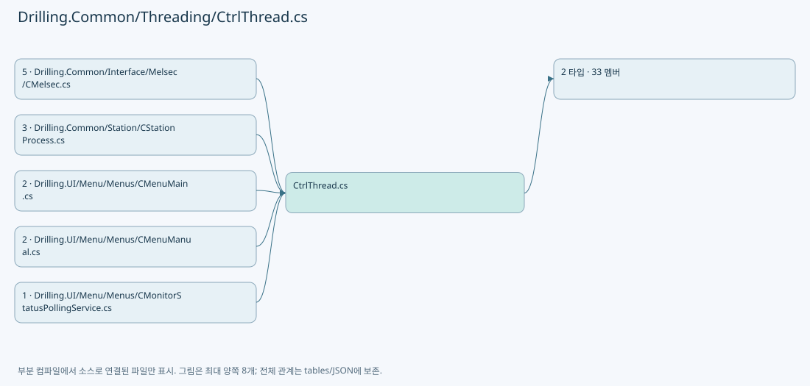

## 네임스페이스·타입·상속

| 타입 | 구분 | 원본 범위 | 선언/상속 |
| --- | --- | --- | --- |
| CtrlThread | ClassDeclaration | 4–284 | CtrlThread |
| EN_CTRL_THREAD_STATE | EnumDeclaration | 286–293 | EN_CTRL_THREAD_STATE |

## 멤버 빠른 목록

| 이름 | 종류 | 범위 | 서명 |
| --- | --- | --- | --- |
| _sync | FieldDeclaration | L6–6 | object Drilling.Common.Threading.CtrlThread._sync |
| _pauseEvent | FieldDeclaration | L7–7 | System.Threading.ManualResetEventSlim Drilling.Common.Threading.CtrlThread._pauseEvent |
| _stopEvent | FieldDeclaration | L8–8 | System.Threading.ManualResetEventSlim Drilling.Common.Threading.CtrlThread._stopEvent |
| _thread | FieldDeclaration | L9–9 | System.Threading.Thread? Drilling.Common.Threading.CtrlThread._thread |
| _stopRequested | FieldDeclaration | L10–10 | bool Drilling.Common.Threading.CtrlThread._stopRequested |
| _delayMs | FieldDeclaration | L11–11 | int Drilling.Common.Threading.CtrlThread._delayMs |
| _threadName | FieldDeclaration | L12–12 | string Drilling.Common.Threading.CtrlThread._threadName |
| _state | FieldDeclaration | L13–13 | Drilling.Common.Threading.EN_CTRL_THREAD_STATE Drilling.Common.Threading.CtrlThread._state |
| _lastError | FieldDeclaration | L14–14 | System.Exception? Drilling.Common.Threading.CtrlThread._lastError |
| _disposed | FieldDeclaration | L15–15 | bool Drilling.Common.Threading.CtrlThread._disposed |
| IsRunning | PropertyDeclaration | L16–25 | bool Drilling.Common.Threading.CtrlThread.IsRunning |
| get_IsRunning | GetAccessorDeclaration | L18–24 | bool Drilling.Common.Threading.CtrlThread.IsRunning.get |
| IsPaused | PropertyDeclaration | L27–36 | bool Drilling.Common.Threading.CtrlThread.IsPaused |
| get_IsPaused | GetAccessorDeclaration | L29–35 | bool Drilling.Common.Threading.CtrlThread.IsPaused.get |
| ThreadState | PropertyDeclaration | L38–47 | Drilling.Common.Threading.EN_CTRL_THREAD_STATE Drilling.Common.Threading.CtrlThread.ThreadState |
| get_ThreadState | GetAccessorDeclaration | L40–46 | Drilling.Common.Threading.EN_CTRL_THREAD_STATE Drilling.Common.Threading.CtrlThread.ThreadState.get |
| LastThreadError | PropertyDeclaration | L49–58 | System.Exception? Drilling.Common.Threading.CtrlThread.LastThreadError |
| get_LastThreadError | GetAccessorDeclaration | L51–57 | System.Exception? Drilling.Common.Threading.CtrlThread.LastThreadError.get |
| Start | MethodDeclaration | L60–96 | void Drilling.Common.Threading.CtrlThread.Start(int, string) |
| Pause | MethodDeclaration | L98–111 | void Drilling.Common.Threading.CtrlThread.Pause() |
| Resume | MethodDeclaration | L113–126 | void Drilling.Common.Threading.CtrlThread.Resume() |
| Stop | MethodDeclaration | L128–188 | void Drilling.Common.Threading.CtrlThread.Stop() |
| Dispose | MethodDeclaration | L190–208 | void Drilling.Common.Threading.CtrlThread.Dispose() |
| Run | MethodDeclaration | L210–212 | void Drilling.Common.Threading.CtrlThread.Run() |
| IsStopRequested | MethodDeclaration | L214–217 | bool Drilling.Common.Threading.CtrlThread.IsStopRequested() |
| OnThreadError | MethodDeclaration | L219–222 | void Drilling.Common.Threading.CtrlThread.OnThreadError(System.Exception) |
| ThrowIfDisposed | MethodDeclaration | L224–230 | void Drilling.Common.Threading.CtrlThread.ThrowIfDisposed() |
| ThreadProcess | MethodDeclaration | L232–283 | void Drilling.Common.Threading.CtrlThread.ThreadProcess() |
| Stopped | EnumMemberDeclaration | L288–288 | Drilling.Common.Threading.EN_CTRL_THREAD_STATE.Stopped |
| Running | EnumMemberDeclaration | L289–289 | Drilling.Common.Threading.EN_CTRL_THREAD_STATE.Running |
| Paused | EnumMemberDeclaration | L290–290 | Drilling.Common.Threading.EN_CTRL_THREAD_STATE.Paused |
| Stopping | EnumMemberDeclaration | L291–291 | Drilling.Common.Threading.EN_CTRL_THREAD_STATE.Stopping |
| Error | EnumMemberDeclaration | L292–292 | Drilling.Common.Threading.EN_CTRL_THREAD_STATE.Error |

## 멤버별 상세 계약·호출·처리 해설

### FieldDeclaration `_sync` · L6–6

[Drilling.Common/Threading/CtrlThread.cs:6–6](https://github.com/kjuws10-rgb/A3Drilling/blob/5aee8e58439c9b455cae7c9593c9be986c3e682e/Drilling.Common/Threading/CtrlThread.cs#L6-L6)

| 항목 | 실제 추출 값 |
| --- | --- |
| 서명 | object Drilling.Common.Threading.CtrlThread._sync |
| 접근/수식자 | Private / private, readonly |
| 반환/값 타입 | object |
| 소속 타입 | NamedType:Drilling.Common.Threading.CtrlThread |

현재 부분 분석에서 직접 연결된 호출자는 없습니다. XAML/이벤트/인터페이스·델리게이트·외부 진입을 추가 확인해야 하며, 미사용으로 판정한 것이 아닙니다.

호출하는 대상과 해석 범위:

| 원본 행 | 표현식 | 분석 상태 | 대상/소스 위치 |
| --- | --- | --- | --- |
| 6 | new | resolved | object.Object() |

본문의 실제 연산·분기·예외·반환 순서(원문 위치 순):

| 원본 행 | 종류 | 주석 해설 |
| --- | --- | --- |
| 6 | call | 함수·델리게이트 또는 객체 생성자를 호출합니다: new() |
| 6 | variable-initializer | 변수의 초기값을 지정합니다: _sync = new() |

변경 전 점검: 입력/반환 타입, 위 호출자, 예외/취소 경로, 공유 상태와 저장·전송 소비자를 함께 확인합니다. 값의 단위나 물리 방향을 이름만으로 확정하지 않습니다.

### FieldDeclaration `_pauseEvent` · L7–7

[Drilling.Common/Threading/CtrlThread.cs:7–7](https://github.com/kjuws10-rgb/A3Drilling/blob/5aee8e58439c9b455cae7c9593c9be986c3e682e/Drilling.Common/Threading/CtrlThread.cs#L7-L7)

| 항목 | 실제 추출 값 |
| --- | --- |
| 서명 | System.Threading.ManualResetEventSlim Drilling.Common.Threading.CtrlThread._pauseEvent |
| 접근/수식자 | Private / private, readonly |
| 반환/값 타입 | System.Threading.ManualResetEventSlim |
| 소속 타입 | NamedType:Drilling.Common.Threading.CtrlThread |

현재 부분 분석에서 직접 연결된 호출자는 없습니다. XAML/이벤트/인터페이스·델리게이트·외부 진입을 추가 확인해야 하며, 미사용으로 판정한 것이 아닙니다.

호출하는 대상과 해석 범위:

| 원본 행 | 표현식 | 분석 상태 | 대상/소스 위치 |
| --- | --- | --- | --- |
| 7 | new | resolved | System.Threading.ManualResetEventSlim.ManualResetEventSlim(bool) |

본문의 실제 연산·분기·예외·반환 순서(원문 위치 순):

| 원본 행 | 종류 | 주석 해설 |
| --- | --- | --- |
| 7 | call | 함수·델리게이트 또는 객체 생성자를 호출합니다: new(true) |
| 7 | variable-initializer | 변수의 초기값을 지정합니다: _pauseEvent = new(true) |

변경 전 점검: 입력/반환 타입, 위 호출자, 예외/취소 경로, 공유 상태와 저장·전송 소비자를 함께 확인합니다. 값의 단위나 물리 방향을 이름만으로 확정하지 않습니다.

### FieldDeclaration `_stopEvent` · L8–8

[Drilling.Common/Threading/CtrlThread.cs:8–8](https://github.com/kjuws10-rgb/A3Drilling/blob/5aee8e58439c9b455cae7c9593c9be986c3e682e/Drilling.Common/Threading/CtrlThread.cs#L8-L8)

| 항목 | 실제 추출 값 |
| --- | --- |
| 서명 | System.Threading.ManualResetEventSlim Drilling.Common.Threading.CtrlThread._stopEvent |
| 접근/수식자 | Private / private, readonly |
| 반환/값 타입 | System.Threading.ManualResetEventSlim |
| 소속 타입 | NamedType:Drilling.Common.Threading.CtrlThread |

현재 부분 분석에서 직접 연결된 호출자는 없습니다. XAML/이벤트/인터페이스·델리게이트·외부 진입을 추가 확인해야 하며, 미사용으로 판정한 것이 아닙니다.

호출하는 대상과 해석 범위:

| 원본 행 | 표현식 | 분석 상태 | 대상/소스 위치 |
| --- | --- | --- | --- |
| 8 | new | resolved | System.Threading.ManualResetEventSlim.ManualResetEventSlim(bool) |

본문의 실제 연산·분기·예외·반환 순서(원문 위치 순):

| 원본 행 | 종류 | 주석 해설 |
| --- | --- | --- |
| 8 | call | 함수·델리게이트 또는 객체 생성자를 호출합니다: new(false) |
| 8 | variable-initializer | 변수의 초기값을 지정합니다: _stopEvent = new(false) |

변경 전 점검: 입력/반환 타입, 위 호출자, 예외/취소 경로, 공유 상태와 저장·전송 소비자를 함께 확인합니다. 값의 단위나 물리 방향을 이름만으로 확정하지 않습니다.

### FieldDeclaration `_thread` · L9–9

[Drilling.Common/Threading/CtrlThread.cs:9–9](https://github.com/kjuws10-rgb/A3Drilling/blob/5aee8e58439c9b455cae7c9593c9be986c3e682e/Drilling.Common/Threading/CtrlThread.cs#L9-L9)

| 항목 | 실제 추출 값 |
| --- | --- |
| 서명 | System.Threading.Thread? Drilling.Common.Threading.CtrlThread._thread |
| 접근/수식자 | Private / private |
| 반환/값 타입 | System.Threading.Thread? |
| 소속 타입 | NamedType:Drilling.Common.Threading.CtrlThread |

현재 부분 분석에서 직접 연결된 호출자는 없습니다. XAML/이벤트/인터페이스·델리게이트·외부 진입을 추가 확인해야 하며, 미사용으로 판정한 것이 아닙니다.

변경 전 점검: 입력/반환 타입, 위 호출자, 예외/취소 경로, 공유 상태와 저장·전송 소비자를 함께 확인합니다. 값의 단위나 물리 방향을 이름만으로 확정하지 않습니다.

### FieldDeclaration `_stopRequested` · L10–10

[Drilling.Common/Threading/CtrlThread.cs:10–10](https://github.com/kjuws10-rgb/A3Drilling/blob/5aee8e58439c9b455cae7c9593c9be986c3e682e/Drilling.Common/Threading/CtrlThread.cs#L10-L10)

| 항목 | 실제 추출 값 |
| --- | --- |
| 서명 | bool Drilling.Common.Threading.CtrlThread._stopRequested |
| 접근/수식자 | Private / private, volatile |
| 반환/값 타입 | bool |
| 소속 타입 | NamedType:Drilling.Common.Threading.CtrlThread |

현재 부분 분석에서 직접 연결된 호출자는 없습니다. XAML/이벤트/인터페이스·델리게이트·외부 진입을 추가 확인해야 하며, 미사용으로 판정한 것이 아닙니다.

변경 전 점검: 입력/반환 타입, 위 호출자, 예외/취소 경로, 공유 상태와 저장·전송 소비자를 함께 확인합니다. 값의 단위나 물리 방향을 이름만으로 확정하지 않습니다.

### FieldDeclaration `_delayMs` · L11–11

[Drilling.Common/Threading/CtrlThread.cs:11–11](https://github.com/kjuws10-rgb/A3Drilling/blob/5aee8e58439c9b455cae7c9593c9be986c3e682e/Drilling.Common/Threading/CtrlThread.cs#L11-L11)

| 항목 | 실제 추출 값 |
| --- | --- |
| 서명 | int Drilling.Common.Threading.CtrlThread._delayMs |
| 접근/수식자 | Private / private |
| 반환/값 타입 | int |
| 소속 타입 | NamedType:Drilling.Common.Threading.CtrlThread |

현재 부분 분석에서 직접 연결된 호출자는 없습니다. XAML/이벤트/인터페이스·델리게이트·외부 진입을 추가 확인해야 하며, 미사용으로 판정한 것이 아닙니다.

본문의 실제 연산·분기·예외·반환 순서(원문 위치 순):

| 원본 행 | 종류 | 주석 해설 |
| --- | --- | --- |
| 11 | variable-initializer | 변수의 초기값을 지정합니다: _delayMs = 1 |

변경 전 점검: 입력/반환 타입, 위 호출자, 예외/취소 경로, 공유 상태와 저장·전송 소비자를 함께 확인합니다. 값의 단위나 물리 방향을 이름만으로 확정하지 않습니다.

### FieldDeclaration `_threadName` · L12–12

[Drilling.Common/Threading/CtrlThread.cs:12–12](https://github.com/kjuws10-rgb/A3Drilling/blob/5aee8e58439c9b455cae7c9593c9be986c3e682e/Drilling.Common/Threading/CtrlThread.cs#L12-L12)

| 항목 | 실제 추출 값 |
| --- | --- |
| 서명 | string Drilling.Common.Threading.CtrlThread._threadName |
| 접근/수식자 | Private / private |
| 반환/값 타입 | string |
| 소속 타입 | NamedType:Drilling.Common.Threading.CtrlThread |

현재 부분 분석에서 직접 연결된 호출자는 없습니다. XAML/이벤트/인터페이스·델리게이트·외부 진입을 추가 확인해야 하며, 미사용으로 판정한 것이 아닙니다.

본문의 실제 연산·분기·예외·반환 순서(원문 위치 순):

| 원본 행 | 종류 | 주석 해설 |
| --- | --- | --- |
| 12 | variable-initializer | 변수의 초기값을 지정합니다: _threadName = "" |

변경 전 점검: 입력/반환 타입, 위 호출자, 예외/취소 경로, 공유 상태와 저장·전송 소비자를 함께 확인합니다. 값의 단위나 물리 방향을 이름만으로 확정하지 않습니다.

### FieldDeclaration `_state` · L13–13

[Drilling.Common/Threading/CtrlThread.cs:13–13](https://github.com/kjuws10-rgb/A3Drilling/blob/5aee8e58439c9b455cae7c9593c9be986c3e682e/Drilling.Common/Threading/CtrlThread.cs#L13-L13)

| 항목 | 실제 추출 값 |
| --- | --- |
| 서명 | Drilling.Common.Threading.EN_CTRL_THREAD_STATE Drilling.Common.Threading.CtrlThread._state |
| 접근/수식자 | Private / private |
| 반환/값 타입 | Drilling.Common.Threading.EN_CTRL_THREAD_STATE |
| 소속 타입 | NamedType:Drilling.Common.Threading.CtrlThread |

현재 부분 분석에서 직접 연결된 호출자는 없습니다. XAML/이벤트/인터페이스·델리게이트·외부 진입을 추가 확인해야 하며, 미사용으로 판정한 것이 아닙니다.

본문의 실제 연산·분기·예외·반환 순서(원문 위치 순):

| 원본 행 | 종류 | 주석 해설 |
| --- | --- | --- |
| 13 | variable-initializer | 변수의 초기값을 지정합니다: _state = EN_CTRL_THREAD_STATE.Stopped |

변경 전 점검: 입력/반환 타입, 위 호출자, 예외/취소 경로, 공유 상태와 저장·전송 소비자를 함께 확인합니다. 값의 단위나 물리 방향을 이름만으로 확정하지 않습니다.

### FieldDeclaration `_lastError` · L14–14

[Drilling.Common/Threading/CtrlThread.cs:14–14](https://github.com/kjuws10-rgb/A3Drilling/blob/5aee8e58439c9b455cae7c9593c9be986c3e682e/Drilling.Common/Threading/CtrlThread.cs#L14-L14)

| 항목 | 실제 추출 값 |
| --- | --- |
| 서명 | System.Exception? Drilling.Common.Threading.CtrlThread._lastError |
| 접근/수식자 | Private / private |
| 반환/값 타입 | System.Exception? |
| 소속 타입 | NamedType:Drilling.Common.Threading.CtrlThread |

현재 부분 분석에서 직접 연결된 호출자는 없습니다. XAML/이벤트/인터페이스·델리게이트·외부 진입을 추가 확인해야 하며, 미사용으로 판정한 것이 아닙니다.

변경 전 점검: 입력/반환 타입, 위 호출자, 예외/취소 경로, 공유 상태와 저장·전송 소비자를 함께 확인합니다. 값의 단위나 물리 방향을 이름만으로 확정하지 않습니다.

### FieldDeclaration `_disposed` · L15–15

[Drilling.Common/Threading/CtrlThread.cs:15–15](https://github.com/kjuws10-rgb/A3Drilling/blob/5aee8e58439c9b455cae7c9593c9be986c3e682e/Drilling.Common/Threading/CtrlThread.cs#L15-L15)

| 항목 | 실제 추출 값 |
| --- | --- |
| 서명 | bool Drilling.Common.Threading.CtrlThread._disposed |
| 접근/수식자 | Private / private |
| 반환/값 타입 | bool |
| 소속 타입 | NamedType:Drilling.Common.Threading.CtrlThread |

현재 부분 분석에서 직접 연결된 호출자는 없습니다. XAML/이벤트/인터페이스·델리게이트·외부 진입을 추가 확인해야 하며, 미사용으로 판정한 것이 아닙니다.

변경 전 점검: 입력/반환 타입, 위 호출자, 예외/취소 경로, 공유 상태와 저장·전송 소비자를 함께 확인합니다. 값의 단위나 물리 방향을 이름만으로 확정하지 않습니다.

### PropertyDeclaration `IsRunning` · L16–25

[Drilling.Common/Threading/CtrlThread.cs:16–25](https://github.com/kjuws10-rgb/A3Drilling/blob/5aee8e58439c9b455cae7c9593c9be986c3e682e/Drilling.Common/Threading/CtrlThread.cs#L16-L25)

| 항목 | 실제 추출 값 |
| --- | --- |
| 서명 | bool Drilling.Common.Threading.CtrlThread.IsRunning |
| 접근/수식자 | Public / public |
| 반환/값 타입 | bool |
| 소속 타입 | NamedType:Drilling.Common.Threading.CtrlThread |

현재 부분 분석에서 직접 연결된 호출자는 없습니다. XAML/이벤트/인터페이스·델리게이트·외부 진입을 추가 확인해야 하며, 미사용으로 판정한 것이 아닙니다.

변경 전 점검: 입력/반환 타입, 위 호출자, 예외/취소 경로, 공유 상태와 저장·전송 소비자를 함께 확인합니다. 값의 단위나 물리 방향을 이름만으로 확정하지 않습니다.

### GetAccessorDeclaration `get_IsRunning` · L18–24

[Drilling.Common/Threading/CtrlThread.cs:18–24](https://github.com/kjuws10-rgb/A3Drilling/blob/5aee8e58439c9b455cae7c9593c9be986c3e682e/Drilling.Common/Threading/CtrlThread.cs#L18-L24)

| 항목 | 실제 추출 값 |
| --- | --- |
| 서명 | bool Drilling.Common.Threading.CtrlThread.IsRunning.get |
| 접근/수식자 | Public / get |
| 반환/값 타입 | bool |
| 소속 타입 | NamedType:Drilling.Common.Threading.CtrlThread |

현재 부분 분석에서 직접 연결된 호출자는 없습니다. XAML/이벤트/인터페이스·델리게이트·외부 진입을 추가 확인해야 하며, 미사용으로 판정한 것이 아닙니다.

본문의 실제 연산·분기·예외·반환 순서(원문 위치 순):

| 원본 행 | 종류 | 주석 해설 |
| --- | --- | --- |
| 20 | lock | 공유 상태의 임계 구역에 진입합니다: lock (_sync) |
| 22 | return | 호출자에게 값 또는 제어를 반환합니다: return _thread is { IsAlive: true }; |

제어 구문의 포함 구조(실제 실행 순서/CFG가 아닌 구문 탐색 그림):

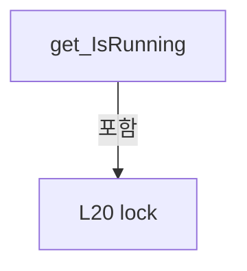

변경 전 점검: 입력/반환 타입, 위 호출자, 예외/취소 경로, 공유 상태와 저장·전송 소비자를 함께 확인합니다. 값의 단위나 물리 방향을 이름만으로 확정하지 않습니다.

### PropertyDeclaration `IsPaused` · L27–36

[Drilling.Common/Threading/CtrlThread.cs:27–36](https://github.com/kjuws10-rgb/A3Drilling/blob/5aee8e58439c9b455cae7c9593c9be986c3e682e/Drilling.Common/Threading/CtrlThread.cs#L27-L36)

| 항목 | 실제 추출 값 |
| --- | --- |
| 서명 | bool Drilling.Common.Threading.CtrlThread.IsPaused |
| 접근/수식자 | Public / public |
| 반환/값 타입 | bool |
| 소속 타입 | NamedType:Drilling.Common.Threading.CtrlThread |

현재 부분 분석에서 직접 연결된 호출자는 없습니다. XAML/이벤트/인터페이스·델리게이트·외부 진입을 추가 확인해야 하며, 미사용으로 판정한 것이 아닙니다.

변경 전 점검: 입력/반환 타입, 위 호출자, 예외/취소 경로, 공유 상태와 저장·전송 소비자를 함께 확인합니다. 값의 단위나 물리 방향을 이름만으로 확정하지 않습니다.

### GetAccessorDeclaration `get_IsPaused` · L29–35

[Drilling.Common/Threading/CtrlThread.cs:29–35](https://github.com/kjuws10-rgb/A3Drilling/blob/5aee8e58439c9b455cae7c9593c9be986c3e682e/Drilling.Common/Threading/CtrlThread.cs#L29-L35)

| 항목 | 실제 추출 값 |
| --- | --- |
| 서명 | bool Drilling.Common.Threading.CtrlThread.IsPaused.get |
| 접근/수식자 | Public / get |
| 반환/값 타입 | bool |
| 소속 타입 | NamedType:Drilling.Common.Threading.CtrlThread |

현재 부분 분석에서 직접 연결된 호출자는 없습니다. XAML/이벤트/인터페이스·델리게이트·외부 진입을 추가 확인해야 하며, 미사용으로 판정한 것이 아닙니다.

본문의 실제 연산·분기·예외·반환 순서(원문 위치 순):

| 원본 행 | 종류 | 주석 해설 |
| --- | --- | --- |
| 31 | lock | 공유 상태의 임계 구역에 진입합니다: lock (_sync) |
| 33 | return | 호출자에게 값 또는 제어를 반환합니다: return _state == EN_CTRL_THREAD_STATE.Paused; |

제어 구문의 포함 구조(실제 실행 순서/CFG가 아닌 구문 탐색 그림):

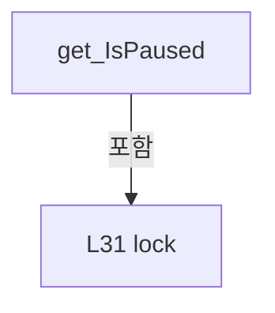

변경 전 점검: 입력/반환 타입, 위 호출자, 예외/취소 경로, 공유 상태와 저장·전송 소비자를 함께 확인합니다. 값의 단위나 물리 방향을 이름만으로 확정하지 않습니다.

### PropertyDeclaration `ThreadState` · L38–47

[Drilling.Common/Threading/CtrlThread.cs:38–47](https://github.com/kjuws10-rgb/A3Drilling/blob/5aee8e58439c9b455cae7c9593c9be986c3e682e/Drilling.Common/Threading/CtrlThread.cs#L38-L47)

| 항목 | 실제 추출 값 |
| --- | --- |
| 서명 | Drilling.Common.Threading.EN_CTRL_THREAD_STATE Drilling.Common.Threading.CtrlThread.ThreadState |
| 접근/수식자 | Public / public |
| 반환/값 타입 | Drilling.Common.Threading.EN_CTRL_THREAD_STATE |
| 소속 타입 | NamedType:Drilling.Common.Threading.CtrlThread |

현재 부분 분석에서 직접 연결된 호출자는 없습니다. XAML/이벤트/인터페이스·델리게이트·외부 진입을 추가 확인해야 하며, 미사용으로 판정한 것이 아닙니다.

변경 전 점검: 입력/반환 타입, 위 호출자, 예외/취소 경로, 공유 상태와 저장·전송 소비자를 함께 확인합니다. 값의 단위나 물리 방향을 이름만으로 확정하지 않습니다.

### GetAccessorDeclaration `get_ThreadState` · L40–46

[Drilling.Common/Threading/CtrlThread.cs:40–46](https://github.com/kjuws10-rgb/A3Drilling/blob/5aee8e58439c9b455cae7c9593c9be986c3e682e/Drilling.Common/Threading/CtrlThread.cs#L40-L46)

| 항목 | 실제 추출 값 |
| --- | --- |
| 서명 | Drilling.Common.Threading.EN_CTRL_THREAD_STATE Drilling.Common.Threading.CtrlThread.ThreadState.get |
| 접근/수식자 | Public / get |
| 반환/값 타입 | Drilling.Common.Threading.EN_CTRL_THREAD_STATE |
| 소속 타입 | NamedType:Drilling.Common.Threading.CtrlThread |

현재 부분 분석에서 직접 연결된 호출자는 없습니다. XAML/이벤트/인터페이스·델리게이트·외부 진입을 추가 확인해야 하며, 미사용으로 판정한 것이 아닙니다.

본문의 실제 연산·분기·예외·반환 순서(원문 위치 순):

| 원본 행 | 종류 | 주석 해설 |
| --- | --- | --- |
| 42 | lock | 공유 상태의 임계 구역에 진입합니다: lock (_sync) |
| 44 | return | 호출자에게 값 또는 제어를 반환합니다: return _state; |

제어 구문의 포함 구조(실제 실행 순서/CFG가 아닌 구문 탐색 그림):

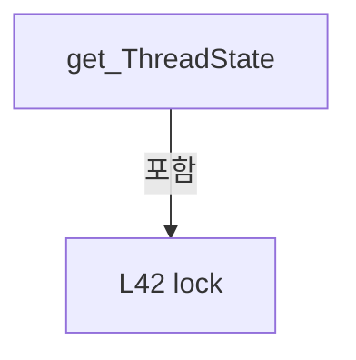

변경 전 점검: 입력/반환 타입, 위 호출자, 예외/취소 경로, 공유 상태와 저장·전송 소비자를 함께 확인합니다. 값의 단위나 물리 방향을 이름만으로 확정하지 않습니다.

### PropertyDeclaration `LastThreadError` · L49–58

[Drilling.Common/Threading/CtrlThread.cs:49–58](https://github.com/kjuws10-rgb/A3Drilling/blob/5aee8e58439c9b455cae7c9593c9be986c3e682e/Drilling.Common/Threading/CtrlThread.cs#L49-L58)

| 항목 | 실제 추출 값 |
| --- | --- |
| 서명 | System.Exception? Drilling.Common.Threading.CtrlThread.LastThreadError |
| 접근/수식자 | Public / public |
| 반환/값 타입 | System.Exception? |
| 소속 타입 | NamedType:Drilling.Common.Threading.CtrlThread |

현재 부분 분석에서 직접 연결된 호출자는 없습니다. XAML/이벤트/인터페이스·델리게이트·외부 진입을 추가 확인해야 하며, 미사용으로 판정한 것이 아닙니다.

변경 전 점검: 입력/반환 타입, 위 호출자, 예외/취소 경로, 공유 상태와 저장·전송 소비자를 함께 확인합니다. 값의 단위나 물리 방향을 이름만으로 확정하지 않습니다.

### GetAccessorDeclaration `get_LastThreadError` · L51–57

[Drilling.Common/Threading/CtrlThread.cs:51–57](https://github.com/kjuws10-rgb/A3Drilling/blob/5aee8e58439c9b455cae7c9593c9be986c3e682e/Drilling.Common/Threading/CtrlThread.cs#L51-L57)

| 항목 | 실제 추출 값 |
| --- | --- |
| 서명 | System.Exception? Drilling.Common.Threading.CtrlThread.LastThreadError.get |
| 접근/수식자 | Public / get |
| 반환/값 타입 | System.Exception? |
| 소속 타입 | NamedType:Drilling.Common.Threading.CtrlThread |

현재 부분 분석에서 직접 연결된 호출자는 없습니다. XAML/이벤트/인터페이스·델리게이트·외부 진입을 추가 확인해야 하며, 미사용으로 판정한 것이 아닙니다.

본문의 실제 연산·분기·예외·반환 순서(원문 위치 순):

| 원본 행 | 종류 | 주석 해설 |
| --- | --- | --- |
| 53 | lock | 공유 상태의 임계 구역에 진입합니다: lock (_sync) |
| 55 | return | 호출자에게 값 또는 제어를 반환합니다: return _lastError; |

제어 구문의 포함 구조(실제 실행 순서/CFG가 아닌 구문 탐색 그림):

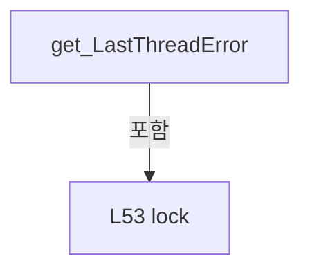

변경 전 점검: 입력/반환 타입, 위 호출자, 예외/취소 경로, 공유 상태와 저장·전송 소비자를 함께 확인합니다. 값의 단위나 물리 방향을 이름만으로 확정하지 않습니다.

### MethodDeclaration `Start` · L60–96

[Drilling.Common/Threading/CtrlThread.cs:60–96](https://github.com/kjuws10-rgb/A3Drilling/blob/5aee8e58439c9b455cae7c9593c9be986c3e682e/Drilling.Common/Threading/CtrlThread.cs#L60-L96)

| 항목 | 실제 추출 값 |
| --- | --- |
| 서명 | void Drilling.Common.Threading.CtrlThread.Start(int, string) |
| 접근/수식자 | Public / public |
| 반환/값 타입 | void |
| 소속 타입 | NamedType:Drilling.Common.Threading.CtrlThread |

입력 계약:

| 이름 | 타입 | 전달 | 선택/기본값 |
| --- | --- | --- | --- |
| delayMs | int | None | False /  |
| name | string | None | False /  |

정적 호출자로 확인된 위치:

| 호출 파일/행 | 호출 표현식 | 런타임 분기 가능 |
| --- | --- | --- |
| [Drilling.Common/Interface/Melsec/CMelsec.cs:153–153](https://github.com/kjuws10-rgb/A3Drilling/blob/5aee8e58439c9b455cae7c9593c9be986c3e682e/Drilling.Common/Interface/Melsec/CMelsec.cs#L153-L153) | Start | False |
| [Drilling.Common/Station/CStationProcess.cs:319–319](https://github.com/kjuws10-rgb/A3Drilling/blob/5aee8e58439c9b455cae7c9593c9be986c3e682e/Drilling.Common/Station/CStationProcess.cs#L319-L319) | base.Start | False |
| [Drilling.Common/Station/CStationProcess.cs:1216–1216](https://github.com/kjuws10-rgb/A3Drilling/blob/5aee8e58439c9b455cae7c9593c9be986c3e682e/Drilling.Common/Station/CStationProcess.cs#L1216-L1216) | base.Start | False |
| [Drilling.Common/Station/CStationProcess.cs:1277–1277](https://github.com/kjuws10-rgb/A3Drilling/blob/5aee8e58439c9b455cae7c9593c9be986c3e682e/Drilling.Common/Station/CStationProcess.cs#L1277-L1277) | base.Start | False |
| [Drilling.UI/Menu/Menus/CMenuMain.cs:3991–3991](https://github.com/kjuws10-rgb/A3Drilling/blob/5aee8e58439c9b455cae7c9593c9be986c3e682e/Drilling.UI/Menu/Menus/CMenuMain.cs#L3991-L3991) | base.Start | False |
| [Drilling.UI/Menu/Menus/CMenuManual.cs:7829–7829](https://github.com/kjuws10-rgb/A3Drilling/blob/5aee8e58439c9b455cae7c9593c9be986c3e682e/Drilling.UI/Menu/Menus/CMenuManual.cs#L7829-L7829) | base.Start | False |
| [Drilling.UI/Menu/Menus/CMonitorStatusPollingService.cs:34–34](https://github.com/kjuws10-rgb/A3Drilling/blob/5aee8e58439c9b455cae7c9593c9be986c3e682e/Drilling.UI/Menu/Menus/CMonitorStatusPollingService.cs#L34-L34) | base.Start | False |

호출하는 대상과 해석 범위:

| 원본 행 | 표현식 | 분석 상태 | 대상/소스 위치 |
| --- | --- | --- | --- |
| 64 | ThrowIfDisposed | resolved | void Drilling.Common.Threading.CtrlThread.ThrowIfDisposed() · Drilling.Common/Threading/CtrlThread.cs:224 |
| 70 | Math.Max | resolved | int System.Math.Max(int, int) |
| 71 | string.IsNullOrWhiteSpace | resolved | bool string.IsNullOrWhiteSpace(string?) |
| 71 | GetType | resolved | System.Type object.GetType() |
| 74 | _stopEvent.Reset | resolved | void System.Threading.ManualResetEventSlim.Reset() |
| 75 | _pauseEvent.Set | resolved | void System.Threading.ManualResetEventSlim.Set() |
| 77 | new Thread | resolved | System.Threading.Thread.Thread(System.Threading.ThreadStart) |
| 84 | _thread.Start | resolved | void System.Threading.Thread.Start() |
| 92 | Debug.WriteLine | resolved | void System.Diagnostics.Debug.WriteLine(string?) |

본문의 실제 연산·분기·예외·반환 순서(원문 위치 순):

| 원본 행 | 종류 | 주석 해설 |
| --- | --- | --- |
| 62 | lock | 공유 상태의 임계 구역에 진입합니다: lock (_sync) |
| 64 | call | 함수·델리게이트 또는 객체 생성자를 호출합니다: ThrowIfDisposed() |
| 65 | if | 조건에 따라 분기합니다: if (_thread is { IsAlive: true }) |
| 67 | return | 호출자에게 값 또는 제어를 반환합니다: return; |
| 70 | assignment | 값을 대상에 대입합니다: _delayMs = Math.Max(1, delayMs) |
| 70 | call | 함수·델리게이트 또는 객체 생성자를 호출합니다: Math.Max(1, delayMs) |
| 71 | assignment | 값을 대상에 대입합니다: _threadName = string.IsNullOrWhiteSpace(name) ? GetType().Name : name |
| 71 | call | 함수·델리게이트 또는 객체 생성자를 호출합니다: string.IsNullOrWhiteSpace(name) |
| 71 | call | 함수·델리게이트 또는 객체 생성자를 호출합니다: GetType() |
| 71 | conditional-expression | 조건에 따라 결과식을 선택합니다: string.IsNullOrWhiteSpace(name) ? GetType().Name : name |
| 72 | assignment | 값을 대상에 대입합니다: _stopRequested = false |
| 73 | assignment | 값을 대상에 대입합니다: _lastError = null |
| 74 | call | 함수·델리게이트 또는 객체 생성자를 호출합니다: _stopEvent.Reset() |
| 75 | call | 함수·델리게이트 또는 객체 생성자를 호출합니다: _pauseEvent.Set() |
| 76 | assignment | 값을 대상에 대입합니다: _state = EN_CTRL_THREAD_STATE.Running |
| 77 | assignment | 값을 대상에 대입합니다: _thread = new Thread(ThreadProcess) { IsBackground = true, Name = _threadName } |
| 77 | call | 함수·델리게이트 또는 객체 생성자를 호출합니다: new Thread(ThreadProcess) { IsBackground = true, Name = _threadName } |
| 79 | assignment | 값을 대상에 대입합니다: IsBackground = true |
| 80 | assignment | 값을 대상에 대입합니다: Name = _threadName |
| 82 | try | 예외 처리 범위입니다: try |
| 84 | call | 함수·델리게이트 또는 객체 생성자를 호출합니다: _thread.Start() |
| 86 | catch | 지정 예외를 처리합니다: catch (Exception exception) |
| 88 | assignment | 값을 대상에 대입합니다: _thread = null |
| 89 | assignment | 값을 대상에 대입합니다: _state = EN_CTRL_THREAD_STATE.Error |
| 90 | assignment | 값을 대상에 대입합니다: _lastError = exception |
| 91 | assignment | 값을 대상에 대입합니다: _stopRequested = true |
| 92 | call | 함수·델리게이트 또는 객체 생성자를 호출합니다: Debug.WriteLine("Thread start failed : " + _threadName + " / " + exception) |
| 93 | throw | 예외를 발생/전달합니다: throw; |

제어 구문의 포함 구조(실제 실행 순서/CFG가 아닌 구문 탐색 그림):

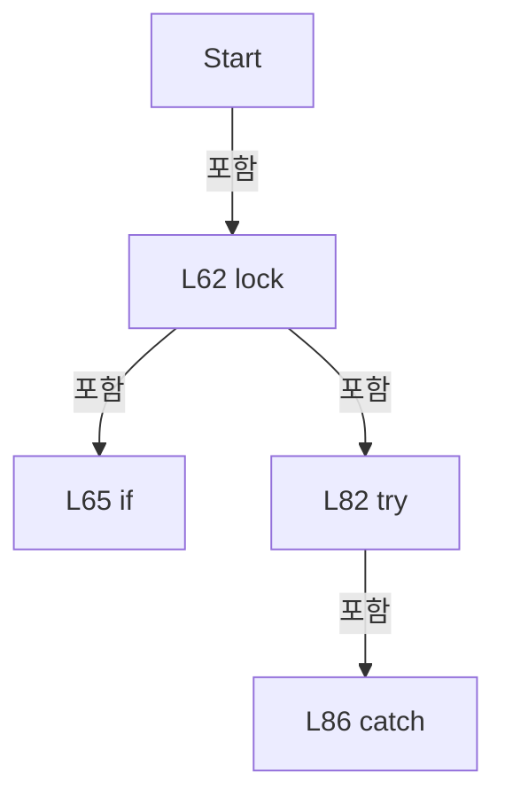

변경 전 점검: 입력/반환 타입, 위 호출자, 예외/취소 경로, 공유 상태와 저장·전송 소비자를 함께 확인합니다. 값의 단위나 물리 방향을 이름만으로 확정하지 않습니다.

### MethodDeclaration `Pause` · L98–111

[Drilling.Common/Threading/CtrlThread.cs:98–111](https://github.com/kjuws10-rgb/A3Drilling/blob/5aee8e58439c9b455cae7c9593c9be986c3e682e/Drilling.Common/Threading/CtrlThread.cs#L98-L111)

| 항목 | 실제 추출 값 |
| --- | --- |
| 서명 | void Drilling.Common.Threading.CtrlThread.Pause() |
| 접근/수식자 | Public / public |
| 반환/값 타입 | void |
| 소속 타입 | NamedType:Drilling.Common.Threading.CtrlThread |

현재 부분 분석에서 직접 연결된 호출자는 없습니다. XAML/이벤트/인터페이스·델리게이트·외부 진입을 추가 확인해야 하며, 미사용으로 판정한 것이 아닙니다.

호출하는 대상과 해석 범위:

| 원본 행 | 표현식 | 분석 상태 | 대상/소스 위치 |
| --- | --- | --- | --- |
| 102 | ThrowIfDisposed | resolved | void Drilling.Common.Threading.CtrlThread.ThrowIfDisposed() · Drilling.Common/Threading/CtrlThread.cs:224 |
| 108 | _pauseEvent.Reset | resolved | void System.Threading.ManualResetEventSlim.Reset() |

본문의 실제 연산·분기·예외·반환 순서(원문 위치 순):

| 원본 행 | 종류 | 주석 해설 |
| --- | --- | --- |
| 100 | lock | 공유 상태의 임계 구역에 진입합니다: lock (_sync) |
| 102 | call | 함수·델리게이트 또는 객체 생성자를 호출합니다: ThrowIfDisposed() |
| 103 | if | 조건에 따라 분기합니다: if (_thread is not { IsAlive: true } &#124;&#124; _stopRequested) |
| 105 | return | 호출자에게 값 또는 제어를 반환합니다: return; |
| 108 | call | 함수·델리게이트 또는 객체 생성자를 호출합니다: _pauseEvent.Reset() |
| 109 | assignment | 값을 대상에 대입합니다: _state = EN_CTRL_THREAD_STATE.Paused |

제어 구문의 포함 구조(실제 실행 순서/CFG가 아닌 구문 탐색 그림):

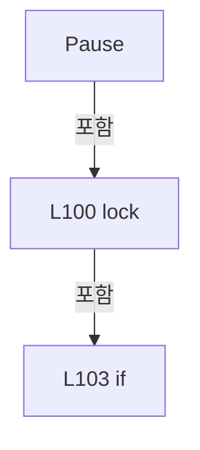

변경 전 점검: 입력/반환 타입, 위 호출자, 예외/취소 경로, 공유 상태와 저장·전송 소비자를 함께 확인합니다. 값의 단위나 물리 방향을 이름만으로 확정하지 않습니다.

### MethodDeclaration `Resume` · L113–126

[Drilling.Common/Threading/CtrlThread.cs:113–126](https://github.com/kjuws10-rgb/A3Drilling/blob/5aee8e58439c9b455cae7c9593c9be986c3e682e/Drilling.Common/Threading/CtrlThread.cs#L113-L126)

| 항목 | 실제 추출 값 |
| --- | --- |
| 서명 | void Drilling.Common.Threading.CtrlThread.Resume() |
| 접근/수식자 | Public / public |
| 반환/값 타입 | void |
| 소속 타입 | NamedType:Drilling.Common.Threading.CtrlThread |

현재 부분 분석에서 직접 연결된 호출자는 없습니다. XAML/이벤트/인터페이스·델리게이트·외부 진입을 추가 확인해야 하며, 미사용으로 판정한 것이 아닙니다.

호출하는 대상과 해석 범위:

| 원본 행 | 표현식 | 분석 상태 | 대상/소스 위치 |
| --- | --- | --- | --- |
| 117 | ThrowIfDisposed | resolved | void Drilling.Common.Threading.CtrlThread.ThrowIfDisposed() · Drilling.Common/Threading/CtrlThread.cs:224 |
| 124 | _pauseEvent.Set | resolved | void System.Threading.ManualResetEventSlim.Set() |

본문의 실제 연산·분기·예외·반환 순서(원문 위치 순):

| 원본 행 | 종류 | 주석 해설 |
| --- | --- | --- |
| 115 | lock | 공유 상태의 임계 구역에 진입합니다: lock (_sync) |
| 117 | call | 함수·델리게이트 또는 객체 생성자를 호출합니다: ThrowIfDisposed() |
| 118 | if | 조건에 따라 분기합니다: if (_thread is not { IsAlive: true } &#124;&#124; _stopRequested) |
| 120 | return | 호출자에게 값 또는 제어를 반환합니다: return; |
| 123 | assignment | 값을 대상에 대입합니다: _state = EN_CTRL_THREAD_STATE.Running |
| 124 | call | 함수·델리게이트 또는 객체 생성자를 호출합니다: _pauseEvent.Set() |

제어 구문의 포함 구조(실제 실행 순서/CFG가 아닌 구문 탐색 그림):

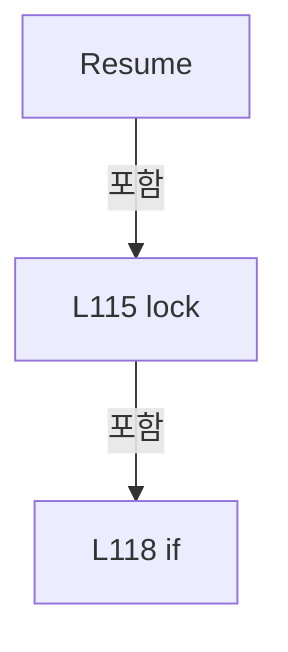

변경 전 점검: 입력/반환 타입, 위 호출자, 예외/취소 경로, 공유 상태와 저장·전송 소비자를 함께 확인합니다. 값의 단위나 물리 방향을 이름만으로 확정하지 않습니다.

### MethodDeclaration `Stop` · L128–188

[Drilling.Common/Threading/CtrlThread.cs:128–188](https://github.com/kjuws10-rgb/A3Drilling/blob/5aee8e58439c9b455cae7c9593c9be986c3e682e/Drilling.Common/Threading/CtrlThread.cs#L128-L188)

| 항목 | 실제 추출 값 |
| --- | --- |
| 서명 | void Drilling.Common.Threading.CtrlThread.Stop() |
| 접근/수식자 | Public / public |
| 반환/값 타입 | void |
| 소속 타입 | NamedType:Drilling.Common.Threading.CtrlThread |

정적 호출자로 확인된 위치:

| 호출 파일/행 | 호출 표현식 | 런타임 분기 가능 |
| --- | --- | --- |
| [Drilling.Common/Interface/Melsec/CMelsec.cs:168–168](https://github.com/kjuws10-rgb/A3Drilling/blob/5aee8e58439c9b455cae7c9593c9be986c3e682e/Drilling.Common/Interface/Melsec/CMelsec.cs#L168-L168) | Stop | False |
| [Drilling.Common/Interface/Melsec/CMelsec.cs:171–171](https://github.com/kjuws10-rgb/A3Drilling/blob/5aee8e58439c9b455cae7c9593c9be986c3e682e/Drilling.Common/Interface/Melsec/CMelsec.cs#L171-L171) | Stop | False |
| [Drilling.UI/Menu/Menus/CMenuMain.cs:1081–1081](https://github.com/kjuws10-rgb/A3Drilling/blob/5aee8e58439c9b455cae7c9593c9be986c3e682e/Drilling.UI/Menu/Menus/CMenuMain.cs#L1081-L1081) | _motorStatusPollingService.Stop | False |
| [Drilling.UI/Menu/Menus/CMenuManual.cs:3844–3844](https://github.com/kjuws10-rgb/A3Drilling/blob/5aee8e58439c9b455cae7c9593c9be986c3e682e/Drilling.UI/Menu/Menus/CMenuManual.cs#L3844-L3844) | _stageMotionPollingService.Stop | False |

호출하는 대상과 해석 범위:

| 원본 행 | 표현식 | 분석 상태 | 대상/소스 위치 |
| --- | --- | --- | --- |
| 134 | ThrowIfDisposed | resolved | void Drilling.Common.Threading.CtrlThread.ThrowIfDisposed() · Drilling.Common/Threading/CtrlThread.cs:224 |
| 137 | _pauseEvent.Set | resolved | void System.Threading.ManualResetEventSlim.Set() |
| 138 | _stopEvent.Set | resolved | void System.Threading.ManualResetEventSlim.Set() |
| 161 | target.Join | resolved | bool System.Threading.Thread.Join(int) |
| 165 | ReferenceEquals | resolved | bool object.ReferenceEquals(object?, object?) |
| 178 | new TimeoutException | resolved | System.TimeoutException.TimeoutException(string?) |
| 180 | Debug.WriteLine | resolved | void System.Diagnostics.Debug.WriteLine(string?) |
| 180 | stopError.ToString | resolved · 동적 구현 선택 가능 | string System.Exception.ToString() |

본문의 실제 연산·분기·예외·반환 순서(원문 위치 순):

| 원본 행 | 종류 | 주석 해설 |
| --- | --- | --- |
| 130 | local-declaration | 지역 변수를 선언합니다: Thread? target; |
| 131 | local-declaration | 지역 변수를 선언합니다: bool isCurrentThread; |
| 132 | lock | 공유 상태의 임계 구역에 진입합니다: lock (_sync) |
| 134 | call | 함수·델리게이트 또는 객체 생성자를 호출합니다: ThrowIfDisposed() |
| 135 | assignment | 값을 대상에 대입합니다: _stopRequested = true |
| 136 | assignment | 값을 대상에 대입합니다: _state = EN_CTRL_THREAD_STATE.Stopping |
| 137 | call | 함수·델리게이트 또는 객체 생성자를 호출합니다: _pauseEvent.Set() |
| 138 | call | 함수·델리게이트 또는 객체 생성자를 호출합니다: _stopEvent.Set() |
| 139 | assignment | 값을 대상에 대입합니다: target = _thread |
| 140 | assignment | 값을 대상에 대입합니다: isCurrentThread = target == Thread.CurrentThread |
| 143 | if | 조건에 따라 분기합니다: if (target is null) |
| 145 | lock | 공유 상태의 임계 구역에 진입합니다: lock (_sync) |
| 147 | if | 조건에 따라 분기합니다: if (_thread is null) |
| 149 | assignment | 값을 대상에 대입합니다: _state = EN_CTRL_THREAD_STATE.Stopped |
| 153 | return | 호출자에게 값 또는 제어를 반환합니다: return; |
| 156 | if | 조건에 따라 분기합니다: if (isCurrentThread) |
| 158 | return | 호출자에게 값 또는 제어를 반환합니다: return; |
| 161 | call | 함수·델리게이트 또는 객체 생성자를 호출합니다: target.Join(3000) |
| 161 | local-declaration | 지역 변수를 선언합니다: var stopped = target.Join(3000); |
| 161 | variable-initializer | 변수의 초기값을 지정합니다: stopped = target.Join(3000) |
| 162 | local-declaration | 지역 변수를 선언합니다: Exception? stopError = null; |
| 162 | variable-initializer | 변수의 초기값을 지정합니다: stopError = null |
| 163 | lock | 공유 상태의 임계 구역에 진입합니다: lock (_sync) |
| 165 | call | 함수·델리게이트 또는 객체 생성자를 호출합니다: ReferenceEquals(_thread, target) |
| 165 | if | 조건에 따라 분기합니다: if (!ReferenceEquals(_thread, target)) |
| 167 | return | 호출자에게 값 또는 제어를 반환합니다: return; |
| 170 | if | 조건에 따라 분기합니다: if (stopped &#124;&#124; !target.IsAlive) |
| 172 | assignment | 값을 대상에 대입합니다: _thread = null |
| 173 | assignment | 값을 대상에 대입합니다: _state = EN_CTRL_THREAD_STATE.Stopped |
| 175 | else | 앞 조건이 거짓인 경로입니다: else |
| 177 | assignment | 값을 대상에 대입합니다: _state = EN_CTRL_THREAD_STATE.Error |
| 178 | assignment | 값을 대상에 대입합니다: stopError = new TimeoutException("Thread stop timeout: " + _threadName) |
| 178 | call | 함수·델리게이트 또는 객체 생성자를 호출합니다: new TimeoutException("Thread stop timeout: " + _threadName) |
| 179 | assignment | 값을 대상에 대입합니다: _lastError = stopError |
| 180 | call | 함수·델리게이트 또는 객체 생성자를 호출합니다: Debug.WriteLine(stopError.ToString()) |
| 180 | call | 함수·델리게이트 또는 객체 생성자를 호출합니다: stopError.ToString() |
| 184 | if | 조건에 따라 분기합니다: if (stopError is not null) |
| 186 | throw | 예외를 발생/전달합니다: throw stopError; |

제어 구문의 포함 구조(실제 실행 순서/CFG가 아닌 구문 탐색 그림):

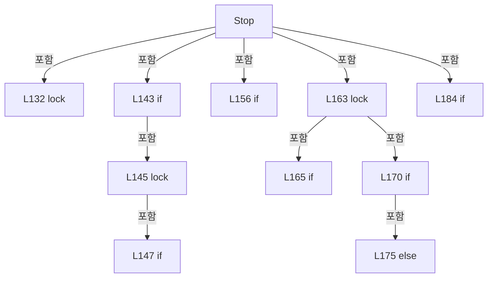

변경 전 점검: 입력/반환 타입, 위 호출자, 예외/취소 경로, 공유 상태와 저장·전송 소비자를 함께 확인합니다. 값의 단위나 물리 방향을 이름만으로 확정하지 않습니다.

### MethodDeclaration `Dispose` · L190–208

[Drilling.Common/Threading/CtrlThread.cs:190–208](https://github.com/kjuws10-rgb/A3Drilling/blob/5aee8e58439c9b455cae7c9593c9be986c3e682e/Drilling.Common/Threading/CtrlThread.cs#L190-L208)

| 항목 | 실제 추출 값 |
| --- | --- |
| 서명 | void Drilling.Common.Threading.CtrlThread.Dispose() |
| 접근/수식자 | Public / public |
| 반환/값 타입 | void |
| 소속 타입 | NamedType:Drilling.Common.Threading.CtrlThread |

정적 호출자로 확인된 위치:

| 호출 파일/행 | 호출 표현식 | 런타임 분기 가능 |
| --- | --- | --- |
| [Drilling.Common/Interface/Melsec/CMelsec.cs:484–484](https://github.com/kjuws10-rgb/A3Drilling/blob/5aee8e58439c9b455cae7c9593c9be986c3e682e/Drilling.Common/Interface/Melsec/CMelsec.cs#L484-L484) | base.Dispose | False |

호출하는 대상과 해석 범위:

| 원본 행 | 표현식 | 분석 상태 | 대상/소스 위치 |
| --- | --- | --- | --- |
| 201 | new InvalidOperationException | resolved | System.InvalidOperationException.InvalidOperationException(string?) |
| 204 | _pauseEvent.Dispose | resolved | void System.Threading.ManualResetEventSlim.Dispose() |
| 205 | _stopEvent.Dispose | resolved | void System.Threading.ManualResetEventSlim.Dispose() |

본문의 실제 연산·분기·예외·반환 순서(원문 위치 순):

| 원본 행 | 종류 | 주석 해설 |
| --- | --- | --- |
| 192 | lock | 공유 상태의 임계 구역에 진입합니다: lock (_sync) |
| 194 | if | 조건에 따라 분기합니다: if (_disposed) |
| 196 | return | 호출자에게 값 또는 제어를 반환합니다: return; |
| 199 | if | 조건에 따라 분기합니다: if (_thread is { IsAlive: true }) |
| 201 | call | 함수·델리게이트 또는 객체 생성자를 호출합니다: new InvalidOperationException("CtrlThread cannot be disposed while the worker thread is running.") |
| 201 | throw | 예외를 발생/전달합니다: throw new InvalidOperationException("CtrlThread cannot be disposed while the worker thread is running."); |
| 204 | call | 함수·델리게이트 또는 객체 생성자를 호출합니다: _pauseEvent.Dispose() |
| 205 | call | 함수·델리게이트 또는 객체 생성자를 호출합니다: _stopEvent.Dispose() |
| 206 | assignment | 값을 대상에 대입합니다: _disposed = true |

제어 구문의 포함 구조(실제 실행 순서/CFG가 아닌 구문 탐색 그림):

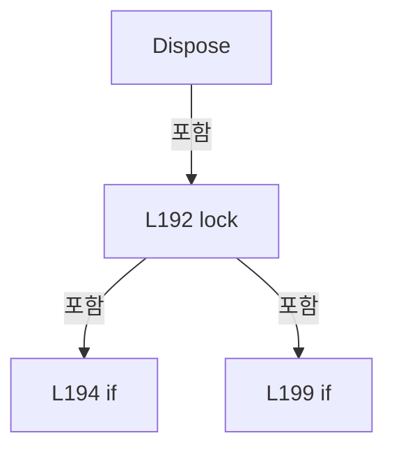

변경 전 점검: 입력/반환 타입, 위 호출자, 예외/취소 경로, 공유 상태와 저장·전송 소비자를 함께 확인합니다. 값의 단위나 물리 방향을 이름만으로 확정하지 않습니다.

### MethodDeclaration `Run` · L210–212

[Drilling.Common/Threading/CtrlThread.cs:210–212](https://github.com/kjuws10-rgb/A3Drilling/blob/5aee8e58439c9b455cae7c9593c9be986c3e682e/Drilling.Common/Threading/CtrlThread.cs#L210-L212)

| 항목 | 실제 추출 값 |
| --- | --- |
| 서명 | void Drilling.Common.Threading.CtrlThread.Run() |
| 접근/수식자 | Public / public, virtual |
| 반환/값 타입 | void |
| 소속 타입 | NamedType:Drilling.Common.Threading.CtrlThread |

정적 호출자로 확인된 위치:

| 호출 파일/행 | 호출 표현식 | 런타임 분기 가능 |
| --- | --- | --- |
| [Drilling.Common/Threading/CtrlThread.cs:246–246](https://github.com/kjuws10-rgb/A3Drilling/blob/5aee8e58439c9b455cae7c9593c9be986c3e682e/Drilling.Common/Threading/CtrlThread.cs#L246-L246) | Run | True |

변경 전 점검: 입력/반환 타입, 위 호출자, 예외/취소 경로, 공유 상태와 저장·전송 소비자를 함께 확인합니다. 값의 단위나 물리 방향을 이름만으로 확정하지 않습니다.

### MethodDeclaration `IsStopRequested` · L214–217

[Drilling.Common/Threading/CtrlThread.cs:214–217](https://github.com/kjuws10-rgb/A3Drilling/blob/5aee8e58439c9b455cae7c9593c9be986c3e682e/Drilling.Common/Threading/CtrlThread.cs#L214-L217)

| 항목 | 실제 추출 값 |
| --- | --- |
| 서명 | bool Drilling.Common.Threading.CtrlThread.IsStopRequested() |
| 접근/수식자 | Protected / protected |
| 반환/값 타입 | bool |
| 소속 타입 | NamedType:Drilling.Common.Threading.CtrlThread |

현재 부분 분석에서 직접 연결된 호출자는 없습니다. XAML/이벤트/인터페이스·델리게이트·외부 진입을 추가 확인해야 하며, 미사용으로 판정한 것이 아닙니다.

본문의 실제 연산·분기·예외·반환 순서(원문 위치 순):

| 원본 행 | 종류 | 주석 해설 |
| --- | --- | --- |
| 216 | return | 호출자에게 값 또는 제어를 반환합니다: return _stopRequested; |

변경 전 점검: 입력/반환 타입, 위 호출자, 예외/취소 경로, 공유 상태와 저장·전송 소비자를 함께 확인합니다. 값의 단위나 물리 방향을 이름만으로 확정하지 않습니다.

### MethodDeclaration `OnThreadError` · L219–222

[Drilling.Common/Threading/CtrlThread.cs:219–222](https://github.com/kjuws10-rgb/A3Drilling/blob/5aee8e58439c9b455cae7c9593c9be986c3e682e/Drilling.Common/Threading/CtrlThread.cs#L219-L222)

| 항목 | 실제 추출 값 |
| --- | --- |
| 서명 | void Drilling.Common.Threading.CtrlThread.OnThreadError(System.Exception) |
| 접근/수식자 | Protected / protected, virtual |
| 반환/값 타입 | void |
| 소속 타입 | NamedType:Drilling.Common.Threading.CtrlThread |

입력 계약:

| 이름 | 타입 | 전달 | 선택/기본값 |
| --- | --- | --- | --- |
| exception | System.Exception | None | False /  |

정적 호출자로 확인된 위치:

| 호출 파일/행 | 호출 표현식 | 런타임 분기 가능 |
| --- | --- | --- |
| [Drilling.Common/Interface/Melsec/CMelsec.cs:235–235](https://github.com/kjuws10-rgb/A3Drilling/blob/5aee8e58439c9b455cae7c9593c9be986c3e682e/Drilling.Common/Interface/Melsec/CMelsec.cs#L235-L235) | base.OnThreadError | True |
| [Drilling.Common/Threading/CtrlThread.cs:257–257](https://github.com/kjuws10-rgb/A3Drilling/blob/5aee8e58439c9b455cae7c9593c9be986c3e682e/Drilling.Common/Threading/CtrlThread.cs#L257-L257) | OnThreadError | True |

호출하는 대상과 해석 범위:

| 원본 행 | 표현식 | 분석 상태 | 대상/소스 위치 |
| --- | --- | --- | --- |
| 221 | Debug.WriteLine | resolved | void System.Diagnostics.Debug.WriteLine(string?) |

본문의 실제 연산·분기·예외·반환 순서(원문 위치 순):

| 원본 행 | 종류 | 주석 해설 |
| --- | --- | --- |
| 221 | call | 함수·델리게이트 또는 객체 생성자를 호출합니다: Debug.WriteLine("Thread Error : " + _threadName + " / " + exception) |

변경 전 점검: 입력/반환 타입, 위 호출자, 예외/취소 경로, 공유 상태와 저장·전송 소비자를 함께 확인합니다. 값의 단위나 물리 방향을 이름만으로 확정하지 않습니다.

### MethodDeclaration `ThrowIfDisposed` · L224–230

[Drilling.Common/Threading/CtrlThread.cs:224–230](https://github.com/kjuws10-rgb/A3Drilling/blob/5aee8e58439c9b455cae7c9593c9be986c3e682e/Drilling.Common/Threading/CtrlThread.cs#L224-L230)

| 항목 | 실제 추출 값 |
| --- | --- |
| 서명 | void Drilling.Common.Threading.CtrlThread.ThrowIfDisposed() |
| 접근/수식자 | Private / private |
| 반환/값 타입 | void |
| 소속 타입 | NamedType:Drilling.Common.Threading.CtrlThread |

정적 호출자로 확인된 위치:

| 호출 파일/행 | 호출 표현식 | 런타임 분기 가능 |
| --- | --- | --- |
| [Drilling.Common/Threading/CtrlThread.cs:64–64](https://github.com/kjuws10-rgb/A3Drilling/blob/5aee8e58439c9b455cae7c9593c9be986c3e682e/Drilling.Common/Threading/CtrlThread.cs#L64-L64) | ThrowIfDisposed | False |
| [Drilling.Common/Threading/CtrlThread.cs:102–102](https://github.com/kjuws10-rgb/A3Drilling/blob/5aee8e58439c9b455cae7c9593c9be986c3e682e/Drilling.Common/Threading/CtrlThread.cs#L102-L102) | ThrowIfDisposed | False |
| [Drilling.Common/Threading/CtrlThread.cs:117–117](https://github.com/kjuws10-rgb/A3Drilling/blob/5aee8e58439c9b455cae7c9593c9be986c3e682e/Drilling.Common/Threading/CtrlThread.cs#L117-L117) | ThrowIfDisposed | False |
| [Drilling.Common/Threading/CtrlThread.cs:134–134](https://github.com/kjuws10-rgb/A3Drilling/blob/5aee8e58439c9b455cae7c9593c9be986c3e682e/Drilling.Common/Threading/CtrlThread.cs#L134-L134) | ThrowIfDisposed | False |

호출하는 대상과 해석 범위:

| 원본 행 | 표현식 | 분석 상태 | 대상/소스 위치 |
| --- | --- | --- | --- |
| 228 | new ObjectDisposedException | resolved | System.ObjectDisposedException.ObjectDisposedException(string?) |
| 228 | GetType | resolved | System.Type object.GetType() |

본문의 실제 연산·분기·예외·반환 순서(원문 위치 순):

| 원본 행 | 종류 | 주석 해설 |
| --- | --- | --- |
| 226 | if | 조건에 따라 분기합니다: if (_disposed) |
| 228 | call | 함수·델리게이트 또는 객체 생성자를 호출합니다: new ObjectDisposedException(GetType().Name) |
| 228 | call | 함수·델리게이트 또는 객체 생성자를 호출합니다: GetType() |
| 228 | throw | 예외를 발생/전달합니다: throw new ObjectDisposedException(GetType().Name); |

제어 구문의 포함 구조(실제 실행 순서/CFG가 아닌 구문 탐색 그림):

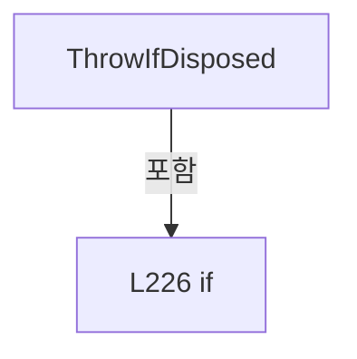

변경 전 점검: 입력/반환 타입, 위 호출자, 예외/취소 경로, 공유 상태와 저장·전송 소비자를 함께 확인합니다. 값의 단위나 물리 방향을 이름만으로 확정하지 않습니다.

### MethodDeclaration `ThreadProcess` · L232–283

[Drilling.Common/Threading/CtrlThread.cs:232–283](https://github.com/kjuws10-rgb/A3Drilling/blob/5aee8e58439c9b455cae7c9593c9be986c3e682e/Drilling.Common/Threading/CtrlThread.cs#L232-L283)

| 항목 | 실제 추출 값 |
| --- | --- |
| 서명 | void Drilling.Common.Threading.CtrlThread.ThreadProcess() |
| 접근/수식자 | Private / private |
| 반환/값 타입 | void |
| 소속 타입 | NamedType:Drilling.Common.Threading.CtrlThread |

현재 부분 분석에서 직접 연결된 호출자는 없습니다. XAML/이벤트/인터페이스·델리게이트·외부 진입을 추가 확인해야 하며, 미사용으로 판정한 것이 아닙니다.

호출하는 대상과 해석 범위:

| 원본 행 | 표현식 | 분석 상태 | 대상/소스 위치 |
| --- | --- | --- | --- |
| 238 | _pauseEvent.Wait | resolved | void System.Threading.ManualResetEventSlim.Wait() |
| 246 | Run | resolved · 동적 구현 선택 가능 | void Drilling.Common.Threading.CtrlThread.Run() · Drilling.Common/Threading/CtrlThread.cs:210 |
| 257 | OnThreadError | resolved · 동적 구현 선택 가능 | void Drilling.Common.Threading.CtrlThread.OnThreadError(System.Exception) · Drilling.Common/Threading/CtrlThread.cs:219 |
| 261 | Debug.WriteLine | resolved | void System.Diagnostics.Debug.WriteLine(string?) |
| 265 | _stopEvent.Wait | resolved | bool System.Threading.ManualResetEventSlim.Wait(int) |

본문의 실제 연산·분기·예외·반환 순서(원문 위치 순):

| 원본 행 | 종류 | 주석 해설 |
| --- | --- | --- |
| 234 | try | 예외 처리 범위입니다: try |
| 236 | while | 조건을 먼저 확인하며 반복합니다: while (!_stopRequested) |
| 238 | call | 함수·델리게이트 또는 객체 생성자를 호출합니다: _pauseEvent.Wait() |
| 239 | if | 조건에 따라 분기합니다: if (_stopRequested) |
| 241 | break | 해당 반복/분기 구간을 종료합니다: break; |
| 244 | try | 예외 처리 범위입니다: try |
| 246 | call | 함수·델리게이트 또는 객체 생성자를 호출합니다: Run() |
| 248 | catch | 지정 예외를 처리합니다: catch (Exception exception) |
| 250 | lock | 공유 상태의 임계 구역에 진입합니다: lock (_sync) |
| 252 | assignment | 값을 대상에 대입합니다: _lastError = exception |
| 255 | try | 예외 처리 범위입니다: try |
| 257 | call | 함수·델리게이트 또는 객체 생성자를 호출합니다: OnThreadError(exception) |
| 259 | catch | 지정 예외를 처리합니다: catch (Exception callbackException) |
| 261 | call | 함수·델리게이트 또는 객체 생성자를 호출합니다: Debug.WriteLine("Thread error callback failed : " + _threadName + " / " + callbackException) |
| 265 | call | 함수·델리게이트 또는 객체 생성자를 호출합니다: _stopEvent.Wait(_delayMs) |
| 265 | if | 조건에 따라 분기합니다: if (_delayMs > 0 && _stopEvent.Wait(_delayMs)) |
| 267 | break | 해당 반복/분기 구간을 종료합니다: break; |
| 271 | finally | 종료 정리 구간입니다: finally |
| 273 | lock | 공유 상태의 임계 구역에 진입합니다: lock (_sync) |
| 275 | if | 조건에 따라 분기합니다: if (_thread == Thread.CurrentThread) |
| 277 | assignment | 값을 대상에 대입합니다: _thread = null |
| 280 | assignment | 값을 대상에 대입합니다: _state = EN_CTRL_THREAD_STATE.Stopped |

제어 구문의 포함 구조(실제 실행 순서/CFG가 아닌 구문 탐색 그림):

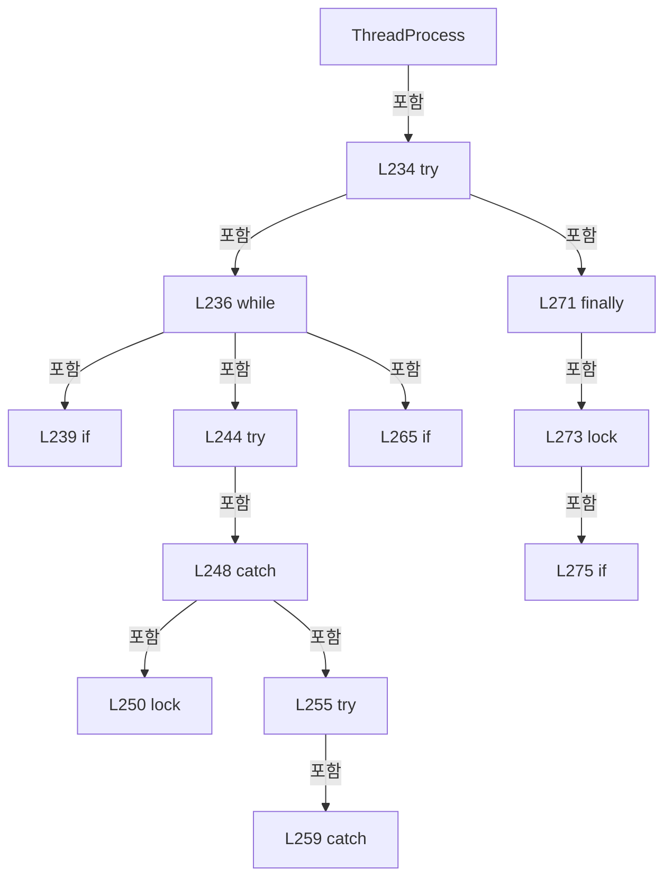

변경 전 점검: 입력/반환 타입, 위 호출자, 예외/취소 경로, 공유 상태와 저장·전송 소비자를 함께 확인합니다. 값의 단위나 물리 방향을 이름만으로 확정하지 않습니다.

### EnumMemberDeclaration `Stopped` · L288–288

[Drilling.Common/Threading/CtrlThread.cs:288–288](https://github.com/kjuws10-rgb/A3Drilling/blob/5aee8e58439c9b455cae7c9593c9be986c3e682e/Drilling.Common/Threading/CtrlThread.cs#L288-L288)

| 항목 | 실제 추출 값 |
| --- | --- |
| 서명 | Drilling.Common.Threading.EN_CTRL_THREAD_STATE.Stopped |
| 접근/수식자 | Public /  |
| 반환/값 타입 | Drilling.Common.Threading.EN_CTRL_THREAD_STATE |
| 소속 타입 | NamedType:Drilling.Common.Threading.EN_CTRL_THREAD_STATE |

현재 부분 분석에서 직접 연결된 호출자는 없습니다. XAML/이벤트/인터페이스·델리게이트·외부 진입을 추가 확인해야 하며, 미사용으로 판정한 것이 아닙니다.

변경 전 점검: 입력/반환 타입, 위 호출자, 예외/취소 경로, 공유 상태와 저장·전송 소비자를 함께 확인합니다. 값의 단위나 물리 방향을 이름만으로 확정하지 않습니다.

### EnumMemberDeclaration `Running` · L289–289

[Drilling.Common/Threading/CtrlThread.cs:289–289](https://github.com/kjuws10-rgb/A3Drilling/blob/5aee8e58439c9b455cae7c9593c9be986c3e682e/Drilling.Common/Threading/CtrlThread.cs#L289-L289)

| 항목 | 실제 추출 값 |
| --- | --- |
| 서명 | Drilling.Common.Threading.EN_CTRL_THREAD_STATE.Running |
| 접근/수식자 | Public /  |
| 반환/값 타입 | Drilling.Common.Threading.EN_CTRL_THREAD_STATE |
| 소속 타입 | NamedType:Drilling.Common.Threading.EN_CTRL_THREAD_STATE |

현재 부분 분석에서 직접 연결된 호출자는 없습니다. XAML/이벤트/인터페이스·델리게이트·외부 진입을 추가 확인해야 하며, 미사용으로 판정한 것이 아닙니다.

변경 전 점검: 입력/반환 타입, 위 호출자, 예외/취소 경로, 공유 상태와 저장·전송 소비자를 함께 확인합니다. 값의 단위나 물리 방향을 이름만으로 확정하지 않습니다.

### EnumMemberDeclaration `Paused` · L290–290

[Drilling.Common/Threading/CtrlThread.cs:290–290](https://github.com/kjuws10-rgb/A3Drilling/blob/5aee8e58439c9b455cae7c9593c9be986c3e682e/Drilling.Common/Threading/CtrlThread.cs#L290-L290)

| 항목 | 실제 추출 값 |
| --- | --- |
| 서명 | Drilling.Common.Threading.EN_CTRL_THREAD_STATE.Paused |
| 접근/수식자 | Public /  |
| 반환/값 타입 | Drilling.Common.Threading.EN_CTRL_THREAD_STATE |
| 소속 타입 | NamedType:Drilling.Common.Threading.EN_CTRL_THREAD_STATE |

현재 부분 분석에서 직접 연결된 호출자는 없습니다. XAML/이벤트/인터페이스·델리게이트·외부 진입을 추가 확인해야 하며, 미사용으로 판정한 것이 아닙니다.

변경 전 점검: 입력/반환 타입, 위 호출자, 예외/취소 경로, 공유 상태와 저장·전송 소비자를 함께 확인합니다. 값의 단위나 물리 방향을 이름만으로 확정하지 않습니다.

### EnumMemberDeclaration `Stopping` · L291–291

[Drilling.Common/Threading/CtrlThread.cs:291–291](https://github.com/kjuws10-rgb/A3Drilling/blob/5aee8e58439c9b455cae7c9593c9be986c3e682e/Drilling.Common/Threading/CtrlThread.cs#L291-L291)

| 항목 | 실제 추출 값 |
| --- | --- |
| 서명 | Drilling.Common.Threading.EN_CTRL_THREAD_STATE.Stopping |
| 접근/수식자 | Public /  |
| 반환/값 타입 | Drilling.Common.Threading.EN_CTRL_THREAD_STATE |
| 소속 타입 | NamedType:Drilling.Common.Threading.EN_CTRL_THREAD_STATE |

현재 부분 분석에서 직접 연결된 호출자는 없습니다. XAML/이벤트/인터페이스·델리게이트·외부 진입을 추가 확인해야 하며, 미사용으로 판정한 것이 아닙니다.

변경 전 점검: 입력/반환 타입, 위 호출자, 예외/취소 경로, 공유 상태와 저장·전송 소비자를 함께 확인합니다. 값의 단위나 물리 방향을 이름만으로 확정하지 않습니다.

### EnumMemberDeclaration `Error` · L292–292

[Drilling.Common/Threading/CtrlThread.cs:292–292](https://github.com/kjuws10-rgb/A3Drilling/blob/5aee8e58439c9b455cae7c9593c9be986c3e682e/Drilling.Common/Threading/CtrlThread.cs#L292-L292)

| 항목 | 실제 추출 값 |
| --- | --- |
| 서명 | Drilling.Common.Threading.EN_CTRL_THREAD_STATE.Error |
| 접근/수식자 | Public /  |
| 반환/값 타입 | Drilling.Common.Threading.EN_CTRL_THREAD_STATE |
| 소속 타입 | NamedType:Drilling.Common.Threading.EN_CTRL_THREAD_STATE |

현재 부분 분석에서 직접 연결된 호출자는 없습니다. XAML/이벤트/인터페이스·델리게이트·외부 진입을 추가 확인해야 하며, 미사용으로 판정한 것이 아닙니다.

변경 전 점검: 입력/반환 타입, 위 호출자, 예외/취소 경로, 공유 상태와 저장·전송 소비자를 함께 확인합니다. 값의 단위나 물리 방향을 이름만으로 확정하지 않습니다.

## 구문·바인딩 한계

전체 WPF/벤더 SDK/프로젝트별 빌드 조건을 로드한 정식 빌드가 아닙니다. `resolved`는 이 부분 컴파일에서의 심볼 연결이며 virtual/interface/delegate/이벤트/Reflection/XAML의 실제 런타임 구현을 확정하지 않습니다. `candidate`와 `unresolved`는 후속 확인 대상으로 남깁니다.

## 원문 전체 주석 해설본

[원본 모든 행과 행별 해설 보기](../../../annotated/Drilling.Common/Threading/CtrlThread.cs.annotated.txt)

원본을 빠뜨리거나 임의로 줄이지 않았습니다. `L000001 |` 표시는 원본 행 번호, `// 해설`은 별도 설명입니다. 실행용 소스가 아닌 문서입니다.

## 수정·재검증 체크

- 원본 Commit과 현재 작업 파일 SHA가 같은지 먼저 확인합니다. 다르면 이 문서를 과거 버전 자료로 취급합니다.
- 선언·직접 호출·이벤트/인터페이스 경계·설정 소비를 함께 확인합니다. 정적 연결의 빈 곳을 정상 경로로 추정하지 않습니다.
- 저장 형식/단위/식별자·재시도·취소·예외·롤백에 영향을 주는 변경은 상세 해설장과 호출자를 다시 검토합니다.
- 도구의 구문 추출과 별도 정적 추적 해설, 실제 빌드·시뮬레이션·실장비 검증 결과를 분리합니다.
