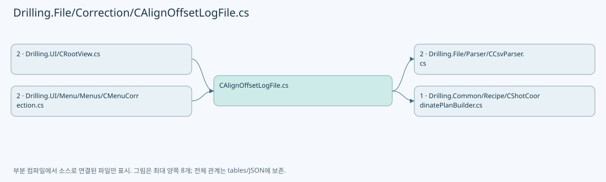
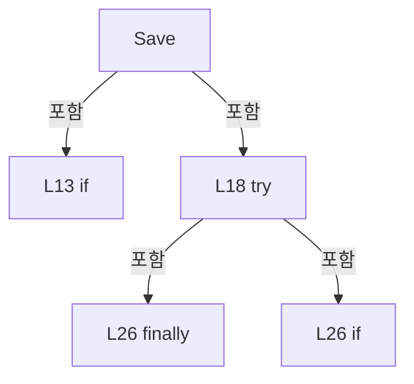
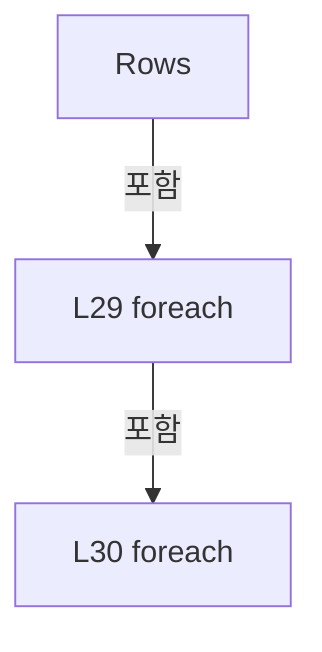
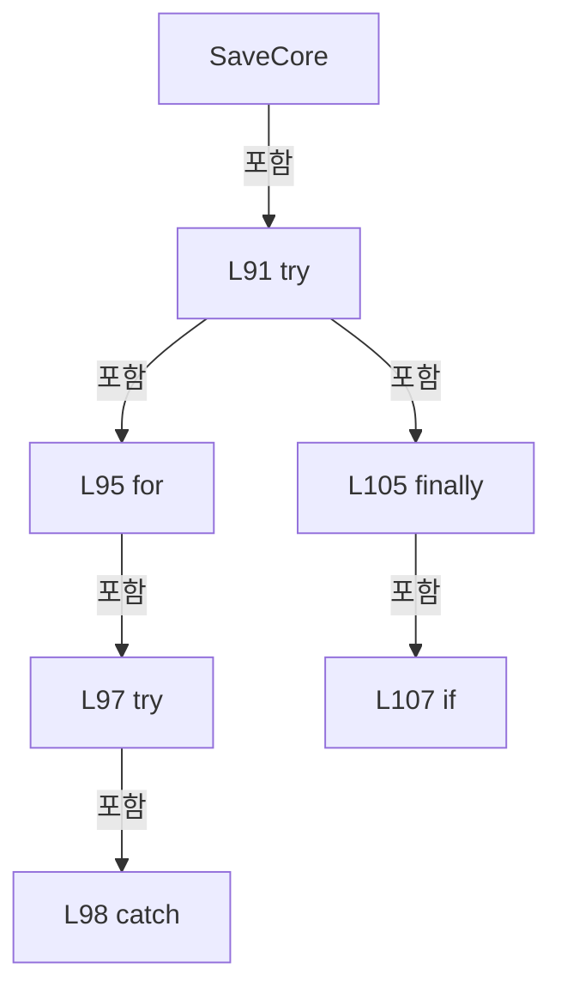
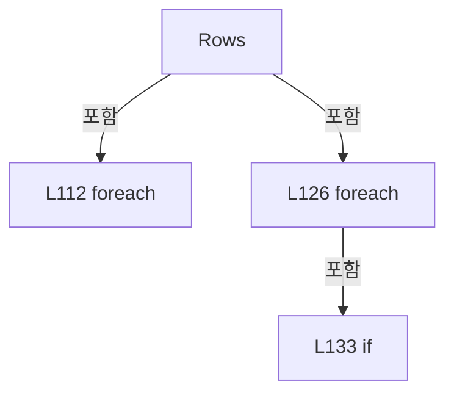
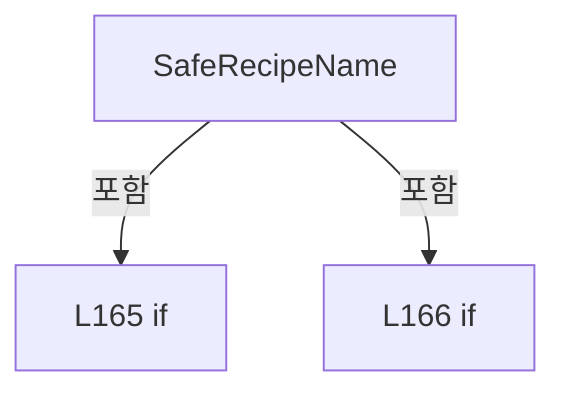

# Drilling.File/Correction/CAlignOffsetLogFile.cs

| 항목 | 내용 |
| --- | --- |
| 원본 저장소 | https://github.com/kjuws10-rgb/A3Drilling.git |
| 원본 Commit | 5aee8e58439c9b455cae7c9593c9be986c3e682e |
| 원본 SHA256 | e9c8b33fe1e31dbe1e8b115152140fc8a54eb2c58b2bc023fdc163a0eaef74dc |
| 파일 분류 | code |
| 원본 크기/행 | 10,145 bytes / 172 physical lines |
| 인코딩 | utf-8-sig |
| 검토 범위 | 구문/부분 의미 분석에서 추출한 사실. 동작·물리 단위·실장비 합격을 보증하지 않습니다. |
| 원본 링크 | [고정 Commit 원본](https://github.com/kjuws10-rgb/A3Drilling/blob/5aee8e58439c9b455cae7c9593c9be986c3e682e/Drilling.File/Correction/CAlignOffsetLogFile.cs) |

## 파일의 역할과 읽는 순서

보정 계산·설정·원본/적용값의 관계를 다루는 계층입니다. 값의 좌표계와 단위는 호출부의 근거를 따릅니다.

## 네임스페이스·타입·상속

| 타입 | 구분 | 원본 범위 | 선언/상속 |
| --- | --- | --- | --- |
| CDefaultOffsetLogFile | ClassDeclaration | 8–38 | CDefaultOffsetLogFile |
| CAlignOffsetLogFile | ClassDeclaration | 40–172 | CAlignOffsetLogFile: CAlignOffsetLogFileBase |

## 멤버 빠른 목록

| 이름 | 종류 | 범위 | 서명 |
| --- | --- | --- | --- |
| Save | MethodDeclaration | L10–37 | System.Threading.Tasks.Task<string> Drilling.File.Correction.CDefaultOffsetLogFile.Save(Drilling.Common.Correction.ST_DEFAULT_OFFSET_LOG, System.Threading.CancellationToken) |
| F | LocalFunctionStatement | L17–17 | string F(double) |
| Rows | LocalFunctionStatement | L27–36 | System.Collections.Generic.IEnumerable<System.Collections.Generic.IReadOnlyList<string>> Rows() |
| Headers | FieldDeclaration | L42–74 | string[] Drilling.File.Correction.CAlignOffsetLogFile.Headers |
| RootPath | PropertyDeclaration | L76–76 | string Drilling.File.Correction.CAlignOffsetLogFile.RootPath |
| get_RootPath | GetAccessorDeclaration | L76–76 | string Drilling.File.Correction.CAlignOffsetLogFile.RootPath.get |
| Save | MethodDeclaration | L78–79 | System.Threading.Tasks.Task<string> Drilling.File.Correction.CAlignOffsetLogFile.Save(Drilling.Common.Correction.ST_ALIGN_OFFSET_LOG, System.Threading.CancellationToken) |
| SaveCore | MethodDeclaration | L81–156 | string Drilling.File.Correction.CAlignOffsetLogFile.SaveCore(Drilling.Common.Correction.ST_ALIGN_OFFSET_LOG, System.Threading.CancellationToken) |
| Rows | LocalFunctionStatement | L110–140 | System.Collections.Generic.IEnumerable<System.Collections.Generic.IReadOnlyDictionary<string, string>> Rows() |
| CommonRow | LocalFunctionStatement | L142–155 | System.Collections.Generic.Dictionary<string, string> CommonRow(string, double, double, double?, double?) |
| Number | MethodDeclaration | L158–158 | string Drilling.File.Correction.CAlignOffsetLogFile.Number(double?) |
| SafeRecipeName | MethodDeclaration | L160–171 | string Drilling.File.Correction.CAlignOffsetLogFile.SafeRecipeName(string) |

## 멤버별 상세 계약·호출·처리 해설

### MethodDeclaration `Save` · L10–37

[Drilling.File/Correction/CAlignOffsetLogFile.cs:10–37](https://github.com/kjuws10-rgb/A3Drilling/blob/5aee8e58439c9b455cae7c9593c9be986c3e682e/Drilling.File/Correction/CAlignOffsetLogFile.cs#L10-L37)

| 항목 | 실제 추출 값 |
| --- | --- |
| 서명 | System.Threading.Tasks.Task<string> Drilling.File.Correction.CDefaultOffsetLogFile.Save(Drilling.Common.Correction.ST_DEFAULT_OFFSET_LOG, System.Threading.CancellationToken) |
| 접근/수식자 | Public / public |
| 반환/값 타입 | System.Threading.Tasks.Task<string> |
| 소속 타입 | NamedType:Drilling.File.Correction.CDefaultOffsetLogFile |

입력 계약:

| 이름 | 타입 | 전달 | 선택/기본값 |
| --- | --- | --- | --- |
| data | Drilling.Common.Correction.ST_DEFAULT_OFFSET_LOG | None | False /  |
| token | System.Threading.CancellationToken | None | True / null |

정적 호출자로 확인된 위치:

| 호출 파일/행 | 호출 표현식 | 런타임 분기 가능 |
| --- | --- | --- |
| [Drilling.UI/Menu/Menus/CMenuCorrection.cs:3792–3792](https://github.com/kjuws10-rgb/A3Drilling/blob/5aee8e58439c9b455cae7c9593c9be986c3e682e/Drilling.UI/Menu/Menus/CMenuCorrection.cs#L3792-L3792) | new Drilling.File.Correction.CDefaultOffsetLogFile(_defaultManager!.ConfigRoot).Save | False |

호출하는 대상과 해석 범위:

| 원본 행 | 표현식 | 분석 상태 | 대상/소스 위치 |
| --- | --- | --- | --- |
| 10 | Task.Run | resolved | System.Threading.Tasks.Task<string> System.Threading.Tasks.Task.Run<string>(System.Func<string>, System.Threading.CancellationToken) |
| 12 | string.Concat | resolved | string string.Concat<char>(System.Collections.Generic.IEnumerable<char>) |
| 12 | data.Recipe.Select | resolved | System.Collections.Generic.IEnumerable<char> System.Collections.Generic.IEnumerable<char>.Select<char, char>(System.Func<char, char>) |
| 12 | Path.GetInvalidFileNameChars().Contains | resolved | bool System.ReadOnlySpan<char>.Contains<char>(char) |
| 12 | Path.GetInvalidFileNameChars | resolved | char[] System.IO.Path.GetInvalidFileNameChars() |
| 13 | new IOException | resolved | System.IO.IOException.IOException(string?) |
| 14 | Path.Combine | resolved | string System.IO.Path.Combine(string, string, string, string) |
| 14 | Directory.GetParent | resolved | System.IO.DirectoryInfo? System.IO.Directory.GetParent(string) |
| 14 | Path.GetFullPath | resolved | string System.IO.Path.GetFullPath(string) |
| 15 | Path.Combine | resolved | string System.IO.Path.Combine(string, string) |
| 15 | Guid.NewGuid | resolved | System.Guid System.Guid.NewGuid() |
| 21 | CCsvParser.Write | resolved | void Drilling.File.Parser.CCsvParser.Write(string, System.Collections.Generic.IReadOnlyList<string>, System.Collections.Generic.IEnumerable<System.Collections.Generic.IReadOnlyDictionary<string, string>>) · Drilling.File/Parser/CCsvParser.cs:58 |
| 21 | Rows().Select | resolved | System.Collections.Generic.IEnumerable<System.Collections.Generic.IReadOnlyDictionary<string, string>> System.Collections.Generic.IEnumerable<System.Collections.Generic.IReadOnlyList<string>>.Select<System.Collections.Generic.IReadOnlyList<string>, System.Collections.Generic.IReadOnlyDictionary<string, string>>(System.Func<System.Collections.Generic.IReadOnlyList<string>, System.Collections.Generic.IReadOnlyDictionary<string, string>>) |
| 21 | Rows | resolved | System.Collections.Generic.IEnumerable<System.Collections.Generic.IReadOnlyList<string>> Rows() · Drilling.File/Correction/CAlignOffsetLogFile.cs:27 |
| 21 | headers.Zip(row).ToDictionary | resolved | System.Collections.Generic.Dictionary<string, string> System.Collections.Generic.IEnumerable<(string First, string Second)>.ToDictionary<(string First, string Second), string, string>(System.Func<(string First, string Second), string>, System.Func<(string First, string Second), string>) |
| 21 | headers.Zip | resolved | System.Collections.Generic.IEnumerable<(string First, string Second)> System.Collections.Generic.IEnumerable<string>.Zip<string, string>(System.Collections.Generic.IEnumerable<string>) |
| 22 | token.ThrowIfCancellationRequested | resolved | void System.Threading.CancellationToken.ThrowIfCancellationRequested() |
| 23 | System.IO.File.Move | resolved | void System.IO.File.Move(string, string) |
| 26 | System.IO.File.Exists | resolved | bool System.IO.File.Exists(string?) |
| 26 | System.IO.File.Delete | resolved | void System.IO.File.Delete(string) |

본문의 실제 연산·분기·예외·반환 순서(원문 위치 순):

| 원본 행 | 종류 | 주석 해설 |
| --- | --- | --- |
| 10 | call | 함수·델리게이트 또는 객체 생성자를 호출합니다: Task.Run(() => { var safeName = string.Concat(data.Recipe.Select(c => Path.GetInvalidFileNameChars().Contains(c) ? '_' : c)); if (safeName is "" or "." or "..") throw new IOException("Default 결과의 레시피명을 확인해 주세요."); var di… |
| 12 | call | 함수·델리게이트 또는 객체 생성자를 호출합니다: string.Concat(data.Recipe.Select(c => Path.GetInvalidFileNameChars().Contains(c) ? '_' : c)) |
| 12 | call | 함수·델리게이트 또는 객체 생성자를 호출합니다: data.Recipe.Select(c => Path.GetInvalidFileNameChars().Contains(c) ? '_' : c) |
| 12 | call | 함수·델리게이트 또는 객체 생성자를 호출합니다: Path.GetInvalidFileNameChars().Contains(c) |
| 12 | call | 함수·델리게이트 또는 객체 생성자를 호출합니다: Path.GetInvalidFileNameChars() |
| 12 | conditional-expression | 조건에 따라 결과식을 선택합니다: Path.GetInvalidFileNameChars().Contains(c) ? '_' : c |
| 12 | local-declaration | 지역 변수를 선언합니다: var safeName = string.Concat(data.Recipe.Select(c => Path.GetInvalidFileNameChars().Contains(c) ? '_' : c)); |
| 12 | variable-initializer | 변수의 초기값을 지정합니다: safeName = string.Concat(data.Recipe.Select(c => Path.GetInvalidFileNameChars().Contains(c) ? '_' : c)) |
| 13 | call | 함수·델리게이트 또는 객체 생성자를 호출합니다: new IOException("Default 결과의 레시피명을 확인해 주세요.") |
| 13 | if | 조건에 따라 분기합니다: if (safeName is "" or "." or "..") |
| 13 | throw | 예외를 발생/전달합니다: throw new IOException("Default 결과의 레시피명을 확인해 주세요."); |
| 14 | call | 함수·델리게이트 또는 객체 생성자를 호출합니다: Path.Combine(Directory.GetParent(Path.GetFullPath(configRoot))!.FullName, "Data", "DefaultOffset", safeName) |
| 14 | call | 함수·델리게이트 또는 객체 생성자를 호출합니다: Directory.GetParent(Path.GetFullPath(configRoot)) |
| 14 | call | 함수·델리게이트 또는 객체 생성자를 호출합니다: Path.GetFullPath(configRoot) |
| 14 | local-declaration | 지역 변수를 선언합니다: var directory = Path.Combine(Directory.GetParent(Path.GetFullPath(configRoot))!.FullName, "Data", "DefaultOffset", safeName); |
| 14 | variable-initializer | 변수의 초기값을 지정합니다: directory = Path.Combine(Directory.GetParent(Path.GetFullPath(configRoot))!.FullName, "Data", "DefaultOffset", safeName) |
| 15 | call | 함수·델리게이트 또는 객체 생성자를 호출합니다: Path.Combine(directory, $"{data.Time:yyMMdd_HHmmss_fff}_{data.Action}_{Guid.NewGuid():N}.csv") |
| 15 | call | 함수·델리게이트 또는 객체 생성자를 호출합니다: Guid.NewGuid() |
| 15 | local-declaration | 지역 변수를 선언합니다: var path = Path.Combine(directory, $"{data.Time:yyMMdd_HHmmss_fff}_{data.Action}_{Guid.NewGuid():N}.csv"); |
| 15 | variable-initializer | 변수의 초기값을 지정합니다: path = Path.Combine(directory, $"{data.Time:yyMMdd_HHmmss_fff}_{data.Action}_{Guid.NewGuid():N}.csv") |
| 16 | local-declaration | 지역 변수를 선언합니다: var temporary = path + ".tmp"; |
| 16 | variable-initializer | 변수의 초기값을 지정합니다: temporary = path + ".tmp" |
| 18 | try | 예외 처리 범위입니다: try |
| 20 | local-declaration | 지역 변수를 선언합니다: string[] headers = ["SESSION", "RECIPE", "ACTION", "TIME", "MODE", "HEAD", "TEST_ID", "Q", "R", "AUTOMATION_SIMULATION", "STAGE_SIMULATION", "VISION_SIMULATION", "BEAM", "MARK_X", "MARK_Y", "RECV_TARGET_HOLE_X", "RECV_TARGET_HOLE_ |
| 20 | variable-initializer | 변수의 초기값을 지정합니다: headers = ["SESSION", "RECIPE", "ACTION", "TIME", "MODE", "HEAD", "TEST_ID", "Q", "R", "AUTOMATION_SIMULATION", "STAGE_SIMULATION", "VISION_SIMULATION", "BEAM", "MARK_X", "MARK_Y", "RECV_TARGET_HOLE_X", "RECV_TARGET_HOLE_Y", "VISI |
| 21 | call | 함수·델리게이트 또는 객체 생성자를 호출합니다: CCsvParser.Write(temporary, headers, Rows().Select(row => (IReadOnlyDictionary<string, string>)headers.Zip(row).ToDictionary(p => p.First, p => p.Second))) |
| 21 | call | 함수·델리게이트 또는 객체 생성자를 호출합니다: Rows().Select(row => (IReadOnlyDictionary<string, string>)headers.Zip(row).ToDictionary(p => p.First, p => p.Second)) |
| 21 | call | 함수·델리게이트 또는 객체 생성자를 호출합니다: Rows() |
| 21 | call | 함수·델리게이트 또는 객체 생성자를 호출합니다: headers.Zip(row).ToDictionary(p => p.First, p => p.Second) |
| 21 | call | 함수·델리게이트 또는 객체 생성자를 호출합니다: headers.Zip(row) |
| 22 | call | 함수·델리게이트 또는 객체 생성자를 호출합니다: token.ThrowIfCancellationRequested() |
| 23 | call | 함수·델리게이트 또는 객체 생성자를 호출합니다: System.IO.File.Move(temporary, path) |
| 24 | return | 호출자에게 값 또는 제어를 반환합니다: return path; |
| 26 | call | 함수·델리게이트 또는 객체 생성자를 호출합니다: System.IO.File.Exists(temporary) |
| 26 | call | 함수·델리게이트 또는 객체 생성자를 호출합니다: System.IO.File.Delete(temporary) |
| 26 | finally | 종료 정리 구간입니다: finally |
| 26 | if | 조건에 따라 분기합니다: if (System.IO.File.Exists(temporary)) |

제어 구문의 포함 구조(실제 실행 순서/CFG가 아닌 구문 탐색 그림):

변경 전 점검: 입력/반환 타입, 위 호출자, 예외/취소 경로, 공유 상태와 저장·전송 소비자를 함께 확인합니다. 값의 단위나 물리 방향을 이름만으로 확정하지 않습니다.

### LocalFunctionStatement `F` · L17–17

[Drilling.File/Correction/CAlignOffsetLogFile.cs:17–17](https://github.com/kjuws10-rgb/A3Drilling/blob/5aee8e58439c9b455cae7c9593c9be986c3e682e/Drilling.File/Correction/CAlignOffsetLogFile.cs#L17-L17)

| 항목 | 실제 추출 값 |
| --- | --- |
| 서명 | string F(double) |
| 접근/수식자 | Private /  |
| 반환/값 타입 | string |
| 소속 타입 | NamedType:Drilling.File.Correction.CDefaultOffsetLogFile |

입력 계약:

| 이름 | 타입 | 전달 | 선택/기본값 |
| --- | --- | --- | --- |
| v | double | None | False /  |

정적 호출자로 확인된 위치:

| 호출 파일/행 | 호출 표현식 | 런타임 분기 가능 |
| --- | --- | --- |
| [Drilling.File/Correction/CAlignOffsetLogFile.cs:34–34](https://github.com/kjuws10-rgb/A3Drilling/blob/5aee8e58439c9b455cae7c9593c9be986c3e682e/Drilling.File/Correction/CAlignOffsetLogFile.cs#L34-L34) | F | False |
| [Drilling.File/Correction/CAlignOffsetLogFile.cs:34–34](https://github.com/kjuws10-rgb/A3Drilling/blob/5aee8e58439c9b455cae7c9593c9be986c3e682e/Drilling.File/Correction/CAlignOffsetLogFile.cs#L34-L34) | F | False |
| [Drilling.File/Correction/CAlignOffsetLogFile.cs:34–34](https://github.com/kjuws10-rgb/A3Drilling/blob/5aee8e58439c9b455cae7c9593c9be986c3e682e/Drilling.File/Correction/CAlignOffsetLogFile.cs#L34-L34) | F | False |
| [Drilling.File/Correction/CAlignOffsetLogFile.cs:34–34](https://github.com/kjuws10-rgb/A3Drilling/blob/5aee8e58439c9b455cae7c9593c9be986c3e682e/Drilling.File/Correction/CAlignOffsetLogFile.cs#L34-L34) | F | False |
| [Drilling.File/Correction/CAlignOffsetLogFile.cs:34–34](https://github.com/kjuws10-rgb/A3Drilling/blob/5aee8e58439c9b455cae7c9593c9be986c3e682e/Drilling.File/Correction/CAlignOffsetLogFile.cs#L34-L34) | F | False |
| [Drilling.File/Correction/CAlignOffsetLogFile.cs:34–34](https://github.com/kjuws10-rgb/A3Drilling/blob/5aee8e58439c9b455cae7c9593c9be986c3e682e/Drilling.File/Correction/CAlignOffsetLogFile.cs#L34-L34) | F | False |
| [Drilling.File/Correction/CAlignOffsetLogFile.cs:34–34](https://github.com/kjuws10-rgb/A3Drilling/blob/5aee8e58439c9b455cae7c9593c9be986c3e682e/Drilling.File/Correction/CAlignOffsetLogFile.cs#L34-L34) | F | False |
| [Drilling.File/Correction/CAlignOffsetLogFile.cs:34–34](https://github.com/kjuws10-rgb/A3Drilling/blob/5aee8e58439c9b455cae7c9593c9be986c3e682e/Drilling.File/Correction/CAlignOffsetLogFile.cs#L34-L34) | F | False |
| [Drilling.File/Correction/CAlignOffsetLogFile.cs:34–34](https://github.com/kjuws10-rgb/A3Drilling/blob/5aee8e58439c9b455cae7c9593c9be986c3e682e/Drilling.File/Correction/CAlignOffsetLogFile.cs#L34-L34) | F | False |
| [Drilling.File/Correction/CAlignOffsetLogFile.cs:34–34](https://github.com/kjuws10-rgb/A3Drilling/blob/5aee8e58439c9b455cae7c9593c9be986c3e682e/Drilling.File/Correction/CAlignOffsetLogFile.cs#L34-L34) | F | False |
| [Drilling.File/Correction/CAlignOffsetLogFile.cs:34–34](https://github.com/kjuws10-rgb/A3Drilling/blob/5aee8e58439c9b455cae7c9593c9be986c3e682e/Drilling.File/Correction/CAlignOffsetLogFile.cs#L34-L34) | F | False |
| [Drilling.File/Correction/CAlignOffsetLogFile.cs:34–34](https://github.com/kjuws10-rgb/A3Drilling/blob/5aee8e58439c9b455cae7c9593c9be986c3e682e/Drilling.File/Correction/CAlignOffsetLogFile.cs#L34-L34) | F | False |
| [Drilling.File/Correction/CAlignOffsetLogFile.cs:34–34](https://github.com/kjuws10-rgb/A3Drilling/blob/5aee8e58439c9b455cae7c9593c9be986c3e682e/Drilling.File/Correction/CAlignOffsetLogFile.cs#L34-L34) | F | False |
| [Drilling.File/Correction/CAlignOffsetLogFile.cs:34–34](https://github.com/kjuws10-rgb/A3Drilling/blob/5aee8e58439c9b455cae7c9593c9be986c3e682e/Drilling.File/Correction/CAlignOffsetLogFile.cs#L34-L34) | F | False |
| [Drilling.File/Correction/CAlignOffsetLogFile.cs:34–34](https://github.com/kjuws10-rgb/A3Drilling/blob/5aee8e58439c9b455cae7c9593c9be986c3e682e/Drilling.File/Correction/CAlignOffsetLogFile.cs#L34-L34) | F | False |
| [Drilling.File/Correction/CAlignOffsetLogFile.cs:34–34](https://github.com/kjuws10-rgb/A3Drilling/blob/5aee8e58439c9b455cae7c9593c9be986c3e682e/Drilling.File/Correction/CAlignOffsetLogFile.cs#L34-L34) | F | False |
| [Drilling.File/Correction/CAlignOffsetLogFile.cs:34–34](https://github.com/kjuws10-rgb/A3Drilling/blob/5aee8e58439c9b455cae7c9593c9be986c3e682e/Drilling.File/Correction/CAlignOffsetLogFile.cs#L34-L34) | F | False |
| [Drilling.File/Correction/CAlignOffsetLogFile.cs:34–34](https://github.com/kjuws10-rgb/A3Drilling/blob/5aee8e58439c9b455cae7c9593c9be986c3e682e/Drilling.File/Correction/CAlignOffsetLogFile.cs#L34-L34) | F | False |
| [Drilling.File/Correction/CAlignOffsetLogFile.cs:34–34](https://github.com/kjuws10-rgb/A3Drilling/blob/5aee8e58439c9b455cae7c9593c9be986c3e682e/Drilling.File/Correction/CAlignOffsetLogFile.cs#L34-L34) | F | False |
| [Drilling.File/Correction/CAlignOffsetLogFile.cs:34–34](https://github.com/kjuws10-rgb/A3Drilling/blob/5aee8e58439c9b455cae7c9593c9be986c3e682e/Drilling.File/Correction/CAlignOffsetLogFile.cs#L34-L34) | F | False |
| [Drilling.File/Correction/CAlignOffsetLogFile.cs:34–34](https://github.com/kjuws10-rgb/A3Drilling/blob/5aee8e58439c9b455cae7c9593c9be986c3e682e/Drilling.File/Correction/CAlignOffsetLogFile.cs#L34-L34) | F | False |
| [Drilling.File/Correction/CAlignOffsetLogFile.cs:34–34](https://github.com/kjuws10-rgb/A3Drilling/blob/5aee8e58439c9b455cae7c9593c9be986c3e682e/Drilling.File/Correction/CAlignOffsetLogFile.cs#L34-L34) | F | False |
| [Drilling.File/Correction/CAlignOffsetLogFile.cs:34–34](https://github.com/kjuws10-rgb/A3Drilling/blob/5aee8e58439c9b455cae7c9593c9be986c3e682e/Drilling.File/Correction/CAlignOffsetLogFile.cs#L34-L34) | F | False |
| [Drilling.File/Correction/CAlignOffsetLogFile.cs:34–34](https://github.com/kjuws10-rgb/A3Drilling/blob/5aee8e58439c9b455cae7c9593c9be986c3e682e/Drilling.File/Correction/CAlignOffsetLogFile.cs#L34-L34) | F | False |
| [Drilling.File/Correction/CAlignOffsetLogFile.cs:34–34](https://github.com/kjuws10-rgb/A3Drilling/blob/5aee8e58439c9b455cae7c9593c9be986c3e682e/Drilling.File/Correction/CAlignOffsetLogFile.cs#L34-L34) | F | False |
| [Drilling.File/Correction/CAlignOffsetLogFile.cs:34–34](https://github.com/kjuws10-rgb/A3Drilling/blob/5aee8e58439c9b455cae7c9593c9be986c3e682e/Drilling.File/Correction/CAlignOffsetLogFile.cs#L34-L34) | F | False |
| [Drilling.File/Correction/CAlignOffsetLogFile.cs:34–34](https://github.com/kjuws10-rgb/A3Drilling/blob/5aee8e58439c9b455cae7c9593c9be986c3e682e/Drilling.File/Correction/CAlignOffsetLogFile.cs#L34-L34) | F | False |
| [Drilling.File/Correction/CAlignOffsetLogFile.cs:34–34](https://github.com/kjuws10-rgb/A3Drilling/blob/5aee8e58439c9b455cae7c9593c9be986c3e682e/Drilling.File/Correction/CAlignOffsetLogFile.cs#L34-L34) | F | False |

호출하는 대상과 해석 범위:

| 원본 행 | 표현식 | 분석 상태 | 대상/소스 위치 |
| --- | --- | --- | --- |
| 17 | v.ToString | resolved | string double.ToString(string?, System.IFormatProvider?) |

본문의 실제 연산·분기·예외·반환 순서(원문 위치 순):

| 원본 행 | 종류 | 주석 해설 |
| --- | --- | --- |
| 17 | call | 함수·델리게이트 또는 객체 생성자를 호출합니다: v.ToString("R", CultureInfo.InvariantCulture) |

변경 전 점검: 입력/반환 타입, 위 호출자, 예외/취소 경로, 공유 상태와 저장·전송 소비자를 함께 확인합니다. 값의 단위나 물리 방향을 이름만으로 확정하지 않습니다.

### LocalFunctionStatement `Rows` · L27–36

[Drilling.File/Correction/CAlignOffsetLogFile.cs:27–36](https://github.com/kjuws10-rgb/A3Drilling/blob/5aee8e58439c9b455cae7c9593c9be986c3e682e/Drilling.File/Correction/CAlignOffsetLogFile.cs#L27-L36)

| 항목 | 실제 추출 값 |
| --- | --- |
| 서명 | System.Collections.Generic.IEnumerable<System.Collections.Generic.IReadOnlyList<string>> Rows() |
| 접근/수식자 | Private /  |
| 반환/값 타입 | System.Collections.Generic.IEnumerable<System.Collections.Generic.IReadOnlyList<string>> |
| 소속 타입 | NamedType:Drilling.File.Correction.CDefaultOffsetLogFile |

정적 호출자로 확인된 위치:

| 호출 파일/행 | 호출 표현식 | 런타임 분기 가능 |
| --- | --- | --- |
| [Drilling.File/Correction/CAlignOffsetLogFile.cs:21–21](https://github.com/kjuws10-rgb/A3Drilling/blob/5aee8e58439c9b455cae7c9593c9be986c3e682e/Drilling.File/Correction/CAlignOffsetLogFile.cs#L21-L21) | Rows | False |

호출하는 대상과 해석 범위:

| 원본 행 | 표현식 | 분석 상태 | 대상/소스 위치 |
| --- | --- | --- | --- |
| 29 | data.Results.OrderBy | resolved | System.Linq.IOrderedEnumerable<Drilling.Common.Correction.ST_DEFAULT_OFFSET_HEAD_RESULT> System.Collections.Generic.IEnumerable<Drilling.Common.Correction.ST_DEFAULT_OFFSET_HEAD_RESULT>.OrderBy<Drilling.Common.Correction.ST_DEFAULT_OFFSET_HEAD_RESULT, int>(System.Func<Drilling.Common.Correction.ST_DEFAULT_OFFSET_HEAD_RESULT, int>) |
| 32 | token.ThrowIfCancellationRequested | resolved | void System.Threading.CancellationToken.ThrowIfCancellationRequested() |
| 34 | data.SessionId.ToString | resolved · 동적 구현 선택 가능 | string System.Guid.ToString() |
| 34 | data.Time.ToString | resolved | string System.DateTimeOffset.ToString(string?) |
| 34 | result.Head.ToString | resolved · 동적 구현 선택 가능 | string int.ToString() |
| 34 | result.TestId.ToString | resolved · 동적 구현 선택 가능 | string System.Guid.ToString() |
| 34 | F | resolved | string F(double) · Drilling.File/Correction/CAlignOffsetLogFile.cs:17 |
| 34 | F | resolved | string F(double) · Drilling.File/Correction/CAlignOffsetLogFile.cs:17 |
| 34 | result.AutomationSimulation.ToString | resolved · 동적 구현 선택 가능 | string bool.ToString() |
| 34 | result.StageSimulation.ToString | resolved · 동적 구현 선택 가능 | string bool.ToString() |
| 34 | result.VisionSimulation.ToString | resolved · 동적 구현 선택 가능 | string bool.ToString() |
| 34 | mark.Beam.ToString | resolved · 동적 구현 선택 가능 | string int.ToString() |
| 34 | F | resolved | string F(double) · Drilling.File/Correction/CAlignOffsetLogFile.cs:17 |
| 34 | F | resolved | string F(double) · Drilling.File/Correction/CAlignOffsetLogFile.cs:17 |
| 34 | F | resolved | string F(double) · Drilling.File/Correction/CAlignOffsetLogFile.cs:17 |
| 34 | F | resolved | string F(double) · Drilling.File/Correction/CAlignOffsetLogFile.cs:17 |
| 34 | F | resolved | string F(double) · Drilling.File/Correction/CAlignOffsetLogFile.cs:17 |
| 34 | F | resolved | string F(double) · Drilling.File/Correction/CAlignOffsetLogFile.cs:17 |
| 34 | F | resolved | string F(double) · Drilling.File/Correction/CAlignOffsetLogFile.cs:17 |
| 34 | F | resolved | string F(double) · Drilling.File/Correction/CAlignOffsetLogFile.cs:17 |
| 34 | mark.CapturedAt.ToString | resolved | string System.DateTimeOffset.ToString(string?) |
| 34 | F | resolved | string F(double) · Drilling.File/Correction/CAlignOffsetLogFile.cs:17 |
| 34 | F | resolved | string F(double) · Drilling.File/Correction/CAlignOffsetLogFile.cs:17 |
| 34 | F | resolved | string F(double) · Drilling.File/Correction/CAlignOffsetLogFile.cs:17 |
| 34 | F | resolved | string F(double) · Drilling.File/Correction/CAlignOffsetLogFile.cs:17 |
| 34 | F | resolved | string F(double) · Drilling.File/Correction/CAlignOffsetLogFile.cs:17 |
| 34 | data.Before.GetValueOrDefault | resolved | string System.Collections.Generic.IReadOnlyDictionary<string, string>.GetValueOrDefault<string, string>(string, string) |
| 34 | data.Before.GetValueOrDefault | resolved | string System.Collections.Generic.IReadOnlyDictionary<string, string>.GetValueOrDefault<string, string>(string, string) |
| 34 | data.After.GetValueOrDefault | resolved | string System.Collections.Generic.IReadOnlyDictionary<string, string>.GetValueOrDefault<string, string>(string, string) |
| 34 | data.After.GetValueOrDefault | resolved | string System.Collections.Generic.IReadOnlyDictionary<string, string>.GetValueOrDefault<string, string>(string, string) |
| 34 | F | resolved | string F(double) · Drilling.File/Correction/CAlignOffsetLogFile.cs:17 |
| 34 | F | resolved | string F(double) · Drilling.File/Correction/CAlignOffsetLogFile.cs:17 |
| 34 | F | resolved | string F(double) · Drilling.File/Correction/CAlignOffsetLogFile.cs:17 |
| 34 | F | resolved | string F(double) · Drilling.File/Correction/CAlignOffsetLogFile.cs:17 |
| 34 | F | resolved | string F(double) · Drilling.File/Correction/CAlignOffsetLogFile.cs:17 |
| 34 | F | resolved | string F(double) · Drilling.File/Correction/CAlignOffsetLogFile.cs:17 |
| 34 | result.Model.ToString | resolved | string int.ToString(System.IFormatProvider?) |
| 34 | result.ReferenceCell.ToString | resolved | string int.ToString(System.IFormatProvider?) |
| 34 | F | resolved | string F(double) · Drilling.File/Correction/CAlignOffsetLogFile.cs:17 |
| 34 | F | resolved | string F(double) · Drilling.File/Correction/CAlignOffsetLogFile.cs:17 |
| 34 | F | resolved | string F(double) · Drilling.File/Correction/CAlignOffsetLogFile.cs:17 |
| 34 | F | resolved | string F(double) · Drilling.File/Correction/CAlignOffsetLogFile.cs:17 |
| 34 | F | resolved | string F(double) · Drilling.File/Correction/CAlignOffsetLogFile.cs:17 |
| 34 | F | resolved | string F(double) · Drilling.File/Correction/CAlignOffsetLogFile.cs:17 |
| 34 | data.Options.MachiningMode.ToString | resolved · 동적 구현 선택 가능 | string System.Enum.ToString() |
| 34 | F | resolved | string F(double) · Drilling.File/Correction/CAlignOffsetLogFile.cs:17 |
| 34 | data.Options.VisionMethod.ToString | resolved · 동적 구현 선택 가능 | string System.Enum.ToString() |

본문의 실제 연산·분기·예외·반환 순서(원문 위치 순):

| 원본 행 | 종류 | 주석 해설 |
| --- | --- | --- |
| 29 | call | 함수·델리게이트 또는 객체 생성자를 호출합니다: data.Results.OrderBy(r => r.Head) |
| 29 | foreach | 컬렉션 요소를 순회합니다: foreach (var result in data.Results.OrderBy(r => r.Head)) |
| 30 | foreach | 컬렉션 요소를 순회합니다: foreach (var mark in result.Marks) |
| 32 | call | 함수·델리게이트 또는 객체 생성자를 호출합니다: token.ThrowIfCancellationRequested() |
| 33 | local-declaration | 지역 변수를 선언합니다: var prefix = $"H{result.Head:00}_DEFAULT_OFFSET_"; |
| 33 | variable-initializer | 변수의 초기값을 지정합니다: prefix = $"H{result.Head:00}_DEFAULT_OFFSET_" |
| 34 | call | 함수·델리게이트 또는 객체 생성자를 호출합니다: data.SessionId.ToString() |
| 34 | call | 함수·델리게이트 또는 객체 생성자를 호출합니다: data.Time.ToString("O") |
| 34 | call | 함수·델리게이트 또는 객체 생성자를 호출합니다: result.Head.ToString() |
| 34 | call | 함수·델리게이트 또는 객체 생성자를 호출합니다: result.TestId.ToString() |
| 34 | call | 함수·델리게이트 또는 객체 생성자를 호출합니다: F(result.Q) |
| 34 | call | 함수·델리게이트 또는 객체 생성자를 호출합니다: F(result.R) |
| 34 | call | 함수·델리게이트 또는 객체 생성자를 호출합니다: result.AutomationSimulation.ToString() |
| 34 | call | 함수·델리게이트 또는 객체 생성자를 호출합니다: result.StageSimulation.ToString() |
| 34 | call | 함수·델리게이트 또는 객체 생성자를 호출합니다: result.VisionSimulation.ToString() |
| 34 | call | 함수·델리게이트 또는 객체 생성자를 호출합니다: mark.Beam.ToString() |
| 34 | call | 함수·델리게이트 또는 객체 생성자를 호출합니다: F(mark.X) |
| 34 | call | 함수·델리게이트 또는 객체 생성자를 호출합니다: F(mark.Y) |
| 34 | call | 함수·델리게이트 또는 객체 생성자를 호출합니다: F(mark.RawX) |
| 34 | call | 함수·델리게이트 또는 객체 생성자를 호출합니다: F(mark.RawY) |
| 34 | call | 함수·델리게이트 또는 객체 생성자를 호출합니다: F(mark.CorrectionX) |
| 34 | call | 함수·델리게이트 또는 객체 생성자를 호출합니다: F(mark.CorrectionY) |
| 34 | call | 함수·델리게이트 또는 객체 생성자를 호출합니다: F(mark.EncoderX) |
| 34 | call | 함수·델리게이트 또는 객체 생성자를 호출합니다: F(mark.EncoderY) |
| 34 | call | 함수·델리게이트 또는 객체 생성자를 호출합니다: mark.CapturedAt.ToString("O") |
| 34 | call | 함수·델리게이트 또는 객체 생성자를 호출합니다: F(result.CenterErrorX) |
| 34 | call | 함수·델리게이트 또는 객체 생성자를 호출합니다: F(result.CenterErrorY) |
| 34 | call | 함수·델리게이트 또는 객체 생성자를 호출합니다: F(result.Fit.Residual) |
| 34 | call | 함수·델리게이트 또는 객체 생성자를 호출합니다: F(result.Fit.PitchX) |
| 34 | call | 함수·델리게이트 또는 객체 생성자를 호출합니다: F(result.Fit.PitchY) |
| 34 | call | 함수·델리게이트 또는 객체 생성자를 호출합니다: data.Before.GetValueOrDefault(prefix + "X", "") |
| 34 | call | 함수·델리게이트 또는 객체 생성자를 호출합니다: data.Before.GetValueOrDefault(prefix + "Y", "") |
| 34 | call | 함수·델리게이트 또는 객체 생성자를 호출합니다: data.After.GetValueOrDefault(prefix + "X", "") |
| 34 | call | 함수·델리게이트 또는 객체 생성자를 호출합니다: data.After.GetValueOrDefault(prefix + "Y", "") |
| 34 | call | 함수·델리게이트 또는 객체 생성자를 호출합니다: F(data.Options.BoardCenterX) |
| 34 | call | 함수·델리게이트 또는 객체 생성자를 호출합니다: F(data.Options.TestStageY) |
| 34 | call | 함수·델리게이트 또는 객체 생성자를 호출합니다: F(data.Options.Tolerance) |
| 34 | call | 함수·델리게이트 또는 객체 생성자를 호출합니다: F(fieldX.FieldHalfX) |
| 34 | call | 함수·델리게이트 또는 객체 생성자를 호출합니다: F(fieldY.FieldHalfY) |
| 34 | call | 함수·델리게이트 또는 객체 생성자를 호출합니다: F(doe.DoeAngle) |
| 34 | call | 함수·델리게이트 또는 객체 생성자를 호출합니다: result.Model.ToString(CultureInfo.InvariantCulture) |
| 34 | call | 함수·델리게이트 또는 객체 생성자를 호출합니다: result.ReferenceCell.ToString(CultureInfo.InvariantCulture) |
| 34 | call | 함수·델리게이트 또는 객체 생성자를 호출합니다: F(result.TargetReviewX) |
| 34 | call | 함수·델리게이트 또는 객체 생성자를 호출합니다: F(result.TargetStageY) |
| 34 | call | 함수·델리게이트 또는 객체 생성자를 호출합니다: F(result.CenterReviewX) |
| 34 | call | 함수·델리게이트 또는 객체 생성자를 호출합니다: F(result.CenterStageY) |
| 34 | call | 함수·델리게이트 또는 객체 생성자를 호출합니다: F(result.Fit.X) |
| 34 | call | 함수·델리게이트 또는 객체 생성자를 호출합니다: F(result.Fit.Y) |
| 34 | call | 함수·델리게이트 또는 객체 생성자를 호출합니다: data.Options.MachiningMode.ToString() |
| 34 | call | 함수·델리게이트 또는 객체 생성자를 호출합니다: F(data.Options.CrossSize) |
| 34 | call | 함수·델리게이트 또는 객체 생성자를 호출합니다: data.Options.VisionMethod.ToString() |
| 34 | conditional-expression | 조건에 따라 결과식을 선택합니다: result.Geometry is { } fieldX ? F(fieldX.FieldHalfX) : "" |
| 34 | conditional-expression | 조건에 따라 결과식을 선택합니다: result.Geometry is { } fieldY ? F(fieldY.FieldHalfY) : "" |
| 34 | conditional-expression | 조건에 따라 결과식을 선택합니다: result.Geometry is { } doe ? F(doe.DoeAngle) : "" |
| 34 | yield | 열거값/종료를 전달합니다: yield return new[] { data.SessionId.ToString(), data.Recipe, data.Action, data.Time.ToString("O"), "SETUP_CENTER", result.Head.ToString(), result.TestId.ToString(), F(result.Q), F(result.R), result.AutomationSimulation.ToString(), |

제어 구문의 포함 구조(실제 실행 순서/CFG가 아닌 구문 탐색 그림):

변경 전 점검: 입력/반환 타입, 위 호출자, 예외/취소 경로, 공유 상태와 저장·전송 소비자를 함께 확인합니다. 값의 단위나 물리 방향을 이름만으로 확정하지 않습니다.

### FieldDeclaration `Headers` · L42–74

[Drilling.File/Correction/CAlignOffsetLogFile.cs:42–74](https://github.com/kjuws10-rgb/A3Drilling/blob/5aee8e58439c9b455cae7c9593c9be986c3e682e/Drilling.File/Correction/CAlignOffsetLogFile.cs#L42-L74)

| 항목 | 실제 추출 값 |
| --- | --- |
| 서명 | string[] Drilling.File.Correction.CAlignOffsetLogFile.Headers |
| 접근/수식자 | Private / private, static, readonly |
| 반환/값 타입 | string[] |
| 소속 타입 | NamedType:Drilling.File.Correction.CAlignOffsetLogFile |

현재 부분 분석에서 직접 연결된 호출자는 없습니다. XAML/이벤트/인터페이스·델리게이트·외부 진입을 추가 확인해야 하며, 미사용으로 판정한 것이 아닙니다.

본문의 실제 연산·분기·예외·반환 순서(원문 위치 순):

| 원본 행 | 종류 | 주석 해설 |
| --- | --- | --- |
| 42 | variable-initializer | 변수의 초기값을 지정합니다: Headers = [ "RECIPE_NAME", "ACTION", "ALGORITHM", "APPLIED_AT", "LAST_LOAD_TIME", "SOURCE", "ROW_TYPE", "KEY_NAME", "INCLUDED", "CELL_NO", "SHOT_NAME", "DESIGN_X_MM", "DESIGN_Y_MM", "BASE_X_MM", "BASE_Y_MM", "LAST_LOAD_X_MM", "LAS |

변경 전 점검: 입력/반환 타입, 위 호출자, 예외/취소 경로, 공유 상태와 저장·전송 소비자를 함께 확인합니다. 값의 단위나 물리 방향을 이름만으로 확정하지 않습니다.

### PropertyDeclaration `RootPath` · L76–76

[Drilling.File/Correction/CAlignOffsetLogFile.cs:76–76](https://github.com/kjuws10-rgb/A3Drilling/blob/5aee8e58439c9b455cae7c9593c9be986c3e682e/Drilling.File/Correction/CAlignOffsetLogFile.cs#L76-L76)

| 항목 | 실제 추출 값 |
| --- | --- |
| 서명 | string Drilling.File.Correction.CAlignOffsetLogFile.RootPath |
| 접근/수식자 | Public / public |
| 반환/값 타입 | string |
| 소속 타입 | NamedType:Drilling.File.Correction.CAlignOffsetLogFile |

현재 부분 분석에서 직접 연결된 호출자는 없습니다. XAML/이벤트/인터페이스·델리게이트·외부 진입을 추가 확인해야 하며, 미사용으로 판정한 것이 아닙니다.

호출하는 대상과 해석 범위:

| 원본 행 | 표현식 | 분석 상태 | 대상/소스 위치 |
| --- | --- | --- | --- |
| 76 | Path.Combine | resolved | string System.IO.Path.Combine(string, string, string) |
| 76 | Directory.GetParent | resolved | System.IO.DirectoryInfo? System.IO.Directory.GetParent(string) |
| 76 | Path.GetFullPath | resolved | string System.IO.Path.GetFullPath(string) |

본문의 실제 연산·분기·예외·반환 순서(원문 위치 순):

| 원본 행 | 종류 | 주석 해설 |
| --- | --- | --- |
| 76 | call | 함수·델리게이트 또는 객체 생성자를 호출합니다: Path.Combine(Directory.GetParent(Path.GetFullPath(configRoot))!.FullName, "Data", "AlignOffset") |
| 76 | call | 함수·델리게이트 또는 객체 생성자를 호출합니다: Directory.GetParent(Path.GetFullPath(configRoot)) |
| 76 | call | 함수·델리게이트 또는 객체 생성자를 호출합니다: Path.GetFullPath(configRoot) |

변경 전 점검: 입력/반환 타입, 위 호출자, 예외/취소 경로, 공유 상태와 저장·전송 소비자를 함께 확인합니다. 값의 단위나 물리 방향을 이름만으로 확정하지 않습니다.

### GetAccessorDeclaration `get_RootPath` · L76–76

[Drilling.File/Correction/CAlignOffsetLogFile.cs:76–76](https://github.com/kjuws10-rgb/A3Drilling/blob/5aee8e58439c9b455cae7c9593c9be986c3e682e/Drilling.File/Correction/CAlignOffsetLogFile.cs#L76-L76)

| 항목 | 실제 추출 값 |
| --- | --- |
| 서명 | string Drilling.File.Correction.CAlignOffsetLogFile.RootPath.get |
| 접근/수식자 | Public / get |
| 반환/값 타입 | string |
| 소속 타입 | NamedType:Drilling.File.Correction.CAlignOffsetLogFile |

현재 부분 분석에서 직접 연결된 호출자는 없습니다. XAML/이벤트/인터페이스·델리게이트·외부 진입을 추가 확인해야 하며, 미사용으로 판정한 것이 아닙니다.

변경 전 점검: 입력/반환 타입, 위 호출자, 예외/취소 경로, 공유 상태와 저장·전송 소비자를 함께 확인합니다. 값의 단위나 물리 방향을 이름만으로 확정하지 않습니다.

### MethodDeclaration `Save` · L78–79

[Drilling.File/Correction/CAlignOffsetLogFile.cs:78–79](https://github.com/kjuws10-rgb/A3Drilling/blob/5aee8e58439c9b455cae7c9593c9be986c3e682e/Drilling.File/Correction/CAlignOffsetLogFile.cs#L78-L79)

| 항목 | 실제 추출 값 |
| --- | --- |
| 서명 | System.Threading.Tasks.Task<string> Drilling.File.Correction.CAlignOffsetLogFile.Save(Drilling.Common.Correction.ST_ALIGN_OFFSET_LOG, System.Threading.CancellationToken) |
| 접근/수식자 | Public / public, override |
| 반환/값 타입 | System.Threading.Tasks.Task<string> |
| 소속 타입 | NamedType:Drilling.File.Correction.CAlignOffsetLogFile |

입력 계약:

| 이름 | 타입 | 전달 | 선택/기본값 |
| --- | --- | --- | --- |
| entry | Drilling.Common.Correction.ST_ALIGN_OFFSET_LOG | None | False /  |
| cancellationToken | System.Threading.CancellationToken | None | True / null |

현재 부분 분석에서 직접 연결된 호출자는 없습니다. XAML/이벤트/인터페이스·델리게이트·외부 진입을 추가 확인해야 하며, 미사용으로 판정한 것이 아닙니다.

호출하는 대상과 해석 범위:

| 원본 행 | 표현식 | 분석 상태 | 대상/소스 위치 |
| --- | --- | --- | --- |
| 79 | Task.Run | resolved | System.Threading.Tasks.Task<string> System.Threading.Tasks.Task.Run<string>(System.Func<string>, System.Threading.CancellationToken) |
| 79 | SaveCore | resolved | string Drilling.File.Correction.CAlignOffsetLogFile.SaveCore(Drilling.Common.Correction.ST_ALIGN_OFFSET_LOG, System.Threading.CancellationToken) · Drilling.File/Correction/CAlignOffsetLogFile.cs:81 |

본문의 실제 연산·분기·예외·반환 순서(원문 위치 순):

| 원본 행 | 종류 | 주석 해설 |
| --- | --- | --- |
| 79 | call | 함수·델리게이트 또는 객체 생성자를 호출합니다: Task.Run(() => SaveCore(entry, cancellationToken), cancellationToken) |
| 79 | call | 함수·델리게이트 또는 객체 생성자를 호출합니다: SaveCore(entry, cancellationToken) |

변경 전 점검: 입력/반환 타입, 위 호출자, 예외/취소 경로, 공유 상태와 저장·전송 소비자를 함께 확인합니다. 값의 단위나 물리 방향을 이름만으로 확정하지 않습니다.

### MethodDeclaration `SaveCore` · L81–156

[Drilling.File/Correction/CAlignOffsetLogFile.cs:81–156](https://github.com/kjuws10-rgb/A3Drilling/blob/5aee8e58439c9b455cae7c9593c9be986c3e682e/Drilling.File/Correction/CAlignOffsetLogFile.cs#L81-L156)

| 항목 | 실제 추출 값 |
| --- | --- |
| 서명 | string Drilling.File.Correction.CAlignOffsetLogFile.SaveCore(Drilling.Common.Correction.ST_ALIGN_OFFSET_LOG, System.Threading.CancellationToken) |
| 접근/수식자 | Private / private |
| 반환/값 타입 | string |
| 소속 타입 | NamedType:Drilling.File.Correction.CAlignOffsetLogFile |

입력 계약:

| 이름 | 타입 | 전달 | 선택/기본값 |
| --- | --- | --- | --- |
| entry | Drilling.Common.Correction.ST_ALIGN_OFFSET_LOG | None | False /  |
| cancellationToken | System.Threading.CancellationToken | None | False /  |

정적 호출자로 확인된 위치:

| 호출 파일/행 | 호출 표현식 | 런타임 분기 가능 |
| --- | --- | --- |
| [Drilling.File/Correction/CAlignOffsetLogFile.cs:79–79](https://github.com/kjuws10-rgb/A3Drilling/blob/5aee8e58439c9b455cae7c9593c9be986c3e682e/Drilling.File/Correction/CAlignOffsetLogFile.cs#L79-L79) | SaveCore | False |

호출하는 대상과 해석 범위:

| 원본 행 | 표현식 | 분석 상태 | 대상/소스 위치 |
| --- | --- | --- | --- |
| 83 | cancellationToken.ThrowIfCancellationRequested | resolved | void System.Threading.CancellationToken.ThrowIfCancellationRequested() |
| 84 | Path.Combine | resolved | string System.IO.Path.Combine(string, string) |
| 84 | SafeRecipeName | resolved | string Drilling.File.Correction.CAlignOffsetLogFile.SafeRecipeName(string) · Drilling.File/Correction/CAlignOffsetLogFile.cs:160 |
| 85 | entry.ChangedAt.ToString | resolved | string System.DateTimeOffset.ToString(string?, System.IFormatProvider?) |
| 86 | Path.Combine | resolved | string System.IO.Path.Combine(string, string) |
| 87 | Path.Combine | resolved | string System.IO.Path.Combine(string, string) |
| 87 | Guid.NewGuid | resolved | System.Guid System.Guid.NewGuid() |
| 88 | (entry.CalculatedOffsets.Count > 0 ? entry.CalculatedOffsets : entry.Shots) .ToDictionary | resolved | System.Collections.Generic.Dictionary<(int CellNo, string ShotName), Drilling.Common.Recipe.ST_ALIGN_SHOT_OFFSET> System.Collections.Generic.IEnumerable<Drilling.Common.Recipe.ST_ALIGN_SHOT_OFFSET>.ToDictionary<Drilling.Common.Recipe.ST_ALIGN_SHOT_OFFSET, (int CellNo, string ShotName)>(System.Func<Drilling.Common.Recipe.ST_ALIGN_SHOT_OFFSET, (int CellNo, string ShotName)>) |
| 90 | entry.ExcludedOffsets.Select(shot => (shot.CellNo, shot.ShotName)).ToHashSet | resolved | System.Collections.Generic.HashSet<(int CellNo, string ShotName)> System.Collections.Generic.IEnumerable<(int CellNo, string ShotName)>.ToHashSet<(int CellNo, string ShotName)>() |
| 90 | entry.ExcludedOffsets.Select | resolved | System.Collections.Generic.IEnumerable<(int CellNo, string ShotName)> System.Collections.Generic.IEnumerable<Drilling.Common.Recipe.ST_ALIGN_SHOT_OFFSET>.Select<Drilling.Common.Recipe.ST_ALIGN_SHOT_OFFSET, (int CellNo, string ShotName)>(System.Func<Drilling.Common.Recipe.ST_ALIGN_SHOT_OFFSET, (int CellNo, string ShotName)>) |
| 93 | CCsvParser.Write | resolved | void Drilling.File.Parser.CCsvParser.Write(string, System.Collections.Generic.IReadOnlyList<string>, System.Collections.Generic.IEnumerable<System.Collections.Generic.IReadOnlyDictionary<string, string>>) · Drilling.File/Parser/CCsvParser.cs:58 |
| 93 | Rows | resolved | System.Collections.Generic.IEnumerable<System.Collections.Generic.IReadOnlyDictionary<string, string>> Rows() · Drilling.File/Correction/CAlignOffsetLogFile.cs:110 |
| 94 | cancellationToken.ThrowIfCancellationRequested | resolved | void System.Threading.CancellationToken.ThrowIfCancellationRequested() |
| 97 | System.IO.File.Move | resolved | void System.IO.File.Move(string, string) |
| 98 | System.IO.File.Exists | resolved | bool System.IO.File.Exists(string?) |
| 101 | Path.Combine | resolved | string System.IO.Path.Combine(string, string) |
| 107 | System.IO.File.Exists | resolved | bool System.IO.File.Exists(string?) |
| 107 | System.IO.File.Delete | resolved | void System.IO.File.Delete(string) |

본문의 실제 연산·분기·예외·반환 순서(원문 위치 순):

| 원본 행 | 종류 | 주석 해설 |
| --- | --- | --- |
| 83 | call | 함수·델리게이트 또는 객체 생성자를 호출합니다: cancellationToken.ThrowIfCancellationRequested() |
| 84 | call | 함수·델리게이트 또는 객체 생성자를 호출합니다: Path.Combine(RootPath, SafeRecipeName(entry.RecipeName)) |
| 84 | call | 함수·델리게이트 또는 객체 생성자를 호출합니다: SafeRecipeName(entry.RecipeName) |
| 84 | local-declaration | 지역 변수를 선언합니다: var directory = Path.Combine(RootPath, SafeRecipeName(entry.RecipeName)); |
| 84 | variable-initializer | 변수의 초기값을 지정합니다: directory = Path.Combine(RootPath, SafeRecipeName(entry.RecipeName)) |
| 85 | call | 함수·델리게이트 또는 객체 생성자를 호출합니다: entry.ChangedAt.ToString("yyMMdd_HHmmss", CultureInfo.InvariantCulture) |
| 85 | local-declaration | 지역 변수를 선언합니다: var name = entry.ChangedAt.ToString("yyMMdd_HHmmss", CultureInfo.InvariantCulture); |
| 85 | variable-initializer | 변수의 초기값을 지정합니다: name = entry.ChangedAt.ToString("yyMMdd_HHmmss", CultureInfo.InvariantCulture) |
| 86 | call | 함수·델리게이트 또는 객체 생성자를 호출합니다: Path.Combine(directory, name + ".csv") |
| 86 | local-declaration | 지역 변수를 선언합니다: var path = Path.Combine(directory, name + ".csv"); |
| 86 | variable-initializer | 변수의 초기값을 지정합니다: path = Path.Combine(directory, name + ".csv") |
| 87 | call | 함수·델리게이트 또는 객체 생성자를 호출합니다: Path.Combine(directory, $".{Guid.NewGuid():N}.tmp") |
| 87 | call | 함수·델리게이트 또는 객체 생성자를 호출합니다: Guid.NewGuid() |
| 87 | local-declaration | 지역 변수를 선언합니다: var temporaryPath = Path.Combine(directory, $".{Guid.NewGuid():N}.tmp"); |
| 87 | variable-initializer | 변수의 초기값을 지정합니다: temporaryPath = Path.Combine(directory, $".{Guid.NewGuid():N}.tmp") |
| 88 | conditional-expression | 조건에 따라 결과식을 선택합니다: entry.CalculatedOffsets.Count > 0 ? entry.CalculatedOffsets : entry.Shots |
| 88 | call | 함수·델리게이트 또는 객체 생성자를 호출합니다: (entry.CalculatedOffsets.Count > 0 ? entry.CalculatedOffsets : entry.Shots) .ToDictionary(shot => (shot.CellNo, shot.ShotName)) |
| 88 | local-declaration | 지역 변수를 선언합니다: var calculated = (entry.CalculatedOffsets.Count > 0 ? entry.CalculatedOffsets : entry.Shots) .ToDictionary(shot => (shot.CellNo, shot.ShotName)); |
| 88 | variable-initializer | 변수의 초기값을 지정합니다: calculated = (entry.CalculatedOffsets.Count > 0 ? entry.CalculatedOffsets : entry.Shots) .ToDictionary(shot => (shot.CellNo, shot.ShotName)) |
| 90 | call | 함수·델리게이트 또는 객체 생성자를 호출합니다: entry.ExcludedOffsets.Select(shot => (shot.CellNo, shot.ShotName)).ToHashSet() |
| 90 | call | 함수·델리게이트 또는 객체 생성자를 호출합니다: entry.ExcludedOffsets.Select(shot => (shot.CellNo, shot.ShotName)) |
| 90 | local-declaration | 지역 변수를 선언합니다: var excluded = entry.ExcludedOffsets.Select(shot => (shot.CellNo, shot.ShotName)).ToHashSet(); |
| 90 | variable-initializer | 변수의 초기값을 지정합니다: excluded = entry.ExcludedOffsets.Select(shot => (shot.CellNo, shot.ShotName)).ToHashSet() |
| 91 | try | 예외 처리 범위입니다: try |
| 93 | call | 함수·델리게이트 또는 객체 생성자를 호출합니다: CCsvParser.Write(temporaryPath, Headers, Rows()) |
| 93 | call | 함수·델리게이트 또는 객체 생성자를 호출합니다: Rows() |
| 94 | call | 함수·델리게이트 또는 객체 생성자를 호출합니다: cancellationToken.ThrowIfCancellationRequested() |
| 95 | variable-initializer | 변수의 초기값을 지정합니다: duplicate = 1 |
| 95 | for | 초기화·조건·증감이 있는 반복입니다: for (var duplicate = 1; ; duplicate++) |
| 97 | call | 함수·델리게이트 또는 객체 생성자를 호출합니다: System.IO.File.Move(temporaryPath, path) |
| 97 | return | 호출자에게 값 또는 제어를 반환합니다: return path; |
| 97 | try | 예외 처리 범위입니다: try |
| 98 | call | 함수·델리게이트 또는 객체 생성자를 호출합니다: System.IO.File.Exists(path) |
| 98 | catch | 지정 예외를 처리합니다: catch (IOException) when (System.IO.File.Exists(path)) |
| 101 | assignment | 값을 대상에 대입합니다: path = Path.Combine(directory, $"{name}_{duplicate}.csv") |
| 101 | call | 함수·델리게이트 또는 객체 생성자를 호출합니다: Path.Combine(directory, $"{name}_{duplicate}.csv") |
| 105 | finally | 종료 정리 구간입니다: finally |
| 107 | call | 함수·델리게이트 또는 객체 생성자를 호출합니다: System.IO.File.Exists(temporaryPath) |
| 107 | call | 함수·델리게이트 또는 객체 생성자를 호출합니다: System.IO.File.Delete(temporaryPath) |
| 107 | if | 조건에 따라 분기합니다: if (System.IO.File.Exists(temporaryPath)) |

제어 구문의 포함 구조(실제 실행 순서/CFG가 아닌 구문 탐색 그림):

변경 전 점검: 입력/반환 타입, 위 호출자, 예외/취소 경로, 공유 상태와 저장·전송 소비자를 함께 확인합니다. 값의 단위나 물리 방향을 이름만으로 확정하지 않습니다.

### LocalFunctionStatement `Rows` · L110–140

[Drilling.File/Correction/CAlignOffsetLogFile.cs:110–140](https://github.com/kjuws10-rgb/A3Drilling/blob/5aee8e58439c9b455cae7c9593c9be986c3e682e/Drilling.File/Correction/CAlignOffsetLogFile.cs#L110-L140)

| 항목 | 실제 추출 값 |
| --- | --- |
| 서명 | System.Collections.Generic.IEnumerable<System.Collections.Generic.IReadOnlyDictionary<string, string>> Rows() |
| 접근/수식자 | Private /  |
| 반환/값 타입 | System.Collections.Generic.IEnumerable<System.Collections.Generic.IReadOnlyDictionary<string, string>> |
| 소속 타입 | NamedType:Drilling.File.Correction.CAlignOffsetLogFile |

정적 호출자로 확인된 위치:

| 호출 파일/행 | 호출 표현식 | 런타임 분기 가능 |
| --- | --- | --- |
| [Drilling.File/Correction/CAlignOffsetLogFile.cs:93–93](https://github.com/kjuws10-rgb/A3Drilling/blob/5aee8e58439c9b455cae7c9593c9be986c3e682e/Drilling.File/Correction/CAlignOffsetLogFile.cs#L93-L93) | Rows | False |

호출하는 대상과 해석 범위:

| 원본 행 | 표현식 | 분석 상태 | 대상/소스 위치 |
| --- | --- | --- | --- |
| 114 | cancellationToken.ThrowIfCancellationRequested | resolved | void System.Threading.CancellationToken.ThrowIfCancellationRequested() |
| 115 | CommonRow | resolved | System.Collections.Generic.Dictionary<string, string> CommonRow(string, double, double, double?, double?) · Drilling.File/Correction/CAlignOffsetLogFile.cs:142 |
| 118 | Number | resolved | string Drilling.File.Correction.CAlignOffsetLogFile.Number(double?) · Drilling.File/Correction/CAlignOffsetLogFile.cs:158 |
| 119 | Number | resolved | string Drilling.File.Correction.CAlignOffsetLogFile.Number(double?) · Drilling.File/Correction/CAlignOffsetLogFile.cs:158 |
| 120 | Number | resolved | string Drilling.File.Correction.CAlignOffsetLogFile.Number(double?) · Drilling.File/Correction/CAlignOffsetLogFile.cs:158 |
| 121 | Number | resolved | string Drilling.File.Correction.CAlignOffsetLogFile.Number(double?) · Drilling.File/Correction/CAlignOffsetLogFile.cs:158 |
| 122 | Number | resolved | string Drilling.File.Correction.CAlignOffsetLogFile.Number(double?) · Drilling.File/Correction/CAlignOffsetLogFile.cs:158 |
| 123 | Number | resolved | string Drilling.File.Correction.CAlignOffsetLogFile.Number(double?) · Drilling.File/Correction/CAlignOffsetLogFile.cs:158 |
| 128 | cancellationToken.ThrowIfCancellationRequested | resolved | void System.Threading.CancellationToken.ThrowIfCancellationRequested() |
| 129 | CommonRow | resolved | System.Collections.Generic.Dictionary<string, string> CommonRow(string, double, double, double?, double?) · Drilling.File/Correction/CAlignOffsetLogFile.cs:142 |
| 130 | shot.CellNo.ToString | resolved | string int.ToString(System.IFormatProvider?) |
| 132 | excluded.Contains | resolved | bool System.Collections.Generic.HashSet<(int CellNo, string ShotName)>.Contains((int CellNo, string ShotName)) |
| 133 | calculated.TryGetValue | resolved | bool System.Collections.Generic.Dictionary<(int CellNo, string ShotName), Drilling.Common.Recipe.ST_ALIGN_SHOT_OFFSET>.TryGetValue((int CellNo, string ShotName), out Drilling.Common.Recipe.ST_ALIGN_SHOT_OFFSET) |
| 135 | Number | resolved | string Drilling.File.Correction.CAlignOffsetLogFile.Number(double?) · Drilling.File/Correction/CAlignOffsetLogFile.cs:158 |
| 136 | Number | resolved | string Drilling.File.Correction.CAlignOffsetLogFile.Number(double?) · Drilling.File/Correction/CAlignOffsetLogFile.cs:158 |

본문의 실제 연산·분기·예외·반환 순서(원문 위치 순):

| 원본 행 | 종류 | 주석 해설 |
| --- | --- | --- |
| 112 | foreach | 컬렉션 요소를 순회합니다: foreach (var key in entry.Keys) |
| 114 | call | 함수·델리게이트 또는 객체 생성자를 호출합니다: cancellationToken.ThrowIfCancellationRequested() |
| 115 | call | 함수·델리게이트 또는 객체 생성자를 호출합니다: CommonRow("KEY", key.DesignX, key.DesignY, key.OffsetX, key.OffsetY) |
| 115 | local-declaration | 지역 변수를 선언합니다: var row = CommonRow("KEY", key.DesignX, key.DesignY, key.OffsetX, key.OffsetY); |
| 115 | variable-initializer | 변수의 초기값을 지정합니다: row = CommonRow("KEY", key.DesignX, key.DesignY, key.OffsetX, key.OffsetY) |
| 116 | assignment | 값을 대상에 대입합니다: row["KEY_NAME"] = key.Name |
| 117 | assignment | 값을 대상에 대입합니다: row["INCLUDED"] = key.Included ? "1" : "0" |
| 117 | conditional-expression | 조건에 따라 결과식을 선택합니다: key.Included ? "1" : "0" |
| 118 | assignment | 값을 대상에 대입합니다: row["BASE_X_MM"] = Number(key.BaseX) |
| 118 | call | 함수·델리게이트 또는 객체 생성자를 호출합니다: Number(key.BaseX) |
| 119 | assignment | 값을 대상에 대입합니다: row["BASE_Y_MM"] = Number(key.BaseY) |
| 119 | call | 함수·델리게이트 또는 객체 생성자를 호출합니다: Number(key.BaseY) |
| 120 | assignment | 값을 대상에 대입합니다: row["LAST_LOAD_X_MM"] = Number(key.LastLoadX) |
| 120 | call | 함수·델리게이트 또는 객체 생성자를 호출합니다: Number(key.LastLoadX) |
| 121 | assignment | 값을 대상에 대입합니다: row["LAST_LOAD_Y_MM"] = Number(key.LastLoadY) |
| 121 | call | 함수·델리게이트 또는 객체 생성자를 호출합니다: Number(key.LastLoadY) |
| 122 | assignment | 값을 대상에 대입합니다: row["BASE_LOAD_X_MM"] = Number(key.BaseX - key.LastLoadX) |
| 122 | call | 함수·델리게이트 또는 객체 생성자를 호출합니다: Number(key.BaseX - key.LastLoadX) |
| 123 | assignment | 값을 대상에 대입합니다: row["BASE_LOAD_Y_MM"] = Number(key.BaseY - key.LastLoadY) |
| 123 | call | 함수·델리게이트 또는 객체 생성자를 호출합니다: Number(key.BaseY - key.LastLoadY) |
| 124 | yield | 열거값/종료를 전달합니다: yield return row; |
| 126 | foreach | 컬렉션 요소를 순회합니다: foreach (var shot in entry.Shots) |
| 128 | call | 함수·델리게이트 또는 객체 생성자를 호출합니다: cancellationToken.ThrowIfCancellationRequested() |
| 129 | call | 함수·델리게이트 또는 객체 생성자를 호출합니다: CommonRow("SHOT", shot.DesignX, shot.DesignY, shot.X, shot.Y) |
| 129 | local-declaration | 지역 변수를 선언합니다: var row = CommonRow("SHOT", shot.DesignX, shot.DesignY, shot.X, shot.Y); |
| 129 | variable-initializer | 변수의 초기값을 지정합니다: row = CommonRow("SHOT", shot.DesignX, shot.DesignY, shot.X, shot.Y) |
| 130 | assignment | 값을 대상에 대입합니다: row["CELL_NO"] = shot.CellNo.ToString(CultureInfo.InvariantCulture) |
| 130 | call | 함수·델리게이트 또는 객체 생성자를 호출합니다: shot.CellNo.ToString(CultureInfo.InvariantCulture) |
| 131 | assignment | 값을 대상에 대입합니다: row["SHOT_NAME"] = shot.ShotName |
| 132 | assignment | 값을 대상에 대입합니다: row["APPLY_STATUS"] = entry.IsInit ? "INIT" : excluded.Contains((shot.CellNo, shot.ShotName)) ? "EXCLUDED_KEEP" : "APPLIED" |
| 132 | call | 함수·델리게이트 또는 객체 생성자를 호출합니다: excluded.Contains((shot.CellNo, shot.ShotName)) |
| 132 | conditional-expression | 조건에 따라 결과식을 선택합니다: entry.IsInit ? "INIT" : excluded.Contains((shot.CellNo, shot.ShotName)) ? "EXCLUDED_KEEP" : "APPLIED" |
| 132 | conditional-expression | 조건에 따라 결과식을 선택합니다: excluded.Contains((shot.CellNo, shot.ShotName)) ? "EXCLUDED_KEEP" : "APPLIED" |
| 133 | call | 함수·델리게이트 또는 객체 생성자를 호출합니다: calculated.TryGetValue((shot.CellNo, shot.ShotName), out var result) |
| 133 | if | 조건에 따라 분기합니다: if (calculated.TryGetValue((shot.CellNo, shot.ShotName), out var result)) |
| 135 | assignment | 값을 대상에 대입합니다: row["CALCULATED_OFFSET_X_MM"] = Number(result.X) |
| 135 | call | 함수·델리게이트 또는 객체 생성자를 호출합니다: Number(result.X) |
| 136 | assignment | 값을 대상에 대입합니다: row["CALCULATED_OFFSET_Y_MM"] = Number(result.Y) |
| 136 | call | 함수·델리게이트 또는 객체 생성자를 호출합니다: Number(result.Y) |
| 138 | yield | 열거값/종료를 전달합니다: yield return row; |

제어 구문의 포함 구조(실제 실행 순서/CFG가 아닌 구문 탐색 그림):

변경 전 점검: 입력/반환 타입, 위 호출자, 예외/취소 경로, 공유 상태와 저장·전송 소비자를 함께 확인합니다. 값의 단위나 물리 방향을 이름만으로 확정하지 않습니다.

### LocalFunctionStatement `CommonRow` · L142–155

[Drilling.File/Correction/CAlignOffsetLogFile.cs:142–155](https://github.com/kjuws10-rgb/A3Drilling/blob/5aee8e58439c9b455cae7c9593c9be986c3e682e/Drilling.File/Correction/CAlignOffsetLogFile.cs#L142-L155)

| 항목 | 실제 추출 값 |
| --- | --- |
| 서명 | System.Collections.Generic.Dictionary<string, string> CommonRow(string, double, double, double?, double?) |
| 접근/수식자 | Private /  |
| 반환/값 타입 | System.Collections.Generic.Dictionary<string, string> |
| 소속 타입 | NamedType:Drilling.File.Correction.CAlignOffsetLogFile |

입력 계약:

| 이름 | 타입 | 전달 | 선택/기본값 |
| --- | --- | --- | --- |
| type | string | None | False /  |
| x | double | None | False /  |
| y | double | None | False /  |
| offsetX | double? | None | False /  |
| offsetY | double? | None | False /  |

정적 호출자로 확인된 위치:

| 호출 파일/행 | 호출 표현식 | 런타임 분기 가능 |
| --- | --- | --- |
| [Drilling.File/Correction/CAlignOffsetLogFile.cs:115–115](https://github.com/kjuws10-rgb/A3Drilling/blob/5aee8e58439c9b455cae7c9593c9be986c3e682e/Drilling.File/Correction/CAlignOffsetLogFile.cs#L115-L115) | CommonRow | False |
| [Drilling.File/Correction/CAlignOffsetLogFile.cs:129–129](https://github.com/kjuws10-rgb/A3Drilling/blob/5aee8e58439c9b455cae7c9593c9be986c3e682e/Drilling.File/Correction/CAlignOffsetLogFile.cs#L129-L129) | CommonRow | False |

호출하는 대상과 해석 범위:

| 원본 행 | 표현식 | 분석 상태 | 대상/소스 위치 |
| --- | --- | --- | --- |
| 142 | new | resolved | System.Collections.Generic.Dictionary<string, string>.Dictionary() |
| 147 | entry.ChangedAt.ToString | resolved | string System.DateTimeOffset.ToString(string?, System.IFormatProvider?) |
| 148 | .ToString | resolved | string System.DateTimeOffset.ToString(string?, System.IFormatProvider?) |
| 150 | Number | resolved | string Drilling.File.Correction.CAlignOffsetLogFile.Number(double?) · Drilling.File/Correction/CAlignOffsetLogFile.cs:158 |
| 152 | Number | resolved | string Drilling.File.Correction.CAlignOffsetLogFile.Number(double?) · Drilling.File/Correction/CAlignOffsetLogFile.cs:158 |
| 152 | Number | resolved | string Drilling.File.Correction.CAlignOffsetLogFile.Number(double?) · Drilling.File/Correction/CAlignOffsetLogFile.cs:158 |
| 154 | Number | resolved | string Drilling.File.Correction.CAlignOffsetLogFile.Number(double?) · Drilling.File/Correction/CAlignOffsetLogFile.cs:158 |
| 154 | Number | resolved | string Drilling.File.Correction.CAlignOffsetLogFile.Number(double?) · Drilling.File/Correction/CAlignOffsetLogFile.cs:158 |

본문의 실제 연산·분기·예외·반환 순서(원문 위치 순):

| 원본 행 | 종류 | 주석 해설 |
| --- | --- | --- |
| 142 | call | 함수·델리게이트 또는 객체 생성자를 호출합니다: new() { ["RECIPE_NAME"] = entry.RecipeName, ["ACTION"] = entry.IsInit ? "Init" : "Apply", ["ALGORITHM"] = entry.IsInit ? "" : CAlignInterpolation.AlgorithmName, ["APPLIED_AT"] = entry.ChangedAt.ToString("O", CultureInfo.… |
| 144 | assignment | 값을 대상에 대입합니다: ["RECIPE_NAME"] = entry.RecipeName |
| 145 | assignment | 값을 대상에 대입합니다: ["ACTION"] = entry.IsInit ? "Init" : "Apply" |
| 145 | conditional-expression | 조건에 따라 결과식을 선택합니다: entry.IsInit ? "Init" : "Apply" |
| 146 | assignment | 값을 대상에 대입합니다: ["ALGORITHM"] = entry.IsInit ? "" : CAlignInterpolation.AlgorithmName |
| 146 | conditional-expression | 조건에 따라 결과식을 선택합니다: entry.IsInit ? "" : CAlignInterpolation.AlgorithmName |
| 147 | assignment | 값을 대상에 대입합니다: ["APPLIED_AT"] = entry.ChangedAt.ToString("O", CultureInfo.InvariantCulture) |
| 147 | call | 함수·델리게이트 또는 객체 생성자를 호출합니다: entry.ChangedAt.ToString("O", CultureInfo.InvariantCulture) |
| 148 | assignment | 값을 대상에 대입합니다: ["LAST_LOAD_TIME"] = entry.LastLoadedAt?.ToString("O", CultureInfo.InvariantCulture) ?? "" |
| 148 | call | 함수·델리게이트 또는 객체 생성자를 호출합니다: .ToString("O", CultureInfo.InvariantCulture) |
| 149 | assignment | 값을 대상에 대입합니다: ["SOURCE"] = entry.LastLoadedAt is null ? "NOT_LOADED" : entry.IsSimulation ? "SIMULATION" : "MELSEC" |
| 149 | conditional-expression | 조건에 따라 결과식을 선택합니다: entry.LastLoadedAt is null ? "NOT_LOADED" : entry.IsSimulation ? "SIMULATION" : "MELSEC" |
| 149 | conditional-expression | 조건에 따라 결과식을 선택합니다: entry.IsSimulation ? "SIMULATION" : "MELSEC" |
| 150 | assignment | 값을 대상에 대입합니다: ["TOLERANCE_MM"] = Number(entry.Tolerance) |
| 150 | call | 함수·델리게이트 또는 객체 생성자를 호출합니다: Number(entry.Tolerance) |
| 151 | assignment | 값을 대상에 대입합니다: ["ROW_TYPE"] = type |
| 152 | assignment | 값을 대상에 대입합니다: ["DESIGN_X_MM"] = Number(x) |
| 152 | assignment | 값을 대상에 대입합니다: ["DESIGN_Y_MM"] = Number(y) |
| 152 | call | 함수·델리게이트 또는 객체 생성자를 호출합니다: Number(x) |
| 152 | call | 함수·델리게이트 또는 객체 생성자를 호출합니다: Number(y) |
| 154 | assignment | 값을 대상에 대입합니다: ["OFFSET_X_MM"] = Number(offsetX) |
| 154 | assignment | 값을 대상에 대입합니다: ["OFFSET_Y_MM"] = Number(offsetY) |
| 154 | call | 함수·델리게이트 또는 객체 생성자를 호출합니다: Number(offsetX) |
| 154 | call | 함수·델리게이트 또는 객체 생성자를 호출합니다: Number(offsetY) |

변경 전 점검: 입력/반환 타입, 위 호출자, 예외/취소 경로, 공유 상태와 저장·전송 소비자를 함께 확인합니다. 값의 단위나 물리 방향을 이름만으로 확정하지 않습니다.

### MethodDeclaration `Number` · L158–158

[Drilling.File/Correction/CAlignOffsetLogFile.cs:158–158](https://github.com/kjuws10-rgb/A3Drilling/blob/5aee8e58439c9b455cae7c9593c9be986c3e682e/Drilling.File/Correction/CAlignOffsetLogFile.cs#L158-L158)

| 항목 | 실제 추출 값 |
| --- | --- |
| 서명 | string Drilling.File.Correction.CAlignOffsetLogFile.Number(double?) |
| 접근/수식자 | Private / private, static |
| 반환/값 타입 | string |
| 소속 타입 | NamedType:Drilling.File.Correction.CAlignOffsetLogFile |

입력 계약:

| 이름 | 타입 | 전달 | 선택/기본값 |
| --- | --- | --- | --- |
| value | double? | None | False /  |

정적 호출자로 확인된 위치:

| 호출 파일/행 | 호출 표현식 | 런타임 분기 가능 |
| --- | --- | --- |
| [Drilling.File/Correction/CAlignOffsetLogFile.cs:118–118](https://github.com/kjuws10-rgb/A3Drilling/blob/5aee8e58439c9b455cae7c9593c9be986c3e682e/Drilling.File/Correction/CAlignOffsetLogFile.cs#L118-L118) | Number | False |
| [Drilling.File/Correction/CAlignOffsetLogFile.cs:119–119](https://github.com/kjuws10-rgb/A3Drilling/blob/5aee8e58439c9b455cae7c9593c9be986c3e682e/Drilling.File/Correction/CAlignOffsetLogFile.cs#L119-L119) | Number | False |
| [Drilling.File/Correction/CAlignOffsetLogFile.cs:120–120](https://github.com/kjuws10-rgb/A3Drilling/blob/5aee8e58439c9b455cae7c9593c9be986c3e682e/Drilling.File/Correction/CAlignOffsetLogFile.cs#L120-L120) | Number | False |
| [Drilling.File/Correction/CAlignOffsetLogFile.cs:121–121](https://github.com/kjuws10-rgb/A3Drilling/blob/5aee8e58439c9b455cae7c9593c9be986c3e682e/Drilling.File/Correction/CAlignOffsetLogFile.cs#L121-L121) | Number | False |
| [Drilling.File/Correction/CAlignOffsetLogFile.cs:122–122](https://github.com/kjuws10-rgb/A3Drilling/blob/5aee8e58439c9b455cae7c9593c9be986c3e682e/Drilling.File/Correction/CAlignOffsetLogFile.cs#L122-L122) | Number | False |
| [Drilling.File/Correction/CAlignOffsetLogFile.cs:123–123](https://github.com/kjuws10-rgb/A3Drilling/blob/5aee8e58439c9b455cae7c9593c9be986c3e682e/Drilling.File/Correction/CAlignOffsetLogFile.cs#L123-L123) | Number | False |
| [Drilling.File/Correction/CAlignOffsetLogFile.cs:135–135](https://github.com/kjuws10-rgb/A3Drilling/blob/5aee8e58439c9b455cae7c9593c9be986c3e682e/Drilling.File/Correction/CAlignOffsetLogFile.cs#L135-L135) | Number | False |
| [Drilling.File/Correction/CAlignOffsetLogFile.cs:136–136](https://github.com/kjuws10-rgb/A3Drilling/blob/5aee8e58439c9b455cae7c9593c9be986c3e682e/Drilling.File/Correction/CAlignOffsetLogFile.cs#L136-L136) | Number | False |
| [Drilling.File/Correction/CAlignOffsetLogFile.cs:150–150](https://github.com/kjuws10-rgb/A3Drilling/blob/5aee8e58439c9b455cae7c9593c9be986c3e682e/Drilling.File/Correction/CAlignOffsetLogFile.cs#L150-L150) | Number | False |
| [Drilling.File/Correction/CAlignOffsetLogFile.cs:152–152](https://github.com/kjuws10-rgb/A3Drilling/blob/5aee8e58439c9b455cae7c9593c9be986c3e682e/Drilling.File/Correction/CAlignOffsetLogFile.cs#L152-L152) | Number | False |
| [Drilling.File/Correction/CAlignOffsetLogFile.cs:152–152](https://github.com/kjuws10-rgb/A3Drilling/blob/5aee8e58439c9b455cae7c9593c9be986c3e682e/Drilling.File/Correction/CAlignOffsetLogFile.cs#L152-L152) | Number | False |
| [Drilling.File/Correction/CAlignOffsetLogFile.cs:154–154](https://github.com/kjuws10-rgb/A3Drilling/blob/5aee8e58439c9b455cae7c9593c9be986c3e682e/Drilling.File/Correction/CAlignOffsetLogFile.cs#L154-L154) | Number | False |
| [Drilling.File/Correction/CAlignOffsetLogFile.cs:154–154](https://github.com/kjuws10-rgb/A3Drilling/blob/5aee8e58439c9b455cae7c9593c9be986c3e682e/Drilling.File/Correction/CAlignOffsetLogFile.cs#L154-L154) | Number | False |

호출하는 대상과 해석 범위:

| 원본 행 | 표현식 | 분석 상태 | 대상/소스 위치 |
| --- | --- | --- | --- |
| 158 | CAlignShotOffsetData.FormatValue | resolved | string Drilling.Common.Recipe.CAlignShotOffsetData.FormatValue(double) · Drilling.Common/Recipe/CShotCoordinatePlanBuilder.cs:668 |

본문의 실제 연산·분기·예외·반환 순서(원문 위치 순):

| 원본 행 | 종류 | 주석 해설 |
| --- | --- | --- |
| 158 | call | 함수·델리게이트 또는 객체 생성자를 호출합니다: CAlignShotOffsetData.FormatValue(number) |
| 158 | conditional-expression | 조건에 따라 결과식을 선택합니다: value is { } number ? CAlignShotOffsetData.FormatValue(number) : "" |

변경 전 점검: 입력/반환 타입, 위 호출자, 예외/취소 경로, 공유 상태와 저장·전송 소비자를 함께 확인합니다. 값의 단위나 물리 방향을 이름만으로 확정하지 않습니다.

### MethodDeclaration `SafeRecipeName` · L160–171

[Drilling.File/Correction/CAlignOffsetLogFile.cs:160–171](https://github.com/kjuws10-rgb/A3Drilling/blob/5aee8e58439c9b455cae7c9593c9be986c3e682e/Drilling.File/Correction/CAlignOffsetLogFile.cs#L160-L171)

| 항목 | 실제 추출 값 |
| --- | --- |
| 서명 | string Drilling.File.Correction.CAlignOffsetLogFile.SafeRecipeName(string) |
| 접근/수식자 | Private / private, static |
| 반환/값 타입 | string |
| 소속 타입 | NamedType:Drilling.File.Correction.CAlignOffsetLogFile |

입력 계약:

| 이름 | 타입 | 전달 | 선택/기본값 |
| --- | --- | --- | --- |
| name | string | None | False /  |

정적 호출자로 확인된 위치:

| 호출 파일/행 | 호출 표현식 | 런타임 분기 가능 |
| --- | --- | --- |
| [Drilling.File/Correction/CAlignOffsetLogFile.cs:84–84](https://github.com/kjuws10-rgb/A3Drilling/blob/5aee8e58439c9b455cae7c9593c9be986c3e682e/Drilling.File/Correction/CAlignOffsetLogFile.cs#L84-L84) | SafeRecipeName | False |

호출하는 대상과 해석 범위:

| 원본 행 | 표현식 | 분석 상태 | 대상/소스 위치 |
| --- | --- | --- | --- |
| 162 | Path.GetInvalidFileNameChars | resolved | char[] System.IO.Path.GetInvalidFileNameChars() |
| 163 | new string(name.Select(character => invalid.Contains(character) &#124;&#124; char.IsControl(character) ? '_' : character).ToArray()) .Trim().TrimEnd | resolved | string string.TrimEnd(char) |
| 163 | new string(name.Select(character => invalid.Contains(character) &#124;&#124; char.IsControl(character) ? '_' : character).ToArray()) .Trim | resolved | string string.Trim() |
| 163 | new string | resolved | string.String(char[]?) |
| 163 | name.Select(character => invalid.Contains(character) &#124;&#124; char.IsControl(character) ? '_' : character).ToArray | resolved | char[] System.Collections.Generic.IEnumerable<char>.ToArray<char>() |
| 163 | name.Select | resolved | System.Collections.Generic.IEnumerable<char> System.Collections.Generic.IEnumerable<char>.Select<char, char>(System.Func<char, char>) |
| 163 | invalid.Contains | resolved | bool System.ReadOnlySpan<char>.Contains<char>(char) |
| 163 | char.IsControl | resolved | bool char.IsControl(char) |
| 165 | string.IsNullOrWhiteSpace | resolved | bool string.IsNullOrWhiteSpace(string?) |
| 165 | new InvalidDataException | resolved | System.IO.InvalidDataException.InvalidDataException(string?) |
| 166 | result.Split('.')[0].ToUpperInvariant | resolved | string string.ToUpperInvariant() |
| 166 | result.Split | resolved | string[] string.Split(char, System.StringSplitOptions) |

본문의 실제 연산·분기·예외·반환 순서(원문 위치 순):

| 원본 행 | 종류 | 주석 해설 |
| --- | --- | --- |
| 162 | call | 함수·델리게이트 또는 객체 생성자를 호출합니다: Path.GetInvalidFileNameChars() |
| 162 | local-declaration | 지역 변수를 선언합니다: var invalid = Path.GetInvalidFileNameChars(); |
| 162 | variable-initializer | 변수의 초기값을 지정합니다: invalid = Path.GetInvalidFileNameChars() |
| 163 | call | 함수·델리게이트 또는 객체 생성자를 호출합니다: new string(name.Select(character => invalid.Contains(character) &#124;&#124; char.IsControl(character) ? '_' : character).ToArray()) |
| 163 | call | 함수·델리게이트 또는 객체 생성자를 호출합니다: name.Select(character => invalid.Contains(character) &#124;&#124; char.IsControl(character) ? '_' : character).ToArray() |
| 163 | call | 함수·델리게이트 또는 객체 생성자를 호출합니다: name.Select(character => invalid.Contains(character) &#124;&#124; char.IsControl(character) ? '_' : character) |
| 163 | call | 함수·델리게이트 또는 객체 생성자를 호출합니다: invalid.Contains(character) |
| 163 | call | 함수·델리게이트 또는 객체 생성자를 호출합니다: char.IsControl(character) |
| 163 | conditional-expression | 조건에 따라 결과식을 선택합니다: invalid.Contains(character) &#124;&#124; char.IsControl(character) ? '_' : character |
| 163 | call | 함수·델리게이트 또는 객체 생성자를 호출합니다: new string(name.Select(character => invalid.Contains(character) &#124;&#124; char.IsControl(character) ? '_' : character).ToArray()) .Trim().TrimEnd('.') |
| 163 | call | 함수·델리게이트 또는 객체 생성자를 호출합니다: new string(name.Select(character => invalid.Contains(character) &#124;&#124; char.IsControl(character) ? '_' : character).ToArray()) .Trim() |
| 163 | local-declaration | 지역 변수를 선언합니다: var result = new string(name.Select(character => invalid.Contains(character) &#124;&#124; char.IsControl(character) ? '_' : character).ToArray()) .Trim().TrimEnd('.'); |
| 163 | variable-initializer | 변수의 초기값을 지정합니다: result = new string(name.Select(character => invalid.Contains(character) &#124;&#124; char.IsControl(character) ? '_' : character).ToArray()) .Trim().TrimEnd('.') |
| 165 | call | 함수·델리게이트 또는 객체 생성자를 호출합니다: string.IsNullOrWhiteSpace(result) |
| 165 | call | 함수·델리게이트 또는 객체 생성자를 호출합니다: new InvalidDataException("Align Offset 로그의 레시피명이 없습니다.") |
| 165 | if | 조건에 따라 분기합니다: if (string.IsNullOrWhiteSpace(result)) |
| 165 | throw | 예외를 발생/전달합니다: throw new InvalidDataException("Align Offset 로그의 레시피명이 없습니다."); |
| 166 | call | 함수·델리게이트 또는 객체 생성자를 호출합니다: result.Split('.')[0].ToUpperInvariant() |
| 166 | call | 함수·델리게이트 또는 객체 생성자를 호출합니다: result.Split('.') |
| 166 | if | 조건에 따라 분기합니다: if (result.Split('.')[0].ToUpperInvariant() is "CON" or "PRN" or "AUX" or "NUL" or "COM1" or "COM2" or "COM3" or "COM4" or "COM5" or "COM6" or "COM7" or "COM8" or "COM9" or "LPT1" or "LPT2" or "LPT3" or "LPT4" or "LPT5" or "…) |
| 169 | assignment | 값을 대상에 대입합니다: result = "_" + result |
| 170 | return | 호출자에게 값 또는 제어를 반환합니다: return result; |

제어 구문의 포함 구조(실제 실행 순서/CFG가 아닌 구문 탐색 그림):

변경 전 점검: 입력/반환 타입, 위 호출자, 예외/취소 경로, 공유 상태와 저장·전송 소비자를 함께 확인합니다. 값의 단위나 물리 방향을 이름만으로 확정하지 않습니다.

## 구문·바인딩 한계

전체 WPF/벤더 SDK/프로젝트별 빌드 조건을 로드한 정식 빌드가 아닙니다. `resolved`는 이 부분 컴파일에서의 심볼 연결이며 virtual/interface/delegate/이벤트/Reflection/XAML의 실제 런타임 구현을 확정하지 않습니다. `candidate`와 `unresolved`는 후속 확인 대상으로 남깁니다.

## 원문 전체 주석 해설본

[원본 모든 행과 행별 해설 보기](../../../annotated/Drilling.File/Correction/CAlignOffsetLogFile.cs.annotated.txt)

원본을 빠뜨리거나 임의로 줄이지 않았습니다. `L000001 |` 표시는 원본 행 번호, `// 해설`은 별도 설명입니다. 실행용 소스가 아닌 문서입니다.

## 수정·재검증 체크

- 원본 Commit과 현재 작업 파일 SHA가 같은지 먼저 확인합니다. 다르면 이 문서를 과거 버전 자료로 취급합니다.
- 선언·직접 호출·이벤트/인터페이스 경계·설정 소비를 함께 확인합니다. 정적 연결의 빈 곳을 정상 경로로 추정하지 않습니다.
- 저장 형식/단위/식별자·재시도·취소·예외·롤백에 영향을 주는 변경은 상세 해설장과 호출자를 다시 검토합니다.
- 도구의 구문 추출과 별도 정적 추적 해설, 실제 빌드·시뮬레이션·실장비 검증 결과를 분리합니다.
