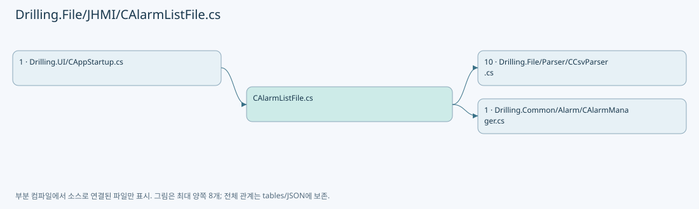
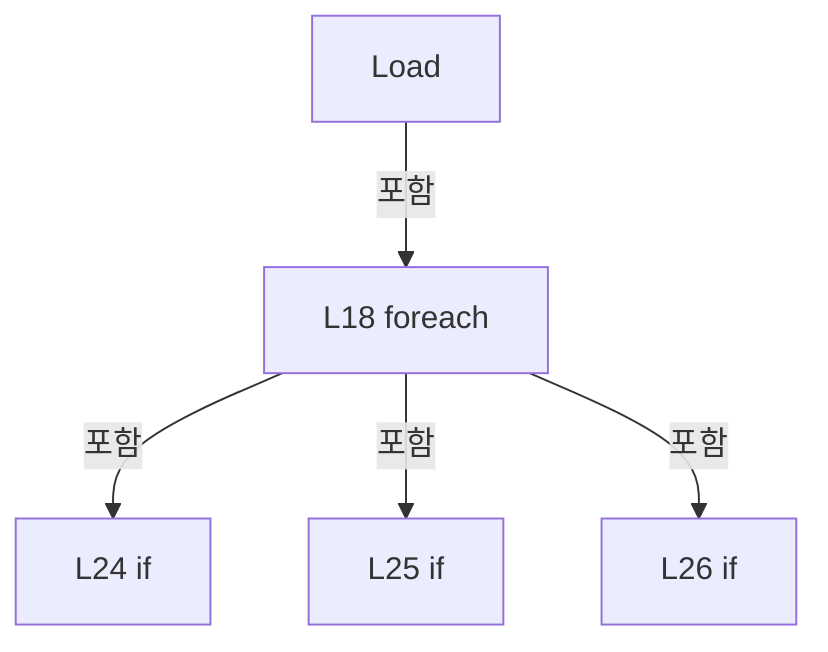

# Drilling.File/JHMI/CAlarmListFile.cs

| 항목 | 내용 |
| --- | --- |
| 원본 저장소 | https://github.com/kjuws10-rgb/A3Drilling.git |
| 원본 Commit | 5aee8e58439c9b455cae7c9593c9be986c3e682e |
| 원본 SHA256 | e1ab39a913b23d45f32c7fcb783f38814d5c289dbf7e5eafbb827877d8cbef3d |
| 파일 분류 | code |
| 원본 크기/행 | 1,857 bytes / 33 physical lines |
| 인코딩 | utf-8-sig |
| 검토 범위 | 구문/부분 의미 분석에서 추출한 사실. 동작·물리 단위·실장비 합격을 보증하지 않습니다. |
| 원본 링크 | [고정 Commit 원본](https://github.com/kjuws10-rgb/A3Drilling/blob/5aee8e58439c9b455cae7c9593c9be986c3e682e/Drilling.File/JHMI/CAlarmListFile.cs) |

## 파일의 역할과 읽는 순서

정의·설정·레시피·결과·스크립트의 파일 입출력과 데이터 형식을 담당합니다. 저장 필드를 통신 송신 필드로 단정하지 않습니다.

## 네임스페이스·타입·상속

| 타입 | 구분 | 원본 범위 | 선언/상속 |
| --- | --- | --- | --- |
| CAlarmListFile | ClassDeclaration | 6–33 | CAlarmListFile: CAlarmListFileBase |

## 멤버 빠른 목록

| 이름 | 종류 | 범위 | 서명 |
| --- | --- | --- | --- |
| FilePath | PropertyDeclaration | L8–8 | string Drilling.File.JHMI.CAlarmListFile.FilePath |
| get_FilePath | GetAccessorDeclaration | L8–8 | string Drilling.File.JHMI.CAlarmListFile.FilePath.get |
| Load | MethodDeclaration | L10–32 | System.Collections.Generic.IReadOnlyList<Drilling.Common.Alarm.ST_ALARM_DEFINITION> Drilling.File.JHMI.CAlarmListFile.Load() |

## 멤버별 상세 계약·호출·처리 해설

### PropertyDeclaration `FilePath` · L8–8

[Drilling.File/JHMI/CAlarmListFile.cs:8–8](https://github.com/kjuws10-rgb/A3Drilling/blob/5aee8e58439c9b455cae7c9593c9be986c3e682e/Drilling.File/JHMI/CAlarmListFile.cs#L8-L8)

| 항목 | 실제 추출 값 |
| --- | --- |
| 서명 | string Drilling.File.JHMI.CAlarmListFile.FilePath |
| 접근/수식자 | Public / public |
| 반환/값 타입 | string |
| 소속 타입 | NamedType:Drilling.File.JHMI.CAlarmListFile |

현재 부분 분석에서 직접 연결된 호출자는 없습니다. XAML/이벤트/인터페이스·델리게이트·외부 진입을 추가 확인해야 하며, 미사용으로 판정한 것이 아닙니다.

호출하는 대상과 해석 범위:

| 원본 행 | 표현식 | 분석 상태 | 대상/소스 위치 |
| --- | --- | --- | --- |
| 8 | Path.Combine | resolved | string System.IO.Path.Combine(string, string) |

본문의 실제 연산·분기·예외·반환 순서(원문 위치 순):

| 원본 행 | 종류 | 주석 해설 |
| --- | --- | --- |
| 8 | call | 함수·델리게이트 또는 객체 생성자를 호출합니다: Path.Combine(configRoot, "JHMI_ALARMLIST.csv") |

변경 전 점검: 입력/반환 타입, 위 호출자, 예외/취소 경로, 공유 상태와 저장·전송 소비자를 함께 확인합니다. 값의 단위나 물리 방향을 이름만으로 확정하지 않습니다.

### GetAccessorDeclaration `get_FilePath` · L8–8

[Drilling.File/JHMI/CAlarmListFile.cs:8–8](https://github.com/kjuws10-rgb/A3Drilling/blob/5aee8e58439c9b455cae7c9593c9be986c3e682e/Drilling.File/JHMI/CAlarmListFile.cs#L8-L8)

| 항목 | 실제 추출 값 |
| --- | --- |
| 서명 | string Drilling.File.JHMI.CAlarmListFile.FilePath.get |
| 접근/수식자 | Public / get |
| 반환/값 타입 | string |
| 소속 타입 | NamedType:Drilling.File.JHMI.CAlarmListFile |

현재 부분 분석에서 직접 연결된 호출자는 없습니다. XAML/이벤트/인터페이스·델리게이트·외부 진입을 추가 확인해야 하며, 미사용으로 판정한 것이 아닙니다.

변경 전 점검: 입력/반환 타입, 위 호출자, 예외/취소 경로, 공유 상태와 저장·전송 소비자를 함께 확인합니다. 값의 단위나 물리 방향을 이름만으로 확정하지 않습니다.

### MethodDeclaration `Load` · L10–32

[Drilling.File/JHMI/CAlarmListFile.cs:10–32](https://github.com/kjuws10-rgb/A3Drilling/blob/5aee8e58439c9b455cae7c9593c9be986c3e682e/Drilling.File/JHMI/CAlarmListFile.cs#L10-L32)

| 항목 | 실제 추출 값 |
| --- | --- |
| 서명 | System.Collections.Generic.IReadOnlyList<Drilling.Common.Alarm.ST_ALARM_DEFINITION> Drilling.File.JHMI.CAlarmListFile.Load() |
| 접근/수식자 | Public / public, override |
| 반환/값 타입 | System.Collections.Generic.IReadOnlyList<Drilling.Common.Alarm.ST_ALARM_DEFINITION> |
| 소속 타입 | NamedType:Drilling.File.JHMI.CAlarmListFile |

현재 부분 분석에서 직접 연결된 호출자는 없습니다. XAML/이벤트/인터페이스·델리게이트·외부 진입을 추가 확인해야 하며, 미사용으로 판정한 것이 아닙니다.

호출하는 대상과 해석 범위:

| 원본 행 | 표현식 | 분석 상태 | 대상/소스 위치 |
| --- | --- | --- | --- |
| 14 | CCsvParser.ValidateRequiredHeaders | resolved | void Drilling.File.Parser.CCsvParser.ValidateRequiredHeaders(string, string, System.Collections.Generic.IEnumerable<System.Collections.Generic.IEnumerable<string>>) · Drilling.File/Parser/CCsvParser.cs:280 |
| 14 | headers.Select | resolved | System.Collections.Generic.IEnumerable<string[]> System.Collections.Generic.IEnumerable<string>.Select<string, string[]>(System.Func<string, string[]>) |
| 15 | new HashSet<int> | resolved | System.Collections.Generic.HashSet<int>.HashSet() |
| 16 | new HashSet<string> | resolved | System.Collections.Generic.HashSet<string>.HashSet(System.Collections.Generic.IEqualityComparer<string>?) |
| 17 | new List<ST_ALARM_DEFINITION> | resolved | System.Collections.Generic.List<Drilling.Common.Alarm.ST_ALARM_DEFINITION>.List() |
| 18 | CCsvParser.Read(FilePath).Select | resolved | System.Collections.Generic.IEnumerable<(System.Collections.Generic.IReadOnlyDictionary<string, string> row, int index)> System.Collections.Generic.IEnumerable<System.Collections.Generic.IReadOnlyDictionary<string, string>>.Select<System.Collections.Generic.IReadOnlyDictionary<string, string>, (System.Collections.Generic.IReadOnlyDictionary<string, string> row, int index)>(System.Func<System.Collections.Generic.IReadOnlyDictionary<string, string>, int, (System.Collections.Generic.IReadOnlyDictionary<string, string> row, int index)>) |
| 18 | CCsvParser.Read | resolved | System.Collections.Generic.IReadOnlyList<System.Collections.Generic.IReadOnlyDictionary<string, string>> Drilling.File.Parser.CCsvParser.Read(string) · Drilling.File/Parser/CCsvParser.cs:12 |
| 21 | CCsvParser.ReadRequiredInt | resolved | int Drilling.File.Parser.CCsvParser.ReadRequiredInt(string, string, int, string, bool) · Drilling.File/Parser/CCsvParser.cs:208 |
| 21 | CCsvParser.Get | resolved | string Drilling.File.Parser.CCsvParser.Get(System.Collections.Generic.IReadOnlyDictionary<string, string>, string) · Drilling.File/Parser/CCsvParser.cs:168 |
| 22 | CCsvParser.RequireText | resolved | string Drilling.File.Parser.CCsvParser.RequireText(System.Collections.Generic.IReadOnlyDictionary<string, string>, string, int, params string[]) · Drilling.File/Parser/CCsvParser.cs:187 |
| 23 | CCsvParser.RequireText(row, table, line, "LEVEL").ToUpperInvariant | resolved | string string.ToUpperInvariant() |
| 23 | CCsvParser.RequireText | resolved | string Drilling.File.Parser.CCsvParser.RequireText(System.Collections.Generic.IReadOnlyDictionary<string, string>, string, int, params string[]) · Drilling.File/Parser/CCsvParser.cs:187 |
| 24 | codes.Add | resolved | bool System.Collections.Generic.HashSet<int>.Add(int) |
| 24 | new InvalidDataException | resolved | System.IO.InvalidDataException.InvalidDataException(string?) |
| 25 | ids.Add | resolved | bool System.Collections.Generic.HashSet<string>.Add(string) |
| 25 | new InvalidDataException | resolved | System.IO.InvalidDataException.InvalidDataException(string?) |
| 27 | new InvalidDataException | resolved | System.IO.InvalidDataException.InvalidDataException(string?) |
| 28 | result.Add | resolved | void System.Collections.Generic.List<Drilling.Common.Alarm.ST_ALARM_DEFINITION>.Add(Drilling.Common.Alarm.ST_ALARM_DEFINITION) |
| 28 | new | resolved | Drilling.Common.Alarm.ST_ALARM_DEFINITION.ST_ALARM_DEFINITION(int, string, string, string, string, string, string) · Drilling.Common/Alarm/CAlarmManager.cs:544 |
| 28 | CCsvParser.Get | resolved | string Drilling.File.Parser.CCsvParser.Get(System.Collections.Generic.IReadOnlyDictionary<string, string>, string) · Drilling.File/Parser/CCsvParser.cs:168 |
| 29 | CCsvParser.Get | resolved | string Drilling.File.Parser.CCsvParser.Get(System.Collections.Generic.IReadOnlyDictionary<string, string>, string) · Drilling.File/Parser/CCsvParser.cs:168 |
| 29 | CCsvParser.Get | resolved | string Drilling.File.Parser.CCsvParser.Get(System.Collections.Generic.IReadOnlyDictionary<string, string>, string) · Drilling.File/Parser/CCsvParser.cs:168 |
| 29 | CCsvParser.Get | resolved | string Drilling.File.Parser.CCsvParser.Get(System.Collections.Generic.IReadOnlyDictionary<string, string>, string) · Drilling.File/Parser/CCsvParser.cs:168 |
| 31 | result.OrderBy(row => row.Code).ToArray | resolved | Drilling.Common.Alarm.ST_ALARM_DEFINITION[] System.Collections.Generic.IEnumerable<Drilling.Common.Alarm.ST_ALARM_DEFINITION>.ToArray<Drilling.Common.Alarm.ST_ALARM_DEFINITION>() |
| 31 | result.OrderBy | resolved | System.Linq.IOrderedEnumerable<Drilling.Common.Alarm.ST_ALARM_DEFINITION> System.Collections.Generic.IEnumerable<Drilling.Common.Alarm.ST_ALARM_DEFINITION>.OrderBy<Drilling.Common.Alarm.ST_ALARM_DEFINITION, int>(System.Func<Drilling.Common.Alarm.ST_ALARM_DEFINITION, int>) |

본문의 실제 연산·분기·예외·반환 순서(원문 위치 순):

| 원본 행 | 종류 | 주석 해설 |
| --- | --- | --- |
| 12 | local-declaration | 지역 변수를 선언합니다: const string table = "JHMI_ALARMLIST"; |
| 12 | variable-initializer | 변수의 초기값을 지정합니다: table = "JHMI_ALARMLIST" |
| 13 | local-declaration | 지역 변수를 선언합니다: string[] headers = ["CODE", "GROUP", "ID", "LEVEL", "CAUSE", "SOLUTION", "CIM_ADRESS"]; |
| 13 | variable-initializer | 변수의 초기값을 지정합니다: headers = ["CODE", "GROUP", "ID", "LEVEL", "CAUSE", "SOLUTION", "CIM_ADRESS"] |
| 14 | call | 함수·델리게이트 또는 객체 생성자를 호출합니다: CCsvParser.ValidateRequiredHeaders(FilePath, table, headers.Select(header => new[] { header })) |
| 14 | call | 함수·델리게이트 또는 객체 생성자를 호출합니다: headers.Select(header => new[] { header }) |
| 15 | call | 함수·델리게이트 또는 객체 생성자를 호출합니다: new HashSet<int>() |
| 15 | local-declaration | 지역 변수를 선언합니다: var codes = new HashSet<int>(); |
| 15 | variable-initializer | 변수의 초기값을 지정합니다: codes = new HashSet<int>() |
| 16 | call | 함수·델리게이트 또는 객체 생성자를 호출합니다: new HashSet<string>(StringComparer.OrdinalIgnoreCase) |
| 16 | local-declaration | 지역 변수를 선언합니다: var ids = new HashSet<string>(StringComparer.OrdinalIgnoreCase); |
| 16 | variable-initializer | 변수의 초기값을 지정합니다: ids = new HashSet<string>(StringComparer.OrdinalIgnoreCase) |
| 17 | call | 함수·델리게이트 또는 객체 생성자를 호출합니다: new List<ST_ALARM_DEFINITION>() |
| 17 | local-declaration | 지역 변수를 선언합니다: var result = new List<ST_ALARM_DEFINITION>(); |
| 17 | variable-initializer | 변수의 초기값을 지정합니다: result = new List<ST_ALARM_DEFINITION>() |
| 18 | call | 함수·델리게이트 또는 객체 생성자를 호출합니다: CCsvParser.Read(FilePath).Select((row, index) => (row, index)) |
| 18 | call | 함수·델리게이트 또는 객체 생성자를 호출합니다: CCsvParser.Read(FilePath) |
| 18 | foreach | 컬렉션 요소를 순회합니다: foreach (var (row, index) in CCsvParser.Read(FilePath).Select((row, index) => (row, index))) { var line = index + 2; var code = CCsvParser.ReadRequiredInt(CCsvParser.Get(row, "CODE"), table, line, "CODE"); var id = CCsvParser.Requ |
| 20 | local-declaration | 지역 변수를 선언합니다: var line = index + 2; |
| 20 | variable-initializer | 변수의 초기값을 지정합니다: line = index + 2 |
| 21 | call | 함수·델리게이트 또는 객체 생성자를 호출합니다: CCsvParser.ReadRequiredInt(CCsvParser.Get(row, "CODE"), table, line, "CODE") |
| 21 | call | 함수·델리게이트 또는 객체 생성자를 호출합니다: CCsvParser.Get(row, "CODE") |
| 21 | local-declaration | 지역 변수를 선언합니다: var code = CCsvParser.ReadRequiredInt(CCsvParser.Get(row, "CODE"), table, line, "CODE"); |
| 21 | variable-initializer | 변수의 초기값을 지정합니다: code = CCsvParser.ReadRequiredInt(CCsvParser.Get(row, "CODE"), table, line, "CODE") |
| 22 | call | 함수·델리게이트 또는 객체 생성자를 호출합니다: CCsvParser.RequireText(row, table, line, "ID") |
| 22 | local-declaration | 지역 변수를 선언합니다: var id = CCsvParser.RequireText(row, table, line, "ID"); |
| 22 | variable-initializer | 변수의 초기값을 지정합니다: id = CCsvParser.RequireText(row, table, line, "ID") |
| 23 | call | 함수·델리게이트 또는 객체 생성자를 호출합니다: CCsvParser.RequireText(row, table, line, "LEVEL").ToUpperInvariant() |
| 23 | call | 함수·델리게이트 또는 객체 생성자를 호출합니다: CCsvParser.RequireText(row, table, line, "LEVEL") |
| 23 | local-declaration | 지역 변수를 선언합니다: var level = CCsvParser.RequireText(row, table, line, "LEVEL").ToUpperInvariant(); |
| 23 | variable-initializer | 변수의 초기값을 지정합니다: level = CCsvParser.RequireText(row, table, line, "LEVEL").ToUpperInvariant() |
| 24 | call | 함수·델리게이트 또는 객체 생성자를 호출합니다: codes.Add(code) |
| 24 | call | 함수·델리게이트 또는 객체 생성자를 호출합니다: new InvalidDataException($"{table}: {line}행 CODE {code}가 중복되었습니다.") |
| 24 | if | 조건에 따라 분기합니다: if (!codes.Add(code)) |
| 24 | throw | 예외를 발생/전달합니다: throw new InvalidDataException($"{table}: {line}행 CODE {code}가 중복되었습니다."); |
| 25 | call | 함수·델리게이트 또는 객체 생성자를 호출합니다: ids.Add(id) |
| 25 | call | 함수·델리게이트 또는 객체 생성자를 호출합니다: new InvalidDataException($"{table}: {line}행 ID {id}가 중복되었습니다.") |
| 25 | if | 조건에 따라 분기합니다: if (!ids.Add(id)) |
| 25 | throw | 예외를 발생/전달합니다: throw new InvalidDataException($"{table}: {line}행 ID {id}가 중복되었습니다."); |
| 26 | if | 조건에 따라 분기합니다: if (level is not ("HEAVY" or "LIGHT")) |
| 27 | call | 함수·델리게이트 또는 객체 생성자를 호출합니다: new InvalidDataException($"{table}: {line}행 LEVEL은 HEAVY 또는 LIGHT여야 합니다.") |
| 27 | throw | 예외를 발생/전달합니다: throw new InvalidDataException($"{table}: {line}행 LEVEL은 HEAVY 또는 LIGHT여야 합니다."); |
| 28 | call | 함수·델리게이트 또는 객체 생성자를 호출합니다: CCsvParser.Get(row, "GROUP") |
| 28 | call | 함수·델리게이트 또는 객체 생성자를 호출합니다: result.Add(new(code, CCsvParser.Get(row, "GROUP"), id, level, CCsvParser.Get(row, "CAUSE"), CCsvParser.Get(row, "SOLUTION"), CCsvParser.Get(row, "CIM_ADRESS"))) |
| 28 | call | 함수·델리게이트 또는 객체 생성자를 호출합니다: new(code, CCsvParser.Get(row, "GROUP"), id, level, CCsvParser.Get(row, "CAUSE"), CCsvParser.Get(row, "SOLUTION"), CCsvParser.Get(row, "CIM_ADRESS")) |
| 29 | call | 함수·델리게이트 또는 객체 생성자를 호출합니다: CCsvParser.Get(row, "CAUSE") |
| 29 | call | 함수·델리게이트 또는 객체 생성자를 호출합니다: CCsvParser.Get(row, "SOLUTION") |
| 29 | call | 함수·델리게이트 또는 객체 생성자를 호출합니다: CCsvParser.Get(row, "CIM_ADRESS") |
| 31 | call | 함수·델리게이트 또는 객체 생성자를 호출합니다: result.OrderBy(row => row.Code).ToArray() |
| 31 | call | 함수·델리게이트 또는 객체 생성자를 호출합니다: result.OrderBy(row => row.Code) |
| 31 | return | 호출자에게 값 또는 제어를 반환합니다: return result.OrderBy(row => row.Code).ToArray(); |

제어 구문의 포함 구조(실제 실행 순서/CFG가 아닌 구문 탐색 그림):

변경 전 점검: 입력/반환 타입, 위 호출자, 예외/취소 경로, 공유 상태와 저장·전송 소비자를 함께 확인합니다. 값의 단위나 물리 방향을 이름만으로 확정하지 않습니다.

## 구문·바인딩 한계

전체 WPF/벤더 SDK/프로젝트별 빌드 조건을 로드한 정식 빌드가 아닙니다. `resolved`는 이 부분 컴파일에서의 심볼 연결이며 virtual/interface/delegate/이벤트/Reflection/XAML의 실제 런타임 구현을 확정하지 않습니다. `candidate`와 `unresolved`는 후속 확인 대상으로 남깁니다.

## 원문 전체 주석 해설본

[원본 모든 행과 행별 해설 보기](../../../annotated/Drilling.File/JHMI/CAlarmListFile.cs.annotated.txt)

원본을 빠뜨리거나 임의로 줄이지 않았습니다. `L000001 |` 표시는 원본 행 번호, `// 해설`은 별도 설명입니다. 실행용 소스가 아닌 문서입니다.

## 수정·재검증 체크

- 원본 Commit과 현재 작업 파일 SHA가 같은지 먼저 확인합니다. 다르면 이 문서를 과거 버전 자료로 취급합니다.
- 선언·직접 호출·이벤트/인터페이스 경계·설정 소비를 함께 확인합니다. 정적 연결의 빈 곳을 정상 경로로 추정하지 않습니다.
- 저장 형식/단위/식별자·재시도·취소·예외·롤백에 영향을 주는 변경은 상세 해설장과 호출자를 다시 검토합니다.
- 도구의 구문 추출과 별도 정적 추적 해설, 실제 빌드·시뮬레이션·실장비 검증 결과를 분리합니다.
