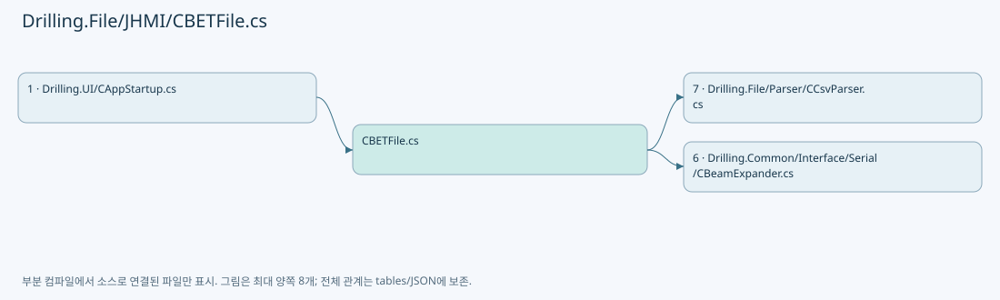
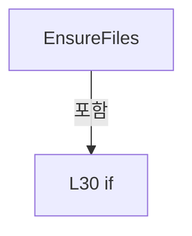
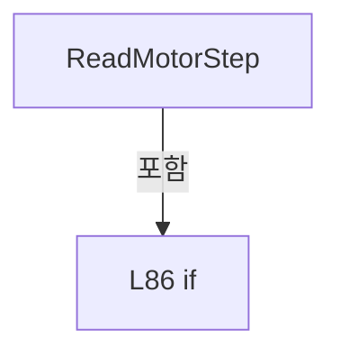

# Drilling.File/JHMI/CBETFile.cs

| 항목 | 내용 |
| --- | --- |
| 원본 저장소 | https://github.com/kjuws10-rgb/A3Drilling.git |
| 원본 Commit | 5aee8e58439c9b455cae7c9593c9be986c3e682e |
| 원본 SHA256 | b44f86162fa4efb0ad73a858a5d29f19cc0776602e15b77f12a7b6e4aa4d3268 |
| 파일 분류 | code |
| 원본 크기/행 | 4,228 bytes / 108 physical lines |
| 인코딩 | utf-8-sig |
| 검토 범위 | 구문/부분 의미 분석에서 추출한 사실. 동작·물리 단위·실장비 합격을 보증하지 않습니다. |
| 원본 링크 | [고정 Commit 원본](https://github.com/kjuws10-rgb/A3Drilling/blob/5aee8e58439c9b455cae7c9593c9be986c3e682e/Drilling.File/JHMI/CBETFile.cs) |

## 파일의 역할과 읽는 순서

정의·설정·레시피·결과·스크립트의 파일 입출력과 데이터 형식을 담당합니다. 저장 필드를 통신 송신 필드로 단정하지 않습니다.

## 네임스페이스·타입·상속

| 타입 | 구분 | 원본 범위 | 선언/상속 |
| --- | --- | --- | --- |
| CBETFile | ClassDeclaration | 11–108 | CBETFile: CBETFileBase |

## 멤버 빠른 목록

| 이름 | 종류 | 범위 | 서명 |
| --- | --- | --- | --- |
| Headers | FieldDeclaration | L13–13 | System.Collections.Generic.IReadOnlyList<string> Drilling.File.JHMI.CBETFile.Headers |
| Load | MethodDeclaration | L14–19 | System.Threading.Tasks.Task<System.Collections.Generic.IReadOnlyList<Drilling.Common.Interface.ST_BET_TABLE_DATA>> Drilling.File.JHMI.CBETFile.Load(System.Threading.CancellationToken) |
| Save | MethodDeclaration | L21–26 | System.Threading.Tasks.Task Drilling.File.JHMI.CBETFile.Save(System.Collections.Generic.IReadOnlyList<Drilling.Common.Interface.ST_BET_TABLE_DATA>, System.Threading.CancellationToken) |
| EnsureFiles | MethodDeclaration | L28–34 | void Drilling.File.JHMI.CBETFile.EnsureFiles() |
| ReadTable | MethodDeclaration | L36–54 | System.Collections.Generic.List<Drilling.Common.Interface.ST_BET_TABLE_DATA> Drilling.File.JHMI.CBETFile.ReadTable(string) |
| ShouldIncludeItem | LocalFunctionStatement | L38–41 | bool ShouldIncludeItem(System.Collections.Generic.IReadOnlyDictionary<string, string>) |
| BuildBet | LocalFunctionStatement | L43–46 | Drilling.Common.Interface.ST_BET_TABLE_DATA BuildBet(System.Collections.Generic.IReadOnlyDictionary<string, string>, int) |
| SelectIndex | LocalFunctionStatement | L48–51 | int SelectIndex(Drilling.Common.Interface.ST_BET_TABLE_DATA) |
| WriteTable | MethodDeclaration | L56–77 | void Drilling.File.JHMI.CBETFile.WriteTable(string, System.Collections.Generic.IReadOnlyList<Drilling.Common.Interface.ST_BET_TABLE_DATA>) |
| SelectIndex | LocalFunctionStatement | L58–61 | int SelectIndex(Drilling.Common.Interface.ST_BET_TABLE_DATA) |
| BuildBetTableRow | LocalFunctionStatement | L63–73 | System.Collections.Generic.Dictionary<string, string> BuildBetTableRow(Drilling.Common.Interface.ST_BET_TABLE_DATA) |
| CreateDefaultTable | MethodDeclaration | L79–82 | System.Collections.Generic.IReadOnlyList<Drilling.Common.Interface.ST_BET_TABLE_DATA> Drilling.File.JHMI.CBETFile.CreateDefaultTable() |
| ReadMotorStep | MethodDeclaration | L84–92 | int Drilling.File.JHMI.CBETFile.ReadMotorStep(string) |
| GetFormPath | MethodDeclaration | L94–97 | string Drilling.File.JHMI.CBETFile.GetFormPath() |
| ReadInt | MethodDeclaration | L99–102 | int Drilling.File.JHMI.CBETFile.ReadInt(string, int) |
| ReadDouble | MethodDeclaration | L104–107 | double Drilling.File.JHMI.CBETFile.ReadDouble(string, double) |

## 멤버별 상세 계약·호출·처리 해설

### FieldDeclaration `Headers` · L13–13

[Drilling.File/JHMI/CBETFile.cs:13–13](https://github.com/kjuws10-rgb/A3Drilling/blob/5aee8e58439c9b455cae7c9593c9be986c3e682e/Drilling.File/JHMI/CBETFile.cs#L13-L13)

| 항목 | 실제 추출 값 |
| --- | --- |
| 서명 | System.Collections.Generic.IReadOnlyList<string> Drilling.File.JHMI.CBETFile.Headers |
| 접근/수식자 | Private / private, static, readonly |
| 반환/값 타입 | System.Collections.Generic.IReadOnlyList<string> |
| 소속 타입 | NamedType:Drilling.File.JHMI.CBETFile |

현재 부분 분석에서 직접 연결된 호출자는 없습니다. XAML/이벤트/인터페이스·델리게이트·외부 진입을 추가 확인해야 하며, 미사용으로 판정한 것이 아닙니다.

본문의 실제 연산·분기·예외·반환 순서(원문 위치 순):

| 원본 행 | 종류 | 주석 해설 |
| --- | --- | --- |
| 13 | variable-initializer | 변수의 초기값을 지정합니다: Headers = ["INDEX", "DESCRIPTION", "DIV", "MAG", "SPOTSIZE"] |

변경 전 점검: 입력/반환 타입, 위 호출자, 예외/취소 경로, 공유 상태와 저장·전송 소비자를 함께 확인합니다. 값의 단위나 물리 방향을 이름만으로 확정하지 않습니다.

### MethodDeclaration `Load` · L14–19

[Drilling.File/JHMI/CBETFile.cs:14–19](https://github.com/kjuws10-rgb/A3Drilling/blob/5aee8e58439c9b455cae7c9593c9be986c3e682e/Drilling.File/JHMI/CBETFile.cs#L14-L19)

| 항목 | 실제 추출 값 |
| --- | --- |
| 서명 | System.Threading.Tasks.Task<System.Collections.Generic.IReadOnlyList<Drilling.Common.Interface.ST_BET_TABLE_DATA>> Drilling.File.JHMI.CBETFile.Load(System.Threading.CancellationToken) |
| 접근/수식자 | Public / public, override |
| 반환/값 타입 | System.Threading.Tasks.Task<System.Collections.Generic.IReadOnlyList<Drilling.Common.Interface.ST_BET_TABLE_DATA>> |
| 소속 타입 | NamedType:Drilling.File.JHMI.CBETFile |

입력 계약:

| 이름 | 타입 | 전달 | 선택/기본값 |
| --- | --- | --- | --- |
| cancellationToken | System.Threading.CancellationToken | None | True / null |

현재 부분 분석에서 직접 연결된 호출자는 없습니다. XAML/이벤트/인터페이스·델리게이트·외부 진입을 추가 확인해야 하며, 미사용으로 판정한 것이 아닙니다.

호출하는 대상과 해석 범위:

| 원본 행 | 표현식 | 분석 상태 | 대상/소스 위치 |
| --- | --- | --- | --- |
| 16 | cancellationToken.ThrowIfCancellationRequested | resolved | void System.Threading.CancellationToken.ThrowIfCancellationRequested() |
| 17 | EnsureFiles | resolved | void Drilling.File.JHMI.CBETFile.EnsureFiles() · Drilling.File/JHMI/CBETFile.cs:28 |
| 18 | Task.FromResult<IReadOnlyList<ST_BET_TABLE_DATA>> | resolved | System.Threading.Tasks.Task<System.Collections.Generic.IReadOnlyList<Drilling.Common.Interface.ST_BET_TABLE_DATA>> System.Threading.Tasks.Task.FromResult<System.Collections.Generic.IReadOnlyList<Drilling.Common.Interface.ST_BET_TABLE_DATA>>(System.Collections.Generic.IReadOnlyList<Drilling.Common.Interface.ST_BET_TABLE_DATA>) |
| 18 | ReadTable | resolved | System.Collections.Generic.List<Drilling.Common.Interface.ST_BET_TABLE_DATA> Drilling.File.JHMI.CBETFile.ReadTable(string) · Drilling.File/JHMI/CBETFile.cs:36 |
| 18 | GetFormPath | resolved | string Drilling.File.JHMI.CBETFile.GetFormPath() · Drilling.File/JHMI/CBETFile.cs:94 |

본문의 실제 연산·분기·예외·반환 순서(원문 위치 순):

| 원본 행 | 종류 | 주석 해설 |
| --- | --- | --- |
| 16 | call | 함수·델리게이트 또는 객체 생성자를 호출합니다: cancellationToken.ThrowIfCancellationRequested() |
| 17 | call | 함수·델리게이트 또는 객체 생성자를 호출합니다: EnsureFiles() |
| 18 | call | 함수·델리게이트 또는 객체 생성자를 호출합니다: Task.FromResult<IReadOnlyList<ST_BET_TABLE_DATA>>(ReadTable(GetFormPath())) |
| 18 | call | 함수·델리게이트 또는 객체 생성자를 호출합니다: ReadTable(GetFormPath()) |
| 18 | call | 함수·델리게이트 또는 객체 생성자를 호출합니다: GetFormPath() |
| 18 | return | 호출자에게 값 또는 제어를 반환합니다: return Task.FromResult<IReadOnlyList<ST_BET_TABLE_DATA>>(ReadTable(GetFormPath())); |

변경 전 점검: 입력/반환 타입, 위 호출자, 예외/취소 경로, 공유 상태와 저장·전송 소비자를 함께 확인합니다. 값의 단위나 물리 방향을 이름만으로 확정하지 않습니다.

### MethodDeclaration `Save` · L21–26

[Drilling.File/JHMI/CBETFile.cs:21–26](https://github.com/kjuws10-rgb/A3Drilling/blob/5aee8e58439c9b455cae7c9593c9be986c3e682e/Drilling.File/JHMI/CBETFile.cs#L21-L26)

| 항목 | 실제 추출 값 |
| --- | --- |
| 서명 | System.Threading.Tasks.Task Drilling.File.JHMI.CBETFile.Save(System.Collections.Generic.IReadOnlyList<Drilling.Common.Interface.ST_BET_TABLE_DATA>, System.Threading.CancellationToken) |
| 접근/수식자 | Public / public, override |
| 반환/값 타입 | System.Threading.Tasks.Task |
| 소속 타입 | NamedType:Drilling.File.JHMI.CBETFile |

입력 계약:

| 이름 | 타입 | 전달 | 선택/기본값 |
| --- | --- | --- | --- |
| table | System.Collections.Generic.IReadOnlyList<Drilling.Common.Interface.ST_BET_TABLE_DATA> | None | False /  |
| cancellationToken | System.Threading.CancellationToken | None | True / null |

현재 부분 분석에서 직접 연결된 호출자는 없습니다. XAML/이벤트/인터페이스·델리게이트·외부 진입을 추가 확인해야 하며, 미사용으로 판정한 것이 아닙니다.

호출하는 대상과 해석 범위:

| 원본 행 | 표현식 | 분석 상태 | 대상/소스 위치 |
| --- | --- | --- | --- |
| 23 | cancellationToken.ThrowIfCancellationRequested | resolved | void System.Threading.CancellationToken.ThrowIfCancellationRequested() |
| 24 | WriteTable | resolved | void Drilling.File.JHMI.CBETFile.WriteTable(string, System.Collections.Generic.IReadOnlyList<Drilling.Common.Interface.ST_BET_TABLE_DATA>) · Drilling.File/JHMI/CBETFile.cs:56 |
| 24 | GetFormPath | resolved | string Drilling.File.JHMI.CBETFile.GetFormPath() · Drilling.File/JHMI/CBETFile.cs:94 |

본문의 실제 연산·분기·예외·반환 순서(원문 위치 순):

| 원본 행 | 종류 | 주석 해설 |
| --- | --- | --- |
| 23 | call | 함수·델리게이트 또는 객체 생성자를 호출합니다: cancellationToken.ThrowIfCancellationRequested() |
| 24 | call | 함수·델리게이트 또는 객체 생성자를 호출합니다: WriteTable(GetFormPath(), table) |
| 24 | call | 함수·델리게이트 또는 객체 생성자를 호출합니다: GetFormPath() |
| 25 | return | 호출자에게 값 또는 제어를 반환합니다: return Task.CompletedTask; |

변경 전 점검: 입력/반환 타입, 위 호출자, 예외/취소 경로, 공유 상태와 저장·전송 소비자를 함께 확인합니다. 값의 단위나 물리 방향을 이름만으로 확정하지 않습니다.

### MethodDeclaration `EnsureFiles` · L28–34

[Drilling.File/JHMI/CBETFile.cs:28–34](https://github.com/kjuws10-rgb/A3Drilling/blob/5aee8e58439c9b455cae7c9593c9be986c3e682e/Drilling.File/JHMI/CBETFile.cs#L28-L34)

| 항목 | 실제 추출 값 |
| --- | --- |
| 서명 | void Drilling.File.JHMI.CBETFile.EnsureFiles() |
| 접근/수식자 | Private / private |
| 반환/값 타입 | void |
| 소속 타입 | NamedType:Drilling.File.JHMI.CBETFile |

정적 호출자로 확인된 위치:

| 호출 파일/행 | 호출 표현식 | 런타임 분기 가능 |
| --- | --- | --- |
| [Drilling.File/JHMI/CBETFile.cs:17–17](https://github.com/kjuws10-rgb/A3Drilling/blob/5aee8e58439c9b455cae7c9593c9be986c3e682e/Drilling.File/JHMI/CBETFile.cs#L17-L17) | EnsureFiles | False |

호출하는 대상과 해석 범위:

| 원본 행 | 표현식 | 분석 상태 | 대상/소스 위치 |
| --- | --- | --- | --- |
| 30 | System.IO.File.Exists | resolved | bool System.IO.File.Exists(string?) |
| 30 | GetFormPath | resolved | string Drilling.File.JHMI.CBETFile.GetFormPath() · Drilling.File/JHMI/CBETFile.cs:94 |
| 32 | WriteTable | resolved | void Drilling.File.JHMI.CBETFile.WriteTable(string, System.Collections.Generic.IReadOnlyList<Drilling.Common.Interface.ST_BET_TABLE_DATA>) · Drilling.File/JHMI/CBETFile.cs:56 |
| 32 | GetFormPath | resolved | string Drilling.File.JHMI.CBETFile.GetFormPath() · Drilling.File/JHMI/CBETFile.cs:94 |
| 32 | CreateDefaultTable | resolved | System.Collections.Generic.IReadOnlyList<Drilling.Common.Interface.ST_BET_TABLE_DATA> Drilling.File.JHMI.CBETFile.CreateDefaultTable() · Drilling.File/JHMI/CBETFile.cs:79 |

본문의 실제 연산·분기·예외·반환 순서(원문 위치 순):

| 원본 행 | 종류 | 주석 해설 |
| --- | --- | --- |
| 30 | call | 함수·델리게이트 또는 객체 생성자를 호출합니다: System.IO.File.Exists(GetFormPath()) |
| 30 | call | 함수·델리게이트 또는 객체 생성자를 호출합니다: GetFormPath() |
| 30 | if | 조건에 따라 분기합니다: if (!System.IO.File.Exists(GetFormPath())) |
| 32 | call | 함수·델리게이트 또는 객체 생성자를 호출합니다: WriteTable(GetFormPath(), CreateDefaultTable()) |
| 32 | call | 함수·델리게이트 또는 객체 생성자를 호출합니다: GetFormPath() |
| 32 | call | 함수·델리게이트 또는 객체 생성자를 호출합니다: CreateDefaultTable() |

제어 구문의 포함 구조(실제 실행 순서/CFG가 아닌 구문 탐색 그림):

변경 전 점검: 입력/반환 타입, 위 호출자, 예외/취소 경로, 공유 상태와 저장·전송 소비자를 함께 확인합니다. 값의 단위나 물리 방향을 이름만으로 확정하지 않습니다.

### MethodDeclaration `ReadTable` · L36–54

[Drilling.File/JHMI/CBETFile.cs:36–54](https://github.com/kjuws10-rgb/A3Drilling/blob/5aee8e58439c9b455cae7c9593c9be986c3e682e/Drilling.File/JHMI/CBETFile.cs#L36-L54)

| 항목 | 실제 추출 값 |
| --- | --- |
| 서명 | System.Collections.Generic.List<Drilling.Common.Interface.ST_BET_TABLE_DATA> Drilling.File.JHMI.CBETFile.ReadTable(string) |
| 접근/수식자 | Private / private |
| 반환/값 타입 | System.Collections.Generic.List<Drilling.Common.Interface.ST_BET_TABLE_DATA> |
| 소속 타입 | NamedType:Drilling.File.JHMI.CBETFile |

입력 계약:

| 이름 | 타입 | 전달 | 선택/기본값 |
| --- | --- | --- | --- |
| path | string | None | False /  |

정적 호출자로 확인된 위치:

| 호출 파일/행 | 호출 표현식 | 런타임 분기 가능 |
| --- | --- | --- |
| [Drilling.File/JHMI/CBETFile.cs:18–18](https://github.com/kjuws10-rgb/A3Drilling/blob/5aee8e58439c9b455cae7c9593c9be986c3e682e/Drilling.File/JHMI/CBETFile.cs#L18-L18) | ReadTable | False |

호출하는 대상과 해석 범위:

| 원본 행 | 표현식 | 분석 상태 | 대상/소스 위치 |
| --- | --- | --- | --- |
| 53 | CCsvParser.Read(path).Where(ShouldIncludeItem).Select(BuildBet).OrderBy(SelectIndex).ToList | resolved | System.Collections.Generic.List<Drilling.Common.Interface.ST_BET_TABLE_DATA> System.Collections.Generic.IEnumerable<Drilling.Common.Interface.ST_BET_TABLE_DATA>.ToList<Drilling.Common.Interface.ST_BET_TABLE_DATA>() |
| 53 | CCsvParser.Read(path).Where(ShouldIncludeItem).Select(BuildBet).OrderBy | resolved | System.Linq.IOrderedEnumerable<Drilling.Common.Interface.ST_BET_TABLE_DATA> System.Collections.Generic.IEnumerable<Drilling.Common.Interface.ST_BET_TABLE_DATA>.OrderBy<Drilling.Common.Interface.ST_BET_TABLE_DATA, int>(System.Func<Drilling.Common.Interface.ST_BET_TABLE_DATA, int>) |
| 53 | CCsvParser.Read(path).Where(ShouldIncludeItem).Select | resolved | System.Collections.Generic.IEnumerable<Drilling.Common.Interface.ST_BET_TABLE_DATA> System.Collections.Generic.IEnumerable<System.Collections.Generic.IReadOnlyDictionary<string, string>>.Select<System.Collections.Generic.IReadOnlyDictionary<string, string>, Drilling.Common.Interface.ST_BET_TABLE_DATA>(System.Func<System.Collections.Generic.IReadOnlyDictionary<string, string>, int, Drilling.Common.Interface.ST_BET_TABLE_DATA>) |
| 53 | CCsvParser.Read(path).Where | resolved | System.Collections.Generic.IEnumerable<System.Collections.Generic.IReadOnlyDictionary<string, string>> System.Collections.Generic.IEnumerable<System.Collections.Generic.IReadOnlyDictionary<string, string>>.Where<System.Collections.Generic.IReadOnlyDictionary<string, string>>(System.Func<System.Collections.Generic.IReadOnlyDictionary<string, string>, bool>) |
| 53 | CCsvParser.Read | resolved | System.Collections.Generic.IReadOnlyList<System.Collections.Generic.IReadOnlyDictionary<string, string>> Drilling.File.Parser.CCsvParser.Read(string) · Drilling.File/Parser/CCsvParser.cs:12 |

본문의 실제 연산·분기·예외·반환 순서(원문 위치 순):

| 원본 행 | 종류 | 주석 해설 |
| --- | --- | --- |
| 53 | call | 함수·델리게이트 또는 객체 생성자를 호출합니다: CCsvParser.Read(path).Where(ShouldIncludeItem).Select(BuildBet).OrderBy(SelectIndex).ToList() |
| 53 | call | 함수·델리게이트 또는 객체 생성자를 호출합니다: CCsvParser.Read(path).Where(ShouldIncludeItem).Select(BuildBet).OrderBy(SelectIndex) |
| 53 | call | 함수·델리게이트 또는 객체 생성자를 호출합니다: CCsvParser.Read(path).Where(ShouldIncludeItem).Select(BuildBet) |
| 53 | call | 함수·델리게이트 또는 객체 생성자를 호출합니다: CCsvParser.Read(path).Where(ShouldIncludeItem) |
| 53 | call | 함수·델리게이트 또는 객체 생성자를 호출합니다: CCsvParser.Read(path) |
| 53 | return | 호출자에게 값 또는 제어를 반환합니다: return CCsvParser.Read(path).Where(ShouldIncludeItem).Select(BuildBet).OrderBy(SelectIndex).ToList(); |

변경 전 점검: 입력/반환 타입, 위 호출자, 예외/취소 경로, 공유 상태와 저장·전송 소비자를 함께 확인합니다. 값의 단위나 물리 방향을 이름만으로 확정하지 않습니다.

### LocalFunctionStatement `ShouldIncludeItem` · L38–41

[Drilling.File/JHMI/CBETFile.cs:38–41](https://github.com/kjuws10-rgb/A3Drilling/blob/5aee8e58439c9b455cae7c9593c9be986c3e682e/Drilling.File/JHMI/CBETFile.cs#L38-L41)

| 항목 | 실제 추출 값 |
| --- | --- |
| 서명 | bool ShouldIncludeItem(System.Collections.Generic.IReadOnlyDictionary<string, string>) |
| 접근/수식자 | Private /  |
| 반환/값 타입 | bool |
| 소속 타입 | NamedType:Drilling.File.JHMI.CBETFile |

입력 계약:

| 이름 | 타입 | 전달 | 선택/기본값 |
| --- | --- | --- | --- |
| row | System.Collections.Generic.IReadOnlyDictionary<string, string> | None | False /  |

현재 부분 분석에서 직접 연결된 호출자는 없습니다. XAML/이벤트/인터페이스·델리게이트·외부 진입을 추가 확인해야 하며, 미사용으로 판정한 것이 아닙니다.

호출하는 대상과 해석 범위:

| 원본 행 | 표현식 | 분석 상태 | 대상/소스 위치 |
| --- | --- | --- | --- |
| 40 | string.IsNullOrWhiteSpace | resolved | bool string.IsNullOrWhiteSpace(string?) |
| 40 | CCsvParser.Get | resolved | string Drilling.File.Parser.CCsvParser.Get(System.Collections.Generic.IReadOnlyDictionary<string, string>, string) · Drilling.File/Parser/CCsvParser.cs:168 |

본문의 실제 연산·분기·예외·반환 순서(원문 위치 순):

| 원본 행 | 종류 | 주석 해설 |
| --- | --- | --- |
| 40 | call | 함수·델리게이트 또는 객체 생성자를 호출합니다: string.IsNullOrWhiteSpace(CCsvParser.Get(row, "INDEX")) |
| 40 | call | 함수·델리게이트 또는 객체 생성자를 호출합니다: CCsvParser.Get(row, "INDEX") |
| 40 | return | 호출자에게 값 또는 제어를 반환합니다: return !string.IsNullOrWhiteSpace(CCsvParser.Get(row, "INDEX")); |

변경 전 점검: 입력/반환 타입, 위 호출자, 예외/취소 경로, 공유 상태와 저장·전송 소비자를 함께 확인합니다. 값의 단위나 물리 방향을 이름만으로 확정하지 않습니다.

### LocalFunctionStatement `BuildBet` · L43–46

[Drilling.File/JHMI/CBETFile.cs:43–46](https://github.com/kjuws10-rgb/A3Drilling/blob/5aee8e58439c9b455cae7c9593c9be986c3e682e/Drilling.File/JHMI/CBETFile.cs#L43-L46)

| 항목 | 실제 추출 값 |
| --- | --- |
| 서명 | Drilling.Common.Interface.ST_BET_TABLE_DATA BuildBet(System.Collections.Generic.IReadOnlyDictionary<string, string>, int) |
| 접근/수식자 | Private /  |
| 반환/값 타입 | Drilling.Common.Interface.ST_BET_TABLE_DATA |
| 소속 타입 | NamedType:Drilling.File.JHMI.CBETFile |

입력 계약:

| 이름 | 타입 | 전달 | 선택/기본값 |
| --- | --- | --- | --- |
| row | System.Collections.Generic.IReadOnlyDictionary<string, string> | None | False /  |
| order | int | None | False /  |

현재 부분 분석에서 직접 연결된 호출자는 없습니다. XAML/이벤트/인터페이스·델리게이트·외부 진입을 추가 확인해야 하며, 미사용으로 판정한 것이 아닙니다.

호출하는 대상과 해석 범위:

| 원본 행 | 표현식 | 분석 상태 | 대상/소스 위치 |
| --- | --- | --- | --- |
| 45 | new ST_BET_TABLE_DATA | resolved | Drilling.Common.Interface.ST_BET_TABLE_DATA.ST_BET_TABLE_DATA(int, int, int, string) · Drilling.Common/Interface/Serial/CBeamExpander.cs:465 |
| 45 | ReadInt | resolved | int Drilling.File.JHMI.CBETFile.ReadInt(string, int) · Drilling.File/JHMI/CBETFile.cs:99 |
| 45 | CCsvParser.Get | resolved | string Drilling.File.Parser.CCsvParser.Get(System.Collections.Generic.IReadOnlyDictionary<string, string>, string) · Drilling.File/Parser/CCsvParser.cs:168 |
| 45 | ReadMotorStep | resolved | int Drilling.File.JHMI.CBETFile.ReadMotorStep(string) · Drilling.File/JHMI/CBETFile.cs:84 |
| 45 | CCsvParser.Get | resolved | string Drilling.File.Parser.CCsvParser.Get(System.Collections.Generic.IReadOnlyDictionary<string, string>, string) · Drilling.File/Parser/CCsvParser.cs:168 |
| 45 | ReadMotorStep | resolved | int Drilling.File.JHMI.CBETFile.ReadMotorStep(string) · Drilling.File/JHMI/CBETFile.cs:84 |
| 45 | CCsvParser.Get | resolved | string Drilling.File.Parser.CCsvParser.Get(System.Collections.Generic.IReadOnlyDictionary<string, string>, string) · Drilling.File/Parser/CCsvParser.cs:168 |
| 45 | CCsvParser.Get | resolved | string Drilling.File.Parser.CCsvParser.Get(System.Collections.Generic.IReadOnlyDictionary<string, string>, string) · Drilling.File/Parser/CCsvParser.cs:168 |

본문의 실제 연산·분기·예외·반환 순서(원문 위치 순):

| 원본 행 | 종류 | 주석 해설 |
| --- | --- | --- |
| 45 | call | 함수·델리게이트 또는 객체 생성자를 호출합니다: new ST_BET_TABLE_DATA(ReadInt(CCsvParser.Get(row, "INDEX"), order), ReadMotorStep(CCsvParser.Get(row, "MAG")), ReadMotorStep(CCsvParser.Get(row, "DIV")), CCsvParser.Get(row, "DESCRIPTION")) |
| 45 | call | 함수·델리게이트 또는 객체 생성자를 호출합니다: ReadInt(CCsvParser.Get(row, "INDEX"), order) |
| 45 | call | 함수·델리게이트 또는 객체 생성자를 호출합니다: CCsvParser.Get(row, "INDEX") |
| 45 | call | 함수·델리게이트 또는 객체 생성자를 호출합니다: ReadMotorStep(CCsvParser.Get(row, "MAG")) |
| 45 | call | 함수·델리게이트 또는 객체 생성자를 호출합니다: CCsvParser.Get(row, "MAG") |
| 45 | call | 함수·델리게이트 또는 객체 생성자를 호출합니다: ReadMotorStep(CCsvParser.Get(row, "DIV")) |
| 45 | call | 함수·델리게이트 또는 객체 생성자를 호출합니다: CCsvParser.Get(row, "DIV") |
| 45 | call | 함수·델리게이트 또는 객체 생성자를 호출합니다: CCsvParser.Get(row, "DESCRIPTION") |
| 45 | return | 호출자에게 값 또는 제어를 반환합니다: return new ST_BET_TABLE_DATA(ReadInt(CCsvParser.Get(row, "INDEX"), order), ReadMotorStep(CCsvParser.Get(row, "MAG")), ReadMotorStep(CCsvParser.Get(row, "DIV")), CCsvParser.Get(row, "DESCRIPTION")); |

변경 전 점검: 입력/반환 타입, 위 호출자, 예외/취소 경로, 공유 상태와 저장·전송 소비자를 함께 확인합니다. 값의 단위나 물리 방향을 이름만으로 확정하지 않습니다.

### LocalFunctionStatement `SelectIndex` · L48–51

[Drilling.File/JHMI/CBETFile.cs:48–51](https://github.com/kjuws10-rgb/A3Drilling/blob/5aee8e58439c9b455cae7c9593c9be986c3e682e/Drilling.File/JHMI/CBETFile.cs#L48-L51)

| 항목 | 실제 추출 값 |
| --- | --- |
| 서명 | int SelectIndex(Drilling.Common.Interface.ST_BET_TABLE_DATA) |
| 접근/수식자 | Private /  |
| 반환/값 타입 | int |
| 소속 타입 | NamedType:Drilling.File.JHMI.CBETFile |

입력 계약:

| 이름 | 타입 | 전달 | 선택/기본값 |
| --- | --- | --- | --- |
| row | Drilling.Common.Interface.ST_BET_TABLE_DATA | None | False /  |

현재 부분 분석에서 직접 연결된 호출자는 없습니다. XAML/이벤트/인터페이스·델리게이트·외부 진입을 추가 확인해야 하며, 미사용으로 판정한 것이 아닙니다.

본문의 실제 연산·분기·예외·반환 순서(원문 위치 순):

| 원본 행 | 종류 | 주석 해설 |
| --- | --- | --- |
| 50 | return | 호출자에게 값 또는 제어를 반환합니다: return row.Index; |

변경 전 점검: 입력/반환 타입, 위 호출자, 예외/취소 경로, 공유 상태와 저장·전송 소비자를 함께 확인합니다. 값의 단위나 물리 방향을 이름만으로 확정하지 않습니다.

### MethodDeclaration `WriteTable` · L56–77

[Drilling.File/JHMI/CBETFile.cs:56–77](https://github.com/kjuws10-rgb/A3Drilling/blob/5aee8e58439c9b455cae7c9593c9be986c3e682e/Drilling.File/JHMI/CBETFile.cs#L56-L77)

| 항목 | 실제 추출 값 |
| --- | --- |
| 서명 | void Drilling.File.JHMI.CBETFile.WriteTable(string, System.Collections.Generic.IReadOnlyList<Drilling.Common.Interface.ST_BET_TABLE_DATA>) |
| 접근/수식자 | Private / private, static |
| 반환/값 타입 | void |
| 소속 타입 | NamedType:Drilling.File.JHMI.CBETFile |

입력 계약:

| 이름 | 타입 | 전달 | 선택/기본값 |
| --- | --- | --- | --- |
| path | string | None | False /  |
| table | System.Collections.Generic.IReadOnlyList<Drilling.Common.Interface.ST_BET_TABLE_DATA> | None | False /  |

정적 호출자로 확인된 위치:

| 호출 파일/행 | 호출 표현식 | 런타임 분기 가능 |
| --- | --- | --- |
| [Drilling.File/JHMI/CBETFile.cs:24–24](https://github.com/kjuws10-rgb/A3Drilling/blob/5aee8e58439c9b455cae7c9593c9be986c3e682e/Drilling.File/JHMI/CBETFile.cs#L24-L24) | WriteTable | False |
| [Drilling.File/JHMI/CBETFile.cs:32–32](https://github.com/kjuws10-rgb/A3Drilling/blob/5aee8e58439c9b455cae7c9593c9be986c3e682e/Drilling.File/JHMI/CBETFile.cs#L32-L32) | WriteTable | False |

호출하는 대상과 해석 범위:

| 원본 행 | 표현식 | 분석 상태 | 대상/소스 위치 |
| --- | --- | --- | --- |
| 75 | table.OrderBy(SelectIndex).Select | resolved | System.Collections.Generic.IEnumerable<System.Collections.Generic.Dictionary<string, string>> System.Collections.Generic.IEnumerable<Drilling.Common.Interface.ST_BET_TABLE_DATA>.Select<Drilling.Common.Interface.ST_BET_TABLE_DATA, System.Collections.Generic.Dictionary<string, string>>(System.Func<Drilling.Common.Interface.ST_BET_TABLE_DATA, System.Collections.Generic.Dictionary<string, string>>) |
| 75 | table.OrderBy | resolved | System.Linq.IOrderedEnumerable<Drilling.Common.Interface.ST_BET_TABLE_DATA> System.Collections.Generic.IEnumerable<Drilling.Common.Interface.ST_BET_TABLE_DATA>.OrderBy<Drilling.Common.Interface.ST_BET_TABLE_DATA, int>(System.Func<Drilling.Common.Interface.ST_BET_TABLE_DATA, int>) |
| 76 | CCsvParser.Write | resolved | void Drilling.File.Parser.CCsvParser.Write(string, System.Collections.Generic.IReadOnlyList<string>, System.Collections.Generic.IEnumerable<System.Collections.Generic.IReadOnlyDictionary<string, string>>) · Drilling.File/Parser/CCsvParser.cs:58 |

본문의 실제 연산·분기·예외·반환 순서(원문 위치 순):

| 원본 행 | 종류 | 주석 해설 |
| --- | --- | --- |
| 75 | call | 함수·델리게이트 또는 객체 생성자를 호출합니다: table.OrderBy(SelectIndex).Select(BuildBetTableRow) |
| 75 | call | 함수·델리게이트 또는 객체 생성자를 호출합니다: table.OrderBy(SelectIndex) |
| 75 | local-declaration | 지역 변수를 선언합니다: var rows = table.OrderBy(SelectIndex).Select(BuildBetTableRow); |
| 75 | variable-initializer | 변수의 초기값을 지정합니다: rows = table.OrderBy(SelectIndex).Select(BuildBetTableRow) |
| 76 | call | 함수·델리게이트 또는 객체 생성자를 호출합니다: CCsvParser.Write(path, Headers, rows) |

변경 전 점검: 입력/반환 타입, 위 호출자, 예외/취소 경로, 공유 상태와 저장·전송 소비자를 함께 확인합니다. 값의 단위나 물리 방향을 이름만으로 확정하지 않습니다.

### LocalFunctionStatement `SelectIndex` · L58–61

[Drilling.File/JHMI/CBETFile.cs:58–61](https://github.com/kjuws10-rgb/A3Drilling/blob/5aee8e58439c9b455cae7c9593c9be986c3e682e/Drilling.File/JHMI/CBETFile.cs#L58-L61)

| 항목 | 실제 추출 값 |
| --- | --- |
| 서명 | int SelectIndex(Drilling.Common.Interface.ST_BET_TABLE_DATA) |
| 접근/수식자 | Private /  |
| 반환/값 타입 | int |
| 소속 타입 | NamedType:Drilling.File.JHMI.CBETFile |

입력 계약:

| 이름 | 타입 | 전달 | 선택/기본값 |
| --- | --- | --- | --- |
| row | Drilling.Common.Interface.ST_BET_TABLE_DATA | None | False /  |

현재 부분 분석에서 직접 연결된 호출자는 없습니다. XAML/이벤트/인터페이스·델리게이트·외부 진입을 추가 확인해야 하며, 미사용으로 판정한 것이 아닙니다.

본문의 실제 연산·분기·예외·반환 순서(원문 위치 순):

| 원본 행 | 종류 | 주석 해설 |
| --- | --- | --- |
| 60 | return | 호출자에게 값 또는 제어를 반환합니다: return row.Index; |

변경 전 점검: 입력/반환 타입, 위 호출자, 예외/취소 경로, 공유 상태와 저장·전송 소비자를 함께 확인합니다. 값의 단위나 물리 방향을 이름만으로 확정하지 않습니다.

### LocalFunctionStatement `BuildBetTableRow` · L63–73

[Drilling.File/JHMI/CBETFile.cs:63–73](https://github.com/kjuws10-rgb/A3Drilling/blob/5aee8e58439c9b455cae7c9593c9be986c3e682e/Drilling.File/JHMI/CBETFile.cs#L63-L73)

| 항목 | 실제 추출 값 |
| --- | --- |
| 서명 | System.Collections.Generic.Dictionary<string, string> BuildBetTableRow(Drilling.Common.Interface.ST_BET_TABLE_DATA) |
| 접근/수식자 | Private /  |
| 반환/값 타입 | System.Collections.Generic.Dictionary<string, string> |
| 소속 타입 | NamedType:Drilling.File.JHMI.CBETFile |

입력 계약:

| 이름 | 타입 | 전달 | 선택/기본값 |
| --- | --- | --- | --- |
| row | Drilling.Common.Interface.ST_BET_TABLE_DATA | None | False /  |

현재 부분 분석에서 직접 연결된 호출자는 없습니다. XAML/이벤트/인터페이스·델리게이트·외부 진입을 추가 확인해야 하며, 미사용으로 판정한 것이 아닙니다.

호출하는 대상과 해석 범위:

| 원본 행 | 표현식 | 분석 상태 | 대상/소스 위치 |
| --- | --- | --- | --- |
| 65 | new Dictionary<string, string> | resolved | System.Collections.Generic.Dictionary<string, string>.Dictionary() |
| 67 | row.Index.ToString | resolved | string int.ToString(System.IFormatProvider?) |
| 69 | row.Divergence.ToString | resolved | string int.ToString(System.IFormatProvider?) |
| 70 | row.Magnification.ToString | resolved | string int.ToString(System.IFormatProvider?) |
| 71 | row.SpotSize.ToString | resolved | string double.ToString(string?, System.IFormatProvider?) |

본문의 실제 연산·분기·예외·반환 순서(원문 위치 순):

| 원본 행 | 종류 | 주석 해설 |
| --- | --- | --- |
| 65 | call | 함수·델리게이트 또는 객체 생성자를 호출합니다: new Dictionary<string, string> { ["INDEX"] = row.Index.ToString(CultureInfo.InvariantCulture), ["DESCRIPTION"] = row.Description, ["DIV"] = row.Divergence.ToString(CultureInfo.InvariantCulture), ["MAG"] = row.Magnificati… |
| 65 | return | 호출자에게 값 또는 제어를 반환합니다: return new Dictionary<string, string> { ["INDEX"] = row.Index.ToString(CultureInfo.InvariantCulture), ["DESCRIPTION"] = row.Description, ["DIV"] = row.Divergence.ToString(CultureInfo.InvariantCulture), ["MAG"] = row.Magnification. |
| 67 | assignment | 값을 대상에 대입합니다: ["INDEX"] = row.Index.ToString(CultureInfo.InvariantCulture) |
| 67 | call | 함수·델리게이트 또는 객체 생성자를 호출합니다: row.Index.ToString(CultureInfo.InvariantCulture) |
| 68 | assignment | 값을 대상에 대입합니다: ["DESCRIPTION"] = row.Description |
| 69 | assignment | 값을 대상에 대입합니다: ["DIV"] = row.Divergence.ToString(CultureInfo.InvariantCulture) |
| 69 | call | 함수·델리게이트 또는 객체 생성자를 호출합니다: row.Divergence.ToString(CultureInfo.InvariantCulture) |
| 70 | assignment | 값을 대상에 대입합니다: ["MAG"] = row.Magnification.ToString(CultureInfo.InvariantCulture) |
| 70 | call | 함수·델리게이트 또는 객체 생성자를 호출합니다: row.Magnification.ToString(CultureInfo.InvariantCulture) |
| 71 | assignment | 값을 대상에 대입합니다: ["SPOTSIZE"] = row.SpotSize.ToString("F6", CultureInfo.InvariantCulture) |
| 71 | call | 함수·델리게이트 또는 객체 생성자를 호출합니다: row.SpotSize.ToString("F6", CultureInfo.InvariantCulture) |

변경 전 점검: 입력/반환 타입, 위 호출자, 예외/취소 경로, 공유 상태와 저장·전송 소비자를 함께 확인합니다. 값의 단위나 물리 방향을 이름만으로 확정하지 않습니다.

### MethodDeclaration `CreateDefaultTable` · L79–82

[Drilling.File/JHMI/CBETFile.cs:79–82](https://github.com/kjuws10-rgb/A3Drilling/blob/5aee8e58439c9b455cae7c9593c9be986c3e682e/Drilling.File/JHMI/CBETFile.cs#L79-L82)

| 항목 | 실제 추출 값 |
| --- | --- |
| 서명 | System.Collections.Generic.IReadOnlyList<Drilling.Common.Interface.ST_BET_TABLE_DATA> Drilling.File.JHMI.CBETFile.CreateDefaultTable() |
| 접근/수식자 | Private / private, static |
| 반환/값 타입 | System.Collections.Generic.IReadOnlyList<Drilling.Common.Interface.ST_BET_TABLE_DATA> |
| 소속 타입 | NamedType:Drilling.File.JHMI.CBETFile |

정적 호출자로 확인된 위치:

| 호출 파일/행 | 호출 표현식 | 런타임 분기 가능 |
| --- | --- | --- |
| [Drilling.File/JHMI/CBETFile.cs:32–32](https://github.com/kjuws10-rgb/A3Drilling/blob/5aee8e58439c9b455cae7c9593c9be986c3e682e/Drilling.File/JHMI/CBETFile.cs#L32-L32) | CreateDefaultTable | False |

호출하는 대상과 해석 범위:

| 원본 행 | 표현식 | 분석 상태 | 대상/소스 위치 |
| --- | --- | --- | --- |
| 81 | new | resolved | Drilling.Common.Interface.ST_BET_TABLE_DATA.ST_BET_TABLE_DATA(int, int, int, string) · Drilling.Common/Interface/Serial/CBeamExpander.cs:465 |
| 81 | new | resolved | Drilling.Common.Interface.ST_BET_TABLE_DATA.ST_BET_TABLE_DATA(int, int, int, string) · Drilling.Common/Interface/Serial/CBeamExpander.cs:465 |
| 81 | new | resolved | Drilling.Common.Interface.ST_BET_TABLE_DATA.ST_BET_TABLE_DATA(int, int, int, string) · Drilling.Common/Interface/Serial/CBeamExpander.cs:465 |
| 81 | new | resolved | Drilling.Common.Interface.ST_BET_TABLE_DATA.ST_BET_TABLE_DATA(int, int, int, string) · Drilling.Common/Interface/Serial/CBeamExpander.cs:465 |
| 81 | new | resolved | Drilling.Common.Interface.ST_BET_TABLE_DATA.ST_BET_TABLE_DATA(int, int, int, string) · Drilling.Common/Interface/Serial/CBeamExpander.cs:465 |

본문의 실제 연산·분기·예외·반환 순서(원문 위치 순):

| 원본 행 | 종류 | 주석 해설 |
| --- | --- | --- |
| 81 | call | 함수·델리게이트 또는 객체 생성자를 호출합니다: new(0, 1020, 1626, "2times") |
| 81 | call | 함수·델리게이트 또는 객체 생성자를 호출합니다: new(1, 2351, 1118, "3times") |
| 81 | call | 함수·델리게이트 또는 객체 생성자를 호출합니다: new(2, 3014, 1278, "4times") |
| 81 | call | 함수·델리게이트 또는 객체 생성자를 호출합니다: new(3, 3410, 1706, "5times") |
| 81 | call | 함수·델리게이트 또는 객체 생성자를 호출합니다: new(4, 3673, 2267, "6times") |
| 81 | return | 호출자에게 값 또는 제어를 반환합니다: return[new(0, 1020, 1626, "2times"), new(1, 2351, 1118, "3times"), new(2, 3014, 1278, "4times"), new(3, 3410, 1706, "5times"), new(4, 3673, 2267, "6times")]; |

변경 전 점검: 입력/반환 타입, 위 호출자, 예외/취소 경로, 공유 상태와 저장·전송 소비자를 함께 확인합니다. 값의 단위나 물리 방향을 이름만으로 확정하지 않습니다.

### MethodDeclaration `ReadMotorStep` · L84–92

[Drilling.File/JHMI/CBETFile.cs:84–92](https://github.com/kjuws10-rgb/A3Drilling/blob/5aee8e58439c9b455cae7c9593c9be986c3e682e/Drilling.File/JHMI/CBETFile.cs#L84-L92)

| 항목 | 실제 추출 값 |
| --- | --- |
| 서명 | int Drilling.File.JHMI.CBETFile.ReadMotorStep(string) |
| 접근/수식자 | Private / private, static |
| 반환/값 타입 | int |
| 소속 타입 | NamedType:Drilling.File.JHMI.CBETFile |

입력 계약:

| 이름 | 타입 | 전달 | 선택/기본값 |
| --- | --- | --- | --- |
| value | string | None | False /  |

정적 호출자로 확인된 위치:

| 호출 파일/행 | 호출 표현식 | 런타임 분기 가능 |
| --- | --- | --- |
| [Drilling.File/JHMI/CBETFile.cs:45–45](https://github.com/kjuws10-rgb/A3Drilling/blob/5aee8e58439c9b455cae7c9593c9be986c3e682e/Drilling.File/JHMI/CBETFile.cs#L45-L45) | ReadMotorStep | False |
| [Drilling.File/JHMI/CBETFile.cs:45–45](https://github.com/kjuws10-rgb/A3Drilling/blob/5aee8e58439c9b455cae7c9593c9be986c3e682e/Drilling.File/JHMI/CBETFile.cs#L45-L45) | ReadMotorStep | False |

호출하는 대상과 해석 범위:

| 원본 행 | 표현식 | 분석 상태 | 대상/소스 위치 |
| --- | --- | --- | --- |
| 86 | double.TryParse | resolved | bool double.TryParse(string?, System.Globalization.NumberStyles, System.IFormatProvider?, out double) |
| 91 | Math.Clamp | resolved | int System.Math.Clamp(int, int, int) |
| 91 | Math.Round | resolved | double System.Math.Round(double) |

본문의 실제 연산·분기·예외·반환 순서(원문 위치 순):

| 원본 행 | 종류 | 주석 해설 |
| --- | --- | --- |
| 86 | call | 함수·델리게이트 또는 객체 생성자를 호출합니다: double.TryParse(value, NumberStyles.Float, CultureInfo.InvariantCulture, out var parsed) |
| 86 | if | 조건에 따라 분기합니다: if (!double.TryParse(value, NumberStyles.Float, CultureInfo.InvariantCulture, out var parsed)) |
| 88 | return | 호출자에게 값 또는 제어를 반환합니다: return 0; |
| 91 | call | 함수·델리게이트 또는 객체 생성자를 호출합니다: Math.Clamp((int)Math.Round(parsed), 0, 4500) |
| 91 | call | 함수·델리게이트 또는 객체 생성자를 호출합니다: Math.Round(parsed) |
| 91 | return | 호출자에게 값 또는 제어를 반환합니다: return Math.Clamp((int)Math.Round(parsed), 0, 4500); |

제어 구문의 포함 구조(실제 실행 순서/CFG가 아닌 구문 탐색 그림):

변경 전 점검: 입력/반환 타입, 위 호출자, 예외/취소 경로, 공유 상태와 저장·전송 소비자를 함께 확인합니다. 값의 단위나 물리 방향을 이름만으로 확정하지 않습니다.

### MethodDeclaration `GetFormPath` · L94–97

[Drilling.File/JHMI/CBETFile.cs:94–97](https://github.com/kjuws10-rgb/A3Drilling/blob/5aee8e58439c9b455cae7c9593c9be986c3e682e/Drilling.File/JHMI/CBETFile.cs#L94-L97)

| 항목 | 실제 추출 값 |
| --- | --- |
| 서명 | string Drilling.File.JHMI.CBETFile.GetFormPath() |
| 접근/수식자 | Private / private |
| 반환/값 타입 | string |
| 소속 타입 | NamedType:Drilling.File.JHMI.CBETFile |

정적 호출자로 확인된 위치:

| 호출 파일/행 | 호출 표현식 | 런타임 분기 가능 |
| --- | --- | --- |
| [Drilling.File/JHMI/CBETFile.cs:18–18](https://github.com/kjuws10-rgb/A3Drilling/blob/5aee8e58439c9b455cae7c9593c9be986c3e682e/Drilling.File/JHMI/CBETFile.cs#L18-L18) | GetFormPath | False |
| [Drilling.File/JHMI/CBETFile.cs:24–24](https://github.com/kjuws10-rgb/A3Drilling/blob/5aee8e58439c9b455cae7c9593c9be986c3e682e/Drilling.File/JHMI/CBETFile.cs#L24-L24) | GetFormPath | False |
| [Drilling.File/JHMI/CBETFile.cs:30–30](https://github.com/kjuws10-rgb/A3Drilling/blob/5aee8e58439c9b455cae7c9593c9be986c3e682e/Drilling.File/JHMI/CBETFile.cs#L30-L30) | GetFormPath | False |
| [Drilling.File/JHMI/CBETFile.cs:32–32](https://github.com/kjuws10-rgb/A3Drilling/blob/5aee8e58439c9b455cae7c9593c9be986c3e682e/Drilling.File/JHMI/CBETFile.cs#L32-L32) | GetFormPath | False |

호출하는 대상과 해석 범위:

| 원본 행 | 표현식 | 분석 상태 | 대상/소스 위치 |
| --- | --- | --- | --- |
| 96 | Path.Combine | resolved | string System.IO.Path.Combine(string, string) |

본문의 실제 연산·분기·예외·반환 순서(원문 위치 순):

| 원본 행 | 종류 | 주석 해설 |
| --- | --- | --- |
| 96 | call | 함수·델리게이트 또는 객체 생성자를 호출합니다: Path.Combine(configRoot, "JHMI_BET.csv") |
| 96 | return | 호출자에게 값 또는 제어를 반환합니다: return Path.Combine(configRoot, "JHMI_BET.csv"); |

변경 전 점검: 입력/반환 타입, 위 호출자, 예외/취소 경로, 공유 상태와 저장·전송 소비자를 함께 확인합니다. 값의 단위나 물리 방향을 이름만으로 확정하지 않습니다.

### MethodDeclaration `ReadInt` · L99–102

[Drilling.File/JHMI/CBETFile.cs:99–102](https://github.com/kjuws10-rgb/A3Drilling/blob/5aee8e58439c9b455cae7c9593c9be986c3e682e/Drilling.File/JHMI/CBETFile.cs#L99-L102)

| 항목 | 실제 추출 값 |
| --- | --- |
| 서명 | int Drilling.File.JHMI.CBETFile.ReadInt(string, int) |
| 접근/수식자 | Private / private, static |
| 반환/값 타입 | int |
| 소속 타입 | NamedType:Drilling.File.JHMI.CBETFile |

입력 계약:

| 이름 | 타입 | 전달 | 선택/기본값 |
| --- | --- | --- | --- |
| value | string | None | False /  |
| defaultValue | int | None | False /  |

정적 호출자로 확인된 위치:

| 호출 파일/행 | 호출 표현식 | 런타임 분기 가능 |
| --- | --- | --- |
| [Drilling.File/JHMI/CBETFile.cs:45–45](https://github.com/kjuws10-rgb/A3Drilling/blob/5aee8e58439c9b455cae7c9593c9be986c3e682e/Drilling.File/JHMI/CBETFile.cs#L45-L45) | ReadInt | False |

호출하는 대상과 해석 범위:

| 원본 행 | 표현식 | 분석 상태 | 대상/소스 위치 |
| --- | --- | --- | --- |
| 101 | int.TryParse | resolved | bool int.TryParse(string?, System.Globalization.NumberStyles, System.IFormatProvider?, out int) |

본문의 실제 연산·분기·예외·반환 순서(원문 위치 순):

| 원본 행 | 종류 | 주석 해설 |
| --- | --- | --- |
| 101 | call | 함수·델리게이트 또는 객체 생성자를 호출합니다: int.TryParse(value, NumberStyles.Integer, CultureInfo.InvariantCulture, out var result) |
| 101 | conditional-expression | 조건에 따라 결과식을 선택합니다: int.TryParse(value, NumberStyles.Integer, CultureInfo.InvariantCulture, out var result) ? result : defaultValue |
| 101 | return | 호출자에게 값 또는 제어를 반환합니다: return int.TryParse(value, NumberStyles.Integer, CultureInfo.InvariantCulture, out var result) ? result : defaultValue; |

변경 전 점검: 입력/반환 타입, 위 호출자, 예외/취소 경로, 공유 상태와 저장·전송 소비자를 함께 확인합니다. 값의 단위나 물리 방향을 이름만으로 확정하지 않습니다.

### MethodDeclaration `ReadDouble` · L104–107

[Drilling.File/JHMI/CBETFile.cs:104–107](https://github.com/kjuws10-rgb/A3Drilling/blob/5aee8e58439c9b455cae7c9593c9be986c3e682e/Drilling.File/JHMI/CBETFile.cs#L104-L107)

| 항목 | 실제 추출 값 |
| --- | --- |
| 서명 | double Drilling.File.JHMI.CBETFile.ReadDouble(string, double) |
| 접근/수식자 | Private / private, static |
| 반환/값 타입 | double |
| 소속 타입 | NamedType:Drilling.File.JHMI.CBETFile |

입력 계약:

| 이름 | 타입 | 전달 | 선택/기본값 |
| --- | --- | --- | --- |
| value | string | None | False /  |
| defaultValue | double | None | False /  |

현재 부분 분석에서 직접 연결된 호출자는 없습니다. XAML/이벤트/인터페이스·델리게이트·외부 진입을 추가 확인해야 하며, 미사용으로 판정한 것이 아닙니다.

호출하는 대상과 해석 범위:

| 원본 행 | 표현식 | 분석 상태 | 대상/소스 위치 |
| --- | --- | --- | --- |
| 106 | double.TryParse | resolved | bool double.TryParse(string?, System.Globalization.NumberStyles, System.IFormatProvider?, out double) |

본문의 실제 연산·분기·예외·반환 순서(원문 위치 순):

| 원본 행 | 종류 | 주석 해설 |
| --- | --- | --- |
| 106 | call | 함수·델리게이트 또는 객체 생성자를 호출합니다: double.TryParse(value, NumberStyles.Float, CultureInfo.InvariantCulture, out var result) |
| 106 | conditional-expression | 조건에 따라 결과식을 선택합니다: double.TryParse(value, NumberStyles.Float, CultureInfo.InvariantCulture, out var result) ? result : defaultValue |
| 106 | return | 호출자에게 값 또는 제어를 반환합니다: return double.TryParse(value, NumberStyles.Float, CultureInfo.InvariantCulture, out var result) ? result : defaultValue; |

변경 전 점검: 입력/반환 타입, 위 호출자, 예외/취소 경로, 공유 상태와 저장·전송 소비자를 함께 확인합니다. 값의 단위나 물리 방향을 이름만으로 확정하지 않습니다.

## 구문·바인딩 한계

전체 WPF/벤더 SDK/프로젝트별 빌드 조건을 로드한 정식 빌드가 아닙니다. `resolved`는 이 부분 컴파일에서의 심볼 연결이며 virtual/interface/delegate/이벤트/Reflection/XAML의 실제 런타임 구현을 확정하지 않습니다. `candidate`와 `unresolved`는 후속 확인 대상으로 남깁니다.

## 원문 전체 주석 해설본

[원본 모든 행과 행별 해설 보기](../../../annotated/Drilling.File/JHMI/CBETFile.cs.annotated.txt)

원본을 빠뜨리거나 임의로 줄이지 않았습니다. `L000001 |` 표시는 원본 행 번호, `// 해설`은 별도 설명입니다. 실행용 소스가 아닌 문서입니다.

## 수정·재검증 체크

- 원본 Commit과 현재 작업 파일 SHA가 같은지 먼저 확인합니다. 다르면 이 문서를 과거 버전 자료로 취급합니다.
- 선언·직접 호출·이벤트/인터페이스 경계·설정 소비를 함께 확인합니다. 정적 연결의 빈 곳을 정상 경로로 추정하지 않습니다.
- 저장 형식/단위/식별자·재시도·취소·예외·롤백에 영향을 주는 변경은 상세 해설장과 호출자를 다시 검토합니다.
- 도구의 구문 추출과 별도 정적 추적 해설, 실제 빌드·시뮬레이션·실장비 검증 결과를 분리합니다.
