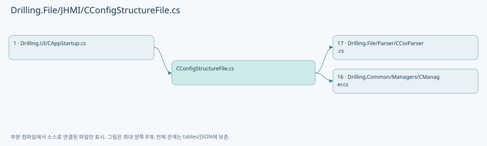
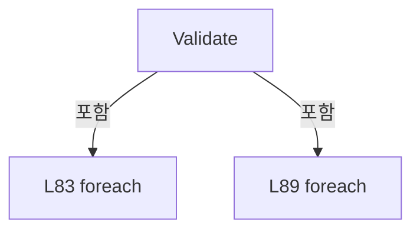
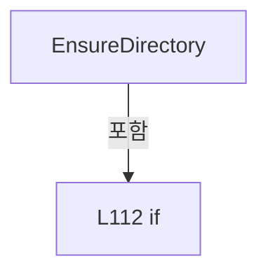
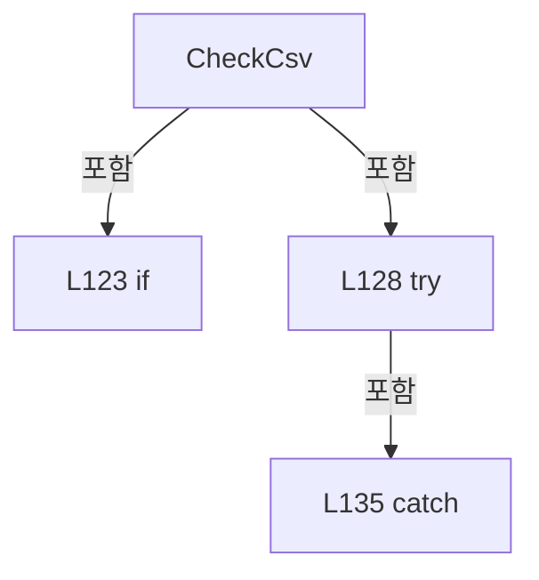
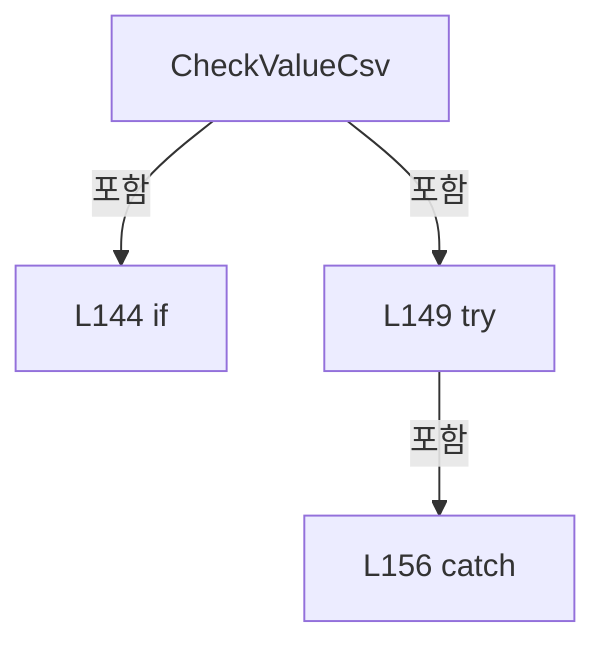
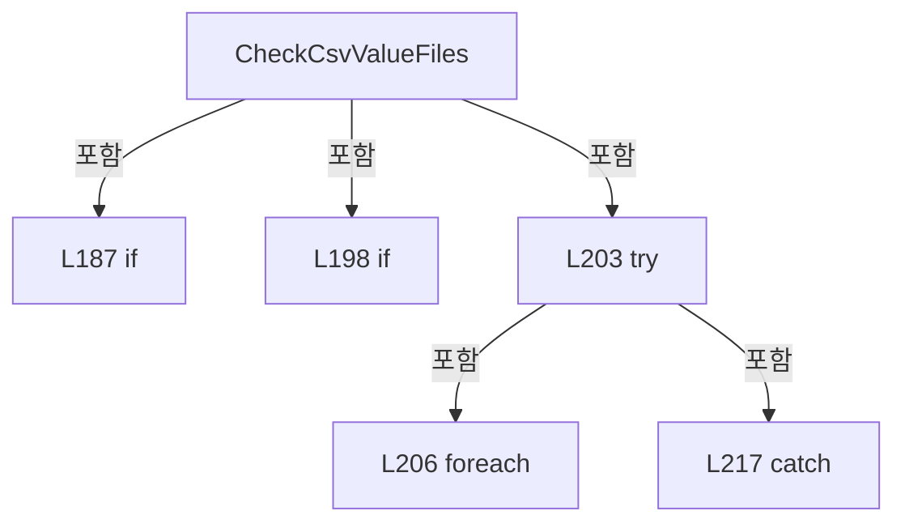
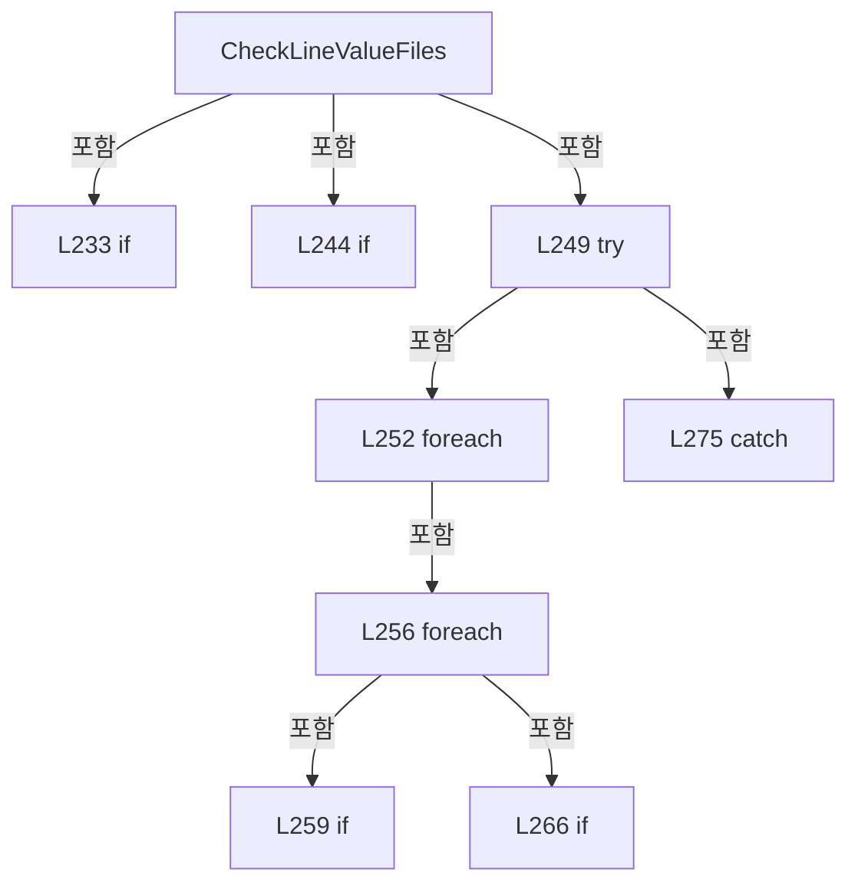
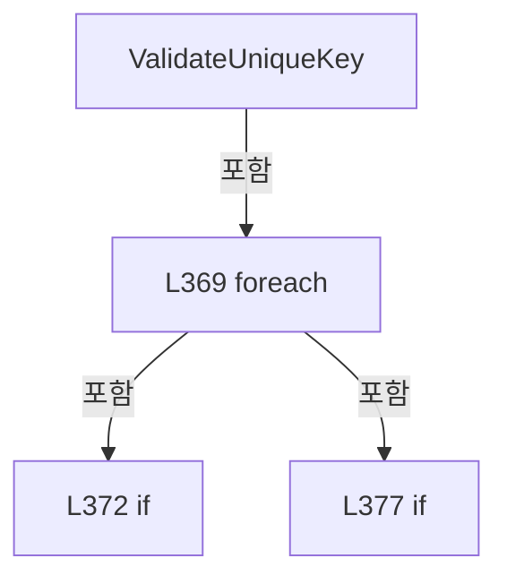
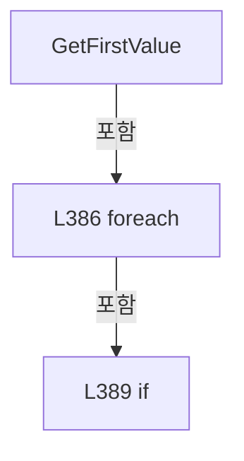
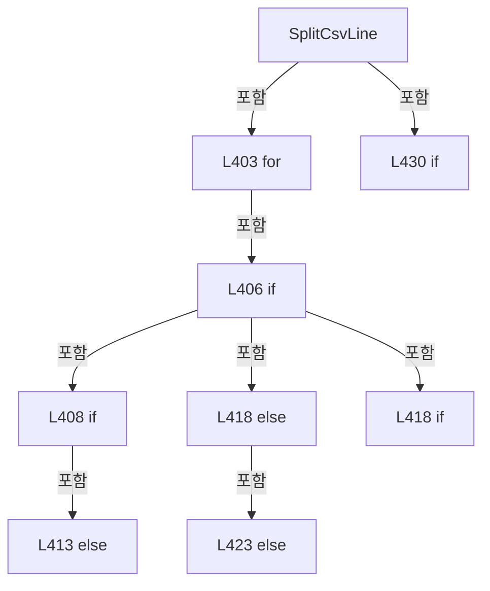

# Drilling.File/JHMI/CConfigStructureFile.cs

| 항목 | 내용 |
| --- | --- |
| 원본 저장소 | https://github.com/kjuws10-rgb/A3Drilling.git |
| 원본 Commit | 5aee8e58439c9b455cae7c9593c9be986c3e682e |
| 원본 SHA256 | 6703e663836345c24527cde64ebec2994fa59443f19285374abff3f62ac379be |
| 파일 분류 | code |
| 원본 크기/행 | 18,185 bytes / 470 physical lines |
| 인코딩 | utf-8-sig |
| 검토 범위 | 구문/부분 의미 분석에서 추출한 사실. 동작·물리 단위·실장비 합격을 보증하지 않습니다. |
| 원본 링크 | [고정 Commit 원본](https://github.com/kjuws10-rgb/A3Drilling/blob/5aee8e58439c9b455cae7c9593c9be986c3e682e/Drilling.File/JHMI/CConfigStructureFile.cs) |

## 파일의 역할과 읽는 순서

정의·설정·레시피·결과·스크립트의 파일 입출력과 데이터 형식을 담당합니다. 저장 필드를 통신 송신 필드로 단정하지 않습니다.

## 네임스페이스·타입·상속

| 타입 | 구분 | 원본 범위 | 선언/상속 |
| --- | --- | --- | --- |
| CConfigStructureFile | ClassDeclaration | 5–470 | CConfigStructureFile: CConfigStructureFileBase |
| ST_REQUIRED_CSV | RecordDeclaration | 458–463 | ST_REQUIRED_CSV |
| ST_VALUE_CSV | RecordDeclaration | 464–469 | ST_VALUE_CSV |

## 멤버 빠른 목록

| 이름 | 종류 | 범위 | 서명 |
| --- | --- | --- | --- |
| RequiredCsvFiles | FieldDeclaration | L7–69 | System.Collections.Generic.IReadOnlyList<Drilling.File.JHMI.CConfigStructureFile.ST_REQUIRED_CSV> Drilling.File.JHMI.CConfigStructureFile.RequiredCsvFiles |
| OptionalValueFiles | FieldDeclaration | L70–70 | System.Collections.Generic.IReadOnlyList<Drilling.File.JHMI.CConfigStructureFile.ST_VALUE_CSV> Drilling.File.JHMI.CConfigStructureFile.OptionalValueFiles |
| Validate | MethodDeclaration | L71–98 | System.Threading.Tasks.Task<System.Collections.Generic.IReadOnlyList<Drilling.Common.Managers.ST_CONFIG_FILE_STATUS>> Drilling.File.JHMI.CConfigStructureFile.Validate(System.Threading.CancellationToken) |
| CheckRoot | MethodDeclaration | L100–105 | Drilling.Common.Managers.ST_CONFIG_FILE_STATUS Drilling.File.JHMI.CConfigStructureFile.CheckRoot() |
| EnsureDirectory | MethodDeclaration | L107–118 | Drilling.Common.Managers.ST_CONFIG_FILE_STATUS Drilling.File.JHMI.CConfigStructureFile.EnsureDirectory(string, string, System.Threading.CancellationToken) |
| CheckCsv | MethodDeclaration | L120–139 | Drilling.Common.Managers.ST_CONFIG_FILE_STATUS Drilling.File.JHMI.CConfigStructureFile.CheckCsv(Drilling.File.JHMI.CConfigStructureFile.ST_REQUIRED_CSV) |
| CheckValueCsv | MethodDeclaration | L141–160 | Drilling.Common.Managers.ST_CONFIG_FILE_STATUS Drilling.File.JHMI.CConfigStructureFile.CheckValueCsv(Drilling.File.JHMI.CConfigStructureFile.ST_VALUE_CSV) |
| CheckRecipeValueFiles | MethodDeclaration | L162–170 | Drilling.Common.Managers.ST_CONFIG_FILE_STATUS Drilling.File.JHMI.CConfigStructureFile.CheckRecipeValueFiles(System.Threading.CancellationToken) |
| MatchesCount | LocalFunctionStatement | L164–167 | bool MatchesCount(System.Collections.Generic.IReadOnlyList<string>) |
| CheckManualValueFiles | MethodDeclaration | L172–175 | Drilling.Common.Managers.ST_CONFIG_FILE_STATUS Drilling.File.JHMI.CConfigStructureFile.CheckManualValueFiles(System.Threading.CancellationToken) |
| CheckCsvValueFiles | MethodDeclaration | L177–221 | Drilling.Common.Managers.ST_CONFIG_FILE_STATUS Drilling.File.JHMI.CConfigStructureFile.CheckCsvValueFiles(string, string, string, System.Collections.Generic.IReadOnlyList<System.Collections.Generic.IReadOnlyList<string>>, System.Action<string, System.Collections.Generic.IReadOnlyList<System.Collections.Generic.IReadOnlyDictionary<string, string>>>, System.Threading.CancellationToken) |
| SelectPath | LocalFunctionStatement | L192–195 | string SelectPath(string) |
| CheckLineValueFiles | MethodDeclaration | L223–279 | Drilling.Common.Managers.ST_CONFIG_FILE_STATUS Drilling.File.JHMI.CConfigStructureFile.CheckLineValueFiles(string, string, string, System.Func<System.Collections.Generic.IReadOnlyList<string>, bool>, string, System.Threading.CancellationToken) |
| SelectPath | LocalFunctionStatement | L238–241 | string SelectPath(string) |
| GetPath | MethodDeclaration | L281–284 | string Drilling.File.JHMI.CConfigStructureFile.GetPath(string) |
| NormalizePath | MethodDeclaration | L286–289 | string Drilling.File.JHMI.CConfigStructureFile.NormalizePath(string) |
| ValidateTabNameKey | MethodDeclaration | L291–299 | void Drilling.File.JHMI.CConfigStructureFile.ValidateTabNameKey(string, System.Collections.Generic.IReadOnlyList<System.Collections.Generic.IReadOnlyDictionary<string, string>>) |
| SelectValue | LocalFunctionStatement | L293–296 | string SelectValue(System.Collections.Generic.IReadOnlyDictionary<string, string>) |
| ValidateDeviceNumberKey | MethodDeclaration | L301–309 | void Drilling.File.JHMI.CConfigStructureFile.ValidateDeviceNumberKey(string, System.Collections.Generic.IReadOnlyList<System.Collections.Generic.IReadOnlyDictionary<string, string>>) |
| SelectValue | LocalFunctionStatement | L303–306 | string SelectValue(System.Collections.Generic.IReadOnlyDictionary<string, string>) |
| ValidateNameKey | MethodDeclaration | L311–319 | void Drilling.File.JHMI.CConfigStructureFile.ValidateNameKey(string, System.Collections.Generic.IReadOnlyList<System.Collections.Generic.IReadOnlyDictionary<string, string>>) |
| SelectValue | LocalFunctionStatement | L313–316 | string SelectValue(System.Collections.Generic.IReadOnlyDictionary<string, string>) |
| ValidateGroupKey | MethodDeclaration | L321–329 | void Drilling.File.JHMI.CConfigStructureFile.ValidateGroupKey(string, System.Collections.Generic.IReadOnlyList<System.Collections.Generic.IReadOnlyDictionary<string, string>>) |
| SelectValue | LocalFunctionStatement | L323–326 | string SelectValue(System.Collections.Generic.IReadOnlyDictionary<string, string>) |
| ValidateIdKey | MethodDeclaration | L331–339 | void Drilling.File.JHMI.CConfigStructureFile.ValidateIdKey(string, System.Collections.Generic.IReadOnlyList<System.Collections.Generic.IReadOnlyDictionary<string, string>>) |
| SelectValue | LocalFunctionStatement | L333–336 | string SelectValue(System.Collections.Generic.IReadOnlyDictionary<string, string>) |
| ValidateIndexKey | MethodDeclaration | L341–349 | void Drilling.File.JHMI.CConfigStructureFile.ValidateIndexKey(string, System.Collections.Generic.IReadOnlyList<System.Collections.Generic.IReadOnlyDictionary<string, string>>) |
| SelectValue | LocalFunctionStatement | L343–346 | string SelectValue(System.Collections.Generic.IReadOnlyDictionary<string, string>) |
| ValidateStepKey | MethodDeclaration | L351–359 | void Drilling.File.JHMI.CConfigStructureFile.ValidateStepKey(string, System.Collections.Generic.IReadOnlyList<System.Collections.Generic.IReadOnlyDictionary<string, string>>) |
| SelectValue | LocalFunctionStatement | L353–356 | string SelectValue(System.Collections.Generic.IReadOnlyDictionary<string, string>) |
| ValidateUniqueKey | MethodDeclaration | L361–382 | void Drilling.File.JHMI.CConfigStructureFile.ValidateUniqueKey(string, System.Collections.Generic.IReadOnlyList<System.Collections.Generic.IReadOnlyDictionary<string, string>>, System.Collections.Generic.IReadOnlyList<string>, System.Func<System.Collections.Generic.IReadOnlyDictionary<string, string>, string>) |
| GetFirstValue | MethodDeclaration | L384–396 | string Drilling.File.JHMI.CConfigStructureFile.GetFirstValue(System.Collections.Generic.IReadOnlyDictionary<string, string>, params string[]) |
| SplitCsvLine | MethodDeclaration | L398–436 | System.Collections.Generic.IReadOnlyList<string> Drilling.File.JHMI.CConfigStructureFile.SplitCsvLine(string, string, int) |
| Csv | MethodDeclaration | L438–446 | Drilling.File.JHMI.CConfigStructureFile.ST_REQUIRED_CSV Drilling.File.JHMI.CConfigStructureFile.Csv(string, string, System.Collections.Generic.IReadOnlyList<System.Collections.Generic.IReadOnlyList<string>>, System.Action<string, System.Collections.Generic.IReadOnlyList<System.Collections.Generic.IReadOnlyDictionary<string, string>>>) |
| ValueCsv | MethodDeclaration | L448–456 | Drilling.File.JHMI.CConfigStructureFile.ST_VALUE_CSV Drilling.File.JHMI.CConfigStructureFile.ValueCsv(string, string, System.Collections.Generic.IReadOnlyList<System.Collections.Generic.IReadOnlyList<string>>, System.Action<string, System.Collections.Generic.IReadOnlyList<System.Collections.Generic.IReadOnlyDictionary<string, string>>>) |

## 멤버별 상세 계약·호출·처리 해설

### FieldDeclaration `RequiredCsvFiles` · L7–69

[Drilling.File/JHMI/CConfigStructureFile.cs:7–69](https://github.com/kjuws10-rgb/A3Drilling/blob/5aee8e58439c9b455cae7c9593c9be986c3e682e/Drilling.File/JHMI/CConfigStructureFile.cs#L7-L69)

| 항목 | 실제 추출 값 |
| --- | --- |
| 서명 | System.Collections.Generic.IReadOnlyList<Drilling.File.JHMI.CConfigStructureFile.ST_REQUIRED_CSV> Drilling.File.JHMI.CConfigStructureFile.RequiredCsvFiles |
| 접근/수식자 | Private / private, static, readonly |
| 반환/값 타입 | System.Collections.Generic.IReadOnlyList<Drilling.File.JHMI.CConfigStructureFile.ST_REQUIRED_CSV> |
| 소속 타입 | NamedType:Drilling.File.JHMI.CConfigStructureFile |

현재 부분 분석에서 직접 연결된 호출자는 없습니다. XAML/이벤트/인터페이스·델리게이트·외부 진입을 추가 확인해야 하며, 미사용으로 판정한 것이 아닙니다.

호출하는 대상과 해석 범위:

| 원본 행 | 표현식 | 분석 상태 | 대상/소스 위치 |
| --- | --- | --- | --- |
| 10 | Csv | resolved | Drilling.File.JHMI.CConfigStructureFile.ST_REQUIRED_CSV Drilling.File.JHMI.CConfigStructureFile.Csv(string, string, System.Collections.Generic.IReadOnlyList<System.Collections.Generic.IReadOnlyList<string>>, System.Action<string, System.Collections.Generic.IReadOnlyList<System.Collections.Generic.IReadOnlyDictionary<string, string>>>) · Drilling.File/JHMI/CConfigStructureFile.cs:438 |
| 34 | Csv | resolved | Drilling.File.JHMI.CConfigStructureFile.ST_REQUIRED_CSV Drilling.File.JHMI.CConfigStructureFile.Csv(string, string, System.Collections.Generic.IReadOnlyList<System.Collections.Generic.IReadOnlyList<string>>, System.Action<string, System.Collections.Generic.IReadOnlyList<System.Collections.Generic.IReadOnlyDictionary<string, string>>>) · Drilling.File/JHMI/CConfigStructureFile.cs:438 |
| 36 | Csv | resolved | Drilling.File.JHMI.CConfigStructureFile.ST_REQUIRED_CSV Drilling.File.JHMI.CConfigStructureFile.Csv(string, string, System.Collections.Generic.IReadOnlyList<System.Collections.Generic.IReadOnlyList<string>>, System.Action<string, System.Collections.Generic.IReadOnlyList<System.Collections.Generic.IReadOnlyDictionary<string, string>>>) · Drilling.File/JHMI/CConfigStructureFile.cs:438 |
| 56 | Csv | resolved | Drilling.File.JHMI.CConfigStructureFile.ST_REQUIRED_CSV Drilling.File.JHMI.CConfigStructureFile.Csv(string, string, System.Collections.Generic.IReadOnlyList<System.Collections.Generic.IReadOnlyList<string>>, System.Action<string, System.Collections.Generic.IReadOnlyList<System.Collections.Generic.IReadOnlyDictionary<string, string>>>) · Drilling.File/JHMI/CConfigStructureFile.cs:438 |
| 63 | Csv | resolved | Drilling.File.JHMI.CConfigStructureFile.ST_REQUIRED_CSV Drilling.File.JHMI.CConfigStructureFile.Csv(string, string, System.Collections.Generic.IReadOnlyList<System.Collections.Generic.IReadOnlyList<string>>, System.Action<string, System.Collections.Generic.IReadOnlyList<System.Collections.Generic.IReadOnlyDictionary<string, string>>>) · Drilling.File/JHMI/CConfigStructureFile.cs:438 |
| 65 | Csv | resolved | Drilling.File.JHMI.CConfigStructureFile.ST_REQUIRED_CSV Drilling.File.JHMI.CConfigStructureFile.Csv(string, string, System.Collections.Generic.IReadOnlyList<System.Collections.Generic.IReadOnlyList<string>>, System.Action<string, System.Collections.Generic.IReadOnlyList<System.Collections.Generic.IReadOnlyDictionary<string, string>>>) · Drilling.File/JHMI/CConfigStructureFile.cs:438 |
| 67 | Csv | resolved | Drilling.File.JHMI.CConfigStructureFile.ST_REQUIRED_CSV Drilling.File.JHMI.CConfigStructureFile.Csv(string, string, System.Collections.Generic.IReadOnlyList<System.Collections.Generic.IReadOnlyList<string>>, System.Action<string, System.Collections.Generic.IReadOnlyList<System.Collections.Generic.IReadOnlyDictionary<string, string>>>) · Drilling.File/JHMI/CConfigStructureFile.cs:438 |

본문의 실제 연산·분기·예외·반환 순서(원문 위치 순):

| 원본 행 | 종류 | 주석 해설 |
| --- | --- | --- |
| 7 | variable-initializer | 변수의 초기값을 지정합니다: RequiredCsvFiles = [ Csv( "JHMI_RCP", "JHMI_RCP.csv", [ ["TAB"], ["GROUP"], ["NAME"], ["DISPLAY NAME"], ["CIM NAME"], ["DATA TYPE"], ["UNIT"], ["SHOW"], ["USE"], ["VALUE"], ["SCALE"], ["CHANGE LIMIT"], ["MIN"], ["MAX"], ["DESCRIPT |
| 10 | call | 함수·델리게이트 또는 객체 생성자를 호출합니다: Csv( "JHMI_RCP", "JHMI_RCP.csv", [ ["TAB"], ["GROUP"], ["NAME"], ["DISPLAY NAME"], ["CIM NAME"], ["DATA TYPE"], ["UNIT"], ["SHOW"], ["USE"], ["VALUE"], ["SCALE"], ["CHANGE LIMIT"], ["MIN"], ["MAX"], ["DESCRIPTION"], ["OR… |
| 34 | call | 함수·델리게이트 또는 객체 생성자를 호출합니다: Csv("JHMI_SETTING", "JHMI_SETTING.csv", [["TAB"], ["GROUP"], ["NAME"], ["DISPLAY NAME"], ["DATA TYPE"], ["UNIT"], ["SHOW"], ["USE"], ["VALUE"], ["MIN"], ["MAX"], ["DESCRIPTION"]], ValidateTabNameKey) |
| 36 | call | 함수·델리게이트 또는 객체 생성자를 호출합니다: Csv( "JHMI_INTERFACE", "JHMI_INTERFACE.csv", [ ["TYPE"], ["DEVICE"], ["NUMBER", "NO"], ["NICKNAME"], ["SYSTEM_SECTION", "SYSTEM SECTION", "SECTION"], ["AUTOCONNECTION", "AUTO_CONNECTION", "AUTO CONNECTION"], ["SIMUL", "S… |
| 56 | call | 함수·델리게이트 또는 객체 생성자를 호출합니다: Csv( "JHMI_MOTOR", "JHMI_MOTOR.csv", [["NAME", "MOTOR NAME", "AXIS NAME"], ["USE"], ["AXIS"], ["DEV TYPE", "DEVICE TYPE"], ["DEV NO", "DEVICE NO"], ["SCALE"], ["MAXVEL"], ["MAXACC"], ["MIN"], ["MAX"]], ValidateNameKey ) |
| 63 | call | 함수·델리게이트 또는 객체 생성자를 호출합니다: Csv("JHMI_MELSEC_MAP", "JHMI_MELSEC_MAP.csv", CMelsecMapFile.RequiredHeaderGroups, ValidateIdKey) |
| 65 | call | 함수·델리게이트 또는 객체 생성자를 호출합니다: Csv("JHMI_BET", "JHMI_BET.csv", [["INDEX"], ["DESCRIPTION"], ["DIV"], ["MAG"], ["SPOTSIZE"]], ValidateIndexKey) |
| 67 | call | 함수·델리게이트 또는 객체 생성자를 호출합니다: Csv("JHMI_MANUAL_SCAN", "JHMI_MANUAL_SCAN.csv", [["NAME"], ["DISPLAY NAME"], ["DATA TYPE"], ["UNIT"], ["SHOW"], ["USE"], ["VALUE"], ["MIN"], ["MAX"], ["DESCRIPTION"], ["ORDER"]], ValidateNameKey) |

변경 전 점검: 입력/반환 타입, 위 호출자, 예외/취소 경로, 공유 상태와 저장·전송 소비자를 함께 확인합니다. 값의 단위나 물리 방향을 이름만으로 확정하지 않습니다.

### FieldDeclaration `OptionalValueFiles` · L70–70

[Drilling.File/JHMI/CConfigStructureFile.cs:70–70](https://github.com/kjuws10-rgb/A3Drilling/blob/5aee8e58439c9b455cae7c9593c9be986c3e682e/Drilling.File/JHMI/CConfigStructureFile.cs#L70-L70)

| 항목 | 실제 추출 값 |
| --- | --- |
| 서명 | System.Collections.Generic.IReadOnlyList<Drilling.File.JHMI.CConfigStructureFile.ST_VALUE_CSV> Drilling.File.JHMI.CConfigStructureFile.OptionalValueFiles |
| 접근/수식자 | Private / private, static, readonly |
| 반환/값 타입 | System.Collections.Generic.IReadOnlyList<Drilling.File.JHMI.CConfigStructureFile.ST_VALUE_CSV> |
| 소속 타입 | NamedType:Drilling.File.JHMI.CConfigStructureFile |

현재 부분 분석에서 직접 연결된 호출자는 없습니다. XAML/이벤트/인터페이스·델리게이트·외부 진입을 추가 확인해야 하며, 미사용으로 판정한 것이 아닙니다.

호출하는 대상과 해석 범위:

| 원본 행 | 표현식 | 분석 상태 | 대상/소스 위치 |
| --- | --- | --- | --- |
| 70 | ValueCsv | resolved | Drilling.File.JHMI.CConfigStructureFile.ST_VALUE_CSV Drilling.File.JHMI.CConfigStructureFile.ValueCsv(string, string, System.Collections.Generic.IReadOnlyList<System.Collections.Generic.IReadOnlyList<string>>, System.Action<string, System.Collections.Generic.IReadOnlyList<System.Collections.Generic.IReadOnlyDictionary<string, string>>>) · Drilling.File/JHMI/CConfigStructureFile.cs:448 |

본문의 실제 연산·분기·예외·반환 순서(원문 위치 순):

| 원본 행 | 종류 | 주석 해설 |
| --- | --- | --- |
| 70 | call | 함수·델리게이트 또는 객체 생성자를 호출합니다: ValueCsv("Setting Value", "Setting\\Setting.csv", [["TAB"], ["NAME"], ["VALUE"]], ValidateTabNameKey) |
| 70 | variable-initializer | 변수의 초기값을 지정합니다: OptionalValueFiles = [ValueCsv("Setting Value", "Setting\\Setting.csv", [["TAB"], ["NAME"], ["VALUE"]], ValidateTabNameKey)] |

변경 전 점검: 입력/반환 타입, 위 호출자, 예외/취소 경로, 공유 상태와 저장·전송 소비자를 함께 확인합니다. 값의 단위나 물리 방향을 이름만으로 확정하지 않습니다.

### MethodDeclaration `Validate` · L71–98

[Drilling.File/JHMI/CConfigStructureFile.cs:71–98](https://github.com/kjuws10-rgb/A3Drilling/blob/5aee8e58439c9b455cae7c9593c9be986c3e682e/Drilling.File/JHMI/CConfigStructureFile.cs#L71-L98)

| 항목 | 실제 추출 값 |
| --- | --- |
| 서명 | System.Threading.Tasks.Task<System.Collections.Generic.IReadOnlyList<Drilling.Common.Managers.ST_CONFIG_FILE_STATUS>> Drilling.File.JHMI.CConfigStructureFile.Validate(System.Threading.CancellationToken) |
| 접근/수식자 | Public / public, override |
| 반환/값 타입 | System.Threading.Tasks.Task<System.Collections.Generic.IReadOnlyList<Drilling.Common.Managers.ST_CONFIG_FILE_STATUS>> |
| 소속 타입 | NamedType:Drilling.File.JHMI.CConfigStructureFile |

입력 계약:

| 이름 | 타입 | 전달 | 선택/기본값 |
| --- | --- | --- | --- |
| cancellationToken | System.Threading.CancellationToken | None | True / null |

현재 부분 분석에서 직접 연결된 호출자는 없습니다. XAML/이벤트/인터페이스·델리게이트·외부 진입을 추가 확인해야 하며, 미사용으로 판정한 것이 아닙니다.

호출하는 대상과 해석 범위:

| 원본 행 | 표현식 | 분석 상태 | 대상/소스 위치 |
| --- | --- | --- | --- |
| 73 | cancellationToken.ThrowIfCancellationRequested | resolved | void System.Threading.CancellationToken.ThrowIfCancellationRequested() |
| 74 | new List<ST_CONFIG_FILE_STATUS> | resolved | System.Collections.Generic.List<Drilling.Common.Managers.ST_CONFIG_FILE_STATUS>.List() |
| 76 | CheckRoot | resolved | Drilling.Common.Managers.ST_CONFIG_FILE_STATUS Drilling.File.JHMI.CConfigStructureFile.CheckRoot() · Drilling.File/JHMI/CConfigStructureFile.cs:100 |
| 78 | statuses.AddRange | resolved | void System.Collections.Generic.List<Drilling.Common.Managers.ST_CONFIG_FILE_STATUS>.AddRange(System.Collections.Generic.IEnumerable<Drilling.Common.Managers.ST_CONFIG_FILE_STATUS>) |
| 79 | EnsureDirectory | resolved | Drilling.Common.Managers.ST_CONFIG_FILE_STATUS Drilling.File.JHMI.CConfigStructureFile.EnsureDirectory(string, string, System.Threading.CancellationToken) · Drilling.File/JHMI/CConfigStructureFile.cs:107 |
| 80 | EnsureDirectory | resolved | Drilling.Common.Managers.ST_CONFIG_FILE_STATUS Drilling.File.JHMI.CConfigStructureFile.EnsureDirectory(string, string, System.Threading.CancellationToken) · Drilling.File/JHMI/CConfigStructureFile.cs:107 |
| 81 | EnsureDirectory | resolved | Drilling.Common.Managers.ST_CONFIG_FILE_STATUS Drilling.File.JHMI.CConfigStructureFile.EnsureDirectory(string, string, System.Threading.CancellationToken) · Drilling.File/JHMI/CConfigStructureFile.cs:107 |
| 85 | cancellationToken.ThrowIfCancellationRequested | resolved | void System.Threading.CancellationToken.ThrowIfCancellationRequested() |
| 86 | statuses.Add | resolved | void System.Collections.Generic.List<Drilling.Common.Managers.ST_CONFIG_FILE_STATUS>.Add(Drilling.Common.Managers.ST_CONFIG_FILE_STATUS) |
| 86 | CheckCsv | resolved | Drilling.Common.Managers.ST_CONFIG_FILE_STATUS Drilling.File.JHMI.CConfigStructureFile.CheckCsv(Drilling.File.JHMI.CConfigStructureFile.ST_REQUIRED_CSV) · Drilling.File/JHMI/CConfigStructureFile.cs:120 |
| 91 | cancellationToken.ThrowIfCancellationRequested | resolved | void System.Threading.CancellationToken.ThrowIfCancellationRequested() |
| 92 | statuses.Add | resolved | void System.Collections.Generic.List<Drilling.Common.Managers.ST_CONFIG_FILE_STATUS>.Add(Drilling.Common.Managers.ST_CONFIG_FILE_STATUS) |
| 92 | CheckValueCsv | resolved | Drilling.Common.Managers.ST_CONFIG_FILE_STATUS Drilling.File.JHMI.CConfigStructureFile.CheckValueCsv(Drilling.File.JHMI.CConfigStructureFile.ST_VALUE_CSV) · Drilling.File/JHMI/CConfigStructureFile.cs:141 |
| 95 | statuses.Add | resolved | void System.Collections.Generic.List<Drilling.Common.Managers.ST_CONFIG_FILE_STATUS>.Add(Drilling.Common.Managers.ST_CONFIG_FILE_STATUS) |
| 95 | CheckRecipeValueFiles | resolved | Drilling.Common.Managers.ST_CONFIG_FILE_STATUS Drilling.File.JHMI.CConfigStructureFile.CheckRecipeValueFiles(System.Threading.CancellationToken) · Drilling.File/JHMI/CConfigStructureFile.cs:162 |
| 96 | statuses.Add | resolved | void System.Collections.Generic.List<Drilling.Common.Managers.ST_CONFIG_FILE_STATUS>.Add(Drilling.Common.Managers.ST_CONFIG_FILE_STATUS) |
| 96 | CheckManualValueFiles | resolved | Drilling.Common.Managers.ST_CONFIG_FILE_STATUS Drilling.File.JHMI.CConfigStructureFile.CheckManualValueFiles(System.Threading.CancellationToken) · Drilling.File/JHMI/CConfigStructureFile.cs:172 |
| 97 | Task.FromResult<IReadOnlyList<ST_CONFIG_FILE_STATUS>> | resolved | System.Threading.Tasks.Task<System.Collections.Generic.IReadOnlyList<Drilling.Common.Managers.ST_CONFIG_FILE_STATUS>> System.Threading.Tasks.Task.FromResult<System.Collections.Generic.IReadOnlyList<Drilling.Common.Managers.ST_CONFIG_FILE_STATUS>>(System.Collections.Generic.IReadOnlyList<Drilling.Common.Managers.ST_CONFIG_FILE_STATUS>) |

본문의 실제 연산·분기·예외·반환 순서(원문 위치 순):

| 원본 행 | 종류 | 주석 해설 |
| --- | --- | --- |
| 73 | call | 함수·델리게이트 또는 객체 생성자를 호출합니다: cancellationToken.ThrowIfCancellationRequested() |
| 74 | call | 함수·델리게이트 또는 객체 생성자를 호출합니다: new List<ST_CONFIG_FILE_STATUS> { CheckRoot() } |
| 74 | local-declaration | 지역 변수를 선언합니다: var statuses = new List<ST_CONFIG_FILE_STATUS> { CheckRoot() }; |
| 74 | variable-initializer | 변수의 초기값을 지정합니다: statuses = new List<ST_CONFIG_FILE_STATUS> { CheckRoot() } |
| 76 | call | 함수·델리게이트 또는 객체 생성자를 호출합니다: CheckRoot() |
| 78 | call | 함수·델리게이트 또는 객체 생성자를 호출합니다: statuses.AddRange([ EnsureDirectory("RECIPE Directory", "RECIPE", cancellationToken), EnsureDirectory("Setting Directory", "Setting", cancellationToken), EnsureDirectory("Manual Directory", "Manual", cancellationToken) ]… |
| 79 | call | 함수·델리게이트 또는 객체 생성자를 호출합니다: EnsureDirectory("RECIPE Directory", "RECIPE", cancellationToken) |
| 80 | call | 함수·델리게이트 또는 객체 생성자를 호출합니다: EnsureDirectory("Setting Directory", "Setting", cancellationToken) |
| 81 | call | 함수·델리게이트 또는 객체 생성자를 호출합니다: EnsureDirectory("Manual Directory", "Manual", cancellationToken) |
| 83 | foreach | 컬렉션 요소를 순회합니다: foreach (var csvFile in RequiredCsvFiles) |
| 85 | call | 함수·델리게이트 또는 객체 생성자를 호출합니다: cancellationToken.ThrowIfCancellationRequested() |
| 86 | call | 함수·델리게이트 또는 객체 생성자를 호출합니다: statuses.Add(CheckCsv(csvFile)) |
| 86 | call | 함수·델리게이트 또는 객체 생성자를 호출합니다: CheckCsv(csvFile) |
| 89 | foreach | 컬렉션 요소를 순회합니다: foreach (var valueFile in OptionalValueFiles) |
| 91 | call | 함수·델리게이트 또는 객체 생성자를 호출합니다: cancellationToken.ThrowIfCancellationRequested() |
| 92 | call | 함수·델리게이트 또는 객체 생성자를 호출합니다: statuses.Add(CheckValueCsv(valueFile)) |
| 92 | call | 함수·델리게이트 또는 객체 생성자를 호출합니다: CheckValueCsv(valueFile) |
| 95 | call | 함수·델리게이트 또는 객체 생성자를 호출합니다: statuses.Add(CheckRecipeValueFiles(cancellationToken)) |
| 95 | call | 함수·델리게이트 또는 객체 생성자를 호출합니다: CheckRecipeValueFiles(cancellationToken) |
| 96 | call | 함수·델리게이트 또는 객체 생성자를 호출합니다: statuses.Add(CheckManualValueFiles(cancellationToken)) |
| 96 | call | 함수·델리게이트 또는 객체 생성자를 호출합니다: CheckManualValueFiles(cancellationToken) |
| 97 | call | 함수·델리게이트 또는 객체 생성자를 호출합니다: Task.FromResult<IReadOnlyList<ST_CONFIG_FILE_STATUS>>(statuses) |
| 97 | return | 호출자에게 값 또는 제어를 반환합니다: return Task.FromResult<IReadOnlyList<ST_CONFIG_FILE_STATUS>>(statuses); |

제어 구문의 포함 구조(실제 실행 순서/CFG가 아닌 구문 탐색 그림):

변경 전 점검: 입력/반환 타입, 위 호출자, 예외/취소 경로, 공유 상태와 저장·전송 소비자를 함께 확인합니다. 값의 단위나 물리 방향을 이름만으로 확정하지 않습니다.

### MethodDeclaration `CheckRoot` · L100–105

[Drilling.File/JHMI/CConfigStructureFile.cs:100–105](https://github.com/kjuws10-rgb/A3Drilling/blob/5aee8e58439c9b455cae7c9593c9be986c3e682e/Drilling.File/JHMI/CConfigStructureFile.cs#L100-L105)

| 항목 | 실제 추출 값 |
| --- | --- |
| 서명 | Drilling.Common.Managers.ST_CONFIG_FILE_STATUS Drilling.File.JHMI.CConfigStructureFile.CheckRoot() |
| 접근/수식자 | Private / private |
| 반환/값 타입 | Drilling.Common.Managers.ST_CONFIG_FILE_STATUS |
| 소속 타입 | NamedType:Drilling.File.JHMI.CConfigStructureFile |

정적 호출자로 확인된 위치:

| 호출 파일/행 | 호출 표현식 | 런타임 분기 가능 |
| --- | --- | --- |
| [Drilling.File/JHMI/CConfigStructureFile.cs:76–76](https://github.com/kjuws10-rgb/A3Drilling/blob/5aee8e58439c9b455cae7c9593c9be986c3e682e/Drilling.File/JHMI/CConfigStructureFile.cs#L76-L76) | CheckRoot | False |

호출하는 대상과 해석 범위:

| 원본 행 | 표현식 | 분석 상태 | 대상/소스 위치 |
| --- | --- | --- | --- |
| 102 | NormalizePath | resolved | string Drilling.File.JHMI.CConfigStructureFile.NormalizePath(string) · Drilling.File/JHMI/CConfigStructureFile.cs:286 |
| 103 | Directory.Exists | resolved | bool System.IO.Directory.Exists(string?) |
| 104 | new ST_CONFIG_FILE_STATUS | resolved | Drilling.Common.Managers.ST_CONFIG_FILE_STATUS.ST_CONFIG_FILE_STATUS(string, string, bool, bool, bool, string) · Drilling.Common/Managers/CManager.cs:765 |

본문의 실제 연산·분기·예외·반환 순서(원문 위치 순):

| 원본 행 | 종류 | 주석 해설 |
| --- | --- | --- |
| 102 | call | 함수·델리게이트 또는 객체 생성자를 호출합니다: NormalizePath(configRoot) |
| 102 | local-declaration | 지역 변수를 선언합니다: var path = NormalizePath(configRoot); |
| 102 | variable-initializer | 변수의 초기값을 지정합니다: path = NormalizePath(configRoot) |
| 103 | call | 함수·델리게이트 또는 객체 생성자를 호출합니다: Directory.Exists(path) |
| 103 | local-declaration | 지역 변수를 선언합니다: var exists = Directory.Exists(path); |
| 103 | variable-initializer | 변수의 초기값을 지정합니다: exists = Directory.Exists(path) |
| 104 | call | 함수·델리게이트 또는 객체 생성자를 호출합니다: new ST_CONFIG_FILE_STATUS("Config Root", path, true, exists, exists, exists ? "Config root found." : "Config root is missing.") |
| 104 | conditional-expression | 조건에 따라 결과식을 선택합니다: exists ? "Config root found." : "Config root is missing." |
| 104 | return | 호출자에게 값 또는 제어를 반환합니다: return new ST_CONFIG_FILE_STATUS("Config Root", path, true, exists, exists, exists ? "Config root found." : "Config root is missing."); |

변경 전 점검: 입력/반환 타입, 위 호출자, 예외/취소 경로, 공유 상태와 저장·전송 소비자를 함께 확인합니다. 값의 단위나 물리 방향을 이름만으로 확정하지 않습니다.

### MethodDeclaration `EnsureDirectory` · L107–118

[Drilling.File/JHMI/CConfigStructureFile.cs:107–118](https://github.com/kjuws10-rgb/A3Drilling/blob/5aee8e58439c9b455cae7c9593c9be986c3e682e/Drilling.File/JHMI/CConfigStructureFile.cs#L107-L118)

| 항목 | 실제 추출 값 |
| --- | --- |
| 서명 | Drilling.Common.Managers.ST_CONFIG_FILE_STATUS Drilling.File.JHMI.CConfigStructureFile.EnsureDirectory(string, string, System.Threading.CancellationToken) |
| 접근/수식자 | Private / private |
| 반환/값 타입 | Drilling.Common.Managers.ST_CONFIG_FILE_STATUS |
| 소속 타입 | NamedType:Drilling.File.JHMI.CConfigStructureFile |

입력 계약:

| 이름 | 타입 | 전달 | 선택/기본값 |
| --- | --- | --- | --- |
| itemName | string | None | False /  |
| relativePath | string | None | False /  |
| cancellationToken | System.Threading.CancellationToken | None | False /  |

정적 호출자로 확인된 위치:

| 호출 파일/행 | 호출 표현식 | 런타임 분기 가능 |
| --- | --- | --- |
| [Drilling.File/JHMI/CConfigStructureFile.cs:79–79](https://github.com/kjuws10-rgb/A3Drilling/blob/5aee8e58439c9b455cae7c9593c9be986c3e682e/Drilling.File/JHMI/CConfigStructureFile.cs#L79-L79) | EnsureDirectory | False |
| [Drilling.File/JHMI/CConfigStructureFile.cs:80–80](https://github.com/kjuws10-rgb/A3Drilling/blob/5aee8e58439c9b455cae7c9593c9be986c3e682e/Drilling.File/JHMI/CConfigStructureFile.cs#L80-L80) | EnsureDirectory | False |
| [Drilling.File/JHMI/CConfigStructureFile.cs:81–81](https://github.com/kjuws10-rgb/A3Drilling/blob/5aee8e58439c9b455cae7c9593c9be986c3e682e/Drilling.File/JHMI/CConfigStructureFile.cs#L81-L81) | EnsureDirectory | False |

호출하는 대상과 해석 범위:

| 원본 행 | 표현식 | 분석 상태 | 대상/소스 위치 |
| --- | --- | --- | --- |
| 109 | cancellationToken.ThrowIfCancellationRequested | resolved | void System.Threading.CancellationToken.ThrowIfCancellationRequested() |
| 110 | GetPath | resolved | string Drilling.File.JHMI.CConfigStructureFile.GetPath(string) · Drilling.File/JHMI/CConfigStructureFile.cs:281 |
| 111 | Directory.Exists | resolved | bool System.IO.Directory.Exists(string?) |
| 114 | Directory.CreateDirectory | resolved | System.IO.DirectoryInfo System.IO.Directory.CreateDirectory(string) |
| 117 | new ST_CONFIG_FILE_STATUS | resolved | Drilling.Common.Managers.ST_CONFIG_FILE_STATUS.ST_CONFIG_FILE_STATUS(string, string, bool, bool, bool, string) · Drilling.Common/Managers/CManager.cs:765 |
| 117 | Directory.Exists | resolved | bool System.IO.Directory.Exists(string?) |
| 117 | Directory.Exists | resolved | bool System.IO.Directory.Exists(string?) |

본문의 실제 연산·분기·예외·반환 순서(원문 위치 순):

| 원본 행 | 종류 | 주석 해설 |
| --- | --- | --- |
| 109 | call | 함수·델리게이트 또는 객체 생성자를 호출합니다: cancellationToken.ThrowIfCancellationRequested() |
| 110 | call | 함수·델리게이트 또는 객체 생성자를 호출합니다: GetPath(relativePath) |
| 110 | local-declaration | 지역 변수를 선언합니다: var path = GetPath(relativePath); |
| 110 | variable-initializer | 변수의 초기값을 지정합니다: path = GetPath(relativePath) |
| 111 | call | 함수·델리게이트 또는 객체 생성자를 호출합니다: Directory.Exists(path) |
| 111 | local-declaration | 지역 변수를 선언합니다: var existed = Directory.Exists(path); |
| 111 | variable-initializer | 변수의 초기값을 지정합니다: existed = Directory.Exists(path) |
| 112 | if | 조건에 따라 분기합니다: if (!existed) |
| 114 | call | 함수·델리게이트 또는 객체 생성자를 호출합니다: Directory.CreateDirectory(path) |
| 117 | call | 함수·델리게이트 또는 객체 생성자를 호출합니다: new ST_CONFIG_FILE_STATUS(itemName, path, true, Directory.Exists(path), Directory.Exists(path), existed ? "Directory found." : "Directory created.") |
| 117 | call | 함수·델리게이트 또는 객체 생성자를 호출합니다: Directory.Exists(path) |
| 117 | call | 함수·델리게이트 또는 객체 생성자를 호출합니다: Directory.Exists(path) |
| 117 | conditional-expression | 조건에 따라 결과식을 선택합니다: existed ? "Directory found." : "Directory created." |
| 117 | return | 호출자에게 값 또는 제어를 반환합니다: return new ST_CONFIG_FILE_STATUS(itemName, path, true, Directory.Exists(path), Directory.Exists(path), existed ? "Directory found." : "Directory created."); |

제어 구문의 포함 구조(실제 실행 순서/CFG가 아닌 구문 탐색 그림):

변경 전 점검: 입력/반환 타입, 위 호출자, 예외/취소 경로, 공유 상태와 저장·전송 소비자를 함께 확인합니다. 값의 단위나 물리 방향을 이름만으로 확정하지 않습니다.

### MethodDeclaration `CheckCsv` · L120–139

[Drilling.File/JHMI/CConfigStructureFile.cs:120–139](https://github.com/kjuws10-rgb/A3Drilling/blob/5aee8e58439c9b455cae7c9593c9be986c3e682e/Drilling.File/JHMI/CConfigStructureFile.cs#L120-L139)

| 항목 | 실제 추출 값 |
| --- | --- |
| 서명 | Drilling.Common.Managers.ST_CONFIG_FILE_STATUS Drilling.File.JHMI.CConfigStructureFile.CheckCsv(Drilling.File.JHMI.CConfigStructureFile.ST_REQUIRED_CSV) |
| 접근/수식자 | Private / private |
| 반환/값 타입 | Drilling.Common.Managers.ST_CONFIG_FILE_STATUS |
| 소속 타입 | NamedType:Drilling.File.JHMI.CConfigStructureFile |

입력 계약:

| 이름 | 타입 | 전달 | 선택/기본값 |
| --- | --- | --- | --- |
| csvFile | Drilling.File.JHMI.CConfigStructureFile.ST_REQUIRED_CSV | None | False /  |

정적 호출자로 확인된 위치:

| 호출 파일/행 | 호출 표현식 | 런타임 분기 가능 |
| --- | --- | --- |
| [Drilling.File/JHMI/CConfigStructureFile.cs:86–86](https://github.com/kjuws10-rgb/A3Drilling/blob/5aee8e58439c9b455cae7c9593c9be986c3e682e/Drilling.File/JHMI/CConfigStructureFile.cs#L86-L86) | CheckCsv | False |

호출하는 대상과 해석 범위:

| 원본 행 | 표현식 | 분석 상태 | 대상/소스 위치 |
| --- | --- | --- | --- |
| 122 | GetPath | resolved | string Drilling.File.JHMI.CConfigStructureFile.GetPath(string) · Drilling.File/JHMI/CConfigStructureFile.cs:281 |
| 123 | System.IO.File.Exists | resolved | bool System.IO.File.Exists(string?) |
| 125 | new ST_CONFIG_FILE_STATUS | resolved | Drilling.Common.Managers.ST_CONFIG_FILE_STATUS.ST_CONFIG_FILE_STATUS(string, string, bool, bool, bool, string) · Drilling.Common/Managers/CManager.cs:765 |
| 130 | CCsvParser.ValidateRequiredHeaders | resolved | void Drilling.File.Parser.CCsvParser.ValidateRequiredHeaders(string, string, System.Collections.Generic.IEnumerable<System.Collections.Generic.IEnumerable<string>>) · Drilling.File/Parser/CCsvParser.cs:280 |
| 131 | CCsvParser.Read | resolved | System.Collections.Generic.IReadOnlyList<System.Collections.Generic.IReadOnlyDictionary<string, string>> Drilling.File.Parser.CCsvParser.Read(string) · Drilling.File/Parser/CCsvParser.cs:12 |
| 132 | csvFile.RowValidator | resolved · 동적 구현 선택 가능 | void System.Action<string, System.Collections.Generic.IReadOnlyList<System.Collections.Generic.IReadOnlyDictionary<string, string>>>.Invoke(string, System.Collections.Generic.IReadOnlyList<System.Collections.Generic.IReadOnlyDictionary<string, string>>) |
| 133 | new ST_CONFIG_FILE_STATUS | resolved | Drilling.Common.Managers.ST_CONFIG_FILE_STATUS.ST_CONFIG_FILE_STATUS(string, string, bool, bool, bool, string) · Drilling.Common/Managers/CManager.cs:765 |
| 137 | new ST_CONFIG_FILE_STATUS | resolved | Drilling.Common.Managers.ST_CONFIG_FILE_STATUS.ST_CONFIG_FILE_STATUS(string, string, bool, bool, bool, string) · Drilling.Common/Managers/CManager.cs:765 |

본문의 실제 연산·분기·예외·반환 순서(원문 위치 순):

| 원본 행 | 종류 | 주석 해설 |
| --- | --- | --- |
| 122 | call | 함수·델리게이트 또는 객체 생성자를 호출합니다: GetPath(csvFile.RelativePath) |
| 122 | local-declaration | 지역 변수를 선언합니다: var path = GetPath(csvFile.RelativePath); |
| 122 | variable-initializer | 변수의 초기값을 지정합니다: path = GetPath(csvFile.RelativePath) |
| 123 | call | 함수·델리게이트 또는 객체 생성자를 호출합니다: System.IO.File.Exists(path) |
| 123 | if | 조건에 따라 분기합니다: if (!System.IO.File.Exists(path)) |
| 125 | call | 함수·델리게이트 또는 객체 생성자를 호출합니다: new ST_CONFIG_FILE_STATUS(csvFile.ItemName, path, true, false, false, "Required JHMI schema file is missing.") |
| 125 | return | 호출자에게 값 또는 제어를 반환합니다: return new ST_CONFIG_FILE_STATUS(csvFile.ItemName, path, true, false, false, "Required JHMI schema file is missing."); |
| 128 | try | 예외 처리 범위입니다: try |
| 130 | call | 함수·델리게이트 또는 객체 생성자를 호출합니다: CCsvParser.ValidateRequiredHeaders(path, csvFile.ItemName, csvFile.RequiredHeaderGroups) |
| 131 | call | 함수·델리게이트 또는 객체 생성자를 호출합니다: CCsvParser.Read(path) |
| 131 | local-declaration | 지역 변수를 선언합니다: var rows = CCsvParser.Read(path); |
| 131 | variable-initializer | 변수의 초기값을 지정합니다: rows = CCsvParser.Read(path) |
| 132 | call | 함수·델리게이트 또는 객체 생성자를 호출합니다: csvFile.RowValidator(csvFile.ItemName, rows) |
| 133 | call | 함수·델리게이트 또는 객체 생성자를 호출합니다: new ST_CONFIG_FILE_STATUS(csvFile.ItemName, path, true, true, true, $"CSV header and key structure OK. Rows={rows.Count}.") |
| 133 | return | 호출자에게 값 또는 제어를 반환합니다: return new ST_CONFIG_FILE_STATUS(csvFile.ItemName, path, true, true, true, $"CSV header and key structure OK. Rows={rows.Count}."); |
| 135 | catch | 지정 예외를 처리합니다: catch (Exception ex) when (ex is InvalidDataException or IOException or UnauthorizedAccessException) |
| 137 | call | 함수·델리게이트 또는 객체 생성자를 호출합니다: new ST_CONFIG_FILE_STATUS(csvFile.ItemName, path, true, true, false, ex.Message) |
| 137 | return | 호출자에게 값 또는 제어를 반환합니다: return new ST_CONFIG_FILE_STATUS(csvFile.ItemName, path, true, true, false, ex.Message); |

제어 구문의 포함 구조(실제 실행 순서/CFG가 아닌 구문 탐색 그림):

변경 전 점검: 입력/반환 타입, 위 호출자, 예외/취소 경로, 공유 상태와 저장·전송 소비자를 함께 확인합니다. 값의 단위나 물리 방향을 이름만으로 확정하지 않습니다.

### MethodDeclaration `CheckValueCsv` · L141–160

[Drilling.File/JHMI/CConfigStructureFile.cs:141–160](https://github.com/kjuws10-rgb/A3Drilling/blob/5aee8e58439c9b455cae7c9593c9be986c3e682e/Drilling.File/JHMI/CConfigStructureFile.cs#L141-L160)

| 항목 | 실제 추출 값 |
| --- | --- |
| 서명 | Drilling.Common.Managers.ST_CONFIG_FILE_STATUS Drilling.File.JHMI.CConfigStructureFile.CheckValueCsv(Drilling.File.JHMI.CConfigStructureFile.ST_VALUE_CSV) |
| 접근/수식자 | Private / private |
| 반환/값 타입 | Drilling.Common.Managers.ST_CONFIG_FILE_STATUS |
| 소속 타입 | NamedType:Drilling.File.JHMI.CConfigStructureFile |

입력 계약:

| 이름 | 타입 | 전달 | 선택/기본값 |
| --- | --- | --- | --- |
| valueFile | Drilling.File.JHMI.CConfigStructureFile.ST_VALUE_CSV | None | False /  |

정적 호출자로 확인된 위치:

| 호출 파일/행 | 호출 표현식 | 런타임 분기 가능 |
| --- | --- | --- |
| [Drilling.File/JHMI/CConfigStructureFile.cs:92–92](https://github.com/kjuws10-rgb/A3Drilling/blob/5aee8e58439c9b455cae7c9593c9be986c3e682e/Drilling.File/JHMI/CConfigStructureFile.cs#L92-L92) | CheckValueCsv | False |

호출하는 대상과 해석 범위:

| 원본 행 | 표현식 | 분석 상태 | 대상/소스 위치 |
| --- | --- | --- | --- |
| 143 | GetPath | resolved | string Drilling.File.JHMI.CConfigStructureFile.GetPath(string) · Drilling.File/JHMI/CConfigStructureFile.cs:281 |
| 144 | System.IO.File.Exists | resolved | bool System.IO.File.Exists(string?) |
| 146 | new ST_CONFIG_FILE_STATUS | resolved | Drilling.Common.Managers.ST_CONFIG_FILE_STATUS.ST_CONFIG_FILE_STATUS(string, string, bool, bool, bool, string) · Drilling.Common/Managers/CManager.cs:765 |
| 151 | CCsvParser.ValidateRequiredHeaders | resolved | void Drilling.File.Parser.CCsvParser.ValidateRequiredHeaders(string, string, System.Collections.Generic.IEnumerable<System.Collections.Generic.IEnumerable<string>>) · Drilling.File/Parser/CCsvParser.cs:280 |
| 152 | CCsvParser.Read | resolved | System.Collections.Generic.IReadOnlyList<System.Collections.Generic.IReadOnlyDictionary<string, string>> Drilling.File.Parser.CCsvParser.Read(string) · Drilling.File/Parser/CCsvParser.cs:12 |
| 153 | valueFile.RowValidator | resolved · 동적 구현 선택 가능 | void System.Action<string, System.Collections.Generic.IReadOnlyList<System.Collections.Generic.IReadOnlyDictionary<string, string>>>.Invoke(string, System.Collections.Generic.IReadOnlyList<System.Collections.Generic.IReadOnlyDictionary<string, string>>) |
| 154 | new ST_CONFIG_FILE_STATUS | resolved | Drilling.Common.Managers.ST_CONFIG_FILE_STATUS.ST_CONFIG_FILE_STATUS(string, string, bool, bool, bool, string) · Drilling.Common/Managers/CManager.cs:765 |
| 158 | new ST_CONFIG_FILE_STATUS | resolved | Drilling.Common.Managers.ST_CONFIG_FILE_STATUS.ST_CONFIG_FILE_STATUS(string, string, bool, bool, bool, string) · Drilling.Common/Managers/CManager.cs:765 |

본문의 실제 연산·분기·예외·반환 순서(원문 위치 순):

| 원본 행 | 종류 | 주석 해설 |
| --- | --- | --- |
| 143 | call | 함수·델리게이트 또는 객체 생성자를 호출합니다: GetPath(valueFile.RelativePath) |
| 143 | local-declaration | 지역 변수를 선언합니다: var path = GetPath(valueFile.RelativePath); |
| 143 | variable-initializer | 변수의 초기값을 지정합니다: path = GetPath(valueFile.RelativePath) |
| 144 | call | 함수·델리게이트 또는 객체 생성자를 호출합니다: System.IO.File.Exists(path) |
| 144 | if | 조건에 따라 분기합니다: if (!System.IO.File.Exists(path)) |
| 146 | call | 함수·델리게이트 또는 객체 생성자를 호출합니다: new ST_CONFIG_FILE_STATUS(valueFile.ItemName, path, false, false, true, "Optional value file is not created yet.") |
| 146 | return | 호출자에게 값 또는 제어를 반환합니다: return new ST_CONFIG_FILE_STATUS(valueFile.ItemName, path, false, false, true, "Optional value file is not created yet."); |
| 149 | try | 예외 처리 범위입니다: try |
| 151 | call | 함수·델리게이트 또는 객체 생성자를 호출합니다: CCsvParser.ValidateRequiredHeaders(path, valueFile.ItemName, valueFile.RequiredHeaderGroups) |
| 152 | call | 함수·델리게이트 또는 객체 생성자를 호출합니다: CCsvParser.Read(path) |
| 152 | local-declaration | 지역 변수를 선언합니다: var rows = CCsvParser.Read(path); |
| 152 | variable-initializer | 변수의 초기값을 지정합니다: rows = CCsvParser.Read(path) |
| 153 | call | 함수·델리게이트 또는 객체 생성자를 호출합니다: valueFile.RowValidator(valueFile.ItemName, rows) |
| 154 | call | 함수·델리게이트 또는 객체 생성자를 호출합니다: new ST_CONFIG_FILE_STATUS(valueFile.ItemName, path, false, true, true, $"CSV value structure OK. Rows={rows.Count}.") |
| 154 | return | 호출자에게 값 또는 제어를 반환합니다: return new ST_CONFIG_FILE_STATUS(valueFile.ItemName, path, false, true, true, $"CSV value structure OK. Rows={rows.Count}."); |
| 156 | catch | 지정 예외를 처리합니다: catch (Exception ex) when (ex is InvalidDataException or IOException or UnauthorizedAccessException) |
| 158 | call | 함수·델리게이트 또는 객체 생성자를 호출합니다: new ST_CONFIG_FILE_STATUS(valueFile.ItemName, path, false, true, false, ex.Message) |
| 158 | return | 호출자에게 값 또는 제어를 반환합니다: return new ST_CONFIG_FILE_STATUS(valueFile.ItemName, path, false, true, false, ex.Message); |

제어 구문의 포함 구조(실제 실행 순서/CFG가 아닌 구문 탐색 그림):

변경 전 점검: 입력/반환 타입, 위 호출자, 예외/취소 경로, 공유 상태와 저장·전송 소비자를 함께 확인합니다. 값의 단위나 물리 방향을 이름만으로 확정하지 않습니다.

### MethodDeclaration `CheckRecipeValueFiles` · L162–170

[Drilling.File/JHMI/CConfigStructureFile.cs:162–170](https://github.com/kjuws10-rgb/A3Drilling/blob/5aee8e58439c9b455cae7c9593c9be986c3e682e/Drilling.File/JHMI/CConfigStructureFile.cs#L162-L170)

| 항목 | 실제 추출 값 |
| --- | --- |
| 서명 | Drilling.Common.Managers.ST_CONFIG_FILE_STATUS Drilling.File.JHMI.CConfigStructureFile.CheckRecipeValueFiles(System.Threading.CancellationToken) |
| 접근/수식자 | Private / private |
| 반환/값 타입 | Drilling.Common.Managers.ST_CONFIG_FILE_STATUS |
| 소속 타입 | NamedType:Drilling.File.JHMI.CConfigStructureFile |

입력 계약:

| 이름 | 타입 | 전달 | 선택/기본값 |
| --- | --- | --- | --- |
| cancellationToken | System.Threading.CancellationToken | None | False /  |

정적 호출자로 확인된 위치:

| 호출 파일/행 | 호출 표현식 | 런타임 분기 가능 |
| --- | --- | --- |
| [Drilling.File/JHMI/CConfigStructureFile.cs:95–95](https://github.com/kjuws10-rgb/A3Drilling/blob/5aee8e58439c9b455cae7c9593c9be986c3e682e/Drilling.File/JHMI/CConfigStructureFile.cs#L95-L95) | CheckRecipeValueFiles | False |

호출하는 대상과 해석 범위:

| 원본 행 | 표현식 | 분석 상태 | 대상/소스 위치 |
| --- | --- | --- | --- |
| 169 | CheckLineValueFiles | resolved | Drilling.Common.Managers.ST_CONFIG_FILE_STATUS Drilling.File.JHMI.CConfigStructureFile.CheckLineValueFiles(string, string, string, System.Func<System.Collections.Generic.IReadOnlyList<string>, bool>, string, System.Threading.CancellationToken) · Drilling.File/JHMI/CConfigStructureFile.cs:223 |

본문의 실제 연산·분기·예외·반환 순서(원문 위치 순):

| 원본 행 | 종류 | 주석 해설 |
| --- | --- | --- |
| 169 | call | 함수·델리게이트 또는 객체 생성자를 호출합니다: CheckLineValueFiles("Recipe Value Files", "RECIPE", "*.csv", MatchesCount, "Each recipe line must be TAB,NAME,VALUE.", cancellationToken) |
| 169 | return | 호출자에게 값 또는 제어를 반환합니다: return CheckLineValueFiles("Recipe Value Files", "RECIPE", "*.csv", MatchesCount, "Each recipe line must be TAB,NAME,VALUE.", cancellationToken); |

변경 전 점검: 입력/반환 타입, 위 호출자, 예외/취소 경로, 공유 상태와 저장·전송 소비자를 함께 확인합니다. 값의 단위나 물리 방향을 이름만으로 확정하지 않습니다.

### LocalFunctionStatement `MatchesCount` · L164–167

[Drilling.File/JHMI/CConfigStructureFile.cs:164–167](https://github.com/kjuws10-rgb/A3Drilling/blob/5aee8e58439c9b455cae7c9593c9be986c3e682e/Drilling.File/JHMI/CConfigStructureFile.cs#L164-L167)

| 항목 | 실제 추출 값 |
| --- | --- |
| 서명 | bool MatchesCount(System.Collections.Generic.IReadOnlyList<string>) |
| 접근/수식자 | Private /  |
| 반환/값 타입 | bool |
| 소속 타입 | NamedType:Drilling.File.JHMI.CConfigStructureFile |

입력 계약:

| 이름 | 타입 | 전달 | 선택/기본값 |
| --- | --- | --- | --- |
| lineFields | System.Collections.Generic.IReadOnlyList<string> | None | False /  |

현재 부분 분석에서 직접 연결된 호출자는 없습니다. XAML/이벤트/인터페이스·델리게이트·외부 진입을 추가 확인해야 하며, 미사용으로 판정한 것이 아닙니다.

본문의 실제 연산·분기·예외·반환 순서(원문 위치 순):

| 원본 행 | 종류 | 주석 해설 |
| --- | --- | --- |
| 166 | return | 호출자에게 값 또는 제어를 반환합니다: return lineFields.Count >= 3; |

변경 전 점검: 입력/반환 타입, 위 호출자, 예외/취소 경로, 공유 상태와 저장·전송 소비자를 함께 확인합니다. 값의 단위나 물리 방향을 이름만으로 확정하지 않습니다.

### MethodDeclaration `CheckManualValueFiles` · L172–175

[Drilling.File/JHMI/CConfigStructureFile.cs:172–175](https://github.com/kjuws10-rgb/A3Drilling/blob/5aee8e58439c9b455cae7c9593c9be986c3e682e/Drilling.File/JHMI/CConfigStructureFile.cs#L172-L175)

| 항목 | 실제 추출 값 |
| --- | --- |
| 서명 | Drilling.Common.Managers.ST_CONFIG_FILE_STATUS Drilling.File.JHMI.CConfigStructureFile.CheckManualValueFiles(System.Threading.CancellationToken) |
| 접근/수식자 | Private / private |
| 반환/값 타입 | Drilling.Common.Managers.ST_CONFIG_FILE_STATUS |
| 소속 타입 | NamedType:Drilling.File.JHMI.CConfigStructureFile |

입력 계약:

| 이름 | 타입 | 전달 | 선택/기본값 |
| --- | --- | --- | --- |
| cancellationToken | System.Threading.CancellationToken | None | False /  |

정적 호출자로 확인된 위치:

| 호출 파일/행 | 호출 표현식 | 런타임 분기 가능 |
| --- | --- | --- |
| [Drilling.File/JHMI/CConfigStructureFile.cs:96–96](https://github.com/kjuws10-rgb/A3Drilling/blob/5aee8e58439c9b455cae7c9593c9be986c3e682e/Drilling.File/JHMI/CConfigStructureFile.cs#L96-L96) | CheckManualValueFiles | False |

호출하는 대상과 해석 범위:

| 원본 행 | 표현식 | 분석 상태 | 대상/소스 위치 |
| --- | --- | --- | --- |
| 174 | CheckCsvValueFiles | resolved | Drilling.Common.Managers.ST_CONFIG_FILE_STATUS Drilling.File.JHMI.CConfigStructureFile.CheckCsvValueFiles(string, string, string, System.Collections.Generic.IReadOnlyList<System.Collections.Generic.IReadOnlyList<string>>, System.Action<string, System.Collections.Generic.IReadOnlyList<System.Collections.Generic.IReadOnlyDictionary<string, string>>>, System.Threading.CancellationToken) · Drilling.File/JHMI/CConfigStructureFile.cs:177 |

본문의 실제 연산·분기·예외·반환 순서(원문 위치 순):

| 원본 행 | 종류 | 주석 해설 |
| --- | --- | --- |
| 174 | call | 함수·델리게이트 또는 객체 생성자를 호출합니다: CheckCsvValueFiles("Manual Scan Files", "Manual", "*.scan", [["NAME"], ["VALUE"]], ValidateNameKey, cancellationToken) |
| 174 | return | 호출자에게 값 또는 제어를 반환합니다: return CheckCsvValueFiles("Manual Scan Files", "Manual", "*.scan", [["NAME"], ["VALUE"]], ValidateNameKey, cancellationToken); |

변경 전 점검: 입력/반환 타입, 위 호출자, 예외/취소 경로, 공유 상태와 저장·전송 소비자를 함께 확인합니다. 값의 단위나 물리 방향을 이름만으로 확정하지 않습니다.

### MethodDeclaration `CheckCsvValueFiles` · L177–221

[Drilling.File/JHMI/CConfigStructureFile.cs:177–221](https://github.com/kjuws10-rgb/A3Drilling/blob/5aee8e58439c9b455cae7c9593c9be986c3e682e/Drilling.File/JHMI/CConfigStructureFile.cs#L177-L221)

| 항목 | 실제 추출 값 |
| --- | --- |
| 서명 | Drilling.Common.Managers.ST_CONFIG_FILE_STATUS Drilling.File.JHMI.CConfigStructureFile.CheckCsvValueFiles(string, string, string, System.Collections.Generic.IReadOnlyList<System.Collections.Generic.IReadOnlyList<string>>, System.Action<string, System.Collections.Generic.IReadOnlyList<System.Collections.Generic.IReadOnlyDictionary<string, string>>>, System.Threading.CancellationToken) |
| 접근/수식자 | Private / private |
| 반환/값 타입 | Drilling.Common.Managers.ST_CONFIG_FILE_STATUS |
| 소속 타입 | NamedType:Drilling.File.JHMI.CConfigStructureFile |

입력 계약:

| 이름 | 타입 | 전달 | 선택/기본값 |
| --- | --- | --- | --- |
| itemName | string | None | False /  |
| relativeDirectory | string | None | False /  |
| pattern | string | None | False /  |
| requiredHeaderGroups | System.Collections.Generic.IReadOnlyList<System.Collections.Generic.IReadOnlyList<string>> | None | False /  |
| rowValidator | System.Action<string, System.Collections.Generic.IReadOnlyList<System.Collections.Generic.IReadOnlyDictionary<string, string>>> | None | False /  |
| cancellationToken | System.Threading.CancellationToken | None | False /  |

정적 호출자로 확인된 위치:

| 호출 파일/행 | 호출 표현식 | 런타임 분기 가능 |
| --- | --- | --- |
| [Drilling.File/JHMI/CConfigStructureFile.cs:174–174](https://github.com/kjuws10-rgb/A3Drilling/blob/5aee8e58439c9b455cae7c9593c9be986c3e682e/Drilling.File/JHMI/CConfigStructureFile.cs#L174-L174) | CheckCsvValueFiles | False |

호출하는 대상과 해석 범위:

| 원본 행 | 표현식 | 분석 상태 | 대상/소스 위치 |
| --- | --- | --- | --- |
| 186 | GetPath | resolved | string Drilling.File.JHMI.CConfigStructureFile.GetPath(string) · Drilling.File/JHMI/CConfigStructureFile.cs:281 |
| 187 | Directory.Exists | resolved | bool System.IO.Directory.Exists(string?) |
| 189 | new ST_CONFIG_FILE_STATUS | resolved | Drilling.Common.Managers.ST_CONFIG_FILE_STATUS.ST_CONFIG_FILE_STATUS(string, string, bool, bool, bool, string) · Drilling.Common/Managers/CManager.cs:765 |
| 197 | Directory.EnumerateFiles(directory, pattern).OrderBy(SelectPath, StringComparer.OrdinalIgnoreCase).ToArray | resolved | string[] System.Collections.Generic.IEnumerable<string>.ToArray<string>() |
| 197 | Directory.EnumerateFiles(directory, pattern).OrderBy | resolved | System.Linq.IOrderedEnumerable<string> System.Collections.Generic.IEnumerable<string>.OrderBy<string, string>(System.Func<string, string>, System.Collections.Generic.IComparer<string>?) |
| 197 | Directory.EnumerateFiles | resolved | System.Collections.Generic.IEnumerable<string> System.IO.Directory.EnumerateFiles(string, string) |
| 200 | new ST_CONFIG_FILE_STATUS | resolved | Drilling.Common.Managers.ST_CONFIG_FILE_STATUS.ST_CONFIG_FILE_STATUS(string, string, bool, bool, bool, string) · Drilling.Common/Managers/CManager.cs:765 |
| 208 | cancellationToken.ThrowIfCancellationRequested | resolved | void System.Threading.CancellationToken.ThrowIfCancellationRequested() |
| 209 | CCsvParser.ValidateRequiredHeaders | resolved | void Drilling.File.Parser.CCsvParser.ValidateRequiredHeaders(string, string, System.Collections.Generic.IEnumerable<System.Collections.Generic.IEnumerable<string>>) · Drilling.File/Parser/CCsvParser.cs:280 |
| 210 | CCsvParser.Read | resolved | System.Collections.Generic.IReadOnlyList<System.Collections.Generic.IReadOnlyDictionary<string, string>> Drilling.File.Parser.CCsvParser.Read(string) · Drilling.File/Parser/CCsvParser.cs:12 |
| 211 | rowValidator | resolved · 동적 구현 선택 가능 | void System.Action<string, System.Collections.Generic.IReadOnlyList<System.Collections.Generic.IReadOnlyDictionary<string, string>>>.Invoke(string, System.Collections.Generic.IReadOnlyList<System.Collections.Generic.IReadOnlyDictionary<string, string>>) |
| 215 | new ST_CONFIG_FILE_STATUS | resolved | Drilling.Common.Managers.ST_CONFIG_FILE_STATUS.ST_CONFIG_FILE_STATUS(string, string, bool, bool, bool, string) · Drilling.Common/Managers/CManager.cs:765 |
| 219 | new ST_CONFIG_FILE_STATUS | resolved | Drilling.Common.Managers.ST_CONFIG_FILE_STATUS.ST_CONFIG_FILE_STATUS(string, string, bool, bool, bool, string) · Drilling.Common/Managers/CManager.cs:765 |

본문의 실제 연산·분기·예외·반환 순서(원문 위치 순):

| 원본 행 | 종류 | 주석 해설 |
| --- | --- | --- |
| 186 | call | 함수·델리게이트 또는 객체 생성자를 호출합니다: GetPath(relativeDirectory) |
| 186 | local-declaration | 지역 변수를 선언합니다: var directory = GetPath(relativeDirectory); |
| 186 | variable-initializer | 변수의 초기값을 지정합니다: directory = GetPath(relativeDirectory) |
| 187 | call | 함수·델리게이트 또는 객체 생성자를 호출합니다: Directory.Exists(directory) |
| 187 | if | 조건에 따라 분기합니다: if (!Directory.Exists(directory)) |
| 189 | call | 함수·델리게이트 또는 객체 생성자를 호출합니다: new ST_CONFIG_FILE_STATUS(itemName, directory, false, false, true, "Optional value directory is not created yet.") |
| 189 | return | 호출자에게 값 또는 제어를 반환합니다: return new ST_CONFIG_FILE_STATUS(itemName, directory, false, false, true, "Optional value directory is not created yet."); |
| 197 | call | 함수·델리게이트 또는 객체 생성자를 호출합니다: Directory.EnumerateFiles(directory, pattern).OrderBy(SelectPath, StringComparer.OrdinalIgnoreCase).ToArray() |
| 197 | call | 함수·델리게이트 또는 객체 생성자를 호출합니다: Directory.EnumerateFiles(directory, pattern).OrderBy(SelectPath, StringComparer.OrdinalIgnoreCase) |
| 197 | call | 함수·델리게이트 또는 객체 생성자를 호출합니다: Directory.EnumerateFiles(directory, pattern) |
| 197 | local-declaration | 지역 변수를 선언합니다: var files = Directory.EnumerateFiles(directory, pattern).OrderBy(SelectPath, StringComparer.OrdinalIgnoreCase).ToArray(); |
| 197 | variable-initializer | 변수의 초기값을 지정합니다: files = Directory.EnumerateFiles(directory, pattern).OrderBy(SelectPath, StringComparer.OrdinalIgnoreCase).ToArray() |
| 198 | if | 조건에 따라 분기합니다: if (files.Length == 0) |
| 200 | call | 함수·델리게이트 또는 객체 생성자를 호출합니다: new ST_CONFIG_FILE_STATUS(itemName, directory, false, true, true, "No value file yet.") |
| 200 | return | 호출자에게 값 또는 제어를 반환합니다: return new ST_CONFIG_FILE_STATUS(itemName, directory, false, true, true, "No value file yet."); |
| 203 | try | 예외 처리 범위입니다: try |
| 205 | local-declaration | 지역 변수를 선언합니다: var rowCount = 0; |
| 205 | variable-initializer | 변수의 초기값을 지정합니다: rowCount = 0 |
| 206 | foreach | 컬렉션 요소를 순회합니다: foreach (var file in files) |
| 208 | call | 함수·델리게이트 또는 객체 생성자를 호출합니다: cancellationToken.ThrowIfCancellationRequested() |
| 209 | call | 함수·델리게이트 또는 객체 생성자를 호출합니다: CCsvParser.ValidateRequiredHeaders(file, itemName, requiredHeaderGroups) |
| 210 | call | 함수·델리게이트 또는 객체 생성자를 호출합니다: CCsvParser.Read(file) |
| 210 | local-declaration | 지역 변수를 선언합니다: var rows = CCsvParser.Read(file); |
| 210 | variable-initializer | 변수의 초기값을 지정합니다: rows = CCsvParser.Read(file) |
| 211 | call | 함수·델리게이트 또는 객체 생성자를 호출합니다: rowValidator(itemName, rows) |
| 212 | compound-assignment-or-event-subscription | 복합 대입 또는 이벤트 구독/해지 표현입니다: rowCount += rows.Count |
| 215 | call | 함수·델리게이트 또는 객체 생성자를 호출합니다: new ST_CONFIG_FILE_STATUS(itemName, directory, false, true, true, $"CSV value files OK. Files={files.Length}, Rows={rowCount}.") |
| 215 | return | 호출자에게 값 또는 제어를 반환합니다: return new ST_CONFIG_FILE_STATUS(itemName, directory, false, true, true, $"CSV value files OK. Files={files.Length}, Rows={rowCount}."); |
| 217 | catch | 지정 예외를 처리합니다: catch (Exception ex) when (ex is InvalidDataException or IOException or UnauthorizedAccessException) |
| 219 | call | 함수·델리게이트 또는 객체 생성자를 호출합니다: new ST_CONFIG_FILE_STATUS(itemName, directory, false, true, false, ex.Message) |
| 219 | return | 호출자에게 값 또는 제어를 반환합니다: return new ST_CONFIG_FILE_STATUS(itemName, directory, false, true, false, ex.Message); |

제어 구문의 포함 구조(실제 실행 순서/CFG가 아닌 구문 탐색 그림):

변경 전 점검: 입력/반환 타입, 위 호출자, 예외/취소 경로, 공유 상태와 저장·전송 소비자를 함께 확인합니다. 값의 단위나 물리 방향을 이름만으로 확정하지 않습니다.

### LocalFunctionStatement `SelectPath` · L192–195

[Drilling.File/JHMI/CConfigStructureFile.cs:192–195](https://github.com/kjuws10-rgb/A3Drilling/blob/5aee8e58439c9b455cae7c9593c9be986c3e682e/Drilling.File/JHMI/CConfigStructureFile.cs#L192-L195)

| 항목 | 실제 추출 값 |
| --- | --- |
| 서명 | string SelectPath(string) |
| 접근/수식자 | Private /  |
| 반환/값 타입 | string |
| 소속 타입 | NamedType:Drilling.File.JHMI.CConfigStructureFile |

입력 계약:

| 이름 | 타입 | 전달 | 선택/기본값 |
| --- | --- | --- | --- |
| path | string | None | False /  |

현재 부분 분석에서 직접 연결된 호출자는 없습니다. XAML/이벤트/인터페이스·델리게이트·외부 진입을 추가 확인해야 하며, 미사용으로 판정한 것이 아닙니다.

본문의 실제 연산·분기·예외·반환 순서(원문 위치 순):

| 원본 행 | 종류 | 주석 해설 |
| --- | --- | --- |
| 194 | return | 호출자에게 값 또는 제어를 반환합니다: return path; |

변경 전 점검: 입력/반환 타입, 위 호출자, 예외/취소 경로, 공유 상태와 저장·전송 소비자를 함께 확인합니다. 값의 단위나 물리 방향을 이름만으로 확정하지 않습니다.

### MethodDeclaration `CheckLineValueFiles` · L223–279

[Drilling.File/JHMI/CConfigStructureFile.cs:223–279](https://github.com/kjuws10-rgb/A3Drilling/blob/5aee8e58439c9b455cae7c9593c9be986c3e682e/Drilling.File/JHMI/CConfigStructureFile.cs#L223-L279)

| 항목 | 실제 추출 값 |
| --- | --- |
| 서명 | Drilling.Common.Managers.ST_CONFIG_FILE_STATUS Drilling.File.JHMI.CConfigStructureFile.CheckLineValueFiles(string, string, string, System.Func<System.Collections.Generic.IReadOnlyList<string>, bool>, string, System.Threading.CancellationToken) |
| 접근/수식자 | Private / private |
| 반환/값 타입 | Drilling.Common.Managers.ST_CONFIG_FILE_STATUS |
| 소속 타입 | NamedType:Drilling.File.JHMI.CConfigStructureFile |

입력 계약:

| 이름 | 타입 | 전달 | 선택/기본값 |
| --- | --- | --- | --- |
| itemName | string | None | False /  |
| relativeDirectory | string | None | False /  |
| pattern | string | None | False /  |
| lineValidator | System.Func<System.Collections.Generic.IReadOnlyList<string>, bool> | None | False /  |
| invalidMessage | string | None | False /  |
| cancellationToken | System.Threading.CancellationToken | None | False /  |

정적 호출자로 확인된 위치:

| 호출 파일/행 | 호출 표현식 | 런타임 분기 가능 |
| --- | --- | --- |
| [Drilling.File/JHMI/CConfigStructureFile.cs:169–169](https://github.com/kjuws10-rgb/A3Drilling/blob/5aee8e58439c9b455cae7c9593c9be986c3e682e/Drilling.File/JHMI/CConfigStructureFile.cs#L169-L169) | CheckLineValueFiles | False |

호출하는 대상과 해석 범위:

| 원본 행 | 표현식 | 분석 상태 | 대상/소스 위치 |
| --- | --- | --- | --- |
| 232 | GetPath | resolved | string Drilling.File.JHMI.CConfigStructureFile.GetPath(string) · Drilling.File/JHMI/CConfigStructureFile.cs:281 |
| 233 | Directory.Exists | resolved | bool System.IO.Directory.Exists(string?) |
| 235 | new ST_CONFIG_FILE_STATUS | resolved | Drilling.Common.Managers.ST_CONFIG_FILE_STATUS.ST_CONFIG_FILE_STATUS(string, string, bool, bool, bool, string) · Drilling.Common/Managers/CManager.cs:765 |
| 243 | Directory.EnumerateFiles(directory, pattern).OrderBy(SelectPath, StringComparer.OrdinalIgnoreCase).ToArray | resolved | string[] System.Collections.Generic.IEnumerable<string>.ToArray<string>() |
| 243 | Directory.EnumerateFiles(directory, pattern).OrderBy | resolved | System.Linq.IOrderedEnumerable<string> System.Collections.Generic.IEnumerable<string>.OrderBy<string, string>(System.Func<string, string>, System.Collections.Generic.IComparer<string>?) |
| 243 | Directory.EnumerateFiles | resolved | System.Collections.Generic.IEnumerable<string> System.IO.Directory.EnumerateFiles(string, string) |
| 246 | new ST_CONFIG_FILE_STATUS | resolved | Drilling.Common.Managers.ST_CONFIG_FILE_STATUS.ST_CONFIG_FILE_STATUS(string, string, bool, bool, bool, string) · Drilling.Common/Managers/CManager.cs:765 |
| 254 | cancellationToken.ThrowIfCancellationRequested | resolved | void System.Threading.CancellationToken.ThrowIfCancellationRequested() |
| 256 | CCsvParser.ReadLines | resolved | System.Collections.Generic.IReadOnlyList<string> Drilling.File.Parser.CCsvParser.ReadLines(string) · Drilling.File/Parser/CCsvParser.cs:147 |
| 259 | string.IsNullOrWhiteSpace | resolved | bool string.IsNullOrWhiteSpace(string?) |
| 265 | SplitCsvLine | resolved | System.Collections.Generic.IReadOnlyList<string> Drilling.File.JHMI.CConfigStructureFile.SplitCsvLine(string, string, int) · Drilling.File/JHMI/CConfigStructureFile.cs:398 |
| 266 | lineValidator | resolved · 동적 구현 선택 가능 | bool System.Func<System.Collections.Generic.IReadOnlyList<string>, bool>.Invoke(System.Collections.Generic.IReadOnlyList<string>) |
| 268 | new InvalidDataException | resolved | System.IO.InvalidDataException.InvalidDataException(string?) |
| 268 | Path.GetFileName | resolved | string? System.IO.Path.GetFileName(string?) |
| 273 | new ST_CONFIG_FILE_STATUS | resolved | Drilling.Common.Managers.ST_CONFIG_FILE_STATUS.ST_CONFIG_FILE_STATUS(string, string, bool, bool, bool, string) · Drilling.Common/Managers/CManager.cs:765 |
| 277 | new ST_CONFIG_FILE_STATUS | resolved | Drilling.Common.Managers.ST_CONFIG_FILE_STATUS.ST_CONFIG_FILE_STATUS(string, string, bool, bool, bool, string) · Drilling.Common/Managers/CManager.cs:765 |

본문의 실제 연산·분기·예외·반환 순서(원문 위치 순):

| 원본 행 | 종류 | 주석 해설 |
| --- | --- | --- |
| 232 | call | 함수·델리게이트 또는 객체 생성자를 호출합니다: GetPath(relativeDirectory) |
| 232 | local-declaration | 지역 변수를 선언합니다: var directory = GetPath(relativeDirectory); |
| 232 | variable-initializer | 변수의 초기값을 지정합니다: directory = GetPath(relativeDirectory) |
| 233 | call | 함수·델리게이트 또는 객체 생성자를 호출합니다: Directory.Exists(directory) |
| 233 | if | 조건에 따라 분기합니다: if (!Directory.Exists(directory)) |
| 235 | call | 함수·델리게이트 또는 객체 생성자를 호출합니다: new ST_CONFIG_FILE_STATUS(itemName, directory, false, false, true, "Optional value directory is not created yet.") |
| 235 | return | 호출자에게 값 또는 제어를 반환합니다: return new ST_CONFIG_FILE_STATUS(itemName, directory, false, false, true, "Optional value directory is not created yet."); |
| 243 | call | 함수·델리게이트 또는 객체 생성자를 호출합니다: Directory.EnumerateFiles(directory, pattern).OrderBy(SelectPath, StringComparer.OrdinalIgnoreCase).ToArray() |
| 243 | call | 함수·델리게이트 또는 객체 생성자를 호출합니다: Directory.EnumerateFiles(directory, pattern).OrderBy(SelectPath, StringComparer.OrdinalIgnoreCase) |
| 243 | call | 함수·델리게이트 또는 객체 생성자를 호출합니다: Directory.EnumerateFiles(directory, pattern) |
| 243 | local-declaration | 지역 변수를 선언합니다: var files = Directory.EnumerateFiles(directory, pattern).OrderBy(SelectPath, StringComparer.OrdinalIgnoreCase).ToArray(); |
| 243 | variable-initializer | 변수의 초기값을 지정합니다: files = Directory.EnumerateFiles(directory, pattern).OrderBy(SelectPath, StringComparer.OrdinalIgnoreCase).ToArray() |
| 244 | if | 조건에 따라 분기합니다: if (files.Length == 0) |
| 246 | call | 함수·델리게이트 또는 객체 생성자를 호출합니다: new ST_CONFIG_FILE_STATUS(itemName, directory, false, true, true, "No value file yet.") |
| 246 | return | 호출자에게 값 또는 제어를 반환합니다: return new ST_CONFIG_FILE_STATUS(itemName, directory, false, true, true, "No value file yet."); |
| 249 | try | 예외 처리 범위입니다: try |
| 251 | local-declaration | 지역 변수를 선언합니다: var lineCount = 0; |
| 251 | variable-initializer | 변수의 초기값을 지정합니다: lineCount = 0 |
| 252 | foreach | 컬렉션 요소를 순회합니다: foreach (var file in files) |
| 254 | call | 함수·델리게이트 또는 객체 생성자를 호출합니다: cancellationToken.ThrowIfCancellationRequested() |
| 255 | local-declaration | 지역 변수를 선언합니다: var lineNo = 0; |
| 255 | variable-initializer | 변수의 초기값을 지정합니다: lineNo = 0 |
| 256 | call | 함수·델리게이트 또는 객체 생성자를 호출합니다: CCsvParser.ReadLines(file) |
| 256 | foreach | 컬렉션 요소를 순회합니다: foreach (var line in CCsvParser.ReadLines(file)) |
| 259 | call | 함수·델리게이트 또는 객체 생성자를 호출합니다: string.IsNullOrWhiteSpace(line) |
| 259 | if | 조건에 따라 분기합니다: if (string.IsNullOrWhiteSpace(line)) |
| 261 | continue | 다음 반복으로 진행합니다: continue; |
| 265 | call | 함수·델리게이트 또는 객체 생성자를 호출합니다: SplitCsvLine(line, file, lineNo) |
| 265 | local-declaration | 지역 변수를 선언합니다: var fields = SplitCsvLine(line, file, lineNo); |
| 265 | variable-initializer | 변수의 초기값을 지정합니다: fields = SplitCsvLine(line, file, lineNo) |
| 266 | call | 함수·델리게이트 또는 객체 생성자를 호출합니다: lineValidator(fields) |
| 266 | if | 조건에 따라 분기합니다: if (!lineValidator(fields)) |
| 268 | call | 함수·델리게이트 또는 객체 생성자를 호출합니다: new InvalidDataException($"{itemName} validation failed. {Path.GetFileName(file)} row {lineNo}: {invalidMessage}") |
| 268 | call | 함수·델리게이트 또는 객체 생성자를 호출합니다: Path.GetFileName(file) |
| 268 | throw | 예외를 발생/전달합니다: throw new InvalidDataException($"{itemName} validation failed. {Path.GetFileName(file)} row {lineNo}: {invalidMessage}"); |
| 273 | call | 함수·델리게이트 또는 객체 생성자를 호출합니다: new ST_CONFIG_FILE_STATUS(itemName, directory, false, true, true, $"Line value files OK. Files={files.Length}, Lines={lineCount}.") |
| 273 | return | 호출자에게 값 또는 제어를 반환합니다: return new ST_CONFIG_FILE_STATUS(itemName, directory, false, true, true, $"Line value files OK. Files={files.Length}, Lines={lineCount}."); |
| 275 | catch | 지정 예외를 처리합니다: catch (Exception ex) when (ex is InvalidDataException or IOException or UnauthorizedAccessException) |
| 277 | call | 함수·델리게이트 또는 객체 생성자를 호출합니다: new ST_CONFIG_FILE_STATUS(itemName, directory, false, true, false, ex.Message) |
| 277 | return | 호출자에게 값 또는 제어를 반환합니다: return new ST_CONFIG_FILE_STATUS(itemName, directory, false, true, false, ex.Message); |

제어 구문의 포함 구조(실제 실행 순서/CFG가 아닌 구문 탐색 그림):

변경 전 점검: 입력/반환 타입, 위 호출자, 예외/취소 경로, 공유 상태와 저장·전송 소비자를 함께 확인합니다. 값의 단위나 물리 방향을 이름만으로 확정하지 않습니다.

### LocalFunctionStatement `SelectPath` · L238–241

[Drilling.File/JHMI/CConfigStructureFile.cs:238–241](https://github.com/kjuws10-rgb/A3Drilling/blob/5aee8e58439c9b455cae7c9593c9be986c3e682e/Drilling.File/JHMI/CConfigStructureFile.cs#L238-L241)

| 항목 | 실제 추출 값 |
| --- | --- |
| 서명 | string SelectPath(string) |
| 접근/수식자 | Private /  |
| 반환/값 타입 | string |
| 소속 타입 | NamedType:Drilling.File.JHMI.CConfigStructureFile |

입력 계약:

| 이름 | 타입 | 전달 | 선택/기본값 |
| --- | --- | --- | --- |
| path | string | None | False /  |

현재 부분 분석에서 직접 연결된 호출자는 없습니다. XAML/이벤트/인터페이스·델리게이트·외부 진입을 추가 확인해야 하며, 미사용으로 판정한 것이 아닙니다.

본문의 실제 연산·분기·예외·반환 순서(원문 위치 순):

| 원본 행 | 종류 | 주석 해설 |
| --- | --- | --- |
| 240 | return | 호출자에게 값 또는 제어를 반환합니다: return path; |

변경 전 점검: 입력/반환 타입, 위 호출자, 예외/취소 경로, 공유 상태와 저장·전송 소비자를 함께 확인합니다. 값의 단위나 물리 방향을 이름만으로 확정하지 않습니다.

### MethodDeclaration `GetPath` · L281–284

[Drilling.File/JHMI/CConfigStructureFile.cs:281–284](https://github.com/kjuws10-rgb/A3Drilling/blob/5aee8e58439c9b455cae7c9593c9be986c3e682e/Drilling.File/JHMI/CConfigStructureFile.cs#L281-L284)

| 항목 | 실제 추출 값 |
| --- | --- |
| 서명 | string Drilling.File.JHMI.CConfigStructureFile.GetPath(string) |
| 접근/수식자 | Private / private |
| 반환/값 타입 | string |
| 소속 타입 | NamedType:Drilling.File.JHMI.CConfigStructureFile |

입력 계약:

| 이름 | 타입 | 전달 | 선택/기본값 |
| --- | --- | --- | --- |
| relativePath | string | None | False /  |

정적 호출자로 확인된 위치:

| 호출 파일/행 | 호출 표현식 | 런타임 분기 가능 |
| --- | --- | --- |
| [Drilling.File/JHMI/CConfigStructureFile.cs:110–110](https://github.com/kjuws10-rgb/A3Drilling/blob/5aee8e58439c9b455cae7c9593c9be986c3e682e/Drilling.File/JHMI/CConfigStructureFile.cs#L110-L110) | GetPath | False |
| [Drilling.File/JHMI/CConfigStructureFile.cs:122–122](https://github.com/kjuws10-rgb/A3Drilling/blob/5aee8e58439c9b455cae7c9593c9be986c3e682e/Drilling.File/JHMI/CConfigStructureFile.cs#L122-L122) | GetPath | False |
| [Drilling.File/JHMI/CConfigStructureFile.cs:143–143](https://github.com/kjuws10-rgb/A3Drilling/blob/5aee8e58439c9b455cae7c9593c9be986c3e682e/Drilling.File/JHMI/CConfigStructureFile.cs#L143-L143) | GetPath | False |
| [Drilling.File/JHMI/CConfigStructureFile.cs:186–186](https://github.com/kjuws10-rgb/A3Drilling/blob/5aee8e58439c9b455cae7c9593c9be986c3e682e/Drilling.File/JHMI/CConfigStructureFile.cs#L186-L186) | GetPath | False |
| [Drilling.File/JHMI/CConfigStructureFile.cs:232–232](https://github.com/kjuws10-rgb/A3Drilling/blob/5aee8e58439c9b455cae7c9593c9be986c3e682e/Drilling.File/JHMI/CConfigStructureFile.cs#L232-L232) | GetPath | False |

호출하는 대상과 해석 범위:

| 원본 행 | 표현식 | 분석 상태 | 대상/소스 위치 |
| --- | --- | --- | --- |
| 283 | NormalizePath | resolved | string Drilling.File.JHMI.CConfigStructureFile.NormalizePath(string) · Drilling.File/JHMI/CConfigStructureFile.cs:286 |
| 283 | Path.Combine | resolved | string System.IO.Path.Combine(string, string) |

본문의 실제 연산·분기·예외·반환 순서(원문 위치 순):

| 원본 행 | 종류 | 주석 해설 |
| --- | --- | --- |
| 283 | call | 함수·델리게이트 또는 객체 생성자를 호출합니다: NormalizePath(Path.Combine(configRoot, relativePath)) |
| 283 | call | 함수·델리게이트 또는 객체 생성자를 호출합니다: Path.Combine(configRoot, relativePath) |
| 283 | return | 호출자에게 값 또는 제어를 반환합니다: return NormalizePath(Path.Combine(configRoot, relativePath)); |

변경 전 점검: 입력/반환 타입, 위 호출자, 예외/취소 경로, 공유 상태와 저장·전송 소비자를 함께 확인합니다. 값의 단위나 물리 방향을 이름만으로 확정하지 않습니다.

### MethodDeclaration `NormalizePath` · L286–289

[Drilling.File/JHMI/CConfigStructureFile.cs:286–289](https://github.com/kjuws10-rgb/A3Drilling/blob/5aee8e58439c9b455cae7c9593c9be986c3e682e/Drilling.File/JHMI/CConfigStructureFile.cs#L286-L289)

| 항목 | 실제 추출 값 |
| --- | --- |
| 서명 | string Drilling.File.JHMI.CConfigStructureFile.NormalizePath(string) |
| 접근/수식자 | Private / private, static |
| 반환/값 타입 | string |
| 소속 타입 | NamedType:Drilling.File.JHMI.CConfigStructureFile |

입력 계약:

| 이름 | 타입 | 전달 | 선택/기본값 |
| --- | --- | --- | --- |
| path | string | None | False /  |

정적 호출자로 확인된 위치:

| 호출 파일/행 | 호출 표현식 | 런타임 분기 가능 |
| --- | --- | --- |
| [Drilling.File/JHMI/CConfigStructureFile.cs:102–102](https://github.com/kjuws10-rgb/A3Drilling/blob/5aee8e58439c9b455cae7c9593c9be986c3e682e/Drilling.File/JHMI/CConfigStructureFile.cs#L102-L102) | NormalizePath | False |
| [Drilling.File/JHMI/CConfigStructureFile.cs:283–283](https://github.com/kjuws10-rgb/A3Drilling/blob/5aee8e58439c9b455cae7c9593c9be986c3e682e/Drilling.File/JHMI/CConfigStructureFile.cs#L283-L283) | NormalizePath | False |

호출하는 대상과 해석 범위:

| 원본 행 | 표현식 | 분석 상태 | 대상/소스 위치 |
| --- | --- | --- | --- |
| 288 | Path.GetFullPath | resolved | string System.IO.Path.GetFullPath(string) |

본문의 실제 연산·분기·예외·반환 순서(원문 위치 순):

| 원본 행 | 종류 | 주석 해설 |
| --- | --- | --- |
| 288 | call | 함수·델리게이트 또는 객체 생성자를 호출합니다: Path.GetFullPath(path) |
| 288 | return | 호출자에게 값 또는 제어를 반환합니다: return Path.GetFullPath(path); |

변경 전 점검: 입력/반환 타입, 위 호출자, 예외/취소 경로, 공유 상태와 저장·전송 소비자를 함께 확인합니다. 값의 단위나 물리 방향을 이름만으로 확정하지 않습니다.

### MethodDeclaration `ValidateTabNameKey` · L291–299

[Drilling.File/JHMI/CConfigStructureFile.cs:291–299](https://github.com/kjuws10-rgb/A3Drilling/blob/5aee8e58439c9b455cae7c9593c9be986c3e682e/Drilling.File/JHMI/CConfigStructureFile.cs#L291-L299)

| 항목 | 실제 추출 값 |
| --- | --- |
| 서명 | void Drilling.File.JHMI.CConfigStructureFile.ValidateTabNameKey(string, System.Collections.Generic.IReadOnlyList<System.Collections.Generic.IReadOnlyDictionary<string, string>>) |
| 접근/수식자 | Private / private, static |
| 반환/값 타입 | void |
| 소속 타입 | NamedType:Drilling.File.JHMI.CConfigStructureFile |

입력 계약:

| 이름 | 타입 | 전달 | 선택/기본값 |
| --- | --- | --- | --- |
| tableName | string | None | False /  |
| rows | System.Collections.Generic.IReadOnlyList<System.Collections.Generic.IReadOnlyDictionary<string, string>> | None | False /  |

현재 부분 분석에서 직접 연결된 호출자는 없습니다. XAML/이벤트/인터페이스·델리게이트·외부 진입을 추가 확인해야 하며, 미사용으로 판정한 것이 아닙니다.

호출하는 대상과 해석 범위:

| 원본 행 | 표현식 | 분석 상태 | 대상/소스 위치 |
| --- | --- | --- | --- |
| 298 | ValidateUniqueKey | resolved | void Drilling.File.JHMI.CConfigStructureFile.ValidateUniqueKey(string, System.Collections.Generic.IReadOnlyList<System.Collections.Generic.IReadOnlyDictionary<string, string>>, System.Collections.Generic.IReadOnlyList<string>, System.Func<System.Collections.Generic.IReadOnlyDictionary<string, string>, string>) · Drilling.File/JHMI/CConfigStructureFile.cs:361 |

본문의 실제 연산·분기·예외·반환 순서(원문 위치 순):

| 원본 행 | 종류 | 주석 해설 |
| --- | --- | --- |
| 298 | call | 함수·델리게이트 또는 객체 생성자를 호출합니다: ValidateUniqueKey(tableName, rows, ["TAB", "NAME"], SelectValue) |

변경 전 점검: 입력/반환 타입, 위 호출자, 예외/취소 경로, 공유 상태와 저장·전송 소비자를 함께 확인합니다. 값의 단위나 물리 방향을 이름만으로 확정하지 않습니다.

### LocalFunctionStatement `SelectValue` · L293–296

[Drilling.File/JHMI/CConfigStructureFile.cs:293–296](https://github.com/kjuws10-rgb/A3Drilling/blob/5aee8e58439c9b455cae7c9593c9be986c3e682e/Drilling.File/JHMI/CConfigStructureFile.cs#L293-L296)

| 항목 | 실제 추출 값 |
| --- | --- |
| 서명 | string SelectValue(System.Collections.Generic.IReadOnlyDictionary<string, string>) |
| 접근/수식자 | Private /  |
| 반환/값 타입 | string |
| 소속 타입 | NamedType:Drilling.File.JHMI.CConfigStructureFile |

입력 계약:

| 이름 | 타입 | 전달 | 선택/기본값 |
| --- | --- | --- | --- |
| row | System.Collections.Generic.IReadOnlyDictionary<string, string> | None | False /  |

현재 부분 분석에서 직접 연결된 호출자는 없습니다. XAML/이벤트/인터페이스·델리게이트·외부 진입을 추가 확인해야 하며, 미사용으로 판정한 것이 아닙니다.

호출하는 대상과 해석 범위:

| 원본 행 | 표현식 | 분석 상태 | 대상/소스 위치 |
| --- | --- | --- | --- |
| 295 | CCsvParser.Get(row, "TAB").Trim().ToUpperInvariant | resolved | string string.ToUpperInvariant() |
| 295 | CCsvParser.Get(row, "TAB").Trim | resolved | string string.Trim() |
| 295 | CCsvParser.Get | resolved | string Drilling.File.Parser.CCsvParser.Get(System.Collections.Generic.IReadOnlyDictionary<string, string>, string) · Drilling.File/Parser/CCsvParser.cs:168 |
| 295 | CCsvParser.Get(row, "NAME").Trim().ToUpperInvariant | resolved | string string.ToUpperInvariant() |
| 295 | CCsvParser.Get(row, "NAME").Trim | resolved | string string.Trim() |
| 295 | CCsvParser.Get | resolved | string Drilling.File.Parser.CCsvParser.Get(System.Collections.Generic.IReadOnlyDictionary<string, string>, string) · Drilling.File/Parser/CCsvParser.cs:168 |

본문의 실제 연산·분기·예외·반환 순서(원문 위치 순):

| 원본 행 | 종류 | 주석 해설 |
| --- | --- | --- |
| 295 | call | 함수·델리게이트 또는 객체 생성자를 호출합니다: CCsvParser.Get(row, "TAB").Trim().ToUpperInvariant() |
| 295 | call | 함수·델리게이트 또는 객체 생성자를 호출합니다: CCsvParser.Get(row, "TAB").Trim() |
| 295 | call | 함수·델리게이트 또는 객체 생성자를 호출합니다: CCsvParser.Get(row, "TAB") |
| 295 | call | 함수·델리게이트 또는 객체 생성자를 호출합니다: CCsvParser.Get(row, "NAME").Trim().ToUpperInvariant() |
| 295 | call | 함수·델리게이트 또는 객체 생성자를 호출합니다: CCsvParser.Get(row, "NAME").Trim() |
| 295 | call | 함수·델리게이트 또는 객체 생성자를 호출합니다: CCsvParser.Get(row, "NAME") |
| 295 | return | 호출자에게 값 또는 제어를 반환합니다: return $"{CCsvParser.Get(row, "TAB").Trim().ToUpperInvariant()}&#124;{CCsvParser.Get(row, "NAME").Trim().ToUpperInvariant()}"; |

변경 전 점검: 입력/반환 타입, 위 호출자, 예외/취소 경로, 공유 상태와 저장·전송 소비자를 함께 확인합니다. 값의 단위나 물리 방향을 이름만으로 확정하지 않습니다.

### MethodDeclaration `ValidateDeviceNumberKey` · L301–309

[Drilling.File/JHMI/CConfigStructureFile.cs:301–309](https://github.com/kjuws10-rgb/A3Drilling/blob/5aee8e58439c9b455cae7c9593c9be986c3e682e/Drilling.File/JHMI/CConfigStructureFile.cs#L301-L309)

| 항목 | 실제 추출 값 |
| --- | --- |
| 서명 | void Drilling.File.JHMI.CConfigStructureFile.ValidateDeviceNumberKey(string, System.Collections.Generic.IReadOnlyList<System.Collections.Generic.IReadOnlyDictionary<string, string>>) |
| 접근/수식자 | Private / private, static |
| 반환/값 타입 | void |
| 소속 타입 | NamedType:Drilling.File.JHMI.CConfigStructureFile |

입력 계약:

| 이름 | 타입 | 전달 | 선택/기본값 |
| --- | --- | --- | --- |
| tableName | string | None | False /  |
| rows | System.Collections.Generic.IReadOnlyList<System.Collections.Generic.IReadOnlyDictionary<string, string>> | None | False /  |

현재 부분 분석에서 직접 연결된 호출자는 없습니다. XAML/이벤트/인터페이스·델리게이트·외부 진입을 추가 확인해야 하며, 미사용으로 판정한 것이 아닙니다.

호출하는 대상과 해석 범위:

| 원본 행 | 표현식 | 분석 상태 | 대상/소스 위치 |
| --- | --- | --- | --- |
| 308 | ValidateUniqueKey | resolved | void Drilling.File.JHMI.CConfigStructureFile.ValidateUniqueKey(string, System.Collections.Generic.IReadOnlyList<System.Collections.Generic.IReadOnlyDictionary<string, string>>, System.Collections.Generic.IReadOnlyList<string>, System.Func<System.Collections.Generic.IReadOnlyDictionary<string, string>, string>) · Drilling.File/JHMI/CConfigStructureFile.cs:361 |

본문의 실제 연산·분기·예외·반환 순서(원문 위치 순):

| 원본 행 | 종류 | 주석 해설 |
| --- | --- | --- |
| 308 | call | 함수·델리게이트 또는 객체 생성자를 호출합니다: ValidateUniqueKey(tableName, rows, ["DEVICE", "NUMBER"], SelectValue) |

변경 전 점검: 입력/반환 타입, 위 호출자, 예외/취소 경로, 공유 상태와 저장·전송 소비자를 함께 확인합니다. 값의 단위나 물리 방향을 이름만으로 확정하지 않습니다.

### LocalFunctionStatement `SelectValue` · L303–306

[Drilling.File/JHMI/CConfigStructureFile.cs:303–306](https://github.com/kjuws10-rgb/A3Drilling/blob/5aee8e58439c9b455cae7c9593c9be986c3e682e/Drilling.File/JHMI/CConfigStructureFile.cs#L303-L306)

| 항목 | 실제 추출 값 |
| --- | --- |
| 서명 | string SelectValue(System.Collections.Generic.IReadOnlyDictionary<string, string>) |
| 접근/수식자 | Private /  |
| 반환/값 타입 | string |
| 소속 타입 | NamedType:Drilling.File.JHMI.CConfigStructureFile |

입력 계약:

| 이름 | 타입 | 전달 | 선택/기본값 |
| --- | --- | --- | --- |
| row | System.Collections.Generic.IReadOnlyDictionary<string, string> | None | False /  |

현재 부분 분석에서 직접 연결된 호출자는 없습니다. XAML/이벤트/인터페이스·델리게이트·외부 진입을 추가 확인해야 하며, 미사용으로 판정한 것이 아닙니다.

호출하는 대상과 해석 범위:

| 원본 행 | 표현식 | 분석 상태 | 대상/소스 위치 |
| --- | --- | --- | --- |
| 305 | CCsvParser.Get(row, "DEVICE").Trim().ToUpperInvariant | resolved | string string.ToUpperInvariant() |
| 305 | CCsvParser.Get(row, "DEVICE").Trim | resolved | string string.Trim() |
| 305 | CCsvParser.Get | resolved | string Drilling.File.Parser.CCsvParser.Get(System.Collections.Generic.IReadOnlyDictionary<string, string>, string) · Drilling.File/Parser/CCsvParser.cs:168 |
| 305 | GetFirstValue(row, "NUMBER", "NO").Trim().ToUpperInvariant | resolved | string string.ToUpperInvariant() |
| 305 | GetFirstValue(row, "NUMBER", "NO").Trim | resolved | string string.Trim() |
| 305 | GetFirstValue | resolved | string Drilling.File.JHMI.CConfigStructureFile.GetFirstValue(System.Collections.Generic.IReadOnlyDictionary<string, string>, params string[]) · Drilling.File/JHMI/CConfigStructureFile.cs:384 |

본문의 실제 연산·분기·예외·반환 순서(원문 위치 순):

| 원본 행 | 종류 | 주석 해설 |
| --- | --- | --- |
| 305 | call | 함수·델리게이트 또는 객체 생성자를 호출합니다: CCsvParser.Get(row, "DEVICE").Trim().ToUpperInvariant() |
| 305 | call | 함수·델리게이트 또는 객체 생성자를 호출합니다: CCsvParser.Get(row, "DEVICE").Trim() |
| 305 | call | 함수·델리게이트 또는 객체 생성자를 호출합니다: CCsvParser.Get(row, "DEVICE") |
| 305 | call | 함수·델리게이트 또는 객체 생성자를 호출합니다: GetFirstValue(row, "NUMBER", "NO").Trim().ToUpperInvariant() |
| 305 | call | 함수·델리게이트 또는 객체 생성자를 호출합니다: GetFirstValue(row, "NUMBER", "NO").Trim() |
| 305 | call | 함수·델리게이트 또는 객체 생성자를 호출합니다: GetFirstValue(row, "NUMBER", "NO") |
| 305 | return | 호출자에게 값 또는 제어를 반환합니다: return $"{CCsvParser.Get(row, "DEVICE").Trim().ToUpperInvariant()}&#124;{GetFirstValue(row, "NUMBER", "NO").Trim().ToUpperInvariant()}"; |

변경 전 점검: 입력/반환 타입, 위 호출자, 예외/취소 경로, 공유 상태와 저장·전송 소비자를 함께 확인합니다. 값의 단위나 물리 방향을 이름만으로 확정하지 않습니다.

### MethodDeclaration `ValidateNameKey` · L311–319

[Drilling.File/JHMI/CConfigStructureFile.cs:311–319](https://github.com/kjuws10-rgb/A3Drilling/blob/5aee8e58439c9b455cae7c9593c9be986c3e682e/Drilling.File/JHMI/CConfigStructureFile.cs#L311-L319)

| 항목 | 실제 추출 값 |
| --- | --- |
| 서명 | void Drilling.File.JHMI.CConfigStructureFile.ValidateNameKey(string, System.Collections.Generic.IReadOnlyList<System.Collections.Generic.IReadOnlyDictionary<string, string>>) |
| 접근/수식자 | Private / private, static |
| 반환/값 타입 | void |
| 소속 타입 | NamedType:Drilling.File.JHMI.CConfigStructureFile |

입력 계약:

| 이름 | 타입 | 전달 | 선택/기본값 |
| --- | --- | --- | --- |
| tableName | string | None | False /  |
| rows | System.Collections.Generic.IReadOnlyList<System.Collections.Generic.IReadOnlyDictionary<string, string>> | None | False /  |

현재 부분 분석에서 직접 연결된 호출자는 없습니다. XAML/이벤트/인터페이스·델리게이트·외부 진입을 추가 확인해야 하며, 미사용으로 판정한 것이 아닙니다.

호출하는 대상과 해석 범위:

| 원본 행 | 표현식 | 분석 상태 | 대상/소스 위치 |
| --- | --- | --- | --- |
| 318 | ValidateUniqueKey | resolved | void Drilling.File.JHMI.CConfigStructureFile.ValidateUniqueKey(string, System.Collections.Generic.IReadOnlyList<System.Collections.Generic.IReadOnlyDictionary<string, string>>, System.Collections.Generic.IReadOnlyList<string>, System.Func<System.Collections.Generic.IReadOnlyDictionary<string, string>, string>) · Drilling.File/JHMI/CConfigStructureFile.cs:361 |

본문의 실제 연산·분기·예외·반환 순서(원문 위치 순):

| 원본 행 | 종류 | 주석 해설 |
| --- | --- | --- |
| 318 | call | 함수·델리게이트 또는 객체 생성자를 호출합니다: ValidateUniqueKey(tableName, rows, ["NAME"], SelectValue) |

변경 전 점검: 입력/반환 타입, 위 호출자, 예외/취소 경로, 공유 상태와 저장·전송 소비자를 함께 확인합니다. 값의 단위나 물리 방향을 이름만으로 확정하지 않습니다.

### LocalFunctionStatement `SelectValue` · L313–316

[Drilling.File/JHMI/CConfigStructureFile.cs:313–316](https://github.com/kjuws10-rgb/A3Drilling/blob/5aee8e58439c9b455cae7c9593c9be986c3e682e/Drilling.File/JHMI/CConfigStructureFile.cs#L313-L316)

| 항목 | 실제 추출 값 |
| --- | --- |
| 서명 | string SelectValue(System.Collections.Generic.IReadOnlyDictionary<string, string>) |
| 접근/수식자 | Private /  |
| 반환/값 타입 | string |
| 소속 타입 | NamedType:Drilling.File.JHMI.CConfigStructureFile |

입력 계약:

| 이름 | 타입 | 전달 | 선택/기본값 |
| --- | --- | --- | --- |
| row | System.Collections.Generic.IReadOnlyDictionary<string, string> | None | False /  |

현재 부분 분석에서 직접 연결된 호출자는 없습니다. XAML/이벤트/인터페이스·델리게이트·외부 진입을 추가 확인해야 하며, 미사용으로 판정한 것이 아닙니다.

호출하는 대상과 해석 범위:

| 원본 행 | 표현식 | 분석 상태 | 대상/소스 위치 |
| --- | --- | --- | --- |
| 315 | CCsvParser.Get(row, "NAME").Trim().ToUpperInvariant | resolved | string string.ToUpperInvariant() |
| 315 | CCsvParser.Get(row, "NAME").Trim | resolved | string string.Trim() |
| 315 | CCsvParser.Get | resolved | string Drilling.File.Parser.CCsvParser.Get(System.Collections.Generic.IReadOnlyDictionary<string, string>, string) · Drilling.File/Parser/CCsvParser.cs:168 |

본문의 실제 연산·분기·예외·반환 순서(원문 위치 순):

| 원본 행 | 종류 | 주석 해설 |
| --- | --- | --- |
| 315 | call | 함수·델리게이트 또는 객체 생성자를 호출합니다: CCsvParser.Get(row, "NAME").Trim().ToUpperInvariant() |
| 315 | call | 함수·델리게이트 또는 객체 생성자를 호출합니다: CCsvParser.Get(row, "NAME").Trim() |
| 315 | call | 함수·델리게이트 또는 객체 생성자를 호출합니다: CCsvParser.Get(row, "NAME") |
| 315 | return | 호출자에게 값 또는 제어를 반환합니다: return CCsvParser.Get(row, "NAME").Trim().ToUpperInvariant(); |

변경 전 점검: 입력/반환 타입, 위 호출자, 예외/취소 경로, 공유 상태와 저장·전송 소비자를 함께 확인합니다. 값의 단위나 물리 방향을 이름만으로 확정하지 않습니다.

### MethodDeclaration `ValidateGroupKey` · L321–329

[Drilling.File/JHMI/CConfigStructureFile.cs:321–329](https://github.com/kjuws10-rgb/A3Drilling/blob/5aee8e58439c9b455cae7c9593c9be986c3e682e/Drilling.File/JHMI/CConfigStructureFile.cs#L321-L329)

| 항목 | 실제 추출 값 |
| --- | --- |
| 서명 | void Drilling.File.JHMI.CConfigStructureFile.ValidateGroupKey(string, System.Collections.Generic.IReadOnlyList<System.Collections.Generic.IReadOnlyDictionary<string, string>>) |
| 접근/수식자 | Private / private, static |
| 반환/값 타입 | void |
| 소속 타입 | NamedType:Drilling.File.JHMI.CConfigStructureFile |

입력 계약:

| 이름 | 타입 | 전달 | 선택/기본값 |
| --- | --- | --- | --- |
| tableName | string | None | False /  |
| rows | System.Collections.Generic.IReadOnlyList<System.Collections.Generic.IReadOnlyDictionary<string, string>> | None | False /  |

현재 부분 분석에서 직접 연결된 호출자는 없습니다. XAML/이벤트/인터페이스·델리게이트·외부 진입을 추가 확인해야 하며, 미사용으로 판정한 것이 아닙니다.

호출하는 대상과 해석 범위:

| 원본 행 | 표현식 | 분석 상태 | 대상/소스 위치 |
| --- | --- | --- | --- |
| 328 | ValidateUniqueKey | resolved | void Drilling.File.JHMI.CConfigStructureFile.ValidateUniqueKey(string, System.Collections.Generic.IReadOnlyList<System.Collections.Generic.IReadOnlyDictionary<string, string>>, System.Collections.Generic.IReadOnlyList<string>, System.Func<System.Collections.Generic.IReadOnlyDictionary<string, string>, string>) · Drilling.File/JHMI/CConfigStructureFile.cs:361 |

본문의 실제 연산·분기·예외·반환 순서(원문 위치 순):

| 원본 행 | 종류 | 주석 해설 |
| --- | --- | --- |
| 328 | call | 함수·델리게이트 또는 객체 생성자를 호출합니다: ValidateUniqueKey(tableName, rows, ["GROUP", "KEY"], SelectValue) |

변경 전 점검: 입력/반환 타입, 위 호출자, 예외/취소 경로, 공유 상태와 저장·전송 소비자를 함께 확인합니다. 값의 단위나 물리 방향을 이름만으로 확정하지 않습니다.

### LocalFunctionStatement `SelectValue` · L323–326

[Drilling.File/JHMI/CConfigStructureFile.cs:323–326](https://github.com/kjuws10-rgb/A3Drilling/blob/5aee8e58439c9b455cae7c9593c9be986c3e682e/Drilling.File/JHMI/CConfigStructureFile.cs#L323-L326)

| 항목 | 실제 추출 값 |
| --- | --- |
| 서명 | string SelectValue(System.Collections.Generic.IReadOnlyDictionary<string, string>) |
| 접근/수식자 | Private /  |
| 반환/값 타입 | string |
| 소속 타입 | NamedType:Drilling.File.JHMI.CConfigStructureFile |

입력 계약:

| 이름 | 타입 | 전달 | 선택/기본값 |
| --- | --- | --- | --- |
| row | System.Collections.Generic.IReadOnlyDictionary<string, string> | None | False /  |

현재 부분 분석에서 직접 연결된 호출자는 없습니다. XAML/이벤트/인터페이스·델리게이트·외부 진입을 추가 확인해야 하며, 미사용으로 판정한 것이 아닙니다.

호출하는 대상과 해석 범위:

| 원본 행 | 표현식 | 분석 상태 | 대상/소스 위치 |
| --- | --- | --- | --- |
| 325 | CCsvParser.Get(row, "GROUP").Trim().ToUpperInvariant | resolved | string string.ToUpperInvariant() |
| 325 | CCsvParser.Get(row, "GROUP").Trim | resolved | string string.Trim() |
| 325 | CCsvParser.Get | resolved | string Drilling.File.Parser.CCsvParser.Get(System.Collections.Generic.IReadOnlyDictionary<string, string>, string) · Drilling.File/Parser/CCsvParser.cs:168 |
| 325 | CCsvParser.Get(row, "KEY").Trim().ToUpperInvariant | resolved | string string.ToUpperInvariant() |
| 325 | CCsvParser.Get(row, "KEY").Trim | resolved | string string.Trim() |
| 325 | CCsvParser.Get | resolved | string Drilling.File.Parser.CCsvParser.Get(System.Collections.Generic.IReadOnlyDictionary<string, string>, string) · Drilling.File/Parser/CCsvParser.cs:168 |

본문의 실제 연산·분기·예외·반환 순서(원문 위치 순):

| 원본 행 | 종류 | 주석 해설 |
| --- | --- | --- |
| 325 | call | 함수·델리게이트 또는 객체 생성자를 호출합니다: CCsvParser.Get(row, "GROUP").Trim().ToUpperInvariant() |
| 325 | call | 함수·델리게이트 또는 객체 생성자를 호출합니다: CCsvParser.Get(row, "GROUP").Trim() |
| 325 | call | 함수·델리게이트 또는 객체 생성자를 호출합니다: CCsvParser.Get(row, "GROUP") |
| 325 | call | 함수·델리게이트 또는 객체 생성자를 호출합니다: CCsvParser.Get(row, "KEY").Trim().ToUpperInvariant() |
| 325 | call | 함수·델리게이트 또는 객체 생성자를 호출합니다: CCsvParser.Get(row, "KEY").Trim() |
| 325 | call | 함수·델리게이트 또는 객체 생성자를 호출합니다: CCsvParser.Get(row, "KEY") |
| 325 | return | 호출자에게 값 또는 제어를 반환합니다: return $"{CCsvParser.Get(row, "GROUP").Trim().ToUpperInvariant()}&#124;{CCsvParser.Get(row, "KEY").Trim().ToUpperInvariant()}"; |

변경 전 점검: 입력/반환 타입, 위 호출자, 예외/취소 경로, 공유 상태와 저장·전송 소비자를 함께 확인합니다. 값의 단위나 물리 방향을 이름만으로 확정하지 않습니다.

### MethodDeclaration `ValidateIdKey` · L331–339

[Drilling.File/JHMI/CConfigStructureFile.cs:331–339](https://github.com/kjuws10-rgb/A3Drilling/blob/5aee8e58439c9b455cae7c9593c9be986c3e682e/Drilling.File/JHMI/CConfigStructureFile.cs#L331-L339)

| 항목 | 실제 추출 값 |
| --- | --- |
| 서명 | void Drilling.File.JHMI.CConfigStructureFile.ValidateIdKey(string, System.Collections.Generic.IReadOnlyList<System.Collections.Generic.IReadOnlyDictionary<string, string>>) |
| 접근/수식자 | Private / private, static |
| 반환/값 타입 | void |
| 소속 타입 | NamedType:Drilling.File.JHMI.CConfigStructureFile |

입력 계약:

| 이름 | 타입 | 전달 | 선택/기본값 |
| --- | --- | --- | --- |
| tableName | string | None | False /  |
| rows | System.Collections.Generic.IReadOnlyList<System.Collections.Generic.IReadOnlyDictionary<string, string>> | None | False /  |

현재 부분 분석에서 직접 연결된 호출자는 없습니다. XAML/이벤트/인터페이스·델리게이트·외부 진입을 추가 확인해야 하며, 미사용으로 판정한 것이 아닙니다.

호출하는 대상과 해석 범위:

| 원본 행 | 표현식 | 분석 상태 | 대상/소스 위치 |
| --- | --- | --- | --- |
| 338 | ValidateUniqueKey | resolved | void Drilling.File.JHMI.CConfigStructureFile.ValidateUniqueKey(string, System.Collections.Generic.IReadOnlyList<System.Collections.Generic.IReadOnlyDictionary<string, string>>, System.Collections.Generic.IReadOnlyList<string>, System.Func<System.Collections.Generic.IReadOnlyDictionary<string, string>, string>) · Drilling.File/JHMI/CConfigStructureFile.cs:361 |

본문의 실제 연산·분기·예외·반환 순서(원문 위치 순):

| 원본 행 | 종류 | 주석 해설 |
| --- | --- | --- |
| 338 | call | 함수·델리게이트 또는 객체 생성자를 호출합니다: ValidateUniqueKey(tableName, rows, ["ID"], SelectValue) |

변경 전 점검: 입력/반환 타입, 위 호출자, 예외/취소 경로, 공유 상태와 저장·전송 소비자를 함께 확인합니다. 값의 단위나 물리 방향을 이름만으로 확정하지 않습니다.

### LocalFunctionStatement `SelectValue` · L333–336

[Drilling.File/JHMI/CConfigStructureFile.cs:333–336](https://github.com/kjuws10-rgb/A3Drilling/blob/5aee8e58439c9b455cae7c9593c9be986c3e682e/Drilling.File/JHMI/CConfigStructureFile.cs#L333-L336)

| 항목 | 실제 추출 값 |
| --- | --- |
| 서명 | string SelectValue(System.Collections.Generic.IReadOnlyDictionary<string, string>) |
| 접근/수식자 | Private /  |
| 반환/값 타입 | string |
| 소속 타입 | NamedType:Drilling.File.JHMI.CConfigStructureFile |

입력 계약:

| 이름 | 타입 | 전달 | 선택/기본값 |
| --- | --- | --- | --- |
| row | System.Collections.Generic.IReadOnlyDictionary<string, string> | None | False /  |

현재 부분 분석에서 직접 연결된 호출자는 없습니다. XAML/이벤트/인터페이스·델리게이트·외부 진입을 추가 확인해야 하며, 미사용으로 판정한 것이 아닙니다.

호출하는 대상과 해석 범위:

| 원본 행 | 표현식 | 분석 상태 | 대상/소스 위치 |
| --- | --- | --- | --- |
| 335 | CCsvParser.Get(row, "ID").Trim().ToUpperInvariant | resolved | string string.ToUpperInvariant() |
| 335 | CCsvParser.Get(row, "ID").Trim | resolved | string string.Trim() |
| 335 | CCsvParser.Get | resolved | string Drilling.File.Parser.CCsvParser.Get(System.Collections.Generic.IReadOnlyDictionary<string, string>, string) · Drilling.File/Parser/CCsvParser.cs:168 |

본문의 실제 연산·분기·예외·반환 순서(원문 위치 순):

| 원본 행 | 종류 | 주석 해설 |
| --- | --- | --- |
| 335 | call | 함수·델리게이트 또는 객체 생성자를 호출합니다: CCsvParser.Get(row, "ID").Trim().ToUpperInvariant() |
| 335 | call | 함수·델리게이트 또는 객체 생성자를 호출합니다: CCsvParser.Get(row, "ID").Trim() |
| 335 | call | 함수·델리게이트 또는 객체 생성자를 호출합니다: CCsvParser.Get(row, "ID") |
| 335 | return | 호출자에게 값 또는 제어를 반환합니다: return CCsvParser.Get(row, "ID").Trim().ToUpperInvariant(); |

변경 전 점검: 입력/반환 타입, 위 호출자, 예외/취소 경로, 공유 상태와 저장·전송 소비자를 함께 확인합니다. 값의 단위나 물리 방향을 이름만으로 확정하지 않습니다.

### MethodDeclaration `ValidateIndexKey` · L341–349

[Drilling.File/JHMI/CConfigStructureFile.cs:341–349](https://github.com/kjuws10-rgb/A3Drilling/blob/5aee8e58439c9b455cae7c9593c9be986c3e682e/Drilling.File/JHMI/CConfigStructureFile.cs#L341-L349)

| 항목 | 실제 추출 값 |
| --- | --- |
| 서명 | void Drilling.File.JHMI.CConfigStructureFile.ValidateIndexKey(string, System.Collections.Generic.IReadOnlyList<System.Collections.Generic.IReadOnlyDictionary<string, string>>) |
| 접근/수식자 | Private / private, static |
| 반환/값 타입 | void |
| 소속 타입 | NamedType:Drilling.File.JHMI.CConfigStructureFile |

입력 계약:

| 이름 | 타입 | 전달 | 선택/기본값 |
| --- | --- | --- | --- |
| tableName | string | None | False /  |
| rows | System.Collections.Generic.IReadOnlyList<System.Collections.Generic.IReadOnlyDictionary<string, string>> | None | False /  |

현재 부분 분석에서 직접 연결된 호출자는 없습니다. XAML/이벤트/인터페이스·델리게이트·외부 진입을 추가 확인해야 하며, 미사용으로 판정한 것이 아닙니다.

호출하는 대상과 해석 범위:

| 원본 행 | 표현식 | 분석 상태 | 대상/소스 위치 |
| --- | --- | --- | --- |
| 348 | ValidateUniqueKey | resolved | void Drilling.File.JHMI.CConfigStructureFile.ValidateUniqueKey(string, System.Collections.Generic.IReadOnlyList<System.Collections.Generic.IReadOnlyDictionary<string, string>>, System.Collections.Generic.IReadOnlyList<string>, System.Func<System.Collections.Generic.IReadOnlyDictionary<string, string>, string>) · Drilling.File/JHMI/CConfigStructureFile.cs:361 |

본문의 실제 연산·분기·예외·반환 순서(원문 위치 순):

| 원본 행 | 종류 | 주석 해설 |
| --- | --- | --- |
| 348 | call | 함수·델리게이트 또는 객체 생성자를 호출합니다: ValidateUniqueKey(tableName, rows, ["INDEX"], SelectValue) |

변경 전 점검: 입력/반환 타입, 위 호출자, 예외/취소 경로, 공유 상태와 저장·전송 소비자를 함께 확인합니다. 값의 단위나 물리 방향을 이름만으로 확정하지 않습니다.

### LocalFunctionStatement `SelectValue` · L343–346

[Drilling.File/JHMI/CConfigStructureFile.cs:343–346](https://github.com/kjuws10-rgb/A3Drilling/blob/5aee8e58439c9b455cae7c9593c9be986c3e682e/Drilling.File/JHMI/CConfigStructureFile.cs#L343-L346)

| 항목 | 실제 추출 값 |
| --- | --- |
| 서명 | string SelectValue(System.Collections.Generic.IReadOnlyDictionary<string, string>) |
| 접근/수식자 | Private /  |
| 반환/값 타입 | string |
| 소속 타입 | NamedType:Drilling.File.JHMI.CConfigStructureFile |

입력 계약:

| 이름 | 타입 | 전달 | 선택/기본값 |
| --- | --- | --- | --- |
| row | System.Collections.Generic.IReadOnlyDictionary<string, string> | None | False /  |

현재 부분 분석에서 직접 연결된 호출자는 없습니다. XAML/이벤트/인터페이스·델리게이트·외부 진입을 추가 확인해야 하며, 미사용으로 판정한 것이 아닙니다.

호출하는 대상과 해석 범위:

| 원본 행 | 표현식 | 분석 상태 | 대상/소스 위치 |
| --- | --- | --- | --- |
| 345 | CCsvParser.Get(row, "INDEX").Trim().ToUpperInvariant | resolved | string string.ToUpperInvariant() |
| 345 | CCsvParser.Get(row, "INDEX").Trim | resolved | string string.Trim() |
| 345 | CCsvParser.Get | resolved | string Drilling.File.Parser.CCsvParser.Get(System.Collections.Generic.IReadOnlyDictionary<string, string>, string) · Drilling.File/Parser/CCsvParser.cs:168 |

본문의 실제 연산·분기·예외·반환 순서(원문 위치 순):

| 원본 행 | 종류 | 주석 해설 |
| --- | --- | --- |
| 345 | call | 함수·델리게이트 또는 객체 생성자를 호출합니다: CCsvParser.Get(row, "INDEX").Trim().ToUpperInvariant() |
| 345 | call | 함수·델리게이트 또는 객체 생성자를 호출합니다: CCsvParser.Get(row, "INDEX").Trim() |
| 345 | call | 함수·델리게이트 또는 객체 생성자를 호출합니다: CCsvParser.Get(row, "INDEX") |
| 345 | return | 호출자에게 값 또는 제어를 반환합니다: return CCsvParser.Get(row, "INDEX").Trim().ToUpperInvariant(); |

변경 전 점검: 입력/반환 타입, 위 호출자, 예외/취소 경로, 공유 상태와 저장·전송 소비자를 함께 확인합니다. 값의 단위나 물리 방향을 이름만으로 확정하지 않습니다.

### MethodDeclaration `ValidateStepKey` · L351–359

[Drilling.File/JHMI/CConfigStructureFile.cs:351–359](https://github.com/kjuws10-rgb/A3Drilling/blob/5aee8e58439c9b455cae7c9593c9be986c3e682e/Drilling.File/JHMI/CConfigStructureFile.cs#L351-L359)

| 항목 | 실제 추출 값 |
| --- | --- |
| 서명 | void Drilling.File.JHMI.CConfigStructureFile.ValidateStepKey(string, System.Collections.Generic.IReadOnlyList<System.Collections.Generic.IReadOnlyDictionary<string, string>>) |
| 접근/수식자 | Private / private, static |
| 반환/값 타입 | void |
| 소속 타입 | NamedType:Drilling.File.JHMI.CConfigStructureFile |

입력 계약:

| 이름 | 타입 | 전달 | 선택/기본값 |
| --- | --- | --- | --- |
| tableName | string | None | False /  |
| rows | System.Collections.Generic.IReadOnlyList<System.Collections.Generic.IReadOnlyDictionary<string, string>> | None | False /  |

현재 부분 분석에서 직접 연결된 호출자는 없습니다. XAML/이벤트/인터페이스·델리게이트·외부 진입을 추가 확인해야 하며, 미사용으로 판정한 것이 아닙니다.

호출하는 대상과 해석 범위:

| 원본 행 | 표현식 | 분석 상태 | 대상/소스 위치 |
| --- | --- | --- | --- |
| 358 | ValidateUniqueKey | resolved | void Drilling.File.JHMI.CConfigStructureFile.ValidateUniqueKey(string, System.Collections.Generic.IReadOnlyList<System.Collections.Generic.IReadOnlyDictionary<string, string>>, System.Collections.Generic.IReadOnlyList<string>, System.Func<System.Collections.Generic.IReadOnlyDictionary<string, string>, string>) · Drilling.File/JHMI/CConfigStructureFile.cs:361 |

본문의 실제 연산·분기·예외·반환 순서(원문 위치 순):

| 원본 행 | 종류 | 주석 해설 |
| --- | --- | --- |
| 358 | call | 함수·델리게이트 또는 객체 생성자를 호출합니다: ValidateUniqueKey(tableName, rows, ["STEP"], SelectValue) |

변경 전 점검: 입력/반환 타입, 위 호출자, 예외/취소 경로, 공유 상태와 저장·전송 소비자를 함께 확인합니다. 값의 단위나 물리 방향을 이름만으로 확정하지 않습니다.

### LocalFunctionStatement `SelectValue` · L353–356

[Drilling.File/JHMI/CConfigStructureFile.cs:353–356](https://github.com/kjuws10-rgb/A3Drilling/blob/5aee8e58439c9b455cae7c9593c9be986c3e682e/Drilling.File/JHMI/CConfigStructureFile.cs#L353-L356)

| 항목 | 실제 추출 값 |
| --- | --- |
| 서명 | string SelectValue(System.Collections.Generic.IReadOnlyDictionary<string, string>) |
| 접근/수식자 | Private /  |
| 반환/값 타입 | string |
| 소속 타입 | NamedType:Drilling.File.JHMI.CConfigStructureFile |

입력 계약:

| 이름 | 타입 | 전달 | 선택/기본값 |
| --- | --- | --- | --- |
| row | System.Collections.Generic.IReadOnlyDictionary<string, string> | None | False /  |

현재 부분 분석에서 직접 연결된 호출자는 없습니다. XAML/이벤트/인터페이스·델리게이트·외부 진입을 추가 확인해야 하며, 미사용으로 판정한 것이 아닙니다.

호출하는 대상과 해석 범위:

| 원본 행 | 표현식 | 분석 상태 | 대상/소스 위치 |
| --- | --- | --- | --- |
| 355 | CCsvParser.Get(row, "STEP").Trim().ToUpperInvariant | resolved | string string.ToUpperInvariant() |
| 355 | CCsvParser.Get(row, "STEP").Trim | resolved | string string.Trim() |
| 355 | CCsvParser.Get | resolved | string Drilling.File.Parser.CCsvParser.Get(System.Collections.Generic.IReadOnlyDictionary<string, string>, string) · Drilling.File/Parser/CCsvParser.cs:168 |

본문의 실제 연산·분기·예외·반환 순서(원문 위치 순):

| 원본 행 | 종류 | 주석 해설 |
| --- | --- | --- |
| 355 | call | 함수·델리게이트 또는 객체 생성자를 호출합니다: CCsvParser.Get(row, "STEP").Trim().ToUpperInvariant() |
| 355 | call | 함수·델리게이트 또는 객체 생성자를 호출합니다: CCsvParser.Get(row, "STEP").Trim() |
| 355 | call | 함수·델리게이트 또는 객체 생성자를 호출합니다: CCsvParser.Get(row, "STEP") |
| 355 | return | 호출자에게 값 또는 제어를 반환합니다: return CCsvParser.Get(row, "STEP").Trim().ToUpperInvariant(); |

변경 전 점검: 입력/반환 타입, 위 호출자, 예외/취소 경로, 공유 상태와 저장·전송 소비자를 함께 확인합니다. 값의 단위나 물리 방향을 이름만으로 확정하지 않습니다.

### MethodDeclaration `ValidateUniqueKey` · L361–382

[Drilling.File/JHMI/CConfigStructureFile.cs:361–382](https://github.com/kjuws10-rgb/A3Drilling/blob/5aee8e58439c9b455cae7c9593c9be986c3e682e/Drilling.File/JHMI/CConfigStructureFile.cs#L361-L382)

| 항목 | 실제 추출 값 |
| --- | --- |
| 서명 | void Drilling.File.JHMI.CConfigStructureFile.ValidateUniqueKey(string, System.Collections.Generic.IReadOnlyList<System.Collections.Generic.IReadOnlyDictionary<string, string>>, System.Collections.Generic.IReadOnlyList<string>, System.Func<System.Collections.Generic.IReadOnlyDictionary<string, string>, string>) |
| 접근/수식자 | Private / private, static |
| 반환/값 타입 | void |
| 소속 타입 | NamedType:Drilling.File.JHMI.CConfigStructureFile |

입력 계약:

| 이름 | 타입 | 전달 | 선택/기본값 |
| --- | --- | --- | --- |
| tableName | string | None | False /  |
| rows | System.Collections.Generic.IReadOnlyList<System.Collections.Generic.IReadOnlyDictionary<string, string>> | None | False /  |
| displayKeyNames | System.Collections.Generic.IReadOnlyList<string> | None | False /  |
| createKey | System.Func<System.Collections.Generic.IReadOnlyDictionary<string, string>, string> | None | False /  |

정적 호출자로 확인된 위치:

| 호출 파일/행 | 호출 표현식 | 런타임 분기 가능 |
| --- | --- | --- |
| [Drilling.File/JHMI/CConfigStructureFile.cs:298–298](https://github.com/kjuws10-rgb/A3Drilling/blob/5aee8e58439c9b455cae7c9593c9be986c3e682e/Drilling.File/JHMI/CConfigStructureFile.cs#L298-L298) | ValidateUniqueKey | False |
| [Drilling.File/JHMI/CConfigStructureFile.cs:308–308](https://github.com/kjuws10-rgb/A3Drilling/blob/5aee8e58439c9b455cae7c9593c9be986c3e682e/Drilling.File/JHMI/CConfigStructureFile.cs#L308-L308) | ValidateUniqueKey | False |
| [Drilling.File/JHMI/CConfigStructureFile.cs:318–318](https://github.com/kjuws10-rgb/A3Drilling/blob/5aee8e58439c9b455cae7c9593c9be986c3e682e/Drilling.File/JHMI/CConfigStructureFile.cs#L318-L318) | ValidateUniqueKey | False |
| [Drilling.File/JHMI/CConfigStructureFile.cs:328–328](https://github.com/kjuws10-rgb/A3Drilling/blob/5aee8e58439c9b455cae7c9593c9be986c3e682e/Drilling.File/JHMI/CConfigStructureFile.cs#L328-L328) | ValidateUniqueKey | False |
| [Drilling.File/JHMI/CConfigStructureFile.cs:338–338](https://github.com/kjuws10-rgb/A3Drilling/blob/5aee8e58439c9b455cae7c9593c9be986c3e682e/Drilling.File/JHMI/CConfigStructureFile.cs#L338-L338) | ValidateUniqueKey | False |
| [Drilling.File/JHMI/CConfigStructureFile.cs:348–348](https://github.com/kjuws10-rgb/A3Drilling/blob/5aee8e58439c9b455cae7c9593c9be986c3e682e/Drilling.File/JHMI/CConfigStructureFile.cs#L348-L348) | ValidateUniqueKey | False |
| [Drilling.File/JHMI/CConfigStructureFile.cs:358–358](https://github.com/kjuws10-rgb/A3Drilling/blob/5aee8e58439c9b455cae7c9593c9be986c3e682e/Drilling.File/JHMI/CConfigStructureFile.cs#L358-L358) | ValidateUniqueKey | False |

호출하는 대상과 해석 범위:

| 원본 행 | 표현식 | 분석 상태 | 대상/소스 위치 |
| --- | --- | --- | --- |
| 368 | new HashSet<string> | resolved | System.Collections.Generic.HashSet<string>.HashSet(System.Collections.Generic.IEqualityComparer<string>?) |
| 371 | createKey | resolved · 동적 구현 선택 가능 | string System.Func<System.Collections.Generic.IReadOnlyDictionary<string, string>, string>.Invoke(System.Collections.Generic.IReadOnlyDictionary<string, string>) |
| 372 | string.IsNullOrWhiteSpace | resolved | bool string.IsNullOrWhiteSpace(string?) |
| 372 | key.Replace | resolved | string string.Replace(string, string?, System.StringComparison) |
| 377 | keys.Add | resolved | bool System.Collections.Generic.HashSet<string>.Add(string) |
| 379 | new InvalidDataException | resolved | System.IO.InvalidDataException.InvalidDataException(string?) |
| 379 | string.Join | resolved | string string.Join(string?, System.Collections.Generic.IEnumerable<string?>) |

본문의 실제 연산·분기·예외·반환 순서(원문 위치 순):

| 원본 행 | 종류 | 주석 해설 |
| --- | --- | --- |
| 368 | call | 함수·델리게이트 또는 객체 생성자를 호출합니다: new HashSet<string>(StringComparer.OrdinalIgnoreCase) |
| 368 | local-declaration | 지역 변수를 선언합니다: var keys = new HashSet<string>(StringComparer.OrdinalIgnoreCase); |
| 368 | variable-initializer | 변수의 초기값을 지정합니다: keys = new HashSet<string>(StringComparer.OrdinalIgnoreCase) |
| 369 | foreach | 컬렉션 요소를 순회합니다: foreach (var row in rows) |
| 371 | call | 함수·델리게이트 또는 객체 생성자를 호출합니다: createKey(row) |
| 371 | local-declaration | 지역 변수를 선언합니다: var key = createKey(row); |
| 371 | variable-initializer | 변수의 초기값을 지정합니다: key = createKey(row) |
| 372 | call | 함수·델리게이트 또는 객체 생성자를 호출합니다: string.IsNullOrWhiteSpace(key.Replace("&#124;", "", StringComparison.Ordinal)) |
| 372 | call | 함수·델리게이트 또는 객체 생성자를 호출합니다: key.Replace("&#124;", "", StringComparison.Ordinal) |
| 372 | if | 조건에 따라 분기합니다: if (string.IsNullOrWhiteSpace(key.Replace("&#124;", "", StringComparison.Ordinal))) |
| 374 | continue | 다음 반복으로 진행합니다: continue; |
| 377 | call | 함수·델리게이트 또는 객체 생성자를 호출합니다: keys.Add(key) |
| 377 | if | 조건에 따라 분기합니다: if (!keys.Add(key)) |
| 379 | call | 함수·델리게이트 또는 객체 생성자를 호출합니다: new InvalidDataException($"{tableName} validation failed. Duplicated key: {string.Join("+", displayKeyNames)}={key}") |
| 379 | call | 함수·델리게이트 또는 객체 생성자를 호출합니다: string.Join("+", displayKeyNames) |
| 379 | throw | 예외를 발생/전달합니다: throw new InvalidDataException($"{tableName} validation failed. Duplicated key: {string.Join("+", displayKeyNames)}={key}"); |

제어 구문의 포함 구조(실제 실행 순서/CFG가 아닌 구문 탐색 그림):

변경 전 점검: 입력/반환 타입, 위 호출자, 예외/취소 경로, 공유 상태와 저장·전송 소비자를 함께 확인합니다. 값의 단위나 물리 방향을 이름만으로 확정하지 않습니다.

### MethodDeclaration `GetFirstValue` · L384–396

[Drilling.File/JHMI/CConfigStructureFile.cs:384–396](https://github.com/kjuws10-rgb/A3Drilling/blob/5aee8e58439c9b455cae7c9593c9be986c3e682e/Drilling.File/JHMI/CConfigStructureFile.cs#L384-L396)

| 항목 | 실제 추출 값 |
| --- | --- |
| 서명 | string Drilling.File.JHMI.CConfigStructureFile.GetFirstValue(System.Collections.Generic.IReadOnlyDictionary<string, string>, params string[]) |
| 접근/수식자 | Private / private, static |
| 반환/값 타입 | string |
| 소속 타입 | NamedType:Drilling.File.JHMI.CConfigStructureFile |

입력 계약:

| 이름 | 타입 | 전달 | 선택/기본값 |
| --- | --- | --- | --- |
| row | System.Collections.Generic.IReadOnlyDictionary<string, string> | None | False /  |
| names | string[] | None | False /  |

정적 호출자로 확인된 위치:

| 호출 파일/행 | 호출 표현식 | 런타임 분기 가능 |
| --- | --- | --- |
| [Drilling.File/JHMI/CConfigStructureFile.cs:305–305](https://github.com/kjuws10-rgb/A3Drilling/blob/5aee8e58439c9b455cae7c9593c9be986c3e682e/Drilling.File/JHMI/CConfigStructureFile.cs#L305-L305) | GetFirstValue | False |

호출하는 대상과 해석 범위:

| 원본 행 | 표현식 | 분석 상태 | 대상/소스 위치 |
| --- | --- | --- | --- |
| 388 | CCsvParser.Get | resolved | string Drilling.File.Parser.CCsvParser.Get(System.Collections.Generic.IReadOnlyDictionary<string, string>, string) · Drilling.File/Parser/CCsvParser.cs:168 |
| 389 | string.IsNullOrWhiteSpace | resolved | bool string.IsNullOrWhiteSpace(string?) |

본문의 실제 연산·분기·예외·반환 순서(원문 위치 순):

| 원본 행 | 종류 | 주석 해설 |
| --- | --- | --- |
| 386 | foreach | 컬렉션 요소를 순회합니다: foreach (var name in names) |
| 388 | call | 함수·델리게이트 또는 객체 생성자를 호출합니다: CCsvParser.Get(row, name) |
| 388 | local-declaration | 지역 변수를 선언합니다: var value = CCsvParser.Get(row, name); |
| 388 | variable-initializer | 변수의 초기값을 지정합니다: value = CCsvParser.Get(row, name) |
| 389 | call | 함수·델리게이트 또는 객체 생성자를 호출합니다: string.IsNullOrWhiteSpace(value) |
| 389 | if | 조건에 따라 분기합니다: if (!string.IsNullOrWhiteSpace(value)) |
| 391 | return | 호출자에게 값 또는 제어를 반환합니다: return value; |
| 395 | return | 호출자에게 값 또는 제어를 반환합니다: return ""; |

제어 구문의 포함 구조(실제 실행 순서/CFG가 아닌 구문 탐색 그림):

변경 전 점검: 입력/반환 타입, 위 호출자, 예외/취소 경로, 공유 상태와 저장·전송 소비자를 함께 확인합니다. 값의 단위나 물리 방향을 이름만으로 확정하지 않습니다.

### MethodDeclaration `SplitCsvLine` · L398–436

[Drilling.File/JHMI/CConfigStructureFile.cs:398–436](https://github.com/kjuws10-rgb/A3Drilling/blob/5aee8e58439c9b455cae7c9593c9be986c3e682e/Drilling.File/JHMI/CConfigStructureFile.cs#L398-L436)

| 항목 | 실제 추출 값 |
| --- | --- |
| 서명 | System.Collections.Generic.IReadOnlyList<string> Drilling.File.JHMI.CConfigStructureFile.SplitCsvLine(string, string, int) |
| 접근/수식자 | Private / private, static |
| 반환/값 타입 | System.Collections.Generic.IReadOnlyList<string> |
| 소속 타입 | NamedType:Drilling.File.JHMI.CConfigStructureFile |

입력 계약:

| 이름 | 타입 | 전달 | 선택/기본값 |
| --- | --- | --- | --- |
| line | string | None | False /  |
| path | string | None | False /  |
| lineNo | int | None | False /  |

정적 호출자로 확인된 위치:

| 호출 파일/행 | 호출 표현식 | 런타임 분기 가능 |
| --- | --- | --- |
| [Drilling.File/JHMI/CConfigStructureFile.cs:265–265](https://github.com/kjuws10-rgb/A3Drilling/blob/5aee8e58439c9b455cae7c9593c9be986c3e682e/Drilling.File/JHMI/CConfigStructureFile.cs#L265-L265) | SplitCsvLine | False |

호출하는 대상과 해석 범위:

| 원본 행 | 표현식 | 분석 상태 | 대상/소스 위치 |
| --- | --- | --- | --- |
| 400 | new List<string> | resolved | System.Collections.Generic.List<string>.List() |
| 401 | new System.Text.StringBuilder | resolved | System.Text.StringBuilder.StringBuilder() |
| 410 | value.Append | resolved | System.Text.StringBuilder System.Text.StringBuilder.Append(char) |
| 420 | fields.Add | resolved | void System.Collections.Generic.List<string>.Add(string) |
| 420 | value.ToString | resolved · 동적 구현 선택 가능 | string System.Text.StringBuilder.ToString() |
| 421 | value.Clear | resolved | System.Text.StringBuilder System.Text.StringBuilder.Clear() |
| 425 | value.Append | resolved | System.Text.StringBuilder System.Text.StringBuilder.Append(char) |
| 429 | fields.Add | resolved | void System.Collections.Generic.List<string>.Add(string) |
| 429 | value.ToString | resolved · 동적 구현 선택 가능 | string System.Text.StringBuilder.ToString() |
| 432 | new InvalidDataException | resolved | System.IO.InvalidDataException.InvalidDataException(string?) |
| 432 | Path.GetFileName | resolved | string? System.IO.Path.GetFileName(string?) |

본문의 실제 연산·분기·예외·반환 순서(원문 위치 순):

| 원본 행 | 종류 | 주석 해설 |
| --- | --- | --- |
| 400 | call | 함수·델리게이트 또는 객체 생성자를 호출합니다: new List<string>() |
| 400 | local-declaration | 지역 변수를 선언합니다: var fields = new List<string>(); |
| 400 | variable-initializer | 변수의 초기값을 지정합니다: fields = new List<string>() |
| 401 | call | 함수·델리게이트 또는 객체 생성자를 호출합니다: new System.Text.StringBuilder() |
| 401 | local-declaration | 지역 변수를 선언합니다: var value = new System.Text.StringBuilder(); |
| 401 | variable-initializer | 변수의 초기값을 지정합니다: value = new System.Text.StringBuilder() |
| 402 | local-declaration | 지역 변수를 선언합니다: var inQuotes = false; |
| 402 | variable-initializer | 변수의 초기값을 지정합니다: inQuotes = false |
| 403 | variable-initializer | 변수의 초기값을 지정합니다: index = 0 |
| 403 | for | 초기화·조건·증감이 있는 반복입니다: for (var index = 0; index < line.Length; index++) |
| 405 | local-declaration | 지역 변수를 선언합니다: var current = line[index]; |
| 405 | variable-initializer | 변수의 초기값을 지정합니다: current = line[index] |
| 406 | if | 조건에 따라 분기합니다: if (current == '"') |
| 408 | if | 조건에 따라 분기합니다: if (inQuotes && index + 1 < line.Length && line[index + 1] == '"') |
| 410 | call | 함수·델리게이트 또는 객체 생성자를 호출합니다: value.Append('"') |
| 413 | else | 앞 조건이 거짓인 경로입니다: else |
| 415 | assignment | 값을 대상에 대입합니다: inQuotes = !inQuotes |
| 418 | else | 앞 조건이 거짓인 경로입니다: else |
| 418 | if | 조건에 따라 분기합니다: if (current == ',' && !inQuotes) |
| 420 | call | 함수·델리게이트 또는 객체 생성자를 호출합니다: fields.Add(value.ToString()) |
| 420 | call | 함수·델리게이트 또는 객체 생성자를 호출합니다: value.ToString() |
| 421 | call | 함수·델리게이트 또는 객체 생성자를 호출합니다: value.Clear() |
| 423 | else | 앞 조건이 거짓인 경로입니다: else |
| 425 | call | 함수·델리게이트 또는 객체 생성자를 호출합니다: value.Append(current) |
| 429 | call | 함수·델리게이트 또는 객체 생성자를 호출합니다: fields.Add(value.ToString()) |
| 429 | call | 함수·델리게이트 또는 객체 생성자를 호출합니다: value.ToString() |
| 430 | if | 조건에 따라 분기합니다: if (inQuotes) |
| 432 | call | 함수·델리게이트 또는 객체 생성자를 호출합니다: new InvalidDataException($"CSV validation failed. {Path.GetFileName(path)} row {lineNo} has an unterminated quoted value.") |
| 432 | call | 함수·델리게이트 또는 객체 생성자를 호출합니다: Path.GetFileName(path) |
| 432 | throw | 예외를 발생/전달합니다: throw new InvalidDataException($"CSV validation failed. {Path.GetFileName(path)} row {lineNo} has an unterminated quoted value."); |
| 435 | return | 호출자에게 값 또는 제어를 반환합니다: return fields; |

제어 구문의 포함 구조(실제 실행 순서/CFG가 아닌 구문 탐색 그림):

변경 전 점검: 입력/반환 타입, 위 호출자, 예외/취소 경로, 공유 상태와 저장·전송 소비자를 함께 확인합니다. 값의 단위나 물리 방향을 이름만으로 확정하지 않습니다.

### MethodDeclaration `Csv` · L438–446

[Drilling.File/JHMI/CConfigStructureFile.cs:438–446](https://github.com/kjuws10-rgb/A3Drilling/blob/5aee8e58439c9b455cae7c9593c9be986c3e682e/Drilling.File/JHMI/CConfigStructureFile.cs#L438-L446)

| 항목 | 실제 추출 값 |
| --- | --- |
| 서명 | Drilling.File.JHMI.CConfigStructureFile.ST_REQUIRED_CSV Drilling.File.JHMI.CConfigStructureFile.Csv(string, string, System.Collections.Generic.IReadOnlyList<System.Collections.Generic.IReadOnlyList<string>>, System.Action<string, System.Collections.Generic.IReadOnlyList<System.Collections.Generic.IReadOnlyDictionary<string, string>>>) |
| 접근/수식자 | Private / private, static |
| 반환/값 타입 | Drilling.File.JHMI.CConfigStructureFile.ST_REQUIRED_CSV |
| 소속 타입 | NamedType:Drilling.File.JHMI.CConfigStructureFile |

입력 계약:

| 이름 | 타입 | 전달 | 선택/기본값 |
| --- | --- | --- | --- |
| itemName | string | None | False /  |
| relativePath | string | None | False /  |
| requiredHeaderGroups | System.Collections.Generic.IReadOnlyList<System.Collections.Generic.IReadOnlyList<string>> | None | False /  |
| rowValidator | System.Action<string, System.Collections.Generic.IReadOnlyList<System.Collections.Generic.IReadOnlyDictionary<string, string>>> | None | False /  |

정적 호출자로 확인된 위치:

| 호출 파일/행 | 호출 표현식 | 런타임 분기 가능 |
| --- | --- | --- |
| [Drilling.File/JHMI/CConfigStructureFile.cs:10–32](https://github.com/kjuws10-rgb/A3Drilling/blob/5aee8e58439c9b455cae7c9593c9be986c3e682e/Drilling.File/JHMI/CConfigStructureFile.cs#L10-L32) | Csv | False |
| [Drilling.File/JHMI/CConfigStructureFile.cs:34–34](https://github.com/kjuws10-rgb/A3Drilling/blob/5aee8e58439c9b455cae7c9593c9be986c3e682e/Drilling.File/JHMI/CConfigStructureFile.cs#L34-L34) | Csv | False |
| [Drilling.File/JHMI/CConfigStructureFile.cs:36–54](https://github.com/kjuws10-rgb/A3Drilling/blob/5aee8e58439c9b455cae7c9593c9be986c3e682e/Drilling.File/JHMI/CConfigStructureFile.cs#L36-L54) | Csv | False |
| [Drilling.File/JHMI/CConfigStructureFile.cs:56–61](https://github.com/kjuws10-rgb/A3Drilling/blob/5aee8e58439c9b455cae7c9593c9be986c3e682e/Drilling.File/JHMI/CConfigStructureFile.cs#L56-L61) | Csv | False |
| [Drilling.File/JHMI/CConfigStructureFile.cs:63–63](https://github.com/kjuws10-rgb/A3Drilling/blob/5aee8e58439c9b455cae7c9593c9be986c3e682e/Drilling.File/JHMI/CConfigStructureFile.cs#L63-L63) | Csv | False |
| [Drilling.File/JHMI/CConfigStructureFile.cs:65–65](https://github.com/kjuws10-rgb/A3Drilling/blob/5aee8e58439c9b455cae7c9593c9be986c3e682e/Drilling.File/JHMI/CConfigStructureFile.cs#L65-L65) | Csv | False |
| [Drilling.File/JHMI/CConfigStructureFile.cs:67–67](https://github.com/kjuws10-rgb/A3Drilling/blob/5aee8e58439c9b455cae7c9593c9be986c3e682e/Drilling.File/JHMI/CConfigStructureFile.cs#L67-L67) | Csv | False |

호출하는 대상과 해석 범위:

| 원본 행 | 표현식 | 분석 상태 | 대상/소스 위치 |
| --- | --- | --- | --- |
| 445 | new ST_REQUIRED_CSV | resolved | Drilling.File.JHMI.CConfigStructureFile.ST_REQUIRED_CSV.ST_REQUIRED_CSV(string, string, System.Collections.Generic.IReadOnlyList<System.Collections.Generic.IReadOnlyList<string>>, System.Action<string, System.Collections.Generic.IReadOnlyList<System.Collections.Generic.IReadOnlyDictionary<string, string>>>) · Drilling.File/JHMI/CConfigStructureFile.cs:458 |

본문의 실제 연산·분기·예외·반환 순서(원문 위치 순):

| 원본 행 | 종류 | 주석 해설 |
| --- | --- | --- |
| 445 | call | 함수·델리게이트 또는 객체 생성자를 호출합니다: new ST_REQUIRED_CSV(itemName, relativePath, requiredHeaderGroups, rowValidator) |
| 445 | return | 호출자에게 값 또는 제어를 반환합니다: return new ST_REQUIRED_CSV(itemName, relativePath, requiredHeaderGroups, rowValidator); |

변경 전 점검: 입력/반환 타입, 위 호출자, 예외/취소 경로, 공유 상태와 저장·전송 소비자를 함께 확인합니다. 값의 단위나 물리 방향을 이름만으로 확정하지 않습니다.

### MethodDeclaration `ValueCsv` · L448–456

[Drilling.File/JHMI/CConfigStructureFile.cs:448–456](https://github.com/kjuws10-rgb/A3Drilling/blob/5aee8e58439c9b455cae7c9593c9be986c3e682e/Drilling.File/JHMI/CConfigStructureFile.cs#L448-L456)

| 항목 | 실제 추출 값 |
| --- | --- |
| 서명 | Drilling.File.JHMI.CConfigStructureFile.ST_VALUE_CSV Drilling.File.JHMI.CConfigStructureFile.ValueCsv(string, string, System.Collections.Generic.IReadOnlyList<System.Collections.Generic.IReadOnlyList<string>>, System.Action<string, System.Collections.Generic.IReadOnlyList<System.Collections.Generic.IReadOnlyDictionary<string, string>>>) |
| 접근/수식자 | Private / private, static |
| 반환/값 타입 | Drilling.File.JHMI.CConfigStructureFile.ST_VALUE_CSV |
| 소속 타입 | NamedType:Drilling.File.JHMI.CConfigStructureFile |

입력 계약:

| 이름 | 타입 | 전달 | 선택/기본값 |
| --- | --- | --- | --- |
| itemName | string | None | False /  |
| relativePath | string | None | False /  |
| requiredHeaderGroups | System.Collections.Generic.IReadOnlyList<System.Collections.Generic.IReadOnlyList<string>> | None | False /  |
| rowValidator | System.Action<string, System.Collections.Generic.IReadOnlyList<System.Collections.Generic.IReadOnlyDictionary<string, string>>> | None | False /  |

정적 호출자로 확인된 위치:

| 호출 파일/행 | 호출 표현식 | 런타임 분기 가능 |
| --- | --- | --- |
| [Drilling.File/JHMI/CConfigStructureFile.cs:70–70](https://github.com/kjuws10-rgb/A3Drilling/blob/5aee8e58439c9b455cae7c9593c9be986c3e682e/Drilling.File/JHMI/CConfigStructureFile.cs#L70-L70) | ValueCsv | False |

호출하는 대상과 해석 범위:

| 원본 행 | 표현식 | 분석 상태 | 대상/소스 위치 |
| --- | --- | --- | --- |
| 455 | new ST_VALUE_CSV | resolved | Drilling.File.JHMI.CConfigStructureFile.ST_VALUE_CSV.ST_VALUE_CSV(string, string, System.Collections.Generic.IReadOnlyList<System.Collections.Generic.IReadOnlyList<string>>, System.Action<string, System.Collections.Generic.IReadOnlyList<System.Collections.Generic.IReadOnlyDictionary<string, string>>>) · Drilling.File/JHMI/CConfigStructureFile.cs:464 |

본문의 실제 연산·분기·예외·반환 순서(원문 위치 순):

| 원본 행 | 종류 | 주석 해설 |
| --- | --- | --- |
| 455 | call | 함수·델리게이트 또는 객체 생성자를 호출합니다: new ST_VALUE_CSV(itemName, relativePath, requiredHeaderGroups, rowValidator) |
| 455 | return | 호출자에게 값 또는 제어를 반환합니다: return new ST_VALUE_CSV(itemName, relativePath, requiredHeaderGroups, rowValidator); |

변경 전 점검: 입력/반환 타입, 위 호출자, 예외/취소 경로, 공유 상태와 저장·전송 소비자를 함께 확인합니다. 값의 단위나 물리 방향을 이름만으로 확정하지 않습니다.

## 구문·바인딩 한계

전체 WPF/벤더 SDK/프로젝트별 빌드 조건을 로드한 정식 빌드가 아닙니다. `resolved`는 이 부분 컴파일에서의 심볼 연결이며 virtual/interface/delegate/이벤트/Reflection/XAML의 실제 런타임 구현을 확정하지 않습니다. `candidate`와 `unresolved`는 후속 확인 대상으로 남깁니다.

## 원문 전체 주석 해설본

[원본 모든 행과 행별 해설 보기](../../../annotated/Drilling.File/JHMI/CConfigStructureFile.cs.annotated.txt)

원본을 빠뜨리거나 임의로 줄이지 않았습니다. `L000001 |` 표시는 원본 행 번호, `// 해설`은 별도 설명입니다. 실행용 소스가 아닌 문서입니다.

## 수정·재검증 체크

- 원본 Commit과 현재 작업 파일 SHA가 같은지 먼저 확인합니다. 다르면 이 문서를 과거 버전 자료로 취급합니다.
- 선언·직접 호출·이벤트/인터페이스 경계·설정 소비를 함께 확인합니다. 정적 연결의 빈 곳을 정상 경로로 추정하지 않습니다.
- 저장 형식/단위/식별자·재시도·취소·예외·롤백에 영향을 주는 변경은 상세 해설장과 호출자를 다시 검토합니다.
- 도구의 구문 추출과 별도 정적 추적 해설, 실제 빌드·시뮬레이션·실장비 검증 결과를 분리합니다.
