# Drilling.File/JHMI/CInterfaceFile.cs

| 항목 | 내용 |
| --- | --- |
| 원본 저장소 | https://github.com/kjuws10-rgb/A3Drilling.git |
| 원본 Commit | 5aee8e58439c9b455cae7c9593c9be986c3e682e |
| 원본 SHA256 | 3046cea2bed6865cf48591ecedf5b5806bdb0add4df1414a37247b8d6f9e9419 |
| 파일 분류 | code |
| 원본 크기/행 | 20,534 bytes / 476 physical lines |
| 인코딩 | utf-8-sig |
| 검토 범위 | 구문/부분 의미 분석에서 추출한 사실. 동작·물리 단위·실장비 합격을 보증하지 않습니다. |
| 원본 링크 | [고정 Commit 원본](https://github.com/kjuws10-rgb/A3Drilling/blob/5aee8e58439c9b455cae7c9593c9be986c3e682e/Drilling.File/JHMI/CInterfaceFile.cs) |

## 파일의 역할과 읽는 순서

정의·설정·레시피·결과·스크립트의 파일 입출력과 데이터 형식을 담당합니다. 저장 필드를 통신 송신 필드로 단정하지 않습니다.

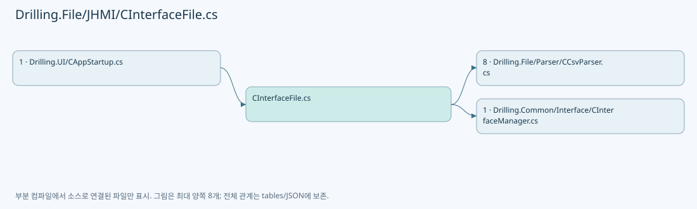

## 네임스페이스·타입·상속

| 타입 | 구분 | 원본 범위 | 선언/상속 |
| --- | --- | --- | --- |
| CInterfaceFile | ClassDeclaration | 12–476 | CInterfaceFile: CInterfaceFileBase |

## 멤버 빠른 목록

| 이름 | 종류 | 범위 | 서명 |
| --- | --- | --- | --- |
| _logManager | FieldDeclaration | L14–14 | CLogManager Drilling.File.JHMI.CInterfaceFile._logManager |
| FieldNames | FieldDeclaration | L15–15 | System.Collections.Generic.IReadOnlyList<string> Drilling.File.JHMI.CInterfaceFile.FieldNames |
| Headers | FieldDeclaration | L16–16 | System.Collections.Generic.IReadOnlyList<string> Drilling.File.JHMI.CInterfaceFile.Headers |
| RequiredHeaderGroups | FieldDeclaration | L17–30 | System.Collections.Generic.IReadOnlyList<System.Collections.Generic.IReadOnlyList<string>> Drilling.File.JHMI.CInterfaceFile.RequiredHeaderGroups |
| LoadAll | MethodDeclaration | L31–52 | System.Collections.Generic.IReadOnlyList<Drilling.Common.Interface.ST_INTERFACE_DATA> Drilling.File.JHMI.CInterfaceFile.LoadAll(System.Threading.CancellationToken) |
| SelectDevice | LocalFunctionStatement | L36–39 | Drilling.Common.Interface.EN_EQP_MODULE SelectDevice(Drilling.Common.Interface.ST_INTERFACE_DATA) |
| SelectNumber | LocalFunctionStatement | L41–44 | int SelectNumber(Drilling.Common.Interface.ST_INTERFACE_DATA) |
| SelectNickName | LocalFunctionStatement | L46–49 | string SelectNickName(Drilling.Common.Interface.ST_INTERFACE_DATA) |
| SaveAll | MethodDeclaration | L54–79 | void Drilling.File.JHMI.CInterfaceFile.SaveAll(System.Collections.Generic.IReadOnlyList<Drilling.Common.Interface.ST_INTERFACE_DATA>, System.Threading.CancellationToken) |
| SelectDevice | LocalFunctionStatement | L59–62 | Drilling.Common.Interface.EN_EQP_MODULE SelectDevice(Drilling.Common.Interface.ST_INTERFACE_DATA) |
| SelectNumber | LocalFunctionStatement | L64–67 | int SelectNumber(Drilling.Common.Interface.ST_INTERFACE_DATA) |
| SelectNickName | LocalFunctionStatement | L69–72 | string SelectNickName(Drilling.Common.Interface.ST_INTERFACE_DATA) |
| LoadInterfaceRows | MethodDeclaration | L81–90 | System.Collections.Generic.IReadOnlyList<Drilling.Common.Interface.ST_INTERFACE_DATA> Drilling.File.JHMI.CInterfaceFile.LoadInterfaceRows() |
| SelectItem | LocalFunctionStatement | L84–87 | Drilling.Common.Interface.ST_INTERFACE_DATA SelectItem(System.Collections.Generic.IReadOnlyDictionary<string, string>, int) |
| Parse | MethodDeclaration | L92–105 | Drilling.Common.Interface.ST_INTERFACE_DATA Drilling.File.JHMI.CInterfaceFile.Parse(System.Collections.Generic.IReadOnlyDictionary<string, string>, int) |
| GetInterfacePath | MethodDeclaration | L107–110 | string Drilling.File.JHMI.CInterfaceFile.GetInterfacePath() |
| ReadArguments | MethodDeclaration | L112–120 | System.Collections.Generic.IReadOnlyList<string> Drilling.File.JHMI.CInterfaceFile.ReadArguments(System.Collections.Generic.IReadOnlyDictionary<string, string>) |
| SelectItem | LocalFunctionStatement | L114–117 | string SelectItem(int) |
| ToRow | MethodDeclaration | L122–139 | System.Collections.Generic.IReadOnlyDictionary<string, string> Drilling.File.JHMI.CInterfaceFile.ToRow(Drilling.Common.Interface.ST_INTERFACE_DATA) |
| Validate | MethodDeclaration | L141–168 | void Drilling.File.JHMI.CInterfaceFile.Validate(System.Collections.Generic.IReadOnlyList<Drilling.Common.Interface.ST_INTERFACE_DATA>) |
| ValidateConnectionArguments | MethodDeclaration | L170–221 | void Drilling.File.JHMI.CInterfaceFile.ValidateConnectionArguments(Drilling.Common.Interface.ST_INTERFACE_DATA) |
| SelectItem | LocalFunctionStatement | L172–175 | string SelectItem(string) |
| ValidateSavedRows | MethodDeclaration | L223–238 | void Drilling.File.JHMI.CInterfaceFile.ValidateSavedRows(System.Collections.Generic.IReadOnlyList<Drilling.Common.Interface.ST_INTERFACE_DATA>) |
| WriteModifyLog | MethodDeclaration | L240–266 | void Drilling.File.JHMI.CInterfaceFile.WriteModifyLog(System.Collections.Generic.IReadOnlyDictionary<string, Drilling.Common.Interface.ST_INTERFACE_DATA>, System.Collections.Generic.IReadOnlyList<Drilling.Common.Interface.ST_INTERFACE_DATA>) |
| ShouldIncludeItem | LocalFunctionStatement | L257–260 | bool ShouldIncludeItem(Drilling.Common.Interface.ST_INTERFACE_DATA) |
| WriteFieldModifyLog | MethodDeclaration | L268–281 | void Drilling.File.JHMI.CInterfaceFile.WriteFieldModifyLog(string, System.Collections.Generic.IReadOnlyDictionary<string, string>, System.Collections.Generic.IReadOnlyDictionary<string, string>) |
| CreateEmptyFieldMap | MethodDeclaration | L283–296 | System.Collections.Generic.IReadOnlyDictionary<string, string> Drilling.File.JHMI.CInterfaceFile.CreateEmptyFieldMap() |
| SelectFieldName | LocalFunctionStatement | L285–288 | string SelectFieldName(string) |
| SelectValue | LocalFunctionStatement | L290–293 | string SelectValue(string) |
| CreateFieldMap | MethodDeclaration | L298–316 | System.Collections.Generic.IReadOnlyDictionary<string, string> Drilling.File.JHMI.CInterfaceFile.CreateFieldMap(Drilling.Common.Interface.ST_INTERFACE_DATA) |
| BuildComparisonText | MethodDeclaration | L318–332 | string Drilling.File.JHMI.CInterfaceFile.BuildComparisonText(Drilling.Common.Interface.ST_INTERFACE_DATA) |
| CreateInterfaceKey | MethodDeclaration | L334–337 | string Drilling.File.JHMI.CInterfaceFile.CreateInterfaceKey(Drilling.Common.Interface.ST_INTERFACE_DATA) |
| FormatInterfaceLabel | MethodDeclaration | L339–342 | string Drilling.File.JHMI.CInterfaceFile.FormatInterfaceLabel(Drilling.Common.Interface.ST_INTERFACE_DATA) |
| ParseInterfaceType | MethodDeclaration | L344–362 | Drilling.Common.Interface.EN_INTERFACE_TYPE Drilling.File.JHMI.CInterfaceFile.ParseInterfaceType(string) |
| InterfaceTypeText | MethodDeclaration | L364–383 | string Drilling.File.JHMI.CInterfaceFile.InterfaceTypeText(Drilling.Common.Interface.EN_INTERFACE_TYPE) |
| ParseDevice | MethodDeclaration | L385–400 | Drilling.Common.Interface.EN_EQP_MODULE Drilling.File.JHMI.CInterfaceFile.ParseDevice(string) |
| DeviceText | MethodDeclaration | L402–417 | string Drilling.File.JHMI.CInterfaceFile.DeviceText(Drilling.Common.Interface.EN_EQP_MODULE) |
| RequireText | MethodDeclaration | L419–422 | string Drilling.File.JHMI.CInterfaceFile.RequireText(System.Collections.Generic.IReadOnlyDictionary<string, string>, int, params string[]) |
| ReadRequiredBool | MethodDeclaration | L424–427 | bool Drilling.File.JHMI.CInterfaceFile.ReadRequiredBool(string, int, string) |
| ReadRequiredInt | MethodDeclaration | L429–432 | int Drilling.File.JHMI.CInterfaceFile.ReadRequiredInt(string, int, string) |
| RequireArgument | MethodDeclaration | L434–440 | void Drilling.File.JHMI.CInterfaceFile.RequireArgument(Drilling.Common.Interface.ST_INTERFACE_DATA, string, string) |
| RequirePositiveInt | MethodDeclaration | L442–448 | void Drilling.File.JHMI.CInterfaceFile.RequirePositiveInt(Drilling.Common.Interface.ST_INTERFACE_DATA, string, string) |
| ValidateParity | MethodDeclaration | L450–459 | void Drilling.File.JHMI.CInterfaceFile.ValidateParity(Drilling.Common.Interface.ST_INTERFACE_DATA, string) |
| ValidateStopBits | MethodDeclaration | L461–470 | void Drilling.File.JHMI.CInterfaceFile.ValidateStopBits(Drilling.Common.Interface.ST_INTERFACE_DATA, string) |
| Normalize | MethodDeclaration | L472–475 | string Drilling.File.JHMI.CInterfaceFile.Normalize(string) |

## 멤버별 상세 계약·호출·처리 해설

### FieldDeclaration `_logManager` · L14–14

[Drilling.File/JHMI/CInterfaceFile.cs:14–14](https://github.com/kjuws10-rgb/A3Drilling/blob/5aee8e58439c9b455cae7c9593c9be986c3e682e/Drilling.File/JHMI/CInterfaceFile.cs#L14-L14)

| 항목 | 실제 추출 값 |
| --- | --- |
| 서명 | CLogManager Drilling.File.JHMI.CInterfaceFile._logManager |
| 접근/수식자 | Private / private, readonly |
| 반환/값 타입 | CLogManager |
| 소속 타입 | NamedType:Drilling.File.JHMI.CInterfaceFile |

현재 부분 분석에서 직접 연결된 호출자는 없습니다. XAML/이벤트/인터페이스·델리게이트·외부 진입을 추가 확인해야 하며, 미사용으로 판정한 것이 아닙니다.

호출하는 대상과 해석 범위:

| 원본 행 | 표현식 | 분석 상태 | 대상/소스 위치 |
| --- | --- | --- | --- |
| 14 | new | unresolved | None |

본문의 실제 연산·분기·예외·반환 순서(원문 위치 순):

| 원본 행 | 종류 | 주석 해설 |
| --- | --- | --- |
| 14 | call | 함수·델리게이트 또는 객체 생성자를 호출합니다: new(configRoot) |
| 14 | variable-initializer | 변수의 초기값을 지정합니다: _logManager = new(configRoot) |

변경 전 점검: 입력/반환 타입, 위 호출자, 예외/취소 경로, 공유 상태와 저장·전송 소비자를 함께 확인합니다. 값의 단위나 물리 방향을 이름만으로 확정하지 않습니다.

### FieldDeclaration `FieldNames` · L15–15

[Drilling.File/JHMI/CInterfaceFile.cs:15–15](https://github.com/kjuws10-rgb/A3Drilling/blob/5aee8e58439c9b455cae7c9593c9be986c3e682e/Drilling.File/JHMI/CInterfaceFile.cs#L15-L15)

| 항목 | 실제 추출 값 |
| --- | --- |
| 서명 | System.Collections.Generic.IReadOnlyList<string> Drilling.File.JHMI.CInterfaceFile.FieldNames |
| 접근/수식자 | Private / private, static, readonly |
| 반환/값 타입 | System.Collections.Generic.IReadOnlyList<string> |
| 소속 타입 | NamedType:Drilling.File.JHMI.CInterfaceFile |

현재 부분 분석에서 직접 연결된 호출자는 없습니다. XAML/이벤트/인터페이스·델리게이트·외부 진입을 추가 확인해야 하며, 미사용으로 판정한 것이 아닙니다.

본문의 실제 연산·분기·예외·반환 순서(원문 위치 순):

| 원본 행 | 종류 | 주석 해설 |
| --- | --- | --- |
| 15 | variable-initializer | 변수의 초기값을 지정합니다: FieldNames = ["TYPE", "DEVICE", "NUMBER", "NICKNAME", "SYSTEM_SECTION", "AUTOCONNECTION", "SIMUL", "ARG1", "ARG2", "ARG3", "ARG4", "ARG5"] |

변경 전 점검: 입력/반환 타입, 위 호출자, 예외/취소 경로, 공유 상태와 저장·전송 소비자를 함께 확인합니다. 값의 단위나 물리 방향을 이름만으로 확정하지 않습니다.

### FieldDeclaration `Headers` · L16–16

[Drilling.File/JHMI/CInterfaceFile.cs:16–16](https://github.com/kjuws10-rgb/A3Drilling/blob/5aee8e58439c9b455cae7c9593c9be986c3e682e/Drilling.File/JHMI/CInterfaceFile.cs#L16-L16)

| 항목 | 실제 추출 값 |
| --- | --- |
| 서명 | System.Collections.Generic.IReadOnlyList<string> Drilling.File.JHMI.CInterfaceFile.Headers |
| 접근/수식자 | Private / private, static, readonly |
| 반환/값 타입 | System.Collections.Generic.IReadOnlyList<string> |
| 소속 타입 | NamedType:Drilling.File.JHMI.CInterfaceFile |

현재 부분 분석에서 직접 연결된 호출자는 없습니다. XAML/이벤트/인터페이스·델리게이트·외부 진입을 추가 확인해야 하며, 미사용으로 판정한 것이 아닙니다.

본문의 실제 연산·분기·예외·반환 순서(원문 위치 순):

| 원본 행 | 종류 | 주석 해설 |
| --- | --- | --- |
| 16 | variable-initializer | 변수의 초기값을 지정합니다: Headers = ["TYPE", "DEVICE", "NUMBER", "NICKNAME", "SYSTEM_SECTION", "AUTOCONNECTION", "SIMUL", "ARG1", "ARG2", "ARG3", "ARG4", "ARG5"] |

변경 전 점검: 입력/반환 타입, 위 호출자, 예외/취소 경로, 공유 상태와 저장·전송 소비자를 함께 확인합니다. 값의 단위나 물리 방향을 이름만으로 확정하지 않습니다.

### FieldDeclaration `RequiredHeaderGroups` · L17–30

[Drilling.File/JHMI/CInterfaceFile.cs:17–30](https://github.com/kjuws10-rgb/A3Drilling/blob/5aee8e58439c9b455cae7c9593c9be986c3e682e/Drilling.File/JHMI/CInterfaceFile.cs#L17-L30)

| 항목 | 실제 추출 값 |
| --- | --- |
| 서명 | System.Collections.Generic.IReadOnlyList<System.Collections.Generic.IReadOnlyList<string>> Drilling.File.JHMI.CInterfaceFile.RequiredHeaderGroups |
| 접근/수식자 | Private / private, static, readonly |
| 반환/값 타입 | System.Collections.Generic.IReadOnlyList<System.Collections.Generic.IReadOnlyList<string>> |
| 소속 타입 | NamedType:Drilling.File.JHMI.CInterfaceFile |

현재 부분 분석에서 직접 연결된 호출자는 없습니다. XAML/이벤트/인터페이스·델리게이트·외부 진입을 추가 확인해야 하며, 미사용으로 판정한 것이 아닙니다.

본문의 실제 연산·분기·예외·반환 순서(원문 위치 순):

| 원본 행 | 종류 | 주석 해설 |
| --- | --- | --- |
| 17 | variable-initializer | 변수의 초기값을 지정합니다: RequiredHeaderGroups = [ ["TYPE"], ["DEVICE"], ["NUMBER", "NO"], ["NICKNAME"], ["SYSTEM_SECTION", "SYSTEM SECTION", "SECTION"], ["AUTOCONNECTION", "AUTO_CONNECTION", "AUTO CONNECTION"], ["SIMUL", "SIMULATION", "SIM_MODE", "SIM MOD |

변경 전 점검: 입력/반환 타입, 위 호출자, 예외/취소 경로, 공유 상태와 저장·전송 소비자를 함께 확인합니다. 값의 단위나 물리 방향을 이름만으로 확정하지 않습니다.

### MethodDeclaration `LoadAll` · L31–52

[Drilling.File/JHMI/CInterfaceFile.cs:31–52](https://github.com/kjuws10-rgb/A3Drilling/blob/5aee8e58439c9b455cae7c9593c9be986c3e682e/Drilling.File/JHMI/CInterfaceFile.cs#L31-L52)

| 항목 | 실제 추출 값 |
| --- | --- |
| 서명 | System.Collections.Generic.IReadOnlyList<Drilling.Common.Interface.ST_INTERFACE_DATA> Drilling.File.JHMI.CInterfaceFile.LoadAll(System.Threading.CancellationToken) |
| 접근/수식자 | Public / public, override |
| 반환/값 타입 | System.Collections.Generic.IReadOnlyList<Drilling.Common.Interface.ST_INTERFACE_DATA> |
| 소속 타입 | NamedType:Drilling.File.JHMI.CInterfaceFile |

입력 계약:

| 이름 | 타입 | 전달 | 선택/기본값 |
| --- | --- | --- | --- |
| cancellationToken | System.Threading.CancellationToken | None | True / null |

현재 부분 분석에서 직접 연결된 호출자는 없습니다. XAML/이벤트/인터페이스·델리게이트·외부 진입을 추가 확인해야 하며, 미사용으로 판정한 것이 아닙니다.

호출하는 대상과 해석 범위:

| 원본 행 | 표현식 | 분석 상태 | 대상/소스 위치 |
| --- | --- | --- | --- |
| 33 | cancellationToken.ThrowIfCancellationRequested | resolved | void System.Threading.CancellationToken.ThrowIfCancellationRequested() |
| 34 | LoadInterfaceRows | resolved | System.Collections.Generic.IReadOnlyList<Drilling.Common.Interface.ST_INTERFACE_DATA> Drilling.File.JHMI.CInterfaceFile.LoadInterfaceRows() · Drilling.File/JHMI/CInterfaceFile.cs:81 |
| 35 | Validate | resolved | void Drilling.File.JHMI.CInterfaceFile.Validate(System.Collections.Generic.IReadOnlyList<Drilling.Common.Interface.ST_INTERFACE_DATA>) · Drilling.File/JHMI/CInterfaceFile.cs:141 |
| 51 | loadedRows.OrderBy(SelectDevice).ThenBy(SelectNumber).ThenBy(SelectNickName, StringComparer.OrdinalIgnoreCase).ToArray | resolved | Drilling.Common.Interface.ST_INTERFACE_DATA[] System.Collections.Generic.IEnumerable<Drilling.Common.Interface.ST_INTERFACE_DATA>.ToArray<Drilling.Common.Interface.ST_INTERFACE_DATA>() |
| 51 | loadedRows.OrderBy(SelectDevice).ThenBy(SelectNumber).ThenBy | resolved | System.Linq.IOrderedEnumerable<Drilling.Common.Interface.ST_INTERFACE_DATA> System.Linq.IOrderedEnumerable<Drilling.Common.Interface.ST_INTERFACE_DATA>.ThenBy<Drilling.Common.Interface.ST_INTERFACE_DATA, string>(System.Func<Drilling.Common.Interface.ST_INTERFACE_DATA, string>, System.Collections.Generic.IComparer<string>?) |
| 51 | loadedRows.OrderBy(SelectDevice).ThenBy | resolved | System.Linq.IOrderedEnumerable<Drilling.Common.Interface.ST_INTERFACE_DATA> System.Linq.IOrderedEnumerable<Drilling.Common.Interface.ST_INTERFACE_DATA>.ThenBy<Drilling.Common.Interface.ST_INTERFACE_DATA, int>(System.Func<Drilling.Common.Interface.ST_INTERFACE_DATA, int>) |
| 51 | loadedRows.OrderBy | resolved | System.Linq.IOrderedEnumerable<Drilling.Common.Interface.ST_INTERFACE_DATA> System.Collections.Generic.IEnumerable<Drilling.Common.Interface.ST_INTERFACE_DATA>.OrderBy<Drilling.Common.Interface.ST_INTERFACE_DATA, Drilling.Common.Interface.EN_EQP_MODULE>(System.Func<Drilling.Common.Interface.ST_INTERFACE_DATA, Drilling.Common.Interface.EN_EQP_MODULE>) |

본문의 실제 연산·분기·예외·반환 순서(원문 위치 순):

| 원본 행 | 종류 | 주석 해설 |
| --- | --- | --- |
| 33 | call | 함수·델리게이트 또는 객체 생성자를 호출합니다: cancellationToken.ThrowIfCancellationRequested() |
| 34 | call | 함수·델리게이트 또는 객체 생성자를 호출합니다: LoadInterfaceRows() |
| 34 | local-declaration | 지역 변수를 선언합니다: var loadedRows = LoadInterfaceRows(); |
| 34 | variable-initializer | 변수의 초기값을 지정합니다: loadedRows = LoadInterfaceRows() |
| 35 | call | 함수·델리게이트 또는 객체 생성자를 호출합니다: Validate(loadedRows) |
| 51 | call | 함수·델리게이트 또는 객체 생성자를 호출합니다: loadedRows.OrderBy(SelectDevice).ThenBy(SelectNumber).ThenBy(SelectNickName, StringComparer.OrdinalIgnoreCase).ToArray() |
| 51 | call | 함수·델리게이트 또는 객체 생성자를 호출합니다: loadedRows.OrderBy(SelectDevice).ThenBy(SelectNumber).ThenBy(SelectNickName, StringComparer.OrdinalIgnoreCase) |
| 51 | call | 함수·델리게이트 또는 객체 생성자를 호출합니다: loadedRows.OrderBy(SelectDevice).ThenBy(SelectNumber) |
| 51 | call | 함수·델리게이트 또는 객체 생성자를 호출합니다: loadedRows.OrderBy(SelectDevice) |
| 51 | return | 호출자에게 값 또는 제어를 반환합니다: return loadedRows.OrderBy(SelectDevice).ThenBy(SelectNumber).ThenBy(SelectNickName, StringComparer.OrdinalIgnoreCase).ToArray(); |

변경 전 점검: 입력/반환 타입, 위 호출자, 예외/취소 경로, 공유 상태와 저장·전송 소비자를 함께 확인합니다. 값의 단위나 물리 방향을 이름만으로 확정하지 않습니다.

### LocalFunctionStatement `SelectDevice` · L36–39

[Drilling.File/JHMI/CInterfaceFile.cs:36–39](https://github.com/kjuws10-rgb/A3Drilling/blob/5aee8e58439c9b455cae7c9593c9be986c3e682e/Drilling.File/JHMI/CInterfaceFile.cs#L36-L39)

| 항목 | 실제 추출 값 |
| --- | --- |
| 서명 | Drilling.Common.Interface.EN_EQP_MODULE SelectDevice(Drilling.Common.Interface.ST_INTERFACE_DATA) |
| 접근/수식자 | Private /  |
| 반환/값 타입 | Drilling.Common.Interface.EN_EQP_MODULE |
| 소속 타입 | NamedType:Drilling.File.JHMI.CInterfaceFile |

입력 계약:

| 이름 | 타입 | 전달 | 선택/기본값 |
| --- | --- | --- | --- |
| data | Drilling.Common.Interface.ST_INTERFACE_DATA | None | False /  |

현재 부분 분석에서 직접 연결된 호출자는 없습니다. XAML/이벤트/인터페이스·델리게이트·외부 진입을 추가 확인해야 하며, 미사용으로 판정한 것이 아닙니다.

본문의 실제 연산·분기·예외·반환 순서(원문 위치 순):

| 원본 행 | 종류 | 주석 해설 |
| --- | --- | --- |
| 38 | return | 호출자에게 값 또는 제어를 반환합니다: return data.Device; |

변경 전 점검: 입력/반환 타입, 위 호출자, 예외/취소 경로, 공유 상태와 저장·전송 소비자를 함께 확인합니다. 값의 단위나 물리 방향을 이름만으로 확정하지 않습니다.

### LocalFunctionStatement `SelectNumber` · L41–44

[Drilling.File/JHMI/CInterfaceFile.cs:41–44](https://github.com/kjuws10-rgb/A3Drilling/blob/5aee8e58439c9b455cae7c9593c9be986c3e682e/Drilling.File/JHMI/CInterfaceFile.cs#L41-L44)

| 항목 | 실제 추출 값 |
| --- | --- |
| 서명 | int SelectNumber(Drilling.Common.Interface.ST_INTERFACE_DATA) |
| 접근/수식자 | Private /  |
| 반환/값 타입 | int |
| 소속 타입 | NamedType:Drilling.File.JHMI.CInterfaceFile |

입력 계약:

| 이름 | 타입 | 전달 | 선택/기본값 |
| --- | --- | --- | --- |
| data | Drilling.Common.Interface.ST_INTERFACE_DATA | None | False /  |

현재 부분 분석에서 직접 연결된 호출자는 없습니다. XAML/이벤트/인터페이스·델리게이트·외부 진입을 추가 확인해야 하며, 미사용으로 판정한 것이 아닙니다.

본문의 실제 연산·분기·예외·반환 순서(원문 위치 순):

| 원본 행 | 종류 | 주석 해설 |
| --- | --- | --- |
| 43 | return | 호출자에게 값 또는 제어를 반환합니다: return data.Number; |

변경 전 점검: 입력/반환 타입, 위 호출자, 예외/취소 경로, 공유 상태와 저장·전송 소비자를 함께 확인합니다. 값의 단위나 물리 방향을 이름만으로 확정하지 않습니다.

### LocalFunctionStatement `SelectNickName` · L46–49

[Drilling.File/JHMI/CInterfaceFile.cs:46–49](https://github.com/kjuws10-rgb/A3Drilling/blob/5aee8e58439c9b455cae7c9593c9be986c3e682e/Drilling.File/JHMI/CInterfaceFile.cs#L46-L49)

| 항목 | 실제 추출 값 |
| --- | --- |
| 서명 | string SelectNickName(Drilling.Common.Interface.ST_INTERFACE_DATA) |
| 접근/수식자 | Private /  |
| 반환/값 타입 | string |
| 소속 타입 | NamedType:Drilling.File.JHMI.CInterfaceFile |

입력 계약:

| 이름 | 타입 | 전달 | 선택/기본값 |
| --- | --- | --- | --- |
| data | Drilling.Common.Interface.ST_INTERFACE_DATA | None | False /  |

현재 부분 분석에서 직접 연결된 호출자는 없습니다. XAML/이벤트/인터페이스·델리게이트·외부 진입을 추가 확인해야 하며, 미사용으로 판정한 것이 아닙니다.

본문의 실제 연산·분기·예외·반환 순서(원문 위치 순):

| 원본 행 | 종류 | 주석 해설 |
| --- | --- | --- |
| 48 | return | 호출자에게 값 또는 제어를 반환합니다: return data.NickName; |

변경 전 점검: 입력/반환 타입, 위 호출자, 예외/취소 경로, 공유 상태와 저장·전송 소비자를 함께 확인합니다. 값의 단위나 물리 방향을 이름만으로 확정하지 않습니다.

### MethodDeclaration `SaveAll` · L54–79

[Drilling.File/JHMI/CInterfaceFile.cs:54–79](https://github.com/kjuws10-rgb/A3Drilling/blob/5aee8e58439c9b455cae7c9593c9be986c3e682e/Drilling.File/JHMI/CInterfaceFile.cs#L54-L79)

| 항목 | 실제 추출 값 |
| --- | --- |
| 서명 | void Drilling.File.JHMI.CInterfaceFile.SaveAll(System.Collections.Generic.IReadOnlyList<Drilling.Common.Interface.ST_INTERFACE_DATA>, System.Threading.CancellationToken) |
| 접근/수식자 | Public / public, override |
| 반환/값 타입 | void |
| 소속 타입 | NamedType:Drilling.File.JHMI.CInterfaceFile |

입력 계약:

| 이름 | 타입 | 전달 | 선택/기본값 |
| --- | --- | --- | --- |
| interfaces | System.Collections.Generic.IReadOnlyList<Drilling.Common.Interface.ST_INTERFACE_DATA> | None | False /  |
| cancellationToken | System.Threading.CancellationToken | None | True / null |

현재 부분 분석에서 직접 연결된 호출자는 없습니다. XAML/이벤트/인터페이스·델리게이트·외부 진입을 추가 확인해야 하며, 미사용으로 판정한 것이 아닙니다.

호출하는 대상과 해석 범위:

| 원본 행 | 표현식 | 분석 상태 | 대상/소스 위치 |
| --- | --- | --- | --- |
| 56 | cancellationToken.ThrowIfCancellationRequested | resolved | void System.Threading.CancellationToken.ThrowIfCancellationRequested() |
| 57 | Validate | resolved | void Drilling.File.JHMI.CInterfaceFile.Validate(System.Collections.Generic.IReadOnlyList<Drilling.Common.Interface.ST_INTERFACE_DATA>) · Drilling.File/JHMI/CInterfaceFile.cs:141 |
| 58 | LoadInterfaceRows().ToDictionary | resolved | System.Collections.Generic.Dictionary<string, Drilling.Common.Interface.ST_INTERFACE_DATA> System.Collections.Generic.IEnumerable<Drilling.Common.Interface.ST_INTERFACE_DATA>.ToDictionary<Drilling.Common.Interface.ST_INTERFACE_DATA, string>(System.Func<Drilling.Common.Interface.ST_INTERFACE_DATA, string>, System.Collections.Generic.IEqualityComparer<string>?) |
| 58 | LoadInterfaceRows | resolved | System.Collections.Generic.IReadOnlyList<Drilling.Common.Interface.ST_INTERFACE_DATA> Drilling.File.JHMI.CInterfaceFile.LoadInterfaceRows() · Drilling.File/JHMI/CInterfaceFile.cs:81 |
| 74 | interfaces.OrderBy(SelectDevice).ThenBy(SelectNumber).ThenBy(SelectNickName, StringComparer.OrdinalIgnoreCase).Select(ToRow).ToArray | resolved | System.Collections.Generic.IReadOnlyDictionary<string, string>[] System.Collections.Generic.IEnumerable<System.Collections.Generic.IReadOnlyDictionary<string, string>>.ToArray<System.Collections.Generic.IReadOnlyDictionary<string, string>>() |
| 74 | interfaces.OrderBy(SelectDevice).ThenBy(SelectNumber).ThenBy(SelectNickName, StringComparer.OrdinalIgnoreCase).Select | resolved | System.Collections.Generic.IEnumerable<System.Collections.Generic.IReadOnlyDictionary<string, string>> System.Collections.Generic.IEnumerable<Drilling.Common.Interface.ST_INTERFACE_DATA>.Select<Drilling.Common.Interface.ST_INTERFACE_DATA, System.Collections.Generic.IReadOnlyDictionary<string, string>>(System.Func<Drilling.Common.Interface.ST_INTERFACE_DATA, System.Collections.Generic.IReadOnlyDictionary<string, string>>) |
| 74 | interfaces.OrderBy(SelectDevice).ThenBy(SelectNumber).ThenBy | resolved | System.Linq.IOrderedEnumerable<Drilling.Common.Interface.ST_INTERFACE_DATA> System.Linq.IOrderedEnumerable<Drilling.Common.Interface.ST_INTERFACE_DATA>.ThenBy<Drilling.Common.Interface.ST_INTERFACE_DATA, string>(System.Func<Drilling.Common.Interface.ST_INTERFACE_DATA, string>, System.Collections.Generic.IComparer<string>?) |
| 74 | interfaces.OrderBy(SelectDevice).ThenBy | resolved | System.Linq.IOrderedEnumerable<Drilling.Common.Interface.ST_INTERFACE_DATA> System.Linq.IOrderedEnumerable<Drilling.Common.Interface.ST_INTERFACE_DATA>.ThenBy<Drilling.Common.Interface.ST_INTERFACE_DATA, int>(System.Func<Drilling.Common.Interface.ST_INTERFACE_DATA, int>) |
| 74 | interfaces.OrderBy | resolved | System.Linq.IOrderedEnumerable<Drilling.Common.Interface.ST_INTERFACE_DATA> System.Collections.Generic.IEnumerable<Drilling.Common.Interface.ST_INTERFACE_DATA>.OrderBy<Drilling.Common.Interface.ST_INTERFACE_DATA, Drilling.Common.Interface.EN_EQP_MODULE>(System.Func<Drilling.Common.Interface.ST_INTERFACE_DATA, Drilling.Common.Interface.EN_EQP_MODULE>) |
| 75 | CCsvParser.Write | resolved | void Drilling.File.Parser.CCsvParser.Write(string, System.Collections.Generic.IReadOnlyList<string>, System.Collections.Generic.IEnumerable<System.Collections.Generic.IReadOnlyDictionary<string, string>>) · Drilling.File/Parser/CCsvParser.cs:58 |
| 75 | GetInterfacePath | resolved | string Drilling.File.JHMI.CInterfaceFile.GetInterfacePath() · Drilling.File/JHMI/CInterfaceFile.cs:107 |
| 76 | ValidateSavedRows | resolved | void Drilling.File.JHMI.CInterfaceFile.ValidateSavedRows(System.Collections.Generic.IReadOnlyList<Drilling.Common.Interface.ST_INTERFACE_DATA>) · Drilling.File/JHMI/CInterfaceFile.cs:223 |
| 77 | WriteModifyLog | resolved | void Drilling.File.JHMI.CInterfaceFile.WriteModifyLog(System.Collections.Generic.IReadOnlyDictionary<string, Drilling.Common.Interface.ST_INTERFACE_DATA>, System.Collections.Generic.IReadOnlyList<Drilling.Common.Interface.ST_INTERFACE_DATA>) · Drilling.File/JHMI/CInterfaceFile.cs:240 |
| 78 | _logManager.WriteSettingSave | unresolved | None |

본문의 실제 연산·분기·예외·반환 순서(원문 위치 순):

| 원본 행 | 종류 | 주석 해설 |
| --- | --- | --- |
| 56 | call | 함수·델리게이트 또는 객체 생성자를 호출합니다: cancellationToken.ThrowIfCancellationRequested() |
| 57 | call | 함수·델리게이트 또는 객체 생성자를 호출합니다: Validate(interfaces) |
| 58 | call | 함수·델리게이트 또는 객체 생성자를 호출합니다: LoadInterfaceRows().ToDictionary(CreateInterfaceKey, StringComparer.OrdinalIgnoreCase) |
| 58 | call | 함수·델리게이트 또는 객체 생성자를 호출합니다: LoadInterfaceRows() |
| 58 | local-declaration | 지역 변수를 선언합니다: var oldRows = LoadInterfaceRows().ToDictionary(CreateInterfaceKey, StringComparer.OrdinalIgnoreCase); |
| 58 | variable-initializer | 변수의 초기값을 지정합니다: oldRows = LoadInterfaceRows().ToDictionary(CreateInterfaceKey, StringComparer.OrdinalIgnoreCase) |
| 74 | call | 함수·델리게이트 또는 객체 생성자를 호출합니다: interfaces.OrderBy(SelectDevice).ThenBy(SelectNumber).ThenBy(SelectNickName, StringComparer.OrdinalIgnoreCase).Select(ToRow).ToArray() |
| 74 | call | 함수·델리게이트 또는 객체 생성자를 호출합니다: interfaces.OrderBy(SelectDevice).ThenBy(SelectNumber).ThenBy(SelectNickName, StringComparer.OrdinalIgnoreCase).Select(ToRow) |
| 74 | call | 함수·델리게이트 또는 객체 생성자를 호출합니다: interfaces.OrderBy(SelectDevice).ThenBy(SelectNumber).ThenBy(SelectNickName, StringComparer.OrdinalIgnoreCase) |
| 74 | call | 함수·델리게이트 또는 객체 생성자를 호출합니다: interfaces.OrderBy(SelectDevice).ThenBy(SelectNumber) |
| 74 | call | 함수·델리게이트 또는 객체 생성자를 호출합니다: interfaces.OrderBy(SelectDevice) |
| 74 | local-declaration | 지역 변수를 선언합니다: var rows = interfaces.OrderBy(SelectDevice).ThenBy(SelectNumber).ThenBy(SelectNickName, StringComparer.OrdinalIgnoreCase).Select(ToRow).ToArray(); |
| 74 | variable-initializer | 변수의 초기값을 지정합니다: rows = interfaces.OrderBy(SelectDevice).ThenBy(SelectNumber).ThenBy(SelectNickName, StringComparer.OrdinalIgnoreCase).Select(ToRow).ToArray() |
| 75 | call | 함수·델리게이트 또는 객체 생성자를 호출합니다: CCsvParser.Write(GetInterfacePath(), Headers, rows) |
| 75 | call | 함수·델리게이트 또는 객체 생성자를 호출합니다: GetInterfacePath() |
| 76 | call | 함수·델리게이트 또는 객체 생성자를 호출합니다: ValidateSavedRows(interfaces) |
| 77 | call | 함수·델리게이트 또는 객체 생성자를 호출합니다: WriteModifyLog(oldRows, interfaces) |
| 78 | call | 함수·델리게이트 또는 객체 생성자를 호출합니다: _logManager.WriteSettingSave(EN_SETTING_TAB.Interface) |

변경 전 점검: 입력/반환 타입, 위 호출자, 예외/취소 경로, 공유 상태와 저장·전송 소비자를 함께 확인합니다. 값의 단위나 물리 방향을 이름만으로 확정하지 않습니다.

### LocalFunctionStatement `SelectDevice` · L59–62

[Drilling.File/JHMI/CInterfaceFile.cs:59–62](https://github.com/kjuws10-rgb/A3Drilling/blob/5aee8e58439c9b455cae7c9593c9be986c3e682e/Drilling.File/JHMI/CInterfaceFile.cs#L59-L62)

| 항목 | 실제 추출 값 |
| --- | --- |
| 서명 | Drilling.Common.Interface.EN_EQP_MODULE SelectDevice(Drilling.Common.Interface.ST_INTERFACE_DATA) |
| 접근/수식자 | Private /  |
| 반환/값 타입 | Drilling.Common.Interface.EN_EQP_MODULE |
| 소속 타입 | NamedType:Drilling.File.JHMI.CInterfaceFile |

입력 계약:

| 이름 | 타입 | 전달 | 선택/기본값 |
| --- | --- | --- | --- |
| data | Drilling.Common.Interface.ST_INTERFACE_DATA | None | False /  |

현재 부분 분석에서 직접 연결된 호출자는 없습니다. XAML/이벤트/인터페이스·델리게이트·외부 진입을 추가 확인해야 하며, 미사용으로 판정한 것이 아닙니다.

본문의 실제 연산·분기·예외·반환 순서(원문 위치 순):

| 원본 행 | 종류 | 주석 해설 |
| --- | --- | --- |
| 61 | return | 호출자에게 값 또는 제어를 반환합니다: return data.Device; |

변경 전 점검: 입력/반환 타입, 위 호출자, 예외/취소 경로, 공유 상태와 저장·전송 소비자를 함께 확인합니다. 값의 단위나 물리 방향을 이름만으로 확정하지 않습니다.

### LocalFunctionStatement `SelectNumber` · L64–67

[Drilling.File/JHMI/CInterfaceFile.cs:64–67](https://github.com/kjuws10-rgb/A3Drilling/blob/5aee8e58439c9b455cae7c9593c9be986c3e682e/Drilling.File/JHMI/CInterfaceFile.cs#L64-L67)

| 항목 | 실제 추출 값 |
| --- | --- |
| 서명 | int SelectNumber(Drilling.Common.Interface.ST_INTERFACE_DATA) |
| 접근/수식자 | Private /  |
| 반환/값 타입 | int |
| 소속 타입 | NamedType:Drilling.File.JHMI.CInterfaceFile |

입력 계약:

| 이름 | 타입 | 전달 | 선택/기본값 |
| --- | --- | --- | --- |
| data | Drilling.Common.Interface.ST_INTERFACE_DATA | None | False /  |

현재 부분 분석에서 직접 연결된 호출자는 없습니다. XAML/이벤트/인터페이스·델리게이트·외부 진입을 추가 확인해야 하며, 미사용으로 판정한 것이 아닙니다.

본문의 실제 연산·분기·예외·반환 순서(원문 위치 순):

| 원본 행 | 종류 | 주석 해설 |
| --- | --- | --- |
| 66 | return | 호출자에게 값 또는 제어를 반환합니다: return data.Number; |

변경 전 점검: 입력/반환 타입, 위 호출자, 예외/취소 경로, 공유 상태와 저장·전송 소비자를 함께 확인합니다. 값의 단위나 물리 방향을 이름만으로 확정하지 않습니다.

### LocalFunctionStatement `SelectNickName` · L69–72

[Drilling.File/JHMI/CInterfaceFile.cs:69–72](https://github.com/kjuws10-rgb/A3Drilling/blob/5aee8e58439c9b455cae7c9593c9be986c3e682e/Drilling.File/JHMI/CInterfaceFile.cs#L69-L72)

| 항목 | 실제 추출 값 |
| --- | --- |
| 서명 | string SelectNickName(Drilling.Common.Interface.ST_INTERFACE_DATA) |
| 접근/수식자 | Private /  |
| 반환/값 타입 | string |
| 소속 타입 | NamedType:Drilling.File.JHMI.CInterfaceFile |

입력 계약:

| 이름 | 타입 | 전달 | 선택/기본값 |
| --- | --- | --- | --- |
| data | Drilling.Common.Interface.ST_INTERFACE_DATA | None | False /  |

현재 부분 분석에서 직접 연결된 호출자는 없습니다. XAML/이벤트/인터페이스·델리게이트·외부 진입을 추가 확인해야 하며, 미사용으로 판정한 것이 아닙니다.

본문의 실제 연산·분기·예외·반환 순서(원문 위치 순):

| 원본 행 | 종류 | 주석 해설 |
| --- | --- | --- |
| 71 | return | 호출자에게 값 또는 제어를 반환합니다: return data.NickName; |

변경 전 점검: 입력/반환 타입, 위 호출자, 예외/취소 경로, 공유 상태와 저장·전송 소비자를 함께 확인합니다. 값의 단위나 물리 방향을 이름만으로 확정하지 않습니다.

### MethodDeclaration `LoadInterfaceRows` · L81–90

[Drilling.File/JHMI/CInterfaceFile.cs:81–90](https://github.com/kjuws10-rgb/A3Drilling/blob/5aee8e58439c9b455cae7c9593c9be986c3e682e/Drilling.File/JHMI/CInterfaceFile.cs#L81-L90)

| 항목 | 실제 추출 값 |
| --- | --- |
| 서명 | System.Collections.Generic.IReadOnlyList<Drilling.Common.Interface.ST_INTERFACE_DATA> Drilling.File.JHMI.CInterfaceFile.LoadInterfaceRows() |
| 접근/수식자 | Private / private |
| 반환/값 타입 | System.Collections.Generic.IReadOnlyList<Drilling.Common.Interface.ST_INTERFACE_DATA> |
| 소속 타입 | NamedType:Drilling.File.JHMI.CInterfaceFile |

정적 호출자로 확인된 위치:

| 호출 파일/행 | 호출 표현식 | 런타임 분기 가능 |
| --- | --- | --- |
| [Drilling.File/JHMI/CInterfaceFile.cs:34–34](https://github.com/kjuws10-rgb/A3Drilling/blob/5aee8e58439c9b455cae7c9593c9be986c3e682e/Drilling.File/JHMI/CInterfaceFile.cs#L34-L34) | LoadInterfaceRows | False |
| [Drilling.File/JHMI/CInterfaceFile.cs:58–58](https://github.com/kjuws10-rgb/A3Drilling/blob/5aee8e58439c9b455cae7c9593c9be986c3e682e/Drilling.File/JHMI/CInterfaceFile.cs#L58-L58) | LoadInterfaceRows | False |
| [Drilling.File/JHMI/CInterfaceFile.cs:225–225](https://github.com/kjuws10-rgb/A3Drilling/blob/5aee8e58439c9b455cae7c9593c9be986c3e682e/Drilling.File/JHMI/CInterfaceFile.cs#L225-L225) | LoadInterfaceRows | False |

호출하는 대상과 해석 범위:

| 원본 행 | 표현식 | 분석 상태 | 대상/소스 위치 |
| --- | --- | --- | --- |
| 83 | CCsvParser.ValidateRequiredHeaders | resolved | void Drilling.File.Parser.CCsvParser.ValidateRequiredHeaders(string, string, System.Collections.Generic.IEnumerable<System.Collections.Generic.IEnumerable<string>>) · Drilling.File/Parser/CCsvParser.cs:280 |
| 83 | GetInterfacePath | resolved | string Drilling.File.JHMI.CInterfaceFile.GetInterfacePath() · Drilling.File/JHMI/CInterfaceFile.cs:107 |
| 89 | CCsvParser.Read(GetInterfacePath()).Select(SelectItem).ToArray | resolved | Drilling.Common.Interface.ST_INTERFACE_DATA[] System.Collections.Generic.IEnumerable<Drilling.Common.Interface.ST_INTERFACE_DATA>.ToArray<Drilling.Common.Interface.ST_INTERFACE_DATA>() |
| 89 | CCsvParser.Read(GetInterfacePath()).Select | resolved | System.Collections.Generic.IEnumerable<Drilling.Common.Interface.ST_INTERFACE_DATA> System.Collections.Generic.IEnumerable<System.Collections.Generic.IReadOnlyDictionary<string, string>>.Select<System.Collections.Generic.IReadOnlyDictionary<string, string>, Drilling.Common.Interface.ST_INTERFACE_DATA>(System.Func<System.Collections.Generic.IReadOnlyDictionary<string, string>, int, Drilling.Common.Interface.ST_INTERFACE_DATA>) |
| 89 | CCsvParser.Read | resolved | System.Collections.Generic.IReadOnlyList<System.Collections.Generic.IReadOnlyDictionary<string, string>> Drilling.File.Parser.CCsvParser.Read(string) · Drilling.File/Parser/CCsvParser.cs:12 |
| 89 | GetInterfacePath | resolved | string Drilling.File.JHMI.CInterfaceFile.GetInterfacePath() · Drilling.File/JHMI/CInterfaceFile.cs:107 |

본문의 실제 연산·분기·예외·반환 순서(원문 위치 순):

| 원본 행 | 종류 | 주석 해설 |
| --- | --- | --- |
| 83 | call | 함수·델리게이트 또는 객체 생성자를 호출합니다: CCsvParser.ValidateRequiredHeaders(GetInterfacePath(), "JHMI_INTERFACE", RequiredHeaderGroups) |
| 83 | call | 함수·델리게이트 또는 객체 생성자를 호출합니다: GetInterfacePath() |
| 89 | call | 함수·델리게이트 또는 객체 생성자를 호출합니다: CCsvParser.Read(GetInterfacePath()).Select(SelectItem).ToArray() |
| 89 | call | 함수·델리게이트 또는 객체 생성자를 호출합니다: CCsvParser.Read(GetInterfacePath()).Select(SelectItem) |
| 89 | call | 함수·델리게이트 또는 객체 생성자를 호출합니다: CCsvParser.Read(GetInterfacePath()) |
| 89 | call | 함수·델리게이트 또는 객체 생성자를 호출합니다: GetInterfacePath() |
| 89 | return | 호출자에게 값 또는 제어를 반환합니다: return CCsvParser.Read(GetInterfacePath()).Select(SelectItem).ToArray(); |

변경 전 점검: 입력/반환 타입, 위 호출자, 예외/취소 경로, 공유 상태와 저장·전송 소비자를 함께 확인합니다. 값의 단위나 물리 방향을 이름만으로 확정하지 않습니다.

### LocalFunctionStatement `SelectItem` · L84–87

[Drilling.File/JHMI/CInterfaceFile.cs:84–87](https://github.com/kjuws10-rgb/A3Drilling/blob/5aee8e58439c9b455cae7c9593c9be986c3e682e/Drilling.File/JHMI/CInterfaceFile.cs#L84-L87)

| 항목 | 실제 추출 값 |
| --- | --- |
| 서명 | Drilling.Common.Interface.ST_INTERFACE_DATA SelectItem(System.Collections.Generic.IReadOnlyDictionary<string, string>, int) |
| 접근/수식자 | Private /  |
| 반환/값 타입 | Drilling.Common.Interface.ST_INTERFACE_DATA |
| 소속 타입 | NamedType:Drilling.File.JHMI.CInterfaceFile |

입력 계약:

| 이름 | 타입 | 전달 | 선택/기본값 |
| --- | --- | --- | --- |
| row | System.Collections.Generic.IReadOnlyDictionary<string, string> | None | False /  |
| index | int | None | False /  |

현재 부분 분석에서 직접 연결된 호출자는 없습니다. XAML/이벤트/인터페이스·델리게이트·외부 진입을 추가 확인해야 하며, 미사용으로 판정한 것이 아닙니다.

호출하는 대상과 해석 범위:

| 원본 행 | 표현식 | 분석 상태 | 대상/소스 위치 |
| --- | --- | --- | --- |
| 86 | Parse | resolved | Drilling.Common.Interface.ST_INTERFACE_DATA Drilling.File.JHMI.CInterfaceFile.Parse(System.Collections.Generic.IReadOnlyDictionary<string, string>, int) · Drilling.File/JHMI/CInterfaceFile.cs:92 |

본문의 실제 연산·분기·예외·반환 순서(원문 위치 순):

| 원본 행 | 종류 | 주석 해설 |
| --- | --- | --- |
| 86 | call | 함수·델리게이트 또는 객체 생성자를 호출합니다: Parse(row, index + 2) |
| 86 | return | 호출자에게 값 또는 제어를 반환합니다: return Parse(row, index + 2); |

변경 전 점검: 입력/반환 타입, 위 호출자, 예외/취소 경로, 공유 상태와 저장·전송 소비자를 함께 확인합니다. 값의 단위나 물리 방향을 이름만으로 확정하지 않습니다.

### MethodDeclaration `Parse` · L92–105

[Drilling.File/JHMI/CInterfaceFile.cs:92–105](https://github.com/kjuws10-rgb/A3Drilling/blob/5aee8e58439c9b455cae7c9593c9be986c3e682e/Drilling.File/JHMI/CInterfaceFile.cs#L92-L105)

| 항목 | 실제 추출 값 |
| --- | --- |
| 서명 | Drilling.Common.Interface.ST_INTERFACE_DATA Drilling.File.JHMI.CInterfaceFile.Parse(System.Collections.Generic.IReadOnlyDictionary<string, string>, int) |
| 접근/수식자 | Private / private |
| 반환/값 타입 | Drilling.Common.Interface.ST_INTERFACE_DATA |
| 소속 타입 | NamedType:Drilling.File.JHMI.CInterfaceFile |

입력 계약:

| 이름 | 타입 | 전달 | 선택/기본값 |
| --- | --- | --- | --- |
| row | System.Collections.Generic.IReadOnlyDictionary<string, string> | None | False /  |
| rowNo | int | None | False /  |

정적 호출자로 확인된 위치:

| 호출 파일/행 | 호출 표현식 | 런타임 분기 가능 |
| --- | --- | --- |
| [Drilling.File/JHMI/CInterfaceFile.cs:86–86](https://github.com/kjuws10-rgb/A3Drilling/blob/5aee8e58439c9b455cae7c9593c9be986c3e682e/Drilling.File/JHMI/CInterfaceFile.cs#L86-L86) | Parse | False |

호출하는 대상과 해석 범위:

| 원본 행 | 표현식 | 분석 상태 | 대상/소스 위치 |
| --- | --- | --- | --- |
| 94 | new ST_INTERFACE_DATA | resolved | Drilling.Common.Interface.ST_INTERFACE_DATA.ST_INTERFACE_DATA(Drilling.Common.Interface.EN_INTERFACE_TYPE, Drilling.Common.Interface.EN_EQP_MODULE, int, string, string, bool, bool, System.Collections.Generic.IReadOnlyList<string>, System.Collections.Generic.IReadOnlyDictionary<string, string>?) · Drilling.Common/Interface/CInterfaceManager.cs:2940 |
| 95 | ParseInterfaceType | resolved | Drilling.Common.Interface.EN_INTERFACE_TYPE Drilling.File.JHMI.CInterfaceFile.ParseInterfaceType(string) · Drilling.File/JHMI/CInterfaceFile.cs:344 |
| 95 | RequireText | resolved | string Drilling.File.JHMI.CInterfaceFile.RequireText(System.Collections.Generic.IReadOnlyDictionary<string, string>, int, params string[]) · Drilling.File/JHMI/CInterfaceFile.cs:419 |
| 96 | ParseDevice | resolved | Drilling.Common.Interface.EN_EQP_MODULE Drilling.File.JHMI.CInterfaceFile.ParseDevice(string) · Drilling.File/JHMI/CInterfaceFile.cs:385 |
| 96 | RequireText | resolved | string Drilling.File.JHMI.CInterfaceFile.RequireText(System.Collections.Generic.IReadOnlyDictionary<string, string>, int, params string[]) · Drilling.File/JHMI/CInterfaceFile.cs:419 |
| 97 | ReadRequiredInt | resolved | int Drilling.File.JHMI.CInterfaceFile.ReadRequiredInt(string, int, string) · Drilling.File/JHMI/CInterfaceFile.cs:429 |
| 97 | RequireText | resolved | string Drilling.File.JHMI.CInterfaceFile.RequireText(System.Collections.Generic.IReadOnlyDictionary<string, string>, int, params string[]) · Drilling.File/JHMI/CInterfaceFile.cs:419 |
| 98 | RequireText | resolved | string Drilling.File.JHMI.CInterfaceFile.RequireText(System.Collections.Generic.IReadOnlyDictionary<string, string>, int, params string[]) · Drilling.File/JHMI/CInterfaceFile.cs:419 |
| 99 | RequireText | resolved | string Drilling.File.JHMI.CInterfaceFile.RequireText(System.Collections.Generic.IReadOnlyDictionary<string, string>, int, params string[]) · Drilling.File/JHMI/CInterfaceFile.cs:419 |
| 100 | ReadRequiredBool | resolved | bool Drilling.File.JHMI.CInterfaceFile.ReadRequiredBool(string, int, string) · Drilling.File/JHMI/CInterfaceFile.cs:424 |
| 100 | RequireText | resolved | string Drilling.File.JHMI.CInterfaceFile.RequireText(System.Collections.Generic.IReadOnlyDictionary<string, string>, int, params string[]) · Drilling.File/JHMI/CInterfaceFile.cs:419 |
| 101 | ReadRequiredBool | resolved | bool Drilling.File.JHMI.CInterfaceFile.ReadRequiredBool(string, int, string) · Drilling.File/JHMI/CInterfaceFile.cs:424 |
| 101 | RequireText | resolved | string Drilling.File.JHMI.CInterfaceFile.RequireText(System.Collections.Generic.IReadOnlyDictionary<string, string>, int, params string[]) · Drilling.File/JHMI/CInterfaceFile.cs:419 |
| 102 | ReadArguments | resolved | System.Collections.Generic.IReadOnlyList<string> Drilling.File.JHMI.CInterfaceFile.ReadArguments(System.Collections.Generic.IReadOnlyDictionary<string, string>) · Drilling.File/JHMI/CInterfaceFile.cs:112 |
| 103 | CCsvParser.GetExtra | resolved | System.Collections.Generic.IReadOnlyDictionary<string, string> Drilling.File.Parser.CCsvParser.GetExtra(System.Collections.Generic.IReadOnlyDictionary<string, string>, System.Collections.Generic.IEnumerable<string>) · Drilling.File/Parser/CCsvParser.cs:331 |

본문의 실제 연산·분기·예외·반환 순서(원문 위치 순):

| 원본 행 | 종류 | 주석 해설 |
| --- | --- | --- |
| 94 | call | 함수·델리게이트 또는 객체 생성자를 호출합니다: new ST_INTERFACE_DATA( ParseInterfaceType(RequireText(row, rowNo, "TYPE", "InterfaceType")), ParseDevice(RequireText(row, rowNo, "DEVICE", "Device")), ReadRequiredInt(RequireText(row, rowNo, "NUMBER", "NO"), rowNo, "NUMB… |
| 94 | return | 호출자에게 값 또는 제어를 반환합니다: return new ST_INTERFACE_DATA( ParseInterfaceType(RequireText(row, rowNo, "TYPE", "InterfaceType")), ParseDevice(RequireText(row, rowNo, "DEVICE", "Device")), ReadRequiredInt(RequireText(row, rowNo, "NUMBER", "NO"), rowNo, "NUMBER" |
| 95 | call | 함수·델리게이트 또는 객체 생성자를 호출합니다: ParseInterfaceType(RequireText(row, rowNo, "TYPE", "InterfaceType")) |
| 95 | call | 함수·델리게이트 또는 객체 생성자를 호출합니다: RequireText(row, rowNo, "TYPE", "InterfaceType") |
| 96 | call | 함수·델리게이트 또는 객체 생성자를 호출합니다: ParseDevice(RequireText(row, rowNo, "DEVICE", "Device")) |
| 96 | call | 함수·델리게이트 또는 객체 생성자를 호출합니다: RequireText(row, rowNo, "DEVICE", "Device") |
| 97 | call | 함수·델리게이트 또는 객체 생성자를 호출합니다: ReadRequiredInt(RequireText(row, rowNo, "NUMBER", "NO"), rowNo, "NUMBER") |
| 97 | call | 함수·델리게이트 또는 객체 생성자를 호출합니다: RequireText(row, rowNo, "NUMBER", "NO") |
| 98 | call | 함수·델리게이트 또는 객체 생성자를 호출합니다: RequireText(row, rowNo, "NICKNAME", "NickName") |
| 99 | call | 함수·델리게이트 또는 객체 생성자를 호출합니다: RequireText(row, rowNo, "SYSTEM_SECTION", "SYSTEM SECTION", "SECTION") |
| 100 | call | 함수·델리게이트 또는 객체 생성자를 호출합니다: ReadRequiredBool(RequireText(row, rowNo, "AUTOCONNECTION", "AUTO_CONNECTION", "AUTO CONNECTION"), rowNo, "AUTOCONNECTION") |
| 100 | call | 함수·델리게이트 또는 객체 생성자를 호출합니다: RequireText(row, rowNo, "AUTOCONNECTION", "AUTO_CONNECTION", "AUTO CONNECTION") |
| 101 | call | 함수·델리게이트 또는 객체 생성자를 호출합니다: ReadRequiredBool(RequireText(row, rowNo, "SIMUL", "SIMULATION", "SIM_MODE", "SIM MODE"), rowNo, "SIMUL") |
| 101 | call | 함수·델리게이트 또는 객체 생성자를 호출합니다: RequireText(row, rowNo, "SIMUL", "SIMULATION", "SIM_MODE", "SIM MODE") |
| 102 | call | 함수·델리게이트 또는 객체 생성자를 호출합니다: ReadArguments(row) |
| 103 | call | 함수·델리게이트 또는 객체 생성자를 호출합니다: CCsvParser.GetExtra(row, Headers) |

변경 전 점검: 입력/반환 타입, 위 호출자, 예외/취소 경로, 공유 상태와 저장·전송 소비자를 함께 확인합니다. 값의 단위나 물리 방향을 이름만으로 확정하지 않습니다.

### MethodDeclaration `GetInterfacePath` · L107–110

[Drilling.File/JHMI/CInterfaceFile.cs:107–110](https://github.com/kjuws10-rgb/A3Drilling/blob/5aee8e58439c9b455cae7c9593c9be986c3e682e/Drilling.File/JHMI/CInterfaceFile.cs#L107-L110)

| 항목 | 실제 추출 값 |
| --- | --- |
| 서명 | string Drilling.File.JHMI.CInterfaceFile.GetInterfacePath() |
| 접근/수식자 | Private / private |
| 반환/값 타입 | string |
| 소속 타입 | NamedType:Drilling.File.JHMI.CInterfaceFile |

정적 호출자로 확인된 위치:

| 호출 파일/행 | 호출 표현식 | 런타임 분기 가능 |
| --- | --- | --- |
| [Drilling.File/JHMI/CInterfaceFile.cs:75–75](https://github.com/kjuws10-rgb/A3Drilling/blob/5aee8e58439c9b455cae7c9593c9be986c3e682e/Drilling.File/JHMI/CInterfaceFile.cs#L75-L75) | GetInterfacePath | False |
| [Drilling.File/JHMI/CInterfaceFile.cs:83–83](https://github.com/kjuws10-rgb/A3Drilling/blob/5aee8e58439c9b455cae7c9593c9be986c3e682e/Drilling.File/JHMI/CInterfaceFile.cs#L83-L83) | GetInterfacePath | False |
| [Drilling.File/JHMI/CInterfaceFile.cs:89–89](https://github.com/kjuws10-rgb/A3Drilling/blob/5aee8e58439c9b455cae7c9593c9be986c3e682e/Drilling.File/JHMI/CInterfaceFile.cs#L89-L89) | GetInterfacePath | False |

호출하는 대상과 해석 범위:

| 원본 행 | 표현식 | 분석 상태 | 대상/소스 위치 |
| --- | --- | --- | --- |
| 109 | Path.Combine | resolved | string System.IO.Path.Combine(string, string) |

본문의 실제 연산·분기·예외·반환 순서(원문 위치 순):

| 원본 행 | 종류 | 주석 해설 |
| --- | --- | --- |
| 109 | call | 함수·델리게이트 또는 객체 생성자를 호출합니다: Path.Combine(configRoot, "JHMI_INTERFACE.csv") |
| 109 | return | 호출자에게 값 또는 제어를 반환합니다: return Path.Combine(configRoot, "JHMI_INTERFACE.csv"); |

변경 전 점검: 입력/반환 타입, 위 호출자, 예외/취소 경로, 공유 상태와 저장·전송 소비자를 함께 확인합니다. 값의 단위나 물리 방향을 이름만으로 확정하지 않습니다.

### MethodDeclaration `ReadArguments` · L112–120

[Drilling.File/JHMI/CInterfaceFile.cs:112–120](https://github.com/kjuws10-rgb/A3Drilling/blob/5aee8e58439c9b455cae7c9593c9be986c3e682e/Drilling.File/JHMI/CInterfaceFile.cs#L112-L120)

| 항목 | 실제 추출 값 |
| --- | --- |
| 서명 | System.Collections.Generic.IReadOnlyList<string> Drilling.File.JHMI.CInterfaceFile.ReadArguments(System.Collections.Generic.IReadOnlyDictionary<string, string>) |
| 접근/수식자 | Private / private, static |
| 반환/값 타입 | System.Collections.Generic.IReadOnlyList<string> |
| 소속 타입 | NamedType:Drilling.File.JHMI.CInterfaceFile |

입력 계약:

| 이름 | 타입 | 전달 | 선택/기본값 |
| --- | --- | --- | --- |
| row | System.Collections.Generic.IReadOnlyDictionary<string, string> | None | False /  |

정적 호출자로 확인된 위치:

| 호출 파일/행 | 호출 표현식 | 런타임 분기 가능 |
| --- | --- | --- |
| [Drilling.File/JHMI/CInterfaceFile.cs:102–102](https://github.com/kjuws10-rgb/A3Drilling/blob/5aee8e58439c9b455cae7c9593c9be986c3e682e/Drilling.File/JHMI/CInterfaceFile.cs#L102-L102) | ReadArguments | False |

호출하는 대상과 해석 범위:

| 원본 행 | 표현식 | 분석 상태 | 대상/소스 위치 |
| --- | --- | --- | --- |
| 119 | Enumerable.Range(1, 5).Select(SelectItem).ToArray | resolved | string[] System.Collections.Generic.IEnumerable<string>.ToArray<string>() |
| 119 | Enumerable.Range(1, 5).Select | resolved | System.Collections.Generic.IEnumerable<string> System.Collections.Generic.IEnumerable<int>.Select<int, string>(System.Func<int, string>) |
| 119 | Enumerable.Range | resolved | System.Collections.Generic.IEnumerable<int> System.Linq.Enumerable.Range(int, int) |

본문의 실제 연산·분기·예외·반환 순서(원문 위치 순):

| 원본 행 | 종류 | 주석 해설 |
| --- | --- | --- |
| 119 | call | 함수·델리게이트 또는 객체 생성자를 호출합니다: Enumerable.Range(1, 5).Select(SelectItem).ToArray() |
| 119 | call | 함수·델리게이트 또는 객체 생성자를 호출합니다: Enumerable.Range(1, 5).Select(SelectItem) |
| 119 | call | 함수·델리게이트 또는 객체 생성자를 호출합니다: Enumerable.Range(1, 5) |
| 119 | return | 호출자에게 값 또는 제어를 반환합니다: return Enumerable.Range(1, 5).Select(SelectItem).ToArray(); |

변경 전 점검: 입력/반환 타입, 위 호출자, 예외/취소 경로, 공유 상태와 저장·전송 소비자를 함께 확인합니다. 값의 단위나 물리 방향을 이름만으로 확정하지 않습니다.

### LocalFunctionStatement `SelectItem` · L114–117

[Drilling.File/JHMI/CInterfaceFile.cs:114–117](https://github.com/kjuws10-rgb/A3Drilling/blob/5aee8e58439c9b455cae7c9593c9be986c3e682e/Drilling.File/JHMI/CInterfaceFile.cs#L114-L117)

| 항목 | 실제 추출 값 |
| --- | --- |
| 서명 | string SelectItem(int) |
| 접근/수식자 | Private /  |
| 반환/값 타입 | string |
| 소속 타입 | NamedType:Drilling.File.JHMI.CInterfaceFile |

입력 계약:

| 이름 | 타입 | 전달 | 선택/기본값 |
| --- | --- | --- | --- |
| index | int | None | False /  |

현재 부분 분석에서 직접 연결된 호출자는 없습니다. XAML/이벤트/인터페이스·델리게이트·외부 진입을 추가 확인해야 하며, 미사용으로 판정한 것이 아닙니다.

호출하는 대상과 해석 범위:

| 원본 행 | 표현식 | 분석 상태 | 대상/소스 위치 |
| --- | --- | --- | --- |
| 116 | CCsvParser.Get(row, $"ARG{index}").Trim | resolved | string string.Trim() |
| 116 | CCsvParser.Get | resolved | string Drilling.File.Parser.CCsvParser.Get(System.Collections.Generic.IReadOnlyDictionary<string, string>, string) · Drilling.File/Parser/CCsvParser.cs:168 |

본문의 실제 연산·분기·예외·반환 순서(원문 위치 순):

| 원본 행 | 종류 | 주석 해설 |
| --- | --- | --- |
| 116 | call | 함수·델리게이트 또는 객체 생성자를 호출합니다: CCsvParser.Get(row, $"ARG{index}").Trim() |
| 116 | call | 함수·델리게이트 또는 객체 생성자를 호출합니다: CCsvParser.Get(row, $"ARG{index}") |
| 116 | return | 호출자에게 값 또는 제어를 반환합니다: return CCsvParser.Get(row, $"ARG{index}").Trim(); |

변경 전 점검: 입력/반환 타입, 위 호출자, 예외/취소 경로, 공유 상태와 저장·전송 소비자를 함께 확인합니다. 값의 단위나 물리 방향을 이름만으로 확정하지 않습니다.

### MethodDeclaration `ToRow` · L122–139

[Drilling.File/JHMI/CInterfaceFile.cs:122–139](https://github.com/kjuws10-rgb/A3Drilling/blob/5aee8e58439c9b455cae7c9593c9be986c3e682e/Drilling.File/JHMI/CInterfaceFile.cs#L122-L139)

| 항목 | 실제 추출 값 |
| --- | --- |
| 서명 | System.Collections.Generic.IReadOnlyDictionary<string, string> Drilling.File.JHMI.CInterfaceFile.ToRow(Drilling.Common.Interface.ST_INTERFACE_DATA) |
| 접근/수식자 | Private / private, static |
| 반환/값 타입 | System.Collections.Generic.IReadOnlyDictionary<string, string> |
| 소속 타입 | NamedType:Drilling.File.JHMI.CInterfaceFile |

입력 계약:

| 이름 | 타입 | 전달 | 선택/기본값 |
| --- | --- | --- | --- |
| data | Drilling.Common.Interface.ST_INTERFACE_DATA | None | False /  |

현재 부분 분석에서 직접 연결된 호출자는 없습니다. XAML/이벤트/인터페이스·델리게이트·외부 진입을 추가 확인해야 하며, 미사용으로 판정한 것이 아닙니다.

호출하는 대상과 해석 범위:

| 원본 행 | 표현식 | 분석 상태 | 대상/소스 위치 |
| --- | --- | --- | --- |
| 124 | data.Arguments.Concat(Enumerable.Repeat("", 5)).Take(5).ToArray | resolved | string[] System.Collections.Generic.IEnumerable<string>.ToArray<string>() |
| 124 | data.Arguments.Concat(Enumerable.Repeat("", 5)).Take | resolved | System.Collections.Generic.IEnumerable<string> System.Collections.Generic.IEnumerable<string>.Take<string>(int) |
| 124 | data.Arguments.Concat | resolved | System.Collections.Generic.IEnumerable<string> System.Collections.Generic.IEnumerable<string>.Concat<string>(System.Collections.Generic.IEnumerable<string>) |
| 124 | Enumerable.Repeat | resolved | System.Collections.Generic.IEnumerable<string> System.Linq.Enumerable.Repeat<string>(string, int) |
| 125 | new Dictionary<string, string> | resolved | System.Collections.Generic.Dictionary<string, string>.Dictionary(System.Collections.Generic.IEqualityComparer<string>?) |
| 125 | new Dictionary<string, string> | resolved | System.Collections.Generic.Dictionary<string, string>.Dictionary(System.Collections.Generic.IEnumerable<System.Collections.Generic.KeyValuePair<string, string>>, System.Collections.Generic.IEqualityComparer<string>?) |
| 126 | InterfaceTypeText | resolved | string Drilling.File.JHMI.CInterfaceFile.InterfaceTypeText(Drilling.Common.Interface.EN_INTERFACE_TYPE) · Drilling.File/JHMI/CInterfaceFile.cs:364 |
| 127 | DeviceText | resolved | string Drilling.File.JHMI.CInterfaceFile.DeviceText(Drilling.Common.Interface.EN_EQP_MODULE) · Drilling.File/JHMI/CInterfaceFile.cs:402 |
| 128 | data.Number.ToString | resolved | string int.ToString(System.IFormatProvider?) |

본문의 실제 연산·분기·예외·반환 순서(원문 위치 순):

| 원본 행 | 종류 | 주석 해설 |
| --- | --- | --- |
| 124 | call | 함수·델리게이트 또는 객체 생성자를 호출합니다: data.Arguments.Concat(Enumerable.Repeat("", 5)).Take(5).ToArray() |
| 124 | call | 함수·델리게이트 또는 객체 생성자를 호출합니다: data.Arguments.Concat(Enumerable.Repeat("", 5)).Take(5) |
| 124 | call | 함수·델리게이트 또는 객체 생성자를 호출합니다: data.Arguments.Concat(Enumerable.Repeat("", 5)) |
| 124 | call | 함수·델리게이트 또는 객체 생성자를 호출합니다: Enumerable.Repeat("", 5) |
| 124 | local-declaration | 지역 변수를 선언합니다: var arguments = data.Arguments.Concat(Enumerable.Repeat("", 5)).Take(5).ToArray(); |
| 124 | variable-initializer | 변수의 초기값을 지정합니다: arguments = data.Arguments.Concat(Enumerable.Repeat("", 5)).Take(5).ToArray() |
| 125 | call | 함수·델리게이트 또는 객체 생성자를 호출합니다: new Dictionary<string, string>(StringComparer.OrdinalIgnoreCase) |
| 125 | call | 함수·델리게이트 또는 객체 생성자를 호출합니다: new Dictionary<string, string>(data.Extra, StringComparer.OrdinalIgnoreCase) |
| 125 | conditional-expression | 조건에 따라 결과식을 선택합니다: data.Extra is null ? new Dictionary<string, string>(StringComparer.OrdinalIgnoreCase) : new Dictionary<string, string>(data.Extra, StringComparer.OrdinalIgnoreCase) |
| 125 | local-declaration | 지역 변수를 선언합니다: var row = data.Extra is null ? new Dictionary<string, string>(StringComparer.OrdinalIgnoreCase) : new Dictionary<string, string>(data.Extra, StringComparer.OrdinalIgnoreCase); |
| 125 | variable-initializer | 변수의 초기값을 지정합니다: row = data.Extra is null ? new Dictionary<string, string>(StringComparer.OrdinalIgnoreCase) : new Dictionary<string, string>(data.Extra, StringComparer.OrdinalIgnoreCase) |
| 126 | assignment | 값을 대상에 대입합니다: row["TYPE"] = InterfaceTypeText(data.InterfaceType) |
| 126 | call | 함수·델리게이트 또는 객체 생성자를 호출합니다: InterfaceTypeText(data.InterfaceType) |
| 127 | assignment | 값을 대상에 대입합니다: row["DEVICE"] = DeviceText(data.Device) |
| 127 | call | 함수·델리게이트 또는 객체 생성자를 호출합니다: DeviceText(data.Device) |
| 128 | assignment | 값을 대상에 대입합니다: row["NUMBER"] = data.Number.ToString(CultureInfo.InvariantCulture) |
| 128 | call | 함수·델리게이트 또는 객체 생성자를 호출합니다: data.Number.ToString(CultureInfo.InvariantCulture) |
| 129 | assignment | 값을 대상에 대입합니다: row["NICKNAME"] = data.NickName |
| 130 | assignment | 값을 대상에 대입합니다: row["SYSTEM_SECTION"] = data.SystemSection |
| 131 | assignment | 값을 대상에 대입합니다: row["AUTOCONNECTION"] = data.AutoConnection ? "1" : "0" |
| 131 | conditional-expression | 조건에 따라 결과식을 선택합니다: data.AutoConnection ? "1" : "0" |
| 132 | assignment | 값을 대상에 대입합니다: row["SIMUL"] = data.IsSimulation ? "1" : "0" |
| 132 | conditional-expression | 조건에 따라 결과식을 선택합니다: data.IsSimulation ? "1" : "0" |
| 133 | assignment | 값을 대상에 대입합니다: row["ARG1"] = arguments[0] |
| 134 | assignment | 값을 대상에 대입합니다: row["ARG2"] = arguments[1] |
| 135 | assignment | 값을 대상에 대입합니다: row["ARG3"] = arguments[2] |
| 136 | assignment | 값을 대상에 대입합니다: row["ARG4"] = arguments[3] |
| 137 | assignment | 값을 대상에 대입합니다: row["ARG5"] = arguments[4] |
| 138 | return | 호출자에게 값 또는 제어를 반환합니다: return row; |

변경 전 점검: 입력/반환 타입, 위 호출자, 예외/취소 경로, 공유 상태와 저장·전송 소비자를 함께 확인합니다. 값의 단위나 물리 방향을 이름만으로 확정하지 않습니다.

### MethodDeclaration `Validate` · L141–168

[Drilling.File/JHMI/CInterfaceFile.cs:141–168](https://github.com/kjuws10-rgb/A3Drilling/blob/5aee8e58439c9b455cae7c9593c9be986c3e682e/Drilling.File/JHMI/CInterfaceFile.cs#L141-L168)

| 항목 | 실제 추출 값 |
| --- | --- |
| 서명 | void Drilling.File.JHMI.CInterfaceFile.Validate(System.Collections.Generic.IReadOnlyList<Drilling.Common.Interface.ST_INTERFACE_DATA>) |
| 접근/수식자 | Private / private, static |
| 반환/값 타입 | void |
| 소속 타입 | NamedType:Drilling.File.JHMI.CInterfaceFile |

입력 계약:

| 이름 | 타입 | 전달 | 선택/기본값 |
| --- | --- | --- | --- |
| interfaces | System.Collections.Generic.IReadOnlyList<Drilling.Common.Interface.ST_INTERFACE_DATA> | None | False /  |

정적 호출자로 확인된 위치:

| 호출 파일/행 | 호출 표현식 | 런타임 분기 가능 |
| --- | --- | --- |
| [Drilling.File/JHMI/CInterfaceFile.cs:35–35](https://github.com/kjuws10-rgb/A3Drilling/blob/5aee8e58439c9b455cae7c9593c9be986c3e682e/Drilling.File/JHMI/CInterfaceFile.cs#L35-L35) | Validate | False |
| [Drilling.File/JHMI/CInterfaceFile.cs:57–57](https://github.com/kjuws10-rgb/A3Drilling/blob/5aee8e58439c9b455cae7c9593c9be986c3e682e/Drilling.File/JHMI/CInterfaceFile.cs#L57-L57) | Validate | False |

호출하는 대상과 해석 범위:

| 원본 행 | 표현식 | 분석 상태 | 대상/소스 위치 |
| --- | --- | --- | --- |
| 143 | new HashSet<string> | resolved | System.Collections.Generic.HashSet<string>.HashSet(System.Collections.Generic.IEqualityComparer<string>?) |
| 146 | string.IsNullOrWhiteSpace | resolved | bool string.IsNullOrWhiteSpace(string?) |
| 148 | new InvalidDataException | resolved | System.IO.InvalidDataException.InvalidDataException(string?) |
| 151 | deviceNumbers.Add | resolved | bool System.Collections.Generic.HashSet<string>.Add(string) |
| 151 | CreateInterfaceKey | resolved | string Drilling.File.JHMI.CInterfaceFile.CreateInterfaceKey(Drilling.Common.Interface.ST_INTERFACE_DATA) · Drilling.File/JHMI/CInterfaceFile.cs:334 |
| 153 | new InvalidDataException | resolved | System.IO.InvalidDataException.InvalidDataException(string?) |
| 153 | FormatInterfaceLabel | resolved | string Drilling.File.JHMI.CInterfaceFile.FormatInterfaceLabel(Drilling.Common.Interface.ST_INTERFACE_DATA) · Drilling.File/JHMI/CInterfaceFile.cs:339 |
| 158 | new InvalidDataException | resolved | System.IO.InvalidDataException.InvalidDataException(string?) |
| 158 | FormatInterfaceLabel | resolved | string Drilling.File.JHMI.CInterfaceFile.FormatInterfaceLabel(Drilling.Common.Interface.ST_INTERFACE_DATA) · Drilling.File/JHMI/CInterfaceFile.cs:339 |
| 163 | new InvalidDataException | resolved | System.IO.InvalidDataException.InvalidDataException(string?) |
| 163 | FormatInterfaceLabel | resolved | string Drilling.File.JHMI.CInterfaceFile.FormatInterfaceLabel(Drilling.Common.Interface.ST_INTERFACE_DATA) · Drilling.File/JHMI/CInterfaceFile.cs:339 |
| 166 | ValidateConnectionArguments | resolved | void Drilling.File.JHMI.CInterfaceFile.ValidateConnectionArguments(Drilling.Common.Interface.ST_INTERFACE_DATA) · Drilling.File/JHMI/CInterfaceFile.cs:170 |

본문의 실제 연산·분기·예외·반환 순서(원문 위치 순):

| 원본 행 | 종류 | 주석 해설 |
| --- | --- | --- |
| 143 | call | 함수·델리게이트 또는 객체 생성자를 호출합니다: new HashSet<string>(StringComparer.OrdinalIgnoreCase) |
| 143 | local-declaration | 지역 변수를 선언합니다: var deviceNumbers = new HashSet<string>(StringComparer.OrdinalIgnoreCase); |
| 143 | variable-initializer | 변수의 초기값을 지정합니다: deviceNumbers = new HashSet<string>(StringComparer.OrdinalIgnoreCase) |
| 144 | foreach | 컬렉션 요소를 순회합니다: foreach (var data in interfaces) |
| 146 | call | 함수·델리게이트 또는 객체 생성자를 호출합니다: string.IsNullOrWhiteSpace(data.NickName) |
| 146 | if | 조건에 따라 분기합니다: if (string.IsNullOrWhiteSpace(data.NickName)) |
| 148 | call | 함수·델리게이트 또는 객체 생성자를 호출합니다: new InvalidDataException("JHMI_INTERFACE validation failed. NICKNAME cannot be empty.") |
| 148 | throw | 예외를 발생/전달합니다: throw new InvalidDataException("JHMI_INTERFACE validation failed. NICKNAME cannot be empty."); |
| 151 | call | 함수·델리게이트 또는 객체 생성자를 호출합니다: deviceNumbers.Add(CreateInterfaceKey(data)) |
| 151 | call | 함수·델리게이트 또는 객체 생성자를 호출합니다: CreateInterfaceKey(data) |
| 151 | if | 조건에 따라 분기합니다: if (!deviceNumbers.Add(CreateInterfaceKey(data))) |
| 153 | call | 함수·델리게이트 또는 객체 생성자를 호출합니다: new InvalidDataException($"JHMI_INTERFACE validation failed. Duplicated DEVICE/NUMBER: {FormatInterfaceLabel(data)}") |
| 153 | call | 함수·델리게이트 또는 객체 생성자를 호출합니다: FormatInterfaceLabel(data) |
| 153 | throw | 예외를 발생/전달합니다: throw new InvalidDataException($"JHMI_INTERFACE validation failed. Duplicated DEVICE/NUMBER: {FormatInterfaceLabel(data)}"); |
| 156 | if | 조건에 따라 분기합니다: if (data.Number < 0) |
| 158 | call | 함수·델리게이트 또는 객체 생성자를 호출합니다: new InvalidDataException($"JHMI_INTERFACE validation failed. NUMBER cannot be negative: {FormatInterfaceLabel(data)}") |
| 158 | call | 함수·델리게이트 또는 객체 생성자를 호출합니다: FormatInterfaceLabel(data) |
| 158 | throw | 예외를 발생/전달합니다: throw new InvalidDataException($"JHMI_INTERFACE validation failed. NUMBER cannot be negative: {FormatInterfaceLabel(data)}"); |
| 161 | if | 조건에 따라 분기합니다: if (data.Arguments.Count > 5) |
| 163 | call | 함수·델리게이트 또는 객체 생성자를 호출합니다: new InvalidDataException($"JHMI_INTERFACE validation failed. ARG count must be 5 or less: {FormatInterfaceLabel(data)}") |
| 163 | call | 함수·델리게이트 또는 객체 생성자를 호출합니다: FormatInterfaceLabel(data) |
| 163 | throw | 예외를 발생/전달합니다: throw new InvalidDataException($"JHMI_INTERFACE validation failed. ARG count must be 5 or less: {FormatInterfaceLabel(data)}"); |
| 166 | call | 함수·델리게이트 또는 객체 생성자를 호출합니다: ValidateConnectionArguments(data) |

제어 구문의 포함 구조(실제 실행 순서/CFG가 아닌 구문 탐색 그림):

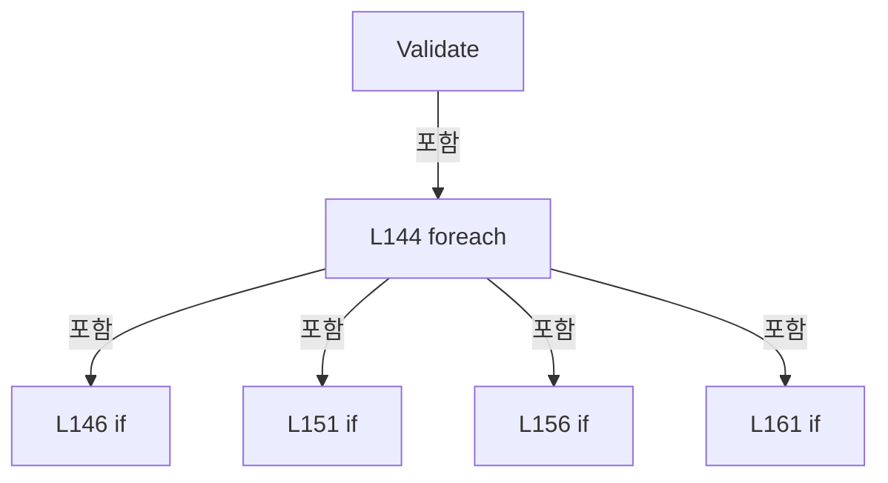

변경 전 점검: 입력/반환 타입, 위 호출자, 예외/취소 경로, 공유 상태와 저장·전송 소비자를 함께 확인합니다. 값의 단위나 물리 방향을 이름만으로 확정하지 않습니다.

### MethodDeclaration `ValidateConnectionArguments` · L170–221

[Drilling.File/JHMI/CInterfaceFile.cs:170–221](https://github.com/kjuws10-rgb/A3Drilling/blob/5aee8e58439c9b455cae7c9593c9be986c3e682e/Drilling.File/JHMI/CInterfaceFile.cs#L170-L221)

| 항목 | 실제 추출 값 |
| --- | --- |
| 서명 | void Drilling.File.JHMI.CInterfaceFile.ValidateConnectionArguments(Drilling.Common.Interface.ST_INTERFACE_DATA) |
| 접근/수식자 | Private / private, static |
| 반환/값 타입 | void |
| 소속 타입 | NamedType:Drilling.File.JHMI.CInterfaceFile |

입력 계약:

| 이름 | 타입 | 전달 | 선택/기본값 |
| --- | --- | --- | --- |
| data | Drilling.Common.Interface.ST_INTERFACE_DATA | None | False /  |

정적 호출자로 확인된 위치:

| 호출 파일/행 | 호출 표현식 | 런타임 분기 가능 |
| --- | --- | --- |
| [Drilling.File/JHMI/CInterfaceFile.cs:166–166](https://github.com/kjuws10-rgb/A3Drilling/blob/5aee8e58439c9b455cae7c9593c9be986c3e682e/Drilling.File/JHMI/CInterfaceFile.cs#L166-L166) | ValidateConnectionArguments | False |

호출하는 대상과 해석 범위:

| 원본 행 | 표현식 | 분석 상태 | 대상/소스 위치 |
| --- | --- | --- | --- |
| 177 | data.Arguments.Concat(Enumerable.Repeat("", 5)).Take(5).Select(SelectItem).ToArray | resolved | string[] System.Collections.Generic.IEnumerable<string>.ToArray<string>() |
| 177 | data.Arguments.Concat(Enumerable.Repeat("", 5)).Take(5).Select | resolved | System.Collections.Generic.IEnumerable<string> System.Collections.Generic.IEnumerable<string>.Select<string, string>(System.Func<string, string>) |
| 177 | data.Arguments.Concat(Enumerable.Repeat("", 5)).Take | resolved | System.Collections.Generic.IEnumerable<string> System.Collections.Generic.IEnumerable<string>.Take<string>(int) |
| 177 | data.Arguments.Concat | resolved | System.Collections.Generic.IEnumerable<string> System.Collections.Generic.IEnumerable<string>.Concat<string>(System.Collections.Generic.IEnumerable<string>) |
| 177 | Enumerable.Repeat | resolved | System.Collections.Generic.IEnumerable<string> System.Linq.Enumerable.Repeat<string>(string, int) |
| 187 | RequireArgument | resolved | void Drilling.File.JHMI.CInterfaceFile.RequireArgument(Drilling.Common.Interface.ST_INTERFACE_DATA, string, string) · Drilling.File/JHMI/CInterfaceFile.cs:434 |
| 188 | RequirePositiveInt | resolved | void Drilling.File.JHMI.CInterfaceFile.RequirePositiveInt(Drilling.Common.Interface.ST_INTERFACE_DATA, string, string) · Drilling.File/JHMI/CInterfaceFile.cs:442 |
| 189 | ValidateParity | resolved | void Drilling.File.JHMI.CInterfaceFile.ValidateParity(Drilling.Common.Interface.ST_INTERFACE_DATA, string) · Drilling.File/JHMI/CInterfaceFile.cs:450 |
| 190 | RequirePositiveInt | resolved | void Drilling.File.JHMI.CInterfaceFile.RequirePositiveInt(Drilling.Common.Interface.ST_INTERFACE_DATA, string, string) · Drilling.File/JHMI/CInterfaceFile.cs:442 |
| 191 | ValidateStopBits | resolved | void Drilling.File.JHMI.CInterfaceFile.ValidateStopBits(Drilling.Common.Interface.ST_INTERFACE_DATA, string) · Drilling.File/JHMI/CInterfaceFile.cs:461 |
| 199 | RequireArgument | resolved | void Drilling.File.JHMI.CInterfaceFile.RequireArgument(Drilling.Common.Interface.ST_INTERFACE_DATA, string, string) · Drilling.File/JHMI/CInterfaceFile.cs:434 |
| 200 | RequirePositiveInt | resolved | void Drilling.File.JHMI.CInterfaceFile.RequirePositiveInt(Drilling.Common.Interface.ST_INTERFACE_DATA, string, string) · Drilling.File/JHMI/CInterfaceFile.cs:442 |
| 201 | RequirePositiveInt | resolved | void Drilling.File.JHMI.CInterfaceFile.RequirePositiveInt(Drilling.Common.Interface.ST_INTERFACE_DATA, string, string) · Drilling.File/JHMI/CInterfaceFile.cs:442 |
| 202 | RequirePositiveInt | resolved | void Drilling.File.JHMI.CInterfaceFile.RequirePositiveInt(Drilling.Common.Interface.ST_INTERFACE_DATA, string, string) · Drilling.File/JHMI/CInterfaceFile.cs:442 |
| 206 | RequirePositiveInt | resolved | void Drilling.File.JHMI.CInterfaceFile.RequirePositiveInt(Drilling.Common.Interface.ST_INTERFACE_DATA, string, string) · Drilling.File/JHMI/CInterfaceFile.cs:442 |
| 207 | RequirePositiveInt | resolved | void Drilling.File.JHMI.CInterfaceFile.RequirePositiveInt(Drilling.Common.Interface.ST_INTERFACE_DATA, string, string) · Drilling.File/JHMI/CInterfaceFile.cs:442 |
| 208 | RequirePositiveInt | resolved | void Drilling.File.JHMI.CInterfaceFile.RequirePositiveInt(Drilling.Common.Interface.ST_INTERFACE_DATA, string, string) · Drilling.File/JHMI/CInterfaceFile.cs:442 |
| 216 | RequireArgument | resolved | void Drilling.File.JHMI.CInterfaceFile.RequireArgument(Drilling.Common.Interface.ST_INTERFACE_DATA, string, string) · Drilling.File/JHMI/CInterfaceFile.cs:434 |
| 217 | RequirePositiveInt | resolved | void Drilling.File.JHMI.CInterfaceFile.RequirePositiveInt(Drilling.Common.Interface.ST_INTERFACE_DATA, string, string) · Drilling.File/JHMI/CInterfaceFile.cs:442 |
| 218 | RequirePositiveInt | resolved | void Drilling.File.JHMI.CInterfaceFile.RequirePositiveInt(Drilling.Common.Interface.ST_INTERFACE_DATA, string, string) · Drilling.File/JHMI/CInterfaceFile.cs:442 |

본문의 실제 연산·분기·예외·반환 순서(원문 위치 순):

| 원본 행 | 종류 | 주석 해설 |
| --- | --- | --- |
| 177 | call | 함수·델리게이트 또는 객체 생성자를 호출합니다: data.Arguments.Concat(Enumerable.Repeat("", 5)).Take(5).Select(SelectItem).ToArray() |
| 177 | call | 함수·델리게이트 또는 객체 생성자를 호출합니다: data.Arguments.Concat(Enumerable.Repeat("", 5)).Take(5).Select(SelectItem) |
| 177 | call | 함수·델리게이트 또는 객체 생성자를 호출합니다: data.Arguments.Concat(Enumerable.Repeat("", 5)).Take(5) |
| 177 | call | 함수·델리게이트 또는 객체 생성자를 호출합니다: data.Arguments.Concat(Enumerable.Repeat("", 5)) |
| 177 | call | 함수·델리게이트 또는 객체 생성자를 호출합니다: Enumerable.Repeat("", 5) |
| 177 | local-declaration | 지역 변수를 선언합니다: var args = data.Arguments.Concat(Enumerable.Repeat("", 5)).Take(5).Select(SelectItem).ToArray(); |
| 177 | variable-initializer | 변수의 초기값을 지정합니다: args = data.Arguments.Concat(Enumerable.Repeat("", 5)).Take(5).Select(SelectItem).ToArray() |
| 178 | if | 조건에 따라 분기합니다: if (data.IsSimulation) |
| 180 | return | 호출자에게 값 또는 제어를 반환합니다: return; |
| 183 | switch | 값에 따라 분기합니다: switch (data.InterfaceType) |
| 185 | case | 분기값/패턴의 구간입니다: case EN_INTERFACE_TYPE.Serial: |
| 186 | case | 분기값/패턴의 구간입니다: case EN_INTERFACE_TYPE.ModbusSerial: |
| 187 | call | 함수·델리게이트 또는 객체 생성자를 호출합니다: RequireArgument(data, args[0], "ARG1/COM_PORT") |
| 188 | call | 함수·델리게이트 또는 객체 생성자를 호출합니다: RequirePositiveInt(data, args[1], "ARG2/BAUD") |
| 189 | call | 함수·델리게이트 또는 객체 생성자를 호출합니다: ValidateParity(data, args[2]) |
| 190 | call | 함수·델리게이트 또는 객체 생성자를 호출합니다: RequirePositiveInt(data, args[3], "ARG4/DATA_BITS") |
| 191 | call | 함수·델리게이트 또는 객체 생성자를 호출합니다: ValidateStopBits(data, args[4]) |
| 192 | break | 해당 반복/분기 구간을 종료합니다: break; |
| 193 | case | 분기값/패턴의 구간입니다: case EN_INTERFACE_TYPE.SocketClient: |
| 194 | case | 분기값/패턴의 구간입니다: case EN_INTERFACE_TYPE.SocketClientUdp: |
| 195 | case | 분기값/패턴의 구간입니다: case EN_INTERFACE_TYPE.ModbusTcp: |
| 196 | case | 분기값/패턴의 구간입니다: case EN_INTERFACE_TYPE.AcsNet: |
| 197 | case | 분기값/패턴의 구간입니다: case EN_INTERFACE_TYPE.XpsNet: |
| 198 | case | 분기값/패턴의 구간입니다: case EN_INTERFACE_TYPE.Automation1Net: |
| 199 | call | 함수·델리게이트 또는 객체 생성자를 호출합니다: RequireArgument(data, args[1], "ARG2/REMOTE_IP") |
| 200 | call | 함수·델리게이트 또는 객체 생성자를 호출합니다: RequirePositiveInt(data, args[2], "ARG3/PORT") |
| 201 | call | 함수·델리게이트 또는 객체 생성자를 호출합니다: RequirePositiveInt(data, args[3], "ARG4/TIMEOUT_MS") |
| 202 | call | 함수·델리게이트 또는 객체 생성자를 호출합니다: RequirePositiveInt(data, args[4], "ARG5/RETRY_COUNT") |
| 203 | break | 해당 반복/분기 구간을 종료합니다: break; |
| 204 | case | 분기값/패턴의 구간입니다: case EN_INTERFACE_TYPE.SocketServer: |
| 205 | case | 분기값/패턴의 구간입니다: case EN_INTERFACE_TYPE.SocketServerUdp: |
| 206 | call | 함수·델리게이트 또는 객체 생성자를 호출합니다: RequirePositiveInt(data, args[2], "ARG3/PORT") |
| 207 | call | 함수·델리게이트 또는 객체 생성자를 호출합니다: RequirePositiveInt(data, args[3], "ARG4/TIMEOUT_MS") |
| 208 | call | 함수·델리게이트 또는 객체 생성자를 호출합니다: RequirePositiveInt(data, args[4], "ARG5/RETRY_COUNT") |
| 209 | break | 해당 반복/분기 구간을 종료합니다: break; |
| 210 | case | 분기값/패턴의 구간입니다: case EN_INTERFACE_TYPE.PicoMotor: |
| 211 | break | 해당 반복/분기 구간을 종료합니다: break; |
| 212 | case | 분기값/패턴의 구간입니다: case EN_INTERFACE_TYPE.MelsecNet: |
| 214 | break | 해당 반복/분기 구간을 종료합니다: break; |
| 215 | case | 분기값/패턴의 구간입니다: case EN_INTERFACE_TYPE.OpcUa: |
| 216 | call | 함수·델리게이트 또는 객체 생성자를 호출합니다: RequireArgument(data, args[0], "ARG1/ENDPOINT") |
| 217 | call | 함수·델리게이트 또는 객체 생성자를 호출합니다: RequirePositiveInt(data, args[3], "ARG4/TIMEOUT_MS") |
| 218 | call | 함수·델리게이트 또는 객체 생성자를 호출합니다: RequirePositiveInt(data, args[4], "ARG5/RETRY_COUNT") |
| 219 | break | 해당 반복/분기 구간을 종료합니다: break; |

제어 구문의 포함 구조(실제 실행 순서/CFG가 아닌 구문 탐색 그림):

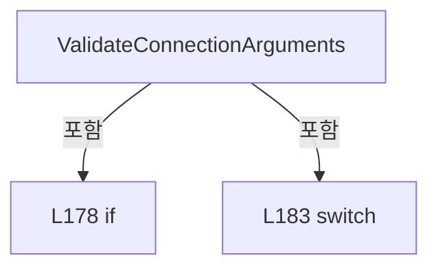

변경 전 점검: 입력/반환 타입, 위 호출자, 예외/취소 경로, 공유 상태와 저장·전송 소비자를 함께 확인합니다. 값의 단위나 물리 방향을 이름만으로 확정하지 않습니다.

### LocalFunctionStatement `SelectItem` · L172–175

[Drilling.File/JHMI/CInterfaceFile.cs:172–175](https://github.com/kjuws10-rgb/A3Drilling/blob/5aee8e58439c9b455cae7c9593c9be986c3e682e/Drilling.File/JHMI/CInterfaceFile.cs#L172-L175)

| 항목 | 실제 추출 값 |
| --- | --- |
| 서명 | string SelectItem(string) |
| 접근/수식자 | Private /  |
| 반환/값 타입 | string |
| 소속 타입 | NamedType:Drilling.File.JHMI.CInterfaceFile |

입력 계약:

| 이름 | 타입 | 전달 | 선택/기본값 |
| --- | --- | --- | --- |
| argument | string | None | False /  |

현재 부분 분석에서 직접 연결된 호출자는 없습니다. XAML/이벤트/인터페이스·델리게이트·외부 진입을 추가 확인해야 하며, 미사용으로 판정한 것이 아닙니다.

호출하는 대상과 해석 범위:

| 원본 행 | 표현식 | 분석 상태 | 대상/소스 위치 |
| --- | --- | --- | --- |
| 174 | argument.Trim | resolved | string string.Trim() |

본문의 실제 연산·분기·예외·반환 순서(원문 위치 순):

| 원본 행 | 종류 | 주석 해설 |
| --- | --- | --- |
| 174 | call | 함수·델리게이트 또는 객체 생성자를 호출합니다: argument.Trim() |
| 174 | return | 호출자에게 값 또는 제어를 반환합니다: return argument.Trim(); |

변경 전 점검: 입력/반환 타입, 위 호출자, 예외/취소 경로, 공유 상태와 저장·전송 소비자를 함께 확인합니다. 값의 단위나 물리 방향을 이름만으로 확정하지 않습니다.

### MethodDeclaration `ValidateSavedRows` · L223–238

[Drilling.File/JHMI/CInterfaceFile.cs:223–238](https://github.com/kjuws10-rgb/A3Drilling/blob/5aee8e58439c9b455cae7c9593c9be986c3e682e/Drilling.File/JHMI/CInterfaceFile.cs#L223-L238)

| 항목 | 실제 추출 값 |
| --- | --- |
| 서명 | void Drilling.File.JHMI.CInterfaceFile.ValidateSavedRows(System.Collections.Generic.IReadOnlyList<Drilling.Common.Interface.ST_INTERFACE_DATA>) |
| 접근/수식자 | Private / private |
| 반환/값 타입 | void |
| 소속 타입 | NamedType:Drilling.File.JHMI.CInterfaceFile |

입력 계약:

| 이름 | 타입 | 전달 | 선택/기본값 |
| --- | --- | --- | --- |
| expectedRows | System.Collections.Generic.IReadOnlyList<Drilling.Common.Interface.ST_INTERFACE_DATA> | None | False /  |

정적 호출자로 확인된 위치:

| 호출 파일/행 | 호출 표현식 | 런타임 분기 가능 |
| --- | --- | --- |
| [Drilling.File/JHMI/CInterfaceFile.cs:76–76](https://github.com/kjuws10-rgb/A3Drilling/blob/5aee8e58439c9b455cae7c9593c9be986c3e682e/Drilling.File/JHMI/CInterfaceFile.cs#L76-L76) | ValidateSavedRows | False |

호출하는 대상과 해석 범위:

| 원본 행 | 표현식 | 분석 상태 | 대상/소스 위치 |
| --- | --- | --- | --- |
| 225 | LoadInterfaceRows().ToDictionary | resolved | System.Collections.Generic.Dictionary<string, Drilling.Common.Interface.ST_INTERFACE_DATA> System.Collections.Generic.IEnumerable<Drilling.Common.Interface.ST_INTERFACE_DATA>.ToDictionary<Drilling.Common.Interface.ST_INTERFACE_DATA, string>(System.Func<Drilling.Common.Interface.ST_INTERFACE_DATA, string>, System.Collections.Generic.IEqualityComparer<string>?) |
| 225 | LoadInterfaceRows | resolved | System.Collections.Generic.IReadOnlyList<Drilling.Common.Interface.ST_INTERFACE_DATA> Drilling.File.JHMI.CInterfaceFile.LoadInterfaceRows() · Drilling.File/JHMI/CInterfaceFile.cs:81 |
| 228 | actualRows.TryGetValue | resolved | bool System.Collections.Generic.Dictionary<string, Drilling.Common.Interface.ST_INTERFACE_DATA>.TryGetValue(string, out Drilling.Common.Interface.ST_INTERFACE_DATA) |
| 228 | CreateInterfaceKey | resolved | string Drilling.File.JHMI.CInterfaceFile.CreateInterfaceKey(Drilling.Common.Interface.ST_INTERFACE_DATA) · Drilling.File/JHMI/CInterfaceFile.cs:334 |
| 230 | new InvalidDataException | resolved | System.IO.InvalidDataException.InvalidDataException(string?) |
| 230 | FormatInterfaceLabel | resolved | string Drilling.File.JHMI.CInterfaceFile.FormatInterfaceLabel(Drilling.Common.Interface.ST_INTERFACE_DATA) · Drilling.File/JHMI/CInterfaceFile.cs:339 |
| 233 | BuildComparisonText(actual).Equals | resolved | bool string.Equals(string?, System.StringComparison) |
| 233 | BuildComparisonText | resolved | string Drilling.File.JHMI.CInterfaceFile.BuildComparisonText(Drilling.Common.Interface.ST_INTERFACE_DATA) · Drilling.File/JHMI/CInterfaceFile.cs:318 |
| 233 | BuildComparisonText | resolved | string Drilling.File.JHMI.CInterfaceFile.BuildComparisonText(Drilling.Common.Interface.ST_INTERFACE_DATA) · Drilling.File/JHMI/CInterfaceFile.cs:318 |
| 235 | new InvalidDataException | resolved | System.IO.InvalidDataException.InvalidDataException(string?) |
| 235 | FormatInterfaceLabel | resolved | string Drilling.File.JHMI.CInterfaceFile.FormatInterfaceLabel(Drilling.Common.Interface.ST_INTERFACE_DATA) · Drilling.File/JHMI/CInterfaceFile.cs:339 |

본문의 실제 연산·분기·예외·반환 순서(원문 위치 순):

| 원본 행 | 종류 | 주석 해설 |
| --- | --- | --- |
| 225 | call | 함수·델리게이트 또는 객체 생성자를 호출합니다: LoadInterfaceRows().ToDictionary(CreateInterfaceKey, StringComparer.OrdinalIgnoreCase) |
| 225 | call | 함수·델리게이트 또는 객체 생성자를 호출합니다: LoadInterfaceRows() |
| 225 | local-declaration | 지역 변수를 선언합니다: var actualRows = LoadInterfaceRows().ToDictionary(CreateInterfaceKey, StringComparer.OrdinalIgnoreCase); |
| 225 | variable-initializer | 변수의 초기값을 지정합니다: actualRows = LoadInterfaceRows().ToDictionary(CreateInterfaceKey, StringComparer.OrdinalIgnoreCase) |
| 226 | foreach | 컬렉션 요소를 순회합니다: foreach (var expected in expectedRows) |
| 228 | call | 함수·델리게이트 또는 객체 생성자를 호출합니다: actualRows.TryGetValue(CreateInterfaceKey(expected), out var actual) |
| 228 | call | 함수·델리게이트 또는 객체 생성자를 호출합니다: CreateInterfaceKey(expected) |
| 228 | if | 조건에 따라 분기합니다: if (!actualRows.TryGetValue(CreateInterfaceKey(expected), out var actual)) |
| 230 | call | 함수·델리게이트 또는 객체 생성자를 호출합니다: new InvalidDataException($"JHMI_INTERFACE validation failed. Missing row: {FormatInterfaceLabel(expected)}") |
| 230 | call | 함수·델리게이트 또는 객체 생성자를 호출합니다: FormatInterfaceLabel(expected) |
| 230 | throw | 예외를 발생/전달합니다: throw new InvalidDataException($"JHMI_INTERFACE validation failed. Missing row: {FormatInterfaceLabel(expected)}"); |
| 233 | call | 함수·델리게이트 또는 객체 생성자를 호출합니다: BuildComparisonText(actual).Equals(BuildComparisonText(expected), StringComparison.Ordinal) |
| 233 | call | 함수·델리게이트 또는 객체 생성자를 호출합니다: BuildComparisonText(actual) |
| 233 | call | 함수·델리게이트 또는 객체 생성자를 호출합니다: BuildComparisonText(expected) |
| 233 | if | 조건에 따라 분기합니다: if (!BuildComparisonText(actual).Equals(BuildComparisonText(expected), StringComparison.Ordinal)) |
| 235 | call | 함수·델리게이트 또는 객체 생성자를 호출합니다: new InvalidDataException($"JHMI_INTERFACE validation failed. Value mismatch: {FormatInterfaceLabel(expected)}") |
| 235 | call | 함수·델리게이트 또는 객체 생성자를 호출합니다: FormatInterfaceLabel(expected) |
| 235 | throw | 예외를 발생/전달합니다: throw new InvalidDataException($"JHMI_INTERFACE validation failed. Value mismatch: {FormatInterfaceLabel(expected)}"); |

제어 구문의 포함 구조(실제 실행 순서/CFG가 아닌 구문 탐색 그림):

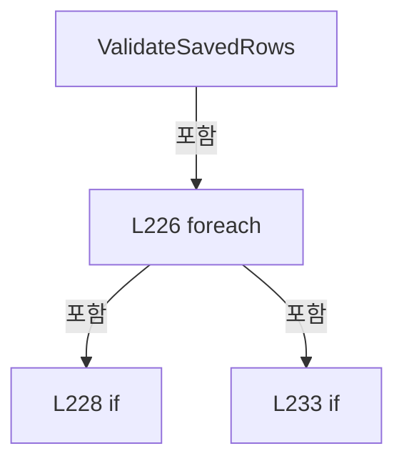

변경 전 점검: 입력/반환 타입, 위 호출자, 예외/취소 경로, 공유 상태와 저장·전송 소비자를 함께 확인합니다. 값의 단위나 물리 방향을 이름만으로 확정하지 않습니다.

### MethodDeclaration `WriteModifyLog` · L240–266

[Drilling.File/JHMI/CInterfaceFile.cs:240–266](https://github.com/kjuws10-rgb/A3Drilling/blob/5aee8e58439c9b455cae7c9593c9be986c3e682e/Drilling.File/JHMI/CInterfaceFile.cs#L240-L266)

| 항목 | 실제 추출 값 |
| --- | --- |
| 서명 | void Drilling.File.JHMI.CInterfaceFile.WriteModifyLog(System.Collections.Generic.IReadOnlyDictionary<string, Drilling.Common.Interface.ST_INTERFACE_DATA>, System.Collections.Generic.IReadOnlyList<Drilling.Common.Interface.ST_INTERFACE_DATA>) |
| 접근/수식자 | Private / private |
| 반환/값 타입 | void |
| 소속 타입 | NamedType:Drilling.File.JHMI.CInterfaceFile |

입력 계약:

| 이름 | 타입 | 전달 | 선택/기본값 |
| --- | --- | --- | --- |
| oldRows | System.Collections.Generic.IReadOnlyDictionary<string, Drilling.Common.Interface.ST_INTERFACE_DATA> | None | False /  |
| newRows | System.Collections.Generic.IReadOnlyList<Drilling.Common.Interface.ST_INTERFACE_DATA> | None | False /  |

정적 호출자로 확인된 위치:

| 호출 파일/행 | 호출 표현식 | 런타임 분기 가능 |
| --- | --- | --- |
| [Drilling.File/JHMI/CInterfaceFile.cs:77–77](https://github.com/kjuws10-rgb/A3Drilling/blob/5aee8e58439c9b455cae7c9593c9be986c3e682e/Drilling.File/JHMI/CInterfaceFile.cs#L77-L77) | WriteModifyLog | False |

호출하는 대상과 해석 범위:

| 원본 행 | 표현식 | 분석 상태 | 대상/소스 위치 |
| --- | --- | --- | --- |
| 242 | newRows.ToDictionary | resolved | System.Collections.Generic.Dictionary<string, Drilling.Common.Interface.ST_INTERFACE_DATA> System.Collections.Generic.IEnumerable<Drilling.Common.Interface.ST_INTERFACE_DATA>.ToDictionary<Drilling.Common.Interface.ST_INTERFACE_DATA, string>(System.Func<Drilling.Common.Interface.ST_INTERFACE_DATA, string>, System.Collections.Generic.IEqualityComparer<string>?) |
| 245 | CreateInterfaceKey | resolved | string Drilling.File.JHMI.CInterfaceFile.CreateInterfaceKey(Drilling.Common.Interface.ST_INTERFACE_DATA) · Drilling.File/JHMI/CInterfaceFile.cs:334 |
| 246 | FormatInterfaceLabel | resolved | string Drilling.File.JHMI.CInterfaceFile.FormatInterfaceLabel(Drilling.Common.Interface.ST_INTERFACE_DATA) · Drilling.File/JHMI/CInterfaceFile.cs:339 |
| 247 | oldRows.TryGetValue | resolved · 동적 구현 선택 가능 | bool System.Collections.Generic.IReadOnlyDictionary<string, Drilling.Common.Interface.ST_INTERFACE_DATA>.TryGetValue(string, out Drilling.Common.Interface.ST_INTERFACE_DATA) |
| 249 | _logManager.WriteSettingModify | unresolved | None |
| 250 | WriteFieldModifyLog | resolved | void Drilling.File.JHMI.CInterfaceFile.WriteFieldModifyLog(string, System.Collections.Generic.IReadOnlyDictionary<string, string>, System.Collections.Generic.IReadOnlyDictionary<string, string>) · Drilling.File/JHMI/CInterfaceFile.cs:268 |
| 250 | CreateEmptyFieldMap | resolved | System.Collections.Generic.IReadOnlyDictionary<string, string> Drilling.File.JHMI.CInterfaceFile.CreateEmptyFieldMap() · Drilling.File/JHMI/CInterfaceFile.cs:283 |
| 250 | CreateFieldMap | resolved | System.Collections.Generic.IReadOnlyDictionary<string, string> Drilling.File.JHMI.CInterfaceFile.CreateFieldMap(Drilling.Common.Interface.ST_INTERFACE_DATA) · Drilling.File/JHMI/CInterfaceFile.cs:298 |
| 254 | WriteFieldModifyLog | resolved | void Drilling.File.JHMI.CInterfaceFile.WriteFieldModifyLog(string, System.Collections.Generic.IReadOnlyDictionary<string, string>, System.Collections.Generic.IReadOnlyDictionary<string, string>) · Drilling.File/JHMI/CInterfaceFile.cs:268 |
| 254 | CreateFieldMap | resolved | System.Collections.Generic.IReadOnlyDictionary<string, string> Drilling.File.JHMI.CInterfaceFile.CreateFieldMap(Drilling.Common.Interface.ST_INTERFACE_DATA) · Drilling.File/JHMI/CInterfaceFile.cs:298 |
| 254 | CreateFieldMap | resolved | System.Collections.Generic.IReadOnlyDictionary<string, string> Drilling.File.JHMI.CInterfaceFile.CreateFieldMap(Drilling.Common.Interface.ST_INTERFACE_DATA) · Drilling.File/JHMI/CInterfaceFile.cs:298 |
| 262 | oldRows.Values.Where | resolved | System.Collections.Generic.IEnumerable<Drilling.Common.Interface.ST_INTERFACE_DATA> System.Collections.Generic.IEnumerable<Drilling.Common.Interface.ST_INTERFACE_DATA>.Where<Drilling.Common.Interface.ST_INTERFACE_DATA>(System.Func<Drilling.Common.Interface.ST_INTERFACE_DATA, bool>) |
| 264 | _logManager.WriteSettingModify | unresolved | None |
| 264 | FormatInterfaceLabel | resolved | string Drilling.File.JHMI.CInterfaceFile.FormatInterfaceLabel(Drilling.Common.Interface.ST_INTERFACE_DATA) · Drilling.File/JHMI/CInterfaceFile.cs:339 |

본문의 실제 연산·분기·예외·반환 순서(원문 위치 순):

| 원본 행 | 종류 | 주석 해설 |
| --- | --- | --- |
| 242 | call | 함수·델리게이트 또는 객체 생성자를 호출합니다: newRows.ToDictionary(CreateInterfaceKey, StringComparer.OrdinalIgnoreCase) |
| 242 | local-declaration | 지역 변수를 선언합니다: var newMap = newRows.ToDictionary(CreateInterfaceKey, StringComparer.OrdinalIgnoreCase); |
| 242 | variable-initializer | 변수의 초기값을 지정합니다: newMap = newRows.ToDictionary(CreateInterfaceKey, StringComparer.OrdinalIgnoreCase) |
| 243 | foreach | 컬렉션 요소를 순회합니다: foreach (var row in newRows) |
| 245 | call | 함수·델리게이트 또는 객체 생성자를 호출합니다: CreateInterfaceKey(row) |
| 245 | local-declaration | 지역 변수를 선언합니다: var key = CreateInterfaceKey(row); |
| 245 | variable-initializer | 변수의 초기값을 지정합니다: key = CreateInterfaceKey(row) |
| 246 | call | 함수·델리게이트 또는 객체 생성자를 호출합니다: FormatInterfaceLabel(row) |
| 246 | local-declaration | 지역 변수를 선언합니다: var label = FormatInterfaceLabel(row); |
| 246 | variable-initializer | 변수의 초기값을 지정합니다: label = FormatInterfaceLabel(row) |
| 247 | call | 함수·델리게이트 또는 객체 생성자를 호출합니다: oldRows.TryGetValue(key, out var oldRow) |
| 247 | if | 조건에 따라 분기합니다: if (!oldRows.TryGetValue(key, out var oldRow)) |
| 249 | call | 함수·델리게이트 또는 객체 생성자를 호출합니다: _logManager.WriteSettingModify(EN_SETTING_TAB.Interface, $"{label}.ROW", "-", "CREATED") |
| 250 | call | 함수·델리게이트 또는 객체 생성자를 호출합니다: WriteFieldModifyLog(label, CreateEmptyFieldMap(), CreateFieldMap(row)) |
| 250 | call | 함수·델리게이트 또는 객체 생성자를 호출합니다: CreateEmptyFieldMap() |
| 250 | call | 함수·델리게이트 또는 객체 생성자를 호출합니다: CreateFieldMap(row) |
| 251 | continue | 다음 반복으로 진행합니다: continue; |
| 254 | call | 함수·델리게이트 또는 객체 생성자를 호출합니다: WriteFieldModifyLog(label, CreateFieldMap(oldRow), CreateFieldMap(row)) |
| 254 | call | 함수·델리게이트 또는 객체 생성자를 호출합니다: CreateFieldMap(oldRow) |
| 254 | call | 함수·델리게이트 또는 객체 생성자를 호출합니다: CreateFieldMap(row) |
| 262 | call | 함수·델리게이트 또는 객체 생성자를 호출합니다: oldRows.Values.Where(ShouldIncludeItem) |
| 262 | foreach | 컬렉션 요소를 순회합니다: foreach (var oldRow in oldRows.Values.Where(ShouldIncludeItem)) |
| 264 | call | 함수·델리게이트 또는 객체 생성자를 호출합니다: _logManager.WriteSettingModify(EN_SETTING_TAB.Interface, $"{FormatInterfaceLabel(oldRow)}.ROW", "EXIST", "DELETED") |
| 264 | call | 함수·델리게이트 또는 객체 생성자를 호출합니다: FormatInterfaceLabel(oldRow) |

제어 구문의 포함 구조(실제 실행 순서/CFG가 아닌 구문 탐색 그림):

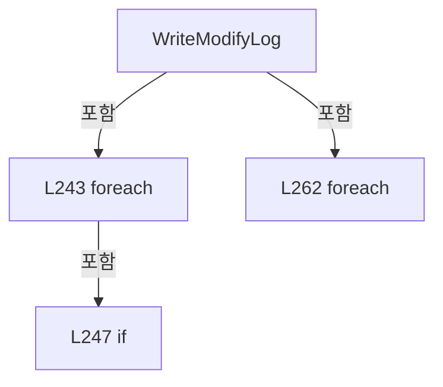

변경 전 점검: 입력/반환 타입, 위 호출자, 예외/취소 경로, 공유 상태와 저장·전송 소비자를 함께 확인합니다. 값의 단위나 물리 방향을 이름만으로 확정하지 않습니다.

### LocalFunctionStatement `ShouldIncludeItem` · L257–260

[Drilling.File/JHMI/CInterfaceFile.cs:257–260](https://github.com/kjuws10-rgb/A3Drilling/blob/5aee8e58439c9b455cae7c9593c9be986c3e682e/Drilling.File/JHMI/CInterfaceFile.cs#L257-L260)

| 항목 | 실제 추출 값 |
| --- | --- |
| 서명 | bool ShouldIncludeItem(Drilling.Common.Interface.ST_INTERFACE_DATA) |
| 접근/수식자 | Private /  |
| 반환/값 타입 | bool |
| 소속 타입 | NamedType:Drilling.File.JHMI.CInterfaceFile |

입력 계약:

| 이름 | 타입 | 전달 | 선택/기본값 |
| --- | --- | --- | --- |
| row | Drilling.Common.Interface.ST_INTERFACE_DATA | None | False /  |

현재 부분 분석에서 직접 연결된 호출자는 없습니다. XAML/이벤트/인터페이스·델리게이트·외부 진입을 추가 확인해야 하며, 미사용으로 판정한 것이 아닙니다.

호출하는 대상과 해석 범위:

| 원본 행 | 표현식 | 분석 상태 | 대상/소스 위치 |
| --- | --- | --- | --- |
| 259 | newMap.ContainsKey | resolved | bool System.Collections.Generic.Dictionary<string, Drilling.Common.Interface.ST_INTERFACE_DATA>.ContainsKey(string) |
| 259 | CreateInterfaceKey | resolved | string Drilling.File.JHMI.CInterfaceFile.CreateInterfaceKey(Drilling.Common.Interface.ST_INTERFACE_DATA) · Drilling.File/JHMI/CInterfaceFile.cs:334 |

본문의 실제 연산·분기·예외·반환 순서(원문 위치 순):

| 원본 행 | 종류 | 주석 해설 |
| --- | --- | --- |
| 259 | call | 함수·델리게이트 또는 객체 생성자를 호출합니다: newMap.ContainsKey(CreateInterfaceKey(row)) |
| 259 | call | 함수·델리게이트 또는 객체 생성자를 호출합니다: CreateInterfaceKey(row) |
| 259 | return | 호출자에게 값 또는 제어를 반환합니다: return !newMap.ContainsKey(CreateInterfaceKey(row)); |

변경 전 점검: 입력/반환 타입, 위 호출자, 예외/취소 경로, 공유 상태와 저장·전송 소비자를 함께 확인합니다. 값의 단위나 물리 방향을 이름만으로 확정하지 않습니다.

### MethodDeclaration `WriteFieldModifyLog` · L268–281

[Drilling.File/JHMI/CInterfaceFile.cs:268–281](https://github.com/kjuws10-rgb/A3Drilling/blob/5aee8e58439c9b455cae7c9593c9be986c3e682e/Drilling.File/JHMI/CInterfaceFile.cs#L268-L281)

| 항목 | 실제 추출 값 |
| --- | --- |
| 서명 | void Drilling.File.JHMI.CInterfaceFile.WriteFieldModifyLog(string, System.Collections.Generic.IReadOnlyDictionary<string, string>, System.Collections.Generic.IReadOnlyDictionary<string, string>) |
| 접근/수식자 | Private / private |
| 반환/값 타입 | void |
| 소속 타입 | NamedType:Drilling.File.JHMI.CInterfaceFile |

입력 계약:

| 이름 | 타입 | 전달 | 선택/기본값 |
| --- | --- | --- | --- |
| interfaceLabel | string | None | False /  |
| oldFields | System.Collections.Generic.IReadOnlyDictionary<string, string> | None | False /  |
| newFields | System.Collections.Generic.IReadOnlyDictionary<string, string> | None | False /  |

정적 호출자로 확인된 위치:

| 호출 파일/행 | 호출 표현식 | 런타임 분기 가능 |
| --- | --- | --- |
| [Drilling.File/JHMI/CInterfaceFile.cs:250–250](https://github.com/kjuws10-rgb/A3Drilling/blob/5aee8e58439c9b455cae7c9593c9be986c3e682e/Drilling.File/JHMI/CInterfaceFile.cs#L250-L250) | WriteFieldModifyLog | False |
| [Drilling.File/JHMI/CInterfaceFile.cs:254–254](https://github.com/kjuws10-rgb/A3Drilling/blob/5aee8e58439c9b455cae7c9593c9be986c3e682e/Drilling.File/JHMI/CInterfaceFile.cs#L254-L254) | WriteFieldModifyLog | False |

호출하는 대상과 해석 범위:

| 원본 행 | 표현식 | 분석 상태 | 대상/소스 위치 |
| --- | --- | --- | --- |
| 272 | oldFields.TryGetValue | resolved · 동적 구현 선택 가능 | bool System.Collections.Generic.IReadOnlyDictionary<string, string>.TryGetValue(string, out string) |
| 273 | newFields.TryGetValue | resolved · 동적 구현 선택 가능 | bool System.Collections.Generic.IReadOnlyDictionary<string, string>.TryGetValue(string, out string) |
| 274 | oldValue.Equals | resolved | bool string.Equals(string?, System.StringComparison) |
| 279 | _logManager.WriteSettingModify | unresolved | None |

본문의 실제 연산·분기·예외·반환 순서(원문 위치 순):

| 원본 행 | 종류 | 주석 해설 |
| --- | --- | --- |
| 270 | foreach | 컬렉션 요소를 순회합니다: foreach (var fieldName in FieldNames) |
| 272 | call | 함수·델리게이트 또는 객체 생성자를 호출합니다: oldFields.TryGetValue(fieldName, out var oldFieldValue) |
| 272 | conditional-expression | 조건에 따라 결과식을 선택합니다: oldFields.TryGetValue(fieldName, out var oldFieldValue) ? oldFieldValue : "" |
| 272 | local-declaration | 지역 변수를 선언합니다: var oldValue = oldFields.TryGetValue(fieldName, out var oldFieldValue) ? oldFieldValue : ""; |
| 272 | variable-initializer | 변수의 초기값을 지정합니다: oldValue = oldFields.TryGetValue(fieldName, out var oldFieldValue) ? oldFieldValue : "" |
| 273 | call | 함수·델리게이트 또는 객체 생성자를 호출합니다: newFields.TryGetValue(fieldName, out var newFieldValue) |
| 273 | conditional-expression | 조건에 따라 결과식을 선택합니다: newFields.TryGetValue(fieldName, out var newFieldValue) ? newFieldValue : "" |
| 273 | local-declaration | 지역 변수를 선언합니다: var newValue = newFields.TryGetValue(fieldName, out var newFieldValue) ? newFieldValue : ""; |
| 273 | variable-initializer | 변수의 초기값을 지정합니다: newValue = newFields.TryGetValue(fieldName, out var newFieldValue) ? newFieldValue : "" |
| 274 | call | 함수·델리게이트 또는 객체 생성자를 호출합니다: oldValue.Equals(newValue, StringComparison.Ordinal) |
| 274 | if | 조건에 따라 분기합니다: if (oldValue.Equals(newValue, StringComparison.Ordinal)) |
| 276 | continue | 다음 반복으로 진행합니다: continue; |
| 279 | call | 함수·델리게이트 또는 객체 생성자를 호출합니다: _logManager.WriteSettingModify(EN_SETTING_TAB.Interface, $"{interfaceLabel}.{fieldName}", oldValue, newValue) |

제어 구문의 포함 구조(실제 실행 순서/CFG가 아닌 구문 탐색 그림):

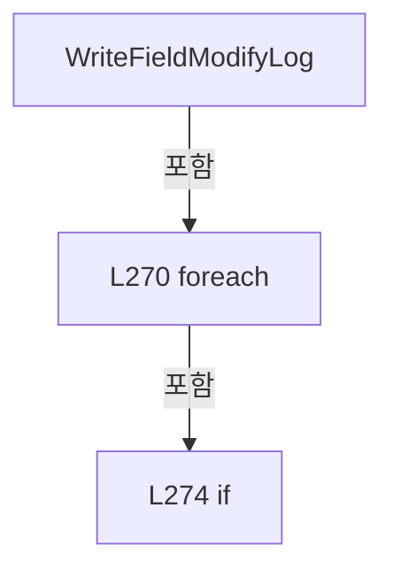

변경 전 점검: 입력/반환 타입, 위 호출자, 예외/취소 경로, 공유 상태와 저장·전송 소비자를 함께 확인합니다. 값의 단위나 물리 방향을 이름만으로 확정하지 않습니다.

### MethodDeclaration `CreateEmptyFieldMap` · L283–296

[Drilling.File/JHMI/CInterfaceFile.cs:283–296](https://github.com/kjuws10-rgb/A3Drilling/blob/5aee8e58439c9b455cae7c9593c9be986c3e682e/Drilling.File/JHMI/CInterfaceFile.cs#L283-L296)

| 항목 | 실제 추출 값 |
| --- | --- |
| 서명 | System.Collections.Generic.IReadOnlyDictionary<string, string> Drilling.File.JHMI.CInterfaceFile.CreateEmptyFieldMap() |
| 접근/수식자 | Private / private, static |
| 반환/값 타입 | System.Collections.Generic.IReadOnlyDictionary<string, string> |
| 소속 타입 | NamedType:Drilling.File.JHMI.CInterfaceFile |

정적 호출자로 확인된 위치:

| 호출 파일/행 | 호출 표현식 | 런타임 분기 가능 |
| --- | --- | --- |
| [Drilling.File/JHMI/CInterfaceFile.cs:250–250](https://github.com/kjuws10-rgb/A3Drilling/blob/5aee8e58439c9b455cae7c9593c9be986c3e682e/Drilling.File/JHMI/CInterfaceFile.cs#L250-L250) | CreateEmptyFieldMap | False |

호출하는 대상과 해석 범위:

| 원본 행 | 표현식 | 분석 상태 | 대상/소스 위치 |
| --- | --- | --- | --- |
| 295 | FieldNames.ToDictionary | resolved | System.Collections.Generic.Dictionary<string, string> System.Collections.Generic.IEnumerable<string>.ToDictionary<string, string, string>(System.Func<string, string>, System.Func<string, string>, System.Collections.Generic.IEqualityComparer<string>?) |

본문의 실제 연산·분기·예외·반환 순서(원문 위치 순):

| 원본 행 | 종류 | 주석 해설 |
| --- | --- | --- |
| 295 | call | 함수·델리게이트 또는 객체 생성자를 호출합니다: FieldNames.ToDictionary(SelectFieldName, SelectValue, StringComparer.OrdinalIgnoreCase) |
| 295 | return | 호출자에게 값 또는 제어를 반환합니다: return FieldNames.ToDictionary(SelectFieldName, SelectValue, StringComparer.OrdinalIgnoreCase); |

변경 전 점검: 입력/반환 타입, 위 호출자, 예외/취소 경로, 공유 상태와 저장·전송 소비자를 함께 확인합니다. 값의 단위나 물리 방향을 이름만으로 확정하지 않습니다.

### LocalFunctionStatement `SelectFieldName` · L285–288

[Drilling.File/JHMI/CInterfaceFile.cs:285–288](https://github.com/kjuws10-rgb/A3Drilling/blob/5aee8e58439c9b455cae7c9593c9be986c3e682e/Drilling.File/JHMI/CInterfaceFile.cs#L285-L288)

| 항목 | 실제 추출 값 |
| --- | --- |
| 서명 | string SelectFieldName(string) |
| 접근/수식자 | Private /  |
| 반환/값 타입 | string |
| 소속 타입 | NamedType:Drilling.File.JHMI.CInterfaceFile |

입력 계약:

| 이름 | 타입 | 전달 | 선택/기본값 |
| --- | --- | --- | --- |
| fieldName | string | None | False /  |

현재 부분 분석에서 직접 연결된 호출자는 없습니다. XAML/이벤트/인터페이스·델리게이트·외부 진입을 추가 확인해야 하며, 미사용으로 판정한 것이 아닙니다.

본문의 실제 연산·분기·예외·반환 순서(원문 위치 순):

| 원본 행 | 종류 | 주석 해설 |
| --- | --- | --- |
| 287 | return | 호출자에게 값 또는 제어를 반환합니다: return fieldName; |

변경 전 점검: 입력/반환 타입, 위 호출자, 예외/취소 경로, 공유 상태와 저장·전송 소비자를 함께 확인합니다. 값의 단위나 물리 방향을 이름만으로 확정하지 않습니다.

### LocalFunctionStatement `SelectValue` · L290–293

[Drilling.File/JHMI/CInterfaceFile.cs:290–293](https://github.com/kjuws10-rgb/A3Drilling/blob/5aee8e58439c9b455cae7c9593c9be986c3e682e/Drilling.File/JHMI/CInterfaceFile.cs#L290-L293)

| 항목 | 실제 추출 값 |
| --- | --- |
| 서명 | string SelectValue(string) |
| 접근/수식자 | Private /  |
| 반환/값 타입 | string |
| 소속 타입 | NamedType:Drilling.File.JHMI.CInterfaceFile |

입력 계약:

| 이름 | 타입 | 전달 | 선택/기본값 |
| --- | --- | --- | --- |
| arg0 | string | None | False /  |

현재 부분 분석에서 직접 연결된 호출자는 없습니다. XAML/이벤트/인터페이스·델리게이트·외부 진입을 추가 확인해야 하며, 미사용으로 판정한 것이 아닙니다.

본문의 실제 연산·분기·예외·반환 순서(원문 위치 순):

| 원본 행 | 종류 | 주석 해설 |
| --- | --- | --- |
| 292 | return | 호출자에게 값 또는 제어를 반환합니다: return ""; |

변경 전 점검: 입력/반환 타입, 위 호출자, 예외/취소 경로, 공유 상태와 저장·전송 소비자를 함께 확인합니다. 값의 단위나 물리 방향을 이름만으로 확정하지 않습니다.

### MethodDeclaration `CreateFieldMap` · L298–316

[Drilling.File/JHMI/CInterfaceFile.cs:298–316](https://github.com/kjuws10-rgb/A3Drilling/blob/5aee8e58439c9b455cae7c9593c9be986c3e682e/Drilling.File/JHMI/CInterfaceFile.cs#L298-L316)

| 항목 | 실제 추출 값 |
| --- | --- |
| 서명 | System.Collections.Generic.IReadOnlyDictionary<string, string> Drilling.File.JHMI.CInterfaceFile.CreateFieldMap(Drilling.Common.Interface.ST_INTERFACE_DATA) |
| 접근/수식자 | Private / private, static |
| 반환/값 타입 | System.Collections.Generic.IReadOnlyDictionary<string, string> |
| 소속 타입 | NamedType:Drilling.File.JHMI.CInterfaceFile |

입력 계약:

| 이름 | 타입 | 전달 | 선택/기본값 |
| --- | --- | --- | --- |
| data | Drilling.Common.Interface.ST_INTERFACE_DATA | None | False /  |

정적 호출자로 확인된 위치:

| 호출 파일/행 | 호출 표현식 | 런타임 분기 가능 |
| --- | --- | --- |
| [Drilling.File/JHMI/CInterfaceFile.cs:250–250](https://github.com/kjuws10-rgb/A3Drilling/blob/5aee8e58439c9b455cae7c9593c9be986c3e682e/Drilling.File/JHMI/CInterfaceFile.cs#L250-L250) | CreateFieldMap | False |
| [Drilling.File/JHMI/CInterfaceFile.cs:254–254](https://github.com/kjuws10-rgb/A3Drilling/blob/5aee8e58439c9b455cae7c9593c9be986c3e682e/Drilling.File/JHMI/CInterfaceFile.cs#L254-L254) | CreateFieldMap | False |
| [Drilling.File/JHMI/CInterfaceFile.cs:254–254](https://github.com/kjuws10-rgb/A3Drilling/blob/5aee8e58439c9b455cae7c9593c9be986c3e682e/Drilling.File/JHMI/CInterfaceFile.cs#L254-L254) | CreateFieldMap | False |

호출하는 대상과 해석 범위:

| 원본 행 | 표현식 | 분석 상태 | 대상/소스 위치 |
| --- | --- | --- | --- |
| 300 | data.Arguments.Concat(Enumerable.Repeat("", 5)).Take(5).ToArray | resolved | string[] System.Collections.Generic.IEnumerable<string>.ToArray<string>() |
| 300 | data.Arguments.Concat(Enumerable.Repeat("", 5)).Take | resolved | System.Collections.Generic.IEnumerable<string> System.Collections.Generic.IEnumerable<string>.Take<string>(int) |
| 300 | data.Arguments.Concat | resolved | System.Collections.Generic.IEnumerable<string> System.Collections.Generic.IEnumerable<string>.Concat<string>(System.Collections.Generic.IEnumerable<string>) |
| 300 | Enumerable.Repeat | resolved | System.Collections.Generic.IEnumerable<string> System.Linq.Enumerable.Repeat<string>(string, int) |
| 301 | new Dictionary<string, string> | resolved | System.Collections.Generic.Dictionary<string, string>.Dictionary(System.Collections.Generic.IEqualityComparer<string>?) |
| 303 | InterfaceTypeText | resolved | string Drilling.File.JHMI.CInterfaceFile.InterfaceTypeText(Drilling.Common.Interface.EN_INTERFACE_TYPE) · Drilling.File/JHMI/CInterfaceFile.cs:364 |
| 304 | DeviceText | resolved | string Drilling.File.JHMI.CInterfaceFile.DeviceText(Drilling.Common.Interface.EN_EQP_MODULE) · Drilling.File/JHMI/CInterfaceFile.cs:402 |
| 305 | data.Number.ToString | resolved | string int.ToString(System.IFormatProvider?) |

본문의 실제 연산·분기·예외·반환 순서(원문 위치 순):

| 원본 행 | 종류 | 주석 해설 |
| --- | --- | --- |
| 300 | call | 함수·델리게이트 또는 객체 생성자를 호출합니다: data.Arguments.Concat(Enumerable.Repeat("", 5)).Take(5).ToArray() |
| 300 | call | 함수·델리게이트 또는 객체 생성자를 호출합니다: data.Arguments.Concat(Enumerable.Repeat("", 5)).Take(5) |
| 300 | call | 함수·델리게이트 또는 객체 생성자를 호출합니다: data.Arguments.Concat(Enumerable.Repeat("", 5)) |
| 300 | call | 함수·델리게이트 또는 객체 생성자를 호출합니다: Enumerable.Repeat("", 5) |
| 300 | local-declaration | 지역 변수를 선언합니다: var arguments = data.Arguments.Concat(Enumerable.Repeat("", 5)).Take(5).ToArray(); |
| 300 | variable-initializer | 변수의 초기값을 지정합니다: arguments = data.Arguments.Concat(Enumerable.Repeat("", 5)).Take(5).ToArray() |
| 301 | call | 함수·델리게이트 또는 객체 생성자를 호출합니다: new Dictionary<string, string>(StringComparer.OrdinalIgnoreCase) { ["TYPE"] = InterfaceTypeText(data.InterfaceType), ["DEVICE"] = DeviceText(data.Device), ["NUMBER"] = data.Number.ToString(CultureInfo.InvariantCulture), … |
| 301 | return | 호출자에게 값 또는 제어를 반환합니다: return new Dictionary<string, string>(StringComparer.OrdinalIgnoreCase) { ["TYPE"] = InterfaceTypeText(data.InterfaceType), ["DEVICE"] = DeviceText(data.Device), ["NUMBER"] = data.Number.ToString(CultureInfo.InvariantCulture), ["N |
| 303 | assignment | 값을 대상에 대입합니다: ["TYPE"] = InterfaceTypeText(data.InterfaceType) |
| 303 | call | 함수·델리게이트 또는 객체 생성자를 호출합니다: InterfaceTypeText(data.InterfaceType) |
| 304 | assignment | 값을 대상에 대입합니다: ["DEVICE"] = DeviceText(data.Device) |
| 304 | call | 함수·델리게이트 또는 객체 생성자를 호출합니다: DeviceText(data.Device) |
| 305 | assignment | 값을 대상에 대입합니다: ["NUMBER"] = data.Number.ToString(CultureInfo.InvariantCulture) |
| 305 | call | 함수·델리게이트 또는 객체 생성자를 호출합니다: data.Number.ToString(CultureInfo.InvariantCulture) |
| 306 | assignment | 값을 대상에 대입합니다: ["NICKNAME"] = data.NickName |
| 307 | assignment | 값을 대상에 대입합니다: ["SYSTEM_SECTION"] = data.SystemSection |
| 308 | assignment | 값을 대상에 대입합니다: ["AUTOCONNECTION"] = data.AutoConnection ? "1" : "0" |
| 308 | conditional-expression | 조건에 따라 결과식을 선택합니다: data.AutoConnection ? "1" : "0" |
| 309 | assignment | 값을 대상에 대입합니다: ["SIMUL"] = data.IsSimulation ? "1" : "0" |
| 309 | conditional-expression | 조건에 따라 결과식을 선택합니다: data.IsSimulation ? "1" : "0" |
| 310 | assignment | 값을 대상에 대입합니다: ["ARG1"] = arguments[0] |
| 311 | assignment | 값을 대상에 대입합니다: ["ARG2"] = arguments[1] |
| 312 | assignment | 값을 대상에 대입합니다: ["ARG3"] = arguments[2] |
| 313 | assignment | 값을 대상에 대입합니다: ["ARG4"] = arguments[3] |
| 314 | assignment | 값을 대상에 대입합니다: ["ARG5"] = arguments[4] |

변경 전 점검: 입력/반환 타입, 위 호출자, 예외/취소 경로, 공유 상태와 저장·전송 소비자를 함께 확인합니다. 값의 단위나 물리 방향을 이름만으로 확정하지 않습니다.

### MethodDeclaration `BuildComparisonText` · L318–332

[Drilling.File/JHMI/CInterfaceFile.cs:318–332](https://github.com/kjuws10-rgb/A3Drilling/blob/5aee8e58439c9b455cae7c9593c9be986c3e682e/Drilling.File/JHMI/CInterfaceFile.cs#L318-L332)

| 항목 | 실제 추출 값 |
| --- | --- |
| 서명 | string Drilling.File.JHMI.CInterfaceFile.BuildComparisonText(Drilling.Common.Interface.ST_INTERFACE_DATA) |
| 접근/수식자 | Private / private, static |
| 반환/값 타입 | string |
| 소속 타입 | NamedType:Drilling.File.JHMI.CInterfaceFile |

입력 계약:

| 이름 | 타입 | 전달 | 선택/기본값 |
| --- | --- | --- | --- |
| data | Drilling.Common.Interface.ST_INTERFACE_DATA | None | False /  |

정적 호출자로 확인된 위치:

| 호출 파일/행 | 호출 표현식 | 런타임 분기 가능 |
| --- | --- | --- |
| [Drilling.File/JHMI/CInterfaceFile.cs:233–233](https://github.com/kjuws10-rgb/A3Drilling/blob/5aee8e58439c9b455cae7c9593c9be986c3e682e/Drilling.File/JHMI/CInterfaceFile.cs#L233-L233) | BuildComparisonText | False |
| [Drilling.File/JHMI/CInterfaceFile.cs:233–233](https://github.com/kjuws10-rgb/A3Drilling/blob/5aee8e58439c9b455cae7c9593c9be986c3e682e/Drilling.File/JHMI/CInterfaceFile.cs#L233-L233) | BuildComparisonText | False |

호출하는 대상과 해석 범위:

| 원본 행 | 표현식 | 분석 상태 | 대상/소스 위치 |
| --- | --- | --- | --- |
| 320 | data.Arguments.Concat(Enumerable.Repeat("", 5)).Take | resolved | System.Collections.Generic.IEnumerable<string> System.Collections.Generic.IEnumerable<string>.Take<string>(int) |
| 320 | data.Arguments.Concat | resolved | System.Collections.Generic.IEnumerable<string> System.Collections.Generic.IEnumerable<string>.Concat<string>(System.Collections.Generic.IEnumerable<string>) |
| 320 | Enumerable.Repeat | resolved | System.Collections.Generic.IEnumerable<string> System.Linq.Enumerable.Repeat<string>(string, int) |
| 321 | string.Join | resolved | string string.Join(string?, params System.ReadOnlySpan<string?>) |
| 323 | InterfaceTypeText | resolved | string Drilling.File.JHMI.CInterfaceFile.InterfaceTypeText(Drilling.Common.Interface.EN_INTERFACE_TYPE) · Drilling.File/JHMI/CInterfaceFile.cs:364 |
| 324 | DeviceText | resolved | string Drilling.File.JHMI.CInterfaceFile.DeviceText(Drilling.Common.Interface.EN_EQP_MODULE) · Drilling.File/JHMI/CInterfaceFile.cs:402 |
| 325 | data.Number.ToString | resolved | string int.ToString(System.IFormatProvider?) |
| 330 | string.Join | resolved | string string.Join(string?, System.Collections.Generic.IEnumerable<string?>) |

본문의 실제 연산·분기·예외·반환 순서(원문 위치 순):

| 원본 행 | 종류 | 주석 해설 |
| --- | --- | --- |
| 320 | call | 함수·델리게이트 또는 객체 생성자를 호출합니다: data.Arguments.Concat(Enumerable.Repeat("", 5)).Take(5) |
| 320 | call | 함수·델리게이트 또는 객체 생성자를 호출합니다: data.Arguments.Concat(Enumerable.Repeat("", 5)) |
| 320 | call | 함수·델리게이트 또는 객체 생성자를 호출합니다: Enumerable.Repeat("", 5) |
| 320 | local-declaration | 지역 변수를 선언합니다: var args = data.Arguments.Concat(Enumerable.Repeat("", 5)).Take(5); |
| 320 | variable-initializer | 변수의 초기값을 지정합니다: args = data.Arguments.Concat(Enumerable.Repeat("", 5)).Take(5) |
| 321 | call | 함수·델리게이트 또는 객체 생성자를 호출합니다: string.Join( "&#124;", InterfaceTypeText(data.InterfaceType), DeviceText(data.Device), data.Number.ToString(CultureInfo.InvariantCulture), data.NickName, data.SystemSection, data.AutoConnection ? "1" : "0", data.IsSimulation … |
| 321 | return | 호출자에게 값 또는 제어를 반환합니다: return string.Join( "&#124;", InterfaceTypeText(data.InterfaceType), DeviceText(data.Device), data.Number.ToString(CultureInfo.InvariantCulture), data.NickName, data.SystemSection, data.AutoConnection ? "1" : "0", data.IsSimulation ? " |
| 323 | call | 함수·델리게이트 또는 객체 생성자를 호출합니다: InterfaceTypeText(data.InterfaceType) |
| 324 | call | 함수·델리게이트 또는 객체 생성자를 호출합니다: DeviceText(data.Device) |
| 325 | call | 함수·델리게이트 또는 객체 생성자를 호출합니다: data.Number.ToString(CultureInfo.InvariantCulture) |
| 328 | conditional-expression | 조건에 따라 결과식을 선택합니다: data.AutoConnection ? "1" : "0" |
| 329 | conditional-expression | 조건에 따라 결과식을 선택합니다: data.IsSimulation ? "1" : "0" |
| 330 | call | 함수·델리게이트 또는 객체 생성자를 호출합니다: string.Join("&#124;", args) |

변경 전 점검: 입력/반환 타입, 위 호출자, 예외/취소 경로, 공유 상태와 저장·전송 소비자를 함께 확인합니다. 값의 단위나 물리 방향을 이름만으로 확정하지 않습니다.

### MethodDeclaration `CreateInterfaceKey` · L334–337

[Drilling.File/JHMI/CInterfaceFile.cs:334–337](https://github.com/kjuws10-rgb/A3Drilling/blob/5aee8e58439c9b455cae7c9593c9be986c3e682e/Drilling.File/JHMI/CInterfaceFile.cs#L334-L337)

| 항목 | 실제 추출 값 |
| --- | --- |
| 서명 | string Drilling.File.JHMI.CInterfaceFile.CreateInterfaceKey(Drilling.Common.Interface.ST_INTERFACE_DATA) |
| 접근/수식자 | Private / private, static |
| 반환/값 타입 | string |
| 소속 타입 | NamedType:Drilling.File.JHMI.CInterfaceFile |

입력 계약:

| 이름 | 타입 | 전달 | 선택/기본값 |
| --- | --- | --- | --- |
| data | Drilling.Common.Interface.ST_INTERFACE_DATA | None | False /  |

정적 호출자로 확인된 위치:

| 호출 파일/행 | 호출 표현식 | 런타임 분기 가능 |
| --- | --- | --- |
| [Drilling.File/JHMI/CInterfaceFile.cs:151–151](https://github.com/kjuws10-rgb/A3Drilling/blob/5aee8e58439c9b455cae7c9593c9be986c3e682e/Drilling.File/JHMI/CInterfaceFile.cs#L151-L151) | CreateInterfaceKey | False |
| [Drilling.File/JHMI/CInterfaceFile.cs:228–228](https://github.com/kjuws10-rgb/A3Drilling/blob/5aee8e58439c9b455cae7c9593c9be986c3e682e/Drilling.File/JHMI/CInterfaceFile.cs#L228-L228) | CreateInterfaceKey | False |
| [Drilling.File/JHMI/CInterfaceFile.cs:245–245](https://github.com/kjuws10-rgb/A3Drilling/blob/5aee8e58439c9b455cae7c9593c9be986c3e682e/Drilling.File/JHMI/CInterfaceFile.cs#L245-L245) | CreateInterfaceKey | False |
| [Drilling.File/JHMI/CInterfaceFile.cs:259–259](https://github.com/kjuws10-rgb/A3Drilling/blob/5aee8e58439c9b455cae7c9593c9be986c3e682e/Drilling.File/JHMI/CInterfaceFile.cs#L259-L259) | CreateInterfaceKey | False |

본문의 실제 연산·분기·예외·반환 순서(원문 위치 순):

| 원본 행 | 종류 | 주석 해설 |
| --- | --- | --- |
| 336 | return | 호출자에게 값 또는 제어를 반환합니다: return $"{data.Device}:{data.Number}"; |

변경 전 점검: 입력/반환 타입, 위 호출자, 예외/취소 경로, 공유 상태와 저장·전송 소비자를 함께 확인합니다. 값의 단위나 물리 방향을 이름만으로 확정하지 않습니다.

### MethodDeclaration `FormatInterfaceLabel` · L339–342

[Drilling.File/JHMI/CInterfaceFile.cs:339–342](https://github.com/kjuws10-rgb/A3Drilling/blob/5aee8e58439c9b455cae7c9593c9be986c3e682e/Drilling.File/JHMI/CInterfaceFile.cs#L339-L342)

| 항목 | 실제 추출 값 |
| --- | --- |
| 서명 | string Drilling.File.JHMI.CInterfaceFile.FormatInterfaceLabel(Drilling.Common.Interface.ST_INTERFACE_DATA) |
| 접근/수식자 | Private / private, static |
| 반환/값 타입 | string |
| 소속 타입 | NamedType:Drilling.File.JHMI.CInterfaceFile |

입력 계약:

| 이름 | 타입 | 전달 | 선택/기본값 |
| --- | --- | --- | --- |
| data | Drilling.Common.Interface.ST_INTERFACE_DATA | None | False /  |

정적 호출자로 확인된 위치:

| 호출 파일/행 | 호출 표현식 | 런타임 분기 가능 |
| --- | --- | --- |
| [Drilling.File/JHMI/CInterfaceFile.cs:153–153](https://github.com/kjuws10-rgb/A3Drilling/blob/5aee8e58439c9b455cae7c9593c9be986c3e682e/Drilling.File/JHMI/CInterfaceFile.cs#L153-L153) | FormatInterfaceLabel | False |
| [Drilling.File/JHMI/CInterfaceFile.cs:158–158](https://github.com/kjuws10-rgb/A3Drilling/blob/5aee8e58439c9b455cae7c9593c9be986c3e682e/Drilling.File/JHMI/CInterfaceFile.cs#L158-L158) | FormatInterfaceLabel | False |
| [Drilling.File/JHMI/CInterfaceFile.cs:163–163](https://github.com/kjuws10-rgb/A3Drilling/blob/5aee8e58439c9b455cae7c9593c9be986c3e682e/Drilling.File/JHMI/CInterfaceFile.cs#L163-L163) | FormatInterfaceLabel | False |
| [Drilling.File/JHMI/CInterfaceFile.cs:230–230](https://github.com/kjuws10-rgb/A3Drilling/blob/5aee8e58439c9b455cae7c9593c9be986c3e682e/Drilling.File/JHMI/CInterfaceFile.cs#L230-L230) | FormatInterfaceLabel | False |
| [Drilling.File/JHMI/CInterfaceFile.cs:235–235](https://github.com/kjuws10-rgb/A3Drilling/blob/5aee8e58439c9b455cae7c9593c9be986c3e682e/Drilling.File/JHMI/CInterfaceFile.cs#L235-L235) | FormatInterfaceLabel | False |
| [Drilling.File/JHMI/CInterfaceFile.cs:246–246](https://github.com/kjuws10-rgb/A3Drilling/blob/5aee8e58439c9b455cae7c9593c9be986c3e682e/Drilling.File/JHMI/CInterfaceFile.cs#L246-L246) | FormatInterfaceLabel | False |
| [Drilling.File/JHMI/CInterfaceFile.cs:264–264](https://github.com/kjuws10-rgb/A3Drilling/blob/5aee8e58439c9b455cae7c9593c9be986c3e682e/Drilling.File/JHMI/CInterfaceFile.cs#L264-L264) | FormatInterfaceLabel | False |

호출하는 대상과 해석 범위:

| 원본 행 | 표현식 | 분석 상태 | 대상/소스 위치 |
| --- | --- | --- | --- |
| 341 | DeviceText | resolved | string Drilling.File.JHMI.CInterfaceFile.DeviceText(Drilling.Common.Interface.EN_EQP_MODULE) · Drilling.File/JHMI/CInterfaceFile.cs:402 |

본문의 실제 연산·분기·예외·반환 순서(원문 위치 순):

| 원본 행 | 종류 | 주석 해설 |
| --- | --- | --- |
| 341 | call | 함수·델리게이트 또는 객체 생성자를 호출합니다: DeviceText(data.Device) |
| 341 | return | 호출자에게 값 또는 제어를 반환합니다: return $"{DeviceText(data.Device)}[{data.Number}]/{data.NickName}"; |

변경 전 점검: 입력/반환 타입, 위 호출자, 예외/취소 경로, 공유 상태와 저장·전송 소비자를 함께 확인합니다. 값의 단위나 물리 방향을 이름만으로 확정하지 않습니다.

### MethodDeclaration `ParseInterfaceType` · L344–362

[Drilling.File/JHMI/CInterfaceFile.cs:344–362](https://github.com/kjuws10-rgb/A3Drilling/blob/5aee8e58439c9b455cae7c9593c9be986c3e682e/Drilling.File/JHMI/CInterfaceFile.cs#L344-L362)

| 항목 | 실제 추출 값 |
| --- | --- |
| 서명 | Drilling.Common.Interface.EN_INTERFACE_TYPE Drilling.File.JHMI.CInterfaceFile.ParseInterfaceType(string) |
| 접근/수식자 | Private / private, static |
| 반환/값 타입 | Drilling.Common.Interface.EN_INTERFACE_TYPE |
| 소속 타입 | NamedType:Drilling.File.JHMI.CInterfaceFile |

입력 계약:

| 이름 | 타입 | 전달 | 선택/기본값 |
| --- | --- | --- | --- |
| value | string | None | False /  |

정적 호출자로 확인된 위치:

| 호출 파일/행 | 호출 표현식 | 런타임 분기 가능 |
| --- | --- | --- |
| [Drilling.File/JHMI/CInterfaceFile.cs:95–95](https://github.com/kjuws10-rgb/A3Drilling/blob/5aee8e58439c9b455cae7c9593c9be986c3e682e/Drilling.File/JHMI/CInterfaceFile.cs#L95-L95) | ParseInterfaceType | False |

호출하는 대상과 해석 범위:

| 원본 행 | 표현식 | 분석 상태 | 대상/소스 위치 |
| --- | --- | --- | --- |
| 346 | Normalize | resolved | string Drilling.File.JHMI.CInterfaceFile.Normalize(string) · Drilling.File/JHMI/CInterfaceFile.cs:472 |
| 361 | new InvalidDataException | resolved | System.IO.InvalidDataException.InvalidDataException(string?) |

본문의 실제 연산·분기·예외·반환 순서(원문 위치 순):

| 원본 행 | 종류 | 주석 해설 |
| --- | --- | --- |
| 346 | call | 함수·델리게이트 또는 객체 생성자를 호출합니다: Normalize(value) |
| 346 | return | 호출자에게 값 또는 제어를 반환합니다: return Normalize(value) switch { "OPCUA" => EN_INTERFACE_TYPE.OpcUa, "MODBUS_SERIAL" => EN_INTERFACE_TYPE.ModbusSerial, "MODBUS_TCP" => EN_INTERFACE_TYPE.ModbusTcp, "SERIAL" => EN_INTERFACE_TYPE.Serial, "SOCKET_C" => EN_INTERFACE_ |
| 346 | switch-expression | 값별 결과식을 선택합니다: Normalize(value) switch { "OPCUA" => EN_INTERFACE_TYPE.OpcUa, "MODBUS_SERIAL" => EN_INTERFACE_TYPE.ModbusSerial, "MODBUS_TCP" => EN_INTERFACE_TYPE.ModbusTcp, "SERIAL" => EN_INTERFACE_TYPE.Serial, "SOCKET_C" => EN_INTERFACE_TYPE.So |
| 361 | call | 함수·델리게이트 또는 객체 생성자를 호출합니다: new InvalidDataException($"JHMI_INTERFACE validation failed. Unknown TYPE: {value}") |
| 361 | throw | 예외를 발생/전달합니다: throw new InvalidDataException($"JHMI_INTERFACE validation failed. Unknown TYPE: {value}") |

제어 구문의 포함 구조(실제 실행 순서/CFG가 아닌 구문 탐색 그림):

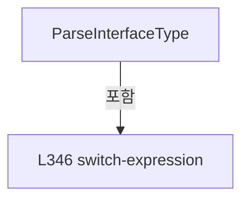

변경 전 점검: 입력/반환 타입, 위 호출자, 예외/취소 경로, 공유 상태와 저장·전송 소비자를 함께 확인합니다. 값의 단위나 물리 방향을 이름만으로 확정하지 않습니다.

### MethodDeclaration `InterfaceTypeText` · L364–383

[Drilling.File/JHMI/CInterfaceFile.cs:364–383](https://github.com/kjuws10-rgb/A3Drilling/blob/5aee8e58439c9b455cae7c9593c9be986c3e682e/Drilling.File/JHMI/CInterfaceFile.cs#L364-L383)

| 항목 | 실제 추출 값 |
| --- | --- |
| 서명 | string Drilling.File.JHMI.CInterfaceFile.InterfaceTypeText(Drilling.Common.Interface.EN_INTERFACE_TYPE) |
| 접근/수식자 | Private / private, static |
| 반환/값 타입 | string |
| 소속 타입 | NamedType:Drilling.File.JHMI.CInterfaceFile |

입력 계약:

| 이름 | 타입 | 전달 | 선택/기본값 |
| --- | --- | --- | --- |
| type | Drilling.Common.Interface.EN_INTERFACE_TYPE | None | False /  |

정적 호출자로 확인된 위치:

| 호출 파일/행 | 호출 표현식 | 런타임 분기 가능 |
| --- | --- | --- |
| [Drilling.File/JHMI/CInterfaceFile.cs:126–126](https://github.com/kjuws10-rgb/A3Drilling/blob/5aee8e58439c9b455cae7c9593c9be986c3e682e/Drilling.File/JHMI/CInterfaceFile.cs#L126-L126) | InterfaceTypeText | False |
| [Drilling.File/JHMI/CInterfaceFile.cs:303–303](https://github.com/kjuws10-rgb/A3Drilling/blob/5aee8e58439c9b455cae7c9593c9be986c3e682e/Drilling.File/JHMI/CInterfaceFile.cs#L303-L303) | InterfaceTypeText | False |
| [Drilling.File/JHMI/CInterfaceFile.cs:323–323](https://github.com/kjuws10-rgb/A3Drilling/blob/5aee8e58439c9b455cae7c9593c9be986c3e682e/Drilling.File/JHMI/CInterfaceFile.cs#L323-L323) | InterfaceTypeText | False |

본문의 실제 연산·분기·예외·반환 순서(원문 위치 순):

| 원본 행 | 종류 | 주석 해설 |
| --- | --- | --- |
| 366 | return | 호출자에게 값 또는 제어를 반환합니다: return type switch { EN_INTERFACE_TYPE.OpcUa => "OPCUA", EN_INTERFACE_TYPE.ModbusSerial => "MODBUS_SERIAL", EN_INTERFACE_TYPE.ModbusTcp => "MODBUS_TCP", EN_INTERFACE_TYPE.Serial => "SERIAL", EN_INTERFACE_TYPE.SocketClient => "SOCK |
| 366 | switch-expression | 값별 결과식을 선택합니다: type switch { EN_INTERFACE_TYPE.OpcUa => "OPCUA", EN_INTERFACE_TYPE.ModbusSerial => "MODBUS_SERIAL", EN_INTERFACE_TYPE.ModbusTcp => "MODBUS_TCP", EN_INTERFACE_TYPE.Serial => "SERIAL", EN_INTERFACE_TYPE.SocketClient => "SOCKET_C",  |

제어 구문의 포함 구조(실제 실행 순서/CFG가 아닌 구문 탐색 그림):

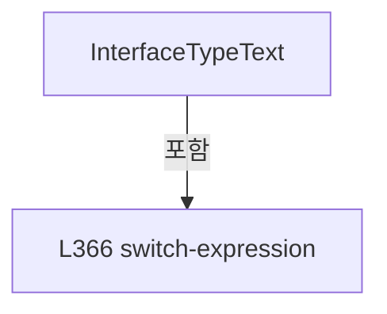

변경 전 점검: 입력/반환 타입, 위 호출자, 예외/취소 경로, 공유 상태와 저장·전송 소비자를 함께 확인합니다. 값의 단위나 물리 방향을 이름만으로 확정하지 않습니다.

### MethodDeclaration `ParseDevice` · L385–400

[Drilling.File/JHMI/CInterfaceFile.cs:385–400](https://github.com/kjuws10-rgb/A3Drilling/blob/5aee8e58439c9b455cae7c9593c9be986c3e682e/Drilling.File/JHMI/CInterfaceFile.cs#L385-L400)

| 항목 | 실제 추출 값 |
| --- | --- |
| 서명 | Drilling.Common.Interface.EN_EQP_MODULE Drilling.File.JHMI.CInterfaceFile.ParseDevice(string) |
| 접근/수식자 | Private / private, static |
| 반환/값 타입 | Drilling.Common.Interface.EN_EQP_MODULE |
| 소속 타입 | NamedType:Drilling.File.JHMI.CInterfaceFile |

입력 계약:

| 이름 | 타입 | 전달 | 선택/기본값 |
| --- | --- | --- | --- |
| value | string | None | False /  |

정적 호출자로 확인된 위치:

| 호출 파일/행 | 호출 표현식 | 런타임 분기 가능 |
| --- | --- | --- |
| [Drilling.File/JHMI/CInterfaceFile.cs:96–96](https://github.com/kjuws10-rgb/A3Drilling/blob/5aee8e58439c9b455cae7c9593c9be986c3e682e/Drilling.File/JHMI/CInterfaceFile.cs#L96-L96) | ParseDevice | False |

호출하는 대상과 해석 범위:

| 원본 행 | 표현식 | 분석 상태 | 대상/소스 위치 |
| --- | --- | --- | --- |
| 387 | Normalize | resolved | string Drilling.File.JHMI.CInterfaceFile.Normalize(string) · Drilling.File/JHMI/CInterfaceFile.cs:472 |
| 399 | new InvalidDataException | resolved | System.IO.InvalidDataException.InvalidDataException(string?) |

본문의 실제 연산·분기·예외·반환 순서(원문 위치 순):

| 원본 행 | 종류 | 주석 해설 |
| --- | --- | --- |
| 387 | call | 함수·델리게이트 또는 객체 생성자를 호출합니다: Normalize(value) |
| 387 | return | 호출자에게 값 또는 제어를 반환합니다: return Normalize(value) switch { "WONIK_CONTROL" or "WONIK_CTRL" or "CONTROL" => EN_EQP_MODULE.WonikCtrl, "WONIK_VISION" or "VISION" => EN_EQP_MODULE.Vision, "AUTOMATION1" or "AUTOMATION_ONE" or "A1" => EN_EQP_MODULE.Automation1,  |
| 387 | switch-expression | 값별 결과식을 선택합니다: Normalize(value) switch { "WONIK_CONTROL" or "WONIK_CTRL" or "CONTROL" => EN_EQP_MODULE.WonikCtrl, "WONIK_VISION" or "VISION" => EN_EQP_MODULE.Vision, "AUTOMATION1" or "AUTOMATION_ONE" or "A1" => EN_EQP_MODULE.Automation1, "MOTION |
| 399 | call | 함수·델리게이트 또는 객체 생성자를 호출합니다: new InvalidDataException($"Unknown interface device: {value}") |
| 399 | throw | 예외를 발생/전달합니다: throw new InvalidDataException($"Unknown interface device: {value}") |

제어 구문의 포함 구조(실제 실행 순서/CFG가 아닌 구문 탐색 그림):

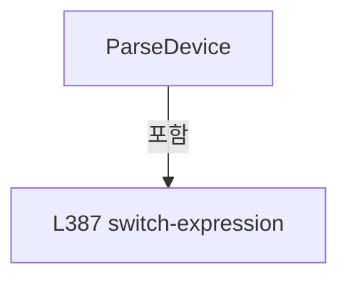

변경 전 점검: 입력/반환 타입, 위 호출자, 예외/취소 경로, 공유 상태와 저장·전송 소비자를 함께 확인합니다. 값의 단위나 물리 방향을 이름만으로 확정하지 않습니다.

### MethodDeclaration `DeviceText` · L402–417

[Drilling.File/JHMI/CInterfaceFile.cs:402–417](https://github.com/kjuws10-rgb/A3Drilling/blob/5aee8e58439c9b455cae7c9593c9be986c3e682e/Drilling.File/JHMI/CInterfaceFile.cs#L402-L417)

| 항목 | 실제 추출 값 |
| --- | --- |
| 서명 | string Drilling.File.JHMI.CInterfaceFile.DeviceText(Drilling.Common.Interface.EN_EQP_MODULE) |
| 접근/수식자 | Private / private, static |
| 반환/값 타입 | string |
| 소속 타입 | NamedType:Drilling.File.JHMI.CInterfaceFile |

입력 계약:

| 이름 | 타입 | 전달 | 선택/기본값 |
| --- | --- | --- | --- |
| module | Drilling.Common.Interface.EN_EQP_MODULE | None | False /  |

정적 호출자로 확인된 위치:

| 호출 파일/행 | 호출 표현식 | 런타임 분기 가능 |
| --- | --- | --- |
| [Drilling.File/JHMI/CInterfaceFile.cs:127–127](https://github.com/kjuws10-rgb/A3Drilling/blob/5aee8e58439c9b455cae7c9593c9be986c3e682e/Drilling.File/JHMI/CInterfaceFile.cs#L127-L127) | DeviceText | False |
| [Drilling.File/JHMI/CInterfaceFile.cs:304–304](https://github.com/kjuws10-rgb/A3Drilling/blob/5aee8e58439c9b455cae7c9593c9be986c3e682e/Drilling.File/JHMI/CInterfaceFile.cs#L304-L304) | DeviceText | False |
| [Drilling.File/JHMI/CInterfaceFile.cs:324–324](https://github.com/kjuws10-rgb/A3Drilling/blob/5aee8e58439c9b455cae7c9593c9be986c3e682e/Drilling.File/JHMI/CInterfaceFile.cs#L324-L324) | DeviceText | False |
| [Drilling.File/JHMI/CInterfaceFile.cs:341–341](https://github.com/kjuws10-rgb/A3Drilling/blob/5aee8e58439c9b455cae7c9593c9be986c3e682e/Drilling.File/JHMI/CInterfaceFile.cs#L341-L341) | DeviceText | False |

호출하는 대상과 해석 범위:

| 원본 행 | 표현식 | 분석 상태 | 대상/소스 위치 |
| --- | --- | --- | --- |
| 416 | module.ToString().ToUpperInvariant | resolved | string string.ToUpperInvariant() |
| 416 | module.ToString | resolved · 동적 구현 선택 가능 | string System.Enum.ToString() |

본문의 실제 연산·분기·예외·반환 순서(원문 위치 순):

| 원본 행 | 종류 | 주석 해설 |
| --- | --- | --- |
| 404 | return | 호출자에게 값 또는 제어를 반환합니다: return module switch { EN_EQP_MODULE.WonikCtrl => "WONIK_CONTROL", EN_EQP_MODULE.Vision => "WONIK_VISION", EN_EQP_MODULE.Automation1 => "AUTOMATION1", EN_EQP_MODULE.Motion => "MOTION", EN_EQP_MODULE.TalonLaser => "TALON", EN_EQP_M |
| 404 | switch-expression | 값별 결과식을 선택합니다: module switch { EN_EQP_MODULE.WonikCtrl => "WONIK_CONTROL", EN_EQP_MODULE.Vision => "WONIK_VISION", EN_EQP_MODULE.Automation1 => "AUTOMATION1", EN_EQP_MODULE.Motion => "MOTION", EN_EQP_MODULE.TalonLaser => "TALON", EN_EQP_MODULE.A |
| 416 | call | 함수·델리게이트 또는 객체 생성자를 호출합니다: module.ToString().ToUpperInvariant() |
| 416 | call | 함수·델리게이트 또는 객체 생성자를 호출합니다: module.ToString() |

제어 구문의 포함 구조(실제 실행 순서/CFG가 아닌 구문 탐색 그림):

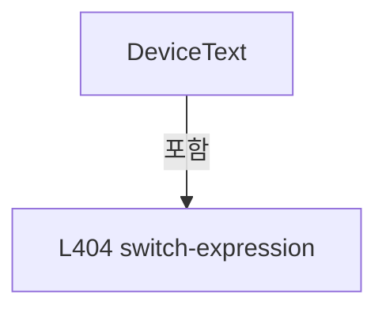

변경 전 점검: 입력/반환 타입, 위 호출자, 예외/취소 경로, 공유 상태와 저장·전송 소비자를 함께 확인합니다. 값의 단위나 물리 방향을 이름만으로 확정하지 않습니다.

### MethodDeclaration `RequireText` · L419–422

[Drilling.File/JHMI/CInterfaceFile.cs:419–422](https://github.com/kjuws10-rgb/A3Drilling/blob/5aee8e58439c9b455cae7c9593c9be986c3e682e/Drilling.File/JHMI/CInterfaceFile.cs#L419-L422)

| 항목 | 실제 추출 값 |
| --- | --- |
| 서명 | string Drilling.File.JHMI.CInterfaceFile.RequireText(System.Collections.Generic.IReadOnlyDictionary<string, string>, int, params string[]) |
| 접근/수식자 | Private / private, static |
| 반환/값 타입 | string |
| 소속 타입 | NamedType:Drilling.File.JHMI.CInterfaceFile |

입력 계약:

| 이름 | 타입 | 전달 | 선택/기본값 |
| --- | --- | --- | --- |
| row | System.Collections.Generic.IReadOnlyDictionary<string, string> | None | False /  |
| rowNo | int | None | False /  |
| names | string[] | None | False /  |

정적 호출자로 확인된 위치:

| 호출 파일/행 | 호출 표현식 | 런타임 분기 가능 |
| --- | --- | --- |
| [Drilling.File/JHMI/CInterfaceFile.cs:95–95](https://github.com/kjuws10-rgb/A3Drilling/blob/5aee8e58439c9b455cae7c9593c9be986c3e682e/Drilling.File/JHMI/CInterfaceFile.cs#L95-L95) | RequireText | False |
| [Drilling.File/JHMI/CInterfaceFile.cs:96–96](https://github.com/kjuws10-rgb/A3Drilling/blob/5aee8e58439c9b455cae7c9593c9be986c3e682e/Drilling.File/JHMI/CInterfaceFile.cs#L96-L96) | RequireText | False |
| [Drilling.File/JHMI/CInterfaceFile.cs:97–97](https://github.com/kjuws10-rgb/A3Drilling/blob/5aee8e58439c9b455cae7c9593c9be986c3e682e/Drilling.File/JHMI/CInterfaceFile.cs#L97-L97) | RequireText | False |
| [Drilling.File/JHMI/CInterfaceFile.cs:98–98](https://github.com/kjuws10-rgb/A3Drilling/blob/5aee8e58439c9b455cae7c9593c9be986c3e682e/Drilling.File/JHMI/CInterfaceFile.cs#L98-L98) | RequireText | False |
| [Drilling.File/JHMI/CInterfaceFile.cs:99–99](https://github.com/kjuws10-rgb/A3Drilling/blob/5aee8e58439c9b455cae7c9593c9be986c3e682e/Drilling.File/JHMI/CInterfaceFile.cs#L99-L99) | RequireText | False |
| [Drilling.File/JHMI/CInterfaceFile.cs:100–100](https://github.com/kjuws10-rgb/A3Drilling/blob/5aee8e58439c9b455cae7c9593c9be986c3e682e/Drilling.File/JHMI/CInterfaceFile.cs#L100-L100) | RequireText | False |
| [Drilling.File/JHMI/CInterfaceFile.cs:101–101](https://github.com/kjuws10-rgb/A3Drilling/blob/5aee8e58439c9b455cae7c9593c9be986c3e682e/Drilling.File/JHMI/CInterfaceFile.cs#L101-L101) | RequireText | False |

호출하는 대상과 해석 범위:

| 원본 행 | 표현식 | 분석 상태 | 대상/소스 위치 |
| --- | --- | --- | --- |
| 421 | CCsvParser.RequireText | resolved | string Drilling.File.Parser.CCsvParser.RequireText(System.Collections.Generic.IReadOnlyDictionary<string, string>, string, int, params string[]) · Drilling.File/Parser/CCsvParser.cs:187 |

본문의 실제 연산·분기·예외·반환 순서(원문 위치 순):

| 원본 행 | 종류 | 주석 해설 |
| --- | --- | --- |
| 421 | call | 함수·델리게이트 또는 객체 생성자를 호출합니다: CCsvParser.RequireText(row, "JHMI_INTERFACE", rowNo, names) |
| 421 | return | 호출자에게 값 또는 제어를 반환합니다: return CCsvParser.RequireText(row, "JHMI_INTERFACE", rowNo, names); |

변경 전 점검: 입력/반환 타입, 위 호출자, 예외/취소 경로, 공유 상태와 저장·전송 소비자를 함께 확인합니다. 값의 단위나 물리 방향을 이름만으로 확정하지 않습니다.

### MethodDeclaration `ReadRequiredBool` · L424–427

[Drilling.File/JHMI/CInterfaceFile.cs:424–427](https://github.com/kjuws10-rgb/A3Drilling/blob/5aee8e58439c9b455cae7c9593c9be986c3e682e/Drilling.File/JHMI/CInterfaceFile.cs#L424-L427)

| 항목 | 실제 추출 값 |
| --- | --- |
| 서명 | bool Drilling.File.JHMI.CInterfaceFile.ReadRequiredBool(string, int, string) |
| 접근/수식자 | Private / private, static |
| 반환/값 타입 | bool |
| 소속 타입 | NamedType:Drilling.File.JHMI.CInterfaceFile |

입력 계약:

| 이름 | 타입 | 전달 | 선택/기본값 |
| --- | --- | --- | --- |
| value | string | None | False /  |
| rowNo | int | None | False /  |
| fieldName | string | None | False /  |

정적 호출자로 확인된 위치:

| 호출 파일/행 | 호출 표현식 | 런타임 분기 가능 |
| --- | --- | --- |
| [Drilling.File/JHMI/CInterfaceFile.cs:100–100](https://github.com/kjuws10-rgb/A3Drilling/blob/5aee8e58439c9b455cae7c9593c9be986c3e682e/Drilling.File/JHMI/CInterfaceFile.cs#L100-L100) | ReadRequiredBool | False |
| [Drilling.File/JHMI/CInterfaceFile.cs:101–101](https://github.com/kjuws10-rgb/A3Drilling/blob/5aee8e58439c9b455cae7c9593c9be986c3e682e/Drilling.File/JHMI/CInterfaceFile.cs#L101-L101) | ReadRequiredBool | False |

호출하는 대상과 해석 범위:

| 원본 행 | 표현식 | 분석 상태 | 대상/소스 위치 |
| --- | --- | --- | --- |
| 426 | CCsvParser.ReadRequiredBool | resolved | bool Drilling.File.Parser.CCsvParser.ReadRequiredBool(string, string, int, string) · Drilling.File/Parser/CCsvParser.cs:244 |

본문의 실제 연산·분기·예외·반환 순서(원문 위치 순):

| 원본 행 | 종류 | 주석 해설 |
| --- | --- | --- |
| 426 | call | 함수·델리게이트 또는 객체 생성자를 호출합니다: CCsvParser.ReadRequiredBool(value, "JHMI_INTERFACE", rowNo, fieldName) |
| 426 | return | 호출자에게 값 또는 제어를 반환합니다: return CCsvParser.ReadRequiredBool(value, "JHMI_INTERFACE", rowNo, fieldName); |

변경 전 점검: 입력/반환 타입, 위 호출자, 예외/취소 경로, 공유 상태와 저장·전송 소비자를 함께 확인합니다. 값의 단위나 물리 방향을 이름만으로 확정하지 않습니다.

### MethodDeclaration `ReadRequiredInt` · L429–432

[Drilling.File/JHMI/CInterfaceFile.cs:429–432](https://github.com/kjuws10-rgb/A3Drilling/blob/5aee8e58439c9b455cae7c9593c9be986c3e682e/Drilling.File/JHMI/CInterfaceFile.cs#L429-L432)

| 항목 | 실제 추출 값 |
| --- | --- |
| 서명 | int Drilling.File.JHMI.CInterfaceFile.ReadRequiredInt(string, int, string) |
| 접근/수식자 | Private / private, static |
| 반환/값 타입 | int |
| 소속 타입 | NamedType:Drilling.File.JHMI.CInterfaceFile |

입력 계약:

| 이름 | 타입 | 전달 | 선택/기본값 |
| --- | --- | --- | --- |
| value | string | None | False /  |
| rowNo | int | None | False /  |
| fieldName | string | None | False /  |

정적 호출자로 확인된 위치:

| 호출 파일/행 | 호출 표현식 | 런타임 분기 가능 |
| --- | --- | --- |
| [Drilling.File/JHMI/CInterfaceFile.cs:97–97](https://github.com/kjuws10-rgb/A3Drilling/blob/5aee8e58439c9b455cae7c9593c9be986c3e682e/Drilling.File/JHMI/CInterfaceFile.cs#L97-L97) | ReadRequiredInt | False |

호출하는 대상과 해석 범위:

| 원본 행 | 표현식 | 분석 상태 | 대상/소스 위치 |
| --- | --- | --- | --- |
| 431 | CCsvParser.ReadRequiredInt | resolved | int Drilling.File.Parser.CCsvParser.ReadRequiredInt(string, string, int, string, bool) · Drilling.File/Parser/CCsvParser.cs:208 |

본문의 실제 연산·분기·예외·반환 순서(원문 위치 순):

| 원본 행 | 종류 | 주석 해설 |
| --- | --- | --- |
| 431 | call | 함수·델리게이트 또는 객체 생성자를 호출합니다: CCsvParser.ReadRequiredInt(value, "JHMI_INTERFACE", rowNo, fieldName) |
| 431 | return | 호출자에게 값 또는 제어를 반환합니다: return CCsvParser.ReadRequiredInt(value, "JHMI_INTERFACE", rowNo, fieldName); |

변경 전 점검: 입력/반환 타입, 위 호출자, 예외/취소 경로, 공유 상태와 저장·전송 소비자를 함께 확인합니다. 값의 단위나 물리 방향을 이름만으로 확정하지 않습니다.

### MethodDeclaration `RequireArgument` · L434–440

[Drilling.File/JHMI/CInterfaceFile.cs:434–440](https://github.com/kjuws10-rgb/A3Drilling/blob/5aee8e58439c9b455cae7c9593c9be986c3e682e/Drilling.File/JHMI/CInterfaceFile.cs#L434-L440)

| 항목 | 실제 추출 값 |
| --- | --- |
| 서명 | void Drilling.File.JHMI.CInterfaceFile.RequireArgument(Drilling.Common.Interface.ST_INTERFACE_DATA, string, string) |
| 접근/수식자 | Private / private, static |
| 반환/값 타입 | void |
| 소속 타입 | NamedType:Drilling.File.JHMI.CInterfaceFile |

입력 계약:

| 이름 | 타입 | 전달 | 선택/기본값 |
| --- | --- | --- | --- |
| data | Drilling.Common.Interface.ST_INTERFACE_DATA | None | False /  |
| value | string | None | False /  |
| fieldName | string | None | False /  |

정적 호출자로 확인된 위치:

| 호출 파일/행 | 호출 표현식 | 런타임 분기 가능 |
| --- | --- | --- |
| [Drilling.File/JHMI/CInterfaceFile.cs:187–187](https://github.com/kjuws10-rgb/A3Drilling/blob/5aee8e58439c9b455cae7c9593c9be986c3e682e/Drilling.File/JHMI/CInterfaceFile.cs#L187-L187) | RequireArgument | False |
| [Drilling.File/JHMI/CInterfaceFile.cs:199–199](https://github.com/kjuws10-rgb/A3Drilling/blob/5aee8e58439c9b455cae7c9593c9be986c3e682e/Drilling.File/JHMI/CInterfaceFile.cs#L199-L199) | RequireArgument | False |
| [Drilling.File/JHMI/CInterfaceFile.cs:216–216](https://github.com/kjuws10-rgb/A3Drilling/blob/5aee8e58439c9b455cae7c9593c9be986c3e682e/Drilling.File/JHMI/CInterfaceFile.cs#L216-L216) | RequireArgument | False |

호출하는 대상과 해석 범위:

| 원본 행 | 표현식 | 분석 상태 | 대상/소스 위치 |
| --- | --- | --- | --- |
| 436 | string.IsNullOrWhiteSpace | resolved | bool string.IsNullOrWhiteSpace(string?) |
| 438 | new InvalidDataException | resolved | System.IO.InvalidDataException.InvalidDataException(string?) |

본문의 실제 연산·분기·예외·반환 순서(원문 위치 순):

| 원본 행 | 종류 | 주석 해설 |
| --- | --- | --- |
| 436 | call | 함수·델리게이트 또는 객체 생성자를 호출합니다: string.IsNullOrWhiteSpace(value) |
| 436 | if | 조건에 따라 분기합니다: if (string.IsNullOrWhiteSpace(value)) |
| 438 | call | 함수·델리게이트 또는 객체 생성자를 호출합니다: new InvalidDataException($"JHMI_INTERFACE validation failed. {data.NickName}/{fieldName} cannot be empty in ONLINE mode.") |
| 438 | throw | 예외를 발생/전달합니다: throw new InvalidDataException($"JHMI_INTERFACE validation failed. {data.NickName}/{fieldName} cannot be empty in ONLINE mode."); |

제어 구문의 포함 구조(실제 실행 순서/CFG가 아닌 구문 탐색 그림):

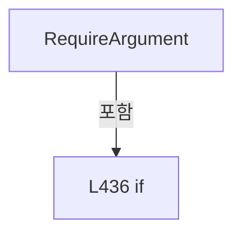

변경 전 점검: 입력/반환 타입, 위 호출자, 예외/취소 경로, 공유 상태와 저장·전송 소비자를 함께 확인합니다. 값의 단위나 물리 방향을 이름만으로 확정하지 않습니다.

### MethodDeclaration `RequirePositiveInt` · L442–448

[Drilling.File/JHMI/CInterfaceFile.cs:442–448](https://github.com/kjuws10-rgb/A3Drilling/blob/5aee8e58439c9b455cae7c9593c9be986c3e682e/Drilling.File/JHMI/CInterfaceFile.cs#L442-L448)

| 항목 | 실제 추출 값 |
| --- | --- |
| 서명 | void Drilling.File.JHMI.CInterfaceFile.RequirePositiveInt(Drilling.Common.Interface.ST_INTERFACE_DATA, string, string) |
| 접근/수식자 | Private / private, static |
| 반환/값 타입 | void |
| 소속 타입 | NamedType:Drilling.File.JHMI.CInterfaceFile |

입력 계약:

| 이름 | 타입 | 전달 | 선택/기본값 |
| --- | --- | --- | --- |
| data | Drilling.Common.Interface.ST_INTERFACE_DATA | None | False /  |
| value | string | None | False /  |
| fieldName | string | None | False /  |

정적 호출자로 확인된 위치:

| 호출 파일/행 | 호출 표현식 | 런타임 분기 가능 |
| --- | --- | --- |
| [Drilling.File/JHMI/CInterfaceFile.cs:188–188](https://github.com/kjuws10-rgb/A3Drilling/blob/5aee8e58439c9b455cae7c9593c9be986c3e682e/Drilling.File/JHMI/CInterfaceFile.cs#L188-L188) | RequirePositiveInt | False |
| [Drilling.File/JHMI/CInterfaceFile.cs:190–190](https://github.com/kjuws10-rgb/A3Drilling/blob/5aee8e58439c9b455cae7c9593c9be986c3e682e/Drilling.File/JHMI/CInterfaceFile.cs#L190-L190) | RequirePositiveInt | False |
| [Drilling.File/JHMI/CInterfaceFile.cs:200–200](https://github.com/kjuws10-rgb/A3Drilling/blob/5aee8e58439c9b455cae7c9593c9be986c3e682e/Drilling.File/JHMI/CInterfaceFile.cs#L200-L200) | RequirePositiveInt | False |
| [Drilling.File/JHMI/CInterfaceFile.cs:201–201](https://github.com/kjuws10-rgb/A3Drilling/blob/5aee8e58439c9b455cae7c9593c9be986c3e682e/Drilling.File/JHMI/CInterfaceFile.cs#L201-L201) | RequirePositiveInt | False |
| [Drilling.File/JHMI/CInterfaceFile.cs:202–202](https://github.com/kjuws10-rgb/A3Drilling/blob/5aee8e58439c9b455cae7c9593c9be986c3e682e/Drilling.File/JHMI/CInterfaceFile.cs#L202-L202) | RequirePositiveInt | False |
| [Drilling.File/JHMI/CInterfaceFile.cs:206–206](https://github.com/kjuws10-rgb/A3Drilling/blob/5aee8e58439c9b455cae7c9593c9be986c3e682e/Drilling.File/JHMI/CInterfaceFile.cs#L206-L206) | RequirePositiveInt | False |
| [Drilling.File/JHMI/CInterfaceFile.cs:207–207](https://github.com/kjuws10-rgb/A3Drilling/blob/5aee8e58439c9b455cae7c9593c9be986c3e682e/Drilling.File/JHMI/CInterfaceFile.cs#L207-L207) | RequirePositiveInt | False |
| [Drilling.File/JHMI/CInterfaceFile.cs:208–208](https://github.com/kjuws10-rgb/A3Drilling/blob/5aee8e58439c9b455cae7c9593c9be986c3e682e/Drilling.File/JHMI/CInterfaceFile.cs#L208-L208) | RequirePositiveInt | False |
| [Drilling.File/JHMI/CInterfaceFile.cs:217–217](https://github.com/kjuws10-rgb/A3Drilling/blob/5aee8e58439c9b455cae7c9593c9be986c3e682e/Drilling.File/JHMI/CInterfaceFile.cs#L217-L217) | RequirePositiveInt | False |
| [Drilling.File/JHMI/CInterfaceFile.cs:218–218](https://github.com/kjuws10-rgb/A3Drilling/blob/5aee8e58439c9b455cae7c9593c9be986c3e682e/Drilling.File/JHMI/CInterfaceFile.cs#L218-L218) | RequirePositiveInt | False |

호출하는 대상과 해석 범위:

| 원본 행 | 표현식 | 분석 상태 | 대상/소스 위치 |
| --- | --- | --- | --- |
| 444 | int.TryParse | resolved | bool int.TryParse(string?, System.Globalization.NumberStyles, System.IFormatProvider?, out int) |
| 446 | new InvalidDataException | resolved | System.IO.InvalidDataException.InvalidDataException(string?) |

본문의 실제 연산·분기·예외·반환 순서(원문 위치 순):

| 원본 행 | 종류 | 주석 해설 |
| --- | --- | --- |
| 444 | call | 함수·델리게이트 또는 객체 생성자를 호출합니다: int.TryParse(value, NumberStyles.Integer, CultureInfo.InvariantCulture, out var result) |
| 444 | if | 조건에 따라 분기합니다: if (!int.TryParse(value, NumberStyles.Integer, CultureInfo.InvariantCulture, out var result) &#124;&#124; result <= 0) |
| 446 | call | 함수·델리게이트 또는 객체 생성자를 호출합니다: new InvalidDataException($"JHMI_INTERFACE validation failed. {data.NickName}/{fieldName} must be a positive integer in ONLINE mode.") |
| 446 | throw | 예외를 발생/전달합니다: throw new InvalidDataException($"JHMI_INTERFACE validation failed. {data.NickName}/{fieldName} must be a positive integer in ONLINE mode."); |

제어 구문의 포함 구조(실제 실행 순서/CFG가 아닌 구문 탐색 그림):

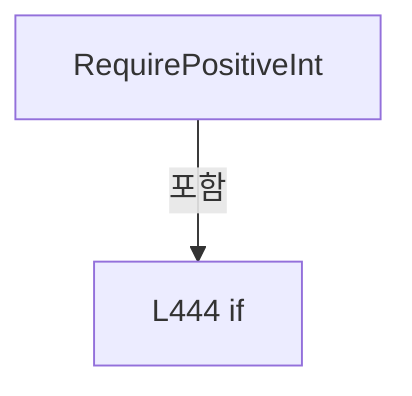

변경 전 점검: 입력/반환 타입, 위 호출자, 예외/취소 경로, 공유 상태와 저장·전송 소비자를 함께 확인합니다. 값의 단위나 물리 방향을 이름만으로 확정하지 않습니다.

### MethodDeclaration `ValidateParity` · L450–459

[Drilling.File/JHMI/CInterfaceFile.cs:450–459](https://github.com/kjuws10-rgb/A3Drilling/blob/5aee8e58439c9b455cae7c9593c9be986c3e682e/Drilling.File/JHMI/CInterfaceFile.cs#L450-L459)

| 항목 | 실제 추출 값 |
| --- | --- |
| 서명 | void Drilling.File.JHMI.CInterfaceFile.ValidateParity(Drilling.Common.Interface.ST_INTERFACE_DATA, string) |
| 접근/수식자 | Private / private, static |
| 반환/값 타입 | void |
| 소속 타입 | NamedType:Drilling.File.JHMI.CInterfaceFile |

입력 계약:

| 이름 | 타입 | 전달 | 선택/기본값 |
| --- | --- | --- | --- |
| data | Drilling.Common.Interface.ST_INTERFACE_DATA | None | False /  |
| value | string | None | False /  |

정적 호출자로 확인된 위치:

| 호출 파일/행 | 호출 표현식 | 런타임 분기 가능 |
| --- | --- | --- |
| [Drilling.File/JHMI/CInterfaceFile.cs:189–189](https://github.com/kjuws10-rgb/A3Drilling/blob/5aee8e58439c9b455cae7c9593c9be986c3e682e/Drilling.File/JHMI/CInterfaceFile.cs#L189-L189) | ValidateParity | False |

호출하는 대상과 해석 범위:

| 원본 행 | 표현식 | 분석 상태 | 대상/소스 위치 |
| --- | --- | --- | --- |
| 452 | Normalize | resolved | string Drilling.File.JHMI.CInterfaceFile.Normalize(string) · Drilling.File/JHMI/CInterfaceFile.cs:472 |
| 458 | new InvalidDataException | resolved | System.IO.InvalidDataException.InvalidDataException(string?) |

본문의 실제 연산·분기·예외·반환 순서(원문 위치 순):

| 원본 행 | 종류 | 주석 해설 |
| --- | --- | --- |
| 452 | call | 함수·델리게이트 또는 객체 생성자를 호출합니다: Normalize(value) |
| 452 | local-declaration | 지역 변수를 선언합니다: var normalized = Normalize(value); |
| 452 | variable-initializer | 변수의 초기값을 지정합니다: normalized = Normalize(value) |
| 453 | if | 조건에 따라 분기합니다: if (normalized is "" or "NONE" or "ODD" or "EVEN" or "MARK" or "SPACE") |
| 455 | return | 호출자에게 값 또는 제어를 반환합니다: return; |
| 458 | call | 함수·델리게이트 또는 객체 생성자를 호출합니다: new InvalidDataException($"JHMI_INTERFACE validation failed. {data.NickName}/ARG3/PARITY is invalid: {value}") |
| 458 | throw | 예외를 발생/전달합니다: throw new InvalidDataException($"JHMI_INTERFACE validation failed. {data.NickName}/ARG3/PARITY is invalid: {value}"); |

제어 구문의 포함 구조(실제 실행 순서/CFG가 아닌 구문 탐색 그림):

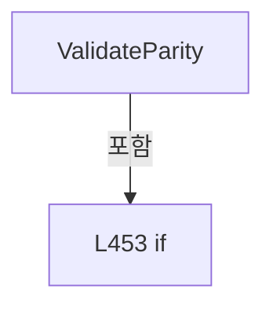

변경 전 점검: 입력/반환 타입, 위 호출자, 예외/취소 경로, 공유 상태와 저장·전송 소비자를 함께 확인합니다. 값의 단위나 물리 방향을 이름만으로 확정하지 않습니다.

### MethodDeclaration `ValidateStopBits` · L461–470

[Drilling.File/JHMI/CInterfaceFile.cs:461–470](https://github.com/kjuws10-rgb/A3Drilling/blob/5aee8e58439c9b455cae7c9593c9be986c3e682e/Drilling.File/JHMI/CInterfaceFile.cs#L461-L470)

| 항목 | 실제 추출 값 |
| --- | --- |
| 서명 | void Drilling.File.JHMI.CInterfaceFile.ValidateStopBits(Drilling.Common.Interface.ST_INTERFACE_DATA, string) |
| 접근/수식자 | Private / private, static |
| 반환/값 타입 | void |
| 소속 타입 | NamedType:Drilling.File.JHMI.CInterfaceFile |

입력 계약:

| 이름 | 타입 | 전달 | 선택/기본값 |
| --- | --- | --- | --- |
| data | Drilling.Common.Interface.ST_INTERFACE_DATA | None | False /  |
| value | string | None | False /  |

정적 호출자로 확인된 위치:

| 호출 파일/행 | 호출 표현식 | 런타임 분기 가능 |
| --- | --- | --- |
| [Drilling.File/JHMI/CInterfaceFile.cs:191–191](https://github.com/kjuws10-rgb/A3Drilling/blob/5aee8e58439c9b455cae7c9593c9be986c3e682e/Drilling.File/JHMI/CInterfaceFile.cs#L191-L191) | ValidateStopBits | False |

호출하는 대상과 해석 범위:

| 원본 행 | 표현식 | 분석 상태 | 대상/소스 위치 |
| --- | --- | --- | --- |
| 463 | Normalize(value).Replace | resolved | string string.Replace(string, string?, System.StringComparison) |
| 463 | Normalize | resolved | string Drilling.File.JHMI.CInterfaceFile.Normalize(string) · Drilling.File/JHMI/CInterfaceFile.cs:472 |
| 469 | new InvalidDataException | resolved | System.IO.InvalidDataException.InvalidDataException(string?) |

본문의 실제 연산·분기·예외·반환 순서(원문 위치 순):

| 원본 행 | 종류 | 주석 해설 |
| --- | --- | --- |
| 463 | call | 함수·델리게이트 또는 객체 생성자를 호출합니다: Normalize(value).Replace("_", "", StringComparison.OrdinalIgnoreCase) |
| 463 | call | 함수·델리게이트 또는 객체 생성자를 호출합니다: Normalize(value) |
| 463 | local-declaration | 지역 변수를 선언합니다: var normalized = Normalize(value).Replace("_", "", StringComparison.OrdinalIgnoreCase); |
| 463 | variable-initializer | 변수의 초기값을 지정합니다: normalized = Normalize(value).Replace("_", "", StringComparison.OrdinalIgnoreCase) |
| 464 | if | 조건에 따라 분기합니다: if (normalized is "ONE" or "TWO" or "ONEPOINTFIVE" or "1" or "2" or "1.5") |
| 466 | return | 호출자에게 값 또는 제어를 반환합니다: return; |
| 469 | call | 함수·델리게이트 또는 객체 생성자를 호출합니다: new InvalidDataException($"JHMI_INTERFACE validation failed. {data.NickName}/ARG5/STOP_BITS is invalid: {value}") |
| 469 | throw | 예외를 발생/전달합니다: throw new InvalidDataException($"JHMI_INTERFACE validation failed. {data.NickName}/ARG5/STOP_BITS is invalid: {value}"); |

제어 구문의 포함 구조(실제 실행 순서/CFG가 아닌 구문 탐색 그림):

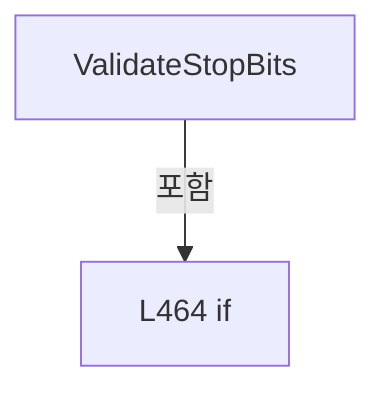

변경 전 점검: 입력/반환 타입, 위 호출자, 예외/취소 경로, 공유 상태와 저장·전송 소비자를 함께 확인합니다. 값의 단위나 물리 방향을 이름만으로 확정하지 않습니다.

### MethodDeclaration `Normalize` · L472–475

[Drilling.File/JHMI/CInterfaceFile.cs:472–475](https://github.com/kjuws10-rgb/A3Drilling/blob/5aee8e58439c9b455cae7c9593c9be986c3e682e/Drilling.File/JHMI/CInterfaceFile.cs#L472-L475)

| 항목 | 실제 추출 값 |
| --- | --- |
| 서명 | string Drilling.File.JHMI.CInterfaceFile.Normalize(string) |
| 접근/수식자 | Private / private, static |
| 반환/값 타입 | string |
| 소속 타입 | NamedType:Drilling.File.JHMI.CInterfaceFile |

입력 계약:

| 이름 | 타입 | 전달 | 선택/기본값 |
| --- | --- | --- | --- |
| value | string | None | False /  |

정적 호출자로 확인된 위치:

| 호출 파일/행 | 호출 표현식 | 런타임 분기 가능 |
| --- | --- | --- |
| [Drilling.File/JHMI/CInterfaceFile.cs:346–346](https://github.com/kjuws10-rgb/A3Drilling/blob/5aee8e58439c9b455cae7c9593c9be986c3e682e/Drilling.File/JHMI/CInterfaceFile.cs#L346-L346) | Normalize | False |
| [Drilling.File/JHMI/CInterfaceFile.cs:387–387](https://github.com/kjuws10-rgb/A3Drilling/blob/5aee8e58439c9b455cae7c9593c9be986c3e682e/Drilling.File/JHMI/CInterfaceFile.cs#L387-L387) | Normalize | False |
| [Drilling.File/JHMI/CInterfaceFile.cs:452–452](https://github.com/kjuws10-rgb/A3Drilling/blob/5aee8e58439c9b455cae7c9593c9be986c3e682e/Drilling.File/JHMI/CInterfaceFile.cs#L452-L452) | Normalize | False |
| [Drilling.File/JHMI/CInterfaceFile.cs:463–463](https://github.com/kjuws10-rgb/A3Drilling/blob/5aee8e58439c9b455cae7c9593c9be986c3e682e/Drilling.File/JHMI/CInterfaceFile.cs#L463-L463) | Normalize | False |

호출하는 대상과 해석 범위:

| 원본 행 | 표현식 | 분석 상태 | 대상/소스 위치 |
| --- | --- | --- | --- |
| 474 | value.Trim().ToUpperInvariant | resolved | string string.ToUpperInvariant() |
| 474 | value.Trim | resolved | string string.Trim() |

본문의 실제 연산·분기·예외·반환 순서(원문 위치 순):

| 원본 행 | 종류 | 주석 해설 |
| --- | --- | --- |
| 474 | call | 함수·델리게이트 또는 객체 생성자를 호출합니다: value.Trim().ToUpperInvariant() |
| 474 | call | 함수·델리게이트 또는 객체 생성자를 호출합니다: value.Trim() |
| 474 | return | 호출자에게 값 또는 제어를 반환합니다: return value.Trim().ToUpperInvariant(); |

변경 전 점검: 입력/반환 타입, 위 호출자, 예외/취소 경로, 공유 상태와 저장·전송 소비자를 함께 확인합니다. 값의 단위나 물리 방향을 이름만으로 확정하지 않습니다.

## 구문·바인딩 한계

전체 WPF/벤더 SDK/프로젝트별 빌드 조건을 로드한 정식 빌드가 아닙니다. `resolved`는 이 부분 컴파일에서의 심볼 연결이며 virtual/interface/delegate/이벤트/Reflection/XAML의 실제 런타임 구현을 확정하지 않습니다. `candidate`와 `unresolved`는 후속 확인 대상으로 남깁니다.

## 원문 전체 주석 해설본

[원본 모든 행과 행별 해설 보기](../../../annotated/Drilling.File/JHMI/CInterfaceFile.cs.annotated.txt)

원본을 빠뜨리거나 임의로 줄이지 않았습니다. `L000001 |` 표시는 원본 행 번호, `// 해설`은 별도 설명입니다. 실행용 소스가 아닌 문서입니다.

## 수정·재검증 체크

- 원본 Commit과 현재 작업 파일 SHA가 같은지 먼저 확인합니다. 다르면 이 문서를 과거 버전 자료로 취급합니다.
- 선언·직접 호출·이벤트/인터페이스 경계·설정 소비를 함께 확인합니다. 정적 연결의 빈 곳을 정상 경로로 추정하지 않습니다.
- 저장 형식/단위/식별자·재시도·취소·예외·롤백에 영향을 주는 변경은 상세 해설장과 호출자를 다시 검토합니다.
- 도구의 구문 추출과 별도 정적 추적 해설, 실제 빌드·시뮬레이션·실장비 검증 결과를 분리합니다.
