# Drilling.File/JHMI/CJhmiRecipeFile.cs

| 항목 | 내용 |
| --- | --- |
| 원본 저장소 | https://github.com/kjuws10-rgb/A3Drilling.git |
| 원본 Commit | 5aee8e58439c9b455cae7c9593c9be986c3e682e |
| 원본 SHA256 | a95ebf1032bfebd2e92472e5e9a87c4fd9eb19ee42684da6e97e8adbac9fe882 |
| 파일 분류 | code |
| 원본 크기/행 | 69,437 bytes / 1,477 physical lines |
| 인코딩 | utf-8-sig |
| 검토 범위 | 구문/부분 의미 분석에서 추출한 사실. 동작·물리 단위·실장비 합격을 보증하지 않습니다. |
| 원본 링크 | [고정 Commit 원본](https://github.com/kjuws10-rgb/A3Drilling/blob/5aee8e58439c9b455cae7c9593c9be986c3e682e/Drilling.File/JHMI/CJhmiRecipeFile.cs) |

## 파일의 역할과 읽는 순서

정의·설정·레시피·결과·스크립트의 파일 입출력과 데이터 형식을 담당합니다. 저장 필드를 통신 송신 필드로 단정하지 않습니다.

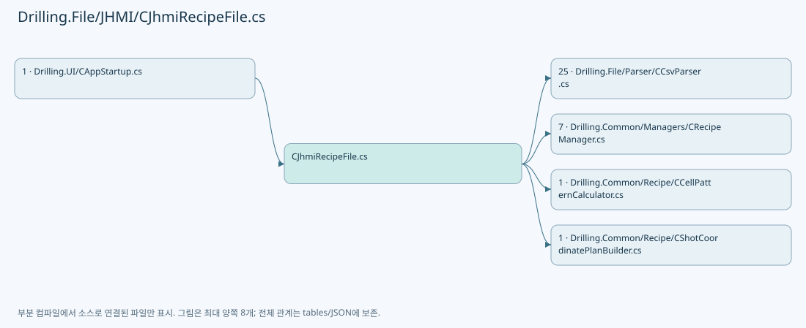

## 네임스페이스·타입·상속

| 타입 | 구분 | 원본 범위 | 선언/상속 |
| --- | --- | --- | --- |
| CJhmiRecipeFile | ClassDeclaration | 16–1476 | CJhmiRecipeFile: CRecipeFileBase, IRecipeCopyStore |
| ST_SHOT_GROUP_PATTERN_BOUNDS | RecordStructDeclaration | 846–846 | ST_SHOT_GROUP_PATTERN_BOUNDS |

## 멤버 빠른 목록

| 이름 | 종류 | 범위 | 서명 |
| --- | --- | --- | --- |
| CellScopedTemplateNames | FieldDeclaration | L19–25 | System.Collections.Generic.HashSet<string> Drilling.File.JHMI.CJhmiRecipeFile.CellScopedTemplateNames |
| FormHeaders | FieldDeclaration | L26–26 | System.Collections.Generic.IReadOnlyList<string> Drilling.File.JHMI.CJhmiRecipeFile.FormHeaders |
| _configRoot | FieldDeclaration | L27–27 | string Drilling.File.JHMI.CJhmiRecipeFile._configRoot |
| _recipeDirectory | FieldDeclaration | L28–28 | string Drilling.File.JHMI.CJhmiRecipeFile._recipeDirectory |
| _logManager | FieldDeclaration | L29–29 | CLogManager Drilling.File.JHMI.CJhmiRecipeFile._logManager |
| _fileOperationLock | FieldDeclaration | L30–30 | System.Threading.SemaphoreSlim Drilling.File.JHMI.CJhmiRecipeFile._fileOperationLock |
| LoadHistory | MethodDeclaration | L33–33 | System.Threading.Tasks.Task<System.Collections.Generic.IReadOnlyList<Drilling.Common.Managers.ST_RECIPE_HISTORY>> Drilling.File.JHMI.CJhmiRecipeFile.LoadHistory(System.Threading.CancellationToken) |
| RecordSelection | MethodDeclaration | L34–50 | System.Threading.Tasks.Task Drilling.File.JHMI.CJhmiRecipeFile.RecordSelection(string, string, System.Threading.CancellationToken) |
| RecipeName | LocalFunctionStatement | L41–46 | string RecipeName(string) |
| LoadAll | MethodDeclaration | L52–60 | System.Threading.Tasks.Task<System.Collections.Generic.IReadOnlyList<Drilling.Common.Managers.ST_RECIPE_DEFINITION>> Drilling.File.JHMI.CJhmiRecipeFile.LoadAll(System.Threading.CancellationToken) |
| SelectValue | LocalFunctionStatement | L54–57 | System.Collections.Generic.IReadOnlyList<Drilling.Common.Managers.ST_RECIPE_DEFINITION> SelectValue() |
| LoadAllCore | MethodDeclaration | L62–89 | System.Collections.Generic.IReadOnlyList<Drilling.Common.Managers.ST_RECIPE_DEFINITION> Drilling.File.JHMI.CJhmiRecipeFile.LoadAllCore(System.Threading.CancellationToken) |
| SelectName | LocalFunctionStatement | L83–86 | string SelectName(Drilling.Common.Managers.ST_RECIPE_DEFINITION) |
| Find | MethodDeclaration | L91–99 | System.Threading.Tasks.Task<Drilling.Common.Managers.ST_RECIPE_DEFINITION?> Drilling.File.JHMI.CJhmiRecipeFile.Find(string, System.Threading.CancellationToken) |
| SelectValue | LocalFunctionStatement | L93–96 | Drilling.Common.Managers.ST_RECIPE_DEFINITION? SelectValue() |
| FindCore | MethodDeclaration | L101–108 | Drilling.Common.Managers.ST_RECIPE_DEFINITION? Drilling.File.JHMI.CJhmiRecipeFile.FindCore(string, System.Threading.CancellationToken) |
| Save | MethodDeclaration | L110–118 | System.Threading.Tasks.Task Drilling.File.JHMI.CJhmiRecipeFile.Save(Drilling.Common.Managers.ST_RECIPE_DEFINITION, System.Threading.CancellationToken) |
| SaveCoreCallback | LocalFunctionStatement | L112–115 | void SaveCoreCallback() |
| SaveCore | MethodDeclaration | L120–242 | void Drilling.File.JHMI.CJhmiRecipeFile.SaveCore(Drilling.Common.Managers.ST_RECIPE_DEFINITION, System.Threading.CancellationToken, string?, bool) |
| SelectGroupKey | LocalFunctionStatement | L127–130 | string SelectGroupKey(Drilling.Common.Managers.ST_RECIPE_VALUE) |
| SelectKey | LocalFunctionStatement | L132–135 | string SelectKey(System.Linq.IGrouping<string, Drilling.Common.Managers.ST_RECIPE_VALUE>) |
| SelectValue | LocalFunctionStatement | L137–140 | string SelectValue(System.Linq.IGrouping<string, Drilling.Common.Managers.ST_RECIPE_VALUE>) |
| ShouldIncludeItem | LocalFunctionStatement | L143–146 | bool ShouldIncludeItem(Drilling.Common.Managers.ST_RECIPE_PARAMETER) |
| ShouldIncludeRecipe | LocalFunctionStatement | L151–154 | bool ShouldIncludeRecipe(Drilling.Common.Managers.ST_RECIPE_PARAMETER) |
| SelectSortKey | LocalFunctionStatement | L156–159 | int SelectSortKey(Drilling.Common.Managers.ST_RECIPE_PARAMETER) |
| SelectRecipeParameterKey | LocalFunctionStatement | L161–164 | string SelectRecipeParameterKey(Drilling.Common.Managers.ST_RECIPE_PARAMETER) |
| ShouldIncludeRecipe2 | LocalFunctionStatement | L178–181 | bool ShouldIncludeRecipe2(Drilling.Common.Managers.ST_RECIPE_FORM_ITEM) |
| SelectDisplayOrder | LocalFunctionStatement | L183–186 | int SelectDisplayOrder(Drilling.Common.Managers.ST_RECIPE_FORM_ITEM) |
| Rename | MethodDeclaration | L244–252 | System.Threading.Tasks.Task Drilling.File.JHMI.CJhmiRecipeFile.Rename(string, string, System.Threading.CancellationToken) |
| RenameCoreCallback | LocalFunctionStatement | L246–249 | void RenameCoreCallback() |
| RenameCore | MethodDeclaration | L254–368 | string? Drilling.File.JHMI.CJhmiRecipeFile.RenameCore(string, string, System.Threading.CancellationToken, bool) |
| SelectGroupKey | LocalFunctionStatement | L272–275 | string SelectGroupKey(Drilling.Common.Managers.ST_RECIPE_VALUE) |
| SelectKey | LocalFunctionStatement | L277–280 | string SelectKey(System.Linq.IGrouping<string, Drilling.Common.Managers.ST_RECIPE_VALUE>) |
| SelectValue | LocalFunctionStatement | L282–285 | string SelectValue(System.Linq.IGrouping<string, Drilling.Common.Managers.ST_RECIPE_VALUE>) |
| ShouldIncludeItem | LocalFunctionStatement | L300–303 | bool ShouldIncludeItem(Drilling.Common.Managers.ST_RECIPE_FORM_ITEM) |
| SelectDisplayOrder | LocalFunctionStatement | L305–308 | int SelectDisplayOrder(Drilling.Common.Managers.ST_RECIPE_FORM_ITEM) |
| MatchesTab | LocalFunctionStatement | L318–321 | bool MatchesTab(Drilling.Common.Managers.ST_RECIPE_VALUE) |
| SelectSortKey | LocalFunctionStatement | L323–326 | int SelectSortKey(Drilling.Common.Managers.ST_RECIPE_VALUE) |
| SelectName | LocalFunctionStatement | L328–331 | string SelectName(Drilling.Common.Managers.ST_RECIPE_VALUE) |
| Delete | MethodDeclaration | L370–378 | System.Threading.Tasks.Task Drilling.File.JHMI.CJhmiRecipeFile.Delete(string, System.Threading.CancellationToken) |
| DeleteCoreCallback | LocalFunctionStatement | L372–375 | void DeleteCoreCallback() |
| DeleteCore | MethodDeclaration | L380–414 | string? Drilling.File.JHMI.CJhmiRecipeFile.DeleteCore(string, System.Threading.CancellationToken, bool) |
| SelectGroupKey | LocalFunctionStatement | L386–389 | string SelectGroupKey(Drilling.Common.Managers.ST_RECIPE_VALUE) |
| SelectKey | LocalFunctionStatement | L391–394 | string SelectKey(System.Linq.IGrouping<string, Drilling.Common.Managers.ST_RECIPE_VALUE>) |
| SelectValue | LocalFunctionStatement | L396–399 | string SelectValue(System.Linq.IGrouping<string, Drilling.Common.Managers.ST_RECIPE_VALUE>) |
| ExecuteFileOperation | MethodDeclaration | L416–427 | System.Threading.Tasks.Task<T> Drilling.File.JHMI.CJhmiRecipeFile.ExecuteFileOperation<T>(System.Func<T>, System.Threading.CancellationToken) |
| ExecuteFileOperation | MethodDeclaration | L429–440 | System.Threading.Tasks.Task Drilling.File.JHMI.CJhmiRecipeFile.ExecuteFileOperation(System.Action, System.Threading.CancellationToken) |
| LoadRecipe | MethodDeclaration | L442–589 | Drilling.Common.Managers.ST_RECIPE_DEFINITION? Drilling.File.JHMI.CJhmiRecipeFile.LoadRecipe(string, System.Collections.Generic.IReadOnlyList<Drilling.Common.Managers.ST_RECIPE_FORM_ITEM>, System.Threading.CancellationToken) |
| SelectGroupKey | LocalFunctionStatement | L452–455 | string SelectGroupKey(Drilling.Common.Managers.ST_RECIPE_VALUE) |
| SelectKey | LocalFunctionStatement | L457–460 | string SelectKey(System.Linq.IGrouping<string, Drilling.Common.Managers.ST_RECIPE_VALUE>) |
| SelectValue | LocalFunctionStatement | L462–465 | string SelectValue(System.Linq.IGrouping<string, Drilling.Common.Managers.ST_RECIPE_VALUE>) |
| IsUse | LocalFunctionStatement | L470–473 | bool IsUse(Drilling.Common.Managers.ST_RECIPE_FORM_ITEM) |
| SelectDisplayOrder | LocalFunctionStatement | L475–478 | int SelectDisplayOrder(Drilling.Common.Managers.ST_RECIPE_FORM_ITEM) |
| BuildRecipe | LocalFunctionStatement | L480–501 | Drilling.Common.Managers.ST_RECIPE_PARAMETER BuildRecipe(Drilling.Common.Managers.ST_RECIPE_FORM_ITEM) |
| SelectName | LocalFunctionStatement | L504–507 | string SelectName(Drilling.Common.Managers.ST_RECIPE_FORM_ITEM) |
| SelectFormItemGroupKey | LocalFunctionStatement | L509–512 | string SelectFormItemGroupKey(System.Linq.IGrouping<string, Drilling.Common.Managers.ST_RECIPE_FORM_ITEM>) |
| SelectRecipe | LocalFunctionStatement | L514–517 | Drilling.Common.Managers.ST_RECIPE_FORM_ITEM SelectRecipe(System.Linq.IGrouping<string, Drilling.Common.Managers.ST_RECIPE_FORM_ITEM>) |
| SelectParameterKey | LocalFunctionStatement | L520–523 | string SelectParameterKey(Drilling.Common.Managers.ST_RECIPE_PARAMETER) |
| ShouldIncludeItem | LocalFunctionStatement | L526–529 | bool ShouldIncludeItem(Drilling.Common.Managers.ST_RECIPE_VALUE) |
| SelectSortKey | LocalFunctionStatement | L531–534 | int SelectSortKey(Drilling.Common.Managers.ST_RECIPE_VALUE) |
| SelectName2 | LocalFunctionStatement | L536–539 | string SelectName2(Drilling.Common.Managers.ST_RECIPE_VALUE) |
| IsCellScopedKey | MethodDeclaration | L591–594 | bool Drilling.File.JHMI.CJhmiRecipeFile.IsCellScopedKey(string) |
| IsCellScopedTemplate | MethodDeclaration | L596–599 | bool Drilling.File.JHMI.CJhmiRecipeFile.IsCellScopedTemplate(Drilling.Common.Managers.ST_RECIPE_FORM_ITEM) |
| GetActiveCellCount | MethodDeclaration | L601–613 | int Drilling.File.JHMI.CJhmiRecipeFile.GetActiveCellCount(System.Collections.Generic.IEnumerable<Drilling.Common.Managers.ST_RECIPE_PARAMETER>) |
| MatchesItem | LocalFunctionStatement | L603–606 | bool MatchesItem(Drilling.Common.Managers.ST_RECIPE_PARAMETER) |
| ReadPositiveInt | MethodDeclaration | L615–624 | int Drilling.File.JHMI.CJhmiRecipeFile.ReadPositiveInt(System.Collections.Generic.IEnumerable<Drilling.Common.Managers.ST_RECIPE_PARAMETER>, string) |
| MatchesItem | LocalFunctionStatement | L617–620 | bool MatchesItem(Drilling.Common.Managers.ST_RECIPE_PARAMETER) |
| CalculateActiveShotGroupBoundsByCell | MethodDeclaration | L626–647 | System.Collections.Generic.IReadOnlyDictionary<int, Drilling.File.JHMI.CJhmiRecipeFile.ST_SHOT_GROUP_PATTERN_BOUNDS> Drilling.File.JHMI.CJhmiRecipeFile.CalculateActiveShotGroupBoundsByCell(System.Collections.Generic.IReadOnlyList<Drilling.Common.Managers.ST_RECIPE_PARAMETER>, int) |
| IsShotGroupOverrideWithinActivePattern | MethodDeclaration | L649–663 | bool Drilling.File.JHMI.CJhmiRecipeFile.IsShotGroupOverrideWithinActivePattern(Drilling.Common.Managers.ST_RECIPE_PARAMETER, System.Collections.Generic.IReadOnlyDictionary<int, Drilling.File.JHMI.CJhmiRecipeFile.ST_SHOT_GROUP_PATTERN_BOUNDS>) |
| GetActiveCellCount | MethodDeclaration | L665–672 | int Drilling.File.JHMI.CJhmiRecipeFile.GetActiveCellCount(System.Collections.Generic.IReadOnlyDictionary<string, string>, System.Collections.Generic.IReadOnlyList<Drilling.Common.Managers.ST_RECIPE_FORM_ITEM>) |
| ParseActiveCellCount | MethodDeclaration | L674–682 | int Drilling.File.JHMI.CJhmiRecipeFile.ParseActiveCellCount(string?, int, int?) |
| GetActiveCellCountMinimum | MethodDeclaration | L684–687 | int Drilling.File.JHMI.CJhmiRecipeFile.GetActiveCellCountMinimum(double?, double?) |
| GetActiveCellCountMaximum | MethodDeclaration | L689–692 | int? Drilling.File.JHMI.CJhmiRecipeFile.GetActiveCellCountMaximum(double?, int) |
| GetCellNo | MethodDeclaration | L694–703 | int Drilling.File.JHMI.CJhmiRecipeFile.GetCellNo(string) |
| GetCellParameterName | MethodDeclaration | L705–709 | string Drilling.File.JHMI.CJhmiRecipeFile.GetCellParameterName(string) |
| GetCellKeySeparatorIndex | MethodDeclaration | L711–714 | int Drilling.File.JHMI.CJhmiRecipeFile.GetCellKeySeparatorIndex(string) |
| NormalizeCellScopedParameterName | MethodDeclaration | L716–719 | string Drilling.File.JHMI.CJhmiRecipeFile.NormalizeCellScopedParameterName(string) |
| IsCellPlacementParameterName | MethodDeclaration | L721–724 | bool Drilling.File.JHMI.CJhmiRecipeFile.IsCellPlacementParameterName(string) |
| ToPersistedCellScopedKey | MethodDeclaration | L726–729 | string Drilling.File.JHMI.CJhmiRecipeFile.ToPersistedCellScopedKey(string) |
| GetCellScopedGroup | MethodDeclaration | L731–739 | string Drilling.File.JHMI.CJhmiRecipeFile.GetCellScopedGroup(string) |
| GetCellHistoryItemName | MethodDeclaration | L741–751 | string Drilling.File.JHMI.CJhmiRecipeFile.GetCellHistoryItemName(Drilling.Common.Managers.ST_RECIPE_PARAMETER, System.Collections.Generic.IReadOnlyList<Drilling.Common.Managers.ST_RECIPE_PARAMETER>) |
| CreateShotGroupOverrideParameter | MethodDeclaration | L753–783 | Drilling.Common.Managers.ST_RECIPE_PARAMETER? Drilling.File.JHMI.CJhmiRecipeFile.CreateShotGroupOverrideParameter(int, string, string, string) |
| TryGetShotGroupOverrideMetadata | MethodDeclaration | L785–844 | bool Drilling.File.JHMI.CJhmiRecipeFile.TryGetShotGroupOverrideMetadata(string, out string, out int, out int, out string, out string, out double, out double) |
| MatchesItem | LocalFunctionStatement | L802–805 | bool MatchesItem((string Suffix, string DisplayName)) |
| LoadFormItems | MethodDeclaration | L847–887 | System.Collections.Generic.IReadOnlyList<Drilling.Common.Managers.ST_RECIPE_FORM_ITEM> Drilling.File.JHMI.CJhmiRecipeFile.LoadFormItems() |
| SelectItem | LocalFunctionStatement | L849–855 | string[] SelectItem(string) |
| BuildRecipe | LocalFunctionStatement | L858–879 | Drilling.Common.Managers.ST_RECIPE_FORM_ITEM BuildRecipe(System.Collections.Generic.IReadOnlyDictionary<string, string>, int) |
| ShouldIncludeItem | LocalFunctionStatement | L881–884 | bool ShouldIncludeItem(Drilling.Common.Managers.ST_RECIPE_FORM_ITEM) |
| ReadRecipeValues | MethodDeclaration | L889–913 | System.Collections.Generic.IReadOnlyList<Drilling.Common.Managers.ST_RECIPE_VALUE> Drilling.File.JHMI.CJhmiRecipeFile.ReadRecipeValues(string, System.Threading.CancellationToken) |
| ParseRecipeLine | MethodDeclaration | L915–924 | Drilling.Common.Managers.ST_RECIPE_VALUE? Drilling.File.JHMI.CJhmiRecipeFile.ParseRecipeLine(string) |
| SplitCsvLine | MethodDeclaration | L926–959 | System.Collections.Generic.IReadOnlyList<string> Drilling.File.JHMI.CJhmiRecipeFile.SplitCsvLine(string) |
| GetFormPath | MethodDeclaration | L961–964 | string Drilling.File.JHMI.CJhmiRecipeFile.GetFormPath() |
| GetRecipePath | MethodDeclaration | L966–969 | string Drilling.File.JHMI.CJhmiRecipeFile.GetRecipePath(string) |
| FindFormItem | MethodDeclaration | L971–1012 | Drilling.Common.Managers.ST_RECIPE_FORM_ITEM? Drilling.File.JHMI.CJhmiRecipeFile.FindFormItem(System.Collections.Generic.IReadOnlyList<Drilling.Common.Managers.ST_RECIPE_FORM_ITEM>, Drilling.Common.Managers.ST_RECIPE_PARAMETER) |
| MatchesItem | LocalFunctionStatement | L973–976 | bool MatchesItem(Drilling.Common.Managers.ST_RECIPE_FORM_ITEM) |
| MatchesItem2 | LocalFunctionStatement | L987–990 | bool MatchesItem2(Drilling.Common.Managers.ST_RECIPE_FORM_ITEM) |
| MatchesItem3 | LocalFunctionStatement | L1001–1004 | bool MatchesItem3(Drilling.Common.Managers.ST_RECIPE_FORM_ITEM) |
| MatchesItem4 | LocalFunctionStatement | L1006–1009 | bool MatchesItem4(Drilling.Common.Managers.ST_RECIPE_FORM_ITEM) |
| ReadDataType | MethodDeclaration | L1014–1023 | Drilling.Common.Managers.EN_RECIPE_DATA_TYPE Drilling.File.JHMI.CJhmiRecipeFile.ReadDataType(string) |
| ReadBool | MethodDeclaration | L1025–1033 | bool Drilling.File.JHMI.CJhmiRecipeFile.ReadBool(string, bool) |
| ReadInt | MethodDeclaration | L1035–1038 | int Drilling.File.JHMI.CJhmiRecipeFile.ReadInt(string, int) |
| ReadDouble | MethodDeclaration | L1040–1043 | double Drilling.File.JHMI.CJhmiRecipeFile.ReadDouble(string, double) |
| GetValue | MethodDeclaration | L1045–1048 | string Drilling.File.JHMI.CJhmiRecipeFile.GetValue(System.Collections.Generic.IReadOnlyDictionary<string, string>, string, string, string) |
| CreateKey | MethodDeclaration | L1050–1053 | string Drilling.File.JHMI.CJhmiRecipeFile.CreateKey(string, string) |
| GetOrDefault | MethodDeclaration | L1055–1058 | string Drilling.File.JHMI.CJhmiRecipeFile.GetOrDefault(string, string) |
| GetRecipeName | MethodDeclaration | L1060–1063 | string Drilling.File.JHMI.CJhmiRecipeFile.GetRecipeName(Drilling.Common.Managers.ST_RECIPE_DEFINITION) |
| FormatRecipeLine | MethodDeclaration | L1065–1068 | string Drilling.File.JHMI.CJhmiRecipeFile.FormatRecipeLine(string, string, string) |
| ValidateSavedRecipeFile | MethodDeclaration | L1070–1101 | void Drilling.File.JHMI.CJhmiRecipeFile.ValidateSavedRecipeFile(string, System.Collections.Generic.IReadOnlyDictionary<string, string>, System.Threading.CancellationToken) |
| SelectGroupKey | LocalFunctionStatement | L1072–1075 | string SelectGroupKey(Drilling.Common.Managers.ST_RECIPE_VALUE) |
| SelectKey | LocalFunctionStatement | L1077–1080 | string SelectKey(System.Linq.IGrouping<string, Drilling.Common.Managers.ST_RECIPE_VALUE>) |
| SelectValue | LocalFunctionStatement | L1082–1085 | string SelectValue(System.Linq.IGrouping<string, Drilling.Common.Managers.ST_RECIPE_VALUE>) |
| Escape | MethodDeclaration | L1103–1111 | string Drilling.File.JHMI.CJhmiRecipeFile.Escape(string) |
| GetSafeFileName | MethodDeclaration | L1113–1122 | string Drilling.File.JHMI.CJhmiRecipeFile.GetSafeFileName(string) |
| SelectItem | LocalFunctionStatement | L1116–1119 | char SelectItem(char) |
| DeleteIfExists | MethodDeclaration | L1124–1130 | void Drilling.File.JHMI.CJhmiRecipeFile.DeleteIfExists(string) |
| RenameWithCompanions | MethodDeclaration | L1134–1134 | System.Threading.Tasks.Task Drilling.File.JHMI.CJhmiRecipeFile.RenameWithCompanions(string, string, System.Collections.Generic.IReadOnlyCollection<string>, System.Threading.CancellationToken) |
| RenameCompanionsCore | MethodDeclaration | L1135–1174 | void Drilling.File.JHMI.CJhmiRecipeFile.RenameCompanionsCore(string, string, System.Collections.Generic.IReadOnlyCollection<string>, System.Threading.CancellationToken) |
| DeleteWithCompanions | MethodDeclaration | L1176–1176 | System.Threading.Tasks.Task Drilling.File.JHMI.CJhmiRecipeFile.DeleteWithCompanions(string, System.Collections.Generic.IReadOnlyCollection<string>, System.Threading.CancellationToken) |
| DeleteCompanionsCore | MethodDeclaration | L1177–1231 | void Drilling.File.JHMI.CJhmiRecipeFile.DeleteCompanionsCore(string, System.Collections.Generic.IReadOnlyCollection<string>, System.Threading.CancellationToken) |
| SelectCompanions | MethodDeclaration | L1233–1237 | System.Collections.Generic.IReadOnlyList<Drilling.Common.Managers.ST_RECIPE_COMPANION_FOLDER> Drilling.File.JHMI.CJhmiRecipeFile.SelectCompanions(string, string, System.Collections.Generic.IReadOnlyCollection<string>, System.Threading.CancellationToken) |
| CompanionPath | MethodDeclaration | L1239–1245 | string Drilling.File.JHMI.CJhmiRecipeFile.CompanionPath(string, string) |
| RestoreMissing | MethodDeclaration | L1247–1261 | void Drilling.File.JHMI.CJhmiRecipeFile.RestoreMissing(string, string) |
| LogCompanionOperation | MethodDeclaration | L1263–1279 | void Drilling.File.JHMI.CJhmiRecipeFile.LogCompanionOperation(System.Action) |
| ListCompanionFolders | MethodDeclaration | L1283–1283 | System.Threading.Tasks.Task<System.Collections.Generic.IReadOnlyList<Drilling.Common.Managers.ST_RECIPE_COMPANION_FOLDER>> Drilling.File.JHMI.CJhmiRecipeFile.ListCompanionFolders(string, string, System.Threading.CancellationToken) |
| ListCompanions | MethodDeclaration | L1284–1293 | System.Collections.Generic.IReadOnlyList<Drilling.Common.Managers.ST_RECIPE_COMPANION_FOLDER> Drilling.File.JHMI.CJhmiRecipeFile.ListCompanions(string, string, System.Threading.CancellationToken) |
| CreateCopy | MethodDeclaration | L1295–1295 | System.Threading.Tasks.Task Drilling.File.JHMI.CJhmiRecipeFile.CreateCopy(Drilling.Common.Managers.ST_RECIPE_DEFINITION, string, System.Collections.Generic.IReadOnlyCollection<string>, System.Threading.CancellationToken) |
| CreateCopyCore | MethodDeclaration | L1296–1362 | void Drilling.File.JHMI.CJhmiRecipeFile.CreateCopyCore(Drilling.Common.Managers.ST_RECIPE_DEFINITION, string, System.Collections.Generic.IReadOnlyCollection<string>, System.Threading.CancellationToken) |
| CopyDirectory | MethodDeclaration | L1364–1394 | void Drilling.File.JHMI.CJhmiRecipeFile.CopyDirectory(string, string, System.Threading.CancellationToken, bool) |
| RejectLink | MethodDeclaration | L1396–1400 | void Drilling.File.JHMI.CJhmiRecipeFile.RejectLink(string) |
| DeleteOwnedDirectory | MethodDeclaration | L1402–1410 | void Drilling.File.JHMI.CJhmiRecipeFile.DeleteOwnedDirectory(string, string) |
| ValidateCopyId | MethodDeclaration | L1412–1416 | void Drilling.File.JHMI.CJhmiRecipeFile.ValidateCopyId(string) |
| IncrementProtectWindowCount | MethodDeclaration | L1420–1420 | System.Threading.Tasks.Task<int> Drilling.File.JHMI.CJhmiRecipeFile.IncrementProtectWindowCount(string, System.Threading.CancellationToken) |
| ResetProtectWindowCount | MethodDeclaration | L1421–1421 | System.Threading.Tasks.Task<int> Drilling.File.JHMI.CJhmiRecipeFile.ResetProtectWindowCount(string, System.Threading.CancellationToken) |
| SetProtectWindowCount | MethodDeclaration | L1422–1422 | System.Threading.Tasks.Task<int> Drilling.File.JHMI.CJhmiRecipeFile.SetProtectWindowCount(string, int, System.Threading.CancellationToken) |
| ChangeProtectWindowCount | MethodDeclaration | L1423–1474 | System.Threading.Tasks.Task<int> Drilling.File.JHMI.CJhmiRecipeFile.ChangeProtectWindowCount(string, System.Func<string, int>, System.Threading.CancellationToken) |
| IsCount | LocalFunctionStatement | L1429–1429 | bool IsCount(Drilling.Common.Managers.ST_RECIPE_VALUE?) |
| CountLine | LocalFunctionStatement | L1473–1473 | string CountLine() |

## 멤버별 상세 계약·호출·처리 해설

### FieldDeclaration `CellScopedTemplateNames` · L19–25

[Drilling.File/JHMI/CJhmiRecipeFile.cs:19–25](https://github.com/kjuws10-rgb/A3Drilling/blob/5aee8e58439c9b455cae7c9593c9be986c3e682e/Drilling.File/JHMI/CJhmiRecipeFile.cs#L19-L25)

| 항목 | 실제 추출 값 |
| --- | --- |
| 서명 | System.Collections.Generic.HashSet<string> Drilling.File.JHMI.CJhmiRecipeFile.CellScopedTemplateNames |
| 접근/수식자 | Private / private, static, readonly |
| 반환/값 타입 | System.Collections.Generic.HashSet<string> |
| 소속 타입 | NamedType:Drilling.File.JHMI.CJhmiRecipeFile |

현재 부분 분석에서 직접 연결된 호출자는 없습니다. XAML/이벤트/인터페이스·델리게이트·외부 진입을 추가 확인해야 하며, 미사용으로 판정한 것이 아닙니다.

호출하는 대상과 해석 범위:

| 원본 행 | 표현식 | 분석 상태 | 대상/소스 위치 |
| --- | --- | --- | --- |
| 19 | new | resolved | System.Collections.Generic.HashSet<string>.HashSet(System.Collections.Generic.IEqualityComparer<string>?) |

본문의 실제 연산·분기·예외·반환 순서(원문 위치 순):

| 원본 행 | 종류 | 주석 해설 |
| --- | --- | --- |
| 19 | call | 함수·델리게이트 또는 객체 생성자를 호출합니다: new(StringComparer.OrdinalIgnoreCase) { "CELL_ALIGN_TO_1ST_PIXEL_X", "CELL_ALIGN_TO_1ST_PIXEL_Y", "CELL_ROTATION", "CELL_MODEL_TYPE" } |
| 19 | variable-initializer | 변수의 초기값을 지정합니다: CellScopedTemplateNames = new(StringComparer.OrdinalIgnoreCase) { "CELL_ALIGN_TO_1ST_PIXEL_X", "CELL_ALIGN_TO_1ST_PIXEL_Y", "CELL_ROTATION", "CELL_MODEL_TYPE" } |

변경 전 점검: 입력/반환 타입, 위 호출자, 예외/취소 경로, 공유 상태와 저장·전송 소비자를 함께 확인합니다. 값의 단위나 물리 방향을 이름만으로 확정하지 않습니다.

### FieldDeclaration `FormHeaders` · L26–26

[Drilling.File/JHMI/CJhmiRecipeFile.cs:26–26](https://github.com/kjuws10-rgb/A3Drilling/blob/5aee8e58439c9b455cae7c9593c9be986c3e682e/Drilling.File/JHMI/CJhmiRecipeFile.cs#L26-L26)

| 항목 | 실제 추출 값 |
| --- | --- |
| 서명 | System.Collections.Generic.IReadOnlyList<string> Drilling.File.JHMI.CJhmiRecipeFile.FormHeaders |
| 접근/수식자 | Private / private, static, readonly |
| 반환/값 타입 | System.Collections.Generic.IReadOnlyList<string> |
| 소속 타입 | NamedType:Drilling.File.JHMI.CJhmiRecipeFile |

현재 부분 분석에서 직접 연결된 호출자는 없습니다. XAML/이벤트/인터페이스·델리게이트·외부 진입을 추가 확인해야 하며, 미사용으로 판정한 것이 아닙니다.

본문의 실제 연산·분기·예외·반환 순서(원문 위치 순):

| 원본 행 | 종류 | 주석 해설 |
| --- | --- | --- |
| 26 | variable-initializer | 변수의 초기값을 지정합니다: FormHeaders = ["TAB", "GROUP", "NAME", "DISPLAY NAME", "CIM NAME", "DATA TYPE", "UNIT", "SHOW", "USE", "VALUE", "SCALE", "CHANGE LIMIT", "MIN", "MAX", "DESCRIPTION", "ORDER"] |

변경 전 점검: 입력/반환 타입, 위 호출자, 예외/취소 경로, 공유 상태와 저장·전송 소비자를 함께 확인합니다. 값의 단위나 물리 방향을 이름만으로 확정하지 않습니다.

### FieldDeclaration `_configRoot` · L27–27

[Drilling.File/JHMI/CJhmiRecipeFile.cs:27–27](https://github.com/kjuws10-rgb/A3Drilling/blob/5aee8e58439c9b455cae7c9593c9be986c3e682e/Drilling.File/JHMI/CJhmiRecipeFile.cs#L27-L27)

| 항목 | 실제 추출 값 |
| --- | --- |
| 서명 | string Drilling.File.JHMI.CJhmiRecipeFile._configRoot |
| 접근/수식자 | Private / private, readonly |
| 반환/값 타입 | string |
| 소속 타입 | NamedType:Drilling.File.JHMI.CJhmiRecipeFile |

현재 부분 분석에서 직접 연결된 호출자는 없습니다. XAML/이벤트/인터페이스·델리게이트·외부 진입을 추가 확인해야 하며, 미사용으로 판정한 것이 아닙니다.

본문의 실제 연산·분기·예외·반환 순서(원문 위치 순):

| 원본 행 | 종류 | 주석 해설 |
| --- | --- | --- |
| 27 | variable-initializer | 변수의 초기값을 지정합니다: _configRoot = configRoot |

변경 전 점검: 입력/반환 타입, 위 호출자, 예외/취소 경로, 공유 상태와 저장·전송 소비자를 함께 확인합니다. 값의 단위나 물리 방향을 이름만으로 확정하지 않습니다.

### FieldDeclaration `_recipeDirectory` · L28–28

[Drilling.File/JHMI/CJhmiRecipeFile.cs:28–28](https://github.com/kjuws10-rgb/A3Drilling/blob/5aee8e58439c9b455cae7c9593c9be986c3e682e/Drilling.File/JHMI/CJhmiRecipeFile.cs#L28-L28)

| 항목 | 실제 추출 값 |
| --- | --- |
| 서명 | string Drilling.File.JHMI.CJhmiRecipeFile._recipeDirectory |
| 접근/수식자 | Private / private, readonly |
| 반환/값 타입 | string |
| 소속 타입 | NamedType:Drilling.File.JHMI.CJhmiRecipeFile |

현재 부분 분석에서 직접 연결된 호출자는 없습니다. XAML/이벤트/인터페이스·델리게이트·외부 진입을 추가 확인해야 하며, 미사용으로 판정한 것이 아닙니다.

호출하는 대상과 해석 범위:

| 원본 행 | 표현식 | 분석 상태 | 대상/소스 위치 |
| --- | --- | --- | --- |
| 28 | Path.Combine | resolved | string System.IO.Path.Combine(string, string) |

본문의 실제 연산·분기·예외·반환 순서(원문 위치 순):

| 원본 행 | 종류 | 주석 해설 |
| --- | --- | --- |
| 28 | call | 함수·델리게이트 또는 객체 생성자를 호출합니다: Path.Combine(configRoot, "RECIPE") |
| 28 | variable-initializer | 변수의 초기값을 지정합니다: _recipeDirectory = Path.Combine(configRoot, "RECIPE") |

변경 전 점검: 입력/반환 타입, 위 호출자, 예외/취소 경로, 공유 상태와 저장·전송 소비자를 함께 확인합니다. 값의 단위나 물리 방향을 이름만으로 확정하지 않습니다.

### FieldDeclaration `_logManager` · L29–29

[Drilling.File/JHMI/CJhmiRecipeFile.cs:29–29](https://github.com/kjuws10-rgb/A3Drilling/blob/5aee8e58439c9b455cae7c9593c9be986c3e682e/Drilling.File/JHMI/CJhmiRecipeFile.cs#L29-L29)

| 항목 | 실제 추출 값 |
| --- | --- |
| 서명 | CLogManager Drilling.File.JHMI.CJhmiRecipeFile._logManager |
| 접근/수식자 | Private / private, readonly |
| 반환/값 타입 | CLogManager |
| 소속 타입 | NamedType:Drilling.File.JHMI.CJhmiRecipeFile |

현재 부분 분석에서 직접 연결된 호출자는 없습니다. XAML/이벤트/인터페이스·델리게이트·외부 진입을 추가 확인해야 하며, 미사용으로 판정한 것이 아닙니다.

호출하는 대상과 해석 범위:

| 원본 행 | 표현식 | 분석 상태 | 대상/소스 위치 |
| --- | --- | --- | --- |
| 29 | new | unresolved | None |

본문의 실제 연산·분기·예외·반환 순서(원문 위치 순):

| 원본 행 | 종류 | 주석 해설 |
| --- | --- | --- |
| 29 | call | 함수·델리게이트 또는 객체 생성자를 호출합니다: new(configRoot) |
| 29 | variable-initializer | 변수의 초기값을 지정합니다: _logManager = new(configRoot) |

변경 전 점검: 입력/반환 타입, 위 호출자, 예외/취소 경로, 공유 상태와 저장·전송 소비자를 함께 확인합니다. 값의 단위나 물리 방향을 이름만으로 확정하지 않습니다.

### FieldDeclaration `_fileOperationLock` · L30–30

[Drilling.File/JHMI/CJhmiRecipeFile.cs:30–30](https://github.com/kjuws10-rgb/A3Drilling/blob/5aee8e58439c9b455cae7c9593c9be986c3e682e/Drilling.File/JHMI/CJhmiRecipeFile.cs#L30-L30)

| 항목 | 실제 추출 값 |
| --- | --- |
| 서명 | System.Threading.SemaphoreSlim Drilling.File.JHMI.CJhmiRecipeFile._fileOperationLock |
| 접근/수식자 | Private / private, readonly |
| 반환/값 타입 | System.Threading.SemaphoreSlim |
| 소속 타입 | NamedType:Drilling.File.JHMI.CJhmiRecipeFile |

현재 부분 분석에서 직접 연결된 호출자는 없습니다. XAML/이벤트/인터페이스·델리게이트·외부 진입을 추가 확인해야 하며, 미사용으로 판정한 것이 아닙니다.

호출하는 대상과 해석 범위:

| 원본 행 | 표현식 | 분석 상태 | 대상/소스 위치 |
| --- | --- | --- | --- |
| 30 | new | resolved | System.Threading.SemaphoreSlim.SemaphoreSlim(int, int) |

본문의 실제 연산·분기·예외·반환 순서(원문 위치 순):

| 원본 행 | 종류 | 주석 해설 |
| --- | --- | --- |
| 30 | call | 함수·델리게이트 또는 객체 생성자를 호출합니다: new(1, 1) |
| 30 | variable-initializer | 변수의 초기값을 지정합니다: _fileOperationLock = new(1, 1) |

변경 전 점검: 입력/반환 타입, 위 호출자, 예외/취소 경로, 공유 상태와 저장·전송 소비자를 함께 확인합니다. 값의 단위나 물리 방향을 이름만으로 확정하지 않습니다.

### MethodDeclaration `LoadHistory` · L33–33

[Drilling.File/JHMI/CJhmiRecipeFile.cs:33–33](https://github.com/kjuws10-rgb/A3Drilling/blob/5aee8e58439c9b455cae7c9593c9be986c3e682e/Drilling.File/JHMI/CJhmiRecipeFile.cs#L33-L33)

| 항목 | 실제 추출 값 |
| --- | --- |
| 서명 | System.Threading.Tasks.Task<System.Collections.Generic.IReadOnlyList<Drilling.Common.Managers.ST_RECIPE_HISTORY>> Drilling.File.JHMI.CJhmiRecipeFile.LoadHistory(System.Threading.CancellationToken) |
| 접근/수식자 | Public / public, override |
| 반환/값 타입 | System.Threading.Tasks.Task<System.Collections.Generic.IReadOnlyList<Drilling.Common.Managers.ST_RECIPE_HISTORY>> |
| 소속 타입 | NamedType:Drilling.File.JHMI.CJhmiRecipeFile |

입력 계약:

| 이름 | 타입 | 전달 | 선택/기본값 |
| --- | --- | --- | --- |
| cancellationToken | System.Threading.CancellationToken | None | True / null |

현재 부분 분석에서 직접 연결된 호출자는 없습니다. XAML/이벤트/인터페이스·델리게이트·외부 진입을 추가 확인해야 하며, 미사용으로 판정한 것이 아닙니다.

호출하는 대상과 해석 범위:

| 원본 행 | 표현식 | 분석 상태 | 대상/소스 위치 |
| --- | --- | --- | --- |
| 33 | ExecuteFileOperation | resolved | System.Threading.Tasks.Task<> Drilling.File.JHMI.CJhmiRecipeFile.ExecuteFileOperation<>(System.Func<>, System.Threading.CancellationToken) · Drilling.File/JHMI/CJhmiRecipeFile.cs:416 |
| 33 | _logManager.ReadRecipeRecent | unresolved | None |

본문의 실제 연산·분기·예외·반환 순서(원문 위치 순):

| 원본 행 | 종류 | 주석 해설 |
| --- | --- | --- |
| 33 | call | 함수·델리게이트 또는 객체 생성자를 호출합니다: ExecuteFileOperation(() => _logManager.ReadRecipeRecent(), cancellationToken) |
| 33 | call | 함수·델리게이트 또는 객체 생성자를 호출합니다: _logManager.ReadRecipeRecent() |

변경 전 점검: 입력/반환 타입, 위 호출자, 예외/취소 경로, 공유 상태와 저장·전송 소비자를 함께 확인합니다. 값의 단위나 물리 방향을 이름만으로 확정하지 않습니다.

### MethodDeclaration `RecordSelection` · L34–50

[Drilling.File/JHMI/CJhmiRecipeFile.cs:34–50](https://github.com/kjuws10-rgb/A3Drilling/blob/5aee8e58439c9b455cae7c9593c9be986c3e682e/Drilling.File/JHMI/CJhmiRecipeFile.cs#L34-L50)

| 항목 | 실제 추출 값 |
| --- | --- |
| 서명 | System.Threading.Tasks.Task Drilling.File.JHMI.CJhmiRecipeFile.RecordSelection(string, string, System.Threading.CancellationToken) |
| 접근/수식자 | Public / public, override |
| 반환/값 타입 | System.Threading.Tasks.Task |
| 소속 타입 | NamedType:Drilling.File.JHMI.CJhmiRecipeFile |

입력 계약:

| 이름 | 타입 | 전달 | 선택/기본값 |
| --- | --- | --- | --- |
| previousRecipeId | string | None | False /  |
| recipeId | string | None | False /  |
| cancellationToken | System.Threading.CancellationToken | None | True / null |

현재 부분 분석에서 직접 연결된 호출자는 없습니다. XAML/이벤트/인터페이스·델리게이트·외부 진입을 추가 확인해야 하며, 미사용으로 판정한 것이 아닙니다.

호출하는 대상과 해석 범위:

| 원본 행 | 표현식 | 분석 상태 | 대상/소스 위치 |
| --- | --- | --- | --- |
| 36 | ExecuteFileOperation | resolved | System.Threading.Tasks.Task Drilling.File.JHMI.CJhmiRecipeFile.ExecuteFileOperation(System.Action, System.Threading.CancellationToken) · Drilling.File/JHMI/CJhmiRecipeFile.cs:429 |
| 38 | cancellationToken.ThrowIfCancellationRequested | resolved | void System.Threading.CancellationToken.ThrowIfCancellationRequested() |
| 39 | System.IO.File.Exists | resolved | bool System.IO.File.Exists(string?) |
| 39 | GetRecipePath | resolved | string Drilling.File.JHMI.CJhmiRecipeFile.GetRecipePath(string) · Drilling.File/JHMI/CJhmiRecipeFile.cs:966 |
| 40 | new FileNotFoundException | resolved | System.IO.FileNotFoundException.FileNotFoundException(string?) |
| 48 | _logManager.WriteRecipeSelect | unresolved | None |
| 48 | RecipeName | resolved | string RecipeName(string) · Drilling.File/JHMI/CJhmiRecipeFile.cs:41 |
| 48 | RecipeName | resolved | string RecipeName(string) · Drilling.File/JHMI/CJhmiRecipeFile.cs:41 |

본문의 실제 연산·분기·예외·반환 순서(원문 위치 순):

| 원본 행 | 종류 | 주석 해설 |
| --- | --- | --- |
| 36 | call | 함수·델리게이트 또는 객체 생성자를 호출합니다: ExecuteFileOperation(() => { cancellationToken.ThrowIfCancellationRequested(); if (!System.IO.File.Exists(GetRecipePath(recipeId))) throw new FileNotFoundException($"Recipe {recipeId} was not found."); string RecipeName(… |
| 36 | return | 호출자에게 값 또는 제어를 반환합니다: return ExecuteFileOperation(() => { cancellationToken.ThrowIfCancellationRequested(); if (!System.IO.File.Exists(GetRecipePath(recipeId))) throw new FileNotFoundException($"Recipe {recipeId} was not found."); string RecipeName(str |
| 38 | call | 함수·델리게이트 또는 객체 생성자를 호출합니다: cancellationToken.ThrowIfCancellationRequested() |
| 39 | call | 함수·델리게이트 또는 객체 생성자를 호출합니다: System.IO.File.Exists(GetRecipePath(recipeId)) |
| 39 | call | 함수·델리게이트 또는 객체 생성자를 호출합니다: GetRecipePath(recipeId) |
| 39 | if | 조건에 따라 분기합니다: if (!System.IO.File.Exists(GetRecipePath(recipeId))) |
| 40 | call | 함수·델리게이트 또는 객체 생성자를 호출합니다: new FileNotFoundException($"Recipe {recipeId} was not found.") |
| 40 | throw | 예외를 발생/전달합니다: throw new FileNotFoundException($"Recipe {recipeId} was not found."); |
| 48 | call | 함수·델리게이트 또는 객체 생성자를 호출합니다: _logManager.WriteRecipeSelect(RecipeName(previousRecipeId), RecipeName(recipeId)) |
| 48 | call | 함수·델리게이트 또는 객체 생성자를 호출합니다: RecipeName(previousRecipeId) |
| 48 | call | 함수·델리게이트 또는 객체 생성자를 호출합니다: RecipeName(recipeId) |

제어 구문의 포함 구조(실제 실행 순서/CFG가 아닌 구문 탐색 그림):

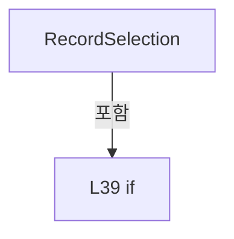

변경 전 점검: 입력/반환 타입, 위 호출자, 예외/취소 경로, 공유 상태와 저장·전송 소비자를 함께 확인합니다. 값의 단위나 물리 방향을 이름만으로 확정하지 않습니다.

### LocalFunctionStatement `RecipeName` · L41–46

[Drilling.File/JHMI/CJhmiRecipeFile.cs:41–46](https://github.com/kjuws10-rgb/A3Drilling/blob/5aee8e58439c9b455cae7c9593c9be986c3e682e/Drilling.File/JHMI/CJhmiRecipeFile.cs#L41-L46)

| 항목 | 실제 추출 값 |
| --- | --- |
| 서명 | string RecipeName(string) |
| 접근/수식자 | Private /  |
| 반환/값 타입 | string |
| 소속 타입 | NamedType:Drilling.File.JHMI.CJhmiRecipeFile |

입력 계약:

| 이름 | 타입 | 전달 | 선택/기본값 |
| --- | --- | --- | --- |
| id | string | None | False /  |

정적 호출자로 확인된 위치:

| 호출 파일/행 | 호출 표현식 | 런타임 분기 가능 |
| --- | --- | --- |
| [Drilling.File/JHMI/CJhmiRecipeFile.cs:48–48](https://github.com/kjuws10-rgb/A3Drilling/blob/5aee8e58439c9b455cae7c9593c9be986c3e682e/Drilling.File/JHMI/CJhmiRecipeFile.cs#L48-L48) | RecipeName | False |
| [Drilling.File/JHMI/CJhmiRecipeFile.cs:48–48](https://github.com/kjuws10-rgb/A3Drilling/blob/5aee8e58439c9b455cae7c9593c9be986c3e682e/Drilling.File/JHMI/CJhmiRecipeFile.cs#L48-L48) | RecipeName | False |

호출하는 대상과 해석 범위:

| 원본 행 | 표현식 | 분석 상태 | 대상/소스 위치 |
| --- | --- | --- | --- |
| 43 | string.IsNullOrWhiteSpace | resolved | bool string.IsNullOrWhiteSpace(string?) |
| 43 | System.IO.File.Exists | resolved | bool System.IO.File.Exists(string?) |
| 43 | GetRecipePath | resolved | string Drilling.File.JHMI.CJhmiRecipeFile.GetRecipePath(string) · Drilling.File/JHMI/CJhmiRecipeFile.cs:966 |
| 45 | ReadRecipeValues(GetRecipePath(id), cancellationToken).LastOrDefault | resolved | Drilling.Common.Managers.ST_RECIPE_VALUE? System.Collections.Generic.IEnumerable<Drilling.Common.Managers.ST_RECIPE_VALUE>.LastOrDefault<Drilling.Common.Managers.ST_RECIPE_VALUE>(System.Func<Drilling.Common.Managers.ST_RECIPE_VALUE, bool>) |
| 45 | ReadRecipeValues | resolved | System.Collections.Generic.IReadOnlyList<Drilling.Common.Managers.ST_RECIPE_VALUE> Drilling.File.JHMI.CJhmiRecipeFile.ReadRecipeValues(string, System.Threading.CancellationToken) · Drilling.File/JHMI/CJhmiRecipeFile.cs:889 |
| 45 | GetRecipePath | resolved | string Drilling.File.JHMI.CJhmiRecipeFile.GetRecipePath(string) · Drilling.File/JHMI/CJhmiRecipeFile.cs:966 |
| 45 | value.Tab.Equals | resolved | bool string.Equals(string?, System.StringComparison) |
| 45 | value.Name.Equals | resolved | bool string.Equals(string?, System.StringComparison) |

본문의 실제 연산·분기·예외·반환 순서(원문 위치 순):

| 원본 행 | 종류 | 주석 해설 |
| --- | --- | --- |
| 43 | call | 함수·델리게이트 또는 객체 생성자를 호출합니다: string.IsNullOrWhiteSpace(id) |
| 43 | call | 함수·델리게이트 또는 객체 생성자를 호출합니다: System.IO.File.Exists(GetRecipePath(id)) |
| 43 | call | 함수·델리게이트 또는 객체 생성자를 호출합니다: GetRecipePath(id) |
| 43 | if | 조건에 따라 분기합니다: if (string.IsNullOrWhiteSpace(id) &#124;&#124; !System.IO.File.Exists(GetRecipePath(id))) |
| 44 | return | 호출자에게 값 또는 제어를 반환합니다: return id; |
| 45 | call | 함수·델리게이트 또는 객체 생성자를 호출합니다: ReadRecipeValues(GetRecipePath(id), cancellationToken).LastOrDefault(value => value.Tab.Equals("DEFAULT", StringComparison.OrdinalIgnoreCase) && value.Name.Equals("RECIPE_NAME", StringComparison.OrdinalIgnoreCase)) |
| 45 | call | 함수·델리게이트 또는 객체 생성자를 호출합니다: ReadRecipeValues(GetRecipePath(id), cancellationToken) |
| 45 | call | 함수·델리게이트 또는 객체 생성자를 호출합니다: GetRecipePath(id) |
| 45 | call | 함수·델리게이트 또는 객체 생성자를 호출합니다: value.Tab.Equals("DEFAULT", StringComparison.OrdinalIgnoreCase) |
| 45 | call | 함수·델리게이트 또는 객체 생성자를 호출합니다: value.Name.Equals("RECIPE_NAME", StringComparison.OrdinalIgnoreCase) |
| 45 | return | 호출자에게 값 또는 제어를 반환합니다: return ReadRecipeValues(GetRecipePath(id), cancellationToken).LastOrDefault(value => value.Tab.Equals("DEFAULT", StringComparison.OrdinalIgnoreCase) && value.Name.Equals("RECIPE_NAME", StringComparison.OrdinalIgnoreCase))?.Value ? |

제어 구문의 포함 구조(실제 실행 순서/CFG가 아닌 구문 탐색 그림):

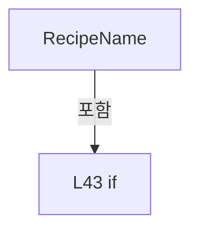

변경 전 점검: 입력/반환 타입, 위 호출자, 예외/취소 경로, 공유 상태와 저장·전송 소비자를 함께 확인합니다. 값의 단위나 물리 방향을 이름만으로 확정하지 않습니다.

### MethodDeclaration `LoadAll` · L52–60

[Drilling.File/JHMI/CJhmiRecipeFile.cs:52–60](https://github.com/kjuws10-rgb/A3Drilling/blob/5aee8e58439c9b455cae7c9593c9be986c3e682e/Drilling.File/JHMI/CJhmiRecipeFile.cs#L52-L60)

| 항목 | 실제 추출 값 |
| --- | --- |
| 서명 | System.Threading.Tasks.Task<System.Collections.Generic.IReadOnlyList<Drilling.Common.Managers.ST_RECIPE_DEFINITION>> Drilling.File.JHMI.CJhmiRecipeFile.LoadAll(System.Threading.CancellationToken) |
| 접근/수식자 | Public / public, override |
| 반환/값 타입 | System.Threading.Tasks.Task<System.Collections.Generic.IReadOnlyList<Drilling.Common.Managers.ST_RECIPE_DEFINITION>> |
| 소속 타입 | NamedType:Drilling.File.JHMI.CJhmiRecipeFile |

입력 계약:

| 이름 | 타입 | 전달 | 선택/기본값 |
| --- | --- | --- | --- |
| cancellationToken | System.Threading.CancellationToken | None | True / null |

현재 부분 분석에서 직접 연결된 호출자는 없습니다. XAML/이벤트/인터페이스·델리게이트·외부 진입을 추가 확인해야 하며, 미사용으로 판정한 것이 아닙니다.

호출하는 대상과 해석 범위:

| 원본 행 | 표현식 | 분석 상태 | 대상/소스 위치 |
| --- | --- | --- | --- |
| 59 | ExecuteFileOperation | resolved | System.Threading.Tasks.Task<System.Collections.Generic.IReadOnlyList<Drilling.Common.Managers.ST_RECIPE_DEFINITION>> Drilling.File.JHMI.CJhmiRecipeFile.ExecuteFileOperation<System.Collections.Generic.IReadOnlyList<Drilling.Common.Managers.ST_RECIPE_DEFINITION>>(System.Func<System.Collections.Generic.IReadOnlyList<Drilling.Common.Managers.ST_RECIPE_DEFINITION>>, System.Threading.CancellationToken) · Drilling.File/JHMI/CJhmiRecipeFile.cs:416 |

본문의 실제 연산·분기·예외·반환 순서(원문 위치 순):

| 원본 행 | 종류 | 주석 해설 |
| --- | --- | --- |
| 59 | call | 함수·델리게이트 또는 객체 생성자를 호출합니다: ExecuteFileOperation(SelectValue, cancellationToken) |
| 59 | return | 호출자에게 값 또는 제어를 반환합니다: return ExecuteFileOperation(SelectValue, cancellationToken); |

변경 전 점검: 입력/반환 타입, 위 호출자, 예외/취소 경로, 공유 상태와 저장·전송 소비자를 함께 확인합니다. 값의 단위나 물리 방향을 이름만으로 확정하지 않습니다.

### LocalFunctionStatement `SelectValue` · L54–57

[Drilling.File/JHMI/CJhmiRecipeFile.cs:54–57](https://github.com/kjuws10-rgb/A3Drilling/blob/5aee8e58439c9b455cae7c9593c9be986c3e682e/Drilling.File/JHMI/CJhmiRecipeFile.cs#L54-L57)

| 항목 | 실제 추출 값 |
| --- | --- |
| 서명 | System.Collections.Generic.IReadOnlyList<Drilling.Common.Managers.ST_RECIPE_DEFINITION> SelectValue() |
| 접근/수식자 | Private /  |
| 반환/값 타입 | System.Collections.Generic.IReadOnlyList<Drilling.Common.Managers.ST_RECIPE_DEFINITION> |
| 소속 타입 | NamedType:Drilling.File.JHMI.CJhmiRecipeFile |

현재 부분 분석에서 직접 연결된 호출자는 없습니다. XAML/이벤트/인터페이스·델리게이트·외부 진입을 추가 확인해야 하며, 미사용으로 판정한 것이 아닙니다.

호출하는 대상과 해석 범위:

| 원본 행 | 표현식 | 분석 상태 | 대상/소스 위치 |
| --- | --- | --- | --- |
| 56 | LoadAllCore | resolved | System.Collections.Generic.IReadOnlyList<Drilling.Common.Managers.ST_RECIPE_DEFINITION> Drilling.File.JHMI.CJhmiRecipeFile.LoadAllCore(System.Threading.CancellationToken) · Drilling.File/JHMI/CJhmiRecipeFile.cs:62 |

본문의 실제 연산·분기·예외·반환 순서(원문 위치 순):

| 원본 행 | 종류 | 주석 해설 |
| --- | --- | --- |
| 56 | call | 함수·델리게이트 또는 객체 생성자를 호출합니다: LoadAllCore(cancellationToken) |
| 56 | return | 호출자에게 값 또는 제어를 반환합니다: return LoadAllCore(cancellationToken); |

변경 전 점검: 입력/반환 타입, 위 호출자, 예외/취소 경로, 공유 상태와 저장·전송 소비자를 함께 확인합니다. 값의 단위나 물리 방향을 이름만으로 확정하지 않습니다.

### MethodDeclaration `LoadAllCore` · L62–89

[Drilling.File/JHMI/CJhmiRecipeFile.cs:62–89](https://github.com/kjuws10-rgb/A3Drilling/blob/5aee8e58439c9b455cae7c9593c9be986c3e682e/Drilling.File/JHMI/CJhmiRecipeFile.cs#L62-L89)

| 항목 | 실제 추출 값 |
| --- | --- |
| 서명 | System.Collections.Generic.IReadOnlyList<Drilling.Common.Managers.ST_RECIPE_DEFINITION> Drilling.File.JHMI.CJhmiRecipeFile.LoadAllCore(System.Threading.CancellationToken) |
| 접근/수식자 | Private / private |
| 반환/값 타입 | System.Collections.Generic.IReadOnlyList<Drilling.Common.Managers.ST_RECIPE_DEFINITION> |
| 소속 타입 | NamedType:Drilling.File.JHMI.CJhmiRecipeFile |

입력 계약:

| 이름 | 타입 | 전달 | 선택/기본값 |
| --- | --- | --- | --- |
| cancellationToken | System.Threading.CancellationToken | None | False /  |

정적 호출자로 확인된 위치:

| 호출 파일/행 | 호출 표현식 | 런타임 분기 가능 |
| --- | --- | --- |
| [Drilling.File/JHMI/CJhmiRecipeFile.cs:56–56](https://github.com/kjuws10-rgb/A3Drilling/blob/5aee8e58439c9b455cae7c9593c9be986c3e682e/Drilling.File/JHMI/CJhmiRecipeFile.cs#L56-L56) | LoadAllCore | False |

호출하는 대상과 해석 범위:

| 원본 행 | 표현식 | 분석 상태 | 대상/소스 위치 |
| --- | --- | --- | --- |
| 64 | cancellationToken.ThrowIfCancellationRequested | resolved | void System.Threading.CancellationToken.ThrowIfCancellationRequested() |
| 65 | Directory.Exists | resolved | bool System.IO.Directory.Exists(string?) |
| 70 | LoadFormItems | resolved | System.Collections.Generic.IReadOnlyList<Drilling.Common.Managers.ST_RECIPE_FORM_ITEM> Drilling.File.JHMI.CJhmiRecipeFile.LoadFormItems() · Drilling.File/JHMI/CJhmiRecipeFile.cs:847 |
| 71 | cancellationToken.ThrowIfCancellationRequested | resolved | void System.Threading.CancellationToken.ThrowIfCancellationRequested() |
| 72 | new List<ST_RECIPE_DEFINITION> | resolved | System.Collections.Generic.List<Drilling.Common.Managers.ST_RECIPE_DEFINITION>.List() |
| 73 | Directory.EnumerateFiles | resolved | System.Collections.Generic.IEnumerable<string> System.IO.Directory.EnumerateFiles(string, string) |
| 75 | cancellationToken.ThrowIfCancellationRequested | resolved | void System.Threading.CancellationToken.ThrowIfCancellationRequested() |
| 76 | LoadRecipe | resolved | Drilling.Common.Managers.ST_RECIPE_DEFINITION? Drilling.File.JHMI.CJhmiRecipeFile.LoadRecipe(string, System.Collections.Generic.IReadOnlyList<Drilling.Common.Managers.ST_RECIPE_FORM_ITEM>, System.Threading.CancellationToken) · Drilling.File/JHMI/CJhmiRecipeFile.cs:442 |
| 79 | recipes.Add | resolved | void System.Collections.Generic.List<Drilling.Common.Managers.ST_RECIPE_DEFINITION>.Add(Drilling.Common.Managers.ST_RECIPE_DEFINITION) |
| 88 | recipes.OrderBy(SelectName).ToArray | resolved | Drilling.Common.Managers.ST_RECIPE_DEFINITION[] System.Collections.Generic.IEnumerable<Drilling.Common.Managers.ST_RECIPE_DEFINITION>.ToArray<Drilling.Common.Managers.ST_RECIPE_DEFINITION>() |
| 88 | recipes.OrderBy | resolved | System.Linq.IOrderedEnumerable<Drilling.Common.Managers.ST_RECIPE_DEFINITION> System.Collections.Generic.IEnumerable<Drilling.Common.Managers.ST_RECIPE_DEFINITION>.OrderBy<Drilling.Common.Managers.ST_RECIPE_DEFINITION, string>(System.Func<Drilling.Common.Managers.ST_RECIPE_DEFINITION, string>) |

본문의 실제 연산·분기·예외·반환 순서(원문 위치 순):

| 원본 행 | 종류 | 주석 해설 |
| --- | --- | --- |
| 64 | call | 함수·델리게이트 또는 객체 생성자를 호출합니다: cancellationToken.ThrowIfCancellationRequested() |
| 65 | call | 함수·델리게이트 또는 객체 생성자를 호출합니다: Directory.Exists(_recipeDirectory) |
| 65 | if | 조건에 따라 분기합니다: if (!Directory.Exists(_recipeDirectory)) |
| 67 | return | 호출자에게 값 또는 제어를 반환합니다: return[]; |
| 70 | call | 함수·델리게이트 또는 객체 생성자를 호출합니다: LoadFormItems() |
| 70 | local-declaration | 지역 변수를 선언합니다: var formItems = LoadFormItems(); |
| 70 | variable-initializer | 변수의 초기값을 지정합니다: formItems = LoadFormItems() |
| 71 | call | 함수·델리게이트 또는 객체 생성자를 호출합니다: cancellationToken.ThrowIfCancellationRequested() |
| 72 | call | 함수·델리게이트 또는 객체 생성자를 호출합니다: new List<ST_RECIPE_DEFINITION>() |
| 72 | local-declaration | 지역 변수를 선언합니다: var recipes = new List<ST_RECIPE_DEFINITION>(); |
| 72 | variable-initializer | 변수의 초기값을 지정합니다: recipes = new List<ST_RECIPE_DEFINITION>() |
| 73 | call | 함수·델리게이트 또는 객체 생성자를 호출합니다: Directory.EnumerateFiles(_recipeDirectory, "*.csv") |
| 73 | foreach | 컬렉션 요소를 순회합니다: foreach (var path in Directory.EnumerateFiles(_recipeDirectory, "*.csv")) |
| 75 | call | 함수·델리게이트 또는 객체 생성자를 호출합니다: cancellationToken.ThrowIfCancellationRequested() |
| 76 | call | 함수·델리게이트 또는 객체 생성자를 호출합니다: LoadRecipe(path, formItems, cancellationToken) |
| 76 | local-declaration | 지역 변수를 선언합니다: var recipe = LoadRecipe(path, formItems, cancellationToken); |
| 76 | variable-initializer | 변수의 초기값을 지정합니다: recipe = LoadRecipe(path, formItems, cancellationToken) |
| 77 | if | 조건에 따라 분기합니다: if (recipe is not null) |
| 79 | call | 함수·델리게이트 또는 객체 생성자를 호출합니다: recipes.Add(recipe) |
| 88 | call | 함수·델리게이트 또는 객체 생성자를 호출합니다: recipes.OrderBy(SelectName).ToArray() |
| 88 | call | 함수·델리게이트 또는 객체 생성자를 호출합니다: recipes.OrderBy(SelectName) |
| 88 | return | 호출자에게 값 또는 제어를 반환합니다: return recipes.OrderBy(SelectName).ToArray(); |

제어 구문의 포함 구조(실제 실행 순서/CFG가 아닌 구문 탐색 그림):

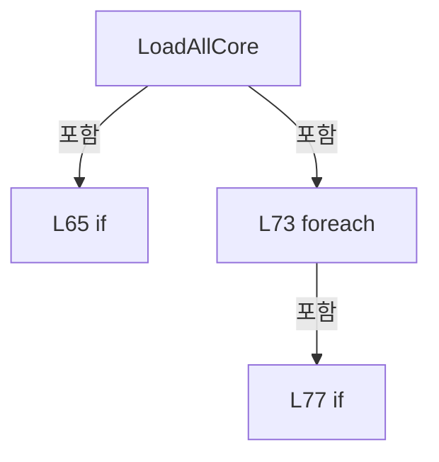

변경 전 점검: 입력/반환 타입, 위 호출자, 예외/취소 경로, 공유 상태와 저장·전송 소비자를 함께 확인합니다. 값의 단위나 물리 방향을 이름만으로 확정하지 않습니다.

### LocalFunctionStatement `SelectName` · L83–86

[Drilling.File/JHMI/CJhmiRecipeFile.cs:83–86](https://github.com/kjuws10-rgb/A3Drilling/blob/5aee8e58439c9b455cae7c9593c9be986c3e682e/Drilling.File/JHMI/CJhmiRecipeFile.cs#L83-L86)

| 항목 | 실제 추출 값 |
| --- | --- |
| 서명 | string SelectName(Drilling.Common.Managers.ST_RECIPE_DEFINITION) |
| 접근/수식자 | Private /  |
| 반환/값 타입 | string |
| 소속 타입 | NamedType:Drilling.File.JHMI.CJhmiRecipeFile |

입력 계약:

| 이름 | 타입 | 전달 | 선택/기본값 |
| --- | --- | --- | --- |
| recipe | Drilling.Common.Managers.ST_RECIPE_DEFINITION | None | False /  |

현재 부분 분석에서 직접 연결된 호출자는 없습니다. XAML/이벤트/인터페이스·델리게이트·외부 진입을 추가 확인해야 하며, 미사용으로 판정한 것이 아닙니다.

본문의 실제 연산·분기·예외·반환 순서(원문 위치 순):

| 원본 행 | 종류 | 주석 해설 |
| --- | --- | --- |
| 85 | return | 호출자에게 값 또는 제어를 반환합니다: return recipe.Name; |

변경 전 점검: 입력/반환 타입, 위 호출자, 예외/취소 경로, 공유 상태와 저장·전송 소비자를 함께 확인합니다. 값의 단위나 물리 방향을 이름만으로 확정하지 않습니다.

### MethodDeclaration `Find` · L91–99

[Drilling.File/JHMI/CJhmiRecipeFile.cs:91–99](https://github.com/kjuws10-rgb/A3Drilling/blob/5aee8e58439c9b455cae7c9593c9be986c3e682e/Drilling.File/JHMI/CJhmiRecipeFile.cs#L91-L99)

| 항목 | 실제 추출 값 |
| --- | --- |
| 서명 | System.Threading.Tasks.Task<Drilling.Common.Managers.ST_RECIPE_DEFINITION?> Drilling.File.JHMI.CJhmiRecipeFile.Find(string, System.Threading.CancellationToken) |
| 접근/수식자 | Public / public, override |
| 반환/값 타입 | System.Threading.Tasks.Task<Drilling.Common.Managers.ST_RECIPE_DEFINITION?> |
| 소속 타입 | NamedType:Drilling.File.JHMI.CJhmiRecipeFile |

입력 계약:

| 이름 | 타입 | 전달 | 선택/기본값 |
| --- | --- | --- | --- |
| recipeId | string | None | False /  |
| cancellationToken | System.Threading.CancellationToken | None | True / null |

현재 부분 분석에서 직접 연결된 호출자는 없습니다. XAML/이벤트/인터페이스·델리게이트·외부 진입을 추가 확인해야 하며, 미사용으로 판정한 것이 아닙니다.

호출하는 대상과 해석 범위:

| 원본 행 | 표현식 | 분석 상태 | 대상/소스 위치 |
| --- | --- | --- | --- |
| 98 | ExecuteFileOperation | resolved | System.Threading.Tasks.Task<Drilling.Common.Managers.ST_RECIPE_DEFINITION?> Drilling.File.JHMI.CJhmiRecipeFile.ExecuteFileOperation<Drilling.Common.Managers.ST_RECIPE_DEFINITION?>(System.Func<Drilling.Common.Managers.ST_RECIPE_DEFINITION?>, System.Threading.CancellationToken) · Drilling.File/JHMI/CJhmiRecipeFile.cs:416 |

본문의 실제 연산·분기·예외·반환 순서(원문 위치 순):

| 원본 행 | 종류 | 주석 해설 |
| --- | --- | --- |
| 98 | call | 함수·델리게이트 또는 객체 생성자를 호출합니다: ExecuteFileOperation(SelectValue, cancellationToken) |
| 98 | return | 호출자에게 값 또는 제어를 반환합니다: return ExecuteFileOperation(SelectValue, cancellationToken); |

변경 전 점검: 입력/반환 타입, 위 호출자, 예외/취소 경로, 공유 상태와 저장·전송 소비자를 함께 확인합니다. 값의 단위나 물리 방향을 이름만으로 확정하지 않습니다.

### LocalFunctionStatement `SelectValue` · L93–96

[Drilling.File/JHMI/CJhmiRecipeFile.cs:93–96](https://github.com/kjuws10-rgb/A3Drilling/blob/5aee8e58439c9b455cae7c9593c9be986c3e682e/Drilling.File/JHMI/CJhmiRecipeFile.cs#L93-L96)

| 항목 | 실제 추출 값 |
| --- | --- |
| 서명 | Drilling.Common.Managers.ST_RECIPE_DEFINITION? SelectValue() |
| 접근/수식자 | Private /  |
| 반환/값 타입 | Drilling.Common.Managers.ST_RECIPE_DEFINITION? |
| 소속 타입 | NamedType:Drilling.File.JHMI.CJhmiRecipeFile |

현재 부분 분석에서 직접 연결된 호출자는 없습니다. XAML/이벤트/인터페이스·델리게이트·외부 진입을 추가 확인해야 하며, 미사용으로 판정한 것이 아닙니다.

호출하는 대상과 해석 범위:

| 원본 행 | 표현식 | 분석 상태 | 대상/소스 위치 |
| --- | --- | --- | --- |
| 95 | FindCore | resolved | Drilling.Common.Managers.ST_RECIPE_DEFINITION? Drilling.File.JHMI.CJhmiRecipeFile.FindCore(string, System.Threading.CancellationToken) · Drilling.File/JHMI/CJhmiRecipeFile.cs:101 |

본문의 실제 연산·분기·예외·반환 순서(원문 위치 순):

| 원본 행 | 종류 | 주석 해설 |
| --- | --- | --- |
| 95 | call | 함수·델리게이트 또는 객체 생성자를 호출합니다: FindCore(recipeId, cancellationToken) |
| 95 | return | 호출자에게 값 또는 제어를 반환합니다: return FindCore(recipeId, cancellationToken); |

변경 전 점검: 입력/반환 타입, 위 호출자, 예외/취소 경로, 공유 상태와 저장·전송 소비자를 함께 확인합니다. 값의 단위나 물리 방향을 이름만으로 확정하지 않습니다.

### MethodDeclaration `FindCore` · L101–108

[Drilling.File/JHMI/CJhmiRecipeFile.cs:101–108](https://github.com/kjuws10-rgb/A3Drilling/blob/5aee8e58439c9b455cae7c9593c9be986c3e682e/Drilling.File/JHMI/CJhmiRecipeFile.cs#L101-L108)

| 항목 | 실제 추출 값 |
| --- | --- |
| 서명 | Drilling.Common.Managers.ST_RECIPE_DEFINITION? Drilling.File.JHMI.CJhmiRecipeFile.FindCore(string, System.Threading.CancellationToken) |
| 접근/수식자 | Private / private |
| 반환/값 타입 | Drilling.Common.Managers.ST_RECIPE_DEFINITION? |
| 소속 타입 | NamedType:Drilling.File.JHMI.CJhmiRecipeFile |

입력 계약:

| 이름 | 타입 | 전달 | 선택/기본값 |
| --- | --- | --- | --- |
| recipeId | string | None | False /  |
| cancellationToken | System.Threading.CancellationToken | None | False /  |

정적 호출자로 확인된 위치:

| 호출 파일/행 | 호출 표현식 | 런타임 분기 가능 |
| --- | --- | --- |
| [Drilling.File/JHMI/CJhmiRecipeFile.cs:95–95](https://github.com/kjuws10-rgb/A3Drilling/blob/5aee8e58439c9b455cae7c9593c9be986c3e682e/Drilling.File/JHMI/CJhmiRecipeFile.cs#L95-L95) | FindCore | False |

호출하는 대상과 해석 범위:

| 원본 행 | 표현식 | 분석 상태 | 대상/소스 위치 |
| --- | --- | --- | --- |
| 103 | cancellationToken.ThrowIfCancellationRequested | resolved | void System.Threading.CancellationToken.ThrowIfCancellationRequested() |
| 104 | LoadFormItems | resolved | System.Collections.Generic.IReadOnlyList<Drilling.Common.Managers.ST_RECIPE_FORM_ITEM> Drilling.File.JHMI.CJhmiRecipeFile.LoadFormItems() · Drilling.File/JHMI/CJhmiRecipeFile.cs:847 |
| 105 | cancellationToken.ThrowIfCancellationRequested | resolved | void System.Threading.CancellationToken.ThrowIfCancellationRequested() |
| 106 | GetRecipePath | resolved | string Drilling.File.JHMI.CJhmiRecipeFile.GetRecipePath(string) · Drilling.File/JHMI/CJhmiRecipeFile.cs:966 |
| 107 | System.IO.File.Exists | resolved | bool System.IO.File.Exists(string?) |
| 107 | LoadRecipe | resolved | Drilling.Common.Managers.ST_RECIPE_DEFINITION? Drilling.File.JHMI.CJhmiRecipeFile.LoadRecipe(string, System.Collections.Generic.IReadOnlyList<Drilling.Common.Managers.ST_RECIPE_FORM_ITEM>, System.Threading.CancellationToken) · Drilling.File/JHMI/CJhmiRecipeFile.cs:442 |

본문의 실제 연산·분기·예외·반환 순서(원문 위치 순):

| 원본 행 | 종류 | 주석 해설 |
| --- | --- | --- |
| 103 | call | 함수·델리게이트 또는 객체 생성자를 호출합니다: cancellationToken.ThrowIfCancellationRequested() |
| 104 | call | 함수·델리게이트 또는 객체 생성자를 호출합니다: LoadFormItems() |
| 104 | local-declaration | 지역 변수를 선언합니다: var formItems = LoadFormItems(); |
| 104 | variable-initializer | 변수의 초기값을 지정합니다: formItems = LoadFormItems() |
| 105 | call | 함수·델리게이트 또는 객체 생성자를 호출합니다: cancellationToken.ThrowIfCancellationRequested() |
| 106 | call | 함수·델리게이트 또는 객체 생성자를 호출합니다: GetRecipePath(recipeId) |
| 106 | local-declaration | 지역 변수를 선언합니다: var path = GetRecipePath(recipeId); |
| 106 | variable-initializer | 변수의 초기값을 지정합니다: path = GetRecipePath(recipeId) |
| 107 | call | 함수·델리게이트 또는 객체 생성자를 호출합니다: System.IO.File.Exists(path) |
| 107 | call | 함수·델리게이트 또는 객체 생성자를 호출합니다: LoadRecipe(path, formItems, cancellationToken) |
| 107 | conditional-expression | 조건에 따라 결과식을 선택합니다: System.IO.File.Exists(path) ? LoadRecipe(path, formItems, cancellationToken) : null |
| 107 | return | 호출자에게 값 또는 제어를 반환합니다: return System.IO.File.Exists(path) ? LoadRecipe(path, formItems, cancellationToken) : null; |

변경 전 점검: 입력/반환 타입, 위 호출자, 예외/취소 경로, 공유 상태와 저장·전송 소비자를 함께 확인합니다. 값의 단위나 물리 방향을 이름만으로 확정하지 않습니다.

### MethodDeclaration `Save` · L110–118

[Drilling.File/JHMI/CJhmiRecipeFile.cs:110–118](https://github.com/kjuws10-rgb/A3Drilling/blob/5aee8e58439c9b455cae7c9593c9be986c3e682e/Drilling.File/JHMI/CJhmiRecipeFile.cs#L110-L118)

| 항목 | 실제 추출 값 |
| --- | --- |
| 서명 | System.Threading.Tasks.Task Drilling.File.JHMI.CJhmiRecipeFile.Save(Drilling.Common.Managers.ST_RECIPE_DEFINITION, System.Threading.CancellationToken) |
| 접근/수식자 | Public / public, override |
| 반환/값 타입 | System.Threading.Tasks.Task |
| 소속 타입 | NamedType:Drilling.File.JHMI.CJhmiRecipeFile |

입력 계약:

| 이름 | 타입 | 전달 | 선택/기본값 |
| --- | --- | --- | --- |
| recipe | Drilling.Common.Managers.ST_RECIPE_DEFINITION | None | False /  |
| cancellationToken | System.Threading.CancellationToken | None | True / null |

현재 부분 분석에서 직접 연결된 호출자는 없습니다. XAML/이벤트/인터페이스·델리게이트·외부 진입을 추가 확인해야 하며, 미사용으로 판정한 것이 아닙니다.

호출하는 대상과 해석 범위:

| 원본 행 | 표현식 | 분석 상태 | 대상/소스 위치 |
| --- | --- | --- | --- |
| 117 | ExecuteFileOperation | resolved | System.Threading.Tasks.Task Drilling.File.JHMI.CJhmiRecipeFile.ExecuteFileOperation(System.Action, System.Threading.CancellationToken) · Drilling.File/JHMI/CJhmiRecipeFile.cs:429 |

본문의 실제 연산·분기·예외·반환 순서(원문 위치 순):

| 원본 행 | 종류 | 주석 해설 |
| --- | --- | --- |
| 117 | call | 함수·델리게이트 또는 객체 생성자를 호출합니다: ExecuteFileOperation(SaveCoreCallback, cancellationToken) |
| 117 | return | 호출자에게 값 또는 제어를 반환합니다: return ExecuteFileOperation(SaveCoreCallback, cancellationToken); |

변경 전 점검: 입력/반환 타입, 위 호출자, 예외/취소 경로, 공유 상태와 저장·전송 소비자를 함께 확인합니다. 값의 단위나 물리 방향을 이름만으로 확정하지 않습니다.

### LocalFunctionStatement `SaveCoreCallback` · L112–115

[Drilling.File/JHMI/CJhmiRecipeFile.cs:112–115](https://github.com/kjuws10-rgb/A3Drilling/blob/5aee8e58439c9b455cae7c9593c9be986c3e682e/Drilling.File/JHMI/CJhmiRecipeFile.cs#L112-L115)

| 항목 | 실제 추출 값 |
| --- | --- |
| 서명 | void SaveCoreCallback() |
| 접근/수식자 | Private /  |
| 반환/값 타입 | void |
| 소속 타입 | NamedType:Drilling.File.JHMI.CJhmiRecipeFile |

현재 부분 분석에서 직접 연결된 호출자는 없습니다. XAML/이벤트/인터페이스·델리게이트·외부 진입을 추가 확인해야 하며, 미사용으로 판정한 것이 아닙니다.

호출하는 대상과 해석 범위:

| 원본 행 | 표현식 | 분석 상태 | 대상/소스 위치 |
| --- | --- | --- | --- |
| 114 | SaveCore | resolved | void Drilling.File.JHMI.CJhmiRecipeFile.SaveCore(Drilling.Common.Managers.ST_RECIPE_DEFINITION, System.Threading.CancellationToken, string?, bool) · Drilling.File/JHMI/CJhmiRecipeFile.cs:120 |

본문의 실제 연산·분기·예외·반환 순서(원문 위치 순):

| 원본 행 | 종류 | 주석 해설 |
| --- | --- | --- |
| 114 | call | 함수·델리게이트 또는 객체 생성자를 호출합니다: SaveCore(recipe, cancellationToken) |

변경 전 점검: 입력/반환 타입, 위 호출자, 예외/취소 경로, 공유 상태와 저장·전송 소비자를 함께 확인합니다. 값의 단위나 물리 방향을 이름만으로 확정하지 않습니다.

### MethodDeclaration `SaveCore` · L120–242

[Drilling.File/JHMI/CJhmiRecipeFile.cs:120–242](https://github.com/kjuws10-rgb/A3Drilling/blob/5aee8e58439c9b455cae7c9593c9be986c3e682e/Drilling.File/JHMI/CJhmiRecipeFile.cs#L120-L242)

| 항목 | 실제 추출 값 |
| --- | --- |
| 서명 | void Drilling.File.JHMI.CJhmiRecipeFile.SaveCore(Drilling.Common.Managers.ST_RECIPE_DEFINITION, System.Threading.CancellationToken, string?, bool) |
| 접근/수식자 | Private / private |
| 반환/값 타입 | void |
| 소속 타입 | NamedType:Drilling.File.JHMI.CJhmiRecipeFile |

입력 계약:

| 이름 | 타입 | 전달 | 선택/기본값 |
| --- | --- | --- | --- |
| recipe | Drilling.Common.Managers.ST_RECIPE_DEFINITION | None | False /  |
| cancellationToken | System.Threading.CancellationToken | None | False /  |
| destination | string? | None | True / null |
| writeHistory | bool | None | True / true |

정적 호출자로 확인된 위치:

| 호출 파일/행 | 호출 표현식 | 런타임 분기 가능 |
| --- | --- | --- |
| [Drilling.File/JHMI/CJhmiRecipeFile.cs:114–114](https://github.com/kjuws10-rgb/A3Drilling/blob/5aee8e58439c9b455cae7c9593c9be986c3e682e/Drilling.File/JHMI/CJhmiRecipeFile.cs#L114-L114) | SaveCore | False |
| [Drilling.File/JHMI/CJhmiRecipeFile.cs:1324–1324](https://github.com/kjuws10-rgb/A3Drilling/blob/5aee8e58439c9b455cae7c9593c9be986c3e682e/Drilling.File/JHMI/CJhmiRecipeFile.cs#L1324-L1324) | SaveCore | False |

호출하는 대상과 해석 범위:

| 원본 행 | 표현식 | 분석 상태 | 대상/소스 위치 |
| --- | --- | --- | --- |
| 122 | cancellationToken.ThrowIfCancellationRequested | resolved | void System.Threading.CancellationToken.ThrowIfCancellationRequested() |
| 123 | Directory.CreateDirectory | resolved | System.IO.DirectoryInfo System.IO.Directory.CreateDirectory(string) |
| 124 | LoadFormItems | resolved | System.Collections.Generic.IReadOnlyList<Drilling.Common.Managers.ST_RECIPE_FORM_ITEM> Drilling.File.JHMI.CJhmiRecipeFile.LoadFormItems() · Drilling.File/JHMI/CJhmiRecipeFile.cs:847 |
| 125 | GetRecipePath | resolved | string Drilling.File.JHMI.CJhmiRecipeFile.GetRecipePath(string) · Drilling.File/JHMI/CJhmiRecipeFile.cs:966 |
| 126 | System.IO.File.Exists | resolved | bool System.IO.File.Exists(string?) |
| 142 | ReadRecipeValues(recipePath, cancellationToken).GroupBy(SelectGroupKey, StringComparer.OrdinalIgnoreCase).ToDictionary | resolved | System.Collections.Generic.Dictionary<string, string> System.Collections.Generic.IEnumerable<System.Linq.IGrouping<string, Drilling.Common.Managers.ST_RECIPE_VALUE>>.ToDictionary<System.Linq.IGrouping<string, Drilling.Common.Managers.ST_RECIPE_VALUE>, string, string>(System.Func<System.Linq.IGrouping<string, Drilling.Common.Managers.ST_RECIPE_VALUE>, string>, System.Func<System.Linq.IGrouping<string, Drilling.Common.Managers.ST_RECIPE_VALUE>, string>, System.Collections.Generic.IEqualityComparer<string>?) |
| 142 | ReadRecipeValues(recipePath, cancellationToken).GroupBy | resolved | System.Collections.Generic.IEnumerable<System.Linq.IGrouping<string, Drilling.Common.Managers.ST_RECIPE_VALUE>> System.Collections.Generic.IEnumerable<Drilling.Common.Managers.ST_RECIPE_VALUE>.GroupBy<Drilling.Common.Managers.ST_RECIPE_VALUE, string>(System.Func<Drilling.Common.Managers.ST_RECIPE_VALUE, string>, System.Collections.Generic.IEqualityComparer<string>?) |
| 142 | ReadRecipeValues | resolved | System.Collections.Generic.IReadOnlyList<Drilling.Common.Managers.ST_RECIPE_VALUE> Drilling.File.JHMI.CJhmiRecipeFile.ReadRecipeValues(string, System.Threading.CancellationToken) · Drilling.File/JHMI/CJhmiRecipeFile.cs:889 |
| 142 | new Dictionary<string, string> | resolved | System.Collections.Generic.Dictionary<string, string>.Dictionary(System.Collections.Generic.IEqualityComparer<string>?) |
| 148 | recipe.Parameters.Where(ShouldIncludeItem).Select(parameter => new { Parameter = parameter, FormItem = FindFormItem(formItems, parameter) }).Where(item => item.FormItem is not null).ToDictionary | resolved | System.Collections.Generic.Dictionary<string, string> System.Collections.Generic.IEnumerable<<anonymous type: Drilling.Common.Managers.ST_RECIPE_PARAMETER Parameter, Drilling.Common.Managers.ST_RECIPE_FORM_ITEM? FormItem>>.ToDictionary<<anonymous type: Drilling.Common.Managers.ST_RECIPE_PARAMETER Parameter, Drilling.Common.Managers.ST_RECIPE_FORM_ITEM? FormItem>, string, string>(System.Func<<anonymous type: Drilling.Common.Managers.ST_RECIPE_PARAMETER Parameter, Drilling.Common.Managers.ST_RECIPE_FORM_ITEM? FormItem>, string>, System.Func<<anonymous type: Drilling.Common.Managers.ST_RECIPE_PARAMETER Parameter, Drilling.Common.Managers.ST_RECIPE_FORM_ITEM? FormItem>, string>, System.Collections.Generic.IEqualityComparer<string>?) |
| 148 | recipe.Parameters.Where(ShouldIncludeItem).Select(parameter => new { Parameter = parameter, FormItem = FindFormItem(formItems, parameter) }).Where | resolved | System.Collections.Generic.IEnumerable<<anonymous type: Drilling.Common.Managers.ST_RECIPE_PARAMETER Parameter, Drilling.Common.Managers.ST_RECIPE_FORM_ITEM? FormItem>> System.Collections.Generic.IEnumerable<<anonymous type: Drilling.Common.Managers.ST_RECIPE_PARAMETER Parameter, Drilling.Common.Managers.ST_RECIPE_FORM_ITEM? FormItem>>.Where<<anonymous type: Drilling.Common.Managers.ST_RECIPE_PARAMETER Parameter, Drilling.Common.Managers.ST_RECIPE_FORM_ITEM? FormItem>>(System.Func<<anonymous type: Drilling.Common.Managers.ST_RECIPE_PARAMETER Parameter, Drilling.Common.Managers.ST_RECIPE_FORM_ITEM? FormItem>, bool>) |
| 148 | recipe.Parameters.Where(ShouldIncludeItem).Select | resolved | System.Collections.Generic.IEnumerable<<anonymous type: Drilling.Common.Managers.ST_RECIPE_PARAMETER Parameter, Drilling.Common.Managers.ST_RECIPE_FORM_ITEM? FormItem>> System.Collections.Generic.IEnumerable<Drilling.Common.Managers.ST_RECIPE_PARAMETER>.Select<Drilling.Common.Managers.ST_RECIPE_PARAMETER, <anonymous type: Drilling.Common.Managers.ST_RECIPE_PARAMETER Parameter, Drilling.Common.Managers.ST_RECIPE_FORM_ITEM? FormItem>>(System.Func<Drilling.Common.Managers.ST_RECIPE_PARAMETER, <anonymous type: Drilling.Common.Managers.ST_RECIPE_PARAMETER Parameter, Drilling.Common.Managers.ST_RECIPE_FORM_ITEM? FormItem>>) |
| 148 | recipe.Parameters.Where | resolved | System.Collections.Generic.IEnumerable<Drilling.Common.Managers.ST_RECIPE_PARAMETER> System.Collections.Generic.IEnumerable<Drilling.Common.Managers.ST_RECIPE_PARAMETER>.Where<Drilling.Common.Managers.ST_RECIPE_PARAMETER>(System.Func<Drilling.Common.Managers.ST_RECIPE_PARAMETER, bool>) |
| 148 | FindFormItem | resolved | Drilling.Common.Managers.ST_RECIPE_FORM_ITEM? Drilling.File.JHMI.CJhmiRecipeFile.FindFormItem(System.Collections.Generic.IReadOnlyList<Drilling.Common.Managers.ST_RECIPE_FORM_ITEM>, Drilling.Common.Managers.ST_RECIPE_PARAMETER) · Drilling.File/JHMI/CJhmiRecipeFile.cs:971 |
| 148 | CreateKey | resolved | string Drilling.File.JHMI.CJhmiRecipeFile.CreateKey(string, string) · Drilling.File/JHMI/CJhmiRecipeFile.cs:1050 |
| 149 | GetActiveCellCount | resolved | int Drilling.File.JHMI.CJhmiRecipeFile.GetActiveCellCount(System.Collections.Generic.IEnumerable<Drilling.Common.Managers.ST_RECIPE_PARAMETER>) · Drilling.File/JHMI/CJhmiRecipeFile.cs:601 |
| 150 | CalculateActiveShotGroupBoundsByCell | resolved | System.Collections.Generic.IReadOnlyDictionary<int, Drilling.File.JHMI.CJhmiRecipeFile.ST_SHOT_GROUP_PATTERN_BOUNDS> Drilling.File.JHMI.CJhmiRecipeFile.CalculateActiveShotGroupBoundsByCell(System.Collections.Generic.IReadOnlyList<Drilling.Common.Managers.ST_RECIPE_PARAMETER>, int) · Drilling.File/JHMI/CJhmiRecipeFile.cs:626 |
| 166 | recipe.Parameters.Where(ShouldIncludeRecipe).OrderBy(SelectSortKey).ThenBy(SelectRecipeParameterKey, StringComparer.OrdinalIgnoreCase).ToArray | resolved | Drilling.Common.Managers.ST_RECIPE_PARAMETER[] System.Collections.Generic.IEnumerable<Drilling.Common.Managers.ST_RECIPE_PARAMETER>.ToArray<Drilling.Common.Managers.ST_RECIPE_PARAMETER>() |
| 166 | recipe.Parameters.Where(ShouldIncludeRecipe).OrderBy(SelectSortKey).ThenBy | resolved | System.Linq.IOrderedEnumerable<Drilling.Common.Managers.ST_RECIPE_PARAMETER> System.Linq.IOrderedEnumerable<Drilling.Common.Managers.ST_RECIPE_PARAMETER>.ThenBy<Drilling.Common.Managers.ST_RECIPE_PARAMETER, string>(System.Func<Drilling.Common.Managers.ST_RECIPE_PARAMETER, string>, System.Collections.Generic.IComparer<string>?) |
| 166 | recipe.Parameters.Where(ShouldIncludeRecipe).OrderBy | resolved | System.Linq.IOrderedEnumerable<Drilling.Common.Managers.ST_RECIPE_PARAMETER> System.Collections.Generic.IEnumerable<Drilling.Common.Managers.ST_RECIPE_PARAMETER>.OrderBy<Drilling.Common.Managers.ST_RECIPE_PARAMETER, int>(System.Func<Drilling.Common.Managers.ST_RECIPE_PARAMETER, int>) |
| 166 | recipe.Parameters.Where | resolved | System.Collections.Generic.IEnumerable<Drilling.Common.Managers.ST_RECIPE_PARAMETER> System.Collections.Generic.IEnumerable<Drilling.Common.Managers.ST_RECIPE_PARAMETER>.Where<Drilling.Common.Managers.ST_RECIPE_PARAMETER>(System.Func<Drilling.Common.Managers.ST_RECIPE_PARAMETER, bool>) |
| 167 | new List<string> | resolved | System.Collections.Generic.List<string>.List() |
| 169 | FormatRecipeLine | resolved | string Drilling.File.JHMI.CJhmiRecipeFile.FormatRecipeLine(string, string, string) · Drilling.File/JHMI/CJhmiRecipeFile.cs:1065 |
| 170 | FormatRecipeLine | resolved | string Drilling.File.JHMI.CJhmiRecipeFile.FormatRecipeLine(string, string, string) · Drilling.File/JHMI/CJhmiRecipeFile.cs:1065 |
| 172 | new Dictionary<string, string> | resolved | System.Collections.Generic.Dictionary<string, string>.Dictionary(System.Collections.Generic.IEqualityComparer<string>?) |
| 174 | CreateKey | resolved | string Drilling.File.JHMI.CJhmiRecipeFile.CreateKey(string, string) · Drilling.File/JHMI/CJhmiRecipeFile.cs:1050 |
| 175 | CreateKey | resolved | string Drilling.File.JHMI.CJhmiRecipeFile.CreateKey(string, string) · Drilling.File/JHMI/CJhmiRecipeFile.cs:1050 |
| 177 | new List<(string Tab, string Group, string ItemName, string OldValue, string NewValue)> | resolved | System.Collections.Generic.List<(string Tab, string Group, string ItemName, string OldValue, string NewValue)>.List() |
| 188 | formItems.Where(ShouldIncludeRecipe2).OrderBy | resolved | System.Linq.IOrderedEnumerable<Drilling.Common.Managers.ST_RECIPE_FORM_ITEM> System.Collections.Generic.IEnumerable<Drilling.Common.Managers.ST_RECIPE_FORM_ITEM>.OrderBy<Drilling.Common.Managers.ST_RECIPE_FORM_ITEM, int>(System.Func<Drilling.Common.Managers.ST_RECIPE_FORM_ITEM, int>) |
| 188 | formItems.Where | resolved | System.Collections.Generic.IEnumerable<Drilling.Common.Managers.ST_RECIPE_FORM_ITEM> System.Collections.Generic.IEnumerable<Drilling.Common.Managers.ST_RECIPE_FORM_ITEM>.Where<Drilling.Common.Managers.ST_RECIPE_FORM_ITEM>(System.Func<Drilling.Common.Managers.ST_RECIPE_FORM_ITEM, bool>) |
| 190 | cancellationToken.ThrowIfCancellationRequested | resolved | void System.Threading.CancellationToken.ThrowIfCancellationRequested() |
| 191 | CreateKey | resolved | string Drilling.File.JHMI.CJhmiRecipeFile.CreateKey(string, string) · Drilling.File/JHMI/CJhmiRecipeFile.cs:1050 |
| 192 | valuesByKey.TryGetValue | resolved | bool System.Collections.Generic.Dictionary<string, string>.TryGetValue(string, out string) |
| 194 | item.Tab.Equals | resolved | bool string.Equals(string?, System.StringComparison) |
| 194 | item.Name.Equals | resolved | bool string.Equals(string?, System.StringComparison) |
| 195 | GetValue | resolved | string Drilling.File.JHMI.CJhmiRecipeFile.GetValue(System.Collections.Generic.IReadOnlyDictionary<string, string>, string, string, string) · Drilling.File/JHMI/CJhmiRecipeFile.cs:1045 |
| 198 | GetValue | resolved | string Drilling.File.JHMI.CJhmiRecipeFile.GetValue(System.Collections.Generic.IReadOnlyDictionary<string, string>, string, string, string) · Drilling.File/JHMI/CJhmiRecipeFile.cs:1045 |
| 199 | oldValue.Equals | resolved | bool string.Equals(string?, System.StringComparison) |
| 201 | changedItems.Add | resolved | void System.Collections.Generic.List<(string Tab, string Group, string ItemName, string OldValue, string NewValue)>.Add((string Tab, string Group, string ItemName, string OldValue, string NewValue)) |
| 205 | CreateKey | resolved | string Drilling.File.JHMI.CJhmiRecipeFile.CreateKey(string, string) · Drilling.File/JHMI/CJhmiRecipeFile.cs:1050 |
| 206 | lines.Add | resolved | void System.Collections.Generic.List<string>.Add(string) |
| 206 | FormatRecipeLine | resolved | string Drilling.File.JHMI.CJhmiRecipeFile.FormatRecipeLine(string, string, string) · Drilling.File/JHMI/CJhmiRecipeFile.cs:1065 |
| 211 | cancellationToken.ThrowIfCancellationRequested | resolved | void System.Threading.CancellationToken.ThrowIfCancellationRequested() |
| 212 | ToPersistedCellScopedKey | resolved | string Drilling.File.JHMI.CJhmiRecipeFile.ToPersistedCellScopedKey(string) · Drilling.File/JHMI/CJhmiRecipeFile.cs:726 |
| 215 | GetValue | resolved | string Drilling.File.JHMI.CJhmiRecipeFile.GetValue(System.Collections.Generic.IReadOnlyDictionary<string, string>, string, string, string) · Drilling.File/JHMI/CJhmiRecipeFile.cs:1045 |
| 216 | oldValue.Equals | resolved | bool string.Equals(string?, System.StringComparison) |
| 218 | changedItems.Add | resolved | void System.Collections.Generic.List<(string Tab, string Group, string ItemName, string OldValue, string NewValue)>.Add((string Tab, string Group, string ItemName, string OldValue, string NewValue)) |
| 218 | GetCellHistoryItemName | resolved | string Drilling.File.JHMI.CJhmiRecipeFile.GetCellHistoryItemName(Drilling.Common.Managers.ST_RECIPE_PARAMETER, System.Collections.Generic.IReadOnlyList<Drilling.Common.Managers.ST_RECIPE_PARAMETER>) · Drilling.File/JHMI/CJhmiRecipeFile.cs:741 |
| 222 | CreateKey | resolved | string Drilling.File.JHMI.CJhmiRecipeFile.CreateKey(string, string) · Drilling.File/JHMI/CJhmiRecipeFile.cs:1050 |
| 223 | lines.Add | resolved | void System.Collections.Generic.List<string>.Add(string) |
| 223 | FormatRecipeLine | resolved | string Drilling.File.JHMI.CJhmiRecipeFile.FormatRecipeLine(string, string, string) · Drilling.File/JHMI/CJhmiRecipeFile.cs:1065 |
| 226 | cancellationToken.ThrowIfCancellationRequested | resolved | void System.Threading.CancellationToken.ThrowIfCancellationRequested() |
| 227 | CCsvParser.WriteLines | resolved | void Drilling.File.Parser.CCsvParser.WriteLines(string, System.Collections.Generic.IEnumerable<string>) · Drilling.File/Parser/CCsvParser.cs:157 |
| 228 | ValidateSavedRecipeFile | resolved | void Drilling.File.JHMI.CJhmiRecipeFile.ValidateSavedRecipeFile(string, System.Collections.Generic.IReadOnlyDictionary<string, string>, System.Threading.CancellationToken) · Drilling.File/JHMI/CJhmiRecipeFile.cs:1070 |
| 231 | GetRecipeName | resolved | string Drilling.File.JHMI.CJhmiRecipeFile.GetRecipeName(Drilling.Common.Managers.ST_RECIPE_DEFINITION) · Drilling.File/JHMI/CJhmiRecipeFile.cs:1060 |
| 234 | cancellationToken.ThrowIfCancellationRequested | resolved | void System.Threading.CancellationToken.ThrowIfCancellationRequested() |
| 235 | _logManager.WriteRecipeModifyBatch | unresolved | None |
| 236 | _logManager.WriteRecipeSave | unresolved | None |
| 240 | _logManager.WriteRecipeCreate | unresolved | None |

본문의 실제 연산·분기·예외·반환 순서(원문 위치 순):

| 원본 행 | 종류 | 주석 해설 |
| --- | --- | --- |
| 122 | call | 함수·델리게이트 또는 객체 생성자를 호출합니다: cancellationToken.ThrowIfCancellationRequested() |
| 123 | call | 함수·델리게이트 또는 객체 생성자를 호출합니다: Directory.CreateDirectory(_recipeDirectory) |
| 124 | call | 함수·델리게이트 또는 객체 생성자를 호출합니다: LoadFormItems() |
| 124 | local-declaration | 지역 변수를 선언합니다: var formItems = LoadFormItems(); |
| 124 | variable-initializer | 변수의 초기값을 지정합니다: formItems = LoadFormItems() |
| 125 | call | 함수·델리게이트 또는 객체 생성자를 호출합니다: GetRecipePath(recipe.Id) |
| 125 | local-declaration | 지역 변수를 선언합니다: var recipePath = destination ?? GetRecipePath(recipe.Id); |
| 125 | variable-initializer | 변수의 초기값을 지정합니다: recipePath = destination ?? GetRecipePath(recipe.Id) |
| 126 | call | 함수·델리게이트 또는 객체 생성자를 호출합니다: System.IO.File.Exists(recipePath) |
| 126 | local-declaration | 지역 변수를 선언합니다: var recipeExists = System.IO.File.Exists(recipePath); |
| 126 | variable-initializer | 변수의 초기값을 지정합니다: recipeExists = System.IO.File.Exists(recipePath) |
| 142 | call | 함수·델리게이트 또는 객체 생성자를 호출합니다: ReadRecipeValues(recipePath, cancellationToken).GroupBy(SelectGroupKey, StringComparer.OrdinalIgnoreCase).ToDictionary(SelectKey, SelectValue, StringComparer.OrdinalIgnoreCase) |
| 142 | call | 함수·델리게이트 또는 객체 생성자를 호출합니다: ReadRecipeValues(recipePath, cancellationToken).GroupBy(SelectGroupKey, StringComparer.OrdinalIgnoreCase) |
| 142 | call | 함수·델리게이트 또는 객체 생성자를 호출합니다: ReadRecipeValues(recipePath, cancellationToken) |
| 142 | call | 함수·델리게이트 또는 객체 생성자를 호출합니다: new Dictionary<string, string>(StringComparer.OrdinalIgnoreCase) |
| 142 | conditional-expression | 조건에 따라 결과식을 선택합니다: recipeExists ? ReadRecipeValues(recipePath, cancellationToken).GroupBy(SelectGroupKey, StringComparer.OrdinalIgnoreCase).ToDictionary(SelectKey, SelectValue, StringComparer.OrdinalIgnoreCase) : new Dictionary<string, string>(Strin |
| 142 | local-declaration | 지역 변수를 선언합니다: var oldValues = recipeExists ? ReadRecipeValues(recipePath, cancellationToken).GroupBy(SelectGroupKey, StringComparer.OrdinalIgnoreCase).ToDictionary(SelectKey, SelectValue, StringComparer.OrdinalIgnoreCase) : new Dictionary<strin |
| 142 | variable-initializer | 변수의 초기값을 지정합니다: oldValues = recipeExists ? ReadRecipeValues(recipePath, cancellationToken).GroupBy(SelectGroupKey, StringComparer.OrdinalIgnoreCase).ToDictionary(SelectKey, SelectValue, StringComparer.OrdinalIgnoreCase) : new Dictionary<string, s |
| 148 | call | 함수·델리게이트 또는 객체 생성자를 호출합니다: recipe.Parameters.Where(ShouldIncludeItem).Select(parameter => new { Parameter = parameter, FormItem = FindFormItem(formItems, parameter) }).Where(item => item.FormItem is not null).ToDictionary(item => CreateKey(item.Fo… |
| 148 | call | 함수·델리게이트 또는 객체 생성자를 호출합니다: recipe.Parameters.Where(ShouldIncludeItem).Select(parameter => new { Parameter = parameter, FormItem = FindFormItem(formItems, parameter) }).Where(item => item.FormItem is not null) |
| 148 | call | 함수·델리게이트 또는 객체 생성자를 호출합니다: recipe.Parameters.Where(ShouldIncludeItem).Select(parameter => new { Parameter = parameter, FormItem = FindFormItem(formItems, parameter) }) |
| 148 | call | 함수·델리게이트 또는 객체 생성자를 호출합니다: recipe.Parameters.Where(ShouldIncludeItem) |
| 148 | call | 함수·델리게이트 또는 객체 생성자를 호출합니다: FindFormItem(formItems, parameter) |
| 148 | call | 함수·델리게이트 또는 객체 생성자를 호출합니다: CreateKey(item.FormItem!.Tab, item.FormItem.Name) |
| 148 | local-declaration | 지역 변수를 선언합니다: var valuesByKey = recipe.Parameters.Where(ShouldIncludeItem).Select(parameter => new { Parameter = parameter, FormItem = FindFormItem(formItems, parameter) }).Where(item => item.FormItem is not null).ToDictionary(item => CreateKey |
| 148 | variable-initializer | 변수의 초기값을 지정합니다: valuesByKey = recipe.Parameters.Where(ShouldIncludeItem).Select(parameter => new { Parameter = parameter, FormItem = FindFormItem(formItems, parameter) }).Where(item => item.FormItem is not null).ToDictionary(item => CreateKey(ite |
| 149 | call | 함수·델리게이트 또는 객체 생성자를 호출합니다: GetActiveCellCount(recipe.Parameters) |
| 149 | local-declaration | 지역 변수를 선언합니다: var activeCellCount = GetActiveCellCount(recipe.Parameters); |
| 149 | variable-initializer | 변수의 초기값을 지정합니다: activeCellCount = GetActiveCellCount(recipe.Parameters) |
| 150 | call | 함수·델리게이트 또는 객체 생성자를 호출합니다: CalculateActiveShotGroupBoundsByCell(recipe.Parameters, activeCellCount) |
| 150 | local-declaration | 지역 변수를 선언합니다: var shotGroupBounds = CalculateActiveShotGroupBoundsByCell(recipe.Parameters, activeCellCount); |
| 150 | variable-initializer | 변수의 초기값을 지정합니다: shotGroupBounds = CalculateActiveShotGroupBoundsByCell(recipe.Parameters, activeCellCount) |
| 166 | call | 함수·델리게이트 또는 객체 생성자를 호출합니다: recipe.Parameters.Where(ShouldIncludeRecipe).OrderBy(SelectSortKey).ThenBy(SelectRecipeParameterKey, StringComparer.OrdinalIgnoreCase).ToArray() |
| 166 | call | 함수·델리게이트 또는 객체 생성자를 호출합니다: recipe.Parameters.Where(ShouldIncludeRecipe).OrderBy(SelectSortKey).ThenBy(SelectRecipeParameterKey, StringComparer.OrdinalIgnoreCase) |
| 166 | call | 함수·델리게이트 또는 객체 생성자를 호출합니다: recipe.Parameters.Where(ShouldIncludeRecipe).OrderBy(SelectSortKey) |
| 166 | call | 함수·델리게이트 또는 객체 생성자를 호출합니다: recipe.Parameters.Where(ShouldIncludeRecipe) |
| 166 | local-declaration | 지역 변수를 선언합니다: var cellScopedParameters = recipe.Parameters.Where(ShouldIncludeRecipe).OrderBy(SelectSortKey).ThenBy(SelectRecipeParameterKey, StringComparer.OrdinalIgnoreCase).ToArray(); |
| 166 | variable-initializer | 변수의 초기값을 지정합니다: cellScopedParameters = recipe.Parameters.Where(ShouldIncludeRecipe).OrderBy(SelectSortKey).ThenBy(SelectRecipeParameterKey, StringComparer.OrdinalIgnoreCase).ToArray() |
| 167 | call | 함수·델리게이트 또는 객체 생성자를 호출합니다: new List<string> { FormatRecipeLine("DEFAULT", "RECIPE_NAME", recipe.Name), FormatRecipeLine("DEFAULT", "RECIPE_ID", recipe.Id) } |
| 167 | local-declaration | 지역 변수를 선언합니다: var lines = new List<string> { FormatRecipeLine("DEFAULT", "RECIPE_NAME", recipe.Name), FormatRecipeLine("DEFAULT", "RECIPE_ID", recipe.Id) }; |
| 167 | variable-initializer | 변수의 초기값을 지정합니다: lines = new List<string> { FormatRecipeLine("DEFAULT", "RECIPE_NAME", recipe.Name), FormatRecipeLine("DEFAULT", "RECIPE_ID", recipe.Id) } |
| 169 | call | 함수·델리게이트 또는 객체 생성자를 호출합니다: FormatRecipeLine("DEFAULT", "RECIPE_NAME", recipe.Name) |
| 170 | call | 함수·델리게이트 또는 객체 생성자를 호출합니다: FormatRecipeLine("DEFAULT", "RECIPE_ID", recipe.Id) |
| 172 | call | 함수·델리게이트 또는 객체 생성자를 호출합니다: new Dictionary<string, string>(StringComparer.OrdinalIgnoreCase) { [CreateKey("DEFAULT", "RECIPE_NAME")] = recipe.Name, [CreateKey("DEFAULT", "RECIPE_ID")] = recipe.Id } |
| 172 | local-declaration | 지역 변수를 선언합니다: var expectedValues = new Dictionary<string, string>(StringComparer.OrdinalIgnoreCase) { [CreateKey("DEFAULT", "RECIPE_NAME")] = recipe.Name, [CreateKey("DEFAULT", "RECIPE_ID")] = recipe.Id }; |
| 172 | variable-initializer | 변수의 초기값을 지정합니다: expectedValues = new Dictionary<string, string>(StringComparer.OrdinalIgnoreCase) { [CreateKey("DEFAULT", "RECIPE_NAME")] = recipe.Name, [CreateKey("DEFAULT", "RECIPE_ID")] = recipe.Id } |
| 174 | assignment | 값을 대상에 대입합니다: [CreateKey("DEFAULT", "RECIPE_NAME")] = recipe.Name |
| 174 | call | 함수·델리게이트 또는 객체 생성자를 호출합니다: CreateKey("DEFAULT", "RECIPE_NAME") |
| 175 | assignment | 값을 대상에 대입합니다: [CreateKey("DEFAULT", "RECIPE_ID")] = recipe.Id |
| 175 | call | 함수·델리게이트 또는 객체 생성자를 호출합니다: CreateKey("DEFAULT", "RECIPE_ID") |
| 177 | call | 함수·델리게이트 또는 객체 생성자를 호출합니다: new List<(string Tab, string Group, string ItemName, string OldValue, string NewValue)>() |
| 177 | local-declaration | 지역 변수를 선언합니다: var changedItems = new List<(string Tab, string Group, string ItemName, string OldValue, string NewValue)>(); |
| 177 | variable-initializer | 변수의 초기값을 지정합니다: changedItems = new List<(string Tab, string Group, string ItemName, string OldValue, string NewValue)>() |
| 188 | call | 함수·델리게이트 또는 객체 생성자를 호출합니다: formItems.Where(ShouldIncludeRecipe2).OrderBy(SelectDisplayOrder) |
| 188 | call | 함수·델리게이트 또는 객체 생성자를 호출합니다: formItems.Where(ShouldIncludeRecipe2) |
| 188 | foreach | 컬렉션 요소를 순회합니다: foreach (var item in formItems.Where(ShouldIncludeRecipe2).OrderBy(SelectDisplayOrder)) |
| 190 | call | 함수·델리게이트 또는 객체 생성자를 호출합니다: cancellationToken.ThrowIfCancellationRequested() |
| 191 | call | 함수·델리게이트 또는 객체 생성자를 호출합니다: CreateKey(item.Tab, item.Name) |
| 191 | local-declaration | 지역 변수를 선언합니다: var key = CreateKey(item.Tab, item.Name); |
| 191 | variable-initializer | 변수의 초기값을 지정합니다: key = CreateKey(item.Tab, item.Name) |
| 192 | call | 함수·델리게이트 또는 객체 생성자를 호출합니다: valuesByKey.TryGetValue(key, out var editedValue) |
| 192 | conditional-expression | 조건에 따라 결과식을 선택합니다: valuesByKey.TryGetValue(key, out var editedValue) ? editedValue : item.DefaultValue |
| 192 | local-declaration | 지역 변수를 선언합니다: var value = valuesByKey.TryGetValue(key, out var editedValue) ? editedValue : item.DefaultValue; |
| 192 | variable-initializer | 변수의 초기값을 지정합니다: value = valuesByKey.TryGetValue(key, out var editedValue) ? editedValue : item.DefaultValue |
| 194 | call | 함수·델리게이트 또는 객체 생성자를 호출합니다: item.Tab.Equals(CProtectWindowRecipeData.Tab, StringComparison.OrdinalIgnoreCase) |
| 194 | call | 함수·델리게이트 또는 객체 생성자를 호출합니다: item.Name.Equals(CProtectWindowRecipeData.CurrentCountKey, StringComparison.OrdinalIgnoreCase) |
| 194 | if | 조건에 따라 분기합니다: if (item.Tab.Equals(CProtectWindowRecipeData.Tab, StringComparison.OrdinalIgnoreCase) && item.Name.Equals(CProtectWindowRecipeData.CurrentCountKey, StringComparison.OrdinalIgnoreCase)) |
| 195 | assignment | 값을 대상에 대입합니다: value = recipeExists ? GetValue(oldValues, item.Tab, item.Name, item.DefaultValue) : item.DefaultValue |
| 195 | call | 함수·델리게이트 또는 객체 생성자를 호출합니다: GetValue(oldValues, item.Tab, item.Name, item.DefaultValue) |
| 195 | conditional-expression | 조건에 따라 결과식을 선택합니다: recipeExists ? GetValue(oldValues, item.Tab, item.Name, item.DefaultValue) : item.DefaultValue |
| 196 | if | 조건에 따라 분기합니다: if (recipeExists) |
| 198 | call | 함수·델리게이트 또는 객체 생성자를 호출합니다: GetValue(oldValues, item.Tab, item.Name, item.DefaultValue) |
| 198 | local-declaration | 지역 변수를 선언합니다: var oldValue = GetValue(oldValues, item.Tab, item.Name, item.DefaultValue); |
| 198 | variable-initializer | 변수의 초기값을 지정합니다: oldValue = GetValue(oldValues, item.Tab, item.Name, item.DefaultValue) |
| 199 | call | 함수·델리게이트 또는 객체 생성자를 호출합니다: oldValue.Equals(value, StringComparison.Ordinal) |
| 199 | if | 조건에 따라 분기합니다: if (!oldValue.Equals(value, StringComparison.Ordinal)) |
| 201 | call | 함수·델리게이트 또는 객체 생성자를 호출합니다: changedItems.Add((item.Tab, item.Group, item.DisplayName, oldValue, value)) |
| 205 | assignment | 값을 대상에 대입합니다: expectedValues[CreateKey(item.Tab, item.Name)] = value |
| 205 | call | 함수·델리게이트 또는 객체 생성자를 호출합니다: CreateKey(item.Tab, item.Name) |
| 206 | call | 함수·델리게이트 또는 객체 생성자를 호출합니다: lines.Add(FormatRecipeLine(item.Tab, item.Name, value)) |
| 206 | call | 함수·델리게이트 또는 객체 생성자를 호출합니다: FormatRecipeLine(item.Tab, item.Name, value) |
| 209 | foreach | 컬렉션 요소를 순회합니다: foreach (var parameter in cellScopedParameters) |
| 211 | call | 함수·델리게이트 또는 객체 생성자를 호출합니다: cancellationToken.ThrowIfCancellationRequested() |
| 212 | call | 함수·델리게이트 또는 객체 생성자를 호출합니다: ToPersistedCellScopedKey(parameter.Key) |
| 212 | local-declaration | 지역 변수를 선언합니다: var persistedKey = ToPersistedCellScopedKey(parameter.Key); |
| 212 | variable-initializer | 변수의 초기값을 지정합니다: persistedKey = ToPersistedCellScopedKey(parameter.Key) |
| 213 | if | 조건에 따라 분기합니다: if (recipeExists) |
| 215 | call | 함수·델리게이트 또는 객체 생성자를 호출합니다: GetValue(oldValues, "CELL", persistedKey, parameter.DefaultValue) |
| 215 | local-declaration | 지역 변수를 선언합니다: var oldValue = GetValue(oldValues, "CELL", persistedKey, parameter.DefaultValue); |
| 215 | variable-initializer | 변수의 초기값을 지정합니다: oldValue = GetValue(oldValues, "CELL", persistedKey, parameter.DefaultValue) |
| 216 | call | 함수·델리게이트 또는 객체 생성자를 호출합니다: oldValue.Equals(parameter.Value, StringComparison.Ordinal) |
| 216 | if | 조건에 따라 분기합니다: if (!oldValue.Equals(parameter.Value, StringComparison.Ordinal)) |
| 218 | call | 함수·델리게이트 또는 객체 생성자를 호출합니다: changedItems.Add(("CELL", parameter.Group, GetCellHistoryItemName(parameter, recipe.Parameters), oldValue, parameter.Value)) |
| 218 | call | 함수·델리게이트 또는 객체 생성자를 호출합니다: GetCellHistoryItemName(parameter, recipe.Parameters) |
| 222 | assignment | 값을 대상에 대입합니다: expectedValues[CreateKey("CELL", persistedKey)] = parameter.Value |
| 222 | call | 함수·델리게이트 또는 객체 생성자를 호출합니다: CreateKey("CELL", persistedKey) |
| 223 | call | 함수·델리게이트 또는 객체 생성자를 호출합니다: lines.Add(FormatRecipeLine("CELL", persistedKey, parameter.Value)) |
| 223 | call | 함수·델리게이트 또는 객체 생성자를 호출합니다: FormatRecipeLine("CELL", persistedKey, parameter.Value) |
| 226 | call | 함수·델리게이트 또는 객체 생성자를 호출합니다: cancellationToken.ThrowIfCancellationRequested() |
| 227 | call | 함수·델리게이트 또는 객체 생성자를 호출합니다: CCsvParser.WriteLines(recipePath, lines) |
| 228 | call | 함수·델리게이트 또는 객체 생성자를 호출합니다: ValidateSavedRecipeFile(recipePath, expectedValues, cancellationToken) |
| 229 | if | 조건에 따라 분기합니다: if (!writeHistory) |
| 230 | return | 호출자에게 값 또는 제어를 반환합니다: return; |
| 231 | call | 함수·델리게이트 또는 객체 생성자를 호출합니다: GetRecipeName(recipe) |
| 231 | local-declaration | 지역 변수를 선언합니다: var recipeName = GetRecipeName(recipe); |
| 231 | variable-initializer | 변수의 초기값을 지정합니다: recipeName = GetRecipeName(recipe) |
| 232 | if | 조건에 따라 분기합니다: if (recipeExists) |
| 234 | call | 함수·델리게이트 또는 객체 생성자를 호출합니다: cancellationToken.ThrowIfCancellationRequested() |
| 235 | call | 함수·델리게이트 또는 객체 생성자를 호출합니다: _logManager.WriteRecipeModifyBatch(recipeName, changedItems) |
| 236 | call | 함수·델리게이트 또는 객체 생성자를 호출합니다: _logManager.WriteRecipeSave(recipeName) |
| 238 | else | 앞 조건이 거짓인 경로입니다: else |
| 240 | call | 함수·델리게이트 또는 객체 생성자를 호출합니다: _logManager.WriteRecipeCreate(recipeName) |

제어 구문의 포함 구조(실제 실행 순서/CFG가 아닌 구문 탐색 그림):

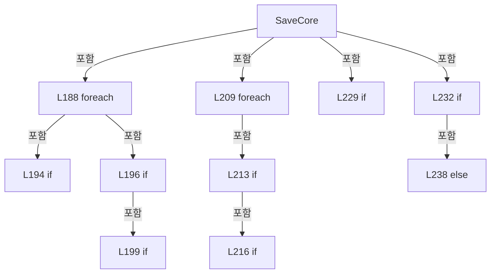

변경 전 점검: 입력/반환 타입, 위 호출자, 예외/취소 경로, 공유 상태와 저장·전송 소비자를 함께 확인합니다. 값의 단위나 물리 방향을 이름만으로 확정하지 않습니다.

### LocalFunctionStatement `SelectGroupKey` · L127–130

[Drilling.File/JHMI/CJhmiRecipeFile.cs:127–130](https://github.com/kjuws10-rgb/A3Drilling/blob/5aee8e58439c9b455cae7c9593c9be986c3e682e/Drilling.File/JHMI/CJhmiRecipeFile.cs#L127-L130)

| 항목 | 실제 추출 값 |
| --- | --- |
| 서명 | string SelectGroupKey(Drilling.Common.Managers.ST_RECIPE_VALUE) |
| 접근/수식자 | Private /  |
| 반환/값 타입 | string |
| 소속 타입 | NamedType:Drilling.File.JHMI.CJhmiRecipeFile |

입력 계약:

| 이름 | 타입 | 전달 | 선택/기본값 |
| --- | --- | --- | --- |
| item | Drilling.Common.Managers.ST_RECIPE_VALUE | None | False /  |

현재 부분 분석에서 직접 연결된 호출자는 없습니다. XAML/이벤트/인터페이스·델리게이트·외부 진입을 추가 확인해야 하며, 미사용으로 판정한 것이 아닙니다.

호출하는 대상과 해석 범위:

| 원본 행 | 표현식 | 분석 상태 | 대상/소스 위치 |
| --- | --- | --- | --- |
| 129 | CreateKey | resolved | string Drilling.File.JHMI.CJhmiRecipeFile.CreateKey(string, string) · Drilling.File/JHMI/CJhmiRecipeFile.cs:1050 |

본문의 실제 연산·분기·예외·반환 순서(원문 위치 순):

| 원본 행 | 종류 | 주석 해설 |
| --- | --- | --- |
| 129 | call | 함수·델리게이트 또는 객체 생성자를 호출합니다: CreateKey(item.Tab, item.Name) |
| 129 | return | 호출자에게 값 또는 제어를 반환합니다: return CreateKey(item.Tab, item.Name); |

변경 전 점검: 입력/반환 타입, 위 호출자, 예외/취소 경로, 공유 상태와 저장·전송 소비자를 함께 확인합니다. 값의 단위나 물리 방향을 이름만으로 확정하지 않습니다.

### LocalFunctionStatement `SelectKey` · L132–135

[Drilling.File/JHMI/CJhmiRecipeFile.cs:132–135](https://github.com/kjuws10-rgb/A3Drilling/blob/5aee8e58439c9b455cae7c9593c9be986c3e682e/Drilling.File/JHMI/CJhmiRecipeFile.cs#L132-L135)

| 항목 | 실제 추출 값 |
| --- | --- |
| 서명 | string SelectKey(System.Linq.IGrouping<string, Drilling.Common.Managers.ST_RECIPE_VALUE>) |
| 접근/수식자 | Private /  |
| 반환/값 타입 | string |
| 소속 타입 | NamedType:Drilling.File.JHMI.CJhmiRecipeFile |

입력 계약:

| 이름 | 타입 | 전달 | 선택/기본값 |
| --- | --- | --- | --- |
| group | System.Linq.IGrouping<string, Drilling.Common.Managers.ST_RECIPE_VALUE> | None | False /  |

현재 부분 분석에서 직접 연결된 호출자는 없습니다. XAML/이벤트/인터페이스·델리게이트·외부 진입을 추가 확인해야 하며, 미사용으로 판정한 것이 아닙니다.

본문의 실제 연산·분기·예외·반환 순서(원문 위치 순):

| 원본 행 | 종류 | 주석 해설 |
| --- | --- | --- |
| 134 | return | 호출자에게 값 또는 제어를 반환합니다: return group.Key; |

변경 전 점검: 입력/반환 타입, 위 호출자, 예외/취소 경로, 공유 상태와 저장·전송 소비자를 함께 확인합니다. 값의 단위나 물리 방향을 이름만으로 확정하지 않습니다.

### LocalFunctionStatement `SelectValue` · L137–140

[Drilling.File/JHMI/CJhmiRecipeFile.cs:137–140](https://github.com/kjuws10-rgb/A3Drilling/blob/5aee8e58439c9b455cae7c9593c9be986c3e682e/Drilling.File/JHMI/CJhmiRecipeFile.cs#L137-L140)

| 항목 | 실제 추출 값 |
| --- | --- |
| 서명 | string SelectValue(System.Linq.IGrouping<string, Drilling.Common.Managers.ST_RECIPE_VALUE>) |
| 접근/수식자 | Private /  |
| 반환/값 타입 | string |
| 소속 타입 | NamedType:Drilling.File.JHMI.CJhmiRecipeFile |

입력 계약:

| 이름 | 타입 | 전달 | 선택/기본값 |
| --- | --- | --- | --- |
| group | System.Linq.IGrouping<string, Drilling.Common.Managers.ST_RECIPE_VALUE> | None | False /  |

현재 부분 분석에서 직접 연결된 호출자는 없습니다. XAML/이벤트/인터페이스·델리게이트·외부 진입을 추가 확인해야 하며, 미사용으로 판정한 것이 아닙니다.

호출하는 대상과 해석 범위:

| 원본 행 | 표현식 | 분석 상태 | 대상/소스 위치 |
| --- | --- | --- | --- |
| 139 | group.Last | resolved | Drilling.Common.Managers.ST_RECIPE_VALUE System.Collections.Generic.IEnumerable<Drilling.Common.Managers.ST_RECIPE_VALUE>.Last<Drilling.Common.Managers.ST_RECIPE_VALUE>() |

본문의 실제 연산·분기·예외·반환 순서(원문 위치 순):

| 원본 행 | 종류 | 주석 해설 |
| --- | --- | --- |
| 139 | call | 함수·델리게이트 또는 객체 생성자를 호출합니다: group.Last() |
| 139 | return | 호출자에게 값 또는 제어를 반환합니다: return group.Last().Value; |

변경 전 점검: 입력/반환 타입, 위 호출자, 예외/취소 경로, 공유 상태와 저장·전송 소비자를 함께 확인합니다. 값의 단위나 물리 방향을 이름만으로 확정하지 않습니다.

### LocalFunctionStatement `ShouldIncludeItem` · L143–146

[Drilling.File/JHMI/CJhmiRecipeFile.cs:143–146](https://github.com/kjuws10-rgb/A3Drilling/blob/5aee8e58439c9b455cae7c9593c9be986c3e682e/Drilling.File/JHMI/CJhmiRecipeFile.cs#L143-L146)

| 항목 | 실제 추출 값 |
| --- | --- |
| 서명 | bool ShouldIncludeItem(Drilling.Common.Managers.ST_RECIPE_PARAMETER) |
| 접근/수식자 | Private /  |
| 반환/값 타입 | bool |
| 소속 타입 | NamedType:Drilling.File.JHMI.CJhmiRecipeFile |

입력 계약:

| 이름 | 타입 | 전달 | 선택/기본값 |
| --- | --- | --- | --- |
| parameter | Drilling.Common.Managers.ST_RECIPE_PARAMETER | None | False /  |

현재 부분 분석에서 직접 연결된 호출자는 없습니다. XAML/이벤트/인터페이스·델리게이트·외부 진입을 추가 확인해야 하며, 미사용으로 판정한 것이 아닙니다.

호출하는 대상과 해석 범위:

| 원본 행 | 표현식 | 분석 상태 | 대상/소스 위치 |
| --- | --- | --- | --- |
| 145 | IsCellScopedKey | resolved | bool Drilling.File.JHMI.CJhmiRecipeFile.IsCellScopedKey(string) · Drilling.File/JHMI/CJhmiRecipeFile.cs:591 |

본문의 실제 연산·분기·예외·반환 순서(원문 위치 순):

| 원본 행 | 종류 | 주석 해설 |
| --- | --- | --- |
| 145 | call | 함수·델리게이트 또는 객체 생성자를 호출합니다: IsCellScopedKey(parameter.Key) |
| 145 | return | 호출자에게 값 또는 제어를 반환합니다: return !IsCellScopedKey(parameter.Key); |

변경 전 점검: 입력/반환 타입, 위 호출자, 예외/취소 경로, 공유 상태와 저장·전송 소비자를 함께 확인합니다. 값의 단위나 물리 방향을 이름만으로 확정하지 않습니다.

### LocalFunctionStatement `ShouldIncludeRecipe` · L151–154

[Drilling.File/JHMI/CJhmiRecipeFile.cs:151–154](https://github.com/kjuws10-rgb/A3Drilling/blob/5aee8e58439c9b455cae7c9593c9be986c3e682e/Drilling.File/JHMI/CJhmiRecipeFile.cs#L151-L154)

| 항목 | 실제 추출 값 |
| --- | --- |
| 서명 | bool ShouldIncludeRecipe(Drilling.Common.Managers.ST_RECIPE_PARAMETER) |
| 접근/수식자 | Private /  |
| 반환/값 타입 | bool |
| 소속 타입 | NamedType:Drilling.File.JHMI.CJhmiRecipeFile |

입력 계약:

| 이름 | 타입 | 전달 | 선택/기본값 |
| --- | --- | --- | --- |
| parameter | Drilling.Common.Managers.ST_RECIPE_PARAMETER | None | False /  |

현재 부분 분석에서 직접 연결된 호출자는 없습니다. XAML/이벤트/인터페이스·델리게이트·외부 진입을 추가 확인해야 하며, 미사용으로 판정한 것이 아닙니다.

호출하는 대상과 해석 범위:

| 원본 행 | 표현식 | 분석 상태 | 대상/소스 위치 |
| --- | --- | --- | --- |
| 153 | IsCellScopedKey | resolved | bool Drilling.File.JHMI.CJhmiRecipeFile.IsCellScopedKey(string) · Drilling.File/JHMI/CJhmiRecipeFile.cs:591 |
| 153 | GetCellNo | resolved | int Drilling.File.JHMI.CJhmiRecipeFile.GetCellNo(string) · Drilling.File/JHMI/CJhmiRecipeFile.cs:694 |
| 153 | IsShotGroupOverrideWithinActivePattern | resolved | bool Drilling.File.JHMI.CJhmiRecipeFile.IsShotGroupOverrideWithinActivePattern(Drilling.Common.Managers.ST_RECIPE_PARAMETER, System.Collections.Generic.IReadOnlyDictionary<int, Drilling.File.JHMI.CJhmiRecipeFile.ST_SHOT_GROUP_PATTERN_BOUNDS>) · Drilling.File/JHMI/CJhmiRecipeFile.cs:649 |

본문의 실제 연산·분기·예외·반환 순서(원문 위치 순):

| 원본 행 | 종류 | 주석 해설 |
| --- | --- | --- |
| 153 | call | 함수·델리게이트 또는 객체 생성자를 호출합니다: IsCellScopedKey(parameter.Key) |
| 153 | call | 함수·델리게이트 또는 객체 생성자를 호출합니다: GetCellNo(parameter.Key) |
| 153 | call | 함수·델리게이트 또는 객체 생성자를 호출합니다: IsShotGroupOverrideWithinActivePattern(parameter, shotGroupBounds) |
| 153 | return | 호출자에게 값 또는 제어를 반환합니다: return IsCellScopedKey(parameter.Key) && GetCellNo(parameter.Key) <= activeCellCount && IsShotGroupOverrideWithinActivePattern(parameter, shotGroupBounds); |

변경 전 점검: 입력/반환 타입, 위 호출자, 예외/취소 경로, 공유 상태와 저장·전송 소비자를 함께 확인합니다. 값의 단위나 물리 방향을 이름만으로 확정하지 않습니다.

### LocalFunctionStatement `SelectSortKey` · L156–159

[Drilling.File/JHMI/CJhmiRecipeFile.cs:156–159](https://github.com/kjuws10-rgb/A3Drilling/blob/5aee8e58439c9b455cae7c9593c9be986c3e682e/Drilling.File/JHMI/CJhmiRecipeFile.cs#L156-L159)

| 항목 | 실제 추출 값 |
| --- | --- |
| 서명 | int SelectSortKey(Drilling.Common.Managers.ST_RECIPE_PARAMETER) |
| 접근/수식자 | Private /  |
| 반환/값 타입 | int |
| 소속 타입 | NamedType:Drilling.File.JHMI.CJhmiRecipeFile |

입력 계약:

| 이름 | 타입 | 전달 | 선택/기본값 |
| --- | --- | --- | --- |
| parameter | Drilling.Common.Managers.ST_RECIPE_PARAMETER | None | False /  |

현재 부분 분석에서 직접 연결된 호출자는 없습니다. XAML/이벤트/인터페이스·델리게이트·외부 진입을 추가 확인해야 하며, 미사용으로 판정한 것이 아닙니다.

호출하는 대상과 해석 범위:

| 원본 행 | 표현식 | 분석 상태 | 대상/소스 위치 |
| --- | --- | --- | --- |
| 158 | GetCellNo | resolved | int Drilling.File.JHMI.CJhmiRecipeFile.GetCellNo(string) · Drilling.File/JHMI/CJhmiRecipeFile.cs:694 |

본문의 실제 연산·분기·예외·반환 순서(원문 위치 순):

| 원본 행 | 종류 | 주석 해설 |
| --- | --- | --- |
| 158 | call | 함수·델리게이트 또는 객체 생성자를 호출합니다: GetCellNo(parameter.Key) |
| 158 | return | 호출자에게 값 또는 제어를 반환합니다: return GetCellNo(parameter.Key); |

변경 전 점검: 입력/반환 타입, 위 호출자, 예외/취소 경로, 공유 상태와 저장·전송 소비자를 함께 확인합니다. 값의 단위나 물리 방향을 이름만으로 확정하지 않습니다.

### LocalFunctionStatement `SelectRecipeParameterKey` · L161–164

[Drilling.File/JHMI/CJhmiRecipeFile.cs:161–164](https://github.com/kjuws10-rgb/A3Drilling/blob/5aee8e58439c9b455cae7c9593c9be986c3e682e/Drilling.File/JHMI/CJhmiRecipeFile.cs#L161-L164)

| 항목 | 실제 추출 값 |
| --- | --- |
| 서명 | string SelectRecipeParameterKey(Drilling.Common.Managers.ST_RECIPE_PARAMETER) |
| 접근/수식자 | Private /  |
| 반환/값 타입 | string |
| 소속 타입 | NamedType:Drilling.File.JHMI.CJhmiRecipeFile |

입력 계약:

| 이름 | 타입 | 전달 | 선택/기본값 |
| --- | --- | --- | --- |
| parameter | Drilling.Common.Managers.ST_RECIPE_PARAMETER | None | False /  |

현재 부분 분석에서 직접 연결된 호출자는 없습니다. XAML/이벤트/인터페이스·델리게이트·외부 진입을 추가 확인해야 하며, 미사용으로 판정한 것이 아닙니다.

본문의 실제 연산·분기·예외·반환 순서(원문 위치 순):

| 원본 행 | 종류 | 주석 해설 |
| --- | --- | --- |
| 163 | return | 호출자에게 값 또는 제어를 반환합니다: return parameter.Key; |

변경 전 점검: 입력/반환 타입, 위 호출자, 예외/취소 경로, 공유 상태와 저장·전송 소비자를 함께 확인합니다. 값의 단위나 물리 방향을 이름만으로 확정하지 않습니다.

### LocalFunctionStatement `ShouldIncludeRecipe2` · L178–181

[Drilling.File/JHMI/CJhmiRecipeFile.cs:178–181](https://github.com/kjuws10-rgb/A3Drilling/blob/5aee8e58439c9b455cae7c9593c9be986c3e682e/Drilling.File/JHMI/CJhmiRecipeFile.cs#L178-L181)

| 항목 | 실제 추출 값 |
| --- | --- |
| 서명 | bool ShouldIncludeRecipe2(Drilling.Common.Managers.ST_RECIPE_FORM_ITEM) |
| 접근/수식자 | Private /  |
| 반환/값 타입 | bool |
| 소속 타입 | NamedType:Drilling.File.JHMI.CJhmiRecipeFile |

입력 계약:

| 이름 | 타입 | 전달 | 선택/기본값 |
| --- | --- | --- | --- |
| item | Drilling.Common.Managers.ST_RECIPE_FORM_ITEM | None | False /  |

현재 부분 분석에서 직접 연결된 호출자는 없습니다. XAML/이벤트/인터페이스·델리게이트·외부 진입을 추가 확인해야 하며, 미사용으로 판정한 것이 아닙니다.

호출하는 대상과 해석 범위:

| 원본 행 | 표현식 | 분석 상태 | 대상/소스 위치 |
| --- | --- | --- | --- |
| 180 | IsCellScopedTemplate | resolved | bool Drilling.File.JHMI.CJhmiRecipeFile.IsCellScopedTemplate(Drilling.Common.Managers.ST_RECIPE_FORM_ITEM) · Drilling.File/JHMI/CJhmiRecipeFile.cs:596 |

본문의 실제 연산·분기·예외·반환 순서(원문 위치 순):

| 원본 행 | 종류 | 주석 해설 |
| --- | --- | --- |
| 180 | call | 함수·델리게이트 또는 객체 생성자를 호출합니다: IsCellScopedTemplate(item) |
| 180 | return | 호출자에게 값 또는 제어를 반환합니다: return item.Use && !IsCellScopedTemplate(item); |

변경 전 점검: 입력/반환 타입, 위 호출자, 예외/취소 경로, 공유 상태와 저장·전송 소비자를 함께 확인합니다. 값의 단위나 물리 방향을 이름만으로 확정하지 않습니다.

### LocalFunctionStatement `SelectDisplayOrder` · L183–186

[Drilling.File/JHMI/CJhmiRecipeFile.cs:183–186](https://github.com/kjuws10-rgb/A3Drilling/blob/5aee8e58439c9b455cae7c9593c9be986c3e682e/Drilling.File/JHMI/CJhmiRecipeFile.cs#L183-L186)

| 항목 | 실제 추출 값 |
| --- | --- |
| 서명 | int SelectDisplayOrder(Drilling.Common.Managers.ST_RECIPE_FORM_ITEM) |
| 접근/수식자 | Private /  |
| 반환/값 타입 | int |
| 소속 타입 | NamedType:Drilling.File.JHMI.CJhmiRecipeFile |

입력 계약:

| 이름 | 타입 | 전달 | 선택/기본값 |
| --- | --- | --- | --- |
| item | Drilling.Common.Managers.ST_RECIPE_FORM_ITEM | None | False /  |

현재 부분 분석에서 직접 연결된 호출자는 없습니다. XAML/이벤트/인터페이스·델리게이트·외부 진입을 추가 확인해야 하며, 미사용으로 판정한 것이 아닙니다.

본문의 실제 연산·분기·예외·반환 순서(원문 위치 순):

| 원본 행 | 종류 | 주석 해설 |
| --- | --- | --- |
| 185 | return | 호출자에게 값 또는 제어를 반환합니다: return item.DisplayOrder; |

변경 전 점검: 입력/반환 타입, 위 호출자, 예외/취소 경로, 공유 상태와 저장·전송 소비자를 함께 확인합니다. 값의 단위나 물리 방향을 이름만으로 확정하지 않습니다.

### MethodDeclaration `Rename` · L244–252

[Drilling.File/JHMI/CJhmiRecipeFile.cs:244–252](https://github.com/kjuws10-rgb/A3Drilling/blob/5aee8e58439c9b455cae7c9593c9be986c3e682e/Drilling.File/JHMI/CJhmiRecipeFile.cs#L244-L252)

| 항목 | 실제 추출 값 |
| --- | --- |
| 서명 | System.Threading.Tasks.Task Drilling.File.JHMI.CJhmiRecipeFile.Rename(string, string, System.Threading.CancellationToken) |
| 접근/수식자 | Public / public, override |
| 반환/값 타입 | System.Threading.Tasks.Task |
| 소속 타입 | NamedType:Drilling.File.JHMI.CJhmiRecipeFile |

입력 계약:

| 이름 | 타입 | 전달 | 선택/기본값 |
| --- | --- | --- | --- |
| oldRecipeId | string | None | False /  |
| newRecipeId | string | None | False /  |
| cancellationToken | System.Threading.CancellationToken | None | True / null |

현재 부분 분석에서 직접 연결된 호출자는 없습니다. XAML/이벤트/인터페이스·델리게이트·외부 진입을 추가 확인해야 하며, 미사용으로 판정한 것이 아닙니다.

호출하는 대상과 해석 범위:

| 원본 행 | 표현식 | 분석 상태 | 대상/소스 위치 |
| --- | --- | --- | --- |
| 251 | ExecuteFileOperation | resolved | System.Threading.Tasks.Task Drilling.File.JHMI.CJhmiRecipeFile.ExecuteFileOperation(System.Action, System.Threading.CancellationToken) · Drilling.File/JHMI/CJhmiRecipeFile.cs:429 |

본문의 실제 연산·분기·예외·반환 순서(원문 위치 순):

| 원본 행 | 종류 | 주석 해설 |
| --- | --- | --- |
| 251 | call | 함수·델리게이트 또는 객체 생성자를 호출합니다: ExecuteFileOperation(RenameCoreCallback, cancellationToken) |
| 251 | return | 호출자에게 값 또는 제어를 반환합니다: return ExecuteFileOperation(RenameCoreCallback, cancellationToken); |

변경 전 점검: 입력/반환 타입, 위 호출자, 예외/취소 경로, 공유 상태와 저장·전송 소비자를 함께 확인합니다. 값의 단위나 물리 방향을 이름만으로 확정하지 않습니다.

### LocalFunctionStatement `RenameCoreCallback` · L246–249

[Drilling.File/JHMI/CJhmiRecipeFile.cs:246–249](https://github.com/kjuws10-rgb/A3Drilling/blob/5aee8e58439c9b455cae7c9593c9be986c3e682e/Drilling.File/JHMI/CJhmiRecipeFile.cs#L246-L249)

| 항목 | 실제 추출 값 |
| --- | --- |
| 서명 | void RenameCoreCallback() |
| 접근/수식자 | Private /  |
| 반환/값 타입 | void |
| 소속 타입 | NamedType:Drilling.File.JHMI.CJhmiRecipeFile |

현재 부분 분석에서 직접 연결된 호출자는 없습니다. XAML/이벤트/인터페이스·델리게이트·외부 진입을 추가 확인해야 하며, 미사용으로 판정한 것이 아닙니다.

호출하는 대상과 해석 범위:

| 원본 행 | 표현식 | 분석 상태 | 대상/소스 위치 |
| --- | --- | --- | --- |
| 248 | RenameCore | resolved | string? Drilling.File.JHMI.CJhmiRecipeFile.RenameCore(string, string, System.Threading.CancellationToken, bool) · Drilling.File/JHMI/CJhmiRecipeFile.cs:254 |

본문의 실제 연산·분기·예외·반환 순서(원문 위치 순):

| 원본 행 | 종류 | 주석 해설 |
| --- | --- | --- |
| 248 | call | 함수·델리게이트 또는 객체 생성자를 호출합니다: RenameCore(oldRecipeId, newRecipeId, cancellationToken) |

변경 전 점검: 입력/반환 타입, 위 호출자, 예외/취소 경로, 공유 상태와 저장·전송 소비자를 함께 확인합니다. 값의 단위나 물리 방향을 이름만으로 확정하지 않습니다.

### MethodDeclaration `RenameCore` · L254–368

[Drilling.File/JHMI/CJhmiRecipeFile.cs:254–368](https://github.com/kjuws10-rgb/A3Drilling/blob/5aee8e58439c9b455cae7c9593c9be986c3e682e/Drilling.File/JHMI/CJhmiRecipeFile.cs#L254-L368)

| 항목 | 실제 추출 값 |
| --- | --- |
| 서명 | string? Drilling.File.JHMI.CJhmiRecipeFile.RenameCore(string, string, System.Threading.CancellationToken, bool) |
| 접근/수식자 | Private / private |
| 반환/값 타입 | string? |
| 소속 타입 | NamedType:Drilling.File.JHMI.CJhmiRecipeFile |

입력 계약:

| 이름 | 타입 | 전달 | 선택/기본값 |
| --- | --- | --- | --- |
| oldRecipeId | string | None | False /  |
| newRecipeId | string | None | False /  |
| cancellationToken | System.Threading.CancellationToken | None | False /  |
| writeHistory | bool | None | True / true |

정적 호출자로 확인된 위치:

| 호출 파일/행 | 호출 표현식 | 런타임 분기 가능 |
| --- | --- | --- |
| [Drilling.File/JHMI/CJhmiRecipeFile.cs:248–248](https://github.com/kjuws10-rgb/A3Drilling/blob/5aee8e58439c9b455cae7c9593c9be986c3e682e/Drilling.File/JHMI/CJhmiRecipeFile.cs#L248-L248) | RenameCore | False |
| [Drilling.File/JHMI/CJhmiRecipeFile.cs:1163–1163](https://github.com/kjuws10-rgb/A3Drilling/blob/5aee8e58439c9b455cae7c9593c9be986c3e682e/Drilling.File/JHMI/CJhmiRecipeFile.cs#L1163-L1163) | RenameCore | False |

호출하는 대상과 해석 범위:

| 원본 행 | 표현식 | 분석 상태 | 대상/소스 위치 |
| --- | --- | --- | --- |
| 256 | cancellationToken.ThrowIfCancellationRequested | resolved | void System.Threading.CancellationToken.ThrowIfCancellationRequested() |
| 257 | Directory.CreateDirectory | resolved | System.IO.DirectoryInfo System.IO.Directory.CreateDirectory(string) |
| 258 | GetRecipePath | resolved | string Drilling.File.JHMI.CJhmiRecipeFile.GetRecipePath(string) · Drilling.File/JHMI/CJhmiRecipeFile.cs:966 |
| 259 | GetRecipePath | resolved | string Drilling.File.JHMI.CJhmiRecipeFile.GetRecipePath(string) · Drilling.File/JHMI/CJhmiRecipeFile.cs:966 |
| 260 | System.IO.File.Exists | resolved | bool System.IO.File.Exists(string?) |
| 265 | System.IO.File.Exists | resolved | bool System.IO.File.Exists(string?) |
| 267 | new IOException | resolved | System.IO.IOException.IOException(string?) |
| 270 | LoadFormItems | resolved | System.Collections.Generic.IReadOnlyList<Drilling.Common.Managers.ST_RECIPE_FORM_ITEM> Drilling.File.JHMI.CJhmiRecipeFile.LoadFormItems() · Drilling.File/JHMI/CJhmiRecipeFile.cs:847 |
| 271 | ReadRecipeValues | resolved | System.Collections.Generic.IReadOnlyList<Drilling.Common.Managers.ST_RECIPE_VALUE> Drilling.File.JHMI.CJhmiRecipeFile.ReadRecipeValues(string, System.Threading.CancellationToken) · Drilling.File/JHMI/CJhmiRecipeFile.cs:889 |
| 287 | recipeValues.GroupBy(SelectGroupKey, StringComparer.OrdinalIgnoreCase).ToDictionary | resolved | System.Collections.Generic.Dictionary<string, string> System.Collections.Generic.IEnumerable<System.Linq.IGrouping<string, Drilling.Common.Managers.ST_RECIPE_VALUE>>.ToDictionary<System.Linq.IGrouping<string, Drilling.Common.Managers.ST_RECIPE_VALUE>, string, string>(System.Func<System.Linq.IGrouping<string, Drilling.Common.Managers.ST_RECIPE_VALUE>, string>, System.Func<System.Linq.IGrouping<string, Drilling.Common.Managers.ST_RECIPE_VALUE>, string>, System.Collections.Generic.IEqualityComparer<string>?) |
| 287 | recipeValues.GroupBy | resolved | System.Collections.Generic.IEnumerable<System.Linq.IGrouping<string, Drilling.Common.Managers.ST_RECIPE_VALUE>> System.Collections.Generic.IEnumerable<Drilling.Common.Managers.ST_RECIPE_VALUE>.GroupBy<Drilling.Common.Managers.ST_RECIPE_VALUE, string>(System.Func<Drilling.Common.Managers.ST_RECIPE_VALUE, string>, System.Collections.Generic.IEqualityComparer<string>?) |
| 288 | GetValue | resolved | string Drilling.File.JHMI.CJhmiRecipeFile.GetValue(System.Collections.Generic.IReadOnlyDictionary<string, string>, string, string, string) · Drilling.File/JHMI/CJhmiRecipeFile.cs:1045 |
| 289 | GetActiveCellCount | resolved | int Drilling.File.JHMI.CJhmiRecipeFile.GetActiveCellCount(System.Collections.Generic.IReadOnlyDictionary<string, string>, System.Collections.Generic.IReadOnlyList<Drilling.Common.Managers.ST_RECIPE_FORM_ITEM>) · Drilling.File/JHMI/CJhmiRecipeFile.cs:665 |
| 290 | new Dictionary<string, string> | resolved | System.Collections.Generic.Dictionary<string, string>.Dictionary(System.Collections.Generic.IEqualityComparer<string>?) |
| 292 | CreateKey | resolved | string Drilling.File.JHMI.CJhmiRecipeFile.CreateKey(string, string) · Drilling.File/JHMI/CJhmiRecipeFile.cs:1050 |
| 293 | CreateKey | resolved | string Drilling.File.JHMI.CJhmiRecipeFile.CreateKey(string, string) · Drilling.File/JHMI/CJhmiRecipeFile.cs:1050 |
| 295 | new List<string> | resolved | System.Collections.Generic.List<string>.List() |
| 297 | FormatRecipeLine | resolved | string Drilling.File.JHMI.CJhmiRecipeFile.FormatRecipeLine(string, string, string) · Drilling.File/JHMI/CJhmiRecipeFile.cs:1065 |
| 298 | FormatRecipeLine | resolved | string Drilling.File.JHMI.CJhmiRecipeFile.FormatRecipeLine(string, string, string) · Drilling.File/JHMI/CJhmiRecipeFile.cs:1065 |
| 310 | formItems.Where(ShouldIncludeItem).OrderBy | resolved | System.Linq.IOrderedEnumerable<Drilling.Common.Managers.ST_RECIPE_FORM_ITEM> System.Collections.Generic.IEnumerable<Drilling.Common.Managers.ST_RECIPE_FORM_ITEM>.OrderBy<Drilling.Common.Managers.ST_RECIPE_FORM_ITEM, int>(System.Func<Drilling.Common.Managers.ST_RECIPE_FORM_ITEM, int>) |
| 310 | formItems.Where | resolved | System.Collections.Generic.IEnumerable<Drilling.Common.Managers.ST_RECIPE_FORM_ITEM> System.Collections.Generic.IEnumerable<Drilling.Common.Managers.ST_RECIPE_FORM_ITEM>.Where<Drilling.Common.Managers.ST_RECIPE_FORM_ITEM>(System.Func<Drilling.Common.Managers.ST_RECIPE_FORM_ITEM, bool>) |
| 312 | cancellationToken.ThrowIfCancellationRequested | resolved | void System.Threading.CancellationToken.ThrowIfCancellationRequested() |
| 313 | item.Name.Equals | resolved | bool string.Equals(string?, System.StringComparison) |
| 313 | GetValue | resolved | string Drilling.File.JHMI.CJhmiRecipeFile.GetValue(System.Collections.Generic.IReadOnlyDictionary<string, string>, string, string, string) · Drilling.File/JHMI/CJhmiRecipeFile.cs:1045 |
| 314 | CreateKey | resolved | string Drilling.File.JHMI.CJhmiRecipeFile.CreateKey(string, string) · Drilling.File/JHMI/CJhmiRecipeFile.cs:1050 |
| 315 | lines.Add | resolved | void System.Collections.Generic.List<string>.Add(string) |
| 315 | FormatRecipeLine | resolved | string Drilling.File.JHMI.CJhmiRecipeFile.FormatRecipeLine(string, string, string) · Drilling.File/JHMI/CJhmiRecipeFile.cs:1065 |
| 333 | recipeValues.Where(MatchesTab).OrderBy(SelectSortKey).ThenBy | resolved | System.Linq.IOrderedEnumerable<Drilling.Common.Managers.ST_RECIPE_VALUE> System.Linq.IOrderedEnumerable<Drilling.Common.Managers.ST_RECIPE_VALUE>.ThenBy<Drilling.Common.Managers.ST_RECIPE_VALUE, string>(System.Func<Drilling.Common.Managers.ST_RECIPE_VALUE, string>, System.Collections.Generic.IComparer<string>?) |
| 333 | recipeValues.Where(MatchesTab).OrderBy | resolved | System.Linq.IOrderedEnumerable<Drilling.Common.Managers.ST_RECIPE_VALUE> System.Collections.Generic.IEnumerable<Drilling.Common.Managers.ST_RECIPE_VALUE>.OrderBy<Drilling.Common.Managers.ST_RECIPE_VALUE, int>(System.Func<Drilling.Common.Managers.ST_RECIPE_VALUE, int>) |
| 333 | recipeValues.Where | resolved | System.Collections.Generic.IEnumerable<Drilling.Common.Managers.ST_RECIPE_VALUE> System.Collections.Generic.IEnumerable<Drilling.Common.Managers.ST_RECIPE_VALUE>.Where<Drilling.Common.Managers.ST_RECIPE_VALUE>(System.Func<Drilling.Common.Managers.ST_RECIPE_VALUE, bool>) |
| 335 | cancellationToken.ThrowIfCancellationRequested | resolved | void System.Threading.CancellationToken.ThrowIfCancellationRequested() |
| 336 | NormalizeCellScopedParameterName | resolved | string Drilling.File.JHMI.CJhmiRecipeFile.NormalizeCellScopedParameterName(string) · Drilling.File/JHMI/CJhmiRecipeFile.cs:716 |
| 336 | GetCellParameterName | resolved | string Drilling.File.JHMI.CJhmiRecipeFile.GetCellParameterName(string) · Drilling.File/JHMI/CJhmiRecipeFile.cs:705 |
| 337 | GetCellNo | resolved | int Drilling.File.JHMI.CJhmiRecipeFile.GetCellNo(string) · Drilling.File/JHMI/CJhmiRecipeFile.cs:694 |
| 338 | ToPersistedCellScopedKey | resolved | string Drilling.File.JHMI.CJhmiRecipeFile.ToPersistedCellScopedKey(string) · Drilling.File/JHMI/CJhmiRecipeFile.cs:726 |
| 339 | CreateKey | resolved | string Drilling.File.JHMI.CJhmiRecipeFile.CreateKey(string, string) · Drilling.File/JHMI/CJhmiRecipeFile.cs:1050 |
| 340 | lines.Add | resolved | void System.Collections.Generic.List<string>.Add(string) |
| 340 | FormatRecipeLine | resolved | string Drilling.File.JHMI.CJhmiRecipeFile.FormatRecipeLine(string, string, string) · Drilling.File/JHMI/CJhmiRecipeFile.cs:1065 |
| 343 | Guid.NewGuid().ToString | resolved | string System.Guid.ToString(string?) |
| 343 | Guid.NewGuid | resolved | System.Guid System.Guid.NewGuid() |
| 346 | CCsvParser.WriteLines | resolved | void Drilling.File.Parser.CCsvParser.WriteLines(string, System.Collections.Generic.IEnumerable<string>) · Drilling.File/Parser/CCsvParser.cs:157 |
| 347 | ValidateSavedRecipeFile | resolved | void Drilling.File.JHMI.CJhmiRecipeFile.ValidateSavedRecipeFile(string, System.Collections.Generic.IReadOnlyDictionary<string, string>, System.Threading.CancellationToken) · Drilling.File/JHMI/CJhmiRecipeFile.cs:1070 |
| 348 | System.IO.File.Move | resolved | void System.IO.File.Move(string, string, bool) |
| 351 | System.IO.File.Delete | resolved | void System.IO.File.Delete(string) |
| 355 | System.IO.File.Delete | resolved | void System.IO.File.Delete(string) |
| 361 | System.IO.File.Exists | resolved | bool System.IO.File.Exists(string?) |
| 362 | System.IO.File.Delete | resolved | void System.IO.File.Delete(string) |
| 366 | _logManager.WriteRecipeRename | unresolved | None |

본문의 실제 연산·분기·예외·반환 순서(원문 위치 순):

| 원본 행 | 종류 | 주석 해설 |
| --- | --- | --- |
| 256 | call | 함수·델리게이트 또는 객체 생성자를 호출합니다: cancellationToken.ThrowIfCancellationRequested() |
| 257 | call | 함수·델리게이트 또는 객체 생성자를 호출합니다: Directory.CreateDirectory(_recipeDirectory) |
| 258 | call | 함수·델리게이트 또는 객체 생성자를 호출합니다: GetRecipePath(oldRecipeId) |
| 258 | local-declaration | 지역 변수를 선언합니다: var oldPath = GetRecipePath(oldRecipeId); |
| 258 | variable-initializer | 변수의 초기값을 지정합니다: oldPath = GetRecipePath(oldRecipeId) |
| 259 | call | 함수·델리게이트 또는 객체 생성자를 호출합니다: GetRecipePath(newRecipeId) |
| 259 | local-declaration | 지역 변수를 선언합니다: var newPath = GetRecipePath(newRecipeId); |
| 259 | variable-initializer | 변수의 초기값을 지정합니다: newPath = GetRecipePath(newRecipeId) |
| 260 | call | 함수·델리게이트 또는 객체 생성자를 호출합니다: System.IO.File.Exists(oldPath) |
| 260 | if | 조건에 따라 분기합니다: if (!System.IO.File.Exists(oldPath)) |
| 262 | return | 호출자에게 값 또는 제어를 반환합니다: return null; |
| 265 | call | 함수·델리게이트 또는 객체 생성자를 호출합니다: System.IO.File.Exists(newPath) |
| 265 | if | 조건에 따라 분기합니다: if (System.IO.File.Exists(newPath)) |
| 267 | call | 함수·델리게이트 또는 객체 생성자를 호출합니다: new IOException($"Recipe file already exists. {newRecipeId}.csv") |
| 267 | throw | 예외를 발생/전달합니다: throw new IOException($"Recipe file already exists. {newRecipeId}.csv"); |
| 270 | call | 함수·델리게이트 또는 객체 생성자를 호출합니다: LoadFormItems() |
| 270 | local-declaration | 지역 변수를 선언합니다: var formItems = LoadFormItems(); |
| 270 | variable-initializer | 변수의 초기값을 지정합니다: formItems = LoadFormItems() |
| 271 | call | 함수·델리게이트 또는 객체 생성자를 호출합니다: ReadRecipeValues(oldPath, cancellationToken) |
| 271 | local-declaration | 지역 변수를 선언합니다: var recipeValues = ReadRecipeValues(oldPath, cancellationToken); |
| 271 | variable-initializer | 변수의 초기값을 지정합니다: recipeValues = ReadRecipeValues(oldPath, cancellationToken) |
| 287 | call | 함수·델리게이트 또는 객체 생성자를 호출합니다: recipeValues.GroupBy(SelectGroupKey, StringComparer.OrdinalIgnoreCase).ToDictionary(SelectKey, SelectValue, StringComparer.OrdinalIgnoreCase) |
| 287 | call | 함수·델리게이트 또는 객체 생성자를 호출합니다: recipeValues.GroupBy(SelectGroupKey, StringComparer.OrdinalIgnoreCase) |
| 287 | local-declaration | 지역 변수를 선언합니다: var oldValues = recipeValues.GroupBy(SelectGroupKey, StringComparer.OrdinalIgnoreCase).ToDictionary(SelectKey, SelectValue, StringComparer.OrdinalIgnoreCase); |
| 287 | variable-initializer | 변수의 초기값을 지정합니다: oldValues = recipeValues.GroupBy(SelectGroupKey, StringComparer.OrdinalIgnoreCase).ToDictionary(SelectKey, SelectValue, StringComparer.OrdinalIgnoreCase) |
| 288 | call | 함수·델리게이트 또는 객체 생성자를 호출합니다: GetValue(oldValues, "DEFAULT", "RECIPE_NAME", oldRecipeId) |
| 288 | local-declaration | 지역 변수를 선언합니다: var oldRecipeName = GetValue(oldValues, "DEFAULT", "RECIPE_NAME", oldRecipeId); |
| 288 | variable-initializer | 변수의 초기값을 지정합니다: oldRecipeName = GetValue(oldValues, "DEFAULT", "RECIPE_NAME", oldRecipeId) |
| 289 | call | 함수·델리게이트 또는 객체 생성자를 호출합니다: GetActiveCellCount(oldValues, formItems) |
| 289 | local-declaration | 지역 변수를 선언합니다: var activeCellCount = GetActiveCellCount(oldValues, formItems); |
| 289 | variable-initializer | 변수의 초기값을 지정합니다: activeCellCount = GetActiveCellCount(oldValues, formItems) |
| 290 | call | 함수·델리게이트 또는 객체 생성자를 호출합니다: new Dictionary<string, string>(StringComparer.OrdinalIgnoreCase) { [CreateKey("DEFAULT", "RECIPE_NAME")] = newRecipeId, [CreateKey("DEFAULT", "RECIPE_ID")] = newRecipeId } |
| 290 | local-declaration | 지역 변수를 선언합니다: var expectedValues = new Dictionary<string, string>(StringComparer.OrdinalIgnoreCase) { [CreateKey("DEFAULT", "RECIPE_NAME")] = newRecipeId, [CreateKey("DEFAULT", "RECIPE_ID")] = newRecipeId }; |
| 290 | variable-initializer | 변수의 초기값을 지정합니다: expectedValues = new Dictionary<string, string>(StringComparer.OrdinalIgnoreCase) { [CreateKey("DEFAULT", "RECIPE_NAME")] = newRecipeId, [CreateKey("DEFAULT", "RECIPE_ID")] = newRecipeId } |
| 292 | assignment | 값을 대상에 대입합니다: [CreateKey("DEFAULT", "RECIPE_NAME")] = newRecipeId |
| 292 | call | 함수·델리게이트 또는 객체 생성자를 호출합니다: CreateKey("DEFAULT", "RECIPE_NAME") |
| 293 | assignment | 값을 대상에 대입합니다: [CreateKey("DEFAULT", "RECIPE_ID")] = newRecipeId |
| 293 | call | 함수·델리게이트 또는 객체 생성자를 호출합니다: CreateKey("DEFAULT", "RECIPE_ID") |
| 295 | call | 함수·델리게이트 또는 객체 생성자를 호출합니다: new List<string> { FormatRecipeLine("DEFAULT", "RECIPE_NAME", newRecipeId), FormatRecipeLine("DEFAULT", "RECIPE_ID", newRecipeId) } |
| 295 | local-declaration | 지역 변수를 선언합니다: var lines = new List<string> { FormatRecipeLine("DEFAULT", "RECIPE_NAME", newRecipeId), FormatRecipeLine("DEFAULT", "RECIPE_ID", newRecipeId) }; |
| 295 | variable-initializer | 변수의 초기값을 지정합니다: lines = new List<string> { FormatRecipeLine("DEFAULT", "RECIPE_NAME", newRecipeId), FormatRecipeLine("DEFAULT", "RECIPE_ID", newRecipeId) } |
| 297 | call | 함수·델리게이트 또는 객체 생성자를 호출합니다: FormatRecipeLine("DEFAULT", "RECIPE_NAME", newRecipeId) |
| 298 | call | 함수·델리게이트 또는 객체 생성자를 호출합니다: FormatRecipeLine("DEFAULT", "RECIPE_ID", newRecipeId) |
| 310 | call | 함수·델리게이트 또는 객체 생성자를 호출합니다: formItems.Where(ShouldIncludeItem).OrderBy(SelectDisplayOrder) |
| 310 | call | 함수·델리게이트 또는 객체 생성자를 호출합니다: formItems.Where(ShouldIncludeItem) |
| 310 | foreach | 컬렉션 요소를 순회합니다: foreach (var item in formItems.Where(ShouldIncludeItem).OrderBy(SelectDisplayOrder)) |
| 312 | call | 함수·델리게이트 또는 객체 생성자를 호출합니다: cancellationToken.ThrowIfCancellationRequested() |
| 313 | call | 함수·델리게이트 또는 객체 생성자를 호출합니다: item.Name.Equals("RECIPE_NAME", StringComparison.OrdinalIgnoreCase) |
| 313 | call | 함수·델리게이트 또는 객체 생성자를 호출합니다: GetValue(oldValues, item.Tab, item.Name, item.DefaultValue) |
| 313 | conditional-expression | 조건에 따라 결과식을 선택합니다: item.Name.Equals("RECIPE_NAME", StringComparison.OrdinalIgnoreCase) ? newRecipeId : GetValue(oldValues, item.Tab, item.Name, item.DefaultValue) |
| 313 | local-declaration | 지역 변수를 선언합니다: var value = item.Name.Equals("RECIPE_NAME", StringComparison.OrdinalIgnoreCase) ? newRecipeId : GetValue(oldValues, item.Tab, item.Name, item.DefaultValue); |
| 313 | variable-initializer | 변수의 초기값을 지정합니다: value = item.Name.Equals("RECIPE_NAME", StringComparison.OrdinalIgnoreCase) ? newRecipeId : GetValue(oldValues, item.Tab, item.Name, item.DefaultValue) |
| 314 | assignment | 값을 대상에 대입합니다: expectedValues[CreateKey(item.Tab, item.Name)] = value |
| 314 | call | 함수·델리게이트 또는 객체 생성자를 호출합니다: CreateKey(item.Tab, item.Name) |
| 315 | call | 함수·델리게이트 또는 객체 생성자를 호출합니다: lines.Add(FormatRecipeLine(item.Tab, item.Name, value)) |
| 315 | call | 함수·델리게이트 또는 객체 생성자를 호출합니다: FormatRecipeLine(item.Tab, item.Name, value) |
| 333 | call | 함수·델리게이트 또는 객체 생성자를 호출합니다: recipeValues.Where(MatchesTab).OrderBy(SelectSortKey).ThenBy(SelectName, StringComparer.OrdinalIgnoreCase) |
| 333 | call | 함수·델리게이트 또는 객체 생성자를 호출합니다: recipeValues.Where(MatchesTab).OrderBy(SelectSortKey) |
| 333 | call | 함수·델리게이트 또는 객체 생성자를 호출합니다: recipeValues.Where(MatchesTab) |
| 333 | foreach | 컬렉션 요소를 순회합니다: foreach (var cellValue in recipeValues.Where(MatchesTab).OrderBy(SelectSortKey).ThenBy(SelectName, StringComparer.OrdinalIgnoreCase)) |
| 335 | call | 함수·델리게이트 또는 객체 생성자를 호출합니다: cancellationToken.ThrowIfCancellationRequested() |
| 336 | call | 함수·델리게이트 또는 객체 생성자를 호출합니다: NormalizeCellScopedParameterName(GetCellParameterName(cellValue.Name)) |
| 336 | call | 함수·델리게이트 또는 객체 생성자를 호출합니다: GetCellParameterName(cellValue.Name) |
| 336 | local-declaration | 지역 변수를 선언합니다: var parameterName = NormalizeCellScopedParameterName(GetCellParameterName(cellValue.Name)); |
| 336 | variable-initializer | 변수의 초기값을 지정합니다: parameterName = NormalizeCellScopedParameterName(GetCellParameterName(cellValue.Name)) |
| 337 | call | 함수·델리게이트 또는 객체 생성자를 호출합니다: GetCellNo(cellValue.Name) |
| 337 | local-declaration | 지역 변수를 선언합니다: var scopedKey = $"CELL{GetCellNo(cellValue.Name)}_{parameterName}"; |
| 337 | variable-initializer | 변수의 초기값을 지정합니다: scopedKey = $"CELL{GetCellNo(cellValue.Name)}_{parameterName}" |
| 338 | call | 함수·델리게이트 또는 객체 생성자를 호출합니다: ToPersistedCellScopedKey(scopedKey) |
| 338 | local-declaration | 지역 변수를 선언합니다: var persistedKey = ToPersistedCellScopedKey(scopedKey); |
| 338 | variable-initializer | 변수의 초기값을 지정합니다: persistedKey = ToPersistedCellScopedKey(scopedKey) |
| 339 | assignment | 값을 대상에 대입합니다: expectedValues[CreateKey("CELL", persistedKey)] = cellValue.Value |
| 339 | call | 함수·델리게이트 또는 객체 생성자를 호출합니다: CreateKey("CELL", persistedKey) |
| 340 | call | 함수·델리게이트 또는 객체 생성자를 호출합니다: lines.Add(FormatRecipeLine("CELL", persistedKey, cellValue.Value)) |
| 340 | call | 함수·델리게이트 또는 객체 생성자를 호출합니다: FormatRecipeLine("CELL", persistedKey, cellValue.Value) |
| 343 | call | 함수·델리게이트 또는 객체 생성자를 호출합니다: Guid.NewGuid().ToString("N") |
| 343 | call | 함수·델리게이트 또는 객체 생성자를 호출합니다: Guid.NewGuid() |
| 343 | local-declaration | 지역 변수를 선언합니다: var temporary = newPath + "." + Guid.NewGuid().ToString("N") + ".tmp"; |
| 343 | variable-initializer | 변수의 초기값을 지정합니다: temporary = newPath + "." + Guid.NewGuid().ToString("N") + ".tmp" |
| 344 | try | 예외 처리 범위입니다: try |
| 346 | call | 함수·델리게이트 또는 객체 생성자를 호출합니다: CCsvParser.WriteLines(temporary, lines) |
| 347 | call | 함수·델리게이트 또는 객체 생성자를 호출합니다: ValidateSavedRecipeFile(temporary, expectedValues, cancellationToken) |
| 348 | call | 함수·델리게이트 또는 객체 생성자를 호출합니다: System.IO.File.Move(temporary, newPath, overwrite: false) |
| 349 | try | 예외 처리 범위입니다: try |
| 351 | call | 함수·델리게이트 또는 객체 생성자를 호출합니다: System.IO.File.Delete(oldPath) |
| 353 | catch | 지정 예외를 처리합니다: catch  |
| 355 | call | 함수·델리게이트 또는 객체 생성자를 호출합니다: System.IO.File.Delete(newPath) |
| 356 | throw | 예외를 발생/전달합니다: throw; |
| 359 | finally | 종료 정리 구간입니다: finally |
| 361 | call | 함수·델리게이트 또는 객체 생성자를 호출합니다: System.IO.File.Exists(temporary) |
| 361 | if | 조건에 따라 분기합니다: if (System.IO.File.Exists(temporary)) |
| 362 | call | 함수·델리게이트 또는 객체 생성자를 호출합니다: System.IO.File.Delete(temporary) |
| 365 | if | 조건에 따라 분기합니다: if (writeHistory) |
| 366 | call | 함수·델리게이트 또는 객체 생성자를 호출합니다: _logManager.WriteRecipeRename(oldRecipeName, newRecipeId) |
| 367 | return | 호출자에게 값 또는 제어를 반환합니다: return oldRecipeName; |

제어 구문의 포함 구조(실제 실행 순서/CFG가 아닌 구문 탐색 그림):

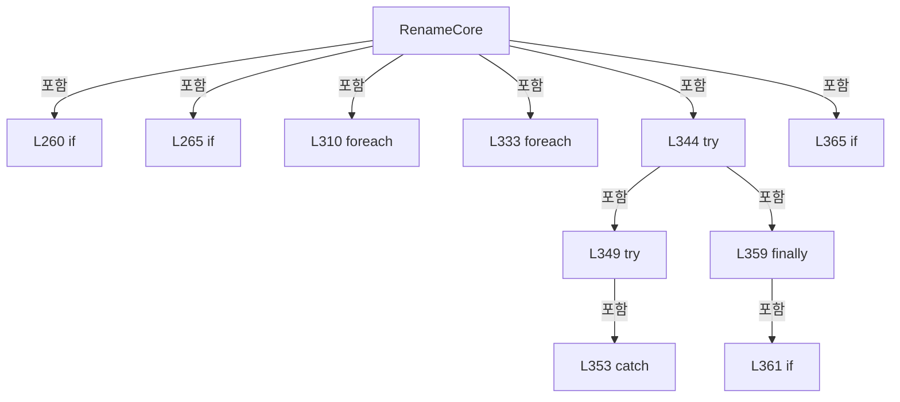

변경 전 점검: 입력/반환 타입, 위 호출자, 예외/취소 경로, 공유 상태와 저장·전송 소비자를 함께 확인합니다. 값의 단위나 물리 방향을 이름만으로 확정하지 않습니다.

### LocalFunctionStatement `SelectGroupKey` · L272–275

[Drilling.File/JHMI/CJhmiRecipeFile.cs:272–275](https://github.com/kjuws10-rgb/A3Drilling/blob/5aee8e58439c9b455cae7c9593c9be986c3e682e/Drilling.File/JHMI/CJhmiRecipeFile.cs#L272-L275)

| 항목 | 실제 추출 값 |
| --- | --- |
| 서명 | string SelectGroupKey(Drilling.Common.Managers.ST_RECIPE_VALUE) |
| 접근/수식자 | Private /  |
| 반환/값 타입 | string |
| 소속 타입 | NamedType:Drilling.File.JHMI.CJhmiRecipeFile |

입력 계약:

| 이름 | 타입 | 전달 | 선택/기본값 |
| --- | --- | --- | --- |
| item | Drilling.Common.Managers.ST_RECIPE_VALUE | None | False /  |

현재 부분 분석에서 직접 연결된 호출자는 없습니다. XAML/이벤트/인터페이스·델리게이트·외부 진입을 추가 확인해야 하며, 미사용으로 판정한 것이 아닙니다.

호출하는 대상과 해석 범위:

| 원본 행 | 표현식 | 분석 상태 | 대상/소스 위치 |
| --- | --- | --- | --- |
| 274 | CreateKey | resolved | string Drilling.File.JHMI.CJhmiRecipeFile.CreateKey(string, string) · Drilling.File/JHMI/CJhmiRecipeFile.cs:1050 |

본문의 실제 연산·분기·예외·반환 순서(원문 위치 순):

| 원본 행 | 종류 | 주석 해설 |
| --- | --- | --- |
| 274 | call | 함수·델리게이트 또는 객체 생성자를 호출합니다: CreateKey(item.Tab, item.Name) |
| 274 | return | 호출자에게 값 또는 제어를 반환합니다: return CreateKey(item.Tab, item.Name); |

변경 전 점검: 입력/반환 타입, 위 호출자, 예외/취소 경로, 공유 상태와 저장·전송 소비자를 함께 확인합니다. 값의 단위나 물리 방향을 이름만으로 확정하지 않습니다.

### LocalFunctionStatement `SelectKey` · L277–280

[Drilling.File/JHMI/CJhmiRecipeFile.cs:277–280](https://github.com/kjuws10-rgb/A3Drilling/blob/5aee8e58439c9b455cae7c9593c9be986c3e682e/Drilling.File/JHMI/CJhmiRecipeFile.cs#L277-L280)

| 항목 | 실제 추출 값 |
| --- | --- |
| 서명 | string SelectKey(System.Linq.IGrouping<string, Drilling.Common.Managers.ST_RECIPE_VALUE>) |
| 접근/수식자 | Private /  |
| 반환/값 타입 | string |
| 소속 타입 | NamedType:Drilling.File.JHMI.CJhmiRecipeFile |

입력 계약:

| 이름 | 타입 | 전달 | 선택/기본값 |
| --- | --- | --- | --- |
| group | System.Linq.IGrouping<string, Drilling.Common.Managers.ST_RECIPE_VALUE> | None | False /  |

현재 부분 분석에서 직접 연결된 호출자는 없습니다. XAML/이벤트/인터페이스·델리게이트·외부 진입을 추가 확인해야 하며, 미사용으로 판정한 것이 아닙니다.

본문의 실제 연산·분기·예외·반환 순서(원문 위치 순):

| 원본 행 | 종류 | 주석 해설 |
| --- | --- | --- |
| 279 | return | 호출자에게 값 또는 제어를 반환합니다: return group.Key; |

변경 전 점검: 입력/반환 타입, 위 호출자, 예외/취소 경로, 공유 상태와 저장·전송 소비자를 함께 확인합니다. 값의 단위나 물리 방향을 이름만으로 확정하지 않습니다.

### LocalFunctionStatement `SelectValue` · L282–285

[Drilling.File/JHMI/CJhmiRecipeFile.cs:282–285](https://github.com/kjuws10-rgb/A3Drilling/blob/5aee8e58439c9b455cae7c9593c9be986c3e682e/Drilling.File/JHMI/CJhmiRecipeFile.cs#L282-L285)

| 항목 | 실제 추출 값 |
| --- | --- |
| 서명 | string SelectValue(System.Linq.IGrouping<string, Drilling.Common.Managers.ST_RECIPE_VALUE>) |
| 접근/수식자 | Private /  |
| 반환/값 타입 | string |
| 소속 타입 | NamedType:Drilling.File.JHMI.CJhmiRecipeFile |

입력 계약:

| 이름 | 타입 | 전달 | 선택/기본값 |
| --- | --- | --- | --- |
| group | System.Linq.IGrouping<string, Drilling.Common.Managers.ST_RECIPE_VALUE> | None | False /  |

현재 부분 분석에서 직접 연결된 호출자는 없습니다. XAML/이벤트/인터페이스·델리게이트·외부 진입을 추가 확인해야 하며, 미사용으로 판정한 것이 아닙니다.

호출하는 대상과 해석 범위:

| 원본 행 | 표현식 | 분석 상태 | 대상/소스 위치 |
| --- | --- | --- | --- |
| 284 | group.Last | resolved | Drilling.Common.Managers.ST_RECIPE_VALUE System.Collections.Generic.IEnumerable<Drilling.Common.Managers.ST_RECIPE_VALUE>.Last<Drilling.Common.Managers.ST_RECIPE_VALUE>() |

본문의 실제 연산·분기·예외·반환 순서(원문 위치 순):

| 원본 행 | 종류 | 주석 해설 |
| --- | --- | --- |
| 284 | call | 함수·델리게이트 또는 객체 생성자를 호출합니다: group.Last() |
| 284 | return | 호출자에게 값 또는 제어를 반환합니다: return group.Last().Value; |

변경 전 점검: 입력/반환 타입, 위 호출자, 예외/취소 경로, 공유 상태와 저장·전송 소비자를 함께 확인합니다. 값의 단위나 물리 방향을 이름만으로 확정하지 않습니다.

### LocalFunctionStatement `ShouldIncludeItem` · L300–303

[Drilling.File/JHMI/CJhmiRecipeFile.cs:300–303](https://github.com/kjuws10-rgb/A3Drilling/blob/5aee8e58439c9b455cae7c9593c9be986c3e682e/Drilling.File/JHMI/CJhmiRecipeFile.cs#L300-L303)

| 항목 | 실제 추출 값 |
| --- | --- |
| 서명 | bool ShouldIncludeItem(Drilling.Common.Managers.ST_RECIPE_FORM_ITEM) |
| 접근/수식자 | Private /  |
| 반환/값 타입 | bool |
| 소속 타입 | NamedType:Drilling.File.JHMI.CJhmiRecipeFile |

입력 계약:

| 이름 | 타입 | 전달 | 선택/기본값 |
| --- | --- | --- | --- |
| item | Drilling.Common.Managers.ST_RECIPE_FORM_ITEM | None | False /  |

현재 부분 분석에서 직접 연결된 호출자는 없습니다. XAML/이벤트/인터페이스·델리게이트·외부 진입을 추가 확인해야 하며, 미사용으로 판정한 것이 아닙니다.

호출하는 대상과 해석 범위:

| 원본 행 | 표현식 | 분석 상태 | 대상/소스 위치 |
| --- | --- | --- | --- |
| 302 | IsCellScopedTemplate | resolved | bool Drilling.File.JHMI.CJhmiRecipeFile.IsCellScopedTemplate(Drilling.Common.Managers.ST_RECIPE_FORM_ITEM) · Drilling.File/JHMI/CJhmiRecipeFile.cs:596 |

본문의 실제 연산·분기·예외·반환 순서(원문 위치 순):

| 원본 행 | 종류 | 주석 해설 |
| --- | --- | --- |
| 302 | call | 함수·델리게이트 또는 객체 생성자를 호출합니다: IsCellScopedTemplate(item) |
| 302 | return | 호출자에게 값 또는 제어를 반환합니다: return item.Use && !IsCellScopedTemplate(item); |

변경 전 점검: 입력/반환 타입, 위 호출자, 예외/취소 경로, 공유 상태와 저장·전송 소비자를 함께 확인합니다. 값의 단위나 물리 방향을 이름만으로 확정하지 않습니다.

### LocalFunctionStatement `SelectDisplayOrder` · L305–308

[Drilling.File/JHMI/CJhmiRecipeFile.cs:305–308](https://github.com/kjuws10-rgb/A3Drilling/blob/5aee8e58439c9b455cae7c9593c9be986c3e682e/Drilling.File/JHMI/CJhmiRecipeFile.cs#L305-L308)

| 항목 | 실제 추출 값 |
| --- | --- |
| 서명 | int SelectDisplayOrder(Drilling.Common.Managers.ST_RECIPE_FORM_ITEM) |
| 접근/수식자 | Private /  |
| 반환/값 타입 | int |
| 소속 타입 | NamedType:Drilling.File.JHMI.CJhmiRecipeFile |

입력 계약:

| 이름 | 타입 | 전달 | 선택/기본값 |
| --- | --- | --- | --- |
| item | Drilling.Common.Managers.ST_RECIPE_FORM_ITEM | None | False /  |

현재 부분 분석에서 직접 연결된 호출자는 없습니다. XAML/이벤트/인터페이스·델리게이트·외부 진입을 추가 확인해야 하며, 미사용으로 판정한 것이 아닙니다.

본문의 실제 연산·분기·예외·반환 순서(원문 위치 순):

| 원본 행 | 종류 | 주석 해설 |
| --- | --- | --- |
| 307 | return | 호출자에게 값 또는 제어를 반환합니다: return item.DisplayOrder; |

변경 전 점검: 입력/반환 타입, 위 호출자, 예외/취소 경로, 공유 상태와 저장·전송 소비자를 함께 확인합니다. 값의 단위나 물리 방향을 이름만으로 확정하지 않습니다.

### LocalFunctionStatement `MatchesTab` · L318–321

[Drilling.File/JHMI/CJhmiRecipeFile.cs:318–321](https://github.com/kjuws10-rgb/A3Drilling/blob/5aee8e58439c9b455cae7c9593c9be986c3e682e/Drilling.File/JHMI/CJhmiRecipeFile.cs#L318-L321)

| 항목 | 실제 추출 값 |
| --- | --- |
| 서명 | bool MatchesTab(Drilling.Common.Managers.ST_RECIPE_VALUE) |
| 접근/수식자 | Private /  |
| 반환/값 타입 | bool |
| 소속 타입 | NamedType:Drilling.File.JHMI.CJhmiRecipeFile |

입력 계약:

| 이름 | 타입 | 전달 | 선택/기본값 |
| --- | --- | --- | --- |
| item | Drilling.Common.Managers.ST_RECIPE_VALUE | None | False /  |

현재 부분 분석에서 직접 연결된 호출자는 없습니다. XAML/이벤트/인터페이스·델리게이트·외부 진입을 추가 확인해야 하며, 미사용으로 판정한 것이 아닙니다.

호출하는 대상과 해석 범위:

| 원본 행 | 표현식 | 분석 상태 | 대상/소스 위치 |
| --- | --- | --- | --- |
| 320 | item.Tab.Equals | resolved | bool string.Equals(string?, System.StringComparison) |
| 320 | IsCellScopedKey | resolved | bool Drilling.File.JHMI.CJhmiRecipeFile.IsCellScopedKey(string) · Drilling.File/JHMI/CJhmiRecipeFile.cs:591 |
| 320 | GetCellNo | resolved | int Drilling.File.JHMI.CJhmiRecipeFile.GetCellNo(string) · Drilling.File/JHMI/CJhmiRecipeFile.cs:694 |

본문의 실제 연산·분기·예외·반환 순서(원문 위치 순):

| 원본 행 | 종류 | 주석 해설 |
| --- | --- | --- |
| 320 | call | 함수·델리게이트 또는 객체 생성자를 호출합니다: item.Tab.Equals("CELL", StringComparison.OrdinalIgnoreCase) |
| 320 | call | 함수·델리게이트 또는 객체 생성자를 호출합니다: IsCellScopedKey(item.Name) |
| 320 | call | 함수·델리게이트 또는 객체 생성자를 호출합니다: GetCellNo(item.Name) |
| 320 | return | 호출자에게 값 또는 제어를 반환합니다: return item.Tab.Equals("CELL", StringComparison.OrdinalIgnoreCase) && IsCellScopedKey(item.Name) && GetCellNo(item.Name) <= activeCellCount; |

변경 전 점검: 입력/반환 타입, 위 호출자, 예외/취소 경로, 공유 상태와 저장·전송 소비자를 함께 확인합니다. 값의 단위나 물리 방향을 이름만으로 확정하지 않습니다.

### LocalFunctionStatement `SelectSortKey` · L323–326

[Drilling.File/JHMI/CJhmiRecipeFile.cs:323–326](https://github.com/kjuws10-rgb/A3Drilling/blob/5aee8e58439c9b455cae7c9593c9be986c3e682e/Drilling.File/JHMI/CJhmiRecipeFile.cs#L323-L326)

| 항목 | 실제 추출 값 |
| --- | --- |
| 서명 | int SelectSortKey(Drilling.Common.Managers.ST_RECIPE_VALUE) |
| 접근/수식자 | Private /  |
| 반환/값 타입 | int |
| 소속 타입 | NamedType:Drilling.File.JHMI.CJhmiRecipeFile |

입력 계약:

| 이름 | 타입 | 전달 | 선택/기본값 |
| --- | --- | --- | --- |
| item | Drilling.Common.Managers.ST_RECIPE_VALUE | None | False /  |

현재 부분 분석에서 직접 연결된 호출자는 없습니다. XAML/이벤트/인터페이스·델리게이트·외부 진입을 추가 확인해야 하며, 미사용으로 판정한 것이 아닙니다.

호출하는 대상과 해석 범위:

| 원본 행 | 표현식 | 분석 상태 | 대상/소스 위치 |
| --- | --- | --- | --- |
| 325 | GetCellNo | resolved | int Drilling.File.JHMI.CJhmiRecipeFile.GetCellNo(string) · Drilling.File/JHMI/CJhmiRecipeFile.cs:694 |

본문의 실제 연산·분기·예외·반환 순서(원문 위치 순):

| 원본 행 | 종류 | 주석 해설 |
| --- | --- | --- |
| 325 | call | 함수·델리게이트 또는 객체 생성자를 호출합니다: GetCellNo(item.Name) |
| 325 | return | 호출자에게 값 또는 제어를 반환합니다: return GetCellNo(item.Name); |

변경 전 점검: 입력/반환 타입, 위 호출자, 예외/취소 경로, 공유 상태와 저장·전송 소비자를 함께 확인합니다. 값의 단위나 물리 방향을 이름만으로 확정하지 않습니다.

### LocalFunctionStatement `SelectName` · L328–331

[Drilling.File/JHMI/CJhmiRecipeFile.cs:328–331](https://github.com/kjuws10-rgb/A3Drilling/blob/5aee8e58439c9b455cae7c9593c9be986c3e682e/Drilling.File/JHMI/CJhmiRecipeFile.cs#L328-L331)

| 항목 | 실제 추출 값 |
| --- | --- |
| 서명 | string SelectName(Drilling.Common.Managers.ST_RECIPE_VALUE) |
| 접근/수식자 | Private /  |
| 반환/값 타입 | string |
| 소속 타입 | NamedType:Drilling.File.JHMI.CJhmiRecipeFile |

입력 계약:

| 이름 | 타입 | 전달 | 선택/기본값 |
| --- | --- | --- | --- |
| item | Drilling.Common.Managers.ST_RECIPE_VALUE | None | False /  |

현재 부분 분석에서 직접 연결된 호출자는 없습니다. XAML/이벤트/인터페이스·델리게이트·외부 진입을 추가 확인해야 하며, 미사용으로 판정한 것이 아닙니다.

본문의 실제 연산·분기·예외·반환 순서(원문 위치 순):

| 원본 행 | 종류 | 주석 해설 |
| --- | --- | --- |
| 330 | return | 호출자에게 값 또는 제어를 반환합니다: return item.Name; |

변경 전 점검: 입력/반환 타입, 위 호출자, 예외/취소 경로, 공유 상태와 저장·전송 소비자를 함께 확인합니다. 값의 단위나 물리 방향을 이름만으로 확정하지 않습니다.

### MethodDeclaration `Delete` · L370–378

[Drilling.File/JHMI/CJhmiRecipeFile.cs:370–378](https://github.com/kjuws10-rgb/A3Drilling/blob/5aee8e58439c9b455cae7c9593c9be986c3e682e/Drilling.File/JHMI/CJhmiRecipeFile.cs#L370-L378)

| 항목 | 실제 추출 값 |
| --- | --- |
| 서명 | System.Threading.Tasks.Task Drilling.File.JHMI.CJhmiRecipeFile.Delete(string, System.Threading.CancellationToken) |
| 접근/수식자 | Public / public, override |
| 반환/값 타입 | System.Threading.Tasks.Task |
| 소속 타입 | NamedType:Drilling.File.JHMI.CJhmiRecipeFile |

입력 계약:

| 이름 | 타입 | 전달 | 선택/기본값 |
| --- | --- | --- | --- |
| recipeId | string | None | False /  |
| cancellationToken | System.Threading.CancellationToken | None | True / null |

현재 부분 분석에서 직접 연결된 호출자는 없습니다. XAML/이벤트/인터페이스·델리게이트·외부 진입을 추가 확인해야 하며, 미사용으로 판정한 것이 아닙니다.

호출하는 대상과 해석 범위:

| 원본 행 | 표현식 | 분석 상태 | 대상/소스 위치 |
| --- | --- | --- | --- |
| 377 | ExecuteFileOperation | resolved | System.Threading.Tasks.Task Drilling.File.JHMI.CJhmiRecipeFile.ExecuteFileOperation(System.Action, System.Threading.CancellationToken) · Drilling.File/JHMI/CJhmiRecipeFile.cs:429 |

본문의 실제 연산·분기·예외·반환 순서(원문 위치 순):

| 원본 행 | 종류 | 주석 해설 |
| --- | --- | --- |
| 377 | call | 함수·델리게이트 또는 객체 생성자를 호출합니다: ExecuteFileOperation(DeleteCoreCallback, cancellationToken) |
| 377 | return | 호출자에게 값 또는 제어를 반환합니다: return ExecuteFileOperation(DeleteCoreCallback, cancellationToken); |

변경 전 점검: 입력/반환 타입, 위 호출자, 예외/취소 경로, 공유 상태와 저장·전송 소비자를 함께 확인합니다. 값의 단위나 물리 방향을 이름만으로 확정하지 않습니다.

### LocalFunctionStatement `DeleteCoreCallback` · L372–375

[Drilling.File/JHMI/CJhmiRecipeFile.cs:372–375](https://github.com/kjuws10-rgb/A3Drilling/blob/5aee8e58439c9b455cae7c9593c9be986c3e682e/Drilling.File/JHMI/CJhmiRecipeFile.cs#L372-L375)

| 항목 | 실제 추출 값 |
| --- | --- |
| 서명 | void DeleteCoreCallback() |
| 접근/수식자 | Private /  |
| 반환/값 타입 | void |
| 소속 타입 | NamedType:Drilling.File.JHMI.CJhmiRecipeFile |

현재 부분 분석에서 직접 연결된 호출자는 없습니다. XAML/이벤트/인터페이스·델리게이트·외부 진입을 추가 확인해야 하며, 미사용으로 판정한 것이 아닙니다.

호출하는 대상과 해석 범위:

| 원본 행 | 표현식 | 분석 상태 | 대상/소스 위치 |
| --- | --- | --- | --- |
| 374 | DeleteCore | resolved | string? Drilling.File.JHMI.CJhmiRecipeFile.DeleteCore(string, System.Threading.CancellationToken, bool) · Drilling.File/JHMI/CJhmiRecipeFile.cs:380 |

본문의 실제 연산·분기·예외·반환 순서(원문 위치 순):

| 원본 행 | 종류 | 주석 해설 |
| --- | --- | --- |
| 374 | call | 함수·델리게이트 또는 객체 생성자를 호출합니다: DeleteCore(recipeId, cancellationToken) |

변경 전 점검: 입력/반환 타입, 위 호출자, 예외/취소 경로, 공유 상태와 저장·전송 소비자를 함께 확인합니다. 값의 단위나 물리 방향을 이름만으로 확정하지 않습니다.

### MethodDeclaration `DeleteCore` · L380–414

[Drilling.File/JHMI/CJhmiRecipeFile.cs:380–414](https://github.com/kjuws10-rgb/A3Drilling/blob/5aee8e58439c9b455cae7c9593c9be986c3e682e/Drilling.File/JHMI/CJhmiRecipeFile.cs#L380-L414)

| 항목 | 실제 추출 값 |
| --- | --- |
| 서명 | string? Drilling.File.JHMI.CJhmiRecipeFile.DeleteCore(string, System.Threading.CancellationToken, bool) |
| 접근/수식자 | Private / private |
| 반환/값 타입 | string? |
| 소속 타입 | NamedType:Drilling.File.JHMI.CJhmiRecipeFile |

입력 계약:

| 이름 | 타입 | 전달 | 선택/기본값 |
| --- | --- | --- | --- |
| recipeId | string | None | False /  |
| cancellationToken | System.Threading.CancellationToken | None | False /  |
| writeHistory | bool | None | True / true |

정적 호출자로 확인된 위치:

| 호출 파일/행 | 호출 표현식 | 런타임 분기 가능 |
| --- | --- | --- |
| [Drilling.File/JHMI/CJhmiRecipeFile.cs:374–374](https://github.com/kjuws10-rgb/A3Drilling/blob/5aee8e58439c9b455cae7c9593c9be986c3e682e/Drilling.File/JHMI/CJhmiRecipeFile.cs#L374-L374) | DeleteCore | False |
| [Drilling.File/JHMI/CJhmiRecipeFile.cs:1203–1203](https://github.com/kjuws10-rgb/A3Drilling/blob/5aee8e58439c9b455cae7c9593c9be986c3e682e/Drilling.File/JHMI/CJhmiRecipeFile.cs#L1203-L1203) | DeleteCore | False |

호출하는 대상과 해석 범위:

| 원본 행 | 표현식 | 분석 상태 | 대상/소스 위치 |
| --- | --- | --- | --- |
| 382 | cancellationToken.ThrowIfCancellationRequested | resolved | void System.Threading.CancellationToken.ThrowIfCancellationRequested() |
| 383 | GetRecipePath | resolved | string Drilling.File.JHMI.CJhmiRecipeFile.GetRecipePath(string) · Drilling.File/JHMI/CJhmiRecipeFile.cs:966 |
| 385 | System.IO.File.Exists | resolved | bool System.IO.File.Exists(string?) |
| 403 | ReadRecipeValues(path, cancellationToken).GroupBy(SelectGroupKey, StringComparer.OrdinalIgnoreCase).ToDictionary | resolved | System.Collections.Generic.Dictionary<string, string> System.Collections.Generic.IEnumerable<System.Linq.IGrouping<string, Drilling.Common.Managers.ST_RECIPE_VALUE>>.ToDictionary<System.Linq.IGrouping<string, Drilling.Common.Managers.ST_RECIPE_VALUE>, string, string>(System.Func<System.Linq.IGrouping<string, Drilling.Common.Managers.ST_RECIPE_VALUE>, string>, System.Func<System.Linq.IGrouping<string, Drilling.Common.Managers.ST_RECIPE_VALUE>, string>, System.Collections.Generic.IEqualityComparer<string>?) |
| 403 | ReadRecipeValues(path, cancellationToken).GroupBy | resolved | System.Collections.Generic.IEnumerable<System.Linq.IGrouping<string, Drilling.Common.Managers.ST_RECIPE_VALUE>> System.Collections.Generic.IEnumerable<Drilling.Common.Managers.ST_RECIPE_VALUE>.GroupBy<Drilling.Common.Managers.ST_RECIPE_VALUE, string>(System.Func<Drilling.Common.Managers.ST_RECIPE_VALUE, string>, System.Collections.Generic.IEqualityComparer<string>?) |
| 403 | ReadRecipeValues | resolved | System.Collections.Generic.IReadOnlyList<Drilling.Common.Managers.ST_RECIPE_VALUE> Drilling.File.JHMI.CJhmiRecipeFile.ReadRecipeValues(string, System.Threading.CancellationToken) · Drilling.File/JHMI/CJhmiRecipeFile.cs:889 |
| 404 | GetValue | resolved | string Drilling.File.JHMI.CJhmiRecipeFile.GetValue(System.Collections.Generic.IReadOnlyDictionary<string, string>, string, string, string) · Drilling.File/JHMI/CJhmiRecipeFile.cs:1045 |
| 407 | DeleteIfExists | resolved | void Drilling.File.JHMI.CJhmiRecipeFile.DeleteIfExists(string) · Drilling.File/JHMI/CJhmiRecipeFile.cs:1124 |
| 410 | _logManager.WriteRecipeDelete | unresolved | None |

본문의 실제 연산·분기·예외·반환 순서(원문 위치 순):

| 원본 행 | 종류 | 주석 해설 |
| --- | --- | --- |
| 382 | call | 함수·델리게이트 또는 객체 생성자를 호출합니다: cancellationToken.ThrowIfCancellationRequested() |
| 383 | call | 함수·델리게이트 또는 객체 생성자를 호출합니다: GetRecipePath(recipeId) |
| 383 | local-declaration | 지역 변수를 선언합니다: var path = GetRecipePath(recipeId); |
| 383 | variable-initializer | 변수의 초기값을 지정합니다: path = GetRecipePath(recipeId) |
| 384 | local-declaration | 지역 변수를 선언합니다: var recipeName = recipeId; |
| 384 | variable-initializer | 변수의 초기값을 지정합니다: recipeName = recipeId |
| 385 | call | 함수·델리게이트 또는 객체 생성자를 호출합니다: System.IO.File.Exists(path) |
| 385 | local-declaration | 지역 변수를 선언합니다: var recipeExists = System.IO.File.Exists(path); |
| 385 | variable-initializer | 변수의 초기값을 지정합니다: recipeExists = System.IO.File.Exists(path) |
| 401 | if | 조건에 따라 분기합니다: if (recipeExists) |
| 403 | call | 함수·델리게이트 또는 객체 생성자를 호출합니다: ReadRecipeValues(path, cancellationToken).GroupBy(SelectGroupKey, StringComparer.OrdinalIgnoreCase).ToDictionary(SelectKey, SelectValue, StringComparer.OrdinalIgnoreCase) |
| 403 | call | 함수·델리게이트 또는 객체 생성자를 호출합니다: ReadRecipeValues(path, cancellationToken).GroupBy(SelectGroupKey, StringComparer.OrdinalIgnoreCase) |
| 403 | call | 함수·델리게이트 또는 객체 생성자를 호출합니다: ReadRecipeValues(path, cancellationToken) |
| 403 | local-declaration | 지역 변수를 선언합니다: var values = ReadRecipeValues(path, cancellationToken).GroupBy(SelectGroupKey, StringComparer.OrdinalIgnoreCase).ToDictionary(SelectKey, SelectValue, StringComparer.OrdinalIgnoreCase); |
| 403 | variable-initializer | 변수의 초기값을 지정합니다: values = ReadRecipeValues(path, cancellationToken).GroupBy(SelectGroupKey, StringComparer.OrdinalIgnoreCase).ToDictionary(SelectKey, SelectValue, StringComparer.OrdinalIgnoreCase) |
| 404 | assignment | 값을 대상에 대입합니다: recipeName = GetValue(values, "DEFAULT", "RECIPE_NAME", recipeId) |
| 404 | call | 함수·델리게이트 또는 객체 생성자를 호출합니다: GetValue(values, "DEFAULT", "RECIPE_NAME", recipeId) |
| 407 | call | 함수·델리게이트 또는 객체 생성자를 호출합니다: DeleteIfExists(path) |
| 408 | if | 조건에 따라 분기합니다: if (recipeExists && writeHistory) |
| 410 | call | 함수·델리게이트 또는 객체 생성자를 호출합니다: _logManager.WriteRecipeDelete(recipeName) |
| 413 | conditional-expression | 조건에 따라 결과식을 선택합니다: recipeExists ? recipeName : null |
| 413 | return | 호출자에게 값 또는 제어를 반환합니다: return recipeExists ? recipeName : null; |

제어 구문의 포함 구조(실제 실행 순서/CFG가 아닌 구문 탐색 그림):

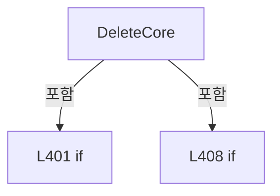

변경 전 점검: 입력/반환 타입, 위 호출자, 예외/취소 경로, 공유 상태와 저장·전송 소비자를 함께 확인합니다. 값의 단위나 물리 방향을 이름만으로 확정하지 않습니다.

### LocalFunctionStatement `SelectGroupKey` · L386–389

[Drilling.File/JHMI/CJhmiRecipeFile.cs:386–389](https://github.com/kjuws10-rgb/A3Drilling/blob/5aee8e58439c9b455cae7c9593c9be986c3e682e/Drilling.File/JHMI/CJhmiRecipeFile.cs#L386-L389)

| 항목 | 실제 추출 값 |
| --- | --- |
| 서명 | string SelectGroupKey(Drilling.Common.Managers.ST_RECIPE_VALUE) |
| 접근/수식자 | Private /  |
| 반환/값 타입 | string |
| 소속 타입 | NamedType:Drilling.File.JHMI.CJhmiRecipeFile |

입력 계약:

| 이름 | 타입 | 전달 | 선택/기본값 |
| --- | --- | --- | --- |
| item | Drilling.Common.Managers.ST_RECIPE_VALUE | None | False /  |

현재 부분 분석에서 직접 연결된 호출자는 없습니다. XAML/이벤트/인터페이스·델리게이트·외부 진입을 추가 확인해야 하며, 미사용으로 판정한 것이 아닙니다.

호출하는 대상과 해석 범위:

| 원본 행 | 표현식 | 분석 상태 | 대상/소스 위치 |
| --- | --- | --- | --- |
| 388 | CreateKey | resolved | string Drilling.File.JHMI.CJhmiRecipeFile.CreateKey(string, string) · Drilling.File/JHMI/CJhmiRecipeFile.cs:1050 |

본문의 실제 연산·분기·예외·반환 순서(원문 위치 순):

| 원본 행 | 종류 | 주석 해설 |
| --- | --- | --- |
| 388 | call | 함수·델리게이트 또는 객체 생성자를 호출합니다: CreateKey(item.Tab, item.Name) |
| 388 | return | 호출자에게 값 또는 제어를 반환합니다: return CreateKey(item.Tab, item.Name); |

변경 전 점검: 입력/반환 타입, 위 호출자, 예외/취소 경로, 공유 상태와 저장·전송 소비자를 함께 확인합니다. 값의 단위나 물리 방향을 이름만으로 확정하지 않습니다.

### LocalFunctionStatement `SelectKey` · L391–394

[Drilling.File/JHMI/CJhmiRecipeFile.cs:391–394](https://github.com/kjuws10-rgb/A3Drilling/blob/5aee8e58439c9b455cae7c9593c9be986c3e682e/Drilling.File/JHMI/CJhmiRecipeFile.cs#L391-L394)

| 항목 | 실제 추출 값 |
| --- | --- |
| 서명 | string SelectKey(System.Linq.IGrouping<string, Drilling.Common.Managers.ST_RECIPE_VALUE>) |
| 접근/수식자 | Private /  |
| 반환/값 타입 | string |
| 소속 타입 | NamedType:Drilling.File.JHMI.CJhmiRecipeFile |

입력 계약:

| 이름 | 타입 | 전달 | 선택/기본값 |
| --- | --- | --- | --- |
| group | System.Linq.IGrouping<string, Drilling.Common.Managers.ST_RECIPE_VALUE> | None | False /  |

현재 부분 분석에서 직접 연결된 호출자는 없습니다. XAML/이벤트/인터페이스·델리게이트·외부 진입을 추가 확인해야 하며, 미사용으로 판정한 것이 아닙니다.

본문의 실제 연산·분기·예외·반환 순서(원문 위치 순):

| 원본 행 | 종류 | 주석 해설 |
| --- | --- | --- |
| 393 | return | 호출자에게 값 또는 제어를 반환합니다: return group.Key; |

변경 전 점검: 입력/반환 타입, 위 호출자, 예외/취소 경로, 공유 상태와 저장·전송 소비자를 함께 확인합니다. 값의 단위나 물리 방향을 이름만으로 확정하지 않습니다.

### LocalFunctionStatement `SelectValue` · L396–399

[Drilling.File/JHMI/CJhmiRecipeFile.cs:396–399](https://github.com/kjuws10-rgb/A3Drilling/blob/5aee8e58439c9b455cae7c9593c9be986c3e682e/Drilling.File/JHMI/CJhmiRecipeFile.cs#L396-L399)

| 항목 | 실제 추출 값 |
| --- | --- |
| 서명 | string SelectValue(System.Linq.IGrouping<string, Drilling.Common.Managers.ST_RECIPE_VALUE>) |
| 접근/수식자 | Private /  |
| 반환/값 타입 | string |
| 소속 타입 | NamedType:Drilling.File.JHMI.CJhmiRecipeFile |

입력 계약:

| 이름 | 타입 | 전달 | 선택/기본값 |
| --- | --- | --- | --- |
| group | System.Linq.IGrouping<string, Drilling.Common.Managers.ST_RECIPE_VALUE> | None | False /  |

현재 부분 분석에서 직접 연결된 호출자는 없습니다. XAML/이벤트/인터페이스·델리게이트·외부 진입을 추가 확인해야 하며, 미사용으로 판정한 것이 아닙니다.

호출하는 대상과 해석 범위:

| 원본 행 | 표현식 | 분석 상태 | 대상/소스 위치 |
| --- | --- | --- | --- |
| 398 | group.Last | resolved | Drilling.Common.Managers.ST_RECIPE_VALUE System.Collections.Generic.IEnumerable<Drilling.Common.Managers.ST_RECIPE_VALUE>.Last<Drilling.Common.Managers.ST_RECIPE_VALUE>() |

본문의 실제 연산·분기·예외·반환 순서(원문 위치 순):

| 원본 행 | 종류 | 주석 해설 |
| --- | --- | --- |
| 398 | call | 함수·델리게이트 또는 객체 생성자를 호출합니다: group.Last() |
| 398 | return | 호출자에게 값 또는 제어를 반환합니다: return group.Last().Value; |

변경 전 점검: 입력/반환 타입, 위 호출자, 예외/취소 경로, 공유 상태와 저장·전송 소비자를 함께 확인합니다. 값의 단위나 물리 방향을 이름만으로 확정하지 않습니다.

### MethodDeclaration `ExecuteFileOperation` · L416–427

[Drilling.File/JHMI/CJhmiRecipeFile.cs:416–427](https://github.com/kjuws10-rgb/A3Drilling/blob/5aee8e58439c9b455cae7c9593c9be986c3e682e/Drilling.File/JHMI/CJhmiRecipeFile.cs#L416-L427)

| 항목 | 실제 추출 값 |
| --- | --- |
| 서명 | System.Threading.Tasks.Task<T> Drilling.File.JHMI.CJhmiRecipeFile.ExecuteFileOperation<T>(System.Func<T>, System.Threading.CancellationToken) |
| 접근/수식자 | Private / private, async |
| 반환/값 타입 | System.Threading.Tasks.Task<T> |
| 소속 타입 | NamedType:Drilling.File.JHMI.CJhmiRecipeFile |

입력 계약:

| 이름 | 타입 | 전달 | 선택/기본값 |
| --- | --- | --- | --- |
| operation | System.Func<T> | None | False /  |
| cancellationToken | System.Threading.CancellationToken | None | False /  |

정적 호출자로 확인된 위치:

| 호출 파일/행 | 호출 표현식 | 런타임 분기 가능 |
| --- | --- | --- |
| [Drilling.File/JHMI/CJhmiRecipeFile.cs:33–33](https://github.com/kjuws10-rgb/A3Drilling/blob/5aee8e58439c9b455cae7c9593c9be986c3e682e/Drilling.File/JHMI/CJhmiRecipeFile.cs#L33-L33) | ExecuteFileOperation | False |
| [Drilling.File/JHMI/CJhmiRecipeFile.cs:59–59](https://github.com/kjuws10-rgb/A3Drilling/blob/5aee8e58439c9b455cae7c9593c9be986c3e682e/Drilling.File/JHMI/CJhmiRecipeFile.cs#L59-L59) | ExecuteFileOperation | False |
| [Drilling.File/JHMI/CJhmiRecipeFile.cs:98–98](https://github.com/kjuws10-rgb/A3Drilling/blob/5aee8e58439c9b455cae7c9593c9be986c3e682e/Drilling.File/JHMI/CJhmiRecipeFile.cs#L98-L98) | ExecuteFileOperation | False |
| [Drilling.File/JHMI/CJhmiRecipeFile.cs:1283–1283](https://github.com/kjuws10-rgb/A3Drilling/blob/5aee8e58439c9b455cae7c9593c9be986c3e682e/Drilling.File/JHMI/CJhmiRecipeFile.cs#L1283-L1283) | ExecuteFileOperation | False |
| [Drilling.File/JHMI/CJhmiRecipeFile.cs:1423–1474](https://github.com/kjuws10-rgb/A3Drilling/blob/5aee8e58439c9b455cae7c9593c9be986c3e682e/Drilling.File/JHMI/CJhmiRecipeFile.cs#L1423-L1474) | ExecuteFileOperation | False |

호출하는 대상과 해석 범위:

| 원본 행 | 표현식 | 분석 상태 | 대상/소스 위치 |
| --- | --- | --- | --- |
| 418 | _fileOperationLock.WaitAsync(cancellationToken).ConfigureAwait | resolved | System.Runtime.CompilerServices.ConfiguredTaskAwaitable System.Threading.Tasks.Task.ConfigureAwait(bool) |
| 418 | _fileOperationLock.WaitAsync | resolved | System.Threading.Tasks.Task System.Threading.SemaphoreSlim.WaitAsync(System.Threading.CancellationToken) |
| 421 | Task.Run(operation, cancellationToken).ConfigureAwait | resolved | System.Runtime.CompilerServices.ConfiguredTaskAwaitable<T> System.Threading.Tasks.Task<T>.ConfigureAwait(bool) |
| 421 | Task.Run | resolved | System.Threading.Tasks.Task<T> System.Threading.Tasks.Task.Run<T>(System.Func<T>, System.Threading.CancellationToken) |
| 425 | _fileOperationLock.Release | resolved | int System.Threading.SemaphoreSlim.Release() |

본문의 실제 연산·분기·예외·반환 순서(원문 위치 순):

| 원본 행 | 종류 | 주석 해설 |
| --- | --- | --- |
| 418 | await | 비동기 완료를 기다립니다: await _fileOperationLock.WaitAsync(cancellationToken).ConfigureAwait(false) |
| 418 | call | 함수·델리게이트 또는 객체 생성자를 호출합니다: _fileOperationLock.WaitAsync(cancellationToken).ConfigureAwait(false) |
| 418 | call | 함수·델리게이트 또는 객체 생성자를 호출합니다: _fileOperationLock.WaitAsync(cancellationToken) |
| 419 | try | 예외 처리 범위입니다: try |
| 421 | await | 비동기 완료를 기다립니다: await Task.Run(operation, cancellationToken).ConfigureAwait(false) |
| 421 | call | 함수·델리게이트 또는 객체 생성자를 호출합니다: Task.Run(operation, cancellationToken).ConfigureAwait(false) |
| 421 | call | 함수·델리게이트 또는 객체 생성자를 호출합니다: Task.Run(operation, cancellationToken) |
| 421 | return | 호출자에게 값 또는 제어를 반환합니다: return await Task.Run(operation, cancellationToken).ConfigureAwait(false); |
| 423 | finally | 종료 정리 구간입니다: finally |
| 425 | call | 함수·델리게이트 또는 객체 생성자를 호출합니다: _fileOperationLock.Release() |

제어 구문의 포함 구조(실제 실행 순서/CFG가 아닌 구문 탐색 그림):

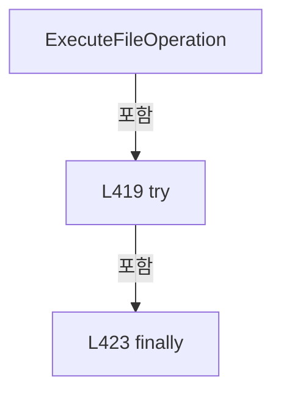

변경 전 점검: 입력/반환 타입, 위 호출자, 예외/취소 경로, 공유 상태와 저장·전송 소비자를 함께 확인합니다. 값의 단위나 물리 방향을 이름만으로 확정하지 않습니다.

### MethodDeclaration `ExecuteFileOperation` · L429–440

[Drilling.File/JHMI/CJhmiRecipeFile.cs:429–440](https://github.com/kjuws10-rgb/A3Drilling/blob/5aee8e58439c9b455cae7c9593c9be986c3e682e/Drilling.File/JHMI/CJhmiRecipeFile.cs#L429-L440)

| 항목 | 실제 추출 값 |
| --- | --- |
| 서명 | System.Threading.Tasks.Task Drilling.File.JHMI.CJhmiRecipeFile.ExecuteFileOperation(System.Action, System.Threading.CancellationToken) |
| 접근/수식자 | Private / private, async |
| 반환/값 타입 | System.Threading.Tasks.Task |
| 소속 타입 | NamedType:Drilling.File.JHMI.CJhmiRecipeFile |

입력 계약:

| 이름 | 타입 | 전달 | 선택/기본값 |
| --- | --- | --- | --- |
| operation | System.Action | None | False /  |
| cancellationToken | System.Threading.CancellationToken | None | False /  |

정적 호출자로 확인된 위치:

| 호출 파일/행 | 호출 표현식 | 런타임 분기 가능 |
| --- | --- | --- |
| [Drilling.File/JHMI/CJhmiRecipeFile.cs:36–49](https://github.com/kjuws10-rgb/A3Drilling/blob/5aee8e58439c9b455cae7c9593c9be986c3e682e/Drilling.File/JHMI/CJhmiRecipeFile.cs#L36-L49) | ExecuteFileOperation | False |
| [Drilling.File/JHMI/CJhmiRecipeFile.cs:117–117](https://github.com/kjuws10-rgb/A3Drilling/blob/5aee8e58439c9b455cae7c9593c9be986c3e682e/Drilling.File/JHMI/CJhmiRecipeFile.cs#L117-L117) | ExecuteFileOperation | False |
| [Drilling.File/JHMI/CJhmiRecipeFile.cs:251–251](https://github.com/kjuws10-rgb/A3Drilling/blob/5aee8e58439c9b455cae7c9593c9be986c3e682e/Drilling.File/JHMI/CJhmiRecipeFile.cs#L251-L251) | ExecuteFileOperation | False |
| [Drilling.File/JHMI/CJhmiRecipeFile.cs:377–377](https://github.com/kjuws10-rgb/A3Drilling/blob/5aee8e58439c9b455cae7c9593c9be986c3e682e/Drilling.File/JHMI/CJhmiRecipeFile.cs#L377-L377) | ExecuteFileOperation | False |
| [Drilling.File/JHMI/CJhmiRecipeFile.cs:1134–1134](https://github.com/kjuws10-rgb/A3Drilling/blob/5aee8e58439c9b455cae7c9593c9be986c3e682e/Drilling.File/JHMI/CJhmiRecipeFile.cs#L1134-L1134) | ExecuteFileOperation | False |
| [Drilling.File/JHMI/CJhmiRecipeFile.cs:1176–1176](https://github.com/kjuws10-rgb/A3Drilling/blob/5aee8e58439c9b455cae7c9593c9be986c3e682e/Drilling.File/JHMI/CJhmiRecipeFile.cs#L1176-L1176) | ExecuteFileOperation | False |
| [Drilling.File/JHMI/CJhmiRecipeFile.cs:1295–1295](https://github.com/kjuws10-rgb/A3Drilling/blob/5aee8e58439c9b455cae7c9593c9be986c3e682e/Drilling.File/JHMI/CJhmiRecipeFile.cs#L1295-L1295) | ExecuteFileOperation | False |

호출하는 대상과 해석 범위:

| 원본 행 | 표현식 | 분석 상태 | 대상/소스 위치 |
| --- | --- | --- | --- |
| 431 | _fileOperationLock.WaitAsync(cancellationToken).ConfigureAwait | resolved | System.Runtime.CompilerServices.ConfiguredTaskAwaitable System.Threading.Tasks.Task.ConfigureAwait(bool) |
| 431 | _fileOperationLock.WaitAsync | resolved | System.Threading.Tasks.Task System.Threading.SemaphoreSlim.WaitAsync(System.Threading.CancellationToken) |
| 434 | Task.Run(operation, cancellationToken).ConfigureAwait | resolved | System.Runtime.CompilerServices.ConfiguredTaskAwaitable System.Threading.Tasks.Task.ConfigureAwait(bool) |
| 434 | Task.Run | resolved | System.Threading.Tasks.Task System.Threading.Tasks.Task.Run(System.Action, System.Threading.CancellationToken) |
| 438 | _fileOperationLock.Release | resolved | int System.Threading.SemaphoreSlim.Release() |

본문의 실제 연산·분기·예외·반환 순서(원문 위치 순):

| 원본 행 | 종류 | 주석 해설 |
| --- | --- | --- |
| 431 | await | 비동기 완료를 기다립니다: await _fileOperationLock.WaitAsync(cancellationToken).ConfigureAwait(false) |
| 431 | call | 함수·델리게이트 또는 객체 생성자를 호출합니다: _fileOperationLock.WaitAsync(cancellationToken).ConfigureAwait(false) |
| 431 | call | 함수·델리게이트 또는 객체 생성자를 호출합니다: _fileOperationLock.WaitAsync(cancellationToken) |
| 432 | try | 예외 처리 범위입니다: try |
| 434 | await | 비동기 완료를 기다립니다: await Task.Run(operation, cancellationToken).ConfigureAwait(false) |
| 434 | call | 함수·델리게이트 또는 객체 생성자를 호출합니다: Task.Run(operation, cancellationToken).ConfigureAwait(false) |
| 434 | call | 함수·델리게이트 또는 객체 생성자를 호출합니다: Task.Run(operation, cancellationToken) |
| 436 | finally | 종료 정리 구간입니다: finally |
| 438 | call | 함수·델리게이트 또는 객체 생성자를 호출합니다: _fileOperationLock.Release() |

제어 구문의 포함 구조(실제 실행 순서/CFG가 아닌 구문 탐색 그림):


변경 전 점검: 입력/반환 타입, 위 호출자, 예외/취소 경로, 공유 상태와 저장·전송 소비자를 함께 확인합니다. 값의 단위나 물리 방향을 이름만으로 확정하지 않습니다.

### MethodDeclaration `LoadRecipe` · L442–589

[Drilling.File/JHMI/CJhmiRecipeFile.cs:442–589](https://github.com/kjuws10-rgb/A3Drilling/blob/5aee8e58439c9b455cae7c9593c9be986c3e682e/Drilling.File/JHMI/CJhmiRecipeFile.cs#L442-L589)

| 항목 | 실제 추출 값 |
| --- | --- |
| 서명 | Drilling.Common.Managers.ST_RECIPE_DEFINITION? Drilling.File.JHMI.CJhmiRecipeFile.LoadRecipe(string, System.Collections.Generic.IReadOnlyList<Drilling.Common.Managers.ST_RECIPE_FORM_ITEM>, System.Threading.CancellationToken) |
| 접근/수식자 | Private / private |
| 반환/값 타입 | Drilling.Common.Managers.ST_RECIPE_DEFINITION? |
| 소속 타입 | NamedType:Drilling.File.JHMI.CJhmiRecipeFile |

입력 계약:

| 이름 | 타입 | 전달 | 선택/기본값 |
| --- | --- | --- | --- |
| path | string | None | False /  |
| formItems | System.Collections.Generic.IReadOnlyList<Drilling.Common.Managers.ST_RECIPE_FORM_ITEM> | None | False /  |
| cancellationToken | System.Threading.CancellationToken | None | False /  |

정적 호출자로 확인된 위치:

| 호출 파일/행 | 호출 표현식 | 런타임 분기 가능 |
| --- | --- | --- |
| [Drilling.File/JHMI/CJhmiRecipeFile.cs:76–76](https://github.com/kjuws10-rgb/A3Drilling/blob/5aee8e58439c9b455cae7c9593c9be986c3e682e/Drilling.File/JHMI/CJhmiRecipeFile.cs#L76-L76) | LoadRecipe | False |
| [Drilling.File/JHMI/CJhmiRecipeFile.cs:107–107](https://github.com/kjuws10-rgb/A3Drilling/blob/5aee8e58439c9b455cae7c9593c9be986c3e682e/Drilling.File/JHMI/CJhmiRecipeFile.cs#L107-L107) | LoadRecipe | False |

호출하는 대상과 해석 범위:

| 원본 행 | 표현식 | 분석 상태 | 대상/소스 위치 |
| --- | --- | --- | --- |
| 444 | cancellationToken.ThrowIfCancellationRequested | resolved | void System.Threading.CancellationToken.ThrowIfCancellationRequested() |
| 445 | Path.GetFileNameWithoutExtension | resolved | string? System.IO.Path.GetFileNameWithoutExtension(string?) |
| 446 | string.IsNullOrWhiteSpace | resolved | bool string.IsNullOrWhiteSpace(string?) |
| 451 | ReadRecipeValues | resolved | System.Collections.Generic.IReadOnlyList<Drilling.Common.Managers.ST_RECIPE_VALUE> Drilling.File.JHMI.CJhmiRecipeFile.ReadRecipeValues(string, System.Threading.CancellationToken) · Drilling.File/JHMI/CJhmiRecipeFile.cs:889 |
| 467 | recipeValues.GroupBy(SelectGroupKey, StringComparer.OrdinalIgnoreCase).ToDictionary | resolved | System.Collections.Generic.Dictionary<string, string> System.Collections.Generic.IEnumerable<System.Linq.IGrouping<string, Drilling.Common.Managers.ST_RECIPE_VALUE>>.ToDictionary<System.Linq.IGrouping<string, Drilling.Common.Managers.ST_RECIPE_VALUE>, string, string>(System.Func<System.Linq.IGrouping<string, Drilling.Common.Managers.ST_RECIPE_VALUE>, string>, System.Func<System.Linq.IGrouping<string, Drilling.Common.Managers.ST_RECIPE_VALUE>, string>, System.Collections.Generic.IEqualityComparer<string>?) |
| 467 | recipeValues.GroupBy | resolved | System.Collections.Generic.IEnumerable<System.Linq.IGrouping<string, Drilling.Common.Managers.ST_RECIPE_VALUE>> System.Collections.Generic.IEnumerable<Drilling.Common.Managers.ST_RECIPE_VALUE>.GroupBy<Drilling.Common.Managers.ST_RECIPE_VALUE, string>(System.Func<Drilling.Common.Managers.ST_RECIPE_VALUE, string>, System.Collections.Generic.IEqualityComparer<string>?) |
| 468 | cancellationToken.ThrowIfCancellationRequested | resolved | void System.Threading.CancellationToken.ThrowIfCancellationRequested() |
| 469 | GetValue | resolved | string Drilling.File.JHMI.CJhmiRecipeFile.GetValue(System.Collections.Generic.IReadOnlyDictionary<string, string>, string, string, string) · Drilling.File/JHMI/CJhmiRecipeFile.cs:1045 |
| 503 | formItems.Where(IsUse).OrderBy(SelectDisplayOrder).Select(BuildRecipe).ToList | resolved | System.Collections.Generic.List<Drilling.Common.Managers.ST_RECIPE_PARAMETER> System.Collections.Generic.IEnumerable<Drilling.Common.Managers.ST_RECIPE_PARAMETER>.ToList<Drilling.Common.Managers.ST_RECIPE_PARAMETER>() |
| 503 | formItems.Where(IsUse).OrderBy(SelectDisplayOrder).Select | resolved | System.Collections.Generic.IEnumerable<Drilling.Common.Managers.ST_RECIPE_PARAMETER> System.Collections.Generic.IEnumerable<Drilling.Common.Managers.ST_RECIPE_FORM_ITEM>.Select<Drilling.Common.Managers.ST_RECIPE_FORM_ITEM, Drilling.Common.Managers.ST_RECIPE_PARAMETER>(System.Func<Drilling.Common.Managers.ST_RECIPE_FORM_ITEM, Drilling.Common.Managers.ST_RECIPE_PARAMETER>) |
| 503 | formItems.Where(IsUse).OrderBy | resolved | System.Linq.IOrderedEnumerable<Drilling.Common.Managers.ST_RECIPE_FORM_ITEM> System.Collections.Generic.IEnumerable<Drilling.Common.Managers.ST_RECIPE_FORM_ITEM>.OrderBy<Drilling.Common.Managers.ST_RECIPE_FORM_ITEM, int>(System.Func<Drilling.Common.Managers.ST_RECIPE_FORM_ITEM, int>) |
| 503 | formItems.Where | resolved | System.Collections.Generic.IEnumerable<Drilling.Common.Managers.ST_RECIPE_FORM_ITEM> System.Collections.Generic.IEnumerable<Drilling.Common.Managers.ST_RECIPE_FORM_ITEM>.Where<Drilling.Common.Managers.ST_RECIPE_FORM_ITEM>(System.Func<Drilling.Common.Managers.ST_RECIPE_FORM_ITEM, bool>) |
| 519 | formItems.GroupBy(SelectName, StringComparer.OrdinalIgnoreCase).ToDictionary | resolved | System.Collections.Generic.Dictionary<string, Drilling.Common.Managers.ST_RECIPE_FORM_ITEM> System.Collections.Generic.IEnumerable<System.Linq.IGrouping<string, Drilling.Common.Managers.ST_RECIPE_FORM_ITEM>>.ToDictionary<System.Linq.IGrouping<string, Drilling.Common.Managers.ST_RECIPE_FORM_ITEM>, string, Drilling.Common.Managers.ST_RECIPE_FORM_ITEM>(System.Func<System.Linq.IGrouping<string, Drilling.Common.Managers.ST_RECIPE_FORM_ITEM>, string>, System.Func<System.Linq.IGrouping<string, Drilling.Common.Managers.ST_RECIPE_FORM_ITEM>, Drilling.Common.Managers.ST_RECIPE_FORM_ITEM>, System.Collections.Generic.IEqualityComparer<string>?) |
| 519 | formItems.GroupBy | resolved | System.Collections.Generic.IEnumerable<System.Linq.IGrouping<string, Drilling.Common.Managers.ST_RECIPE_FORM_ITEM>> System.Collections.Generic.IEnumerable<Drilling.Common.Managers.ST_RECIPE_FORM_ITEM>.GroupBy<Drilling.Common.Managers.ST_RECIPE_FORM_ITEM, string>(System.Func<Drilling.Common.Managers.ST_RECIPE_FORM_ITEM, string>, System.Collections.Generic.IEqualityComparer<string>?) |
| 525 | new HashSet<string> | resolved | System.Collections.Generic.HashSet<string>.HashSet(System.Collections.Generic.IEnumerable<string>, System.Collections.Generic.IEqualityComparer<string>?) |
| 525 | parameters.Select | resolved | System.Collections.Generic.IEnumerable<string> System.Collections.Generic.IEnumerable<Drilling.Common.Managers.ST_RECIPE_PARAMETER>.Select<Drilling.Common.Managers.ST_RECIPE_PARAMETER, string>(System.Func<Drilling.Common.Managers.ST_RECIPE_PARAMETER, string>) |
| 541 | recipeValues.Where(ShouldIncludeItem).OrderBy(SelectSortKey).ThenBy | resolved | System.Linq.IOrderedEnumerable<Drilling.Common.Managers.ST_RECIPE_VALUE> System.Linq.IOrderedEnumerable<Drilling.Common.Managers.ST_RECIPE_VALUE>.ThenBy<Drilling.Common.Managers.ST_RECIPE_VALUE, string>(System.Func<Drilling.Common.Managers.ST_RECIPE_VALUE, string>, System.Collections.Generic.IComparer<string>?) |
| 541 | recipeValues.Where(ShouldIncludeItem).OrderBy | resolved | System.Linq.IOrderedEnumerable<Drilling.Common.Managers.ST_RECIPE_VALUE> System.Collections.Generic.IEnumerable<Drilling.Common.Managers.ST_RECIPE_VALUE>.OrderBy<Drilling.Common.Managers.ST_RECIPE_VALUE, int>(System.Func<Drilling.Common.Managers.ST_RECIPE_VALUE, int>) |
| 541 | recipeValues.Where | resolved | System.Collections.Generic.IEnumerable<Drilling.Common.Managers.ST_RECIPE_VALUE> System.Collections.Generic.IEnumerable<Drilling.Common.Managers.ST_RECIPE_VALUE>.Where<Drilling.Common.Managers.ST_RECIPE_VALUE>(System.Func<Drilling.Common.Managers.ST_RECIPE_VALUE, bool>) |
| 543 | cancellationToken.ThrowIfCancellationRequested | resolved | void System.Threading.CancellationToken.ThrowIfCancellationRequested() |
| 544 | NormalizeCellScopedParameterName | resolved | string Drilling.File.JHMI.CJhmiRecipeFile.NormalizeCellScopedParameterName(string) · Drilling.File/JHMI/CJhmiRecipeFile.cs:716 |
| 544 | GetCellParameterName | resolved | string Drilling.File.JHMI.CJhmiRecipeFile.GetCellParameterName(string) · Drilling.File/JHMI/CJhmiRecipeFile.cs:705 |
| 546 | IsCellPlacementParameterName | resolved | bool Drilling.File.JHMI.CJhmiRecipeFile.IsCellPlacementParameterName(string) · Drilling.File/JHMI/CJhmiRecipeFile.cs:721 |
| 546 | formItemsByName.TryGetValue | resolved | bool System.Collections.Generic.Dictionary<string, Drilling.Common.Managers.ST_RECIPE_FORM_ITEM>.TryGetValue(string, out Drilling.Common.Managers.ST_RECIPE_FORM_ITEM) |
| 546 | formItemsByName.TryGetValue | resolved | bool System.Collections.Generic.Dictionary<string, Drilling.Common.Managers.ST_RECIPE_FORM_ITEM>.TryGetValue(string, out Drilling.Common.Managers.ST_RECIPE_FORM_ITEM) |
| 547 | GetCellNo | resolved | int Drilling.File.JHMI.CJhmiRecipeFile.GetCellNo(string) · Drilling.File/JHMI/CJhmiRecipeFile.cs:694 |
| 548 | parameterKeys.Contains | resolved | bool System.Collections.Generic.HashSet<string>.Contains(string) |
| 555 | CreateShotGroupOverrideParameter | resolved | Drilling.Common.Managers.ST_RECIPE_PARAMETER? Drilling.File.JHMI.CJhmiRecipeFile.CreateShotGroupOverrideParameter(int, string, string, string) · Drilling.File/JHMI/CJhmiRecipeFile.cs:753 |
| 555 | GetCellNo | resolved | int Drilling.File.JHMI.CJhmiRecipeFile.GetCellNo(string) · Drilling.File/JHMI/CJhmiRecipeFile.cs:694 |
| 558 | parameters.Add | resolved | void System.Collections.Generic.List<Drilling.Common.Managers.ST_RECIPE_PARAMETER>.Add(Drilling.Common.Managers.ST_RECIPE_PARAMETER) |
| 559 | parameterKeys.Add | resolved | bool System.Collections.Generic.HashSet<string>.Add(string) |
| 565 | parameters.Add | resolved | void System.Collections.Generic.List<Drilling.Common.Managers.ST_RECIPE_PARAMETER>.Add(Drilling.Common.Managers.ST_RECIPE_PARAMETER) |
| 565 | new ST_RECIPE_PARAMETER | resolved | Drilling.Common.Managers.ST_RECIPE_PARAMETER.ST_RECIPE_PARAMETER(string, string, string, string, string, string, string, string, string, bool, bool, int, Drilling.Common.Managers.EN_RECIPE_DATA_TYPE, double, double, double, System.Collections.Generic.IReadOnlyDictionary<string, string>?) · Drilling.Common/Managers/CRecipeManager.cs:355 |
| 569 | template.Min.ToString | resolved | string double.ToString(string?, System.IFormatProvider?) |
| 569 | template.Max.ToString | resolved | string double.ToString(string?, System.IFormatProvider?) |
| 572 | GetCellScopedGroup | resolved | string Drilling.File.JHMI.CJhmiRecipeFile.GetCellScopedGroup(string) · Drilling.File/JHMI/CJhmiRecipeFile.cs:731 |
| 584 | parameterKeys.Add | resolved | bool System.Collections.Generic.HashSet<string>.Add(string) |
| 587 | _logManager.ReadRecipeRecent | unresolved | None |
| 588 | new ST_RECIPE_DEFINITION | candidate | OverloadResolutionFailure |
| 588 | parameters.ToArray | resolved | Drilling.Common.Managers.ST_RECIPE_PARAMETER[] System.Collections.Generic.List<Drilling.Common.Managers.ST_RECIPE_PARAMETER>.ToArray() |

본문의 실제 연산·분기·예외·반환 순서(원문 위치 순):

| 원본 행 | 종류 | 주석 해설 |
| --- | --- | --- |
| 444 | call | 함수·델리게이트 또는 객체 생성자를 호출합니다: cancellationToken.ThrowIfCancellationRequested() |
| 445 | call | 함수·델리게이트 또는 객체 생성자를 호출합니다: Path.GetFileNameWithoutExtension(path) |
| 445 | local-declaration | 지역 변수를 선언합니다: var recipeId = Path.GetFileNameWithoutExtension(path); |
| 445 | variable-initializer | 변수의 초기값을 지정합니다: recipeId = Path.GetFileNameWithoutExtension(path) |
| 446 | call | 함수·델리게이트 또는 객체 생성자를 호출합니다: string.IsNullOrWhiteSpace(recipeId) |
| 446 | if | 조건에 따라 분기합니다: if (string.IsNullOrWhiteSpace(recipeId)) |
| 448 | return | 호출자에게 값 또는 제어를 반환합니다: return null; |
| 451 | call | 함수·델리게이트 또는 객체 생성자를 호출합니다: ReadRecipeValues(path, cancellationToken) |
| 451 | local-declaration | 지역 변수를 선언합니다: var recipeValues = ReadRecipeValues(path, cancellationToken); |
| 451 | variable-initializer | 변수의 초기값을 지정합니다: recipeValues = ReadRecipeValues(path, cancellationToken) |
| 467 | call | 함수·델리게이트 또는 객체 생성자를 호출합니다: recipeValues.GroupBy(SelectGroupKey, StringComparer.OrdinalIgnoreCase).ToDictionary(SelectKey, SelectValue, StringComparer.OrdinalIgnoreCase) |
| 467 | call | 함수·델리게이트 또는 객체 생성자를 호출합니다: recipeValues.GroupBy(SelectGroupKey, StringComparer.OrdinalIgnoreCase) |
| 467 | local-declaration | 지역 변수를 선언합니다: var values = recipeValues.GroupBy(SelectGroupKey, StringComparer.OrdinalIgnoreCase).ToDictionary(SelectKey, SelectValue, StringComparer.OrdinalIgnoreCase); |
| 467 | variable-initializer | 변수의 초기값을 지정합니다: values = recipeValues.GroupBy(SelectGroupKey, StringComparer.OrdinalIgnoreCase).ToDictionary(SelectKey, SelectValue, StringComparer.OrdinalIgnoreCase) |
| 468 | call | 함수·델리게이트 또는 객체 생성자를 호출합니다: cancellationToken.ThrowIfCancellationRequested() |
| 469 | call | 함수·델리게이트 또는 객체 생성자를 호출합니다: GetValue(values, "DEFAULT", "RECIPE_NAME", recipeId) |
| 469 | local-declaration | 지역 변수를 선언합니다: var recipeName = GetValue(values, "DEFAULT", "RECIPE_NAME", recipeId); |
| 469 | variable-initializer | 변수의 초기값을 지정합니다: recipeName = GetValue(values, "DEFAULT", "RECIPE_NAME", recipeId) |
| 503 | call | 함수·델리게이트 또는 객체 생성자를 호출합니다: formItems.Where(IsUse).OrderBy(SelectDisplayOrder).Select(BuildRecipe).ToList() |
| 503 | call | 함수·델리게이트 또는 객체 생성자를 호출합니다: formItems.Where(IsUse).OrderBy(SelectDisplayOrder).Select(BuildRecipe) |
| 503 | call | 함수·델리게이트 또는 객체 생성자를 호출합니다: formItems.Where(IsUse).OrderBy(SelectDisplayOrder) |
| 503 | call | 함수·델리게이트 또는 객체 생성자를 호출합니다: formItems.Where(IsUse) |
| 503 | local-declaration | 지역 변수를 선언합니다: var parameters = formItems.Where(IsUse).OrderBy(SelectDisplayOrder).Select(BuildRecipe).ToList(); |
| 503 | variable-initializer | 변수의 초기값을 지정합니다: parameters = formItems.Where(IsUse).OrderBy(SelectDisplayOrder).Select(BuildRecipe).ToList() |
| 519 | call | 함수·델리게이트 또는 객체 생성자를 호출합니다: formItems.GroupBy(SelectName, StringComparer.OrdinalIgnoreCase).ToDictionary(SelectFormItemGroupKey, SelectRecipe, StringComparer.OrdinalIgnoreCase) |
| 519 | call | 함수·델리게이트 또는 객체 생성자를 호출합니다: formItems.GroupBy(SelectName, StringComparer.OrdinalIgnoreCase) |
| 519 | local-declaration | 지역 변수를 선언합니다: var formItemsByName = formItems.GroupBy(SelectName, StringComparer.OrdinalIgnoreCase).ToDictionary(SelectFormItemGroupKey, SelectRecipe, StringComparer.OrdinalIgnoreCase); |
| 519 | variable-initializer | 변수의 초기값을 지정합니다: formItemsByName = formItems.GroupBy(SelectName, StringComparer.OrdinalIgnoreCase).ToDictionary(SelectFormItemGroupKey, SelectRecipe, StringComparer.OrdinalIgnoreCase) |
| 525 | call | 함수·델리게이트 또는 객체 생성자를 호출합니다: new HashSet<string>(parameters.Select(SelectParameterKey), StringComparer.OrdinalIgnoreCase) |
| 525 | call | 함수·델리게이트 또는 객체 생성자를 호출합니다: parameters.Select(SelectParameterKey) |
| 525 | local-declaration | 지역 변수를 선언합니다: var parameterKeys = new HashSet<string>(parameters.Select(SelectParameterKey), StringComparer.OrdinalIgnoreCase); |
| 525 | variable-initializer | 변수의 초기값을 지정합니다: parameterKeys = new HashSet<string>(parameters.Select(SelectParameterKey), StringComparer.OrdinalIgnoreCase) |
| 541 | call | 함수·델리게이트 또는 객체 생성자를 호출합니다: recipeValues.Where(ShouldIncludeItem).OrderBy(SelectSortKey).ThenBy(SelectName2, StringComparer.OrdinalIgnoreCase) |
| 541 | call | 함수·델리게이트 또는 객체 생성자를 호출합니다: recipeValues.Where(ShouldIncludeItem).OrderBy(SelectSortKey) |
| 541 | call | 함수·델리게이트 또는 객체 생성자를 호출합니다: recipeValues.Where(ShouldIncludeItem) |
| 541 | foreach | 컬렉션 요소를 순회합니다: foreach (var cellValue in recipeValues.Where(ShouldIncludeItem).OrderBy(SelectSortKey).ThenBy(SelectName2, StringComparer.OrdinalIgnoreCase)) |
| 543 | call | 함수·델리게이트 또는 객체 생성자를 호출합니다: cancellationToken.ThrowIfCancellationRequested() |
| 544 | call | 함수·델리게이트 또는 객체 생성자를 호출합니다: NormalizeCellScopedParameterName(GetCellParameterName(cellValue.Name)) |
| 544 | call | 함수·델리게이트 또는 객체 생성자를 호출합니다: GetCellParameterName(cellValue.Name) |
| 544 | local-declaration | 지역 변수를 선언합니다: var parameterName = NormalizeCellScopedParameterName(GetCellParameterName(cellValue.Name)); |
| 544 | variable-initializer | 변수의 초기값을 지정합니다: parameterName = NormalizeCellScopedParameterName(GetCellParameterName(cellValue.Name)) |
| 545 | local-declaration | 지역 변수를 선언합니다: ST_RECIPE_FORM_ITEM? template = null; |
| 545 | variable-initializer | 변수의 초기값을 지정합니다: template = null |
| 546 | call | 함수·델리게이트 또는 객체 생성자를 호출합니다: IsCellPlacementParameterName(parameterName) |
| 546 | call | 함수·델리게이트 또는 객체 생성자를 호출합니다: formItemsByName.TryGetValue(parameterName, out template) |
| 546 | call | 함수·델리게이트 또는 객체 생성자를 호출합니다: formItemsByName.TryGetValue($"CELL_{parameterName}", out template) |
| 546 | local-declaration | 지역 변수를 선언합니다: var hasTemplate = IsCellPlacementParameterName(parameterName) && (formItemsByName.TryGetValue(parameterName, out template) &#124;&#124; formItemsByName.TryGetValue($"CELL_{parameterName}", out template)); |
| 546 | variable-initializer | 변수의 초기값을 지정합니다: hasTemplate = IsCellPlacementParameterName(parameterName) && (formItemsByName.TryGetValue(parameterName, out template) &#124;&#124; formItemsByName.TryGetValue($"CELL_{parameterName}", out template)) |
| 547 | call | 함수·델리게이트 또는 객체 생성자를 호출합니다: GetCellNo(cellValue.Name) |
| 547 | local-declaration | 지역 변수를 선언합니다: var normalizedScopedKey = $"CELL{GetCellNo(cellValue.Name)}_{parameterName}"; |
| 547 | variable-initializer | 변수의 초기값을 지정합니다: normalizedScopedKey = $"CELL{GetCellNo(cellValue.Name)}_{parameterName}" |
| 548 | call | 함수·델리게이트 또는 객체 생성자를 호출합니다: parameterKeys.Contains(normalizedScopedKey) |
| 548 | if | 조건에 따라 분기합니다: if (parameterKeys.Contains(normalizedScopedKey)) |
| 550 | continue | 다음 반복으로 진행합니다: continue; |
| 553 | if | 조건에 따라 분기합니다: if (!hasTemplate) |
| 555 | call | 함수·델리게이트 또는 객체 생성자를 호출합니다: CreateShotGroupOverrideParameter(GetCellNo(cellValue.Name), parameterName, normalizedScopedKey, cellValue.Value) |
| 555 | call | 함수·델리게이트 또는 객체 생성자를 호출합니다: GetCellNo(cellValue.Name) |
| 555 | local-declaration | 지역 변수를 선언합니다: var shotGroupOverride = CreateShotGroupOverrideParameter(GetCellNo(cellValue.Name), parameterName, normalizedScopedKey, cellValue.Value); |
| 555 | variable-initializer | 변수의 초기값을 지정합니다: shotGroupOverride = CreateShotGroupOverrideParameter(GetCellNo(cellValue.Name), parameterName, normalizedScopedKey, cellValue.Value) |
| 556 | if | 조건에 따라 분기합니다: if (shotGroupOverride is not null) |
| 558 | call | 함수·델리게이트 또는 객체 생성자를 호출합니다: parameters.Add(shotGroupOverride) |
| 559 | call | 함수·델리게이트 또는 객체 생성자를 호출합니다: parameterKeys.Add(normalizedScopedKey) |
| 562 | continue | 다음 반복으로 진행합니다: continue; |
| 565 | call | 함수·델리게이트 또는 객체 생성자를 호출합니다: parameters.Add(new ST_RECIPE_PARAMETER( template!.DisplayName, cellValue.Value, template.Unit, $"{template.Min.ToString("0.###", CultureInfo.InvariantCulture)} - {template.Max.ToString("0.###", CultureInfo.InvariantCultu… |
| 565 | call | 함수·델리게이트 또는 객체 생성자를 호출합니다: new ST_RECIPE_PARAMETER( template!.DisplayName, cellValue.Value, template.Unit, $"{template.Min.ToString("0.###", CultureInfo.InvariantCulture)} - {template.Max.ToString("0.###", CultureInfo.InvariantCulture)}", template… |
| 569 | call | 함수·델리게이트 또는 객체 생성자를 호출합니다: template.Min.ToString("0.###", CultureInfo.InvariantCulture) |
| 569 | call | 함수·델리게이트 또는 객체 생성자를 호출합니다: template.Max.ToString("0.###", CultureInfo.InvariantCulture) |
| 572 | call | 함수·델리게이트 또는 객체 생성자를 호출합니다: GetCellScopedGroup(parameterName) |
| 584 | call | 함수·델리게이트 또는 객체 생성자를 호출합니다: parameterKeys.Add(normalizedScopedKey) |
| 587 | call | 함수·델리게이트 또는 객체 생성자를 호출합니다: _logManager.ReadRecipeRecent(recipeName, recipeId) |
| 587 | local-declaration | 지역 변수를 선언합니다: var history = _logManager.ReadRecipeRecent(recipeName, recipeId); |
| 587 | variable-initializer | 변수의 초기값을 지정합니다: history = _logManager.ReadRecipeRecent(recipeName, recipeId) |
| 588 | call | 함수·델리게이트 또는 객체 생성자를 호출합니다: new ST_RECIPE_DEFINITION(recipeId, recipeName, parameters.ToArray(), history) |
| 588 | call | 함수·델리게이트 또는 객체 생성자를 호출합니다: parameters.ToArray() |
| 588 | return | 호출자에게 값 또는 제어를 반환합니다: return new ST_RECIPE_DEFINITION(recipeId, recipeName, parameters.ToArray(), history); |

제어 구문의 포함 구조(실제 실행 순서/CFG가 아닌 구문 탐색 그림):

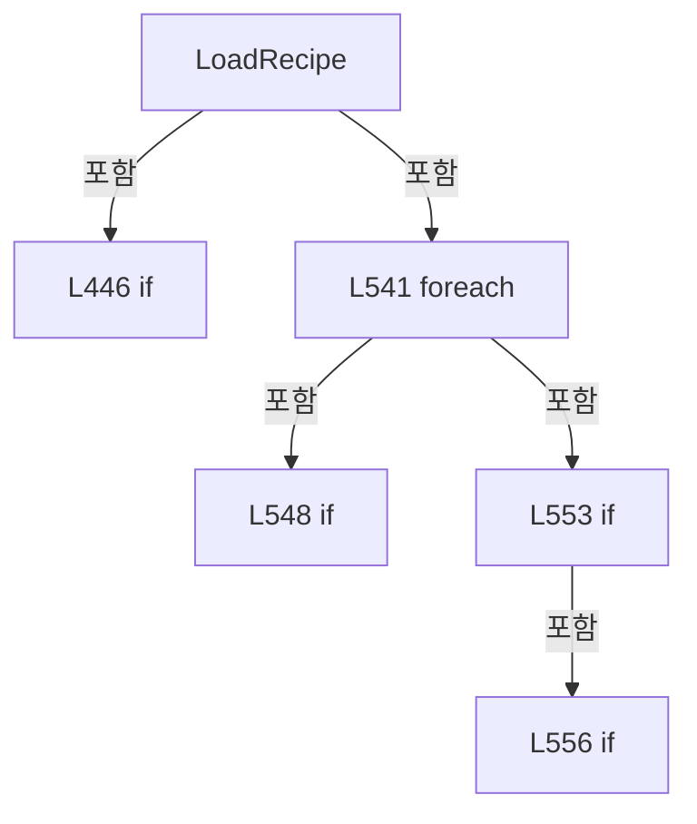

변경 전 점검: 입력/반환 타입, 위 호출자, 예외/취소 경로, 공유 상태와 저장·전송 소비자를 함께 확인합니다. 값의 단위나 물리 방향을 이름만으로 확정하지 않습니다.

### LocalFunctionStatement `SelectGroupKey` · L452–455

[Drilling.File/JHMI/CJhmiRecipeFile.cs:452–455](https://github.com/kjuws10-rgb/A3Drilling/blob/5aee8e58439c9b455cae7c9593c9be986c3e682e/Drilling.File/JHMI/CJhmiRecipeFile.cs#L452-L455)

| 항목 | 실제 추출 값 |
| --- | --- |
| 서명 | string SelectGroupKey(Drilling.Common.Managers.ST_RECIPE_VALUE) |
| 접근/수식자 | Private /  |
| 반환/값 타입 | string |
| 소속 타입 | NamedType:Drilling.File.JHMI.CJhmiRecipeFile |

입력 계약:

| 이름 | 타입 | 전달 | 선택/기본값 |
| --- | --- | --- | --- |
| item | Drilling.Common.Managers.ST_RECIPE_VALUE | None | False /  |

현재 부분 분석에서 직접 연결된 호출자는 없습니다. XAML/이벤트/인터페이스·델리게이트·외부 진입을 추가 확인해야 하며, 미사용으로 판정한 것이 아닙니다.

호출하는 대상과 해석 범위:

| 원본 행 | 표현식 | 분석 상태 | 대상/소스 위치 |
| --- | --- | --- | --- |
| 454 | CreateKey | resolved | string Drilling.File.JHMI.CJhmiRecipeFile.CreateKey(string, string) · Drilling.File/JHMI/CJhmiRecipeFile.cs:1050 |

본문의 실제 연산·분기·예외·반환 순서(원문 위치 순):

| 원본 행 | 종류 | 주석 해설 |
| --- | --- | --- |
| 454 | call | 함수·델리게이트 또는 객체 생성자를 호출합니다: CreateKey(item.Tab, item.Name) |
| 454 | return | 호출자에게 값 또는 제어를 반환합니다: return CreateKey(item.Tab, item.Name); |

변경 전 점검: 입력/반환 타입, 위 호출자, 예외/취소 경로, 공유 상태와 저장·전송 소비자를 함께 확인합니다. 값의 단위나 물리 방향을 이름만으로 확정하지 않습니다.

### LocalFunctionStatement `SelectKey` · L457–460

[Drilling.File/JHMI/CJhmiRecipeFile.cs:457–460](https://github.com/kjuws10-rgb/A3Drilling/blob/5aee8e58439c9b455cae7c9593c9be986c3e682e/Drilling.File/JHMI/CJhmiRecipeFile.cs#L457-L460)

| 항목 | 실제 추출 값 |
| --- | --- |
| 서명 | string SelectKey(System.Linq.IGrouping<string, Drilling.Common.Managers.ST_RECIPE_VALUE>) |
| 접근/수식자 | Private /  |
| 반환/값 타입 | string |
| 소속 타입 | NamedType:Drilling.File.JHMI.CJhmiRecipeFile |

입력 계약:

| 이름 | 타입 | 전달 | 선택/기본값 |
| --- | --- | --- | --- |
| group | System.Linq.IGrouping<string, Drilling.Common.Managers.ST_RECIPE_VALUE> | None | False /  |

현재 부분 분석에서 직접 연결된 호출자는 없습니다. XAML/이벤트/인터페이스·델리게이트·외부 진입을 추가 확인해야 하며, 미사용으로 판정한 것이 아닙니다.

본문의 실제 연산·분기·예외·반환 순서(원문 위치 순):

| 원본 행 | 종류 | 주석 해설 |
| --- | --- | --- |
| 459 | return | 호출자에게 값 또는 제어를 반환합니다: return group.Key; |

변경 전 점검: 입력/반환 타입, 위 호출자, 예외/취소 경로, 공유 상태와 저장·전송 소비자를 함께 확인합니다. 값의 단위나 물리 방향을 이름만으로 확정하지 않습니다.

### LocalFunctionStatement `SelectValue` · L462–465

[Drilling.File/JHMI/CJhmiRecipeFile.cs:462–465](https://github.com/kjuws10-rgb/A3Drilling/blob/5aee8e58439c9b455cae7c9593c9be986c3e682e/Drilling.File/JHMI/CJhmiRecipeFile.cs#L462-L465)

| 항목 | 실제 추출 값 |
| --- | --- |
| 서명 | string SelectValue(System.Linq.IGrouping<string, Drilling.Common.Managers.ST_RECIPE_VALUE>) |
| 접근/수식자 | Private /  |
| 반환/값 타입 | string |
| 소속 타입 | NamedType:Drilling.File.JHMI.CJhmiRecipeFile |

입력 계약:

| 이름 | 타입 | 전달 | 선택/기본값 |
| --- | --- | --- | --- |
| group | System.Linq.IGrouping<string, Drilling.Common.Managers.ST_RECIPE_VALUE> | None | False /  |

현재 부분 분석에서 직접 연결된 호출자는 없습니다. XAML/이벤트/인터페이스·델리게이트·외부 진입을 추가 확인해야 하며, 미사용으로 판정한 것이 아닙니다.

호출하는 대상과 해석 범위:

| 원본 행 | 표현식 | 분석 상태 | 대상/소스 위치 |
| --- | --- | --- | --- |
| 464 | group.Last | resolved | Drilling.Common.Managers.ST_RECIPE_VALUE System.Collections.Generic.IEnumerable<Drilling.Common.Managers.ST_RECIPE_VALUE>.Last<Drilling.Common.Managers.ST_RECIPE_VALUE>() |

본문의 실제 연산·분기·예외·반환 순서(원문 위치 순):

| 원본 행 | 종류 | 주석 해설 |
| --- | --- | --- |
| 464 | call | 함수·델리게이트 또는 객체 생성자를 호출합니다: group.Last() |
| 464 | return | 호출자에게 값 또는 제어를 반환합니다: return group.Last().Value; |

변경 전 점검: 입력/반환 타입, 위 호출자, 예외/취소 경로, 공유 상태와 저장·전송 소비자를 함께 확인합니다. 값의 단위나 물리 방향을 이름만으로 확정하지 않습니다.

### LocalFunctionStatement `IsUse` · L470–473

[Drilling.File/JHMI/CJhmiRecipeFile.cs:470–473](https://github.com/kjuws10-rgb/A3Drilling/blob/5aee8e58439c9b455cae7c9593c9be986c3e682e/Drilling.File/JHMI/CJhmiRecipeFile.cs#L470-L473)

| 항목 | 실제 추출 값 |
| --- | --- |
| 서명 | bool IsUse(Drilling.Common.Managers.ST_RECIPE_FORM_ITEM) |
| 접근/수식자 | Private /  |
| 반환/값 타입 | bool |
| 소속 타입 | NamedType:Drilling.File.JHMI.CJhmiRecipeFile |

입력 계약:

| 이름 | 타입 | 전달 | 선택/기본값 |
| --- | --- | --- | --- |
| item | Drilling.Common.Managers.ST_RECIPE_FORM_ITEM | None | False /  |

현재 부분 분석에서 직접 연결된 호출자는 없습니다. XAML/이벤트/인터페이스·델리게이트·외부 진입을 추가 확인해야 하며, 미사용으로 판정한 것이 아닙니다.

본문의 실제 연산·분기·예외·반환 순서(원문 위치 순):

| 원본 행 | 종류 | 주석 해설 |
| --- | --- | --- |
| 472 | return | 호출자에게 값 또는 제어를 반환합니다: return item.Use; |

변경 전 점검: 입력/반환 타입, 위 호출자, 예외/취소 경로, 공유 상태와 저장·전송 소비자를 함께 확인합니다. 값의 단위나 물리 방향을 이름만으로 확정하지 않습니다.

### LocalFunctionStatement `SelectDisplayOrder` · L475–478

[Drilling.File/JHMI/CJhmiRecipeFile.cs:475–478](https://github.com/kjuws10-rgb/A3Drilling/blob/5aee8e58439c9b455cae7c9593c9be986c3e682e/Drilling.File/JHMI/CJhmiRecipeFile.cs#L475-L478)

| 항목 | 실제 추출 값 |
| --- | --- |
| 서명 | int SelectDisplayOrder(Drilling.Common.Managers.ST_RECIPE_FORM_ITEM) |
| 접근/수식자 | Private /  |
| 반환/값 타입 | int |
| 소속 타입 | NamedType:Drilling.File.JHMI.CJhmiRecipeFile |

입력 계약:

| 이름 | 타입 | 전달 | 선택/기본값 |
| --- | --- | --- | --- |
| item | Drilling.Common.Managers.ST_RECIPE_FORM_ITEM | None | False /  |

현재 부분 분석에서 직접 연결된 호출자는 없습니다. XAML/이벤트/인터페이스·델리게이트·외부 진입을 추가 확인해야 하며, 미사용으로 판정한 것이 아닙니다.

본문의 실제 연산·분기·예외·반환 순서(원문 위치 순):

| 원본 행 | 종류 | 주석 해설 |
| --- | --- | --- |
| 477 | return | 호출자에게 값 또는 제어를 반환합니다: return item.DisplayOrder; |

변경 전 점검: 입력/반환 타입, 위 호출자, 예외/취소 경로, 공유 상태와 저장·전송 소비자를 함께 확인합니다. 값의 단위나 물리 방향을 이름만으로 확정하지 않습니다.

### LocalFunctionStatement `BuildRecipe` · L480–501

[Drilling.File/JHMI/CJhmiRecipeFile.cs:480–501](https://github.com/kjuws10-rgb/A3Drilling/blob/5aee8e58439c9b455cae7c9593c9be986c3e682e/Drilling.File/JHMI/CJhmiRecipeFile.cs#L480-L501)

| 항목 | 실제 추출 값 |
| --- | --- |
| 서명 | Drilling.Common.Managers.ST_RECIPE_PARAMETER BuildRecipe(Drilling.Common.Managers.ST_RECIPE_FORM_ITEM) |
| 접근/수식자 | Private /  |
| 반환/값 타입 | Drilling.Common.Managers.ST_RECIPE_PARAMETER |
| 소속 타입 | NamedType:Drilling.File.JHMI.CJhmiRecipeFile |

입력 계약:

| 이름 | 타입 | 전달 | 선택/기본값 |
| --- | --- | --- | --- |
| item | Drilling.Common.Managers.ST_RECIPE_FORM_ITEM | None | False /  |

현재 부분 분석에서 직접 연결된 호출자는 없습니다. XAML/이벤트/인터페이스·델리게이트·외부 진입을 추가 확인해야 하며, 미사용으로 판정한 것이 아닙니다.

호출하는 대상과 해석 범위:

| 원본 행 | 표현식 | 분석 상태 | 대상/소스 위치 |
| --- | --- | --- | --- |
| 482 | new ST_RECIPE_PARAMETER | resolved | Drilling.Common.Managers.ST_RECIPE_PARAMETER.ST_RECIPE_PARAMETER(string, string, string, string, string, string, string, string, string, bool, bool, int, Drilling.Common.Managers.EN_RECIPE_DATA_TYPE, double, double, double, System.Collections.Generic.IReadOnlyDictionary<string, string>?) · Drilling.Common/Managers/CRecipeManager.cs:355 |
| 484 | GetValue | resolved | string Drilling.File.JHMI.CJhmiRecipeFile.GetValue(System.Collections.Generic.IReadOnlyDictionary<string, string>, string, string, string) · Drilling.File/JHMI/CJhmiRecipeFile.cs:1045 |
| 486 | item.Min.ToString | resolved | string double.ToString(string?, System.IFormatProvider?) |
| 486 | item.Max.ToString | resolved | string double.ToString(string?, System.IFormatProvider?) |

본문의 실제 연산·분기·예외·반환 순서(원문 위치 순):

| 원본 행 | 종류 | 주석 해설 |
| --- | --- | --- |
| 482 | call | 함수·델리게이트 또는 객체 생성자를 호출합니다: new ST_RECIPE_PARAMETER( item.DisplayName, GetValue(values, item.Tab, item.Name, item.DefaultValue), item.Unit, $"{item.Min.ToString("0.###", CultureInfo.InvariantCulture)} - {item.Max.ToString("0.###", CultureInfo.Invar… |
| 482 | return | 호출자에게 값 또는 제어를 반환합니다: return new ST_RECIPE_PARAMETER( item.DisplayName, GetValue(values, item.Tab, item.Name, item.DefaultValue), item.Unit, $"{item.Min.ToString("0.###", CultureInfo.InvariantCulture)} - {item.Max.ToString("0.###", CultureInfo.Invarian |
| 484 | call | 함수·델리게이트 또는 객체 생성자를 호출합니다: GetValue(values, item.Tab, item.Name, item.DefaultValue) |
| 486 | call | 함수·델리게이트 또는 객체 생성자를 호출합니다: item.Min.ToString("0.###", CultureInfo.InvariantCulture) |
| 486 | call | 함수·델리게이트 또는 객체 생성자를 호출합니다: item.Max.ToString("0.###", CultureInfo.InvariantCulture) |

변경 전 점검: 입력/반환 타입, 위 호출자, 예외/취소 경로, 공유 상태와 저장·전송 소비자를 함께 확인합니다. 값의 단위나 물리 방향을 이름만으로 확정하지 않습니다.

### LocalFunctionStatement `SelectName` · L504–507

[Drilling.File/JHMI/CJhmiRecipeFile.cs:504–507](https://github.com/kjuws10-rgb/A3Drilling/blob/5aee8e58439c9b455cae7c9593c9be986c3e682e/Drilling.File/JHMI/CJhmiRecipeFile.cs#L504-L507)

| 항목 | 실제 추출 값 |
| --- | --- |
| 서명 | string SelectName(Drilling.Common.Managers.ST_RECIPE_FORM_ITEM) |
| 접근/수식자 | Private /  |
| 반환/값 타입 | string |
| 소속 타입 | NamedType:Drilling.File.JHMI.CJhmiRecipeFile |

입력 계약:

| 이름 | 타입 | 전달 | 선택/기본값 |
| --- | --- | --- | --- |
| item | Drilling.Common.Managers.ST_RECIPE_FORM_ITEM | None | False /  |

현재 부분 분석에서 직접 연결된 호출자는 없습니다. XAML/이벤트/인터페이스·델리게이트·외부 진입을 추가 확인해야 하며, 미사용으로 판정한 것이 아닙니다.

본문의 실제 연산·분기·예외·반환 순서(원문 위치 순):

| 원본 행 | 종류 | 주석 해설 |
| --- | --- | --- |
| 506 | return | 호출자에게 값 또는 제어를 반환합니다: return item.Name; |

변경 전 점검: 입력/반환 타입, 위 호출자, 예외/취소 경로, 공유 상태와 저장·전송 소비자를 함께 확인합니다. 값의 단위나 물리 방향을 이름만으로 확정하지 않습니다.

### LocalFunctionStatement `SelectFormItemGroupKey` · L509–512

[Drilling.File/JHMI/CJhmiRecipeFile.cs:509–512](https://github.com/kjuws10-rgb/A3Drilling/blob/5aee8e58439c9b455cae7c9593c9be986c3e682e/Drilling.File/JHMI/CJhmiRecipeFile.cs#L509-L512)

| 항목 | 실제 추출 값 |
| --- | --- |
| 서명 | string SelectFormItemGroupKey(System.Linq.IGrouping<string, Drilling.Common.Managers.ST_RECIPE_FORM_ITEM>) |
| 접근/수식자 | Private /  |
| 반환/값 타입 | string |
| 소속 타입 | NamedType:Drilling.File.JHMI.CJhmiRecipeFile |

입력 계약:

| 이름 | 타입 | 전달 | 선택/기본값 |
| --- | --- | --- | --- |
| group | System.Linq.IGrouping<string, Drilling.Common.Managers.ST_RECIPE_FORM_ITEM> | None | False /  |

현재 부분 분석에서 직접 연결된 호출자는 없습니다. XAML/이벤트/인터페이스·델리게이트·외부 진입을 추가 확인해야 하며, 미사용으로 판정한 것이 아닙니다.

본문의 실제 연산·분기·예외·반환 순서(원문 위치 순):

| 원본 행 | 종류 | 주석 해설 |
| --- | --- | --- |
| 511 | return | 호출자에게 값 또는 제어를 반환합니다: return group.Key; |

변경 전 점검: 입력/반환 타입, 위 호출자, 예외/취소 경로, 공유 상태와 저장·전송 소비자를 함께 확인합니다. 값의 단위나 물리 방향을 이름만으로 확정하지 않습니다.

### LocalFunctionStatement `SelectRecipe` · L514–517

[Drilling.File/JHMI/CJhmiRecipeFile.cs:514–517](https://github.com/kjuws10-rgb/A3Drilling/blob/5aee8e58439c9b455cae7c9593c9be986c3e682e/Drilling.File/JHMI/CJhmiRecipeFile.cs#L514-L517)

| 항목 | 실제 추출 값 |
| --- | --- |
| 서명 | Drilling.Common.Managers.ST_RECIPE_FORM_ITEM SelectRecipe(System.Linq.IGrouping<string, Drilling.Common.Managers.ST_RECIPE_FORM_ITEM>) |
| 접근/수식자 | Private /  |
| 반환/값 타입 | Drilling.Common.Managers.ST_RECIPE_FORM_ITEM |
| 소속 타입 | NamedType:Drilling.File.JHMI.CJhmiRecipeFile |

입력 계약:

| 이름 | 타입 | 전달 | 선택/기본값 |
| --- | --- | --- | --- |
| group | System.Linq.IGrouping<string, Drilling.Common.Managers.ST_RECIPE_FORM_ITEM> | None | False /  |

현재 부분 분석에서 직접 연결된 호출자는 없습니다. XAML/이벤트/인터페이스·델리게이트·외부 진입을 추가 확인해야 하며, 미사용으로 판정한 것이 아닙니다.

호출하는 대상과 해석 범위:

| 원본 행 | 표현식 | 분석 상태 | 대상/소스 위치 |
| --- | --- | --- | --- |
| 516 | group.First | resolved | Drilling.Common.Managers.ST_RECIPE_FORM_ITEM System.Collections.Generic.IEnumerable<Drilling.Common.Managers.ST_RECIPE_FORM_ITEM>.First<Drilling.Common.Managers.ST_RECIPE_FORM_ITEM>() |

본문의 실제 연산·분기·예외·반환 순서(원문 위치 순):

| 원본 행 | 종류 | 주석 해설 |
| --- | --- | --- |
| 516 | call | 함수·델리게이트 또는 객체 생성자를 호출합니다: group.First() |
| 516 | return | 호출자에게 값 또는 제어를 반환합니다: return group.First(); |

변경 전 점검: 입력/반환 타입, 위 호출자, 예외/취소 경로, 공유 상태와 저장·전송 소비자를 함께 확인합니다. 값의 단위나 물리 방향을 이름만으로 확정하지 않습니다.

### LocalFunctionStatement `SelectParameterKey` · L520–523

[Drilling.File/JHMI/CJhmiRecipeFile.cs:520–523](https://github.com/kjuws10-rgb/A3Drilling/blob/5aee8e58439c9b455cae7c9593c9be986c3e682e/Drilling.File/JHMI/CJhmiRecipeFile.cs#L520-L523)

| 항목 | 실제 추출 값 |
| --- | --- |
| 서명 | string SelectParameterKey(Drilling.Common.Managers.ST_RECIPE_PARAMETER) |
| 접근/수식자 | Private /  |
| 반환/값 타입 | string |
| 소속 타입 | NamedType:Drilling.File.JHMI.CJhmiRecipeFile |

입력 계약:

| 이름 | 타입 | 전달 | 선택/기본값 |
| --- | --- | --- | --- |
| parameter | Drilling.Common.Managers.ST_RECIPE_PARAMETER | None | False /  |

현재 부분 분석에서 직접 연결된 호출자는 없습니다. XAML/이벤트/인터페이스·델리게이트·외부 진입을 추가 확인해야 하며, 미사용으로 판정한 것이 아닙니다.

본문의 실제 연산·분기·예외·반환 순서(원문 위치 순):

| 원본 행 | 종류 | 주석 해설 |
| --- | --- | --- |
| 522 | return | 호출자에게 값 또는 제어를 반환합니다: return parameter.Key; |

변경 전 점검: 입력/반환 타입, 위 호출자, 예외/취소 경로, 공유 상태와 저장·전송 소비자를 함께 확인합니다. 값의 단위나 물리 방향을 이름만으로 확정하지 않습니다.

### LocalFunctionStatement `ShouldIncludeItem` · L526–529

[Drilling.File/JHMI/CJhmiRecipeFile.cs:526–529](https://github.com/kjuws10-rgb/A3Drilling/blob/5aee8e58439c9b455cae7c9593c9be986c3e682e/Drilling.File/JHMI/CJhmiRecipeFile.cs#L526-L529)

| 항목 | 실제 추출 값 |
| --- | --- |
| 서명 | bool ShouldIncludeItem(Drilling.Common.Managers.ST_RECIPE_VALUE) |
| 접근/수식자 | Private /  |
| 반환/값 타입 | bool |
| 소속 타입 | NamedType:Drilling.File.JHMI.CJhmiRecipeFile |

입력 계약:

| 이름 | 타입 | 전달 | 선택/기본값 |
| --- | --- | --- | --- |
| item | Drilling.Common.Managers.ST_RECIPE_VALUE | None | False /  |

현재 부분 분석에서 직접 연결된 호출자는 없습니다. XAML/이벤트/인터페이스·델리게이트·외부 진입을 추가 확인해야 하며, 미사용으로 판정한 것이 아닙니다.

호출하는 대상과 해석 범위:

| 원본 행 | 표현식 | 분석 상태 | 대상/소스 위치 |
| --- | --- | --- | --- |
| 528 | item.Tab.Equals | resolved | bool string.Equals(string?, System.StringComparison) |
| 528 | IsCellScopedKey | resolved | bool Drilling.File.JHMI.CJhmiRecipeFile.IsCellScopedKey(string) · Drilling.File/JHMI/CJhmiRecipeFile.cs:591 |

본문의 실제 연산·분기·예외·반환 순서(원문 위치 순):

| 원본 행 | 종류 | 주석 해설 |
| --- | --- | --- |
| 528 | call | 함수·델리게이트 또는 객체 생성자를 호출합니다: item.Tab.Equals("CELL", StringComparison.OrdinalIgnoreCase) |
| 528 | call | 함수·델리게이트 또는 객체 생성자를 호출합니다: IsCellScopedKey(item.Name) |
| 528 | return | 호출자에게 값 또는 제어를 반환합니다: return item.Tab.Equals("CELL", StringComparison.OrdinalIgnoreCase) && IsCellScopedKey(item.Name); |

변경 전 점검: 입력/반환 타입, 위 호출자, 예외/취소 경로, 공유 상태와 저장·전송 소비자를 함께 확인합니다. 값의 단위나 물리 방향을 이름만으로 확정하지 않습니다.

### LocalFunctionStatement `SelectSortKey` · L531–534

[Drilling.File/JHMI/CJhmiRecipeFile.cs:531–534](https://github.com/kjuws10-rgb/A3Drilling/blob/5aee8e58439c9b455cae7c9593c9be986c3e682e/Drilling.File/JHMI/CJhmiRecipeFile.cs#L531-L534)

| 항목 | 실제 추출 값 |
| --- | --- |
| 서명 | int SelectSortKey(Drilling.Common.Managers.ST_RECIPE_VALUE) |
| 접근/수식자 | Private /  |
| 반환/값 타입 | int |
| 소속 타입 | NamedType:Drilling.File.JHMI.CJhmiRecipeFile |

입력 계약:

| 이름 | 타입 | 전달 | 선택/기본값 |
| --- | --- | --- | --- |
| item | Drilling.Common.Managers.ST_RECIPE_VALUE | None | False /  |

현재 부분 분석에서 직접 연결된 호출자는 없습니다. XAML/이벤트/인터페이스·델리게이트·외부 진입을 추가 확인해야 하며, 미사용으로 판정한 것이 아닙니다.

호출하는 대상과 해석 범위:

| 원본 행 | 표현식 | 분석 상태 | 대상/소스 위치 |
| --- | --- | --- | --- |
| 533 | GetCellNo | resolved | int Drilling.File.JHMI.CJhmiRecipeFile.GetCellNo(string) · Drilling.File/JHMI/CJhmiRecipeFile.cs:694 |

본문의 실제 연산·분기·예외·반환 순서(원문 위치 순):

| 원본 행 | 종류 | 주석 해설 |
| --- | --- | --- |
| 533 | call | 함수·델리게이트 또는 객체 생성자를 호출합니다: GetCellNo(item.Name) |
| 533 | return | 호출자에게 값 또는 제어를 반환합니다: return GetCellNo(item.Name); |

변경 전 점검: 입력/반환 타입, 위 호출자, 예외/취소 경로, 공유 상태와 저장·전송 소비자를 함께 확인합니다. 값의 단위나 물리 방향을 이름만으로 확정하지 않습니다.

### LocalFunctionStatement `SelectName2` · L536–539

[Drilling.File/JHMI/CJhmiRecipeFile.cs:536–539](https://github.com/kjuws10-rgb/A3Drilling/blob/5aee8e58439c9b455cae7c9593c9be986c3e682e/Drilling.File/JHMI/CJhmiRecipeFile.cs#L536-L539)

| 항목 | 실제 추출 값 |
| --- | --- |
| 서명 | string SelectName2(Drilling.Common.Managers.ST_RECIPE_VALUE) |
| 접근/수식자 | Private /  |
| 반환/값 타입 | string |
| 소속 타입 | NamedType:Drilling.File.JHMI.CJhmiRecipeFile |

입력 계약:

| 이름 | 타입 | 전달 | 선택/기본값 |
| --- | --- | --- | --- |
| item | Drilling.Common.Managers.ST_RECIPE_VALUE | None | False /  |

현재 부분 분석에서 직접 연결된 호출자는 없습니다. XAML/이벤트/인터페이스·델리게이트·외부 진입을 추가 확인해야 하며, 미사용으로 판정한 것이 아닙니다.

본문의 실제 연산·분기·예외·반환 순서(원문 위치 순):

| 원본 행 | 종류 | 주석 해설 |
| --- | --- | --- |
| 538 | return | 호출자에게 값 또는 제어를 반환합니다: return item.Name; |

변경 전 점검: 입력/반환 타입, 위 호출자, 예외/취소 경로, 공유 상태와 저장·전송 소비자를 함께 확인합니다. 값의 단위나 물리 방향을 이름만으로 확정하지 않습니다.

### MethodDeclaration `IsCellScopedKey` · L591–594

[Drilling.File/JHMI/CJhmiRecipeFile.cs:591–594](https://github.com/kjuws10-rgb/A3Drilling/blob/5aee8e58439c9b455cae7c9593c9be986c3e682e/Drilling.File/JHMI/CJhmiRecipeFile.cs#L591-L594)

| 항목 | 실제 추출 값 |
| --- | --- |
| 서명 | bool Drilling.File.JHMI.CJhmiRecipeFile.IsCellScopedKey(string) |
| 접근/수식자 | Private / private, static |
| 반환/값 타입 | bool |
| 소속 타입 | NamedType:Drilling.File.JHMI.CJhmiRecipeFile |

입력 계약:

| 이름 | 타입 | 전달 | 선택/기본값 |
| --- | --- | --- | --- |
| key | string | None | False /  |

정적 호출자로 확인된 위치:

| 호출 파일/행 | 호출 표현식 | 런타임 분기 가능 |
| --- | --- | --- |
| [Drilling.File/JHMI/CJhmiRecipeFile.cs:145–145](https://github.com/kjuws10-rgb/A3Drilling/blob/5aee8e58439c9b455cae7c9593c9be986c3e682e/Drilling.File/JHMI/CJhmiRecipeFile.cs#L145-L145) | IsCellScopedKey | False |
| [Drilling.File/JHMI/CJhmiRecipeFile.cs:153–153](https://github.com/kjuws10-rgb/A3Drilling/blob/5aee8e58439c9b455cae7c9593c9be986c3e682e/Drilling.File/JHMI/CJhmiRecipeFile.cs#L153-L153) | IsCellScopedKey | False |
| [Drilling.File/JHMI/CJhmiRecipeFile.cs:320–320](https://github.com/kjuws10-rgb/A3Drilling/blob/5aee8e58439c9b455cae7c9593c9be986c3e682e/Drilling.File/JHMI/CJhmiRecipeFile.cs#L320-L320) | IsCellScopedKey | False |
| [Drilling.File/JHMI/CJhmiRecipeFile.cs:528–528](https://github.com/kjuws10-rgb/A3Drilling/blob/5aee8e58439c9b455cae7c9593c9be986c3e682e/Drilling.File/JHMI/CJhmiRecipeFile.cs#L528-L528) | IsCellScopedKey | False |

호출하는 대상과 해석 범위:

| 원본 행 | 표현식 | 분석 상태 | 대상/소스 위치 |
| --- | --- | --- | --- |
| 593 | GetCellNo | resolved | int Drilling.File.JHMI.CJhmiRecipeFile.GetCellNo(string) · Drilling.File/JHMI/CJhmiRecipeFile.cs:694 |
| 593 | string.IsNullOrWhiteSpace | resolved | bool string.IsNullOrWhiteSpace(string?) |
| 593 | GetCellParameterName | resolved | string Drilling.File.JHMI.CJhmiRecipeFile.GetCellParameterName(string) · Drilling.File/JHMI/CJhmiRecipeFile.cs:705 |

본문의 실제 연산·분기·예외·반환 순서(원문 위치 순):

| 원본 행 | 종류 | 주석 해설 |
| --- | --- | --- |
| 593 | call | 함수·델리게이트 또는 객체 생성자를 호출합니다: GetCellNo(key) |
| 593 | call | 함수·델리게이트 또는 객체 생성자를 호출합니다: string.IsNullOrWhiteSpace(GetCellParameterName(key)) |
| 593 | call | 함수·델리게이트 또는 객체 생성자를 호출합니다: GetCellParameterName(key) |
| 593 | return | 호출자에게 값 또는 제어를 반환합니다: return GetCellNo(key) > 0 && !string.IsNullOrWhiteSpace(GetCellParameterName(key)); |

변경 전 점검: 입력/반환 타입, 위 호출자, 예외/취소 경로, 공유 상태와 저장·전송 소비자를 함께 확인합니다. 값의 단위나 물리 방향을 이름만으로 확정하지 않습니다.

### MethodDeclaration `IsCellScopedTemplate` · L596–599

[Drilling.File/JHMI/CJhmiRecipeFile.cs:596–599](https://github.com/kjuws10-rgb/A3Drilling/blob/5aee8e58439c9b455cae7c9593c9be986c3e682e/Drilling.File/JHMI/CJhmiRecipeFile.cs#L596-L599)

| 항목 | 실제 추출 값 |
| --- | --- |
| 서명 | bool Drilling.File.JHMI.CJhmiRecipeFile.IsCellScopedTemplate(Drilling.Common.Managers.ST_RECIPE_FORM_ITEM) |
| 접근/수식자 | Private / private, static |
| 반환/값 타입 | bool |
| 소속 타입 | NamedType:Drilling.File.JHMI.CJhmiRecipeFile |

입력 계약:

| 이름 | 타입 | 전달 | 선택/기본값 |
| --- | --- | --- | --- |
| item | Drilling.Common.Managers.ST_RECIPE_FORM_ITEM | None | False /  |

정적 호출자로 확인된 위치:

| 호출 파일/행 | 호출 표현식 | 런타임 분기 가능 |
| --- | --- | --- |
| [Drilling.File/JHMI/CJhmiRecipeFile.cs:180–180](https://github.com/kjuws10-rgb/A3Drilling/blob/5aee8e58439c9b455cae7c9593c9be986c3e682e/Drilling.File/JHMI/CJhmiRecipeFile.cs#L180-L180) | IsCellScopedTemplate | False |
| [Drilling.File/JHMI/CJhmiRecipeFile.cs:302–302](https://github.com/kjuws10-rgb/A3Drilling/blob/5aee8e58439c9b455cae7c9593c9be986c3e682e/Drilling.File/JHMI/CJhmiRecipeFile.cs#L302-L302) | IsCellScopedTemplate | False |

호출하는 대상과 해석 범위:

| 원본 행 | 표현식 | 분석 상태 | 대상/소스 위치 |
| --- | --- | --- | --- |
| 598 | item.Tab.Equals | resolved | bool string.Equals(string?, System.StringComparison) |
| 598 | CellScopedTemplateNames.Contains | resolved | bool System.Collections.Generic.HashSet<string>.Contains(string) |

본문의 실제 연산·분기·예외·반환 순서(원문 위치 순):

| 원본 행 | 종류 | 주석 해설 |
| --- | --- | --- |
| 598 | call | 함수·델리게이트 또는 객체 생성자를 호출합니다: item.Tab.Equals("PROCESS", StringComparison.OrdinalIgnoreCase) |
| 598 | call | 함수·델리게이트 또는 객체 생성자를 호출합니다: CellScopedTemplateNames.Contains(item.Name) |
| 598 | return | 호출자에게 값 또는 제어를 반환합니다: return item.Tab.Equals("PROCESS", StringComparison.OrdinalIgnoreCase) && CellScopedTemplateNames.Contains(item.Name); |

변경 전 점검: 입력/반환 타입, 위 호출자, 예외/취소 경로, 공유 상태와 저장·전송 소비자를 함께 확인합니다. 값의 단위나 물리 방향을 이름만으로 확정하지 않습니다.

### MethodDeclaration `GetActiveCellCount` · L601–613

[Drilling.File/JHMI/CJhmiRecipeFile.cs:601–613](https://github.com/kjuws10-rgb/A3Drilling/blob/5aee8e58439c9b455cae7c9593c9be986c3e682e/Drilling.File/JHMI/CJhmiRecipeFile.cs#L601-L613)

| 항목 | 실제 추출 값 |
| --- | --- |
| 서명 | int Drilling.File.JHMI.CJhmiRecipeFile.GetActiveCellCount(System.Collections.Generic.IEnumerable<Drilling.Common.Managers.ST_RECIPE_PARAMETER>) |
| 접근/수식자 | Private / private, static |
| 반환/값 타입 | int |
| 소속 타입 | NamedType:Drilling.File.JHMI.CJhmiRecipeFile |

입력 계약:

| 이름 | 타입 | 전달 | 선택/기본값 |
| --- | --- | --- | --- |
| parameters | System.Collections.Generic.IEnumerable<Drilling.Common.Managers.ST_RECIPE_PARAMETER> | None | False /  |

정적 호출자로 확인된 위치:

| 호출 파일/행 | 호출 표현식 | 런타임 분기 가능 |
| --- | --- | --- |
| [Drilling.File/JHMI/CJhmiRecipeFile.cs:149–149](https://github.com/kjuws10-rgb/A3Drilling/blob/5aee8e58439c9b455cae7c9593c9be986c3e682e/Drilling.File/JHMI/CJhmiRecipeFile.cs#L149-L149) | GetActiveCellCount | False |

호출하는 대상과 해석 범위:

| 원본 행 | 표현식 | 분석 상태 | 대상/소스 위치 |
| --- | --- | --- | --- |
| 608 | parameters.FirstOrDefault | resolved | Drilling.Common.Managers.ST_RECIPE_PARAMETER? System.Collections.Generic.IEnumerable<Drilling.Common.Managers.ST_RECIPE_PARAMETER>.FirstOrDefault<Drilling.Common.Managers.ST_RECIPE_PARAMETER>(System.Func<Drilling.Common.Managers.ST_RECIPE_PARAMETER, bool>) |
| 609 | parameters.FirstOrDefault | resolved | Drilling.Common.Managers.ST_RECIPE_PARAMETER? System.Collections.Generic.IEnumerable<Drilling.Common.Managers.ST_RECIPE_PARAMETER>.FirstOrDefault<Drilling.Common.Managers.ST_RECIPE_PARAMETER>(System.Func<Drilling.Common.Managers.ST_RECIPE_PARAMETER, bool>) |
| 610 | GetActiveCellCountMinimum | resolved | int Drilling.File.JHMI.CJhmiRecipeFile.GetActiveCellCountMinimum(double?, double?) · Drilling.File/JHMI/CJhmiRecipeFile.cs:684 |
| 611 | GetActiveCellCountMaximum | resolved | int? Drilling.File.JHMI.CJhmiRecipeFile.GetActiveCellCountMaximum(double?, int) · Drilling.File/JHMI/CJhmiRecipeFile.cs:689 |
| 612 | ParseActiveCellCount | resolved | int Drilling.File.JHMI.CJhmiRecipeFile.ParseActiveCellCount(string?, int, int?) · Drilling.File/JHMI/CJhmiRecipeFile.cs:674 |

본문의 실제 연산·분기·예외·반환 순서(원문 위치 순):

| 원본 행 | 종류 | 주석 해설 |
| --- | --- | --- |
| 608 | call | 함수·델리게이트 또는 객체 생성자를 호출합니다: parameters.FirstOrDefault(MatchesItem) |
| 608 | local-declaration | 지역 변수를 선언합니다: var countValue = parameters.FirstOrDefault(MatchesItem)?.Value; |
| 608 | variable-initializer | 변수의 초기값을 지정합니다: countValue = parameters.FirstOrDefault(MatchesItem)?.Value |
| 609 | call | 함수·델리게이트 또는 객체 생성자를 호출합니다: parameters.FirstOrDefault(MatchesItem) |
| 609 | local-declaration | 지역 변수를 선언합니다: var countItem = parameters.FirstOrDefault(MatchesItem); |
| 609 | variable-initializer | 변수의 초기값을 지정합니다: countItem = parameters.FirstOrDefault(MatchesItem) |
| 610 | call | 함수·델리게이트 또는 객체 생성자를 호출합니다: GetActiveCellCountMinimum(countItem?.Min, countItem?.Max) |
| 610 | local-declaration | 지역 변수를 선언합니다: var minimum = GetActiveCellCountMinimum(countItem?.Min, countItem?.Max); |
| 610 | variable-initializer | 변수의 초기값을 지정합니다: minimum = GetActiveCellCountMinimum(countItem?.Min, countItem?.Max) |
| 611 | call | 함수·델리게이트 또는 객체 생성자를 호출합니다: GetActiveCellCountMaximum(countItem?.Max, minimum) |
| 611 | local-declaration | 지역 변수를 선언합니다: var maximum = GetActiveCellCountMaximum(countItem?.Max, minimum); |
| 611 | variable-initializer | 변수의 초기값을 지정합니다: maximum = GetActiveCellCountMaximum(countItem?.Max, minimum) |
| 612 | call | 함수·델리게이트 또는 객체 생성자를 호출합니다: ParseActiveCellCount(countValue, minimum, maximum) |
| 612 | return | 호출자에게 값 또는 제어를 반환합니다: return ParseActiveCellCount(countValue, minimum, maximum); |

변경 전 점검: 입력/반환 타입, 위 호출자, 예외/취소 경로, 공유 상태와 저장·전송 소비자를 함께 확인합니다. 값의 단위나 물리 방향을 이름만으로 확정하지 않습니다.

### LocalFunctionStatement `MatchesItem` · L603–606

[Drilling.File/JHMI/CJhmiRecipeFile.cs:603–606](https://github.com/kjuws10-rgb/A3Drilling/blob/5aee8e58439c9b455cae7c9593c9be986c3e682e/Drilling.File/JHMI/CJhmiRecipeFile.cs#L603-L606)

| 항목 | 실제 추출 값 |
| --- | --- |
| 서명 | bool MatchesItem(Drilling.Common.Managers.ST_RECIPE_PARAMETER) |
| 접근/수식자 | Private /  |
| 반환/값 타입 | bool |
| 소속 타입 | NamedType:Drilling.File.JHMI.CJhmiRecipeFile |

입력 계약:

| 이름 | 타입 | 전달 | 선택/기본값 |
| --- | --- | --- | --- |
| parameter | Drilling.Common.Managers.ST_RECIPE_PARAMETER | None | False /  |

현재 부분 분석에서 직접 연결된 호출자는 없습니다. XAML/이벤트/인터페이스·델리게이트·외부 진입을 추가 확인해야 하며, 미사용으로 판정한 것이 아닙니다.

호출하는 대상과 해석 범위:

| 원본 행 | 표현식 | 분석 상태 | 대상/소스 위치 |
| --- | --- | --- | --- |
| 605 | parameter.Key.Equals | resolved | bool string.Equals(string?, System.StringComparison) |

본문의 실제 연산·분기·예외·반환 순서(원문 위치 순):

| 원본 행 | 종류 | 주석 해설 |
| --- | --- | --- |
| 605 | call | 함수·델리게이트 또는 객체 생성자를 호출합니다: parameter.Key.Equals("MAX_CELL_NUMBER", StringComparison.OrdinalIgnoreCase) |
| 605 | return | 호출자에게 값 또는 제어를 반환합니다: return parameter.Key.Equals("MAX_CELL_NUMBER", StringComparison.OrdinalIgnoreCase); |

변경 전 점검: 입력/반환 타입, 위 호출자, 예외/취소 경로, 공유 상태와 저장·전송 소비자를 함께 확인합니다. 값의 단위나 물리 방향을 이름만으로 확정하지 않습니다.

### MethodDeclaration `ReadPositiveInt` · L615–624

[Drilling.File/JHMI/CJhmiRecipeFile.cs:615–624](https://github.com/kjuws10-rgb/A3Drilling/blob/5aee8e58439c9b455cae7c9593c9be986c3e682e/Drilling.File/JHMI/CJhmiRecipeFile.cs#L615-L624)

| 항목 | 실제 추출 값 |
| --- | --- |
| 서명 | int Drilling.File.JHMI.CJhmiRecipeFile.ReadPositiveInt(System.Collections.Generic.IEnumerable<Drilling.Common.Managers.ST_RECIPE_PARAMETER>, string) |
| 접근/수식자 | Private / private, static |
| 반환/값 타입 | int |
| 소속 타입 | NamedType:Drilling.File.JHMI.CJhmiRecipeFile |

입력 계약:

| 이름 | 타입 | 전달 | 선택/기본값 |
| --- | --- | --- | --- |
| parameters | System.Collections.Generic.IEnumerable<Drilling.Common.Managers.ST_RECIPE_PARAMETER> | None | False /  |
| key | string | None | False /  |

정적 호출자로 확인된 위치:

| 호출 파일/행 | 호출 표현식 | 런타임 분기 가능 |
| --- | --- | --- |
| [Drilling.File/JHMI/CJhmiRecipeFile.cs:628–628](https://github.com/kjuws10-rgb/A3Drilling/blob/5aee8e58439c9b455cae7c9593c9be986c3e682e/Drilling.File/JHMI/CJhmiRecipeFile.cs#L628-L628) | ReadPositiveInt | False |
| [Drilling.File/JHMI/CJhmiRecipeFile.cs:629–629](https://github.com/kjuws10-rgb/A3Drilling/blob/5aee8e58439c9b455cae7c9593c9be986c3e682e/Drilling.File/JHMI/CJhmiRecipeFile.cs#L629-L629) | ReadPositiveInt | False |
| [Drilling.File/JHMI/CJhmiRecipeFile.cs:630–630](https://github.com/kjuws10-rgb/A3Drilling/blob/5aee8e58439c9b455cae7c9593c9be986c3e682e/Drilling.File/JHMI/CJhmiRecipeFile.cs#L630-L630) | ReadPositiveInt | False |
| [Drilling.File/JHMI/CJhmiRecipeFile.cs:634–634](https://github.com/kjuws10-rgb/A3Drilling/blob/5aee8e58439c9b455cae7c9593c9be986c3e682e/Drilling.File/JHMI/CJhmiRecipeFile.cs#L634-L634) | ReadPositiveInt | False |
| [Drilling.File/JHMI/CJhmiRecipeFile.cs:635–635](https://github.com/kjuws10-rgb/A3Drilling/blob/5aee8e58439c9b455cae7c9593c9be986c3e682e/Drilling.File/JHMI/CJhmiRecipeFile.cs#L635-L635) | ReadPositiveInt | False |
| [Drilling.File/JHMI/CJhmiRecipeFile.cs:642–642](https://github.com/kjuws10-rgb/A3Drilling/blob/5aee8e58439c9b455cae7c9593c9be986c3e682e/Drilling.File/JHMI/CJhmiRecipeFile.cs#L642-L642) | ReadPositiveInt | False |

호출하는 대상과 해석 범위:

| 원본 행 | 표현식 | 분석 상태 | 대상/소스 위치 |
| --- | --- | --- | --- |
| 622 | parameters.FirstOrDefault | resolved | Drilling.Common.Managers.ST_RECIPE_PARAMETER? System.Collections.Generic.IEnumerable<Drilling.Common.Managers.ST_RECIPE_PARAMETER>.FirstOrDefault<Drilling.Common.Managers.ST_RECIPE_PARAMETER>(System.Func<Drilling.Common.Managers.ST_RECIPE_PARAMETER, bool>) |
| 623 | int.TryParse | resolved | bool int.TryParse(string?, System.Globalization.NumberStyles, System.IFormatProvider?, out int) |

본문의 실제 연산·분기·예외·반환 순서(원문 위치 순):

| 원본 행 | 종류 | 주석 해설 |
| --- | --- | --- |
| 622 | call | 함수·델리게이트 또는 객체 생성자를 호출합니다: parameters.FirstOrDefault(MatchesItem) |
| 622 | local-declaration | 지역 변수를 선언합니다: var value = parameters.FirstOrDefault(MatchesItem)?.Value; |
| 622 | variable-initializer | 변수의 초기값을 지정합니다: value = parameters.FirstOrDefault(MatchesItem)?.Value |
| 623 | call | 함수·델리게이트 또는 객체 생성자를 호출합니다: int.TryParse(value, NumberStyles.Integer, CultureInfo.InvariantCulture, out var parsed) |
| 623 | conditional-expression | 조건에 따라 결과식을 선택합니다: int.TryParse(value, NumberStyles.Integer, CultureInfo.InvariantCulture, out var parsed) && parsed > 0 ? parsed : 0 |
| 623 | return | 호출자에게 값 또는 제어를 반환합니다: return int.TryParse(value, NumberStyles.Integer, CultureInfo.InvariantCulture, out var parsed) && parsed > 0 ? parsed : 0; |

변경 전 점검: 입력/반환 타입, 위 호출자, 예외/취소 경로, 공유 상태와 저장·전송 소비자를 함께 확인합니다. 값의 단위나 물리 방향을 이름만으로 확정하지 않습니다.

### LocalFunctionStatement `MatchesItem` · L617–620

[Drilling.File/JHMI/CJhmiRecipeFile.cs:617–620](https://github.com/kjuws10-rgb/A3Drilling/blob/5aee8e58439c9b455cae7c9593c9be986c3e682e/Drilling.File/JHMI/CJhmiRecipeFile.cs#L617-L620)

| 항목 | 실제 추출 값 |
| --- | --- |
| 서명 | bool MatchesItem(Drilling.Common.Managers.ST_RECIPE_PARAMETER) |
| 접근/수식자 | Private /  |
| 반환/값 타입 | bool |
| 소속 타입 | NamedType:Drilling.File.JHMI.CJhmiRecipeFile |

입력 계약:

| 이름 | 타입 | 전달 | 선택/기본값 |
| --- | --- | --- | --- |
| parameter | Drilling.Common.Managers.ST_RECIPE_PARAMETER | None | False /  |

현재 부분 분석에서 직접 연결된 호출자는 없습니다. XAML/이벤트/인터페이스·델리게이트·외부 진입을 추가 확인해야 하며, 미사용으로 판정한 것이 아닙니다.

호출하는 대상과 해석 범위:

| 원본 행 | 표현식 | 분석 상태 | 대상/소스 위치 |
| --- | --- | --- | --- |
| 619 | parameter.Key.Equals | resolved | bool string.Equals(string?, System.StringComparison) |

본문의 실제 연산·분기·예외·반환 순서(원문 위치 순):

| 원본 행 | 종류 | 주석 해설 |
| --- | --- | --- |
| 619 | call | 함수·델리게이트 또는 객체 생성자를 호출합니다: parameter.Key.Equals(key, StringComparison.OrdinalIgnoreCase) |
| 619 | return | 호출자에게 값 또는 제어를 반환합니다: return parameter.Key.Equals(key, StringComparison.OrdinalIgnoreCase); |

변경 전 점검: 입력/반환 타입, 위 호출자, 예외/취소 경로, 공유 상태와 저장·전송 소비자를 함께 확인합니다. 값의 단위나 물리 방향을 이름만으로 확정하지 않습니다.

### MethodDeclaration `CalculateActiveShotGroupBoundsByCell` · L626–647

[Drilling.File/JHMI/CJhmiRecipeFile.cs:626–647](https://github.com/kjuws10-rgb/A3Drilling/blob/5aee8e58439c9b455cae7c9593c9be986c3e682e/Drilling.File/JHMI/CJhmiRecipeFile.cs#L626-L647)

| 항목 | 실제 추출 값 |
| --- | --- |
| 서명 | System.Collections.Generic.IReadOnlyDictionary<int, Drilling.File.JHMI.CJhmiRecipeFile.ST_SHOT_GROUP_PATTERN_BOUNDS> Drilling.File.JHMI.CJhmiRecipeFile.CalculateActiveShotGroupBoundsByCell(System.Collections.Generic.IReadOnlyList<Drilling.Common.Managers.ST_RECIPE_PARAMETER>, int) |
| 접근/수식자 | Private / private, static |
| 반환/값 타입 | System.Collections.Generic.IReadOnlyDictionary<int, Drilling.File.JHMI.CJhmiRecipeFile.ST_SHOT_GROUP_PATTERN_BOUNDS> |
| 소속 타입 | NamedType:Drilling.File.JHMI.CJhmiRecipeFile |

입력 계약:

| 이름 | 타입 | 전달 | 선택/기본값 |
| --- | --- | --- | --- |
| parameters | System.Collections.Generic.IReadOnlyList<Drilling.Common.Managers.ST_RECIPE_PARAMETER> | None | False /  |
| activeCellCount | int | None | False /  |

정적 호출자로 확인된 위치:

| 호출 파일/행 | 호출 표현식 | 런타임 분기 가능 |
| --- | --- | --- |
| [Drilling.File/JHMI/CJhmiRecipeFile.cs:150–150](https://github.com/kjuws10-rgb/A3Drilling/blob/5aee8e58439c9b455cae7c9593c9be986c3e682e/Drilling.File/JHMI/CJhmiRecipeFile.cs#L150-L150) | CalculateActiveShotGroupBoundsByCell | False |

호출하는 대상과 해석 범위:

| 원본 행 | 표현식 | 분석 상태 | 대상/소스 위치 |
| --- | --- | --- | --- |
| 628 | Math.Clamp | resolved | int System.Math.Clamp(int, int, int) |
| 628 | ReadPositiveInt | resolved | int Drilling.File.JHMI.CJhmiRecipeFile.ReadPositiveInt(System.Collections.Generic.IEnumerable<Drilling.Common.Managers.ST_RECIPE_PARAMETER>, string) · Drilling.File/JHMI/CJhmiRecipeFile.cs:615 |
| 629 | ReadPositiveInt | resolved | int Drilling.File.JHMI.CJhmiRecipeFile.ReadPositiveInt(System.Collections.Generic.IEnumerable<Drilling.Common.Managers.ST_RECIPE_PARAMETER>, string) · Drilling.File/JHMI/CJhmiRecipeFile.cs:615 |
| 630 | ReadPositiveInt | resolved | int Drilling.File.JHMI.CJhmiRecipeFile.ReadPositiveInt(System.Collections.Generic.IEnumerable<Drilling.Common.Managers.ST_RECIPE_PARAMETER>, string) · Drilling.File/JHMI/CJhmiRecipeFile.cs:615 |
| 631 | new Dictionary<int, ST_SHOT_GROUP_PATTERN_BOUNDS> | resolved | System.Collections.Generic.Dictionary<int, Drilling.File.JHMI.CJhmiRecipeFile.ST_SHOT_GROUP_PATTERN_BOUNDS>.Dictionary(int) |
| 634 | ReadPositiveInt | resolved | int Drilling.File.JHMI.CJhmiRecipeFile.ReadPositiveInt(System.Collections.Generic.IEnumerable<Drilling.Common.Managers.ST_RECIPE_PARAMETER>, string) · Drilling.File/JHMI/CJhmiRecipeFile.cs:615 |
| 635 | ReadPositiveInt | resolved | int Drilling.File.JHMI.CJhmiRecipeFile.ReadPositiveInt(System.Collections.Generic.IEnumerable<Drilling.Common.Managers.ST_RECIPE_PARAMETER>, string) · Drilling.File/JHMI/CJhmiRecipeFile.cs:615 |
| 636 | new ST_SHOT_GROUP_PATTERN_BOUNDS | resolved | Drilling.File.JHMI.CJhmiRecipeFile.ST_SHOT_GROUP_PATTERN_BOUNDS.ST_SHOT_GROUP_PATTERN_BOUNDS(bool, int, int) · Drilling.File/JHMI/CJhmiRecipeFile.cs:846 |
| 636 | new ST_SHOT_GROUP_PATTERN_BOUNDS | resolved | Drilling.File.JHMI.CJhmiRecipeFile.ST_SHOT_GROUP_PATTERN_BOUNDS.ST_SHOT_GROUP_PATTERN_BOUNDS(bool, int, int) · Drilling.File/JHMI/CJhmiRecipeFile.cs:846 |
| 639 | new Dictionary<int, ST_SHOT_GROUP_PATTERN_BOUNDS> | resolved | System.Collections.Generic.Dictionary<int, Drilling.File.JHMI.CJhmiRecipeFile.ST_SHOT_GROUP_PATTERN_BOUNDS>.Dictionary(int) |
| 642 | Math.Clamp | resolved | int System.Math.Clamp(int, int, int) |
| 642 | ReadPositiveInt | resolved | int Drilling.File.JHMI.CJhmiRecipeFile.ReadPositiveInt(System.Collections.Generic.IEnumerable<Drilling.Common.Managers.ST_RECIPE_PARAMETER>, string) · Drilling.File/JHMI/CJhmiRecipeFile.cs:615 |
| 643 | boundsByModel.TryGetValue | resolved | bool System.Collections.Generic.Dictionary<int, Drilling.File.JHMI.CJhmiRecipeFile.ST_SHOT_GROUP_PATTERN_BOUNDS>.TryGetValue(int, out Drilling.File.JHMI.CJhmiRecipeFile.ST_SHOT_GROUP_PATTERN_BOUNDS) |
| 643 | new ST_SHOT_GROUP_PATTERN_BOUNDS | resolved | Drilling.File.JHMI.CJhmiRecipeFile.ST_SHOT_GROUP_PATTERN_BOUNDS.ST_SHOT_GROUP_PATTERN_BOUNDS(bool, int, int) · Drilling.File/JHMI/CJhmiRecipeFile.cs:846 |

본문의 실제 연산·분기·예외·반환 순서(원문 위치 순):

| 원본 행 | 종류 | 주석 해설 |
| --- | --- | --- |
| 628 | call | 함수·델리게이트 또는 객체 생성자를 호출합니다: Math.Clamp(ReadPositiveInt(parameters, "CELL_MODEL_TYPE_COUNT"), 1, CRecipeModelPixelCountReader.MaximumCellModelTypeCount) |
| 628 | call | 함수·델리게이트 또는 객체 생성자를 호출합니다: ReadPositiveInt(parameters, "CELL_MODEL_TYPE_COUNT") |
| 628 | local-declaration | 지역 변수를 선언합니다: var modelTypeCount = Math.Clamp(ReadPositiveInt(parameters, "CELL_MODEL_TYPE_COUNT"), 1, CRecipeModelPixelCountReader.MaximumCellModelTypeCount); |
| 628 | variable-initializer | 변수의 초기값을 지정합니다: modelTypeCount = Math.Clamp(ReadPositiveInt(parameters, "CELL_MODEL_TYPE_COUNT"), 1, CRecipeModelPixelCountReader.MaximumCellModelTypeCount) |
| 629 | call | 함수·델리게이트 또는 객체 생성자를 호출합니다: ReadPositiveInt(parameters, "PITCH") |
| 629 | local-declaration | 지역 변수를 선언합니다: var processPitch = ReadPositiveInt(parameters, "PITCH"); |
| 629 | variable-initializer | 변수의 초기값을 지정합니다: processPitch = ReadPositiveInt(parameters, "PITCH") |
| 630 | call | 함수·델리게이트 또는 객체 생성자를 호출합니다: ReadPositiveInt(parameters, "SPLITED_BEAM_COUNT") |
| 630 | local-declaration | 지역 변수를 선언합니다: var splitBeamCount = ReadPositiveInt(parameters, "SPLITED_BEAM_COUNT"); |
| 630 | variable-initializer | 변수의 초기값을 지정합니다: splitBeamCount = ReadPositiveInt(parameters, "SPLITED_BEAM_COUNT") |
| 631 | call | 함수·델리게이트 또는 객체 생성자를 호출합니다: new Dictionary<int, ST_SHOT_GROUP_PATTERN_BOUNDS>(modelTypeCount) |
| 631 | local-declaration | 지역 변수를 선언합니다: var boundsByModel = new Dictionary<int, ST_SHOT_GROUP_PATTERN_BOUNDS>(modelTypeCount); |
| 631 | variable-initializer | 변수의 초기값을 지정합니다: boundsByModel = new Dictionary<int, ST_SHOT_GROUP_PATTERN_BOUNDS>(modelTypeCount) |
| 632 | variable-initializer | 변수의 초기값을 지정합니다: modelType = 1 |
| 632 | for | 초기화·조건·증감이 있는 반복입니다: for (var modelType = 1; modelType <= modelTypeCount; modelType++) |
| 634 | call | 함수·델리게이트 또는 객체 생성자를 호출합니다: ReadPositiveInt(parameters, $"MODEL{modelType}_NUM_OF_PIXEL_X") |
| 634 | local-declaration | 지역 변수를 선언합니다: var pixelCountX = ReadPositiveInt(parameters, $"MODEL{modelType}_NUM_OF_PIXEL_X"); |
| 634 | variable-initializer | 변수의 초기값을 지정합니다: pixelCountX = ReadPositiveInt(parameters, $"MODEL{modelType}_NUM_OF_PIXEL_X") |
| 635 | call | 함수·델리게이트 또는 객체 생성자를 호출합니다: ReadPositiveInt(parameters, $"MODEL{modelType}_NUM_OF_PIXEL_Y") |
| 635 | local-declaration | 지역 변수를 선언합니다: var pixelCountY = ReadPositiveInt(parameters, $"MODEL{modelType}_NUM_OF_PIXEL_Y"); |
| 635 | variable-initializer | 변수의 초기값을 지정합니다: pixelCountY = ReadPositiveInt(parameters, $"MODEL{modelType}_NUM_OF_PIXEL_Y") |
| 636 | assignment | 값을 대상에 대입합니다: boundsByModel[modelType] = pixelCountX <= 0 &#124;&#124; pixelCountY <= 0 &#124;&#124; processPitch <= 0 &#124;&#124; splitBeamCount <= 0 ? new ST_SHOT_GROUP_PATTERN_BOUNDS(false, 0, 0) : new ST_SHOT_GROUP_PATTERN_BOUNDS(true, pixelCountX / processPitch, pixel |
| 636 | call | 함수·델리게이트 또는 객체 생성자를 호출합니다: new ST_SHOT_GROUP_PATTERN_BOUNDS(false, 0, 0) |
| 636 | call | 함수·델리게이트 또는 객체 생성자를 호출합니다: new ST_SHOT_GROUP_PATTERN_BOUNDS(true, pixelCountX / processPitch, pixelCountY / processPitch) |
| 636 | conditional-expression | 조건에 따라 결과식을 선택합니다: pixelCountX <= 0 &#124;&#124; pixelCountY <= 0 &#124;&#124; processPitch <= 0 &#124;&#124; splitBeamCount <= 0 ? new ST_SHOT_GROUP_PATTERN_BOUNDS(false, 0, 0) : new ST_SHOT_GROUP_PATTERN_BOUNDS(true, pixelCountX / processPitch, pixelCountY / processPitch) |
| 639 | call | 함수·델리게이트 또는 객체 생성자를 호출합니다: new Dictionary<int, ST_SHOT_GROUP_PATTERN_BOUNDS>(activeCellCount) |
| 639 | local-declaration | 지역 변수를 선언합니다: var boundsByCell = new Dictionary<int, ST_SHOT_GROUP_PATTERN_BOUNDS>(activeCellCount); |
| 639 | variable-initializer | 변수의 초기값을 지정합니다: boundsByCell = new Dictionary<int, ST_SHOT_GROUP_PATTERN_BOUNDS>(activeCellCount) |
| 640 | variable-initializer | 변수의 초기값을 지정합니다: cellNo = 1 |
| 640 | for | 초기화·조건·증감이 있는 반복입니다: for (var cellNo = 1; cellNo <= activeCellCount; cellNo++) |
| 642 | call | 함수·델리게이트 또는 객체 생성자를 호출합니다: Math.Clamp(ReadPositiveInt(parameters, $"CELL{cellNo}_MODEL_TYPE"), 1, modelTypeCount) |
| 642 | call | 함수·델리게이트 또는 객체 생성자를 호출합니다: ReadPositiveInt(parameters, $"CELL{cellNo}_MODEL_TYPE") |
| 642 | local-declaration | 지역 변수를 선언합니다: var modelType = Math.Clamp(ReadPositiveInt(parameters, $"CELL{cellNo}_MODEL_TYPE"), 1, modelTypeCount); |
| 642 | variable-initializer | 변수의 초기값을 지정합니다: modelType = Math.Clamp(ReadPositiveInt(parameters, $"CELL{cellNo}_MODEL_TYPE"), 1, modelTypeCount) |
| 643 | assignment | 값을 대상에 대입합니다: boundsByCell[cellNo] = boundsByModel.TryGetValue(modelType, out var bounds) ? bounds : new ST_SHOT_GROUP_PATTERN_BOUNDS(false, 0, 0) |
| 643 | call | 함수·델리게이트 또는 객체 생성자를 호출합니다: boundsByModel.TryGetValue(modelType, out var bounds) |
| 643 | call | 함수·델리게이트 또는 객체 생성자를 호출합니다: new ST_SHOT_GROUP_PATTERN_BOUNDS(false, 0, 0) |
| 643 | conditional-expression | 조건에 따라 결과식을 선택합니다: boundsByModel.TryGetValue(modelType, out var bounds) ? bounds : new ST_SHOT_GROUP_PATTERN_BOUNDS(false, 0, 0) |
| 646 | return | 호출자에게 값 또는 제어를 반환합니다: return boundsByCell; |

제어 구문의 포함 구조(실제 실행 순서/CFG가 아닌 구문 탐색 그림):

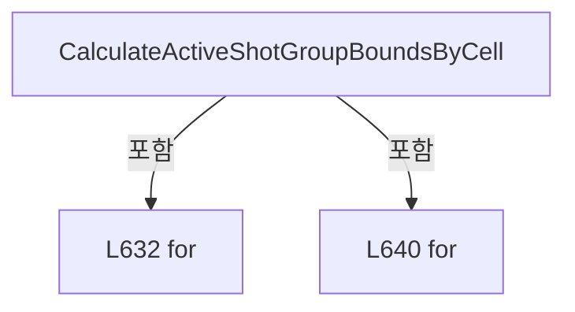

변경 전 점검: 입력/반환 타입, 위 호출자, 예외/취소 경로, 공유 상태와 저장·전송 소비자를 함께 확인합니다. 값의 단위나 물리 방향을 이름만으로 확정하지 않습니다.

### MethodDeclaration `IsShotGroupOverrideWithinActivePattern` · L649–663

[Drilling.File/JHMI/CJhmiRecipeFile.cs:649–663](https://github.com/kjuws10-rgb/A3Drilling/blob/5aee8e58439c9b455cae7c9593c9be986c3e682e/Drilling.File/JHMI/CJhmiRecipeFile.cs#L649-L663)

| 항목 | 실제 추출 값 |
| --- | --- |
| 서명 | bool Drilling.File.JHMI.CJhmiRecipeFile.IsShotGroupOverrideWithinActivePattern(Drilling.Common.Managers.ST_RECIPE_PARAMETER, System.Collections.Generic.IReadOnlyDictionary<int, Drilling.File.JHMI.CJhmiRecipeFile.ST_SHOT_GROUP_PATTERN_BOUNDS>) |
| 접근/수식자 | Private / private, static |
| 반환/값 타입 | bool |
| 소속 타입 | NamedType:Drilling.File.JHMI.CJhmiRecipeFile |

입력 계약:

| 이름 | 타입 | 전달 | 선택/기본값 |
| --- | --- | --- | --- |
| parameter | Drilling.Common.Managers.ST_RECIPE_PARAMETER | None | False /  |
| boundsByCell | System.Collections.Generic.IReadOnlyDictionary<int, Drilling.File.JHMI.CJhmiRecipeFile.ST_SHOT_GROUP_PATTERN_BOUNDS> | None | False /  |

정적 호출자로 확인된 위치:

| 호출 파일/행 | 호출 표현식 | 런타임 분기 가능 |
| --- | --- | --- |
| [Drilling.File/JHMI/CJhmiRecipeFile.cs:153–153](https://github.com/kjuws10-rgb/A3Drilling/blob/5aee8e58439c9b455cae7c9593c9be986c3e682e/Drilling.File/JHMI/CJhmiRecipeFile.cs#L153-L153) | IsShotGroupOverrideWithinActivePattern | False |

호출하는 대상과 해석 범위:

| 원본 행 | 표현식 | 분석 상태 | 대상/소스 위치 |
| --- | --- | --- | --- |
| 651 | boundsByCell.TryGetValue | resolved · 동적 구현 선택 가능 | bool System.Collections.Generic.IReadOnlyDictionary<int, Drilling.File.JHMI.CJhmiRecipeFile.ST_SHOT_GROUP_PATTERN_BOUNDS>.TryGetValue(int, out Drilling.File.JHMI.CJhmiRecipeFile.ST_SHOT_GROUP_PATTERN_BOUNDS) |
| 651 | GetCellNo | resolved | int Drilling.File.JHMI.CJhmiRecipeFile.GetCellNo(string) · Drilling.File/JHMI/CJhmiRecipeFile.cs:694 |
| 661 | NormalizeCellScopedParameterName | resolved | string Drilling.File.JHMI.CJhmiRecipeFile.NormalizeCellScopedParameterName(string) · Drilling.File/JHMI/CJhmiRecipeFile.cs:716 |
| 661 | GetCellParameterName | resolved | string Drilling.File.JHMI.CJhmiRecipeFile.GetCellParameterName(string) · Drilling.File/JHMI/CJhmiRecipeFile.cs:705 |
| 662 | TryGetShotGroupOverrideMetadata | resolved | bool Drilling.File.JHMI.CJhmiRecipeFile.TryGetShotGroupOverrideMetadata(string, out string, out int, out int, out string, out string, out double, out double) · Drilling.File/JHMI/CJhmiRecipeFile.cs:785 |

본문의 실제 연산·분기·예외·반환 순서(원문 위치 순):

| 원본 행 | 종류 | 주석 해설 |
| --- | --- | --- |
| 651 | call | 함수·델리게이트 또는 객체 생성자를 호출합니다: boundsByCell.TryGetValue(GetCellNo(parameter.Key), out var bounds) |
| 651 | call | 함수·델리게이트 또는 객체 생성자를 호출합니다: GetCellNo(parameter.Key) |
| 651 | if | 조건에 따라 분기합니다: if (!boundsByCell.TryGetValue(GetCellNo(parameter.Key), out var bounds)) |
| 653 | return | 호출자에게 값 또는 제어를 반환합니다: return true; |
| 656 | if | 조건에 따라 분기합니다: if (!bounds.IsDefined) |
| 658 | return | 호출자에게 값 또는 제어를 반환합니다: return true; |
| 661 | call | 함수·델리게이트 또는 객체 생성자를 호출합니다: NormalizeCellScopedParameterName(GetCellParameterName(parameter.Key)) |
| 661 | call | 함수·델리게이트 또는 객체 생성자를 호출합니다: GetCellParameterName(parameter.Key) |
| 661 | local-declaration | 지역 변수를 선언합니다: var parameterName = NormalizeCellScopedParameterName(GetCellParameterName(parameter.Key)); |
| 661 | variable-initializer | 변수의 초기값을 지정합니다: parameterName = NormalizeCellScopedParameterName(GetCellParameterName(parameter.Key)) |
| 662 | call | 함수·델리게이트 또는 객체 생성자를 호출합니다: TryGetShotGroupOverrideMetadata(parameterName, out _, out var column, out var row, out _, out _, out _, out _) |
| 662 | return | 호출자에게 값 또는 제어를 반환합니다: return !TryGetShotGroupOverrideMetadata(parameterName, out _, out var column, out var row, out _, out _, out _, out _) &#124;&#124; column <= bounds.GroupCountX && row <= bounds.GroupCountY; |

제어 구문의 포함 구조(실제 실행 순서/CFG가 아닌 구문 탐색 그림):

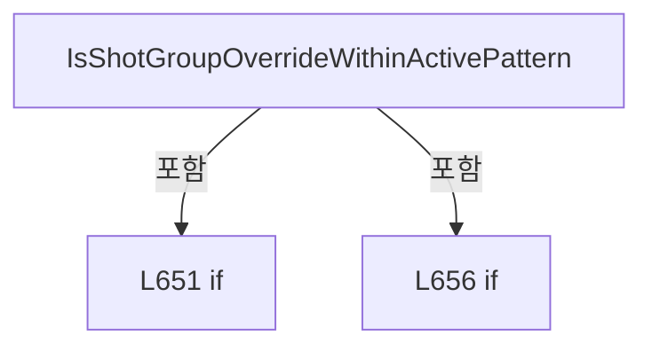

변경 전 점검: 입력/반환 타입, 위 호출자, 예외/취소 경로, 공유 상태와 저장·전송 소비자를 함께 확인합니다. 값의 단위나 물리 방향을 이름만으로 확정하지 않습니다.

### MethodDeclaration `GetActiveCellCount` · L665–672

[Drilling.File/JHMI/CJhmiRecipeFile.cs:665–672](https://github.com/kjuws10-rgb/A3Drilling/blob/5aee8e58439c9b455cae7c9593c9be986c3e682e/Drilling.File/JHMI/CJhmiRecipeFile.cs#L665-L672)

| 항목 | 실제 추출 값 |
| --- | --- |
| 서명 | int Drilling.File.JHMI.CJhmiRecipeFile.GetActiveCellCount(System.Collections.Generic.IReadOnlyDictionary<string, string>, System.Collections.Generic.IReadOnlyList<Drilling.Common.Managers.ST_RECIPE_FORM_ITEM>) |
| 접근/수식자 | Private / private, static |
| 반환/값 타입 | int |
| 소속 타입 | NamedType:Drilling.File.JHMI.CJhmiRecipeFile |

입력 계약:

| 이름 | 타입 | 전달 | 선택/기본값 |
| --- | --- | --- | --- |
| values | System.Collections.Generic.IReadOnlyDictionary<string, string> | None | False /  |
| formItems | System.Collections.Generic.IReadOnlyList<Drilling.Common.Managers.ST_RECIPE_FORM_ITEM> | None | False /  |

정적 호출자로 확인된 위치:

| 호출 파일/행 | 호출 표현식 | 런타임 분기 가능 |
| --- | --- | --- |
| [Drilling.File/JHMI/CJhmiRecipeFile.cs:289–289](https://github.com/kjuws10-rgb/A3Drilling/blob/5aee8e58439c9b455cae7c9593c9be986c3e682e/Drilling.File/JHMI/CJhmiRecipeFile.cs#L289-L289) | GetActiveCellCount | False |

호출하는 대상과 해석 범위:

| 원본 행 | 표현식 | 분석 상태 | 대상/소스 위치 |
| --- | --- | --- | --- |
| 667 | GetValue | resolved | string Drilling.File.JHMI.CJhmiRecipeFile.GetValue(System.Collections.Generic.IReadOnlyDictionary<string, string>, string, string, string) · Drilling.File/JHMI/CJhmiRecipeFile.cs:1045 |
| 668 | formItems.FirstOrDefault | resolved | Drilling.Common.Managers.ST_RECIPE_FORM_ITEM? System.Collections.Generic.IEnumerable<Drilling.Common.Managers.ST_RECIPE_FORM_ITEM>.FirstOrDefault<Drilling.Common.Managers.ST_RECIPE_FORM_ITEM>(System.Func<Drilling.Common.Managers.ST_RECIPE_FORM_ITEM, bool>) |
| 668 | item.Name.Equals | resolved | bool string.Equals(string?, System.StringComparison) |
| 669 | GetActiveCellCountMinimum | resolved | int Drilling.File.JHMI.CJhmiRecipeFile.GetActiveCellCountMinimum(double?, double?) · Drilling.File/JHMI/CJhmiRecipeFile.cs:684 |
| 670 | GetActiveCellCountMaximum | resolved | int? Drilling.File.JHMI.CJhmiRecipeFile.GetActiveCellCountMaximum(double?, int) · Drilling.File/JHMI/CJhmiRecipeFile.cs:689 |
| 671 | ParseActiveCellCount | resolved | int Drilling.File.JHMI.CJhmiRecipeFile.ParseActiveCellCount(string?, int, int?) · Drilling.File/JHMI/CJhmiRecipeFile.cs:674 |

본문의 실제 연산·분기·예외·반환 순서(원문 위치 순):

| 원본 행 | 종류 | 주석 해설 |
| --- | --- | --- |
| 667 | call | 함수·델리게이트 또는 객체 생성자를 호출합니다: GetValue(values, "COMMON", "MAX_CELL_NUMBER", "") |
| 667 | local-declaration | 지역 변수를 선언합니다: var countValue = GetValue(values, "COMMON", "MAX_CELL_NUMBER", ""); |
| 667 | variable-initializer | 변수의 초기값을 지정합니다: countValue = GetValue(values, "COMMON", "MAX_CELL_NUMBER", "") |
| 668 | call | 함수·델리게이트 또는 객체 생성자를 호출합니다: formItems.FirstOrDefault(item => item.Name.Equals("MAX_CELL_NUMBER", StringComparison.OrdinalIgnoreCase)) |
| 668 | call | 함수·델리게이트 또는 객체 생성자를 호출합니다: item.Name.Equals("MAX_CELL_NUMBER", StringComparison.OrdinalIgnoreCase) |
| 668 | local-declaration | 지역 변수를 선언합니다: var countItem = formItems.FirstOrDefault(item => item.Name.Equals("MAX_CELL_NUMBER", StringComparison.OrdinalIgnoreCase)); |
| 668 | variable-initializer | 변수의 초기값을 지정합니다: countItem = formItems.FirstOrDefault(item => item.Name.Equals("MAX_CELL_NUMBER", StringComparison.OrdinalIgnoreCase)) |
| 669 | call | 함수·델리게이트 또는 객체 생성자를 호출합니다: GetActiveCellCountMinimum(countItem?.Min, countItem?.Max) |
| 669 | local-declaration | 지역 변수를 선언합니다: var minimum = GetActiveCellCountMinimum(countItem?.Min, countItem?.Max); |
| 669 | variable-initializer | 변수의 초기값을 지정합니다: minimum = GetActiveCellCountMinimum(countItem?.Min, countItem?.Max) |
| 670 | call | 함수·델리게이트 또는 객체 생성자를 호출합니다: GetActiveCellCountMaximum(countItem?.Max, minimum) |
| 670 | local-declaration | 지역 변수를 선언합니다: var maximum = GetActiveCellCountMaximum(countItem?.Max, minimum); |
| 670 | variable-initializer | 변수의 초기값을 지정합니다: maximum = GetActiveCellCountMaximum(countItem?.Max, minimum) |
| 671 | call | 함수·델리게이트 또는 객체 생성자를 호출합니다: ParseActiveCellCount(countValue, minimum, maximum) |
| 671 | return | 호출자에게 값 또는 제어를 반환합니다: return ParseActiveCellCount(countValue, minimum, maximum); |

변경 전 점검: 입력/반환 타입, 위 호출자, 예외/취소 경로, 공유 상태와 저장·전송 소비자를 함께 확인합니다. 값의 단위나 물리 방향을 이름만으로 확정하지 않습니다.

### MethodDeclaration `ParseActiveCellCount` · L674–682

[Drilling.File/JHMI/CJhmiRecipeFile.cs:674–682](https://github.com/kjuws10-rgb/A3Drilling/blob/5aee8e58439c9b455cae7c9593c9be986c3e682e/Drilling.File/JHMI/CJhmiRecipeFile.cs#L674-L682)

| 항목 | 실제 추출 값 |
| --- | --- |
| 서명 | int Drilling.File.JHMI.CJhmiRecipeFile.ParseActiveCellCount(string?, int, int?) |
| 접근/수식자 | Private / private, static |
| 반환/값 타입 | int |
| 소속 타입 | NamedType:Drilling.File.JHMI.CJhmiRecipeFile |

입력 계약:

| 이름 | 타입 | 전달 | 선택/기본값 |
| --- | --- | --- | --- |
| value | string? | None | False /  |
| minimum | int | None | False /  |
| maximum | int? | None | False /  |

정적 호출자로 확인된 위치:

| 호출 파일/행 | 호출 표현식 | 런타임 분기 가능 |
| --- | --- | --- |
| [Drilling.File/JHMI/CJhmiRecipeFile.cs:612–612](https://github.com/kjuws10-rgb/A3Drilling/blob/5aee8e58439c9b455cae7c9593c9be986c3e682e/Drilling.File/JHMI/CJhmiRecipeFile.cs#L612-L612) | ParseActiveCellCount | False |
| [Drilling.File/JHMI/CJhmiRecipeFile.cs:671–671](https://github.com/kjuws10-rgb/A3Drilling/blob/5aee8e58439c9b455cae7c9593c9be986c3e682e/Drilling.File/JHMI/CJhmiRecipeFile.cs#L671-L671) | ParseActiveCellCount | False |

호출하는 대상과 해석 범위:

| 원본 행 | 표현식 | 분석 상태 | 대상/소스 위치 |
| --- | --- | --- | --- |
| 676 | CCellPatternCalculator.TryParseCellCount | resolved | bool Drilling.Common.Recipe.CCellPatternCalculator.TryParseCellCount(string?, int, int?, out int, out string) · Drilling.Common/Recipe/CCellPatternCalculator.cs:35 |
| 678 | new InvalidDataException | resolved | System.IO.InvalidDataException.InvalidDataException(string?) |

본문의 실제 연산·분기·예외·반환 순서(원문 위치 순):

| 원본 행 | 종류 | 주석 해설 |
| --- | --- | --- |
| 676 | call | 함수·델리게이트 또는 객체 생성자를 호출합니다: CCellPatternCalculator.TryParseCellCount(value, minimum, maximum, out var count, out var validationMessage) |
| 676 | if | 조건에 따라 분기합니다: if (!CCellPatternCalculator.TryParseCellCount(value, minimum, maximum, out var count, out var validationMessage)) |
| 678 | call | 함수·델리게이트 또는 객체 생성자를 호출합니다: new InvalidDataException(validationMessage) |
| 678 | throw | 예외를 발생/전달합니다: throw new InvalidDataException(validationMessage); |
| 681 | return | 호출자에게 값 또는 제어를 반환합니다: return count; |

제어 구문의 포함 구조(실제 실행 순서/CFG가 아닌 구문 탐색 그림):

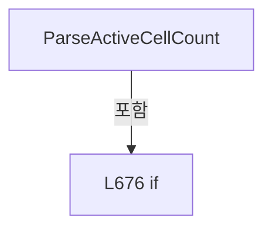

변경 전 점검: 입력/반환 타입, 위 호출자, 예외/취소 경로, 공유 상태와 저장·전송 소비자를 함께 확인합니다. 값의 단위나 물리 방향을 이름만으로 확정하지 않습니다.

### MethodDeclaration `GetActiveCellCountMinimum` · L684–687

[Drilling.File/JHMI/CJhmiRecipeFile.cs:684–687](https://github.com/kjuws10-rgb/A3Drilling/blob/5aee8e58439c9b455cae7c9593c9be986c3e682e/Drilling.File/JHMI/CJhmiRecipeFile.cs#L684-L687)

| 항목 | 실제 추출 값 |
| --- | --- |
| 서명 | int Drilling.File.JHMI.CJhmiRecipeFile.GetActiveCellCountMinimum(double?, double?) |
| 접근/수식자 | Private / private, static |
| 반환/값 타입 | int |
| 소속 타입 | NamedType:Drilling.File.JHMI.CJhmiRecipeFile |

입력 계약:

| 이름 | 타입 | 전달 | 선택/기본값 |
| --- | --- | --- | --- |
| min | double? | None | False /  |
| max | double? | None | False /  |

정적 호출자로 확인된 위치:

| 호출 파일/행 | 호출 표현식 | 런타임 분기 가능 |
| --- | --- | --- |
| [Drilling.File/JHMI/CJhmiRecipeFile.cs:610–610](https://github.com/kjuws10-rgb/A3Drilling/blob/5aee8e58439c9b455cae7c9593c9be986c3e682e/Drilling.File/JHMI/CJhmiRecipeFile.cs#L610-L610) | GetActiveCellCountMinimum | False |
| [Drilling.File/JHMI/CJhmiRecipeFile.cs:669–669](https://github.com/kjuws10-rgb/A3Drilling/blob/5aee8e58439c9b455cae7c9593c9be986c3e682e/Drilling.File/JHMI/CJhmiRecipeFile.cs#L669-L669) | GetActiveCellCountMinimum | False |

호출하는 대상과 해석 범위:

| 원본 행 | 표현식 | 분석 상태 | 대상/소스 위치 |
| --- | --- | --- | --- |
| 686 | Math.Max | resolved | int System.Math.Max(int, int) |
| 686 | Math.Ceiling | resolved | double System.Math.Ceiling(double) |

본문의 실제 연산·분기·예외·반환 순서(원문 위치 순):

| 원본 행 | 종류 | 주석 해설 |
| --- | --- | --- |
| 686 | call | 함수·델리게이트 또는 객체 생성자를 호출합니다: Math.Max(CCellPatternCalculator.MinCellCount, (int)Math.Ceiling(min.Value)) |
| 686 | call | 함수·델리게이트 또는 객체 생성자를 호출합니다: Math.Ceiling(min.Value) |
| 686 | conditional-expression | 조건에 따라 결과식을 선택합니다: min.HasValue && max.HasValue && max.Value > min.Value ? Math.Max(CCellPatternCalculator.MinCellCount, (int)Math.Ceiling(min.Value)) : CCellPatternCalculator.MinCellCount |
| 686 | return | 호출자에게 값 또는 제어를 반환합니다: return min.HasValue && max.HasValue && max.Value > min.Value ? Math.Max(CCellPatternCalculator.MinCellCount, (int)Math.Ceiling(min.Value)) : CCellPatternCalculator.MinCellCount; |

변경 전 점검: 입력/반환 타입, 위 호출자, 예외/취소 경로, 공유 상태와 저장·전송 소비자를 함께 확인합니다. 값의 단위나 물리 방향을 이름만으로 확정하지 않습니다.

### MethodDeclaration `GetActiveCellCountMaximum` · L689–692

[Drilling.File/JHMI/CJhmiRecipeFile.cs:689–692](https://github.com/kjuws10-rgb/A3Drilling/blob/5aee8e58439c9b455cae7c9593c9be986c3e682e/Drilling.File/JHMI/CJhmiRecipeFile.cs#L689-L692)

| 항목 | 실제 추출 값 |
| --- | --- |
| 서명 | int? Drilling.File.JHMI.CJhmiRecipeFile.GetActiveCellCountMaximum(double?, int) |
| 접근/수식자 | Private / private, static |
| 반환/값 타입 | int? |
| 소속 타입 | NamedType:Drilling.File.JHMI.CJhmiRecipeFile |

입력 계약:

| 이름 | 타입 | 전달 | 선택/기본값 |
| --- | --- | --- | --- |
| max | double? | None | False /  |
| minimum | int | None | False /  |

정적 호출자로 확인된 위치:

| 호출 파일/행 | 호출 표현식 | 런타임 분기 가능 |
| --- | --- | --- |
| [Drilling.File/JHMI/CJhmiRecipeFile.cs:611–611](https://github.com/kjuws10-rgb/A3Drilling/blob/5aee8e58439c9b455cae7c9593c9be986c3e682e/Drilling.File/JHMI/CJhmiRecipeFile.cs#L611-L611) | GetActiveCellCountMaximum | False |
| [Drilling.File/JHMI/CJhmiRecipeFile.cs:670–670](https://github.com/kjuws10-rgb/A3Drilling/blob/5aee8e58439c9b455cae7c9593c9be986c3e682e/Drilling.File/JHMI/CJhmiRecipeFile.cs#L670-L670) | GetActiveCellCountMaximum | False |

호출하는 대상과 해석 범위:

| 원본 행 | 표현식 | 분석 상태 | 대상/소스 위치 |
| --- | --- | --- | --- |
| 691 | Math.Floor | resolved | double System.Math.Floor(double) |

본문의 실제 연산·분기·예외·반환 순서(원문 위치 순):

| 원본 행 | 종류 | 주석 해설 |
| --- | --- | --- |
| 691 | call | 함수·델리게이트 또는 객체 생성자를 호출합니다: Math.Floor(max.Value) |
| 691 | conditional-expression | 조건에 따라 결과식을 선택합니다: max.HasValue && max.Value >= minimum ? (int)Math.Floor(max.Value) : null |
| 691 | return | 호출자에게 값 또는 제어를 반환합니다: return max.HasValue && max.Value >= minimum ? (int)Math.Floor(max.Value) : null; |

변경 전 점검: 입력/반환 타입, 위 호출자, 예외/취소 경로, 공유 상태와 저장·전송 소비자를 함께 확인합니다. 값의 단위나 물리 방향을 이름만으로 확정하지 않습니다.

### MethodDeclaration `GetCellNo` · L694–703

[Drilling.File/JHMI/CJhmiRecipeFile.cs:694–703](https://github.com/kjuws10-rgb/A3Drilling/blob/5aee8e58439c9b455cae7c9593c9be986c3e682e/Drilling.File/JHMI/CJhmiRecipeFile.cs#L694-L703)

| 항목 | 실제 추출 값 |
| --- | --- |
| 서명 | int Drilling.File.JHMI.CJhmiRecipeFile.GetCellNo(string) |
| 접근/수식자 | Private / private, static |
| 반환/값 타입 | int |
| 소속 타입 | NamedType:Drilling.File.JHMI.CJhmiRecipeFile |

입력 계약:

| 이름 | 타입 | 전달 | 선택/기본값 |
| --- | --- | --- | --- |
| key | string | None | False /  |

정적 호출자로 확인된 위치:

| 호출 파일/행 | 호출 표현식 | 런타임 분기 가능 |
| --- | --- | --- |
| [Drilling.File/JHMI/CJhmiRecipeFile.cs:153–153](https://github.com/kjuws10-rgb/A3Drilling/blob/5aee8e58439c9b455cae7c9593c9be986c3e682e/Drilling.File/JHMI/CJhmiRecipeFile.cs#L153-L153) | GetCellNo | False |
| [Drilling.File/JHMI/CJhmiRecipeFile.cs:158–158](https://github.com/kjuws10-rgb/A3Drilling/blob/5aee8e58439c9b455cae7c9593c9be986c3e682e/Drilling.File/JHMI/CJhmiRecipeFile.cs#L158-L158) | GetCellNo | False |
| [Drilling.File/JHMI/CJhmiRecipeFile.cs:320–320](https://github.com/kjuws10-rgb/A3Drilling/blob/5aee8e58439c9b455cae7c9593c9be986c3e682e/Drilling.File/JHMI/CJhmiRecipeFile.cs#L320-L320) | GetCellNo | False |
| [Drilling.File/JHMI/CJhmiRecipeFile.cs:325–325](https://github.com/kjuws10-rgb/A3Drilling/blob/5aee8e58439c9b455cae7c9593c9be986c3e682e/Drilling.File/JHMI/CJhmiRecipeFile.cs#L325-L325) | GetCellNo | False |
| [Drilling.File/JHMI/CJhmiRecipeFile.cs:337–337](https://github.com/kjuws10-rgb/A3Drilling/blob/5aee8e58439c9b455cae7c9593c9be986c3e682e/Drilling.File/JHMI/CJhmiRecipeFile.cs#L337-L337) | GetCellNo | False |
| [Drilling.File/JHMI/CJhmiRecipeFile.cs:533–533](https://github.com/kjuws10-rgb/A3Drilling/blob/5aee8e58439c9b455cae7c9593c9be986c3e682e/Drilling.File/JHMI/CJhmiRecipeFile.cs#L533-L533) | GetCellNo | False |
| [Drilling.File/JHMI/CJhmiRecipeFile.cs:547–547](https://github.com/kjuws10-rgb/A3Drilling/blob/5aee8e58439c9b455cae7c9593c9be986c3e682e/Drilling.File/JHMI/CJhmiRecipeFile.cs#L547-L547) | GetCellNo | False |
| [Drilling.File/JHMI/CJhmiRecipeFile.cs:555–555](https://github.com/kjuws10-rgb/A3Drilling/blob/5aee8e58439c9b455cae7c9593c9be986c3e682e/Drilling.File/JHMI/CJhmiRecipeFile.cs#L555-L555) | GetCellNo | False |
| [Drilling.File/JHMI/CJhmiRecipeFile.cs:593–593](https://github.com/kjuws10-rgb/A3Drilling/blob/5aee8e58439c9b455cae7c9593c9be986c3e682e/Drilling.File/JHMI/CJhmiRecipeFile.cs#L593-L593) | GetCellNo | False |
| [Drilling.File/JHMI/CJhmiRecipeFile.cs:651–651](https://github.com/kjuws10-rgb/A3Drilling/blob/5aee8e58439c9b455cae7c9593c9be986c3e682e/Drilling.File/JHMI/CJhmiRecipeFile.cs#L651-L651) | GetCellNo | False |
| [Drilling.File/JHMI/CJhmiRecipeFile.cs:743–743](https://github.com/kjuws10-rgb/A3Drilling/blob/5aee8e58439c9b455cae7c9593c9be986c3e682e/Drilling.File/JHMI/CJhmiRecipeFile.cs#L743-L743) | GetCellNo | False |

호출하는 대상과 해석 범위:

| 원본 행 | 표현식 | 분석 상태 | 대상/소스 위치 |
| --- | --- | --- | --- |
| 696 | key.StartsWith | resolved | bool string.StartsWith(string, System.StringComparison) |
| 701 | GetCellKeySeparatorIndex | resolved | int Drilling.File.JHMI.CJhmiRecipeFile.GetCellKeySeparatorIndex(string) · Drilling.File/JHMI/CJhmiRecipeFile.cs:711 |
| 702 | int.TryParse | resolved | bool int.TryParse(System.ReadOnlySpan<char>, System.Globalization.NumberStyles, System.IFormatProvider?, out int) |
| 702 | key.AsSpan | resolved | System.ReadOnlySpan<char> string?.AsSpan(int, int) |

본문의 실제 연산·분기·예외·반환 순서(원문 위치 순):

| 원본 행 | 종류 | 주석 해설 |
| --- | --- | --- |
| 696 | call | 함수·델리게이트 또는 객체 생성자를 호출합니다: key.StartsWith("CELL", StringComparison.OrdinalIgnoreCase) |
| 696 | if | 조건에 따라 분기합니다: if (!key.StartsWith("CELL", StringComparison.OrdinalIgnoreCase)) |
| 698 | return | 호출자에게 값 또는 제어를 반환합니다: return 0; |
| 701 | call | 함수·델리게이트 또는 객체 생성자를 호출합니다: GetCellKeySeparatorIndex(key) |
| 701 | local-declaration | 지역 변수를 선언합니다: var separatorIndex = GetCellKeySeparatorIndex(key); |
| 701 | variable-initializer | 변수의 초기값을 지정합니다: separatorIndex = GetCellKeySeparatorIndex(key) |
| 702 | call | 함수·델리게이트 또는 객체 생성자를 호출합니다: int.TryParse(key.AsSpan(4, separatorIndex - 4), NumberStyles.None, CultureInfo.InvariantCulture, out var cellNo) |
| 702 | call | 함수·델리게이트 또는 객체 생성자를 호출합니다: key.AsSpan(4, separatorIndex - 4) |
| 702 | conditional-expression | 조건에 따라 결과식을 선택합니다: separatorIndex > 4 && int.TryParse(key.AsSpan(4, separatorIndex - 4), NumberStyles.None, CultureInfo.InvariantCulture, out var cellNo) ? cellNo : 0 |
| 702 | return | 호출자에게 값 또는 제어를 반환합니다: return separatorIndex > 4 && int.TryParse(key.AsSpan(4, separatorIndex - 4), NumberStyles.None, CultureInfo.InvariantCulture, out var cellNo) ? cellNo : 0; |

제어 구문의 포함 구조(실제 실행 순서/CFG가 아닌 구문 탐색 그림):

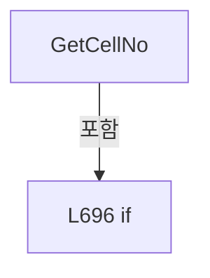

변경 전 점검: 입력/반환 타입, 위 호출자, 예외/취소 경로, 공유 상태와 저장·전송 소비자를 함께 확인합니다. 값의 단위나 물리 방향을 이름만으로 확정하지 않습니다.

### MethodDeclaration `GetCellParameterName` · L705–709

[Drilling.File/JHMI/CJhmiRecipeFile.cs:705–709](https://github.com/kjuws10-rgb/A3Drilling/blob/5aee8e58439c9b455cae7c9593c9be986c3e682e/Drilling.File/JHMI/CJhmiRecipeFile.cs#L705-L709)

| 항목 | 실제 추출 값 |
| --- | --- |
| 서명 | string Drilling.File.JHMI.CJhmiRecipeFile.GetCellParameterName(string) |
| 접근/수식자 | Private / private, static |
| 반환/값 타입 | string |
| 소속 타입 | NamedType:Drilling.File.JHMI.CJhmiRecipeFile |

입력 계약:

| 이름 | 타입 | 전달 | 선택/기본값 |
| --- | --- | --- | --- |
| key | string | None | False /  |

정적 호출자로 확인된 위치:

| 호출 파일/행 | 호출 표현식 | 런타임 분기 가능 |
| --- | --- | --- |
| [Drilling.File/JHMI/CJhmiRecipeFile.cs:336–336](https://github.com/kjuws10-rgb/A3Drilling/blob/5aee8e58439c9b455cae7c9593c9be986c3e682e/Drilling.File/JHMI/CJhmiRecipeFile.cs#L336-L336) | GetCellParameterName | False |
| [Drilling.File/JHMI/CJhmiRecipeFile.cs:544–544](https://github.com/kjuws10-rgb/A3Drilling/blob/5aee8e58439c9b455cae7c9593c9be986c3e682e/Drilling.File/JHMI/CJhmiRecipeFile.cs#L544-L544) | GetCellParameterName | False |
| [Drilling.File/JHMI/CJhmiRecipeFile.cs:593–593](https://github.com/kjuws10-rgb/A3Drilling/blob/5aee8e58439c9b455cae7c9593c9be986c3e682e/Drilling.File/JHMI/CJhmiRecipeFile.cs#L593-L593) | GetCellParameterName | False |
| [Drilling.File/JHMI/CJhmiRecipeFile.cs:661–661](https://github.com/kjuws10-rgb/A3Drilling/blob/5aee8e58439c9b455cae7c9593c9be986c3e682e/Drilling.File/JHMI/CJhmiRecipeFile.cs#L661-L661) | GetCellParameterName | False |
| [Drilling.File/JHMI/CJhmiRecipeFile.cs:744–744](https://github.com/kjuws10-rgb/A3Drilling/blob/5aee8e58439c9b455cae7c9593c9be986c3e682e/Drilling.File/JHMI/CJhmiRecipeFile.cs#L744-L744) | GetCellParameterName | False |

호출하는 대상과 해석 범위:

| 원본 행 | 표현식 | 분석 상태 | 대상/소스 위치 |
| --- | --- | --- | --- |
| 707 | GetCellKeySeparatorIndex | resolved | int Drilling.File.JHMI.CJhmiRecipeFile.GetCellKeySeparatorIndex(string) · Drilling.File/JHMI/CJhmiRecipeFile.cs:711 |

본문의 실제 연산·분기·예외·반환 순서(원문 위치 순):

| 원본 행 | 종류 | 주석 해설 |
| --- | --- | --- |
| 707 | call | 함수·델리게이트 또는 객체 생성자를 호출합니다: GetCellKeySeparatorIndex(key) |
| 707 | local-declaration | 지역 변수를 선언합니다: var separatorIndex = GetCellKeySeparatorIndex(key); |
| 707 | variable-initializer | 변수의 초기값을 지정합니다: separatorIndex = GetCellKeySeparatorIndex(key) |
| 708 | conditional-expression | 조건에 따라 결과식을 선택합니다: separatorIndex >= 0 && separatorIndex < key.Length - 1 ? key[(separatorIndex + 1)..] : "" |
| 708 | return | 호출자에게 값 또는 제어를 반환합니다: return separatorIndex >= 0 && separatorIndex < key.Length - 1 ? key[(separatorIndex + 1)..] : ""; |

변경 전 점검: 입력/반환 타입, 위 호출자, 예외/취소 경로, 공유 상태와 저장·전송 소비자를 함께 확인합니다. 값의 단위나 물리 방향을 이름만으로 확정하지 않습니다.

### MethodDeclaration `GetCellKeySeparatorIndex` · L711–714

[Drilling.File/JHMI/CJhmiRecipeFile.cs:711–714](https://github.com/kjuws10-rgb/A3Drilling/blob/5aee8e58439c9b455cae7c9593c9be986c3e682e/Drilling.File/JHMI/CJhmiRecipeFile.cs#L711-L714)

| 항목 | 실제 추출 값 |
| --- | --- |
| 서명 | int Drilling.File.JHMI.CJhmiRecipeFile.GetCellKeySeparatorIndex(string) |
| 접근/수식자 | Private / private, static |
| 반환/값 타입 | int |
| 소속 타입 | NamedType:Drilling.File.JHMI.CJhmiRecipeFile |

입력 계약:

| 이름 | 타입 | 전달 | 선택/기본값 |
| --- | --- | --- | --- |
| key | string | None | False /  |

정적 호출자로 확인된 위치:

| 호출 파일/행 | 호출 표현식 | 런타임 분기 가능 |
| --- | --- | --- |
| [Drilling.File/JHMI/CJhmiRecipeFile.cs:701–701](https://github.com/kjuws10-rgb/A3Drilling/blob/5aee8e58439c9b455cae7c9593c9be986c3e682e/Drilling.File/JHMI/CJhmiRecipeFile.cs#L701-L701) | GetCellKeySeparatorIndex | False |
| [Drilling.File/JHMI/CJhmiRecipeFile.cs:707–707](https://github.com/kjuws10-rgb/A3Drilling/blob/5aee8e58439c9b455cae7c9593c9be986c3e682e/Drilling.File/JHMI/CJhmiRecipeFile.cs#L707-L707) | GetCellKeySeparatorIndex | False |

호출하는 대상과 해석 범위:

| 원본 행 | 표현식 | 분석 상태 | 대상/소스 위치 |
| --- | --- | --- | --- |
| 713 | key.IndexOf | resolved | int string.IndexOf(char, int) |

본문의 실제 연산·분기·예외·반환 순서(원문 위치 순):

| 원본 행 | 종류 | 주석 해설 |
| --- | --- | --- |
| 713 | call | 함수·델리게이트 또는 객체 생성자를 호출합니다: key.IndexOf('_', 4) |
| 713 | return | 호출자에게 값 또는 제어를 반환합니다: return key.IndexOf('_', 4); |

변경 전 점검: 입력/반환 타입, 위 호출자, 예외/취소 경로, 공유 상태와 저장·전송 소비자를 함께 확인합니다. 값의 단위나 물리 방향을 이름만으로 확정하지 않습니다.

### MethodDeclaration `NormalizeCellScopedParameterName` · L716–719

[Drilling.File/JHMI/CJhmiRecipeFile.cs:716–719](https://github.com/kjuws10-rgb/A3Drilling/blob/5aee8e58439c9b455cae7c9593c9be986c3e682e/Drilling.File/JHMI/CJhmiRecipeFile.cs#L716-L719)

| 항목 | 실제 추출 값 |
| --- | --- |
| 서명 | string Drilling.File.JHMI.CJhmiRecipeFile.NormalizeCellScopedParameterName(string) |
| 접근/수식자 | Private / private, static |
| 반환/값 타입 | string |
| 소속 타입 | NamedType:Drilling.File.JHMI.CJhmiRecipeFile |

입력 계약:

| 이름 | 타입 | 전달 | 선택/기본값 |
| --- | --- | --- | --- |
| parameterName | string | None | False /  |

정적 호출자로 확인된 위치:

| 호출 파일/행 | 호출 표현식 | 런타임 분기 가능 |
| --- | --- | --- |
| [Drilling.File/JHMI/CJhmiRecipeFile.cs:336–336](https://github.com/kjuws10-rgb/A3Drilling/blob/5aee8e58439c9b455cae7c9593c9be986c3e682e/Drilling.File/JHMI/CJhmiRecipeFile.cs#L336-L336) | NormalizeCellScopedParameterName | False |
| [Drilling.File/JHMI/CJhmiRecipeFile.cs:544–544](https://github.com/kjuws10-rgb/A3Drilling/blob/5aee8e58439c9b455cae7c9593c9be986c3e682e/Drilling.File/JHMI/CJhmiRecipeFile.cs#L544-L544) | NormalizeCellScopedParameterName | False |
| [Drilling.File/JHMI/CJhmiRecipeFile.cs:661–661](https://github.com/kjuws10-rgb/A3Drilling/blob/5aee8e58439c9b455cae7c9593c9be986c3e682e/Drilling.File/JHMI/CJhmiRecipeFile.cs#L661-L661) | NormalizeCellScopedParameterName | False |
| [Drilling.File/JHMI/CJhmiRecipeFile.cs:744–744](https://github.com/kjuws10-rgb/A3Drilling/blob/5aee8e58439c9b455cae7c9593c9be986c3e682e/Drilling.File/JHMI/CJhmiRecipeFile.cs#L744-L744) | NormalizeCellScopedParameterName | False |

호출하는 대상과 해석 범위:

| 원본 행 | 표현식 | 분석 상태 | 대상/소스 위치 |
| --- | --- | --- | --- |
| 718 | parameterName.StartsWith | resolved | bool string.StartsWith(string, System.StringComparison) |

본문의 실제 연산·분기·예외·반환 순서(원문 위치 순):

| 원본 행 | 종류 | 주석 해설 |
| --- | --- | --- |
| 718 | call | 함수·델리게이트 또는 객체 생성자를 호출합니다: parameterName.StartsWith("CELL_", StringComparison.OrdinalIgnoreCase) |
| 718 | conditional-expression | 조건에 따라 결과식을 선택합니다: parameterName.StartsWith("CELL_", StringComparison.OrdinalIgnoreCase) ? parameterName[5..] : parameterName |
| 718 | return | 호출자에게 값 또는 제어를 반환합니다: return parameterName.StartsWith("CELL_", StringComparison.OrdinalIgnoreCase) ? parameterName[5..] : parameterName; |

변경 전 점검: 입력/반환 타입, 위 호출자, 예외/취소 경로, 공유 상태와 저장·전송 소비자를 함께 확인합니다. 값의 단위나 물리 방향을 이름만으로 확정하지 않습니다.

### MethodDeclaration `IsCellPlacementParameterName` · L721–724

[Drilling.File/JHMI/CJhmiRecipeFile.cs:721–724](https://github.com/kjuws10-rgb/A3Drilling/blob/5aee8e58439c9b455cae7c9593c9be986c3e682e/Drilling.File/JHMI/CJhmiRecipeFile.cs#L721-L724)

| 항목 | 실제 추출 값 |
| --- | --- |
| 서명 | bool Drilling.File.JHMI.CJhmiRecipeFile.IsCellPlacementParameterName(string) |
| 접근/수식자 | Private / private, static |
| 반환/값 타입 | bool |
| 소속 타입 | NamedType:Drilling.File.JHMI.CJhmiRecipeFile |

입력 계약:

| 이름 | 타입 | 전달 | 선택/기본값 |
| --- | --- | --- | --- |
| parameterName | string | None | False /  |

정적 호출자로 확인된 위치:

| 호출 파일/행 | 호출 표현식 | 런타임 분기 가능 |
| --- | --- | --- |
| [Drilling.File/JHMI/CJhmiRecipeFile.cs:546–546](https://github.com/kjuws10-rgb/A3Drilling/blob/5aee8e58439c9b455cae7c9593c9be986c3e682e/Drilling.File/JHMI/CJhmiRecipeFile.cs#L546-L546) | IsCellPlacementParameterName | False |

호출하는 대상과 해석 범위:

| 원본 행 | 표현식 | 분석 상태 | 대상/소스 위치 |
| --- | --- | --- | --- |
| 723 | parameterName.Equals | resolved | bool string.Equals(string?, System.StringComparison) |
| 723 | parameterName.Equals | resolved | bool string.Equals(string?, System.StringComparison) |
| 723 | parameterName.Equals | resolved | bool string.Equals(string?, System.StringComparison) |
| 723 | parameterName.Equals | resolved | bool string.Equals(string?, System.StringComparison) |

본문의 실제 연산·분기·예외·반환 순서(원문 위치 순):

| 원본 행 | 종류 | 주석 해설 |
| --- | --- | --- |
| 723 | call | 함수·델리게이트 또는 객체 생성자를 호출합니다: parameterName.Equals("ALIGN_TO_1ST_PIXEL_X", StringComparison.OrdinalIgnoreCase) |
| 723 | call | 함수·델리게이트 또는 객체 생성자를 호출합니다: parameterName.Equals("ALIGN_TO_1ST_PIXEL_Y", StringComparison.OrdinalIgnoreCase) |
| 723 | call | 함수·델리게이트 또는 객체 생성자를 호출합니다: parameterName.Equals("ROTATION", StringComparison.OrdinalIgnoreCase) |
| 723 | call | 함수·델리게이트 또는 객체 생성자를 호출합니다: parameterName.Equals("MODEL_TYPE", StringComparison.OrdinalIgnoreCase) |
| 723 | return | 호출자에게 값 또는 제어를 반환합니다: return parameterName.Equals("ALIGN_TO_1ST_PIXEL_X", StringComparison.OrdinalIgnoreCase) &#124;&#124; parameterName.Equals("ALIGN_TO_1ST_PIXEL_Y", StringComparison.OrdinalIgnoreCase) &#124;&#124; parameterName.Equals("ROTATION", StringComparison.Ordin |

변경 전 점검: 입력/반환 타입, 위 호출자, 예외/취소 경로, 공유 상태와 저장·전송 소비자를 함께 확인합니다. 값의 단위나 물리 방향을 이름만으로 확정하지 않습니다.

### MethodDeclaration `ToPersistedCellScopedKey` · L726–729

[Drilling.File/JHMI/CJhmiRecipeFile.cs:726–729](https://github.com/kjuws10-rgb/A3Drilling/blob/5aee8e58439c9b455cae7c9593c9be986c3e682e/Drilling.File/JHMI/CJhmiRecipeFile.cs#L726-L729)

| 항목 | 실제 추출 값 |
| --- | --- |
| 서명 | string Drilling.File.JHMI.CJhmiRecipeFile.ToPersistedCellScopedKey(string) |
| 접근/수식자 | Private / private, static |
| 반환/값 타입 | string |
| 소속 타입 | NamedType:Drilling.File.JHMI.CJhmiRecipeFile |

입력 계약:

| 이름 | 타입 | 전달 | 선택/기본값 |
| --- | --- | --- | --- |
| key | string | None | False /  |

정적 호출자로 확인된 위치:

| 호출 파일/행 | 호출 표현식 | 런타임 분기 가능 |
| --- | --- | --- |
| [Drilling.File/JHMI/CJhmiRecipeFile.cs:212–212](https://github.com/kjuws10-rgb/A3Drilling/blob/5aee8e58439c9b455cae7c9593c9be986c3e682e/Drilling.File/JHMI/CJhmiRecipeFile.cs#L212-L212) | ToPersistedCellScopedKey | False |
| [Drilling.File/JHMI/CJhmiRecipeFile.cs:338–338](https://github.com/kjuws10-rgb/A3Drilling/blob/5aee8e58439c9b455cae7c9593c9be986c3e682e/Drilling.File/JHMI/CJhmiRecipeFile.cs#L338-L338) | ToPersistedCellScopedKey | False |

본문의 실제 연산·분기·예외·반환 순서(원문 위치 순):

| 원본 행 | 종류 | 주석 해설 |
| --- | --- | --- |
| 728 | return | 호출자에게 값 또는 제어를 반환합니다: return key; |

변경 전 점검: 입력/반환 타입, 위 호출자, 예외/취소 경로, 공유 상태와 저장·전송 소비자를 함께 확인합니다. 값의 단위나 물리 방향을 이름만으로 확정하지 않습니다.

### MethodDeclaration `GetCellScopedGroup` · L731–739

[Drilling.File/JHMI/CJhmiRecipeFile.cs:731–739](https://github.com/kjuws10-rgb/A3Drilling/blob/5aee8e58439c9b455cae7c9593c9be986c3e682e/Drilling.File/JHMI/CJhmiRecipeFile.cs#L731-L739)

| 항목 | 실제 추출 값 |
| --- | --- |
| 서명 | string Drilling.File.JHMI.CJhmiRecipeFile.GetCellScopedGroup(string) |
| 접근/수식자 | Private / private, static |
| 반환/값 타입 | string |
| 소속 타입 | NamedType:Drilling.File.JHMI.CJhmiRecipeFile |

입력 계약:

| 이름 | 타입 | 전달 | 선택/기본값 |
| --- | --- | --- | --- |
| parameterName | string | None | False /  |

정적 호출자로 확인된 위치:

| 호출 파일/행 | 호출 표현식 | 런타임 분기 가능 |
| --- | --- | --- |
| [Drilling.File/JHMI/CJhmiRecipeFile.cs:572–572](https://github.com/kjuws10-rgb/A3Drilling/blob/5aee8e58439c9b455cae7c9593c9be986c3e682e/Drilling.File/JHMI/CJhmiRecipeFile.cs#L572-L572) | GetCellScopedGroup | False |

호출하는 대상과 해석 범위:

| 원본 행 | 표현식 | 분석 상태 | 대상/소스 위치 |
| --- | --- | --- | --- |
| 733 | TryGetShotGroupOverrideMetadata | resolved | bool Drilling.File.JHMI.CJhmiRecipeFile.TryGetShotGroupOverrideMetadata(string, out string, out int, out int, out string, out string, out double, out double) · Drilling.File/JHMI/CJhmiRecipeFile.cs:785 |

본문의 실제 연산·분기·예외·반환 순서(원문 위치 순):

| 원본 행 | 종류 | 주석 해설 |
| --- | --- | --- |
| 733 | call | 함수·델리게이트 또는 객체 생성자를 호출합니다: TryGetShotGroupOverrideMetadata(parameterName, out _, out _, out _, out _, out _, out _, out _) |
| 733 | if | 조건에 따라 분기합니다: if (TryGetShotGroupOverrideMetadata(parameterName, out _, out _, out _, out _, out _, out _, out _)) |
| 735 | return | 호출자에게 값 또는 제어를 반환합니다: return "SHOT_GROUP"; |
| 738 | return | 호출자에게 값 또는 제어를 반환합니다: return "CELL"; |

제어 구문의 포함 구조(실제 실행 순서/CFG가 아닌 구문 탐색 그림):

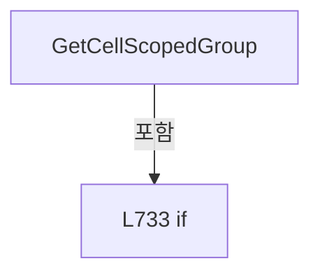

변경 전 점검: 입력/반환 타입, 위 호출자, 예외/취소 경로, 공유 상태와 저장·전송 소비자를 함께 확인합니다. 값의 단위나 물리 방향을 이름만으로 확정하지 않습니다.

### MethodDeclaration `GetCellHistoryItemName` · L741–751

[Drilling.File/JHMI/CJhmiRecipeFile.cs:741–751](https://github.com/kjuws10-rgb/A3Drilling/blob/5aee8e58439c9b455cae7c9593c9be986c3e682e/Drilling.File/JHMI/CJhmiRecipeFile.cs#L741-L751)

| 항목 | 실제 추출 값 |
| --- | --- |
| 서명 | string Drilling.File.JHMI.CJhmiRecipeFile.GetCellHistoryItemName(Drilling.Common.Managers.ST_RECIPE_PARAMETER, System.Collections.Generic.IReadOnlyList<Drilling.Common.Managers.ST_RECIPE_PARAMETER>) |
| 접근/수식자 | Private / private, static |
| 반환/값 타입 | string |
| 소속 타입 | NamedType:Drilling.File.JHMI.CJhmiRecipeFile |

입력 계약:

| 이름 | 타입 | 전달 | 선택/기본값 |
| --- | --- | --- | --- |
| parameter | Drilling.Common.Managers.ST_RECIPE_PARAMETER | None | False /  |
| parameters | System.Collections.Generic.IReadOnlyList<Drilling.Common.Managers.ST_RECIPE_PARAMETER> | None | False /  |

정적 호출자로 확인된 위치:

| 호출 파일/행 | 호출 표현식 | 런타임 분기 가능 |
| --- | --- | --- |
| [Drilling.File/JHMI/CJhmiRecipeFile.cs:218–218](https://github.com/kjuws10-rgb/A3Drilling/blob/5aee8e58439c9b455cae7c9593c9be986c3e682e/Drilling.File/JHMI/CJhmiRecipeFile.cs#L218-L218) | GetCellHistoryItemName | False |

호출하는 대상과 해석 범위:

| 원본 행 | 표현식 | 분석 상태 | 대상/소스 위치 |
| --- | --- | --- | --- |
| 743 | GetCellNo | resolved | int Drilling.File.JHMI.CJhmiRecipeFile.GetCellNo(string) · Drilling.File/JHMI/CJhmiRecipeFile.cs:694 |
| 744 | NormalizeCellScopedParameterName | resolved | string Drilling.File.JHMI.CJhmiRecipeFile.NormalizeCellScopedParameterName(string) · Drilling.File/JHMI/CJhmiRecipeFile.cs:716 |
| 744 | GetCellParameterName | resolved | string Drilling.File.JHMI.CJhmiRecipeFile.GetCellParameterName(string) · Drilling.File/JHMI/CJhmiRecipeFile.cs:705 |
| 745 | TryGetShotGroupOverrideMetadata | resolved | bool Drilling.File.JHMI.CJhmiRecipeFile.TryGetShotGroupOverrideMetadata(string, out string, out int, out int, out string, out string, out double, out double) · Drilling.File/JHMI/CJhmiRecipeFile.cs:785 |

본문의 실제 연산·분기·예외·반환 순서(원문 위치 순):

| 원본 행 | 종류 | 주석 해설 |
| --- | --- | --- |
| 743 | call | 함수·델리게이트 또는 객체 생성자를 호출합니다: GetCellNo(parameter.Key) |
| 743 | local-declaration | 지역 변수를 선언합니다: var cellNo = GetCellNo(parameter.Key); |
| 743 | variable-initializer | 변수의 초기값을 지정합니다: cellNo = GetCellNo(parameter.Key) |
| 744 | call | 함수·델리게이트 또는 객체 생성자를 호출합니다: NormalizeCellScopedParameterName(GetCellParameterName(parameter.Key)) |
| 744 | call | 함수·델리게이트 또는 객체 생성자를 호출합니다: GetCellParameterName(parameter.Key) |
| 744 | local-declaration | 지역 변수를 선언합니다: var parameterName = NormalizeCellScopedParameterName(GetCellParameterName(parameter.Key)); |
| 744 | variable-initializer | 변수의 초기값을 지정합니다: parameterName = NormalizeCellScopedParameterName(GetCellParameterName(parameter.Key)) |
| 745 | call | 함수·델리게이트 또는 객체 생성자를 호출합니다: TryGetShotGroupOverrideMetadata(parameterName, out var shotGroupName, out _, out _, out var namedDisplayName, out _, out _, out _) |
| 745 | if | 조건에 따라 분기합니다: if (TryGetShotGroupOverrideMetadata(parameterName, out var shotGroupName, out _, out _, out var namedDisplayName, out _, out _, out _)) |
| 747 | return | 호출자에게 값 또는 제어를 반환합니다: return $"Cell{cellNo} Shot Group {shotGroupName} {namedDisplayName}"; |
| 750 | return | 호출자에게 값 또는 제어를 반환합니다: return $"Cell{cellNo} {parameter.Name}"; |

제어 구문의 포함 구조(실제 실행 순서/CFG가 아닌 구문 탐색 그림):

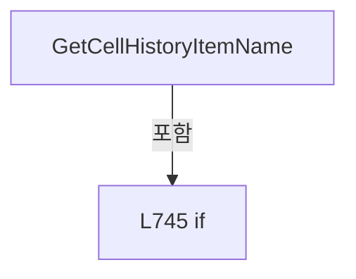

변경 전 점검: 입력/반환 타입, 위 호출자, 예외/취소 경로, 공유 상태와 저장·전송 소비자를 함께 확인합니다. 값의 단위나 물리 방향을 이름만으로 확정하지 않습니다.

### MethodDeclaration `CreateShotGroupOverrideParameter` · L753–783

[Drilling.File/JHMI/CJhmiRecipeFile.cs:753–783](https://github.com/kjuws10-rgb/A3Drilling/blob/5aee8e58439c9b455cae7c9593c9be986c3e682e/Drilling.File/JHMI/CJhmiRecipeFile.cs#L753-L783)

| 항목 | 실제 추출 값 |
| --- | --- |
| 서명 | Drilling.Common.Managers.ST_RECIPE_PARAMETER? Drilling.File.JHMI.CJhmiRecipeFile.CreateShotGroupOverrideParameter(int, string, string, string) |
| 접근/수식자 | Private / private, static |
| 반환/값 타입 | Drilling.Common.Managers.ST_RECIPE_PARAMETER? |
| 소속 타입 | NamedType:Drilling.File.JHMI.CJhmiRecipeFile |

입력 계약:

| 이름 | 타입 | 전달 | 선택/기본값 |
| --- | --- | --- | --- |
| cellNo | int | None | False /  |
| parameterName | string | None | False /  |
| scopedKey | string | None | False /  |
| value | string | None | False /  |

정적 호출자로 확인된 위치:

| 호출 파일/행 | 호출 표현식 | 런타임 분기 가능 |
| --- | --- | --- |
| [Drilling.File/JHMI/CJhmiRecipeFile.cs:555–555](https://github.com/kjuws10-rgb/A3Drilling/blob/5aee8e58439c9b455cae7c9593c9be986c3e682e/Drilling.File/JHMI/CJhmiRecipeFile.cs#L555-L555) | CreateShotGroupOverrideParameter | False |

호출하는 대상과 해석 범위:

| 원본 행 | 표현식 | 분석 상태 | 대상/소스 위치 |
| --- | --- | --- | --- |
| 760 | TryGetShotGroupOverrideMetadata | resolved | bool Drilling.File.JHMI.CJhmiRecipeFile.TryGetShotGroupOverrideMetadata(string, out string, out int, out int, out string, out string, out double, out double) · Drilling.File/JHMI/CJhmiRecipeFile.cs:785 |
| 762 | new ST_RECIPE_PARAMETER | resolved | Drilling.Common.Managers.ST_RECIPE_PARAMETER.ST_RECIPE_PARAMETER(string, string, string, string, string, string, string, string, string, bool, bool, int, Drilling.Common.Managers.EN_RECIPE_DATA_TYPE, double, double, double, System.Collections.Generic.IReadOnlyDictionary<string, string>?) · Drilling.Common/Managers/CRecipeManager.cs:355 |
| 766 | namedMin.ToString | resolved | string double.ToString(string?, System.IFormatProvider?) |
| 766 | namedMax.ToString | resolved | string double.ToString(string?, System.IFormatProvider?) |
| 772 | CAlignShotOffsetData.IsParameterKey | resolved | bool Drilling.Common.Recipe.CAlignShotOffsetData.IsParameterKey(string) · Drilling.Common/Recipe/CShotCoordinatePlanBuilder.cs:657 |

본문의 실제 연산·분기·예외·반환 순서(원문 위치 순):

| 원본 행 | 종류 | 주석 해설 |
| --- | --- | --- |
| 755 | if | 조건에 따라 분기합니다: if (cellNo <= 0) |
| 757 | return | 호출자에게 값 또는 제어를 반환합니다: return null; |
| 760 | call | 함수·델리게이트 또는 객체 생성자를 호출합니다: TryGetShotGroupOverrideMetadata(parameterName, out var shotGroupName, out _, out _, out var namedDisplayName, out var namedUnit, out var namedMin, out var namedMax) |
| 760 | if | 조건에 따라 분기합니다: if (TryGetShotGroupOverrideMetadata(parameterName, out var shotGroupName, out _, out _, out var namedDisplayName, out var namedUnit, out var namedMin, out var namedMax)) |
| 762 | call | 함수·델리게이트 또는 객체 생성자를 호출합니다: new ST_RECIPE_PARAMETER( $"Shot Group {shotGroupName} {namedDisplayName}", value, namedUnit, $"{namedMin.ToString("0.###", CultureInfo.InvariantCulture)} - {namedMax.ToString("0.###", CultureInfo.InvariantCulture)}", "0"… |
| 762 | return | 호출자에게 값 또는 제어를 반환합니다: return new ST_RECIPE_PARAMETER( $"Shot Group {shotGroupName} {namedDisplayName}", value, namedUnit, $"{namedMin.ToString("0.###", CultureInfo.InvariantCulture)} - {namedMax.ToString("0.###", CultureInfo.InvariantCulture)}", "0", " |
| 766 | call | 함수·델리게이트 또는 객체 생성자를 호출합니다: namedMin.ToString("0.###", CultureInfo.InvariantCulture) |
| 766 | call | 함수·델리게이트 또는 객체 생성자를 호출합니다: namedMax.ToString("0.###", CultureInfo.InvariantCulture) |
| 772 | call | 함수·델리게이트 또는 객체 생성자를 호출합니다: CAlignShotOffsetData.IsParameterKey(scopedKey) |
| 782 | return | 호출자에게 값 또는 제어를 반환합니다: return null; |

제어 구문의 포함 구조(실제 실행 순서/CFG가 아닌 구문 탐색 그림):

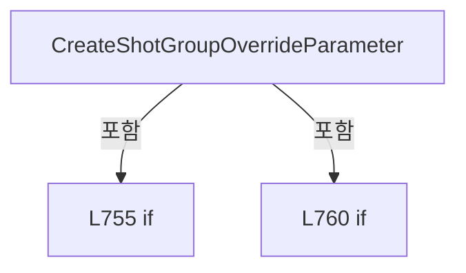

변경 전 점검: 입력/반환 타입, 위 호출자, 예외/취소 경로, 공유 상태와 저장·전송 소비자를 함께 확인합니다. 값의 단위나 물리 방향을 이름만으로 확정하지 않습니다.

### MethodDeclaration `TryGetShotGroupOverrideMetadata` · L785–844

[Drilling.File/JHMI/CJhmiRecipeFile.cs:785–844](https://github.com/kjuws10-rgb/A3Drilling/blob/5aee8e58439c9b455cae7c9593c9be986c3e682e/Drilling.File/JHMI/CJhmiRecipeFile.cs#L785-L844)

| 항목 | 실제 추출 값 |
| --- | --- |
| 서명 | bool Drilling.File.JHMI.CJhmiRecipeFile.TryGetShotGroupOverrideMetadata(string, out string, out int, out int, out string, out string, out double, out double) |
| 접근/수식자 | Private / private, static |
| 반환/값 타입 | bool |
| 소속 타입 | NamedType:Drilling.File.JHMI.CJhmiRecipeFile |

입력 계약:

| 이름 | 타입 | 전달 | 선택/기본값 |
| --- | --- | --- | --- |
| parameterName | string | None | False /  |
| shotGroupName | string | Out | False /  |
| column | int | Out | False /  |
| row | int | Out | False /  |
| displayName | string | Out | False /  |
| unit | string | Out | False /  |
| min | double | Out | False /  |
| max | double | Out | False /  |

정적 호출자로 확인된 위치:

| 호출 파일/행 | 호출 표현식 | 런타임 분기 가능 |
| --- | --- | --- |
| [Drilling.File/JHMI/CJhmiRecipeFile.cs:662–662](https://github.com/kjuws10-rgb/A3Drilling/blob/5aee8e58439c9b455cae7c9593c9be986c3e682e/Drilling.File/JHMI/CJhmiRecipeFile.cs#L662-L662) | TryGetShotGroupOverrideMetadata | False |
| [Drilling.File/JHMI/CJhmiRecipeFile.cs:733–733](https://github.com/kjuws10-rgb/A3Drilling/blob/5aee8e58439c9b455cae7c9593c9be986c3e682e/Drilling.File/JHMI/CJhmiRecipeFile.cs#L733-L733) | TryGetShotGroupOverrideMetadata | False |
| [Drilling.File/JHMI/CJhmiRecipeFile.cs:745–745](https://github.com/kjuws10-rgb/A3Drilling/blob/5aee8e58439c9b455cae7c9593c9be986c3e682e/Drilling.File/JHMI/CJhmiRecipeFile.cs#L745-L745) | TryGetShotGroupOverrideMetadata | False |
| [Drilling.File/JHMI/CJhmiRecipeFile.cs:760–760](https://github.com/kjuws10-rgb/A3Drilling/blob/5aee8e58439c9b455cae7c9593c9be986c3e682e/Drilling.File/JHMI/CJhmiRecipeFile.cs#L760-L760) | TryGetShotGroupOverrideMetadata | False |

호출하는 대상과 해석 범위:

| 원본 행 | 표현식 | 분석 상태 | 대상/소스 위치 |
| --- | --- | --- | --- |
| 794 | parameterName.Trim().ToUpperInvariant | resolved | string string.ToUpperInvariant() |
| 794 | parameterName.Trim | resolved | string string.Trim() |
| 807 | fields.FirstOrDefault | resolved | (string Suffix, string DisplayName) System.Collections.Generic.IEnumerable<(string Suffix, string DisplayName)>.FirstOrDefault<(string Suffix, string DisplayName)>(System.Func<(string Suffix, string DisplayName), bool>) |
| 808 | string.IsNullOrWhiteSpace | resolved | bool string.IsNullOrWhiteSpace(string?) |
| 820 | int.TryParse | resolved | bool int.TryParse(System.ReadOnlySpan<char>, System.Globalization.NumberStyles, System.IFormatProvider?, out int) |
| 820 | matrixName.AsSpan | resolved | System.ReadOnlySpan<char> string?.AsSpan(int) |
| 827 | matrixName.AsSpan | resolved | System.ReadOnlySpan<char> string?.AsSpan(int, int) |

본문의 실제 연산·분기·예외·반환 순서(원문 위치 순):

| 원본 행 | 종류 | 주석 해설 |
| --- | --- | --- |
| 787 | assignment | 값을 대상에 대입합니다: shotGroupName = "" |
| 788 | assignment | 값을 대상에 대입합니다: column = 0 |
| 789 | assignment | 값을 대상에 대입합니다: row = 0 |
| 790 | assignment | 값을 대상에 대입합니다: displayName = "" |
| 791 | assignment | 값을 대상에 대입합니다: unit = "" |
| 792 | assignment | 값을 대상에 대입합니다: min = 0.0 |
| 793 | assignment | 값을 대상에 대입합니다: max = 0.0 |
| 794 | call | 함수·델리게이트 또는 객체 생성자를 호출합니다: parameterName.Trim().ToUpperInvariant() |
| 794 | call | 함수·델리게이트 또는 객체 생성자를 호출합니다: parameterName.Trim() |
| 794 | local-declaration | 지역 변수를 선언합니다: var normalized = parameterName.Trim().ToUpperInvariant(); |
| 794 | variable-initializer | 변수의 초기값을 지정합니다: normalized = parameterName.Trim().ToUpperInvariant() |
| 795 | local-declaration | 지역 변수를 선언합니다: var fields = new[] { (Suffix: "_RECIPE_OFFSET_X", DisplayName: "Recipe Offset X"), (Suffix: "_RECIPE_OFFSET_Y", DisplayName: "Recipe Offset Y"), (Suffix: "_ALIGN_OFFSET_X", DisplayName: "Align Offset X"), (Suffix: "_ALIGN_OFFSET_Y |
| 795 | variable-initializer | 변수의 초기값을 지정합니다: fields = new[] { (Suffix: "_RECIPE_OFFSET_X", DisplayName: "Recipe Offset X"), (Suffix: "_RECIPE_OFFSET_Y", DisplayName: "Recipe Offset Y"), (Suffix: "_ALIGN_OFFSET_X", DisplayName: "Align Offset X"), (Suffix: "_ALIGN_OFFSET_Y", D |
| 807 | call | 함수·델리게이트 또는 객체 생성자를 호출합니다: fields.FirstOrDefault(MatchesItem) |
| 807 | local-declaration | 지역 변수를 선언합니다: var field = fields.FirstOrDefault(MatchesItem); |
| 807 | variable-initializer | 변수의 초기값을 지정합니다: field = fields.FirstOrDefault(MatchesItem) |
| 808 | call | 함수·델리게이트 또는 객체 생성자를 호출합니다: string.IsNullOrWhiteSpace(field.Suffix) |
| 808 | if | 조건에 따라 분기합니다: if (string.IsNullOrWhiteSpace(field.Suffix)) |
| 810 | return | 호출자에게 값 또는 제어를 반환합니다: return false; |
| 813 | local-declaration | 지역 변수를 선언합니다: var matrixName = normalized[..^field.Suffix.Length]; |
| 813 | variable-initializer | 변수의 초기값을 지정합니다: matrixName = normalized[..^field.Suffix.Length] |
| 814 | local-declaration | 지역 변수를 선언합니다: var rowStart = 0; |
| 814 | variable-initializer | 변수의 초기값을 지정합니다: rowStart = 0 |
| 815 | while | 조건을 먼저 확인하며 반복합니다: while (rowStart < matrixName.Length && matrixName[rowStart] is >= 'A' and <= 'Z') |
| 820 | call | 함수·델리게이트 또는 객체 생성자를 호출합니다: int.TryParse(matrixName.AsSpan(rowStart), NumberStyles.None, CultureInfo.InvariantCulture, out row) |
| 820 | call | 함수·델리게이트 또는 객체 생성자를 호출합니다: matrixName.AsSpan(rowStart) |
| 820 | if | 조건에 따라 분기합니다: if (rowStart == 0 &#124;&#124; rowStart == matrixName.Length &#124;&#124; !int.TryParse(matrixName.AsSpan(rowStart), NumberStyles.None, CultureInfo.InvariantCulture, out row) &#124;&#124; row <= 0) |
| 822 | return | 호출자에게 값 또는 제어를 반환합니다: return false; |
| 825 | try | 예외 처리 범위입니다: try |
| 827 | call | 함수·델리게이트 또는 객체 생성자를 호출합니다: matrixName.AsSpan(0, rowStart) |
| 827 | foreach | 컬렉션 요소를 순회합니다: foreach (var letter in matrixName.AsSpan(0, rowStart)) |
| 829 | assignment | 값을 대상에 대입합니다: column = checked((column * 26) + (letter - 'A' + 1)) |
| 832 | catch | 지정 예외를 처리합니다: catch (OverflowException) |
| 834 | assignment | 값을 대상에 대입합니다: column = 0 |
| 835 | return | 호출자에게 값 또는 제어를 반환합니다: return false; |
| 838 | assignment | 값을 대상에 대입합니다: shotGroupName = matrixName |
| 839 | assignment | 값을 대상에 대입합니다: displayName = field.DisplayName |
| 840 | assignment | 값을 대상에 대입합니다: unit = "mm" |
| 841 | assignment | 값을 대상에 대입합니다: min = -100000.0 |
| 842 | assignment | 값을 대상에 대입합니다: max = 100000.0 |
| 843 | return | 호출자에게 값 또는 제어를 반환합니다: return column > 0; |

제어 구문의 포함 구조(실제 실행 순서/CFG가 아닌 구문 탐색 그림):

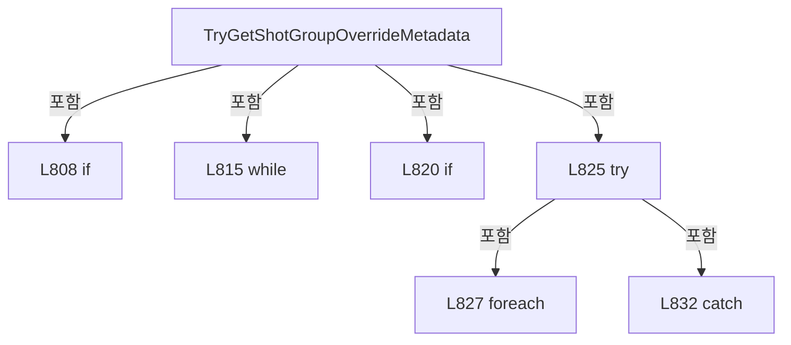

변경 전 점검: 입력/반환 타입, 위 호출자, 예외/취소 경로, 공유 상태와 저장·전송 소비자를 함께 확인합니다. 값의 단위나 물리 방향을 이름만으로 확정하지 않습니다.

### LocalFunctionStatement `MatchesItem` · L802–805

[Drilling.File/JHMI/CJhmiRecipeFile.cs:802–805](https://github.com/kjuws10-rgb/A3Drilling/blob/5aee8e58439c9b455cae7c9593c9be986c3e682e/Drilling.File/JHMI/CJhmiRecipeFile.cs#L802-L805)

| 항목 | 실제 추출 값 |
| --- | --- |
| 서명 | bool MatchesItem((string Suffix, string DisplayName)) |
| 접근/수식자 | Private /  |
| 반환/값 타입 | bool |
| 소속 타입 | NamedType:Drilling.File.JHMI.CJhmiRecipeFile |

입력 계약:

| 이름 | 타입 | 전달 | 선택/기본값 |
| --- | --- | --- | --- |
| candidate | (string Suffix, string DisplayName) | None | False /  |

현재 부분 분석에서 직접 연결된 호출자는 없습니다. XAML/이벤트/인터페이스·델리게이트·외부 진입을 추가 확인해야 하며, 미사용으로 판정한 것이 아닙니다.

호출하는 대상과 해석 범위:

| 원본 행 | 표현식 | 분석 상태 | 대상/소스 위치 |
| --- | --- | --- | --- |
| 804 | normalized.EndsWith | resolved | bool string.EndsWith(string, System.StringComparison) |

본문의 실제 연산·분기·예외·반환 순서(원문 위치 순):

| 원본 행 | 종류 | 주석 해설 |
| --- | --- | --- |
| 804 | call | 함수·델리게이트 또는 객체 생성자를 호출합니다: normalized.EndsWith(candidate.Suffix, StringComparison.Ordinal) |
| 804 | return | 호출자에게 값 또는 제어를 반환합니다: return normalized.EndsWith(candidate.Suffix, StringComparison.Ordinal); |

변경 전 점검: 입력/반환 타입, 위 호출자, 예외/취소 경로, 공유 상태와 저장·전송 소비자를 함께 확인합니다. 값의 단위나 물리 방향을 이름만으로 확정하지 않습니다.

### MethodDeclaration `LoadFormItems` · L847–887

[Drilling.File/JHMI/CJhmiRecipeFile.cs:847–887](https://github.com/kjuws10-rgb/A3Drilling/blob/5aee8e58439c9b455cae7c9593c9be986c3e682e/Drilling.File/JHMI/CJhmiRecipeFile.cs#L847-L887)

| 항목 | 실제 추출 값 |
| --- | --- |
| 서명 | System.Collections.Generic.IReadOnlyList<Drilling.Common.Managers.ST_RECIPE_FORM_ITEM> Drilling.File.JHMI.CJhmiRecipeFile.LoadFormItems() |
| 접근/수식자 | Private / private |
| 반환/값 타입 | System.Collections.Generic.IReadOnlyList<Drilling.Common.Managers.ST_RECIPE_FORM_ITEM> |
| 소속 타입 | NamedType:Drilling.File.JHMI.CJhmiRecipeFile |

정적 호출자로 확인된 위치:

| 호출 파일/행 | 호출 표현식 | 런타임 분기 가능 |
| --- | --- | --- |
| [Drilling.File/JHMI/CJhmiRecipeFile.cs:70–70](https://github.com/kjuws10-rgb/A3Drilling/blob/5aee8e58439c9b455cae7c9593c9be986c3e682e/Drilling.File/JHMI/CJhmiRecipeFile.cs#L70-L70) | LoadFormItems | False |
| [Drilling.File/JHMI/CJhmiRecipeFile.cs:104–104](https://github.com/kjuws10-rgb/A3Drilling/blob/5aee8e58439c9b455cae7c9593c9be986c3e682e/Drilling.File/JHMI/CJhmiRecipeFile.cs#L104-L104) | LoadFormItems | False |
| [Drilling.File/JHMI/CJhmiRecipeFile.cs:124–124](https://github.com/kjuws10-rgb/A3Drilling/blob/5aee8e58439c9b455cae7c9593c9be986c3e682e/Drilling.File/JHMI/CJhmiRecipeFile.cs#L124-L124) | LoadFormItems | False |
| [Drilling.File/JHMI/CJhmiRecipeFile.cs:270–270](https://github.com/kjuws10-rgb/A3Drilling/blob/5aee8e58439c9b455cae7c9593c9be986c3e682e/Drilling.File/JHMI/CJhmiRecipeFile.cs#L270-L270) | LoadFormItems | False |

호출하는 대상과 해석 범위:

| 원본 행 | 표현식 | 분석 상태 | 대상/소스 위치 |
| --- | --- | --- | --- |
| 857 | CCsvParser.ValidateRequiredHeaders | resolved | void Drilling.File.Parser.CCsvParser.ValidateRequiredHeaders(string, string, System.Collections.Generic.IEnumerable<System.Collections.Generic.IEnumerable<string>>) · Drilling.File/Parser/CCsvParser.cs:280 |
| 857 | GetFormPath | resolved | string Drilling.File.JHMI.CJhmiRecipeFile.GetFormPath() · Drilling.File/JHMI/CJhmiRecipeFile.cs:961 |
| 857 | FormHeaders.Select | resolved | System.Collections.Generic.IEnumerable<string[]> System.Collections.Generic.IEnumerable<string>.Select<string, string[]>(System.Func<string, string[]>) |
| 886 | CCsvParser.Read(GetFormPath()).Select(BuildRecipe).Where(ShouldIncludeItem).ToArray | resolved | Drilling.Common.Managers.ST_RECIPE_FORM_ITEM[] System.Collections.Generic.IEnumerable<Drilling.Common.Managers.ST_RECIPE_FORM_ITEM>.ToArray<Drilling.Common.Managers.ST_RECIPE_FORM_ITEM>() |
| 886 | CCsvParser.Read(GetFormPath()).Select(BuildRecipe).Where | resolved | System.Collections.Generic.IEnumerable<Drilling.Common.Managers.ST_RECIPE_FORM_ITEM> System.Collections.Generic.IEnumerable<Drilling.Common.Managers.ST_RECIPE_FORM_ITEM>.Where<Drilling.Common.Managers.ST_RECIPE_FORM_ITEM>(System.Func<Drilling.Common.Managers.ST_RECIPE_FORM_ITEM, bool>) |
| 886 | CCsvParser.Read(GetFormPath()).Select | resolved | System.Collections.Generic.IEnumerable<Drilling.Common.Managers.ST_RECIPE_FORM_ITEM> System.Collections.Generic.IEnumerable<System.Collections.Generic.IReadOnlyDictionary<string, string>>.Select<System.Collections.Generic.IReadOnlyDictionary<string, string>, Drilling.Common.Managers.ST_RECIPE_FORM_ITEM>(System.Func<System.Collections.Generic.IReadOnlyDictionary<string, string>, int, Drilling.Common.Managers.ST_RECIPE_FORM_ITEM>) |
| 886 | CCsvParser.Read | resolved | System.Collections.Generic.IReadOnlyList<System.Collections.Generic.IReadOnlyDictionary<string, string>> Drilling.File.Parser.CCsvParser.Read(string) · Drilling.File/Parser/CCsvParser.cs:12 |
| 886 | GetFormPath | resolved | string Drilling.File.JHMI.CJhmiRecipeFile.GetFormPath() · Drilling.File/JHMI/CJhmiRecipeFile.cs:961 |

본문의 실제 연산·분기·예외·반환 순서(원문 위치 순):

| 원본 행 | 종류 | 주석 해설 |
| --- | --- | --- |
| 857 | call | 함수·델리게이트 또는 객체 생성자를 호출합니다: CCsvParser.ValidateRequiredHeaders(GetFormPath(), "JHMI_RCP", FormHeaders.Select(SelectItem)) |
| 857 | call | 함수·델리게이트 또는 객체 생성자를 호출합니다: GetFormPath() |
| 857 | call | 함수·델리게이트 또는 객체 생성자를 호출합니다: FormHeaders.Select(SelectItem) |
| 886 | call | 함수·델리게이트 또는 객체 생성자를 호출합니다: CCsvParser.Read(GetFormPath()).Select(BuildRecipe).Where(ShouldIncludeItem).ToArray() |
| 886 | call | 함수·델리게이트 또는 객체 생성자를 호출합니다: CCsvParser.Read(GetFormPath()).Select(BuildRecipe).Where(ShouldIncludeItem) |
| 886 | call | 함수·델리게이트 또는 객체 생성자를 호출합니다: CCsvParser.Read(GetFormPath()).Select(BuildRecipe) |
| 886 | call | 함수·델리게이트 또는 객체 생성자를 호출합니다: CCsvParser.Read(GetFormPath()) |
| 886 | call | 함수·델리게이트 또는 객체 생성자를 호출합니다: GetFormPath() |
| 886 | return | 호출자에게 값 또는 제어를 반환합니다: return CCsvParser.Read(GetFormPath()).Select(BuildRecipe).Where(ShouldIncludeItem).ToArray(); |

변경 전 점검: 입력/반환 타입, 위 호출자, 예외/취소 경로, 공유 상태와 저장·전송 소비자를 함께 확인합니다. 값의 단위나 물리 방향을 이름만으로 확정하지 않습니다.

### LocalFunctionStatement `SelectItem` · L849–855

[Drilling.File/JHMI/CJhmiRecipeFile.cs:849–855](https://github.com/kjuws10-rgb/A3Drilling/blob/5aee8e58439c9b455cae7c9593c9be986c3e682e/Drilling.File/JHMI/CJhmiRecipeFile.cs#L849-L855)

| 항목 | 실제 추출 값 |
| --- | --- |
| 서명 | string[] SelectItem(string) |
| 접근/수식자 | Private /  |
| 반환/값 타입 | string[] |
| 소속 타입 | NamedType:Drilling.File.JHMI.CJhmiRecipeFile |

입력 계약:

| 이름 | 타입 | 전달 | 선택/기본값 |
| --- | --- | --- | --- |
| header | string | None | False /  |

현재 부분 분석에서 직접 연결된 호출자는 없습니다. XAML/이벤트/인터페이스·델리게이트·외부 진입을 추가 확인해야 하며, 미사용으로 판정한 것이 아닙니다.

본문의 실제 연산·분기·예외·반환 순서(원문 위치 순):

| 원본 행 | 종류 | 주석 해설 |
| --- | --- | --- |
| 851 | return | 호출자에게 값 또는 제어를 반환합니다: return new[] { header }; |

변경 전 점검: 입력/반환 타입, 위 호출자, 예외/취소 경로, 공유 상태와 저장·전송 소비자를 함께 확인합니다. 값의 단위나 물리 방향을 이름만으로 확정하지 않습니다.

### LocalFunctionStatement `BuildRecipe` · L858–879

[Drilling.File/JHMI/CJhmiRecipeFile.cs:858–879](https://github.com/kjuws10-rgb/A3Drilling/blob/5aee8e58439c9b455cae7c9593c9be986c3e682e/Drilling.File/JHMI/CJhmiRecipeFile.cs#L858-L879)

| 항목 | 실제 추출 값 |
| --- | --- |
| 서명 | Drilling.Common.Managers.ST_RECIPE_FORM_ITEM BuildRecipe(System.Collections.Generic.IReadOnlyDictionary<string, string>, int) |
| 접근/수식자 | Private /  |
| 반환/값 타입 | Drilling.Common.Managers.ST_RECIPE_FORM_ITEM |
| 소속 타입 | NamedType:Drilling.File.JHMI.CJhmiRecipeFile |

입력 계약:

| 이름 | 타입 | 전달 | 선택/기본값 |
| --- | --- | --- | --- |
| row | System.Collections.Generic.IReadOnlyDictionary<string, string> | None | False /  |
| index | int | None | False /  |

현재 부분 분석에서 직접 연결된 호출자는 없습니다. XAML/이벤트/인터페이스·델리게이트·외부 진입을 추가 확인해야 하며, 미사용으로 판정한 것이 아닙니다.

호출하는 대상과 해석 범위:

| 원본 행 | 표현식 | 분석 상태 | 대상/소스 위치 |
| --- | --- | --- | --- |
| 860 | new ST_RECIPE_FORM_ITEM | resolved | Drilling.Common.Managers.ST_RECIPE_FORM_ITEM.ST_RECIPE_FORM_ITEM(string, string, string, string, string, Drilling.Common.Managers.EN_RECIPE_DATA_TYPE, string, bool, bool, string, double, double, double, double, string, int, System.Collections.Generic.IReadOnlyDictionary<string, string>?) · Drilling.Common/Managers/CRecipeManager.cs:386 |
| 861 | CCsvParser.Get | resolved | string Drilling.File.Parser.CCsvParser.Get(System.Collections.Generic.IReadOnlyDictionary<string, string>, string) · Drilling.File/Parser/CCsvParser.cs:168 |
| 862 | CCsvParser.Get | resolved | string Drilling.File.Parser.CCsvParser.Get(System.Collections.Generic.IReadOnlyDictionary<string, string>, string) · Drilling.File/Parser/CCsvParser.cs:168 |
| 863 | CCsvParser.Get | resolved | string Drilling.File.Parser.CCsvParser.Get(System.Collections.Generic.IReadOnlyDictionary<string, string>, string) · Drilling.File/Parser/CCsvParser.cs:168 |
| 864 | GetOrDefault | resolved | string Drilling.File.JHMI.CJhmiRecipeFile.GetOrDefault(string, string) · Drilling.File/JHMI/CJhmiRecipeFile.cs:1055 |
| 864 | CCsvParser.Get | resolved | string Drilling.File.Parser.CCsvParser.Get(System.Collections.Generic.IReadOnlyDictionary<string, string>, string) · Drilling.File/Parser/CCsvParser.cs:168 |
| 864 | CCsvParser.Get | resolved | string Drilling.File.Parser.CCsvParser.Get(System.Collections.Generic.IReadOnlyDictionary<string, string>, string) · Drilling.File/Parser/CCsvParser.cs:168 |
| 865 | GetOrDefault | resolved | string Drilling.File.JHMI.CJhmiRecipeFile.GetOrDefault(string, string) · Drilling.File/JHMI/CJhmiRecipeFile.cs:1055 |
| 865 | CCsvParser.Get | resolved | string Drilling.File.Parser.CCsvParser.Get(System.Collections.Generic.IReadOnlyDictionary<string, string>, string) · Drilling.File/Parser/CCsvParser.cs:168 |
| 865 | CCsvParser.Get | resolved | string Drilling.File.Parser.CCsvParser.Get(System.Collections.Generic.IReadOnlyDictionary<string, string>, string) · Drilling.File/Parser/CCsvParser.cs:168 |
| 866 | ReadDataType | resolved | Drilling.Common.Managers.EN_RECIPE_DATA_TYPE Drilling.File.JHMI.CJhmiRecipeFile.ReadDataType(string) · Drilling.File/JHMI/CJhmiRecipeFile.cs:1014 |
| 866 | CCsvParser.Get | resolved | string Drilling.File.Parser.CCsvParser.Get(System.Collections.Generic.IReadOnlyDictionary<string, string>, string) · Drilling.File/Parser/CCsvParser.cs:168 |
| 867 | CCsvParser.Get | resolved | string Drilling.File.Parser.CCsvParser.Get(System.Collections.Generic.IReadOnlyDictionary<string, string>, string) · Drilling.File/Parser/CCsvParser.cs:168 |
| 868 | ReadBool | resolved | bool Drilling.File.JHMI.CJhmiRecipeFile.ReadBool(string, bool) · Drilling.File/JHMI/CJhmiRecipeFile.cs:1025 |
| 868 | CCsvParser.Get | resolved | string Drilling.File.Parser.CCsvParser.Get(System.Collections.Generic.IReadOnlyDictionary<string, string>, string) · Drilling.File/Parser/CCsvParser.cs:168 |
| 869 | ReadBool | resolved | bool Drilling.File.JHMI.CJhmiRecipeFile.ReadBool(string, bool) · Drilling.File/JHMI/CJhmiRecipeFile.cs:1025 |
| 869 | CCsvParser.Get | resolved | string Drilling.File.Parser.CCsvParser.Get(System.Collections.Generic.IReadOnlyDictionary<string, string>, string) · Drilling.File/Parser/CCsvParser.cs:168 |
| 870 | CCsvParser.Get | resolved | string Drilling.File.Parser.CCsvParser.Get(System.Collections.Generic.IReadOnlyDictionary<string, string>, string) · Drilling.File/Parser/CCsvParser.cs:168 |
| 871 | ReadDouble | resolved | double Drilling.File.JHMI.CJhmiRecipeFile.ReadDouble(string, double) · Drilling.File/JHMI/CJhmiRecipeFile.cs:1040 |
| 871 | CCsvParser.Get | resolved | string Drilling.File.Parser.CCsvParser.Get(System.Collections.Generic.IReadOnlyDictionary<string, string>, string) · Drilling.File/Parser/CCsvParser.cs:168 |
| 872 | ReadDouble | resolved | double Drilling.File.JHMI.CJhmiRecipeFile.ReadDouble(string, double) · Drilling.File/JHMI/CJhmiRecipeFile.cs:1040 |
| 872 | CCsvParser.Get | resolved | string Drilling.File.Parser.CCsvParser.Get(System.Collections.Generic.IReadOnlyDictionary<string, string>, string) · Drilling.File/Parser/CCsvParser.cs:168 |
| 873 | ReadDouble | resolved | double Drilling.File.JHMI.CJhmiRecipeFile.ReadDouble(string, double) · Drilling.File/JHMI/CJhmiRecipeFile.cs:1040 |
| 873 | CCsvParser.Get | resolved | string Drilling.File.Parser.CCsvParser.Get(System.Collections.Generic.IReadOnlyDictionary<string, string>, string) · Drilling.File/Parser/CCsvParser.cs:168 |
| 874 | ReadDouble | resolved | double Drilling.File.JHMI.CJhmiRecipeFile.ReadDouble(string, double) · Drilling.File/JHMI/CJhmiRecipeFile.cs:1040 |
| 874 | CCsvParser.Get | resolved | string Drilling.File.Parser.CCsvParser.Get(System.Collections.Generic.IReadOnlyDictionary<string, string>, string) · Drilling.File/Parser/CCsvParser.cs:168 |
| 875 | CCsvParser.Get | resolved | string Drilling.File.Parser.CCsvParser.Get(System.Collections.Generic.IReadOnlyDictionary<string, string>, string) · Drilling.File/Parser/CCsvParser.cs:168 |
| 876 | ReadInt | resolved | int Drilling.File.JHMI.CJhmiRecipeFile.ReadInt(string, int) · Drilling.File/JHMI/CJhmiRecipeFile.cs:1035 |
| 876 | CCsvParser.Get | resolved | string Drilling.File.Parser.CCsvParser.Get(System.Collections.Generic.IReadOnlyDictionary<string, string>, string) · Drilling.File/Parser/CCsvParser.cs:168 |
| 877 | CCsvParser.GetExtra | resolved | System.Collections.Generic.IReadOnlyDictionary<string, string> Drilling.File.Parser.CCsvParser.GetExtra(System.Collections.Generic.IReadOnlyDictionary<string, string>, System.Collections.Generic.IEnumerable<string>) · Drilling.File/Parser/CCsvParser.cs:331 |

본문의 실제 연산·분기·예외·반환 순서(원문 위치 순):

| 원본 행 | 종류 | 주석 해설 |
| --- | --- | --- |
| 860 | call | 함수·델리게이트 또는 객체 생성자를 호출합니다: new ST_RECIPE_FORM_ITEM( CCsvParser.Get(row, "TAB"), CCsvParser.Get(row, "GROUP"), CCsvParser.Get(row, "NAME"), GetOrDefault(CCsvParser.Get(row, "DISPLAY NAME"), CCsvParser.Get(row, "NAME")), GetOrDefault(CCsvParser.Get(… |
| 860 | return | 호출자에게 값 또는 제어를 반환합니다: return new ST_RECIPE_FORM_ITEM( CCsvParser.Get(row, "TAB"), CCsvParser.Get(row, "GROUP"), CCsvParser.Get(row, "NAME"), GetOrDefault(CCsvParser.Get(row, "DISPLAY NAME"), CCsvParser.Get(row, "NAME")), GetOrDefault(CCsvParser.Get(row |
| 861 | call | 함수·델리게이트 또는 객체 생성자를 호출합니다: CCsvParser.Get(row, "TAB") |
| 862 | call | 함수·델리게이트 또는 객체 생성자를 호출합니다: CCsvParser.Get(row, "GROUP") |
| 863 | call | 함수·델리게이트 또는 객체 생성자를 호출합니다: CCsvParser.Get(row, "NAME") |
| 864 | call | 함수·델리게이트 또는 객체 생성자를 호출합니다: GetOrDefault(CCsvParser.Get(row, "DISPLAY NAME"), CCsvParser.Get(row, "NAME")) |
| 864 | call | 함수·델리게이트 또는 객체 생성자를 호출합니다: CCsvParser.Get(row, "DISPLAY NAME") |
| 864 | call | 함수·델리게이트 또는 객체 생성자를 호출합니다: CCsvParser.Get(row, "NAME") |
| 865 | call | 함수·델리게이트 또는 객체 생성자를 호출합니다: GetOrDefault(CCsvParser.Get(row, "CIM NAME"), CCsvParser.Get(row, "NAME")) |
| 865 | call | 함수·델리게이트 또는 객체 생성자를 호출합니다: CCsvParser.Get(row, "CIM NAME") |
| 865 | call | 함수·델리게이트 또는 객체 생성자를 호출합니다: CCsvParser.Get(row, "NAME") |
| 866 | call | 함수·델리게이트 또는 객체 생성자를 호출합니다: ReadDataType(CCsvParser.Get(row, "DATA TYPE")) |
| 866 | call | 함수·델리게이트 또는 객체 생성자를 호출합니다: CCsvParser.Get(row, "DATA TYPE") |
| 867 | call | 함수·델리게이트 또는 객체 생성자를 호출합니다: CCsvParser.Get(row, "UNIT") |
| 868 | call | 함수·델리게이트 또는 객체 생성자를 호출합니다: ReadBool(CCsvParser.Get(row, "SHOW"), true) |
| 868 | call | 함수·델리게이트 또는 객체 생성자를 호출합니다: CCsvParser.Get(row, "SHOW") |
| 869 | call | 함수·델리게이트 또는 객체 생성자를 호출합니다: ReadBool(CCsvParser.Get(row, "USE"), true) |
| 869 | call | 함수·델리게이트 또는 객체 생성자를 호출합니다: CCsvParser.Get(row, "USE") |
| 870 | call | 함수·델리게이트 또는 객체 생성자를 호출합니다: CCsvParser.Get(row, "VALUE") |
| 871 | call | 함수·델리게이트 또는 객체 생성자를 호출합니다: ReadDouble(CCsvParser.Get(row, "SCALE"), 1.0) |
| 871 | call | 함수·델리게이트 또는 객체 생성자를 호출합니다: CCsvParser.Get(row, "SCALE") |
| 872 | call | 함수·델리게이트 또는 객체 생성자를 호출합니다: ReadDouble(CCsvParser.Get(row, "CHANGE LIMIT"), 0.0) |
| 872 | call | 함수·델리게이트 또는 객체 생성자를 호출합니다: CCsvParser.Get(row, "CHANGE LIMIT") |
| 873 | call | 함수·델리게이트 또는 객체 생성자를 호출합니다: ReadDouble(CCsvParser.Get(row, "MIN"), 0.0) |
| 873 | call | 함수·델리게이트 또는 객체 생성자를 호출합니다: CCsvParser.Get(row, "MIN") |
| 874 | call | 함수·델리게이트 또는 객체 생성자를 호출합니다: ReadDouble(CCsvParser.Get(row, "MAX"), 0.0) |
| 874 | call | 함수·델리게이트 또는 객체 생성자를 호출합니다: CCsvParser.Get(row, "MAX") |
| 875 | call | 함수·델리게이트 또는 객체 생성자를 호출합니다: CCsvParser.Get(row, "DESCRIPTION") |
| 876 | call | 함수·델리게이트 또는 객체 생성자를 호출합니다: ReadInt(CCsvParser.Get(row, "ORDER"), index + 1) |
| 876 | call | 함수·델리게이트 또는 객체 생성자를 호출합니다: CCsvParser.Get(row, "ORDER") |
| 877 | call | 함수·델리게이트 또는 객체 생성자를 호출합니다: CCsvParser.GetExtra(row, FormHeaders) |

변경 전 점검: 입력/반환 타입, 위 호출자, 예외/취소 경로, 공유 상태와 저장·전송 소비자를 함께 확인합니다. 값의 단위나 물리 방향을 이름만으로 확정하지 않습니다.

### LocalFunctionStatement `ShouldIncludeItem` · L881–884

[Drilling.File/JHMI/CJhmiRecipeFile.cs:881–884](https://github.com/kjuws10-rgb/A3Drilling/blob/5aee8e58439c9b455cae7c9593c9be986c3e682e/Drilling.File/JHMI/CJhmiRecipeFile.cs#L881-L884)

| 항목 | 실제 추출 값 |
| --- | --- |
| 서명 | bool ShouldIncludeItem(Drilling.Common.Managers.ST_RECIPE_FORM_ITEM) |
| 접근/수식자 | Private /  |
| 반환/값 타입 | bool |
| 소속 타입 | NamedType:Drilling.File.JHMI.CJhmiRecipeFile |

입력 계약:

| 이름 | 타입 | 전달 | 선택/기본값 |
| --- | --- | --- | --- |
| item | Drilling.Common.Managers.ST_RECIPE_FORM_ITEM | None | False /  |

현재 부분 분석에서 직접 연결된 호출자는 없습니다. XAML/이벤트/인터페이스·델리게이트·외부 진입을 추가 확인해야 하며, 미사용으로 판정한 것이 아닙니다.

호출하는 대상과 해석 범위:

| 원본 행 | 표현식 | 분석 상태 | 대상/소스 위치 |
| --- | --- | --- | --- |
| 883 | string.IsNullOrWhiteSpace | resolved | bool string.IsNullOrWhiteSpace(string?) |
| 883 | string.IsNullOrWhiteSpace | resolved | bool string.IsNullOrWhiteSpace(string?) |

본문의 실제 연산·분기·예외·반환 순서(원문 위치 순):

| 원본 행 | 종류 | 주석 해설 |
| --- | --- | --- |
| 883 | call | 함수·델리게이트 또는 객체 생성자를 호출합니다: string.IsNullOrWhiteSpace(item.Tab) |
| 883 | call | 함수·델리게이트 또는 객체 생성자를 호출합니다: string.IsNullOrWhiteSpace(item.Name) |
| 883 | return | 호출자에게 값 또는 제어를 반환합니다: return !string.IsNullOrWhiteSpace(item.Tab) && !string.IsNullOrWhiteSpace(item.Name); |

변경 전 점검: 입력/반환 타입, 위 호출자, 예외/취소 경로, 공유 상태와 저장·전송 소비자를 함께 확인합니다. 값의 단위나 물리 방향을 이름만으로 확정하지 않습니다.

### MethodDeclaration `ReadRecipeValues` · L889–913

[Drilling.File/JHMI/CJhmiRecipeFile.cs:889–913](https://github.com/kjuws10-rgb/A3Drilling/blob/5aee8e58439c9b455cae7c9593c9be986c3e682e/Drilling.File/JHMI/CJhmiRecipeFile.cs#L889-L913)

| 항목 | 실제 추출 값 |
| --- | --- |
| 서명 | System.Collections.Generic.IReadOnlyList<Drilling.Common.Managers.ST_RECIPE_VALUE> Drilling.File.JHMI.CJhmiRecipeFile.ReadRecipeValues(string, System.Threading.CancellationToken) |
| 접근/수식자 | Private / private, static |
| 반환/값 타입 | System.Collections.Generic.IReadOnlyList<Drilling.Common.Managers.ST_RECIPE_VALUE> |
| 소속 타입 | NamedType:Drilling.File.JHMI.CJhmiRecipeFile |

입력 계약:

| 이름 | 타입 | 전달 | 선택/기본값 |
| --- | --- | --- | --- |
| path | string | None | False /  |
| cancellationToken | System.Threading.CancellationToken | None | True / null |

정적 호출자로 확인된 위치:

| 호출 파일/행 | 호출 표현식 | 런타임 분기 가능 |
| --- | --- | --- |
| [Drilling.File/JHMI/CJhmiRecipeFile.cs:45–45](https://github.com/kjuws10-rgb/A3Drilling/blob/5aee8e58439c9b455cae7c9593c9be986c3e682e/Drilling.File/JHMI/CJhmiRecipeFile.cs#L45-L45) | ReadRecipeValues | False |
| [Drilling.File/JHMI/CJhmiRecipeFile.cs:142–142](https://github.com/kjuws10-rgb/A3Drilling/blob/5aee8e58439c9b455cae7c9593c9be986c3e682e/Drilling.File/JHMI/CJhmiRecipeFile.cs#L142-L142) | ReadRecipeValues | False |
| [Drilling.File/JHMI/CJhmiRecipeFile.cs:271–271](https://github.com/kjuws10-rgb/A3Drilling/blob/5aee8e58439c9b455cae7c9593c9be986c3e682e/Drilling.File/JHMI/CJhmiRecipeFile.cs#L271-L271) | ReadRecipeValues | False |
| [Drilling.File/JHMI/CJhmiRecipeFile.cs:403–403](https://github.com/kjuws10-rgb/A3Drilling/blob/5aee8e58439c9b455cae7c9593c9be986c3e682e/Drilling.File/JHMI/CJhmiRecipeFile.cs#L403-L403) | ReadRecipeValues | False |
| [Drilling.File/JHMI/CJhmiRecipeFile.cs:451–451](https://github.com/kjuws10-rgb/A3Drilling/blob/5aee8e58439c9b455cae7c9593c9be986c3e682e/Drilling.File/JHMI/CJhmiRecipeFile.cs#L451-L451) | ReadRecipeValues | False |
| [Drilling.File/JHMI/CJhmiRecipeFile.cs:1087–1087](https://github.com/kjuws10-rgb/A3Drilling/blob/5aee8e58439c9b455cae7c9593c9be986c3e682e/Drilling.File/JHMI/CJhmiRecipeFile.cs#L1087-L1087) | ReadRecipeValues | False |

호출하는 대상과 해석 범위:

| 원본 행 | 표현식 | 분석 상태 | 대상/소스 위치 |
| --- | --- | --- | --- |
| 891 | System.IO.File.Exists | resolved | bool System.IO.File.Exists(string?) |
| 896 | new List<ST_RECIPE_VALUE> | resolved | System.Collections.Generic.List<Drilling.Common.Managers.ST_RECIPE_VALUE>.List() |
| 897 | CCsvParser.ReadLines | resolved | System.Collections.Generic.IReadOnlyList<string> Drilling.File.Parser.CCsvParser.ReadLines(string) · Drilling.File/Parser/CCsvParser.cs:147 |
| 899 | cancellationToken.ThrowIfCancellationRequested | resolved | void System.Threading.CancellationToken.ThrowIfCancellationRequested() |
| 900 | string.IsNullOrWhiteSpace | resolved | bool string.IsNullOrWhiteSpace(string?) |
| 905 | ParseRecipeLine | resolved | Drilling.Common.Managers.ST_RECIPE_VALUE? Drilling.File.JHMI.CJhmiRecipeFile.ParseRecipeLine(string) · Drilling.File/JHMI/CJhmiRecipeFile.cs:915 |
| 908 | values.Add | resolved | void System.Collections.Generic.List<Drilling.Common.Managers.ST_RECIPE_VALUE>.Add(Drilling.Common.Managers.ST_RECIPE_VALUE) |

본문의 실제 연산·분기·예외·반환 순서(원문 위치 순):

| 원본 행 | 종류 | 주석 해설 |
| --- | --- | --- |
| 891 | call | 함수·델리게이트 또는 객체 생성자를 호출합니다: System.IO.File.Exists(path) |
| 891 | if | 조건에 따라 분기합니다: if (!System.IO.File.Exists(path)) |
| 893 | return | 호출자에게 값 또는 제어를 반환합니다: return[]; |
| 896 | call | 함수·델리게이트 또는 객체 생성자를 호출합니다: new List<ST_RECIPE_VALUE>() |
| 896 | local-declaration | 지역 변수를 선언합니다: var values = new List<ST_RECIPE_VALUE>(); |
| 896 | variable-initializer | 변수의 초기값을 지정합니다: values = new List<ST_RECIPE_VALUE>() |
| 897 | call | 함수·델리게이트 또는 객체 생성자를 호출합니다: CCsvParser.ReadLines(path) |
| 897 | foreach | 컬렉션 요소를 순회합니다: foreach (var line in CCsvParser.ReadLines(path)) |
| 899 | call | 함수·델리게이트 또는 객체 생성자를 호출합니다: cancellationToken.ThrowIfCancellationRequested() |
| 900 | call | 함수·델리게이트 또는 객체 생성자를 호출합니다: string.IsNullOrWhiteSpace(line) |
| 900 | if | 조건에 따라 분기합니다: if (string.IsNullOrWhiteSpace(line)) |
| 902 | continue | 다음 반복으로 진행합니다: continue; |
| 905 | call | 함수·델리게이트 또는 객체 생성자를 호출합니다: ParseRecipeLine(line) |
| 905 | local-declaration | 지역 변수를 선언합니다: var value = ParseRecipeLine(line); |
| 905 | variable-initializer | 변수의 초기값을 지정합니다: value = ParseRecipeLine(line) |
| 906 | if | 조건에 따라 분기합니다: if (value is not null) |
| 908 | call | 함수·델리게이트 또는 객체 생성자를 호출합니다: values.Add(value) |
| 912 | return | 호출자에게 값 또는 제어를 반환합니다: return values; |

제어 구문의 포함 구조(실제 실행 순서/CFG가 아닌 구문 탐색 그림):

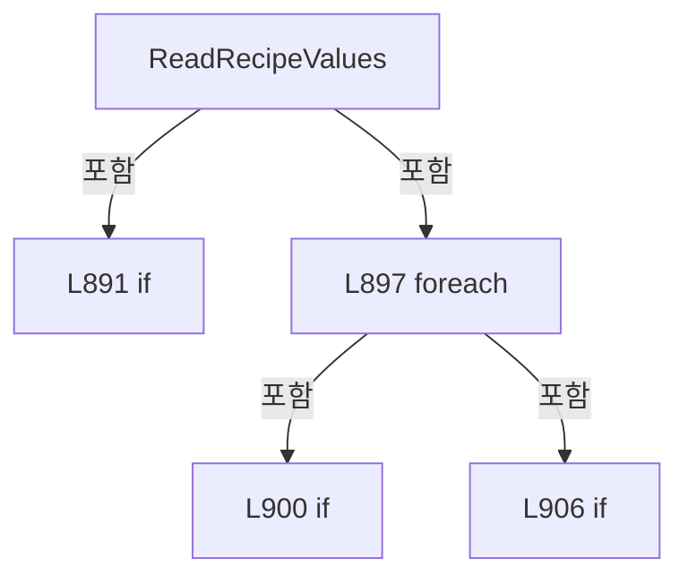

변경 전 점검: 입력/반환 타입, 위 호출자, 예외/취소 경로, 공유 상태와 저장·전송 소비자를 함께 확인합니다. 값의 단위나 물리 방향을 이름만으로 확정하지 않습니다.

### MethodDeclaration `ParseRecipeLine` · L915–924

[Drilling.File/JHMI/CJhmiRecipeFile.cs:915–924](https://github.com/kjuws10-rgb/A3Drilling/blob/5aee8e58439c9b455cae7c9593c9be986c3e682e/Drilling.File/JHMI/CJhmiRecipeFile.cs#L915-L924)

| 항목 | 실제 추출 값 |
| --- | --- |
| 서명 | Drilling.Common.Managers.ST_RECIPE_VALUE? Drilling.File.JHMI.CJhmiRecipeFile.ParseRecipeLine(string) |
| 접근/수식자 | Private / private, static |
| 반환/값 타입 | Drilling.Common.Managers.ST_RECIPE_VALUE? |
| 소속 타입 | NamedType:Drilling.File.JHMI.CJhmiRecipeFile |

입력 계약:

| 이름 | 타입 | 전달 | 선택/기본값 |
| --- | --- | --- | --- |
| line | string | None | False /  |

정적 호출자로 확인된 위치:

| 호출 파일/행 | 호출 표현식 | 런타임 분기 가능 |
| --- | --- | --- |
| [Drilling.File/JHMI/CJhmiRecipeFile.cs:905–905](https://github.com/kjuws10-rgb/A3Drilling/blob/5aee8e58439c9b455cae7c9593c9be986c3e682e/Drilling.File/JHMI/CJhmiRecipeFile.cs#L905-L905) | ParseRecipeLine | False |
| [Drilling.File/JHMI/CJhmiRecipeFile.cs:1436–1436](https://github.com/kjuws10-rgb/A3Drilling/blob/5aee8e58439c9b455cae7c9593c9be986c3e682e/Drilling.File/JHMI/CJhmiRecipeFile.cs#L1436-L1436) | ParseRecipeLine | False |

호출하는 대상과 해석 범위:

| 원본 행 | 표현식 | 분석 상태 | 대상/소스 위치 |
| --- | --- | --- | --- |
| 917 | SplitCsvLine | resolved | System.Collections.Generic.IReadOnlyList<string> Drilling.File.JHMI.CJhmiRecipeFile.SplitCsvLine(string) · Drilling.File/JHMI/CJhmiRecipeFile.cs:926 |
| 923 | new ST_RECIPE_VALUE | resolved | Drilling.Common.Managers.ST_RECIPE_VALUE.ST_RECIPE_VALUE(string, string, string, System.Collections.Generic.IReadOnlyList<string>?) · Drilling.Common/Managers/CRecipeManager.cs:405 |
| 923 | fields.Skip(3).ToArray | resolved | string[] System.Collections.Generic.IEnumerable<string>.ToArray<string>() |
| 923 | fields.Skip | resolved | System.Collections.Generic.IEnumerable<string> System.Collections.Generic.IEnumerable<string>.Skip<string>(int) |

본문의 실제 연산·분기·예외·반환 순서(원문 위치 순):

| 원본 행 | 종류 | 주석 해설 |
| --- | --- | --- |
| 917 | call | 함수·델리게이트 또는 객체 생성자를 호출합니다: SplitCsvLine(line) |
| 917 | local-declaration | 지역 변수를 선언합니다: var fields = SplitCsvLine(line); |
| 917 | variable-initializer | 변수의 초기값을 지정합니다: fields = SplitCsvLine(line) |
| 918 | if | 조건에 따라 분기합니다: if (fields.Count < 3) |
| 920 | return | 호출자에게 값 또는 제어를 반환합니다: return null; |
| 923 | call | 함수·델리게이트 또는 객체 생성자를 호출합니다: new ST_RECIPE_VALUE(fields[0], fields[1], fields[2], fields.Skip(3).ToArray()) |
| 923 | call | 함수·델리게이트 또는 객체 생성자를 호출합니다: fields.Skip(3).ToArray() |
| 923 | call | 함수·델리게이트 또는 객체 생성자를 호출합니다: fields.Skip(3) |
| 923 | return | 호출자에게 값 또는 제어를 반환합니다: return new ST_RECIPE_VALUE(fields[0], fields[1], fields[2], fields.Skip(3).ToArray()); |

제어 구문의 포함 구조(실제 실행 순서/CFG가 아닌 구문 탐색 그림):

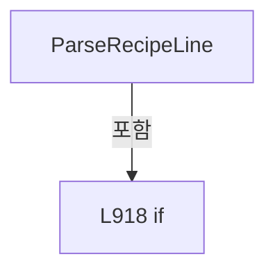

변경 전 점검: 입력/반환 타입, 위 호출자, 예외/취소 경로, 공유 상태와 저장·전송 소비자를 함께 확인합니다. 값의 단위나 물리 방향을 이름만으로 확정하지 않습니다.

### MethodDeclaration `SplitCsvLine` · L926–959

[Drilling.File/JHMI/CJhmiRecipeFile.cs:926–959](https://github.com/kjuws10-rgb/A3Drilling/blob/5aee8e58439c9b455cae7c9593c9be986c3e682e/Drilling.File/JHMI/CJhmiRecipeFile.cs#L926-L959)

| 항목 | 실제 추출 값 |
| --- | --- |
| 서명 | System.Collections.Generic.IReadOnlyList<string> Drilling.File.JHMI.CJhmiRecipeFile.SplitCsvLine(string) |
| 접근/수식자 | Private / private, static |
| 반환/값 타입 | System.Collections.Generic.IReadOnlyList<string> |
| 소속 타입 | NamedType:Drilling.File.JHMI.CJhmiRecipeFile |

입력 계약:

| 이름 | 타입 | 전달 | 선택/기본값 |
| --- | --- | --- | --- |
| line | string | None | False /  |

정적 호출자로 확인된 위치:

| 호출 파일/행 | 호출 표현식 | 런타임 분기 가능 |
| --- | --- | --- |
| [Drilling.File/JHMI/CJhmiRecipeFile.cs:917–917](https://github.com/kjuws10-rgb/A3Drilling/blob/5aee8e58439c9b455cae7c9593c9be986c3e682e/Drilling.File/JHMI/CJhmiRecipeFile.cs#L917-L917) | SplitCsvLine | False |

호출하는 대상과 해석 범위:

| 원본 행 | 표현식 | 분석 상태 | 대상/소스 위치 |
| --- | --- | --- | --- |
| 928 | new List<string> | resolved | System.Collections.Generic.List<string>.List() |
| 929 | new System.Text.StringBuilder | resolved | System.Text.StringBuilder.StringBuilder() |
| 938 | value.Append | resolved | System.Text.StringBuilder System.Text.StringBuilder.Append(char) |
| 948 | fields.Add | resolved | void System.Collections.Generic.List<string>.Add(string) |
| 948 | value.ToString | resolved · 동적 구현 선택 가능 | string System.Text.StringBuilder.ToString() |
| 949 | value.Clear | resolved | System.Text.StringBuilder System.Text.StringBuilder.Clear() |
| 953 | value.Append | resolved | System.Text.StringBuilder System.Text.StringBuilder.Append(char) |
| 957 | fields.Add | resolved | void System.Collections.Generic.List<string>.Add(string) |
| 957 | value.ToString | resolved · 동적 구현 선택 가능 | string System.Text.StringBuilder.ToString() |

본문의 실제 연산·분기·예외·반환 순서(원문 위치 순):

| 원본 행 | 종류 | 주석 해설 |
| --- | --- | --- |
| 928 | call | 함수·델리게이트 또는 객체 생성자를 호출합니다: new List<string>() |
| 928 | local-declaration | 지역 변수를 선언합니다: var fields = new List<string>(); |
| 928 | variable-initializer | 변수의 초기값을 지정합니다: fields = new List<string>() |
| 929 | call | 함수·델리게이트 또는 객체 생성자를 호출합니다: new System.Text.StringBuilder() |
| 929 | local-declaration | 지역 변수를 선언합니다: var value = new System.Text.StringBuilder(); |
| 929 | variable-initializer | 변수의 초기값을 지정합니다: value = new System.Text.StringBuilder() |
| 930 | local-declaration | 지역 변수를 선언합니다: var inQuotes = false; |
| 930 | variable-initializer | 변수의 초기값을 지정합니다: inQuotes = false |
| 931 | variable-initializer | 변수의 초기값을 지정합니다: index = 0 |
| 931 | for | 초기화·조건·증감이 있는 반복입니다: for (var index = 0; index < line.Length; index++) |
| 933 | local-declaration | 지역 변수를 선언합니다: var current = line[index]; |
| 933 | variable-initializer | 변수의 초기값을 지정합니다: current = line[index] |
| 934 | if | 조건에 따라 분기합니다: if (current == '"') |
| 936 | if | 조건에 따라 분기합니다: if (inQuotes && index + 1 < line.Length && line[index + 1] == '"') |
| 938 | call | 함수·델리게이트 또는 객체 생성자를 호출합니다: value.Append('"') |
| 941 | else | 앞 조건이 거짓인 경로입니다: else |
| 943 | assignment | 값을 대상에 대입합니다: inQuotes = !inQuotes |
| 946 | else | 앞 조건이 거짓인 경로입니다: else |
| 946 | if | 조건에 따라 분기합니다: if (current == ',' && !inQuotes) |
| 948 | call | 함수·델리게이트 또는 객체 생성자를 호출합니다: fields.Add(value.ToString()) |
| 948 | call | 함수·델리게이트 또는 객체 생성자를 호출합니다: value.ToString() |
| 949 | call | 함수·델리게이트 또는 객체 생성자를 호출합니다: value.Clear() |
| 951 | else | 앞 조건이 거짓인 경로입니다: else |
| 953 | call | 함수·델리게이트 또는 객체 생성자를 호출합니다: value.Append(current) |
| 957 | call | 함수·델리게이트 또는 객체 생성자를 호출합니다: fields.Add(value.ToString()) |
| 957 | call | 함수·델리게이트 또는 객체 생성자를 호출합니다: value.ToString() |
| 958 | return | 호출자에게 값 또는 제어를 반환합니다: return fields; |

제어 구문의 포함 구조(실제 실행 순서/CFG가 아닌 구문 탐색 그림):

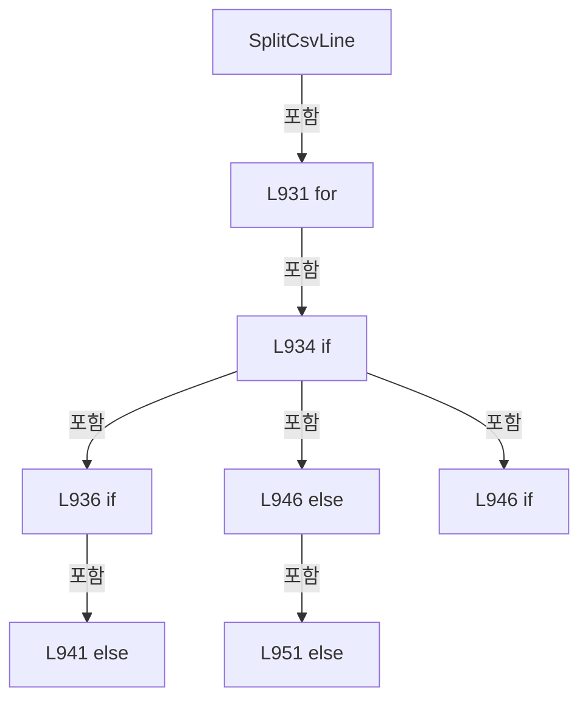

변경 전 점검: 입력/반환 타입, 위 호출자, 예외/취소 경로, 공유 상태와 저장·전송 소비자를 함께 확인합니다. 값의 단위나 물리 방향을 이름만으로 확정하지 않습니다.

### MethodDeclaration `GetFormPath` · L961–964

[Drilling.File/JHMI/CJhmiRecipeFile.cs:961–964](https://github.com/kjuws10-rgb/A3Drilling/blob/5aee8e58439c9b455cae7c9593c9be986c3e682e/Drilling.File/JHMI/CJhmiRecipeFile.cs#L961-L964)

| 항목 | 실제 추출 값 |
| --- | --- |
| 서명 | string Drilling.File.JHMI.CJhmiRecipeFile.GetFormPath() |
| 접근/수식자 | Private / private |
| 반환/값 타입 | string |
| 소속 타입 | NamedType:Drilling.File.JHMI.CJhmiRecipeFile |

정적 호출자로 확인된 위치:

| 호출 파일/행 | 호출 표현식 | 런타임 분기 가능 |
| --- | --- | --- |
| [Drilling.File/JHMI/CJhmiRecipeFile.cs:857–857](https://github.com/kjuws10-rgb/A3Drilling/blob/5aee8e58439c9b455cae7c9593c9be986c3e682e/Drilling.File/JHMI/CJhmiRecipeFile.cs#L857-L857) | GetFormPath | False |
| [Drilling.File/JHMI/CJhmiRecipeFile.cs:886–886](https://github.com/kjuws10-rgb/A3Drilling/blob/5aee8e58439c9b455cae7c9593c9be986c3e682e/Drilling.File/JHMI/CJhmiRecipeFile.cs#L886-L886) | GetFormPath | False |

호출하는 대상과 해석 범위:

| 원본 행 | 표현식 | 분석 상태 | 대상/소스 위치 |
| --- | --- | --- | --- |
| 963 | Path.Combine | resolved | string System.IO.Path.Combine(string, string) |

본문의 실제 연산·분기·예외·반환 순서(원문 위치 순):

| 원본 행 | 종류 | 주석 해설 |
| --- | --- | --- |
| 963 | call | 함수·델리게이트 또는 객체 생성자를 호출합니다: Path.Combine(_configRoot, "JHMI_RCP.csv") |
| 963 | return | 호출자에게 값 또는 제어를 반환합니다: return Path.Combine(_configRoot, "JHMI_RCP.csv"); |

변경 전 점검: 입력/반환 타입, 위 호출자, 예외/취소 경로, 공유 상태와 저장·전송 소비자를 함께 확인합니다. 값의 단위나 물리 방향을 이름만으로 확정하지 않습니다.

### MethodDeclaration `GetRecipePath` · L966–969

[Drilling.File/JHMI/CJhmiRecipeFile.cs:966–969](https://github.com/kjuws10-rgb/A3Drilling/blob/5aee8e58439c9b455cae7c9593c9be986c3e682e/Drilling.File/JHMI/CJhmiRecipeFile.cs#L966-L969)

| 항목 | 실제 추출 값 |
| --- | --- |
| 서명 | string Drilling.File.JHMI.CJhmiRecipeFile.GetRecipePath(string) |
| 접근/수식자 | Private / private |
| 반환/값 타입 | string |
| 소속 타입 | NamedType:Drilling.File.JHMI.CJhmiRecipeFile |

입력 계약:

| 이름 | 타입 | 전달 | 선택/기본값 |
| --- | --- | --- | --- |
| recipeId | string | None | False /  |

정적 호출자로 확인된 위치:

| 호출 파일/행 | 호출 표현식 | 런타임 분기 가능 |
| --- | --- | --- |
| [Drilling.File/JHMI/CJhmiRecipeFile.cs:39–39](https://github.com/kjuws10-rgb/A3Drilling/blob/5aee8e58439c9b455cae7c9593c9be986c3e682e/Drilling.File/JHMI/CJhmiRecipeFile.cs#L39-L39) | GetRecipePath | False |
| [Drilling.File/JHMI/CJhmiRecipeFile.cs:43–43](https://github.com/kjuws10-rgb/A3Drilling/blob/5aee8e58439c9b455cae7c9593c9be986c3e682e/Drilling.File/JHMI/CJhmiRecipeFile.cs#L43-L43) | GetRecipePath | False |
| [Drilling.File/JHMI/CJhmiRecipeFile.cs:45–45](https://github.com/kjuws10-rgb/A3Drilling/blob/5aee8e58439c9b455cae7c9593c9be986c3e682e/Drilling.File/JHMI/CJhmiRecipeFile.cs#L45-L45) | GetRecipePath | False |
| [Drilling.File/JHMI/CJhmiRecipeFile.cs:106–106](https://github.com/kjuws10-rgb/A3Drilling/blob/5aee8e58439c9b455cae7c9593c9be986c3e682e/Drilling.File/JHMI/CJhmiRecipeFile.cs#L106-L106) | GetRecipePath | False |
| [Drilling.File/JHMI/CJhmiRecipeFile.cs:125–125](https://github.com/kjuws10-rgb/A3Drilling/blob/5aee8e58439c9b455cae7c9593c9be986c3e682e/Drilling.File/JHMI/CJhmiRecipeFile.cs#L125-L125) | GetRecipePath | False |
| [Drilling.File/JHMI/CJhmiRecipeFile.cs:258–258](https://github.com/kjuws10-rgb/A3Drilling/blob/5aee8e58439c9b455cae7c9593c9be986c3e682e/Drilling.File/JHMI/CJhmiRecipeFile.cs#L258-L258) | GetRecipePath | False |
| [Drilling.File/JHMI/CJhmiRecipeFile.cs:259–259](https://github.com/kjuws10-rgb/A3Drilling/blob/5aee8e58439c9b455cae7c9593c9be986c3e682e/Drilling.File/JHMI/CJhmiRecipeFile.cs#L259-L259) | GetRecipePath | False |
| [Drilling.File/JHMI/CJhmiRecipeFile.cs:383–383](https://github.com/kjuws10-rgb/A3Drilling/blob/5aee8e58439c9b455cae7c9593c9be986c3e682e/Drilling.File/JHMI/CJhmiRecipeFile.cs#L383-L383) | GetRecipePath | False |
| [Drilling.File/JHMI/CJhmiRecipeFile.cs:1140–1140](https://github.com/kjuws10-rgb/A3Drilling/blob/5aee8e58439c9b455cae7c9593c9be986c3e682e/Drilling.File/JHMI/CJhmiRecipeFile.cs#L1140-L1140) | GetRecipePath | False |
| [Drilling.File/JHMI/CJhmiRecipeFile.cs:1142–1142](https://github.com/kjuws10-rgb/A3Drilling/blob/5aee8e58439c9b455cae7c9593c9be986c3e682e/Drilling.File/JHMI/CJhmiRecipeFile.cs#L1142-L1142) | GetRecipePath | False |
| [Drilling.File/JHMI/CJhmiRecipeFile.cs:1181–1181](https://github.com/kjuws10-rgb/A3Drilling/blob/5aee8e58439c9b455cae7c9593c9be986c3e682e/Drilling.File/JHMI/CJhmiRecipeFile.cs#L1181-L1181) | GetRecipePath | False |
| [Drilling.File/JHMI/CJhmiRecipeFile.cs:1303–1303](https://github.com/kjuws10-rgb/A3Drilling/blob/5aee8e58439c9b455cae7c9593c9be986c3e682e/Drilling.File/JHMI/CJhmiRecipeFile.cs#L1303-L1303) | GetRecipePath | False |
| [Drilling.File/JHMI/CJhmiRecipeFile.cs:1305–1305](https://github.com/kjuws10-rgb/A3Drilling/blob/5aee8e58439c9b455cae7c9593c9be986c3e682e/Drilling.File/JHMI/CJhmiRecipeFile.cs#L1305-L1305) | GetRecipePath | False |
| [Drilling.File/JHMI/CJhmiRecipeFile.cs:1425–1425](https://github.com/kjuws10-rgb/A3Drilling/blob/5aee8e58439c9b455cae7c9593c9be986c3e682e/Drilling.File/JHMI/CJhmiRecipeFile.cs#L1425-L1425) | GetRecipePath | False |

호출하는 대상과 해석 범위:

| 원본 행 | 표현식 | 분석 상태 | 대상/소스 위치 |
| --- | --- | --- | --- |
| 968 | Path.Combine | resolved | string System.IO.Path.Combine(string, string) |
| 968 | GetSafeFileName | resolved | string Drilling.File.JHMI.CJhmiRecipeFile.GetSafeFileName(string) · Drilling.File/JHMI/CJhmiRecipeFile.cs:1113 |

본문의 실제 연산·분기·예외·반환 순서(원문 위치 순):

| 원본 행 | 종류 | 주석 해설 |
| --- | --- | --- |
| 968 | call | 함수·델리게이트 또는 객체 생성자를 호출합니다: Path.Combine(_recipeDirectory, $"{GetSafeFileName(recipeId)}.csv") |
| 968 | call | 함수·델리게이트 또는 객체 생성자를 호출합니다: GetSafeFileName(recipeId) |
| 968 | return | 호출자에게 값 또는 제어를 반환합니다: return Path.Combine(_recipeDirectory, $"{GetSafeFileName(recipeId)}.csv"); |

변경 전 점검: 입력/반환 타입, 위 호출자, 예외/취소 경로, 공유 상태와 저장·전송 소비자를 함께 확인합니다. 값의 단위나 물리 방향을 이름만으로 확정하지 않습니다.

### MethodDeclaration `FindFormItem` · L971–1012

[Drilling.File/JHMI/CJhmiRecipeFile.cs:971–1012](https://github.com/kjuws10-rgb/A3Drilling/blob/5aee8e58439c9b455cae7c9593c9be986c3e682e/Drilling.File/JHMI/CJhmiRecipeFile.cs#L971-L1012)

| 항목 | 실제 추출 값 |
| --- | --- |
| 서명 | Drilling.Common.Managers.ST_RECIPE_FORM_ITEM? Drilling.File.JHMI.CJhmiRecipeFile.FindFormItem(System.Collections.Generic.IReadOnlyList<Drilling.Common.Managers.ST_RECIPE_FORM_ITEM>, Drilling.Common.Managers.ST_RECIPE_PARAMETER) |
| 접근/수식자 | Private / private, static |
| 반환/값 타입 | Drilling.Common.Managers.ST_RECIPE_FORM_ITEM? |
| 소속 타입 | NamedType:Drilling.File.JHMI.CJhmiRecipeFile |

입력 계약:

| 이름 | 타입 | 전달 | 선택/기본값 |
| --- | --- | --- | --- |
| formItems | System.Collections.Generic.IReadOnlyList<Drilling.Common.Managers.ST_RECIPE_FORM_ITEM> | None | False /  |
| parameter | Drilling.Common.Managers.ST_RECIPE_PARAMETER | None | False /  |

정적 호출자로 확인된 위치:

| 호출 파일/행 | 호출 표현식 | 런타임 분기 가능 |
| --- | --- | --- |
| [Drilling.File/JHMI/CJhmiRecipeFile.cs:148–148](https://github.com/kjuws10-rgb/A3Drilling/blob/5aee8e58439c9b455cae7c9593c9be986c3e682e/Drilling.File/JHMI/CJhmiRecipeFile.cs#L148-L148) | FindFormItem | False |

호출하는 대상과 해석 범위:

| 원본 행 | 표현식 | 분석 상태 | 대상/소스 위치 |
| --- | --- | --- | --- |
| 978 | string.IsNullOrWhiteSpace | resolved | bool string.IsNullOrWhiteSpace(string?) |
| 978 | string.IsNullOrWhiteSpace | resolved | bool string.IsNullOrWhiteSpace(string?) |
| 980 | formItems.FirstOrDefault | resolved | Drilling.Common.Managers.ST_RECIPE_FORM_ITEM? System.Collections.Generic.IEnumerable<Drilling.Common.Managers.ST_RECIPE_FORM_ITEM>.FirstOrDefault<Drilling.Common.Managers.ST_RECIPE_FORM_ITEM>(System.Func<Drilling.Common.Managers.ST_RECIPE_FORM_ITEM, bool>) |
| 992 | string.IsNullOrWhiteSpace | resolved | bool string.IsNullOrWhiteSpace(string?) |
| 994 | formItems.FirstOrDefault | resolved | Drilling.Common.Managers.ST_RECIPE_FORM_ITEM? System.Collections.Generic.IEnumerable<Drilling.Common.Managers.ST_RECIPE_FORM_ITEM>.FirstOrDefault<Drilling.Common.Managers.ST_RECIPE_FORM_ITEM>(System.Func<Drilling.Common.Managers.ST_RECIPE_FORM_ITEM, bool>) |
| 1011 | formItems.FirstOrDefault | resolved | Drilling.Common.Managers.ST_RECIPE_FORM_ITEM? System.Collections.Generic.IEnumerable<Drilling.Common.Managers.ST_RECIPE_FORM_ITEM>.FirstOrDefault<Drilling.Common.Managers.ST_RECIPE_FORM_ITEM>(System.Func<Drilling.Common.Managers.ST_RECIPE_FORM_ITEM, bool>) |
| 1011 | formItems.FirstOrDefault | resolved | Drilling.Common.Managers.ST_RECIPE_FORM_ITEM? System.Collections.Generic.IEnumerable<Drilling.Common.Managers.ST_RECIPE_FORM_ITEM>.FirstOrDefault<Drilling.Common.Managers.ST_RECIPE_FORM_ITEM>(System.Func<Drilling.Common.Managers.ST_RECIPE_FORM_ITEM, bool>) |

본문의 실제 연산·분기·예외·반환 순서(원문 위치 순):

| 원본 행 | 종류 | 주석 해설 |
| --- | --- | --- |
| 978 | call | 함수·델리게이트 또는 객체 생성자를 호출합니다: string.IsNullOrWhiteSpace(parameter.Tab) |
| 978 | call | 함수·델리게이트 또는 객체 생성자를 호출합니다: string.IsNullOrWhiteSpace(parameter.Key) |
| 978 | if | 조건에 따라 분기합니다: if (!string.IsNullOrWhiteSpace(parameter.Tab) && !string.IsNullOrWhiteSpace(parameter.Key)) |
| 980 | call | 함수·델리게이트 또는 객체 생성자를 호출합니다: formItems.FirstOrDefault(MatchesItem) |
| 980 | local-declaration | 지역 변수를 선언합니다: var formItem = formItems.FirstOrDefault(MatchesItem); |
| 980 | variable-initializer | 변수의 초기값을 지정합니다: formItem = formItems.FirstOrDefault(MatchesItem) |
| 981 | if | 조건에 따라 분기합니다: if (formItem is not null) |
| 983 | return | 호출자에게 값 또는 제어를 반환합니다: return formItem; |
| 992 | call | 함수·델리게이트 또는 객체 생성자를 호출합니다: string.IsNullOrWhiteSpace(parameter.Key) |
| 992 | if | 조건에 따라 분기합니다: if (!string.IsNullOrWhiteSpace(parameter.Key)) |
| 994 | call | 함수·델리게이트 또는 객체 생성자를 호출합니다: formItems.FirstOrDefault(MatchesItem2) |
| 994 | local-declaration | 지역 변수를 선언합니다: var formItem = formItems.FirstOrDefault(MatchesItem2); |
| 994 | variable-initializer | 변수의 초기값을 지정합니다: formItem = formItems.FirstOrDefault(MatchesItem2) |
| 995 | if | 조건에 따라 분기합니다: if (formItem is not null) |
| 997 | return | 호출자에게 값 또는 제어를 반환합니다: return formItem; |
| 1011 | call | 함수·델리게이트 또는 객체 생성자를 호출합니다: formItems.FirstOrDefault(MatchesItem3) |
| 1011 | call | 함수·델리게이트 또는 객체 생성자를 호출합니다: formItems.FirstOrDefault(MatchesItem4) |
| 1011 | return | 호출자에게 값 또는 제어를 반환합니다: return formItems.FirstOrDefault(MatchesItem3) ?? formItems.FirstOrDefault(MatchesItem4); |

제어 구문의 포함 구조(실제 실행 순서/CFG가 아닌 구문 탐색 그림):

```mermaid
flowchart TD
 M["FindFormItem"]
 N0["L978 if"]
 M -->|포함| N0
 N1["L981 if"]
 N0 -->|포함| N1
 N2["L992 if"]
 M -->|포함| N2
 N3["L995 if"]
 N2 -->|포함| N3
```

변경 전 점검: 입력/반환 타입, 위 호출자, 예외/취소 경로, 공유 상태와 저장·전송 소비자를 함께 확인합니다. 값의 단위나 물리 방향을 이름만으로 확정하지 않습니다.

### LocalFunctionStatement `MatchesItem` · L973–976

[Drilling.File/JHMI/CJhmiRecipeFile.cs:973–976](https://github.com/kjuws10-rgb/A3Drilling/blob/5aee8e58439c9b455cae7c9593c9be986c3e682e/Drilling.File/JHMI/CJhmiRecipeFile.cs#L973-L976)

| 항목 | 실제 추출 값 |
| --- | --- |
| 서명 | bool MatchesItem(Drilling.Common.Managers.ST_RECIPE_FORM_ITEM) |
| 접근/수식자 | Private /  |
| 반환/값 타입 | bool |
| 소속 타입 | NamedType:Drilling.File.JHMI.CJhmiRecipeFile |

입력 계약:

| 이름 | 타입 | 전달 | 선택/기본값 |
| --- | --- | --- | --- |
| item | Drilling.Common.Managers.ST_RECIPE_FORM_ITEM | None | False /  |

현재 부분 분석에서 직접 연결된 호출자는 없습니다. XAML/이벤트/인터페이스·델리게이트·외부 진입을 추가 확인해야 하며, 미사용으로 판정한 것이 아닙니다.

호출하는 대상과 해석 범위:

| 원본 행 | 표현식 | 분석 상태 | 대상/소스 위치 |
| --- | --- | --- | --- |
| 975 | item.Tab.Equals | resolved | bool string.Equals(string?, System.StringComparison) |
| 975 | item.Name.Equals | resolved | bool string.Equals(string?, System.StringComparison) |

본문의 실제 연산·분기·예외·반환 순서(원문 위치 순):

| 원본 행 | 종류 | 주석 해설 |
| --- | --- | --- |
| 975 | call | 함수·델리게이트 또는 객체 생성자를 호출합니다: item.Tab.Equals(parameter.Tab, StringComparison.OrdinalIgnoreCase) |
| 975 | call | 함수·델리게이트 또는 객체 생성자를 호출합니다: item.Name.Equals(parameter.Key, StringComparison.OrdinalIgnoreCase) |
| 975 | return | 호출자에게 값 또는 제어를 반환합니다: return item.Tab.Equals(parameter.Tab, StringComparison.OrdinalIgnoreCase) && item.Name.Equals(parameter.Key, StringComparison.OrdinalIgnoreCase); |

변경 전 점검: 입력/반환 타입, 위 호출자, 예외/취소 경로, 공유 상태와 저장·전송 소비자를 함께 확인합니다. 값의 단위나 물리 방향을 이름만으로 확정하지 않습니다.

### LocalFunctionStatement `MatchesItem2` · L987–990

[Drilling.File/JHMI/CJhmiRecipeFile.cs:987–990](https://github.com/kjuws10-rgb/A3Drilling/blob/5aee8e58439c9b455cae7c9593c9be986c3e682e/Drilling.File/JHMI/CJhmiRecipeFile.cs#L987-L990)

| 항목 | 실제 추출 값 |
| --- | --- |
| 서명 | bool MatchesItem2(Drilling.Common.Managers.ST_RECIPE_FORM_ITEM) |
| 접근/수식자 | Private /  |
| 반환/값 타입 | bool |
| 소속 타입 | NamedType:Drilling.File.JHMI.CJhmiRecipeFile |

입력 계약:

| 이름 | 타입 | 전달 | 선택/기본값 |
| --- | --- | --- | --- |
| item | Drilling.Common.Managers.ST_RECIPE_FORM_ITEM | None | False /  |

현재 부분 분석에서 직접 연결된 호출자는 없습니다. XAML/이벤트/인터페이스·델리게이트·외부 진입을 추가 확인해야 하며, 미사용으로 판정한 것이 아닙니다.

호출하는 대상과 해석 범위:

| 원본 행 | 표현식 | 분석 상태 | 대상/소스 위치 |
| --- | --- | --- | --- |
| 989 | item.Name.Equals | resolved | bool string.Equals(string?, System.StringComparison) |

본문의 실제 연산·분기·예외·반환 순서(원문 위치 순):

| 원본 행 | 종류 | 주석 해설 |
| --- | --- | --- |
| 989 | call | 함수·델리게이트 또는 객체 생성자를 호출합니다: item.Name.Equals(parameter.Key, StringComparison.OrdinalIgnoreCase) |
| 989 | return | 호출자에게 값 또는 제어를 반환합니다: return item.Name.Equals(parameter.Key, StringComparison.OrdinalIgnoreCase); |

변경 전 점검: 입력/반환 타입, 위 호출자, 예외/취소 경로, 공유 상태와 저장·전송 소비자를 함께 확인합니다. 값의 단위나 물리 방향을 이름만으로 확정하지 않습니다.

### LocalFunctionStatement `MatchesItem3` · L1001–1004

[Drilling.File/JHMI/CJhmiRecipeFile.cs:1001–1004](https://github.com/kjuws10-rgb/A3Drilling/blob/5aee8e58439c9b455cae7c9593c9be986c3e682e/Drilling.File/JHMI/CJhmiRecipeFile.cs#L1001-L1004)

| 항목 | 실제 추출 값 |
| --- | --- |
| 서명 | bool MatchesItem3(Drilling.Common.Managers.ST_RECIPE_FORM_ITEM) |
| 접근/수식자 | Private /  |
| 반환/값 타입 | bool |
| 소속 타입 | NamedType:Drilling.File.JHMI.CJhmiRecipeFile |

입력 계약:

| 이름 | 타입 | 전달 | 선택/기본값 |
| --- | --- | --- | --- |
| item | Drilling.Common.Managers.ST_RECIPE_FORM_ITEM | None | False /  |

현재 부분 분석에서 직접 연결된 호출자는 없습니다. XAML/이벤트/인터페이스·델리게이트·외부 진입을 추가 확인해야 하며, 미사용으로 판정한 것이 아닙니다.

호출하는 대상과 해석 범위:

| 원본 행 | 표현식 | 분석 상태 | 대상/소스 위치 |
| --- | --- | --- | --- |
| 1003 | item.Name.Equals | resolved | bool string.Equals(string?, System.StringComparison) |

본문의 실제 연산·분기·예외·반환 순서(원문 위치 순):

| 원본 행 | 종류 | 주석 해설 |
| --- | --- | --- |
| 1003 | call | 함수·델리게이트 또는 객체 생성자를 호출합니다: item.Name.Equals(parameter.Name, StringComparison.OrdinalIgnoreCase) |
| 1003 | return | 호출자에게 값 또는 제어를 반환합니다: return item.Name.Equals(parameter.Name, StringComparison.OrdinalIgnoreCase); |

변경 전 점검: 입력/반환 타입, 위 호출자, 예외/취소 경로, 공유 상태와 저장·전송 소비자를 함께 확인합니다. 값의 단위나 물리 방향을 이름만으로 확정하지 않습니다.

### LocalFunctionStatement `MatchesItem4` · L1006–1009

[Drilling.File/JHMI/CJhmiRecipeFile.cs:1006–1009](https://github.com/kjuws10-rgb/A3Drilling/blob/5aee8e58439c9b455cae7c9593c9be986c3e682e/Drilling.File/JHMI/CJhmiRecipeFile.cs#L1006-L1009)

| 항목 | 실제 추출 값 |
| --- | --- |
| 서명 | bool MatchesItem4(Drilling.Common.Managers.ST_RECIPE_FORM_ITEM) |
| 접근/수식자 | Private /  |
| 반환/값 타입 | bool |
| 소속 타입 | NamedType:Drilling.File.JHMI.CJhmiRecipeFile |

입력 계약:

| 이름 | 타입 | 전달 | 선택/기본값 |
| --- | --- | --- | --- |
| item | Drilling.Common.Managers.ST_RECIPE_FORM_ITEM | None | False /  |

현재 부분 분석에서 직접 연결된 호출자는 없습니다. XAML/이벤트/인터페이스·델리게이트·외부 진입을 추가 확인해야 하며, 미사용으로 판정한 것이 아닙니다.

호출하는 대상과 해석 범위:

| 원본 행 | 표현식 | 분석 상태 | 대상/소스 위치 |
| --- | --- | --- | --- |
| 1008 | item.DisplayName.Equals | resolved | bool string.Equals(string?, System.StringComparison) |

본문의 실제 연산·분기·예외·반환 순서(원문 위치 순):

| 원본 행 | 종류 | 주석 해설 |
| --- | --- | --- |
| 1008 | call | 함수·델리게이트 또는 객체 생성자를 호출합니다: item.DisplayName.Equals(parameter.Name, StringComparison.OrdinalIgnoreCase) |
| 1008 | return | 호출자에게 값 또는 제어를 반환합니다: return item.DisplayName.Equals(parameter.Name, StringComparison.OrdinalIgnoreCase); |

변경 전 점검: 입력/반환 타입, 위 호출자, 예외/취소 경로, 공유 상태와 저장·전송 소비자를 함께 확인합니다. 값의 단위나 물리 방향을 이름만으로 확정하지 않습니다.

### MethodDeclaration `ReadDataType` · L1014–1023

[Drilling.File/JHMI/CJhmiRecipeFile.cs:1014–1023](https://github.com/kjuws10-rgb/A3Drilling/blob/5aee8e58439c9b455cae7c9593c9be986c3e682e/Drilling.File/JHMI/CJhmiRecipeFile.cs#L1014-L1023)

| 항목 | 실제 추출 값 |
| --- | --- |
| 서명 | Drilling.Common.Managers.EN_RECIPE_DATA_TYPE Drilling.File.JHMI.CJhmiRecipeFile.ReadDataType(string) |
| 접근/수식자 | Private / private, static |
| 반환/값 타입 | Drilling.Common.Managers.EN_RECIPE_DATA_TYPE |
| 소속 타입 | NamedType:Drilling.File.JHMI.CJhmiRecipeFile |

입력 계약:

| 이름 | 타입 | 전달 | 선택/기본값 |
| --- | --- | --- | --- |
| value | string | None | False /  |

정적 호출자로 확인된 위치:

| 호출 파일/행 | 호출 표현식 | 런타임 분기 가능 |
| --- | --- | --- |
| [Drilling.File/JHMI/CJhmiRecipeFile.cs:866–866](https://github.com/kjuws10-rgb/A3Drilling/blob/5aee8e58439c9b455cae7c9593c9be986c3e682e/Drilling.File/JHMI/CJhmiRecipeFile.cs#L866-L866) | ReadDataType | False |

호출하는 대상과 해석 범위:

| 원본 행 | 표현식 | 분석 상태 | 대상/소스 위치 |
| --- | --- | --- | --- |
| 1016 | value.Trim().ToUpperInvariant | resolved | string string.ToUpperInvariant() |
| 1016 | value.Trim | resolved | string string.Trim() |

본문의 실제 연산·분기·예외·반환 순서(원문 위치 순):

| 원본 행 | 종류 | 주석 해설 |
| --- | --- | --- |
| 1016 | call | 함수·델리게이트 또는 객체 생성자를 호출합니다: value.Trim().ToUpperInvariant() |
| 1016 | call | 함수·델리게이트 또는 객체 생성자를 호출합니다: value.Trim() |
| 1016 | return | 호출자에게 값 또는 제어를 반환합니다: return value.Trim().ToUpperInvariant() switch { "INT" => EN_RECIPE_DATA_TYPE.Int, "DOUBLE" => EN_RECIPE_DATA_TYPE.Double, "BOOL" => EN_RECIPE_DATA_TYPE.Bool, _ => EN_RECIPE_DATA_TYPE.String }; |
| 1016 | switch-expression | 값별 결과식을 선택합니다: value.Trim().ToUpperInvariant() switch { "INT" => EN_RECIPE_DATA_TYPE.Int, "DOUBLE" => EN_RECIPE_DATA_TYPE.Double, "BOOL" => EN_RECIPE_DATA_TYPE.Bool, _ => EN_RECIPE_DATA_TYPE.String } |

제어 구문의 포함 구조(실제 실행 순서/CFG가 아닌 구문 탐색 그림):

```mermaid
flowchart TD
 M["ReadDataType"]
 N0["L1016 switch-expression"]
 M -->|포함| N0
```

변경 전 점검: 입력/반환 타입, 위 호출자, 예외/취소 경로, 공유 상태와 저장·전송 소비자를 함께 확인합니다. 값의 단위나 물리 방향을 이름만으로 확정하지 않습니다.

### MethodDeclaration `ReadBool` · L1025–1033

[Drilling.File/JHMI/CJhmiRecipeFile.cs:1025–1033](https://github.com/kjuws10-rgb/A3Drilling/blob/5aee8e58439c9b455cae7c9593c9be986c3e682e/Drilling.File/JHMI/CJhmiRecipeFile.cs#L1025-L1033)

| 항목 | 실제 추출 값 |
| --- | --- |
| 서명 | bool Drilling.File.JHMI.CJhmiRecipeFile.ReadBool(string, bool) |
| 접근/수식자 | Private / private, static |
| 반환/값 타입 | bool |
| 소속 타입 | NamedType:Drilling.File.JHMI.CJhmiRecipeFile |

입력 계약:

| 이름 | 타입 | 전달 | 선택/기본값 |
| --- | --- | --- | --- |
| value | string | None | False /  |
| defaultValue | bool | None | False /  |

정적 호출자로 확인된 위치:

| 호출 파일/행 | 호출 표현식 | 런타임 분기 가능 |
| --- | --- | --- |
| [Drilling.File/JHMI/CJhmiRecipeFile.cs:868–868](https://github.com/kjuws10-rgb/A3Drilling/blob/5aee8e58439c9b455cae7c9593c9be986c3e682e/Drilling.File/JHMI/CJhmiRecipeFile.cs#L868-L868) | ReadBool | False |
| [Drilling.File/JHMI/CJhmiRecipeFile.cs:869–869](https://github.com/kjuws10-rgb/A3Drilling/blob/5aee8e58439c9b455cae7c9593c9be986c3e682e/Drilling.File/JHMI/CJhmiRecipeFile.cs#L869-L869) | ReadBool | False |

호출하는 대상과 해석 범위:

| 원본 행 | 표현식 | 분석 상태 | 대상/소스 위치 |
| --- | --- | --- | --- |
| 1027 | string.IsNullOrWhiteSpace | resolved | bool string.IsNullOrWhiteSpace(string?) |
| 1032 | value.Equals | resolved | bool string.Equals(string?, System.StringComparison) |
| 1032 | value.Equals | resolved | bool string.Equals(string?, System.StringComparison) |
| 1032 | value.Equals | resolved | bool string.Equals(string?, System.StringComparison) |
| 1032 | value.Equals | resolved | bool string.Equals(string?, System.StringComparison) |

본문의 실제 연산·분기·예외·반환 순서(원문 위치 순):

| 원본 행 | 종류 | 주석 해설 |
| --- | --- | --- |
| 1027 | call | 함수·델리게이트 또는 객체 생성자를 호출합니다: string.IsNullOrWhiteSpace(value) |
| 1027 | if | 조건에 따라 분기합니다: if (string.IsNullOrWhiteSpace(value)) |
| 1029 | return | 호출자에게 값 또는 제어를 반환합니다: return defaultValue; |
| 1032 | call | 함수·델리게이트 또는 객체 생성자를 호출합니다: value.Equals("1", StringComparison.OrdinalIgnoreCase) |
| 1032 | call | 함수·델리게이트 또는 객체 생성자를 호출합니다: value.Equals("TRUE", StringComparison.OrdinalIgnoreCase) |
| 1032 | call | 함수·델리게이트 또는 객체 생성자를 호출합니다: value.Equals("USE", StringComparison.OrdinalIgnoreCase) |
| 1032 | call | 함수·델리게이트 또는 객체 생성자를 호출합니다: value.Equals("ON", StringComparison.OrdinalIgnoreCase) |
| 1032 | return | 호출자에게 값 또는 제어를 반환합니다: return value.Equals("1", StringComparison.OrdinalIgnoreCase) &#124;&#124; value.Equals("TRUE", StringComparison.OrdinalIgnoreCase) &#124;&#124; value.Equals("USE", StringComparison.OrdinalIgnoreCase) &#124;&#124; value.Equals("ON", StringComparison.OrdinalIgno |

제어 구문의 포함 구조(실제 실행 순서/CFG가 아닌 구문 탐색 그림):

```mermaid
flowchart TD
 M["ReadBool"]
 N0["L1027 if"]
 M -->|포함| N0
```

변경 전 점검: 입력/반환 타입, 위 호출자, 예외/취소 경로, 공유 상태와 저장·전송 소비자를 함께 확인합니다. 값의 단위나 물리 방향을 이름만으로 확정하지 않습니다.

### MethodDeclaration `ReadInt` · L1035–1038

[Drilling.File/JHMI/CJhmiRecipeFile.cs:1035–1038](https://github.com/kjuws10-rgb/A3Drilling/blob/5aee8e58439c9b455cae7c9593c9be986c3e682e/Drilling.File/JHMI/CJhmiRecipeFile.cs#L1035-L1038)

| 항목 | 실제 추출 값 |
| --- | --- |
| 서명 | int Drilling.File.JHMI.CJhmiRecipeFile.ReadInt(string, int) |
| 접근/수식자 | Private / private, static |
| 반환/값 타입 | int |
| 소속 타입 | NamedType:Drilling.File.JHMI.CJhmiRecipeFile |

입력 계약:

| 이름 | 타입 | 전달 | 선택/기본값 |
| --- | --- | --- | --- |
| value | string | None | False /  |
| defaultValue | int | None | False /  |

정적 호출자로 확인된 위치:

| 호출 파일/행 | 호출 표현식 | 런타임 분기 가능 |
| --- | --- | --- |
| [Drilling.File/JHMI/CJhmiRecipeFile.cs:876–876](https://github.com/kjuws10-rgb/A3Drilling/blob/5aee8e58439c9b455cae7c9593c9be986c3e682e/Drilling.File/JHMI/CJhmiRecipeFile.cs#L876-L876) | ReadInt | False |

호출하는 대상과 해석 범위:

| 원본 행 | 표현식 | 분석 상태 | 대상/소스 위치 |
| --- | --- | --- | --- |
| 1037 | int.TryParse | resolved | bool int.TryParse(string?, System.Globalization.NumberStyles, System.IFormatProvider?, out int) |

본문의 실제 연산·분기·예외·반환 순서(원문 위치 순):

| 원본 행 | 종류 | 주석 해설 |
| --- | --- | --- |
| 1037 | call | 함수·델리게이트 또는 객체 생성자를 호출합니다: int.TryParse(value, NumberStyles.Integer, CultureInfo.InvariantCulture, out var result) |
| 1037 | conditional-expression | 조건에 따라 결과식을 선택합니다: int.TryParse(value, NumberStyles.Integer, CultureInfo.InvariantCulture, out var result) ? result : defaultValue |
| 1037 | return | 호출자에게 값 또는 제어를 반환합니다: return int.TryParse(value, NumberStyles.Integer, CultureInfo.InvariantCulture, out var result) ? result : defaultValue; |

변경 전 점검: 입력/반환 타입, 위 호출자, 예외/취소 경로, 공유 상태와 저장·전송 소비자를 함께 확인합니다. 값의 단위나 물리 방향을 이름만으로 확정하지 않습니다.

### MethodDeclaration `ReadDouble` · L1040–1043

[Drilling.File/JHMI/CJhmiRecipeFile.cs:1040–1043](https://github.com/kjuws10-rgb/A3Drilling/blob/5aee8e58439c9b455cae7c9593c9be986c3e682e/Drilling.File/JHMI/CJhmiRecipeFile.cs#L1040-L1043)

| 항목 | 실제 추출 값 |
| --- | --- |
| 서명 | double Drilling.File.JHMI.CJhmiRecipeFile.ReadDouble(string, double) |
| 접근/수식자 | Private / private, static |
| 반환/값 타입 | double |
| 소속 타입 | NamedType:Drilling.File.JHMI.CJhmiRecipeFile |

입력 계약:

| 이름 | 타입 | 전달 | 선택/기본값 |
| --- | --- | --- | --- |
| value | string | None | False /  |
| defaultValue | double | None | False /  |

정적 호출자로 확인된 위치:

| 호출 파일/행 | 호출 표현식 | 런타임 분기 가능 |
| --- | --- | --- |
| [Drilling.File/JHMI/CJhmiRecipeFile.cs:871–871](https://github.com/kjuws10-rgb/A3Drilling/blob/5aee8e58439c9b455cae7c9593c9be986c3e682e/Drilling.File/JHMI/CJhmiRecipeFile.cs#L871-L871) | ReadDouble | False |
| [Drilling.File/JHMI/CJhmiRecipeFile.cs:872–872](https://github.com/kjuws10-rgb/A3Drilling/blob/5aee8e58439c9b455cae7c9593c9be986c3e682e/Drilling.File/JHMI/CJhmiRecipeFile.cs#L872-L872) | ReadDouble | False |
| [Drilling.File/JHMI/CJhmiRecipeFile.cs:873–873](https://github.com/kjuws10-rgb/A3Drilling/blob/5aee8e58439c9b455cae7c9593c9be986c3e682e/Drilling.File/JHMI/CJhmiRecipeFile.cs#L873-L873) | ReadDouble | False |
| [Drilling.File/JHMI/CJhmiRecipeFile.cs:874–874](https://github.com/kjuws10-rgb/A3Drilling/blob/5aee8e58439c9b455cae7c9593c9be986c3e682e/Drilling.File/JHMI/CJhmiRecipeFile.cs#L874-L874) | ReadDouble | False |

호출하는 대상과 해석 범위:

| 원본 행 | 표현식 | 분석 상태 | 대상/소스 위치 |
| --- | --- | --- | --- |
| 1042 | double.TryParse | resolved | bool double.TryParse(string?, System.Globalization.NumberStyles, System.IFormatProvider?, out double) |

본문의 실제 연산·분기·예외·반환 순서(원문 위치 순):

| 원본 행 | 종류 | 주석 해설 |
| --- | --- | --- |
| 1042 | call | 함수·델리게이트 또는 객체 생성자를 호출합니다: double.TryParse(value, NumberStyles.Float, CultureInfo.InvariantCulture, out var result) |
| 1042 | conditional-expression | 조건에 따라 결과식을 선택합니다: double.TryParse(value, NumberStyles.Float, CultureInfo.InvariantCulture, out var result) ? result : defaultValue |
| 1042 | return | 호출자에게 값 또는 제어를 반환합니다: return double.TryParse(value, NumberStyles.Float, CultureInfo.InvariantCulture, out var result) ? result : defaultValue; |

변경 전 점검: 입력/반환 타입, 위 호출자, 예외/취소 경로, 공유 상태와 저장·전송 소비자를 함께 확인합니다. 값의 단위나 물리 방향을 이름만으로 확정하지 않습니다.

### MethodDeclaration `GetValue` · L1045–1048

[Drilling.File/JHMI/CJhmiRecipeFile.cs:1045–1048](https://github.com/kjuws10-rgb/A3Drilling/blob/5aee8e58439c9b455cae7c9593c9be986c3e682e/Drilling.File/JHMI/CJhmiRecipeFile.cs#L1045-L1048)

| 항목 | 실제 추출 값 |
| --- | --- |
| 서명 | string Drilling.File.JHMI.CJhmiRecipeFile.GetValue(System.Collections.Generic.IReadOnlyDictionary<string, string>, string, string, string) |
| 접근/수식자 | Private / private, static |
| 반환/값 타입 | string |
| 소속 타입 | NamedType:Drilling.File.JHMI.CJhmiRecipeFile |

입력 계약:

| 이름 | 타입 | 전달 | 선택/기본값 |
| --- | --- | --- | --- |
| values | System.Collections.Generic.IReadOnlyDictionary<string, string> | None | False /  |
| tab | string | None | False /  |
| name | string | None | False /  |
| defaultValue | string | None | False /  |

정적 호출자로 확인된 위치:

| 호출 파일/행 | 호출 표현식 | 런타임 분기 가능 |
| --- | --- | --- |
| [Drilling.File/JHMI/CJhmiRecipeFile.cs:195–195](https://github.com/kjuws10-rgb/A3Drilling/blob/5aee8e58439c9b455cae7c9593c9be986c3e682e/Drilling.File/JHMI/CJhmiRecipeFile.cs#L195-L195) | GetValue | False |
| [Drilling.File/JHMI/CJhmiRecipeFile.cs:198–198](https://github.com/kjuws10-rgb/A3Drilling/blob/5aee8e58439c9b455cae7c9593c9be986c3e682e/Drilling.File/JHMI/CJhmiRecipeFile.cs#L198-L198) | GetValue | False |
| [Drilling.File/JHMI/CJhmiRecipeFile.cs:215–215](https://github.com/kjuws10-rgb/A3Drilling/blob/5aee8e58439c9b455cae7c9593c9be986c3e682e/Drilling.File/JHMI/CJhmiRecipeFile.cs#L215-L215) | GetValue | False |
| [Drilling.File/JHMI/CJhmiRecipeFile.cs:288–288](https://github.com/kjuws10-rgb/A3Drilling/blob/5aee8e58439c9b455cae7c9593c9be986c3e682e/Drilling.File/JHMI/CJhmiRecipeFile.cs#L288-L288) | GetValue | False |
| [Drilling.File/JHMI/CJhmiRecipeFile.cs:313–313](https://github.com/kjuws10-rgb/A3Drilling/blob/5aee8e58439c9b455cae7c9593c9be986c3e682e/Drilling.File/JHMI/CJhmiRecipeFile.cs#L313-L313) | GetValue | False |
| [Drilling.File/JHMI/CJhmiRecipeFile.cs:404–404](https://github.com/kjuws10-rgb/A3Drilling/blob/5aee8e58439c9b455cae7c9593c9be986c3e682e/Drilling.File/JHMI/CJhmiRecipeFile.cs#L404-L404) | GetValue | False |
| [Drilling.File/JHMI/CJhmiRecipeFile.cs:469–469](https://github.com/kjuws10-rgb/A3Drilling/blob/5aee8e58439c9b455cae7c9593c9be986c3e682e/Drilling.File/JHMI/CJhmiRecipeFile.cs#L469-L469) | GetValue | False |
| [Drilling.File/JHMI/CJhmiRecipeFile.cs:484–484](https://github.com/kjuws10-rgb/A3Drilling/blob/5aee8e58439c9b455cae7c9593c9be986c3e682e/Drilling.File/JHMI/CJhmiRecipeFile.cs#L484-L484) | GetValue | False |
| [Drilling.File/JHMI/CJhmiRecipeFile.cs:667–667](https://github.com/kjuws10-rgb/A3Drilling/blob/5aee8e58439c9b455cae7c9593c9be986c3e682e/Drilling.File/JHMI/CJhmiRecipeFile.cs#L667-L667) | GetValue | False |

호출하는 대상과 해석 범위:

| 원본 행 | 표현식 | 분석 상태 | 대상/소스 위치 |
| --- | --- | --- | --- |
| 1047 | values.TryGetValue | resolved · 동적 구현 선택 가능 | bool System.Collections.Generic.IReadOnlyDictionary<string, string>.TryGetValue(string, out string) |
| 1047 | CreateKey | resolved | string Drilling.File.JHMI.CJhmiRecipeFile.CreateKey(string, string) · Drilling.File/JHMI/CJhmiRecipeFile.cs:1050 |

본문의 실제 연산·분기·예외·반환 순서(원문 위치 순):

| 원본 행 | 종류 | 주석 해설 |
| --- | --- | --- |
| 1047 | call | 함수·델리게이트 또는 객체 생성자를 호출합니다: values.TryGetValue(CreateKey(tab, name), out var value) |
| 1047 | call | 함수·델리게이트 또는 객체 생성자를 호출합니다: CreateKey(tab, name) |
| 1047 | conditional-expression | 조건에 따라 결과식을 선택합니다: values.TryGetValue(CreateKey(tab, name), out var value) ? value : defaultValue |
| 1047 | return | 호출자에게 값 또는 제어를 반환합니다: return values.TryGetValue(CreateKey(tab, name), out var value) ? value : defaultValue; |

변경 전 점검: 입력/반환 타입, 위 호출자, 예외/취소 경로, 공유 상태와 저장·전송 소비자를 함께 확인합니다. 값의 단위나 물리 방향을 이름만으로 확정하지 않습니다.

### MethodDeclaration `CreateKey` · L1050–1053

[Drilling.File/JHMI/CJhmiRecipeFile.cs:1050–1053](https://github.com/kjuws10-rgb/A3Drilling/blob/5aee8e58439c9b455cae7c9593c9be986c3e682e/Drilling.File/JHMI/CJhmiRecipeFile.cs#L1050-L1053)

| 항목 | 실제 추출 값 |
| --- | --- |
| 서명 | string Drilling.File.JHMI.CJhmiRecipeFile.CreateKey(string, string) |
| 접근/수식자 | Private / private, static |
| 반환/값 타입 | string |
| 소속 타입 | NamedType:Drilling.File.JHMI.CJhmiRecipeFile |

입력 계약:

| 이름 | 타입 | 전달 | 선택/기본값 |
| --- | --- | --- | --- |
| tab | string | None | False /  |
| name | string | None | False /  |

정적 호출자로 확인된 위치:

| 호출 파일/행 | 호출 표현식 | 런타임 분기 가능 |
| --- | --- | --- |
| [Drilling.File/JHMI/CJhmiRecipeFile.cs:129–129](https://github.com/kjuws10-rgb/A3Drilling/blob/5aee8e58439c9b455cae7c9593c9be986c3e682e/Drilling.File/JHMI/CJhmiRecipeFile.cs#L129-L129) | CreateKey | False |
| [Drilling.File/JHMI/CJhmiRecipeFile.cs:148–148](https://github.com/kjuws10-rgb/A3Drilling/blob/5aee8e58439c9b455cae7c9593c9be986c3e682e/Drilling.File/JHMI/CJhmiRecipeFile.cs#L148-L148) | CreateKey | False |
| [Drilling.File/JHMI/CJhmiRecipeFile.cs:174–174](https://github.com/kjuws10-rgb/A3Drilling/blob/5aee8e58439c9b455cae7c9593c9be986c3e682e/Drilling.File/JHMI/CJhmiRecipeFile.cs#L174-L174) | CreateKey | False |
| [Drilling.File/JHMI/CJhmiRecipeFile.cs:175–175](https://github.com/kjuws10-rgb/A3Drilling/blob/5aee8e58439c9b455cae7c9593c9be986c3e682e/Drilling.File/JHMI/CJhmiRecipeFile.cs#L175-L175) | CreateKey | False |
| [Drilling.File/JHMI/CJhmiRecipeFile.cs:191–191](https://github.com/kjuws10-rgb/A3Drilling/blob/5aee8e58439c9b455cae7c9593c9be986c3e682e/Drilling.File/JHMI/CJhmiRecipeFile.cs#L191-L191) | CreateKey | False |
| [Drilling.File/JHMI/CJhmiRecipeFile.cs:205–205](https://github.com/kjuws10-rgb/A3Drilling/blob/5aee8e58439c9b455cae7c9593c9be986c3e682e/Drilling.File/JHMI/CJhmiRecipeFile.cs#L205-L205) | CreateKey | False |
| [Drilling.File/JHMI/CJhmiRecipeFile.cs:222–222](https://github.com/kjuws10-rgb/A3Drilling/blob/5aee8e58439c9b455cae7c9593c9be986c3e682e/Drilling.File/JHMI/CJhmiRecipeFile.cs#L222-L222) | CreateKey | False |
| [Drilling.File/JHMI/CJhmiRecipeFile.cs:274–274](https://github.com/kjuws10-rgb/A3Drilling/blob/5aee8e58439c9b455cae7c9593c9be986c3e682e/Drilling.File/JHMI/CJhmiRecipeFile.cs#L274-L274) | CreateKey | False |
| [Drilling.File/JHMI/CJhmiRecipeFile.cs:292–292](https://github.com/kjuws10-rgb/A3Drilling/blob/5aee8e58439c9b455cae7c9593c9be986c3e682e/Drilling.File/JHMI/CJhmiRecipeFile.cs#L292-L292) | CreateKey | False |
| [Drilling.File/JHMI/CJhmiRecipeFile.cs:293–293](https://github.com/kjuws10-rgb/A3Drilling/blob/5aee8e58439c9b455cae7c9593c9be986c3e682e/Drilling.File/JHMI/CJhmiRecipeFile.cs#L293-L293) | CreateKey | False |
| [Drilling.File/JHMI/CJhmiRecipeFile.cs:314–314](https://github.com/kjuws10-rgb/A3Drilling/blob/5aee8e58439c9b455cae7c9593c9be986c3e682e/Drilling.File/JHMI/CJhmiRecipeFile.cs#L314-L314) | CreateKey | False |
| [Drilling.File/JHMI/CJhmiRecipeFile.cs:339–339](https://github.com/kjuws10-rgb/A3Drilling/blob/5aee8e58439c9b455cae7c9593c9be986c3e682e/Drilling.File/JHMI/CJhmiRecipeFile.cs#L339-L339) | CreateKey | False |
| [Drilling.File/JHMI/CJhmiRecipeFile.cs:388–388](https://github.com/kjuws10-rgb/A3Drilling/blob/5aee8e58439c9b455cae7c9593c9be986c3e682e/Drilling.File/JHMI/CJhmiRecipeFile.cs#L388-L388) | CreateKey | False |
| [Drilling.File/JHMI/CJhmiRecipeFile.cs:454–454](https://github.com/kjuws10-rgb/A3Drilling/blob/5aee8e58439c9b455cae7c9593c9be986c3e682e/Drilling.File/JHMI/CJhmiRecipeFile.cs#L454-L454) | CreateKey | False |
| [Drilling.File/JHMI/CJhmiRecipeFile.cs:1047–1047](https://github.com/kjuws10-rgb/A3Drilling/blob/5aee8e58439c9b455cae7c9593c9be986c3e682e/Drilling.File/JHMI/CJhmiRecipeFile.cs#L1047-L1047) | CreateKey | False |
| [Drilling.File/JHMI/CJhmiRecipeFile.cs:1074–1074](https://github.com/kjuws10-rgb/A3Drilling/blob/5aee8e58439c9b455cae7c9593c9be986c3e682e/Drilling.File/JHMI/CJhmiRecipeFile.cs#L1074-L1074) | CreateKey | False |

호출하는 대상과 해석 범위:

| 원본 행 | 표현식 | 분석 상태 | 대상/소스 위치 |
| --- | --- | --- | --- |
| 1052 | tab.Trim().ToUpperInvariant | resolved | string string.ToUpperInvariant() |
| 1052 | tab.Trim | resolved | string string.Trim() |
| 1052 | name.Trim().ToUpperInvariant | resolved | string string.ToUpperInvariant() |
| 1052 | name.Trim | resolved | string string.Trim() |

본문의 실제 연산·분기·예외·반환 순서(원문 위치 순):

| 원본 행 | 종류 | 주석 해설 |
| --- | --- | --- |
| 1052 | call | 함수·델리게이트 또는 객체 생성자를 호출합니다: tab.Trim().ToUpperInvariant() |
| 1052 | call | 함수·델리게이트 또는 객체 생성자를 호출합니다: tab.Trim() |
| 1052 | call | 함수·델리게이트 또는 객체 생성자를 호출합니다: name.Trim().ToUpperInvariant() |
| 1052 | call | 함수·델리게이트 또는 객체 생성자를 호출합니다: name.Trim() |
| 1052 | return | 호출자에게 값 또는 제어를 반환합니다: return $"{tab.Trim().ToUpperInvariant()}&#124;{name.Trim().ToUpperInvariant()}"; |

변경 전 점검: 입력/반환 타입, 위 호출자, 예외/취소 경로, 공유 상태와 저장·전송 소비자를 함께 확인합니다. 값의 단위나 물리 방향을 이름만으로 확정하지 않습니다.

### MethodDeclaration `GetOrDefault` · L1055–1058

[Drilling.File/JHMI/CJhmiRecipeFile.cs:1055–1058](https://github.com/kjuws10-rgb/A3Drilling/blob/5aee8e58439c9b455cae7c9593c9be986c3e682e/Drilling.File/JHMI/CJhmiRecipeFile.cs#L1055-L1058)

| 항목 | 실제 추출 값 |
| --- | --- |
| 서명 | string Drilling.File.JHMI.CJhmiRecipeFile.GetOrDefault(string, string) |
| 접근/수식자 | Private / private, static |
| 반환/값 타입 | string |
| 소속 타입 | NamedType:Drilling.File.JHMI.CJhmiRecipeFile |

입력 계약:

| 이름 | 타입 | 전달 | 선택/기본값 |
| --- | --- | --- | --- |
| value | string | None | False /  |
| defaultValue | string | None | False /  |

정적 호출자로 확인된 위치:

| 호출 파일/행 | 호출 표현식 | 런타임 분기 가능 |
| --- | --- | --- |
| [Drilling.File/JHMI/CJhmiRecipeFile.cs:864–864](https://github.com/kjuws10-rgb/A3Drilling/blob/5aee8e58439c9b455cae7c9593c9be986c3e682e/Drilling.File/JHMI/CJhmiRecipeFile.cs#L864-L864) | GetOrDefault | False |
| [Drilling.File/JHMI/CJhmiRecipeFile.cs:865–865](https://github.com/kjuws10-rgb/A3Drilling/blob/5aee8e58439c9b455cae7c9593c9be986c3e682e/Drilling.File/JHMI/CJhmiRecipeFile.cs#L865-L865) | GetOrDefault | False |

호출하는 대상과 해석 범위:

| 원본 행 | 표현식 | 분석 상태 | 대상/소스 위치 |
| --- | --- | --- | --- |
| 1057 | string.IsNullOrWhiteSpace | resolved | bool string.IsNullOrWhiteSpace(string?) |

본문의 실제 연산·분기·예외·반환 순서(원문 위치 순):

| 원본 행 | 종류 | 주석 해설 |
| --- | --- | --- |
| 1057 | call | 함수·델리게이트 또는 객체 생성자를 호출합니다: string.IsNullOrWhiteSpace(value) |
| 1057 | conditional-expression | 조건에 따라 결과식을 선택합니다: string.IsNullOrWhiteSpace(value) ? defaultValue : value |
| 1057 | return | 호출자에게 값 또는 제어를 반환합니다: return string.IsNullOrWhiteSpace(value) ? defaultValue : value; |

변경 전 점검: 입력/반환 타입, 위 호출자, 예외/취소 경로, 공유 상태와 저장·전송 소비자를 함께 확인합니다. 값의 단위나 물리 방향을 이름만으로 확정하지 않습니다.

### MethodDeclaration `GetRecipeName` · L1060–1063

[Drilling.File/JHMI/CJhmiRecipeFile.cs:1060–1063](https://github.com/kjuws10-rgb/A3Drilling/blob/5aee8e58439c9b455cae7c9593c9be986c3e682e/Drilling.File/JHMI/CJhmiRecipeFile.cs#L1060-L1063)

| 항목 | 실제 추출 값 |
| --- | --- |
| 서명 | string Drilling.File.JHMI.CJhmiRecipeFile.GetRecipeName(Drilling.Common.Managers.ST_RECIPE_DEFINITION) |
| 접근/수식자 | Private / private, static |
| 반환/값 타입 | string |
| 소속 타입 | NamedType:Drilling.File.JHMI.CJhmiRecipeFile |

입력 계약:

| 이름 | 타입 | 전달 | 선택/기본값 |
| --- | --- | --- | --- |
| recipe | Drilling.Common.Managers.ST_RECIPE_DEFINITION | None | False /  |

정적 호출자로 확인된 위치:

| 호출 파일/행 | 호출 표현식 | 런타임 분기 가능 |
| --- | --- | --- |
| [Drilling.File/JHMI/CJhmiRecipeFile.cs:231–231](https://github.com/kjuws10-rgb/A3Drilling/blob/5aee8e58439c9b455cae7c9593c9be986c3e682e/Drilling.File/JHMI/CJhmiRecipeFile.cs#L231-L231) | GetRecipeName | False |
| [Drilling.File/JHMI/CJhmiRecipeFile.cs:1361–1361](https://github.com/kjuws10-rgb/A3Drilling/blob/5aee8e58439c9b455cae7c9593c9be986c3e682e/Drilling.File/JHMI/CJhmiRecipeFile.cs#L1361-L1361) | GetRecipeName | False |

호출하는 대상과 해석 범위:

| 원본 행 | 표현식 | 분석 상태 | 대상/소스 위치 |
| --- | --- | --- | --- |
| 1062 | string.IsNullOrWhiteSpace | resolved | bool string.IsNullOrWhiteSpace(string?) |

본문의 실제 연산·분기·예외·반환 순서(원문 위치 순):

| 원본 행 | 종류 | 주석 해설 |
| --- | --- | --- |
| 1062 | call | 함수·델리게이트 또는 객체 생성자를 호출합니다: string.IsNullOrWhiteSpace(recipe.Name) |
| 1062 | conditional-expression | 조건에 따라 결과식을 선택합니다: string.IsNullOrWhiteSpace(recipe.Name) ? recipe.Id : recipe.Name |
| 1062 | return | 호출자에게 값 또는 제어를 반환합니다: return string.IsNullOrWhiteSpace(recipe.Name) ? recipe.Id : recipe.Name; |

변경 전 점검: 입력/반환 타입, 위 호출자, 예외/취소 경로, 공유 상태와 저장·전송 소비자를 함께 확인합니다. 값의 단위나 물리 방향을 이름만으로 확정하지 않습니다.

### MethodDeclaration `FormatRecipeLine` · L1065–1068

[Drilling.File/JHMI/CJhmiRecipeFile.cs:1065–1068](https://github.com/kjuws10-rgb/A3Drilling/blob/5aee8e58439c9b455cae7c9593c9be986c3e682e/Drilling.File/JHMI/CJhmiRecipeFile.cs#L1065-L1068)

| 항목 | 실제 추출 값 |
| --- | --- |
| 서명 | string Drilling.File.JHMI.CJhmiRecipeFile.FormatRecipeLine(string, string, string) |
| 접근/수식자 | Private / private, static |
| 반환/값 타입 | string |
| 소속 타입 | NamedType:Drilling.File.JHMI.CJhmiRecipeFile |

입력 계약:

| 이름 | 타입 | 전달 | 선택/기본값 |
| --- | --- | --- | --- |
| tab | string | None | False /  |
| name | string | None | False /  |
| value | string | None | False /  |

정적 호출자로 확인된 위치:

| 호출 파일/행 | 호출 표현식 | 런타임 분기 가능 |
| --- | --- | --- |
| [Drilling.File/JHMI/CJhmiRecipeFile.cs:169–169](https://github.com/kjuws10-rgb/A3Drilling/blob/5aee8e58439c9b455cae7c9593c9be986c3e682e/Drilling.File/JHMI/CJhmiRecipeFile.cs#L169-L169) | FormatRecipeLine | False |
| [Drilling.File/JHMI/CJhmiRecipeFile.cs:170–170](https://github.com/kjuws10-rgb/A3Drilling/blob/5aee8e58439c9b455cae7c9593c9be986c3e682e/Drilling.File/JHMI/CJhmiRecipeFile.cs#L170-L170) | FormatRecipeLine | False |
| [Drilling.File/JHMI/CJhmiRecipeFile.cs:206–206](https://github.com/kjuws10-rgb/A3Drilling/blob/5aee8e58439c9b455cae7c9593c9be986c3e682e/Drilling.File/JHMI/CJhmiRecipeFile.cs#L206-L206) | FormatRecipeLine | False |
| [Drilling.File/JHMI/CJhmiRecipeFile.cs:223–223](https://github.com/kjuws10-rgb/A3Drilling/blob/5aee8e58439c9b455cae7c9593c9be986c3e682e/Drilling.File/JHMI/CJhmiRecipeFile.cs#L223-L223) | FormatRecipeLine | False |
| [Drilling.File/JHMI/CJhmiRecipeFile.cs:297–297](https://github.com/kjuws10-rgb/A3Drilling/blob/5aee8e58439c9b455cae7c9593c9be986c3e682e/Drilling.File/JHMI/CJhmiRecipeFile.cs#L297-L297) | FormatRecipeLine | False |
| [Drilling.File/JHMI/CJhmiRecipeFile.cs:298–298](https://github.com/kjuws10-rgb/A3Drilling/blob/5aee8e58439c9b455cae7c9593c9be986c3e682e/Drilling.File/JHMI/CJhmiRecipeFile.cs#L298-L298) | FormatRecipeLine | False |
| [Drilling.File/JHMI/CJhmiRecipeFile.cs:315–315](https://github.com/kjuws10-rgb/A3Drilling/blob/5aee8e58439c9b455cae7c9593c9be986c3e682e/Drilling.File/JHMI/CJhmiRecipeFile.cs#L315-L315) | FormatRecipeLine | False |
| [Drilling.File/JHMI/CJhmiRecipeFile.cs:340–340](https://github.com/kjuws10-rgb/A3Drilling/blob/5aee8e58439c9b455cae7c9593c9be986c3e682e/Drilling.File/JHMI/CJhmiRecipeFile.cs#L340-L340) | FormatRecipeLine | False |
| [Drilling.File/JHMI/CJhmiRecipeFile.cs:1473–1473](https://github.com/kjuws10-rgb/A3Drilling/blob/5aee8e58439c9b455cae7c9593c9be986c3e682e/Drilling.File/JHMI/CJhmiRecipeFile.cs#L1473-L1473) | FormatRecipeLine | False |

호출하는 대상과 해석 범위:

| 원본 행 | 표현식 | 분석 상태 | 대상/소스 위치 |
| --- | --- | --- | --- |
| 1067 | string.Join | resolved | string string.Join(string?, params System.ReadOnlySpan<string?>) |
| 1067 | Escape | resolved | string Drilling.File.JHMI.CJhmiRecipeFile.Escape(string) · Drilling.File/JHMI/CJhmiRecipeFile.cs:1103 |
| 1067 | Escape | resolved | string Drilling.File.JHMI.CJhmiRecipeFile.Escape(string) · Drilling.File/JHMI/CJhmiRecipeFile.cs:1103 |
| 1067 | Escape | resolved | string Drilling.File.JHMI.CJhmiRecipeFile.Escape(string) · Drilling.File/JHMI/CJhmiRecipeFile.cs:1103 |

본문의 실제 연산·분기·예외·반환 순서(원문 위치 순):

| 원본 행 | 종류 | 주석 해설 |
| --- | --- | --- |
| 1067 | call | 함수·델리게이트 또는 객체 생성자를 호출합니다: string.Join(",", Escape(tab), Escape(name), Escape(value)) |
| 1067 | call | 함수·델리게이트 또는 객체 생성자를 호출합니다: Escape(tab) |
| 1067 | call | 함수·델리게이트 또는 객체 생성자를 호출합니다: Escape(name) |
| 1067 | call | 함수·델리게이트 또는 객체 생성자를 호출합니다: Escape(value) |
| 1067 | return | 호출자에게 값 또는 제어를 반환합니다: return string.Join(",", Escape(tab), Escape(name), Escape(value)); |

변경 전 점검: 입력/반환 타입, 위 호출자, 예외/취소 경로, 공유 상태와 저장·전송 소비자를 함께 확인합니다. 값의 단위나 물리 방향을 이름만으로 확정하지 않습니다.

### MethodDeclaration `ValidateSavedRecipeFile` · L1070–1101

[Drilling.File/JHMI/CJhmiRecipeFile.cs:1070–1101](https://github.com/kjuws10-rgb/A3Drilling/blob/5aee8e58439c9b455cae7c9593c9be986c3e682e/Drilling.File/JHMI/CJhmiRecipeFile.cs#L1070-L1101)

| 항목 | 실제 추출 값 |
| --- | --- |
| 서명 | void Drilling.File.JHMI.CJhmiRecipeFile.ValidateSavedRecipeFile(string, System.Collections.Generic.IReadOnlyDictionary<string, string>, System.Threading.CancellationToken) |
| 접근/수식자 | Private / private, static |
| 반환/값 타입 | void |
| 소속 타입 | NamedType:Drilling.File.JHMI.CJhmiRecipeFile |

입력 계약:

| 이름 | 타입 | 전달 | 선택/기본값 |
| --- | --- | --- | --- |
| path | string | None | False /  |
| expectedValues | System.Collections.Generic.IReadOnlyDictionary<string, string> | None | False /  |
| cancellationToken | System.Threading.CancellationToken | None | False /  |

정적 호출자로 확인된 위치:

| 호출 파일/행 | 호출 표현식 | 런타임 분기 가능 |
| --- | --- | --- |
| [Drilling.File/JHMI/CJhmiRecipeFile.cs:228–228](https://github.com/kjuws10-rgb/A3Drilling/blob/5aee8e58439c9b455cae7c9593c9be986c3e682e/Drilling.File/JHMI/CJhmiRecipeFile.cs#L228-L228) | ValidateSavedRecipeFile | False |
| [Drilling.File/JHMI/CJhmiRecipeFile.cs:347–347](https://github.com/kjuws10-rgb/A3Drilling/blob/5aee8e58439c9b455cae7c9593c9be986c3e682e/Drilling.File/JHMI/CJhmiRecipeFile.cs#L347-L347) | ValidateSavedRecipeFile | False |

호출하는 대상과 해석 범위:

| 원본 행 | 표현식 | 분석 상태 | 대상/소스 위치 |
| --- | --- | --- | --- |
| 1087 | ReadRecipeValues(path, cancellationToken).GroupBy(SelectGroupKey, StringComparer.OrdinalIgnoreCase).ToDictionary | resolved | System.Collections.Generic.Dictionary<string, string> System.Collections.Generic.IEnumerable<System.Linq.IGrouping<string, Drilling.Common.Managers.ST_RECIPE_VALUE>>.ToDictionary<System.Linq.IGrouping<string, Drilling.Common.Managers.ST_RECIPE_VALUE>, string, string>(System.Func<System.Linq.IGrouping<string, Drilling.Common.Managers.ST_RECIPE_VALUE>, string>, System.Func<System.Linq.IGrouping<string, Drilling.Common.Managers.ST_RECIPE_VALUE>, string>, System.Collections.Generic.IEqualityComparer<string>?) |
| 1087 | ReadRecipeValues(path, cancellationToken).GroupBy | resolved | System.Collections.Generic.IEnumerable<System.Linq.IGrouping<string, Drilling.Common.Managers.ST_RECIPE_VALUE>> System.Collections.Generic.IEnumerable<Drilling.Common.Managers.ST_RECIPE_VALUE>.GroupBy<Drilling.Common.Managers.ST_RECIPE_VALUE, string>(System.Func<Drilling.Common.Managers.ST_RECIPE_VALUE, string>, System.Collections.Generic.IEqualityComparer<string>?) |
| 1087 | ReadRecipeValues | resolved | System.Collections.Generic.IReadOnlyList<Drilling.Common.Managers.ST_RECIPE_VALUE> Drilling.File.JHMI.CJhmiRecipeFile.ReadRecipeValues(string, System.Threading.CancellationToken) · Drilling.File/JHMI/CJhmiRecipeFile.cs:889 |
| 1090 | cancellationToken.ThrowIfCancellationRequested | resolved | void System.Threading.CancellationToken.ThrowIfCancellationRequested() |
| 1091 | actualValues.TryGetValue | resolved | bool System.Collections.Generic.Dictionary<string, string>.TryGetValue(string, out string) |
| 1093 | new InvalidDataException | resolved | System.IO.InvalidDataException.InvalidDataException(string?) |
| 1096 | actualValue.Equals | resolved | bool string.Equals(string?, System.StringComparison) |
| 1098 | new InvalidDataException | resolved | System.IO.InvalidDataException.InvalidDataException(string?) |

본문의 실제 연산·분기·예외·반환 순서(원문 위치 순):

| 원본 행 | 종류 | 주석 해설 |
| --- | --- | --- |
| 1087 | call | 함수·델리게이트 또는 객체 생성자를 호출합니다: ReadRecipeValues(path, cancellationToken).GroupBy(SelectGroupKey, StringComparer.OrdinalIgnoreCase).ToDictionary(SelectKey, SelectValue, StringComparer.OrdinalIgnoreCase) |
| 1087 | call | 함수·델리게이트 또는 객체 생성자를 호출합니다: ReadRecipeValues(path, cancellationToken).GroupBy(SelectGroupKey, StringComparer.OrdinalIgnoreCase) |
| 1087 | call | 함수·델리게이트 또는 객체 생성자를 호출합니다: ReadRecipeValues(path, cancellationToken) |
| 1087 | local-declaration | 지역 변수를 선언합니다: var actualValues = ReadRecipeValues(path, cancellationToken).GroupBy(SelectGroupKey, StringComparer.OrdinalIgnoreCase).ToDictionary(SelectKey, SelectValue, StringComparer.OrdinalIgnoreCase); |
| 1087 | variable-initializer | 변수의 초기값을 지정합니다: actualValues = ReadRecipeValues(path, cancellationToken).GroupBy(SelectGroupKey, StringComparer.OrdinalIgnoreCase).ToDictionary(SelectKey, SelectValue, StringComparer.OrdinalIgnoreCase) |
| 1088 | foreach | 컬렉션 요소를 순회합니다: foreach (var expectedValue in expectedValues) |
| 1090 | call | 함수·델리게이트 또는 객체 생성자를 호출합니다: cancellationToken.ThrowIfCancellationRequested() |
| 1091 | call | 함수·델리게이트 또는 객체 생성자를 호출합니다: actualValues.TryGetValue(expectedValue.Key, out var actualValue) |
| 1091 | if | 조건에 따라 분기합니다: if (!actualValues.TryGetValue(expectedValue.Key, out var actualValue)) |
| 1093 | call | 함수·델리게이트 또는 객체 생성자를 호출합니다: new InvalidDataException($"Recipe CSV validation failed. Missing item: {expectedValue.Key}") |
| 1093 | throw | 예외를 발생/전달합니다: throw new InvalidDataException($"Recipe CSV validation failed. Missing item: {expectedValue.Key}"); |
| 1096 | call | 함수·델리게이트 또는 객체 생성자를 호출합니다: actualValue.Equals(expectedValue.Value, StringComparison.Ordinal) |
| 1096 | if | 조건에 따라 분기합니다: if (!actualValue.Equals(expectedValue.Value, StringComparison.Ordinal)) |
| 1098 | call | 함수·델리게이트 또는 객체 생성자를 호출합니다: new InvalidDataException($"Recipe CSV validation failed. {expectedValue.Key}: expected '{expectedValue.Value}', actual '{actualValue}'") |
| 1098 | throw | 예외를 발생/전달합니다: throw new InvalidDataException($"Recipe CSV validation failed. {expectedValue.Key}: expected '{expectedValue.Value}', actual '{actualValue}'"); |

제어 구문의 포함 구조(실제 실행 순서/CFG가 아닌 구문 탐색 그림):

```mermaid
flowchart TD
 M["ValidateSavedRecipeFile"]
 N0["L1088 foreach"]
 M -->|포함| N0
 N1["L1091 if"]
 N0 -->|포함| N1
 N2["L1096 if"]
 N0 -->|포함| N2
```

변경 전 점검: 입력/반환 타입, 위 호출자, 예외/취소 경로, 공유 상태와 저장·전송 소비자를 함께 확인합니다. 값의 단위나 물리 방향을 이름만으로 확정하지 않습니다.

### LocalFunctionStatement `SelectGroupKey` · L1072–1075

[Drilling.File/JHMI/CJhmiRecipeFile.cs:1072–1075](https://github.com/kjuws10-rgb/A3Drilling/blob/5aee8e58439c9b455cae7c9593c9be986c3e682e/Drilling.File/JHMI/CJhmiRecipeFile.cs#L1072-L1075)

| 항목 | 실제 추출 값 |
| --- | --- |
| 서명 | string SelectGroupKey(Drilling.Common.Managers.ST_RECIPE_VALUE) |
| 접근/수식자 | Private /  |
| 반환/값 타입 | string |
| 소속 타입 | NamedType:Drilling.File.JHMI.CJhmiRecipeFile |

입력 계약:

| 이름 | 타입 | 전달 | 선택/기본값 |
| --- | --- | --- | --- |
| item | Drilling.Common.Managers.ST_RECIPE_VALUE | None | False /  |

현재 부분 분석에서 직접 연결된 호출자는 없습니다. XAML/이벤트/인터페이스·델리게이트·외부 진입을 추가 확인해야 하며, 미사용으로 판정한 것이 아닙니다.

호출하는 대상과 해석 범위:

| 원본 행 | 표현식 | 분석 상태 | 대상/소스 위치 |
| --- | --- | --- | --- |
| 1074 | CreateKey | resolved | string Drilling.File.JHMI.CJhmiRecipeFile.CreateKey(string, string) · Drilling.File/JHMI/CJhmiRecipeFile.cs:1050 |

본문의 실제 연산·분기·예외·반환 순서(원문 위치 순):

| 원본 행 | 종류 | 주석 해설 |
| --- | --- | --- |
| 1074 | call | 함수·델리게이트 또는 객체 생성자를 호출합니다: CreateKey(item.Tab, item.Name) |
| 1074 | return | 호출자에게 값 또는 제어를 반환합니다: return CreateKey(item.Tab, item.Name); |

변경 전 점검: 입력/반환 타입, 위 호출자, 예외/취소 경로, 공유 상태와 저장·전송 소비자를 함께 확인합니다. 값의 단위나 물리 방향을 이름만으로 확정하지 않습니다.

### LocalFunctionStatement `SelectKey` · L1077–1080

[Drilling.File/JHMI/CJhmiRecipeFile.cs:1077–1080](https://github.com/kjuws10-rgb/A3Drilling/blob/5aee8e58439c9b455cae7c9593c9be986c3e682e/Drilling.File/JHMI/CJhmiRecipeFile.cs#L1077-L1080)

| 항목 | 실제 추출 값 |
| --- | --- |
| 서명 | string SelectKey(System.Linq.IGrouping<string, Drilling.Common.Managers.ST_RECIPE_VALUE>) |
| 접근/수식자 | Private /  |
| 반환/값 타입 | string |
| 소속 타입 | NamedType:Drilling.File.JHMI.CJhmiRecipeFile |

입력 계약:

| 이름 | 타입 | 전달 | 선택/기본값 |
| --- | --- | --- | --- |
| group | System.Linq.IGrouping<string, Drilling.Common.Managers.ST_RECIPE_VALUE> | None | False /  |

현재 부분 분석에서 직접 연결된 호출자는 없습니다. XAML/이벤트/인터페이스·델리게이트·외부 진입을 추가 확인해야 하며, 미사용으로 판정한 것이 아닙니다.

본문의 실제 연산·분기·예외·반환 순서(원문 위치 순):

| 원본 행 | 종류 | 주석 해설 |
| --- | --- | --- |
| 1079 | return | 호출자에게 값 또는 제어를 반환합니다: return group.Key; |

변경 전 점검: 입력/반환 타입, 위 호출자, 예외/취소 경로, 공유 상태와 저장·전송 소비자를 함께 확인합니다. 값의 단위나 물리 방향을 이름만으로 확정하지 않습니다.

### LocalFunctionStatement `SelectValue` · L1082–1085

[Drilling.File/JHMI/CJhmiRecipeFile.cs:1082–1085](https://github.com/kjuws10-rgb/A3Drilling/blob/5aee8e58439c9b455cae7c9593c9be986c3e682e/Drilling.File/JHMI/CJhmiRecipeFile.cs#L1082-L1085)

| 항목 | 실제 추출 값 |
| --- | --- |
| 서명 | string SelectValue(System.Linq.IGrouping<string, Drilling.Common.Managers.ST_RECIPE_VALUE>) |
| 접근/수식자 | Private /  |
| 반환/값 타입 | string |
| 소속 타입 | NamedType:Drilling.File.JHMI.CJhmiRecipeFile |

입력 계약:

| 이름 | 타입 | 전달 | 선택/기본값 |
| --- | --- | --- | --- |
| group | System.Linq.IGrouping<string, Drilling.Common.Managers.ST_RECIPE_VALUE> | None | False /  |

현재 부분 분석에서 직접 연결된 호출자는 없습니다. XAML/이벤트/인터페이스·델리게이트·외부 진입을 추가 확인해야 하며, 미사용으로 판정한 것이 아닙니다.

호출하는 대상과 해석 범위:

| 원본 행 | 표현식 | 분석 상태 | 대상/소스 위치 |
| --- | --- | --- | --- |
| 1084 | group.Last | resolved | Drilling.Common.Managers.ST_RECIPE_VALUE System.Collections.Generic.IEnumerable<Drilling.Common.Managers.ST_RECIPE_VALUE>.Last<Drilling.Common.Managers.ST_RECIPE_VALUE>() |

본문의 실제 연산·분기·예외·반환 순서(원문 위치 순):

| 원본 행 | 종류 | 주석 해설 |
| --- | --- | --- |
| 1084 | call | 함수·델리게이트 또는 객체 생성자를 호출합니다: group.Last() |
| 1084 | return | 호출자에게 값 또는 제어를 반환합니다: return group.Last().Value; |

변경 전 점검: 입력/반환 타입, 위 호출자, 예외/취소 경로, 공유 상태와 저장·전송 소비자를 함께 확인합니다. 값의 단위나 물리 방향을 이름만으로 확정하지 않습니다.

### MethodDeclaration `Escape` · L1103–1111

[Drilling.File/JHMI/CJhmiRecipeFile.cs:1103–1111](https://github.com/kjuws10-rgb/A3Drilling/blob/5aee8e58439c9b455cae7c9593c9be986c3e682e/Drilling.File/JHMI/CJhmiRecipeFile.cs#L1103-L1111)

| 항목 | 실제 추출 값 |
| --- | --- |
| 서명 | string Drilling.File.JHMI.CJhmiRecipeFile.Escape(string) |
| 접근/수식자 | Private / private, static |
| 반환/값 타입 | string |
| 소속 타입 | NamedType:Drilling.File.JHMI.CJhmiRecipeFile |

입력 계약:

| 이름 | 타입 | 전달 | 선택/기본값 |
| --- | --- | --- | --- |
| value | string | None | False /  |

정적 호출자로 확인된 위치:

| 호출 파일/행 | 호출 표현식 | 런타임 분기 가능 |
| --- | --- | --- |
| [Drilling.File/JHMI/CJhmiRecipeFile.cs:1067–1067](https://github.com/kjuws10-rgb/A3Drilling/blob/5aee8e58439c9b455cae7c9593c9be986c3e682e/Drilling.File/JHMI/CJhmiRecipeFile.cs#L1067-L1067) | Escape | False |
| [Drilling.File/JHMI/CJhmiRecipeFile.cs:1067–1067](https://github.com/kjuws10-rgb/A3Drilling/blob/5aee8e58439c9b455cae7c9593c9be986c3e682e/Drilling.File/JHMI/CJhmiRecipeFile.cs#L1067-L1067) | Escape | False |
| [Drilling.File/JHMI/CJhmiRecipeFile.cs:1067–1067](https://github.com/kjuws10-rgb/A3Drilling/blob/5aee8e58439c9b455cae7c9593c9be986c3e682e/Drilling.File/JHMI/CJhmiRecipeFile.cs#L1067-L1067) | Escape | False |

호출하는 대상과 해석 범위:

| 원본 행 | 표현식 | 분석 상태 | 대상/소스 위치 |
| --- | --- | --- | --- |
| 1105 | value.Contains | resolved | bool string.Contains(char) |
| 1105 | value.Contains | resolved | bool string.Contains(char) |
| 1105 | value.Contains | resolved | bool string.Contains(char) |
| 1105 | value.Contains | resolved | bool string.Contains(char) |
| 1110 | value.Replace | resolved | string string.Replace(string, string?) |

본문의 실제 연산·분기·예외·반환 순서(원문 위치 순):

| 원본 행 | 종류 | 주석 해설 |
| --- | --- | --- |
| 1105 | call | 함수·델리게이트 또는 객체 생성자를 호출합니다: value.Contains(',') |
| 1105 | call | 함수·델리게이트 또는 객체 생성자를 호출합니다: value.Contains('"') |
| 1105 | call | 함수·델리게이트 또는 객체 생성자를 호출합니다: value.Contains('\r') |
| 1105 | call | 함수·델리게이트 또는 객체 생성자를 호출합니다: value.Contains('\n') |
| 1105 | if | 조건에 따라 분기합니다: if (!value.Contains(',') && !value.Contains('"') && !value.Contains('\r') && !value.Contains('\n')) |
| 1107 | return | 호출자에게 값 또는 제어를 반환합니다: return value; |
| 1110 | call | 함수·델리게이트 또는 객체 생성자를 호출합니다: value.Replace("\"", "\"\"") |
| 1110 | return | 호출자에게 값 또는 제어를 반환합니다: return $"\"{value.Replace("\"", "\"\"")}\""; |

제어 구문의 포함 구조(실제 실행 순서/CFG가 아닌 구문 탐색 그림):

```mermaid
flowchart TD
 M["Escape"]
 N0["L1105 if"]
 M -->|포함| N0
```

변경 전 점검: 입력/반환 타입, 위 호출자, 예외/취소 경로, 공유 상태와 저장·전송 소비자를 함께 확인합니다. 값의 단위나 물리 방향을 이름만으로 확정하지 않습니다.

### MethodDeclaration `GetSafeFileName` · L1113–1122

[Drilling.File/JHMI/CJhmiRecipeFile.cs:1113–1122](https://github.com/kjuws10-rgb/A3Drilling/blob/5aee8e58439c9b455cae7c9593c9be986c3e682e/Drilling.File/JHMI/CJhmiRecipeFile.cs#L1113-L1122)

| 항목 | 실제 추출 값 |
| --- | --- |
| 서명 | string Drilling.File.JHMI.CJhmiRecipeFile.GetSafeFileName(string) |
| 접근/수식자 | Private / private, static |
| 반환/값 타입 | string |
| 소속 타입 | NamedType:Drilling.File.JHMI.CJhmiRecipeFile |

입력 계약:

| 이름 | 타입 | 전달 | 선택/기본값 |
| --- | --- | --- | --- |
| recipeId | string | None | False /  |

정적 호출자로 확인된 위치:

| 호출 파일/행 | 호출 표현식 | 런타임 분기 가능 |
| --- | --- | --- |
| [Drilling.File/JHMI/CJhmiRecipeFile.cs:968–968](https://github.com/kjuws10-rgb/A3Drilling/blob/5aee8e58439c9b455cae7c9593c9be986c3e682e/Drilling.File/JHMI/CJhmiRecipeFile.cs#L968-L968) | GetSafeFileName | False |
| [Drilling.File/JHMI/CJhmiRecipeFile.cs:1414–1414](https://github.com/kjuws10-rgb/A3Drilling/blob/5aee8e58439c9b455cae7c9593c9be986c3e682e/Drilling.File/JHMI/CJhmiRecipeFile.cs#L1414-L1414) | GetSafeFileName | False |

호출하는 대상과 해석 범위:

| 원본 행 | 표현식 | 분석 상태 | 대상/소스 위치 |
| --- | --- | --- | --- |
| 1115 | Path.GetInvalidFileNameChars | resolved | char[] System.IO.Path.GetInvalidFileNameChars() |
| 1121 | new string | resolved | string.String(char[]?) |
| 1121 | recipeId.Select(SelectItem).ToArray | resolved | char[] System.Collections.Generic.IEnumerable<char>.ToArray<char>() |
| 1121 | recipeId.Select | resolved | System.Collections.Generic.IEnumerable<char> System.Collections.Generic.IEnumerable<char>.Select<char, char>(System.Func<char, char>) |

본문의 실제 연산·분기·예외·반환 순서(원문 위치 순):

| 원본 행 | 종류 | 주석 해설 |
| --- | --- | --- |
| 1115 | call | 함수·델리게이트 또는 객체 생성자를 호출합니다: Path.GetInvalidFileNameChars() |
| 1115 | local-declaration | 지역 변수를 선언합니다: var invalid = Path.GetInvalidFileNameChars(); |
| 1115 | variable-initializer | 변수의 초기값을 지정합니다: invalid = Path.GetInvalidFileNameChars() |
| 1121 | call | 함수·델리게이트 또는 객체 생성자를 호출합니다: new string (recipeId.Select(SelectItem).ToArray()) |
| 1121 | call | 함수·델리게이트 또는 객체 생성자를 호출합니다: recipeId.Select(SelectItem).ToArray() |
| 1121 | call | 함수·델리게이트 또는 객체 생성자를 호출합니다: recipeId.Select(SelectItem) |
| 1121 | return | 호출자에게 값 또는 제어를 반환합니다: return new string (recipeId.Select(SelectItem).ToArray()); |

변경 전 점검: 입력/반환 타입, 위 호출자, 예외/취소 경로, 공유 상태와 저장·전송 소비자를 함께 확인합니다. 값의 단위나 물리 방향을 이름만으로 확정하지 않습니다.

### LocalFunctionStatement `SelectItem` · L1116–1119

[Drilling.File/JHMI/CJhmiRecipeFile.cs:1116–1119](https://github.com/kjuws10-rgb/A3Drilling/blob/5aee8e58439c9b455cae7c9593c9be986c3e682e/Drilling.File/JHMI/CJhmiRecipeFile.cs#L1116-L1119)

| 항목 | 실제 추출 값 |
| --- | --- |
| 서명 | char SelectItem(char) |
| 접근/수식자 | Private /  |
| 반환/값 타입 | char |
| 소속 타입 | NamedType:Drilling.File.JHMI.CJhmiRecipeFile |

입력 계약:

| 이름 | 타입 | 전달 | 선택/기본값 |
| --- | --- | --- | --- |
| character | char | None | False /  |

현재 부분 분석에서 직접 연결된 호출자는 없습니다. XAML/이벤트/인터페이스·델리게이트·외부 진입을 추가 확인해야 하며, 미사용으로 판정한 것이 아닙니다.

호출하는 대상과 해석 범위:

| 원본 행 | 표현식 | 분석 상태 | 대상/소스 위치 |
| --- | --- | --- | --- |
| 1118 | invalid.Contains | resolved | bool System.ReadOnlySpan<char>.Contains<char>(char) |

본문의 실제 연산·분기·예외·반환 순서(원문 위치 순):

| 원본 행 | 종류 | 주석 해설 |
| --- | --- | --- |
| 1118 | call | 함수·델리게이트 또는 객체 생성자를 호출합니다: invalid.Contains(character) |
| 1118 | conditional-expression | 조건에 따라 결과식을 선택합니다: invalid.Contains(character) ? '_' : character |
| 1118 | return | 호출자에게 값 또는 제어를 반환합니다: return invalid.Contains(character) ? '_' : character; |

변경 전 점검: 입력/반환 타입, 위 호출자, 예외/취소 경로, 공유 상태와 저장·전송 소비자를 함께 확인합니다. 값의 단위나 물리 방향을 이름만으로 확정하지 않습니다.

### MethodDeclaration `DeleteIfExists` · L1124–1130

[Drilling.File/JHMI/CJhmiRecipeFile.cs:1124–1130](https://github.com/kjuws10-rgb/A3Drilling/blob/5aee8e58439c9b455cae7c9593c9be986c3e682e/Drilling.File/JHMI/CJhmiRecipeFile.cs#L1124-L1130)

| 항목 | 실제 추출 값 |
| --- | --- |
| 서명 | void Drilling.File.JHMI.CJhmiRecipeFile.DeleteIfExists(string) |
| 접근/수식자 | Private / private, static |
| 반환/값 타입 | void |
| 소속 타입 | NamedType:Drilling.File.JHMI.CJhmiRecipeFile |

입력 계약:

| 이름 | 타입 | 전달 | 선택/기본값 |
| --- | --- | --- | --- |
| path | string | None | False /  |

정적 호출자로 확인된 위치:

| 호출 파일/행 | 호출 표현식 | 런타임 분기 가능 |
| --- | --- | --- |
| [Drilling.File/JHMI/CJhmiRecipeFile.cs:407–407](https://github.com/kjuws10-rgb/A3Drilling/blob/5aee8e58439c9b455cae7c9593c9be986c3e682e/Drilling.File/JHMI/CJhmiRecipeFile.cs#L407-L407) | DeleteIfExists | False |

호출하는 대상과 해석 범위:

| 원본 행 | 표현식 | 분석 상태 | 대상/소스 위치 |
| --- | --- | --- | --- |
| 1126 | System.IO.File.Exists | resolved | bool System.IO.File.Exists(string?) |
| 1128 | System.IO.File.Delete | resolved | void System.IO.File.Delete(string) |

본문의 실제 연산·분기·예외·반환 순서(원문 위치 순):

| 원본 행 | 종류 | 주석 해설 |
| --- | --- | --- |
| 1126 | call | 함수·델리게이트 또는 객체 생성자를 호출합니다: System.IO.File.Exists(path) |
| 1126 | if | 조건에 따라 분기합니다: if (System.IO.File.Exists(path)) |
| 1128 | call | 함수·델리게이트 또는 객체 생성자를 호출합니다: System.IO.File.Delete(path) |

제어 구문의 포함 구조(실제 실행 순서/CFG가 아닌 구문 탐색 그림):

```mermaid
flowchart TD
 M["DeleteIfExists"]
 N0["L1126 if"]
 M -->|포함| N0
```

변경 전 점검: 입력/반환 타입, 위 호출자, 예외/취소 경로, 공유 상태와 저장·전송 소비자를 함께 확인합니다. 값의 단위나 물리 방향을 이름만으로 확정하지 않습니다.

### MethodDeclaration `RenameWithCompanions` · L1134–1134

[Drilling.File/JHMI/CJhmiRecipeFile.cs:1134–1134](https://github.com/kjuws10-rgb/A3Drilling/blob/5aee8e58439c9b455cae7c9593c9be986c3e682e/Drilling.File/JHMI/CJhmiRecipeFile.cs#L1134-L1134)

| 항목 | 실제 추출 값 |
| --- | --- |
| 서명 | System.Threading.Tasks.Task Drilling.File.JHMI.CJhmiRecipeFile.RenameWithCompanions(string, string, System.Collections.Generic.IReadOnlyCollection<string>, System.Threading.CancellationToken) |
| 접근/수식자 | Public / public |
| 반환/값 타입 | System.Threading.Tasks.Task |
| 소속 타입 | NamedType:Drilling.File.JHMI.CJhmiRecipeFile |

입력 계약:

| 이름 | 타입 | 전달 | 선택/기본값 |
| --- | --- | --- | --- |
| oldRecipeId | string | None | False /  |
| newRecipeId | string | None | False /  |
| selectedFolders | System.Collections.Generic.IReadOnlyCollection<string> | None | False /  |
| token | System.Threading.CancellationToken | None | True / null |

현재 부분 분석에서 직접 연결된 호출자는 없습니다. XAML/이벤트/인터페이스·델리게이트·외부 진입을 추가 확인해야 하며, 미사용으로 판정한 것이 아닙니다.

호출하는 대상과 해석 범위:

| 원본 행 | 표현식 | 분석 상태 | 대상/소스 위치 |
| --- | --- | --- | --- |
| 1134 | ExecuteFileOperation | resolved | System.Threading.Tasks.Task Drilling.File.JHMI.CJhmiRecipeFile.ExecuteFileOperation(System.Action, System.Threading.CancellationToken) · Drilling.File/JHMI/CJhmiRecipeFile.cs:429 |
| 1134 | RenameCompanionsCore | resolved | void Drilling.File.JHMI.CJhmiRecipeFile.RenameCompanionsCore(string, string, System.Collections.Generic.IReadOnlyCollection<string>, System.Threading.CancellationToken) · Drilling.File/JHMI/CJhmiRecipeFile.cs:1135 |

본문의 실제 연산·분기·예외·반환 순서(원문 위치 순):

| 원본 행 | 종류 | 주석 해설 |
| --- | --- | --- |
| 1134 | call | 함수·델리게이트 또는 객체 생성자를 호출합니다: ExecuteFileOperation(() => RenameCompanionsCore(oldRecipeId, newRecipeId, selectedFolders, token), token) |
| 1134 | call | 함수·델리게이트 또는 객체 생성자를 호출합니다: RenameCompanionsCore(oldRecipeId, newRecipeId, selectedFolders, token) |

변경 전 점검: 입력/반환 타입, 위 호출자, 예외/취소 경로, 공유 상태와 저장·전송 소비자를 함께 확인합니다. 값의 단위나 물리 방향을 이름만으로 확정하지 않습니다.

### MethodDeclaration `RenameCompanionsCore` · L1135–1174

[Drilling.File/JHMI/CJhmiRecipeFile.cs:1135–1174](https://github.com/kjuws10-rgb/A3Drilling/blob/5aee8e58439c9b455cae7c9593c9be986c3e682e/Drilling.File/JHMI/CJhmiRecipeFile.cs#L1135-L1174)

| 항목 | 실제 추출 값 |
| --- | --- |
| 서명 | void Drilling.File.JHMI.CJhmiRecipeFile.RenameCompanionsCore(string, string, System.Collections.Generic.IReadOnlyCollection<string>, System.Threading.CancellationToken) |
| 접근/수식자 | Private / private |
| 반환/값 타입 | void |
| 소속 타입 | NamedType:Drilling.File.JHMI.CJhmiRecipeFile |

입력 계약:

| 이름 | 타입 | 전달 | 선택/기본값 |
| --- | --- | --- | --- |
| oldId | string | None | False /  |
| newId | string | None | False /  |
| selected | System.Collections.Generic.IReadOnlyCollection<string> | None | False /  |
| token | System.Threading.CancellationToken | None | False /  |

정적 호출자로 확인된 위치:

| 호출 파일/행 | 호출 표현식 | 런타임 분기 가능 |
| --- | --- | --- |
| [Drilling.File/JHMI/CJhmiRecipeFile.cs:1134–1134](https://github.com/kjuws10-rgb/A3Drilling/blob/5aee8e58439c9b455cae7c9593c9be986c3e682e/Drilling.File/JHMI/CJhmiRecipeFile.cs#L1134-L1134) | RenameCompanionsCore | False |

호출하는 대상과 해석 범위:

| 원본 행 | 표현식 | 분석 상태 | 대상/소스 위치 |
| --- | --- | --- | --- |
| 1137 | ValidateCopyId | resolved | void Drilling.File.JHMI.CJhmiRecipeFile.ValidateCopyId(string) · Drilling.File/JHMI/CJhmiRecipeFile.cs:1412 |
| 1138 | ValidateCopyId | resolved | void Drilling.File.JHMI.CJhmiRecipeFile.ValidateCopyId(string) · Drilling.File/JHMI/CJhmiRecipeFile.cs:1412 |
| 1139 | token.ThrowIfCancellationRequested | resolved | void System.Threading.CancellationToken.ThrowIfCancellationRequested() |
| 1140 | System.IO.File.Exists | resolved | bool System.IO.File.Exists(string?) |
| 1140 | GetRecipePath | resolved | string Drilling.File.JHMI.CJhmiRecipeFile.GetRecipePath(string) · Drilling.File/JHMI/CJhmiRecipeFile.cs:966 |
| 1141 | new FileNotFoundException | resolved | System.IO.FileNotFoundException.FileNotFoundException(string?) |
| 1142 | System.IO.File.Exists | resolved | bool System.IO.File.Exists(string?) |
| 1142 | GetRecipePath | resolved | string Drilling.File.JHMI.CJhmiRecipeFile.GetRecipePath(string) · Drilling.File/JHMI/CJhmiRecipeFile.cs:966 |
| 1143 | new IOException | resolved | System.IO.IOException.IOException(string?) |
| 1144 | ListCompanions | resolved | System.Collections.Generic.IReadOnlyList<Drilling.Common.Managers.ST_RECIPE_COMPANION_FOLDER> Drilling.File.JHMI.CJhmiRecipeFile.ListCompanions(string, string, System.Threading.CancellationToken) · Drilling.File/JHMI/CJhmiRecipeFile.cs:1284 |
| 1146 | new IOException | resolved | System.IO.IOException.IOException(string?) |
| 1147 | SelectCompanions | resolved | System.Collections.Generic.IReadOnlyList<Drilling.Common.Managers.ST_RECIPE_COMPANION_FOLDER> Drilling.File.JHMI.CJhmiRecipeFile.SelectCompanions(string, string, System.Collections.Generic.IReadOnlyCollection<string>, System.Threading.CancellationToken) · Drilling.File/JHMI/CJhmiRecipeFile.cs:1233 |
| 1148 | Path.GetFullPath | resolved | string System.IO.Path.GetFullPath(string) |
| 1149 | new List<(string Source, string Target)> | resolved | System.Collections.Generic.List<(string Source, string Target)>.List() |
| 1155 | token.ThrowIfCancellationRequested | resolved | void System.Threading.CancellationToken.ThrowIfCancellationRequested() |
| 1156 | CompanionPath | resolved | string Drilling.File.JHMI.CJhmiRecipeFile.CompanionPath(string, string) · Drilling.File/JHMI/CJhmiRecipeFile.cs:1239 |
| 1157 | CompanionPath | resolved | string Drilling.File.JHMI.CJhmiRecipeFile.CompanionPath(string, string) · Drilling.File/JHMI/CJhmiRecipeFile.cs:1239 |
| 1158 | RejectLink | resolved | void Drilling.File.JHMI.CJhmiRecipeFile.RejectLink(string) · Drilling.File/JHMI/CJhmiRecipeFile.cs:1396 |
| 1159 | Directory.Move | resolved | void System.IO.Directory.Move(string, string) |
| 1160 | moved.Add | resolved | void System.Collections.Generic.List<(string Source, string Target)>.Add((string Source, string Target)) |
| 1163 | RenameCore | resolved | string? Drilling.File.JHMI.CJhmiRecipeFile.RenameCore(string, string, System.Threading.CancellationToken, bool) · Drilling.File/JHMI/CJhmiRecipeFile.cs:254 |
| 1167 | moved.AsEnumerable().Reverse | resolved | System.Collections.Generic.IEnumerable<(string Source, string Target)> System.Collections.Generic.IEnumerable<(string Source, string Target)>.Reverse<(string Source, string Target)>() |
| 1167 | moved.AsEnumerable | resolved | System.Collections.Generic.IEnumerable<(string Source, string Target)> System.Collections.Generic.IEnumerable<(string Source, string Target)>.AsEnumerable<(string Source, string Target)>() |
| 1168 | Directory.Move | resolved | void System.IO.Directory.Move(string, string) |
| 1173 | LogCompanionOperation | resolved | void Drilling.File.JHMI.CJhmiRecipeFile.LogCompanionOperation(System.Action) · Drilling.File/JHMI/CJhmiRecipeFile.cs:1263 |
| 1173 | _logManager.WriteRecipeRename | unresolved | None |

본문의 실제 연산·분기·예외·반환 순서(원문 위치 순):

| 원본 행 | 종류 | 주석 해설 |
| --- | --- | --- |
| 1137 | call | 함수·델리게이트 또는 객체 생성자를 호출합니다: ValidateCopyId(oldId) |
| 1138 | call | 함수·델리게이트 또는 객체 생성자를 호출합니다: ValidateCopyId(newId) |
| 1139 | call | 함수·델리게이트 또는 객체 생성자를 호출합니다: token.ThrowIfCancellationRequested() |
| 1140 | call | 함수·델리게이트 또는 객체 생성자를 호출합니다: System.IO.File.Exists(GetRecipePath(oldId)) |
| 1140 | call | 함수·델리게이트 또는 객체 생성자를 호출합니다: GetRecipePath(oldId) |
| 1140 | if | 조건에 따라 분기합니다: if (!System.IO.File.Exists(GetRecipePath(oldId))) |
| 1141 | call | 함수·델리게이트 또는 객체 생성자를 호출합니다: new FileNotFoundException("원본 레시피가 없습니다: " + oldId) |
| 1141 | throw | 예외를 발생/전달합니다: throw new FileNotFoundException("원본 레시피가 없습니다: " + oldId); |
| 1142 | call | 함수·델리게이트 또는 객체 생성자를 호출합니다: System.IO.File.Exists(GetRecipePath(newId)) |
| 1142 | call | 함수·델리게이트 또는 객체 생성자를 호출합니다: GetRecipePath(newId) |
| 1142 | if | 조건에 따라 분기합니다: if (System.IO.File.Exists(GetRecipePath(newId))) |
| 1143 | call | 함수·델리게이트 또는 객체 생성자를 호출합니다: new IOException("이미 존재하는 레시피입니다: " + newId) |
| 1143 | throw | 예외를 발생/전달합니다: throw new IOException("이미 존재하는 레시피입니다: " + newId); |
| 1144 | call | 함수·델리게이트 또는 객체 생성자를 호출합니다: ListCompanions(newId, newId, token) |
| 1144 | local-declaration | 지역 변수를 선언합니다: var existing = ListCompanions(newId, newId, token); |
| 1144 | variable-initializer | 변수의 초기값을 지정합니다: existing = ListCompanions(newId, newId, token) |
| 1145 | if | 조건에 따라 분기합니다: if (existing.Count > 0) |
| 1146 | call | 함수·델리게이트 또는 객체 생성자를 호출합니다: new IOException("변경할 레시피 이름의 부가 폴더가 이미 존재합니다: " + existing[0].SourceName) |
| 1146 | throw | 예외를 발생/전달합니다: throw new IOException("변경할 레시피 이름의 부가 폴더가 이미 존재합니다: " + existing[0].SourceName); |
| 1147 | call | 함수·델리게이트 또는 객체 생성자를 호출합니다: SelectCompanions(oldId, newId, selected, token) |
| 1147 | local-declaration | 지역 변수를 선언합니다: var folders = SelectCompanions(oldId, newId, selected, token); |
| 1147 | variable-initializer | 변수의 초기값을 지정합니다: folders = SelectCompanions(oldId, newId, selected, token) |
| 1148 | call | 함수·델리게이트 또는 객체 생성자를 호출합니다: Path.GetFullPath(_recipeDirectory) |
| 1148 | local-declaration | 지역 변수를 선언합니다: var root = Path.GetFullPath(_recipeDirectory); |
| 1148 | variable-initializer | 변수의 초기값을 지정합니다: root = Path.GetFullPath(_recipeDirectory) |
| 1149 | call | 함수·델리게이트 또는 객체 생성자를 호출합니다: new List<(string Source, string Target)>() |
| 1149 | local-declaration | 지역 변수를 선언합니다: var moved = new List<(string Source, string Target)>(); |
| 1149 | variable-initializer | 변수의 초기값을 지정합니다: moved = new List<(string Source, string Target)>() |
| 1150 | local-declaration | 지역 변수를 선언합니다: string? oldName; |
| 1151 | try | 예외 처리 범위입니다: try |
| 1153 | foreach | 컬렉션 요소를 순회합니다: foreach (var folder in folders) |
| 1155 | call | 함수·델리게이트 또는 객체 생성자를 호출합니다: token.ThrowIfCancellationRequested() |
| 1156 | call | 함수·델리게이트 또는 객체 생성자를 호출합니다: CompanionPath(root, folder.SourceName) |
| 1156 | local-declaration | 지역 변수를 선언합니다: var source = CompanionPath(root, folder.SourceName); |
| 1156 | variable-initializer | 변수의 초기값을 지정합니다: source = CompanionPath(root, folder.SourceName) |
| 1157 | call | 함수·델리게이트 또는 객체 생성자를 호출합니다: CompanionPath(root, folder.TargetName) |
| 1157 | local-declaration | 지역 변수를 선언합니다: var target = CompanionPath(root, folder.TargetName); |
| 1157 | variable-initializer | 변수의 초기값을 지정합니다: target = CompanionPath(root, folder.TargetName) |
| 1158 | call | 함수·델리게이트 또는 객체 생성자를 호출합니다: RejectLink(source) |
| 1159 | call | 함수·델리게이트 또는 객체 생성자를 호출합니다: Directory.Move(source, target) |
| 1160 | call | 함수·델리게이트 또는 객체 생성자를 호출합니다: moved.Add((source, target)) |
| 1163 | assignment | 값을 대상에 대입합니다: oldName = RenameCore(oldId, newId, token, writeHistory: false) |
| 1163 | call | 함수·델리게이트 또는 객체 생성자를 호출합니다: RenameCore(oldId, newId, token, writeHistory: false) |
| 1165 | catch | 지정 예외를 처리합니다: catch  |
| 1167 | call | 함수·델리게이트 또는 객체 생성자를 호출합니다: moved.AsEnumerable().Reverse() |
| 1167 | call | 함수·델리게이트 또는 객체 생성자를 호출합니다: moved.AsEnumerable() |
| 1167 | foreach | 컬렉션 요소를 순회합니다: foreach (var pair in moved.AsEnumerable().Reverse()) |
| 1168 | call | 함수·델리게이트 또는 객체 생성자를 호출합니다: Directory.Move(pair.Target, pair.Source) |
| 1169 | throw | 예외를 발생/전달합니다: throw; |
| 1172 | if | 조건에 따라 분기합니다: if (oldName is not null) |
| 1173 | call | 함수·델리게이트 또는 객체 생성자를 호출합니다: LogCompanionOperation(() => _logManager.WriteRecipeRename(oldName, newId)) |
| 1173 | call | 함수·델리게이트 또는 객체 생성자를 호출합니다: _logManager.WriteRecipeRename(oldName, newId) |

제어 구문의 포함 구조(실제 실행 순서/CFG가 아닌 구문 탐색 그림):

```mermaid
flowchart TD
 M["RenameCompanionsCore"]
 N0["L1140 if"]
 M -->|포함| N0
 N1["L1142 if"]
 M -->|포함| N1
 N2["L1145 if"]
 M -->|포함| N2
 N3["L1151 try"]
 M -->|포함| N3
 N4["L1153 foreach"]
 N3 -->|포함| N4
 N5["L1165 catch"]
 N3 -->|포함| N5
 N6["L1167 foreach"]
 N5 -->|포함| N6
 N7["L1172 if"]
 M -->|포함| N7
```

변경 전 점검: 입력/반환 타입, 위 호출자, 예외/취소 경로, 공유 상태와 저장·전송 소비자를 함께 확인합니다. 값의 단위나 물리 방향을 이름만으로 확정하지 않습니다.

### MethodDeclaration `DeleteWithCompanions` · L1176–1176

[Drilling.File/JHMI/CJhmiRecipeFile.cs:1176–1176](https://github.com/kjuws10-rgb/A3Drilling/blob/5aee8e58439c9b455cae7c9593c9be986c3e682e/Drilling.File/JHMI/CJhmiRecipeFile.cs#L1176-L1176)

| 항목 | 실제 추출 값 |
| --- | --- |
| 서명 | System.Threading.Tasks.Task Drilling.File.JHMI.CJhmiRecipeFile.DeleteWithCompanions(string, System.Collections.Generic.IReadOnlyCollection<string>, System.Threading.CancellationToken) |
| 접근/수식자 | Public / public |
| 반환/값 타입 | System.Threading.Tasks.Task |
| 소속 타입 | NamedType:Drilling.File.JHMI.CJhmiRecipeFile |

입력 계약:

| 이름 | 타입 | 전달 | 선택/기본값 |
| --- | --- | --- | --- |
| recipeId | string | None | False /  |
| selectedFolders | System.Collections.Generic.IReadOnlyCollection<string> | None | False /  |
| token | System.Threading.CancellationToken | None | True / null |

현재 부분 분석에서 직접 연결된 호출자는 없습니다. XAML/이벤트/인터페이스·델리게이트·외부 진입을 추가 확인해야 하며, 미사용으로 판정한 것이 아닙니다.

호출하는 대상과 해석 범위:

| 원본 행 | 표현식 | 분석 상태 | 대상/소스 위치 |
| --- | --- | --- | --- |
| 1176 | ExecuteFileOperation | resolved | System.Threading.Tasks.Task Drilling.File.JHMI.CJhmiRecipeFile.ExecuteFileOperation(System.Action, System.Threading.CancellationToken) · Drilling.File/JHMI/CJhmiRecipeFile.cs:429 |
| 1176 | DeleteCompanionsCore | resolved | void Drilling.File.JHMI.CJhmiRecipeFile.DeleteCompanionsCore(string, System.Collections.Generic.IReadOnlyCollection<string>, System.Threading.CancellationToken) · Drilling.File/JHMI/CJhmiRecipeFile.cs:1177 |

본문의 실제 연산·분기·예외·반환 순서(원문 위치 순):

| 원본 행 | 종류 | 주석 해설 |
| --- | --- | --- |
| 1176 | call | 함수·델리게이트 또는 객체 생성자를 호출합니다: ExecuteFileOperation(() => DeleteCompanionsCore(recipeId, selectedFolders, token), token) |
| 1176 | call | 함수·델리게이트 또는 객체 생성자를 호출합니다: DeleteCompanionsCore(recipeId, selectedFolders, token) |

변경 전 점검: 입력/반환 타입, 위 호출자, 예외/취소 경로, 공유 상태와 저장·전송 소비자를 함께 확인합니다. 값의 단위나 물리 방향을 이름만으로 확정하지 않습니다.

### MethodDeclaration `DeleteCompanionsCore` · L1177–1231

[Drilling.File/JHMI/CJhmiRecipeFile.cs:1177–1231](https://github.com/kjuws10-rgb/A3Drilling/blob/5aee8e58439c9b455cae7c9593c9be986c3e682e/Drilling.File/JHMI/CJhmiRecipeFile.cs#L1177-L1231)

| 항목 | 실제 추출 값 |
| --- | --- |
| 서명 | void Drilling.File.JHMI.CJhmiRecipeFile.DeleteCompanionsCore(string, System.Collections.Generic.IReadOnlyCollection<string>, System.Threading.CancellationToken) |
| 접근/수식자 | Private / private |
| 반환/값 타입 | void |
| 소속 타입 | NamedType:Drilling.File.JHMI.CJhmiRecipeFile |

입력 계약:

| 이름 | 타입 | 전달 | 선택/기본값 |
| --- | --- | --- | --- |
| id | string | None | False /  |
| selected | System.Collections.Generic.IReadOnlyCollection<string> | None | False /  |
| token | System.Threading.CancellationToken | None | False /  |

정적 호출자로 확인된 위치:

| 호출 파일/행 | 호출 표현식 | 런타임 분기 가능 |
| --- | --- | --- |
| [Drilling.File/JHMI/CJhmiRecipeFile.cs:1176–1176](https://github.com/kjuws10-rgb/A3Drilling/blob/5aee8e58439c9b455cae7c9593c9be986c3e682e/Drilling.File/JHMI/CJhmiRecipeFile.cs#L1176-L1176) | DeleteCompanionsCore | False |

호출하는 대상과 해석 범위:

| 원본 행 | 표현식 | 분석 상태 | 대상/소스 위치 |
| --- | --- | --- | --- |
| 1179 | ValidateCopyId | resolved | void Drilling.File.JHMI.CJhmiRecipeFile.ValidateCopyId(string) · Drilling.File/JHMI/CJhmiRecipeFile.cs:1412 |
| 1180 | token.ThrowIfCancellationRequested | resolved | void System.Threading.CancellationToken.ThrowIfCancellationRequested() |
| 1181 | System.IO.File.Exists | resolved | bool System.IO.File.Exists(string?) |
| 1181 | GetRecipePath | resolved | string Drilling.File.JHMI.CJhmiRecipeFile.GetRecipePath(string) · Drilling.File/JHMI/CJhmiRecipeFile.cs:966 |
| 1182 | new FileNotFoundException | resolved | System.IO.FileNotFoundException.FileNotFoundException(string?) |
| 1183 | SelectCompanions | resolved | System.Collections.Generic.IReadOnlyList<Drilling.Common.Managers.ST_RECIPE_COMPANION_FOLDER> Drilling.File.JHMI.CJhmiRecipeFile.SelectCompanions(string, string, System.Collections.Generic.IReadOnlyCollection<string>, System.Threading.CancellationToken) · Drilling.File/JHMI/CJhmiRecipeFile.cs:1233 |
| 1184 | Path.GetFullPath | resolved | string System.IO.Path.GetFullPath(string) |
| 1185 | CompanionPath | resolved | string Drilling.File.JHMI.CJhmiRecipeFile.CompanionPath(string, string) · Drilling.File/JHMI/CJhmiRecipeFile.cs:1239 |
| 1185 | Guid.NewGuid().ToString | resolved | string System.Guid.ToString(string?) |
| 1185 | Guid.NewGuid | resolved | System.Guid System.Guid.NewGuid() |
| 1186 | Directory.CreateDirectory | resolved | System.IO.DirectoryInfo System.IO.Directory.CreateDirectory(string) |
| 1195 | CopyDirectory | resolved | void Drilling.File.JHMI.CJhmiRecipeFile.CopyDirectory(string, string, System.Threading.CancellationToken, bool) · Drilling.File/JHMI/CJhmiRecipeFile.cs:1364 |
| 1195 | CompanionPath | resolved | string Drilling.File.JHMI.CJhmiRecipeFile.CompanionPath(string, string) · Drilling.File/JHMI/CJhmiRecipeFile.cs:1239 |
| 1195 | CompanionPath | resolved | string Drilling.File.JHMI.CJhmiRecipeFile.CompanionPath(string, string) · Drilling.File/JHMI/CJhmiRecipeFile.cs:1239 |
| 1199 | token.ThrowIfCancellationRequested | resolved | void System.Threading.CancellationToken.ThrowIfCancellationRequested() |
| 1200 | DeleteOwnedDirectory | resolved | void Drilling.File.JHMI.CJhmiRecipeFile.DeleteOwnedDirectory(string, string) · Drilling.File/JHMI/CJhmiRecipeFile.cs:1402 |
| 1200 | CompanionPath | resolved | string Drilling.File.JHMI.CJhmiRecipeFile.CompanionPath(string, string) · Drilling.File/JHMI/CJhmiRecipeFile.cs:1239 |
| 1203 | DeleteCore | resolved | string? Drilling.File.JHMI.CJhmiRecipeFile.DeleteCore(string, System.Threading.CancellationToken, bool) · Drilling.File/JHMI/CJhmiRecipeFile.cs:380 |
| 1212 | RestoreMissing | resolved | void Drilling.File.JHMI.CJhmiRecipeFile.RestoreMissing(string, string) · Drilling.File/JHMI/CJhmiRecipeFile.cs:1247 |
| 1212 | CompanionPath | resolved | string Drilling.File.JHMI.CJhmiRecipeFile.CompanionPath(string, string) · Drilling.File/JHMI/CJhmiRecipeFile.cs:1239 |
| 1212 | CompanionPath | resolved | string Drilling.File.JHMI.CJhmiRecipeFile.CompanionPath(string, string) · Drilling.File/JHMI/CJhmiRecipeFile.cs:1239 |
| 1217 | new IOException | resolved | System.IO.IOException.IOException(string?, System.Exception?) |
| 1217 | new AggregateException | resolved | System.AggregateException.AggregateException(params System.Exception[]) |
| 1226 | DeleteOwnedDirectory | resolved | void Drilling.File.JHMI.CJhmiRecipeFile.DeleteOwnedDirectory(string, string) · Drilling.File/JHMI/CJhmiRecipeFile.cs:1402 |
| 1230 | LogCompanionOperation | resolved | void Drilling.File.JHMI.CJhmiRecipeFile.LogCompanionOperation(System.Action) · Drilling.File/JHMI/CJhmiRecipeFile.cs:1263 |
| 1230 | _logManager.WriteRecipeDelete | unresolved | None |

본문의 실제 연산·분기·예외·반환 순서(원문 위치 순):

| 원본 행 | 종류 | 주석 해설 |
| --- | --- | --- |
| 1179 | call | 함수·델리게이트 또는 객체 생성자를 호출합니다: ValidateCopyId(id) |
| 1180 | call | 함수·델리게이트 또는 객체 생성자를 호출합니다: token.ThrowIfCancellationRequested() |
| 1181 | call | 함수·델리게이트 또는 객체 생성자를 호출합니다: System.IO.File.Exists(GetRecipePath(id)) |
| 1181 | call | 함수·델리게이트 또는 객체 생성자를 호출합니다: GetRecipePath(id) |
| 1181 | if | 조건에 따라 분기합니다: if (!System.IO.File.Exists(GetRecipePath(id))) |
| 1182 | call | 함수·델리게이트 또는 객체 생성자를 호출합니다: new FileNotFoundException("삭제할 레시피가 없습니다: " + id) |
| 1182 | throw | 예외를 발생/전달합니다: throw new FileNotFoundException("삭제할 레시피가 없습니다: " + id); |
| 1183 | call | 함수·델리게이트 또는 객체 생성자를 호출합니다: SelectCompanions(id, id, selected, token) |
| 1183 | local-declaration | 지역 변수를 선언합니다: var folders = SelectCompanions(id, id, selected, token); |
| 1183 | variable-initializer | 변수의 초기값을 지정합니다: folders = SelectCompanions(id, id, selected, token) |
| 1184 | call | 함수·델리게이트 또는 객체 생성자를 호출합니다: Path.GetFullPath(_recipeDirectory) |
| 1184 | local-declaration | 지역 변수를 선언합니다: var root = Path.GetFullPath(_recipeDirectory); |
| 1184 | variable-initializer | 변수의 초기값을 지정합니다: root = Path.GetFullPath(_recipeDirectory) |
| 1185 | call | 함수·델리게이트 또는 객체 생성자를 호출합니다: CompanionPath(root, ".recipe-delete-" + Guid.NewGuid().ToString("N")) |
| 1185 | call | 함수·델리게이트 또는 객체 생성자를 호출합니다: Guid.NewGuid().ToString("N") |
| 1185 | call | 함수·델리게이트 또는 객체 생성자를 호출합니다: Guid.NewGuid() |
| 1185 | local-declaration | 지역 변수를 선언합니다: var backup = CompanionPath(root, ".recipe-delete-" + Guid.NewGuid().ToString("N")); |
| 1185 | variable-initializer | 변수의 초기값을 지정합니다: backup = CompanionPath(root, ".recipe-delete-" + Guid.NewGuid().ToString("N")) |
| 1186 | call | 함수·델리게이트 또는 객체 생성자를 호출합니다: Directory.CreateDirectory(backup) |
| 1187 | local-declaration | 지역 변수를 선언합니다: var ready = false; |
| 1187 | variable-initializer | 변수의 초기값을 지정합니다: ready = false |
| 1188 | local-declaration | 지역 변수를 선언합니다: var cleanup = true; |
| 1188 | variable-initializer | 변수의 초기값을 지정합니다: cleanup = true |
| 1189 | local-declaration | 지역 변수를 선언합니다: string? oldName; |
| 1190 | try | 예외 처리 범위입니다: try |
| 1194 | foreach | 컬렉션 요소를 순회합니다: foreach (var folder in folders) |
| 1195 | call | 함수·델리게이트 또는 객체 생성자를 호출합니다: CopyDirectory(CompanionPath(root, folder.SourceName), CompanionPath(backup, folder.SourceName), token) |
| 1195 | call | 함수·델리게이트 또는 객체 생성자를 호출합니다: CompanionPath(root, folder.SourceName) |
| 1195 | call | 함수·델리게이트 또는 객체 생성자를 호출합니다: CompanionPath(backup, folder.SourceName) |
| 1196 | assignment | 값을 대상에 대입합니다: ready = true |
| 1197 | foreach | 컬렉션 요소를 순회합니다: foreach (var folder in folders) |
| 1199 | call | 함수·델리게이트 또는 객체 생성자를 호출합니다: token.ThrowIfCancellationRequested() |
| 1200 | call | 함수·델리게이트 또는 객체 생성자를 호출합니다: DeleteOwnedDirectory(root, CompanionPath(root, folder.SourceName)) |
| 1200 | call | 함수·델리게이트 또는 객체 생성자를 호출합니다: CompanionPath(root, folder.SourceName) |
| 1203 | assignment | 값을 대상에 대입합니다: oldName = DeleteCore(id, token, writeHistory: false) |
| 1203 | call | 함수·델리게이트 또는 객체 생성자를 호출합니다: DeleteCore(id, token, writeHistory: false) |
| 1205 | catch | 지정 예외를 처리합니다: catch (Exception operationError) |
| 1207 | if | 조건에 따라 분기합니다: if (ready) |
| 1209 | try | 예외 처리 범위입니다: try |
| 1211 | foreach | 컬렉션 요소를 순회합니다: foreach (var folder in folders) |
| 1212 | call | 함수·델리게이트 또는 객체 생성자를 호출합니다: RestoreMissing(CompanionPath(backup, folder.SourceName), CompanionPath(root, folder.SourceName)) |
| 1212 | call | 함수·델리게이트 또는 객체 생성자를 호출합니다: CompanionPath(backup, folder.SourceName) |
| 1212 | call | 함수·델리게이트 또는 객체 생성자를 호출합니다: CompanionPath(root, folder.SourceName) |
| 1214 | catch | 지정 예외를 처리합니다: catch (Exception recoveryError) |
| 1216 | assignment | 값을 대상에 대입합니다: cleanup = false |
| 1217 | call | 함수·델리게이트 또는 객체 생성자를 호출합니다: new IOException($"레시피 삭제 중 복원하지 못한 부가 데이터가 있습니다. 백업: {backup}", new AggregateException(operationError, recoveryError)) |
| 1217 | call | 함수·델리게이트 또는 객체 생성자를 호출합니다: new AggregateException(operationError, recoveryError) |
| 1217 | throw | 예외를 발생/전달합니다: throw new IOException($"레시피 삭제 중 복원하지 못한 부가 데이터가 있습니다. 백업: {backup}", new AggregateException(operationError, recoveryError)); |
| 1221 | throw | 예외를 발생/전달합니다: throw; |
| 1223 | finally | 종료 정리 구간입니다: finally |
| 1225 | if | 조건에 따라 분기합니다: if (cleanup) |
| 1226 | call | 함수·델리게이트 또는 객체 생성자를 호출합니다: DeleteOwnedDirectory(root, backup) |
| 1229 | if | 조건에 따라 분기합니다: if (oldName is not null) |
| 1230 | call | 함수·델리게이트 또는 객체 생성자를 호출합니다: LogCompanionOperation(() => _logManager.WriteRecipeDelete(oldName)) |
| 1230 | call | 함수·델리게이트 또는 객체 생성자를 호출합니다: _logManager.WriteRecipeDelete(oldName) |

제어 구문의 포함 구조(실제 실행 순서/CFG가 아닌 구문 탐색 그림):

```mermaid
flowchart TD
 M["DeleteCompanionsCore"]
 N0["L1181 if"]
 M -->|포함| N0
 N1["L1190 try"]
 M -->|포함| N1
 N2["L1194 foreach"]
 N1 -->|포함| N2
 N3["L1197 foreach"]
 N1 -->|포함| N3
 N4["L1205 catch"]
 N1 -->|포함| N4
 N5["L1207 if"]
 N4 -->|포함| N5
 N6["L1209 try"]
 N5 -->|포함| N6
 N7["L1211 foreach"]
 N6 -->|포함| N7
 N8["L1214 catch"]
 N6 -->|포함| N8
 N9["L1223 finally"]
 N1 -->|포함| N9
 N10["L1225 if"]
 N9 -->|포함| N10
 N11["L1229 if"]
 M -->|포함| N11
```

변경 전 점검: 입력/반환 타입, 위 호출자, 예외/취소 경로, 공유 상태와 저장·전송 소비자를 함께 확인합니다. 값의 단위나 물리 방향을 이름만으로 확정하지 않습니다.

### MethodDeclaration `SelectCompanions` · L1233–1237

[Drilling.File/JHMI/CJhmiRecipeFile.cs:1233–1237](https://github.com/kjuws10-rgb/A3Drilling/blob/5aee8e58439c9b455cae7c9593c9be986c3e682e/Drilling.File/JHMI/CJhmiRecipeFile.cs#L1233-L1237)

| 항목 | 실제 추출 값 |
| --- | --- |
| 서명 | System.Collections.Generic.IReadOnlyList<Drilling.Common.Managers.ST_RECIPE_COMPANION_FOLDER> Drilling.File.JHMI.CJhmiRecipeFile.SelectCompanions(string, string, System.Collections.Generic.IReadOnlyCollection<string>, System.Threading.CancellationToken) |
| 접근/수식자 | Private / private |
| 반환/값 타입 | System.Collections.Generic.IReadOnlyList<Drilling.Common.Managers.ST_RECIPE_COMPANION_FOLDER> |
| 소속 타입 | NamedType:Drilling.File.JHMI.CJhmiRecipeFile |

입력 계약:

| 이름 | 타입 | 전달 | 선택/기본값 |
| --- | --- | --- | --- |
| source | string | None | False /  |
| target | string | None | False /  |
| selected | System.Collections.Generic.IReadOnlyCollection<string> | None | False /  |
| token | System.Threading.CancellationToken | None | False /  |

정적 호출자로 확인된 위치:

| 호출 파일/행 | 호출 표현식 | 런타임 분기 가능 |
| --- | --- | --- |
| [Drilling.File/JHMI/CJhmiRecipeFile.cs:1147–1147](https://github.com/kjuws10-rgb/A3Drilling/blob/5aee8e58439c9b455cae7c9593c9be986c3e682e/Drilling.File/JHMI/CJhmiRecipeFile.cs#L1147-L1147) | SelectCompanions | False |
| [Drilling.File/JHMI/CJhmiRecipeFile.cs:1183–1183](https://github.com/kjuws10-rgb/A3Drilling/blob/5aee8e58439c9b455cae7c9593c9be986c3e682e/Drilling.File/JHMI/CJhmiRecipeFile.cs#L1183-L1183) | SelectCompanions | False |

호출하는 대상과 해석 범위:

| 원본 행 | 표현식 | 분석 상태 | 대상/소스 위치 |
| --- | --- | --- | --- |
| 1235 | ListCompanions(source, target, token).ToDictionary | resolved | System.Collections.Generic.Dictionary<string, Drilling.Common.Managers.ST_RECIPE_COMPANION_FOLDER> System.Collections.Generic.IEnumerable<Drilling.Common.Managers.ST_RECIPE_COMPANION_FOLDER>.ToDictionary<Drilling.Common.Managers.ST_RECIPE_COMPANION_FOLDER, string>(System.Func<Drilling.Common.Managers.ST_RECIPE_COMPANION_FOLDER, string>, System.Collections.Generic.IEqualityComparer<string>?) |
| 1235 | ListCompanions | resolved | System.Collections.Generic.IReadOnlyList<Drilling.Common.Managers.ST_RECIPE_COMPANION_FOLDER> Drilling.File.JHMI.CJhmiRecipeFile.ListCompanions(string, string, System.Threading.CancellationToken) · Drilling.File/JHMI/CJhmiRecipeFile.cs:1284 |
| 1236 | selected.Distinct(StringComparer.OrdinalIgnoreCase).Select(name => available.TryGetValue(name, out var folder) ? folder : throw new IOException("연결된 레시피 부가 폴더가 아닙니다: " + name)).ToArray | resolved | Drilling.Common.Managers.ST_RECIPE_COMPANION_FOLDER[] System.Collections.Generic.IEnumerable<Drilling.Common.Managers.ST_RECIPE_COMPANION_FOLDER>.ToArray<Drilling.Common.Managers.ST_RECIPE_COMPANION_FOLDER>() |
| 1236 | selected.Distinct(StringComparer.OrdinalIgnoreCase).Select | resolved | System.Collections.Generic.IEnumerable<Drilling.Common.Managers.ST_RECIPE_COMPANION_FOLDER> System.Collections.Generic.IEnumerable<string>.Select<string, Drilling.Common.Managers.ST_RECIPE_COMPANION_FOLDER>(System.Func<string, Drilling.Common.Managers.ST_RECIPE_COMPANION_FOLDER>) |
| 1236 | selected.Distinct | resolved | System.Collections.Generic.IEnumerable<string> System.Collections.Generic.IEnumerable<string>.Distinct<string>(System.Collections.Generic.IEqualityComparer<string>?) |
| 1236 | available.TryGetValue | resolved | bool System.Collections.Generic.Dictionary<string, Drilling.Common.Managers.ST_RECIPE_COMPANION_FOLDER>.TryGetValue(string, out Drilling.Common.Managers.ST_RECIPE_COMPANION_FOLDER) |
| 1236 | new IOException | resolved | System.IO.IOException.IOException(string?) |

본문의 실제 연산·분기·예외·반환 순서(원문 위치 순):

| 원본 행 | 종류 | 주석 해설 |
| --- | --- | --- |
| 1235 | call | 함수·델리게이트 또는 객체 생성자를 호출합니다: ListCompanions(source, target, token).ToDictionary(folder => folder.SourceName, StringComparer.OrdinalIgnoreCase) |
| 1235 | call | 함수·델리게이트 또는 객체 생성자를 호출합니다: ListCompanions(source, target, token) |
| 1235 | local-declaration | 지역 변수를 선언합니다: var available = ListCompanions(source, target, token).ToDictionary(folder => folder.SourceName, StringComparer.OrdinalIgnoreCase); |
| 1235 | variable-initializer | 변수의 초기값을 지정합니다: available = ListCompanions(source, target, token).ToDictionary(folder => folder.SourceName, StringComparer.OrdinalIgnoreCase) |
| 1236 | call | 함수·델리게이트 또는 객체 생성자를 호출합니다: selected.Distinct(StringComparer.OrdinalIgnoreCase).Select(name => available.TryGetValue(name, out var folder) ? folder : throw new IOException("연결된 레시피 부가 폴더가 아닙니다: " + name)).ToArray() |
| 1236 | call | 함수·델리게이트 또는 객체 생성자를 호출합니다: selected.Distinct(StringComparer.OrdinalIgnoreCase).Select(name => available.TryGetValue(name, out var folder) ? folder : throw new IOException("연결된 레시피 부가 폴더가 아닙니다: " + name)) |
| 1236 | call | 함수·델리게이트 또는 객체 생성자를 호출합니다: selected.Distinct(StringComparer.OrdinalIgnoreCase) |
| 1236 | call | 함수·델리게이트 또는 객체 생성자를 호출합니다: available.TryGetValue(name, out var folder) |
| 1236 | call | 함수·델리게이트 또는 객체 생성자를 호출합니다: new IOException("연결된 레시피 부가 폴더가 아닙니다: " + name) |
| 1236 | conditional-expression | 조건에 따라 결과식을 선택합니다: available.TryGetValue(name, out var folder) ? folder : throw new IOException("연결된 레시피 부가 폴더가 아닙니다: " + name) |
| 1236 | return | 호출자에게 값 또는 제어를 반환합니다: return selected.Distinct(StringComparer.OrdinalIgnoreCase).Select(name => available.TryGetValue(name, out var folder) ? folder : throw new IOException("연결된 레시피 부가 폴더가 아닙니다: " + name)).ToArray(); |
| 1236 | throw | 예외를 발생/전달합니다: throw new IOException("연결된 레시피 부가 폴더가 아닙니다: " + name) |

변경 전 점검: 입력/반환 타입, 위 호출자, 예외/취소 경로, 공유 상태와 저장·전송 소비자를 함께 확인합니다. 값의 단위나 물리 방향을 이름만으로 확정하지 않습니다.

### MethodDeclaration `CompanionPath` · L1239–1245

[Drilling.File/JHMI/CJhmiRecipeFile.cs:1239–1245](https://github.com/kjuws10-rgb/A3Drilling/blob/5aee8e58439c9b455cae7c9593c9be986c3e682e/Drilling.File/JHMI/CJhmiRecipeFile.cs#L1239-L1245)

| 항목 | 실제 추출 값 |
| --- | --- |
| 서명 | string Drilling.File.JHMI.CJhmiRecipeFile.CompanionPath(string, string) |
| 접근/수식자 | Private / private, static |
| 반환/값 타입 | string |
| 소속 타입 | NamedType:Drilling.File.JHMI.CJhmiRecipeFile |

입력 계약:

| 이름 | 타입 | 전달 | 선택/기본값 |
| --- | --- | --- | --- |
| parent | string | None | False /  |
| name | string | None | False /  |

정적 호출자로 확인된 위치:

| 호출 파일/행 | 호출 표현식 | 런타임 분기 가능 |
| --- | --- | --- |
| [Drilling.File/JHMI/CJhmiRecipeFile.cs:1156–1156](https://github.com/kjuws10-rgb/A3Drilling/blob/5aee8e58439c9b455cae7c9593c9be986c3e682e/Drilling.File/JHMI/CJhmiRecipeFile.cs#L1156-L1156) | CompanionPath | False |
| [Drilling.File/JHMI/CJhmiRecipeFile.cs:1157–1157](https://github.com/kjuws10-rgb/A3Drilling/blob/5aee8e58439c9b455cae7c9593c9be986c3e682e/Drilling.File/JHMI/CJhmiRecipeFile.cs#L1157-L1157) | CompanionPath | False |
| [Drilling.File/JHMI/CJhmiRecipeFile.cs:1185–1185](https://github.com/kjuws10-rgb/A3Drilling/blob/5aee8e58439c9b455cae7c9593c9be986c3e682e/Drilling.File/JHMI/CJhmiRecipeFile.cs#L1185-L1185) | CompanionPath | False |
| [Drilling.File/JHMI/CJhmiRecipeFile.cs:1195–1195](https://github.com/kjuws10-rgb/A3Drilling/blob/5aee8e58439c9b455cae7c9593c9be986c3e682e/Drilling.File/JHMI/CJhmiRecipeFile.cs#L1195-L1195) | CompanionPath | False |
| [Drilling.File/JHMI/CJhmiRecipeFile.cs:1195–1195](https://github.com/kjuws10-rgb/A3Drilling/blob/5aee8e58439c9b455cae7c9593c9be986c3e682e/Drilling.File/JHMI/CJhmiRecipeFile.cs#L1195-L1195) | CompanionPath | False |
| [Drilling.File/JHMI/CJhmiRecipeFile.cs:1200–1200](https://github.com/kjuws10-rgb/A3Drilling/blob/5aee8e58439c9b455cae7c9593c9be986c3e682e/Drilling.File/JHMI/CJhmiRecipeFile.cs#L1200-L1200) | CompanionPath | False |
| [Drilling.File/JHMI/CJhmiRecipeFile.cs:1212–1212](https://github.com/kjuws10-rgb/A3Drilling/blob/5aee8e58439c9b455cae7c9593c9be986c3e682e/Drilling.File/JHMI/CJhmiRecipeFile.cs#L1212-L1212) | CompanionPath | False |
| [Drilling.File/JHMI/CJhmiRecipeFile.cs:1212–1212](https://github.com/kjuws10-rgb/A3Drilling/blob/5aee8e58439c9b455cae7c9593c9be986c3e682e/Drilling.File/JHMI/CJhmiRecipeFile.cs#L1212-L1212) | CompanionPath | False |

호출하는 대상과 해석 범위:

| 원본 행 | 표현식 | 분석 상태 | 대상/소스 위치 |
| --- | --- | --- | --- |
| 1241 | Path.GetFullPath | resolved | string System.IO.Path.GetFullPath(string) |
| 1241 | Path.Combine | resolved | string System.IO.Path.Combine(string, string) |
| 1242 | string.Equals | resolved | bool string.Equals(string?, string?, System.StringComparison) |
| 1242 | Path.GetDirectoryName | resolved | string? System.IO.Path.GetDirectoryName(string?) |
| 1243 | new IOException | resolved | System.IO.IOException.IOException(string?) |

본문의 실제 연산·분기·예외·반환 순서(원문 위치 순):

| 원본 행 | 종류 | 주석 해설 |
| --- | --- | --- |
| 1241 | call | 함수·델리게이트 또는 객체 생성자를 호출합니다: Path.GetFullPath(Path.Combine(parent, name)) |
| 1241 | call | 함수·델리게이트 또는 객체 생성자를 호출합니다: Path.Combine(parent, name) |
| 1241 | local-declaration | 지역 변수를 선언합니다: var full = Path.GetFullPath(Path.Combine(parent, name)); |
| 1241 | variable-initializer | 변수의 초기값을 지정합니다: full = Path.GetFullPath(Path.Combine(parent, name)) |
| 1242 | call | 함수·델리게이트 또는 객체 생성자를 호출합니다: string.Equals(Path.GetDirectoryName(full), parent, StringComparison.OrdinalIgnoreCase) |
| 1242 | call | 함수·델리게이트 또는 객체 생성자를 호출합니다: Path.GetDirectoryName(full) |
| 1242 | if | 조건에 따라 분기합니다: if (!string.Equals(Path.GetDirectoryName(full), parent, StringComparison.OrdinalIgnoreCase)) |
| 1243 | call | 함수·델리게이트 또는 객체 생성자를 호출합니다: new IOException("레시피 부가 폴더 경로가 올바르지 않습니다.") |
| 1243 | throw | 예외를 발생/전달합니다: throw new IOException("레시피 부가 폴더 경로가 올바르지 않습니다."); |
| 1244 | return | 호출자에게 값 또는 제어를 반환합니다: return full; |

제어 구문의 포함 구조(실제 실행 순서/CFG가 아닌 구문 탐색 그림):

```mermaid
flowchart TD
 M["CompanionPath"]
 N0["L1242 if"]
 M -->|포함| N0
```

변경 전 점검: 입력/반환 타입, 위 호출자, 예외/취소 경로, 공유 상태와 저장·전송 소비자를 함께 확인합니다. 값의 단위나 물리 방향을 이름만으로 확정하지 않습니다.

### MethodDeclaration `RestoreMissing` · L1247–1261

[Drilling.File/JHMI/CJhmiRecipeFile.cs:1247–1261](https://github.com/kjuws10-rgb/A3Drilling/blob/5aee8e58439c9b455cae7c9593c9be986c3e682e/Drilling.File/JHMI/CJhmiRecipeFile.cs#L1247-L1261)

| 항목 | 실제 추출 값 |
| --- | --- |
| 서명 | void Drilling.File.JHMI.CJhmiRecipeFile.RestoreMissing(string, string) |
| 접근/수식자 | Private / private, static |
| 반환/값 타입 | void |
| 소속 타입 | NamedType:Drilling.File.JHMI.CJhmiRecipeFile |

입력 계약:

| 이름 | 타입 | 전달 | 선택/기본값 |
| --- | --- | --- | --- |
| backup | string | None | False /  |
| original | string | None | False /  |

정적 호출자로 확인된 위치:

| 호출 파일/행 | 호출 표현식 | 런타임 분기 가능 |
| --- | --- | --- |
| [Drilling.File/JHMI/CJhmiRecipeFile.cs:1212–1212](https://github.com/kjuws10-rgb/A3Drilling/blob/5aee8e58439c9b455cae7c9593c9be986c3e682e/Drilling.File/JHMI/CJhmiRecipeFile.cs#L1212-L1212) | RestoreMissing | False |
| [Drilling.File/JHMI/CJhmiRecipeFile.cs:1260–1260](https://github.com/kjuws10-rgb/A3Drilling/blob/5aee8e58439c9b455cae7c9593c9be986c3e682e/Drilling.File/JHMI/CJhmiRecipeFile.cs#L1260-L1260) | RestoreMissing | False |

호출하는 대상과 해석 범위:

| 원본 행 | 표현식 | 분석 상태 | 대상/소스 위치 |
| --- | --- | --- | --- |
| 1249 | Directory.Exists | resolved | bool System.IO.Directory.Exists(string?) |
| 1250 | RejectLink | resolved | void Drilling.File.JHMI.CJhmiRecipeFile.RejectLink(string) · Drilling.File/JHMI/CJhmiRecipeFile.cs:1396 |
| 1251 | Directory.CreateDirectory | resolved | System.IO.DirectoryInfo System.IO.Directory.CreateDirectory(string) |
| 1252 | Directory.EnumerateFiles | resolved | System.Collections.Generic.IEnumerable<string> System.IO.Directory.EnumerateFiles(string) |
| 1254 | Path.Combine | resolved | string System.IO.Path.Combine(string, string) |
| 1254 | Path.GetFileName | resolved | string? System.IO.Path.GetFileName(string?) |
| 1255 | System.IO.File.Exists | resolved | bool System.IO.File.Exists(string?) |
| 1256 | System.IO.File.Copy | resolved | void System.IO.File.Copy(string, string, bool) |
| 1259 | Directory.EnumerateDirectories | resolved | System.Collections.Generic.IEnumerable<string> System.IO.Directory.EnumerateDirectories(string) |
| 1260 | RestoreMissing | resolved | void Drilling.File.JHMI.CJhmiRecipeFile.RestoreMissing(string, string) · Drilling.File/JHMI/CJhmiRecipeFile.cs:1247 |
| 1260 | Path.Combine | resolved | string System.IO.Path.Combine(string, string) |
| 1260 | Path.GetFileName | resolved | string? System.IO.Path.GetFileName(string?) |

본문의 실제 연산·분기·예외·반환 순서(원문 위치 순):

| 원본 행 | 종류 | 주석 해설 |
| --- | --- | --- |
| 1249 | call | 함수·델리게이트 또는 객체 생성자를 호출합니다: Directory.Exists(original) |
| 1249 | if | 조건에 따라 분기합니다: if (Directory.Exists(original)) |
| 1250 | call | 함수·델리게이트 또는 객체 생성자를 호출합니다: RejectLink(original) |
| 1251 | call | 함수·델리게이트 또는 객체 생성자를 호출합니다: Directory.CreateDirectory(original) |
| 1252 | call | 함수·델리게이트 또는 객체 생성자를 호출합니다: Directory.EnumerateFiles(backup) |
| 1252 | foreach | 컬렉션 요소를 순회합니다: foreach (var file in Directory.EnumerateFiles(backup)) |
| 1254 | call | 함수·델리게이트 또는 객체 생성자를 호출합니다: Path.Combine(original, Path.GetFileName(file)) |
| 1254 | call | 함수·델리게이트 또는 객체 생성자를 호출합니다: Path.GetFileName(file) |
| 1254 | local-declaration | 지역 변수를 선언합니다: var target = Path.Combine(original, Path.GetFileName(file)); |
| 1254 | variable-initializer | 변수의 초기값을 지정합니다: target = Path.Combine(original, Path.GetFileName(file)) |
| 1255 | call | 함수·델리게이트 또는 객체 생성자를 호출합니다: System.IO.File.Exists(target) |
| 1255 | if | 조건에 따라 분기합니다: if (!System.IO.File.Exists(target)) |
| 1256 | call | 함수·델리게이트 또는 객체 생성자를 호출합니다: System.IO.File.Copy(file, target, overwrite: false) |
| 1259 | call | 함수·델리게이트 또는 객체 생성자를 호출합니다: Directory.EnumerateDirectories(backup) |
| 1259 | foreach | 컬렉션 요소를 순회합니다: foreach (var child in Directory.EnumerateDirectories(backup)) |
| 1260 | call | 함수·델리게이트 또는 객체 생성자를 호출합니다: RestoreMissing(child, Path.Combine(original, Path.GetFileName(child))) |
| 1260 | call | 함수·델리게이트 또는 객체 생성자를 호출합니다: Path.Combine(original, Path.GetFileName(child)) |
| 1260 | call | 함수·델리게이트 또는 객체 생성자를 호출합니다: Path.GetFileName(child) |

제어 구문의 포함 구조(실제 실행 순서/CFG가 아닌 구문 탐색 그림):

```mermaid
flowchart TD
 M["RestoreMissing"]
 N0["L1249 if"]
 M -->|포함| N0
 N1["L1252 foreach"]
 M -->|포함| N1
 N2["L1255 if"]
 N1 -->|포함| N2
 N3["L1259 foreach"]
 M -->|포함| N3
```

변경 전 점검: 입력/반환 타입, 위 호출자, 예외/취소 경로, 공유 상태와 저장·전송 소비자를 함께 확인합니다. 값의 단위나 물리 방향을 이름만으로 확정하지 않습니다.

### MethodDeclaration `LogCompanionOperation` · L1263–1279

[Drilling.File/JHMI/CJhmiRecipeFile.cs:1263–1279](https://github.com/kjuws10-rgb/A3Drilling/blob/5aee8e58439c9b455cae7c9593c9be986c3e682e/Drilling.File/JHMI/CJhmiRecipeFile.cs#L1263-L1279)

| 항목 | 실제 추출 값 |
| --- | --- |
| 서명 | void Drilling.File.JHMI.CJhmiRecipeFile.LogCompanionOperation(System.Action) |
| 접근/수식자 | Private / private, static |
| 반환/값 타입 | void |
| 소속 타입 | NamedType:Drilling.File.JHMI.CJhmiRecipeFile |

입력 계약:

| 이름 | 타입 | 전달 | 선택/기본값 |
| --- | --- | --- | --- |
| write | System.Action | None | False /  |

정적 호출자로 확인된 위치:

| 호출 파일/행 | 호출 표현식 | 런타임 분기 가능 |
| --- | --- | --- |
| [Drilling.File/JHMI/CJhmiRecipeFile.cs:1173–1173](https://github.com/kjuws10-rgb/A3Drilling/blob/5aee8e58439c9b455cae7c9593c9be986c3e682e/Drilling.File/JHMI/CJhmiRecipeFile.cs#L1173-L1173) | LogCompanionOperation | False |
| [Drilling.File/JHMI/CJhmiRecipeFile.cs:1230–1230](https://github.com/kjuws10-rgb/A3Drilling/blob/5aee8e58439c9b455cae7c9593c9be986c3e682e/Drilling.File/JHMI/CJhmiRecipeFile.cs#L1230-L1230) | LogCompanionOperation | False |

호출하는 대상과 해석 범위:

| 원본 행 | 표현식 | 분석 상태 | 대상/소스 위치 |
| --- | --- | --- | --- |
| 1267 | write | resolved · 동적 구현 선택 가능 | void System.Action.Invoke() |
| 1273 | Trace.TraceError | resolved | void System.Diagnostics.Trace.TraceError(string?) |

본문의 실제 연산·분기·예외·반환 순서(원문 위치 순):

| 원본 행 | 종류 | 주석 해설 |
| --- | --- | --- |
| 1265 | try | 예외 처리 범위입니다: try |
| 1267 | call | 함수·델리게이트 또는 객체 생성자를 호출합니다: write() |
| 1269 | catch | 지정 예외를 처리합니다: catch (Exception error) |
| 1271 | try | 예외 처리 범위입니다: try |
| 1273 | call | 함수·델리게이트 또는 객체 생성자를 호출합니다: Trace.TraceError($"Recipe companion operation completed, but logging failed: {error}") |
| 1275 | catch | 지정 예외를 처리합니다: catch  |

제어 구문의 포함 구조(실제 실행 순서/CFG가 아닌 구문 탐색 그림):

```mermaid
flowchart TD
 M["LogCompanionOperation"]
 N0["L1265 try"]
 M -->|포함| N0
 N1["L1269 catch"]
 N0 -->|포함| N1
 N2["L1271 try"]
 N1 -->|포함| N2
 N3["L1275 catch"]
 N2 -->|포함| N3
```

변경 전 점검: 입력/반환 타입, 위 호출자, 예외/취소 경로, 공유 상태와 저장·전송 소비자를 함께 확인합니다. 값의 단위나 물리 방향을 이름만으로 확정하지 않습니다.

### MethodDeclaration `ListCompanionFolders` · L1283–1283

[Drilling.File/JHMI/CJhmiRecipeFile.cs:1283–1283](https://github.com/kjuws10-rgb/A3Drilling/blob/5aee8e58439c9b455cae7c9593c9be986c3e682e/Drilling.File/JHMI/CJhmiRecipeFile.cs#L1283-L1283)

| 항목 | 실제 추출 값 |
| --- | --- |
| 서명 | System.Threading.Tasks.Task<System.Collections.Generic.IReadOnlyList<Drilling.Common.Managers.ST_RECIPE_COMPANION_FOLDER>> Drilling.File.JHMI.CJhmiRecipeFile.ListCompanionFolders(string, string, System.Threading.CancellationToken) |
| 접근/수식자 | Public / public |
| 반환/값 타입 | System.Threading.Tasks.Task<System.Collections.Generic.IReadOnlyList<Drilling.Common.Managers.ST_RECIPE_COMPANION_FOLDER>> |
| 소속 타입 | NamedType:Drilling.File.JHMI.CJhmiRecipeFile |

입력 계약:

| 이름 | 타입 | 전달 | 선택/기본값 |
| --- | --- | --- | --- |
| sourceRecipeId | string | None | False /  |
| newRecipeId | string | None | False /  |
| token | System.Threading.CancellationToken | None | True / null |

현재 부분 분석에서 직접 연결된 호출자는 없습니다. XAML/이벤트/인터페이스·델리게이트·외부 진입을 추가 확인해야 하며, 미사용으로 판정한 것이 아닙니다.

호출하는 대상과 해석 범위:

| 원본 행 | 표현식 | 분석 상태 | 대상/소스 위치 |
| --- | --- | --- | --- |
| 1283 | ExecuteFileOperation | resolved | System.Threading.Tasks.Task<System.Collections.Generic.IReadOnlyList<Drilling.Common.Managers.ST_RECIPE_COMPANION_FOLDER>> Drilling.File.JHMI.CJhmiRecipeFile.ExecuteFileOperation<System.Collections.Generic.IReadOnlyList<Drilling.Common.Managers.ST_RECIPE_COMPANION_FOLDER>>(System.Func<System.Collections.Generic.IReadOnlyList<Drilling.Common.Managers.ST_RECIPE_COMPANION_FOLDER>>, System.Threading.CancellationToken) · Drilling.File/JHMI/CJhmiRecipeFile.cs:416 |
| 1283 | ListCompanions | resolved | System.Collections.Generic.IReadOnlyList<Drilling.Common.Managers.ST_RECIPE_COMPANION_FOLDER> Drilling.File.JHMI.CJhmiRecipeFile.ListCompanions(string, string, System.Threading.CancellationToken) · Drilling.File/JHMI/CJhmiRecipeFile.cs:1284 |

본문의 실제 연산·분기·예외·반환 순서(원문 위치 순):

| 원본 행 | 종류 | 주석 해설 |
| --- | --- | --- |
| 1283 | call | 함수·델리게이트 또는 객체 생성자를 호출합니다: ExecuteFileOperation(() => ListCompanions(sourceRecipeId, newRecipeId, token), token) |
| 1283 | call | 함수·델리게이트 또는 객체 생성자를 호출합니다: ListCompanions(sourceRecipeId, newRecipeId, token) |

변경 전 점검: 입력/반환 타입, 위 호출자, 예외/취소 경로, 공유 상태와 저장·전송 소비자를 함께 확인합니다. 값의 단위나 물리 방향을 이름만으로 확정하지 않습니다.

### MethodDeclaration `ListCompanions` · L1284–1293

[Drilling.File/JHMI/CJhmiRecipeFile.cs:1284–1293](https://github.com/kjuws10-rgb/A3Drilling/blob/5aee8e58439c9b455cae7c9593c9be986c3e682e/Drilling.File/JHMI/CJhmiRecipeFile.cs#L1284-L1293)

| 항목 | 실제 추출 값 |
| --- | --- |
| 서명 | System.Collections.Generic.IReadOnlyList<Drilling.Common.Managers.ST_RECIPE_COMPANION_FOLDER> Drilling.File.JHMI.CJhmiRecipeFile.ListCompanions(string, string, System.Threading.CancellationToken) |
| 접근/수식자 | Private / private |
| 반환/값 타입 | System.Collections.Generic.IReadOnlyList<Drilling.Common.Managers.ST_RECIPE_COMPANION_FOLDER> |
| 소속 타입 | NamedType:Drilling.File.JHMI.CJhmiRecipeFile |

입력 계약:

| 이름 | 타입 | 전달 | 선택/기본값 |
| --- | --- | --- | --- |
| sourceRecipeId | string | None | False /  |
| newRecipeId | string | None | False /  |
| token | System.Threading.CancellationToken | None | False /  |

정적 호출자로 확인된 위치:

| 호출 파일/행 | 호출 표현식 | 런타임 분기 가능 |
| --- | --- | --- |
| [Drilling.File/JHMI/CJhmiRecipeFile.cs:1144–1144](https://github.com/kjuws10-rgb/A3Drilling/blob/5aee8e58439c9b455cae7c9593c9be986c3e682e/Drilling.File/JHMI/CJhmiRecipeFile.cs#L1144-L1144) | ListCompanions | False |
| [Drilling.File/JHMI/CJhmiRecipeFile.cs:1235–1235](https://github.com/kjuws10-rgb/A3Drilling/blob/5aee8e58439c9b455cae7c9593c9be986c3e682e/Drilling.File/JHMI/CJhmiRecipeFile.cs#L1235-L1235) | ListCompanions | False |
| [Drilling.File/JHMI/CJhmiRecipeFile.cs:1283–1283](https://github.com/kjuws10-rgb/A3Drilling/blob/5aee8e58439c9b455cae7c9593c9be986c3e682e/Drilling.File/JHMI/CJhmiRecipeFile.cs#L1283-L1283) | ListCompanions | False |
| [Drilling.File/JHMI/CJhmiRecipeFile.cs:1309–1309](https://github.com/kjuws10-rgb/A3Drilling/blob/5aee8e58439c9b455cae7c9593c9be986c3e682e/Drilling.File/JHMI/CJhmiRecipeFile.cs#L1309-L1309) | ListCompanions | False |
| [Drilling.File/JHMI/CJhmiRecipeFile.cs:1312–1312](https://github.com/kjuws10-rgb/A3Drilling/blob/5aee8e58439c9b455cae7c9593c9be986c3e682e/Drilling.File/JHMI/CJhmiRecipeFile.cs#L1312-L1312) | ListCompanions | False |

호출하는 대상과 해석 범위:

| 원본 행 | 표현식 | 분석 상태 | 대상/소스 위치 |
| --- | --- | --- | --- |
| 1286 | ValidateCopyId | resolved | void Drilling.File.JHMI.CJhmiRecipeFile.ValidateCopyId(string) · Drilling.File/JHMI/CJhmiRecipeFile.cs:1412 |
| 1287 | ValidateCopyId | resolved | void Drilling.File.JHMI.CJhmiRecipeFile.ValidateCopyId(string) · Drilling.File/JHMI/CJhmiRecipeFile.cs:1412 |
| 1288 | token.ThrowIfCancellationRequested | resolved | void System.Threading.CancellationToken.ThrowIfCancellationRequested() |
| 1289 | Directory.Exists | resolved | bool System.IO.Directory.Exists(string?) |
| 1292 | Directory.EnumerateDirectories(_recipeDirectory).Select(Path.GetFileName).Where(name => name is not null && name.StartsWith(prefix, StringComparison.OrdinalIgnoreCase)).OrderBy(name => name, StringComparer.OrdinalIgnoreCase).Select(name => new ST_RECIPE_COMPANION_FOLDER(name!, newRecipeId + name![sourceRecipeId.Length..])).ToArray | resolved | Drilling.Common.Managers.ST_RECIPE_COMPANION_FOLDER[] System.Collections.Generic.IEnumerable<Drilling.Common.Managers.ST_RECIPE_COMPANION_FOLDER>.ToArray<Drilling.Common.Managers.ST_RECIPE_COMPANION_FOLDER>() |
| 1292 | Directory.EnumerateDirectories(_recipeDirectory).Select(Path.GetFileName).Where(name => name is not null && name.StartsWith(prefix, StringComparison.OrdinalIgnoreCase)).OrderBy(name => name, StringComparer.OrdinalIgnoreCase).Select | resolved | System.Collections.Generic.IEnumerable<Drilling.Common.Managers.ST_RECIPE_COMPANION_FOLDER> System.Collections.Generic.IEnumerable<string?>.Select<string?, Drilling.Common.Managers.ST_RECIPE_COMPANION_FOLDER>(System.Func<string?, Drilling.Common.Managers.ST_RECIPE_COMPANION_FOLDER>) |
| 1292 | Directory.EnumerateDirectories(_recipeDirectory).Select(Path.GetFileName).Where(name => name is not null && name.StartsWith(prefix, StringComparison.OrdinalIgnoreCase)).OrderBy | resolved | System.Linq.IOrderedEnumerable<string?> System.Collections.Generic.IEnumerable<string?>.OrderBy<string?, string?>(System.Func<string?, string?>, System.Collections.Generic.IComparer<string?>?) |
| 1292 | Directory.EnumerateDirectories(_recipeDirectory).Select(Path.GetFileName).Where | resolved | System.Collections.Generic.IEnumerable<string?> System.Collections.Generic.IEnumerable<string?>.Where<string?>(System.Func<string?, bool>) |
| 1292 | Directory.EnumerateDirectories(_recipeDirectory).Select | resolved | System.Collections.Generic.IEnumerable<string?> System.Collections.Generic.IEnumerable<string>.Select<string, string?>(System.Func<string, string?>) |
| 1292 | Directory.EnumerateDirectories | resolved | System.Collections.Generic.IEnumerable<string> System.IO.Directory.EnumerateDirectories(string) |
| 1292 | name.StartsWith | resolved | bool string.StartsWith(string, System.StringComparison) |
| 1292 | new ST_RECIPE_COMPANION_FOLDER | resolved | Drilling.Common.Managers.ST_RECIPE_COMPANION_FOLDER.ST_RECIPE_COMPANION_FOLDER(string, string) · Drilling.Common/Managers/CRecipeManager.cs:337 |

본문의 실제 연산·분기·예외·반환 순서(원문 위치 순):

| 원본 행 | 종류 | 주석 해설 |
| --- | --- | --- |
| 1286 | call | 함수·델리게이트 또는 객체 생성자를 호출합니다: ValidateCopyId(sourceRecipeId) |
| 1287 | call | 함수·델리게이트 또는 객체 생성자를 호출합니다: ValidateCopyId(newRecipeId) |
| 1288 | call | 함수·델리게이트 또는 객체 생성자를 호출합니다: token.ThrowIfCancellationRequested() |
| 1289 | call | 함수·델리게이트 또는 객체 생성자를 호출합니다: Directory.Exists(_recipeDirectory) |
| 1289 | if | 조건에 따라 분기합니다: if (!Directory.Exists(_recipeDirectory)) |
| 1290 | return | 호출자에게 값 또는 제어를 반환합니다: return[]; |
| 1291 | local-declaration | 지역 변수를 선언합니다: var prefix = sourceRecipeId + "_"; |
| 1291 | variable-initializer | 변수의 초기값을 지정합니다: prefix = sourceRecipeId + "_" |
| 1292 | call | 함수·델리게이트 또는 객체 생성자를 호출합니다: Directory.EnumerateDirectories(_recipeDirectory).Select(Path.GetFileName).Where(name => name is not null && name.StartsWith(prefix, StringComparison.OrdinalIgnoreCase)).OrderBy(name => name, StringComparer.OrdinalIgnoreC… |
| 1292 | call | 함수·델리게이트 또는 객체 생성자를 호출합니다: Directory.EnumerateDirectories(_recipeDirectory).Select(Path.GetFileName).Where(name => name is not null && name.StartsWith(prefix, StringComparison.OrdinalIgnoreCase)).OrderBy(name => name, StringComparer.OrdinalIgnoreC… |
| 1292 | call | 함수·델리게이트 또는 객체 생성자를 호출합니다: Directory.EnumerateDirectories(_recipeDirectory).Select(Path.GetFileName).Where(name => name is not null && name.StartsWith(prefix, StringComparison.OrdinalIgnoreCase)).OrderBy(name => name, StringComparer.OrdinalIgnoreC… |
| 1292 | call | 함수·델리게이트 또는 객체 생성자를 호출합니다: Directory.EnumerateDirectories(_recipeDirectory).Select(Path.GetFileName).Where(name => name is not null && name.StartsWith(prefix, StringComparison.OrdinalIgnoreCase)) |
| 1292 | call | 함수·델리게이트 또는 객체 생성자를 호출합니다: Directory.EnumerateDirectories(_recipeDirectory).Select(Path.GetFileName) |
| 1292 | call | 함수·델리게이트 또는 객체 생성자를 호출합니다: Directory.EnumerateDirectories(_recipeDirectory) |
| 1292 | call | 함수·델리게이트 또는 객체 생성자를 호출합니다: name.StartsWith(prefix, StringComparison.OrdinalIgnoreCase) |
| 1292 | call | 함수·델리게이트 또는 객체 생성자를 호출합니다: new ST_RECIPE_COMPANION_FOLDER(name!, newRecipeId + name![sourceRecipeId.Length..]) |
| 1292 | return | 호출자에게 값 또는 제어를 반환합니다: return Directory.EnumerateDirectories(_recipeDirectory).Select(Path.GetFileName).Where(name => name is not null && name.StartsWith(prefix, StringComparison.OrdinalIgnoreCase)).OrderBy(name => name, StringComparer.OrdinalIgnoreCase |

제어 구문의 포함 구조(실제 실행 순서/CFG가 아닌 구문 탐색 그림):

```mermaid
flowchart TD
 M["ListCompanions"]
 N0["L1289 if"]
 M -->|포함| N0
```

변경 전 점검: 입력/반환 타입, 위 호출자, 예외/취소 경로, 공유 상태와 저장·전송 소비자를 함께 확인합니다. 값의 단위나 물리 방향을 이름만으로 확정하지 않습니다.

### MethodDeclaration `CreateCopy` · L1295–1295

[Drilling.File/JHMI/CJhmiRecipeFile.cs:1295–1295](https://github.com/kjuws10-rgb/A3Drilling/blob/5aee8e58439c9b455cae7c9593c9be986c3e682e/Drilling.File/JHMI/CJhmiRecipeFile.cs#L1295-L1295)

| 항목 | 실제 추출 값 |
| --- | --- |
| 서명 | System.Threading.Tasks.Task Drilling.File.JHMI.CJhmiRecipeFile.CreateCopy(Drilling.Common.Managers.ST_RECIPE_DEFINITION, string, System.Collections.Generic.IReadOnlyCollection<string>, System.Threading.CancellationToken) |
| 접근/수식자 | Public / public |
| 반환/값 타입 | System.Threading.Tasks.Task |
| 소속 타입 | NamedType:Drilling.File.JHMI.CJhmiRecipeFile |

입력 계약:

| 이름 | 타입 | 전달 | 선택/기본값 |
| --- | --- | --- | --- |
| recipe | Drilling.Common.Managers.ST_RECIPE_DEFINITION | None | False /  |
| sourceRecipeId | string | None | False /  |
| selectedFolders | System.Collections.Generic.IReadOnlyCollection<string> | None | False /  |
| token | System.Threading.CancellationToken | None | True / null |

현재 부분 분석에서 직접 연결된 호출자는 없습니다. XAML/이벤트/인터페이스·델리게이트·외부 진입을 추가 확인해야 하며, 미사용으로 판정한 것이 아닙니다.

호출하는 대상과 해석 범위:

| 원본 행 | 표현식 | 분석 상태 | 대상/소스 위치 |
| --- | --- | --- | --- |
| 1295 | ExecuteFileOperation | resolved | System.Threading.Tasks.Task Drilling.File.JHMI.CJhmiRecipeFile.ExecuteFileOperation(System.Action, System.Threading.CancellationToken) · Drilling.File/JHMI/CJhmiRecipeFile.cs:429 |
| 1295 | CreateCopyCore | resolved | void Drilling.File.JHMI.CJhmiRecipeFile.CreateCopyCore(Drilling.Common.Managers.ST_RECIPE_DEFINITION, string, System.Collections.Generic.IReadOnlyCollection<string>, System.Threading.CancellationToken) · Drilling.File/JHMI/CJhmiRecipeFile.cs:1296 |

본문의 실제 연산·분기·예외·반환 순서(원문 위치 순):

| 원본 행 | 종류 | 주석 해설 |
| --- | --- | --- |
| 1295 | call | 함수·델리게이트 또는 객체 생성자를 호출합니다: ExecuteFileOperation(() => CreateCopyCore(recipe, sourceRecipeId, selectedFolders, token), token) |
| 1295 | call | 함수·델리게이트 또는 객체 생성자를 호출합니다: CreateCopyCore(recipe, sourceRecipeId, selectedFolders, token) |

변경 전 점검: 입력/반환 타입, 위 호출자, 예외/취소 경로, 공유 상태와 저장·전송 소비자를 함께 확인합니다. 값의 단위나 물리 방향을 이름만으로 확정하지 않습니다.

### MethodDeclaration `CreateCopyCore` · L1296–1362

[Drilling.File/JHMI/CJhmiRecipeFile.cs:1296–1362](https://github.com/kjuws10-rgb/A3Drilling/blob/5aee8e58439c9b455cae7c9593c9be986c3e682e/Drilling.File/JHMI/CJhmiRecipeFile.cs#L1296-L1362)

| 항목 | 실제 추출 값 |
| --- | --- |
| 서명 | void Drilling.File.JHMI.CJhmiRecipeFile.CreateCopyCore(Drilling.Common.Managers.ST_RECIPE_DEFINITION, string, System.Collections.Generic.IReadOnlyCollection<string>, System.Threading.CancellationToken) |
| 접근/수식자 | Private / private |
| 반환/값 타입 | void |
| 소속 타입 | NamedType:Drilling.File.JHMI.CJhmiRecipeFile |

입력 계약:

| 이름 | 타입 | 전달 | 선택/기본값 |
| --- | --- | --- | --- |
| recipe | Drilling.Common.Managers.ST_RECIPE_DEFINITION | None | False /  |
| sourceRecipeId | string | None | False /  |
| selectedFolders | System.Collections.Generic.IReadOnlyCollection<string> | None | False /  |
| token | System.Threading.CancellationToken | None | False /  |

정적 호출자로 확인된 위치:

| 호출 파일/행 | 호출 표현식 | 런타임 분기 가능 |
| --- | --- | --- |
| [Drilling.File/JHMI/CJhmiRecipeFile.cs:1295–1295](https://github.com/kjuws10-rgb/A3Drilling/blob/5aee8e58439c9b455cae7c9593c9be986c3e682e/Drilling.File/JHMI/CJhmiRecipeFile.cs#L1295-L1295) | CreateCopyCore | False |

호출하는 대상과 해석 범위:

| 원본 행 | 표현식 | 분석 상태 | 대상/소스 위치 |
| --- | --- | --- | --- |
| 1298 | ValidateCopyId | resolved | void Drilling.File.JHMI.CJhmiRecipeFile.ValidateCopyId(string) · Drilling.File/JHMI/CJhmiRecipeFile.cs:1412 |
| 1299 | ValidateCopyId | resolved | void Drilling.File.JHMI.CJhmiRecipeFile.ValidateCopyId(string) · Drilling.File/JHMI/CJhmiRecipeFile.cs:1412 |
| 1300 | token.ThrowIfCancellationRequested | resolved | void System.Threading.CancellationToken.ThrowIfCancellationRequested() |
| 1301 | sourceRecipeId.Equals | resolved | bool string.Equals(string?, System.StringComparison) |
| 1302 | new IOException | resolved | System.IO.IOException.IOException(string?) |
| 1303 | System.IO.File.Exists | resolved | bool System.IO.File.Exists(string?) |
| 1303 | GetRecipePath | resolved | string Drilling.File.JHMI.CJhmiRecipeFile.GetRecipePath(string) · Drilling.File/JHMI/CJhmiRecipeFile.cs:966 |
| 1304 | new FileNotFoundException | resolved | System.IO.FileNotFoundException.FileNotFoundException(string?) |
| 1305 | GetRecipePath | resolved | string Drilling.File.JHMI.CJhmiRecipeFile.GetRecipePath(string) · Drilling.File/JHMI/CJhmiRecipeFile.cs:966 |
| 1306 | System.IO.File.Exists | resolved | bool System.IO.File.Exists(string?) |
| 1307 | new IOException | resolved | System.IO.IOException.IOException(string?) |
| 1309 | ListCompanions | resolved | System.Collections.Generic.IReadOnlyList<Drilling.Common.Managers.ST_RECIPE_COMPANION_FOLDER> Drilling.File.JHMI.CJhmiRecipeFile.ListCompanions(string, string, System.Threading.CancellationToken) · Drilling.File/JHMI/CJhmiRecipeFile.cs:1284 |
| 1311 | new IOException | resolved | System.IO.IOException.IOException(string?) |
| 1312 | ListCompanions(sourceRecipeId, recipe.Id, token).ToDictionary | resolved | System.Collections.Generic.Dictionary<string, Drilling.Common.Managers.ST_RECIPE_COMPANION_FOLDER> System.Collections.Generic.IEnumerable<Drilling.Common.Managers.ST_RECIPE_COMPANION_FOLDER>.ToDictionary<Drilling.Common.Managers.ST_RECIPE_COMPANION_FOLDER, string>(System.Func<Drilling.Common.Managers.ST_RECIPE_COMPANION_FOLDER, string>, System.Collections.Generic.IEqualityComparer<string>?) |
| 1312 | ListCompanions | resolved | System.Collections.Generic.IReadOnlyList<Drilling.Common.Managers.ST_RECIPE_COMPANION_FOLDER> Drilling.File.JHMI.CJhmiRecipeFile.ListCompanions(string, string, System.Threading.CancellationToken) · Drilling.File/JHMI/CJhmiRecipeFile.cs:1284 |
| 1313 | selectedFolders.Distinct(StringComparer.OrdinalIgnoreCase).Select(name => available.TryGetValue(name, out var folder) ? folder : throw new IOException("원본 레시피의 부가 폴더를 찾을 수 없습니다: " + name)).ToArray | resolved | Drilling.Common.Managers.ST_RECIPE_COMPANION_FOLDER[] System.Collections.Generic.IEnumerable<Drilling.Common.Managers.ST_RECIPE_COMPANION_FOLDER>.ToArray<Drilling.Common.Managers.ST_RECIPE_COMPANION_FOLDER>() |
| 1313 | selectedFolders.Distinct(StringComparer.OrdinalIgnoreCase).Select | resolved | System.Collections.Generic.IEnumerable<Drilling.Common.Managers.ST_RECIPE_COMPANION_FOLDER> System.Collections.Generic.IEnumerable<string>.Select<string, Drilling.Common.Managers.ST_RECIPE_COMPANION_FOLDER>(System.Func<string, Drilling.Common.Managers.ST_RECIPE_COMPANION_FOLDER>) |
| 1313 | selectedFolders.Distinct | resolved | System.Collections.Generic.IEnumerable<string> System.Collections.Generic.IEnumerable<string>.Distinct<string>(System.Collections.Generic.IEqualityComparer<string>?) |
| 1313 | available.TryGetValue | resolved | bool System.Collections.Generic.Dictionary<string, Drilling.Common.Managers.ST_RECIPE_COMPANION_FOLDER>.TryGetValue(string, out Drilling.Common.Managers.ST_RECIPE_COMPANION_FOLDER) |
| 1313 | new IOException | resolved | System.IO.IOException.IOException(string?) |
| 1315 | Directory.Exists | resolved | bool System.IO.Directory.Exists(string?) |
| 1315 | Path.Combine | resolved | string System.IO.Path.Combine(string, string) |
| 1315 | System.IO.File.Exists | resolved | bool System.IO.File.Exists(string?) |
| 1315 | Path.Combine | resolved | string System.IO.Path.Combine(string, string) |
| 1316 | new IOException | resolved | System.IO.IOException.IOException(string?) |
| 1317 | Path.GetFullPath | resolved | string System.IO.Path.GetFullPath(string) |
| 1318 | Path.Combine | resolved | string System.IO.Path.Combine(string, string) |
| 1318 | Guid.NewGuid().ToString | resolved | string System.Guid.ToString(string?) |
| 1318 | Guid.NewGuid | resolved | System.Guid System.Guid.NewGuid() |
| 1319 | new List<string> | resolved | System.Collections.Generic.List<string>.List() |
| 1320 | Directory.CreateDirectory | resolved | System.IO.DirectoryInfo System.IO.Directory.CreateDirectory(string) |
| 1323 | Path.Combine | resolved | string System.IO.Path.Combine(string, string) |
| 1324 | SaveCore | resolved | void Drilling.File.JHMI.CJhmiRecipeFile.SaveCore(Drilling.Common.Managers.ST_RECIPE_DEFINITION, System.Threading.CancellationToken, string?, bool) · Drilling.File/JHMI/CJhmiRecipeFile.cs:120 |
| 1327 | folder.SourceName.EndsWith | resolved | bool string.EndsWith(string, System.StringComparison) |
| 1330 | CopyDirectory | resolved | void Drilling.File.JHMI.CJhmiRecipeFile.CopyDirectory(string, string, System.Threading.CancellationToken, bool) · Drilling.File/JHMI/CJhmiRecipeFile.cs:1364 |
| 1331 | Path.Combine | resolved | string System.IO.Path.Combine(string, string) |
| 1332 | Path.Combine | resolved | string System.IO.Path.Combine(string, string) |
| 1336 | token.ThrowIfCancellationRequested | resolved | void System.Threading.CancellationToken.ThrowIfCancellationRequested() |
| 1339 | Path.GetFullPath | resolved | string System.IO.Path.GetFullPath(string) |
| 1339 | Path.Combine | resolved | string System.IO.Path.Combine(string, string) |
| 1340 | Path.GetFullPath | resolved | string System.IO.Path.GetFullPath(string) |
| 1340 | Path.Combine | resolved | string System.IO.Path.Combine(string, string) |
| 1341 | string.Equals | resolved | bool string.Equals(string?, string?, System.StringComparison) |
| 1341 | Path.GetDirectoryName | resolved | string? System.IO.Path.GetDirectoryName(string?) |
| 1341 | string.Equals | resolved | bool string.Equals(string?, string?, System.StringComparison) |
| 1341 | Path.GetDirectoryName | resolved | string? System.IO.Path.GetDirectoryName(string?) |
| 1342 | new IOException | resolved | System.IO.IOException.IOException(string?) |
| 1343 | Directory.Move | resolved | void System.IO.Directory.Move(string, string) |
| 1344 | committed.Add | resolved | void System.Collections.Generic.List<string>.Add(string) |
| 1348 | System.IO.File.Move | resolved | void System.IO.File.Move(string, string, bool) |
| 1353 | DeleteOwnedDirectory | resolved | void Drilling.File.JHMI.CJhmiRecipeFile.DeleteOwnedDirectory(string, string) · Drilling.File/JHMI/CJhmiRecipeFile.cs:1402 |
| 1358 | DeleteOwnedDirectory | resolved | void Drilling.File.JHMI.CJhmiRecipeFile.DeleteOwnedDirectory(string, string) · Drilling.File/JHMI/CJhmiRecipeFile.cs:1402 |
| 1361 | _logManager.WriteRecipeCreate | unresolved | None |
| 1361 | GetRecipeName | resolved | string Drilling.File.JHMI.CJhmiRecipeFile.GetRecipeName(Drilling.Common.Managers.ST_RECIPE_DEFINITION) · Drilling.File/JHMI/CJhmiRecipeFile.cs:1060 |

본문의 실제 연산·분기·예외·반환 순서(원문 위치 순):

| 원본 행 | 종류 | 주석 해설 |
| --- | --- | --- |
| 1298 | call | 함수·델리게이트 또는 객체 생성자를 호출합니다: ValidateCopyId(sourceRecipeId) |
| 1299 | call | 함수·델리게이트 또는 객체 생성자를 호출합니다: ValidateCopyId(recipe.Id) |
| 1300 | call | 함수·델리게이트 또는 객체 생성자를 호출합니다: token.ThrowIfCancellationRequested() |
| 1301 | call | 함수·델리게이트 또는 객체 생성자를 호출합니다: sourceRecipeId.Equals(recipe.Id, StringComparison.OrdinalIgnoreCase) |
| 1301 | if | 조건에 따라 분기합니다: if (sourceRecipeId.Equals(recipe.Id, StringComparison.OrdinalIgnoreCase)) |
| 1302 | call | 함수·델리게이트 또는 객체 생성자를 호출합니다: new IOException("원본과 새 레시피 이름이 같습니다.") |
| 1302 | throw | 예외를 발생/전달합니다: throw new IOException("원본과 새 레시피 이름이 같습니다."); |
| 1303 | call | 함수·델리게이트 또는 객체 생성자를 호출합니다: System.IO.File.Exists(GetRecipePath(sourceRecipeId)) |
| 1303 | call | 함수·델리게이트 또는 객체 생성자를 호출합니다: GetRecipePath(sourceRecipeId) |
| 1303 | if | 조건에 따라 분기합니다: if (!System.IO.File.Exists(GetRecipePath(sourceRecipeId))) |
| 1304 | call | 함수·델리게이트 또는 객체 생성자를 호출합니다: new FileNotFoundException("원본 레시피가 없습니다: " + sourceRecipeId) |
| 1304 | throw | 예외를 발생/전달합니다: throw new FileNotFoundException("원본 레시피가 없습니다: " + sourceRecipeId); |
| 1305 | call | 함수·델리게이트 또는 객체 생성자를 호출합니다: GetRecipePath(recipe.Id) |
| 1305 | local-declaration | 지역 변수를 선언합니다: var destination = GetRecipePath(recipe.Id); |
| 1305 | variable-initializer | 변수의 초기값을 지정합니다: destination = GetRecipePath(recipe.Id) |
| 1306 | call | 함수·델리게이트 또는 객체 생성자를 호출합니다: System.IO.File.Exists(destination) |
| 1306 | if | 조건에 따라 분기합니다: if (System.IO.File.Exists(destination)) |
| 1307 | call | 함수·델리게이트 또는 객체 생성자를 호출합니다: new IOException("이미 존재하는 레시피입니다: " + recipe.Id) |
| 1307 | throw | 예외를 발생/전달합니다: throw new IOException("이미 존재하는 레시피입니다: " + recipe.Id); |
| 1309 | call | 함수·델리게이트 또는 객체 생성자를 호출합니다: ListCompanions(recipe.Id, recipe.Id, token) |
| 1309 | local-declaration | 지역 변수를 선언합니다: var existingFolders = ListCompanions(recipe.Id, recipe.Id, token); |
| 1309 | variable-initializer | 변수의 초기값을 지정합니다: existingFolders = ListCompanions(recipe.Id, recipe.Id, token) |
| 1310 | if | 조건에 따라 분기합니다: if (existingFolders.Count != 0) |
| 1311 | call | 함수·델리게이트 또는 객체 생성자를 호출합니다: new IOException("새 레시피 이름의 부가 폴더가 이미 존재합니다: " + existingFolders[0].SourceName) |
| 1311 | throw | 예외를 발생/전달합니다: throw new IOException("새 레시피 이름의 부가 폴더가 이미 존재합니다: " + existingFolders[0].SourceName); |
| 1312 | call | 함수·델리게이트 또는 객체 생성자를 호출합니다: ListCompanions(sourceRecipeId, recipe.Id, token).ToDictionary(item => item.SourceName, StringComparer.OrdinalIgnoreCase) |
| 1312 | call | 함수·델리게이트 또는 객체 생성자를 호출합니다: ListCompanions(sourceRecipeId, recipe.Id, token) |
| 1312 | local-declaration | 지역 변수를 선언합니다: var available = ListCompanions(sourceRecipeId, recipe.Id, token).ToDictionary(item => item.SourceName, StringComparer.OrdinalIgnoreCase); |
| 1312 | variable-initializer | 변수의 초기값을 지정합니다: available = ListCompanions(sourceRecipeId, recipe.Id, token).ToDictionary(item => item.SourceName, StringComparer.OrdinalIgnoreCase) |
| 1313 | call | 함수·델리게이트 또는 객체 생성자를 호출합니다: selectedFolders.Distinct(StringComparer.OrdinalIgnoreCase).Select(name => available.TryGetValue(name, out var folder) ? folder : throw new IOException("원본 레시피의 부가 폴더를 찾을 수 없습니다: " + name)).ToArray() |
| 1313 | call | 함수·델리게이트 또는 객체 생성자를 호출합니다: selectedFolders.Distinct(StringComparer.OrdinalIgnoreCase).Select(name => available.TryGetValue(name, out var folder) ? folder : throw new IOException("원본 레시피의 부가 폴더를 찾을 수 없습니다: " + name)) |
| 1313 | call | 함수·델리게이트 또는 객체 생성자를 호출합니다: selectedFolders.Distinct(StringComparer.OrdinalIgnoreCase) |
| 1313 | call | 함수·델리게이트 또는 객체 생성자를 호출합니다: available.TryGetValue(name, out var folder) |
| 1313 | call | 함수·델리게이트 또는 객체 생성자를 호출합니다: new IOException("원본 레시피의 부가 폴더를 찾을 수 없습니다: " + name) |
| 1313 | conditional-expression | 조건에 따라 결과식을 선택합니다: available.TryGetValue(name, out var folder) ? folder : throw new IOException("원본 레시피의 부가 폴더를 찾을 수 없습니다: " + name) |
| 1313 | local-declaration | 지역 변수를 선언합니다: var folders = selectedFolders.Distinct(StringComparer.OrdinalIgnoreCase).Select(name => available.TryGetValue(name, out var folder) ? folder : throw new IOException("원본 레시피의 부가 폴더를 찾을 수 없습니다: " + name)).ToArray(); |
| 1313 | throw | 예외를 발생/전달합니다: throw new IOException("원본 레시피의 부가 폴더를 찾을 수 없습니다: " + name) |
| 1313 | variable-initializer | 변수의 초기값을 지정합니다: folders = selectedFolders.Distinct(StringComparer.OrdinalIgnoreCase).Select(name => available.TryGetValue(name, out var folder) ? folder : throw new IOException("원본 레시피의 부가 폴더를 찾을 수 없습니다: " + name)).ToArray() |
| 1314 | foreach | 컬렉션 요소를 순회합니다: foreach (var folder in folders) |
| 1315 | call | 함수·델리게이트 또는 객체 생성자를 호출합니다: Directory.Exists(Path.Combine(_recipeDirectory, folder.TargetName)) |
| 1315 | call | 함수·델리게이트 또는 객체 생성자를 호출합니다: Path.Combine(_recipeDirectory, folder.TargetName) |
| 1315 | call | 함수·델리게이트 또는 객체 생성자를 호출합니다: System.IO.File.Exists(Path.Combine(_recipeDirectory, folder.TargetName)) |
| 1315 | call | 함수·델리게이트 또는 객체 생성자를 호출합니다: Path.Combine(_recipeDirectory, folder.TargetName) |
| 1315 | if | 조건에 따라 분기합니다: if (Directory.Exists(Path.Combine(_recipeDirectory, folder.TargetName)) &#124;&#124; System.IO.File.Exists(Path.Combine(_recipeDirectory, folder.TargetName))) |
| 1316 | call | 함수·델리게이트 또는 객체 생성자를 호출합니다: new IOException("새 레시피의 부가 폴더가 이미 존재합니다: " + folder.TargetName) |
| 1316 | throw | 예외를 발생/전달합니다: throw new IOException("새 레시피의 부가 폴더가 이미 존재합니다: " + folder.TargetName); |
| 1317 | call | 함수·델리게이트 또는 객체 생성자를 호출합니다: Path.GetFullPath(_recipeDirectory) |
| 1317 | local-declaration | 지역 변수를 선언합니다: var root = Path.GetFullPath(_recipeDirectory); |
| 1317 | variable-initializer | 변수의 초기값을 지정합니다: root = Path.GetFullPath(_recipeDirectory) |
| 1318 | call | 함수·델리게이트 또는 객체 생성자를 호출합니다: Path.Combine(root, ".recipe-create-" + Guid.NewGuid().ToString("N")) |
| 1318 | call | 함수·델리게이트 또는 객체 생성자를 호출합니다: Guid.NewGuid().ToString("N") |
| 1318 | call | 함수·델리게이트 또는 객체 생성자를 호출합니다: Guid.NewGuid() |
| 1318 | local-declaration | 지역 변수를 선언합니다: var staging = Path.Combine(root, ".recipe-create-" + Guid.NewGuid().ToString("N")); |
| 1318 | variable-initializer | 변수의 초기값을 지정합니다: staging = Path.Combine(root, ".recipe-create-" + Guid.NewGuid().ToString("N")) |
| 1319 | call | 함수·델리게이트 또는 객체 생성자를 호출합니다: new List<string>() |
| 1319 | local-declaration | 지역 변수를 선언합니다: var committed = new List<string>(); |
| 1319 | variable-initializer | 변수의 초기값을 지정합니다: committed = new List<string>() |
| 1320 | call | 함수·델리게이트 또는 객체 생성자를 호출합니다: Directory.CreateDirectory(staging) |
| 1321 | try | 예외 처리 범위입니다: try |
| 1323 | call | 함수·델리게이트 또는 객체 생성자를 호출합니다: Path.Combine(staging, recipe.Id + ".csv") |
| 1323 | local-declaration | 지역 변수를 선언합니다: var stagedRecipe = Path.Combine(staging, recipe.Id + ".csv"); |
| 1323 | variable-initializer | 변수의 초기값을 지정합니다: stagedRecipe = Path.Combine(staging, recipe.Id + ".csv") |
| 1324 | call | 함수·델리게이트 또는 객체 생성자를 호출합니다: SaveCore(recipe, token, stagedRecipe, writeHistory: false) |
| 1325 | foreach | 컬렉션 요소를 순회합니다: foreach (var folder in folders) |
| 1327 | call | 함수·델리게이트 또는 객체 생성자를 호출합니다: folder.SourceName.EndsWith( "_reviewoffset", StringComparison.OrdinalIgnoreCase) |
| 1327 | local-declaration | 지역 변수를 선언합니다: var excludeApplyHistory = folder.SourceName.EndsWith( "_reviewoffset", StringComparison.OrdinalIgnoreCase); |
| 1327 | variable-initializer | 변수의 초기값을 지정합니다: excludeApplyHistory = folder.SourceName.EndsWith( "_reviewoffset", StringComparison.OrdinalIgnoreCase) |
| 1330 | call | 함수·델리게이트 또는 객체 생성자를 호출합니다: CopyDirectory( Path.Combine(root, folder.SourceName), Path.Combine(staging, folder.TargetName), token, excludeApplyHistory) |
| 1331 | call | 함수·델리게이트 또는 객체 생성자를 호출합니다: Path.Combine(root, folder.SourceName) |
| 1332 | call | 함수·델리게이트 또는 객체 생성자를 호출합니다: Path.Combine(staging, folder.TargetName) |
| 1336 | call | 함수·델리게이트 또는 객체 생성자를 호출합니다: token.ThrowIfCancellationRequested() |
| 1337 | foreach | 컬렉션 요소를 순회합니다: foreach (var folder in folders) |
| 1339 | call | 함수·델리게이트 또는 객체 생성자를 호출합니다: Path.GetFullPath(Path.Combine(root, folder.TargetName)) |
| 1339 | call | 함수·델리게이트 또는 객체 생성자를 호출합니다: Path.Combine(root, folder.TargetName) |
| 1339 | local-declaration | 지역 변수를 선언합니다: var target = Path.GetFullPath(Path.Combine(root, folder.TargetName)); |
| 1339 | variable-initializer | 변수의 초기값을 지정합니다: target = Path.GetFullPath(Path.Combine(root, folder.TargetName)) |
| 1340 | call | 함수·델리게이트 또는 객체 생성자를 호출합니다: Path.GetFullPath(Path.Combine(staging, folder.TargetName)) |
| 1340 | call | 함수·델리게이트 또는 객체 생성자를 호출합니다: Path.Combine(staging, folder.TargetName) |
| 1340 | local-declaration | 지역 변수를 선언합니다: var stagedFolder = Path.GetFullPath(Path.Combine(staging, folder.TargetName)); |
| 1340 | variable-initializer | 변수의 초기값을 지정합니다: stagedFolder = Path.GetFullPath(Path.Combine(staging, folder.TargetName)) |
| 1341 | call | 함수·델리게이트 또는 객체 생성자를 호출합니다: string.Equals(Path.GetDirectoryName(target), root, StringComparison.OrdinalIgnoreCase) |
| 1341 | call | 함수·델리게이트 또는 객체 생성자를 호출합니다: Path.GetDirectoryName(target) |
| 1341 | call | 함수·델리게이트 또는 객체 생성자를 호출합니다: string.Equals(Path.GetDirectoryName(stagedFolder), staging, StringComparison.OrdinalIgnoreCase) |
| 1341 | call | 함수·델리게이트 또는 객체 생성자를 호출합니다: Path.GetDirectoryName(stagedFolder) |
| 1341 | if | 조건에 따라 분기합니다: if (!string.Equals(Path.GetDirectoryName(target), root, StringComparison.OrdinalIgnoreCase) &#124;&#124; !string.Equals(Path.GetDirectoryName(stagedFolder), staging, StringComparison.OrdinalIgnoreCase)) |
| 1342 | call | 함수·델리게이트 또는 객체 생성자를 호출합니다: new IOException("레시피 부가 폴더 경로가 올바르지 않습니다.") |
| 1342 | throw | 예외를 발생/전달합니다: throw new IOException("레시피 부가 폴더 경로가 올바르지 않습니다."); |
| 1343 | call | 함수·델리게이트 또는 객체 생성자를 호출합니다: Directory.Move(stagedFolder, target) |
| 1344 | call | 함수·델리게이트 또는 객체 생성자를 호출합니다: committed.Add(target) |
| 1348 | call | 함수·델리게이트 또는 객체 생성자를 호출합니다: System.IO.File.Move(stagedRecipe, destination, overwrite: false) |
| 1350 | catch | 지정 예외를 처리합니다: catch  |
| 1352 | foreach | 컬렉션 요소를 순회합니다: foreach (var directory in committed) |
| 1353 | call | 함수·델리게이트 또는 객체 생성자를 호출합니다: DeleteOwnedDirectory(root, directory) |
| 1354 | throw | 예외를 발생/전달합니다: throw; |
| 1356 | finally | 종료 정리 구간입니다: finally |
| 1358 | call | 함수·델리게이트 또는 객체 생성자를 호출합니다: DeleteOwnedDirectory(root, staging) |
| 1361 | call | 함수·델리게이트 또는 객체 생성자를 호출합니다: _logManager.WriteRecipeCreate(GetRecipeName(recipe)) |
| 1361 | call | 함수·델리게이트 또는 객체 생성자를 호출합니다: GetRecipeName(recipe) |

제어 구문의 포함 구조(실제 실행 순서/CFG가 아닌 구문 탐색 그림):

```mermaid
flowchart TD
 M["CreateCopyCore"]
 N0["L1301 if"]
 M -->|포함| N0
 N1["L1303 if"]
 M -->|포함| N1
 N2["L1306 if"]
 M -->|포함| N2
 N3["L1310 if"]
 M -->|포함| N3
 N4["L1314 foreach"]
 M -->|포함| N4
 N5["L1315 if"]
 N4 -->|포함| N5
 N6["L1321 try"]
 M -->|포함| N6
 N7["L1325 foreach"]
 N6 -->|포함| N7
 N8["L1337 foreach"]
 N6 -->|포함| N8
 N9["L1341 if"]
 N8 -->|포함| N9
 N10["L1350 catch"]
 N6 -->|포함| N10
 N11["L1352 foreach"]
 N10 -->|포함| N11
 N12["L1356 finally"]
 N6 -->|포함| N12
```

변경 전 점검: 입력/반환 타입, 위 호출자, 예외/취소 경로, 공유 상태와 저장·전송 소비자를 함께 확인합니다. 값의 단위나 물리 방향을 이름만으로 확정하지 않습니다.

### MethodDeclaration `CopyDirectory` · L1364–1394

[Drilling.File/JHMI/CJhmiRecipeFile.cs:1364–1394](https://github.com/kjuws10-rgb/A3Drilling/blob/5aee8e58439c9b455cae7c9593c9be986c3e682e/Drilling.File/JHMI/CJhmiRecipeFile.cs#L1364-L1394)

| 항목 | 실제 추출 값 |
| --- | --- |
| 서명 | void Drilling.File.JHMI.CJhmiRecipeFile.CopyDirectory(string, string, System.Threading.CancellationToken, bool) |
| 접근/수식자 | Private / private, static |
| 반환/값 타입 | void |
| 소속 타입 | NamedType:Drilling.File.JHMI.CJhmiRecipeFile |

입력 계약:

| 이름 | 타입 | 전달 | 선택/기본값 |
| --- | --- | --- | --- |
| source | string | None | False /  |
| destination | string | None | False /  |
| token | System.Threading.CancellationToken | None | False /  |
| excludeReviewApplyHistory | bool | None | True / false |

정적 호출자로 확인된 위치:

| 호출 파일/행 | 호출 표현식 | 런타임 분기 가능 |
| --- | --- | --- |
| [Drilling.File/JHMI/CJhmiRecipeFile.cs:1195–1195](https://github.com/kjuws10-rgb/A3Drilling/blob/5aee8e58439c9b455cae7c9593c9be986c3e682e/Drilling.File/JHMI/CJhmiRecipeFile.cs#L1195-L1195) | CopyDirectory | False |
| [Drilling.File/JHMI/CJhmiRecipeFile.cs:1330–1334](https://github.com/kjuws10-rgb/A3Drilling/blob/5aee8e58439c9b455cae7c9593c9be986c3e682e/Drilling.File/JHMI/CJhmiRecipeFile.cs#L1330-L1334) | CopyDirectory | False |
| [Drilling.File/JHMI/CJhmiRecipeFile.cs:1388–1392](https://github.com/kjuws10-rgb/A3Drilling/blob/5aee8e58439c9b455cae7c9593c9be986c3e682e/Drilling.File/JHMI/CJhmiRecipeFile.cs#L1388-L1392) | CopyDirectory | False |

호출하는 대상과 해석 범위:

| 원본 행 | 표현식 | 분석 상태 | 대상/소스 위치 |
| --- | --- | --- | --- |
| 1370 | token.ThrowIfCancellationRequested | resolved | void System.Threading.CancellationToken.ThrowIfCancellationRequested() |
| 1371 | RejectLink | resolved | void Drilling.File.JHMI.CJhmiRecipeFile.RejectLink(string) · Drilling.File/JHMI/CJhmiRecipeFile.cs:1396 |
| 1372 | Directory.CreateDirectory | resolved | System.IO.DirectoryInfo System.IO.Directory.CreateDirectory(string) |
| 1373 | Directory.EnumerateFiles | resolved | System.Collections.Generic.IEnumerable<string> System.IO.Directory.EnumerateFiles(string) |
| 1375 | token.ThrowIfCancellationRequested | resolved | void System.Threading.CancellationToken.ThrowIfCancellationRequested() |
| 1376 | RejectLink | resolved | void Drilling.File.JHMI.CJhmiRecipeFile.RejectLink(string) · Drilling.File/JHMI/CJhmiRecipeFile.cs:1396 |
| 1377 | System.IO.File.Copy | resolved | void System.IO.File.Copy(string, string, bool) |
| 1377 | Path.Combine | resolved | string System.IO.Path.Combine(string, string) |
| 1377 | Path.GetFileName | resolved | string? System.IO.Path.GetFileName(string?) |
| 1380 | Directory.EnumerateDirectories | resolved | System.Collections.Generic.IEnumerable<string> System.IO.Directory.EnumerateDirectories(string) |
| 1383 | Path.GetFileName(child).Equals | resolved | bool string.Equals(string?, System.StringComparison) |
| 1383 | Path.GetFileName | resolved | string? System.IO.Path.GetFileName(string?) |
| 1388 | CopyDirectory | resolved | void Drilling.File.JHMI.CJhmiRecipeFile.CopyDirectory(string, string, System.Threading.CancellationToken, bool) · Drilling.File/JHMI/CJhmiRecipeFile.cs:1364 |
| 1390 | Path.Combine | resolved | string System.IO.Path.Combine(string, string) |
| 1390 | Path.GetFileName | resolved | string? System.IO.Path.GetFileName(string?) |

본문의 실제 연산·분기·예외·반환 순서(원문 위치 순):

| 원본 행 | 종류 | 주석 해설 |
| --- | --- | --- |
| 1370 | call | 함수·델리게이트 또는 객체 생성자를 호출합니다: token.ThrowIfCancellationRequested() |
| 1371 | call | 함수·델리게이트 또는 객체 생성자를 호출합니다: RejectLink(source) |
| 1372 | call | 함수·델리게이트 또는 객체 생성자를 호출합니다: Directory.CreateDirectory(destination) |
| 1373 | call | 함수·델리게이트 또는 객체 생성자를 호출합니다: Directory.EnumerateFiles(source) |
| 1373 | foreach | 컬렉션 요소를 순회합니다: foreach (var file in Directory.EnumerateFiles(source)) |
| 1375 | call | 함수·델리게이트 또는 객체 생성자를 호출합니다: token.ThrowIfCancellationRequested() |
| 1376 | call | 함수·델리게이트 또는 객체 생성자를 호출합니다: RejectLink(file) |
| 1377 | call | 함수·델리게이트 또는 객체 생성자를 호출합니다: System.IO.File.Copy(file, Path.Combine(destination, Path.GetFileName(file)), overwrite: false) |
| 1377 | call | 함수·델리게이트 또는 객체 생성자를 호출합니다: Path.Combine(destination, Path.GetFileName(file)) |
| 1377 | call | 함수·델리게이트 또는 객체 생성자를 호출합니다: Path.GetFileName(file) |
| 1380 | call | 함수·델리게이트 또는 객체 생성자를 호출합니다: Directory.EnumerateDirectories(source) |
| 1380 | foreach | 컬렉션 요소를 순회합니다: foreach (var child in Directory.EnumerateDirectories(source)) |
| 1382 | if | 조건에 따라 분기합니다: if (excludeReviewApplyHistory && Path.GetFileName(child).Equals("_apply", StringComparison.OrdinalIgnoreCase)) |
| 1383 | call | 함수·델리게이트 또는 객체 생성자를 호출합니다: Path.GetFileName(child).Equals("_apply", StringComparison.OrdinalIgnoreCase) |
| 1383 | call | 함수·델리게이트 또는 객체 생성자를 호출합니다: Path.GetFileName(child) |
| 1385 | continue | 다음 반복으로 진행합니다: continue; |
| 1388 | call | 함수·델리게이트 또는 객체 생성자를 호출합니다: CopyDirectory( child, Path.Combine(destination, Path.GetFileName(child)), token, excludeReviewApplyHistory) |
| 1390 | call | 함수·델리게이트 또는 객체 생성자를 호출합니다: Path.Combine(destination, Path.GetFileName(child)) |
| 1390 | call | 함수·델리게이트 또는 객체 생성자를 호출합니다: Path.GetFileName(child) |

제어 구문의 포함 구조(실제 실행 순서/CFG가 아닌 구문 탐색 그림):

```mermaid
flowchart TD
 M["CopyDirectory"]
 N0["L1373 foreach"]
 M -->|포함| N0
 N1["L1380 foreach"]
 M -->|포함| N1
 N2["L1382 if"]
 N1 -->|포함| N2
```

변경 전 점검: 입력/반환 타입, 위 호출자, 예외/취소 경로, 공유 상태와 저장·전송 소비자를 함께 확인합니다. 값의 단위나 물리 방향을 이름만으로 확정하지 않습니다.

### MethodDeclaration `RejectLink` · L1396–1400

[Drilling.File/JHMI/CJhmiRecipeFile.cs:1396–1400](https://github.com/kjuws10-rgb/A3Drilling/blob/5aee8e58439c9b455cae7c9593c9be986c3e682e/Drilling.File/JHMI/CJhmiRecipeFile.cs#L1396-L1400)

| 항목 | 실제 추출 값 |
| --- | --- |
| 서명 | void Drilling.File.JHMI.CJhmiRecipeFile.RejectLink(string) |
| 접근/수식자 | Private / private, static |
| 반환/값 타입 | void |
| 소속 타입 | NamedType:Drilling.File.JHMI.CJhmiRecipeFile |

입력 계약:

| 이름 | 타입 | 전달 | 선택/기본값 |
| --- | --- | --- | --- |
| path | string | None | False /  |

정적 호출자로 확인된 위치:

| 호출 파일/행 | 호출 표현식 | 런타임 분기 가능 |
| --- | --- | --- |
| [Drilling.File/JHMI/CJhmiRecipeFile.cs:1158–1158](https://github.com/kjuws10-rgb/A3Drilling/blob/5aee8e58439c9b455cae7c9593c9be986c3e682e/Drilling.File/JHMI/CJhmiRecipeFile.cs#L1158-L1158) | RejectLink | False |
| [Drilling.File/JHMI/CJhmiRecipeFile.cs:1250–1250](https://github.com/kjuws10-rgb/A3Drilling/blob/5aee8e58439c9b455cae7c9593c9be986c3e682e/Drilling.File/JHMI/CJhmiRecipeFile.cs#L1250-L1250) | RejectLink | False |
| [Drilling.File/JHMI/CJhmiRecipeFile.cs:1371–1371](https://github.com/kjuws10-rgb/A3Drilling/blob/5aee8e58439c9b455cae7c9593c9be986c3e682e/Drilling.File/JHMI/CJhmiRecipeFile.cs#L1371-L1371) | RejectLink | False |
| [Drilling.File/JHMI/CJhmiRecipeFile.cs:1376–1376](https://github.com/kjuws10-rgb/A3Drilling/blob/5aee8e58439c9b455cae7c9593c9be986c3e682e/Drilling.File/JHMI/CJhmiRecipeFile.cs#L1376-L1376) | RejectLink | False |

호출하는 대상과 해석 범위:

| 원본 행 | 표현식 | 분석 상태 | 대상/소스 위치 |
| --- | --- | --- | --- |
| 1398 | System.IO.File.GetAttributes | resolved | System.IO.FileAttributes System.IO.File.GetAttributes(string) |
| 1399 | new IOException | resolved | System.IO.IOException.IOException(string?) |

본문의 실제 연산·분기·예외·반환 순서(원문 위치 순):

| 원본 행 | 종류 | 주석 해설 |
| --- | --- | --- |
| 1398 | call | 함수·델리게이트 또는 객체 생성자를 호출합니다: System.IO.File.GetAttributes(path) |
| 1398 | if | 조건에 따라 분기합니다: if ((System.IO.File.GetAttributes(path) & FileAttributes.ReparsePoint) != 0) |
| 1399 | call | 함수·델리게이트 또는 객체 생성자를 호출합니다: new IOException("링크 폴더 또는 링크 파일은 레시피 부가 데이터로 복사할 수 없습니다: " + path) |
| 1399 | throw | 예외를 발생/전달합니다: throw new IOException("링크 폴더 또는 링크 파일은 레시피 부가 데이터로 복사할 수 없습니다: " + path); |

제어 구문의 포함 구조(실제 실행 순서/CFG가 아닌 구문 탐색 그림):

```mermaid
flowchart TD
 M["RejectLink"]
 N0["L1398 if"]
 M -->|포함| N0
```

변경 전 점검: 입력/반환 타입, 위 호출자, 예외/취소 경로, 공유 상태와 저장·전송 소비자를 함께 확인합니다. 값의 단위나 물리 방향을 이름만으로 확정하지 않습니다.

### MethodDeclaration `DeleteOwnedDirectory` · L1402–1410

[Drilling.File/JHMI/CJhmiRecipeFile.cs:1402–1410](https://github.com/kjuws10-rgb/A3Drilling/blob/5aee8e58439c9b455cae7c9593c9be986c3e682e/Drilling.File/JHMI/CJhmiRecipeFile.cs#L1402-L1410)

| 항목 | 실제 추출 값 |
| --- | --- |
| 서명 | void Drilling.File.JHMI.CJhmiRecipeFile.DeleteOwnedDirectory(string, string) |
| 접근/수식자 | Private / private, static |
| 반환/값 타입 | void |
| 소속 타입 | NamedType:Drilling.File.JHMI.CJhmiRecipeFile |

입력 계약:

| 이름 | 타입 | 전달 | 선택/기본값 |
| --- | --- | --- | --- |
| root | string | None | False /  |
| path | string | None | False /  |

정적 호출자로 확인된 위치:

| 호출 파일/행 | 호출 표현식 | 런타임 분기 가능 |
| --- | --- | --- |
| [Drilling.File/JHMI/CJhmiRecipeFile.cs:1200–1200](https://github.com/kjuws10-rgb/A3Drilling/blob/5aee8e58439c9b455cae7c9593c9be986c3e682e/Drilling.File/JHMI/CJhmiRecipeFile.cs#L1200-L1200) | DeleteOwnedDirectory | False |
| [Drilling.File/JHMI/CJhmiRecipeFile.cs:1226–1226](https://github.com/kjuws10-rgb/A3Drilling/blob/5aee8e58439c9b455cae7c9593c9be986c3e682e/Drilling.File/JHMI/CJhmiRecipeFile.cs#L1226-L1226) | DeleteOwnedDirectory | False |
| [Drilling.File/JHMI/CJhmiRecipeFile.cs:1353–1353](https://github.com/kjuws10-rgb/A3Drilling/blob/5aee8e58439c9b455cae7c9593c9be986c3e682e/Drilling.File/JHMI/CJhmiRecipeFile.cs#L1353-L1353) | DeleteOwnedDirectory | False |
| [Drilling.File/JHMI/CJhmiRecipeFile.cs:1358–1358](https://github.com/kjuws10-rgb/A3Drilling/blob/5aee8e58439c9b455cae7c9593c9be986c3e682e/Drilling.File/JHMI/CJhmiRecipeFile.cs#L1358-L1358) | DeleteOwnedDirectory | False |

호출하는 대상과 해석 범위:

| 원본 행 | 표현식 | 분석 상태 | 대상/소스 위치 |
| --- | --- | --- | --- |
| 1405 | Path.GetFullPath | resolved | string System.IO.Path.GetFullPath(string) |
| 1406 | string.Equals | resolved | bool string.Equals(string?, string?, System.StringComparison) |
| 1406 | Path.GetDirectoryName | resolved | string? System.IO.Path.GetDirectoryName(string?) |
| 1407 | new IOException | resolved | System.IO.IOException.IOException(string?) |
| 1408 | Directory.Exists | resolved | bool System.IO.Directory.Exists(string?) |
| 1409 | Directory.Delete | resolved | void System.IO.Directory.Delete(string, bool) |

본문의 실제 연산·분기·예외·반환 순서(원문 위치 순):

| 원본 행 | 종류 | 주석 해설 |
| --- | --- | --- |
| 1405 | call | 함수·델리게이트 또는 객체 생성자를 호출합니다: Path.GetFullPath(path) |
| 1405 | local-declaration | 지역 변수를 선언합니다: var full = Path.GetFullPath(path); |
| 1405 | variable-initializer | 변수의 초기값을 지정합니다: full = Path.GetFullPath(path) |
| 1406 | call | 함수·델리게이트 또는 객체 생성자를 호출합니다: string.Equals(Path.GetDirectoryName(full), root, StringComparison.OrdinalIgnoreCase) |
| 1406 | call | 함수·델리게이트 또는 객체 생성자를 호출합니다: Path.GetDirectoryName(full) |
| 1406 | if | 조건에 따라 분기합니다: if (!string.Equals(Path.GetDirectoryName(full), root, StringComparison.OrdinalIgnoreCase)) |
| 1407 | call | 함수·델리게이트 또는 객체 생성자를 호출합니다: new IOException("레시피 작업 경로가 올바르지 않습니다.") |
| 1407 | throw | 예외를 발생/전달합니다: throw new IOException("레시피 작업 경로가 올바르지 않습니다."); |
| 1408 | call | 함수·델리게이트 또는 객체 생성자를 호출합니다: Directory.Exists(full) |
| 1408 | if | 조건에 따라 분기합니다: if (Directory.Exists(full)) |
| 1409 | call | 함수·델리게이트 또는 객체 생성자를 호출합니다: Directory.Delete(full, recursive: true) |

제어 구문의 포함 구조(실제 실행 순서/CFG가 아닌 구문 탐색 그림):

```mermaid
flowchart TD
 M["DeleteOwnedDirectory"]
 N0["L1406 if"]
 M -->|포함| N0
 N1["L1408 if"]
 M -->|포함| N1
```

변경 전 점검: 입력/반환 타입, 위 호출자, 예외/취소 경로, 공유 상태와 저장·전송 소비자를 함께 확인합니다. 값의 단위나 물리 방향을 이름만으로 확정하지 않습니다.

### MethodDeclaration `ValidateCopyId` · L1412–1416

[Drilling.File/JHMI/CJhmiRecipeFile.cs:1412–1416](https://github.com/kjuws10-rgb/A3Drilling/blob/5aee8e58439c9b455cae7c9593c9be986c3e682e/Drilling.File/JHMI/CJhmiRecipeFile.cs#L1412-L1416)

| 항목 | 실제 추출 값 |
| --- | --- |
| 서명 | void Drilling.File.JHMI.CJhmiRecipeFile.ValidateCopyId(string) |
| 접근/수식자 | Private / private, static |
| 반환/값 타입 | void |
| 소속 타입 | NamedType:Drilling.File.JHMI.CJhmiRecipeFile |

입력 계약:

| 이름 | 타입 | 전달 | 선택/기본값 |
| --- | --- | --- | --- |
| id | string | None | False /  |

정적 호출자로 확인된 위치:

| 호출 파일/행 | 호출 표현식 | 런타임 분기 가능 |
| --- | --- | --- |
| [Drilling.File/JHMI/CJhmiRecipeFile.cs:1137–1137](https://github.com/kjuws10-rgb/A3Drilling/blob/5aee8e58439c9b455cae7c9593c9be986c3e682e/Drilling.File/JHMI/CJhmiRecipeFile.cs#L1137-L1137) | ValidateCopyId | False |
| [Drilling.File/JHMI/CJhmiRecipeFile.cs:1138–1138](https://github.com/kjuws10-rgb/A3Drilling/blob/5aee8e58439c9b455cae7c9593c9be986c3e682e/Drilling.File/JHMI/CJhmiRecipeFile.cs#L1138-L1138) | ValidateCopyId | False |
| [Drilling.File/JHMI/CJhmiRecipeFile.cs:1179–1179](https://github.com/kjuws10-rgb/A3Drilling/blob/5aee8e58439c9b455cae7c9593c9be986c3e682e/Drilling.File/JHMI/CJhmiRecipeFile.cs#L1179-L1179) | ValidateCopyId | False |
| [Drilling.File/JHMI/CJhmiRecipeFile.cs:1286–1286](https://github.com/kjuws10-rgb/A3Drilling/blob/5aee8e58439c9b455cae7c9593c9be986c3e682e/Drilling.File/JHMI/CJhmiRecipeFile.cs#L1286-L1286) | ValidateCopyId | False |
| [Drilling.File/JHMI/CJhmiRecipeFile.cs:1287–1287](https://github.com/kjuws10-rgb/A3Drilling/blob/5aee8e58439c9b455cae7c9593c9be986c3e682e/Drilling.File/JHMI/CJhmiRecipeFile.cs#L1287-L1287) | ValidateCopyId | False |
| [Drilling.File/JHMI/CJhmiRecipeFile.cs:1298–1298](https://github.com/kjuws10-rgb/A3Drilling/blob/5aee8e58439c9b455cae7c9593c9be986c3e682e/Drilling.File/JHMI/CJhmiRecipeFile.cs#L1298-L1298) | ValidateCopyId | False |
| [Drilling.File/JHMI/CJhmiRecipeFile.cs:1299–1299](https://github.com/kjuws10-rgb/A3Drilling/blob/5aee8e58439c9b455cae7c9593c9be986c3e682e/Drilling.File/JHMI/CJhmiRecipeFile.cs#L1299-L1299) | ValidateCopyId | False |

호출하는 대상과 해석 범위:

| 원본 행 | 표현식 | 분석 상태 | 대상/소스 위치 |
| --- | --- | --- | --- |
| 1414 | string.IsNullOrWhiteSpace | resolved | bool string.IsNullOrWhiteSpace(string?) |
| 1414 | GetSafeFileName(id).Equals | resolved | bool string.Equals(string?, System.StringComparison) |
| 1414 | GetSafeFileName | resolved | string Drilling.File.JHMI.CJhmiRecipeFile.GetSafeFileName(string) · Drilling.File/JHMI/CJhmiRecipeFile.cs:1113 |
| 1415 | new ArgumentException | resolved | System.ArgumentException.ArgumentException(string?, string?) |
| 1415 | nameof | unresolved | None |

본문의 실제 연산·분기·예외·반환 순서(원문 위치 순):

| 원본 행 | 종류 | 주석 해설 |
| --- | --- | --- |
| 1414 | call | 함수·델리게이트 또는 객체 생성자를 호출합니다: string.IsNullOrWhiteSpace(id) |
| 1414 | call | 함수·델리게이트 또는 객체 생성자를 호출합니다: GetSafeFileName(id).Equals(id, StringComparison.Ordinal) |
| 1414 | call | 함수·델리게이트 또는 객체 생성자를 호출합니다: GetSafeFileName(id) |
| 1414 | if | 조건에 따라 분기합니다: if (string.IsNullOrWhiteSpace(id) &#124;&#124; id is "." or ".." &#124;&#124; !GetSafeFileName(id).Equals(id, StringComparison.Ordinal)) |
| 1415 | call | 함수·델리게이트 또는 객체 생성자를 호출합니다: new ArgumentException("레시피 이름이 올바르지 않습니다.", nameof(id)) |
| 1415 | call | 함수·델리게이트 또는 객체 생성자를 호출합니다: nameof(id) |
| 1415 | throw | 예외를 발생/전달합니다: throw new ArgumentException("레시피 이름이 올바르지 않습니다.", nameof(id)); |

제어 구문의 포함 구조(실제 실행 순서/CFG가 아닌 구문 탐색 그림):

```mermaid
flowchart TD
 M["ValidateCopyId"]
 N0["L1414 if"]
 M -->|포함| N0
```

변경 전 점검: 입력/반환 타입, 위 호출자, 예외/취소 경로, 공유 상태와 저장·전송 소비자를 함께 확인합니다. 값의 단위나 물리 방향을 이름만으로 확정하지 않습니다.

### MethodDeclaration `IncrementProtectWindowCount` · L1420–1420

[Drilling.File/JHMI/CJhmiRecipeFile.cs:1420–1420](https://github.com/kjuws10-rgb/A3Drilling/blob/5aee8e58439c9b455cae7c9593c9be986c3e682e/Drilling.File/JHMI/CJhmiRecipeFile.cs#L1420-L1420)

| 항목 | 실제 추출 값 |
| --- | --- |
| 서명 | System.Threading.Tasks.Task<int> Drilling.File.JHMI.CJhmiRecipeFile.IncrementProtectWindowCount(string, System.Threading.CancellationToken) |
| 접근/수식자 | Public / public, override |
| 반환/값 타입 | System.Threading.Tasks.Task<int> |
| 소속 타입 | NamedType:Drilling.File.JHMI.CJhmiRecipeFile |

입력 계약:

| 이름 | 타입 | 전달 | 선택/기본값 |
| --- | --- | --- | --- |
| recipeId | string | None | False /  |
| cancellationToken | System.Threading.CancellationToken | None | True / null |

현재 부분 분석에서 직접 연결된 호출자는 없습니다. XAML/이벤트/인터페이스·델리게이트·외부 진입을 추가 확인해야 하며, 미사용으로 판정한 것이 아닙니다.

호출하는 대상과 해석 범위:

| 원본 행 | 표현식 | 분석 상태 | 대상/소스 위치 |
| --- | --- | --- | --- |
| 1420 | ChangeProtectWindowCount | resolved | System.Threading.Tasks.Task<int> Drilling.File.JHMI.CJhmiRecipeFile.ChangeProtectWindowCount(string, System.Func<string, int>, System.Threading.CancellationToken) · Drilling.File/JHMI/CJhmiRecipeFile.cs:1423 |
| 1420 | CProtectWindowRecipeData.ParseCount | resolved | int Drilling.Common.Recipe.CProtectWindowRecipeData.ParseCount(string?, string) · Drilling.Common/Managers/CRecipeManager.cs:431 |

본문의 실제 연산·분기·예외·반환 순서(원문 위치 순):

| 원본 행 | 종류 | 주석 해설 |
| --- | --- | --- |
| 1420 | call | 함수·델리게이트 또는 객체 생성자를 호출합니다: ChangeProtectWindowCount(recipeId, current => checked(CProtectWindowRecipeData.ParseCount(current) + 1), cancellationToken) |
| 1420 | call | 함수·델리게이트 또는 객체 생성자를 호출합니다: CProtectWindowRecipeData.ParseCount(current) |

변경 전 점검: 입력/반환 타입, 위 호출자, 예외/취소 경로, 공유 상태와 저장·전송 소비자를 함께 확인합니다. 값의 단위나 물리 방향을 이름만으로 확정하지 않습니다.

### MethodDeclaration `ResetProtectWindowCount` · L1421–1421

[Drilling.File/JHMI/CJhmiRecipeFile.cs:1421–1421](https://github.com/kjuws10-rgb/A3Drilling/blob/5aee8e58439c9b455cae7c9593c9be986c3e682e/Drilling.File/JHMI/CJhmiRecipeFile.cs#L1421-L1421)

| 항목 | 실제 추출 값 |
| --- | --- |
| 서명 | System.Threading.Tasks.Task<int> Drilling.File.JHMI.CJhmiRecipeFile.ResetProtectWindowCount(string, System.Threading.CancellationToken) |
| 접근/수식자 | Public / public, override |
| 반환/값 타입 | System.Threading.Tasks.Task<int> |
| 소속 타입 | NamedType:Drilling.File.JHMI.CJhmiRecipeFile |

입력 계약:

| 이름 | 타입 | 전달 | 선택/기본값 |
| --- | --- | --- | --- |
| recipeId | string | None | False /  |
| cancellationToken | System.Threading.CancellationToken | None | True / null |

현재 부분 분석에서 직접 연결된 호출자는 없습니다. XAML/이벤트/인터페이스·델리게이트·외부 진입을 추가 확인해야 하며, 미사용으로 판정한 것이 아닙니다.

호출하는 대상과 해석 범위:

| 원본 행 | 표현식 | 분석 상태 | 대상/소스 위치 |
| --- | --- | --- | --- |
| 1421 | SetProtectWindowCount | resolved · 동적 구현 선택 가능 | System.Threading.Tasks.Task<int> Drilling.File.JHMI.CJhmiRecipeFile.SetProtectWindowCount(string, int, System.Threading.CancellationToken) · Drilling.File/JHMI/CJhmiRecipeFile.cs:1422 |

본문의 실제 연산·분기·예외·반환 순서(원문 위치 순):

| 원본 행 | 종류 | 주석 해설 |
| --- | --- | --- |
| 1421 | call | 함수·델리게이트 또는 객체 생성자를 호출합니다: SetProtectWindowCount(recipeId, 0, cancellationToken) |

변경 전 점검: 입력/반환 타입, 위 호출자, 예외/취소 경로, 공유 상태와 저장·전송 소비자를 함께 확인합니다. 값의 단위나 물리 방향을 이름만으로 확정하지 않습니다.

### MethodDeclaration `SetProtectWindowCount` · L1422–1422

[Drilling.File/JHMI/CJhmiRecipeFile.cs:1422–1422](https://github.com/kjuws10-rgb/A3Drilling/blob/5aee8e58439c9b455cae7c9593c9be986c3e682e/Drilling.File/JHMI/CJhmiRecipeFile.cs#L1422-L1422)

| 항목 | 실제 추출 값 |
| --- | --- |
| 서명 | System.Threading.Tasks.Task<int> Drilling.File.JHMI.CJhmiRecipeFile.SetProtectWindowCount(string, int, System.Threading.CancellationToken) |
| 접근/수식자 | Public / public, override |
| 반환/값 타입 | System.Threading.Tasks.Task<int> |
| 소속 타입 | NamedType:Drilling.File.JHMI.CJhmiRecipeFile |

입력 계약:

| 이름 | 타입 | 전달 | 선택/기본값 |
| --- | --- | --- | --- |
| recipeId | string | None | False /  |
| count | int | None | False /  |
| cancellationToken | System.Threading.CancellationToken | None | True / null |

정적 호출자로 확인된 위치:

| 호출 파일/행 | 호출 표현식 | 런타임 분기 가능 |
| --- | --- | --- |
| [Drilling.File/JHMI/CJhmiRecipeFile.cs:1421–1421](https://github.com/kjuws10-rgb/A3Drilling/blob/5aee8e58439c9b455cae7c9593c9be986c3e682e/Drilling.File/JHMI/CJhmiRecipeFile.cs#L1421-L1421) | SetProtectWindowCount | True |

호출하는 대상과 해석 범위:

| 원본 행 | 표현식 | 분석 상태 | 대상/소스 위치 |
| --- | --- | --- | --- |
| 1422 | Task.FromException<int> | resolved | System.Threading.Tasks.Task<int> System.Threading.Tasks.Task.FromException<int>(System.Exception) |
| 1422 | new ArgumentOutOfRangeException | resolved | System.ArgumentOutOfRangeException.ArgumentOutOfRangeException(string?) |
| 1422 | nameof | unresolved | None |
| 1422 | ChangeProtectWindowCount | resolved | System.Threading.Tasks.Task<int> Drilling.File.JHMI.CJhmiRecipeFile.ChangeProtectWindowCount(string, System.Func<string, int>, System.Threading.CancellationToken) · Drilling.File/JHMI/CJhmiRecipeFile.cs:1423 |

본문의 실제 연산·분기·예외·반환 순서(원문 위치 순):

| 원본 행 | 종류 | 주석 해설 |
| --- | --- | --- |
| 1422 | call | 함수·델리게이트 또는 객체 생성자를 호출합니다: Task.FromException<int>(new ArgumentOutOfRangeException(nameof(count))) |
| 1422 | call | 함수·델리게이트 또는 객체 생성자를 호출합니다: new ArgumentOutOfRangeException(nameof(count)) |
| 1422 | call | 함수·델리게이트 또는 객체 생성자를 호출합니다: nameof(count) |
| 1422 | call | 함수·델리게이트 또는 객체 생성자를 호출합니다: ChangeProtectWindowCount(recipeId, _ => count, cancellationToken) |
| 1422 | conditional-expression | 조건에 따라 결과식을 선택합니다: count < 0 ? Task.FromException<int>(new ArgumentOutOfRangeException(nameof(count))) : ChangeProtectWindowCount(recipeId, _ => count, cancellationToken) |

변경 전 점검: 입력/반환 타입, 위 호출자, 예외/취소 경로, 공유 상태와 저장·전송 소비자를 함께 확인합니다. 값의 단위나 물리 방향을 이름만으로 확정하지 않습니다.

### MethodDeclaration `ChangeProtectWindowCount` · L1423–1474

[Drilling.File/JHMI/CJhmiRecipeFile.cs:1423–1474](https://github.com/kjuws10-rgb/A3Drilling/blob/5aee8e58439c9b455cae7c9593c9be986c3e682e/Drilling.File/JHMI/CJhmiRecipeFile.cs#L1423-L1474)

| 항목 | 실제 추출 값 |
| --- | --- |
| 서명 | System.Threading.Tasks.Task<int> Drilling.File.JHMI.CJhmiRecipeFile.ChangeProtectWindowCount(string, System.Func<string, int>, System.Threading.CancellationToken) |
| 접근/수식자 | Private / private |
| 반환/값 타입 | System.Threading.Tasks.Task<int> |
| 소속 타입 | NamedType:Drilling.File.JHMI.CJhmiRecipeFile |

입력 계약:

| 이름 | 타입 | 전달 | 선택/기본값 |
| --- | --- | --- | --- |
| recipeId | string | None | False /  |
| change | System.Func<string, int> | None | False /  |
| cancellationToken | System.Threading.CancellationToken | None | False /  |

정적 호출자로 확인된 위치:

| 호출 파일/행 | 호출 표현식 | 런타임 분기 가능 |
| --- | --- | --- |
| [Drilling.File/JHMI/CJhmiRecipeFile.cs:1420–1420](https://github.com/kjuws10-rgb/A3Drilling/blob/5aee8e58439c9b455cae7c9593c9be986c3e682e/Drilling.File/JHMI/CJhmiRecipeFile.cs#L1420-L1420) | ChangeProtectWindowCount | False |
| [Drilling.File/JHMI/CJhmiRecipeFile.cs:1422–1422](https://github.com/kjuws10-rgb/A3Drilling/blob/5aee8e58439c9b455cae7c9593c9be986c3e682e/Drilling.File/JHMI/CJhmiRecipeFile.cs#L1422-L1422) | ChangeProtectWindowCount | False |

호출하는 대상과 해석 범위:

| 원본 행 | 표현식 | 분석 상태 | 대상/소스 위치 |
| --- | --- | --- | --- |
| 1423 | ExecuteFileOperation | resolved | System.Threading.Tasks.Task<int> Drilling.File.JHMI.CJhmiRecipeFile.ExecuteFileOperation<int>(System.Func<int>, System.Threading.CancellationToken) · Drilling.File/JHMI/CJhmiRecipeFile.cs:416 |
| 1425 | GetRecipePath | resolved | string Drilling.File.JHMI.CJhmiRecipeFile.GetRecipePath(string) · Drilling.File/JHMI/CJhmiRecipeFile.cs:966 |
| 1426 | System.IO.File.Exists | resolved | bool System.IO.File.Exists(string?) |
| 1427 | new FileNotFoundException | resolved | System.IO.FileNotFoundException.FileNotFoundException(string?, string?) |
| 1428 | CCsvParser.ReadLines | resolved | System.Collections.Generic.IReadOnlyList<string> Drilling.File.Parser.CCsvParser.ReadLines(string) · Drilling.File/Parser/CCsvParser.cs:147 |
| 1430 | lines.Select(ParseRecipeLine).LastOrDefault | resolved | Drilling.Common.Managers.ST_RECIPE_VALUE? System.Collections.Generic.IEnumerable<Drilling.Common.Managers.ST_RECIPE_VALUE?>.LastOrDefault<Drilling.Common.Managers.ST_RECIPE_VALUE?>(System.Func<Drilling.Common.Managers.ST_RECIPE_VALUE?, bool>) |
| 1430 | lines.Select | resolved | System.Collections.Generic.IEnumerable<Drilling.Common.Managers.ST_RECIPE_VALUE?> System.Collections.Generic.IEnumerable<string>.Select<string, Drilling.Common.Managers.ST_RECIPE_VALUE?>(System.Func<string, Drilling.Common.Managers.ST_RECIPE_VALUE?>) |
| 1431 | change | resolved · 동적 구현 선택 가능 | int System.Func<string, int>.Invoke(string) |
| 1432 | new List<string> | resolved | System.Collections.Generic.List<string>.List(int) |
| 1436 | IsCount | resolved | bool IsCount(Drilling.Common.Managers.ST_RECIPE_VALUE?) · Drilling.File/JHMI/CJhmiRecipeFile.cs:1429 |
| 1436 | ParseRecipeLine | resolved | Drilling.Common.Managers.ST_RECIPE_VALUE? Drilling.File.JHMI.CJhmiRecipeFile.ParseRecipeLine(string) · Drilling.File/JHMI/CJhmiRecipeFile.cs:915 |
| 1437 | updated.Add | resolved | void System.Collections.Generic.List<string>.Add(string) |
| 1440 | updated.Add | resolved | void System.Collections.Generic.List<string>.Add(string) |
| 1440 | CountLine | resolved | string CountLine() · Drilling.File/JHMI/CJhmiRecipeFile.cs:1473 |
| 1446 | updated.Add | resolved | void System.Collections.Generic.List<string>.Add(string) |
| 1446 | CountLine | resolved | string CountLine() · Drilling.File/JHMI/CJhmiRecipeFile.cs:1473 |
| 1447 | Guid.NewGuid().ToString | resolved | string System.Guid.ToString(string?) |
| 1447 | Guid.NewGuid | resolved | System.Guid System.Guid.NewGuid() |
| 1451 | new FileStream | resolved | System.IO.FileStream.FileStream(string, System.IO.FileMode, System.IO.FileAccess, System.IO.FileShare, int, System.IO.FileOptions) |
| 1453 | new StreamWriter | resolved | System.IO.StreamWriter.StreamWriter(System.IO.Stream, System.Text.Encoding?, int, bool) |
| 1453 | new UTF8Encoding | resolved | System.Text.UTF8Encoding.UTF8Encoding(bool) |
| 1456 | writer.WriteLine | resolved · 동적 구현 선택 가능 | void System.IO.StreamWriter.WriteLine(string?) |
| 1457 | writer.Flush | resolved · 동적 구현 선택 가능 | void System.IO.StreamWriter.Flush() |
| 1460 | stream.Flush | resolved · 동적 구현 선택 가능 | void System.IO.FileStream.Flush(bool) |
| 1463 | cancellationToken.ThrowIfCancellationRequested | resolved | void System.Threading.CancellationToken.ThrowIfCancellationRequested() |
| 1464 | System.IO.File.Move | resolved | void System.IO.File.Move(string, string, bool) |
| 1469 | System.IO.File.Exists | resolved | bool System.IO.File.Exists(string?) |
| 1470 | System.IO.File.Delete | resolved | void System.IO.File.Delete(string) |

본문의 실제 연산·분기·예외·반환 순서(원문 위치 순):

| 원본 행 | 종류 | 주석 해설 |
| --- | --- | --- |
| 1423 | call | 함수·델리게이트 또는 객체 생성자를 호출합니다: ExecuteFileOperation(() => { var path = GetRecipePath(recipeId); if (!System.IO.File.Exists(path)) throw new FileNotFoundException("Recipe not found for Protect Window count.", path); var lines = CCsvParser.ReadLines(pat… |
| 1425 | call | 함수·델리게이트 또는 객체 생성자를 호출합니다: GetRecipePath(recipeId) |
| 1425 | local-declaration | 지역 변수를 선언합니다: var path = GetRecipePath(recipeId); |
| 1425 | variable-initializer | 변수의 초기값을 지정합니다: path = GetRecipePath(recipeId) |
| 1426 | call | 함수·델리게이트 또는 객체 생성자를 호출합니다: System.IO.File.Exists(path) |
| 1426 | if | 조건에 따라 분기합니다: if (!System.IO.File.Exists(path)) |
| 1427 | call | 함수·델리게이트 또는 객체 생성자를 호출합니다: new FileNotFoundException("Recipe not found for Protect Window count.", path) |
| 1427 | throw | 예외를 발생/전달합니다: throw new FileNotFoundException("Recipe not found for Protect Window count.", path); |
| 1428 | call | 함수·델리게이트 또는 객체 생성자를 호출합니다: CCsvParser.ReadLines(path) |
| 1428 | local-declaration | 지역 변수를 선언합니다: var lines = CCsvParser.ReadLines(path); |
| 1428 | variable-initializer | 변수의 초기값을 지정합니다: lines = CCsvParser.ReadLines(path) |
| 1430 | call | 함수·델리게이트 또는 객체 생성자를 호출합니다: lines.Select(ParseRecipeLine).LastOrDefault(IsCount) |
| 1430 | call | 함수·델리게이트 또는 객체 생성자를 호출합니다: lines.Select(ParseRecipeLine) |
| 1430 | local-declaration | 지역 변수를 선언합니다: var current = lines.Select(ParseRecipeLine).LastOrDefault(IsCount)?.Value ?? "0"; |
| 1430 | variable-initializer | 변수의 초기값을 지정합니다: current = lines.Select(ParseRecipeLine).LastOrDefault(IsCount)?.Value ?? "0" |
| 1431 | call | 함수·델리게이트 또는 객체 생성자를 호출합니다: change(current) |
| 1431 | local-declaration | 지역 변수를 선언합니다: var next = change(current); |
| 1431 | variable-initializer | 변수의 초기값을 지정합니다: next = change(current) |
| 1432 | call | 함수·델리게이트 또는 객체 생성자를 호출합니다: new List<string>(lines.Count + 1) |
| 1432 | local-declaration | 지역 변수를 선언합니다: var updated = new List<string>(lines.Count + 1); |
| 1432 | variable-initializer | 변수의 초기값을 지정합니다: updated = new List<string>(lines.Count + 1) |
| 1433 | local-declaration | 지역 변수를 선언합니다: var inserted = false; |
| 1433 | variable-initializer | 변수의 초기값을 지정합니다: inserted = false |
| 1434 | foreach | 컬렉션 요소를 순회합니다: foreach (var line in lines) |
| 1436 | call | 함수·델리게이트 또는 객체 생성자를 호출합니다: IsCount(ParseRecipeLine(line)) |
| 1436 | call | 함수·델리게이트 또는 객체 생성자를 호출합니다: ParseRecipeLine(line) |
| 1436 | if | 조건에 따라 분기합니다: if (!IsCount(ParseRecipeLine(line))) |
| 1437 | call | 함수·델리게이트 또는 객체 생성자를 호출합니다: updated.Add(line) |
| 1438 | else | 앞 조건이 거짓인 경로입니다: else |
| 1438 | if | 조건에 따라 분기합니다: if (!inserted) |
| 1440 | call | 함수·델리게이트 또는 객체 생성자를 호출합니다: updated.Add(CountLine()) |
| 1440 | call | 함수·델리게이트 또는 객체 생성자를 호출합니다: CountLine() |
| 1441 | assignment | 값을 대상에 대입합니다: inserted = true |
| 1445 | if | 조건에 따라 분기합니다: if (!inserted) |
| 1446 | call | 함수·델리게이트 또는 객체 생성자를 호출합니다: updated.Add(CountLine()) |
| 1446 | call | 함수·델리게이트 또는 객체 생성자를 호출합니다: CountLine() |
| 1447 | call | 함수·델리게이트 또는 객체 생성자를 호출합니다: Guid.NewGuid().ToString("N") |
| 1447 | call | 함수·델리게이트 또는 객체 생성자를 호출합니다: Guid.NewGuid() |
| 1447 | local-declaration | 지역 변수를 선언합니다: var temporary = path + "." + Guid.NewGuid().ToString("N") + ".tmp"; |
| 1447 | variable-initializer | 변수의 초기값을 지정합니다: temporary = path + "." + Guid.NewGuid().ToString("N") + ".tmp" |
| 1448 | try | 예외 처리 범위입니다: try |
| 1451 | call | 함수·델리게이트 또는 객체 생성자를 호출합니다: new FileStream(temporary, FileMode.CreateNew, FileAccess.Write, FileShare.None, 4096, FileOptions.WriteThrough) |
| 1451 | variable-initializer | 변수의 초기값을 지정합니다: stream = new FileStream(temporary, FileMode.CreateNew, FileAccess.Write, FileShare.None, 4096, FileOptions.WriteThrough) |
| 1451 | using | 자원 사용과 정리 범위를 지정합니다: using (var stream = new FileStream(temporary, FileMode.CreateNew, FileAccess.Write, FileShare.None, 4096, FileOptions.WriteThrough)) |
| 1453 | call | 함수·델리게이트 또는 객체 생성자를 호출합니다: new StreamWriter(stream, new UTF8Encoding(true), leaveOpen: true) |
| 1453 | call | 함수·델리게이트 또는 객체 생성자를 호출합니다: new UTF8Encoding(true) |
| 1453 | variable-initializer | 변수의 초기값을 지정합니다: writer = new StreamWriter(stream, new UTF8Encoding(true), leaveOpen: true) |
| 1453 | using | 자원 사용과 정리 범위를 지정합니다: using (var writer = new StreamWriter(stream, new UTF8Encoding(true), leaveOpen: true)) |
| 1455 | foreach | 컬렉션 요소를 순회합니다: foreach (var line in updated) |
| 1456 | call | 함수·델리게이트 또는 객체 생성자를 호출합니다: writer.WriteLine(line) |
| 1457 | call | 함수·델리게이트 또는 객체 생성자를 호출합니다: writer.Flush() |
| 1460 | call | 함수·델리게이트 또는 객체 생성자를 호출합니다: stream.Flush(flushToDisk: true) |
| 1463 | call | 함수·델리게이트 또는 객체 생성자를 호출합니다: cancellationToken.ThrowIfCancellationRequested() |
| 1464 | call | 함수·델리게이트 또는 객체 생성자를 호출합니다: System.IO.File.Move(temporary, path, overwrite: true) |
| 1465 | return | 호출자에게 값 또는 제어를 반환합니다: return next; |
| 1467 | finally | 종료 정리 구간입니다: finally |
| 1469 | call | 함수·델리게이트 또는 객체 생성자를 호출합니다: System.IO.File.Exists(temporary) |
| 1469 | if | 조건에 따라 분기합니다: if (System.IO.File.Exists(temporary)) |
| 1470 | call | 함수·델리게이트 또는 객체 생성자를 호출합니다: System.IO.File.Delete(temporary) |

제어 구문의 포함 구조(실제 실행 순서/CFG가 아닌 구문 탐색 그림):

```mermaid
flowchart TD
 M["ChangeProtectWindowCount"]
 N0["L1426 if"]
 M -->|포함| N0
 N1["L1434 foreach"]
 M -->|포함| N1
 N2["L1436 if"]
 N1 -->|포함| N2
 N3["L1438 else"]
 N2 -->|포함| N3
 N4["L1438 if"]
 N2 -->|포함| N4
 N5["L1445 if"]
 M -->|포함| N5
 N6["L1448 try"]
 M -->|포함| N6
 N7["L1451 using"]
 N6 -->|포함| N7
 N8["L1453 using"]
 N7 -->|포함| N8
 N9["L1455 foreach"]
 N8 -->|포함| N9
 N10["L1467 finally"]
 N6 -->|포함| N10
 N11["L1469 if"]
 N10 -->|포함| N11
```

변경 전 점검: 입력/반환 타입, 위 호출자, 예외/취소 경로, 공유 상태와 저장·전송 소비자를 함께 확인합니다. 값의 단위나 물리 방향을 이름만으로 확정하지 않습니다.

### LocalFunctionStatement `IsCount` · L1429–1429

[Drilling.File/JHMI/CJhmiRecipeFile.cs:1429–1429](https://github.com/kjuws10-rgb/A3Drilling/blob/5aee8e58439c9b455cae7c9593c9be986c3e682e/Drilling.File/JHMI/CJhmiRecipeFile.cs#L1429-L1429)

| 항목 | 실제 추출 값 |
| --- | --- |
| 서명 | bool IsCount(Drilling.Common.Managers.ST_RECIPE_VALUE?) |
| 접근/수식자 | Private /  |
| 반환/값 타입 | bool |
| 소속 타입 | NamedType:Drilling.File.JHMI.CJhmiRecipeFile |

입력 계약:

| 이름 | 타입 | 전달 | 선택/기본값 |
| --- | --- | --- | --- |
| value | Drilling.Common.Managers.ST_RECIPE_VALUE? | None | False /  |

정적 호출자로 확인된 위치:

| 호출 파일/행 | 호출 표현식 | 런타임 분기 가능 |
| --- | --- | --- |
| [Drilling.File/JHMI/CJhmiRecipeFile.cs:1436–1436](https://github.com/kjuws10-rgb/A3Drilling/blob/5aee8e58439c9b455cae7c9593c9be986c3e682e/Drilling.File/JHMI/CJhmiRecipeFile.cs#L1436-L1436) | IsCount | False |

호출하는 대상과 해석 범위:

| 원본 행 | 표현식 | 분석 상태 | 대상/소스 위치 |
| --- | --- | --- | --- |
| 1429 | value.Tab.Equals | resolved | bool string.Equals(string?, System.StringComparison) |
| 1429 | value.Name.Equals | resolved | bool string.Equals(string?, System.StringComparison) |

본문의 실제 연산·분기·예외·반환 순서(원문 위치 순):

| 원본 행 | 종류 | 주석 해설 |
| --- | --- | --- |
| 1429 | call | 함수·델리게이트 또는 객체 생성자를 호출합니다: value.Tab.Equals(CProtectWindowRecipeData.Tab, StringComparison.OrdinalIgnoreCase) |
| 1429 | call | 함수·델리게이트 또는 객체 생성자를 호출합니다: value.Name.Equals(CProtectWindowRecipeData.CurrentCountKey, StringComparison.OrdinalIgnoreCase) |

변경 전 점검: 입력/반환 타입, 위 호출자, 예외/취소 경로, 공유 상태와 저장·전송 소비자를 함께 확인합니다. 값의 단위나 물리 방향을 이름만으로 확정하지 않습니다.

### LocalFunctionStatement `CountLine` · L1473–1473

[Drilling.File/JHMI/CJhmiRecipeFile.cs:1473–1473](https://github.com/kjuws10-rgb/A3Drilling/blob/5aee8e58439c9b455cae7c9593c9be986c3e682e/Drilling.File/JHMI/CJhmiRecipeFile.cs#L1473-L1473)

| 항목 | 실제 추출 값 |
| --- | --- |
| 서명 | string CountLine() |
| 접근/수식자 | Private /  |
| 반환/값 타입 | string |
| 소속 타입 | NamedType:Drilling.File.JHMI.CJhmiRecipeFile |

정적 호출자로 확인된 위치:

| 호출 파일/행 | 호출 표현식 | 런타임 분기 가능 |
| --- | --- | --- |
| [Drilling.File/JHMI/CJhmiRecipeFile.cs:1440–1440](https://github.com/kjuws10-rgb/A3Drilling/blob/5aee8e58439c9b455cae7c9593c9be986c3e682e/Drilling.File/JHMI/CJhmiRecipeFile.cs#L1440-L1440) | CountLine | False |
| [Drilling.File/JHMI/CJhmiRecipeFile.cs:1446–1446](https://github.com/kjuws10-rgb/A3Drilling/blob/5aee8e58439c9b455cae7c9593c9be986c3e682e/Drilling.File/JHMI/CJhmiRecipeFile.cs#L1446-L1446) | CountLine | False |

호출하는 대상과 해석 범위:

| 원본 행 | 표현식 | 분석 상태 | 대상/소스 위치 |
| --- | --- | --- | --- |
| 1473 | FormatRecipeLine | resolved | string Drilling.File.JHMI.CJhmiRecipeFile.FormatRecipeLine(string, string, string) · Drilling.File/JHMI/CJhmiRecipeFile.cs:1065 |
| 1473 | next.ToString | resolved | string int.ToString(System.IFormatProvider?) |

본문의 실제 연산·분기·예외·반환 순서(원문 위치 순):

| 원본 행 | 종류 | 주석 해설 |
| --- | --- | --- |
| 1473 | call | 함수·델리게이트 또는 객체 생성자를 호출합니다: FormatRecipeLine(CProtectWindowRecipeData.Tab, CProtectWindowRecipeData.CurrentCountKey, next.ToString(CultureInfo.InvariantCulture)) |
| 1473 | call | 함수·델리게이트 또는 객체 생성자를 호출합니다: next.ToString(CultureInfo.InvariantCulture) |

변경 전 점검: 입력/반환 타입, 위 호출자, 예외/취소 경로, 공유 상태와 저장·전송 소비자를 함께 확인합니다. 값의 단위나 물리 방향을 이름만으로 확정하지 않습니다.

## 구문·바인딩 한계

전체 WPF/벤더 SDK/프로젝트별 빌드 조건을 로드한 정식 빌드가 아닙니다. `resolved`는 이 부분 컴파일에서의 심볼 연결이며 virtual/interface/delegate/이벤트/Reflection/XAML의 실제 런타임 구현을 확정하지 않습니다. `candidate`와 `unresolved`는 후속 확인 대상으로 남깁니다.

## 원문 전체 주석 해설본

[원본 모든 행과 행별 해설 보기](../../../annotated/Drilling.File/JHMI/CJhmiRecipeFile.cs.annotated.txt)

원본을 빠뜨리거나 임의로 줄이지 않았습니다. `L000001 |` 표시는 원본 행 번호, `// 해설`은 별도 설명입니다. 실행용 소스가 아닌 문서입니다.

## 수정·재검증 체크

- 원본 Commit과 현재 작업 파일 SHA가 같은지 먼저 확인합니다. 다르면 이 문서를 과거 버전 자료로 취급합니다.
- 선언·직접 호출·이벤트/인터페이스 경계·설정 소비를 함께 확인합니다. 정적 연결의 빈 곳을 정상 경로로 추정하지 않습니다.
- 저장 형식/단위/식별자·재시도·취소·예외·롤백에 영향을 주는 변경은 상세 해설장과 호출자를 다시 검토합니다.
- 도구의 구문 추출과 별도 정적 추적 해설, 실제 빌드·시뮬레이션·실장비 검증 결과를 분리합니다.
