# Drilling.File/JHMI/CManualScanFile.cs

| 항목 | 내용 |
| --- | --- |
| 원본 저장소 | https://github.com/kjuws10-rgb/A3Drilling.git |
| 원본 Commit | 5aee8e58439c9b455cae7c9593c9be986c3e682e |
| 원본 SHA256 | 3cf04c34acd3b3296ef02e6be2df05f48aed3b244d5a4ac467d9bcd9445bda91 |
| 파일 분류 | code |
| 원본 크기/행 | 24,559 bytes / 511 physical lines |
| 인코딩 | utf-8-sig |
| 검토 범위 | 구문/부분 의미 분석에서 추출한 사실. 동작·물리 단위·실장비 합격을 보증하지 않습니다. |
| 원본 링크 | [고정 Commit 원본](https://github.com/kjuws10-rgb/A3Drilling/blob/5aee8e58439c9b455cae7c9593c9be986c3e682e/Drilling.File/JHMI/CManualScanFile.cs) |

## 파일의 역할과 읽는 순서

정의·설정·레시피·결과·스크립트의 파일 입출력과 데이터 형식을 담당합니다. 저장 필드를 통신 송신 필드로 단정하지 않습니다.

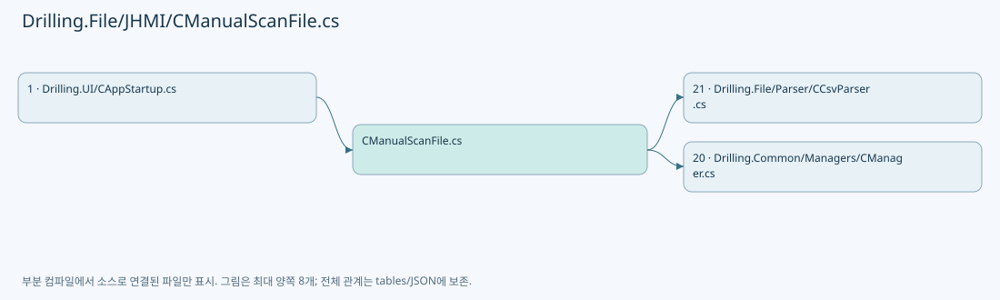

## 네임스페이스·타입·상속

| 타입 | 구분 | 원본 범위 | 선언/상속 |
| --- | --- | --- | --- |
| CManualScanFile | ClassDeclaration | 11–511 | CManualScanFile: CManualScanFileBase |

## 멤버 빠른 목록

| 이름 | 종류 | 범위 | 서명 |
| --- | --- | --- | --- |
| DefaultSettingName | FieldDeclaration | L13–13 | string Drilling.File.JHMI.CManualScanFile.DefaultSettingName |
| ValueHeaders | FieldDeclaration | L14–14 | System.Collections.Generic.IReadOnlyList<string> Drilling.File.JHMI.CManualScanFile.ValueHeaders |
| LaserActionParameterNames | FieldDeclaration | L15–15 | string[] Drilling.File.JHMI.CManualScanFile.LaserActionParameterNames |
| _manualDirectory | FieldDeclaration | L16–16 | string Drilling.File.JHMI.CManualScanFile._manualDirectory |
| List | MethodDeclaration | L17–37 | System.Threading.Tasks.Task<System.Collections.Generic.IReadOnlyList<string>> Drilling.File.JHMI.CManualScanFile.List(System.Threading.CancellationToken) |
| ShouldIncludeItem | LocalFunctionStatement | L25–28 | bool ShouldIncludeItem(string?) |
| SelectName | LocalFunctionStatement | L30–33 | string SelectName(string) |
| LoadForm | MethodDeclaration | L39–43 | System.Threading.Tasks.Task<System.Collections.Generic.IReadOnlyList<Drilling.Common.Managers.ST_MANUAL_SCAN_FORM>> Drilling.File.JHMI.CManualScanFile.LoadForm(System.Threading.CancellationToken) |
| Load | MethodDeclaration | L45–48 | System.Threading.Tasks.Task<Drilling.Common.Managers.ST_MANUAL_SCAN_PARAM> Drilling.File.JHMI.CManualScanFile.Load(System.Threading.CancellationToken) |
| Load | MethodDeclaration | L50–92 | System.Threading.Tasks.Task<Drilling.Common.Managers.ST_MANUAL_SCAN_PARAM> Drilling.File.JHMI.CManualScanFile.Load(string, System.Threading.CancellationToken) |
| ShouldIncludeItem | LocalFunctionStatement | L54–57 | bool ShouldIncludeItem(System.Collections.Generic.IReadOnlyDictionary<string, string>) |
| SelectDictionaryKey | LocalFunctionStatement | L59–62 | string SelectDictionaryKey(System.Collections.Generic.IReadOnlyDictionary<string, string>) |
| SelectValue | LocalFunctionStatement | L64–67 | string SelectValue(System.Collections.Generic.IReadOnlyDictionary<string, string>) |
| Save | MethodDeclaration | L94–97 | System.Threading.Tasks.Task Drilling.File.JHMI.CManualScanFile.Save(Drilling.Common.Managers.ST_MANUAL_SCAN_PARAM, System.Threading.CancellationToken) |
| Save | MethodDeclaration | L99–149 | System.Threading.Tasks.Task Drilling.File.JHMI.CManualScanFile.Save(string, Drilling.Common.Managers.ST_MANUAL_SCAN_PARAM, System.Threading.CancellationToken) |
| IsUse | LocalFunctionStatement | L126–129 | bool IsUse(Drilling.Common.Managers.ST_MANUAL_SCAN_FORM) |
| SelectDisplayOrder | LocalFunctionStatement | L131–134 | int SelectDisplayOrder(Drilling.Common.Managers.ST_MANUAL_SCAN_FORM) |
| BuildManualSettingValueRow | LocalFunctionStatement | L136–143 | System.Collections.Generic.Dictionary<string, string> BuildManualSettingValueRow(Drilling.Common.Managers.ST_MANUAL_SCAN_FORM) |
| Rename | MethodDeclaration | L151–169 | System.Threading.Tasks.Task Drilling.File.JHMI.CManualScanFile.Rename(string, string, System.Threading.CancellationToken) |
| Delete | MethodDeclaration | L171–181 | System.Threading.Tasks.Task Drilling.File.JHMI.CManualScanFile.Delete(string, System.Threading.CancellationToken) |
| GetDefaultSettingName | MethodDeclaration | L183–196 | string Drilling.File.JHMI.CManualScanFile.GetDefaultSettingName() |
| MatchesItem | LocalFunctionStatement | L190–193 | bool MatchesItem(string?) |
| LoadFormItems | MethodDeclaration | L198–252 | System.Collections.Generic.IReadOnlyList<Drilling.Common.Managers.ST_MANUAL_SCAN_FORM> Drilling.File.JHMI.CManualScanFile.LoadFormItems() |
| BuildManual | LocalFunctionStatement | L200–218 | Drilling.Common.Managers.ST_MANUAL_SCAN_FORM BuildManual(System.Collections.Generic.IReadOnlyDictionary<string, string>, int) |
| ShouldIncludeItem | LocalFunctionStatement | L220–223 | bool ShouldIncludeItem(Drilling.Common.Managers.ST_MANUAL_SCAN_FORM) |
| ValidateSavedSetting | MethodDeclaration | L254–285 | void Drilling.File.JHMI.CManualScanFile.ValidateSavedSetting(string, System.Collections.Generic.IReadOnlyDictionary<string, string>, System.Threading.CancellationToken) |
| ShouldIncludeItem | LocalFunctionStatement | L257–260 | bool ShouldIncludeItem(System.Collections.Generic.IReadOnlyDictionary<string, string>) |
| SelectDictionaryKey | LocalFunctionStatement | L262–265 | string SelectDictionaryKey(System.Collections.Generic.IReadOnlyDictionary<string, string>) |
| SelectValue | LocalFunctionStatement | L267–270 | string SelectValue(System.Collections.Generic.IReadOnlyDictionary<string, string>) |
| ValidateValues | MethodDeclaration | L287–324 | void Drilling.File.JHMI.CManualScanFile.ValidateValues(System.Collections.Generic.IReadOnlyList<Drilling.Common.Managers.ST_MANUAL_SCAN_FORM>, System.Collections.Generic.IReadOnlyDictionary<string, string>) |
| IsUse | LocalFunctionStatement | L289–292 | bool IsUse(Drilling.Common.Managers.ST_MANUAL_SCAN_FORM) |
| SelectName | LocalFunctionStatement | L294–297 | string SelectName(Drilling.Common.Managers.ST_MANUAL_SCAN_FORM) |
| ValidateIntParameter | MethodDeclaration | L326–334 | string Drilling.File.JHMI.CManualScanFile.ValidateIntParameter(Drilling.Common.Managers.ST_MANUAL_SCAN_FORM, string) |
| ValidateDoubleParameter | MethodDeclaration | L336–344 | string Drilling.File.JHMI.CManualScanFile.ValidateDoubleParameter(Drilling.Common.Managers.ST_MANUAL_SCAN_FORM, string) |
| ValidateBoolParameter | MethodDeclaration | L346–350 | string Drilling.File.JHMI.CManualScanFile.ValidateBoolParameter(Drilling.Common.Managers.ST_MANUAL_SCAN_FORM, string) |
| ValidateNumericRange | MethodDeclaration | L352–360 | string Drilling.File.JHMI.CManualScanFile.ValidateNumericRange(Drilling.Common.Managers.ST_MANUAL_SCAN_FORM, double) |
| ReadDouble | MethodDeclaration | L362–366 | double Drilling.File.JHMI.CManualScanFile.ReadDouble(System.Collections.Generic.IReadOnlyDictionary<string, string>, System.Collections.Generic.IReadOnlyList<Drilling.Common.Managers.ST_MANUAL_SCAN_FORM>, string, double) |
| ReadInt | MethodDeclaration | L368–372 | int Drilling.File.JHMI.CManualScanFile.ReadInt(System.Collections.Generic.IReadOnlyDictionary<string, string>, System.Collections.Generic.IReadOnlyList<Drilling.Common.Managers.ST_MANUAL_SCAN_FORM>, string, int) |
| ReadLaserActionDouble | MethodDeclaration | L374–380 | double Drilling.File.JHMI.CManualScanFile.ReadLaserActionDouble(System.Collections.Generic.IReadOnlyDictionary<string, string>, System.Collections.Generic.IReadOnlyList<Drilling.Common.Managers.ST_MANUAL_SCAN_FORM>, string, double) |
| ReadLaserActionCount | MethodDeclaration | L382–388 | int Drilling.File.JHMI.CManualScanFile.ReadLaserActionCount(System.Collections.Generic.IReadOnlyDictionary<string, string>, System.Collections.Generic.IReadOnlyList<Drilling.Common.Managers.ST_MANUAL_SCAN_FORM>, string, int) |
| NormalizeLaserOnMode | MethodDeclaration | L390–394 | string Drilling.File.JHMI.CManualScanFile.NormalizeLaserOnMode(string) |
| ReadDoubleValue | MethodDeclaration | L396–399 | double Drilling.File.JHMI.CManualScanFile.ReadDoubleValue(string, double) |
| ReadString | MethodDeclaration | L401–409 | string Drilling.File.JHMI.CManualScanFile.ReadString(System.Collections.Generic.IReadOnlyDictionary<string, string>, System.Collections.Generic.IReadOnlyList<Drilling.Common.Managers.ST_MANUAL_SCAN_FORM>, string, string) |
| MatchesItem | LocalFunctionStatement | L403–406 | bool MatchesItem(Drilling.Common.Managers.ST_MANUAL_SCAN_FORM) |
| GetFormPath | MethodDeclaration | L411–414 | string Drilling.File.JHMI.CManualScanFile.GetFormPath() |
| GetSettingPath | MethodDeclaration | L416–419 | string Drilling.File.JHMI.CManualScanFile.GetSettingPath(string) |
| NormalizeSettingName | MethodDeclaration | L421–435 | string Drilling.File.JHMI.CManualScanFile.NormalizeSettingName(string) |
| ReadDataType | MethodDeclaration | L437–446 | Drilling.Common.Managers.EN_RECIPE_DATA_TYPE Drilling.File.JHMI.CManualScanFile.ReadDataType(string) |
| ReadBool | MethodDeclaration | L448–456 | bool Drilling.File.JHMI.CManualScanFile.ReadBool(string, bool) |
| ReadInt | MethodDeclaration | L458–461 | int Drilling.File.JHMI.CManualScanFile.ReadInt(string, int) |
| GetOrDefault | MethodDeclaration | L463–466 | string Drilling.File.JHMI.CManualScanFile.GetOrDefault(string, string) |
| CreateFallbackFormItems | MethodDeclaration | L468–510 | System.Collections.Generic.IReadOnlyList<Drilling.Common.Managers.ST_MANUAL_SCAN_FORM> Drilling.File.JHMI.CManualScanFile.CreateFallbackFormItems() |

## 멤버별 상세 계약·호출·처리 해설

### FieldDeclaration `DefaultSettingName` · L13–13

[Drilling.File/JHMI/CManualScanFile.cs:13–13](https://github.com/kjuws10-rgb/A3Drilling/blob/5aee8e58439c9b455cae7c9593c9be986c3e682e/Drilling.File/JHMI/CManualScanFile.cs#L13-L13)

| 항목 | 실제 추출 값 |
| --- | --- |
| 서명 | string Drilling.File.JHMI.CManualScanFile.DefaultSettingName |
| 접근/수식자 | Private / private, const |
| 반환/값 타입 | string |
| 소속 타입 | NamedType:Drilling.File.JHMI.CManualScanFile |

현재 부분 분석에서 직접 연결된 호출자는 없습니다. XAML/이벤트/인터페이스·델리게이트·외부 진입을 추가 확인해야 하며, 미사용으로 판정한 것이 아닙니다.

본문의 실제 연산·분기·예외·반환 순서(원문 위치 순):

| 원본 행 | 종류 | 주석 해설 |
| --- | --- | --- |
| 13 | variable-initializer | 변수의 초기값을 지정합니다: DefaultSettingName = "CIRCLE_TEST.scan" |

변경 전 점검: 입력/반환 타입, 위 호출자, 예외/취소 경로, 공유 상태와 저장·전송 소비자를 함께 확인합니다. 값의 단위나 물리 방향을 이름만으로 확정하지 않습니다.

### FieldDeclaration `ValueHeaders` · L14–14

[Drilling.File/JHMI/CManualScanFile.cs:14–14](https://github.com/kjuws10-rgb/A3Drilling/blob/5aee8e58439c9b455cae7c9593c9be986c3e682e/Drilling.File/JHMI/CManualScanFile.cs#L14-L14)

| 항목 | 실제 추출 값 |
| --- | --- |
| 서명 | System.Collections.Generic.IReadOnlyList<string> Drilling.File.JHMI.CManualScanFile.ValueHeaders |
| 접근/수식자 | Private / private, static, readonly |
| 반환/값 타입 | System.Collections.Generic.IReadOnlyList<string> |
| 소속 타입 | NamedType:Drilling.File.JHMI.CManualScanFile |

현재 부분 분석에서 직접 연결된 호출자는 없습니다. XAML/이벤트/인터페이스·델리게이트·외부 진입을 추가 확인해야 하며, 미사용으로 판정한 것이 아닙니다.

본문의 실제 연산·분기·예외·반환 순서(원문 위치 순):

| 원본 행 | 종류 | 주석 해설 |
| --- | --- | --- |
| 14 | variable-initializer | 변수의 초기값을 지정합니다: ValueHeaders = ["NAME", "VALUE"] |

변경 전 점검: 입력/반환 타입, 위 호출자, 예외/취소 경로, 공유 상태와 저장·전송 소비자를 함께 확인합니다. 값의 단위나 물리 방향을 이름만으로 확정하지 않습니다.

### FieldDeclaration `LaserActionParameterNames` · L15–15

[Drilling.File/JHMI/CManualScanFile.cs:15–15](https://github.com/kjuws10-rgb/A3Drilling/blob/5aee8e58439c9b455cae7c9593c9be986c3e682e/Drilling.File/JHMI/CManualScanFile.cs#L15-L15)

| 항목 | 실제 추출 값 |
| --- | --- |
| 서명 | string[] Drilling.File.JHMI.CManualScanFile.LaserActionParameterNames |
| 접근/수식자 | Private / private, static, readonly |
| 반환/값 타입 | string[] |
| 소속 타입 | NamedType:Drilling.File.JHMI.CManualScanFile |

현재 부분 분석에서 직접 연결된 호출자는 없습니다. XAML/이벤트/인터페이스·델리게이트·외부 진입을 추가 확인해야 하며, 미사용으로 판정한 것이 아닙니다.

본문의 실제 연산·분기·예외·반환 순서(원문 위치 순):

| 원본 행 | 종류 | 주석 해설 |
| --- | --- | --- |
| 15 | variable-initializer | 변수의 초기값을 지정합니다: LaserActionParameterNames = ["LaserOnMode", "Time", "Count", "RepeatCount", "RepeatDelayTime"] |

변경 전 점검: 입력/반환 타입, 위 호출자, 예외/취소 경로, 공유 상태와 저장·전송 소비자를 함께 확인합니다. 값의 단위나 물리 방향을 이름만으로 확정하지 않습니다.

### FieldDeclaration `_manualDirectory` · L16–16

[Drilling.File/JHMI/CManualScanFile.cs:16–16](https://github.com/kjuws10-rgb/A3Drilling/blob/5aee8e58439c9b455cae7c9593c9be986c3e682e/Drilling.File/JHMI/CManualScanFile.cs#L16-L16)

| 항목 | 실제 추출 값 |
| --- | --- |
| 서명 | string Drilling.File.JHMI.CManualScanFile._manualDirectory |
| 접근/수식자 | Private / private, readonly |
| 반환/값 타입 | string |
| 소속 타입 | NamedType:Drilling.File.JHMI.CManualScanFile |

현재 부분 분석에서 직접 연결된 호출자는 없습니다. XAML/이벤트/인터페이스·델리게이트·외부 진입을 추가 확인해야 하며, 미사용으로 판정한 것이 아닙니다.

호출하는 대상과 해석 범위:

| 원본 행 | 표현식 | 분석 상태 | 대상/소스 위치 |
| --- | --- | --- | --- |
| 16 | Path.Combine | resolved | string System.IO.Path.Combine(string, string) |

본문의 실제 연산·분기·예외·반환 순서(원문 위치 순):

| 원본 행 | 종류 | 주석 해설 |
| --- | --- | --- |
| 16 | call | 함수·델리게이트 또는 객체 생성자를 호출합니다: Path.Combine(configRoot, "Manual") |
| 16 | variable-initializer | 변수의 초기값을 지정합니다: _manualDirectory = Path.Combine(configRoot, "Manual") |

변경 전 점검: 입력/반환 타입, 위 호출자, 예외/취소 경로, 공유 상태와 저장·전송 소비자를 함께 확인합니다. 값의 단위나 물리 방향을 이름만으로 확정하지 않습니다.

### MethodDeclaration `List` · L17–37

[Drilling.File/JHMI/CManualScanFile.cs:17–37](https://github.com/kjuws10-rgb/A3Drilling/blob/5aee8e58439c9b455cae7c9593c9be986c3e682e/Drilling.File/JHMI/CManualScanFile.cs#L17-L37)

| 항목 | 실제 추출 값 |
| --- | --- |
| 서명 | System.Threading.Tasks.Task<System.Collections.Generic.IReadOnlyList<string>> Drilling.File.JHMI.CManualScanFile.List(System.Threading.CancellationToken) |
| 접근/수식자 | Public / public, override |
| 반환/값 타입 | System.Threading.Tasks.Task<System.Collections.Generic.IReadOnlyList<string>> |
| 소속 타입 | NamedType:Drilling.File.JHMI.CManualScanFile |

입력 계약:

| 이름 | 타입 | 전달 | 선택/기본값 |
| --- | --- | --- | --- |
| cancellationToken | System.Threading.CancellationToken | None | True / null |

현재 부분 분석에서 직접 연결된 호출자는 없습니다. XAML/이벤트/인터페이스·델리게이트·외부 진입을 추가 확인해야 하며, 미사용으로 판정한 것이 아닙니다.

호출하는 대상과 해석 범위:

| 원본 행 | 표현식 | 분석 상태 | 대상/소스 위치 |
| --- | --- | --- | --- |
| 19 | cancellationToken.ThrowIfCancellationRequested | resolved | void System.Threading.CancellationToken.ThrowIfCancellationRequested() |
| 20 | Directory.Exists | resolved | bool System.IO.Directory.Exists(string?) |
| 22 | Task.FromResult<IReadOnlyList<string>> | resolved | System.Threading.Tasks.Task<System.Collections.Generic.IReadOnlyList<string>> System.Threading.Tasks.Task.FromResult<System.Collections.Generic.IReadOnlyList<string>>(System.Collections.Generic.IReadOnlyList<string>) |
| 35 | Directory.EnumerateFiles(_manualDirectory, "*.scan").Select(Path.GetFileName).Where(ShouldIncludeItem).Cast<string>().OrderBy(SelectName, StringComparer.OrdinalIgnoreCase).ToArray | resolved | string[] System.Collections.Generic.IEnumerable<string>.ToArray<string>() |
| 35 | Directory.EnumerateFiles(_manualDirectory, "*.scan").Select(Path.GetFileName).Where(ShouldIncludeItem).Cast<string>().OrderBy | resolved | System.Linq.IOrderedEnumerable<string> System.Collections.Generic.IEnumerable<string>.OrderBy<string, string>(System.Func<string, string>, System.Collections.Generic.IComparer<string>?) |
| 35 | Directory.EnumerateFiles(_manualDirectory, "*.scan").Select(Path.GetFileName).Where(ShouldIncludeItem).Cast<string> | resolved | System.Collections.Generic.IEnumerable<string> System.Collections.IEnumerable.Cast<string>() |
| 35 | Directory.EnumerateFiles(_manualDirectory, "*.scan").Select(Path.GetFileName).Where | resolved | System.Collections.Generic.IEnumerable<string?> System.Collections.Generic.IEnumerable<string?>.Where<string?>(System.Func<string?, bool>) |
| 35 | Directory.EnumerateFiles(_manualDirectory, "*.scan").Select | resolved | System.Collections.Generic.IEnumerable<string?> System.Collections.Generic.IEnumerable<string>.Select<string, string?>(System.Func<string, string?>) |
| 35 | Directory.EnumerateFiles | resolved | System.Collections.Generic.IEnumerable<string> System.IO.Directory.EnumerateFiles(string, string) |
| 36 | Task.FromResult<IReadOnlyList<string>> | resolved | System.Threading.Tasks.Task<System.Collections.Generic.IReadOnlyList<string>> System.Threading.Tasks.Task.FromResult<System.Collections.Generic.IReadOnlyList<string>>(System.Collections.Generic.IReadOnlyList<string>) |

본문의 실제 연산·분기·예외·반환 순서(원문 위치 순):

| 원본 행 | 종류 | 주석 해설 |
| --- | --- | --- |
| 19 | call | 함수·델리게이트 또는 객체 생성자를 호출합니다: cancellationToken.ThrowIfCancellationRequested() |
| 20 | call | 함수·델리게이트 또는 객체 생성자를 호출합니다: Directory.Exists(_manualDirectory) |
| 20 | if | 조건에 따라 분기합니다: if (!Directory.Exists(_manualDirectory)) |
| 22 | call | 함수·델리게이트 또는 객체 생성자를 호출합니다: Task.FromResult<IReadOnlyList<string>>([]) |
| 22 | return | 호출자에게 값 또는 제어를 반환합니다: return Task.FromResult<IReadOnlyList<string>>([]); |
| 35 | call | 함수·델리게이트 또는 객체 생성자를 호출합니다: Directory.EnumerateFiles(_manualDirectory, "*.scan").Select(Path.GetFileName).Where(ShouldIncludeItem).Cast<string>().OrderBy(SelectName, StringComparer.OrdinalIgnoreCase).ToArray() |
| 35 | call | 함수·델리게이트 또는 객체 생성자를 호출합니다: Directory.EnumerateFiles(_manualDirectory, "*.scan").Select(Path.GetFileName).Where(ShouldIncludeItem).Cast<string>().OrderBy(SelectName, StringComparer.OrdinalIgnoreCase) |
| 35 | call | 함수·델리게이트 또는 객체 생성자를 호출합니다: Directory.EnumerateFiles(_manualDirectory, "*.scan").Select(Path.GetFileName).Where(ShouldIncludeItem).Cast<string>() |
| 35 | call | 함수·델리게이트 또는 객체 생성자를 호출합니다: Directory.EnumerateFiles(_manualDirectory, "*.scan").Select(Path.GetFileName).Where(ShouldIncludeItem) |
| 35 | call | 함수·델리게이트 또는 객체 생성자를 호출합니다: Directory.EnumerateFiles(_manualDirectory, "*.scan").Select(Path.GetFileName) |
| 35 | call | 함수·델리게이트 또는 객체 생성자를 호출합니다: Directory.EnumerateFiles(_manualDirectory, "*.scan") |
| 35 | local-declaration | 지역 변수를 선언합니다: var settingNames = Directory.EnumerateFiles(_manualDirectory, "*.scan").Select(Path.GetFileName).Where(ShouldIncludeItem).Cast<string>().OrderBy(SelectName, StringComparer.OrdinalIgnoreCase).ToArray(); |
| 35 | variable-initializer | 변수의 초기값을 지정합니다: settingNames = Directory.EnumerateFiles(_manualDirectory, "*.scan").Select(Path.GetFileName).Where(ShouldIncludeItem).Cast<string>().OrderBy(SelectName, StringComparer.OrdinalIgnoreCase).ToArray() |
| 36 | call | 함수·델리게이트 또는 객체 생성자를 호출합니다: Task.FromResult<IReadOnlyList<string>>(settingNames) |
| 36 | return | 호출자에게 값 또는 제어를 반환합니다: return Task.FromResult<IReadOnlyList<string>>(settingNames); |

제어 구문의 포함 구조(실제 실행 순서/CFG가 아닌 구문 탐색 그림):

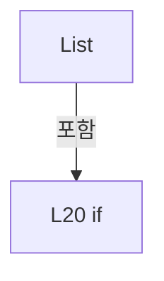

변경 전 점검: 입력/반환 타입, 위 호출자, 예외/취소 경로, 공유 상태와 저장·전송 소비자를 함께 확인합니다. 값의 단위나 물리 방향을 이름만으로 확정하지 않습니다.

### LocalFunctionStatement `ShouldIncludeItem` · L25–28

[Drilling.File/JHMI/CManualScanFile.cs:25–28](https://github.com/kjuws10-rgb/A3Drilling/blob/5aee8e58439c9b455cae7c9593c9be986c3e682e/Drilling.File/JHMI/CManualScanFile.cs#L25-L28)

| 항목 | 실제 추출 값 |
| --- | --- |
| 서명 | bool ShouldIncludeItem(string?) |
| 접근/수식자 | Private /  |
| 반환/값 타입 | bool |
| 소속 타입 | NamedType:Drilling.File.JHMI.CManualScanFile |

입력 계약:

| 이름 | 타입 | 전달 | 선택/기본값 |
| --- | --- | --- | --- |
| name | string? | None | False /  |

현재 부분 분석에서 직접 연결된 호출자는 없습니다. XAML/이벤트/인터페이스·델리게이트·외부 진입을 추가 확인해야 하며, 미사용으로 판정한 것이 아닙니다.

호출하는 대상과 해석 범위:

| 원본 행 | 표현식 | 분석 상태 | 대상/소스 위치 |
| --- | --- | --- | --- |
| 27 | string.IsNullOrWhiteSpace | resolved | bool string.IsNullOrWhiteSpace(string?) |

본문의 실제 연산·분기·예외·반환 순서(원문 위치 순):

| 원본 행 | 종류 | 주석 해설 |
| --- | --- | --- |
| 27 | call | 함수·델리게이트 또는 객체 생성자를 호출합니다: string.IsNullOrWhiteSpace(name) |
| 27 | return | 호출자에게 값 또는 제어를 반환합니다: return !string.IsNullOrWhiteSpace(name); |

변경 전 점검: 입력/반환 타입, 위 호출자, 예외/취소 경로, 공유 상태와 저장·전송 소비자를 함께 확인합니다. 값의 단위나 물리 방향을 이름만으로 확정하지 않습니다.

### LocalFunctionStatement `SelectName` · L30–33

[Drilling.File/JHMI/CManualScanFile.cs:30–33](https://github.com/kjuws10-rgb/A3Drilling/blob/5aee8e58439c9b455cae7c9593c9be986c3e682e/Drilling.File/JHMI/CManualScanFile.cs#L30-L33)

| 항목 | 실제 추출 값 |
| --- | --- |
| 서명 | string SelectName(string) |
| 접근/수식자 | Private /  |
| 반환/값 타입 | string |
| 소속 타입 | NamedType:Drilling.File.JHMI.CManualScanFile |

입력 계약:

| 이름 | 타입 | 전달 | 선택/기본값 |
| --- | --- | --- | --- |
| name | string | None | False /  |

현재 부분 분석에서 직접 연결된 호출자는 없습니다. XAML/이벤트/인터페이스·델리게이트·외부 진입을 추가 확인해야 하며, 미사용으로 판정한 것이 아닙니다.

본문의 실제 연산·분기·예외·반환 순서(원문 위치 순):

| 원본 행 | 종류 | 주석 해설 |
| --- | --- | --- |
| 32 | return | 호출자에게 값 또는 제어를 반환합니다: return name; |

변경 전 점검: 입력/반환 타입, 위 호출자, 예외/취소 경로, 공유 상태와 저장·전송 소비자를 함께 확인합니다. 값의 단위나 물리 방향을 이름만으로 확정하지 않습니다.

### MethodDeclaration `LoadForm` · L39–43

[Drilling.File/JHMI/CManualScanFile.cs:39–43](https://github.com/kjuws10-rgb/A3Drilling/blob/5aee8e58439c9b455cae7c9593c9be986c3e682e/Drilling.File/JHMI/CManualScanFile.cs#L39-L43)

| 항목 | 실제 추출 값 |
| --- | --- |
| 서명 | System.Threading.Tasks.Task<System.Collections.Generic.IReadOnlyList<Drilling.Common.Managers.ST_MANUAL_SCAN_FORM>> Drilling.File.JHMI.CManualScanFile.LoadForm(System.Threading.CancellationToken) |
| 접근/수식자 | Public / public, override |
| 반환/값 타입 | System.Threading.Tasks.Task<System.Collections.Generic.IReadOnlyList<Drilling.Common.Managers.ST_MANUAL_SCAN_FORM>> |
| 소속 타입 | NamedType:Drilling.File.JHMI.CManualScanFile |

입력 계약:

| 이름 | 타입 | 전달 | 선택/기본값 |
| --- | --- | --- | --- |
| cancellationToken | System.Threading.CancellationToken | None | True / null |

현재 부분 분석에서 직접 연결된 호출자는 없습니다. XAML/이벤트/인터페이스·델리게이트·외부 진입을 추가 확인해야 하며, 미사용으로 판정한 것이 아닙니다.

호출하는 대상과 해석 범위:

| 원본 행 | 표현식 | 분석 상태 | 대상/소스 위치 |
| --- | --- | --- | --- |
| 41 | cancellationToken.ThrowIfCancellationRequested | resolved | void System.Threading.CancellationToken.ThrowIfCancellationRequested() |
| 42 | Task.FromResult | resolved | System.Threading.Tasks.Task<System.Collections.Generic.IReadOnlyList<Drilling.Common.Managers.ST_MANUAL_SCAN_FORM>> System.Threading.Tasks.Task.FromResult<System.Collections.Generic.IReadOnlyList<Drilling.Common.Managers.ST_MANUAL_SCAN_FORM>>(System.Collections.Generic.IReadOnlyList<Drilling.Common.Managers.ST_MANUAL_SCAN_FORM>) |
| 42 | LoadFormItems | resolved | System.Collections.Generic.IReadOnlyList<Drilling.Common.Managers.ST_MANUAL_SCAN_FORM> Drilling.File.JHMI.CManualScanFile.LoadFormItems() · Drilling.File/JHMI/CManualScanFile.cs:198 |

본문의 실제 연산·분기·예외·반환 순서(원문 위치 순):

| 원본 행 | 종류 | 주석 해설 |
| --- | --- | --- |
| 41 | call | 함수·델리게이트 또는 객체 생성자를 호출합니다: cancellationToken.ThrowIfCancellationRequested() |
| 42 | call | 함수·델리게이트 또는 객체 생성자를 호출합니다: Task.FromResult(LoadFormItems()) |
| 42 | call | 함수·델리게이트 또는 객체 생성자를 호출합니다: LoadFormItems() |
| 42 | return | 호출자에게 값 또는 제어를 반환합니다: return Task.FromResult(LoadFormItems()); |

변경 전 점검: 입력/반환 타입, 위 호출자, 예외/취소 경로, 공유 상태와 저장·전송 소비자를 함께 확인합니다. 값의 단위나 물리 방향을 이름만으로 확정하지 않습니다.

### MethodDeclaration `Load` · L45–48

[Drilling.File/JHMI/CManualScanFile.cs:45–48](https://github.com/kjuws10-rgb/A3Drilling/blob/5aee8e58439c9b455cae7c9593c9be986c3e682e/Drilling.File/JHMI/CManualScanFile.cs#L45-L48)

| 항목 | 실제 추출 값 |
| --- | --- |
| 서명 | System.Threading.Tasks.Task<Drilling.Common.Managers.ST_MANUAL_SCAN_PARAM> Drilling.File.JHMI.CManualScanFile.Load(System.Threading.CancellationToken) |
| 접근/수식자 | Public / public, override |
| 반환/값 타입 | System.Threading.Tasks.Task<Drilling.Common.Managers.ST_MANUAL_SCAN_PARAM> |
| 소속 타입 | NamedType:Drilling.File.JHMI.CManualScanFile |

입력 계약:

| 이름 | 타입 | 전달 | 선택/기본값 |
| --- | --- | --- | --- |
| cancellationToken | System.Threading.CancellationToken | None | True / null |

현재 부분 분석에서 직접 연결된 호출자는 없습니다. XAML/이벤트/인터페이스·델리게이트·외부 진입을 추가 확인해야 하며, 미사용으로 판정한 것이 아닙니다.

호출하는 대상과 해석 범위:

| 원본 행 | 표현식 | 분석 상태 | 대상/소스 위치 |
| --- | --- | --- | --- |
| 47 | Load | resolved · 동적 구현 선택 가능 | System.Threading.Tasks.Task<Drilling.Common.Managers.ST_MANUAL_SCAN_PARAM> Drilling.File.JHMI.CManualScanFile.Load(string, System.Threading.CancellationToken) · Drilling.File/JHMI/CManualScanFile.cs:50 |
| 47 | GetDefaultSettingName | resolved | string Drilling.File.JHMI.CManualScanFile.GetDefaultSettingName() · Drilling.File/JHMI/CManualScanFile.cs:183 |

본문의 실제 연산·분기·예외·반환 순서(원문 위치 순):

| 원본 행 | 종류 | 주석 해설 |
| --- | --- | --- |
| 47 | call | 함수·델리게이트 또는 객체 생성자를 호출합니다: Load(GetDefaultSettingName(), cancellationToken) |
| 47 | call | 함수·델리게이트 또는 객체 생성자를 호출합니다: GetDefaultSettingName() |
| 47 | return | 호출자에게 값 또는 제어를 반환합니다: return Load(GetDefaultSettingName(), cancellationToken); |

변경 전 점검: 입력/반환 타입, 위 호출자, 예외/취소 경로, 공유 상태와 저장·전송 소비자를 함께 확인합니다. 값의 단위나 물리 방향을 이름만으로 확정하지 않습니다.

### MethodDeclaration `Load` · L50–92

[Drilling.File/JHMI/CManualScanFile.cs:50–92](https://github.com/kjuws10-rgb/A3Drilling/blob/5aee8e58439c9b455cae7c9593c9be986c3e682e/Drilling.File/JHMI/CManualScanFile.cs#L50-L92)

| 항목 | 실제 추출 값 |
| --- | --- |
| 서명 | System.Threading.Tasks.Task<Drilling.Common.Managers.ST_MANUAL_SCAN_PARAM> Drilling.File.JHMI.CManualScanFile.Load(string, System.Threading.CancellationToken) |
| 접근/수식자 | Public / public, override |
| 반환/값 타입 | System.Threading.Tasks.Task<Drilling.Common.Managers.ST_MANUAL_SCAN_PARAM> |
| 소속 타입 | NamedType:Drilling.File.JHMI.CManualScanFile |

입력 계약:

| 이름 | 타입 | 전달 | 선택/기본값 |
| --- | --- | --- | --- |
| settingName | string | None | False /  |
| cancellationToken | System.Threading.CancellationToken | None | True / null |

정적 호출자로 확인된 위치:

| 호출 파일/행 | 호출 표현식 | 런타임 분기 가능 |
| --- | --- | --- |
| [Drilling.File/JHMI/CManualScanFile.cs:47–47](https://github.com/kjuws10-rgb/A3Drilling/blob/5aee8e58439c9b455cae7c9593c9be986c3e682e/Drilling.File/JHMI/CManualScanFile.cs#L47-L47) | Load | True |

호출하는 대상과 해석 범위:

| 원본 행 | 표현식 | 분석 상태 | 대상/소스 위치 |
| --- | --- | --- | --- |
| 52 | cancellationToken.ThrowIfCancellationRequested | resolved | void System.Threading.CancellationToken.ThrowIfCancellationRequested() |
| 53 | LoadFormItems | resolved | System.Collections.Generic.IReadOnlyList<Drilling.Common.Managers.ST_MANUAL_SCAN_FORM> Drilling.File.JHMI.CManualScanFile.LoadFormItems() · Drilling.File/JHMI/CManualScanFile.cs:198 |
| 69 | CCsvParser.Read(GetSettingPath(settingName)).Where(ShouldIncludeItem).ToDictionary | resolved | System.Collections.Generic.Dictionary<string, string> System.Collections.Generic.IEnumerable<System.Collections.Generic.IReadOnlyDictionary<string, string>>.ToDictionary<System.Collections.Generic.IReadOnlyDictionary<string, string>, string, string>(System.Func<System.Collections.Generic.IReadOnlyDictionary<string, string>, string>, System.Func<System.Collections.Generic.IReadOnlyDictionary<string, string>, string>, System.Collections.Generic.IEqualityComparer<string>?) |
| 69 | CCsvParser.Read(GetSettingPath(settingName)).Where | resolved | System.Collections.Generic.IEnumerable<System.Collections.Generic.IReadOnlyDictionary<string, string>> System.Collections.Generic.IEnumerable<System.Collections.Generic.IReadOnlyDictionary<string, string>>.Where<System.Collections.Generic.IReadOnlyDictionary<string, string>>(System.Func<System.Collections.Generic.IReadOnlyDictionary<string, string>, bool>) |
| 69 | CCsvParser.Read | resolved | System.Collections.Generic.IReadOnlyList<System.Collections.Generic.IReadOnlyDictionary<string, string>> Drilling.File.Parser.CCsvParser.Read(string) · Drilling.File/Parser/CCsvParser.cs:12 |
| 69 | GetSettingPath | resolved | string Drilling.File.JHMI.CManualScanFile.GetSettingPath(string) · Drilling.File/JHMI/CManualScanFile.cs:416 |
| 70 | new ST_MANUAL_SCAN_PARAM | resolved | Drilling.Common.Managers.ST_MANUAL_SCAN_PARAM.ST_MANUAL_SCAN_PARAM(double, double, double, string, string, double, double, double, double, double, double, double, double, int, int, int, string, int, double) · Drilling.Common/Managers/CManager.cs:665 |
| 71 | ReadDouble | resolved | double Drilling.File.JHMI.CManualScanFile.ReadDouble(System.Collections.Generic.IReadOnlyDictionary<string, string>, System.Collections.Generic.IReadOnlyList<Drilling.Common.Managers.ST_MANUAL_SCAN_FORM>, string, double) · Drilling.File/JHMI/CManualScanFile.cs:362 |
| 72 | ReadDouble | resolved | double Drilling.File.JHMI.CManualScanFile.ReadDouble(System.Collections.Generic.IReadOnlyDictionary<string, string>, System.Collections.Generic.IReadOnlyList<Drilling.Common.Managers.ST_MANUAL_SCAN_FORM>, string, double) · Drilling.File/JHMI/CManualScanFile.cs:362 |
| 73 | ReadDouble | resolved | double Drilling.File.JHMI.CManualScanFile.ReadDouble(System.Collections.Generic.IReadOnlyDictionary<string, string>, System.Collections.Generic.IReadOnlyList<Drilling.Common.Managers.ST_MANUAL_SCAN_FORM>, string, double) · Drilling.File/JHMI/CManualScanFile.cs:362 |
| 74 | ReadString | resolved | string Drilling.File.JHMI.CManualScanFile.ReadString(System.Collections.Generic.IReadOnlyDictionary<string, string>, System.Collections.Generic.IReadOnlyList<Drilling.Common.Managers.ST_MANUAL_SCAN_FORM>, string, string) · Drilling.File/JHMI/CManualScanFile.cs:401 |
| 75 | ReadString | resolved | string Drilling.File.JHMI.CManualScanFile.ReadString(System.Collections.Generic.IReadOnlyDictionary<string, string>, System.Collections.Generic.IReadOnlyList<Drilling.Common.Managers.ST_MANUAL_SCAN_FORM>, string, string) · Drilling.File/JHMI/CManualScanFile.cs:401 |
| 76 | ReadDouble | resolved | double Drilling.File.JHMI.CManualScanFile.ReadDouble(System.Collections.Generic.IReadOnlyDictionary<string, string>, System.Collections.Generic.IReadOnlyList<Drilling.Common.Managers.ST_MANUAL_SCAN_FORM>, string, double) · Drilling.File/JHMI/CManualScanFile.cs:362 |
| 77 | ReadDouble | resolved | double Drilling.File.JHMI.CManualScanFile.ReadDouble(System.Collections.Generic.IReadOnlyDictionary<string, string>, System.Collections.Generic.IReadOnlyList<Drilling.Common.Managers.ST_MANUAL_SCAN_FORM>, string, double) · Drilling.File/JHMI/CManualScanFile.cs:362 |
| 78 | ReadDouble | resolved | double Drilling.File.JHMI.CManualScanFile.ReadDouble(System.Collections.Generic.IReadOnlyDictionary<string, string>, System.Collections.Generic.IReadOnlyList<Drilling.Common.Managers.ST_MANUAL_SCAN_FORM>, string, double) · Drilling.File/JHMI/CManualScanFile.cs:362 |
| 80 | ReadDouble | resolved | double Drilling.File.JHMI.CManualScanFile.ReadDouble(System.Collections.Generic.IReadOnlyDictionary<string, string>, System.Collections.Generic.IReadOnlyList<Drilling.Common.Managers.ST_MANUAL_SCAN_FORM>, string, double) · Drilling.File/JHMI/CManualScanFile.cs:362 |
| 81 | ReadDouble | resolved | double Drilling.File.JHMI.CManualScanFile.ReadDouble(System.Collections.Generic.IReadOnlyDictionary<string, string>, System.Collections.Generic.IReadOnlyList<Drilling.Common.Managers.ST_MANUAL_SCAN_FORM>, string, double) · Drilling.File/JHMI/CManualScanFile.cs:362 |
| 82 | ReadDouble | resolved | double Drilling.File.JHMI.CManualScanFile.ReadDouble(System.Collections.Generic.IReadOnlyDictionary<string, string>, System.Collections.Generic.IReadOnlyList<Drilling.Common.Managers.ST_MANUAL_SCAN_FORM>, string, double) · Drilling.File/JHMI/CManualScanFile.cs:362 |
| 83 | ReadLaserActionDouble | resolved | double Drilling.File.JHMI.CManualScanFile.ReadLaserActionDouble(System.Collections.Generic.IReadOnlyDictionary<string, string>, System.Collections.Generic.IReadOnlyList<Drilling.Common.Managers.ST_MANUAL_SCAN_FORM>, string, double) · Drilling.File/JHMI/CManualScanFile.cs:374 |
| 84 | ReadLaserActionCount | resolved | int Drilling.File.JHMI.CManualScanFile.ReadLaserActionCount(System.Collections.Generic.IReadOnlyDictionary<string, string>, System.Collections.Generic.IReadOnlyList<Drilling.Common.Managers.ST_MANUAL_SCAN_FORM>, string, int) · Drilling.File/JHMI/CManualScanFile.cs:382 |
| 85 | ReadInt | resolved | int Drilling.File.JHMI.CManualScanFile.ReadInt(System.Collections.Generic.IReadOnlyDictionary<string, string>, System.Collections.Generic.IReadOnlyList<Drilling.Common.Managers.ST_MANUAL_SCAN_FORM>, string, int) · Drilling.File/JHMI/CManualScanFile.cs:368 |
| 86 | ReadInt | resolved | int Drilling.File.JHMI.CManualScanFile.ReadInt(System.Collections.Generic.IReadOnlyDictionary<string, string>, System.Collections.Generic.IReadOnlyList<Drilling.Common.Managers.ST_MANUAL_SCAN_FORM>, string, int) · Drilling.File/JHMI/CManualScanFile.cs:368 |
| 87 | NormalizeLaserOnMode | resolved | string Drilling.File.JHMI.CManualScanFile.NormalizeLaserOnMode(string) · Drilling.File/JHMI/CManualScanFile.cs:390 |
| 87 | ReadString | resolved | string Drilling.File.JHMI.CManualScanFile.ReadString(System.Collections.Generic.IReadOnlyDictionary<string, string>, System.Collections.Generic.IReadOnlyList<Drilling.Common.Managers.ST_MANUAL_SCAN_FORM>, string, string) · Drilling.File/JHMI/CManualScanFile.cs:401 |
| 88 | ReadLaserActionCount | resolved | int Drilling.File.JHMI.CManualScanFile.ReadLaserActionCount(System.Collections.Generic.IReadOnlyDictionary<string, string>, System.Collections.Generic.IReadOnlyList<Drilling.Common.Managers.ST_MANUAL_SCAN_FORM>, string, int) · Drilling.File/JHMI/CManualScanFile.cs:382 |
| 89 | ReadLaserActionDouble | resolved | double Drilling.File.JHMI.CManualScanFile.ReadLaserActionDouble(System.Collections.Generic.IReadOnlyDictionary<string, string>, System.Collections.Generic.IReadOnlyList<Drilling.Common.Managers.ST_MANUAL_SCAN_FORM>, string, double) · Drilling.File/JHMI/CManualScanFile.cs:374 |
| 91 | Task.FromResult | resolved | System.Threading.Tasks.Task<Drilling.Common.Managers.ST_MANUAL_SCAN_PARAM> System.Threading.Tasks.Task.FromResult<Drilling.Common.Managers.ST_MANUAL_SCAN_PARAM>(Drilling.Common.Managers.ST_MANUAL_SCAN_PARAM) |

본문의 실제 연산·분기·예외·반환 순서(원문 위치 순):

| 원본 행 | 종류 | 주석 해설 |
| --- | --- | --- |
| 52 | call | 함수·델리게이트 또는 객체 생성자를 호출합니다: cancellationToken.ThrowIfCancellationRequested() |
| 53 | call | 함수·델리게이트 또는 객체 생성자를 호출합니다: LoadFormItems() |
| 53 | local-declaration | 지역 변수를 선언합니다: var formItems = LoadFormItems(); |
| 53 | variable-initializer | 변수의 초기값을 지정합니다: formItems = LoadFormItems() |
| 69 | call | 함수·델리게이트 또는 객체 생성자를 호출합니다: CCsvParser.Read(GetSettingPath(settingName)).Where(ShouldIncludeItem).ToDictionary(SelectDictionaryKey, SelectValue, StringComparer.OrdinalIgnoreCase) |
| 69 | call | 함수·델리게이트 또는 객체 생성자를 호출합니다: CCsvParser.Read(GetSettingPath(settingName)).Where(ShouldIncludeItem) |
| 69 | call | 함수·델리게이트 또는 객체 생성자를 호출합니다: CCsvParser.Read(GetSettingPath(settingName)) |
| 69 | call | 함수·델리게이트 또는 객체 생성자를 호출합니다: GetSettingPath(settingName) |
| 69 | local-declaration | 지역 변수를 선언합니다: var values = CCsvParser.Read(GetSettingPath(settingName)).Where(ShouldIncludeItem).ToDictionary(SelectDictionaryKey, SelectValue, StringComparer.OrdinalIgnoreCase); |
| 69 | variable-initializer | 변수의 초기값을 지정합니다: values = CCsvParser.Read(GetSettingPath(settingName)).Where(ShouldIncludeItem).ToDictionary(SelectDictionaryKey, SelectValue, StringComparer.OrdinalIgnoreCase) |
| 70 | call | 함수·델리게이트 또는 객체 생성자를 호출합니다: new ST_MANUAL_SCAN_PARAM( ReadDouble(values, formItems, "ShapeSize", 0.350), ReadDouble(values, formItems, "OffsetX", 0.000), ReadDouble(values, formItems, "OffsetY", 0.000), ReadString(values, formItems, "Direction", "C… |
| 70 | local-declaration | 지역 변수를 선언합니다: var settings = new ST_MANUAL_SCAN_PARAM( ReadDouble(values, formItems, "ShapeSize", 0.350), ReadDouble(values, formItems, "OffsetX", 0.000), ReadDouble(values, formItems, "OffsetY", 0.000), ReadString(values, formItems, "Direction |
| 70 | variable-initializer | 변수의 초기값을 지정합니다: settings = new ST_MANUAL_SCAN_PARAM( ReadDouble(values, formItems, "ShapeSize", 0.350), ReadDouble(values, formItems, "OffsetX", 0.000), ReadDouble(values, formItems, "OffsetY", 0.000), ReadString(values, formItems, "Direction", " |
| 71 | call | 함수·델리게이트 또는 객체 생성자를 호출합니다: ReadDouble(values, formItems, "ShapeSize", 0.350) |
| 72 | call | 함수·델리게이트 또는 객체 생성자를 호출합니다: ReadDouble(values, formItems, "OffsetX", 0.000) |
| 73 | call | 함수·델리게이트 또는 객체 생성자를 호출합니다: ReadDouble(values, formItems, "OffsetY", 0.000) |
| 74 | call | 함수·델리게이트 또는 객체 생성자를 호출합니다: ReadString(values, formItems, "Direction", "CW") |
| 75 | call | 함수·델리게이트 또는 객체 생성자를 호출합니다: ReadString(values, formItems, "ShapeName", "Circle") |
| 76 | call | 함수·델리게이트 또는 객체 생성자를 호출합니다: ReadDouble(values, formItems, "LaserPower", 1.0) |
| 77 | call | 함수·델리게이트 또는 객체 생성자를 호출합니다: ReadDouble(values, formItems, "JumpSpeed", 1.5) |
| 78 | call | 함수·델리게이트 또는 객체 생성자를 호출합니다: ReadDouble(values, formItems, "MarkSpeed", 0.9) |
| 80 | call | 함수·델리게이트 또는 객체 생성자를 호출합니다: ReadDouble(values, formItems, "LaserFrequency", 20.0) |
| 81 | call | 함수·델리게이트 또는 객체 생성자를 호출합니다: ReadDouble(values, formItems, "LaserOnDelay", 8.0) |
| 82 | call | 함수·델리게이트 또는 객체 생성자를 호출합니다: ReadDouble(values, formItems, "LaserOffDelay", 12.0) |
| 83 | call | 함수·델리게이트 또는 객체 생성자를 호출합니다: ReadLaserActionDouble(values, formItems, "Time", 1000.0) |
| 84 | call | 함수·델리게이트 또는 객체 생성자를 호출합니다: ReadLaserActionCount(values, formItems, "Count", 1) |
| 85 | call | 함수·델리게이트 또는 객체 생성자를 호출합니다: ReadInt(values, formItems, "GridRowLines", 5) |
| 86 | call | 함수·델리게이트 또는 객체 생성자를 호출합니다: ReadInt(values, formItems, "GridColLines", 5) |
| 87 | call | 함수·델리게이트 또는 객체 생성자를 호출합니다: NormalizeLaserOnMode(ReadString(values, formItems, "LaserOnMode", "TIME")) |
| 87 | call | 함수·델리게이트 또는 객체 생성자를 호출합니다: ReadString(values, formItems, "LaserOnMode", "TIME") |
| 88 | call | 함수·델리게이트 또는 객체 생성자를 호출합니다: ReadLaserActionCount(values, formItems, "RepeatCount", 1) |
| 89 | call | 함수·델리게이트 또는 객체 생성자를 호출합니다: ReadLaserActionDouble(values, formItems, "RepeatDelayTime", 0.0) |
| 91 | call | 함수·델리게이트 또는 객체 생성자를 호출합니다: Task.FromResult(settings) |
| 91 | return | 호출자에게 값 또는 제어를 반환합니다: return Task.FromResult(settings); |

변경 전 점검: 입력/반환 타입, 위 호출자, 예외/취소 경로, 공유 상태와 저장·전송 소비자를 함께 확인합니다. 값의 단위나 물리 방향을 이름만으로 확정하지 않습니다.

### LocalFunctionStatement `ShouldIncludeItem` · L54–57

[Drilling.File/JHMI/CManualScanFile.cs:54–57](https://github.com/kjuws10-rgb/A3Drilling/blob/5aee8e58439c9b455cae7c9593c9be986c3e682e/Drilling.File/JHMI/CManualScanFile.cs#L54-L57)

| 항목 | 실제 추출 값 |
| --- | --- |
| 서명 | bool ShouldIncludeItem(System.Collections.Generic.IReadOnlyDictionary<string, string>) |
| 접근/수식자 | Private /  |
| 반환/값 타입 | bool |
| 소속 타입 | NamedType:Drilling.File.JHMI.CManualScanFile |

입력 계약:

| 이름 | 타입 | 전달 | 선택/기본값 |
| --- | --- | --- | --- |
| row | System.Collections.Generic.IReadOnlyDictionary<string, string> | None | False /  |

현재 부분 분석에서 직접 연결된 호출자는 없습니다. XAML/이벤트/인터페이스·델리게이트·외부 진입을 추가 확인해야 하며, 미사용으로 판정한 것이 아닙니다.

호출하는 대상과 해석 범위:

| 원본 행 | 표현식 | 분석 상태 | 대상/소스 위치 |
| --- | --- | --- | --- |
| 56 | string.IsNullOrWhiteSpace | resolved | bool string.IsNullOrWhiteSpace(string?) |
| 56 | CCsvParser.Get | resolved | string Drilling.File.Parser.CCsvParser.Get(System.Collections.Generic.IReadOnlyDictionary<string, string>, string) · Drilling.File/Parser/CCsvParser.cs:168 |

본문의 실제 연산·분기·예외·반환 순서(원문 위치 순):

| 원본 행 | 종류 | 주석 해설 |
| --- | --- | --- |
| 56 | call | 함수·델리게이트 또는 객체 생성자를 호출합니다: string.IsNullOrWhiteSpace(CCsvParser.Get(row, "NAME")) |
| 56 | call | 함수·델리게이트 또는 객체 생성자를 호출합니다: CCsvParser.Get(row, "NAME") |
| 56 | return | 호출자에게 값 또는 제어를 반환합니다: return !string.IsNullOrWhiteSpace(CCsvParser.Get(row, "NAME")); |

변경 전 점검: 입력/반환 타입, 위 호출자, 예외/취소 경로, 공유 상태와 저장·전송 소비자를 함께 확인합니다. 값의 단위나 물리 방향을 이름만으로 확정하지 않습니다.

### LocalFunctionStatement `SelectDictionaryKey` · L59–62

[Drilling.File/JHMI/CManualScanFile.cs:59–62](https://github.com/kjuws10-rgb/A3Drilling/blob/5aee8e58439c9b455cae7c9593c9be986c3e682e/Drilling.File/JHMI/CManualScanFile.cs#L59-L62)

| 항목 | 실제 추출 값 |
| --- | --- |
| 서명 | string SelectDictionaryKey(System.Collections.Generic.IReadOnlyDictionary<string, string>) |
| 접근/수식자 | Private /  |
| 반환/값 타입 | string |
| 소속 타입 | NamedType:Drilling.File.JHMI.CManualScanFile |

입력 계약:

| 이름 | 타입 | 전달 | 선택/기본값 |
| --- | --- | --- | --- |
| row | System.Collections.Generic.IReadOnlyDictionary<string, string> | None | False /  |

현재 부분 분석에서 직접 연결된 호출자는 없습니다. XAML/이벤트/인터페이스·델리게이트·외부 진입을 추가 확인해야 하며, 미사용으로 판정한 것이 아닙니다.

호출하는 대상과 해석 범위:

| 원본 행 | 표현식 | 분석 상태 | 대상/소스 위치 |
| --- | --- | --- | --- |
| 61 | CCsvParser.Get | resolved | string Drilling.File.Parser.CCsvParser.Get(System.Collections.Generic.IReadOnlyDictionary<string, string>, string) · Drilling.File/Parser/CCsvParser.cs:168 |

본문의 실제 연산·분기·예외·반환 순서(원문 위치 순):

| 원본 행 | 종류 | 주석 해설 |
| --- | --- | --- |
| 61 | call | 함수·델리게이트 또는 객체 생성자를 호출합니다: CCsvParser.Get(row, "NAME") |
| 61 | return | 호출자에게 값 또는 제어를 반환합니다: return CCsvParser.Get(row, "NAME"); |

변경 전 점검: 입력/반환 타입, 위 호출자, 예외/취소 경로, 공유 상태와 저장·전송 소비자를 함께 확인합니다. 값의 단위나 물리 방향을 이름만으로 확정하지 않습니다.

### LocalFunctionStatement `SelectValue` · L64–67

[Drilling.File/JHMI/CManualScanFile.cs:64–67](https://github.com/kjuws10-rgb/A3Drilling/blob/5aee8e58439c9b455cae7c9593c9be986c3e682e/Drilling.File/JHMI/CManualScanFile.cs#L64-L67)

| 항목 | 실제 추출 값 |
| --- | --- |
| 서명 | string SelectValue(System.Collections.Generic.IReadOnlyDictionary<string, string>) |
| 접근/수식자 | Private /  |
| 반환/값 타입 | string |
| 소속 타입 | NamedType:Drilling.File.JHMI.CManualScanFile |

입력 계약:

| 이름 | 타입 | 전달 | 선택/기본값 |
| --- | --- | --- | --- |
| row | System.Collections.Generic.IReadOnlyDictionary<string, string> | None | False /  |

현재 부분 분석에서 직접 연결된 호출자는 없습니다. XAML/이벤트/인터페이스·델리게이트·외부 진입을 추가 확인해야 하며, 미사용으로 판정한 것이 아닙니다.

호출하는 대상과 해석 범위:

| 원본 행 | 표현식 | 분석 상태 | 대상/소스 위치 |
| --- | --- | --- | --- |
| 66 | CCsvParser.Get | resolved | string Drilling.File.Parser.CCsvParser.Get(System.Collections.Generic.IReadOnlyDictionary<string, string>, string) · Drilling.File/Parser/CCsvParser.cs:168 |

본문의 실제 연산·분기·예외·반환 순서(원문 위치 순):

| 원본 행 | 종류 | 주석 해설 |
| --- | --- | --- |
| 66 | call | 함수·델리게이트 또는 객체 생성자를 호출합니다: CCsvParser.Get(row, "VALUE") |
| 66 | return | 호출자에게 값 또는 제어를 반환합니다: return CCsvParser.Get(row, "VALUE"); |

변경 전 점검: 입력/반환 타입, 위 호출자, 예외/취소 경로, 공유 상태와 저장·전송 소비자를 함께 확인합니다. 값의 단위나 물리 방향을 이름만으로 확정하지 않습니다.

### MethodDeclaration `Save` · L94–97

[Drilling.File/JHMI/CManualScanFile.cs:94–97](https://github.com/kjuws10-rgb/A3Drilling/blob/5aee8e58439c9b455cae7c9593c9be986c3e682e/Drilling.File/JHMI/CManualScanFile.cs#L94-L97)

| 항목 | 실제 추출 값 |
| --- | --- |
| 서명 | System.Threading.Tasks.Task Drilling.File.JHMI.CManualScanFile.Save(Drilling.Common.Managers.ST_MANUAL_SCAN_PARAM, System.Threading.CancellationToken) |
| 접근/수식자 | Public / public, override |
| 반환/값 타입 | System.Threading.Tasks.Task |
| 소속 타입 | NamedType:Drilling.File.JHMI.CManualScanFile |

입력 계약:

| 이름 | 타입 | 전달 | 선택/기본값 |
| --- | --- | --- | --- |
| settings | Drilling.Common.Managers.ST_MANUAL_SCAN_PARAM | None | False /  |
| cancellationToken | System.Threading.CancellationToken | None | True / null |

현재 부분 분석에서 직접 연결된 호출자는 없습니다. XAML/이벤트/인터페이스·델리게이트·외부 진입을 추가 확인해야 하며, 미사용으로 판정한 것이 아닙니다.

호출하는 대상과 해석 범위:

| 원본 행 | 표현식 | 분석 상태 | 대상/소스 위치 |
| --- | --- | --- | --- |
| 96 | Save | resolved · 동적 구현 선택 가능 | System.Threading.Tasks.Task Drilling.File.JHMI.CManualScanFile.Save(string, Drilling.Common.Managers.ST_MANUAL_SCAN_PARAM, System.Threading.CancellationToken) · Drilling.File/JHMI/CManualScanFile.cs:99 |
| 96 | GetDefaultSettingName | resolved | string Drilling.File.JHMI.CManualScanFile.GetDefaultSettingName() · Drilling.File/JHMI/CManualScanFile.cs:183 |

본문의 실제 연산·분기·예외·반환 순서(원문 위치 순):

| 원본 행 | 종류 | 주석 해설 |
| --- | --- | --- |
| 96 | call | 함수·델리게이트 또는 객체 생성자를 호출합니다: Save(GetDefaultSettingName(), settings, cancellationToken) |
| 96 | call | 함수·델리게이트 또는 객체 생성자를 호출합니다: GetDefaultSettingName() |
| 96 | return | 호출자에게 값 또는 제어를 반환합니다: return Save(GetDefaultSettingName(), settings, cancellationToken); |

변경 전 점검: 입력/반환 타입, 위 호출자, 예외/취소 경로, 공유 상태와 저장·전송 소비자를 함께 확인합니다. 값의 단위나 물리 방향을 이름만으로 확정하지 않습니다.

### MethodDeclaration `Save` · L99–149

[Drilling.File/JHMI/CManualScanFile.cs:99–149](https://github.com/kjuws10-rgb/A3Drilling/blob/5aee8e58439c9b455cae7c9593c9be986c3e682e/Drilling.File/JHMI/CManualScanFile.cs#L99-L149)

| 항목 | 실제 추출 값 |
| --- | --- |
| 서명 | System.Threading.Tasks.Task Drilling.File.JHMI.CManualScanFile.Save(string, Drilling.Common.Managers.ST_MANUAL_SCAN_PARAM, System.Threading.CancellationToken) |
| 접근/수식자 | Public / public, override |
| 반환/값 타입 | System.Threading.Tasks.Task |
| 소속 타입 | NamedType:Drilling.File.JHMI.CManualScanFile |

입력 계약:

| 이름 | 타입 | 전달 | 선택/기본값 |
| --- | --- | --- | --- |
| settingName | string | None | False /  |
| settings | Drilling.Common.Managers.ST_MANUAL_SCAN_PARAM | None | False /  |
| cancellationToken | System.Threading.CancellationToken | None | True / null |

정적 호출자로 확인된 위치:

| 호출 파일/행 | 호출 표현식 | 런타임 분기 가능 |
| --- | --- | --- |
| [Drilling.File/JHMI/CManualScanFile.cs:96–96](https://github.com/kjuws10-rgb/A3Drilling/blob/5aee8e58439c9b455cae7c9593c9be986c3e682e/Drilling.File/JHMI/CManualScanFile.cs#L96-L96) | Save | True |

호출하는 대상과 해석 범위:

| 원본 행 | 표현식 | 분석 상태 | 대상/소스 위치 |
| --- | --- | --- | --- |
| 101 | cancellationToken.ThrowIfCancellationRequested | resolved | void System.Threading.CancellationToken.ThrowIfCancellationRequested() |
| 102 | NormalizeSettingName | resolved | string Drilling.File.JHMI.CManualScanFile.NormalizeSettingName(string) · Drilling.File/JHMI/CManualScanFile.cs:421 |
| 103 | LoadFormItems | resolved | System.Collections.Generic.IReadOnlyList<Drilling.Common.Managers.ST_MANUAL_SCAN_FORM> Drilling.File.JHMI.CManualScanFile.LoadFormItems() · Drilling.File/JHMI/CManualScanFile.cs:198 |
| 104 | new Dictionary<string, string> | resolved | System.Collections.Generic.Dictionary<string, string>.Dictionary(System.Collections.Generic.IEqualityComparer<string>?) |
| 106 | settings.ShapeSize.ToString | resolved | string double.ToString(string?, System.IFormatProvider?) |
| 107 | settings.OffsetX.ToString | resolved | string double.ToString(string?, System.IFormatProvider?) |
| 108 | settings.OffsetY.ToString | resolved | string double.ToString(string?, System.IFormatProvider?) |
| 111 | settings.LaserPower.ToString | resolved | string double.ToString(string?, System.IFormatProvider?) |
| 112 | settings.JumpSpeed.ToString | resolved | string double.ToString(string?, System.IFormatProvider?) |
| 113 | settings.MarkSpeed.ToString | resolved | string double.ToString(string?, System.IFormatProvider?) |
| 114 | settings.LaserFrequency.ToString | resolved | string double.ToString(string?, System.IFormatProvider?) |
| 115 | settings.LaserOnDelay.ToString | resolved | string double.ToString(string?, System.IFormatProvider?) |
| 116 | settings.LaserOffDelay.ToString | resolved | string double.ToString(string?, System.IFormatProvider?) |
| 117 | settings.GridRowLines.ToString | resolved | string int.ToString(System.IFormatProvider?) |
| 118 | settings.GridColLines.ToString | resolved | string int.ToString(System.IFormatProvider?) |
| 119 | NormalizeLaserOnMode | resolved | string Drilling.File.JHMI.CManualScanFile.NormalizeLaserOnMode(string) · Drilling.File/JHMI/CManualScanFile.cs:390 |
| 120 | settings.Time.ToString | resolved | string double.ToString(string?, System.IFormatProvider?) |
| 121 | settings.Count.ToString | resolved | string int.ToString(System.IFormatProvider?) |
| 122 | settings.RepeatCount.ToString | resolved | string int.ToString(System.IFormatProvider?) |
| 123 | settings.RepeatDelayTime.ToString | resolved | string double.ToString(string?, System.IFormatProvider?) |
| 125 | ValidateValues | resolved | void Drilling.File.JHMI.CManualScanFile.ValidateValues(System.Collections.Generic.IReadOnlyList<Drilling.Common.Managers.ST_MANUAL_SCAN_FORM>, System.Collections.Generic.IReadOnlyDictionary<string, string>) · Drilling.File/JHMI/CManualScanFile.cs:287 |
| 145 | formItems.Where(IsUse).OrderBy(SelectDisplayOrder).Select(BuildManualSettingValueRow).ToArray | resolved | System.Collections.Generic.Dictionary<string, string>[] System.Collections.Generic.IEnumerable<System.Collections.Generic.Dictionary<string, string>>.ToArray<System.Collections.Generic.Dictionary<string, string>>() |
| 145 | formItems.Where(IsUse).OrderBy(SelectDisplayOrder).Select | resolved | System.Collections.Generic.IEnumerable<System.Collections.Generic.Dictionary<string, string>> System.Collections.Generic.IEnumerable<Drilling.Common.Managers.ST_MANUAL_SCAN_FORM>.Select<Drilling.Common.Managers.ST_MANUAL_SCAN_FORM, System.Collections.Generic.Dictionary<string, string>>(System.Func<Drilling.Common.Managers.ST_MANUAL_SCAN_FORM, System.Collections.Generic.Dictionary<string, string>>) |
| 145 | formItems.Where(IsUse).OrderBy | resolved | System.Linq.IOrderedEnumerable<Drilling.Common.Managers.ST_MANUAL_SCAN_FORM> System.Collections.Generic.IEnumerable<Drilling.Common.Managers.ST_MANUAL_SCAN_FORM>.OrderBy<Drilling.Common.Managers.ST_MANUAL_SCAN_FORM, int>(System.Func<Drilling.Common.Managers.ST_MANUAL_SCAN_FORM, int>) |
| 145 | formItems.Where | resolved | System.Collections.Generic.IEnumerable<Drilling.Common.Managers.ST_MANUAL_SCAN_FORM> System.Collections.Generic.IEnumerable<Drilling.Common.Managers.ST_MANUAL_SCAN_FORM>.Where<Drilling.Common.Managers.ST_MANUAL_SCAN_FORM>(System.Func<Drilling.Common.Managers.ST_MANUAL_SCAN_FORM, bool>) |
| 146 | CCsvParser.Write | resolved | void Drilling.File.Parser.CCsvParser.Write(string, System.Collections.Generic.IReadOnlyList<string>, System.Collections.Generic.IEnumerable<System.Collections.Generic.IReadOnlyDictionary<string, string>>) · Drilling.File/Parser/CCsvParser.cs:58 |
| 146 | GetSettingPath | resolved | string Drilling.File.JHMI.CManualScanFile.GetSettingPath(string) · Drilling.File/JHMI/CManualScanFile.cs:416 |
| 147 | ValidateSavedSetting | resolved | void Drilling.File.JHMI.CManualScanFile.ValidateSavedSetting(string, System.Collections.Generic.IReadOnlyDictionary<string, string>, System.Threading.CancellationToken) · Drilling.File/JHMI/CManualScanFile.cs:254 |

본문의 실제 연산·분기·예외·반환 순서(원문 위치 순):

| 원본 행 | 종류 | 주석 해설 |
| --- | --- | --- |
| 101 | call | 함수·델리게이트 또는 객체 생성자를 호출합니다: cancellationToken.ThrowIfCancellationRequested() |
| 102 | call | 함수·델리게이트 또는 객체 생성자를 호출합니다: NormalizeSettingName(settingName) |
| 102 | local-declaration | 지역 변수를 선언합니다: var normalizedName = NormalizeSettingName(settingName); |
| 102 | variable-initializer | 변수의 초기값을 지정합니다: normalizedName = NormalizeSettingName(settingName) |
| 103 | call | 함수·델리게이트 또는 객체 생성자를 호출합니다: LoadFormItems() |
| 103 | local-declaration | 지역 변수를 선언합니다: var formItems = LoadFormItems(); |
| 103 | variable-initializer | 변수의 초기값을 지정합니다: formItems = LoadFormItems() |
| 104 | call | 함수·델리게이트 또는 객체 생성자를 호출합니다: new Dictionary<string, string>(StringComparer.OrdinalIgnoreCase) { ["ShapeSize"] = settings.ShapeSize.ToString("F3", CultureInfo.InvariantCulture), ["OffsetX"] = settings.OffsetX.ToString("F3", CultureInfo.InvariantCultu… |
| 104 | local-declaration | 지역 변수를 선언합니다: var values = new Dictionary<string, string>(StringComparer.OrdinalIgnoreCase) { ["ShapeSize"] = settings.ShapeSize.ToString("F3", CultureInfo.InvariantCulture), ["OffsetX"] = settings.OffsetX.ToString("F3", CultureInfo.InvariantCu |
| 104 | variable-initializer | 변수의 초기값을 지정합니다: values = new Dictionary<string, string>(StringComparer.OrdinalIgnoreCase) { ["ShapeSize"] = settings.ShapeSize.ToString("F3", CultureInfo.InvariantCulture), ["OffsetX"] = settings.OffsetX.ToString("F3", CultureInfo.InvariantCultur |
| 106 | assignment | 값을 대상에 대입합니다: ["ShapeSize"] = settings.ShapeSize.ToString("F3", CultureInfo.InvariantCulture) |
| 106 | call | 함수·델리게이트 또는 객체 생성자를 호출합니다: settings.ShapeSize.ToString("F3", CultureInfo.InvariantCulture) |
| 107 | assignment | 값을 대상에 대입합니다: ["OffsetX"] = settings.OffsetX.ToString("F3", CultureInfo.InvariantCulture) |
| 107 | call | 함수·델리게이트 또는 객체 생성자를 호출합니다: settings.OffsetX.ToString("F3", CultureInfo.InvariantCulture) |
| 108 | assignment | 값을 대상에 대입합니다: ["OffsetY"] = settings.OffsetY.ToString("F3", CultureInfo.InvariantCulture) |
| 108 | call | 함수·델리게이트 또는 객체 생성자를 호출합니다: settings.OffsetY.ToString("F3", CultureInfo.InvariantCulture) |
| 109 | assignment | 값을 대상에 대입합니다: ["Direction"] = settings.Direction |
| 110 | assignment | 값을 대상에 대입합니다: ["ShapeName"] = settings.ShapeName |
| 111 | assignment | 값을 대상에 대입합니다: ["LaserPower"] = settings.LaserPower.ToString("F2", CultureInfo.InvariantCulture) |
| 111 | call | 함수·델리게이트 또는 객체 생성자를 호출합니다: settings.LaserPower.ToString("F2", CultureInfo.InvariantCulture) |
| 112 | assignment | 값을 대상에 대입합니다: ["JumpSpeed"] = settings.JumpSpeed.ToString("F3", CultureInfo.InvariantCulture) |
| 112 | call | 함수·델리게이트 또는 객체 생성자를 호출합니다: settings.JumpSpeed.ToString("F3", CultureInfo.InvariantCulture) |
| 113 | assignment | 값을 대상에 대입합니다: ["MarkSpeed"] = settings.MarkSpeed.ToString("F3", CultureInfo.InvariantCulture) |
| 113 | call | 함수·델리게이트 또는 객체 생성자를 호출합니다: settings.MarkSpeed.ToString("F3", CultureInfo.InvariantCulture) |
| 114 | assignment | 값을 대상에 대입합니다: ["LaserFrequency"] = settings.LaserFrequency.ToString("F3", CultureInfo.InvariantCulture) |
| 114 | call | 함수·델리게이트 또는 객체 생성자를 호출합니다: settings.LaserFrequency.ToString("F3", CultureInfo.InvariantCulture) |
| 115 | assignment | 값을 대상에 대입합니다: ["LaserOnDelay"] = settings.LaserOnDelay.ToString("F3", CultureInfo.InvariantCulture) |
| 115 | call | 함수·델리게이트 또는 객체 생성자를 호출합니다: settings.LaserOnDelay.ToString("F3", CultureInfo.InvariantCulture) |
| 116 | assignment | 값을 대상에 대입합니다: ["LaserOffDelay"] = settings.LaserOffDelay.ToString("F3", CultureInfo.InvariantCulture) |
| 116 | call | 함수·델리게이트 또는 객체 생성자를 호출합니다: settings.LaserOffDelay.ToString("F3", CultureInfo.InvariantCulture) |
| 117 | assignment | 값을 대상에 대입합니다: ["GridRowLines"] = settings.GridRowLines.ToString(CultureInfo.InvariantCulture) |
| 117 | call | 함수·델리게이트 또는 객체 생성자를 호출합니다: settings.GridRowLines.ToString(CultureInfo.InvariantCulture) |
| 118 | assignment | 값을 대상에 대입합니다: ["GridColLines"] = settings.GridColLines.ToString(CultureInfo.InvariantCulture) |
| 118 | call | 함수·델리게이트 또는 객체 생성자를 호출합니다: settings.GridColLines.ToString(CultureInfo.InvariantCulture) |
| 119 | assignment | 값을 대상에 대입합니다: ["LaserOnMode"] = NormalizeLaserOnMode(settings.LaserOnMode) |
| 119 | call | 함수·델리게이트 또는 객체 생성자를 호출합니다: NormalizeLaserOnMode(settings.LaserOnMode) |
| 120 | assignment | 값을 대상에 대입합니다: ["Time"] = settings.Time.ToString("R", CultureInfo.InvariantCulture) |
| 120 | call | 함수·델리게이트 또는 객체 생성자를 호출합니다: settings.Time.ToString("R", CultureInfo.InvariantCulture) |
| 121 | assignment | 값을 대상에 대입합니다: ["Count"] = settings.Count.ToString(CultureInfo.InvariantCulture) |
| 121 | call | 함수·델리게이트 또는 객체 생성자를 호출합니다: settings.Count.ToString(CultureInfo.InvariantCulture) |
| 122 | assignment | 값을 대상에 대입합니다: ["RepeatCount"] = settings.RepeatCount.ToString(CultureInfo.InvariantCulture) |
| 122 | call | 함수·델리게이트 또는 객체 생성자를 호출합니다: settings.RepeatCount.ToString(CultureInfo.InvariantCulture) |
| 123 | assignment | 값을 대상에 대입합니다: ["RepeatDelayTime"] = settings.RepeatDelayTime.ToString("R", CultureInfo.InvariantCulture) |
| 123 | call | 함수·델리게이트 또는 객체 생성자를 호출합니다: settings.RepeatDelayTime.ToString("R", CultureInfo.InvariantCulture) |
| 125 | call | 함수·델리게이트 또는 객체 생성자를 호출합니다: ValidateValues(formItems, values) |
| 145 | call | 함수·델리게이트 또는 객체 생성자를 호출합니다: formItems.Where(IsUse).OrderBy(SelectDisplayOrder).Select(BuildManualSettingValueRow).ToArray() |
| 145 | call | 함수·델리게이트 또는 객체 생성자를 호출합니다: formItems.Where(IsUse).OrderBy(SelectDisplayOrder).Select(BuildManualSettingValueRow) |
| 145 | call | 함수·델리게이트 또는 객체 생성자를 호출합니다: formItems.Where(IsUse).OrderBy(SelectDisplayOrder) |
| 145 | call | 함수·델리게이트 또는 객체 생성자를 호출합니다: formItems.Where(IsUse) |
| 145 | local-declaration | 지역 변수를 선언합니다: IReadOnlyList<IReadOnlyDictionary<string, string>> rows = formItems.Where(IsUse).OrderBy(SelectDisplayOrder).Select(BuildManualSettingValueRow).ToArray(); |
| 145 | variable-initializer | 변수의 초기값을 지정합니다: rows = formItems.Where(IsUse).OrderBy(SelectDisplayOrder).Select(BuildManualSettingValueRow).ToArray() |
| 146 | call | 함수·델리게이트 또는 객체 생성자를 호출합니다: CCsvParser.Write(GetSettingPath(normalizedName), ValueHeaders, rows) |
| 146 | call | 함수·델리게이트 또는 객체 생성자를 호출합니다: GetSettingPath(normalizedName) |
| 147 | call | 함수·델리게이트 또는 객체 생성자를 호출합니다: ValidateSavedSetting(normalizedName, values) |
| 148 | return | 호출자에게 값 또는 제어를 반환합니다: return Task.CompletedTask; |

변경 전 점검: 입력/반환 타입, 위 호출자, 예외/취소 경로, 공유 상태와 저장·전송 소비자를 함께 확인합니다. 값의 단위나 물리 방향을 이름만으로 확정하지 않습니다.

### LocalFunctionStatement `IsUse` · L126–129

[Drilling.File/JHMI/CManualScanFile.cs:126–129](https://github.com/kjuws10-rgb/A3Drilling/blob/5aee8e58439c9b455cae7c9593c9be986c3e682e/Drilling.File/JHMI/CManualScanFile.cs#L126-L129)

| 항목 | 실제 추출 값 |
| --- | --- |
| 서명 | bool IsUse(Drilling.Common.Managers.ST_MANUAL_SCAN_FORM) |
| 접근/수식자 | Private /  |
| 반환/값 타입 | bool |
| 소속 타입 | NamedType:Drilling.File.JHMI.CManualScanFile |

입력 계약:

| 이름 | 타입 | 전달 | 선택/기본값 |
| --- | --- | --- | --- |
| item | Drilling.Common.Managers.ST_MANUAL_SCAN_FORM | None | False /  |

현재 부분 분석에서 직접 연결된 호출자는 없습니다. XAML/이벤트/인터페이스·델리게이트·외부 진입을 추가 확인해야 하며, 미사용으로 판정한 것이 아닙니다.

본문의 실제 연산·분기·예외·반환 순서(원문 위치 순):

| 원본 행 | 종류 | 주석 해설 |
| --- | --- | --- |
| 128 | return | 호출자에게 값 또는 제어를 반환합니다: return item.Use; |

변경 전 점검: 입력/반환 타입, 위 호출자, 예외/취소 경로, 공유 상태와 저장·전송 소비자를 함께 확인합니다. 값의 단위나 물리 방향을 이름만으로 확정하지 않습니다.

### LocalFunctionStatement `SelectDisplayOrder` · L131–134

[Drilling.File/JHMI/CManualScanFile.cs:131–134](https://github.com/kjuws10-rgb/A3Drilling/blob/5aee8e58439c9b455cae7c9593c9be986c3e682e/Drilling.File/JHMI/CManualScanFile.cs#L131-L134)

| 항목 | 실제 추출 값 |
| --- | --- |
| 서명 | int SelectDisplayOrder(Drilling.Common.Managers.ST_MANUAL_SCAN_FORM) |
| 접근/수식자 | Private /  |
| 반환/값 타입 | int |
| 소속 타입 | NamedType:Drilling.File.JHMI.CManualScanFile |

입력 계약:

| 이름 | 타입 | 전달 | 선택/기본값 |
| --- | --- | --- | --- |
| item | Drilling.Common.Managers.ST_MANUAL_SCAN_FORM | None | False /  |

현재 부분 분석에서 직접 연결된 호출자는 없습니다. XAML/이벤트/인터페이스·델리게이트·외부 진입을 추가 확인해야 하며, 미사용으로 판정한 것이 아닙니다.

본문의 실제 연산·분기·예외·반환 순서(원문 위치 순):

| 원본 행 | 종류 | 주석 해설 |
| --- | --- | --- |
| 133 | return | 호출자에게 값 또는 제어를 반환합니다: return item.DisplayOrder; |

변경 전 점검: 입력/반환 타입, 위 호출자, 예외/취소 경로, 공유 상태와 저장·전송 소비자를 함께 확인합니다. 값의 단위나 물리 방향을 이름만으로 확정하지 않습니다.

### LocalFunctionStatement `BuildManualSettingValueRow` · L136–143

[Drilling.File/JHMI/CManualScanFile.cs:136–143](https://github.com/kjuws10-rgb/A3Drilling/blob/5aee8e58439c9b455cae7c9593c9be986c3e682e/Drilling.File/JHMI/CManualScanFile.cs#L136-L143)

| 항목 | 실제 추출 값 |
| --- | --- |
| 서명 | System.Collections.Generic.Dictionary<string, string> BuildManualSettingValueRow(Drilling.Common.Managers.ST_MANUAL_SCAN_FORM) |
| 접근/수식자 | Private /  |
| 반환/값 타입 | System.Collections.Generic.Dictionary<string, string> |
| 소속 타입 | NamedType:Drilling.File.JHMI.CManualScanFile |

입력 계약:

| 이름 | 타입 | 전달 | 선택/기본값 |
| --- | --- | --- | --- |
| item | Drilling.Common.Managers.ST_MANUAL_SCAN_FORM | None | False /  |

현재 부분 분석에서 직접 연결된 호출자는 없습니다. XAML/이벤트/인터페이스·델리게이트·외부 진입을 추가 확인해야 하며, 미사용으로 판정한 것이 아닙니다.

호출하는 대상과 해석 범위:

| 원본 행 | 표현식 | 분석 상태 | 대상/소스 위치 |
| --- | --- | --- | --- |
| 138 | new Dictionary<string, string> | resolved | System.Collections.Generic.Dictionary<string, string>.Dictionary() |
| 141 | values.TryGetValue | resolved | bool System.Collections.Generic.Dictionary<string, string>.TryGetValue(string, out string) |

본문의 실제 연산·분기·예외·반환 순서(원문 위치 순):

| 원본 행 | 종류 | 주석 해설 |
| --- | --- | --- |
| 138 | call | 함수·델리게이트 또는 객체 생성자를 호출합니다: new Dictionary<string, string> { ["NAME"] = item.Name, ["VALUE"] = values.TryGetValue(item.Name, out var value) ? value : item.DefaultValue } |
| 138 | return | 호출자에게 값 또는 제어를 반환합니다: return new Dictionary<string, string> { ["NAME"] = item.Name, ["VALUE"] = values.TryGetValue(item.Name, out var value) ? value : item.DefaultValue }; |
| 140 | assignment | 값을 대상에 대입합니다: ["NAME"] = item.Name |
| 141 | assignment | 값을 대상에 대입합니다: ["VALUE"] = values.TryGetValue(item.Name, out var value) ? value : item.DefaultValue |
| 141 | call | 함수·델리게이트 또는 객체 생성자를 호출합니다: values.TryGetValue(item.Name, out var value) |
| 141 | conditional-expression | 조건에 따라 결과식을 선택합니다: values.TryGetValue(item.Name, out var value) ? value : item.DefaultValue |

변경 전 점검: 입력/반환 타입, 위 호출자, 예외/취소 경로, 공유 상태와 저장·전송 소비자를 함께 확인합니다. 값의 단위나 물리 방향을 이름만으로 확정하지 않습니다.

### MethodDeclaration `Rename` · L151–169

[Drilling.File/JHMI/CManualScanFile.cs:151–169](https://github.com/kjuws10-rgb/A3Drilling/blob/5aee8e58439c9b455cae7c9593c9be986c3e682e/Drilling.File/JHMI/CManualScanFile.cs#L151-L169)

| 항목 | 실제 추출 값 |
| --- | --- |
| 서명 | System.Threading.Tasks.Task Drilling.File.JHMI.CManualScanFile.Rename(string, string, System.Threading.CancellationToken) |
| 접근/수식자 | Public / public, override |
| 반환/값 타입 | System.Threading.Tasks.Task |
| 소속 타입 | NamedType:Drilling.File.JHMI.CManualScanFile |

입력 계약:

| 이름 | 타입 | 전달 | 선택/기본값 |
| --- | --- | --- | --- |
| oldSettingName | string | None | False /  |
| newSettingName | string | None | False /  |
| cancellationToken | System.Threading.CancellationToken | None | True / null |

현재 부분 분석에서 직접 연결된 호출자는 없습니다. XAML/이벤트/인터페이스·델리게이트·외부 진입을 추가 확인해야 하며, 미사용으로 판정한 것이 아닙니다.

호출하는 대상과 해석 범위:

| 원본 행 | 표현식 | 분석 상태 | 대상/소스 위치 |
| --- | --- | --- | --- |
| 153 | cancellationToken.ThrowIfCancellationRequested | resolved | void System.Threading.CancellationToken.ThrowIfCancellationRequested() |
| 154 | GetSettingPath | resolved | string Drilling.File.JHMI.CManualScanFile.GetSettingPath(string) · Drilling.File/JHMI/CManualScanFile.cs:416 |
| 155 | GetSettingPath | resolved | string Drilling.File.JHMI.CManualScanFile.GetSettingPath(string) · Drilling.File/JHMI/CManualScanFile.cs:416 |
| 156 | System.IO.File.Exists | resolved | bool System.IO.File.Exists(string?) |
| 158 | new FileNotFoundException | resolved | System.IO.FileNotFoundException.FileNotFoundException(string?) |
| 158 | NormalizeSettingName | resolved | string Drilling.File.JHMI.CManualScanFile.NormalizeSettingName(string) · Drilling.File/JHMI/CManualScanFile.cs:421 |
| 161 | System.IO.File.Exists | resolved | bool System.IO.File.Exists(string?) |
| 163 | new IOException | resolved | System.IO.IOException.IOException(string?) |
| 163 | NormalizeSettingName | resolved | string Drilling.File.JHMI.CManualScanFile.NormalizeSettingName(string) · Drilling.File/JHMI/CManualScanFile.cs:421 |
| 166 | Directory.CreateDirectory | resolved | System.IO.DirectoryInfo System.IO.Directory.CreateDirectory(string) |
| 167 | System.IO.File.Move | resolved | void System.IO.File.Move(string, string) |

본문의 실제 연산·분기·예외·반환 순서(원문 위치 순):

| 원본 행 | 종류 | 주석 해설 |
| --- | --- | --- |
| 153 | call | 함수·델리게이트 또는 객체 생성자를 호출합니다: cancellationToken.ThrowIfCancellationRequested() |
| 154 | call | 함수·델리게이트 또는 객체 생성자를 호출합니다: GetSettingPath(oldSettingName) |
| 154 | local-declaration | 지역 변수를 선언합니다: var oldPath = GetSettingPath(oldSettingName); |
| 154 | variable-initializer | 변수의 초기값을 지정합니다: oldPath = GetSettingPath(oldSettingName) |
| 155 | call | 함수·델리게이트 또는 객체 생성자를 호출합니다: GetSettingPath(newSettingName) |
| 155 | local-declaration | 지역 변수를 선언합니다: var newPath = GetSettingPath(newSettingName); |
| 155 | variable-initializer | 변수의 초기값을 지정합니다: newPath = GetSettingPath(newSettingName) |
| 156 | call | 함수·델리게이트 또는 객체 생성자를 호출합니다: System.IO.File.Exists(oldPath) |
| 156 | if | 조건에 따라 분기합니다: if (!System.IO.File.Exists(oldPath)) |
| 158 | call | 함수·델리게이트 또는 객체 생성자를 호출합니다: new FileNotFoundException($"Manual setting file was not found: {NormalizeSettingName(oldSettingName)}") |
| 158 | call | 함수·델리게이트 또는 객체 생성자를 호출합니다: NormalizeSettingName(oldSettingName) |
| 158 | throw | 예외를 발생/전달합니다: throw new FileNotFoundException($"Manual setting file was not found: {NormalizeSettingName(oldSettingName)}"); |
| 161 | call | 함수·델리게이트 또는 객체 생성자를 호출합니다: System.IO.File.Exists(newPath) |
| 161 | if | 조건에 따라 분기합니다: if (System.IO.File.Exists(newPath)) |
| 163 | call | 함수·델리게이트 또는 객체 생성자를 호출합니다: new IOException($"Manual setting file already exists: {NormalizeSettingName(newSettingName)}") |
| 163 | call | 함수·델리게이트 또는 객체 생성자를 호출합니다: NormalizeSettingName(newSettingName) |
| 163 | throw | 예외를 발생/전달합니다: throw new IOException($"Manual setting file already exists: {NormalizeSettingName(newSettingName)}"); |
| 166 | call | 함수·델리게이트 또는 객체 생성자를 호출합니다: Directory.CreateDirectory(_manualDirectory) |
| 167 | call | 함수·델리게이트 또는 객체 생성자를 호출합니다: System.IO.File.Move(oldPath, newPath) |
| 168 | return | 호출자에게 값 또는 제어를 반환합니다: return Task.CompletedTask; |

제어 구문의 포함 구조(실제 실행 순서/CFG가 아닌 구문 탐색 그림):

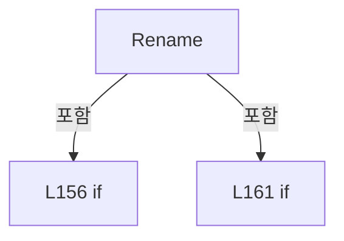

변경 전 점검: 입력/반환 타입, 위 호출자, 예외/취소 경로, 공유 상태와 저장·전송 소비자를 함께 확인합니다. 값의 단위나 물리 방향을 이름만으로 확정하지 않습니다.

### MethodDeclaration `Delete` · L171–181

[Drilling.File/JHMI/CManualScanFile.cs:171–181](https://github.com/kjuws10-rgb/A3Drilling/blob/5aee8e58439c9b455cae7c9593c9be986c3e682e/Drilling.File/JHMI/CManualScanFile.cs#L171-L181)

| 항목 | 실제 추출 값 |
| --- | --- |
| 서명 | System.Threading.Tasks.Task Drilling.File.JHMI.CManualScanFile.Delete(string, System.Threading.CancellationToken) |
| 접근/수식자 | Public / public, override |
| 반환/값 타입 | System.Threading.Tasks.Task |
| 소속 타입 | NamedType:Drilling.File.JHMI.CManualScanFile |

입력 계약:

| 이름 | 타입 | 전달 | 선택/기본값 |
| --- | --- | --- | --- |
| settingName | string | None | False /  |
| cancellationToken | System.Threading.CancellationToken | None | True / null |

현재 부분 분석에서 직접 연결된 호출자는 없습니다. XAML/이벤트/인터페이스·델리게이트·외부 진입을 추가 확인해야 하며, 미사용으로 판정한 것이 아닙니다.

호출하는 대상과 해석 범위:

| 원본 행 | 표현식 | 분석 상태 | 대상/소스 위치 |
| --- | --- | --- | --- |
| 173 | cancellationToken.ThrowIfCancellationRequested | resolved | void System.Threading.CancellationToken.ThrowIfCancellationRequested() |
| 174 | GetSettingPath | resolved | string Drilling.File.JHMI.CManualScanFile.GetSettingPath(string) · Drilling.File/JHMI/CManualScanFile.cs:416 |
| 175 | System.IO.File.Exists | resolved | bool System.IO.File.Exists(string?) |
| 177 | System.IO.File.Delete | resolved | void System.IO.File.Delete(string) |

본문의 실제 연산·분기·예외·반환 순서(원문 위치 순):

| 원본 행 | 종류 | 주석 해설 |
| --- | --- | --- |
| 173 | call | 함수·델리게이트 또는 객체 생성자를 호출합니다: cancellationToken.ThrowIfCancellationRequested() |
| 174 | call | 함수·델리게이트 또는 객체 생성자를 호출합니다: GetSettingPath(settingName) |
| 174 | local-declaration | 지역 변수를 선언합니다: var path = GetSettingPath(settingName); |
| 174 | variable-initializer | 변수의 초기값을 지정합니다: path = GetSettingPath(settingName) |
| 175 | call | 함수·델리게이트 또는 객체 생성자를 호출합니다: System.IO.File.Exists(path) |
| 175 | if | 조건에 따라 분기합니다: if (System.IO.File.Exists(path)) |
| 177 | call | 함수·델리게이트 또는 객체 생성자를 호출합니다: System.IO.File.Delete(path) |
| 180 | return | 호출자에게 값 또는 제어를 반환합니다: return Task.CompletedTask; |

제어 구문의 포함 구조(실제 실행 순서/CFG가 아닌 구문 탐색 그림):

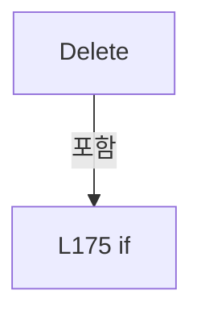

변경 전 점검: 입력/반환 타입, 위 호출자, 예외/취소 경로, 공유 상태와 저장·전송 소비자를 함께 확인합니다. 값의 단위나 물리 방향을 이름만으로 확정하지 않습니다.

### MethodDeclaration `GetDefaultSettingName` · L183–196

[Drilling.File/JHMI/CManualScanFile.cs:183–196](https://github.com/kjuws10-rgb/A3Drilling/blob/5aee8e58439c9b455cae7c9593c9be986c3e682e/Drilling.File/JHMI/CManualScanFile.cs#L183-L196)

| 항목 | 실제 추출 값 |
| --- | --- |
| 서명 | string Drilling.File.JHMI.CManualScanFile.GetDefaultSettingName() |
| 접근/수식자 | Private / private |
| 반환/값 타입 | string |
| 소속 타입 | NamedType:Drilling.File.JHMI.CManualScanFile |

정적 호출자로 확인된 위치:

| 호출 파일/행 | 호출 표현식 | 런타임 분기 가능 |
| --- | --- | --- |
| [Drilling.File/JHMI/CManualScanFile.cs:47–47](https://github.com/kjuws10-rgb/A3Drilling/blob/5aee8e58439c9b455cae7c9593c9be986c3e682e/Drilling.File/JHMI/CManualScanFile.cs#L47-L47) | GetDefaultSettingName | False |
| [Drilling.File/JHMI/CManualScanFile.cs:96–96](https://github.com/kjuws10-rgb/A3Drilling/blob/5aee8e58439c9b455cae7c9593c9be986c3e682e/Drilling.File/JHMI/CManualScanFile.cs#L96-L96) | GetDefaultSettingName | False |

호출하는 대상과 해석 범위:

| 원본 행 | 표현식 | 분석 상태 | 대상/소스 위치 |
| --- | --- | --- | --- |
| 185 | System.IO.File.Exists | resolved | bool System.IO.File.Exists(string?) |
| 185 | GetSettingPath | resolved | string Drilling.File.JHMI.CManualScanFile.GetSettingPath(string) · Drilling.File/JHMI/CManualScanFile.cs:416 |
| 195 | Directory.Exists | resolved | bool System.IO.Directory.Exists(string?) |
| 195 | Directory.EnumerateFiles(_manualDirectory, "*.scan").Select(Path.GetFileName).FirstOrDefault | resolved | string? System.Collections.Generic.IEnumerable<string?>.FirstOrDefault<string?>(System.Func<string?, bool>) |
| 195 | Directory.EnumerateFiles(_manualDirectory, "*.scan").Select | resolved | System.Collections.Generic.IEnumerable<string?> System.Collections.Generic.IEnumerable<string>.Select<string, string?>(System.Func<string, string?>) |
| 195 | Directory.EnumerateFiles | resolved | System.Collections.Generic.IEnumerable<string> System.IO.Directory.EnumerateFiles(string, string) |

본문의 실제 연산·분기·예외·반환 순서(원문 위치 순):

| 원본 행 | 종류 | 주석 해설 |
| --- | --- | --- |
| 185 | call | 함수·델리게이트 또는 객체 생성자를 호출합니다: System.IO.File.Exists(GetSettingPath(DefaultSettingName)) |
| 185 | call | 함수·델리게이트 또는 객체 생성자를 호출합니다: GetSettingPath(DefaultSettingName) |
| 185 | if | 조건에 따라 분기합니다: if (System.IO.File.Exists(GetSettingPath(DefaultSettingName))) |
| 187 | return | 호출자에게 값 또는 제어를 반환합니다: return DefaultSettingName; |
| 195 | call | 함수·델리게이트 또는 객체 생성자를 호출합니다: Directory.Exists(_manualDirectory) |
| 195 | call | 함수·델리게이트 또는 객체 생성자를 호출합니다: Directory.EnumerateFiles(_manualDirectory, "*.scan").Select(Path.GetFileName).FirstOrDefault(MatchesItem) |
| 195 | call | 함수·델리게이트 또는 객체 생성자를 호출합니다: Directory.EnumerateFiles(_manualDirectory, "*.scan").Select(Path.GetFileName) |
| 195 | call | 함수·델리게이트 또는 객체 생성자를 호출합니다: Directory.EnumerateFiles(_manualDirectory, "*.scan") |
| 195 | conditional-expression | 조건에 따라 결과식을 선택합니다: Directory.Exists(_manualDirectory) ? Directory.EnumerateFiles(_manualDirectory, "*.scan").Select(Path.GetFileName).FirstOrDefault(MatchesItem) ?? DefaultSettingName : DefaultSettingName |
| 195 | return | 호출자에게 값 또는 제어를 반환합니다: return Directory.Exists(_manualDirectory) ? Directory.EnumerateFiles(_manualDirectory, "*.scan").Select(Path.GetFileName).FirstOrDefault(MatchesItem) ?? DefaultSettingName : DefaultSettingName; |

제어 구문의 포함 구조(실제 실행 순서/CFG가 아닌 구문 탐색 그림):

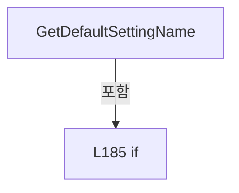

변경 전 점검: 입력/반환 타입, 위 호출자, 예외/취소 경로, 공유 상태와 저장·전송 소비자를 함께 확인합니다. 값의 단위나 물리 방향을 이름만으로 확정하지 않습니다.

### LocalFunctionStatement `MatchesItem` · L190–193

[Drilling.File/JHMI/CManualScanFile.cs:190–193](https://github.com/kjuws10-rgb/A3Drilling/blob/5aee8e58439c9b455cae7c9593c9be986c3e682e/Drilling.File/JHMI/CManualScanFile.cs#L190-L193)

| 항목 | 실제 추출 값 |
| --- | --- |
| 서명 | bool MatchesItem(string?) |
| 접근/수식자 | Private /  |
| 반환/값 타입 | bool |
| 소속 타입 | NamedType:Drilling.File.JHMI.CManualScanFile |

입력 계약:

| 이름 | 타입 | 전달 | 선택/기본값 |
| --- | --- | --- | --- |
| name | string? | None | False /  |

현재 부분 분석에서 직접 연결된 호출자는 없습니다. XAML/이벤트/인터페이스·델리게이트·외부 진입을 추가 확인해야 하며, 미사용으로 판정한 것이 아닙니다.

호출하는 대상과 해석 범위:

| 원본 행 | 표현식 | 분석 상태 | 대상/소스 위치 |
| --- | --- | --- | --- |
| 192 | string.IsNullOrWhiteSpace | resolved | bool string.IsNullOrWhiteSpace(string?) |

본문의 실제 연산·분기·예외·반환 순서(원문 위치 순):

| 원본 행 | 종류 | 주석 해설 |
| --- | --- | --- |
| 192 | call | 함수·델리게이트 또는 객체 생성자를 호출합니다: string.IsNullOrWhiteSpace(name) |
| 192 | return | 호출자에게 값 또는 제어를 반환합니다: return !string.IsNullOrWhiteSpace(name); |

변경 전 점검: 입력/반환 타입, 위 호출자, 예외/취소 경로, 공유 상태와 저장·전송 소비자를 함께 확인합니다. 값의 단위나 물리 방향을 이름만으로 확정하지 않습니다.

### MethodDeclaration `LoadFormItems` · L198–252

[Drilling.File/JHMI/CManualScanFile.cs:198–252](https://github.com/kjuws10-rgb/A3Drilling/blob/5aee8e58439c9b455cae7c9593c9be986c3e682e/Drilling.File/JHMI/CManualScanFile.cs#L198-L252)

| 항목 | 실제 추출 값 |
| --- | --- |
| 서명 | System.Collections.Generic.IReadOnlyList<Drilling.Common.Managers.ST_MANUAL_SCAN_FORM> Drilling.File.JHMI.CManualScanFile.LoadFormItems() |
| 접근/수식자 | Private / private |
| 반환/값 타입 | System.Collections.Generic.IReadOnlyList<Drilling.Common.Managers.ST_MANUAL_SCAN_FORM> |
| 소속 타입 | NamedType:Drilling.File.JHMI.CManualScanFile |

정적 호출자로 확인된 위치:

| 호출 파일/행 | 호출 표현식 | 런타임 분기 가능 |
| --- | --- | --- |
| [Drilling.File/JHMI/CManualScanFile.cs:42–42](https://github.com/kjuws10-rgb/A3Drilling/blob/5aee8e58439c9b455cae7c9593c9be986c3e682e/Drilling.File/JHMI/CManualScanFile.cs#L42-L42) | LoadFormItems | False |
| [Drilling.File/JHMI/CManualScanFile.cs:53–53](https://github.com/kjuws10-rgb/A3Drilling/blob/5aee8e58439c9b455cae7c9593c9be986c3e682e/Drilling.File/JHMI/CManualScanFile.cs#L53-L53) | LoadFormItems | False |
| [Drilling.File/JHMI/CManualScanFile.cs:103–103](https://github.com/kjuws10-rgb/A3Drilling/blob/5aee8e58439c9b455cae7c9593c9be986c3e682e/Drilling.File/JHMI/CManualScanFile.cs#L103-L103) | LoadFormItems | False |

호출하는 대상과 해석 범위:

| 원본 행 | 표현식 | 분석 상태 | 대상/소스 위치 |
| --- | --- | --- | --- |
| 225 | CCsvParser.Read(GetFormPath()).Select(BuildManual).Where(ShouldIncludeItem).ToList | resolved | System.Collections.Generic.List<Drilling.Common.Managers.ST_MANUAL_SCAN_FORM> System.Collections.Generic.IEnumerable<Drilling.Common.Managers.ST_MANUAL_SCAN_FORM>.ToList<Drilling.Common.Managers.ST_MANUAL_SCAN_FORM>() |
| 225 | CCsvParser.Read(GetFormPath()).Select(BuildManual).Where | resolved | System.Collections.Generic.IEnumerable<Drilling.Common.Managers.ST_MANUAL_SCAN_FORM> System.Collections.Generic.IEnumerable<Drilling.Common.Managers.ST_MANUAL_SCAN_FORM>.Where<Drilling.Common.Managers.ST_MANUAL_SCAN_FORM>(System.Func<Drilling.Common.Managers.ST_MANUAL_SCAN_FORM, bool>) |
| 225 | CCsvParser.Read(GetFormPath()).Select | resolved | System.Collections.Generic.IEnumerable<Drilling.Common.Managers.ST_MANUAL_SCAN_FORM> System.Collections.Generic.IEnumerable<System.Collections.Generic.IReadOnlyDictionary<string, string>>.Select<System.Collections.Generic.IReadOnlyDictionary<string, string>, Drilling.Common.Managers.ST_MANUAL_SCAN_FORM>(System.Func<System.Collections.Generic.IReadOnlyDictionary<string, string>, int, Drilling.Common.Managers.ST_MANUAL_SCAN_FORM>) |
| 225 | CCsvParser.Read | resolved | System.Collections.Generic.IReadOnlyList<System.Collections.Generic.IReadOnlyDictionary<string, string>> Drilling.File.Parser.CCsvParser.Read(string) · Drilling.File/Parser/CCsvParser.cs:12 |
| 225 | GetFormPath | resolved | string Drilling.File.JHMI.CManualScanFile.GetFormPath() · Drilling.File/JHMI/CManualScanFile.cs:411 |
| 226 | CreateFallbackFormItems | resolved | System.Collections.Generic.IReadOnlyList<Drilling.Common.Managers.ST_MANUAL_SCAN_FORM> Drilling.File.JHMI.CManualScanFile.CreateFallbackFormItems() · Drilling.File/JHMI/CManualScanFile.cs:468 |
| 227 | formItems.Select(item => item.Name).ToHashSet | resolved | System.Collections.Generic.HashSet<string> System.Collections.Generic.IEnumerable<string>.ToHashSet<string>(System.Collections.Generic.IEqualityComparer<string>?) |
| 227 | formItems.Select | resolved | System.Collections.Generic.IEnumerable<string> System.Collections.Generic.IEnumerable<Drilling.Common.Managers.ST_MANUAL_SCAN_FORM>.Select<Drilling.Common.Managers.ST_MANUAL_SCAN_FORM, string>(System.Func<Drilling.Common.Managers.ST_MANUAL_SCAN_FORM, string>) |
| 230 | names.Add | resolved | bool System.Collections.Generic.HashSet<string>.Add(string) |
| 230 | formItems.Add | resolved | void System.Collections.Generic.List<Drilling.Common.Managers.ST_MANUAL_SCAN_FORM>.Add(Drilling.Common.Managers.ST_MANUAL_SCAN_FORM) |
| 234 | formItems.Select(item => { if (!LaserActionParameterNames.Contains(item.Name, StringComparer.OrdinalIgnoreCase)) return item; var definition = defaults.Single(candidate => candidate.Name.Equals(item.Name, StringComparison.OrdinalIgnoreCase)); return item with { Name = definition.Name, DisplayName = definition.DisplayName, DataType = definition.Data… | resolved | Drilling.Common.Managers.ST_MANUAL_SCAN_FORM[] System.Collections.Generic.IEnumerable<Drilling.Common.Managers.ST_MANUAL_SCAN_FORM>.ToArray<Drilling.Common.Managers.ST_MANUAL_SCAN_FORM>() |
| 234 | formItems.Select | resolved | System.Collections.Generic.IEnumerable<Drilling.Common.Managers.ST_MANUAL_SCAN_FORM> System.Collections.Generic.IEnumerable<Drilling.Common.Managers.ST_MANUAL_SCAN_FORM>.Select<Drilling.Common.Managers.ST_MANUAL_SCAN_FORM, Drilling.Common.Managers.ST_MANUAL_SCAN_FORM>(System.Func<Drilling.Common.Managers.ST_MANUAL_SCAN_FORM, Drilling.Common.Managers.ST_MANUAL_SCAN_FORM>) |
| 236 | LaserActionParameterNames.Contains | resolved | bool System.ReadOnlySpan<string>.Contains<string>(string, System.Collections.Generic.IEqualityComparer<string>?) |
| 237 | defaults.Single | resolved | Drilling.Common.Managers.ST_MANUAL_SCAN_FORM System.Collections.Generic.IEnumerable<Drilling.Common.Managers.ST_MANUAL_SCAN_FORM>.Single<Drilling.Common.Managers.ST_MANUAL_SCAN_FORM>(System.Func<Drilling.Common.Managers.ST_MANUAL_SCAN_FORM, bool>) |
| 237 | candidate.Name.Equals | resolved | bool string.Equals(string?, System.StringComparison) |
| 246 | GetOrDefault | resolved | string Drilling.File.JHMI.CManualScanFile.GetOrDefault(string, string) · Drilling.File/JHMI/CManualScanFile.cs:463 |

본문의 실제 연산·분기·예외·반환 순서(원문 위치 순):

| 원본 행 | 종류 | 주석 해설 |
| --- | --- | --- |
| 225 | call | 함수·델리게이트 또는 객체 생성자를 호출합니다: CCsvParser.Read(GetFormPath()).Select(BuildManual).Where(ShouldIncludeItem).ToList() |
| 225 | call | 함수·델리게이트 또는 객체 생성자를 호출합니다: CCsvParser.Read(GetFormPath()).Select(BuildManual).Where(ShouldIncludeItem) |
| 225 | call | 함수·델리게이트 또는 객체 생성자를 호출합니다: CCsvParser.Read(GetFormPath()).Select(BuildManual) |
| 225 | call | 함수·델리게이트 또는 객체 생성자를 호출합니다: CCsvParser.Read(GetFormPath()) |
| 225 | call | 함수·델리게이트 또는 객체 생성자를 호출합니다: GetFormPath() |
| 225 | local-declaration | 지역 변수를 선언합니다: var formItems = CCsvParser.Read(GetFormPath()).Select(BuildManual).Where(ShouldIncludeItem).ToList(); |
| 225 | variable-initializer | 변수의 초기값을 지정합니다: formItems = CCsvParser.Read(GetFormPath()).Select(BuildManual).Where(ShouldIncludeItem).ToList() |
| 226 | call | 함수·델리게이트 또는 객체 생성자를 호출합니다: CreateFallbackFormItems() |
| 226 | local-declaration | 지역 변수를 선언합니다: var defaults = CreateFallbackFormItems(); |
| 226 | variable-initializer | 변수의 초기값을 지정합니다: defaults = CreateFallbackFormItems() |
| 227 | call | 함수·델리게이트 또는 객체 생성자를 호출합니다: formItems.Select(item => item.Name).ToHashSet(StringComparer.OrdinalIgnoreCase) |
| 227 | call | 함수·델리게이트 또는 객체 생성자를 호출합니다: formItems.Select(item => item.Name) |
| 227 | local-declaration | 지역 변수를 선언합니다: var names = formItems.Select(item => item.Name).ToHashSet(StringComparer.OrdinalIgnoreCase); |
| 227 | variable-initializer | 변수의 초기값을 지정합니다: names = formItems.Select(item => item.Name).ToHashSet(StringComparer.OrdinalIgnoreCase) |
| 228 | foreach | 컬렉션 요소를 순회합니다: foreach (var definition in defaults) |
| 230 | call | 함수·델리게이트 또는 객체 생성자를 호출합니다: names.Add(definition.Name) |
| 230 | call | 함수·델리게이트 또는 객체 생성자를 호출합니다: formItems.Add(definition) |
| 230 | if | 조건에 따라 분기합니다: if (names.Add(definition.Name)) |
| 234 | call | 함수·델리게이트 또는 객체 생성자를 호출합니다: formItems.Select(item => { if (!LaserActionParameterNames.Contains(item.Name, StringComparer.OrdinalIgnoreCase)) return item; var definition = defaults.Single(candidate => candidate.Name.Equals(item.Name, StringCompariso… |
| 234 | call | 함수·델리게이트 또는 객체 생성자를 호출합니다: formItems.Select(item => { if (!LaserActionParameterNames.Contains(item.Name, StringComparer.OrdinalIgnoreCase)) return item; var definition = defaults.Single(candidate => candidate.Name.Equals(item.Name, StringCompariso… |
| 234 | return | 호출자에게 값 또는 제어를 반환합니다: return formItems.Select(item => { if (!LaserActionParameterNames.Contains(item.Name, StringComparer.OrdinalIgnoreCase)) return item; var definition = defaults.Single(candidate => candidate.Name.Equals(item.Name, StringComparison.O |
| 236 | call | 함수·델리게이트 또는 객체 생성자를 호출합니다: LaserActionParameterNames.Contains(item.Name, StringComparer.OrdinalIgnoreCase) |
| 236 | if | 조건에 따라 분기합니다: if (!LaserActionParameterNames.Contains(item.Name, StringComparer.OrdinalIgnoreCase)) |
| 236 | return | 호출자에게 값 또는 제어를 반환합니다: return item; |
| 237 | call | 함수·델리게이트 또는 객체 생성자를 호출합니다: defaults.Single(candidate => candidate.Name.Equals(item.Name, StringComparison.OrdinalIgnoreCase)) |
| 237 | call | 함수·델리게이트 또는 객체 생성자를 호출합니다: candidate.Name.Equals(item.Name, StringComparison.OrdinalIgnoreCase) |
| 237 | local-declaration | 지역 변수를 선언합니다: var definition = defaults.Single(candidate => candidate.Name.Equals(item.Name, StringComparison.OrdinalIgnoreCase)); |
| 237 | variable-initializer | 변수의 초기값을 지정합니다: definition = defaults.Single(candidate => candidate.Name.Equals(item.Name, StringComparison.OrdinalIgnoreCase)) |
| 238 | return | 호출자에게 값 또는 제어를 반환합니다: return item with { Name = definition.Name, DisplayName = definition.DisplayName, DataType = definition.DataType, Unit = definition.Unit, Show = true, Use = true, DefaultValue = GetOrDefault(item.DefaultValue, definition.DefaultVal |
| 240 | assignment | 값을 대상에 대입합니다: Name = definition.Name |
| 241 | assignment | 값을 대상에 대입합니다: DisplayName = definition.DisplayName |
| 242 | assignment | 값을 대상에 대입합니다: DataType = definition.DataType |
| 243 | assignment | 값을 대상에 대입합니다: Unit = definition.Unit |
| 244 | assignment | 값을 대상에 대입합니다: Show = true |
| 245 | assignment | 값을 대상에 대입합니다: Use = true |
| 246 | assignment | 값을 대상에 대입합니다: DefaultValue = GetOrDefault(item.DefaultValue, definition.DefaultValue) |
| 246 | call | 함수·델리게이트 또는 객체 생성자를 호출합니다: GetOrDefault(item.DefaultValue, definition.DefaultValue) |
| 247 | assignment | 값을 대상에 대입합니다: Min = definition.Min |
| 248 | assignment | 값을 대상에 대입합니다: Max = definition.Max |
| 249 | assignment | 값을 대상에 대입합니다: DisplayOrder = definition.DisplayOrder |

제어 구문의 포함 구조(실제 실행 순서/CFG가 아닌 구문 탐색 그림):

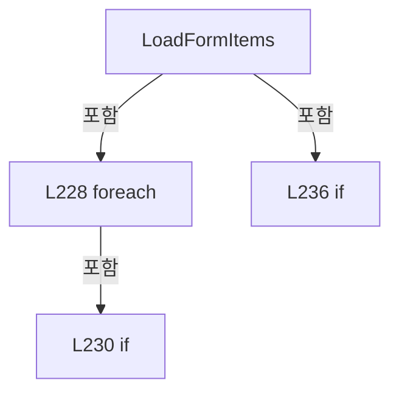

변경 전 점검: 입력/반환 타입, 위 호출자, 예외/취소 경로, 공유 상태와 저장·전송 소비자를 함께 확인합니다. 값의 단위나 물리 방향을 이름만으로 확정하지 않습니다.

### LocalFunctionStatement `BuildManual` · L200–218

[Drilling.File/JHMI/CManualScanFile.cs:200–218](https://github.com/kjuws10-rgb/A3Drilling/blob/5aee8e58439c9b455cae7c9593c9be986c3e682e/Drilling.File/JHMI/CManualScanFile.cs#L200-L218)

| 항목 | 실제 추출 값 |
| --- | --- |
| 서명 | Drilling.Common.Managers.ST_MANUAL_SCAN_FORM BuildManual(System.Collections.Generic.IReadOnlyDictionary<string, string>, int) |
| 접근/수식자 | Private /  |
| 반환/값 타입 | Drilling.Common.Managers.ST_MANUAL_SCAN_FORM |
| 소속 타입 | NamedType:Drilling.File.JHMI.CManualScanFile |

입력 계약:

| 이름 | 타입 | 전달 | 선택/기본값 |
| --- | --- | --- | --- |
| row | System.Collections.Generic.IReadOnlyDictionary<string, string> | None | False /  |
| index | int | None | False /  |

현재 부분 분석에서 직접 연결된 호출자는 없습니다. XAML/이벤트/인터페이스·델리게이트·외부 진입을 추가 확인해야 하며, 미사용으로 판정한 것이 아닙니다.

호출하는 대상과 해석 범위:

| 원본 행 | 표현식 | 분석 상태 | 대상/소스 위치 |
| --- | --- | --- | --- |
| 202 | CCsvParser.Get(row, "NAME").Trim | resolved | string string.Trim() |
| 202 | CCsvParser.Get | resolved | string Drilling.File.Parser.CCsvParser.Get(System.Collections.Generic.IReadOnlyDictionary<string, string>, string) · Drilling.File/Parser/CCsvParser.cs:168 |
| 203 | name.Equals | resolved | bool string.Equals(string?, System.StringComparison) |
| 204 | name.Equals | resolved | bool string.Equals(string?, System.StringComparison) |
| 204 | CCsvParser.Get | resolved | string Drilling.File.Parser.CCsvParser.Get(System.Collections.Generic.IReadOnlyDictionary<string, string>, string) · Drilling.File/Parser/CCsvParser.cs:168 |
| 205 | new ST_MANUAL_SCAN_FORM | resolved | Drilling.Common.Managers.ST_MANUAL_SCAN_FORM.ST_MANUAL_SCAN_FORM(string, string, Drilling.Common.Managers.EN_RECIPE_DATA_TYPE, string, bool, bool, string, double, double, string, int) · Drilling.Common/Managers/CManager.cs:686 |
| 207 | GetOrDefault | resolved | string Drilling.File.JHMI.CManualScanFile.GetOrDefault(string, string) · Drilling.File/JHMI/CManualScanFile.cs:463 |
| 207 | CCsvParser.Get | resolved | string Drilling.File.Parser.CCsvParser.Get(System.Collections.Generic.IReadOnlyDictionary<string, string>, string) · Drilling.File/Parser/CCsvParser.cs:168 |
| 208 | ReadDataType | resolved | Drilling.Common.Managers.EN_RECIPE_DATA_TYPE Drilling.File.JHMI.CManualScanFile.ReadDataType(string) · Drilling.File/JHMI/CManualScanFile.cs:437 |
| 208 | CCsvParser.Get | resolved | string Drilling.File.Parser.CCsvParser.Get(System.Collections.Generic.IReadOnlyDictionary<string, string>, string) · Drilling.File/Parser/CCsvParser.cs:168 |
| 210 | ReadBool | resolved | bool Drilling.File.JHMI.CManualScanFile.ReadBool(string, bool) · Drilling.File/JHMI/CManualScanFile.cs:448 |
| 210 | CCsvParser.Get | resolved | string Drilling.File.Parser.CCsvParser.Get(System.Collections.Generic.IReadOnlyDictionary<string, string>, string) · Drilling.File/Parser/CCsvParser.cs:168 |
| 211 | ReadBool | resolved | bool Drilling.File.JHMI.CManualScanFile.ReadBool(string, bool) · Drilling.File/JHMI/CManualScanFile.cs:448 |
| 211 | CCsvParser.Get | resolved | string Drilling.File.Parser.CCsvParser.Get(System.Collections.Generic.IReadOnlyDictionary<string, string>, string) · Drilling.File/Parser/CCsvParser.cs:168 |
| 212 | CCsvParser.Get | resolved | string Drilling.File.Parser.CCsvParser.Get(System.Collections.Generic.IReadOnlyDictionary<string, string>, string) · Drilling.File/Parser/CCsvParser.cs:168 |
| 213 | ReadDoubleValue | resolved | double Drilling.File.JHMI.CManualScanFile.ReadDoubleValue(string, double) · Drilling.File/JHMI/CManualScanFile.cs:396 |
| 213 | CCsvParser.Get | resolved | string Drilling.File.Parser.CCsvParser.Get(System.Collections.Generic.IReadOnlyDictionary<string, string>, string) · Drilling.File/Parser/CCsvParser.cs:168 |
| 214 | ReadDoubleValue | resolved | double Drilling.File.JHMI.CManualScanFile.ReadDoubleValue(string, double) · Drilling.File/JHMI/CManualScanFile.cs:396 |
| 214 | CCsvParser.Get | resolved | string Drilling.File.Parser.CCsvParser.Get(System.Collections.Generic.IReadOnlyDictionary<string, string>, string) · Drilling.File/Parser/CCsvParser.cs:168 |
| 215 | CCsvParser.Get | resolved | string Drilling.File.Parser.CCsvParser.Get(System.Collections.Generic.IReadOnlyDictionary<string, string>, string) · Drilling.File/Parser/CCsvParser.cs:168 |
| 216 | ReadInt | resolved | int Drilling.File.JHMI.CManualScanFile.ReadInt(string, int) · Drilling.File/JHMI/CManualScanFile.cs:458 |
| 216 | CCsvParser.Get | resolved | string Drilling.File.Parser.CCsvParser.Get(System.Collections.Generic.IReadOnlyDictionary<string, string>, string) · Drilling.File/Parser/CCsvParser.cs:168 |

본문의 실제 연산·분기·예외·반환 순서(원문 위치 순):

| 원본 행 | 종류 | 주석 해설 |
| --- | --- | --- |
| 202 | call | 함수·델리게이트 또는 객체 생성자를 호출합니다: CCsvParser.Get(row, "NAME").Trim() |
| 202 | call | 함수·델리게이트 또는 객체 생성자를 호출합니다: CCsvParser.Get(row, "NAME") |
| 202 | local-declaration | 지역 변수를 선언합니다: var name = CCsvParser.Get(row, "NAME").Trim(); |
| 202 | variable-initializer | 변수의 초기값을 지정합니다: name = CCsvParser.Get(row, "NAME").Trim() |
| 203 | call | 함수·델리게이트 또는 객체 생성자를 호출합니다: name.Equals("LaserOnDelay", StringComparison.OrdinalIgnoreCase) |
| 203 | conditional-expression | 조건에 따라 결과식을 선택합니다: name.Equals("LaserOnDelay", StringComparison.OrdinalIgnoreCase) &#124;&#124; name.Equals("LaserOffDelay", StringComparison.OrdinalIgnoreCase) ? "msec" : CCsvParser.Get(row, "UNIT") |
| 203 | local-declaration | 지역 변수를 선언합니다: var unit = name.Equals("LaserOnDelay", StringComparison.OrdinalIgnoreCase) &#124;&#124; name.Equals("LaserOffDelay", StringComparison.OrdinalIgnoreCase) ? "msec" : CCsvParser.Get(row, "UNIT"); |
| 203 | variable-initializer | 변수의 초기값을 지정합니다: unit = name.Equals("LaserOnDelay", StringComparison.OrdinalIgnoreCase) &#124;&#124; name.Equals("LaserOffDelay", StringComparison.OrdinalIgnoreCase) ? "msec" : CCsvParser.Get(row, "UNIT") |
| 204 | call | 함수·델리게이트 또는 객체 생성자를 호출합니다: name.Equals("LaserOffDelay", StringComparison.OrdinalIgnoreCase) |
| 204 | call | 함수·델리게이트 또는 객체 생성자를 호출합니다: CCsvParser.Get(row, "UNIT") |
| 205 | call | 함수·델리게이트 또는 객체 생성자를 호출합니다: new ST_MANUAL_SCAN_FORM( name, GetOrDefault(CCsvParser.Get(row, "DISPLAY NAME"), name), ReadDataType(CCsvParser.Get(row, "DATA TYPE")), unit, ReadBool(CCsvParser.Get(row, "SHOW"), true), ReadBool(CCsvParser.Get(row, "USE… |
| 205 | return | 호출자에게 값 또는 제어를 반환합니다: return new ST_MANUAL_SCAN_FORM( name, GetOrDefault(CCsvParser.Get(row, "DISPLAY NAME"), name), ReadDataType(CCsvParser.Get(row, "DATA TYPE")), unit, ReadBool(CCsvParser.Get(row, "SHOW"), true), ReadBool(CCsvParser.Get(row, "USE"), |
| 207 | call | 함수·델리게이트 또는 객체 생성자를 호출합니다: GetOrDefault(CCsvParser.Get(row, "DISPLAY NAME"), name) |
| 207 | call | 함수·델리게이트 또는 객체 생성자를 호출합니다: CCsvParser.Get(row, "DISPLAY NAME") |
| 208 | call | 함수·델리게이트 또는 객체 생성자를 호출합니다: ReadDataType(CCsvParser.Get(row, "DATA TYPE")) |
| 208 | call | 함수·델리게이트 또는 객체 생성자를 호출합니다: CCsvParser.Get(row, "DATA TYPE") |
| 210 | call | 함수·델리게이트 또는 객체 생성자를 호출합니다: ReadBool(CCsvParser.Get(row, "SHOW"), true) |
| 210 | call | 함수·델리게이트 또는 객체 생성자를 호출합니다: CCsvParser.Get(row, "SHOW") |
| 211 | call | 함수·델리게이트 또는 객체 생성자를 호출합니다: ReadBool(CCsvParser.Get(row, "USE"), true) |
| 211 | call | 함수·델리게이트 또는 객체 생성자를 호출합니다: CCsvParser.Get(row, "USE") |
| 212 | call | 함수·델리게이트 또는 객체 생성자를 호출합니다: CCsvParser.Get(row, "VALUE") |
| 213 | call | 함수·델리게이트 또는 객체 생성자를 호출합니다: ReadDoubleValue(CCsvParser.Get(row, "MIN"), 0.0) |
| 213 | call | 함수·델리게이트 또는 객체 생성자를 호출합니다: CCsvParser.Get(row, "MIN") |
| 214 | call | 함수·델리게이트 또는 객체 생성자를 호출합니다: ReadDoubleValue(CCsvParser.Get(row, "MAX"), 0.0) |
| 214 | call | 함수·델리게이트 또는 객체 생성자를 호출합니다: CCsvParser.Get(row, "MAX") |
| 215 | call | 함수·델리게이트 또는 객체 생성자를 호출합니다: CCsvParser.Get(row, "DESCRIPTION") |
| 216 | call | 함수·델리게이트 또는 객체 생성자를 호출합니다: ReadInt(CCsvParser.Get(row, "ORDER"), index + 1) |
| 216 | call | 함수·델리게이트 또는 객체 생성자를 호출합니다: CCsvParser.Get(row, "ORDER") |

변경 전 점검: 입력/반환 타입, 위 호출자, 예외/취소 경로, 공유 상태와 저장·전송 소비자를 함께 확인합니다. 값의 단위나 물리 방향을 이름만으로 확정하지 않습니다.

### LocalFunctionStatement `ShouldIncludeItem` · L220–223

[Drilling.File/JHMI/CManualScanFile.cs:220–223](https://github.com/kjuws10-rgb/A3Drilling/blob/5aee8e58439c9b455cae7c9593c9be986c3e682e/Drilling.File/JHMI/CManualScanFile.cs#L220-L223)

| 항목 | 실제 추출 값 |
| --- | --- |
| 서명 | bool ShouldIncludeItem(Drilling.Common.Managers.ST_MANUAL_SCAN_FORM) |
| 접근/수식자 | Private /  |
| 반환/값 타입 | bool |
| 소속 타입 | NamedType:Drilling.File.JHMI.CManualScanFile |

입력 계약:

| 이름 | 타입 | 전달 | 선택/기본값 |
| --- | --- | --- | --- |
| item | Drilling.Common.Managers.ST_MANUAL_SCAN_FORM | None | False /  |

현재 부분 분석에서 직접 연결된 호출자는 없습니다. XAML/이벤트/인터페이스·델리게이트·외부 진입을 추가 확인해야 하며, 미사용으로 판정한 것이 아닙니다.

호출하는 대상과 해석 범위:

| 원본 행 | 표현식 | 분석 상태 | 대상/소스 위치 |
| --- | --- | --- | --- |
| 222 | string.IsNullOrWhiteSpace | resolved | bool string.IsNullOrWhiteSpace(string?) |

본문의 실제 연산·분기·예외·반환 순서(원문 위치 순):

| 원본 행 | 종류 | 주석 해설 |
| --- | --- | --- |
| 222 | call | 함수·델리게이트 또는 객체 생성자를 호출합니다: string.IsNullOrWhiteSpace(item.Name) |
| 222 | return | 호출자에게 값 또는 제어를 반환합니다: return !string.IsNullOrWhiteSpace(item.Name); |

변경 전 점검: 입력/반환 타입, 위 호출자, 예외/취소 경로, 공유 상태와 저장·전송 소비자를 함께 확인합니다. 값의 단위나 물리 방향을 이름만으로 확정하지 않습니다.

### MethodDeclaration `ValidateSavedSetting` · L254–285

[Drilling.File/JHMI/CManualScanFile.cs:254–285](https://github.com/kjuws10-rgb/A3Drilling/blob/5aee8e58439c9b455cae7c9593c9be986c3e682e/Drilling.File/JHMI/CManualScanFile.cs#L254-L285)

| 항목 | 실제 추출 값 |
| --- | --- |
| 서명 | void Drilling.File.JHMI.CManualScanFile.ValidateSavedSetting(string, System.Collections.Generic.IReadOnlyDictionary<string, string>, System.Threading.CancellationToken) |
| 접근/수식자 | Private / private |
| 반환/값 타입 | void |
| 소속 타입 | NamedType:Drilling.File.JHMI.CManualScanFile |

입력 계약:

| 이름 | 타입 | 전달 | 선택/기본값 |
| --- | --- | --- | --- |
| settingName | string | None | False /  |
| values | System.Collections.Generic.IReadOnlyDictionary<string, string> | None | False /  |
| cancellationToken | System.Threading.CancellationToken | None | True / null |

정적 호출자로 확인된 위치:

| 호출 파일/행 | 호출 표현식 | 런타임 분기 가능 |
| --- | --- | --- |
| [Drilling.File/JHMI/CManualScanFile.cs:147–147](https://github.com/kjuws10-rgb/A3Drilling/blob/5aee8e58439c9b455cae7c9593c9be986c3e682e/Drilling.File/JHMI/CManualScanFile.cs#L147-L147) | ValidateSavedSetting | False |

호출하는 대상과 해석 범위:

| 원본 행 | 표현식 | 분석 상태 | 대상/소스 위치 |
| --- | --- | --- | --- |
| 256 | cancellationToken.ThrowIfCancellationRequested | resolved | void System.Threading.CancellationToken.ThrowIfCancellationRequested() |
| 272 | CCsvParser.Read(GetSettingPath(settingName)).Where(ShouldIncludeItem).ToDictionary | resolved | System.Collections.Generic.Dictionary<string, string> System.Collections.Generic.IEnumerable<System.Collections.Generic.IReadOnlyDictionary<string, string>>.ToDictionary<System.Collections.Generic.IReadOnlyDictionary<string, string>, string, string>(System.Func<System.Collections.Generic.IReadOnlyDictionary<string, string>, string>, System.Func<System.Collections.Generic.IReadOnlyDictionary<string, string>, string>, System.Collections.Generic.IEqualityComparer<string>?) |
| 272 | CCsvParser.Read(GetSettingPath(settingName)).Where | resolved | System.Collections.Generic.IEnumerable<System.Collections.Generic.IReadOnlyDictionary<string, string>> System.Collections.Generic.IEnumerable<System.Collections.Generic.IReadOnlyDictionary<string, string>>.Where<System.Collections.Generic.IReadOnlyDictionary<string, string>>(System.Func<System.Collections.Generic.IReadOnlyDictionary<string, string>, bool>) |
| 272 | CCsvParser.Read | resolved | System.Collections.Generic.IReadOnlyList<System.Collections.Generic.IReadOnlyDictionary<string, string>> Drilling.File.Parser.CCsvParser.Read(string) · Drilling.File/Parser/CCsvParser.cs:12 |
| 272 | GetSettingPath | resolved | string Drilling.File.JHMI.CManualScanFile.GetSettingPath(string) · Drilling.File/JHMI/CManualScanFile.cs:416 |
| 275 | actualValues.TryGetValue | resolved | bool System.Collections.Generic.Dictionary<string, string>.TryGetValue(string, out string) |
| 277 | new InvalidDataException | resolved | System.IO.InvalidDataException.InvalidDataException(string?) |
| 280 | actualValue.Equals | resolved | bool string.Equals(string?, System.StringComparison) |
| 282 | new InvalidDataException | resolved | System.IO.InvalidDataException.InvalidDataException(string?) |

본문의 실제 연산·분기·예외·반환 순서(원문 위치 순):

| 원본 행 | 종류 | 주석 해설 |
| --- | --- | --- |
| 256 | call | 함수·델리게이트 또는 객체 생성자를 호출합니다: cancellationToken.ThrowIfCancellationRequested() |
| 272 | call | 함수·델리게이트 또는 객체 생성자를 호출합니다: CCsvParser.Read(GetSettingPath(settingName)).Where(ShouldIncludeItem).ToDictionary(SelectDictionaryKey, SelectValue, StringComparer.OrdinalIgnoreCase) |
| 272 | call | 함수·델리게이트 또는 객체 생성자를 호출합니다: CCsvParser.Read(GetSettingPath(settingName)).Where(ShouldIncludeItem) |
| 272 | call | 함수·델리게이트 또는 객체 생성자를 호출합니다: CCsvParser.Read(GetSettingPath(settingName)) |
| 272 | call | 함수·델리게이트 또는 객체 생성자를 호출합니다: GetSettingPath(settingName) |
| 272 | local-declaration | 지역 변수를 선언합니다: var actualValues = CCsvParser.Read(GetSettingPath(settingName)).Where(ShouldIncludeItem).ToDictionary(SelectDictionaryKey, SelectValue, StringComparer.OrdinalIgnoreCase); |
| 272 | variable-initializer | 변수의 초기값을 지정합니다: actualValues = CCsvParser.Read(GetSettingPath(settingName)).Where(ShouldIncludeItem).ToDictionary(SelectDictionaryKey, SelectValue, StringComparer.OrdinalIgnoreCase) |
| 273 | foreach | 컬렉션 요소를 순회합니다: foreach (var(name, expectedValue)in values) { if (!actualValues.TryGetValue(name, out var actualValue)) { throw new InvalidDataException($"Manual setting CSV validation failed. Missing parameter: {name}"); } if (!actualValue.Equal |
| 275 | call | 함수·델리게이트 또는 객체 생성자를 호출합니다: actualValues.TryGetValue(name, out var actualValue) |
| 275 | if | 조건에 따라 분기합니다: if (!actualValues.TryGetValue(name, out var actualValue)) |
| 277 | call | 함수·델리게이트 또는 객체 생성자를 호출합니다: new InvalidDataException($"Manual setting CSV validation failed. Missing parameter: {name}") |
| 277 | throw | 예외를 발생/전달합니다: throw new InvalidDataException($"Manual setting CSV validation failed. Missing parameter: {name}"); |
| 280 | call | 함수·델리게이트 또는 객체 생성자를 호출합니다: actualValue.Equals(expectedValue, StringComparison.Ordinal) |
| 280 | if | 조건에 따라 분기합니다: if (!actualValue.Equals(expectedValue, StringComparison.Ordinal)) |
| 282 | call | 함수·델리게이트 또는 객체 생성자를 호출합니다: new InvalidDataException($"Manual setting CSV validation failed. {name}: expected '{expectedValue}', actual '{actualValue}'") |
| 282 | throw | 예외를 발생/전달합니다: throw new InvalidDataException($"Manual setting CSV validation failed. {name}: expected '{expectedValue}', actual '{actualValue}'"); |

제어 구문의 포함 구조(실제 실행 순서/CFG가 아닌 구문 탐색 그림):

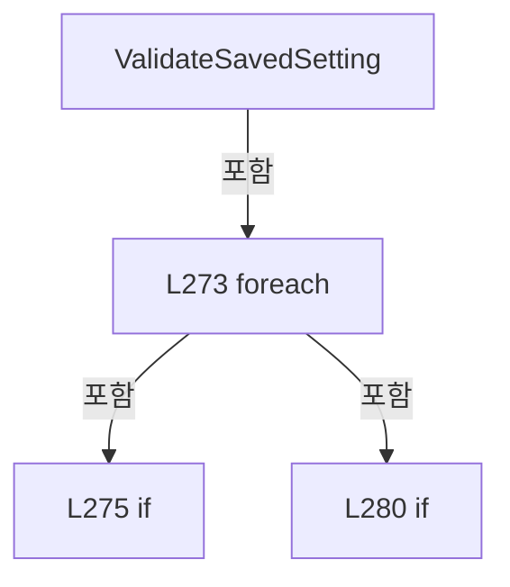

변경 전 점검: 입력/반환 타입, 위 호출자, 예외/취소 경로, 공유 상태와 저장·전송 소비자를 함께 확인합니다. 값의 단위나 물리 방향을 이름만으로 확정하지 않습니다.

### LocalFunctionStatement `ShouldIncludeItem` · L257–260

[Drilling.File/JHMI/CManualScanFile.cs:257–260](https://github.com/kjuws10-rgb/A3Drilling/blob/5aee8e58439c9b455cae7c9593c9be986c3e682e/Drilling.File/JHMI/CManualScanFile.cs#L257-L260)

| 항목 | 실제 추출 값 |
| --- | --- |
| 서명 | bool ShouldIncludeItem(System.Collections.Generic.IReadOnlyDictionary<string, string>) |
| 접근/수식자 | Private /  |
| 반환/값 타입 | bool |
| 소속 타입 | NamedType:Drilling.File.JHMI.CManualScanFile |

입력 계약:

| 이름 | 타입 | 전달 | 선택/기본값 |
| --- | --- | --- | --- |
| row | System.Collections.Generic.IReadOnlyDictionary<string, string> | None | False /  |

현재 부분 분석에서 직접 연결된 호출자는 없습니다. XAML/이벤트/인터페이스·델리게이트·외부 진입을 추가 확인해야 하며, 미사용으로 판정한 것이 아닙니다.

호출하는 대상과 해석 범위:

| 원본 행 | 표현식 | 분석 상태 | 대상/소스 위치 |
| --- | --- | --- | --- |
| 259 | string.IsNullOrWhiteSpace | resolved | bool string.IsNullOrWhiteSpace(string?) |
| 259 | CCsvParser.Get | resolved | string Drilling.File.Parser.CCsvParser.Get(System.Collections.Generic.IReadOnlyDictionary<string, string>, string) · Drilling.File/Parser/CCsvParser.cs:168 |

본문의 실제 연산·분기·예외·반환 순서(원문 위치 순):

| 원본 행 | 종류 | 주석 해설 |
| --- | --- | --- |
| 259 | call | 함수·델리게이트 또는 객체 생성자를 호출합니다: string.IsNullOrWhiteSpace(CCsvParser.Get(row, "NAME")) |
| 259 | call | 함수·델리게이트 또는 객체 생성자를 호출합니다: CCsvParser.Get(row, "NAME") |
| 259 | return | 호출자에게 값 또는 제어를 반환합니다: return !string.IsNullOrWhiteSpace(CCsvParser.Get(row, "NAME")); |

변경 전 점검: 입력/반환 타입, 위 호출자, 예외/취소 경로, 공유 상태와 저장·전송 소비자를 함께 확인합니다. 값의 단위나 물리 방향을 이름만으로 확정하지 않습니다.

### LocalFunctionStatement `SelectDictionaryKey` · L262–265

[Drilling.File/JHMI/CManualScanFile.cs:262–265](https://github.com/kjuws10-rgb/A3Drilling/blob/5aee8e58439c9b455cae7c9593c9be986c3e682e/Drilling.File/JHMI/CManualScanFile.cs#L262-L265)

| 항목 | 실제 추출 값 |
| --- | --- |
| 서명 | string SelectDictionaryKey(System.Collections.Generic.IReadOnlyDictionary<string, string>) |
| 접근/수식자 | Private /  |
| 반환/값 타입 | string |
| 소속 타입 | NamedType:Drilling.File.JHMI.CManualScanFile |

입력 계약:

| 이름 | 타입 | 전달 | 선택/기본값 |
| --- | --- | --- | --- |
| row | System.Collections.Generic.IReadOnlyDictionary<string, string> | None | False /  |

현재 부분 분석에서 직접 연결된 호출자는 없습니다. XAML/이벤트/인터페이스·델리게이트·외부 진입을 추가 확인해야 하며, 미사용으로 판정한 것이 아닙니다.

호출하는 대상과 해석 범위:

| 원본 행 | 표현식 | 분석 상태 | 대상/소스 위치 |
| --- | --- | --- | --- |
| 264 | CCsvParser.Get | resolved | string Drilling.File.Parser.CCsvParser.Get(System.Collections.Generic.IReadOnlyDictionary<string, string>, string) · Drilling.File/Parser/CCsvParser.cs:168 |

본문의 실제 연산·분기·예외·반환 순서(원문 위치 순):

| 원본 행 | 종류 | 주석 해설 |
| --- | --- | --- |
| 264 | call | 함수·델리게이트 또는 객체 생성자를 호출합니다: CCsvParser.Get(row, "NAME") |
| 264 | return | 호출자에게 값 또는 제어를 반환합니다: return CCsvParser.Get(row, "NAME"); |

변경 전 점검: 입력/반환 타입, 위 호출자, 예외/취소 경로, 공유 상태와 저장·전송 소비자를 함께 확인합니다. 값의 단위나 물리 방향을 이름만으로 확정하지 않습니다.

### LocalFunctionStatement `SelectValue` · L267–270

[Drilling.File/JHMI/CManualScanFile.cs:267–270](https://github.com/kjuws10-rgb/A3Drilling/blob/5aee8e58439c9b455cae7c9593c9be986c3e682e/Drilling.File/JHMI/CManualScanFile.cs#L267-L270)

| 항목 | 실제 추출 값 |
| --- | --- |
| 서명 | string SelectValue(System.Collections.Generic.IReadOnlyDictionary<string, string>) |
| 접근/수식자 | Private /  |
| 반환/값 타입 | string |
| 소속 타입 | NamedType:Drilling.File.JHMI.CManualScanFile |

입력 계약:

| 이름 | 타입 | 전달 | 선택/기본값 |
| --- | --- | --- | --- |
| row | System.Collections.Generic.IReadOnlyDictionary<string, string> | None | False /  |

현재 부분 분석에서 직접 연결된 호출자는 없습니다. XAML/이벤트/인터페이스·델리게이트·외부 진입을 추가 확인해야 하며, 미사용으로 판정한 것이 아닙니다.

호출하는 대상과 해석 범위:

| 원본 행 | 표현식 | 분석 상태 | 대상/소스 위치 |
| --- | --- | --- | --- |
| 269 | CCsvParser.Get | resolved | string Drilling.File.Parser.CCsvParser.Get(System.Collections.Generic.IReadOnlyDictionary<string, string>, string) · Drilling.File/Parser/CCsvParser.cs:168 |

본문의 실제 연산·분기·예외·반환 순서(원문 위치 순):

| 원본 행 | 종류 | 주석 해설 |
| --- | --- | --- |
| 269 | call | 함수·델리게이트 또는 객체 생성자를 호출합니다: CCsvParser.Get(row, "VALUE") |
| 269 | return | 호출자에게 값 또는 제어를 반환합니다: return CCsvParser.Get(row, "VALUE"); |

변경 전 점검: 입력/반환 타입, 위 호출자, 예외/취소 경로, 공유 상태와 저장·전송 소비자를 함께 확인합니다. 값의 단위나 물리 방향을 이름만으로 확정하지 않습니다.

### MethodDeclaration `ValidateValues` · L287–324

[Drilling.File/JHMI/CManualScanFile.cs:287–324](https://github.com/kjuws10-rgb/A3Drilling/blob/5aee8e58439c9b455cae7c9593c9be986c3e682e/Drilling.File/JHMI/CManualScanFile.cs#L287-L324)

| 항목 | 실제 추출 값 |
| --- | --- |
| 서명 | void Drilling.File.JHMI.CManualScanFile.ValidateValues(System.Collections.Generic.IReadOnlyList<Drilling.Common.Managers.ST_MANUAL_SCAN_FORM>, System.Collections.Generic.IReadOnlyDictionary<string, string>) |
| 접근/수식자 | Private / private, static |
| 반환/값 타입 | void |
| 소속 타입 | NamedType:Drilling.File.JHMI.CManualScanFile |

입력 계약:

| 이름 | 타입 | 전달 | 선택/기본값 |
| --- | --- | --- | --- |
| formItems | System.Collections.Generic.IReadOnlyList<Drilling.Common.Managers.ST_MANUAL_SCAN_FORM> | None | False /  |
| values | System.Collections.Generic.IReadOnlyDictionary<string, string> | None | False /  |

정적 호출자로 확인된 위치:

| 호출 파일/행 | 호출 표현식 | 런타임 분기 가능 |
| --- | --- | --- |
| [Drilling.File/JHMI/CManualScanFile.cs:125–125](https://github.com/kjuws10-rgb/A3Drilling/blob/5aee8e58439c9b455cae7c9593c9be986c3e682e/Drilling.File/JHMI/CManualScanFile.cs#L125-L125) | ValidateValues | False |

호출하는 대상과 해석 범위:

| 원본 행 | 표현식 | 분석 상태 | 대상/소스 위치 |
| --- | --- | --- | --- |
| 299 | formItems.Where(IsUse).ToDictionary | resolved | System.Collections.Generic.Dictionary<string, Drilling.Common.Managers.ST_MANUAL_SCAN_FORM> System.Collections.Generic.IEnumerable<Drilling.Common.Managers.ST_MANUAL_SCAN_FORM>.ToDictionary<Drilling.Common.Managers.ST_MANUAL_SCAN_FORM, string>(System.Func<Drilling.Common.Managers.ST_MANUAL_SCAN_FORM, string>, System.Collections.Generic.IEqualityComparer<string>?) |
| 299 | formItems.Where | resolved | System.Collections.Generic.IEnumerable<Drilling.Common.Managers.ST_MANUAL_SCAN_FORM> System.Collections.Generic.IEnumerable<Drilling.Common.Managers.ST_MANUAL_SCAN_FORM>.Where<Drilling.Common.Managers.ST_MANUAL_SCAN_FORM>(System.Func<Drilling.Common.Managers.ST_MANUAL_SCAN_FORM, bool>) |
| 302 | formItemsByName.TryGetValue | resolved | bool System.Collections.Generic.Dictionary<string, Drilling.Common.Managers.ST_MANUAL_SCAN_FORM>.TryGetValue(string, out Drilling.Common.Managers.ST_MANUAL_SCAN_FORM) |
| 304 | new InvalidDataException | resolved | System.IO.InvalidDataException.InvalidDataException(string?) |
| 307 | string.IsNullOrWhiteSpace | resolved | bool string.IsNullOrWhiteSpace(string?) |
| 309 | new InvalidDataException | resolved | System.IO.InvalidDataException.InvalidDataException(string?) |
| 314 | ValidateIntParameter | resolved | string Drilling.File.JHMI.CManualScanFile.ValidateIntParameter(Drilling.Common.Managers.ST_MANUAL_SCAN_FORM, string) · Drilling.File/JHMI/CManualScanFile.cs:326 |
| 315 | ValidateDoubleParameter | resolved | string Drilling.File.JHMI.CManualScanFile.ValidateDoubleParameter(Drilling.Common.Managers.ST_MANUAL_SCAN_FORM, string) · Drilling.File/JHMI/CManualScanFile.cs:336 |
| 316 | ValidateBoolParameter | resolved | string Drilling.File.JHMI.CManualScanFile.ValidateBoolParameter(Drilling.Common.Managers.ST_MANUAL_SCAN_FORM, string) · Drilling.File/JHMI/CManualScanFile.cs:346 |
| 319 | string.IsNullOrWhiteSpace | resolved | bool string.IsNullOrWhiteSpace(string?) |
| 321 | new InvalidDataException | resolved | System.IO.InvalidDataException.InvalidDataException(string?) |

본문의 실제 연산·분기·예외·반환 순서(원문 위치 순):

| 원본 행 | 종류 | 주석 해설 |
| --- | --- | --- |
| 299 | call | 함수·델리게이트 또는 객체 생성자를 호출합니다: formItems.Where(IsUse).ToDictionary(SelectName, StringComparer.OrdinalIgnoreCase) |
| 299 | call | 함수·델리게이트 또는 객체 생성자를 호출합니다: formItems.Where(IsUse) |
| 299 | local-declaration | 지역 변수를 선언합니다: var formItemsByName = formItems.Where(IsUse).ToDictionary(SelectName, StringComparer.OrdinalIgnoreCase); |
| 299 | variable-initializer | 변수의 초기값을 지정합니다: formItemsByName = formItems.Where(IsUse).ToDictionary(SelectName, StringComparer.OrdinalIgnoreCase) |
| 300 | foreach | 컬렉션 요소를 순회합니다: foreach (var(name, value)in values) { if (!formItemsByName.TryGetValue(name, out var formItem)) { throw new InvalidDataException($"Manual setting save blocked. Unknown parameter: {name}"); } if (string.IsNullOrWhiteSpace(value)) { |
| 302 | call | 함수·델리게이트 또는 객체 생성자를 호출합니다: formItemsByName.TryGetValue(name, out var formItem) |
| 302 | if | 조건에 따라 분기합니다: if (!formItemsByName.TryGetValue(name, out var formItem)) |
| 304 | call | 함수·델리게이트 또는 객체 생성자를 호출합니다: new InvalidDataException($"Manual setting save blocked. Unknown parameter: {name}") |
| 304 | throw | 예외를 발생/전달합니다: throw new InvalidDataException($"Manual setting save blocked. Unknown parameter: {name}"); |
| 307 | call | 함수·델리게이트 또는 객체 생성자를 호출합니다: string.IsNullOrWhiteSpace(value) |
| 307 | if | 조건에 따라 분기합니다: if (string.IsNullOrWhiteSpace(value)) |
| 309 | call | 함수·델리게이트 또는 객체 생성자를 호출합니다: new InvalidDataException($"Manual setting save blocked. {formItem.DisplayName} cannot be empty.") |
| 309 | throw | 예외를 발생/전달합니다: throw new InvalidDataException($"Manual setting save blocked. {formItem.DisplayName} cannot be empty."); |
| 312 | local-declaration | 지역 변수를 선언합니다: var validationMessage = formItem.DataType switch { EN_RECIPE_DATA_TYPE.Int => ValidateIntParameter(formItem, value), EN_RECIPE_DATA_TYPE.Double => ValidateDoubleParameter(formItem, value), EN_RECIPE_DATA_TYPE.Bool => ValidateBoolP |
| 312 | switch-expression | 값별 결과식을 선택합니다: formItem.DataType switch { EN_RECIPE_DATA_TYPE.Int => ValidateIntParameter(formItem, value), EN_RECIPE_DATA_TYPE.Double => ValidateDoubleParameter(formItem, value), EN_RECIPE_DATA_TYPE.Bool => ValidateBoolParameter(formItem, value |
| 312 | variable-initializer | 변수의 초기값을 지정합니다: validationMessage = formItem.DataType switch { EN_RECIPE_DATA_TYPE.Int => ValidateIntParameter(formItem, value), EN_RECIPE_DATA_TYPE.Double => ValidateDoubleParameter(formItem, value), EN_RECIPE_DATA_TYPE.Bool => ValidateBoolParam |
| 314 | call | 함수·델리게이트 또는 객체 생성자를 호출합니다: ValidateIntParameter(formItem, value) |
| 315 | call | 함수·델리게이트 또는 객체 생성자를 호출합니다: ValidateDoubleParameter(formItem, value) |
| 316 | call | 함수·델리게이트 또는 객체 생성자를 호출합니다: ValidateBoolParameter(formItem, value) |
| 319 | call | 함수·델리게이트 또는 객체 생성자를 호출합니다: string.IsNullOrWhiteSpace(validationMessage) |
| 319 | if | 조건에 따라 분기합니다: if (!string.IsNullOrWhiteSpace(validationMessage)) |
| 321 | call | 함수·델리게이트 또는 객체 생성자를 호출합니다: new InvalidDataException(validationMessage) |
| 321 | throw | 예외를 발생/전달합니다: throw new InvalidDataException(validationMessage); |

제어 구문의 포함 구조(실제 실행 순서/CFG가 아닌 구문 탐색 그림):

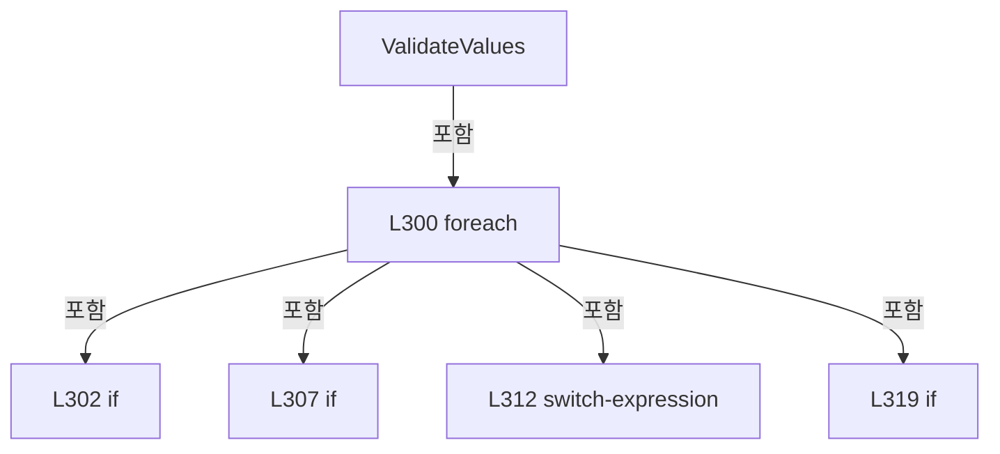

변경 전 점검: 입력/반환 타입, 위 호출자, 예외/취소 경로, 공유 상태와 저장·전송 소비자를 함께 확인합니다. 값의 단위나 물리 방향을 이름만으로 확정하지 않습니다.

### LocalFunctionStatement `IsUse` · L289–292

[Drilling.File/JHMI/CManualScanFile.cs:289–292](https://github.com/kjuws10-rgb/A3Drilling/blob/5aee8e58439c9b455cae7c9593c9be986c3e682e/Drilling.File/JHMI/CManualScanFile.cs#L289-L292)

| 항목 | 실제 추출 값 |
| --- | --- |
| 서명 | bool IsUse(Drilling.Common.Managers.ST_MANUAL_SCAN_FORM) |
| 접근/수식자 | Private /  |
| 반환/값 타입 | bool |
| 소속 타입 | NamedType:Drilling.File.JHMI.CManualScanFile |

입력 계약:

| 이름 | 타입 | 전달 | 선택/기본값 |
| --- | --- | --- | --- |
| item | Drilling.Common.Managers.ST_MANUAL_SCAN_FORM | None | False /  |

현재 부분 분석에서 직접 연결된 호출자는 없습니다. XAML/이벤트/인터페이스·델리게이트·외부 진입을 추가 확인해야 하며, 미사용으로 판정한 것이 아닙니다.

본문의 실제 연산·분기·예외·반환 순서(원문 위치 순):

| 원본 행 | 종류 | 주석 해설 |
| --- | --- | --- |
| 291 | return | 호출자에게 값 또는 제어를 반환합니다: return item.Use; |

변경 전 점검: 입력/반환 타입, 위 호출자, 예외/취소 경로, 공유 상태와 저장·전송 소비자를 함께 확인합니다. 값의 단위나 물리 방향을 이름만으로 확정하지 않습니다.

### LocalFunctionStatement `SelectName` · L294–297

[Drilling.File/JHMI/CManualScanFile.cs:294–297](https://github.com/kjuws10-rgb/A3Drilling/blob/5aee8e58439c9b455cae7c9593c9be986c3e682e/Drilling.File/JHMI/CManualScanFile.cs#L294-L297)

| 항목 | 실제 추출 값 |
| --- | --- |
| 서명 | string SelectName(Drilling.Common.Managers.ST_MANUAL_SCAN_FORM) |
| 접근/수식자 | Private /  |
| 반환/값 타입 | string |
| 소속 타입 | NamedType:Drilling.File.JHMI.CManualScanFile |

입력 계약:

| 이름 | 타입 | 전달 | 선택/기본값 |
| --- | --- | --- | --- |
| item | Drilling.Common.Managers.ST_MANUAL_SCAN_FORM | None | False /  |

현재 부분 분석에서 직접 연결된 호출자는 없습니다. XAML/이벤트/인터페이스·델리게이트·외부 진입을 추가 확인해야 하며, 미사용으로 판정한 것이 아닙니다.

본문의 실제 연산·분기·예외·반환 순서(원문 위치 순):

| 원본 행 | 종류 | 주석 해설 |
| --- | --- | --- |
| 296 | return | 호출자에게 값 또는 제어를 반환합니다: return item.Name; |

변경 전 점검: 입력/반환 타입, 위 호출자, 예외/취소 경로, 공유 상태와 저장·전송 소비자를 함께 확인합니다. 값의 단위나 물리 방향을 이름만으로 확정하지 않습니다.

### MethodDeclaration `ValidateIntParameter` · L326–334

[Drilling.File/JHMI/CManualScanFile.cs:326–334](https://github.com/kjuws10-rgb/A3Drilling/blob/5aee8e58439c9b455cae7c9593c9be986c3e682e/Drilling.File/JHMI/CManualScanFile.cs#L326-L334)

| 항목 | 실제 추출 값 |
| --- | --- |
| 서명 | string Drilling.File.JHMI.CManualScanFile.ValidateIntParameter(Drilling.Common.Managers.ST_MANUAL_SCAN_FORM, string) |
| 접근/수식자 | Private / private, static |
| 반환/값 타입 | string |
| 소속 타입 | NamedType:Drilling.File.JHMI.CManualScanFile |

입력 계약:

| 이름 | 타입 | 전달 | 선택/기본값 |
| --- | --- | --- | --- |
| formItem | Drilling.Common.Managers.ST_MANUAL_SCAN_FORM | None | False /  |
| value | string | None | False /  |

정적 호출자로 확인된 위치:

| 호출 파일/행 | 호출 표현식 | 런타임 분기 가능 |
| --- | --- | --- |
| [Drilling.File/JHMI/CManualScanFile.cs:314–314](https://github.com/kjuws10-rgb/A3Drilling/blob/5aee8e58439c9b455cae7c9593c9be986c3e682e/Drilling.File/JHMI/CManualScanFile.cs#L314-L314) | ValidateIntParameter | False |

호출하는 대상과 해석 범위:

| 원본 행 | 표현식 | 분석 상태 | 대상/소스 위치 |
| --- | --- | --- | --- |
| 328 | int.TryParse | resolved | bool int.TryParse(string?, System.Globalization.NumberStyles, System.IFormatProvider?, out int) |
| 333 | ValidateNumericRange | resolved | string Drilling.File.JHMI.CManualScanFile.ValidateNumericRange(Drilling.Common.Managers.ST_MANUAL_SCAN_FORM, double) · Drilling.File/JHMI/CManualScanFile.cs:352 |

본문의 실제 연산·분기·예외·반환 순서(원문 위치 순):

| 원본 행 | 종류 | 주석 해설 |
| --- | --- | --- |
| 328 | call | 함수·델리게이트 또는 객체 생성자를 호출합니다: int.TryParse(value, NumberStyles.Integer, CultureInfo.InvariantCulture, out var parsed) |
| 328 | if | 조건에 따라 분기합니다: if (!int.TryParse(value, NumberStyles.Integer, CultureInfo.InvariantCulture, out var parsed)) |
| 330 | return | 호출자에게 값 또는 제어를 반환합니다: return $"Manual setting save blocked. {formItem.DisplayName} must be an integer."; |
| 333 | call | 함수·델리게이트 또는 객체 생성자를 호출합니다: ValidateNumericRange(formItem, parsed) |
| 333 | return | 호출자에게 값 또는 제어를 반환합니다: return ValidateNumericRange(formItem, parsed); |

제어 구문의 포함 구조(실제 실행 순서/CFG가 아닌 구문 탐색 그림):

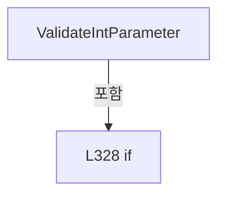

변경 전 점검: 입력/반환 타입, 위 호출자, 예외/취소 경로, 공유 상태와 저장·전송 소비자를 함께 확인합니다. 값의 단위나 물리 방향을 이름만으로 확정하지 않습니다.

### MethodDeclaration `ValidateDoubleParameter` · L336–344

[Drilling.File/JHMI/CManualScanFile.cs:336–344](https://github.com/kjuws10-rgb/A3Drilling/blob/5aee8e58439c9b455cae7c9593c9be986c3e682e/Drilling.File/JHMI/CManualScanFile.cs#L336-L344)

| 항목 | 실제 추출 값 |
| --- | --- |
| 서명 | string Drilling.File.JHMI.CManualScanFile.ValidateDoubleParameter(Drilling.Common.Managers.ST_MANUAL_SCAN_FORM, string) |
| 접근/수식자 | Private / private, static |
| 반환/값 타입 | string |
| 소속 타입 | NamedType:Drilling.File.JHMI.CManualScanFile |

입력 계약:

| 이름 | 타입 | 전달 | 선택/기본값 |
| --- | --- | --- | --- |
| formItem | Drilling.Common.Managers.ST_MANUAL_SCAN_FORM | None | False /  |
| value | string | None | False /  |

정적 호출자로 확인된 위치:

| 호출 파일/행 | 호출 표현식 | 런타임 분기 가능 |
| --- | --- | --- |
| [Drilling.File/JHMI/CManualScanFile.cs:315–315](https://github.com/kjuws10-rgb/A3Drilling/blob/5aee8e58439c9b455cae7c9593c9be986c3e682e/Drilling.File/JHMI/CManualScanFile.cs#L315-L315) | ValidateDoubleParameter | False |

호출하는 대상과 해석 범위:

| 원본 행 | 표현식 | 분석 상태 | 대상/소스 위치 |
| --- | --- | --- | --- |
| 338 | double.TryParse | resolved | bool double.TryParse(string?, System.Globalization.NumberStyles, System.IFormatProvider?, out double) |
| 338 | double.IsFinite | resolved | bool double.IsFinite(double) |
| 343 | ValidateNumericRange | resolved | string Drilling.File.JHMI.CManualScanFile.ValidateNumericRange(Drilling.Common.Managers.ST_MANUAL_SCAN_FORM, double) · Drilling.File/JHMI/CManualScanFile.cs:352 |

본문의 실제 연산·분기·예외·반환 순서(원문 위치 순):

| 원본 행 | 종류 | 주석 해설 |
| --- | --- | --- |
| 338 | call | 함수·델리게이트 또는 객체 생성자를 호출합니다: double.TryParse(value, NumberStyles.Float, CultureInfo.InvariantCulture, out var parsed) |
| 338 | call | 함수·델리게이트 또는 객체 생성자를 호출합니다: double.IsFinite(parsed) |
| 338 | if | 조건에 따라 분기합니다: if (!double.TryParse(value, NumberStyles.Float, CultureInfo.InvariantCulture, out var parsed) &#124;&#124; !double.IsFinite(parsed)) |
| 340 | return | 호출자에게 값 또는 제어를 반환합니다: return $"Manual setting save blocked. {formItem.DisplayName} must be numeric."; |
| 343 | call | 함수·델리게이트 또는 객체 생성자를 호출합니다: ValidateNumericRange(formItem, parsed) |
| 343 | return | 호출자에게 값 또는 제어를 반환합니다: return ValidateNumericRange(formItem, parsed); |

제어 구문의 포함 구조(실제 실행 순서/CFG가 아닌 구문 탐색 그림):

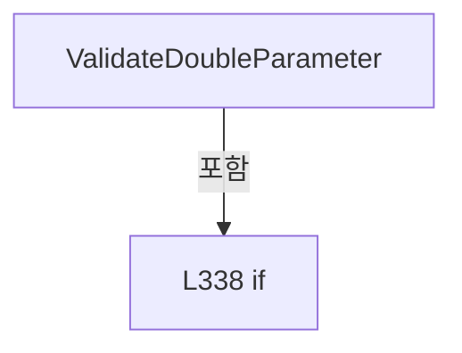

변경 전 점검: 입력/반환 타입, 위 호출자, 예외/취소 경로, 공유 상태와 저장·전송 소비자를 함께 확인합니다. 값의 단위나 물리 방향을 이름만으로 확정하지 않습니다.

### MethodDeclaration `ValidateBoolParameter` · L346–350

[Drilling.File/JHMI/CManualScanFile.cs:346–350](https://github.com/kjuws10-rgb/A3Drilling/blob/5aee8e58439c9b455cae7c9593c9be986c3e682e/Drilling.File/JHMI/CManualScanFile.cs#L346-L350)

| 항목 | 실제 추출 값 |
| --- | --- |
| 서명 | string Drilling.File.JHMI.CManualScanFile.ValidateBoolParameter(Drilling.Common.Managers.ST_MANUAL_SCAN_FORM, string) |
| 접근/수식자 | Private / private, static |
| 반환/값 타입 | string |
| 소속 타입 | NamedType:Drilling.File.JHMI.CManualScanFile |

입력 계약:

| 이름 | 타입 | 전달 | 선택/기본값 |
| --- | --- | --- | --- |
| formItem | Drilling.Common.Managers.ST_MANUAL_SCAN_FORM | None | False /  |
| value | string | None | False /  |

정적 호출자로 확인된 위치:

| 호출 파일/행 | 호출 표현식 | 런타임 분기 가능 |
| --- | --- | --- |
| [Drilling.File/JHMI/CManualScanFile.cs:316–316](https://github.com/kjuws10-rgb/A3Drilling/blob/5aee8e58439c9b455cae7c9593c9be986c3e682e/Drilling.File/JHMI/CManualScanFile.cs#L316-L316) | ValidateBoolParameter | False |

호출하는 대상과 해석 범위:

| 원본 행 | 표현식 | 분석 상태 | 대상/소스 위치 |
| --- | --- | --- | --- |
| 348 | value.Trim().ToUpperInvariant | resolved | string string.ToUpperInvariant() |
| 348 | value.Trim | resolved | string string.Trim() |

본문의 실제 연산·분기·예외·반환 순서(원문 위치 순):

| 원본 행 | 종류 | 주석 해설 |
| --- | --- | --- |
| 348 | call | 함수·델리게이트 또는 객체 생성자를 호출합니다: value.Trim().ToUpperInvariant() |
| 348 | call | 함수·델리게이트 또는 객체 생성자를 호출합니다: value.Trim() |
| 348 | local-declaration | 지역 변수를 선언합니다: var normalized = value.Trim().ToUpperInvariant(); |
| 348 | variable-initializer | 변수의 초기값을 지정합니다: normalized = value.Trim().ToUpperInvariant() |
| 349 | conditional-expression | 조건에 따라 결과식을 선택합니다: normalized is "ON" or "OFF" or "TRUE" or "FALSE" or "1" or "0" or "YES" or "NO" ? "" : $"Manual setting save blocked. {formItem.DisplayName} must be ON/OFF or TRUE/FALSE." |
| 349 | return | 호출자에게 값 또는 제어를 반환합니다: return normalized is "ON" or "OFF" or "TRUE" or "FALSE" or "1" or "0" or "YES" or "NO" ? "" : $"Manual setting save blocked. {formItem.DisplayName} must be ON/OFF or TRUE/FALSE."; |

변경 전 점검: 입력/반환 타입, 위 호출자, 예외/취소 경로, 공유 상태와 저장·전송 소비자를 함께 확인합니다. 값의 단위나 물리 방향을 이름만으로 확정하지 않습니다.

### MethodDeclaration `ValidateNumericRange` · L352–360

[Drilling.File/JHMI/CManualScanFile.cs:352–360](https://github.com/kjuws10-rgb/A3Drilling/blob/5aee8e58439c9b455cae7c9593c9be986c3e682e/Drilling.File/JHMI/CManualScanFile.cs#L352-L360)

| 항목 | 실제 추출 값 |
| --- | --- |
| 서명 | string Drilling.File.JHMI.CManualScanFile.ValidateNumericRange(Drilling.Common.Managers.ST_MANUAL_SCAN_FORM, double) |
| 접근/수식자 | Private / private, static |
| 반환/값 타입 | string |
| 소속 타입 | NamedType:Drilling.File.JHMI.CManualScanFile |

입력 계약:

| 이름 | 타입 | 전달 | 선택/기본값 |
| --- | --- | --- | --- |
| formItem | Drilling.Common.Managers.ST_MANUAL_SCAN_FORM | None | False /  |
| value | double | None | False /  |

정적 호출자로 확인된 위치:

| 호출 파일/행 | 호출 표현식 | 런타임 분기 가능 |
| --- | --- | --- |
| [Drilling.File/JHMI/CManualScanFile.cs:333–333](https://github.com/kjuws10-rgb/A3Drilling/blob/5aee8e58439c9b455cae7c9593c9be986c3e682e/Drilling.File/JHMI/CManualScanFile.cs#L333-L333) | ValidateNumericRange | False |
| [Drilling.File/JHMI/CManualScanFile.cs:343–343](https://github.com/kjuws10-rgb/A3Drilling/blob/5aee8e58439c9b455cae7c9593c9be986c3e682e/Drilling.File/JHMI/CManualScanFile.cs#L343-L343) | ValidateNumericRange | False |

호출하는 대상과 해석 범위:

| 원본 행 | 표현식 | 분석 상태 | 대상/소스 위치 |
| --- | --- | --- | --- |
| 354 | formItem.Min.Equals | resolved | bool double.Equals(double) |

본문의 실제 연산·분기·예외·반환 순서(원문 위치 순):

| 원본 행 | 종류 | 주석 해설 |
| --- | --- | --- |
| 354 | call | 함수·델리게이트 또는 객체 생성자를 호출합니다: formItem.Min.Equals(formItem.Max) |
| 354 | if | 조건에 따라 분기합니다: if (formItem.Min.Equals(formItem.Max)) |
| 356 | return | 호출자에게 값 또는 제어를 반환합니다: return ""; |
| 359 | conditional-expression | 조건에 따라 결과식을 선택합니다: value < formItem.Min &#124;&#124; value > formItem.Max ? $"Manual setting save blocked. {formItem.DisplayName} must be between {formItem.Min:0.###} and {formItem.Max:0.###} {formItem.Unit}." : "" |
| 359 | return | 호출자에게 값 또는 제어를 반환합니다: return value < formItem.Min &#124;&#124; value > formItem.Max ? $"Manual setting save blocked. {formItem.DisplayName} must be between {formItem.Min:0.###} and {formItem.Max:0.###} {formItem.Unit}." : ""; |

제어 구문의 포함 구조(실제 실행 순서/CFG가 아닌 구문 탐색 그림):

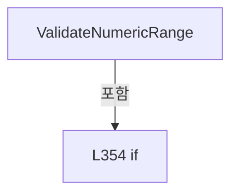

변경 전 점검: 입력/반환 타입, 위 호출자, 예외/취소 경로, 공유 상태와 저장·전송 소비자를 함께 확인합니다. 값의 단위나 물리 방향을 이름만으로 확정하지 않습니다.

### MethodDeclaration `ReadDouble` · L362–366

[Drilling.File/JHMI/CManualScanFile.cs:362–366](https://github.com/kjuws10-rgb/A3Drilling/blob/5aee8e58439c9b455cae7c9593c9be986c3e682e/Drilling.File/JHMI/CManualScanFile.cs#L362-L366)

| 항목 | 실제 추출 값 |
| --- | --- |
| 서명 | double Drilling.File.JHMI.CManualScanFile.ReadDouble(System.Collections.Generic.IReadOnlyDictionary<string, string>, System.Collections.Generic.IReadOnlyList<Drilling.Common.Managers.ST_MANUAL_SCAN_FORM>, string, double) |
| 접근/수식자 | Private / private |
| 반환/값 타입 | double |
| 소속 타입 | NamedType:Drilling.File.JHMI.CManualScanFile |

입력 계약:

| 이름 | 타입 | 전달 | 선택/기본값 |
| --- | --- | --- | --- |
| values | System.Collections.Generic.IReadOnlyDictionary<string, string> | None | False /  |
| formItems | System.Collections.Generic.IReadOnlyList<Drilling.Common.Managers.ST_MANUAL_SCAN_FORM> | None | False /  |
| key | string | None | False /  |
| defaultValue | double | None | False /  |

정적 호출자로 확인된 위치:

| 호출 파일/행 | 호출 표현식 | 런타임 분기 가능 |
| --- | --- | --- |
| [Drilling.File/JHMI/CManualScanFile.cs:71–71](https://github.com/kjuws10-rgb/A3Drilling/blob/5aee8e58439c9b455cae7c9593c9be986c3e682e/Drilling.File/JHMI/CManualScanFile.cs#L71-L71) | ReadDouble | False |
| [Drilling.File/JHMI/CManualScanFile.cs:72–72](https://github.com/kjuws10-rgb/A3Drilling/blob/5aee8e58439c9b455cae7c9593c9be986c3e682e/Drilling.File/JHMI/CManualScanFile.cs#L72-L72) | ReadDouble | False |
| [Drilling.File/JHMI/CManualScanFile.cs:73–73](https://github.com/kjuws10-rgb/A3Drilling/blob/5aee8e58439c9b455cae7c9593c9be986c3e682e/Drilling.File/JHMI/CManualScanFile.cs#L73-L73) | ReadDouble | False |
| [Drilling.File/JHMI/CManualScanFile.cs:76–76](https://github.com/kjuws10-rgb/A3Drilling/blob/5aee8e58439c9b455cae7c9593c9be986c3e682e/Drilling.File/JHMI/CManualScanFile.cs#L76-L76) | ReadDouble | False |
| [Drilling.File/JHMI/CManualScanFile.cs:77–77](https://github.com/kjuws10-rgb/A3Drilling/blob/5aee8e58439c9b455cae7c9593c9be986c3e682e/Drilling.File/JHMI/CManualScanFile.cs#L77-L77) | ReadDouble | False |
| [Drilling.File/JHMI/CManualScanFile.cs:78–78](https://github.com/kjuws10-rgb/A3Drilling/blob/5aee8e58439c9b455cae7c9593c9be986c3e682e/Drilling.File/JHMI/CManualScanFile.cs#L78-L78) | ReadDouble | False |
| [Drilling.File/JHMI/CManualScanFile.cs:80–80](https://github.com/kjuws10-rgb/A3Drilling/blob/5aee8e58439c9b455cae7c9593c9be986c3e682e/Drilling.File/JHMI/CManualScanFile.cs#L80-L80) | ReadDouble | False |
| [Drilling.File/JHMI/CManualScanFile.cs:81–81](https://github.com/kjuws10-rgb/A3Drilling/blob/5aee8e58439c9b455cae7c9593c9be986c3e682e/Drilling.File/JHMI/CManualScanFile.cs#L81-L81) | ReadDouble | False |
| [Drilling.File/JHMI/CManualScanFile.cs:82–82](https://github.com/kjuws10-rgb/A3Drilling/blob/5aee8e58439c9b455cae7c9593c9be986c3e682e/Drilling.File/JHMI/CManualScanFile.cs#L82-L82) | ReadDouble | False |

호출하는 대상과 해석 범위:

| 원본 행 | 표현식 | 분석 상태 | 대상/소스 위치 |
| --- | --- | --- | --- |
| 364 | ReadString | resolved | string Drilling.File.JHMI.CManualScanFile.ReadString(System.Collections.Generic.IReadOnlyDictionary<string, string>, System.Collections.Generic.IReadOnlyList<Drilling.Common.Managers.ST_MANUAL_SCAN_FORM>, string, string) · Drilling.File/JHMI/CManualScanFile.cs:401 |
| 364 | defaultValue.ToString | resolved | string double.ToString(System.IFormatProvider?) |
| 365 | double.TryParse | resolved | bool double.TryParse(string?, System.Globalization.NumberStyles, System.IFormatProvider?, out double) |

본문의 실제 연산·분기·예외·반환 순서(원문 위치 순):

| 원본 행 | 종류 | 주석 해설 |
| --- | --- | --- |
| 364 | call | 함수·델리게이트 또는 객체 생성자를 호출합니다: ReadString(values, formItems, key, defaultValue.ToString(CultureInfo.InvariantCulture)) |
| 364 | call | 함수·델리게이트 또는 객체 생성자를 호출합니다: defaultValue.ToString(CultureInfo.InvariantCulture) |
| 364 | local-declaration | 지역 변수를 선언합니다: var value = ReadString(values, formItems, key, defaultValue.ToString(CultureInfo.InvariantCulture)); |
| 364 | variable-initializer | 변수의 초기값을 지정합니다: value = ReadString(values, formItems, key, defaultValue.ToString(CultureInfo.InvariantCulture)) |
| 365 | call | 함수·델리게이트 또는 객체 생성자를 호출합니다: double.TryParse(value, NumberStyles.Float, CultureInfo.InvariantCulture, out var result) |
| 365 | conditional-expression | 조건에 따라 결과식을 선택합니다: double.TryParse(value, NumberStyles.Float, CultureInfo.InvariantCulture, out var result) ? result : defaultValue |
| 365 | return | 호출자에게 값 또는 제어를 반환합니다: return double.TryParse(value, NumberStyles.Float, CultureInfo.InvariantCulture, out var result) ? result : defaultValue; |

변경 전 점검: 입력/반환 타입, 위 호출자, 예외/취소 경로, 공유 상태와 저장·전송 소비자를 함께 확인합니다. 값의 단위나 물리 방향을 이름만으로 확정하지 않습니다.

### MethodDeclaration `ReadInt` · L368–372

[Drilling.File/JHMI/CManualScanFile.cs:368–372](https://github.com/kjuws10-rgb/A3Drilling/blob/5aee8e58439c9b455cae7c9593c9be986c3e682e/Drilling.File/JHMI/CManualScanFile.cs#L368-L372)

| 항목 | 실제 추출 값 |
| --- | --- |
| 서명 | int Drilling.File.JHMI.CManualScanFile.ReadInt(System.Collections.Generic.IReadOnlyDictionary<string, string>, System.Collections.Generic.IReadOnlyList<Drilling.Common.Managers.ST_MANUAL_SCAN_FORM>, string, int) |
| 접근/수식자 | Private / private |
| 반환/값 타입 | int |
| 소속 타입 | NamedType:Drilling.File.JHMI.CManualScanFile |

입력 계약:

| 이름 | 타입 | 전달 | 선택/기본값 |
| --- | --- | --- | --- |
| values | System.Collections.Generic.IReadOnlyDictionary<string, string> | None | False /  |
| formItems | System.Collections.Generic.IReadOnlyList<Drilling.Common.Managers.ST_MANUAL_SCAN_FORM> | None | False /  |
| key | string | None | False /  |
| defaultValue | int | None | False /  |

정적 호출자로 확인된 위치:

| 호출 파일/행 | 호출 표현식 | 런타임 분기 가능 |
| --- | --- | --- |
| [Drilling.File/JHMI/CManualScanFile.cs:85–85](https://github.com/kjuws10-rgb/A3Drilling/blob/5aee8e58439c9b455cae7c9593c9be986c3e682e/Drilling.File/JHMI/CManualScanFile.cs#L85-L85) | ReadInt | False |
| [Drilling.File/JHMI/CManualScanFile.cs:86–86](https://github.com/kjuws10-rgb/A3Drilling/blob/5aee8e58439c9b455cae7c9593c9be986c3e682e/Drilling.File/JHMI/CManualScanFile.cs#L86-L86) | ReadInt | False |

호출하는 대상과 해석 범위:

| 원본 행 | 표현식 | 분석 상태 | 대상/소스 위치 |
| --- | --- | --- | --- |
| 370 | ReadString | resolved | string Drilling.File.JHMI.CManualScanFile.ReadString(System.Collections.Generic.IReadOnlyDictionary<string, string>, System.Collections.Generic.IReadOnlyList<Drilling.Common.Managers.ST_MANUAL_SCAN_FORM>, string, string) · Drilling.File/JHMI/CManualScanFile.cs:401 |
| 370 | defaultValue.ToString | resolved | string int.ToString(System.IFormatProvider?) |
| 371 | int.TryParse | resolved | bool int.TryParse(string?, System.Globalization.NumberStyles, System.IFormatProvider?, out int) |

본문의 실제 연산·분기·예외·반환 순서(원문 위치 순):

| 원본 행 | 종류 | 주석 해설 |
| --- | --- | --- |
| 370 | call | 함수·델리게이트 또는 객체 생성자를 호출합니다: ReadString(values, formItems, key, defaultValue.ToString(CultureInfo.InvariantCulture)) |
| 370 | call | 함수·델리게이트 또는 객체 생성자를 호출합니다: defaultValue.ToString(CultureInfo.InvariantCulture) |
| 370 | local-declaration | 지역 변수를 선언합니다: var value = ReadString(values, formItems, key, defaultValue.ToString(CultureInfo.InvariantCulture)); |
| 370 | variable-initializer | 변수의 초기값을 지정합니다: value = ReadString(values, formItems, key, defaultValue.ToString(CultureInfo.InvariantCulture)) |
| 371 | call | 함수·델리게이트 또는 객체 생성자를 호출합니다: int.TryParse(value, NumberStyles.Integer, CultureInfo.InvariantCulture, out var result) |
| 371 | conditional-expression | 조건에 따라 결과식을 선택합니다: int.TryParse(value, NumberStyles.Integer, CultureInfo.InvariantCulture, out var result) ? result : defaultValue |
| 371 | return | 호출자에게 값 또는 제어를 반환합니다: return int.TryParse(value, NumberStyles.Integer, CultureInfo.InvariantCulture, out var result) ? result : defaultValue; |

변경 전 점검: 입력/반환 타입, 위 호출자, 예외/취소 경로, 공유 상태와 저장·전송 소비자를 함께 확인합니다. 값의 단위나 물리 방향을 이름만으로 확정하지 않습니다.

### MethodDeclaration `ReadLaserActionDouble` · L374–380

[Drilling.File/JHMI/CManualScanFile.cs:374–380](https://github.com/kjuws10-rgb/A3Drilling/blob/5aee8e58439c9b455cae7c9593c9be986c3e682e/Drilling.File/JHMI/CManualScanFile.cs#L374-L380)

| 항목 | 실제 추출 값 |
| --- | --- |
| 서명 | double Drilling.File.JHMI.CManualScanFile.ReadLaserActionDouble(System.Collections.Generic.IReadOnlyDictionary<string, string>, System.Collections.Generic.IReadOnlyList<Drilling.Common.Managers.ST_MANUAL_SCAN_FORM>, string, double) |
| 접근/수식자 | Private / private |
| 반환/값 타입 | double |
| 소속 타입 | NamedType:Drilling.File.JHMI.CManualScanFile |

입력 계약:

| 이름 | 타입 | 전달 | 선택/기본값 |
| --- | --- | --- | --- |
| values | System.Collections.Generic.IReadOnlyDictionary<string, string> | None | False /  |
| formItems | System.Collections.Generic.IReadOnlyList<Drilling.Common.Managers.ST_MANUAL_SCAN_FORM> | None | False /  |
| key | string | None | False /  |
| defaultValue | double | None | False /  |

정적 호출자로 확인된 위치:

| 호출 파일/행 | 호출 표현식 | 런타임 분기 가능 |
| --- | --- | --- |
| [Drilling.File/JHMI/CManualScanFile.cs:83–83](https://github.com/kjuws10-rgb/A3Drilling/blob/5aee8e58439c9b455cae7c9593c9be986c3e682e/Drilling.File/JHMI/CManualScanFile.cs#L83-L83) | ReadLaserActionDouble | False |
| [Drilling.File/JHMI/CManualScanFile.cs:89–89](https://github.com/kjuws10-rgb/A3Drilling/blob/5aee8e58439c9b455cae7c9593c9be986c3e682e/Drilling.File/JHMI/CManualScanFile.cs#L89-L89) | ReadLaserActionDouble | False |

호출하는 대상과 해석 범위:

| 원본 행 | 표현식 | 분석 상태 | 대상/소스 위치 |
| --- | --- | --- | --- |
| 376 | ReadString | resolved | string Drilling.File.JHMI.CManualScanFile.ReadString(System.Collections.Generic.IReadOnlyDictionary<string, string>, System.Collections.Generic.IReadOnlyList<Drilling.Common.Managers.ST_MANUAL_SCAN_FORM>, string, string) · Drilling.File/JHMI/CManualScanFile.cs:401 |
| 376 | defaultValue.ToString | resolved | string double.ToString(System.IFormatProvider?) |
| 377 | double.TryParse | resolved | bool double.TryParse(string?, System.Globalization.NumberStyles, System.IFormatProvider?, out double) |
| 377 | double.IsFinite | resolved | bool double.IsFinite(double) |
| 378 | new InvalidDataException | resolved | System.IO.InvalidDataException.InvalidDataException(string?) |

본문의 실제 연산·분기·예외·반환 순서(원문 위치 순):

| 원본 행 | 종류 | 주석 해설 |
| --- | --- | --- |
| 376 | call | 함수·델리게이트 또는 객체 생성자를 호출합니다: ReadString(values, formItems, key, defaultValue.ToString(CultureInfo.InvariantCulture)) |
| 376 | call | 함수·델리게이트 또는 객체 생성자를 호출합니다: defaultValue.ToString(CultureInfo.InvariantCulture) |
| 376 | local-declaration | 지역 변수를 선언합니다: var text = ReadString(values, formItems, key, defaultValue.ToString(CultureInfo.InvariantCulture)); |
| 376 | variable-initializer | 변수의 초기값을 지정합니다: text = ReadString(values, formItems, key, defaultValue.ToString(CultureInfo.InvariantCulture)) |
| 377 | call | 함수·델리게이트 또는 객체 생성자를 호출합니다: double.TryParse(text, NumberStyles.Float, CultureInfo.InvariantCulture, out var result) |
| 377 | call | 함수·델리게이트 또는 객체 생성자를 호출합니다: double.IsFinite(result) |
| 377 | if | 조건에 따라 분기합니다: if (!double.TryParse(text, NumberStyles.Float, CultureInfo.InvariantCulture, out var result) &#124;&#124; !double.IsFinite(result) &#124;&#124; result < 0) |
| 378 | call | 함수·델리게이트 또는 객체 생성자를 호출합니다: new InvalidDataException($"Manual setting load blocked. {key} must be a finite number greater than or equal to 0 msec.") |
| 378 | throw | 예외를 발생/전달합니다: throw new InvalidDataException($"Manual setting load blocked. {key} must be a finite number greater than or equal to 0 msec."); |
| 379 | return | 호출자에게 값 또는 제어를 반환합니다: return result; |

제어 구문의 포함 구조(실제 실행 순서/CFG가 아닌 구문 탐색 그림):

변경 전 점검: 입력/반환 타입, 위 호출자, 예외/취소 경로, 공유 상태와 저장·전송 소비자를 함께 확인합니다. 값의 단위나 물리 방향을 이름만으로 확정하지 않습니다.

### MethodDeclaration `ReadLaserActionCount` · L382–388

[Drilling.File/JHMI/CManualScanFile.cs:382–388](https://github.com/kjuws10-rgb/A3Drilling/blob/5aee8e58439c9b455cae7c9593c9be986c3e682e/Drilling.File/JHMI/CManualScanFile.cs#L382-L388)

| 항목 | 실제 추출 값 |
| --- | --- |
| 서명 | int Drilling.File.JHMI.CManualScanFile.ReadLaserActionCount(System.Collections.Generic.IReadOnlyDictionary<string, string>, System.Collections.Generic.IReadOnlyList<Drilling.Common.Managers.ST_MANUAL_SCAN_FORM>, string, int) |
| 접근/수식자 | Private / private |
| 반환/값 타입 | int |
| 소속 타입 | NamedType:Drilling.File.JHMI.CManualScanFile |

입력 계약:

| 이름 | 타입 | 전달 | 선택/기본값 |
| --- | --- | --- | --- |
| values | System.Collections.Generic.IReadOnlyDictionary<string, string> | None | False /  |
| formItems | System.Collections.Generic.IReadOnlyList<Drilling.Common.Managers.ST_MANUAL_SCAN_FORM> | None | False /  |
| key | string | None | False /  |
| defaultValue | int | None | False /  |

정적 호출자로 확인된 위치:

| 호출 파일/행 | 호출 표현식 | 런타임 분기 가능 |
| --- | --- | --- |
| [Drilling.File/JHMI/CManualScanFile.cs:84–84](https://github.com/kjuws10-rgb/A3Drilling/blob/5aee8e58439c9b455cae7c9593c9be986c3e682e/Drilling.File/JHMI/CManualScanFile.cs#L84-L84) | ReadLaserActionCount | False |
| [Drilling.File/JHMI/CManualScanFile.cs:88–88](https://github.com/kjuws10-rgb/A3Drilling/blob/5aee8e58439c9b455cae7c9593c9be986c3e682e/Drilling.File/JHMI/CManualScanFile.cs#L88-L88) | ReadLaserActionCount | False |

호출하는 대상과 해석 범위:

| 원본 행 | 표현식 | 분석 상태 | 대상/소스 위치 |
| --- | --- | --- | --- |
| 384 | ReadString | resolved | string Drilling.File.JHMI.CManualScanFile.ReadString(System.Collections.Generic.IReadOnlyDictionary<string, string>, System.Collections.Generic.IReadOnlyList<Drilling.Common.Managers.ST_MANUAL_SCAN_FORM>, string, string) · Drilling.File/JHMI/CManualScanFile.cs:401 |
| 384 | defaultValue.ToString | resolved | string int.ToString(System.IFormatProvider?) |
| 385 | int.TryParse | resolved | bool int.TryParse(string?, System.Globalization.NumberStyles, System.IFormatProvider?, out int) |
| 386 | new InvalidDataException | resolved | System.IO.InvalidDataException.InvalidDataException(string?) |

본문의 실제 연산·분기·예외·반환 순서(원문 위치 순):

| 원본 행 | 종류 | 주석 해설 |
| --- | --- | --- |
| 384 | call | 함수·델리게이트 또는 객체 생성자를 호출합니다: ReadString(values, formItems, key, defaultValue.ToString(CultureInfo.InvariantCulture)) |
| 384 | call | 함수·델리게이트 또는 객체 생성자를 호출합니다: defaultValue.ToString(CultureInfo.InvariantCulture) |
| 384 | local-declaration | 지역 변수를 선언합니다: var text = ReadString(values, formItems, key, defaultValue.ToString(CultureInfo.InvariantCulture)); |
| 384 | variable-initializer | 변수의 초기값을 지정합니다: text = ReadString(values, formItems, key, defaultValue.ToString(CultureInfo.InvariantCulture)) |
| 385 | call | 함수·델리게이트 또는 객체 생성자를 호출합니다: int.TryParse(text, NumberStyles.Integer, CultureInfo.InvariantCulture, out var result) |
| 385 | if | 조건에 따라 분기합니다: if (!int.TryParse(text, NumberStyles.Integer, CultureInfo.InvariantCulture, out var result) &#124;&#124; result < 1) |
| 386 | call | 함수·델리게이트 또는 객체 생성자를 호출합니다: new InvalidDataException($"Manual setting load blocked. {key} must be an integer greater than or equal to 1.") |
| 386 | throw | 예외를 발생/전달합니다: throw new InvalidDataException($"Manual setting load blocked. {key} must be an integer greater than or equal to 1."); |
| 387 | return | 호출자에게 값 또는 제어를 반환합니다: return result; |

제어 구문의 포함 구조(실제 실행 순서/CFG가 아닌 구문 탐색 그림):

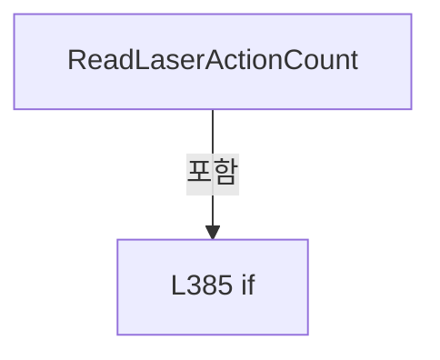

변경 전 점검: 입력/반환 타입, 위 호출자, 예외/취소 경로, 공유 상태와 저장·전송 소비자를 함께 확인합니다. 값의 단위나 물리 방향을 이름만으로 확정하지 않습니다.

### MethodDeclaration `NormalizeLaserOnMode` · L390–394

[Drilling.File/JHMI/CManualScanFile.cs:390–394](https://github.com/kjuws10-rgb/A3Drilling/blob/5aee8e58439c9b455cae7c9593c9be986c3e682e/Drilling.File/JHMI/CManualScanFile.cs#L390-L394)

| 항목 | 실제 추출 값 |
| --- | --- |
| 서명 | string Drilling.File.JHMI.CManualScanFile.NormalizeLaserOnMode(string) |
| 접근/수식자 | Private / private, static |
| 반환/값 타입 | string |
| 소속 타입 | NamedType:Drilling.File.JHMI.CManualScanFile |

입력 계약:

| 이름 | 타입 | 전달 | 선택/기본값 |
| --- | --- | --- | --- |
| mode | string | None | False /  |

정적 호출자로 확인된 위치:

| 호출 파일/행 | 호출 표현식 | 런타임 분기 가능 |
| --- | --- | --- |
| [Drilling.File/JHMI/CManualScanFile.cs:87–87](https://github.com/kjuws10-rgb/A3Drilling/blob/5aee8e58439c9b455cae7c9593c9be986c3e682e/Drilling.File/JHMI/CManualScanFile.cs#L87-L87) | NormalizeLaserOnMode | False |
| [Drilling.File/JHMI/CManualScanFile.cs:119–119](https://github.com/kjuws10-rgb/A3Drilling/blob/5aee8e58439c9b455cae7c9593c9be986c3e682e/Drilling.File/JHMI/CManualScanFile.cs#L119-L119) | NormalizeLaserOnMode | False |

호출하는 대상과 해석 범위:

| 원본 행 | 표현식 | 분석 상태 | 대상/소스 위치 |
| --- | --- | --- | --- |
| 392 | .Trim().ToUpperInvariant | resolved | string string.ToUpperInvariant() |
| 392 | .Trim | resolved | string string.Trim() |
| 393 | new InvalidDataException | resolved | System.IO.InvalidDataException.InvalidDataException(string?) |

본문의 실제 연산·분기·예외·반환 순서(원문 위치 순):

| 원본 행 | 종류 | 주석 해설 |
| --- | --- | --- |
| 392 | call | 함수·델리게이트 또는 객체 생성자를 호출합니다: .Trim().ToUpperInvariant() |
| 392 | call | 함수·델리게이트 또는 객체 생성자를 호출합니다: .Trim() |
| 392 | local-declaration | 지역 변수를 선언합니다: var normalized = mode?.Trim().ToUpperInvariant(); |
| 392 | variable-initializer | 변수의 초기값을 지정합니다: normalized = mode?.Trim().ToUpperInvariant() |
| 393 | call | 함수·델리게이트 또는 객체 생성자를 호출합니다: new InvalidDataException("Manual setting LaserOnMode must be TIME or COUNT.") |
| 393 | conditional-expression | 조건에 따라 결과식을 선택합니다: normalized is "TIME" or "COUNT" ? normalized : throw new InvalidDataException("Manual setting LaserOnMode must be TIME or COUNT.") |
| 393 | return | 호출자에게 값 또는 제어를 반환합니다: return normalized is "TIME" or "COUNT" ? normalized : throw new InvalidDataException("Manual setting LaserOnMode must be TIME or COUNT."); |
| 393 | throw | 예외를 발생/전달합니다: throw new InvalidDataException("Manual setting LaserOnMode must be TIME or COUNT.") |

변경 전 점검: 입력/반환 타입, 위 호출자, 예외/취소 경로, 공유 상태와 저장·전송 소비자를 함께 확인합니다. 값의 단위나 물리 방향을 이름만으로 확정하지 않습니다.

### MethodDeclaration `ReadDoubleValue` · L396–399

[Drilling.File/JHMI/CManualScanFile.cs:396–399](https://github.com/kjuws10-rgb/A3Drilling/blob/5aee8e58439c9b455cae7c9593c9be986c3e682e/Drilling.File/JHMI/CManualScanFile.cs#L396-L399)

| 항목 | 실제 추출 값 |
| --- | --- |
| 서명 | double Drilling.File.JHMI.CManualScanFile.ReadDoubleValue(string, double) |
| 접근/수식자 | Private / private, static |
| 반환/값 타입 | double |
| 소속 타입 | NamedType:Drilling.File.JHMI.CManualScanFile |

입력 계약:

| 이름 | 타입 | 전달 | 선택/기본값 |
| --- | --- | --- | --- |
| value | string | None | False /  |
| defaultValue | double | None | False /  |

정적 호출자로 확인된 위치:

| 호출 파일/행 | 호출 표현식 | 런타임 분기 가능 |
| --- | --- | --- |
| [Drilling.File/JHMI/CManualScanFile.cs:213–213](https://github.com/kjuws10-rgb/A3Drilling/blob/5aee8e58439c9b455cae7c9593c9be986c3e682e/Drilling.File/JHMI/CManualScanFile.cs#L213-L213) | ReadDoubleValue | False |
| [Drilling.File/JHMI/CManualScanFile.cs:214–214](https://github.com/kjuws10-rgb/A3Drilling/blob/5aee8e58439c9b455cae7c9593c9be986c3e682e/Drilling.File/JHMI/CManualScanFile.cs#L214-L214) | ReadDoubleValue | False |

호출하는 대상과 해석 범위:

| 원본 행 | 표현식 | 분석 상태 | 대상/소스 위치 |
| --- | --- | --- | --- |
| 398 | double.TryParse | resolved | bool double.TryParse(string?, System.Globalization.NumberStyles, System.IFormatProvider?, out double) |

본문의 실제 연산·분기·예외·반환 순서(원문 위치 순):

| 원본 행 | 종류 | 주석 해설 |
| --- | --- | --- |
| 398 | call | 함수·델리게이트 또는 객체 생성자를 호출합니다: double.TryParse(value, NumberStyles.Float, CultureInfo.InvariantCulture, out var result) |
| 398 | conditional-expression | 조건에 따라 결과식을 선택합니다: double.TryParse(value, NumberStyles.Float, CultureInfo.InvariantCulture, out var result) ? result : defaultValue |
| 398 | return | 호출자에게 값 또는 제어를 반환합니다: return double.TryParse(value, NumberStyles.Float, CultureInfo.InvariantCulture, out var result) ? result : defaultValue; |

변경 전 점검: 입력/반환 타입, 위 호출자, 예외/취소 경로, 공유 상태와 저장·전송 소비자를 함께 확인합니다. 값의 단위나 물리 방향을 이름만으로 확정하지 않습니다.

### MethodDeclaration `ReadString` · L401–409

[Drilling.File/JHMI/CManualScanFile.cs:401–409](https://github.com/kjuws10-rgb/A3Drilling/blob/5aee8e58439c9b455cae7c9593c9be986c3e682e/Drilling.File/JHMI/CManualScanFile.cs#L401-L409)

| 항목 | 실제 추출 값 |
| --- | --- |
| 서명 | string Drilling.File.JHMI.CManualScanFile.ReadString(System.Collections.Generic.IReadOnlyDictionary<string, string>, System.Collections.Generic.IReadOnlyList<Drilling.Common.Managers.ST_MANUAL_SCAN_FORM>, string, string) |
| 접근/수식자 | Private / private |
| 반환/값 타입 | string |
| 소속 타입 | NamedType:Drilling.File.JHMI.CManualScanFile |

입력 계약:

| 이름 | 타입 | 전달 | 선택/기본값 |
| --- | --- | --- | --- |
| values | System.Collections.Generic.IReadOnlyDictionary<string, string> | None | False /  |
| formItems | System.Collections.Generic.IReadOnlyList<Drilling.Common.Managers.ST_MANUAL_SCAN_FORM> | None | False /  |
| key | string | None | False /  |
| defaultValue | string | None | False /  |

정적 호출자로 확인된 위치:

| 호출 파일/행 | 호출 표현식 | 런타임 분기 가능 |
| --- | --- | --- |
| [Drilling.File/JHMI/CManualScanFile.cs:74–74](https://github.com/kjuws10-rgb/A3Drilling/blob/5aee8e58439c9b455cae7c9593c9be986c3e682e/Drilling.File/JHMI/CManualScanFile.cs#L74-L74) | ReadString | False |
| [Drilling.File/JHMI/CManualScanFile.cs:75–75](https://github.com/kjuws10-rgb/A3Drilling/blob/5aee8e58439c9b455cae7c9593c9be986c3e682e/Drilling.File/JHMI/CManualScanFile.cs#L75-L75) | ReadString | False |
| [Drilling.File/JHMI/CManualScanFile.cs:87–87](https://github.com/kjuws10-rgb/A3Drilling/blob/5aee8e58439c9b455cae7c9593c9be986c3e682e/Drilling.File/JHMI/CManualScanFile.cs#L87-L87) | ReadString | False |
| [Drilling.File/JHMI/CManualScanFile.cs:364–364](https://github.com/kjuws10-rgb/A3Drilling/blob/5aee8e58439c9b455cae7c9593c9be986c3e682e/Drilling.File/JHMI/CManualScanFile.cs#L364-L364) | ReadString | False |
| [Drilling.File/JHMI/CManualScanFile.cs:370–370](https://github.com/kjuws10-rgb/A3Drilling/blob/5aee8e58439c9b455cae7c9593c9be986c3e682e/Drilling.File/JHMI/CManualScanFile.cs#L370-L370) | ReadString | False |
| [Drilling.File/JHMI/CManualScanFile.cs:376–376](https://github.com/kjuws10-rgb/A3Drilling/blob/5aee8e58439c9b455cae7c9593c9be986c3e682e/Drilling.File/JHMI/CManualScanFile.cs#L376-L376) | ReadString | False |
| [Drilling.File/JHMI/CManualScanFile.cs:384–384](https://github.com/kjuws10-rgb/A3Drilling/blob/5aee8e58439c9b455cae7c9593c9be986c3e682e/Drilling.File/JHMI/CManualScanFile.cs#L384-L384) | ReadString | False |

호출하는 대상과 해석 범위:

| 원본 행 | 표현식 | 분석 상태 | 대상/소스 위치 |
| --- | --- | --- | --- |
| 408 | values.TryGetValue | resolved · 동적 구현 선택 가능 | bool System.Collections.Generic.IReadOnlyDictionary<string, string>.TryGetValue(string, out string) |
| 408 | string.IsNullOrWhiteSpace | resolved | bool string.IsNullOrWhiteSpace(string?) |
| 408 | formItems.FirstOrDefault | resolved | Drilling.Common.Managers.ST_MANUAL_SCAN_FORM? System.Collections.Generic.IEnumerable<Drilling.Common.Managers.ST_MANUAL_SCAN_FORM>.FirstOrDefault<Drilling.Common.Managers.ST_MANUAL_SCAN_FORM>(System.Func<Drilling.Common.Managers.ST_MANUAL_SCAN_FORM, bool>) |

본문의 실제 연산·분기·예외·반환 순서(원문 위치 순):

| 원본 행 | 종류 | 주석 해설 |
| --- | --- | --- |
| 408 | call | 함수·델리게이트 또는 객체 생성자를 호출합니다: values.TryGetValue(key, out var value) |
| 408 | call | 함수·델리게이트 또는 객체 생성자를 호출합니다: string.IsNullOrWhiteSpace(value) |
| 408 | call | 함수·델리게이트 또는 객체 생성자를 호출합니다: formItems.FirstOrDefault(MatchesItem) |
| 408 | conditional-expression | 조건에 따라 결과식을 선택합니다: values.TryGetValue(key, out var value) && !string.IsNullOrWhiteSpace(value) ? value : formItems.FirstOrDefault(MatchesItem)?.DefaultValue ?? defaultValue |
| 408 | return | 호출자에게 값 또는 제어를 반환합니다: return values.TryGetValue(key, out var value) && !string.IsNullOrWhiteSpace(value) ? value : formItems.FirstOrDefault(MatchesItem)?.DefaultValue ?? defaultValue; |

변경 전 점검: 입력/반환 타입, 위 호출자, 예외/취소 경로, 공유 상태와 저장·전송 소비자를 함께 확인합니다. 값의 단위나 물리 방향을 이름만으로 확정하지 않습니다.

### LocalFunctionStatement `MatchesItem` · L403–406

[Drilling.File/JHMI/CManualScanFile.cs:403–406](https://github.com/kjuws10-rgb/A3Drilling/blob/5aee8e58439c9b455cae7c9593c9be986c3e682e/Drilling.File/JHMI/CManualScanFile.cs#L403-L406)

| 항목 | 실제 추출 값 |
| --- | --- |
| 서명 | bool MatchesItem(Drilling.Common.Managers.ST_MANUAL_SCAN_FORM) |
| 접근/수식자 | Private /  |
| 반환/값 타입 | bool |
| 소속 타입 | NamedType:Drilling.File.JHMI.CManualScanFile |

입력 계약:

| 이름 | 타입 | 전달 | 선택/기본값 |
| --- | --- | --- | --- |
| item | Drilling.Common.Managers.ST_MANUAL_SCAN_FORM | None | False /  |

현재 부분 분석에서 직접 연결된 호출자는 없습니다. XAML/이벤트/인터페이스·델리게이트·외부 진입을 추가 확인해야 하며, 미사용으로 판정한 것이 아닙니다.

호출하는 대상과 해석 범위:

| 원본 행 | 표현식 | 분석 상태 | 대상/소스 위치 |
| --- | --- | --- | --- |
| 405 | item.Name.Equals | resolved | bool string.Equals(string?, System.StringComparison) |

본문의 실제 연산·분기·예외·반환 순서(원문 위치 순):

| 원본 행 | 종류 | 주석 해설 |
| --- | --- | --- |
| 405 | call | 함수·델리게이트 또는 객체 생성자를 호출합니다: item.Name.Equals(key, StringComparison.OrdinalIgnoreCase) |
| 405 | return | 호출자에게 값 또는 제어를 반환합니다: return item.Name.Equals(key, StringComparison.OrdinalIgnoreCase); |

변경 전 점검: 입력/반환 타입, 위 호출자, 예외/취소 경로, 공유 상태와 저장·전송 소비자를 함께 확인합니다. 값의 단위나 물리 방향을 이름만으로 확정하지 않습니다.

### MethodDeclaration `GetFormPath` · L411–414

[Drilling.File/JHMI/CManualScanFile.cs:411–414](https://github.com/kjuws10-rgb/A3Drilling/blob/5aee8e58439c9b455cae7c9593c9be986c3e682e/Drilling.File/JHMI/CManualScanFile.cs#L411-L414)

| 항목 | 실제 추출 값 |
| --- | --- |
| 서명 | string Drilling.File.JHMI.CManualScanFile.GetFormPath() |
| 접근/수식자 | Private / private |
| 반환/값 타입 | string |
| 소속 타입 | NamedType:Drilling.File.JHMI.CManualScanFile |

정적 호출자로 확인된 위치:

| 호출 파일/행 | 호출 표현식 | 런타임 분기 가능 |
| --- | --- | --- |
| [Drilling.File/JHMI/CManualScanFile.cs:225–225](https://github.com/kjuws10-rgb/A3Drilling/blob/5aee8e58439c9b455cae7c9593c9be986c3e682e/Drilling.File/JHMI/CManualScanFile.cs#L225-L225) | GetFormPath | False |

호출하는 대상과 해석 범위:

| 원본 행 | 표현식 | 분석 상태 | 대상/소스 위치 |
| --- | --- | --- | --- |
| 413 | Path.Combine | resolved | string System.IO.Path.Combine(string, string) |

본문의 실제 연산·분기·예외·반환 순서(원문 위치 순):

| 원본 행 | 종류 | 주석 해설 |
| --- | --- | --- |
| 413 | call | 함수·델리게이트 또는 객체 생성자를 호출합니다: Path.Combine(configRoot, "JHMI_MANUAL_SCAN.csv") |
| 413 | return | 호출자에게 값 또는 제어를 반환합니다: return Path.Combine(configRoot, "JHMI_MANUAL_SCAN.csv"); |

변경 전 점검: 입력/반환 타입, 위 호출자, 예외/취소 경로, 공유 상태와 저장·전송 소비자를 함께 확인합니다. 값의 단위나 물리 방향을 이름만으로 확정하지 않습니다.

### MethodDeclaration `GetSettingPath` · L416–419

[Drilling.File/JHMI/CManualScanFile.cs:416–419](https://github.com/kjuws10-rgb/A3Drilling/blob/5aee8e58439c9b455cae7c9593c9be986c3e682e/Drilling.File/JHMI/CManualScanFile.cs#L416-L419)

| 항목 | 실제 추출 값 |
| --- | --- |
| 서명 | string Drilling.File.JHMI.CManualScanFile.GetSettingPath(string) |
| 접근/수식자 | Private / private |
| 반환/값 타입 | string |
| 소속 타입 | NamedType:Drilling.File.JHMI.CManualScanFile |

입력 계약:

| 이름 | 타입 | 전달 | 선택/기본값 |
| --- | --- | --- | --- |
| settingName | string | None | False /  |

정적 호출자로 확인된 위치:

| 호출 파일/행 | 호출 표현식 | 런타임 분기 가능 |
| --- | --- | --- |
| [Drilling.File/JHMI/CManualScanFile.cs:69–69](https://github.com/kjuws10-rgb/A3Drilling/blob/5aee8e58439c9b455cae7c9593c9be986c3e682e/Drilling.File/JHMI/CManualScanFile.cs#L69-L69) | GetSettingPath | False |
| [Drilling.File/JHMI/CManualScanFile.cs:146–146](https://github.com/kjuws10-rgb/A3Drilling/blob/5aee8e58439c9b455cae7c9593c9be986c3e682e/Drilling.File/JHMI/CManualScanFile.cs#L146-L146) | GetSettingPath | False |
| [Drilling.File/JHMI/CManualScanFile.cs:154–154](https://github.com/kjuws10-rgb/A3Drilling/blob/5aee8e58439c9b455cae7c9593c9be986c3e682e/Drilling.File/JHMI/CManualScanFile.cs#L154-L154) | GetSettingPath | False |
| [Drilling.File/JHMI/CManualScanFile.cs:155–155](https://github.com/kjuws10-rgb/A3Drilling/blob/5aee8e58439c9b455cae7c9593c9be986c3e682e/Drilling.File/JHMI/CManualScanFile.cs#L155-L155) | GetSettingPath | False |
| [Drilling.File/JHMI/CManualScanFile.cs:174–174](https://github.com/kjuws10-rgb/A3Drilling/blob/5aee8e58439c9b455cae7c9593c9be986c3e682e/Drilling.File/JHMI/CManualScanFile.cs#L174-L174) | GetSettingPath | False |
| [Drilling.File/JHMI/CManualScanFile.cs:185–185](https://github.com/kjuws10-rgb/A3Drilling/blob/5aee8e58439c9b455cae7c9593c9be986c3e682e/Drilling.File/JHMI/CManualScanFile.cs#L185-L185) | GetSettingPath | False |
| [Drilling.File/JHMI/CManualScanFile.cs:272–272](https://github.com/kjuws10-rgb/A3Drilling/blob/5aee8e58439c9b455cae7c9593c9be986c3e682e/Drilling.File/JHMI/CManualScanFile.cs#L272-L272) | GetSettingPath | False |

호출하는 대상과 해석 범위:

| 원본 행 | 표현식 | 분석 상태 | 대상/소스 위치 |
| --- | --- | --- | --- |
| 418 | Path.Combine | resolved | string System.IO.Path.Combine(string, string) |
| 418 | NormalizeSettingName | resolved | string Drilling.File.JHMI.CManualScanFile.NormalizeSettingName(string) · Drilling.File/JHMI/CManualScanFile.cs:421 |

본문의 실제 연산·분기·예외·반환 순서(원문 위치 순):

| 원본 행 | 종류 | 주석 해설 |
| --- | --- | --- |
| 418 | call | 함수·델리게이트 또는 객체 생성자를 호출합니다: Path.Combine(_manualDirectory, NormalizeSettingName(settingName)) |
| 418 | call | 함수·델리게이트 또는 객체 생성자를 호출합니다: NormalizeSettingName(settingName) |
| 418 | return | 호출자에게 값 또는 제어를 반환합니다: return Path.Combine(_manualDirectory, NormalizeSettingName(settingName)); |

변경 전 점검: 입력/반환 타입, 위 호출자, 예외/취소 경로, 공유 상태와 저장·전송 소비자를 함께 확인합니다. 값의 단위나 물리 방향을 이름만으로 확정하지 않습니다.

### MethodDeclaration `NormalizeSettingName` · L421–435

[Drilling.File/JHMI/CManualScanFile.cs:421–435](https://github.com/kjuws10-rgb/A3Drilling/blob/5aee8e58439c9b455cae7c9593c9be986c3e682e/Drilling.File/JHMI/CManualScanFile.cs#L421-L435)

| 항목 | 실제 추출 값 |
| --- | --- |
| 서명 | string Drilling.File.JHMI.CManualScanFile.NormalizeSettingName(string) |
| 접근/수식자 | Private / private, static |
| 반환/값 타입 | string |
| 소속 타입 | NamedType:Drilling.File.JHMI.CManualScanFile |

입력 계약:

| 이름 | 타입 | 전달 | 선택/기본값 |
| --- | --- | --- | --- |
| settingName | string | None | False /  |

정적 호출자로 확인된 위치:

| 호출 파일/행 | 호출 표현식 | 런타임 분기 가능 |
| --- | --- | --- |
| [Drilling.File/JHMI/CManualScanFile.cs:102–102](https://github.com/kjuws10-rgb/A3Drilling/blob/5aee8e58439c9b455cae7c9593c9be986c3e682e/Drilling.File/JHMI/CManualScanFile.cs#L102-L102) | NormalizeSettingName | False |
| [Drilling.File/JHMI/CManualScanFile.cs:158–158](https://github.com/kjuws10-rgb/A3Drilling/blob/5aee8e58439c9b455cae7c9593c9be986c3e682e/Drilling.File/JHMI/CManualScanFile.cs#L158-L158) | NormalizeSettingName | False |
| [Drilling.File/JHMI/CManualScanFile.cs:163–163](https://github.com/kjuws10-rgb/A3Drilling/blob/5aee8e58439c9b455cae7c9593c9be986c3e682e/Drilling.File/JHMI/CManualScanFile.cs#L163-L163) | NormalizeSettingName | False |
| [Drilling.File/JHMI/CManualScanFile.cs:418–418](https://github.com/kjuws10-rgb/A3Drilling/blob/5aee8e58439c9b455cae7c9593c9be986c3e682e/Drilling.File/JHMI/CManualScanFile.cs#L418-L418) | NormalizeSettingName | False |

호출하는 대상과 해석 범위:

| 원본 행 | 표현식 | 분석 상태 | 대상/소스 위치 |
| --- | --- | --- | --- |
| 423 | Path.GetFileName | resolved | string? System.IO.Path.GetFileName(string?) |
| 423 | settingName.Trim | resolved | string string.Trim() |
| 424 | string.IsNullOrWhiteSpace | resolved | bool string.IsNullOrWhiteSpace(string?) |
| 429 | normalized.EndsWith | resolved | bool string.EndsWith(string, System.StringComparison) |

본문의 실제 연산·분기·예외·반환 순서(원문 위치 순):

| 원본 행 | 종류 | 주석 해설 |
| --- | --- | --- |
| 423 | call | 함수·델리게이트 또는 객체 생성자를 호출합니다: Path.GetFileName(settingName.Trim()) |
| 423 | call | 함수·델리게이트 또는 객체 생성자를 호출합니다: settingName.Trim() |
| 423 | local-declaration | 지역 변수를 선언합니다: var normalized = Path.GetFileName(settingName.Trim()); |
| 423 | variable-initializer | 변수의 초기값을 지정합니다: normalized = Path.GetFileName(settingName.Trim()) |
| 424 | call | 함수·델리게이트 또는 객체 생성자를 호출합니다: string.IsNullOrWhiteSpace(normalized) |
| 424 | if | 조건에 따라 분기합니다: if (string.IsNullOrWhiteSpace(normalized)) |
| 426 | assignment | 값을 대상에 대입합니다: normalized = DefaultSettingName |
| 429 | call | 함수·델리게이트 또는 객체 생성자를 호출합니다: normalized.EndsWith(".scan", StringComparison.OrdinalIgnoreCase) |
| 429 | if | 조건에 따라 분기합니다: if (!normalized.EndsWith(".scan", StringComparison.OrdinalIgnoreCase)) |
| 431 | assignment | 값을 대상에 대입합니다: normalized = $"{normalized}.scan" |
| 434 | return | 호출자에게 값 또는 제어를 반환합니다: return normalized; |

제어 구문의 포함 구조(실제 실행 순서/CFG가 아닌 구문 탐색 그림):

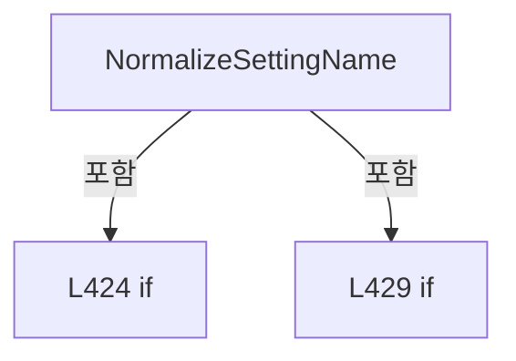

변경 전 점검: 입력/반환 타입, 위 호출자, 예외/취소 경로, 공유 상태와 저장·전송 소비자를 함께 확인합니다. 값의 단위나 물리 방향을 이름만으로 확정하지 않습니다.

### MethodDeclaration `ReadDataType` · L437–446

[Drilling.File/JHMI/CManualScanFile.cs:437–446](https://github.com/kjuws10-rgb/A3Drilling/blob/5aee8e58439c9b455cae7c9593c9be986c3e682e/Drilling.File/JHMI/CManualScanFile.cs#L437-L446)

| 항목 | 실제 추출 값 |
| --- | --- |
| 서명 | Drilling.Common.Managers.EN_RECIPE_DATA_TYPE Drilling.File.JHMI.CManualScanFile.ReadDataType(string) |
| 접근/수식자 | Private / private, static |
| 반환/값 타입 | Drilling.Common.Managers.EN_RECIPE_DATA_TYPE |
| 소속 타입 | NamedType:Drilling.File.JHMI.CManualScanFile |

입력 계약:

| 이름 | 타입 | 전달 | 선택/기본값 |
| --- | --- | --- | --- |
| value | string | None | False /  |

정적 호출자로 확인된 위치:

| 호출 파일/행 | 호출 표현식 | 런타임 분기 가능 |
| --- | --- | --- |
| [Drilling.File/JHMI/CManualScanFile.cs:208–208](https://github.com/kjuws10-rgb/A3Drilling/blob/5aee8e58439c9b455cae7c9593c9be986c3e682e/Drilling.File/JHMI/CManualScanFile.cs#L208-L208) | ReadDataType | False |

호출하는 대상과 해석 범위:

| 원본 행 | 표현식 | 분석 상태 | 대상/소스 위치 |
| --- | --- | --- | --- |
| 439 | value.Trim().ToUpperInvariant | resolved | string string.ToUpperInvariant() |
| 439 | value.Trim | resolved | string string.Trim() |

본문의 실제 연산·분기·예외·반환 순서(원문 위치 순):

| 원본 행 | 종류 | 주석 해설 |
| --- | --- | --- |
| 439 | call | 함수·델리게이트 또는 객체 생성자를 호출합니다: value.Trim().ToUpperInvariant() |
| 439 | call | 함수·델리게이트 또는 객체 생성자를 호출합니다: value.Trim() |
| 439 | return | 호출자에게 값 또는 제어를 반환합니다: return value.Trim().ToUpperInvariant() switch { "INT" => EN_RECIPE_DATA_TYPE.Int, "DOUBLE" => EN_RECIPE_DATA_TYPE.Double, "BOOL" => EN_RECIPE_DATA_TYPE.Bool, _ => EN_RECIPE_DATA_TYPE.String }; |
| 439 | switch-expression | 값별 결과식을 선택합니다: value.Trim().ToUpperInvariant() switch { "INT" => EN_RECIPE_DATA_TYPE.Int, "DOUBLE" => EN_RECIPE_DATA_TYPE.Double, "BOOL" => EN_RECIPE_DATA_TYPE.Bool, _ => EN_RECIPE_DATA_TYPE.String } |

제어 구문의 포함 구조(실제 실행 순서/CFG가 아닌 구문 탐색 그림):

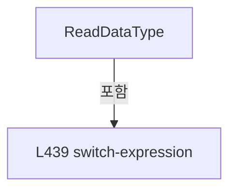

변경 전 점검: 입력/반환 타입, 위 호출자, 예외/취소 경로, 공유 상태와 저장·전송 소비자를 함께 확인합니다. 값의 단위나 물리 방향을 이름만으로 확정하지 않습니다.

### MethodDeclaration `ReadBool` · L448–456

[Drilling.File/JHMI/CManualScanFile.cs:448–456](https://github.com/kjuws10-rgb/A3Drilling/blob/5aee8e58439c9b455cae7c9593c9be986c3e682e/Drilling.File/JHMI/CManualScanFile.cs#L448-L456)

| 항목 | 실제 추출 값 |
| --- | --- |
| 서명 | bool Drilling.File.JHMI.CManualScanFile.ReadBool(string, bool) |
| 접근/수식자 | Private / private, static |
| 반환/값 타입 | bool |
| 소속 타입 | NamedType:Drilling.File.JHMI.CManualScanFile |

입력 계약:

| 이름 | 타입 | 전달 | 선택/기본값 |
| --- | --- | --- | --- |
| value | string | None | False /  |
| defaultValue | bool | None | False /  |

정적 호출자로 확인된 위치:

| 호출 파일/행 | 호출 표현식 | 런타임 분기 가능 |
| --- | --- | --- |
| [Drilling.File/JHMI/CManualScanFile.cs:210–210](https://github.com/kjuws10-rgb/A3Drilling/blob/5aee8e58439c9b455cae7c9593c9be986c3e682e/Drilling.File/JHMI/CManualScanFile.cs#L210-L210) | ReadBool | False |
| [Drilling.File/JHMI/CManualScanFile.cs:211–211](https://github.com/kjuws10-rgb/A3Drilling/blob/5aee8e58439c9b455cae7c9593c9be986c3e682e/Drilling.File/JHMI/CManualScanFile.cs#L211-L211) | ReadBool | False |

호출하는 대상과 해석 범위:

| 원본 행 | 표현식 | 분석 상태 | 대상/소스 위치 |
| --- | --- | --- | --- |
| 450 | string.IsNullOrWhiteSpace | resolved | bool string.IsNullOrWhiteSpace(string?) |
| 455 | value.Equals | resolved | bool string.Equals(string?, System.StringComparison) |
| 455 | value.Equals | resolved | bool string.Equals(string?, System.StringComparison) |
| 455 | value.Equals | resolved | bool string.Equals(string?, System.StringComparison) |
| 455 | value.Equals | resolved | bool string.Equals(string?, System.StringComparison) |

본문의 실제 연산·분기·예외·반환 순서(원문 위치 순):

| 원본 행 | 종류 | 주석 해설 |
| --- | --- | --- |
| 450 | call | 함수·델리게이트 또는 객체 생성자를 호출합니다: string.IsNullOrWhiteSpace(value) |
| 450 | if | 조건에 따라 분기합니다: if (string.IsNullOrWhiteSpace(value)) |
| 452 | return | 호출자에게 값 또는 제어를 반환합니다: return defaultValue; |
| 455 | call | 함수·델리게이트 또는 객체 생성자를 호출합니다: value.Equals("1", StringComparison.OrdinalIgnoreCase) |
| 455 | call | 함수·델리게이트 또는 객체 생성자를 호출합니다: value.Equals("TRUE", StringComparison.OrdinalIgnoreCase) |
| 455 | call | 함수·델리게이트 또는 객체 생성자를 호출합니다: value.Equals("USE", StringComparison.OrdinalIgnoreCase) |
| 455 | call | 함수·델리게이트 또는 객체 생성자를 호출합니다: value.Equals("ON", StringComparison.OrdinalIgnoreCase) |
| 455 | return | 호출자에게 값 또는 제어를 반환합니다: return value.Equals("1", StringComparison.OrdinalIgnoreCase) &#124;&#124; value.Equals("TRUE", StringComparison.OrdinalIgnoreCase) &#124;&#124; value.Equals("USE", StringComparison.OrdinalIgnoreCase) &#124;&#124; value.Equals("ON", StringComparison.OrdinalIgno |

제어 구문의 포함 구조(실제 실행 순서/CFG가 아닌 구문 탐색 그림):

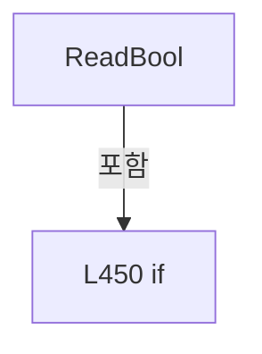

변경 전 점검: 입력/반환 타입, 위 호출자, 예외/취소 경로, 공유 상태와 저장·전송 소비자를 함께 확인합니다. 값의 단위나 물리 방향을 이름만으로 확정하지 않습니다.

### MethodDeclaration `ReadInt` · L458–461

[Drilling.File/JHMI/CManualScanFile.cs:458–461](https://github.com/kjuws10-rgb/A3Drilling/blob/5aee8e58439c9b455cae7c9593c9be986c3e682e/Drilling.File/JHMI/CManualScanFile.cs#L458-L461)

| 항목 | 실제 추출 값 |
| --- | --- |
| 서명 | int Drilling.File.JHMI.CManualScanFile.ReadInt(string, int) |
| 접근/수식자 | Private / private, static |
| 반환/값 타입 | int |
| 소속 타입 | NamedType:Drilling.File.JHMI.CManualScanFile |

입력 계약:

| 이름 | 타입 | 전달 | 선택/기본값 |
| --- | --- | --- | --- |
| value | string | None | False /  |
| defaultValue | int | None | False /  |

정적 호출자로 확인된 위치:

| 호출 파일/행 | 호출 표현식 | 런타임 분기 가능 |
| --- | --- | --- |
| [Drilling.File/JHMI/CManualScanFile.cs:216–216](https://github.com/kjuws10-rgb/A3Drilling/blob/5aee8e58439c9b455cae7c9593c9be986c3e682e/Drilling.File/JHMI/CManualScanFile.cs#L216-L216) | ReadInt | False |

호출하는 대상과 해석 범위:

| 원본 행 | 표현식 | 분석 상태 | 대상/소스 위치 |
| --- | --- | --- | --- |
| 460 | int.TryParse | resolved | bool int.TryParse(string?, System.Globalization.NumberStyles, System.IFormatProvider?, out int) |

본문의 실제 연산·분기·예외·반환 순서(원문 위치 순):

| 원본 행 | 종류 | 주석 해설 |
| --- | --- | --- |
| 460 | call | 함수·델리게이트 또는 객체 생성자를 호출합니다: int.TryParse(value, NumberStyles.Integer, CultureInfo.InvariantCulture, out var result) |
| 460 | conditional-expression | 조건에 따라 결과식을 선택합니다: int.TryParse(value, NumberStyles.Integer, CultureInfo.InvariantCulture, out var result) ? result : defaultValue |
| 460 | return | 호출자에게 값 또는 제어를 반환합니다: return int.TryParse(value, NumberStyles.Integer, CultureInfo.InvariantCulture, out var result) ? result : defaultValue; |

변경 전 점검: 입력/반환 타입, 위 호출자, 예외/취소 경로, 공유 상태와 저장·전송 소비자를 함께 확인합니다. 값의 단위나 물리 방향을 이름만으로 확정하지 않습니다.

### MethodDeclaration `GetOrDefault` · L463–466

[Drilling.File/JHMI/CManualScanFile.cs:463–466](https://github.com/kjuws10-rgb/A3Drilling/blob/5aee8e58439c9b455cae7c9593c9be986c3e682e/Drilling.File/JHMI/CManualScanFile.cs#L463-L466)

| 항목 | 실제 추출 값 |
| --- | --- |
| 서명 | string Drilling.File.JHMI.CManualScanFile.GetOrDefault(string, string) |
| 접근/수식자 | Private / private, static |
| 반환/값 타입 | string |
| 소속 타입 | NamedType:Drilling.File.JHMI.CManualScanFile |

입력 계약:

| 이름 | 타입 | 전달 | 선택/기본값 |
| --- | --- | --- | --- |
| value | string | None | False /  |
| defaultValue | string | None | False /  |

정적 호출자로 확인된 위치:

| 호출 파일/행 | 호출 표현식 | 런타임 분기 가능 |
| --- | --- | --- |
| [Drilling.File/JHMI/CManualScanFile.cs:207–207](https://github.com/kjuws10-rgb/A3Drilling/blob/5aee8e58439c9b455cae7c9593c9be986c3e682e/Drilling.File/JHMI/CManualScanFile.cs#L207-L207) | GetOrDefault | False |
| [Drilling.File/JHMI/CManualScanFile.cs:246–246](https://github.com/kjuws10-rgb/A3Drilling/blob/5aee8e58439c9b455cae7c9593c9be986c3e682e/Drilling.File/JHMI/CManualScanFile.cs#L246-L246) | GetOrDefault | False |

호출하는 대상과 해석 범위:

| 원본 행 | 표현식 | 분석 상태 | 대상/소스 위치 |
| --- | --- | --- | --- |
| 465 | string.IsNullOrWhiteSpace | resolved | bool string.IsNullOrWhiteSpace(string?) |

본문의 실제 연산·분기·예외·반환 순서(원문 위치 순):

| 원본 행 | 종류 | 주석 해설 |
| --- | --- | --- |
| 465 | call | 함수·델리게이트 또는 객체 생성자를 호출합니다: string.IsNullOrWhiteSpace(value) |
| 465 | conditional-expression | 조건에 따라 결과식을 선택합니다: string.IsNullOrWhiteSpace(value) ? defaultValue : value |
| 465 | return | 호출자에게 값 또는 제어를 반환합니다: return string.IsNullOrWhiteSpace(value) ? defaultValue : value; |

변경 전 점검: 입력/반환 타입, 위 호출자, 예외/취소 경로, 공유 상태와 저장·전송 소비자를 함께 확인합니다. 값의 단위나 물리 방향을 이름만으로 확정하지 않습니다.

### MethodDeclaration `CreateFallbackFormItems` · L468–510

[Drilling.File/JHMI/CManualScanFile.cs:468–510](https://github.com/kjuws10-rgb/A3Drilling/blob/5aee8e58439c9b455cae7c9593c9be986c3e682e/Drilling.File/JHMI/CManualScanFile.cs#L468-L510)

| 항목 | 실제 추출 값 |
| --- | --- |
| 서명 | System.Collections.Generic.IReadOnlyList<Drilling.Common.Managers.ST_MANUAL_SCAN_FORM> Drilling.File.JHMI.CManualScanFile.CreateFallbackFormItems() |
| 접근/수식자 | Private / private, static |
| 반환/값 타입 | System.Collections.Generic.IReadOnlyList<Drilling.Common.Managers.ST_MANUAL_SCAN_FORM> |
| 소속 타입 | NamedType:Drilling.File.JHMI.CManualScanFile |

정적 호출자로 확인된 위치:

| 호출 파일/행 | 호출 표현식 | 런타임 분기 가능 |
| --- | --- | --- |
| [Drilling.File/JHMI/CManualScanFile.cs:226–226](https://github.com/kjuws10-rgb/A3Drilling/blob/5aee8e58439c9b455cae7c9593c9be986c3e682e/Drilling.File/JHMI/CManualScanFile.cs#L226-L226) | CreateFallbackFormItems | False |

호출하는 대상과 해석 범위:

| 원본 행 | 표현식 | 분석 상태 | 대상/소스 위치 |
| --- | --- | --- | --- |
| 473 | new | resolved | Drilling.Common.Managers.ST_MANUAL_SCAN_FORM.ST_MANUAL_SCAN_FORM(string, string, Drilling.Common.Managers.EN_RECIPE_DATA_TYPE, string, bool, bool, string, double, double, string, int) · Drilling.Common/Managers/CManager.cs:686 |
| 475 | new | resolved | Drilling.Common.Managers.ST_MANUAL_SCAN_FORM.ST_MANUAL_SCAN_FORM(string, string, Drilling.Common.Managers.EN_RECIPE_DATA_TYPE, string, bool, bool, string, double, double, string, int) · Drilling.Common/Managers/CManager.cs:686 |
| 477 | new | resolved | Drilling.Common.Managers.ST_MANUAL_SCAN_FORM.ST_MANUAL_SCAN_FORM(string, string, Drilling.Common.Managers.EN_RECIPE_DATA_TYPE, string, bool, bool, string, double, double, string, int) · Drilling.Common/Managers/CManager.cs:686 |
| 479 | new | resolved | Drilling.Common.Managers.ST_MANUAL_SCAN_FORM.ST_MANUAL_SCAN_FORM(string, string, Drilling.Common.Managers.EN_RECIPE_DATA_TYPE, string, bool, bool, string, double, double, string, int) · Drilling.Common/Managers/CManager.cs:686 |
| 481 | new | resolved | Drilling.Common.Managers.ST_MANUAL_SCAN_FORM.ST_MANUAL_SCAN_FORM(string, string, Drilling.Common.Managers.EN_RECIPE_DATA_TYPE, string, bool, bool, string, double, double, string, int) · Drilling.Common/Managers/CManager.cs:686 |
| 483 | new | resolved | Drilling.Common.Managers.ST_MANUAL_SCAN_FORM.ST_MANUAL_SCAN_FORM(string, string, Drilling.Common.Managers.EN_RECIPE_DATA_TYPE, string, bool, bool, string, double, double, string, int) · Drilling.Common/Managers/CManager.cs:686 |
| 485 | new | resolved | Drilling.Common.Managers.ST_MANUAL_SCAN_FORM.ST_MANUAL_SCAN_FORM(string, string, Drilling.Common.Managers.EN_RECIPE_DATA_TYPE, string, bool, bool, string, double, double, string, int) · Drilling.Common/Managers/CManager.cs:686 |
| 487 | new | resolved | Drilling.Common.Managers.ST_MANUAL_SCAN_FORM.ST_MANUAL_SCAN_FORM(string, string, Drilling.Common.Managers.EN_RECIPE_DATA_TYPE, string, bool, bool, string, double, double, string, int) · Drilling.Common/Managers/CManager.cs:686 |
| 489 | new | resolved | Drilling.Common.Managers.ST_MANUAL_SCAN_FORM.ST_MANUAL_SCAN_FORM(string, string, Drilling.Common.Managers.EN_RECIPE_DATA_TYPE, string, bool, bool, string, double, double, string, int) · Drilling.Common/Managers/CManager.cs:686 |
| 491 | new | resolved | Drilling.Common.Managers.ST_MANUAL_SCAN_FORM.ST_MANUAL_SCAN_FORM(string, string, Drilling.Common.Managers.EN_RECIPE_DATA_TYPE, string, bool, bool, string, double, double, string, int) · Drilling.Common/Managers/CManager.cs:686 |
| 493 | new | resolved | Drilling.Common.Managers.ST_MANUAL_SCAN_FORM.ST_MANUAL_SCAN_FORM(string, string, Drilling.Common.Managers.EN_RECIPE_DATA_TYPE, string, bool, bool, string, double, double, string, int) · Drilling.Common/Managers/CManager.cs:686 |
| 495 | new | resolved | Drilling.Common.Managers.ST_MANUAL_SCAN_FORM.ST_MANUAL_SCAN_FORM(string, string, Drilling.Common.Managers.EN_RECIPE_DATA_TYPE, string, bool, bool, string, double, double, string, int) · Drilling.Common/Managers/CManager.cs:686 |
| 497 | new | resolved | Drilling.Common.Managers.ST_MANUAL_SCAN_FORM.ST_MANUAL_SCAN_FORM(string, string, Drilling.Common.Managers.EN_RECIPE_DATA_TYPE, string, bool, bool, string, double, double, string, int) · Drilling.Common/Managers/CManager.cs:686 |
| 499 | new | resolved | Drilling.Common.Managers.ST_MANUAL_SCAN_FORM.ST_MANUAL_SCAN_FORM(string, string, Drilling.Common.Managers.EN_RECIPE_DATA_TYPE, string, bool, bool, string, double, double, string, int) · Drilling.Common/Managers/CManager.cs:686 |
| 501 | new | resolved | Drilling.Common.Managers.ST_MANUAL_SCAN_FORM.ST_MANUAL_SCAN_FORM(string, string, Drilling.Common.Managers.EN_RECIPE_DATA_TYPE, string, bool, bool, string, double, double, string, int) · Drilling.Common/Managers/CManager.cs:686 |
| 503 | new | resolved | Drilling.Common.Managers.ST_MANUAL_SCAN_FORM.ST_MANUAL_SCAN_FORM(string, string, Drilling.Common.Managers.EN_RECIPE_DATA_TYPE, string, bool, bool, string, double, double, string, int) · Drilling.Common/Managers/CManager.cs:686 |
| 505 | new | resolved | Drilling.Common.Managers.ST_MANUAL_SCAN_FORM.ST_MANUAL_SCAN_FORM(string, string, Drilling.Common.Managers.EN_RECIPE_DATA_TYPE, string, bool, bool, string, double, double, string, int) · Drilling.Common/Managers/CManager.cs:686 |
| 507 | new | resolved | Drilling.Common.Managers.ST_MANUAL_SCAN_FORM.ST_MANUAL_SCAN_FORM(string, string, Drilling.Common.Managers.EN_RECIPE_DATA_TYPE, string, bool, bool, string, double, double, string, int) · Drilling.Common/Managers/CManager.cs:686 |

본문의 실제 연산·분기·예외·반환 순서(원문 위치 순):

| 원본 행 | 종류 | 주석 해설 |
| --- | --- | --- |
| 470 | return | 호출자에게 값 또는 제어를 반환합니다: return [ new("ShapeName", "Shape Type", EN_RECIPE_DATA_TYPE.String, "", true, true, "Circle", 0.0, 0.0, "Manual shape name", 1), new("ShapeSize", "Shape Size", EN_RECIPE_DATA_TYPE.Double, "mm", true, true, "0.350", 0.001, 100.0, " |
| 473 | call | 함수·델리게이트 또는 객체 생성자를 호출합니다: new("ShapeName", "Shape Type", EN_RECIPE_DATA_TYPE.String, "", true, true, "Circle", 0.0, 0.0, "Manual shape name", 1) |
| 475 | call | 함수·델리게이트 또는 객체 생성자를 호출합니다: new("ShapeSize", "Shape Size", EN_RECIPE_DATA_TYPE.Double, "mm", true, true, "0.350", 0.001, 100.0, "Manual shape size", 2) |
| 477 | call | 함수·델리게이트 또는 객체 생성자를 호출합니다: new("Direction", "Direction", EN_RECIPE_DATA_TYPE.String, "", true, true, "CW", 0.0, 0.0, "Manual shape direction", 3) |
| 479 | call | 함수·델리게이트 또는 객체 생성자를 호출합니다: new("OffsetX", "Offset X", EN_RECIPE_DATA_TYPE.Double, "mm", true, true, "0.000", -100.0, 100.0, "Manual shape center offset X", 4) |
| 481 | call | 함수·델리게이트 또는 객체 생성자를 호출합니다: new("OffsetY", "Offset Y", EN_RECIPE_DATA_TYPE.Double, "mm", true, true, "0.000", -100.0, 100.0, "Manual shape center offset Y", 5) |
| 483 | call | 함수·델리게이트 또는 객체 생성자를 호출합니다: new("GridRowLines", "Grid Row Count", EN_RECIPE_DATA_TYPE.Int, "ea", true, true, "5", 2.0, 200.0, "Manual grid row line count", 6) |
| 485 | call | 함수·델리게이트 또는 객체 생성자를 호출합니다: new("GridColLines", "Grid Col Count", EN_RECIPE_DATA_TYPE.Int, "ea", true, true, "5", 2.0, 200.0, "Manual grid column line count", 7) |
| 487 | call | 함수·델리게이트 또는 객체 생성자를 호출합니다: new("LaserPower", "Laser Power", EN_RECIPE_DATA_TYPE.Double, "W", true, true, "1.00", 0.0, 100.0, "Manual laser power", 10) |
| 489 | call | 함수·델리게이트 또는 객체 생성자를 호출합니다: new("JumpSpeed", "Jump Speed", EN_RECIPE_DATA_TYPE.Double, "m/sec", true, true, "1.500", 0.001, 100.0, "Manual jump speed", 20) |
| 491 | call | 함수·델리게이트 또는 객체 생성자를 호출합니다: new("MarkSpeed", "Mark Speed", EN_RECIPE_DATA_TYPE.Double, "m/sec", true, true, "0.900", 0.001, 100.0, "Manual mark speed", 30) |
| 493 | call | 함수·델리게이트 또는 객체 생성자를 호출합니다: new("LaserFrequency", "Laser Frequency", EN_RECIPE_DATA_TYPE.Double, "kHz", true, true, "20.0", 0.001, 1000.0, "Manual laser frequency", 40) |
| 495 | call | 함수·델리게이트 또는 객체 생성자를 호출합니다: new("LaserOnDelay", "Laser On Delay", EN_RECIPE_DATA_TYPE.Double, "msec", true, true, "8", 0.0, 10000.0, "Manual shape pre-mark delay in msec", 50) |
| 497 | call | 함수·델리게이트 또는 객체 생성자를 호출합니다: new("LaserOffDelay", "Laser Off Delay", EN_RECIPE_DATA_TYPE.Double, "msec", true, true, "12", 0.0, 10000.0, "Manual shape post-mark delay in msec", 60) |
| 499 | call | 함수·델리게이트 또는 객체 생성자를 호출합니다: new("LaserOnMode", "LaserAction_Mode", EN_RECIPE_DATA_TYPE.String, "", true, true, "TIME", 0.0, 0.0, "Laser on mode: TIME or COUNT", 70) |
| 501 | call | 함수·델리게이트 또는 객체 생성자를 호출합니다: new("Time", "LaserAction_On Time", EN_RECIPE_DATA_TYPE.Double, "msec", true, true, "1000", 0.0, double.MaxValue, "Laser on duration in msec", 80) |
| 503 | call | 함수·델리게이트 또는 객체 생성자를 호출합니다: new("Count", "LaserAction_Shot Count", EN_RECIPE_DATA_TYPE.Int, "count", true, true, "1", 1.0, int.MaxValue, "Laser on shot count", 90) |
| 505 | call | 함수·델리게이트 또는 객체 생성자를 호출합니다: new("RepeatCount", "LaserAction_Repeat Count", EN_RECIPE_DATA_TYPE.Int, "count", true, true, "1", 1.0, int.MaxValue, "Laser on repeat count", 100) |
| 507 | call | 함수·델리게이트 또는 객체 생성자를 호출합니다: new("RepeatDelayTime", "LaserAction_Repeat Delay Time", EN_RECIPE_DATA_TYPE.Double, "msec", true, true, "0", 0.0, double.MaxValue, "Delay between laser on repetitions in msec", 110) |

변경 전 점검: 입력/반환 타입, 위 호출자, 예외/취소 경로, 공유 상태와 저장·전송 소비자를 함께 확인합니다. 값의 단위나 물리 방향을 이름만으로 확정하지 않습니다.

## 구문·바인딩 한계

전체 WPF/벤더 SDK/프로젝트별 빌드 조건을 로드한 정식 빌드가 아닙니다. `resolved`는 이 부분 컴파일에서의 심볼 연결이며 virtual/interface/delegate/이벤트/Reflection/XAML의 실제 런타임 구현을 확정하지 않습니다. `candidate`와 `unresolved`는 후속 확인 대상으로 남깁니다.

## 원문 전체 주석 해설본

[원본 모든 행과 행별 해설 보기](../../../annotated/Drilling.File/JHMI/CManualScanFile.cs.annotated.txt)

원본을 빠뜨리거나 임의로 줄이지 않았습니다. `L000001 |` 표시는 원본 행 번호, `// 해설`은 별도 설명입니다. 실행용 소스가 아닌 문서입니다.

## 수정·재검증 체크

- 원본 Commit과 현재 작업 파일 SHA가 같은지 먼저 확인합니다. 다르면 이 문서를 과거 버전 자료로 취급합니다.
- 선언·직접 호출·이벤트/인터페이스 경계·설정 소비를 함께 확인합니다. 정적 연결의 빈 곳을 정상 경로로 추정하지 않습니다.
- 저장 형식/단위/식별자·재시도·취소·예외·롤백에 영향을 주는 변경은 상세 해설장과 호출자를 다시 검토합니다.
- 도구의 구문 추출과 별도 정적 추적 해설, 실제 빌드·시뮬레이션·실장비 검증 결과를 분리합니다.
