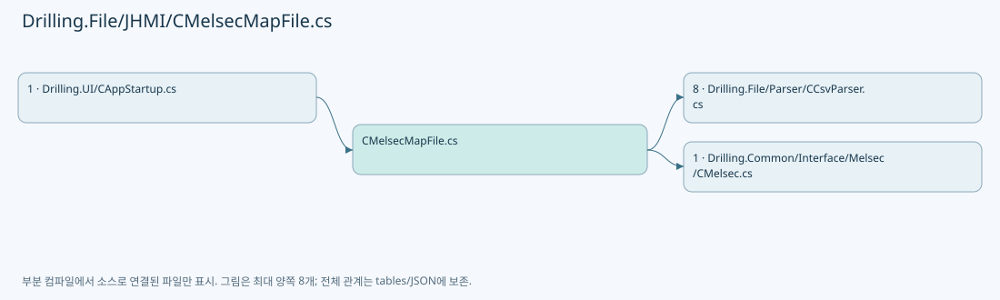
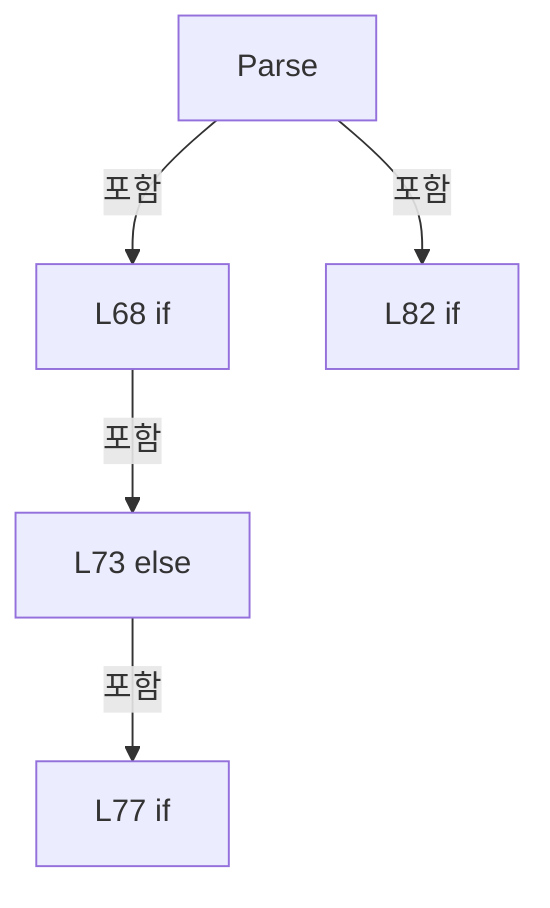
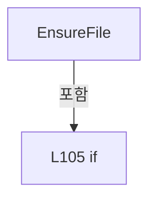
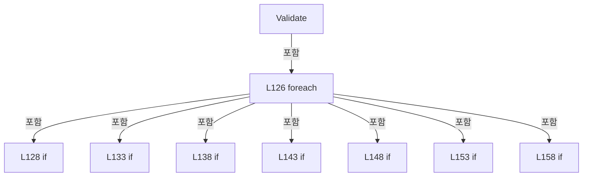
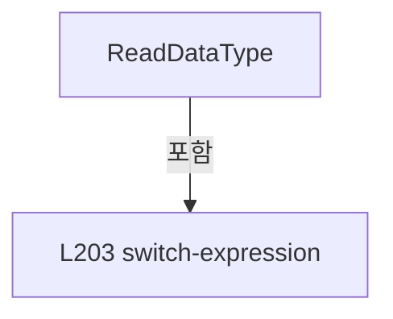
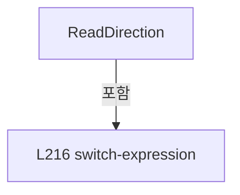
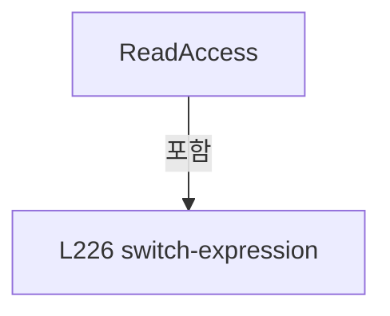
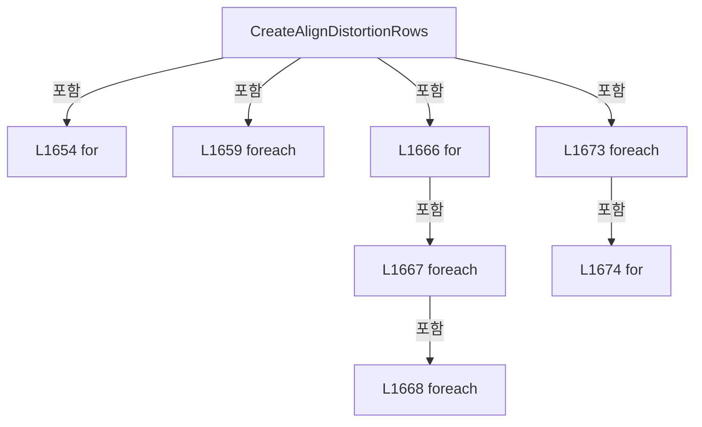
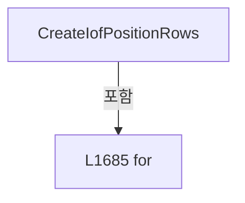

# Drilling.File/JHMI/CMelsecMapFile.cs

| 항목 | 내용 |
| --- | --- |
| 원본 저장소 | https://github.com/kjuws10-rgb/A3Drilling.git |
| 원본 Commit | 5aee8e58439c9b455cae7c9593c9be986c3e682e |
| 원본 SHA256 | 6d86d0deb02d122cc8aec5d59d0f8cd545c61dcaed78729b5bf63bebe855ffa8 |
| 파일 분류 | code |
| 원본 크기/행 | 69,454 bytes / 1,692 physical lines |
| 인코딩 | utf-8-sig |
| 검토 범위 | 구문/부분 의미 분석에서 추출한 사실. 동작·물리 단위·실장비 합격을 보증하지 않습니다. |
| 원본 링크 | [고정 Commit 원본](https://github.com/kjuws10-rgb/A3Drilling/blob/5aee8e58439c9b455cae7c9593c9be986c3e682e/Drilling.File/JHMI/CMelsecMapFile.cs) |

## 파일의 역할과 읽는 순서

정의·설정·레시피·결과·스크립트의 파일 입출력과 데이터 형식을 담당합니다. 저장 필드를 통신 송신 필드로 단정하지 않습니다.

## 네임스페이스·타입·상속

| 타입 | 구분 | 원본 범위 | 선언/상속 |
| --- | --- | --- | --- |
| CMelsecMapFile | ClassDeclaration | 7–1691 | CMelsecMapFile: CMelsecMapFileBase |

## 멤버 빠른 목록

| 이름 | 종류 | 범위 | 서명 |
| --- | --- | --- | --- |
| TableName | FieldDeclaration | L10–10 | string Drilling.File.JHMI.CMelsecMapFile.TableName |
| Headers | FieldDeclaration | L11–11 | System.Collections.Generic.IReadOnlyList<string> Drilling.File.JHMI.CMelsecMapFile.Headers |
| RequiredHeaderGroups | FieldDeclaration | L13–27 | System.Collections.Generic.IReadOnlyList<System.Collections.Generic.IReadOnlyList<string>> Drilling.File.JHMI.CMelsecMapFile.RequiredHeaderGroups |
| LoadAll | MethodDeclaration | L30–63 | System.Collections.Generic.IReadOnlyList<Drilling.Common.Interface.ST_MELSEC_MAP_DATA> Drilling.File.JHMI.CMelsecMapFile.LoadAll(System.Threading.CancellationToken) |
| SelectValue | LocalFunctionStatement | L35–38 | Drilling.Common.Interface.ST_MELSEC_MAP_DATA SelectValue(System.Collections.Generic.IReadOnlyDictionary<string, string>, int) |
| HasId | LocalFunctionStatement | L40–43 | bool HasId(Drilling.Common.Interface.ST_MELSEC_MAP_DATA) |
| SelectGroup | LocalFunctionStatement | L45–48 | string SelectGroup(Drilling.Common.Interface.ST_MELSEC_MAP_DATA) |
| SelectDeviceNo | LocalFunctionStatement | L50–53 | int SelectDeviceNo(Drilling.Common.Interface.ST_MELSEC_MAP_DATA) |
| SelectId | LocalFunctionStatement | L55–58 | string SelectId(Drilling.Common.Interface.ST_MELSEC_MAP_DATA) |
| Parse | MethodDeclaration | L65–100 | Drilling.Common.Interface.ST_MELSEC_MAP_DATA Drilling.File.JHMI.CMelsecMapFile.Parse(System.Collections.Generic.IReadOnlyDictionary<string, string>, int) |
| EnsureFile | MethodDeclaration | L102–111 | void Drilling.File.JHMI.CMelsecMapFile.EnsureFile() |
| GetMapPath | MethodDeclaration | L113–116 | string Drilling.File.JHMI.CMelsecMapFile.GetMapPath() |
| Validate | MethodDeclaration | L118–163 | void Drilling.File.JHMI.CMelsecMapFile.Validate(System.Collections.Generic.IReadOnlyList<Drilling.Common.Interface.ST_MELSEC_MAP_DATA>) |
| IsUse | LocalFunctionStatement | L121–124 | bool IsUse(Drilling.Common.Interface.ST_MELSEC_MAP_DATA) |
| Row | MethodDeclaration | L165–199 | System.Collections.Generic.IReadOnlyDictionary<string, string> Drilling.File.JHMI.CMelsecMapFile.Row(string, string, string, int, string, string, string, string, string, string, string, string, string, bool) |
| ReadDataType | MethodDeclaration | L201–212 | Drilling.Common.Interface.EN_MELSEC_DATA_TYPE Drilling.File.JHMI.CMelsecMapFile.ReadDataType(string, int) |
| ReadDirection | MethodDeclaration | L214–222 | Drilling.Common.Interface.EN_MELSEC_DIRECTION Drilling.File.JHMI.CMelsecMapFile.ReadDirection(string, int) |
| ReadAccess | MethodDeclaration | L224–232 | Drilling.Common.Interface.EN_MELSEC_ACCESS Drilling.File.JHMI.CMelsecMapFile.ReadAccess(string, int) |
| RequireText | MethodDeclaration | L234–237 | string Drilling.File.JHMI.CMelsecMapFile.RequireText(System.Collections.Generic.IReadOnlyDictionary<string, string>, int, params string[]) |
| ReadFirst | MethodDeclaration | L239–242 | string Drilling.File.JHMI.CMelsecMapFile.ReadFirst(System.Collections.Generic.IReadOnlyDictionary<string, string>, params string[]) |
| ReadBool | MethodDeclaration | L244–247 | bool Drilling.File.JHMI.CMelsecMapFile.ReadBool(string, bool) |
| ReadInt | MethodDeclaration | L249–252 | int Drilling.File.JHMI.CMelsecMapFile.ReadInt(string, int, string, int) |
| ReadDouble | MethodDeclaration | L254–257 | double Drilling.File.JHMI.CMelsecMapFile.ReadDouble(string, int, string, double) |
| NormalizeId | MethodDeclaration | L259–262 | string Drilling.File.JHMI.CMelsecMapFile.NormalizeId(string) |
| NormalizeGroup | MethodDeclaration | L264–267 | string Drilling.File.JHMI.CMelsecMapFile.NormalizeGroup(string) |
| NormalizeAddress | MethodDeclaration | L269–272 | string Drilling.File.JHMI.CMelsecMapFile.NormalizeAddress(string) |
| NormalizeText | MethodDeclaration | L274–277 | string Drilling.File.JHMI.CMelsecMapFile.NormalizeText(string) |
| CreateUnassignedLegacyRows | MethodDeclaration | L282–320 | System.Collections.Generic.IReadOnlyList<System.Collections.Generic.IReadOnlyDictionary<string, string>> Drilling.File.JHMI.CMelsecMapFile.CreateUnassignedLegacyRows() |
| Unassigned | MethodDeclaration | L321–321 | System.Collections.Generic.IReadOnlyDictionary<string, string> Drilling.File.JHMI.CMelsecMapFile.Unassigned(string, string, string, string, string, string, string, string, string) |
| CreateMotorStatusRows | MethodDeclaration | L325–423 | System.Collections.Generic.IReadOnlyList<System.Collections.Generic.IReadOnlyDictionary<string, string>> Drilling.File.JHMI.CMelsecMapFile.CreateMotorStatusRows() |
| CreateHandshakeRows | MethodDeclaration | L428–909 | System.Collections.Generic.IReadOnlyList<System.Collections.Generic.IReadOnlyDictionary<string, string>> Drilling.File.JHMI.CMelsecMapFile.CreateHandshakeRows() |
| CreateLatestScenarioRows | MethodDeclaration | L913–1635 | System.Collections.Generic.IReadOnlyList<System.Collections.Generic.IReadOnlyDictionary<string, string>> Drilling.File.JHMI.CMelsecMapFile.CreateLatestScenarioRows() |
| CreateVisionSpecRows | MethodDeclaration | L1638–1646 | System.Collections.Generic.IReadOnlyList<System.Collections.Generic.IReadOnlyDictionary<string, string>> Drilling.File.JHMI.CMelsecMapFile.CreateVisionSpecRows() |
| CreateAlignDistortionRows | MethodDeclaration | L1648–1681 | System.Collections.Generic.IEnumerable<System.Collections.Generic.IReadOnlyDictionary<string, string>> Drilling.File.JHMI.CMelsecMapFile.CreateAlignDistortionRows() |
| Value | LocalFunctionStatement | L1650–1652 | System.Collections.Generic.IReadOnlyDictionary<string, string> Value(string, int, string, string, string) |
| CreateIofPositionRows | MethodDeclaration | L1683–1689 | System.Collections.Generic.IEnumerable<System.Collections.Generic.IReadOnlyDictionary<string, string>> Drilling.File.JHMI.CMelsecMapFile.CreateIofPositionRows() |

## 멤버별 상세 계약·호출·처리 해설

### FieldDeclaration `TableName` · L10–10

[Drilling.File/JHMI/CMelsecMapFile.cs:10–10](https://github.com/kjuws10-rgb/A3Drilling/blob/5aee8e58439c9b455cae7c9593c9be986c3e682e/Drilling.File/JHMI/CMelsecMapFile.cs#L10-L10)

| 항목 | 실제 추출 값 |
| --- | --- |
| 서명 | string Drilling.File.JHMI.CMelsecMapFile.TableName |
| 접근/수식자 | Private / private, const |
| 반환/값 타입 | string |
| 소속 타입 | NamedType:Drilling.File.JHMI.CMelsecMapFile |

현재 부분 분석에서 직접 연결된 호출자는 없습니다. XAML/이벤트/인터페이스·델리게이트·외부 진입을 추가 확인해야 하며, 미사용으로 판정한 것이 아닙니다.

본문의 실제 연산·분기·예외·반환 순서(원문 위치 순):

| 원본 행 | 종류 | 주석 해설 |
| --- | --- | --- |
| 10 | variable-initializer | 변수의 초기값을 지정합니다: TableName = "JHMI_MELSEC_MAP" |

변경 전 점검: 입력/반환 타입, 위 호출자, 예외/취소 경로, 공유 상태와 저장·전송 소비자를 함께 확인합니다. 값의 단위나 물리 방향을 이름만으로 확정하지 않습니다.

### FieldDeclaration `Headers` · L11–11

[Drilling.File/JHMI/CMelsecMapFile.cs:11–11](https://github.com/kjuws10-rgb/A3Drilling/blob/5aee8e58439c9b455cae7c9593c9be986c3e682e/Drilling.File/JHMI/CMelsecMapFile.cs#L11-L11)

| 항목 | 실제 추출 값 |
| --- | --- |
| 서명 | System.Collections.Generic.IReadOnlyList<string> Drilling.File.JHMI.CMelsecMapFile.Headers |
| 접근/수식자 | Private / private, static, readonly |
| 반환/값 타입 | System.Collections.Generic.IReadOnlyList<string> |
| 소속 타입 | NamedType:Drilling.File.JHMI.CMelsecMapFile |

현재 부분 분석에서 직접 연결된 호출자는 없습니다. XAML/이벤트/인터페이스·델리게이트·외부 진입을 추가 확인해야 하며, 미사용으로 판정한 것이 아닙니다.

본문의 실제 연산·분기·예외·반환 순서(원문 위치 순):

| 원본 행 | 종류 | 주석 해설 |
| --- | --- | --- |
| 11 | variable-initializer | 변수의 초기값을 지정합니다: Headers = ["ID", "USE", "GROUP", "NAME", "DEVICE NO", "ADDRESS", "DATA TYPE", "DIRECTION", "ACCESS", "READ_SCALE", "WRITE_SCALE", "LENGTH", "POLL_MS", "DESCRIPTION"] |

변경 전 점검: 입력/반환 타입, 위 호출자, 예외/취소 경로, 공유 상태와 저장·전송 소비자를 함께 확인합니다. 값의 단위나 물리 방향을 이름만으로 확정하지 않습니다.

### FieldDeclaration `RequiredHeaderGroups` · L13–27

[Drilling.File/JHMI/CMelsecMapFile.cs:13–27](https://github.com/kjuws10-rgb/A3Drilling/blob/5aee8e58439c9b455cae7c9593c9be986c3e682e/Drilling.File/JHMI/CMelsecMapFile.cs#L13-L27)

| 항목 | 실제 추출 값 |
| --- | --- |
| 서명 | System.Collections.Generic.IReadOnlyList<System.Collections.Generic.IReadOnlyList<string>> Drilling.File.JHMI.CMelsecMapFile.RequiredHeaderGroups |
| 접근/수식자 | Internal / internal, static, readonly |
| 반환/값 타입 | System.Collections.Generic.IReadOnlyList<System.Collections.Generic.IReadOnlyList<string>> |
| 소속 타입 | NamedType:Drilling.File.JHMI.CMelsecMapFile |

현재 부분 분석에서 직접 연결된 호출자는 없습니다. XAML/이벤트/인터페이스·델리게이트·외부 진입을 추가 확인해야 하며, 미사용으로 판정한 것이 아닙니다.

본문의 실제 연산·분기·예외·반환 순서(원문 위치 순):

| 원본 행 | 종류 | 주석 해설 |
| --- | --- | --- |
| 13 | variable-initializer | 변수의 초기값을 지정합니다: RequiredHeaderGroups = [ ["ID"], ["USE"], ["GROUP"], ["NAME"], ["DEVICE NO", "DEV NO", "NUMBER"], ["ADDRESS"], ["DATA TYPE", "DATATYPE", "TYPE"], ["DIRECTION", "DIR"], ["ACCESS"], ["READ_SCALE", "SCALE"], ["WRITE_SCALE", "SCALE"], |

변경 전 점검: 입력/반환 타입, 위 호출자, 예외/취소 경로, 공유 상태와 저장·전송 소비자를 함께 확인합니다. 값의 단위나 물리 방향을 이름만으로 확정하지 않습니다.

### MethodDeclaration `LoadAll` · L30–63

[Drilling.File/JHMI/CMelsecMapFile.cs:30–63](https://github.com/kjuws10-rgb/A3Drilling/blob/5aee8e58439c9b455cae7c9593c9be986c3e682e/Drilling.File/JHMI/CMelsecMapFile.cs#L30-L63)

| 항목 | 실제 추출 값 |
| --- | --- |
| 서명 | System.Collections.Generic.IReadOnlyList<Drilling.Common.Interface.ST_MELSEC_MAP_DATA> Drilling.File.JHMI.CMelsecMapFile.LoadAll(System.Threading.CancellationToken) |
| 접근/수식자 | Public / public, override |
| 반환/값 타입 | System.Collections.Generic.IReadOnlyList<Drilling.Common.Interface.ST_MELSEC_MAP_DATA> |
| 소속 타입 | NamedType:Drilling.File.JHMI.CMelsecMapFile |

입력 계약:

| 이름 | 타입 | 전달 | 선택/기본값 |
| --- | --- | --- | --- |
| cancellationToken | System.Threading.CancellationToken | None | True / null |

현재 부분 분석에서 직접 연결된 호출자는 없습니다. XAML/이벤트/인터페이스·델리게이트·외부 진입을 추가 확인해야 하며, 미사용으로 판정한 것이 아닙니다.

호출하는 대상과 해석 범위:

| 원본 행 | 표현식 | 분석 상태 | 대상/소스 위치 |
| --- | --- | --- | --- |
| 32 | cancellationToken.ThrowIfCancellationRequested | resolved | void System.Threading.CancellationToken.ThrowIfCancellationRequested() |
| 33 | EnsureFile | resolved | void Drilling.File.JHMI.CMelsecMapFile.EnsureFile() · Drilling.File/JHMI/CMelsecMapFile.cs:102 |
| 34 | CCsvParser.ValidateRequiredHeaders | resolved | void Drilling.File.Parser.CCsvParser.ValidateRequiredHeaders(string, string, System.Collections.Generic.IEnumerable<System.Collections.Generic.IEnumerable<string>>) · Drilling.File/Parser/CCsvParser.cs:280 |
| 34 | GetMapPath | resolved | string Drilling.File.JHMI.CMelsecMapFile.GetMapPath() · Drilling.File/JHMI/CMelsecMapFile.cs:113 |
| 60 | CCsvParser.Read(GetMapPath()).Select(SelectValue).Where(HasId).OrderBy(SelectGroup, StringComparer.OrdinalIgnoreCase).ThenBy(SelectDeviceNo).ThenBy(SelectId, StringComparer.OrdinalIgnoreCase).ToArray | resolved | Drilling.Common.Interface.ST_MELSEC_MAP_DATA[] System.Collections.Generic.IEnumerable<Drilling.Common.Interface.ST_MELSEC_MAP_DATA>.ToArray<Drilling.Common.Interface.ST_MELSEC_MAP_DATA>() |
| 60 | CCsvParser.Read(GetMapPath()).Select(SelectValue).Where(HasId).OrderBy(SelectGroup, StringComparer.OrdinalIgnoreCase).ThenBy(SelectDeviceNo).ThenBy | resolved | System.Linq.IOrderedEnumerable<Drilling.Common.Interface.ST_MELSEC_MAP_DATA> System.Linq.IOrderedEnumerable<Drilling.Common.Interface.ST_MELSEC_MAP_DATA>.ThenBy<Drilling.Common.Interface.ST_MELSEC_MAP_DATA, string>(System.Func<Drilling.Common.Interface.ST_MELSEC_MAP_DATA, string>, System.Collections.Generic.IComparer<string>?) |
| 60 | CCsvParser.Read(GetMapPath()).Select(SelectValue).Where(HasId).OrderBy(SelectGroup, StringComparer.OrdinalIgnoreCase).ThenBy | resolved | System.Linq.IOrderedEnumerable<Drilling.Common.Interface.ST_MELSEC_MAP_DATA> System.Linq.IOrderedEnumerable<Drilling.Common.Interface.ST_MELSEC_MAP_DATA>.ThenBy<Drilling.Common.Interface.ST_MELSEC_MAP_DATA, int>(System.Func<Drilling.Common.Interface.ST_MELSEC_MAP_DATA, int>) |
| 60 | CCsvParser.Read(GetMapPath()).Select(SelectValue).Where(HasId).OrderBy | resolved | System.Linq.IOrderedEnumerable<Drilling.Common.Interface.ST_MELSEC_MAP_DATA> System.Collections.Generic.IEnumerable<Drilling.Common.Interface.ST_MELSEC_MAP_DATA>.OrderBy<Drilling.Common.Interface.ST_MELSEC_MAP_DATA, string>(System.Func<Drilling.Common.Interface.ST_MELSEC_MAP_DATA, string>, System.Collections.Generic.IComparer<string>?) |
| 60 | CCsvParser.Read(GetMapPath()).Select(SelectValue).Where | resolved | System.Collections.Generic.IEnumerable<Drilling.Common.Interface.ST_MELSEC_MAP_DATA> System.Collections.Generic.IEnumerable<Drilling.Common.Interface.ST_MELSEC_MAP_DATA>.Where<Drilling.Common.Interface.ST_MELSEC_MAP_DATA>(System.Func<Drilling.Common.Interface.ST_MELSEC_MAP_DATA, bool>) |
| 60 | CCsvParser.Read(GetMapPath()).Select | resolved | System.Collections.Generic.IEnumerable<Drilling.Common.Interface.ST_MELSEC_MAP_DATA> System.Collections.Generic.IEnumerable<System.Collections.Generic.IReadOnlyDictionary<string, string>>.Select<System.Collections.Generic.IReadOnlyDictionary<string, string>, Drilling.Common.Interface.ST_MELSEC_MAP_DATA>(System.Func<System.Collections.Generic.IReadOnlyDictionary<string, string>, int, Drilling.Common.Interface.ST_MELSEC_MAP_DATA>) |
| 60 | CCsvParser.Read | resolved | System.Collections.Generic.IReadOnlyList<System.Collections.Generic.IReadOnlyDictionary<string, string>> Drilling.File.Parser.CCsvParser.Read(string) · Drilling.File/Parser/CCsvParser.cs:12 |
| 60 | GetMapPath | resolved | string Drilling.File.JHMI.CMelsecMapFile.GetMapPath() · Drilling.File/JHMI/CMelsecMapFile.cs:113 |
| 61 | Validate | resolved | void Drilling.File.JHMI.CMelsecMapFile.Validate(System.Collections.Generic.IReadOnlyList<Drilling.Common.Interface.ST_MELSEC_MAP_DATA>) · Drilling.File/JHMI/CMelsecMapFile.cs:118 |

본문의 실제 연산·분기·예외·반환 순서(원문 위치 순):

| 원본 행 | 종류 | 주석 해설 |
| --- | --- | --- |
| 32 | call | 함수·델리게이트 또는 객체 생성자를 호출합니다: cancellationToken.ThrowIfCancellationRequested() |
| 33 | call | 함수·델리게이트 또는 객체 생성자를 호출합니다: EnsureFile() |
| 34 | call | 함수·델리게이트 또는 객체 생성자를 호출합니다: CCsvParser.ValidateRequiredHeaders(GetMapPath(), TableName, RequiredHeaderGroups) |
| 34 | call | 함수·델리게이트 또는 객체 생성자를 호출합니다: GetMapPath() |
| 60 | call | 함수·델리게이트 또는 객체 생성자를 호출합니다: CCsvParser.Read(GetMapPath()).Select(SelectValue).Where(HasId).OrderBy(SelectGroup, StringComparer.OrdinalIgnoreCase).ThenBy(SelectDeviceNo).ThenBy(SelectId, StringComparer.OrdinalIgnoreCase).ToArray() |
| 60 | call | 함수·델리게이트 또는 객체 생성자를 호출합니다: CCsvParser.Read(GetMapPath()).Select(SelectValue).Where(HasId).OrderBy(SelectGroup, StringComparer.OrdinalIgnoreCase).ThenBy(SelectDeviceNo).ThenBy(SelectId, StringComparer.OrdinalIgnoreCase) |
| 60 | call | 함수·델리게이트 또는 객체 생성자를 호출합니다: CCsvParser.Read(GetMapPath()).Select(SelectValue).Where(HasId).OrderBy(SelectGroup, StringComparer.OrdinalIgnoreCase).ThenBy(SelectDeviceNo) |
| 60 | call | 함수·델리게이트 또는 객체 생성자를 호출합니다: CCsvParser.Read(GetMapPath()).Select(SelectValue).Where(HasId).OrderBy(SelectGroup, StringComparer.OrdinalIgnoreCase) |
| 60 | call | 함수·델리게이트 또는 객체 생성자를 호출합니다: CCsvParser.Read(GetMapPath()).Select(SelectValue).Where(HasId) |
| 60 | call | 함수·델리게이트 또는 객체 생성자를 호출합니다: CCsvParser.Read(GetMapPath()).Select(SelectValue) |
| 60 | call | 함수·델리게이트 또는 객체 생성자를 호출합니다: CCsvParser.Read(GetMapPath()) |
| 60 | call | 함수·델리게이트 또는 객체 생성자를 호출합니다: GetMapPath() |
| 60 | local-declaration | 지역 변수를 선언합니다: var rows = CCsvParser.Read(GetMapPath()).Select(SelectValue).Where(HasId).OrderBy(SelectGroup, StringComparer.OrdinalIgnoreCase).ThenBy(SelectDeviceNo).ThenBy(SelectId, StringComparer.OrdinalIgnoreCase).ToArray(); |
| 60 | variable-initializer | 변수의 초기값을 지정합니다: rows = CCsvParser.Read(GetMapPath()).Select(SelectValue).Where(HasId).OrderBy(SelectGroup, StringComparer.OrdinalIgnoreCase).ThenBy(SelectDeviceNo).ThenBy(SelectId, StringComparer.OrdinalIgnoreCase).ToArray() |
| 61 | call | 함수·델리게이트 또는 객체 생성자를 호출합니다: Validate(rows) |
| 62 | return | 호출자에게 값 또는 제어를 반환합니다: return rows; |

변경 전 점검: 입력/반환 타입, 위 호출자, 예외/취소 경로, 공유 상태와 저장·전송 소비자를 함께 확인합니다. 값의 단위나 물리 방향을 이름만으로 확정하지 않습니다.

### LocalFunctionStatement `SelectValue` · L35–38

[Drilling.File/JHMI/CMelsecMapFile.cs:35–38](https://github.com/kjuws10-rgb/A3Drilling/blob/5aee8e58439c9b455cae7c9593c9be986c3e682e/Drilling.File/JHMI/CMelsecMapFile.cs#L35-L38)

| 항목 | 실제 추출 값 |
| --- | --- |
| 서명 | Drilling.Common.Interface.ST_MELSEC_MAP_DATA SelectValue(System.Collections.Generic.IReadOnlyDictionary<string, string>, int) |
| 접근/수식자 | Private /  |
| 반환/값 타입 | Drilling.Common.Interface.ST_MELSEC_MAP_DATA |
| 소속 타입 | NamedType:Drilling.File.JHMI.CMelsecMapFile |

입력 계약:

| 이름 | 타입 | 전달 | 선택/기본값 |
| --- | --- | --- | --- |
| row | System.Collections.Generic.IReadOnlyDictionary<string, string> | None | False /  |
| index | int | None | False /  |

현재 부분 분석에서 직접 연결된 호출자는 없습니다. XAML/이벤트/인터페이스·델리게이트·외부 진입을 추가 확인해야 하며, 미사용으로 판정한 것이 아닙니다.

호출하는 대상과 해석 범위:

| 원본 행 | 표현식 | 분석 상태 | 대상/소스 위치 |
| --- | --- | --- | --- |
| 37 | Parse | resolved | Drilling.Common.Interface.ST_MELSEC_MAP_DATA Drilling.File.JHMI.CMelsecMapFile.Parse(System.Collections.Generic.IReadOnlyDictionary<string, string>, int) · Drilling.File/JHMI/CMelsecMapFile.cs:65 |

본문의 실제 연산·분기·예외·반환 순서(원문 위치 순):

| 원본 행 | 종류 | 주석 해설 |
| --- | --- | --- |
| 37 | call | 함수·델리게이트 또는 객체 생성자를 호출합니다: Parse(row, index + 2) |
| 37 | return | 호출자에게 값 또는 제어를 반환합니다: return Parse(row, index + 2); |

변경 전 점검: 입력/반환 타입, 위 호출자, 예외/취소 경로, 공유 상태와 저장·전송 소비자를 함께 확인합니다. 값의 단위나 물리 방향을 이름만으로 확정하지 않습니다.

### LocalFunctionStatement `HasId` · L40–43

[Drilling.File/JHMI/CMelsecMapFile.cs:40–43](https://github.com/kjuws10-rgb/A3Drilling/blob/5aee8e58439c9b455cae7c9593c9be986c3e682e/Drilling.File/JHMI/CMelsecMapFile.cs#L40-L43)

| 항목 | 실제 추출 값 |
| --- | --- |
| 서명 | bool HasId(Drilling.Common.Interface.ST_MELSEC_MAP_DATA) |
| 접근/수식자 | Private /  |
| 반환/값 타입 | bool |
| 소속 타입 | NamedType:Drilling.File.JHMI.CMelsecMapFile |

입력 계약:

| 이름 | 타입 | 전달 | 선택/기본값 |
| --- | --- | --- | --- |
| data | Drilling.Common.Interface.ST_MELSEC_MAP_DATA | None | False /  |

현재 부분 분석에서 직접 연결된 호출자는 없습니다. XAML/이벤트/인터페이스·델리게이트·외부 진입을 추가 확인해야 하며, 미사용으로 판정한 것이 아닙니다.

호출하는 대상과 해석 범위:

| 원본 행 | 표현식 | 분석 상태 | 대상/소스 위치 |
| --- | --- | --- | --- |
| 42 | string.IsNullOrWhiteSpace | resolved | bool string.IsNullOrWhiteSpace(string?) |

본문의 실제 연산·분기·예외·반환 순서(원문 위치 순):

| 원본 행 | 종류 | 주석 해설 |
| --- | --- | --- |
| 42 | call | 함수·델리게이트 또는 객체 생성자를 호출합니다: string.IsNullOrWhiteSpace(data.Id) |
| 42 | return | 호출자에게 값 또는 제어를 반환합니다: return !string.IsNullOrWhiteSpace(data.Id); |

변경 전 점검: 입력/반환 타입, 위 호출자, 예외/취소 경로, 공유 상태와 저장·전송 소비자를 함께 확인합니다. 값의 단위나 물리 방향을 이름만으로 확정하지 않습니다.

### LocalFunctionStatement `SelectGroup` · L45–48

[Drilling.File/JHMI/CMelsecMapFile.cs:45–48](https://github.com/kjuws10-rgb/A3Drilling/blob/5aee8e58439c9b455cae7c9593c9be986c3e682e/Drilling.File/JHMI/CMelsecMapFile.cs#L45-L48)

| 항목 | 실제 추출 값 |
| --- | --- |
| 서명 | string SelectGroup(Drilling.Common.Interface.ST_MELSEC_MAP_DATA) |
| 접근/수식자 | Private /  |
| 반환/값 타입 | string |
| 소속 타입 | NamedType:Drilling.File.JHMI.CMelsecMapFile |

입력 계약:

| 이름 | 타입 | 전달 | 선택/기본값 |
| --- | --- | --- | --- |
| data | Drilling.Common.Interface.ST_MELSEC_MAP_DATA | None | False /  |

현재 부분 분석에서 직접 연결된 호출자는 없습니다. XAML/이벤트/인터페이스·델리게이트·외부 진입을 추가 확인해야 하며, 미사용으로 판정한 것이 아닙니다.

본문의 실제 연산·분기·예외·반환 순서(원문 위치 순):

| 원본 행 | 종류 | 주석 해설 |
| --- | --- | --- |
| 47 | return | 호출자에게 값 또는 제어를 반환합니다: return data.Group; |

변경 전 점검: 입력/반환 타입, 위 호출자, 예외/취소 경로, 공유 상태와 저장·전송 소비자를 함께 확인합니다. 값의 단위나 물리 방향을 이름만으로 확정하지 않습니다.

### LocalFunctionStatement `SelectDeviceNo` · L50–53

[Drilling.File/JHMI/CMelsecMapFile.cs:50–53](https://github.com/kjuws10-rgb/A3Drilling/blob/5aee8e58439c9b455cae7c9593c9be986c3e682e/Drilling.File/JHMI/CMelsecMapFile.cs#L50-L53)

| 항목 | 실제 추출 값 |
| --- | --- |
| 서명 | int SelectDeviceNo(Drilling.Common.Interface.ST_MELSEC_MAP_DATA) |
| 접근/수식자 | Private /  |
| 반환/값 타입 | int |
| 소속 타입 | NamedType:Drilling.File.JHMI.CMelsecMapFile |

입력 계약:

| 이름 | 타입 | 전달 | 선택/기본값 |
| --- | --- | --- | --- |
| data | Drilling.Common.Interface.ST_MELSEC_MAP_DATA | None | False /  |

현재 부분 분석에서 직접 연결된 호출자는 없습니다. XAML/이벤트/인터페이스·델리게이트·외부 진입을 추가 확인해야 하며, 미사용으로 판정한 것이 아닙니다.

본문의 실제 연산·분기·예외·반환 순서(원문 위치 순):

| 원본 행 | 종류 | 주석 해설 |
| --- | --- | --- |
| 52 | return | 호출자에게 값 또는 제어를 반환합니다: return data.DeviceNo; |

변경 전 점검: 입력/반환 타입, 위 호출자, 예외/취소 경로, 공유 상태와 저장·전송 소비자를 함께 확인합니다. 값의 단위나 물리 방향을 이름만으로 확정하지 않습니다.

### LocalFunctionStatement `SelectId` · L55–58

[Drilling.File/JHMI/CMelsecMapFile.cs:55–58](https://github.com/kjuws10-rgb/A3Drilling/blob/5aee8e58439c9b455cae7c9593c9be986c3e682e/Drilling.File/JHMI/CMelsecMapFile.cs#L55-L58)

| 항목 | 실제 추출 값 |
| --- | --- |
| 서명 | string SelectId(Drilling.Common.Interface.ST_MELSEC_MAP_DATA) |
| 접근/수식자 | Private /  |
| 반환/값 타입 | string |
| 소속 타입 | NamedType:Drilling.File.JHMI.CMelsecMapFile |

입력 계약:

| 이름 | 타입 | 전달 | 선택/기본값 |
| --- | --- | --- | --- |
| data | Drilling.Common.Interface.ST_MELSEC_MAP_DATA | None | False /  |

현재 부분 분석에서 직접 연결된 호출자는 없습니다. XAML/이벤트/인터페이스·델리게이트·외부 진입을 추가 확인해야 하며, 미사용으로 판정한 것이 아닙니다.

본문의 실제 연산·분기·예외·반환 순서(원문 위치 순):

| 원본 행 | 종류 | 주석 해설 |
| --- | --- | --- |
| 57 | return | 호출자에게 값 또는 제어를 반환합니다: return data.Id; |

변경 전 점검: 입력/반환 타입, 위 호출자, 예외/취소 경로, 공유 상태와 저장·전송 소비자를 함께 확인합니다. 값의 단위나 물리 방향을 이름만으로 확정하지 않습니다.

### MethodDeclaration `Parse` · L65–100

[Drilling.File/JHMI/CMelsecMapFile.cs:65–100](https://github.com/kjuws10-rgb/A3Drilling/blob/5aee8e58439c9b455cae7c9593c9be986c3e682e/Drilling.File/JHMI/CMelsecMapFile.cs#L65-L100)

| 항목 | 실제 추출 값 |
| --- | --- |
| 서명 | Drilling.Common.Interface.ST_MELSEC_MAP_DATA Drilling.File.JHMI.CMelsecMapFile.Parse(System.Collections.Generic.IReadOnlyDictionary<string, string>, int) |
| 접근/수식자 | Private / private |
| 반환/값 타입 | Drilling.Common.Interface.ST_MELSEC_MAP_DATA |
| 소속 타입 | NamedType:Drilling.File.JHMI.CMelsecMapFile |

입력 계약:

| 이름 | 타입 | 전달 | 선택/기본값 |
| --- | --- | --- | --- |
| row | System.Collections.Generic.IReadOnlyDictionary<string, string> | None | False /  |
| rowNo | int | None | False /  |

정적 호출자로 확인된 위치:

| 호출 파일/행 | 호출 표현식 | 런타임 분기 가능 |
| --- | --- | --- |
| [Drilling.File/JHMI/CMelsecMapFile.cs:37–37](https://github.com/kjuws10-rgb/A3Drilling/blob/5aee8e58439c9b455cae7c9593c9be986c3e682e/Drilling.File/JHMI/CMelsecMapFile.cs#L37-L37) | Parse | False |

호출하는 대상과 해석 범위:

| 원본 행 | 표현식 | 분석 상태 | 대상/소스 위치 |
| --- | --- | --- | --- |
| 68 | row.ContainsKey | resolved · 동적 구현 선택 가능 | bool System.Collections.Generic.IReadOnlyDictionary<string, string>.ContainsKey(string) |
| 68 | row.ContainsKey | resolved · 동적 구현 선택 가능 | bool System.Collections.Generic.IReadOnlyDictionary<string, string>.ContainsKey(string) |
| 70 | ReadDouble | resolved | double Drilling.File.JHMI.CMelsecMapFile.ReadDouble(string, int, string, double) · Drilling.File/JHMI/CMelsecMapFile.cs:254 |
| 70 | RequireText | resolved | string Drilling.File.JHMI.CMelsecMapFile.RequireText(System.Collections.Generic.IReadOnlyDictionary<string, string>, int, params string[]) · Drilling.File/JHMI/CMelsecMapFile.cs:234 |
| 71 | ReadDouble | resolved | double Drilling.File.JHMI.CMelsecMapFile.ReadDouble(string, int, string, double) · Drilling.File/JHMI/CMelsecMapFile.cs:254 |
| 71 | RequireText | resolved | string Drilling.File.JHMI.CMelsecMapFile.RequireText(System.Collections.Generic.IReadOnlyDictionary<string, string>, int, params string[]) · Drilling.File/JHMI/CMelsecMapFile.cs:234 |
| 76 | ReadDouble | resolved | double Drilling.File.JHMI.CMelsecMapFile.ReadDouble(string, int, string, double) · Drilling.File/JHMI/CMelsecMapFile.cs:254 |
| 76 | ReadFirst | resolved | string Drilling.File.JHMI.CMelsecMapFile.ReadFirst(System.Collections.Generic.IReadOnlyDictionary<string, string>, params string[]) · Drilling.File/JHMI/CMelsecMapFile.cs:239 |
| 77 | Math.Abs | resolved | double System.Math.Abs(double) |
| 82 | double.IsFinite | resolved | bool double.IsFinite(double) |
| 82 | double.IsFinite | resolved | bool double.IsFinite(double) |
| 83 | new InvalidDataException | resolved | System.IO.InvalidDataException.InvalidDataException(string?) |
| 84 | new ST_MELSEC_MAP_DATA | resolved | Drilling.Common.Interface.ST_MELSEC_MAP_DATA.ST_MELSEC_MAP_DATA(string, bool, string, string, int, string, Drilling.Common.Interface.EN_MELSEC_DATA_TYPE, Drilling.Common.Interface.EN_MELSEC_DIRECTION, Drilling.Common.Interface.EN_MELSEC_ACCESS, double, double, int, int, string) · Drilling.Common/Interface/Melsec/CMelsec.cs:3244 |
| 85 | NormalizeId | resolved | string Drilling.File.JHMI.CMelsecMapFile.NormalizeId(string) · Drilling.File/JHMI/CMelsecMapFile.cs:259 |
| 85 | RequireText | resolved | string Drilling.File.JHMI.CMelsecMapFile.RequireText(System.Collections.Generic.IReadOnlyDictionary<string, string>, int, params string[]) · Drilling.File/JHMI/CMelsecMapFile.cs:234 |
| 86 | ReadBool | resolved | bool Drilling.File.JHMI.CMelsecMapFile.ReadBool(string, bool) · Drilling.File/JHMI/CMelsecMapFile.cs:244 |
| 86 | ReadFirst | resolved | string Drilling.File.JHMI.CMelsecMapFile.ReadFirst(System.Collections.Generic.IReadOnlyDictionary<string, string>, params string[]) · Drilling.File/JHMI/CMelsecMapFile.cs:239 |
| 87 | NormalizeGroup | resolved | string Drilling.File.JHMI.CMelsecMapFile.NormalizeGroup(string) · Drilling.File/JHMI/CMelsecMapFile.cs:264 |
| 87 | RequireText | resolved | string Drilling.File.JHMI.CMelsecMapFile.RequireText(System.Collections.Generic.IReadOnlyDictionary<string, string>, int, params string[]) · Drilling.File/JHMI/CMelsecMapFile.cs:234 |
| 88 | ReadFirst | resolved | string Drilling.File.JHMI.CMelsecMapFile.ReadFirst(System.Collections.Generic.IReadOnlyDictionary<string, string>, params string[]) · Drilling.File/JHMI/CMelsecMapFile.cs:239 |
| 89 | ReadInt | resolved | int Drilling.File.JHMI.CMelsecMapFile.ReadInt(string, int, string, int) · Drilling.File/JHMI/CMelsecMapFile.cs:249 |
| 89 | ReadFirst | resolved | string Drilling.File.JHMI.CMelsecMapFile.ReadFirst(System.Collections.Generic.IReadOnlyDictionary<string, string>, params string[]) · Drilling.File/JHMI/CMelsecMapFile.cs:239 |
| 90 | NormalizeAddress | resolved | string Drilling.File.JHMI.CMelsecMapFile.NormalizeAddress(string) · Drilling.File/JHMI/CMelsecMapFile.cs:269 |
| 90 | RequireText | resolved | string Drilling.File.JHMI.CMelsecMapFile.RequireText(System.Collections.Generic.IReadOnlyDictionary<string, string>, int, params string[]) · Drilling.File/JHMI/CMelsecMapFile.cs:234 |
| 91 | ReadDataType | resolved | Drilling.Common.Interface.EN_MELSEC_DATA_TYPE Drilling.File.JHMI.CMelsecMapFile.ReadDataType(string, int) · Drilling.File/JHMI/CMelsecMapFile.cs:201 |
| 91 | RequireText | resolved | string Drilling.File.JHMI.CMelsecMapFile.RequireText(System.Collections.Generic.IReadOnlyDictionary<string, string>, int, params string[]) · Drilling.File/JHMI/CMelsecMapFile.cs:234 |
| 92 | ReadDirection | resolved | Drilling.Common.Interface.EN_MELSEC_DIRECTION Drilling.File.JHMI.CMelsecMapFile.ReadDirection(string, int) · Drilling.File/JHMI/CMelsecMapFile.cs:214 |
| 92 | RequireText | resolved | string Drilling.File.JHMI.CMelsecMapFile.RequireText(System.Collections.Generic.IReadOnlyDictionary<string, string>, int, params string[]) · Drilling.File/JHMI/CMelsecMapFile.cs:234 |
| 93 | ReadAccess | resolved | Drilling.Common.Interface.EN_MELSEC_ACCESS Drilling.File.JHMI.CMelsecMapFile.ReadAccess(string, int) · Drilling.File/JHMI/CMelsecMapFile.cs:224 |
| 93 | RequireText | resolved | string Drilling.File.JHMI.CMelsecMapFile.RequireText(System.Collections.Generic.IReadOnlyDictionary<string, string>, int, params string[]) · Drilling.File/JHMI/CMelsecMapFile.cs:234 |
| 96 | ReadInt | resolved | int Drilling.File.JHMI.CMelsecMapFile.ReadInt(string, int, string, int) · Drilling.File/JHMI/CMelsecMapFile.cs:249 |
| 96 | ReadFirst | resolved | string Drilling.File.JHMI.CMelsecMapFile.ReadFirst(System.Collections.Generic.IReadOnlyDictionary<string, string>, params string[]) · Drilling.File/JHMI/CMelsecMapFile.cs:239 |
| 97 | ReadInt | resolved | int Drilling.File.JHMI.CMelsecMapFile.ReadInt(string, int, string, int) · Drilling.File/JHMI/CMelsecMapFile.cs:249 |
| 97 | ReadFirst | resolved | string Drilling.File.JHMI.CMelsecMapFile.ReadFirst(System.Collections.Generic.IReadOnlyDictionary<string, string>, params string[]) · Drilling.File/JHMI/CMelsecMapFile.cs:239 |
| 98 | ReadFirst | resolved | string Drilling.File.JHMI.CMelsecMapFile.ReadFirst(System.Collections.Generic.IReadOnlyDictionary<string, string>, params string[]) · Drilling.File/JHMI/CMelsecMapFile.cs:239 |

본문의 실제 연산·분기·예외·반환 순서(원문 위치 순):

| 원본 행 | 종류 | 주석 해설 |
| --- | --- | --- |
| 67 | local-declaration | 지역 변수를 선언합니다: double readScale, writeScale; |
| 68 | call | 함수·델리게이트 또는 객체 생성자를 호출합니다: row.ContainsKey("READ_SCALE") |
| 68 | call | 함수·델리게이트 또는 객체 생성자를 호출합니다: row.ContainsKey("WRITE_SCALE") |
| 68 | if | 조건에 따라 분기합니다: if (row.ContainsKey("READ_SCALE") &#124;&#124; row.ContainsKey("WRITE_SCALE")) |
| 70 | assignment | 값을 대상에 대입합니다: readScale = ReadDouble(RequireText(row, rowNo, "READ_SCALE"), rowNo, "READ_SCALE", 1) |
| 70 | call | 함수·델리게이트 또는 객체 생성자를 호출합니다: ReadDouble(RequireText(row, rowNo, "READ_SCALE"), rowNo, "READ_SCALE", 1) |
| 70 | call | 함수·델리게이트 또는 객체 생성자를 호출합니다: RequireText(row, rowNo, "READ_SCALE") |
| 71 | assignment | 값을 대상에 대입합니다: writeScale = ReadDouble(RequireText(row, rowNo, "WRITE_SCALE"), rowNo, "WRITE_SCALE", 1) |
| 71 | call | 함수·델리게이트 또는 객체 생성자를 호출합니다: ReadDouble(RequireText(row, rowNo, "WRITE_SCALE"), rowNo, "WRITE_SCALE", 1) |
| 71 | call | 함수·델리게이트 또는 객체 생성자를 호출합니다: RequireText(row, rowNo, "WRITE_SCALE") |
| 73 | else | 앞 조건이 거짓인 경로입니다: else |
| 76 | assignment | 값을 대상에 대입합니다: readScale = ReadDouble(ReadFirst(row, "SCALE"), rowNo, "SCALE", 1) |
| 76 | call | 함수·델리게이트 또는 객체 생성자를 호출합니다: ReadDouble(ReadFirst(row, "SCALE"), rowNo, "SCALE", 1) |
| 76 | call | 함수·델리게이트 또는 객체 생성자를 호출합니다: ReadFirst(row, "SCALE") |
| 77 | call | 함수·델리게이트 또는 객체 생성자를 호출합니다: Math.Abs(readScale) |
| 77 | if | 조건에 따라 분기합니다: if (Math.Abs(readScale) < double.Epsilon) |
| 78 | assignment | 값을 대상에 대입합니다: readScale = 1 |
| 79 | assignment | 값을 대상에 대입합니다: writeScale = 1 / readScale |
| 82 | call | 함수·델리게이트 또는 객체 생성자를 호출합니다: double.IsFinite(readScale) |
| 82 | call | 함수·델리게이트 또는 객체 생성자를 호출합니다: double.IsFinite(writeScale) |
| 82 | if | 조건에 따라 분기합니다: if (!double.IsFinite(readScale) &#124;&#124; readScale == 0 &#124;&#124; !double.IsFinite(writeScale) &#124;&#124; writeScale == 0) |
| 83 | call | 함수·델리게이트 또는 객체 생성자를 호출합니다: new InvalidDataException($"{TableName} validation failed. Row {rowNo} / READ_SCALE and WRITE_SCALE must be finite and nonzero.") |
| 83 | throw | 예외를 발생/전달합니다: throw new InvalidDataException($"{TableName} validation failed. Row {rowNo} / READ_SCALE and WRITE_SCALE must be finite and nonzero."); |
| 84 | call | 함수·델리게이트 또는 객체 생성자를 호출합니다: new ST_MELSEC_MAP_DATA( NormalizeId(RequireText(row, rowNo, "ID")), ReadBool(ReadFirst(row, "USE"), true), NormalizeGroup(RequireText(row, rowNo, "GROUP")), ReadFirst(row, "NAME"), ReadInt(ReadFirst(row, "DEVICE NO"), ro… |
| 84 | return | 호출자에게 값 또는 제어를 반환합니다: return new ST_MELSEC_MAP_DATA( NormalizeId(RequireText(row, rowNo, "ID")), ReadBool(ReadFirst(row, "USE"), true), NormalizeGroup(RequireText(row, rowNo, "GROUP")), ReadFirst(row, "NAME"), ReadInt(ReadFirst(row, "DEVICE NO"), rowNo |
| 85 | call | 함수·델리게이트 또는 객체 생성자를 호출합니다: NormalizeId(RequireText(row, rowNo, "ID")) |
| 85 | call | 함수·델리게이트 또는 객체 생성자를 호출합니다: RequireText(row, rowNo, "ID") |
| 86 | call | 함수·델리게이트 또는 객체 생성자를 호출합니다: ReadBool(ReadFirst(row, "USE"), true) |
| 86 | call | 함수·델리게이트 또는 객체 생성자를 호출합니다: ReadFirst(row, "USE") |
| 87 | call | 함수·델리게이트 또는 객체 생성자를 호출합니다: NormalizeGroup(RequireText(row, rowNo, "GROUP")) |
| 87 | call | 함수·델리게이트 또는 객체 생성자를 호출합니다: RequireText(row, rowNo, "GROUP") |
| 88 | call | 함수·델리게이트 또는 객체 생성자를 호출합니다: ReadFirst(row, "NAME") |
| 89 | call | 함수·델리게이트 또는 객체 생성자를 호출합니다: ReadInt(ReadFirst(row, "DEVICE NO"), rowNo, "DEVICE NO", 0) |
| 89 | call | 함수·델리게이트 또는 객체 생성자를 호출합니다: ReadFirst(row, "DEVICE NO") |
| 90 | call | 함수·델리게이트 또는 객체 생성자를 호출합니다: NormalizeAddress(RequireText(row, rowNo, "ADDRESS")) |
| 90 | call | 함수·델리게이트 또는 객체 생성자를 호출합니다: RequireText(row, rowNo, "ADDRESS") |
| 91 | call | 함수·델리게이트 또는 객체 생성자를 호출합니다: ReadDataType(RequireText(row, rowNo, "DATA TYPE", "DATATYPE", "TYPE"), rowNo) |
| 91 | call | 함수·델리게이트 또는 객체 생성자를 호출합니다: RequireText(row, rowNo, "DATA TYPE", "DATATYPE", "TYPE") |
| 92 | call | 함수·델리게이트 또는 객체 생성자를 호출합니다: ReadDirection(RequireText(row, rowNo, "DIRECTION", "DIR"), rowNo) |
| 92 | call | 함수·델리게이트 또는 객체 생성자를 호출합니다: RequireText(row, rowNo, "DIRECTION", "DIR") |
| 93 | call | 함수·델리게이트 또는 객체 생성자를 호출합니다: ReadAccess(RequireText(row, rowNo, "ACCESS"), rowNo) |
| 93 | call | 함수·델리게이트 또는 객체 생성자를 호출합니다: RequireText(row, rowNo, "ACCESS") |
| 96 | call | 함수·델리게이트 또는 객체 생성자를 호출합니다: ReadInt(ReadFirst(row, "LENGTH"), rowNo, "LENGTH", 1) |
| 96 | call | 함수·델리게이트 또는 객체 생성자를 호출합니다: ReadFirst(row, "LENGTH") |
| 97 | call | 함수·델리게이트 또는 객체 생성자를 호출합니다: ReadInt(ReadFirst(row, "POLL_MS"), rowNo, "POLL_MS", 0) |
| 97 | call | 함수·델리게이트 또는 객체 생성자를 호출합니다: ReadFirst(row, "POLL_MS") |
| 98 | call | 함수·델리게이트 또는 객체 생성자를 호출합니다: ReadFirst(row, "DESCRIPTION") |

제어 구문의 포함 구조(실제 실행 순서/CFG가 아닌 구문 탐색 그림):

변경 전 점검: 입력/반환 타입, 위 호출자, 예외/취소 경로, 공유 상태와 저장·전송 소비자를 함께 확인합니다. 값의 단위나 물리 방향을 이름만으로 확정하지 않습니다.

### MethodDeclaration `EnsureFile` · L102–111

[Drilling.File/JHMI/CMelsecMapFile.cs:102–111](https://github.com/kjuws10-rgb/A3Drilling/blob/5aee8e58439c9b455cae7c9593c9be986c3e682e/Drilling.File/JHMI/CMelsecMapFile.cs#L102-L111)

| 항목 | 실제 추출 값 |
| --- | --- |
| 서명 | void Drilling.File.JHMI.CMelsecMapFile.EnsureFile() |
| 접근/수식자 | Private / private |
| 반환/값 타입 | void |
| 소속 타입 | NamedType:Drilling.File.JHMI.CMelsecMapFile |

정적 호출자로 확인된 위치:

| 호출 파일/행 | 호출 표현식 | 런타임 분기 가능 |
| --- | --- | --- |
| [Drilling.File/JHMI/CMelsecMapFile.cs:33–33](https://github.com/kjuws10-rgb/A3Drilling/blob/5aee8e58439c9b455cae7c9593c9be986c3e682e/Drilling.File/JHMI/CMelsecMapFile.cs#L33-L33) | EnsureFile | False |

호출하는 대상과 해석 범위:

| 원본 행 | 표현식 | 분석 상태 | 대상/소스 위치 |
| --- | --- | --- | --- |
| 104 | GetMapPath | resolved | string Drilling.File.JHMI.CMelsecMapFile.GetMapPath() · Drilling.File/JHMI/CMelsecMapFile.cs:113 |
| 105 | System.IO.File.Exists | resolved | bool System.IO.File.Exists(string?) |
| 110 | CCsvParser.Write | resolved | void Drilling.File.Parser.CCsvParser.Write(string, System.Collections.Generic.IReadOnlyList<string>, System.Collections.Generic.IEnumerable<System.Collections.Generic.IReadOnlyDictionary<string, string>>) · Drilling.File/Parser/CCsvParser.cs:58 |
| 110 | CreateHandshakeRows().Concat(CreateMotorStatusRows()).Concat(CreateLatestScenarioRows()).Concat(CreateVisionSpecRows()).Concat(CreateAlignDistortionRows()).Concat(CreateUnassignedLegacyRows()).ToArray | resolved | System.Collections.Generic.IReadOnlyDictionary<string, string>[] System.Collections.Generic.IEnumerable<System.Collections.Generic.IReadOnlyDictionary<string, string>>.ToArray<System.Collections.Generic.IReadOnlyDictionary<string, string>>() |
| 110 | CreateHandshakeRows().Concat(CreateMotorStatusRows()).Concat(CreateLatestScenarioRows()).Concat(CreateVisionSpecRows()).Concat(CreateAlignDistortionRows()).Concat | resolved | System.Collections.Generic.IEnumerable<System.Collections.Generic.IReadOnlyDictionary<string, string>> System.Collections.Generic.IEnumerable<System.Collections.Generic.IReadOnlyDictionary<string, string>>.Concat<System.Collections.Generic.IReadOnlyDictionary<string, string>>(System.Collections.Generic.IEnumerable<System.Collections.Generic.IReadOnlyDictionary<string, string>>) |
| 110 | CreateHandshakeRows().Concat(CreateMotorStatusRows()).Concat(CreateLatestScenarioRows()).Concat(CreateVisionSpecRows()).Concat | resolved | System.Collections.Generic.IEnumerable<System.Collections.Generic.IReadOnlyDictionary<string, string>> System.Collections.Generic.IEnumerable<System.Collections.Generic.IReadOnlyDictionary<string, string>>.Concat<System.Collections.Generic.IReadOnlyDictionary<string, string>>(System.Collections.Generic.IEnumerable<System.Collections.Generic.IReadOnlyDictionary<string, string>>) |
| 110 | CreateHandshakeRows().Concat(CreateMotorStatusRows()).Concat(CreateLatestScenarioRows()).Concat | resolved | System.Collections.Generic.IEnumerable<System.Collections.Generic.IReadOnlyDictionary<string, string>> System.Collections.Generic.IEnumerable<System.Collections.Generic.IReadOnlyDictionary<string, string>>.Concat<System.Collections.Generic.IReadOnlyDictionary<string, string>>(System.Collections.Generic.IEnumerable<System.Collections.Generic.IReadOnlyDictionary<string, string>>) |
| 110 | CreateHandshakeRows().Concat(CreateMotorStatusRows()).Concat | resolved | System.Collections.Generic.IEnumerable<System.Collections.Generic.IReadOnlyDictionary<string, string>> System.Collections.Generic.IEnumerable<System.Collections.Generic.IReadOnlyDictionary<string, string>>.Concat<System.Collections.Generic.IReadOnlyDictionary<string, string>>(System.Collections.Generic.IEnumerable<System.Collections.Generic.IReadOnlyDictionary<string, string>>) |
| 110 | CreateHandshakeRows().Concat | resolved | System.Collections.Generic.IEnumerable<System.Collections.Generic.IReadOnlyDictionary<string, string>> System.Collections.Generic.IEnumerable<System.Collections.Generic.IReadOnlyDictionary<string, string>>.Concat<System.Collections.Generic.IReadOnlyDictionary<string, string>>(System.Collections.Generic.IEnumerable<System.Collections.Generic.IReadOnlyDictionary<string, string>>) |
| 110 | CreateHandshakeRows | resolved | System.Collections.Generic.IReadOnlyList<System.Collections.Generic.IReadOnlyDictionary<string, string>> Drilling.File.JHMI.CMelsecMapFile.CreateHandshakeRows() · Drilling.File/JHMI/CMelsecMapFile.cs:428 |
| 110 | CreateMotorStatusRows | resolved | System.Collections.Generic.IReadOnlyList<System.Collections.Generic.IReadOnlyDictionary<string, string>> Drilling.File.JHMI.CMelsecMapFile.CreateMotorStatusRows() · Drilling.File/JHMI/CMelsecMapFile.cs:325 |
| 110 | CreateLatestScenarioRows | resolved | System.Collections.Generic.IReadOnlyList<System.Collections.Generic.IReadOnlyDictionary<string, string>> Drilling.File.JHMI.CMelsecMapFile.CreateLatestScenarioRows() · Drilling.File/JHMI/CMelsecMapFile.cs:913 |
| 110 | CreateVisionSpecRows | resolved | System.Collections.Generic.IReadOnlyList<System.Collections.Generic.IReadOnlyDictionary<string, string>> Drilling.File.JHMI.CMelsecMapFile.CreateVisionSpecRows() · Drilling.File/JHMI/CMelsecMapFile.cs:1638 |
| 110 | CreateAlignDistortionRows | resolved | System.Collections.Generic.IEnumerable<System.Collections.Generic.IReadOnlyDictionary<string, string>> Drilling.File.JHMI.CMelsecMapFile.CreateAlignDistortionRows() · Drilling.File/JHMI/CMelsecMapFile.cs:1648 |
| 110 | CreateUnassignedLegacyRows | resolved | System.Collections.Generic.IReadOnlyList<System.Collections.Generic.IReadOnlyDictionary<string, string>> Drilling.File.JHMI.CMelsecMapFile.CreateUnassignedLegacyRows() · Drilling.File/JHMI/CMelsecMapFile.cs:282 |

본문의 실제 연산·분기·예외·반환 순서(원문 위치 순):

| 원본 행 | 종류 | 주석 해설 |
| --- | --- | --- |
| 104 | call | 함수·델리게이트 또는 객체 생성자를 호출합니다: GetMapPath() |
| 104 | local-declaration | 지역 변수를 선언합니다: var path = GetMapPath(); |
| 104 | variable-initializer | 변수의 초기값을 지정합니다: path = GetMapPath() |
| 105 | call | 함수·델리게이트 또는 객체 생성자를 호출합니다: System.IO.File.Exists(path) |
| 105 | if | 조건에 따라 분기합니다: if (System.IO.File.Exists(path)) |
| 107 | return | 호출자에게 값 또는 제어를 반환합니다: return; |
| 110 | call | 함수·델리게이트 또는 객체 생성자를 호출합니다: CCsvParser.Write(path, Headers, CreateHandshakeRows().Concat(CreateMotorStatusRows()).Concat(CreateLatestScenarioRows()).Concat(CreateVisionSpecRows()).Concat(CreateAlignDistortionRows()).Concat(CreateUnassignedLegacyRow… |
| 110 | call | 함수·델리게이트 또는 객체 생성자를 호출합니다: CreateHandshakeRows().Concat(CreateMotorStatusRows()).Concat(CreateLatestScenarioRows()).Concat(CreateVisionSpecRows()).Concat(CreateAlignDistortionRows()).Concat(CreateUnassignedLegacyRows()).ToArray() |
| 110 | call | 함수·델리게이트 또는 객체 생성자를 호출합니다: CreateHandshakeRows().Concat(CreateMotorStatusRows()).Concat(CreateLatestScenarioRows()).Concat(CreateVisionSpecRows()).Concat(CreateAlignDistortionRows()).Concat(CreateUnassignedLegacyRows()) |
| 110 | call | 함수·델리게이트 또는 객체 생성자를 호출합니다: CreateHandshakeRows().Concat(CreateMotorStatusRows()).Concat(CreateLatestScenarioRows()).Concat(CreateVisionSpecRows()).Concat(CreateAlignDistortionRows()) |
| 110 | call | 함수·델리게이트 또는 객체 생성자를 호출합니다: CreateHandshakeRows().Concat(CreateMotorStatusRows()).Concat(CreateLatestScenarioRows()).Concat(CreateVisionSpecRows()) |
| 110 | call | 함수·델리게이트 또는 객체 생성자를 호출합니다: CreateHandshakeRows().Concat(CreateMotorStatusRows()).Concat(CreateLatestScenarioRows()) |
| 110 | call | 함수·델리게이트 또는 객체 생성자를 호출합니다: CreateHandshakeRows().Concat(CreateMotorStatusRows()) |
| 110 | call | 함수·델리게이트 또는 객체 생성자를 호출합니다: CreateHandshakeRows() |
| 110 | call | 함수·델리게이트 또는 객체 생성자를 호출합니다: CreateMotorStatusRows() |
| 110 | call | 함수·델리게이트 또는 객체 생성자를 호출합니다: CreateLatestScenarioRows() |
| 110 | call | 함수·델리게이트 또는 객체 생성자를 호출합니다: CreateVisionSpecRows() |
| 110 | call | 함수·델리게이트 또는 객체 생성자를 호출합니다: CreateAlignDistortionRows() |
| 110 | call | 함수·델리게이트 또는 객체 생성자를 호출합니다: CreateUnassignedLegacyRows() |

제어 구문의 포함 구조(실제 실행 순서/CFG가 아닌 구문 탐색 그림):

변경 전 점검: 입력/반환 타입, 위 호출자, 예외/취소 경로, 공유 상태와 저장·전송 소비자를 함께 확인합니다. 값의 단위나 물리 방향을 이름만으로 확정하지 않습니다.

### MethodDeclaration `GetMapPath` · L113–116

[Drilling.File/JHMI/CMelsecMapFile.cs:113–116](https://github.com/kjuws10-rgb/A3Drilling/blob/5aee8e58439c9b455cae7c9593c9be986c3e682e/Drilling.File/JHMI/CMelsecMapFile.cs#L113-L116)

| 항목 | 실제 추출 값 |
| --- | --- |
| 서명 | string Drilling.File.JHMI.CMelsecMapFile.GetMapPath() |
| 접근/수식자 | Private / private |
| 반환/값 타입 | string |
| 소속 타입 | NamedType:Drilling.File.JHMI.CMelsecMapFile |

정적 호출자로 확인된 위치:

| 호출 파일/행 | 호출 표현식 | 런타임 분기 가능 |
| --- | --- | --- |
| [Drilling.File/JHMI/CMelsecMapFile.cs:34–34](https://github.com/kjuws10-rgb/A3Drilling/blob/5aee8e58439c9b455cae7c9593c9be986c3e682e/Drilling.File/JHMI/CMelsecMapFile.cs#L34-L34) | GetMapPath | False |
| [Drilling.File/JHMI/CMelsecMapFile.cs:60–60](https://github.com/kjuws10-rgb/A3Drilling/blob/5aee8e58439c9b455cae7c9593c9be986c3e682e/Drilling.File/JHMI/CMelsecMapFile.cs#L60-L60) | GetMapPath | False |
| [Drilling.File/JHMI/CMelsecMapFile.cs:104–104](https://github.com/kjuws10-rgb/A3Drilling/blob/5aee8e58439c9b455cae7c9593c9be986c3e682e/Drilling.File/JHMI/CMelsecMapFile.cs#L104-L104) | GetMapPath | False |

호출하는 대상과 해석 범위:

| 원본 행 | 표현식 | 분석 상태 | 대상/소스 위치 |
| --- | --- | --- | --- |
| 115 | Path.Combine | resolved | string System.IO.Path.Combine(string, string) |

본문의 실제 연산·분기·예외·반환 순서(원문 위치 순):

| 원본 행 | 종류 | 주석 해설 |
| --- | --- | --- |
| 115 | call | 함수·델리게이트 또는 객체 생성자를 호출합니다: Path.Combine(configRoot, "JHMI_MELSEC_MAP.csv") |
| 115 | return | 호출자에게 값 또는 제어를 반환합니다: return Path.Combine(configRoot, "JHMI_MELSEC_MAP.csv"); |

변경 전 점검: 입력/반환 타입, 위 호출자, 예외/취소 경로, 공유 상태와 저장·전송 소비자를 함께 확인합니다. 값의 단위나 물리 방향을 이름만으로 확정하지 않습니다.

### MethodDeclaration `Validate` · L118–163

[Drilling.File/JHMI/CMelsecMapFile.cs:118–163](https://github.com/kjuws10-rgb/A3Drilling/blob/5aee8e58439c9b455cae7c9593c9be986c3e682e/Drilling.File/JHMI/CMelsecMapFile.cs#L118-L163)

| 항목 | 실제 추출 값 |
| --- | --- |
| 서명 | void Drilling.File.JHMI.CMelsecMapFile.Validate(System.Collections.Generic.IReadOnlyList<Drilling.Common.Interface.ST_MELSEC_MAP_DATA>) |
| 접근/수식자 | Private / private, static |
| 반환/값 타입 | void |
| 소속 타입 | NamedType:Drilling.File.JHMI.CMelsecMapFile |

입력 계약:

| 이름 | 타입 | 전달 | 선택/기본값 |
| --- | --- | --- | --- |
| rows | System.Collections.Generic.IReadOnlyList<Drilling.Common.Interface.ST_MELSEC_MAP_DATA> | None | False /  |

정적 호출자로 확인된 위치:

| 호출 파일/행 | 호출 표현식 | 런타임 분기 가능 |
| --- | --- | --- |
| [Drilling.File/JHMI/CMelsecMapFile.cs:61–61](https://github.com/kjuws10-rgb/A3Drilling/blob/5aee8e58439c9b455cae7c9593c9be986c3e682e/Drilling.File/JHMI/CMelsecMapFile.cs#L61-L61) | Validate | False |

호출하는 대상과 해석 범위:

| 원본 행 | 표현식 | 분석 상태 | 대상/소스 위치 |
| --- | --- | --- | --- |
| 120 | new HashSet<string> | resolved | System.Collections.Generic.HashSet<string>.HashSet(System.Collections.Generic.IEqualityComparer<string>?) |
| 126 | rows.Where | resolved | System.Collections.Generic.IEnumerable<Drilling.Common.Interface.ST_MELSEC_MAP_DATA> System.Collections.Generic.IEnumerable<Drilling.Common.Interface.ST_MELSEC_MAP_DATA>.Where<Drilling.Common.Interface.ST_MELSEC_MAP_DATA>(System.Func<Drilling.Common.Interface.ST_MELSEC_MAP_DATA, bool>) |
| 128 | string.IsNullOrWhiteSpace | resolved | bool string.IsNullOrWhiteSpace(string?) |
| 130 | new InvalidDataException | resolved | System.IO.InvalidDataException.InvalidDataException(string?) |
| 133 | usedIds.Add | resolved | bool System.Collections.Generic.HashSet<string>.Add(string) |
| 135 | new InvalidDataException | resolved | System.IO.InvalidDataException.InvalidDataException(string?) |
| 140 | new InvalidDataException | resolved | System.IO.InvalidDataException.InvalidDataException(string?) |
| 143 | string.IsNullOrWhiteSpace | resolved | bool string.IsNullOrWhiteSpace(string?) |
| 145 | new InvalidDataException | resolved | System.IO.InvalidDataException.InvalidDataException(string?) |
| 150 | new InvalidDataException | resolved | System.IO.InvalidDataException.InvalidDataException(string?) |
| 155 | new InvalidDataException | resolved | System.IO.InvalidDataException.InvalidDataException(string?) |
| 160 | new InvalidDataException | resolved | System.IO.InvalidDataException.InvalidDataException(string?) |

본문의 실제 연산·분기·예외·반환 순서(원문 위치 순):

| 원본 행 | 종류 | 주석 해설 |
| --- | --- | --- |
| 120 | call | 함수·델리게이트 또는 객체 생성자를 호출합니다: new HashSet<string>(StringComparer.OrdinalIgnoreCase) |
| 120 | local-declaration | 지역 변수를 선언합니다: var usedIds = new HashSet<string>(StringComparer.OrdinalIgnoreCase); |
| 120 | variable-initializer | 변수의 초기값을 지정합니다: usedIds = new HashSet<string>(StringComparer.OrdinalIgnoreCase) |
| 126 | call | 함수·델리게이트 또는 객체 생성자를 호출합니다: rows.Where(IsUse) |
| 126 | foreach | 컬렉션 요소를 순회합니다: foreach (var row in rows.Where(IsUse)) |
| 128 | call | 함수·델리게이트 또는 객체 생성자를 호출합니다: string.IsNullOrWhiteSpace(row.Id) |
| 128 | if | 조건에 따라 분기합니다: if (string.IsNullOrWhiteSpace(row.Id)) |
| 130 | call | 함수·델리게이트 또는 객체 생성자를 호출합니다: new InvalidDataException($"{TableName} validation failed. ID cannot be empty.") |
| 130 | throw | 예외를 발생/전달합니다: throw new InvalidDataException($"{TableName} validation failed. ID cannot be empty."); |
| 133 | call | 함수·델리게이트 또는 객체 생성자를 호출합니다: usedIds.Add(row.Id) |
| 133 | if | 조건에 따라 분기합니다: if (!usedIds.Add(row.Id)) |
| 135 | call | 함수·델리게이트 또는 객체 생성자를 호출합니다: new InvalidDataException($"{TableName} validation failed. Duplicated ID: {row.Id}") |
| 135 | throw | 예외를 발생/전달합니다: throw new InvalidDataException($"{TableName} validation failed. Duplicated ID: {row.Id}"); |
| 138 | if | 조건에 따라 분기합니다: if (row.DeviceNo < 0) |
| 140 | call | 함수·델리게이트 또는 객체 생성자를 호출합니다: new InvalidDataException($"{TableName} validation failed. DEVICE NO cannot be negative: {row.Id}") |
| 140 | throw | 예외를 발생/전달합니다: throw new InvalidDataException($"{TableName} validation failed. DEVICE NO cannot be negative: {row.Id}"); |
| 143 | call | 함수·델리게이트 또는 객체 생성자를 호출합니다: string.IsNullOrWhiteSpace(row.Address) |
| 143 | if | 조건에 따라 분기합니다: if (string.IsNullOrWhiteSpace(row.Address)) |
| 145 | call | 함수·델리게이트 또는 객체 생성자를 호출합니다: new InvalidDataException($"{TableName} validation failed. ADDRESS cannot be empty: {row.Id}") |
| 145 | throw | 예외를 발생/전달합니다: throw new InvalidDataException($"{TableName} validation failed. ADDRESS cannot be empty: {row.Id}"); |
| 148 | if | 조건에 따라 분기합니다: if (row.Length <= 0) |
| 150 | call | 함수·델리게이트 또는 객체 생성자를 호출합니다: new InvalidDataException($"{TableName} validation failed. LENGTH must be positive: {row.Id}") |
| 150 | throw | 예외를 발생/전달합니다: throw new InvalidDataException($"{TableName} validation failed. LENGTH must be positive: {row.Id}"); |
| 153 | if | 조건에 따라 분기합니다: if (row.PollMs < 0) |
| 155 | call | 함수·델리게이트 또는 객체 생성자를 호출합니다: new InvalidDataException($"{TableName} validation failed. POLL_MS cannot be negative: {row.Id}") |
| 155 | throw | 예외를 발생/전달합니다: throw new InvalidDataException($"{TableName} validation failed. POLL_MS cannot be negative: {row.Id}"); |
| 158 | if | 조건에 따라 분기합니다: if (row.DataType == EN_MELSEC_DATA_TYPE.Bit && row.Length != 1) |
| 160 | call | 함수·델리게이트 또는 객체 생성자를 호출합니다: new InvalidDataException($"{TableName} validation failed. BIT LENGTH must be 1: {row.Id}") |
| 160 | throw | 예외를 발생/전달합니다: throw new InvalidDataException($"{TableName} validation failed. BIT LENGTH must be 1: {row.Id}"); |

제어 구문의 포함 구조(실제 실행 순서/CFG가 아닌 구문 탐색 그림):

변경 전 점검: 입력/반환 타입, 위 호출자, 예외/취소 경로, 공유 상태와 저장·전송 소비자를 함께 확인합니다. 값의 단위나 물리 방향을 이름만으로 확정하지 않습니다.

### LocalFunctionStatement `IsUse` · L121–124

[Drilling.File/JHMI/CMelsecMapFile.cs:121–124](https://github.com/kjuws10-rgb/A3Drilling/blob/5aee8e58439c9b455cae7c9593c9be986c3e682e/Drilling.File/JHMI/CMelsecMapFile.cs#L121-L124)

| 항목 | 실제 추출 값 |
| --- | --- |
| 서명 | bool IsUse(Drilling.Common.Interface.ST_MELSEC_MAP_DATA) |
| 접근/수식자 | Private /  |
| 반환/값 타입 | bool |
| 소속 타입 | NamedType:Drilling.File.JHMI.CMelsecMapFile |

입력 계약:

| 이름 | 타입 | 전달 | 선택/기본값 |
| --- | --- | --- | --- |
| row | Drilling.Common.Interface.ST_MELSEC_MAP_DATA | None | False /  |

현재 부분 분석에서 직접 연결된 호출자는 없습니다. XAML/이벤트/인터페이스·델리게이트·외부 진입을 추가 확인해야 하며, 미사용으로 판정한 것이 아닙니다.

본문의 실제 연산·분기·예외·반환 순서(원문 위치 순):

| 원본 행 | 종류 | 주석 해설 |
| --- | --- | --- |
| 123 | return | 호출자에게 값 또는 제어를 반환합니다: return row.Use; |

변경 전 점검: 입력/반환 타입, 위 호출자, 예외/취소 경로, 공유 상태와 저장·전송 소비자를 함께 확인합니다. 값의 단위나 물리 방향을 이름만으로 확정하지 않습니다.

### MethodDeclaration `Row` · L165–199

[Drilling.File/JHMI/CMelsecMapFile.cs:165–199](https://github.com/kjuws10-rgb/A3Drilling/blob/5aee8e58439c9b455cae7c9593c9be986c3e682e/Drilling.File/JHMI/CMelsecMapFile.cs#L165-L199)

| 항목 | 실제 추출 값 |
| --- | --- |
| 서명 | System.Collections.Generic.IReadOnlyDictionary<string, string> Drilling.File.JHMI.CMelsecMapFile.Row(string, string, string, int, string, string, string, string, string, string, string, string, string, bool) |
| 접근/수식자 | Private / private, static |
| 반환/값 타입 | System.Collections.Generic.IReadOnlyDictionary<string, string> |
| 소속 타입 | NamedType:Drilling.File.JHMI.CMelsecMapFile |

입력 계약:

| 이름 | 타입 | 전달 | 선택/기본값 |
| --- | --- | --- | --- |
| id | string | None | False /  |
| group | string | None | False /  |
| name | string | None | False /  |
| deviceNo | int | None | False /  |
| address | string | None | False /  |
| dataType | string | None | False /  |
| direction | string | None | False /  |
| access | string | None | False /  |
| readScale | string | None | False /  |
| writeScale | string | None | False /  |
| length | string | None | False /  |
| pollMs | string | None | False /  |
| description | string | None | False /  |
| use | bool | None | True / true |

정적 호출자로 확인된 위치:

| 호출 파일/행 | 호출 표현식 | 런타임 분기 가능 |
| --- | --- | --- |
| [Drilling.File/JHMI/CMelsecMapFile.cs:303–303](https://github.com/kjuws10-rgb/A3Drilling/blob/5aee8e58439c9b455cae7c9593c9be986c3e682e/Drilling.File/JHMI/CMelsecMapFile.cs#L303-L303) | Row | False |
| [Drilling.File/JHMI/CMelsecMapFile.cs:304–304](https://github.com/kjuws10-rgb/A3Drilling/blob/5aee8e58439c9b455cae7c9593c9be986c3e682e/Drilling.File/JHMI/CMelsecMapFile.cs#L304-L304) | Row | False |
| [Drilling.File/JHMI/CMelsecMapFile.cs:321–321](https://github.com/kjuws10-rgb/A3Drilling/blob/5aee8e58439c9b455cae7c9593c9be986c3e682e/Drilling.File/JHMI/CMelsecMapFile.cs#L321-L321) | Row | False |
| [Drilling.File/JHMI/CMelsecMapFile.cs:326–340](https://github.com/kjuws10-rgb/A3Drilling/blob/5aee8e58439c9b455cae7c9593c9be986c3e682e/Drilling.File/JHMI/CMelsecMapFile.cs#L326-L340) | Row | False |
| [Drilling.File/JHMI/CMelsecMapFile.cs:341–355](https://github.com/kjuws10-rgb/A3Drilling/blob/5aee8e58439c9b455cae7c9593c9be986c3e682e/Drilling.File/JHMI/CMelsecMapFile.cs#L341-L355) | Row | False |
| [Drilling.File/JHMI/CMelsecMapFile.cs:356–356](https://github.com/kjuws10-rgb/A3Drilling/blob/5aee8e58439c9b455cae7c9593c9be986c3e682e/Drilling.File/JHMI/CMelsecMapFile.cs#L356-L356) | Row | False |
| [Drilling.File/JHMI/CMelsecMapFile.cs:357–357](https://github.com/kjuws10-rgb/A3Drilling/blob/5aee8e58439c9b455cae7c9593c9be986c3e682e/Drilling.File/JHMI/CMelsecMapFile.cs#L357-L357) | Row | False |
| [Drilling.File/JHMI/CMelsecMapFile.cs:358–358](https://github.com/kjuws10-rgb/A3Drilling/blob/5aee8e58439c9b455cae7c9593c9be986c3e682e/Drilling.File/JHMI/CMelsecMapFile.cs#L358-L358) | Row | False |
| [Drilling.File/JHMI/CMelsecMapFile.cs:359–359](https://github.com/kjuws10-rgb/A3Drilling/blob/5aee8e58439c9b455cae7c9593c9be986c3e682e/Drilling.File/JHMI/CMelsecMapFile.cs#L359-L359) | Row | False |
| [Drilling.File/JHMI/CMelsecMapFile.cs:360–374](https://github.com/kjuws10-rgb/A3Drilling/blob/5aee8e58439c9b455cae7c9593c9be986c3e682e/Drilling.File/JHMI/CMelsecMapFile.cs#L360-L374) | Row | False |
| [Drilling.File/JHMI/CMelsecMapFile.cs:375–389](https://github.com/kjuws10-rgb/A3Drilling/blob/5aee8e58439c9b455cae7c9593c9be986c3e682e/Drilling.File/JHMI/CMelsecMapFile.cs#L375-L389) | Row | False |
| [Drilling.File/JHMI/CMelsecMapFile.cs:390–390](https://github.com/kjuws10-rgb/A3Drilling/blob/5aee8e58439c9b455cae7c9593c9be986c3e682e/Drilling.File/JHMI/CMelsecMapFile.cs#L390-L390) | Row | False |
| [Drilling.File/JHMI/CMelsecMapFile.cs:391–391](https://github.com/kjuws10-rgb/A3Drilling/blob/5aee8e58439c9b455cae7c9593c9be986c3e682e/Drilling.File/JHMI/CMelsecMapFile.cs#L391-L391) | Row | False |
| [Drilling.File/JHMI/CMelsecMapFile.cs:392–406](https://github.com/kjuws10-rgb/A3Drilling/blob/5aee8e58439c9b455cae7c9593c9be986c3e682e/Drilling.File/JHMI/CMelsecMapFile.cs#L392-L406) | Row | False |
| [Drilling.File/JHMI/CMelsecMapFile.cs:407–421](https://github.com/kjuws10-rgb/A3Drilling/blob/5aee8e58439c9b455cae7c9593c9be986c3e682e/Drilling.File/JHMI/CMelsecMapFile.cs#L407-L421) | Row | False |
| [Drilling.File/JHMI/CMelsecMapFile.cs:422–422](https://github.com/kjuws10-rgb/A3Drilling/blob/5aee8e58439c9b455cae7c9593c9be986c3e682e/Drilling.File/JHMI/CMelsecMapFile.cs#L422-L422) | Row | False |
| [Drilling.File/JHMI/CMelsecMapFile.cs:429–443](https://github.com/kjuws10-rgb/A3Drilling/blob/5aee8e58439c9b455cae7c9593c9be986c3e682e/Drilling.File/JHMI/CMelsecMapFile.cs#L429-L443) | Row | False |
| [Drilling.File/JHMI/CMelsecMapFile.cs:444–458](https://github.com/kjuws10-rgb/A3Drilling/blob/5aee8e58439c9b455cae7c9593c9be986c3e682e/Drilling.File/JHMI/CMelsecMapFile.cs#L444-L458) | Row | False |
| [Drilling.File/JHMI/CMelsecMapFile.cs:459–473](https://github.com/kjuws10-rgb/A3Drilling/blob/5aee8e58439c9b455cae7c9593c9be986c3e682e/Drilling.File/JHMI/CMelsecMapFile.cs#L459-L473) | Row | False |
| [Drilling.File/JHMI/CMelsecMapFile.cs:474–488](https://github.com/kjuws10-rgb/A3Drilling/blob/5aee8e58439c9b455cae7c9593c9be986c3e682e/Drilling.File/JHMI/CMelsecMapFile.cs#L474-L488) | Row | False |
| [Drilling.File/JHMI/CMelsecMapFile.cs:489–503](https://github.com/kjuws10-rgb/A3Drilling/blob/5aee8e58439c9b455cae7c9593c9be986c3e682e/Drilling.File/JHMI/CMelsecMapFile.cs#L489-L503) | Row | False |
| [Drilling.File/JHMI/CMelsecMapFile.cs:504–518](https://github.com/kjuws10-rgb/A3Drilling/blob/5aee8e58439c9b455cae7c9593c9be986c3e682e/Drilling.File/JHMI/CMelsecMapFile.cs#L504-L518) | Row | False |
| [Drilling.File/JHMI/CMelsecMapFile.cs:519–533](https://github.com/kjuws10-rgb/A3Drilling/blob/5aee8e58439c9b455cae7c9593c9be986c3e682e/Drilling.File/JHMI/CMelsecMapFile.cs#L519-L533) | Row | False |
| [Drilling.File/JHMI/CMelsecMapFile.cs:534–548](https://github.com/kjuws10-rgb/A3Drilling/blob/5aee8e58439c9b455cae7c9593c9be986c3e682e/Drilling.File/JHMI/CMelsecMapFile.cs#L534-L548) | Row | False |
| [Drilling.File/JHMI/CMelsecMapFile.cs:549–563](https://github.com/kjuws10-rgb/A3Drilling/blob/5aee8e58439c9b455cae7c9593c9be986c3e682e/Drilling.File/JHMI/CMelsecMapFile.cs#L549-L563) | Row | False |
| [Drilling.File/JHMI/CMelsecMapFile.cs:564–578](https://github.com/kjuws10-rgb/A3Drilling/blob/5aee8e58439c9b455cae7c9593c9be986c3e682e/Drilling.File/JHMI/CMelsecMapFile.cs#L564-L578) | Row | False |
| [Drilling.File/JHMI/CMelsecMapFile.cs:579–593](https://github.com/kjuws10-rgb/A3Drilling/blob/5aee8e58439c9b455cae7c9593c9be986c3e682e/Drilling.File/JHMI/CMelsecMapFile.cs#L579-L593) | Row | False |
| [Drilling.File/JHMI/CMelsecMapFile.cs:594–608](https://github.com/kjuws10-rgb/A3Drilling/blob/5aee8e58439c9b455cae7c9593c9be986c3e682e/Drilling.File/JHMI/CMelsecMapFile.cs#L594-L608) | Row | False |
| [Drilling.File/JHMI/CMelsecMapFile.cs:609–623](https://github.com/kjuws10-rgb/A3Drilling/blob/5aee8e58439c9b455cae7c9593c9be986c3e682e/Drilling.File/JHMI/CMelsecMapFile.cs#L609-L623) | Row | False |
| [Drilling.File/JHMI/CMelsecMapFile.cs:624–638](https://github.com/kjuws10-rgb/A3Drilling/blob/5aee8e58439c9b455cae7c9593c9be986c3e682e/Drilling.File/JHMI/CMelsecMapFile.cs#L624-L638) | Row | False |
| [Drilling.File/JHMI/CMelsecMapFile.cs:639–653](https://github.com/kjuws10-rgb/A3Drilling/blob/5aee8e58439c9b455cae7c9593c9be986c3e682e/Drilling.File/JHMI/CMelsecMapFile.cs#L639-L653) | Row | False |
| [Drilling.File/JHMI/CMelsecMapFile.cs:654–668](https://github.com/kjuws10-rgb/A3Drilling/blob/5aee8e58439c9b455cae7c9593c9be986c3e682e/Drilling.File/JHMI/CMelsecMapFile.cs#L654-L668) | Row | False |
| [Drilling.File/JHMI/CMelsecMapFile.cs:669–683](https://github.com/kjuws10-rgb/A3Drilling/blob/5aee8e58439c9b455cae7c9593c9be986c3e682e/Drilling.File/JHMI/CMelsecMapFile.cs#L669-L683) | Row | False |
| [Drilling.File/JHMI/CMelsecMapFile.cs:684–698](https://github.com/kjuws10-rgb/A3Drilling/blob/5aee8e58439c9b455cae7c9593c9be986c3e682e/Drilling.File/JHMI/CMelsecMapFile.cs#L684-L698) | Row | False |
| [Drilling.File/JHMI/CMelsecMapFile.cs:699–713](https://github.com/kjuws10-rgb/A3Drilling/blob/5aee8e58439c9b455cae7c9593c9be986c3e682e/Drilling.File/JHMI/CMelsecMapFile.cs#L699-L713) | Row | False |
| [Drilling.File/JHMI/CMelsecMapFile.cs:714–728](https://github.com/kjuws10-rgb/A3Drilling/blob/5aee8e58439c9b455cae7c9593c9be986c3e682e/Drilling.File/JHMI/CMelsecMapFile.cs#L714-L728) | Row | False |
| [Drilling.File/JHMI/CMelsecMapFile.cs:729–743](https://github.com/kjuws10-rgb/A3Drilling/blob/5aee8e58439c9b455cae7c9593c9be986c3e682e/Drilling.File/JHMI/CMelsecMapFile.cs#L729-L743) | Row | False |
| [Drilling.File/JHMI/CMelsecMapFile.cs:744–758](https://github.com/kjuws10-rgb/A3Drilling/blob/5aee8e58439c9b455cae7c9593c9be986c3e682e/Drilling.File/JHMI/CMelsecMapFile.cs#L744-L758) | Row | False |
| [Drilling.File/JHMI/CMelsecMapFile.cs:759–773](https://github.com/kjuws10-rgb/A3Drilling/blob/5aee8e58439c9b455cae7c9593c9be986c3e682e/Drilling.File/JHMI/CMelsecMapFile.cs#L759-L773) | Row | False |
| [Drilling.File/JHMI/CMelsecMapFile.cs:774–788](https://github.com/kjuws10-rgb/A3Drilling/blob/5aee8e58439c9b455cae7c9593c9be986c3e682e/Drilling.File/JHMI/CMelsecMapFile.cs#L774-L788) | Row | False |
| [Drilling.File/JHMI/CMelsecMapFile.cs:789–803](https://github.com/kjuws10-rgb/A3Drilling/blob/5aee8e58439c9b455cae7c9593c9be986c3e682e/Drilling.File/JHMI/CMelsecMapFile.cs#L789-L803) | Row | False |
| [Drilling.File/JHMI/CMelsecMapFile.cs:804–818](https://github.com/kjuws10-rgb/A3Drilling/blob/5aee8e58439c9b455cae7c9593c9be986c3e682e/Drilling.File/JHMI/CMelsecMapFile.cs#L804-L818) | Row | False |
| [Drilling.File/JHMI/CMelsecMapFile.cs:819–833](https://github.com/kjuws10-rgb/A3Drilling/blob/5aee8e58439c9b455cae7c9593c9be986c3e682e/Drilling.File/JHMI/CMelsecMapFile.cs#L819-L833) | Row | False |
| [Drilling.File/JHMI/CMelsecMapFile.cs:834–848](https://github.com/kjuws10-rgb/A3Drilling/blob/5aee8e58439c9b455cae7c9593c9be986c3e682e/Drilling.File/JHMI/CMelsecMapFile.cs#L834-L848) | Row | False |
| [Drilling.File/JHMI/CMelsecMapFile.cs:849–863](https://github.com/kjuws10-rgb/A3Drilling/blob/5aee8e58439c9b455cae7c9593c9be986c3e682e/Drilling.File/JHMI/CMelsecMapFile.cs#L849-L863) | Row | False |
| [Drilling.File/JHMI/CMelsecMapFile.cs:864–878](https://github.com/kjuws10-rgb/A3Drilling/blob/5aee8e58439c9b455cae7c9593c9be986c3e682e/Drilling.File/JHMI/CMelsecMapFile.cs#L864-L878) | Row | False |
| [Drilling.File/JHMI/CMelsecMapFile.cs:879–893](https://github.com/kjuws10-rgb/A3Drilling/blob/5aee8e58439c9b455cae7c9593c9be986c3e682e/Drilling.File/JHMI/CMelsecMapFile.cs#L879-L893) | Row | False |
| [Drilling.File/JHMI/CMelsecMapFile.cs:894–908](https://github.com/kjuws10-rgb/A3Drilling/blob/5aee8e58439c9b455cae7c9593c9be986c3e682e/Drilling.File/JHMI/CMelsecMapFile.cs#L894-L908) | Row | False |
| [Drilling.File/JHMI/CMelsecMapFile.cs:914–929](https://github.com/kjuws10-rgb/A3Drilling/blob/5aee8e58439c9b455cae7c9593c9be986c3e682e/Drilling.File/JHMI/CMelsecMapFile.cs#L914-L929) | Row | False |
| [Drilling.File/JHMI/CMelsecMapFile.cs:930–945](https://github.com/kjuws10-rgb/A3Drilling/blob/5aee8e58439c9b455cae7c9593c9be986c3e682e/Drilling.File/JHMI/CMelsecMapFile.cs#L930-L945) | Row | False |
| [Drilling.File/JHMI/CMelsecMapFile.cs:946–961](https://github.com/kjuws10-rgb/A3Drilling/blob/5aee8e58439c9b455cae7c9593c9be986c3e682e/Drilling.File/JHMI/CMelsecMapFile.cs#L946-L961) | Row | False |
| [Drilling.File/JHMI/CMelsecMapFile.cs:962–977](https://github.com/kjuws10-rgb/A3Drilling/blob/5aee8e58439c9b455cae7c9593c9be986c3e682e/Drilling.File/JHMI/CMelsecMapFile.cs#L962-L977) | Row | False |
| [Drilling.File/JHMI/CMelsecMapFile.cs:978–993](https://github.com/kjuws10-rgb/A3Drilling/blob/5aee8e58439c9b455cae7c9593c9be986c3e682e/Drilling.File/JHMI/CMelsecMapFile.cs#L978-L993) | Row | False |
| [Drilling.File/JHMI/CMelsecMapFile.cs:994–1009](https://github.com/kjuws10-rgb/A3Drilling/blob/5aee8e58439c9b455cae7c9593c9be986c3e682e/Drilling.File/JHMI/CMelsecMapFile.cs#L994-L1009) | Row | False |
| [Drilling.File/JHMI/CMelsecMapFile.cs:1010–1025](https://github.com/kjuws10-rgb/A3Drilling/blob/5aee8e58439c9b455cae7c9593c9be986c3e682e/Drilling.File/JHMI/CMelsecMapFile.cs#L1010-L1025) | Row | False |
| [Drilling.File/JHMI/CMelsecMapFile.cs:1026–1041](https://github.com/kjuws10-rgb/A3Drilling/blob/5aee8e58439c9b455cae7c9593c9be986c3e682e/Drilling.File/JHMI/CMelsecMapFile.cs#L1026-L1041) | Row | False |
| [Drilling.File/JHMI/CMelsecMapFile.cs:1042–1057](https://github.com/kjuws10-rgb/A3Drilling/blob/5aee8e58439c9b455cae7c9593c9be986c3e682e/Drilling.File/JHMI/CMelsecMapFile.cs#L1042-L1057) | Row | False |
| [Drilling.File/JHMI/CMelsecMapFile.cs:1058–1073](https://github.com/kjuws10-rgb/A3Drilling/blob/5aee8e58439c9b455cae7c9593c9be986c3e682e/Drilling.File/JHMI/CMelsecMapFile.cs#L1058-L1073) | Row | False |
| [Drilling.File/JHMI/CMelsecMapFile.cs:1074–1089](https://github.com/kjuws10-rgb/A3Drilling/blob/5aee8e58439c9b455cae7c9593c9be986c3e682e/Drilling.File/JHMI/CMelsecMapFile.cs#L1074-L1089) | Row | False |
| [Drilling.File/JHMI/CMelsecMapFile.cs:1090–1105](https://github.com/kjuws10-rgb/A3Drilling/blob/5aee8e58439c9b455cae7c9593c9be986c3e682e/Drilling.File/JHMI/CMelsecMapFile.cs#L1090-L1105) | Row | False |
| [Drilling.File/JHMI/CMelsecMapFile.cs:1106–1121](https://github.com/kjuws10-rgb/A3Drilling/blob/5aee8e58439c9b455cae7c9593c9be986c3e682e/Drilling.File/JHMI/CMelsecMapFile.cs#L1106-L1121) | Row | False |
| [Drilling.File/JHMI/CMelsecMapFile.cs:1122–1137](https://github.com/kjuws10-rgb/A3Drilling/blob/5aee8e58439c9b455cae7c9593c9be986c3e682e/Drilling.File/JHMI/CMelsecMapFile.cs#L1122-L1137) | Row | False |
| [Drilling.File/JHMI/CMelsecMapFile.cs:1138–1153](https://github.com/kjuws10-rgb/A3Drilling/blob/5aee8e58439c9b455cae7c9593c9be986c3e682e/Drilling.File/JHMI/CMelsecMapFile.cs#L1138-L1153) | Row | False |
| [Drilling.File/JHMI/CMelsecMapFile.cs:1154–1169](https://github.com/kjuws10-rgb/A3Drilling/blob/5aee8e58439c9b455cae7c9593c9be986c3e682e/Drilling.File/JHMI/CMelsecMapFile.cs#L1154-L1169) | Row | False |
| [Drilling.File/JHMI/CMelsecMapFile.cs:1170–1185](https://github.com/kjuws10-rgb/A3Drilling/blob/5aee8e58439c9b455cae7c9593c9be986c3e682e/Drilling.File/JHMI/CMelsecMapFile.cs#L1170-L1185) | Row | False |
| [Drilling.File/JHMI/CMelsecMapFile.cs:1186–1201](https://github.com/kjuws10-rgb/A3Drilling/blob/5aee8e58439c9b455cae7c9593c9be986c3e682e/Drilling.File/JHMI/CMelsecMapFile.cs#L1186-L1201) | Row | False |
| [Drilling.File/JHMI/CMelsecMapFile.cs:1202–1217](https://github.com/kjuws10-rgb/A3Drilling/blob/5aee8e58439c9b455cae7c9593c9be986c3e682e/Drilling.File/JHMI/CMelsecMapFile.cs#L1202-L1217) | Row | False |
| [Drilling.File/JHMI/CMelsecMapFile.cs:1219–1234](https://github.com/kjuws10-rgb/A3Drilling/blob/5aee8e58439c9b455cae7c9593c9be986c3e682e/Drilling.File/JHMI/CMelsecMapFile.cs#L1219-L1234) | Row | False |
| [Drilling.File/JHMI/CMelsecMapFile.cs:1235–1250](https://github.com/kjuws10-rgb/A3Drilling/blob/5aee8e58439c9b455cae7c9593c9be986c3e682e/Drilling.File/JHMI/CMelsecMapFile.cs#L1235-L1250) | Row | False |
| [Drilling.File/JHMI/CMelsecMapFile.cs:1251–1266](https://github.com/kjuws10-rgb/A3Drilling/blob/5aee8e58439c9b455cae7c9593c9be986c3e682e/Drilling.File/JHMI/CMelsecMapFile.cs#L1251-L1266) | Row | False |
| [Drilling.File/JHMI/CMelsecMapFile.cs:1267–1282](https://github.com/kjuws10-rgb/A3Drilling/blob/5aee8e58439c9b455cae7c9593c9be986c3e682e/Drilling.File/JHMI/CMelsecMapFile.cs#L1267-L1282) | Row | False |
| [Drilling.File/JHMI/CMelsecMapFile.cs:1283–1298](https://github.com/kjuws10-rgb/A3Drilling/blob/5aee8e58439c9b455cae7c9593c9be986c3e682e/Drilling.File/JHMI/CMelsecMapFile.cs#L1283-L1298) | Row | False |
| [Drilling.File/JHMI/CMelsecMapFile.cs:1299–1314](https://github.com/kjuws10-rgb/A3Drilling/blob/5aee8e58439c9b455cae7c9593c9be986c3e682e/Drilling.File/JHMI/CMelsecMapFile.cs#L1299-L1314) | Row | False |
| [Drilling.File/JHMI/CMelsecMapFile.cs:1315–1330](https://github.com/kjuws10-rgb/A3Drilling/blob/5aee8e58439c9b455cae7c9593c9be986c3e682e/Drilling.File/JHMI/CMelsecMapFile.cs#L1315-L1330) | Row | False |
| [Drilling.File/JHMI/CMelsecMapFile.cs:1331–1346](https://github.com/kjuws10-rgb/A3Drilling/blob/5aee8e58439c9b455cae7c9593c9be986c3e682e/Drilling.File/JHMI/CMelsecMapFile.cs#L1331-L1346) | Row | False |
| [Drilling.File/JHMI/CMelsecMapFile.cs:1347–1362](https://github.com/kjuws10-rgb/A3Drilling/blob/5aee8e58439c9b455cae7c9593c9be986c3e682e/Drilling.File/JHMI/CMelsecMapFile.cs#L1347-L1362) | Row | False |
| [Drilling.File/JHMI/CMelsecMapFile.cs:1363–1378](https://github.com/kjuws10-rgb/A3Drilling/blob/5aee8e58439c9b455cae7c9593c9be986c3e682e/Drilling.File/JHMI/CMelsecMapFile.cs#L1363-L1378) | Row | False |
| [Drilling.File/JHMI/CMelsecMapFile.cs:1379–1394](https://github.com/kjuws10-rgb/A3Drilling/blob/5aee8e58439c9b455cae7c9593c9be986c3e682e/Drilling.File/JHMI/CMelsecMapFile.cs#L1379-L1394) | Row | False |
| [Drilling.File/JHMI/CMelsecMapFile.cs:1395–1410](https://github.com/kjuws10-rgb/A3Drilling/blob/5aee8e58439c9b455cae7c9593c9be986c3e682e/Drilling.File/JHMI/CMelsecMapFile.cs#L1395-L1410) | Row | False |
| [Drilling.File/JHMI/CMelsecMapFile.cs:1411–1426](https://github.com/kjuws10-rgb/A3Drilling/blob/5aee8e58439c9b455cae7c9593c9be986c3e682e/Drilling.File/JHMI/CMelsecMapFile.cs#L1411-L1426) | Row | False |
| [Drilling.File/JHMI/CMelsecMapFile.cs:1427–1442](https://github.com/kjuws10-rgb/A3Drilling/blob/5aee8e58439c9b455cae7c9593c9be986c3e682e/Drilling.File/JHMI/CMelsecMapFile.cs#L1427-L1442) | Row | False |
| [Drilling.File/JHMI/CMelsecMapFile.cs:1443–1458](https://github.com/kjuws10-rgb/A3Drilling/blob/5aee8e58439c9b455cae7c9593c9be986c3e682e/Drilling.File/JHMI/CMelsecMapFile.cs#L1443-L1458) | Row | False |
| [Drilling.File/JHMI/CMelsecMapFile.cs:1459–1474](https://github.com/kjuws10-rgb/A3Drilling/blob/5aee8e58439c9b455cae7c9593c9be986c3e682e/Drilling.File/JHMI/CMelsecMapFile.cs#L1459-L1474) | Row | False |
| [Drilling.File/JHMI/CMelsecMapFile.cs:1475–1490](https://github.com/kjuws10-rgb/A3Drilling/blob/5aee8e58439c9b455cae7c9593c9be986c3e682e/Drilling.File/JHMI/CMelsecMapFile.cs#L1475-L1490) | Row | False |
| [Drilling.File/JHMI/CMelsecMapFile.cs:1491–1506](https://github.com/kjuws10-rgb/A3Drilling/blob/5aee8e58439c9b455cae7c9593c9be986c3e682e/Drilling.File/JHMI/CMelsecMapFile.cs#L1491-L1506) | Row | False |
| [Drilling.File/JHMI/CMelsecMapFile.cs:1507–1522](https://github.com/kjuws10-rgb/A3Drilling/blob/5aee8e58439c9b455cae7c9593c9be986c3e682e/Drilling.File/JHMI/CMelsecMapFile.cs#L1507-L1522) | Row | False |
| [Drilling.File/JHMI/CMelsecMapFile.cs:1523–1538](https://github.com/kjuws10-rgb/A3Drilling/blob/5aee8e58439c9b455cae7c9593c9be986c3e682e/Drilling.File/JHMI/CMelsecMapFile.cs#L1523-L1538) | Row | False |
| [Drilling.File/JHMI/CMelsecMapFile.cs:1539–1554](https://github.com/kjuws10-rgb/A3Drilling/blob/5aee8e58439c9b455cae7c9593c9be986c3e682e/Drilling.File/JHMI/CMelsecMapFile.cs#L1539-L1554) | Row | False |
| [Drilling.File/JHMI/CMelsecMapFile.cs:1555–1570](https://github.com/kjuws10-rgb/A3Drilling/blob/5aee8e58439c9b455cae7c9593c9be986c3e682e/Drilling.File/JHMI/CMelsecMapFile.cs#L1555-L1570) | Row | False |
| [Drilling.File/JHMI/CMelsecMapFile.cs:1571–1586](https://github.com/kjuws10-rgb/A3Drilling/blob/5aee8e58439c9b455cae7c9593c9be986c3e682e/Drilling.File/JHMI/CMelsecMapFile.cs#L1571-L1586) | Row | False |
| [Drilling.File/JHMI/CMelsecMapFile.cs:1587–1602](https://github.com/kjuws10-rgb/A3Drilling/blob/5aee8e58439c9b455cae7c9593c9be986c3e682e/Drilling.File/JHMI/CMelsecMapFile.cs#L1587-L1602) | Row | False |
| [Drilling.File/JHMI/CMelsecMapFile.cs:1603–1618](https://github.com/kjuws10-rgb/A3Drilling/blob/5aee8e58439c9b455cae7c9593c9be986c3e682e/Drilling.File/JHMI/CMelsecMapFile.cs#L1603-L1618) | Row | False |
| [Drilling.File/JHMI/CMelsecMapFile.cs:1619–1634](https://github.com/kjuws10-rgb/A3Drilling/blob/5aee8e58439c9b455cae7c9593c9be986c3e682e/Drilling.File/JHMI/CMelsecMapFile.cs#L1619-L1634) | Row | False |
| [Drilling.File/JHMI/CMelsecMapFile.cs:1639–1639](https://github.com/kjuws10-rgb/A3Drilling/blob/5aee8e58439c9b455cae7c9593c9be986c3e682e/Drilling.File/JHMI/CMelsecMapFile.cs#L1639-L1639) | Row | False |
| [Drilling.File/JHMI/CMelsecMapFile.cs:1640–1640](https://github.com/kjuws10-rgb/A3Drilling/blob/5aee8e58439c9b455cae7c9593c9be986c3e682e/Drilling.File/JHMI/CMelsecMapFile.cs#L1640-L1640) | Row | False |
| [Drilling.File/JHMI/CMelsecMapFile.cs:1641–1641](https://github.com/kjuws10-rgb/A3Drilling/blob/5aee8e58439c9b455cae7c9593c9be986c3e682e/Drilling.File/JHMI/CMelsecMapFile.cs#L1641-L1641) | Row | False |
| [Drilling.File/JHMI/CMelsecMapFile.cs:1642–1642](https://github.com/kjuws10-rgb/A3Drilling/blob/5aee8e58439c9b455cae7c9593c9be986c3e682e/Drilling.File/JHMI/CMelsecMapFile.cs#L1642-L1642) | Row | False |
| [Drilling.File/JHMI/CMelsecMapFile.cs:1643–1643](https://github.com/kjuws10-rgb/A3Drilling/blob/5aee8e58439c9b455cae7c9593c9be986c3e682e/Drilling.File/JHMI/CMelsecMapFile.cs#L1643-L1643) | Row | False |
| [Drilling.File/JHMI/CMelsecMapFile.cs:1644–1644](https://github.com/kjuws10-rgb/A3Drilling/blob/5aee8e58439c9b455cae7c9593c9be986c3e682e/Drilling.File/JHMI/CMelsecMapFile.cs#L1644-L1644) | Row | False |
| [Drilling.File/JHMI/CMelsecMapFile.cs:1645–1645](https://github.com/kjuws10-rgb/A3Drilling/blob/5aee8e58439c9b455cae7c9593c9be986c3e682e/Drilling.File/JHMI/CMelsecMapFile.cs#L1645-L1645) | Row | False |
| [Drilling.File/JHMI/CMelsecMapFile.cs:1651–1652](https://github.com/kjuws10-rgb/A3Drilling/blob/5aee8e58439c9b455cae7c9593c9be986c3e682e/Drilling.File/JHMI/CMelsecMapFile.cs#L1651-L1652) | Row | False |
| [Drilling.File/JHMI/CMelsecMapFile.cs:1662–1662](https://github.com/kjuws10-rgb/A3Drilling/blob/5aee8e58439c9b455cae7c9593c9be986c3e682e/Drilling.File/JHMI/CMelsecMapFile.cs#L1662-L1662) | Row | False |
| [Drilling.File/JHMI/CMelsecMapFile.cs:1664–1664](https://github.com/kjuws10-rgb/A3Drilling/blob/5aee8e58439c9b455cae7c9593c9be986c3e682e/Drilling.File/JHMI/CMelsecMapFile.cs#L1664-L1664) | Row | False |
| [Drilling.File/JHMI/CMelsecMapFile.cs:1686–1688](https://github.com/kjuws10-rgb/A3Drilling/blob/5aee8e58439c9b455cae7c9593c9be986c3e682e/Drilling.File/JHMI/CMelsecMapFile.cs#L1686-L1688) | Row | False |

호출하는 대상과 해석 범위:

| 원본 행 | 표현식 | 분석 상태 | 대상/소스 위치 |
| --- | --- | --- | --- |
| 182 | new Dictionary<string, string> | resolved | System.Collections.Generic.Dictionary<string, string>.Dictionary() |
| 188 | deviceNo.ToString | resolved | string int.ToString(System.IFormatProvider?) |

본문의 실제 연산·분기·예외·반환 순서(원문 위치 순):

| 원본 행 | 종류 | 주석 해설 |
| --- | --- | --- |
| 182 | call | 함수·델리게이트 또는 객체 생성자를 호출합니다: new Dictionary<string, string> { ["ID"] = id, ["USE"] = use ? "1" : "0", ["GROUP"] = group, ["NAME"] = name, ["DEVICE NO"] = deviceNo.ToString(CultureInfo.InvariantCulture), ["ADDRESS"] = address, ["DATA TYPE"] = dataTyp… |
| 182 | return | 호출자에게 값 또는 제어를 반환합니다: return new Dictionary<string, string> { ["ID"] = id, ["USE"] = use ? "1" : "0", ["GROUP"] = group, ["NAME"] = name, ["DEVICE NO"] = deviceNo.ToString(CultureInfo.InvariantCulture), ["ADDRESS"] = address, ["DATA TYPE"] = dataType,  |
| 184 | assignment | 값을 대상에 대입합니다: ["ID"] = id |
| 185 | assignment | 값을 대상에 대입합니다: ["USE"] = use ? "1" : "0" |
| 185 | conditional-expression | 조건에 따라 결과식을 선택합니다: use ? "1" : "0" |
| 186 | assignment | 값을 대상에 대입합니다: ["GROUP"] = group |
| 187 | assignment | 값을 대상에 대입합니다: ["NAME"] = name |
| 188 | assignment | 값을 대상에 대입합니다: ["DEVICE NO"] = deviceNo.ToString(CultureInfo.InvariantCulture) |
| 188 | call | 함수·델리게이트 또는 객체 생성자를 호출합니다: deviceNo.ToString(CultureInfo.InvariantCulture) |
| 189 | assignment | 값을 대상에 대입합니다: ["ADDRESS"] = address |
| 190 | assignment | 값을 대상에 대입합니다: ["DATA TYPE"] = dataType |
| 191 | assignment | 값을 대상에 대입합니다: ["DIRECTION"] = direction |
| 192 | assignment | 값을 대상에 대입합니다: ["ACCESS"] = access |
| 193 | assignment | 값을 대상에 대입합니다: ["READ_SCALE"] = readScale |
| 194 | assignment | 값을 대상에 대입합니다: ["WRITE_SCALE"] = writeScale |
| 195 | assignment | 값을 대상에 대입합니다: ["LENGTH"] = length |
| 196 | assignment | 값을 대상에 대입합니다: ["POLL_MS"] = pollMs |
| 197 | assignment | 값을 대상에 대입합니다: ["DESCRIPTION"] = description |

변경 전 점검: 입력/반환 타입, 위 호출자, 예외/취소 경로, 공유 상태와 저장·전송 소비자를 함께 확인합니다. 값의 단위나 물리 방향을 이름만으로 확정하지 않습니다.

### MethodDeclaration `ReadDataType` · L201–212

[Drilling.File/JHMI/CMelsecMapFile.cs:201–212](https://github.com/kjuws10-rgb/A3Drilling/blob/5aee8e58439c9b455cae7c9593c9be986c3e682e/Drilling.File/JHMI/CMelsecMapFile.cs#L201-L212)

| 항목 | 실제 추출 값 |
| --- | --- |
| 서명 | Drilling.Common.Interface.EN_MELSEC_DATA_TYPE Drilling.File.JHMI.CMelsecMapFile.ReadDataType(string, int) |
| 접근/수식자 | Private / private, static |
| 반환/값 타입 | Drilling.Common.Interface.EN_MELSEC_DATA_TYPE |
| 소속 타입 | NamedType:Drilling.File.JHMI.CMelsecMapFile |

입력 계약:

| 이름 | 타입 | 전달 | 선택/기본값 |
| --- | --- | --- | --- |
| value | string | None | False /  |
| rowNo | int | None | False /  |

정적 호출자로 확인된 위치:

| 호출 파일/행 | 호출 표현식 | 런타임 분기 가능 |
| --- | --- | --- |
| [Drilling.File/JHMI/CMelsecMapFile.cs:91–91](https://github.com/kjuws10-rgb/A3Drilling/blob/5aee8e58439c9b455cae7c9593c9be986c3e682e/Drilling.File/JHMI/CMelsecMapFile.cs#L91-L91) | ReadDataType | False |

호출하는 대상과 해석 범위:

| 원본 행 | 표현식 | 분석 상태 | 대상/소스 위치 |
| --- | --- | --- | --- |
| 203 | NormalizeText | resolved | string Drilling.File.JHMI.CMelsecMapFile.NormalizeText(string) · Drilling.File/JHMI/CMelsecMapFile.cs:274 |
| 211 | new InvalidDataException | resolved | System.IO.InvalidDataException.InvalidDataException(string?) |

본문의 실제 연산·분기·예외·반환 순서(원문 위치 순):

| 원본 행 | 종류 | 주석 해설 |
| --- | --- | --- |
| 203 | call | 함수·델리게이트 또는 객체 생성자를 호출합니다: NormalizeText(value) |
| 203 | return | 호출자에게 값 또는 제어를 반환합니다: return NormalizeText(value) switch { "BIT" => EN_MELSEC_DATA_TYPE.Bit, "WORD" => EN_MELSEC_DATA_TYPE.Word, "DWORD" or "D_WORD" or "DOUBLEWORD" => EN_MELSEC_DATA_TYPE.DWord, "DOUBLE" or "REAL64" => EN_MELSEC_DATA_TYPE.Double, "FLOA |
| 203 | switch-expression | 값별 결과식을 선택합니다: NormalizeText(value) switch { "BIT" => EN_MELSEC_DATA_TYPE.Bit, "WORD" => EN_MELSEC_DATA_TYPE.Word, "DWORD" or "D_WORD" or "DOUBLEWORD" => EN_MELSEC_DATA_TYPE.DWord, "DOUBLE" or "REAL64" => EN_MELSEC_DATA_TYPE.Double, "FLOAT" or " |
| 211 | call | 함수·델리게이트 또는 객체 생성자를 호출합니다: new InvalidDataException($"{TableName} validation failed. Row {rowNo} / DATA TYPE is invalid: {value}") |
| 211 | throw | 예외를 발생/전달합니다: throw new InvalidDataException($"{TableName} validation failed. Row {rowNo} / DATA TYPE is invalid: {value}") |

제어 구문의 포함 구조(실제 실행 순서/CFG가 아닌 구문 탐색 그림):

변경 전 점검: 입력/반환 타입, 위 호출자, 예외/취소 경로, 공유 상태와 저장·전송 소비자를 함께 확인합니다. 값의 단위나 물리 방향을 이름만으로 확정하지 않습니다.

### MethodDeclaration `ReadDirection` · L214–222

[Drilling.File/JHMI/CMelsecMapFile.cs:214–222](https://github.com/kjuws10-rgb/A3Drilling/blob/5aee8e58439c9b455cae7c9593c9be986c3e682e/Drilling.File/JHMI/CMelsecMapFile.cs#L214-L222)

| 항목 | 실제 추출 값 |
| --- | --- |
| 서명 | Drilling.Common.Interface.EN_MELSEC_DIRECTION Drilling.File.JHMI.CMelsecMapFile.ReadDirection(string, int) |
| 접근/수식자 | Private / private, static |
| 반환/값 타입 | Drilling.Common.Interface.EN_MELSEC_DIRECTION |
| 소속 타입 | NamedType:Drilling.File.JHMI.CMelsecMapFile |

입력 계약:

| 이름 | 타입 | 전달 | 선택/기본값 |
| --- | --- | --- | --- |
| value | string | None | False /  |
| rowNo | int | None | False /  |

정적 호출자로 확인된 위치:

| 호출 파일/행 | 호출 표현식 | 런타임 분기 가능 |
| --- | --- | --- |
| [Drilling.File/JHMI/CMelsecMapFile.cs:92–92](https://github.com/kjuws10-rgb/A3Drilling/blob/5aee8e58439c9b455cae7c9593c9be986c3e682e/Drilling.File/JHMI/CMelsecMapFile.cs#L92-L92) | ReadDirection | False |

호출하는 대상과 해석 범위:

| 원본 행 | 표현식 | 분석 상태 | 대상/소스 위치 |
| --- | --- | --- | --- |
| 216 | NormalizeText | resolved | string Drilling.File.JHMI.CMelsecMapFile.NormalizeText(string) · Drilling.File/JHMI/CMelsecMapFile.cs:274 |
| 221 | new InvalidDataException | resolved | System.IO.InvalidDataException.InvalidDataException(string?) |

본문의 실제 연산·분기·예외·반환 순서(원문 위치 순):

| 원본 행 | 종류 | 주석 해설 |
| --- | --- | --- |
| 216 | call | 함수·델리게이트 또는 객체 생성자를 호출합니다: NormalizeText(value) |
| 216 | return | 호출자에게 값 또는 제어를 반환합니다: return NormalizeText(value) switch { "IN" or "INPUT" => EN_MELSEC_DIRECTION.In, "OUT" or "OUTPUT" => EN_MELSEC_DIRECTION.Out, "INOUT" or "IN_OUT" or "BOTH" => EN_MELSEC_DIRECTION.InOut, _ => throw new InvalidDataException($"{Table |
| 216 | switch-expression | 값별 결과식을 선택합니다: NormalizeText(value) switch { "IN" or "INPUT" => EN_MELSEC_DIRECTION.In, "OUT" or "OUTPUT" => EN_MELSEC_DIRECTION.Out, "INOUT" or "IN_OUT" or "BOTH" => EN_MELSEC_DIRECTION.InOut, _ => throw new InvalidDataException($"{TableName} v |
| 221 | call | 함수·델리게이트 또는 객체 생성자를 호출합니다: new InvalidDataException($"{TableName} validation failed. Row {rowNo} / DIRECTION is invalid: {value}") |
| 221 | throw | 예외를 발생/전달합니다: throw new InvalidDataException($"{TableName} validation failed. Row {rowNo} / DIRECTION is invalid: {value}") |

제어 구문의 포함 구조(실제 실행 순서/CFG가 아닌 구문 탐색 그림):

변경 전 점검: 입력/반환 타입, 위 호출자, 예외/취소 경로, 공유 상태와 저장·전송 소비자를 함께 확인합니다. 값의 단위나 물리 방향을 이름만으로 확정하지 않습니다.

### MethodDeclaration `ReadAccess` · L224–232

[Drilling.File/JHMI/CMelsecMapFile.cs:224–232](https://github.com/kjuws10-rgb/A3Drilling/blob/5aee8e58439c9b455cae7c9593c9be986c3e682e/Drilling.File/JHMI/CMelsecMapFile.cs#L224-L232)

| 항목 | 실제 추출 값 |
| --- | --- |
| 서명 | Drilling.Common.Interface.EN_MELSEC_ACCESS Drilling.File.JHMI.CMelsecMapFile.ReadAccess(string, int) |
| 접근/수식자 | Private / private, static |
| 반환/값 타입 | Drilling.Common.Interface.EN_MELSEC_ACCESS |
| 소속 타입 | NamedType:Drilling.File.JHMI.CMelsecMapFile |

입력 계약:

| 이름 | 타입 | 전달 | 선택/기본값 |
| --- | --- | --- | --- |
| value | string | None | False /  |
| rowNo | int | None | False /  |

정적 호출자로 확인된 위치:

| 호출 파일/행 | 호출 표현식 | 런타임 분기 가능 |
| --- | --- | --- |
| [Drilling.File/JHMI/CMelsecMapFile.cs:93–93](https://github.com/kjuws10-rgb/A3Drilling/blob/5aee8e58439c9b455cae7c9593c9be986c3e682e/Drilling.File/JHMI/CMelsecMapFile.cs#L93-L93) | ReadAccess | False |

호출하는 대상과 해석 범위:

| 원본 행 | 표현식 | 분석 상태 | 대상/소스 위치 |
| --- | --- | --- | --- |
| 226 | NormalizeText | resolved | string Drilling.File.JHMI.CMelsecMapFile.NormalizeText(string) · Drilling.File/JHMI/CMelsecMapFile.cs:274 |
| 231 | new InvalidDataException | resolved | System.IO.InvalidDataException.InvalidDataException(string?) |

본문의 실제 연산·분기·예외·반환 순서(원문 위치 순):

| 원본 행 | 종류 | 주석 해설 |
| --- | --- | --- |
| 226 | call | 함수·델리게이트 또는 객체 생성자를 호출합니다: NormalizeText(value) |
| 226 | return | 호출자에게 값 또는 제어를 반환합니다: return NormalizeText(value) switch { "R" or "READ" => EN_MELSEC_ACCESS.Read, "W" or "WRITE" => EN_MELSEC_ACCESS.Write, "RW" or "R/W" or "READWRITE" or "READ_WRITE" => EN_MELSEC_ACCESS.ReadWrite, _ => throw new InvalidDataException |
| 226 | switch-expression | 값별 결과식을 선택합니다: NormalizeText(value) switch { "R" or "READ" => EN_MELSEC_ACCESS.Read, "W" or "WRITE" => EN_MELSEC_ACCESS.Write, "RW" or "R/W" or "READWRITE" or "READ_WRITE" => EN_MELSEC_ACCESS.ReadWrite, _ => throw new InvalidDataException($"{Tab |
| 231 | call | 함수·델리게이트 또는 객체 생성자를 호출합니다: new InvalidDataException($"{TableName} validation failed. Row {rowNo} / ACCESS is invalid: {value}") |
| 231 | throw | 예외를 발생/전달합니다: throw new InvalidDataException($"{TableName} validation failed. Row {rowNo} / ACCESS is invalid: {value}") |

제어 구문의 포함 구조(실제 실행 순서/CFG가 아닌 구문 탐색 그림):

변경 전 점검: 입력/반환 타입, 위 호출자, 예외/취소 경로, 공유 상태와 저장·전송 소비자를 함께 확인합니다. 값의 단위나 물리 방향을 이름만으로 확정하지 않습니다.

### MethodDeclaration `RequireText` · L234–237

[Drilling.File/JHMI/CMelsecMapFile.cs:234–237](https://github.com/kjuws10-rgb/A3Drilling/blob/5aee8e58439c9b455cae7c9593c9be986c3e682e/Drilling.File/JHMI/CMelsecMapFile.cs#L234-L237)

| 항목 | 실제 추출 값 |
| --- | --- |
| 서명 | string Drilling.File.JHMI.CMelsecMapFile.RequireText(System.Collections.Generic.IReadOnlyDictionary<string, string>, int, params string[]) |
| 접근/수식자 | Private / private, static |
| 반환/값 타입 | string |
| 소속 타입 | NamedType:Drilling.File.JHMI.CMelsecMapFile |

입력 계약:

| 이름 | 타입 | 전달 | 선택/기본값 |
| --- | --- | --- | --- |
| row | System.Collections.Generic.IReadOnlyDictionary<string, string> | None | False /  |
| rowNo | int | None | False /  |
| names | string[] | None | False /  |

정적 호출자로 확인된 위치:

| 호출 파일/행 | 호출 표현식 | 런타임 분기 가능 |
| --- | --- | --- |
| [Drilling.File/JHMI/CMelsecMapFile.cs:70–70](https://github.com/kjuws10-rgb/A3Drilling/blob/5aee8e58439c9b455cae7c9593c9be986c3e682e/Drilling.File/JHMI/CMelsecMapFile.cs#L70-L70) | RequireText | False |
| [Drilling.File/JHMI/CMelsecMapFile.cs:71–71](https://github.com/kjuws10-rgb/A3Drilling/blob/5aee8e58439c9b455cae7c9593c9be986c3e682e/Drilling.File/JHMI/CMelsecMapFile.cs#L71-L71) | RequireText | False |
| [Drilling.File/JHMI/CMelsecMapFile.cs:85–85](https://github.com/kjuws10-rgb/A3Drilling/blob/5aee8e58439c9b455cae7c9593c9be986c3e682e/Drilling.File/JHMI/CMelsecMapFile.cs#L85-L85) | RequireText | False |
| [Drilling.File/JHMI/CMelsecMapFile.cs:87–87](https://github.com/kjuws10-rgb/A3Drilling/blob/5aee8e58439c9b455cae7c9593c9be986c3e682e/Drilling.File/JHMI/CMelsecMapFile.cs#L87-L87) | RequireText | False |
| [Drilling.File/JHMI/CMelsecMapFile.cs:90–90](https://github.com/kjuws10-rgb/A3Drilling/blob/5aee8e58439c9b455cae7c9593c9be986c3e682e/Drilling.File/JHMI/CMelsecMapFile.cs#L90-L90) | RequireText | False |
| [Drilling.File/JHMI/CMelsecMapFile.cs:91–91](https://github.com/kjuws10-rgb/A3Drilling/blob/5aee8e58439c9b455cae7c9593c9be986c3e682e/Drilling.File/JHMI/CMelsecMapFile.cs#L91-L91) | RequireText | False |
| [Drilling.File/JHMI/CMelsecMapFile.cs:92–92](https://github.com/kjuws10-rgb/A3Drilling/blob/5aee8e58439c9b455cae7c9593c9be986c3e682e/Drilling.File/JHMI/CMelsecMapFile.cs#L92-L92) | RequireText | False |
| [Drilling.File/JHMI/CMelsecMapFile.cs:93–93](https://github.com/kjuws10-rgb/A3Drilling/blob/5aee8e58439c9b455cae7c9593c9be986c3e682e/Drilling.File/JHMI/CMelsecMapFile.cs#L93-L93) | RequireText | False |

호출하는 대상과 해석 범위:

| 원본 행 | 표현식 | 분석 상태 | 대상/소스 위치 |
| --- | --- | --- | --- |
| 236 | CCsvParser.RequireText | resolved | string Drilling.File.Parser.CCsvParser.RequireText(System.Collections.Generic.IReadOnlyDictionary<string, string>, string, int, params string[]) · Drilling.File/Parser/CCsvParser.cs:187 |

본문의 실제 연산·분기·예외·반환 순서(원문 위치 순):

| 원본 행 | 종류 | 주석 해설 |
| --- | --- | --- |
| 236 | call | 함수·델리게이트 또는 객체 생성자를 호출합니다: CCsvParser.RequireText(row, TableName, rowNo, names) |
| 236 | return | 호출자에게 값 또는 제어를 반환합니다: return CCsvParser.RequireText(row, TableName, rowNo, names); |

변경 전 점검: 입력/반환 타입, 위 호출자, 예외/취소 경로, 공유 상태와 저장·전송 소비자를 함께 확인합니다. 값의 단위나 물리 방향을 이름만으로 확정하지 않습니다.

### MethodDeclaration `ReadFirst` · L239–242

[Drilling.File/JHMI/CMelsecMapFile.cs:239–242](https://github.com/kjuws10-rgb/A3Drilling/blob/5aee8e58439c9b455cae7c9593c9be986c3e682e/Drilling.File/JHMI/CMelsecMapFile.cs#L239-L242)

| 항목 | 실제 추출 값 |
| --- | --- |
| 서명 | string Drilling.File.JHMI.CMelsecMapFile.ReadFirst(System.Collections.Generic.IReadOnlyDictionary<string, string>, params string[]) |
| 접근/수식자 | Private / private, static |
| 반환/값 타입 | string |
| 소속 타입 | NamedType:Drilling.File.JHMI.CMelsecMapFile |

입력 계약:

| 이름 | 타입 | 전달 | 선택/기본값 |
| --- | --- | --- | --- |
| row | System.Collections.Generic.IReadOnlyDictionary<string, string> | None | False /  |
| names | string[] | None | False /  |

정적 호출자로 확인된 위치:

| 호출 파일/행 | 호출 표현식 | 런타임 분기 가능 |
| --- | --- | --- |
| [Drilling.File/JHMI/CMelsecMapFile.cs:76–76](https://github.com/kjuws10-rgb/A3Drilling/blob/5aee8e58439c9b455cae7c9593c9be986c3e682e/Drilling.File/JHMI/CMelsecMapFile.cs#L76-L76) | ReadFirst | False |
| [Drilling.File/JHMI/CMelsecMapFile.cs:86–86](https://github.com/kjuws10-rgb/A3Drilling/blob/5aee8e58439c9b455cae7c9593c9be986c3e682e/Drilling.File/JHMI/CMelsecMapFile.cs#L86-L86) | ReadFirst | False |
| [Drilling.File/JHMI/CMelsecMapFile.cs:88–88](https://github.com/kjuws10-rgb/A3Drilling/blob/5aee8e58439c9b455cae7c9593c9be986c3e682e/Drilling.File/JHMI/CMelsecMapFile.cs#L88-L88) | ReadFirst | False |
| [Drilling.File/JHMI/CMelsecMapFile.cs:89–89](https://github.com/kjuws10-rgb/A3Drilling/blob/5aee8e58439c9b455cae7c9593c9be986c3e682e/Drilling.File/JHMI/CMelsecMapFile.cs#L89-L89) | ReadFirst | False |
| [Drilling.File/JHMI/CMelsecMapFile.cs:96–96](https://github.com/kjuws10-rgb/A3Drilling/blob/5aee8e58439c9b455cae7c9593c9be986c3e682e/Drilling.File/JHMI/CMelsecMapFile.cs#L96-L96) | ReadFirst | False |
| [Drilling.File/JHMI/CMelsecMapFile.cs:97–97](https://github.com/kjuws10-rgb/A3Drilling/blob/5aee8e58439c9b455cae7c9593c9be986c3e682e/Drilling.File/JHMI/CMelsecMapFile.cs#L97-L97) | ReadFirst | False |
| [Drilling.File/JHMI/CMelsecMapFile.cs:98–98](https://github.com/kjuws10-rgb/A3Drilling/blob/5aee8e58439c9b455cae7c9593c9be986c3e682e/Drilling.File/JHMI/CMelsecMapFile.cs#L98-L98) | ReadFirst | False |

호출하는 대상과 해석 범위:

| 원본 행 | 표현식 | 분석 상태 | 대상/소스 위치 |
| --- | --- | --- | --- |
| 241 | CCsvParser.GetFirst | resolved | string Drilling.File.Parser.CCsvParser.GetFirst(System.Collections.Generic.IReadOnlyDictionary<string, string>, params string[]) · Drilling.File/Parser/CCsvParser.cs:173 |

본문의 실제 연산·분기·예외·반환 순서(원문 위치 순):

| 원본 행 | 종류 | 주석 해설 |
| --- | --- | --- |
| 241 | call | 함수·델리게이트 또는 객체 생성자를 호출합니다: CCsvParser.GetFirst(row, names) |
| 241 | return | 호출자에게 값 또는 제어를 반환합니다: return CCsvParser.GetFirst(row, names); |

변경 전 점검: 입력/반환 타입, 위 호출자, 예외/취소 경로, 공유 상태와 저장·전송 소비자를 함께 확인합니다. 값의 단위나 물리 방향을 이름만으로 확정하지 않습니다.

### MethodDeclaration `ReadBool` · L244–247

[Drilling.File/JHMI/CMelsecMapFile.cs:244–247](https://github.com/kjuws10-rgb/A3Drilling/blob/5aee8e58439c9b455cae7c9593c9be986c3e682e/Drilling.File/JHMI/CMelsecMapFile.cs#L244-L247)

| 항목 | 실제 추출 값 |
| --- | --- |
| 서명 | bool Drilling.File.JHMI.CMelsecMapFile.ReadBool(string, bool) |
| 접근/수식자 | Private / private, static |
| 반환/값 타입 | bool |
| 소속 타입 | NamedType:Drilling.File.JHMI.CMelsecMapFile |

입력 계약:

| 이름 | 타입 | 전달 | 선택/기본값 |
| --- | --- | --- | --- |
| value | string | None | False /  |
| defaultValue | bool | None | False /  |

정적 호출자로 확인된 위치:

| 호출 파일/행 | 호출 표현식 | 런타임 분기 가능 |
| --- | --- | --- |
| [Drilling.File/JHMI/CMelsecMapFile.cs:86–86](https://github.com/kjuws10-rgb/A3Drilling/blob/5aee8e58439c9b455cae7c9593c9be986c3e682e/Drilling.File/JHMI/CMelsecMapFile.cs#L86-L86) | ReadBool | False |

호출하는 대상과 해석 범위:

| 원본 행 | 표현식 | 분석 상태 | 대상/소스 위치 |
| --- | --- | --- | --- |
| 246 | CCsvParser.ReadBool | resolved | bool Drilling.File.Parser.CCsvParser.ReadBool(string, bool) · Drilling.File/Parser/CCsvParser.cs:229 |

본문의 실제 연산·분기·예외·반환 순서(원문 위치 순):

| 원본 행 | 종류 | 주석 해설 |
| --- | --- | --- |
| 246 | call | 함수·델리게이트 또는 객체 생성자를 호출합니다: CCsvParser.ReadBool(value, defaultValue) |
| 246 | return | 호출자에게 값 또는 제어를 반환합니다: return CCsvParser.ReadBool(value, defaultValue); |

변경 전 점검: 입력/반환 타입, 위 호출자, 예외/취소 경로, 공유 상태와 저장·전송 소비자를 함께 확인합니다. 값의 단위나 물리 방향을 이름만으로 확정하지 않습니다.

### MethodDeclaration `ReadInt` · L249–252

[Drilling.File/JHMI/CMelsecMapFile.cs:249–252](https://github.com/kjuws10-rgb/A3Drilling/blob/5aee8e58439c9b455cae7c9593c9be986c3e682e/Drilling.File/JHMI/CMelsecMapFile.cs#L249-L252)

| 항목 | 실제 추출 값 |
| --- | --- |
| 서명 | int Drilling.File.JHMI.CMelsecMapFile.ReadInt(string, int, string, int) |
| 접근/수식자 | Private / private, static |
| 반환/값 타입 | int |
| 소속 타입 | NamedType:Drilling.File.JHMI.CMelsecMapFile |

입력 계약:

| 이름 | 타입 | 전달 | 선택/기본값 |
| --- | --- | --- | --- |
| value | string | None | False /  |
| rowNo | int | None | False /  |
| fieldName | string | None | False /  |
| defaultValue | int | None | False /  |

정적 호출자로 확인된 위치:

| 호출 파일/행 | 호출 표현식 | 런타임 분기 가능 |
| --- | --- | --- |
| [Drilling.File/JHMI/CMelsecMapFile.cs:89–89](https://github.com/kjuws10-rgb/A3Drilling/blob/5aee8e58439c9b455cae7c9593c9be986c3e682e/Drilling.File/JHMI/CMelsecMapFile.cs#L89-L89) | ReadInt | False |
| [Drilling.File/JHMI/CMelsecMapFile.cs:96–96](https://github.com/kjuws10-rgb/A3Drilling/blob/5aee8e58439c9b455cae7c9593c9be986c3e682e/Drilling.File/JHMI/CMelsecMapFile.cs#L96-L96) | ReadInt | False |
| [Drilling.File/JHMI/CMelsecMapFile.cs:97–97](https://github.com/kjuws10-rgb/A3Drilling/blob/5aee8e58439c9b455cae7c9593c9be986c3e682e/Drilling.File/JHMI/CMelsecMapFile.cs#L97-L97) | ReadInt | False |

호출하는 대상과 해석 범위:

| 원본 행 | 표현식 | 분석 상태 | 대상/소스 위치 |
| --- | --- | --- | --- |
| 251 | CCsvParser.ReadInt | resolved | int Drilling.File.Parser.CCsvParser.ReadInt(string, string, int, string, int) · Drilling.File/Parser/CCsvParser.cs:198 |

본문의 실제 연산·분기·예외·반환 순서(원문 위치 순):

| 원본 행 | 종류 | 주석 해설 |
| --- | --- | --- |
| 251 | call | 함수·델리게이트 또는 객체 생성자를 호출합니다: CCsvParser.ReadInt(value, TableName, rowNo, fieldName, defaultValue) |
| 251 | return | 호출자에게 값 또는 제어를 반환합니다: return CCsvParser.ReadInt(value, TableName, rowNo, fieldName, defaultValue); |

변경 전 점검: 입력/반환 타입, 위 호출자, 예외/취소 경로, 공유 상태와 저장·전송 소비자를 함께 확인합니다. 값의 단위나 물리 방향을 이름만으로 확정하지 않습니다.

### MethodDeclaration `ReadDouble` · L254–257

[Drilling.File/JHMI/CMelsecMapFile.cs:254–257](https://github.com/kjuws10-rgb/A3Drilling/blob/5aee8e58439c9b455cae7c9593c9be986c3e682e/Drilling.File/JHMI/CMelsecMapFile.cs#L254-L257)

| 항목 | 실제 추출 값 |
| --- | --- |
| 서명 | double Drilling.File.JHMI.CMelsecMapFile.ReadDouble(string, int, string, double) |
| 접근/수식자 | Private / private, static |
| 반환/값 타입 | double |
| 소속 타입 | NamedType:Drilling.File.JHMI.CMelsecMapFile |

입력 계약:

| 이름 | 타입 | 전달 | 선택/기본값 |
| --- | --- | --- | --- |
| value | string | None | False /  |
| rowNo | int | None | False /  |
| fieldName | string | None | False /  |
| defaultValue | double | None | False /  |

정적 호출자로 확인된 위치:

| 호출 파일/행 | 호출 표현식 | 런타임 분기 가능 |
| --- | --- | --- |
| [Drilling.File/JHMI/CMelsecMapFile.cs:70–70](https://github.com/kjuws10-rgb/A3Drilling/blob/5aee8e58439c9b455cae7c9593c9be986c3e682e/Drilling.File/JHMI/CMelsecMapFile.cs#L70-L70) | ReadDouble | False |
| [Drilling.File/JHMI/CMelsecMapFile.cs:71–71](https://github.com/kjuws10-rgb/A3Drilling/blob/5aee8e58439c9b455cae7c9593c9be986c3e682e/Drilling.File/JHMI/CMelsecMapFile.cs#L71-L71) | ReadDouble | False |
| [Drilling.File/JHMI/CMelsecMapFile.cs:76–76](https://github.com/kjuws10-rgb/A3Drilling/blob/5aee8e58439c9b455cae7c9593c9be986c3e682e/Drilling.File/JHMI/CMelsecMapFile.cs#L76-L76) | ReadDouble | False |

호출하는 대상과 해석 범위:

| 원본 행 | 표현식 | 분석 상태 | 대상/소스 위치 |
| --- | --- | --- | --- |
| 256 | CCsvParser.ReadDouble | resolved | double Drilling.File.Parser.CCsvParser.ReadDouble(string, string, int, string, double) · Drilling.File/Parser/CCsvParser.cs:219 |

본문의 실제 연산·분기·예외·반환 순서(원문 위치 순):

| 원본 행 | 종류 | 주석 해설 |
| --- | --- | --- |
| 256 | call | 함수·델리게이트 또는 객체 생성자를 호출합니다: CCsvParser.ReadDouble(value, TableName, rowNo, fieldName, defaultValue) |
| 256 | return | 호출자에게 값 또는 제어를 반환합니다: return CCsvParser.ReadDouble(value, TableName, rowNo, fieldName, defaultValue); |

변경 전 점검: 입력/반환 타입, 위 호출자, 예외/취소 경로, 공유 상태와 저장·전송 소비자를 함께 확인합니다. 값의 단위나 물리 방향을 이름만으로 확정하지 않습니다.

### MethodDeclaration `NormalizeId` · L259–262

[Drilling.File/JHMI/CMelsecMapFile.cs:259–262](https://github.com/kjuws10-rgb/A3Drilling/blob/5aee8e58439c9b455cae7c9593c9be986c3e682e/Drilling.File/JHMI/CMelsecMapFile.cs#L259-L262)

| 항목 | 실제 추출 값 |
| --- | --- |
| 서명 | string Drilling.File.JHMI.CMelsecMapFile.NormalizeId(string) |
| 접근/수식자 | Private / private, static |
| 반환/값 타입 | string |
| 소속 타입 | NamedType:Drilling.File.JHMI.CMelsecMapFile |

입력 계약:

| 이름 | 타입 | 전달 | 선택/기본값 |
| --- | --- | --- | --- |
| value | string | None | False /  |

정적 호출자로 확인된 위치:

| 호출 파일/행 | 호출 표현식 | 런타임 분기 가능 |
| --- | --- | --- |
| [Drilling.File/JHMI/CMelsecMapFile.cs:85–85](https://github.com/kjuws10-rgb/A3Drilling/blob/5aee8e58439c9b455cae7c9593c9be986c3e682e/Drilling.File/JHMI/CMelsecMapFile.cs#L85-L85) | NormalizeId | False |

호출하는 대상과 해석 범위:

| 원본 행 | 표현식 | 분석 상태 | 대상/소스 위치 |
| --- | --- | --- | --- |
| 261 | value.Trim().ToUpperInvariant | resolved | string string.ToUpperInvariant() |
| 261 | value.Trim | resolved | string string.Trim() |

본문의 실제 연산·분기·예외·반환 순서(원문 위치 순):

| 원본 행 | 종류 | 주석 해설 |
| --- | --- | --- |
| 261 | call | 함수·델리게이트 또는 객체 생성자를 호출합니다: value.Trim().ToUpperInvariant() |
| 261 | call | 함수·델리게이트 또는 객체 생성자를 호출합니다: value.Trim() |
| 261 | return | 호출자에게 값 또는 제어를 반환합니다: return value.Trim().ToUpperInvariant(); |

변경 전 점검: 입력/반환 타입, 위 호출자, 예외/취소 경로, 공유 상태와 저장·전송 소비자를 함께 확인합니다. 값의 단위나 물리 방향을 이름만으로 확정하지 않습니다.

### MethodDeclaration `NormalizeGroup` · L264–267

[Drilling.File/JHMI/CMelsecMapFile.cs:264–267](https://github.com/kjuws10-rgb/A3Drilling/blob/5aee8e58439c9b455cae7c9593c9be986c3e682e/Drilling.File/JHMI/CMelsecMapFile.cs#L264-L267)

| 항목 | 실제 추출 값 |
| --- | --- |
| 서명 | string Drilling.File.JHMI.CMelsecMapFile.NormalizeGroup(string) |
| 접근/수식자 | Private / private, static |
| 반환/값 타입 | string |
| 소속 타입 | NamedType:Drilling.File.JHMI.CMelsecMapFile |

입력 계약:

| 이름 | 타입 | 전달 | 선택/기본값 |
| --- | --- | --- | --- |
| value | string | None | False /  |

정적 호출자로 확인된 위치:

| 호출 파일/행 | 호출 표현식 | 런타임 분기 가능 |
| --- | --- | --- |
| [Drilling.File/JHMI/CMelsecMapFile.cs:87–87](https://github.com/kjuws10-rgb/A3Drilling/blob/5aee8e58439c9b455cae7c9593c9be986c3e682e/Drilling.File/JHMI/CMelsecMapFile.cs#L87-L87) | NormalizeGroup | False |

호출하는 대상과 해석 범위:

| 원본 행 | 표현식 | 분석 상태 | 대상/소스 위치 |
| --- | --- | --- | --- |
| 266 | value.Trim().ToUpperInvariant | resolved | string string.ToUpperInvariant() |
| 266 | value.Trim | resolved | string string.Trim() |

본문의 실제 연산·분기·예외·반환 순서(원문 위치 순):

| 원본 행 | 종류 | 주석 해설 |
| --- | --- | --- |
| 266 | call | 함수·델리게이트 또는 객체 생성자를 호출합니다: value.Trim().ToUpperInvariant() |
| 266 | call | 함수·델리게이트 또는 객체 생성자를 호출합니다: value.Trim() |
| 266 | return | 호출자에게 값 또는 제어를 반환합니다: return value.Trim().ToUpperInvariant(); |

변경 전 점검: 입력/반환 타입, 위 호출자, 예외/취소 경로, 공유 상태와 저장·전송 소비자를 함께 확인합니다. 값의 단위나 물리 방향을 이름만으로 확정하지 않습니다.

### MethodDeclaration `NormalizeAddress` · L269–272

[Drilling.File/JHMI/CMelsecMapFile.cs:269–272](https://github.com/kjuws10-rgb/A3Drilling/blob/5aee8e58439c9b455cae7c9593c9be986c3e682e/Drilling.File/JHMI/CMelsecMapFile.cs#L269-L272)

| 항목 | 실제 추출 값 |
| --- | --- |
| 서명 | string Drilling.File.JHMI.CMelsecMapFile.NormalizeAddress(string) |
| 접근/수식자 | Private / private, static |
| 반환/값 타입 | string |
| 소속 타입 | NamedType:Drilling.File.JHMI.CMelsecMapFile |

입력 계약:

| 이름 | 타입 | 전달 | 선택/기본값 |
| --- | --- | --- | --- |
| value | string | None | False /  |

정적 호출자로 확인된 위치:

| 호출 파일/행 | 호출 표현식 | 런타임 분기 가능 |
| --- | --- | --- |
| [Drilling.File/JHMI/CMelsecMapFile.cs:90–90](https://github.com/kjuws10-rgb/A3Drilling/blob/5aee8e58439c9b455cae7c9593c9be986c3e682e/Drilling.File/JHMI/CMelsecMapFile.cs#L90-L90) | NormalizeAddress | False |

호출하는 대상과 해석 범위:

| 원본 행 | 표현식 | 분석 상태 | 대상/소스 위치 |
| --- | --- | --- | --- |
| 271 | value.Trim().ToUpperInvariant | resolved | string string.ToUpperInvariant() |
| 271 | value.Trim | resolved | string string.Trim() |

본문의 실제 연산·분기·예외·반환 순서(원문 위치 순):

| 원본 행 | 종류 | 주석 해설 |
| --- | --- | --- |
| 271 | call | 함수·델리게이트 또는 객체 생성자를 호출합니다: value.Trim().ToUpperInvariant() |
| 271 | call | 함수·델리게이트 또는 객체 생성자를 호출합니다: value.Trim() |
| 271 | return | 호출자에게 값 또는 제어를 반환합니다: return value.Trim().ToUpperInvariant(); |

변경 전 점검: 입력/반환 타입, 위 호출자, 예외/취소 경로, 공유 상태와 저장·전송 소비자를 함께 확인합니다. 값의 단위나 물리 방향을 이름만으로 확정하지 않습니다.

### MethodDeclaration `NormalizeText` · L274–277

[Drilling.File/JHMI/CMelsecMapFile.cs:274–277](https://github.com/kjuws10-rgb/A3Drilling/blob/5aee8e58439c9b455cae7c9593c9be986c3e682e/Drilling.File/JHMI/CMelsecMapFile.cs#L274-L277)

| 항목 | 실제 추출 값 |
| --- | --- |
| 서명 | string Drilling.File.JHMI.CMelsecMapFile.NormalizeText(string) |
| 접근/수식자 | Private / private, static |
| 반환/값 타입 | string |
| 소속 타입 | NamedType:Drilling.File.JHMI.CMelsecMapFile |

입력 계약:

| 이름 | 타입 | 전달 | 선택/기본값 |
| --- | --- | --- | --- |
| value | string | None | False /  |

정적 호출자로 확인된 위치:

| 호출 파일/행 | 호출 표현식 | 런타임 분기 가능 |
| --- | --- | --- |
| [Drilling.File/JHMI/CMelsecMapFile.cs:203–203](https://github.com/kjuws10-rgb/A3Drilling/blob/5aee8e58439c9b455cae7c9593c9be986c3e682e/Drilling.File/JHMI/CMelsecMapFile.cs#L203-L203) | NormalizeText | False |
| [Drilling.File/JHMI/CMelsecMapFile.cs:216–216](https://github.com/kjuws10-rgb/A3Drilling/blob/5aee8e58439c9b455cae7c9593c9be986c3e682e/Drilling.File/JHMI/CMelsecMapFile.cs#L216-L216) | NormalizeText | False |
| [Drilling.File/JHMI/CMelsecMapFile.cs:226–226](https://github.com/kjuws10-rgb/A3Drilling/blob/5aee8e58439c9b455cae7c9593c9be986c3e682e/Drilling.File/JHMI/CMelsecMapFile.cs#L226-L226) | NormalizeText | False |

호출하는 대상과 해석 범위:

| 원본 행 | 표현식 | 분석 상태 | 대상/소스 위치 |
| --- | --- | --- | --- |
| 276 | value.Trim().ToUpperInvariant().Replace(" ", "", StringComparison.OrdinalIgnoreCase).Replace | resolved | string string.Replace(string, string?, System.StringComparison) |
| 276 | value.Trim().ToUpperInvariant().Replace | resolved | string string.Replace(string, string?, System.StringComparison) |
| 276 | value.Trim().ToUpperInvariant | resolved | string string.ToUpperInvariant() |
| 276 | value.Trim | resolved | string string.Trim() |

본문의 실제 연산·분기·예외·반환 순서(원문 위치 순):

| 원본 행 | 종류 | 주석 해설 |
| --- | --- | --- |
| 276 | call | 함수·델리게이트 또는 객체 생성자를 호출합니다: value.Trim().ToUpperInvariant().Replace(" ", "", StringComparison.OrdinalIgnoreCase).Replace("-", "_", StringComparison.OrdinalIgnoreCase) |
| 276 | call | 함수·델리게이트 또는 객체 생성자를 호출합니다: value.Trim().ToUpperInvariant().Replace(" ", "", StringComparison.OrdinalIgnoreCase) |
| 276 | call | 함수·델리게이트 또는 객체 생성자를 호출합니다: value.Trim().ToUpperInvariant() |
| 276 | call | 함수·델리게이트 또는 객체 생성자를 호출합니다: value.Trim() |
| 276 | return | 호출자에게 값 또는 제어를 반환합니다: return value.Trim().ToUpperInvariant().Replace(" ", "", StringComparison.OrdinalIgnoreCase).Replace("-", "_", StringComparison.OrdinalIgnoreCase); |

변경 전 점검: 입력/반환 타입, 위 호출자, 예외/취소 경로, 공유 상태와 저장·전송 소비자를 함께 확인합니다. 값의 단위나 물리 방향을 이름만으로 확정하지 않습니다.

### MethodDeclaration `CreateUnassignedLegacyRows` · L282–320

[Drilling.File/JHMI/CMelsecMapFile.cs:282–320](https://github.com/kjuws10-rgb/A3Drilling/blob/5aee8e58439c9b455cae7c9593c9be986c3e682e/Drilling.File/JHMI/CMelsecMapFile.cs#L282-L320)

| 항목 | 실제 추출 값 |
| --- | --- |
| 서명 | System.Collections.Generic.IReadOnlyList<System.Collections.Generic.IReadOnlyDictionary<string, string>> Drilling.File.JHMI.CMelsecMapFile.CreateUnassignedLegacyRows() |
| 접근/수식자 | Private / private, static |
| 반환/값 타입 | System.Collections.Generic.IReadOnlyList<System.Collections.Generic.IReadOnlyDictionary<string, string>> |
| 소속 타입 | NamedType:Drilling.File.JHMI.CMelsecMapFile |

정적 호출자로 확인된 위치:

| 호출 파일/행 | 호출 표현식 | 런타임 분기 가능 |
| --- | --- | --- |
| [Drilling.File/JHMI/CMelsecMapFile.cs:110–110](https://github.com/kjuws10-rgb/A3Drilling/blob/5aee8e58439c9b455cae7c9593c9be986c3e682e/Drilling.File/JHMI/CMelsecMapFile.cs#L110-L110) | CreateUnassignedLegacyRows | False |

호출하는 대상과 해석 범위:

| 원본 행 | 표현식 | 분석 상태 | 대상/소스 위치 |
| --- | --- | --- | --- |
| 283 | Unassigned | resolved | System.Collections.Generic.IReadOnlyDictionary<string, string> Drilling.File.JHMI.CMelsecMapFile.Unassigned(string, string, string, string, string, string, string, string, string) · Drilling.File/JHMI/CMelsecMapFile.cs:321 |
| 284 | Unassigned | resolved | System.Collections.Generic.IReadOnlyDictionary<string, string> Drilling.File.JHMI.CMelsecMapFile.Unassigned(string, string, string, string, string, string, string, string, string) · Drilling.File/JHMI/CMelsecMapFile.cs:321 |
| 285 | Unassigned | resolved | System.Collections.Generic.IReadOnlyDictionary<string, string> Drilling.File.JHMI.CMelsecMapFile.Unassigned(string, string, string, string, string, string, string, string, string) · Drilling.File/JHMI/CMelsecMapFile.cs:321 |
| 286 | Unassigned | resolved | System.Collections.Generic.IReadOnlyDictionary<string, string> Drilling.File.JHMI.CMelsecMapFile.Unassigned(string, string, string, string, string, string, string, string, string) · Drilling.File/JHMI/CMelsecMapFile.cs:321 |
| 287 | Unassigned | resolved | System.Collections.Generic.IReadOnlyDictionary<string, string> Drilling.File.JHMI.CMelsecMapFile.Unassigned(string, string, string, string, string, string, string, string, string) · Drilling.File/JHMI/CMelsecMapFile.cs:321 |
| 288 | Unassigned | resolved | System.Collections.Generic.IReadOnlyDictionary<string, string> Drilling.File.JHMI.CMelsecMapFile.Unassigned(string, string, string, string, string, string, string, string, string) · Drilling.File/JHMI/CMelsecMapFile.cs:321 |
| 289 | Unassigned | resolved | System.Collections.Generic.IReadOnlyDictionary<string, string> Drilling.File.JHMI.CMelsecMapFile.Unassigned(string, string, string, string, string, string, string, string, string) · Drilling.File/JHMI/CMelsecMapFile.cs:321 |
| 290 | Unassigned | resolved | System.Collections.Generic.IReadOnlyDictionary<string, string> Drilling.File.JHMI.CMelsecMapFile.Unassigned(string, string, string, string, string, string, string, string, string) · Drilling.File/JHMI/CMelsecMapFile.cs:321 |
| 291 | Unassigned | resolved | System.Collections.Generic.IReadOnlyDictionary<string, string> Drilling.File.JHMI.CMelsecMapFile.Unassigned(string, string, string, string, string, string, string, string, string) · Drilling.File/JHMI/CMelsecMapFile.cs:321 |
| 292 | Unassigned | resolved | System.Collections.Generic.IReadOnlyDictionary<string, string> Drilling.File.JHMI.CMelsecMapFile.Unassigned(string, string, string, string, string, string, string, string, string) · Drilling.File/JHMI/CMelsecMapFile.cs:321 |
| 293 | Unassigned | resolved | System.Collections.Generic.IReadOnlyDictionary<string, string> Drilling.File.JHMI.CMelsecMapFile.Unassigned(string, string, string, string, string, string, string, string, string) · Drilling.File/JHMI/CMelsecMapFile.cs:321 |
| 294 | Unassigned | resolved | System.Collections.Generic.IReadOnlyDictionary<string, string> Drilling.File.JHMI.CMelsecMapFile.Unassigned(string, string, string, string, string, string, string, string, string) · Drilling.File/JHMI/CMelsecMapFile.cs:321 |
| 295 | Unassigned | resolved | System.Collections.Generic.IReadOnlyDictionary<string, string> Drilling.File.JHMI.CMelsecMapFile.Unassigned(string, string, string, string, string, string, string, string, string) · Drilling.File/JHMI/CMelsecMapFile.cs:321 |
| 296 | Unassigned | resolved | System.Collections.Generic.IReadOnlyDictionary<string, string> Drilling.File.JHMI.CMelsecMapFile.Unassigned(string, string, string, string, string, string, string, string, string) · Drilling.File/JHMI/CMelsecMapFile.cs:321 |
| 297 | Unassigned | resolved | System.Collections.Generic.IReadOnlyDictionary<string, string> Drilling.File.JHMI.CMelsecMapFile.Unassigned(string, string, string, string, string, string, string, string, string) · Drilling.File/JHMI/CMelsecMapFile.cs:321 |
| 298 | Unassigned | resolved | System.Collections.Generic.IReadOnlyDictionary<string, string> Drilling.File.JHMI.CMelsecMapFile.Unassigned(string, string, string, string, string, string, string, string, string) · Drilling.File/JHMI/CMelsecMapFile.cs:321 |
| 299 | Unassigned | resolved | System.Collections.Generic.IReadOnlyDictionary<string, string> Drilling.File.JHMI.CMelsecMapFile.Unassigned(string, string, string, string, string, string, string, string, string) · Drilling.File/JHMI/CMelsecMapFile.cs:321 |
| 300 | Unassigned | resolved | System.Collections.Generic.IReadOnlyDictionary<string, string> Drilling.File.JHMI.CMelsecMapFile.Unassigned(string, string, string, string, string, string, string, string, string) · Drilling.File/JHMI/CMelsecMapFile.cs:321 |
| 301 | Unassigned | resolved | System.Collections.Generic.IReadOnlyDictionary<string, string> Drilling.File.JHMI.CMelsecMapFile.Unassigned(string, string, string, string, string, string, string, string, string) · Drilling.File/JHMI/CMelsecMapFile.cs:321 |
| 302 | Unassigned | resolved | System.Collections.Generic.IReadOnlyDictionary<string, string> Drilling.File.JHMI.CMelsecMapFile.Unassigned(string, string, string, string, string, string, string, string, string) · Drilling.File/JHMI/CMelsecMapFile.cs:321 |
| 303 | Row | resolved | System.Collections.Generic.IReadOnlyDictionary<string, string> Drilling.File.JHMI.CMelsecMapFile.Row(string, string, string, int, string, string, string, string, string, string, string, string, string, bool) · Drilling.File/JHMI/CMelsecMapFile.cs:165 |
| 304 | Row | resolved | System.Collections.Generic.IReadOnlyDictionary<string, string> Drilling.File.JHMI.CMelsecMapFile.Row(string, string, string, int, string, string, string, string, string, string, string, string, string, bool) · Drilling.File/JHMI/CMelsecMapFile.cs:165 |
| 305 | Unassigned | resolved | System.Collections.Generic.IReadOnlyDictionary<string, string> Drilling.File.JHMI.CMelsecMapFile.Unassigned(string, string, string, string, string, string, string, string, string) · Drilling.File/JHMI/CMelsecMapFile.cs:321 |
| 306 | Unassigned | resolved | System.Collections.Generic.IReadOnlyDictionary<string, string> Drilling.File.JHMI.CMelsecMapFile.Unassigned(string, string, string, string, string, string, string, string, string) · Drilling.File/JHMI/CMelsecMapFile.cs:321 |
| 307 | Unassigned | resolved | System.Collections.Generic.IReadOnlyDictionary<string, string> Drilling.File.JHMI.CMelsecMapFile.Unassigned(string, string, string, string, string, string, string, string, string) · Drilling.File/JHMI/CMelsecMapFile.cs:321 |
| 308 | Unassigned | resolved | System.Collections.Generic.IReadOnlyDictionary<string, string> Drilling.File.JHMI.CMelsecMapFile.Unassigned(string, string, string, string, string, string, string, string, string) · Drilling.File/JHMI/CMelsecMapFile.cs:321 |
| 309 | Unassigned | resolved | System.Collections.Generic.IReadOnlyDictionary<string, string> Drilling.File.JHMI.CMelsecMapFile.Unassigned(string, string, string, string, string, string, string, string, string) · Drilling.File/JHMI/CMelsecMapFile.cs:321 |
| 310 | Unassigned | resolved | System.Collections.Generic.IReadOnlyDictionary<string, string> Drilling.File.JHMI.CMelsecMapFile.Unassigned(string, string, string, string, string, string, string, string, string) · Drilling.File/JHMI/CMelsecMapFile.cs:321 |
| 311 | Unassigned | resolved | System.Collections.Generic.IReadOnlyDictionary<string, string> Drilling.File.JHMI.CMelsecMapFile.Unassigned(string, string, string, string, string, string, string, string, string) · Drilling.File/JHMI/CMelsecMapFile.cs:321 |
| 312 | Unassigned | resolved | System.Collections.Generic.IReadOnlyDictionary<string, string> Drilling.File.JHMI.CMelsecMapFile.Unassigned(string, string, string, string, string, string, string, string, string) · Drilling.File/JHMI/CMelsecMapFile.cs:321 |
| 313 | Unassigned | resolved | System.Collections.Generic.IReadOnlyDictionary<string, string> Drilling.File.JHMI.CMelsecMapFile.Unassigned(string, string, string, string, string, string, string, string, string) · Drilling.File/JHMI/CMelsecMapFile.cs:321 |
| 314 | Unassigned | resolved | System.Collections.Generic.IReadOnlyDictionary<string, string> Drilling.File.JHMI.CMelsecMapFile.Unassigned(string, string, string, string, string, string, string, string, string) · Drilling.File/JHMI/CMelsecMapFile.cs:321 |
| 315 | Unassigned | resolved | System.Collections.Generic.IReadOnlyDictionary<string, string> Drilling.File.JHMI.CMelsecMapFile.Unassigned(string, string, string, string, string, string, string, string, string) · Drilling.File/JHMI/CMelsecMapFile.cs:321 |
| 316 | Unassigned | resolved | System.Collections.Generic.IReadOnlyDictionary<string, string> Drilling.File.JHMI.CMelsecMapFile.Unassigned(string, string, string, string, string, string, string, string, string) · Drilling.File/JHMI/CMelsecMapFile.cs:321 |
| 317 | Unassigned | resolved | System.Collections.Generic.IReadOnlyDictionary<string, string> Drilling.File.JHMI.CMelsecMapFile.Unassigned(string, string, string, string, string, string, string, string, string) · Drilling.File/JHMI/CMelsecMapFile.cs:321 |
| 318 | Unassigned | resolved | System.Collections.Generic.IReadOnlyDictionary<string, string> Drilling.File.JHMI.CMelsecMapFile.Unassigned(string, string, string, string, string, string, string, string, string) · Drilling.File/JHMI/CMelsecMapFile.cs:321 |
| 319 | Unassigned | resolved | System.Collections.Generic.IReadOnlyDictionary<string, string> Drilling.File.JHMI.CMelsecMapFile.Unassigned(string, string, string, string, string, string, string, string, string) · Drilling.File/JHMI/CMelsecMapFile.cs:321 |

본문의 실제 연산·분기·예외·반환 순서(원문 위치 순):

| 원본 행 | 종류 | 주석 해설 |
| --- | --- | --- |
| 283 | call | 함수·델리게이트 또는 객체 생성자를 호출합니다: Unassigned("FUNCTION_PAUSE_POSSIBLE_READ", "FUNCTION", "PAUSE Possible Read", "BIT", "IN", "R", "1", "1", "1") |
| 284 | call | 함수·델리게이트 또는 객체 생성자를 호출합니다: Unassigned("FUNCTION_PAUSE_ACK_READ", "FUNCTION", "PAUSE ACK Read", "BIT", "IN", "R", "1", "1", "1") |
| 285 | call | 함수·델리게이트 또는 객체 생성자를 호출합니다: Unassigned("FUNCTION_PAUSE_ACK_WRITE", "FUNCTION", "PAUSE ACK Write", "BIT", "OUT", "W", "1", "1", "1") |
| 286 | call | 함수·델리게이트 또는 객체 생성자를 호출합니다: Unassigned("FUNCTION_PM_POSSIBLE_READ", "FUNCTION", "PM Possible Read", "BIT", "IN", "R", "1", "1", "1") |
| 287 | call | 함수·델리게이트 또는 객체 생성자를 호출합니다: Unassigned("FUNCTION_NORMAL_POSSIBLE_READ", "FUNCTION", "NORMAL Possible Read", "BIT", "IN", "R", "1", "1", "1") |
| 288 | call | 함수·델리게이트 또는 객체 생성자를 호출합니다: Unassigned("FUNCTION_RESUME_POSSIBLE_READ", "FUNCTION", "RESUME Possible Read", "BIT", "IN", "R", "1", "1", "1") |
| 289 | call | 함수·델리게이트 또는 객체 생성자를 호출합니다: Unassigned("FUNCTION_COMMUNICATION_CHECK_COMMCHECK_READ", "FUNCTION", "Communication Check Read", "WORD", "IN", "R", "1", "1", "1") |
| 290 | call | 함수·델리게이트 또는 객체 생성자를 호출합니다: Unassigned("FUNCTION_COMMUNICATION_CHECK_COMMCHECK_WRITE", "FUNCTION", "Communication Check Write", "WORD", "OUT", "W", "1", "1", "1") |
| 291 | call | 함수·델리게이트 또는 객체 생성자를 호출합니다: Unassigned("FUNCTION_RECIPE_SET_POSSIBLE_READ", "FUNCTION", "Recipe Set Possible Read", "BIT", "IN", "R", "1", "1", "1") |
| 292 | call | 함수·델리게이트 또는 객체 생성자를 호출합니다: Unassigned("MNT_LD01_EQUIPMENT_STATUS_LD", "MNT", "LD01 Equipment Status", "DWORD", "IN", "R", "1", "1", "2") |
| 293 | call | 함수·델리게이트 또는 객체 생성자를 호출합니다: Unassigned("MNT_LD01_PROCESS_STATUS_LD", "MNT", "LD01 Process Status", "DWORD", "IN", "R", "1", "1", "2") |
| 294 | call | 함수·델리게이트 또는 객체 생성자를 호출합니다: Unassigned("MNT_LD01_CHAMBER_STATUS_LD", "MNT", "LD01 Chamber Status", "DWORD", "IN", "R", "1", "1", "2") |
| 295 | call | 함수·델리게이트 또는 객체 생성자를 호출합니다: Unassigned("MNT_LD01_CURRENT_STEP", "MNT", "LD01 Current Step", "DWORD", "IN", "R", "1", "1", "2") |
| 296 | call | 함수·델리게이트 또는 객체 생성자를 호출합니다: Unassigned("MNT_LD01_AUTO_MODE_CHNG_STATUS", "MNT", "LD01 Auto Mode Change Status", "DWORD", "IN", "R", "1", "1", "2") |
| 297 | call | 함수·델리게이트 또는 객체 생성자를 호출합니다: Unassigned("MNT_LD01_ALARM_WARNING_STATUS", "MNT", "LD01 Alarm Warning Status", "DWORD", "IN", "R", "1", "1", "2") |
| 298 | call | 함수·델리게이트 또는 객체 생성자를 호출합니다: Unassigned("MNT_LD01_PPID", "MNT", "LD01 PPID", "STRING", "IN", "R", "1", "1", "10") |
| 299 | call | 함수·델리게이트 또는 객체 생성자를 호출합니다: Unassigned("SV_LD01_LD_CH_STATUS", "SV", "LD01 LD Channel Status", "DWORD", "IN", "R", "1", "1", "2") |
| 300 | call | 함수·델리게이트 또는 객체 생성자를 호출합니다: Unassigned("SV_LD01_LD_CURRENT_STEP", "SV", "LD01 Current Step", "DWORD", "IN", "R", "1", "1", "2") |
| 301 | call | 함수·델리게이트 또는 객체 생성자를 호출합니다: Unassigned("SV_LD01_AUTO_MODE_CHNG_STATUS", "SV", "LD01 Auto Mode Change Status", "DWORD", "IN", "R", "1", "1", "2") |
| 302 | call | 함수·델리게이트 또는 객체 생성자를 호출합니다: Unassigned("SV_LD01_ALARM_STATUS", "SV", "LD01 Alarm Status", "DWORD", "IN", "R", "1", "1", "2") |
| 303 | call | 함수·델리게이트 또는 객체 생성자를 호출합니다: Row("SV_SDC_ALIVE_ON_DEVICE1", "SV", "SDC Alive On Device1", 0, "WEFD6", "DWORD", "IN", "R", "1", "1", "2", "0", "Spec 0.10 물류; SDC_ALIVE_ON_DEVICE1; 2 Word; 주소 정의만 등록, 자동 감시 미연결; USE=0 유지", use: false) |
| 304 | call | 함수·델리게이트 또는 객체 생성자를 호출합니다: Row("SV_SDC_ALIVE_ON_DEVICE2", "SV", "SDC Alive On Device2", 0, "WF010", "DWORD", "IN", "R", "1", "1", "2", "0", "Spec 0.10 물류; SDC_ALIVE_ON_DEVICE2; 2 Word; 주소 정의만 등록, 자동 감시 미연결; USE=0 유지", use: false) |
| 305 | call | 함수·델리게이트 또는 객체 생성자를 호출합니다: Unassigned("PPID_ONLINE_PPID_NAME_READ", "PPID", "Online PPID Name Read", "STRING", "IN", "R", "1", "1", "8") |
| 306 | call | 함수·델리게이트 또는 객체 생성자를 호출합니다: Unassigned("PPID_ONLINE_PPID_NAME_WRITE", "PPID", "Online PPID Name Write", "STRING", "OUT", "W", "1", "1", "8") |
| 307 | call | 함수·델리게이트 또는 객체 생성자를 호출합니다: Unassigned("PPID_STAGE_SPEED_READ", "PPID", "Stage Speed Read", "DWORD", "IN", "R", "1", "1", "2") |
| 308 | call | 함수·델리게이트 또는 객체 생성자를 호출합니다: Unassigned("PPID_STAGE_SPEED_WRITE", "PPID", "Stage Speed Write", "DWORD", "OUT", "W", "1", "1", "2") |
| 309 | call | 함수·델리게이트 또는 객체 생성자를 호출합니다: Unassigned("PPID_LASER_POWER_READ", "PPID", "Laser Power Read", "DWORD", "IN", "R", "1", "1", "2") |
| 310 | call | 함수·델리게이트 또는 객체 생성자를 호출합니다: Unassigned("PPID_LASER_POWER_WRITE", "PPID", "Laser Power Write", "DWORD", "OUT", "W", "1", "1", "2") |
| 311 | call | 함수·델리게이트 또는 객체 생성자를 호출합니다: Unassigned("PPID_LASER_FREQUENCY_READ", "PPID", "Laser Frequency Read", "DWORD", "IN", "R", "1", "1", "2") |
| 312 | call | 함수·델리게이트 또는 객체 생성자를 호출합니다: Unassigned("PPID_LASER_FREQUENCY_WRITE", "PPID", "Laser Frequency Write", "DWORD", "OUT", "W", "1", "1", "2") |
| 313 | call | 함수·델리게이트 또는 객체 생성자를 호출합니다: Unassigned("EC_SET_ALIGN_STAGE_X1_POS_READ", "EC", "Set Align Stage X1 Position Read", "DOUBLE", "IN", "R", "0.0001", "10000", "2") |
| 314 | call | 함수·델리게이트 또는 객체 생성자를 호출합니다: Unassigned("EC_SET_ALIGN_STAGE_X1_POS_WRITE", "EC", "Set Align Stage X1 Position Write", "DOUBLE", "OUT", "W", "0.0001", "10000", "2") |
| 315 | call | 함수·델리게이트 또는 객체 생성자를 호출합니다: Unassigned("EC_SET_ALIGN_STAGE_Y1_POS_READ", "EC", "Set Align Stage Y1 Position Read", "DOUBLE", "IN", "R", "0.0001", "10000", "2") |
| 316 | call | 함수·델리게이트 또는 객체 생성자를 호출합니다: Unassigned("EC_SET_ALIGN_STAGE_Y1_POS_WRITE", "EC", "Set Align Stage Y1 Position Write", "DOUBLE", "OUT", "W", "0.0001", "10000", "2") |
| 317 | call | 함수·델리게이트 또는 객체 생성자를 호출합니다: Unassigned("DC_TOP_POWERMETER_1_MEASURE_VALUE", "DC", "Top Powermeter 1 Measure Value", "DOUBLE", "IN", "R", "0.001", "1000", "2") |
| 318 | call | 함수·델리게이트 또는 객체 생성자를 호출합니다: Unassigned("ALARM_F0000", "ALARM", "F0000 PLC Alarm", "BIT", "IN", "R", "1", "1", "1") |
| 319 | call | 함수·델리게이트 또는 객체 생성자를 호출합니다: Unassigned("WARNING_F2000", "WARNING", "F2000 PLC Battery Low Warning", "BIT", "IN", "R", "1", "1", "1") |

변경 전 점검: 입력/반환 타입, 위 호출자, 예외/취소 경로, 공유 상태와 저장·전송 소비자를 함께 확인합니다. 값의 단위나 물리 방향을 이름만으로 확정하지 않습니다.

### MethodDeclaration `Unassigned` · L321–321

[Drilling.File/JHMI/CMelsecMapFile.cs:321–321](https://github.com/kjuws10-rgb/A3Drilling/blob/5aee8e58439c9b455cae7c9593c9be986c3e682e/Drilling.File/JHMI/CMelsecMapFile.cs#L321-L321)

| 항목 | 실제 추출 값 |
| --- | --- |
| 서명 | System.Collections.Generic.IReadOnlyDictionary<string, string> Drilling.File.JHMI.CMelsecMapFile.Unassigned(string, string, string, string, string, string, string, string, string) |
| 접근/수식자 | Private / private, static |
| 반환/값 타입 | System.Collections.Generic.IReadOnlyDictionary<string, string> |
| 소속 타입 | NamedType:Drilling.File.JHMI.CMelsecMapFile |

입력 계약:

| 이름 | 타입 | 전달 | 선택/기본값 |
| --- | --- | --- | --- |
| id | string | None | False /  |
| group | string | None | False /  |
| name | string | None | False /  |
| dataType | string | None | False /  |
| direction | string | None | False /  |
| access | string | None | False /  |
| readScale | string | None | False /  |
| writeScale | string | None | False /  |
| length | string | None | False /  |

정적 호출자로 확인된 위치:

| 호출 파일/행 | 호출 표현식 | 런타임 분기 가능 |
| --- | --- | --- |
| [Drilling.File/JHMI/CMelsecMapFile.cs:283–283](https://github.com/kjuws10-rgb/A3Drilling/blob/5aee8e58439c9b455cae7c9593c9be986c3e682e/Drilling.File/JHMI/CMelsecMapFile.cs#L283-L283) | Unassigned | False |
| [Drilling.File/JHMI/CMelsecMapFile.cs:284–284](https://github.com/kjuws10-rgb/A3Drilling/blob/5aee8e58439c9b455cae7c9593c9be986c3e682e/Drilling.File/JHMI/CMelsecMapFile.cs#L284-L284) | Unassigned | False |
| [Drilling.File/JHMI/CMelsecMapFile.cs:285–285](https://github.com/kjuws10-rgb/A3Drilling/blob/5aee8e58439c9b455cae7c9593c9be986c3e682e/Drilling.File/JHMI/CMelsecMapFile.cs#L285-L285) | Unassigned | False |
| [Drilling.File/JHMI/CMelsecMapFile.cs:286–286](https://github.com/kjuws10-rgb/A3Drilling/blob/5aee8e58439c9b455cae7c9593c9be986c3e682e/Drilling.File/JHMI/CMelsecMapFile.cs#L286-L286) | Unassigned | False |
| [Drilling.File/JHMI/CMelsecMapFile.cs:287–287](https://github.com/kjuws10-rgb/A3Drilling/blob/5aee8e58439c9b455cae7c9593c9be986c3e682e/Drilling.File/JHMI/CMelsecMapFile.cs#L287-L287) | Unassigned | False |
| [Drilling.File/JHMI/CMelsecMapFile.cs:288–288](https://github.com/kjuws10-rgb/A3Drilling/blob/5aee8e58439c9b455cae7c9593c9be986c3e682e/Drilling.File/JHMI/CMelsecMapFile.cs#L288-L288) | Unassigned | False |
| [Drilling.File/JHMI/CMelsecMapFile.cs:289–289](https://github.com/kjuws10-rgb/A3Drilling/blob/5aee8e58439c9b455cae7c9593c9be986c3e682e/Drilling.File/JHMI/CMelsecMapFile.cs#L289-L289) | Unassigned | False |
| [Drilling.File/JHMI/CMelsecMapFile.cs:290–290](https://github.com/kjuws10-rgb/A3Drilling/blob/5aee8e58439c9b455cae7c9593c9be986c3e682e/Drilling.File/JHMI/CMelsecMapFile.cs#L290-L290) | Unassigned | False |
| [Drilling.File/JHMI/CMelsecMapFile.cs:291–291](https://github.com/kjuws10-rgb/A3Drilling/blob/5aee8e58439c9b455cae7c9593c9be986c3e682e/Drilling.File/JHMI/CMelsecMapFile.cs#L291-L291) | Unassigned | False |
| [Drilling.File/JHMI/CMelsecMapFile.cs:292–292](https://github.com/kjuws10-rgb/A3Drilling/blob/5aee8e58439c9b455cae7c9593c9be986c3e682e/Drilling.File/JHMI/CMelsecMapFile.cs#L292-L292) | Unassigned | False |
| [Drilling.File/JHMI/CMelsecMapFile.cs:293–293](https://github.com/kjuws10-rgb/A3Drilling/blob/5aee8e58439c9b455cae7c9593c9be986c3e682e/Drilling.File/JHMI/CMelsecMapFile.cs#L293-L293) | Unassigned | False |
| [Drilling.File/JHMI/CMelsecMapFile.cs:294–294](https://github.com/kjuws10-rgb/A3Drilling/blob/5aee8e58439c9b455cae7c9593c9be986c3e682e/Drilling.File/JHMI/CMelsecMapFile.cs#L294-L294) | Unassigned | False |
| [Drilling.File/JHMI/CMelsecMapFile.cs:295–295](https://github.com/kjuws10-rgb/A3Drilling/blob/5aee8e58439c9b455cae7c9593c9be986c3e682e/Drilling.File/JHMI/CMelsecMapFile.cs#L295-L295) | Unassigned | False |
| [Drilling.File/JHMI/CMelsecMapFile.cs:296–296](https://github.com/kjuws10-rgb/A3Drilling/blob/5aee8e58439c9b455cae7c9593c9be986c3e682e/Drilling.File/JHMI/CMelsecMapFile.cs#L296-L296) | Unassigned | False |
| [Drilling.File/JHMI/CMelsecMapFile.cs:297–297](https://github.com/kjuws10-rgb/A3Drilling/blob/5aee8e58439c9b455cae7c9593c9be986c3e682e/Drilling.File/JHMI/CMelsecMapFile.cs#L297-L297) | Unassigned | False |
| [Drilling.File/JHMI/CMelsecMapFile.cs:298–298](https://github.com/kjuws10-rgb/A3Drilling/blob/5aee8e58439c9b455cae7c9593c9be986c3e682e/Drilling.File/JHMI/CMelsecMapFile.cs#L298-L298) | Unassigned | False |
| [Drilling.File/JHMI/CMelsecMapFile.cs:299–299](https://github.com/kjuws10-rgb/A3Drilling/blob/5aee8e58439c9b455cae7c9593c9be986c3e682e/Drilling.File/JHMI/CMelsecMapFile.cs#L299-L299) | Unassigned | False |
| [Drilling.File/JHMI/CMelsecMapFile.cs:300–300](https://github.com/kjuws10-rgb/A3Drilling/blob/5aee8e58439c9b455cae7c9593c9be986c3e682e/Drilling.File/JHMI/CMelsecMapFile.cs#L300-L300) | Unassigned | False |
| [Drilling.File/JHMI/CMelsecMapFile.cs:301–301](https://github.com/kjuws10-rgb/A3Drilling/blob/5aee8e58439c9b455cae7c9593c9be986c3e682e/Drilling.File/JHMI/CMelsecMapFile.cs#L301-L301) | Unassigned | False |
| [Drilling.File/JHMI/CMelsecMapFile.cs:302–302](https://github.com/kjuws10-rgb/A3Drilling/blob/5aee8e58439c9b455cae7c9593c9be986c3e682e/Drilling.File/JHMI/CMelsecMapFile.cs#L302-L302) | Unassigned | False |
| [Drilling.File/JHMI/CMelsecMapFile.cs:305–305](https://github.com/kjuws10-rgb/A3Drilling/blob/5aee8e58439c9b455cae7c9593c9be986c3e682e/Drilling.File/JHMI/CMelsecMapFile.cs#L305-L305) | Unassigned | False |
| [Drilling.File/JHMI/CMelsecMapFile.cs:306–306](https://github.com/kjuws10-rgb/A3Drilling/blob/5aee8e58439c9b455cae7c9593c9be986c3e682e/Drilling.File/JHMI/CMelsecMapFile.cs#L306-L306) | Unassigned | False |
| [Drilling.File/JHMI/CMelsecMapFile.cs:307–307](https://github.com/kjuws10-rgb/A3Drilling/blob/5aee8e58439c9b455cae7c9593c9be986c3e682e/Drilling.File/JHMI/CMelsecMapFile.cs#L307-L307) | Unassigned | False |
| [Drilling.File/JHMI/CMelsecMapFile.cs:308–308](https://github.com/kjuws10-rgb/A3Drilling/blob/5aee8e58439c9b455cae7c9593c9be986c3e682e/Drilling.File/JHMI/CMelsecMapFile.cs#L308-L308) | Unassigned | False |
| [Drilling.File/JHMI/CMelsecMapFile.cs:309–309](https://github.com/kjuws10-rgb/A3Drilling/blob/5aee8e58439c9b455cae7c9593c9be986c3e682e/Drilling.File/JHMI/CMelsecMapFile.cs#L309-L309) | Unassigned | False |
| [Drilling.File/JHMI/CMelsecMapFile.cs:310–310](https://github.com/kjuws10-rgb/A3Drilling/blob/5aee8e58439c9b455cae7c9593c9be986c3e682e/Drilling.File/JHMI/CMelsecMapFile.cs#L310-L310) | Unassigned | False |
| [Drilling.File/JHMI/CMelsecMapFile.cs:311–311](https://github.com/kjuws10-rgb/A3Drilling/blob/5aee8e58439c9b455cae7c9593c9be986c3e682e/Drilling.File/JHMI/CMelsecMapFile.cs#L311-L311) | Unassigned | False |
| [Drilling.File/JHMI/CMelsecMapFile.cs:312–312](https://github.com/kjuws10-rgb/A3Drilling/blob/5aee8e58439c9b455cae7c9593c9be986c3e682e/Drilling.File/JHMI/CMelsecMapFile.cs#L312-L312) | Unassigned | False |
| [Drilling.File/JHMI/CMelsecMapFile.cs:313–313](https://github.com/kjuws10-rgb/A3Drilling/blob/5aee8e58439c9b455cae7c9593c9be986c3e682e/Drilling.File/JHMI/CMelsecMapFile.cs#L313-L313) | Unassigned | False |
| [Drilling.File/JHMI/CMelsecMapFile.cs:314–314](https://github.com/kjuws10-rgb/A3Drilling/blob/5aee8e58439c9b455cae7c9593c9be986c3e682e/Drilling.File/JHMI/CMelsecMapFile.cs#L314-L314) | Unassigned | False |
| [Drilling.File/JHMI/CMelsecMapFile.cs:315–315](https://github.com/kjuws10-rgb/A3Drilling/blob/5aee8e58439c9b455cae7c9593c9be986c3e682e/Drilling.File/JHMI/CMelsecMapFile.cs#L315-L315) | Unassigned | False |
| [Drilling.File/JHMI/CMelsecMapFile.cs:316–316](https://github.com/kjuws10-rgb/A3Drilling/blob/5aee8e58439c9b455cae7c9593c9be986c3e682e/Drilling.File/JHMI/CMelsecMapFile.cs#L316-L316) | Unassigned | False |
| [Drilling.File/JHMI/CMelsecMapFile.cs:317–317](https://github.com/kjuws10-rgb/A3Drilling/blob/5aee8e58439c9b455cae7c9593c9be986c3e682e/Drilling.File/JHMI/CMelsecMapFile.cs#L317-L317) | Unassigned | False |
| [Drilling.File/JHMI/CMelsecMapFile.cs:318–318](https://github.com/kjuws10-rgb/A3Drilling/blob/5aee8e58439c9b455cae7c9593c9be986c3e682e/Drilling.File/JHMI/CMelsecMapFile.cs#L318-L318) | Unassigned | False |
| [Drilling.File/JHMI/CMelsecMapFile.cs:319–319](https://github.com/kjuws10-rgb/A3Drilling/blob/5aee8e58439c9b455cae7c9593c9be986c3e682e/Drilling.File/JHMI/CMelsecMapFile.cs#L319-L319) | Unassigned | False |

호출하는 대상과 해석 범위:

| 원본 행 | 표현식 | 분석 상태 | 대상/소스 위치 |
| --- | --- | --- | --- |
| 321 | Row | resolved | System.Collections.Generic.IReadOnlyDictionary<string, string> Drilling.File.JHMI.CMelsecMapFile.Row(string, string, string, int, string, string, string, string, string, string, string, string, string, bool) · Drilling.File/JHMI/CMelsecMapFile.cs:165 |

본문의 실제 연산·분기·예외·반환 순서(원문 위치 순):

| 원본 행 | 종류 | 주석 해설 |
| --- | --- | --- |
| 321 | call | 함수·델리게이트 또는 객체 생성자를 호출합니다: Row(id, group, name, 0, "UNASSIGNED", dataType, direction, access, readScale, writeScale, length, "0", "미사용: Spec 0.10 대응 신호 미확인; 주소와 자료형 확정 후 설정", use: false) |

변경 전 점검: 입력/반환 타입, 위 호출자, 예외/취소 경로, 공유 상태와 저장·전송 소비자를 함께 확인합니다. 값의 단위나 물리 방향을 이름만으로 확정하지 않습니다.

### MethodDeclaration `CreateMotorStatusRows` · L325–423

[Drilling.File/JHMI/CMelsecMapFile.cs:325–423](https://github.com/kjuws10-rgb/A3Drilling/blob/5aee8e58439c9b455cae7c9593c9be986c3e682e/Drilling.File/JHMI/CMelsecMapFile.cs#L325-L423)

| 항목 | 실제 추출 값 |
| --- | --- |
| 서명 | System.Collections.Generic.IReadOnlyList<System.Collections.Generic.IReadOnlyDictionary<string, string>> Drilling.File.JHMI.CMelsecMapFile.CreateMotorStatusRows() |
| 접근/수식자 | Private / private, static |
| 반환/값 타입 | System.Collections.Generic.IReadOnlyList<System.Collections.Generic.IReadOnlyDictionary<string, string>> |
| 소속 타입 | NamedType:Drilling.File.JHMI.CMelsecMapFile |

정적 호출자로 확인된 위치:

| 호출 파일/행 | 호출 표현식 | 런타임 분기 가능 |
| --- | --- | --- |
| [Drilling.File/JHMI/CMelsecMapFile.cs:110–110](https://github.com/kjuws10-rgb/A3Drilling/blob/5aee8e58439c9b455cae7c9593c9be986c3e682e/Drilling.File/JHMI/CMelsecMapFile.cs#L110-L110) | CreateMotorStatusRows | False |

호출하는 대상과 해석 범위:

| 원본 행 | 표현식 | 분석 상태 | 대상/소스 위치 |
| --- | --- | --- | --- |
| 326 | Row | resolved | System.Collections.Generic.IReadOnlyDictionary<string, string> Drilling.File.JHMI.CMelsecMapFile.Row(string, string, string, int, string, string, string, string, string, string, string, string, string, bool) · Drilling.File/JHMI/CMelsecMapFile.cs:165 |
| 341 | Row | resolved | System.Collections.Generic.IReadOnlyDictionary<string, string> Drilling.File.JHMI.CMelsecMapFile.Row(string, string, string, int, string, string, string, string, string, string, string, string, string, bool) · Drilling.File/JHMI/CMelsecMapFile.cs:165 |
| 356 | Row | resolved | System.Collections.Generic.IReadOnlyDictionary<string, string> Drilling.File.JHMI.CMelsecMapFile.Row(string, string, string, int, string, string, string, string, string, string, string, string, string, bool) · Drilling.File/JHMI/CMelsecMapFile.cs:165 |
| 357 | Row | resolved | System.Collections.Generic.IReadOnlyDictionary<string, string> Drilling.File.JHMI.CMelsecMapFile.Row(string, string, string, int, string, string, string, string, string, string, string, string, string, bool) · Drilling.File/JHMI/CMelsecMapFile.cs:165 |
| 358 | Row | resolved | System.Collections.Generic.IReadOnlyDictionary<string, string> Drilling.File.JHMI.CMelsecMapFile.Row(string, string, string, int, string, string, string, string, string, string, string, string, string, bool) · Drilling.File/JHMI/CMelsecMapFile.cs:165 |
| 359 | Row | resolved | System.Collections.Generic.IReadOnlyDictionary<string, string> Drilling.File.JHMI.CMelsecMapFile.Row(string, string, string, int, string, string, string, string, string, string, string, string, string, bool) · Drilling.File/JHMI/CMelsecMapFile.cs:165 |
| 360 | Row | resolved | System.Collections.Generic.IReadOnlyDictionary<string, string> Drilling.File.JHMI.CMelsecMapFile.Row(string, string, string, int, string, string, string, string, string, string, string, string, string, bool) · Drilling.File/JHMI/CMelsecMapFile.cs:165 |
| 375 | Row | resolved | System.Collections.Generic.IReadOnlyDictionary<string, string> Drilling.File.JHMI.CMelsecMapFile.Row(string, string, string, int, string, string, string, string, string, string, string, string, string, bool) · Drilling.File/JHMI/CMelsecMapFile.cs:165 |
| 390 | Row | resolved | System.Collections.Generic.IReadOnlyDictionary<string, string> Drilling.File.JHMI.CMelsecMapFile.Row(string, string, string, int, string, string, string, string, string, string, string, string, string, bool) · Drilling.File/JHMI/CMelsecMapFile.cs:165 |
| 391 | Row | resolved | System.Collections.Generic.IReadOnlyDictionary<string, string> Drilling.File.JHMI.CMelsecMapFile.Row(string, string, string, int, string, string, string, string, string, string, string, string, string, bool) · Drilling.File/JHMI/CMelsecMapFile.cs:165 |
| 392 | Row | resolved | System.Collections.Generic.IReadOnlyDictionary<string, string> Drilling.File.JHMI.CMelsecMapFile.Row(string, string, string, int, string, string, string, string, string, string, string, string, string, bool) · Drilling.File/JHMI/CMelsecMapFile.cs:165 |
| 407 | Row | resolved | System.Collections.Generic.IReadOnlyDictionary<string, string> Drilling.File.JHMI.CMelsecMapFile.Row(string, string, string, int, string, string, string, string, string, string, string, string, string, bool) · Drilling.File/JHMI/CMelsecMapFile.cs:165 |
| 422 | Row | resolved | System.Collections.Generic.IReadOnlyDictionary<string, string> Drilling.File.JHMI.CMelsecMapFile.Row(string, string, string, int, string, string, string, string, string, string, string, string, string, bool) · Drilling.File/JHMI/CMelsecMapFile.cs:165 |

본문의 실제 연산·분기·예외·반환 순서(원문 위치 순):

| 원본 행 | 종류 | 주석 해설 |
| --- | --- | --- |
| 326 | call | 함수·델리게이트 또는 객체 생성자를 호출합니다: Row( "MOTOR_STAGE_Y_CUR_POS", "MOTOR", "Stage Y1 Current Position", 0, "WC182", "DOUBLE", "IN", "R", "0.0001", "10000", "2", "1000", "Spec 0.10 물류 D349:G349 Stage_Y#1 Current Position; READ_SCALE=0.0001; WRITE_SCALE=1000… |
| 341 | call | 함수·델리게이트 또는 객체 생성자를 호출합니다: Row( "MOTOR_STAGE_Y_CUR_SPEED", "MOTOR", "Stage Y1 Current Speed", 0, "WC188", "DOUBLE", "IN", "R", "0.0001", "10000", "2", "1000", "Spec 0.10 물류 D352:G352 Stage_Y#1 Current Speed; READ_SCALE=0.0001; WRITE_SCALE=10000" ) |
| 356 | call | 함수·델리게이트 또는 객체 생성자를 호출합니다: Row("MOTOR_STAGE_Y_CUR_ACC", "MOTOR", "STAGE_Y Current ACC", 0, "UNASSIGNED", "DOUBLE", "IN", "R", "1", "1", "2", "0", "미사용: 현재 가속도 표시 제외; Spec 0.10 대응 신호 미확인", use: false) |
| 357 | call | 함수·델리게이트 또는 객체 생성자를 호출합니다: Row("MOTOR_STAGE_Y_BUSY", "MOTOR", "Stage Y1 Busy", 0, "WC180", "DWORD", "IN", "R", "1", "1", "2", "1000", "Spec 0.10 물류 D348:G348 Stage_Y#1 Busy; 0=OFF 1=ON") |
| 358 | call | 함수·델리게이트 또는 객체 생성자를 호출합니다: Row("MOTOR_STAGE_Y_SERVO_ALARM_CODE", "MOTOR", "Stage Y1 Servo Alarm Code", 0, "WC18E", "DWORD", "IN", "R", "1", "1", "2", "1000", "Spec 0.10 물류 D355:G355 Stage_Y#1 Servo Alarm Code; raw code") |
| 359 | call | 함수·델리게이트 또는 객체 생성자를 호출합니다: Row("MOTOR_STAGE_Y_SERVO_WARNING_CODE", "MOTOR", "Stage Y1 Servo Warning Code", 0, "WC190", "DWORD", "IN", "R", "1", "1", "2", "1000", "Spec 0.10 물류 D356:G356 Stage_Y#1 Servo Warning Code; raw code") |
| 360 | call | 함수·델리게이트 또는 객체 생성자를 호출합니다: Row( "MOTOR_CAMERA_X_CUR_POS", "MOTOR", "Review X1 Current Position", 0, "WC212", "DOUBLE", "IN", "R", "0.0001", "10000", "2", "1000", "Spec 0.10 물류 D421:G421 Review Axis Current Position; READ_SCALE=0.0001; WRITE_SCALE=… |
| 375 | call | 함수·델리게이트 또는 객체 생성자를 호출합니다: Row( "MOTOR_CAMERA_X_CUR_SPEED", "MOTOR", "Review X1 Current Speed", 0, "WC218", "DOUBLE", "IN", "R", "0.0001", "10000", "2", "1000", "Spec 0.10 물류 D424:G424 Review Axis Current Speed; READ_SCALE=0.0001; WRITE_SCALE=1000… |
| 390 | call | 함수·델리게이트 또는 객체 생성자를 호출합니다: Row("MOTOR_CAMERA_X_BUSY", "MOTOR", "Review X1 Busy", 0, "WC210", "DWORD", "IN", "R", "1", "1", "2", "1000", "Spec 0.10 물류 D420:G420 Review Axis Busy; raw 0=OFF nonzero=BUSY") |
| 391 | call | 함수·델리게이트 또는 객체 생성자를 호출합니다: Row("MOTOR_CAMERA_X_CUR_ACC", "MOTOR", "REVIEW_X Current ACC", 0, "UNASSIGNED", "DOUBLE", "IN", "R", "1", "1", "2", "0", "미사용: 현재 가속도 표시 제외; Spec 0.10 대응 신호 미확인", use: false) |
| 392 | call | 함수·델리게이트 또는 객체 생성자를 호출합니다: Row( "MOTOR_WINDOW_Y_CUR_POS", "MOTOR", "Window Moving Y1 Current Position", 0, "W1B02", "DOUBLE", "IN", "R", "0.0001", "10000", "2", "1000", "Spec 0.10 PLC Axis27 M302:N302 + 공통 Current Position offset 2; READ_SCALE=0.0… |
| 407 | call | 함수·델리게이트 또는 객체 생성자를 호출합니다: Row( "MOTOR_WINDOW_Y_CUR_SPEED", "MOTOR", "Window Moving Y1 Current Speed", 0, "W1B08", "DOUBLE", "IN", "R", "0.0001", "10000", "2", "1000", "Spec 0.10 PLC Axis27 M302:N302 + 공통 Current Speed offset 8; READ_SCALE=0.0001;… |
| 422 | call | 함수·델리게이트 또는 객체 생성자를 호출합니다: Row("MOTOR_WINDOW_Y_CUR_ACC", "MOTOR", "WINDOW_Y Current ACC", 0, "UNASSIGNED", "DOUBLE", "IN", "R", "1", "1", "2", "0", "미사용: 현재 가속도 표시 제외; Spec 0.10 대응 신호 미확인", use: false) |

변경 전 점검: 입력/반환 타입, 위 호출자, 예외/취소 경로, 공유 상태와 저장·전송 소비자를 함께 확인합니다. 값의 단위나 물리 방향을 이름만으로 확정하지 않습니다.

### MethodDeclaration `CreateHandshakeRows` · L428–909

[Drilling.File/JHMI/CMelsecMapFile.cs:428–909](https://github.com/kjuws10-rgb/A3Drilling/blob/5aee8e58439c9b455cae7c9593c9be986c3e682e/Drilling.File/JHMI/CMelsecMapFile.cs#L428-L909)

| 항목 | 실제 추출 값 |
| --- | --- |
| 서명 | System.Collections.Generic.IReadOnlyList<System.Collections.Generic.IReadOnlyDictionary<string, string>> Drilling.File.JHMI.CMelsecMapFile.CreateHandshakeRows() |
| 접근/수식자 | Private / private, static |
| 반환/값 타입 | System.Collections.Generic.IReadOnlyList<System.Collections.Generic.IReadOnlyDictionary<string, string>> |
| 소속 타입 | NamedType:Drilling.File.JHMI.CMelsecMapFile |

정적 호출자로 확인된 위치:

| 호출 파일/행 | 호출 표현식 | 런타임 분기 가능 |
| --- | --- | --- |
| [Drilling.File/JHMI/CMelsecMapFile.cs:110–110](https://github.com/kjuws10-rgb/A3Drilling/blob/5aee8e58439c9b455cae7c9593c9be986c3e682e/Drilling.File/JHMI/CMelsecMapFile.cs#L110-L110) | CreateHandshakeRows | False |

호출하는 대상과 해석 범위:

| 원본 행 | 표현식 | 분석 상태 | 대상/소스 위치 |
| --- | --- | --- | --- |
| 429 | Row | resolved | System.Collections.Generic.IReadOnlyDictionary<string, string> Drilling.File.JHMI.CMelsecMapFile.Row(string, string, string, int, string, string, string, string, string, string, string, string, string, bool) · Drilling.File/JHMI/CMelsecMapFile.cs:165 |
| 444 | Row | resolved | System.Collections.Generic.IReadOnlyDictionary<string, string> Drilling.File.JHMI.CMelsecMapFile.Row(string, string, string, int, string, string, string, string, string, string, string, string, string, bool) · Drilling.File/JHMI/CMelsecMapFile.cs:165 |
| 459 | Row | resolved | System.Collections.Generic.IReadOnlyDictionary<string, string> Drilling.File.JHMI.CMelsecMapFile.Row(string, string, string, int, string, string, string, string, string, string, string, string, string, bool) · Drilling.File/JHMI/CMelsecMapFile.cs:165 |
| 474 | Row | resolved | System.Collections.Generic.IReadOnlyDictionary<string, string> Drilling.File.JHMI.CMelsecMapFile.Row(string, string, string, int, string, string, string, string, string, string, string, string, string, bool) · Drilling.File/JHMI/CMelsecMapFile.cs:165 |
| 489 | Row | resolved | System.Collections.Generic.IReadOnlyDictionary<string, string> Drilling.File.JHMI.CMelsecMapFile.Row(string, string, string, int, string, string, string, string, string, string, string, string, string, bool) · Drilling.File/JHMI/CMelsecMapFile.cs:165 |
| 504 | Row | resolved | System.Collections.Generic.IReadOnlyDictionary<string, string> Drilling.File.JHMI.CMelsecMapFile.Row(string, string, string, int, string, string, string, string, string, string, string, string, string, bool) · Drilling.File/JHMI/CMelsecMapFile.cs:165 |
| 519 | Row | resolved | System.Collections.Generic.IReadOnlyDictionary<string, string> Drilling.File.JHMI.CMelsecMapFile.Row(string, string, string, int, string, string, string, string, string, string, string, string, string, bool) · Drilling.File/JHMI/CMelsecMapFile.cs:165 |
| 534 | Row | resolved | System.Collections.Generic.IReadOnlyDictionary<string, string> Drilling.File.JHMI.CMelsecMapFile.Row(string, string, string, int, string, string, string, string, string, string, string, string, string, bool) · Drilling.File/JHMI/CMelsecMapFile.cs:165 |
| 549 | Row | resolved | System.Collections.Generic.IReadOnlyDictionary<string, string> Drilling.File.JHMI.CMelsecMapFile.Row(string, string, string, int, string, string, string, string, string, string, string, string, string, bool) · Drilling.File/JHMI/CMelsecMapFile.cs:165 |
| 564 | Row | resolved | System.Collections.Generic.IReadOnlyDictionary<string, string> Drilling.File.JHMI.CMelsecMapFile.Row(string, string, string, int, string, string, string, string, string, string, string, string, string, bool) · Drilling.File/JHMI/CMelsecMapFile.cs:165 |
| 579 | Row | resolved | System.Collections.Generic.IReadOnlyDictionary<string, string> Drilling.File.JHMI.CMelsecMapFile.Row(string, string, string, int, string, string, string, string, string, string, string, string, string, bool) · Drilling.File/JHMI/CMelsecMapFile.cs:165 |
| 594 | Row | resolved | System.Collections.Generic.IReadOnlyDictionary<string, string> Drilling.File.JHMI.CMelsecMapFile.Row(string, string, string, int, string, string, string, string, string, string, string, string, string, bool) · Drilling.File/JHMI/CMelsecMapFile.cs:165 |
| 609 | Row | resolved | System.Collections.Generic.IReadOnlyDictionary<string, string> Drilling.File.JHMI.CMelsecMapFile.Row(string, string, string, int, string, string, string, string, string, string, string, string, string, bool) · Drilling.File/JHMI/CMelsecMapFile.cs:165 |
| 624 | Row | resolved | System.Collections.Generic.IReadOnlyDictionary<string, string> Drilling.File.JHMI.CMelsecMapFile.Row(string, string, string, int, string, string, string, string, string, string, string, string, string, bool) · Drilling.File/JHMI/CMelsecMapFile.cs:165 |
| 639 | Row | resolved | System.Collections.Generic.IReadOnlyDictionary<string, string> Drilling.File.JHMI.CMelsecMapFile.Row(string, string, string, int, string, string, string, string, string, string, string, string, string, bool) · Drilling.File/JHMI/CMelsecMapFile.cs:165 |
| 654 | Row | resolved | System.Collections.Generic.IReadOnlyDictionary<string, string> Drilling.File.JHMI.CMelsecMapFile.Row(string, string, string, int, string, string, string, string, string, string, string, string, string, bool) · Drilling.File/JHMI/CMelsecMapFile.cs:165 |
| 669 | Row | resolved | System.Collections.Generic.IReadOnlyDictionary<string, string> Drilling.File.JHMI.CMelsecMapFile.Row(string, string, string, int, string, string, string, string, string, string, string, string, string, bool) · Drilling.File/JHMI/CMelsecMapFile.cs:165 |
| 684 | Row | resolved | System.Collections.Generic.IReadOnlyDictionary<string, string> Drilling.File.JHMI.CMelsecMapFile.Row(string, string, string, int, string, string, string, string, string, string, string, string, string, bool) · Drilling.File/JHMI/CMelsecMapFile.cs:165 |
| 699 | Row | resolved | System.Collections.Generic.IReadOnlyDictionary<string, string> Drilling.File.JHMI.CMelsecMapFile.Row(string, string, string, int, string, string, string, string, string, string, string, string, string, bool) · Drilling.File/JHMI/CMelsecMapFile.cs:165 |
| 714 | Row | resolved | System.Collections.Generic.IReadOnlyDictionary<string, string> Drilling.File.JHMI.CMelsecMapFile.Row(string, string, string, int, string, string, string, string, string, string, string, string, string, bool) · Drilling.File/JHMI/CMelsecMapFile.cs:165 |
| 729 | Row | resolved | System.Collections.Generic.IReadOnlyDictionary<string, string> Drilling.File.JHMI.CMelsecMapFile.Row(string, string, string, int, string, string, string, string, string, string, string, string, string, bool) · Drilling.File/JHMI/CMelsecMapFile.cs:165 |
| 744 | Row | resolved | System.Collections.Generic.IReadOnlyDictionary<string, string> Drilling.File.JHMI.CMelsecMapFile.Row(string, string, string, int, string, string, string, string, string, string, string, string, string, bool) · Drilling.File/JHMI/CMelsecMapFile.cs:165 |
| 759 | Row | resolved | System.Collections.Generic.IReadOnlyDictionary<string, string> Drilling.File.JHMI.CMelsecMapFile.Row(string, string, string, int, string, string, string, string, string, string, string, string, string, bool) · Drilling.File/JHMI/CMelsecMapFile.cs:165 |
| 774 | Row | resolved | System.Collections.Generic.IReadOnlyDictionary<string, string> Drilling.File.JHMI.CMelsecMapFile.Row(string, string, string, int, string, string, string, string, string, string, string, string, string, bool) · Drilling.File/JHMI/CMelsecMapFile.cs:165 |
| 789 | Row | resolved | System.Collections.Generic.IReadOnlyDictionary<string, string> Drilling.File.JHMI.CMelsecMapFile.Row(string, string, string, int, string, string, string, string, string, string, string, string, string, bool) · Drilling.File/JHMI/CMelsecMapFile.cs:165 |
| 804 | Row | resolved | System.Collections.Generic.IReadOnlyDictionary<string, string> Drilling.File.JHMI.CMelsecMapFile.Row(string, string, string, int, string, string, string, string, string, string, string, string, string, bool) · Drilling.File/JHMI/CMelsecMapFile.cs:165 |
| 819 | Row | resolved | System.Collections.Generic.IReadOnlyDictionary<string, string> Drilling.File.JHMI.CMelsecMapFile.Row(string, string, string, int, string, string, string, string, string, string, string, string, string, bool) · Drilling.File/JHMI/CMelsecMapFile.cs:165 |
| 834 | Row | resolved | System.Collections.Generic.IReadOnlyDictionary<string, string> Drilling.File.JHMI.CMelsecMapFile.Row(string, string, string, int, string, string, string, string, string, string, string, string, string, bool) · Drilling.File/JHMI/CMelsecMapFile.cs:165 |
| 849 | Row | resolved | System.Collections.Generic.IReadOnlyDictionary<string, string> Drilling.File.JHMI.CMelsecMapFile.Row(string, string, string, int, string, string, string, string, string, string, string, string, string, bool) · Drilling.File/JHMI/CMelsecMapFile.cs:165 |
| 864 | Row | resolved | System.Collections.Generic.IReadOnlyDictionary<string, string> Drilling.File.JHMI.CMelsecMapFile.Row(string, string, string, int, string, string, string, string, string, string, string, string, string, bool) · Drilling.File/JHMI/CMelsecMapFile.cs:165 |
| 879 | Row | resolved | System.Collections.Generic.IReadOnlyDictionary<string, string> Drilling.File.JHMI.CMelsecMapFile.Row(string, string, string, int, string, string, string, string, string, string, string, string, string, bool) · Drilling.File/JHMI/CMelsecMapFile.cs:165 |
| 894 | Row | resolved | System.Collections.Generic.IReadOnlyDictionary<string, string> Drilling.File.JHMI.CMelsecMapFile.Row(string, string, string, int, string, string, string, string, string, string, string, string, string, bool) · Drilling.File/JHMI/CMelsecMapFile.cs:165 |

본문의 실제 연산·분기·예외·반환 순서(원문 위치 순):

| 원본 행 | 종류 | 주석 해설 |
| --- | --- | --- |
| 429 | call | 함수·델리게이트 또는 객체 생성자를 호출합니다: Row( "PROCESS_DO_ALIGN", "IF_ALIGN", "Process DO ALIGN", 0, "W8111", "DWORD", "OUT", "RW", "0.0001", "10000", "2", "100", "Spec 0.10 PROCESS_DO_ALIGN; Stage Align request; Int32 raw 0=OFF 10000=ON; logical 0/1 after READ… |
| 444 | call | 함수·델리게이트 또는 객체 생성자를 호출합니다: Row( "SDC_DO_ALIGN_STATUS", "IF_ALIGN", "Stage Align Available", 0, "WC300", "WORD", "IN", "R", "0.0001", "10000", "1", "100", "Spec 0.10 SDC_DO_Align_Status; raw 10000 x READ_SCALE 0.0001 = 1 means Available; all other … |
| 459 | call | 함수·델리게이트 또는 객체 생성자를 호출합니다: Row( "SDC_DO_ALIGN_COMPLETE", "IF_ALIGN", "Stage Align Complete", 0, "WC302", "WORD", "IN", "R", "0.0001", "10000", "1", "100", "Spec 0.10 SDC_DO_Align_Complete; raw 10000 x READ_SCALE 0.0001 = 1 means Complete; all othe… |
| 474 | call | 함수·델리게이트 또는 객체 생성자를 호출합니다: Row( "HANDSHAKE_STG_DOREADY_ABLE", "IF_DOREADY", "Stg DoReady ABLE", 0, "WC102", "DWORD", "IN", "R", "0.0001", "10000", "2", "1000", "Spec 0.10 IPS_DoReady_Able; Int32 raw 0=OFF 10000=ON; logical 0/1 after READ_SCALE" ) |
| 489 | call | 함수·델리게이트 또는 객체 생성자를 호출합니다: Row( "HANDSHAKE_STG_DOREADY_START", "IF_DOREADY", "Stg DoReady START", 0, "WC104", "DWORD", "IN", "R", "0.0001", "10000", "2", "1000", "Spec 0.10 IPS_DoReady_Start; Int32 raw 0=OFF 10000=ON; logical 0/1 after READ_SCALE"… |
| 504 | call | 함수·델리게이트 또는 객체 생성자를 호출합니다: Row( "HANDSHAKE_STG_DOREADY_COMPLETE", "IF_DOREADY", "Stg DoReady COMPLETE", 0, "WC106", "DWORD", "IN", "R", "0.0001", "10000", "2", "1000", "Spec 0.10 IPS_DoReady_Complete; Int32 raw 0=OFF 10000=ON; logical 0/1 after RE… |
| 519 | call | 함수·델리게이트 또는 객체 생성자를 호출합니다: Row( "HANDSHAKE_PRC_DOREADY_ABLE", "IF_DOREADY", "Prc DoReady ABLE", 0, "W8200", "DWORD", "OUT", "RW", "0.0001", "10000", "2", "1000", "Spec 0.10 PROCESS_SEQUENCE_READY_ABLE; Int32 raw 0=OFF 10000=ON; logical 0/1 after R… |
| 534 | call | 함수·델리게이트 또는 객체 생성자를 호출합니다: Row( "HANDSHAKE_PRC_DOREADY_START", "IF_DOREADY", "Prc DoReady START", 0, "W8202", "DWORD", "OUT", "RW", "0.0001", "10000", "2", "1000", "Spec 0.10 PROCESS_SEQUENCE_READY_START; Int32 raw 0=OFF 10000=ON; logical 0/1 afte… |
| 549 | call | 함수·델리게이트 또는 객체 생성자를 호출합니다: Row( "HANDSHAKE_PRC_DOREADY_COMPLETE", "IF_DOREADY", "Prc DoReady COMPLETE", 0, "W8204", "DWORD", "OUT", "RW", "0.0001", "10000", "2", "1000", "Spec 0.10 PROCESS_SEQUENCE_READY_COMPLETE; Int32 raw 0=OFF 10000=ON; logical… |
| 564 | call | 함수·델리게이트 또는 객체 생성자를 호출합니다: Row( "HANDSHAKE_STG_PROCESS_ABLE", "IF_PROCESS", "Stg Process ABLE", 0, "WC10A", "DWORD", "IN", "R", "0.0001", "10000", "2", "1000", "Spec 0.10 IPS_Process_Able; Int32 raw 0=OFF 10000=ON; logical 0/1 after READ_SCALE" ) |
| 579 | call | 함수·델리게이트 또는 객체 생성자를 호출합니다: Row( "HANDSHAKE_STG_PROCESS_START", "IF_PROCESS", "Stg Process START", 0, "WC10C", "DWORD", "IN", "R", "0.0001", "10000", "2", "1000", "Spec 0.10 IPS_Process_Start; Int32 raw 0=OFF 10000=ON; logical 0/1 after READ_SCALE"… |
| 594 | call | 함수·델리게이트 또는 객체 생성자를 호출합니다: Row( "HANDSHAKE_STG_PROCESS_COMPLETE", "IF_PROCESS", "Stg Process COMPLETE", 0, "WC10E", "DWORD", "IN", "R", "0.0001", "10000", "2", "1000", "Spec 0.10 IPS_Process_Complete; Int32 raw 0=OFF 10000=ON; logical 0/1 after RE… |
| 609 | call | 함수·델리게이트 또는 객체 생성자를 호출합니다: Row( "HANDSHAKE_PRC_PROCESS_ABLE", "IF_PROCESS", "Prc Process ABLE", 0, "W8208", "DWORD", "OUT", "RW", "0.0001", "10000", "2", "1000", "Spec 0.10 PROCESS_SEQUENCE_PROCESS_ABLE; Int32 raw 0=OFF 10000=ON; logical 0/1 after… |
| 624 | call | 함수·델리게이트 또는 객체 생성자를 호출합니다: Row( "HANDSHAKE_PRC_PROCESS_START", "IF_PROCESS", "Prc Process START", 0, "W820A", "DWORD", "OUT", "RW", "0.0001", "10000", "2", "1000", "Spec 0.10 PROCESS_SEQUENCE_PROCESS_START; Int32 raw 0=OFF 10000=ON; logical 0/1 af… |
| 639 | call | 함수·델리게이트 또는 객체 생성자를 호출합니다: Row( "HANDSHAKE_PRC_PROCESS_COMPLETE", "IF_PROCESS", "Prc Process COMPLETE", 0, "W820C", "DWORD", "OUT", "RW", "0.0001", "10000", "2", "1000", "Spec 0.10 PROCESS_SEQUENCE_PROCESS_COMPLETE; Int32 raw 0=OFF 10000=ON; logic… |
| 654 | call | 함수·델리게이트 또는 객체 생성자를 호출합니다: Row( "HANDSHAKE_STG_REVIEW_ABLE", "IF_REVIEW", "Stg Review ABLE", 0, "WC112", "DWORD", "IN", "R", "0.0001", "10000", "2", "1000", "Spec 0.10 IPS_Review_Able; Int32 raw 0=OFF 10000=ON; logical 0/1 after READ_SCALE" ) |
| 669 | call | 함수·델리게이트 또는 객체 생성자를 호출합니다: Row( "HANDSHAKE_STG_REVIEW_START", "IF_REVIEW", "Stg Review START", 0, "WC114", "DWORD", "IN", "R", "0.0001", "10000", "2", "1000", "Spec 0.10 IPS_Review_Start; Int32 raw 0=OFF 10000=ON; logical 0/1 after READ_SCALE" ) |
| 684 | call | 함수·델리게이트 또는 객체 생성자를 호출합니다: Row( "HANDSHAKE_STG_REVIEW_COMPLETE", "IF_REVIEW", "Stg Review COMPLETE", 0, "WC116", "DWORD", "IN", "R", "0.0001", "10000", "2", "1000", "Spec 0.10 IPS_Review_Complete; Int32 raw 0=OFF 10000=ON; logical 0/1 after READ_S… |
| 699 | call | 함수·델리게이트 또는 객체 생성자를 호출합니다: Row( "HANDSHAKE_PRC_REVIEW_ABLE", "IF_REVIEW", "Prc Review ABLE", 0, "W8210", "DWORD", "OUT", "RW", "0.0001", "10000", "2", "1000", "Spec 0.10 PROCESS_SEQUENCE_REVIEW_ABLE; Int32 raw 0=OFF 10000=ON; logical 0/1 after REA… |
| 714 | call | 함수·델리게이트 또는 객체 생성자를 호출합니다: Row( "HANDSHAKE_PRC_REVIEW_START", "IF_REVIEW", "Prc Review START", 0, "W8212", "DWORD", "OUT", "RW", "0.0001", "10000", "2", "1000", "Spec 0.10 PROCESS_SEQUENCE_REVIEW_START; Int32 raw 0=OFF 10000=ON; logical 0/1 after … |
| 729 | call | 함수·델리게이트 또는 객체 생성자를 호출합니다: Row( "HANDSHAKE_PRC_REVIEW_COMPLETE", "IF_REVIEW", "Prc Review COMPLETE", 0, "W8214", "DWORD", "OUT", "RW", "0.0001", "10000", "2", "1000", "Spec 0.10 PROCESS_SEQUENCE_REVIEW_COMPLETE; Int32 raw 0=OFF 10000=ON; logical 0… |
| 744 | call | 함수·델리게이트 또는 객체 생성자를 호출합니다: Row( "HANDSHAKE_STG_REVIEW_ABLE_SDC", "IF_PROCESS_MOVE", "Stg_ReviewAbleSDC", 0, "WC124", "DWORD", "IN", "R", "0.0001", "10000", "2", "1000", "Spec 0.10 IPS_ReviewAbleSDC; Int32 raw 0=OFF 10000=ON; logical 0/1 after READ… |
| 759 | call | 함수·델리게이트 또는 객체 생성자를 호출합니다: Row( "HANDSHAKE_STG_REVIEW_COMPLETE_SDC", "IF_PROCESS_MOVE", "Stg_ReviewCompleteSDC", 0, "WC128", "DWORD", "IN", "R", "0.0001", "10000", "2", "1000", "Spec 0.10 IPS_ReviewCompleteSDC; Int32 raw 0=OFF 10000=ON; logical 0/… |
| 774 | call | 함수·델리게이트 또는 객체 생성자를 호출합니다: Row( "HANDSHAKE_PRC_REVIEW_GENERAL_RUNNING", "IF_PROCESS_MOVE", "Prc_ReviewGeneralRunning", 0, "W8021", "DWORD", "OUT", "RW", "0.0001", "10000", "2", "1000", "Spec 0.10 PROCESS_REVIEW_GENERAL_RUNNING; Int32 raw 0=OFF 100… |
| 789 | call | 함수·델리게이트 또는 객체 생성자를 호출합니다: Row( "HANDSHAKE_PRC_REVIEW_MOVE_START", "IF_PROCESS_MOVE", "Prc_Review_Move_Start", 0, "W8029", "DWORD", "OUT", "RW", "0.0001", "10000", "2", "1000", "Spec 0.10 PROCESS_REVIEW_MOVE_START; Int32 raw 0=OFF 10000=ON; logica… |
| 804 | call | 함수·델리게이트 또는 객체 생성자를 호출합니다: Row( "HANDSHAKE_STG_IOF_COMPLETE", "IF_IOF", "Stg_IOF_Complete", 0, "WC13C", "DWORD", "IN", "R", "0.0001", "10000", "2", "1000", "Spec 0.10 IPS_IOF_Complete; Int32 raw 0=OFF 10000=ON; logical 0/1 after READ_SCALE" ) |
| 819 | call | 함수·델리게이트 또는 객체 생성자를 호출합니다: Row( "HANDSHAKE_PRC_IOF_START_REQUEST", "IF_IOF", "Prc_IOF_StartRequest", 0, "W8238", "DWORD", "OUT", "RW", "0.0001", "10000", "2", "1000", "Spec 0.10 IOF_START_REQUEST; Int32 raw 0=OFF 10000=ON; logical 0/1 after READ_S… |
| 834 | call | 함수·델리게이트 또는 객체 생성자를 호출합니다: Row( "HANDSHAKE_PRC_IOF_COMPLETE_RESPONSE", "IF_IOF", "Prc_IOF_CompleteReponse", 0, "W823A", "DWORD", "OUT", "RW", "0.0001", "10000", "2", "1000", "Spec 0.10 IOF_COMPLETE_RESPONSE; Int32 raw 0=OFF 10000=ON; logical 0/1 a… |
| 849 | call | 함수·델리게이트 또는 객체 생성자를 호출합니다: Row( "HANDSHAKE_STG_TOP_POWERMETER_ABLE", "IF_TOP_POWERMETER", "Stg TPM ABLE", 0, "WC118", "DWORD", "IN", "R", "0.0001", "10000", "2", "1000", "Spec 0.10 IPS_TPM_Able; Int32 raw 0=OFF 10000=ON; logical 0/1 after READ_SCA… |
| 864 | call | 함수·델리게이트 또는 객체 생성자를 호출합니다: Row( "HANDSHAKE_STG_TOP_POWERMETER_COMPLETE", "IF_TOP_POWERMETER", "Stg TPM COMPLETE", 0, "WC11A", "DWORD", "IN", "R", "0.0001", "10000", "2", "1000", "Spec 0.10 IPS_TPM_Complete; Int32 raw 0=OFF 10000=ON; logical 0/1 af… |
| 879 | call | 함수·델리게이트 또는 객체 생성자를 호출합니다: Row( "HANDSHAKE_PRC_TOP_POWERMETER_ABLE", "IF_TOP_POWERMETER", "Prc TPM ABLE", 0, "W804A", "DWORD", "OUT", "RW", "0.0001", "10000", "2", "1000", "Spec 0.10 PROCESS_SEQUENCE_TPD_ABLE; Int32 raw 0=OFF 10000=ON; logical 0/1… |
| 894 | call | 함수·델리게이트 또는 객체 생성자를 호출합니다: Row( "HANDSHAKE_PRC_TOP_POWERMETER_COMPLETE", "IF_TOP_POWERMETER", "Prc TPM COMPLETE", 0, "W804C", "DWORD", "OUT", "RW", "0.0001", "10000", "2", "1000", "Spec 0.10 PROCESS_SEQUENCE_TPD_COMPLETE; Int32 raw 0=OFF 10000=ON;… |

변경 전 점검: 입력/반환 타입, 위 호출자, 예외/취소 경로, 공유 상태와 저장·전송 소비자를 함께 확인합니다. 값의 단위나 물리 방향을 이름만으로 확정하지 않습니다.

### MethodDeclaration `CreateLatestScenarioRows` · L913–1635

[Drilling.File/JHMI/CMelsecMapFile.cs:913–1635](https://github.com/kjuws10-rgb/A3Drilling/blob/5aee8e58439c9b455cae7c9593c9be986c3e682e/Drilling.File/JHMI/CMelsecMapFile.cs#L913-L1635)

| 항목 | 실제 추출 값 |
| --- | --- |
| 서명 | System.Collections.Generic.IReadOnlyList<System.Collections.Generic.IReadOnlyDictionary<string, string>> Drilling.File.JHMI.CMelsecMapFile.CreateLatestScenarioRows() |
| 접근/수식자 | Private / private, static |
| 반환/값 타입 | System.Collections.Generic.IReadOnlyList<System.Collections.Generic.IReadOnlyDictionary<string, string>> |
| 소속 타입 | NamedType:Drilling.File.JHMI.CMelsecMapFile |

정적 호출자로 확인된 위치:

| 호출 파일/행 | 호출 표현식 | 런타임 분기 가능 |
| --- | --- | --- |
| [Drilling.File/JHMI/CMelsecMapFile.cs:110–110](https://github.com/kjuws10-rgb/A3Drilling/blob/5aee8e58439c9b455cae7c9593c9be986c3e682e/Drilling.File/JHMI/CMelsecMapFile.cs#L110-L110) | CreateLatestScenarioRows | False |

호출하는 대상과 해석 범위:

| 원본 행 | 표현식 | 분석 상태 | 대상/소스 위치 |
| --- | --- | --- | --- |
| 914 | Row | resolved | System.Collections.Generic.IReadOnlyDictionary<string, string> Drilling.File.JHMI.CMelsecMapFile.Row(string, string, string, int, string, string, string, string, string, string, string, string, string, bool) · Drilling.File/JHMI/CMelsecMapFile.cs:165 |
| 930 | Row | resolved | System.Collections.Generic.IReadOnlyDictionary<string, string> Drilling.File.JHMI.CMelsecMapFile.Row(string, string, string, int, string, string, string, string, string, string, string, string, string, bool) · Drilling.File/JHMI/CMelsecMapFile.cs:165 |
| 946 | Row | resolved | System.Collections.Generic.IReadOnlyDictionary<string, string> Drilling.File.JHMI.CMelsecMapFile.Row(string, string, string, int, string, string, string, string, string, string, string, string, string, bool) · Drilling.File/JHMI/CMelsecMapFile.cs:165 |
| 962 | Row | resolved | System.Collections.Generic.IReadOnlyDictionary<string, string> Drilling.File.JHMI.CMelsecMapFile.Row(string, string, string, int, string, string, string, string, string, string, string, string, string, bool) · Drilling.File/JHMI/CMelsecMapFile.cs:165 |
| 978 | Row | resolved | System.Collections.Generic.IReadOnlyDictionary<string, string> Drilling.File.JHMI.CMelsecMapFile.Row(string, string, string, int, string, string, string, string, string, string, string, string, string, bool) · Drilling.File/JHMI/CMelsecMapFile.cs:165 |
| 994 | Row | resolved | System.Collections.Generic.IReadOnlyDictionary<string, string> Drilling.File.JHMI.CMelsecMapFile.Row(string, string, string, int, string, string, string, string, string, string, string, string, string, bool) · Drilling.File/JHMI/CMelsecMapFile.cs:165 |
| 1010 | Row | resolved | System.Collections.Generic.IReadOnlyDictionary<string, string> Drilling.File.JHMI.CMelsecMapFile.Row(string, string, string, int, string, string, string, string, string, string, string, string, string, bool) · Drilling.File/JHMI/CMelsecMapFile.cs:165 |
| 1026 | Row | resolved | System.Collections.Generic.IReadOnlyDictionary<string, string> Drilling.File.JHMI.CMelsecMapFile.Row(string, string, string, int, string, string, string, string, string, string, string, string, string, bool) · Drilling.File/JHMI/CMelsecMapFile.cs:165 |
| 1042 | Row | resolved | System.Collections.Generic.IReadOnlyDictionary<string, string> Drilling.File.JHMI.CMelsecMapFile.Row(string, string, string, int, string, string, string, string, string, string, string, string, string, bool) · Drilling.File/JHMI/CMelsecMapFile.cs:165 |
| 1058 | Row | resolved | System.Collections.Generic.IReadOnlyDictionary<string, string> Drilling.File.JHMI.CMelsecMapFile.Row(string, string, string, int, string, string, string, string, string, string, string, string, string, bool) · Drilling.File/JHMI/CMelsecMapFile.cs:165 |
| 1074 | Row | resolved | System.Collections.Generic.IReadOnlyDictionary<string, string> Drilling.File.JHMI.CMelsecMapFile.Row(string, string, string, int, string, string, string, string, string, string, string, string, string, bool) · Drilling.File/JHMI/CMelsecMapFile.cs:165 |
| 1090 | Row | resolved | System.Collections.Generic.IReadOnlyDictionary<string, string> Drilling.File.JHMI.CMelsecMapFile.Row(string, string, string, int, string, string, string, string, string, string, string, string, string, bool) · Drilling.File/JHMI/CMelsecMapFile.cs:165 |
| 1106 | Row | resolved | System.Collections.Generic.IReadOnlyDictionary<string, string> Drilling.File.JHMI.CMelsecMapFile.Row(string, string, string, int, string, string, string, string, string, string, string, string, string, bool) · Drilling.File/JHMI/CMelsecMapFile.cs:165 |
| 1122 | Row | resolved | System.Collections.Generic.IReadOnlyDictionary<string, string> Drilling.File.JHMI.CMelsecMapFile.Row(string, string, string, int, string, string, string, string, string, string, string, string, string, bool) · Drilling.File/JHMI/CMelsecMapFile.cs:165 |
| 1138 | Row | resolved | System.Collections.Generic.IReadOnlyDictionary<string, string> Drilling.File.JHMI.CMelsecMapFile.Row(string, string, string, int, string, string, string, string, string, string, string, string, string, bool) · Drilling.File/JHMI/CMelsecMapFile.cs:165 |
| 1154 | Row | resolved | System.Collections.Generic.IReadOnlyDictionary<string, string> Drilling.File.JHMI.CMelsecMapFile.Row(string, string, string, int, string, string, string, string, string, string, string, string, string, bool) · Drilling.File/JHMI/CMelsecMapFile.cs:165 |
| 1170 | Row | resolved | System.Collections.Generic.IReadOnlyDictionary<string, string> Drilling.File.JHMI.CMelsecMapFile.Row(string, string, string, int, string, string, string, string, string, string, string, string, string, bool) · Drilling.File/JHMI/CMelsecMapFile.cs:165 |
| 1186 | Row | resolved | System.Collections.Generic.IReadOnlyDictionary<string, string> Drilling.File.JHMI.CMelsecMapFile.Row(string, string, string, int, string, string, string, string, string, string, string, string, string, bool) · Drilling.File/JHMI/CMelsecMapFile.cs:165 |
| 1202 | Row | resolved | System.Collections.Generic.IReadOnlyDictionary<string, string> Drilling.File.JHMI.CMelsecMapFile.Row(string, string, string, int, string, string, string, string, string, string, string, string, string, bool) · Drilling.File/JHMI/CMelsecMapFile.cs:165 |
| 1218 | CreateIofPositionRows | resolved | System.Collections.Generic.IEnumerable<System.Collections.Generic.IReadOnlyDictionary<string, string>> Drilling.File.JHMI.CMelsecMapFile.CreateIofPositionRows() · Drilling.File/JHMI/CMelsecMapFile.cs:1683 |
| 1219 | Row | resolved | System.Collections.Generic.IReadOnlyDictionary<string, string> Drilling.File.JHMI.CMelsecMapFile.Row(string, string, string, int, string, string, string, string, string, string, string, string, string, bool) · Drilling.File/JHMI/CMelsecMapFile.cs:165 |
| 1235 | Row | resolved | System.Collections.Generic.IReadOnlyDictionary<string, string> Drilling.File.JHMI.CMelsecMapFile.Row(string, string, string, int, string, string, string, string, string, string, string, string, string, bool) · Drilling.File/JHMI/CMelsecMapFile.cs:165 |
| 1251 | Row | resolved | System.Collections.Generic.IReadOnlyDictionary<string, string> Drilling.File.JHMI.CMelsecMapFile.Row(string, string, string, int, string, string, string, string, string, string, string, string, string, bool) · Drilling.File/JHMI/CMelsecMapFile.cs:165 |
| 1267 | Row | resolved | System.Collections.Generic.IReadOnlyDictionary<string, string> Drilling.File.JHMI.CMelsecMapFile.Row(string, string, string, int, string, string, string, string, string, string, string, string, string, bool) · Drilling.File/JHMI/CMelsecMapFile.cs:165 |
| 1283 | Row | resolved | System.Collections.Generic.IReadOnlyDictionary<string, string> Drilling.File.JHMI.CMelsecMapFile.Row(string, string, string, int, string, string, string, string, string, string, string, string, string, bool) · Drilling.File/JHMI/CMelsecMapFile.cs:165 |
| 1299 | Row | resolved | System.Collections.Generic.IReadOnlyDictionary<string, string> Drilling.File.JHMI.CMelsecMapFile.Row(string, string, string, int, string, string, string, string, string, string, string, string, string, bool) · Drilling.File/JHMI/CMelsecMapFile.cs:165 |
| 1315 | Row | resolved | System.Collections.Generic.IReadOnlyDictionary<string, string> Drilling.File.JHMI.CMelsecMapFile.Row(string, string, string, int, string, string, string, string, string, string, string, string, string, bool) · Drilling.File/JHMI/CMelsecMapFile.cs:165 |
| 1331 | Row | resolved | System.Collections.Generic.IReadOnlyDictionary<string, string> Drilling.File.JHMI.CMelsecMapFile.Row(string, string, string, int, string, string, string, string, string, string, string, string, string, bool) · Drilling.File/JHMI/CMelsecMapFile.cs:165 |
| 1347 | Row | resolved | System.Collections.Generic.IReadOnlyDictionary<string, string> Drilling.File.JHMI.CMelsecMapFile.Row(string, string, string, int, string, string, string, string, string, string, string, string, string, bool) · Drilling.File/JHMI/CMelsecMapFile.cs:165 |
| 1363 | Row | resolved | System.Collections.Generic.IReadOnlyDictionary<string, string> Drilling.File.JHMI.CMelsecMapFile.Row(string, string, string, int, string, string, string, string, string, string, string, string, string, bool) · Drilling.File/JHMI/CMelsecMapFile.cs:165 |
| 1379 | Row | resolved | System.Collections.Generic.IReadOnlyDictionary<string, string> Drilling.File.JHMI.CMelsecMapFile.Row(string, string, string, int, string, string, string, string, string, string, string, string, string, bool) · Drilling.File/JHMI/CMelsecMapFile.cs:165 |
| 1395 | Row | resolved | System.Collections.Generic.IReadOnlyDictionary<string, string> Drilling.File.JHMI.CMelsecMapFile.Row(string, string, string, int, string, string, string, string, string, string, string, string, string, bool) · Drilling.File/JHMI/CMelsecMapFile.cs:165 |
| 1411 | Row | resolved | System.Collections.Generic.IReadOnlyDictionary<string, string> Drilling.File.JHMI.CMelsecMapFile.Row(string, string, string, int, string, string, string, string, string, string, string, string, string, bool) · Drilling.File/JHMI/CMelsecMapFile.cs:165 |
| 1427 | Row | resolved | System.Collections.Generic.IReadOnlyDictionary<string, string> Drilling.File.JHMI.CMelsecMapFile.Row(string, string, string, int, string, string, string, string, string, string, string, string, string, bool) · Drilling.File/JHMI/CMelsecMapFile.cs:165 |
| 1443 | Row | resolved | System.Collections.Generic.IReadOnlyDictionary<string, string> Drilling.File.JHMI.CMelsecMapFile.Row(string, string, string, int, string, string, string, string, string, string, string, string, string, bool) · Drilling.File/JHMI/CMelsecMapFile.cs:165 |
| 1459 | Row | resolved | System.Collections.Generic.IReadOnlyDictionary<string, string> Drilling.File.JHMI.CMelsecMapFile.Row(string, string, string, int, string, string, string, string, string, string, string, string, string, bool) · Drilling.File/JHMI/CMelsecMapFile.cs:165 |
| 1475 | Row | resolved | System.Collections.Generic.IReadOnlyDictionary<string, string> Drilling.File.JHMI.CMelsecMapFile.Row(string, string, string, int, string, string, string, string, string, string, string, string, string, bool) · Drilling.File/JHMI/CMelsecMapFile.cs:165 |
| 1491 | Row | resolved | System.Collections.Generic.IReadOnlyDictionary<string, string> Drilling.File.JHMI.CMelsecMapFile.Row(string, string, string, int, string, string, string, string, string, string, string, string, string, bool) · Drilling.File/JHMI/CMelsecMapFile.cs:165 |
| 1507 | Row | resolved | System.Collections.Generic.IReadOnlyDictionary<string, string> Drilling.File.JHMI.CMelsecMapFile.Row(string, string, string, int, string, string, string, string, string, string, string, string, string, bool) · Drilling.File/JHMI/CMelsecMapFile.cs:165 |
| 1523 | Row | resolved | System.Collections.Generic.IReadOnlyDictionary<string, string> Drilling.File.JHMI.CMelsecMapFile.Row(string, string, string, int, string, string, string, string, string, string, string, string, string, bool) · Drilling.File/JHMI/CMelsecMapFile.cs:165 |
| 1539 | Row | resolved | System.Collections.Generic.IReadOnlyDictionary<string, string> Drilling.File.JHMI.CMelsecMapFile.Row(string, string, string, int, string, string, string, string, string, string, string, string, string, bool) · Drilling.File/JHMI/CMelsecMapFile.cs:165 |
| 1555 | Row | resolved | System.Collections.Generic.IReadOnlyDictionary<string, string> Drilling.File.JHMI.CMelsecMapFile.Row(string, string, string, int, string, string, string, string, string, string, string, string, string, bool) · Drilling.File/JHMI/CMelsecMapFile.cs:165 |
| 1571 | Row | resolved | System.Collections.Generic.IReadOnlyDictionary<string, string> Drilling.File.JHMI.CMelsecMapFile.Row(string, string, string, int, string, string, string, string, string, string, string, string, string, bool) · Drilling.File/JHMI/CMelsecMapFile.cs:165 |
| 1587 | Row | resolved | System.Collections.Generic.IReadOnlyDictionary<string, string> Drilling.File.JHMI.CMelsecMapFile.Row(string, string, string, int, string, string, string, string, string, string, string, string, string, bool) · Drilling.File/JHMI/CMelsecMapFile.cs:165 |
| 1603 | Row | resolved | System.Collections.Generic.IReadOnlyDictionary<string, string> Drilling.File.JHMI.CMelsecMapFile.Row(string, string, string, int, string, string, string, string, string, string, string, string, string, bool) · Drilling.File/JHMI/CMelsecMapFile.cs:165 |
| 1619 | Row | resolved | System.Collections.Generic.IReadOnlyDictionary<string, string> Drilling.File.JHMI.CMelsecMapFile.Row(string, string, string, int, string, string, string, string, string, string, string, string, string, bool) · Drilling.File/JHMI/CMelsecMapFile.cs:165 |

본문의 실제 연산·분기·예외·반환 순서(원문 위치 순):

| 원본 행 | 종류 | 주석 해설 |
| --- | --- | --- |
| 914 | call | 함수·델리게이트 또는 객체 생성자를 호출합니다: Row( "PROCESS_LASER_ON", "IF_PROCESS_DATA", "Process Actual Laser Emission", 0, "W8005", "DWORD", "OUT", "RW", "0.0001", "10000", "2", "0", "Spec 0.10 Config_Map Word Detail(가공) D175:G175 PROCESS_LASER_ON; 주소 정의만 등록; 시퀀스… |
| 930 | call | 함수·델리게이트 또는 객체 생성자를 호출합니다: Row( "PROCESS_REVIEW_COMMAND_POSITION_X", "IF_PROCESS_MOVE", "Review COMMAND POSITION X", 0, "W8011", "DOUBLE", "OUT", "RW", "0.0001", "10000", "2", "1000", "Spec 0.10 Config_Map Word Detail(가공) D181:G181 PROCESS_REVIEW_… |
| 946 | call | 함수·델리게이트 또는 객체 생성자를 호출합니다: Row( "PROCESS_REVIEW_COMMAND_POSITION_Y", "IF_PROCESS_MOVE", "Review COMMAND POSITION Y", 0, "W8013", "DOUBLE", "OUT", "RW", "0.0001", "10000", "2", "1000", "Spec 0.10 Config_Map Word Detail(가공) D182:G182 PROCESS_REVIEW_… |
| 962 | call | 함수·델리게이트 또는 객체 생성자를 호출합니다: Row( "PROCESS_REVIEW_COMMAND_SPEED_X", "IF_PROCESS_MOVE", "Review COMMAND SPEED X", 0, "W8015", "DOUBLE", "OUT", "RW", "0.0001", "10000", "2", "1000", "Spec 0.10 Config_Map Word Detail(가공) D183:G183 PROCESS_REVIEW_COMMAN… |
| 978 | call | 함수·델리게이트 또는 객체 생성자를 호출합니다: Row( "PROCESS_REVIEW_COMMAND_SPEED_Y", "IF_PROCESS_MOVE", "Review COMMAND SPEED Y", 0, "W8017", "DOUBLE", "OUT", "RW", "0.0001", "10000", "2", "1000", "Spec 0.10 Config_Map Word Detail(가공) D184:G184 PROCESS_REVIEW_COMMAN… |
| 994 | call | 함수·델리게이트 또는 객체 생성자를 호출합니다: Row( "PROCESS_REVIEW_CONTROL_MODE", "IF_PROCESS_MOVE", "Review CONTROL MODE", 0, "W801B", "DWORD", "OUT", "RW", "0.0001", "10000", "2", "1000", "Spec 0.10 Config_Map Word Detail(가공) D186:G186 PROCESS_REVIEW_CONTROL_MODE;… |
| 1010 | call | 함수·델리게이트 또는 객체 생성자를 호출합니다: Row( "PROCESS_REVIEW_STOP_SIGNAL", "IF_PROCESS_MOVE", "Review STOP SIGNAL", 0, "W802F", "DWORD", "OUT", "RW", "0.0001", "10000", "2", "1000", "Spec 0.10 Config_Map Word Detail(가공) D196:G196 PROCESS_REVIEW_STOP_SIGNAL; 공통… |
| 1026 | call | 함수·델리게이트 또는 객체 생성자를 호출합니다: Row( "PROCESS_STAGE_SPEED", "IF_PROCESS_DATA", "Process Stage Speed", 0, "W8032", "DOUBLE", "OUT", "RW", "0.0001", "10000", "2", "1000", "Spec 0.10 가공 D198:I198 PROCESS_STAGE_SPEED; Recipe STAGE_SPEED mm/sec; DoReady 준비/… |
| 1042 | call | 함수·델리게이트 또는 객체 생성자를 호출합니다: Row( "PROCESS_PROCESS_COMPLETE", "IF_PROCESS_DATA", "Actual Machining Complete", 0, "W8034", "DWORD", "OUT", "RW", "0.0001", "10000", "2", "1000", "Spec 0.10 가공 D199:I199 PROCESS_PROCESS_COMPLETE; 실제 전체 Task/큐 정상 완료시 1 게… |
| 1058 | call | 함수·델리게이트 또는 객체 생성자를 호출합니다: Row( "IPS_ZERO_DEFENCE_OPT", "IF_ZERO_DEFENCE", "Stage Zero Defence Option", 0, "WC11C", "DWORD", "IN", "R", "0.0001", "10000", "2", "0", "Spec 0.10 물류 D292:I292 IPS_ZeroDefenceOpt; Stage 0선방어 사용 여부; READ_SCALE 적용 논리값 0/… |
| 1074 | call | 함수·델리게이트 또는 객체 생성자를 호출합니다: Row( "IPS_REVIEW_MODE", "IF_ZERO_DEFENCE", "Stage Review Mode", 0, "WC11E", "DWORD", "IN", "R", "0.0001", "10000", "2", "0", "Spec 0.10 물류 D293:I293 IPS_Review_Mode; raw 0=1줄 / 10000=3줄; READ_SCALE 적용 후 0=1줄 / 1=3줄; Main… |
| 1090 | call | 함수·델리게이트 또는 객체 생성자를 호출합니다: Row( "IPS_REVIEW_CONTROL_MODE_Y", "IF_PROCESS_MOVE", "Stage Review Control Mode Y", 0, "WC120", "DWORD", "IN", "R", "0.0001", "10000", "2", "1000", "Spec 0.10 물류 D294:I294 IPS_ReviewControlModeY; 해당 축의 Process 구동 허가; SDC… |
| 1106 | call | 함수·델리게이트 또는 객체 생성자를 호출합니다: Row( "IPS_REVIEW_CONTROL_MODE_X", "IF_PROCESS_MOVE", "Stage Review Control Mode X", 0, "WC122", "DWORD", "IN", "R", "0.0001", "10000", "2", "1000", "Spec 0.10 물류 D295:I295 IPS_ReviewControlModeX; 해당 축의 Process 구동 허가; SDC… |
| 1122 | call | 함수·델리게이트 또는 객체 생성자를 호출합니다: Row( "IPS_REVIEW_POSITION_X_MOVING_SDC", "IF_PROCESS_MOVE_DATA", "Stage Review X Moving SDC", 0, "WC12C", "DWORD", "IN", "R", "0.0001", "10000", "2", "0", "Spec 0.10 Config_Map Word Detail(물류) D300:G300 IPS_ReviewPositio… |
| 1138 | call | 함수·델리게이트 또는 객체 생성자를 호출합니다: Row( "IPS_REVIEW_POSITION_Y_MOVING_SDC", "IF_PROCESS_MOVE_DATA", "Stage Review Y Moving SDC", 0, "WC12E", "DWORD", "IN", "R", "0.0001", "10000", "2", "0", "Spec 0.10 Config_Map Word Detail(물류) D301:G301 IPS_ReviewPositio… |
| 1154 | call | 함수·델리게이트 또는 객체 생성자를 호출합니다: Row( "SDC_REVIEW_RETRY_REQUEST", "IF_ZERO_DEFENCE", "Zero Defence Follow-up Review Request", 0, "W8218", "DWORD", "OUT", "RW", "0.0001", "10000", "2", "1000", "Spec 0.10 W8218; 0선 NG & 후속 옵션 ON이면 logical 1/raw10000; Proc… |
| 1170 | call | 함수·델리게이트 또는 객체 생성자를 호출합니다: Row( "IOF_SETTING", "IF_IOF", "IOF Setting", 0, "W8230", "DWORD", "OUT", "RW", "0.0001", "10000", "2", "1000", "Spec 0.10 Config_Map Word Detail(가공) D454:G454 IOF_SETTING; 공통 Process Move/IOF 시퀀스에 연결; 논리값 0=일반 X; 1=0선 Y;… |
| 1186 | call | 함수·델리게이트 또는 객체 생성자를 호출합니다: Row( "IOF_TRIGGER_POINT_COUNT", "IF_IOF", "General IOF Point Count", 0, "W8234", "DWORD", "OUT", "RW", "0.0001", "10000", "2", "1000", "Spec 0.10 Config_Map Word Detail(가공) D456:G456 IOF_TRIGGER_POINT_COUNT; 일반 IOF Revie… |
| 1202 | call | 함수·델리게이트 또는 객체 생성자를 호출합니다: Row( "IOF_TRIGGER_ZERO_POINT_COUNT", "IF_IOF", "Zero Defence IOF Point Count", 0, "W8236", "DWORD", "OUT", "RW", "0.0001", "10000", "2", "1000", "Spec 0.10 Config_Map Word Detail(가공) D457:G457 IOF_TRIGGER_ZERO_POINT_COUN… |
| 1218 | call | 함수·델리게이트 또는 객체 생성자를 호출합니다: CreateIofPositionRows() |
| 1219 | call | 함수·델리게이트 또는 객체 생성자를 호출합니다: Row( "IPS_IOF_READ_COMPLETE", "IF_IOF", "Stage IOF Read Complete", 0, "WC138", "DWORD", "IN", "R", "0.0001", "10000", "2", "1000", "Spec 0.10 Config_Map Word Detail(물류) D306:G306 IPS_IOF_ReadComplete; 공통 Process Move/IOF… |
| 1235 | call | 함수·델리게이트 또는 객체 생성자를 호출합니다: Row( "IPS_IOF_BUFFER_RUN_COMPLETE", "IF_IOF", "Stage IOF Buffer Run Complete", 0, "WC13A", "DWORD", "IN", "R", "0.0001", "10000", "2", "1000", "Spec 0.10 Config_Map Word Detail(물류) D307:G307 IPS_IOF_BufferRunComplete; 공통… |
| 1251 | call | 함수·델리게이트 또는 객체 생성자를 호출합니다: Row( "PROCESS_SEQUENCE_TPD_PTW_EXCHANGE_FLAG", "IF_PTW", "Protect Window Exchange Request", 0, "W804E", "DWORD", "OUT", "RW", "0.0001", "10000", "2", "1000", "Spec 0.10 Config_Map Word Detail(가공) D212:G212 PR0CESS_SEQUEN… |
| 1267 | call | 함수·델리게이트 또는 객체 생성자를 호출합니다: Row( "PROCESS_SEQUENCE_TPD_PTW_MEASURE_FLAG", "IF_PTW", "Protect Window TPM Remeasure Request", 0, "W8050", "DWORD", "OUT", "RW", "0.0001", "10000", "2", "0", "Spec 0.10 Config_Map Word Detail(가공) D213:G213 PROCESS_SEQUE… |
| 1283 | call | 함수·델리게이트 또는 객체 생성자를 호출합니다: Row( "PROCESS_SEQUENCE_PTW_PROCESS_COUNT", "IF_PTW", "Protect Window Process Count", 0, "W8052", "DWORD", "OUT", "RW", "0.0001", "10000", "2", "1000", "Spec 0.10 Config_Map Word Detail(가공) D214:G214 PROCESS_SEQUENCE_PTW_… |
| 1299 | call | 함수·델리게이트 또는 객체 생성자를 호출합니다: Row( "PROCESS_SEQUENCE_PTW_COMPLETE_FLAG", "IF_PTW", "Protect Window Process Complete Flag", 0, "W8054", "DWORD", "OUT", "RW", "0.0001", "10000", "2", "0", "Spec 0.10 Config_Map Word Detail(가공) D215:I215; 문서상 미사용; USE=0 … |
| 1315 | call | 함수·델리게이트 또는 객체 생성자를 호출합니다: Row( "IPS_PTW_CHANGED", "IF_PTW", "Stage Protect Window Auto Manual Mode", 0, "WC12A", "DWORD", "IN", "R", "0.0001", "10000", "2", "0", "Spec 0.10 물류 D299:I299 IPS_PTW_Changed; PTW 동작 모드 raw 0=Auto / 10000=Manual; 물리 교체완… |
| 1331 | call | 함수·델리게이트 또는 객체 생성자를 호출합니다: Row( "IPS_CASSETTE_MOVE_BUSY", "IF_PTW", "Stage Cassette Move Busy", 0, "WC140", "DWORD", "IN", "R", "0.0001", "10000", "2", "0", "Spec 0.10 Config_Map Word Detail(물류) D310:G310 IPS_CassetteMoveBusy; 주소 정의만 등록; 시퀀스 연결 전 … |
| 1347 | call | 함수·델리게이트 또는 객체 생성자를 호출합니다: Row( "IPS_PTW_EXCHANGE_BUSY", "IF_PTW", "Stage Protect Window Exchange Busy", 0, "WC142", "DWORD", "IN", "R", "0.0001", "10000", "2", "0", "Spec 0.10 Config_Map Word Detail(물류) D311:G311 IPS_PTWExchangeBusy; 주소 정의만 등록; 시… |
| 1363 | call | 함수·델리게이트 또는 객체 생성자를 호출합니다: Row( "IPS_PTW_MAPPING_BUSY", "IF_PTW", "Stage Protect Window Mapping Busy", 0, "WC144", "DWORD", "IN", "R", "0.0001", "10000", "2", "0", "Spec 0.10 Config_Map Word Detail(물류) D312:G312 IPS_PTWMappingBusy; 주소 정의만 등록; 시퀀스 … |
| 1379 | call | 함수·델리게이트 또는 객체 생성자를 호출합니다: Row( "PTW_MOVING_FLAG", "IF_PTW", "Stage Protect Window Moving Flag", 0, "WC2A0", "WORD", "IN", "R", "0.0001", "10000", "1", "0", "Spec 0.10 Config_Map Word Detail(물류) D488:G488 PTW_MOVING_FLAG; 주소 정의만 등록; 시퀀스 연결 전 USE=0… |
| 1395 | call | 함수·델리게이트 또는 객체 생성자를 호출합니다: Row( "PTW_TRAY_COUNT", "IF_PTW", "Stage Protect Window Tray Count", 0, "WC2B0", "WORD", "IN", "R", "1", "1", "1", "1000", "Spec 0.10 Config_Map Word Detail(물류) D504:G504 PTW_TRAY_COUNT; Stage Tray Count; 1 Word 원시 Count;… |
| 1411 | call | 함수·델리게이트 또는 객체 생성자를 호출합니다: Row( "PTW_EXCHANGE_SEQ_COMPLETE", "IF_PTW", "Stage Protect Window Section Complete", 0, "WF150", "DWORD", "IN", "R", "0.0001", "10000", "2", "1000", "Spec 0.08 legacy; Spec 0.10에서는 해당 주소가 Spare; 대체 완료 주소 미확정으로 기존 경로 유지; … |
| 1427 | call | 함수·델리게이트 또는 객체 생성자를 호출합니다: Row( "PTW_EXCHANGE_COMPLETE", "IF_PTW", "Stage Protect Window Exchange Result", 0, "WF152", "DWORD", "IN", "R", "0.0001", "10000", "2", "0", "Spec 0.08 legacy; Spec 0.10에서는 해당 주소가 Spare; 대체 완료 주소 미확정으로 기존 경로 유지; Stage 확인… |
| 1443 | call | 함수·델리게이트 또는 객체 생성자를 호출합니다: Row( "PTW_EXCHANGE_FLATNESS_COMPLETE", "IF_PTW", "Stage Protect Window Flatness Complete", 0, "WF154", "DWORD", "IN", "R", "0.0001", "10000", "2", "0", "Spec 0.08 legacy; Spec 0.10에서는 해당 주소가 Spare; 대체 완료 주소 미확정으로 기존 경로 유… |
| 1459 | call | 함수·델리게이트 또는 객체 생성자를 호출합니다: Row( "EQ_STAGE_HOME_FLAG", "IF_STAGE_STATE", "Stage Home Flag", 0, "WC012", "WORD", "IN", "R", "1", "1", "1", "0", "Spec 0.10 Config_Map Word Detail(물류) D26:G26 EQ_Stage_HomeFlag; 주소 정의만 등록; 시퀀스 연결 전 USE=0; 명시된 raw 1=ON;… |
| 1475 | call | 함수·델리게이트 또는 객체 생성자를 호출합니다: Row( "STAGE_DRYRUN_USE", "IF_STAGE_STATE", "Stage Dry Run Use", 0, "WC288", "WORD", "IN", "R", "1", "1", "1", "0", "Spec 0.10 Config_Map Word Detail(물류) D464:G464 STAGE_DRYRUN_USE; 주소 정의만 등록; 시퀀스 연결 전 USE=0; Word 상태; 값 e… |
| 1491 | call | 함수·델리게이트 또는 객체 생성자를 호출합니다: Row( "SDC_DRYRUN_USE", "IF_STAGE_STATE", "SDC Dry Run Use", 0, "WC289", "WORD", "IN", "R", "1", "1", "1", "0", "Spec 0.10 Config_Map Word Detail(물류) D465:G465 SDC_DRYRUN_USE; 주소 정의만 등록; 시퀀스 연결 전 USE=0; Word 상태; 값 enum/배율… |
| 1507 | call | 함수·델리게이트 또는 객체 생성자를 호출합니다: Row( "MOTOR_STAGE_Y_ENCODER_POS", "MOTOR", "Stage Y1 Encoder Position", 0, "WC236", "DOUBLE", "IN", "R", "0.0001", "10000", "2", "0", "Spec 0.10 Config_Map Word Detail(물류) D439:G439 StageY1_EncoderPosition; 주소 정의만 등록; 시퀀… |
| 1523 | call | 함수·델리게이트 또는 객체 생성자를 호출합니다: Row( "PROCESS_LDPRO_ALARM", "IF_PROCESS_DATA", "Process Alarm Status", 0, "W8003", "DWORD", "OUT", "RW", "0.0001", "10000", "2", "0", "Spec 0.10 Config_Map Word Detail(가공) D174:I174 PROCESS_LDPRO_ALARM; ; raw 0/10000; lo… |
| 1539 | call | 함수·델리게이트 또는 객체 생성자를 호출합니다: Row( "PROCESS_LDPRO_ALIVE", "IF_PROCESS_DATA", "Process Alive", 0, "W8007", "DWORD", "OUT", "RW", "0.0001", "10000", "2", "0", "Spec 0.10 Config_Map Word Detail(가공) D176:I176 PROCESS_LDPRO_ALIVE; 1초마다 On Off 점멸; raw 0/10… |
| 1555 | call | 함수·델리게이트 또는 객체 생성자를 호출합니다: Row( "PROCESS_LDPRO_AUTO", "IF_PROCESS_DATA", "Process Auto Mode", 0, "W8009", "DWORD", "OUT", "RW", "0.0001", "10000", "2", "0", "Spec 0.10 Config_Map Word Detail(가공) D177:I177 PROCESS_LDPRO_AUTO; Auto / Manual 전환 여부; r… |
| 1571 | call | 함수·델리게이트 또는 객체 생성자를 호출합니다: Row( "PROCESS_LDPRO_MANUAL", "IF_PROCESS_DATA", "Process Manual Mode", 0, "W800B", "DWORD", "OUT", "RW", "0.0001", "10000", "2", "0", "Spec 0.10 Config_Map Word Detail(가공) D178:I178 PROCESS_LDPRO_MANUAL; ; raw 0/10000; l… |
| 1587 | call | 함수·델리게이트 또는 객체 생성자를 호출합니다: Row( "PROCESS_ICR_FLAG", "IF_PROCESS_DATA", "Process APC ICR Glass", 0, "W8036", "DWORD", "OUT", "RW", "0.0001", "10000", "2", "0", "Spec 0.10 Config_Map Word Detail(가공) D200:I200 PROCESS_ICR_FLAG; Glass Data정보에 ICR Flag… |
| 1603 | call | 함수·델리게이트 또는 객체 생성자를 호출합니다: Row( "PROCESS_SEQUENCE_TPM_LASER_ON", "IF_PROCESS_DATA", "TPM Actual Laser Emission", 0, "W8042", "DWORD", "OUT", "RW", "0.0001", "10000", "2", "0", "Spec 0.10 Config_Map Word Detail(가공) D206:I206 PROCESS_SEQUENCE_TPM_LA… |
| 1619 | call | 함수·델리게이트 또는 객체 생성자를 호출합니다: Row( "STAGE_MCC_BUSY_FLAGS", "IF_ALIGN", "MCC Busy Word (bit1 Align)", 0, "WFAB3", "WORD", "IN", "R", "1", "1", "1", "100", "FAB3 ALIGN_BUSY 원시 Word; bit 1 (mask 2)=MCC_ALIGN_BUSY; AUTO 및 ReviewAble ON일 때 첫 Review X 선이동 … |

변경 전 점검: 입력/반환 타입, 위 호출자, 예외/취소 경로, 공유 상태와 저장·전송 소비자를 함께 확인합니다. 값의 단위나 물리 방향을 이름만으로 확정하지 않습니다.

### MethodDeclaration `CreateVisionSpecRows` · L1638–1646

[Drilling.File/JHMI/CMelsecMapFile.cs:1638–1646](https://github.com/kjuws10-rgb/A3Drilling/blob/5aee8e58439c9b455cae7c9593c9be986c3e682e/Drilling.File/JHMI/CMelsecMapFile.cs#L1638-L1646)

| 항목 | 실제 추출 값 |
| --- | --- |
| 서명 | System.Collections.Generic.IReadOnlyList<System.Collections.Generic.IReadOnlyDictionary<string, string>> Drilling.File.JHMI.CMelsecMapFile.CreateVisionSpecRows() |
| 접근/수식자 | Private / private, static |
| 반환/값 타입 | System.Collections.Generic.IReadOnlyList<System.Collections.Generic.IReadOnlyDictionary<string, string>> |
| 소속 타입 | NamedType:Drilling.File.JHMI.CMelsecMapFile |

정적 호출자로 확인된 위치:

| 호출 파일/행 | 호출 표현식 | 런타임 분기 가능 |
| --- | --- | --- |
| [Drilling.File/JHMI/CMelsecMapFile.cs:110–110](https://github.com/kjuws10-rgb/A3Drilling/blob/5aee8e58439c9b455cae7c9593c9be986c3e682e/Drilling.File/JHMI/CMelsecMapFile.cs#L110-L110) | CreateVisionSpecRows | False |

호출하는 대상과 해석 범위:

| 원본 행 | 표현식 | 분석 상태 | 대상/소스 위치 |
| --- | --- | --- | --- |
| 1639 | Row | resolved | System.Collections.Generic.IReadOnlyDictionary<string, string> Drilling.File.JHMI.CMelsecMapFile.Row(string, string, string, int, string, string, string, string, string, string, string, string, string, bool) · Drilling.File/JHMI/CMelsecMapFile.cs:165 |
| 1640 | Row | resolved | System.Collections.Generic.IReadOnlyDictionary<string, string> Drilling.File.JHMI.CMelsecMapFile.Row(string, string, string, int, string, string, string, string, string, string, string, string, string, bool) · Drilling.File/JHMI/CMelsecMapFile.cs:165 |
| 1641 | Row | resolved | System.Collections.Generic.IReadOnlyDictionary<string, string> Drilling.File.JHMI.CMelsecMapFile.Row(string, string, string, int, string, string, string, string, string, string, string, string, string, bool) · Drilling.File/JHMI/CMelsecMapFile.cs:165 |
| 1642 | Row | resolved | System.Collections.Generic.IReadOnlyDictionary<string, string> Drilling.File.JHMI.CMelsecMapFile.Row(string, string, string, int, string, string, string, string, string, string, string, string, string, bool) · Drilling.File/JHMI/CMelsecMapFile.cs:165 |
| 1643 | Row | resolved | System.Collections.Generic.IReadOnlyDictionary<string, string> Drilling.File.JHMI.CMelsecMapFile.Row(string, string, string, int, string, string, string, string, string, string, string, string, string, bool) · Drilling.File/JHMI/CMelsecMapFile.cs:165 |
| 1644 | Row | resolved | System.Collections.Generic.IReadOnlyDictionary<string, string> Drilling.File.JHMI.CMelsecMapFile.Row(string, string, string, int, string, string, string, string, string, string, string, string, string, bool) · Drilling.File/JHMI/CMelsecMapFile.cs:165 |
| 1645 | Row | resolved | System.Collections.Generic.IReadOnlyDictionary<string, string> Drilling.File.JHMI.CMelsecMapFile.Row(string, string, string, int, string, string, string, string, string, string, string, string, string, bool) · Drilling.File/JHMI/CMelsecMapFile.cs:165 |

본문의 실제 연산·분기·예외·반환 순서(원문 위치 순):

| 원본 행 | 종류 | 주석 해설 |
| --- | --- | --- |
| 1639 | call | 함수·델리게이트 또는 객체 생성자를 호출합니다: Row("DISTORTION_INSP_BUSY", "VISION_DISTORTION", "DISTORTION_INSP_BUSY", 0, "W10098", "WORD", "IN", "R", "1", "1", "1", "0", "Spec 0.10 비전 D71:G71; 1 Word 원시 상태; 자동 연결 전 USE=0", use: false) |
| 1640 | call | 함수·델리게이트 또는 객체 생성자를 호출합니다: Row("DISTORTION_INSP_RESULT_OK", "VISION_DISTORTION", "DISTORTION_INSP_RESULT_OK", 0, "W10099", "WORD", "IN", "R", "1", "1", "1", "0", "Spec 0.10 비전 D72:G72; 1 Word 원시 상태; 자동 연결 전 USE=0", use: false) |
| 1641 | call | 함수·델리게이트 또는 객체 생성자를 호출합니다: Row("DISTORTION_INSP_RESULT_NG", "VISION_DISTORTION", "DISTORTION_INSP_RESULT_NG", 0, "W1009A", "WORD", "IN", "R", "1", "1", "1", "0", "Spec 0.10 비전 D73:G73; 1 Word 원시 상태; 자동 연결 전 USE=0", use: false) |
| 1642 | call | 함수·델리게이트 또는 객체 생성자를 호출합니다: Row("STAGE_DISTORTION_INSP_REQ", "VISION_DISTORTION", "DISTORTION_INSP_REQ", 0, "WC0CB", "WORD", "IN", "R", "1", "1", "1", "0", "Spec 0.10 물류 D219:H219; On 1 , Off 0; 1 Word 원시값; 자동 연결 전 USE=0", use: false) |
| 1643 | call | 함수·델리게이트 또는 객체 생성자를 호출합니다: Row("STAGE_DISTORTION_INSP_STEP", "VISION_DISTORTION", "DISTORTION_INSP_STEP", 0, "WC0CC", "WORD", "IN", "R", "1", "1", "1", "0", "Spec 0.10 물류 D220:H220; 1, 2, 3 , 4 position; 1 Word 원시값; 자동 연결 전 USE=0", use: false) |
| 1644 | call | 함수·델리게이트 또는 객체 생성자를 호출합니다: Row("STAGE_DISTORTION_INSP_DIR", "VISION_DISTORTION", "DISTORTION_INSP_DIR", 0, "WC0CD", "WORD", "IN", "R", "1", "1", "1", "0", "Spec 0.10 물류 D221:H221; Moveprocess 1 , review 2; 1 Word 원시값; 자동 연결 전 USE=0", use: false) |
| 1645 | call | 함수·델리게이트 또는 객체 생성자를 호출합니다: Row("IOF_POS_ARRAY_X_1", "IF_IOF_DATA", "IOF X Array (Unused)", 0, "W8900", "DOUBLE", "OUT", "RW", "0.0001", "10000", "1000", "0", "Spec 0.10 가공 D1326:G1825; W8900~W8CE7; 좌표 500개/1000 Word; 문서에서 사용안함으로 명시; USE=0 유지; 일반 X… |

변경 전 점검: 입력/반환 타입, 위 호출자, 예외/취소 경로, 공유 상태와 저장·전송 소비자를 함께 확인합니다. 값의 단위나 물리 방향을 이름만으로 확정하지 않습니다.

### MethodDeclaration `CreateAlignDistortionRows` · L1648–1681

[Drilling.File/JHMI/CMelsecMapFile.cs:1648–1681](https://github.com/kjuws10-rgb/A3Drilling/blob/5aee8e58439c9b455cae7c9593c9be986c3e682e/Drilling.File/JHMI/CMelsecMapFile.cs#L1648-L1681)

| 항목 | 실제 추출 값 |
| --- | --- |
| 서명 | System.Collections.Generic.IEnumerable<System.Collections.Generic.IReadOnlyDictionary<string, string>> Drilling.File.JHMI.CMelsecMapFile.CreateAlignDistortionRows() |
| 접근/수식자 | Private / private, static |
| 반환/값 타입 | System.Collections.Generic.IEnumerable<System.Collections.Generic.IReadOnlyDictionary<string, string>> |
| 소속 타입 | NamedType:Drilling.File.JHMI.CMelsecMapFile |

정적 호출자로 확인된 위치:

| 호출 파일/행 | 호출 표현식 | 런타임 분기 가능 |
| --- | --- | --- |
| [Drilling.File/JHMI/CMelsecMapFile.cs:110–110](https://github.com/kjuws10-rgb/A3Drilling/blob/5aee8e58439c9b455cae7c9593c9be986c3e682e/Drilling.File/JHMI/CMelsecMapFile.cs#L110-L110) | CreateAlignDistortionRows | False |

호출하는 대상과 해석 범위:

| 원본 행 | 표현식 | 분석 상태 | 대상/소스 위치 |
| --- | --- | --- | --- |
| 1653 | Value | resolved | System.Collections.Generic.IReadOnlyDictionary<string, string> Value(string, int, string, string, string) · Drilling.File/JHMI/CMelsecMapFile.cs:1650 |
| 1656 | Value | resolved | System.Collections.Generic.IReadOnlyDictionary<string, string> Value(string, int, string, string, string) · Drilling.File/JHMI/CMelsecMapFile.cs:1650 |
| 1657 | Value | resolved | System.Collections.Generic.IReadOnlyDictionary<string, string> Value(string, int, string, string, string) · Drilling.File/JHMI/CMelsecMapFile.cs:1650 |
| 1662 | Row | resolved | System.Collections.Generic.IReadOnlyDictionary<string, string> Drilling.File.JHMI.CMelsecMapFile.Row(string, string, string, int, string, string, string, string, string, string, string, string, string, bool) · Drilling.File/JHMI/CMelsecMapFile.cs:165 |
| 1664 | Row | resolved | System.Collections.Generic.IReadOnlyDictionary<string, string> Drilling.File.JHMI.CMelsecMapFile.Row(string, string, string, int, string, string, string, string, string, string, string, string, string, bool) · Drilling.File/JHMI/CMelsecMapFile.cs:165 |
| 1671 | Value | resolved | System.Collections.Generic.IReadOnlyDictionary<string, string> Value(string, int, string, string, string) · Drilling.File/JHMI/CMelsecMapFile.cs:1650 |
| 1677 | Value | resolved | System.Collections.Generic.IReadOnlyDictionary<string, string> Value(string, int, string, string, string) · Drilling.File/JHMI/CMelsecMapFile.cs:1650 |
| 1678 | Value | resolved | System.Collections.Generic.IReadOnlyDictionary<string, string> Value(string, int, string, string, string) · Drilling.File/JHMI/CMelsecMapFile.cs:1650 |
| 1679 | Value | resolved | System.Collections.Generic.IReadOnlyDictionary<string, string> Value(string, int, string, string, string) · Drilling.File/JHMI/CMelsecMapFile.cs:1650 |

본문의 실제 연산·분기·예외·반환 순서(원문 위치 순):

| 원본 행 | 종류 | 주석 해설 |
| --- | --- | --- |
| 1653 | call | 함수·델리게이트 또는 객체 생성자를 호출합니다: Value("PROCESS_DISTORTION_COUNT", 0x80C0, "DISTORTION", description: "DK Group 수 0~3; AK 제외") |
| 1653 | yield | 열거값/종료를 전달합니다: yield return Value("PROCESS_DISTORTION_COUNT", 0x80C0, "DISTORTION", description: "DK Group 수 0~3; AK 제외"); |
| 1654 | variable-initializer | 변수의 초기값을 지정합니다: group = 0 |
| 1654 | for | 초기화·조건·증감이 있는 반복입니다: for (var group = 0; group < 3; group++) |
| 1656 | call | 함수·델리게이트 또는 객체 생성자를 호출합니다: Value($"PROCESS_DISTORTION_INDEX_{group}", 0x80C2 + group * 2, "DISTORTION", description: "Group 사용 logical 0/1") |
| 1656 | yield | 열거값/종료를 전달합니다: yield return Value($"PROCESS_DISTORTION_INDEX_{group}", 0x80C2 + group * 2, "DISTORTION", description: "Group 사용 logical 0/1"); |
| 1657 | call | 함수·델리게이트 또는 객체 생성자를 호출합니다: Value($"PROCESS_DISTORTION_INDEX_{group}_POSITION", 0x80C8 + group * 2, "DISTORTION", description: "Setting Motor ALIGN Stage Y (mm)") |
| 1657 | yield | 열거값/종료를 전달합니다: yield return Value($"PROCESS_DISTORTION_INDEX_{group}_POSITION", 0x80C8 + group * 2, "DISTORTION", description: "Setting Motor ALIGN Stage Y (mm)"); |
| 1659 | foreach | 컬렉션 요소를 순회합니다: foreach (var signal in new[] { "ABLE", "COMPLETE" }) |
| 1661 | local-declaration | 지역 변수를 선언합니다: var id = "HANDSHAKE_PRC_DISTORTION_" + signal; |
| 1661 | variable-initializer | 변수의 초기값을 지정합니다: id = "HANDSHAKE_PRC_DISTORTION_" + signal |
| 1662 | call | 함수·델리게이트 또는 객체 생성자를 호출합니다: Row(id, "DISTORTION", id, 0, signal == "ABLE" ? "W8056" : "W8058", "DWORD", "OUT", "RW", "0.0001", "10000", "2", "100", "Spec 0.12; Stage ABLE/COMPLETE OFF 확인 후 우리 신호 OFF") |
| 1662 | conditional-expression | 조건에 따라 결과식을 선택합니다: signal == "ABLE" ? "W8056" : "W8058" |
| 1662 | yield | 열거값/종료를 전달합니다: yield return Row(id, "DISTORTION", id, 0, signal == "ABLE" ? "W8056" : "W8058", "DWORD", "OUT", "RW", "0.0001", "10000", "2", "100", "Spec 0.12; Stage ABLE/COMPLETE OFF 확인 후 우리 신호 OFF"); |
| 1663 | assignment | 값을 대상에 대입합니다: id = "HANDSHAKE_STG_DISTORTION_" + signal |
| 1664 | call | 함수·델리게이트 또는 객체 생성자를 호출합니다: Row(id, "DISTORTION", id, 0, "UNASSIGNED", "DWORD", "IN", "R", "0.0001", "10000", "2", "100", "Stage 수신 주소 미정; 확정 주소 입력 후 USE=1", use: false) |
| 1664 | yield | 열거값/종료를 전달합니다: yield return Row(id, "DISTORTION", id, 0, "UNASSIGNED", "DWORD", "IN", "R", "0.0001", "10000", "2", "100", "Stage 수신 주소 미정; 확정 주소 입력 후 USE=1", use: false); |
| 1666 | variable-initializer | 변수의 초기값을 지정합니다: position = 0 |
| 1666 | for | 초기화·조건·증감이 있는 반복입니다: for (var position = 0; position <= 3; position++) |
| 1667 | conditional-expression | 조건에 따라 결과식을 선택합니다: position == 0 ? new[] { 1, 2, 3, 4 } : new[] { 2, 4 } |
| 1667 | foreach | 컬렉션 요소를 순회합니다: foreach (var camera in position == 0 ? new[] { 1, 2, 3, 4 } : new[] { 2, 4 }) |
| 1668 | foreach | 컬렉션 요소를 순회합니다: foreach (var axis in new[] { "X", "Y" }) |
| 1670 | conditional-expression | 조건에 따라 결과식을 선택합니다: position == 0 ? 0x10100 + (camera - 1) * 4 : 0x10114 + (position - 1) * 12 + (camera == 4 ? 4 : 0) |
| 1670 | conditional-expression | 조건에 따라 결과식을 선택합니다: camera == 4 ? 4 : 0 |
| 1670 | local-declaration | 지역 변수를 선언합니다: var address = position == 0 ? 0x10100 + (camera - 1) * 4 : 0x10114 + (position - 1) * 12 + (camera == 4 ? 4 : 0); |
| 1670 | variable-initializer | 변수의 초기값을 지정합니다: address = position == 0 ? 0x10100 + (camera - 1) * 4 : 0x10114 + (position - 1) * 12 + (camera == 4 ? 4 : 0) |
| 1671 | call | 함수·델리게이트 또는 객체 생성자를 호출합니다: Value($"DISTORTION_POS{position}_CAM{camera}{axis}", address + (axis == "Y" ? 2 : 0), "VISION_DISTORTION_DATA", "IN", "AK / DK LastLoad (mm); POS는 Group 고정; 추가 변환 없음") |
| 1671 | conditional-expression | 조건에 따라 결과식을 선택합니다: axis == "Y" ? 2 : 0 |
| 1671 | yield | 열거값/종료를 전달합니다: yield return Value($"DISTORTION_POS{position}_CAM{camera}{axis}", address + (axis == "Y" ? 2 : 0), "VISION_DISTORTION_DATA", "IN", "AK / DK LastLoad (mm); POS는 Group 고정; 추가 변환 없음"); |
| 1673 | foreach | 컬렉션 요소를 순회합니다: foreach (var axis in new[] { "X", "Y" }) |
| 1674 | variable-initializer | 변수의 초기값을 지정합니다: camera = 1 |
| 1674 | for | 초기화·조건·증감이 있는 반복입니다: for (var camera = 1; camera <= 4; camera++) |
| 1676 | conditional-expression | 조건에 따라 결과식을 선택합니다: axis == "X" ? 0 : 4 |
| 1676 | local-declaration | 지역 변수를 선언합니다: var index = (axis == "X" ? 0 : 4) + camera - 1; |
| 1676 | variable-initializer | 변수의 초기값을 지정합니다: index = (axis == "X" ? 0 : 4) + camera - 1 |
| 1677 | call | 함수·델리게이트 또는 객체 생성자를 호출합니다: Value($"SVID_FINEALN_CAM{camera}_GLS_RESULT_{axis}", 0x11A30 + (camera - 1) * 12 + (axis == "Y" ? 2 : 0), "WAPAGE", "IN", "Vision 원본; 단위 변환 없이 Wapage로 복사") |
| 1677 | conditional-expression | 조건에 따라 결과식을 선택합니다: axis == "Y" ? 2 : 0 |
| 1677 | yield | 열거값/종료를 전달합니다: yield return Value($"SVID_FINEALN_CAM{camera}_GLS_RESULT_{axis}", 0x11A30 + (camera - 1) * 12 + (axis == "Y" ? 2 : 0), "WAPAGE", "IN", "Vision 원본; 단위 변환 없이 Wapage로 복사"); |
| 1678 | call | 함수·델리게이트 또는 객체 생성자를 호출합니다: Value($"PROCESS_WAPAGE_ALIGNBASE_{axis}{camera}", 0x8080 + index * 2, "WAPAGE", description: "CAM1~4 X 다음 CAM1~4 Y 순서") |
| 1678 | yield | 열거값/종료를 전달합니다: yield return Value($"PROCESS_WAPAGE_ALIGNBASE_{axis}{camera}", 0x8080 + index * 2, "WAPAGE", description: "CAM1~4 X 다음 CAM1~4 Y 순서"); |
| 1679 | call | 함수·델리게이트 또는 객체 생성자를 호출합니다: Value($"PROCESS_WAPAGE_ALIGNBASE_RAGNE_{axis}{camera}", 0x80A0 + index * 2, "WAPAGE", description: "허용범위 mm / Align Camera Resolution = pixel") |
| 1679 | yield | 열거값/종료를 전달합니다: yield return Value($"PROCESS_WAPAGE_ALIGNBASE_RAGNE_{axis}{camera}", 0x80A0 + index * 2, "WAPAGE", description: "허용범위 mm / Align Camera Resolution = pixel"); |

제어 구문의 포함 구조(실제 실행 순서/CFG가 아닌 구문 탐색 그림):

변경 전 점검: 입력/반환 타입, 위 호출자, 예외/취소 경로, 공유 상태와 저장·전송 소비자를 함께 확인합니다. 값의 단위나 물리 방향을 이름만으로 확정하지 않습니다.

### LocalFunctionStatement `Value` · L1650–1652

[Drilling.File/JHMI/CMelsecMapFile.cs:1650–1652](https://github.com/kjuws10-rgb/A3Drilling/blob/5aee8e58439c9b455cae7c9593c9be986c3e682e/Drilling.File/JHMI/CMelsecMapFile.cs#L1650-L1652)

| 항목 | 실제 추출 값 |
| --- | --- |
| 서명 | System.Collections.Generic.IReadOnlyDictionary<string, string> Value(string, int, string, string, string) |
| 접근/수식자 | Private /  |
| 반환/값 타입 | System.Collections.Generic.IReadOnlyDictionary<string, string> |
| 소속 타입 | NamedType:Drilling.File.JHMI.CMelsecMapFile |

입력 계약:

| 이름 | 타입 | 전달 | 선택/기본값 |
| --- | --- | --- | --- |
| id | string | None | False /  |
| address | int | None | False /  |
| group | string | None | False /  |
| direction | string | None | True / "OUT" |
| description | string | None | True / "" |

정적 호출자로 확인된 위치:

| 호출 파일/행 | 호출 표현식 | 런타임 분기 가능 |
| --- | --- | --- |
| [Drilling.File/JHMI/CMelsecMapFile.cs:1653–1653](https://github.com/kjuws10-rgb/A3Drilling/blob/5aee8e58439c9b455cae7c9593c9be986c3e682e/Drilling.File/JHMI/CMelsecMapFile.cs#L1653-L1653) | Value | False |
| [Drilling.File/JHMI/CMelsecMapFile.cs:1656–1656](https://github.com/kjuws10-rgb/A3Drilling/blob/5aee8e58439c9b455cae7c9593c9be986c3e682e/Drilling.File/JHMI/CMelsecMapFile.cs#L1656-L1656) | Value | False |
| [Drilling.File/JHMI/CMelsecMapFile.cs:1657–1657](https://github.com/kjuws10-rgb/A3Drilling/blob/5aee8e58439c9b455cae7c9593c9be986c3e682e/Drilling.File/JHMI/CMelsecMapFile.cs#L1657-L1657) | Value | False |
| [Drilling.File/JHMI/CMelsecMapFile.cs:1671–1671](https://github.com/kjuws10-rgb/A3Drilling/blob/5aee8e58439c9b455cae7c9593c9be986c3e682e/Drilling.File/JHMI/CMelsecMapFile.cs#L1671-L1671) | Value | False |
| [Drilling.File/JHMI/CMelsecMapFile.cs:1677–1677](https://github.com/kjuws10-rgb/A3Drilling/blob/5aee8e58439c9b455cae7c9593c9be986c3e682e/Drilling.File/JHMI/CMelsecMapFile.cs#L1677-L1677) | Value | False |
| [Drilling.File/JHMI/CMelsecMapFile.cs:1678–1678](https://github.com/kjuws10-rgb/A3Drilling/blob/5aee8e58439c9b455cae7c9593c9be986c3e682e/Drilling.File/JHMI/CMelsecMapFile.cs#L1678-L1678) | Value | False |
| [Drilling.File/JHMI/CMelsecMapFile.cs:1679–1679](https://github.com/kjuws10-rgb/A3Drilling/blob/5aee8e58439c9b455cae7c9593c9be986c3e682e/Drilling.File/JHMI/CMelsecMapFile.cs#L1679-L1679) | Value | False |

호출하는 대상과 해석 범위:

| 원본 행 | 표현식 | 분석 상태 | 대상/소스 위치 |
| --- | --- | --- | --- |
| 1651 | Row | resolved | System.Collections.Generic.IReadOnlyDictionary<string, string> Drilling.File.JHMI.CMelsecMapFile.Row(string, string, string, int, string, string, string, string, string, string, string, string, string, bool) · Drilling.File/JHMI/CMelsecMapFile.cs:165 |
| 1651 | address.ToString | resolved | string int.ToString(string?, System.IFormatProvider?) |

본문의 실제 연산·분기·예외·반환 순서(원문 위치 순):

| 원본 행 | 종류 | 주석 해설 |
| --- | --- | --- |
| 1651 | call | 함수·델리게이트 또는 객체 생성자를 호출합니다: address.ToString("X", CultureInfo.InvariantCulture) |
| 1651 | call | 함수·델리게이트 또는 객체 생성자를 호출합니다: Row(id, group, id, 0, "W" + address.ToString("X", CultureInfo.InvariantCulture), "DOUBLE", direction, direction == "OUT" ? "RW" : "R", "0.0001", "10000", "2", "0", "Spec 0.12; " + description + "; 일회 읽기/쓰기; 자동 폴링 없음") |
| 1652 | conditional-expression | 조건에 따라 결과식을 선택합니다: direction == "OUT" ? "RW" : "R" |

변경 전 점검: 입력/반환 타입, 위 호출자, 예외/취소 경로, 공유 상태와 저장·전송 소비자를 함께 확인합니다. 값의 단위나 물리 방향을 이름만으로 확정하지 않습니다.

### MethodDeclaration `CreateIofPositionRows` · L1683–1689

[Drilling.File/JHMI/CMelsecMapFile.cs:1683–1689](https://github.com/kjuws10-rgb/A3Drilling/blob/5aee8e58439c9b455cae7c9593c9be986c3e682e/Drilling.File/JHMI/CMelsecMapFile.cs#L1683-L1689)

| 항목 | 실제 추출 값 |
| --- | --- |
| 서명 | System.Collections.Generic.IEnumerable<System.Collections.Generic.IReadOnlyDictionary<string, string>> Drilling.File.JHMI.CMelsecMapFile.CreateIofPositionRows() |
| 접근/수식자 | Private / private, static |
| 반환/값 타입 | System.Collections.Generic.IEnumerable<System.Collections.Generic.IReadOnlyDictionary<string, string>> |
| 소속 타입 | NamedType:Drilling.File.JHMI.CMelsecMapFile |

정적 호출자로 확인된 위치:

| 호출 파일/행 | 호출 표현식 | 런타임 분기 가능 |
| --- | --- | --- |
| [Drilling.File/JHMI/CMelsecMapFile.cs:1218–1218](https://github.com/kjuws10-rgb/A3Drilling/blob/5aee8e58439c9b455cae7c9593c9be986c3e682e/Drilling.File/JHMI/CMelsecMapFile.cs#L1218-L1218) | CreateIofPositionRows | False |

호출하는 대상과 해석 범위:

| 원본 행 | 표현식 | 분석 상태 | 대상/소스 위치 |
| --- | --- | --- | --- |
| 1686 | Row | resolved | System.Collections.Generic.IReadOnlyDictionary<string, string> Drilling.File.JHMI.CMelsecMapFile.Row(string, string, string, int, string, string, string, string, string, string, string, string, string, bool) · Drilling.File/JHMI/CMelsecMapFile.cs:165 |
| 1686 | index.ToString | resolved | string int.ToString(System.IFormatProvider?) |
| 1686 | index.ToString | resolved | string int.ToString(System.IFormatProvider?) |
| 1687 | (0x8300 + (index - 1) * 2).ToString | resolved | string int.ToString(string?, System.IFormatProvider?) |

본문의 실제 연산·분기·예외·반환 순서(원문 위치 순):

| 원본 행 | 종류 | 주석 해설 |
| --- | --- | --- |
| 1685 | variable-initializer | 변수의 초기값을 지정합니다: index = 1 |
| 1685 | for | 초기화·조건·증감이 있는 반복입니다: for (var index = 1; index <= 500; index++) |
| 1686 | call | 함수·델리게이트 또는 객체 생성자를 호출합니다: index.ToString(CultureInfo.InvariantCulture) |
| 1686 | call | 함수·델리게이트 또는 객체 생성자를 호출합니다: index.ToString(CultureInfo.InvariantCulture) |
| 1686 | call | 함수·델리게이트 또는 객체 생성자를 호출합니다: Row("IOF_POS_ARRAY_" + index.ToString(CultureInfo.InvariantCulture), "IF_IOF_DATA", "IOF Position " + index.ToString(CultureInfo.InvariantCulture), 0, "W" + (0x8300 + (index - 1) * 2).ToString("X", CultureInfo.InvariantC… |
| 1686 | yield | 열거값/종료를 전달합니다: yield return Row("IOF_POS_ARRAY_" + index.ToString(CultureInfo.InvariantCulture), "IF_IOF_DATA", "IOF Position " + index.ToString(CultureInfo.InvariantCulture), 0, "W" + (0x8300 + (index - 1) * 2).ToString("X", CultureInfo.Invaria |
| 1687 | call | 함수·델리게이트 또는 객체 생성자를 호출합니다: (0x8300 + (index - 1) * 2).ToString("X", CultureInfo.InvariantCulture) |

제어 구문의 포함 구조(실제 실행 순서/CFG가 아닌 구문 탐색 그림):

변경 전 점검: 입력/반환 타입, 위 호출자, 예외/취소 경로, 공유 상태와 저장·전송 소비자를 함께 확인합니다. 값의 단위나 물리 방향을 이름만으로 확정하지 않습니다.

## 구문·바인딩 한계

전체 WPF/벤더 SDK/프로젝트별 빌드 조건을 로드한 정식 빌드가 아닙니다. `resolved`는 이 부분 컴파일에서의 심볼 연결이며 virtual/interface/delegate/이벤트/Reflection/XAML의 실제 런타임 구현을 확정하지 않습니다. `candidate`와 `unresolved`는 후속 확인 대상으로 남깁니다.

## 원문 전체 주석 해설본

[원본 모든 행과 행별 해설 보기](../../../annotated/Drilling.File/JHMI/CMelsecMapFile.cs.annotated.txt)

원본을 빠뜨리거나 임의로 줄이지 않았습니다. `L000001 |` 표시는 원본 행 번호, `// 해설`은 별도 설명입니다. 실행용 소스가 아닌 문서입니다.

## 수정·재검증 체크

- 원본 Commit과 현재 작업 파일 SHA가 같은지 먼저 확인합니다. 다르면 이 문서를 과거 버전 자료로 취급합니다.
- 선언·직접 호출·이벤트/인터페이스 경계·설정 소비를 함께 확인합니다. 정적 연결의 빈 곳을 정상 경로로 추정하지 않습니다.
- 저장 형식/단위/식별자·재시도·취소·예외·롤백에 영향을 주는 변경은 상세 해설장과 호출자를 다시 검토합니다.
- 도구의 구문 추출과 별도 정적 추적 해설, 실제 빌드·시뮬레이션·실장비 검증 결과를 분리합니다.
