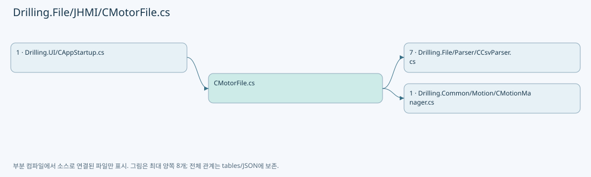
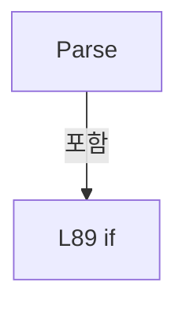
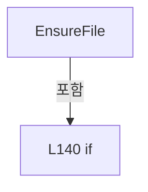
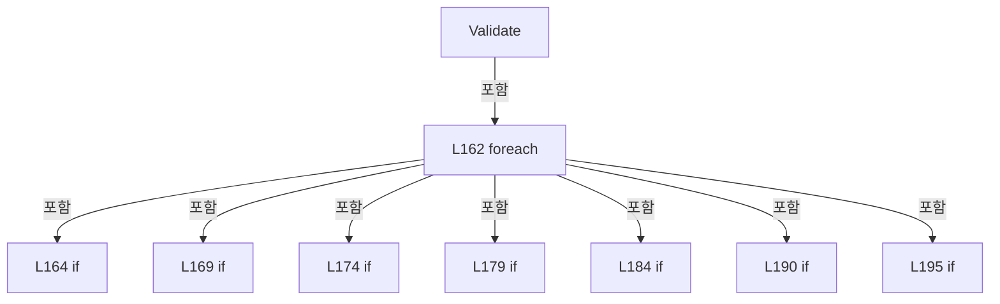

# Drilling.File/JHMI/CMotorFile.cs

| 항목 | 내용 |
| --- | --- |
| 원본 저장소 | https://github.com/kjuws10-rgb/A3Drilling.git |
| 원본 Commit | 5aee8e58439c9b455cae7c9593c9be986c3e682e |
| 원본 SHA256 | 6c15069ce8ffb94f3ff897f253f0859745cca339e66847a2f046c55fa7a50887 |
| 파일 분류 | code |
| 원본 크기/행 | 11,004 bytes / 283 physical lines |
| 인코딩 | utf-8-sig |
| 검토 범위 | 구문/부분 의미 분석에서 추출한 사실. 동작·물리 단위·실장비 합격을 보증하지 않습니다. |
| 원본 링크 | [고정 Commit 원본](https://github.com/kjuws10-rgb/A3Drilling/blob/5aee8e58439c9b455cae7c9593c9be986c3e682e/Drilling.File/JHMI/CMotorFile.cs) |

## 파일의 역할과 읽는 순서

정의·설정·레시피·결과·스크립트의 파일 입출력과 데이터 형식을 담당합니다. 저장 필드를 통신 송신 필드로 단정하지 않습니다.

## 네임스페이스·타입·상속

| 타입 | 구분 | 원본 범위 | 선언/상속 |
| --- | --- | --- | --- |
| CMotorFile | ClassDeclaration | 11–283 | CMotorFile: CMotorFileBase |

## 멤버 빠른 목록

| 이름 | 종류 | 범위 | 서명 |
| --- | --- | --- | --- |
| Headers | FieldDeclaration | L13–53 | System.Collections.Generic.IReadOnlyList<string> Drilling.File.JHMI.CMotorFile.Headers |
| RequiredHeaderGroups | FieldDeclaration | L54–54 | System.Collections.Generic.IReadOnlyList<System.Collections.Generic.IReadOnlyList<string>> Drilling.File.JHMI.CMotorFile.RequiredHeaderGroups |
| LoadAll | MethodDeclaration | L55–83 | System.Collections.Generic.IReadOnlyList<Drilling.Common.Motion.ST_MOTOR_DATA> Drilling.File.JHMI.CMotorFile.LoadAll(System.Threading.CancellationToken) |
| SelectValue | LocalFunctionStatement | L60–63 | Drilling.Common.Motion.ST_MOTOR_DATA SelectValue(System.Collections.Generic.IReadOnlyDictionary<string, string>, int) |
| ShouldIncludeItem | LocalFunctionStatement | L65–68 | bool ShouldIncludeItem(Drilling.Common.Motion.ST_MOTOR_DATA) |
| SelectAxis | LocalFunctionStatement | L70–73 | int SelectAxis(Drilling.Common.Motion.ST_MOTOR_DATA) |
| SelectName | LocalFunctionStatement | L75–78 | string SelectName(Drilling.Common.Motion.ST_MOTOR_DATA) |
| Parse | MethodDeclaration | L85–135 | Drilling.Common.Motion.ST_MOTOR_DATA Drilling.File.JHMI.CMotorFile.Parse(System.Collections.Generic.IReadOnlyDictionary<string, string>, int) |
| EnsureFile | MethodDeclaration | L137–146 | void Drilling.File.JHMI.CMotorFile.EnsureFile() |
| GetMotorPath | MethodDeclaration | L148–151 | string Drilling.File.JHMI.CMotorFile.GetMotorPath() |
| Validate | MethodDeclaration | L153–200 | void Drilling.File.JHMI.CMotorFile.Validate(System.Collections.Generic.IReadOnlyList<Drilling.Common.Motion.ST_MOTOR_DATA>) |
| IsUse | LocalFunctionStatement | L157–160 | bool IsUse(Drilling.Common.Motion.ST_MOTOR_DATA) |
| CreateDefaultRows | MethodDeclaration | L202–205 | System.Collections.Generic.IReadOnlyList<System.Collections.Generic.IReadOnlyDictionary<string, string>> Drilling.File.JHMI.CMotorFile.CreateDefaultRows() |
| Row | MethodDeclaration | L207–251 | System.Collections.Generic.IReadOnlyDictionary<string, string> Drilling.File.JHMI.CMotorFile.Row(string, int, string, string, double, double, double, double) |
| ReadFirst | MethodDeclaration | L253–256 | string Drilling.File.JHMI.CMotorFile.ReadFirst(System.Collections.Generic.IReadOnlyDictionary<string, string>, params string[]) |
| ReadController | MethodDeclaration | L258–262 | string Drilling.File.JHMI.CMotorFile.ReadController(string) |
| ReadBool | MethodDeclaration | L264–267 | bool Drilling.File.JHMI.CMotorFile.ReadBool(string, bool) |
| ReadInt | MethodDeclaration | L269–272 | int Drilling.File.JHMI.CMotorFile.ReadInt(string, int, string, int) |
| ReadDouble | MethodDeclaration | L274–277 | double Drilling.File.JHMI.CMotorFile.ReadDouble(string, int, string, double) |
| Normalize | MethodDeclaration | L279–282 | string Drilling.File.JHMI.CMotorFile.Normalize(string) |

## 멤버별 상세 계약·호출·처리 해설

### FieldDeclaration `Headers` · L13–53

[Drilling.File/JHMI/CMotorFile.cs:13–53](https://github.com/kjuws10-rgb/A3Drilling/blob/5aee8e58439c9b455cae7c9593c9be986c3e682e/Drilling.File/JHMI/CMotorFile.cs#L13-L53)

| 항목 | 실제 추출 값 |
| --- | --- |
| 서명 | System.Collections.Generic.IReadOnlyList<string> Drilling.File.JHMI.CMotorFile.Headers |
| 접근/수식자 | Private / private, static, readonly |
| 반환/값 타입 | System.Collections.Generic.IReadOnlyList<string> |
| 소속 타입 | NamedType:Drilling.File.JHMI.CMotorFile |

현재 부분 분석에서 직접 연결된 호출자는 없습니다. XAML/이벤트/인터페이스·델리게이트·외부 진입을 추가 확인해야 하며, 미사용으로 판정한 것이 아닙니다.

본문의 실제 연산·분기·예외·반환 순서(원문 위치 순):

| 원본 행 | 종류 | 주석 해설 |
| --- | --- | --- |
| 13 | variable-initializer | 변수의 초기값을 지정합니다: Headers = [ "NAME", "USE", "AXIS", "VIRTURE AXIS", "DEV TYPE", "DEV NO", "COORDINATE NO", "MOTOR TYPE", "SCALE", "SYSTEM", "STATION NAME", "SUBORDINATE", "DISPLAYNAME", "AXIS_DIR", "ALIGN_REVERSE", "PROCESS_REVERSE", "DIR", "PRODU |

변경 전 점검: 입력/반환 타입, 위 호출자, 예외/취소 경로, 공유 상태와 저장·전송 소비자를 함께 확인합니다. 값의 단위나 물리 방향을 이름만으로 확정하지 않습니다.

### FieldDeclaration `RequiredHeaderGroups` · L54–54

[Drilling.File/JHMI/CMotorFile.cs:54–54](https://github.com/kjuws10-rgb/A3Drilling/blob/5aee8e58439c9b455cae7c9593c9be986c3e682e/Drilling.File/JHMI/CMotorFile.cs#L54-L54)

| 항목 | 실제 추출 값 |
| --- | --- |
| 서명 | System.Collections.Generic.IReadOnlyList<System.Collections.Generic.IReadOnlyList<string>> Drilling.File.JHMI.CMotorFile.RequiredHeaderGroups |
| 접근/수식자 | Private / private, static, readonly |
| 반환/값 타입 | System.Collections.Generic.IReadOnlyList<System.Collections.Generic.IReadOnlyList<string>> |
| 소속 타입 | NamedType:Drilling.File.JHMI.CMotorFile |

현재 부분 분석에서 직접 연결된 호출자는 없습니다. XAML/이벤트/인터페이스·델리게이트·외부 진입을 추가 확인해야 하며, 미사용으로 판정한 것이 아닙니다.

본문의 실제 연산·분기·예외·반환 순서(원문 위치 순):

| 원본 행 | 종류 | 주석 해설 |
| --- | --- | --- |
| 54 | variable-initializer | 변수의 초기값을 지정합니다: RequiredHeaderGroups = [["NAME", "MOTOR NAME", "AXIS NAME"], ["USE"], ["AXIS"], ["DEV TYPE", "DEVICE TYPE"], ["DEV NO", "DEVICE NO"], ["SCALE"], ["MAXVEL"], ["MAXACC"], ["MIN"], ["MAX"]] |

변경 전 점검: 입력/반환 타입, 위 호출자, 예외/취소 경로, 공유 상태와 저장·전송 소비자를 함께 확인합니다. 값의 단위나 물리 방향을 이름만으로 확정하지 않습니다.

### MethodDeclaration `LoadAll` · L55–83

[Drilling.File/JHMI/CMotorFile.cs:55–83](https://github.com/kjuws10-rgb/A3Drilling/blob/5aee8e58439c9b455cae7c9593c9be986c3e682e/Drilling.File/JHMI/CMotorFile.cs#L55-L83)

| 항목 | 실제 추출 값 |
| --- | --- |
| 서명 | System.Collections.Generic.IReadOnlyList<Drilling.Common.Motion.ST_MOTOR_DATA> Drilling.File.JHMI.CMotorFile.LoadAll(System.Threading.CancellationToken) |
| 접근/수식자 | Public / public, override |
| 반환/값 타입 | System.Collections.Generic.IReadOnlyList<Drilling.Common.Motion.ST_MOTOR_DATA> |
| 소속 타입 | NamedType:Drilling.File.JHMI.CMotorFile |

입력 계약:

| 이름 | 타입 | 전달 | 선택/기본값 |
| --- | --- | --- | --- |
| cancellationToken | System.Threading.CancellationToken | None | True / null |

현재 부분 분석에서 직접 연결된 호출자는 없습니다. XAML/이벤트/인터페이스·델리게이트·외부 진입을 추가 확인해야 하며, 미사용으로 판정한 것이 아닙니다.

호출하는 대상과 해석 범위:

| 원본 행 | 표현식 | 분석 상태 | 대상/소스 위치 |
| --- | --- | --- | --- |
| 57 | cancellationToken.ThrowIfCancellationRequested | resolved | void System.Threading.CancellationToken.ThrowIfCancellationRequested() |
| 58 | EnsureFile | resolved | void Drilling.File.JHMI.CMotorFile.EnsureFile() · Drilling.File/JHMI/CMotorFile.cs:137 |
| 59 | CCsvParser.ValidateRequiredHeaders | resolved | void Drilling.File.Parser.CCsvParser.ValidateRequiredHeaders(string, string, System.Collections.Generic.IEnumerable<System.Collections.Generic.IEnumerable<string>>) · Drilling.File/Parser/CCsvParser.cs:280 |
| 59 | GetMotorPath | resolved | string Drilling.File.JHMI.CMotorFile.GetMotorPath() · Drilling.File/JHMI/CMotorFile.cs:148 |
| 80 | CCsvParser.Read(GetMotorPath()).Select(SelectValue).Where(ShouldIncludeItem).OrderBy(SelectAxis).ThenBy(SelectName, StringComparer.OrdinalIgnoreCase).ToArray | resolved | Drilling.Common.Motion.ST_MOTOR_DATA[] System.Collections.Generic.IEnumerable<Drilling.Common.Motion.ST_MOTOR_DATA>.ToArray<Drilling.Common.Motion.ST_MOTOR_DATA>() |
| 80 | CCsvParser.Read(GetMotorPath()).Select(SelectValue).Where(ShouldIncludeItem).OrderBy(SelectAxis).ThenBy | resolved | System.Linq.IOrderedEnumerable<Drilling.Common.Motion.ST_MOTOR_DATA> System.Linq.IOrderedEnumerable<Drilling.Common.Motion.ST_MOTOR_DATA>.ThenBy<Drilling.Common.Motion.ST_MOTOR_DATA, string>(System.Func<Drilling.Common.Motion.ST_MOTOR_DATA, string>, System.Collections.Generic.IComparer<string>?) |
| 80 | CCsvParser.Read(GetMotorPath()).Select(SelectValue).Where(ShouldIncludeItem).OrderBy | resolved | System.Linq.IOrderedEnumerable<Drilling.Common.Motion.ST_MOTOR_DATA> System.Collections.Generic.IEnumerable<Drilling.Common.Motion.ST_MOTOR_DATA>.OrderBy<Drilling.Common.Motion.ST_MOTOR_DATA, int>(System.Func<Drilling.Common.Motion.ST_MOTOR_DATA, int>) |
| 80 | CCsvParser.Read(GetMotorPath()).Select(SelectValue).Where | resolved | System.Collections.Generic.IEnumerable<Drilling.Common.Motion.ST_MOTOR_DATA> System.Collections.Generic.IEnumerable<Drilling.Common.Motion.ST_MOTOR_DATA>.Where<Drilling.Common.Motion.ST_MOTOR_DATA>(System.Func<Drilling.Common.Motion.ST_MOTOR_DATA, bool>) |
| 80 | CCsvParser.Read(GetMotorPath()).Select | resolved | System.Collections.Generic.IEnumerable<Drilling.Common.Motion.ST_MOTOR_DATA> System.Collections.Generic.IEnumerable<System.Collections.Generic.IReadOnlyDictionary<string, string>>.Select<System.Collections.Generic.IReadOnlyDictionary<string, string>, Drilling.Common.Motion.ST_MOTOR_DATA>(System.Func<System.Collections.Generic.IReadOnlyDictionary<string, string>, int, Drilling.Common.Motion.ST_MOTOR_DATA>) |
| 80 | CCsvParser.Read | resolved | System.Collections.Generic.IReadOnlyList<System.Collections.Generic.IReadOnlyDictionary<string, string>> Drilling.File.Parser.CCsvParser.Read(string) · Drilling.File/Parser/CCsvParser.cs:12 |
| 80 | GetMotorPath | resolved | string Drilling.File.JHMI.CMotorFile.GetMotorPath() · Drilling.File/JHMI/CMotorFile.cs:148 |
| 81 | Validate | resolved | void Drilling.File.JHMI.CMotorFile.Validate(System.Collections.Generic.IReadOnlyList<Drilling.Common.Motion.ST_MOTOR_DATA>) · Drilling.File/JHMI/CMotorFile.cs:153 |

본문의 실제 연산·분기·예외·반환 순서(원문 위치 순):

| 원본 행 | 종류 | 주석 해설 |
| --- | --- | --- |
| 57 | call | 함수·델리게이트 또는 객체 생성자를 호출합니다: cancellationToken.ThrowIfCancellationRequested() |
| 58 | call | 함수·델리게이트 또는 객체 생성자를 호출합니다: EnsureFile() |
| 59 | call | 함수·델리게이트 또는 객체 생성자를 호출합니다: CCsvParser.ValidateRequiredHeaders(GetMotorPath(), "JHMI_MOTOR", RequiredHeaderGroups) |
| 59 | call | 함수·델리게이트 또는 객체 생성자를 호출합니다: GetMotorPath() |
| 80 | call | 함수·델리게이트 또는 객체 생성자를 호출합니다: CCsvParser.Read(GetMotorPath()).Select(SelectValue).Where(ShouldIncludeItem).OrderBy(SelectAxis).ThenBy(SelectName, StringComparer.OrdinalIgnoreCase).ToArray() |
| 80 | call | 함수·델리게이트 또는 객체 생성자를 호출합니다: CCsvParser.Read(GetMotorPath()).Select(SelectValue).Where(ShouldIncludeItem).OrderBy(SelectAxis).ThenBy(SelectName, StringComparer.OrdinalIgnoreCase) |
| 80 | call | 함수·델리게이트 또는 객체 생성자를 호출합니다: CCsvParser.Read(GetMotorPath()).Select(SelectValue).Where(ShouldIncludeItem).OrderBy(SelectAxis) |
| 80 | call | 함수·델리게이트 또는 객체 생성자를 호출합니다: CCsvParser.Read(GetMotorPath()).Select(SelectValue).Where(ShouldIncludeItem) |
| 80 | call | 함수·델리게이트 또는 객체 생성자를 호출합니다: CCsvParser.Read(GetMotorPath()).Select(SelectValue) |
| 80 | call | 함수·델리게이트 또는 객체 생성자를 호출합니다: CCsvParser.Read(GetMotorPath()) |
| 80 | call | 함수·델리게이트 또는 객체 생성자를 호출합니다: GetMotorPath() |
| 80 | local-declaration | 지역 변수를 선언합니다: var rows = CCsvParser.Read(GetMotorPath()).Select(SelectValue).Where(ShouldIncludeItem).OrderBy(SelectAxis).ThenBy(SelectName, StringComparer.OrdinalIgnoreCase).ToArray(); |
| 80 | variable-initializer | 변수의 초기값을 지정합니다: rows = CCsvParser.Read(GetMotorPath()).Select(SelectValue).Where(ShouldIncludeItem).OrderBy(SelectAxis).ThenBy(SelectName, StringComparer.OrdinalIgnoreCase).ToArray() |
| 81 | call | 함수·델리게이트 또는 객체 생성자를 호출합니다: Validate(rows) |
| 82 | return | 호출자에게 값 또는 제어를 반환합니다: return rows; |

변경 전 점검: 입력/반환 타입, 위 호출자, 예외/취소 경로, 공유 상태와 저장·전송 소비자를 함께 확인합니다. 값의 단위나 물리 방향을 이름만으로 확정하지 않습니다.

### LocalFunctionStatement `SelectValue` · L60–63

[Drilling.File/JHMI/CMotorFile.cs:60–63](https://github.com/kjuws10-rgb/A3Drilling/blob/5aee8e58439c9b455cae7c9593c9be986c3e682e/Drilling.File/JHMI/CMotorFile.cs#L60-L63)

| 항목 | 실제 추출 값 |
| --- | --- |
| 서명 | Drilling.Common.Motion.ST_MOTOR_DATA SelectValue(System.Collections.Generic.IReadOnlyDictionary<string, string>, int) |
| 접근/수식자 | Private /  |
| 반환/값 타입 | Drilling.Common.Motion.ST_MOTOR_DATA |
| 소속 타입 | NamedType:Drilling.File.JHMI.CMotorFile |

입력 계약:

| 이름 | 타입 | 전달 | 선택/기본값 |
| --- | --- | --- | --- |
| row | System.Collections.Generic.IReadOnlyDictionary<string, string> | None | False /  |
| index | int | None | False /  |

현재 부분 분석에서 직접 연결된 호출자는 없습니다. XAML/이벤트/인터페이스·델리게이트·외부 진입을 추가 확인해야 하며, 미사용으로 판정한 것이 아닙니다.

호출하는 대상과 해석 범위:

| 원본 행 | 표현식 | 분석 상태 | 대상/소스 위치 |
| --- | --- | --- | --- |
| 62 | Parse | resolved | Drilling.Common.Motion.ST_MOTOR_DATA Drilling.File.JHMI.CMotorFile.Parse(System.Collections.Generic.IReadOnlyDictionary<string, string>, int) · Drilling.File/JHMI/CMotorFile.cs:85 |

본문의 실제 연산·분기·예외·반환 순서(원문 위치 순):

| 원본 행 | 종류 | 주석 해설 |
| --- | --- | --- |
| 62 | call | 함수·델리게이트 또는 객체 생성자를 호출합니다: Parse(row, index + 2) |
| 62 | return | 호출자에게 값 또는 제어를 반환합니다: return Parse(row, index + 2); |

변경 전 점검: 입력/반환 타입, 위 호출자, 예외/취소 경로, 공유 상태와 저장·전송 소비자를 함께 확인합니다. 값의 단위나 물리 방향을 이름만으로 확정하지 않습니다.

### LocalFunctionStatement `ShouldIncludeItem` · L65–68

[Drilling.File/JHMI/CMotorFile.cs:65–68](https://github.com/kjuws10-rgb/A3Drilling/blob/5aee8e58439c9b455cae7c9593c9be986c3e682e/Drilling.File/JHMI/CMotorFile.cs#L65-L68)

| 항목 | 실제 추출 값 |
| --- | --- |
| 서명 | bool ShouldIncludeItem(Drilling.Common.Motion.ST_MOTOR_DATA) |
| 접근/수식자 | Private /  |
| 반환/값 타입 | bool |
| 소속 타입 | NamedType:Drilling.File.JHMI.CMotorFile |

입력 계약:

| 이름 | 타입 | 전달 | 선택/기본값 |
| --- | --- | --- | --- |
| axis | Drilling.Common.Motion.ST_MOTOR_DATA | None | False /  |

현재 부분 분석에서 직접 연결된 호출자는 없습니다. XAML/이벤트/인터페이스·델리게이트·외부 진입을 추가 확인해야 하며, 미사용으로 판정한 것이 아닙니다.

호출하는 대상과 해석 범위:

| 원본 행 | 표현식 | 분석 상태 | 대상/소스 위치 |
| --- | --- | --- | --- |
| 67 | string.IsNullOrWhiteSpace | resolved | bool string.IsNullOrWhiteSpace(string?) |

본문의 실제 연산·분기·예외·반환 순서(원문 위치 순):

| 원본 행 | 종류 | 주석 해설 |
| --- | --- | --- |
| 67 | call | 함수·델리게이트 또는 객체 생성자를 호출합니다: string.IsNullOrWhiteSpace(axis.Name) |
| 67 | return | 호출자에게 값 또는 제어를 반환합니다: return !string.IsNullOrWhiteSpace(axis.Name); |

변경 전 점검: 입력/반환 타입, 위 호출자, 예외/취소 경로, 공유 상태와 저장·전송 소비자를 함께 확인합니다. 값의 단위나 물리 방향을 이름만으로 확정하지 않습니다.

### LocalFunctionStatement `SelectAxis` · L70–73

[Drilling.File/JHMI/CMotorFile.cs:70–73](https://github.com/kjuws10-rgb/A3Drilling/blob/5aee8e58439c9b455cae7c9593c9be986c3e682e/Drilling.File/JHMI/CMotorFile.cs#L70-L73)

| 항목 | 실제 추출 값 |
| --- | --- |
| 서명 | int SelectAxis(Drilling.Common.Motion.ST_MOTOR_DATA) |
| 접근/수식자 | Private /  |
| 반환/값 타입 | int |
| 소속 타입 | NamedType:Drilling.File.JHMI.CMotorFile |

입력 계약:

| 이름 | 타입 | 전달 | 선택/기본값 |
| --- | --- | --- | --- |
| axis | Drilling.Common.Motion.ST_MOTOR_DATA | None | False /  |

현재 부분 분석에서 직접 연결된 호출자는 없습니다. XAML/이벤트/인터페이스·델리게이트·외부 진입을 추가 확인해야 하며, 미사용으로 판정한 것이 아닙니다.

본문의 실제 연산·분기·예외·반환 순서(원문 위치 순):

| 원본 행 | 종류 | 주석 해설 |
| --- | --- | --- |
| 72 | return | 호출자에게 값 또는 제어를 반환합니다: return axis.Axis; |

변경 전 점검: 입력/반환 타입, 위 호출자, 예외/취소 경로, 공유 상태와 저장·전송 소비자를 함께 확인합니다. 값의 단위나 물리 방향을 이름만으로 확정하지 않습니다.

### LocalFunctionStatement `SelectName` · L75–78

[Drilling.File/JHMI/CMotorFile.cs:75–78](https://github.com/kjuws10-rgb/A3Drilling/blob/5aee8e58439c9b455cae7c9593c9be986c3e682e/Drilling.File/JHMI/CMotorFile.cs#L75-L78)

| 항목 | 실제 추출 값 |
| --- | --- |
| 서명 | string SelectName(Drilling.Common.Motion.ST_MOTOR_DATA) |
| 접근/수식자 | Private /  |
| 반환/값 타입 | string |
| 소속 타입 | NamedType:Drilling.File.JHMI.CMotorFile |

입력 계약:

| 이름 | 타입 | 전달 | 선택/기본값 |
| --- | --- | --- | --- |
| axis | Drilling.Common.Motion.ST_MOTOR_DATA | None | False /  |

현재 부분 분석에서 직접 연결된 호출자는 없습니다. XAML/이벤트/인터페이스·델리게이트·외부 진입을 추가 확인해야 하며, 미사용으로 판정한 것이 아닙니다.

본문의 실제 연산·분기·예외·반환 순서(원문 위치 순):

| 원본 행 | 종류 | 주석 해설 |
| --- | --- | --- |
| 77 | return | 호출자에게 값 또는 제어를 반환합니다: return axis.Name; |

변경 전 점검: 입력/반환 타입, 위 호출자, 예외/취소 경로, 공유 상태와 저장·전송 소비자를 함께 확인합니다. 값의 단위나 물리 방향을 이름만으로 확정하지 않습니다.

### MethodDeclaration `Parse` · L85–135

[Drilling.File/JHMI/CMotorFile.cs:85–135](https://github.com/kjuws10-rgb/A3Drilling/blob/5aee8e58439c9b455cae7c9593c9be986c3e682e/Drilling.File/JHMI/CMotorFile.cs#L85-L135)

| 항목 | 실제 추출 값 |
| --- | --- |
| 서명 | Drilling.Common.Motion.ST_MOTOR_DATA Drilling.File.JHMI.CMotorFile.Parse(System.Collections.Generic.IReadOnlyDictionary<string, string>, int) |
| 접근/수식자 | Private / private |
| 반환/값 타입 | Drilling.Common.Motion.ST_MOTOR_DATA |
| 소속 타입 | NamedType:Drilling.File.JHMI.CMotorFile |

입력 계약:

| 이름 | 타입 | 전달 | 선택/기본값 |
| --- | --- | --- | --- |
| row | System.Collections.Generic.IReadOnlyDictionary<string, string> | None | False /  |
| rowNo | int | None | False /  |

정적 호출자로 확인된 위치:

| 호출 파일/행 | 호출 표현식 | 런타임 분기 가능 |
| --- | --- | --- |
| [Drilling.File/JHMI/CMotorFile.cs:62–62](https://github.com/kjuws10-rgb/A3Drilling/blob/5aee8e58439c9b455cae7c9593c9be986c3e682e/Drilling.File/JHMI/CMotorFile.cs#L62-L62) | Parse | False |

호출하는 대상과 해석 범위:

| 원본 행 | 표현식 | 분석 상태 | 대상/소스 위치 |
| --- | --- | --- | --- |
| 87 | ReadFirst | resolved | string Drilling.File.JHMI.CMotorFile.ReadFirst(System.Collections.Generic.IReadOnlyDictionary<string, string>, params string[]) · Drilling.File/JHMI/CMotorFile.cs:253 |
| 88 | ReadFirst | resolved | string Drilling.File.JHMI.CMotorFile.ReadFirst(System.Collections.Generic.IReadOnlyDictionary<string, string>, params string[]) · Drilling.File/JHMI/CMotorFile.cs:253 |
| 89 | string.IsNullOrWhiteSpace | resolved | bool string.IsNullOrWhiteSpace(string?) |
| 89 | string.IsNullOrWhiteSpace | resolved | bool string.IsNullOrWhiteSpace(string?) |
| 94 | new ST_MOTOR_DATA | resolved | Drilling.Common.Motion.ST_MOTOR_DATA.ST_MOTOR_DATA(string, bool, int, int, string, int, int, int, double, string, string, string, string, string, bool, bool, string, string, string, bool, double, double, double, double, double, double, double, string, double, double, double, double, double, int, int, string, string, double, string) · Drilling.Common/Motion/CMotionManager.cs:1700 |
| 95 | name.Trim | resolved | string string.Trim() |
| 96 | ReadBool | resolved | bool Drilling.File.JHMI.CMotorFile.ReadBool(string, bool) · Drilling.File/JHMI/CMotorFile.cs:264 |
| 96 | ReadFirst | resolved | string Drilling.File.JHMI.CMotorFile.ReadFirst(System.Collections.Generic.IReadOnlyDictionary<string, string>, params string[]) · Drilling.File/JHMI/CMotorFile.cs:253 |
| 97 | ReadInt | resolved | int Drilling.File.JHMI.CMotorFile.ReadInt(string, int, string, int) · Drilling.File/JHMI/CMotorFile.cs:269 |
| 97 | ReadFirst | resolved | string Drilling.File.JHMI.CMotorFile.ReadFirst(System.Collections.Generic.IReadOnlyDictionary<string, string>, params string[]) · Drilling.File/JHMI/CMotorFile.cs:253 |
| 98 | ReadInt | resolved | int Drilling.File.JHMI.CMotorFile.ReadInt(string, int, string, int) · Drilling.File/JHMI/CMotorFile.cs:269 |
| 98 | ReadFirst | resolved | string Drilling.File.JHMI.CMotorFile.ReadFirst(System.Collections.Generic.IReadOnlyDictionary<string, string>, params string[]) · Drilling.File/JHMI/CMotorFile.cs:253 |
| 99 | ReadController | resolved | string Drilling.File.JHMI.CMotorFile.ReadController(string) · Drilling.File/JHMI/CMotorFile.cs:258 |
| 99 | ReadFirst | resolved | string Drilling.File.JHMI.CMotorFile.ReadFirst(System.Collections.Generic.IReadOnlyDictionary<string, string>, params string[]) · Drilling.File/JHMI/CMotorFile.cs:253 |
| 100 | ReadInt | resolved | int Drilling.File.JHMI.CMotorFile.ReadInt(string, int, string, int) · Drilling.File/JHMI/CMotorFile.cs:269 |
| 100 | ReadFirst | resolved | string Drilling.File.JHMI.CMotorFile.ReadFirst(System.Collections.Generic.IReadOnlyDictionary<string, string>, params string[]) · Drilling.File/JHMI/CMotorFile.cs:253 |
| 101 | ReadInt | resolved | int Drilling.File.JHMI.CMotorFile.ReadInt(string, int, string, int) · Drilling.File/JHMI/CMotorFile.cs:269 |
| 101 | ReadFirst | resolved | string Drilling.File.JHMI.CMotorFile.ReadFirst(System.Collections.Generic.IReadOnlyDictionary<string, string>, params string[]) · Drilling.File/JHMI/CMotorFile.cs:253 |
| 102 | ReadInt | resolved | int Drilling.File.JHMI.CMotorFile.ReadInt(string, int, string, int) · Drilling.File/JHMI/CMotorFile.cs:269 |
| 102 | ReadFirst | resolved | string Drilling.File.JHMI.CMotorFile.ReadFirst(System.Collections.Generic.IReadOnlyDictionary<string, string>, params string[]) · Drilling.File/JHMI/CMotorFile.cs:253 |
| 103 | ReadDouble | resolved | double Drilling.File.JHMI.CMotorFile.ReadDouble(string, int, string, double) · Drilling.File/JHMI/CMotorFile.cs:274 |
| 103 | ReadFirst | resolved | string Drilling.File.JHMI.CMotorFile.ReadFirst(System.Collections.Generic.IReadOnlyDictionary<string, string>, params string[]) · Drilling.File/JHMI/CMotorFile.cs:253 |
| 104 | ReadFirst | resolved | string Drilling.File.JHMI.CMotorFile.ReadFirst(System.Collections.Generic.IReadOnlyDictionary<string, string>, params string[]) · Drilling.File/JHMI/CMotorFile.cs:253 |
| 105 | ReadFirst | resolved | string Drilling.File.JHMI.CMotorFile.ReadFirst(System.Collections.Generic.IReadOnlyDictionary<string, string>, params string[]) · Drilling.File/JHMI/CMotorFile.cs:253 |
| 106 | ReadFirst | resolved | string Drilling.File.JHMI.CMotorFile.ReadFirst(System.Collections.Generic.IReadOnlyDictionary<string, string>, params string[]) · Drilling.File/JHMI/CMotorFile.cs:253 |
| 107 | string.IsNullOrWhiteSpace | resolved | bool string.IsNullOrWhiteSpace(string?) |
| 107 | name.Trim | resolved | string string.Trim() |
| 107 | displayName.Trim | resolved | string string.Trim() |
| 108 | ReadFirst | resolved | string Drilling.File.JHMI.CMotorFile.ReadFirst(System.Collections.Generic.IReadOnlyDictionary<string, string>, params string[]) · Drilling.File/JHMI/CMotorFile.cs:253 |
| 109 | ReadBool | resolved | bool Drilling.File.JHMI.CMotorFile.ReadBool(string, bool) · Drilling.File/JHMI/CMotorFile.cs:264 |
| 109 | ReadFirst | resolved | string Drilling.File.JHMI.CMotorFile.ReadFirst(System.Collections.Generic.IReadOnlyDictionary<string, string>, params string[]) · Drilling.File/JHMI/CMotorFile.cs:253 |
| 110 | ReadBool | resolved | bool Drilling.File.JHMI.CMotorFile.ReadBool(string, bool) · Drilling.File/JHMI/CMotorFile.cs:264 |
| 110 | ReadFirst | resolved | string Drilling.File.JHMI.CMotorFile.ReadFirst(System.Collections.Generic.IReadOnlyDictionary<string, string>, params string[]) · Drilling.File/JHMI/CMotorFile.cs:253 |
| 111 | ReadFirst | resolved | string Drilling.File.JHMI.CMotorFile.ReadFirst(System.Collections.Generic.IReadOnlyDictionary<string, string>, params string[]) · Drilling.File/JHMI/CMotorFile.cs:253 |
| 112 | ReadFirst | resolved | string Drilling.File.JHMI.CMotorFile.ReadFirst(System.Collections.Generic.IReadOnlyDictionary<string, string>, params string[]) · Drilling.File/JHMI/CMotorFile.cs:253 |
| 113 | ReadFirst | resolved | string Drilling.File.JHMI.CMotorFile.ReadFirst(System.Collections.Generic.IReadOnlyDictionary<string, string>, params string[]) · Drilling.File/JHMI/CMotorFile.cs:253 |
| 114 | ReadBool | resolved | bool Drilling.File.JHMI.CMotorFile.ReadBool(string, bool) · Drilling.File/JHMI/CMotorFile.cs:264 |
| 114 | ReadFirst | resolved | string Drilling.File.JHMI.CMotorFile.ReadFirst(System.Collections.Generic.IReadOnlyDictionary<string, string>, params string[]) · Drilling.File/JHMI/CMotorFile.cs:253 |
| 115 | ReadDouble | resolved | double Drilling.File.JHMI.CMotorFile.ReadDouble(string, int, string, double) · Drilling.File/JHMI/CMotorFile.cs:274 |
| 115 | ReadFirst | resolved | string Drilling.File.JHMI.CMotorFile.ReadFirst(System.Collections.Generic.IReadOnlyDictionary<string, string>, params string[]) · Drilling.File/JHMI/CMotorFile.cs:253 |
| 116 | ReadDouble | resolved | double Drilling.File.JHMI.CMotorFile.ReadDouble(string, int, string, double) · Drilling.File/JHMI/CMotorFile.cs:274 |
| 116 | ReadFirst | resolved | string Drilling.File.JHMI.CMotorFile.ReadFirst(System.Collections.Generic.IReadOnlyDictionary<string, string>, params string[]) · Drilling.File/JHMI/CMotorFile.cs:253 |
| 117 | ReadDouble | resolved | double Drilling.File.JHMI.CMotorFile.ReadDouble(string, int, string, double) · Drilling.File/JHMI/CMotorFile.cs:274 |
| 117 | ReadFirst | resolved | string Drilling.File.JHMI.CMotorFile.ReadFirst(System.Collections.Generic.IReadOnlyDictionary<string, string>, params string[]) · Drilling.File/JHMI/CMotorFile.cs:253 |
| 118 | ReadDouble | resolved | double Drilling.File.JHMI.CMotorFile.ReadDouble(string, int, string, double) · Drilling.File/JHMI/CMotorFile.cs:274 |
| 118 | ReadFirst | resolved | string Drilling.File.JHMI.CMotorFile.ReadFirst(System.Collections.Generic.IReadOnlyDictionary<string, string>, params string[]) · Drilling.File/JHMI/CMotorFile.cs:253 |
| 119 | ReadDouble | resolved | double Drilling.File.JHMI.CMotorFile.ReadDouble(string, int, string, double) · Drilling.File/JHMI/CMotorFile.cs:274 |
| 119 | ReadFirst | resolved | string Drilling.File.JHMI.CMotorFile.ReadFirst(System.Collections.Generic.IReadOnlyDictionary<string, string>, params string[]) · Drilling.File/JHMI/CMotorFile.cs:253 |
| 120 | ReadDouble | resolved | double Drilling.File.JHMI.CMotorFile.ReadDouble(string, int, string, double) · Drilling.File/JHMI/CMotorFile.cs:274 |
| 120 | ReadFirst | resolved | string Drilling.File.JHMI.CMotorFile.ReadFirst(System.Collections.Generic.IReadOnlyDictionary<string, string>, params string[]) · Drilling.File/JHMI/CMotorFile.cs:253 |
| 121 | ReadDouble | resolved | double Drilling.File.JHMI.CMotorFile.ReadDouble(string, int, string, double) · Drilling.File/JHMI/CMotorFile.cs:274 |
| 121 | ReadFirst | resolved | string Drilling.File.JHMI.CMotorFile.ReadFirst(System.Collections.Generic.IReadOnlyDictionary<string, string>, params string[]) · Drilling.File/JHMI/CMotorFile.cs:253 |
| 122 | ReadFirst | resolved | string Drilling.File.JHMI.CMotorFile.ReadFirst(System.Collections.Generic.IReadOnlyDictionary<string, string>, params string[]) · Drilling.File/JHMI/CMotorFile.cs:253 |
| 123 | ReadDouble | resolved | double Drilling.File.JHMI.CMotorFile.ReadDouble(string, int, string, double) · Drilling.File/JHMI/CMotorFile.cs:274 |
| 123 | ReadFirst | resolved | string Drilling.File.JHMI.CMotorFile.ReadFirst(System.Collections.Generic.IReadOnlyDictionary<string, string>, params string[]) · Drilling.File/JHMI/CMotorFile.cs:253 |
| 124 | ReadDouble | resolved | double Drilling.File.JHMI.CMotorFile.ReadDouble(string, int, string, double) · Drilling.File/JHMI/CMotorFile.cs:274 |
| 124 | ReadFirst | resolved | string Drilling.File.JHMI.CMotorFile.ReadFirst(System.Collections.Generic.IReadOnlyDictionary<string, string>, params string[]) · Drilling.File/JHMI/CMotorFile.cs:253 |
| 125 | ReadDouble | resolved | double Drilling.File.JHMI.CMotorFile.ReadDouble(string, int, string, double) · Drilling.File/JHMI/CMotorFile.cs:274 |
| 125 | ReadFirst | resolved | string Drilling.File.JHMI.CMotorFile.ReadFirst(System.Collections.Generic.IReadOnlyDictionary<string, string>, params string[]) · Drilling.File/JHMI/CMotorFile.cs:253 |
| 126 | ReadDouble | resolved | double Drilling.File.JHMI.CMotorFile.ReadDouble(string, int, string, double) · Drilling.File/JHMI/CMotorFile.cs:274 |
| 126 | ReadFirst | resolved | string Drilling.File.JHMI.CMotorFile.ReadFirst(System.Collections.Generic.IReadOnlyDictionary<string, string>, params string[]) · Drilling.File/JHMI/CMotorFile.cs:253 |
| 127 | ReadDouble | resolved | double Drilling.File.JHMI.CMotorFile.ReadDouble(string, int, string, double) · Drilling.File/JHMI/CMotorFile.cs:274 |
| 127 | ReadFirst | resolved | string Drilling.File.JHMI.CMotorFile.ReadFirst(System.Collections.Generic.IReadOnlyDictionary<string, string>, params string[]) · Drilling.File/JHMI/CMotorFile.cs:253 |
| 128 | ReadInt | resolved | int Drilling.File.JHMI.CMotorFile.ReadInt(string, int, string, int) · Drilling.File/JHMI/CMotorFile.cs:269 |
| 128 | ReadFirst | resolved | string Drilling.File.JHMI.CMotorFile.ReadFirst(System.Collections.Generic.IReadOnlyDictionary<string, string>, params string[]) · Drilling.File/JHMI/CMotorFile.cs:253 |
| 129 | ReadInt | resolved | int Drilling.File.JHMI.CMotorFile.ReadInt(string, int, string, int) · Drilling.File/JHMI/CMotorFile.cs:269 |
| 129 | ReadFirst | resolved | string Drilling.File.JHMI.CMotorFile.ReadFirst(System.Collections.Generic.IReadOnlyDictionary<string, string>, params string[]) · Drilling.File/JHMI/CMotorFile.cs:253 |
| 130 | ReadFirst | resolved | string Drilling.File.JHMI.CMotorFile.ReadFirst(System.Collections.Generic.IReadOnlyDictionary<string, string>, params string[]) · Drilling.File/JHMI/CMotorFile.cs:253 |
| 131 | ReadFirst | resolved | string Drilling.File.JHMI.CMotorFile.ReadFirst(System.Collections.Generic.IReadOnlyDictionary<string, string>, params string[]) · Drilling.File/JHMI/CMotorFile.cs:253 |
| 132 | ReadDouble | resolved | double Drilling.File.JHMI.CMotorFile.ReadDouble(string, int, string, double) · Drilling.File/JHMI/CMotorFile.cs:274 |
| 132 | ReadFirst | resolved | string Drilling.File.JHMI.CMotorFile.ReadFirst(System.Collections.Generic.IReadOnlyDictionary<string, string>, params string[]) · Drilling.File/JHMI/CMotorFile.cs:253 |
| 133 | ReadFirst | resolved | string Drilling.File.JHMI.CMotorFile.ReadFirst(System.Collections.Generic.IReadOnlyDictionary<string, string>, params string[]) · Drilling.File/JHMI/CMotorFile.cs:253 |

본문의 실제 연산·분기·예외·반환 순서(원문 위치 순):

| 원본 행 | 종류 | 주석 해설 |
| --- | --- | --- |
| 87 | call | 함수·델리게이트 또는 객체 생성자를 호출합니다: ReadFirst(row, "NAME") |
| 87 | local-declaration | 지역 변수를 선언합니다: var name = ReadFirst(row, "NAME"); |
| 87 | variable-initializer | 변수의 초기값을 지정합니다: name = ReadFirst(row, "NAME") |
| 88 | call | 함수·델리게이트 또는 객체 생성자를 호출합니다: ReadFirst(row, "DISPLAYNAME") |
| 88 | local-declaration | 지역 변수를 선언합니다: var displayName = ReadFirst(row, "DISPLAYNAME"); |
| 88 | variable-initializer | 변수의 초기값을 지정합니다: displayName = ReadFirst(row, "DISPLAYNAME") |
| 89 | call | 함수·델리게이트 또는 객체 생성자를 호출합니다: string.IsNullOrWhiteSpace(name) |
| 89 | call | 함수·델리게이트 또는 객체 생성자를 호출합니다: string.IsNullOrWhiteSpace(displayName) |
| 89 | if | 조건에 따라 분기합니다: if (string.IsNullOrWhiteSpace(name) && !string.IsNullOrWhiteSpace(displayName)) |
| 91 | assignment | 값을 대상에 대입합니다: name = displayName |
| 94 | call | 함수·델리게이트 또는 객체 생성자를 호출합니다: new ST_MOTOR_DATA( name.Trim(), ReadBool(ReadFirst(row, "USE"), true), ReadInt(ReadFirst(row, "AXIS"), rowNo, "AXIS", rowNo - 2), ReadInt(ReadFirst(row, "VIRTURE AXIS"), rowNo, "VIRTURE AXIS", -1), ReadController(ReadFir… |
| 94 | return | 호출자에게 값 또는 제어를 반환합니다: return new ST_MOTOR_DATA( name.Trim(), ReadBool(ReadFirst(row, "USE"), true), ReadInt(ReadFirst(row, "AXIS"), rowNo, "AXIS", rowNo - 2), ReadInt(ReadFirst(row, "VIRTURE AXIS"), rowNo, "VIRTURE AXIS", -1), ReadController(ReadFirst( |
| 95 | call | 함수·델리게이트 또는 객체 생성자를 호출합니다: name.Trim() |
| 96 | call | 함수·델리게이트 또는 객체 생성자를 호출합니다: ReadBool(ReadFirst(row, "USE"), true) |
| 96 | call | 함수·델리게이트 또는 객체 생성자를 호출합니다: ReadFirst(row, "USE") |
| 97 | call | 함수·델리게이트 또는 객체 생성자를 호출합니다: ReadInt(ReadFirst(row, "AXIS"), rowNo, "AXIS", rowNo - 2) |
| 97 | call | 함수·델리게이트 또는 객체 생성자를 호출합니다: ReadFirst(row, "AXIS") |
| 98 | call | 함수·델리게이트 또는 객체 생성자를 호출합니다: ReadInt(ReadFirst(row, "VIRTURE AXIS"), rowNo, "VIRTURE AXIS", -1) |
| 98 | call | 함수·델리게이트 또는 객체 생성자를 호출합니다: ReadFirst(row, "VIRTURE AXIS") |
| 99 | call | 함수·델리게이트 또는 객체 생성자를 호출합니다: ReadController(ReadFirst(row, "DEV TYPE")) |
| 99 | call | 함수·델리게이트 또는 객체 생성자를 호출합니다: ReadFirst(row, "DEV TYPE") |
| 100 | call | 함수·델리게이트 또는 객체 생성자를 호출합니다: ReadInt(ReadFirst(row, "DEV NO"), rowNo, "DEV NO", 0) |
| 100 | call | 함수·델리게이트 또는 객체 생성자를 호출합니다: ReadFirst(row, "DEV NO") |
| 101 | call | 함수·델리게이트 또는 객체 생성자를 호출합니다: ReadInt(ReadFirst(row, "COORDINATE NO"), rowNo, "COORDINATE NO", 0) |
| 101 | call | 함수·델리게이트 또는 객체 생성자를 호출합니다: ReadFirst(row, "COORDINATE NO") |
| 102 | call | 함수·델리게이트 또는 객체 생성자를 호출합니다: ReadInt(ReadFirst(row, "MOTOR TYPE"), rowNo, "MOTOR TYPE", 0) |
| 102 | call | 함수·델리게이트 또는 객체 생성자를 호출합니다: ReadFirst(row, "MOTOR TYPE") |
| 103 | call | 함수·델리게이트 또는 객체 생성자를 호출합니다: ReadDouble(ReadFirst(row, "SCALE"), rowNo, "SCALE", 1.0) |
| 103 | call | 함수·델리게이트 또는 객체 생성자를 호출합니다: ReadFirst(row, "SCALE") |
| 104 | call | 함수·델리게이트 또는 객체 생성자를 호출합니다: ReadFirst(row, "SYSTEM") |
| 105 | call | 함수·델리게이트 또는 객체 생성자를 호출합니다: ReadFirst(row, "STATION NAME") |
| 106 | call | 함수·델리게이트 또는 객체 생성자를 호출합니다: ReadFirst(row, "SUBORDINATE") |
| 107 | call | 함수·델리게이트 또는 객체 생성자를 호출합니다: string.IsNullOrWhiteSpace(displayName) |
| 107 | call | 함수·델리게이트 또는 객체 생성자를 호출합니다: name.Trim() |
| 107 | call | 함수·델리게이트 또는 객체 생성자를 호출합니다: displayName.Trim() |
| 107 | conditional-expression | 조건에 따라 결과식을 선택합니다: string.IsNullOrWhiteSpace(displayName) ? name.Trim() : displayName.Trim() |
| 108 | call | 함수·델리게이트 또는 객체 생성자를 호출합니다: ReadFirst(row, "AXIS_DIR") |
| 109 | call | 함수·델리게이트 또는 객체 생성자를 호출합니다: ReadBool(ReadFirst(row, "ALIGN_REVERSE"), false) |
| 109 | call | 함수·델리게이트 또는 객체 생성자를 호출합니다: ReadFirst(row, "ALIGN_REVERSE") |
| 110 | call | 함수·델리게이트 또는 객체 생성자를 호출합니다: ReadBool(ReadFirst(row, "PROCESS_REVERSE"), false) |
| 110 | call | 함수·델리게이트 또는 객체 생성자를 호출합니다: ReadFirst(row, "PROCESS_REVERSE") |
| 111 | call | 함수·델리게이트 또는 객체 생성자를 호출합니다: ReadFirst(row, "DIR") |
| 112 | call | 함수·델리게이트 또는 객체 생성자를 호출합니다: ReadFirst(row, "PRODUCT INDEX") |
| 113 | call | 함수·델리게이트 또는 객체 생성자를 호출합니다: ReadFirst(row, "AXIS_COLOR") |
| 114 | call | 함수·델리게이트 또는 객체 생성자를 호출합니다: ReadBool(ReadFirst(row, "REVERSE_DIR"), false) |
| 114 | call | 함수·델리게이트 또는 객체 생성자를 호출합니다: ReadFirst(row, "REVERSE_DIR") |
| 115 | call | 함수·델리게이트 또는 객체 생성자를 호출합니다: ReadDouble(ReadFirst(row, "COR_ANGLE"), rowNo, "COR_ANGLE", 0.0) |
| 115 | call | 함수·델리게이트 또는 객체 생성자를 호출합니다: ReadFirst(row, "COR_ANGLE") |
| 116 | call | 함수·델리게이트 또는 객체 생성자를 호출합니다: ReadDouble(ReadFirst(row, "OFFSET_X"), rowNo, "OFFSET_X", 0.0) |
| 116 | call | 함수·델리게이트 또는 객체 생성자를 호출합니다: ReadFirst(row, "OFFSET_X") |
| 117 | call | 함수·델리게이트 또는 객체 생성자를 호출합니다: ReadDouble(ReadFirst(row, "OFFSET_Y"), rowNo, "OFFSET_Y", 0.0) |
| 117 | call | 함수·델리게이트 또는 객체 생성자를 호출합니다: ReadFirst(row, "OFFSET_Y") |
| 118 | call | 함수·델리게이트 또는 객체 생성자를 호출합니다: ReadDouble(ReadFirst(row, "OFFSET_Z"), rowNo, "OFFSET_Z", 0.0) |
| 118 | call | 함수·델리게이트 또는 객체 생성자를 호출합니다: ReadFirst(row, "OFFSET_Z") |
| 119 | call | 함수·델리게이트 또는 객체 생성자를 호출합니다: ReadDouble(ReadFirst(row, "OFFSET_XT"), rowNo, "OFFSET_XT", 0.0) |
| 119 | call | 함수·델리게이트 또는 객체 생성자를 호출합니다: ReadFirst(row, "OFFSET_XT") |
| 120 | call | 함수·델리게이트 또는 객체 생성자를 호출합니다: ReadDouble(ReadFirst(row, "OFFSET_YT"), rowNo, "OFFSET_YT", 0.0) |
| 120 | call | 함수·델리게이트 또는 객체 생성자를 호출합니다: ReadFirst(row, "OFFSET_YT") |
| 121 | call | 함수·델리게이트 또는 객체 생성자를 호출합니다: ReadDouble(ReadFirst(row, "OFFSET_ZT"), rowNo, "OFFSET_ZT", 0.0) |
| 121 | call | 함수·델리게이트 또는 객체 생성자를 호출합니다: ReadFirst(row, "OFFSET_ZT") |
| 122 | call | 함수·델리게이트 또는 객체 생성자를 호출합니다: ReadFirst(row, "UNIT") |
| 123 | call | 함수·델리게이트 또는 객체 생성자를 호출합니다: ReadDouble(ReadFirst(row, "MAXVEL"), rowNo, "MAXVEL", 0.0) |
| 123 | call | 함수·델리게이트 또는 객체 생성자를 호출합니다: ReadFirst(row, "MAXVEL") |
| 124 | call | 함수·델리게이트 또는 객체 생성자를 호출합니다: ReadDouble(ReadFirst(row, "INTERLOCK MAXVEL"), rowNo, "INTERLOCK MAXVEL", 0.0) |
| 124 | call | 함수·델리게이트 또는 객체 생성자를 호출합니다: ReadFirst(row, "INTERLOCK MAXVEL") |
| 125 | call | 함수·델리게이트 또는 객체 생성자를 호출합니다: ReadDouble(ReadFirst(row, "MAXACC"), rowNo, "MAXACC", 0.0) |
| 125 | call | 함수·델리게이트 또는 객체 생성자를 호출합니다: ReadFirst(row, "MAXACC") |
| 126 | call | 함수·델리게이트 또는 객체 생성자를 호출합니다: ReadDouble(ReadFirst(row, "MIN"), rowNo, "MIN", 0.0) |
| 126 | call | 함수·델리게이트 또는 객체 생성자를 호출합니다: ReadFirst(row, "MIN") |
| 127 | call | 함수·델리게이트 또는 객체 생성자를 호출합니다: ReadDouble(ReadFirst(row, "MAX"), rowNo, "MAX", 0.0) |
| 127 | call | 함수·델리게이트 또는 객체 생성자를 호출합니다: ReadFirst(row, "MAX") |
| 128 | call | 함수·델리게이트 또는 객체 생성자를 호출합니다: ReadInt(ReadFirst(row, "HOMEPLC"), rowNo, "HOMEPLC", 0) |
| 128 | call | 함수·델리게이트 또는 객체 생성자를 호출합니다: ReadFirst(row, "HOMEPLC") |
| 129 | call | 함수·델리게이트 또는 객체 생성자를 호출합니다: ReadInt(ReadFirst(row, "HOMETIMEOUT"), rowNo, "HOMETIMEOUT", 0) |
| 129 | call | 함수·델리게이트 또는 객체 생성자를 호출합니다: ReadFirst(row, "HOMETIMEOUT") |
| 130 | call | 함수·델리게이트 또는 객체 생성자를 호출합니다: ReadFirst(row, "HOMEPLC FLAG") |
| 131 | call | 함수·델리게이트 또는 객체 생성자를 호출합니다: ReadFirst(row, "DES") |
| 132 | call | 함수·델리게이트 또는 객체 생성자를 호출합니다: ReadDouble(ReadFirst(row, "LOAD_ALARM_VAL"), rowNo, "LOAD_ALARM_VAL", 0.0) |
| 132 | call | 함수·델리게이트 또는 객체 생성자를 호출합니다: ReadFirst(row, "LOAD_ALARM_VAL") |
| 133 | call | 함수·델리게이트 또는 객체 생성자를 호출합니다: ReadFirst(row, "PRE_CHECK_IO") |

제어 구문의 포함 구조(실제 실행 순서/CFG가 아닌 구문 탐색 그림):

변경 전 점검: 입력/반환 타입, 위 호출자, 예외/취소 경로, 공유 상태와 저장·전송 소비자를 함께 확인합니다. 값의 단위나 물리 방향을 이름만으로 확정하지 않습니다.

### MethodDeclaration `EnsureFile` · L137–146

[Drilling.File/JHMI/CMotorFile.cs:137–146](https://github.com/kjuws10-rgb/A3Drilling/blob/5aee8e58439c9b455cae7c9593c9be986c3e682e/Drilling.File/JHMI/CMotorFile.cs#L137-L146)

| 항목 | 실제 추출 값 |
| --- | --- |
| 서명 | void Drilling.File.JHMI.CMotorFile.EnsureFile() |
| 접근/수식자 | Private / private |
| 반환/값 타입 | void |
| 소속 타입 | NamedType:Drilling.File.JHMI.CMotorFile |

정적 호출자로 확인된 위치:

| 호출 파일/행 | 호출 표현식 | 런타임 분기 가능 |
| --- | --- | --- |
| [Drilling.File/JHMI/CMotorFile.cs:58–58](https://github.com/kjuws10-rgb/A3Drilling/blob/5aee8e58439c9b455cae7c9593c9be986c3e682e/Drilling.File/JHMI/CMotorFile.cs#L58-L58) | EnsureFile | False |

호출하는 대상과 해석 범위:

| 원본 행 | 표현식 | 분석 상태 | 대상/소스 위치 |
| --- | --- | --- | --- |
| 139 | GetMotorPath | resolved | string Drilling.File.JHMI.CMotorFile.GetMotorPath() · Drilling.File/JHMI/CMotorFile.cs:148 |
| 140 | System.IO.File.Exists | resolved | bool System.IO.File.Exists(string?) |
| 145 | CCsvParser.Write | resolved | void Drilling.File.Parser.CCsvParser.Write(string, System.Collections.Generic.IReadOnlyList<string>, System.Collections.Generic.IEnumerable<System.Collections.Generic.IReadOnlyDictionary<string, string>>) · Drilling.File/Parser/CCsvParser.cs:58 |
| 145 | CreateDefaultRows | resolved | System.Collections.Generic.IReadOnlyList<System.Collections.Generic.IReadOnlyDictionary<string, string>> Drilling.File.JHMI.CMotorFile.CreateDefaultRows() · Drilling.File/JHMI/CMotorFile.cs:202 |

본문의 실제 연산·분기·예외·반환 순서(원문 위치 순):

| 원본 행 | 종류 | 주석 해설 |
| --- | --- | --- |
| 139 | call | 함수·델리게이트 또는 객체 생성자를 호출합니다: GetMotorPath() |
| 139 | local-declaration | 지역 변수를 선언합니다: var path = GetMotorPath(); |
| 139 | variable-initializer | 변수의 초기값을 지정합니다: path = GetMotorPath() |
| 140 | call | 함수·델리게이트 또는 객체 생성자를 호출합니다: System.IO.File.Exists(path) |
| 140 | if | 조건에 따라 분기합니다: if (System.IO.File.Exists(path)) |
| 142 | return | 호출자에게 값 또는 제어를 반환합니다: return; |
| 145 | call | 함수·델리게이트 또는 객체 생성자를 호출합니다: CCsvParser.Write(path, Headers, CreateDefaultRows()) |
| 145 | call | 함수·델리게이트 또는 객체 생성자를 호출합니다: CreateDefaultRows() |

제어 구문의 포함 구조(실제 실행 순서/CFG가 아닌 구문 탐색 그림):

변경 전 점검: 입력/반환 타입, 위 호출자, 예외/취소 경로, 공유 상태와 저장·전송 소비자를 함께 확인합니다. 값의 단위나 물리 방향을 이름만으로 확정하지 않습니다.

### MethodDeclaration `GetMotorPath` · L148–151

[Drilling.File/JHMI/CMotorFile.cs:148–151](https://github.com/kjuws10-rgb/A3Drilling/blob/5aee8e58439c9b455cae7c9593c9be986c3e682e/Drilling.File/JHMI/CMotorFile.cs#L148-L151)

| 항목 | 실제 추출 값 |
| --- | --- |
| 서명 | string Drilling.File.JHMI.CMotorFile.GetMotorPath() |
| 접근/수식자 | Private / private |
| 반환/값 타입 | string |
| 소속 타입 | NamedType:Drilling.File.JHMI.CMotorFile |

정적 호출자로 확인된 위치:

| 호출 파일/행 | 호출 표현식 | 런타임 분기 가능 |
| --- | --- | --- |
| [Drilling.File/JHMI/CMotorFile.cs:59–59](https://github.com/kjuws10-rgb/A3Drilling/blob/5aee8e58439c9b455cae7c9593c9be986c3e682e/Drilling.File/JHMI/CMotorFile.cs#L59-L59) | GetMotorPath | False |
| [Drilling.File/JHMI/CMotorFile.cs:80–80](https://github.com/kjuws10-rgb/A3Drilling/blob/5aee8e58439c9b455cae7c9593c9be986c3e682e/Drilling.File/JHMI/CMotorFile.cs#L80-L80) | GetMotorPath | False |
| [Drilling.File/JHMI/CMotorFile.cs:139–139](https://github.com/kjuws10-rgb/A3Drilling/blob/5aee8e58439c9b455cae7c9593c9be986c3e682e/Drilling.File/JHMI/CMotorFile.cs#L139-L139) | GetMotorPath | False |

호출하는 대상과 해석 범위:

| 원본 행 | 표현식 | 분석 상태 | 대상/소스 위치 |
| --- | --- | --- | --- |
| 150 | Path.Combine | resolved | string System.IO.Path.Combine(string, string) |

본문의 실제 연산·분기·예외·반환 순서(원문 위치 순):

| 원본 행 | 종류 | 주석 해설 |
| --- | --- | --- |
| 150 | call | 함수·델리게이트 또는 객체 생성자를 호출합니다: Path.Combine(configRoot, "JHMI_MOTOR.csv") |
| 150 | return | 호출자에게 값 또는 제어를 반환합니다: return Path.Combine(configRoot, "JHMI_MOTOR.csv"); |

변경 전 점검: 입력/반환 타입, 위 호출자, 예외/취소 경로, 공유 상태와 저장·전송 소비자를 함께 확인합니다. 값의 단위나 물리 방향을 이름만으로 확정하지 않습니다.

### MethodDeclaration `Validate` · L153–200

[Drilling.File/JHMI/CMotorFile.cs:153–200](https://github.com/kjuws10-rgb/A3Drilling/blob/5aee8e58439c9b455cae7c9593c9be986c3e682e/Drilling.File/JHMI/CMotorFile.cs#L153-L200)

| 항목 | 실제 추출 값 |
| --- | --- |
| 서명 | void Drilling.File.JHMI.CMotorFile.Validate(System.Collections.Generic.IReadOnlyList<Drilling.Common.Motion.ST_MOTOR_DATA>) |
| 접근/수식자 | Private / private, static |
| 반환/값 타입 | void |
| 소속 타입 | NamedType:Drilling.File.JHMI.CMotorFile |

입력 계약:

| 이름 | 타입 | 전달 | 선택/기본값 |
| --- | --- | --- | --- |
| motors | System.Collections.Generic.IReadOnlyList<Drilling.Common.Motion.ST_MOTOR_DATA> | None | False /  |

정적 호출자로 확인된 위치:

| 호출 파일/행 | 호출 표현식 | 런타임 분기 가능 |
| --- | --- | --- |
| [Drilling.File/JHMI/CMotorFile.cs:81–81](https://github.com/kjuws10-rgb/A3Drilling/blob/5aee8e58439c9b455cae7c9593c9be986c3e682e/Drilling.File/JHMI/CMotorFile.cs#L81-L81) | Validate | False |

호출하는 대상과 해석 범위:

| 원본 행 | 표현식 | 분석 상태 | 대상/소스 위치 |
| --- | --- | --- | --- |
| 155 | new HashSet<string> | resolved | System.Collections.Generic.HashSet<string>.HashSet(System.Collections.Generic.IEqualityComparer<string>?) |
| 156 | new HashSet<string> | resolved | System.Collections.Generic.HashSet<string>.HashSet(System.Collections.Generic.IEqualityComparer<string>?) |
| 162 | motors.Where | resolved | System.Collections.Generic.IEnumerable<Drilling.Common.Motion.ST_MOTOR_DATA> System.Collections.Generic.IEnumerable<Drilling.Common.Motion.ST_MOTOR_DATA>.Where<Drilling.Common.Motion.ST_MOTOR_DATA>(System.Func<Drilling.Common.Motion.ST_MOTOR_DATA, bool>) |
| 164 | string.IsNullOrWhiteSpace | resolved | bool string.IsNullOrWhiteSpace(string?) |
| 166 | new InvalidDataException | resolved | System.IO.InvalidDataException.InvalidDataException(string?) |
| 169 | usedNames.Add | resolved | bool System.Collections.Generic.HashSet<string>.Add(string) |
| 171 | new InvalidDataException | resolved | System.IO.InvalidDataException.InvalidDataException(string?) |
| 176 | new InvalidDataException | resolved | System.IO.InvalidDataException.InvalidDataException(string?) |
| 181 | new InvalidDataException | resolved | System.IO.InvalidDataException.InvalidDataException(string?) |
| 184 | string.IsNullOrWhiteSpace | resolved | bool string.IsNullOrWhiteSpace(string?) |
| 186 | new InvalidDataException | resolved | System.IO.InvalidDataException.InvalidDataException(string?) |
| 190 | usedControllerAxes.Add | resolved | bool System.Collections.Generic.HashSet<string>.Add(string) |
| 192 | new InvalidDataException | resolved | System.IO.InvalidDataException.InvalidDataException(string?) |
| 197 | new InvalidDataException | resolved | System.IO.InvalidDataException.InvalidDataException(string?) |

본문의 실제 연산·분기·예외·반환 순서(원문 위치 순):

| 원본 행 | 종류 | 주석 해설 |
| --- | --- | --- |
| 155 | call | 함수·델리게이트 또는 객체 생성자를 호출합니다: new HashSet<string>(StringComparer.OrdinalIgnoreCase) |
| 155 | local-declaration | 지역 변수를 선언합니다: var usedNames = new HashSet<string>(StringComparer.OrdinalIgnoreCase); |
| 155 | variable-initializer | 변수의 초기값을 지정합니다: usedNames = new HashSet<string>(StringComparer.OrdinalIgnoreCase) |
| 156 | call | 함수·델리게이트 또는 객체 생성자를 호출합니다: new HashSet<string>(StringComparer.OrdinalIgnoreCase) |
| 156 | local-declaration | 지역 변수를 선언합니다: var usedControllerAxes = new HashSet<string>(StringComparer.OrdinalIgnoreCase); |
| 156 | variable-initializer | 변수의 초기값을 지정합니다: usedControllerAxes = new HashSet<string>(StringComparer.OrdinalIgnoreCase) |
| 162 | call | 함수·델리게이트 또는 객체 생성자를 호출합니다: motors.Where(IsUse) |
| 162 | foreach | 컬렉션 요소를 순회합니다: foreach (var axis in motors.Where(IsUse)) |
| 164 | call | 함수·델리게이트 또는 객체 생성자를 호출합니다: string.IsNullOrWhiteSpace(axis.Name) |
| 164 | if | 조건에 따라 분기합니다: if (string.IsNullOrWhiteSpace(axis.Name)) |
| 166 | call | 함수·델리게이트 또는 객체 생성자를 호출합니다: new InvalidDataException("JHMI_MOTOR validation failed. NAME cannot be empty.") |
| 166 | throw | 예외를 발생/전달합니다: throw new InvalidDataException("JHMI_MOTOR validation failed. NAME cannot be empty."); |
| 169 | call | 함수·델리게이트 또는 객체 생성자를 호출합니다: usedNames.Add(axis.Name) |
| 169 | if | 조건에 따라 분기합니다: if (!usedNames.Add(axis.Name)) |
| 171 | call | 함수·델리게이트 또는 객체 생성자를 호출합니다: new InvalidDataException($"JHMI_MOTOR validation failed. Duplicated NAME: {axis.Name}") |
| 171 | throw | 예외를 발생/전달합니다: throw new InvalidDataException($"JHMI_MOTOR validation failed. Duplicated NAME: {axis.Name}"); |
| 174 | if | 조건에 따라 분기합니다: if (axis.Axis < 0) |
| 176 | call | 함수·델리게이트 또는 객체 생성자를 호출합니다: new InvalidDataException($"JHMI_MOTOR validation failed. AXIS cannot be negative: {axis.Name}") |
| 176 | throw | 예외를 발생/전달합니다: throw new InvalidDataException($"JHMI_MOTOR validation failed. AXIS cannot be negative: {axis.Name}"); |
| 179 | if | 조건에 따라 분기합니다: if (axis.DevNo < 0) |
| 181 | call | 함수·델리게이트 또는 객체 생성자를 호출합니다: new InvalidDataException($"JHMI_MOTOR validation failed. DEV NO cannot be negative: {axis.Name}") |
| 181 | throw | 예외를 발생/전달합니다: throw new InvalidDataException($"JHMI_MOTOR validation failed. DEV NO cannot be negative: {axis.Name}"); |
| 184 | call | 함수·델리게이트 또는 객체 생성자를 호출합니다: string.IsNullOrWhiteSpace(axis.DevType) |
| 184 | if | 조건에 따라 분기합니다: if (string.IsNullOrWhiteSpace(axis.DevType)) |
| 186 | call | 함수·델리게이트 또는 객체 생성자를 호출합니다: new InvalidDataException($"JHMI_MOTOR validation failed. DEV TYPE cannot be empty: {axis.Name}") |
| 186 | throw | 예외를 발생/전달합니다: throw new InvalidDataException($"JHMI_MOTOR validation failed. DEV TYPE cannot be empty: {axis.Name}"); |
| 189 | local-declaration | 지역 변수를 선언합니다: var controllerAxisKey = $"{axis.DevType}:{axis.DevNo}:{axis.Axis}"; |
| 189 | variable-initializer | 변수의 초기값을 지정합니다: controllerAxisKey = $"{axis.DevType}:{axis.DevNo}:{axis.Axis}" |
| 190 | call | 함수·델리게이트 또는 객체 생성자를 호출합니다: usedControllerAxes.Add(controllerAxisKey) |
| 190 | if | 조건에 따라 분기합니다: if (!usedControllerAxes.Add(controllerAxisKey)) |
| 192 | call | 함수·델리게이트 또는 객체 생성자를 호출합니다: new InvalidDataException($"JHMI_MOTOR validation failed. Duplicated controller axis: {axis.DevType}[{axis.DevNo}] AXIS {axis.Axis}") |
| 192 | throw | 예외를 발생/전달합니다: throw new InvalidDataException($"JHMI_MOTOR validation failed. Duplicated controller axis: {axis.DevType}[{axis.DevNo}] AXIS {axis.Axis}"); |
| 195 | if | 조건에 따라 분기합니다: if (axis.Scale <= 0.0) |
| 197 | call | 함수·델리게이트 또는 객체 생성자를 호출합니다: new InvalidDataException($"JHMI_MOTOR validation failed. SCALE must be positive: {axis.Name}") |
| 197 | throw | 예외를 발생/전달합니다: throw new InvalidDataException($"JHMI_MOTOR validation failed. SCALE must be positive: {axis.Name}"); |

제어 구문의 포함 구조(실제 실행 순서/CFG가 아닌 구문 탐색 그림):

변경 전 점검: 입력/반환 타입, 위 호출자, 예외/취소 경로, 공유 상태와 저장·전송 소비자를 함께 확인합니다. 값의 단위나 물리 방향을 이름만으로 확정하지 않습니다.

### LocalFunctionStatement `IsUse` · L157–160

[Drilling.File/JHMI/CMotorFile.cs:157–160](https://github.com/kjuws10-rgb/A3Drilling/blob/5aee8e58439c9b455cae7c9593c9be986c3e682e/Drilling.File/JHMI/CMotorFile.cs#L157-L160)

| 항목 | 실제 추출 값 |
| --- | --- |
| 서명 | bool IsUse(Drilling.Common.Motion.ST_MOTOR_DATA) |
| 접근/수식자 | Private /  |
| 반환/값 타입 | bool |
| 소속 타입 | NamedType:Drilling.File.JHMI.CMotorFile |

입력 계약:

| 이름 | 타입 | 전달 | 선택/기본값 |
| --- | --- | --- | --- |
| axis | Drilling.Common.Motion.ST_MOTOR_DATA | None | False /  |

현재 부분 분석에서 직접 연결된 호출자는 없습니다. XAML/이벤트/인터페이스·델리게이트·외부 진입을 추가 확인해야 하며, 미사용으로 판정한 것이 아닙니다.

본문의 실제 연산·분기·예외·반환 순서(원문 위치 순):

| 원본 행 | 종류 | 주석 해설 |
| --- | --- | --- |
| 159 | return | 호출자에게 값 또는 제어를 반환합니다: return axis.Use; |

변경 전 점검: 입력/반환 타입, 위 호출자, 예외/취소 경로, 공유 상태와 저장·전송 소비자를 함께 확인합니다. 값의 단위나 물리 방향을 이름만으로 확정하지 않습니다.

### MethodDeclaration `CreateDefaultRows` · L202–205

[Drilling.File/JHMI/CMotorFile.cs:202–205](https://github.com/kjuws10-rgb/A3Drilling/blob/5aee8e58439c9b455cae7c9593c9be986c3e682e/Drilling.File/JHMI/CMotorFile.cs#L202-L205)

| 항목 | 실제 추출 값 |
| --- | --- |
| 서명 | System.Collections.Generic.IReadOnlyList<System.Collections.Generic.IReadOnlyDictionary<string, string>> Drilling.File.JHMI.CMotorFile.CreateDefaultRows() |
| 접근/수식자 | Private / private, static |
| 반환/값 타입 | System.Collections.Generic.IReadOnlyList<System.Collections.Generic.IReadOnlyDictionary<string, string>> |
| 소속 타입 | NamedType:Drilling.File.JHMI.CMotorFile |

정적 호출자로 확인된 위치:

| 호출 파일/행 | 호출 표현식 | 런타임 분기 가능 |
| --- | --- | --- |
| [Drilling.File/JHMI/CMotorFile.cs:145–145](https://github.com/kjuws10-rgb/A3Drilling/blob/5aee8e58439c9b455cae7c9593c9be986c3e682e/Drilling.File/JHMI/CMotorFile.cs#L145-L145) | CreateDefaultRows | False |

본문의 실제 연산·분기·예외·반환 순서(원문 위치 순):

| 원본 행 | 종류 | 주석 해설 |
| --- | --- | --- |
| 204 | return | 호출자에게 값 또는 제어를 반환합니다: return[]; |

변경 전 점검: 입력/반환 타입, 위 호출자, 예외/취소 경로, 공유 상태와 저장·전송 소비자를 함께 확인합니다. 값의 단위나 물리 방향을 이름만으로 확정하지 않습니다.

### MethodDeclaration `Row` · L207–251

[Drilling.File/JHMI/CMotorFile.cs:207–251](https://github.com/kjuws10-rgb/A3Drilling/blob/5aee8e58439c9b455cae7c9593c9be986c3e682e/Drilling.File/JHMI/CMotorFile.cs#L207-L251)

| 항목 | 실제 추출 값 |
| --- | --- |
| 서명 | System.Collections.Generic.IReadOnlyDictionary<string, string> Drilling.File.JHMI.CMotorFile.Row(string, int, string, string, double, double, double, double) |
| 접근/수식자 | Private / private, static |
| 반환/값 타입 | System.Collections.Generic.IReadOnlyDictionary<string, string> |
| 소속 타입 | NamedType:Drilling.File.JHMI.CMotorFile |

입력 계약:

| 이름 | 타입 | 전달 | 선택/기본값 |
| --- | --- | --- | --- |
| name | string | None | False /  |
| axis | int | None | False /  |
| displayName | string | None | False /  |
| unit | string | None | False /  |
| min | double | None | False /  |
| max | double | None | False /  |
| maxVel | double | None | False /  |
| maxAcc | double | None | False /  |

현재 부분 분석에서 직접 연결된 호출자는 없습니다. XAML/이벤트/인터페이스·델리게이트·외부 진입을 추가 확인해야 하며, 미사용으로 판정한 것이 아닙니다.

호출하는 대상과 해석 범위:

| 원본 행 | 표현식 | 분석 상태 | 대상/소스 위치 |
| --- | --- | --- | --- |
| 209 | new Dictionary<string, string> | resolved | System.Collections.Generic.Dictionary<string, string>.Dictionary() |
| 213 | axis.ToString | resolved | string int.ToString(System.IFormatProvider?) |
| 239 | maxVel.ToString | resolved | string double.ToString(string?, System.IFormatProvider?) |
| 240 | maxVel.ToString | resolved | string double.ToString(string?, System.IFormatProvider?) |
| 241 | maxAcc.ToString | resolved | string double.ToString(string?, System.IFormatProvider?) |
| 242 | min.ToString | resolved | string double.ToString(string?, System.IFormatProvider?) |
| 243 | max.ToString | resolved | string double.ToString(string?, System.IFormatProvider?) |

본문의 실제 연산·분기·예외·반환 순서(원문 위치 순):

| 원본 행 | 종류 | 주석 해설 |
| --- | --- | --- |
| 209 | call | 함수·델리게이트 또는 객체 생성자를 호출합니다: new Dictionary<string, string> { ["NAME"] = name, ["USE"] = "1", ["AXIS"] = axis.ToString(CultureInfo.InvariantCulture), ["VIRTURE AXIS"] = "-1", ["DEV TYPE"] = "XPS", ["DEV NO"] = "0", ["COORDINATE NO"] = "0", ["MOTOR T… |
| 209 | return | 호출자에게 값 또는 제어를 반환합니다: return new Dictionary<string, string> { ["NAME"] = name, ["USE"] = "1", ["AXIS"] = axis.ToString(CultureInfo.InvariantCulture), ["VIRTURE AXIS"] = "-1", ["DEV TYPE"] = "XPS", ["DEV NO"] = "0", ["COORDINATE NO"] = "0", ["MOTOR TYPE |
| 211 | assignment | 값을 대상에 대입합니다: ["NAME"] = name |
| 212 | assignment | 값을 대상에 대입합니다: ["USE"] = "1" |
| 213 | assignment | 값을 대상에 대입합니다: ["AXIS"] = axis.ToString(CultureInfo.InvariantCulture) |
| 213 | call | 함수·델리게이트 또는 객체 생성자를 호출합니다: axis.ToString(CultureInfo.InvariantCulture) |
| 214 | assignment | 값을 대상에 대입합니다: ["VIRTURE AXIS"] = "-1" |
| 215 | assignment | 값을 대상에 대입합니다: ["DEV TYPE"] = "XPS" |
| 216 | assignment | 값을 대상에 대입합니다: ["DEV NO"] = "0" |
| 217 | assignment | 값을 대상에 대입합니다: ["COORDINATE NO"] = "0" |
| 218 | assignment | 값을 대상에 대입합니다: ["MOTOR TYPE"] = "0" |
| 219 | assignment | 값을 대상에 대입합니다: ["SCALE"] = "1000" |
| 220 | assignment | 값을 대상에 대입합니다: ["SYSTEM"] = "MOTION" |
| 221 | assignment | 값을 대상에 대입합니다: ["STATION NAME"] = "DRILLING" |
| 222 | assignment | 값을 대상에 대입합니다: ["SUBORDINATE"] = "" |
| 223 | assignment | 값을 대상에 대입합니다: ["DISPLAYNAME"] = displayName |
| 224 | assignment | 값을 대상에 대입합니다: ["AXIS_DIR"] = "" |
| 225 | assignment | 값을 대상에 대입합니다: ["ALIGN_REVERSE"] = "0" |
| 226 | assignment | 값을 대상에 대입합니다: ["PROCESS_REVERSE"] = "0" |
| 227 | assignment | 값을 대상에 대입합니다: ["DIR"] = "" |
| 228 | assignment | 값을 대상에 대입합니다: ["PRODUCT INDEX"] = "" |
| 229 | assignment | 값을 대상에 대입합니다: ["AXIS_COLOR"] = "CYAN" |
| 230 | assignment | 값을 대상에 대입합니다: ["REVERSE_DIR"] = "0" |
| 231 | assignment | 값을 대상에 대입합니다: ["COR_ANGLE"] = "0" |
| 232 | assignment | 값을 대상에 대입합니다: ["OFFSET_X"] = "0" |
| 233 | assignment | 값을 대상에 대입합니다: ["OFFSET_Y"] = "0" |
| 234 | assignment | 값을 대상에 대입합니다: ["OFFSET_Z"] = "0" |
| 235 | assignment | 값을 대상에 대입합니다: ["OFFSET_XT"] = "0" |
| 236 | assignment | 값을 대상에 대입합니다: ["OFFSET_YT"] = "0" |
| 237 | assignment | 값을 대상에 대입합니다: ["OFFSET_ZT"] = "0" |
| 238 | assignment | 값을 대상에 대입합니다: ["UNIT"] = unit |
| 239 | assignment | 값을 대상에 대입합니다: ["MAXVEL"] = maxVel.ToString("F3", CultureInfo.InvariantCulture) |
| 239 | call | 함수·델리게이트 또는 객체 생성자를 호출합니다: maxVel.ToString("F3", CultureInfo.InvariantCulture) |
| 240 | assignment | 값을 대상에 대입합니다: ["INTERLOCK MAXVEL"] = maxVel.ToString("F3", CultureInfo.InvariantCulture) |
| 240 | call | 함수·델리게이트 또는 객체 생성자를 호출합니다: maxVel.ToString("F3", CultureInfo.InvariantCulture) |
| 241 | assignment | 값을 대상에 대입합니다: ["MAXACC"] = maxAcc.ToString("F3", CultureInfo.InvariantCulture) |
| 241 | call | 함수·델리게이트 또는 객체 생성자를 호출합니다: maxAcc.ToString("F3", CultureInfo.InvariantCulture) |
| 242 | assignment | 값을 대상에 대입합니다: ["MIN"] = min.ToString("F3", CultureInfo.InvariantCulture) |
| 242 | call | 함수·델리게이트 또는 객체 생성자를 호출합니다: min.ToString("F3", CultureInfo.InvariantCulture) |
| 243 | assignment | 값을 대상에 대입합니다: ["MAX"] = max.ToString("F3", CultureInfo.InvariantCulture) |
| 243 | call | 함수·델리게이트 또는 객체 생성자를 호출합니다: max.ToString("F3", CultureInfo.InvariantCulture) |
| 244 | assignment | 값을 대상에 대입합니다: ["HOMEPLC"] = "0" |
| 245 | assignment | 값을 대상에 대입합니다: ["HOMETIMEOUT"] = "30000" |
| 246 | assignment | 값을 대상에 대입합니다: ["HOMEPLC FLAG"] = "" |
| 247 | assignment | 값을 대상에 대입합니다: ["DES"] = displayName |
| 248 | assignment | 값을 대상에 대입합니다: ["LOAD_ALARM_VAL"] = "0" |
| 249 | assignment | 값을 대상에 대입합니다: ["PRE_CHECK_IO"] = "" |

변경 전 점검: 입력/반환 타입, 위 호출자, 예외/취소 경로, 공유 상태와 저장·전송 소비자를 함께 확인합니다. 값의 단위나 물리 방향을 이름만으로 확정하지 않습니다.

### MethodDeclaration `ReadFirst` · L253–256

[Drilling.File/JHMI/CMotorFile.cs:253–256](https://github.com/kjuws10-rgb/A3Drilling/blob/5aee8e58439c9b455cae7c9593c9be986c3e682e/Drilling.File/JHMI/CMotorFile.cs#L253-L256)

| 항목 | 실제 추출 값 |
| --- | --- |
| 서명 | string Drilling.File.JHMI.CMotorFile.ReadFirst(System.Collections.Generic.IReadOnlyDictionary<string, string>, params string[]) |
| 접근/수식자 | Private / private, static |
| 반환/값 타입 | string |
| 소속 타입 | NamedType:Drilling.File.JHMI.CMotorFile |

입력 계약:

| 이름 | 타입 | 전달 | 선택/기본값 |
| --- | --- | --- | --- |
| row | System.Collections.Generic.IReadOnlyDictionary<string, string> | None | False /  |
| names | string[] | None | False /  |

정적 호출자로 확인된 위치:

| 호출 파일/행 | 호출 표현식 | 런타임 분기 가능 |
| --- | --- | --- |
| [Drilling.File/JHMI/CMotorFile.cs:87–87](https://github.com/kjuws10-rgb/A3Drilling/blob/5aee8e58439c9b455cae7c9593c9be986c3e682e/Drilling.File/JHMI/CMotorFile.cs#L87-L87) | ReadFirst | False |
| [Drilling.File/JHMI/CMotorFile.cs:88–88](https://github.com/kjuws10-rgb/A3Drilling/blob/5aee8e58439c9b455cae7c9593c9be986c3e682e/Drilling.File/JHMI/CMotorFile.cs#L88-L88) | ReadFirst | False |
| [Drilling.File/JHMI/CMotorFile.cs:96–96](https://github.com/kjuws10-rgb/A3Drilling/blob/5aee8e58439c9b455cae7c9593c9be986c3e682e/Drilling.File/JHMI/CMotorFile.cs#L96-L96) | ReadFirst | False |
| [Drilling.File/JHMI/CMotorFile.cs:97–97](https://github.com/kjuws10-rgb/A3Drilling/blob/5aee8e58439c9b455cae7c9593c9be986c3e682e/Drilling.File/JHMI/CMotorFile.cs#L97-L97) | ReadFirst | False |
| [Drilling.File/JHMI/CMotorFile.cs:98–98](https://github.com/kjuws10-rgb/A3Drilling/blob/5aee8e58439c9b455cae7c9593c9be986c3e682e/Drilling.File/JHMI/CMotorFile.cs#L98-L98) | ReadFirst | False |
| [Drilling.File/JHMI/CMotorFile.cs:99–99](https://github.com/kjuws10-rgb/A3Drilling/blob/5aee8e58439c9b455cae7c9593c9be986c3e682e/Drilling.File/JHMI/CMotorFile.cs#L99-L99) | ReadFirst | False |
| [Drilling.File/JHMI/CMotorFile.cs:100–100](https://github.com/kjuws10-rgb/A3Drilling/blob/5aee8e58439c9b455cae7c9593c9be986c3e682e/Drilling.File/JHMI/CMotorFile.cs#L100-L100) | ReadFirst | False |
| [Drilling.File/JHMI/CMotorFile.cs:101–101](https://github.com/kjuws10-rgb/A3Drilling/blob/5aee8e58439c9b455cae7c9593c9be986c3e682e/Drilling.File/JHMI/CMotorFile.cs#L101-L101) | ReadFirst | False |
| [Drilling.File/JHMI/CMotorFile.cs:102–102](https://github.com/kjuws10-rgb/A3Drilling/blob/5aee8e58439c9b455cae7c9593c9be986c3e682e/Drilling.File/JHMI/CMotorFile.cs#L102-L102) | ReadFirst | False |
| [Drilling.File/JHMI/CMotorFile.cs:103–103](https://github.com/kjuws10-rgb/A3Drilling/blob/5aee8e58439c9b455cae7c9593c9be986c3e682e/Drilling.File/JHMI/CMotorFile.cs#L103-L103) | ReadFirst | False |
| [Drilling.File/JHMI/CMotorFile.cs:104–104](https://github.com/kjuws10-rgb/A3Drilling/blob/5aee8e58439c9b455cae7c9593c9be986c3e682e/Drilling.File/JHMI/CMotorFile.cs#L104-L104) | ReadFirst | False |
| [Drilling.File/JHMI/CMotorFile.cs:105–105](https://github.com/kjuws10-rgb/A3Drilling/blob/5aee8e58439c9b455cae7c9593c9be986c3e682e/Drilling.File/JHMI/CMotorFile.cs#L105-L105) | ReadFirst | False |
| [Drilling.File/JHMI/CMotorFile.cs:106–106](https://github.com/kjuws10-rgb/A3Drilling/blob/5aee8e58439c9b455cae7c9593c9be986c3e682e/Drilling.File/JHMI/CMotorFile.cs#L106-L106) | ReadFirst | False |
| [Drilling.File/JHMI/CMotorFile.cs:108–108](https://github.com/kjuws10-rgb/A3Drilling/blob/5aee8e58439c9b455cae7c9593c9be986c3e682e/Drilling.File/JHMI/CMotorFile.cs#L108-L108) | ReadFirst | False |
| [Drilling.File/JHMI/CMotorFile.cs:109–109](https://github.com/kjuws10-rgb/A3Drilling/blob/5aee8e58439c9b455cae7c9593c9be986c3e682e/Drilling.File/JHMI/CMotorFile.cs#L109-L109) | ReadFirst | False |
| [Drilling.File/JHMI/CMotorFile.cs:110–110](https://github.com/kjuws10-rgb/A3Drilling/blob/5aee8e58439c9b455cae7c9593c9be986c3e682e/Drilling.File/JHMI/CMotorFile.cs#L110-L110) | ReadFirst | False |
| [Drilling.File/JHMI/CMotorFile.cs:111–111](https://github.com/kjuws10-rgb/A3Drilling/blob/5aee8e58439c9b455cae7c9593c9be986c3e682e/Drilling.File/JHMI/CMotorFile.cs#L111-L111) | ReadFirst | False |
| [Drilling.File/JHMI/CMotorFile.cs:112–112](https://github.com/kjuws10-rgb/A3Drilling/blob/5aee8e58439c9b455cae7c9593c9be986c3e682e/Drilling.File/JHMI/CMotorFile.cs#L112-L112) | ReadFirst | False |
| [Drilling.File/JHMI/CMotorFile.cs:113–113](https://github.com/kjuws10-rgb/A3Drilling/blob/5aee8e58439c9b455cae7c9593c9be986c3e682e/Drilling.File/JHMI/CMotorFile.cs#L113-L113) | ReadFirst | False |
| [Drilling.File/JHMI/CMotorFile.cs:114–114](https://github.com/kjuws10-rgb/A3Drilling/blob/5aee8e58439c9b455cae7c9593c9be986c3e682e/Drilling.File/JHMI/CMotorFile.cs#L114-L114) | ReadFirst | False |
| [Drilling.File/JHMI/CMotorFile.cs:115–115](https://github.com/kjuws10-rgb/A3Drilling/blob/5aee8e58439c9b455cae7c9593c9be986c3e682e/Drilling.File/JHMI/CMotorFile.cs#L115-L115) | ReadFirst | False |
| [Drilling.File/JHMI/CMotorFile.cs:116–116](https://github.com/kjuws10-rgb/A3Drilling/blob/5aee8e58439c9b455cae7c9593c9be986c3e682e/Drilling.File/JHMI/CMotorFile.cs#L116-L116) | ReadFirst | False |
| [Drilling.File/JHMI/CMotorFile.cs:117–117](https://github.com/kjuws10-rgb/A3Drilling/blob/5aee8e58439c9b455cae7c9593c9be986c3e682e/Drilling.File/JHMI/CMotorFile.cs#L117-L117) | ReadFirst | False |
| [Drilling.File/JHMI/CMotorFile.cs:118–118](https://github.com/kjuws10-rgb/A3Drilling/blob/5aee8e58439c9b455cae7c9593c9be986c3e682e/Drilling.File/JHMI/CMotorFile.cs#L118-L118) | ReadFirst | False |
| [Drilling.File/JHMI/CMotorFile.cs:119–119](https://github.com/kjuws10-rgb/A3Drilling/blob/5aee8e58439c9b455cae7c9593c9be986c3e682e/Drilling.File/JHMI/CMotorFile.cs#L119-L119) | ReadFirst | False |
| [Drilling.File/JHMI/CMotorFile.cs:120–120](https://github.com/kjuws10-rgb/A3Drilling/blob/5aee8e58439c9b455cae7c9593c9be986c3e682e/Drilling.File/JHMI/CMotorFile.cs#L120-L120) | ReadFirst | False |
| [Drilling.File/JHMI/CMotorFile.cs:121–121](https://github.com/kjuws10-rgb/A3Drilling/blob/5aee8e58439c9b455cae7c9593c9be986c3e682e/Drilling.File/JHMI/CMotorFile.cs#L121-L121) | ReadFirst | False |
| [Drilling.File/JHMI/CMotorFile.cs:122–122](https://github.com/kjuws10-rgb/A3Drilling/blob/5aee8e58439c9b455cae7c9593c9be986c3e682e/Drilling.File/JHMI/CMotorFile.cs#L122-L122) | ReadFirst | False |
| [Drilling.File/JHMI/CMotorFile.cs:123–123](https://github.com/kjuws10-rgb/A3Drilling/blob/5aee8e58439c9b455cae7c9593c9be986c3e682e/Drilling.File/JHMI/CMotorFile.cs#L123-L123) | ReadFirst | False |
| [Drilling.File/JHMI/CMotorFile.cs:124–124](https://github.com/kjuws10-rgb/A3Drilling/blob/5aee8e58439c9b455cae7c9593c9be986c3e682e/Drilling.File/JHMI/CMotorFile.cs#L124-L124) | ReadFirst | False |
| [Drilling.File/JHMI/CMotorFile.cs:125–125](https://github.com/kjuws10-rgb/A3Drilling/blob/5aee8e58439c9b455cae7c9593c9be986c3e682e/Drilling.File/JHMI/CMotorFile.cs#L125-L125) | ReadFirst | False |
| [Drilling.File/JHMI/CMotorFile.cs:126–126](https://github.com/kjuws10-rgb/A3Drilling/blob/5aee8e58439c9b455cae7c9593c9be986c3e682e/Drilling.File/JHMI/CMotorFile.cs#L126-L126) | ReadFirst | False |
| [Drilling.File/JHMI/CMotorFile.cs:127–127](https://github.com/kjuws10-rgb/A3Drilling/blob/5aee8e58439c9b455cae7c9593c9be986c3e682e/Drilling.File/JHMI/CMotorFile.cs#L127-L127) | ReadFirst | False |
| [Drilling.File/JHMI/CMotorFile.cs:128–128](https://github.com/kjuws10-rgb/A3Drilling/blob/5aee8e58439c9b455cae7c9593c9be986c3e682e/Drilling.File/JHMI/CMotorFile.cs#L128-L128) | ReadFirst | False |
| [Drilling.File/JHMI/CMotorFile.cs:129–129](https://github.com/kjuws10-rgb/A3Drilling/blob/5aee8e58439c9b455cae7c9593c9be986c3e682e/Drilling.File/JHMI/CMotorFile.cs#L129-L129) | ReadFirst | False |
| [Drilling.File/JHMI/CMotorFile.cs:130–130](https://github.com/kjuws10-rgb/A3Drilling/blob/5aee8e58439c9b455cae7c9593c9be986c3e682e/Drilling.File/JHMI/CMotorFile.cs#L130-L130) | ReadFirst | False |
| [Drilling.File/JHMI/CMotorFile.cs:131–131](https://github.com/kjuws10-rgb/A3Drilling/blob/5aee8e58439c9b455cae7c9593c9be986c3e682e/Drilling.File/JHMI/CMotorFile.cs#L131-L131) | ReadFirst | False |
| [Drilling.File/JHMI/CMotorFile.cs:132–132](https://github.com/kjuws10-rgb/A3Drilling/blob/5aee8e58439c9b455cae7c9593c9be986c3e682e/Drilling.File/JHMI/CMotorFile.cs#L132-L132) | ReadFirst | False |
| [Drilling.File/JHMI/CMotorFile.cs:133–133](https://github.com/kjuws10-rgb/A3Drilling/blob/5aee8e58439c9b455cae7c9593c9be986c3e682e/Drilling.File/JHMI/CMotorFile.cs#L133-L133) | ReadFirst | False |

호출하는 대상과 해석 범위:

| 원본 행 | 표현식 | 분석 상태 | 대상/소스 위치 |
| --- | --- | --- | --- |
| 255 | CCsvParser.GetFirst | resolved | string Drilling.File.Parser.CCsvParser.GetFirst(System.Collections.Generic.IReadOnlyDictionary<string, string>, params string[]) · Drilling.File/Parser/CCsvParser.cs:173 |

본문의 실제 연산·분기·예외·반환 순서(원문 위치 순):

| 원본 행 | 종류 | 주석 해설 |
| --- | --- | --- |
| 255 | call | 함수·델리게이트 또는 객체 생성자를 호출합니다: CCsvParser.GetFirst(row, names) |
| 255 | return | 호출자에게 값 또는 제어를 반환합니다: return CCsvParser.GetFirst(row, names); |

변경 전 점검: 입력/반환 타입, 위 호출자, 예외/취소 경로, 공유 상태와 저장·전송 소비자를 함께 확인합니다. 값의 단위나 물리 방향을 이름만으로 확정하지 않습니다.

### MethodDeclaration `ReadController` · L258–262

[Drilling.File/JHMI/CMotorFile.cs:258–262](https://github.com/kjuws10-rgb/A3Drilling/blob/5aee8e58439c9b455cae7c9593c9be986c3e682e/Drilling.File/JHMI/CMotorFile.cs#L258-L262)

| 항목 | 실제 추출 값 |
| --- | --- |
| 서명 | string Drilling.File.JHMI.CMotorFile.ReadController(string) |
| 접근/수식자 | Private / private, static |
| 반환/값 타입 | string |
| 소속 타입 | NamedType:Drilling.File.JHMI.CMotorFile |

입력 계약:

| 이름 | 타입 | 전달 | 선택/기본값 |
| --- | --- | --- | --- |
| value | string | None | False /  |

정적 호출자로 확인된 위치:

| 호출 파일/행 | 호출 표현식 | 런타임 분기 가능 |
| --- | --- | --- |
| [Drilling.File/JHMI/CMotorFile.cs:99–99](https://github.com/kjuws10-rgb/A3Drilling/blob/5aee8e58439c9b455cae7c9593c9be986c3e682e/Drilling.File/JHMI/CMotorFile.cs#L99-L99) | ReadController | False |

호출하는 대상과 해석 범위:

| 원본 행 | 표현식 | 분석 상태 | 대상/소스 위치 |
| --- | --- | --- | --- |
| 260 | Normalize | resolved | string Drilling.File.JHMI.CMotorFile.Normalize(string) · Drilling.File/JHMI/CMotorFile.cs:279 |
| 261 | string.IsNullOrWhiteSpace | resolved | bool string.IsNullOrWhiteSpace(string?) |

본문의 실제 연산·분기·예외·반환 순서(원문 위치 순):

| 원본 행 | 종류 | 주석 해설 |
| --- | --- | --- |
| 260 | call | 함수·델리게이트 또는 객체 생성자를 호출합니다: Normalize(value) |
| 260 | local-declaration | 지역 변수를 선언합니다: var controller = Normalize(value); |
| 260 | variable-initializer | 변수의 초기값을 지정합니다: controller = Normalize(value) |
| 261 | call | 함수·델리게이트 또는 객체 생성자를 호출합니다: string.IsNullOrWhiteSpace(controller) |
| 261 | conditional-expression | 조건에 따라 결과식을 선택합니다: string.IsNullOrWhiteSpace(controller) ? "XPS" : controller |
| 261 | return | 호출자에게 값 또는 제어를 반환합니다: return string.IsNullOrWhiteSpace(controller) ? "XPS" : controller; |

변경 전 점검: 입력/반환 타입, 위 호출자, 예외/취소 경로, 공유 상태와 저장·전송 소비자를 함께 확인합니다. 값의 단위나 물리 방향을 이름만으로 확정하지 않습니다.

### MethodDeclaration `ReadBool` · L264–267

[Drilling.File/JHMI/CMotorFile.cs:264–267](https://github.com/kjuws10-rgb/A3Drilling/blob/5aee8e58439c9b455cae7c9593c9be986c3e682e/Drilling.File/JHMI/CMotorFile.cs#L264-L267)

| 항목 | 실제 추출 값 |
| --- | --- |
| 서명 | bool Drilling.File.JHMI.CMotorFile.ReadBool(string, bool) |
| 접근/수식자 | Private / private, static |
| 반환/값 타입 | bool |
| 소속 타입 | NamedType:Drilling.File.JHMI.CMotorFile |

입력 계약:

| 이름 | 타입 | 전달 | 선택/기본값 |
| --- | --- | --- | --- |
| value | string | None | False /  |
| defaultValue | bool | None | False /  |

정적 호출자로 확인된 위치:

| 호출 파일/행 | 호출 표현식 | 런타임 분기 가능 |
| --- | --- | --- |
| [Drilling.File/JHMI/CMotorFile.cs:96–96](https://github.com/kjuws10-rgb/A3Drilling/blob/5aee8e58439c9b455cae7c9593c9be986c3e682e/Drilling.File/JHMI/CMotorFile.cs#L96-L96) | ReadBool | False |
| [Drilling.File/JHMI/CMotorFile.cs:109–109](https://github.com/kjuws10-rgb/A3Drilling/blob/5aee8e58439c9b455cae7c9593c9be986c3e682e/Drilling.File/JHMI/CMotorFile.cs#L109-L109) | ReadBool | False |
| [Drilling.File/JHMI/CMotorFile.cs:110–110](https://github.com/kjuws10-rgb/A3Drilling/blob/5aee8e58439c9b455cae7c9593c9be986c3e682e/Drilling.File/JHMI/CMotorFile.cs#L110-L110) | ReadBool | False |
| [Drilling.File/JHMI/CMotorFile.cs:114–114](https://github.com/kjuws10-rgb/A3Drilling/blob/5aee8e58439c9b455cae7c9593c9be986c3e682e/Drilling.File/JHMI/CMotorFile.cs#L114-L114) | ReadBool | False |

호출하는 대상과 해석 범위:

| 원본 행 | 표현식 | 분석 상태 | 대상/소스 위치 |
| --- | --- | --- | --- |
| 266 | CCsvParser.ReadBool | resolved | bool Drilling.File.Parser.CCsvParser.ReadBool(string, bool) · Drilling.File/Parser/CCsvParser.cs:229 |

본문의 실제 연산·분기·예외·반환 순서(원문 위치 순):

| 원본 행 | 종류 | 주석 해설 |
| --- | --- | --- |
| 266 | call | 함수·델리게이트 또는 객체 생성자를 호출합니다: CCsvParser.ReadBool(value, defaultValue) |
| 266 | return | 호출자에게 값 또는 제어를 반환합니다: return CCsvParser.ReadBool(value, defaultValue); |

변경 전 점검: 입력/반환 타입, 위 호출자, 예외/취소 경로, 공유 상태와 저장·전송 소비자를 함께 확인합니다. 값의 단위나 물리 방향을 이름만으로 확정하지 않습니다.

### MethodDeclaration `ReadInt` · L269–272

[Drilling.File/JHMI/CMotorFile.cs:269–272](https://github.com/kjuws10-rgb/A3Drilling/blob/5aee8e58439c9b455cae7c9593c9be986c3e682e/Drilling.File/JHMI/CMotorFile.cs#L269-L272)

| 항목 | 실제 추출 값 |
| --- | --- |
| 서명 | int Drilling.File.JHMI.CMotorFile.ReadInt(string, int, string, int) |
| 접근/수식자 | Private / private, static |
| 반환/값 타입 | int |
| 소속 타입 | NamedType:Drilling.File.JHMI.CMotorFile |

입력 계약:

| 이름 | 타입 | 전달 | 선택/기본값 |
| --- | --- | --- | --- |
| value | string | None | False /  |
| rowNo | int | None | False /  |
| fieldName | string | None | False /  |
| defaultValue | int | None | False /  |

정적 호출자로 확인된 위치:

| 호출 파일/행 | 호출 표현식 | 런타임 분기 가능 |
| --- | --- | --- |
| [Drilling.File/JHMI/CMotorFile.cs:97–97](https://github.com/kjuws10-rgb/A3Drilling/blob/5aee8e58439c9b455cae7c9593c9be986c3e682e/Drilling.File/JHMI/CMotorFile.cs#L97-L97) | ReadInt | False |
| [Drilling.File/JHMI/CMotorFile.cs:98–98](https://github.com/kjuws10-rgb/A3Drilling/blob/5aee8e58439c9b455cae7c9593c9be986c3e682e/Drilling.File/JHMI/CMotorFile.cs#L98-L98) | ReadInt | False |
| [Drilling.File/JHMI/CMotorFile.cs:100–100](https://github.com/kjuws10-rgb/A3Drilling/blob/5aee8e58439c9b455cae7c9593c9be986c3e682e/Drilling.File/JHMI/CMotorFile.cs#L100-L100) | ReadInt | False |
| [Drilling.File/JHMI/CMotorFile.cs:101–101](https://github.com/kjuws10-rgb/A3Drilling/blob/5aee8e58439c9b455cae7c9593c9be986c3e682e/Drilling.File/JHMI/CMotorFile.cs#L101-L101) | ReadInt | False |
| [Drilling.File/JHMI/CMotorFile.cs:102–102](https://github.com/kjuws10-rgb/A3Drilling/blob/5aee8e58439c9b455cae7c9593c9be986c3e682e/Drilling.File/JHMI/CMotorFile.cs#L102-L102) | ReadInt | False |
| [Drilling.File/JHMI/CMotorFile.cs:128–128](https://github.com/kjuws10-rgb/A3Drilling/blob/5aee8e58439c9b455cae7c9593c9be986c3e682e/Drilling.File/JHMI/CMotorFile.cs#L128-L128) | ReadInt | False |
| [Drilling.File/JHMI/CMotorFile.cs:129–129](https://github.com/kjuws10-rgb/A3Drilling/blob/5aee8e58439c9b455cae7c9593c9be986c3e682e/Drilling.File/JHMI/CMotorFile.cs#L129-L129) | ReadInt | False |

호출하는 대상과 해석 범위:

| 원본 행 | 표현식 | 분석 상태 | 대상/소스 위치 |
| --- | --- | --- | --- |
| 271 | CCsvParser.ReadInt | resolved | int Drilling.File.Parser.CCsvParser.ReadInt(string, string, int, string, int) · Drilling.File/Parser/CCsvParser.cs:198 |

본문의 실제 연산·분기·예외·반환 순서(원문 위치 순):

| 원본 행 | 종류 | 주석 해설 |
| --- | --- | --- |
| 271 | call | 함수·델리게이트 또는 객체 생성자를 호출합니다: CCsvParser.ReadInt(value, "JHMI_MOTOR", rowNo, fieldName, defaultValue) |
| 271 | return | 호출자에게 값 또는 제어를 반환합니다: return CCsvParser.ReadInt(value, "JHMI_MOTOR", rowNo, fieldName, defaultValue); |

변경 전 점검: 입력/반환 타입, 위 호출자, 예외/취소 경로, 공유 상태와 저장·전송 소비자를 함께 확인합니다. 값의 단위나 물리 방향을 이름만으로 확정하지 않습니다.

### MethodDeclaration `ReadDouble` · L274–277

[Drilling.File/JHMI/CMotorFile.cs:274–277](https://github.com/kjuws10-rgb/A3Drilling/blob/5aee8e58439c9b455cae7c9593c9be986c3e682e/Drilling.File/JHMI/CMotorFile.cs#L274-L277)

| 항목 | 실제 추출 값 |
| --- | --- |
| 서명 | double Drilling.File.JHMI.CMotorFile.ReadDouble(string, int, string, double) |
| 접근/수식자 | Private / private, static |
| 반환/값 타입 | double |
| 소속 타입 | NamedType:Drilling.File.JHMI.CMotorFile |

입력 계약:

| 이름 | 타입 | 전달 | 선택/기본값 |
| --- | --- | --- | --- |
| value | string | None | False /  |
| rowNo | int | None | False /  |
| fieldName | string | None | False /  |
| defaultValue | double | None | False /  |

정적 호출자로 확인된 위치:

| 호출 파일/행 | 호출 표현식 | 런타임 분기 가능 |
| --- | --- | --- |
| [Drilling.File/JHMI/CMotorFile.cs:103–103](https://github.com/kjuws10-rgb/A3Drilling/blob/5aee8e58439c9b455cae7c9593c9be986c3e682e/Drilling.File/JHMI/CMotorFile.cs#L103-L103) | ReadDouble | False |
| [Drilling.File/JHMI/CMotorFile.cs:115–115](https://github.com/kjuws10-rgb/A3Drilling/blob/5aee8e58439c9b455cae7c9593c9be986c3e682e/Drilling.File/JHMI/CMotorFile.cs#L115-L115) | ReadDouble | False |
| [Drilling.File/JHMI/CMotorFile.cs:116–116](https://github.com/kjuws10-rgb/A3Drilling/blob/5aee8e58439c9b455cae7c9593c9be986c3e682e/Drilling.File/JHMI/CMotorFile.cs#L116-L116) | ReadDouble | False |
| [Drilling.File/JHMI/CMotorFile.cs:117–117](https://github.com/kjuws10-rgb/A3Drilling/blob/5aee8e58439c9b455cae7c9593c9be986c3e682e/Drilling.File/JHMI/CMotorFile.cs#L117-L117) | ReadDouble | False |
| [Drilling.File/JHMI/CMotorFile.cs:118–118](https://github.com/kjuws10-rgb/A3Drilling/blob/5aee8e58439c9b455cae7c9593c9be986c3e682e/Drilling.File/JHMI/CMotorFile.cs#L118-L118) | ReadDouble | False |
| [Drilling.File/JHMI/CMotorFile.cs:119–119](https://github.com/kjuws10-rgb/A3Drilling/blob/5aee8e58439c9b455cae7c9593c9be986c3e682e/Drilling.File/JHMI/CMotorFile.cs#L119-L119) | ReadDouble | False |
| [Drilling.File/JHMI/CMotorFile.cs:120–120](https://github.com/kjuws10-rgb/A3Drilling/blob/5aee8e58439c9b455cae7c9593c9be986c3e682e/Drilling.File/JHMI/CMotorFile.cs#L120-L120) | ReadDouble | False |
| [Drilling.File/JHMI/CMotorFile.cs:121–121](https://github.com/kjuws10-rgb/A3Drilling/blob/5aee8e58439c9b455cae7c9593c9be986c3e682e/Drilling.File/JHMI/CMotorFile.cs#L121-L121) | ReadDouble | False |
| [Drilling.File/JHMI/CMotorFile.cs:123–123](https://github.com/kjuws10-rgb/A3Drilling/blob/5aee8e58439c9b455cae7c9593c9be986c3e682e/Drilling.File/JHMI/CMotorFile.cs#L123-L123) | ReadDouble | False |
| [Drilling.File/JHMI/CMotorFile.cs:124–124](https://github.com/kjuws10-rgb/A3Drilling/blob/5aee8e58439c9b455cae7c9593c9be986c3e682e/Drilling.File/JHMI/CMotorFile.cs#L124-L124) | ReadDouble | False |
| [Drilling.File/JHMI/CMotorFile.cs:125–125](https://github.com/kjuws10-rgb/A3Drilling/blob/5aee8e58439c9b455cae7c9593c9be986c3e682e/Drilling.File/JHMI/CMotorFile.cs#L125-L125) | ReadDouble | False |
| [Drilling.File/JHMI/CMotorFile.cs:126–126](https://github.com/kjuws10-rgb/A3Drilling/blob/5aee8e58439c9b455cae7c9593c9be986c3e682e/Drilling.File/JHMI/CMotorFile.cs#L126-L126) | ReadDouble | False |
| [Drilling.File/JHMI/CMotorFile.cs:127–127](https://github.com/kjuws10-rgb/A3Drilling/blob/5aee8e58439c9b455cae7c9593c9be986c3e682e/Drilling.File/JHMI/CMotorFile.cs#L127-L127) | ReadDouble | False |
| [Drilling.File/JHMI/CMotorFile.cs:132–132](https://github.com/kjuws10-rgb/A3Drilling/blob/5aee8e58439c9b455cae7c9593c9be986c3e682e/Drilling.File/JHMI/CMotorFile.cs#L132-L132) | ReadDouble | False |

호출하는 대상과 해석 범위:

| 원본 행 | 표현식 | 분석 상태 | 대상/소스 위치 |
| --- | --- | --- | --- |
| 276 | CCsvParser.ReadDouble | resolved | double Drilling.File.Parser.CCsvParser.ReadDouble(string, string, int, string, double) · Drilling.File/Parser/CCsvParser.cs:219 |

본문의 실제 연산·분기·예외·반환 순서(원문 위치 순):

| 원본 행 | 종류 | 주석 해설 |
| --- | --- | --- |
| 276 | call | 함수·델리게이트 또는 객체 생성자를 호출합니다: CCsvParser.ReadDouble(value, "JHMI_MOTOR", rowNo, fieldName, defaultValue) |
| 276 | return | 호출자에게 값 또는 제어를 반환합니다: return CCsvParser.ReadDouble(value, "JHMI_MOTOR", rowNo, fieldName, defaultValue); |

변경 전 점검: 입력/반환 타입, 위 호출자, 예외/취소 경로, 공유 상태와 저장·전송 소비자를 함께 확인합니다. 값의 단위나 물리 방향을 이름만으로 확정하지 않습니다.

### MethodDeclaration `Normalize` · L279–282

[Drilling.File/JHMI/CMotorFile.cs:279–282](https://github.com/kjuws10-rgb/A3Drilling/blob/5aee8e58439c9b455cae7c9593c9be986c3e682e/Drilling.File/JHMI/CMotorFile.cs#L279-L282)

| 항목 | 실제 추출 값 |
| --- | --- |
| 서명 | string Drilling.File.JHMI.CMotorFile.Normalize(string) |
| 접근/수식자 | Private / private, static |
| 반환/값 타입 | string |
| 소속 타입 | NamedType:Drilling.File.JHMI.CMotorFile |

입력 계약:

| 이름 | 타입 | 전달 | 선택/기본값 |
| --- | --- | --- | --- |
| value | string | None | False /  |

정적 호출자로 확인된 위치:

| 호출 파일/행 | 호출 표현식 | 런타임 분기 가능 |
| --- | --- | --- |
| [Drilling.File/JHMI/CMotorFile.cs:260–260](https://github.com/kjuws10-rgb/A3Drilling/blob/5aee8e58439c9b455cae7c9593c9be986c3e682e/Drilling.File/JHMI/CMotorFile.cs#L260-L260) | Normalize | False |

호출하는 대상과 해석 범위:

| 원본 행 | 표현식 | 분석 상태 | 대상/소스 위치 |
| --- | --- | --- | --- |
| 281 | value.Trim().ToUpperInvariant().Replace | resolved | string string.Replace(string, string?, System.StringComparison) |
| 281 | value.Trim().ToUpperInvariant | resolved | string string.ToUpperInvariant() |
| 281 | value.Trim | resolved | string string.Trim() |

본문의 실제 연산·분기·예외·반환 순서(원문 위치 순):

| 원본 행 | 종류 | 주석 해설 |
| --- | --- | --- |
| 281 | call | 함수·델리게이트 또는 객체 생성자를 호출합니다: value.Trim().ToUpperInvariant().Replace(" ", "_", StringComparison.OrdinalIgnoreCase) |
| 281 | call | 함수·델리게이트 또는 객체 생성자를 호출합니다: value.Trim().ToUpperInvariant() |
| 281 | call | 함수·델리게이트 또는 객체 생성자를 호출합니다: value.Trim() |
| 281 | return | 호출자에게 값 또는 제어를 반환합니다: return value.Trim().ToUpperInvariant().Replace(" ", "_", StringComparison.OrdinalIgnoreCase); |

변경 전 점검: 입력/반환 타입, 위 호출자, 예외/취소 경로, 공유 상태와 저장·전송 소비자를 함께 확인합니다. 값의 단위나 물리 방향을 이름만으로 확정하지 않습니다.

## 구문·바인딩 한계

전체 WPF/벤더 SDK/프로젝트별 빌드 조건을 로드한 정식 빌드가 아닙니다. `resolved`는 이 부분 컴파일에서의 심볼 연결이며 virtual/interface/delegate/이벤트/Reflection/XAML의 실제 런타임 구현을 확정하지 않습니다. `candidate`와 `unresolved`는 후속 확인 대상으로 남깁니다.

## 원문 전체 주석 해설본

[원본 모든 행과 행별 해설 보기](../../../annotated/Drilling.File/JHMI/CMotorFile.cs.annotated.txt)

원본을 빠뜨리거나 임의로 줄이지 않았습니다. `L000001 |` 표시는 원본 행 번호, `// 해설`은 별도 설명입니다. 실행용 소스가 아닌 문서입니다.

## 수정·재검증 체크

- 원본 Commit과 현재 작업 파일 SHA가 같은지 먼저 확인합니다. 다르면 이 문서를 과거 버전 자료로 취급합니다.
- 선언·직접 호출·이벤트/인터페이스 경계·설정 소비를 함께 확인합니다. 정적 연결의 빈 곳을 정상 경로로 추정하지 않습니다.
- 저장 형식/단위/식별자·재시도·취소·예외·롤백에 영향을 주는 변경은 상세 해설장과 호출자를 다시 검토합니다.
- 도구의 구문 추출과 별도 정적 추적 해설, 실제 빌드·시뮬레이션·실장비 검증 결과를 분리합니다.
