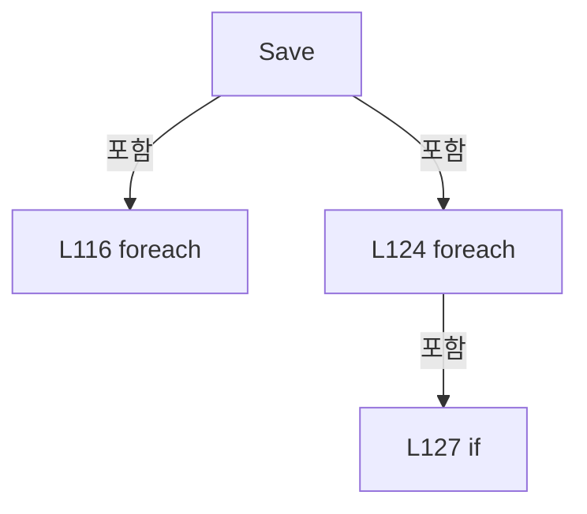
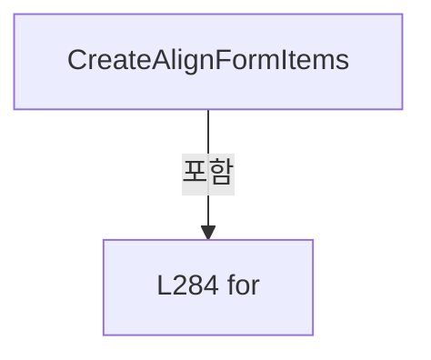
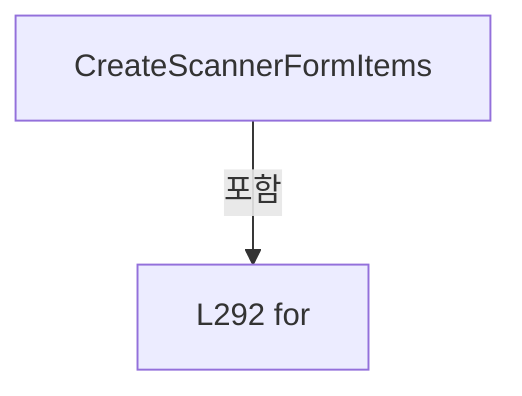
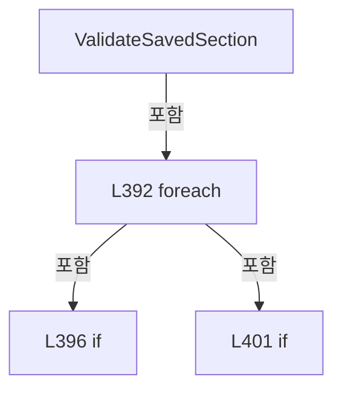
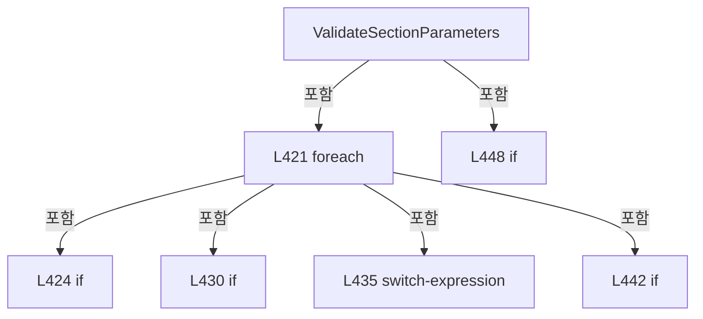
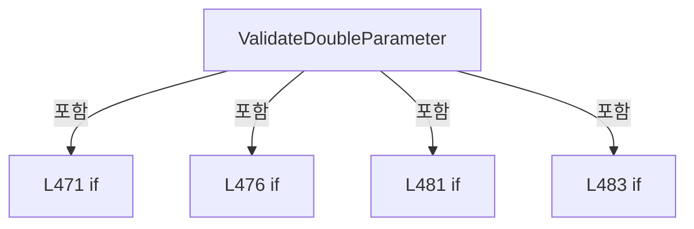
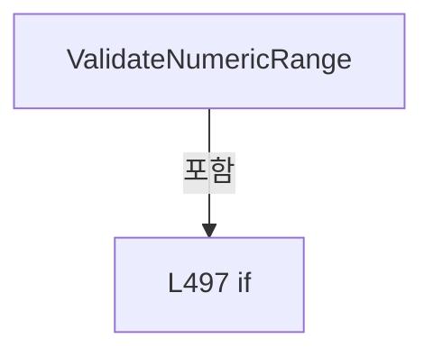
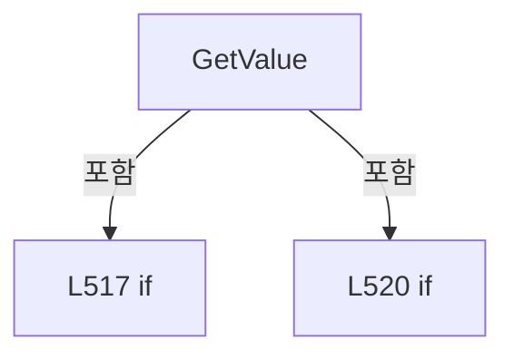
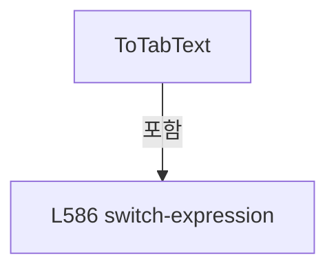

# Drilling.File/JHMI/CSettingFile.cs

| 항목 | 내용 |
| --- | --- |
| 원본 저장소 | https://github.com/kjuws10-rgb/A3Drilling.git |
| 원본 Commit | 334b3599651b2e8e0181fd4459bafaf3cddafff3 |
| 원본 SHA256 | c049c9c77518b5df70fe76f234c4c5d952c9ef880aed3cd8cdd8845be89c0ab4 |
| 파일 분류 | code |
| 원본 크기/행 | 29,992 bytes / 608 physical lines |
| 인코딩 | utf-8-sig |
| 검토 범위 | 구문/부분 의미 분석에서 추출한 사실. 동작·물리 단위·실장비 합격을 보증하지 않습니다. |
| 원본 링크 | [고정 Commit 원본](https://github.com/kjuws10-rgb/A3Drilling/blob/334b3599651b2e8e0181fd4459bafaf3cddafff3/Drilling.File/JHMI/CSettingFile.cs) |

## 파일의 역할과 읽는 순서

정의·설정·레시피·결과·스크립트의 파일 입출력과 데이터 형식을 담당합니다. 저장 필드를 통신 송신 필드로 단정하지 않습니다.

## 네임스페이스·타입·상속

| 타입 | 구분 | 원본 범위 | 선언/상속 |
| --- | --- | --- | --- |
| CSettingFile | ClassDeclaration | 14–608 | CSettingFile: CSettingFileBase |
| ST_SETTING_FORM_ITEM | RecordDeclaration | 592–607 | ST_SETTING_FORM_ITEM |

## 멤버 빠른 목록

| 이름 | 종류 | 범위 | 서명 |
| --- | --- | --- | --- |
| FormHeaders | FieldDeclaration | L16–16 | System.Collections.Generic.IReadOnlyList<string> Drilling.File.JHMI.CSettingFile.FormHeaders |
| ValueHeaders | FieldDeclaration | L17–17 | System.Collections.Generic.IReadOnlyList<string> Drilling.File.JHMI.CSettingFile.ValueHeaders |
| _settingDirectory | FieldDeclaration | L18–18 | string Drilling.File.JHMI.CSettingFile._settingDirectory |
| _logManager | FieldDeclaration | L19–19 | Drilling.Common.Log.CLogManager Drilling.File.JHMI.CSettingFile._logManager |
| Load | MethodDeclaration | L20–51 | System.Collections.Generic.IReadOnlyList<Drilling.Common.Managers.ST_SYSTEM_PARAMETER> Drilling.File.JHMI.CSettingFile.Load(Drilling.Common.Managers.EN_SETTING_TAB, System.Threading.CancellationToken) |
| ShouldIncludeItem | LocalFunctionStatement | L24–27 | bool ShouldIncludeItem(Drilling.File.JHMI.CSettingFile.ST_SETTING_FORM_ITEM) |
| BuildSystem | LocalFunctionStatement | L29–48 | Drilling.Common.Managers.ST_SYSTEM_PARAMETER BuildSystem(Drilling.File.JHMI.CSettingFile.ST_SETTING_FORM_ITEM) |
| Save | MethodDeclaration | L53–134 | void Drilling.File.JHMI.CSettingFile.Save(Drilling.Common.Managers.EN_SETTING_TAB, System.Collections.Generic.IReadOnlyList<Drilling.Common.Managers.ST_SYSTEM_PARAMETER>, System.Threading.CancellationToken) |
| ShouldIncludeItem | LocalFunctionStatement | L60–63 | bool ShouldIncludeItem(Drilling.File.JHMI.CSettingFile.ST_SETTING_FORM_ITEM) |
| SelectName | LocalFunctionStatement | L65–68 | string SelectName(Drilling.File.JHMI.CSettingFile.ST_SETTING_FORM_ITEM) |
| SelectValue | LocalFunctionStatement | L70–73 | string SelectValue(Drilling.File.JHMI.CSettingFile.ST_SETTING_FORM_ITEM) |
| ShouldIncludeSystem | LocalFunctionStatement | L76–79 | bool ShouldIncludeSystem(Drilling.Common.Managers.ST_SYSTEM_PARAMETER) |
| SelectEditedParameterValue | LocalFunctionStatement | L81–84 | string SelectEditedParameterValue(Drilling.Common.Managers.ST_SYSTEM_PARAMETER) |
| ShouldIncludeSetting | LocalFunctionStatement | L87–90 | bool ShouldIncludeSetting(Drilling.File.JHMI.CSettingFile.ST_SETTING_FORM_ITEM) |
| BuildSystem | LocalFunctionStatement | L92–111 | Drilling.Common.Managers.ST_SYSTEM_PARAMETER BuildSystem(Drilling.File.JHMI.CSettingFile.ST_SETTING_FORM_ITEM) |
| LoadHistory | MethodDeclaration | L136–140 | System.Collections.Generic.IReadOnlyList<Drilling.Common.Managers.ST_SETTING_HISTORY> Drilling.File.JHMI.CSettingFile.LoadHistory(Drilling.Common.Managers.EN_SETTING_TAB, System.Threading.CancellationToken) |
| LoadFormItems | MethodDeclaration | L142–194 | System.Collections.Generic.IReadOnlyList<Drilling.File.JHMI.CSettingFile.ST_SETTING_FORM_ITEM> Drilling.File.JHMI.CSettingFile.LoadFormItems() |
| SelectItem | LocalFunctionStatement | L144–150 | string[] SelectItem(string) |
| BuildSetting | LocalFunctionStatement | L153–185 | Drilling.File.JHMI.CSettingFile.ST_SETTING_FORM_ITEM BuildSetting(System.Collections.Generic.IReadOnlyDictionary<string, string>, int) |
| ShouldIncludeItem | LocalFunctionStatement | L187–190 | bool ShouldIncludeItem(Drilling.File.JHMI.CSettingFile.ST_SETTING_FORM_ITEM) |
| AppendBuiltInFormItems | MethodDeclaration | L196–220 | System.Collections.Generic.IReadOnlyList<Drilling.File.JHMI.CSettingFile.ST_SETTING_FORM_ITEM> Drilling.File.JHMI.CSettingFile.AppendBuiltInFormItems(System.Collections.Generic.IReadOnlyList<Drilling.File.JHMI.CSettingFile.ST_SETTING_FORM_ITEM>) |
| SelectItem | LocalFunctionStatement | L198–201 | string SelectItem(Drilling.File.JHMI.CSettingFile.ST_SETTING_FORM_ITEM) |
| CreateDistortionRunOptionFormItems | MethodDeclaration | L222–228 | System.Collections.Generic.IEnumerable<Drilling.File.JHMI.CSettingFile.ST_SETTING_FORM_ITEM> Drilling.File.JHMI.CSettingFile.CreateDistortionRunOptionFormItems() |
| CreateOffsetScaleFormItems | MethodDeclaration | L230–236 | System.Collections.Generic.IEnumerable<Drilling.File.JHMI.CSettingFile.ST_SETTING_FORM_ITEM> Drilling.File.JHMI.CSettingFile.CreateOffsetScaleFormItems() |
| CreateReviewLevelFormItems | MethodDeclaration | L238–264 | System.Collections.Generic.IEnumerable<Drilling.File.JHMI.CSettingFile.ST_SETTING_FORM_ITEM> Drilling.File.JHMI.CSettingFile.CreateReviewLevelFormItems() |
| CreateAlignFormItems | MethodDeclaration | L266–288 | System.Collections.Generic.IEnumerable<Drilling.File.JHMI.CSettingFile.ST_SETTING_FORM_ITEM> Drilling.File.JHMI.CSettingFile.CreateAlignFormItems() |
| CreateScannerFormItems | MethodDeclaration | L290–326 | System.Collections.Generic.IEnumerable<Drilling.File.JHMI.CSettingFile.ST_SETTING_FORM_ITEM> Drilling.File.JHMI.CSettingFile.CreateScannerFormItems() |
| LoadSettingValues | MethodDeclaration | L328–365 | System.Collections.Generic.Dictionary<string, string> Drilling.File.JHMI.CSettingFile.LoadSettingValues() |
| SelectItem | LocalFunctionStatement | L331–337 | string[] SelectItem(string) |
| HasSettingValueKey | LocalFunctionStatement | L344–347 | bool HasSettingValueKey(System.Collections.Generic.IReadOnlyDictionary<string, string>) |
| SelectGroupKey | LocalFunctionStatement | L349–352 | string SelectGroupKey(System.Collections.Generic.IReadOnlyDictionary<string, string>) |
| SelectKey | LocalFunctionStatement | L354–357 | string SelectKey(System.Linq.IGrouping<string, System.Collections.Generic.IReadOnlyDictionary<string, string>>) |
| SelectValue | LocalFunctionStatement | L359–362 | string SelectValue(System.Linq.IGrouping<string, System.Collections.Generic.IReadOnlyDictionary<string, string>>) |
| WriteSettingValues | MethodDeclaration | L367–386 | void Drilling.File.JHMI.CSettingFile.WriteSettingValues(System.Collections.Generic.IReadOnlyList<Drilling.File.JHMI.CSettingFile.ST_SETTING_FORM_ITEM>, System.Collections.Generic.IReadOnlyDictionary<string, string>) |
| IsUse | LocalFunctionStatement | L369–372 | bool IsUse(Drilling.File.JHMI.CSettingFile.ST_SETTING_FORM_ITEM) |
| BuildSettingValueRow | LocalFunctionStatement | L374–382 | System.Collections.Generic.Dictionary<string, string> BuildSettingValueRow(Drilling.File.JHMI.CSettingFile.ST_SETTING_FORM_ITEM) |
| ValidateSavedSection | MethodDeclaration | L388–406 | void Drilling.File.JHMI.CSettingFile.ValidateSavedSection(Drilling.Common.Managers.EN_SETTING_TAB, System.Collections.Generic.IReadOnlyList<Drilling.Common.Managers.ST_SYSTEM_PARAMETER>) |
| ValidateSectionParameters | MethodDeclaration | L408–452 | void Drilling.File.JHMI.CSettingFile.ValidateSectionParameters(string, System.Collections.Generic.IReadOnlyList<Drilling.Common.Managers.ST_SYSTEM_PARAMETER>, System.Collections.Generic.IReadOnlyList<Drilling.File.JHMI.CSettingFile.ST_SETTING_FORM_ITEM>) |
| ShouldIncludeItem | LocalFunctionStatement | L410–413 | bool ShouldIncludeItem(Drilling.File.JHMI.CSettingFile.ST_SETTING_FORM_ITEM) |
| SelectName | LocalFunctionStatement | L415–418 | string SelectName(Drilling.File.JHMI.CSettingFile.ST_SETTING_FORM_ITEM) |
| GetParameterKey | MethodDeclaration | L454–457 | string Drilling.File.JHMI.CSettingFile.GetParameterKey(Drilling.Common.Managers.ST_SYSTEM_PARAMETER) |
| ValidateIntParameter | MethodDeclaration | L459–467 | string Drilling.File.JHMI.CSettingFile.ValidateIntParameter(Drilling.File.JHMI.CSettingFile.ST_SETTING_FORM_ITEM, string) |
| ValidateDoubleParameter | MethodDeclaration | L469–487 | string Drilling.File.JHMI.CSettingFile.ValidateDoubleParameter(Drilling.File.JHMI.CSettingFile.ST_SETTING_FORM_ITEM, string) |
| ValidateBoolParameter | MethodDeclaration | L489–493 | string Drilling.File.JHMI.CSettingFile.ValidateBoolParameter(Drilling.File.JHMI.CSettingFile.ST_SETTING_FORM_ITEM, string) |
| ValidateNumericRange | MethodDeclaration | L495–503 | string Drilling.File.JHMI.CSettingFile.ValidateNumericRange(Drilling.File.JHMI.CSettingFile.ST_SETTING_FORM_ITEM, double) |
| GetFormPath | MethodDeclaration | L505–508 | string Drilling.File.JHMI.CSettingFile.GetFormPath() |
| GetValuePath | MethodDeclaration | L510–513 | string Drilling.File.JHMI.CSettingFile.GetValuePath() |
| GetValue | MethodDeclaration | L515–524 | string Drilling.File.JHMI.CSettingFile.GetValue(System.Collections.Generic.IReadOnlyDictionary<string, string>, string, string, string) |
| CreateKey | MethodDeclaration | L526–529 | string Drilling.File.JHMI.CSettingFile.CreateKey(string, string) |
| NormalizeTab | MethodDeclaration | L531–541 | string Drilling.File.JHMI.CSettingFile.NormalizeTab(string) |
| NormalizeSettingText | MethodDeclaration | L543–546 | string Drilling.File.JHMI.CSettingFile.NormalizeSettingText(string, string) |
| GetOrDefault | MethodDeclaration | L548–551 | string Drilling.File.JHMI.CSettingFile.GetOrDefault(string, string) |
| ReadDataType | MethodDeclaration | L553–562 | Drilling.Common.Managers.EN_RECIPE_DATA_TYPE Drilling.File.JHMI.CSettingFile.ReadDataType(string) |
| ReadBool | MethodDeclaration | L564–572 | bool Drilling.File.JHMI.CSettingFile.ReadBool(string, bool) |
| ReadInt | MethodDeclaration | L574–577 | int Drilling.File.JHMI.CSettingFile.ReadInt(string, int) |
| ReadDouble | MethodDeclaration | L579–582 | double Drilling.File.JHMI.CSettingFile.ReadDouble(string, double) |
| ToTabText | MethodDeclaration | L584–590 | string Drilling.File.JHMI.CSettingFile.ToTabText(Drilling.Common.Managers.EN_SETTING_TAB) |

## 멤버별 상세 계약·호출·처리 해설

### FieldDeclaration `FormHeaders` · L16–16

[Drilling.File/JHMI/CSettingFile.cs:16–16](https://github.com/kjuws10-rgb/A3Drilling/blob/334b3599651b2e8e0181fd4459bafaf3cddafff3/Drilling.File/JHMI/CSettingFile.cs#L16-L16)

| 항목 | 실제 추출 값 |
| --- | --- |
| 서명 | System.Collections.Generic.IReadOnlyList<string> Drilling.File.JHMI.CSettingFile.FormHeaders |
| 접근/수식자 | Private / private, static, readonly |
| 반환/값 타입 | System.Collections.Generic.IReadOnlyList<string> |
| 소속 타입 | NamedType:Drilling.File.JHMI.CSettingFile |

현재 부분 분석에서 직접 연결된 호출자는 없습니다. XAML/이벤트/인터페이스·델리게이트·외부 진입을 추가 확인해야 하며, 미사용으로 판정한 것이 아닙니다.

본문의 실제 연산·분기·예외·반환 순서(원문 위치 순):

| 원본 행 | 종류 | 주석 해설 |
| --- | --- | --- |
| 16 | variable-initializer | 변수의 초기값을 지정합니다: FormHeaders = ["TAB", "GROUP", "NAME", "DISPLAY NAME", "DATA TYPE", "UNIT", "SHOW", "USE", "VALUE", "MIN", "MAX", "DESCRIPTION"] |

변경 전 점검: 입력/반환 타입, 위 호출자, 예외/취소 경로, 공유 상태와 저장·전송 소비자를 함께 확인합니다. 값의 단위나 물리 방향을 이름만으로 확정하지 않습니다.

### FieldDeclaration `ValueHeaders` · L17–17

[Drilling.File/JHMI/CSettingFile.cs:17–17](https://github.com/kjuws10-rgb/A3Drilling/blob/334b3599651b2e8e0181fd4459bafaf3cddafff3/Drilling.File/JHMI/CSettingFile.cs#L17-L17)

| 항목 | 실제 추출 값 |
| --- | --- |
| 서명 | System.Collections.Generic.IReadOnlyList<string> Drilling.File.JHMI.CSettingFile.ValueHeaders |
| 접근/수식자 | Private / private, static, readonly |
| 반환/값 타입 | System.Collections.Generic.IReadOnlyList<string> |
| 소속 타입 | NamedType:Drilling.File.JHMI.CSettingFile |

현재 부분 분석에서 직접 연결된 호출자는 없습니다. XAML/이벤트/인터페이스·델리게이트·외부 진입을 추가 확인해야 하며, 미사용으로 판정한 것이 아닙니다.

본문의 실제 연산·분기·예외·반환 순서(원문 위치 순):

| 원본 행 | 종류 | 주석 해설 |
| --- | --- | --- |
| 17 | variable-initializer | 변수의 초기값을 지정합니다: ValueHeaders = ["TAB", "NAME", "VALUE"] |

변경 전 점검: 입력/반환 타입, 위 호출자, 예외/취소 경로, 공유 상태와 저장·전송 소비자를 함께 확인합니다. 값의 단위나 물리 방향을 이름만으로 확정하지 않습니다.

### FieldDeclaration `_settingDirectory` · L18–18

[Drilling.File/JHMI/CSettingFile.cs:18–18](https://github.com/kjuws10-rgb/A3Drilling/blob/334b3599651b2e8e0181fd4459bafaf3cddafff3/Drilling.File/JHMI/CSettingFile.cs#L18-L18)

| 항목 | 실제 추출 값 |
| --- | --- |
| 서명 | string Drilling.File.JHMI.CSettingFile._settingDirectory |
| 접근/수식자 | Private / private, readonly |
| 반환/값 타입 | string |
| 소속 타입 | NamedType:Drilling.File.JHMI.CSettingFile |

현재 부분 분석에서 직접 연결된 호출자는 없습니다. XAML/이벤트/인터페이스·델리게이트·외부 진입을 추가 확인해야 하며, 미사용으로 판정한 것이 아닙니다.

호출하는 대상과 해석 범위:

| 원본 행 | 표현식 | 분석 상태 | 대상/소스 위치 |
| --- | --- | --- | --- |
| 18 | Path.Combine | resolved | string System.IO.Path.Combine(string, string) |

본문의 실제 연산·분기·예외·반환 순서(원문 위치 순):

| 원본 행 | 종류 | 주석 해설 |
| --- | --- | --- |
| 18 | call | 함수·델리게이트 또는 객체 생성자를 호출합니다: Path.Combine(configRoot, "Setting") |
| 18 | variable-initializer | 변수의 초기값을 지정합니다: _settingDirectory = Path.Combine(configRoot, "Setting") |

변경 전 점검: 입력/반환 타입, 위 호출자, 예외/취소 경로, 공유 상태와 저장·전송 소비자를 함께 확인합니다. 값의 단위나 물리 방향을 이름만으로 확정하지 않습니다.

### FieldDeclaration `_logManager` · L19–19

[Drilling.File/JHMI/CSettingFile.cs:19–19](https://github.com/kjuws10-rgb/A3Drilling/blob/334b3599651b2e8e0181fd4459bafaf3cddafff3/Drilling.File/JHMI/CSettingFile.cs#L19-L19)

| 항목 | 실제 추출 값 |
| --- | --- |
| 서명 | Drilling.Common.Log.CLogManager Drilling.File.JHMI.CSettingFile._logManager |
| 접근/수식자 | Private / private, readonly |
| 반환/값 타입 | Drilling.Common.Log.CLogManager |
| 소속 타입 | NamedType:Drilling.File.JHMI.CSettingFile |

현재 부분 분석에서 직접 연결된 호출자는 없습니다. XAML/이벤트/인터페이스·델리게이트·외부 진입을 추가 확인해야 하며, 미사용으로 판정한 것이 아닙니다.

호출하는 대상과 해석 범위:

| 원본 행 | 표현식 | 분석 상태 | 대상/소스 위치 |
| --- | --- | --- | --- |
| 19 | new | resolved | Drilling.Common.Log.CLogManager.CLogManager(string) · Drilling.Common/Log/CLogManager.cs:54 |

본문의 실제 연산·분기·예외·반환 순서(원문 위치 순):

| 원본 행 | 종류 | 주석 해설 |
| --- | --- | --- |
| 19 | call | 함수·델리게이트 또는 객체 생성자를 호출합니다: new(configRoot) |
| 19 | variable-initializer | 변수의 초기값을 지정합니다: _logManager = new(configRoot) |

변경 전 점검: 입력/반환 타입, 위 호출자, 예외/취소 경로, 공유 상태와 저장·전송 소비자를 함께 확인합니다. 값의 단위나 물리 방향을 이름만으로 확정하지 않습니다.

### MethodDeclaration `Load` · L20–51

[Drilling.File/JHMI/CSettingFile.cs:20–51](https://github.com/kjuws10-rgb/A3Drilling/blob/334b3599651b2e8e0181fd4459bafaf3cddafff3/Drilling.File/JHMI/CSettingFile.cs#L20-L51)

| 항목 | 실제 추출 값 |
| --- | --- |
| 서명 | System.Collections.Generic.IReadOnlyList<Drilling.Common.Managers.ST_SYSTEM_PARAMETER> Drilling.File.JHMI.CSettingFile.Load(Drilling.Common.Managers.EN_SETTING_TAB, System.Threading.CancellationToken) |
| 접근/수식자 | Public / public, override |
| 반환/값 타입 | System.Collections.Generic.IReadOnlyList<Drilling.Common.Managers.ST_SYSTEM_PARAMETER> |
| 소속 타입 | NamedType:Drilling.File.JHMI.CSettingFile |

입력 계약:

| 이름 | 타입 | 전달 | 선택/기본값 |
| --- | --- | --- | --- |
| section | Drilling.Common.Managers.EN_SETTING_TAB | None | False /  |
| cancellationToken | System.Threading.CancellationToken | None | True / null |

정적 호출자로 확인된 위치:

| 호출 파일/행 | 호출 표현식 | 런타임 분기 가능 |
| --- | --- | --- |
| [Drilling.UI/CAppStartup.cs:145–145](https://github.com/kjuws10-rgb/A3Drilling/blob/334b3599651b2e8e0181fd4459bafaf3cddafff3/Drilling.UI/CAppStartup.cs#L145-L145) | settingFile.Load | True |

호출하는 대상과 해석 범위:

| 원본 행 | 표현식 | 분석 상태 | 대상/소스 위치 |
| --- | --- | --- | --- |
| 22 | cancellationToken.ThrowIfCancellationRequested | resolved | void System.Threading.CancellationToken.ThrowIfCancellationRequested() |
| 23 | LoadSettingValues | resolved | System.Collections.Generic.Dictionary<string, string> Drilling.File.JHMI.CSettingFile.LoadSettingValues() · Drilling.File/JHMI/CSettingFile.cs:328 |
| 50 | LoadFormItems().Where(ShouldIncludeItem).Select(BuildSystem).ToArray | resolved | Drilling.Common.Managers.ST_SYSTEM_PARAMETER[] System.Collections.Generic.IEnumerable<Drilling.Common.Managers.ST_SYSTEM_PARAMETER>.ToArray<Drilling.Common.Managers.ST_SYSTEM_PARAMETER>() |
| 50 | LoadFormItems().Where(ShouldIncludeItem).Select | resolved | System.Collections.Generic.IEnumerable<Drilling.Common.Managers.ST_SYSTEM_PARAMETER> System.Collections.Generic.IEnumerable<Drilling.File.JHMI.CSettingFile.ST_SETTING_FORM_ITEM>.Select<Drilling.File.JHMI.CSettingFile.ST_SETTING_FORM_ITEM, Drilling.Common.Managers.ST_SYSTEM_PARAMETER>(System.Func<Drilling.File.JHMI.CSettingFile.ST_SETTING_FORM_ITEM, Drilling.Common.Managers.ST_SYSTEM_PARAMETER>) |
| 50 | LoadFormItems().Where | resolved | System.Collections.Generic.IEnumerable<Drilling.File.JHMI.CSettingFile.ST_SETTING_FORM_ITEM> System.Collections.Generic.IEnumerable<Drilling.File.JHMI.CSettingFile.ST_SETTING_FORM_ITEM>.Where<Drilling.File.JHMI.CSettingFile.ST_SETTING_FORM_ITEM>(System.Func<Drilling.File.JHMI.CSettingFile.ST_SETTING_FORM_ITEM, bool>) |
| 50 | LoadFormItems | resolved | System.Collections.Generic.IReadOnlyList<Drilling.File.JHMI.CSettingFile.ST_SETTING_FORM_ITEM> Drilling.File.JHMI.CSettingFile.LoadFormItems() · Drilling.File/JHMI/CSettingFile.cs:142 |

본문의 실제 연산·분기·예외·반환 순서(원문 위치 순):

| 원본 행 | 종류 | 주석 해설 |
| --- | --- | --- |
| 22 | call | 함수·델리게이트 또는 객체 생성자를 호출합니다: cancellationToken.ThrowIfCancellationRequested() |
| 23 | call | 함수·델리게이트 또는 객체 생성자를 호출합니다: LoadSettingValues() |
| 23 | local-declaration | 지역 변수를 선언합니다: var values = LoadSettingValues(); |
| 23 | variable-initializer | 변수의 초기값을 지정합니다: values = LoadSettingValues() |
| 50 | call | 함수·델리게이트 또는 객체 생성자를 호출합니다: LoadFormItems().Where(ShouldIncludeItem).Select(BuildSystem).ToArray() |
| 50 | call | 함수·델리게이트 또는 객체 생성자를 호출합니다: LoadFormItems().Where(ShouldIncludeItem).Select(BuildSystem) |
| 50 | call | 함수·델리게이트 또는 객체 생성자를 호출합니다: LoadFormItems().Where(ShouldIncludeItem) |
| 50 | call | 함수·델리게이트 또는 객체 생성자를 호출합니다: LoadFormItems() |
| 50 | return | 호출자에게 값 또는 제어를 반환합니다: return LoadFormItems().Where(ShouldIncludeItem).Select(BuildSystem).ToArray(); |

변경 전 점검: 입력/반환 타입, 위 호출자, 예외/취소 경로, 공유 상태와 저장·전송 소비자를 함께 확인합니다. 값의 단위나 물리 방향을 이름만으로 확정하지 않습니다.

### LocalFunctionStatement `ShouldIncludeItem` · L24–27

[Drilling.File/JHMI/CSettingFile.cs:24–27](https://github.com/kjuws10-rgb/A3Drilling/blob/334b3599651b2e8e0181fd4459bafaf3cddafff3/Drilling.File/JHMI/CSettingFile.cs#L24-L27)

| 항목 | 실제 추출 값 |
| --- | --- |
| 서명 | bool ShouldIncludeItem(Drilling.File.JHMI.CSettingFile.ST_SETTING_FORM_ITEM) |
| 접근/수식자 | Private /  |
| 반환/값 타입 | bool |
| 소속 타입 | NamedType:Drilling.File.JHMI.CSettingFile |

입력 계약:

| 이름 | 타입 | 전달 | 선택/기본값 |
| --- | --- | --- | --- |
| item | Drilling.File.JHMI.CSettingFile.ST_SETTING_FORM_ITEM | None | False /  |

현재 부분 분석에서 직접 연결된 호출자는 없습니다. XAML/이벤트/인터페이스·델리게이트·외부 진입을 추가 확인해야 하며, 미사용으로 판정한 것이 아닙니다.

호출하는 대상과 해석 범위:

| 원본 행 | 표현식 | 분석 상태 | 대상/소스 위치 |
| --- | --- | --- | --- |
| 26 | item.Tab.Equals | resolved | bool string.Equals(string?, System.StringComparison) |
| 26 | ToTabText | resolved | string Drilling.File.JHMI.CSettingFile.ToTabText(Drilling.Common.Managers.EN_SETTING_TAB) · Drilling.File/JHMI/CSettingFile.cs:584 |

본문의 실제 연산·분기·예외·반환 순서(원문 위치 순):

| 원본 행 | 종류 | 주석 해설 |
| --- | --- | --- |
| 26 | call | 함수·델리게이트 또는 객체 생성자를 호출합니다: item.Tab.Equals(ToTabText(section), StringComparison.OrdinalIgnoreCase) |
| 26 | call | 함수·델리게이트 또는 객체 생성자를 호출합니다: ToTabText(section) |
| 26 | return | 호출자에게 값 또는 제어를 반환합니다: return item.Use && item.Tab.Equals(ToTabText(section), StringComparison.OrdinalIgnoreCase); |

변경 전 점검: 입력/반환 타입, 위 호출자, 예외/취소 경로, 공유 상태와 저장·전송 소비자를 함께 확인합니다. 값의 단위나 물리 방향을 이름만으로 확정하지 않습니다.

### LocalFunctionStatement `BuildSystem` · L29–48

[Drilling.File/JHMI/CSettingFile.cs:29–48](https://github.com/kjuws10-rgb/A3Drilling/blob/334b3599651b2e8e0181fd4459bafaf3cddafff3/Drilling.File/JHMI/CSettingFile.cs#L29-L48)

| 항목 | 실제 추출 값 |
| --- | --- |
| 서명 | Drilling.Common.Managers.ST_SYSTEM_PARAMETER BuildSystem(Drilling.File.JHMI.CSettingFile.ST_SETTING_FORM_ITEM) |
| 접근/수식자 | Private /  |
| 반환/값 타입 | Drilling.Common.Managers.ST_SYSTEM_PARAMETER |
| 소속 타입 | NamedType:Drilling.File.JHMI.CSettingFile |

입력 계약:

| 이름 | 타입 | 전달 | 선택/기본값 |
| --- | --- | --- | --- |
| item | Drilling.File.JHMI.CSettingFile.ST_SETTING_FORM_ITEM | None | False /  |

현재 부분 분석에서 직접 연결된 호출자는 없습니다. XAML/이벤트/인터페이스·델리게이트·외부 진입을 추가 확인해야 하며, 미사용으로 판정한 것이 아닙니다.

호출하는 대상과 해석 범위:

| 원본 행 | 표현식 | 분석 상태 | 대상/소스 위치 |
| --- | --- | --- | --- |
| 31 | new ST_SYSTEM_PARAMETER | resolved | Drilling.Common.Managers.ST_SYSTEM_PARAMETER.ST_SYSTEM_PARAMETER(Drilling.Common.Managers.EN_SETTING_TAB, string, string, string, string, string, string, string, Drilling.Common.Managers.EN_RECIPE_DATA_TYPE, double, double, bool, bool, int, System.Collections.Generic.IReadOnlyDictionary<string, string>?) · Drilling.Common/Managers/CSettingManager.cs:263 |
| 34 | GetValue | resolved | string Drilling.File.JHMI.CSettingFile.GetValue(System.Collections.Generic.IReadOnlyDictionary<string, string>, string, string, string) · Drilling.File/JHMI/CSettingFile.cs:515 |

본문의 실제 연산·분기·예외·반환 순서(원문 위치 순):

| 원본 행 | 종류 | 주석 해설 |
| --- | --- | --- |
| 31 | call | 함수·델리게이트 또는 객체 생성자를 호출합니다: new ST_SYSTEM_PARAMETER( section, item.DisplayName, GetValue(values, item.Tab, item.Name, item.DefaultValue), item.Unit, item.Description, item.Group, item.Name, item.DefaultValue, item.DataType, item.Min, item.Max, item… |
| 31 | return | 호출자에게 값 또는 제어를 반환합니다: return new ST_SYSTEM_PARAMETER( section, item.DisplayName, GetValue(values, item.Tab, item.Name, item.DefaultValue), item.Unit, item.Description, item.Group, item.Name, item.DefaultValue, item.DataType, item.Min, item.Max, item.Sh |
| 34 | call | 함수·델리게이트 또는 객체 생성자를 호출합니다: GetValue(values, item.Tab, item.Name, item.DefaultValue) |

변경 전 점검: 입력/반환 타입, 위 호출자, 예외/취소 경로, 공유 상태와 저장·전송 소비자를 함께 확인합니다. 값의 단위나 물리 방향을 이름만으로 확정하지 않습니다.

### MethodDeclaration `Save` · L53–134

[Drilling.File/JHMI/CSettingFile.cs:53–134](https://github.com/kjuws10-rgb/A3Drilling/blob/334b3599651b2e8e0181fd4459bafaf3cddafff3/Drilling.File/JHMI/CSettingFile.cs#L53-L134)

| 항목 | 실제 추출 값 |
| --- | --- |
| 서명 | void Drilling.File.JHMI.CSettingFile.Save(Drilling.Common.Managers.EN_SETTING_TAB, System.Collections.Generic.IReadOnlyList<Drilling.Common.Managers.ST_SYSTEM_PARAMETER>, System.Threading.CancellationToken) |
| 접근/수식자 | Public / public, override |
| 반환/값 타입 | void |
| 소속 타입 | NamedType:Drilling.File.JHMI.CSettingFile |

입력 계약:

| 이름 | 타입 | 전달 | 선택/기본값 |
| --- | --- | --- | --- |
| section | Drilling.Common.Managers.EN_SETTING_TAB | None | False /  |
| parameters | System.Collections.Generic.IReadOnlyList<Drilling.Common.Managers.ST_SYSTEM_PARAMETER> | None | False /  |
| cancellationToken | System.Threading.CancellationToken | None | True / null |

현재 부분 분석에서 직접 연결된 호출자는 없습니다. XAML/이벤트/인터페이스·델리게이트·외부 진입을 추가 확인해야 하며, 미사용으로 판정한 것이 아닙니다.

호출하는 대상과 해석 범위:

| 원본 행 | 표현식 | 분석 상태 | 대상/소스 위치 |
| --- | --- | --- | --- |
| 55 | cancellationToken.ThrowIfCancellationRequested | resolved | void System.Threading.CancellationToken.ThrowIfCancellationRequested() |
| 56 | Directory.CreateDirectory | resolved | System.IO.DirectoryInfo System.IO.Directory.CreateDirectory(string) |
| 57 | LoadFormItems | resolved | System.Collections.Generic.IReadOnlyList<Drilling.File.JHMI.CSettingFile.ST_SETTING_FORM_ITEM> Drilling.File.JHMI.CSettingFile.LoadFormItems() · Drilling.File/JHMI/CSettingFile.cs:142 |
| 58 | LoadSettingValues | resolved | System.Collections.Generic.Dictionary<string, string> Drilling.File.JHMI.CSettingFile.LoadSettingValues() · Drilling.File/JHMI/CSettingFile.cs:328 |
| 59 | ToTabText | resolved | string Drilling.File.JHMI.CSettingFile.ToTabText(Drilling.Common.Managers.EN_SETTING_TAB) · Drilling.File/JHMI/CSettingFile.cs:584 |
| 75 | formItems.Where(ShouldIncludeItem).ToDictionary | resolved | System.Collections.Generic.Dictionary<string, string> System.Collections.Generic.IEnumerable<Drilling.File.JHMI.CSettingFile.ST_SETTING_FORM_ITEM>.ToDictionary<Drilling.File.JHMI.CSettingFile.ST_SETTING_FORM_ITEM, string, string>(System.Func<Drilling.File.JHMI.CSettingFile.ST_SETTING_FORM_ITEM, string>, System.Func<Drilling.File.JHMI.CSettingFile.ST_SETTING_FORM_ITEM, string>, System.Collections.Generic.IEqualityComparer<string>?) |
| 75 | formItems.Where | resolved | System.Collections.Generic.IEnumerable<Drilling.File.JHMI.CSettingFile.ST_SETTING_FORM_ITEM> System.Collections.Generic.IEnumerable<Drilling.File.JHMI.CSettingFile.ST_SETTING_FORM_ITEM>.Where<Drilling.File.JHMI.CSettingFile.ST_SETTING_FORM_ITEM>(System.Func<Drilling.File.JHMI.CSettingFile.ST_SETTING_FORM_ITEM, bool>) |
| 86 | parameters.Where(ShouldIncludeSystem).ToDictionary | resolved | System.Collections.Generic.Dictionary<string, string> System.Collections.Generic.IEnumerable<Drilling.Common.Managers.ST_SYSTEM_PARAMETER>.ToDictionary<Drilling.Common.Managers.ST_SYSTEM_PARAMETER, string, string>(System.Func<Drilling.Common.Managers.ST_SYSTEM_PARAMETER, string>, System.Func<Drilling.Common.Managers.ST_SYSTEM_PARAMETER, string>, System.Collections.Generic.IEqualityComparer<string>?) |
| 86 | parameters.Where | resolved | System.Collections.Generic.IEnumerable<Drilling.Common.Managers.ST_SYSTEM_PARAMETER> System.Collections.Generic.IEnumerable<Drilling.Common.Managers.ST_SYSTEM_PARAMETER>.Where<Drilling.Common.Managers.ST_SYSTEM_PARAMETER>(System.Func<Drilling.Common.Managers.ST_SYSTEM_PARAMETER, bool>) |
| 114 | formItems.Where(ShouldIncludeSetting).Select(BuildSystem).ToArray | resolved | Drilling.Common.Managers.ST_SYSTEM_PARAMETER[] System.Collections.Generic.IEnumerable<Drilling.Common.Managers.ST_SYSTEM_PARAMETER>.ToArray<Drilling.Common.Managers.ST_SYSTEM_PARAMETER>() |
| 114 | formItems.Where(ShouldIncludeSetting).Select | resolved | System.Collections.Generic.IEnumerable<Drilling.Common.Managers.ST_SYSTEM_PARAMETER> System.Collections.Generic.IEnumerable<Drilling.File.JHMI.CSettingFile.ST_SETTING_FORM_ITEM>.Select<Drilling.File.JHMI.CSettingFile.ST_SETTING_FORM_ITEM, Drilling.Common.Managers.ST_SYSTEM_PARAMETER>(System.Func<Drilling.File.JHMI.CSettingFile.ST_SETTING_FORM_ITEM, Drilling.Common.Managers.ST_SYSTEM_PARAMETER>) |
| 114 | formItems.Where | resolved | System.Collections.Generic.IEnumerable<Drilling.File.JHMI.CSettingFile.ST_SETTING_FORM_ITEM> System.Collections.Generic.IEnumerable<Drilling.File.JHMI.CSettingFile.ST_SETTING_FORM_ITEM>.Where<Drilling.File.JHMI.CSettingFile.ST_SETTING_FORM_ITEM>(System.Func<Drilling.File.JHMI.CSettingFile.ST_SETTING_FORM_ITEM, bool>) |
| 115 | ValidateSectionParameters | resolved | void Drilling.File.JHMI.CSettingFile.ValidateSectionParameters(string, System.Collections.Generic.IReadOnlyList<Drilling.Common.Managers.ST_SYSTEM_PARAMETER>, System.Collections.Generic.IReadOnlyList<Drilling.File.JHMI.CSettingFile.ST_SETTING_FORM_ITEM>) · Drilling.File/JHMI/CSettingFile.cs:408 |
| 118 | CreateKey | resolved | string Drilling.File.JHMI.CSettingFile.CreateKey(string, string) · Drilling.File/JHMI/CSettingFile.cs:526 |
| 118 | GetParameterKey | resolved | string Drilling.File.JHMI.CSettingFile.GetParameterKey(Drilling.Common.Managers.ST_SYSTEM_PARAMETER) · Drilling.File/JHMI/CSettingFile.cs:454 |
| 122 | WriteSettingValues | resolved | void Drilling.File.JHMI.CSettingFile.WriteSettingValues(System.Collections.Generic.IReadOnlyList<Drilling.File.JHMI.CSettingFile.ST_SETTING_FORM_ITEM>, System.Collections.Generic.IReadOnlyDictionary<string, string>) · Drilling.File/JHMI/CSettingFile.cs:367 |
| 123 | ValidateSavedSection | resolved | void Drilling.File.JHMI.CSettingFile.ValidateSavedSection(Drilling.Common.Managers.EN_SETTING_TAB, System.Collections.Generic.IReadOnlyList<Drilling.Common.Managers.ST_SYSTEM_PARAMETER>) · Drilling.File/JHMI/CSettingFile.cs:388 |
| 126 | oldValues.TryGetValue | resolved | bool System.Collections.Generic.Dictionary<string, string>.TryGetValue(string, out string) |
| 126 | GetParameterKey | resolved | string Drilling.File.JHMI.CSettingFile.GetParameterKey(Drilling.Common.Managers.ST_SYSTEM_PARAMETER) · Drilling.File/JHMI/CSettingFile.cs:454 |
| 127 | oldValue.Equals | resolved | bool string.Equals(string?, System.StringComparison) |
| 129 | _logManager.WriteSettingModify | resolved | void Drilling.Common.Log.CLogManager.WriteSettingModify(Drilling.Common.Managers.EN_SETTING_TAB, string, string, string) · Drilling.Common/Log/CLogManager.cs:292 |
| 133 | _logManager.WriteSettingSave | resolved | void Drilling.Common.Log.CLogManager.WriteSettingSave(Drilling.Common.Managers.EN_SETTING_TAB) · Drilling.Common/Log/CLogManager.cs:297 |

본문의 실제 연산·분기·예외·반환 순서(원문 위치 순):

| 원본 행 | 종류 | 주석 해설 |
| --- | --- | --- |
| 55 | call | 함수·델리게이트 또는 객체 생성자를 호출합니다: cancellationToken.ThrowIfCancellationRequested() |
| 56 | call | 함수·델리게이트 또는 객체 생성자를 호출합니다: Directory.CreateDirectory(_settingDirectory) |
| 57 | call | 함수·델리게이트 또는 객체 생성자를 호출합니다: LoadFormItems() |
| 57 | local-declaration | 지역 변수를 선언합니다: var formItems = LoadFormItems(); |
| 57 | variable-initializer | 변수의 초기값을 지정합니다: formItems = LoadFormItems() |
| 58 | call | 함수·델리게이트 또는 객체 생성자를 호출합니다: LoadSettingValues() |
| 58 | local-declaration | 지역 변수를 선언합니다: var values = LoadSettingValues(); |
| 58 | variable-initializer | 변수의 초기값을 지정합니다: values = LoadSettingValues() |
| 59 | call | 함수·델리게이트 또는 객체 생성자를 호출합니다: ToTabText(section) |
| 59 | local-declaration | 지역 변수를 선언합니다: var sectionTab = ToTabText(section); |
| 59 | variable-initializer | 변수의 초기값을 지정합니다: sectionTab = ToTabText(section) |
| 75 | call | 함수·델리게이트 또는 객체 생성자를 호출합니다: formItems.Where(ShouldIncludeItem).ToDictionary(SelectName, SelectValue, StringComparer.OrdinalIgnoreCase) |
| 75 | call | 함수·델리게이트 또는 객체 생성자를 호출합니다: formItems.Where(ShouldIncludeItem) |
| 75 | local-declaration | 지역 변수를 선언합니다: var oldValues = formItems.Where(ShouldIncludeItem).ToDictionary(SelectName, SelectValue, StringComparer.OrdinalIgnoreCase); |
| 75 | variable-initializer | 변수의 초기값을 지정합니다: oldValues = formItems.Where(ShouldIncludeItem).ToDictionary(SelectName, SelectValue, StringComparer.OrdinalIgnoreCase) |
| 86 | call | 함수·델리게이트 또는 객체 생성자를 호출합니다: parameters.Where(ShouldIncludeSystem).ToDictionary(GetParameterKey, SelectEditedParameterValue, StringComparer.OrdinalIgnoreCase) |
| 86 | call | 함수·델리게이트 또는 객체 생성자를 호출합니다: parameters.Where(ShouldIncludeSystem) |
| 86 | local-declaration | 지역 변수를 선언합니다: var editedValues = parameters.Where(ShouldIncludeSystem).ToDictionary(GetParameterKey, SelectEditedParameterValue, StringComparer.OrdinalIgnoreCase); |
| 86 | variable-initializer | 변수의 초기값을 지정합니다: editedValues = parameters.Where(ShouldIncludeSystem).ToDictionary(GetParameterKey, SelectEditedParameterValue, StringComparer.OrdinalIgnoreCase) |
| 114 | call | 함수·델리게이트 또는 객체 생성자를 호출합니다: formItems.Where(ShouldIncludeSetting).Select(BuildSystem).ToArray() |
| 114 | call | 함수·델리게이트 또는 객체 생성자를 호출합니다: formItems.Where(ShouldIncludeSetting).Select(BuildSystem) |
| 114 | call | 함수·델리게이트 또는 객체 생성자를 호출합니다: formItems.Where(ShouldIncludeSetting) |
| 114 | local-declaration | 지역 변수를 선언합니다: var normalizedParameters = formItems.Where(ShouldIncludeSetting).Select(BuildSystem).ToArray(); |
| 114 | variable-initializer | 변수의 초기값을 지정합니다: normalizedParameters = formItems.Where(ShouldIncludeSetting).Select(BuildSystem).ToArray() |
| 115 | call | 함수·델리게이트 또는 객체 생성자를 호출합니다: ValidateSectionParameters(sectionTab, normalizedParameters, formItems) |
| 116 | foreach | 컬렉션 요소를 순회합니다: foreach (var parameter in normalizedParameters) |
| 118 | assignment | 값을 대상에 대입합니다: values[CreateKey(sectionTab, GetParameterKey(parameter))] = parameter.Value |
| 118 | call | 함수·델리게이트 또는 객체 생성자를 호출합니다: CreateKey(sectionTab, GetParameterKey(parameter)) |
| 118 | call | 함수·델리게이트 또는 객체 생성자를 호출합니다: GetParameterKey(parameter) |
| 122 | call | 함수·델리게이트 또는 객체 생성자를 호출합니다: WriteSettingValues(formItems, values) |
| 123 | call | 함수·델리게이트 또는 객체 생성자를 호출합니다: ValidateSavedSection(section, normalizedParameters) |
| 124 | foreach | 컬렉션 요소를 순회합니다: foreach (var parameter in normalizedParameters) |
| 126 | call | 함수·델리게이트 또는 객체 생성자를 호출합니다: oldValues.TryGetValue(GetParameterKey(parameter), out var value) |
| 126 | call | 함수·델리게이트 또는 객체 생성자를 호출합니다: GetParameterKey(parameter) |
| 126 | conditional-expression | 조건에 따라 결과식을 선택합니다: oldValues.TryGetValue(GetParameterKey(parameter), out var value) ? value : "" |
| 126 | local-declaration | 지역 변수를 선언합니다: var oldValue = oldValues.TryGetValue(GetParameterKey(parameter), out var value) ? value : ""; |
| 126 | variable-initializer | 변수의 초기값을 지정합니다: oldValue = oldValues.TryGetValue(GetParameterKey(parameter), out var value) ? value : "" |
| 127 | call | 함수·델리게이트 또는 객체 생성자를 호출합니다: oldValue.Equals(parameter.Value, StringComparison.Ordinal) |
| 127 | if | 조건에 따라 분기합니다: if (!oldValue.Equals(parameter.Value, StringComparison.Ordinal)) |
| 129 | call | 함수·델리게이트 또는 객체 생성자를 호출합니다: _logManager.WriteSettingModify(section, parameter.Name, oldValue, parameter.Value) |
| 133 | call | 함수·델리게이트 또는 객체 생성자를 호출합니다: _logManager.WriteSettingSave(section) |

제어 구문의 포함 구조(실제 실행 순서/CFG가 아닌 구문 탐색 그림):

변경 전 점검: 입력/반환 타입, 위 호출자, 예외/취소 경로, 공유 상태와 저장·전송 소비자를 함께 확인합니다. 값의 단위나 물리 방향을 이름만으로 확정하지 않습니다.

### LocalFunctionStatement `ShouldIncludeItem` · L60–63

[Drilling.File/JHMI/CSettingFile.cs:60–63](https://github.com/kjuws10-rgb/A3Drilling/blob/334b3599651b2e8e0181fd4459bafaf3cddafff3/Drilling.File/JHMI/CSettingFile.cs#L60-L63)

| 항목 | 실제 추출 값 |
| --- | --- |
| 서명 | bool ShouldIncludeItem(Drilling.File.JHMI.CSettingFile.ST_SETTING_FORM_ITEM) |
| 접근/수식자 | Private /  |
| 반환/값 타입 | bool |
| 소속 타입 | NamedType:Drilling.File.JHMI.CSettingFile |

입력 계약:

| 이름 | 타입 | 전달 | 선택/기본값 |
| --- | --- | --- | --- |
| item | Drilling.File.JHMI.CSettingFile.ST_SETTING_FORM_ITEM | None | False /  |

현재 부분 분석에서 직접 연결된 호출자는 없습니다. XAML/이벤트/인터페이스·델리게이트·외부 진입을 추가 확인해야 하며, 미사용으로 판정한 것이 아닙니다.

호출하는 대상과 해석 범위:

| 원본 행 | 표현식 | 분석 상태 | 대상/소스 위치 |
| --- | --- | --- | --- |
| 62 | item.Tab.Equals | resolved | bool string.Equals(string?, System.StringComparison) |

본문의 실제 연산·분기·예외·반환 순서(원문 위치 순):

| 원본 행 | 종류 | 주석 해설 |
| --- | --- | --- |
| 62 | call | 함수·델리게이트 또는 객체 생성자를 호출합니다: item.Tab.Equals(sectionTab, StringComparison.OrdinalIgnoreCase) |
| 62 | return | 호출자에게 값 또는 제어를 반환합니다: return item.Use && item.Tab.Equals(sectionTab, StringComparison.OrdinalIgnoreCase); |

변경 전 점검: 입력/반환 타입, 위 호출자, 예외/취소 경로, 공유 상태와 저장·전송 소비자를 함께 확인합니다. 값의 단위나 물리 방향을 이름만으로 확정하지 않습니다.

### LocalFunctionStatement `SelectName` · L65–68

[Drilling.File/JHMI/CSettingFile.cs:65–68](https://github.com/kjuws10-rgb/A3Drilling/blob/334b3599651b2e8e0181fd4459bafaf3cddafff3/Drilling.File/JHMI/CSettingFile.cs#L65-L68)

| 항목 | 실제 추출 값 |
| --- | --- |
| 서명 | string SelectName(Drilling.File.JHMI.CSettingFile.ST_SETTING_FORM_ITEM) |
| 접근/수식자 | Private /  |
| 반환/값 타입 | string |
| 소속 타입 | NamedType:Drilling.File.JHMI.CSettingFile |

입력 계약:

| 이름 | 타입 | 전달 | 선택/기본값 |
| --- | --- | --- | --- |
| item | Drilling.File.JHMI.CSettingFile.ST_SETTING_FORM_ITEM | None | False /  |

현재 부분 분석에서 직접 연결된 호출자는 없습니다. XAML/이벤트/인터페이스·델리게이트·외부 진입을 추가 확인해야 하며, 미사용으로 판정한 것이 아닙니다.

본문의 실제 연산·분기·예외·반환 순서(원문 위치 순):

| 원본 행 | 종류 | 주석 해설 |
| --- | --- | --- |
| 67 | return | 호출자에게 값 또는 제어를 반환합니다: return item.Name; |

변경 전 점검: 입력/반환 타입, 위 호출자, 예외/취소 경로, 공유 상태와 저장·전송 소비자를 함께 확인합니다. 값의 단위나 물리 방향을 이름만으로 확정하지 않습니다.

### LocalFunctionStatement `SelectValue` · L70–73

[Drilling.File/JHMI/CSettingFile.cs:70–73](https://github.com/kjuws10-rgb/A3Drilling/blob/334b3599651b2e8e0181fd4459bafaf3cddafff3/Drilling.File/JHMI/CSettingFile.cs#L70-L73)

| 항목 | 실제 추출 값 |
| --- | --- |
| 서명 | string SelectValue(Drilling.File.JHMI.CSettingFile.ST_SETTING_FORM_ITEM) |
| 접근/수식자 | Private /  |
| 반환/값 타입 | string |
| 소속 타입 | NamedType:Drilling.File.JHMI.CSettingFile |

입력 계약:

| 이름 | 타입 | 전달 | 선택/기본값 |
| --- | --- | --- | --- |
| item | Drilling.File.JHMI.CSettingFile.ST_SETTING_FORM_ITEM | None | False /  |

현재 부분 분석에서 직접 연결된 호출자는 없습니다. XAML/이벤트/인터페이스·델리게이트·외부 진입을 추가 확인해야 하며, 미사용으로 판정한 것이 아닙니다.

호출하는 대상과 해석 범위:

| 원본 행 | 표현식 | 분석 상태 | 대상/소스 위치 |
| --- | --- | --- | --- |
| 72 | GetValue | resolved | string Drilling.File.JHMI.CSettingFile.GetValue(System.Collections.Generic.IReadOnlyDictionary<string, string>, string, string, string) · Drilling.File/JHMI/CSettingFile.cs:515 |

본문의 실제 연산·분기·예외·반환 순서(원문 위치 순):

| 원본 행 | 종류 | 주석 해설 |
| --- | --- | --- |
| 72 | call | 함수·델리게이트 또는 객체 생성자를 호출합니다: GetValue(values, item.Tab, item.Name, item.DefaultValue) |
| 72 | return | 호출자에게 값 또는 제어를 반환합니다: return GetValue(values, item.Tab, item.Name, item.DefaultValue); |

변경 전 점검: 입력/반환 타입, 위 호출자, 예외/취소 경로, 공유 상태와 저장·전송 소비자를 함께 확인합니다. 값의 단위나 물리 방향을 이름만으로 확정하지 않습니다.

### LocalFunctionStatement `ShouldIncludeSystem` · L76–79

[Drilling.File/JHMI/CSettingFile.cs:76–79](https://github.com/kjuws10-rgb/A3Drilling/blob/334b3599651b2e8e0181fd4459bafaf3cddafff3/Drilling.File/JHMI/CSettingFile.cs#L76-L79)

| 항목 | 실제 추출 값 |
| --- | --- |
| 서명 | bool ShouldIncludeSystem(Drilling.Common.Managers.ST_SYSTEM_PARAMETER) |
| 접근/수식자 | Private /  |
| 반환/값 타입 | bool |
| 소속 타입 | NamedType:Drilling.File.JHMI.CSettingFile |

입력 계약:

| 이름 | 타입 | 전달 | 선택/기본값 |
| --- | --- | --- | --- |
| parameter | Drilling.Common.Managers.ST_SYSTEM_PARAMETER | None | False /  |

현재 부분 분석에서 직접 연결된 호출자는 없습니다. XAML/이벤트/인터페이스·델리게이트·외부 진입을 추가 확인해야 하며, 미사용으로 판정한 것이 아닙니다.

호출하는 대상과 해석 범위:

| 원본 행 | 표현식 | 분석 상태 | 대상/소스 위치 |
| --- | --- | --- | --- |
| 78 | string.IsNullOrWhiteSpace | resolved | bool string.IsNullOrWhiteSpace(string?) |
| 78 | GetParameterKey | resolved | string Drilling.File.JHMI.CSettingFile.GetParameterKey(Drilling.Common.Managers.ST_SYSTEM_PARAMETER) · Drilling.File/JHMI/CSettingFile.cs:454 |

본문의 실제 연산·분기·예외·반환 순서(원문 위치 순):

| 원본 행 | 종류 | 주석 해설 |
| --- | --- | --- |
| 78 | call | 함수·델리게이트 또는 객체 생성자를 호출합니다: string.IsNullOrWhiteSpace(GetParameterKey(parameter)) |
| 78 | call | 함수·델리게이트 또는 객체 생성자를 호출합니다: GetParameterKey(parameter) |
| 78 | return | 호출자에게 값 또는 제어를 반환합니다: return !string.IsNullOrWhiteSpace(GetParameterKey(parameter)); |

변경 전 점검: 입력/반환 타입, 위 호출자, 예외/취소 경로, 공유 상태와 저장·전송 소비자를 함께 확인합니다. 값의 단위나 물리 방향을 이름만으로 확정하지 않습니다.

### LocalFunctionStatement `SelectEditedParameterValue` · L81–84

[Drilling.File/JHMI/CSettingFile.cs:81–84](https://github.com/kjuws10-rgb/A3Drilling/blob/334b3599651b2e8e0181fd4459bafaf3cddafff3/Drilling.File/JHMI/CSettingFile.cs#L81-L84)

| 항목 | 실제 추출 값 |
| --- | --- |
| 서명 | string SelectEditedParameterValue(Drilling.Common.Managers.ST_SYSTEM_PARAMETER) |
| 접근/수식자 | Private /  |
| 반환/값 타입 | string |
| 소속 타입 | NamedType:Drilling.File.JHMI.CSettingFile |

입력 계약:

| 이름 | 타입 | 전달 | 선택/기본값 |
| --- | --- | --- | --- |
| parameter | Drilling.Common.Managers.ST_SYSTEM_PARAMETER | None | False /  |

현재 부분 분석에서 직접 연결된 호출자는 없습니다. XAML/이벤트/인터페이스·델리게이트·외부 진입을 추가 확인해야 하며, 미사용으로 판정한 것이 아닙니다.

본문의 실제 연산·분기·예외·반환 순서(원문 위치 순):

| 원본 행 | 종류 | 주석 해설 |
| --- | --- | --- |
| 83 | return | 호출자에게 값 또는 제어를 반환합니다: return parameter.Value; |

변경 전 점검: 입력/반환 타입, 위 호출자, 예외/취소 경로, 공유 상태와 저장·전송 소비자를 함께 확인합니다. 값의 단위나 물리 방향을 이름만으로 확정하지 않습니다.

### LocalFunctionStatement `ShouldIncludeSetting` · L87–90

[Drilling.File/JHMI/CSettingFile.cs:87–90](https://github.com/kjuws10-rgb/A3Drilling/blob/334b3599651b2e8e0181fd4459bafaf3cddafff3/Drilling.File/JHMI/CSettingFile.cs#L87-L90)

| 항목 | 실제 추출 값 |
| --- | --- |
| 서명 | bool ShouldIncludeSetting(Drilling.File.JHMI.CSettingFile.ST_SETTING_FORM_ITEM) |
| 접근/수식자 | Private /  |
| 반환/값 타입 | bool |
| 소속 타입 | NamedType:Drilling.File.JHMI.CSettingFile |

입력 계약:

| 이름 | 타입 | 전달 | 선택/기본값 |
| --- | --- | --- | --- |
| item | Drilling.File.JHMI.CSettingFile.ST_SETTING_FORM_ITEM | None | False /  |

현재 부분 분석에서 직접 연결된 호출자는 없습니다. XAML/이벤트/인터페이스·델리게이트·외부 진입을 추가 확인해야 하며, 미사용으로 판정한 것이 아닙니다.

호출하는 대상과 해석 범위:

| 원본 행 | 표현식 | 분석 상태 | 대상/소스 위치 |
| --- | --- | --- | --- |
| 89 | item.Tab.Equals | resolved | bool string.Equals(string?, System.StringComparison) |

본문의 실제 연산·분기·예외·반환 순서(원문 위치 순):

| 원본 행 | 종류 | 주석 해설 |
| --- | --- | --- |
| 89 | call | 함수·델리게이트 또는 객체 생성자를 호출합니다: item.Tab.Equals(sectionTab, StringComparison.OrdinalIgnoreCase) |
| 89 | return | 호출자에게 값 또는 제어를 반환합니다: return item.Use && item.Tab.Equals(sectionTab, StringComparison.OrdinalIgnoreCase); |

변경 전 점검: 입력/반환 타입, 위 호출자, 예외/취소 경로, 공유 상태와 저장·전송 소비자를 함께 확인합니다. 값의 단위나 물리 방향을 이름만으로 확정하지 않습니다.

### LocalFunctionStatement `BuildSystem` · L92–111

[Drilling.File/JHMI/CSettingFile.cs:92–111](https://github.com/kjuws10-rgb/A3Drilling/blob/334b3599651b2e8e0181fd4459bafaf3cddafff3/Drilling.File/JHMI/CSettingFile.cs#L92-L111)

| 항목 | 실제 추출 값 |
| --- | --- |
| 서명 | Drilling.Common.Managers.ST_SYSTEM_PARAMETER BuildSystem(Drilling.File.JHMI.CSettingFile.ST_SETTING_FORM_ITEM) |
| 접근/수식자 | Private /  |
| 반환/값 타입 | Drilling.Common.Managers.ST_SYSTEM_PARAMETER |
| 소속 타입 | NamedType:Drilling.File.JHMI.CSettingFile |

입력 계약:

| 이름 | 타입 | 전달 | 선택/기본값 |
| --- | --- | --- | --- |
| item | Drilling.File.JHMI.CSettingFile.ST_SETTING_FORM_ITEM | None | False /  |

현재 부분 분석에서 직접 연결된 호출자는 없습니다. XAML/이벤트/인터페이스·델리게이트·외부 진입을 추가 확인해야 하며, 미사용으로 판정한 것이 아닙니다.

호출하는 대상과 해석 범위:

| 원본 행 | 표현식 | 분석 상태 | 대상/소스 위치 |
| --- | --- | --- | --- |
| 94 | new ST_SYSTEM_PARAMETER | resolved | Drilling.Common.Managers.ST_SYSTEM_PARAMETER.ST_SYSTEM_PARAMETER(Drilling.Common.Managers.EN_SETTING_TAB, string, string, string, string, string, string, string, Drilling.Common.Managers.EN_RECIPE_DATA_TYPE, double, double, bool, bool, int, System.Collections.Generic.IReadOnlyDictionary<string, string>?) · Drilling.Common/Managers/CSettingManager.cs:263 |
| 97 | editedValues.TryGetValue | resolved | bool System.Collections.Generic.Dictionary<string, string>.TryGetValue(string, out string) |
| 97 | GetValue | resolved | string Drilling.File.JHMI.CSettingFile.GetValue(System.Collections.Generic.IReadOnlyDictionary<string, string>, string, string, string) · Drilling.File/JHMI/CSettingFile.cs:515 |

본문의 실제 연산·분기·예외·반환 순서(원문 위치 순):

| 원본 행 | 종류 | 주석 해설 |
| --- | --- | --- |
| 94 | call | 함수·델리게이트 또는 객체 생성자를 호출합니다: new ST_SYSTEM_PARAMETER( section, item.DisplayName, editedValues.TryGetValue(item.Name, out var editedValue) ? editedValue : GetValue(values, item.Tab, item.Name, item.DefaultValue), item.Unit, item.Description, item.Gro… |
| 94 | return | 호출자에게 값 또는 제어를 반환합니다: return new ST_SYSTEM_PARAMETER( section, item.DisplayName, editedValues.TryGetValue(item.Name, out var editedValue) ? editedValue : GetValue(values, item.Tab, item.Name, item.DefaultValue), item.Unit, item.Description, item.Group, |
| 97 | call | 함수·델리게이트 또는 객체 생성자를 호출합니다: editedValues.TryGetValue(item.Name, out var editedValue) |
| 97 | call | 함수·델리게이트 또는 객체 생성자를 호출합니다: GetValue(values, item.Tab, item.Name, item.DefaultValue) |
| 97 | conditional-expression | 조건에 따라 결과식을 선택합니다: editedValues.TryGetValue(item.Name, out var editedValue) ? editedValue : GetValue(values, item.Tab, item.Name, item.DefaultValue) |

변경 전 점검: 입력/반환 타입, 위 호출자, 예외/취소 경로, 공유 상태와 저장·전송 소비자를 함께 확인합니다. 값의 단위나 물리 방향을 이름만으로 확정하지 않습니다.

### MethodDeclaration `LoadHistory` · L136–140

[Drilling.File/JHMI/CSettingFile.cs:136–140](https://github.com/kjuws10-rgb/A3Drilling/blob/334b3599651b2e8e0181fd4459bafaf3cddafff3/Drilling.File/JHMI/CSettingFile.cs#L136-L140)

| 항목 | 실제 추출 값 |
| --- | --- |
| 서명 | System.Collections.Generic.IReadOnlyList<Drilling.Common.Managers.ST_SETTING_HISTORY> Drilling.File.JHMI.CSettingFile.LoadHistory(Drilling.Common.Managers.EN_SETTING_TAB, System.Threading.CancellationToken) |
| 접근/수식자 | Public / public, override |
| 반환/값 타입 | System.Collections.Generic.IReadOnlyList<Drilling.Common.Managers.ST_SETTING_HISTORY> |
| 소속 타입 | NamedType:Drilling.File.JHMI.CSettingFile |

입력 계약:

| 이름 | 타입 | 전달 | 선택/기본값 |
| --- | --- | --- | --- |
| section | Drilling.Common.Managers.EN_SETTING_TAB | None | False /  |
| cancellationToken | System.Threading.CancellationToken | None | True / null |

현재 부분 분석에서 직접 연결된 호출자는 없습니다. XAML/이벤트/인터페이스·델리게이트·외부 진입을 추가 확인해야 하며, 미사용으로 판정한 것이 아닙니다.

호출하는 대상과 해석 범위:

| 원본 행 | 표현식 | 분석 상태 | 대상/소스 위치 |
| --- | --- | --- | --- |
| 138 | cancellationToken.ThrowIfCancellationRequested | resolved | void System.Threading.CancellationToken.ThrowIfCancellationRequested() |
| 139 | _logManager.ReadSettingRecent | resolved | System.Collections.Generic.IReadOnlyList<Drilling.Common.Managers.ST_SETTING_HISTORY> Drilling.Common.Log.CLogManager.ReadSettingRecent(Drilling.Common.Managers.EN_SETTING_TAB, int, int) · Drilling.Common/Log/CLogManager.cs:272 |

본문의 실제 연산·분기·예외·반환 순서(원문 위치 순):

| 원본 행 | 종류 | 주석 해설 |
| --- | --- | --- |
| 138 | call | 함수·델리게이트 또는 객체 생성자를 호출합니다: cancellationToken.ThrowIfCancellationRequested() |
| 139 | call | 함수·델리게이트 또는 객체 생성자를 호출합니다: _logManager.ReadSettingRecent(section) |
| 139 | return | 호출자에게 값 또는 제어를 반환합니다: return _logManager.ReadSettingRecent(section); |

변경 전 점검: 입력/반환 타입, 위 호출자, 예외/취소 경로, 공유 상태와 저장·전송 소비자를 함께 확인합니다. 값의 단위나 물리 방향을 이름만으로 확정하지 않습니다.

### MethodDeclaration `LoadFormItems` · L142–194

[Drilling.File/JHMI/CSettingFile.cs:142–194](https://github.com/kjuws10-rgb/A3Drilling/blob/334b3599651b2e8e0181fd4459bafaf3cddafff3/Drilling.File/JHMI/CSettingFile.cs#L142-L194)

| 항목 | 실제 추출 값 |
| --- | --- |
| 서명 | System.Collections.Generic.IReadOnlyList<Drilling.File.JHMI.CSettingFile.ST_SETTING_FORM_ITEM> Drilling.File.JHMI.CSettingFile.LoadFormItems() |
| 접근/수식자 | Private / private |
| 반환/값 타입 | System.Collections.Generic.IReadOnlyList<Drilling.File.JHMI.CSettingFile.ST_SETTING_FORM_ITEM> |
| 소속 타입 | NamedType:Drilling.File.JHMI.CSettingFile |

정적 호출자로 확인된 위치:

| 호출 파일/행 | 호출 표현식 | 런타임 분기 가능 |
| --- | --- | --- |
| [Drilling.File/JHMI/CSettingFile.cs:50–50](https://github.com/kjuws10-rgb/A3Drilling/blob/334b3599651b2e8e0181fd4459bafaf3cddafff3/Drilling.File/JHMI/CSettingFile.cs#L50-L50) | LoadFormItems | False |
| [Drilling.File/JHMI/CSettingFile.cs:57–57](https://github.com/kjuws10-rgb/A3Drilling/blob/334b3599651b2e8e0181fd4459bafaf3cddafff3/Drilling.File/JHMI/CSettingFile.cs#L57-L57) | LoadFormItems | False |

호출하는 대상과 해석 범위:

| 원본 행 | 표현식 | 분석 상태 | 대상/소스 위치 |
| --- | --- | --- | --- |
| 152 | CCsvParser.ValidateRequiredHeaders | resolved | void Drilling.File.Parser.CCsvParser.ValidateRequiredHeaders(string, string, System.Collections.Generic.IEnumerable<System.Collections.Generic.IEnumerable<string>>) · Drilling.File/Parser/CCsvParser.cs:280 |
| 152 | GetFormPath | resolved | string Drilling.File.JHMI.CSettingFile.GetFormPath() · Drilling.File/JHMI/CSettingFile.cs:505 |
| 152 | FormHeaders.Select | resolved | System.Collections.Generic.IEnumerable<string[]> System.Collections.Generic.IEnumerable<string>.Select<string, string[]>(System.Func<string, string[]>) |
| 192 | CCsvParser.Read(GetFormPath()).Select(BuildSetting).Where(ShouldIncludeItem).ToArray | resolved | Drilling.File.JHMI.CSettingFile.ST_SETTING_FORM_ITEM[] System.Collections.Generic.IEnumerable<Drilling.File.JHMI.CSettingFile.ST_SETTING_FORM_ITEM>.ToArray<Drilling.File.JHMI.CSettingFile.ST_SETTING_FORM_ITEM>() |
| 192 | CCsvParser.Read(GetFormPath()).Select(BuildSetting).Where | resolved | System.Collections.Generic.IEnumerable<Drilling.File.JHMI.CSettingFile.ST_SETTING_FORM_ITEM> System.Collections.Generic.IEnumerable<Drilling.File.JHMI.CSettingFile.ST_SETTING_FORM_ITEM>.Where<Drilling.File.JHMI.CSettingFile.ST_SETTING_FORM_ITEM>(System.Func<Drilling.File.JHMI.CSettingFile.ST_SETTING_FORM_ITEM, bool>) |
| 192 | CCsvParser.Read(GetFormPath()).Select | resolved | System.Collections.Generic.IEnumerable<Drilling.File.JHMI.CSettingFile.ST_SETTING_FORM_ITEM> System.Collections.Generic.IEnumerable<System.Collections.Generic.IReadOnlyDictionary<string, string>>.Select<System.Collections.Generic.IReadOnlyDictionary<string, string>, Drilling.File.JHMI.CSettingFile.ST_SETTING_FORM_ITEM>(System.Func<System.Collections.Generic.IReadOnlyDictionary<string, string>, int, Drilling.File.JHMI.CSettingFile.ST_SETTING_FORM_ITEM>) |
| 192 | CCsvParser.Read | resolved | System.Collections.Generic.IReadOnlyList<System.Collections.Generic.IReadOnlyDictionary<string, string>> Drilling.File.Parser.CCsvParser.Read(string) · Drilling.File/Parser/CCsvParser.cs:12 |
| 192 | GetFormPath | resolved | string Drilling.File.JHMI.CSettingFile.GetFormPath() · Drilling.File/JHMI/CSettingFile.cs:505 |
| 193 | AppendBuiltInFormItems | resolved | System.Collections.Generic.IReadOnlyList<Drilling.File.JHMI.CSettingFile.ST_SETTING_FORM_ITEM> Drilling.File.JHMI.CSettingFile.AppendBuiltInFormItems(System.Collections.Generic.IReadOnlyList<Drilling.File.JHMI.CSettingFile.ST_SETTING_FORM_ITEM>) · Drilling.File/JHMI/CSettingFile.cs:196 |

본문의 실제 연산·분기·예외·반환 순서(원문 위치 순):

| 원본 행 | 종류 | 주석 해설 |
| --- | --- | --- |
| 152 | call | 함수·델리게이트 또는 객체 생성자를 호출합니다: CCsvParser.ValidateRequiredHeaders(GetFormPath(), "JHMI_SETTING", FormHeaders.Select(SelectItem)) |
| 152 | call | 함수·델리게이트 또는 객체 생성자를 호출합니다: GetFormPath() |
| 152 | call | 함수·델리게이트 또는 객체 생성자를 호출합니다: FormHeaders.Select(SelectItem) |
| 192 | call | 함수·델리게이트 또는 객체 생성자를 호출합니다: CCsvParser.Read(GetFormPath()).Select(BuildSetting).Where(ShouldIncludeItem).ToArray() |
| 192 | call | 함수·델리게이트 또는 객체 생성자를 호출합니다: CCsvParser.Read(GetFormPath()).Select(BuildSetting).Where(ShouldIncludeItem) |
| 192 | call | 함수·델리게이트 또는 객체 생성자를 호출합니다: CCsvParser.Read(GetFormPath()).Select(BuildSetting) |
| 192 | call | 함수·델리게이트 또는 객체 생성자를 호출합니다: CCsvParser.Read(GetFormPath()) |
| 192 | call | 함수·델리게이트 또는 객체 생성자를 호출합니다: GetFormPath() |
| 192 | local-declaration | 지역 변수를 선언합니다: var formItems = CCsvParser.Read(GetFormPath()).Select(BuildSetting).Where(ShouldIncludeItem).ToArray(); |
| 192 | variable-initializer | 변수의 초기값을 지정합니다: formItems = CCsvParser.Read(GetFormPath()).Select(BuildSetting).Where(ShouldIncludeItem).ToArray() |
| 193 | call | 함수·델리게이트 또는 객체 생성자를 호출합니다: AppendBuiltInFormItems(formItems) |
| 193 | return | 호출자에게 값 또는 제어를 반환합니다: return AppendBuiltInFormItems(formItems); |

변경 전 점검: 입력/반환 타입, 위 호출자, 예외/취소 경로, 공유 상태와 저장·전송 소비자를 함께 확인합니다. 값의 단위나 물리 방향을 이름만으로 확정하지 않습니다.

### LocalFunctionStatement `SelectItem` · L144–150

[Drilling.File/JHMI/CSettingFile.cs:144–150](https://github.com/kjuws10-rgb/A3Drilling/blob/334b3599651b2e8e0181fd4459bafaf3cddafff3/Drilling.File/JHMI/CSettingFile.cs#L144-L150)

| 항목 | 실제 추출 값 |
| --- | --- |
| 서명 | string[] SelectItem(string) |
| 접근/수식자 | Private /  |
| 반환/값 타입 | string[] |
| 소속 타입 | NamedType:Drilling.File.JHMI.CSettingFile |

입력 계약:

| 이름 | 타입 | 전달 | 선택/기본값 |
| --- | --- | --- | --- |
| header | string | None | False /  |

현재 부분 분석에서 직접 연결된 호출자는 없습니다. XAML/이벤트/인터페이스·델리게이트·외부 진입을 추가 확인해야 하며, 미사용으로 판정한 것이 아닙니다.

본문의 실제 연산·분기·예외·반환 순서(원문 위치 순):

| 원본 행 | 종류 | 주석 해설 |
| --- | --- | --- |
| 146 | return | 호출자에게 값 또는 제어를 반환합니다: return new[] { header }; |

변경 전 점검: 입력/반환 타입, 위 호출자, 예외/취소 경로, 공유 상태와 저장·전송 소비자를 함께 확인합니다. 값의 단위나 물리 방향을 이름만으로 확정하지 않습니다.

### LocalFunctionStatement `BuildSetting` · L153–185

[Drilling.File/JHMI/CSettingFile.cs:153–185](https://github.com/kjuws10-rgb/A3Drilling/blob/334b3599651b2e8e0181fd4459bafaf3cddafff3/Drilling.File/JHMI/CSettingFile.cs#L153-L185)

| 항목 | 실제 추출 값 |
| --- | --- |
| 서명 | Drilling.File.JHMI.CSettingFile.ST_SETTING_FORM_ITEM BuildSetting(System.Collections.Generic.IReadOnlyDictionary<string, string>, int) |
| 접근/수식자 | Private /  |
| 반환/값 타입 | Drilling.File.JHMI.CSettingFile.ST_SETTING_FORM_ITEM |
| 소속 타입 | NamedType:Drilling.File.JHMI.CSettingFile |

입력 계약:

| 이름 | 타입 | 전달 | 선택/기본값 |
| --- | --- | --- | --- |
| row | System.Collections.Generic.IReadOnlyDictionary<string, string> | None | False /  |
| index | int | None | False /  |

현재 부분 분석에서 직접 연결된 호출자는 없습니다. XAML/이벤트/인터페이스·델리게이트·외부 진입을 추가 확인해야 하며, 미사용으로 판정한 것이 아닙니다.

호출하는 대상과 해석 범위:

| 원본 행 | 표현식 | 분석 상태 | 대상/소스 위치 |
| --- | --- | --- | --- |
| 155 | NormalizeTab | resolved | string Drilling.File.JHMI.CSettingFile.NormalizeTab(string) · Drilling.File/JHMI/CSettingFile.cs:531 |
| 155 | CCsvParser.Get | resolved | string Drilling.File.Parser.CCsvParser.Get(System.Collections.Generic.IReadOnlyDictionary<string, string>, string) · Drilling.File/Parser/CCsvParser.cs:168 |
| 156 | NormalizeSettingText | resolved | string Drilling.File.JHMI.CSettingFile.NormalizeSettingText(string, string) · Drilling.File/JHMI/CSettingFile.cs:543 |
| 156 | CCsvParser.Get | resolved | string Drilling.File.Parser.CCsvParser.Get(System.Collections.Generic.IReadOnlyDictionary<string, string>, string) · Drilling.File/Parser/CCsvParser.cs:168 |
| 157 | CCsvParser.Get | resolved | string Drilling.File.Parser.CCsvParser.Get(System.Collections.Generic.IReadOnlyDictionary<string, string>, string) · Drilling.File/Parser/CCsvParser.cs:168 |
| 158 | GetOrDefault | resolved | string Drilling.File.JHMI.CSettingFile.GetOrDefault(string, string) · Drilling.File/JHMI/CSettingFile.cs:548 |
| 158 | CCsvParser.Get | resolved | string Drilling.File.Parser.CCsvParser.Get(System.Collections.Generic.IReadOnlyDictionary<string, string>, string) · Drilling.File/Parser/CCsvParser.cs:168 |
| 159 | name.Equals | resolved | bool string.Equals(string?, System.StringComparison) |
| 162 | group.Equals | resolved | bool string.Equals(string?, System.StringComparison) |
| 164 | name.Equals | resolved | bool string.Equals(string?, System.StringComparison) |
| 169 | new ST_SETTING_FORM_ITEM | resolved | Drilling.File.JHMI.CSettingFile.ST_SETTING_FORM_ITEM.ST_SETTING_FORM_ITEM(string, string, string, string, Drilling.Common.Managers.EN_RECIPE_DATA_TYPE, string, bool, bool, string, double, double, string, int, System.Collections.Generic.IReadOnlyDictionary<string, string>?) · Drilling.File/JHMI/CSettingFile.cs:592 |
| 174 | ReadDataType | resolved | Drilling.Common.Managers.EN_RECIPE_DATA_TYPE Drilling.File.JHMI.CSettingFile.ReadDataType(string) · Drilling.File/JHMI/CSettingFile.cs:553 |
| 174 | CCsvParser.Get | resolved | string Drilling.File.Parser.CCsvParser.Get(System.Collections.Generic.IReadOnlyDictionary<string, string>, string) · Drilling.File/Parser/CCsvParser.cs:168 |
| 175 | CCsvParser.Get | resolved | string Drilling.File.Parser.CCsvParser.Get(System.Collections.Generic.IReadOnlyDictionary<string, string>, string) · Drilling.File/Parser/CCsvParser.cs:168 |
| 176 | ReadBool | resolved | bool Drilling.File.JHMI.CSettingFile.ReadBool(string, bool) · Drilling.File/JHMI/CSettingFile.cs:564 |
| 176 | CCsvParser.Get | resolved | string Drilling.File.Parser.CCsvParser.Get(System.Collections.Generic.IReadOnlyDictionary<string, string>, string) · Drilling.File/Parser/CCsvParser.cs:168 |
| 177 | ReadBool | resolved | bool Drilling.File.JHMI.CSettingFile.ReadBool(string, bool) · Drilling.File/JHMI/CSettingFile.cs:564 |
| 177 | CCsvParser.Get | resolved | string Drilling.File.Parser.CCsvParser.Get(System.Collections.Generic.IReadOnlyDictionary<string, string>, string) · Drilling.File/Parser/CCsvParser.cs:168 |
| 178 | CCsvParser.Get | resolved | string Drilling.File.Parser.CCsvParser.Get(System.Collections.Generic.IReadOnlyDictionary<string, string>, string) · Drilling.File/Parser/CCsvParser.cs:168 |
| 179 | ReadDouble | resolved | double Drilling.File.JHMI.CSettingFile.ReadDouble(string, double) · Drilling.File/JHMI/CSettingFile.cs:579 |
| 179 | CCsvParser.Get | resolved | string Drilling.File.Parser.CCsvParser.Get(System.Collections.Generic.IReadOnlyDictionary<string, string>, string) · Drilling.File/Parser/CCsvParser.cs:168 |
| 180 | ReadDouble | resolved | double Drilling.File.JHMI.CSettingFile.ReadDouble(string, double) · Drilling.File/JHMI/CSettingFile.cs:579 |
| 180 | CCsvParser.Get | resolved | string Drilling.File.Parser.CCsvParser.Get(System.Collections.Generic.IReadOnlyDictionary<string, string>, string) · Drilling.File/Parser/CCsvParser.cs:168 |
| 181 | CCsvParser.Get | resolved | string Drilling.File.Parser.CCsvParser.Get(System.Collections.Generic.IReadOnlyDictionary<string, string>, string) · Drilling.File/Parser/CCsvParser.cs:168 |
| 183 | CCsvParser.GetExtra | resolved | System.Collections.Generic.IReadOnlyDictionary<string, string> Drilling.File.Parser.CCsvParser.GetExtra(System.Collections.Generic.IReadOnlyDictionary<string, string>, System.Collections.Generic.IEnumerable<string>) · Drilling.File/Parser/CCsvParser.cs:331 |

본문의 실제 연산·분기·예외·반환 순서(원문 위치 순):

| 원본 행 | 종류 | 주석 해설 |
| --- | --- | --- |
| 155 | call | 함수·델리게이트 또는 객체 생성자를 호출합니다: NormalizeTab(CCsvParser.Get(row, "TAB")) |
| 155 | call | 함수·델리게이트 또는 객체 생성자를 호출합니다: CCsvParser.Get(row, "TAB") |
| 155 | local-declaration | 지역 변수를 선언합니다: var tab = NormalizeTab(CCsvParser.Get(row, "TAB")); |
| 155 | variable-initializer | 변수의 초기값을 지정합니다: tab = NormalizeTab(CCsvParser.Get(row, "TAB")) |
| 156 | call | 함수·델리게이트 또는 객체 생성자를 호출합니다: NormalizeSettingText(CCsvParser.Get(row, "GROUP"), "COMMON") |
| 156 | call | 함수·델리게이트 또는 객체 생성자를 호출합니다: CCsvParser.Get(row, "GROUP") |
| 156 | local-declaration | 지역 변수를 선언합니다: var group = NormalizeSettingText(CCsvParser.Get(row, "GROUP"), "COMMON"); |
| 156 | variable-initializer | 변수의 초기값을 지정합니다: group = NormalizeSettingText(CCsvParser.Get(row, "GROUP"), "COMMON") |
| 157 | call | 함수·델리게이트 또는 객체 생성자를 호출합니다: CCsvParser.Get(row, "NAME") |
| 157 | local-declaration | 지역 변수를 선언합니다: var name = CCsvParser.Get(row, "NAME"); |
| 157 | variable-initializer | 변수의 초기값을 지정합니다: name = CCsvParser.Get(row, "NAME") |
| 158 | call | 함수·델리게이트 또는 객체 생성자를 호출합니다: GetOrDefault(CCsvParser.Get(row, "DISPLAY NAME"), name) |
| 158 | call | 함수·델리게이트 또는 객체 생성자를 호출합니다: CCsvParser.Get(row, "DISPLAY NAME") |
| 158 | local-declaration | 지역 변수를 선언합니다: var displayName = GetOrDefault(CCsvParser.Get(row, "DISPLAY NAME"), name); |
| 158 | variable-initializer | 변수의 초기값을 지정합니다: displayName = GetOrDefault(CCsvParser.Get(row, "DISPLAY NAME"), name) |
| 159 | call | 함수·델리게이트 또는 객체 생성자를 호출합니다: name.Equals("ALIGN_OFFSET_TOLERANCE", StringComparison.OrdinalIgnoreCase) |
| 159 | if | 조건에 따라 분기합니다: if (tab == "OPTION" && name.Equals("ALIGN_OFFSET_TOLERANCE", StringComparison.OrdinalIgnoreCase)) |
| 160 | assignment | 값을 대상에 대입합니다: group = "ALIGN" |
| 162 | call | 함수·델리게이트 또는 객체 생성자를 호출합니다: group.Equals("VISION", StringComparison.OrdinalIgnoreCase) |
| 162 | if | 조건에 따라 분기합니다: if (tab == "OPTION" && group.Equals("VISION", StringComparison.OrdinalIgnoreCase)) |
| 163 | assignment | 값을 대상에 대입합니다: group = "REVIEW" |
| 164 | call | 함수·델리게이트 또는 객체 생성자를 호출합니다: name.Equals("CameraResolution", StringComparison.OrdinalIgnoreCase) |
| 164 | if | 조건에 따라 분기합니다: if (tab == "OPTION" && name.Equals("CameraResolution", StringComparison.OrdinalIgnoreCase)) |
| 166 | assignment | 값을 대상에 대입합니다: name = CSettingManager.ReviewCameraResolutionKey |
| 167 | assignment | 값을 대상에 대입합니다: displayName = name |
| 169 | call | 함수·델리게이트 또는 객체 생성자를 호출합니다: new ST_SETTING_FORM_ITEM( tab, group, name, displayName, ReadDataType(CCsvParser.Get(row, "DATA TYPE")), CCsvParser.Get(row, "UNIT"), ReadBool(CCsvParser.Get(row, "SHOW"), true), ReadBool(CCsvParser.Get(row, "USE"), true… |
| 169 | return | 호출자에게 값 또는 제어를 반환합니다: return new ST_SETTING_FORM_ITEM( tab, group, name, displayName, ReadDataType(CCsvParser.Get(row, "DATA TYPE")), CCsvParser.Get(row, "UNIT"), ReadBool(CCsvParser.Get(row, "SHOW"), true), ReadBool(CCsvParser.Get(row, "USE"), true),  |
| 174 | call | 함수·델리게이트 또는 객체 생성자를 호출합니다: ReadDataType(CCsvParser.Get(row, "DATA TYPE")) |
| 174 | call | 함수·델리게이트 또는 객체 생성자를 호출합니다: CCsvParser.Get(row, "DATA TYPE") |
| 175 | call | 함수·델리게이트 또는 객체 생성자를 호출합니다: CCsvParser.Get(row, "UNIT") |
| 176 | call | 함수·델리게이트 또는 객체 생성자를 호출합니다: ReadBool(CCsvParser.Get(row, "SHOW"), true) |
| 176 | call | 함수·델리게이트 또는 객체 생성자를 호출합니다: CCsvParser.Get(row, "SHOW") |
| 177 | call | 함수·델리게이트 또는 객체 생성자를 호출합니다: ReadBool(CCsvParser.Get(row, "USE"), true) |
| 177 | call | 함수·델리게이트 또는 객체 생성자를 호출합니다: CCsvParser.Get(row, "USE") |
| 178 | call | 함수·델리게이트 또는 객체 생성자를 호출합니다: CCsvParser.Get(row, "VALUE") |
| 179 | call | 함수·델리게이트 또는 객체 생성자를 호출합니다: ReadDouble(CCsvParser.Get(row, "MIN"), 0.0) |
| 179 | call | 함수·델리게이트 또는 객체 생성자를 호출합니다: CCsvParser.Get(row, "MIN") |
| 180 | call | 함수·델리게이트 또는 객체 생성자를 호출합니다: ReadDouble(CCsvParser.Get(row, "MAX"), 0.0) |
| 180 | call | 함수·델리게이트 또는 객체 생성자를 호출합니다: CCsvParser.Get(row, "MAX") |
| 181 | call | 함수·델리게이트 또는 객체 생성자를 호출합니다: CCsvParser.Get(row, "DESCRIPTION") |
| 183 | call | 함수·델리게이트 또는 객체 생성자를 호출합니다: CCsvParser.GetExtra(row, FormHeaders) |

제어 구문의 포함 구조(실제 실행 순서/CFG가 아닌 구문 탐색 그림):

변경 전 점검: 입력/반환 타입, 위 호출자, 예외/취소 경로, 공유 상태와 저장·전송 소비자를 함께 확인합니다. 값의 단위나 물리 방향을 이름만으로 확정하지 않습니다.

### LocalFunctionStatement `ShouldIncludeItem` · L187–190

[Drilling.File/JHMI/CSettingFile.cs:187–190](https://github.com/kjuws10-rgb/A3Drilling/blob/334b3599651b2e8e0181fd4459bafaf3cddafff3/Drilling.File/JHMI/CSettingFile.cs#L187-L190)

| 항목 | 실제 추출 값 |
| --- | --- |
| 서명 | bool ShouldIncludeItem(Drilling.File.JHMI.CSettingFile.ST_SETTING_FORM_ITEM) |
| 접근/수식자 | Private /  |
| 반환/값 타입 | bool |
| 소속 타입 | NamedType:Drilling.File.JHMI.CSettingFile |

입력 계약:

| 이름 | 타입 | 전달 | 선택/기본값 |
| --- | --- | --- | --- |
| item | Drilling.File.JHMI.CSettingFile.ST_SETTING_FORM_ITEM | None | False /  |

현재 부분 분석에서 직접 연결된 호출자는 없습니다. XAML/이벤트/인터페이스·델리게이트·외부 진입을 추가 확인해야 하며, 미사용으로 판정한 것이 아닙니다.

호출하는 대상과 해석 범위:

| 원본 행 | 표현식 | 분석 상태 | 대상/소스 위치 |
| --- | --- | --- | --- |
| 189 | string.IsNullOrWhiteSpace | resolved | bool string.IsNullOrWhiteSpace(string?) |
| 189 | string.IsNullOrWhiteSpace | resolved | bool string.IsNullOrWhiteSpace(string?) |

본문의 실제 연산·분기·예외·반환 순서(원문 위치 순):

| 원본 행 | 종류 | 주석 해설 |
| --- | --- | --- |
| 189 | call | 함수·델리게이트 또는 객체 생성자를 호출합니다: string.IsNullOrWhiteSpace(item.Tab) |
| 189 | call | 함수·델리게이트 또는 객체 생성자를 호출합니다: string.IsNullOrWhiteSpace(item.Name) |
| 189 | return | 호출자에게 값 또는 제어를 반환합니다: return !string.IsNullOrWhiteSpace(item.Tab) && !string.IsNullOrWhiteSpace(item.Name); |

변경 전 점검: 입력/반환 타입, 위 호출자, 예외/취소 경로, 공유 상태와 저장·전송 소비자를 함께 확인합니다. 값의 단위나 물리 방향을 이름만으로 확정하지 않습니다.

### MethodDeclaration `AppendBuiltInFormItems` · L196–220

[Drilling.File/JHMI/CSettingFile.cs:196–220](https://github.com/kjuws10-rgb/A3Drilling/blob/334b3599651b2e8e0181fd4459bafaf3cddafff3/Drilling.File/JHMI/CSettingFile.cs#L196-L220)

| 항목 | 실제 추출 값 |
| --- | --- |
| 서명 | System.Collections.Generic.IReadOnlyList<Drilling.File.JHMI.CSettingFile.ST_SETTING_FORM_ITEM> Drilling.File.JHMI.CSettingFile.AppendBuiltInFormItems(System.Collections.Generic.IReadOnlyList<Drilling.File.JHMI.CSettingFile.ST_SETTING_FORM_ITEM>) |
| 접근/수식자 | Private / private, static |
| 반환/값 타입 | System.Collections.Generic.IReadOnlyList<Drilling.File.JHMI.CSettingFile.ST_SETTING_FORM_ITEM> |
| 소속 타입 | NamedType:Drilling.File.JHMI.CSettingFile |

입력 계약:

| 이름 | 타입 | 전달 | 선택/기본값 |
| --- | --- | --- | --- |
| formItems | System.Collections.Generic.IReadOnlyList<Drilling.File.JHMI.CSettingFile.ST_SETTING_FORM_ITEM> | None | False /  |

정적 호출자로 확인된 위치:

| 호출 파일/행 | 호출 표현식 | 런타임 분기 가능 |
| --- | --- | --- |
| [Drilling.File/JHMI/CSettingFile.cs:193–193](https://github.com/kjuws10-rgb/A3Drilling/blob/334b3599651b2e8e0181fd4459bafaf3cddafff3/Drilling.File/JHMI/CSettingFile.cs#L193-L193) | AppendBuiltInFormItems | False |

호출하는 대상과 해석 범위:

| 원본 행 | 표현식 | 분석 상태 | 대상/소스 위치 |
| --- | --- | --- | --- |
| 203 | formItems.Select(SelectItem).ToHashSet | resolved | System.Collections.Generic.HashSet<string> System.Collections.Generic.IEnumerable<string>.ToHashSet<string>(System.Collections.Generic.IEqualityComparer<string>?) |
| 203 | formItems.Select | resolved | System.Collections.Generic.IEnumerable<string> System.Collections.Generic.IEnumerable<Drilling.File.JHMI.CSettingFile.ST_SETTING_FORM_ITEM>.Select<Drilling.File.JHMI.CSettingFile.ST_SETTING_FORM_ITEM, string>(System.Func<Drilling.File.JHMI.CSettingFile.ST_SETTING_FORM_ITEM, string>) |
| 204 | new List<ST_SETTING_FORM_ITEM> | resolved | System.Collections.Generic.List<Drilling.File.JHMI.CSettingFile.ST_SETTING_FORM_ITEM>.List(System.Collections.Generic.IEnumerable<Drilling.File.JHMI.CSettingFile.ST_SETTING_FORM_ITEM>) |
| 205 | CreateScannerFormItems().Append(new ST_SETTING_FORM_ITEM( "OPTION", "REVIEW", CVisionProtocol.MaxHoleCountPerLineSettingKey, "MaxHoleCountPerLine", EN_RECIPE_DATA_TYPE.Int, "count", true, true, CVisionProtocol.DefaultMaxHoleCountPerLine.ToString(CultureInfo.InvariantCulture), 1, CVisionProtocol.MaximumMarkCount, "1001 송신·1003 수신 배열의 고정 칸 수; Count는 … | resolved | System.Collections.Generic.IEnumerable<Drilling.File.JHMI.CSettingFile.ST_SETTING_FORM_ITEM> System.Collections.Generic.IEnumerable<Drilling.File.JHMI.CSettingFile.ST_SETTING_FORM_ITEM>.Concat<Drilling.File.JHMI.CSettingFile.ST_SETTING_FORM_ITEM>(System.Collections.Generic.IEnumerable<Drilling.File.JHMI.CSettingFile.ST_SETTING_FORM_ITEM>) |
| 205 | CreateScannerFormItems().Append(new ST_SETTING_FORM_ITEM( "OPTION", "REVIEW", CVisionProtocol.MaxHoleCountPerLineSettingKey, "MaxHoleCountPerLine", EN_RECIPE_DATA_TYPE.Int, "count", true, true, CVisionProtocol.DefaultMaxHoleCountPerLine.ToString(CultureInfo.InvariantCulture), 1, CVisionProtocol.MaximumMarkCount, "1001 송신·1003 수신 배열의 고정 칸 수; Count는 … | resolved | System.Collections.Generic.IEnumerable<Drilling.File.JHMI.CSettingFile.ST_SETTING_FORM_ITEM> System.Collections.Generic.IEnumerable<Drilling.File.JHMI.CSettingFile.ST_SETTING_FORM_ITEM>.Concat<Drilling.File.JHMI.CSettingFile.ST_SETTING_FORM_ITEM>(System.Collections.Generic.IEnumerable<Drilling.File.JHMI.CSettingFile.ST_SETTING_FORM_ITEM>) |
| 205 | CreateScannerFormItems().Append(new ST_SETTING_FORM_ITEM( "OPTION", "REVIEW", CVisionProtocol.MaxHoleCountPerLineSettingKey, "MaxHoleCountPerLine", EN_RECIPE_DATA_TYPE.Int, "count", true, true, CVisionProtocol.DefaultMaxHoleCountPerLine.ToString(CultureInfo.InvariantCulture), 1, CVisionProtocol.MaximumMarkCount, "1001 송신·1003 수신 배열의 고정 칸 수; Count는 … | resolved | System.Collections.Generic.IEnumerable<Drilling.File.JHMI.CSettingFile.ST_SETTING_FORM_ITEM> System.Collections.Generic.IEnumerable<Drilling.File.JHMI.CSettingFile.ST_SETTING_FORM_ITEM>.Concat<Drilling.File.JHMI.CSettingFile.ST_SETTING_FORM_ITEM>(System.Collections.Generic.IEnumerable<Drilling.File.JHMI.CSettingFile.ST_SETTING_FORM_ITEM>) |
| 205 | CreateScannerFormItems().Append(new ST_SETTING_FORM_ITEM( "OPTION", "REVIEW", CVisionProtocol.MaxHoleCountPerLineSettingKey, "MaxHoleCountPerLine", EN_RECIPE_DATA_TYPE.Int, "count", true, true, CVisionProtocol.DefaultMaxHoleCountPerLine.ToString(CultureInfo.InvariantCulture), 1, CVisionProtocol.MaximumMarkCount, "1001 송신·1003 수신 배열의 고정 칸 수; Count는 … | resolved | System.Collections.Generic.IEnumerable<Drilling.File.JHMI.CSettingFile.ST_SETTING_FORM_ITEM> System.Collections.Generic.IEnumerable<Drilling.File.JHMI.CSettingFile.ST_SETTING_FORM_ITEM>.Concat<Drilling.File.JHMI.CSettingFile.ST_SETTING_FORM_ITEM>(System.Collections.Generic.IEnumerable<Drilling.File.JHMI.CSettingFile.ST_SETTING_FORM_ITEM>) |
| 205 | CreateScannerFormItems().Append(new ST_SETTING_FORM_ITEM( "OPTION", "REVIEW", CVisionProtocol.MaxHoleCountPerLineSettingKey, "MaxHoleCountPerLine", EN_RECIPE_DATA_TYPE.Int, "count", true, true, CVisionProtocol.DefaultMaxHoleCountPerLine.ToString(CultureInfo.InvariantCulture), 1, CVisionProtocol.MaximumMarkCount, "1001 송신·1003 수신 배열의 고정 칸 수; Count는 … | resolved | System.Collections.Generic.IEnumerable<Drilling.File.JHMI.CSettingFile.ST_SETTING_FORM_ITEM> System.Collections.Generic.IEnumerable<Drilling.File.JHMI.CSettingFile.ST_SETTING_FORM_ITEM>.Append<Drilling.File.JHMI.CSettingFile.ST_SETTING_FORM_ITEM>(Drilling.File.JHMI.CSettingFile.ST_SETTING_FORM_ITEM) |
| 205 | CreateScannerFormItems().Append | resolved | System.Collections.Generic.IEnumerable<Drilling.File.JHMI.CSettingFile.ST_SETTING_FORM_ITEM> System.Collections.Generic.IEnumerable<Drilling.File.JHMI.CSettingFile.ST_SETTING_FORM_ITEM>.Append<Drilling.File.JHMI.CSettingFile.ST_SETTING_FORM_ITEM>(Drilling.File.JHMI.CSettingFile.ST_SETTING_FORM_ITEM) |
| 205 | CreateScannerFormItems | resolved | System.Collections.Generic.IEnumerable<Drilling.File.JHMI.CSettingFile.ST_SETTING_FORM_ITEM> Drilling.File.JHMI.CSettingFile.CreateScannerFormItems() · Drilling.File/JHMI/CSettingFile.cs:290 |
| 205 | new ST_SETTING_FORM_ITEM | resolved | Drilling.File.JHMI.CSettingFile.ST_SETTING_FORM_ITEM.ST_SETTING_FORM_ITEM(string, string, string, string, Drilling.Common.Managers.EN_RECIPE_DATA_TYPE, string, bool, bool, string, double, double, string, int, System.Collections.Generic.IReadOnlyDictionary<string, string>?) · Drilling.File/JHMI/CSettingFile.cs:592 |
| 207 | CVisionProtocol.DefaultMaxHoleCountPerLine.ToString | resolved | string int.ToString(System.IFormatProvider?) |
| 208 | new ST_SETTING_FORM_ITEM | resolved | Drilling.File.JHMI.CSettingFile.ST_SETTING_FORM_ITEM.ST_SETTING_FORM_ITEM(string, string, string, string, Drilling.Common.Managers.EN_RECIPE_DATA_TYPE, string, bool, bool, string, double, double, string, int, System.Collections.Generic.IReadOnlyDictionary<string, string>?) · Drilling.File/JHMI/CSettingFile.cs:592 |
| 210 | CSettingManager.DefaultVisionCameraResolution.ToString | resolved | string double.ToString(string?, System.IFormatProvider?) |
| 211 | CreateAlignFormItems | resolved | System.Collections.Generic.IEnumerable<Drilling.File.JHMI.CSettingFile.ST_SETTING_FORM_ITEM> Drilling.File.JHMI.CSettingFile.CreateAlignFormItems() · Drilling.File/JHMI/CSettingFile.cs:266 |
| 211 | CreateOffsetScaleFormItems | resolved | System.Collections.Generic.IEnumerable<Drilling.File.JHMI.CSettingFile.ST_SETTING_FORM_ITEM> Drilling.File.JHMI.CSettingFile.CreateOffsetScaleFormItems() · Drilling.File/JHMI/CSettingFile.cs:230 |
| 211 | CreateReviewLevelFormItems | resolved | System.Collections.Generic.IEnumerable<Drilling.File.JHMI.CSettingFile.ST_SETTING_FORM_ITEM> Drilling.File.JHMI.CSettingFile.CreateReviewLevelFormItems() · Drilling.File/JHMI/CSettingFile.cs:238 |
| 211 | CreateDistortionRunOptionFormItems | resolved | System.Collections.Generic.IEnumerable<Drilling.File.JHMI.CSettingFile.ST_SETTING_FORM_ITEM> Drilling.File.JHMI.CSettingFile.CreateDistortionRunOptionFormItems() · Drilling.File/JHMI/CSettingFile.cs:222 |
| 213 | existingKeys.Add | resolved | bool System.Collections.Generic.HashSet<string>.Add(string) |
| 213 | CreateKey | resolved | string Drilling.File.JHMI.CSettingFile.CreateKey(string, string) · Drilling.File/JHMI/CSettingFile.cs:526 |
| 215 | merged.Add | resolved | void System.Collections.Generic.List<Drilling.File.JHMI.CSettingFile.ST_SETTING_FORM_ITEM>.Add(Drilling.File.JHMI.CSettingFile.ST_SETTING_FORM_ITEM) |

본문의 실제 연산·분기·예외·반환 순서(원문 위치 순):

| 원본 행 | 종류 | 주석 해설 |
| --- | --- | --- |
| 203 | call | 함수·델리게이트 또는 객체 생성자를 호출합니다: formItems.Select(SelectItem).ToHashSet(StringComparer.OrdinalIgnoreCase) |
| 203 | call | 함수·델리게이트 또는 객체 생성자를 호출합니다: formItems.Select(SelectItem) |
| 203 | local-declaration | 지역 변수를 선언합니다: var existingKeys = formItems.Select(SelectItem).ToHashSet(StringComparer.OrdinalIgnoreCase); |
| 203 | variable-initializer | 변수의 초기값을 지정합니다: existingKeys = formItems.Select(SelectItem).ToHashSet(StringComparer.OrdinalIgnoreCase) |
| 204 | call | 함수·델리게이트 또는 객체 생성자를 호출합니다: new List<ST_SETTING_FORM_ITEM>(formItems) |
| 204 | local-declaration | 지역 변수를 선언합니다: var merged = new List<ST_SETTING_FORM_ITEM>(formItems); |
| 204 | variable-initializer | 변수의 초기값을 지정합니다: merged = new List<ST_SETTING_FORM_ITEM>(formItems) |
| 205 | call | 함수·델리게이트 또는 객체 생성자를 호출합니다: CreateScannerFormItems() |
| 205 | call | 함수·델리게이트 또는 객체 생성자를 호출합니다: CreateScannerFormItems().Append(new ST_SETTING_FORM_ITEM( "OPTION", "REVIEW", CVisionProtocol.MaxHoleCountPerLineSettingKey, "MaxHoleCountPerLine", EN_RECIPE_DATA_TYPE.Int, "count", true, true, CVisionProtocol.DefaultMax… |
| 205 | call | 함수·델리게이트 또는 객체 생성자를 호출합니다: new ST_SETTING_FORM_ITEM( "OPTION", "REVIEW", CVisionProtocol.MaxHoleCountPerLineSettingKey, "MaxHoleCountPerLine", EN_RECIPE_DATA_TYPE.Int, "count", true, true, CVisionProtocol.DefaultMaxHoleCountPerLine.ToString(Cultur… |
| 205 | call | 함수·델리게이트 또는 객체 생성자를 호출합니다: CreateScannerFormItems().Append(new ST_SETTING_FORM_ITEM( "OPTION", "REVIEW", CVisionProtocol.MaxHoleCountPerLineSettingKey, "MaxHoleCountPerLine", EN_RECIPE_DATA_TYPE.Int, "count", true, true, CVisionProtocol.DefaultMax… |
| 205 | call | 함수·델리게이트 또는 객체 생성자를 호출합니다: CreateScannerFormItems().Append(new ST_SETTING_FORM_ITEM( "OPTION", "REVIEW", CVisionProtocol.MaxHoleCountPerLineSettingKey, "MaxHoleCountPerLine", EN_RECIPE_DATA_TYPE.Int, "count", true, true, CVisionProtocol.DefaultMax… |
| 205 | call | 함수·델리게이트 또는 객체 생성자를 호출합니다: CreateScannerFormItems().Append(new ST_SETTING_FORM_ITEM( "OPTION", "REVIEW", CVisionProtocol.MaxHoleCountPerLineSettingKey, "MaxHoleCountPerLine", EN_RECIPE_DATA_TYPE.Int, "count", true, true, CVisionProtocol.DefaultMax… |
| 205 | call | 함수·델리게이트 또는 객체 생성자를 호출합니다: CreateScannerFormItems().Append(new ST_SETTING_FORM_ITEM( "OPTION", "REVIEW", CVisionProtocol.MaxHoleCountPerLineSettingKey, "MaxHoleCountPerLine", EN_RECIPE_DATA_TYPE.Int, "count", true, true, CVisionProtocol.DefaultMax… |
| 205 | call | 함수·델리게이트 또는 객체 생성자를 호출합니다: CreateScannerFormItems().Append(new ST_SETTING_FORM_ITEM( "OPTION", "REVIEW", CVisionProtocol.MaxHoleCountPerLineSettingKey, "MaxHoleCountPerLine", EN_RECIPE_DATA_TYPE.Int, "count", true, true, CVisionProtocol.DefaultMax… |
| 205 | foreach | 컬렉션 요소를 순회합니다: foreach (var item in CreateScannerFormItems().Append(new ST_SETTING_FORM_ITEM( "OPTION", "REVIEW", CVisionProtocol.MaxHoleCountPerLineSettingKey, "MaxHoleCountPerLine", EN_RECIPE_DATA_TYPE.Int, "count", true, true, CVisionProtocol |
| 207 | call | 함수·델리게이트 또는 객체 생성자를 호출합니다: CVisionProtocol.DefaultMaxHoleCountPerLine.ToString(CultureInfo.InvariantCulture) |
| 208 | call | 함수·델리게이트 또는 객체 생성자를 호출합니다: new ST_SETTING_FORM_ITEM( "OPTION", "REVIEW", CSettingManager.VisionCameraResolutionKey, CSettingManager.ReviewCameraResolutionKey, EN_RECIPE_DATA_TYPE.Double, "mm/pixel", true, true, CSettingManager.DefaultVisionCameraR… |
| 210 | call | 함수·델리게이트 또는 객체 생성자를 호출합니다: CSettingManager.DefaultVisionCameraResolution.ToString("R", CultureInfo.InvariantCulture) |
| 211 | call | 함수·델리게이트 또는 객체 생성자를 호출합니다: CreateAlignFormItems() |
| 211 | call | 함수·델리게이트 또는 객체 생성자를 호출합니다: CreateOffsetScaleFormItems() |
| 211 | call | 함수·델리게이트 또는 객체 생성자를 호출합니다: CreateReviewLevelFormItems() |
| 211 | call | 함수·델리게이트 또는 객체 생성자를 호출합니다: CreateDistortionRunOptionFormItems() |
| 213 | call | 함수·델리게이트 또는 객체 생성자를 호출합니다: existingKeys.Add(CreateKey(item.Tab, item.Name)) |
| 213 | call | 함수·델리게이트 또는 객체 생성자를 호출합니다: CreateKey(item.Tab, item.Name) |
| 213 | if | 조건에 따라 분기합니다: if (existingKeys.Add(CreateKey(item.Tab, item.Name))) |
| 215 | call | 함수·델리게이트 또는 객체 생성자를 호출합니다: merged.Add(item) |
| 219 | return | 호출자에게 값 또는 제어를 반환합니다: return merged; |

제어 구문의 포함 구조(실제 실행 순서/CFG가 아닌 구문 탐색 그림):

변경 전 점검: 입력/반환 타입, 위 호출자, 예외/취소 경로, 공유 상태와 저장·전송 소비자를 함께 확인합니다. 값의 단위나 물리 방향을 이름만으로 확정하지 않습니다.

### LocalFunctionStatement `SelectItem` · L198–201

[Drilling.File/JHMI/CSettingFile.cs:198–201](https://github.com/kjuws10-rgb/A3Drilling/blob/334b3599651b2e8e0181fd4459bafaf3cddafff3/Drilling.File/JHMI/CSettingFile.cs#L198-L201)

| 항목 | 실제 추출 값 |
| --- | --- |
| 서명 | string SelectItem(Drilling.File.JHMI.CSettingFile.ST_SETTING_FORM_ITEM) |
| 접근/수식자 | Private /  |
| 반환/값 타입 | string |
| 소속 타입 | NamedType:Drilling.File.JHMI.CSettingFile |

입력 계약:

| 이름 | 타입 | 전달 | 선택/기본값 |
| --- | --- | --- | --- |
| item | Drilling.File.JHMI.CSettingFile.ST_SETTING_FORM_ITEM | None | False /  |

현재 부분 분석에서 직접 연결된 호출자는 없습니다. XAML/이벤트/인터페이스·델리게이트·외부 진입을 추가 확인해야 하며, 미사용으로 판정한 것이 아닙니다.

호출하는 대상과 해석 범위:

| 원본 행 | 표현식 | 분석 상태 | 대상/소스 위치 |
| --- | --- | --- | --- |
| 200 | CreateKey | resolved | string Drilling.File.JHMI.CSettingFile.CreateKey(string, string) · Drilling.File/JHMI/CSettingFile.cs:526 |

본문의 실제 연산·분기·예외·반환 순서(원문 위치 순):

| 원본 행 | 종류 | 주석 해설 |
| --- | --- | --- |
| 200 | call | 함수·델리게이트 또는 객체 생성자를 호출합니다: CreateKey(item.Tab, item.Name) |
| 200 | return | 호출자에게 값 또는 제어를 반환합니다: return CreateKey(item.Tab, item.Name); |

변경 전 점검: 입력/반환 타입, 위 호출자, 예외/취소 경로, 공유 상태와 저장·전송 소비자를 함께 확인합니다. 값의 단위나 물리 방향을 이름만으로 확정하지 않습니다.

### MethodDeclaration `CreateDistortionRunOptionFormItems` · L222–228

[Drilling.File/JHMI/CSettingFile.cs:222–228](https://github.com/kjuws10-rgb/A3Drilling/blob/334b3599651b2e8e0181fd4459bafaf3cddafff3/Drilling.File/JHMI/CSettingFile.cs#L222-L228)

| 항목 | 실제 추출 값 |
| --- | --- |
| 서명 | System.Collections.Generic.IEnumerable<Drilling.File.JHMI.CSettingFile.ST_SETTING_FORM_ITEM> Drilling.File.JHMI.CSettingFile.CreateDistortionRunOptionFormItems() |
| 접근/수식자 | Private / private, static |
| 반환/값 타입 | System.Collections.Generic.IEnumerable<Drilling.File.JHMI.CSettingFile.ST_SETTING_FORM_ITEM> |
| 소속 타입 | NamedType:Drilling.File.JHMI.CSettingFile |

정적 호출자로 확인된 위치:

| 호출 파일/행 | 호출 표현식 | 런타임 분기 가능 |
| --- | --- | --- |
| [Drilling.File/JHMI/CSettingFile.cs:211–211](https://github.com/kjuws10-rgb/A3Drilling/blob/334b3599651b2e8e0181fd4459bafaf3cddafff3/Drilling.File/JHMI/CSettingFile.cs#L211-L211) | CreateDistortionRunOptionFormItems | False |

호출하는 대상과 해석 범위:

| 원본 행 | 표현식 | 분석 상태 | 대상/소스 위치 |
| --- | --- | --- | --- |
| 226 | new | resolved | Drilling.File.JHMI.CSettingFile.ST_SETTING_FORM_ITEM.ST_SETTING_FORM_ITEM(string, string, string, string, Drilling.Common.Managers.EN_RECIPE_DATA_TYPE, string, bool, bool, string, double, double, string, int, System.Collections.Generic.IReadOnlyDictionary<string, string>?) · Drilling.File/JHMI/CSettingFile.cs:592 |

본문의 실제 연산·분기·예외·반환 순서(원문 위치 순):

| 원본 행 | 종류 | 주석 해설 |
| --- | --- | --- |
| 224 | local-declaration | 지역 변수를 선언합니다: var keys = new[] { CRunOptionSettings.DistortionGroup0, CRunOptionSettings.DistortionGroup1, CRunOptionSettings.DistortionGroup2 }; |
| 224 | variable-initializer | 변수의 초기값을 지정합니다: keys = new[] { CRunOptionSettings.DistortionGroup0, CRunOptionSettings.DistortionGroup1, CRunOptionSettings.DistortionGroup2 } |
| 225 | variable-initializer | 변수의 초기값을 지정합니다: index = 0 |
| 225 | for | 초기화·조건·증감이 있는 반복입니다: for (var index = 0; index < keys.Length; index++) |
| 226 | call | 함수·델리게이트 또는 객체 생성자를 호출합니다: new("OPTION", "RUNOPTION", keys[index], $"Distortion Key Group {index}", EN_RECIPE_DATA_TYPE.Bool, "", true, true, "0", 0, 1, $"0=미선택; 1=선택; Group {index}는 독립 선택; Main Run Option 변경 시 즉시 저장; Stage Y 측정 위치는 Motor-ALIGN의 D… |
| 226 | yield | 열거값/종료를 전달합니다: yield return new("OPTION", "RUNOPTION", keys[index], $"Distortion Key Group {index}", EN_RECIPE_DATA_TYPE.Bool, "", true, true, "0", 0, 1, $"0=미선택; 1=선택; Group {index}는 독립 선택; Main Run Option 변경 시 즉시 저장; Stage Y 측정 위치는 Motor-ALIGN |

제어 구문의 포함 구조(실제 실행 순서/CFG가 아닌 구문 탐색 그림):

변경 전 점검: 입력/반환 타입, 위 호출자, 예외/취소 경로, 공유 상태와 저장·전송 소비자를 함께 확인합니다. 값의 단위나 물리 방향을 이름만으로 확정하지 않습니다.

### MethodDeclaration `CreateOffsetScaleFormItems` · L230–236

[Drilling.File/JHMI/CSettingFile.cs:230–236](https://github.com/kjuws10-rgb/A3Drilling/blob/334b3599651b2e8e0181fd4459bafaf3cddafff3/Drilling.File/JHMI/CSettingFile.cs#L230-L236)

| 항목 | 실제 추출 값 |
| --- | --- |
| 서명 | System.Collections.Generic.IEnumerable<Drilling.File.JHMI.CSettingFile.ST_SETTING_FORM_ITEM> Drilling.File.JHMI.CSettingFile.CreateOffsetScaleFormItems() |
| 접근/수식자 | Private / private, static |
| 반환/값 타입 | System.Collections.Generic.IEnumerable<Drilling.File.JHMI.CSettingFile.ST_SETTING_FORM_ITEM> |
| 소속 타입 | NamedType:Drilling.File.JHMI.CSettingFile |

정적 호출자로 확인된 위치:

| 호출 파일/행 | 호출 표현식 | 런타임 분기 가능 |
| --- | --- | --- |
| [Drilling.File/JHMI/CSettingFile.cs:211–211](https://github.com/kjuws10-rgb/A3Drilling/blob/334b3599651b2e8e0181fd4459bafaf3cddafff3/Drilling.File/JHMI/CSettingFile.cs#L211-L211) | CreateOffsetScaleFormItems | False |

호출하는 대상과 해석 범위:

| 원본 행 | 표현식 | 분석 상태 | 대상/소스 위치 |
| --- | --- | --- | --- |
| 232 | new | resolved | Drilling.File.JHMI.CSettingFile.ST_SETTING_FORM_ITEM.ST_SETTING_FORM_ITEM(string, string, string, string, Drilling.Common.Managers.EN_RECIPE_DATA_TYPE, string, bool, bool, string, double, double, string, int, System.Collections.Generic.IReadOnlyDictionary<string, string>?) · Drilling.File/JHMI/CSettingFile.cs:592 |
| 234 | new | resolved | Drilling.File.JHMI.CSettingFile.ST_SETTING_FORM_ITEM.ST_SETTING_FORM_ITEM(string, string, string, string, Drilling.Common.Managers.EN_RECIPE_DATA_TYPE, string, bool, bool, string, double, double, string, int, System.Collections.Generic.IReadOnlyDictionary<string, string>?) · Drilling.File/JHMI/CSettingFile.cs:592 |

본문의 실제 연산·분기·예외·반환 순서(원문 위치 순):

| 원본 행 | 종류 | 주석 해설 |
| --- | --- | --- |
| 232 | call | 함수·델리게이트 또는 객체 생성자를 호출합니다: new("OPTION", "REVIEW", "REVIEW_OFFSET_SCALE", "Review Offset Scale", EN_RECIPE_DATA_TYPE.Int, "%", true, true, "100", 0, int.MaxValue, "가공 좌표 생성 시 저장된 Review Offset에 적용할 비율; 0%=미적용; 100%=원래 값; 200%=2배; 저장값과 설계 Masking/C… |
| 232 | yield | 열거값/종료를 전달합니다: yield return new("OPTION", "REVIEW", "REVIEW_OFFSET_SCALE", "Review Offset Scale", EN_RECIPE_DATA_TYPE.Int, "%", true, true, "100", 0, int.MaxValue, "가공 좌표 생성 시 저장된 Review Offset에 적용할 비율; 0%=미적용; 100%=원래 값; 200%=2배; 저장값과 설계 Maskin |
| 234 | call | 함수·델리게이트 또는 객체 생성자를 호출합니다: new("OPTION", "ALIGN", "ALIGN_OFFSET_SCALE", "Align Offset Scale", EN_RECIPE_DATA_TYPE.Int, "%", true, true, "100", 0, int.MaxValue, "가공 좌표 생성 시 저장된 Align Offset에 적용할 비율; 0%=미적용; 100%=원래 값; 200%=2배; 저장값과 설계 Masking/Chess… |
| 234 | yield | 열거값/종료를 전달합니다: yield return new("OPTION", "ALIGN", "ALIGN_OFFSET_SCALE", "Align Offset Scale", EN_RECIPE_DATA_TYPE.Int, "%", true, true, "100", 0, int.MaxValue, "가공 좌표 생성 시 저장된 Align Offset에 적용할 비율; 0%=미적용; 100%=원래 값; 200%=2배; 저장값과 설계 Masking/Ch |

변경 전 점검: 입력/반환 타입, 위 호출자, 예외/취소 경로, 공유 상태와 저장·전송 소비자를 함께 확인합니다. 값의 단위나 물리 방향을 이름만으로 확정하지 않습니다.

### MethodDeclaration `CreateReviewLevelFormItems` · L238–264

[Drilling.File/JHMI/CSettingFile.cs:238–264](https://github.com/kjuws10-rgb/A3Drilling/blob/334b3599651b2e8e0181fd4459bafaf3cddafff3/Drilling.File/JHMI/CSettingFile.cs#L238-L264)

| 항목 | 실제 추출 값 |
| --- | --- |
| 서명 | System.Collections.Generic.IEnumerable<Drilling.File.JHMI.CSettingFile.ST_SETTING_FORM_ITEM> Drilling.File.JHMI.CSettingFile.CreateReviewLevelFormItems() |
| 접근/수식자 | Private / private, static |
| 반환/값 타입 | System.Collections.Generic.IEnumerable<Drilling.File.JHMI.CSettingFile.ST_SETTING_FORM_ITEM> |
| 소속 타입 | NamedType:Drilling.File.JHMI.CSettingFile |

정적 호출자로 확인된 위치:

| 호출 파일/행 | 호출 표현식 | 런타임 분기 가능 |
| --- | --- | --- |
| [Drilling.File/JHMI/CSettingFile.cs:211–211](https://github.com/kjuws10-rgb/A3Drilling/blob/334b3599651b2e8e0181fd4459bafaf3cddafff3/Drilling.File/JHMI/CSettingFile.cs#L211-L211) | CreateReviewLevelFormItems | False |

호출하는 대상과 해석 범위:

| 원본 행 | 표현식 | 분석 상태 | 대상/소스 위치 |
| --- | --- | --- | --- |
| 240 | new | resolved | Drilling.File.JHMI.CSettingFile.ST_SETTING_FORM_ITEM.ST_SETTING_FORM_ITEM(string, string, string, string, Drilling.Common.Managers.EN_RECIPE_DATA_TYPE, string, bool, bool, string, double, double, string, int, System.Collections.Generic.IReadOnlyDictionary<string, string>?) · Drilling.File/JHMI/CSettingFile.cs:592 |
| 242 | CReviewResultLevelSettings.DefaultLevel1Maximum.ToString | resolved | string double.ToString(string?, System.IFormatProvider?) |
| 244 | new | resolved | Drilling.File.JHMI.CSettingFile.ST_SETTING_FORM_ITEM.ST_SETTING_FORM_ITEM(string, string, string, string, Drilling.Common.Managers.EN_RECIPE_DATA_TYPE, string, bool, bool, string, double, double, string, int, System.Collections.Generic.IReadOnlyDictionary<string, string>?) · Drilling.File/JHMI/CSettingFile.cs:592 |
| 246 | CReviewResultLevelSettings.DefaultLevel2Maximum.ToString | resolved | string double.ToString(string?, System.IFormatProvider?) |
| 248 | new | resolved | Drilling.File.JHMI.CSettingFile.ST_SETTING_FORM_ITEM.ST_SETTING_FORM_ITEM(string, string, string, string, Drilling.Common.Managers.EN_RECIPE_DATA_TYPE, string, bool, bool, string, double, double, string, int, System.Collections.Generic.IReadOnlyDictionary<string, string>?) · Drilling.File/JHMI/CSettingFile.cs:592 |
| 250 | CReviewResultLevelSettings.DefaultLevel3Maximum.ToString | resolved | string double.ToString(string?, System.IFormatProvider?) |
| 252 | new | resolved | Drilling.File.JHMI.CSettingFile.ST_SETTING_FORM_ITEM.ST_SETTING_FORM_ITEM(string, string, string, string, Drilling.Common.Managers.EN_RECIPE_DATA_TYPE, string, bool, bool, string, double, double, string, int, System.Collections.Generic.IReadOnlyDictionary<string, string>?) · Drilling.File/JHMI/CSettingFile.cs:592 |
| 255 | new | resolved | Drilling.File.JHMI.CSettingFile.ST_SETTING_FORM_ITEM.ST_SETTING_FORM_ITEM(string, string, string, string, Drilling.Common.Managers.EN_RECIPE_DATA_TYPE, string, bool, bool, string, double, double, string, int, System.Collections.Generic.IReadOnlyDictionary<string, string>?) · Drilling.File/JHMI/CSettingFile.cs:592 |
| 258 | new | resolved | Drilling.File.JHMI.CSettingFile.ST_SETTING_FORM_ITEM.ST_SETTING_FORM_ITEM(string, string, string, string, Drilling.Common.Managers.EN_RECIPE_DATA_TYPE, string, bool, bool, string, double, double, string, int, System.Collections.Generic.IReadOnlyDictionary<string, string>?) · Drilling.File/JHMI/CSettingFile.cs:592 |
| 261 | new | resolved | Drilling.File.JHMI.CSettingFile.ST_SETTING_FORM_ITEM.ST_SETTING_FORM_ITEM(string, string, string, string, Drilling.Common.Managers.EN_RECIPE_DATA_TYPE, string, bool, bool, string, double, double, string, int, System.Collections.Generic.IReadOnlyDictionary<string, string>?) · Drilling.File/JHMI/CSettingFile.cs:592 |

본문의 실제 연산·분기·예외·반환 순서(원문 위치 순):

| 원본 행 | 종류 | 주석 해설 |
| --- | --- | --- |
| 240 | call | 함수·델리게이트 또는 객체 생성자를 호출합니다: new("OPTION", "REVIEW", CReviewResultLevelSettings.Level1MaximumKey, "Review Level 1 Max", EN_RECIPE_DATA_TYPE.Double, "mm", true, true, CReviewResultLevelSettings.DefaultLevel1Maximum.ToString("R", CultureInfo.Invariant… |
| 240 | yield | 열거값/종료를 전달합니다: yield return new("OPTION", "REVIEW", CReviewResultLevelSettings.Level1MaximumKey, "Review Level 1 Max", EN_RECIPE_DATA_TYPE.Double, "mm", true, true, CReviewResultLevelSettings.DefaultLevel1Maximum.ToString("R", CultureInfo.Invari |
| 242 | call | 함수·델리게이트 또는 객체 생성자를 호출합니다: CReviewResultLevelSettings.DefaultLevel1Maximum.ToString("R", CultureInfo.InvariantCulture) |
| 244 | call | 함수·델리게이트 또는 객체 생성자를 호출합니다: new("OPTION", "REVIEW", CReviewResultLevelSettings.Level2MaximumKey, "Review Level 2 Max", EN_RECIPE_DATA_TYPE.Double, "mm", true, true, CReviewResultLevelSettings.DefaultLevel2Maximum.ToString("R", CultureInfo.Invariant… |
| 244 | yield | 열거값/종료를 전달합니다: yield return new("OPTION", "REVIEW", CReviewResultLevelSettings.Level2MaximumKey, "Review Level 2 Max", EN_RECIPE_DATA_TYPE.Double, "mm", true, true, CReviewResultLevelSettings.DefaultLevel2Maximum.ToString("R", CultureInfo.Invari |
| 246 | call | 함수·델리게이트 또는 객체 생성자를 호출합니다: CReviewResultLevelSettings.DefaultLevel2Maximum.ToString("R", CultureInfo.InvariantCulture) |
| 248 | call | 함수·델리게이트 또는 객체 생성자를 호출합니다: new("OPTION", "REVIEW", CReviewResultLevelSettings.Level3MaximumKey, "Review Level 3 Max", EN_RECIPE_DATA_TYPE.Double, "mm", true, true, CReviewResultLevelSettings.DefaultLevel3Maximum.ToString("R", CultureInfo.Invariant… |
| 248 | yield | 열거값/종료를 전달합니다: yield return new("OPTION", "REVIEW", CReviewResultLevelSettings.Level3MaximumKey, "Review Level 3 Max", EN_RECIPE_DATA_TYPE.Double, "mm", true, true, CReviewResultLevelSettings.DefaultLevel3Maximum.ToString("R", CultureInfo.Invari |
| 250 | call | 함수·델리게이트 또는 객체 생성자를 호출합니다: CReviewResultLevelSettings.DefaultLevel3Maximum.ToString("R", CultureInfo.InvariantCulture) |
| 252 | call | 함수·델리게이트 또는 객체 생성자를 호출합니다: new("OPTION", "REVIEW", CReviewResultLevelSettings.Level1ColorKey, "Review Level 1 Color", EN_RECIPE_DATA_TYPE.String, "color", true, true, CReviewResultLevelSettings.DefaultLevel1Color, 0, 0, "Review Level 1 표시 색상 (#RRG… |
| 252 | yield | 열거값/종료를 전달합니다: yield return new("OPTION", "REVIEW", CReviewResultLevelSettings.Level1ColorKey, "Review Level 1 Color", EN_RECIPE_DATA_TYPE.String, "color", true, true, CReviewResultLevelSettings.DefaultLevel1Color, 0, 0, "Review Level 1 표시 색상 (# |
| 255 | call | 함수·델리게이트 또는 객체 생성자를 호출합니다: new("OPTION", "REVIEW", CReviewResultLevelSettings.Level2ColorKey, "Review Level 2 Color", EN_RECIPE_DATA_TYPE.String, "color", true, true, CReviewResultLevelSettings.DefaultLevel2Color, 0, 0, "Review Level 2 표시 색상 (#RRG… |
| 255 | yield | 열거값/종료를 전달합니다: yield return new("OPTION", "REVIEW", CReviewResultLevelSettings.Level2ColorKey, "Review Level 2 Color", EN_RECIPE_DATA_TYPE.String, "color", true, true, CReviewResultLevelSettings.DefaultLevel2Color, 0, 0, "Review Level 2 표시 색상 (# |
| 258 | call | 함수·델리게이트 또는 객체 생성자를 호출합니다: new("OPTION", "REVIEW", CReviewResultLevelSettings.Level3ColorKey, "Review Level 3 Color", EN_RECIPE_DATA_TYPE.String, "color", true, true, CReviewResultLevelSettings.DefaultLevel3Color, 0, 0, "Review Level 3 표시 색상 (#RRG… |
| 258 | yield | 열거값/종료를 전달합니다: yield return new("OPTION", "REVIEW", CReviewResultLevelSettings.Level3ColorKey, "Review Level 3 Color", EN_RECIPE_DATA_TYPE.String, "color", true, true, CReviewResultLevelSettings.DefaultLevel3Color, 0, 0, "Review Level 3 표시 색상 (# |
| 261 | call | 함수·델리게이트 또는 객체 생성자를 호출합니다: new("OPTION", "REVIEW", CReviewResultLevelSettings.Level4ColorKey, "Review Level 4 Color", EN_RECIPE_DATA_TYPE.String, "color", true, true, CReviewResultLevelSettings.DefaultLevel4Color, 0, 0, "Review Level 4 표시 색상 (#RRG… |
| 261 | yield | 열거값/종료를 전달합니다: yield return new("OPTION", "REVIEW", CReviewResultLevelSettings.Level4ColorKey, "Review Level 4 Color", EN_RECIPE_DATA_TYPE.String, "color", true, true, CReviewResultLevelSettings.DefaultLevel4Color, 0, 0, "Review Level 4 표시 색상 (# |

변경 전 점검: 입력/반환 타입, 위 호출자, 예외/취소 경로, 공유 상태와 저장·전송 소비자를 함께 확인합니다. 값의 단위나 물리 방향을 이름만으로 확정하지 않습니다.

### MethodDeclaration `CreateAlignFormItems` · L266–288

[Drilling.File/JHMI/CSettingFile.cs:266–288](https://github.com/kjuws10-rgb/A3Drilling/blob/334b3599651b2e8e0181fd4459bafaf3cddafff3/Drilling.File/JHMI/CSettingFile.cs#L266-L288)

| 항목 | 실제 추출 값 |
| --- | --- |
| 서명 | System.Collections.Generic.IEnumerable<Drilling.File.JHMI.CSettingFile.ST_SETTING_FORM_ITEM> Drilling.File.JHMI.CSettingFile.CreateAlignFormItems() |
| 접근/수식자 | Private / private, static |
| 반환/값 타입 | System.Collections.Generic.IEnumerable<Drilling.File.JHMI.CSettingFile.ST_SETTING_FORM_ITEM> |
| 소속 타입 | NamedType:Drilling.File.JHMI.CSettingFile |

정적 호출자로 확인된 위치:

| 호출 파일/행 | 호출 표현식 | 런타임 분기 가능 |
| --- | --- | --- |
| [Drilling.File/JHMI/CSettingFile.cs:211–211](https://github.com/kjuws10-rgb/A3Drilling/blob/334b3599651b2e8e0181fd4459bafaf3cddafff3/Drilling.File/JHMI/CSettingFile.cs#L211-L211) | CreateAlignFormItems | False |

호출하는 대상과 해석 범위:

| 원본 행 | 표현식 | 분석 상태 | 대상/소스 위치 |
| --- | --- | --- | --- |
| 268 | new | resolved | Drilling.File.JHMI.CSettingFile.ST_SETTING_FORM_ITEM.ST_SETTING_FORM_ITEM(string, string, string, string, Drilling.Common.Managers.EN_RECIPE_DATA_TYPE, string, bool, bool, string, double, double, string, int, System.Collections.Generic.IReadOnlyDictionary<string, string>?) · Drilling.File/JHMI/CSettingFile.cs:592 |
| 270 | CSettingManager.DefaultAlignCameraResolution.ToString | resolved | string double.ToString(string?, System.IFormatProvider?) |
| 272 | new | resolved | Drilling.File.JHMI.CSettingFile.ST_SETTING_FORM_ITEM.ST_SETTING_FORM_ITEM(string, string, string, string, Drilling.Common.Managers.EN_RECIPE_DATA_TYPE, string, bool, bool, string, double, double, string, int, System.Collections.Generic.IReadOnlyDictionary<string, string>?) · Drilling.File/JHMI/CSettingFile.cs:592 |
| 274 | CSettingManager.DefaultWapageAlignBaseTolerance.ToString | resolved | string double.ToString(string?, System.IFormatProvider?) |
| 276 | new | resolved | Drilling.File.JHMI.CSettingFile.ST_SETTING_FORM_ITEM.ST_SETTING_FORM_ITEM(string, string, string, string, Drilling.Common.Managers.EN_RECIPE_DATA_TYPE, string, bool, bool, string, double, double, string, int, System.Collections.Generic.IReadOnlyDictionary<string, string>?) · Drilling.File/JHMI/CSettingFile.cs:592 |
| 278 | CAlignKeyMarginSettings.DefaultMarginX.ToString | resolved | string double.ToString(string?, System.IFormatProvider?) |
| 280 | new | resolved | Drilling.File.JHMI.CSettingFile.ST_SETTING_FORM_ITEM.ST_SETTING_FORM_ITEM(string, string, string, string, Drilling.Common.Managers.EN_RECIPE_DATA_TYPE, string, bool, bool, string, double, double, string, int, System.Collections.Generic.IReadOnlyDictionary<string, string>?) · Drilling.File/JHMI/CSettingFile.cs:592 |
| 282 | CAlignKeyMarginSettings.DefaultMarginY.ToString | resolved | string double.ToString(string?, System.IFormatProvider?) |
| 285 | new | resolved | Drilling.File.JHMI.CSettingFile.ST_SETTING_FORM_ITEM.ST_SETTING_FORM_ITEM(string, string, string, string, Drilling.Common.Managers.EN_RECIPE_DATA_TYPE, string, bool, bool, string, double, double, string, int, System.Collections.Generic.IReadOnlyDictionary<string, string>?) · Drilling.File/JHMI/CSettingFile.cs:592 |
| 286 | (2000 - index * 500).ToString | resolved | string int.ToString(System.IFormatProvider?) |

본문의 실제 연산·분기·예외·반환 순서(원문 위치 순):

| 원본 행 | 종류 | 주석 해설 |
| --- | --- | --- |
| 268 | call | 함수·델리게이트 또는 객체 생성자를 호출합니다: new("OPTION", "ALIGN", CSettingManager.AlignCameraResolutionKey, CSettingManager.AlignCameraResolutionKey, EN_RECIPE_DATA_TYPE.Double, "mm/pixel", true, true, CSettingManager.DefaultAlignCameraResolution.ToString("R", Cu… |
| 268 | yield | 열거값/종료를 전달합니다: yield return new("OPTION", "ALIGN", CSettingManager.AlignCameraResolutionKey, CSettingManager.AlignCameraResolutionKey, EN_RECIPE_DATA_TYPE.Double, "mm/pixel", true, true, CSettingManager.DefaultAlignCameraResolution.ToString("R", |
| 270 | call | 함수·델리게이트 또는 객체 생성자를 호출합니다: CSettingManager.DefaultAlignCameraResolution.ToString("R", CultureInfo.InvariantCulture) |
| 272 | call | 함수·델리게이트 또는 객체 생성자를 호출합니다: new("OPTION", "ALIGN", CSettingManager.WapageAlignBaseToleranceKey, CSettingManager.WapageAlignBaseToleranceKey, EN_RECIPE_DATA_TYPE.Double, "mm", true, true, CSettingManager.DefaultWapageAlignBaseTolerance.ToString("R",… |
| 272 | yield | 열거값/종료를 전달합니다: yield return new("OPTION", "ALIGN", CSettingManager.WapageAlignBaseToleranceKey, CSettingManager.WapageAlignBaseToleranceKey, EN_RECIPE_DATA_TYPE.Double, "mm", true, true, CSettingManager.DefaultWapageAlignBaseTolerance.ToString(" |
| 274 | call | 함수·델리게이트 또는 객체 생성자를 호출합니다: CSettingManager.DefaultWapageAlignBaseTolerance.ToString("R", CultureInfo.InvariantCulture) |
| 276 | call | 함수·델리게이트 또는 객체 생성자를 호출합니다: new("OPTION", "ALIGN", CAlignKeyMarginSettings.MarginXKey, "AK Margin X", EN_RECIPE_DATA_TYPE.Double, "mm", true, true, CAlignKeyMarginSettings.DefaultMarginX.ToString("R", CultureInfo.InvariantCulture), 0, 3000, "Glass … |
| 276 | yield | 열거값/종료를 전달합니다: yield return new("OPTION", "ALIGN", CAlignKeyMarginSettings.MarginXKey, "AK Margin X", EN_RECIPE_DATA_TYPE.Double, "mm", true, true, CAlignKeyMarginSettings.DefaultMarginX.ToString("R", CultureInfo.InvariantCulture), 0, 3000, "Gla |
| 278 | call | 함수·델리게이트 또는 객체 생성자를 호출합니다: CAlignKeyMarginSettings.DefaultMarginX.ToString("R", CultureInfo.InvariantCulture) |
| 280 | call | 함수·델리게이트 또는 객체 생성자를 호출합니다: new("OPTION", "ALIGN", CAlignKeyMarginSettings.MarginYKey, "AK Margin Y", EN_RECIPE_DATA_TYPE.Double, "mm", true, true, CAlignKeyMarginSettings.DefaultMarginY.ToString("R", CultureInfo.InvariantCulture), 0, 3000, "Glass … |
| 280 | yield | 열거값/종료를 전달합니다: yield return new("OPTION", "ALIGN", CAlignKeyMarginSettings.MarginYKey, "AK Margin Y", EN_RECIPE_DATA_TYPE.Double, "mm", true, true, CAlignKeyMarginSettings.DefaultMarginY.ToString("R", CultureInfo.InvariantCulture), 0, 3000, "Gla |
| 282 | call | 함수·델리게이트 또는 객체 생성자를 호출합니다: CAlignKeyMarginSettings.DefaultMarginY.ToString("R", CultureInfo.InvariantCulture) |
| 284 | variable-initializer | 변수의 초기값을 지정합니다: index = 0 |
| 284 | for | 초기화·조건·증감이 있는 반복입니다: for (var index = 0; index < 3; index++) |
| 285 | call | 함수·델리게이트 또는 객체 생성자를 호출합니다: new("MOTOR", "ALIGN", $"DK{index}_STAGE_Y_POSITION", $"DK{index} Stage Y Position", EN_RECIPE_DATA_TYPE.Double, "mm", true, true, (2000 - index * 500).ToString(CultureInfo.InvariantCulture), -10000, 10000, $"Distortion G… |
| 285 | yield | 열거값/종료를 전달합니다: yield return new("MOTOR", "ALIGN", $"DK{index}_STAGE_Y_POSITION", $"DK{index} Stage Y Position", EN_RECIPE_DATA_TYPE.Double, "mm", true, true, (2000 - index * 500).ToString(CultureInfo.InvariantCulture), -10000, 10000, $"Distortio |
| 286 | call | 함수·델리게이트 또는 객체 생성자를 호출합니다: (2000 - index * 500).ToString(CultureInfo.InvariantCulture) |

제어 구문의 포함 구조(실제 실행 순서/CFG가 아닌 구문 탐색 그림):

변경 전 점검: 입력/반환 타입, 위 호출자, 예외/취소 경로, 공유 상태와 저장·전송 소비자를 함께 확인합니다. 값의 단위나 물리 방향을 이름만으로 확정하지 않습니다.

### MethodDeclaration `CreateScannerFormItems` · L290–326

[Drilling.File/JHMI/CSettingFile.cs:290–326](https://github.com/kjuws10-rgb/A3Drilling/blob/334b3599651b2e8e0181fd4459bafaf3cddafff3/Drilling.File/JHMI/CSettingFile.cs#L290-L326)

| 항목 | 실제 추출 값 |
| --- | --- |
| 서명 | System.Collections.Generic.IEnumerable<Drilling.File.JHMI.CSettingFile.ST_SETTING_FORM_ITEM> Drilling.File.JHMI.CSettingFile.CreateScannerFormItems() |
| 접근/수식자 | Private / private, static |
| 반환/값 타입 | System.Collections.Generic.IEnumerable<Drilling.File.JHMI.CSettingFile.ST_SETTING_FORM_ITEM> |
| 소속 타입 | NamedType:Drilling.File.JHMI.CSettingFile |

정적 호출자로 확인된 위치:

| 호출 파일/행 | 호출 표현식 | 런타임 분기 가능 |
| --- | --- | --- |
| [Drilling.File/JHMI/CSettingFile.cs:205–205](https://github.com/kjuws10-rgb/A3Drilling/blob/334b3599651b2e8e0181fd4459bafaf3cddafff3/Drilling.File/JHMI/CSettingFile.cs#L205-L205) | CreateScannerFormItems | False |

호출하는 대상과 해석 범위:

| 원본 행 | 표현식 | 분석 상태 | 대상/소스 위치 |
| --- | --- | --- | --- |
| 294 | new ST_SETTING_FORM_ITEM | resolved | Drilling.File.JHMI.CSettingFile.ST_SETTING_FORM_ITEM.ST_SETTING_FORM_ITEM(string, string, string, string, Drilling.Common.Managers.EN_RECIPE_DATA_TYPE, string, bool, bool, string, double, double, string, int, System.Collections.Generic.IReadOnlyDictionary<string, string>?) · Drilling.File/JHMI/CSettingFile.cs:592 |
| 309 | new ST_SETTING_FORM_ITEM | resolved | Drilling.File.JHMI.CSettingFile.ST_SETTING_FORM_ITEM.ST_SETTING_FORM_ITEM(string, string, string, string, Drilling.Common.Managers.EN_RECIPE_DATA_TYPE, string, bool, bool, string, double, double, string, int, System.Collections.Generic.IReadOnlyDictionary<string, string>?) · Drilling.File/JHMI/CSettingFile.cs:592 |
| 310 | new ST_SETTING_FORM_ITEM | resolved | Drilling.File.JHMI.CSettingFile.ST_SETTING_FORM_ITEM.ST_SETTING_FORM_ITEM(string, string, string, string, Drilling.Common.Managers.EN_RECIPE_DATA_TYPE, string, bool, bool, string, double, double, string, int, System.Collections.Generic.IReadOnlyDictionary<string, string>?) · Drilling.File/JHMI/CSettingFile.cs:592 |

본문의 실제 연산·분기·예외·반환 순서(원문 위치 순):

| 원본 행 | 종류 | 주석 해설 |
| --- | --- | --- |
| 292 | variable-initializer | 변수의 초기값을 지정합니다: headNo = 1 |
| 292 | for | 초기화·조건·증감이 있는 반복입니다: for (var headNo = 1; headNo <= 8; headNo++) |
| 294 | call | 함수·델리게이트 또는 객체 생성자를 호출합니다: new ST_SETTING_FORM_ITEM( "OPTION", "SCANNER", $"H{headNo:00}_SCANNER_DIO_NO", $"H{headNo:00} Scanner DIO No", EN_RECIPE_DATA_TYPE.Int, "bit", true, true, "-1", 0, 63, $"H{headNo:00} manual scanner DIO output bit number … |
| 294 | yield | 열거값/종료를 전달합니다: yield return new ST_SETTING_FORM_ITEM( "OPTION", "SCANNER", $"H{headNo:00}_SCANNER_DIO_NO", $"H{headNo:00} Scanner DIO No", EN_RECIPE_DATA_TYPE.Int, "bit", true, true, "-1", 0, 63, $"H{headNo:00} manual scanner DIO output bit numb |
| 309 | call | 함수·델리게이트 또는 객체 생성자를 호출합니다: new ST_SETTING_FORM_ITEM("OPTION", "SCANNER", $"H{headNo:00}_SCANNER_Z_USE", $"H{headNo:00} Scanner Z Use", EN_RECIPE_DATA_TYPE.Bool, "", true, true, "OFF", 0, 1, $"H{headNo:00} 스캐너 Z축 사용 여부", 100 + (headNo * 2)) |
| 309 | yield | 열거값/종료를 전달합니다: yield return new ST_SETTING_FORM_ITEM("OPTION", "SCANNER", $"H{headNo:00}_SCANNER_Z_USE", $"H{headNo:00} Scanner Z Use", EN_RECIPE_DATA_TYPE.Bool, "", true, true, "OFF", 0, 1, $"H{headNo:00} 스캐너 Z축 사용 여부", 100 + (headNo * 2)); |
| 310 | call | 함수·델리게이트 또는 객체 생성자를 호출합니다: new ST_SETTING_FORM_ITEM( "OPTION", "SCANNER", $"H{headNo:00}_SCANNER_Z_AXIS", $"H{headNo:00} Scanner Z Axis", EN_RECIPE_DATA_TYPE.String, "", true, true, $"Z{headNo}", 0, 0, $"H{headNo:00} Automation1 스캐너 Z축 이름", 101 + … |
| 310 | yield | 열거값/종료를 전달합니다: yield return new ST_SETTING_FORM_ITEM( "OPTION", "SCANNER", $"H{headNo:00}_SCANNER_Z_AXIS", $"H{headNo:00} Scanner Z Axis", EN_RECIPE_DATA_TYPE.String, "", true, true, $"Z{headNo}", 0, 0, $"H{headNo:00} Automation1 스캐너 Z축 이름", 101 |

제어 구문의 포함 구조(실제 실행 순서/CFG가 아닌 구문 탐색 그림):

변경 전 점검: 입력/반환 타입, 위 호출자, 예외/취소 경로, 공유 상태와 저장·전송 소비자를 함께 확인합니다. 값의 단위나 물리 방향을 이름만으로 확정하지 않습니다.

### MethodDeclaration `LoadSettingValues` · L328–365

[Drilling.File/JHMI/CSettingFile.cs:328–365](https://github.com/kjuws10-rgb/A3Drilling/blob/334b3599651b2e8e0181fd4459bafaf3cddafff3/Drilling.File/JHMI/CSettingFile.cs#L328-L365)

| 항목 | 실제 추출 값 |
| --- | --- |
| 서명 | System.Collections.Generic.Dictionary<string, string> Drilling.File.JHMI.CSettingFile.LoadSettingValues() |
| 접근/수식자 | Private / private |
| 반환/값 타입 | System.Collections.Generic.Dictionary<string, string> |
| 소속 타입 | NamedType:Drilling.File.JHMI.CSettingFile |

정적 호출자로 확인된 위치:

| 호출 파일/행 | 호출 표현식 | 런타임 분기 가능 |
| --- | --- | --- |
| [Drilling.File/JHMI/CSettingFile.cs:23–23](https://github.com/kjuws10-rgb/A3Drilling/blob/334b3599651b2e8e0181fd4459bafaf3cddafff3/Drilling.File/JHMI/CSettingFile.cs#L23-L23) | LoadSettingValues | False |
| [Drilling.File/JHMI/CSettingFile.cs:58–58](https://github.com/kjuws10-rgb/A3Drilling/blob/334b3599651b2e8e0181fd4459bafaf3cddafff3/Drilling.File/JHMI/CSettingFile.cs#L58-L58) | LoadSettingValues | False |
| [Drilling.File/JHMI/CSettingFile.cs:390–390](https://github.com/kjuws10-rgb/A3Drilling/blob/334b3599651b2e8e0181fd4459bafaf3cddafff3/Drilling.File/JHMI/CSettingFile.cs#L390-L390) | LoadSettingValues | False |

호출하는 대상과 해석 범위:

| 원본 행 | 표현식 | 분석 상태 | 대상/소스 위치 |
| --- | --- | --- | --- |
| 330 | GetValuePath | resolved | string Drilling.File.JHMI.CSettingFile.GetValuePath() · Drilling.File/JHMI/CSettingFile.cs:510 |
| 339 | System.IO.File.Exists | resolved | bool System.IO.File.Exists(string?) |
| 341 | CCsvParser.ValidateRequiredHeaders | resolved | void Drilling.File.Parser.CCsvParser.ValidateRequiredHeaders(string, string, System.Collections.Generic.IEnumerable<System.Collections.Generic.IEnumerable<string>>) · Drilling.File/Parser/CCsvParser.cs:280 |
| 341 | ValueHeaders.Select | resolved | System.Collections.Generic.IEnumerable<string[]> System.Collections.Generic.IEnumerable<string>.Select<string, string[]>(System.Func<string, string[]>) |
| 364 | CCsvParser.Read(GetValuePath()).Where(HasSettingValueKey).GroupBy(SelectGroupKey, StringComparer.OrdinalIgnoreCase).ToDictionary | resolved | System.Collections.Generic.Dictionary<string, string> System.Collections.Generic.IEnumerable<System.Linq.IGrouping<string, System.Collections.Generic.IReadOnlyDictionary<string, string>>>.ToDictionary<System.Linq.IGrouping<string, System.Collections.Generic.IReadOnlyDictionary<string, string>>, string, string>(System.Func<System.Linq.IGrouping<string, System.Collections.Generic.IReadOnlyDictionary<string, string>>, string>, System.Func<System.Linq.IGrouping<string, System.Collections.Generic.IReadOnlyDictionary<string, string>>, string>, System.Collections.Generic.IEqualityComparer<string>?) |
| 364 | CCsvParser.Read(GetValuePath()).Where(HasSettingValueKey).GroupBy | resolved | System.Collections.Generic.IEnumerable<System.Linq.IGrouping<string, System.Collections.Generic.IReadOnlyDictionary<string, string>>> System.Collections.Generic.IEnumerable<System.Collections.Generic.IReadOnlyDictionary<string, string>>.GroupBy<System.Collections.Generic.IReadOnlyDictionary<string, string>, string>(System.Func<System.Collections.Generic.IReadOnlyDictionary<string, string>, string>, System.Collections.Generic.IEqualityComparer<string>?) |
| 364 | CCsvParser.Read(GetValuePath()).Where | resolved | System.Collections.Generic.IEnumerable<System.Collections.Generic.IReadOnlyDictionary<string, string>> System.Collections.Generic.IEnumerable<System.Collections.Generic.IReadOnlyDictionary<string, string>>.Where<System.Collections.Generic.IReadOnlyDictionary<string, string>>(System.Func<System.Collections.Generic.IReadOnlyDictionary<string, string>, bool>) |
| 364 | CCsvParser.Read | resolved | System.Collections.Generic.IReadOnlyList<System.Collections.Generic.IReadOnlyDictionary<string, string>> Drilling.File.Parser.CCsvParser.Read(string) · Drilling.File/Parser/CCsvParser.cs:12 |
| 364 | GetValuePath | resolved | string Drilling.File.JHMI.CSettingFile.GetValuePath() · Drilling.File/JHMI/CSettingFile.cs:510 |

본문의 실제 연산·분기·예외·반환 순서(원문 위치 순):

| 원본 행 | 종류 | 주석 해설 |
| --- | --- | --- |
| 330 | call | 함수·델리게이트 또는 객체 생성자를 호출합니다: GetValuePath() |
| 330 | local-declaration | 지역 변수를 선언합니다: var valuePath = GetValuePath(); |
| 330 | variable-initializer | 변수의 초기값을 지정합니다: valuePath = GetValuePath() |
| 339 | call | 함수·델리게이트 또는 객체 생성자를 호출합니다: System.IO.File.Exists(valuePath) |
| 339 | if | 조건에 따라 분기합니다: if (System.IO.File.Exists(valuePath)) |
| 341 | call | 함수·델리게이트 또는 객체 생성자를 호출합니다: CCsvParser.ValidateRequiredHeaders(valuePath, "Setting.csv", ValueHeaders.Select(SelectItem)) |
| 341 | call | 함수·델리게이트 또는 객체 생성자를 호출합니다: ValueHeaders.Select(SelectItem) |
| 364 | call | 함수·델리게이트 또는 객체 생성자를 호출합니다: CCsvParser.Read(GetValuePath()).Where(HasSettingValueKey).GroupBy(SelectGroupKey, StringComparer.OrdinalIgnoreCase).ToDictionary(SelectKey, SelectValue, StringComparer.OrdinalIgnoreCase) |
| 364 | call | 함수·델리게이트 또는 객체 생성자를 호출합니다: CCsvParser.Read(GetValuePath()).Where(HasSettingValueKey).GroupBy(SelectGroupKey, StringComparer.OrdinalIgnoreCase) |
| 364 | call | 함수·델리게이트 또는 객체 생성자를 호출합니다: CCsvParser.Read(GetValuePath()).Where(HasSettingValueKey) |
| 364 | call | 함수·델리게이트 또는 객체 생성자를 호출합니다: CCsvParser.Read(GetValuePath()) |
| 364 | call | 함수·델리게이트 또는 객체 생성자를 호출합니다: GetValuePath() |
| 364 | return | 호출자에게 값 또는 제어를 반환합니다: return CCsvParser.Read(GetValuePath()).Where(HasSettingValueKey).GroupBy(SelectGroupKey, StringComparer.OrdinalIgnoreCase).ToDictionary(SelectKey, SelectValue, StringComparer.OrdinalIgnoreCase); |

제어 구문의 포함 구조(실제 실행 순서/CFG가 아닌 구문 탐색 그림):

변경 전 점검: 입력/반환 타입, 위 호출자, 예외/취소 경로, 공유 상태와 저장·전송 소비자를 함께 확인합니다. 값의 단위나 물리 방향을 이름만으로 확정하지 않습니다.

### LocalFunctionStatement `SelectItem` · L331–337

[Drilling.File/JHMI/CSettingFile.cs:331–337](https://github.com/kjuws10-rgb/A3Drilling/blob/334b3599651b2e8e0181fd4459bafaf3cddafff3/Drilling.File/JHMI/CSettingFile.cs#L331-L337)

| 항목 | 실제 추출 값 |
| --- | --- |
| 서명 | string[] SelectItem(string) |
| 접근/수식자 | Private /  |
| 반환/값 타입 | string[] |
| 소속 타입 | NamedType:Drilling.File.JHMI.CSettingFile |

입력 계약:

| 이름 | 타입 | 전달 | 선택/기본값 |
| --- | --- | --- | --- |
| header | string | None | False /  |

현재 부분 분석에서 직접 연결된 호출자는 없습니다. XAML/이벤트/인터페이스·델리게이트·외부 진입을 추가 확인해야 하며, 미사용으로 판정한 것이 아닙니다.

본문의 실제 연산·분기·예외·반환 순서(원문 위치 순):

| 원본 행 | 종류 | 주석 해설 |
| --- | --- | --- |
| 333 | return | 호출자에게 값 또는 제어를 반환합니다: return new[] { header }; |

변경 전 점검: 입력/반환 타입, 위 호출자, 예외/취소 경로, 공유 상태와 저장·전송 소비자를 함께 확인합니다. 값의 단위나 물리 방향을 이름만으로 확정하지 않습니다.

### LocalFunctionStatement `HasSettingValueKey` · L344–347

[Drilling.File/JHMI/CSettingFile.cs:344–347](https://github.com/kjuws10-rgb/A3Drilling/blob/334b3599651b2e8e0181fd4459bafaf3cddafff3/Drilling.File/JHMI/CSettingFile.cs#L344-L347)

| 항목 | 실제 추출 값 |
| --- | --- |
| 서명 | bool HasSettingValueKey(System.Collections.Generic.IReadOnlyDictionary<string, string>) |
| 접근/수식자 | Private /  |
| 반환/값 타입 | bool |
| 소속 타입 | NamedType:Drilling.File.JHMI.CSettingFile |

입력 계약:

| 이름 | 타입 | 전달 | 선택/기본값 |
| --- | --- | --- | --- |
| row | System.Collections.Generic.IReadOnlyDictionary<string, string> | None | False /  |

현재 부분 분석에서 직접 연결된 호출자는 없습니다. XAML/이벤트/인터페이스·델리게이트·외부 진입을 추가 확인해야 하며, 미사용으로 판정한 것이 아닙니다.

호출하는 대상과 해석 범위:

| 원본 행 | 표현식 | 분석 상태 | 대상/소스 위치 |
| --- | --- | --- | --- |
| 346 | string.IsNullOrWhiteSpace | resolved | bool string.IsNullOrWhiteSpace(string?) |
| 346 | CCsvParser.Get | resolved | string Drilling.File.Parser.CCsvParser.Get(System.Collections.Generic.IReadOnlyDictionary<string, string>, string) · Drilling.File/Parser/CCsvParser.cs:168 |
| 346 | string.IsNullOrWhiteSpace | resolved | bool string.IsNullOrWhiteSpace(string?) |
| 346 | CCsvParser.Get | resolved | string Drilling.File.Parser.CCsvParser.Get(System.Collections.Generic.IReadOnlyDictionary<string, string>, string) · Drilling.File/Parser/CCsvParser.cs:168 |

본문의 실제 연산·분기·예외·반환 순서(원문 위치 순):

| 원본 행 | 종류 | 주석 해설 |
| --- | --- | --- |
| 346 | call | 함수·델리게이트 또는 객체 생성자를 호출합니다: string.IsNullOrWhiteSpace(CCsvParser.Get(row, "TAB")) |
| 346 | call | 함수·델리게이트 또는 객체 생성자를 호출합니다: CCsvParser.Get(row, "TAB") |
| 346 | call | 함수·델리게이트 또는 객체 생성자를 호출합니다: string.IsNullOrWhiteSpace(CCsvParser.Get(row, "NAME")) |
| 346 | call | 함수·델리게이트 또는 객체 생성자를 호출합니다: CCsvParser.Get(row, "NAME") |
| 346 | return | 호출자에게 값 또는 제어를 반환합니다: return !string.IsNullOrWhiteSpace(CCsvParser.Get(row, "TAB")) && !string.IsNullOrWhiteSpace(CCsvParser.Get(row, "NAME")); |

변경 전 점검: 입력/반환 타입, 위 호출자, 예외/취소 경로, 공유 상태와 저장·전송 소비자를 함께 확인합니다. 값의 단위나 물리 방향을 이름만으로 확정하지 않습니다.

### LocalFunctionStatement `SelectGroupKey` · L349–352

[Drilling.File/JHMI/CSettingFile.cs:349–352](https://github.com/kjuws10-rgb/A3Drilling/blob/334b3599651b2e8e0181fd4459bafaf3cddafff3/Drilling.File/JHMI/CSettingFile.cs#L349-L352)

| 항목 | 실제 추출 값 |
| --- | --- |
| 서명 | string SelectGroupKey(System.Collections.Generic.IReadOnlyDictionary<string, string>) |
| 접근/수식자 | Private /  |
| 반환/값 타입 | string |
| 소속 타입 | NamedType:Drilling.File.JHMI.CSettingFile |

입력 계약:

| 이름 | 타입 | 전달 | 선택/기본값 |
| --- | --- | --- | --- |
| row | System.Collections.Generic.IReadOnlyDictionary<string, string> | None | False /  |

현재 부분 분석에서 직접 연결된 호출자는 없습니다. XAML/이벤트/인터페이스·델리게이트·외부 진입을 추가 확인해야 하며, 미사용으로 판정한 것이 아닙니다.

호출하는 대상과 해석 범위:

| 원본 행 | 표현식 | 분석 상태 | 대상/소스 위치 |
| --- | --- | --- | --- |
| 351 | CreateKey | resolved | string Drilling.File.JHMI.CSettingFile.CreateKey(string, string) · Drilling.File/JHMI/CSettingFile.cs:526 |
| 351 | CCsvParser.Get | resolved | string Drilling.File.Parser.CCsvParser.Get(System.Collections.Generic.IReadOnlyDictionary<string, string>, string) · Drilling.File/Parser/CCsvParser.cs:168 |
| 351 | CCsvParser.Get | resolved | string Drilling.File.Parser.CCsvParser.Get(System.Collections.Generic.IReadOnlyDictionary<string, string>, string) · Drilling.File/Parser/CCsvParser.cs:168 |

본문의 실제 연산·분기·예외·반환 순서(원문 위치 순):

| 원본 행 | 종류 | 주석 해설 |
| --- | --- | --- |
| 351 | call | 함수·델리게이트 또는 객체 생성자를 호출합니다: CreateKey(CCsvParser.Get(row, "TAB"), CCsvParser.Get(row, "NAME")) |
| 351 | call | 함수·델리게이트 또는 객체 생성자를 호출합니다: CCsvParser.Get(row, "TAB") |
| 351 | call | 함수·델리게이트 또는 객체 생성자를 호출합니다: CCsvParser.Get(row, "NAME") |
| 351 | return | 호출자에게 값 또는 제어를 반환합니다: return CreateKey(CCsvParser.Get(row, "TAB"), CCsvParser.Get(row, "NAME")); |

변경 전 점검: 입력/반환 타입, 위 호출자, 예외/취소 경로, 공유 상태와 저장·전송 소비자를 함께 확인합니다. 값의 단위나 물리 방향을 이름만으로 확정하지 않습니다.

### LocalFunctionStatement `SelectKey` · L354–357

[Drilling.File/JHMI/CSettingFile.cs:354–357](https://github.com/kjuws10-rgb/A3Drilling/blob/334b3599651b2e8e0181fd4459bafaf3cddafff3/Drilling.File/JHMI/CSettingFile.cs#L354-L357)

| 항목 | 실제 추출 값 |
| --- | --- |
| 서명 | string SelectKey(System.Linq.IGrouping<string, System.Collections.Generic.IReadOnlyDictionary<string, string>>) |
| 접근/수식자 | Private /  |
| 반환/값 타입 | string |
| 소속 타입 | NamedType:Drilling.File.JHMI.CSettingFile |

입력 계약:

| 이름 | 타입 | 전달 | 선택/기본값 |
| --- | --- | --- | --- |
| group | System.Linq.IGrouping<string, System.Collections.Generic.IReadOnlyDictionary<string, string>> | None | False /  |

현재 부분 분석에서 직접 연결된 호출자는 없습니다. XAML/이벤트/인터페이스·델리게이트·외부 진입을 추가 확인해야 하며, 미사용으로 판정한 것이 아닙니다.

본문의 실제 연산·분기·예외·반환 순서(원문 위치 순):

| 원본 행 | 종류 | 주석 해설 |
| --- | --- | --- |
| 356 | return | 호출자에게 값 또는 제어를 반환합니다: return group.Key; |

변경 전 점검: 입력/반환 타입, 위 호출자, 예외/취소 경로, 공유 상태와 저장·전송 소비자를 함께 확인합니다. 값의 단위나 물리 방향을 이름만으로 확정하지 않습니다.

### LocalFunctionStatement `SelectValue` · L359–362

[Drilling.File/JHMI/CSettingFile.cs:359–362](https://github.com/kjuws10-rgb/A3Drilling/blob/334b3599651b2e8e0181fd4459bafaf3cddafff3/Drilling.File/JHMI/CSettingFile.cs#L359-L362)

| 항목 | 실제 추출 값 |
| --- | --- |
| 서명 | string SelectValue(System.Linq.IGrouping<string, System.Collections.Generic.IReadOnlyDictionary<string, string>>) |
| 접근/수식자 | Private /  |
| 반환/값 타입 | string |
| 소속 타입 | NamedType:Drilling.File.JHMI.CSettingFile |

입력 계약:

| 이름 | 타입 | 전달 | 선택/기본값 |
| --- | --- | --- | --- |
| group | System.Linq.IGrouping<string, System.Collections.Generic.IReadOnlyDictionary<string, string>> | None | False /  |

현재 부분 분석에서 직접 연결된 호출자는 없습니다. XAML/이벤트/인터페이스·델리게이트·외부 진입을 추가 확인해야 하며, 미사용으로 판정한 것이 아닙니다.

호출하는 대상과 해석 범위:

| 원본 행 | 표현식 | 분석 상태 | 대상/소스 위치 |
| --- | --- | --- | --- |
| 361 | CCsvParser.Get | resolved | string Drilling.File.Parser.CCsvParser.Get(System.Collections.Generic.IReadOnlyDictionary<string, string>, string) · Drilling.File/Parser/CCsvParser.cs:168 |
| 361 | group.Last | resolved | System.Collections.Generic.IReadOnlyDictionary<string, string> System.Collections.Generic.IEnumerable<System.Collections.Generic.IReadOnlyDictionary<string, string>>.Last<System.Collections.Generic.IReadOnlyDictionary<string, string>>() |

본문의 실제 연산·분기·예외·반환 순서(원문 위치 순):

| 원본 행 | 종류 | 주석 해설 |
| --- | --- | --- |
| 361 | call | 함수·델리게이트 또는 객체 생성자를 호출합니다: CCsvParser.Get(group.Last(), "VALUE") |
| 361 | call | 함수·델리게이트 또는 객체 생성자를 호출합니다: group.Last() |
| 361 | return | 호출자에게 값 또는 제어를 반환합니다: return CCsvParser.Get(group.Last(), "VALUE"); |

변경 전 점검: 입력/반환 타입, 위 호출자, 예외/취소 경로, 공유 상태와 저장·전송 소비자를 함께 확인합니다. 값의 단위나 물리 방향을 이름만으로 확정하지 않습니다.

### MethodDeclaration `WriteSettingValues` · L367–386

[Drilling.File/JHMI/CSettingFile.cs:367–386](https://github.com/kjuws10-rgb/A3Drilling/blob/334b3599651b2e8e0181fd4459bafaf3cddafff3/Drilling.File/JHMI/CSettingFile.cs#L367-L386)

| 항목 | 실제 추출 값 |
| --- | --- |
| 서명 | void Drilling.File.JHMI.CSettingFile.WriteSettingValues(System.Collections.Generic.IReadOnlyList<Drilling.File.JHMI.CSettingFile.ST_SETTING_FORM_ITEM>, System.Collections.Generic.IReadOnlyDictionary<string, string>) |
| 접근/수식자 | Private / private |
| 반환/값 타입 | void |
| 소속 타입 | NamedType:Drilling.File.JHMI.CSettingFile |

입력 계약:

| 이름 | 타입 | 전달 | 선택/기본값 |
| --- | --- | --- | --- |
| formItems | System.Collections.Generic.IReadOnlyList<Drilling.File.JHMI.CSettingFile.ST_SETTING_FORM_ITEM> | None | False /  |
| values | System.Collections.Generic.IReadOnlyDictionary<string, string> | None | False /  |

정적 호출자로 확인된 위치:

| 호출 파일/행 | 호출 표현식 | 런타임 분기 가능 |
| --- | --- | --- |
| [Drilling.File/JHMI/CSettingFile.cs:122–122](https://github.com/kjuws10-rgb/A3Drilling/blob/334b3599651b2e8e0181fd4459bafaf3cddafff3/Drilling.File/JHMI/CSettingFile.cs#L122-L122) | WriteSettingValues | False |

호출하는 대상과 해석 범위:

| 원본 행 | 표현식 | 분석 상태 | 대상/소스 위치 |
| --- | --- | --- | --- |
| 384 | formItems.Where(IsUse).Select | resolved | System.Collections.Generic.IEnumerable<System.Collections.Generic.Dictionary<string, string>> System.Collections.Generic.IEnumerable<Drilling.File.JHMI.CSettingFile.ST_SETTING_FORM_ITEM>.Select<Drilling.File.JHMI.CSettingFile.ST_SETTING_FORM_ITEM, System.Collections.Generic.Dictionary<string, string>>(System.Func<Drilling.File.JHMI.CSettingFile.ST_SETTING_FORM_ITEM, System.Collections.Generic.Dictionary<string, string>>) |
| 384 | formItems.Where | resolved | System.Collections.Generic.IEnumerable<Drilling.File.JHMI.CSettingFile.ST_SETTING_FORM_ITEM> System.Collections.Generic.IEnumerable<Drilling.File.JHMI.CSettingFile.ST_SETTING_FORM_ITEM>.Where<Drilling.File.JHMI.CSettingFile.ST_SETTING_FORM_ITEM>(System.Func<Drilling.File.JHMI.CSettingFile.ST_SETTING_FORM_ITEM, bool>) |
| 385 | CCsvParser.Write | resolved | void Drilling.File.Parser.CCsvParser.Write(string, System.Collections.Generic.IReadOnlyList<string>, System.Collections.Generic.IEnumerable<System.Collections.Generic.IReadOnlyDictionary<string, string>>) · Drilling.File/Parser/CCsvParser.cs:58 |
| 385 | GetValuePath | resolved | string Drilling.File.JHMI.CSettingFile.GetValuePath() · Drilling.File/JHMI/CSettingFile.cs:510 |

본문의 실제 연산·분기·예외·반환 순서(원문 위치 순):

| 원본 행 | 종류 | 주석 해설 |
| --- | --- | --- |
| 384 | call | 함수·델리게이트 또는 객체 생성자를 호출합니다: formItems.Where(IsUse).Select(BuildSettingValueRow) |
| 384 | call | 함수·델리게이트 또는 객체 생성자를 호출합니다: formItems.Where(IsUse) |
| 384 | local-declaration | 지역 변수를 선언합니다: var rows = formItems.Where(IsUse).Select(BuildSettingValueRow); |
| 384 | variable-initializer | 변수의 초기값을 지정합니다: rows = formItems.Where(IsUse).Select(BuildSettingValueRow) |
| 385 | call | 함수·델리게이트 또는 객체 생성자를 호출합니다: CCsvParser.Write(GetValuePath(), ValueHeaders, rows) |
| 385 | call | 함수·델리게이트 또는 객체 생성자를 호출합니다: GetValuePath() |

변경 전 점검: 입력/반환 타입, 위 호출자, 예외/취소 경로, 공유 상태와 저장·전송 소비자를 함께 확인합니다. 값의 단위나 물리 방향을 이름만으로 확정하지 않습니다.

### LocalFunctionStatement `IsUse` · L369–372

[Drilling.File/JHMI/CSettingFile.cs:369–372](https://github.com/kjuws10-rgb/A3Drilling/blob/334b3599651b2e8e0181fd4459bafaf3cddafff3/Drilling.File/JHMI/CSettingFile.cs#L369-L372)

| 항목 | 실제 추출 값 |
| --- | --- |
| 서명 | bool IsUse(Drilling.File.JHMI.CSettingFile.ST_SETTING_FORM_ITEM) |
| 접근/수식자 | Private /  |
| 반환/값 타입 | bool |
| 소속 타입 | NamedType:Drilling.File.JHMI.CSettingFile |

입력 계약:

| 이름 | 타입 | 전달 | 선택/기본값 |
| --- | --- | --- | --- |
| item | Drilling.File.JHMI.CSettingFile.ST_SETTING_FORM_ITEM | None | False /  |

현재 부분 분석에서 직접 연결된 호출자는 없습니다. XAML/이벤트/인터페이스·델리게이트·외부 진입을 추가 확인해야 하며, 미사용으로 판정한 것이 아닙니다.

본문의 실제 연산·분기·예외·반환 순서(원문 위치 순):

| 원본 행 | 종류 | 주석 해설 |
| --- | --- | --- |
| 371 | return | 호출자에게 값 또는 제어를 반환합니다: return item.Use; |

변경 전 점검: 입력/반환 타입, 위 호출자, 예외/취소 경로, 공유 상태와 저장·전송 소비자를 함께 확인합니다. 값의 단위나 물리 방향을 이름만으로 확정하지 않습니다.

### LocalFunctionStatement `BuildSettingValueRow` · L374–382

[Drilling.File/JHMI/CSettingFile.cs:374–382](https://github.com/kjuws10-rgb/A3Drilling/blob/334b3599651b2e8e0181fd4459bafaf3cddafff3/Drilling.File/JHMI/CSettingFile.cs#L374-L382)

| 항목 | 실제 추출 값 |
| --- | --- |
| 서명 | System.Collections.Generic.Dictionary<string, string> BuildSettingValueRow(Drilling.File.JHMI.CSettingFile.ST_SETTING_FORM_ITEM) |
| 접근/수식자 | Private /  |
| 반환/값 타입 | System.Collections.Generic.Dictionary<string, string> |
| 소속 타입 | NamedType:Drilling.File.JHMI.CSettingFile |

입력 계약:

| 이름 | 타입 | 전달 | 선택/기본값 |
| --- | --- | --- | --- |
| item | Drilling.File.JHMI.CSettingFile.ST_SETTING_FORM_ITEM | None | False /  |

현재 부분 분석에서 직접 연결된 호출자는 없습니다. XAML/이벤트/인터페이스·델리게이트·외부 진입을 추가 확인해야 하며, 미사용으로 판정한 것이 아닙니다.

호출하는 대상과 해석 범위:

| 원본 행 | 표현식 | 분석 상태 | 대상/소스 위치 |
| --- | --- | --- | --- |
| 376 | new Dictionary<string, string> | resolved | System.Collections.Generic.Dictionary<string, string>.Dictionary() |
| 380 | GetValue | resolved | string Drilling.File.JHMI.CSettingFile.GetValue(System.Collections.Generic.IReadOnlyDictionary<string, string>, string, string, string) · Drilling.File/JHMI/CSettingFile.cs:515 |

본문의 실제 연산·분기·예외·반환 순서(원문 위치 순):

| 원본 행 | 종류 | 주석 해설 |
| --- | --- | --- |
| 376 | call | 함수·델리게이트 또는 객체 생성자를 호출합니다: new Dictionary<string, string> { ["TAB"] = item.Tab, ["NAME"] = item.Name, ["VALUE"] = GetValue(values, item.Tab, item.Name, item.DefaultValue) } |
| 376 | return | 호출자에게 값 또는 제어를 반환합니다: return new Dictionary<string, string> { ["TAB"] = item.Tab, ["NAME"] = item.Name, ["VALUE"] = GetValue(values, item.Tab, item.Name, item.DefaultValue) }; |
| 378 | assignment | 값을 대상에 대입합니다: ["TAB"] = item.Tab |
| 379 | assignment | 값을 대상에 대입합니다: ["NAME"] = item.Name |
| 380 | assignment | 값을 대상에 대입합니다: ["VALUE"] = GetValue(values, item.Tab, item.Name, item.DefaultValue) |
| 380 | call | 함수·델리게이트 또는 객체 생성자를 호출합니다: GetValue(values, item.Tab, item.Name, item.DefaultValue) |

변경 전 점검: 입력/반환 타입, 위 호출자, 예외/취소 경로, 공유 상태와 저장·전송 소비자를 함께 확인합니다. 값의 단위나 물리 방향을 이름만으로 확정하지 않습니다.

### MethodDeclaration `ValidateSavedSection` · L388–406

[Drilling.File/JHMI/CSettingFile.cs:388–406](https://github.com/kjuws10-rgb/A3Drilling/blob/334b3599651b2e8e0181fd4459bafaf3cddafff3/Drilling.File/JHMI/CSettingFile.cs#L388-L406)

| 항목 | 실제 추출 값 |
| --- | --- |
| 서명 | void Drilling.File.JHMI.CSettingFile.ValidateSavedSection(Drilling.Common.Managers.EN_SETTING_TAB, System.Collections.Generic.IReadOnlyList<Drilling.Common.Managers.ST_SYSTEM_PARAMETER>) |
| 접근/수식자 | Private / private |
| 반환/값 타입 | void |
| 소속 타입 | NamedType:Drilling.File.JHMI.CSettingFile |

입력 계약:

| 이름 | 타입 | 전달 | 선택/기본값 |
| --- | --- | --- | --- |
| section | Drilling.Common.Managers.EN_SETTING_TAB | None | False /  |
| expectedParameters | System.Collections.Generic.IReadOnlyList<Drilling.Common.Managers.ST_SYSTEM_PARAMETER> | None | False /  |

정적 호출자로 확인된 위치:

| 호출 파일/행 | 호출 표현식 | 런타임 분기 가능 |
| --- | --- | --- |
| [Drilling.File/JHMI/CSettingFile.cs:123–123](https://github.com/kjuws10-rgb/A3Drilling/blob/334b3599651b2e8e0181fd4459bafaf3cddafff3/Drilling.File/JHMI/CSettingFile.cs#L123-L123) | ValidateSavedSection | False |

호출하는 대상과 해석 범위:

| 원본 행 | 표현식 | 분석 상태 | 대상/소스 위치 |
| --- | --- | --- | --- |
| 390 | LoadSettingValues | resolved | System.Collections.Generic.Dictionary<string, string> Drilling.File.JHMI.CSettingFile.LoadSettingValues() · Drilling.File/JHMI/CSettingFile.cs:328 |
| 391 | ToTabText | resolved | string Drilling.File.JHMI.CSettingFile.ToTabText(Drilling.Common.Managers.EN_SETTING_TAB) · Drilling.File/JHMI/CSettingFile.cs:584 |
| 394 | GetParameterKey | resolved | string Drilling.File.JHMI.CSettingFile.GetParameterKey(Drilling.Common.Managers.ST_SYSTEM_PARAMETER) · Drilling.File/JHMI/CSettingFile.cs:454 |
| 395 | CreateKey | resolved | string Drilling.File.JHMI.CSettingFile.CreateKey(string, string) · Drilling.File/JHMI/CSettingFile.cs:526 |
| 396 | actualValues.TryGetValue | resolved | bool System.Collections.Generic.Dictionary<string, string>.TryGetValue(string, out string) |
| 398 | new InvalidDataException | resolved | System.IO.InvalidDataException.InvalidDataException(string?) |
| 401 | actualValue.Equals | resolved | bool string.Equals(string?, System.StringComparison) |
| 403 | new InvalidDataException | resolved | System.IO.InvalidDataException.InvalidDataException(string?) |

본문의 실제 연산·분기·예외·반환 순서(원문 위치 순):

| 원본 행 | 종류 | 주석 해설 |
| --- | --- | --- |
| 390 | call | 함수·델리게이트 또는 객체 생성자를 호출합니다: LoadSettingValues() |
| 390 | local-declaration | 지역 변수를 선언합니다: var actualValues = LoadSettingValues(); |
| 390 | variable-initializer | 변수의 초기값을 지정합니다: actualValues = LoadSettingValues() |
| 391 | call | 함수·델리게이트 또는 객체 생성자를 호출합니다: ToTabText(section) |
| 391 | local-declaration | 지역 변수를 선언합니다: var sectionTab = ToTabText(section); |
| 391 | variable-initializer | 변수의 초기값을 지정합니다: sectionTab = ToTabText(section) |
| 392 | foreach | 컬렉션 요소를 순회합니다: foreach (var expectedParameter in expectedParameters) |
| 394 | call | 함수·델리게이트 또는 객체 생성자를 호출합니다: GetParameterKey(expectedParameter) |
| 394 | local-declaration | 지역 변수를 선언합니다: var parameterKey = GetParameterKey(expectedParameter); |
| 394 | variable-initializer | 변수의 초기값을 지정합니다: parameterKey = GetParameterKey(expectedParameter) |
| 395 | call | 함수·델리게이트 또는 객체 생성자를 호출합니다: CreateKey(sectionTab, parameterKey) |
| 395 | local-declaration | 지역 변수를 선언합니다: var key = CreateKey(sectionTab, parameterKey); |
| 395 | variable-initializer | 변수의 초기값을 지정합니다: key = CreateKey(sectionTab, parameterKey) |
| 396 | call | 함수·델리게이트 또는 객체 생성자를 호출합니다: actualValues.TryGetValue(key, out var actualValue) |
| 396 | if | 조건에 따라 분기합니다: if (!actualValues.TryGetValue(key, out var actualValue)) |
| 398 | call | 함수·델리게이트 또는 객체 생성자를 호출합니다: new InvalidDataException($"Setting CSV validation failed. Missing parameter: {sectionTab}/{parameterKey}") |
| 398 | throw | 예외를 발생/전달합니다: throw new InvalidDataException($"Setting CSV validation failed. Missing parameter: {sectionTab}/{parameterKey}"); |
| 401 | call | 함수·델리게이트 또는 객체 생성자를 호출합니다: actualValue.Equals(expectedParameter.Value, StringComparison.Ordinal) |
| 401 | if | 조건에 따라 분기합니다: if (!actualValue.Equals(expectedParameter.Value, StringComparison.Ordinal)) |
| 403 | call | 함수·델리게이트 또는 객체 생성자를 호출합니다: new InvalidDataException($"Setting CSV validation failed. {sectionTab}/{parameterKey}: expected '{expectedParameter.Value}', actual '{actualValue}'") |
| 403 | throw | 예외를 발생/전달합니다: throw new InvalidDataException($"Setting CSV validation failed. {sectionTab}/{parameterKey}: expected '{expectedParameter.Value}', actual '{actualValue}'"); |

제어 구문의 포함 구조(실제 실행 순서/CFG가 아닌 구문 탐색 그림):

변경 전 점검: 입력/반환 타입, 위 호출자, 예외/취소 경로, 공유 상태와 저장·전송 소비자를 함께 확인합니다. 값의 단위나 물리 방향을 이름만으로 확정하지 않습니다.

### MethodDeclaration `ValidateSectionParameters` · L408–452

[Drilling.File/JHMI/CSettingFile.cs:408–452](https://github.com/kjuws10-rgb/A3Drilling/blob/334b3599651b2e8e0181fd4459bafaf3cddafff3/Drilling.File/JHMI/CSettingFile.cs#L408-L452)

| 항목 | 실제 추출 값 |
| --- | --- |
| 서명 | void Drilling.File.JHMI.CSettingFile.ValidateSectionParameters(string, System.Collections.Generic.IReadOnlyList<Drilling.Common.Managers.ST_SYSTEM_PARAMETER>, System.Collections.Generic.IReadOnlyList<Drilling.File.JHMI.CSettingFile.ST_SETTING_FORM_ITEM>) |
| 접근/수식자 | Private / private, static |
| 반환/값 타입 | void |
| 소속 타입 | NamedType:Drilling.File.JHMI.CSettingFile |

입력 계약:

| 이름 | 타입 | 전달 | 선택/기본값 |
| --- | --- | --- | --- |
| sectionTab | string | None | False /  |
| parameters | System.Collections.Generic.IReadOnlyList<Drilling.Common.Managers.ST_SYSTEM_PARAMETER> | None | False /  |
| formItems | System.Collections.Generic.IReadOnlyList<Drilling.File.JHMI.CSettingFile.ST_SETTING_FORM_ITEM> | None | False /  |

정적 호출자로 확인된 위치:

| 호출 파일/행 | 호출 표현식 | 런타임 분기 가능 |
| --- | --- | --- |
| [Drilling.File/JHMI/CSettingFile.cs:115–115](https://github.com/kjuws10-rgb/A3Drilling/blob/334b3599651b2e8e0181fd4459bafaf3cddafff3/Drilling.File/JHMI/CSettingFile.cs#L115-L115) | ValidateSectionParameters | False |

호출하는 대상과 해석 범위:

| 원본 행 | 표현식 | 분석 상태 | 대상/소스 위치 |
| --- | --- | --- | --- |
| 420 | formItems.Where(ShouldIncludeItem).ToDictionary | resolved | System.Collections.Generic.Dictionary<string, Drilling.File.JHMI.CSettingFile.ST_SETTING_FORM_ITEM> System.Collections.Generic.IEnumerable<Drilling.File.JHMI.CSettingFile.ST_SETTING_FORM_ITEM>.ToDictionary<Drilling.File.JHMI.CSettingFile.ST_SETTING_FORM_ITEM, string>(System.Func<Drilling.File.JHMI.CSettingFile.ST_SETTING_FORM_ITEM, string>, System.Collections.Generic.IEqualityComparer<string>?) |
| 420 | formItems.Where | resolved | System.Collections.Generic.IEnumerable<Drilling.File.JHMI.CSettingFile.ST_SETTING_FORM_ITEM> System.Collections.Generic.IEnumerable<Drilling.File.JHMI.CSettingFile.ST_SETTING_FORM_ITEM>.Where<Drilling.File.JHMI.CSettingFile.ST_SETTING_FORM_ITEM>(System.Func<Drilling.File.JHMI.CSettingFile.ST_SETTING_FORM_ITEM, bool>) |
| 423 | GetParameterKey | resolved | string Drilling.File.JHMI.CSettingFile.GetParameterKey(Drilling.Common.Managers.ST_SYSTEM_PARAMETER) · Drilling.File/JHMI/CSettingFile.cs:454 |
| 424 | formItemsByName.TryGetValue | resolved | bool System.Collections.Generic.Dictionary<string, Drilling.File.JHMI.CSettingFile.ST_SETTING_FORM_ITEM>.TryGetValue(string, out Drilling.File.JHMI.CSettingFile.ST_SETTING_FORM_ITEM) |
| 426 | new InvalidDataException | resolved | System.IO.InvalidDataException.InvalidDataException(string?) |
| 429 | parameter.Value.Trim | resolved | string string.Trim() |
| 430 | string.IsNullOrWhiteSpace | resolved | bool string.IsNullOrWhiteSpace(string?) |
| 432 | new InvalidDataException | resolved | System.IO.InvalidDataException.InvalidDataException(string?) |
| 437 | ValidateIntParameter | resolved | string Drilling.File.JHMI.CSettingFile.ValidateIntParameter(Drilling.File.JHMI.CSettingFile.ST_SETTING_FORM_ITEM, string) · Drilling.File/JHMI/CSettingFile.cs:459 |
| 438 | ValidateDoubleParameter | resolved | string Drilling.File.JHMI.CSettingFile.ValidateDoubleParameter(Drilling.File.JHMI.CSettingFile.ST_SETTING_FORM_ITEM, string) · Drilling.File/JHMI/CSettingFile.cs:469 |
| 439 | ValidateBoolParameter | resolved | string Drilling.File.JHMI.CSettingFile.ValidateBoolParameter(Drilling.File.JHMI.CSettingFile.ST_SETTING_FORM_ITEM, string) · Drilling.File/JHMI/CSettingFile.cs:489 |
| 442 | string.IsNullOrWhiteSpace | resolved | bool string.IsNullOrWhiteSpace(string?) |
| 444 | new InvalidDataException | resolved | System.IO.InvalidDataException.InvalidDataException(string?) |
| 448 | sectionTab.Equals | resolved | bool string.Equals(string?, System.StringComparison) |
| 450 | CReviewResultLevelSettings.Read | resolved | Drilling.Common.Review.ST_REVIEW_RESULT_LEVEL_SETTINGS Drilling.Common.Review.CReviewResultLevelSettings.Read(System.Collections.Generic.IEnumerable<Drilling.Common.Managers.ST_SYSTEM_PARAMETER>) · Drilling.Common/Review/CReviewResultLevelSettings.cs:94 |

본문의 실제 연산·분기·예외·반환 순서(원문 위치 순):

| 원본 행 | 종류 | 주석 해설 |
| --- | --- | --- |
| 420 | call | 함수·델리게이트 또는 객체 생성자를 호출합니다: formItems.Where(ShouldIncludeItem).ToDictionary(SelectName, StringComparer.OrdinalIgnoreCase) |
| 420 | call | 함수·델리게이트 또는 객체 생성자를 호출합니다: formItems.Where(ShouldIncludeItem) |
| 420 | local-declaration | 지역 변수를 선언합니다: var formItemsByName = formItems.Where(ShouldIncludeItem).ToDictionary(SelectName, StringComparer.OrdinalIgnoreCase); |
| 420 | variable-initializer | 변수의 초기값을 지정합니다: formItemsByName = formItems.Where(ShouldIncludeItem).ToDictionary(SelectName, StringComparer.OrdinalIgnoreCase) |
| 421 | foreach | 컬렉션 요소를 순회합니다: foreach (var parameter in parameters) |
| 423 | call | 함수·델리게이트 또는 객체 생성자를 호출합니다: GetParameterKey(parameter) |
| 423 | local-declaration | 지역 변수를 선언합니다: var parameterKey = GetParameterKey(parameter); |
| 423 | variable-initializer | 변수의 초기값을 지정합니다: parameterKey = GetParameterKey(parameter) |
| 424 | call | 함수·델리게이트 또는 객체 생성자를 호출합니다: formItemsByName.TryGetValue(parameterKey, out var formItem) |
| 424 | if | 조건에 따라 분기합니다: if (!formItemsByName.TryGetValue(parameterKey, out var formItem)) |
| 426 | call | 함수·델리게이트 또는 객체 생성자를 호출합니다: new InvalidDataException($"Setting save blocked. Unknown parameter: {sectionTab}/{parameter.Name}") |
| 426 | throw | 예외를 발생/전달합니다: throw new InvalidDataException($"Setting save blocked. Unknown parameter: {sectionTab}/{parameter.Name}"); |
| 429 | call | 함수·델리게이트 또는 객체 생성자를 호출합니다: parameter.Value.Trim() |
| 429 | local-declaration | 지역 변수를 선언합니다: var value = parameter.Value.Trim(); |
| 429 | variable-initializer | 변수의 초기값을 지정합니다: value = parameter.Value.Trim() |
| 430 | call | 함수·델리게이트 또는 객체 생성자를 호출합니다: string.IsNullOrWhiteSpace(value) |
| 430 | if | 조건에 따라 분기합니다: if (string.IsNullOrWhiteSpace(value)) |
| 432 | call | 함수·델리게이트 또는 객체 생성자를 호출합니다: new InvalidDataException($"Setting save blocked. {formItem.DisplayName} cannot be empty.") |
| 432 | throw | 예외를 발생/전달합니다: throw new InvalidDataException($"Setting save blocked. {formItem.DisplayName} cannot be empty."); |
| 435 | local-declaration | 지역 변수를 선언합니다: var validationMessage = formItem.DataType switch { EN_RECIPE_DATA_TYPE.Int => ValidateIntParameter(formItem, value), EN_RECIPE_DATA_TYPE.Double => ValidateDoubleParameter(formItem, value), EN_RECIPE_DATA_TYPE.Bool => ValidateBoolP |
| 435 | switch-expression | 값별 결과식을 선택합니다: formItem.DataType switch { EN_RECIPE_DATA_TYPE.Int => ValidateIntParameter(formItem, value), EN_RECIPE_DATA_TYPE.Double => ValidateDoubleParameter(formItem, value), EN_RECIPE_DATA_TYPE.Bool => ValidateBoolParameter(formItem, value |
| 435 | variable-initializer | 변수의 초기값을 지정합니다: validationMessage = formItem.DataType switch { EN_RECIPE_DATA_TYPE.Int => ValidateIntParameter(formItem, value), EN_RECIPE_DATA_TYPE.Double => ValidateDoubleParameter(formItem, value), EN_RECIPE_DATA_TYPE.Bool => ValidateBoolParam |
| 437 | call | 함수·델리게이트 또는 객체 생성자를 호출합니다: ValidateIntParameter(formItem, value) |
| 438 | call | 함수·델리게이트 또는 객체 생성자를 호출합니다: ValidateDoubleParameter(formItem, value) |
| 439 | call | 함수·델리게이트 또는 객체 생성자를 호출합니다: ValidateBoolParameter(formItem, value) |
| 442 | call | 함수·델리게이트 또는 객체 생성자를 호출합니다: string.IsNullOrWhiteSpace(validationMessage) |
| 442 | if | 조건에 따라 분기합니다: if (!string.IsNullOrWhiteSpace(validationMessage)) |
| 444 | call | 함수·델리게이트 또는 객체 생성자를 호출합니다: new InvalidDataException(validationMessage) |
| 444 | throw | 예외를 발생/전달합니다: throw new InvalidDataException(validationMessage); |
| 448 | call | 함수·델리게이트 또는 객체 생성자를 호출합니다: sectionTab.Equals("OPTION", StringComparison.OrdinalIgnoreCase) |
| 448 | if | 조건에 따라 분기합니다: if (sectionTab.Equals("OPTION", StringComparison.OrdinalIgnoreCase)) |
| 450 | assignment | 값을 대상에 대입합니다: _ = CReviewResultLevelSettings.Read(parameters) |
| 450 | call | 함수·델리게이트 또는 객체 생성자를 호출합니다: CReviewResultLevelSettings.Read(parameters) |

제어 구문의 포함 구조(실제 실행 순서/CFG가 아닌 구문 탐색 그림):

변경 전 점검: 입력/반환 타입, 위 호출자, 예외/취소 경로, 공유 상태와 저장·전송 소비자를 함께 확인합니다. 값의 단위나 물리 방향을 이름만으로 확정하지 않습니다.

### LocalFunctionStatement `ShouldIncludeItem` · L410–413

[Drilling.File/JHMI/CSettingFile.cs:410–413](https://github.com/kjuws10-rgb/A3Drilling/blob/334b3599651b2e8e0181fd4459bafaf3cddafff3/Drilling.File/JHMI/CSettingFile.cs#L410-L413)

| 항목 | 실제 추출 값 |
| --- | --- |
| 서명 | bool ShouldIncludeItem(Drilling.File.JHMI.CSettingFile.ST_SETTING_FORM_ITEM) |
| 접근/수식자 | Private /  |
| 반환/값 타입 | bool |
| 소속 타입 | NamedType:Drilling.File.JHMI.CSettingFile |

입력 계약:

| 이름 | 타입 | 전달 | 선택/기본값 |
| --- | --- | --- | --- |
| item | Drilling.File.JHMI.CSettingFile.ST_SETTING_FORM_ITEM | None | False /  |

현재 부분 분석에서 직접 연결된 호출자는 없습니다. XAML/이벤트/인터페이스·델리게이트·외부 진입을 추가 확인해야 하며, 미사용으로 판정한 것이 아닙니다.

호출하는 대상과 해석 범위:

| 원본 행 | 표현식 | 분석 상태 | 대상/소스 위치 |
| --- | --- | --- | --- |
| 412 | item.Tab.Equals | resolved | bool string.Equals(string?, System.StringComparison) |

본문의 실제 연산·분기·예외·반환 순서(원문 위치 순):

| 원본 행 | 종류 | 주석 해설 |
| --- | --- | --- |
| 412 | call | 함수·델리게이트 또는 객체 생성자를 호출합니다: item.Tab.Equals(sectionTab, StringComparison.OrdinalIgnoreCase) |
| 412 | return | 호출자에게 값 또는 제어를 반환합니다: return item.Use && item.Tab.Equals(sectionTab, StringComparison.OrdinalIgnoreCase); |

변경 전 점검: 입력/반환 타입, 위 호출자, 예외/취소 경로, 공유 상태와 저장·전송 소비자를 함께 확인합니다. 값의 단위나 물리 방향을 이름만으로 확정하지 않습니다.

### LocalFunctionStatement `SelectName` · L415–418

[Drilling.File/JHMI/CSettingFile.cs:415–418](https://github.com/kjuws10-rgb/A3Drilling/blob/334b3599651b2e8e0181fd4459bafaf3cddafff3/Drilling.File/JHMI/CSettingFile.cs#L415-L418)

| 항목 | 실제 추출 값 |
| --- | --- |
| 서명 | string SelectName(Drilling.File.JHMI.CSettingFile.ST_SETTING_FORM_ITEM) |
| 접근/수식자 | Private /  |
| 반환/값 타입 | string |
| 소속 타입 | NamedType:Drilling.File.JHMI.CSettingFile |

입력 계약:

| 이름 | 타입 | 전달 | 선택/기본값 |
| --- | --- | --- | --- |
| item | Drilling.File.JHMI.CSettingFile.ST_SETTING_FORM_ITEM | None | False /  |

현재 부분 분석에서 직접 연결된 호출자는 없습니다. XAML/이벤트/인터페이스·델리게이트·외부 진입을 추가 확인해야 하며, 미사용으로 판정한 것이 아닙니다.

본문의 실제 연산·분기·예외·반환 순서(원문 위치 순):

| 원본 행 | 종류 | 주석 해설 |
| --- | --- | --- |
| 417 | return | 호출자에게 값 또는 제어를 반환합니다: return item.Name; |

변경 전 점검: 입력/반환 타입, 위 호출자, 예외/취소 경로, 공유 상태와 저장·전송 소비자를 함께 확인합니다. 값의 단위나 물리 방향을 이름만으로 확정하지 않습니다.

### MethodDeclaration `GetParameterKey` · L454–457

[Drilling.File/JHMI/CSettingFile.cs:454–457](https://github.com/kjuws10-rgb/A3Drilling/blob/334b3599651b2e8e0181fd4459bafaf3cddafff3/Drilling.File/JHMI/CSettingFile.cs#L454-L457)

| 항목 | 실제 추출 값 |
| --- | --- |
| 서명 | string Drilling.File.JHMI.CSettingFile.GetParameterKey(Drilling.Common.Managers.ST_SYSTEM_PARAMETER) |
| 접근/수식자 | Private / private, static |
| 반환/값 타입 | string |
| 소속 타입 | NamedType:Drilling.File.JHMI.CSettingFile |

입력 계약:

| 이름 | 타입 | 전달 | 선택/기본값 |
| --- | --- | --- | --- |
| parameter | Drilling.Common.Managers.ST_SYSTEM_PARAMETER | None | False /  |

정적 호출자로 확인된 위치:

| 호출 파일/행 | 호출 표현식 | 런타임 분기 가능 |
| --- | --- | --- |
| [Drilling.File/JHMI/CSettingFile.cs:78–78](https://github.com/kjuws10-rgb/A3Drilling/blob/334b3599651b2e8e0181fd4459bafaf3cddafff3/Drilling.File/JHMI/CSettingFile.cs#L78-L78) | GetParameterKey | False |
| [Drilling.File/JHMI/CSettingFile.cs:118–118](https://github.com/kjuws10-rgb/A3Drilling/blob/334b3599651b2e8e0181fd4459bafaf3cddafff3/Drilling.File/JHMI/CSettingFile.cs#L118-L118) | GetParameterKey | False |
| [Drilling.File/JHMI/CSettingFile.cs:126–126](https://github.com/kjuws10-rgb/A3Drilling/blob/334b3599651b2e8e0181fd4459bafaf3cddafff3/Drilling.File/JHMI/CSettingFile.cs#L126-L126) | GetParameterKey | False |
| [Drilling.File/JHMI/CSettingFile.cs:394–394](https://github.com/kjuws10-rgb/A3Drilling/blob/334b3599651b2e8e0181fd4459bafaf3cddafff3/Drilling.File/JHMI/CSettingFile.cs#L394-L394) | GetParameterKey | False |
| [Drilling.File/JHMI/CSettingFile.cs:423–423](https://github.com/kjuws10-rgb/A3Drilling/blob/334b3599651b2e8e0181fd4459bafaf3cddafff3/Drilling.File/JHMI/CSettingFile.cs#L423-L423) | GetParameterKey | False |

호출하는 대상과 해석 범위:

| 원본 행 | 표현식 | 분석 상태 | 대상/소스 위치 |
| --- | --- | --- | --- |
| 456 | string.IsNullOrWhiteSpace | resolved | bool string.IsNullOrWhiteSpace(string?) |

본문의 실제 연산·분기·예외·반환 순서(원문 위치 순):

| 원본 행 | 종류 | 주석 해설 |
| --- | --- | --- |
| 456 | call | 함수·델리게이트 또는 객체 생성자를 호출합니다: string.IsNullOrWhiteSpace(parameter.Key) |
| 456 | conditional-expression | 조건에 따라 결과식을 선택합니다: string.IsNullOrWhiteSpace(parameter.Key) ? parameter.Name : parameter.Key |
| 456 | return | 호출자에게 값 또는 제어를 반환합니다: return string.IsNullOrWhiteSpace(parameter.Key) ? parameter.Name : parameter.Key; |

변경 전 점검: 입력/반환 타입, 위 호출자, 예외/취소 경로, 공유 상태와 저장·전송 소비자를 함께 확인합니다. 값의 단위나 물리 방향을 이름만으로 확정하지 않습니다.

### MethodDeclaration `ValidateIntParameter` · L459–467

[Drilling.File/JHMI/CSettingFile.cs:459–467](https://github.com/kjuws10-rgb/A3Drilling/blob/334b3599651b2e8e0181fd4459bafaf3cddafff3/Drilling.File/JHMI/CSettingFile.cs#L459-L467)

| 항목 | 실제 추출 값 |
| --- | --- |
| 서명 | string Drilling.File.JHMI.CSettingFile.ValidateIntParameter(Drilling.File.JHMI.CSettingFile.ST_SETTING_FORM_ITEM, string) |
| 접근/수식자 | Private / private, static |
| 반환/값 타입 | string |
| 소속 타입 | NamedType:Drilling.File.JHMI.CSettingFile |

입력 계약:

| 이름 | 타입 | 전달 | 선택/기본값 |
| --- | --- | --- | --- |
| formItem | Drilling.File.JHMI.CSettingFile.ST_SETTING_FORM_ITEM | None | False /  |
| value | string | None | False /  |

정적 호출자로 확인된 위치:

| 호출 파일/행 | 호출 표현식 | 런타임 분기 가능 |
| --- | --- | --- |
| [Drilling.File/JHMI/CSettingFile.cs:437–437](https://github.com/kjuws10-rgb/A3Drilling/blob/334b3599651b2e8e0181fd4459bafaf3cddafff3/Drilling.File/JHMI/CSettingFile.cs#L437-L437) | ValidateIntParameter | False |

호출하는 대상과 해석 범위:

| 원본 행 | 표현식 | 분석 상태 | 대상/소스 위치 |
| --- | --- | --- | --- |
| 461 | int.TryParse | resolved | bool int.TryParse(string?, System.Globalization.NumberStyles, System.IFormatProvider?, out int) |
| 466 | ValidateNumericRange | resolved | string Drilling.File.JHMI.CSettingFile.ValidateNumericRange(Drilling.File.JHMI.CSettingFile.ST_SETTING_FORM_ITEM, double) · Drilling.File/JHMI/CSettingFile.cs:495 |

본문의 실제 연산·분기·예외·반환 순서(원문 위치 순):

| 원본 행 | 종류 | 주석 해설 |
| --- | --- | --- |
| 461 | call | 함수·델리게이트 또는 객체 생성자를 호출합니다: int.TryParse(value, NumberStyles.Integer, CultureInfo.InvariantCulture, out var parsed) |
| 461 | if | 조건에 따라 분기합니다: if (!int.TryParse(value, NumberStyles.Integer, CultureInfo.InvariantCulture, out var parsed)) |
| 463 | return | 호출자에게 값 또는 제어를 반환합니다: return $"Setting save blocked. {formItem.DisplayName} must be an integer."; |
| 466 | call | 함수·델리게이트 또는 객체 생성자를 호출합니다: ValidateNumericRange(formItem, parsed) |
| 466 | return | 호출자에게 값 또는 제어를 반환합니다: return ValidateNumericRange(formItem, parsed); |

제어 구문의 포함 구조(실제 실행 순서/CFG가 아닌 구문 탐색 그림):

변경 전 점검: 입력/반환 타입, 위 호출자, 예외/취소 경로, 공유 상태와 저장·전송 소비자를 함께 확인합니다. 값의 단위나 물리 방향을 이름만으로 확정하지 않습니다.

### MethodDeclaration `ValidateDoubleParameter` · L469–487

[Drilling.File/JHMI/CSettingFile.cs:469–487](https://github.com/kjuws10-rgb/A3Drilling/blob/334b3599651b2e8e0181fd4459bafaf3cddafff3/Drilling.File/JHMI/CSettingFile.cs#L469-L487)

| 항목 | 실제 추출 값 |
| --- | --- |
| 서명 | string Drilling.File.JHMI.CSettingFile.ValidateDoubleParameter(Drilling.File.JHMI.CSettingFile.ST_SETTING_FORM_ITEM, string) |
| 접근/수식자 | Private / private, static |
| 반환/값 타입 | string |
| 소속 타입 | NamedType:Drilling.File.JHMI.CSettingFile |

입력 계약:

| 이름 | 타입 | 전달 | 선택/기본값 |
| --- | --- | --- | --- |
| formItem | Drilling.File.JHMI.CSettingFile.ST_SETTING_FORM_ITEM | None | False /  |
| value | string | None | False /  |

정적 호출자로 확인된 위치:

| 호출 파일/행 | 호출 표현식 | 런타임 분기 가능 |
| --- | --- | --- |
| [Drilling.File/JHMI/CSettingFile.cs:438–438](https://github.com/kjuws10-rgb/A3Drilling/blob/334b3599651b2e8e0181fd4459bafaf3cddafff3/Drilling.File/JHMI/CSettingFile.cs#L438-L438) | ValidateDoubleParameter | False |

호출하는 대상과 해석 범위:

| 원본 행 | 표현식 | 분석 상태 | 대상/소스 위치 |
| --- | --- | --- | --- |
| 471 | double.TryParse | resolved | bool double.TryParse(string?, System.Globalization.NumberStyles, System.IFormatProvider?, out double) |
| 471 | double.IsFinite | resolved | bool double.IsFinite(double) |
| 476 | formItem.Unit.Equals | resolved | bool string.Equals(string?, System.StringComparison) |
| 481 | formItem.Name.Equals | resolved | bool string.Equals(string?, System.StringComparison) |
| 481 | formItem.Name.Equals | resolved | bool string.Equals(string?, System.StringComparison) |
| 483 | formItem.Name.Equals | resolved | bool string.Equals(string?, System.StringComparison) |
| 486 | ValidateNumericRange | resolved | string Drilling.File.JHMI.CSettingFile.ValidateNumericRange(Drilling.File.JHMI.CSettingFile.ST_SETTING_FORM_ITEM, double) · Drilling.File/JHMI/CSettingFile.cs:495 |

본문의 실제 연산·분기·예외·반환 순서(원문 위치 순):

| 원본 행 | 종류 | 주석 해설 |
| --- | --- | --- |
| 471 | call | 함수·델리게이트 또는 객체 생성자를 호출합니다: double.TryParse(value, NumberStyles.Float, CultureInfo.InvariantCulture, out var parsed) |
| 471 | call | 함수·델리게이트 또는 객체 생성자를 호출합니다: double.IsFinite(parsed) |
| 471 | if | 조건에 따라 분기합니다: if (!double.TryParse(value, NumberStyles.Float, CultureInfo.InvariantCulture, out var parsed) &#124;&#124; !double.IsFinite(parsed)) |
| 473 | return | 호출자에게 값 또는 제어를 반환합니다: return $"Setting save blocked. {formItem.DisplayName} must be numeric."; |
| 476 | call | 함수·델리게이트 또는 객체 생성자를 호출합니다: formItem.Unit.Equals("sign", StringComparison.OrdinalIgnoreCase) |
| 476 | if | 조건에 따라 분기합니다: if (formItem.Unit.Equals("sign", StringComparison.OrdinalIgnoreCase) && parsed != -1.0 && parsed != 1.0) |
| 478 | return | 호출자에게 값 또는 제어를 반환합니다: return $"Setting save blocked. {formItem.DisplayName} must be -1 or +1."; |
| 481 | call | 함수·델리게이트 또는 객체 생성자를 호출합니다: formItem.Name.Equals(CSettingManager.ReviewCameraResolutionKey, StringComparison.OrdinalIgnoreCase) |
| 481 | call | 함수·델리게이트 또는 객체 생성자를 호출합니다: formItem.Name.Equals(CSettingManager.AlignCameraResolutionKey, StringComparison.OrdinalIgnoreCase) |
| 481 | if | 조건에 따라 분기합니다: if (formItem.Tab == "OPTION" && (formItem.Name.Equals(CSettingManager.ReviewCameraResolutionKey, StringComparison.OrdinalIgnoreCase) &#124;&#124; formItem.Name.Equals(CSettingManager.AlignCameraResolutionKey, StringComparison.OrdinalI…) |
| 482 | return | 호출자에게 값 또는 제어를 반환합니다: return $"Setting save blocked. {formItem.DisplayName} must be greater than 0 mm/pixel."; |
| 483 | call | 함수·델리게이트 또는 객체 생성자를 호출합니다: formItem.Name.Equals(CSettingManager.WapageAlignBaseToleranceKey, StringComparison.OrdinalIgnoreCase) |
| 483 | if | 조건에 따라 분기합니다: if (formItem.Tab == "OPTION" && formItem.Name.Equals(CSettingManager.WapageAlignBaseToleranceKey, StringComparison.OrdinalIgnoreCase) && parsed < 0) |
| 484 | return | 호출자에게 값 또는 제어를 반환합니다: return $"Setting save blocked. {formItem.DisplayName} must be 0 or greater mm."; |
| 486 | call | 함수·델리게이트 또는 객체 생성자를 호출합니다: ValidateNumericRange(formItem, parsed) |
| 486 | return | 호출자에게 값 또는 제어를 반환합니다: return ValidateNumericRange(formItem, parsed); |

제어 구문의 포함 구조(실제 실행 순서/CFG가 아닌 구문 탐색 그림):

변경 전 점검: 입력/반환 타입, 위 호출자, 예외/취소 경로, 공유 상태와 저장·전송 소비자를 함께 확인합니다. 값의 단위나 물리 방향을 이름만으로 확정하지 않습니다.

### MethodDeclaration `ValidateBoolParameter` · L489–493

[Drilling.File/JHMI/CSettingFile.cs:489–493](https://github.com/kjuws10-rgb/A3Drilling/blob/334b3599651b2e8e0181fd4459bafaf3cddafff3/Drilling.File/JHMI/CSettingFile.cs#L489-L493)

| 항목 | 실제 추출 값 |
| --- | --- |
| 서명 | string Drilling.File.JHMI.CSettingFile.ValidateBoolParameter(Drilling.File.JHMI.CSettingFile.ST_SETTING_FORM_ITEM, string) |
| 접근/수식자 | Private / private, static |
| 반환/값 타입 | string |
| 소속 타입 | NamedType:Drilling.File.JHMI.CSettingFile |

입력 계약:

| 이름 | 타입 | 전달 | 선택/기본값 |
| --- | --- | --- | --- |
| formItem | Drilling.File.JHMI.CSettingFile.ST_SETTING_FORM_ITEM | None | False /  |
| value | string | None | False /  |

정적 호출자로 확인된 위치:

| 호출 파일/행 | 호출 표현식 | 런타임 분기 가능 |
| --- | --- | --- |
| [Drilling.File/JHMI/CSettingFile.cs:439–439](https://github.com/kjuws10-rgb/A3Drilling/blob/334b3599651b2e8e0181fd4459bafaf3cddafff3/Drilling.File/JHMI/CSettingFile.cs#L439-L439) | ValidateBoolParameter | False |

호출하는 대상과 해석 범위:

| 원본 행 | 표현식 | 분석 상태 | 대상/소스 위치 |
| --- | --- | --- | --- |
| 491 | value.Trim().ToUpperInvariant | resolved | string string.ToUpperInvariant() |
| 491 | value.Trim | resolved | string string.Trim() |

본문의 실제 연산·분기·예외·반환 순서(원문 위치 순):

| 원본 행 | 종류 | 주석 해설 |
| --- | --- | --- |
| 491 | call | 함수·델리게이트 또는 객체 생성자를 호출합니다: value.Trim().ToUpperInvariant() |
| 491 | call | 함수·델리게이트 또는 객체 생성자를 호출합니다: value.Trim() |
| 491 | local-declaration | 지역 변수를 선언합니다: var normalized = value.Trim().ToUpperInvariant(); |
| 491 | variable-initializer | 변수의 초기값을 지정합니다: normalized = value.Trim().ToUpperInvariant() |
| 492 | conditional-expression | 조건에 따라 결과식을 선택합니다: normalized is "ON" or "OFF" or "TRUE" or "FALSE" or "1" or "0" or "YES" or "NO" ? "" : $"Setting save blocked. {formItem.DisplayName} must be ON/OFF or TRUE/FALSE." |
| 492 | return | 호출자에게 값 또는 제어를 반환합니다: return normalized is "ON" or "OFF" or "TRUE" or "FALSE" or "1" or "0" or "YES" or "NO" ? "" : $"Setting save blocked. {formItem.DisplayName} must be ON/OFF or TRUE/FALSE."; |

변경 전 점검: 입력/반환 타입, 위 호출자, 예외/취소 경로, 공유 상태와 저장·전송 소비자를 함께 확인합니다. 값의 단위나 물리 방향을 이름만으로 확정하지 않습니다.

### MethodDeclaration `ValidateNumericRange` · L495–503

[Drilling.File/JHMI/CSettingFile.cs:495–503](https://github.com/kjuws10-rgb/A3Drilling/blob/334b3599651b2e8e0181fd4459bafaf3cddafff3/Drilling.File/JHMI/CSettingFile.cs#L495-L503)

| 항목 | 실제 추출 값 |
| --- | --- |
| 서명 | string Drilling.File.JHMI.CSettingFile.ValidateNumericRange(Drilling.File.JHMI.CSettingFile.ST_SETTING_FORM_ITEM, double) |
| 접근/수식자 | Private / private, static |
| 반환/값 타입 | string |
| 소속 타입 | NamedType:Drilling.File.JHMI.CSettingFile |

입력 계약:

| 이름 | 타입 | 전달 | 선택/기본값 |
| --- | --- | --- | --- |
| formItem | Drilling.File.JHMI.CSettingFile.ST_SETTING_FORM_ITEM | None | False /  |
| value | double | None | False /  |

정적 호출자로 확인된 위치:

| 호출 파일/행 | 호출 표현식 | 런타임 분기 가능 |
| --- | --- | --- |
| [Drilling.File/JHMI/CSettingFile.cs:466–466](https://github.com/kjuws10-rgb/A3Drilling/blob/334b3599651b2e8e0181fd4459bafaf3cddafff3/Drilling.File/JHMI/CSettingFile.cs#L466-L466) | ValidateNumericRange | False |
| [Drilling.File/JHMI/CSettingFile.cs:486–486](https://github.com/kjuws10-rgb/A3Drilling/blob/334b3599651b2e8e0181fd4459bafaf3cddafff3/Drilling.File/JHMI/CSettingFile.cs#L486-L486) | ValidateNumericRange | False |

호출하는 대상과 해석 범위:

| 원본 행 | 표현식 | 분석 상태 | 대상/소스 위치 |
| --- | --- | --- | --- |
| 497 | formItem.Min.Equals | resolved | bool double.Equals(double) |

본문의 실제 연산·분기·예외·반환 순서(원문 위치 순):

| 원본 행 | 종류 | 주석 해설 |
| --- | --- | --- |
| 497 | call | 함수·델리게이트 또는 객체 생성자를 호출합니다: formItem.Min.Equals(formItem.Max) |
| 497 | if | 조건에 따라 분기합니다: if (!formItem.Min.Equals(formItem.Max) && (value < formItem.Min &#124;&#124; value > formItem.Max)) |
| 499 | return | 호출자에게 값 또는 제어를 반환합니다: return $"Setting save blocked. {formItem.DisplayName} must be between {formItem.Min:0.###} and {formItem.Max:0.###}."; |
| 502 | return | 호출자에게 값 또는 제어를 반환합니다: return ""; |

제어 구문의 포함 구조(실제 실행 순서/CFG가 아닌 구문 탐색 그림):

변경 전 점검: 입력/반환 타입, 위 호출자, 예외/취소 경로, 공유 상태와 저장·전송 소비자를 함께 확인합니다. 값의 단위나 물리 방향을 이름만으로 확정하지 않습니다.

### MethodDeclaration `GetFormPath` · L505–508

[Drilling.File/JHMI/CSettingFile.cs:505–508](https://github.com/kjuws10-rgb/A3Drilling/blob/334b3599651b2e8e0181fd4459bafaf3cddafff3/Drilling.File/JHMI/CSettingFile.cs#L505-L508)

| 항목 | 실제 추출 값 |
| --- | --- |
| 서명 | string Drilling.File.JHMI.CSettingFile.GetFormPath() |
| 접근/수식자 | Private / private |
| 반환/값 타입 | string |
| 소속 타입 | NamedType:Drilling.File.JHMI.CSettingFile |

정적 호출자로 확인된 위치:

| 호출 파일/행 | 호출 표현식 | 런타임 분기 가능 |
| --- | --- | --- |
| [Drilling.File/JHMI/CSettingFile.cs:152–152](https://github.com/kjuws10-rgb/A3Drilling/blob/334b3599651b2e8e0181fd4459bafaf3cddafff3/Drilling.File/JHMI/CSettingFile.cs#L152-L152) | GetFormPath | False |
| [Drilling.File/JHMI/CSettingFile.cs:192–192](https://github.com/kjuws10-rgb/A3Drilling/blob/334b3599651b2e8e0181fd4459bafaf3cddafff3/Drilling.File/JHMI/CSettingFile.cs#L192-L192) | GetFormPath | False |

호출하는 대상과 해석 범위:

| 원본 행 | 표현식 | 분석 상태 | 대상/소스 위치 |
| --- | --- | --- | --- |
| 507 | Path.Combine | resolved | string System.IO.Path.Combine(string, string) |

본문의 실제 연산·분기·예외·반환 순서(원문 위치 순):

| 원본 행 | 종류 | 주석 해설 |
| --- | --- | --- |
| 507 | call | 함수·델리게이트 또는 객체 생성자를 호출합니다: Path.Combine(configRoot, "JHMI_SETTING.csv") |
| 507 | return | 호출자에게 값 또는 제어를 반환합니다: return Path.Combine(configRoot, "JHMI_SETTING.csv"); |

변경 전 점검: 입력/반환 타입, 위 호출자, 예외/취소 경로, 공유 상태와 저장·전송 소비자를 함께 확인합니다. 값의 단위나 물리 방향을 이름만으로 확정하지 않습니다.

### MethodDeclaration `GetValuePath` · L510–513

[Drilling.File/JHMI/CSettingFile.cs:510–513](https://github.com/kjuws10-rgb/A3Drilling/blob/334b3599651b2e8e0181fd4459bafaf3cddafff3/Drilling.File/JHMI/CSettingFile.cs#L510-L513)

| 항목 | 실제 추출 값 |
| --- | --- |
| 서명 | string Drilling.File.JHMI.CSettingFile.GetValuePath() |
| 접근/수식자 | Private / private |
| 반환/값 타입 | string |
| 소속 타입 | NamedType:Drilling.File.JHMI.CSettingFile |

정적 호출자로 확인된 위치:

| 호출 파일/행 | 호출 표현식 | 런타임 분기 가능 |
| --- | --- | --- |
| [Drilling.File/JHMI/CSettingFile.cs:330–330](https://github.com/kjuws10-rgb/A3Drilling/blob/334b3599651b2e8e0181fd4459bafaf3cddafff3/Drilling.File/JHMI/CSettingFile.cs#L330-L330) | GetValuePath | False |
| [Drilling.File/JHMI/CSettingFile.cs:364–364](https://github.com/kjuws10-rgb/A3Drilling/blob/334b3599651b2e8e0181fd4459bafaf3cddafff3/Drilling.File/JHMI/CSettingFile.cs#L364-L364) | GetValuePath | False |
| [Drilling.File/JHMI/CSettingFile.cs:385–385](https://github.com/kjuws10-rgb/A3Drilling/blob/334b3599651b2e8e0181fd4459bafaf3cddafff3/Drilling.File/JHMI/CSettingFile.cs#L385-L385) | GetValuePath | False |

호출하는 대상과 해석 범위:

| 원본 행 | 표현식 | 분석 상태 | 대상/소스 위치 |
| --- | --- | --- | --- |
| 512 | Path.Combine | resolved | string System.IO.Path.Combine(string, string) |

본문의 실제 연산·분기·예외·반환 순서(원문 위치 순):

| 원본 행 | 종류 | 주석 해설 |
| --- | --- | --- |
| 512 | call | 함수·델리게이트 또는 객체 생성자를 호출합니다: Path.Combine(_settingDirectory, "Setting.csv") |
| 512 | return | 호출자에게 값 또는 제어를 반환합니다: return Path.Combine(_settingDirectory, "Setting.csv"); |

변경 전 점검: 입력/반환 타입, 위 호출자, 예외/취소 경로, 공유 상태와 저장·전송 소비자를 함께 확인합니다. 값의 단위나 물리 방향을 이름만으로 확정하지 않습니다.

### MethodDeclaration `GetValue` · L515–524

[Drilling.File/JHMI/CSettingFile.cs:515–524](https://github.com/kjuws10-rgb/A3Drilling/blob/334b3599651b2e8e0181fd4459bafaf3cddafff3/Drilling.File/JHMI/CSettingFile.cs#L515-L524)

| 항목 | 실제 추출 값 |
| --- | --- |
| 서명 | string Drilling.File.JHMI.CSettingFile.GetValue(System.Collections.Generic.IReadOnlyDictionary<string, string>, string, string, string) |
| 접근/수식자 | Private / private, static |
| 반환/값 타입 | string |
| 소속 타입 | NamedType:Drilling.File.JHMI.CSettingFile |

입력 계약:

| 이름 | 타입 | 전달 | 선택/기본값 |
| --- | --- | --- | --- |
| values | System.Collections.Generic.IReadOnlyDictionary<string, string> | None | False /  |
| tab | string | None | False /  |
| name | string | None | False /  |
| defaultValue | string | None | False /  |

정적 호출자로 확인된 위치:

| 호출 파일/행 | 호출 표현식 | 런타임 분기 가능 |
| --- | --- | --- |
| [Drilling.File/JHMI/CSettingFile.cs:34–34](https://github.com/kjuws10-rgb/A3Drilling/blob/334b3599651b2e8e0181fd4459bafaf3cddafff3/Drilling.File/JHMI/CSettingFile.cs#L34-L34) | GetValue | False |
| [Drilling.File/JHMI/CSettingFile.cs:72–72](https://github.com/kjuws10-rgb/A3Drilling/blob/334b3599651b2e8e0181fd4459bafaf3cddafff3/Drilling.File/JHMI/CSettingFile.cs#L72-L72) | GetValue | False |
| [Drilling.File/JHMI/CSettingFile.cs:97–97](https://github.com/kjuws10-rgb/A3Drilling/blob/334b3599651b2e8e0181fd4459bafaf3cddafff3/Drilling.File/JHMI/CSettingFile.cs#L97-L97) | GetValue | False |
| [Drilling.File/JHMI/CSettingFile.cs:380–380](https://github.com/kjuws10-rgb/A3Drilling/blob/334b3599651b2e8e0181fd4459bafaf3cddafff3/Drilling.File/JHMI/CSettingFile.cs#L380-L380) | GetValue | False |

호출하는 대상과 해석 범위:

| 원본 행 | 표현식 | 분석 상태 | 대상/소스 위치 |
| --- | --- | --- | --- |
| 517 | values.TryGetValue | resolved · 동적 구현 선택 가능 | bool System.Collections.Generic.IReadOnlyDictionary<string, string>.TryGetValue(string, out string) |
| 517 | CreateKey | resolved | string Drilling.File.JHMI.CSettingFile.CreateKey(string, string) · Drilling.File/JHMI/CSettingFile.cs:526 |
| 520 | tab.Equals | resolved | bool string.Equals(string?, System.StringComparison) |
| 520 | name.Equals | resolved | bool string.Equals(string?, System.StringComparison) |
| 521 | values.TryGetValue | resolved · 동적 구현 선택 가능 | bool System.Collections.Generic.IReadOnlyDictionary<string, string>.TryGetValue(string, out string) |
| 521 | CreateKey | resolved | string Drilling.File.JHMI.CSettingFile.CreateKey(string, string) · Drilling.File/JHMI/CSettingFile.cs:526 |

본문의 실제 연산·분기·예외·반환 순서(원문 위치 순):

| 원본 행 | 종류 | 주석 해설 |
| --- | --- | --- |
| 517 | call | 함수·델리게이트 또는 객체 생성자를 호출합니다: values.TryGetValue(CreateKey(tab, name), out var value) |
| 517 | call | 함수·델리게이트 또는 객체 생성자를 호출합니다: CreateKey(tab, name) |
| 517 | if | 조건에 따라 분기합니다: if (values.TryGetValue(CreateKey(tab, name), out var value)) |
| 518 | return | 호출자에게 값 또는 제어를 반환합니다: return value; |
| 520 | call | 함수·델리게이트 또는 객체 생성자를 호출합니다: tab.Equals("OPTION", StringComparison.OrdinalIgnoreCase) |
| 520 | call | 함수·델리게이트 또는 객체 생성자를 호출합니다: name.Equals(CSettingManager.ReviewCameraResolutionKey, StringComparison.OrdinalIgnoreCase) |
| 520 | if | 조건에 따라 분기합니다: if (tab.Equals("OPTION", StringComparison.OrdinalIgnoreCase) && name.Equals(CSettingManager.ReviewCameraResolutionKey, StringComparison.OrdinalIgnoreCase) && values.TryGetValue(CreateKey(tab, "CameraResolution"), out var leg…) |
| 521 | call | 함수·델리게이트 또는 객체 생성자를 호출합니다: values.TryGetValue(CreateKey(tab, "CameraResolution"), out var legacy) |
| 521 | call | 함수·델리게이트 또는 객체 생성자를 호출합니다: CreateKey(tab, "CameraResolution") |
| 522 | return | 호출자에게 값 또는 제어를 반환합니다: return legacy; |
| 523 | return | 호출자에게 값 또는 제어를 반환합니다: return defaultValue; |

제어 구문의 포함 구조(실제 실행 순서/CFG가 아닌 구문 탐색 그림):

변경 전 점검: 입력/반환 타입, 위 호출자, 예외/취소 경로, 공유 상태와 저장·전송 소비자를 함께 확인합니다. 값의 단위나 물리 방향을 이름만으로 확정하지 않습니다.

### MethodDeclaration `CreateKey` · L526–529

[Drilling.File/JHMI/CSettingFile.cs:526–529](https://github.com/kjuws10-rgb/A3Drilling/blob/334b3599651b2e8e0181fd4459bafaf3cddafff3/Drilling.File/JHMI/CSettingFile.cs#L526-L529)

| 항목 | 실제 추출 값 |
| --- | --- |
| 서명 | string Drilling.File.JHMI.CSettingFile.CreateKey(string, string) |
| 접근/수식자 | Private / private, static |
| 반환/값 타입 | string |
| 소속 타입 | NamedType:Drilling.File.JHMI.CSettingFile |

입력 계약:

| 이름 | 타입 | 전달 | 선택/기본값 |
| --- | --- | --- | --- |
| tab | string | None | False /  |
| name | string | None | False /  |

정적 호출자로 확인된 위치:

| 호출 파일/행 | 호출 표현식 | 런타임 분기 가능 |
| --- | --- | --- |
| [Drilling.File/JHMI/CSettingFile.cs:118–118](https://github.com/kjuws10-rgb/A3Drilling/blob/334b3599651b2e8e0181fd4459bafaf3cddafff3/Drilling.File/JHMI/CSettingFile.cs#L118-L118) | CreateKey | False |
| [Drilling.File/JHMI/CSettingFile.cs:200–200](https://github.com/kjuws10-rgb/A3Drilling/blob/334b3599651b2e8e0181fd4459bafaf3cddafff3/Drilling.File/JHMI/CSettingFile.cs#L200-L200) | CreateKey | False |
| [Drilling.File/JHMI/CSettingFile.cs:213–213](https://github.com/kjuws10-rgb/A3Drilling/blob/334b3599651b2e8e0181fd4459bafaf3cddafff3/Drilling.File/JHMI/CSettingFile.cs#L213-L213) | CreateKey | False |
| [Drilling.File/JHMI/CSettingFile.cs:351–351](https://github.com/kjuws10-rgb/A3Drilling/blob/334b3599651b2e8e0181fd4459bafaf3cddafff3/Drilling.File/JHMI/CSettingFile.cs#L351-L351) | CreateKey | False |
| [Drilling.File/JHMI/CSettingFile.cs:395–395](https://github.com/kjuws10-rgb/A3Drilling/blob/334b3599651b2e8e0181fd4459bafaf3cddafff3/Drilling.File/JHMI/CSettingFile.cs#L395-L395) | CreateKey | False |
| [Drilling.File/JHMI/CSettingFile.cs:517–517](https://github.com/kjuws10-rgb/A3Drilling/blob/334b3599651b2e8e0181fd4459bafaf3cddafff3/Drilling.File/JHMI/CSettingFile.cs#L517-L517) | CreateKey | False |
| [Drilling.File/JHMI/CSettingFile.cs:521–521](https://github.com/kjuws10-rgb/A3Drilling/blob/334b3599651b2e8e0181fd4459bafaf3cddafff3/Drilling.File/JHMI/CSettingFile.cs#L521-L521) | CreateKey | False |

호출하는 대상과 해석 범위:

| 원본 행 | 표현식 | 분석 상태 | 대상/소스 위치 |
| --- | --- | --- | --- |
| 528 | NormalizeTab | resolved | string Drilling.File.JHMI.CSettingFile.NormalizeTab(string) · Drilling.File/JHMI/CSettingFile.cs:531 |
| 528 | name.Trim().ToUpperInvariant | resolved | string string.ToUpperInvariant() |
| 528 | name.Trim | resolved | string string.Trim() |

본문의 실제 연산·분기·예외·반환 순서(원문 위치 순):

| 원본 행 | 종류 | 주석 해설 |
| --- | --- | --- |
| 528 | call | 함수·델리게이트 또는 객체 생성자를 호출합니다: NormalizeTab(tab) |
| 528 | call | 함수·델리게이트 또는 객체 생성자를 호출합니다: name.Trim().ToUpperInvariant() |
| 528 | call | 함수·델리게이트 또는 객체 생성자를 호출합니다: name.Trim() |
| 528 | return | 호출자에게 값 또는 제어를 반환합니다: return $"{NormalizeTab(tab)}&#124;{name.Trim().ToUpperInvariant()}"; |

변경 전 점검: 입력/반환 타입, 위 호출자, 예외/취소 경로, 공유 상태와 저장·전송 소비자를 함께 확인합니다. 값의 단위나 물리 방향을 이름만으로 확정하지 않습니다.

### MethodDeclaration `NormalizeTab` · L531–541

[Drilling.File/JHMI/CSettingFile.cs:531–541](https://github.com/kjuws10-rgb/A3Drilling/blob/334b3599651b2e8e0181fd4459bafaf3cddafff3/Drilling.File/JHMI/CSettingFile.cs#L531-L541)

| 항목 | 실제 추출 값 |
| --- | --- |
| 서명 | string Drilling.File.JHMI.CSettingFile.NormalizeTab(string) |
| 접근/수식자 | Private / private, static |
| 반환/값 타입 | string |
| 소속 타입 | NamedType:Drilling.File.JHMI.CSettingFile |

입력 계약:

| 이름 | 타입 | 전달 | 선택/기본값 |
| --- | --- | --- | --- |
| value | string | None | False /  |

정적 호출자로 확인된 위치:

| 호출 파일/행 | 호출 표현식 | 런타임 분기 가능 |
| --- | --- | --- |
| [Drilling.File/JHMI/CSettingFile.cs:155–155](https://github.com/kjuws10-rgb/A3Drilling/blob/334b3599651b2e8e0181fd4459bafaf3cddafff3/Drilling.File/JHMI/CSettingFile.cs#L155-L155) | NormalizeTab | False |
| [Drilling.File/JHMI/CSettingFile.cs:528–528](https://github.com/kjuws10-rgb/A3Drilling/blob/334b3599651b2e8e0181fd4459bafaf3cddafff3/Drilling.File/JHMI/CSettingFile.cs#L528-L528) | NormalizeTab | False |

호출하는 대상과 해석 범위:

| 원본 행 | 표현식 | 분석 상태 | 대상/소스 위치 |
| --- | --- | --- | --- |
| 533 | value.Trim().ToUpperInvariant | resolved | string string.ToUpperInvariant() |
| 533 | value.Trim | resolved | string string.Trim() |

본문의 실제 연산·분기·예외·반환 순서(원문 위치 순):

| 원본 행 | 종류 | 주석 해설 |
| --- | --- | --- |
| 533 | call | 함수·델리게이트 또는 객체 생성자를 호출합니다: value.Trim().ToUpperInvariant() |
| 533 | call | 함수·델리게이트 또는 객체 생성자를 호출합니다: value.Trim() |
| 533 | local-declaration | 지역 변수를 선언합니다: var normalized = value.Trim().ToUpperInvariant(); |
| 533 | variable-initializer | 변수의 초기값을 지정합니다: normalized = value.Trim().ToUpperInvariant() |
| 534 | return | 호출자에게 값 또는 제어를 반환합니다: return normalized switch { "IO" => "IO", "POSITION" => "OPTION", "OPTION" or "INTERFACE" or "MOTOR" or "ALARM" => normalized, _ => normalized }; |
| 534 | switch-expression | 값별 결과식을 선택합니다: normalized switch { "IO" => "IO", "POSITION" => "OPTION", "OPTION" or "INTERFACE" or "MOTOR" or "ALARM" => normalized, _ => normalized } |

제어 구문의 포함 구조(실제 실행 순서/CFG가 아닌 구문 탐색 그림):

변경 전 점검: 입력/반환 타입, 위 호출자, 예외/취소 경로, 공유 상태와 저장·전송 소비자를 함께 확인합니다. 값의 단위나 물리 방향을 이름만으로 확정하지 않습니다.

### MethodDeclaration `NormalizeSettingText` · L543–546

[Drilling.File/JHMI/CSettingFile.cs:543–546](https://github.com/kjuws10-rgb/A3Drilling/blob/334b3599651b2e8e0181fd4459bafaf3cddafff3/Drilling.File/JHMI/CSettingFile.cs#L543-L546)

| 항목 | 실제 추출 값 |
| --- | --- |
| 서명 | string Drilling.File.JHMI.CSettingFile.NormalizeSettingText(string, string) |
| 접근/수식자 | Private / private, static |
| 반환/값 타입 | string |
| 소속 타입 | NamedType:Drilling.File.JHMI.CSettingFile |

입력 계약:

| 이름 | 타입 | 전달 | 선택/기본값 |
| --- | --- | --- | --- |
| value | string | None | False /  |
| defaultValue | string | None | False /  |

정적 호출자로 확인된 위치:

| 호출 파일/행 | 호출 표현식 | 런타임 분기 가능 |
| --- | --- | --- |
| [Drilling.File/JHMI/CSettingFile.cs:156–156](https://github.com/kjuws10-rgb/A3Drilling/blob/334b3599651b2e8e0181fd4459bafaf3cddafff3/Drilling.File/JHMI/CSettingFile.cs#L156-L156) | NormalizeSettingText | False |

호출하는 대상과 해석 범위:

| 원본 행 | 표현식 | 분석 상태 | 대상/소스 위치 |
| --- | --- | --- | --- |
| 545 | string.IsNullOrWhiteSpace | resolved | bool string.IsNullOrWhiteSpace(string?) |
| 545 | value.Trim().ToUpperInvariant | resolved | string string.ToUpperInvariant() |
| 545 | value.Trim | resolved | string string.Trim() |

본문의 실제 연산·분기·예외·반환 순서(원문 위치 순):

| 원본 행 | 종류 | 주석 해설 |
| --- | --- | --- |
| 545 | call | 함수·델리게이트 또는 객체 생성자를 호출합니다: string.IsNullOrWhiteSpace(value) |
| 545 | call | 함수·델리게이트 또는 객체 생성자를 호출합니다: value.Trim().ToUpperInvariant() |
| 545 | call | 함수·델리게이트 또는 객체 생성자를 호출합니다: value.Trim() |
| 545 | conditional-expression | 조건에 따라 결과식을 선택합니다: string.IsNullOrWhiteSpace(value) ? defaultValue : value.Trim().ToUpperInvariant() |
| 545 | return | 호출자에게 값 또는 제어를 반환합니다: return string.IsNullOrWhiteSpace(value) ? defaultValue : value.Trim().ToUpperInvariant(); |

변경 전 점검: 입력/반환 타입, 위 호출자, 예외/취소 경로, 공유 상태와 저장·전송 소비자를 함께 확인합니다. 값의 단위나 물리 방향을 이름만으로 확정하지 않습니다.

### MethodDeclaration `GetOrDefault` · L548–551

[Drilling.File/JHMI/CSettingFile.cs:548–551](https://github.com/kjuws10-rgb/A3Drilling/blob/334b3599651b2e8e0181fd4459bafaf3cddafff3/Drilling.File/JHMI/CSettingFile.cs#L548-L551)

| 항목 | 실제 추출 값 |
| --- | --- |
| 서명 | string Drilling.File.JHMI.CSettingFile.GetOrDefault(string, string) |
| 접근/수식자 | Private / private, static |
| 반환/값 타입 | string |
| 소속 타입 | NamedType:Drilling.File.JHMI.CSettingFile |

입력 계약:

| 이름 | 타입 | 전달 | 선택/기본값 |
| --- | --- | --- | --- |
| value | string | None | False /  |
| defaultValue | string | None | False /  |

정적 호출자로 확인된 위치:

| 호출 파일/행 | 호출 표현식 | 런타임 분기 가능 |
| --- | --- | --- |
| [Drilling.File/JHMI/CSettingFile.cs:158–158](https://github.com/kjuws10-rgb/A3Drilling/blob/334b3599651b2e8e0181fd4459bafaf3cddafff3/Drilling.File/JHMI/CSettingFile.cs#L158-L158) | GetOrDefault | False |

호출하는 대상과 해석 범위:

| 원본 행 | 표현식 | 분석 상태 | 대상/소스 위치 |
| --- | --- | --- | --- |
| 550 | string.IsNullOrWhiteSpace | resolved | bool string.IsNullOrWhiteSpace(string?) |

본문의 실제 연산·분기·예외·반환 순서(원문 위치 순):

| 원본 행 | 종류 | 주석 해설 |
| --- | --- | --- |
| 550 | call | 함수·델리게이트 또는 객체 생성자를 호출합니다: string.IsNullOrWhiteSpace(value) |
| 550 | conditional-expression | 조건에 따라 결과식을 선택합니다: string.IsNullOrWhiteSpace(value) ? defaultValue : value |
| 550 | return | 호출자에게 값 또는 제어를 반환합니다: return string.IsNullOrWhiteSpace(value) ? defaultValue : value; |

변경 전 점검: 입력/반환 타입, 위 호출자, 예외/취소 경로, 공유 상태와 저장·전송 소비자를 함께 확인합니다. 값의 단위나 물리 방향을 이름만으로 확정하지 않습니다.

### MethodDeclaration `ReadDataType` · L553–562

[Drilling.File/JHMI/CSettingFile.cs:553–562](https://github.com/kjuws10-rgb/A3Drilling/blob/334b3599651b2e8e0181fd4459bafaf3cddafff3/Drilling.File/JHMI/CSettingFile.cs#L553-L562)

| 항목 | 실제 추출 값 |
| --- | --- |
| 서명 | Drilling.Common.Managers.EN_RECIPE_DATA_TYPE Drilling.File.JHMI.CSettingFile.ReadDataType(string) |
| 접근/수식자 | Private / private, static |
| 반환/값 타입 | Drilling.Common.Managers.EN_RECIPE_DATA_TYPE |
| 소속 타입 | NamedType:Drilling.File.JHMI.CSettingFile |

입력 계약:

| 이름 | 타입 | 전달 | 선택/기본값 |
| --- | --- | --- | --- |
| value | string | None | False /  |

정적 호출자로 확인된 위치:

| 호출 파일/행 | 호출 표현식 | 런타임 분기 가능 |
| --- | --- | --- |
| [Drilling.File/JHMI/CSettingFile.cs:174–174](https://github.com/kjuws10-rgb/A3Drilling/blob/334b3599651b2e8e0181fd4459bafaf3cddafff3/Drilling.File/JHMI/CSettingFile.cs#L174-L174) | ReadDataType | False |

호출하는 대상과 해석 범위:

| 원본 행 | 표현식 | 분석 상태 | 대상/소스 위치 |
| --- | --- | --- | --- |
| 555 | value.Trim().ToUpperInvariant | resolved | string string.ToUpperInvariant() |
| 555 | value.Trim | resolved | string string.Trim() |

본문의 실제 연산·분기·예외·반환 순서(원문 위치 순):

| 원본 행 | 종류 | 주석 해설 |
| --- | --- | --- |
| 555 | call | 함수·델리게이트 또는 객체 생성자를 호출합니다: value.Trim().ToUpperInvariant() |
| 555 | call | 함수·델리게이트 또는 객체 생성자를 호출합니다: value.Trim() |
| 555 | return | 호출자에게 값 또는 제어를 반환합니다: return value.Trim().ToUpperInvariant() switch { "INT" => EN_RECIPE_DATA_TYPE.Int, "DOUBLE" => EN_RECIPE_DATA_TYPE.Double, "BOOL" => EN_RECIPE_DATA_TYPE.Bool, _ => EN_RECIPE_DATA_TYPE.String }; |
| 555 | switch-expression | 값별 결과식을 선택합니다: value.Trim().ToUpperInvariant() switch { "INT" => EN_RECIPE_DATA_TYPE.Int, "DOUBLE" => EN_RECIPE_DATA_TYPE.Double, "BOOL" => EN_RECIPE_DATA_TYPE.Bool, _ => EN_RECIPE_DATA_TYPE.String } |

제어 구문의 포함 구조(실제 실행 순서/CFG가 아닌 구문 탐색 그림):

변경 전 점검: 입력/반환 타입, 위 호출자, 예외/취소 경로, 공유 상태와 저장·전송 소비자를 함께 확인합니다. 값의 단위나 물리 방향을 이름만으로 확정하지 않습니다.

### MethodDeclaration `ReadBool` · L564–572

[Drilling.File/JHMI/CSettingFile.cs:564–572](https://github.com/kjuws10-rgb/A3Drilling/blob/334b3599651b2e8e0181fd4459bafaf3cddafff3/Drilling.File/JHMI/CSettingFile.cs#L564-L572)

| 항목 | 실제 추출 값 |
| --- | --- |
| 서명 | bool Drilling.File.JHMI.CSettingFile.ReadBool(string, bool) |
| 접근/수식자 | Private / private, static |
| 반환/값 타입 | bool |
| 소속 타입 | NamedType:Drilling.File.JHMI.CSettingFile |

입력 계약:

| 이름 | 타입 | 전달 | 선택/기본값 |
| --- | --- | --- | --- |
| value | string | None | False /  |
| defaultValue | bool | None | False /  |

정적 호출자로 확인된 위치:

| 호출 파일/행 | 호출 표현식 | 런타임 분기 가능 |
| --- | --- | --- |
| [Drilling.File/JHMI/CSettingFile.cs:176–176](https://github.com/kjuws10-rgb/A3Drilling/blob/334b3599651b2e8e0181fd4459bafaf3cddafff3/Drilling.File/JHMI/CSettingFile.cs#L176-L176) | ReadBool | False |
| [Drilling.File/JHMI/CSettingFile.cs:177–177](https://github.com/kjuws10-rgb/A3Drilling/blob/334b3599651b2e8e0181fd4459bafaf3cddafff3/Drilling.File/JHMI/CSettingFile.cs#L177-L177) | ReadBool | False |

호출하는 대상과 해석 범위:

| 원본 행 | 표현식 | 분석 상태 | 대상/소스 위치 |
| --- | --- | --- | --- |
| 566 | string.IsNullOrWhiteSpace | resolved | bool string.IsNullOrWhiteSpace(string?) |
| 571 | value.Equals | resolved | bool string.Equals(string?, System.StringComparison) |
| 571 | value.Equals | resolved | bool string.Equals(string?, System.StringComparison) |
| 571 | value.Equals | resolved | bool string.Equals(string?, System.StringComparison) |
| 571 | value.Equals | resolved | bool string.Equals(string?, System.StringComparison) |

본문의 실제 연산·분기·예외·반환 순서(원문 위치 순):

| 원본 행 | 종류 | 주석 해설 |
| --- | --- | --- |
| 566 | call | 함수·델리게이트 또는 객체 생성자를 호출합니다: string.IsNullOrWhiteSpace(value) |
| 566 | if | 조건에 따라 분기합니다: if (string.IsNullOrWhiteSpace(value)) |
| 568 | return | 호출자에게 값 또는 제어를 반환합니다: return defaultValue; |
| 571 | call | 함수·델리게이트 또는 객체 생성자를 호출합니다: value.Equals("1", StringComparison.OrdinalIgnoreCase) |
| 571 | call | 함수·델리게이트 또는 객체 생성자를 호출합니다: value.Equals("TRUE", StringComparison.OrdinalIgnoreCase) |
| 571 | call | 함수·델리게이트 또는 객체 생성자를 호출합니다: value.Equals("USE", StringComparison.OrdinalIgnoreCase) |
| 571 | call | 함수·델리게이트 또는 객체 생성자를 호출합니다: value.Equals("ON", StringComparison.OrdinalIgnoreCase) |
| 571 | return | 호출자에게 값 또는 제어를 반환합니다: return value.Equals("1", StringComparison.OrdinalIgnoreCase) &#124;&#124; value.Equals("TRUE", StringComparison.OrdinalIgnoreCase) &#124;&#124; value.Equals("USE", StringComparison.OrdinalIgnoreCase) &#124;&#124; value.Equals("ON", StringComparison.OrdinalIgno |

제어 구문의 포함 구조(실제 실행 순서/CFG가 아닌 구문 탐색 그림):

변경 전 점검: 입력/반환 타입, 위 호출자, 예외/취소 경로, 공유 상태와 저장·전송 소비자를 함께 확인합니다. 값의 단위나 물리 방향을 이름만으로 확정하지 않습니다.

### MethodDeclaration `ReadInt` · L574–577

[Drilling.File/JHMI/CSettingFile.cs:574–577](https://github.com/kjuws10-rgb/A3Drilling/blob/334b3599651b2e8e0181fd4459bafaf3cddafff3/Drilling.File/JHMI/CSettingFile.cs#L574-L577)

| 항목 | 실제 추출 값 |
| --- | --- |
| 서명 | int Drilling.File.JHMI.CSettingFile.ReadInt(string, int) |
| 접근/수식자 | Private / private, static |
| 반환/값 타입 | int |
| 소속 타입 | NamedType:Drilling.File.JHMI.CSettingFile |

입력 계약:

| 이름 | 타입 | 전달 | 선택/기본값 |
| --- | --- | --- | --- |
| value | string | None | False /  |
| defaultValue | int | None | False /  |

현재 부분 분석에서 직접 연결된 호출자는 없습니다. XAML/이벤트/인터페이스·델리게이트·외부 진입을 추가 확인해야 하며, 미사용으로 판정한 것이 아닙니다.

호출하는 대상과 해석 범위:

| 원본 행 | 표현식 | 분석 상태 | 대상/소스 위치 |
| --- | --- | --- | --- |
| 576 | int.TryParse | resolved | bool int.TryParse(string?, System.Globalization.NumberStyles, System.IFormatProvider?, out int) |

본문의 실제 연산·분기·예외·반환 순서(원문 위치 순):

| 원본 행 | 종류 | 주석 해설 |
| --- | --- | --- |
| 576 | call | 함수·델리게이트 또는 객체 생성자를 호출합니다: int.TryParse(value, NumberStyles.Integer, CultureInfo.InvariantCulture, out var result) |
| 576 | conditional-expression | 조건에 따라 결과식을 선택합니다: int.TryParse(value, NumberStyles.Integer, CultureInfo.InvariantCulture, out var result) ? result : defaultValue |
| 576 | return | 호출자에게 값 또는 제어를 반환합니다: return int.TryParse(value, NumberStyles.Integer, CultureInfo.InvariantCulture, out var result) ? result : defaultValue; |

변경 전 점검: 입력/반환 타입, 위 호출자, 예외/취소 경로, 공유 상태와 저장·전송 소비자를 함께 확인합니다. 값의 단위나 물리 방향을 이름만으로 확정하지 않습니다.

### MethodDeclaration `ReadDouble` · L579–582

[Drilling.File/JHMI/CSettingFile.cs:579–582](https://github.com/kjuws10-rgb/A3Drilling/blob/334b3599651b2e8e0181fd4459bafaf3cddafff3/Drilling.File/JHMI/CSettingFile.cs#L579-L582)

| 항목 | 실제 추출 값 |
| --- | --- |
| 서명 | double Drilling.File.JHMI.CSettingFile.ReadDouble(string, double) |
| 접근/수식자 | Private / private, static |
| 반환/값 타입 | double |
| 소속 타입 | NamedType:Drilling.File.JHMI.CSettingFile |

입력 계약:

| 이름 | 타입 | 전달 | 선택/기본값 |
| --- | --- | --- | --- |
| value | string | None | False /  |
| defaultValue | double | None | False /  |

정적 호출자로 확인된 위치:

| 호출 파일/행 | 호출 표현식 | 런타임 분기 가능 |
| --- | --- | --- |
| [Drilling.File/JHMI/CSettingFile.cs:179–179](https://github.com/kjuws10-rgb/A3Drilling/blob/334b3599651b2e8e0181fd4459bafaf3cddafff3/Drilling.File/JHMI/CSettingFile.cs#L179-L179) | ReadDouble | False |
| [Drilling.File/JHMI/CSettingFile.cs:180–180](https://github.com/kjuws10-rgb/A3Drilling/blob/334b3599651b2e8e0181fd4459bafaf3cddafff3/Drilling.File/JHMI/CSettingFile.cs#L180-L180) | ReadDouble | False |

호출하는 대상과 해석 범위:

| 원본 행 | 표현식 | 분석 상태 | 대상/소스 위치 |
| --- | --- | --- | --- |
| 581 | double.TryParse | resolved | bool double.TryParse(string?, System.Globalization.NumberStyles, System.IFormatProvider?, out double) |

본문의 실제 연산·분기·예외·반환 순서(원문 위치 순):

| 원본 행 | 종류 | 주석 해설 |
| --- | --- | --- |
| 581 | call | 함수·델리게이트 또는 객체 생성자를 호출합니다: double.TryParse(value, NumberStyles.Float, CultureInfo.InvariantCulture, out var result) |
| 581 | conditional-expression | 조건에 따라 결과식을 선택합니다: double.TryParse(value, NumberStyles.Float, CultureInfo.InvariantCulture, out var result) ? result : defaultValue |
| 581 | return | 호출자에게 값 또는 제어를 반환합니다: return double.TryParse(value, NumberStyles.Float, CultureInfo.InvariantCulture, out var result) ? result : defaultValue; |

변경 전 점검: 입력/반환 타입, 위 호출자, 예외/취소 경로, 공유 상태와 저장·전송 소비자를 함께 확인합니다. 값의 단위나 물리 방향을 이름만으로 확정하지 않습니다.

### MethodDeclaration `ToTabText` · L584–590

[Drilling.File/JHMI/CSettingFile.cs:584–590](https://github.com/kjuws10-rgb/A3Drilling/blob/334b3599651b2e8e0181fd4459bafaf3cddafff3/Drilling.File/JHMI/CSettingFile.cs#L584-L590)

| 항목 | 실제 추출 값 |
| --- | --- |
| 서명 | string Drilling.File.JHMI.CSettingFile.ToTabText(Drilling.Common.Managers.EN_SETTING_TAB) |
| 접근/수식자 | Private / private, static |
| 반환/값 타입 | string |
| 소속 타입 | NamedType:Drilling.File.JHMI.CSettingFile |

입력 계약:

| 이름 | 타입 | 전달 | 선택/기본값 |
| --- | --- | --- | --- |
| section | Drilling.Common.Managers.EN_SETTING_TAB | None | False /  |

정적 호출자로 확인된 위치:

| 호출 파일/행 | 호출 표현식 | 런타임 분기 가능 |
| --- | --- | --- |
| [Drilling.File/JHMI/CSettingFile.cs:26–26](https://github.com/kjuws10-rgb/A3Drilling/blob/334b3599651b2e8e0181fd4459bafaf3cddafff3/Drilling.File/JHMI/CSettingFile.cs#L26-L26) | ToTabText | False |
| [Drilling.File/JHMI/CSettingFile.cs:59–59](https://github.com/kjuws10-rgb/A3Drilling/blob/334b3599651b2e8e0181fd4459bafaf3cddafff3/Drilling.File/JHMI/CSettingFile.cs#L59-L59) | ToTabText | False |
| [Drilling.File/JHMI/CSettingFile.cs:391–391](https://github.com/kjuws10-rgb/A3Drilling/blob/334b3599651b2e8e0181fd4459bafaf3cddafff3/Drilling.File/JHMI/CSettingFile.cs#L391-L391) | ToTabText | False |

호출하는 대상과 해석 범위:

| 원본 행 | 표현식 | 분석 상태 | 대상/소스 위치 |
| --- | --- | --- | --- |
| 589 | section.ToString().ToUpperInvariant | resolved | string string.ToUpperInvariant() |
| 589 | section.ToString | resolved · 동적 구현 선택 가능 | string System.Enum.ToString() |

본문의 실제 연산·분기·예외·반환 순서(원문 위치 순):

| 원본 행 | 종류 | 주석 해설 |
| --- | --- | --- |
| 586 | return | 호출자에게 값 또는 제어를 반환합니다: return section switch { EN_SETTING_TAB.Io => "IO", _ => section.ToString().ToUpperInvariant()}; |
| 586 | switch-expression | 값별 결과식을 선택합니다: section switch { EN_SETTING_TAB.Io => "IO", _ => section.ToString().ToUpperInvariant()} |
| 589 | call | 함수·델리게이트 또는 객체 생성자를 호출합니다: section.ToString().ToUpperInvariant() |
| 589 | call | 함수·델리게이트 또는 객체 생성자를 호출합니다: section.ToString() |

제어 구문의 포함 구조(실제 실행 순서/CFG가 아닌 구문 탐색 그림):

변경 전 점검: 입력/반환 타입, 위 호출자, 예외/취소 경로, 공유 상태와 저장·전송 소비자를 함께 확인합니다. 값의 단위나 물리 방향을 이름만으로 확정하지 않습니다.

## 구문·바인딩 한계

전체 WPF/벤더 SDK/프로젝트별 빌드 조건을 로드한 정식 빌드가 아닙니다. `resolved`는 이 부분 컴파일에서의 심볼 연결이며 virtual/interface/delegate/이벤트/Reflection/XAML의 실제 런타임 구현을 확정하지 않습니다. `candidate`와 `unresolved`는 후속 확인 대상으로 남깁니다.

## 원문 전체 주석 해설본

[원본 모든 행과 행별 해설 보기](../../../annotated/Drilling.File/JHMI/CSettingFile.cs.annotated.txt)

원본을 빠뜨리거나 임의로 줄이지 않았습니다. `L000001 |` 표시는 원본 행 번호, `// 해설`은 별도 설명입니다. 실행용 소스가 아닌 문서입니다.

## 수정·재검증 체크

- 원본 Commit과 현재 작업 파일 SHA가 같은지 먼저 확인합니다. 다르면 이 문서를 과거 버전 자료로 취급합니다.
- 선언·직접 호출·이벤트/인터페이스 경계·설정 소비를 함께 확인합니다. 정적 연결의 빈 곳을 정상 경로로 추정하지 않습니다.
- 저장 형식/단위/식별자·재시도·취소·예외·롤백에 영향을 주는 변경은 상세 해설장과 호출자를 다시 검토합니다.
- 도구의 구문 추출과 별도 정적 추적 해설, 실제 빌드·시뮬레이션·실장비 검증 결과를 분리합니다.
