# Drilling.File/JHMI/CSettingFile.cs

| 항목 | 내용 |
| --- | --- |
| 원본 저장소 | https://github.com/kjuws10-rgb/A3Drilling.git |
| 원본 Commit | 96e22cd027c84bf302b23f2949b98985d7f301bb |
| 원본 SHA256 | 6d1362259a02839cce3137dbe025917b2b38573ea77d785fdbd0e0df6701cde4 |
| 파일 분류 | code |
| 원본 크기/행 | 28,945 bytes / 598 physical lines |
| 인코딩 | utf-8-sig |
| 검토 범위 | 구문/부분 의미 분석에서 추출한 사실. 동작·물리 단위·실장비 합격을 보증하지 않습니다. |
| 원본 링크 | [고정 Commit 원본](https://github.com/kjuws10-rgb/A3Drilling/blob/96e22cd027c84bf302b23f2949b98985d7f301bb/Drilling.File/JHMI/CSettingFile.cs) |

## 파일의 역할과 읽는 순서

정의·설정·레시피·결과·스크립트의 파일 입출력과 데이터 형식을 담당합니다. 저장 필드를 통신 송신 필드로 단정하지 않습니다.

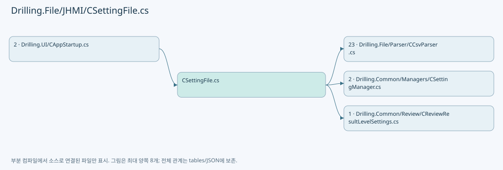

## 네임스페이스·타입·상속

| 타입 | 구분 | 원본 범위 | 선언/상속 |
| --- | --- | --- | --- |
| CSettingFile | ClassDeclaration | 14–598 | CSettingFile: CSettingFileBase |
| ST_SETTING_FORM_ITEM | RecordDeclaration | 582–597 | ST_SETTING_FORM_ITEM |

## 멤버 빠른 목록

| 이름 | 종류 | 범위 | 서명 |
| --- | --- | --- | --- |
| FormHeaders | FieldDeclaration | L16–16 | System.Collections.Generic.IReadOnlyList<string> Drilling.File.JHMI.CSettingFile.FormHeaders |
| ValueHeaders | FieldDeclaration | L17–17 | System.Collections.Generic.IReadOnlyList<string> Drilling.File.JHMI.CSettingFile.ValueHeaders |
| _settingDirectory | FieldDeclaration | L18–18 | string Drilling.File.JHMI.CSettingFile._settingDirectory |
| _logManager | FieldDeclaration | L19–19 | CLogManager Drilling.File.JHMI.CSettingFile._logManager |
| Load | MethodDeclaration | L20–51 | System.Collections.Generic.IReadOnlyList<Drilling.Common.Managers.ST_SYSTEM_PARAMETER> Drilling.File.JHMI.CSettingFile.Load(Drilling.Common.Managers.EN_SETTING_TAB, System.Threading.CancellationToken) |
| ShouldIncludeItem | LocalFunctionStatement | L24–27 | bool ShouldIncludeItem(Drilling.File.JHMI.CSettingFile.ST_SETTING_FORM_ITEM) |
| BuildSystem | LocalFunctionStatement | L29–48 | Drilling.Common.Managers.ST_SYSTEM_PARAMETER BuildSystem(Drilling.File.JHMI.CSettingFile.ST_SETTING_FORM_ITEM) |
| Save | MethodDeclaration | L53–132 | void Drilling.File.JHMI.CSettingFile.Save(Drilling.Common.Managers.EN_SETTING_TAB, System.Collections.Generic.IReadOnlyList<Drilling.Common.Managers.ST_SYSTEM_PARAMETER>, System.Threading.CancellationToken) |
| ShouldIncludeItem | LocalFunctionStatement | L60–63 | bool ShouldIncludeItem(Drilling.File.JHMI.CSettingFile.ST_SETTING_FORM_ITEM) |
| SelectName | LocalFunctionStatement | L65–68 | string SelectName(Drilling.File.JHMI.CSettingFile.ST_SETTING_FORM_ITEM) |
| SelectValue | LocalFunctionStatement | L70–73 | string SelectValue(Drilling.File.JHMI.CSettingFile.ST_SETTING_FORM_ITEM) |
| ShouldIncludeSystem | LocalFunctionStatement | L76–79 | bool ShouldIncludeSystem(Drilling.Common.Managers.ST_SYSTEM_PARAMETER) |
| SelectEditedParameterValue | LocalFunctionStatement | L81–84 | string SelectEditedParameterValue(Drilling.Common.Managers.ST_SYSTEM_PARAMETER) |
| ShouldIncludeSetting | LocalFunctionStatement | L87–90 | bool ShouldIncludeSetting(Drilling.File.JHMI.CSettingFile.ST_SETTING_FORM_ITEM) |
| BuildSystem | LocalFunctionStatement | L92–111 | Drilling.Common.Managers.ST_SYSTEM_PARAMETER BuildSystem(Drilling.File.JHMI.CSettingFile.ST_SETTING_FORM_ITEM) |
| LoadHistory | MethodDeclaration | L134–138 | System.Collections.Generic.IReadOnlyList<Drilling.Common.Managers.ST_SETTING_HISTORY> Drilling.File.JHMI.CSettingFile.LoadHistory(Drilling.Common.Managers.EN_SETTING_TAB, System.Threading.CancellationToken) |
| LoadFormItems | MethodDeclaration | L140–192 | System.Collections.Generic.IReadOnlyList<Drilling.File.JHMI.CSettingFile.ST_SETTING_FORM_ITEM> Drilling.File.JHMI.CSettingFile.LoadFormItems() |
| SelectItem | LocalFunctionStatement | L142–148 | string[] SelectItem(string) |
| BuildSetting | LocalFunctionStatement | L151–183 | Drilling.File.JHMI.CSettingFile.ST_SETTING_FORM_ITEM BuildSetting(System.Collections.Generic.IReadOnlyDictionary<string, string>, int) |
| ShouldIncludeItem | LocalFunctionStatement | L185–188 | bool ShouldIncludeItem(Drilling.File.JHMI.CSettingFile.ST_SETTING_FORM_ITEM) |
| AppendBuiltInFormItems | MethodDeclaration | L194–218 | System.Collections.Generic.IReadOnlyList<Drilling.File.JHMI.CSettingFile.ST_SETTING_FORM_ITEM> Drilling.File.JHMI.CSettingFile.AppendBuiltInFormItems(System.Collections.Generic.IReadOnlyList<Drilling.File.JHMI.CSettingFile.ST_SETTING_FORM_ITEM>) |
| SelectItem | LocalFunctionStatement | L196–199 | string SelectItem(Drilling.File.JHMI.CSettingFile.ST_SETTING_FORM_ITEM) |
| CreateDistortionRunOptionFormItems | MethodDeclaration | L220–226 | System.Collections.Generic.IEnumerable<Drilling.File.JHMI.CSettingFile.ST_SETTING_FORM_ITEM> Drilling.File.JHMI.CSettingFile.CreateDistortionRunOptionFormItems() |
| CreateOffsetScaleFormItems | MethodDeclaration | L228–234 | System.Collections.Generic.IEnumerable<Drilling.File.JHMI.CSettingFile.ST_SETTING_FORM_ITEM> Drilling.File.JHMI.CSettingFile.CreateOffsetScaleFormItems() |
| CreateReviewLevelFormItems | MethodDeclaration | L236–262 | System.Collections.Generic.IEnumerable<Drilling.File.JHMI.CSettingFile.ST_SETTING_FORM_ITEM> Drilling.File.JHMI.CSettingFile.CreateReviewLevelFormItems() |
| CreateAlignFormItems | MethodDeclaration | L264–278 | System.Collections.Generic.IEnumerable<Drilling.File.JHMI.CSettingFile.ST_SETTING_FORM_ITEM> Drilling.File.JHMI.CSettingFile.CreateAlignFormItems() |
| CreateScannerFormItems | MethodDeclaration | L280–316 | System.Collections.Generic.IEnumerable<Drilling.File.JHMI.CSettingFile.ST_SETTING_FORM_ITEM> Drilling.File.JHMI.CSettingFile.CreateScannerFormItems() |
| LoadSettingValues | MethodDeclaration | L318–355 | System.Collections.Generic.Dictionary<string, string> Drilling.File.JHMI.CSettingFile.LoadSettingValues() |
| SelectItem | LocalFunctionStatement | L321–327 | string[] SelectItem(string) |
| HasSettingValueKey | LocalFunctionStatement | L334–337 | bool HasSettingValueKey(System.Collections.Generic.IReadOnlyDictionary<string, string>) |
| SelectGroupKey | LocalFunctionStatement | L339–342 | string SelectGroupKey(System.Collections.Generic.IReadOnlyDictionary<string, string>) |
| SelectKey | LocalFunctionStatement | L344–347 | string SelectKey(System.Linq.IGrouping<string, System.Collections.Generic.IReadOnlyDictionary<string, string>>) |
| SelectValue | LocalFunctionStatement | L349–352 | string SelectValue(System.Linq.IGrouping<string, System.Collections.Generic.IReadOnlyDictionary<string, string>>) |
| WriteSettingValues | MethodDeclaration | L357–376 | void Drilling.File.JHMI.CSettingFile.WriteSettingValues(System.Collections.Generic.IReadOnlyList<Drilling.File.JHMI.CSettingFile.ST_SETTING_FORM_ITEM>, System.Collections.Generic.IReadOnlyDictionary<string, string>) |
| IsUse | LocalFunctionStatement | L359–362 | bool IsUse(Drilling.File.JHMI.CSettingFile.ST_SETTING_FORM_ITEM) |
| BuildSettingValueRow | LocalFunctionStatement | L364–372 | System.Collections.Generic.Dictionary<string, string> BuildSettingValueRow(Drilling.File.JHMI.CSettingFile.ST_SETTING_FORM_ITEM) |
| ValidateSavedSection | MethodDeclaration | L378–396 | void Drilling.File.JHMI.CSettingFile.ValidateSavedSection(Drilling.Common.Managers.EN_SETTING_TAB, System.Collections.Generic.IReadOnlyList<Drilling.Common.Managers.ST_SYSTEM_PARAMETER>) |
| ValidateSectionParameters | MethodDeclaration | L398–442 | void Drilling.File.JHMI.CSettingFile.ValidateSectionParameters(string, System.Collections.Generic.IReadOnlyList<Drilling.Common.Managers.ST_SYSTEM_PARAMETER>, System.Collections.Generic.IReadOnlyList<Drilling.File.JHMI.CSettingFile.ST_SETTING_FORM_ITEM>) |
| ShouldIncludeItem | LocalFunctionStatement | L400–403 | bool ShouldIncludeItem(Drilling.File.JHMI.CSettingFile.ST_SETTING_FORM_ITEM) |
| SelectName | LocalFunctionStatement | L405–408 | string SelectName(Drilling.File.JHMI.CSettingFile.ST_SETTING_FORM_ITEM) |
| GetParameterKey | MethodDeclaration | L444–447 | string Drilling.File.JHMI.CSettingFile.GetParameterKey(Drilling.Common.Managers.ST_SYSTEM_PARAMETER) |
| ValidateIntParameter | MethodDeclaration | L449–457 | string Drilling.File.JHMI.CSettingFile.ValidateIntParameter(Drilling.File.JHMI.CSettingFile.ST_SETTING_FORM_ITEM, string) |
| ValidateDoubleParameter | MethodDeclaration | L459–477 | string Drilling.File.JHMI.CSettingFile.ValidateDoubleParameter(Drilling.File.JHMI.CSettingFile.ST_SETTING_FORM_ITEM, string) |
| ValidateBoolParameter | MethodDeclaration | L479–483 | string Drilling.File.JHMI.CSettingFile.ValidateBoolParameter(Drilling.File.JHMI.CSettingFile.ST_SETTING_FORM_ITEM, string) |
| ValidateNumericRange | MethodDeclaration | L485–493 | string Drilling.File.JHMI.CSettingFile.ValidateNumericRange(Drilling.File.JHMI.CSettingFile.ST_SETTING_FORM_ITEM, double) |
| GetFormPath | MethodDeclaration | L495–498 | string Drilling.File.JHMI.CSettingFile.GetFormPath() |
| GetValuePath | MethodDeclaration | L500–503 | string Drilling.File.JHMI.CSettingFile.GetValuePath() |
| GetValue | MethodDeclaration | L505–514 | string Drilling.File.JHMI.CSettingFile.GetValue(System.Collections.Generic.IReadOnlyDictionary<string, string>, string, string, string) |
| CreateKey | MethodDeclaration | L516–519 | string Drilling.File.JHMI.CSettingFile.CreateKey(string, string) |
| NormalizeTab | MethodDeclaration | L521–531 | string Drilling.File.JHMI.CSettingFile.NormalizeTab(string) |
| NormalizeSettingText | MethodDeclaration | L533–536 | string Drilling.File.JHMI.CSettingFile.NormalizeSettingText(string, string) |
| GetOrDefault | MethodDeclaration | L538–541 | string Drilling.File.JHMI.CSettingFile.GetOrDefault(string, string) |
| ReadDataType | MethodDeclaration | L543–552 | Drilling.Common.Managers.EN_RECIPE_DATA_TYPE Drilling.File.JHMI.CSettingFile.ReadDataType(string) |
| ReadBool | MethodDeclaration | L554–562 | bool Drilling.File.JHMI.CSettingFile.ReadBool(string, bool) |
| ReadInt | MethodDeclaration | L564–567 | int Drilling.File.JHMI.CSettingFile.ReadInt(string, int) |
| ReadDouble | MethodDeclaration | L569–572 | double Drilling.File.JHMI.CSettingFile.ReadDouble(string, double) |
| ToTabText | MethodDeclaration | L574–580 | string Drilling.File.JHMI.CSettingFile.ToTabText(Drilling.Common.Managers.EN_SETTING_TAB) |

## 멤버별 상세 계약·호출·처리 해설

### FieldDeclaration `FormHeaders` · L16–16

[Drilling.File/JHMI/CSettingFile.cs:16–16](https://github.com/kjuws10-rgb/A3Drilling/blob/96e22cd027c84bf302b23f2949b98985d7f301bb/Drilling.File/JHMI/CSettingFile.cs#L16-L16)

| 항목 | 실제 추출 값 |
| --- | --- |
| 서명 | System.Collections.Generic.IReadOnlyList<string> Drilling.File.JHMI.CSettingFile.FormHeaders |
| 접근/수식자 | Private / private, static, readonly |
| 반환/값 타입 | System.Collections.Generic.IReadOnlyList<string> |
| 소속 타입 | NamedType:Drilling.File.JHMI.CSettingFile |

현재 부분 분석에서 직접 연결된 호출자는 없습니다. XAML/이벤트/인터페이스·델리게이트·외부 진입을 추가 확인해야 하며, 미사용으로 판정한 것이 아닙니다.

본문의 실제 연산·분기·예외·반환 순서(원문 위치 순):

| 원본 행 | 종류 | 주석 해설 |
| --- | --- | --- |
| 16 | variable-initializer | 변수의 초기값을 지정합니다: FormHeaders = ["TAB", "GROUP", "NAME", "DISPLAY NAME", "DATA TYPE", "UNIT", "SHOW", "USE", "VALUE", "MIN", "MAX", "DESCRIPTION"] |

변경 전 점검: 입력/반환 타입, 위 호출자, 예외/취소 경로, 공유 상태와 저장·전송 소비자를 함께 확인합니다. 값의 단위나 물리 방향을 이름만으로 확정하지 않습니다.

### FieldDeclaration `ValueHeaders` · L17–17

[Drilling.File/JHMI/CSettingFile.cs:17–17](https://github.com/kjuws10-rgb/A3Drilling/blob/96e22cd027c84bf302b23f2949b98985d7f301bb/Drilling.File/JHMI/CSettingFile.cs#L17-L17)

| 항목 | 실제 추출 값 |
| --- | --- |
| 서명 | System.Collections.Generic.IReadOnlyList<string> Drilling.File.JHMI.CSettingFile.ValueHeaders |
| 접근/수식자 | Private / private, static, readonly |
| 반환/값 타입 | System.Collections.Generic.IReadOnlyList<string> |
| 소속 타입 | NamedType:Drilling.File.JHMI.CSettingFile |

현재 부분 분석에서 직접 연결된 호출자는 없습니다. XAML/이벤트/인터페이스·델리게이트·외부 진입을 추가 확인해야 하며, 미사용으로 판정한 것이 아닙니다.

본문의 실제 연산·분기·예외·반환 순서(원문 위치 순):

| 원본 행 | 종류 | 주석 해설 |
| --- | --- | --- |
| 17 | variable-initializer | 변수의 초기값을 지정합니다: ValueHeaders = ["TAB", "NAME", "VALUE"] |

변경 전 점검: 입력/반환 타입, 위 호출자, 예외/취소 경로, 공유 상태와 저장·전송 소비자를 함께 확인합니다. 값의 단위나 물리 방향을 이름만으로 확정하지 않습니다.

### FieldDeclaration `_settingDirectory` · L18–18

[Drilling.File/JHMI/CSettingFile.cs:18–18](https://github.com/kjuws10-rgb/A3Drilling/blob/96e22cd027c84bf302b23f2949b98985d7f301bb/Drilling.File/JHMI/CSettingFile.cs#L18-L18)

| 항목 | 실제 추출 값 |
| --- | --- |
| 서명 | string Drilling.File.JHMI.CSettingFile._settingDirectory |
| 접근/수식자 | Private / private, readonly |
| 반환/값 타입 | string |
| 소속 타입 | NamedType:Drilling.File.JHMI.CSettingFile |

현재 부분 분석에서 직접 연결된 호출자는 없습니다. XAML/이벤트/인터페이스·델리게이트·외부 진입을 추가 확인해야 하며, 미사용으로 판정한 것이 아닙니다.

호출하는 대상과 해석 범위:

| 원본 행 | 표현식 | 분석 상태 | 대상/소스 위치 |
| --- | --- | --- | --- |
| 18 | Path.Combine | resolved | string System.IO.Path.Combine(string, string) |

본문의 실제 연산·분기·예외·반환 순서(원문 위치 순):

| 원본 행 | 종류 | 주석 해설 |
| --- | --- | --- |
| 18 | call | 함수·델리게이트 또는 객체 생성자를 호출합니다: Path.Combine(configRoot, "Setting") |
| 18 | variable-initializer | 변수의 초기값을 지정합니다: _settingDirectory = Path.Combine(configRoot, "Setting") |

변경 전 점검: 입력/반환 타입, 위 호출자, 예외/취소 경로, 공유 상태와 저장·전송 소비자를 함께 확인합니다. 값의 단위나 물리 방향을 이름만으로 확정하지 않습니다.

### FieldDeclaration `_logManager` · L19–19

[Drilling.File/JHMI/CSettingFile.cs:19–19](https://github.com/kjuws10-rgb/A3Drilling/blob/96e22cd027c84bf302b23f2949b98985d7f301bb/Drilling.File/JHMI/CSettingFile.cs#L19-L19)

| 항목 | 실제 추출 값 |
| --- | --- |
| 서명 | CLogManager Drilling.File.JHMI.CSettingFile._logManager |
| 접근/수식자 | Private / private, readonly |
| 반환/값 타입 | CLogManager |
| 소속 타입 | NamedType:Drilling.File.JHMI.CSettingFile |

현재 부분 분석에서 직접 연결된 호출자는 없습니다. XAML/이벤트/인터페이스·델리게이트·외부 진입을 추가 확인해야 하며, 미사용으로 판정한 것이 아닙니다.

호출하는 대상과 해석 범위:

| 원본 행 | 표현식 | 분석 상태 | 대상/소스 위치 |
| --- | --- | --- | --- |
| 19 | new | unresolved | None |

본문의 실제 연산·분기·예외·반환 순서(원문 위치 순):

| 원본 행 | 종류 | 주석 해설 |
| --- | --- | --- |
| 19 | call | 함수·델리게이트 또는 객체 생성자를 호출합니다: new(configRoot) |
| 19 | variable-initializer | 변수의 초기값을 지정합니다: _logManager = new(configRoot) |

변경 전 점검: 입력/반환 타입, 위 호출자, 예외/취소 경로, 공유 상태와 저장·전송 소비자를 함께 확인합니다. 값의 단위나 물리 방향을 이름만으로 확정하지 않습니다.

### MethodDeclaration `Load` · L20–51

[Drilling.File/JHMI/CSettingFile.cs:20–51](https://github.com/kjuws10-rgb/A3Drilling/blob/96e22cd027c84bf302b23f2949b98985d7f301bb/Drilling.File/JHMI/CSettingFile.cs#L20-L51)

| 항목 | 실제 추출 값 |
| --- | --- |
| 서명 | System.Collections.Generic.IReadOnlyList<Drilling.Common.Managers.ST_SYSTEM_PARAMETER> Drilling.File.JHMI.CSettingFile.Load(Drilling.Common.Managers.EN_SETTING_TAB, System.Threading.CancellationToken) |
| 접근/수식자 | Public / public, override |
| 반환/값 타입 | System.Collections.Generic.IReadOnlyList<Drilling.Common.Managers.ST_SYSTEM_PARAMETER> |
| 소속 타입 | NamedType:Drilling.File.JHMI.CSettingFile |

입력 계약:

| 이름 | 타입 | 전달 | 선택/기본값 |
| --- | --- | --- | --- |
| section | Drilling.Common.Managers.EN_SETTING_TAB | None | False /  |
| cancellationToken | System.Threading.CancellationToken | None | True / null |

정적 호출자로 확인된 위치:

| 호출 파일/행 | 호출 표현식 | 런타임 분기 가능 |
| --- | --- | --- |
| [Drilling.UI/CAppStartup.cs:145–145](https://github.com/kjuws10-rgb/A3Drilling/blob/96e22cd027c84bf302b23f2949b98985d7f301bb/Drilling.UI/CAppStartup.cs#L145-L145) | settingFile.Load | True |

호출하는 대상과 해석 범위:

| 원본 행 | 표현식 | 분석 상태 | 대상/소스 위치 |
| --- | --- | --- | --- |
| 22 | cancellationToken.ThrowIfCancellationRequested | resolved | void System.Threading.CancellationToken.ThrowIfCancellationRequested() |
| 23 | LoadSettingValues | resolved | System.Collections.Generic.Dictionary<string, string> Drilling.File.JHMI.CSettingFile.LoadSettingValues() · Drilling.File/JHMI/CSettingFile.cs:318 |
| 50 | LoadFormItems().Where(ShouldIncludeItem).Select(BuildSystem).ToArray | resolved | Drilling.Common.Managers.ST_SYSTEM_PARAMETER[] System.Collections.Generic.IEnumerable<Drilling.Common.Managers.ST_SYSTEM_PARAMETER>.ToArray<Drilling.Common.Managers.ST_SYSTEM_PARAMETER>() |
| 50 | LoadFormItems().Where(ShouldIncludeItem).Select | resolved | System.Collections.Generic.IEnumerable<Drilling.Common.Managers.ST_SYSTEM_PARAMETER> System.Collections.Generic.IEnumerable<Drilling.File.JHMI.CSettingFile.ST_SETTING_FORM_ITEM>.Select<Drilling.File.JHMI.CSettingFile.ST_SETTING_FORM_ITEM, Drilling.Common.Managers.ST_SYSTEM_PARAMETER>(System.Func<Drilling.File.JHMI.CSettingFile.ST_SETTING_FORM_ITEM, Drilling.Common.Managers.ST_SYSTEM_PARAMETER>) |
| 50 | LoadFormItems().Where | resolved | System.Collections.Generic.IEnumerable<Drilling.File.JHMI.CSettingFile.ST_SETTING_FORM_ITEM> System.Collections.Generic.IEnumerable<Drilling.File.JHMI.CSettingFile.ST_SETTING_FORM_ITEM>.Where<Drilling.File.JHMI.CSettingFile.ST_SETTING_FORM_ITEM>(System.Func<Drilling.File.JHMI.CSettingFile.ST_SETTING_FORM_ITEM, bool>) |
| 50 | LoadFormItems | resolved | System.Collections.Generic.IReadOnlyList<Drilling.File.JHMI.CSettingFile.ST_SETTING_FORM_ITEM> Drilling.File.JHMI.CSettingFile.LoadFormItems() · Drilling.File/JHMI/CSettingFile.cs:140 |

본문의 실제 연산·분기·예외·반환 순서(원문 위치 순):

| 원본 행 | 종류 | 주석 해설 |
| --- | --- | --- |
| 22 | call | 함수·델리게이트 또는 객체 생성자를 호출합니다: cancellationToken.ThrowIfCancellationRequested() |
| 23 | call | 함수·델리게이트 또는 객체 생성자를 호출합니다: LoadSettingValues() |
| 23 | local-declaration | 지역 변수를 선언합니다: var values = LoadSettingValues(); |
| 23 | variable-initializer | 변수의 초기값을 지정합니다: values = LoadSettingValues() |
| 50 | call | 함수·델리게이트 또는 객체 생성자를 호출합니다: LoadFormItems().Where(ShouldIncludeItem).Select(BuildSystem).ToArray() |
| 50 | call | 함수·델리게이트 또는 객체 생성자를 호출합니다: LoadFormItems().Where(ShouldIncludeItem).Select(BuildSystem) |
| 50 | call | 함수·델리게이트 또는 객체 생성자를 호출합니다: LoadFormItems().Where(ShouldIncludeItem) |
| 50 | call | 함수·델리게이트 또는 객체 생성자를 호출합니다: LoadFormItems() |
| 50 | return | 호출자에게 값 또는 제어를 반환합니다: return LoadFormItems().Where(ShouldIncludeItem).Select(BuildSystem).ToArray(); |

변경 전 점검: 입력/반환 타입, 위 호출자, 예외/취소 경로, 공유 상태와 저장·전송 소비자를 함께 확인합니다. 값의 단위나 물리 방향을 이름만으로 확정하지 않습니다.

### LocalFunctionStatement `ShouldIncludeItem` · L24–27

[Drilling.File/JHMI/CSettingFile.cs:24–27](https://github.com/kjuws10-rgb/A3Drilling/blob/96e22cd027c84bf302b23f2949b98985d7f301bb/Drilling.File/JHMI/CSettingFile.cs#L24-L27)

| 항목 | 실제 추출 값 |
| --- | --- |
| 서명 | bool ShouldIncludeItem(Drilling.File.JHMI.CSettingFile.ST_SETTING_FORM_ITEM) |
| 접근/수식자 | Private /  |
| 반환/값 타입 | bool |
| 소속 타입 | NamedType:Drilling.File.JHMI.CSettingFile |

입력 계약:

| 이름 | 타입 | 전달 | 선택/기본값 |
| --- | --- | --- | --- |
| item | Drilling.File.JHMI.CSettingFile.ST_SETTING_FORM_ITEM | None | False /  |

현재 부분 분석에서 직접 연결된 호출자는 없습니다. XAML/이벤트/인터페이스·델리게이트·외부 진입을 추가 확인해야 하며, 미사용으로 판정한 것이 아닙니다.

호출하는 대상과 해석 범위:

| 원본 행 | 표현식 | 분석 상태 | 대상/소스 위치 |
| --- | --- | --- | --- |
| 26 | item.Tab.Equals | resolved | bool string.Equals(string?, System.StringComparison) |
| 26 | ToTabText | resolved | string Drilling.File.JHMI.CSettingFile.ToTabText(Drilling.Common.Managers.EN_SETTING_TAB) · Drilling.File/JHMI/CSettingFile.cs:574 |

본문의 실제 연산·분기·예외·반환 순서(원문 위치 순):

| 원본 행 | 종류 | 주석 해설 |
| --- | --- | --- |
| 26 | call | 함수·델리게이트 또는 객체 생성자를 호출합니다: item.Tab.Equals(ToTabText(section), StringComparison.OrdinalIgnoreCase) |
| 26 | call | 함수·델리게이트 또는 객체 생성자를 호출합니다: ToTabText(section) |
| 26 | return | 호출자에게 값 또는 제어를 반환합니다: return item.Use && item.Tab.Equals(ToTabText(section), StringComparison.OrdinalIgnoreCase); |

변경 전 점검: 입력/반환 타입, 위 호출자, 예외/취소 경로, 공유 상태와 저장·전송 소비자를 함께 확인합니다. 값의 단위나 물리 방향을 이름만으로 확정하지 않습니다.

### LocalFunctionStatement `BuildSystem` · L29–48

[Drilling.File/JHMI/CSettingFile.cs:29–48](https://github.com/kjuws10-rgb/A3Drilling/blob/96e22cd027c84bf302b23f2949b98985d7f301bb/Drilling.File/JHMI/CSettingFile.cs#L29-L48)

| 항목 | 실제 추출 값 |
| --- | --- |
| 서명 | Drilling.Common.Managers.ST_SYSTEM_PARAMETER BuildSystem(Drilling.File.JHMI.CSettingFile.ST_SETTING_FORM_ITEM) |
| 접근/수식자 | Private /  |
| 반환/값 타입 | Drilling.Common.Managers.ST_SYSTEM_PARAMETER |
| 소속 타입 | NamedType:Drilling.File.JHMI.CSettingFile |

입력 계약:

| 이름 | 타입 | 전달 | 선택/기본값 |
| --- | --- | --- | --- |
| item | Drilling.File.JHMI.CSettingFile.ST_SETTING_FORM_ITEM | None | False /  |

현재 부분 분석에서 직접 연결된 호출자는 없습니다. XAML/이벤트/인터페이스·델리게이트·외부 진입을 추가 확인해야 하며, 미사용으로 판정한 것이 아닙니다.

호출하는 대상과 해석 범위:

| 원본 행 | 표현식 | 분석 상태 | 대상/소스 위치 |
| --- | --- | --- | --- |
| 31 | new ST_SYSTEM_PARAMETER | resolved | Drilling.Common.Managers.ST_SYSTEM_PARAMETER.ST_SYSTEM_PARAMETER(Drilling.Common.Managers.EN_SETTING_TAB, string, string, string, string, string, string, string, Drilling.Common.Managers.EN_RECIPE_DATA_TYPE, double, double, bool, bool, int, System.Collections.Generic.IReadOnlyDictionary<string, string>?) · Drilling.Common/Managers/CSettingManager.cs:256 |
| 34 | GetValue | resolved | string Drilling.File.JHMI.CSettingFile.GetValue(System.Collections.Generic.IReadOnlyDictionary<string, string>, string, string, string) · Drilling.File/JHMI/CSettingFile.cs:505 |

본문의 실제 연산·분기·예외·반환 순서(원문 위치 순):

| 원본 행 | 종류 | 주석 해설 |
| --- | --- | --- |
| 31 | call | 함수·델리게이트 또는 객체 생성자를 호출합니다: new ST_SYSTEM_PARAMETER( section, item.DisplayName, GetValue(values, item.Tab, item.Name, item.DefaultValue), item.Unit, item.Description, item.Group, item.Name, item.DefaultValue, item.DataType, item.Min, item.Max, item… |
| 31 | return | 호출자에게 값 또는 제어를 반환합니다: return new ST_SYSTEM_PARAMETER( section, item.DisplayName, GetValue(values, item.Tab, item.Name, item.DefaultValue), item.Unit, item.Description, item.Group, item.Name, item.DefaultValue, item.DataType, item.Min, item.Max, item.Sh |
| 34 | call | 함수·델리게이트 또는 객체 생성자를 호출합니다: GetValue(values, item.Tab, item.Name, item.DefaultValue) |

변경 전 점검: 입력/반환 타입, 위 호출자, 예외/취소 경로, 공유 상태와 저장·전송 소비자를 함께 확인합니다. 값의 단위나 물리 방향을 이름만으로 확정하지 않습니다.

### MethodDeclaration `Save` · L53–132

[Drilling.File/JHMI/CSettingFile.cs:53–132](https://github.com/kjuws10-rgb/A3Drilling/blob/96e22cd027c84bf302b23f2949b98985d7f301bb/Drilling.File/JHMI/CSettingFile.cs#L53-L132)

| 항목 | 실제 추출 값 |
| --- | --- |
| 서명 | void Drilling.File.JHMI.CSettingFile.Save(Drilling.Common.Managers.EN_SETTING_TAB, System.Collections.Generic.IReadOnlyList<Drilling.Common.Managers.ST_SYSTEM_PARAMETER>, System.Threading.CancellationToken) |
| 접근/수식자 | Public / public, override |
| 반환/값 타입 | void |
| 소속 타입 | NamedType:Drilling.File.JHMI.CSettingFile |

입력 계약:

| 이름 | 타입 | 전달 | 선택/기본값 |
| --- | --- | --- | --- |
| section | Drilling.Common.Managers.EN_SETTING_TAB | None | False /  |
| parameters | System.Collections.Generic.IReadOnlyList<Drilling.Common.Managers.ST_SYSTEM_PARAMETER> | None | False /  |
| cancellationToken | System.Threading.CancellationToken | None | True / null |

현재 부분 분석에서 직접 연결된 호출자는 없습니다. XAML/이벤트/인터페이스·델리게이트·외부 진입을 추가 확인해야 하며, 미사용으로 판정한 것이 아닙니다.

호출하는 대상과 해석 범위:

| 원본 행 | 표현식 | 분석 상태 | 대상/소스 위치 |
| --- | --- | --- | --- |
| 55 | cancellationToken.ThrowIfCancellationRequested | resolved | void System.Threading.CancellationToken.ThrowIfCancellationRequested() |
| 56 | Directory.CreateDirectory | resolved | System.IO.DirectoryInfo System.IO.Directory.CreateDirectory(string) |
| 57 | LoadFormItems | resolved | System.Collections.Generic.IReadOnlyList<Drilling.File.JHMI.CSettingFile.ST_SETTING_FORM_ITEM> Drilling.File.JHMI.CSettingFile.LoadFormItems() · Drilling.File/JHMI/CSettingFile.cs:140 |
| 58 | LoadSettingValues | resolved | System.Collections.Generic.Dictionary<string, string> Drilling.File.JHMI.CSettingFile.LoadSettingValues() · Drilling.File/JHMI/CSettingFile.cs:318 |
| 59 | ToTabText | resolved | string Drilling.File.JHMI.CSettingFile.ToTabText(Drilling.Common.Managers.EN_SETTING_TAB) · Drilling.File/JHMI/CSettingFile.cs:574 |
| 75 | formItems.Where(ShouldIncludeItem).ToDictionary | resolved | System.Collections.Generic.Dictionary<string, string> System.Collections.Generic.IEnumerable<Drilling.File.JHMI.CSettingFile.ST_SETTING_FORM_ITEM>.ToDictionary<Drilling.File.JHMI.CSettingFile.ST_SETTING_FORM_ITEM, string, string>(System.Func<Drilling.File.JHMI.CSettingFile.ST_SETTING_FORM_ITEM, string>, System.Func<Drilling.File.JHMI.CSettingFile.ST_SETTING_FORM_ITEM, string>, System.Collections.Generic.IEqualityComparer<string>?) |
| 75 | formItems.Where | resolved | System.Collections.Generic.IEnumerable<Drilling.File.JHMI.CSettingFile.ST_SETTING_FORM_ITEM> System.Collections.Generic.IEnumerable<Drilling.File.JHMI.CSettingFile.ST_SETTING_FORM_ITEM>.Where<Drilling.File.JHMI.CSettingFile.ST_SETTING_FORM_ITEM>(System.Func<Drilling.File.JHMI.CSettingFile.ST_SETTING_FORM_ITEM, bool>) |
| 86 | parameters.Where(ShouldIncludeSystem).ToDictionary | resolved | System.Collections.Generic.Dictionary<string, string> System.Collections.Generic.IEnumerable<Drilling.Common.Managers.ST_SYSTEM_PARAMETER>.ToDictionary<Drilling.Common.Managers.ST_SYSTEM_PARAMETER, string, string>(System.Func<Drilling.Common.Managers.ST_SYSTEM_PARAMETER, string>, System.Func<Drilling.Common.Managers.ST_SYSTEM_PARAMETER, string>, System.Collections.Generic.IEqualityComparer<string>?) |
| 86 | parameters.Where | resolved | System.Collections.Generic.IEnumerable<Drilling.Common.Managers.ST_SYSTEM_PARAMETER> System.Collections.Generic.IEnumerable<Drilling.Common.Managers.ST_SYSTEM_PARAMETER>.Where<Drilling.Common.Managers.ST_SYSTEM_PARAMETER>(System.Func<Drilling.Common.Managers.ST_SYSTEM_PARAMETER, bool>) |
| 113 | formItems.Where(ShouldIncludeSetting).Select(BuildSystem).ToArray | resolved | Drilling.Common.Managers.ST_SYSTEM_PARAMETER[] System.Collections.Generic.IEnumerable<Drilling.Common.Managers.ST_SYSTEM_PARAMETER>.ToArray<Drilling.Common.Managers.ST_SYSTEM_PARAMETER>() |
| 113 | formItems.Where(ShouldIncludeSetting).Select | resolved | System.Collections.Generic.IEnumerable<Drilling.Common.Managers.ST_SYSTEM_PARAMETER> System.Collections.Generic.IEnumerable<Drilling.File.JHMI.CSettingFile.ST_SETTING_FORM_ITEM>.Select<Drilling.File.JHMI.CSettingFile.ST_SETTING_FORM_ITEM, Drilling.Common.Managers.ST_SYSTEM_PARAMETER>(System.Func<Drilling.File.JHMI.CSettingFile.ST_SETTING_FORM_ITEM, Drilling.Common.Managers.ST_SYSTEM_PARAMETER>) |
| 113 | formItems.Where | resolved | System.Collections.Generic.IEnumerable<Drilling.File.JHMI.CSettingFile.ST_SETTING_FORM_ITEM> System.Collections.Generic.IEnumerable<Drilling.File.JHMI.CSettingFile.ST_SETTING_FORM_ITEM>.Where<Drilling.File.JHMI.CSettingFile.ST_SETTING_FORM_ITEM>(System.Func<Drilling.File.JHMI.CSettingFile.ST_SETTING_FORM_ITEM, bool>) |
| 114 | ValidateSectionParameters | resolved | void Drilling.File.JHMI.CSettingFile.ValidateSectionParameters(string, System.Collections.Generic.IReadOnlyList<Drilling.Common.Managers.ST_SYSTEM_PARAMETER>, System.Collections.Generic.IReadOnlyList<Drilling.File.JHMI.CSettingFile.ST_SETTING_FORM_ITEM>) · Drilling.File/JHMI/CSettingFile.cs:398 |
| 117 | CreateKey | resolved | string Drilling.File.JHMI.CSettingFile.CreateKey(string, string) · Drilling.File/JHMI/CSettingFile.cs:516 |
| 117 | GetParameterKey | resolved | string Drilling.File.JHMI.CSettingFile.GetParameterKey(Drilling.Common.Managers.ST_SYSTEM_PARAMETER) · Drilling.File/JHMI/CSettingFile.cs:444 |
| 120 | WriteSettingValues | resolved | void Drilling.File.JHMI.CSettingFile.WriteSettingValues(System.Collections.Generic.IReadOnlyList<Drilling.File.JHMI.CSettingFile.ST_SETTING_FORM_ITEM>, System.Collections.Generic.IReadOnlyDictionary<string, string>) · Drilling.File/JHMI/CSettingFile.cs:357 |
| 121 | ValidateSavedSection | resolved | void Drilling.File.JHMI.CSettingFile.ValidateSavedSection(Drilling.Common.Managers.EN_SETTING_TAB, System.Collections.Generic.IReadOnlyList<Drilling.Common.Managers.ST_SYSTEM_PARAMETER>) · Drilling.File/JHMI/CSettingFile.cs:378 |
| 124 | oldValues.TryGetValue | resolved | bool System.Collections.Generic.Dictionary<string, string>.TryGetValue(string, out string) |
| 124 | GetParameterKey | resolved | string Drilling.File.JHMI.CSettingFile.GetParameterKey(Drilling.Common.Managers.ST_SYSTEM_PARAMETER) · Drilling.File/JHMI/CSettingFile.cs:444 |
| 125 | oldValue.Equals | resolved | bool string.Equals(string?, System.StringComparison) |
| 127 | _logManager.WriteSettingModify | unresolved | None |
| 131 | _logManager.WriteSettingSave | unresolved | None |

본문의 실제 연산·분기·예외·반환 순서(원문 위치 순):

| 원본 행 | 종류 | 주석 해설 |
| --- | --- | --- |
| 55 | call | 함수·델리게이트 또는 객체 생성자를 호출합니다: cancellationToken.ThrowIfCancellationRequested() |
| 56 | call | 함수·델리게이트 또는 객체 생성자를 호출합니다: Directory.CreateDirectory(_settingDirectory) |
| 57 | call | 함수·델리게이트 또는 객체 생성자를 호출합니다: LoadFormItems() |
| 57 | local-declaration | 지역 변수를 선언합니다: var formItems = LoadFormItems(); |
| 57 | variable-initializer | 변수의 초기값을 지정합니다: formItems = LoadFormItems() |
| 58 | call | 함수·델리게이트 또는 객체 생성자를 호출합니다: LoadSettingValues() |
| 58 | local-declaration | 지역 변수를 선언합니다: var values = LoadSettingValues(); |
| 58 | variable-initializer | 변수의 초기값을 지정합니다: values = LoadSettingValues() |
| 59 | call | 함수·델리게이트 또는 객체 생성자를 호출합니다: ToTabText(section) |
| 59 | local-declaration | 지역 변수를 선언합니다: var sectionTab = ToTabText(section); |
| 59 | variable-initializer | 변수의 초기값을 지정합니다: sectionTab = ToTabText(section) |
| 75 | call | 함수·델리게이트 또는 객체 생성자를 호출합니다: formItems.Where(ShouldIncludeItem).ToDictionary(SelectName, SelectValue, StringComparer.OrdinalIgnoreCase) |
| 75 | call | 함수·델리게이트 또는 객체 생성자를 호출합니다: formItems.Where(ShouldIncludeItem) |
| 75 | local-declaration | 지역 변수를 선언합니다: var oldValues = formItems.Where(ShouldIncludeItem).ToDictionary(SelectName, SelectValue, StringComparer.OrdinalIgnoreCase); |
| 75 | variable-initializer | 변수의 초기값을 지정합니다: oldValues = formItems.Where(ShouldIncludeItem).ToDictionary(SelectName, SelectValue, StringComparer.OrdinalIgnoreCase) |
| 86 | call | 함수·델리게이트 또는 객체 생성자를 호출합니다: parameters.Where(ShouldIncludeSystem).ToDictionary(GetParameterKey, SelectEditedParameterValue, StringComparer.OrdinalIgnoreCase) |
| 86 | call | 함수·델리게이트 또는 객체 생성자를 호출합니다: parameters.Where(ShouldIncludeSystem) |
| 86 | local-declaration | 지역 변수를 선언합니다: var editedValues = parameters.Where(ShouldIncludeSystem).ToDictionary(GetParameterKey, SelectEditedParameterValue, StringComparer.OrdinalIgnoreCase); |
| 86 | variable-initializer | 변수의 초기값을 지정합니다: editedValues = parameters.Where(ShouldIncludeSystem).ToDictionary(GetParameterKey, SelectEditedParameterValue, StringComparer.OrdinalIgnoreCase) |
| 113 | call | 함수·델리게이트 또는 객체 생성자를 호출합니다: formItems.Where(ShouldIncludeSetting).Select(BuildSystem).ToArray() |
| 113 | call | 함수·델리게이트 또는 객체 생성자를 호출합니다: formItems.Where(ShouldIncludeSetting).Select(BuildSystem) |
| 113 | call | 함수·델리게이트 또는 객체 생성자를 호출합니다: formItems.Where(ShouldIncludeSetting) |
| 113 | local-declaration | 지역 변수를 선언합니다: var normalizedParameters = formItems.Where(ShouldIncludeSetting).Select(BuildSystem).ToArray(); |
| 113 | variable-initializer | 변수의 초기값을 지정합니다: normalizedParameters = formItems.Where(ShouldIncludeSetting).Select(BuildSystem).ToArray() |
| 114 | call | 함수·델리게이트 또는 객체 생성자를 호출합니다: ValidateSectionParameters(sectionTab, normalizedParameters, formItems) |
| 115 | foreach | 컬렉션 요소를 순회합니다: foreach (var parameter in normalizedParameters) |
| 117 | assignment | 값을 대상에 대입합니다: values[CreateKey(sectionTab, GetParameterKey(parameter))] = parameter.Value |
| 117 | call | 함수·델리게이트 또는 객체 생성자를 호출합니다: CreateKey(sectionTab, GetParameterKey(parameter)) |
| 117 | call | 함수·델리게이트 또는 객체 생성자를 호출합니다: GetParameterKey(parameter) |
| 120 | call | 함수·델리게이트 또는 객체 생성자를 호출합니다: WriteSettingValues(formItems, values) |
| 121 | call | 함수·델리게이트 또는 객체 생성자를 호출합니다: ValidateSavedSection(section, normalizedParameters) |
| 122 | foreach | 컬렉션 요소를 순회합니다: foreach (var parameter in normalizedParameters) |
| 124 | call | 함수·델리게이트 또는 객체 생성자를 호출합니다: oldValues.TryGetValue(GetParameterKey(parameter), out var value) |
| 124 | call | 함수·델리게이트 또는 객체 생성자를 호출합니다: GetParameterKey(parameter) |
| 124 | conditional-expression | 조건에 따라 결과식을 선택합니다: oldValues.TryGetValue(GetParameterKey(parameter), out var value) ? value : "" |
| 124 | local-declaration | 지역 변수를 선언합니다: var oldValue = oldValues.TryGetValue(GetParameterKey(parameter), out var value) ? value : ""; |
| 124 | variable-initializer | 변수의 초기값을 지정합니다: oldValue = oldValues.TryGetValue(GetParameterKey(parameter), out var value) ? value : "" |
| 125 | call | 함수·델리게이트 또는 객체 생성자를 호출합니다: oldValue.Equals(parameter.Value, StringComparison.Ordinal) |
| 125 | if | 조건에 따라 분기합니다: if (!oldValue.Equals(parameter.Value, StringComparison.Ordinal)) |
| 127 | call | 함수·델리게이트 또는 객체 생성자를 호출합니다: _logManager.WriteSettingModify(section, parameter.Name, oldValue, parameter.Value) |
| 131 | call | 함수·델리게이트 또는 객체 생성자를 호출합니다: _logManager.WriteSettingSave(section) |

제어 구문의 포함 구조(실제 실행 순서/CFG가 아닌 구문 탐색 그림):

변경 전 점검: 입력/반환 타입, 위 호출자, 예외/취소 경로, 공유 상태와 저장·전송 소비자를 함께 확인합니다. 값의 단위나 물리 방향을 이름만으로 확정하지 않습니다.

### LocalFunctionStatement `ShouldIncludeItem` · L60–63

[Drilling.File/JHMI/CSettingFile.cs:60–63](https://github.com/kjuws10-rgb/A3Drilling/blob/96e22cd027c84bf302b23f2949b98985d7f301bb/Drilling.File/JHMI/CSettingFile.cs#L60-L63)

| 항목 | 실제 추출 값 |
| --- | --- |
| 서명 | bool ShouldIncludeItem(Drilling.File.JHMI.CSettingFile.ST_SETTING_FORM_ITEM) |
| 접근/수식자 | Private /  |
| 반환/값 타입 | bool |
| 소속 타입 | NamedType:Drilling.File.JHMI.CSettingFile |

입력 계약:

| 이름 | 타입 | 전달 | 선택/기본값 |
| --- | --- | --- | --- |
| item | Drilling.File.JHMI.CSettingFile.ST_SETTING_FORM_ITEM | None | False /  |

현재 부분 분석에서 직접 연결된 호출자는 없습니다. XAML/이벤트/인터페이스·델리게이트·외부 진입을 추가 확인해야 하며, 미사용으로 판정한 것이 아닙니다.

호출하는 대상과 해석 범위:

| 원본 행 | 표현식 | 분석 상태 | 대상/소스 위치 |
| --- | --- | --- | --- |
| 62 | item.Tab.Equals | resolved | bool string.Equals(string?, System.StringComparison) |

본문의 실제 연산·분기·예외·반환 순서(원문 위치 순):

| 원본 행 | 종류 | 주석 해설 |
| --- | --- | --- |
| 62 | call | 함수·델리게이트 또는 객체 생성자를 호출합니다: item.Tab.Equals(sectionTab, StringComparison.OrdinalIgnoreCase) |
| 62 | return | 호출자에게 값 또는 제어를 반환합니다: return item.Use && item.Tab.Equals(sectionTab, StringComparison.OrdinalIgnoreCase); |

변경 전 점검: 입력/반환 타입, 위 호출자, 예외/취소 경로, 공유 상태와 저장·전송 소비자를 함께 확인합니다. 값의 단위나 물리 방향을 이름만으로 확정하지 않습니다.

### LocalFunctionStatement `SelectName` · L65–68

[Drilling.File/JHMI/CSettingFile.cs:65–68](https://github.com/kjuws10-rgb/A3Drilling/blob/96e22cd027c84bf302b23f2949b98985d7f301bb/Drilling.File/JHMI/CSettingFile.cs#L65-L68)

| 항목 | 실제 추출 값 |
| --- | --- |
| 서명 | string SelectName(Drilling.File.JHMI.CSettingFile.ST_SETTING_FORM_ITEM) |
| 접근/수식자 | Private /  |
| 반환/값 타입 | string |
| 소속 타입 | NamedType:Drilling.File.JHMI.CSettingFile |

입력 계약:

| 이름 | 타입 | 전달 | 선택/기본값 |
| --- | --- | --- | --- |
| item | Drilling.File.JHMI.CSettingFile.ST_SETTING_FORM_ITEM | None | False /  |

현재 부분 분석에서 직접 연결된 호출자는 없습니다. XAML/이벤트/인터페이스·델리게이트·외부 진입을 추가 확인해야 하며, 미사용으로 판정한 것이 아닙니다.

본문의 실제 연산·분기·예외·반환 순서(원문 위치 순):

| 원본 행 | 종류 | 주석 해설 |
| --- | --- | --- |
| 67 | return | 호출자에게 값 또는 제어를 반환합니다: return item.Name; |

변경 전 점검: 입력/반환 타입, 위 호출자, 예외/취소 경로, 공유 상태와 저장·전송 소비자를 함께 확인합니다. 값의 단위나 물리 방향을 이름만으로 확정하지 않습니다.

### LocalFunctionStatement `SelectValue` · L70–73

[Drilling.File/JHMI/CSettingFile.cs:70–73](https://github.com/kjuws10-rgb/A3Drilling/blob/96e22cd027c84bf302b23f2949b98985d7f301bb/Drilling.File/JHMI/CSettingFile.cs#L70-L73)

| 항목 | 실제 추출 값 |
| --- | --- |
| 서명 | string SelectValue(Drilling.File.JHMI.CSettingFile.ST_SETTING_FORM_ITEM) |
| 접근/수식자 | Private /  |
| 반환/값 타입 | string |
| 소속 타입 | NamedType:Drilling.File.JHMI.CSettingFile |

입력 계약:

| 이름 | 타입 | 전달 | 선택/기본값 |
| --- | --- | --- | --- |
| item | Drilling.File.JHMI.CSettingFile.ST_SETTING_FORM_ITEM | None | False /  |

현재 부분 분석에서 직접 연결된 호출자는 없습니다. XAML/이벤트/인터페이스·델리게이트·외부 진입을 추가 확인해야 하며, 미사용으로 판정한 것이 아닙니다.

호출하는 대상과 해석 범위:

| 원본 행 | 표현식 | 분석 상태 | 대상/소스 위치 |
| --- | --- | --- | --- |
| 72 | GetValue | resolved | string Drilling.File.JHMI.CSettingFile.GetValue(System.Collections.Generic.IReadOnlyDictionary<string, string>, string, string, string) · Drilling.File/JHMI/CSettingFile.cs:505 |

본문의 실제 연산·분기·예외·반환 순서(원문 위치 순):

| 원본 행 | 종류 | 주석 해설 |
| --- | --- | --- |
| 72 | call | 함수·델리게이트 또는 객체 생성자를 호출합니다: GetValue(values, item.Tab, item.Name, item.DefaultValue) |
| 72 | return | 호출자에게 값 또는 제어를 반환합니다: return GetValue(values, item.Tab, item.Name, item.DefaultValue); |

변경 전 점검: 입력/반환 타입, 위 호출자, 예외/취소 경로, 공유 상태와 저장·전송 소비자를 함께 확인합니다. 값의 단위나 물리 방향을 이름만으로 확정하지 않습니다.

### LocalFunctionStatement `ShouldIncludeSystem` · L76–79

[Drilling.File/JHMI/CSettingFile.cs:76–79](https://github.com/kjuws10-rgb/A3Drilling/blob/96e22cd027c84bf302b23f2949b98985d7f301bb/Drilling.File/JHMI/CSettingFile.cs#L76-L79)

| 항목 | 실제 추출 값 |
| --- | --- |
| 서명 | bool ShouldIncludeSystem(Drilling.Common.Managers.ST_SYSTEM_PARAMETER) |
| 접근/수식자 | Private /  |
| 반환/값 타입 | bool |
| 소속 타입 | NamedType:Drilling.File.JHMI.CSettingFile |

입력 계약:

| 이름 | 타입 | 전달 | 선택/기본값 |
| --- | --- | --- | --- |
| parameter | Drilling.Common.Managers.ST_SYSTEM_PARAMETER | None | False /  |

현재 부분 분석에서 직접 연결된 호출자는 없습니다. XAML/이벤트/인터페이스·델리게이트·외부 진입을 추가 확인해야 하며, 미사용으로 판정한 것이 아닙니다.

호출하는 대상과 해석 범위:

| 원본 행 | 표현식 | 분석 상태 | 대상/소스 위치 |
| --- | --- | --- | --- |
| 78 | string.IsNullOrWhiteSpace | resolved | bool string.IsNullOrWhiteSpace(string?) |
| 78 | GetParameterKey | resolved | string Drilling.File.JHMI.CSettingFile.GetParameterKey(Drilling.Common.Managers.ST_SYSTEM_PARAMETER) · Drilling.File/JHMI/CSettingFile.cs:444 |

본문의 실제 연산·분기·예외·반환 순서(원문 위치 순):

| 원본 행 | 종류 | 주석 해설 |
| --- | --- | --- |
| 78 | call | 함수·델리게이트 또는 객체 생성자를 호출합니다: string.IsNullOrWhiteSpace(GetParameterKey(parameter)) |
| 78 | call | 함수·델리게이트 또는 객체 생성자를 호출합니다: GetParameterKey(parameter) |
| 78 | return | 호출자에게 값 또는 제어를 반환합니다: return !string.IsNullOrWhiteSpace(GetParameterKey(parameter)); |

변경 전 점검: 입력/반환 타입, 위 호출자, 예외/취소 경로, 공유 상태와 저장·전송 소비자를 함께 확인합니다. 값의 단위나 물리 방향을 이름만으로 확정하지 않습니다.

### LocalFunctionStatement `SelectEditedParameterValue` · L81–84

[Drilling.File/JHMI/CSettingFile.cs:81–84](https://github.com/kjuws10-rgb/A3Drilling/blob/96e22cd027c84bf302b23f2949b98985d7f301bb/Drilling.File/JHMI/CSettingFile.cs#L81-L84)

| 항목 | 실제 추출 값 |
| --- | --- |
| 서명 | string SelectEditedParameterValue(Drilling.Common.Managers.ST_SYSTEM_PARAMETER) |
| 접근/수식자 | Private /  |
| 반환/값 타입 | string |
| 소속 타입 | NamedType:Drilling.File.JHMI.CSettingFile |

입력 계약:

| 이름 | 타입 | 전달 | 선택/기본값 |
| --- | --- | --- | --- |
| parameter | Drilling.Common.Managers.ST_SYSTEM_PARAMETER | None | False /  |

현재 부분 분석에서 직접 연결된 호출자는 없습니다. XAML/이벤트/인터페이스·델리게이트·외부 진입을 추가 확인해야 하며, 미사용으로 판정한 것이 아닙니다.

본문의 실제 연산·분기·예외·반환 순서(원문 위치 순):

| 원본 행 | 종류 | 주석 해설 |
| --- | --- | --- |
| 83 | return | 호출자에게 값 또는 제어를 반환합니다: return parameter.Value; |

변경 전 점검: 입력/반환 타입, 위 호출자, 예외/취소 경로, 공유 상태와 저장·전송 소비자를 함께 확인합니다. 값의 단위나 물리 방향을 이름만으로 확정하지 않습니다.

### LocalFunctionStatement `ShouldIncludeSetting` · L87–90

[Drilling.File/JHMI/CSettingFile.cs:87–90](https://github.com/kjuws10-rgb/A3Drilling/blob/96e22cd027c84bf302b23f2949b98985d7f301bb/Drilling.File/JHMI/CSettingFile.cs#L87-L90)

| 항목 | 실제 추출 값 |
| --- | --- |
| 서명 | bool ShouldIncludeSetting(Drilling.File.JHMI.CSettingFile.ST_SETTING_FORM_ITEM) |
| 접근/수식자 | Private /  |
| 반환/값 타입 | bool |
| 소속 타입 | NamedType:Drilling.File.JHMI.CSettingFile |

입력 계약:

| 이름 | 타입 | 전달 | 선택/기본값 |
| --- | --- | --- | --- |
| item | Drilling.File.JHMI.CSettingFile.ST_SETTING_FORM_ITEM | None | False /  |

현재 부분 분석에서 직접 연결된 호출자는 없습니다. XAML/이벤트/인터페이스·델리게이트·외부 진입을 추가 확인해야 하며, 미사용으로 판정한 것이 아닙니다.

호출하는 대상과 해석 범위:

| 원본 행 | 표현식 | 분석 상태 | 대상/소스 위치 |
| --- | --- | --- | --- |
| 89 | item.Tab.Equals | resolved | bool string.Equals(string?, System.StringComparison) |

본문의 실제 연산·분기·예외·반환 순서(원문 위치 순):

| 원본 행 | 종류 | 주석 해설 |
| --- | --- | --- |
| 89 | call | 함수·델리게이트 또는 객체 생성자를 호출합니다: item.Tab.Equals(sectionTab, StringComparison.OrdinalIgnoreCase) |
| 89 | return | 호출자에게 값 또는 제어를 반환합니다: return item.Use && item.Tab.Equals(sectionTab, StringComparison.OrdinalIgnoreCase); |

변경 전 점검: 입력/반환 타입, 위 호출자, 예외/취소 경로, 공유 상태와 저장·전송 소비자를 함께 확인합니다. 값의 단위나 물리 방향을 이름만으로 확정하지 않습니다.

### LocalFunctionStatement `BuildSystem` · L92–111

[Drilling.File/JHMI/CSettingFile.cs:92–111](https://github.com/kjuws10-rgb/A3Drilling/blob/96e22cd027c84bf302b23f2949b98985d7f301bb/Drilling.File/JHMI/CSettingFile.cs#L92-L111)

| 항목 | 실제 추출 값 |
| --- | --- |
| 서명 | Drilling.Common.Managers.ST_SYSTEM_PARAMETER BuildSystem(Drilling.File.JHMI.CSettingFile.ST_SETTING_FORM_ITEM) |
| 접근/수식자 | Private /  |
| 반환/값 타입 | Drilling.Common.Managers.ST_SYSTEM_PARAMETER |
| 소속 타입 | NamedType:Drilling.File.JHMI.CSettingFile |

입력 계약:

| 이름 | 타입 | 전달 | 선택/기본값 |
| --- | --- | --- | --- |
| item | Drilling.File.JHMI.CSettingFile.ST_SETTING_FORM_ITEM | None | False /  |

현재 부분 분석에서 직접 연결된 호출자는 없습니다. XAML/이벤트/인터페이스·델리게이트·외부 진입을 추가 확인해야 하며, 미사용으로 판정한 것이 아닙니다.

호출하는 대상과 해석 범위:

| 원본 행 | 표현식 | 분석 상태 | 대상/소스 위치 |
| --- | --- | --- | --- |
| 94 | new ST_SYSTEM_PARAMETER | resolved | Drilling.Common.Managers.ST_SYSTEM_PARAMETER.ST_SYSTEM_PARAMETER(Drilling.Common.Managers.EN_SETTING_TAB, string, string, string, string, string, string, string, Drilling.Common.Managers.EN_RECIPE_DATA_TYPE, double, double, bool, bool, int, System.Collections.Generic.IReadOnlyDictionary<string, string>?) · Drilling.Common/Managers/CSettingManager.cs:256 |
| 97 | editedValues.TryGetValue | resolved | bool System.Collections.Generic.Dictionary<string, string>.TryGetValue(string, out string) |
| 97 | GetValue | resolved | string Drilling.File.JHMI.CSettingFile.GetValue(System.Collections.Generic.IReadOnlyDictionary<string, string>, string, string, string) · Drilling.File/JHMI/CSettingFile.cs:505 |

본문의 실제 연산·분기·예외·반환 순서(원문 위치 순):

| 원본 행 | 종류 | 주석 해설 |
| --- | --- | --- |
| 94 | call | 함수·델리게이트 또는 객체 생성자를 호출합니다: new ST_SYSTEM_PARAMETER( section, item.DisplayName, editedValues.TryGetValue(item.Name, out var editedValue) ? editedValue : GetValue(values, item.Tab, item.Name, item.DefaultValue), item.Unit, item.Description, item.Gro… |
| 94 | return | 호출자에게 값 또는 제어를 반환합니다: return new ST_SYSTEM_PARAMETER( section, item.DisplayName, editedValues.TryGetValue(item.Name, out var editedValue) ? editedValue : GetValue(values, item.Tab, item.Name, item.DefaultValue), item.Unit, item.Description, item.Group, |
| 97 | call | 함수·델리게이트 또는 객체 생성자를 호출합니다: editedValues.TryGetValue(item.Name, out var editedValue) |
| 97 | call | 함수·델리게이트 또는 객체 생성자를 호출합니다: GetValue(values, item.Tab, item.Name, item.DefaultValue) |
| 97 | conditional-expression | 조건에 따라 결과식을 선택합니다: editedValues.TryGetValue(item.Name, out var editedValue) ? editedValue : GetValue(values, item.Tab, item.Name, item.DefaultValue) |

변경 전 점검: 입력/반환 타입, 위 호출자, 예외/취소 경로, 공유 상태와 저장·전송 소비자를 함께 확인합니다. 값의 단위나 물리 방향을 이름만으로 확정하지 않습니다.

### MethodDeclaration `LoadHistory` · L134–138

[Drilling.File/JHMI/CSettingFile.cs:134–138](https://github.com/kjuws10-rgb/A3Drilling/blob/96e22cd027c84bf302b23f2949b98985d7f301bb/Drilling.File/JHMI/CSettingFile.cs#L134-L138)

| 항목 | 실제 추출 값 |
| --- | --- |
| 서명 | System.Collections.Generic.IReadOnlyList<Drilling.Common.Managers.ST_SETTING_HISTORY> Drilling.File.JHMI.CSettingFile.LoadHistory(Drilling.Common.Managers.EN_SETTING_TAB, System.Threading.CancellationToken) |
| 접근/수식자 | Public / public, override |
| 반환/값 타입 | System.Collections.Generic.IReadOnlyList<Drilling.Common.Managers.ST_SETTING_HISTORY> |
| 소속 타입 | NamedType:Drilling.File.JHMI.CSettingFile |

입력 계약:

| 이름 | 타입 | 전달 | 선택/기본값 |
| --- | --- | --- | --- |
| section | Drilling.Common.Managers.EN_SETTING_TAB | None | False /  |
| cancellationToken | System.Threading.CancellationToken | None | True / null |

현재 부분 분석에서 직접 연결된 호출자는 없습니다. XAML/이벤트/인터페이스·델리게이트·외부 진입을 추가 확인해야 하며, 미사용으로 판정한 것이 아닙니다.

호출하는 대상과 해석 범위:

| 원본 행 | 표현식 | 분석 상태 | 대상/소스 위치 |
| --- | --- | --- | --- |
| 136 | cancellationToken.ThrowIfCancellationRequested | resolved | void System.Threading.CancellationToken.ThrowIfCancellationRequested() |
| 137 | _logManager.ReadSettingRecent | unresolved | None |

본문의 실제 연산·분기·예외·반환 순서(원문 위치 순):

| 원본 행 | 종류 | 주석 해설 |
| --- | --- | --- |
| 136 | call | 함수·델리게이트 또는 객체 생성자를 호출합니다: cancellationToken.ThrowIfCancellationRequested() |
| 137 | call | 함수·델리게이트 또는 객체 생성자를 호출합니다: _logManager.ReadSettingRecent(section) |
| 137 | return | 호출자에게 값 또는 제어를 반환합니다: return _logManager.ReadSettingRecent(section); |

변경 전 점검: 입력/반환 타입, 위 호출자, 예외/취소 경로, 공유 상태와 저장·전송 소비자를 함께 확인합니다. 값의 단위나 물리 방향을 이름만으로 확정하지 않습니다.

### MethodDeclaration `LoadFormItems` · L140–192

[Drilling.File/JHMI/CSettingFile.cs:140–192](https://github.com/kjuws10-rgb/A3Drilling/blob/96e22cd027c84bf302b23f2949b98985d7f301bb/Drilling.File/JHMI/CSettingFile.cs#L140-L192)

| 항목 | 실제 추출 값 |
| --- | --- |
| 서명 | System.Collections.Generic.IReadOnlyList<Drilling.File.JHMI.CSettingFile.ST_SETTING_FORM_ITEM> Drilling.File.JHMI.CSettingFile.LoadFormItems() |
| 접근/수식자 | Private / private |
| 반환/값 타입 | System.Collections.Generic.IReadOnlyList<Drilling.File.JHMI.CSettingFile.ST_SETTING_FORM_ITEM> |
| 소속 타입 | NamedType:Drilling.File.JHMI.CSettingFile |

정적 호출자로 확인된 위치:

| 호출 파일/행 | 호출 표현식 | 런타임 분기 가능 |
| --- | --- | --- |
| [Drilling.File/JHMI/CSettingFile.cs:50–50](https://github.com/kjuws10-rgb/A3Drilling/blob/96e22cd027c84bf302b23f2949b98985d7f301bb/Drilling.File/JHMI/CSettingFile.cs#L50-L50) | LoadFormItems | False |
| [Drilling.File/JHMI/CSettingFile.cs:57–57](https://github.com/kjuws10-rgb/A3Drilling/blob/96e22cd027c84bf302b23f2949b98985d7f301bb/Drilling.File/JHMI/CSettingFile.cs#L57-L57) | LoadFormItems | False |

호출하는 대상과 해석 범위:

| 원본 행 | 표현식 | 분석 상태 | 대상/소스 위치 |
| --- | --- | --- | --- |
| 150 | CCsvParser.ValidateRequiredHeaders | resolved | void Drilling.File.Parser.CCsvParser.ValidateRequiredHeaders(string, string, System.Collections.Generic.IEnumerable<System.Collections.Generic.IEnumerable<string>>) · Drilling.File/Parser/CCsvParser.cs:280 |
| 150 | GetFormPath | resolved | string Drilling.File.JHMI.CSettingFile.GetFormPath() · Drilling.File/JHMI/CSettingFile.cs:495 |
| 150 | FormHeaders.Select | resolved | System.Collections.Generic.IEnumerable<string[]> System.Collections.Generic.IEnumerable<string>.Select<string, string[]>(System.Func<string, string[]>) |
| 190 | CCsvParser.Read(GetFormPath()).Select(BuildSetting).Where(ShouldIncludeItem).ToArray | resolved | Drilling.File.JHMI.CSettingFile.ST_SETTING_FORM_ITEM[] System.Collections.Generic.IEnumerable<Drilling.File.JHMI.CSettingFile.ST_SETTING_FORM_ITEM>.ToArray<Drilling.File.JHMI.CSettingFile.ST_SETTING_FORM_ITEM>() |
| 190 | CCsvParser.Read(GetFormPath()).Select(BuildSetting).Where | resolved | System.Collections.Generic.IEnumerable<Drilling.File.JHMI.CSettingFile.ST_SETTING_FORM_ITEM> System.Collections.Generic.IEnumerable<Drilling.File.JHMI.CSettingFile.ST_SETTING_FORM_ITEM>.Where<Drilling.File.JHMI.CSettingFile.ST_SETTING_FORM_ITEM>(System.Func<Drilling.File.JHMI.CSettingFile.ST_SETTING_FORM_ITEM, bool>) |
| 190 | CCsvParser.Read(GetFormPath()).Select | resolved | System.Collections.Generic.IEnumerable<Drilling.File.JHMI.CSettingFile.ST_SETTING_FORM_ITEM> System.Collections.Generic.IEnumerable<System.Collections.Generic.IReadOnlyDictionary<string, string>>.Select<System.Collections.Generic.IReadOnlyDictionary<string, string>, Drilling.File.JHMI.CSettingFile.ST_SETTING_FORM_ITEM>(System.Func<System.Collections.Generic.IReadOnlyDictionary<string, string>, int, Drilling.File.JHMI.CSettingFile.ST_SETTING_FORM_ITEM>) |
| 190 | CCsvParser.Read | resolved | System.Collections.Generic.IReadOnlyList<System.Collections.Generic.IReadOnlyDictionary<string, string>> Drilling.File.Parser.CCsvParser.Read(string) · Drilling.File/Parser/CCsvParser.cs:12 |
| 190 | GetFormPath | resolved | string Drilling.File.JHMI.CSettingFile.GetFormPath() · Drilling.File/JHMI/CSettingFile.cs:495 |
| 191 | AppendBuiltInFormItems | resolved | System.Collections.Generic.IReadOnlyList<Drilling.File.JHMI.CSettingFile.ST_SETTING_FORM_ITEM> Drilling.File.JHMI.CSettingFile.AppendBuiltInFormItems(System.Collections.Generic.IReadOnlyList<Drilling.File.JHMI.CSettingFile.ST_SETTING_FORM_ITEM>) · Drilling.File/JHMI/CSettingFile.cs:194 |

본문의 실제 연산·분기·예외·반환 순서(원문 위치 순):

| 원본 행 | 종류 | 주석 해설 |
| --- | --- | --- |
| 150 | call | 함수·델리게이트 또는 객체 생성자를 호출합니다: CCsvParser.ValidateRequiredHeaders(GetFormPath(), "JHMI_SETTING", FormHeaders.Select(SelectItem)) |
| 150 | call | 함수·델리게이트 또는 객체 생성자를 호출합니다: GetFormPath() |
| 150 | call | 함수·델리게이트 또는 객체 생성자를 호출합니다: FormHeaders.Select(SelectItem) |
| 190 | call | 함수·델리게이트 또는 객체 생성자를 호출합니다: CCsvParser.Read(GetFormPath()).Select(BuildSetting).Where(ShouldIncludeItem).ToArray() |
| 190 | call | 함수·델리게이트 또는 객체 생성자를 호출합니다: CCsvParser.Read(GetFormPath()).Select(BuildSetting).Where(ShouldIncludeItem) |
| 190 | call | 함수·델리게이트 또는 객체 생성자를 호출합니다: CCsvParser.Read(GetFormPath()).Select(BuildSetting) |
| 190 | call | 함수·델리게이트 또는 객체 생성자를 호출합니다: CCsvParser.Read(GetFormPath()) |
| 190 | call | 함수·델리게이트 또는 객체 생성자를 호출합니다: GetFormPath() |
| 190 | local-declaration | 지역 변수를 선언합니다: var formItems = CCsvParser.Read(GetFormPath()).Select(BuildSetting).Where(ShouldIncludeItem).ToArray(); |
| 190 | variable-initializer | 변수의 초기값을 지정합니다: formItems = CCsvParser.Read(GetFormPath()).Select(BuildSetting).Where(ShouldIncludeItem).ToArray() |
| 191 | call | 함수·델리게이트 또는 객체 생성자를 호출합니다: AppendBuiltInFormItems(formItems) |
| 191 | return | 호출자에게 값 또는 제어를 반환합니다: return AppendBuiltInFormItems(formItems); |

변경 전 점검: 입력/반환 타입, 위 호출자, 예외/취소 경로, 공유 상태와 저장·전송 소비자를 함께 확인합니다. 값의 단위나 물리 방향을 이름만으로 확정하지 않습니다.

### LocalFunctionStatement `SelectItem` · L142–148

[Drilling.File/JHMI/CSettingFile.cs:142–148](https://github.com/kjuws10-rgb/A3Drilling/blob/96e22cd027c84bf302b23f2949b98985d7f301bb/Drilling.File/JHMI/CSettingFile.cs#L142-L148)

| 항목 | 실제 추출 값 |
| --- | --- |
| 서명 | string[] SelectItem(string) |
| 접근/수식자 | Private /  |
| 반환/값 타입 | string[] |
| 소속 타입 | NamedType:Drilling.File.JHMI.CSettingFile |

입력 계약:

| 이름 | 타입 | 전달 | 선택/기본값 |
| --- | --- | --- | --- |
| header | string | None | False /  |

현재 부분 분석에서 직접 연결된 호출자는 없습니다. XAML/이벤트/인터페이스·델리게이트·외부 진입을 추가 확인해야 하며, 미사용으로 판정한 것이 아닙니다.

본문의 실제 연산·분기·예외·반환 순서(원문 위치 순):

| 원본 행 | 종류 | 주석 해설 |
| --- | --- | --- |
| 144 | return | 호출자에게 값 또는 제어를 반환합니다: return new[] { header }; |

변경 전 점검: 입력/반환 타입, 위 호출자, 예외/취소 경로, 공유 상태와 저장·전송 소비자를 함께 확인합니다. 값의 단위나 물리 방향을 이름만으로 확정하지 않습니다.

### LocalFunctionStatement `BuildSetting` · L151–183

[Drilling.File/JHMI/CSettingFile.cs:151–183](https://github.com/kjuws10-rgb/A3Drilling/blob/96e22cd027c84bf302b23f2949b98985d7f301bb/Drilling.File/JHMI/CSettingFile.cs#L151-L183)

| 항목 | 실제 추출 값 |
| --- | --- |
| 서명 | Drilling.File.JHMI.CSettingFile.ST_SETTING_FORM_ITEM BuildSetting(System.Collections.Generic.IReadOnlyDictionary<string, string>, int) |
| 접근/수식자 | Private /  |
| 반환/값 타입 | Drilling.File.JHMI.CSettingFile.ST_SETTING_FORM_ITEM |
| 소속 타입 | NamedType:Drilling.File.JHMI.CSettingFile |

입력 계약:

| 이름 | 타입 | 전달 | 선택/기본값 |
| --- | --- | --- | --- |
| row | System.Collections.Generic.IReadOnlyDictionary<string, string> | None | False /  |
| index | int | None | False /  |

현재 부분 분석에서 직접 연결된 호출자는 없습니다. XAML/이벤트/인터페이스·델리게이트·외부 진입을 추가 확인해야 하며, 미사용으로 판정한 것이 아닙니다.

호출하는 대상과 해석 범위:

| 원본 행 | 표현식 | 분석 상태 | 대상/소스 위치 |
| --- | --- | --- | --- |
| 153 | NormalizeTab | resolved | string Drilling.File.JHMI.CSettingFile.NormalizeTab(string) · Drilling.File/JHMI/CSettingFile.cs:521 |
| 153 | CCsvParser.Get | resolved | string Drilling.File.Parser.CCsvParser.Get(System.Collections.Generic.IReadOnlyDictionary<string, string>, string) · Drilling.File/Parser/CCsvParser.cs:168 |
| 154 | NormalizeSettingText | resolved | string Drilling.File.JHMI.CSettingFile.NormalizeSettingText(string, string) · Drilling.File/JHMI/CSettingFile.cs:533 |
| 154 | CCsvParser.Get | resolved | string Drilling.File.Parser.CCsvParser.Get(System.Collections.Generic.IReadOnlyDictionary<string, string>, string) · Drilling.File/Parser/CCsvParser.cs:168 |
| 155 | CCsvParser.Get | resolved | string Drilling.File.Parser.CCsvParser.Get(System.Collections.Generic.IReadOnlyDictionary<string, string>, string) · Drilling.File/Parser/CCsvParser.cs:168 |
| 156 | GetOrDefault | resolved | string Drilling.File.JHMI.CSettingFile.GetOrDefault(string, string) · Drilling.File/JHMI/CSettingFile.cs:538 |
| 156 | CCsvParser.Get | resolved | string Drilling.File.Parser.CCsvParser.Get(System.Collections.Generic.IReadOnlyDictionary<string, string>, string) · Drilling.File/Parser/CCsvParser.cs:168 |
| 157 | name.Equals | resolved | bool string.Equals(string?, System.StringComparison) |
| 160 | group.Equals | resolved | bool string.Equals(string?, System.StringComparison) |
| 162 | name.Equals | resolved | bool string.Equals(string?, System.StringComparison) |
| 167 | new ST_SETTING_FORM_ITEM | resolved | Drilling.File.JHMI.CSettingFile.ST_SETTING_FORM_ITEM.ST_SETTING_FORM_ITEM(string, string, string, string, Drilling.Common.Managers.EN_RECIPE_DATA_TYPE, string, bool, bool, string, double, double, string, int, System.Collections.Generic.IReadOnlyDictionary<string, string>?) · Drilling.File/JHMI/CSettingFile.cs:582 |
| 172 | ReadDataType | resolved | Drilling.Common.Managers.EN_RECIPE_DATA_TYPE Drilling.File.JHMI.CSettingFile.ReadDataType(string) · Drilling.File/JHMI/CSettingFile.cs:543 |
| 172 | CCsvParser.Get | resolved | string Drilling.File.Parser.CCsvParser.Get(System.Collections.Generic.IReadOnlyDictionary<string, string>, string) · Drilling.File/Parser/CCsvParser.cs:168 |
| 173 | CCsvParser.Get | resolved | string Drilling.File.Parser.CCsvParser.Get(System.Collections.Generic.IReadOnlyDictionary<string, string>, string) · Drilling.File/Parser/CCsvParser.cs:168 |
| 174 | ReadBool | resolved | bool Drilling.File.JHMI.CSettingFile.ReadBool(string, bool) · Drilling.File/JHMI/CSettingFile.cs:554 |
| 174 | CCsvParser.Get | resolved | string Drilling.File.Parser.CCsvParser.Get(System.Collections.Generic.IReadOnlyDictionary<string, string>, string) · Drilling.File/Parser/CCsvParser.cs:168 |
| 175 | ReadBool | resolved | bool Drilling.File.JHMI.CSettingFile.ReadBool(string, bool) · Drilling.File/JHMI/CSettingFile.cs:554 |
| 175 | CCsvParser.Get | resolved | string Drilling.File.Parser.CCsvParser.Get(System.Collections.Generic.IReadOnlyDictionary<string, string>, string) · Drilling.File/Parser/CCsvParser.cs:168 |
| 176 | CCsvParser.Get | resolved | string Drilling.File.Parser.CCsvParser.Get(System.Collections.Generic.IReadOnlyDictionary<string, string>, string) · Drilling.File/Parser/CCsvParser.cs:168 |
| 177 | ReadDouble | resolved | double Drilling.File.JHMI.CSettingFile.ReadDouble(string, double) · Drilling.File/JHMI/CSettingFile.cs:569 |
| 177 | CCsvParser.Get | resolved | string Drilling.File.Parser.CCsvParser.Get(System.Collections.Generic.IReadOnlyDictionary<string, string>, string) · Drilling.File/Parser/CCsvParser.cs:168 |
| 178 | ReadDouble | resolved | double Drilling.File.JHMI.CSettingFile.ReadDouble(string, double) · Drilling.File/JHMI/CSettingFile.cs:569 |
| 178 | CCsvParser.Get | resolved | string Drilling.File.Parser.CCsvParser.Get(System.Collections.Generic.IReadOnlyDictionary<string, string>, string) · Drilling.File/Parser/CCsvParser.cs:168 |
| 179 | CCsvParser.Get | resolved | string Drilling.File.Parser.CCsvParser.Get(System.Collections.Generic.IReadOnlyDictionary<string, string>, string) · Drilling.File/Parser/CCsvParser.cs:168 |
| 181 | CCsvParser.GetExtra | resolved | System.Collections.Generic.IReadOnlyDictionary<string, string> Drilling.File.Parser.CCsvParser.GetExtra(System.Collections.Generic.IReadOnlyDictionary<string, string>, System.Collections.Generic.IEnumerable<string>) · Drilling.File/Parser/CCsvParser.cs:331 |

본문의 실제 연산·분기·예외·반환 순서(원문 위치 순):

| 원본 행 | 종류 | 주석 해설 |
| --- | --- | --- |
| 153 | call | 함수·델리게이트 또는 객체 생성자를 호출합니다: NormalizeTab(CCsvParser.Get(row, "TAB")) |
| 153 | call | 함수·델리게이트 또는 객체 생성자를 호출합니다: CCsvParser.Get(row, "TAB") |
| 153 | local-declaration | 지역 변수를 선언합니다: var tab = NormalizeTab(CCsvParser.Get(row, "TAB")); |
| 153 | variable-initializer | 변수의 초기값을 지정합니다: tab = NormalizeTab(CCsvParser.Get(row, "TAB")) |
| 154 | call | 함수·델리게이트 또는 객체 생성자를 호출합니다: NormalizeSettingText(CCsvParser.Get(row, "GROUP"), "COMMON") |
| 154 | call | 함수·델리게이트 또는 객체 생성자를 호출합니다: CCsvParser.Get(row, "GROUP") |
| 154 | local-declaration | 지역 변수를 선언합니다: var group = NormalizeSettingText(CCsvParser.Get(row, "GROUP"), "COMMON"); |
| 154 | variable-initializer | 변수의 초기값을 지정합니다: group = NormalizeSettingText(CCsvParser.Get(row, "GROUP"), "COMMON") |
| 155 | call | 함수·델리게이트 또는 객체 생성자를 호출합니다: CCsvParser.Get(row, "NAME") |
| 155 | local-declaration | 지역 변수를 선언합니다: var name = CCsvParser.Get(row, "NAME"); |
| 155 | variable-initializer | 변수의 초기값을 지정합니다: name = CCsvParser.Get(row, "NAME") |
| 156 | call | 함수·델리게이트 또는 객체 생성자를 호출합니다: GetOrDefault(CCsvParser.Get(row, "DISPLAY NAME"), name) |
| 156 | call | 함수·델리게이트 또는 객체 생성자를 호출합니다: CCsvParser.Get(row, "DISPLAY NAME") |
| 156 | local-declaration | 지역 변수를 선언합니다: var displayName = GetOrDefault(CCsvParser.Get(row, "DISPLAY NAME"), name); |
| 156 | variable-initializer | 변수의 초기값을 지정합니다: displayName = GetOrDefault(CCsvParser.Get(row, "DISPLAY NAME"), name) |
| 157 | call | 함수·델리게이트 또는 객체 생성자를 호출합니다: name.Equals("ALIGN_OFFSET_TOLERANCE", StringComparison.OrdinalIgnoreCase) |
| 157 | if | 조건에 따라 분기합니다: if (tab == "OPTION" && name.Equals("ALIGN_OFFSET_TOLERANCE", StringComparison.OrdinalIgnoreCase)) |
| 158 | assignment | 값을 대상에 대입합니다: group = "ALIGN" |
| 160 | call | 함수·델리게이트 또는 객체 생성자를 호출합니다: group.Equals("VISION", StringComparison.OrdinalIgnoreCase) |
| 160 | if | 조건에 따라 분기합니다: if (tab == "OPTION" && group.Equals("VISION", StringComparison.OrdinalIgnoreCase)) |
| 161 | assignment | 값을 대상에 대입합니다: group = "REVIEW" |
| 162 | call | 함수·델리게이트 또는 객체 생성자를 호출합니다: name.Equals("CameraResolution", StringComparison.OrdinalIgnoreCase) |
| 162 | if | 조건에 따라 분기합니다: if (tab == "OPTION" && name.Equals("CameraResolution", StringComparison.OrdinalIgnoreCase)) |
| 164 | assignment | 값을 대상에 대입합니다: name = CSettingManager.ReviewCameraResolutionKey |
| 165 | assignment | 값을 대상에 대입합니다: displayName = name |
| 167 | call | 함수·델리게이트 또는 객체 생성자를 호출합니다: new ST_SETTING_FORM_ITEM( tab, group, name, displayName, ReadDataType(CCsvParser.Get(row, "DATA TYPE")), CCsvParser.Get(row, "UNIT"), ReadBool(CCsvParser.Get(row, "SHOW"), true), ReadBool(CCsvParser.Get(row, "USE"), true… |
| 167 | return | 호출자에게 값 또는 제어를 반환합니다: return new ST_SETTING_FORM_ITEM( tab, group, name, displayName, ReadDataType(CCsvParser.Get(row, "DATA TYPE")), CCsvParser.Get(row, "UNIT"), ReadBool(CCsvParser.Get(row, "SHOW"), true), ReadBool(CCsvParser.Get(row, "USE"), true),  |
| 172 | call | 함수·델리게이트 또는 객체 생성자를 호출합니다: ReadDataType(CCsvParser.Get(row, "DATA TYPE")) |
| 172 | call | 함수·델리게이트 또는 객체 생성자를 호출합니다: CCsvParser.Get(row, "DATA TYPE") |
| 173 | call | 함수·델리게이트 또는 객체 생성자를 호출합니다: CCsvParser.Get(row, "UNIT") |
| 174 | call | 함수·델리게이트 또는 객체 생성자를 호출합니다: ReadBool(CCsvParser.Get(row, "SHOW"), true) |
| 174 | call | 함수·델리게이트 또는 객체 생성자를 호출합니다: CCsvParser.Get(row, "SHOW") |
| 175 | call | 함수·델리게이트 또는 객체 생성자를 호출합니다: ReadBool(CCsvParser.Get(row, "USE"), true) |
| 175 | call | 함수·델리게이트 또는 객체 생성자를 호출합니다: CCsvParser.Get(row, "USE") |
| 176 | call | 함수·델리게이트 또는 객체 생성자를 호출합니다: CCsvParser.Get(row, "VALUE") |
| 177 | call | 함수·델리게이트 또는 객체 생성자를 호출합니다: ReadDouble(CCsvParser.Get(row, "MIN"), 0.0) |
| 177 | call | 함수·델리게이트 또는 객체 생성자를 호출합니다: CCsvParser.Get(row, "MIN") |
| 178 | call | 함수·델리게이트 또는 객체 생성자를 호출합니다: ReadDouble(CCsvParser.Get(row, "MAX"), 0.0) |
| 178 | call | 함수·델리게이트 또는 객체 생성자를 호출합니다: CCsvParser.Get(row, "MAX") |
| 179 | call | 함수·델리게이트 또는 객체 생성자를 호출합니다: CCsvParser.Get(row, "DESCRIPTION") |
| 181 | call | 함수·델리게이트 또는 객체 생성자를 호출합니다: CCsvParser.GetExtra(row, FormHeaders) |

제어 구문의 포함 구조(실제 실행 순서/CFG가 아닌 구문 탐색 그림):

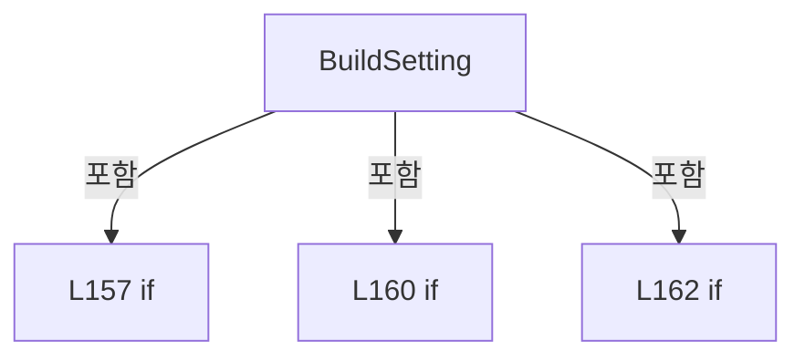

변경 전 점검: 입력/반환 타입, 위 호출자, 예외/취소 경로, 공유 상태와 저장·전송 소비자를 함께 확인합니다. 값의 단위나 물리 방향을 이름만으로 확정하지 않습니다.

### LocalFunctionStatement `ShouldIncludeItem` · L185–188

[Drilling.File/JHMI/CSettingFile.cs:185–188](https://github.com/kjuws10-rgb/A3Drilling/blob/96e22cd027c84bf302b23f2949b98985d7f301bb/Drilling.File/JHMI/CSettingFile.cs#L185-L188)

| 항목 | 실제 추출 값 |
| --- | --- |
| 서명 | bool ShouldIncludeItem(Drilling.File.JHMI.CSettingFile.ST_SETTING_FORM_ITEM) |
| 접근/수식자 | Private /  |
| 반환/값 타입 | bool |
| 소속 타입 | NamedType:Drilling.File.JHMI.CSettingFile |

입력 계약:

| 이름 | 타입 | 전달 | 선택/기본값 |
| --- | --- | --- | --- |
| item | Drilling.File.JHMI.CSettingFile.ST_SETTING_FORM_ITEM | None | False /  |

현재 부분 분석에서 직접 연결된 호출자는 없습니다. XAML/이벤트/인터페이스·델리게이트·외부 진입을 추가 확인해야 하며, 미사용으로 판정한 것이 아닙니다.

호출하는 대상과 해석 범위:

| 원본 행 | 표현식 | 분석 상태 | 대상/소스 위치 |
| --- | --- | --- | --- |
| 187 | string.IsNullOrWhiteSpace | resolved | bool string.IsNullOrWhiteSpace(string?) |
| 187 | string.IsNullOrWhiteSpace | resolved | bool string.IsNullOrWhiteSpace(string?) |

본문의 실제 연산·분기·예외·반환 순서(원문 위치 순):

| 원본 행 | 종류 | 주석 해설 |
| --- | --- | --- |
| 187 | call | 함수·델리게이트 또는 객체 생성자를 호출합니다: string.IsNullOrWhiteSpace(item.Tab) |
| 187 | call | 함수·델리게이트 또는 객체 생성자를 호출합니다: string.IsNullOrWhiteSpace(item.Name) |
| 187 | return | 호출자에게 값 또는 제어를 반환합니다: return !string.IsNullOrWhiteSpace(item.Tab) && !string.IsNullOrWhiteSpace(item.Name); |

변경 전 점검: 입력/반환 타입, 위 호출자, 예외/취소 경로, 공유 상태와 저장·전송 소비자를 함께 확인합니다. 값의 단위나 물리 방향을 이름만으로 확정하지 않습니다.

### MethodDeclaration `AppendBuiltInFormItems` · L194–218

[Drilling.File/JHMI/CSettingFile.cs:194–218](https://github.com/kjuws10-rgb/A3Drilling/blob/96e22cd027c84bf302b23f2949b98985d7f301bb/Drilling.File/JHMI/CSettingFile.cs#L194-L218)

| 항목 | 실제 추출 값 |
| --- | --- |
| 서명 | System.Collections.Generic.IReadOnlyList<Drilling.File.JHMI.CSettingFile.ST_SETTING_FORM_ITEM> Drilling.File.JHMI.CSettingFile.AppendBuiltInFormItems(System.Collections.Generic.IReadOnlyList<Drilling.File.JHMI.CSettingFile.ST_SETTING_FORM_ITEM>) |
| 접근/수식자 | Private / private, static |
| 반환/값 타입 | System.Collections.Generic.IReadOnlyList<Drilling.File.JHMI.CSettingFile.ST_SETTING_FORM_ITEM> |
| 소속 타입 | NamedType:Drilling.File.JHMI.CSettingFile |

입력 계약:

| 이름 | 타입 | 전달 | 선택/기본값 |
| --- | --- | --- | --- |
| formItems | System.Collections.Generic.IReadOnlyList<Drilling.File.JHMI.CSettingFile.ST_SETTING_FORM_ITEM> | None | False /  |

정적 호출자로 확인된 위치:

| 호출 파일/행 | 호출 표현식 | 런타임 분기 가능 |
| --- | --- | --- |
| [Drilling.File/JHMI/CSettingFile.cs:191–191](https://github.com/kjuws10-rgb/A3Drilling/blob/96e22cd027c84bf302b23f2949b98985d7f301bb/Drilling.File/JHMI/CSettingFile.cs#L191-L191) | AppendBuiltInFormItems | False |

호출하는 대상과 해석 범위:

| 원본 행 | 표현식 | 분석 상태 | 대상/소스 위치 |
| --- | --- | --- | --- |
| 201 | formItems.Select(SelectItem).ToHashSet | resolved | System.Collections.Generic.HashSet<string> System.Collections.Generic.IEnumerable<string>.ToHashSet<string>(System.Collections.Generic.IEqualityComparer<string>?) |
| 201 | formItems.Select | resolved | System.Collections.Generic.IEnumerable<string> System.Collections.Generic.IEnumerable<Drilling.File.JHMI.CSettingFile.ST_SETTING_FORM_ITEM>.Select<Drilling.File.JHMI.CSettingFile.ST_SETTING_FORM_ITEM, string>(System.Func<Drilling.File.JHMI.CSettingFile.ST_SETTING_FORM_ITEM, string>) |
| 202 | new List<ST_SETTING_FORM_ITEM> | resolved | System.Collections.Generic.List<Drilling.File.JHMI.CSettingFile.ST_SETTING_FORM_ITEM>.List(System.Collections.Generic.IEnumerable<Drilling.File.JHMI.CSettingFile.ST_SETTING_FORM_ITEM>) |
| 203 | CreateScannerFormItems().Append(new ST_SETTING_FORM_ITEM( "OPTION", "REVIEW", CVisionProtocol.MaxHoleCountPerLineSettingKey, "MaxHoleCountPerLine", EN_RECIPE_DATA_TYPE.Int, "count", true, true, CVisionProtocol.DefaultMaxHoleCountPerLine.ToString(CultureInfo.InvariantCulture), 1, CVisionProtocol.MaximumMarkCount, "1001 송신·1003 수신 배열의 고정 칸 수; Count는 … | resolved | System.Collections.Generic.IEnumerable<Drilling.File.JHMI.CSettingFile.ST_SETTING_FORM_ITEM> System.Collections.Generic.IEnumerable<Drilling.File.JHMI.CSettingFile.ST_SETTING_FORM_ITEM>.Concat<Drilling.File.JHMI.CSettingFile.ST_SETTING_FORM_ITEM>(System.Collections.Generic.IEnumerable<Drilling.File.JHMI.CSettingFile.ST_SETTING_FORM_ITEM>) |
| 203 | CreateScannerFormItems().Append(new ST_SETTING_FORM_ITEM( "OPTION", "REVIEW", CVisionProtocol.MaxHoleCountPerLineSettingKey, "MaxHoleCountPerLine", EN_RECIPE_DATA_TYPE.Int, "count", true, true, CVisionProtocol.DefaultMaxHoleCountPerLine.ToString(CultureInfo.InvariantCulture), 1, CVisionProtocol.MaximumMarkCount, "1001 송신·1003 수신 배열의 고정 칸 수; Count는 … | resolved | System.Collections.Generic.IEnumerable<Drilling.File.JHMI.CSettingFile.ST_SETTING_FORM_ITEM> System.Collections.Generic.IEnumerable<Drilling.File.JHMI.CSettingFile.ST_SETTING_FORM_ITEM>.Concat<Drilling.File.JHMI.CSettingFile.ST_SETTING_FORM_ITEM>(System.Collections.Generic.IEnumerable<Drilling.File.JHMI.CSettingFile.ST_SETTING_FORM_ITEM>) |
| 203 | CreateScannerFormItems().Append(new ST_SETTING_FORM_ITEM( "OPTION", "REVIEW", CVisionProtocol.MaxHoleCountPerLineSettingKey, "MaxHoleCountPerLine", EN_RECIPE_DATA_TYPE.Int, "count", true, true, CVisionProtocol.DefaultMaxHoleCountPerLine.ToString(CultureInfo.InvariantCulture), 1, CVisionProtocol.MaximumMarkCount, "1001 송신·1003 수신 배열의 고정 칸 수; Count는 … | resolved | System.Collections.Generic.IEnumerable<Drilling.File.JHMI.CSettingFile.ST_SETTING_FORM_ITEM> System.Collections.Generic.IEnumerable<Drilling.File.JHMI.CSettingFile.ST_SETTING_FORM_ITEM>.Concat<Drilling.File.JHMI.CSettingFile.ST_SETTING_FORM_ITEM>(System.Collections.Generic.IEnumerable<Drilling.File.JHMI.CSettingFile.ST_SETTING_FORM_ITEM>) |
| 203 | CreateScannerFormItems().Append(new ST_SETTING_FORM_ITEM( "OPTION", "REVIEW", CVisionProtocol.MaxHoleCountPerLineSettingKey, "MaxHoleCountPerLine", EN_RECIPE_DATA_TYPE.Int, "count", true, true, CVisionProtocol.DefaultMaxHoleCountPerLine.ToString(CultureInfo.InvariantCulture), 1, CVisionProtocol.MaximumMarkCount, "1001 송신·1003 수신 배열의 고정 칸 수; Count는 … | resolved | System.Collections.Generic.IEnumerable<Drilling.File.JHMI.CSettingFile.ST_SETTING_FORM_ITEM> System.Collections.Generic.IEnumerable<Drilling.File.JHMI.CSettingFile.ST_SETTING_FORM_ITEM>.Concat<Drilling.File.JHMI.CSettingFile.ST_SETTING_FORM_ITEM>(System.Collections.Generic.IEnumerable<Drilling.File.JHMI.CSettingFile.ST_SETTING_FORM_ITEM>) |
| 203 | CreateScannerFormItems().Append(new ST_SETTING_FORM_ITEM( "OPTION", "REVIEW", CVisionProtocol.MaxHoleCountPerLineSettingKey, "MaxHoleCountPerLine", EN_RECIPE_DATA_TYPE.Int, "count", true, true, CVisionProtocol.DefaultMaxHoleCountPerLine.ToString(CultureInfo.InvariantCulture), 1, CVisionProtocol.MaximumMarkCount, "1001 송신·1003 수신 배열의 고정 칸 수; Count는 … | resolved | System.Collections.Generic.IEnumerable<Drilling.File.JHMI.CSettingFile.ST_SETTING_FORM_ITEM> System.Collections.Generic.IEnumerable<Drilling.File.JHMI.CSettingFile.ST_SETTING_FORM_ITEM>.Append<Drilling.File.JHMI.CSettingFile.ST_SETTING_FORM_ITEM>(Drilling.File.JHMI.CSettingFile.ST_SETTING_FORM_ITEM) |
| 203 | CreateScannerFormItems().Append | resolved | System.Collections.Generic.IEnumerable<Drilling.File.JHMI.CSettingFile.ST_SETTING_FORM_ITEM> System.Collections.Generic.IEnumerable<Drilling.File.JHMI.CSettingFile.ST_SETTING_FORM_ITEM>.Append<Drilling.File.JHMI.CSettingFile.ST_SETTING_FORM_ITEM>(Drilling.File.JHMI.CSettingFile.ST_SETTING_FORM_ITEM) |
| 203 | CreateScannerFormItems | resolved | System.Collections.Generic.IEnumerable<Drilling.File.JHMI.CSettingFile.ST_SETTING_FORM_ITEM> Drilling.File.JHMI.CSettingFile.CreateScannerFormItems() · Drilling.File/JHMI/CSettingFile.cs:280 |
| 203 | new ST_SETTING_FORM_ITEM | resolved | Drilling.File.JHMI.CSettingFile.ST_SETTING_FORM_ITEM.ST_SETTING_FORM_ITEM(string, string, string, string, Drilling.Common.Managers.EN_RECIPE_DATA_TYPE, string, bool, bool, string, double, double, string, int, System.Collections.Generic.IReadOnlyDictionary<string, string>?) · Drilling.File/JHMI/CSettingFile.cs:582 |
| 205 | CVisionProtocol.DefaultMaxHoleCountPerLine.ToString | resolved | string int.ToString(System.IFormatProvider?) |
| 206 | new ST_SETTING_FORM_ITEM | resolved | Drilling.File.JHMI.CSettingFile.ST_SETTING_FORM_ITEM.ST_SETTING_FORM_ITEM(string, string, string, string, Drilling.Common.Managers.EN_RECIPE_DATA_TYPE, string, bool, bool, string, double, double, string, int, System.Collections.Generic.IReadOnlyDictionary<string, string>?) · Drilling.File/JHMI/CSettingFile.cs:582 |
| 208 | CSettingManager.DefaultVisionCameraResolution.ToString | resolved | string double.ToString(string?, System.IFormatProvider?) |
| 209 | CreateAlignFormItems | resolved | System.Collections.Generic.IEnumerable<Drilling.File.JHMI.CSettingFile.ST_SETTING_FORM_ITEM> Drilling.File.JHMI.CSettingFile.CreateAlignFormItems() · Drilling.File/JHMI/CSettingFile.cs:264 |
| 209 | CreateOffsetScaleFormItems | resolved | System.Collections.Generic.IEnumerable<Drilling.File.JHMI.CSettingFile.ST_SETTING_FORM_ITEM> Drilling.File.JHMI.CSettingFile.CreateOffsetScaleFormItems() · Drilling.File/JHMI/CSettingFile.cs:228 |
| 209 | CreateReviewLevelFormItems | resolved | System.Collections.Generic.IEnumerable<Drilling.File.JHMI.CSettingFile.ST_SETTING_FORM_ITEM> Drilling.File.JHMI.CSettingFile.CreateReviewLevelFormItems() · Drilling.File/JHMI/CSettingFile.cs:236 |
| 209 | CreateDistortionRunOptionFormItems | resolved | System.Collections.Generic.IEnumerable<Drilling.File.JHMI.CSettingFile.ST_SETTING_FORM_ITEM> Drilling.File.JHMI.CSettingFile.CreateDistortionRunOptionFormItems() · Drilling.File/JHMI/CSettingFile.cs:220 |
| 211 | existingKeys.Add | resolved | bool System.Collections.Generic.HashSet<string>.Add(string) |
| 211 | CreateKey | resolved | string Drilling.File.JHMI.CSettingFile.CreateKey(string, string) · Drilling.File/JHMI/CSettingFile.cs:516 |
| 213 | merged.Add | resolved | void System.Collections.Generic.List<Drilling.File.JHMI.CSettingFile.ST_SETTING_FORM_ITEM>.Add(Drilling.File.JHMI.CSettingFile.ST_SETTING_FORM_ITEM) |

본문의 실제 연산·분기·예외·반환 순서(원문 위치 순):

| 원본 행 | 종류 | 주석 해설 |
| --- | --- | --- |
| 201 | call | 함수·델리게이트 또는 객체 생성자를 호출합니다: formItems.Select(SelectItem).ToHashSet(StringComparer.OrdinalIgnoreCase) |
| 201 | call | 함수·델리게이트 또는 객체 생성자를 호출합니다: formItems.Select(SelectItem) |
| 201 | local-declaration | 지역 변수를 선언합니다: var existingKeys = formItems.Select(SelectItem).ToHashSet(StringComparer.OrdinalIgnoreCase); |
| 201 | variable-initializer | 변수의 초기값을 지정합니다: existingKeys = formItems.Select(SelectItem).ToHashSet(StringComparer.OrdinalIgnoreCase) |
| 202 | call | 함수·델리게이트 또는 객체 생성자를 호출합니다: new List<ST_SETTING_FORM_ITEM>(formItems) |
| 202 | local-declaration | 지역 변수를 선언합니다: var merged = new List<ST_SETTING_FORM_ITEM>(formItems); |
| 202 | variable-initializer | 변수의 초기값을 지정합니다: merged = new List<ST_SETTING_FORM_ITEM>(formItems) |
| 203 | call | 함수·델리게이트 또는 객체 생성자를 호출합니다: CreateScannerFormItems() |
| 203 | call | 함수·델리게이트 또는 객체 생성자를 호출합니다: CreateScannerFormItems().Append(new ST_SETTING_FORM_ITEM( "OPTION", "REVIEW", CVisionProtocol.MaxHoleCountPerLineSettingKey, "MaxHoleCountPerLine", EN_RECIPE_DATA_TYPE.Int, "count", true, true, CVisionProtocol.DefaultMax… |
| 203 | call | 함수·델리게이트 또는 객체 생성자를 호출합니다: new ST_SETTING_FORM_ITEM( "OPTION", "REVIEW", CVisionProtocol.MaxHoleCountPerLineSettingKey, "MaxHoleCountPerLine", EN_RECIPE_DATA_TYPE.Int, "count", true, true, CVisionProtocol.DefaultMaxHoleCountPerLine.ToString(Cultur… |
| 203 | call | 함수·델리게이트 또는 객체 생성자를 호출합니다: CreateScannerFormItems().Append(new ST_SETTING_FORM_ITEM( "OPTION", "REVIEW", CVisionProtocol.MaxHoleCountPerLineSettingKey, "MaxHoleCountPerLine", EN_RECIPE_DATA_TYPE.Int, "count", true, true, CVisionProtocol.DefaultMax… |
| 203 | call | 함수·델리게이트 또는 객체 생성자를 호출합니다: CreateScannerFormItems().Append(new ST_SETTING_FORM_ITEM( "OPTION", "REVIEW", CVisionProtocol.MaxHoleCountPerLineSettingKey, "MaxHoleCountPerLine", EN_RECIPE_DATA_TYPE.Int, "count", true, true, CVisionProtocol.DefaultMax… |
| 203 | call | 함수·델리게이트 또는 객체 생성자를 호출합니다: CreateScannerFormItems().Append(new ST_SETTING_FORM_ITEM( "OPTION", "REVIEW", CVisionProtocol.MaxHoleCountPerLineSettingKey, "MaxHoleCountPerLine", EN_RECIPE_DATA_TYPE.Int, "count", true, true, CVisionProtocol.DefaultMax… |
| 203 | call | 함수·델리게이트 또는 객체 생성자를 호출합니다: CreateScannerFormItems().Append(new ST_SETTING_FORM_ITEM( "OPTION", "REVIEW", CVisionProtocol.MaxHoleCountPerLineSettingKey, "MaxHoleCountPerLine", EN_RECIPE_DATA_TYPE.Int, "count", true, true, CVisionProtocol.DefaultMax… |
| 203 | call | 함수·델리게이트 또는 객체 생성자를 호출합니다: CreateScannerFormItems().Append(new ST_SETTING_FORM_ITEM( "OPTION", "REVIEW", CVisionProtocol.MaxHoleCountPerLineSettingKey, "MaxHoleCountPerLine", EN_RECIPE_DATA_TYPE.Int, "count", true, true, CVisionProtocol.DefaultMax… |
| 203 | foreach | 컬렉션 요소를 순회합니다: foreach (var item in CreateScannerFormItems().Append(new ST_SETTING_FORM_ITEM( "OPTION", "REVIEW", CVisionProtocol.MaxHoleCountPerLineSettingKey, "MaxHoleCountPerLine", EN_RECIPE_DATA_TYPE.Int, "count", true, true, CVisionProtocol |
| 205 | call | 함수·델리게이트 또는 객체 생성자를 호출합니다: CVisionProtocol.DefaultMaxHoleCountPerLine.ToString(CultureInfo.InvariantCulture) |
| 206 | call | 함수·델리게이트 또는 객체 생성자를 호출합니다: new ST_SETTING_FORM_ITEM( "OPTION", "REVIEW", CSettingManager.VisionCameraResolutionKey, CSettingManager.ReviewCameraResolutionKey, EN_RECIPE_DATA_TYPE.Double, "mm/pixel", true, true, CSettingManager.DefaultVisionCameraR… |
| 208 | call | 함수·델리게이트 또는 객체 생성자를 호출합니다: CSettingManager.DefaultVisionCameraResolution.ToString("R", CultureInfo.InvariantCulture) |
| 209 | call | 함수·델리게이트 또는 객체 생성자를 호출합니다: CreateAlignFormItems() |
| 209 | call | 함수·델리게이트 또는 객체 생성자를 호출합니다: CreateOffsetScaleFormItems() |
| 209 | call | 함수·델리게이트 또는 객체 생성자를 호출합니다: CreateReviewLevelFormItems() |
| 209 | call | 함수·델리게이트 또는 객체 생성자를 호출합니다: CreateDistortionRunOptionFormItems() |
| 211 | call | 함수·델리게이트 또는 객체 생성자를 호출합니다: existingKeys.Add(CreateKey(item.Tab, item.Name)) |
| 211 | call | 함수·델리게이트 또는 객체 생성자를 호출합니다: CreateKey(item.Tab, item.Name) |
| 211 | if | 조건에 따라 분기합니다: if (existingKeys.Add(CreateKey(item.Tab, item.Name))) |
| 213 | call | 함수·델리게이트 또는 객체 생성자를 호출합니다: merged.Add(item) |
| 217 | return | 호출자에게 값 또는 제어를 반환합니다: return merged; |

제어 구문의 포함 구조(실제 실행 순서/CFG가 아닌 구문 탐색 그림):

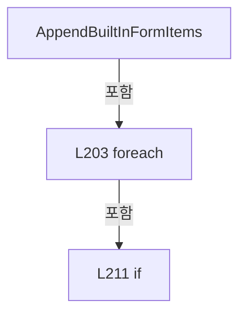

변경 전 점검: 입력/반환 타입, 위 호출자, 예외/취소 경로, 공유 상태와 저장·전송 소비자를 함께 확인합니다. 값의 단위나 물리 방향을 이름만으로 확정하지 않습니다.

### LocalFunctionStatement `SelectItem` · L196–199

[Drilling.File/JHMI/CSettingFile.cs:196–199](https://github.com/kjuws10-rgb/A3Drilling/blob/96e22cd027c84bf302b23f2949b98985d7f301bb/Drilling.File/JHMI/CSettingFile.cs#L196-L199)

| 항목 | 실제 추출 값 |
| --- | --- |
| 서명 | string SelectItem(Drilling.File.JHMI.CSettingFile.ST_SETTING_FORM_ITEM) |
| 접근/수식자 | Private /  |
| 반환/값 타입 | string |
| 소속 타입 | NamedType:Drilling.File.JHMI.CSettingFile |

입력 계약:

| 이름 | 타입 | 전달 | 선택/기본값 |
| --- | --- | --- | --- |
| item | Drilling.File.JHMI.CSettingFile.ST_SETTING_FORM_ITEM | None | False /  |

현재 부분 분석에서 직접 연결된 호출자는 없습니다. XAML/이벤트/인터페이스·델리게이트·외부 진입을 추가 확인해야 하며, 미사용으로 판정한 것이 아닙니다.

호출하는 대상과 해석 범위:

| 원본 행 | 표현식 | 분석 상태 | 대상/소스 위치 |
| --- | --- | --- | --- |
| 198 | CreateKey | resolved | string Drilling.File.JHMI.CSettingFile.CreateKey(string, string) · Drilling.File/JHMI/CSettingFile.cs:516 |

본문의 실제 연산·분기·예외·반환 순서(원문 위치 순):

| 원본 행 | 종류 | 주석 해설 |
| --- | --- | --- |
| 198 | call | 함수·델리게이트 또는 객체 생성자를 호출합니다: CreateKey(item.Tab, item.Name) |
| 198 | return | 호출자에게 값 또는 제어를 반환합니다: return CreateKey(item.Tab, item.Name); |

변경 전 점검: 입력/반환 타입, 위 호출자, 예외/취소 경로, 공유 상태와 저장·전송 소비자를 함께 확인합니다. 값의 단위나 물리 방향을 이름만으로 확정하지 않습니다.

### MethodDeclaration `CreateDistortionRunOptionFormItems` · L220–226

[Drilling.File/JHMI/CSettingFile.cs:220–226](https://github.com/kjuws10-rgb/A3Drilling/blob/96e22cd027c84bf302b23f2949b98985d7f301bb/Drilling.File/JHMI/CSettingFile.cs#L220-L226)

| 항목 | 실제 추출 값 |
| --- | --- |
| 서명 | System.Collections.Generic.IEnumerable<Drilling.File.JHMI.CSettingFile.ST_SETTING_FORM_ITEM> Drilling.File.JHMI.CSettingFile.CreateDistortionRunOptionFormItems() |
| 접근/수식자 | Private / private, static |
| 반환/값 타입 | System.Collections.Generic.IEnumerable<Drilling.File.JHMI.CSettingFile.ST_SETTING_FORM_ITEM> |
| 소속 타입 | NamedType:Drilling.File.JHMI.CSettingFile |

정적 호출자로 확인된 위치:

| 호출 파일/행 | 호출 표현식 | 런타임 분기 가능 |
| --- | --- | --- |
| [Drilling.File/JHMI/CSettingFile.cs:209–209](https://github.com/kjuws10-rgb/A3Drilling/blob/96e22cd027c84bf302b23f2949b98985d7f301bb/Drilling.File/JHMI/CSettingFile.cs#L209-L209) | CreateDistortionRunOptionFormItems | False |

호출하는 대상과 해석 범위:

| 원본 행 | 표현식 | 분석 상태 | 대상/소스 위치 |
| --- | --- | --- | --- |
| 224 | new | resolved | Drilling.File.JHMI.CSettingFile.ST_SETTING_FORM_ITEM.ST_SETTING_FORM_ITEM(string, string, string, string, Drilling.Common.Managers.EN_RECIPE_DATA_TYPE, string, bool, bool, string, double, double, string, int, System.Collections.Generic.IReadOnlyDictionary<string, string>?) · Drilling.File/JHMI/CSettingFile.cs:582 |

본문의 실제 연산·분기·예외·반환 순서(원문 위치 순):

| 원본 행 | 종류 | 주석 해설 |
| --- | --- | --- |
| 222 | local-declaration | 지역 변수를 선언합니다: var keys = new[] { CRunOptionSettings.DistortionGroup0, CRunOptionSettings.DistortionGroup1, CRunOptionSettings.DistortionGroup2 }; |
| 222 | variable-initializer | 변수의 초기값을 지정합니다: keys = new[] { CRunOptionSettings.DistortionGroup0, CRunOptionSettings.DistortionGroup1, CRunOptionSettings.DistortionGroup2 } |
| 223 | variable-initializer | 변수의 초기값을 지정합니다: index = 0 |
| 223 | for | 초기화·조건·증감이 있는 반복입니다: for (var index = 0; index < keys.Length; index++) |
| 224 | call | 함수·델리게이트 또는 객체 생성자를 호출합니다: new("OPTION", "RUNOPTION", keys[index], $"Distortion Key Group {index}", EN_RECIPE_DATA_TYPE.Bool, "", true, true, "0", 0, 1, $"0=미선택; 1=선택; Group {index}는 독립 선택; Main Run Option 변경 시 즉시 저장; Stage Y 측정 위치는 Motor-ALIGN의 D… |
| 224 | yield | 열거값/종료를 전달합니다: yield return new("OPTION", "RUNOPTION", keys[index], $"Distortion Key Group {index}", EN_RECIPE_DATA_TYPE.Bool, "", true, true, "0", 0, 1, $"0=미선택; 1=선택; Group {index}는 독립 선택; Main Run Option 변경 시 즉시 저장; Stage Y 측정 위치는 Motor-ALIGN |

제어 구문의 포함 구조(실제 실행 순서/CFG가 아닌 구문 탐색 그림):

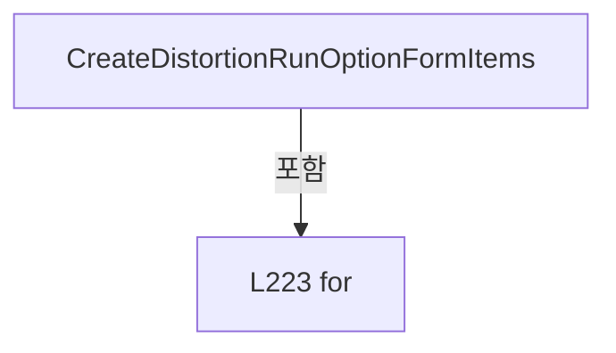

변경 전 점검: 입력/반환 타입, 위 호출자, 예외/취소 경로, 공유 상태와 저장·전송 소비자를 함께 확인합니다. 값의 단위나 물리 방향을 이름만으로 확정하지 않습니다.

### MethodDeclaration `CreateOffsetScaleFormItems` · L228–234

[Drilling.File/JHMI/CSettingFile.cs:228–234](https://github.com/kjuws10-rgb/A3Drilling/blob/96e22cd027c84bf302b23f2949b98985d7f301bb/Drilling.File/JHMI/CSettingFile.cs#L228-L234)

| 항목 | 실제 추출 값 |
| --- | --- |
| 서명 | System.Collections.Generic.IEnumerable<Drilling.File.JHMI.CSettingFile.ST_SETTING_FORM_ITEM> Drilling.File.JHMI.CSettingFile.CreateOffsetScaleFormItems() |
| 접근/수식자 | Private / private, static |
| 반환/값 타입 | System.Collections.Generic.IEnumerable<Drilling.File.JHMI.CSettingFile.ST_SETTING_FORM_ITEM> |
| 소속 타입 | NamedType:Drilling.File.JHMI.CSettingFile |

정적 호출자로 확인된 위치:

| 호출 파일/행 | 호출 표현식 | 런타임 분기 가능 |
| --- | --- | --- |
| [Drilling.File/JHMI/CSettingFile.cs:209–209](https://github.com/kjuws10-rgb/A3Drilling/blob/96e22cd027c84bf302b23f2949b98985d7f301bb/Drilling.File/JHMI/CSettingFile.cs#L209-L209) | CreateOffsetScaleFormItems | False |

호출하는 대상과 해석 범위:

| 원본 행 | 표현식 | 분석 상태 | 대상/소스 위치 |
| --- | --- | --- | --- |
| 230 | new | resolved | Drilling.File.JHMI.CSettingFile.ST_SETTING_FORM_ITEM.ST_SETTING_FORM_ITEM(string, string, string, string, Drilling.Common.Managers.EN_RECIPE_DATA_TYPE, string, bool, bool, string, double, double, string, int, System.Collections.Generic.IReadOnlyDictionary<string, string>?) · Drilling.File/JHMI/CSettingFile.cs:582 |
| 232 | new | resolved | Drilling.File.JHMI.CSettingFile.ST_SETTING_FORM_ITEM.ST_SETTING_FORM_ITEM(string, string, string, string, Drilling.Common.Managers.EN_RECIPE_DATA_TYPE, string, bool, bool, string, double, double, string, int, System.Collections.Generic.IReadOnlyDictionary<string, string>?) · Drilling.File/JHMI/CSettingFile.cs:582 |

본문의 실제 연산·분기·예외·반환 순서(원문 위치 순):

| 원본 행 | 종류 | 주석 해설 |
| --- | --- | --- |
| 230 | call | 함수·델리게이트 또는 객체 생성자를 호출합니다: new("OPTION", "REVIEW", "REVIEW_OFFSET_SCALE", "Review Offset Scale", EN_RECIPE_DATA_TYPE.Int, "%", true, true, "100", 0, int.MaxValue, "가공 좌표 생성 시 저장된 Review Offset에 적용할 비율; 0%=미적용; 100%=원래 값; 200%=2배; 저장값과 설계 Masking/C… |
| 230 | yield | 열거값/종료를 전달합니다: yield return new("OPTION", "REVIEW", "REVIEW_OFFSET_SCALE", "Review Offset Scale", EN_RECIPE_DATA_TYPE.Int, "%", true, true, "100", 0, int.MaxValue, "가공 좌표 생성 시 저장된 Review Offset에 적용할 비율; 0%=미적용; 100%=원래 값; 200%=2배; 저장값과 설계 Maskin |
| 232 | call | 함수·델리게이트 또는 객체 생성자를 호출합니다: new("OPTION", "ALIGN", "ALIGN_OFFSET_SCALE", "Align Offset Scale", EN_RECIPE_DATA_TYPE.Int, "%", true, true, "100", 0, int.MaxValue, "가공 좌표 생성 시 저장된 Align Offset에 적용할 비율; 0%=미적용; 100%=원래 값; 200%=2배; 저장값과 설계 Masking/Chess… |
| 232 | yield | 열거값/종료를 전달합니다: yield return new("OPTION", "ALIGN", "ALIGN_OFFSET_SCALE", "Align Offset Scale", EN_RECIPE_DATA_TYPE.Int, "%", true, true, "100", 0, int.MaxValue, "가공 좌표 생성 시 저장된 Align Offset에 적용할 비율; 0%=미적용; 100%=원래 값; 200%=2배; 저장값과 설계 Masking/Ch |

변경 전 점검: 입력/반환 타입, 위 호출자, 예외/취소 경로, 공유 상태와 저장·전송 소비자를 함께 확인합니다. 값의 단위나 물리 방향을 이름만으로 확정하지 않습니다.

### MethodDeclaration `CreateReviewLevelFormItems` · L236–262

[Drilling.File/JHMI/CSettingFile.cs:236–262](https://github.com/kjuws10-rgb/A3Drilling/blob/96e22cd027c84bf302b23f2949b98985d7f301bb/Drilling.File/JHMI/CSettingFile.cs#L236-L262)

| 항목 | 실제 추출 값 |
| --- | --- |
| 서명 | System.Collections.Generic.IEnumerable<Drilling.File.JHMI.CSettingFile.ST_SETTING_FORM_ITEM> Drilling.File.JHMI.CSettingFile.CreateReviewLevelFormItems() |
| 접근/수식자 | Private / private, static |
| 반환/값 타입 | System.Collections.Generic.IEnumerable<Drilling.File.JHMI.CSettingFile.ST_SETTING_FORM_ITEM> |
| 소속 타입 | NamedType:Drilling.File.JHMI.CSettingFile |

정적 호출자로 확인된 위치:

| 호출 파일/행 | 호출 표현식 | 런타임 분기 가능 |
| --- | --- | --- |
| [Drilling.File/JHMI/CSettingFile.cs:209–209](https://github.com/kjuws10-rgb/A3Drilling/blob/96e22cd027c84bf302b23f2949b98985d7f301bb/Drilling.File/JHMI/CSettingFile.cs#L209-L209) | CreateReviewLevelFormItems | False |

호출하는 대상과 해석 범위:

| 원본 행 | 표현식 | 분석 상태 | 대상/소스 위치 |
| --- | --- | --- | --- |
| 238 | new | resolved | Drilling.File.JHMI.CSettingFile.ST_SETTING_FORM_ITEM.ST_SETTING_FORM_ITEM(string, string, string, string, Drilling.Common.Managers.EN_RECIPE_DATA_TYPE, string, bool, bool, string, double, double, string, int, System.Collections.Generic.IReadOnlyDictionary<string, string>?) · Drilling.File/JHMI/CSettingFile.cs:582 |
| 240 | CReviewResultLevelSettings.DefaultLevel1Maximum.ToString | resolved | string double.ToString(string?, System.IFormatProvider?) |
| 242 | new | resolved | Drilling.File.JHMI.CSettingFile.ST_SETTING_FORM_ITEM.ST_SETTING_FORM_ITEM(string, string, string, string, Drilling.Common.Managers.EN_RECIPE_DATA_TYPE, string, bool, bool, string, double, double, string, int, System.Collections.Generic.IReadOnlyDictionary<string, string>?) · Drilling.File/JHMI/CSettingFile.cs:582 |
| 244 | CReviewResultLevelSettings.DefaultLevel2Maximum.ToString | resolved | string double.ToString(string?, System.IFormatProvider?) |
| 246 | new | resolved | Drilling.File.JHMI.CSettingFile.ST_SETTING_FORM_ITEM.ST_SETTING_FORM_ITEM(string, string, string, string, Drilling.Common.Managers.EN_RECIPE_DATA_TYPE, string, bool, bool, string, double, double, string, int, System.Collections.Generic.IReadOnlyDictionary<string, string>?) · Drilling.File/JHMI/CSettingFile.cs:582 |
| 248 | CReviewResultLevelSettings.DefaultLevel3Maximum.ToString | resolved | string double.ToString(string?, System.IFormatProvider?) |
| 250 | new | resolved | Drilling.File.JHMI.CSettingFile.ST_SETTING_FORM_ITEM.ST_SETTING_FORM_ITEM(string, string, string, string, Drilling.Common.Managers.EN_RECIPE_DATA_TYPE, string, bool, bool, string, double, double, string, int, System.Collections.Generic.IReadOnlyDictionary<string, string>?) · Drilling.File/JHMI/CSettingFile.cs:582 |
| 253 | new | resolved | Drilling.File.JHMI.CSettingFile.ST_SETTING_FORM_ITEM.ST_SETTING_FORM_ITEM(string, string, string, string, Drilling.Common.Managers.EN_RECIPE_DATA_TYPE, string, bool, bool, string, double, double, string, int, System.Collections.Generic.IReadOnlyDictionary<string, string>?) · Drilling.File/JHMI/CSettingFile.cs:582 |
| 256 | new | resolved | Drilling.File.JHMI.CSettingFile.ST_SETTING_FORM_ITEM.ST_SETTING_FORM_ITEM(string, string, string, string, Drilling.Common.Managers.EN_RECIPE_DATA_TYPE, string, bool, bool, string, double, double, string, int, System.Collections.Generic.IReadOnlyDictionary<string, string>?) · Drilling.File/JHMI/CSettingFile.cs:582 |
| 259 | new | resolved | Drilling.File.JHMI.CSettingFile.ST_SETTING_FORM_ITEM.ST_SETTING_FORM_ITEM(string, string, string, string, Drilling.Common.Managers.EN_RECIPE_DATA_TYPE, string, bool, bool, string, double, double, string, int, System.Collections.Generic.IReadOnlyDictionary<string, string>?) · Drilling.File/JHMI/CSettingFile.cs:582 |

본문의 실제 연산·분기·예외·반환 순서(원문 위치 순):

| 원본 행 | 종류 | 주석 해설 |
| --- | --- | --- |
| 238 | call | 함수·델리게이트 또는 객체 생성자를 호출합니다: new("OPTION", "REVIEW", CReviewResultLevelSettings.Level1MaximumKey, "Review Level 1 Max", EN_RECIPE_DATA_TYPE.Double, "mm", true, true, CReviewResultLevelSettings.DefaultLevel1Maximum.ToString("R", CultureInfo.Invariant… |
| 238 | yield | 열거값/종료를 전달합니다: yield return new("OPTION", "REVIEW", CReviewResultLevelSettings.Level1MaximumKey, "Review Level 1 Max", EN_RECIPE_DATA_TYPE.Double, "mm", true, true, CReviewResultLevelSettings.DefaultLevel1Maximum.ToString("R", CultureInfo.Invari |
| 240 | call | 함수·델리게이트 또는 객체 생성자를 호출합니다: CReviewResultLevelSettings.DefaultLevel1Maximum.ToString("R", CultureInfo.InvariantCulture) |
| 242 | call | 함수·델리게이트 또는 객체 생성자를 호출합니다: new("OPTION", "REVIEW", CReviewResultLevelSettings.Level2MaximumKey, "Review Level 2 Max", EN_RECIPE_DATA_TYPE.Double, "mm", true, true, CReviewResultLevelSettings.DefaultLevel2Maximum.ToString("R", CultureInfo.Invariant… |
| 242 | yield | 열거값/종료를 전달합니다: yield return new("OPTION", "REVIEW", CReviewResultLevelSettings.Level2MaximumKey, "Review Level 2 Max", EN_RECIPE_DATA_TYPE.Double, "mm", true, true, CReviewResultLevelSettings.DefaultLevel2Maximum.ToString("R", CultureInfo.Invari |
| 244 | call | 함수·델리게이트 또는 객체 생성자를 호출합니다: CReviewResultLevelSettings.DefaultLevel2Maximum.ToString("R", CultureInfo.InvariantCulture) |
| 246 | call | 함수·델리게이트 또는 객체 생성자를 호출합니다: new("OPTION", "REVIEW", CReviewResultLevelSettings.Level3MaximumKey, "Review Level 3 Max", EN_RECIPE_DATA_TYPE.Double, "mm", true, true, CReviewResultLevelSettings.DefaultLevel3Maximum.ToString("R", CultureInfo.Invariant… |
| 246 | yield | 열거값/종료를 전달합니다: yield return new("OPTION", "REVIEW", CReviewResultLevelSettings.Level3MaximumKey, "Review Level 3 Max", EN_RECIPE_DATA_TYPE.Double, "mm", true, true, CReviewResultLevelSettings.DefaultLevel3Maximum.ToString("R", CultureInfo.Invari |
| 248 | call | 함수·델리게이트 또는 객체 생성자를 호출합니다: CReviewResultLevelSettings.DefaultLevel3Maximum.ToString("R", CultureInfo.InvariantCulture) |
| 250 | call | 함수·델리게이트 또는 객체 생성자를 호출합니다: new("OPTION", "REVIEW", CReviewResultLevelSettings.Level1ColorKey, "Review Level 1 Color", EN_RECIPE_DATA_TYPE.String, "color", true, true, CReviewResultLevelSettings.DefaultLevel1Color, 0, 0, "Review Level 1 표시 색상 (#RRG… |
| 250 | yield | 열거값/종료를 전달합니다: yield return new("OPTION", "REVIEW", CReviewResultLevelSettings.Level1ColorKey, "Review Level 1 Color", EN_RECIPE_DATA_TYPE.String, "color", true, true, CReviewResultLevelSettings.DefaultLevel1Color, 0, 0, "Review Level 1 표시 색상 (# |
| 253 | call | 함수·델리게이트 또는 객체 생성자를 호출합니다: new("OPTION", "REVIEW", CReviewResultLevelSettings.Level2ColorKey, "Review Level 2 Color", EN_RECIPE_DATA_TYPE.String, "color", true, true, CReviewResultLevelSettings.DefaultLevel2Color, 0, 0, "Review Level 2 표시 색상 (#RRG… |
| 253 | yield | 열거값/종료를 전달합니다: yield return new("OPTION", "REVIEW", CReviewResultLevelSettings.Level2ColorKey, "Review Level 2 Color", EN_RECIPE_DATA_TYPE.String, "color", true, true, CReviewResultLevelSettings.DefaultLevel2Color, 0, 0, "Review Level 2 표시 색상 (# |
| 256 | call | 함수·델리게이트 또는 객체 생성자를 호출합니다: new("OPTION", "REVIEW", CReviewResultLevelSettings.Level3ColorKey, "Review Level 3 Color", EN_RECIPE_DATA_TYPE.String, "color", true, true, CReviewResultLevelSettings.DefaultLevel3Color, 0, 0, "Review Level 3 표시 색상 (#RRG… |
| 256 | yield | 열거값/종료를 전달합니다: yield return new("OPTION", "REVIEW", CReviewResultLevelSettings.Level3ColorKey, "Review Level 3 Color", EN_RECIPE_DATA_TYPE.String, "color", true, true, CReviewResultLevelSettings.DefaultLevel3Color, 0, 0, "Review Level 3 표시 색상 (# |
| 259 | call | 함수·델리게이트 또는 객체 생성자를 호출합니다: new("OPTION", "REVIEW", CReviewResultLevelSettings.Level4ColorKey, "Review Level 4 Color", EN_RECIPE_DATA_TYPE.String, "color", true, true, CReviewResultLevelSettings.DefaultLevel4Color, 0, 0, "Review Level 4 표시 색상 (#RRG… |
| 259 | yield | 열거값/종료를 전달합니다: yield return new("OPTION", "REVIEW", CReviewResultLevelSettings.Level4ColorKey, "Review Level 4 Color", EN_RECIPE_DATA_TYPE.String, "color", true, true, CReviewResultLevelSettings.DefaultLevel4Color, 0, 0, "Review Level 4 표시 색상 (# |

변경 전 점검: 입력/반환 타입, 위 호출자, 예외/취소 경로, 공유 상태와 저장·전송 소비자를 함께 확인합니다. 값의 단위나 물리 방향을 이름만으로 확정하지 않습니다.

### MethodDeclaration `CreateAlignFormItems` · L264–278

[Drilling.File/JHMI/CSettingFile.cs:264–278](https://github.com/kjuws10-rgb/A3Drilling/blob/96e22cd027c84bf302b23f2949b98985d7f301bb/Drilling.File/JHMI/CSettingFile.cs#L264-L278)

| 항목 | 실제 추출 값 |
| --- | --- |
| 서명 | System.Collections.Generic.IEnumerable<Drilling.File.JHMI.CSettingFile.ST_SETTING_FORM_ITEM> Drilling.File.JHMI.CSettingFile.CreateAlignFormItems() |
| 접근/수식자 | Private / private, static |
| 반환/값 타입 | System.Collections.Generic.IEnumerable<Drilling.File.JHMI.CSettingFile.ST_SETTING_FORM_ITEM> |
| 소속 타입 | NamedType:Drilling.File.JHMI.CSettingFile |

정적 호출자로 확인된 위치:

| 호출 파일/행 | 호출 표현식 | 런타임 분기 가능 |
| --- | --- | --- |
| [Drilling.File/JHMI/CSettingFile.cs:209–209](https://github.com/kjuws10-rgb/A3Drilling/blob/96e22cd027c84bf302b23f2949b98985d7f301bb/Drilling.File/JHMI/CSettingFile.cs#L209-L209) | CreateAlignFormItems | False |

호출하는 대상과 해석 범위:

| 원본 행 | 표현식 | 분석 상태 | 대상/소스 위치 |
| --- | --- | --- | --- |
| 266 | new | resolved | Drilling.File.JHMI.CSettingFile.ST_SETTING_FORM_ITEM.ST_SETTING_FORM_ITEM(string, string, string, string, Drilling.Common.Managers.EN_RECIPE_DATA_TYPE, string, bool, bool, string, double, double, string, int, System.Collections.Generic.IReadOnlyDictionary<string, string>?) · Drilling.File/JHMI/CSettingFile.cs:582 |
| 268 | CSettingManager.DefaultAlignCameraResolution.ToString | resolved | string double.ToString(string?, System.IFormatProvider?) |
| 270 | new | resolved | Drilling.File.JHMI.CSettingFile.ST_SETTING_FORM_ITEM.ST_SETTING_FORM_ITEM(string, string, string, string, Drilling.Common.Managers.EN_RECIPE_DATA_TYPE, string, bool, bool, string, double, double, string, int, System.Collections.Generic.IReadOnlyDictionary<string, string>?) · Drilling.File/JHMI/CSettingFile.cs:582 |
| 272 | CSettingManager.DefaultWapageAlignBaseTolerance.ToString | resolved | string double.ToString(string?, System.IFormatProvider?) |
| 275 | new | resolved | Drilling.File.JHMI.CSettingFile.ST_SETTING_FORM_ITEM.ST_SETTING_FORM_ITEM(string, string, string, string, Drilling.Common.Managers.EN_RECIPE_DATA_TYPE, string, bool, bool, string, double, double, string, int, System.Collections.Generic.IReadOnlyDictionary<string, string>?) · Drilling.File/JHMI/CSettingFile.cs:582 |
| 276 | (2000 - index * 500).ToString | resolved | string int.ToString(System.IFormatProvider?) |

본문의 실제 연산·분기·예외·반환 순서(원문 위치 순):

| 원본 행 | 종류 | 주석 해설 |
| --- | --- | --- |
| 266 | call | 함수·델리게이트 또는 객체 생성자를 호출합니다: new("OPTION", "ALIGN", CSettingManager.AlignCameraResolutionKey, CSettingManager.AlignCameraResolutionKey, EN_RECIPE_DATA_TYPE.Double, "mm/pixel", true, true, CSettingManager.DefaultAlignCameraResolution.ToString("R", Cu… |
| 266 | yield | 열거값/종료를 전달합니다: yield return new("OPTION", "ALIGN", CSettingManager.AlignCameraResolutionKey, CSettingManager.AlignCameraResolutionKey, EN_RECIPE_DATA_TYPE.Double, "mm/pixel", true, true, CSettingManager.DefaultAlignCameraResolution.ToString("R", |
| 268 | call | 함수·델리게이트 또는 객체 생성자를 호출합니다: CSettingManager.DefaultAlignCameraResolution.ToString("R", CultureInfo.InvariantCulture) |
| 270 | call | 함수·델리게이트 또는 객체 생성자를 호출합니다: new("OPTION", "ALIGN", CSettingManager.WapageAlignBaseToleranceKey, CSettingManager.WapageAlignBaseToleranceKey, EN_RECIPE_DATA_TYPE.Double, "mm", true, true, CSettingManager.DefaultWapageAlignBaseTolerance.ToString("R",… |
| 270 | yield | 열거값/종료를 전달합니다: yield return new("OPTION", "ALIGN", CSettingManager.WapageAlignBaseToleranceKey, CSettingManager.WapageAlignBaseToleranceKey, EN_RECIPE_DATA_TYPE.Double, "mm", true, true, CSettingManager.DefaultWapageAlignBaseTolerance.ToString(" |
| 272 | call | 함수·델리게이트 또는 객체 생성자를 호출합니다: CSettingManager.DefaultWapageAlignBaseTolerance.ToString("R", CultureInfo.InvariantCulture) |
| 274 | variable-initializer | 변수의 초기값을 지정합니다: index = 0 |
| 274 | for | 초기화·조건·증감이 있는 반복입니다: for (var index = 0; index < 3; index++) |
| 275 | call | 함수·델리게이트 또는 객체 생성자를 호출합니다: new("MOTOR", "ALIGN", $"DK{index}_STAGE_Y_POSITION", $"DK{index} Stage Y Position", EN_RECIPE_DATA_TYPE.Double, "mm", true, true, (2000 - index * 500).ToString(CultureInfo.InvariantCulture), -10000, 10000, $"Distortion G… |
| 275 | yield | 열거값/종료를 전달합니다: yield return new("MOTOR", "ALIGN", $"DK{index}_STAGE_Y_POSITION", $"DK{index} Stage Y Position", EN_RECIPE_DATA_TYPE.Double, "mm", true, true, (2000 - index * 500).ToString(CultureInfo.InvariantCulture), -10000, 10000, $"Distortio |
| 276 | call | 함수·델리게이트 또는 객체 생성자를 호출합니다: (2000 - index * 500).ToString(CultureInfo.InvariantCulture) |

제어 구문의 포함 구조(실제 실행 순서/CFG가 아닌 구문 탐색 그림):

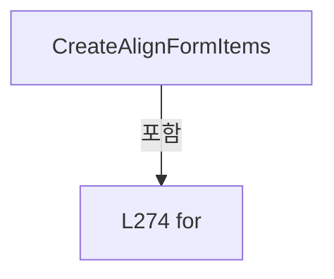

변경 전 점검: 입력/반환 타입, 위 호출자, 예외/취소 경로, 공유 상태와 저장·전송 소비자를 함께 확인합니다. 값의 단위나 물리 방향을 이름만으로 확정하지 않습니다.

### MethodDeclaration `CreateScannerFormItems` · L280–316

[Drilling.File/JHMI/CSettingFile.cs:280–316](https://github.com/kjuws10-rgb/A3Drilling/blob/96e22cd027c84bf302b23f2949b98985d7f301bb/Drilling.File/JHMI/CSettingFile.cs#L280-L316)

| 항목 | 실제 추출 값 |
| --- | --- |
| 서명 | System.Collections.Generic.IEnumerable<Drilling.File.JHMI.CSettingFile.ST_SETTING_FORM_ITEM> Drilling.File.JHMI.CSettingFile.CreateScannerFormItems() |
| 접근/수식자 | Private / private, static |
| 반환/값 타입 | System.Collections.Generic.IEnumerable<Drilling.File.JHMI.CSettingFile.ST_SETTING_FORM_ITEM> |
| 소속 타입 | NamedType:Drilling.File.JHMI.CSettingFile |

정적 호출자로 확인된 위치:

| 호출 파일/행 | 호출 표현식 | 런타임 분기 가능 |
| --- | --- | --- |
| [Drilling.File/JHMI/CSettingFile.cs:203–203](https://github.com/kjuws10-rgb/A3Drilling/blob/96e22cd027c84bf302b23f2949b98985d7f301bb/Drilling.File/JHMI/CSettingFile.cs#L203-L203) | CreateScannerFormItems | False |

호출하는 대상과 해석 범위:

| 원본 행 | 표현식 | 분석 상태 | 대상/소스 위치 |
| --- | --- | --- | --- |
| 284 | new ST_SETTING_FORM_ITEM | resolved | Drilling.File.JHMI.CSettingFile.ST_SETTING_FORM_ITEM.ST_SETTING_FORM_ITEM(string, string, string, string, Drilling.Common.Managers.EN_RECIPE_DATA_TYPE, string, bool, bool, string, double, double, string, int, System.Collections.Generic.IReadOnlyDictionary<string, string>?) · Drilling.File/JHMI/CSettingFile.cs:582 |
| 299 | new ST_SETTING_FORM_ITEM | resolved | Drilling.File.JHMI.CSettingFile.ST_SETTING_FORM_ITEM.ST_SETTING_FORM_ITEM(string, string, string, string, Drilling.Common.Managers.EN_RECIPE_DATA_TYPE, string, bool, bool, string, double, double, string, int, System.Collections.Generic.IReadOnlyDictionary<string, string>?) · Drilling.File/JHMI/CSettingFile.cs:582 |
| 300 | new ST_SETTING_FORM_ITEM | resolved | Drilling.File.JHMI.CSettingFile.ST_SETTING_FORM_ITEM.ST_SETTING_FORM_ITEM(string, string, string, string, Drilling.Common.Managers.EN_RECIPE_DATA_TYPE, string, bool, bool, string, double, double, string, int, System.Collections.Generic.IReadOnlyDictionary<string, string>?) · Drilling.File/JHMI/CSettingFile.cs:582 |

본문의 실제 연산·분기·예외·반환 순서(원문 위치 순):

| 원본 행 | 종류 | 주석 해설 |
| --- | --- | --- |
| 282 | variable-initializer | 변수의 초기값을 지정합니다: headNo = 1 |
| 282 | for | 초기화·조건·증감이 있는 반복입니다: for (var headNo = 1; headNo <= 8; headNo++) |
| 284 | call | 함수·델리게이트 또는 객체 생성자를 호출합니다: new ST_SETTING_FORM_ITEM( "OPTION", "SCANNER", $"H{headNo:00}_SCANNER_DIO_NO", $"H{headNo:00} Scanner DIO No", EN_RECIPE_DATA_TYPE.Int, "bit", true, true, "-1", 0, 63, $"H{headNo:00} manual scanner DIO output bit number … |
| 284 | yield | 열거값/종료를 전달합니다: yield return new ST_SETTING_FORM_ITEM( "OPTION", "SCANNER", $"H{headNo:00}_SCANNER_DIO_NO", $"H{headNo:00} Scanner DIO No", EN_RECIPE_DATA_TYPE.Int, "bit", true, true, "-1", 0, 63, $"H{headNo:00} manual scanner DIO output bit numb |
| 299 | call | 함수·델리게이트 또는 객체 생성자를 호출합니다: new ST_SETTING_FORM_ITEM("OPTION", "SCANNER", $"H{headNo:00}_SCANNER_Z_USE", $"H{headNo:00} Scanner Z Use", EN_RECIPE_DATA_TYPE.Bool, "", true, true, "OFF", 0, 1, $"H{headNo:00} 스캐너 Z축 사용 여부", 100 + (headNo * 2)) |
| 299 | yield | 열거값/종료를 전달합니다: yield return new ST_SETTING_FORM_ITEM("OPTION", "SCANNER", $"H{headNo:00}_SCANNER_Z_USE", $"H{headNo:00} Scanner Z Use", EN_RECIPE_DATA_TYPE.Bool, "", true, true, "OFF", 0, 1, $"H{headNo:00} 스캐너 Z축 사용 여부", 100 + (headNo * 2)); |
| 300 | call | 함수·델리게이트 또는 객체 생성자를 호출합니다: new ST_SETTING_FORM_ITEM( "OPTION", "SCANNER", $"H{headNo:00}_SCANNER_Z_AXIS", $"H{headNo:00} Scanner Z Axis", EN_RECIPE_DATA_TYPE.String, "", true, true, $"Z{headNo}", 0, 0, $"H{headNo:00} Automation1 스캐너 Z축 이름", 101 + … |
| 300 | yield | 열거값/종료를 전달합니다: yield return new ST_SETTING_FORM_ITEM( "OPTION", "SCANNER", $"H{headNo:00}_SCANNER_Z_AXIS", $"H{headNo:00} Scanner Z Axis", EN_RECIPE_DATA_TYPE.String, "", true, true, $"Z{headNo}", 0, 0, $"H{headNo:00} Automation1 스캐너 Z축 이름", 101 |

제어 구문의 포함 구조(실제 실행 순서/CFG가 아닌 구문 탐색 그림):

변경 전 점검: 입력/반환 타입, 위 호출자, 예외/취소 경로, 공유 상태와 저장·전송 소비자를 함께 확인합니다. 값의 단위나 물리 방향을 이름만으로 확정하지 않습니다.

### MethodDeclaration `LoadSettingValues` · L318–355

[Drilling.File/JHMI/CSettingFile.cs:318–355](https://github.com/kjuws10-rgb/A3Drilling/blob/96e22cd027c84bf302b23f2949b98985d7f301bb/Drilling.File/JHMI/CSettingFile.cs#L318-L355)

| 항목 | 실제 추출 값 |
| --- | --- |
| 서명 | System.Collections.Generic.Dictionary<string, string> Drilling.File.JHMI.CSettingFile.LoadSettingValues() |
| 접근/수식자 | Private / private |
| 반환/값 타입 | System.Collections.Generic.Dictionary<string, string> |
| 소속 타입 | NamedType:Drilling.File.JHMI.CSettingFile |

정적 호출자로 확인된 위치:

| 호출 파일/행 | 호출 표현식 | 런타임 분기 가능 |
| --- | --- | --- |
| [Drilling.File/JHMI/CSettingFile.cs:23–23](https://github.com/kjuws10-rgb/A3Drilling/blob/96e22cd027c84bf302b23f2949b98985d7f301bb/Drilling.File/JHMI/CSettingFile.cs#L23-L23) | LoadSettingValues | False |
| [Drilling.File/JHMI/CSettingFile.cs:58–58](https://github.com/kjuws10-rgb/A3Drilling/blob/96e22cd027c84bf302b23f2949b98985d7f301bb/Drilling.File/JHMI/CSettingFile.cs#L58-L58) | LoadSettingValues | False |
| [Drilling.File/JHMI/CSettingFile.cs:380–380](https://github.com/kjuws10-rgb/A3Drilling/blob/96e22cd027c84bf302b23f2949b98985d7f301bb/Drilling.File/JHMI/CSettingFile.cs#L380-L380) | LoadSettingValues | False |

호출하는 대상과 해석 범위:

| 원본 행 | 표현식 | 분석 상태 | 대상/소스 위치 |
| --- | --- | --- | --- |
| 320 | GetValuePath | resolved | string Drilling.File.JHMI.CSettingFile.GetValuePath() · Drilling.File/JHMI/CSettingFile.cs:500 |
| 329 | System.IO.File.Exists | resolved | bool System.IO.File.Exists(string?) |
| 331 | CCsvParser.ValidateRequiredHeaders | resolved | void Drilling.File.Parser.CCsvParser.ValidateRequiredHeaders(string, string, System.Collections.Generic.IEnumerable<System.Collections.Generic.IEnumerable<string>>) · Drilling.File/Parser/CCsvParser.cs:280 |
| 331 | ValueHeaders.Select | resolved | System.Collections.Generic.IEnumerable<string[]> System.Collections.Generic.IEnumerable<string>.Select<string, string[]>(System.Func<string, string[]>) |
| 354 | CCsvParser.Read(GetValuePath()).Where(HasSettingValueKey).GroupBy(SelectGroupKey, StringComparer.OrdinalIgnoreCase).ToDictionary | resolved | System.Collections.Generic.Dictionary<string, string> System.Collections.Generic.IEnumerable<System.Linq.IGrouping<string, System.Collections.Generic.IReadOnlyDictionary<string, string>>>.ToDictionary<System.Linq.IGrouping<string, System.Collections.Generic.IReadOnlyDictionary<string, string>>, string, string>(System.Func<System.Linq.IGrouping<string, System.Collections.Generic.IReadOnlyDictionary<string, string>>, string>, System.Func<System.Linq.IGrouping<string, System.Collections.Generic.IReadOnlyDictionary<string, string>>, string>, System.Collections.Generic.IEqualityComparer<string>?) |
| 354 | CCsvParser.Read(GetValuePath()).Where(HasSettingValueKey).GroupBy | resolved | System.Collections.Generic.IEnumerable<System.Linq.IGrouping<string, System.Collections.Generic.IReadOnlyDictionary<string, string>>> System.Collections.Generic.IEnumerable<System.Collections.Generic.IReadOnlyDictionary<string, string>>.GroupBy<System.Collections.Generic.IReadOnlyDictionary<string, string>, string>(System.Func<System.Collections.Generic.IReadOnlyDictionary<string, string>, string>, System.Collections.Generic.IEqualityComparer<string>?) |
| 354 | CCsvParser.Read(GetValuePath()).Where | resolved | System.Collections.Generic.IEnumerable<System.Collections.Generic.IReadOnlyDictionary<string, string>> System.Collections.Generic.IEnumerable<System.Collections.Generic.IReadOnlyDictionary<string, string>>.Where<System.Collections.Generic.IReadOnlyDictionary<string, string>>(System.Func<System.Collections.Generic.IReadOnlyDictionary<string, string>, bool>) |
| 354 | CCsvParser.Read | resolved | System.Collections.Generic.IReadOnlyList<System.Collections.Generic.IReadOnlyDictionary<string, string>> Drilling.File.Parser.CCsvParser.Read(string) · Drilling.File/Parser/CCsvParser.cs:12 |
| 354 | GetValuePath | resolved | string Drilling.File.JHMI.CSettingFile.GetValuePath() · Drilling.File/JHMI/CSettingFile.cs:500 |

본문의 실제 연산·분기·예외·반환 순서(원문 위치 순):

| 원본 행 | 종류 | 주석 해설 |
| --- | --- | --- |
| 320 | call | 함수·델리게이트 또는 객체 생성자를 호출합니다: GetValuePath() |
| 320 | local-declaration | 지역 변수를 선언합니다: var valuePath = GetValuePath(); |
| 320 | variable-initializer | 변수의 초기값을 지정합니다: valuePath = GetValuePath() |
| 329 | call | 함수·델리게이트 또는 객체 생성자를 호출합니다: System.IO.File.Exists(valuePath) |
| 329 | if | 조건에 따라 분기합니다: if (System.IO.File.Exists(valuePath)) |
| 331 | call | 함수·델리게이트 또는 객체 생성자를 호출합니다: CCsvParser.ValidateRequiredHeaders(valuePath, "Setting.csv", ValueHeaders.Select(SelectItem)) |
| 331 | call | 함수·델리게이트 또는 객체 생성자를 호출합니다: ValueHeaders.Select(SelectItem) |
| 354 | call | 함수·델리게이트 또는 객체 생성자를 호출합니다: CCsvParser.Read(GetValuePath()).Where(HasSettingValueKey).GroupBy(SelectGroupKey, StringComparer.OrdinalIgnoreCase).ToDictionary(SelectKey, SelectValue, StringComparer.OrdinalIgnoreCase) |
| 354 | call | 함수·델리게이트 또는 객체 생성자를 호출합니다: CCsvParser.Read(GetValuePath()).Where(HasSettingValueKey).GroupBy(SelectGroupKey, StringComparer.OrdinalIgnoreCase) |
| 354 | call | 함수·델리게이트 또는 객체 생성자를 호출합니다: CCsvParser.Read(GetValuePath()).Where(HasSettingValueKey) |
| 354 | call | 함수·델리게이트 또는 객체 생성자를 호출합니다: CCsvParser.Read(GetValuePath()) |
| 354 | call | 함수·델리게이트 또는 객체 생성자를 호출합니다: GetValuePath() |
| 354 | return | 호출자에게 값 또는 제어를 반환합니다: return CCsvParser.Read(GetValuePath()).Where(HasSettingValueKey).GroupBy(SelectGroupKey, StringComparer.OrdinalIgnoreCase).ToDictionary(SelectKey, SelectValue, StringComparer.OrdinalIgnoreCase); |

제어 구문의 포함 구조(실제 실행 순서/CFG가 아닌 구문 탐색 그림):

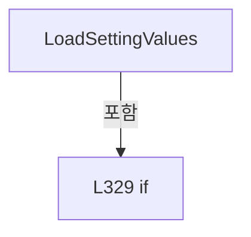

변경 전 점검: 입력/반환 타입, 위 호출자, 예외/취소 경로, 공유 상태와 저장·전송 소비자를 함께 확인합니다. 값의 단위나 물리 방향을 이름만으로 확정하지 않습니다.

### LocalFunctionStatement `SelectItem` · L321–327

[Drilling.File/JHMI/CSettingFile.cs:321–327](https://github.com/kjuws10-rgb/A3Drilling/blob/96e22cd027c84bf302b23f2949b98985d7f301bb/Drilling.File/JHMI/CSettingFile.cs#L321-L327)

| 항목 | 실제 추출 값 |
| --- | --- |
| 서명 | string[] SelectItem(string) |
| 접근/수식자 | Private /  |
| 반환/값 타입 | string[] |
| 소속 타입 | NamedType:Drilling.File.JHMI.CSettingFile |

입력 계약:

| 이름 | 타입 | 전달 | 선택/기본값 |
| --- | --- | --- | --- |
| header | string | None | False /  |

현재 부분 분석에서 직접 연결된 호출자는 없습니다. XAML/이벤트/인터페이스·델리게이트·외부 진입을 추가 확인해야 하며, 미사용으로 판정한 것이 아닙니다.

본문의 실제 연산·분기·예외·반환 순서(원문 위치 순):

| 원본 행 | 종류 | 주석 해설 |
| --- | --- | --- |
| 323 | return | 호출자에게 값 또는 제어를 반환합니다: return new[] { header }; |

변경 전 점검: 입력/반환 타입, 위 호출자, 예외/취소 경로, 공유 상태와 저장·전송 소비자를 함께 확인합니다. 값의 단위나 물리 방향을 이름만으로 확정하지 않습니다.

### LocalFunctionStatement `HasSettingValueKey` · L334–337

[Drilling.File/JHMI/CSettingFile.cs:334–337](https://github.com/kjuws10-rgb/A3Drilling/blob/96e22cd027c84bf302b23f2949b98985d7f301bb/Drilling.File/JHMI/CSettingFile.cs#L334-L337)

| 항목 | 실제 추출 값 |
| --- | --- |
| 서명 | bool HasSettingValueKey(System.Collections.Generic.IReadOnlyDictionary<string, string>) |
| 접근/수식자 | Private /  |
| 반환/값 타입 | bool |
| 소속 타입 | NamedType:Drilling.File.JHMI.CSettingFile |

입력 계약:

| 이름 | 타입 | 전달 | 선택/기본값 |
| --- | --- | --- | --- |
| row | System.Collections.Generic.IReadOnlyDictionary<string, string> | None | False /  |

현재 부분 분석에서 직접 연결된 호출자는 없습니다. XAML/이벤트/인터페이스·델리게이트·외부 진입을 추가 확인해야 하며, 미사용으로 판정한 것이 아닙니다.

호출하는 대상과 해석 범위:

| 원본 행 | 표현식 | 분석 상태 | 대상/소스 위치 |
| --- | --- | --- | --- |
| 336 | string.IsNullOrWhiteSpace | resolved | bool string.IsNullOrWhiteSpace(string?) |
| 336 | CCsvParser.Get | resolved | string Drilling.File.Parser.CCsvParser.Get(System.Collections.Generic.IReadOnlyDictionary<string, string>, string) · Drilling.File/Parser/CCsvParser.cs:168 |
| 336 | string.IsNullOrWhiteSpace | resolved | bool string.IsNullOrWhiteSpace(string?) |
| 336 | CCsvParser.Get | resolved | string Drilling.File.Parser.CCsvParser.Get(System.Collections.Generic.IReadOnlyDictionary<string, string>, string) · Drilling.File/Parser/CCsvParser.cs:168 |

본문의 실제 연산·분기·예외·반환 순서(원문 위치 순):

| 원본 행 | 종류 | 주석 해설 |
| --- | --- | --- |
| 336 | call | 함수·델리게이트 또는 객체 생성자를 호출합니다: string.IsNullOrWhiteSpace(CCsvParser.Get(row, "TAB")) |
| 336 | call | 함수·델리게이트 또는 객체 생성자를 호출합니다: CCsvParser.Get(row, "TAB") |
| 336 | call | 함수·델리게이트 또는 객체 생성자를 호출합니다: string.IsNullOrWhiteSpace(CCsvParser.Get(row, "NAME")) |
| 336 | call | 함수·델리게이트 또는 객체 생성자를 호출합니다: CCsvParser.Get(row, "NAME") |
| 336 | return | 호출자에게 값 또는 제어를 반환합니다: return !string.IsNullOrWhiteSpace(CCsvParser.Get(row, "TAB")) && !string.IsNullOrWhiteSpace(CCsvParser.Get(row, "NAME")); |

변경 전 점검: 입력/반환 타입, 위 호출자, 예외/취소 경로, 공유 상태와 저장·전송 소비자를 함께 확인합니다. 값의 단위나 물리 방향을 이름만으로 확정하지 않습니다.

### LocalFunctionStatement `SelectGroupKey` · L339–342

[Drilling.File/JHMI/CSettingFile.cs:339–342](https://github.com/kjuws10-rgb/A3Drilling/blob/96e22cd027c84bf302b23f2949b98985d7f301bb/Drilling.File/JHMI/CSettingFile.cs#L339-L342)

| 항목 | 실제 추출 값 |
| --- | --- |
| 서명 | string SelectGroupKey(System.Collections.Generic.IReadOnlyDictionary<string, string>) |
| 접근/수식자 | Private /  |
| 반환/값 타입 | string |
| 소속 타입 | NamedType:Drilling.File.JHMI.CSettingFile |

입력 계약:

| 이름 | 타입 | 전달 | 선택/기본값 |
| --- | --- | --- | --- |
| row | System.Collections.Generic.IReadOnlyDictionary<string, string> | None | False /  |

현재 부분 분석에서 직접 연결된 호출자는 없습니다. XAML/이벤트/인터페이스·델리게이트·외부 진입을 추가 확인해야 하며, 미사용으로 판정한 것이 아닙니다.

호출하는 대상과 해석 범위:

| 원본 행 | 표현식 | 분석 상태 | 대상/소스 위치 |
| --- | --- | --- | --- |
| 341 | CreateKey | resolved | string Drilling.File.JHMI.CSettingFile.CreateKey(string, string) · Drilling.File/JHMI/CSettingFile.cs:516 |
| 341 | CCsvParser.Get | resolved | string Drilling.File.Parser.CCsvParser.Get(System.Collections.Generic.IReadOnlyDictionary<string, string>, string) · Drilling.File/Parser/CCsvParser.cs:168 |
| 341 | CCsvParser.Get | resolved | string Drilling.File.Parser.CCsvParser.Get(System.Collections.Generic.IReadOnlyDictionary<string, string>, string) · Drilling.File/Parser/CCsvParser.cs:168 |

본문의 실제 연산·분기·예외·반환 순서(원문 위치 순):

| 원본 행 | 종류 | 주석 해설 |
| --- | --- | --- |
| 341 | call | 함수·델리게이트 또는 객체 생성자를 호출합니다: CreateKey(CCsvParser.Get(row, "TAB"), CCsvParser.Get(row, "NAME")) |
| 341 | call | 함수·델리게이트 또는 객체 생성자를 호출합니다: CCsvParser.Get(row, "TAB") |
| 341 | call | 함수·델리게이트 또는 객체 생성자를 호출합니다: CCsvParser.Get(row, "NAME") |
| 341 | return | 호출자에게 값 또는 제어를 반환합니다: return CreateKey(CCsvParser.Get(row, "TAB"), CCsvParser.Get(row, "NAME")); |

변경 전 점검: 입력/반환 타입, 위 호출자, 예외/취소 경로, 공유 상태와 저장·전송 소비자를 함께 확인합니다. 값의 단위나 물리 방향을 이름만으로 확정하지 않습니다.

### LocalFunctionStatement `SelectKey` · L344–347

[Drilling.File/JHMI/CSettingFile.cs:344–347](https://github.com/kjuws10-rgb/A3Drilling/blob/96e22cd027c84bf302b23f2949b98985d7f301bb/Drilling.File/JHMI/CSettingFile.cs#L344-L347)

| 항목 | 실제 추출 값 |
| --- | --- |
| 서명 | string SelectKey(System.Linq.IGrouping<string, System.Collections.Generic.IReadOnlyDictionary<string, string>>) |
| 접근/수식자 | Private /  |
| 반환/값 타입 | string |
| 소속 타입 | NamedType:Drilling.File.JHMI.CSettingFile |

입력 계약:

| 이름 | 타입 | 전달 | 선택/기본값 |
| --- | --- | --- | --- |
| group | System.Linq.IGrouping<string, System.Collections.Generic.IReadOnlyDictionary<string, string>> | None | False /  |

현재 부분 분석에서 직접 연결된 호출자는 없습니다. XAML/이벤트/인터페이스·델리게이트·외부 진입을 추가 확인해야 하며, 미사용으로 판정한 것이 아닙니다.

본문의 실제 연산·분기·예외·반환 순서(원문 위치 순):

| 원본 행 | 종류 | 주석 해설 |
| --- | --- | --- |
| 346 | return | 호출자에게 값 또는 제어를 반환합니다: return group.Key; |

변경 전 점검: 입력/반환 타입, 위 호출자, 예외/취소 경로, 공유 상태와 저장·전송 소비자를 함께 확인합니다. 값의 단위나 물리 방향을 이름만으로 확정하지 않습니다.

### LocalFunctionStatement `SelectValue` · L349–352

[Drilling.File/JHMI/CSettingFile.cs:349–352](https://github.com/kjuws10-rgb/A3Drilling/blob/96e22cd027c84bf302b23f2949b98985d7f301bb/Drilling.File/JHMI/CSettingFile.cs#L349-L352)

| 항목 | 실제 추출 값 |
| --- | --- |
| 서명 | string SelectValue(System.Linq.IGrouping<string, System.Collections.Generic.IReadOnlyDictionary<string, string>>) |
| 접근/수식자 | Private /  |
| 반환/값 타입 | string |
| 소속 타입 | NamedType:Drilling.File.JHMI.CSettingFile |

입력 계약:

| 이름 | 타입 | 전달 | 선택/기본값 |
| --- | --- | --- | --- |
| group | System.Linq.IGrouping<string, System.Collections.Generic.IReadOnlyDictionary<string, string>> | None | False /  |

현재 부분 분석에서 직접 연결된 호출자는 없습니다. XAML/이벤트/인터페이스·델리게이트·외부 진입을 추가 확인해야 하며, 미사용으로 판정한 것이 아닙니다.

호출하는 대상과 해석 범위:

| 원본 행 | 표현식 | 분석 상태 | 대상/소스 위치 |
| --- | --- | --- | --- |
| 351 | CCsvParser.Get | resolved | string Drilling.File.Parser.CCsvParser.Get(System.Collections.Generic.IReadOnlyDictionary<string, string>, string) · Drilling.File/Parser/CCsvParser.cs:168 |
| 351 | group.Last | resolved | System.Collections.Generic.IReadOnlyDictionary<string, string> System.Collections.Generic.IEnumerable<System.Collections.Generic.IReadOnlyDictionary<string, string>>.Last<System.Collections.Generic.IReadOnlyDictionary<string, string>>() |

본문의 실제 연산·분기·예외·반환 순서(원문 위치 순):

| 원본 행 | 종류 | 주석 해설 |
| --- | --- | --- |
| 351 | call | 함수·델리게이트 또는 객체 생성자를 호출합니다: CCsvParser.Get(group.Last(), "VALUE") |
| 351 | call | 함수·델리게이트 또는 객체 생성자를 호출합니다: group.Last() |
| 351 | return | 호출자에게 값 또는 제어를 반환합니다: return CCsvParser.Get(group.Last(), "VALUE"); |

변경 전 점검: 입력/반환 타입, 위 호출자, 예외/취소 경로, 공유 상태와 저장·전송 소비자를 함께 확인합니다. 값의 단위나 물리 방향을 이름만으로 확정하지 않습니다.

### MethodDeclaration `WriteSettingValues` · L357–376

[Drilling.File/JHMI/CSettingFile.cs:357–376](https://github.com/kjuws10-rgb/A3Drilling/blob/96e22cd027c84bf302b23f2949b98985d7f301bb/Drilling.File/JHMI/CSettingFile.cs#L357-L376)

| 항목 | 실제 추출 값 |
| --- | --- |
| 서명 | void Drilling.File.JHMI.CSettingFile.WriteSettingValues(System.Collections.Generic.IReadOnlyList<Drilling.File.JHMI.CSettingFile.ST_SETTING_FORM_ITEM>, System.Collections.Generic.IReadOnlyDictionary<string, string>) |
| 접근/수식자 | Private / private |
| 반환/값 타입 | void |
| 소속 타입 | NamedType:Drilling.File.JHMI.CSettingFile |

입력 계약:

| 이름 | 타입 | 전달 | 선택/기본값 |
| --- | --- | --- | --- |
| formItems | System.Collections.Generic.IReadOnlyList<Drilling.File.JHMI.CSettingFile.ST_SETTING_FORM_ITEM> | None | False /  |
| values | System.Collections.Generic.IReadOnlyDictionary<string, string> | None | False /  |

정적 호출자로 확인된 위치:

| 호출 파일/행 | 호출 표현식 | 런타임 분기 가능 |
| --- | --- | --- |
| [Drilling.File/JHMI/CSettingFile.cs:120–120](https://github.com/kjuws10-rgb/A3Drilling/blob/96e22cd027c84bf302b23f2949b98985d7f301bb/Drilling.File/JHMI/CSettingFile.cs#L120-L120) | WriteSettingValues | False |

호출하는 대상과 해석 범위:

| 원본 행 | 표현식 | 분석 상태 | 대상/소스 위치 |
| --- | --- | --- | --- |
| 374 | formItems.Where(IsUse).Select | resolved | System.Collections.Generic.IEnumerable<System.Collections.Generic.Dictionary<string, string>> System.Collections.Generic.IEnumerable<Drilling.File.JHMI.CSettingFile.ST_SETTING_FORM_ITEM>.Select<Drilling.File.JHMI.CSettingFile.ST_SETTING_FORM_ITEM, System.Collections.Generic.Dictionary<string, string>>(System.Func<Drilling.File.JHMI.CSettingFile.ST_SETTING_FORM_ITEM, System.Collections.Generic.Dictionary<string, string>>) |
| 374 | formItems.Where | resolved | System.Collections.Generic.IEnumerable<Drilling.File.JHMI.CSettingFile.ST_SETTING_FORM_ITEM> System.Collections.Generic.IEnumerable<Drilling.File.JHMI.CSettingFile.ST_SETTING_FORM_ITEM>.Where<Drilling.File.JHMI.CSettingFile.ST_SETTING_FORM_ITEM>(System.Func<Drilling.File.JHMI.CSettingFile.ST_SETTING_FORM_ITEM, bool>) |
| 375 | CCsvParser.Write | resolved | void Drilling.File.Parser.CCsvParser.Write(string, System.Collections.Generic.IReadOnlyList<string>, System.Collections.Generic.IEnumerable<System.Collections.Generic.IReadOnlyDictionary<string, string>>) · Drilling.File/Parser/CCsvParser.cs:58 |
| 375 | GetValuePath | resolved | string Drilling.File.JHMI.CSettingFile.GetValuePath() · Drilling.File/JHMI/CSettingFile.cs:500 |

본문의 실제 연산·분기·예외·반환 순서(원문 위치 순):

| 원본 행 | 종류 | 주석 해설 |
| --- | --- | --- |
| 374 | call | 함수·델리게이트 또는 객체 생성자를 호출합니다: formItems.Where(IsUse).Select(BuildSettingValueRow) |
| 374 | call | 함수·델리게이트 또는 객체 생성자를 호출합니다: formItems.Where(IsUse) |
| 374 | local-declaration | 지역 변수를 선언합니다: var rows = formItems.Where(IsUse).Select(BuildSettingValueRow); |
| 374 | variable-initializer | 변수의 초기값을 지정합니다: rows = formItems.Where(IsUse).Select(BuildSettingValueRow) |
| 375 | call | 함수·델리게이트 또는 객체 생성자를 호출합니다: CCsvParser.Write(GetValuePath(), ValueHeaders, rows) |
| 375 | call | 함수·델리게이트 또는 객체 생성자를 호출합니다: GetValuePath() |

변경 전 점검: 입력/반환 타입, 위 호출자, 예외/취소 경로, 공유 상태와 저장·전송 소비자를 함께 확인합니다. 값의 단위나 물리 방향을 이름만으로 확정하지 않습니다.

### LocalFunctionStatement `IsUse` · L359–362

[Drilling.File/JHMI/CSettingFile.cs:359–362](https://github.com/kjuws10-rgb/A3Drilling/blob/96e22cd027c84bf302b23f2949b98985d7f301bb/Drilling.File/JHMI/CSettingFile.cs#L359-L362)

| 항목 | 실제 추출 값 |
| --- | --- |
| 서명 | bool IsUse(Drilling.File.JHMI.CSettingFile.ST_SETTING_FORM_ITEM) |
| 접근/수식자 | Private /  |
| 반환/값 타입 | bool |
| 소속 타입 | NamedType:Drilling.File.JHMI.CSettingFile |

입력 계약:

| 이름 | 타입 | 전달 | 선택/기본값 |
| --- | --- | --- | --- |
| item | Drilling.File.JHMI.CSettingFile.ST_SETTING_FORM_ITEM | None | False /  |

현재 부분 분석에서 직접 연결된 호출자는 없습니다. XAML/이벤트/인터페이스·델리게이트·외부 진입을 추가 확인해야 하며, 미사용으로 판정한 것이 아닙니다.

본문의 실제 연산·분기·예외·반환 순서(원문 위치 순):

| 원본 행 | 종류 | 주석 해설 |
| --- | --- | --- |
| 361 | return | 호출자에게 값 또는 제어를 반환합니다: return item.Use; |

변경 전 점검: 입력/반환 타입, 위 호출자, 예외/취소 경로, 공유 상태와 저장·전송 소비자를 함께 확인합니다. 값의 단위나 물리 방향을 이름만으로 확정하지 않습니다.

### LocalFunctionStatement `BuildSettingValueRow` · L364–372

[Drilling.File/JHMI/CSettingFile.cs:364–372](https://github.com/kjuws10-rgb/A3Drilling/blob/96e22cd027c84bf302b23f2949b98985d7f301bb/Drilling.File/JHMI/CSettingFile.cs#L364-L372)

| 항목 | 실제 추출 값 |
| --- | --- |
| 서명 | System.Collections.Generic.Dictionary<string, string> BuildSettingValueRow(Drilling.File.JHMI.CSettingFile.ST_SETTING_FORM_ITEM) |
| 접근/수식자 | Private /  |
| 반환/값 타입 | System.Collections.Generic.Dictionary<string, string> |
| 소속 타입 | NamedType:Drilling.File.JHMI.CSettingFile |

입력 계약:

| 이름 | 타입 | 전달 | 선택/기본값 |
| --- | --- | --- | --- |
| item | Drilling.File.JHMI.CSettingFile.ST_SETTING_FORM_ITEM | None | False /  |

현재 부분 분석에서 직접 연결된 호출자는 없습니다. XAML/이벤트/인터페이스·델리게이트·외부 진입을 추가 확인해야 하며, 미사용으로 판정한 것이 아닙니다.

호출하는 대상과 해석 범위:

| 원본 행 | 표현식 | 분석 상태 | 대상/소스 위치 |
| --- | --- | --- | --- |
| 366 | new Dictionary<string, string> | resolved | System.Collections.Generic.Dictionary<string, string>.Dictionary() |
| 370 | GetValue | resolved | string Drilling.File.JHMI.CSettingFile.GetValue(System.Collections.Generic.IReadOnlyDictionary<string, string>, string, string, string) · Drilling.File/JHMI/CSettingFile.cs:505 |

본문의 실제 연산·분기·예외·반환 순서(원문 위치 순):

| 원본 행 | 종류 | 주석 해설 |
| --- | --- | --- |
| 366 | call | 함수·델리게이트 또는 객체 생성자를 호출합니다: new Dictionary<string, string> { ["TAB"] = item.Tab, ["NAME"] = item.Name, ["VALUE"] = GetValue(values, item.Tab, item.Name, item.DefaultValue) } |
| 366 | return | 호출자에게 값 또는 제어를 반환합니다: return new Dictionary<string, string> { ["TAB"] = item.Tab, ["NAME"] = item.Name, ["VALUE"] = GetValue(values, item.Tab, item.Name, item.DefaultValue) }; |
| 368 | assignment | 값을 대상에 대입합니다: ["TAB"] = item.Tab |
| 369 | assignment | 값을 대상에 대입합니다: ["NAME"] = item.Name |
| 370 | assignment | 값을 대상에 대입합니다: ["VALUE"] = GetValue(values, item.Tab, item.Name, item.DefaultValue) |
| 370 | call | 함수·델리게이트 또는 객체 생성자를 호출합니다: GetValue(values, item.Tab, item.Name, item.DefaultValue) |

변경 전 점검: 입력/반환 타입, 위 호출자, 예외/취소 경로, 공유 상태와 저장·전송 소비자를 함께 확인합니다. 값의 단위나 물리 방향을 이름만으로 확정하지 않습니다.

### MethodDeclaration `ValidateSavedSection` · L378–396

[Drilling.File/JHMI/CSettingFile.cs:378–396](https://github.com/kjuws10-rgb/A3Drilling/blob/96e22cd027c84bf302b23f2949b98985d7f301bb/Drilling.File/JHMI/CSettingFile.cs#L378-L396)

| 항목 | 실제 추출 값 |
| --- | --- |
| 서명 | void Drilling.File.JHMI.CSettingFile.ValidateSavedSection(Drilling.Common.Managers.EN_SETTING_TAB, System.Collections.Generic.IReadOnlyList<Drilling.Common.Managers.ST_SYSTEM_PARAMETER>) |
| 접근/수식자 | Private / private |
| 반환/값 타입 | void |
| 소속 타입 | NamedType:Drilling.File.JHMI.CSettingFile |

입력 계약:

| 이름 | 타입 | 전달 | 선택/기본값 |
| --- | --- | --- | --- |
| section | Drilling.Common.Managers.EN_SETTING_TAB | None | False /  |
| expectedParameters | System.Collections.Generic.IReadOnlyList<Drilling.Common.Managers.ST_SYSTEM_PARAMETER> | None | False /  |

정적 호출자로 확인된 위치:

| 호출 파일/행 | 호출 표현식 | 런타임 분기 가능 |
| --- | --- | --- |
| [Drilling.File/JHMI/CSettingFile.cs:121–121](https://github.com/kjuws10-rgb/A3Drilling/blob/96e22cd027c84bf302b23f2949b98985d7f301bb/Drilling.File/JHMI/CSettingFile.cs#L121-L121) | ValidateSavedSection | False |

호출하는 대상과 해석 범위:

| 원본 행 | 표현식 | 분석 상태 | 대상/소스 위치 |
| --- | --- | --- | --- |
| 380 | LoadSettingValues | resolved | System.Collections.Generic.Dictionary<string, string> Drilling.File.JHMI.CSettingFile.LoadSettingValues() · Drilling.File/JHMI/CSettingFile.cs:318 |
| 381 | ToTabText | resolved | string Drilling.File.JHMI.CSettingFile.ToTabText(Drilling.Common.Managers.EN_SETTING_TAB) · Drilling.File/JHMI/CSettingFile.cs:574 |
| 384 | GetParameterKey | resolved | string Drilling.File.JHMI.CSettingFile.GetParameterKey(Drilling.Common.Managers.ST_SYSTEM_PARAMETER) · Drilling.File/JHMI/CSettingFile.cs:444 |
| 385 | CreateKey | resolved | string Drilling.File.JHMI.CSettingFile.CreateKey(string, string) · Drilling.File/JHMI/CSettingFile.cs:516 |
| 386 | actualValues.TryGetValue | resolved | bool System.Collections.Generic.Dictionary<string, string>.TryGetValue(string, out string) |
| 388 | new InvalidDataException | resolved | System.IO.InvalidDataException.InvalidDataException(string?) |
| 391 | actualValue.Equals | resolved | bool string.Equals(string?, System.StringComparison) |
| 393 | new InvalidDataException | resolved | System.IO.InvalidDataException.InvalidDataException(string?) |

본문의 실제 연산·분기·예외·반환 순서(원문 위치 순):

| 원본 행 | 종류 | 주석 해설 |
| --- | --- | --- |
| 380 | call | 함수·델리게이트 또는 객체 생성자를 호출합니다: LoadSettingValues() |
| 380 | local-declaration | 지역 변수를 선언합니다: var actualValues = LoadSettingValues(); |
| 380 | variable-initializer | 변수의 초기값을 지정합니다: actualValues = LoadSettingValues() |
| 381 | call | 함수·델리게이트 또는 객체 생성자를 호출합니다: ToTabText(section) |
| 381 | local-declaration | 지역 변수를 선언합니다: var sectionTab = ToTabText(section); |
| 381 | variable-initializer | 변수의 초기값을 지정합니다: sectionTab = ToTabText(section) |
| 382 | foreach | 컬렉션 요소를 순회합니다: foreach (var expectedParameter in expectedParameters) |
| 384 | call | 함수·델리게이트 또는 객체 생성자를 호출합니다: GetParameterKey(expectedParameter) |
| 384 | local-declaration | 지역 변수를 선언합니다: var parameterKey = GetParameterKey(expectedParameter); |
| 384 | variable-initializer | 변수의 초기값을 지정합니다: parameterKey = GetParameterKey(expectedParameter) |
| 385 | call | 함수·델리게이트 또는 객체 생성자를 호출합니다: CreateKey(sectionTab, parameterKey) |
| 385 | local-declaration | 지역 변수를 선언합니다: var key = CreateKey(sectionTab, parameterKey); |
| 385 | variable-initializer | 변수의 초기값을 지정합니다: key = CreateKey(sectionTab, parameterKey) |
| 386 | call | 함수·델리게이트 또는 객체 생성자를 호출합니다: actualValues.TryGetValue(key, out var actualValue) |
| 386 | if | 조건에 따라 분기합니다: if (!actualValues.TryGetValue(key, out var actualValue)) |
| 388 | call | 함수·델리게이트 또는 객체 생성자를 호출합니다: new InvalidDataException($"Setting CSV validation failed. Missing parameter: {sectionTab}/{parameterKey}") |
| 388 | throw | 예외를 발생/전달합니다: throw new InvalidDataException($"Setting CSV validation failed. Missing parameter: {sectionTab}/{parameterKey}"); |
| 391 | call | 함수·델리게이트 또는 객체 생성자를 호출합니다: actualValue.Equals(expectedParameter.Value, StringComparison.Ordinal) |
| 391 | if | 조건에 따라 분기합니다: if (!actualValue.Equals(expectedParameter.Value, StringComparison.Ordinal)) |
| 393 | call | 함수·델리게이트 또는 객체 생성자를 호출합니다: new InvalidDataException($"Setting CSV validation failed. {sectionTab}/{parameterKey}: expected '{expectedParameter.Value}', actual '{actualValue}'") |
| 393 | throw | 예외를 발생/전달합니다: throw new InvalidDataException($"Setting CSV validation failed. {sectionTab}/{parameterKey}: expected '{expectedParameter.Value}', actual '{actualValue}'"); |

제어 구문의 포함 구조(실제 실행 순서/CFG가 아닌 구문 탐색 그림):

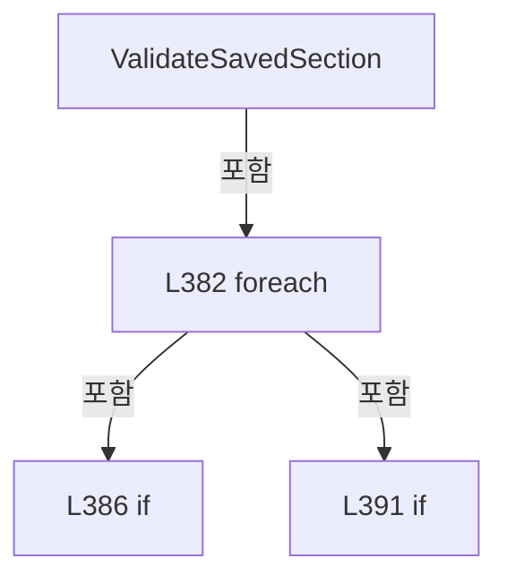

변경 전 점검: 입력/반환 타입, 위 호출자, 예외/취소 경로, 공유 상태와 저장·전송 소비자를 함께 확인합니다. 값의 단위나 물리 방향을 이름만으로 확정하지 않습니다.

### MethodDeclaration `ValidateSectionParameters` · L398–442

[Drilling.File/JHMI/CSettingFile.cs:398–442](https://github.com/kjuws10-rgb/A3Drilling/blob/96e22cd027c84bf302b23f2949b98985d7f301bb/Drilling.File/JHMI/CSettingFile.cs#L398-L442)

| 항목 | 실제 추출 값 |
| --- | --- |
| 서명 | void Drilling.File.JHMI.CSettingFile.ValidateSectionParameters(string, System.Collections.Generic.IReadOnlyList<Drilling.Common.Managers.ST_SYSTEM_PARAMETER>, System.Collections.Generic.IReadOnlyList<Drilling.File.JHMI.CSettingFile.ST_SETTING_FORM_ITEM>) |
| 접근/수식자 | Private / private, static |
| 반환/값 타입 | void |
| 소속 타입 | NamedType:Drilling.File.JHMI.CSettingFile |

입력 계약:

| 이름 | 타입 | 전달 | 선택/기본값 |
| --- | --- | --- | --- |
| sectionTab | string | None | False /  |
| parameters | System.Collections.Generic.IReadOnlyList<Drilling.Common.Managers.ST_SYSTEM_PARAMETER> | None | False /  |
| formItems | System.Collections.Generic.IReadOnlyList<Drilling.File.JHMI.CSettingFile.ST_SETTING_FORM_ITEM> | None | False /  |

정적 호출자로 확인된 위치:

| 호출 파일/행 | 호출 표현식 | 런타임 분기 가능 |
| --- | --- | --- |
| [Drilling.File/JHMI/CSettingFile.cs:114–114](https://github.com/kjuws10-rgb/A3Drilling/blob/96e22cd027c84bf302b23f2949b98985d7f301bb/Drilling.File/JHMI/CSettingFile.cs#L114-L114) | ValidateSectionParameters | False |

호출하는 대상과 해석 범위:

| 원본 행 | 표현식 | 분석 상태 | 대상/소스 위치 |
| --- | --- | --- | --- |
| 410 | formItems.Where(ShouldIncludeItem).ToDictionary | resolved | System.Collections.Generic.Dictionary<string, Drilling.File.JHMI.CSettingFile.ST_SETTING_FORM_ITEM> System.Collections.Generic.IEnumerable<Drilling.File.JHMI.CSettingFile.ST_SETTING_FORM_ITEM>.ToDictionary<Drilling.File.JHMI.CSettingFile.ST_SETTING_FORM_ITEM, string>(System.Func<Drilling.File.JHMI.CSettingFile.ST_SETTING_FORM_ITEM, string>, System.Collections.Generic.IEqualityComparer<string>?) |
| 410 | formItems.Where | resolved | System.Collections.Generic.IEnumerable<Drilling.File.JHMI.CSettingFile.ST_SETTING_FORM_ITEM> System.Collections.Generic.IEnumerable<Drilling.File.JHMI.CSettingFile.ST_SETTING_FORM_ITEM>.Where<Drilling.File.JHMI.CSettingFile.ST_SETTING_FORM_ITEM>(System.Func<Drilling.File.JHMI.CSettingFile.ST_SETTING_FORM_ITEM, bool>) |
| 413 | GetParameterKey | resolved | string Drilling.File.JHMI.CSettingFile.GetParameterKey(Drilling.Common.Managers.ST_SYSTEM_PARAMETER) · Drilling.File/JHMI/CSettingFile.cs:444 |
| 414 | formItemsByName.TryGetValue | resolved | bool System.Collections.Generic.Dictionary<string, Drilling.File.JHMI.CSettingFile.ST_SETTING_FORM_ITEM>.TryGetValue(string, out Drilling.File.JHMI.CSettingFile.ST_SETTING_FORM_ITEM) |
| 416 | new InvalidDataException | resolved | System.IO.InvalidDataException.InvalidDataException(string?) |
| 419 | parameter.Value.Trim | resolved | string string.Trim() |
| 420 | string.IsNullOrWhiteSpace | resolved | bool string.IsNullOrWhiteSpace(string?) |
| 422 | new InvalidDataException | resolved | System.IO.InvalidDataException.InvalidDataException(string?) |
| 427 | ValidateIntParameter | resolved | string Drilling.File.JHMI.CSettingFile.ValidateIntParameter(Drilling.File.JHMI.CSettingFile.ST_SETTING_FORM_ITEM, string) · Drilling.File/JHMI/CSettingFile.cs:449 |
| 428 | ValidateDoubleParameter | resolved | string Drilling.File.JHMI.CSettingFile.ValidateDoubleParameter(Drilling.File.JHMI.CSettingFile.ST_SETTING_FORM_ITEM, string) · Drilling.File/JHMI/CSettingFile.cs:459 |
| 429 | ValidateBoolParameter | resolved | string Drilling.File.JHMI.CSettingFile.ValidateBoolParameter(Drilling.File.JHMI.CSettingFile.ST_SETTING_FORM_ITEM, string) · Drilling.File/JHMI/CSettingFile.cs:479 |
| 432 | string.IsNullOrWhiteSpace | resolved | bool string.IsNullOrWhiteSpace(string?) |
| 434 | new InvalidDataException | resolved | System.IO.InvalidDataException.InvalidDataException(string?) |
| 438 | sectionTab.Equals | resolved | bool string.Equals(string?, System.StringComparison) |
| 440 | CReviewResultLevelSettings.Read | resolved | Drilling.Common.Review.ST_REVIEW_RESULT_LEVEL_SETTINGS Drilling.Common.Review.CReviewResultLevelSettings.Read(System.Collections.Generic.IEnumerable<Drilling.Common.Managers.ST_SYSTEM_PARAMETER>) · Drilling.Common/Review/CReviewResultLevelSettings.cs:94 |

본문의 실제 연산·분기·예외·반환 순서(원문 위치 순):

| 원본 행 | 종류 | 주석 해설 |
| --- | --- | --- |
| 410 | call | 함수·델리게이트 또는 객체 생성자를 호출합니다: formItems.Where(ShouldIncludeItem).ToDictionary(SelectName, StringComparer.OrdinalIgnoreCase) |
| 410 | call | 함수·델리게이트 또는 객체 생성자를 호출합니다: formItems.Where(ShouldIncludeItem) |
| 410 | local-declaration | 지역 변수를 선언합니다: var formItemsByName = formItems.Where(ShouldIncludeItem).ToDictionary(SelectName, StringComparer.OrdinalIgnoreCase); |
| 410 | variable-initializer | 변수의 초기값을 지정합니다: formItemsByName = formItems.Where(ShouldIncludeItem).ToDictionary(SelectName, StringComparer.OrdinalIgnoreCase) |
| 411 | foreach | 컬렉션 요소를 순회합니다: foreach (var parameter in parameters) |
| 413 | call | 함수·델리게이트 또는 객체 생성자를 호출합니다: GetParameterKey(parameter) |
| 413 | local-declaration | 지역 변수를 선언합니다: var parameterKey = GetParameterKey(parameter); |
| 413 | variable-initializer | 변수의 초기값을 지정합니다: parameterKey = GetParameterKey(parameter) |
| 414 | call | 함수·델리게이트 또는 객체 생성자를 호출합니다: formItemsByName.TryGetValue(parameterKey, out var formItem) |
| 414 | if | 조건에 따라 분기합니다: if (!formItemsByName.TryGetValue(parameterKey, out var formItem)) |
| 416 | call | 함수·델리게이트 또는 객체 생성자를 호출합니다: new InvalidDataException($"Setting save blocked. Unknown parameter: {sectionTab}/{parameter.Name}") |
| 416 | throw | 예외를 발생/전달합니다: throw new InvalidDataException($"Setting save blocked. Unknown parameter: {sectionTab}/{parameter.Name}"); |
| 419 | call | 함수·델리게이트 또는 객체 생성자를 호출합니다: parameter.Value.Trim() |
| 419 | local-declaration | 지역 변수를 선언합니다: var value = parameter.Value.Trim(); |
| 419 | variable-initializer | 변수의 초기값을 지정합니다: value = parameter.Value.Trim() |
| 420 | call | 함수·델리게이트 또는 객체 생성자를 호출합니다: string.IsNullOrWhiteSpace(value) |
| 420 | if | 조건에 따라 분기합니다: if (string.IsNullOrWhiteSpace(value)) |
| 422 | call | 함수·델리게이트 또는 객체 생성자를 호출합니다: new InvalidDataException($"Setting save blocked. {formItem.DisplayName} cannot be empty.") |
| 422 | throw | 예외를 발생/전달합니다: throw new InvalidDataException($"Setting save blocked. {formItem.DisplayName} cannot be empty."); |
| 425 | local-declaration | 지역 변수를 선언합니다: var validationMessage = formItem.DataType switch { EN_RECIPE_DATA_TYPE.Int => ValidateIntParameter(formItem, value), EN_RECIPE_DATA_TYPE.Double => ValidateDoubleParameter(formItem, value), EN_RECIPE_DATA_TYPE.Bool => ValidateBoolP |
| 425 | switch-expression | 값별 결과식을 선택합니다: formItem.DataType switch { EN_RECIPE_DATA_TYPE.Int => ValidateIntParameter(formItem, value), EN_RECIPE_DATA_TYPE.Double => ValidateDoubleParameter(formItem, value), EN_RECIPE_DATA_TYPE.Bool => ValidateBoolParameter(formItem, value |
| 425 | variable-initializer | 변수의 초기값을 지정합니다: validationMessage = formItem.DataType switch { EN_RECIPE_DATA_TYPE.Int => ValidateIntParameter(formItem, value), EN_RECIPE_DATA_TYPE.Double => ValidateDoubleParameter(formItem, value), EN_RECIPE_DATA_TYPE.Bool => ValidateBoolParam |
| 427 | call | 함수·델리게이트 또는 객체 생성자를 호출합니다: ValidateIntParameter(formItem, value) |
| 428 | call | 함수·델리게이트 또는 객체 생성자를 호출합니다: ValidateDoubleParameter(formItem, value) |
| 429 | call | 함수·델리게이트 또는 객체 생성자를 호출합니다: ValidateBoolParameter(formItem, value) |
| 432 | call | 함수·델리게이트 또는 객체 생성자를 호출합니다: string.IsNullOrWhiteSpace(validationMessage) |
| 432 | if | 조건에 따라 분기합니다: if (!string.IsNullOrWhiteSpace(validationMessage)) |
| 434 | call | 함수·델리게이트 또는 객체 생성자를 호출합니다: new InvalidDataException(validationMessage) |
| 434 | throw | 예외를 발생/전달합니다: throw new InvalidDataException(validationMessage); |
| 438 | call | 함수·델리게이트 또는 객체 생성자를 호출합니다: sectionTab.Equals("OPTION", StringComparison.OrdinalIgnoreCase) |
| 438 | if | 조건에 따라 분기합니다: if (sectionTab.Equals("OPTION", StringComparison.OrdinalIgnoreCase)) |
| 440 | assignment | 값을 대상에 대입합니다: _ = CReviewResultLevelSettings.Read(parameters) |
| 440 | call | 함수·델리게이트 또는 객체 생성자를 호출합니다: CReviewResultLevelSettings.Read(parameters) |

제어 구문의 포함 구조(실제 실행 순서/CFG가 아닌 구문 탐색 그림):

변경 전 점검: 입력/반환 타입, 위 호출자, 예외/취소 경로, 공유 상태와 저장·전송 소비자를 함께 확인합니다. 값의 단위나 물리 방향을 이름만으로 확정하지 않습니다.

### LocalFunctionStatement `ShouldIncludeItem` · L400–403

[Drilling.File/JHMI/CSettingFile.cs:400–403](https://github.com/kjuws10-rgb/A3Drilling/blob/96e22cd027c84bf302b23f2949b98985d7f301bb/Drilling.File/JHMI/CSettingFile.cs#L400-L403)

| 항목 | 실제 추출 값 |
| --- | --- |
| 서명 | bool ShouldIncludeItem(Drilling.File.JHMI.CSettingFile.ST_SETTING_FORM_ITEM) |
| 접근/수식자 | Private /  |
| 반환/값 타입 | bool |
| 소속 타입 | NamedType:Drilling.File.JHMI.CSettingFile |

입력 계약:

| 이름 | 타입 | 전달 | 선택/기본값 |
| --- | --- | --- | --- |
| item | Drilling.File.JHMI.CSettingFile.ST_SETTING_FORM_ITEM | None | False /  |

현재 부분 분석에서 직접 연결된 호출자는 없습니다. XAML/이벤트/인터페이스·델리게이트·외부 진입을 추가 확인해야 하며, 미사용으로 판정한 것이 아닙니다.

호출하는 대상과 해석 범위:

| 원본 행 | 표현식 | 분석 상태 | 대상/소스 위치 |
| --- | --- | --- | --- |
| 402 | item.Tab.Equals | resolved | bool string.Equals(string?, System.StringComparison) |

본문의 실제 연산·분기·예외·반환 순서(원문 위치 순):

| 원본 행 | 종류 | 주석 해설 |
| --- | --- | --- |
| 402 | call | 함수·델리게이트 또는 객체 생성자를 호출합니다: item.Tab.Equals(sectionTab, StringComparison.OrdinalIgnoreCase) |
| 402 | return | 호출자에게 값 또는 제어를 반환합니다: return item.Use && item.Tab.Equals(sectionTab, StringComparison.OrdinalIgnoreCase); |

변경 전 점검: 입력/반환 타입, 위 호출자, 예외/취소 경로, 공유 상태와 저장·전송 소비자를 함께 확인합니다. 값의 단위나 물리 방향을 이름만으로 확정하지 않습니다.

### LocalFunctionStatement `SelectName` · L405–408

[Drilling.File/JHMI/CSettingFile.cs:405–408](https://github.com/kjuws10-rgb/A3Drilling/blob/96e22cd027c84bf302b23f2949b98985d7f301bb/Drilling.File/JHMI/CSettingFile.cs#L405-L408)

| 항목 | 실제 추출 값 |
| --- | --- |
| 서명 | string SelectName(Drilling.File.JHMI.CSettingFile.ST_SETTING_FORM_ITEM) |
| 접근/수식자 | Private /  |
| 반환/값 타입 | string |
| 소속 타입 | NamedType:Drilling.File.JHMI.CSettingFile |

입력 계약:

| 이름 | 타입 | 전달 | 선택/기본값 |
| --- | --- | --- | --- |
| item | Drilling.File.JHMI.CSettingFile.ST_SETTING_FORM_ITEM | None | False /  |

현재 부분 분석에서 직접 연결된 호출자는 없습니다. XAML/이벤트/인터페이스·델리게이트·외부 진입을 추가 확인해야 하며, 미사용으로 판정한 것이 아닙니다.

본문의 실제 연산·분기·예외·반환 순서(원문 위치 순):

| 원본 행 | 종류 | 주석 해설 |
| --- | --- | --- |
| 407 | return | 호출자에게 값 또는 제어를 반환합니다: return item.Name; |

변경 전 점검: 입력/반환 타입, 위 호출자, 예외/취소 경로, 공유 상태와 저장·전송 소비자를 함께 확인합니다. 값의 단위나 물리 방향을 이름만으로 확정하지 않습니다.

### MethodDeclaration `GetParameterKey` · L444–447

[Drilling.File/JHMI/CSettingFile.cs:444–447](https://github.com/kjuws10-rgb/A3Drilling/blob/96e22cd027c84bf302b23f2949b98985d7f301bb/Drilling.File/JHMI/CSettingFile.cs#L444-L447)

| 항목 | 실제 추출 값 |
| --- | --- |
| 서명 | string Drilling.File.JHMI.CSettingFile.GetParameterKey(Drilling.Common.Managers.ST_SYSTEM_PARAMETER) |
| 접근/수식자 | Private / private, static |
| 반환/값 타입 | string |
| 소속 타입 | NamedType:Drilling.File.JHMI.CSettingFile |

입력 계약:

| 이름 | 타입 | 전달 | 선택/기본값 |
| --- | --- | --- | --- |
| parameter | Drilling.Common.Managers.ST_SYSTEM_PARAMETER | None | False /  |

정적 호출자로 확인된 위치:

| 호출 파일/행 | 호출 표현식 | 런타임 분기 가능 |
| --- | --- | --- |
| [Drilling.File/JHMI/CSettingFile.cs:78–78](https://github.com/kjuws10-rgb/A3Drilling/blob/96e22cd027c84bf302b23f2949b98985d7f301bb/Drilling.File/JHMI/CSettingFile.cs#L78-L78) | GetParameterKey | False |
| [Drilling.File/JHMI/CSettingFile.cs:117–117](https://github.com/kjuws10-rgb/A3Drilling/blob/96e22cd027c84bf302b23f2949b98985d7f301bb/Drilling.File/JHMI/CSettingFile.cs#L117-L117) | GetParameterKey | False |
| [Drilling.File/JHMI/CSettingFile.cs:124–124](https://github.com/kjuws10-rgb/A3Drilling/blob/96e22cd027c84bf302b23f2949b98985d7f301bb/Drilling.File/JHMI/CSettingFile.cs#L124-L124) | GetParameterKey | False |
| [Drilling.File/JHMI/CSettingFile.cs:384–384](https://github.com/kjuws10-rgb/A3Drilling/blob/96e22cd027c84bf302b23f2949b98985d7f301bb/Drilling.File/JHMI/CSettingFile.cs#L384-L384) | GetParameterKey | False |
| [Drilling.File/JHMI/CSettingFile.cs:413–413](https://github.com/kjuws10-rgb/A3Drilling/blob/96e22cd027c84bf302b23f2949b98985d7f301bb/Drilling.File/JHMI/CSettingFile.cs#L413-L413) | GetParameterKey | False |

호출하는 대상과 해석 범위:

| 원본 행 | 표현식 | 분석 상태 | 대상/소스 위치 |
| --- | --- | --- | --- |
| 446 | string.IsNullOrWhiteSpace | resolved | bool string.IsNullOrWhiteSpace(string?) |

본문의 실제 연산·분기·예외·반환 순서(원문 위치 순):

| 원본 행 | 종류 | 주석 해설 |
| --- | --- | --- |
| 446 | call | 함수·델리게이트 또는 객체 생성자를 호출합니다: string.IsNullOrWhiteSpace(parameter.Key) |
| 446 | conditional-expression | 조건에 따라 결과식을 선택합니다: string.IsNullOrWhiteSpace(parameter.Key) ? parameter.Name : parameter.Key |
| 446 | return | 호출자에게 값 또는 제어를 반환합니다: return string.IsNullOrWhiteSpace(parameter.Key) ? parameter.Name : parameter.Key; |

변경 전 점검: 입력/반환 타입, 위 호출자, 예외/취소 경로, 공유 상태와 저장·전송 소비자를 함께 확인합니다. 값의 단위나 물리 방향을 이름만으로 확정하지 않습니다.

### MethodDeclaration `ValidateIntParameter` · L449–457

[Drilling.File/JHMI/CSettingFile.cs:449–457](https://github.com/kjuws10-rgb/A3Drilling/blob/96e22cd027c84bf302b23f2949b98985d7f301bb/Drilling.File/JHMI/CSettingFile.cs#L449-L457)

| 항목 | 실제 추출 값 |
| --- | --- |
| 서명 | string Drilling.File.JHMI.CSettingFile.ValidateIntParameter(Drilling.File.JHMI.CSettingFile.ST_SETTING_FORM_ITEM, string) |
| 접근/수식자 | Private / private, static |
| 반환/값 타입 | string |
| 소속 타입 | NamedType:Drilling.File.JHMI.CSettingFile |

입력 계약:

| 이름 | 타입 | 전달 | 선택/기본값 |
| --- | --- | --- | --- |
| formItem | Drilling.File.JHMI.CSettingFile.ST_SETTING_FORM_ITEM | None | False /  |
| value | string | None | False /  |

정적 호출자로 확인된 위치:

| 호출 파일/행 | 호출 표현식 | 런타임 분기 가능 |
| --- | --- | --- |
| [Drilling.File/JHMI/CSettingFile.cs:427–427](https://github.com/kjuws10-rgb/A3Drilling/blob/96e22cd027c84bf302b23f2949b98985d7f301bb/Drilling.File/JHMI/CSettingFile.cs#L427-L427) | ValidateIntParameter | False |

호출하는 대상과 해석 범위:

| 원본 행 | 표현식 | 분석 상태 | 대상/소스 위치 |
| --- | --- | --- | --- |
| 451 | int.TryParse | resolved | bool int.TryParse(string?, System.Globalization.NumberStyles, System.IFormatProvider?, out int) |
| 456 | ValidateNumericRange | resolved | string Drilling.File.JHMI.CSettingFile.ValidateNumericRange(Drilling.File.JHMI.CSettingFile.ST_SETTING_FORM_ITEM, double) · Drilling.File/JHMI/CSettingFile.cs:485 |

본문의 실제 연산·분기·예외·반환 순서(원문 위치 순):

| 원본 행 | 종류 | 주석 해설 |
| --- | --- | --- |
| 451 | call | 함수·델리게이트 또는 객체 생성자를 호출합니다: int.TryParse(value, NumberStyles.Integer, CultureInfo.InvariantCulture, out var parsed) |
| 451 | if | 조건에 따라 분기합니다: if (!int.TryParse(value, NumberStyles.Integer, CultureInfo.InvariantCulture, out var parsed)) |
| 453 | return | 호출자에게 값 또는 제어를 반환합니다: return $"Setting save blocked. {formItem.DisplayName} must be an integer."; |
| 456 | call | 함수·델리게이트 또는 객체 생성자를 호출합니다: ValidateNumericRange(formItem, parsed) |
| 456 | return | 호출자에게 값 또는 제어를 반환합니다: return ValidateNumericRange(formItem, parsed); |

제어 구문의 포함 구조(실제 실행 순서/CFG가 아닌 구문 탐색 그림):

변경 전 점검: 입력/반환 타입, 위 호출자, 예외/취소 경로, 공유 상태와 저장·전송 소비자를 함께 확인합니다. 값의 단위나 물리 방향을 이름만으로 확정하지 않습니다.

### MethodDeclaration `ValidateDoubleParameter` · L459–477

[Drilling.File/JHMI/CSettingFile.cs:459–477](https://github.com/kjuws10-rgb/A3Drilling/blob/96e22cd027c84bf302b23f2949b98985d7f301bb/Drilling.File/JHMI/CSettingFile.cs#L459-L477)

| 항목 | 실제 추출 값 |
| --- | --- |
| 서명 | string Drilling.File.JHMI.CSettingFile.ValidateDoubleParameter(Drilling.File.JHMI.CSettingFile.ST_SETTING_FORM_ITEM, string) |
| 접근/수식자 | Private / private, static |
| 반환/값 타입 | string |
| 소속 타입 | NamedType:Drilling.File.JHMI.CSettingFile |

입력 계약:

| 이름 | 타입 | 전달 | 선택/기본값 |
| --- | --- | --- | --- |
| formItem | Drilling.File.JHMI.CSettingFile.ST_SETTING_FORM_ITEM | None | False /  |
| value | string | None | False /  |

정적 호출자로 확인된 위치:

| 호출 파일/행 | 호출 표현식 | 런타임 분기 가능 |
| --- | --- | --- |
| [Drilling.File/JHMI/CSettingFile.cs:428–428](https://github.com/kjuws10-rgb/A3Drilling/blob/96e22cd027c84bf302b23f2949b98985d7f301bb/Drilling.File/JHMI/CSettingFile.cs#L428-L428) | ValidateDoubleParameter | False |

호출하는 대상과 해석 범위:

| 원본 행 | 표현식 | 분석 상태 | 대상/소스 위치 |
| --- | --- | --- | --- |
| 461 | double.TryParse | resolved | bool double.TryParse(string?, System.Globalization.NumberStyles, System.IFormatProvider?, out double) |
| 461 | double.IsFinite | resolved | bool double.IsFinite(double) |
| 466 | formItem.Unit.Equals | resolved | bool string.Equals(string?, System.StringComparison) |
| 471 | formItem.Name.Equals | resolved | bool string.Equals(string?, System.StringComparison) |
| 471 | formItem.Name.Equals | resolved | bool string.Equals(string?, System.StringComparison) |
| 473 | formItem.Name.Equals | resolved | bool string.Equals(string?, System.StringComparison) |
| 476 | ValidateNumericRange | resolved | string Drilling.File.JHMI.CSettingFile.ValidateNumericRange(Drilling.File.JHMI.CSettingFile.ST_SETTING_FORM_ITEM, double) · Drilling.File/JHMI/CSettingFile.cs:485 |

본문의 실제 연산·분기·예외·반환 순서(원문 위치 순):

| 원본 행 | 종류 | 주석 해설 |
| --- | --- | --- |
| 461 | call | 함수·델리게이트 또는 객체 생성자를 호출합니다: double.TryParse(value, NumberStyles.Float, CultureInfo.InvariantCulture, out var parsed) |
| 461 | call | 함수·델리게이트 또는 객체 생성자를 호출합니다: double.IsFinite(parsed) |
| 461 | if | 조건에 따라 분기합니다: if (!double.TryParse(value, NumberStyles.Float, CultureInfo.InvariantCulture, out var parsed) &#124;&#124; !double.IsFinite(parsed)) |
| 463 | return | 호출자에게 값 또는 제어를 반환합니다: return $"Setting save blocked. {formItem.DisplayName} must be numeric."; |
| 466 | call | 함수·델리게이트 또는 객체 생성자를 호출합니다: formItem.Unit.Equals("sign", StringComparison.OrdinalIgnoreCase) |
| 466 | if | 조건에 따라 분기합니다: if (formItem.Unit.Equals("sign", StringComparison.OrdinalIgnoreCase) && parsed != -1.0 && parsed != 1.0) |
| 468 | return | 호출자에게 값 또는 제어를 반환합니다: return $"Setting save blocked. {formItem.DisplayName} must be -1 or +1."; |
| 471 | call | 함수·델리게이트 또는 객체 생성자를 호출합니다: formItem.Name.Equals(CSettingManager.ReviewCameraResolutionKey, StringComparison.OrdinalIgnoreCase) |
| 471 | call | 함수·델리게이트 또는 객체 생성자를 호출합니다: formItem.Name.Equals(CSettingManager.AlignCameraResolutionKey, StringComparison.OrdinalIgnoreCase) |
| 471 | if | 조건에 따라 분기합니다: if (formItem.Tab == "OPTION" && (formItem.Name.Equals(CSettingManager.ReviewCameraResolutionKey, StringComparison.OrdinalIgnoreCase) &#124;&#124; formItem.Name.Equals(CSettingManager.AlignCameraResolutionKey, StringComparison.OrdinalI…) |
| 472 | return | 호출자에게 값 또는 제어를 반환합니다: return $"Setting save blocked. {formItem.DisplayName} must be greater than 0 mm/pixel."; |
| 473 | call | 함수·델리게이트 또는 객체 생성자를 호출합니다: formItem.Name.Equals(CSettingManager.WapageAlignBaseToleranceKey, StringComparison.OrdinalIgnoreCase) |
| 473 | if | 조건에 따라 분기합니다: if (formItem.Tab == "OPTION" && formItem.Name.Equals(CSettingManager.WapageAlignBaseToleranceKey, StringComparison.OrdinalIgnoreCase) && parsed < 0) |
| 474 | return | 호출자에게 값 또는 제어를 반환합니다: return $"Setting save blocked. {formItem.DisplayName} must be 0 or greater mm."; |
| 476 | call | 함수·델리게이트 또는 객체 생성자를 호출합니다: ValidateNumericRange(formItem, parsed) |
| 476 | return | 호출자에게 값 또는 제어를 반환합니다: return ValidateNumericRange(formItem, parsed); |

제어 구문의 포함 구조(실제 실행 순서/CFG가 아닌 구문 탐색 그림):

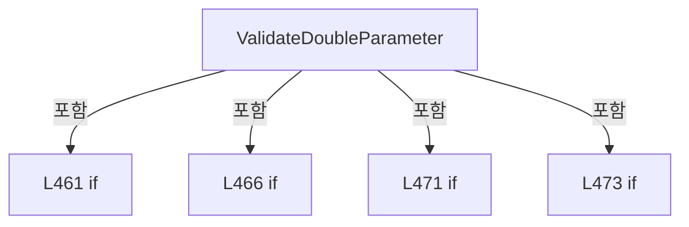

변경 전 점검: 입력/반환 타입, 위 호출자, 예외/취소 경로, 공유 상태와 저장·전송 소비자를 함께 확인합니다. 값의 단위나 물리 방향을 이름만으로 확정하지 않습니다.

### MethodDeclaration `ValidateBoolParameter` · L479–483

[Drilling.File/JHMI/CSettingFile.cs:479–483](https://github.com/kjuws10-rgb/A3Drilling/blob/96e22cd027c84bf302b23f2949b98985d7f301bb/Drilling.File/JHMI/CSettingFile.cs#L479-L483)

| 항목 | 실제 추출 값 |
| --- | --- |
| 서명 | string Drilling.File.JHMI.CSettingFile.ValidateBoolParameter(Drilling.File.JHMI.CSettingFile.ST_SETTING_FORM_ITEM, string) |
| 접근/수식자 | Private / private, static |
| 반환/값 타입 | string |
| 소속 타입 | NamedType:Drilling.File.JHMI.CSettingFile |

입력 계약:

| 이름 | 타입 | 전달 | 선택/기본값 |
| --- | --- | --- | --- |
| formItem | Drilling.File.JHMI.CSettingFile.ST_SETTING_FORM_ITEM | None | False /  |
| value | string | None | False /  |

정적 호출자로 확인된 위치:

| 호출 파일/행 | 호출 표현식 | 런타임 분기 가능 |
| --- | --- | --- |
| [Drilling.File/JHMI/CSettingFile.cs:429–429](https://github.com/kjuws10-rgb/A3Drilling/blob/96e22cd027c84bf302b23f2949b98985d7f301bb/Drilling.File/JHMI/CSettingFile.cs#L429-L429) | ValidateBoolParameter | False |

호출하는 대상과 해석 범위:

| 원본 행 | 표현식 | 분석 상태 | 대상/소스 위치 |
| --- | --- | --- | --- |
| 481 | value.Trim().ToUpperInvariant | resolved | string string.ToUpperInvariant() |
| 481 | value.Trim | resolved | string string.Trim() |

본문의 실제 연산·분기·예외·반환 순서(원문 위치 순):

| 원본 행 | 종류 | 주석 해설 |
| --- | --- | --- |
| 481 | call | 함수·델리게이트 또는 객체 생성자를 호출합니다: value.Trim().ToUpperInvariant() |
| 481 | call | 함수·델리게이트 또는 객체 생성자를 호출합니다: value.Trim() |
| 481 | local-declaration | 지역 변수를 선언합니다: var normalized = value.Trim().ToUpperInvariant(); |
| 481 | variable-initializer | 변수의 초기값을 지정합니다: normalized = value.Trim().ToUpperInvariant() |
| 482 | conditional-expression | 조건에 따라 결과식을 선택합니다: normalized is "ON" or "OFF" or "TRUE" or "FALSE" or "1" or "0" or "YES" or "NO" ? "" : $"Setting save blocked. {formItem.DisplayName} must be ON/OFF or TRUE/FALSE." |
| 482 | return | 호출자에게 값 또는 제어를 반환합니다: return normalized is "ON" or "OFF" or "TRUE" or "FALSE" or "1" or "0" or "YES" or "NO" ? "" : $"Setting save blocked. {formItem.DisplayName} must be ON/OFF or TRUE/FALSE."; |

변경 전 점검: 입력/반환 타입, 위 호출자, 예외/취소 경로, 공유 상태와 저장·전송 소비자를 함께 확인합니다. 값의 단위나 물리 방향을 이름만으로 확정하지 않습니다.

### MethodDeclaration `ValidateNumericRange` · L485–493

[Drilling.File/JHMI/CSettingFile.cs:485–493](https://github.com/kjuws10-rgb/A3Drilling/blob/96e22cd027c84bf302b23f2949b98985d7f301bb/Drilling.File/JHMI/CSettingFile.cs#L485-L493)

| 항목 | 실제 추출 값 |
| --- | --- |
| 서명 | string Drilling.File.JHMI.CSettingFile.ValidateNumericRange(Drilling.File.JHMI.CSettingFile.ST_SETTING_FORM_ITEM, double) |
| 접근/수식자 | Private / private, static |
| 반환/값 타입 | string |
| 소속 타입 | NamedType:Drilling.File.JHMI.CSettingFile |

입력 계약:

| 이름 | 타입 | 전달 | 선택/기본값 |
| --- | --- | --- | --- |
| formItem | Drilling.File.JHMI.CSettingFile.ST_SETTING_FORM_ITEM | None | False /  |
| value | double | None | False /  |

정적 호출자로 확인된 위치:

| 호출 파일/행 | 호출 표현식 | 런타임 분기 가능 |
| --- | --- | --- |
| [Drilling.File/JHMI/CSettingFile.cs:456–456](https://github.com/kjuws10-rgb/A3Drilling/blob/96e22cd027c84bf302b23f2949b98985d7f301bb/Drilling.File/JHMI/CSettingFile.cs#L456-L456) | ValidateNumericRange | False |
| [Drilling.File/JHMI/CSettingFile.cs:476–476](https://github.com/kjuws10-rgb/A3Drilling/blob/96e22cd027c84bf302b23f2949b98985d7f301bb/Drilling.File/JHMI/CSettingFile.cs#L476-L476) | ValidateNumericRange | False |

호출하는 대상과 해석 범위:

| 원본 행 | 표현식 | 분석 상태 | 대상/소스 위치 |
| --- | --- | --- | --- |
| 487 | formItem.Min.Equals | resolved | bool double.Equals(double) |

본문의 실제 연산·분기·예외·반환 순서(원문 위치 순):

| 원본 행 | 종류 | 주석 해설 |
| --- | --- | --- |
| 487 | call | 함수·델리게이트 또는 객체 생성자를 호출합니다: formItem.Min.Equals(formItem.Max) |
| 487 | if | 조건에 따라 분기합니다: if (!formItem.Min.Equals(formItem.Max) && (value < formItem.Min &#124;&#124; value > formItem.Max)) |
| 489 | return | 호출자에게 값 또는 제어를 반환합니다: return $"Setting save blocked. {formItem.DisplayName} must be between {formItem.Min:0.###} and {formItem.Max:0.###}."; |
| 492 | return | 호출자에게 값 또는 제어를 반환합니다: return ""; |

제어 구문의 포함 구조(실제 실행 순서/CFG가 아닌 구문 탐색 그림):

변경 전 점검: 입력/반환 타입, 위 호출자, 예외/취소 경로, 공유 상태와 저장·전송 소비자를 함께 확인합니다. 값의 단위나 물리 방향을 이름만으로 확정하지 않습니다.

### MethodDeclaration `GetFormPath` · L495–498

[Drilling.File/JHMI/CSettingFile.cs:495–498](https://github.com/kjuws10-rgb/A3Drilling/blob/96e22cd027c84bf302b23f2949b98985d7f301bb/Drilling.File/JHMI/CSettingFile.cs#L495-L498)

| 항목 | 실제 추출 값 |
| --- | --- |
| 서명 | string Drilling.File.JHMI.CSettingFile.GetFormPath() |
| 접근/수식자 | Private / private |
| 반환/값 타입 | string |
| 소속 타입 | NamedType:Drilling.File.JHMI.CSettingFile |

정적 호출자로 확인된 위치:

| 호출 파일/행 | 호출 표현식 | 런타임 분기 가능 |
| --- | --- | --- |
| [Drilling.File/JHMI/CSettingFile.cs:150–150](https://github.com/kjuws10-rgb/A3Drilling/blob/96e22cd027c84bf302b23f2949b98985d7f301bb/Drilling.File/JHMI/CSettingFile.cs#L150-L150) | GetFormPath | False |
| [Drilling.File/JHMI/CSettingFile.cs:190–190](https://github.com/kjuws10-rgb/A3Drilling/blob/96e22cd027c84bf302b23f2949b98985d7f301bb/Drilling.File/JHMI/CSettingFile.cs#L190-L190) | GetFormPath | False |

호출하는 대상과 해석 범위:

| 원본 행 | 표현식 | 분석 상태 | 대상/소스 위치 |
| --- | --- | --- | --- |
| 497 | Path.Combine | resolved | string System.IO.Path.Combine(string, string) |

본문의 실제 연산·분기·예외·반환 순서(원문 위치 순):

| 원본 행 | 종류 | 주석 해설 |
| --- | --- | --- |
| 497 | call | 함수·델리게이트 또는 객체 생성자를 호출합니다: Path.Combine(configRoot, "JHMI_SETTING.csv") |
| 497 | return | 호출자에게 값 또는 제어를 반환합니다: return Path.Combine(configRoot, "JHMI_SETTING.csv"); |

변경 전 점검: 입력/반환 타입, 위 호출자, 예외/취소 경로, 공유 상태와 저장·전송 소비자를 함께 확인합니다. 값의 단위나 물리 방향을 이름만으로 확정하지 않습니다.

### MethodDeclaration `GetValuePath` · L500–503

[Drilling.File/JHMI/CSettingFile.cs:500–503](https://github.com/kjuws10-rgb/A3Drilling/blob/96e22cd027c84bf302b23f2949b98985d7f301bb/Drilling.File/JHMI/CSettingFile.cs#L500-L503)

| 항목 | 실제 추출 값 |
| --- | --- |
| 서명 | string Drilling.File.JHMI.CSettingFile.GetValuePath() |
| 접근/수식자 | Private / private |
| 반환/값 타입 | string |
| 소속 타입 | NamedType:Drilling.File.JHMI.CSettingFile |

정적 호출자로 확인된 위치:

| 호출 파일/행 | 호출 표현식 | 런타임 분기 가능 |
| --- | --- | --- |
| [Drilling.File/JHMI/CSettingFile.cs:320–320](https://github.com/kjuws10-rgb/A3Drilling/blob/96e22cd027c84bf302b23f2949b98985d7f301bb/Drilling.File/JHMI/CSettingFile.cs#L320-L320) | GetValuePath | False |
| [Drilling.File/JHMI/CSettingFile.cs:354–354](https://github.com/kjuws10-rgb/A3Drilling/blob/96e22cd027c84bf302b23f2949b98985d7f301bb/Drilling.File/JHMI/CSettingFile.cs#L354-L354) | GetValuePath | False |
| [Drilling.File/JHMI/CSettingFile.cs:375–375](https://github.com/kjuws10-rgb/A3Drilling/blob/96e22cd027c84bf302b23f2949b98985d7f301bb/Drilling.File/JHMI/CSettingFile.cs#L375-L375) | GetValuePath | False |

호출하는 대상과 해석 범위:

| 원본 행 | 표현식 | 분석 상태 | 대상/소스 위치 |
| --- | --- | --- | --- |
| 502 | Path.Combine | resolved | string System.IO.Path.Combine(string, string) |

본문의 실제 연산·분기·예외·반환 순서(원문 위치 순):

| 원본 행 | 종류 | 주석 해설 |
| --- | --- | --- |
| 502 | call | 함수·델리게이트 또는 객체 생성자를 호출합니다: Path.Combine(_settingDirectory, "Setting.csv") |
| 502 | return | 호출자에게 값 또는 제어를 반환합니다: return Path.Combine(_settingDirectory, "Setting.csv"); |

변경 전 점검: 입력/반환 타입, 위 호출자, 예외/취소 경로, 공유 상태와 저장·전송 소비자를 함께 확인합니다. 값의 단위나 물리 방향을 이름만으로 확정하지 않습니다.

### MethodDeclaration `GetValue` · L505–514

[Drilling.File/JHMI/CSettingFile.cs:505–514](https://github.com/kjuws10-rgb/A3Drilling/blob/96e22cd027c84bf302b23f2949b98985d7f301bb/Drilling.File/JHMI/CSettingFile.cs#L505-L514)

| 항목 | 실제 추출 값 |
| --- | --- |
| 서명 | string Drilling.File.JHMI.CSettingFile.GetValue(System.Collections.Generic.IReadOnlyDictionary<string, string>, string, string, string) |
| 접근/수식자 | Private / private, static |
| 반환/값 타입 | string |
| 소속 타입 | NamedType:Drilling.File.JHMI.CSettingFile |

입력 계약:

| 이름 | 타입 | 전달 | 선택/기본값 |
| --- | --- | --- | --- |
| values | System.Collections.Generic.IReadOnlyDictionary<string, string> | None | False /  |
| tab | string | None | False /  |
| name | string | None | False /  |
| defaultValue | string | None | False /  |

정적 호출자로 확인된 위치:

| 호출 파일/행 | 호출 표현식 | 런타임 분기 가능 |
| --- | --- | --- |
| [Drilling.File/JHMI/CSettingFile.cs:34–34](https://github.com/kjuws10-rgb/A3Drilling/blob/96e22cd027c84bf302b23f2949b98985d7f301bb/Drilling.File/JHMI/CSettingFile.cs#L34-L34) | GetValue | False |
| [Drilling.File/JHMI/CSettingFile.cs:72–72](https://github.com/kjuws10-rgb/A3Drilling/blob/96e22cd027c84bf302b23f2949b98985d7f301bb/Drilling.File/JHMI/CSettingFile.cs#L72-L72) | GetValue | False |
| [Drilling.File/JHMI/CSettingFile.cs:97–97](https://github.com/kjuws10-rgb/A3Drilling/blob/96e22cd027c84bf302b23f2949b98985d7f301bb/Drilling.File/JHMI/CSettingFile.cs#L97-L97) | GetValue | False |
| [Drilling.File/JHMI/CSettingFile.cs:370–370](https://github.com/kjuws10-rgb/A3Drilling/blob/96e22cd027c84bf302b23f2949b98985d7f301bb/Drilling.File/JHMI/CSettingFile.cs#L370-L370) | GetValue | False |

호출하는 대상과 해석 범위:

| 원본 행 | 표현식 | 분석 상태 | 대상/소스 위치 |
| --- | --- | --- | --- |
| 507 | values.TryGetValue | resolved · 동적 구현 선택 가능 | bool System.Collections.Generic.IReadOnlyDictionary<string, string>.TryGetValue(string, out string) |
| 507 | CreateKey | resolved | string Drilling.File.JHMI.CSettingFile.CreateKey(string, string) · Drilling.File/JHMI/CSettingFile.cs:516 |
| 510 | tab.Equals | resolved | bool string.Equals(string?, System.StringComparison) |
| 510 | name.Equals | resolved | bool string.Equals(string?, System.StringComparison) |
| 511 | values.TryGetValue | resolved · 동적 구현 선택 가능 | bool System.Collections.Generic.IReadOnlyDictionary<string, string>.TryGetValue(string, out string) |
| 511 | CreateKey | resolved | string Drilling.File.JHMI.CSettingFile.CreateKey(string, string) · Drilling.File/JHMI/CSettingFile.cs:516 |

본문의 실제 연산·분기·예외·반환 순서(원문 위치 순):

| 원본 행 | 종류 | 주석 해설 |
| --- | --- | --- |
| 507 | call | 함수·델리게이트 또는 객체 생성자를 호출합니다: values.TryGetValue(CreateKey(tab, name), out var value) |
| 507 | call | 함수·델리게이트 또는 객체 생성자를 호출합니다: CreateKey(tab, name) |
| 507 | if | 조건에 따라 분기합니다: if (values.TryGetValue(CreateKey(tab, name), out var value)) |
| 508 | return | 호출자에게 값 또는 제어를 반환합니다: return value; |
| 510 | call | 함수·델리게이트 또는 객체 생성자를 호출합니다: tab.Equals("OPTION", StringComparison.OrdinalIgnoreCase) |
| 510 | call | 함수·델리게이트 또는 객체 생성자를 호출합니다: name.Equals(CSettingManager.ReviewCameraResolutionKey, StringComparison.OrdinalIgnoreCase) |
| 510 | if | 조건에 따라 분기합니다: if (tab.Equals("OPTION", StringComparison.OrdinalIgnoreCase) && name.Equals(CSettingManager.ReviewCameraResolutionKey, StringComparison.OrdinalIgnoreCase) && values.TryGetValue(CreateKey(tab, "CameraResolution"), out var leg…) |
| 511 | call | 함수·델리게이트 또는 객체 생성자를 호출합니다: values.TryGetValue(CreateKey(tab, "CameraResolution"), out var legacy) |
| 511 | call | 함수·델리게이트 또는 객체 생성자를 호출합니다: CreateKey(tab, "CameraResolution") |
| 512 | return | 호출자에게 값 또는 제어를 반환합니다: return legacy; |
| 513 | return | 호출자에게 값 또는 제어를 반환합니다: return defaultValue; |

제어 구문의 포함 구조(실제 실행 순서/CFG가 아닌 구문 탐색 그림):

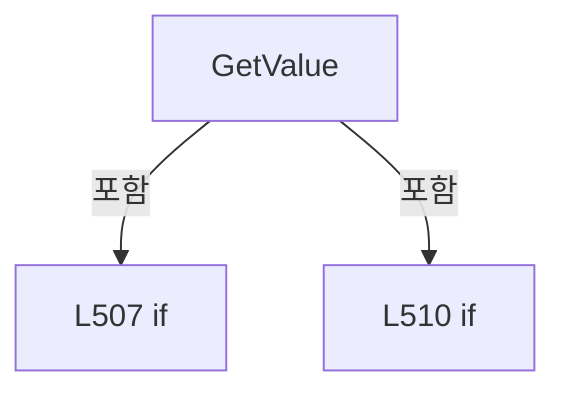

변경 전 점검: 입력/반환 타입, 위 호출자, 예외/취소 경로, 공유 상태와 저장·전송 소비자를 함께 확인합니다. 값의 단위나 물리 방향을 이름만으로 확정하지 않습니다.

### MethodDeclaration `CreateKey` · L516–519

[Drilling.File/JHMI/CSettingFile.cs:516–519](https://github.com/kjuws10-rgb/A3Drilling/blob/96e22cd027c84bf302b23f2949b98985d7f301bb/Drilling.File/JHMI/CSettingFile.cs#L516-L519)

| 항목 | 실제 추출 값 |
| --- | --- |
| 서명 | string Drilling.File.JHMI.CSettingFile.CreateKey(string, string) |
| 접근/수식자 | Private / private, static |
| 반환/값 타입 | string |
| 소속 타입 | NamedType:Drilling.File.JHMI.CSettingFile |

입력 계약:

| 이름 | 타입 | 전달 | 선택/기본값 |
| --- | --- | --- | --- |
| tab | string | None | False /  |
| name | string | None | False /  |

정적 호출자로 확인된 위치:

| 호출 파일/행 | 호출 표현식 | 런타임 분기 가능 |
| --- | --- | --- |
| [Drilling.File/JHMI/CSettingFile.cs:117–117](https://github.com/kjuws10-rgb/A3Drilling/blob/96e22cd027c84bf302b23f2949b98985d7f301bb/Drilling.File/JHMI/CSettingFile.cs#L117-L117) | CreateKey | False |
| [Drilling.File/JHMI/CSettingFile.cs:198–198](https://github.com/kjuws10-rgb/A3Drilling/blob/96e22cd027c84bf302b23f2949b98985d7f301bb/Drilling.File/JHMI/CSettingFile.cs#L198-L198) | CreateKey | False |
| [Drilling.File/JHMI/CSettingFile.cs:211–211](https://github.com/kjuws10-rgb/A3Drilling/blob/96e22cd027c84bf302b23f2949b98985d7f301bb/Drilling.File/JHMI/CSettingFile.cs#L211-L211) | CreateKey | False |
| [Drilling.File/JHMI/CSettingFile.cs:341–341](https://github.com/kjuws10-rgb/A3Drilling/blob/96e22cd027c84bf302b23f2949b98985d7f301bb/Drilling.File/JHMI/CSettingFile.cs#L341-L341) | CreateKey | False |
| [Drilling.File/JHMI/CSettingFile.cs:385–385](https://github.com/kjuws10-rgb/A3Drilling/blob/96e22cd027c84bf302b23f2949b98985d7f301bb/Drilling.File/JHMI/CSettingFile.cs#L385-L385) | CreateKey | False |
| [Drilling.File/JHMI/CSettingFile.cs:507–507](https://github.com/kjuws10-rgb/A3Drilling/blob/96e22cd027c84bf302b23f2949b98985d7f301bb/Drilling.File/JHMI/CSettingFile.cs#L507-L507) | CreateKey | False |
| [Drilling.File/JHMI/CSettingFile.cs:511–511](https://github.com/kjuws10-rgb/A3Drilling/blob/96e22cd027c84bf302b23f2949b98985d7f301bb/Drilling.File/JHMI/CSettingFile.cs#L511-L511) | CreateKey | False |

호출하는 대상과 해석 범위:

| 원본 행 | 표현식 | 분석 상태 | 대상/소스 위치 |
| --- | --- | --- | --- |
| 518 | NormalizeTab | resolved | string Drilling.File.JHMI.CSettingFile.NormalizeTab(string) · Drilling.File/JHMI/CSettingFile.cs:521 |
| 518 | name.Trim().ToUpperInvariant | resolved | string string.ToUpperInvariant() |
| 518 | name.Trim | resolved | string string.Trim() |

본문의 실제 연산·분기·예외·반환 순서(원문 위치 순):

| 원본 행 | 종류 | 주석 해설 |
| --- | --- | --- |
| 518 | call | 함수·델리게이트 또는 객체 생성자를 호출합니다: NormalizeTab(tab) |
| 518 | call | 함수·델리게이트 또는 객체 생성자를 호출합니다: name.Trim().ToUpperInvariant() |
| 518 | call | 함수·델리게이트 또는 객체 생성자를 호출합니다: name.Trim() |
| 518 | return | 호출자에게 값 또는 제어를 반환합니다: return $"{NormalizeTab(tab)}&#124;{name.Trim().ToUpperInvariant()}"; |

변경 전 점검: 입력/반환 타입, 위 호출자, 예외/취소 경로, 공유 상태와 저장·전송 소비자를 함께 확인합니다. 값의 단위나 물리 방향을 이름만으로 확정하지 않습니다.

### MethodDeclaration `NormalizeTab` · L521–531

[Drilling.File/JHMI/CSettingFile.cs:521–531](https://github.com/kjuws10-rgb/A3Drilling/blob/96e22cd027c84bf302b23f2949b98985d7f301bb/Drilling.File/JHMI/CSettingFile.cs#L521-L531)

| 항목 | 실제 추출 값 |
| --- | --- |
| 서명 | string Drilling.File.JHMI.CSettingFile.NormalizeTab(string) |
| 접근/수식자 | Private / private, static |
| 반환/값 타입 | string |
| 소속 타입 | NamedType:Drilling.File.JHMI.CSettingFile |

입력 계약:

| 이름 | 타입 | 전달 | 선택/기본값 |
| --- | --- | --- | --- |
| value | string | None | False /  |

정적 호출자로 확인된 위치:

| 호출 파일/행 | 호출 표현식 | 런타임 분기 가능 |
| --- | --- | --- |
| [Drilling.File/JHMI/CSettingFile.cs:153–153](https://github.com/kjuws10-rgb/A3Drilling/blob/96e22cd027c84bf302b23f2949b98985d7f301bb/Drilling.File/JHMI/CSettingFile.cs#L153-L153) | NormalizeTab | False |
| [Drilling.File/JHMI/CSettingFile.cs:518–518](https://github.com/kjuws10-rgb/A3Drilling/blob/96e22cd027c84bf302b23f2949b98985d7f301bb/Drilling.File/JHMI/CSettingFile.cs#L518-L518) | NormalizeTab | False |

호출하는 대상과 해석 범위:

| 원본 행 | 표현식 | 분석 상태 | 대상/소스 위치 |
| --- | --- | --- | --- |
| 523 | value.Trim().ToUpperInvariant | resolved | string string.ToUpperInvariant() |
| 523 | value.Trim | resolved | string string.Trim() |

본문의 실제 연산·분기·예외·반환 순서(원문 위치 순):

| 원본 행 | 종류 | 주석 해설 |
| --- | --- | --- |
| 523 | call | 함수·델리게이트 또는 객체 생성자를 호출합니다: value.Trim().ToUpperInvariant() |
| 523 | call | 함수·델리게이트 또는 객체 생성자를 호출합니다: value.Trim() |
| 523 | local-declaration | 지역 변수를 선언합니다: var normalized = value.Trim().ToUpperInvariant(); |
| 523 | variable-initializer | 변수의 초기값을 지정합니다: normalized = value.Trim().ToUpperInvariant() |
| 524 | return | 호출자에게 값 또는 제어를 반환합니다: return normalized switch { "IO" => "IO", "POSITION" => "OPTION", "OPTION" or "INTERFACE" or "MOTOR" or "ALARM" => normalized, _ => normalized }; |
| 524 | switch-expression | 값별 결과식을 선택합니다: normalized switch { "IO" => "IO", "POSITION" => "OPTION", "OPTION" or "INTERFACE" or "MOTOR" or "ALARM" => normalized, _ => normalized } |

제어 구문의 포함 구조(실제 실행 순서/CFG가 아닌 구문 탐색 그림):

변경 전 점검: 입력/반환 타입, 위 호출자, 예외/취소 경로, 공유 상태와 저장·전송 소비자를 함께 확인합니다. 값의 단위나 물리 방향을 이름만으로 확정하지 않습니다.

### MethodDeclaration `NormalizeSettingText` · L533–536

[Drilling.File/JHMI/CSettingFile.cs:533–536](https://github.com/kjuws10-rgb/A3Drilling/blob/96e22cd027c84bf302b23f2949b98985d7f301bb/Drilling.File/JHMI/CSettingFile.cs#L533-L536)

| 항목 | 실제 추출 값 |
| --- | --- |
| 서명 | string Drilling.File.JHMI.CSettingFile.NormalizeSettingText(string, string) |
| 접근/수식자 | Private / private, static |
| 반환/값 타입 | string |
| 소속 타입 | NamedType:Drilling.File.JHMI.CSettingFile |

입력 계약:

| 이름 | 타입 | 전달 | 선택/기본값 |
| --- | --- | --- | --- |
| value | string | None | False /  |
| defaultValue | string | None | False /  |

정적 호출자로 확인된 위치:

| 호출 파일/행 | 호출 표현식 | 런타임 분기 가능 |
| --- | --- | --- |
| [Drilling.File/JHMI/CSettingFile.cs:154–154](https://github.com/kjuws10-rgb/A3Drilling/blob/96e22cd027c84bf302b23f2949b98985d7f301bb/Drilling.File/JHMI/CSettingFile.cs#L154-L154) | NormalizeSettingText | False |

호출하는 대상과 해석 범위:

| 원본 행 | 표현식 | 분석 상태 | 대상/소스 위치 |
| --- | --- | --- | --- |
| 535 | string.IsNullOrWhiteSpace | resolved | bool string.IsNullOrWhiteSpace(string?) |
| 535 | value.Trim().ToUpperInvariant | resolved | string string.ToUpperInvariant() |
| 535 | value.Trim | resolved | string string.Trim() |

본문의 실제 연산·분기·예외·반환 순서(원문 위치 순):

| 원본 행 | 종류 | 주석 해설 |
| --- | --- | --- |
| 535 | call | 함수·델리게이트 또는 객체 생성자를 호출합니다: string.IsNullOrWhiteSpace(value) |
| 535 | call | 함수·델리게이트 또는 객체 생성자를 호출합니다: value.Trim().ToUpperInvariant() |
| 535 | call | 함수·델리게이트 또는 객체 생성자를 호출합니다: value.Trim() |
| 535 | conditional-expression | 조건에 따라 결과식을 선택합니다: string.IsNullOrWhiteSpace(value) ? defaultValue : value.Trim().ToUpperInvariant() |
| 535 | return | 호출자에게 값 또는 제어를 반환합니다: return string.IsNullOrWhiteSpace(value) ? defaultValue : value.Trim().ToUpperInvariant(); |

변경 전 점검: 입력/반환 타입, 위 호출자, 예외/취소 경로, 공유 상태와 저장·전송 소비자를 함께 확인합니다. 값의 단위나 물리 방향을 이름만으로 확정하지 않습니다.

### MethodDeclaration `GetOrDefault` · L538–541

[Drilling.File/JHMI/CSettingFile.cs:538–541](https://github.com/kjuws10-rgb/A3Drilling/blob/96e22cd027c84bf302b23f2949b98985d7f301bb/Drilling.File/JHMI/CSettingFile.cs#L538-L541)

| 항목 | 실제 추출 값 |
| --- | --- |
| 서명 | string Drilling.File.JHMI.CSettingFile.GetOrDefault(string, string) |
| 접근/수식자 | Private / private, static |
| 반환/값 타입 | string |
| 소속 타입 | NamedType:Drilling.File.JHMI.CSettingFile |

입력 계약:

| 이름 | 타입 | 전달 | 선택/기본값 |
| --- | --- | --- | --- |
| value | string | None | False /  |
| defaultValue | string | None | False /  |

정적 호출자로 확인된 위치:

| 호출 파일/행 | 호출 표현식 | 런타임 분기 가능 |
| --- | --- | --- |
| [Drilling.File/JHMI/CSettingFile.cs:156–156](https://github.com/kjuws10-rgb/A3Drilling/blob/96e22cd027c84bf302b23f2949b98985d7f301bb/Drilling.File/JHMI/CSettingFile.cs#L156-L156) | GetOrDefault | False |

호출하는 대상과 해석 범위:

| 원본 행 | 표현식 | 분석 상태 | 대상/소스 위치 |
| --- | --- | --- | --- |
| 540 | string.IsNullOrWhiteSpace | resolved | bool string.IsNullOrWhiteSpace(string?) |

본문의 실제 연산·분기·예외·반환 순서(원문 위치 순):

| 원본 행 | 종류 | 주석 해설 |
| --- | --- | --- |
| 540 | call | 함수·델리게이트 또는 객체 생성자를 호출합니다: string.IsNullOrWhiteSpace(value) |
| 540 | conditional-expression | 조건에 따라 결과식을 선택합니다: string.IsNullOrWhiteSpace(value) ? defaultValue : value |
| 540 | return | 호출자에게 값 또는 제어를 반환합니다: return string.IsNullOrWhiteSpace(value) ? defaultValue : value; |

변경 전 점검: 입력/반환 타입, 위 호출자, 예외/취소 경로, 공유 상태와 저장·전송 소비자를 함께 확인합니다. 값의 단위나 물리 방향을 이름만으로 확정하지 않습니다.

### MethodDeclaration `ReadDataType` · L543–552

[Drilling.File/JHMI/CSettingFile.cs:543–552](https://github.com/kjuws10-rgb/A3Drilling/blob/96e22cd027c84bf302b23f2949b98985d7f301bb/Drilling.File/JHMI/CSettingFile.cs#L543-L552)

| 항목 | 실제 추출 값 |
| --- | --- |
| 서명 | Drilling.Common.Managers.EN_RECIPE_DATA_TYPE Drilling.File.JHMI.CSettingFile.ReadDataType(string) |
| 접근/수식자 | Private / private, static |
| 반환/값 타입 | Drilling.Common.Managers.EN_RECIPE_DATA_TYPE |
| 소속 타입 | NamedType:Drilling.File.JHMI.CSettingFile |

입력 계약:

| 이름 | 타입 | 전달 | 선택/기본값 |
| --- | --- | --- | --- |
| value | string | None | False /  |

정적 호출자로 확인된 위치:

| 호출 파일/행 | 호출 표현식 | 런타임 분기 가능 |
| --- | --- | --- |
| [Drilling.File/JHMI/CSettingFile.cs:172–172](https://github.com/kjuws10-rgb/A3Drilling/blob/96e22cd027c84bf302b23f2949b98985d7f301bb/Drilling.File/JHMI/CSettingFile.cs#L172-L172) | ReadDataType | False |

호출하는 대상과 해석 범위:

| 원본 행 | 표현식 | 분석 상태 | 대상/소스 위치 |
| --- | --- | --- | --- |
| 545 | value.Trim().ToUpperInvariant | resolved | string string.ToUpperInvariant() |
| 545 | value.Trim | resolved | string string.Trim() |

본문의 실제 연산·분기·예외·반환 순서(원문 위치 순):

| 원본 행 | 종류 | 주석 해설 |
| --- | --- | --- |
| 545 | call | 함수·델리게이트 또는 객체 생성자를 호출합니다: value.Trim().ToUpperInvariant() |
| 545 | call | 함수·델리게이트 또는 객체 생성자를 호출합니다: value.Trim() |
| 545 | return | 호출자에게 값 또는 제어를 반환합니다: return value.Trim().ToUpperInvariant() switch { "INT" => EN_RECIPE_DATA_TYPE.Int, "DOUBLE" => EN_RECIPE_DATA_TYPE.Double, "BOOL" => EN_RECIPE_DATA_TYPE.Bool, _ => EN_RECIPE_DATA_TYPE.String }; |
| 545 | switch-expression | 값별 결과식을 선택합니다: value.Trim().ToUpperInvariant() switch { "INT" => EN_RECIPE_DATA_TYPE.Int, "DOUBLE" => EN_RECIPE_DATA_TYPE.Double, "BOOL" => EN_RECIPE_DATA_TYPE.Bool, _ => EN_RECIPE_DATA_TYPE.String } |

제어 구문의 포함 구조(실제 실행 순서/CFG가 아닌 구문 탐색 그림):

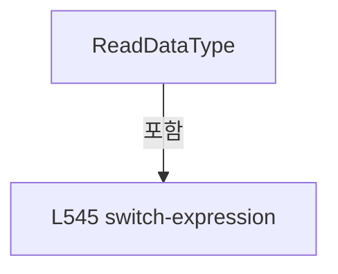

변경 전 점검: 입력/반환 타입, 위 호출자, 예외/취소 경로, 공유 상태와 저장·전송 소비자를 함께 확인합니다. 값의 단위나 물리 방향을 이름만으로 확정하지 않습니다.

### MethodDeclaration `ReadBool` · L554–562

[Drilling.File/JHMI/CSettingFile.cs:554–562](https://github.com/kjuws10-rgb/A3Drilling/blob/96e22cd027c84bf302b23f2949b98985d7f301bb/Drilling.File/JHMI/CSettingFile.cs#L554-L562)

| 항목 | 실제 추출 값 |
| --- | --- |
| 서명 | bool Drilling.File.JHMI.CSettingFile.ReadBool(string, bool) |
| 접근/수식자 | Private / private, static |
| 반환/값 타입 | bool |
| 소속 타입 | NamedType:Drilling.File.JHMI.CSettingFile |

입력 계약:

| 이름 | 타입 | 전달 | 선택/기본값 |
| --- | --- | --- | --- |
| value | string | None | False /  |
| defaultValue | bool | None | False /  |

정적 호출자로 확인된 위치:

| 호출 파일/행 | 호출 표현식 | 런타임 분기 가능 |
| --- | --- | --- |
| [Drilling.File/JHMI/CSettingFile.cs:174–174](https://github.com/kjuws10-rgb/A3Drilling/blob/96e22cd027c84bf302b23f2949b98985d7f301bb/Drilling.File/JHMI/CSettingFile.cs#L174-L174) | ReadBool | False |
| [Drilling.File/JHMI/CSettingFile.cs:175–175](https://github.com/kjuws10-rgb/A3Drilling/blob/96e22cd027c84bf302b23f2949b98985d7f301bb/Drilling.File/JHMI/CSettingFile.cs#L175-L175) | ReadBool | False |

호출하는 대상과 해석 범위:

| 원본 행 | 표현식 | 분석 상태 | 대상/소스 위치 |
| --- | --- | --- | --- |
| 556 | string.IsNullOrWhiteSpace | resolved | bool string.IsNullOrWhiteSpace(string?) |
| 561 | value.Equals | resolved | bool string.Equals(string?, System.StringComparison) |
| 561 | value.Equals | resolved | bool string.Equals(string?, System.StringComparison) |
| 561 | value.Equals | resolved | bool string.Equals(string?, System.StringComparison) |
| 561 | value.Equals | resolved | bool string.Equals(string?, System.StringComparison) |

본문의 실제 연산·분기·예외·반환 순서(원문 위치 순):

| 원본 행 | 종류 | 주석 해설 |
| --- | --- | --- |
| 556 | call | 함수·델리게이트 또는 객체 생성자를 호출합니다: string.IsNullOrWhiteSpace(value) |
| 556 | if | 조건에 따라 분기합니다: if (string.IsNullOrWhiteSpace(value)) |
| 558 | return | 호출자에게 값 또는 제어를 반환합니다: return defaultValue; |
| 561 | call | 함수·델리게이트 또는 객체 생성자를 호출합니다: value.Equals("1", StringComparison.OrdinalIgnoreCase) |
| 561 | call | 함수·델리게이트 또는 객체 생성자를 호출합니다: value.Equals("TRUE", StringComparison.OrdinalIgnoreCase) |
| 561 | call | 함수·델리게이트 또는 객체 생성자를 호출합니다: value.Equals("USE", StringComparison.OrdinalIgnoreCase) |
| 561 | call | 함수·델리게이트 또는 객체 생성자를 호출합니다: value.Equals("ON", StringComparison.OrdinalIgnoreCase) |
| 561 | return | 호출자에게 값 또는 제어를 반환합니다: return value.Equals("1", StringComparison.OrdinalIgnoreCase) &#124;&#124; value.Equals("TRUE", StringComparison.OrdinalIgnoreCase) &#124;&#124; value.Equals("USE", StringComparison.OrdinalIgnoreCase) &#124;&#124; value.Equals("ON", StringComparison.OrdinalIgno |

제어 구문의 포함 구조(실제 실행 순서/CFG가 아닌 구문 탐색 그림):

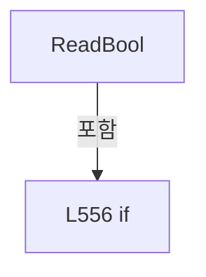

변경 전 점검: 입력/반환 타입, 위 호출자, 예외/취소 경로, 공유 상태와 저장·전송 소비자를 함께 확인합니다. 값의 단위나 물리 방향을 이름만으로 확정하지 않습니다.

### MethodDeclaration `ReadInt` · L564–567

[Drilling.File/JHMI/CSettingFile.cs:564–567](https://github.com/kjuws10-rgb/A3Drilling/blob/96e22cd027c84bf302b23f2949b98985d7f301bb/Drilling.File/JHMI/CSettingFile.cs#L564-L567)

| 항목 | 실제 추출 값 |
| --- | --- |
| 서명 | int Drilling.File.JHMI.CSettingFile.ReadInt(string, int) |
| 접근/수식자 | Private / private, static |
| 반환/값 타입 | int |
| 소속 타입 | NamedType:Drilling.File.JHMI.CSettingFile |

입력 계약:

| 이름 | 타입 | 전달 | 선택/기본값 |
| --- | --- | --- | --- |
| value | string | None | False /  |
| defaultValue | int | None | False /  |

현재 부분 분석에서 직접 연결된 호출자는 없습니다. XAML/이벤트/인터페이스·델리게이트·외부 진입을 추가 확인해야 하며, 미사용으로 판정한 것이 아닙니다.

호출하는 대상과 해석 범위:

| 원본 행 | 표현식 | 분석 상태 | 대상/소스 위치 |
| --- | --- | --- | --- |
| 566 | int.TryParse | resolved | bool int.TryParse(string?, System.Globalization.NumberStyles, System.IFormatProvider?, out int) |

본문의 실제 연산·분기·예외·반환 순서(원문 위치 순):

| 원본 행 | 종류 | 주석 해설 |
| --- | --- | --- |
| 566 | call | 함수·델리게이트 또는 객체 생성자를 호출합니다: int.TryParse(value, NumberStyles.Integer, CultureInfo.InvariantCulture, out var result) |
| 566 | conditional-expression | 조건에 따라 결과식을 선택합니다: int.TryParse(value, NumberStyles.Integer, CultureInfo.InvariantCulture, out var result) ? result : defaultValue |
| 566 | return | 호출자에게 값 또는 제어를 반환합니다: return int.TryParse(value, NumberStyles.Integer, CultureInfo.InvariantCulture, out var result) ? result : defaultValue; |

변경 전 점검: 입력/반환 타입, 위 호출자, 예외/취소 경로, 공유 상태와 저장·전송 소비자를 함께 확인합니다. 값의 단위나 물리 방향을 이름만으로 확정하지 않습니다.

### MethodDeclaration `ReadDouble` · L569–572

[Drilling.File/JHMI/CSettingFile.cs:569–572](https://github.com/kjuws10-rgb/A3Drilling/blob/96e22cd027c84bf302b23f2949b98985d7f301bb/Drilling.File/JHMI/CSettingFile.cs#L569-L572)

| 항목 | 실제 추출 값 |
| --- | --- |
| 서명 | double Drilling.File.JHMI.CSettingFile.ReadDouble(string, double) |
| 접근/수식자 | Private / private, static |
| 반환/값 타입 | double |
| 소속 타입 | NamedType:Drilling.File.JHMI.CSettingFile |

입력 계약:

| 이름 | 타입 | 전달 | 선택/기본값 |
| --- | --- | --- | --- |
| value | string | None | False /  |
| defaultValue | double | None | False /  |

정적 호출자로 확인된 위치:

| 호출 파일/행 | 호출 표현식 | 런타임 분기 가능 |
| --- | --- | --- |
| [Drilling.File/JHMI/CSettingFile.cs:177–177](https://github.com/kjuws10-rgb/A3Drilling/blob/96e22cd027c84bf302b23f2949b98985d7f301bb/Drilling.File/JHMI/CSettingFile.cs#L177-L177) | ReadDouble | False |
| [Drilling.File/JHMI/CSettingFile.cs:178–178](https://github.com/kjuws10-rgb/A3Drilling/blob/96e22cd027c84bf302b23f2949b98985d7f301bb/Drilling.File/JHMI/CSettingFile.cs#L178-L178) | ReadDouble | False |

호출하는 대상과 해석 범위:

| 원본 행 | 표현식 | 분석 상태 | 대상/소스 위치 |
| --- | --- | --- | --- |
| 571 | double.TryParse | resolved | bool double.TryParse(string?, System.Globalization.NumberStyles, System.IFormatProvider?, out double) |

본문의 실제 연산·분기·예외·반환 순서(원문 위치 순):

| 원본 행 | 종류 | 주석 해설 |
| --- | --- | --- |
| 571 | call | 함수·델리게이트 또는 객체 생성자를 호출합니다: double.TryParse(value, NumberStyles.Float, CultureInfo.InvariantCulture, out var result) |
| 571 | conditional-expression | 조건에 따라 결과식을 선택합니다: double.TryParse(value, NumberStyles.Float, CultureInfo.InvariantCulture, out var result) ? result : defaultValue |
| 571 | return | 호출자에게 값 또는 제어를 반환합니다: return double.TryParse(value, NumberStyles.Float, CultureInfo.InvariantCulture, out var result) ? result : defaultValue; |

변경 전 점검: 입력/반환 타입, 위 호출자, 예외/취소 경로, 공유 상태와 저장·전송 소비자를 함께 확인합니다. 값의 단위나 물리 방향을 이름만으로 확정하지 않습니다.

### MethodDeclaration `ToTabText` · L574–580

[Drilling.File/JHMI/CSettingFile.cs:574–580](https://github.com/kjuws10-rgb/A3Drilling/blob/96e22cd027c84bf302b23f2949b98985d7f301bb/Drilling.File/JHMI/CSettingFile.cs#L574-L580)

| 항목 | 실제 추출 값 |
| --- | --- |
| 서명 | string Drilling.File.JHMI.CSettingFile.ToTabText(Drilling.Common.Managers.EN_SETTING_TAB) |
| 접근/수식자 | Private / private, static |
| 반환/값 타입 | string |
| 소속 타입 | NamedType:Drilling.File.JHMI.CSettingFile |

입력 계약:

| 이름 | 타입 | 전달 | 선택/기본값 |
| --- | --- | --- | --- |
| section | Drilling.Common.Managers.EN_SETTING_TAB | None | False /  |

정적 호출자로 확인된 위치:

| 호출 파일/행 | 호출 표현식 | 런타임 분기 가능 |
| --- | --- | --- |
| [Drilling.File/JHMI/CSettingFile.cs:26–26](https://github.com/kjuws10-rgb/A3Drilling/blob/96e22cd027c84bf302b23f2949b98985d7f301bb/Drilling.File/JHMI/CSettingFile.cs#L26-L26) | ToTabText | False |
| [Drilling.File/JHMI/CSettingFile.cs:59–59](https://github.com/kjuws10-rgb/A3Drilling/blob/96e22cd027c84bf302b23f2949b98985d7f301bb/Drilling.File/JHMI/CSettingFile.cs#L59-L59) | ToTabText | False |
| [Drilling.File/JHMI/CSettingFile.cs:381–381](https://github.com/kjuws10-rgb/A3Drilling/blob/96e22cd027c84bf302b23f2949b98985d7f301bb/Drilling.File/JHMI/CSettingFile.cs#L381-L381) | ToTabText | False |

호출하는 대상과 해석 범위:

| 원본 행 | 표현식 | 분석 상태 | 대상/소스 위치 |
| --- | --- | --- | --- |
| 579 | section.ToString().ToUpperInvariant | resolved | string string.ToUpperInvariant() |
| 579 | section.ToString | resolved · 동적 구현 선택 가능 | string System.Enum.ToString() |

본문의 실제 연산·분기·예외·반환 순서(원문 위치 순):

| 원본 행 | 종류 | 주석 해설 |
| --- | --- | --- |
| 576 | return | 호출자에게 값 또는 제어를 반환합니다: return section switch { EN_SETTING_TAB.Io => "IO", _ => section.ToString().ToUpperInvariant()}; |
| 576 | switch-expression | 값별 결과식을 선택합니다: section switch { EN_SETTING_TAB.Io => "IO", _ => section.ToString().ToUpperInvariant()} |
| 579 | call | 함수·델리게이트 또는 객체 생성자를 호출합니다: section.ToString().ToUpperInvariant() |
| 579 | call | 함수·델리게이트 또는 객체 생성자를 호출합니다: section.ToString() |

제어 구문의 포함 구조(실제 실행 순서/CFG가 아닌 구문 탐색 그림):

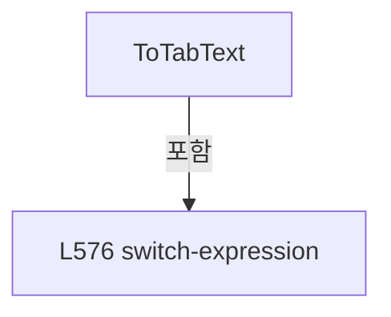

변경 전 점검: 입력/반환 타입, 위 호출자, 예외/취소 경로, 공유 상태와 저장·전송 소비자를 함께 확인합니다. 값의 단위나 물리 방향을 이름만으로 확정하지 않습니다.

## 구문·바인딩 한계

전체 WPF/벤더 SDK/프로젝트별 빌드 조건을 로드한 정식 빌드가 아닙니다. `resolved`는 이 부분 컴파일에서의 심볼 연결이며 virtual/interface/delegate/이벤트/Reflection/XAML의 실제 런타임 구현을 확정하지 않습니다. `candidate`와 `unresolved`는 후속 확인 대상으로 남깁니다.

## 원문 전체 주석 해설본

[원본 모든 행과 행별 해설 보기](../../../annotated/Drilling.File/JHMI/CSettingFile.cs.annotated.txt)

원본을 빠뜨리거나 임의로 줄이지 않았습니다. `L000001 |` 표시는 원본 행 번호, `// 해설`은 별도 설명입니다. 실행용 소스가 아닌 문서입니다.

## 수정·재검증 체크

- 원본 Commit과 현재 작업 파일 SHA가 같은지 먼저 확인합니다. 다르면 이 문서를 과거 버전 자료로 취급합니다.
- 선언·직접 호출·이벤트/인터페이스 경계·설정 소비를 함께 확인합니다. 정적 연결의 빈 곳을 정상 경로로 추정하지 않습니다.
- 저장 형식/단위/식별자·재시도·취소·예외·롤백에 영향을 주는 변경은 상세 해설장과 호출자를 다시 검토합니다.
- 도구의 구문 추출과 별도 정적 추적 해설, 실제 빌드·시뮬레이션·실장비 검증 결과를 분리합니다.
