# Drilling.File/JHMI/CSettingFile.cs

| 항목 | 내용 |
| --- | --- |
| 원본 저장소 | https://github.com/kjuws10-rgb/A3Drilling.git |
| 원본 Commit | 5aee8e58439c9b455cae7c9593c9be986c3e682e |
| 원본 SHA256 | c02c8f02e322dd1336b8abad345720ba01031ce19364905b812252a9f7598df6 |
| 파일 분류 | code |
| 원본 크기/행 | 26,294 bytes / 564 physical lines |
| 인코딩 | utf-8-sig |
| 검토 범위 | 구문/부분 의미 분석에서 추출한 사실. 동작·물리 단위·실장비 합격을 보증하지 않습니다. |
| 원본 링크 | [고정 Commit 원본](https://github.com/kjuws10-rgb/A3Drilling/blob/5aee8e58439c9b455cae7c9593c9be986c3e682e/Drilling.File/JHMI/CSettingFile.cs) |

## 파일의 역할과 읽는 순서

정의·설정·레시피·결과·스크립트의 파일 입출력과 데이터 형식을 담당합니다. 저장 필드를 통신 송신 필드로 단정하지 않습니다.

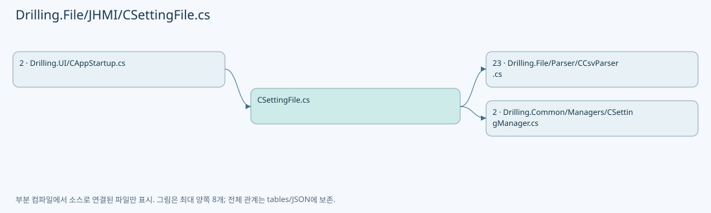

## 네임스페이스·타입·상속

| 타입 | 구분 | 원본 범위 | 선언/상속 |
| --- | --- | --- | --- |
| CSettingFile | ClassDeclaration | 13–564 | CSettingFile: CSettingFileBase |
| ST_SETTING_FORM_ITEM | RecordDeclaration | 548–563 | ST_SETTING_FORM_ITEM |

## 멤버 빠른 목록

| 이름 | 종류 | 범위 | 서명 |
| --- | --- | --- | --- |
| FormHeaders | FieldDeclaration | L15–15 | System.Collections.Generic.IReadOnlyList<string> Drilling.File.JHMI.CSettingFile.FormHeaders |
| ValueHeaders | FieldDeclaration | L16–16 | System.Collections.Generic.IReadOnlyList<string> Drilling.File.JHMI.CSettingFile.ValueHeaders |
| _settingDirectory | FieldDeclaration | L17–17 | string Drilling.File.JHMI.CSettingFile._settingDirectory |
| _logManager | FieldDeclaration | L18–18 | CLogManager Drilling.File.JHMI.CSettingFile._logManager |
| Load | MethodDeclaration | L19–50 | System.Collections.Generic.IReadOnlyList<Drilling.Common.Managers.ST_SYSTEM_PARAMETER> Drilling.File.JHMI.CSettingFile.Load(Drilling.Common.Managers.EN_SETTING_TAB, System.Threading.CancellationToken) |
| ShouldIncludeItem | LocalFunctionStatement | L23–26 | bool ShouldIncludeItem(Drilling.File.JHMI.CSettingFile.ST_SETTING_FORM_ITEM) |
| BuildSystem | LocalFunctionStatement | L28–47 | Drilling.Common.Managers.ST_SYSTEM_PARAMETER BuildSystem(Drilling.File.JHMI.CSettingFile.ST_SETTING_FORM_ITEM) |
| Save | MethodDeclaration | L52–131 | void Drilling.File.JHMI.CSettingFile.Save(Drilling.Common.Managers.EN_SETTING_TAB, System.Collections.Generic.IReadOnlyList<Drilling.Common.Managers.ST_SYSTEM_PARAMETER>, System.Threading.CancellationToken) |
| ShouldIncludeItem | LocalFunctionStatement | L59–62 | bool ShouldIncludeItem(Drilling.File.JHMI.CSettingFile.ST_SETTING_FORM_ITEM) |
| SelectName | LocalFunctionStatement | L64–67 | string SelectName(Drilling.File.JHMI.CSettingFile.ST_SETTING_FORM_ITEM) |
| SelectValue | LocalFunctionStatement | L69–72 | string SelectValue(Drilling.File.JHMI.CSettingFile.ST_SETTING_FORM_ITEM) |
| ShouldIncludeSystem | LocalFunctionStatement | L75–78 | bool ShouldIncludeSystem(Drilling.Common.Managers.ST_SYSTEM_PARAMETER) |
| SelectEditedParameterValue | LocalFunctionStatement | L80–83 | string SelectEditedParameterValue(Drilling.Common.Managers.ST_SYSTEM_PARAMETER) |
| ShouldIncludeSetting | LocalFunctionStatement | L86–89 | bool ShouldIncludeSetting(Drilling.File.JHMI.CSettingFile.ST_SETTING_FORM_ITEM) |
| BuildSystem | LocalFunctionStatement | L91–110 | Drilling.Common.Managers.ST_SYSTEM_PARAMETER BuildSystem(Drilling.File.JHMI.CSettingFile.ST_SETTING_FORM_ITEM) |
| LoadHistory | MethodDeclaration | L133–137 | System.Collections.Generic.IReadOnlyList<Drilling.Common.Managers.ST_SETTING_HISTORY> Drilling.File.JHMI.CSettingFile.LoadHistory(Drilling.Common.Managers.EN_SETTING_TAB, System.Threading.CancellationToken) |
| LoadFormItems | MethodDeclaration | L139–191 | System.Collections.Generic.IReadOnlyList<Drilling.File.JHMI.CSettingFile.ST_SETTING_FORM_ITEM> Drilling.File.JHMI.CSettingFile.LoadFormItems() |
| SelectItem | LocalFunctionStatement | L141–147 | string[] SelectItem(string) |
| BuildSetting | LocalFunctionStatement | L150–182 | Drilling.File.JHMI.CSettingFile.ST_SETTING_FORM_ITEM BuildSetting(System.Collections.Generic.IReadOnlyDictionary<string, string>, int) |
| ShouldIncludeItem | LocalFunctionStatement | L184–187 | bool ShouldIncludeItem(Drilling.File.JHMI.CSettingFile.ST_SETTING_FORM_ITEM) |
| AppendBuiltInFormItems | MethodDeclaration | L193–217 | System.Collections.Generic.IReadOnlyList<Drilling.File.JHMI.CSettingFile.ST_SETTING_FORM_ITEM> Drilling.File.JHMI.CSettingFile.AppendBuiltInFormItems(System.Collections.Generic.IReadOnlyList<Drilling.File.JHMI.CSettingFile.ST_SETTING_FORM_ITEM>) |
| SelectItem | LocalFunctionStatement | L195–198 | string SelectItem(Drilling.File.JHMI.CSettingFile.ST_SETTING_FORM_ITEM) |
| CreateDistortionRunOptionFormItems | MethodDeclaration | L219–225 | System.Collections.Generic.IEnumerable<Drilling.File.JHMI.CSettingFile.ST_SETTING_FORM_ITEM> Drilling.File.JHMI.CSettingFile.CreateDistortionRunOptionFormItems() |
| CreateOffsetScaleFormItems | MethodDeclaration | L227–233 | System.Collections.Generic.IEnumerable<Drilling.File.JHMI.CSettingFile.ST_SETTING_FORM_ITEM> Drilling.File.JHMI.CSettingFile.CreateOffsetScaleFormItems() |
| CreateAlignFormItems | MethodDeclaration | L235–249 | System.Collections.Generic.IEnumerable<Drilling.File.JHMI.CSettingFile.ST_SETTING_FORM_ITEM> Drilling.File.JHMI.CSettingFile.CreateAlignFormItems() |
| CreateScannerFormItems | MethodDeclaration | L251–287 | System.Collections.Generic.IEnumerable<Drilling.File.JHMI.CSettingFile.ST_SETTING_FORM_ITEM> Drilling.File.JHMI.CSettingFile.CreateScannerFormItems() |
| LoadSettingValues | MethodDeclaration | L289–326 | System.Collections.Generic.Dictionary<string, string> Drilling.File.JHMI.CSettingFile.LoadSettingValues() |
| SelectItem | LocalFunctionStatement | L292–298 | string[] SelectItem(string) |
| HasSettingValueKey | LocalFunctionStatement | L305–308 | bool HasSettingValueKey(System.Collections.Generic.IReadOnlyDictionary<string, string>) |
| SelectGroupKey | LocalFunctionStatement | L310–313 | string SelectGroupKey(System.Collections.Generic.IReadOnlyDictionary<string, string>) |
| SelectKey | LocalFunctionStatement | L315–318 | string SelectKey(System.Linq.IGrouping<string, System.Collections.Generic.IReadOnlyDictionary<string, string>>) |
| SelectValue | LocalFunctionStatement | L320–323 | string SelectValue(System.Linq.IGrouping<string, System.Collections.Generic.IReadOnlyDictionary<string, string>>) |
| WriteSettingValues | MethodDeclaration | L328–347 | void Drilling.File.JHMI.CSettingFile.WriteSettingValues(System.Collections.Generic.IReadOnlyList<Drilling.File.JHMI.CSettingFile.ST_SETTING_FORM_ITEM>, System.Collections.Generic.IReadOnlyDictionary<string, string>) |
| IsUse | LocalFunctionStatement | L330–333 | bool IsUse(Drilling.File.JHMI.CSettingFile.ST_SETTING_FORM_ITEM) |
| BuildSettingValueRow | LocalFunctionStatement | L335–343 | System.Collections.Generic.Dictionary<string, string> BuildSettingValueRow(Drilling.File.JHMI.CSettingFile.ST_SETTING_FORM_ITEM) |
| ValidateSavedSection | MethodDeclaration | L349–367 | void Drilling.File.JHMI.CSettingFile.ValidateSavedSection(Drilling.Common.Managers.EN_SETTING_TAB, System.Collections.Generic.IReadOnlyList<Drilling.Common.Managers.ST_SYSTEM_PARAMETER>) |
| ValidateSectionParameters | MethodDeclaration | L369–408 | void Drilling.File.JHMI.CSettingFile.ValidateSectionParameters(string, System.Collections.Generic.IReadOnlyList<Drilling.Common.Managers.ST_SYSTEM_PARAMETER>, System.Collections.Generic.IReadOnlyList<Drilling.File.JHMI.CSettingFile.ST_SETTING_FORM_ITEM>) |
| ShouldIncludeItem | LocalFunctionStatement | L371–374 | bool ShouldIncludeItem(Drilling.File.JHMI.CSettingFile.ST_SETTING_FORM_ITEM) |
| SelectName | LocalFunctionStatement | L376–379 | string SelectName(Drilling.File.JHMI.CSettingFile.ST_SETTING_FORM_ITEM) |
| GetParameterKey | MethodDeclaration | L410–413 | string Drilling.File.JHMI.CSettingFile.GetParameterKey(Drilling.Common.Managers.ST_SYSTEM_PARAMETER) |
| ValidateIntParameter | MethodDeclaration | L415–423 | string Drilling.File.JHMI.CSettingFile.ValidateIntParameter(Drilling.File.JHMI.CSettingFile.ST_SETTING_FORM_ITEM, string) |
| ValidateDoubleParameter | MethodDeclaration | L425–443 | string Drilling.File.JHMI.CSettingFile.ValidateDoubleParameter(Drilling.File.JHMI.CSettingFile.ST_SETTING_FORM_ITEM, string) |
| ValidateBoolParameter | MethodDeclaration | L445–449 | string Drilling.File.JHMI.CSettingFile.ValidateBoolParameter(Drilling.File.JHMI.CSettingFile.ST_SETTING_FORM_ITEM, string) |
| ValidateNumericRange | MethodDeclaration | L451–459 | string Drilling.File.JHMI.CSettingFile.ValidateNumericRange(Drilling.File.JHMI.CSettingFile.ST_SETTING_FORM_ITEM, double) |
| GetFormPath | MethodDeclaration | L461–464 | string Drilling.File.JHMI.CSettingFile.GetFormPath() |
| GetValuePath | MethodDeclaration | L466–469 | string Drilling.File.JHMI.CSettingFile.GetValuePath() |
| GetValue | MethodDeclaration | L471–480 | string Drilling.File.JHMI.CSettingFile.GetValue(System.Collections.Generic.IReadOnlyDictionary<string, string>, string, string, string) |
| CreateKey | MethodDeclaration | L482–485 | string Drilling.File.JHMI.CSettingFile.CreateKey(string, string) |
| NormalizeTab | MethodDeclaration | L487–497 | string Drilling.File.JHMI.CSettingFile.NormalizeTab(string) |
| NormalizeSettingText | MethodDeclaration | L499–502 | string Drilling.File.JHMI.CSettingFile.NormalizeSettingText(string, string) |
| GetOrDefault | MethodDeclaration | L504–507 | string Drilling.File.JHMI.CSettingFile.GetOrDefault(string, string) |
| ReadDataType | MethodDeclaration | L509–518 | Drilling.Common.Managers.EN_RECIPE_DATA_TYPE Drilling.File.JHMI.CSettingFile.ReadDataType(string) |
| ReadBool | MethodDeclaration | L520–528 | bool Drilling.File.JHMI.CSettingFile.ReadBool(string, bool) |
| ReadInt | MethodDeclaration | L530–533 | int Drilling.File.JHMI.CSettingFile.ReadInt(string, int) |
| ReadDouble | MethodDeclaration | L535–538 | double Drilling.File.JHMI.CSettingFile.ReadDouble(string, double) |
| ToTabText | MethodDeclaration | L540–546 | string Drilling.File.JHMI.CSettingFile.ToTabText(Drilling.Common.Managers.EN_SETTING_TAB) |

## 멤버별 상세 계약·호출·처리 해설

### FieldDeclaration `FormHeaders` · L15–15

[Drilling.File/JHMI/CSettingFile.cs:15–15](https://github.com/kjuws10-rgb/A3Drilling/blob/5aee8e58439c9b455cae7c9593c9be986c3e682e/Drilling.File/JHMI/CSettingFile.cs#L15-L15)

| 항목 | 실제 추출 값 |
| --- | --- |
| 서명 | System.Collections.Generic.IReadOnlyList<string> Drilling.File.JHMI.CSettingFile.FormHeaders |
| 접근/수식자 | Private / private, static, readonly |
| 반환/값 타입 | System.Collections.Generic.IReadOnlyList<string> |
| 소속 타입 | NamedType:Drilling.File.JHMI.CSettingFile |

현재 부분 분석에서 직접 연결된 호출자는 없습니다. XAML/이벤트/인터페이스·델리게이트·외부 진입을 추가 확인해야 하며, 미사용으로 판정한 것이 아닙니다.

본문의 실제 연산·분기·예외·반환 순서(원문 위치 순):

| 원본 행 | 종류 | 주석 해설 |
| --- | --- | --- |
| 15 | variable-initializer | 변수의 초기값을 지정합니다: FormHeaders = ["TAB", "GROUP", "NAME", "DISPLAY NAME", "DATA TYPE", "UNIT", "SHOW", "USE", "VALUE", "MIN", "MAX", "DESCRIPTION"] |

변경 전 점검: 입력/반환 타입, 위 호출자, 예외/취소 경로, 공유 상태와 저장·전송 소비자를 함께 확인합니다. 값의 단위나 물리 방향을 이름만으로 확정하지 않습니다.

### FieldDeclaration `ValueHeaders` · L16–16

[Drilling.File/JHMI/CSettingFile.cs:16–16](https://github.com/kjuws10-rgb/A3Drilling/blob/5aee8e58439c9b455cae7c9593c9be986c3e682e/Drilling.File/JHMI/CSettingFile.cs#L16-L16)

| 항목 | 실제 추출 값 |
| --- | --- |
| 서명 | System.Collections.Generic.IReadOnlyList<string> Drilling.File.JHMI.CSettingFile.ValueHeaders |
| 접근/수식자 | Private / private, static, readonly |
| 반환/값 타입 | System.Collections.Generic.IReadOnlyList<string> |
| 소속 타입 | NamedType:Drilling.File.JHMI.CSettingFile |

현재 부분 분석에서 직접 연결된 호출자는 없습니다. XAML/이벤트/인터페이스·델리게이트·외부 진입을 추가 확인해야 하며, 미사용으로 판정한 것이 아닙니다.

본문의 실제 연산·분기·예외·반환 순서(원문 위치 순):

| 원본 행 | 종류 | 주석 해설 |
| --- | --- | --- |
| 16 | variable-initializer | 변수의 초기값을 지정합니다: ValueHeaders = ["TAB", "NAME", "VALUE"] |

변경 전 점검: 입력/반환 타입, 위 호출자, 예외/취소 경로, 공유 상태와 저장·전송 소비자를 함께 확인합니다. 값의 단위나 물리 방향을 이름만으로 확정하지 않습니다.

### FieldDeclaration `_settingDirectory` · L17–17

[Drilling.File/JHMI/CSettingFile.cs:17–17](https://github.com/kjuws10-rgb/A3Drilling/blob/5aee8e58439c9b455cae7c9593c9be986c3e682e/Drilling.File/JHMI/CSettingFile.cs#L17-L17)

| 항목 | 실제 추출 값 |
| --- | --- |
| 서명 | string Drilling.File.JHMI.CSettingFile._settingDirectory |
| 접근/수식자 | Private / private, readonly |
| 반환/값 타입 | string |
| 소속 타입 | NamedType:Drilling.File.JHMI.CSettingFile |

현재 부분 분석에서 직접 연결된 호출자는 없습니다. XAML/이벤트/인터페이스·델리게이트·외부 진입을 추가 확인해야 하며, 미사용으로 판정한 것이 아닙니다.

호출하는 대상과 해석 범위:

| 원본 행 | 표현식 | 분석 상태 | 대상/소스 위치 |
| --- | --- | --- | --- |
| 17 | Path.Combine | resolved | string System.IO.Path.Combine(string, string) |

본문의 실제 연산·분기·예외·반환 순서(원문 위치 순):

| 원본 행 | 종류 | 주석 해설 |
| --- | --- | --- |
| 17 | call | 함수·델리게이트 또는 객체 생성자를 호출합니다: Path.Combine(configRoot, "Setting") |
| 17 | variable-initializer | 변수의 초기값을 지정합니다: _settingDirectory = Path.Combine(configRoot, "Setting") |

변경 전 점검: 입력/반환 타입, 위 호출자, 예외/취소 경로, 공유 상태와 저장·전송 소비자를 함께 확인합니다. 값의 단위나 물리 방향을 이름만으로 확정하지 않습니다.

### FieldDeclaration `_logManager` · L18–18

[Drilling.File/JHMI/CSettingFile.cs:18–18](https://github.com/kjuws10-rgb/A3Drilling/blob/5aee8e58439c9b455cae7c9593c9be986c3e682e/Drilling.File/JHMI/CSettingFile.cs#L18-L18)

| 항목 | 실제 추출 값 |
| --- | --- |
| 서명 | CLogManager Drilling.File.JHMI.CSettingFile._logManager |
| 접근/수식자 | Private / private, readonly |
| 반환/값 타입 | CLogManager |
| 소속 타입 | NamedType:Drilling.File.JHMI.CSettingFile |

현재 부분 분석에서 직접 연결된 호출자는 없습니다. XAML/이벤트/인터페이스·델리게이트·외부 진입을 추가 확인해야 하며, 미사용으로 판정한 것이 아닙니다.

호출하는 대상과 해석 범위:

| 원본 행 | 표현식 | 분석 상태 | 대상/소스 위치 |
| --- | --- | --- | --- |
| 18 | new | unresolved | None |

본문의 실제 연산·분기·예외·반환 순서(원문 위치 순):

| 원본 행 | 종류 | 주석 해설 |
| --- | --- | --- |
| 18 | call | 함수·델리게이트 또는 객체 생성자를 호출합니다: new(configRoot) |
| 18 | variable-initializer | 변수의 초기값을 지정합니다: _logManager = new(configRoot) |

변경 전 점검: 입력/반환 타입, 위 호출자, 예외/취소 경로, 공유 상태와 저장·전송 소비자를 함께 확인합니다. 값의 단위나 물리 방향을 이름만으로 확정하지 않습니다.

### MethodDeclaration `Load` · L19–50

[Drilling.File/JHMI/CSettingFile.cs:19–50](https://github.com/kjuws10-rgb/A3Drilling/blob/5aee8e58439c9b455cae7c9593c9be986c3e682e/Drilling.File/JHMI/CSettingFile.cs#L19-L50)

| 항목 | 실제 추출 값 |
| --- | --- |
| 서명 | System.Collections.Generic.IReadOnlyList<Drilling.Common.Managers.ST_SYSTEM_PARAMETER> Drilling.File.JHMI.CSettingFile.Load(Drilling.Common.Managers.EN_SETTING_TAB, System.Threading.CancellationToken) |
| 접근/수식자 | Public / public, override |
| 반환/값 타입 | System.Collections.Generic.IReadOnlyList<Drilling.Common.Managers.ST_SYSTEM_PARAMETER> |
| 소속 타입 | NamedType:Drilling.File.JHMI.CSettingFile |

입력 계약:

| 이름 | 타입 | 전달 | 선택/기본값 |
| --- | --- | --- | --- |
| section | Drilling.Common.Managers.EN_SETTING_TAB | None | False /  |
| cancellationToken | System.Threading.CancellationToken | None | True / null |

정적 호출자로 확인된 위치:

| 호출 파일/행 | 호출 표현식 | 런타임 분기 가능 |
| --- | --- | --- |
| [Drilling.UI/CAppStartup.cs:145–145](https://github.com/kjuws10-rgb/A3Drilling/blob/5aee8e58439c9b455cae7c9593c9be986c3e682e/Drilling.UI/CAppStartup.cs#L145-L145) | settingFile.Load | True |

호출하는 대상과 해석 범위:

| 원본 행 | 표현식 | 분석 상태 | 대상/소스 위치 |
| --- | --- | --- | --- |
| 21 | cancellationToken.ThrowIfCancellationRequested | resolved | void System.Threading.CancellationToken.ThrowIfCancellationRequested() |
| 22 | LoadSettingValues | resolved | System.Collections.Generic.Dictionary<string, string> Drilling.File.JHMI.CSettingFile.LoadSettingValues() · Drilling.File/JHMI/CSettingFile.cs:289 |
| 49 | LoadFormItems().Where(ShouldIncludeItem).Select(BuildSystem).ToArray | resolved | Drilling.Common.Managers.ST_SYSTEM_PARAMETER[] System.Collections.Generic.IEnumerable<Drilling.Common.Managers.ST_SYSTEM_PARAMETER>.ToArray<Drilling.Common.Managers.ST_SYSTEM_PARAMETER>() |
| 49 | LoadFormItems().Where(ShouldIncludeItem).Select | resolved | System.Collections.Generic.IEnumerable<Drilling.Common.Managers.ST_SYSTEM_PARAMETER> System.Collections.Generic.IEnumerable<Drilling.File.JHMI.CSettingFile.ST_SETTING_FORM_ITEM>.Select<Drilling.File.JHMI.CSettingFile.ST_SETTING_FORM_ITEM, Drilling.Common.Managers.ST_SYSTEM_PARAMETER>(System.Func<Drilling.File.JHMI.CSettingFile.ST_SETTING_FORM_ITEM, Drilling.Common.Managers.ST_SYSTEM_PARAMETER>) |
| 49 | LoadFormItems().Where | resolved | System.Collections.Generic.IEnumerable<Drilling.File.JHMI.CSettingFile.ST_SETTING_FORM_ITEM> System.Collections.Generic.IEnumerable<Drilling.File.JHMI.CSettingFile.ST_SETTING_FORM_ITEM>.Where<Drilling.File.JHMI.CSettingFile.ST_SETTING_FORM_ITEM>(System.Func<Drilling.File.JHMI.CSettingFile.ST_SETTING_FORM_ITEM, bool>) |
| 49 | LoadFormItems | resolved | System.Collections.Generic.IReadOnlyList<Drilling.File.JHMI.CSettingFile.ST_SETTING_FORM_ITEM> Drilling.File.JHMI.CSettingFile.LoadFormItems() · Drilling.File/JHMI/CSettingFile.cs:139 |

본문의 실제 연산·분기·예외·반환 순서(원문 위치 순):

| 원본 행 | 종류 | 주석 해설 |
| --- | --- | --- |
| 21 | call | 함수·델리게이트 또는 객체 생성자를 호출합니다: cancellationToken.ThrowIfCancellationRequested() |
| 22 | call | 함수·델리게이트 또는 객체 생성자를 호출합니다: LoadSettingValues() |
| 22 | local-declaration | 지역 변수를 선언합니다: var values = LoadSettingValues(); |
| 22 | variable-initializer | 변수의 초기값을 지정합니다: values = LoadSettingValues() |
| 49 | call | 함수·델리게이트 또는 객체 생성자를 호출합니다: LoadFormItems().Where(ShouldIncludeItem).Select(BuildSystem).ToArray() |
| 49 | call | 함수·델리게이트 또는 객체 생성자를 호출합니다: LoadFormItems().Where(ShouldIncludeItem).Select(BuildSystem) |
| 49 | call | 함수·델리게이트 또는 객체 생성자를 호출합니다: LoadFormItems().Where(ShouldIncludeItem) |
| 49 | call | 함수·델리게이트 또는 객체 생성자를 호출합니다: LoadFormItems() |
| 49 | return | 호출자에게 값 또는 제어를 반환합니다: return LoadFormItems().Where(ShouldIncludeItem).Select(BuildSystem).ToArray(); |

변경 전 점검: 입력/반환 타입, 위 호출자, 예외/취소 경로, 공유 상태와 저장·전송 소비자를 함께 확인합니다. 값의 단위나 물리 방향을 이름만으로 확정하지 않습니다.

### LocalFunctionStatement `ShouldIncludeItem` · L23–26

[Drilling.File/JHMI/CSettingFile.cs:23–26](https://github.com/kjuws10-rgb/A3Drilling/blob/5aee8e58439c9b455cae7c9593c9be986c3e682e/Drilling.File/JHMI/CSettingFile.cs#L23-L26)

| 항목 | 실제 추출 값 |
| --- | --- |
| 서명 | bool ShouldIncludeItem(Drilling.File.JHMI.CSettingFile.ST_SETTING_FORM_ITEM) |
| 접근/수식자 | Private /  |
| 반환/값 타입 | bool |
| 소속 타입 | NamedType:Drilling.File.JHMI.CSettingFile |

입력 계약:

| 이름 | 타입 | 전달 | 선택/기본값 |
| --- | --- | --- | --- |
| item | Drilling.File.JHMI.CSettingFile.ST_SETTING_FORM_ITEM | None | False /  |

현재 부분 분석에서 직접 연결된 호출자는 없습니다. XAML/이벤트/인터페이스·델리게이트·외부 진입을 추가 확인해야 하며, 미사용으로 판정한 것이 아닙니다.

호출하는 대상과 해석 범위:

| 원본 행 | 표현식 | 분석 상태 | 대상/소스 위치 |
| --- | --- | --- | --- |
| 25 | item.Tab.Equals | resolved | bool string.Equals(string?, System.StringComparison) |
| 25 | ToTabText | resolved | string Drilling.File.JHMI.CSettingFile.ToTabText(Drilling.Common.Managers.EN_SETTING_TAB) · Drilling.File/JHMI/CSettingFile.cs:540 |

본문의 실제 연산·분기·예외·반환 순서(원문 위치 순):

| 원본 행 | 종류 | 주석 해설 |
| --- | --- | --- |
| 25 | call | 함수·델리게이트 또는 객체 생성자를 호출합니다: item.Tab.Equals(ToTabText(section), StringComparison.OrdinalIgnoreCase) |
| 25 | call | 함수·델리게이트 또는 객체 생성자를 호출합니다: ToTabText(section) |
| 25 | return | 호출자에게 값 또는 제어를 반환합니다: return item.Use && item.Tab.Equals(ToTabText(section), StringComparison.OrdinalIgnoreCase); |

변경 전 점검: 입력/반환 타입, 위 호출자, 예외/취소 경로, 공유 상태와 저장·전송 소비자를 함께 확인합니다. 값의 단위나 물리 방향을 이름만으로 확정하지 않습니다.

### LocalFunctionStatement `BuildSystem` · L28–47

[Drilling.File/JHMI/CSettingFile.cs:28–47](https://github.com/kjuws10-rgb/A3Drilling/blob/5aee8e58439c9b455cae7c9593c9be986c3e682e/Drilling.File/JHMI/CSettingFile.cs#L28-L47)

| 항목 | 실제 추출 값 |
| --- | --- |
| 서명 | Drilling.Common.Managers.ST_SYSTEM_PARAMETER BuildSystem(Drilling.File.JHMI.CSettingFile.ST_SETTING_FORM_ITEM) |
| 접근/수식자 | Private /  |
| 반환/값 타입 | Drilling.Common.Managers.ST_SYSTEM_PARAMETER |
| 소속 타입 | NamedType:Drilling.File.JHMI.CSettingFile |

입력 계약:

| 이름 | 타입 | 전달 | 선택/기본값 |
| --- | --- | --- | --- |
| item | Drilling.File.JHMI.CSettingFile.ST_SETTING_FORM_ITEM | None | False /  |

현재 부분 분석에서 직접 연결된 호출자는 없습니다. XAML/이벤트/인터페이스·델리게이트·외부 진입을 추가 확인해야 하며, 미사용으로 판정한 것이 아닙니다.

호출하는 대상과 해석 범위:

| 원본 행 | 표현식 | 분석 상태 | 대상/소스 위치 |
| --- | --- | --- | --- |
| 30 | new ST_SYSTEM_PARAMETER | resolved | Drilling.Common.Managers.ST_SYSTEM_PARAMETER.ST_SYSTEM_PARAMETER(Drilling.Common.Managers.EN_SETTING_TAB, string, string, string, string, string, string, string, Drilling.Common.Managers.EN_RECIPE_DATA_TYPE, double, double, bool, bool, int, System.Collections.Generic.IReadOnlyDictionary<string, string>?) · Drilling.Common/Managers/CSettingManager.cs:255 |
| 33 | GetValue | resolved | string Drilling.File.JHMI.CSettingFile.GetValue(System.Collections.Generic.IReadOnlyDictionary<string, string>, string, string, string) · Drilling.File/JHMI/CSettingFile.cs:471 |

본문의 실제 연산·분기·예외·반환 순서(원문 위치 순):

| 원본 행 | 종류 | 주석 해설 |
| --- | --- | --- |
| 30 | call | 함수·델리게이트 또는 객체 생성자를 호출합니다: new ST_SYSTEM_PARAMETER( section, item.DisplayName, GetValue(values, item.Tab, item.Name, item.DefaultValue), item.Unit, item.Description, item.Group, item.Name, item.DefaultValue, item.DataType, item.Min, item.Max, item… |
| 30 | return | 호출자에게 값 또는 제어를 반환합니다: return new ST_SYSTEM_PARAMETER( section, item.DisplayName, GetValue(values, item.Tab, item.Name, item.DefaultValue), item.Unit, item.Description, item.Group, item.Name, item.DefaultValue, item.DataType, item.Min, item.Max, item.Sh |
| 33 | call | 함수·델리게이트 또는 객체 생성자를 호출합니다: GetValue(values, item.Tab, item.Name, item.DefaultValue) |

변경 전 점검: 입력/반환 타입, 위 호출자, 예외/취소 경로, 공유 상태와 저장·전송 소비자를 함께 확인합니다. 값의 단위나 물리 방향을 이름만으로 확정하지 않습니다.

### MethodDeclaration `Save` · L52–131

[Drilling.File/JHMI/CSettingFile.cs:52–131](https://github.com/kjuws10-rgb/A3Drilling/blob/5aee8e58439c9b455cae7c9593c9be986c3e682e/Drilling.File/JHMI/CSettingFile.cs#L52-L131)

| 항목 | 실제 추출 값 |
| --- | --- |
| 서명 | void Drilling.File.JHMI.CSettingFile.Save(Drilling.Common.Managers.EN_SETTING_TAB, System.Collections.Generic.IReadOnlyList<Drilling.Common.Managers.ST_SYSTEM_PARAMETER>, System.Threading.CancellationToken) |
| 접근/수식자 | Public / public, override |
| 반환/값 타입 | void |
| 소속 타입 | NamedType:Drilling.File.JHMI.CSettingFile |

입력 계약:

| 이름 | 타입 | 전달 | 선택/기본값 |
| --- | --- | --- | --- |
| section | Drilling.Common.Managers.EN_SETTING_TAB | None | False /  |
| parameters | System.Collections.Generic.IReadOnlyList<Drilling.Common.Managers.ST_SYSTEM_PARAMETER> | None | False /  |
| cancellationToken | System.Threading.CancellationToken | None | True / null |

현재 부분 분석에서 직접 연결된 호출자는 없습니다. XAML/이벤트/인터페이스·델리게이트·외부 진입을 추가 확인해야 하며, 미사용으로 판정한 것이 아닙니다.

호출하는 대상과 해석 범위:

| 원본 행 | 표현식 | 분석 상태 | 대상/소스 위치 |
| --- | --- | --- | --- |
| 54 | cancellationToken.ThrowIfCancellationRequested | resolved | void System.Threading.CancellationToken.ThrowIfCancellationRequested() |
| 55 | Directory.CreateDirectory | resolved | System.IO.DirectoryInfo System.IO.Directory.CreateDirectory(string) |
| 56 | LoadFormItems | resolved | System.Collections.Generic.IReadOnlyList<Drilling.File.JHMI.CSettingFile.ST_SETTING_FORM_ITEM> Drilling.File.JHMI.CSettingFile.LoadFormItems() · Drilling.File/JHMI/CSettingFile.cs:139 |
| 57 | LoadSettingValues | resolved | System.Collections.Generic.Dictionary<string, string> Drilling.File.JHMI.CSettingFile.LoadSettingValues() · Drilling.File/JHMI/CSettingFile.cs:289 |
| 58 | ToTabText | resolved | string Drilling.File.JHMI.CSettingFile.ToTabText(Drilling.Common.Managers.EN_SETTING_TAB) · Drilling.File/JHMI/CSettingFile.cs:540 |
| 74 | formItems.Where(ShouldIncludeItem).ToDictionary | resolved | System.Collections.Generic.Dictionary<string, string> System.Collections.Generic.IEnumerable<Drilling.File.JHMI.CSettingFile.ST_SETTING_FORM_ITEM>.ToDictionary<Drilling.File.JHMI.CSettingFile.ST_SETTING_FORM_ITEM, string, string>(System.Func<Drilling.File.JHMI.CSettingFile.ST_SETTING_FORM_ITEM, string>, System.Func<Drilling.File.JHMI.CSettingFile.ST_SETTING_FORM_ITEM, string>, System.Collections.Generic.IEqualityComparer<string>?) |
| 74 | formItems.Where | resolved | System.Collections.Generic.IEnumerable<Drilling.File.JHMI.CSettingFile.ST_SETTING_FORM_ITEM> System.Collections.Generic.IEnumerable<Drilling.File.JHMI.CSettingFile.ST_SETTING_FORM_ITEM>.Where<Drilling.File.JHMI.CSettingFile.ST_SETTING_FORM_ITEM>(System.Func<Drilling.File.JHMI.CSettingFile.ST_SETTING_FORM_ITEM, bool>) |
| 85 | parameters.Where(ShouldIncludeSystem).ToDictionary | resolved | System.Collections.Generic.Dictionary<string, string> System.Collections.Generic.IEnumerable<Drilling.Common.Managers.ST_SYSTEM_PARAMETER>.ToDictionary<Drilling.Common.Managers.ST_SYSTEM_PARAMETER, string, string>(System.Func<Drilling.Common.Managers.ST_SYSTEM_PARAMETER, string>, System.Func<Drilling.Common.Managers.ST_SYSTEM_PARAMETER, string>, System.Collections.Generic.IEqualityComparer<string>?) |
| 85 | parameters.Where | resolved | System.Collections.Generic.IEnumerable<Drilling.Common.Managers.ST_SYSTEM_PARAMETER> System.Collections.Generic.IEnumerable<Drilling.Common.Managers.ST_SYSTEM_PARAMETER>.Where<Drilling.Common.Managers.ST_SYSTEM_PARAMETER>(System.Func<Drilling.Common.Managers.ST_SYSTEM_PARAMETER, bool>) |
| 112 | formItems.Where(ShouldIncludeSetting).Select(BuildSystem).ToArray | resolved | Drilling.Common.Managers.ST_SYSTEM_PARAMETER[] System.Collections.Generic.IEnumerable<Drilling.Common.Managers.ST_SYSTEM_PARAMETER>.ToArray<Drilling.Common.Managers.ST_SYSTEM_PARAMETER>() |
| 112 | formItems.Where(ShouldIncludeSetting).Select | resolved | System.Collections.Generic.IEnumerable<Drilling.Common.Managers.ST_SYSTEM_PARAMETER> System.Collections.Generic.IEnumerable<Drilling.File.JHMI.CSettingFile.ST_SETTING_FORM_ITEM>.Select<Drilling.File.JHMI.CSettingFile.ST_SETTING_FORM_ITEM, Drilling.Common.Managers.ST_SYSTEM_PARAMETER>(System.Func<Drilling.File.JHMI.CSettingFile.ST_SETTING_FORM_ITEM, Drilling.Common.Managers.ST_SYSTEM_PARAMETER>) |
| 112 | formItems.Where | resolved | System.Collections.Generic.IEnumerable<Drilling.File.JHMI.CSettingFile.ST_SETTING_FORM_ITEM> System.Collections.Generic.IEnumerable<Drilling.File.JHMI.CSettingFile.ST_SETTING_FORM_ITEM>.Where<Drilling.File.JHMI.CSettingFile.ST_SETTING_FORM_ITEM>(System.Func<Drilling.File.JHMI.CSettingFile.ST_SETTING_FORM_ITEM, bool>) |
| 113 | ValidateSectionParameters | resolved | void Drilling.File.JHMI.CSettingFile.ValidateSectionParameters(string, System.Collections.Generic.IReadOnlyList<Drilling.Common.Managers.ST_SYSTEM_PARAMETER>, System.Collections.Generic.IReadOnlyList<Drilling.File.JHMI.CSettingFile.ST_SETTING_FORM_ITEM>) · Drilling.File/JHMI/CSettingFile.cs:369 |
| 116 | CreateKey | resolved | string Drilling.File.JHMI.CSettingFile.CreateKey(string, string) · Drilling.File/JHMI/CSettingFile.cs:482 |
| 116 | GetParameterKey | resolved | string Drilling.File.JHMI.CSettingFile.GetParameterKey(Drilling.Common.Managers.ST_SYSTEM_PARAMETER) · Drilling.File/JHMI/CSettingFile.cs:410 |
| 119 | WriteSettingValues | resolved | void Drilling.File.JHMI.CSettingFile.WriteSettingValues(System.Collections.Generic.IReadOnlyList<Drilling.File.JHMI.CSettingFile.ST_SETTING_FORM_ITEM>, System.Collections.Generic.IReadOnlyDictionary<string, string>) · Drilling.File/JHMI/CSettingFile.cs:328 |
| 120 | ValidateSavedSection | resolved | void Drilling.File.JHMI.CSettingFile.ValidateSavedSection(Drilling.Common.Managers.EN_SETTING_TAB, System.Collections.Generic.IReadOnlyList<Drilling.Common.Managers.ST_SYSTEM_PARAMETER>) · Drilling.File/JHMI/CSettingFile.cs:349 |
| 123 | oldValues.TryGetValue | resolved | bool System.Collections.Generic.Dictionary<string, string>.TryGetValue(string, out string) |
| 123 | GetParameterKey | resolved | string Drilling.File.JHMI.CSettingFile.GetParameterKey(Drilling.Common.Managers.ST_SYSTEM_PARAMETER) · Drilling.File/JHMI/CSettingFile.cs:410 |
| 124 | oldValue.Equals | resolved | bool string.Equals(string?, System.StringComparison) |
| 126 | _logManager.WriteSettingModify | unresolved | None |
| 130 | _logManager.WriteSettingSave | unresolved | None |

본문의 실제 연산·분기·예외·반환 순서(원문 위치 순):

| 원본 행 | 종류 | 주석 해설 |
| --- | --- | --- |
| 54 | call | 함수·델리게이트 또는 객체 생성자를 호출합니다: cancellationToken.ThrowIfCancellationRequested() |
| 55 | call | 함수·델리게이트 또는 객체 생성자를 호출합니다: Directory.CreateDirectory(_settingDirectory) |
| 56 | call | 함수·델리게이트 또는 객체 생성자를 호출합니다: LoadFormItems() |
| 56 | local-declaration | 지역 변수를 선언합니다: var formItems = LoadFormItems(); |
| 56 | variable-initializer | 변수의 초기값을 지정합니다: formItems = LoadFormItems() |
| 57 | call | 함수·델리게이트 또는 객체 생성자를 호출합니다: LoadSettingValues() |
| 57 | local-declaration | 지역 변수를 선언합니다: var values = LoadSettingValues(); |
| 57 | variable-initializer | 변수의 초기값을 지정합니다: values = LoadSettingValues() |
| 58 | call | 함수·델리게이트 또는 객체 생성자를 호출합니다: ToTabText(section) |
| 58 | local-declaration | 지역 변수를 선언합니다: var sectionTab = ToTabText(section); |
| 58 | variable-initializer | 변수의 초기값을 지정합니다: sectionTab = ToTabText(section) |
| 74 | call | 함수·델리게이트 또는 객체 생성자를 호출합니다: formItems.Where(ShouldIncludeItem).ToDictionary(SelectName, SelectValue, StringComparer.OrdinalIgnoreCase) |
| 74 | call | 함수·델리게이트 또는 객체 생성자를 호출합니다: formItems.Where(ShouldIncludeItem) |
| 74 | local-declaration | 지역 변수를 선언합니다: var oldValues = formItems.Where(ShouldIncludeItem).ToDictionary(SelectName, SelectValue, StringComparer.OrdinalIgnoreCase); |
| 74 | variable-initializer | 변수의 초기값을 지정합니다: oldValues = formItems.Where(ShouldIncludeItem).ToDictionary(SelectName, SelectValue, StringComparer.OrdinalIgnoreCase) |
| 85 | call | 함수·델리게이트 또는 객체 생성자를 호출합니다: parameters.Where(ShouldIncludeSystem).ToDictionary(GetParameterKey, SelectEditedParameterValue, StringComparer.OrdinalIgnoreCase) |
| 85 | call | 함수·델리게이트 또는 객체 생성자를 호출합니다: parameters.Where(ShouldIncludeSystem) |
| 85 | local-declaration | 지역 변수를 선언합니다: var editedValues = parameters.Where(ShouldIncludeSystem).ToDictionary(GetParameterKey, SelectEditedParameterValue, StringComparer.OrdinalIgnoreCase); |
| 85 | variable-initializer | 변수의 초기값을 지정합니다: editedValues = parameters.Where(ShouldIncludeSystem).ToDictionary(GetParameterKey, SelectEditedParameterValue, StringComparer.OrdinalIgnoreCase) |
| 112 | call | 함수·델리게이트 또는 객체 생성자를 호출합니다: formItems.Where(ShouldIncludeSetting).Select(BuildSystem).ToArray() |
| 112 | call | 함수·델리게이트 또는 객체 생성자를 호출합니다: formItems.Where(ShouldIncludeSetting).Select(BuildSystem) |
| 112 | call | 함수·델리게이트 또는 객체 생성자를 호출합니다: formItems.Where(ShouldIncludeSetting) |
| 112 | local-declaration | 지역 변수를 선언합니다: var normalizedParameters = formItems.Where(ShouldIncludeSetting).Select(BuildSystem).ToArray(); |
| 112 | variable-initializer | 변수의 초기값을 지정합니다: normalizedParameters = formItems.Where(ShouldIncludeSetting).Select(BuildSystem).ToArray() |
| 113 | call | 함수·델리게이트 또는 객체 생성자를 호출합니다: ValidateSectionParameters(sectionTab, normalizedParameters, formItems) |
| 114 | foreach | 컬렉션 요소를 순회합니다: foreach (var parameter in normalizedParameters) |
| 116 | assignment | 값을 대상에 대입합니다: values[CreateKey(sectionTab, GetParameterKey(parameter))] = parameter.Value |
| 116 | call | 함수·델리게이트 또는 객체 생성자를 호출합니다: CreateKey(sectionTab, GetParameterKey(parameter)) |
| 116 | call | 함수·델리게이트 또는 객체 생성자를 호출합니다: GetParameterKey(parameter) |
| 119 | call | 함수·델리게이트 또는 객체 생성자를 호출합니다: WriteSettingValues(formItems, values) |
| 120 | call | 함수·델리게이트 또는 객체 생성자를 호출합니다: ValidateSavedSection(section, normalizedParameters) |
| 121 | foreach | 컬렉션 요소를 순회합니다: foreach (var parameter in normalizedParameters) |
| 123 | call | 함수·델리게이트 또는 객체 생성자를 호출합니다: oldValues.TryGetValue(GetParameterKey(parameter), out var value) |
| 123 | call | 함수·델리게이트 또는 객체 생성자를 호출합니다: GetParameterKey(parameter) |
| 123 | conditional-expression | 조건에 따라 결과식을 선택합니다: oldValues.TryGetValue(GetParameterKey(parameter), out var value) ? value : "" |
| 123 | local-declaration | 지역 변수를 선언합니다: var oldValue = oldValues.TryGetValue(GetParameterKey(parameter), out var value) ? value : ""; |
| 123 | variable-initializer | 변수의 초기값을 지정합니다: oldValue = oldValues.TryGetValue(GetParameterKey(parameter), out var value) ? value : "" |
| 124 | call | 함수·델리게이트 또는 객체 생성자를 호출합니다: oldValue.Equals(parameter.Value, StringComparison.Ordinal) |
| 124 | if | 조건에 따라 분기합니다: if (!oldValue.Equals(parameter.Value, StringComparison.Ordinal)) |
| 126 | call | 함수·델리게이트 또는 객체 생성자를 호출합니다: _logManager.WriteSettingModify(section, parameter.Name, oldValue, parameter.Value) |
| 130 | call | 함수·델리게이트 또는 객체 생성자를 호출합니다: _logManager.WriteSettingSave(section) |

제어 구문의 포함 구조(실제 실행 순서/CFG가 아닌 구문 탐색 그림):

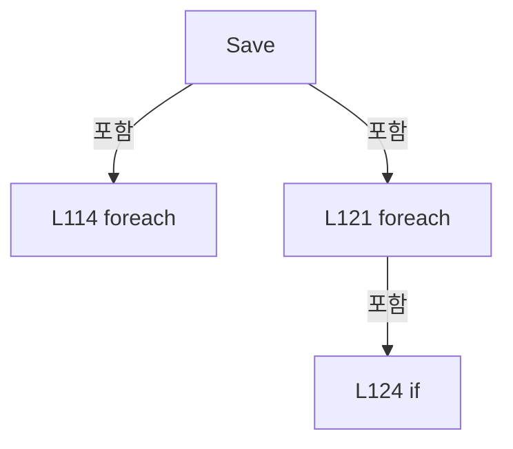

변경 전 점검: 입력/반환 타입, 위 호출자, 예외/취소 경로, 공유 상태와 저장·전송 소비자를 함께 확인합니다. 값의 단위나 물리 방향을 이름만으로 확정하지 않습니다.

### LocalFunctionStatement `ShouldIncludeItem` · L59–62

[Drilling.File/JHMI/CSettingFile.cs:59–62](https://github.com/kjuws10-rgb/A3Drilling/blob/5aee8e58439c9b455cae7c9593c9be986c3e682e/Drilling.File/JHMI/CSettingFile.cs#L59-L62)

| 항목 | 실제 추출 값 |
| --- | --- |
| 서명 | bool ShouldIncludeItem(Drilling.File.JHMI.CSettingFile.ST_SETTING_FORM_ITEM) |
| 접근/수식자 | Private /  |
| 반환/값 타입 | bool |
| 소속 타입 | NamedType:Drilling.File.JHMI.CSettingFile |

입력 계약:

| 이름 | 타입 | 전달 | 선택/기본값 |
| --- | --- | --- | --- |
| item | Drilling.File.JHMI.CSettingFile.ST_SETTING_FORM_ITEM | None | False /  |

현재 부분 분석에서 직접 연결된 호출자는 없습니다. XAML/이벤트/인터페이스·델리게이트·외부 진입을 추가 확인해야 하며, 미사용으로 판정한 것이 아닙니다.

호출하는 대상과 해석 범위:

| 원본 행 | 표현식 | 분석 상태 | 대상/소스 위치 |
| --- | --- | --- | --- |
| 61 | item.Tab.Equals | resolved | bool string.Equals(string?, System.StringComparison) |

본문의 실제 연산·분기·예외·반환 순서(원문 위치 순):

| 원본 행 | 종류 | 주석 해설 |
| --- | --- | --- |
| 61 | call | 함수·델리게이트 또는 객체 생성자를 호출합니다: item.Tab.Equals(sectionTab, StringComparison.OrdinalIgnoreCase) |
| 61 | return | 호출자에게 값 또는 제어를 반환합니다: return item.Use && item.Tab.Equals(sectionTab, StringComparison.OrdinalIgnoreCase); |

변경 전 점검: 입력/반환 타입, 위 호출자, 예외/취소 경로, 공유 상태와 저장·전송 소비자를 함께 확인합니다. 값의 단위나 물리 방향을 이름만으로 확정하지 않습니다.

### LocalFunctionStatement `SelectName` · L64–67

[Drilling.File/JHMI/CSettingFile.cs:64–67](https://github.com/kjuws10-rgb/A3Drilling/blob/5aee8e58439c9b455cae7c9593c9be986c3e682e/Drilling.File/JHMI/CSettingFile.cs#L64-L67)

| 항목 | 실제 추출 값 |
| --- | --- |
| 서명 | string SelectName(Drilling.File.JHMI.CSettingFile.ST_SETTING_FORM_ITEM) |
| 접근/수식자 | Private /  |
| 반환/값 타입 | string |
| 소속 타입 | NamedType:Drilling.File.JHMI.CSettingFile |

입력 계약:

| 이름 | 타입 | 전달 | 선택/기본값 |
| --- | --- | --- | --- |
| item | Drilling.File.JHMI.CSettingFile.ST_SETTING_FORM_ITEM | None | False /  |

현재 부분 분석에서 직접 연결된 호출자는 없습니다. XAML/이벤트/인터페이스·델리게이트·외부 진입을 추가 확인해야 하며, 미사용으로 판정한 것이 아닙니다.

본문의 실제 연산·분기·예외·반환 순서(원문 위치 순):

| 원본 행 | 종류 | 주석 해설 |
| --- | --- | --- |
| 66 | return | 호출자에게 값 또는 제어를 반환합니다: return item.Name; |

변경 전 점검: 입력/반환 타입, 위 호출자, 예외/취소 경로, 공유 상태와 저장·전송 소비자를 함께 확인합니다. 값의 단위나 물리 방향을 이름만으로 확정하지 않습니다.

### LocalFunctionStatement `SelectValue` · L69–72

[Drilling.File/JHMI/CSettingFile.cs:69–72](https://github.com/kjuws10-rgb/A3Drilling/blob/5aee8e58439c9b455cae7c9593c9be986c3e682e/Drilling.File/JHMI/CSettingFile.cs#L69-L72)

| 항목 | 실제 추출 값 |
| --- | --- |
| 서명 | string SelectValue(Drilling.File.JHMI.CSettingFile.ST_SETTING_FORM_ITEM) |
| 접근/수식자 | Private /  |
| 반환/값 타입 | string |
| 소속 타입 | NamedType:Drilling.File.JHMI.CSettingFile |

입력 계약:

| 이름 | 타입 | 전달 | 선택/기본값 |
| --- | --- | --- | --- |
| item | Drilling.File.JHMI.CSettingFile.ST_SETTING_FORM_ITEM | None | False /  |

현재 부분 분석에서 직접 연결된 호출자는 없습니다. XAML/이벤트/인터페이스·델리게이트·외부 진입을 추가 확인해야 하며, 미사용으로 판정한 것이 아닙니다.

호출하는 대상과 해석 범위:

| 원본 행 | 표현식 | 분석 상태 | 대상/소스 위치 |
| --- | --- | --- | --- |
| 71 | GetValue | resolved | string Drilling.File.JHMI.CSettingFile.GetValue(System.Collections.Generic.IReadOnlyDictionary<string, string>, string, string, string) · Drilling.File/JHMI/CSettingFile.cs:471 |

본문의 실제 연산·분기·예외·반환 순서(원문 위치 순):

| 원본 행 | 종류 | 주석 해설 |
| --- | --- | --- |
| 71 | call | 함수·델리게이트 또는 객체 생성자를 호출합니다: GetValue(values, item.Tab, item.Name, item.DefaultValue) |
| 71 | return | 호출자에게 값 또는 제어를 반환합니다: return GetValue(values, item.Tab, item.Name, item.DefaultValue); |

변경 전 점검: 입력/반환 타입, 위 호출자, 예외/취소 경로, 공유 상태와 저장·전송 소비자를 함께 확인합니다. 값의 단위나 물리 방향을 이름만으로 확정하지 않습니다.

### LocalFunctionStatement `ShouldIncludeSystem` · L75–78

[Drilling.File/JHMI/CSettingFile.cs:75–78](https://github.com/kjuws10-rgb/A3Drilling/blob/5aee8e58439c9b455cae7c9593c9be986c3e682e/Drilling.File/JHMI/CSettingFile.cs#L75-L78)

| 항목 | 실제 추출 값 |
| --- | --- |
| 서명 | bool ShouldIncludeSystem(Drilling.Common.Managers.ST_SYSTEM_PARAMETER) |
| 접근/수식자 | Private /  |
| 반환/값 타입 | bool |
| 소속 타입 | NamedType:Drilling.File.JHMI.CSettingFile |

입력 계약:

| 이름 | 타입 | 전달 | 선택/기본값 |
| --- | --- | --- | --- |
| parameter | Drilling.Common.Managers.ST_SYSTEM_PARAMETER | None | False /  |

현재 부분 분석에서 직접 연결된 호출자는 없습니다. XAML/이벤트/인터페이스·델리게이트·외부 진입을 추가 확인해야 하며, 미사용으로 판정한 것이 아닙니다.

호출하는 대상과 해석 범위:

| 원본 행 | 표현식 | 분석 상태 | 대상/소스 위치 |
| --- | --- | --- | --- |
| 77 | string.IsNullOrWhiteSpace | resolved | bool string.IsNullOrWhiteSpace(string?) |
| 77 | GetParameterKey | resolved | string Drilling.File.JHMI.CSettingFile.GetParameterKey(Drilling.Common.Managers.ST_SYSTEM_PARAMETER) · Drilling.File/JHMI/CSettingFile.cs:410 |

본문의 실제 연산·분기·예외·반환 순서(원문 위치 순):

| 원본 행 | 종류 | 주석 해설 |
| --- | --- | --- |
| 77 | call | 함수·델리게이트 또는 객체 생성자를 호출합니다: string.IsNullOrWhiteSpace(GetParameterKey(parameter)) |
| 77 | call | 함수·델리게이트 또는 객체 생성자를 호출합니다: GetParameterKey(parameter) |
| 77 | return | 호출자에게 값 또는 제어를 반환합니다: return !string.IsNullOrWhiteSpace(GetParameterKey(parameter)); |

변경 전 점검: 입력/반환 타입, 위 호출자, 예외/취소 경로, 공유 상태와 저장·전송 소비자를 함께 확인합니다. 값의 단위나 물리 방향을 이름만으로 확정하지 않습니다.

### LocalFunctionStatement `SelectEditedParameterValue` · L80–83

[Drilling.File/JHMI/CSettingFile.cs:80–83](https://github.com/kjuws10-rgb/A3Drilling/blob/5aee8e58439c9b455cae7c9593c9be986c3e682e/Drilling.File/JHMI/CSettingFile.cs#L80-L83)

| 항목 | 실제 추출 값 |
| --- | --- |
| 서명 | string SelectEditedParameterValue(Drilling.Common.Managers.ST_SYSTEM_PARAMETER) |
| 접근/수식자 | Private /  |
| 반환/값 타입 | string |
| 소속 타입 | NamedType:Drilling.File.JHMI.CSettingFile |

입력 계약:

| 이름 | 타입 | 전달 | 선택/기본값 |
| --- | --- | --- | --- |
| parameter | Drilling.Common.Managers.ST_SYSTEM_PARAMETER | None | False /  |

현재 부분 분석에서 직접 연결된 호출자는 없습니다. XAML/이벤트/인터페이스·델리게이트·외부 진입을 추가 확인해야 하며, 미사용으로 판정한 것이 아닙니다.

본문의 실제 연산·분기·예외·반환 순서(원문 위치 순):

| 원본 행 | 종류 | 주석 해설 |
| --- | --- | --- |
| 82 | return | 호출자에게 값 또는 제어를 반환합니다: return parameter.Value; |

변경 전 점검: 입력/반환 타입, 위 호출자, 예외/취소 경로, 공유 상태와 저장·전송 소비자를 함께 확인합니다. 값의 단위나 물리 방향을 이름만으로 확정하지 않습니다.

### LocalFunctionStatement `ShouldIncludeSetting` · L86–89

[Drilling.File/JHMI/CSettingFile.cs:86–89](https://github.com/kjuws10-rgb/A3Drilling/blob/5aee8e58439c9b455cae7c9593c9be986c3e682e/Drilling.File/JHMI/CSettingFile.cs#L86-L89)

| 항목 | 실제 추출 값 |
| --- | --- |
| 서명 | bool ShouldIncludeSetting(Drilling.File.JHMI.CSettingFile.ST_SETTING_FORM_ITEM) |
| 접근/수식자 | Private /  |
| 반환/값 타입 | bool |
| 소속 타입 | NamedType:Drilling.File.JHMI.CSettingFile |

입력 계약:

| 이름 | 타입 | 전달 | 선택/기본값 |
| --- | --- | --- | --- |
| item | Drilling.File.JHMI.CSettingFile.ST_SETTING_FORM_ITEM | None | False /  |

현재 부분 분석에서 직접 연결된 호출자는 없습니다. XAML/이벤트/인터페이스·델리게이트·외부 진입을 추가 확인해야 하며, 미사용으로 판정한 것이 아닙니다.

호출하는 대상과 해석 범위:

| 원본 행 | 표현식 | 분석 상태 | 대상/소스 위치 |
| --- | --- | --- | --- |
| 88 | item.Tab.Equals | resolved | bool string.Equals(string?, System.StringComparison) |

본문의 실제 연산·분기·예외·반환 순서(원문 위치 순):

| 원본 행 | 종류 | 주석 해설 |
| --- | --- | --- |
| 88 | call | 함수·델리게이트 또는 객체 생성자를 호출합니다: item.Tab.Equals(sectionTab, StringComparison.OrdinalIgnoreCase) |
| 88 | return | 호출자에게 값 또는 제어를 반환합니다: return item.Use && item.Tab.Equals(sectionTab, StringComparison.OrdinalIgnoreCase); |

변경 전 점검: 입력/반환 타입, 위 호출자, 예외/취소 경로, 공유 상태와 저장·전송 소비자를 함께 확인합니다. 값의 단위나 물리 방향을 이름만으로 확정하지 않습니다.

### LocalFunctionStatement `BuildSystem` · L91–110

[Drilling.File/JHMI/CSettingFile.cs:91–110](https://github.com/kjuws10-rgb/A3Drilling/blob/5aee8e58439c9b455cae7c9593c9be986c3e682e/Drilling.File/JHMI/CSettingFile.cs#L91-L110)

| 항목 | 실제 추출 값 |
| --- | --- |
| 서명 | Drilling.Common.Managers.ST_SYSTEM_PARAMETER BuildSystem(Drilling.File.JHMI.CSettingFile.ST_SETTING_FORM_ITEM) |
| 접근/수식자 | Private /  |
| 반환/값 타입 | Drilling.Common.Managers.ST_SYSTEM_PARAMETER |
| 소속 타입 | NamedType:Drilling.File.JHMI.CSettingFile |

입력 계약:

| 이름 | 타입 | 전달 | 선택/기본값 |
| --- | --- | --- | --- |
| item | Drilling.File.JHMI.CSettingFile.ST_SETTING_FORM_ITEM | None | False /  |

현재 부분 분석에서 직접 연결된 호출자는 없습니다. XAML/이벤트/인터페이스·델리게이트·외부 진입을 추가 확인해야 하며, 미사용으로 판정한 것이 아닙니다.

호출하는 대상과 해석 범위:

| 원본 행 | 표현식 | 분석 상태 | 대상/소스 위치 |
| --- | --- | --- | --- |
| 93 | new ST_SYSTEM_PARAMETER | resolved | Drilling.Common.Managers.ST_SYSTEM_PARAMETER.ST_SYSTEM_PARAMETER(Drilling.Common.Managers.EN_SETTING_TAB, string, string, string, string, string, string, string, Drilling.Common.Managers.EN_RECIPE_DATA_TYPE, double, double, bool, bool, int, System.Collections.Generic.IReadOnlyDictionary<string, string>?) · Drilling.Common/Managers/CSettingManager.cs:255 |
| 96 | editedValues.TryGetValue | resolved | bool System.Collections.Generic.Dictionary<string, string>.TryGetValue(string, out string) |
| 96 | GetValue | resolved | string Drilling.File.JHMI.CSettingFile.GetValue(System.Collections.Generic.IReadOnlyDictionary<string, string>, string, string, string) · Drilling.File/JHMI/CSettingFile.cs:471 |

본문의 실제 연산·분기·예외·반환 순서(원문 위치 순):

| 원본 행 | 종류 | 주석 해설 |
| --- | --- | --- |
| 93 | call | 함수·델리게이트 또는 객체 생성자를 호출합니다: new ST_SYSTEM_PARAMETER( section, item.DisplayName, editedValues.TryGetValue(item.Name, out var editedValue) ? editedValue : GetValue(values, item.Tab, item.Name, item.DefaultValue), item.Unit, item.Description, item.Gro… |
| 93 | return | 호출자에게 값 또는 제어를 반환합니다: return new ST_SYSTEM_PARAMETER( section, item.DisplayName, editedValues.TryGetValue(item.Name, out var editedValue) ? editedValue : GetValue(values, item.Tab, item.Name, item.DefaultValue), item.Unit, item.Description, item.Group, |
| 96 | call | 함수·델리게이트 또는 객체 생성자를 호출합니다: editedValues.TryGetValue(item.Name, out var editedValue) |
| 96 | call | 함수·델리게이트 또는 객체 생성자를 호출합니다: GetValue(values, item.Tab, item.Name, item.DefaultValue) |
| 96 | conditional-expression | 조건에 따라 결과식을 선택합니다: editedValues.TryGetValue(item.Name, out var editedValue) ? editedValue : GetValue(values, item.Tab, item.Name, item.DefaultValue) |

변경 전 점검: 입력/반환 타입, 위 호출자, 예외/취소 경로, 공유 상태와 저장·전송 소비자를 함께 확인합니다. 값의 단위나 물리 방향을 이름만으로 확정하지 않습니다.

### MethodDeclaration `LoadHistory` · L133–137

[Drilling.File/JHMI/CSettingFile.cs:133–137](https://github.com/kjuws10-rgb/A3Drilling/blob/5aee8e58439c9b455cae7c9593c9be986c3e682e/Drilling.File/JHMI/CSettingFile.cs#L133-L137)

| 항목 | 실제 추출 값 |
| --- | --- |
| 서명 | System.Collections.Generic.IReadOnlyList<Drilling.Common.Managers.ST_SETTING_HISTORY> Drilling.File.JHMI.CSettingFile.LoadHistory(Drilling.Common.Managers.EN_SETTING_TAB, System.Threading.CancellationToken) |
| 접근/수식자 | Public / public, override |
| 반환/값 타입 | System.Collections.Generic.IReadOnlyList<Drilling.Common.Managers.ST_SETTING_HISTORY> |
| 소속 타입 | NamedType:Drilling.File.JHMI.CSettingFile |

입력 계약:

| 이름 | 타입 | 전달 | 선택/기본값 |
| --- | --- | --- | --- |
| section | Drilling.Common.Managers.EN_SETTING_TAB | None | False /  |
| cancellationToken | System.Threading.CancellationToken | None | True / null |

현재 부분 분석에서 직접 연결된 호출자는 없습니다. XAML/이벤트/인터페이스·델리게이트·외부 진입을 추가 확인해야 하며, 미사용으로 판정한 것이 아닙니다.

호출하는 대상과 해석 범위:

| 원본 행 | 표현식 | 분석 상태 | 대상/소스 위치 |
| --- | --- | --- | --- |
| 135 | cancellationToken.ThrowIfCancellationRequested | resolved | void System.Threading.CancellationToken.ThrowIfCancellationRequested() |
| 136 | _logManager.ReadSettingRecent | unresolved | None |

본문의 실제 연산·분기·예외·반환 순서(원문 위치 순):

| 원본 행 | 종류 | 주석 해설 |
| --- | --- | --- |
| 135 | call | 함수·델리게이트 또는 객체 생성자를 호출합니다: cancellationToken.ThrowIfCancellationRequested() |
| 136 | call | 함수·델리게이트 또는 객체 생성자를 호출합니다: _logManager.ReadSettingRecent(section) |
| 136 | return | 호출자에게 값 또는 제어를 반환합니다: return _logManager.ReadSettingRecent(section); |

변경 전 점검: 입력/반환 타입, 위 호출자, 예외/취소 경로, 공유 상태와 저장·전송 소비자를 함께 확인합니다. 값의 단위나 물리 방향을 이름만으로 확정하지 않습니다.

### MethodDeclaration `LoadFormItems` · L139–191

[Drilling.File/JHMI/CSettingFile.cs:139–191](https://github.com/kjuws10-rgb/A3Drilling/blob/5aee8e58439c9b455cae7c9593c9be986c3e682e/Drilling.File/JHMI/CSettingFile.cs#L139-L191)

| 항목 | 실제 추출 값 |
| --- | --- |
| 서명 | System.Collections.Generic.IReadOnlyList<Drilling.File.JHMI.CSettingFile.ST_SETTING_FORM_ITEM> Drilling.File.JHMI.CSettingFile.LoadFormItems() |
| 접근/수식자 | Private / private |
| 반환/값 타입 | System.Collections.Generic.IReadOnlyList<Drilling.File.JHMI.CSettingFile.ST_SETTING_FORM_ITEM> |
| 소속 타입 | NamedType:Drilling.File.JHMI.CSettingFile |

정적 호출자로 확인된 위치:

| 호출 파일/행 | 호출 표현식 | 런타임 분기 가능 |
| --- | --- | --- |
| [Drilling.File/JHMI/CSettingFile.cs:49–49](https://github.com/kjuws10-rgb/A3Drilling/blob/5aee8e58439c9b455cae7c9593c9be986c3e682e/Drilling.File/JHMI/CSettingFile.cs#L49-L49) | LoadFormItems | False |
| [Drilling.File/JHMI/CSettingFile.cs:56–56](https://github.com/kjuws10-rgb/A3Drilling/blob/5aee8e58439c9b455cae7c9593c9be986c3e682e/Drilling.File/JHMI/CSettingFile.cs#L56-L56) | LoadFormItems | False |

호출하는 대상과 해석 범위:

| 원본 행 | 표현식 | 분석 상태 | 대상/소스 위치 |
| --- | --- | --- | --- |
| 149 | CCsvParser.ValidateRequiredHeaders | resolved | void Drilling.File.Parser.CCsvParser.ValidateRequiredHeaders(string, string, System.Collections.Generic.IEnumerable<System.Collections.Generic.IEnumerable<string>>) · Drilling.File/Parser/CCsvParser.cs:280 |
| 149 | GetFormPath | resolved | string Drilling.File.JHMI.CSettingFile.GetFormPath() · Drilling.File/JHMI/CSettingFile.cs:461 |
| 149 | FormHeaders.Select | resolved | System.Collections.Generic.IEnumerable<string[]> System.Collections.Generic.IEnumerable<string>.Select<string, string[]>(System.Func<string, string[]>) |
| 189 | CCsvParser.Read(GetFormPath()).Select(BuildSetting).Where(ShouldIncludeItem).ToArray | resolved | Drilling.File.JHMI.CSettingFile.ST_SETTING_FORM_ITEM[] System.Collections.Generic.IEnumerable<Drilling.File.JHMI.CSettingFile.ST_SETTING_FORM_ITEM>.ToArray<Drilling.File.JHMI.CSettingFile.ST_SETTING_FORM_ITEM>() |
| 189 | CCsvParser.Read(GetFormPath()).Select(BuildSetting).Where | resolved | System.Collections.Generic.IEnumerable<Drilling.File.JHMI.CSettingFile.ST_SETTING_FORM_ITEM> System.Collections.Generic.IEnumerable<Drilling.File.JHMI.CSettingFile.ST_SETTING_FORM_ITEM>.Where<Drilling.File.JHMI.CSettingFile.ST_SETTING_FORM_ITEM>(System.Func<Drilling.File.JHMI.CSettingFile.ST_SETTING_FORM_ITEM, bool>) |
| 189 | CCsvParser.Read(GetFormPath()).Select | resolved | System.Collections.Generic.IEnumerable<Drilling.File.JHMI.CSettingFile.ST_SETTING_FORM_ITEM> System.Collections.Generic.IEnumerable<System.Collections.Generic.IReadOnlyDictionary<string, string>>.Select<System.Collections.Generic.IReadOnlyDictionary<string, string>, Drilling.File.JHMI.CSettingFile.ST_SETTING_FORM_ITEM>(System.Func<System.Collections.Generic.IReadOnlyDictionary<string, string>, int, Drilling.File.JHMI.CSettingFile.ST_SETTING_FORM_ITEM>) |
| 189 | CCsvParser.Read | resolved | System.Collections.Generic.IReadOnlyList<System.Collections.Generic.IReadOnlyDictionary<string, string>> Drilling.File.Parser.CCsvParser.Read(string) · Drilling.File/Parser/CCsvParser.cs:12 |
| 189 | GetFormPath | resolved | string Drilling.File.JHMI.CSettingFile.GetFormPath() · Drilling.File/JHMI/CSettingFile.cs:461 |
| 190 | AppendBuiltInFormItems | resolved | System.Collections.Generic.IReadOnlyList<Drilling.File.JHMI.CSettingFile.ST_SETTING_FORM_ITEM> Drilling.File.JHMI.CSettingFile.AppendBuiltInFormItems(System.Collections.Generic.IReadOnlyList<Drilling.File.JHMI.CSettingFile.ST_SETTING_FORM_ITEM>) · Drilling.File/JHMI/CSettingFile.cs:193 |

본문의 실제 연산·분기·예외·반환 순서(원문 위치 순):

| 원본 행 | 종류 | 주석 해설 |
| --- | --- | --- |
| 149 | call | 함수·델리게이트 또는 객체 생성자를 호출합니다: CCsvParser.ValidateRequiredHeaders(GetFormPath(), "JHMI_SETTING", FormHeaders.Select(SelectItem)) |
| 149 | call | 함수·델리게이트 또는 객체 생성자를 호출합니다: GetFormPath() |
| 149 | call | 함수·델리게이트 또는 객체 생성자를 호출합니다: FormHeaders.Select(SelectItem) |
| 189 | call | 함수·델리게이트 또는 객체 생성자를 호출합니다: CCsvParser.Read(GetFormPath()).Select(BuildSetting).Where(ShouldIncludeItem).ToArray() |
| 189 | call | 함수·델리게이트 또는 객체 생성자를 호출합니다: CCsvParser.Read(GetFormPath()).Select(BuildSetting).Where(ShouldIncludeItem) |
| 189 | call | 함수·델리게이트 또는 객체 생성자를 호출합니다: CCsvParser.Read(GetFormPath()).Select(BuildSetting) |
| 189 | call | 함수·델리게이트 또는 객체 생성자를 호출합니다: CCsvParser.Read(GetFormPath()) |
| 189 | call | 함수·델리게이트 또는 객체 생성자를 호출합니다: GetFormPath() |
| 189 | local-declaration | 지역 변수를 선언합니다: var formItems = CCsvParser.Read(GetFormPath()).Select(BuildSetting).Where(ShouldIncludeItem).ToArray(); |
| 189 | variable-initializer | 변수의 초기값을 지정합니다: formItems = CCsvParser.Read(GetFormPath()).Select(BuildSetting).Where(ShouldIncludeItem).ToArray() |
| 190 | call | 함수·델리게이트 또는 객체 생성자를 호출합니다: AppendBuiltInFormItems(formItems) |
| 190 | return | 호출자에게 값 또는 제어를 반환합니다: return AppendBuiltInFormItems(formItems); |

변경 전 점검: 입력/반환 타입, 위 호출자, 예외/취소 경로, 공유 상태와 저장·전송 소비자를 함께 확인합니다. 값의 단위나 물리 방향을 이름만으로 확정하지 않습니다.

### LocalFunctionStatement `SelectItem` · L141–147

[Drilling.File/JHMI/CSettingFile.cs:141–147](https://github.com/kjuws10-rgb/A3Drilling/blob/5aee8e58439c9b455cae7c9593c9be986c3e682e/Drilling.File/JHMI/CSettingFile.cs#L141-L147)

| 항목 | 실제 추출 값 |
| --- | --- |
| 서명 | string[] SelectItem(string) |
| 접근/수식자 | Private /  |
| 반환/값 타입 | string[] |
| 소속 타입 | NamedType:Drilling.File.JHMI.CSettingFile |

입력 계약:

| 이름 | 타입 | 전달 | 선택/기본값 |
| --- | --- | --- | --- |
| header | string | None | False /  |

현재 부분 분석에서 직접 연결된 호출자는 없습니다. XAML/이벤트/인터페이스·델리게이트·외부 진입을 추가 확인해야 하며, 미사용으로 판정한 것이 아닙니다.

본문의 실제 연산·분기·예외·반환 순서(원문 위치 순):

| 원본 행 | 종류 | 주석 해설 |
| --- | --- | --- |
| 143 | return | 호출자에게 값 또는 제어를 반환합니다: return new[] { header }; |

변경 전 점검: 입력/반환 타입, 위 호출자, 예외/취소 경로, 공유 상태와 저장·전송 소비자를 함께 확인합니다. 값의 단위나 물리 방향을 이름만으로 확정하지 않습니다.

### LocalFunctionStatement `BuildSetting` · L150–182

[Drilling.File/JHMI/CSettingFile.cs:150–182](https://github.com/kjuws10-rgb/A3Drilling/blob/5aee8e58439c9b455cae7c9593c9be986c3e682e/Drilling.File/JHMI/CSettingFile.cs#L150-L182)

| 항목 | 실제 추출 값 |
| --- | --- |
| 서명 | Drilling.File.JHMI.CSettingFile.ST_SETTING_FORM_ITEM BuildSetting(System.Collections.Generic.IReadOnlyDictionary<string, string>, int) |
| 접근/수식자 | Private /  |
| 반환/값 타입 | Drilling.File.JHMI.CSettingFile.ST_SETTING_FORM_ITEM |
| 소속 타입 | NamedType:Drilling.File.JHMI.CSettingFile |

입력 계약:

| 이름 | 타입 | 전달 | 선택/기본값 |
| --- | --- | --- | --- |
| row | System.Collections.Generic.IReadOnlyDictionary<string, string> | None | False /  |
| index | int | None | False /  |

현재 부분 분석에서 직접 연결된 호출자는 없습니다. XAML/이벤트/인터페이스·델리게이트·외부 진입을 추가 확인해야 하며, 미사용으로 판정한 것이 아닙니다.

호출하는 대상과 해석 범위:

| 원본 행 | 표현식 | 분석 상태 | 대상/소스 위치 |
| --- | --- | --- | --- |
| 152 | NormalizeTab | resolved | string Drilling.File.JHMI.CSettingFile.NormalizeTab(string) · Drilling.File/JHMI/CSettingFile.cs:487 |
| 152 | CCsvParser.Get | resolved | string Drilling.File.Parser.CCsvParser.Get(System.Collections.Generic.IReadOnlyDictionary<string, string>, string) · Drilling.File/Parser/CCsvParser.cs:168 |
| 153 | NormalizeSettingText | resolved | string Drilling.File.JHMI.CSettingFile.NormalizeSettingText(string, string) · Drilling.File/JHMI/CSettingFile.cs:499 |
| 153 | CCsvParser.Get | resolved | string Drilling.File.Parser.CCsvParser.Get(System.Collections.Generic.IReadOnlyDictionary<string, string>, string) · Drilling.File/Parser/CCsvParser.cs:168 |
| 154 | CCsvParser.Get | resolved | string Drilling.File.Parser.CCsvParser.Get(System.Collections.Generic.IReadOnlyDictionary<string, string>, string) · Drilling.File/Parser/CCsvParser.cs:168 |
| 155 | GetOrDefault | resolved | string Drilling.File.JHMI.CSettingFile.GetOrDefault(string, string) · Drilling.File/JHMI/CSettingFile.cs:504 |
| 155 | CCsvParser.Get | resolved | string Drilling.File.Parser.CCsvParser.Get(System.Collections.Generic.IReadOnlyDictionary<string, string>, string) · Drilling.File/Parser/CCsvParser.cs:168 |
| 156 | name.Equals | resolved | bool string.Equals(string?, System.StringComparison) |
| 159 | group.Equals | resolved | bool string.Equals(string?, System.StringComparison) |
| 161 | name.Equals | resolved | bool string.Equals(string?, System.StringComparison) |
| 166 | new ST_SETTING_FORM_ITEM | resolved | Drilling.File.JHMI.CSettingFile.ST_SETTING_FORM_ITEM.ST_SETTING_FORM_ITEM(string, string, string, string, Drilling.Common.Managers.EN_RECIPE_DATA_TYPE, string, bool, bool, string, double, double, string, int, System.Collections.Generic.IReadOnlyDictionary<string, string>?) · Drilling.File/JHMI/CSettingFile.cs:548 |
| 171 | ReadDataType | resolved | Drilling.Common.Managers.EN_RECIPE_DATA_TYPE Drilling.File.JHMI.CSettingFile.ReadDataType(string) · Drilling.File/JHMI/CSettingFile.cs:509 |
| 171 | CCsvParser.Get | resolved | string Drilling.File.Parser.CCsvParser.Get(System.Collections.Generic.IReadOnlyDictionary<string, string>, string) · Drilling.File/Parser/CCsvParser.cs:168 |
| 172 | CCsvParser.Get | resolved | string Drilling.File.Parser.CCsvParser.Get(System.Collections.Generic.IReadOnlyDictionary<string, string>, string) · Drilling.File/Parser/CCsvParser.cs:168 |
| 173 | ReadBool | resolved | bool Drilling.File.JHMI.CSettingFile.ReadBool(string, bool) · Drilling.File/JHMI/CSettingFile.cs:520 |
| 173 | CCsvParser.Get | resolved | string Drilling.File.Parser.CCsvParser.Get(System.Collections.Generic.IReadOnlyDictionary<string, string>, string) · Drilling.File/Parser/CCsvParser.cs:168 |
| 174 | ReadBool | resolved | bool Drilling.File.JHMI.CSettingFile.ReadBool(string, bool) · Drilling.File/JHMI/CSettingFile.cs:520 |
| 174 | CCsvParser.Get | resolved | string Drilling.File.Parser.CCsvParser.Get(System.Collections.Generic.IReadOnlyDictionary<string, string>, string) · Drilling.File/Parser/CCsvParser.cs:168 |
| 175 | CCsvParser.Get | resolved | string Drilling.File.Parser.CCsvParser.Get(System.Collections.Generic.IReadOnlyDictionary<string, string>, string) · Drilling.File/Parser/CCsvParser.cs:168 |
| 176 | ReadDouble | resolved | double Drilling.File.JHMI.CSettingFile.ReadDouble(string, double) · Drilling.File/JHMI/CSettingFile.cs:535 |
| 176 | CCsvParser.Get | resolved | string Drilling.File.Parser.CCsvParser.Get(System.Collections.Generic.IReadOnlyDictionary<string, string>, string) · Drilling.File/Parser/CCsvParser.cs:168 |
| 177 | ReadDouble | resolved | double Drilling.File.JHMI.CSettingFile.ReadDouble(string, double) · Drilling.File/JHMI/CSettingFile.cs:535 |
| 177 | CCsvParser.Get | resolved | string Drilling.File.Parser.CCsvParser.Get(System.Collections.Generic.IReadOnlyDictionary<string, string>, string) · Drilling.File/Parser/CCsvParser.cs:168 |
| 178 | CCsvParser.Get | resolved | string Drilling.File.Parser.CCsvParser.Get(System.Collections.Generic.IReadOnlyDictionary<string, string>, string) · Drilling.File/Parser/CCsvParser.cs:168 |
| 180 | CCsvParser.GetExtra | resolved | System.Collections.Generic.IReadOnlyDictionary<string, string> Drilling.File.Parser.CCsvParser.GetExtra(System.Collections.Generic.IReadOnlyDictionary<string, string>, System.Collections.Generic.IEnumerable<string>) · Drilling.File/Parser/CCsvParser.cs:331 |

본문의 실제 연산·분기·예외·반환 순서(원문 위치 순):

| 원본 행 | 종류 | 주석 해설 |
| --- | --- | --- |
| 152 | call | 함수·델리게이트 또는 객체 생성자를 호출합니다: NormalizeTab(CCsvParser.Get(row, "TAB")) |
| 152 | call | 함수·델리게이트 또는 객체 생성자를 호출합니다: CCsvParser.Get(row, "TAB") |
| 152 | local-declaration | 지역 변수를 선언합니다: var tab = NormalizeTab(CCsvParser.Get(row, "TAB")); |
| 152 | variable-initializer | 변수의 초기값을 지정합니다: tab = NormalizeTab(CCsvParser.Get(row, "TAB")) |
| 153 | call | 함수·델리게이트 또는 객체 생성자를 호출합니다: NormalizeSettingText(CCsvParser.Get(row, "GROUP"), "COMMON") |
| 153 | call | 함수·델리게이트 또는 객체 생성자를 호출합니다: CCsvParser.Get(row, "GROUP") |
| 153 | local-declaration | 지역 변수를 선언합니다: var group = NormalizeSettingText(CCsvParser.Get(row, "GROUP"), "COMMON"); |
| 153 | variable-initializer | 변수의 초기값을 지정합니다: group = NormalizeSettingText(CCsvParser.Get(row, "GROUP"), "COMMON") |
| 154 | call | 함수·델리게이트 또는 객체 생성자를 호출합니다: CCsvParser.Get(row, "NAME") |
| 154 | local-declaration | 지역 변수를 선언합니다: var name = CCsvParser.Get(row, "NAME"); |
| 154 | variable-initializer | 변수의 초기값을 지정합니다: name = CCsvParser.Get(row, "NAME") |
| 155 | call | 함수·델리게이트 또는 객체 생성자를 호출합니다: GetOrDefault(CCsvParser.Get(row, "DISPLAY NAME"), name) |
| 155 | call | 함수·델리게이트 또는 객체 생성자를 호출합니다: CCsvParser.Get(row, "DISPLAY NAME") |
| 155 | local-declaration | 지역 변수를 선언합니다: var displayName = GetOrDefault(CCsvParser.Get(row, "DISPLAY NAME"), name); |
| 155 | variable-initializer | 변수의 초기값을 지정합니다: displayName = GetOrDefault(CCsvParser.Get(row, "DISPLAY NAME"), name) |
| 156 | call | 함수·델리게이트 또는 객체 생성자를 호출합니다: name.Equals("ALIGN_OFFSET_TOLERANCE", StringComparison.OrdinalIgnoreCase) |
| 156 | if | 조건에 따라 분기합니다: if (tab == "OPTION" && name.Equals("ALIGN_OFFSET_TOLERANCE", StringComparison.OrdinalIgnoreCase)) |
| 157 | assignment | 값을 대상에 대입합니다: group = "ALIGN" |
| 159 | call | 함수·델리게이트 또는 객체 생성자를 호출합니다: group.Equals("VISION", StringComparison.OrdinalIgnoreCase) |
| 159 | if | 조건에 따라 분기합니다: if (tab == "OPTION" && group.Equals("VISION", StringComparison.OrdinalIgnoreCase)) |
| 160 | assignment | 값을 대상에 대입합니다: group = "REVIEW" |
| 161 | call | 함수·델리게이트 또는 객체 생성자를 호출합니다: name.Equals("CameraResolution", StringComparison.OrdinalIgnoreCase) |
| 161 | if | 조건에 따라 분기합니다: if (tab == "OPTION" && name.Equals("CameraResolution", StringComparison.OrdinalIgnoreCase)) |
| 163 | assignment | 값을 대상에 대입합니다: name = CSettingManager.ReviewCameraResolutionKey |
| 164 | assignment | 값을 대상에 대입합니다: displayName = name |
| 166 | call | 함수·델리게이트 또는 객체 생성자를 호출합니다: new ST_SETTING_FORM_ITEM( tab, group, name, displayName, ReadDataType(CCsvParser.Get(row, "DATA TYPE")), CCsvParser.Get(row, "UNIT"), ReadBool(CCsvParser.Get(row, "SHOW"), true), ReadBool(CCsvParser.Get(row, "USE"), true… |
| 166 | return | 호출자에게 값 또는 제어를 반환합니다: return new ST_SETTING_FORM_ITEM( tab, group, name, displayName, ReadDataType(CCsvParser.Get(row, "DATA TYPE")), CCsvParser.Get(row, "UNIT"), ReadBool(CCsvParser.Get(row, "SHOW"), true), ReadBool(CCsvParser.Get(row, "USE"), true),  |
| 171 | call | 함수·델리게이트 또는 객체 생성자를 호출합니다: ReadDataType(CCsvParser.Get(row, "DATA TYPE")) |
| 171 | call | 함수·델리게이트 또는 객체 생성자를 호출합니다: CCsvParser.Get(row, "DATA TYPE") |
| 172 | call | 함수·델리게이트 또는 객체 생성자를 호출합니다: CCsvParser.Get(row, "UNIT") |
| 173 | call | 함수·델리게이트 또는 객체 생성자를 호출합니다: ReadBool(CCsvParser.Get(row, "SHOW"), true) |
| 173 | call | 함수·델리게이트 또는 객체 생성자를 호출합니다: CCsvParser.Get(row, "SHOW") |
| 174 | call | 함수·델리게이트 또는 객체 생성자를 호출합니다: ReadBool(CCsvParser.Get(row, "USE"), true) |
| 174 | call | 함수·델리게이트 또는 객체 생성자를 호출합니다: CCsvParser.Get(row, "USE") |
| 175 | call | 함수·델리게이트 또는 객체 생성자를 호출합니다: CCsvParser.Get(row, "VALUE") |
| 176 | call | 함수·델리게이트 또는 객체 생성자를 호출합니다: ReadDouble(CCsvParser.Get(row, "MIN"), 0.0) |
| 176 | call | 함수·델리게이트 또는 객체 생성자를 호출합니다: CCsvParser.Get(row, "MIN") |
| 177 | call | 함수·델리게이트 또는 객체 생성자를 호출합니다: ReadDouble(CCsvParser.Get(row, "MAX"), 0.0) |
| 177 | call | 함수·델리게이트 또는 객체 생성자를 호출합니다: CCsvParser.Get(row, "MAX") |
| 178 | call | 함수·델리게이트 또는 객체 생성자를 호출합니다: CCsvParser.Get(row, "DESCRIPTION") |
| 180 | call | 함수·델리게이트 또는 객체 생성자를 호출합니다: CCsvParser.GetExtra(row, FormHeaders) |

제어 구문의 포함 구조(실제 실행 순서/CFG가 아닌 구문 탐색 그림):

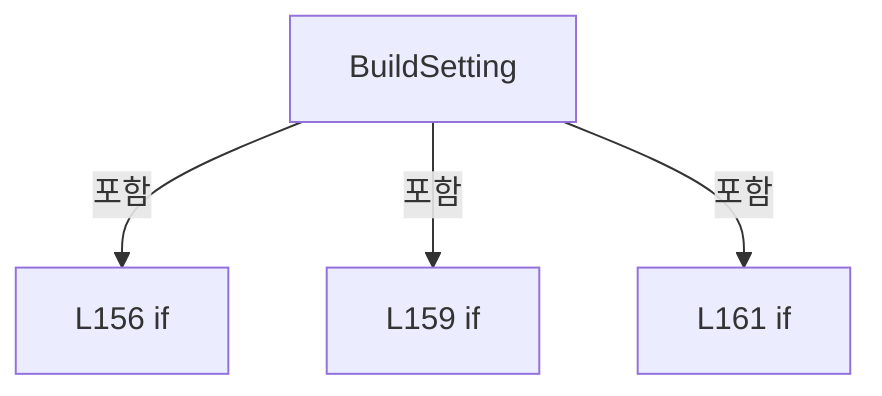

변경 전 점검: 입력/반환 타입, 위 호출자, 예외/취소 경로, 공유 상태와 저장·전송 소비자를 함께 확인합니다. 값의 단위나 물리 방향을 이름만으로 확정하지 않습니다.

### LocalFunctionStatement `ShouldIncludeItem` · L184–187

[Drilling.File/JHMI/CSettingFile.cs:184–187](https://github.com/kjuws10-rgb/A3Drilling/blob/5aee8e58439c9b455cae7c9593c9be986c3e682e/Drilling.File/JHMI/CSettingFile.cs#L184-L187)

| 항목 | 실제 추출 값 |
| --- | --- |
| 서명 | bool ShouldIncludeItem(Drilling.File.JHMI.CSettingFile.ST_SETTING_FORM_ITEM) |
| 접근/수식자 | Private /  |
| 반환/값 타입 | bool |
| 소속 타입 | NamedType:Drilling.File.JHMI.CSettingFile |

입력 계약:

| 이름 | 타입 | 전달 | 선택/기본값 |
| --- | --- | --- | --- |
| item | Drilling.File.JHMI.CSettingFile.ST_SETTING_FORM_ITEM | None | False /  |

현재 부분 분석에서 직접 연결된 호출자는 없습니다. XAML/이벤트/인터페이스·델리게이트·외부 진입을 추가 확인해야 하며, 미사용으로 판정한 것이 아닙니다.

호출하는 대상과 해석 범위:

| 원본 행 | 표현식 | 분석 상태 | 대상/소스 위치 |
| --- | --- | --- | --- |
| 186 | string.IsNullOrWhiteSpace | resolved | bool string.IsNullOrWhiteSpace(string?) |
| 186 | string.IsNullOrWhiteSpace | resolved | bool string.IsNullOrWhiteSpace(string?) |

본문의 실제 연산·분기·예외·반환 순서(원문 위치 순):

| 원본 행 | 종류 | 주석 해설 |
| --- | --- | --- |
| 186 | call | 함수·델리게이트 또는 객체 생성자를 호출합니다: string.IsNullOrWhiteSpace(item.Tab) |
| 186 | call | 함수·델리게이트 또는 객체 생성자를 호출합니다: string.IsNullOrWhiteSpace(item.Name) |
| 186 | return | 호출자에게 값 또는 제어를 반환합니다: return !string.IsNullOrWhiteSpace(item.Tab) && !string.IsNullOrWhiteSpace(item.Name); |

변경 전 점검: 입력/반환 타입, 위 호출자, 예외/취소 경로, 공유 상태와 저장·전송 소비자를 함께 확인합니다. 값의 단위나 물리 방향을 이름만으로 확정하지 않습니다.

### MethodDeclaration `AppendBuiltInFormItems` · L193–217

[Drilling.File/JHMI/CSettingFile.cs:193–217](https://github.com/kjuws10-rgb/A3Drilling/blob/5aee8e58439c9b455cae7c9593c9be986c3e682e/Drilling.File/JHMI/CSettingFile.cs#L193-L217)

| 항목 | 실제 추출 값 |
| --- | --- |
| 서명 | System.Collections.Generic.IReadOnlyList<Drilling.File.JHMI.CSettingFile.ST_SETTING_FORM_ITEM> Drilling.File.JHMI.CSettingFile.AppendBuiltInFormItems(System.Collections.Generic.IReadOnlyList<Drilling.File.JHMI.CSettingFile.ST_SETTING_FORM_ITEM>) |
| 접근/수식자 | Private / private, static |
| 반환/값 타입 | System.Collections.Generic.IReadOnlyList<Drilling.File.JHMI.CSettingFile.ST_SETTING_FORM_ITEM> |
| 소속 타입 | NamedType:Drilling.File.JHMI.CSettingFile |

입력 계약:

| 이름 | 타입 | 전달 | 선택/기본값 |
| --- | --- | --- | --- |
| formItems | System.Collections.Generic.IReadOnlyList<Drilling.File.JHMI.CSettingFile.ST_SETTING_FORM_ITEM> | None | False /  |

정적 호출자로 확인된 위치:

| 호출 파일/행 | 호출 표현식 | 런타임 분기 가능 |
| --- | --- | --- |
| [Drilling.File/JHMI/CSettingFile.cs:190–190](https://github.com/kjuws10-rgb/A3Drilling/blob/5aee8e58439c9b455cae7c9593c9be986c3e682e/Drilling.File/JHMI/CSettingFile.cs#L190-L190) | AppendBuiltInFormItems | False |

호출하는 대상과 해석 범위:

| 원본 행 | 표현식 | 분석 상태 | 대상/소스 위치 |
| --- | --- | --- | --- |
| 200 | formItems.Select(SelectItem).ToHashSet | resolved | System.Collections.Generic.HashSet<string> System.Collections.Generic.IEnumerable<string>.ToHashSet<string>(System.Collections.Generic.IEqualityComparer<string>?) |
| 200 | formItems.Select | resolved | System.Collections.Generic.IEnumerable<string> System.Collections.Generic.IEnumerable<Drilling.File.JHMI.CSettingFile.ST_SETTING_FORM_ITEM>.Select<Drilling.File.JHMI.CSettingFile.ST_SETTING_FORM_ITEM, string>(System.Func<Drilling.File.JHMI.CSettingFile.ST_SETTING_FORM_ITEM, string>) |
| 201 | new List<ST_SETTING_FORM_ITEM> | resolved | System.Collections.Generic.List<Drilling.File.JHMI.CSettingFile.ST_SETTING_FORM_ITEM>.List(System.Collections.Generic.IEnumerable<Drilling.File.JHMI.CSettingFile.ST_SETTING_FORM_ITEM>) |
| 202 | CreateScannerFormItems().Append(new ST_SETTING_FORM_ITEM( "OPTION", "REVIEW", CVisionProtocol.MaxHoleCountPerLineSettingKey, "MaxHoleCountPerLine", EN_RECIPE_DATA_TYPE.Int, "count", true, true, CVisionProtocol.DefaultMaxHoleCountPerLine.ToString(CultureInfo.InvariantCulture), 1, CVisionProtocol.MaximumMarkCount, "1001 송신·1003 수신 배열의 고정 칸 수; Count는 … | resolved | System.Collections.Generic.IEnumerable<Drilling.File.JHMI.CSettingFile.ST_SETTING_FORM_ITEM> System.Collections.Generic.IEnumerable<Drilling.File.JHMI.CSettingFile.ST_SETTING_FORM_ITEM>.Concat<Drilling.File.JHMI.CSettingFile.ST_SETTING_FORM_ITEM>(System.Collections.Generic.IEnumerable<Drilling.File.JHMI.CSettingFile.ST_SETTING_FORM_ITEM>) |
| 202 | CreateScannerFormItems().Append(new ST_SETTING_FORM_ITEM( "OPTION", "REVIEW", CVisionProtocol.MaxHoleCountPerLineSettingKey, "MaxHoleCountPerLine", EN_RECIPE_DATA_TYPE.Int, "count", true, true, CVisionProtocol.DefaultMaxHoleCountPerLine.ToString(CultureInfo.InvariantCulture), 1, CVisionProtocol.MaximumMarkCount, "1001 송신·1003 수신 배열의 고정 칸 수; Count는 … | resolved | System.Collections.Generic.IEnumerable<Drilling.File.JHMI.CSettingFile.ST_SETTING_FORM_ITEM> System.Collections.Generic.IEnumerable<Drilling.File.JHMI.CSettingFile.ST_SETTING_FORM_ITEM>.Concat<Drilling.File.JHMI.CSettingFile.ST_SETTING_FORM_ITEM>(System.Collections.Generic.IEnumerable<Drilling.File.JHMI.CSettingFile.ST_SETTING_FORM_ITEM>) |
| 202 | CreateScannerFormItems().Append(new ST_SETTING_FORM_ITEM( "OPTION", "REVIEW", CVisionProtocol.MaxHoleCountPerLineSettingKey, "MaxHoleCountPerLine", EN_RECIPE_DATA_TYPE.Int, "count", true, true, CVisionProtocol.DefaultMaxHoleCountPerLine.ToString(CultureInfo.InvariantCulture), 1, CVisionProtocol.MaximumMarkCount, "1001 송신·1003 수신 배열의 고정 칸 수; Count는 … | resolved | System.Collections.Generic.IEnumerable<Drilling.File.JHMI.CSettingFile.ST_SETTING_FORM_ITEM> System.Collections.Generic.IEnumerable<Drilling.File.JHMI.CSettingFile.ST_SETTING_FORM_ITEM>.Concat<Drilling.File.JHMI.CSettingFile.ST_SETTING_FORM_ITEM>(System.Collections.Generic.IEnumerable<Drilling.File.JHMI.CSettingFile.ST_SETTING_FORM_ITEM>) |
| 202 | CreateScannerFormItems().Append(new ST_SETTING_FORM_ITEM( "OPTION", "REVIEW", CVisionProtocol.MaxHoleCountPerLineSettingKey, "MaxHoleCountPerLine", EN_RECIPE_DATA_TYPE.Int, "count", true, true, CVisionProtocol.DefaultMaxHoleCountPerLine.ToString(CultureInfo.InvariantCulture), 1, CVisionProtocol.MaximumMarkCount, "1001 송신·1003 수신 배열의 고정 칸 수; Count는 … | resolved | System.Collections.Generic.IEnumerable<Drilling.File.JHMI.CSettingFile.ST_SETTING_FORM_ITEM> System.Collections.Generic.IEnumerable<Drilling.File.JHMI.CSettingFile.ST_SETTING_FORM_ITEM>.Append<Drilling.File.JHMI.CSettingFile.ST_SETTING_FORM_ITEM>(Drilling.File.JHMI.CSettingFile.ST_SETTING_FORM_ITEM) |
| 202 | CreateScannerFormItems().Append | resolved | System.Collections.Generic.IEnumerable<Drilling.File.JHMI.CSettingFile.ST_SETTING_FORM_ITEM> System.Collections.Generic.IEnumerable<Drilling.File.JHMI.CSettingFile.ST_SETTING_FORM_ITEM>.Append<Drilling.File.JHMI.CSettingFile.ST_SETTING_FORM_ITEM>(Drilling.File.JHMI.CSettingFile.ST_SETTING_FORM_ITEM) |
| 202 | CreateScannerFormItems | resolved | System.Collections.Generic.IEnumerable<Drilling.File.JHMI.CSettingFile.ST_SETTING_FORM_ITEM> Drilling.File.JHMI.CSettingFile.CreateScannerFormItems() · Drilling.File/JHMI/CSettingFile.cs:251 |
| 202 | new ST_SETTING_FORM_ITEM | resolved | Drilling.File.JHMI.CSettingFile.ST_SETTING_FORM_ITEM.ST_SETTING_FORM_ITEM(string, string, string, string, Drilling.Common.Managers.EN_RECIPE_DATA_TYPE, string, bool, bool, string, double, double, string, int, System.Collections.Generic.IReadOnlyDictionary<string, string>?) · Drilling.File/JHMI/CSettingFile.cs:548 |
| 204 | CVisionProtocol.DefaultMaxHoleCountPerLine.ToString | resolved | string int.ToString(System.IFormatProvider?) |
| 205 | new ST_SETTING_FORM_ITEM | resolved | Drilling.File.JHMI.CSettingFile.ST_SETTING_FORM_ITEM.ST_SETTING_FORM_ITEM(string, string, string, string, Drilling.Common.Managers.EN_RECIPE_DATA_TYPE, string, bool, bool, string, double, double, string, int, System.Collections.Generic.IReadOnlyDictionary<string, string>?) · Drilling.File/JHMI/CSettingFile.cs:548 |
| 207 | CSettingManager.DefaultVisionCameraResolution.ToString | resolved | string double.ToString(string?, System.IFormatProvider?) |
| 208 | CreateAlignFormItems | resolved | System.Collections.Generic.IEnumerable<Drilling.File.JHMI.CSettingFile.ST_SETTING_FORM_ITEM> Drilling.File.JHMI.CSettingFile.CreateAlignFormItems() · Drilling.File/JHMI/CSettingFile.cs:235 |
| 208 | CreateOffsetScaleFormItems | resolved | System.Collections.Generic.IEnumerable<Drilling.File.JHMI.CSettingFile.ST_SETTING_FORM_ITEM> Drilling.File.JHMI.CSettingFile.CreateOffsetScaleFormItems() · Drilling.File/JHMI/CSettingFile.cs:227 |
| 208 | CreateDistortionRunOptionFormItems | resolved | System.Collections.Generic.IEnumerable<Drilling.File.JHMI.CSettingFile.ST_SETTING_FORM_ITEM> Drilling.File.JHMI.CSettingFile.CreateDistortionRunOptionFormItems() · Drilling.File/JHMI/CSettingFile.cs:219 |
| 210 | existingKeys.Add | resolved | bool System.Collections.Generic.HashSet<string>.Add(string) |
| 210 | CreateKey | resolved | string Drilling.File.JHMI.CSettingFile.CreateKey(string, string) · Drilling.File/JHMI/CSettingFile.cs:482 |
| 212 | merged.Add | resolved | void System.Collections.Generic.List<Drilling.File.JHMI.CSettingFile.ST_SETTING_FORM_ITEM>.Add(Drilling.File.JHMI.CSettingFile.ST_SETTING_FORM_ITEM) |

본문의 실제 연산·분기·예외·반환 순서(원문 위치 순):

| 원본 행 | 종류 | 주석 해설 |
| --- | --- | --- |
| 200 | call | 함수·델리게이트 또는 객체 생성자를 호출합니다: formItems.Select(SelectItem).ToHashSet(StringComparer.OrdinalIgnoreCase) |
| 200 | call | 함수·델리게이트 또는 객체 생성자를 호출합니다: formItems.Select(SelectItem) |
| 200 | local-declaration | 지역 변수를 선언합니다: var existingKeys = formItems.Select(SelectItem).ToHashSet(StringComparer.OrdinalIgnoreCase); |
| 200 | variable-initializer | 변수의 초기값을 지정합니다: existingKeys = formItems.Select(SelectItem).ToHashSet(StringComparer.OrdinalIgnoreCase) |
| 201 | call | 함수·델리게이트 또는 객체 생성자를 호출합니다: new List<ST_SETTING_FORM_ITEM>(formItems) |
| 201 | local-declaration | 지역 변수를 선언합니다: var merged = new List<ST_SETTING_FORM_ITEM>(formItems); |
| 201 | variable-initializer | 변수의 초기값을 지정합니다: merged = new List<ST_SETTING_FORM_ITEM>(formItems) |
| 202 | call | 함수·델리게이트 또는 객체 생성자를 호출합니다: CreateScannerFormItems() |
| 202 | call | 함수·델리게이트 또는 객체 생성자를 호출합니다: CreateScannerFormItems().Append(new ST_SETTING_FORM_ITEM( "OPTION", "REVIEW", CVisionProtocol.MaxHoleCountPerLineSettingKey, "MaxHoleCountPerLine", EN_RECIPE_DATA_TYPE.Int, "count", true, true, CVisionProtocol.DefaultMax… |
| 202 | call | 함수·델리게이트 또는 객체 생성자를 호출합니다: new ST_SETTING_FORM_ITEM( "OPTION", "REVIEW", CVisionProtocol.MaxHoleCountPerLineSettingKey, "MaxHoleCountPerLine", EN_RECIPE_DATA_TYPE.Int, "count", true, true, CVisionProtocol.DefaultMaxHoleCountPerLine.ToString(Cultur… |
| 202 | call | 함수·델리게이트 또는 객체 생성자를 호출합니다: CreateScannerFormItems().Append(new ST_SETTING_FORM_ITEM( "OPTION", "REVIEW", CVisionProtocol.MaxHoleCountPerLineSettingKey, "MaxHoleCountPerLine", EN_RECIPE_DATA_TYPE.Int, "count", true, true, CVisionProtocol.DefaultMax… |
| 202 | call | 함수·델리게이트 또는 객체 생성자를 호출합니다: CreateScannerFormItems().Append(new ST_SETTING_FORM_ITEM( "OPTION", "REVIEW", CVisionProtocol.MaxHoleCountPerLineSettingKey, "MaxHoleCountPerLine", EN_RECIPE_DATA_TYPE.Int, "count", true, true, CVisionProtocol.DefaultMax… |
| 202 | call | 함수·델리게이트 또는 객체 생성자를 호출합니다: CreateScannerFormItems().Append(new ST_SETTING_FORM_ITEM( "OPTION", "REVIEW", CVisionProtocol.MaxHoleCountPerLineSettingKey, "MaxHoleCountPerLine", EN_RECIPE_DATA_TYPE.Int, "count", true, true, CVisionProtocol.DefaultMax… |
| 202 | call | 함수·델리게이트 또는 객체 생성자를 호출합니다: CreateScannerFormItems().Append(new ST_SETTING_FORM_ITEM( "OPTION", "REVIEW", CVisionProtocol.MaxHoleCountPerLineSettingKey, "MaxHoleCountPerLine", EN_RECIPE_DATA_TYPE.Int, "count", true, true, CVisionProtocol.DefaultMax… |
| 202 | foreach | 컬렉션 요소를 순회합니다: foreach (var item in CreateScannerFormItems().Append(new ST_SETTING_FORM_ITEM( "OPTION", "REVIEW", CVisionProtocol.MaxHoleCountPerLineSettingKey, "MaxHoleCountPerLine", EN_RECIPE_DATA_TYPE.Int, "count", true, true, CVisionProtocol |
| 204 | call | 함수·델리게이트 또는 객체 생성자를 호출합니다: CVisionProtocol.DefaultMaxHoleCountPerLine.ToString(CultureInfo.InvariantCulture) |
| 205 | call | 함수·델리게이트 또는 객체 생성자를 호출합니다: new ST_SETTING_FORM_ITEM( "OPTION", "REVIEW", CSettingManager.VisionCameraResolutionKey, CSettingManager.ReviewCameraResolutionKey, EN_RECIPE_DATA_TYPE.Double, "mm/pixel", true, true, CSettingManager.DefaultVisionCameraR… |
| 207 | call | 함수·델리게이트 또는 객체 생성자를 호출합니다: CSettingManager.DefaultVisionCameraResolution.ToString("R", CultureInfo.InvariantCulture) |
| 208 | call | 함수·델리게이트 또는 객체 생성자를 호출합니다: CreateAlignFormItems() |
| 208 | call | 함수·델리게이트 또는 객체 생성자를 호출합니다: CreateOffsetScaleFormItems() |
| 208 | call | 함수·델리게이트 또는 객체 생성자를 호출합니다: CreateDistortionRunOptionFormItems() |
| 210 | call | 함수·델리게이트 또는 객체 생성자를 호출합니다: existingKeys.Add(CreateKey(item.Tab, item.Name)) |
| 210 | call | 함수·델리게이트 또는 객체 생성자를 호출합니다: CreateKey(item.Tab, item.Name) |
| 210 | if | 조건에 따라 분기합니다: if (existingKeys.Add(CreateKey(item.Tab, item.Name))) |
| 212 | call | 함수·델리게이트 또는 객체 생성자를 호출합니다: merged.Add(item) |
| 216 | return | 호출자에게 값 또는 제어를 반환합니다: return merged; |

제어 구문의 포함 구조(실제 실행 순서/CFG가 아닌 구문 탐색 그림):

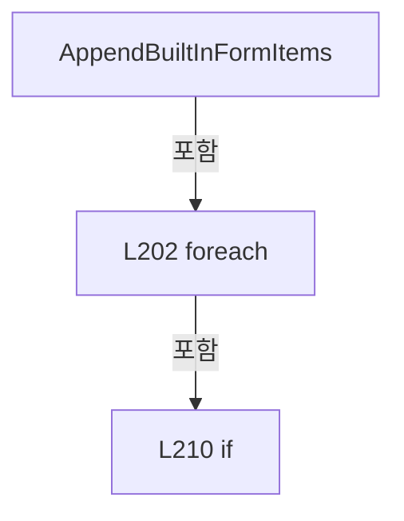

변경 전 점검: 입력/반환 타입, 위 호출자, 예외/취소 경로, 공유 상태와 저장·전송 소비자를 함께 확인합니다. 값의 단위나 물리 방향을 이름만으로 확정하지 않습니다.

### LocalFunctionStatement `SelectItem` · L195–198

[Drilling.File/JHMI/CSettingFile.cs:195–198](https://github.com/kjuws10-rgb/A3Drilling/blob/5aee8e58439c9b455cae7c9593c9be986c3e682e/Drilling.File/JHMI/CSettingFile.cs#L195-L198)

| 항목 | 실제 추출 값 |
| --- | --- |
| 서명 | string SelectItem(Drilling.File.JHMI.CSettingFile.ST_SETTING_FORM_ITEM) |
| 접근/수식자 | Private /  |
| 반환/값 타입 | string |
| 소속 타입 | NamedType:Drilling.File.JHMI.CSettingFile |

입력 계약:

| 이름 | 타입 | 전달 | 선택/기본값 |
| --- | --- | --- | --- |
| item | Drilling.File.JHMI.CSettingFile.ST_SETTING_FORM_ITEM | None | False /  |

현재 부분 분석에서 직접 연결된 호출자는 없습니다. XAML/이벤트/인터페이스·델리게이트·외부 진입을 추가 확인해야 하며, 미사용으로 판정한 것이 아닙니다.

호출하는 대상과 해석 범위:

| 원본 행 | 표현식 | 분석 상태 | 대상/소스 위치 |
| --- | --- | --- | --- |
| 197 | CreateKey | resolved | string Drilling.File.JHMI.CSettingFile.CreateKey(string, string) · Drilling.File/JHMI/CSettingFile.cs:482 |

본문의 실제 연산·분기·예외·반환 순서(원문 위치 순):

| 원본 행 | 종류 | 주석 해설 |
| --- | --- | --- |
| 197 | call | 함수·델리게이트 또는 객체 생성자를 호출합니다: CreateKey(item.Tab, item.Name) |
| 197 | return | 호출자에게 값 또는 제어를 반환합니다: return CreateKey(item.Tab, item.Name); |

변경 전 점검: 입력/반환 타입, 위 호출자, 예외/취소 경로, 공유 상태와 저장·전송 소비자를 함께 확인합니다. 값의 단위나 물리 방향을 이름만으로 확정하지 않습니다.

### MethodDeclaration `CreateDistortionRunOptionFormItems` · L219–225

[Drilling.File/JHMI/CSettingFile.cs:219–225](https://github.com/kjuws10-rgb/A3Drilling/blob/5aee8e58439c9b455cae7c9593c9be986c3e682e/Drilling.File/JHMI/CSettingFile.cs#L219-L225)

| 항목 | 실제 추출 값 |
| --- | --- |
| 서명 | System.Collections.Generic.IEnumerable<Drilling.File.JHMI.CSettingFile.ST_SETTING_FORM_ITEM> Drilling.File.JHMI.CSettingFile.CreateDistortionRunOptionFormItems() |
| 접근/수식자 | Private / private, static |
| 반환/값 타입 | System.Collections.Generic.IEnumerable<Drilling.File.JHMI.CSettingFile.ST_SETTING_FORM_ITEM> |
| 소속 타입 | NamedType:Drilling.File.JHMI.CSettingFile |

정적 호출자로 확인된 위치:

| 호출 파일/행 | 호출 표현식 | 런타임 분기 가능 |
| --- | --- | --- |
| [Drilling.File/JHMI/CSettingFile.cs:208–208](https://github.com/kjuws10-rgb/A3Drilling/blob/5aee8e58439c9b455cae7c9593c9be986c3e682e/Drilling.File/JHMI/CSettingFile.cs#L208-L208) | CreateDistortionRunOptionFormItems | False |

호출하는 대상과 해석 범위:

| 원본 행 | 표현식 | 분석 상태 | 대상/소스 위치 |
| --- | --- | --- | --- |
| 223 | new | resolved | Drilling.File.JHMI.CSettingFile.ST_SETTING_FORM_ITEM.ST_SETTING_FORM_ITEM(string, string, string, string, Drilling.Common.Managers.EN_RECIPE_DATA_TYPE, string, bool, bool, string, double, double, string, int, System.Collections.Generic.IReadOnlyDictionary<string, string>?) · Drilling.File/JHMI/CSettingFile.cs:548 |

본문의 실제 연산·분기·예외·반환 순서(원문 위치 순):

| 원본 행 | 종류 | 주석 해설 |
| --- | --- | --- |
| 221 | local-declaration | 지역 변수를 선언합니다: var keys = new[] { CRunOptionSettings.DistortionGroup0, CRunOptionSettings.DistortionGroup1, CRunOptionSettings.DistortionGroup2 }; |
| 221 | variable-initializer | 변수의 초기값을 지정합니다: keys = new[] { CRunOptionSettings.DistortionGroup0, CRunOptionSettings.DistortionGroup1, CRunOptionSettings.DistortionGroup2 } |
| 222 | variable-initializer | 변수의 초기값을 지정합니다: index = 0 |
| 222 | for | 초기화·조건·증감이 있는 반복입니다: for (var index = 0; index < keys.Length; index++) |
| 223 | call | 함수·델리게이트 또는 객체 생성자를 호출합니다: new("OPTION", "RUNOPTION", keys[index], $"Distortion Key Group {index}", EN_RECIPE_DATA_TYPE.Bool, "", true, true, "0", 0, 1, $"0=미선택; 1=선택; Group {index}는 독립 선택; Main Run Option 변경 시 즉시 저장; Stage Y 측정 위치는 Motor-ALIGN의 D… |
| 223 | yield | 열거값/종료를 전달합니다: yield return new("OPTION", "RUNOPTION", keys[index], $"Distortion Key Group {index}", EN_RECIPE_DATA_TYPE.Bool, "", true, true, "0", 0, 1, $"0=미선택; 1=선택; Group {index}는 독립 선택; Main Run Option 변경 시 즉시 저장; Stage Y 측정 위치는 Motor-ALIGN |

제어 구문의 포함 구조(실제 실행 순서/CFG가 아닌 구문 탐색 그림):

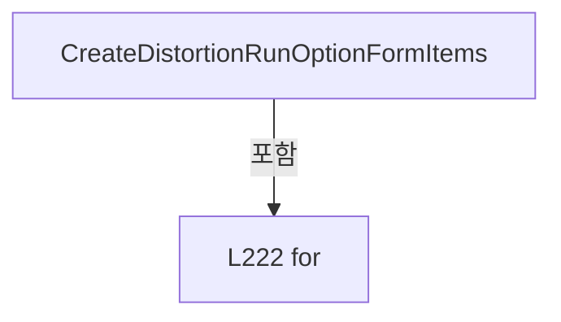

변경 전 점검: 입력/반환 타입, 위 호출자, 예외/취소 경로, 공유 상태와 저장·전송 소비자를 함께 확인합니다. 값의 단위나 물리 방향을 이름만으로 확정하지 않습니다.

### MethodDeclaration `CreateOffsetScaleFormItems` · L227–233

[Drilling.File/JHMI/CSettingFile.cs:227–233](https://github.com/kjuws10-rgb/A3Drilling/blob/5aee8e58439c9b455cae7c9593c9be986c3e682e/Drilling.File/JHMI/CSettingFile.cs#L227-L233)

| 항목 | 실제 추출 값 |
| --- | --- |
| 서명 | System.Collections.Generic.IEnumerable<Drilling.File.JHMI.CSettingFile.ST_SETTING_FORM_ITEM> Drilling.File.JHMI.CSettingFile.CreateOffsetScaleFormItems() |
| 접근/수식자 | Private / private, static |
| 반환/값 타입 | System.Collections.Generic.IEnumerable<Drilling.File.JHMI.CSettingFile.ST_SETTING_FORM_ITEM> |
| 소속 타입 | NamedType:Drilling.File.JHMI.CSettingFile |

정적 호출자로 확인된 위치:

| 호출 파일/행 | 호출 표현식 | 런타임 분기 가능 |
| --- | --- | --- |
| [Drilling.File/JHMI/CSettingFile.cs:208–208](https://github.com/kjuws10-rgb/A3Drilling/blob/5aee8e58439c9b455cae7c9593c9be986c3e682e/Drilling.File/JHMI/CSettingFile.cs#L208-L208) | CreateOffsetScaleFormItems | False |

호출하는 대상과 해석 범위:

| 원본 행 | 표현식 | 분석 상태 | 대상/소스 위치 |
| --- | --- | --- | --- |
| 229 | new | resolved | Drilling.File.JHMI.CSettingFile.ST_SETTING_FORM_ITEM.ST_SETTING_FORM_ITEM(string, string, string, string, Drilling.Common.Managers.EN_RECIPE_DATA_TYPE, string, bool, bool, string, double, double, string, int, System.Collections.Generic.IReadOnlyDictionary<string, string>?) · Drilling.File/JHMI/CSettingFile.cs:548 |
| 231 | new | resolved | Drilling.File.JHMI.CSettingFile.ST_SETTING_FORM_ITEM.ST_SETTING_FORM_ITEM(string, string, string, string, Drilling.Common.Managers.EN_RECIPE_DATA_TYPE, string, bool, bool, string, double, double, string, int, System.Collections.Generic.IReadOnlyDictionary<string, string>?) · Drilling.File/JHMI/CSettingFile.cs:548 |

본문의 실제 연산·분기·예외·반환 순서(원문 위치 순):

| 원본 행 | 종류 | 주석 해설 |
| --- | --- | --- |
| 229 | call | 함수·델리게이트 또는 객체 생성자를 호출합니다: new("OPTION", "REVIEW", "REVIEW_OFFSET_SCALE", "Review Offset Scale", EN_RECIPE_DATA_TYPE.Int, "%", true, true, "100", 0, int.MaxValue, "가공 좌표 생성 시 저장된 Review Offset에 적용할 비율; 0%=미적용; 100%=원래 값; 200%=2배; 저장값과 설계 Masking/C… |
| 229 | yield | 열거값/종료를 전달합니다: yield return new("OPTION", "REVIEW", "REVIEW_OFFSET_SCALE", "Review Offset Scale", EN_RECIPE_DATA_TYPE.Int, "%", true, true, "100", 0, int.MaxValue, "가공 좌표 생성 시 저장된 Review Offset에 적용할 비율; 0%=미적용; 100%=원래 값; 200%=2배; 저장값과 설계 Maskin |
| 231 | call | 함수·델리게이트 또는 객체 생성자를 호출합니다: new("OPTION", "ALIGN", "ALIGN_OFFSET_SCALE", "Align Offset Scale", EN_RECIPE_DATA_TYPE.Int, "%", true, true, "100", 0, int.MaxValue, "가공 좌표 생성 시 저장된 Align Offset에 적용할 비율; 0%=미적용; 100%=원래 값; 200%=2배; 저장값과 설계 Masking/Chess… |
| 231 | yield | 열거값/종료를 전달합니다: yield return new("OPTION", "ALIGN", "ALIGN_OFFSET_SCALE", "Align Offset Scale", EN_RECIPE_DATA_TYPE.Int, "%", true, true, "100", 0, int.MaxValue, "가공 좌표 생성 시 저장된 Align Offset에 적용할 비율; 0%=미적용; 100%=원래 값; 200%=2배; 저장값과 설계 Masking/Ch |

변경 전 점검: 입력/반환 타입, 위 호출자, 예외/취소 경로, 공유 상태와 저장·전송 소비자를 함께 확인합니다. 값의 단위나 물리 방향을 이름만으로 확정하지 않습니다.

### MethodDeclaration `CreateAlignFormItems` · L235–249

[Drilling.File/JHMI/CSettingFile.cs:235–249](https://github.com/kjuws10-rgb/A3Drilling/blob/5aee8e58439c9b455cae7c9593c9be986c3e682e/Drilling.File/JHMI/CSettingFile.cs#L235-L249)

| 항목 | 실제 추출 값 |
| --- | --- |
| 서명 | System.Collections.Generic.IEnumerable<Drilling.File.JHMI.CSettingFile.ST_SETTING_FORM_ITEM> Drilling.File.JHMI.CSettingFile.CreateAlignFormItems() |
| 접근/수식자 | Private / private, static |
| 반환/값 타입 | System.Collections.Generic.IEnumerable<Drilling.File.JHMI.CSettingFile.ST_SETTING_FORM_ITEM> |
| 소속 타입 | NamedType:Drilling.File.JHMI.CSettingFile |

정적 호출자로 확인된 위치:

| 호출 파일/행 | 호출 표현식 | 런타임 분기 가능 |
| --- | --- | --- |
| [Drilling.File/JHMI/CSettingFile.cs:208–208](https://github.com/kjuws10-rgb/A3Drilling/blob/5aee8e58439c9b455cae7c9593c9be986c3e682e/Drilling.File/JHMI/CSettingFile.cs#L208-L208) | CreateAlignFormItems | False |

호출하는 대상과 해석 범위:

| 원본 행 | 표현식 | 분석 상태 | 대상/소스 위치 |
| --- | --- | --- | --- |
| 237 | new | resolved | Drilling.File.JHMI.CSettingFile.ST_SETTING_FORM_ITEM.ST_SETTING_FORM_ITEM(string, string, string, string, Drilling.Common.Managers.EN_RECIPE_DATA_TYPE, string, bool, bool, string, double, double, string, int, System.Collections.Generic.IReadOnlyDictionary<string, string>?) · Drilling.File/JHMI/CSettingFile.cs:548 |
| 239 | CSettingManager.DefaultAlignCameraResolution.ToString | resolved | string double.ToString(string?, System.IFormatProvider?) |
| 241 | new | resolved | Drilling.File.JHMI.CSettingFile.ST_SETTING_FORM_ITEM.ST_SETTING_FORM_ITEM(string, string, string, string, Drilling.Common.Managers.EN_RECIPE_DATA_TYPE, string, bool, bool, string, double, double, string, int, System.Collections.Generic.IReadOnlyDictionary<string, string>?) · Drilling.File/JHMI/CSettingFile.cs:548 |
| 243 | CSettingManager.DefaultWapageAlignBaseTolerance.ToString | resolved | string double.ToString(string?, System.IFormatProvider?) |
| 246 | new | resolved | Drilling.File.JHMI.CSettingFile.ST_SETTING_FORM_ITEM.ST_SETTING_FORM_ITEM(string, string, string, string, Drilling.Common.Managers.EN_RECIPE_DATA_TYPE, string, bool, bool, string, double, double, string, int, System.Collections.Generic.IReadOnlyDictionary<string, string>?) · Drilling.File/JHMI/CSettingFile.cs:548 |
| 247 | (2000 - index * 500).ToString | resolved | string int.ToString(System.IFormatProvider?) |

본문의 실제 연산·분기·예외·반환 순서(원문 위치 순):

| 원본 행 | 종류 | 주석 해설 |
| --- | --- | --- |
| 237 | call | 함수·델리게이트 또는 객체 생성자를 호출합니다: new("OPTION", "ALIGN", CSettingManager.AlignCameraResolutionKey, CSettingManager.AlignCameraResolutionKey, EN_RECIPE_DATA_TYPE.Double, "mm/pixel", true, true, CSettingManager.DefaultAlignCameraResolution.ToString("R", Cu… |
| 237 | yield | 열거값/종료를 전달합니다: yield return new("OPTION", "ALIGN", CSettingManager.AlignCameraResolutionKey, CSettingManager.AlignCameraResolutionKey, EN_RECIPE_DATA_TYPE.Double, "mm/pixel", true, true, CSettingManager.DefaultAlignCameraResolution.ToString("R", |
| 239 | call | 함수·델리게이트 또는 객체 생성자를 호출합니다: CSettingManager.DefaultAlignCameraResolution.ToString("R", CultureInfo.InvariantCulture) |
| 241 | call | 함수·델리게이트 또는 객체 생성자를 호출합니다: new("OPTION", "ALIGN", CSettingManager.WapageAlignBaseToleranceKey, CSettingManager.WapageAlignBaseToleranceKey, EN_RECIPE_DATA_TYPE.Double, "mm", true, true, CSettingManager.DefaultWapageAlignBaseTolerance.ToString("R",… |
| 241 | yield | 열거값/종료를 전달합니다: yield return new("OPTION", "ALIGN", CSettingManager.WapageAlignBaseToleranceKey, CSettingManager.WapageAlignBaseToleranceKey, EN_RECIPE_DATA_TYPE.Double, "mm", true, true, CSettingManager.DefaultWapageAlignBaseTolerance.ToString(" |
| 243 | call | 함수·델리게이트 또는 객체 생성자를 호출합니다: CSettingManager.DefaultWapageAlignBaseTolerance.ToString("R", CultureInfo.InvariantCulture) |
| 245 | variable-initializer | 변수의 초기값을 지정합니다: index = 0 |
| 245 | for | 초기화·조건·증감이 있는 반복입니다: for (var index = 0; index < 3; index++) |
| 246 | call | 함수·델리게이트 또는 객체 생성자를 호출합니다: new("MOTOR", "ALIGN", $"DK{index}_STAGE_Y_POSITION", $"DK{index} Stage Y Position", EN_RECIPE_DATA_TYPE.Double, "mm", true, true, (2000 - index * 500).ToString(CultureInfo.InvariantCulture), -10000, 10000, $"Distortion G… |
| 246 | yield | 열거값/종료를 전달합니다: yield return new("MOTOR", "ALIGN", $"DK{index}_STAGE_Y_POSITION", $"DK{index} Stage Y Position", EN_RECIPE_DATA_TYPE.Double, "mm", true, true, (2000 - index * 500).ToString(CultureInfo.InvariantCulture), -10000, 10000, $"Distortio |
| 247 | call | 함수·델리게이트 또는 객체 생성자를 호출합니다: (2000 - index * 500).ToString(CultureInfo.InvariantCulture) |

제어 구문의 포함 구조(실제 실행 순서/CFG가 아닌 구문 탐색 그림):

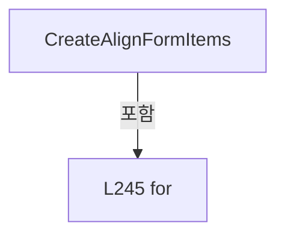

변경 전 점검: 입력/반환 타입, 위 호출자, 예외/취소 경로, 공유 상태와 저장·전송 소비자를 함께 확인합니다. 값의 단위나 물리 방향을 이름만으로 확정하지 않습니다.

### MethodDeclaration `CreateScannerFormItems` · L251–287

[Drilling.File/JHMI/CSettingFile.cs:251–287](https://github.com/kjuws10-rgb/A3Drilling/blob/5aee8e58439c9b455cae7c9593c9be986c3e682e/Drilling.File/JHMI/CSettingFile.cs#L251-L287)

| 항목 | 실제 추출 값 |
| --- | --- |
| 서명 | System.Collections.Generic.IEnumerable<Drilling.File.JHMI.CSettingFile.ST_SETTING_FORM_ITEM> Drilling.File.JHMI.CSettingFile.CreateScannerFormItems() |
| 접근/수식자 | Private / private, static |
| 반환/값 타입 | System.Collections.Generic.IEnumerable<Drilling.File.JHMI.CSettingFile.ST_SETTING_FORM_ITEM> |
| 소속 타입 | NamedType:Drilling.File.JHMI.CSettingFile |

정적 호출자로 확인된 위치:

| 호출 파일/행 | 호출 표현식 | 런타임 분기 가능 |
| --- | --- | --- |
| [Drilling.File/JHMI/CSettingFile.cs:202–202](https://github.com/kjuws10-rgb/A3Drilling/blob/5aee8e58439c9b455cae7c9593c9be986c3e682e/Drilling.File/JHMI/CSettingFile.cs#L202-L202) | CreateScannerFormItems | False |

호출하는 대상과 해석 범위:

| 원본 행 | 표현식 | 분석 상태 | 대상/소스 위치 |
| --- | --- | --- | --- |
| 255 | new ST_SETTING_FORM_ITEM | resolved | Drilling.File.JHMI.CSettingFile.ST_SETTING_FORM_ITEM.ST_SETTING_FORM_ITEM(string, string, string, string, Drilling.Common.Managers.EN_RECIPE_DATA_TYPE, string, bool, bool, string, double, double, string, int, System.Collections.Generic.IReadOnlyDictionary<string, string>?) · Drilling.File/JHMI/CSettingFile.cs:548 |
| 270 | new ST_SETTING_FORM_ITEM | resolved | Drilling.File.JHMI.CSettingFile.ST_SETTING_FORM_ITEM.ST_SETTING_FORM_ITEM(string, string, string, string, Drilling.Common.Managers.EN_RECIPE_DATA_TYPE, string, bool, bool, string, double, double, string, int, System.Collections.Generic.IReadOnlyDictionary<string, string>?) · Drilling.File/JHMI/CSettingFile.cs:548 |
| 271 | new ST_SETTING_FORM_ITEM | resolved | Drilling.File.JHMI.CSettingFile.ST_SETTING_FORM_ITEM.ST_SETTING_FORM_ITEM(string, string, string, string, Drilling.Common.Managers.EN_RECIPE_DATA_TYPE, string, bool, bool, string, double, double, string, int, System.Collections.Generic.IReadOnlyDictionary<string, string>?) · Drilling.File/JHMI/CSettingFile.cs:548 |

본문의 실제 연산·분기·예외·반환 순서(원문 위치 순):

| 원본 행 | 종류 | 주석 해설 |
| --- | --- | --- |
| 253 | variable-initializer | 변수의 초기값을 지정합니다: headNo = 1 |
| 253 | for | 초기화·조건·증감이 있는 반복입니다: for (var headNo = 1; headNo <= 8; headNo++) |
| 255 | call | 함수·델리게이트 또는 객체 생성자를 호출합니다: new ST_SETTING_FORM_ITEM( "OPTION", "SCANNER", $"H{headNo:00}_SCANNER_DIO_NO", $"H{headNo:00} Scanner DIO No", EN_RECIPE_DATA_TYPE.Int, "bit", true, true, "-1", 0, 63, $"H{headNo:00} manual scanner DIO output bit number … |
| 255 | yield | 열거값/종료를 전달합니다: yield return new ST_SETTING_FORM_ITEM( "OPTION", "SCANNER", $"H{headNo:00}_SCANNER_DIO_NO", $"H{headNo:00} Scanner DIO No", EN_RECIPE_DATA_TYPE.Int, "bit", true, true, "-1", 0, 63, $"H{headNo:00} manual scanner DIO output bit numb |
| 270 | call | 함수·델리게이트 또는 객체 생성자를 호출합니다: new ST_SETTING_FORM_ITEM("OPTION", "SCANNER", $"H{headNo:00}_SCANNER_Z_USE", $"H{headNo:00} Scanner Z Use", EN_RECIPE_DATA_TYPE.Bool, "", true, true, "OFF", 0, 1, $"H{headNo:00} 스캐너 Z축 사용 여부", 100 + (headNo * 2)) |
| 270 | yield | 열거값/종료를 전달합니다: yield return new ST_SETTING_FORM_ITEM("OPTION", "SCANNER", $"H{headNo:00}_SCANNER_Z_USE", $"H{headNo:00} Scanner Z Use", EN_RECIPE_DATA_TYPE.Bool, "", true, true, "OFF", 0, 1, $"H{headNo:00} 스캐너 Z축 사용 여부", 100 + (headNo * 2)); |
| 271 | call | 함수·델리게이트 또는 객체 생성자를 호출합니다: new ST_SETTING_FORM_ITEM( "OPTION", "SCANNER", $"H{headNo:00}_SCANNER_Z_AXIS", $"H{headNo:00} Scanner Z Axis", EN_RECIPE_DATA_TYPE.String, "", true, true, $"Z{headNo}", 0, 0, $"H{headNo:00} Automation1 스캐너 Z축 이름", 101 + … |
| 271 | yield | 열거값/종료를 전달합니다: yield return new ST_SETTING_FORM_ITEM( "OPTION", "SCANNER", $"H{headNo:00}_SCANNER_Z_AXIS", $"H{headNo:00} Scanner Z Axis", EN_RECIPE_DATA_TYPE.String, "", true, true, $"Z{headNo}", 0, 0, $"H{headNo:00} Automation1 스캐너 Z축 이름", 101 |

제어 구문의 포함 구조(실제 실행 순서/CFG가 아닌 구문 탐색 그림):

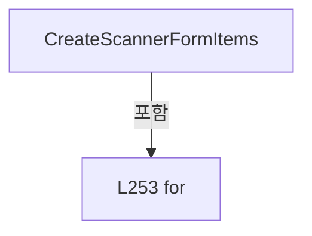

변경 전 점검: 입력/반환 타입, 위 호출자, 예외/취소 경로, 공유 상태와 저장·전송 소비자를 함께 확인합니다. 값의 단위나 물리 방향을 이름만으로 확정하지 않습니다.

### MethodDeclaration `LoadSettingValues` · L289–326

[Drilling.File/JHMI/CSettingFile.cs:289–326](https://github.com/kjuws10-rgb/A3Drilling/blob/5aee8e58439c9b455cae7c9593c9be986c3e682e/Drilling.File/JHMI/CSettingFile.cs#L289-L326)

| 항목 | 실제 추출 값 |
| --- | --- |
| 서명 | System.Collections.Generic.Dictionary<string, string> Drilling.File.JHMI.CSettingFile.LoadSettingValues() |
| 접근/수식자 | Private / private |
| 반환/값 타입 | System.Collections.Generic.Dictionary<string, string> |
| 소속 타입 | NamedType:Drilling.File.JHMI.CSettingFile |

정적 호출자로 확인된 위치:

| 호출 파일/행 | 호출 표현식 | 런타임 분기 가능 |
| --- | --- | --- |
| [Drilling.File/JHMI/CSettingFile.cs:22–22](https://github.com/kjuws10-rgb/A3Drilling/blob/5aee8e58439c9b455cae7c9593c9be986c3e682e/Drilling.File/JHMI/CSettingFile.cs#L22-L22) | LoadSettingValues | False |
| [Drilling.File/JHMI/CSettingFile.cs:57–57](https://github.com/kjuws10-rgb/A3Drilling/blob/5aee8e58439c9b455cae7c9593c9be986c3e682e/Drilling.File/JHMI/CSettingFile.cs#L57-L57) | LoadSettingValues | False |
| [Drilling.File/JHMI/CSettingFile.cs:351–351](https://github.com/kjuws10-rgb/A3Drilling/blob/5aee8e58439c9b455cae7c9593c9be986c3e682e/Drilling.File/JHMI/CSettingFile.cs#L351-L351) | LoadSettingValues | False |

호출하는 대상과 해석 범위:

| 원본 행 | 표현식 | 분석 상태 | 대상/소스 위치 |
| --- | --- | --- | --- |
| 291 | GetValuePath | resolved | string Drilling.File.JHMI.CSettingFile.GetValuePath() · Drilling.File/JHMI/CSettingFile.cs:466 |
| 300 | System.IO.File.Exists | resolved | bool System.IO.File.Exists(string?) |
| 302 | CCsvParser.ValidateRequiredHeaders | resolved | void Drilling.File.Parser.CCsvParser.ValidateRequiredHeaders(string, string, System.Collections.Generic.IEnumerable<System.Collections.Generic.IEnumerable<string>>) · Drilling.File/Parser/CCsvParser.cs:280 |
| 302 | ValueHeaders.Select | resolved | System.Collections.Generic.IEnumerable<string[]> System.Collections.Generic.IEnumerable<string>.Select<string, string[]>(System.Func<string, string[]>) |
| 325 | CCsvParser.Read(GetValuePath()).Where(HasSettingValueKey).GroupBy(SelectGroupKey, StringComparer.OrdinalIgnoreCase).ToDictionary | resolved | System.Collections.Generic.Dictionary<string, string> System.Collections.Generic.IEnumerable<System.Linq.IGrouping<string, System.Collections.Generic.IReadOnlyDictionary<string, string>>>.ToDictionary<System.Linq.IGrouping<string, System.Collections.Generic.IReadOnlyDictionary<string, string>>, string, string>(System.Func<System.Linq.IGrouping<string, System.Collections.Generic.IReadOnlyDictionary<string, string>>, string>, System.Func<System.Linq.IGrouping<string, System.Collections.Generic.IReadOnlyDictionary<string, string>>, string>, System.Collections.Generic.IEqualityComparer<string>?) |
| 325 | CCsvParser.Read(GetValuePath()).Where(HasSettingValueKey).GroupBy | resolved | System.Collections.Generic.IEnumerable<System.Linq.IGrouping<string, System.Collections.Generic.IReadOnlyDictionary<string, string>>> System.Collections.Generic.IEnumerable<System.Collections.Generic.IReadOnlyDictionary<string, string>>.GroupBy<System.Collections.Generic.IReadOnlyDictionary<string, string>, string>(System.Func<System.Collections.Generic.IReadOnlyDictionary<string, string>, string>, System.Collections.Generic.IEqualityComparer<string>?) |
| 325 | CCsvParser.Read(GetValuePath()).Where | resolved | System.Collections.Generic.IEnumerable<System.Collections.Generic.IReadOnlyDictionary<string, string>> System.Collections.Generic.IEnumerable<System.Collections.Generic.IReadOnlyDictionary<string, string>>.Where<System.Collections.Generic.IReadOnlyDictionary<string, string>>(System.Func<System.Collections.Generic.IReadOnlyDictionary<string, string>, bool>) |
| 325 | CCsvParser.Read | resolved | System.Collections.Generic.IReadOnlyList<System.Collections.Generic.IReadOnlyDictionary<string, string>> Drilling.File.Parser.CCsvParser.Read(string) · Drilling.File/Parser/CCsvParser.cs:12 |
| 325 | GetValuePath | resolved | string Drilling.File.JHMI.CSettingFile.GetValuePath() · Drilling.File/JHMI/CSettingFile.cs:466 |

본문의 실제 연산·분기·예외·반환 순서(원문 위치 순):

| 원본 행 | 종류 | 주석 해설 |
| --- | --- | --- |
| 291 | call | 함수·델리게이트 또는 객체 생성자를 호출합니다: GetValuePath() |
| 291 | local-declaration | 지역 변수를 선언합니다: var valuePath = GetValuePath(); |
| 291 | variable-initializer | 변수의 초기값을 지정합니다: valuePath = GetValuePath() |
| 300 | call | 함수·델리게이트 또는 객체 생성자를 호출합니다: System.IO.File.Exists(valuePath) |
| 300 | if | 조건에 따라 분기합니다: if (System.IO.File.Exists(valuePath)) |
| 302 | call | 함수·델리게이트 또는 객체 생성자를 호출합니다: CCsvParser.ValidateRequiredHeaders(valuePath, "Setting.csv", ValueHeaders.Select(SelectItem)) |
| 302 | call | 함수·델리게이트 또는 객체 생성자를 호출합니다: ValueHeaders.Select(SelectItem) |
| 325 | call | 함수·델리게이트 또는 객체 생성자를 호출합니다: CCsvParser.Read(GetValuePath()).Where(HasSettingValueKey).GroupBy(SelectGroupKey, StringComparer.OrdinalIgnoreCase).ToDictionary(SelectKey, SelectValue, StringComparer.OrdinalIgnoreCase) |
| 325 | call | 함수·델리게이트 또는 객체 생성자를 호출합니다: CCsvParser.Read(GetValuePath()).Where(HasSettingValueKey).GroupBy(SelectGroupKey, StringComparer.OrdinalIgnoreCase) |
| 325 | call | 함수·델리게이트 또는 객체 생성자를 호출합니다: CCsvParser.Read(GetValuePath()).Where(HasSettingValueKey) |
| 325 | call | 함수·델리게이트 또는 객체 생성자를 호출합니다: CCsvParser.Read(GetValuePath()) |
| 325 | call | 함수·델리게이트 또는 객체 생성자를 호출합니다: GetValuePath() |
| 325 | return | 호출자에게 값 또는 제어를 반환합니다: return CCsvParser.Read(GetValuePath()).Where(HasSettingValueKey).GroupBy(SelectGroupKey, StringComparer.OrdinalIgnoreCase).ToDictionary(SelectKey, SelectValue, StringComparer.OrdinalIgnoreCase); |

제어 구문의 포함 구조(실제 실행 순서/CFG가 아닌 구문 탐색 그림):

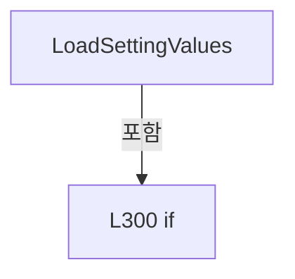

변경 전 점검: 입력/반환 타입, 위 호출자, 예외/취소 경로, 공유 상태와 저장·전송 소비자를 함께 확인합니다. 값의 단위나 물리 방향을 이름만으로 확정하지 않습니다.

### LocalFunctionStatement `SelectItem` · L292–298

[Drilling.File/JHMI/CSettingFile.cs:292–298](https://github.com/kjuws10-rgb/A3Drilling/blob/5aee8e58439c9b455cae7c9593c9be986c3e682e/Drilling.File/JHMI/CSettingFile.cs#L292-L298)

| 항목 | 실제 추출 값 |
| --- | --- |
| 서명 | string[] SelectItem(string) |
| 접근/수식자 | Private /  |
| 반환/값 타입 | string[] |
| 소속 타입 | NamedType:Drilling.File.JHMI.CSettingFile |

입력 계약:

| 이름 | 타입 | 전달 | 선택/기본값 |
| --- | --- | --- | --- |
| header | string | None | False /  |

현재 부분 분석에서 직접 연결된 호출자는 없습니다. XAML/이벤트/인터페이스·델리게이트·외부 진입을 추가 확인해야 하며, 미사용으로 판정한 것이 아닙니다.

본문의 실제 연산·분기·예외·반환 순서(원문 위치 순):

| 원본 행 | 종류 | 주석 해설 |
| --- | --- | --- |
| 294 | return | 호출자에게 값 또는 제어를 반환합니다: return new[] { header }; |

변경 전 점검: 입력/반환 타입, 위 호출자, 예외/취소 경로, 공유 상태와 저장·전송 소비자를 함께 확인합니다. 값의 단위나 물리 방향을 이름만으로 확정하지 않습니다.

### LocalFunctionStatement `HasSettingValueKey` · L305–308

[Drilling.File/JHMI/CSettingFile.cs:305–308](https://github.com/kjuws10-rgb/A3Drilling/blob/5aee8e58439c9b455cae7c9593c9be986c3e682e/Drilling.File/JHMI/CSettingFile.cs#L305-L308)

| 항목 | 실제 추출 값 |
| --- | --- |
| 서명 | bool HasSettingValueKey(System.Collections.Generic.IReadOnlyDictionary<string, string>) |
| 접근/수식자 | Private /  |
| 반환/값 타입 | bool |
| 소속 타입 | NamedType:Drilling.File.JHMI.CSettingFile |

입력 계약:

| 이름 | 타입 | 전달 | 선택/기본값 |
| --- | --- | --- | --- |
| row | System.Collections.Generic.IReadOnlyDictionary<string, string> | None | False /  |

현재 부분 분석에서 직접 연결된 호출자는 없습니다. XAML/이벤트/인터페이스·델리게이트·외부 진입을 추가 확인해야 하며, 미사용으로 판정한 것이 아닙니다.

호출하는 대상과 해석 범위:

| 원본 행 | 표현식 | 분석 상태 | 대상/소스 위치 |
| --- | --- | --- | --- |
| 307 | string.IsNullOrWhiteSpace | resolved | bool string.IsNullOrWhiteSpace(string?) |
| 307 | CCsvParser.Get | resolved | string Drilling.File.Parser.CCsvParser.Get(System.Collections.Generic.IReadOnlyDictionary<string, string>, string) · Drilling.File/Parser/CCsvParser.cs:168 |
| 307 | string.IsNullOrWhiteSpace | resolved | bool string.IsNullOrWhiteSpace(string?) |
| 307 | CCsvParser.Get | resolved | string Drilling.File.Parser.CCsvParser.Get(System.Collections.Generic.IReadOnlyDictionary<string, string>, string) · Drilling.File/Parser/CCsvParser.cs:168 |

본문의 실제 연산·분기·예외·반환 순서(원문 위치 순):

| 원본 행 | 종류 | 주석 해설 |
| --- | --- | --- |
| 307 | call | 함수·델리게이트 또는 객체 생성자를 호출합니다: string.IsNullOrWhiteSpace(CCsvParser.Get(row, "TAB")) |
| 307 | call | 함수·델리게이트 또는 객체 생성자를 호출합니다: CCsvParser.Get(row, "TAB") |
| 307 | call | 함수·델리게이트 또는 객체 생성자를 호출합니다: string.IsNullOrWhiteSpace(CCsvParser.Get(row, "NAME")) |
| 307 | call | 함수·델리게이트 또는 객체 생성자를 호출합니다: CCsvParser.Get(row, "NAME") |
| 307 | return | 호출자에게 값 또는 제어를 반환합니다: return !string.IsNullOrWhiteSpace(CCsvParser.Get(row, "TAB")) && !string.IsNullOrWhiteSpace(CCsvParser.Get(row, "NAME")); |

변경 전 점검: 입력/반환 타입, 위 호출자, 예외/취소 경로, 공유 상태와 저장·전송 소비자를 함께 확인합니다. 값의 단위나 물리 방향을 이름만으로 확정하지 않습니다.

### LocalFunctionStatement `SelectGroupKey` · L310–313

[Drilling.File/JHMI/CSettingFile.cs:310–313](https://github.com/kjuws10-rgb/A3Drilling/blob/5aee8e58439c9b455cae7c9593c9be986c3e682e/Drilling.File/JHMI/CSettingFile.cs#L310-L313)

| 항목 | 실제 추출 값 |
| --- | --- |
| 서명 | string SelectGroupKey(System.Collections.Generic.IReadOnlyDictionary<string, string>) |
| 접근/수식자 | Private /  |
| 반환/값 타입 | string |
| 소속 타입 | NamedType:Drilling.File.JHMI.CSettingFile |

입력 계약:

| 이름 | 타입 | 전달 | 선택/기본값 |
| --- | --- | --- | --- |
| row | System.Collections.Generic.IReadOnlyDictionary<string, string> | None | False /  |

현재 부분 분석에서 직접 연결된 호출자는 없습니다. XAML/이벤트/인터페이스·델리게이트·외부 진입을 추가 확인해야 하며, 미사용으로 판정한 것이 아닙니다.

호출하는 대상과 해석 범위:

| 원본 행 | 표현식 | 분석 상태 | 대상/소스 위치 |
| --- | --- | --- | --- |
| 312 | CreateKey | resolved | string Drilling.File.JHMI.CSettingFile.CreateKey(string, string) · Drilling.File/JHMI/CSettingFile.cs:482 |
| 312 | CCsvParser.Get | resolved | string Drilling.File.Parser.CCsvParser.Get(System.Collections.Generic.IReadOnlyDictionary<string, string>, string) · Drilling.File/Parser/CCsvParser.cs:168 |
| 312 | CCsvParser.Get | resolved | string Drilling.File.Parser.CCsvParser.Get(System.Collections.Generic.IReadOnlyDictionary<string, string>, string) · Drilling.File/Parser/CCsvParser.cs:168 |

본문의 실제 연산·분기·예외·반환 순서(원문 위치 순):

| 원본 행 | 종류 | 주석 해설 |
| --- | --- | --- |
| 312 | call | 함수·델리게이트 또는 객체 생성자를 호출합니다: CreateKey(CCsvParser.Get(row, "TAB"), CCsvParser.Get(row, "NAME")) |
| 312 | call | 함수·델리게이트 또는 객체 생성자를 호출합니다: CCsvParser.Get(row, "TAB") |
| 312 | call | 함수·델리게이트 또는 객체 생성자를 호출합니다: CCsvParser.Get(row, "NAME") |
| 312 | return | 호출자에게 값 또는 제어를 반환합니다: return CreateKey(CCsvParser.Get(row, "TAB"), CCsvParser.Get(row, "NAME")); |

변경 전 점검: 입력/반환 타입, 위 호출자, 예외/취소 경로, 공유 상태와 저장·전송 소비자를 함께 확인합니다. 값의 단위나 물리 방향을 이름만으로 확정하지 않습니다.

### LocalFunctionStatement `SelectKey` · L315–318

[Drilling.File/JHMI/CSettingFile.cs:315–318](https://github.com/kjuws10-rgb/A3Drilling/blob/5aee8e58439c9b455cae7c9593c9be986c3e682e/Drilling.File/JHMI/CSettingFile.cs#L315-L318)

| 항목 | 실제 추출 값 |
| --- | --- |
| 서명 | string SelectKey(System.Linq.IGrouping<string, System.Collections.Generic.IReadOnlyDictionary<string, string>>) |
| 접근/수식자 | Private /  |
| 반환/값 타입 | string |
| 소속 타입 | NamedType:Drilling.File.JHMI.CSettingFile |

입력 계약:

| 이름 | 타입 | 전달 | 선택/기본값 |
| --- | --- | --- | --- |
| group | System.Linq.IGrouping<string, System.Collections.Generic.IReadOnlyDictionary<string, string>> | None | False /  |

현재 부분 분석에서 직접 연결된 호출자는 없습니다. XAML/이벤트/인터페이스·델리게이트·외부 진입을 추가 확인해야 하며, 미사용으로 판정한 것이 아닙니다.

본문의 실제 연산·분기·예외·반환 순서(원문 위치 순):

| 원본 행 | 종류 | 주석 해설 |
| --- | --- | --- |
| 317 | return | 호출자에게 값 또는 제어를 반환합니다: return group.Key; |

변경 전 점검: 입력/반환 타입, 위 호출자, 예외/취소 경로, 공유 상태와 저장·전송 소비자를 함께 확인합니다. 값의 단위나 물리 방향을 이름만으로 확정하지 않습니다.

### LocalFunctionStatement `SelectValue` · L320–323

[Drilling.File/JHMI/CSettingFile.cs:320–323](https://github.com/kjuws10-rgb/A3Drilling/blob/5aee8e58439c9b455cae7c9593c9be986c3e682e/Drilling.File/JHMI/CSettingFile.cs#L320-L323)

| 항목 | 실제 추출 값 |
| --- | --- |
| 서명 | string SelectValue(System.Linq.IGrouping<string, System.Collections.Generic.IReadOnlyDictionary<string, string>>) |
| 접근/수식자 | Private /  |
| 반환/값 타입 | string |
| 소속 타입 | NamedType:Drilling.File.JHMI.CSettingFile |

입력 계약:

| 이름 | 타입 | 전달 | 선택/기본값 |
| --- | --- | --- | --- |
| group | System.Linq.IGrouping<string, System.Collections.Generic.IReadOnlyDictionary<string, string>> | None | False /  |

현재 부분 분석에서 직접 연결된 호출자는 없습니다. XAML/이벤트/인터페이스·델리게이트·외부 진입을 추가 확인해야 하며, 미사용으로 판정한 것이 아닙니다.

호출하는 대상과 해석 범위:

| 원본 행 | 표현식 | 분석 상태 | 대상/소스 위치 |
| --- | --- | --- | --- |
| 322 | CCsvParser.Get | resolved | string Drilling.File.Parser.CCsvParser.Get(System.Collections.Generic.IReadOnlyDictionary<string, string>, string) · Drilling.File/Parser/CCsvParser.cs:168 |
| 322 | group.Last | resolved | System.Collections.Generic.IReadOnlyDictionary<string, string> System.Collections.Generic.IEnumerable<System.Collections.Generic.IReadOnlyDictionary<string, string>>.Last<System.Collections.Generic.IReadOnlyDictionary<string, string>>() |

본문의 실제 연산·분기·예외·반환 순서(원문 위치 순):

| 원본 행 | 종류 | 주석 해설 |
| --- | --- | --- |
| 322 | call | 함수·델리게이트 또는 객체 생성자를 호출합니다: CCsvParser.Get(group.Last(), "VALUE") |
| 322 | call | 함수·델리게이트 또는 객체 생성자를 호출합니다: group.Last() |
| 322 | return | 호출자에게 값 또는 제어를 반환합니다: return CCsvParser.Get(group.Last(), "VALUE"); |

변경 전 점검: 입력/반환 타입, 위 호출자, 예외/취소 경로, 공유 상태와 저장·전송 소비자를 함께 확인합니다. 값의 단위나 물리 방향을 이름만으로 확정하지 않습니다.

### MethodDeclaration `WriteSettingValues` · L328–347

[Drilling.File/JHMI/CSettingFile.cs:328–347](https://github.com/kjuws10-rgb/A3Drilling/blob/5aee8e58439c9b455cae7c9593c9be986c3e682e/Drilling.File/JHMI/CSettingFile.cs#L328-L347)

| 항목 | 실제 추출 값 |
| --- | --- |
| 서명 | void Drilling.File.JHMI.CSettingFile.WriteSettingValues(System.Collections.Generic.IReadOnlyList<Drilling.File.JHMI.CSettingFile.ST_SETTING_FORM_ITEM>, System.Collections.Generic.IReadOnlyDictionary<string, string>) |
| 접근/수식자 | Private / private |
| 반환/값 타입 | void |
| 소속 타입 | NamedType:Drilling.File.JHMI.CSettingFile |

입력 계약:

| 이름 | 타입 | 전달 | 선택/기본값 |
| --- | --- | --- | --- |
| formItems | System.Collections.Generic.IReadOnlyList<Drilling.File.JHMI.CSettingFile.ST_SETTING_FORM_ITEM> | None | False /  |
| values | System.Collections.Generic.IReadOnlyDictionary<string, string> | None | False /  |

정적 호출자로 확인된 위치:

| 호출 파일/행 | 호출 표현식 | 런타임 분기 가능 |
| --- | --- | --- |
| [Drilling.File/JHMI/CSettingFile.cs:119–119](https://github.com/kjuws10-rgb/A3Drilling/blob/5aee8e58439c9b455cae7c9593c9be986c3e682e/Drilling.File/JHMI/CSettingFile.cs#L119-L119) | WriteSettingValues | False |

호출하는 대상과 해석 범위:

| 원본 행 | 표현식 | 분석 상태 | 대상/소스 위치 |
| --- | --- | --- | --- |
| 345 | formItems.Where(IsUse).Select | resolved | System.Collections.Generic.IEnumerable<System.Collections.Generic.Dictionary<string, string>> System.Collections.Generic.IEnumerable<Drilling.File.JHMI.CSettingFile.ST_SETTING_FORM_ITEM>.Select<Drilling.File.JHMI.CSettingFile.ST_SETTING_FORM_ITEM, System.Collections.Generic.Dictionary<string, string>>(System.Func<Drilling.File.JHMI.CSettingFile.ST_SETTING_FORM_ITEM, System.Collections.Generic.Dictionary<string, string>>) |
| 345 | formItems.Where | resolved | System.Collections.Generic.IEnumerable<Drilling.File.JHMI.CSettingFile.ST_SETTING_FORM_ITEM> System.Collections.Generic.IEnumerable<Drilling.File.JHMI.CSettingFile.ST_SETTING_FORM_ITEM>.Where<Drilling.File.JHMI.CSettingFile.ST_SETTING_FORM_ITEM>(System.Func<Drilling.File.JHMI.CSettingFile.ST_SETTING_FORM_ITEM, bool>) |
| 346 | CCsvParser.Write | resolved | void Drilling.File.Parser.CCsvParser.Write(string, System.Collections.Generic.IReadOnlyList<string>, System.Collections.Generic.IEnumerable<System.Collections.Generic.IReadOnlyDictionary<string, string>>) · Drilling.File/Parser/CCsvParser.cs:58 |
| 346 | GetValuePath | resolved | string Drilling.File.JHMI.CSettingFile.GetValuePath() · Drilling.File/JHMI/CSettingFile.cs:466 |

본문의 실제 연산·분기·예외·반환 순서(원문 위치 순):

| 원본 행 | 종류 | 주석 해설 |
| --- | --- | --- |
| 345 | call | 함수·델리게이트 또는 객체 생성자를 호출합니다: formItems.Where(IsUse).Select(BuildSettingValueRow) |
| 345 | call | 함수·델리게이트 또는 객체 생성자를 호출합니다: formItems.Where(IsUse) |
| 345 | local-declaration | 지역 변수를 선언합니다: var rows = formItems.Where(IsUse).Select(BuildSettingValueRow); |
| 345 | variable-initializer | 변수의 초기값을 지정합니다: rows = formItems.Where(IsUse).Select(BuildSettingValueRow) |
| 346 | call | 함수·델리게이트 또는 객체 생성자를 호출합니다: CCsvParser.Write(GetValuePath(), ValueHeaders, rows) |
| 346 | call | 함수·델리게이트 또는 객체 생성자를 호출합니다: GetValuePath() |

변경 전 점검: 입력/반환 타입, 위 호출자, 예외/취소 경로, 공유 상태와 저장·전송 소비자를 함께 확인합니다. 값의 단위나 물리 방향을 이름만으로 확정하지 않습니다.

### LocalFunctionStatement `IsUse` · L330–333

[Drilling.File/JHMI/CSettingFile.cs:330–333](https://github.com/kjuws10-rgb/A3Drilling/blob/5aee8e58439c9b455cae7c9593c9be986c3e682e/Drilling.File/JHMI/CSettingFile.cs#L330-L333)

| 항목 | 실제 추출 값 |
| --- | --- |
| 서명 | bool IsUse(Drilling.File.JHMI.CSettingFile.ST_SETTING_FORM_ITEM) |
| 접근/수식자 | Private /  |
| 반환/값 타입 | bool |
| 소속 타입 | NamedType:Drilling.File.JHMI.CSettingFile |

입력 계약:

| 이름 | 타입 | 전달 | 선택/기본값 |
| --- | --- | --- | --- |
| item | Drilling.File.JHMI.CSettingFile.ST_SETTING_FORM_ITEM | None | False /  |

현재 부분 분석에서 직접 연결된 호출자는 없습니다. XAML/이벤트/인터페이스·델리게이트·외부 진입을 추가 확인해야 하며, 미사용으로 판정한 것이 아닙니다.

본문의 실제 연산·분기·예외·반환 순서(원문 위치 순):

| 원본 행 | 종류 | 주석 해설 |
| --- | --- | --- |
| 332 | return | 호출자에게 값 또는 제어를 반환합니다: return item.Use; |

변경 전 점검: 입력/반환 타입, 위 호출자, 예외/취소 경로, 공유 상태와 저장·전송 소비자를 함께 확인합니다. 값의 단위나 물리 방향을 이름만으로 확정하지 않습니다.

### LocalFunctionStatement `BuildSettingValueRow` · L335–343

[Drilling.File/JHMI/CSettingFile.cs:335–343](https://github.com/kjuws10-rgb/A3Drilling/blob/5aee8e58439c9b455cae7c9593c9be986c3e682e/Drilling.File/JHMI/CSettingFile.cs#L335-L343)

| 항목 | 실제 추출 값 |
| --- | --- |
| 서명 | System.Collections.Generic.Dictionary<string, string> BuildSettingValueRow(Drilling.File.JHMI.CSettingFile.ST_SETTING_FORM_ITEM) |
| 접근/수식자 | Private /  |
| 반환/값 타입 | System.Collections.Generic.Dictionary<string, string> |
| 소속 타입 | NamedType:Drilling.File.JHMI.CSettingFile |

입력 계약:

| 이름 | 타입 | 전달 | 선택/기본값 |
| --- | --- | --- | --- |
| item | Drilling.File.JHMI.CSettingFile.ST_SETTING_FORM_ITEM | None | False /  |

현재 부분 분석에서 직접 연결된 호출자는 없습니다. XAML/이벤트/인터페이스·델리게이트·외부 진입을 추가 확인해야 하며, 미사용으로 판정한 것이 아닙니다.

호출하는 대상과 해석 범위:

| 원본 행 | 표현식 | 분석 상태 | 대상/소스 위치 |
| --- | --- | --- | --- |
| 337 | new Dictionary<string, string> | resolved | System.Collections.Generic.Dictionary<string, string>.Dictionary() |
| 341 | GetValue | resolved | string Drilling.File.JHMI.CSettingFile.GetValue(System.Collections.Generic.IReadOnlyDictionary<string, string>, string, string, string) · Drilling.File/JHMI/CSettingFile.cs:471 |

본문의 실제 연산·분기·예외·반환 순서(원문 위치 순):

| 원본 행 | 종류 | 주석 해설 |
| --- | --- | --- |
| 337 | call | 함수·델리게이트 또는 객체 생성자를 호출합니다: new Dictionary<string, string> { ["TAB"] = item.Tab, ["NAME"] = item.Name, ["VALUE"] = GetValue(values, item.Tab, item.Name, item.DefaultValue) } |
| 337 | return | 호출자에게 값 또는 제어를 반환합니다: return new Dictionary<string, string> { ["TAB"] = item.Tab, ["NAME"] = item.Name, ["VALUE"] = GetValue(values, item.Tab, item.Name, item.DefaultValue) }; |
| 339 | assignment | 값을 대상에 대입합니다: ["TAB"] = item.Tab |
| 340 | assignment | 값을 대상에 대입합니다: ["NAME"] = item.Name |
| 341 | assignment | 값을 대상에 대입합니다: ["VALUE"] = GetValue(values, item.Tab, item.Name, item.DefaultValue) |
| 341 | call | 함수·델리게이트 또는 객체 생성자를 호출합니다: GetValue(values, item.Tab, item.Name, item.DefaultValue) |

변경 전 점검: 입력/반환 타입, 위 호출자, 예외/취소 경로, 공유 상태와 저장·전송 소비자를 함께 확인합니다. 값의 단위나 물리 방향을 이름만으로 확정하지 않습니다.

### MethodDeclaration `ValidateSavedSection` · L349–367

[Drilling.File/JHMI/CSettingFile.cs:349–367](https://github.com/kjuws10-rgb/A3Drilling/blob/5aee8e58439c9b455cae7c9593c9be986c3e682e/Drilling.File/JHMI/CSettingFile.cs#L349-L367)

| 항목 | 실제 추출 값 |
| --- | --- |
| 서명 | void Drilling.File.JHMI.CSettingFile.ValidateSavedSection(Drilling.Common.Managers.EN_SETTING_TAB, System.Collections.Generic.IReadOnlyList<Drilling.Common.Managers.ST_SYSTEM_PARAMETER>) |
| 접근/수식자 | Private / private |
| 반환/값 타입 | void |
| 소속 타입 | NamedType:Drilling.File.JHMI.CSettingFile |

입력 계약:

| 이름 | 타입 | 전달 | 선택/기본값 |
| --- | --- | --- | --- |
| section | Drilling.Common.Managers.EN_SETTING_TAB | None | False /  |
| expectedParameters | System.Collections.Generic.IReadOnlyList<Drilling.Common.Managers.ST_SYSTEM_PARAMETER> | None | False /  |

정적 호출자로 확인된 위치:

| 호출 파일/행 | 호출 표현식 | 런타임 분기 가능 |
| --- | --- | --- |
| [Drilling.File/JHMI/CSettingFile.cs:120–120](https://github.com/kjuws10-rgb/A3Drilling/blob/5aee8e58439c9b455cae7c9593c9be986c3e682e/Drilling.File/JHMI/CSettingFile.cs#L120-L120) | ValidateSavedSection | False |

호출하는 대상과 해석 범위:

| 원본 행 | 표현식 | 분석 상태 | 대상/소스 위치 |
| --- | --- | --- | --- |
| 351 | LoadSettingValues | resolved | System.Collections.Generic.Dictionary<string, string> Drilling.File.JHMI.CSettingFile.LoadSettingValues() · Drilling.File/JHMI/CSettingFile.cs:289 |
| 352 | ToTabText | resolved | string Drilling.File.JHMI.CSettingFile.ToTabText(Drilling.Common.Managers.EN_SETTING_TAB) · Drilling.File/JHMI/CSettingFile.cs:540 |
| 355 | GetParameterKey | resolved | string Drilling.File.JHMI.CSettingFile.GetParameterKey(Drilling.Common.Managers.ST_SYSTEM_PARAMETER) · Drilling.File/JHMI/CSettingFile.cs:410 |
| 356 | CreateKey | resolved | string Drilling.File.JHMI.CSettingFile.CreateKey(string, string) · Drilling.File/JHMI/CSettingFile.cs:482 |
| 357 | actualValues.TryGetValue | resolved | bool System.Collections.Generic.Dictionary<string, string>.TryGetValue(string, out string) |
| 359 | new InvalidDataException | resolved | System.IO.InvalidDataException.InvalidDataException(string?) |
| 362 | actualValue.Equals | resolved | bool string.Equals(string?, System.StringComparison) |
| 364 | new InvalidDataException | resolved | System.IO.InvalidDataException.InvalidDataException(string?) |

본문의 실제 연산·분기·예외·반환 순서(원문 위치 순):

| 원본 행 | 종류 | 주석 해설 |
| --- | --- | --- |
| 351 | call | 함수·델리게이트 또는 객체 생성자를 호출합니다: LoadSettingValues() |
| 351 | local-declaration | 지역 변수를 선언합니다: var actualValues = LoadSettingValues(); |
| 351 | variable-initializer | 변수의 초기값을 지정합니다: actualValues = LoadSettingValues() |
| 352 | call | 함수·델리게이트 또는 객체 생성자를 호출합니다: ToTabText(section) |
| 352 | local-declaration | 지역 변수를 선언합니다: var sectionTab = ToTabText(section); |
| 352 | variable-initializer | 변수의 초기값을 지정합니다: sectionTab = ToTabText(section) |
| 353 | foreach | 컬렉션 요소를 순회합니다: foreach (var expectedParameter in expectedParameters) |
| 355 | call | 함수·델리게이트 또는 객체 생성자를 호출합니다: GetParameterKey(expectedParameter) |
| 355 | local-declaration | 지역 변수를 선언합니다: var parameterKey = GetParameterKey(expectedParameter); |
| 355 | variable-initializer | 변수의 초기값을 지정합니다: parameterKey = GetParameterKey(expectedParameter) |
| 356 | call | 함수·델리게이트 또는 객체 생성자를 호출합니다: CreateKey(sectionTab, parameterKey) |
| 356 | local-declaration | 지역 변수를 선언합니다: var key = CreateKey(sectionTab, parameterKey); |
| 356 | variable-initializer | 변수의 초기값을 지정합니다: key = CreateKey(sectionTab, parameterKey) |
| 357 | call | 함수·델리게이트 또는 객체 생성자를 호출합니다: actualValues.TryGetValue(key, out var actualValue) |
| 357 | if | 조건에 따라 분기합니다: if (!actualValues.TryGetValue(key, out var actualValue)) |
| 359 | call | 함수·델리게이트 또는 객체 생성자를 호출합니다: new InvalidDataException($"Setting CSV validation failed. Missing parameter: {sectionTab}/{parameterKey}") |
| 359 | throw | 예외를 발생/전달합니다: throw new InvalidDataException($"Setting CSV validation failed. Missing parameter: {sectionTab}/{parameterKey}"); |
| 362 | call | 함수·델리게이트 또는 객체 생성자를 호출합니다: actualValue.Equals(expectedParameter.Value, StringComparison.Ordinal) |
| 362 | if | 조건에 따라 분기합니다: if (!actualValue.Equals(expectedParameter.Value, StringComparison.Ordinal)) |
| 364 | call | 함수·델리게이트 또는 객체 생성자를 호출합니다: new InvalidDataException($"Setting CSV validation failed. {sectionTab}/{parameterKey}: expected '{expectedParameter.Value}', actual '{actualValue}'") |
| 364 | throw | 예외를 발생/전달합니다: throw new InvalidDataException($"Setting CSV validation failed. {sectionTab}/{parameterKey}: expected '{expectedParameter.Value}', actual '{actualValue}'"); |

제어 구문의 포함 구조(실제 실행 순서/CFG가 아닌 구문 탐색 그림):

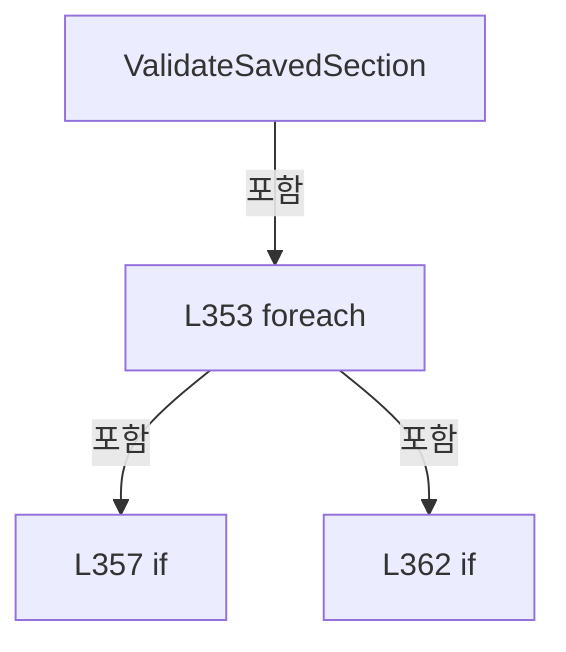

변경 전 점검: 입력/반환 타입, 위 호출자, 예외/취소 경로, 공유 상태와 저장·전송 소비자를 함께 확인합니다. 값의 단위나 물리 방향을 이름만으로 확정하지 않습니다.

### MethodDeclaration `ValidateSectionParameters` · L369–408

[Drilling.File/JHMI/CSettingFile.cs:369–408](https://github.com/kjuws10-rgb/A3Drilling/blob/5aee8e58439c9b455cae7c9593c9be986c3e682e/Drilling.File/JHMI/CSettingFile.cs#L369-L408)

| 항목 | 실제 추출 값 |
| --- | --- |
| 서명 | void Drilling.File.JHMI.CSettingFile.ValidateSectionParameters(string, System.Collections.Generic.IReadOnlyList<Drilling.Common.Managers.ST_SYSTEM_PARAMETER>, System.Collections.Generic.IReadOnlyList<Drilling.File.JHMI.CSettingFile.ST_SETTING_FORM_ITEM>) |
| 접근/수식자 | Private / private, static |
| 반환/값 타입 | void |
| 소속 타입 | NamedType:Drilling.File.JHMI.CSettingFile |

입력 계약:

| 이름 | 타입 | 전달 | 선택/기본값 |
| --- | --- | --- | --- |
| sectionTab | string | None | False /  |
| parameters | System.Collections.Generic.IReadOnlyList<Drilling.Common.Managers.ST_SYSTEM_PARAMETER> | None | False /  |
| formItems | System.Collections.Generic.IReadOnlyList<Drilling.File.JHMI.CSettingFile.ST_SETTING_FORM_ITEM> | None | False /  |

정적 호출자로 확인된 위치:

| 호출 파일/행 | 호출 표현식 | 런타임 분기 가능 |
| --- | --- | --- |
| [Drilling.File/JHMI/CSettingFile.cs:113–113](https://github.com/kjuws10-rgb/A3Drilling/blob/5aee8e58439c9b455cae7c9593c9be986c3e682e/Drilling.File/JHMI/CSettingFile.cs#L113-L113) | ValidateSectionParameters | False |

호출하는 대상과 해석 범위:

| 원본 행 | 표현식 | 분석 상태 | 대상/소스 위치 |
| --- | --- | --- | --- |
| 381 | formItems.Where(ShouldIncludeItem).ToDictionary | resolved | System.Collections.Generic.Dictionary<string, Drilling.File.JHMI.CSettingFile.ST_SETTING_FORM_ITEM> System.Collections.Generic.IEnumerable<Drilling.File.JHMI.CSettingFile.ST_SETTING_FORM_ITEM>.ToDictionary<Drilling.File.JHMI.CSettingFile.ST_SETTING_FORM_ITEM, string>(System.Func<Drilling.File.JHMI.CSettingFile.ST_SETTING_FORM_ITEM, string>, System.Collections.Generic.IEqualityComparer<string>?) |
| 381 | formItems.Where | resolved | System.Collections.Generic.IEnumerable<Drilling.File.JHMI.CSettingFile.ST_SETTING_FORM_ITEM> System.Collections.Generic.IEnumerable<Drilling.File.JHMI.CSettingFile.ST_SETTING_FORM_ITEM>.Where<Drilling.File.JHMI.CSettingFile.ST_SETTING_FORM_ITEM>(System.Func<Drilling.File.JHMI.CSettingFile.ST_SETTING_FORM_ITEM, bool>) |
| 384 | GetParameterKey | resolved | string Drilling.File.JHMI.CSettingFile.GetParameterKey(Drilling.Common.Managers.ST_SYSTEM_PARAMETER) · Drilling.File/JHMI/CSettingFile.cs:410 |
| 385 | formItemsByName.TryGetValue | resolved | bool System.Collections.Generic.Dictionary<string, Drilling.File.JHMI.CSettingFile.ST_SETTING_FORM_ITEM>.TryGetValue(string, out Drilling.File.JHMI.CSettingFile.ST_SETTING_FORM_ITEM) |
| 387 | new InvalidDataException | resolved | System.IO.InvalidDataException.InvalidDataException(string?) |
| 390 | parameter.Value.Trim | resolved | string string.Trim() |
| 391 | string.IsNullOrWhiteSpace | resolved | bool string.IsNullOrWhiteSpace(string?) |
| 393 | new InvalidDataException | resolved | System.IO.InvalidDataException.InvalidDataException(string?) |
| 398 | ValidateIntParameter | resolved | string Drilling.File.JHMI.CSettingFile.ValidateIntParameter(Drilling.File.JHMI.CSettingFile.ST_SETTING_FORM_ITEM, string) · Drilling.File/JHMI/CSettingFile.cs:415 |
| 399 | ValidateDoubleParameter | resolved | string Drilling.File.JHMI.CSettingFile.ValidateDoubleParameter(Drilling.File.JHMI.CSettingFile.ST_SETTING_FORM_ITEM, string) · Drilling.File/JHMI/CSettingFile.cs:425 |
| 400 | ValidateBoolParameter | resolved | string Drilling.File.JHMI.CSettingFile.ValidateBoolParameter(Drilling.File.JHMI.CSettingFile.ST_SETTING_FORM_ITEM, string) · Drilling.File/JHMI/CSettingFile.cs:445 |
| 403 | string.IsNullOrWhiteSpace | resolved | bool string.IsNullOrWhiteSpace(string?) |
| 405 | new InvalidDataException | resolved | System.IO.InvalidDataException.InvalidDataException(string?) |

본문의 실제 연산·분기·예외·반환 순서(원문 위치 순):

| 원본 행 | 종류 | 주석 해설 |
| --- | --- | --- |
| 381 | call | 함수·델리게이트 또는 객체 생성자를 호출합니다: formItems.Where(ShouldIncludeItem).ToDictionary(SelectName, StringComparer.OrdinalIgnoreCase) |
| 381 | call | 함수·델리게이트 또는 객체 생성자를 호출합니다: formItems.Where(ShouldIncludeItem) |
| 381 | local-declaration | 지역 변수를 선언합니다: var formItemsByName = formItems.Where(ShouldIncludeItem).ToDictionary(SelectName, StringComparer.OrdinalIgnoreCase); |
| 381 | variable-initializer | 변수의 초기값을 지정합니다: formItemsByName = formItems.Where(ShouldIncludeItem).ToDictionary(SelectName, StringComparer.OrdinalIgnoreCase) |
| 382 | foreach | 컬렉션 요소를 순회합니다: foreach (var parameter in parameters) |
| 384 | call | 함수·델리게이트 또는 객체 생성자를 호출합니다: GetParameterKey(parameter) |
| 384 | local-declaration | 지역 변수를 선언합니다: var parameterKey = GetParameterKey(parameter); |
| 384 | variable-initializer | 변수의 초기값을 지정합니다: parameterKey = GetParameterKey(parameter) |
| 385 | call | 함수·델리게이트 또는 객체 생성자를 호출합니다: formItemsByName.TryGetValue(parameterKey, out var formItem) |
| 385 | if | 조건에 따라 분기합니다: if (!formItemsByName.TryGetValue(parameterKey, out var formItem)) |
| 387 | call | 함수·델리게이트 또는 객체 생성자를 호출합니다: new InvalidDataException($"Setting save blocked. Unknown parameter: {sectionTab}/{parameter.Name}") |
| 387 | throw | 예외를 발생/전달합니다: throw new InvalidDataException($"Setting save blocked. Unknown parameter: {sectionTab}/{parameter.Name}"); |
| 390 | call | 함수·델리게이트 또는 객체 생성자를 호출합니다: parameter.Value.Trim() |
| 390 | local-declaration | 지역 변수를 선언합니다: var value = parameter.Value.Trim(); |
| 390 | variable-initializer | 변수의 초기값을 지정합니다: value = parameter.Value.Trim() |
| 391 | call | 함수·델리게이트 또는 객체 생성자를 호출합니다: string.IsNullOrWhiteSpace(value) |
| 391 | if | 조건에 따라 분기합니다: if (string.IsNullOrWhiteSpace(value)) |
| 393 | call | 함수·델리게이트 또는 객체 생성자를 호출합니다: new InvalidDataException($"Setting save blocked. {formItem.DisplayName} cannot be empty.") |
| 393 | throw | 예외를 발생/전달합니다: throw new InvalidDataException($"Setting save blocked. {formItem.DisplayName} cannot be empty."); |
| 396 | local-declaration | 지역 변수를 선언합니다: var validationMessage = formItem.DataType switch { EN_RECIPE_DATA_TYPE.Int => ValidateIntParameter(formItem, value), EN_RECIPE_DATA_TYPE.Double => ValidateDoubleParameter(formItem, value), EN_RECIPE_DATA_TYPE.Bool => ValidateBoolP |
| 396 | switch-expression | 값별 결과식을 선택합니다: formItem.DataType switch { EN_RECIPE_DATA_TYPE.Int => ValidateIntParameter(formItem, value), EN_RECIPE_DATA_TYPE.Double => ValidateDoubleParameter(formItem, value), EN_RECIPE_DATA_TYPE.Bool => ValidateBoolParameter(formItem, value |
| 396 | variable-initializer | 변수의 초기값을 지정합니다: validationMessage = formItem.DataType switch { EN_RECIPE_DATA_TYPE.Int => ValidateIntParameter(formItem, value), EN_RECIPE_DATA_TYPE.Double => ValidateDoubleParameter(formItem, value), EN_RECIPE_DATA_TYPE.Bool => ValidateBoolParam |
| 398 | call | 함수·델리게이트 또는 객체 생성자를 호출합니다: ValidateIntParameter(formItem, value) |
| 399 | call | 함수·델리게이트 또는 객체 생성자를 호출합니다: ValidateDoubleParameter(formItem, value) |
| 400 | call | 함수·델리게이트 또는 객체 생성자를 호출합니다: ValidateBoolParameter(formItem, value) |
| 403 | call | 함수·델리게이트 또는 객체 생성자를 호출합니다: string.IsNullOrWhiteSpace(validationMessage) |
| 403 | if | 조건에 따라 분기합니다: if (!string.IsNullOrWhiteSpace(validationMessage)) |
| 405 | call | 함수·델리게이트 또는 객체 생성자를 호출합니다: new InvalidDataException(validationMessage) |
| 405 | throw | 예외를 발생/전달합니다: throw new InvalidDataException(validationMessage); |

제어 구문의 포함 구조(실제 실행 순서/CFG가 아닌 구문 탐색 그림):

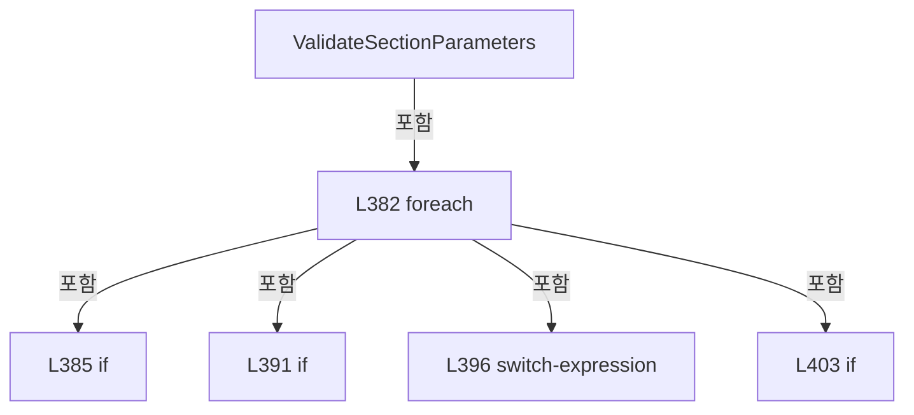

변경 전 점검: 입력/반환 타입, 위 호출자, 예외/취소 경로, 공유 상태와 저장·전송 소비자를 함께 확인합니다. 값의 단위나 물리 방향을 이름만으로 확정하지 않습니다.

### LocalFunctionStatement `ShouldIncludeItem` · L371–374

[Drilling.File/JHMI/CSettingFile.cs:371–374](https://github.com/kjuws10-rgb/A3Drilling/blob/5aee8e58439c9b455cae7c9593c9be986c3e682e/Drilling.File/JHMI/CSettingFile.cs#L371-L374)

| 항목 | 실제 추출 값 |
| --- | --- |
| 서명 | bool ShouldIncludeItem(Drilling.File.JHMI.CSettingFile.ST_SETTING_FORM_ITEM) |
| 접근/수식자 | Private /  |
| 반환/값 타입 | bool |
| 소속 타입 | NamedType:Drilling.File.JHMI.CSettingFile |

입력 계약:

| 이름 | 타입 | 전달 | 선택/기본값 |
| --- | --- | --- | --- |
| item | Drilling.File.JHMI.CSettingFile.ST_SETTING_FORM_ITEM | None | False /  |

현재 부분 분석에서 직접 연결된 호출자는 없습니다. XAML/이벤트/인터페이스·델리게이트·외부 진입을 추가 확인해야 하며, 미사용으로 판정한 것이 아닙니다.

호출하는 대상과 해석 범위:

| 원본 행 | 표현식 | 분석 상태 | 대상/소스 위치 |
| --- | --- | --- | --- |
| 373 | item.Tab.Equals | resolved | bool string.Equals(string?, System.StringComparison) |

본문의 실제 연산·분기·예외·반환 순서(원문 위치 순):

| 원본 행 | 종류 | 주석 해설 |
| --- | --- | --- |
| 373 | call | 함수·델리게이트 또는 객체 생성자를 호출합니다: item.Tab.Equals(sectionTab, StringComparison.OrdinalIgnoreCase) |
| 373 | return | 호출자에게 값 또는 제어를 반환합니다: return item.Use && item.Tab.Equals(sectionTab, StringComparison.OrdinalIgnoreCase); |

변경 전 점검: 입력/반환 타입, 위 호출자, 예외/취소 경로, 공유 상태와 저장·전송 소비자를 함께 확인합니다. 값의 단위나 물리 방향을 이름만으로 확정하지 않습니다.

### LocalFunctionStatement `SelectName` · L376–379

[Drilling.File/JHMI/CSettingFile.cs:376–379](https://github.com/kjuws10-rgb/A3Drilling/blob/5aee8e58439c9b455cae7c9593c9be986c3e682e/Drilling.File/JHMI/CSettingFile.cs#L376-L379)

| 항목 | 실제 추출 값 |
| --- | --- |
| 서명 | string SelectName(Drilling.File.JHMI.CSettingFile.ST_SETTING_FORM_ITEM) |
| 접근/수식자 | Private /  |
| 반환/값 타입 | string |
| 소속 타입 | NamedType:Drilling.File.JHMI.CSettingFile |

입력 계약:

| 이름 | 타입 | 전달 | 선택/기본값 |
| --- | --- | --- | --- |
| item | Drilling.File.JHMI.CSettingFile.ST_SETTING_FORM_ITEM | None | False /  |

현재 부분 분석에서 직접 연결된 호출자는 없습니다. XAML/이벤트/인터페이스·델리게이트·외부 진입을 추가 확인해야 하며, 미사용으로 판정한 것이 아닙니다.

본문의 실제 연산·분기·예외·반환 순서(원문 위치 순):

| 원본 행 | 종류 | 주석 해설 |
| --- | --- | --- |
| 378 | return | 호출자에게 값 또는 제어를 반환합니다: return item.Name; |

변경 전 점검: 입력/반환 타입, 위 호출자, 예외/취소 경로, 공유 상태와 저장·전송 소비자를 함께 확인합니다. 값의 단위나 물리 방향을 이름만으로 확정하지 않습니다.

### MethodDeclaration `GetParameterKey` · L410–413

[Drilling.File/JHMI/CSettingFile.cs:410–413](https://github.com/kjuws10-rgb/A3Drilling/blob/5aee8e58439c9b455cae7c9593c9be986c3e682e/Drilling.File/JHMI/CSettingFile.cs#L410-L413)

| 항목 | 실제 추출 값 |
| --- | --- |
| 서명 | string Drilling.File.JHMI.CSettingFile.GetParameterKey(Drilling.Common.Managers.ST_SYSTEM_PARAMETER) |
| 접근/수식자 | Private / private, static |
| 반환/값 타입 | string |
| 소속 타입 | NamedType:Drilling.File.JHMI.CSettingFile |

입력 계약:

| 이름 | 타입 | 전달 | 선택/기본값 |
| --- | --- | --- | --- |
| parameter | Drilling.Common.Managers.ST_SYSTEM_PARAMETER | None | False /  |

정적 호출자로 확인된 위치:

| 호출 파일/행 | 호출 표현식 | 런타임 분기 가능 |
| --- | --- | --- |
| [Drilling.File/JHMI/CSettingFile.cs:77–77](https://github.com/kjuws10-rgb/A3Drilling/blob/5aee8e58439c9b455cae7c9593c9be986c3e682e/Drilling.File/JHMI/CSettingFile.cs#L77-L77) | GetParameterKey | False |
| [Drilling.File/JHMI/CSettingFile.cs:116–116](https://github.com/kjuws10-rgb/A3Drilling/blob/5aee8e58439c9b455cae7c9593c9be986c3e682e/Drilling.File/JHMI/CSettingFile.cs#L116-L116) | GetParameterKey | False |
| [Drilling.File/JHMI/CSettingFile.cs:123–123](https://github.com/kjuws10-rgb/A3Drilling/blob/5aee8e58439c9b455cae7c9593c9be986c3e682e/Drilling.File/JHMI/CSettingFile.cs#L123-L123) | GetParameterKey | False |
| [Drilling.File/JHMI/CSettingFile.cs:355–355](https://github.com/kjuws10-rgb/A3Drilling/blob/5aee8e58439c9b455cae7c9593c9be986c3e682e/Drilling.File/JHMI/CSettingFile.cs#L355-L355) | GetParameterKey | False |
| [Drilling.File/JHMI/CSettingFile.cs:384–384](https://github.com/kjuws10-rgb/A3Drilling/blob/5aee8e58439c9b455cae7c9593c9be986c3e682e/Drilling.File/JHMI/CSettingFile.cs#L384-L384) | GetParameterKey | False |

호출하는 대상과 해석 범위:

| 원본 행 | 표현식 | 분석 상태 | 대상/소스 위치 |
| --- | --- | --- | --- |
| 412 | string.IsNullOrWhiteSpace | resolved | bool string.IsNullOrWhiteSpace(string?) |

본문의 실제 연산·분기·예외·반환 순서(원문 위치 순):

| 원본 행 | 종류 | 주석 해설 |
| --- | --- | --- |
| 412 | call | 함수·델리게이트 또는 객체 생성자를 호출합니다: string.IsNullOrWhiteSpace(parameter.Key) |
| 412 | conditional-expression | 조건에 따라 결과식을 선택합니다: string.IsNullOrWhiteSpace(parameter.Key) ? parameter.Name : parameter.Key |
| 412 | return | 호출자에게 값 또는 제어를 반환합니다: return string.IsNullOrWhiteSpace(parameter.Key) ? parameter.Name : parameter.Key; |

변경 전 점검: 입력/반환 타입, 위 호출자, 예외/취소 경로, 공유 상태와 저장·전송 소비자를 함께 확인합니다. 값의 단위나 물리 방향을 이름만으로 확정하지 않습니다.

### MethodDeclaration `ValidateIntParameter` · L415–423

[Drilling.File/JHMI/CSettingFile.cs:415–423](https://github.com/kjuws10-rgb/A3Drilling/blob/5aee8e58439c9b455cae7c9593c9be986c3e682e/Drilling.File/JHMI/CSettingFile.cs#L415-L423)

| 항목 | 실제 추출 값 |
| --- | --- |
| 서명 | string Drilling.File.JHMI.CSettingFile.ValidateIntParameter(Drilling.File.JHMI.CSettingFile.ST_SETTING_FORM_ITEM, string) |
| 접근/수식자 | Private / private, static |
| 반환/값 타입 | string |
| 소속 타입 | NamedType:Drilling.File.JHMI.CSettingFile |

입력 계약:

| 이름 | 타입 | 전달 | 선택/기본값 |
| --- | --- | --- | --- |
| formItem | Drilling.File.JHMI.CSettingFile.ST_SETTING_FORM_ITEM | None | False /  |
| value | string | None | False /  |

정적 호출자로 확인된 위치:

| 호출 파일/행 | 호출 표현식 | 런타임 분기 가능 |
| --- | --- | --- |
| [Drilling.File/JHMI/CSettingFile.cs:398–398](https://github.com/kjuws10-rgb/A3Drilling/blob/5aee8e58439c9b455cae7c9593c9be986c3e682e/Drilling.File/JHMI/CSettingFile.cs#L398-L398) | ValidateIntParameter | False |

호출하는 대상과 해석 범위:

| 원본 행 | 표현식 | 분석 상태 | 대상/소스 위치 |
| --- | --- | --- | --- |
| 417 | int.TryParse | resolved | bool int.TryParse(string?, System.Globalization.NumberStyles, System.IFormatProvider?, out int) |
| 422 | ValidateNumericRange | resolved | string Drilling.File.JHMI.CSettingFile.ValidateNumericRange(Drilling.File.JHMI.CSettingFile.ST_SETTING_FORM_ITEM, double) · Drilling.File/JHMI/CSettingFile.cs:451 |

본문의 실제 연산·분기·예외·반환 순서(원문 위치 순):

| 원본 행 | 종류 | 주석 해설 |
| --- | --- | --- |
| 417 | call | 함수·델리게이트 또는 객체 생성자를 호출합니다: int.TryParse(value, NumberStyles.Integer, CultureInfo.InvariantCulture, out var parsed) |
| 417 | if | 조건에 따라 분기합니다: if (!int.TryParse(value, NumberStyles.Integer, CultureInfo.InvariantCulture, out var parsed)) |
| 419 | return | 호출자에게 값 또는 제어를 반환합니다: return $"Setting save blocked. {formItem.DisplayName} must be an integer."; |
| 422 | call | 함수·델리게이트 또는 객체 생성자를 호출합니다: ValidateNumericRange(formItem, parsed) |
| 422 | return | 호출자에게 값 또는 제어를 반환합니다: return ValidateNumericRange(formItem, parsed); |

제어 구문의 포함 구조(실제 실행 순서/CFG가 아닌 구문 탐색 그림):

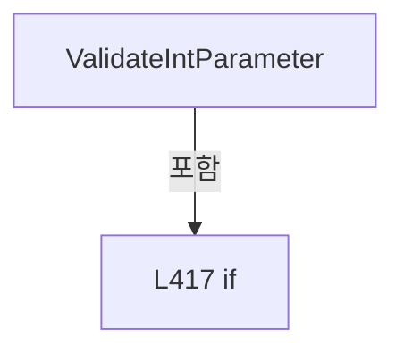

변경 전 점검: 입력/반환 타입, 위 호출자, 예외/취소 경로, 공유 상태와 저장·전송 소비자를 함께 확인합니다. 값의 단위나 물리 방향을 이름만으로 확정하지 않습니다.

### MethodDeclaration `ValidateDoubleParameter` · L425–443

[Drilling.File/JHMI/CSettingFile.cs:425–443](https://github.com/kjuws10-rgb/A3Drilling/blob/5aee8e58439c9b455cae7c9593c9be986c3e682e/Drilling.File/JHMI/CSettingFile.cs#L425-L443)

| 항목 | 실제 추출 값 |
| --- | --- |
| 서명 | string Drilling.File.JHMI.CSettingFile.ValidateDoubleParameter(Drilling.File.JHMI.CSettingFile.ST_SETTING_FORM_ITEM, string) |
| 접근/수식자 | Private / private, static |
| 반환/값 타입 | string |
| 소속 타입 | NamedType:Drilling.File.JHMI.CSettingFile |

입력 계약:

| 이름 | 타입 | 전달 | 선택/기본값 |
| --- | --- | --- | --- |
| formItem | Drilling.File.JHMI.CSettingFile.ST_SETTING_FORM_ITEM | None | False /  |
| value | string | None | False /  |

정적 호출자로 확인된 위치:

| 호출 파일/행 | 호출 표현식 | 런타임 분기 가능 |
| --- | --- | --- |
| [Drilling.File/JHMI/CSettingFile.cs:399–399](https://github.com/kjuws10-rgb/A3Drilling/blob/5aee8e58439c9b455cae7c9593c9be986c3e682e/Drilling.File/JHMI/CSettingFile.cs#L399-L399) | ValidateDoubleParameter | False |

호출하는 대상과 해석 범위:

| 원본 행 | 표현식 | 분석 상태 | 대상/소스 위치 |
| --- | --- | --- | --- |
| 427 | double.TryParse | resolved | bool double.TryParse(string?, System.Globalization.NumberStyles, System.IFormatProvider?, out double) |
| 427 | double.IsFinite | resolved | bool double.IsFinite(double) |
| 432 | formItem.Unit.Equals | resolved | bool string.Equals(string?, System.StringComparison) |
| 437 | formItem.Name.Equals | resolved | bool string.Equals(string?, System.StringComparison) |
| 437 | formItem.Name.Equals | resolved | bool string.Equals(string?, System.StringComparison) |
| 439 | formItem.Name.Equals | resolved | bool string.Equals(string?, System.StringComparison) |
| 442 | ValidateNumericRange | resolved | string Drilling.File.JHMI.CSettingFile.ValidateNumericRange(Drilling.File.JHMI.CSettingFile.ST_SETTING_FORM_ITEM, double) · Drilling.File/JHMI/CSettingFile.cs:451 |

본문의 실제 연산·분기·예외·반환 순서(원문 위치 순):

| 원본 행 | 종류 | 주석 해설 |
| --- | --- | --- |
| 427 | call | 함수·델리게이트 또는 객체 생성자를 호출합니다: double.TryParse(value, NumberStyles.Float, CultureInfo.InvariantCulture, out var parsed) |
| 427 | call | 함수·델리게이트 또는 객체 생성자를 호출합니다: double.IsFinite(parsed) |
| 427 | if | 조건에 따라 분기합니다: if (!double.TryParse(value, NumberStyles.Float, CultureInfo.InvariantCulture, out var parsed) &#124;&#124; !double.IsFinite(parsed)) |
| 429 | return | 호출자에게 값 또는 제어를 반환합니다: return $"Setting save blocked. {formItem.DisplayName} must be numeric."; |
| 432 | call | 함수·델리게이트 또는 객체 생성자를 호출합니다: formItem.Unit.Equals("sign", StringComparison.OrdinalIgnoreCase) |
| 432 | if | 조건에 따라 분기합니다: if (formItem.Unit.Equals("sign", StringComparison.OrdinalIgnoreCase) && parsed != -1.0 && parsed != 1.0) |
| 434 | return | 호출자에게 값 또는 제어를 반환합니다: return $"Setting save blocked. {formItem.DisplayName} must be -1 or +1."; |
| 437 | call | 함수·델리게이트 또는 객체 생성자를 호출합니다: formItem.Name.Equals(CSettingManager.ReviewCameraResolutionKey, StringComparison.OrdinalIgnoreCase) |
| 437 | call | 함수·델리게이트 또는 객체 생성자를 호출합니다: formItem.Name.Equals(CSettingManager.AlignCameraResolutionKey, StringComparison.OrdinalIgnoreCase) |
| 437 | if | 조건에 따라 분기합니다: if (formItem.Tab == "OPTION" && (formItem.Name.Equals(CSettingManager.ReviewCameraResolutionKey, StringComparison.OrdinalIgnoreCase) &#124;&#124; formItem.Name.Equals(CSettingManager.AlignCameraResolutionKey, StringComparison.OrdinalI…) |
| 438 | return | 호출자에게 값 또는 제어를 반환합니다: return $"Setting save blocked. {formItem.DisplayName} must be greater than 0 mm/pixel."; |
| 439 | call | 함수·델리게이트 또는 객체 생성자를 호출합니다: formItem.Name.Equals(CSettingManager.WapageAlignBaseToleranceKey, StringComparison.OrdinalIgnoreCase) |
| 439 | if | 조건에 따라 분기합니다: if (formItem.Tab == "OPTION" && formItem.Name.Equals(CSettingManager.WapageAlignBaseToleranceKey, StringComparison.OrdinalIgnoreCase) && parsed < 0) |
| 440 | return | 호출자에게 값 또는 제어를 반환합니다: return $"Setting save blocked. {formItem.DisplayName} must be 0 or greater mm."; |
| 442 | call | 함수·델리게이트 또는 객체 생성자를 호출합니다: ValidateNumericRange(formItem, parsed) |
| 442 | return | 호출자에게 값 또는 제어를 반환합니다: return ValidateNumericRange(formItem, parsed); |

제어 구문의 포함 구조(실제 실행 순서/CFG가 아닌 구문 탐색 그림):

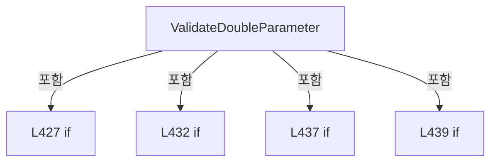

변경 전 점검: 입력/반환 타입, 위 호출자, 예외/취소 경로, 공유 상태와 저장·전송 소비자를 함께 확인합니다. 값의 단위나 물리 방향을 이름만으로 확정하지 않습니다.

### MethodDeclaration `ValidateBoolParameter` · L445–449

[Drilling.File/JHMI/CSettingFile.cs:445–449](https://github.com/kjuws10-rgb/A3Drilling/blob/5aee8e58439c9b455cae7c9593c9be986c3e682e/Drilling.File/JHMI/CSettingFile.cs#L445-L449)

| 항목 | 실제 추출 값 |
| --- | --- |
| 서명 | string Drilling.File.JHMI.CSettingFile.ValidateBoolParameter(Drilling.File.JHMI.CSettingFile.ST_SETTING_FORM_ITEM, string) |
| 접근/수식자 | Private / private, static |
| 반환/값 타입 | string |
| 소속 타입 | NamedType:Drilling.File.JHMI.CSettingFile |

입력 계약:

| 이름 | 타입 | 전달 | 선택/기본값 |
| --- | --- | --- | --- |
| formItem | Drilling.File.JHMI.CSettingFile.ST_SETTING_FORM_ITEM | None | False /  |
| value | string | None | False /  |

정적 호출자로 확인된 위치:

| 호출 파일/행 | 호출 표현식 | 런타임 분기 가능 |
| --- | --- | --- |
| [Drilling.File/JHMI/CSettingFile.cs:400–400](https://github.com/kjuws10-rgb/A3Drilling/blob/5aee8e58439c9b455cae7c9593c9be986c3e682e/Drilling.File/JHMI/CSettingFile.cs#L400-L400) | ValidateBoolParameter | False |

호출하는 대상과 해석 범위:

| 원본 행 | 표현식 | 분석 상태 | 대상/소스 위치 |
| --- | --- | --- | --- |
| 447 | value.Trim().ToUpperInvariant | resolved | string string.ToUpperInvariant() |
| 447 | value.Trim | resolved | string string.Trim() |

본문의 실제 연산·분기·예외·반환 순서(원문 위치 순):

| 원본 행 | 종류 | 주석 해설 |
| --- | --- | --- |
| 447 | call | 함수·델리게이트 또는 객체 생성자를 호출합니다: value.Trim().ToUpperInvariant() |
| 447 | call | 함수·델리게이트 또는 객체 생성자를 호출합니다: value.Trim() |
| 447 | local-declaration | 지역 변수를 선언합니다: var normalized = value.Trim().ToUpperInvariant(); |
| 447 | variable-initializer | 변수의 초기값을 지정합니다: normalized = value.Trim().ToUpperInvariant() |
| 448 | conditional-expression | 조건에 따라 결과식을 선택합니다: normalized is "ON" or "OFF" or "TRUE" or "FALSE" or "1" or "0" or "YES" or "NO" ? "" : $"Setting save blocked. {formItem.DisplayName} must be ON/OFF or TRUE/FALSE." |
| 448 | return | 호출자에게 값 또는 제어를 반환합니다: return normalized is "ON" or "OFF" or "TRUE" or "FALSE" or "1" or "0" or "YES" or "NO" ? "" : $"Setting save blocked. {formItem.DisplayName} must be ON/OFF or TRUE/FALSE."; |

변경 전 점검: 입력/반환 타입, 위 호출자, 예외/취소 경로, 공유 상태와 저장·전송 소비자를 함께 확인합니다. 값의 단위나 물리 방향을 이름만으로 확정하지 않습니다.

### MethodDeclaration `ValidateNumericRange` · L451–459

[Drilling.File/JHMI/CSettingFile.cs:451–459](https://github.com/kjuws10-rgb/A3Drilling/blob/5aee8e58439c9b455cae7c9593c9be986c3e682e/Drilling.File/JHMI/CSettingFile.cs#L451-L459)

| 항목 | 실제 추출 값 |
| --- | --- |
| 서명 | string Drilling.File.JHMI.CSettingFile.ValidateNumericRange(Drilling.File.JHMI.CSettingFile.ST_SETTING_FORM_ITEM, double) |
| 접근/수식자 | Private / private, static |
| 반환/값 타입 | string |
| 소속 타입 | NamedType:Drilling.File.JHMI.CSettingFile |

입력 계약:

| 이름 | 타입 | 전달 | 선택/기본값 |
| --- | --- | --- | --- |
| formItem | Drilling.File.JHMI.CSettingFile.ST_SETTING_FORM_ITEM | None | False /  |
| value | double | None | False /  |

정적 호출자로 확인된 위치:

| 호출 파일/행 | 호출 표현식 | 런타임 분기 가능 |
| --- | --- | --- |
| [Drilling.File/JHMI/CSettingFile.cs:422–422](https://github.com/kjuws10-rgb/A3Drilling/blob/5aee8e58439c9b455cae7c9593c9be986c3e682e/Drilling.File/JHMI/CSettingFile.cs#L422-L422) | ValidateNumericRange | False |
| [Drilling.File/JHMI/CSettingFile.cs:442–442](https://github.com/kjuws10-rgb/A3Drilling/blob/5aee8e58439c9b455cae7c9593c9be986c3e682e/Drilling.File/JHMI/CSettingFile.cs#L442-L442) | ValidateNumericRange | False |

호출하는 대상과 해석 범위:

| 원본 행 | 표현식 | 분석 상태 | 대상/소스 위치 |
| --- | --- | --- | --- |
| 453 | formItem.Min.Equals | resolved | bool double.Equals(double) |

본문의 실제 연산·분기·예외·반환 순서(원문 위치 순):

| 원본 행 | 종류 | 주석 해설 |
| --- | --- | --- |
| 453 | call | 함수·델리게이트 또는 객체 생성자를 호출합니다: formItem.Min.Equals(formItem.Max) |
| 453 | if | 조건에 따라 분기합니다: if (!formItem.Min.Equals(formItem.Max) && (value < formItem.Min &#124;&#124; value > formItem.Max)) |
| 455 | return | 호출자에게 값 또는 제어를 반환합니다: return $"Setting save blocked. {formItem.DisplayName} must be between {formItem.Min:0.###} and {formItem.Max:0.###}."; |
| 458 | return | 호출자에게 값 또는 제어를 반환합니다: return ""; |

제어 구문의 포함 구조(실제 실행 순서/CFG가 아닌 구문 탐색 그림):

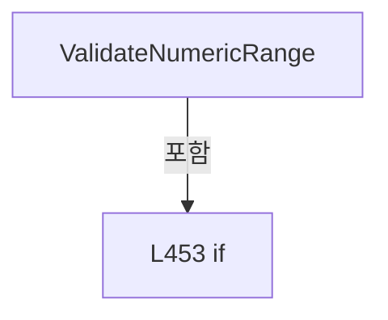

변경 전 점검: 입력/반환 타입, 위 호출자, 예외/취소 경로, 공유 상태와 저장·전송 소비자를 함께 확인합니다. 값의 단위나 물리 방향을 이름만으로 확정하지 않습니다.

### MethodDeclaration `GetFormPath` · L461–464

[Drilling.File/JHMI/CSettingFile.cs:461–464](https://github.com/kjuws10-rgb/A3Drilling/blob/5aee8e58439c9b455cae7c9593c9be986c3e682e/Drilling.File/JHMI/CSettingFile.cs#L461-L464)

| 항목 | 실제 추출 값 |
| --- | --- |
| 서명 | string Drilling.File.JHMI.CSettingFile.GetFormPath() |
| 접근/수식자 | Private / private |
| 반환/값 타입 | string |
| 소속 타입 | NamedType:Drilling.File.JHMI.CSettingFile |

정적 호출자로 확인된 위치:

| 호출 파일/행 | 호출 표현식 | 런타임 분기 가능 |
| --- | --- | --- |
| [Drilling.File/JHMI/CSettingFile.cs:149–149](https://github.com/kjuws10-rgb/A3Drilling/blob/5aee8e58439c9b455cae7c9593c9be986c3e682e/Drilling.File/JHMI/CSettingFile.cs#L149-L149) | GetFormPath | False |
| [Drilling.File/JHMI/CSettingFile.cs:189–189](https://github.com/kjuws10-rgb/A3Drilling/blob/5aee8e58439c9b455cae7c9593c9be986c3e682e/Drilling.File/JHMI/CSettingFile.cs#L189-L189) | GetFormPath | False |

호출하는 대상과 해석 범위:

| 원본 행 | 표현식 | 분석 상태 | 대상/소스 위치 |
| --- | --- | --- | --- |
| 463 | Path.Combine | resolved | string System.IO.Path.Combine(string, string) |

본문의 실제 연산·분기·예외·반환 순서(원문 위치 순):

| 원본 행 | 종류 | 주석 해설 |
| --- | --- | --- |
| 463 | call | 함수·델리게이트 또는 객체 생성자를 호출합니다: Path.Combine(configRoot, "JHMI_SETTING.csv") |
| 463 | return | 호출자에게 값 또는 제어를 반환합니다: return Path.Combine(configRoot, "JHMI_SETTING.csv"); |

변경 전 점검: 입력/반환 타입, 위 호출자, 예외/취소 경로, 공유 상태와 저장·전송 소비자를 함께 확인합니다. 값의 단위나 물리 방향을 이름만으로 확정하지 않습니다.

### MethodDeclaration `GetValuePath` · L466–469

[Drilling.File/JHMI/CSettingFile.cs:466–469](https://github.com/kjuws10-rgb/A3Drilling/blob/5aee8e58439c9b455cae7c9593c9be986c3e682e/Drilling.File/JHMI/CSettingFile.cs#L466-L469)

| 항목 | 실제 추출 값 |
| --- | --- |
| 서명 | string Drilling.File.JHMI.CSettingFile.GetValuePath() |
| 접근/수식자 | Private / private |
| 반환/값 타입 | string |
| 소속 타입 | NamedType:Drilling.File.JHMI.CSettingFile |

정적 호출자로 확인된 위치:

| 호출 파일/행 | 호출 표현식 | 런타임 분기 가능 |
| --- | --- | --- |
| [Drilling.File/JHMI/CSettingFile.cs:291–291](https://github.com/kjuws10-rgb/A3Drilling/blob/5aee8e58439c9b455cae7c9593c9be986c3e682e/Drilling.File/JHMI/CSettingFile.cs#L291-L291) | GetValuePath | False |
| [Drilling.File/JHMI/CSettingFile.cs:325–325](https://github.com/kjuws10-rgb/A3Drilling/blob/5aee8e58439c9b455cae7c9593c9be986c3e682e/Drilling.File/JHMI/CSettingFile.cs#L325-L325) | GetValuePath | False |
| [Drilling.File/JHMI/CSettingFile.cs:346–346](https://github.com/kjuws10-rgb/A3Drilling/blob/5aee8e58439c9b455cae7c9593c9be986c3e682e/Drilling.File/JHMI/CSettingFile.cs#L346-L346) | GetValuePath | False |

호출하는 대상과 해석 범위:

| 원본 행 | 표현식 | 분석 상태 | 대상/소스 위치 |
| --- | --- | --- | --- |
| 468 | Path.Combine | resolved | string System.IO.Path.Combine(string, string) |

본문의 실제 연산·분기·예외·반환 순서(원문 위치 순):

| 원본 행 | 종류 | 주석 해설 |
| --- | --- | --- |
| 468 | call | 함수·델리게이트 또는 객체 생성자를 호출합니다: Path.Combine(_settingDirectory, "Setting.csv") |
| 468 | return | 호출자에게 값 또는 제어를 반환합니다: return Path.Combine(_settingDirectory, "Setting.csv"); |

변경 전 점검: 입력/반환 타입, 위 호출자, 예외/취소 경로, 공유 상태와 저장·전송 소비자를 함께 확인합니다. 값의 단위나 물리 방향을 이름만으로 확정하지 않습니다.

### MethodDeclaration `GetValue` · L471–480

[Drilling.File/JHMI/CSettingFile.cs:471–480](https://github.com/kjuws10-rgb/A3Drilling/blob/5aee8e58439c9b455cae7c9593c9be986c3e682e/Drilling.File/JHMI/CSettingFile.cs#L471-L480)

| 항목 | 실제 추출 값 |
| --- | --- |
| 서명 | string Drilling.File.JHMI.CSettingFile.GetValue(System.Collections.Generic.IReadOnlyDictionary<string, string>, string, string, string) |
| 접근/수식자 | Private / private, static |
| 반환/값 타입 | string |
| 소속 타입 | NamedType:Drilling.File.JHMI.CSettingFile |

입력 계약:

| 이름 | 타입 | 전달 | 선택/기본값 |
| --- | --- | --- | --- |
| values | System.Collections.Generic.IReadOnlyDictionary<string, string> | None | False /  |
| tab | string | None | False /  |
| name | string | None | False /  |
| defaultValue | string | None | False /  |

정적 호출자로 확인된 위치:

| 호출 파일/행 | 호출 표현식 | 런타임 분기 가능 |
| --- | --- | --- |
| [Drilling.File/JHMI/CSettingFile.cs:33–33](https://github.com/kjuws10-rgb/A3Drilling/blob/5aee8e58439c9b455cae7c9593c9be986c3e682e/Drilling.File/JHMI/CSettingFile.cs#L33-L33) | GetValue | False |
| [Drilling.File/JHMI/CSettingFile.cs:71–71](https://github.com/kjuws10-rgb/A3Drilling/blob/5aee8e58439c9b455cae7c9593c9be986c3e682e/Drilling.File/JHMI/CSettingFile.cs#L71-L71) | GetValue | False |
| [Drilling.File/JHMI/CSettingFile.cs:96–96](https://github.com/kjuws10-rgb/A3Drilling/blob/5aee8e58439c9b455cae7c9593c9be986c3e682e/Drilling.File/JHMI/CSettingFile.cs#L96-L96) | GetValue | False |
| [Drilling.File/JHMI/CSettingFile.cs:341–341](https://github.com/kjuws10-rgb/A3Drilling/blob/5aee8e58439c9b455cae7c9593c9be986c3e682e/Drilling.File/JHMI/CSettingFile.cs#L341-L341) | GetValue | False |

호출하는 대상과 해석 범위:

| 원본 행 | 표현식 | 분석 상태 | 대상/소스 위치 |
| --- | --- | --- | --- |
| 473 | values.TryGetValue | resolved · 동적 구현 선택 가능 | bool System.Collections.Generic.IReadOnlyDictionary<string, string>.TryGetValue(string, out string) |
| 473 | CreateKey | resolved | string Drilling.File.JHMI.CSettingFile.CreateKey(string, string) · Drilling.File/JHMI/CSettingFile.cs:482 |
| 476 | tab.Equals | resolved | bool string.Equals(string?, System.StringComparison) |
| 476 | name.Equals | resolved | bool string.Equals(string?, System.StringComparison) |
| 477 | values.TryGetValue | resolved · 동적 구현 선택 가능 | bool System.Collections.Generic.IReadOnlyDictionary<string, string>.TryGetValue(string, out string) |
| 477 | CreateKey | resolved | string Drilling.File.JHMI.CSettingFile.CreateKey(string, string) · Drilling.File/JHMI/CSettingFile.cs:482 |

본문의 실제 연산·분기·예외·반환 순서(원문 위치 순):

| 원본 행 | 종류 | 주석 해설 |
| --- | --- | --- |
| 473 | call | 함수·델리게이트 또는 객체 생성자를 호출합니다: values.TryGetValue(CreateKey(tab, name), out var value) |
| 473 | call | 함수·델리게이트 또는 객체 생성자를 호출합니다: CreateKey(tab, name) |
| 473 | if | 조건에 따라 분기합니다: if (values.TryGetValue(CreateKey(tab, name), out var value)) |
| 474 | return | 호출자에게 값 또는 제어를 반환합니다: return value; |
| 476 | call | 함수·델리게이트 또는 객체 생성자를 호출합니다: tab.Equals("OPTION", StringComparison.OrdinalIgnoreCase) |
| 476 | call | 함수·델리게이트 또는 객체 생성자를 호출합니다: name.Equals(CSettingManager.ReviewCameraResolutionKey, StringComparison.OrdinalIgnoreCase) |
| 476 | if | 조건에 따라 분기합니다: if (tab.Equals("OPTION", StringComparison.OrdinalIgnoreCase) && name.Equals(CSettingManager.ReviewCameraResolutionKey, StringComparison.OrdinalIgnoreCase) && values.TryGetValue(CreateKey(tab, "CameraResolution"), out var leg…) |
| 477 | call | 함수·델리게이트 또는 객체 생성자를 호출합니다: values.TryGetValue(CreateKey(tab, "CameraResolution"), out var legacy) |
| 477 | call | 함수·델리게이트 또는 객체 생성자를 호출합니다: CreateKey(tab, "CameraResolution") |
| 478 | return | 호출자에게 값 또는 제어를 반환합니다: return legacy; |
| 479 | return | 호출자에게 값 또는 제어를 반환합니다: return defaultValue; |

제어 구문의 포함 구조(실제 실행 순서/CFG가 아닌 구문 탐색 그림):

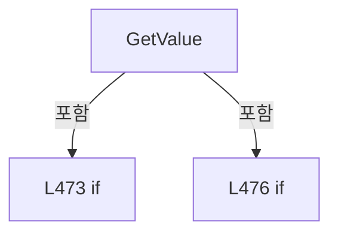

변경 전 점검: 입력/반환 타입, 위 호출자, 예외/취소 경로, 공유 상태와 저장·전송 소비자를 함께 확인합니다. 값의 단위나 물리 방향을 이름만으로 확정하지 않습니다.

### MethodDeclaration `CreateKey` · L482–485

[Drilling.File/JHMI/CSettingFile.cs:482–485](https://github.com/kjuws10-rgb/A3Drilling/blob/5aee8e58439c9b455cae7c9593c9be986c3e682e/Drilling.File/JHMI/CSettingFile.cs#L482-L485)

| 항목 | 실제 추출 값 |
| --- | --- |
| 서명 | string Drilling.File.JHMI.CSettingFile.CreateKey(string, string) |
| 접근/수식자 | Private / private, static |
| 반환/값 타입 | string |
| 소속 타입 | NamedType:Drilling.File.JHMI.CSettingFile |

입력 계약:

| 이름 | 타입 | 전달 | 선택/기본값 |
| --- | --- | --- | --- |
| tab | string | None | False /  |
| name | string | None | False /  |

정적 호출자로 확인된 위치:

| 호출 파일/행 | 호출 표현식 | 런타임 분기 가능 |
| --- | --- | --- |
| [Drilling.File/JHMI/CSettingFile.cs:116–116](https://github.com/kjuws10-rgb/A3Drilling/blob/5aee8e58439c9b455cae7c9593c9be986c3e682e/Drilling.File/JHMI/CSettingFile.cs#L116-L116) | CreateKey | False |
| [Drilling.File/JHMI/CSettingFile.cs:197–197](https://github.com/kjuws10-rgb/A3Drilling/blob/5aee8e58439c9b455cae7c9593c9be986c3e682e/Drilling.File/JHMI/CSettingFile.cs#L197-L197) | CreateKey | False |
| [Drilling.File/JHMI/CSettingFile.cs:210–210](https://github.com/kjuws10-rgb/A3Drilling/blob/5aee8e58439c9b455cae7c9593c9be986c3e682e/Drilling.File/JHMI/CSettingFile.cs#L210-L210) | CreateKey | False |
| [Drilling.File/JHMI/CSettingFile.cs:312–312](https://github.com/kjuws10-rgb/A3Drilling/blob/5aee8e58439c9b455cae7c9593c9be986c3e682e/Drilling.File/JHMI/CSettingFile.cs#L312-L312) | CreateKey | False |
| [Drilling.File/JHMI/CSettingFile.cs:356–356](https://github.com/kjuws10-rgb/A3Drilling/blob/5aee8e58439c9b455cae7c9593c9be986c3e682e/Drilling.File/JHMI/CSettingFile.cs#L356-L356) | CreateKey | False |
| [Drilling.File/JHMI/CSettingFile.cs:473–473](https://github.com/kjuws10-rgb/A3Drilling/blob/5aee8e58439c9b455cae7c9593c9be986c3e682e/Drilling.File/JHMI/CSettingFile.cs#L473-L473) | CreateKey | False |
| [Drilling.File/JHMI/CSettingFile.cs:477–477](https://github.com/kjuws10-rgb/A3Drilling/blob/5aee8e58439c9b455cae7c9593c9be986c3e682e/Drilling.File/JHMI/CSettingFile.cs#L477-L477) | CreateKey | False |

호출하는 대상과 해석 범위:

| 원본 행 | 표현식 | 분석 상태 | 대상/소스 위치 |
| --- | --- | --- | --- |
| 484 | NormalizeTab | resolved | string Drilling.File.JHMI.CSettingFile.NormalizeTab(string) · Drilling.File/JHMI/CSettingFile.cs:487 |
| 484 | name.Trim().ToUpperInvariant | resolved | string string.ToUpperInvariant() |
| 484 | name.Trim | resolved | string string.Trim() |

본문의 실제 연산·분기·예외·반환 순서(원문 위치 순):

| 원본 행 | 종류 | 주석 해설 |
| --- | --- | --- |
| 484 | call | 함수·델리게이트 또는 객체 생성자를 호출합니다: NormalizeTab(tab) |
| 484 | call | 함수·델리게이트 또는 객체 생성자를 호출합니다: name.Trim().ToUpperInvariant() |
| 484 | call | 함수·델리게이트 또는 객체 생성자를 호출합니다: name.Trim() |
| 484 | return | 호출자에게 값 또는 제어를 반환합니다: return $"{NormalizeTab(tab)}&#124;{name.Trim().ToUpperInvariant()}"; |

변경 전 점검: 입력/반환 타입, 위 호출자, 예외/취소 경로, 공유 상태와 저장·전송 소비자를 함께 확인합니다. 값의 단위나 물리 방향을 이름만으로 확정하지 않습니다.

### MethodDeclaration `NormalizeTab` · L487–497

[Drilling.File/JHMI/CSettingFile.cs:487–497](https://github.com/kjuws10-rgb/A3Drilling/blob/5aee8e58439c9b455cae7c9593c9be986c3e682e/Drilling.File/JHMI/CSettingFile.cs#L487-L497)

| 항목 | 실제 추출 값 |
| --- | --- |
| 서명 | string Drilling.File.JHMI.CSettingFile.NormalizeTab(string) |
| 접근/수식자 | Private / private, static |
| 반환/값 타입 | string |
| 소속 타입 | NamedType:Drilling.File.JHMI.CSettingFile |

입력 계약:

| 이름 | 타입 | 전달 | 선택/기본값 |
| --- | --- | --- | --- |
| value | string | None | False /  |

정적 호출자로 확인된 위치:

| 호출 파일/행 | 호출 표현식 | 런타임 분기 가능 |
| --- | --- | --- |
| [Drilling.File/JHMI/CSettingFile.cs:152–152](https://github.com/kjuws10-rgb/A3Drilling/blob/5aee8e58439c9b455cae7c9593c9be986c3e682e/Drilling.File/JHMI/CSettingFile.cs#L152-L152) | NormalizeTab | False |
| [Drilling.File/JHMI/CSettingFile.cs:484–484](https://github.com/kjuws10-rgb/A3Drilling/blob/5aee8e58439c9b455cae7c9593c9be986c3e682e/Drilling.File/JHMI/CSettingFile.cs#L484-L484) | NormalizeTab | False |

호출하는 대상과 해석 범위:

| 원본 행 | 표현식 | 분석 상태 | 대상/소스 위치 |
| --- | --- | --- | --- |
| 489 | value.Trim().ToUpperInvariant | resolved | string string.ToUpperInvariant() |
| 489 | value.Trim | resolved | string string.Trim() |

본문의 실제 연산·분기·예외·반환 순서(원문 위치 순):

| 원본 행 | 종류 | 주석 해설 |
| --- | --- | --- |
| 489 | call | 함수·델리게이트 또는 객체 생성자를 호출합니다: value.Trim().ToUpperInvariant() |
| 489 | call | 함수·델리게이트 또는 객체 생성자를 호출합니다: value.Trim() |
| 489 | local-declaration | 지역 변수를 선언합니다: var normalized = value.Trim().ToUpperInvariant(); |
| 489 | variable-initializer | 변수의 초기값을 지정합니다: normalized = value.Trim().ToUpperInvariant() |
| 490 | return | 호출자에게 값 또는 제어를 반환합니다: return normalized switch { "IO" => "IO", "POSITION" => "OPTION", "OPTION" or "INTERFACE" or "MOTOR" or "ALARM" => normalized, _ => normalized }; |
| 490 | switch-expression | 값별 결과식을 선택합니다: normalized switch { "IO" => "IO", "POSITION" => "OPTION", "OPTION" or "INTERFACE" or "MOTOR" or "ALARM" => normalized, _ => normalized } |

제어 구문의 포함 구조(실제 실행 순서/CFG가 아닌 구문 탐색 그림):

변경 전 점검: 입력/반환 타입, 위 호출자, 예외/취소 경로, 공유 상태와 저장·전송 소비자를 함께 확인합니다. 값의 단위나 물리 방향을 이름만으로 확정하지 않습니다.

### MethodDeclaration `NormalizeSettingText` · L499–502

[Drilling.File/JHMI/CSettingFile.cs:499–502](https://github.com/kjuws10-rgb/A3Drilling/blob/5aee8e58439c9b455cae7c9593c9be986c3e682e/Drilling.File/JHMI/CSettingFile.cs#L499-L502)

| 항목 | 실제 추출 값 |
| --- | --- |
| 서명 | string Drilling.File.JHMI.CSettingFile.NormalizeSettingText(string, string) |
| 접근/수식자 | Private / private, static |
| 반환/값 타입 | string |
| 소속 타입 | NamedType:Drilling.File.JHMI.CSettingFile |

입력 계약:

| 이름 | 타입 | 전달 | 선택/기본값 |
| --- | --- | --- | --- |
| value | string | None | False /  |
| defaultValue | string | None | False /  |

정적 호출자로 확인된 위치:

| 호출 파일/행 | 호출 표현식 | 런타임 분기 가능 |
| --- | --- | --- |
| [Drilling.File/JHMI/CSettingFile.cs:153–153](https://github.com/kjuws10-rgb/A3Drilling/blob/5aee8e58439c9b455cae7c9593c9be986c3e682e/Drilling.File/JHMI/CSettingFile.cs#L153-L153) | NormalizeSettingText | False |

호출하는 대상과 해석 범위:

| 원본 행 | 표현식 | 분석 상태 | 대상/소스 위치 |
| --- | --- | --- | --- |
| 501 | string.IsNullOrWhiteSpace | resolved | bool string.IsNullOrWhiteSpace(string?) |
| 501 | value.Trim().ToUpperInvariant | resolved | string string.ToUpperInvariant() |
| 501 | value.Trim | resolved | string string.Trim() |

본문의 실제 연산·분기·예외·반환 순서(원문 위치 순):

| 원본 행 | 종류 | 주석 해설 |
| --- | --- | --- |
| 501 | call | 함수·델리게이트 또는 객체 생성자를 호출합니다: string.IsNullOrWhiteSpace(value) |
| 501 | call | 함수·델리게이트 또는 객체 생성자를 호출합니다: value.Trim().ToUpperInvariant() |
| 501 | call | 함수·델리게이트 또는 객체 생성자를 호출합니다: value.Trim() |
| 501 | conditional-expression | 조건에 따라 결과식을 선택합니다: string.IsNullOrWhiteSpace(value) ? defaultValue : value.Trim().ToUpperInvariant() |
| 501 | return | 호출자에게 값 또는 제어를 반환합니다: return string.IsNullOrWhiteSpace(value) ? defaultValue : value.Trim().ToUpperInvariant(); |

변경 전 점검: 입력/반환 타입, 위 호출자, 예외/취소 경로, 공유 상태와 저장·전송 소비자를 함께 확인합니다. 값의 단위나 물리 방향을 이름만으로 확정하지 않습니다.

### MethodDeclaration `GetOrDefault` · L504–507

[Drilling.File/JHMI/CSettingFile.cs:504–507](https://github.com/kjuws10-rgb/A3Drilling/blob/5aee8e58439c9b455cae7c9593c9be986c3e682e/Drilling.File/JHMI/CSettingFile.cs#L504-L507)

| 항목 | 실제 추출 값 |
| --- | --- |
| 서명 | string Drilling.File.JHMI.CSettingFile.GetOrDefault(string, string) |
| 접근/수식자 | Private / private, static |
| 반환/값 타입 | string |
| 소속 타입 | NamedType:Drilling.File.JHMI.CSettingFile |

입력 계약:

| 이름 | 타입 | 전달 | 선택/기본값 |
| --- | --- | --- | --- |
| value | string | None | False /  |
| defaultValue | string | None | False /  |

정적 호출자로 확인된 위치:

| 호출 파일/행 | 호출 표현식 | 런타임 분기 가능 |
| --- | --- | --- |
| [Drilling.File/JHMI/CSettingFile.cs:155–155](https://github.com/kjuws10-rgb/A3Drilling/blob/5aee8e58439c9b455cae7c9593c9be986c3e682e/Drilling.File/JHMI/CSettingFile.cs#L155-L155) | GetOrDefault | False |

호출하는 대상과 해석 범위:

| 원본 행 | 표현식 | 분석 상태 | 대상/소스 위치 |
| --- | --- | --- | --- |
| 506 | string.IsNullOrWhiteSpace | resolved | bool string.IsNullOrWhiteSpace(string?) |

본문의 실제 연산·분기·예외·반환 순서(원문 위치 순):

| 원본 행 | 종류 | 주석 해설 |
| --- | --- | --- |
| 506 | call | 함수·델리게이트 또는 객체 생성자를 호출합니다: string.IsNullOrWhiteSpace(value) |
| 506 | conditional-expression | 조건에 따라 결과식을 선택합니다: string.IsNullOrWhiteSpace(value) ? defaultValue : value |
| 506 | return | 호출자에게 값 또는 제어를 반환합니다: return string.IsNullOrWhiteSpace(value) ? defaultValue : value; |

변경 전 점검: 입력/반환 타입, 위 호출자, 예외/취소 경로, 공유 상태와 저장·전송 소비자를 함께 확인합니다. 값의 단위나 물리 방향을 이름만으로 확정하지 않습니다.

### MethodDeclaration `ReadDataType` · L509–518

[Drilling.File/JHMI/CSettingFile.cs:509–518](https://github.com/kjuws10-rgb/A3Drilling/blob/5aee8e58439c9b455cae7c9593c9be986c3e682e/Drilling.File/JHMI/CSettingFile.cs#L509-L518)

| 항목 | 실제 추출 값 |
| --- | --- |
| 서명 | Drilling.Common.Managers.EN_RECIPE_DATA_TYPE Drilling.File.JHMI.CSettingFile.ReadDataType(string) |
| 접근/수식자 | Private / private, static |
| 반환/값 타입 | Drilling.Common.Managers.EN_RECIPE_DATA_TYPE |
| 소속 타입 | NamedType:Drilling.File.JHMI.CSettingFile |

입력 계약:

| 이름 | 타입 | 전달 | 선택/기본값 |
| --- | --- | --- | --- |
| value | string | None | False /  |

정적 호출자로 확인된 위치:

| 호출 파일/행 | 호출 표현식 | 런타임 분기 가능 |
| --- | --- | --- |
| [Drilling.File/JHMI/CSettingFile.cs:171–171](https://github.com/kjuws10-rgb/A3Drilling/blob/5aee8e58439c9b455cae7c9593c9be986c3e682e/Drilling.File/JHMI/CSettingFile.cs#L171-L171) | ReadDataType | False |

호출하는 대상과 해석 범위:

| 원본 행 | 표현식 | 분석 상태 | 대상/소스 위치 |
| --- | --- | --- | --- |
| 511 | value.Trim().ToUpperInvariant | resolved | string string.ToUpperInvariant() |
| 511 | value.Trim | resolved | string string.Trim() |

본문의 실제 연산·분기·예외·반환 순서(원문 위치 순):

| 원본 행 | 종류 | 주석 해설 |
| --- | --- | --- |
| 511 | call | 함수·델리게이트 또는 객체 생성자를 호출합니다: value.Trim().ToUpperInvariant() |
| 511 | call | 함수·델리게이트 또는 객체 생성자를 호출합니다: value.Trim() |
| 511 | return | 호출자에게 값 또는 제어를 반환합니다: return value.Trim().ToUpperInvariant() switch { "INT" => EN_RECIPE_DATA_TYPE.Int, "DOUBLE" => EN_RECIPE_DATA_TYPE.Double, "BOOL" => EN_RECIPE_DATA_TYPE.Bool, _ => EN_RECIPE_DATA_TYPE.String }; |
| 511 | switch-expression | 값별 결과식을 선택합니다: value.Trim().ToUpperInvariant() switch { "INT" => EN_RECIPE_DATA_TYPE.Int, "DOUBLE" => EN_RECIPE_DATA_TYPE.Double, "BOOL" => EN_RECIPE_DATA_TYPE.Bool, _ => EN_RECIPE_DATA_TYPE.String } |

제어 구문의 포함 구조(실제 실행 순서/CFG가 아닌 구문 탐색 그림):

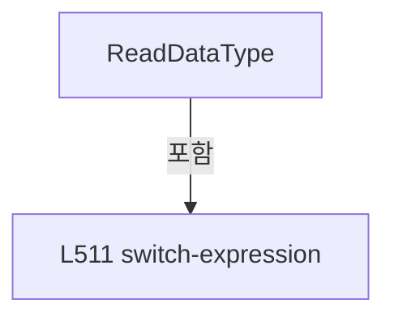

변경 전 점검: 입력/반환 타입, 위 호출자, 예외/취소 경로, 공유 상태와 저장·전송 소비자를 함께 확인합니다. 값의 단위나 물리 방향을 이름만으로 확정하지 않습니다.

### MethodDeclaration `ReadBool` · L520–528

[Drilling.File/JHMI/CSettingFile.cs:520–528](https://github.com/kjuws10-rgb/A3Drilling/blob/5aee8e58439c9b455cae7c9593c9be986c3e682e/Drilling.File/JHMI/CSettingFile.cs#L520-L528)

| 항목 | 실제 추출 값 |
| --- | --- |
| 서명 | bool Drilling.File.JHMI.CSettingFile.ReadBool(string, bool) |
| 접근/수식자 | Private / private, static |
| 반환/값 타입 | bool |
| 소속 타입 | NamedType:Drilling.File.JHMI.CSettingFile |

입력 계약:

| 이름 | 타입 | 전달 | 선택/기본값 |
| --- | --- | --- | --- |
| value | string | None | False /  |
| defaultValue | bool | None | False /  |

정적 호출자로 확인된 위치:

| 호출 파일/행 | 호출 표현식 | 런타임 분기 가능 |
| --- | --- | --- |
| [Drilling.File/JHMI/CSettingFile.cs:173–173](https://github.com/kjuws10-rgb/A3Drilling/blob/5aee8e58439c9b455cae7c9593c9be986c3e682e/Drilling.File/JHMI/CSettingFile.cs#L173-L173) | ReadBool | False |
| [Drilling.File/JHMI/CSettingFile.cs:174–174](https://github.com/kjuws10-rgb/A3Drilling/blob/5aee8e58439c9b455cae7c9593c9be986c3e682e/Drilling.File/JHMI/CSettingFile.cs#L174-L174) | ReadBool | False |

호출하는 대상과 해석 범위:

| 원본 행 | 표현식 | 분석 상태 | 대상/소스 위치 |
| --- | --- | --- | --- |
| 522 | string.IsNullOrWhiteSpace | resolved | bool string.IsNullOrWhiteSpace(string?) |
| 527 | value.Equals | resolved | bool string.Equals(string?, System.StringComparison) |
| 527 | value.Equals | resolved | bool string.Equals(string?, System.StringComparison) |
| 527 | value.Equals | resolved | bool string.Equals(string?, System.StringComparison) |
| 527 | value.Equals | resolved | bool string.Equals(string?, System.StringComparison) |

본문의 실제 연산·분기·예외·반환 순서(원문 위치 순):

| 원본 행 | 종류 | 주석 해설 |
| --- | --- | --- |
| 522 | call | 함수·델리게이트 또는 객체 생성자를 호출합니다: string.IsNullOrWhiteSpace(value) |
| 522 | if | 조건에 따라 분기합니다: if (string.IsNullOrWhiteSpace(value)) |
| 524 | return | 호출자에게 값 또는 제어를 반환합니다: return defaultValue; |
| 527 | call | 함수·델리게이트 또는 객체 생성자를 호출합니다: value.Equals("1", StringComparison.OrdinalIgnoreCase) |
| 527 | call | 함수·델리게이트 또는 객체 생성자를 호출합니다: value.Equals("TRUE", StringComparison.OrdinalIgnoreCase) |
| 527 | call | 함수·델리게이트 또는 객체 생성자를 호출합니다: value.Equals("USE", StringComparison.OrdinalIgnoreCase) |
| 527 | call | 함수·델리게이트 또는 객체 생성자를 호출합니다: value.Equals("ON", StringComparison.OrdinalIgnoreCase) |
| 527 | return | 호출자에게 값 또는 제어를 반환합니다: return value.Equals("1", StringComparison.OrdinalIgnoreCase) &#124;&#124; value.Equals("TRUE", StringComparison.OrdinalIgnoreCase) &#124;&#124; value.Equals("USE", StringComparison.OrdinalIgnoreCase) &#124;&#124; value.Equals("ON", StringComparison.OrdinalIgno |

제어 구문의 포함 구조(실제 실행 순서/CFG가 아닌 구문 탐색 그림):

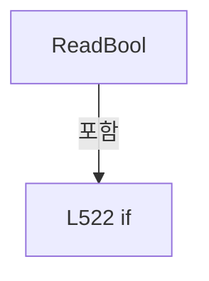

변경 전 점검: 입력/반환 타입, 위 호출자, 예외/취소 경로, 공유 상태와 저장·전송 소비자를 함께 확인합니다. 값의 단위나 물리 방향을 이름만으로 확정하지 않습니다.

### MethodDeclaration `ReadInt` · L530–533

[Drilling.File/JHMI/CSettingFile.cs:530–533](https://github.com/kjuws10-rgb/A3Drilling/blob/5aee8e58439c9b455cae7c9593c9be986c3e682e/Drilling.File/JHMI/CSettingFile.cs#L530-L533)

| 항목 | 실제 추출 값 |
| --- | --- |
| 서명 | int Drilling.File.JHMI.CSettingFile.ReadInt(string, int) |
| 접근/수식자 | Private / private, static |
| 반환/값 타입 | int |
| 소속 타입 | NamedType:Drilling.File.JHMI.CSettingFile |

입력 계약:

| 이름 | 타입 | 전달 | 선택/기본값 |
| --- | --- | --- | --- |
| value | string | None | False /  |
| defaultValue | int | None | False /  |

현재 부분 분석에서 직접 연결된 호출자는 없습니다. XAML/이벤트/인터페이스·델리게이트·외부 진입을 추가 확인해야 하며, 미사용으로 판정한 것이 아닙니다.

호출하는 대상과 해석 범위:

| 원본 행 | 표현식 | 분석 상태 | 대상/소스 위치 |
| --- | --- | --- | --- |
| 532 | int.TryParse | resolved | bool int.TryParse(string?, System.Globalization.NumberStyles, System.IFormatProvider?, out int) |

본문의 실제 연산·분기·예외·반환 순서(원문 위치 순):

| 원본 행 | 종류 | 주석 해설 |
| --- | --- | --- |
| 532 | call | 함수·델리게이트 또는 객체 생성자를 호출합니다: int.TryParse(value, NumberStyles.Integer, CultureInfo.InvariantCulture, out var result) |
| 532 | conditional-expression | 조건에 따라 결과식을 선택합니다: int.TryParse(value, NumberStyles.Integer, CultureInfo.InvariantCulture, out var result) ? result : defaultValue |
| 532 | return | 호출자에게 값 또는 제어를 반환합니다: return int.TryParse(value, NumberStyles.Integer, CultureInfo.InvariantCulture, out var result) ? result : defaultValue; |

변경 전 점검: 입력/반환 타입, 위 호출자, 예외/취소 경로, 공유 상태와 저장·전송 소비자를 함께 확인합니다. 값의 단위나 물리 방향을 이름만으로 확정하지 않습니다.

### MethodDeclaration `ReadDouble` · L535–538

[Drilling.File/JHMI/CSettingFile.cs:535–538](https://github.com/kjuws10-rgb/A3Drilling/blob/5aee8e58439c9b455cae7c9593c9be986c3e682e/Drilling.File/JHMI/CSettingFile.cs#L535-L538)

| 항목 | 실제 추출 값 |
| --- | --- |
| 서명 | double Drilling.File.JHMI.CSettingFile.ReadDouble(string, double) |
| 접근/수식자 | Private / private, static |
| 반환/값 타입 | double |
| 소속 타입 | NamedType:Drilling.File.JHMI.CSettingFile |

입력 계약:

| 이름 | 타입 | 전달 | 선택/기본값 |
| --- | --- | --- | --- |
| value | string | None | False /  |
| defaultValue | double | None | False /  |

정적 호출자로 확인된 위치:

| 호출 파일/행 | 호출 표현식 | 런타임 분기 가능 |
| --- | --- | --- |
| [Drilling.File/JHMI/CSettingFile.cs:176–176](https://github.com/kjuws10-rgb/A3Drilling/blob/5aee8e58439c9b455cae7c9593c9be986c3e682e/Drilling.File/JHMI/CSettingFile.cs#L176-L176) | ReadDouble | False |
| [Drilling.File/JHMI/CSettingFile.cs:177–177](https://github.com/kjuws10-rgb/A3Drilling/blob/5aee8e58439c9b455cae7c9593c9be986c3e682e/Drilling.File/JHMI/CSettingFile.cs#L177-L177) | ReadDouble | False |

호출하는 대상과 해석 범위:

| 원본 행 | 표현식 | 분석 상태 | 대상/소스 위치 |
| --- | --- | --- | --- |
| 537 | double.TryParse | resolved | bool double.TryParse(string?, System.Globalization.NumberStyles, System.IFormatProvider?, out double) |

본문의 실제 연산·분기·예외·반환 순서(원문 위치 순):

| 원본 행 | 종류 | 주석 해설 |
| --- | --- | --- |
| 537 | call | 함수·델리게이트 또는 객체 생성자를 호출합니다: double.TryParse(value, NumberStyles.Float, CultureInfo.InvariantCulture, out var result) |
| 537 | conditional-expression | 조건에 따라 결과식을 선택합니다: double.TryParse(value, NumberStyles.Float, CultureInfo.InvariantCulture, out var result) ? result : defaultValue |
| 537 | return | 호출자에게 값 또는 제어를 반환합니다: return double.TryParse(value, NumberStyles.Float, CultureInfo.InvariantCulture, out var result) ? result : defaultValue; |

변경 전 점검: 입력/반환 타입, 위 호출자, 예외/취소 경로, 공유 상태와 저장·전송 소비자를 함께 확인합니다. 값의 단위나 물리 방향을 이름만으로 확정하지 않습니다.

### MethodDeclaration `ToTabText` · L540–546

[Drilling.File/JHMI/CSettingFile.cs:540–546](https://github.com/kjuws10-rgb/A3Drilling/blob/5aee8e58439c9b455cae7c9593c9be986c3e682e/Drilling.File/JHMI/CSettingFile.cs#L540-L546)

| 항목 | 실제 추출 값 |
| --- | --- |
| 서명 | string Drilling.File.JHMI.CSettingFile.ToTabText(Drilling.Common.Managers.EN_SETTING_TAB) |
| 접근/수식자 | Private / private, static |
| 반환/값 타입 | string |
| 소속 타입 | NamedType:Drilling.File.JHMI.CSettingFile |

입력 계약:

| 이름 | 타입 | 전달 | 선택/기본값 |
| --- | --- | --- | --- |
| section | Drilling.Common.Managers.EN_SETTING_TAB | None | False /  |

정적 호출자로 확인된 위치:

| 호출 파일/행 | 호출 표현식 | 런타임 분기 가능 |
| --- | --- | --- |
| [Drilling.File/JHMI/CSettingFile.cs:25–25](https://github.com/kjuws10-rgb/A3Drilling/blob/5aee8e58439c9b455cae7c9593c9be986c3e682e/Drilling.File/JHMI/CSettingFile.cs#L25-L25) | ToTabText | False |
| [Drilling.File/JHMI/CSettingFile.cs:58–58](https://github.com/kjuws10-rgb/A3Drilling/blob/5aee8e58439c9b455cae7c9593c9be986c3e682e/Drilling.File/JHMI/CSettingFile.cs#L58-L58) | ToTabText | False |
| [Drilling.File/JHMI/CSettingFile.cs:352–352](https://github.com/kjuws10-rgb/A3Drilling/blob/5aee8e58439c9b455cae7c9593c9be986c3e682e/Drilling.File/JHMI/CSettingFile.cs#L352-L352) | ToTabText | False |

호출하는 대상과 해석 범위:

| 원본 행 | 표현식 | 분석 상태 | 대상/소스 위치 |
| --- | --- | --- | --- |
| 545 | section.ToString().ToUpperInvariant | resolved | string string.ToUpperInvariant() |
| 545 | section.ToString | resolved · 동적 구현 선택 가능 | string System.Enum.ToString() |

본문의 실제 연산·분기·예외·반환 순서(원문 위치 순):

| 원본 행 | 종류 | 주석 해설 |
| --- | --- | --- |
| 542 | return | 호출자에게 값 또는 제어를 반환합니다: return section switch { EN_SETTING_TAB.Io => "IO", _ => section.ToString().ToUpperInvariant()}; |
| 542 | switch-expression | 값별 결과식을 선택합니다: section switch { EN_SETTING_TAB.Io => "IO", _ => section.ToString().ToUpperInvariant()} |
| 545 | call | 함수·델리게이트 또는 객체 생성자를 호출합니다: section.ToString().ToUpperInvariant() |
| 545 | call | 함수·델리게이트 또는 객체 생성자를 호출합니다: section.ToString() |

제어 구문의 포함 구조(실제 실행 순서/CFG가 아닌 구문 탐색 그림):

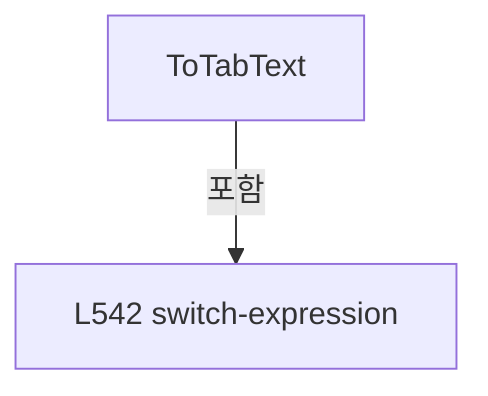

변경 전 점검: 입력/반환 타입, 위 호출자, 예외/취소 경로, 공유 상태와 저장·전송 소비자를 함께 확인합니다. 값의 단위나 물리 방향을 이름만으로 확정하지 않습니다.

## 구문·바인딩 한계

전체 WPF/벤더 SDK/프로젝트별 빌드 조건을 로드한 정식 빌드가 아닙니다. `resolved`는 이 부분 컴파일에서의 심볼 연결이며 virtual/interface/delegate/이벤트/Reflection/XAML의 실제 런타임 구현을 확정하지 않습니다. `candidate`와 `unresolved`는 후속 확인 대상으로 남깁니다.

## 원문 전체 주석 해설본

[원본 모든 행과 행별 해설 보기](../../../annotated/Drilling.File/JHMI/CSettingFile.cs.annotated.txt)

원본을 빠뜨리거나 임의로 줄이지 않았습니다. `L000001 |` 표시는 원본 행 번호, `// 해설`은 별도 설명입니다. 실행용 소스가 아닌 문서입니다.

## 수정·재검증 체크

- 원본 Commit과 현재 작업 파일 SHA가 같은지 먼저 확인합니다. 다르면 이 문서를 과거 버전 자료로 취급합니다.
- 선언·직접 호출·이벤트/인터페이스 경계·설정 소비를 함께 확인합니다. 정적 연결의 빈 곳을 정상 경로로 추정하지 않습니다.
- 저장 형식/단위/식별자·재시도·취소·예외·롤백에 영향을 주는 변경은 상세 해설장과 호출자를 다시 검토합니다.
- 도구의 구문 추출과 별도 정적 추적 해설, 실제 빌드·시뮬레이션·실장비 검증 결과를 분리합니다.
