# Drilling.File/Parser/CCsvParser.cs

| 항목 | 내용 |
| --- | --- |
| 원본 저장소 | https://github.com/kjuws10-rgb/A3Drilling.git |
| 원본 Commit | 5aee8e58439c9b455cae7c9593c9be986c3e682e |
| 원본 SHA256 | 8d9850f57f3552310d7aec82c11c7a08ab13b30c9a0e6daf8ee9e649077fb644 |
| 파일 분류 | code |
| 원본 크기/행 | 16,362 bytes / 477 physical lines |
| 인코딩 | utf-8-sig |
| 검토 범위 | 구문/부분 의미 분석에서 추출한 사실. 동작·물리 단위·실장비 합격을 보증하지 않습니다. |
| 원본 링크 | [고정 Commit 원본](https://github.com/kjuws10-rgb/A3Drilling/blob/5aee8e58439c9b455cae7c9593c9be986c3e682e/Drilling.File/Parser/CCsvParser.cs) |

## 파일의 역할과 읽는 순서

정의·설정·레시피·결과·스크립트의 파일 입출력과 데이터 형식을 담당합니다. 저장 필드를 통신 송신 필드로 단정하지 않습니다.

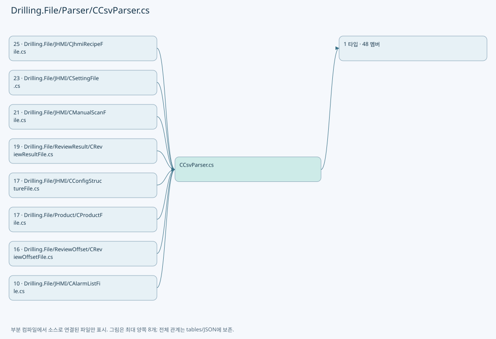

## 네임스페이스·타입·상속

| 타입 | 구분 | 원본 범위 | 선언/상속 |
| --- | --- | --- | --- |
| CCsvParser | ClassDeclaration | 5–477 | CCsvParser |

## 멤버 빠른 목록

| 이름 | 종류 | 범위 | 서명 |
| --- | --- | --- | --- |
| Utf8BomLength | FieldDeclaration | L7–7 | int Drilling.File.Parser.CCsvParser.Utf8BomLength |
| CsvWriteEncoding | FieldDeclaration | L8–8 | System.Text.Encoding Drilling.File.Parser.CCsvParser.CsvWriteEncoding |
| StrictUtf8Encoding | FieldDeclaration | L9–9 | System.Text.Encoding Drilling.File.Parser.CCsvParser.StrictUtf8Encoding |
| KoreanCsvEncoding | FieldDeclaration | L10–10 | System.Lazy<System.Text.Encoding> Drilling.File.Parser.CCsvParser.KoreanCsvEncoding |
| Read | MethodDeclaration | L12–13 | System.Collections.Generic.IReadOnlyList<System.Collections.Generic.IReadOnlyDictionary<string, string>> Drilling.File.Parser.CCsvParser.Read(string) |
| Read | MethodDeclaration | L15–56 | System.Collections.Generic.IReadOnlyList<System.Collections.Generic.IReadOnlyDictionary<string, string>> Drilling.File.Parser.CCsvParser.Read(string, System.Collections.Generic.IList<int>?) |
| SelectItem | LocalFunctionStatement | L28–31 | string SelectItem(string) |
| Write | MethodDeclaration | L58–94 | void Drilling.File.Parser.CCsvParser.Write(string, System.Collections.Generic.IReadOnlyList<string>, System.Collections.Generic.IEnumerable<System.Collections.Generic.IReadOnlyDictionary<string, string>>) |
| SelectKeys | LocalFunctionStatement | L61–64 | System.Collections.Generic.IEnumerable<string> SelectKeys(System.Collections.Generic.IReadOnlyDictionary<string, string>) |
| ShouldIncludeItem | LocalFunctionStatement | L66–69 | bool ShouldIncludeItem(string) |
| SelectItem | LocalFunctionStatement | L82–90 | string SelectItem(System.Collections.Generic.IReadOnlyDictionary<string, string>) |
| SelectItem | LocalFunctionStatement | L84–87 | string SelectItem(string) |
| Append | MethodDeclaration | L96–138 | void Drilling.File.Parser.CCsvParser.Append(string, System.Collections.Generic.IReadOnlyList<string>, System.Collections.Generic.IReadOnlyDictionary<string, string>) |
| ReadLastByte | MethodDeclaration | L140–145 | byte Drilling.File.Parser.CCsvParser.ReadLastByte(System.IO.FileStream) |
| ReadLines | MethodDeclaration | L147–155 | System.Collections.Generic.IReadOnlyList<string> Drilling.File.Parser.CCsvParser.ReadLines(string) |
| WriteLines | MethodDeclaration | L157–166 | void Drilling.File.Parser.CCsvParser.WriteLines(string, System.Collections.Generic.IEnumerable<string>) |
| Get | MethodDeclaration | L168–171 | string Drilling.File.Parser.CCsvParser.Get(System.Collections.Generic.IReadOnlyDictionary<string, string>, string) |
| GetFirst | MethodDeclaration | L173–185 | string Drilling.File.Parser.CCsvParser.GetFirst(System.Collections.Generic.IReadOnlyDictionary<string, string>, params string[]) |
| RequireText | MethodDeclaration | L187–196 | string Drilling.File.Parser.CCsvParser.RequireText(System.Collections.Generic.IReadOnlyDictionary<string, string>, string, int, params string[]) |
| ReadInt | MethodDeclaration | L198–206 | int Drilling.File.Parser.CCsvParser.ReadInt(string, string, int, string, int) |
| ReadRequiredInt | MethodDeclaration | L208–217 | int Drilling.File.Parser.CCsvParser.ReadRequiredInt(string, string, int, string, bool) |
| ReadDouble | MethodDeclaration | L219–227 | double Drilling.File.Parser.CCsvParser.ReadDouble(string, string, int, string, double) |
| ReadBool | MethodDeclaration | L229–242 | bool Drilling.File.Parser.CCsvParser.ReadBool(string, bool) |
| ReadRequiredBool | MethodDeclaration | L244–251 | bool Drilling.File.Parser.CCsvParser.ReadRequiredBool(string, string, int, string) |
| ReadHeaders | MethodDeclaration | L253–278 | System.Collections.Generic.IReadOnlyList<string> Drilling.File.Parser.CCsvParser.ReadHeaders(string) |
| SelectItem | LocalFunctionStatement | L261–264 | string SelectItem(string) |
| ShouldIncludeItem | LocalFunctionStatement | L266–269 | bool ShouldIncludeItem(string) |
| ValidateRequiredHeaders | MethodDeclaration | L280–329 | void Drilling.File.Parser.CCsvParser.ValidateRequiredHeaders(string, string, System.Collections.Generic.IEnumerable<System.Collections.Generic.IEnumerable<string>>) |
| ShouldIncludeItem | LocalFunctionStatement | L294–297 | bool ShouldIncludeItem(string) |
| SelectItem | LocalFunctionStatement | L299–302 | string SelectItem(string) |
| SelectValue | LocalFunctionStatement | L304–307 | string[] SelectValue(System.Collections.Generic.IEnumerable<string>) |
| MatchesItem | LocalFunctionStatement | L309–312 | bool MatchesItem(string) |
| MatchesLength | LocalFunctionStatement | L314–317 | bool MatchesLength(string[]) |
| SelectString | LocalFunctionStatement | L319–322 | string SelectString(string[]) |
| GetExtra | MethodDeclaration | L331–350 | System.Collections.Generic.IReadOnlyDictionary<string, string> Drilling.File.Parser.CCsvParser.GetExtra(System.Collections.Generic.IReadOnlyDictionary<string, string>, System.Collections.Generic.IEnumerable<string>) |
| ShouldIncludeItem | LocalFunctionStatement | L334–337 | bool ShouldIncludeItem(System.Collections.Generic.KeyValuePair<string, string>) |
| SelectKey | LocalFunctionStatement | L339–342 | string SelectKey(System.Collections.Generic.KeyValuePair<string, string>) |
| SelectValue | LocalFunctionStatement | L344–347 | string SelectValue(System.Collections.Generic.KeyValuePair<string, string>) |
| ParseLine | MethodDeclaration | L352–390 | System.Collections.Generic.List<string> Drilling.File.Parser.CCsvParser.ParseLine(string, string, int) |
| ValidateHeaders | MethodDeclaration | L392–415 | void Drilling.File.Parser.CCsvParser.ValidateHeaders(string, System.Collections.Generic.IReadOnlyList<string>) |
| ShouldIncludeItem | LocalFunctionStatement | L400–403 | bool ShouldIncludeItem(System.Linq.IGrouping<string, string>) |
| SelectItem | LocalFunctionStatement | L405–408 | string SelectItem(System.Linq.IGrouping<string, string>) |
| Escape | MethodDeclaration | L417–425 | string Drilling.File.Parser.CCsvParser.Escape(string) |
| NormalizeHeader | MethodDeclaration | L427–430 | string Drilling.File.Parser.CCsvParser.NormalizeHeader(string) |
| ReadCsvText | MethodDeclaration | L432–453 | string Drilling.File.Parser.CCsvParser.ReadCsvText(string) |
| HasUtf8Bom | MethodDeclaration | L455–458 | bool Drilling.File.Parser.CCsvParser.HasUtf8Bom(System.Collections.Generic.IReadOnlyList<byte>) |
| SplitLines | MethodDeclaration | L460–470 | string[] Drilling.File.Parser.CCsvParser.SplitLines(string) |
| GetKoreanCsvEncoding | MethodDeclaration | L472–476 | System.Text.Encoding Drilling.File.Parser.CCsvParser.GetKoreanCsvEncoding() |

## 멤버별 상세 계약·호출·처리 해설

### FieldDeclaration `Utf8BomLength` · L7–7

[Drilling.File/Parser/CCsvParser.cs:7–7](https://github.com/kjuws10-rgb/A3Drilling/blob/5aee8e58439c9b455cae7c9593c9be986c3e682e/Drilling.File/Parser/CCsvParser.cs#L7-L7)

| 항목 | 실제 추출 값 |
| --- | --- |
| 서명 | int Drilling.File.Parser.CCsvParser.Utf8BomLength |
| 접근/수식자 | Private / private, const |
| 반환/값 타입 | int |
| 소속 타입 | NamedType:Drilling.File.Parser.CCsvParser |

현재 부분 분석에서 직접 연결된 호출자는 없습니다. XAML/이벤트/인터페이스·델리게이트·외부 진입을 추가 확인해야 하며, 미사용으로 판정한 것이 아닙니다.

본문의 실제 연산·분기·예외·반환 순서(원문 위치 순):

| 원본 행 | 종류 | 주석 해설 |
| --- | --- | --- |
| 7 | variable-initializer | 변수의 초기값을 지정합니다: Utf8BomLength = 3 |

변경 전 점검: 입력/반환 타입, 위 호출자, 예외/취소 경로, 공유 상태와 저장·전송 소비자를 함께 확인합니다. 값의 단위나 물리 방향을 이름만으로 확정하지 않습니다.

### FieldDeclaration `CsvWriteEncoding` · L8–8

[Drilling.File/Parser/CCsvParser.cs:8–8](https://github.com/kjuws10-rgb/A3Drilling/blob/5aee8e58439c9b455cae7c9593c9be986c3e682e/Drilling.File/Parser/CCsvParser.cs#L8-L8)

| 항목 | 실제 추출 값 |
| --- | --- |
| 서명 | System.Text.Encoding Drilling.File.Parser.CCsvParser.CsvWriteEncoding |
| 접근/수식자 | Private / private, static, readonly |
| 반환/값 타입 | System.Text.Encoding |
| 소속 타입 | NamedType:Drilling.File.Parser.CCsvParser |

현재 부분 분석에서 직접 연결된 호출자는 없습니다. XAML/이벤트/인터페이스·델리게이트·외부 진입을 추가 확인해야 하며, 미사용으로 판정한 것이 아닙니다.

호출하는 대상과 해석 범위:

| 원본 행 | 표현식 | 분석 상태 | 대상/소스 위치 |
| --- | --- | --- | --- |
| 8 | new UTF8Encoding | resolved | System.Text.UTF8Encoding.UTF8Encoding(bool) |

본문의 실제 연산·분기·예외·반환 순서(원문 위치 순):

| 원본 행 | 종류 | 주석 해설 |
| --- | --- | --- |
| 8 | call | 함수·델리게이트 또는 객체 생성자를 호출합니다: new UTF8Encoding(encoderShouldEmitUTF8Identifier: true) |
| 8 | variable-initializer | 변수의 초기값을 지정합니다: CsvWriteEncoding = new UTF8Encoding(encoderShouldEmitUTF8Identifier: true) |

변경 전 점검: 입력/반환 타입, 위 호출자, 예외/취소 경로, 공유 상태와 저장·전송 소비자를 함께 확인합니다. 값의 단위나 물리 방향을 이름만으로 확정하지 않습니다.

### FieldDeclaration `StrictUtf8Encoding` · L9–9

[Drilling.File/Parser/CCsvParser.cs:9–9](https://github.com/kjuws10-rgb/A3Drilling/blob/5aee8e58439c9b455cae7c9593c9be986c3e682e/Drilling.File/Parser/CCsvParser.cs#L9-L9)

| 항목 | 실제 추출 값 |
| --- | --- |
| 서명 | System.Text.Encoding Drilling.File.Parser.CCsvParser.StrictUtf8Encoding |
| 접근/수식자 | Private / private, static, readonly |
| 반환/값 타입 | System.Text.Encoding |
| 소속 타입 | NamedType:Drilling.File.Parser.CCsvParser |

현재 부분 분석에서 직접 연결된 호출자는 없습니다. XAML/이벤트/인터페이스·델리게이트·외부 진입을 추가 확인해야 하며, 미사용으로 판정한 것이 아닙니다.

호출하는 대상과 해석 범위:

| 원본 행 | 표현식 | 분석 상태 | 대상/소스 위치 |
| --- | --- | --- | --- |
| 9 | new UTF8Encoding | resolved | System.Text.UTF8Encoding.UTF8Encoding(bool, bool) |

본문의 실제 연산·분기·예외·반환 순서(원문 위치 순):

| 원본 행 | 종류 | 주석 해설 |
| --- | --- | --- |
| 9 | call | 함수·델리게이트 또는 객체 생성자를 호출합니다: new UTF8Encoding(encoderShouldEmitUTF8Identifier: false, throwOnInvalidBytes: true) |
| 9 | variable-initializer | 변수의 초기값을 지정합니다: StrictUtf8Encoding = new UTF8Encoding(encoderShouldEmitUTF8Identifier: false, throwOnInvalidBytes: true) |

변경 전 점검: 입력/반환 타입, 위 호출자, 예외/취소 경로, 공유 상태와 저장·전송 소비자를 함께 확인합니다. 값의 단위나 물리 방향을 이름만으로 확정하지 않습니다.

### FieldDeclaration `KoreanCsvEncoding` · L10–10

[Drilling.File/Parser/CCsvParser.cs:10–10](https://github.com/kjuws10-rgb/A3Drilling/blob/5aee8e58439c9b455cae7c9593c9be986c3e682e/Drilling.File/Parser/CCsvParser.cs#L10-L10)

| 항목 | 실제 추출 값 |
| --- | --- |
| 서명 | System.Lazy<System.Text.Encoding> Drilling.File.Parser.CCsvParser.KoreanCsvEncoding |
| 접근/수식자 | Private / private, static, readonly |
| 반환/값 타입 | System.Lazy<System.Text.Encoding> |
| 소속 타입 | NamedType:Drilling.File.Parser.CCsvParser |

현재 부분 분석에서 직접 연결된 호출자는 없습니다. XAML/이벤트/인터페이스·델리게이트·외부 진입을 추가 확인해야 하며, 미사용으로 판정한 것이 아닙니다.

호출하는 대상과 해석 범위:

| 원본 행 | 표현식 | 분석 상태 | 대상/소스 위치 |
| --- | --- | --- | --- |
| 10 | new | resolved | System.Lazy<System.Text.Encoding>.Lazy(System.Func<System.Text.Encoding>) |

본문의 실제 연산·분기·예외·반환 순서(원문 위치 순):

| 원본 행 | 종류 | 주석 해설 |
| --- | --- | --- |
| 10 | call | 함수·델리게이트 또는 객체 생성자를 호출합니다: new(GetKoreanCsvEncoding) |
| 10 | variable-initializer | 변수의 초기값을 지정합니다: KoreanCsvEncoding = new(GetKoreanCsvEncoding) |

변경 전 점검: 입력/반환 타입, 위 호출자, 예외/취소 경로, 공유 상태와 저장·전송 소비자를 함께 확인합니다. 값의 단위나 물리 방향을 이름만으로 확정하지 않습니다.

### MethodDeclaration `Read` · L12–13

[Drilling.File/Parser/CCsvParser.cs:12–13](https://github.com/kjuws10-rgb/A3Drilling/blob/5aee8e58439c9b455cae7c9593c9be986c3e682e/Drilling.File/Parser/CCsvParser.cs#L12-L13)

| 항목 | 실제 추출 값 |
| --- | --- |
| 서명 | System.Collections.Generic.IReadOnlyList<System.Collections.Generic.IReadOnlyDictionary<string, string>> Drilling.File.Parser.CCsvParser.Read(string) |
| 접근/수식자 | Public / public, static |
| 반환/값 타입 | System.Collections.Generic.IReadOnlyList<System.Collections.Generic.IReadOnlyDictionary<string, string>> |
| 소속 타입 | NamedType:Drilling.File.Parser.CCsvParser |

입력 계약:

| 이름 | 타입 | 전달 | 선택/기본값 |
| --- | --- | --- | --- |
| path | string | None | False /  |

정적 호출자로 확인된 위치:

| 호출 파일/행 | 호출 표현식 | 런타임 분기 가능 |
| --- | --- | --- |
| [Drilling.File/JHMI/CAlarmListFile.cs:18–18](https://github.com/kjuws10-rgb/A3Drilling/blob/5aee8e58439c9b455cae7c9593c9be986c3e682e/Drilling.File/JHMI/CAlarmListFile.cs#L18-L18) | CCsvParser.Read | False |
| [Drilling.File/JHMI/CBETFile.cs:53–53](https://github.com/kjuws10-rgb/A3Drilling/blob/5aee8e58439c9b455cae7c9593c9be986c3e682e/Drilling.File/JHMI/CBETFile.cs#L53-L53) | CCsvParser.Read | False |
| [Drilling.File/JHMI/CConfigStructureFile.cs:131–131](https://github.com/kjuws10-rgb/A3Drilling/blob/5aee8e58439c9b455cae7c9593c9be986c3e682e/Drilling.File/JHMI/CConfigStructureFile.cs#L131-L131) | CCsvParser.Read | False |
| [Drilling.File/JHMI/CConfigStructureFile.cs:152–152](https://github.com/kjuws10-rgb/A3Drilling/blob/5aee8e58439c9b455cae7c9593c9be986c3e682e/Drilling.File/JHMI/CConfigStructureFile.cs#L152-L152) | CCsvParser.Read | False |
| [Drilling.File/JHMI/CConfigStructureFile.cs:210–210](https://github.com/kjuws10-rgb/A3Drilling/blob/5aee8e58439c9b455cae7c9593c9be986c3e682e/Drilling.File/JHMI/CConfigStructureFile.cs#L210-L210) | CCsvParser.Read | False |
| [Drilling.File/JHMI/CInterfaceFile.cs:89–89](https://github.com/kjuws10-rgb/A3Drilling/blob/5aee8e58439c9b455cae7c9593c9be986c3e682e/Drilling.File/JHMI/CInterfaceFile.cs#L89-L89) | CCsvParser.Read | False |
| [Drilling.File/JHMI/CJhmiRecipeFile.cs:886–886](https://github.com/kjuws10-rgb/A3Drilling/blob/5aee8e58439c9b455cae7c9593c9be986c3e682e/Drilling.File/JHMI/CJhmiRecipeFile.cs#L886-L886) | CCsvParser.Read | False |
| [Drilling.File/JHMI/CManualScanFile.cs:69–69](https://github.com/kjuws10-rgb/A3Drilling/blob/5aee8e58439c9b455cae7c9593c9be986c3e682e/Drilling.File/JHMI/CManualScanFile.cs#L69-L69) | CCsvParser.Read | False |
| [Drilling.File/JHMI/CManualScanFile.cs:225–225](https://github.com/kjuws10-rgb/A3Drilling/blob/5aee8e58439c9b455cae7c9593c9be986c3e682e/Drilling.File/JHMI/CManualScanFile.cs#L225-L225) | CCsvParser.Read | False |
| [Drilling.File/JHMI/CManualScanFile.cs:272–272](https://github.com/kjuws10-rgb/A3Drilling/blob/5aee8e58439c9b455cae7c9593c9be986c3e682e/Drilling.File/JHMI/CManualScanFile.cs#L272-L272) | CCsvParser.Read | False |
| [Drilling.File/JHMI/CMelsecMapFile.cs:60–60](https://github.com/kjuws10-rgb/A3Drilling/blob/5aee8e58439c9b455cae7c9593c9be986c3e682e/Drilling.File/JHMI/CMelsecMapFile.cs#L60-L60) | CCsvParser.Read | False |
| [Drilling.File/JHMI/CMotorFile.cs:80–80](https://github.com/kjuws10-rgb/A3Drilling/blob/5aee8e58439c9b455cae7c9593c9be986c3e682e/Drilling.File/JHMI/CMotorFile.cs#L80-L80) | CCsvParser.Read | False |
| [Drilling.File/JHMI/CSettingFile.cs:189–189](https://github.com/kjuws10-rgb/A3Drilling/blob/5aee8e58439c9b455cae7c9593c9be986c3e682e/Drilling.File/JHMI/CSettingFile.cs#L189-L189) | CCsvParser.Read | False |
| [Drilling.File/JHMI/CSettingFile.cs:325–325](https://github.com/kjuws10-rgb/A3Drilling/blob/5aee8e58439c9b455cae7c9593c9be986c3e682e/Drilling.File/JHMI/CSettingFile.cs#L325-L325) | CCsvParser.Read | False |
| [Drilling.File/PowerTable/CPowerTableFile.cs:83–83](https://github.com/kjuws10-rgb/A3Drilling/blob/5aee8e58439c9b455cae7c9593c9be986c3e682e/Drilling.File/PowerTable/CPowerTableFile.cs#L83-L83) | CCsvParser.Read | False |
| [Drilling.File/PowerTable/CPowerTableFile.cs:227–227](https://github.com/kjuws10-rgb/A3Drilling/blob/5aee8e58439c9b455cae7c9593c9be986c3e682e/Drilling.File/PowerTable/CPowerTableFile.cs#L227-L227) | CCsvParser.Read | False |
| [Drilling.File/Product/CProductFile.cs:21–21](https://github.com/kjuws10-rgb/A3Drilling/blob/5aee8e58439c9b455cae7c9593c9be986c3e682e/Drilling.File/Product/CProductFile.cs#L21-L21) | CCsvParser.Read | False |
| [Drilling.File/Product/CProductFile.cs:215–215](https://github.com/kjuws10-rgb/A3Drilling/blob/5aee8e58439c9b455cae7c9593c9be986c3e682e/Drilling.File/Product/CProductFile.cs#L215-L215) | CCsvParser.Read | False |
| [Drilling.File/ReviewResult/CReviewResultFile.cs:59–59](https://github.com/kjuws10-rgb/A3Drilling/blob/5aee8e58439c9b455cae7c9593c9be986c3e682e/Drilling.File/ReviewResult/CReviewResultFile.cs#L59-L59) | CCsvParser.Read | False |
| [Drilling.File/ReviewResult/CReviewResultFile.cs:167–167](https://github.com/kjuws10-rgb/A3Drilling/blob/5aee8e58439c9b455cae7c9593c9be986c3e682e/Drilling.File/ReviewResult/CReviewResultFile.cs#L167-L167) | CCsvParser.Read | False |

호출하는 대상과 해석 범위:

| 원본 행 | 표현식 | 분석 상태 | 대상/소스 위치 |
| --- | --- | --- | --- |
| 13 | Read | resolved | System.Collections.Generic.IReadOnlyList<System.Collections.Generic.IReadOnlyDictionary<string, string>> Drilling.File.Parser.CCsvParser.Read(string, System.Collections.Generic.IList<int>?) · Drilling.File/Parser/CCsvParser.cs:15 |

본문의 실제 연산·분기·예외·반환 순서(원문 위치 순):

| 원본 행 | 종류 | 주석 해설 |
| --- | --- | --- |
| 13 | call | 함수·델리게이트 또는 객체 생성자를 호출합니다: Read(path, null) |

변경 전 점검: 입력/반환 타입, 위 호출자, 예외/취소 경로, 공유 상태와 저장·전송 소비자를 함께 확인합니다. 값의 단위나 물리 방향을 이름만으로 확정하지 않습니다.

### MethodDeclaration `Read` · L15–56

[Drilling.File/Parser/CCsvParser.cs:15–56](https://github.com/kjuws10-rgb/A3Drilling/blob/5aee8e58439c9b455cae7c9593c9be986c3e682e/Drilling.File/Parser/CCsvParser.cs#L15-L56)

| 항목 | 실제 추출 값 |
| --- | --- |
| 서명 | System.Collections.Generic.IReadOnlyList<System.Collections.Generic.IReadOnlyDictionary<string, string>> Drilling.File.Parser.CCsvParser.Read(string, System.Collections.Generic.IList<int>?) |
| 접근/수식자 | Public / public, static |
| 반환/값 타입 | System.Collections.Generic.IReadOnlyList<System.Collections.Generic.IReadOnlyDictionary<string, string>> |
| 소속 타입 | NamedType:Drilling.File.Parser.CCsvParser |

입력 계약:

| 이름 | 타입 | 전달 | 선택/기본값 |
| --- | --- | --- | --- |
| path | string | None | False /  |
| rowNumbers | System.Collections.Generic.IList<int>? | None | False /  |

정적 호출자로 확인된 위치:

| 호출 파일/행 | 호출 표현식 | 런타임 분기 가능 |
| --- | --- | --- |
| [Drilling.File/Parser/CCsvParser.cs:13–13](https://github.com/kjuws10-rgb/A3Drilling/blob/5aee8e58439c9b455cae7c9593c9be986c3e682e/Drilling.File/Parser/CCsvParser.cs#L13-L13) | Read | False |
| [Drilling.File/ReviewOffset/CReviewOffsetFile.cs:430–430](https://github.com/kjuws10-rgb/A3Drilling/blob/5aee8e58439c9b455cae7c9593c9be986c3e682e/Drilling.File/ReviewOffset/CReviewOffsetFile.cs#L430-L430) | CCsvParser.Read | False |
| [Drilling.File/ReviewOffset/CReviewOffsetFile.cs:646–646](https://github.com/kjuws10-rgb/A3Drilling/blob/5aee8e58439c9b455cae7c9593c9be986c3e682e/Drilling.File/ReviewOffset/CReviewOffsetFile.cs#L646-L646) | CCsvParser.Read | False |

호출하는 대상과 해석 범위:

| 원본 행 | 표현식 | 분석 상태 | 대상/소스 위치 |
| --- | --- | --- | --- |
| 17 | System.IO.File.Exists | resolved | bool System.IO.File.Exists(string?) |
| 22 | ReadLines | resolved | System.Collections.Generic.IReadOnlyList<string> Drilling.File.Parser.CCsvParser.ReadLines(string) · Drilling.File/Parser/CCsvParser.cs:147 |
| 33 | ParseLine(lines[0], path, 1).Select(SelectItem).ToArray | resolved | string[] System.Collections.Generic.IEnumerable<string>.ToArray<string>() |
| 33 | ParseLine(lines[0], path, 1).Select | resolved | System.Collections.Generic.IEnumerable<string> System.Collections.Generic.IEnumerable<string>.Select<string, string>(System.Func<string, string>) |
| 33 | ParseLine | resolved | System.Collections.Generic.List<string> Drilling.File.Parser.CCsvParser.ParseLine(string, string, int) · Drilling.File/Parser/CCsvParser.cs:352 |
| 34 | ValidateHeaders | resolved | void Drilling.File.Parser.CCsvParser.ValidateHeaders(string, System.Collections.Generic.IReadOnlyList<string>) · Drilling.File/Parser/CCsvParser.cs:392 |
| 35 | new List<IReadOnlyDictionary<string, string>> | resolved | System.Collections.Generic.List<System.Collections.Generic.IReadOnlyDictionary<string, string>>.List() |
| 39 | string.IsNullOrWhiteSpace | resolved | bool string.IsNullOrWhiteSpace(string?) |
| 44 | ParseLine | resolved | System.Collections.Generic.List<string> Drilling.File.Parser.CCsvParser.ParseLine(string, string, int) · Drilling.File/Parser/CCsvParser.cs:352 |
| 45 | new Dictionary<string, string> | resolved | System.Collections.Generic.Dictionary<string, string>.Dictionary(System.Collections.Generic.IEqualityComparer<string>?) |
| 51 | rows.Add | resolved | void System.Collections.Generic.List<System.Collections.Generic.IReadOnlyDictionary<string, string>>.Add(System.Collections.Generic.IReadOnlyDictionary<string, string>) |
| 52 | .Add | resolved · 동적 구현 선택 가능 | void System.Collections.Generic.ICollection<int>.Add(int) |

본문의 실제 연산·분기·예외·반환 순서(원문 위치 순):

| 원본 행 | 종류 | 주석 해설 |
| --- | --- | --- |
| 17 | call | 함수·델리게이트 또는 객체 생성자를 호출합니다: System.IO.File.Exists(path) |
| 17 | if | 조건에 따라 분기합니다: if (!System.IO.File.Exists(path)) |
| 19 | return | 호출자에게 값 또는 제어를 반환합니다: return[]; |
| 22 | call | 함수·델리게이트 또는 객체 생성자를 호출합니다: ReadLines(path) |
| 22 | local-declaration | 지역 변수를 선언합니다: var lines = ReadLines(path); |
| 22 | variable-initializer | 변수의 초기값을 지정합니다: lines = ReadLines(path) |
| 23 | if | 조건에 따라 분기합니다: if (lines.Count == 0) |
| 25 | return | 호출자에게 값 또는 제어를 반환합니다: return[]; |
| 33 | call | 함수·델리게이트 또는 객체 생성자를 호출합니다: ParseLine(lines[0], path, 1).Select(SelectItem).ToArray() |
| 33 | call | 함수·델리게이트 또는 객체 생성자를 호출합니다: ParseLine(lines[0], path, 1).Select(SelectItem) |
| 33 | call | 함수·델리게이트 또는 객체 생성자를 호출합니다: ParseLine(lines[0], path, 1) |
| 33 | local-declaration | 지역 변수를 선언합니다: var headers = ParseLine(lines[0], path, 1).Select(SelectItem).ToArray(); |
| 33 | variable-initializer | 변수의 초기값을 지정합니다: headers = ParseLine(lines[0], path, 1).Select(SelectItem).ToArray() |
| 34 | call | 함수·델리게이트 또는 객체 생성자를 호출합니다: ValidateHeaders(path, headers) |
| 35 | call | 함수·델리게이트 또는 객체 생성자를 호출합니다: new List<IReadOnlyDictionary<string, string>>() |
| 35 | local-declaration | 지역 변수를 선언합니다: var rows = new List<IReadOnlyDictionary<string, string>>(); |
| 35 | variable-initializer | 변수의 초기값을 지정합니다: rows = new List<IReadOnlyDictionary<string, string>>() |
| 36 | variable-initializer | 변수의 초기값을 지정합니다: lineIndex = 1 |
| 36 | for | 초기화·조건·증감이 있는 반복입니다: for (var lineIndex = 1; lineIndex < lines.Count; lineIndex++) |
| 38 | local-declaration | 지역 변수를 선언합니다: var line = lines[lineIndex]; |
| 38 | variable-initializer | 변수의 초기값을 지정합니다: line = lines[lineIndex] |
| 39 | call | 함수·델리게이트 또는 객체 생성자를 호출합니다: string.IsNullOrWhiteSpace(line) |
| 39 | if | 조건에 따라 분기합니다: if (string.IsNullOrWhiteSpace(line)) |
| 41 | continue | 다음 반복으로 진행합니다: continue; |
| 44 | call | 함수·델리게이트 또는 객체 생성자를 호출합니다: ParseLine(line, path, lineIndex + 1) |
| 44 | local-declaration | 지역 변수를 선언합니다: var fields = ParseLine(line, path, lineIndex + 1); |
| 44 | variable-initializer | 변수의 초기값을 지정합니다: fields = ParseLine(line, path, lineIndex + 1) |
| 45 | call | 함수·델리게이트 또는 객체 생성자를 호출합니다: new Dictionary<string, string>(StringComparer.OrdinalIgnoreCase) |
| 45 | local-declaration | 지역 변수를 선언합니다: var row = new Dictionary<string, string>(StringComparer.OrdinalIgnoreCase); |
| 45 | variable-initializer | 변수의 초기값을 지정합니다: row = new Dictionary<string, string>(StringComparer.OrdinalIgnoreCase) |
| 46 | variable-initializer | 변수의 초기값을 지정합니다: index = 0 |
| 46 | for | 초기화·조건·증감이 있는 반복입니다: for (var index = 0; index < headers.Length; index++) |
| 48 | assignment | 값을 대상에 대입합니다: row[headers[index]] = index < fields.Count ? fields[index] : string.Empty |
| 48 | conditional-expression | 조건에 따라 결과식을 선택합니다: index < fields.Count ? fields[index] : string.Empty |
| 51 | call | 함수·델리게이트 또는 객체 생성자를 호출합니다: rows.Add(row) |
| 52 | call | 함수·델리게이트 또는 객체 생성자를 호출합니다: .Add(lineIndex + 1) |
| 55 | return | 호출자에게 값 또는 제어를 반환합니다: return rows; |

제어 구문의 포함 구조(실제 실행 순서/CFG가 아닌 구문 탐색 그림):

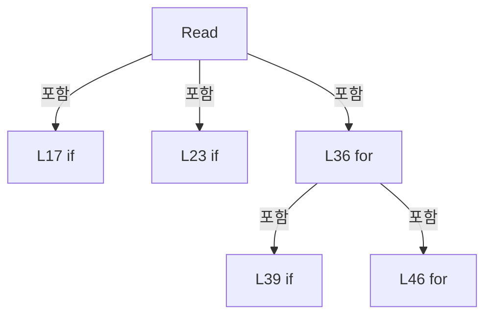

변경 전 점검: 입력/반환 타입, 위 호출자, 예외/취소 경로, 공유 상태와 저장·전송 소비자를 함께 확인합니다. 값의 단위나 물리 방향을 이름만으로 확정하지 않습니다.

### LocalFunctionStatement `SelectItem` · L28–31

[Drilling.File/Parser/CCsvParser.cs:28–31](https://github.com/kjuws10-rgb/A3Drilling/blob/5aee8e58439c9b455cae7c9593c9be986c3e682e/Drilling.File/Parser/CCsvParser.cs#L28-L31)

| 항목 | 실제 추출 값 |
| --- | --- |
| 서명 | string SelectItem(string) |
| 접근/수식자 | Private /  |
| 반환/값 타입 | string |
| 소속 타입 | NamedType:Drilling.File.Parser.CCsvParser |

입력 계약:

| 이름 | 타입 | 전달 | 선택/기본값 |
| --- | --- | --- | --- |
| header | string | None | False /  |

현재 부분 분석에서 직접 연결된 호출자는 없습니다. XAML/이벤트/인터페이스·델리게이트·외부 진입을 추가 확인해야 하며, 미사용으로 판정한 것이 아닙니다.

호출하는 대상과 해석 범위:

| 원본 행 | 표현식 | 분석 상태 | 대상/소스 위치 |
| --- | --- | --- | --- |
| 30 | header.Trim | resolved | string string.Trim() |

본문의 실제 연산·분기·예외·반환 순서(원문 위치 순):

| 원본 행 | 종류 | 주석 해설 |
| --- | --- | --- |
| 30 | call | 함수·델리게이트 또는 객체 생성자를 호출합니다: header.Trim() |
| 30 | return | 호출자에게 값 또는 제어를 반환합니다: return header.Trim(); |

변경 전 점검: 입력/반환 타입, 위 호출자, 예외/취소 경로, 공유 상태와 저장·전송 소비자를 함께 확인합니다. 값의 단위나 물리 방향을 이름만으로 확정하지 않습니다.

### MethodDeclaration `Write` · L58–94

[Drilling.File/Parser/CCsvParser.cs:58–94](https://github.com/kjuws10-rgb/A3Drilling/blob/5aee8e58439c9b455cae7c9593c9be986c3e682e/Drilling.File/Parser/CCsvParser.cs#L58-L94)

| 항목 | 실제 추출 값 |
| --- | --- |
| 서명 | void Drilling.File.Parser.CCsvParser.Write(string, System.Collections.Generic.IReadOnlyList<string>, System.Collections.Generic.IEnumerable<System.Collections.Generic.IReadOnlyDictionary<string, string>>) |
| 접근/수식자 | Public / public, static |
| 반환/값 타입 | void |
| 소속 타입 | NamedType:Drilling.File.Parser.CCsvParser |

입력 계약:

| 이름 | 타입 | 전달 | 선택/기본값 |
| --- | --- | --- | --- |
| path | string | None | False /  |
| headers | System.Collections.Generic.IReadOnlyList<string> | None | False /  |
| rows | System.Collections.Generic.IEnumerable<System.Collections.Generic.IReadOnlyDictionary<string, string>> | None | False /  |

정적 호출자로 확인된 위치:

| 호출 파일/행 | 호출 표현식 | 런타임 분기 가능 |
| --- | --- | --- |
| [Drilling.File/Correction/CAlignOffsetLogFile.cs:21–21](https://github.com/kjuws10-rgb/A3Drilling/blob/5aee8e58439c9b455cae7c9593c9be986c3e682e/Drilling.File/Correction/CAlignOffsetLogFile.cs#L21-L21) | CCsvParser.Write | False |
| [Drilling.File/Correction/CAlignOffsetLogFile.cs:93–93](https://github.com/kjuws10-rgb/A3Drilling/blob/5aee8e58439c9b455cae7c9593c9be986c3e682e/Drilling.File/Correction/CAlignOffsetLogFile.cs#L93-L93) | CCsvParser.Write | False |
| [Drilling.File/JHMI/CBETFile.cs:76–76](https://github.com/kjuws10-rgb/A3Drilling/blob/5aee8e58439c9b455cae7c9593c9be986c3e682e/Drilling.File/JHMI/CBETFile.cs#L76-L76) | CCsvParser.Write | False |
| [Drilling.File/JHMI/CInterfaceFile.cs:75–75](https://github.com/kjuws10-rgb/A3Drilling/blob/5aee8e58439c9b455cae7c9593c9be986c3e682e/Drilling.File/JHMI/CInterfaceFile.cs#L75-L75) | CCsvParser.Write | False |
| [Drilling.File/JHMI/CManualScanFile.cs:146–146](https://github.com/kjuws10-rgb/A3Drilling/blob/5aee8e58439c9b455cae7c9593c9be986c3e682e/Drilling.File/JHMI/CManualScanFile.cs#L146-L146) | CCsvParser.Write | False |
| [Drilling.File/JHMI/CMelsecMapFile.cs:110–110](https://github.com/kjuws10-rgb/A3Drilling/blob/5aee8e58439c9b455cae7c9593c9be986c3e682e/Drilling.File/JHMI/CMelsecMapFile.cs#L110-L110) | CCsvParser.Write | False |
| [Drilling.File/JHMI/CMotorFile.cs:145–145](https://github.com/kjuws10-rgb/A3Drilling/blob/5aee8e58439c9b455cae7c9593c9be986c3e682e/Drilling.File/JHMI/CMotorFile.cs#L145-L145) | CCsvParser.Write | False |
| [Drilling.File/JHMI/CSettingFile.cs:346–346](https://github.com/kjuws10-rgb/A3Drilling/blob/5aee8e58439c9b455cae7c9593c9be986c3e682e/Drilling.File/JHMI/CSettingFile.cs#L346-L346) | CCsvParser.Write | False |
| [Drilling.File/Parser/CCsvParser.cs:103–103](https://github.com/kjuws10-rgb/A3Drilling/blob/5aee8e58439c9b455cae7c9593c9be986c3e682e/Drilling.File/Parser/CCsvParser.cs#L103-L103) | Write | False |
| [Drilling.File/Product/CProductFile.cs:188–188](https://github.com/kjuws10-rgb/A3Drilling/blob/5aee8e58439c9b455cae7c9593c9be986c3e682e/Drilling.File/Product/CProductFile.cs#L188-L188) | CCsvParser.Write | False |
| [Drilling.File/Product/CProductFile.cs:473–473](https://github.com/kjuws10-rgb/A3Drilling/blob/5aee8e58439c9b455cae7c9593c9be986c3e682e/Drilling.File/Product/CProductFile.cs#L473-L473) | CCsvParser.Write | False |
| [Drilling.File/ReviewOffset/CReviewOffsetFile.cs:237–238](https://github.com/kjuws10-rgb/A3Drilling/blob/5aee8e58439c9b455cae7c9593c9be986c3e682e/Drilling.File/ReviewOffset/CReviewOffsetFile.cs#L237-L238) | CCsvParser.Write | False |
| [Drilling.File/ReviewOffset/CReviewOffsetFile.cs:515–518](https://github.com/kjuws10-rgb/A3Drilling/blob/5aee8e58439c9b455cae7c9593c9be986c3e682e/Drilling.File/ReviewOffset/CReviewOffsetFile.cs#L515-L518) | CCsvParser.Write | False |
| [Drilling.File/ReviewResult/CReviewResultFile.cs:129–129](https://github.com/kjuws10-rgb/A3Drilling/blob/5aee8e58439c9b455cae7c9593c9be986c3e682e/Drilling.File/ReviewResult/CReviewResultFile.cs#L129-L129) | CCsvParser.Write | False |
| [Drilling.File/ReviewResult/CReviewResultFile.cs:653–653](https://github.com/kjuws10-rgb/A3Drilling/blob/5aee8e58439c9b455cae7c9593c9be986c3e682e/Drilling.File/ReviewResult/CReviewResultFile.cs#L653-L653) | CCsvParser.Write | False |

호출하는 대상과 해석 범위:

| 원본 행 | 표현식 | 분석 상태 | 대상/소스 위치 |
| --- | --- | --- | --- |
| 60 | rows.ToArray | resolved | System.Collections.Generic.IReadOnlyDictionary<string, string>[] System.Collections.Generic.IEnumerable<System.Collections.Generic.IReadOnlyDictionary<string, string>>.ToArray<System.Collections.Generic.IReadOnlyDictionary<string, string>>() |
| 71 | headers.Concat(rowList.SelectMany(SelectKeys).Where(ShouldIncludeItem)).Distinct(StringComparer.OrdinalIgnoreCase).ToArray | resolved | string[] System.Collections.Generic.IEnumerable<string>.ToArray<string>() |
| 71 | headers.Concat(rowList.SelectMany(SelectKeys).Where(ShouldIncludeItem)).Distinct | resolved | System.Collections.Generic.IEnumerable<string> System.Collections.Generic.IEnumerable<string>.Distinct<string>(System.Collections.Generic.IEqualityComparer<string>?) |
| 71 | headers.Concat | resolved | System.Collections.Generic.IEnumerable<string> System.Collections.Generic.IEnumerable<string>.Concat<string>(System.Collections.Generic.IEnumerable<string>) |
| 71 | rowList.SelectMany(SelectKeys).Where | resolved | System.Collections.Generic.IEnumerable<string> System.Collections.Generic.IEnumerable<string>.Where<string>(System.Func<string, bool>) |
| 71 | rowList.SelectMany | resolved | System.Collections.Generic.IEnumerable<string> System.Collections.Generic.IEnumerable<System.Collections.Generic.IReadOnlyDictionary<string, string>>.SelectMany<System.Collections.Generic.IReadOnlyDictionary<string, string>, string>(System.Func<System.Collections.Generic.IReadOnlyDictionary<string, string>, System.Collections.Generic.IEnumerable<string>>) |
| 72 | Path.GetDirectoryName | resolved | string? System.IO.Path.GetDirectoryName(string?) |
| 73 | string.IsNullOrWhiteSpace | resolved | bool string.IsNullOrWhiteSpace(string?) |
| 75 | Directory.CreateDirectory | resolved | System.IO.DirectoryInfo System.IO.Directory.CreateDirectory(string) |
| 78 | new List<string> | resolved | System.Collections.Generic.List<string>.List() |
| 80 | string.Join | resolved | string string.Join(string?, System.Collections.Generic.IEnumerable<string?>) |
| 80 | outputHeaders.Select | resolved | System.Collections.Generic.IEnumerable<string> System.Collections.Generic.IEnumerable<string>.Select<string, string>(System.Func<string, string>) |
| 92 | lines.AddRange | resolved | void System.Collections.Generic.List<string>.AddRange(System.Collections.Generic.IEnumerable<string>) |
| 92 | rowList.Select | resolved | System.Collections.Generic.IEnumerable<string> System.Collections.Generic.IEnumerable<System.Collections.Generic.IReadOnlyDictionary<string, string>>.Select<System.Collections.Generic.IReadOnlyDictionary<string, string>, string>(System.Func<System.Collections.Generic.IReadOnlyDictionary<string, string>, string>) |
| 93 | WriteLines | resolved | void Drilling.File.Parser.CCsvParser.WriteLines(string, System.Collections.Generic.IEnumerable<string>) · Drilling.File/Parser/CCsvParser.cs:157 |

본문의 실제 연산·분기·예외·반환 순서(원문 위치 순):

| 원본 행 | 종류 | 주석 해설 |
| --- | --- | --- |
| 60 | call | 함수·델리게이트 또는 객체 생성자를 호출합니다: rows.ToArray() |
| 60 | local-declaration | 지역 변수를 선언합니다: var rowList = rows.ToArray(); |
| 60 | variable-initializer | 변수의 초기값을 지정합니다: rowList = rows.ToArray() |
| 71 | call | 함수·델리게이트 또는 객체 생성자를 호출합니다: headers.Concat(rowList.SelectMany(SelectKeys).Where(ShouldIncludeItem)).Distinct(StringComparer.OrdinalIgnoreCase).ToArray() |
| 71 | call | 함수·델리게이트 또는 객체 생성자를 호출합니다: headers.Concat(rowList.SelectMany(SelectKeys).Where(ShouldIncludeItem)).Distinct(StringComparer.OrdinalIgnoreCase) |
| 71 | call | 함수·델리게이트 또는 객체 생성자를 호출합니다: headers.Concat(rowList.SelectMany(SelectKeys).Where(ShouldIncludeItem)) |
| 71 | call | 함수·델리게이트 또는 객체 생성자를 호출합니다: rowList.SelectMany(SelectKeys).Where(ShouldIncludeItem) |
| 71 | call | 함수·델리게이트 또는 객체 생성자를 호출합니다: rowList.SelectMany(SelectKeys) |
| 71 | local-declaration | 지역 변수를 선언합니다: var outputHeaders = headers.Concat(rowList.SelectMany(SelectKeys).Where(ShouldIncludeItem)).Distinct(StringComparer.OrdinalIgnoreCase).ToArray(); |
| 71 | variable-initializer | 변수의 초기값을 지정합니다: outputHeaders = headers.Concat(rowList.SelectMany(SelectKeys).Where(ShouldIncludeItem)).Distinct(StringComparer.OrdinalIgnoreCase).ToArray() |
| 72 | call | 함수·델리게이트 또는 객체 생성자를 호출합니다: Path.GetDirectoryName(path) |
| 72 | local-declaration | 지역 변수를 선언합니다: var directory = Path.GetDirectoryName(path); |
| 72 | variable-initializer | 변수의 초기값을 지정합니다: directory = Path.GetDirectoryName(path) |
| 73 | call | 함수·델리게이트 또는 객체 생성자를 호출합니다: string.IsNullOrWhiteSpace(directory) |
| 73 | if | 조건에 따라 분기합니다: if (!string.IsNullOrWhiteSpace(directory)) |
| 75 | call | 함수·델리게이트 또는 객체 생성자를 호출합니다: Directory.CreateDirectory(directory) |
| 78 | call | 함수·델리게이트 또는 객체 생성자를 호출합니다: new List<string> { string.Join(",", outputHeaders.Select(Escape)) } |
| 78 | local-declaration | 지역 변수를 선언합니다: var lines = new List<string> { string.Join(",", outputHeaders.Select(Escape)) }; |
| 78 | variable-initializer | 변수의 초기값을 지정합니다: lines = new List<string> { string.Join(",", outputHeaders.Select(Escape)) } |
| 80 | call | 함수·델리게이트 또는 객체 생성자를 호출합니다: string.Join(",", outputHeaders.Select(Escape)) |
| 80 | call | 함수·델리게이트 또는 객체 생성자를 호출합니다: outputHeaders.Select(Escape) |
| 92 | call | 함수·델리게이트 또는 객체 생성자를 호출합니다: lines.AddRange(rowList.Select(SelectItem)) |
| 92 | call | 함수·델리게이트 또는 객체 생성자를 호출합니다: rowList.Select(SelectItem) |
| 93 | call | 함수·델리게이트 또는 객체 생성자를 호출합니다: WriteLines(path, lines) |

제어 구문의 포함 구조(실제 실행 순서/CFG가 아닌 구문 탐색 그림):

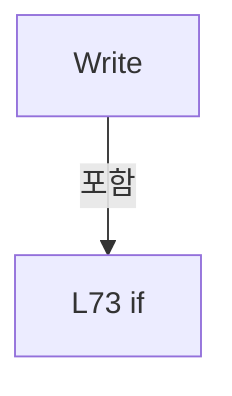

변경 전 점검: 입력/반환 타입, 위 호출자, 예외/취소 경로, 공유 상태와 저장·전송 소비자를 함께 확인합니다. 값의 단위나 물리 방향을 이름만으로 확정하지 않습니다.

### LocalFunctionStatement `SelectKeys` · L61–64

[Drilling.File/Parser/CCsvParser.cs:61–64](https://github.com/kjuws10-rgb/A3Drilling/blob/5aee8e58439c9b455cae7c9593c9be986c3e682e/Drilling.File/Parser/CCsvParser.cs#L61-L64)

| 항목 | 실제 추출 값 |
| --- | --- |
| 서명 | System.Collections.Generic.IEnumerable<string> SelectKeys(System.Collections.Generic.IReadOnlyDictionary<string, string>) |
| 접근/수식자 | Private /  |
| 반환/값 타입 | System.Collections.Generic.IEnumerable<string> |
| 소속 타입 | NamedType:Drilling.File.Parser.CCsvParser |

입력 계약:

| 이름 | 타입 | 전달 | 선택/기본값 |
| --- | --- | --- | --- |
| row | System.Collections.Generic.IReadOnlyDictionary<string, string> | None | False /  |

현재 부분 분석에서 직접 연결된 호출자는 없습니다. XAML/이벤트/인터페이스·델리게이트·외부 진입을 추가 확인해야 하며, 미사용으로 판정한 것이 아닙니다.

본문의 실제 연산·분기·예외·반환 순서(원문 위치 순):

| 원본 행 | 종류 | 주석 해설 |
| --- | --- | --- |
| 63 | return | 호출자에게 값 또는 제어를 반환합니다: return row.Keys; |

변경 전 점검: 입력/반환 타입, 위 호출자, 예외/취소 경로, 공유 상태와 저장·전송 소비자를 함께 확인합니다. 값의 단위나 물리 방향을 이름만으로 확정하지 않습니다.

### LocalFunctionStatement `ShouldIncludeItem` · L66–69

[Drilling.File/Parser/CCsvParser.cs:66–69](https://github.com/kjuws10-rgb/A3Drilling/blob/5aee8e58439c9b455cae7c9593c9be986c3e682e/Drilling.File/Parser/CCsvParser.cs#L66-L69)

| 항목 | 실제 추출 값 |
| --- | --- |
| 서명 | bool ShouldIncludeItem(string) |
| 접근/수식자 | Private /  |
| 반환/값 타입 | bool |
| 소속 타입 | NamedType:Drilling.File.Parser.CCsvParser |

입력 계약:

| 이름 | 타입 | 전달 | 선택/기본값 |
| --- | --- | --- | --- |
| key | string | None | False /  |

현재 부분 분석에서 직접 연결된 호출자는 없습니다. XAML/이벤트/인터페이스·델리게이트·외부 진입을 추가 확인해야 하며, 미사용으로 판정한 것이 아닙니다.

호출하는 대상과 해석 범위:

| 원본 행 | 표현식 | 분석 상태 | 대상/소스 위치 |
| --- | --- | --- | --- |
| 68 | headers.Contains | resolved | bool System.Collections.Generic.IEnumerable<string>.Contains<string>(string, System.Collections.Generic.IEqualityComparer<string>?) |

본문의 실제 연산·분기·예외·반환 순서(원문 위치 순):

| 원본 행 | 종류 | 주석 해설 |
| --- | --- | --- |
| 68 | call | 함수·델리게이트 또는 객체 생성자를 호출합니다: headers.Contains(key, StringComparer.OrdinalIgnoreCase) |
| 68 | return | 호출자에게 값 또는 제어를 반환합니다: return !headers.Contains(key, StringComparer.OrdinalIgnoreCase); |

변경 전 점검: 입력/반환 타입, 위 호출자, 예외/취소 경로, 공유 상태와 저장·전송 소비자를 함께 확인합니다. 값의 단위나 물리 방향을 이름만으로 확정하지 않습니다.

### LocalFunctionStatement `SelectItem` · L82–90

[Drilling.File/Parser/CCsvParser.cs:82–90](https://github.com/kjuws10-rgb/A3Drilling/blob/5aee8e58439c9b455cae7c9593c9be986c3e682e/Drilling.File/Parser/CCsvParser.cs#L82-L90)

| 항목 | 실제 추출 값 |
| --- | --- |
| 서명 | string SelectItem(System.Collections.Generic.IReadOnlyDictionary<string, string>) |
| 접근/수식자 | Private /  |
| 반환/값 타입 | string |
| 소속 타입 | NamedType:Drilling.File.Parser.CCsvParser |

입력 계약:

| 이름 | 타입 | 전달 | 선택/기본값 |
| --- | --- | --- | --- |
| row | System.Collections.Generic.IReadOnlyDictionary<string, string> | None | False /  |

현재 부분 분석에서 직접 연결된 호출자는 없습니다. XAML/이벤트/인터페이스·델리게이트·외부 진입을 추가 확인해야 하며, 미사용으로 판정한 것이 아닙니다.

호출하는 대상과 해석 범위:

| 원본 행 | 표현식 | 분석 상태 | 대상/소스 위치 |
| --- | --- | --- | --- |
| 89 | string.Join | resolved | string string.Join(string?, System.Collections.Generic.IEnumerable<string?>) |
| 89 | outputHeaders.Select | resolved | System.Collections.Generic.IEnumerable<string> System.Collections.Generic.IEnumerable<string>.Select<string, string>(System.Func<string, string>) |

본문의 실제 연산·분기·예외·반환 순서(원문 위치 순):

| 원본 행 | 종류 | 주석 해설 |
| --- | --- | --- |
| 89 | call | 함수·델리게이트 또는 객체 생성자를 호출합니다: string.Join(",", outputHeaders.Select(SelectItem)) |
| 89 | call | 함수·델리게이트 또는 객체 생성자를 호출합니다: outputHeaders.Select(SelectItem) |
| 89 | return | 호출자에게 값 또는 제어를 반환합니다: return string.Join(",", outputHeaders.Select(SelectItem)); |

변경 전 점검: 입력/반환 타입, 위 호출자, 예외/취소 경로, 공유 상태와 저장·전송 소비자를 함께 확인합니다. 값의 단위나 물리 방향을 이름만으로 확정하지 않습니다.

### LocalFunctionStatement `SelectItem` · L84–87

[Drilling.File/Parser/CCsvParser.cs:84–87](https://github.com/kjuws10-rgb/A3Drilling/blob/5aee8e58439c9b455cae7c9593c9be986c3e682e/Drilling.File/Parser/CCsvParser.cs#L84-L87)

| 항목 | 실제 추출 값 |
| --- | --- |
| 서명 | string SelectItem(string) |
| 접근/수식자 | Private /  |
| 반환/값 타입 | string |
| 소속 타입 | NamedType:Drilling.File.Parser.CCsvParser |

입력 계약:

| 이름 | 타입 | 전달 | 선택/기본값 |
| --- | --- | --- | --- |
| header | string | None | False /  |

현재 부분 분석에서 직접 연결된 호출자는 없습니다. XAML/이벤트/인터페이스·델리게이트·외부 진입을 추가 확인해야 하며, 미사용으로 판정한 것이 아닙니다.

호출하는 대상과 해석 범위:

| 원본 행 | 표현식 | 분석 상태 | 대상/소스 위치 |
| --- | --- | --- | --- |
| 86 | Escape | resolved | string Drilling.File.Parser.CCsvParser.Escape(string) · Drilling.File/Parser/CCsvParser.cs:417 |
| 86 | Get | resolved | string Drilling.File.Parser.CCsvParser.Get(System.Collections.Generic.IReadOnlyDictionary<string, string>, string) · Drilling.File/Parser/CCsvParser.cs:168 |

본문의 실제 연산·분기·예외·반환 순서(원문 위치 순):

| 원본 행 | 종류 | 주석 해설 |
| --- | --- | --- |
| 86 | call | 함수·델리게이트 또는 객체 생성자를 호출합니다: Escape(Get(row, header)) |
| 86 | call | 함수·델리게이트 또는 객체 생성자를 호출합니다: Get(row, header) |
| 86 | return | 호출자에게 값 또는 제어를 반환합니다: return Escape(Get(row, header)); |

변경 전 점검: 입력/반환 타입, 위 호출자, 예외/취소 경로, 공유 상태와 저장·전송 소비자를 함께 확인합니다. 값의 단위나 물리 방향을 이름만으로 확정하지 않습니다.

### MethodDeclaration `Append` · L96–138

[Drilling.File/Parser/CCsvParser.cs:96–138](https://github.com/kjuws10-rgb/A3Drilling/blob/5aee8e58439c9b455cae7c9593c9be986c3e682e/Drilling.File/Parser/CCsvParser.cs#L96-L138)

| 항목 | 실제 추출 값 |
| --- | --- |
| 서명 | void Drilling.File.Parser.CCsvParser.Append(string, System.Collections.Generic.IReadOnlyList<string>, System.Collections.Generic.IReadOnlyDictionary<string, string>) |
| 접근/수식자 | Public / public, static |
| 반환/값 타입 | void |
| 소속 타입 | NamedType:Drilling.File.Parser.CCsvParser |

입력 계약:

| 이름 | 타입 | 전달 | 선택/기본값 |
| --- | --- | --- | --- |
| path | string | None | False /  |
| headers | System.Collections.Generic.IReadOnlyList<string> | None | False /  |
| row | System.Collections.Generic.IReadOnlyDictionary<string, string> | None | False /  |

정적 호출자로 확인된 위치:

| 호출 파일/행 | 호출 표현식 | 런타임 분기 가능 |
| --- | --- | --- |
| [Drilling.File/ReviewOffset/CReviewOffsetFile.cs:494–497](https://github.com/kjuws10-rgb/A3Drilling/blob/5aee8e58439c9b455cae7c9593c9be986c3e682e/Drilling.File/ReviewOffset/CReviewOffsetFile.cs#L494-L497) | CCsvParser.Append | False |

호출하는 대상과 해석 범위:

| 원본 행 | 표현식 | 분석 상태 | 대상/소스 위치 |
| --- | --- | --- | --- |
| 101 | System.IO.File.Exists | resolved | bool System.IO.File.Exists(string?) |
| 101 | new FileInfo | resolved | System.IO.FileInfo.FileInfo(string) |
| 103 | Write | resolved | void Drilling.File.Parser.CCsvParser.Write(string, System.Collections.Generic.IReadOnlyList<string>, System.Collections.Generic.IEnumerable<System.Collections.Generic.IReadOnlyDictionary<string, string>>) · Drilling.File/Parser/CCsvParser.cs:58 |
| 107 | row.Keys.FirstOrDefault | resolved | string? System.Collections.Generic.IEnumerable<string>.FirstOrDefault<string>(System.Func<string, bool>) |
| 108 | headers.Contains | resolved | bool System.Collections.Generic.IEnumerable<string>.Contains<string>(string, System.Collections.Generic.IEqualityComparer<string>?) |
| 111 | new InvalidDataException | resolved | System.IO.InvalidDataException.InvalidDataException(string?) |
| 114 | string.Join | resolved | string string.Join(string?, System.Collections.Generic.IEnumerable<string?>) |
| 114 | headers.Select | resolved | System.Collections.Generic.IEnumerable<string> System.Collections.Generic.IEnumerable<string>.Select<string, string>(System.Func<string, string>) |
| 114 | Escape | resolved | string Drilling.File.Parser.CCsvParser.Escape(string) · Drilling.File/Parser/CCsvParser.cs:417 |
| 114 | Get | resolved | string Drilling.File.Parser.CCsvParser.Get(System.Collections.Generic.IReadOnlyDictionary<string, string>, string) · Drilling.File/Parser/CCsvParser.cs:168 |
| 115 | new FileStream | resolved | System.IO.FileStream.FileStream(string, System.IO.FileMode, System.IO.FileAccess, System.IO.FileShare) |
| 124 | ReadLastByte | resolved | byte Drilling.File.Parser.CCsvParser.ReadLastByte(System.IO.FileStream) · Drilling.File/Parser/CCsvParser.cs:140 |
| 128 | CsvWriteEncoding.GetBytes | resolved · 동적 구현 선택 가능 | byte[] System.Text.Encoding.GetBytes(string) |
| 129 | stream.Write | resolved · 동적 구현 선택 가능 | void System.IO.FileStream.Write(byte[], int, int) |
| 130 | stream.Flush | resolved · 동적 구현 선택 가능 | void System.IO.FileStream.Flush(bool) |
| 134 | stream.SetLength | resolved · 동적 구현 선택 가능 | void System.IO.FileStream.SetLength(long) |
| 135 | stream.Flush | resolved · 동적 구현 선택 가능 | void System.IO.FileStream.Flush(bool) |

본문의 실제 연산·분기·예외·반환 순서(원문 위치 순):

| 원본 행 | 종류 | 주석 해설 |
| --- | --- | --- |
| 101 | call | 함수·델리게이트 또는 객체 생성자를 호출합니다: System.IO.File.Exists(path) |
| 101 | call | 함수·델리게이트 또는 객체 생성자를 호출합니다: new FileInfo(path) |
| 101 | if | 조건에 따라 분기합니다: if (!System.IO.File.Exists(path) &#124;&#124; new FileInfo(path).Length == 0) |
| 103 | call | 함수·델리게이트 또는 객체 생성자를 호출합니다: Write(path, headers, [row]) |
| 104 | return | 호출자에게 값 또는 제어를 반환합니다: return; |
| 107 | call | 함수·델리게이트 또는 객체 생성자를 호출합니다: row.Keys.FirstOrDefault(key => !headers.Contains(key, StringComparer.OrdinalIgnoreCase)) |
| 107 | local-declaration | 지역 변수를 선언합니다: var unexpected = row.Keys.FirstOrDefault(key => !headers.Contains(key, StringComparer.OrdinalIgnoreCase)); |
| 107 | variable-initializer | 변수의 초기값을 지정합니다: unexpected = row.Keys.FirstOrDefault(key => !headers.Contains(key, StringComparer.OrdinalIgnoreCase)) |
| 108 | call | 함수·델리게이트 또는 객체 생성자를 호출합니다: headers.Contains(key, StringComparer.OrdinalIgnoreCase) |
| 109 | if | 조건에 따라 분기합니다: if (unexpected is not null) |
| 111 | call | 함수·델리게이트 또는 객체 생성자를 호출합니다: new InvalidDataException($"CSV append failed. Unexpected column: {unexpected}") |
| 111 | throw | 예외를 발생/전달합니다: throw new InvalidDataException($"CSV append failed. Unexpected column: {unexpected}"); |
| 114 | call | 함수·델리게이트 또는 객체 생성자를 호출합니다: string.Join(",", headers.Select(header => Escape(Get(row, header)))) |
| 114 | call | 함수·델리게이트 또는 객체 생성자를 호출합니다: headers.Select(header => Escape(Get(row, header))) |
| 114 | call | 함수·델리게이트 또는 객체 생성자를 호출합니다: Escape(Get(row, header)) |
| 114 | call | 함수·델리게이트 또는 객체 생성자를 호출합니다: Get(row, header) |
| 114 | local-declaration | 지역 변수를 선언합니다: var line = string.Join(",", headers.Select(header => Escape(Get(row, header)))); |
| 114 | variable-initializer | 변수의 초기값을 지정합니다: line = string.Join(",", headers.Select(header => Escape(Get(row, header)))) |
| 115 | call | 함수·델리게이트 또는 객체 생성자를 호출합니다: new FileStream( path, FileMode.Open, FileAccess.ReadWrite, FileShare.Read) |
| 115 | using-declaration | 정리할 자원을 선언합니다: using var stream = new FileStream( path, FileMode.Open, FileAccess.ReadWrite, FileShare.Read); |
| 115 | variable-initializer | 변수의 초기값을 지정합니다: stream = new FileStream( path, FileMode.Open, FileAccess.ReadWrite, FileShare.Read) |
| 120 | local-declaration | 지역 변수를 선언합니다: var originalLength = stream.Length; |
| 120 | variable-initializer | 변수의 초기값을 지정합니다: originalLength = stream.Length |
| 121 | assignment | 값을 대상에 대입합니다: stream.Position = originalLength |
| 122 | try | 예외 처리 범위입니다: try |
| 124 | call | 함수·델리게이트 또는 객체 생성자를 호출합니다: ReadLastByte(stream) |
| 124 | conditional-expression | 조건에 따라 결과식을 선택합니다: originalLength > 0 && ReadLastByte(stream) != (byte)'\n' ? Environment.NewLine : "" |
| 124 | local-declaration | 지역 변수를 선언합니다: var prefix = originalLength > 0 && ReadLastByte(stream) != (byte)'\n' ? Environment.NewLine : ""; |
| 124 | variable-initializer | 변수의 초기값을 지정합니다: prefix = originalLength > 0 && ReadLastByte(stream) != (byte)'\n' ? Environment.NewLine : "" |
| 127 | assignment | 값을 대상에 대입합니다: stream.Position = originalLength |
| 128 | call | 함수·델리게이트 또는 객체 생성자를 호출합니다: CsvWriteEncoding.GetBytes(prefix + line + Environment.NewLine) |
| 128 | local-declaration | 지역 변수를 선언합니다: var bytes = CsvWriteEncoding.GetBytes(prefix + line + Environment.NewLine); |
| 128 | variable-initializer | 변수의 초기값을 지정합니다: bytes = CsvWriteEncoding.GetBytes(prefix + line + Environment.NewLine) |
| 129 | call | 함수·델리게이트 또는 객체 생성자를 호출합니다: stream.Write(bytes, 0, bytes.Length) |
| 130 | call | 함수·델리게이트 또는 객체 생성자를 호출합니다: stream.Flush(flushToDisk: true) |
| 132 | catch | 지정 예외를 처리합니다: catch  |
| 134 | call | 함수·델리게이트 또는 객체 생성자를 호출합니다: stream.SetLength(originalLength) |
| 135 | call | 함수·델리게이트 또는 객체 생성자를 호출합니다: stream.Flush(flushToDisk: true) |
| 136 | throw | 예외를 발생/전달합니다: throw; |

제어 구문의 포함 구조(실제 실행 순서/CFG가 아닌 구문 탐색 그림):

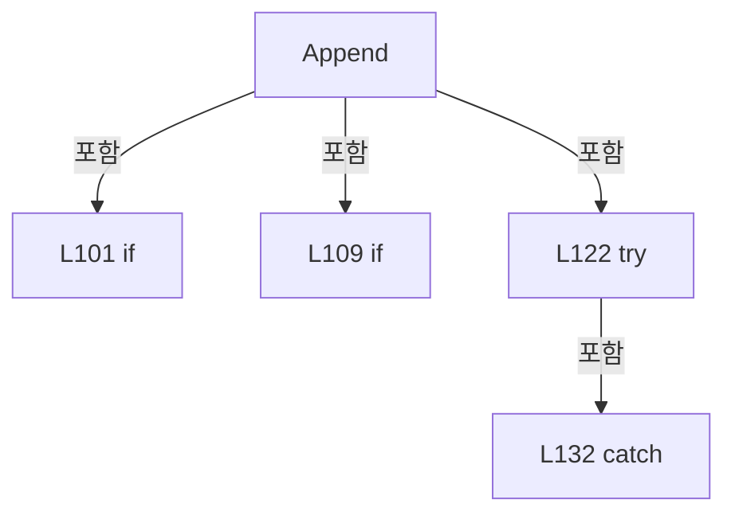

변경 전 점검: 입력/반환 타입, 위 호출자, 예외/취소 경로, 공유 상태와 저장·전송 소비자를 함께 확인합니다. 값의 단위나 물리 방향을 이름만으로 확정하지 않습니다.

### MethodDeclaration `ReadLastByte` · L140–145

[Drilling.File/Parser/CCsvParser.cs:140–145](https://github.com/kjuws10-rgb/A3Drilling/blob/5aee8e58439c9b455cae7c9593c9be986c3e682e/Drilling.File/Parser/CCsvParser.cs#L140-L145)

| 항목 | 실제 추출 값 |
| --- | --- |
| 서명 | byte Drilling.File.Parser.CCsvParser.ReadLastByte(System.IO.FileStream) |
| 접근/수식자 | Private / private, static |
| 반환/값 타입 | byte |
| 소속 타입 | NamedType:Drilling.File.Parser.CCsvParser |

입력 계약:

| 이름 | 타입 | 전달 | 선택/기본값 |
| --- | --- | --- | --- |
| stream | System.IO.FileStream | None | False /  |

정적 호출자로 확인된 위치:

| 호출 파일/행 | 호출 표현식 | 런타임 분기 가능 |
| --- | --- | --- |
| [Drilling.File/Parser/CCsvParser.cs:124–124](https://github.com/kjuws10-rgb/A3Drilling/blob/5aee8e58439c9b455cae7c9593c9be986c3e682e/Drilling.File/Parser/CCsvParser.cs#L124-L124) | ReadLastByte | False |

호출하는 대상과 해석 범위:

| 원본 행 | 표현식 | 분석 상태 | 대상/소스 위치 |
| --- | --- | --- | --- |
| 143 | stream.ReadByte | resolved · 동적 구현 선택 가능 | int System.IO.FileStream.ReadByte() |

본문의 실제 연산·분기·예외·반환 순서(원문 위치 순):

| 원본 행 | 종류 | 주석 해설 |
| --- | --- | --- |
| 142 | assignment | 값을 대상에 대입합니다: stream.Position = stream.Length - 1 |
| 143 | call | 함수·델리게이트 또는 객체 생성자를 호출합니다: stream.ReadByte() |
| 143 | local-declaration | 지역 변수를 선언합니다: var value = stream.ReadByte(); |
| 143 | variable-initializer | 변수의 초기값을 지정합니다: value = stream.ReadByte() |
| 144 | conditional-expression | 조건에 따라 결과식을 선택합니다: value < 0 ? (byte)0 : (byte)value |
| 144 | return | 호출자에게 값 또는 제어를 반환합니다: return value < 0 ? (byte)0 : (byte)value; |

변경 전 점검: 입력/반환 타입, 위 호출자, 예외/취소 경로, 공유 상태와 저장·전송 소비자를 함께 확인합니다. 값의 단위나 물리 방향을 이름만으로 확정하지 않습니다.

### MethodDeclaration `ReadLines` · L147–155

[Drilling.File/Parser/CCsvParser.cs:147–155](https://github.com/kjuws10-rgb/A3Drilling/blob/5aee8e58439c9b455cae7c9593c9be986c3e682e/Drilling.File/Parser/CCsvParser.cs#L147-L155)

| 항목 | 실제 추출 값 |
| --- | --- |
| 서명 | System.Collections.Generic.IReadOnlyList<string> Drilling.File.Parser.CCsvParser.ReadLines(string) |
| 접근/수식자 | Public / public, static |
| 반환/값 타입 | System.Collections.Generic.IReadOnlyList<string> |
| 소속 타입 | NamedType:Drilling.File.Parser.CCsvParser |

입력 계약:

| 이름 | 타입 | 전달 | 선택/기본값 |
| --- | --- | --- | --- |
| path | string | None | False /  |

정적 호출자로 확인된 위치:

| 호출 파일/행 | 호출 표현식 | 런타임 분기 가능 |
| --- | --- | --- |
| [Drilling.File/JHMI/CConfigStructureFile.cs:256–256](https://github.com/kjuws10-rgb/A3Drilling/blob/5aee8e58439c9b455cae7c9593c9be986c3e682e/Drilling.File/JHMI/CConfigStructureFile.cs#L256-L256) | CCsvParser.ReadLines | False |
| [Drilling.File/JHMI/CJhmiRecipeFile.cs:897–897](https://github.com/kjuws10-rgb/A3Drilling/blob/5aee8e58439c9b455cae7c9593c9be986c3e682e/Drilling.File/JHMI/CJhmiRecipeFile.cs#L897-L897) | CCsvParser.ReadLines | False |
| [Drilling.File/JHMI/CJhmiRecipeFile.cs:1428–1428](https://github.com/kjuws10-rgb/A3Drilling/blob/5aee8e58439c9b455cae7c9593c9be986c3e682e/Drilling.File/JHMI/CJhmiRecipeFile.cs#L1428-L1428) | CCsvParser.ReadLines | False |
| [Drilling.File/Parser/CCsvParser.cs:22–22](https://github.com/kjuws10-rgb/A3Drilling/blob/5aee8e58439c9b455cae7c9593c9be986c3e682e/Drilling.File/Parser/CCsvParser.cs#L22-L22) | ReadLines | False |
| [Drilling.File/Parser/CCsvParser.cs:260–260](https://github.com/kjuws10-rgb/A3Drilling/blob/5aee8e58439c9b455cae7c9593c9be986c3e682e/Drilling.File/Parser/CCsvParser.cs#L260-L260) | ReadLines | False |

호출하는 대상과 해석 범위:

| 원본 행 | 표현식 | 분석 상태 | 대상/소스 위치 |
| --- | --- | --- | --- |
| 149 | System.IO.File.Exists | resolved | bool System.IO.File.Exists(string?) |
| 154 | SplitLines | resolved | string[] Drilling.File.Parser.CCsvParser.SplitLines(string) · Drilling.File/Parser/CCsvParser.cs:460 |
| 154 | ReadCsvText | resolved | string Drilling.File.Parser.CCsvParser.ReadCsvText(string) · Drilling.File/Parser/CCsvParser.cs:432 |

본문의 실제 연산·분기·예외·반환 순서(원문 위치 순):

| 원본 행 | 종류 | 주석 해설 |
| --- | --- | --- |
| 149 | call | 함수·델리게이트 또는 객체 생성자를 호출합니다: System.IO.File.Exists(path) |
| 149 | if | 조건에 따라 분기합니다: if (!System.IO.File.Exists(path)) |
| 151 | return | 호출자에게 값 또는 제어를 반환합니다: return[]; |
| 154 | call | 함수·델리게이트 또는 객체 생성자를 호출합니다: SplitLines(ReadCsvText(path)) |
| 154 | call | 함수·델리게이트 또는 객체 생성자를 호출합니다: ReadCsvText(path) |
| 154 | return | 호출자에게 값 또는 제어를 반환합니다: return SplitLines(ReadCsvText(path)); |

제어 구문의 포함 구조(실제 실행 순서/CFG가 아닌 구문 탐색 그림):

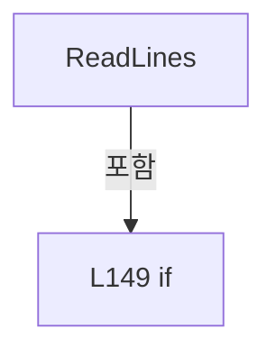

변경 전 점검: 입력/반환 타입, 위 호출자, 예외/취소 경로, 공유 상태와 저장·전송 소비자를 함께 확인합니다. 값의 단위나 물리 방향을 이름만으로 확정하지 않습니다.

### MethodDeclaration `WriteLines` · L157–166

[Drilling.File/Parser/CCsvParser.cs:157–166](https://github.com/kjuws10-rgb/A3Drilling/blob/5aee8e58439c9b455cae7c9593c9be986c3e682e/Drilling.File/Parser/CCsvParser.cs#L157-L166)

| 항목 | 실제 추출 값 |
| --- | --- |
| 서명 | void Drilling.File.Parser.CCsvParser.WriteLines(string, System.Collections.Generic.IEnumerable<string>) |
| 접근/수식자 | Public / public, static |
| 반환/값 타입 | void |
| 소속 타입 | NamedType:Drilling.File.Parser.CCsvParser |

입력 계약:

| 이름 | 타입 | 전달 | 선택/기본값 |
| --- | --- | --- | --- |
| path | string | None | False /  |
| lines | System.Collections.Generic.IEnumerable<string> | None | False /  |

정적 호출자로 확인된 위치:

| 호출 파일/행 | 호출 표현식 | 런타임 분기 가능 |
| --- | --- | --- |
| [Drilling.File/JHMI/CJhmiRecipeFile.cs:227–227](https://github.com/kjuws10-rgb/A3Drilling/blob/5aee8e58439c9b455cae7c9593c9be986c3e682e/Drilling.File/JHMI/CJhmiRecipeFile.cs#L227-L227) | CCsvParser.WriteLines | False |
| [Drilling.File/JHMI/CJhmiRecipeFile.cs:346–346](https://github.com/kjuws10-rgb/A3Drilling/blob/5aee8e58439c9b455cae7c9593c9be986c3e682e/Drilling.File/JHMI/CJhmiRecipeFile.cs#L346-L346) | CCsvParser.WriteLines | False |
| [Drilling.File/Parser/CCsvParser.cs:93–93](https://github.com/kjuws10-rgb/A3Drilling/blob/5aee8e58439c9b455cae7c9593c9be986c3e682e/Drilling.File/Parser/CCsvParser.cs#L93-L93) | WriteLines | False |

호출하는 대상과 해석 범위:

| 원본 행 | 표현식 | 분석 상태 | 대상/소스 위치 |
| --- | --- | --- | --- |
| 159 | Path.GetDirectoryName | resolved | string? System.IO.Path.GetDirectoryName(string?) |
| 160 | string.IsNullOrWhiteSpace | resolved | bool string.IsNullOrWhiteSpace(string?) |
| 162 | Directory.CreateDirectory | resolved | System.IO.DirectoryInfo System.IO.Directory.CreateDirectory(string) |
| 165 | System.IO.File.WriteAllLines | resolved | void System.IO.File.WriteAllLines(string, System.Collections.Generic.IEnumerable<string>, System.Text.Encoding) |

본문의 실제 연산·분기·예외·반환 순서(원문 위치 순):

| 원본 행 | 종류 | 주석 해설 |
| --- | --- | --- |
| 159 | call | 함수·델리게이트 또는 객체 생성자를 호출합니다: Path.GetDirectoryName(path) |
| 159 | local-declaration | 지역 변수를 선언합니다: var directory = Path.GetDirectoryName(path); |
| 159 | variable-initializer | 변수의 초기값을 지정합니다: directory = Path.GetDirectoryName(path) |
| 160 | call | 함수·델리게이트 또는 객체 생성자를 호출합니다: string.IsNullOrWhiteSpace(directory) |
| 160 | if | 조건에 따라 분기합니다: if (!string.IsNullOrWhiteSpace(directory)) |
| 162 | call | 함수·델리게이트 또는 객체 생성자를 호출합니다: Directory.CreateDirectory(directory) |
| 165 | call | 함수·델리게이트 또는 객체 생성자를 호출합니다: System.IO.File.WriteAllLines(path, lines, CsvWriteEncoding) |

제어 구문의 포함 구조(실제 실행 순서/CFG가 아닌 구문 탐색 그림):

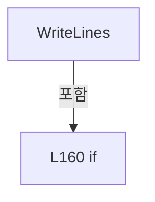

변경 전 점검: 입력/반환 타입, 위 호출자, 예외/취소 경로, 공유 상태와 저장·전송 소비자를 함께 확인합니다. 값의 단위나 물리 방향을 이름만으로 확정하지 않습니다.

### MethodDeclaration `Get` · L168–171

[Drilling.File/Parser/CCsvParser.cs:168–171](https://github.com/kjuws10-rgb/A3Drilling/blob/5aee8e58439c9b455cae7c9593c9be986c3e682e/Drilling.File/Parser/CCsvParser.cs#L168-L171)

| 항목 | 실제 추출 값 |
| --- | --- |
| 서명 | string Drilling.File.Parser.CCsvParser.Get(System.Collections.Generic.IReadOnlyDictionary<string, string>, string) |
| 접근/수식자 | Public / public, static |
| 반환/값 타입 | string |
| 소속 타입 | NamedType:Drilling.File.Parser.CCsvParser |

입력 계약:

| 이름 | 타입 | 전달 | 선택/기본값 |
| --- | --- | --- | --- |
| row | System.Collections.Generic.IReadOnlyDictionary<string, string> | None | False /  |
| key | string | None | False /  |

정적 호출자로 확인된 위치:

| 호출 파일/행 | 호출 표현식 | 런타임 분기 가능 |
| --- | --- | --- |
| [Drilling.File/JHMI/CAlarmListFile.cs:21–21](https://github.com/kjuws10-rgb/A3Drilling/blob/5aee8e58439c9b455cae7c9593c9be986c3e682e/Drilling.File/JHMI/CAlarmListFile.cs#L21-L21) | CCsvParser.Get | False |
| [Drilling.File/JHMI/CAlarmListFile.cs:28–28](https://github.com/kjuws10-rgb/A3Drilling/blob/5aee8e58439c9b455cae7c9593c9be986c3e682e/Drilling.File/JHMI/CAlarmListFile.cs#L28-L28) | CCsvParser.Get | False |
| [Drilling.File/JHMI/CAlarmListFile.cs:29–29](https://github.com/kjuws10-rgb/A3Drilling/blob/5aee8e58439c9b455cae7c9593c9be986c3e682e/Drilling.File/JHMI/CAlarmListFile.cs#L29-L29) | CCsvParser.Get | False |
| [Drilling.File/JHMI/CAlarmListFile.cs:29–29](https://github.com/kjuws10-rgb/A3Drilling/blob/5aee8e58439c9b455cae7c9593c9be986c3e682e/Drilling.File/JHMI/CAlarmListFile.cs#L29-L29) | CCsvParser.Get | False |
| [Drilling.File/JHMI/CAlarmListFile.cs:29–29](https://github.com/kjuws10-rgb/A3Drilling/blob/5aee8e58439c9b455cae7c9593c9be986c3e682e/Drilling.File/JHMI/CAlarmListFile.cs#L29-L29) | CCsvParser.Get | False |
| [Drilling.File/JHMI/CBETFile.cs:40–40](https://github.com/kjuws10-rgb/A3Drilling/blob/5aee8e58439c9b455cae7c9593c9be986c3e682e/Drilling.File/JHMI/CBETFile.cs#L40-L40) | CCsvParser.Get | False |
| [Drilling.File/JHMI/CBETFile.cs:45–45](https://github.com/kjuws10-rgb/A3Drilling/blob/5aee8e58439c9b455cae7c9593c9be986c3e682e/Drilling.File/JHMI/CBETFile.cs#L45-L45) | CCsvParser.Get | False |
| [Drilling.File/JHMI/CBETFile.cs:45–45](https://github.com/kjuws10-rgb/A3Drilling/blob/5aee8e58439c9b455cae7c9593c9be986c3e682e/Drilling.File/JHMI/CBETFile.cs#L45-L45) | CCsvParser.Get | False |
| [Drilling.File/JHMI/CBETFile.cs:45–45](https://github.com/kjuws10-rgb/A3Drilling/blob/5aee8e58439c9b455cae7c9593c9be986c3e682e/Drilling.File/JHMI/CBETFile.cs#L45-L45) | CCsvParser.Get | False |
| [Drilling.File/JHMI/CBETFile.cs:45–45](https://github.com/kjuws10-rgb/A3Drilling/blob/5aee8e58439c9b455cae7c9593c9be986c3e682e/Drilling.File/JHMI/CBETFile.cs#L45-L45) | CCsvParser.Get | False |
| [Drilling.File/JHMI/CConfigStructureFile.cs:295–295](https://github.com/kjuws10-rgb/A3Drilling/blob/5aee8e58439c9b455cae7c9593c9be986c3e682e/Drilling.File/JHMI/CConfigStructureFile.cs#L295-L295) | CCsvParser.Get | False |
| [Drilling.File/JHMI/CConfigStructureFile.cs:295–295](https://github.com/kjuws10-rgb/A3Drilling/blob/5aee8e58439c9b455cae7c9593c9be986c3e682e/Drilling.File/JHMI/CConfigStructureFile.cs#L295-L295) | CCsvParser.Get | False |
| [Drilling.File/JHMI/CConfigStructureFile.cs:305–305](https://github.com/kjuws10-rgb/A3Drilling/blob/5aee8e58439c9b455cae7c9593c9be986c3e682e/Drilling.File/JHMI/CConfigStructureFile.cs#L305-L305) | CCsvParser.Get | False |
| [Drilling.File/JHMI/CConfigStructureFile.cs:315–315](https://github.com/kjuws10-rgb/A3Drilling/blob/5aee8e58439c9b455cae7c9593c9be986c3e682e/Drilling.File/JHMI/CConfigStructureFile.cs#L315-L315) | CCsvParser.Get | False |
| [Drilling.File/JHMI/CConfigStructureFile.cs:325–325](https://github.com/kjuws10-rgb/A3Drilling/blob/5aee8e58439c9b455cae7c9593c9be986c3e682e/Drilling.File/JHMI/CConfigStructureFile.cs#L325-L325) | CCsvParser.Get | False |
| [Drilling.File/JHMI/CConfigStructureFile.cs:325–325](https://github.com/kjuws10-rgb/A3Drilling/blob/5aee8e58439c9b455cae7c9593c9be986c3e682e/Drilling.File/JHMI/CConfigStructureFile.cs#L325-L325) | CCsvParser.Get | False |
| [Drilling.File/JHMI/CConfigStructureFile.cs:335–335](https://github.com/kjuws10-rgb/A3Drilling/blob/5aee8e58439c9b455cae7c9593c9be986c3e682e/Drilling.File/JHMI/CConfigStructureFile.cs#L335-L335) | CCsvParser.Get | False |
| [Drilling.File/JHMI/CConfigStructureFile.cs:345–345](https://github.com/kjuws10-rgb/A3Drilling/blob/5aee8e58439c9b455cae7c9593c9be986c3e682e/Drilling.File/JHMI/CConfigStructureFile.cs#L345-L345) | CCsvParser.Get | False |
| [Drilling.File/JHMI/CConfigStructureFile.cs:355–355](https://github.com/kjuws10-rgb/A3Drilling/blob/5aee8e58439c9b455cae7c9593c9be986c3e682e/Drilling.File/JHMI/CConfigStructureFile.cs#L355-L355) | CCsvParser.Get | False |
| [Drilling.File/JHMI/CConfigStructureFile.cs:388–388](https://github.com/kjuws10-rgb/A3Drilling/blob/5aee8e58439c9b455cae7c9593c9be986c3e682e/Drilling.File/JHMI/CConfigStructureFile.cs#L388-L388) | CCsvParser.Get | False |
| [Drilling.File/JHMI/CInterfaceFile.cs:116–116](https://github.com/kjuws10-rgb/A3Drilling/blob/5aee8e58439c9b455cae7c9593c9be986c3e682e/Drilling.File/JHMI/CInterfaceFile.cs#L116-L116) | CCsvParser.Get | False |
| [Drilling.File/JHMI/CJhmiRecipeFile.cs:861–861](https://github.com/kjuws10-rgb/A3Drilling/blob/5aee8e58439c9b455cae7c9593c9be986c3e682e/Drilling.File/JHMI/CJhmiRecipeFile.cs#L861-L861) | CCsvParser.Get | False |
| [Drilling.File/JHMI/CJhmiRecipeFile.cs:862–862](https://github.com/kjuws10-rgb/A3Drilling/blob/5aee8e58439c9b455cae7c9593c9be986c3e682e/Drilling.File/JHMI/CJhmiRecipeFile.cs#L862-L862) | CCsvParser.Get | False |
| [Drilling.File/JHMI/CJhmiRecipeFile.cs:863–863](https://github.com/kjuws10-rgb/A3Drilling/blob/5aee8e58439c9b455cae7c9593c9be986c3e682e/Drilling.File/JHMI/CJhmiRecipeFile.cs#L863-L863) | CCsvParser.Get | False |
| [Drilling.File/JHMI/CJhmiRecipeFile.cs:864–864](https://github.com/kjuws10-rgb/A3Drilling/blob/5aee8e58439c9b455cae7c9593c9be986c3e682e/Drilling.File/JHMI/CJhmiRecipeFile.cs#L864-L864) | CCsvParser.Get | False |
| [Drilling.File/JHMI/CJhmiRecipeFile.cs:864–864](https://github.com/kjuws10-rgb/A3Drilling/blob/5aee8e58439c9b455cae7c9593c9be986c3e682e/Drilling.File/JHMI/CJhmiRecipeFile.cs#L864-L864) | CCsvParser.Get | False |
| [Drilling.File/JHMI/CJhmiRecipeFile.cs:865–865](https://github.com/kjuws10-rgb/A3Drilling/blob/5aee8e58439c9b455cae7c9593c9be986c3e682e/Drilling.File/JHMI/CJhmiRecipeFile.cs#L865-L865) | CCsvParser.Get | False |
| [Drilling.File/JHMI/CJhmiRecipeFile.cs:865–865](https://github.com/kjuws10-rgb/A3Drilling/blob/5aee8e58439c9b455cae7c9593c9be986c3e682e/Drilling.File/JHMI/CJhmiRecipeFile.cs#L865-L865) | CCsvParser.Get | False |
| [Drilling.File/JHMI/CJhmiRecipeFile.cs:866–866](https://github.com/kjuws10-rgb/A3Drilling/blob/5aee8e58439c9b455cae7c9593c9be986c3e682e/Drilling.File/JHMI/CJhmiRecipeFile.cs#L866-L866) | CCsvParser.Get | False |
| [Drilling.File/JHMI/CJhmiRecipeFile.cs:867–867](https://github.com/kjuws10-rgb/A3Drilling/blob/5aee8e58439c9b455cae7c9593c9be986c3e682e/Drilling.File/JHMI/CJhmiRecipeFile.cs#L867-L867) | CCsvParser.Get | False |
| [Drilling.File/JHMI/CJhmiRecipeFile.cs:868–868](https://github.com/kjuws10-rgb/A3Drilling/blob/5aee8e58439c9b455cae7c9593c9be986c3e682e/Drilling.File/JHMI/CJhmiRecipeFile.cs#L868-L868) | CCsvParser.Get | False |
| [Drilling.File/JHMI/CJhmiRecipeFile.cs:869–869](https://github.com/kjuws10-rgb/A3Drilling/blob/5aee8e58439c9b455cae7c9593c9be986c3e682e/Drilling.File/JHMI/CJhmiRecipeFile.cs#L869-L869) | CCsvParser.Get | False |
| [Drilling.File/JHMI/CJhmiRecipeFile.cs:870–870](https://github.com/kjuws10-rgb/A3Drilling/blob/5aee8e58439c9b455cae7c9593c9be986c3e682e/Drilling.File/JHMI/CJhmiRecipeFile.cs#L870-L870) | CCsvParser.Get | False |
| [Drilling.File/JHMI/CJhmiRecipeFile.cs:871–871](https://github.com/kjuws10-rgb/A3Drilling/blob/5aee8e58439c9b455cae7c9593c9be986c3e682e/Drilling.File/JHMI/CJhmiRecipeFile.cs#L871-L871) | CCsvParser.Get | False |
| [Drilling.File/JHMI/CJhmiRecipeFile.cs:872–872](https://github.com/kjuws10-rgb/A3Drilling/blob/5aee8e58439c9b455cae7c9593c9be986c3e682e/Drilling.File/JHMI/CJhmiRecipeFile.cs#L872-L872) | CCsvParser.Get | False |
| [Drilling.File/JHMI/CJhmiRecipeFile.cs:873–873](https://github.com/kjuws10-rgb/A3Drilling/blob/5aee8e58439c9b455cae7c9593c9be986c3e682e/Drilling.File/JHMI/CJhmiRecipeFile.cs#L873-L873) | CCsvParser.Get | False |
| [Drilling.File/JHMI/CJhmiRecipeFile.cs:874–874](https://github.com/kjuws10-rgb/A3Drilling/blob/5aee8e58439c9b455cae7c9593c9be986c3e682e/Drilling.File/JHMI/CJhmiRecipeFile.cs#L874-L874) | CCsvParser.Get | False |
| [Drilling.File/JHMI/CJhmiRecipeFile.cs:875–875](https://github.com/kjuws10-rgb/A3Drilling/blob/5aee8e58439c9b455cae7c9593c9be986c3e682e/Drilling.File/JHMI/CJhmiRecipeFile.cs#L875-L875) | CCsvParser.Get | False |
| [Drilling.File/JHMI/CJhmiRecipeFile.cs:876–876](https://github.com/kjuws10-rgb/A3Drilling/blob/5aee8e58439c9b455cae7c9593c9be986c3e682e/Drilling.File/JHMI/CJhmiRecipeFile.cs#L876-L876) | CCsvParser.Get | False |
| [Drilling.File/JHMI/CManualScanFile.cs:56–56](https://github.com/kjuws10-rgb/A3Drilling/blob/5aee8e58439c9b455cae7c9593c9be986c3e682e/Drilling.File/JHMI/CManualScanFile.cs#L56-L56) | CCsvParser.Get | False |
| [Drilling.File/JHMI/CManualScanFile.cs:61–61](https://github.com/kjuws10-rgb/A3Drilling/blob/5aee8e58439c9b455cae7c9593c9be986c3e682e/Drilling.File/JHMI/CManualScanFile.cs#L61-L61) | CCsvParser.Get | False |
| [Drilling.File/JHMI/CManualScanFile.cs:66–66](https://github.com/kjuws10-rgb/A3Drilling/blob/5aee8e58439c9b455cae7c9593c9be986c3e682e/Drilling.File/JHMI/CManualScanFile.cs#L66-L66) | CCsvParser.Get | False |
| [Drilling.File/JHMI/CManualScanFile.cs:202–202](https://github.com/kjuws10-rgb/A3Drilling/blob/5aee8e58439c9b455cae7c9593c9be986c3e682e/Drilling.File/JHMI/CManualScanFile.cs#L202-L202) | CCsvParser.Get | False |
| [Drilling.File/JHMI/CManualScanFile.cs:204–204](https://github.com/kjuws10-rgb/A3Drilling/blob/5aee8e58439c9b455cae7c9593c9be986c3e682e/Drilling.File/JHMI/CManualScanFile.cs#L204-L204) | CCsvParser.Get | False |
| [Drilling.File/JHMI/CManualScanFile.cs:207–207](https://github.com/kjuws10-rgb/A3Drilling/blob/5aee8e58439c9b455cae7c9593c9be986c3e682e/Drilling.File/JHMI/CManualScanFile.cs#L207-L207) | CCsvParser.Get | False |
| [Drilling.File/JHMI/CManualScanFile.cs:208–208](https://github.com/kjuws10-rgb/A3Drilling/blob/5aee8e58439c9b455cae7c9593c9be986c3e682e/Drilling.File/JHMI/CManualScanFile.cs#L208-L208) | CCsvParser.Get | False |
| [Drilling.File/JHMI/CManualScanFile.cs:210–210](https://github.com/kjuws10-rgb/A3Drilling/blob/5aee8e58439c9b455cae7c9593c9be986c3e682e/Drilling.File/JHMI/CManualScanFile.cs#L210-L210) | CCsvParser.Get | False |
| [Drilling.File/JHMI/CManualScanFile.cs:211–211](https://github.com/kjuws10-rgb/A3Drilling/blob/5aee8e58439c9b455cae7c9593c9be986c3e682e/Drilling.File/JHMI/CManualScanFile.cs#L211-L211) | CCsvParser.Get | False |
| [Drilling.File/JHMI/CManualScanFile.cs:212–212](https://github.com/kjuws10-rgb/A3Drilling/blob/5aee8e58439c9b455cae7c9593c9be986c3e682e/Drilling.File/JHMI/CManualScanFile.cs#L212-L212) | CCsvParser.Get | False |
| [Drilling.File/JHMI/CManualScanFile.cs:213–213](https://github.com/kjuws10-rgb/A3Drilling/blob/5aee8e58439c9b455cae7c9593c9be986c3e682e/Drilling.File/JHMI/CManualScanFile.cs#L213-L213) | CCsvParser.Get | False |
| [Drilling.File/JHMI/CManualScanFile.cs:214–214](https://github.com/kjuws10-rgb/A3Drilling/blob/5aee8e58439c9b455cae7c9593c9be986c3e682e/Drilling.File/JHMI/CManualScanFile.cs#L214-L214) | CCsvParser.Get | False |
| [Drilling.File/JHMI/CManualScanFile.cs:215–215](https://github.com/kjuws10-rgb/A3Drilling/blob/5aee8e58439c9b455cae7c9593c9be986c3e682e/Drilling.File/JHMI/CManualScanFile.cs#L215-L215) | CCsvParser.Get | False |
| [Drilling.File/JHMI/CManualScanFile.cs:216–216](https://github.com/kjuws10-rgb/A3Drilling/blob/5aee8e58439c9b455cae7c9593c9be986c3e682e/Drilling.File/JHMI/CManualScanFile.cs#L216-L216) | CCsvParser.Get | False |
| [Drilling.File/JHMI/CManualScanFile.cs:259–259](https://github.com/kjuws10-rgb/A3Drilling/blob/5aee8e58439c9b455cae7c9593c9be986c3e682e/Drilling.File/JHMI/CManualScanFile.cs#L259-L259) | CCsvParser.Get | False |
| [Drilling.File/JHMI/CManualScanFile.cs:264–264](https://github.com/kjuws10-rgb/A3Drilling/blob/5aee8e58439c9b455cae7c9593c9be986c3e682e/Drilling.File/JHMI/CManualScanFile.cs#L264-L264) | CCsvParser.Get | False |
| [Drilling.File/JHMI/CManualScanFile.cs:269–269](https://github.com/kjuws10-rgb/A3Drilling/blob/5aee8e58439c9b455cae7c9593c9be986c3e682e/Drilling.File/JHMI/CManualScanFile.cs#L269-L269) | CCsvParser.Get | False |
| [Drilling.File/JHMI/CSettingFile.cs:152–152](https://github.com/kjuws10-rgb/A3Drilling/blob/5aee8e58439c9b455cae7c9593c9be986c3e682e/Drilling.File/JHMI/CSettingFile.cs#L152-L152) | CCsvParser.Get | False |
| [Drilling.File/JHMI/CSettingFile.cs:153–153](https://github.com/kjuws10-rgb/A3Drilling/blob/5aee8e58439c9b455cae7c9593c9be986c3e682e/Drilling.File/JHMI/CSettingFile.cs#L153-L153) | CCsvParser.Get | False |
| [Drilling.File/JHMI/CSettingFile.cs:154–154](https://github.com/kjuws10-rgb/A3Drilling/blob/5aee8e58439c9b455cae7c9593c9be986c3e682e/Drilling.File/JHMI/CSettingFile.cs#L154-L154) | CCsvParser.Get | False |
| [Drilling.File/JHMI/CSettingFile.cs:155–155](https://github.com/kjuws10-rgb/A3Drilling/blob/5aee8e58439c9b455cae7c9593c9be986c3e682e/Drilling.File/JHMI/CSettingFile.cs#L155-L155) | CCsvParser.Get | False |
| [Drilling.File/JHMI/CSettingFile.cs:171–171](https://github.com/kjuws10-rgb/A3Drilling/blob/5aee8e58439c9b455cae7c9593c9be986c3e682e/Drilling.File/JHMI/CSettingFile.cs#L171-L171) | CCsvParser.Get | False |
| [Drilling.File/JHMI/CSettingFile.cs:172–172](https://github.com/kjuws10-rgb/A3Drilling/blob/5aee8e58439c9b455cae7c9593c9be986c3e682e/Drilling.File/JHMI/CSettingFile.cs#L172-L172) | CCsvParser.Get | False |
| [Drilling.File/JHMI/CSettingFile.cs:173–173](https://github.com/kjuws10-rgb/A3Drilling/blob/5aee8e58439c9b455cae7c9593c9be986c3e682e/Drilling.File/JHMI/CSettingFile.cs#L173-L173) | CCsvParser.Get | False |
| [Drilling.File/JHMI/CSettingFile.cs:174–174](https://github.com/kjuws10-rgb/A3Drilling/blob/5aee8e58439c9b455cae7c9593c9be986c3e682e/Drilling.File/JHMI/CSettingFile.cs#L174-L174) | CCsvParser.Get | False |
| [Drilling.File/JHMI/CSettingFile.cs:175–175](https://github.com/kjuws10-rgb/A3Drilling/blob/5aee8e58439c9b455cae7c9593c9be986c3e682e/Drilling.File/JHMI/CSettingFile.cs#L175-L175) | CCsvParser.Get | False |
| [Drilling.File/JHMI/CSettingFile.cs:176–176](https://github.com/kjuws10-rgb/A3Drilling/blob/5aee8e58439c9b455cae7c9593c9be986c3e682e/Drilling.File/JHMI/CSettingFile.cs#L176-L176) | CCsvParser.Get | False |
| [Drilling.File/JHMI/CSettingFile.cs:177–177](https://github.com/kjuws10-rgb/A3Drilling/blob/5aee8e58439c9b455cae7c9593c9be986c3e682e/Drilling.File/JHMI/CSettingFile.cs#L177-L177) | CCsvParser.Get | False |
| [Drilling.File/JHMI/CSettingFile.cs:178–178](https://github.com/kjuws10-rgb/A3Drilling/blob/5aee8e58439c9b455cae7c9593c9be986c3e682e/Drilling.File/JHMI/CSettingFile.cs#L178-L178) | CCsvParser.Get | False |
| [Drilling.File/JHMI/CSettingFile.cs:307–307](https://github.com/kjuws10-rgb/A3Drilling/blob/5aee8e58439c9b455cae7c9593c9be986c3e682e/Drilling.File/JHMI/CSettingFile.cs#L307-L307) | CCsvParser.Get | False |
| [Drilling.File/JHMI/CSettingFile.cs:307–307](https://github.com/kjuws10-rgb/A3Drilling/blob/5aee8e58439c9b455cae7c9593c9be986c3e682e/Drilling.File/JHMI/CSettingFile.cs#L307-L307) | CCsvParser.Get | False |
| [Drilling.File/JHMI/CSettingFile.cs:312–312](https://github.com/kjuws10-rgb/A3Drilling/blob/5aee8e58439c9b455cae7c9593c9be986c3e682e/Drilling.File/JHMI/CSettingFile.cs#L312-L312) | CCsvParser.Get | False |
| [Drilling.File/JHMI/CSettingFile.cs:312–312](https://github.com/kjuws10-rgb/A3Drilling/blob/5aee8e58439c9b455cae7c9593c9be986c3e682e/Drilling.File/JHMI/CSettingFile.cs#L312-L312) | CCsvParser.Get | False |
| [Drilling.File/JHMI/CSettingFile.cs:322–322](https://github.com/kjuws10-rgb/A3Drilling/blob/5aee8e58439c9b455cae7c9593c9be986c3e682e/Drilling.File/JHMI/CSettingFile.cs#L322-L322) | CCsvParser.Get | False |
| [Drilling.File/Parser/CCsvParser.cs:86–86](https://github.com/kjuws10-rgb/A3Drilling/blob/5aee8e58439c9b455cae7c9593c9be986c3e682e/Drilling.File/Parser/CCsvParser.cs#L86-L86) | Get | False |
| [Drilling.File/Parser/CCsvParser.cs:114–114](https://github.com/kjuws10-rgb/A3Drilling/blob/5aee8e58439c9b455cae7c9593c9be986c3e682e/Drilling.File/Parser/CCsvParser.cs#L114-L114) | Get | False |
| [Drilling.File/Parser/CCsvParser.cs:177–177](https://github.com/kjuws10-rgb/A3Drilling/blob/5aee8e58439c9b455cae7c9593c9be986c3e682e/Drilling.File/Parser/CCsvParser.cs#L177-L177) | Get | False |
| [Drilling.File/PowerTable/CPowerTableFile.cs:141–141](https://github.com/kjuws10-rgb/A3Drilling/blob/5aee8e58439c9b455cae7c9593c9be986c3e682e/Drilling.File/PowerTable/CPowerTableFile.cs#L141-L141) | CCsvParser.Get | False |
| [Drilling.File/Product/CProductFile.cs:29–29](https://github.com/kjuws10-rgb/A3Drilling/blob/5aee8e58439c9b455cae7c9593c9be986c3e682e/Drilling.File/Product/CProductFile.cs#L29-L29) | CCsvParser.Get | False |
| [Drilling.File/Product/CProductFile.cs:344–344](https://github.com/kjuws10-rgb/A3Drilling/blob/5aee8e58439c9b455cae7c9593c9be986c3e682e/Drilling.File/Product/CProductFile.cs#L344-L344) | CCsvParser.Get | False |
| [Drilling.File/Product/CProductFile.cs:349–349](https://github.com/kjuws10-rgb/A3Drilling/blob/5aee8e58439c9b455cae7c9593c9be986c3e682e/Drilling.File/Product/CProductFile.cs#L349-L349) | CCsvParser.Get | False |
| [Drilling.File/Product/CProductFile.cs:354–354](https://github.com/kjuws10-rgb/A3Drilling/blob/5aee8e58439c9b455cae7c9593c9be986c3e682e/Drilling.File/Product/CProductFile.cs#L354-L354) | CCsvParser.Get | False |
| [Drilling.File/Product/CProductFile.cs:364–364](https://github.com/kjuws10-rgb/A3Drilling/blob/5aee8e58439c9b455cae7c9593c9be986c3e682e/Drilling.File/Product/CProductFile.cs#L364-L364) | CCsvParser.Get | False |
| [Drilling.File/Product/CProductFile.cs:450–450](https://github.com/kjuws10-rgb/A3Drilling/blob/5aee8e58439c9b455cae7c9593c9be986c3e682e/Drilling.File/Product/CProductFile.cs#L450-L450) | CCsvParser.Get | False |
| [Drilling.File/Product/CProductFile.cs:458–458](https://github.com/kjuws10-rgb/A3Drilling/blob/5aee8e58439c9b455cae7c9593c9be986c3e682e/Drilling.File/Product/CProductFile.cs#L458-L458) | CCsvParser.Get | False |
| [Drilling.File/Product/CProductFile.cs:459–459](https://github.com/kjuws10-rgb/A3Drilling/blob/5aee8e58439c9b455cae7c9593c9be986c3e682e/Drilling.File/Product/CProductFile.cs#L459-L459) | CCsvParser.Get | False |
| [Drilling.File/Product/CProductFile.cs:460–460](https://github.com/kjuws10-rgb/A3Drilling/blob/5aee8e58439c9b455cae7c9593c9be986c3e682e/Drilling.File/Product/CProductFile.cs#L460-L460) | CCsvParser.Get | False |
| [Drilling.File/Product/CProductFile.cs:461–461](https://github.com/kjuws10-rgb/A3Drilling/blob/5aee8e58439c9b455cae7c9593c9be986c3e682e/Drilling.File/Product/CProductFile.cs#L461-L461) | CCsvParser.Get | False |
| [Drilling.File/Product/CProductFile.cs:462–462](https://github.com/kjuws10-rgb/A3Drilling/blob/5aee8e58439c9b455cae7c9593c9be986c3e682e/Drilling.File/Product/CProductFile.cs#L462-L462) | CCsvParser.Get | False |
| [Drilling.File/Product/CProductFile.cs:463–463](https://github.com/kjuws10-rgb/A3Drilling/blob/5aee8e58439c9b455cae7c9593c9be986c3e682e/Drilling.File/Product/CProductFile.cs#L463-L463) | CCsvParser.Get | False |
| [Drilling.File/Product/CProductFile.cs:464–464](https://github.com/kjuws10-rgb/A3Drilling/blob/5aee8e58439c9b455cae7c9593c9be986c3e682e/Drilling.File/Product/CProductFile.cs#L464-L464) | CCsvParser.Get | False |
| [Drilling.File/ReviewOffset/CReviewOffsetFile.cs:680–680](https://github.com/kjuws10-rgb/A3Drilling/blob/5aee8e58439c9b455cae7c9593c9be986c3e682e/Drilling.File/ReviewOffset/CReviewOffsetFile.cs#L680-L680) | CCsvParser.Get | False |
| [Drilling.File/ReviewOffset/CReviewOffsetFile.cs:689–689](https://github.com/kjuws10-rgb/A3Drilling/blob/5aee8e58439c9b455cae7c9593c9be986c3e682e/Drilling.File/ReviewOffset/CReviewOffsetFile.cs#L689-L689) | CCsvParser.Get | False |
| [Drilling.File/ReviewOffset/CReviewOffsetFile.cs:691–691](https://github.com/kjuws10-rgb/A3Drilling/blob/5aee8e58439c9b455cae7c9593c9be986c3e682e/Drilling.File/ReviewOffset/CReviewOffsetFile.cs#L691-L691) | CCsvParser.Get | False |
| [Drilling.File/ReviewOffset/CReviewOffsetFile.cs:694–694](https://github.com/kjuws10-rgb/A3Drilling/blob/5aee8e58439c9b455cae7c9593c9be986c3e682e/Drilling.File/ReviewOffset/CReviewOffsetFile.cs#L694-L694) | CCsvParser.Get | False |
| [Drilling.File/ReviewResult/CReviewResultFile.cs:87–87](https://github.com/kjuws10-rgb/A3Drilling/blob/5aee8e58439c9b455cae7c9593c9be986c3e682e/Drilling.File/ReviewResult/CReviewResultFile.cs#L87-L87) | CCsvParser.Get | False |
| [Drilling.File/ReviewResult/CReviewResultFile.cs:88–88](https://github.com/kjuws10-rgb/A3Drilling/blob/5aee8e58439c9b455cae7c9593c9be986c3e682e/Drilling.File/ReviewResult/CReviewResultFile.cs#L88-L88) | CCsvParser.Get | False |
| [Drilling.File/ReviewResult/CReviewResultFile.cs:91–91](https://github.com/kjuws10-rgb/A3Drilling/blob/5aee8e58439c9b455cae7c9593c9be986c3e682e/Drilling.File/ReviewResult/CReviewResultFile.cs#L91-L91) | CCsvParser.Get | False |
| [Drilling.File/ReviewResult/CReviewResultFile.cs:92–92](https://github.com/kjuws10-rgb/A3Drilling/blob/5aee8e58439c9b455cae7c9593c9be986c3e682e/Drilling.File/ReviewResult/CReviewResultFile.cs#L92-L92) | CCsvParser.Get | False |
| [Drilling.File/ReviewResult/CReviewResultFile.cs:94–94](https://github.com/kjuws10-rgb/A3Drilling/blob/5aee8e58439c9b455cae7c9593c9be986c3e682e/Drilling.File/ReviewResult/CReviewResultFile.cs#L94-L94) | CCsvParser.Get | False |
| [Drilling.File/ReviewResult/CReviewResultFile.cs:370–370](https://github.com/kjuws10-rgb/A3Drilling/blob/5aee8e58439c9b455cae7c9593c9be986c3e682e/Drilling.File/ReviewResult/CReviewResultFile.cs#L370-L370) | CCsvParser.Get | False |
| [Drilling.File/ReviewResult/CReviewResultFile.cs:406–406](https://github.com/kjuws10-rgb/A3Drilling/blob/5aee8e58439c9b455cae7c9593c9be986c3e682e/Drilling.File/ReviewResult/CReviewResultFile.cs#L406-L406) | CCsvParser.Get | False |
| [Drilling.File/ReviewResult/CReviewResultFile.cs:431–431](https://github.com/kjuws10-rgb/A3Drilling/blob/5aee8e58439c9b455cae7c9593c9be986c3e682e/Drilling.File/ReviewResult/CReviewResultFile.cs#L431-L431) | CCsvParser.Get | False |
| [Drilling.File/ReviewResult/CReviewResultFile.cs:537–537](https://github.com/kjuws10-rgb/A3Drilling/blob/5aee8e58439c9b455cae7c9593c9be986c3e682e/Drilling.File/ReviewResult/CReviewResultFile.cs#L537-L537) | CCsvParser.Get | False |
| [Drilling.File/ReviewResult/CReviewResultFile.cs:544–544](https://github.com/kjuws10-rgb/A3Drilling/blob/5aee8e58439c9b455cae7c9593c9be986c3e682e/Drilling.File/ReviewResult/CReviewResultFile.cs#L544-L544) | CCsvParser.Get | False |
| [Drilling.File/ReviewResult/CReviewResultFile.cs:586–586](https://github.com/kjuws10-rgb/A3Drilling/blob/5aee8e58439c9b455cae7c9593c9be986c3e682e/Drilling.File/ReviewResult/CReviewResultFile.cs#L586-L586) | CCsvParser.Get | False |
| [Drilling.File/ReviewResult/CReviewResultFile.cs:616–616](https://github.com/kjuws10-rgb/A3Drilling/blob/5aee8e58439c9b455cae7c9593c9be986c3e682e/Drilling.File/ReviewResult/CReviewResultFile.cs#L616-L616) | CCsvParser.Get | False |

호출하는 대상과 해석 범위:

| 원본 행 | 표현식 | 분석 상태 | 대상/소스 위치 |
| --- | --- | --- | --- |
| 170 | row.TryGetValue | resolved · 동적 구현 선택 가능 | bool System.Collections.Generic.IReadOnlyDictionary<string, string>.TryGetValue(string, out string) |

본문의 실제 연산·분기·예외·반환 순서(원문 위치 순):

| 원본 행 | 종류 | 주석 해설 |
| --- | --- | --- |
| 170 | call | 함수·델리게이트 또는 객체 생성자를 호출합니다: row.TryGetValue(key, out var value) |
| 170 | conditional-expression | 조건에 따라 결과식을 선택합니다: row.TryGetValue(key, out var value) ? value : string.Empty |
| 170 | return | 호출자에게 값 또는 제어를 반환합니다: return row.TryGetValue(key, out var value) ? value : string.Empty; |

변경 전 점검: 입력/반환 타입, 위 호출자, 예외/취소 경로, 공유 상태와 저장·전송 소비자를 함께 확인합니다. 값의 단위나 물리 방향을 이름만으로 확정하지 않습니다.

### MethodDeclaration `GetFirst` · L173–185

[Drilling.File/Parser/CCsvParser.cs:173–185](https://github.com/kjuws10-rgb/A3Drilling/blob/5aee8e58439c9b455cae7c9593c9be986c3e682e/Drilling.File/Parser/CCsvParser.cs#L173-L185)

| 항목 | 실제 추출 값 |
| --- | --- |
| 서명 | string Drilling.File.Parser.CCsvParser.GetFirst(System.Collections.Generic.IReadOnlyDictionary<string, string>, params string[]) |
| 접근/수식자 | Public / public, static |
| 반환/값 타입 | string |
| 소속 타입 | NamedType:Drilling.File.Parser.CCsvParser |

입력 계약:

| 이름 | 타입 | 전달 | 선택/기본값 |
| --- | --- | --- | --- |
| row | System.Collections.Generic.IReadOnlyDictionary<string, string> | None | False /  |
| names | string[] | None | False /  |

정적 호출자로 확인된 위치:

| 호출 파일/행 | 호출 표현식 | 런타임 분기 가능 |
| --- | --- | --- |
| [Drilling.File/JHMI/CMelsecMapFile.cs:241–241](https://github.com/kjuws10-rgb/A3Drilling/blob/5aee8e58439c9b455cae7c9593c9be986c3e682e/Drilling.File/JHMI/CMelsecMapFile.cs#L241-L241) | CCsvParser.GetFirst | False |
| [Drilling.File/JHMI/CMotorFile.cs:255–255](https://github.com/kjuws10-rgb/A3Drilling/blob/5aee8e58439c9b455cae7c9593c9be986c3e682e/Drilling.File/JHMI/CMotorFile.cs#L255-L255) | CCsvParser.GetFirst | False |
| [Drilling.File/Parser/CCsvParser.cs:189–189](https://github.com/kjuws10-rgb/A3Drilling/blob/5aee8e58439c9b455cae7c9593c9be986c3e682e/Drilling.File/Parser/CCsvParser.cs#L189-L189) | GetFirst | False |

호출하는 대상과 해석 범위:

| 원본 행 | 표현식 | 분석 상태 | 대상/소스 위치 |
| --- | --- | --- | --- |
| 177 | Get | resolved | string Drilling.File.Parser.CCsvParser.Get(System.Collections.Generic.IReadOnlyDictionary<string, string>, string) · Drilling.File/Parser/CCsvParser.cs:168 |
| 178 | string.IsNullOrWhiteSpace | resolved | bool string.IsNullOrWhiteSpace(string?) |
| 180 | value.Trim | resolved | string string.Trim() |

본문의 실제 연산·분기·예외·반환 순서(원문 위치 순):

| 원본 행 | 종류 | 주석 해설 |
| --- | --- | --- |
| 175 | foreach | 컬렉션 요소를 순회합니다: foreach (var name in names) |
| 177 | call | 함수·델리게이트 또는 객체 생성자를 호출합니다: Get(row, name) |
| 177 | local-declaration | 지역 변수를 선언합니다: var value = Get(row, name); |
| 177 | variable-initializer | 변수의 초기값을 지정합니다: value = Get(row, name) |
| 178 | call | 함수·델리게이트 또는 객체 생성자를 호출합니다: string.IsNullOrWhiteSpace(value) |
| 178 | if | 조건에 따라 분기합니다: if (!string.IsNullOrWhiteSpace(value)) |
| 180 | call | 함수·델리게이트 또는 객체 생성자를 호출합니다: value.Trim() |
| 180 | return | 호출자에게 값 또는 제어를 반환합니다: return value.Trim(); |
| 184 | return | 호출자에게 값 또는 제어를 반환합니다: return ""; |

제어 구문의 포함 구조(실제 실행 순서/CFG가 아닌 구문 탐색 그림):

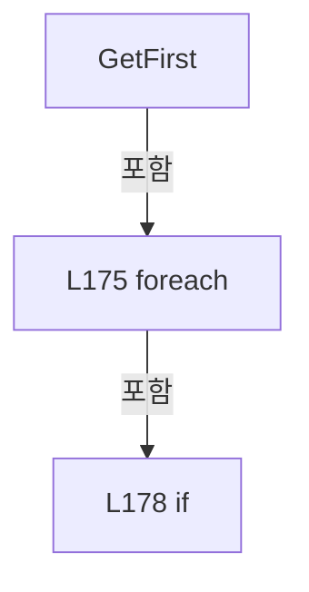

변경 전 점검: 입력/반환 타입, 위 호출자, 예외/취소 경로, 공유 상태와 저장·전송 소비자를 함께 확인합니다. 값의 단위나 물리 방향을 이름만으로 확정하지 않습니다.

### MethodDeclaration `RequireText` · L187–196

[Drilling.File/Parser/CCsvParser.cs:187–196](https://github.com/kjuws10-rgb/A3Drilling/blob/5aee8e58439c9b455cae7c9593c9be986c3e682e/Drilling.File/Parser/CCsvParser.cs#L187-L196)

| 항목 | 실제 추출 값 |
| --- | --- |
| 서명 | string Drilling.File.Parser.CCsvParser.RequireText(System.Collections.Generic.IReadOnlyDictionary<string, string>, string, int, params string[]) |
| 접근/수식자 | Public / public, static |
| 반환/값 타입 | string |
| 소속 타입 | NamedType:Drilling.File.Parser.CCsvParser |

입력 계약:

| 이름 | 타입 | 전달 | 선택/기본값 |
| --- | --- | --- | --- |
| row | System.Collections.Generic.IReadOnlyDictionary<string, string> | None | False /  |
| tableName | string | None | False /  |
| rowNo | int | None | False /  |
| names | string[] | None | False /  |

정적 호출자로 확인된 위치:

| 호출 파일/행 | 호출 표현식 | 런타임 분기 가능 |
| --- | --- | --- |
| [Drilling.File/JHMI/CAlarmListFile.cs:22–22](https://github.com/kjuws10-rgb/A3Drilling/blob/5aee8e58439c9b455cae7c9593c9be986c3e682e/Drilling.File/JHMI/CAlarmListFile.cs#L22-L22) | CCsvParser.RequireText | False |
| [Drilling.File/JHMI/CAlarmListFile.cs:23–23](https://github.com/kjuws10-rgb/A3Drilling/blob/5aee8e58439c9b455cae7c9593c9be986c3e682e/Drilling.File/JHMI/CAlarmListFile.cs#L23-L23) | CCsvParser.RequireText | False |
| [Drilling.File/JHMI/CInterfaceFile.cs:421–421](https://github.com/kjuws10-rgb/A3Drilling/blob/5aee8e58439c9b455cae7c9593c9be986c3e682e/Drilling.File/JHMI/CInterfaceFile.cs#L421-L421) | CCsvParser.RequireText | False |
| [Drilling.File/JHMI/CMelsecMapFile.cs:236–236](https://github.com/kjuws10-rgb/A3Drilling/blob/5aee8e58439c9b455cae7c9593c9be986c3e682e/Drilling.File/JHMI/CMelsecMapFile.cs#L236-L236) | CCsvParser.RequireText | False |
| [Drilling.File/ReviewOffset/CReviewOffsetFile.cs:437–441](https://github.com/kjuws10-rgb/A3Drilling/blob/5aee8e58439c9b455cae7c9593c9be986c3e682e/Drilling.File/ReviewOffset/CReviewOffsetFile.cs#L437-L441) | CCsvParser.RequireText | False |
| [Drilling.File/ReviewOffset/CReviewOffsetFile.cs:442–446](https://github.com/kjuws10-rgb/A3Drilling/blob/5aee8e58439c9b455cae7c9593c9be986c3e682e/Drilling.File/ReviewOffset/CReviewOffsetFile.cs#L442-L446) | CCsvParser.RequireText | False |
| [Drilling.File/ReviewOffset/CReviewOffsetFile.cs:454–458](https://github.com/kjuws10-rgb/A3Drilling/blob/5aee8e58439c9b455cae7c9593c9be986c3e682e/Drilling.File/ReviewOffset/CReviewOffsetFile.cs#L454-L458) | CCsvParser.RequireText | False |
| [Drilling.File/ReviewOffset/CReviewOffsetFile.cs:684–688](https://github.com/kjuws10-rgb/A3Drilling/blob/5aee8e58439c9b455cae7c9593c9be986c3e682e/Drilling.File/ReviewOffset/CReviewOffsetFile.cs#L684-L688) | CCsvParser.RequireText | False |
| [Drilling.File/ReviewResult/CReviewResultFile.cs:398–398](https://github.com/kjuws10-rgb/A3Drilling/blob/5aee8e58439c9b455cae7c9593c9be986c3e682e/Drilling.File/ReviewResult/CReviewResultFile.cs#L398-L398) | CCsvParser.RequireText | False |
| [Drilling.File/ReviewResult/CReviewResultFile.cs:404–404](https://github.com/kjuws10-rgb/A3Drilling/blob/5aee8e58439c9b455cae7c9593c9be986c3e682e/Drilling.File/ReviewResult/CReviewResultFile.cs#L404-L404) | CCsvParser.RequireText | False |

호출하는 대상과 해석 범위:

| 원본 행 | 표현식 | 분석 상태 | 대상/소스 위치 |
| --- | --- | --- | --- |
| 189 | GetFirst | resolved | string Drilling.File.Parser.CCsvParser.GetFirst(System.Collections.Generic.IReadOnlyDictionary<string, string>, params string[]) · Drilling.File/Parser/CCsvParser.cs:173 |
| 190 | string.IsNullOrWhiteSpace | resolved | bool string.IsNullOrWhiteSpace(string?) |
| 192 | new InvalidDataException | resolved | System.IO.InvalidDataException.InvalidDataException(string?) |

본문의 실제 연산·분기·예외·반환 순서(원문 위치 순):

| 원본 행 | 종류 | 주석 해설 |
| --- | --- | --- |
| 189 | call | 함수·델리게이트 또는 객체 생성자를 호출합니다: GetFirst(row, names) |
| 189 | local-declaration | 지역 변수를 선언합니다: var value = GetFirst(row, names); |
| 189 | variable-initializer | 변수의 초기값을 지정합니다: value = GetFirst(row, names) |
| 190 | call | 함수·델리게이트 또는 객체 생성자를 호출합니다: string.IsNullOrWhiteSpace(value) |
| 190 | if | 조건에 따라 분기합니다: if (string.IsNullOrWhiteSpace(value)) |
| 192 | call | 함수·델리게이트 또는 객체 생성자를 호출합니다: new InvalidDataException($"{tableName} validation failed. Row {rowNo} / {names[0]} cannot be empty.") |
| 192 | throw | 예외를 발생/전달합니다: throw new InvalidDataException($"{tableName} validation failed. Row {rowNo} / {names[0]} cannot be empty."); |
| 195 | return | 호출자에게 값 또는 제어를 반환합니다: return value; |

제어 구문의 포함 구조(실제 실행 순서/CFG가 아닌 구문 탐색 그림):

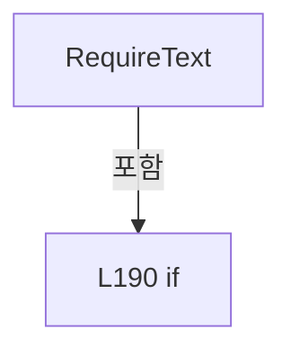

변경 전 점검: 입력/반환 타입, 위 호출자, 예외/취소 경로, 공유 상태와 저장·전송 소비자를 함께 확인합니다. 값의 단위나 물리 방향을 이름만으로 확정하지 않습니다.

### MethodDeclaration `ReadInt` · L198–206

[Drilling.File/Parser/CCsvParser.cs:198–206](https://github.com/kjuws10-rgb/A3Drilling/blob/5aee8e58439c9b455cae7c9593c9be986c3e682e/Drilling.File/Parser/CCsvParser.cs#L198-L206)

| 항목 | 실제 추출 값 |
| --- | --- |
| 서명 | int Drilling.File.Parser.CCsvParser.ReadInt(string, string, int, string, int) |
| 접근/수식자 | Public / public, static |
| 반환/값 타입 | int |
| 소속 타입 | NamedType:Drilling.File.Parser.CCsvParser |

입력 계약:

| 이름 | 타입 | 전달 | 선택/기본값 |
| --- | --- | --- | --- |
| value | string | None | False /  |
| tableName | string | None | False /  |
| rowNo | int | None | False /  |
| fieldName | string | None | False /  |
| defaultValue | int | None | False /  |

정적 호출자로 확인된 위치:

| 호출 파일/행 | 호출 표현식 | 런타임 분기 가능 |
| --- | --- | --- |
| [Drilling.File/JHMI/CMelsecMapFile.cs:251–251](https://github.com/kjuws10-rgb/A3Drilling/blob/5aee8e58439c9b455cae7c9593c9be986c3e682e/Drilling.File/JHMI/CMelsecMapFile.cs#L251-L251) | CCsvParser.ReadInt | False |
| [Drilling.File/JHMI/CMotorFile.cs:271–271](https://github.com/kjuws10-rgb/A3Drilling/blob/5aee8e58439c9b455cae7c9593c9be986c3e682e/Drilling.File/JHMI/CMotorFile.cs#L271-L271) | CCsvParser.ReadInt | False |

호출하는 대상과 해석 범위:

| 원본 행 | 표현식 | 분석 상태 | 대상/소스 위치 |
| --- | --- | --- | --- |
| 200 | string.IsNullOrWhiteSpace | resolved | bool string.IsNullOrWhiteSpace(string?) |
| 205 | int.TryParse | resolved | bool int.TryParse(string?, System.Globalization.NumberStyles, System.IFormatProvider?, out int) |
| 205 | new InvalidDataException | resolved | System.IO.InvalidDataException.InvalidDataException(string?) |

본문의 실제 연산·분기·예외·반환 순서(원문 위치 순):

| 원본 행 | 종류 | 주석 해설 |
| --- | --- | --- |
| 200 | call | 함수·델리게이트 또는 객체 생성자를 호출합니다: string.IsNullOrWhiteSpace(value) |
| 200 | if | 조건에 따라 분기합니다: if (string.IsNullOrWhiteSpace(value)) |
| 202 | return | 호출자에게 값 또는 제어를 반환합니다: return defaultValue; |
| 205 | call | 함수·델리게이트 또는 객체 생성자를 호출합니다: int.TryParse(value, NumberStyles.Integer, CultureInfo.InvariantCulture, out var result) |
| 205 | call | 함수·델리게이트 또는 객체 생성자를 호출합니다: new InvalidDataException($"{tableName} validation failed. Row {rowNo} / {fieldName} must be integer: {value}") |
| 205 | conditional-expression | 조건에 따라 결과식을 선택합니다: int.TryParse(value, NumberStyles.Integer, CultureInfo.InvariantCulture, out var result) ? result : throw new InvalidDataException($"{tableName} validation failed. Row {rowNo} / {fieldName} must be integer: {value}") |
| 205 | return | 호출자에게 값 또는 제어를 반환합니다: return int.TryParse(value, NumberStyles.Integer, CultureInfo.InvariantCulture, out var result) ? result : throw new InvalidDataException($"{tableName} validation failed. Row {rowNo} / {fieldName} must be integer: {value}"); |
| 205 | throw | 예외를 발생/전달합니다: throw new InvalidDataException($"{tableName} validation failed. Row {rowNo} / {fieldName} must be integer: {value}") |

제어 구문의 포함 구조(실제 실행 순서/CFG가 아닌 구문 탐색 그림):

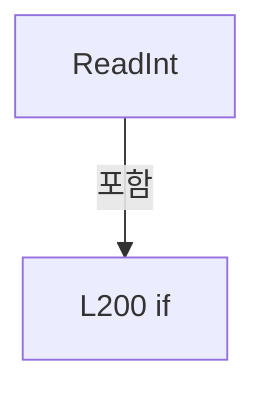

변경 전 점검: 입력/반환 타입, 위 호출자, 예외/취소 경로, 공유 상태와 저장·전송 소비자를 함께 확인합니다. 값의 단위나 물리 방향을 이름만으로 확정하지 않습니다.

### MethodDeclaration `ReadRequiredInt` · L208–217

[Drilling.File/Parser/CCsvParser.cs:208–217](https://github.com/kjuws10-rgb/A3Drilling/blob/5aee8e58439c9b455cae7c9593c9be986c3e682e/Drilling.File/Parser/CCsvParser.cs#L208-L217)

| 항목 | 실제 추출 값 |
| --- | --- |
| 서명 | int Drilling.File.Parser.CCsvParser.ReadRequiredInt(string, string, int, string, bool) |
| 접근/수식자 | Public / public, static |
| 반환/값 타입 | int |
| 소속 타입 | NamedType:Drilling.File.Parser.CCsvParser |

입력 계약:

| 이름 | 타입 | 전달 | 선택/기본값 |
| --- | --- | --- | --- |
| value | string | None | False /  |
| tableName | string | None | False /  |
| rowNo | int | None | False /  |
| fieldName | string | None | False /  |
| allowNegative | bool | None | True / false |

정적 호출자로 확인된 위치:

| 호출 파일/행 | 호출 표현식 | 런타임 분기 가능 |
| --- | --- | --- |
| [Drilling.File/JHMI/CAlarmListFile.cs:21–21](https://github.com/kjuws10-rgb/A3Drilling/blob/5aee8e58439c9b455cae7c9593c9be986c3e682e/Drilling.File/JHMI/CAlarmListFile.cs#L21-L21) | CCsvParser.ReadRequiredInt | False |
| [Drilling.File/JHMI/CInterfaceFile.cs:431–431](https://github.com/kjuws10-rgb/A3Drilling/blob/5aee8e58439c9b455cae7c9593c9be986c3e682e/Drilling.File/JHMI/CInterfaceFile.cs#L431-L431) | CCsvParser.ReadRequiredInt | False |
| [Drilling.File/ReviewOffset/CReviewOffsetFile.cs:679–683](https://github.com/kjuws10-rgb/A3Drilling/blob/5aee8e58439c9b455cae7c9593c9be986c3e682e/Drilling.File/ReviewOffset/CReviewOffsetFile.cs#L679-L683) | CCsvParser.ReadRequiredInt | False |

호출하는 대상과 해석 범위:

| 원본 행 | 표현식 | 분석 상태 | 대상/소스 위치 |
| --- | --- | --- | --- |
| 210 | int.TryParse | resolved | bool int.TryParse(string?, System.Globalization.NumberStyles, System.IFormatProvider?, out int) |
| 213 | new InvalidDataException | resolved | System.IO.InvalidDataException.InvalidDataException(string?) |

본문의 실제 연산·분기·예외·반환 순서(원문 위치 순):

| 원본 행 | 종류 | 주석 해설 |
| --- | --- | --- |
| 210 | call | 함수·델리게이트 또는 객체 생성자를 호출합니다: int.TryParse(value, NumberStyles.Integer, CultureInfo.InvariantCulture, out var result) |
| 210 | if | 조건에 따라 분기합니다: if (!int.TryParse(value, NumberStyles.Integer, CultureInfo.InvariantCulture, out var result) &#124;&#124; (!allowNegative && result < 0)) |
| 212 | conditional-expression | 조건에 따라 결과식을 선택합니다: allowNegative ? "" : " non-negative" |
| 212 | local-declaration | 지역 변수를 선언합니다: var signText = allowNegative ? "" : " non-negative"; |
| 212 | variable-initializer | 변수의 초기값을 지정합니다: signText = allowNegative ? "" : " non-negative" |
| 213 | call | 함수·델리게이트 또는 객체 생성자를 호출합니다: new InvalidDataException($"{tableName} validation failed. Row {rowNo} / {fieldName} must be a{signText} integer.") |
| 213 | throw | 예외를 발생/전달합니다: throw new InvalidDataException($"{tableName} validation failed. Row {rowNo} / {fieldName} must be a{signText} integer."); |
| 216 | return | 호출자에게 값 또는 제어를 반환합니다: return result; |

제어 구문의 포함 구조(실제 실행 순서/CFG가 아닌 구문 탐색 그림):

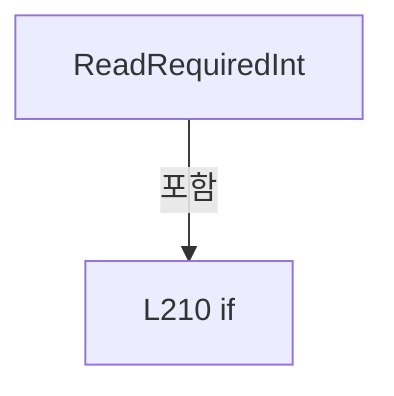

변경 전 점검: 입력/반환 타입, 위 호출자, 예외/취소 경로, 공유 상태와 저장·전송 소비자를 함께 확인합니다. 값의 단위나 물리 방향을 이름만으로 확정하지 않습니다.

### MethodDeclaration `ReadDouble` · L219–227

[Drilling.File/Parser/CCsvParser.cs:219–227](https://github.com/kjuws10-rgb/A3Drilling/blob/5aee8e58439c9b455cae7c9593c9be986c3e682e/Drilling.File/Parser/CCsvParser.cs#L219-L227)

| 항목 | 실제 추출 값 |
| --- | --- |
| 서명 | double Drilling.File.Parser.CCsvParser.ReadDouble(string, string, int, string, double) |
| 접근/수식자 | Public / public, static |
| 반환/값 타입 | double |
| 소속 타입 | NamedType:Drilling.File.Parser.CCsvParser |

입력 계약:

| 이름 | 타입 | 전달 | 선택/기본값 |
| --- | --- | --- | --- |
| value | string | None | False /  |
| tableName | string | None | False /  |
| rowNo | int | None | False /  |
| fieldName | string | None | False /  |
| defaultValue | double | None | False /  |

정적 호출자로 확인된 위치:

| 호출 파일/행 | 호출 표현식 | 런타임 분기 가능 |
| --- | --- | --- |
| [Drilling.File/JHMI/CMelsecMapFile.cs:256–256](https://github.com/kjuws10-rgb/A3Drilling/blob/5aee8e58439c9b455cae7c9593c9be986c3e682e/Drilling.File/JHMI/CMelsecMapFile.cs#L256-L256) | CCsvParser.ReadDouble | False |
| [Drilling.File/JHMI/CMotorFile.cs:276–276](https://github.com/kjuws10-rgb/A3Drilling/blob/5aee8e58439c9b455cae7c9593c9be986c3e682e/Drilling.File/JHMI/CMotorFile.cs#L276-L276) | CCsvParser.ReadDouble | False |

호출하는 대상과 해석 범위:

| 원본 행 | 표현식 | 분석 상태 | 대상/소스 위치 |
| --- | --- | --- | --- |
| 221 | string.IsNullOrWhiteSpace | resolved | bool string.IsNullOrWhiteSpace(string?) |
| 226 | double.TryParse | resolved | bool double.TryParse(string?, System.Globalization.NumberStyles, System.IFormatProvider?, out double) |
| 226 | new InvalidDataException | resolved | System.IO.InvalidDataException.InvalidDataException(string?) |

본문의 실제 연산·분기·예외·반환 순서(원문 위치 순):

| 원본 행 | 종류 | 주석 해설 |
| --- | --- | --- |
| 221 | call | 함수·델리게이트 또는 객체 생성자를 호출합니다: string.IsNullOrWhiteSpace(value) |
| 221 | if | 조건에 따라 분기합니다: if (string.IsNullOrWhiteSpace(value)) |
| 223 | return | 호출자에게 값 또는 제어를 반환합니다: return defaultValue; |
| 226 | call | 함수·델리게이트 또는 객체 생성자를 호출합니다: double.TryParse(value, NumberStyles.Float, CultureInfo.InvariantCulture, out var result) |
| 226 | call | 함수·델리게이트 또는 객체 생성자를 호출합니다: new InvalidDataException($"{tableName} validation failed. Row {rowNo} / {fieldName} must be number: {value}") |
| 226 | conditional-expression | 조건에 따라 결과식을 선택합니다: double.TryParse(value, NumberStyles.Float, CultureInfo.InvariantCulture, out var result) ? result : throw new InvalidDataException($"{tableName} validation failed. Row {rowNo} / {fieldName} must be number: {value}") |
| 226 | return | 호출자에게 값 또는 제어를 반환합니다: return double.TryParse(value, NumberStyles.Float, CultureInfo.InvariantCulture, out var result) ? result : throw new InvalidDataException($"{tableName} validation failed. Row {rowNo} / {fieldName} must be number: {value}"); |
| 226 | throw | 예외를 발생/전달합니다: throw new InvalidDataException($"{tableName} validation failed. Row {rowNo} / {fieldName} must be number: {value}") |

제어 구문의 포함 구조(실제 실행 순서/CFG가 아닌 구문 탐색 그림):

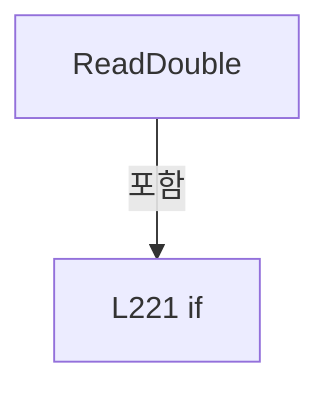

변경 전 점검: 입력/반환 타입, 위 호출자, 예외/취소 경로, 공유 상태와 저장·전송 소비자를 함께 확인합니다. 값의 단위나 물리 방향을 이름만으로 확정하지 않습니다.

### MethodDeclaration `ReadBool` · L229–242

[Drilling.File/Parser/CCsvParser.cs:229–242](https://github.com/kjuws10-rgb/A3Drilling/blob/5aee8e58439c9b455cae7c9593c9be986c3e682e/Drilling.File/Parser/CCsvParser.cs#L229-L242)

| 항목 | 실제 추출 값 |
| --- | --- |
| 서명 | bool Drilling.File.Parser.CCsvParser.ReadBool(string, bool) |
| 접근/수식자 | Public / public, static |
| 반환/값 타입 | bool |
| 소속 타입 | NamedType:Drilling.File.Parser.CCsvParser |

입력 계약:

| 이름 | 타입 | 전달 | 선택/기본값 |
| --- | --- | --- | --- |
| value | string | None | False /  |
| defaultValue | bool | None | False /  |

정적 호출자로 확인된 위치:

| 호출 파일/행 | 호출 표현식 | 런타임 분기 가능 |
| --- | --- | --- |
| [Drilling.File/JHMI/CMelsecMapFile.cs:246–246](https://github.com/kjuws10-rgb/A3Drilling/blob/5aee8e58439c9b455cae7c9593c9be986c3e682e/Drilling.File/JHMI/CMelsecMapFile.cs#L246-L246) | CCsvParser.ReadBool | False |
| [Drilling.File/JHMI/CMotorFile.cs:266–266](https://github.com/kjuws10-rgb/A3Drilling/blob/5aee8e58439c9b455cae7c9593c9be986c3e682e/Drilling.File/JHMI/CMotorFile.cs#L266-L266) | CCsvParser.ReadBool | False |

호출하는 대상과 해석 범위:

| 원본 행 | 표현식 | 분석 상태 | 대상/소스 위치 |
| --- | --- | --- | --- |
| 231 | string.IsNullOrWhiteSpace | resolved | bool string.IsNullOrWhiteSpace(string?) |
| 236 | NormalizeHeader | resolved | string Drilling.File.Parser.CCsvParser.NormalizeHeader(string) · Drilling.File/Parser/CCsvParser.cs:427 |

본문의 실제 연산·분기·예외·반환 순서(원문 위치 순):

| 원본 행 | 종류 | 주석 해설 |
| --- | --- | --- |
| 231 | call | 함수·델리게이트 또는 객체 생성자를 호출합니다: string.IsNullOrWhiteSpace(value) |
| 231 | if | 조건에 따라 분기합니다: if (string.IsNullOrWhiteSpace(value)) |
| 233 | return | 호출자에게 값 또는 제어를 반환합니다: return defaultValue; |
| 236 | call | 함수·델리게이트 또는 객체 생성자를 호출합니다: NormalizeHeader(value) |
| 236 | return | 호출자에게 값 또는 제어를 반환합니다: return NormalizeHeader(value) switch { "1" or "TRUE" or "ON" or "YES" or "USE" or "Y" => true, "0" or "FALSE" or "OFF" or "NO" or "NOTUSE" or "N" => false, _ => defaultValue }; |
| 236 | switch-expression | 값별 결과식을 선택합니다: NormalizeHeader(value) switch { "1" or "TRUE" or "ON" or "YES" or "USE" or "Y" => true, "0" or "FALSE" or "OFF" or "NO" or "NOTUSE" or "N" => false, _ => defaultValue } |

제어 구문의 포함 구조(실제 실행 순서/CFG가 아닌 구문 탐색 그림):

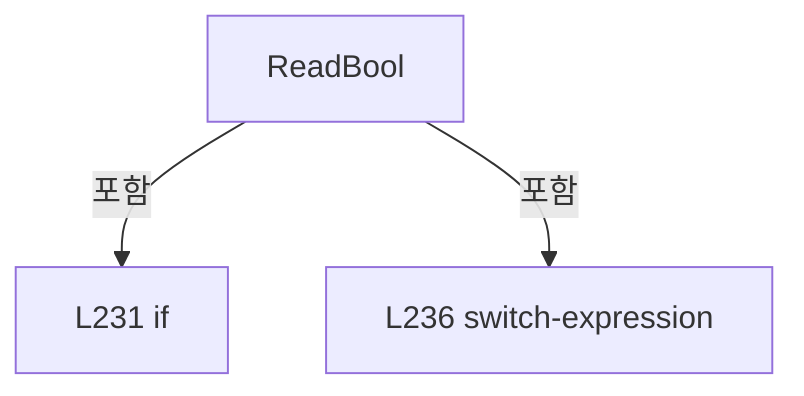

변경 전 점검: 입력/반환 타입, 위 호출자, 예외/취소 경로, 공유 상태와 저장·전송 소비자를 함께 확인합니다. 값의 단위나 물리 방향을 이름만으로 확정하지 않습니다.

### MethodDeclaration `ReadRequiredBool` · L244–251

[Drilling.File/Parser/CCsvParser.cs:244–251](https://github.com/kjuws10-rgb/A3Drilling/blob/5aee8e58439c9b455cae7c9593c9be986c3e682e/Drilling.File/Parser/CCsvParser.cs#L244-L251)

| 항목 | 실제 추출 값 |
| --- | --- |
| 서명 | bool Drilling.File.Parser.CCsvParser.ReadRequiredBool(string, string, int, string) |
| 접근/수식자 | Public / public, static |
| 반환/값 타입 | bool |
| 소속 타입 | NamedType:Drilling.File.Parser.CCsvParser |

입력 계약:

| 이름 | 타입 | 전달 | 선택/기본값 |
| --- | --- | --- | --- |
| value | string | None | False /  |
| tableName | string | None | False /  |
| rowNo | int | None | False /  |
| fieldName | string | None | False /  |

정적 호출자로 확인된 위치:

| 호출 파일/행 | 호출 표현식 | 런타임 분기 가능 |
| --- | --- | --- |
| [Drilling.File/JHMI/CInterfaceFile.cs:426–426](https://github.com/kjuws10-rgb/A3Drilling/blob/5aee8e58439c9b455cae7c9593c9be986c3e682e/Drilling.File/JHMI/CInterfaceFile.cs#L426-L426) | CCsvParser.ReadRequiredBool | False |

호출하는 대상과 해석 범위:

| 원본 행 | 표현식 | 분석 상태 | 대상/소스 위치 |
| --- | --- | --- | --- |
| 246 | NormalizeHeader | resolved | string Drilling.File.Parser.CCsvParser.NormalizeHeader(string) · Drilling.File/Parser/CCsvParser.cs:427 |
| 250 | new InvalidDataException | resolved | System.IO.InvalidDataException.InvalidDataException(string?) |

본문의 실제 연산·분기·예외·반환 순서(원문 위치 순):

| 원본 행 | 종류 | 주석 해설 |
| --- | --- | --- |
| 246 | call | 함수·델리게이트 또는 객체 생성자를 호출합니다: NormalizeHeader(value) |
| 246 | return | 호출자에게 값 또는 제어를 반환합니다: return NormalizeHeader(value) switch { "1" or "TRUE" or "ON" or "YES" or "USE" or "Y" or "SIMUL" or "SIMULATION" or "SIM" => true, "0" or "FALSE" or "OFF" or "NO" or "NOTUSE" or "N" or "ONLINE" or "LIVE" or "REAL" => false, _ => t |
| 246 | switch-expression | 값별 결과식을 선택합니다: NormalizeHeader(value) switch { "1" or "TRUE" or "ON" or "YES" or "USE" or "Y" or "SIMUL" or "SIMULATION" or "SIM" => true, "0" or "FALSE" or "OFF" or "NO" or "NOTUSE" or "N" or "ONLINE" or "LIVE" or "REAL" => false, _ => throw ne |
| 250 | call | 함수·델리게이트 또는 객체 생성자를 호출합니다: new InvalidDataException($"{tableName} validation failed. Row {rowNo} / {fieldName} must be 1/0 or ON/OFF.") |
| 250 | throw | 예외를 발생/전달합니다: throw new InvalidDataException($"{tableName} validation failed. Row {rowNo} / {fieldName} must be 1/0 or ON/OFF.") |

제어 구문의 포함 구조(실제 실행 순서/CFG가 아닌 구문 탐색 그림):

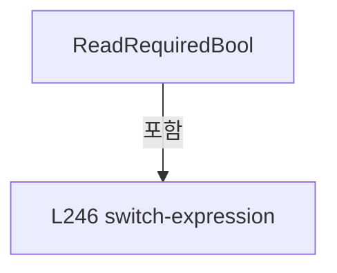

변경 전 점검: 입력/반환 타입, 위 호출자, 예외/취소 경로, 공유 상태와 저장·전송 소비자를 함께 확인합니다. 값의 단위나 물리 방향을 이름만으로 확정하지 않습니다.

### MethodDeclaration `ReadHeaders` · L253–278

[Drilling.File/Parser/CCsvParser.cs:253–278](https://github.com/kjuws10-rgb/A3Drilling/blob/5aee8e58439c9b455cae7c9593c9be986c3e682e/Drilling.File/Parser/CCsvParser.cs#L253-L278)

| 항목 | 실제 추출 값 |
| --- | --- |
| 서명 | System.Collections.Generic.IReadOnlyList<string> Drilling.File.Parser.CCsvParser.ReadHeaders(string) |
| 접근/수식자 | Public / public, static |
| 반환/값 타입 | System.Collections.Generic.IReadOnlyList<string> |
| 소속 타입 | NamedType:Drilling.File.Parser.CCsvParser |

입력 계약:

| 이름 | 타입 | 전달 | 선택/기본값 |
| --- | --- | --- | --- |
| path | string | None | False /  |

정적 호출자로 확인된 위치:

| 호출 파일/행 | 호출 표현식 | 런타임 분기 가능 |
| --- | --- | --- |
| [Drilling.File/Parser/CCsvParser.cs:287–287](https://github.com/kjuws10-rgb/A3Drilling/blob/5aee8e58439c9b455cae7c9593c9be986c3e682e/Drilling.File/Parser/CCsvParser.cs#L287-L287) | ReadHeaders | False |
| [Drilling.File/ReviewResult/CReviewResultFile.cs:155–155](https://github.com/kjuws10-rgb/A3Drilling/blob/5aee8e58439c9b455cae7c9593c9be986c3e682e/Drilling.File/ReviewResult/CReviewResultFile.cs#L155-L155) | CCsvParser.ReadHeaders | False |

호출하는 대상과 해석 범위:

| 원본 행 | 표현식 | 분석 상태 | 대상/소스 위치 |
| --- | --- | --- | --- |
| 255 | System.IO.File.Exists | resolved | bool System.IO.File.Exists(string?) |
| 260 | ReadLines(path).FirstOrDefault | resolved | string? System.Collections.Generic.IEnumerable<string>.FirstOrDefault<string>() |
| 260 | ReadLines | resolved | System.Collections.Generic.IReadOnlyList<string> Drilling.File.Parser.CCsvParser.ReadLines(string) · Drilling.File/Parser/CCsvParser.cs:147 |
| 271 | string.IsNullOrWhiteSpace | resolved | bool string.IsNullOrWhiteSpace(string?) |
| 271 | ParseLine(firstLine, path, 1).Select(SelectItem).Where(ShouldIncludeItem).ToArray | resolved | string[] System.Collections.Generic.IEnumerable<string>.ToArray<string>() |
| 271 | ParseLine(firstLine, path, 1).Select(SelectItem).Where | resolved | System.Collections.Generic.IEnumerable<string> System.Collections.Generic.IEnumerable<string>.Where<string>(System.Func<string, bool>) |
| 271 | ParseLine(firstLine, path, 1).Select | resolved | System.Collections.Generic.IEnumerable<string> System.Collections.Generic.IEnumerable<string>.Select<string, string>(System.Func<string, string>) |
| 271 | ParseLine | resolved | System.Collections.Generic.List<string> Drilling.File.Parser.CCsvParser.ParseLine(string, string, int) · Drilling.File/Parser/CCsvParser.cs:352 |
| 274 | ValidateHeaders | resolved | void Drilling.File.Parser.CCsvParser.ValidateHeaders(string, System.Collections.Generic.IReadOnlyList<string>) · Drilling.File/Parser/CCsvParser.cs:392 |

본문의 실제 연산·분기·예외·반환 순서(원문 위치 순):

| 원본 행 | 종류 | 주석 해설 |
| --- | --- | --- |
| 255 | call | 함수·델리게이트 또는 객체 생성자를 호출합니다: System.IO.File.Exists(path) |
| 255 | if | 조건에 따라 분기합니다: if (!System.IO.File.Exists(path)) |
| 257 | return | 호출자에게 값 또는 제어를 반환합니다: return[]; |
| 260 | call | 함수·델리게이트 또는 객체 생성자를 호출합니다: ReadLines(path).FirstOrDefault() |
| 260 | call | 함수·델리게이트 또는 객체 생성자를 호출합니다: ReadLines(path) |
| 260 | local-declaration | 지역 변수를 선언합니다: var firstLine = ReadLines(path).FirstOrDefault(); |
| 260 | variable-initializer | 변수의 초기값을 지정합니다: firstLine = ReadLines(path).FirstOrDefault() |
| 271 | call | 함수·델리게이트 또는 객체 생성자를 호출합니다: string.IsNullOrWhiteSpace(firstLine) |
| 271 | call | 함수·델리게이트 또는 객체 생성자를 호출합니다: ParseLine(firstLine, path, 1).Select(SelectItem).Where(ShouldIncludeItem).ToArray() |
| 271 | call | 함수·델리게이트 또는 객체 생성자를 호출합니다: ParseLine(firstLine, path, 1).Select(SelectItem).Where(ShouldIncludeItem) |
| 271 | call | 함수·델리게이트 또는 객체 생성자를 호출합니다: ParseLine(firstLine, path, 1).Select(SelectItem) |
| 271 | call | 함수·델리게이트 또는 객체 생성자를 호출합니다: ParseLine(firstLine, path, 1) |
| 271 | conditional-expression | 조건에 따라 결과식을 선택합니다: string.IsNullOrWhiteSpace(firstLine) ? [] : ParseLine(firstLine, path, 1).Select(SelectItem).Where(ShouldIncludeItem).ToArray() |
| 271 | local-declaration | 지역 변수를 선언합니다: var headers = string.IsNullOrWhiteSpace(firstLine) ? [] : ParseLine(firstLine, path, 1).Select(SelectItem).Where(ShouldIncludeItem).ToArray(); |
| 271 | variable-initializer | 변수의 초기값을 지정합니다: headers = string.IsNullOrWhiteSpace(firstLine) ? [] : ParseLine(firstLine, path, 1).Select(SelectItem).Where(ShouldIncludeItem).ToArray() |
| 272 | if | 조건에 따라 분기합니다: if (headers.Length > 0) |
| 274 | call | 함수·델리게이트 또는 객체 생성자를 호출합니다: ValidateHeaders(path, headers) |
| 277 | return | 호출자에게 값 또는 제어를 반환합니다: return headers; |

제어 구문의 포함 구조(실제 실행 순서/CFG가 아닌 구문 탐색 그림):

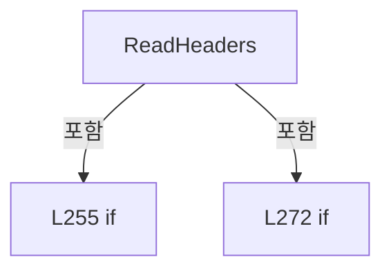

변경 전 점검: 입력/반환 타입, 위 호출자, 예외/취소 경로, 공유 상태와 저장·전송 소비자를 함께 확인합니다. 값의 단위나 물리 방향을 이름만으로 확정하지 않습니다.

### LocalFunctionStatement `SelectItem` · L261–264

[Drilling.File/Parser/CCsvParser.cs:261–264](https://github.com/kjuws10-rgb/A3Drilling/blob/5aee8e58439c9b455cae7c9593c9be986c3e682e/Drilling.File/Parser/CCsvParser.cs#L261-L264)

| 항목 | 실제 추출 값 |
| --- | --- |
| 서명 | string SelectItem(string) |
| 접근/수식자 | Private /  |
| 반환/값 타입 | string |
| 소속 타입 | NamedType:Drilling.File.Parser.CCsvParser |

입력 계약:

| 이름 | 타입 | 전달 | 선택/기본값 |
| --- | --- | --- | --- |
| header | string | None | False /  |

현재 부분 분석에서 직접 연결된 호출자는 없습니다. XAML/이벤트/인터페이스·델리게이트·외부 진입을 추가 확인해야 하며, 미사용으로 판정한 것이 아닙니다.

호출하는 대상과 해석 범위:

| 원본 행 | 표현식 | 분석 상태 | 대상/소스 위치 |
| --- | --- | --- | --- |
| 263 | header.Trim | resolved | string string.Trim() |

본문의 실제 연산·분기·예외·반환 순서(원문 위치 순):

| 원본 행 | 종류 | 주석 해설 |
| --- | --- | --- |
| 263 | call | 함수·델리게이트 또는 객체 생성자를 호출합니다: header.Trim() |
| 263 | return | 호출자에게 값 또는 제어를 반환합니다: return header.Trim(); |

변경 전 점검: 입력/반환 타입, 위 호출자, 예외/취소 경로, 공유 상태와 저장·전송 소비자를 함께 확인합니다. 값의 단위나 물리 방향을 이름만으로 확정하지 않습니다.

### LocalFunctionStatement `ShouldIncludeItem` · L266–269

[Drilling.File/Parser/CCsvParser.cs:266–269](https://github.com/kjuws10-rgb/A3Drilling/blob/5aee8e58439c9b455cae7c9593c9be986c3e682e/Drilling.File/Parser/CCsvParser.cs#L266-L269)

| 항목 | 실제 추출 값 |
| --- | --- |
| 서명 | bool ShouldIncludeItem(string) |
| 접근/수식자 | Private /  |
| 반환/값 타입 | bool |
| 소속 타입 | NamedType:Drilling.File.Parser.CCsvParser |

입력 계약:

| 이름 | 타입 | 전달 | 선택/기본값 |
| --- | --- | --- | --- |
| header | string | None | False /  |

현재 부분 분석에서 직접 연결된 호출자는 없습니다. XAML/이벤트/인터페이스·델리게이트·외부 진입을 추가 확인해야 하며, 미사용으로 판정한 것이 아닙니다.

호출하는 대상과 해석 범위:

| 원본 행 | 표현식 | 분석 상태 | 대상/소스 위치 |
| --- | --- | --- | --- |
| 268 | string.IsNullOrWhiteSpace | resolved | bool string.IsNullOrWhiteSpace(string?) |

본문의 실제 연산·분기·예외·반환 순서(원문 위치 순):

| 원본 행 | 종류 | 주석 해설 |
| --- | --- | --- |
| 268 | call | 함수·델리게이트 또는 객체 생성자를 호출합니다: string.IsNullOrWhiteSpace(header) |
| 268 | return | 호출자에게 값 또는 제어를 반환합니다: return !string.IsNullOrWhiteSpace(header); |

변경 전 점검: 입력/반환 타입, 위 호출자, 예외/취소 경로, 공유 상태와 저장·전송 소비자를 함께 확인합니다. 값의 단위나 물리 방향을 이름만으로 확정하지 않습니다.

### MethodDeclaration `ValidateRequiredHeaders` · L280–329

[Drilling.File/Parser/CCsvParser.cs:280–329](https://github.com/kjuws10-rgb/A3Drilling/blob/5aee8e58439c9b455cae7c9593c9be986c3e682e/Drilling.File/Parser/CCsvParser.cs#L280-L329)

| 항목 | 실제 추출 값 |
| --- | --- |
| 서명 | void Drilling.File.Parser.CCsvParser.ValidateRequiredHeaders(string, string, System.Collections.Generic.IEnumerable<System.Collections.Generic.IEnumerable<string>>) |
| 접근/수식자 | Public / public, static |
| 반환/값 타입 | void |
| 소속 타입 | NamedType:Drilling.File.Parser.CCsvParser |

입력 계약:

| 이름 | 타입 | 전달 | 선택/기본값 |
| --- | --- | --- | --- |
| path | string | None | False /  |
| tableName | string | None | False /  |
| requiredHeaderGroups | System.Collections.Generic.IEnumerable<System.Collections.Generic.IEnumerable<string>> | None | False /  |

정적 호출자로 확인된 위치:

| 호출 파일/행 | 호출 표현식 | 런타임 분기 가능 |
| --- | --- | --- |
| [Drilling.File/JHMI/CAlarmListFile.cs:14–14](https://github.com/kjuws10-rgb/A3Drilling/blob/5aee8e58439c9b455cae7c9593c9be986c3e682e/Drilling.File/JHMI/CAlarmListFile.cs#L14-L14) | CCsvParser.ValidateRequiredHeaders | False |
| [Drilling.File/JHMI/CConfigStructureFile.cs:130–130](https://github.com/kjuws10-rgb/A3Drilling/blob/5aee8e58439c9b455cae7c9593c9be986c3e682e/Drilling.File/JHMI/CConfigStructureFile.cs#L130-L130) | CCsvParser.ValidateRequiredHeaders | False |
| [Drilling.File/JHMI/CConfigStructureFile.cs:151–151](https://github.com/kjuws10-rgb/A3Drilling/blob/5aee8e58439c9b455cae7c9593c9be986c3e682e/Drilling.File/JHMI/CConfigStructureFile.cs#L151-L151) | CCsvParser.ValidateRequiredHeaders | False |
| [Drilling.File/JHMI/CConfigStructureFile.cs:209–209](https://github.com/kjuws10-rgb/A3Drilling/blob/5aee8e58439c9b455cae7c9593c9be986c3e682e/Drilling.File/JHMI/CConfigStructureFile.cs#L209-L209) | CCsvParser.ValidateRequiredHeaders | False |
| [Drilling.File/JHMI/CInterfaceFile.cs:83–83](https://github.com/kjuws10-rgb/A3Drilling/blob/5aee8e58439c9b455cae7c9593c9be986c3e682e/Drilling.File/JHMI/CInterfaceFile.cs#L83-L83) | CCsvParser.ValidateRequiredHeaders | False |
| [Drilling.File/JHMI/CJhmiRecipeFile.cs:857–857](https://github.com/kjuws10-rgb/A3Drilling/blob/5aee8e58439c9b455cae7c9593c9be986c3e682e/Drilling.File/JHMI/CJhmiRecipeFile.cs#L857-L857) | CCsvParser.ValidateRequiredHeaders | False |
| [Drilling.File/JHMI/CMelsecMapFile.cs:34–34](https://github.com/kjuws10-rgb/A3Drilling/blob/5aee8e58439c9b455cae7c9593c9be986c3e682e/Drilling.File/JHMI/CMelsecMapFile.cs#L34-L34) | CCsvParser.ValidateRequiredHeaders | False |
| [Drilling.File/JHMI/CMotorFile.cs:59–59](https://github.com/kjuws10-rgb/A3Drilling/blob/5aee8e58439c9b455cae7c9593c9be986c3e682e/Drilling.File/JHMI/CMotorFile.cs#L59-L59) | CCsvParser.ValidateRequiredHeaders | False |
| [Drilling.File/JHMI/CSettingFile.cs:149–149](https://github.com/kjuws10-rgb/A3Drilling/blob/5aee8e58439c9b455cae7c9593c9be986c3e682e/Drilling.File/JHMI/CSettingFile.cs#L149-L149) | CCsvParser.ValidateRequiredHeaders | False |
| [Drilling.File/JHMI/CSettingFile.cs:302–302](https://github.com/kjuws10-rgb/A3Drilling/blob/5aee8e58439c9b455cae7c9593c9be986c3e682e/Drilling.File/JHMI/CSettingFile.cs#L302-L302) | CCsvParser.ValidateRequiredHeaders | False |
| [Drilling.File/PowerTable/CPowerTableFile.cs:82–82](https://github.com/kjuws10-rgb/A3Drilling/blob/5aee8e58439c9b455cae7c9593c9be986c3e682e/Drilling.File/PowerTable/CPowerTableFile.cs#L82-L82) | CCsvParser.ValidateRequiredHeaders | False |
| [Drilling.File/PowerTable/CPowerTableFile.cs:226–226](https://github.com/kjuws10-rgb/A3Drilling/blob/5aee8e58439c9b455cae7c9593c9be986c3e682e/Drilling.File/PowerTable/CPowerTableFile.cs#L226-L226) | CCsvParser.ValidateRequiredHeaders | False |
| [Drilling.File/ReviewOffset/CReviewOffsetFile.cs:425–428](https://github.com/kjuws10-rgb/A3Drilling/blob/5aee8e58439c9b455cae7c9593c9be986c3e682e/Drilling.File/ReviewOffset/CReviewOffsetFile.cs#L425-L428) | CCsvParser.ValidateRequiredHeaders | False |
| [Drilling.File/ReviewOffset/CReviewOffsetFile.cs:640–643](https://github.com/kjuws10-rgb/A3Drilling/blob/5aee8e58439c9b455cae7c9593c9be986c3e682e/Drilling.File/ReviewOffset/CReviewOffsetFile.cs#L640-L643) | CCsvParser.ValidateRequiredHeaders | False |

호출하는 대상과 해석 범위:

| 원본 행 | 표현식 | 분석 상태 | 대상/소스 위치 |
| --- | --- | --- | --- |
| 282 | System.IO.File.Exists | resolved | bool System.IO.File.Exists(string?) |
| 284 | new FileNotFoundException | resolved | System.IO.FileNotFoundException.FileNotFoundException(string?, string?) |
| 287 | ReadHeaders | resolved | System.Collections.Generic.IReadOnlyList<string> Drilling.File.Parser.CCsvParser.ReadHeaders(string) · Drilling.File/Parser/CCsvParser.cs:253 |
| 290 | new InvalidDataException | resolved | System.IO.InvalidDataException.InvalidDataException(string?) |
| 293 | headers.Select(NormalizeHeader).ToHashSet | resolved | System.Collections.Generic.HashSet<string> System.Collections.Generic.IEnumerable<string>.ToHashSet<string>(System.Collections.Generic.IEqualityComparer<string>?) |
| 293 | headers.Select | resolved | System.Collections.Generic.IEnumerable<string> System.Collections.Generic.IEnumerable<string>.Select<string, string>(System.Func<string, string>) |
| 324 | requiredHeaderGroups.Select(SelectValue).Where(MatchesLength).Select(SelectString).ToArray | resolved | string[] System.Collections.Generic.IEnumerable<string>.ToArray<string>() |
| 324 | requiredHeaderGroups.Select(SelectValue).Where(MatchesLength).Select | resolved | System.Collections.Generic.IEnumerable<string> System.Collections.Generic.IEnumerable<string[]>.Select<string[], string>(System.Func<string[], string>) |
| 324 | requiredHeaderGroups.Select(SelectValue).Where | resolved | System.Collections.Generic.IEnumerable<string[]> System.Collections.Generic.IEnumerable<string[]>.Where<string[]>(System.Func<string[], bool>) |
| 324 | requiredHeaderGroups.Select | resolved | System.Collections.Generic.IEnumerable<string[]> System.Collections.Generic.IEnumerable<System.Collections.Generic.IEnumerable<string>>.Select<System.Collections.Generic.IEnumerable<string>, string[]>(System.Func<System.Collections.Generic.IEnumerable<string>, string[]>) |
| 327 | new InvalidDataException | resolved | System.IO.InvalidDataException.InvalidDataException(string?) |
| 327 | string.Join | resolved | string string.Join(string?, params string?[]) |
| 327 | string.Join | resolved | string string.Join(string?, System.Collections.Generic.IEnumerable<string?>) |

본문의 실제 연산·분기·예외·반환 순서(원문 위치 순):

| 원본 행 | 종류 | 주석 해설 |
| --- | --- | --- |
| 282 | call | 함수·델리게이트 또는 객체 생성자를 호출합니다: System.IO.File.Exists(path) |
| 282 | if | 조건에 따라 분기합니다: if (!System.IO.File.Exists(path)) |
| 284 | call | 함수·델리게이트 또는 객체 생성자를 호출합니다: new FileNotFoundException($"{tableName} file not found.", path) |
| 284 | throw | 예외를 발생/전달합니다: throw new FileNotFoundException($"{tableName} file not found.", path); |
| 287 | call | 함수·델리게이트 또는 객체 생성자를 호출합니다: ReadHeaders(path) |
| 287 | local-declaration | 지역 변수를 선언합니다: var headers = ReadHeaders(path); |
| 287 | variable-initializer | 변수의 초기값을 지정합니다: headers = ReadHeaders(path) |
| 288 | if | 조건에 따라 분기합니다: if (headers.Count == 0) |
| 290 | call | 함수·델리게이트 또는 객체 생성자를 호출합니다: new InvalidDataException($"{tableName} validation failed. Header row is empty.") |
| 290 | throw | 예외를 발생/전달합니다: throw new InvalidDataException($"{tableName} validation failed. Header row is empty."); |
| 293 | call | 함수·델리게이트 또는 객체 생성자를 호출합니다: headers.Select(NormalizeHeader).ToHashSet(StringComparer.OrdinalIgnoreCase) |
| 293 | call | 함수·델리게이트 또는 객체 생성자를 호출합니다: headers.Select(NormalizeHeader) |
| 293 | local-declaration | 지역 변수를 선언합니다: var headerSet = headers.Select(NormalizeHeader).ToHashSet(StringComparer.OrdinalIgnoreCase); |
| 293 | variable-initializer | 변수의 초기값을 지정합니다: headerSet = headers.Select(NormalizeHeader).ToHashSet(StringComparer.OrdinalIgnoreCase) |
| 324 | call | 함수·델리게이트 또는 객체 생성자를 호출합니다: requiredHeaderGroups.Select(SelectValue).Where(MatchesLength).Select(SelectString).ToArray() |
| 324 | call | 함수·델리게이트 또는 객체 생성자를 호출합니다: requiredHeaderGroups.Select(SelectValue).Where(MatchesLength).Select(SelectString) |
| 324 | call | 함수·델리게이트 또는 객체 생성자를 호출합니다: requiredHeaderGroups.Select(SelectValue).Where(MatchesLength) |
| 324 | call | 함수·델리게이트 또는 객체 생성자를 호출합니다: requiredHeaderGroups.Select(SelectValue) |
| 324 | local-declaration | 지역 변수를 선언합니다: var missing = requiredHeaderGroups.Select(SelectValue).Where(MatchesLength).Select(SelectString).ToArray(); |
| 324 | variable-initializer | 변수의 초기값을 지정합니다: missing = requiredHeaderGroups.Select(SelectValue).Where(MatchesLength).Select(SelectString).ToArray() |
| 325 | if | 조건에 따라 분기합니다: if (missing.Length > 0) |
| 327 | call | 함수·델리게이트 또는 객체 생성자를 호출합니다: new InvalidDataException($"{tableName} validation failed. Missing column(s): {string.Join(", ", missing)}. " + $"Available: {string.Join(", ", headers)}") |
| 327 | call | 함수·델리게이트 또는 객체 생성자를 호출합니다: string.Join(", ", missing) |
| 327 | call | 함수·델리게이트 또는 객체 생성자를 호출합니다: string.Join(", ", headers) |
| 327 | throw | 예외를 발생/전달합니다: throw new InvalidDataException($"{tableName} validation failed. Missing column(s): {string.Join(", ", missing)}. " + $"Available: {string.Join(", ", headers)}"); |

제어 구문의 포함 구조(실제 실행 순서/CFG가 아닌 구문 탐색 그림):

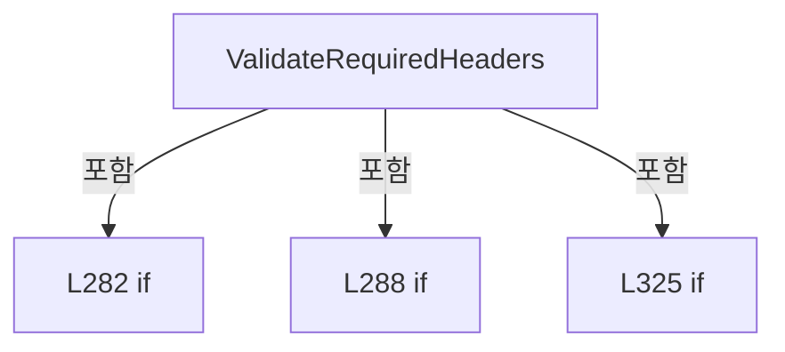

변경 전 점검: 입력/반환 타입, 위 호출자, 예외/취소 경로, 공유 상태와 저장·전송 소비자를 함께 확인합니다. 값의 단위나 물리 방향을 이름만으로 확정하지 않습니다.

### LocalFunctionStatement `ShouldIncludeItem` · L294–297

[Drilling.File/Parser/CCsvParser.cs:294–297](https://github.com/kjuws10-rgb/A3Drilling/blob/5aee8e58439c9b455cae7c9593c9be986c3e682e/Drilling.File/Parser/CCsvParser.cs#L294-L297)

| 항목 | 실제 추출 값 |
| --- | --- |
| 서명 | bool ShouldIncludeItem(string) |
| 접근/수식자 | Private /  |
| 반환/값 타입 | bool |
| 소속 타입 | NamedType:Drilling.File.Parser.CCsvParser |

입력 계약:

| 이름 | 타입 | 전달 | 선택/기본값 |
| --- | --- | --- | --- |
| header | string | None | False /  |

현재 부분 분석에서 직접 연결된 호출자는 없습니다. XAML/이벤트/인터페이스·델리게이트·외부 진입을 추가 확인해야 하며, 미사용으로 판정한 것이 아닙니다.

호출하는 대상과 해석 범위:

| 원본 행 | 표현식 | 분석 상태 | 대상/소스 위치 |
| --- | --- | --- | --- |
| 296 | string.IsNullOrWhiteSpace | resolved | bool string.IsNullOrWhiteSpace(string?) |

본문의 실제 연산·분기·예외·반환 순서(원문 위치 순):

| 원본 행 | 종류 | 주석 해설 |
| --- | --- | --- |
| 296 | call | 함수·델리게이트 또는 객체 생성자를 호출합니다: string.IsNullOrWhiteSpace(header) |
| 296 | return | 호출자에게 값 또는 제어를 반환합니다: return !string.IsNullOrWhiteSpace(header); |

변경 전 점검: 입력/반환 타입, 위 호출자, 예외/취소 경로, 공유 상태와 저장·전송 소비자를 함께 확인합니다. 값의 단위나 물리 방향을 이름만으로 확정하지 않습니다.

### LocalFunctionStatement `SelectItem` · L299–302

[Drilling.File/Parser/CCsvParser.cs:299–302](https://github.com/kjuws10-rgb/A3Drilling/blob/5aee8e58439c9b455cae7c9593c9be986c3e682e/Drilling.File/Parser/CCsvParser.cs#L299-L302)

| 항목 | 실제 추출 값 |
| --- | --- |
| 서명 | string SelectItem(string) |
| 접근/수식자 | Private /  |
| 반환/값 타입 | string |
| 소속 타입 | NamedType:Drilling.File.Parser.CCsvParser |

입력 계약:

| 이름 | 타입 | 전달 | 선택/기본값 |
| --- | --- | --- | --- |
| header | string | None | False /  |

현재 부분 분석에서 직접 연결된 호출자는 없습니다. XAML/이벤트/인터페이스·델리게이트·외부 진입을 추가 확인해야 하며, 미사용으로 판정한 것이 아닙니다.

호출하는 대상과 해석 범위:

| 원본 행 | 표현식 | 분석 상태 | 대상/소스 위치 |
| --- | --- | --- | --- |
| 301 | header.Trim | resolved | string string.Trim() |

본문의 실제 연산·분기·예외·반환 순서(원문 위치 순):

| 원본 행 | 종류 | 주석 해설 |
| --- | --- | --- |
| 301 | call | 함수·델리게이트 또는 객체 생성자를 호출합니다: header.Trim() |
| 301 | return | 호출자에게 값 또는 제어를 반환합니다: return header.Trim(); |

변경 전 점검: 입력/반환 타입, 위 호출자, 예외/취소 경로, 공유 상태와 저장·전송 소비자를 함께 확인합니다. 값의 단위나 물리 방향을 이름만으로 확정하지 않습니다.

### LocalFunctionStatement `SelectValue` · L304–307

[Drilling.File/Parser/CCsvParser.cs:304–307](https://github.com/kjuws10-rgb/A3Drilling/blob/5aee8e58439c9b455cae7c9593c9be986c3e682e/Drilling.File/Parser/CCsvParser.cs#L304-L307)

| 항목 | 실제 추출 값 |
| --- | --- |
| 서명 | string[] SelectValue(System.Collections.Generic.IEnumerable<string>) |
| 접근/수식자 | Private /  |
| 반환/값 타입 | string[] |
| 소속 타입 | NamedType:Drilling.File.Parser.CCsvParser |

입력 계약:

| 이름 | 타입 | 전달 | 선택/기본값 |
| --- | --- | --- | --- |
| group | System.Collections.Generic.IEnumerable<string> | None | False /  |

현재 부분 분석에서 직접 연결된 호출자는 없습니다. XAML/이벤트/인터페이스·델리게이트·외부 진입을 추가 확인해야 하며, 미사용으로 판정한 것이 아닙니다.

호출하는 대상과 해석 범위:

| 원본 행 | 표현식 | 분석 상태 | 대상/소스 위치 |
| --- | --- | --- | --- |
| 306 | group.Where(ShouldIncludeItem).Select(SelectItem).ToArray | resolved | string[] System.Collections.Generic.IEnumerable<string>.ToArray<string>() |
| 306 | group.Where(ShouldIncludeItem).Select | resolved | System.Collections.Generic.IEnumerable<string> System.Collections.Generic.IEnumerable<string>.Select<string, string>(System.Func<string, string>) |
| 306 | group.Where | resolved | System.Collections.Generic.IEnumerable<string> System.Collections.Generic.IEnumerable<string>.Where<string>(System.Func<string, bool>) |

본문의 실제 연산·분기·예외·반환 순서(원문 위치 순):

| 원본 행 | 종류 | 주석 해설 |
| --- | --- | --- |
| 306 | call | 함수·델리게이트 또는 객체 생성자를 호출합니다: group.Where(ShouldIncludeItem).Select(SelectItem).ToArray() |
| 306 | call | 함수·델리게이트 또는 객체 생성자를 호출합니다: group.Where(ShouldIncludeItem).Select(SelectItem) |
| 306 | call | 함수·델리게이트 또는 객체 생성자를 호출합니다: group.Where(ShouldIncludeItem) |
| 306 | return | 호출자에게 값 또는 제어를 반환합니다: return group.Where(ShouldIncludeItem).Select(SelectItem).ToArray(); |

변경 전 점검: 입력/반환 타입, 위 호출자, 예외/취소 경로, 공유 상태와 저장·전송 소비자를 함께 확인합니다. 값의 단위나 물리 방향을 이름만으로 확정하지 않습니다.

### LocalFunctionStatement `MatchesItem` · L309–312

[Drilling.File/Parser/CCsvParser.cs:309–312](https://github.com/kjuws10-rgb/A3Drilling/blob/5aee8e58439c9b455cae7c9593c9be986c3e682e/Drilling.File/Parser/CCsvParser.cs#L309-L312)

| 항목 | 실제 추출 값 |
| --- | --- |
| 서명 | bool MatchesItem(string) |
| 접근/수식자 | Private /  |
| 반환/값 타입 | bool |
| 소속 타입 | NamedType:Drilling.File.Parser.CCsvParser |

입력 계약:

| 이름 | 타입 | 전달 | 선택/기본값 |
| --- | --- | --- | --- |
| header | string | None | False /  |

현재 부분 분석에서 직접 연결된 호출자는 없습니다. XAML/이벤트/인터페이스·델리게이트·외부 진입을 추가 확인해야 하며, 미사용으로 판정한 것이 아닙니다.

호출하는 대상과 해석 범위:

| 원본 행 | 표현식 | 분석 상태 | 대상/소스 위치 |
| --- | --- | --- | --- |
| 311 | headerSet.Contains | resolved | bool System.Collections.Generic.HashSet<string>.Contains(string) |
| 311 | NormalizeHeader | resolved | string Drilling.File.Parser.CCsvParser.NormalizeHeader(string) · Drilling.File/Parser/CCsvParser.cs:427 |

본문의 실제 연산·분기·예외·반환 순서(원문 위치 순):

| 원본 행 | 종류 | 주석 해설 |
| --- | --- | --- |
| 311 | call | 함수·델리게이트 또는 객체 생성자를 호출합니다: headerSet.Contains(NormalizeHeader(header)) |
| 311 | call | 함수·델리게이트 또는 객체 생성자를 호출합니다: NormalizeHeader(header) |
| 311 | return | 호출자에게 값 또는 제어를 반환합니다: return headerSet.Contains(NormalizeHeader(header)); |

변경 전 점검: 입력/반환 타입, 위 호출자, 예외/취소 경로, 공유 상태와 저장·전송 소비자를 함께 확인합니다. 값의 단위나 물리 방향을 이름만으로 확정하지 않습니다.

### LocalFunctionStatement `MatchesLength` · L314–317

[Drilling.File/Parser/CCsvParser.cs:314–317](https://github.com/kjuws10-rgb/A3Drilling/blob/5aee8e58439c9b455cae7c9593c9be986c3e682e/Drilling.File/Parser/CCsvParser.cs#L314-L317)

| 항목 | 실제 추출 값 |
| --- | --- |
| 서명 | bool MatchesLength(string[]) |
| 접근/수식자 | Private /  |
| 반환/값 타입 | bool |
| 소속 타입 | NamedType:Drilling.File.Parser.CCsvParser |

입력 계약:

| 이름 | 타입 | 전달 | 선택/기본값 |
| --- | --- | --- | --- |
| group | string[] | None | False /  |

현재 부분 분석에서 직접 연결된 호출자는 없습니다. XAML/이벤트/인터페이스·델리게이트·외부 진입을 추가 확인해야 하며, 미사용으로 판정한 것이 아닙니다.

호출하는 대상과 해석 범위:

| 원본 행 | 표현식 | 분석 상태 | 대상/소스 위치 |
| --- | --- | --- | --- |
| 316 | group.Any | resolved | bool System.Collections.Generic.IEnumerable<string>.Any<string>(System.Func<string, bool>) |

본문의 실제 연산·분기·예외·반환 순서(원문 위치 순):

| 원본 행 | 종류 | 주석 해설 |
| --- | --- | --- |
| 316 | call | 함수·델리게이트 또는 객체 생성자를 호출합니다: group.Any(MatchesItem) |
| 316 | return | 호출자에게 값 또는 제어를 반환합니다: return group.Length > 0 && !group.Any(MatchesItem); |

변경 전 점검: 입력/반환 타입, 위 호출자, 예외/취소 경로, 공유 상태와 저장·전송 소비자를 함께 확인합니다. 값의 단위나 물리 방향을 이름만으로 확정하지 않습니다.

### LocalFunctionStatement `SelectString` · L319–322

[Drilling.File/Parser/CCsvParser.cs:319–322](https://github.com/kjuws10-rgb/A3Drilling/blob/5aee8e58439c9b455cae7c9593c9be986c3e682e/Drilling.File/Parser/CCsvParser.cs#L319-L322)

| 항목 | 실제 추출 값 |
| --- | --- |
| 서명 | string SelectString(string[]) |
| 접근/수식자 | Private /  |
| 반환/값 타입 | string |
| 소속 타입 | NamedType:Drilling.File.Parser.CCsvParser |

입력 계약:

| 이름 | 타입 | 전달 | 선택/기본값 |
| --- | --- | --- | --- |
| group | string[] | None | False /  |

현재 부분 분석에서 직접 연결된 호출자는 없습니다. XAML/이벤트/인터페이스·델리게이트·외부 진입을 추가 확인해야 하며, 미사용으로 판정한 것이 아닙니다.

호출하는 대상과 해석 범위:

| 원본 행 | 표현식 | 분석 상태 | 대상/소스 위치 |
| --- | --- | --- | --- |
| 321 | string.Join | resolved | string string.Join(string?, params string?[]) |

본문의 실제 연산·분기·예외·반환 순서(원문 위치 순):

| 원본 행 | 종류 | 주석 해설 |
| --- | --- | --- |
| 321 | call | 함수·델리게이트 또는 객체 생성자를 호출합니다: string.Join(" or ", group) |
| 321 | return | 호출자에게 값 또는 제어를 반환합니다: return string.Join(" or ", group); |

변경 전 점검: 입력/반환 타입, 위 호출자, 예외/취소 경로, 공유 상태와 저장·전송 소비자를 함께 확인합니다. 값의 단위나 물리 방향을 이름만으로 확정하지 않습니다.

### MethodDeclaration `GetExtra` · L331–350

[Drilling.File/Parser/CCsvParser.cs:331–350](https://github.com/kjuws10-rgb/A3Drilling/blob/5aee8e58439c9b455cae7c9593c9be986c3e682e/Drilling.File/Parser/CCsvParser.cs#L331-L350)

| 항목 | 실제 추출 값 |
| --- | --- |
| 서명 | System.Collections.Generic.IReadOnlyDictionary<string, string> Drilling.File.Parser.CCsvParser.GetExtra(System.Collections.Generic.IReadOnlyDictionary<string, string>, System.Collections.Generic.IEnumerable<string>) |
| 접근/수식자 | Public / public, static |
| 반환/값 타입 | System.Collections.Generic.IReadOnlyDictionary<string, string> |
| 소속 타입 | NamedType:Drilling.File.Parser.CCsvParser |

입력 계약:

| 이름 | 타입 | 전달 | 선택/기본값 |
| --- | --- | --- | --- |
| row | System.Collections.Generic.IReadOnlyDictionary<string, string> | None | False /  |
| knownHeaders | System.Collections.Generic.IEnumerable<string> | None | False /  |

정적 호출자로 확인된 위치:

| 호출 파일/행 | 호출 표현식 | 런타임 분기 가능 |
| --- | --- | --- |
| [Drilling.File/JHMI/CInterfaceFile.cs:103–103](https://github.com/kjuws10-rgb/A3Drilling/blob/5aee8e58439c9b455cae7c9593c9be986c3e682e/Drilling.File/JHMI/CInterfaceFile.cs#L103-L103) | CCsvParser.GetExtra | False |
| [Drilling.File/JHMI/CJhmiRecipeFile.cs:877–877](https://github.com/kjuws10-rgb/A3Drilling/blob/5aee8e58439c9b455cae7c9593c9be986c3e682e/Drilling.File/JHMI/CJhmiRecipeFile.cs#L877-L877) | CCsvParser.GetExtra | False |
| [Drilling.File/JHMI/CSettingFile.cs:180–180](https://github.com/kjuws10-rgb/A3Drilling/blob/5aee8e58439c9b455cae7c9593c9be986c3e682e/Drilling.File/JHMI/CSettingFile.cs#L180-L180) | CCsvParser.GetExtra | False |

호출하는 대상과 해석 범위:

| 원본 행 | 표현식 | 분석 상태 | 대상/소스 위치 |
| --- | --- | --- | --- |
| 333 | new HashSet<string> | resolved | System.Collections.Generic.HashSet<string>.HashSet(System.Collections.Generic.IEnumerable<string>, System.Collections.Generic.IEqualityComparer<string>?) |
| 349 | row.Where(ShouldIncludeItem).ToDictionary | resolved | System.Collections.Generic.Dictionary<string, string> System.Collections.Generic.IEnumerable<System.Collections.Generic.KeyValuePair<string, string>>.ToDictionary<System.Collections.Generic.KeyValuePair<string, string>, string, string>(System.Func<System.Collections.Generic.KeyValuePair<string, string>, string>, System.Func<System.Collections.Generic.KeyValuePair<string, string>, string>, System.Collections.Generic.IEqualityComparer<string>?) |
| 349 | row.Where | resolved | System.Collections.Generic.IEnumerable<System.Collections.Generic.KeyValuePair<string, string>> System.Collections.Generic.IEnumerable<System.Collections.Generic.KeyValuePair<string, string>>.Where<System.Collections.Generic.KeyValuePair<string, string>>(System.Func<System.Collections.Generic.KeyValuePair<string, string>, bool>) |

본문의 실제 연산·분기·예외·반환 순서(원문 위치 순):

| 원본 행 | 종류 | 주석 해설 |
| --- | --- | --- |
| 333 | call | 함수·델리게이트 또는 객체 생성자를 호출합니다: new HashSet<string>(knownHeaders, StringComparer.OrdinalIgnoreCase) |
| 333 | local-declaration | 지역 변수를 선언합니다: var known = new HashSet<string>(knownHeaders, StringComparer.OrdinalIgnoreCase); |
| 333 | variable-initializer | 변수의 초기값을 지정합니다: known = new HashSet<string>(knownHeaders, StringComparer.OrdinalIgnoreCase) |
| 349 | call | 함수·델리게이트 또는 객체 생성자를 호출합니다: row.Where(ShouldIncludeItem).ToDictionary(SelectKey, SelectValue, StringComparer.OrdinalIgnoreCase) |
| 349 | call | 함수·델리게이트 또는 객체 생성자를 호출합니다: row.Where(ShouldIncludeItem) |
| 349 | return | 호출자에게 값 또는 제어를 반환합니다: return row.Where(ShouldIncludeItem).ToDictionary(SelectKey, SelectValue, StringComparer.OrdinalIgnoreCase); |

변경 전 점검: 입력/반환 타입, 위 호출자, 예외/취소 경로, 공유 상태와 저장·전송 소비자를 함께 확인합니다. 값의 단위나 물리 방향을 이름만으로 확정하지 않습니다.

### LocalFunctionStatement `ShouldIncludeItem` · L334–337

[Drilling.File/Parser/CCsvParser.cs:334–337](https://github.com/kjuws10-rgb/A3Drilling/blob/5aee8e58439c9b455cae7c9593c9be986c3e682e/Drilling.File/Parser/CCsvParser.cs#L334-L337)

| 항목 | 실제 추출 값 |
| --- | --- |
| 서명 | bool ShouldIncludeItem(System.Collections.Generic.KeyValuePair<string, string>) |
| 접근/수식자 | Private /  |
| 반환/값 타입 | bool |
| 소속 타입 | NamedType:Drilling.File.Parser.CCsvParser |

입력 계약:

| 이름 | 타입 | 전달 | 선택/기본값 |
| --- | --- | --- | --- |
| item | System.Collections.Generic.KeyValuePair<string, string> | None | False /  |

현재 부분 분석에서 직접 연결된 호출자는 없습니다. XAML/이벤트/인터페이스·델리게이트·외부 진입을 추가 확인해야 하며, 미사용으로 판정한 것이 아닙니다.

호출하는 대상과 해석 범위:

| 원본 행 | 표현식 | 분석 상태 | 대상/소스 위치 |
| --- | --- | --- | --- |
| 336 | known.Contains | resolved | bool System.Collections.Generic.HashSet<string>.Contains(string) |

본문의 실제 연산·분기·예외·반환 순서(원문 위치 순):

| 원본 행 | 종류 | 주석 해설 |
| --- | --- | --- |
| 336 | call | 함수·델리게이트 또는 객체 생성자를 호출합니다: known.Contains(item.Key) |
| 336 | return | 호출자에게 값 또는 제어를 반환합니다: return !known.Contains(item.Key); |

변경 전 점검: 입력/반환 타입, 위 호출자, 예외/취소 경로, 공유 상태와 저장·전송 소비자를 함께 확인합니다. 값의 단위나 물리 방향을 이름만으로 확정하지 않습니다.

### LocalFunctionStatement `SelectKey` · L339–342

[Drilling.File/Parser/CCsvParser.cs:339–342](https://github.com/kjuws10-rgb/A3Drilling/blob/5aee8e58439c9b455cae7c9593c9be986c3e682e/Drilling.File/Parser/CCsvParser.cs#L339-L342)

| 항목 | 실제 추출 값 |
| --- | --- |
| 서명 | string SelectKey(System.Collections.Generic.KeyValuePair<string, string>) |
| 접근/수식자 | Private /  |
| 반환/값 타입 | string |
| 소속 타입 | NamedType:Drilling.File.Parser.CCsvParser |

입력 계약:

| 이름 | 타입 | 전달 | 선택/기본값 |
| --- | --- | --- | --- |
| item | System.Collections.Generic.KeyValuePair<string, string> | None | False /  |

현재 부분 분석에서 직접 연결된 호출자는 없습니다. XAML/이벤트/인터페이스·델리게이트·외부 진입을 추가 확인해야 하며, 미사용으로 판정한 것이 아닙니다.

본문의 실제 연산·분기·예외·반환 순서(원문 위치 순):

| 원본 행 | 종류 | 주석 해설 |
| --- | --- | --- |
| 341 | return | 호출자에게 값 또는 제어를 반환합니다: return item.Key; |

변경 전 점검: 입력/반환 타입, 위 호출자, 예외/취소 경로, 공유 상태와 저장·전송 소비자를 함께 확인합니다. 값의 단위나 물리 방향을 이름만으로 확정하지 않습니다.

### LocalFunctionStatement `SelectValue` · L344–347

[Drilling.File/Parser/CCsvParser.cs:344–347](https://github.com/kjuws10-rgb/A3Drilling/blob/5aee8e58439c9b455cae7c9593c9be986c3e682e/Drilling.File/Parser/CCsvParser.cs#L344-L347)

| 항목 | 실제 추출 값 |
| --- | --- |
| 서명 | string SelectValue(System.Collections.Generic.KeyValuePair<string, string>) |
| 접근/수식자 | Private /  |
| 반환/값 타입 | string |
| 소속 타입 | NamedType:Drilling.File.Parser.CCsvParser |

입력 계약:

| 이름 | 타입 | 전달 | 선택/기본값 |
| --- | --- | --- | --- |
| item | System.Collections.Generic.KeyValuePair<string, string> | None | False /  |

현재 부분 분석에서 직접 연결된 호출자는 없습니다. XAML/이벤트/인터페이스·델리게이트·외부 진입을 추가 확인해야 하며, 미사용으로 판정한 것이 아닙니다.

본문의 실제 연산·분기·예외·반환 순서(원문 위치 순):

| 원본 행 | 종류 | 주석 해설 |
| --- | --- | --- |
| 346 | return | 호출자에게 값 또는 제어를 반환합니다: return item.Value; |

변경 전 점검: 입력/반환 타입, 위 호출자, 예외/취소 경로, 공유 상태와 저장·전송 소비자를 함께 확인합니다. 값의 단위나 물리 방향을 이름만으로 확정하지 않습니다.

### MethodDeclaration `ParseLine` · L352–390

[Drilling.File/Parser/CCsvParser.cs:352–390](https://github.com/kjuws10-rgb/A3Drilling/blob/5aee8e58439c9b455cae7c9593c9be986c3e682e/Drilling.File/Parser/CCsvParser.cs#L352-L390)

| 항목 | 실제 추출 값 |
| --- | --- |
| 서명 | System.Collections.Generic.List<string> Drilling.File.Parser.CCsvParser.ParseLine(string, string, int) |
| 접근/수식자 | Private / private, static |
| 반환/값 타입 | System.Collections.Generic.List<string> |
| 소속 타입 | NamedType:Drilling.File.Parser.CCsvParser |

입력 계약:

| 이름 | 타입 | 전달 | 선택/기본값 |
| --- | --- | --- | --- |
| line | string | None | False /  |
| path | string | None | False /  |
| lineNo | int | None | False /  |

정적 호출자로 확인된 위치:

| 호출 파일/행 | 호출 표현식 | 런타임 분기 가능 |
| --- | --- | --- |
| [Drilling.File/Parser/CCsvParser.cs:33–33](https://github.com/kjuws10-rgb/A3Drilling/blob/5aee8e58439c9b455cae7c9593c9be986c3e682e/Drilling.File/Parser/CCsvParser.cs#L33-L33) | ParseLine | False |
| [Drilling.File/Parser/CCsvParser.cs:44–44](https://github.com/kjuws10-rgb/A3Drilling/blob/5aee8e58439c9b455cae7c9593c9be986c3e682e/Drilling.File/Parser/CCsvParser.cs#L44-L44) | ParseLine | False |
| [Drilling.File/Parser/CCsvParser.cs:271–271](https://github.com/kjuws10-rgb/A3Drilling/blob/5aee8e58439c9b455cae7c9593c9be986c3e682e/Drilling.File/Parser/CCsvParser.cs#L271-L271) | ParseLine | False |

호출하는 대상과 해석 범위:

| 원본 행 | 표현식 | 분석 상태 | 대상/소스 위치 |
| --- | --- | --- | --- |
| 354 | new List<string> | resolved | System.Collections.Generic.List<string>.List() |
| 355 | new StringBuilder | resolved | System.Text.StringBuilder.StringBuilder() |
| 364 | value.Append | resolved | System.Text.StringBuilder System.Text.StringBuilder.Append(char) |
| 374 | fields.Add | resolved | void System.Collections.Generic.List<string>.Add(string) |
| 374 | value.ToString | resolved · 동적 구현 선택 가능 | string System.Text.StringBuilder.ToString() |
| 375 | value.Clear | resolved | System.Text.StringBuilder System.Text.StringBuilder.Clear() |
| 379 | value.Append | resolved | System.Text.StringBuilder System.Text.StringBuilder.Append(char) |
| 383 | fields.Add | resolved | void System.Collections.Generic.List<string>.Add(string) |
| 383 | value.ToString | resolved · 동적 구현 선택 가능 | string System.Text.StringBuilder.ToString() |
| 386 | new InvalidDataException | resolved | System.IO.InvalidDataException.InvalidDataException(string?) |
| 386 | Path.GetFileName | resolved | string? System.IO.Path.GetFileName(string?) |

본문의 실제 연산·분기·예외·반환 순서(원문 위치 순):

| 원본 행 | 종류 | 주석 해설 |
| --- | --- | --- |
| 354 | call | 함수·델리게이트 또는 객체 생성자를 호출합니다: new List<string>() |
| 354 | local-declaration | 지역 변수를 선언합니다: var fields = new List<string>(); |
| 354 | variable-initializer | 변수의 초기값을 지정합니다: fields = new List<string>() |
| 355 | call | 함수·델리게이트 또는 객체 생성자를 호출합니다: new StringBuilder() |
| 355 | local-declaration | 지역 변수를 선언합니다: var value = new StringBuilder(); |
| 355 | variable-initializer | 변수의 초기값을 지정합니다: value = new StringBuilder() |
| 356 | local-declaration | 지역 변수를 선언합니다: var inQuotes = false; |
| 356 | variable-initializer | 변수의 초기값을 지정합니다: inQuotes = false |
| 357 | variable-initializer | 변수의 초기값을 지정합니다: index = 0 |
| 357 | for | 초기화·조건·증감이 있는 반복입니다: for (var index = 0; index < line.Length; index++) |
| 359 | local-declaration | 지역 변수를 선언합니다: var current = line[index]; |
| 359 | variable-initializer | 변수의 초기값을 지정합니다: current = line[index] |
| 360 | if | 조건에 따라 분기합니다: if (current == '"') |
| 362 | if | 조건에 따라 분기합니다: if (inQuotes && index + 1 < line.Length && line[index + 1] == '"') |
| 364 | call | 함수·델리게이트 또는 객체 생성자를 호출합니다: value.Append('"') |
| 367 | else | 앞 조건이 거짓인 경로입니다: else |
| 369 | assignment | 값을 대상에 대입합니다: inQuotes = !inQuotes |
| 372 | else | 앞 조건이 거짓인 경로입니다: else |
| 372 | if | 조건에 따라 분기합니다: if (current == ',' && !inQuotes) |
| 374 | call | 함수·델리게이트 또는 객체 생성자를 호출합니다: fields.Add(value.ToString()) |
| 374 | call | 함수·델리게이트 또는 객체 생성자를 호출합니다: value.ToString() |
| 375 | call | 함수·델리게이트 또는 객체 생성자를 호출합니다: value.Clear() |
| 377 | else | 앞 조건이 거짓인 경로입니다: else |
| 379 | call | 함수·델리게이트 또는 객체 생성자를 호출합니다: value.Append(current) |
| 383 | call | 함수·델리게이트 또는 객체 생성자를 호출합니다: fields.Add(value.ToString()) |
| 383 | call | 함수·델리게이트 또는 객체 생성자를 호출합니다: value.ToString() |
| 384 | if | 조건에 따라 분기합니다: if (inQuotes) |
| 386 | call | 함수·델리게이트 또는 객체 생성자를 호출합니다: new InvalidDataException($"CSV validation failed. {Path.GetFileName(path)} row {lineNo} has an unterminated quoted value.") |
| 386 | call | 함수·델리게이트 또는 객체 생성자를 호출합니다: Path.GetFileName(path) |
| 386 | throw | 예외를 발생/전달합니다: throw new InvalidDataException($"CSV validation failed. {Path.GetFileName(path)} row {lineNo} has an unterminated quoted value."); |
| 389 | return | 호출자에게 값 또는 제어를 반환합니다: return fields; |

제어 구문의 포함 구조(실제 실행 순서/CFG가 아닌 구문 탐색 그림):

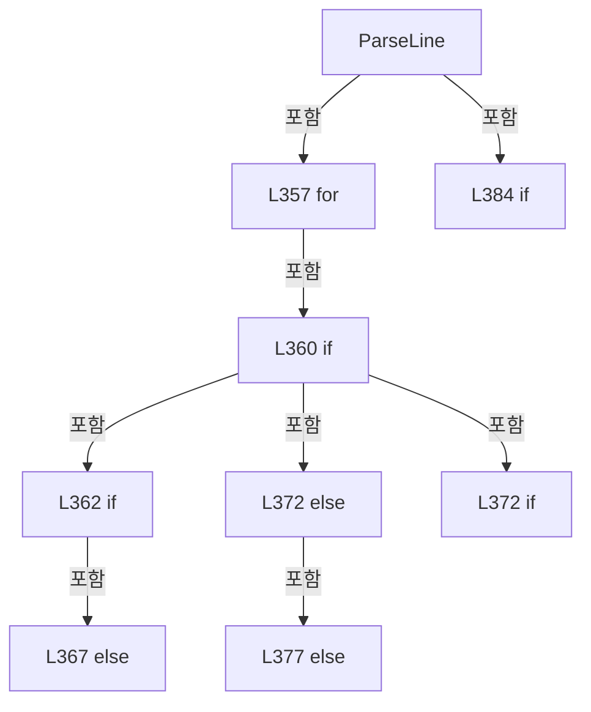

변경 전 점검: 입력/반환 타입, 위 호출자, 예외/취소 경로, 공유 상태와 저장·전송 소비자를 함께 확인합니다. 값의 단위나 물리 방향을 이름만으로 확정하지 않습니다.

### MethodDeclaration `ValidateHeaders` · L392–415

[Drilling.File/Parser/CCsvParser.cs:392–415](https://github.com/kjuws10-rgb/A3Drilling/blob/5aee8e58439c9b455cae7c9593c9be986c3e682e/Drilling.File/Parser/CCsvParser.cs#L392-L415)

| 항목 | 실제 추출 값 |
| --- | --- |
| 서명 | void Drilling.File.Parser.CCsvParser.ValidateHeaders(string, System.Collections.Generic.IReadOnlyList<string>) |
| 접근/수식자 | Private / private, static |
| 반환/값 타입 | void |
| 소속 타입 | NamedType:Drilling.File.Parser.CCsvParser |

입력 계약:

| 이름 | 타입 | 전달 | 선택/기본값 |
| --- | --- | --- | --- |
| path | string | None | False /  |
| headers | System.Collections.Generic.IReadOnlyList<string> | None | False /  |

정적 호출자로 확인된 위치:

| 호출 파일/행 | 호출 표현식 | 런타임 분기 가능 |
| --- | --- | --- |
| [Drilling.File/Parser/CCsvParser.cs:34–34](https://github.com/kjuws10-rgb/A3Drilling/blob/5aee8e58439c9b455cae7c9593c9be986c3e682e/Drilling.File/Parser/CCsvParser.cs#L34-L34) | ValidateHeaders | False |
| [Drilling.File/Parser/CCsvParser.cs:274–274](https://github.com/kjuws10-rgb/A3Drilling/blob/5aee8e58439c9b455cae7c9593c9be986c3e682e/Drilling.File/Parser/CCsvParser.cs#L274-L274) | ValidateHeaders | False |

호출하는 대상과 해석 범위:

| 원본 행 | 표현식 | 분석 상태 | 대상/소스 위치 |
| --- | --- | --- | --- |
| 394 | headers.Select((header, index) => new { Header = header, Index = index + 1 }).Where(item => string.IsNullOrWhiteSpace(item.Header)).Select(item => item.Index).ToArray | resolved | int[] System.Collections.Generic.IEnumerable<int>.ToArray<int>() |
| 394 | headers.Select((header, index) => new { Header = header, Index = index + 1 }).Where(item => string.IsNullOrWhiteSpace(item.Header)).Select | resolved | System.Collections.Generic.IEnumerable<int> System.Collections.Generic.IEnumerable<<anonymous type: string Header, int Index>>.Select<<anonymous type: string Header, int Index>, int>(System.Func<<anonymous type: string Header, int Index>, int>) |
| 394 | headers.Select((header, index) => new { Header = header, Index = index + 1 }).Where | resolved | System.Collections.Generic.IEnumerable<<anonymous type: string Header, int Index>> System.Collections.Generic.IEnumerable<<anonymous type: string Header, int Index>>.Where<<anonymous type: string Header, int Index>>(System.Func<<anonymous type: string Header, int Index>, bool>) |
| 394 | headers.Select | resolved | System.Collections.Generic.IEnumerable<<anonymous type: string Header, int Index>> System.Collections.Generic.IEnumerable<string>.Select<string, <anonymous type: string Header, int Index>>(System.Func<string, int, <anonymous type: string Header, int Index>>) |
| 394 | string.IsNullOrWhiteSpace | resolved | bool string.IsNullOrWhiteSpace(string?) |
| 397 | new InvalidDataException | resolved | System.IO.InvalidDataException.InvalidDataException(string?) |
| 397 | Path.GetFileName | resolved | string? System.IO.Path.GetFileName(string?) |
| 397 | string.Join | resolved | string string.Join<int>(string?, System.Collections.Generic.IEnumerable<int>) |
| 410 | headers.GroupBy(NormalizeHeader, StringComparer.OrdinalIgnoreCase).Where(ShouldIncludeItem).Select(SelectItem).ToArray | resolved | string[] System.Collections.Generic.IEnumerable<string>.ToArray<string>() |
| 410 | headers.GroupBy(NormalizeHeader, StringComparer.OrdinalIgnoreCase).Where(ShouldIncludeItem).Select | resolved | System.Collections.Generic.IEnumerable<string> System.Collections.Generic.IEnumerable<System.Linq.IGrouping<string, string>>.Select<System.Linq.IGrouping<string, string>, string>(System.Func<System.Linq.IGrouping<string, string>, string>) |
| 410 | headers.GroupBy(NormalizeHeader, StringComparer.OrdinalIgnoreCase).Where | resolved | System.Collections.Generic.IEnumerable<System.Linq.IGrouping<string, string>> System.Collections.Generic.IEnumerable<System.Linq.IGrouping<string, string>>.Where<System.Linq.IGrouping<string, string>>(System.Func<System.Linq.IGrouping<string, string>, bool>) |
| 410 | headers.GroupBy | resolved | System.Collections.Generic.IEnumerable<System.Linq.IGrouping<string, string>> System.Collections.Generic.IEnumerable<string>.GroupBy<string, string>(System.Func<string, string>, System.Collections.Generic.IEqualityComparer<string>?) |
| 413 | new InvalidDataException | resolved | System.IO.InvalidDataException.InvalidDataException(string?) |
| 413 | Path.GetFileName | resolved | string? System.IO.Path.GetFileName(string?) |
| 413 | string.Join | resolved | string string.Join(string?, params string?[]) |

본문의 실제 연산·분기·예외·반환 순서(원문 위치 순):

| 원본 행 | 종류 | 주석 해설 |
| --- | --- | --- |
| 394 | call | 함수·델리게이트 또는 객체 생성자를 호출합니다: headers.Select((header, index) => new { Header = header, Index = index + 1 }).Where(item => string.IsNullOrWhiteSpace(item.Header)).Select(item => item.Index).ToArray() |
| 394 | call | 함수·델리게이트 또는 객체 생성자를 호출합니다: headers.Select((header, index) => new { Header = header, Index = index + 1 }).Where(item => string.IsNullOrWhiteSpace(item.Header)).Select(item => item.Index) |
| 394 | call | 함수·델리게이트 또는 객체 생성자를 호출합니다: headers.Select((header, index) => new { Header = header, Index = index + 1 }).Where(item => string.IsNullOrWhiteSpace(item.Header)) |
| 394 | call | 함수·델리게이트 또는 객체 생성자를 호출합니다: headers.Select((header, index) => new { Header = header, Index = index + 1 }) |
| 394 | call | 함수·델리게이트 또는 객체 생성자를 호출합니다: string.IsNullOrWhiteSpace(item.Header) |
| 394 | local-declaration | 지역 변수를 선언합니다: var emptyIndexes = headers.Select((header, index) => new { Header = header, Index = index + 1 }).Where(item => string.IsNullOrWhiteSpace(item.Header)).Select(item => item.Index).ToArray(); |
| 394 | variable-initializer | 변수의 초기값을 지정합니다: emptyIndexes = headers.Select((header, index) => new { Header = header, Index = index + 1 }).Where(item => string.IsNullOrWhiteSpace(item.Header)).Select(item => item.Index).ToArray() |
| 395 | if | 조건에 따라 분기합니다: if (emptyIndexes.Length > 0) |
| 397 | call | 함수·델리게이트 또는 객체 생성자를 호출합니다: new InvalidDataException($"CSV validation failed. {Path.GetFileName(path)} header column cannot be empty. Column(s): {string.Join(", ", emptyIndexes)}") |
| 397 | call | 함수·델리게이트 또는 객체 생성자를 호출합니다: Path.GetFileName(path) |
| 397 | call | 함수·델리게이트 또는 객체 생성자를 호출합니다: string.Join(", ", emptyIndexes) |
| 397 | throw | 예외를 발생/전달합니다: throw new InvalidDataException($"CSV validation failed. {Path.GetFileName(path)} header column cannot be empty. Column(s): {string.Join(", ", emptyIndexes)}"); |
| 410 | call | 함수·델리게이트 또는 객체 생성자를 호출합니다: headers.GroupBy(NormalizeHeader, StringComparer.OrdinalIgnoreCase).Where(ShouldIncludeItem).Select(SelectItem).ToArray() |
| 410 | call | 함수·델리게이트 또는 객체 생성자를 호출합니다: headers.GroupBy(NormalizeHeader, StringComparer.OrdinalIgnoreCase).Where(ShouldIncludeItem).Select(SelectItem) |
| 410 | call | 함수·델리게이트 또는 객체 생성자를 호출합니다: headers.GroupBy(NormalizeHeader, StringComparer.OrdinalIgnoreCase).Where(ShouldIncludeItem) |
| 410 | call | 함수·델리게이트 또는 객체 생성자를 호출합니다: headers.GroupBy(NormalizeHeader, StringComparer.OrdinalIgnoreCase) |
| 410 | local-declaration | 지역 변수를 선언합니다: var duplicatedHeaders = headers.GroupBy(NormalizeHeader, StringComparer.OrdinalIgnoreCase).Where(ShouldIncludeItem).Select(SelectItem).ToArray(); |
| 410 | variable-initializer | 변수의 초기값을 지정합니다: duplicatedHeaders = headers.GroupBy(NormalizeHeader, StringComparer.OrdinalIgnoreCase).Where(ShouldIncludeItem).Select(SelectItem).ToArray() |
| 411 | if | 조건에 따라 분기합니다: if (duplicatedHeaders.Length > 0) |
| 413 | call | 함수·델리게이트 또는 객체 생성자를 호출합니다: new InvalidDataException($"CSV validation failed. {Path.GetFileName(path)} has duplicated header(s): {string.Join(", ", duplicatedHeaders)}") |
| 413 | call | 함수·델리게이트 또는 객체 생성자를 호출합니다: Path.GetFileName(path) |
| 413 | call | 함수·델리게이트 또는 객체 생성자를 호출합니다: string.Join(", ", duplicatedHeaders) |
| 413 | throw | 예외를 발생/전달합니다: throw new InvalidDataException($"CSV validation failed. {Path.GetFileName(path)} has duplicated header(s): {string.Join(", ", duplicatedHeaders)}"); |

제어 구문의 포함 구조(실제 실행 순서/CFG가 아닌 구문 탐색 그림):

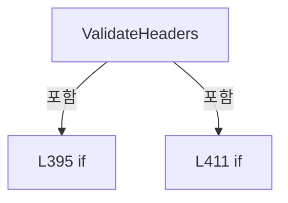

변경 전 점검: 입력/반환 타입, 위 호출자, 예외/취소 경로, 공유 상태와 저장·전송 소비자를 함께 확인합니다. 값의 단위나 물리 방향을 이름만으로 확정하지 않습니다.

### LocalFunctionStatement `ShouldIncludeItem` · L400–403

[Drilling.File/Parser/CCsvParser.cs:400–403](https://github.com/kjuws10-rgb/A3Drilling/blob/5aee8e58439c9b455cae7c9593c9be986c3e682e/Drilling.File/Parser/CCsvParser.cs#L400-L403)

| 항목 | 실제 추출 값 |
| --- | --- |
| 서명 | bool ShouldIncludeItem(System.Linq.IGrouping<string, string>) |
| 접근/수식자 | Private /  |
| 반환/값 타입 | bool |
| 소속 타입 | NamedType:Drilling.File.Parser.CCsvParser |

입력 계약:

| 이름 | 타입 | 전달 | 선택/기본값 |
| --- | --- | --- | --- |
| group | System.Linq.IGrouping<string, string> | None | False /  |

현재 부분 분석에서 직접 연결된 호출자는 없습니다. XAML/이벤트/인터페이스·델리게이트·외부 진입을 추가 확인해야 하며, 미사용으로 판정한 것이 아닙니다.

호출하는 대상과 해석 범위:

| 원본 행 | 표현식 | 분석 상태 | 대상/소스 위치 |
| --- | --- | --- | --- |
| 402 | group.Count | resolved | int System.Collections.Generic.IEnumerable<string>.Count<string>() |

본문의 실제 연산·분기·예외·반환 순서(원문 위치 순):

| 원본 행 | 종류 | 주석 해설 |
| --- | --- | --- |
| 402 | call | 함수·델리게이트 또는 객체 생성자를 호출합니다: group.Count() |
| 402 | return | 호출자에게 값 또는 제어를 반환합니다: return group.Count() > 1; |

변경 전 점검: 입력/반환 타입, 위 호출자, 예외/취소 경로, 공유 상태와 저장·전송 소비자를 함께 확인합니다. 값의 단위나 물리 방향을 이름만으로 확정하지 않습니다.

### LocalFunctionStatement `SelectItem` · L405–408

[Drilling.File/Parser/CCsvParser.cs:405–408](https://github.com/kjuws10-rgb/A3Drilling/blob/5aee8e58439c9b455cae7c9593c9be986c3e682e/Drilling.File/Parser/CCsvParser.cs#L405-L408)

| 항목 | 실제 추출 값 |
| --- | --- |
| 서명 | string SelectItem(System.Linq.IGrouping<string, string>) |
| 접근/수식자 | Private /  |
| 반환/값 타입 | string |
| 소속 타입 | NamedType:Drilling.File.Parser.CCsvParser |

입력 계약:

| 이름 | 타입 | 전달 | 선택/기본값 |
| --- | --- | --- | --- |
| group | System.Linq.IGrouping<string, string> | None | False /  |

현재 부분 분석에서 직접 연결된 호출자는 없습니다. XAML/이벤트/인터페이스·델리게이트·외부 진입을 추가 확인해야 하며, 미사용으로 판정한 것이 아닙니다.

호출하는 대상과 해석 범위:

| 원본 행 | 표현식 | 분석 상태 | 대상/소스 위치 |
| --- | --- | --- | --- |
| 407 | group.First | resolved | string System.Collections.Generic.IEnumerable<string>.First<string>() |

본문의 실제 연산·분기·예외·반환 순서(원문 위치 순):

| 원본 행 | 종류 | 주석 해설 |
| --- | --- | --- |
| 407 | call | 함수·델리게이트 또는 객체 생성자를 호출합니다: group.First() |
| 407 | return | 호출자에게 값 또는 제어를 반환합니다: return group.First(); |

변경 전 점검: 입력/반환 타입, 위 호출자, 예외/취소 경로, 공유 상태와 저장·전송 소비자를 함께 확인합니다. 값의 단위나 물리 방향을 이름만으로 확정하지 않습니다.

### MethodDeclaration `Escape` · L417–425

[Drilling.File/Parser/CCsvParser.cs:417–425](https://github.com/kjuws10-rgb/A3Drilling/blob/5aee8e58439c9b455cae7c9593c9be986c3e682e/Drilling.File/Parser/CCsvParser.cs#L417-L425)

| 항목 | 실제 추출 값 |
| --- | --- |
| 서명 | string Drilling.File.Parser.CCsvParser.Escape(string) |
| 접근/수식자 | Private / private, static |
| 반환/값 타입 | string |
| 소속 타입 | NamedType:Drilling.File.Parser.CCsvParser |

입력 계약:

| 이름 | 타입 | 전달 | 선택/기본값 |
| --- | --- | --- | --- |
| value | string | None | False /  |

정적 호출자로 확인된 위치:

| 호출 파일/행 | 호출 표현식 | 런타임 분기 가능 |
| --- | --- | --- |
| [Drilling.File/Parser/CCsvParser.cs:86–86](https://github.com/kjuws10-rgb/A3Drilling/blob/5aee8e58439c9b455cae7c9593c9be986c3e682e/Drilling.File/Parser/CCsvParser.cs#L86-L86) | Escape | False |
| [Drilling.File/Parser/CCsvParser.cs:114–114](https://github.com/kjuws10-rgb/A3Drilling/blob/5aee8e58439c9b455cae7c9593c9be986c3e682e/Drilling.File/Parser/CCsvParser.cs#L114-L114) | Escape | False |

호출하는 대상과 해석 범위:

| 원본 행 | 표현식 | 분석 상태 | 대상/소스 위치 |
| --- | --- | --- | --- |
| 419 | value.Contains | resolved | bool string.Contains(char) |
| 419 | value.Contains | resolved | bool string.Contains(char) |
| 419 | value.Contains | resolved | bool string.Contains(char) |
| 419 | value.Contains | resolved | bool string.Contains(char) |
| 424 | value.Replace | resolved | string string.Replace(string, string?) |

본문의 실제 연산·분기·예외·반환 순서(원문 위치 순):

| 원본 행 | 종류 | 주석 해설 |
| --- | --- | --- |
| 419 | call | 함수·델리게이트 또는 객체 생성자를 호출합니다: value.Contains(',') |
| 419 | call | 함수·델리게이트 또는 객체 생성자를 호출합니다: value.Contains('"') |
| 419 | call | 함수·델리게이트 또는 객체 생성자를 호출합니다: value.Contains('\r') |
| 419 | call | 함수·델리게이트 또는 객체 생성자를 호출합니다: value.Contains('\n') |
| 419 | if | 조건에 따라 분기합니다: if (!value.Contains(',') && !value.Contains('"') && !value.Contains('\r') && !value.Contains('\n')) |
| 421 | return | 호출자에게 값 또는 제어를 반환합니다: return value; |
| 424 | call | 함수·델리게이트 또는 객체 생성자를 호출합니다: value.Replace("\"", "\"\"") |
| 424 | return | 호출자에게 값 또는 제어를 반환합니다: return $"\"{value.Replace("\"", "\"\"")}\""; |

제어 구문의 포함 구조(실제 실행 순서/CFG가 아닌 구문 탐색 그림):

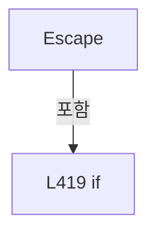

변경 전 점검: 입력/반환 타입, 위 호출자, 예외/취소 경로, 공유 상태와 저장·전송 소비자를 함께 확인합니다. 값의 단위나 물리 방향을 이름만으로 확정하지 않습니다.

### MethodDeclaration `NormalizeHeader` · L427–430

[Drilling.File/Parser/CCsvParser.cs:427–430](https://github.com/kjuws10-rgb/A3Drilling/blob/5aee8e58439c9b455cae7c9593c9be986c3e682e/Drilling.File/Parser/CCsvParser.cs#L427-L430)

| 항목 | 실제 추출 값 |
| --- | --- |
| 서명 | string Drilling.File.Parser.CCsvParser.NormalizeHeader(string) |
| 접근/수식자 | Private / private, static |
| 반환/값 타입 | string |
| 소속 타입 | NamedType:Drilling.File.Parser.CCsvParser |

입력 계약:

| 이름 | 타입 | 전달 | 선택/기본값 |
| --- | --- | --- | --- |
| value | string | None | False /  |

정적 호출자로 확인된 위치:

| 호출 파일/행 | 호출 표현식 | 런타임 분기 가능 |
| --- | --- | --- |
| [Drilling.File/Parser/CCsvParser.cs:236–236](https://github.com/kjuws10-rgb/A3Drilling/blob/5aee8e58439c9b455cae7c9593c9be986c3e682e/Drilling.File/Parser/CCsvParser.cs#L236-L236) | NormalizeHeader | False |
| [Drilling.File/Parser/CCsvParser.cs:246–246](https://github.com/kjuws10-rgb/A3Drilling/blob/5aee8e58439c9b455cae7c9593c9be986c3e682e/Drilling.File/Parser/CCsvParser.cs#L246-L246) | NormalizeHeader | False |
| [Drilling.File/Parser/CCsvParser.cs:311–311](https://github.com/kjuws10-rgb/A3Drilling/blob/5aee8e58439c9b455cae7c9593c9be986c3e682e/Drilling.File/Parser/CCsvParser.cs#L311-L311) | NormalizeHeader | False |

호출하는 대상과 해석 범위:

| 원본 행 | 표현식 | 분석 상태 | 대상/소스 위치 |
| --- | --- | --- | --- |
| 429 | value.Trim().ToUpperInvariant | resolved | string string.ToUpperInvariant() |
| 429 | value.Trim | resolved | string string.Trim() |

본문의 실제 연산·분기·예외·반환 순서(원문 위치 순):

| 원본 행 | 종류 | 주석 해설 |
| --- | --- | --- |
| 429 | call | 함수·델리게이트 또는 객체 생성자를 호출합니다: value.Trim().ToUpperInvariant() |
| 429 | call | 함수·델리게이트 또는 객체 생성자를 호출합니다: value.Trim() |
| 429 | return | 호출자에게 값 또는 제어를 반환합니다: return value.Trim().ToUpperInvariant(); |

변경 전 점검: 입력/반환 타입, 위 호출자, 예외/취소 경로, 공유 상태와 저장·전송 소비자를 함께 확인합니다. 값의 단위나 물리 방향을 이름만으로 확정하지 않습니다.

### MethodDeclaration `ReadCsvText` · L432–453

[Drilling.File/Parser/CCsvParser.cs:432–453](https://github.com/kjuws10-rgb/A3Drilling/blob/5aee8e58439c9b455cae7c9593c9be986c3e682e/Drilling.File/Parser/CCsvParser.cs#L432-L453)

| 항목 | 실제 추출 값 |
| --- | --- |
| 서명 | string Drilling.File.Parser.CCsvParser.ReadCsvText(string) |
| 접근/수식자 | Private / private, static |
| 반환/값 타입 | string |
| 소속 타입 | NamedType:Drilling.File.Parser.CCsvParser |

입력 계약:

| 이름 | 타입 | 전달 | 선택/기본값 |
| --- | --- | --- | --- |
| path | string | None | False /  |

정적 호출자로 확인된 위치:

| 호출 파일/행 | 호출 표현식 | 런타임 분기 가능 |
| --- | --- | --- |
| [Drilling.File/Parser/CCsvParser.cs:154–154](https://github.com/kjuws10-rgb/A3Drilling/blob/5aee8e58439c9b455cae7c9593c9be986c3e682e/Drilling.File/Parser/CCsvParser.cs#L154-L154) | ReadCsvText | False |

호출하는 대상과 해석 범위:

| 원본 행 | 표현식 | 분석 상태 | 대상/소스 위치 |
| --- | --- | --- | --- |
| 434 | System.IO.File.ReadAllBytes | resolved | byte[] System.IO.File.ReadAllBytes(string) |
| 440 | HasUtf8Bom | resolved | bool Drilling.File.Parser.CCsvParser.HasUtf8Bom(System.Collections.Generic.IReadOnlyList<byte>) · Drilling.File/Parser/CCsvParser.cs:455 |
| 442 | StrictUtf8Encoding.GetString | resolved · 동적 구현 선택 가능 | string System.Text.Encoding.GetString(byte[], int, int) |
| 447 | StrictUtf8Encoding.GetString | resolved · 동적 구현 선택 가능 | string System.Text.Encoding.GetString(byte[]) |
| 451 | KoreanCsvEncoding.Value.GetString | resolved · 동적 구현 선택 가능 | string System.Text.Encoding.GetString(byte[]) |

본문의 실제 연산·분기·예외·반환 순서(원문 위치 순):

| 원본 행 | 종류 | 주석 해설 |
| --- | --- | --- |
| 434 | call | 함수·델리게이트 또는 객체 생성자를 호출합니다: System.IO.File.ReadAllBytes(path) |
| 434 | local-declaration | 지역 변수를 선언합니다: var bytes = System.IO.File.ReadAllBytes(path); |
| 434 | variable-initializer | 변수의 초기값을 지정합니다: bytes = System.IO.File.ReadAllBytes(path) |
| 435 | if | 조건에 따라 분기합니다: if (bytes.Length == 0) |
| 437 | return | 호출자에게 값 또는 제어를 반환합니다: return ""; |
| 440 | call | 함수·델리게이트 또는 객체 생성자를 호출합니다: HasUtf8Bom(bytes) |
| 440 | if | 조건에 따라 분기합니다: if (HasUtf8Bom(bytes)) |
| 442 | call | 함수·델리게이트 또는 객체 생성자를 호출합니다: StrictUtf8Encoding.GetString(bytes, Utf8BomLength, bytes.Length - Utf8BomLength) |
| 442 | return | 호출자에게 값 또는 제어를 반환합니다: return StrictUtf8Encoding.GetString(bytes, Utf8BomLength, bytes.Length - Utf8BomLength); |
| 445 | try | 예외 처리 범위입니다: try |
| 447 | call | 함수·델리게이트 또는 객체 생성자를 호출합니다: StrictUtf8Encoding.GetString(bytes) |
| 447 | return | 호출자에게 값 또는 제어를 반환합니다: return StrictUtf8Encoding.GetString(bytes); |
| 449 | catch | 지정 예외를 처리합니다: catch (DecoderFallbackException) |
| 451 | call | 함수·델리게이트 또는 객체 생성자를 호출합니다: KoreanCsvEncoding.Value.GetString(bytes) |
| 451 | return | 호출자에게 값 또는 제어를 반환합니다: return KoreanCsvEncoding.Value.GetString(bytes); |

제어 구문의 포함 구조(실제 실행 순서/CFG가 아닌 구문 탐색 그림):

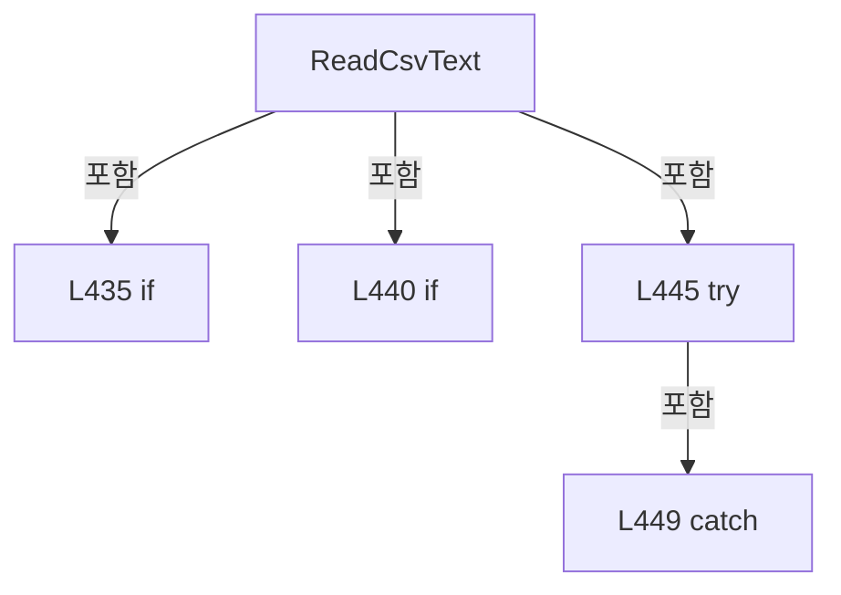

변경 전 점검: 입력/반환 타입, 위 호출자, 예외/취소 경로, 공유 상태와 저장·전송 소비자를 함께 확인합니다. 값의 단위나 물리 방향을 이름만으로 확정하지 않습니다.

### MethodDeclaration `HasUtf8Bom` · L455–458

[Drilling.File/Parser/CCsvParser.cs:455–458](https://github.com/kjuws10-rgb/A3Drilling/blob/5aee8e58439c9b455cae7c9593c9be986c3e682e/Drilling.File/Parser/CCsvParser.cs#L455-L458)

| 항목 | 실제 추출 값 |
| --- | --- |
| 서명 | bool Drilling.File.Parser.CCsvParser.HasUtf8Bom(System.Collections.Generic.IReadOnlyList<byte>) |
| 접근/수식자 | Private / private, static |
| 반환/값 타입 | bool |
| 소속 타입 | NamedType:Drilling.File.Parser.CCsvParser |

입력 계약:

| 이름 | 타입 | 전달 | 선택/기본값 |
| --- | --- | --- | --- |
| bytes | System.Collections.Generic.IReadOnlyList<byte> | None | False /  |

정적 호출자로 확인된 위치:

| 호출 파일/행 | 호출 표현식 | 런타임 분기 가능 |
| --- | --- | --- |
| [Drilling.File/Parser/CCsvParser.cs:440–440](https://github.com/kjuws10-rgb/A3Drilling/blob/5aee8e58439c9b455cae7c9593c9be986c3e682e/Drilling.File/Parser/CCsvParser.cs#L440-L440) | HasUtf8Bom | False |

본문의 실제 연산·분기·예외·반환 순서(원문 위치 순):

| 원본 행 | 종류 | 주석 해설 |
| --- | --- | --- |
| 457 | return | 호출자에게 값 또는 제어를 반환합니다: return bytes.Count >= Utf8BomLength && bytes[0] == 0xEF && bytes[1] == 0xBB && bytes[2] == 0xBF; |

변경 전 점검: 입력/반환 타입, 위 호출자, 예외/취소 경로, 공유 상태와 저장·전송 소비자를 함께 확인합니다. 값의 단위나 물리 방향을 이름만으로 확정하지 않습니다.

### MethodDeclaration `SplitLines` · L460–470

[Drilling.File/Parser/CCsvParser.cs:460–470](https://github.com/kjuws10-rgb/A3Drilling/blob/5aee8e58439c9b455cae7c9593c9be986c3e682e/Drilling.File/Parser/CCsvParser.cs#L460-L470)

| 항목 | 실제 추출 값 |
| --- | --- |
| 서명 | string[] Drilling.File.Parser.CCsvParser.SplitLines(string) |
| 접근/수식자 | Private / private, static |
| 반환/값 타입 | string[] |
| 소속 타입 | NamedType:Drilling.File.Parser.CCsvParser |

입력 계약:

| 이름 | 타입 | 전달 | 선택/기본값 |
| --- | --- | --- | --- |
| text | string | None | False /  |

정적 호출자로 확인된 위치:

| 호출 파일/행 | 호출 표현식 | 런타임 분기 가능 |
| --- | --- | --- |
| [Drilling.File/Parser/CCsvParser.cs:154–154](https://github.com/kjuws10-rgb/A3Drilling/blob/5aee8e58439c9b455cae7c9593c9be986c3e682e/Drilling.File/Parser/CCsvParser.cs#L154-L154) | SplitLines | False |

호출하는 대상과 해석 범위:

| 원본 행 | 표현식 | 분석 상태 | 대상/소스 위치 |
| --- | --- | --- | --- |
| 462 | new StringReader | resolved | System.IO.StringReader.StringReader(string) |
| 463 | new List<string> | resolved | System.Collections.Generic.List<string>.List() |
| 464 | reader.ReadLine | resolved · 동적 구현 선택 가능 | string? System.IO.StringReader.ReadLine() |
| 466 | lines.Add | resolved | void System.Collections.Generic.List<string>.Add(string) |
| 469 | lines.ToArray | resolved | string[] System.Collections.Generic.List<string>.ToArray() |

본문의 실제 연산·분기·예외·반환 순서(원문 위치 순):

| 원본 행 | 종류 | 주석 해설 |
| --- | --- | --- |
| 462 | call | 함수·델리게이트 또는 객체 생성자를 호출합니다: new StringReader(text) |
| 462 | using-declaration | 정리할 자원을 선언합니다: using var reader = new StringReader(text); |
| 462 | variable-initializer | 변수의 초기값을 지정합니다: reader = new StringReader(text) |
| 463 | call | 함수·델리게이트 또는 객체 생성자를 호출합니다: new List<string>() |
| 463 | local-declaration | 지역 변수를 선언합니다: var lines = new List<string>(); |
| 463 | variable-initializer | 변수의 초기값을 지정합니다: lines = new List<string>() |
| 464 | call | 함수·델리게이트 또는 객체 생성자를 호출합니다: reader.ReadLine() |
| 464 | while | 조건을 먼저 확인하며 반복합니다: while (reader.ReadLine() is { } line) |
| 466 | call | 함수·델리게이트 또는 객체 생성자를 호출합니다: lines.Add(line) |
| 469 | call | 함수·델리게이트 또는 객체 생성자를 호출합니다: lines.ToArray() |
| 469 | return | 호출자에게 값 또는 제어를 반환합니다: return lines.ToArray(); |

제어 구문의 포함 구조(실제 실행 순서/CFG가 아닌 구문 탐색 그림):

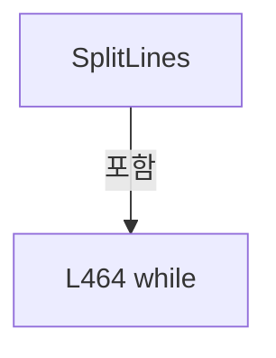

변경 전 점검: 입력/반환 타입, 위 호출자, 예외/취소 경로, 공유 상태와 저장·전송 소비자를 함께 확인합니다. 값의 단위나 물리 방향을 이름만으로 확정하지 않습니다.

### MethodDeclaration `GetKoreanCsvEncoding` · L472–476

[Drilling.File/Parser/CCsvParser.cs:472–476](https://github.com/kjuws10-rgb/A3Drilling/blob/5aee8e58439c9b455cae7c9593c9be986c3e682e/Drilling.File/Parser/CCsvParser.cs#L472-L476)

| 항목 | 실제 추출 값 |
| --- | --- |
| 서명 | System.Text.Encoding Drilling.File.Parser.CCsvParser.GetKoreanCsvEncoding() |
| 접근/수식자 | Private / private, static |
| 반환/값 타입 | System.Text.Encoding |
| 소속 타입 | NamedType:Drilling.File.Parser.CCsvParser |

현재 부분 분석에서 직접 연결된 호출자는 없습니다. XAML/이벤트/인터페이스·델리게이트·외부 진입을 추가 확인해야 하며, 미사용으로 판정한 것이 아닙니다.

호출하는 대상과 해석 범위:

| 원본 행 | 표현식 | 분석 상태 | 대상/소스 위치 |
| --- | --- | --- | --- |
| 474 | Encoding.RegisterProvider | resolved | void System.Text.Encoding.RegisterProvider(System.Text.EncodingProvider) |
| 475 | Encoding.GetEncoding | resolved | System.Text.Encoding System.Text.Encoding.GetEncoding(int) |

본문의 실제 연산·분기·예외·반환 순서(원문 위치 순):

| 원본 행 | 종류 | 주석 해설 |
| --- | --- | --- |
| 474 | call | 함수·델리게이트 또는 객체 생성자를 호출합니다: Encoding.RegisterProvider(CodePagesEncodingProvider.Instance) |
| 475 | call | 함수·델리게이트 또는 객체 생성자를 호출합니다: Encoding.GetEncoding(949) |
| 475 | return | 호출자에게 값 또는 제어를 반환합니다: return Encoding.GetEncoding(949); |

변경 전 점검: 입력/반환 타입, 위 호출자, 예외/취소 경로, 공유 상태와 저장·전송 소비자를 함께 확인합니다. 값의 단위나 물리 방향을 이름만으로 확정하지 않습니다.

## 구문·바인딩 한계

전체 WPF/벤더 SDK/프로젝트별 빌드 조건을 로드한 정식 빌드가 아닙니다. `resolved`는 이 부분 컴파일에서의 심볼 연결이며 virtual/interface/delegate/이벤트/Reflection/XAML의 실제 런타임 구현을 확정하지 않습니다. `candidate`와 `unresolved`는 후속 확인 대상으로 남깁니다.

## 원문 전체 주석 해설본

[원본 모든 행과 행별 해설 보기](../../../annotated/Drilling.File/Parser/CCsvParser.cs.annotated.txt)

원본을 빠뜨리거나 임의로 줄이지 않았습니다. `L000001 |` 표시는 원본 행 번호, `// 해설`은 별도 설명입니다. 실행용 소스가 아닌 문서입니다.

## 수정·재검증 체크

- 원본 Commit과 현재 작업 파일 SHA가 같은지 먼저 확인합니다. 다르면 이 문서를 과거 버전 자료로 취급합니다.
- 선언·직접 호출·이벤트/인터페이스 경계·설정 소비를 함께 확인합니다. 정적 연결의 빈 곳을 정상 경로로 추정하지 않습니다.
- 저장 형식/단위/식별자·재시도·취소·예외·롤백에 영향을 주는 변경은 상세 해설장과 호출자를 다시 검토합니다.
- 도구의 구문 추출과 별도 정적 추적 해설, 실제 빌드·시뮬레이션·실장비 검증 결과를 분리합니다.
