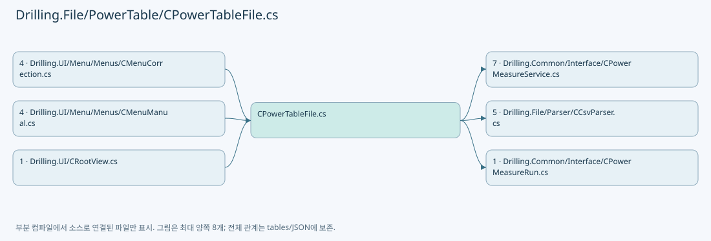
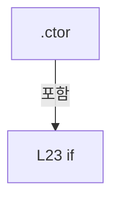
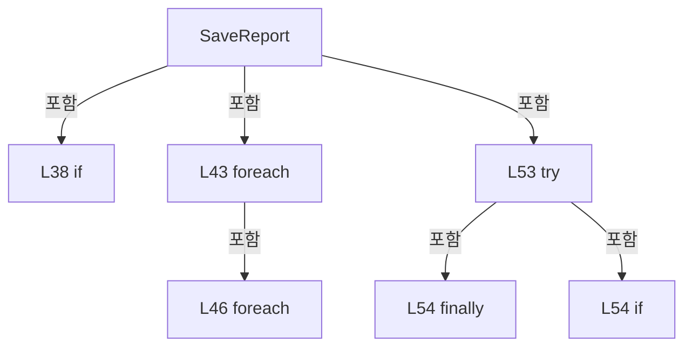
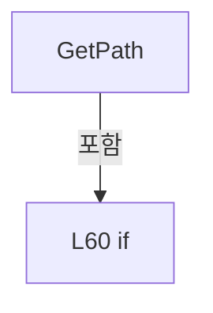
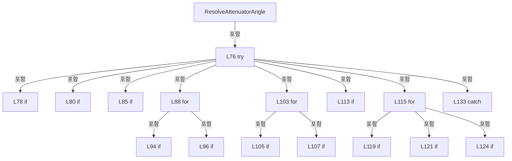
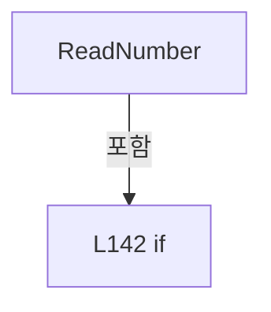
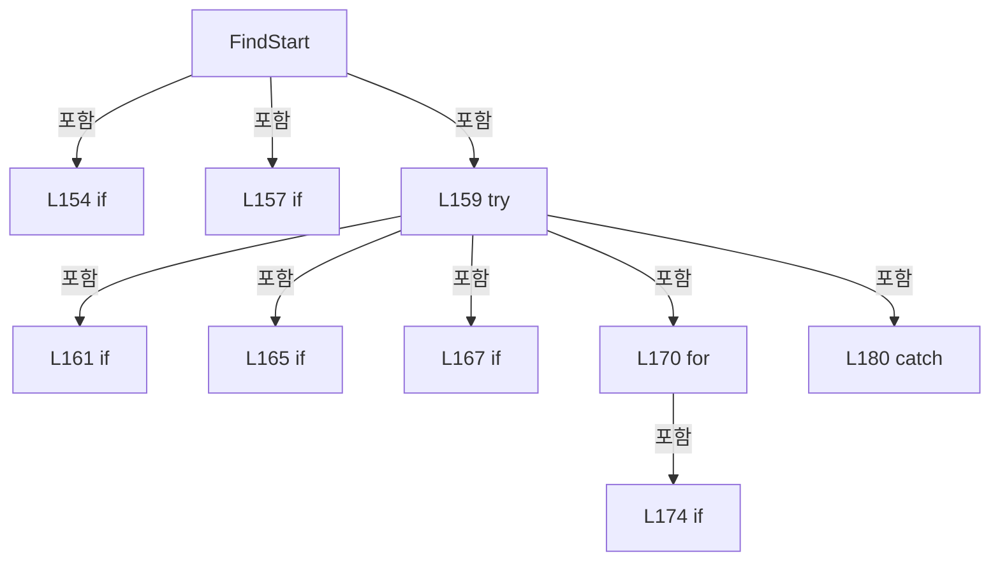
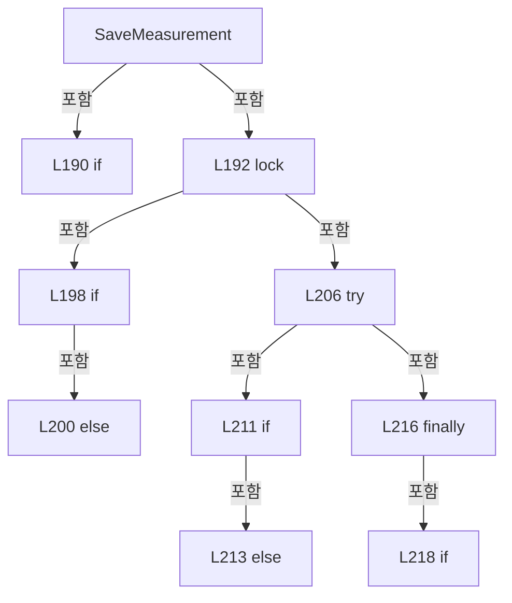
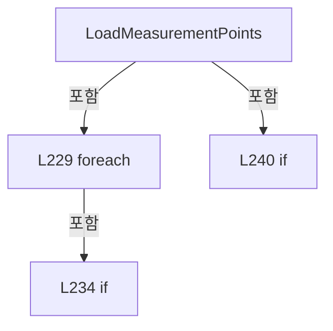

# Drilling.File/PowerTable/CPowerTableFile.cs

| 항목 | 내용 |
| --- | --- |
| 원본 저장소 | https://github.com/kjuws10-rgb/A3Drilling.git |
| 원본 Commit | 5aee8e58439c9b455cae7c9593c9be986c3e682e |
| 원본 SHA256 | 464dfb6cb7f8623591fba5bcda068159015f1f9181ff3bb02be7c3fd82365646 |
| 파일 분류 | code |
| 원본 크기/행 | 15,391 bytes / 246 physical lines |
| 인코딩 | utf-8-sig |
| 검토 범위 | 구문/부분 의미 분석에서 추출한 사실. 동작·물리 단위·실장비 합격을 보증하지 않습니다. |
| 원본 링크 | [고정 Commit 원본](https://github.com/kjuws10-rgb/A3Drilling/blob/5aee8e58439c9b455cae7c9593c9be986c3e682e/Drilling.File/PowerTable/CPowerTableFile.cs) |

## 파일의 역할과 읽는 순서

정의·설정·레시피·결과·스크립트의 파일 입출력과 데이터 형식을 담당합니다. 저장 필드를 통신 송신 필드로 단정하지 않습니다.



## 네임스페이스·타입·상속

| 타입 | 구분 | 원본 범위 | 선언/상속 |
| --- | --- | --- | --- |
| CPowerTableFile | ClassDeclaration | 10–245 | CPowerTableFile: IPowerMeasureTable |

## 멤버 빠른 목록

| 이름 | 종류 | 범위 | 서명 |
| --- | --- | --- | --- |
| _directory | FieldDeclaration | L13–13 | string Drilling.File.PowerTable.CPowerTableFile._directory |
| _initialDirectory | FieldDeclaration | L14–14 | string? Drilling.File.PowerTable.CPowerTableFile._initialDirectory |
| MeasurementLocks | FieldDeclaration | L15–15 | System.Collections.Concurrent.ConcurrentDictionary<string, object> Drilling.File.PowerTable.CPowerTableFile.MeasurementLocks |
| .ctor | ConstructorDeclaration | L19–28 | Drilling.File.PowerTable.CPowerTableFile.CPowerTableFile(string, bool) |
| CreateRun | MethodDeclaration | L32–33 | Drilling.Common.Interface.CPowerMeasureRun Drilling.File.PowerTable.CPowerTableFile.CreateRun(Drilling.Common.Managers.CManager, Drilling.Common.Managers.ST_RECIPE_DEFINITION, System.Collections.Generic.IReadOnlyList<Drilling.Common.Interface.ST_POWER_MEASURE_TARGET>, bool) |
| SaveReport | MethodDeclaration | L35–56 | string Drilling.File.PowerTable.CPowerTableFile.SaveReport(string, Drilling.Common.Interface.ST_POWER_MEASURE_REPORT) |
| GetPath | MethodDeclaration | L58–63 | string Drilling.File.PowerTable.CPowerTableFile.GetPath(int) |
| ResolveAttenuatorAngle | MethodDeclaration | L69–137 | double Drilling.File.PowerTable.CPowerTableFile.ResolveAttenuatorAngle(int, double, System.Threading.CancellationToken) |
| ReadNumber | MethodDeclaration | L139–145 | double Drilling.File.PowerTable.CPowerTableFile.ReadNumber(System.Collections.Generic.IReadOnlyDictionary<string, string>, string, int) |
| Format | MethodDeclaration | L147–147 | string Drilling.File.PowerTable.CPowerTableFile.Format(double) |
| FindStart | MethodDeclaration | L150–184 | Drilling.Common.Interface.ST_POWER_MEASURE_START Drilling.File.PowerTable.CPowerTableFile.FindStart(int, double, System.Threading.CancellationToken) |
| SaveMeasurement | MethodDeclaration | L187–222 | void Drilling.File.PowerTable.CPowerTableFile.SaveMeasurement(int, double, double, System.Threading.CancellationToken) |
| LoadMeasurementPoints | MethodDeclaration | L224–243 | System.Collections.Generic.List<(double Angle, double Power)> Drilling.File.PowerTable.CPowerTableFile.LoadMeasurementPoints(string, System.Threading.CancellationToken) |

## 멤버별 상세 계약·호출·처리 해설

### FieldDeclaration `_directory` · L13–13

[Drilling.File/PowerTable/CPowerTableFile.cs:13–13](https://github.com/kjuws10-rgb/A3Drilling/blob/5aee8e58439c9b455cae7c9593c9be986c3e682e/Drilling.File/PowerTable/CPowerTableFile.cs#L13-L13)

| 항목 | 실제 추출 값 |
| --- | --- |
| 서명 | string Drilling.File.PowerTable.CPowerTableFile._directory |
| 접근/수식자 | Private / private, readonly |
| 반환/값 타입 | string |
| 소속 타입 | NamedType:Drilling.File.PowerTable.CPowerTableFile |

현재 부분 분석에서 직접 연결된 호출자는 없습니다. XAML/이벤트/인터페이스·델리게이트·외부 진입을 추가 확인해야 하며, 미사용으로 판정한 것이 아닙니다.

변경 전 점검: 입력/반환 타입, 위 호출자, 예외/취소 경로, 공유 상태와 저장·전송 소비자를 함께 확인합니다. 값의 단위나 물리 방향을 이름만으로 확정하지 않습니다.

### FieldDeclaration `_initialDirectory` · L14–14

[Drilling.File/PowerTable/CPowerTableFile.cs:14–14](https://github.com/kjuws10-rgb/A3Drilling/blob/5aee8e58439c9b455cae7c9593c9be986c3e682e/Drilling.File/PowerTable/CPowerTableFile.cs#L14-L14)

| 항목 | 실제 추출 값 |
| --- | --- |
| 서명 | string? Drilling.File.PowerTable.CPowerTableFile._initialDirectory |
| 접근/수식자 | Private / private, readonly |
| 반환/값 타입 | string? |
| 소속 타입 | NamedType:Drilling.File.PowerTable.CPowerTableFile |

현재 부분 분석에서 직접 연결된 호출자는 없습니다. XAML/이벤트/인터페이스·델리게이트·외부 진입을 추가 확인해야 하며, 미사용으로 판정한 것이 아닙니다.

변경 전 점검: 입력/반환 타입, 위 호출자, 예외/취소 경로, 공유 상태와 저장·전송 소비자를 함께 확인합니다. 값의 단위나 물리 방향을 이름만으로 확정하지 않습니다.

### FieldDeclaration `MeasurementLocks` · L15–15

[Drilling.File/PowerTable/CPowerTableFile.cs:15–15](https://github.com/kjuws10-rgb/A3Drilling/blob/5aee8e58439c9b455cae7c9593c9be986c3e682e/Drilling.File/PowerTable/CPowerTableFile.cs#L15-L15)

| 항목 | 실제 추출 값 |
| --- | --- |
| 서명 | System.Collections.Concurrent.ConcurrentDictionary<string, object> Drilling.File.PowerTable.CPowerTableFile.MeasurementLocks |
| 접근/수식자 | Private / private, static, readonly |
| 반환/값 타입 | System.Collections.Concurrent.ConcurrentDictionary<string, object> |
| 소속 타입 | NamedType:Drilling.File.PowerTable.CPowerTableFile |

현재 부분 분석에서 직접 연결된 호출자는 없습니다. XAML/이벤트/인터페이스·델리게이트·외부 진입을 추가 확인해야 하며, 미사용으로 판정한 것이 아닙니다.

호출하는 대상과 해석 범위:

| 원본 행 | 표현식 | 분석 상태 | 대상/소스 위치 |
| --- | --- | --- | --- |
| 15 | new | resolved | System.Collections.Concurrent.ConcurrentDictionary<string, object>.ConcurrentDictionary(System.Collections.Generic.IEqualityComparer<string>?) |

본문의 실제 연산·분기·예외·반환 순서(원문 위치 순):

| 원본 행 | 종류 | 주석 해설 |
| --- | --- | --- |
| 15 | call | 함수·델리게이트 또는 객체 생성자를 호출합니다: new(StringComparer.OrdinalIgnoreCase) |
| 15 | variable-initializer | 변수의 초기값을 지정합니다: MeasurementLocks = new(StringComparer.OrdinalIgnoreCase) |

변경 전 점검: 입력/반환 타입, 위 호출자, 예외/취소 경로, 공유 상태와 저장·전송 소비자를 함께 확인합니다. 값의 단위나 물리 방향을 이름만으로 확정하지 않습니다.

### ConstructorDeclaration `.ctor` · L19–28

[Drilling.File/PowerTable/CPowerTableFile.cs:19–28](https://github.com/kjuws10-rgb/A3Drilling/blob/5aee8e58439c9b455cae7c9593c9be986c3e682e/Drilling.File/PowerTable/CPowerTableFile.cs#L19-L28)

| 항목 | 실제 추출 값 |
| --- | --- |
| 서명 | Drilling.File.PowerTable.CPowerTableFile.CPowerTableFile(string, bool) |
| 접근/수식자 | Public / public |
| 반환/값 타입 | void |
| 소속 타입 | NamedType:Drilling.File.PowerTable.CPowerTableFile |

원본 XML 주석:

````xml
/// <param name = "configRoot">The application's Config directory.</param>
````

입력 계약:

| 이름 | 타입 | 전달 | 선택/기본값 |
| --- | --- | --- | --- |
| configRoot | string | None | False /  |
| simulation | bool | None | True / false |

정적 호출자로 확인된 위치:

| 호출 파일/행 | 호출 표현식 | 런타임 분기 가능 |
| --- | --- | --- |
| [Drilling.File/PowerTable/CPowerTableFile.cs:33–33](https://github.com/kjuws10-rgb/A3Drilling/blob/5aee8e58439c9b455cae7c9593c9be986c3e682e/Drilling.File/PowerTable/CPowerTableFile.cs#L33-L33) | new CPowerTableFile | False |
| [Drilling.UI/Menu/Menus/CMenuCorrection.cs:3437–3437](https://github.com/kjuws10-rgb/A3Drilling/blob/5aee8e58439c9b455cae7c9593c9be986c3e682e/Drilling.UI/Menu/Menus/CMenuCorrection.cs#L3437-L3437) | new Drilling.File.PowerTable.CPowerTableFile | False |
| [Drilling.UI/Menu/Menus/CMenuCorrection.cs:3589–3589](https://github.com/kjuws10-rgb/A3Drilling/blob/5aee8e58439c9b455cae7c9593c9be986c3e682e/Drilling.UI/Menu/Menus/CMenuCorrection.cs#L3589-L3589) | new Drilling.File.PowerTable.CPowerTableFile | False |
| [Drilling.UI/Menu/Menus/CMenuManual.cs:4552–4552](https://github.com/kjuws10-rgb/A3Drilling/blob/5aee8e58439c9b455cae7c9593c9be986c3e682e/Drilling.UI/Menu/Menus/CMenuManual.cs#L4552-L4552) | new CPowerTableFile | False |
| [Drilling.UI/Menu/Menus/CMenuManual.cs:6297–6297](https://github.com/kjuws10-rgb/A3Drilling/blob/5aee8e58439c9b455cae7c9593c9be986c3e682e/Drilling.UI/Menu/Menus/CMenuManual.cs#L6297-L6297) | new CPowerTableFile | False |

호출하는 대상과 해석 범위:

| 원본 행 | 표현식 | 분석 상태 | 대상/소스 위치 |
| --- | --- | --- | --- |
| 21 | ArgumentException.ThrowIfNullOrWhiteSpace | resolved | void System.ArgumentException.ThrowIfNullOrWhiteSpace(string?, string?) |
| 22 | Path.GetFullPath | resolved | string System.IO.Path.GetFullPath(string) |
| 22 | Path.Combine | resolved | string System.IO.Path.Combine(string, string) |
| 26 | Path.Combine | resolved | string System.IO.Path.Combine(string, string) |

본문의 실제 연산·분기·예외·반환 순서(원문 위치 순):

| 원본 행 | 종류 | 주석 해설 |
| --- | --- | --- |
| 21 | call | 함수·델리게이트 또는 객체 생성자를 호출합니다: ArgumentException.ThrowIfNullOrWhiteSpace(configRoot) |
| 22 | assignment | 값을 대상에 대입합니다: _directory = Path.GetFullPath(Path.Combine(configRoot, "PowerTable")) |
| 22 | call | 함수·델리게이트 또는 객체 생성자를 호출합니다: Path.GetFullPath(Path.Combine(configRoot, "PowerTable")) |
| 22 | call | 함수·델리게이트 또는 객체 생성자를 호출합니다: Path.Combine(configRoot, "PowerTable") |
| 23 | if | 조건에 따라 분기합니다: if (simulation) |
| 25 | assignment | 값을 대상에 대입합니다: _initialDirectory = _directory |
| 26 | assignment | 값을 대상에 대입합니다: _directory = Path.Combine(_directory, "Simulation") |
| 26 | call | 함수·델리게이트 또는 객체 생성자를 호출합니다: Path.Combine(_directory, "Simulation") |

제어 구문의 포함 구조(실제 실행 순서/CFG가 아닌 구문 탐색 그림):



변경 전 점검: 입력/반환 타입, 위 호출자, 예외/취소 경로, 공유 상태와 저장·전송 소비자를 함께 확인합니다. 값의 단위나 물리 방향을 이름만으로 확정하지 않습니다.

### MethodDeclaration `CreateRun` · L32–33

[Drilling.File/PowerTable/CPowerTableFile.cs:32–33](https://github.com/kjuws10-rgb/A3Drilling/blob/5aee8e58439c9b455cae7c9593c9be986c3e682e/Drilling.File/PowerTable/CPowerTableFile.cs#L32-L33)

| 항목 | 실제 추출 값 |
| --- | --- |
| 서명 | Drilling.Common.Interface.CPowerMeasureRun Drilling.File.PowerTable.CPowerTableFile.CreateRun(Drilling.Common.Managers.CManager, Drilling.Common.Managers.ST_RECIPE_DEFINITION, System.Collections.Generic.IReadOnlyList<Drilling.Common.Interface.ST_POWER_MEASURE_TARGET>, bool) |
| 접근/수식자 | Public / public, static |
| 반환/값 타입 | Drilling.Common.Interface.CPowerMeasureRun |
| 소속 타입 | NamedType:Drilling.File.PowerTable.CPowerTableFile |

입력 계약:

| 이름 | 타입 | 전달 | 선택/기본값 |
| --- | --- | --- | --- |
| manager | Drilling.Common.Managers.CManager | None | False /  |
| recipe | Drilling.Common.Managers.ST_RECIPE_DEFINITION | None | False /  |
| targets | System.Collections.Generic.IReadOnlyList<Drilling.Common.Interface.ST_POWER_MEASURE_TARGET> | None | False /  |
| automatic | bool | None | False /  |

정적 호출자로 확인된 위치:

| 호출 파일/행 | 호출 표현식 | 런타임 분기 가능 |
| --- | --- | --- |
| [Drilling.UI/CRootView.cs:2783–2783](https://github.com/kjuws10-rgb/A3Drilling/blob/5aee8e58439c9b455cae7c9593c9be986c3e682e/Drilling.UI/CRootView.cs#L2783-L2783) | Drilling.File.PowerTable.CPowerTableFile.CreateRun | False |
| [Drilling.UI/Menu/Menus/CMenuManual.cs:6307–6307](https://github.com/kjuws10-rgb/A3Drilling/blob/5aee8e58439c9b455cae7c9593c9be986c3e682e/Drilling.UI/Menu/Menus/CMenuManual.cs#L6307-L6307) | CPowerTableFile.CreateRun | False |

호출하는 대상과 해석 범위:

| 원본 행 | 표현식 | 분석 상태 | 대상/소스 위치 |
| --- | --- | --- | --- |
| 33 | new | resolved | Drilling.Common.Interface.CPowerMeasureRun.CPowerMeasureRun(Drilling.Common.Managers.CManager, Drilling.Common.Managers.ST_RECIPE_DEFINITION, System.Collections.Generic.IReadOnlyList<Drilling.Common.Interface.ST_POWER_MEASURE_TARGET>, bool, System.Func<int, bool, Drilling.Common.Interface.IPowerMeasureTable>, System.Action<Drilling.Common.Interface.ST_POWER_MEASURE_REPORT>) · Drilling.Common/Interface/CPowerMeasureRun.cs:11 |
| 33 | new CPowerTableFile | resolved | Drilling.File.PowerTable.CPowerTableFile.CPowerTableFile(string, bool) · Drilling.File/PowerTable/CPowerTableFile.cs:19 |
| 33 | SaveReport | resolved | string Drilling.File.PowerTable.CPowerTableFile.SaveReport(string, Drilling.Common.Interface.ST_POWER_MEASURE_REPORT) · Drilling.File/PowerTable/CPowerTableFile.cs:35 |

본문의 실제 연산·분기·예외·반환 순서(원문 위치 순):

| 원본 행 | 종류 | 주석 해설 |
| --- | --- | --- |
| 33 | call | 함수·델리게이트 또는 객체 생성자를 호출합니다: new(manager, recipe, targets, automatic, (_, simulation) => new CPowerTableFile(manager.ConfigRoot, simulation), report => SaveReport(manager.ConfigRoot, report)) |
| 33 | call | 함수·델리게이트 또는 객체 생성자를 호출합니다: new CPowerTableFile(manager.ConfigRoot, simulation) |
| 33 | call | 함수·델리게이트 또는 객체 생성자를 호출합니다: SaveReport(manager.ConfigRoot, report) |

변경 전 점검: 입력/반환 타입, 위 호출자, 예외/취소 경로, 공유 상태와 저장·전송 소비자를 함께 확인합니다. 값의 단위나 물리 방향을 이름만으로 확정하지 않습니다.

### MethodDeclaration `SaveReport` · L35–56

[Drilling.File/PowerTable/CPowerTableFile.cs:35–56](https://github.com/kjuws10-rgb/A3Drilling/blob/5aee8e58439c9b455cae7c9593c9be986c3e682e/Drilling.File/PowerTable/CPowerTableFile.cs#L35-L56)

| 항목 | 실제 추출 값 |
| --- | --- |
| 서명 | string Drilling.File.PowerTable.CPowerTableFile.SaveReport(string, Drilling.Common.Interface.ST_POWER_MEASURE_REPORT) |
| 접근/수식자 | Public / public, static |
| 반환/값 타입 | string |
| 소속 타입 | NamedType:Drilling.File.PowerTable.CPowerTableFile |

입력 계약:

| 이름 | 타입 | 전달 | 선택/기본값 |
| --- | --- | --- | --- |
| configRoot | string | None | False /  |
| report | Drilling.Common.Interface.ST_POWER_MEASURE_REPORT | None | False /  |

정적 호출자로 확인된 위치:

| 호출 파일/행 | 호출 표현식 | 런타임 분기 가능 |
| --- | --- | --- |
| [Drilling.File/PowerTable/CPowerTableFile.cs:33–33](https://github.com/kjuws10-rgb/A3Drilling/blob/5aee8e58439c9b455cae7c9593c9be986c3e682e/Drilling.File/PowerTable/CPowerTableFile.cs#L33-L33) | SaveReport | False |

호출하는 대상과 해석 범위:

| 원본 행 | 표현식 | 분석 상태 | 대상/소스 위치 |
| --- | --- | --- | --- |
| 37 | new string | resolved | string.String(char[]?) |
| 37 | report.RecipeId.Select(c => Path.GetInvalidFileNameChars().Contains(c) ? '_' : c).ToArray | resolved | char[] System.Collections.Generic.IEnumerable<char>.ToArray<char>() |
| 37 | report.RecipeId.Select | resolved | System.Collections.Generic.IEnumerable<char> System.Collections.Generic.IEnumerable<char>.Select<char, char>(System.Func<char, char>) |
| 37 | Path.GetInvalidFileNameChars().Contains | resolved | bool System.ReadOnlySpan<char>.Contains<char>(char) |
| 37 | Path.GetInvalidFileNameChars | resolved | char[] System.IO.Path.GetInvalidFileNameChars() |
| 38 | new InvalidDataException | resolved | System.IO.InvalidDataException.InvalidDataException(string?) |
| 39 | Path.Combine | resolved | string System.IO.Path.Combine(string, string, string, string) |
| 39 | Path.GetDirectoryName | resolved | string? System.IO.Path.GetDirectoryName(string?) |
| 39 | Path.GetFullPath | resolved | string System.IO.Path.GetFullPath(string) |
| 40 | Directory.CreateDirectory | resolved | System.IO.DirectoryInfo System.IO.Directory.CreateDirectory(string) |
| 41 | Path.Combine | resolved | string System.IO.Path.Combine(string, string) |
| 41 | Guid.NewGuid | resolved | System.Guid System.Guid.NewGuid() |
| 42 | new StringBuilder | resolved | System.Text.StringBuilder.StringBuilder(string?) |
| 45 | new | resolved | Drilling.Common.Interface.ST_POWER_MEASURE_SAMPLE.ST_POWER_MEASURE_SAMPLE(int, double, double, double, string) · Drilling.Common/Interface/CPowerMeasureService.cs:287 |
| 48 | report.StartedAt.ToString | resolved | string System.DateTimeOffset.ToString(string?) |
| 48 | report.FinishedAt.ToString | resolved | string System.DateTimeOffset.ToString(string?) |
| 49 | text.AppendLine | resolved | System.Text.StringBuilder System.Text.StringBuilder.AppendLine(string?) |
| 49 | string.Join | resolved | string string.Join<string>(char, System.Collections.Generic.IEnumerable<string>) |
| 49 | fields.Select | resolved | System.Collections.Generic.IEnumerable<string> System.Collections.Generic.IEnumerable<object?>.Select<object?, string>(System.Func<object?, string>) |
| 49 | Convert.ToString | resolved | string? System.Convert.ToString(object?, System.IFormatProvider?) |
| 49 | .Replace | resolved | string string.Replace(string, string?) |
| 53 | System.IO.File.WriteAllText | resolved | void System.IO.File.WriteAllText(string, string?, System.Text.Encoding) |
| 53 | text.ToString | resolved · 동적 구현 선택 가능 | string System.Text.StringBuilder.ToString() |
| 53 | new UTF8Encoding | resolved | System.Text.UTF8Encoding.UTF8Encoding(bool) |
| 53 | System.IO.File.Move | resolved | void System.IO.File.Move(string, string) |
| 54 | System.IO.File.Exists | resolved | bool System.IO.File.Exists(string?) |
| 54 | System.IO.File.Delete | resolved | void System.IO.File.Delete(string) |

본문의 실제 연산·분기·예외·반환 순서(원문 위치 순):

| 원본 행 | 종류 | 주석 해설 |
| --- | --- | --- |
| 37 | call | 함수·델리게이트 또는 객체 생성자를 호출합니다: new string(report.RecipeId.Select(c => Path.GetInvalidFileNameChars().Contains(c) ? '_' : c).ToArray()) |
| 37 | call | 함수·델리게이트 또는 객체 생성자를 호출합니다: report.RecipeId.Select(c => Path.GetInvalidFileNameChars().Contains(c) ? '_' : c).ToArray() |
| 37 | call | 함수·델리게이트 또는 객체 생성자를 호출합니다: report.RecipeId.Select(c => Path.GetInvalidFileNameChars().Contains(c) ? '_' : c) |
| 37 | call | 함수·델리게이트 또는 객체 생성자를 호출합니다: Path.GetInvalidFileNameChars().Contains(c) |
| 37 | call | 함수·델리게이트 또는 객체 생성자를 호출합니다: Path.GetInvalidFileNameChars() |
| 37 | conditional-expression | 조건에 따라 결과식을 선택합니다: Path.GetInvalidFileNameChars().Contains(c) ? '_' : c |
| 37 | local-declaration | 지역 변수를 선언합니다: var folder = new string(report.RecipeId.Select(c => Path.GetInvalidFileNameChars().Contains(c) ? '_' : c).ToArray()); |
| 37 | variable-initializer | 변수의 초기값을 지정합니다: folder = new string(report.RecipeId.Select(c => Path.GetInvalidFileNameChars().Contains(c) ? '_' : c).ToArray()) |
| 38 | call | 함수·델리게이트 또는 객체 생성자를 호출합니다: new InvalidDataException("유효한 Recipe 이름이 필요합니다.") |
| 38 | if | 조건에 따라 분기합니다: if (folder is "" or "." or "..") |
| 38 | throw | 예외를 발생/전달합니다: throw new InvalidDataException("유효한 Recipe 이름이 필요합니다."); |
| 39 | call | 함수·델리게이트 또는 객체 생성자를 호출합니다: Path.Combine(Path.GetDirectoryName(Path.GetFullPath(configRoot))!, "Data", "PowerMeasure", folder) |
| 39 | call | 함수·델리게이트 또는 객체 생성자를 호출합니다: Path.GetDirectoryName(Path.GetFullPath(configRoot)) |
| 39 | call | 함수·델리게이트 또는 객체 생성자를 호출합니다: Path.GetFullPath(configRoot) |
| 39 | local-declaration | 지역 변수를 선언합니다: var directory = Path.Combine(Path.GetDirectoryName(Path.GetFullPath(configRoot))!, "Data", "PowerMeasure", folder); |
| 39 | variable-initializer | 변수의 초기값을 지정합니다: directory = Path.Combine(Path.GetDirectoryName(Path.GetFullPath(configRoot))!, "Data", "PowerMeasure", folder) |
| 40 | call | 함수·델리게이트 또는 객체 생성자를 호출합니다: Directory.CreateDirectory(directory) |
| 41 | call | 함수·델리게이트 또는 객체 생성자를 호출합니다: Path.Combine(directory, $"{report.Origin}_{report.StartedAt:yyyyMMdd_HHmmss_fff}_{Guid.NewGuid():N}.csv") |
| 41 | call | 함수·델리게이트 또는 객체 생성자를 호출합니다: Guid.NewGuid() |
| 41 | local-declaration | 지역 변수를 선언합니다: var path = Path.Combine(directory, $"{report.Origin}_{report.StartedAt:yyyyMMdd_HHmmss_fff}_{Guid.NewGuid():N}.csv"); |
| 41 | variable-initializer | 변수의 초기값을 지정합니다: path = Path.Combine(directory, $"{report.Origin}_{report.StartedAt:yyyyMMdd_HHmmss_fff}_{Guid.NewGuid():N}.csv") |
| 42 | call | 함수·델리게이트 또는 객체 생성자를 호출합니다: new StringBuilder("Recipe,Origin,StartedAt,FinishedAt,Head,Sensor,Simulation,Target_W,Settle_ms,MeasureCount,Interval_ms,Tolerance_W,MaxAttempts,State,Attempt,ATT_deg,Power_W,Diff_W,Result,Message\r\n") |
| 42 | local-declaration | 지역 변수를 선언합니다: var text = new StringBuilder("Recipe,Origin,StartedAt,FinishedAt,Head,Sensor,Simulation,Target_W,Settle_ms,MeasureCount,Interval_ms,Tolerance_W,MaxAttempts,State,Attempt,ATT_deg,Power_W,Diff_W,Result,Message\r\n"); |
| 42 | variable-initializer | 변수의 초기값을 지정합니다: text = new StringBuilder("Recipe,Origin,StartedAt,FinishedAt,Head,Sensor,Simulation,Target_W,Settle_ms,MeasureCount,Interval_ms,Tolerance_W,MaxAttempts,State,Attempt,ATT_deg,Power_W,Diff_W,Result,Message\r\n") |
| 43 | foreach | 컬렉션 요소를 순회합니다: foreach (var head in report.Snapshot.Heads) |
| 45 | call | 함수·델리게이트 또는 객체 생성자를 호출합니다: new(0, head.Angle ?? double.NaN, head.Power ?? double.NaN, double.NaN, head.State) |
| 45 | conditional-expression | 조건에 따라 결과식을 선택합니다: head.Samples.Count > 0 ? head.Samples : new ST_POWER_MEASURE_SAMPLE[] { new(0, head.Angle ?? double.NaN, head.Power ?? double.NaN, double.NaN, head.State) } |
| 45 | local-declaration | 지역 변수를 선언합니다: var samples = head.Samples.Count > 0 ? head.Samples : new ST_POWER_MEASURE_SAMPLE[] { new(0, head.Angle ?? double.NaN, head.Power ?? double.NaN, double.NaN, head.State) }; |
| 45 | variable-initializer | 변수의 초기값을 지정합니다: samples = head.Samples.Count > 0 ? head.Samples : new ST_POWER_MEASURE_SAMPLE[] { new(0, head.Angle ?? double.NaN, head.Power ?? double.NaN, double.NaN, head.State) } |
| 46 | foreach | 컬렉션 요소를 순회합니다: foreach (var sample in samples) |
| 48 | call | 함수·델리게이트 또는 객체 생성자를 호출합니다: report.StartedAt.ToString("O") |
| 48 | call | 함수·델리게이트 또는 객체 생성자를 호출합니다: report.FinishedAt.ToString("O") |
| 48 | local-declaration | 지역 변수를 선언합니다: object?[] fields = [report.RecipeId, report.Origin, report.StartedAt.ToString("O"), report.FinishedAt.ToString("O"), head.Target.HeadNo, head.Target.PowerMeterNo, report.Simulation[head.Target.HeadNo], head.Target.TargetPower, hea |
| 48 | variable-initializer | 변수의 초기값을 지정합니다: fields = [report.RecipeId, report.Origin, report.StartedAt.ToString("O"), report.FinishedAt.ToString("O"), head.Target.HeadNo, head.Target.PowerMeterNo, report.Simulation[head.Target.HeadNo], head.Target.TargetPower, head.Target.O |
| 49 | call | 함수·델리게이트 또는 객체 생성자를 호출합니다: text.AppendLine(string.Join(',', fields.Select(value => "\"" + Convert.ToString(value, CultureInfo.InvariantCulture)?.Replace("\"", "\"\"") + "\""))) |
| 49 | call | 함수·델리게이트 또는 객체 생성자를 호출합니다: string.Join(',', fields.Select(value => "\"" + Convert.ToString(value, CultureInfo.InvariantCulture)?.Replace("\"", "\"\"") + "\"")) |
| 49 | call | 함수·델리게이트 또는 객체 생성자를 호출합니다: fields.Select(value => "\"" + Convert.ToString(value, CultureInfo.InvariantCulture)?.Replace("\"", "\"\"") + "\"") |
| 49 | call | 함수·델리게이트 또는 객체 생성자를 호출합니다: Convert.ToString(value, CultureInfo.InvariantCulture) |
| 49 | call | 함수·델리게이트 또는 객체 생성자를 호출합니다: .Replace("\"", "\"\"") |
| 52 | local-declaration | 지역 변수를 선언합니다: var temp = path + ".tmp"; |
| 52 | variable-initializer | 변수의 초기값을 지정합니다: temp = path + ".tmp" |
| 53 | call | 함수·델리게이트 또는 객체 생성자를 호출합니다: System.IO.File.WriteAllText(temp, text.ToString(), new UTF8Encoding(true)) |
| 53 | call | 함수·델리게이트 또는 객체 생성자를 호출합니다: text.ToString() |
| 53 | call | 함수·델리게이트 또는 객체 생성자를 호출합니다: new UTF8Encoding(true) |
| 53 | call | 함수·델리게이트 또는 객체 생성자를 호출합니다: System.IO.File.Move(temp, path) |
| 53 | try | 예외 처리 범위입니다: try |
| 54 | call | 함수·델리게이트 또는 객체 생성자를 호출합니다: System.IO.File.Exists(temp) |
| 54 | call | 함수·델리게이트 또는 객체 생성자를 호출합니다: System.IO.File.Delete(temp) |
| 54 | finally | 종료 정리 구간입니다: finally |
| 54 | if | 조건에 따라 분기합니다: if (System.IO.File.Exists(temp)) |
| 55 | return | 호출자에게 값 또는 제어를 반환합니다: return path; |

제어 구문의 포함 구조(실제 실행 순서/CFG가 아닌 구문 탐색 그림):



변경 전 점검: 입력/반환 타입, 위 호출자, 예외/취소 경로, 공유 상태와 저장·전송 소비자를 함께 확인합니다. 값의 단위나 물리 방향을 이름만으로 확정하지 않습니다.

### MethodDeclaration `GetPath` · L58–63

[Drilling.File/PowerTable/CPowerTableFile.cs:58–63](https://github.com/kjuws10-rgb/A3Drilling/blob/5aee8e58439c9b455cae7c9593c9be986c3e682e/Drilling.File/PowerTable/CPowerTableFile.cs#L58-L63)

| 항목 | 실제 추출 값 |
| --- | --- |
| 서명 | string Drilling.File.PowerTable.CPowerTableFile.GetPath(int) |
| 접근/수식자 | Public / public |
| 반환/값 타입 | string |
| 소속 타입 | NamedType:Drilling.File.PowerTable.CPowerTableFile |

입력 계약:

| 이름 | 타입 | 전달 | 선택/기본값 |
| --- | --- | --- | --- |
| headNo | int | None | False /  |

정적 호출자로 확인된 위치:

| 호출 파일/행 | 호출 표현식 | 런타임 분기 가능 |
| --- | --- | --- |
| [Drilling.File/PowerTable/CPowerTableFile.cs:74–74](https://github.com/kjuws10-rgb/A3Drilling/blob/5aee8e58439c9b455cae7c9593c9be986c3e682e/Drilling.File/PowerTable/CPowerTableFile.cs#L74-L74) | GetPath | False |
| [Drilling.File/PowerTable/CPowerTableFile.cs:153–153](https://github.com/kjuws10-rgb/A3Drilling/blob/5aee8e58439c9b455cae7c9593c9be986c3e682e/Drilling.File/PowerTable/CPowerTableFile.cs#L153-L153) | GetPath | False |
| [Drilling.File/PowerTable/CPowerTableFile.cs:189–189](https://github.com/kjuws10-rgb/A3Drilling/blob/5aee8e58439c9b455cae7c9593c9be986c3e682e/Drilling.File/PowerTable/CPowerTableFile.cs#L189-L189) | GetPath | False |

호출하는 대상과 해석 범위:

| 원본 행 | 표현식 | 분석 상태 | 대상/소스 위치 |
| --- | --- | --- | --- |
| 61 | new ArgumentOutOfRangeException | resolved | System.ArgumentOutOfRangeException.ArgumentOutOfRangeException(string?, string?) |
| 61 | nameof | unresolved | None |
| 62 | Path.Combine | resolved | string System.IO.Path.Combine(string, string) |

본문의 실제 연산·분기·예외·반환 순서(원문 위치 순):

| 원본 행 | 종류 | 주석 해설 |
| --- | --- | --- |
| 60 | if | 조건에 따라 분기합니다: if (headNo is < 1 or > 8) |
| 61 | call | 함수·델리게이트 또는 객체 생성자를 호출합니다: new ArgumentOutOfRangeException(nameof(headNo), "PowerTable의 Head 번호는 1~8이어야 합니다.") |
| 61 | call | 함수·델리게이트 또는 객체 생성자를 호출합니다: nameof(headNo) |
| 61 | throw | 예외를 발생/전달합니다: throw new ArgumentOutOfRangeException(nameof(headNo), "PowerTable의 Head 번호는 1~8이어야 합니다."); |
| 62 | call | 함수·델리게이트 또는 객체 생성자를 호출합니다: Path.Combine(_directory, $"HEAD{headNo:00}.csv") |
| 62 | return | 호출자에게 값 또는 제어를 반환합니다: return Path.Combine(_directory, $"HEAD{headNo:00}.csv"); |

제어 구문의 포함 구조(실제 실행 순서/CFG가 아닌 구문 탐색 그림):



변경 전 점검: 입력/반환 타입, 위 호출자, 예외/취소 경로, 공유 상태와 저장·전송 소비자를 함께 확인합니다. 값의 단위나 물리 방향을 이름만으로 확정하지 않습니다.

### MethodDeclaration `ResolveAttenuatorAngle` · L69–137

[Drilling.File/PowerTable/CPowerTableFile.cs:69–137](https://github.com/kjuws10-rgb/A3Drilling/blob/5aee8e58439c9b455cae7c9593c9be986c3e682e/Drilling.File/PowerTable/CPowerTableFile.cs#L69-L137)

| 항목 | 실제 추출 값 |
| --- | --- |
| 서명 | double Drilling.File.PowerTable.CPowerTableFile.ResolveAttenuatorAngle(int, double, System.Threading.CancellationToken) |
| 접근/수식자 | Public / public |
| 반환/값 타입 | double |
| 소속 타입 | NamedType:Drilling.File.PowerTable.CPowerTableFile |

원본 XML 주석:

````xml
/// <summary>
        /// Reads fresh table data, then returns an exact point or a linear interpolation.
        /// Ambiguous tables and powers outside the measured range are rejected; no extrapolation is performed.
        /// </summary>
````

입력 계약:

| 이름 | 타입 | 전달 | 선택/기본값 |
| --- | --- | --- | --- |
| headNo | int | None | False /  |
| powerWatts | double | None | False /  |
| cancellationToken | System.Threading.CancellationToken | None | True / null |

정적 호출자로 확인된 위치:

| 호출 파일/행 | 호출 표현식 | 런타임 분기 가능 |
| --- | --- | --- |
| [Drilling.UI/Menu/Menus/CMenuCorrection.cs:3455–3455](https://github.com/kjuws10-rgb/A3Drilling/blob/5aee8e58439c9b455cae7c9593c9be986c3e682e/Drilling.UI/Menu/Menus/CMenuCorrection.cs#L3455-L3455) | table.ResolveAttenuatorAngle | False |
| [Drilling.UI/Menu/Menus/CMenuCorrection.cs:3590–3590](https://github.com/kjuws10-rgb/A3Drilling/blob/5aee8e58439c9b455cae7c9593c9be986c3e682e/Drilling.UI/Menu/Menus/CMenuCorrection.cs#L3590-L3590) | table.ResolveAttenuatorAngle | False |
| [Drilling.UI/Menu/Menus/CMenuManual.cs:4556–4556](https://github.com/kjuws10-rgb/A3Drilling/blob/5aee8e58439c9b455cae7c9593c9be986c3e682e/Drilling.UI/Menu/Menus/CMenuManual.cs#L4556-L4556) | table.ResolveAttenuatorAngle | False |

호출하는 대상과 해석 범위:

| 원본 행 | 표현식 | 분석 상태 | 대상/소스 위치 |
| --- | --- | --- | --- |
| 73 | cancellationToken.ThrowIfCancellationRequested | resolved | void System.Threading.CancellationToken.ThrowIfCancellationRequested() |
| 74 | GetPath | resolved | string Drilling.File.PowerTable.CPowerTableFile.GetPath(int) · Drilling.File/PowerTable/CPowerTableFile.cs:58 |
| 75 | powerWatts.ToString | resolved | string double.ToString(string?, System.IFormatProvider?) |
| 78 | double.IsFinite | resolved | bool double.IsFinite(double) |
| 79 | new InvalidDataException | resolved | System.IO.InvalidDataException.InvalidDataException(string?) |
| 80 | System.IO.File.Exists | resolved | bool System.IO.File.Exists(string?) |
| 81 | new FileNotFoundException | resolved | System.IO.FileNotFoundException.FileNotFoundException(string?, string?) |
| 82 | CCsvParser.ValidateRequiredHeaders | resolved | void Drilling.File.Parser.CCsvParser.ValidateRequiredHeaders(string, string, System.Collections.Generic.IEnumerable<System.Collections.Generic.IEnumerable<string>>) · Drilling.File/Parser/CCsvParser.cs:280 |
| 83 | CCsvParser.Read | resolved | System.Collections.Generic.IReadOnlyList<System.Collections.Generic.IReadOnlyDictionary<string, string>> Drilling.File.Parser.CCsvParser.Read(string) · Drilling.File/Parser/CCsvParser.cs:12 |
| 84 | cancellationToken.ThrowIfCancellationRequested | resolved | void System.Threading.CancellationToken.ThrowIfCancellationRequested() |
| 86 | new InvalidDataException | resolved | System.IO.InvalidDataException.InvalidDataException(string?) |
| 87 | new List<(double Angle, double Power)> | resolved | System.Collections.Generic.List<(double Angle, double Power)>.List(int) |
| 90 | cancellationToken.ThrowIfCancellationRequested | resolved | void System.Threading.CancellationToken.ThrowIfCancellationRequested() |
| 92 | ReadNumber | resolved | double Drilling.File.PowerTable.CPowerTableFile.ReadNumber(System.Collections.Generic.IReadOnlyDictionary<string, string>, string, int) · Drilling.File/PowerTable/CPowerTableFile.cs:139 |
| 93 | ReadNumber | resolved | double Drilling.File.PowerTable.CPowerTableFile.ReadNumber(System.Collections.Generic.IReadOnlyDictionary<string, string>, string, int) · Drilling.File/PowerTable/CPowerTableFile.cs:139 |
| 95 | new InvalidDataException | resolved | System.IO.InvalidDataException.InvalidDataException(string?) |
| 97 | new InvalidDataException | resolved | System.IO.InvalidDataException.InvalidDataException(string?) |
| 98 | points.Add | resolved | void System.Collections.Generic.List<(double Angle, double Power)>.Add((double Angle, double Power)) |
| 101 | points.Sort | resolved | void System.Collections.Generic.List<(double Angle, double Power)>.Sort(System.Comparison<(double Angle, double Power)>) |
| 101 | left.Angle.CompareTo | resolved | int double.CompareTo(double) |
| 102 | Math.Sign | resolved | int System.Math.Sign(double) |
| 106 | new InvalidDataException | resolved | System.IO.InvalidDataException.InvalidDataException(string?) |
| 106 | Format | resolved | string Drilling.File.PowerTable.CPowerTableFile.Format(double) · Drilling.File/PowerTable/CPowerTableFile.cs:147 |
| 107 | Math.Sign | resolved | int System.Math.Sign(double) |
| 108 | new InvalidDataException | resolved | System.IO.InvalidDataException.InvalidDataException(string?) |
| 111 | Math.Min | resolved | double System.Math.Min(double, double) |
| 112 | Math.Max | resolved | double System.Math.Max(double, double) |
| 114 | new InvalidDataException | resolved | System.IO.InvalidDataException.InvalidDataException(string?) |
| 114 | Format | resolved | string Drilling.File.PowerTable.CPowerTableFile.Format(double) · Drilling.File/PowerTable/CPowerTableFile.cs:147 |
| 114 | Format | resolved | string Drilling.File.PowerTable.CPowerTableFile.Format(double) · Drilling.File/PowerTable/CPowerTableFile.cs:147 |
| 117 | cancellationToken.ThrowIfCancellationRequested | resolved | void System.Threading.CancellationToken.ThrowIfCancellationRequested() |
| 124 | Math.Min | resolved | double System.Math.Min(double, double) |
| 124 | Math.Max | resolved | double System.Math.Max(double, double) |
| 131 | new InvalidDataException | resolved | System.IO.InvalidDataException.InvalidDataException(string?) |
| 135 | new InvalidDataException | resolved | System.IO.InvalidDataException.InvalidDataException(string?, System.Exception?) |

본문의 실제 연산·분기·예외·반환 순서(원문 위치 순):

| 원본 행 | 종류 | 주석 해설 |
| --- | --- | --- |
| 73 | call | 함수·델리게이트 또는 객체 생성자를 호출합니다: cancellationToken.ThrowIfCancellationRequested() |
| 74 | call | 함수·델리게이트 또는 객체 생성자를 호출합니다: GetPath(headNo) |
| 74 | local-declaration | 지역 변수를 선언합니다: var path = GetPath(headNo); |
| 74 | variable-initializer | 변수의 초기값을 지정합니다: path = GetPath(headNo) |
| 75 | call | 함수·델리게이트 또는 객체 생성자를 호출합니다: powerWatts.ToString("R", CultureInfo.InvariantCulture) |
| 75 | local-declaration | 지역 변수를 선언합니다: var context = $"HEAD {headNo:00} PowerTable 변환 실패 (요청 {powerWatts.ToString("R", CultureInfo.InvariantCulture)} W).\n파일: {path}"; |
| 75 | variable-initializer | 변수의 초기값을 지정합니다: context = $"HEAD {headNo:00} PowerTable 변환 실패 (요청 {powerWatts.ToString("R", CultureInfo.InvariantCulture)} W).\n파일: {path}" |
| 76 | try | 예외 처리 범위입니다: try |
| 78 | call | 함수·델리게이트 또는 객체 생성자를 호출합니다: double.IsFinite(powerWatts) |
| 78 | if | 조건에 따라 분기합니다: if (!double.IsFinite(powerWatts) &#124;&#124; powerWatts < 0) |
| 79 | call | 함수·델리게이트 또는 객체 생성자를 호출합니다: new InvalidDataException("요청 출력은 0 이상의 유한한 W 값이어야 합니다.") |
| 79 | throw | 예외를 발생/전달합니다: throw new InvalidDataException("요청 출력은 0 이상의 유한한 W 값이어야 합니다."); |
| 80 | call | 함수·델리게이트 또는 객체 생성자를 호출합니다: System.IO.File.Exists(path) |
| 80 | if | 조건에 따라 분기합니다: if (!System.IO.File.Exists(path)) |
| 81 | call | 함수·델리게이트 또는 객체 생성자를 호출합니다: new FileNotFoundException("PowerTable 파일이 없습니다.", path) |
| 81 | throw | 예외를 발생/전달합니다: throw new FileNotFoundException("PowerTable 파일이 없습니다.", path); |
| 82 | call | 함수·델리게이트 또는 객체 생성자를 호출합니다: CCsvParser.ValidateRequiredHeaders(path, "PowerTable", [["Attenuator_deg"], ["Power_W"]]) |
| 83 | call | 함수·델리게이트 또는 객체 생성자를 호출합니다: CCsvParser.Read(path) |
| 83 | local-declaration | 지역 변수를 선언합니다: var rows = CCsvParser.Read(path); |
| 83 | variable-initializer | 변수의 초기값을 지정합니다: rows = CCsvParser.Read(path) |
| 84 | call | 함수·델리게이트 또는 객체 생성자를 호출합니다: cancellationToken.ThrowIfCancellationRequested() |
| 85 | if | 조건에 따라 분기합니다: if (rows.Count < 2) |
| 86 | call | 함수·델리게이트 또는 객체 생성자를 호출합니다: new InvalidDataException("PowerTable에는 서로 다른 각도의 측정값이 최소 2개 필요합니다.") |
| 86 | throw | 예외를 발생/전달합니다: throw new InvalidDataException("PowerTable에는 서로 다른 각도의 측정값이 최소 2개 필요합니다."); |
| 87 | call | 함수·델리게이트 또는 객체 생성자를 호출합니다: new List<(double Angle, double Power)>(rows.Count) |
| 87 | local-declaration | 지역 변수를 선언합니다: var points = new List<(double Angle, double Power)>(rows.Count); |
| 87 | variable-initializer | 변수의 초기값을 지정합니다: points = new List<(double Angle, double Power)>(rows.Count) |
| 88 | variable-initializer | 변수의 초기값을 지정합니다: index = 0 |
| 88 | for | 초기화·조건·증감이 있는 반복입니다: for (var index = 0; index < rows.Count; index++) |
| 90 | call | 함수·델리게이트 또는 객체 생성자를 호출합니다: cancellationToken.ThrowIfCancellationRequested() |
| 91 | local-declaration | 지역 변수를 선언합니다: var row = rows[index]; |
| 91 | variable-initializer | 변수의 초기값을 지정합니다: row = rows[index] |
| 92 | call | 함수·델리게이트 또는 객체 생성자를 호출합니다: ReadNumber(row, "Attenuator_deg", index + 1) |
| 92 | local-declaration | 지역 변수를 선언합니다: var angle = ReadNumber(row, "Attenuator_deg", index + 1); |
| 92 | variable-initializer | 변수의 초기값을 지정합니다: angle = ReadNumber(row, "Attenuator_deg", index + 1) |
| 93 | call | 함수·델리게이트 또는 객체 생성자를 호출합니다: ReadNumber(row, "Power_W", index + 1) |
| 93 | local-declaration | 지역 변수를 선언합니다: var power = ReadNumber(row, "Power_W", index + 1); |
| 93 | variable-initializer | 변수의 초기값을 지정합니다: power = ReadNumber(row, "Power_W", index + 1) |
| 94 | if | 조건에 따라 분기합니다: if (angle is < 0 or > 360) |
| 95 | call | 함수·델리게이트 또는 객체 생성자를 호출합니다: new InvalidDataException($"측정값 {index + 1}: ATT 각도는 0~360 deg 범위여야 합니다.") |
| 95 | throw | 예외를 발생/전달합니다: throw new InvalidDataException($"측정값 {index + 1}: ATT 각도는 0~360 deg 범위여야 합니다."); |
| 96 | if | 조건에 따라 분기합니다: if (power < 0) |
| 97 | call | 함수·델리게이트 또는 객체 생성자를 호출합니다: new InvalidDataException($"측정값 {index + 1}: Power_W는 0 이상이어야 합니다.") |
| 97 | throw | 예외를 발생/전달합니다: throw new InvalidDataException($"측정값 {index + 1}: Power_W는 0 이상이어야 합니다."); |
| 98 | call | 함수·델리게이트 또는 객체 생성자를 호출합니다: points.Add((angle, power)) |
| 101 | call | 함수·델리게이트 또는 객체 생성자를 호출합니다: points.Sort((left, right) => left.Angle.CompareTo(right.Angle)) |
| 101 | call | 함수·델리게이트 또는 객체 생성자를 호출합니다: left.Angle.CompareTo(right.Angle) |
| 102 | call | 함수·델리게이트 또는 객체 생성자를 호출합니다: Math.Sign(points[1].Power - points[0].Power) |
| 102 | local-declaration | 지역 변수를 선언합니다: var direction = Math.Sign(points[1].Power - points[0].Power); |
| 102 | variable-initializer | 변수의 초기값을 지정합니다: direction = Math.Sign(points[1].Power - points[0].Power) |
| 103 | variable-initializer | 변수의 초기값을 지정합니다: index = 1 |
| 103 | for | 초기화·조건·증감이 있는 반복입니다: for (var index = 1; index < points.Count; index++) |
| 105 | if | 조건에 따라 분기합니다: if (points[index].Angle == points[index - 1].Angle) |
| 106 | call | 함수·델리게이트 또는 객체 생성자를 호출합니다: new InvalidDataException($"ATT 각도 {Format(points[index].Angle)} deg가 중복되었습니다.") |
| 106 | call | 함수·델리게이트 또는 객체 생성자를 호출합니다: Format(points[index].Angle) |
| 106 | throw | 예외를 발생/전달합니다: throw new InvalidDataException($"ATT 각도 {Format(points[index].Angle)} deg가 중복되었습니다."); |
| 107 | call | 함수·델리게이트 또는 객체 생성자를 호출합니다: Math.Sign(points[index].Power - points[index - 1].Power) |
| 107 | if | 조건에 따라 분기합니다: if (direction == 0 &#124;&#124; Math.Sign(points[index].Power - points[index - 1].Power) != direction) |
| 108 | call | 함수·델리게이트 또는 객체 생성자를 호출합니다: new InvalidDataException("ATT 각도 순서에 따른 W 값은 계속 증가하거나 계속 감소해야 합니다. 같은 W 값 또는 방향이 바뀌는 구간이 있어 목표 각도를 결정할 수 없습니다.") |
| 108 | throw | 예외를 발생/전달합니다: throw new InvalidDataException("ATT 각도 순서에 따른 W 값은 계속 증가하거나 계속 감소해야 합니다. 같은 W 값 또는 방향이 바뀌는 구간이 있어 목표 각도를 결정할 수 없습니다."); |
| 111 | call | 함수·델리게이트 또는 객체 생성자를 호출합니다: Math.Min(points[0].Power, points[^1].Power) |
| 111 | local-declaration | 지역 변수를 선언합니다: var minPower = Math.Min(points[0].Power, points[^1].Power); |
| 111 | variable-initializer | 변수의 초기값을 지정합니다: minPower = Math.Min(points[0].Power, points[^1].Power) |
| 112 | call | 함수·델리게이트 또는 객체 생성자를 호출합니다: Math.Max(points[0].Power, points[^1].Power) |
| 112 | local-declaration | 지역 변수를 선언합니다: var maxPower = Math.Max(points[0].Power, points[^1].Power); |
| 112 | variable-initializer | 변수의 초기값을 지정합니다: maxPower = Math.Max(points[0].Power, points[^1].Power) |
| 113 | if | 조건에 따라 분기합니다: if (powerWatts < minPower &#124;&#124; powerWatts > maxPower) |
| 114 | call | 함수·델리게이트 또는 객체 생성자를 호출합니다: new InvalidDataException($"요청 출력이 PowerTable 범위 {Format(minPower)}~{Format(maxPower)} W를 벗어났습니다.") |
| 114 | call | 함수·델리게이트 또는 객체 생성자를 호출합니다: Format(minPower) |
| 114 | call | 함수·델리게이트 또는 객체 생성자를 호출합니다: Format(maxPower) |
| 114 | throw | 예외를 발생/전달합니다: throw new InvalidDataException($"요청 출력이 PowerTable 범위 {Format(minPower)}~{Format(maxPower)} W를 벗어났습니다."); |
| 115 | variable-initializer | 변수의 초기값을 지정합니다: index = 0 |
| 115 | for | 초기화·조건·증감이 있는 반복입니다: for (var index = 0; index < points.Count; index++) |
| 117 | call | 함수·델리게이트 또는 객체 생성자를 호출합니다: cancellationToken.ThrowIfCancellationRequested() |
| 118 | local-declaration | 지역 변수를 선언합니다: var point = points[index]; |
| 118 | variable-initializer | 변수의 초기값을 지정합니다: point = points[index] |
| 119 | if | 조건에 따라 분기합니다: if (powerWatts == point.Power) |
| 120 | return | 호출자에게 값 또는 제어를 반환합니다: return point.Angle; |
| 121 | if | 조건에 따라 분기합니다: if (index == 0) |
| 122 | continue | 다음 반복으로 진행합니다: continue; |
| 123 | local-declaration | 지역 변수를 선언합니다: var previous = points[index - 1]; |
| 123 | variable-initializer | 변수의 초기값을 지정합니다: previous = points[index - 1] |
| 124 | call | 함수·델리게이트 또는 객체 생성자를 호출합니다: Math.Min(previous.Power, point.Power) |
| 124 | call | 함수·델리게이트 또는 객체 생성자를 호출합니다: Math.Max(previous.Power, point.Power) |
| 124 | if | 조건에 따라 분기합니다: if (powerWatts > Math.Min(previous.Power, point.Power) && powerWatts < Math.Max(previous.Power, point.Power)) |
| 126 | local-declaration | 지역 변수를 선언합니다: var fraction = (powerWatts - previous.Power) / (point.Power - previous.Power); |
| 126 | variable-initializer | 변수의 초기값을 지정합니다: fraction = (powerWatts - previous.Power) / (point.Power - previous.Power) |
| 127 | return | 호출자에게 값 또는 제어를 반환합니다: return previous.Angle + (point.Angle - previous.Angle) * fraction; |
| 131 | call | 함수·델리게이트 또는 객체 생성자를 호출합니다: new InvalidDataException("요청 출력에 해당하는 ATT 각도를 찾을 수 없습니다.") |
| 131 | throw | 예외를 발생/전달합니다: throw new InvalidDataException("요청 출력에 해당하는 ATT 각도를 찾을 수 없습니다."); |
| 133 | catch | 지정 예외를 처리합니다: catch (Exception exception) when (exception is InvalidDataException or IOException or UnauthorizedAccessException) |
| 135 | call | 함수·델리게이트 또는 객체 생성자를 호출합니다: new InvalidDataException($"{context}\n{exception.Message}", exception) |
| 135 | throw | 예외를 발생/전달합니다: throw new InvalidDataException($"{context}\n{exception.Message}", exception); |

제어 구문의 포함 구조(실제 실행 순서/CFG가 아닌 구문 탐색 그림):



변경 전 점검: 입력/반환 타입, 위 호출자, 예외/취소 경로, 공유 상태와 저장·전송 소비자를 함께 확인합니다. 값의 단위나 물리 방향을 이름만으로 확정하지 않습니다.

### MethodDeclaration `ReadNumber` · L139–145

[Drilling.File/PowerTable/CPowerTableFile.cs:139–145](https://github.com/kjuws10-rgb/A3Drilling/blob/5aee8e58439c9b455cae7c9593c9be986c3e682e/Drilling.File/PowerTable/CPowerTableFile.cs#L139-L145)

| 항목 | 실제 추출 값 |
| --- | --- |
| 서명 | double Drilling.File.PowerTable.CPowerTableFile.ReadNumber(System.Collections.Generic.IReadOnlyDictionary<string, string>, string, int) |
| 접근/수식자 | Private / private, static |
| 반환/값 타입 | double |
| 소속 타입 | NamedType:Drilling.File.PowerTable.CPowerTableFile |

입력 계약:

| 이름 | 타입 | 전달 | 선택/기본값 |
| --- | --- | --- | --- |
| row | System.Collections.Generic.IReadOnlyDictionary<string, string> | None | False /  |
| name | string | None | False /  |
| measurementNo | int | None | False /  |

정적 호출자로 확인된 위치:

| 호출 파일/행 | 호출 표현식 | 런타임 분기 가능 |
| --- | --- | --- |
| [Drilling.File/PowerTable/CPowerTableFile.cs:92–92](https://github.com/kjuws10-rgb/A3Drilling/blob/5aee8e58439c9b455cae7c9593c9be986c3e682e/Drilling.File/PowerTable/CPowerTableFile.cs#L92-L92) | ReadNumber | False |
| [Drilling.File/PowerTable/CPowerTableFile.cs:93–93](https://github.com/kjuws10-rgb/A3Drilling/blob/5aee8e58439c9b455cae7c9593c9be986c3e682e/Drilling.File/PowerTable/CPowerTableFile.cs#L93-L93) | ReadNumber | False |
| [Drilling.File/PowerTable/CPowerTableFile.cs:232–232](https://github.com/kjuws10-rgb/A3Drilling/blob/5aee8e58439c9b455cae7c9593c9be986c3e682e/Drilling.File/PowerTable/CPowerTableFile.cs#L232-L232) | ReadNumber | False |
| [Drilling.File/PowerTable/CPowerTableFile.cs:233–233](https://github.com/kjuws10-rgb/A3Drilling/blob/5aee8e58439c9b455cae7c9593c9be986c3e682e/Drilling.File/PowerTable/CPowerTableFile.cs#L233-L233) | ReadNumber | False |

호출하는 대상과 해석 범위:

| 원본 행 | 표현식 | 분석 상태 | 대상/소스 위치 |
| --- | --- | --- | --- |
| 141 | CCsvParser.Get | resolved | string Drilling.File.Parser.CCsvParser.Get(System.Collections.Generic.IReadOnlyDictionary<string, string>, string) · Drilling.File/Parser/CCsvParser.cs:168 |
| 142 | double.TryParse | resolved | bool double.TryParse(string?, System.Globalization.NumberStyles, System.IFormatProvider?, out double) |
| 142 | double.IsFinite | resolved | bool double.IsFinite(double) |
| 143 | new InvalidDataException | resolved | System.IO.InvalidDataException.InvalidDataException(string?) |

본문의 실제 연산·분기·예외·반환 순서(원문 위치 순):

| 원본 행 | 종류 | 주석 해설 |
| --- | --- | --- |
| 141 | call | 함수·델리게이트 또는 객체 생성자를 호출합니다: CCsvParser.Get(row, name) |
| 141 | local-declaration | 지역 변수를 선언합니다: var text = CCsvParser.Get(row, name); |
| 141 | variable-initializer | 변수의 초기값을 지정합니다: text = CCsvParser.Get(row, name) |
| 142 | call | 함수·델리게이트 또는 객체 생성자를 호출합니다: double.TryParse(text, NumberStyles.Float, CultureInfo.InvariantCulture, out var value) |
| 142 | call | 함수·델리게이트 또는 객체 생성자를 호출합니다: double.IsFinite(value) |
| 142 | if | 조건에 따라 분기합니다: if (!double.TryParse(text, NumberStyles.Float, CultureInfo.InvariantCulture, out var value) &#124;&#124; !double.IsFinite(value)) |
| 143 | call | 함수·델리게이트 또는 객체 생성자를 호출합니다: new InvalidDataException($"측정값 {measurementNo}: {name}은 유한한 숫자여야 합니다. 소수점은 '.'을 사용하세요. 입력: {text}") |
| 143 | throw | 예외를 발생/전달합니다: throw new InvalidDataException($"측정값 {measurementNo}: {name}은 유한한 숫자여야 합니다. 소수점은 '.'을 사용하세요. 입력: {text}"); |
| 144 | return | 호출자에게 값 또는 제어를 반환합니다: return value; |

제어 구문의 포함 구조(실제 실행 순서/CFG가 아닌 구문 탐색 그림):



변경 전 점검: 입력/반환 타입, 위 호출자, 예외/취소 경로, 공유 상태와 저장·전송 소비자를 함께 확인합니다. 값의 단위나 물리 방향을 이름만으로 확정하지 않습니다.

### MethodDeclaration `Format` · L147–147

[Drilling.File/PowerTable/CPowerTableFile.cs:147–147](https://github.com/kjuws10-rgb/A3Drilling/blob/5aee8e58439c9b455cae7c9593c9be986c3e682e/Drilling.File/PowerTable/CPowerTableFile.cs#L147-L147)

| 항목 | 실제 추출 값 |
| --- | --- |
| 서명 | string Drilling.File.PowerTable.CPowerTableFile.Format(double) |
| 접근/수식자 | Private / private, static |
| 반환/값 타입 | string |
| 소속 타입 | NamedType:Drilling.File.PowerTable.CPowerTableFile |

입력 계약:

| 이름 | 타입 | 전달 | 선택/기본값 |
| --- | --- | --- | --- |
| value | double | None | False /  |

정적 호출자로 확인된 위치:

| 호출 파일/행 | 호출 표현식 | 런타임 분기 가능 |
| --- | --- | --- |
| [Drilling.File/PowerTable/CPowerTableFile.cs:106–106](https://github.com/kjuws10-rgb/A3Drilling/blob/5aee8e58439c9b455cae7c9593c9be986c3e682e/Drilling.File/PowerTable/CPowerTableFile.cs#L106-L106) | Format | False |
| [Drilling.File/PowerTable/CPowerTableFile.cs:114–114](https://github.com/kjuws10-rgb/A3Drilling/blob/5aee8e58439c9b455cae7c9593c9be986c3e682e/Drilling.File/PowerTable/CPowerTableFile.cs#L114-L114) | Format | False |
| [Drilling.File/PowerTable/CPowerTableFile.cs:114–114](https://github.com/kjuws10-rgb/A3Drilling/blob/5aee8e58439c9b455cae7c9593c9be986c3e682e/Drilling.File/PowerTable/CPowerTableFile.cs#L114-L114) | Format | False |

호출하는 대상과 해석 범위:

| 원본 행 | 표현식 | 분석 상태 | 대상/소스 위치 |
| --- | --- | --- | --- |
| 147 | value.ToString | resolved | string double.ToString(string?, System.IFormatProvider?) |

본문의 실제 연산·분기·예외·반환 순서(원문 위치 순):

| 원본 행 | 종류 | 주석 해설 |
| --- | --- | --- |
| 147 | call | 함수·델리게이트 또는 객체 생성자를 호출합니다: value.ToString("R", CultureInfo.InvariantCulture) |

변경 전 점검: 입력/반환 타입, 위 호출자, 예외/취소 경로, 공유 상태와 저장·전송 소비자를 함께 확인합니다. 값의 단위나 물리 방향을 이름만으로 확정하지 않습니다.

### MethodDeclaration `FindStart` · L150–184

[Drilling.File/PowerTable/CPowerTableFile.cs:150–184](https://github.com/kjuws10-rgb/A3Drilling/blob/5aee8e58439c9b455cae7c9593c9be986c3e682e/Drilling.File/PowerTable/CPowerTableFile.cs#L150-L184)

| 항목 | 실제 추출 값 |
| --- | --- |
| 서명 | Drilling.Common.Interface.ST_POWER_MEASURE_START Drilling.File.PowerTable.CPowerTableFile.FindStart(int, double, System.Threading.CancellationToken) |
| 접근/수식자 | Public / public |
| 반환/값 타입 | Drilling.Common.Interface.ST_POWER_MEASURE_START |
| 소속 타입 | NamedType:Drilling.File.PowerTable.CPowerTableFile |

입력 계약:

| 이름 | 타입 | 전달 | 선택/기본값 |
| --- | --- | --- | --- |
| headNo | int | None | False /  |
| targetPower | double | None | False /  |
| token | System.Threading.CancellationToken | None | False /  |

현재 부분 분석에서 직접 연결된 호출자는 없습니다. XAML/이벤트/인터페이스·델리게이트·외부 진입을 추가 확인해야 하며, 미사용으로 판정한 것이 아닙니다.

호출하는 대상과 해석 범위:

| 원본 행 | 표현식 | 분석 상태 | 대상/소스 위치 |
| --- | --- | --- | --- |
| 152 | token.ThrowIfCancellationRequested | resolved | void System.Threading.CancellationToken.ThrowIfCancellationRequested() |
| 153 | GetPath | resolved | string Drilling.File.PowerTable.CPowerTableFile.GetPath(int) · Drilling.File/PowerTable/CPowerTableFile.cs:58 |
| 154 | double.IsFinite | resolved | bool double.IsFinite(double) |
| 155 | new ArgumentOutOfRangeException | resolved | System.ArgumentOutOfRangeException.ArgumentOutOfRangeException(string?) |
| 155 | nameof | unresolved | None |
| 157 | System.IO.File.Exists | resolved | bool System.IO.File.Exists(string?) |
| 158 | Path.Combine | resolved | string System.IO.Path.Combine(string, string) |
| 161 | System.IO.File.Exists | resolved | bool System.IO.File.Exists(string?) |
| 162 | new | resolved | Drilling.Common.Interface.ST_POWER_MEASURE_START.ST_POWER_MEASURE_START(double?, string) · Drilling.Common/Interface/CPowerMeasureService.cs:342 |
| 163 | LoadMeasurementPoints | resolved | System.Collections.Generic.List<(double Angle, double Power)> Drilling.File.PowerTable.CPowerTableFile.LoadMeasurementPoints(string, System.Threading.CancellationToken) · Drilling.File/PowerTable/CPowerTableFile.cs:224 |
| 164 | points.Where(p => p.Power == targetPower).ToArray | resolved | (double Angle, double Power)[] System.Collections.Generic.IEnumerable<(double Angle, double Power)>.ToArray<(double Angle, double Power)>() |
| 164 | points.Where | resolved | System.Collections.Generic.IEnumerable<(double Angle, double Power)> System.Collections.Generic.IEnumerable<(double Angle, double Power)>.Where<(double Angle, double Power)>(System.Func<(double Angle, double Power), bool>) |
| 166 | new | resolved | Drilling.Common.Interface.ST_POWER_MEASURE_START.ST_POWER_MEASURE_START(double?, string) · Drilling.Common/Interface/CPowerMeasureService.cs:342 |
| 168 | new | resolved | Drilling.Common.Interface.ST_POWER_MEASURE_START.ST_POWER_MEASURE_START(double?, string) · Drilling.Common/Interface/CPowerMeasureService.cs:342 |
| 169 | new List<double> | resolved | System.Collections.Generic.List<double>.List() |
| 174 | Math.Min | resolved | double System.Math.Min(double, double) |
| 174 | Math.Max | resolved | double System.Math.Max(double, double) |
| 175 | candidates.Add | resolved | void System.Collections.Generic.List<double>.Add(double) |
| 178 | new | resolved | Drilling.Common.Interface.ST_POWER_MEASURE_START.ST_POWER_MEASURE_START(double?, string) · Drilling.Common/Interface/CPowerMeasureService.cs:342 |
| 178 | new | resolved | Drilling.Common.Interface.ST_POWER_MEASURE_START.ST_POWER_MEASURE_START(double?, string) · Drilling.Common/Interface/CPowerMeasureService.cs:342 |
| 182 | new | resolved | Drilling.Common.Interface.ST_POWER_MEASURE_START.ST_POWER_MEASURE_START(double?, string) · Drilling.Common/Interface/CPowerMeasureService.cs:342 |

본문의 실제 연산·분기·예외·반환 순서(원문 위치 순):

| 원본 행 | 종류 | 주석 해설 |
| --- | --- | --- |
| 152 | call | 함수·델리게이트 또는 객체 생성자를 호출합니다: token.ThrowIfCancellationRequested() |
| 153 | call | 함수·델리게이트 또는 객체 생성자를 호출합니다: GetPath(headNo) |
| 153 | local-declaration | 지역 변수를 선언합니다: var path = GetPath(headNo); |
| 153 | variable-initializer | 변수의 초기값을 지정합니다: path = GetPath(headNo) |
| 154 | call | 함수·델리게이트 또는 객체 생성자를 호출합니다: double.IsFinite(targetPower) |
| 154 | if | 조건에 따라 분기합니다: if (!double.IsFinite(targetPower) &#124;&#124; targetPower < 0) |
| 155 | call | 함수·델리게이트 또는 객체 생성자를 호출합니다: new ArgumentOutOfRangeException(nameof(targetPower)) |
| 155 | call | 함수·델리게이트 또는 객체 생성자를 호출합니다: nameof(targetPower) |
| 155 | throw | 예외를 발생/전달합니다: throw new ArgumentOutOfRangeException(nameof(targetPower)); |
| 157 | call | 함수·델리게이트 또는 객체 생성자를 호출합니다: System.IO.File.Exists(path) |
| 157 | if | 조건에 따라 분기합니다: if (!System.IO.File.Exists(path) && _initialDirectory is not null) |
| 158 | assignment | 값을 대상에 대입합니다: path = Path.Combine(_initialDirectory, $"HEAD{headNo:00}.csv") |
| 158 | call | 함수·델리게이트 또는 객체 생성자를 호출합니다: Path.Combine(_initialDirectory, $"HEAD{headNo:00}.csv") |
| 159 | try | 예외 처리 범위입니다: try |
| 161 | call | 함수·델리게이트 또는 객체 생성자를 호출합니다: System.IO.File.Exists(path) |
| 161 | if | 조건에 따라 분기합니다: if (!System.IO.File.Exists(path)) |
| 162 | call | 함수·델리게이트 또는 객체 생성자를 호출합니다: new(null, "PowerTable 파일 없음") |
| 162 | return | 호출자에게 값 또는 제어를 반환합니다: return new(null, "PowerTable 파일 없음"); |
| 163 | call | 함수·델리게이트 또는 객체 생성자를 호출합니다: LoadMeasurementPoints(path, token) |
| 163 | local-declaration | 지역 변수를 선언합니다: var points = LoadMeasurementPoints(path, token); |
| 163 | variable-initializer | 변수의 초기값을 지정합니다: points = LoadMeasurementPoints(path, token) |
| 164 | call | 함수·델리게이트 또는 객체 생성자를 호출합니다: points.Where(p => p.Power == targetPower).ToArray() |
| 164 | call | 함수·델리게이트 또는 객체 생성자를 호출합니다: points.Where(p => p.Power == targetPower) |
| 164 | local-declaration | 지역 변수를 선언합니다: var exact = points.Where(p => p.Power == targetPower).ToArray(); |
| 164 | variable-initializer | 변수의 초기값을 지정합니다: exact = points.Where(p => p.Power == targetPower).ToArray() |
| 165 | if | 조건에 따라 분기합니다: if (exact.Length == 1) |
| 166 | call | 함수·델리게이트 또는 객체 생성자를 호출합니다: new(exact[0].Angle, "PowerTable 실측값") |
| 166 | return | 호출자에게 값 또는 제어를 반환합니다: return new(exact[0].Angle, "PowerTable 실측값"); |
| 167 | if | 조건에 따라 분기합니다: if (exact.Length > 1) |
| 168 | call | 함수·델리게이트 또는 객체 생성자를 호출합니다: new(null, "목표 W에 해당하는 ATT 각도가 여러 개임") |
| 168 | return | 호출자에게 값 또는 제어를 반환합니다: return new(null, "목표 W에 해당하는 ATT 각도가 여러 개임"); |
| 169 | call | 함수·델리게이트 또는 객체 생성자를 호출합니다: new List<double>() |
| 169 | local-declaration | 지역 변수를 선언합니다: var candidates = new List<double>(); |
| 169 | variable-initializer | 변수의 초기값을 지정합니다: candidates = new List<double>() |
| 170 | variable-initializer | 변수의 초기값을 지정합니다: i = 1 |
| 170 | for | 초기화·조건·증감이 있는 반복입니다: for (var i = 1; i < points.Count; i++) |
| 172 | local-declaration | 지역 변수를 선언합니다: var a = points[i - 1]; |
| 172 | variable-initializer | 변수의 초기값을 지정합니다: a = points[i - 1] |
| 173 | local-declaration | 지역 변수를 선언합니다: var b = points[i]; |
| 173 | variable-initializer | 변수의 초기값을 지정합니다: b = points[i] |
| 174 | call | 함수·델리게이트 또는 객체 생성자를 호출합니다: Math.Min(a.Power, b.Power) |
| 174 | call | 함수·델리게이트 또는 객체 생성자를 호출합니다: Math.Max(a.Power, b.Power) |
| 174 | if | 조건에 따라 분기합니다: if (targetPower > Math.Min(a.Power, b.Power) && targetPower < Math.Max(a.Power, b.Power)) |
| 175 | call | 함수·델리게이트 또는 객체 생성자를 호출합니다: candidates.Add(a.Angle + (targetPower - a.Power) * (b.Angle - a.Angle) / (b.Power - a.Power)) |
| 178 | call | 함수·델리게이트 또는 객체 생성자를 호출합니다: new(candidates[0], "PowerTable 선형 보간") |
| 178 | call | 함수·델리게이트 또는 객체 생성자를 호출합니다: new(null, candidates.Count == 0 ? "목표 W를 포함하는 PowerTable 구간 없음" : "목표 W에 해당하는 PowerTable 구간이 여러 개임") |
| 178 | conditional-expression | 조건에 따라 결과식을 선택합니다: candidates.Count == 1 ? new(candidates[0], "PowerTable 선형 보간") : new(null, candidates.Count == 0 ? "목표 W를 포함하는 PowerTable 구간 없음" : "목표 W에 해당하는 PowerTable 구간이 여러 개임") |
| 178 | conditional-expression | 조건에 따라 결과식을 선택합니다: candidates.Count == 0 ? "목표 W를 포함하는 PowerTable 구간 없음" : "목표 W에 해당하는 PowerTable 구간이 여러 개임" |
| 178 | return | 호출자에게 값 또는 제어를 반환합니다: return candidates.Count == 1 ? new(candidates[0], "PowerTable 선형 보간") : new(null, candidates.Count == 0 ? "목표 W를 포함하는 PowerTable 구간 없음" : "목표 W에 해당하는 PowerTable 구간이 여러 개임"); |
| 180 | catch | 지정 예외를 처리합니다: catch (Exception error) when (error is InvalidDataException or IOException or UnauthorizedAccessException) |
| 182 | call | 함수·델리게이트 또는 객체 생성자를 호출합니다: new(null, $"PowerTable 조회 불가: {error.Message}") |
| 182 | return | 호출자에게 값 또는 제어를 반환합니다: return new(null, $"PowerTable 조회 불가: {error.Message}"); |

제어 구문의 포함 구조(실제 실행 순서/CFG가 아닌 구문 탐색 그림):



변경 전 점검: 입력/반환 타입, 위 호출자, 예외/취소 경로, 공유 상태와 저장·전송 소비자를 함께 확인합니다. 값의 단위나 물리 방향을 이름만으로 확정하지 않습니다.

### MethodDeclaration `SaveMeasurement` · L187–222

[Drilling.File/PowerTable/CPowerTableFile.cs:187–222](https://github.com/kjuws10-rgb/A3Drilling/blob/5aee8e58439c9b455cae7c9593c9be986c3e682e/Drilling.File/PowerTable/CPowerTableFile.cs#L187-L222)

| 항목 | 실제 추출 값 |
| --- | --- |
| 서명 | void Drilling.File.PowerTable.CPowerTableFile.SaveMeasurement(int, double, double, System.Threading.CancellationToken) |
| 접근/수식자 | Public / public |
| 반환/값 타입 | void |
| 소속 타입 | NamedType:Drilling.File.PowerTable.CPowerTableFile |

원본 XML 주석:

````xml
/// <summary>Keep the final measured W (not the requested W). Replace the same angle, otherwise insert.</summary>
````

입력 계약:

| 이름 | 타입 | 전달 | 선택/기본값 |
| --- | --- | --- | --- |
| headNo | int | None | False /  |
| angle | double | None | False /  |
| measuredPower | double | None | False /  |
| token | System.Threading.CancellationToken | None | False /  |

현재 부분 분석에서 직접 연결된 호출자는 없습니다. XAML/이벤트/인터페이스·델리게이트·외부 진입을 추가 확인해야 하며, 미사용으로 판정한 것이 아닙니다.

호출하는 대상과 해석 범위:

| 원본 행 | 표현식 | 분석 상태 | 대상/소스 위치 |
| --- | --- | --- | --- |
| 189 | GetPath | resolved | string Drilling.File.PowerTable.CPowerTableFile.GetPath(int) · Drilling.File/PowerTable/CPowerTableFile.cs:58 |
| 190 | double.IsFinite | resolved | bool double.IsFinite(double) |
| 190 | double.IsFinite | resolved | bool double.IsFinite(double) |
| 191 | new ArgumentException | resolved | System.ArgumentException.ArgumentException(string?) |
| 192 | MeasurementLocks.GetOrAdd | resolved | object System.Collections.Concurrent.ConcurrentDictionary<string, object>.GetOrAdd(string, System.Func<string, object>) |
| 192 | new object | resolved | object.Object() |
| 194 | token.ThrowIfCancellationRequested | resolved | void System.Threading.CancellationToken.ThrowIfCancellationRequested() |
| 196 | System.IO.File.Exists | resolved | bool System.IO.File.Exists(string?) |
| 196 | LoadMeasurementPoints | resolved | System.Collections.Generic.List<(double Angle, double Power)> Drilling.File.PowerTable.CPowerTableFile.LoadMeasurementPoints(string, System.Threading.CancellationToken) · Drilling.File/PowerTable/CPowerTableFile.cs:224 |
| 197 | points.FindIndex | resolved | int System.Collections.Generic.List<(double Angle, double Power)>.FindIndex(System.Predicate<(double Angle, double Power)>) |
| 197 | Math.Abs | resolved | double System.Math.Abs(double) |
| 201 | points.Add | resolved | void System.Collections.Generic.List<(double Angle, double Power)>.Add((double Angle, double Power)) |
| 202 | points.Sort | resolved | void System.Collections.Generic.List<(double Angle, double Power)>.Sort(System.Comparison<(double Angle, double Power)>) |
| 202 | a.Angle.CompareTo | resolved | int double.CompareTo(double) |
| 203 | string.Join | resolved | string string.Join(string?, System.Collections.Generic.IEnumerable<string?>) |
| 203 | points.Select | resolved | System.Collections.Generic.IEnumerable<string> System.Collections.Generic.IEnumerable<(double Angle, double Power)>.Select<(double Angle, double Power), string>(System.Func<(double Angle, double Power), string>) |
| 203 | p.Angle.ToString | resolved | string double.ToString(string?, System.IFormatProvider?) |
| 203 | p.Power.ToString | resolved | string double.ToString(string?, System.IFormatProvider?) |
| 204 | Directory.CreateDirectory | resolved | System.IO.DirectoryInfo System.IO.Directory.CreateDirectory(string) |
| 205 | Guid.NewGuid().ToString | resolved | string System.Guid.ToString(string?) |
| 205 | Guid.NewGuid | resolved | System.Guid System.Guid.NewGuid() |
| 208 | System.IO.File.WriteAllText | resolved | void System.IO.File.WriteAllText(string, string?, System.Text.Encoding) |
| 208 | new UTF8Encoding | resolved | System.Text.UTF8Encoding.UTF8Encoding(bool) |
| 209 | token.ThrowIfCancellationRequested | resolved | void System.Threading.CancellationToken.ThrowIfCancellationRequested() |
| 211 | System.IO.File.Exists | resolved | bool System.IO.File.Exists(string?) |
| 212 | System.IO.File.Replace | resolved | void System.IO.File.Replace(string, string, string?) |
| 214 | System.IO.File.Move | resolved | void System.IO.File.Move(string, string) |
| 218 | System.IO.File.Exists | resolved | bool System.IO.File.Exists(string?) |
| 219 | System.IO.File.Delete | resolved | void System.IO.File.Delete(string) |

본문의 실제 연산·분기·예외·반환 순서(원문 위치 순):

| 원본 행 | 종류 | 주석 해설 |
| --- | --- | --- |
| 189 | call | 함수·델리게이트 또는 객체 생성자를 호출합니다: GetPath(headNo) |
| 189 | local-declaration | 지역 변수를 선언합니다: var path = GetPath(headNo); |
| 189 | variable-initializer | 변수의 초기값을 지정합니다: path = GetPath(headNo) |
| 190 | call | 함수·델리게이트 또는 객체 생성자를 호출합니다: double.IsFinite(angle) |
| 190 | call | 함수·델리게이트 또는 객체 생성자를 호출합니다: double.IsFinite(measuredPower) |
| 190 | if | 조건에 따라 분기합니다: if (!double.IsFinite(angle) &#124;&#124; angle is < 0 or > 360 &#124;&#124; !double.IsFinite(measuredPower) &#124;&#124; measuredPower < 0) |
| 191 | call | 함수·델리게이트 또는 객체 생성자를 호출합니다: new ArgumentException("PowerTable에는 유효한 ATT 각도(0~360°)와 측정 W(0 이상)만 저장할 수 있습니다.") |
| 191 | throw | 예외를 발생/전달합니다: throw new ArgumentException("PowerTable에는 유효한 ATT 각도(0~360°)와 측정 W(0 이상)만 저장할 수 있습니다."); |
| 192 | call | 함수·델리게이트 또는 객체 생성자를 호출합니다: MeasurementLocks.GetOrAdd(path, _ => new object ()) |
| 192 | call | 함수·델리게이트 또는 객체 생성자를 호출합니다: new object () |
| 192 | lock | 공유 상태의 임계 구역에 진입합니다: lock (MeasurementLocks.GetOrAdd(path, _ => new object ())) |
| 194 | call | 함수·델리게이트 또는 객체 생성자를 호출합니다: token.ThrowIfCancellationRequested() |
| 196 | call | 함수·델리게이트 또는 객체 생성자를 호출합니다: System.IO.File.Exists(path) |
| 196 | call | 함수·델리게이트 또는 객체 생성자를 호출합니다: LoadMeasurementPoints(path, token) |
| 196 | conditional-expression | 조건에 따라 결과식을 선택합니다: System.IO.File.Exists(path) ? LoadMeasurementPoints(path, token) : [] |
| 196 | local-declaration | 지역 변수를 선언합니다: var points = System.IO.File.Exists(path) ? LoadMeasurementPoints(path, token) : []; |
| 196 | variable-initializer | 변수의 초기값을 지정합니다: points = System.IO.File.Exists(path) ? LoadMeasurementPoints(path, token) : [] |
| 197 | call | 함수·델리게이트 또는 객체 생성자를 호출합니다: points.FindIndex(p => Math.Abs(p.Angle - angle) <= 0.000001) |
| 197 | call | 함수·델리게이트 또는 객체 생성자를 호출합니다: Math.Abs(p.Angle - angle) |
| 197 | local-declaration | 지역 변수를 선언합니다: var index = points.FindIndex(p => Math.Abs(p.Angle - angle) <= 0.000001); |
| 197 | variable-initializer | 변수의 초기값을 지정합니다: index = points.FindIndex(p => Math.Abs(p.Angle - angle) <= 0.000001) |
| 198 | if | 조건에 따라 분기합니다: if (index >= 0) |
| 199 | assignment | 값을 대상에 대입합니다: points[index] = (angle, measuredPower) |
| 200 | else | 앞 조건이 거짓인 경로입니다: else |
| 201 | call | 함수·델리게이트 또는 객체 생성자를 호출합니다: points.Add((angle, measuredPower)) |
| 202 | call | 함수·델리게이트 또는 객체 생성자를 호출합니다: points.Sort((a, b) => a.Angle.CompareTo(b.Angle)) |
| 202 | call | 함수·델리게이트 또는 객체 생성자를 호출합니다: a.Angle.CompareTo(b.Angle) |
| 203 | call | 함수·델리게이트 또는 객체 생성자를 호출합니다: string.Join("\r\n", points.Select(p => $"{p.Angle.ToString("R", CultureInfo.InvariantCulture)},{p.Power.ToString("R", CultureInfo.InvariantCulture)}")) |
| 203 | call | 함수·델리게이트 또는 객체 생성자를 호출합니다: points.Select(p => $"{p.Angle.ToString("R", CultureInfo.InvariantCulture)},{p.Power.ToString("R", CultureInfo.InvariantCulture)}") |
| 203 | call | 함수·델리게이트 또는 객체 생성자를 호출합니다: p.Angle.ToString("R", CultureInfo.InvariantCulture) |
| 203 | call | 함수·델리게이트 또는 객체 생성자를 호출합니다: p.Power.ToString("R", CultureInfo.InvariantCulture) |
| 203 | local-declaration | 지역 변수를 선언합니다: var text = "Attenuator_deg,Power_W\r\n" + string.Join("\r\n", points.Select(p => $"{p.Angle.ToString("R", CultureInfo.InvariantCulture)},{p.Power.ToString("R", CultureInfo.InvariantCulture)}")) + "\r\n"; |
| 203 | variable-initializer | 변수의 초기값을 지정합니다: text = "Attenuator_deg,Power_W\r\n" + string.Join("\r\n", points.Select(p => $"{p.Angle.ToString("R", CultureInfo.InvariantCulture)},{p.Power.ToString("R", CultureInfo.InvariantCulture)}")) + "\r\n" |
| 204 | call | 함수·델리게이트 또는 객체 생성자를 호출합니다: Directory.CreateDirectory(_directory) |
| 205 | call | 함수·델리게이트 또는 객체 생성자를 호출합니다: Guid.NewGuid().ToString("N") |
| 205 | call | 함수·델리게이트 또는 객체 생성자를 호출합니다: Guid.NewGuid() |
| 205 | local-declaration | 지역 변수를 선언합니다: var temporary = path + "." + Guid.NewGuid().ToString("N") + ".tmp"; |
| 205 | variable-initializer | 변수의 초기값을 지정합니다: temporary = path + "." + Guid.NewGuid().ToString("N") + ".tmp" |
| 206 | try | 예외 처리 범위입니다: try |
| 208 | call | 함수·델리게이트 또는 객체 생성자를 호출합니다: System.IO.File.WriteAllText(temporary, text, new UTF8Encoding(false)) |
| 208 | call | 함수·델리게이트 또는 객체 생성자를 호출합니다: new UTF8Encoding(false) |
| 209 | call | 함수·델리게이트 또는 객체 생성자를 호출합니다: token.ThrowIfCancellationRequested() |
| 211 | call | 함수·델리게이트 또는 객체 생성자를 호출합니다: System.IO.File.Exists(path) |
| 211 | if | 조건에 따라 분기합니다: if (System.IO.File.Exists(path)) |
| 212 | call | 함수·델리게이트 또는 객체 생성자를 호출합니다: System.IO.File.Replace(temporary, path, path + ".bak") |
| 213 | else | 앞 조건이 거짓인 경로입니다: else |
| 214 | call | 함수·델리게이트 또는 객체 생성자를 호출합니다: System.IO.File.Move(temporary, path) |
| 216 | finally | 종료 정리 구간입니다: finally |
| 218 | call | 함수·델리게이트 또는 객체 생성자를 호출합니다: System.IO.File.Exists(temporary) |
| 218 | if | 조건에 따라 분기합니다: if (System.IO.File.Exists(temporary)) |
| 219 | call | 함수·델리게이트 또는 객체 생성자를 호출합니다: System.IO.File.Delete(temporary) |

제어 구문의 포함 구조(실제 실행 순서/CFG가 아닌 구문 탐색 그림):



변경 전 점검: 입력/반환 타입, 위 호출자, 예외/취소 경로, 공유 상태와 저장·전송 소비자를 함께 확인합니다. 값의 단위나 물리 방향을 이름만으로 확정하지 않습니다.

### MethodDeclaration `LoadMeasurementPoints` · L224–243

[Drilling.File/PowerTable/CPowerTableFile.cs:224–243](https://github.com/kjuws10-rgb/A3Drilling/blob/5aee8e58439c9b455cae7c9593c9be986c3e682e/Drilling.File/PowerTable/CPowerTableFile.cs#L224-L243)

| 항목 | 실제 추출 값 |
| --- | --- |
| 서명 | System.Collections.Generic.List<(double Angle, double Power)> Drilling.File.PowerTable.CPowerTableFile.LoadMeasurementPoints(string, System.Threading.CancellationToken) |
| 접근/수식자 | Private / private, static |
| 반환/값 타입 | System.Collections.Generic.List<(double Angle, double Power)> |
| 소속 타입 | NamedType:Drilling.File.PowerTable.CPowerTableFile |

입력 계약:

| 이름 | 타입 | 전달 | 선택/기본값 |
| --- | --- | --- | --- |
| path | string | None | False /  |
| token | System.Threading.CancellationToken | None | False /  |

정적 호출자로 확인된 위치:

| 호출 파일/행 | 호출 표현식 | 런타임 분기 가능 |
| --- | --- | --- |
| [Drilling.File/PowerTable/CPowerTableFile.cs:163–163](https://github.com/kjuws10-rgb/A3Drilling/blob/5aee8e58439c9b455cae7c9593c9be986c3e682e/Drilling.File/PowerTable/CPowerTableFile.cs#L163-L163) | LoadMeasurementPoints | False |
| [Drilling.File/PowerTable/CPowerTableFile.cs:196–196](https://github.com/kjuws10-rgb/A3Drilling/blob/5aee8e58439c9b455cae7c9593c9be986c3e682e/Drilling.File/PowerTable/CPowerTableFile.cs#L196-L196) | LoadMeasurementPoints | False |

호출하는 대상과 해석 범위:

| 원본 행 | 표현식 | 분석 상태 | 대상/소스 위치 |
| --- | --- | --- | --- |
| 226 | CCsvParser.ValidateRequiredHeaders | resolved | void Drilling.File.Parser.CCsvParser.ValidateRequiredHeaders(string, string, System.Collections.Generic.IEnumerable<System.Collections.Generic.IEnumerable<string>>) · Drilling.File/Parser/CCsvParser.cs:280 |
| 227 | CCsvParser.Read | resolved | System.Collections.Generic.IReadOnlyList<System.Collections.Generic.IReadOnlyDictionary<string, string>> Drilling.File.Parser.CCsvParser.Read(string) · Drilling.File/Parser/CCsvParser.cs:12 |
| 228 | new List<(double Angle, double Power)> | resolved | System.Collections.Generic.List<(double Angle, double Power)>.List() |
| 231 | token.ThrowIfCancellationRequested | resolved | void System.Threading.CancellationToken.ThrowIfCancellationRequested() |
| 232 | ReadNumber | resolved | double Drilling.File.PowerTable.CPowerTableFile.ReadNumber(System.Collections.Generic.IReadOnlyDictionary<string, string>, string, int) · Drilling.File/PowerTable/CPowerTableFile.cs:139 |
| 233 | ReadNumber | resolved | double Drilling.File.PowerTable.CPowerTableFile.ReadNumber(System.Collections.Generic.IReadOnlyDictionary<string, string>, string, int) · Drilling.File/PowerTable/CPowerTableFile.cs:139 |
| 235 | new InvalidDataException | resolved | System.IO.InvalidDataException.InvalidDataException(string?) |
| 236 | points.Add | resolved | void System.Collections.Generic.List<(double Angle, double Power)>.Add((double Angle, double Power)) |
| 239 | points.Sort | resolved | void System.Collections.Generic.List<(double Angle, double Power)>.Sort(System.Comparison<(double Angle, double Power)>) |
| 239 | a.Angle.CompareTo | resolved | int double.CompareTo(double) |
| 240 | points.Select(p => p.Angle).Distinct().Count | resolved | int System.Collections.Generic.IEnumerable<double>.Count<double>() |
| 240 | points.Select(p => p.Angle).Distinct | resolved | System.Collections.Generic.IEnumerable<double> System.Collections.Generic.IEnumerable<double>.Distinct<double>() |
| 240 | points.Select | resolved | System.Collections.Generic.IEnumerable<double> System.Collections.Generic.IEnumerable<(double Angle, double Power)>.Select<(double Angle, double Power), double>(System.Func<(double Angle, double Power), double>) |
| 241 | new InvalidDataException | resolved | System.IO.InvalidDataException.InvalidDataException(string?) |

본문의 실제 연산·분기·예외·반환 순서(원문 위치 순):

| 원본 행 | 종류 | 주석 해설 |
| --- | --- | --- |
| 226 | call | 함수·델리게이트 또는 객체 생성자를 호출합니다: CCsvParser.ValidateRequiredHeaders(path, "PowerTable", [["Attenuator_deg"], ["Power_W"]]) |
| 227 | call | 함수·델리게이트 또는 객체 생성자를 호출합니다: CCsvParser.Read(path) |
| 227 | local-declaration | 지역 변수를 선언합니다: var rows = CCsvParser.Read(path); |
| 227 | variable-initializer | 변수의 초기값을 지정합니다: rows = CCsvParser.Read(path) |
| 228 | call | 함수·델리게이트 또는 객체 생성자를 호출합니다: new List<(double Angle, double Power)>() |
| 228 | local-declaration | 지역 변수를 선언합니다: var points = new List<(double Angle, double Power)>(); |
| 228 | variable-initializer | 변수의 초기값을 지정합니다: points = new List<(double Angle, double Power)>() |
| 229 | foreach | 컬렉션 요소를 순회합니다: foreach (var row in rows) |
| 231 | call | 함수·델리게이트 또는 객체 생성자를 호출합니다: token.ThrowIfCancellationRequested() |
| 232 | call | 함수·델리게이트 또는 객체 생성자를 호출합니다: ReadNumber(row, "Attenuator_deg", points.Count + 1) |
| 232 | local-declaration | 지역 변수를 선언합니다: var angle = ReadNumber(row, "Attenuator_deg", points.Count + 1); |
| 232 | variable-initializer | 변수의 초기값을 지정합니다: angle = ReadNumber(row, "Attenuator_deg", points.Count + 1) |
| 233 | call | 함수·델리게이트 또는 객체 생성자를 호출합니다: ReadNumber(row, "Power_W", points.Count + 1) |
| 233 | local-declaration | 지역 변수를 선언합니다: var power = ReadNumber(row, "Power_W", points.Count + 1); |
| 233 | variable-initializer | 변수의 초기값을 지정합니다: power = ReadNumber(row, "Power_W", points.Count + 1) |
| 234 | if | 조건에 따라 분기합니다: if (angle is < 0 or > 360 &#124;&#124; power < 0) |
| 235 | call | 함수·델리게이트 또는 객체 생성자를 호출합니다: new InvalidDataException("PowerTable의 각도 또는 출력 범위가 올바르지 않습니다.") |
| 235 | throw | 예외를 발생/전달합니다: throw new InvalidDataException("PowerTable의 각도 또는 출력 범위가 올바르지 않습니다."); |
| 236 | call | 함수·델리게이트 또는 객체 생성자를 호출합니다: points.Add((angle, power)) |
| 239 | call | 함수·델리게이트 또는 객체 생성자를 호출합니다: points.Sort((a, b) => a.Angle.CompareTo(b.Angle)) |
| 239 | call | 함수·델리게이트 또는 객체 생성자를 호출합니다: a.Angle.CompareTo(b.Angle) |
| 240 | call | 함수·델리게이트 또는 객체 생성자를 호출합니다: points.Select(p => p.Angle).Distinct().Count() |
| 240 | call | 함수·델리게이트 또는 객체 생성자를 호출합니다: points.Select(p => p.Angle).Distinct() |
| 240 | call | 함수·델리게이트 또는 객체 생성자를 호출합니다: points.Select(p => p.Angle) |
| 240 | if | 조건에 따라 분기합니다: if (points.Select(p => p.Angle).Distinct().Count() != points.Count) |
| 241 | call | 함수·델리게이트 또는 객체 생성자를 호출합니다: new InvalidDataException("PowerTable에 중복 ATT 각도가 있습니다.") |
| 241 | throw | 예외를 발생/전달합니다: throw new InvalidDataException("PowerTable에 중복 ATT 각도가 있습니다."); |
| 242 | return | 호출자에게 값 또는 제어를 반환합니다: return points; |

제어 구문의 포함 구조(실제 실행 순서/CFG가 아닌 구문 탐색 그림):



변경 전 점검: 입력/반환 타입, 위 호출자, 예외/취소 경로, 공유 상태와 저장·전송 소비자를 함께 확인합니다. 값의 단위나 물리 방향을 이름만으로 확정하지 않습니다.

## 구문·바인딩 한계

전체 WPF/벤더 SDK/프로젝트별 빌드 조건을 로드한 정식 빌드가 아닙니다. `resolved`는 이 부분 컴파일에서의 심볼 연결이며 virtual/interface/delegate/이벤트/Reflection/XAML의 실제 런타임 구현을 확정하지 않습니다. `candidate`와 `unresolved`는 후속 확인 대상으로 남깁니다.

## 원문 전체 주석 해설본

[원본 모든 행과 행별 해설 보기](../../../annotated/Drilling.File/PowerTable/CPowerTableFile.cs.annotated.txt)

원본을 빠뜨리거나 임의로 줄이지 않았습니다. `L000001 |` 표시는 원본 행 번호, `// 해설`은 별도 설명입니다. 실행용 소스가 아닌 문서입니다.

## 수정·재검증 체크

- 원본 Commit과 현재 작업 파일 SHA가 같은지 먼저 확인합니다. 다르면 이 문서를 과거 버전 자료로 취급합니다.
- 선언·직접 호출·이벤트/인터페이스 경계·설정 소비를 함께 확인합니다. 정적 연결의 빈 곳을 정상 경로로 추정하지 않습니다.
- 저장 형식/단위/식별자·재시도·취소·예외·롤백에 영향을 주는 변경은 상세 해설장과 호출자를 다시 검토합니다.
- 도구의 구문 추출과 별도 정적 추적 해설, 실제 빌드·시뮬레이션·실장비 검증 결과를 분리합니다.
