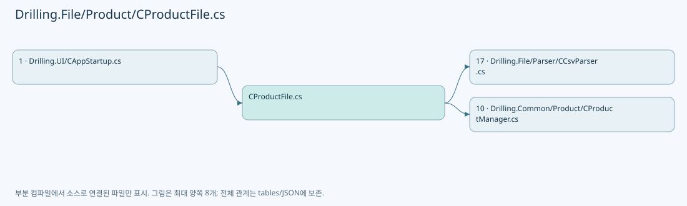
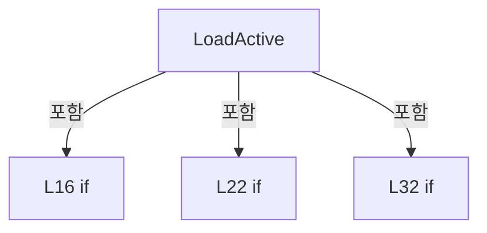
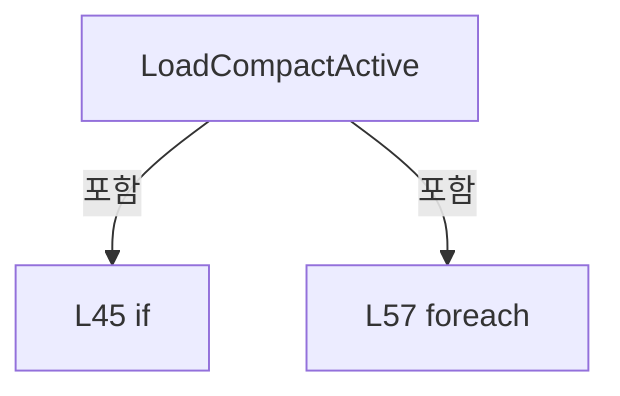
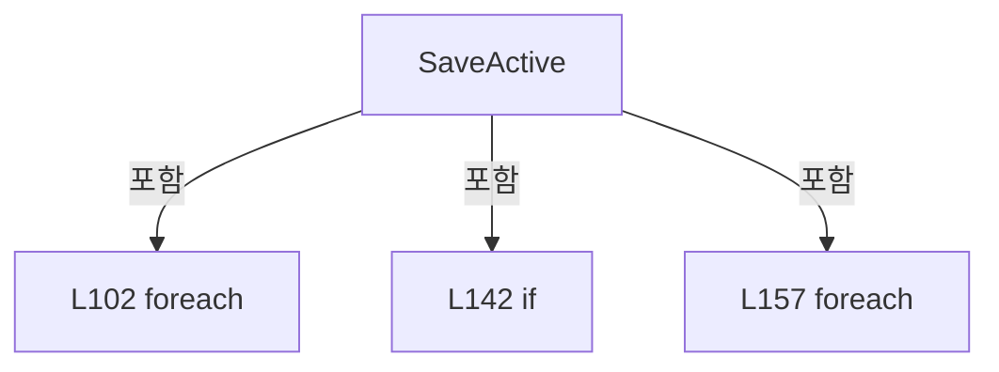
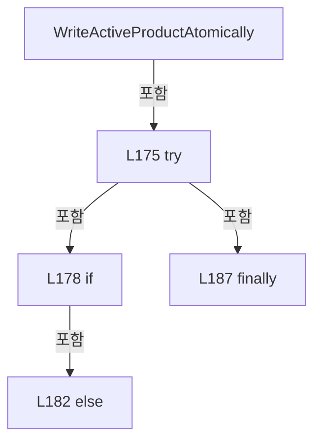
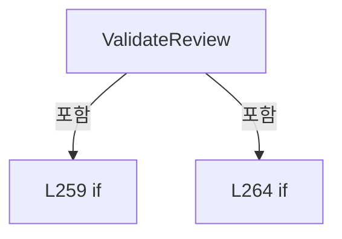
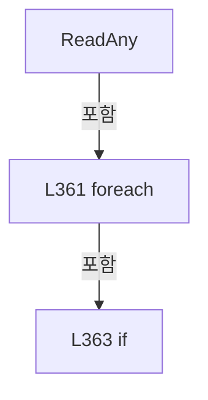
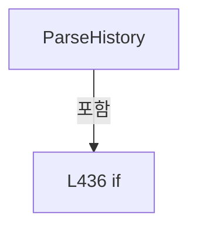
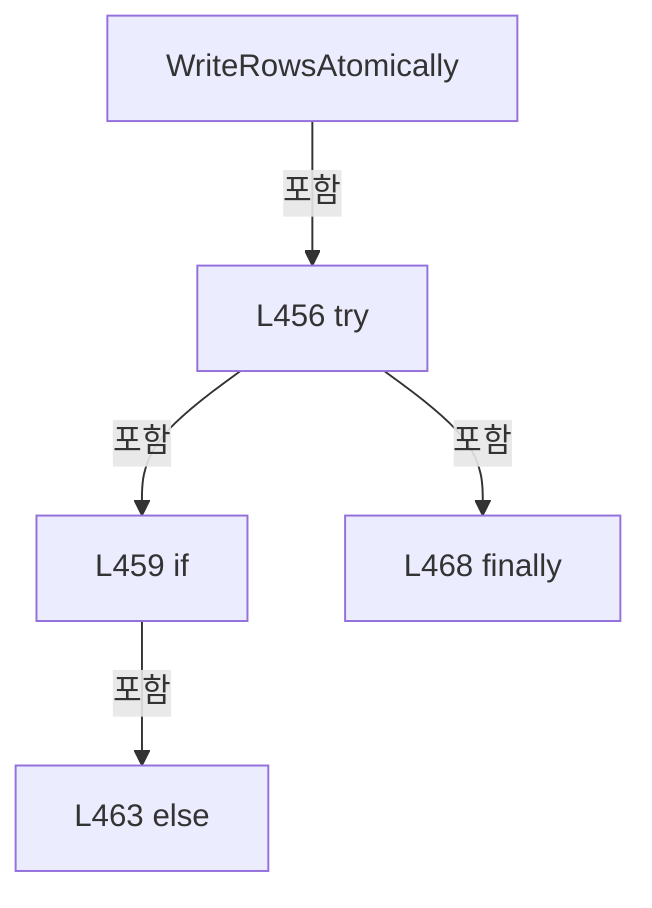
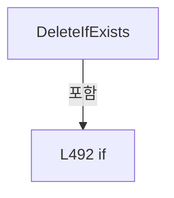

# Drilling.File/Product/CProductFile.cs

| 항목 | 내용 |
| --- | --- |
| 원본 저장소 | https://github.com/kjuws10-rgb/A3Drilling.git |
| 원본 Commit | 0219666f9053b907d96d7e0aa7d0c6c1be3a73d4 |
| 원본 SHA256 | 450b06158f48549c563ec41a8ef58a22614382b29effa8361879af0bcf1d2900 |
| 파일 분류 | code |
| 원본 크기/행 | 21,739 bytes / 497 physical lines |
| 인코딩 | utf-8-sig |
| 검토 범위 | 구문/부분 의미 분석에서 추출한 사실. 동작·물리 단위·실장비 합격을 보증하지 않습니다. |
| 원본 링크 | [고정 Commit 원본](https://github.com/kjuws10-rgb/A3Drilling/blob/0219666f9053b907d96d7e0aa7d0c6c1be3a73d4/Drilling.File/Product/CProductFile.cs) |

## 파일의 역할과 읽는 순서

정의·설정·레시피·결과·스크립트의 파일 입출력과 데이터 형식을 담당합니다. 저장 필드를 통신 송신 필드로 단정하지 않습니다.

## 네임스페이스·타입·상속

| 타입 | 구분 | 원본 범위 | 선언/상속 |
| --- | --- | --- | --- |
| CProductFile | ClassDeclaration | 6–497 | CProductFile: CProductFileBase |

## 멤버 빠른 목록

| 이름 | 종류 | 범위 | 서명 |
| --- | --- | --- | --- |
| DefaultReviewBeamNo | FieldDeclaration | L8–8 | int Drilling.File.Product.CProductFile.DefaultReviewBeamNo |
| ActiveHeaders | FieldDeclaration | L9–9 | System.Collections.Generic.IReadOnlyList<string> Drilling.File.Product.CProductFile.ActiveHeaders |
| HistoryHeaders | FieldDeclaration | L10–10 | System.Collections.Generic.IReadOnlyList<string> Drilling.File.Product.CProductFile.HistoryHeaders |
| _productRoot | FieldDeclaration | L11–11 | string Drilling.File.Product.CProductFile._productRoot |
| LoadActive | MethodDeclaration | L12–39 | System.Threading.Tasks.Task<Drilling.Common.Product.ST_PRODUCT_DATA?> Drilling.File.Product.CProductFile.LoadActive(System.Threading.CancellationToken) |
| MatchesItem | LocalFunctionStatement | L27–30 | bool MatchesItem(System.Collections.Generic.IReadOnlyDictionary<string, string>) |
| LoadCompactActive | MethodDeclaration | L41–96 | Drilling.Common.Product.ST_PRODUCT_DATA? Drilling.File.Product.CProductFile.LoadCompactActive(System.Collections.Generic.IReadOnlyList<System.Collections.Generic.IReadOnlyDictionary<string, string>>) |
| ShouldIncludeItem | LocalFunctionStatement | L52–55 | bool ShouldIncludeItem(System.Collections.Generic.KeyValuePair<string, string>) |
| SelectName | LocalFunctionStatement | L68–71 | string SelectName(string) |
| SelectValue | LocalFunctionStatement | L73–76 | string SelectValue(string) |
| SaveActive | MethodDeclaration | L98–169 | System.Threading.Tasks.Task Drilling.File.Product.CProductFile.SaveActive(Drilling.Common.Product.ST_PRODUCT_DATA, System.Threading.CancellationToken) |
| ShouldIncludeItem | LocalFunctionStatement | L107–110 | bool ShouldIncludeItem(System.Collections.Generic.KeyValuePair<string, string>) |
| SelectKey | LocalFunctionStatement | L112–115 | string SelectKey(System.Collections.Generic.KeyValuePair<string, string>) |
| BuildRecipeParameterCompactRow | LocalFunctionStatement | L117–120 | System.Collections.Generic.IReadOnlyDictionary<string, string> BuildRecipeParameterCompactRow(System.Collections.Generic.KeyValuePair<string, string>) |
| SelectCellNo | LocalFunctionStatement | L147–150 | int SelectCellNo(Drilling.Common.Product.ST_PRODUCT_REVIEW_RESULT) |
| SelectShotKey | LocalFunctionStatement | L152–155 | string SelectShotKey(Drilling.Common.Product.ST_PRODUCT_REVIEW_RESULT) |
| WriteActiveProductAtomically | MethodDeclaration | L171–191 | void Drilling.File.Product.CProductFile.WriteActiveProductAtomically(System.Collections.Generic.IReadOnlyList<System.Collections.Generic.IReadOnlyDictionary<string, string>>) |
| ClearActive | MethodDeclaration | L193–198 | System.Threading.Tasks.Task Drilling.File.Product.CProductFile.ClearActive(System.Threading.CancellationToken) |
| AppendHistory | MethodDeclaration | L200–212 | System.Threading.Tasks.Task Drilling.File.Product.CProductFile.AppendHistory(Drilling.Common.Product.ST_PRODUCT_HISTORY, System.Threading.CancellationToken) |
| LoadHistory | MethodDeclaration | L214–245 | System.Threading.Tasks.Task<System.Collections.Generic.IReadOnlyList<Drilling.Common.Product.ST_PRODUCT_HISTORY>> Drilling.File.Product.CProductFile.LoadHistory(int, int, System.Threading.CancellationToken) |
| SelectValue | LocalFunctionStatement | L218–221 | System.DateTime SelectValue(int) |
| SelectHistoryPath | LocalFunctionStatement | L223–226 | string SelectHistoryPath(System.DateTime) |
| ShouldIncludeItem | LocalFunctionStatement | L228–231 | bool ShouldIncludeItem(Drilling.Common.Product.ST_PRODUCT_HISTORY?) |
| SelectItem | LocalFunctionStatement | L233–236 | Drilling.Common.Product.ST_PRODUCT_HISTORY SelectItem(Drilling.Common.Product.ST_PRODUCT_HISTORY?) |
| SelectOccurredAt | LocalFunctionStatement | L238–241 | System.DateTimeOffset SelectOccurredAt(Drilling.Common.Product.ST_PRODUCT_HISTORY) |
| GetActiveProductPath | MethodDeclaration | L247–250 | string Drilling.File.Product.CProductFile.GetActiveProductPath() |
| GetHistoryPath | MethodDeclaration | L252–255 | string Drilling.File.Product.CProductFile.GetHistoryPath(System.DateTimeOffset) |
| ValidateReview | MethodDeclaration | L257–268 | void Drilling.File.Product.CProductFile.ValidateReview(Drilling.Common.Product.ST_PRODUCT_REVIEW_DATA) |
| ParseCompactReview | MethodDeclaration | L270–327 | Drilling.Common.Product.ST_PRODUCT_REVIEW_DATA Drilling.File.Product.CProductFile.ParseCompactReview(System.Collections.Generic.IReadOnlyDictionary<string, string>, System.Collections.Generic.IReadOnlyDictionary<string, string>) |
| ShouldIncludeItem | LocalFunctionStatement | L272–275 | bool ShouldIncludeItem(System.Collections.Generic.KeyValuePair<string, string>) |
| SelectCellNo | LocalFunctionStatement | L277–280 | int SelectCellNo(Drilling.Common.Product.ST_PRODUCT_REVIEW_RESULT) |
| SelectShotKey | LocalFunctionStatement | L282–285 | string SelectShotKey(Drilling.Common.Product.ST_PRODUCT_REVIEW_RESULT) |
| ReadSection | MethodDeclaration | L329–357 | System.Collections.Generic.Dictionary<string, string> Drilling.File.Product.CProductFile.ReadSection(System.Collections.Generic.IReadOnlyList<System.Collections.Generic.IReadOnlyDictionary<string, string>>, string) |
| MatchesSectionType | LocalFunctionStatement | L331–334 | bool MatchesSectionType(System.Collections.Generic.IReadOnlyDictionary<string, string>) |
| HasSectionName | LocalFunctionStatement | L336–339 | bool HasSectionName(System.Collections.Generic.IReadOnlyDictionary<string, string>) |
| SelectGroupKey | LocalFunctionStatement | L341–344 | string SelectGroupKey(System.Collections.Generic.IReadOnlyDictionary<string, string>) |
| SelectKey | LocalFunctionStatement | L346–349 | string SelectKey(System.Linq.IGrouping<string, System.Collections.Generic.IReadOnlyDictionary<string, string>>) |
| SelectValue | LocalFunctionStatement | L351–354 | string SelectValue(System.Linq.IGrouping<string, System.Collections.Generic.IReadOnlyDictionary<string, string>>) |
| ReadAny | MethodDeclaration | L359–370 | string Drilling.File.Product.CProductFile.ReadAny(System.Collections.Generic.IReadOnlyDictionary<string, string>, params string[]) |
| AddCompactRow | MethodDeclaration | L372–375 | void Drilling.File.Product.CProductFile.AddCompactRow(System.Collections.Generic.ICollection<System.Collections.Generic.IReadOnlyDictionary<string, string>>, string, string, string) |
| CompactRow | MethodDeclaration | L377–385 | System.Collections.Generic.IReadOnlyDictionary<string, string> Drilling.File.Product.CProductFile.CompactRow(string, string, string) |
| IsCompactProductCoreName | MethodDeclaration | L387–390 | bool Drilling.File.Product.CProductFile.IsCompactProductCoreName(string) |
| DefaultText | MethodDeclaration | L392–395 | string Drilling.File.Product.CProductFile.DefaultText(string, string) |
| ParseInt | MethodDeclaration | L397–400 | int Drilling.File.Product.CProductFile.ParseInt(string, int) |
| ParseNullableInt | MethodDeclaration | L402–405 | int? Drilling.File.Product.CProductFile.ParseNullableInt(string) |
| ParseNullableDouble | MethodDeclaration | L407–410 | double? Drilling.File.Product.CProductFile.ParseNullableDouble(string) |
| FormatDouble | MethodDeclaration | L412–415 | string Drilling.File.Product.CProductFile.FormatDouble(double?) |
| ToHistoryRow | MethodDeclaration | L417–431 | System.Collections.Generic.IReadOnlyDictionary<string, string> Drilling.File.Product.CProductFile.ToHistoryRow(Drilling.Common.Product.ST_PRODUCT_HISTORY) |
| ParseHistory | MethodDeclaration | L433–451 | Drilling.Common.Product.ST_PRODUCT_HISTORY? Drilling.File.Product.CProductFile.ParseHistory(System.Collections.Generic.IReadOnlyDictionary<string, string>) |
| WriteRowsAtomically | MethodDeclaration | L453–472 | void Drilling.File.Product.CProductFile.WriteRowsAtomically(string, System.Collections.Generic.IReadOnlyList<string>, System.Collections.Generic.IReadOnlyList<System.Collections.Generic.IReadOnlyDictionary<string, string>>) |
| ParseEnum | MethodDeclaration | L474–478 | T Drilling.File.Product.CProductFile.ParseEnum<T>(string, T) |
| FormatDate | MethodDeclaration | L480–483 | string Drilling.File.Product.CProductFile.FormatDate(System.DateTimeOffset?) |
| ParseDate | MethodDeclaration | L485–488 | System.DateTimeOffset? Drilling.File.Product.CProductFile.ParseDate(string) |
| DeleteIfExists | MethodDeclaration | L490–496 | void Drilling.File.Product.CProductFile.DeleteIfExists(string) |

## 멤버별 상세 계약·호출·처리 해설

### FieldDeclaration `DefaultReviewBeamNo` · L8–8

[Drilling.File/Product/CProductFile.cs:8–8](https://github.com/kjuws10-rgb/A3Drilling/blob/0219666f9053b907d96d7e0aa7d0c6c1be3a73d4/Drilling.File/Product/CProductFile.cs#L8-L8)

| 항목 | 실제 추출 값 |
| --- | --- |
| 서명 | int Drilling.File.Product.CProductFile.DefaultReviewBeamNo |
| 접근/수식자 | Private / private, const |
| 반환/값 타입 | int |
| 소속 타입 | NamedType:Drilling.File.Product.CProductFile |

현재 부분 분석에서 직접 연결된 호출자는 없습니다. XAML/이벤트/인터페이스·델리게이트·외부 진입을 추가 확인해야 하며, 미사용으로 판정한 것이 아닙니다.

본문의 실제 연산·분기·예외·반환 순서(원문 위치 순):

| 원본 행 | 종류 | 주석 해설 |
| --- | --- | --- |
| 8 | variable-initializer | 변수의 초기값을 지정합니다: DefaultReviewBeamNo = 1 |

변경 전 점검: 입력/반환 타입, 위 호출자, 예외/취소 경로, 공유 상태와 저장·전송 소비자를 함께 확인합니다. 값의 단위나 물리 방향을 이름만으로 확정하지 않습니다.

### FieldDeclaration `ActiveHeaders` · L9–9

[Drilling.File/Product/CProductFile.cs:9–9](https://github.com/kjuws10-rgb/A3Drilling/blob/0219666f9053b907d96d7e0aa7d0c6c1be3a73d4/Drilling.File/Product/CProductFile.cs#L9-L9)

| 항목 | 실제 추출 값 |
| --- | --- |
| 서명 | System.Collections.Generic.IReadOnlyList<string> Drilling.File.Product.CProductFile.ActiveHeaders |
| 접근/수식자 | Private / private, static, readonly |
| 반환/값 타입 | System.Collections.Generic.IReadOnlyList<string> |
| 소속 타입 | NamedType:Drilling.File.Product.CProductFile |

현재 부분 분석에서 직접 연결된 호출자는 없습니다. XAML/이벤트/인터페이스·델리게이트·외부 진입을 추가 확인해야 하며, 미사용으로 판정한 것이 아닙니다.

본문의 실제 연산·분기·예외·반환 순서(원문 위치 순):

| 원본 행 | 종류 | 주석 해설 |
| --- | --- | --- |
| 9 | variable-initializer | 변수의 초기값을 지정합니다: ActiveHeaders = ["TYPE", "NAME", "VALUE"] |

변경 전 점검: 입력/반환 타입, 위 호출자, 예외/취소 경로, 공유 상태와 저장·전송 소비자를 함께 확인합니다. 값의 단위나 물리 방향을 이름만으로 확정하지 않습니다.

### FieldDeclaration `HistoryHeaders` · L10–10

[Drilling.File/Product/CProductFile.cs:10–10](https://github.com/kjuws10-rgb/A3Drilling/blob/0219666f9053b907d96d7e0aa7d0c6c1be3a73d4/Drilling.File/Product/CProductFile.cs#L10-L10)

| 항목 | 실제 추출 값 |
| --- | --- |
| 서명 | System.Collections.Generic.IReadOnlyList<string> Drilling.File.Product.CProductFile.HistoryHeaders |
| 접근/수식자 | Private / private, static, readonly |
| 반환/값 타입 | System.Collections.Generic.IReadOnlyList<string> |
| 소속 타입 | NamedType:Drilling.File.Product.CProductFile |

현재 부분 분석에서 직접 연결된 호출자는 없습니다. XAML/이벤트/인터페이스·델리게이트·외부 진입을 추가 확인해야 하며, 미사용으로 판정한 것이 아닙니다.

본문의 실제 연산·분기·예외·반환 순서(원문 위치 순):

| 원본 행 | 종류 | 주석 해설 |
| --- | --- | --- |
| 10 | variable-initializer | 변수의 초기값을 지정합니다: HistoryHeaders = ["OCCURRED_AT", "ROW_TYPE", "GLASS_ID", "PROCESS_ID", "RECIPE_ID", "ACTION", "STATE", "RESULT", "DETAIL"] |

변경 전 점검: 입력/반환 타입, 위 호출자, 예외/취소 경로, 공유 상태와 저장·전송 소비자를 함께 확인합니다. 값의 단위나 물리 방향을 이름만으로 확정하지 않습니다.

### FieldDeclaration `_productRoot` · L11–11

[Drilling.File/Product/CProductFile.cs:11–11](https://github.com/kjuws10-rgb/A3Drilling/blob/0219666f9053b907d96d7e0aa7d0c6c1be3a73d4/Drilling.File/Product/CProductFile.cs#L11-L11)

| 항목 | 실제 추출 값 |
| --- | --- |
| 서명 | string Drilling.File.Product.CProductFile._productRoot |
| 접근/수식자 | Private / private, readonly |
| 반환/값 타입 | string |
| 소속 타입 | NamedType:Drilling.File.Product.CProductFile |

현재 부분 분석에서 직접 연결된 호출자는 없습니다. XAML/이벤트/인터페이스·델리게이트·외부 진입을 추가 확인해야 하며, 미사용으로 판정한 것이 아닙니다.

호출하는 대상과 해석 범위:

| 원본 행 | 표현식 | 분석 상태 | 대상/소스 위치 |
| --- | --- | --- | --- |
| 11 | Path.Combine | resolved | string System.IO.Path.Combine(string, string, string) |
| 11 | Directory.GetParent | resolved | System.IO.DirectoryInfo? System.IO.Directory.GetParent(string) |

본문의 실제 연산·분기·예외·반환 순서(원문 위치 순):

| 원본 행 | 종류 | 주석 해설 |
| --- | --- | --- |
| 11 | call | 함수·델리게이트 또는 객체 생성자를 호출합니다: Path.Combine(Directory.GetParent(configRoot)?.FullName ?? configRoot, "Data", "Product") |
| 11 | call | 함수·델리게이트 또는 객체 생성자를 호출합니다: Directory.GetParent(configRoot) |
| 11 | variable-initializer | 변수의 초기값을 지정합니다: _productRoot = Path.Combine(Directory.GetParent(configRoot)?.FullName ?? configRoot, "Data", "Product") |

변경 전 점검: 입력/반환 타입, 위 호출자, 예외/취소 경로, 공유 상태와 저장·전송 소비자를 함께 확인합니다. 값의 단위나 물리 방향을 이름만으로 확정하지 않습니다.

### MethodDeclaration `LoadActive` · L12–39

[Drilling.File/Product/CProductFile.cs:12–39](https://github.com/kjuws10-rgb/A3Drilling/blob/0219666f9053b907d96d7e0aa7d0c6c1be3a73d4/Drilling.File/Product/CProductFile.cs#L12-L39)

| 항목 | 실제 추출 값 |
| --- | --- |
| 서명 | System.Threading.Tasks.Task<Drilling.Common.Product.ST_PRODUCT_DATA?> Drilling.File.Product.CProductFile.LoadActive(System.Threading.CancellationToken) |
| 접근/수식자 | Public / public, override |
| 반환/값 타입 | System.Threading.Tasks.Task<Drilling.Common.Product.ST_PRODUCT_DATA?> |
| 소속 타입 | NamedType:Drilling.File.Product.CProductFile |

입력 계약:

| 이름 | 타입 | 전달 | 선택/기본값 |
| --- | --- | --- | --- |
| cancellationToken | System.Threading.CancellationToken | None | True / null |

현재 부분 분석에서 직접 연결된 호출자는 없습니다. XAML/이벤트/인터페이스·델리게이트·외부 진입을 추가 확인해야 하며, 미사용으로 판정한 것이 아닙니다.

호출하는 대상과 해석 범위:

| 원본 행 | 표현식 | 분석 상태 | 대상/소스 위치 |
| --- | --- | --- | --- |
| 14 | cancellationToken.ThrowIfCancellationRequested | resolved | void System.Threading.CancellationToken.ThrowIfCancellationRequested() |
| 15 | GetActiveProductPath | resolved | string Drilling.File.Product.CProductFile.GetActiveProductPath() · Drilling.File/Product/CProductFile.cs:247 |
| 16 | System.IO.File.Exists | resolved | bool System.IO.File.Exists(string?) |
| 18 | Task.FromResult<ST_PRODUCT_DATA?> | resolved | System.Threading.Tasks.Task<Drilling.Common.Product.ST_PRODUCT_DATA?> System.Threading.Tasks.Task.FromResult<Drilling.Common.Product.ST_PRODUCT_DATA?>(Drilling.Common.Product.ST_PRODUCT_DATA?) |
| 21 | CCsvParser.Read | resolved | System.Collections.Generic.IReadOnlyList<System.Collections.Generic.IReadOnlyDictionary<string, string>> Drilling.File.Parser.CCsvParser.Read(string) · Drilling.File/Parser/CCsvParser.cs:12 |
| 24 | new InvalidDataException | resolved | System.IO.InvalidDataException.InvalidDataException(string?) |
| 32 | rows.Any | resolved | bool System.Collections.Generic.IEnumerable<System.Collections.Generic.IReadOnlyDictionary<string, string>>.Any<System.Collections.Generic.IReadOnlyDictionary<string, string>>(System.Func<System.Collections.Generic.IReadOnlyDictionary<string, string>, bool>) |
| 34 | new InvalidDataException | resolved | System.IO.InvalidDataException.InvalidDataException(string?) |
| 37 | LoadCompactActive | resolved | Drilling.Common.Product.ST_PRODUCT_DATA? Drilling.File.Product.CProductFile.LoadCompactActive(System.Collections.Generic.IReadOnlyList<System.Collections.Generic.IReadOnlyDictionary<string, string>>) · Drilling.File/Product/CProductFile.cs:41 |
| 38 | new InvalidDataException | resolved | System.IO.InvalidDataException.InvalidDataException(string?) |
| 38 | Task.FromResult<ST_PRODUCT_DATA?> | resolved | System.Threading.Tasks.Task<Drilling.Common.Product.ST_PRODUCT_DATA?> System.Threading.Tasks.Task.FromResult<Drilling.Common.Product.ST_PRODUCT_DATA?>(Drilling.Common.Product.ST_PRODUCT_DATA?) |

본문의 실제 연산·분기·예외·반환 순서(원문 위치 순):

| 원본 행 | 종류 | 주석 해설 |
| --- | --- | --- |
| 14 | call | 함수·델리게이트 또는 객체 생성자를 호출합니다: cancellationToken.ThrowIfCancellationRequested() |
| 15 | call | 함수·델리게이트 또는 객체 생성자를 호출합니다: GetActiveProductPath() |
| 15 | local-declaration | 지역 변수를 선언합니다: var activePath = GetActiveProductPath(); |
| 15 | variable-initializer | 변수의 초기값을 지정합니다: activePath = GetActiveProductPath() |
| 16 | call | 함수·델리게이트 또는 객체 생성자를 호출합니다: System.IO.File.Exists(activePath) |
| 16 | if | 조건에 따라 분기합니다: if (!System.IO.File.Exists(activePath)) |
| 18 | call | 함수·델리게이트 또는 객체 생성자를 호출합니다: Task.FromResult<ST_PRODUCT_DATA?>(null) |
| 18 | return | 호출자에게 값 또는 제어를 반환합니다: return Task.FromResult<ST_PRODUCT_DATA?>(null); |
| 21 | call | 함수·델리게이트 또는 객체 생성자를 호출합니다: CCsvParser.Read(activePath) |
| 21 | local-declaration | 지역 변수를 선언합니다: var rows = CCsvParser.Read(activePath); |
| 21 | variable-initializer | 변수의 초기값을 지정합니다: rows = CCsvParser.Read(activePath) |
| 22 | if | 조건에 따라 분기합니다: if (rows.Count == 0) |
| 24 | call | 함수·델리게이트 또는 객체 생성자를 호출합니다: new InvalidDataException("Active Product file is empty.") |
| 24 | throw | 예외를 발생/전달합니다: throw new InvalidDataException("Active Product file is empty."); |
| 32 | call | 함수·델리게이트 또는 객체 생성자를 호출합니다: rows.Any(MatchesItem) |
| 32 | if | 조건에 따라 분기합니다: if (!rows.Any(MatchesItem)) |
| 34 | call | 함수·델리게이트 또는 객체 생성자를 호출합니다: new InvalidDataException("Active Product file is not in the current compact format.") |
| 34 | throw | 예외를 발생/전달합니다: throw new InvalidDataException("Active Product file is not in the current compact format."); |
| 37 | call | 함수·델리게이트 또는 객체 생성자를 호출합니다: LoadCompactActive(rows) |
| 37 | local-declaration | 지역 변수를 선언합니다: var product = LoadCompactActive(rows); |
| 37 | variable-initializer | 변수의 초기값을 지정합니다: product = LoadCompactActive(rows) |
| 38 | call | 함수·델리게이트 또는 객체 생성자를 호출합니다: new InvalidDataException("Active Product file does not contain a valid H_GLASSID.") |
| 38 | call | 함수·델리게이트 또는 객체 생성자를 호출합니다: Task.FromResult<ST_PRODUCT_DATA?>(product) |
| 38 | conditional-expression | 조건에 따라 결과식을 선택합니다: product is null ? throw new InvalidDataException("Active Product file does not contain a valid H_GLASSID.") : Task.FromResult<ST_PRODUCT_DATA?>(product) |
| 38 | return | 호출자에게 값 또는 제어를 반환합니다: return product is null ? throw new InvalidDataException("Active Product file does not contain a valid H_GLASSID.") : Task.FromResult<ST_PRODUCT_DATA?>(product); |
| 38 | throw | 예외를 발생/전달합니다: throw new InvalidDataException("Active Product file does not contain a valid H_GLASSID.") |

제어 구문의 포함 구조(실제 실행 순서/CFG가 아닌 구문 탐색 그림):

변경 전 점검: 입력/반환 타입, 위 호출자, 예외/취소 경로, 공유 상태와 저장·전송 소비자를 함께 확인합니다. 값의 단위나 물리 방향을 이름만으로 확정하지 않습니다.

### LocalFunctionStatement `MatchesItem` · L27–30

[Drilling.File/Product/CProductFile.cs:27–30](https://github.com/kjuws10-rgb/A3Drilling/blob/0219666f9053b907d96d7e0aa7d0c6c1be3a73d4/Drilling.File/Product/CProductFile.cs#L27-L30)

| 항목 | 실제 추출 값 |
| --- | --- |
| 서명 | bool MatchesItem(System.Collections.Generic.IReadOnlyDictionary<string, string>) |
| 접근/수식자 | Private /  |
| 반환/값 타입 | bool |
| 소속 타입 | NamedType:Drilling.File.Product.CProductFile |

입력 계약:

| 이름 | 타입 | 전달 | 선택/기본값 |
| --- | --- | --- | --- |
| row | System.Collections.Generic.IReadOnlyDictionary<string, string> | None | False /  |

현재 부분 분석에서 직접 연결된 호출자는 없습니다. XAML/이벤트/인터페이스·델리게이트·외부 진입을 추가 확인해야 하며, 미사용으로 판정한 것이 아닙니다.

호출하는 대상과 해석 범위:

| 원본 행 | 표현식 | 분석 상태 | 대상/소스 위치 |
| --- | --- | --- | --- |
| 29 | string.IsNullOrWhiteSpace | resolved | bool string.IsNullOrWhiteSpace(string?) |
| 29 | CCsvParser.Get | resolved | string Drilling.File.Parser.CCsvParser.Get(System.Collections.Generic.IReadOnlyDictionary<string, string>, string) · Drilling.File/Parser/CCsvParser.cs:168 |

본문의 실제 연산·분기·예외·반환 순서(원문 위치 순):

| 원본 행 | 종류 | 주석 해설 |
| --- | --- | --- |
| 29 | call | 함수·델리게이트 또는 객체 생성자를 호출합니다: string.IsNullOrWhiteSpace(CCsvParser.Get(row, "TYPE")) |
| 29 | call | 함수·델리게이트 또는 객체 생성자를 호출합니다: CCsvParser.Get(row, "TYPE") |
| 29 | return | 호출자에게 값 또는 제어를 반환합니다: return !string.IsNullOrWhiteSpace(CCsvParser.Get(row, "TYPE")); |

변경 전 점검: 입력/반환 타입, 위 호출자, 예외/취소 경로, 공유 상태와 저장·전송 소비자를 함께 확인합니다. 값의 단위나 물리 방향을 이름만으로 확정하지 않습니다.

### MethodDeclaration `LoadCompactActive` · L41–96

[Drilling.File/Product/CProductFile.cs:41–96](https://github.com/kjuws10-rgb/A3Drilling/blob/0219666f9053b907d96d7e0aa7d0c6c1be3a73d4/Drilling.File/Product/CProductFile.cs#L41-L96)

| 항목 | 실제 추출 값 |
| --- | --- |
| 서명 | Drilling.Common.Product.ST_PRODUCT_DATA? Drilling.File.Product.CProductFile.LoadCompactActive(System.Collections.Generic.IReadOnlyList<System.Collections.Generic.IReadOnlyDictionary<string, string>>) |
| 접근/수식자 | Private / private, static |
| 반환/값 타입 | Drilling.Common.Product.ST_PRODUCT_DATA? |
| 소속 타입 | NamedType:Drilling.File.Product.CProductFile |

입력 계약:

| 이름 | 타입 | 전달 | 선택/기본값 |
| --- | --- | --- | --- |
| rows | System.Collections.Generic.IReadOnlyList<System.Collections.Generic.IReadOnlyDictionary<string, string>> | None | False /  |

정적 호출자로 확인된 위치:

| 호출 파일/행 | 호출 표현식 | 런타임 분기 가능 |
| --- | --- | --- |
| [Drilling.File/Product/CProductFile.cs:37–37](https://github.com/kjuws10-rgb/A3Drilling/blob/0219666f9053b907d96d7e0aa7d0c6c1be3a73d4/Drilling.File/Product/CProductFile.cs#L37-L37) | LoadCompactActive | False |

호출하는 대상과 해석 범위:

| 원본 행 | 표현식 | 분석 상태 | 대상/소스 위치 |
| --- | --- | --- | --- |
| 43 | ReadSection | resolved | System.Collections.Generic.Dictionary<string, string> Drilling.File.Product.CProductFile.ReadSection(System.Collections.Generic.IReadOnlyList<System.Collections.Generic.IReadOnlyDictionary<string, string>>, string) · Drilling.File/Product/CProductFile.cs:329 |
| 44 | ReadAny | resolved | string Drilling.File.Product.CProductFile.ReadAny(System.Collections.Generic.IReadOnlyDictionary<string, string>, params string[]) · Drilling.File/Product/CProductFile.cs:359 |
| 45 | string.IsNullOrWhiteSpace | resolved | bool string.IsNullOrWhiteSpace(string?) |
| 50 | new HashSet<string> | resolved | System.Collections.Generic.HashSet<string>.HashSet(System.Collections.Generic.IEnumerable<string>, System.Collections.Generic.IEqualityComparer<string>?) |
| 51 | ReadSection | resolved | System.Collections.Generic.Dictionary<string, string> Drilling.File.Product.CProductFile.ReadSection(System.Collections.Generic.IReadOnlyList<System.Collections.Generic.IReadOnlyDictionary<string, string>>, string) · Drilling.File/Product/CProductFile.cs:329 |
| 57 | productValues.Where | resolved | System.Collections.Generic.IEnumerable<System.Collections.Generic.KeyValuePair<string, string>> System.Collections.Generic.IEnumerable<System.Collections.Generic.KeyValuePair<string, string>>.Where<System.Collections.Generic.KeyValuePair<string, string>>(System.Func<System.Collections.Generic.KeyValuePair<string, string>, bool>) |
| 59 | parameters.TryAdd | resolved | bool System.Collections.Generic.Dictionary<string, string>.TryAdd(string, string) |
| 62 | ReadSection | resolved | System.Collections.Generic.Dictionary<string, string> Drilling.File.Product.CProductFile.ReadSection(System.Collections.Generic.IReadOnlyList<System.Collections.Generic.IReadOnlyDictionary<string, string>>, string) · Drilling.File/Product/CProductFile.cs:329 |
| 63 | ReadSection | resolved | System.Collections.Generic.Dictionary<string, string> Drilling.File.Product.CProductFile.ReadSection(System.Collections.Generic.IReadOnlyList<System.Collections.Generic.IReadOnlyDictionary<string, string>>, string) · Drilling.File/Product/CProductFile.cs:329 |
| 64 | ReadSection | resolved | System.Collections.Generic.Dictionary<string, string> Drilling.File.Product.CProductFile.ReadSection(System.Collections.Generic.IReadOnlyList<System.Collections.Generic.IReadOnlyDictionary<string, string>>, string) · Drilling.File/Product/CProductFile.cs:329 |
| 65 | ReadSection | resolved | System.Collections.Generic.Dictionary<string, string> Drilling.File.Product.CProductFile.ReadSection(System.Collections.Generic.IReadOnlyList<System.Collections.Generic.IReadOnlyDictionary<string, string>>, string) · Drilling.File/Product/CProductFile.cs:329 |
| 66 | ParseCompactReview | resolved | Drilling.Common.Product.ST_PRODUCT_REVIEW_DATA Drilling.File.Product.CProductFile.ParseCompactReview(System.Collections.Generic.IReadOnlyDictionary<string, string>, System.Collections.Generic.IReadOnlyDictionary<string, string>) · Drilling.File/Product/CProductFile.cs:270 |
| 67 | ValidateReview | resolved | void Drilling.File.Product.CProductFile.ValidateReview(Drilling.Common.Product.ST_PRODUCT_REVIEW_DATA) · Drilling.File/Product/CProductFile.cs:257 |
| 78 | CProductManager.ProductFieldNames.ToDictionary | resolved | System.Collections.Generic.Dictionary<string, string> System.Collections.Generic.IEnumerable<string>.ToDictionary<string, string, string>(System.Func<string, string>, System.Func<string, string>, System.Collections.Generic.IEqualityComparer<string>?) |
| 80 | ReadAny | resolved | string Drilling.File.Product.CProductFile.ReadAny(System.Collections.Generic.IReadOnlyDictionary<string, string>, params string[]) · Drilling.File/Product/CProductFile.cs:359 |
| 81 | ReadAny | resolved | string Drilling.File.Product.CProductFile.ReadAny(System.Collections.Generic.IReadOnlyDictionary<string, string>, params string[]) · Drilling.File/Product/CProductFile.cs:359 |
| 82 | new ST_PRODUCT_DATA | resolved | Drilling.Common.Product.ST_PRODUCT_DATA.ST_PRODUCT_DATA(Drilling.Common.Product.ST_PRODUCT_INFO, Drilling.Common.Product.ST_PRODUCT_RECIPE_DATA, Drilling.Common.Product.ST_PRODUCT_ALIGN_DATA, Drilling.Common.Product.ST_PRODUCT_DISTORTION_DATA, Drilling.Common.Product.ST_PRODUCT_REVIEW_DATA, Drilling.Common.Product.ST_PRODUCT_RUNTIME_DATA) · Drilling.Common/Product/CProductManager.cs:991 |
| 83 | new ST_PRODUCT_INFO | resolved | Drilling.Common.Product.ST_PRODUCT_INFO.ST_PRODUCT_INFO(System.Collections.Generic.IReadOnlyDictionary<string, string>) · Drilling.Common/Product/CProductManager.cs:961 |
| 84 | new ST_PRODUCT_RECIPE_DATA | resolved | Drilling.Common.Product.ST_PRODUCT_RECIPE_DATA.ST_PRODUCT_RECIPE_DATA(System.Collections.Generic.IReadOnlyDictionary<string, string>) · Drilling.Common/Product/CProductManager.cs:978 |
| 85 | new ST_PRODUCT_ALIGN_DATA | resolved | Drilling.Common.Product.ST_PRODUCT_ALIGN_DATA.ST_PRODUCT_ALIGN_DATA(Drilling.Common.Product.EN_PRODUCT_PROCESS_STATE, string, double?, double?, double?) · Drilling.Common/Product/CProductManager.cs:940 |
| 86 | ParseEnum | resolved | Drilling.Common.Product.EN_PRODUCT_PROCESS_STATE Drilling.File.Product.CProductFile.ParseEnum<Drilling.Common.Product.EN_PRODUCT_PROCESS_STATE>(string, Drilling.Common.Product.EN_PRODUCT_PROCESS_STATE) · Drilling.File/Product/CProductFile.cs:474 |
| 86 | ReadAny | resolved | string Drilling.File.Product.CProductFile.ReadAny(System.Collections.Generic.IReadOnlyDictionary<string, string>, params string[]) · Drilling.File/Product/CProductFile.cs:359 |
| 87 | DefaultText | resolved | string Drilling.File.Product.CProductFile.DefaultText(string, string) · Drilling.File/Product/CProductFile.cs:392 |
| 87 | ReadAny | resolved | string Drilling.File.Product.CProductFile.ReadAny(System.Collections.Generic.IReadOnlyDictionary<string, string>, params string[]) · Drilling.File/Product/CProductFile.cs:359 |
| 88 | ParseNullableDouble | resolved | double? Drilling.File.Product.CProductFile.ParseNullableDouble(string) · Drilling.File/Product/CProductFile.cs:407 |
| 88 | ReadAny | resolved | string Drilling.File.Product.CProductFile.ReadAny(System.Collections.Generic.IReadOnlyDictionary<string, string>, params string[]) · Drilling.File/Product/CProductFile.cs:359 |
| 89 | ParseNullableDouble | resolved | double? Drilling.File.Product.CProductFile.ParseNullableDouble(string) · Drilling.File/Product/CProductFile.cs:407 |
| 89 | ReadAny | resolved | string Drilling.File.Product.CProductFile.ReadAny(System.Collections.Generic.IReadOnlyDictionary<string, string>, params string[]) · Drilling.File/Product/CProductFile.cs:359 |
| 90 | ParseNullableDouble | resolved | double? Drilling.File.Product.CProductFile.ParseNullableDouble(string) · Drilling.File/Product/CProductFile.cs:407 |
| 90 | ReadAny | resolved | string Drilling.File.Product.CProductFile.ReadAny(System.Collections.Generic.IReadOnlyDictionary<string, string>, params string[]) · Drilling.File/Product/CProductFile.cs:359 |
| 92 | new ST_PRODUCT_DISTORTION_DATA | resolved | Drilling.Common.Product.ST_PRODUCT_DISTORTION_DATA.ST_PRODUCT_DISTORTION_DATA(Drilling.Common.Product.EN_PRODUCT_PROCESS_STATE, string, double?) · Drilling.Common/Product/CProductManager.cs:941 |
| 92 | ParseEnum | resolved | Drilling.Common.Product.EN_PRODUCT_PROCESS_STATE Drilling.File.Product.CProductFile.ParseEnum<Drilling.Common.Product.EN_PRODUCT_PROCESS_STATE>(string, Drilling.Common.Product.EN_PRODUCT_PROCESS_STATE) · Drilling.File/Product/CProductFile.cs:474 |
| 92 | ReadAny | resolved | string Drilling.File.Product.CProductFile.ReadAny(System.Collections.Generic.IReadOnlyDictionary<string, string>, params string[]) · Drilling.File/Product/CProductFile.cs:359 |
| 92 | DefaultText | resolved | string Drilling.File.Product.CProductFile.DefaultText(string, string) · Drilling.File/Product/CProductFile.cs:392 |
| 92 | ReadAny | resolved | string Drilling.File.Product.CProductFile.ReadAny(System.Collections.Generic.IReadOnlyDictionary<string, string>, params string[]) · Drilling.File/Product/CProductFile.cs:359 |
| 92 | ParseNullableDouble | resolved | double? Drilling.File.Product.CProductFile.ParseNullableDouble(string) · Drilling.File/Product/CProductFile.cs:407 |
| 92 | ReadAny | resolved | string Drilling.File.Product.CProductFile.ReadAny(System.Collections.Generic.IReadOnlyDictionary<string, string>, params string[]) · Drilling.File/Product/CProductFile.cs:359 |
| 94 | new ST_PRODUCT_RUNTIME_DATA | resolved | Drilling.Common.Product.ST_PRODUCT_RUNTIME_DATA.ST_PRODUCT_RUNTIME_DATA(System.Collections.Generic.IReadOnlyList<Drilling.Common.Product.ST_PRODUCT_HEAD_RESULT>) · Drilling.Common/Product/CProductManager.cs:979 |

본문의 실제 연산·분기·예외·반환 순서(원문 위치 순):

| 원본 행 | 종류 | 주석 해설 |
| --- | --- | --- |
| 43 | call | 함수·델리게이트 또는 객체 생성자를 호출합니다: ReadSection(rows, "PRODUCT") |
| 43 | local-declaration | 지역 변수를 선언합니다: var productValues = ReadSection(rows, "PRODUCT"); |
| 43 | variable-initializer | 변수의 초기값을 지정합니다: productValues = ReadSection(rows, "PRODUCT") |
| 44 | call | 함수·델리게이트 또는 객체 생성자를 호출합니다: ReadAny(productValues, "H_GLASSID") |
| 44 | local-declaration | 지역 변수를 선언합니다: var glassId = ReadAny(productValues, "H_GLASSID"); |
| 44 | variable-initializer | 변수의 초기값을 지정합니다: glassId = ReadAny(productValues, "H_GLASSID") |
| 45 | call | 함수·델리게이트 또는 객체 생성자를 호출합니다: string.IsNullOrWhiteSpace(glassId) |
| 45 | if | 조건에 따라 분기합니다: if (string.IsNullOrWhiteSpace(glassId)) |
| 47 | return | 호출자에게 값 또는 제어를 반환합니다: return null; |
| 50 | call | 함수·델리게이트 또는 객체 생성자를 호출합니다: new HashSet<string>(CProductManager.ProductFieldNames, StringComparer.OrdinalIgnoreCase) |
| 50 | local-declaration | 지역 변수를 선언합니다: var reservedNames = new HashSet<string>(CProductManager.ProductFieldNames, StringComparer.OrdinalIgnoreCase); |
| 50 | variable-initializer | 변수의 초기값을 지정합니다: reservedNames = new HashSet<string>(CProductManager.ProductFieldNames, StringComparer.OrdinalIgnoreCase) |
| 51 | call | 함수·델리게이트 또는 객체 생성자를 호출합니다: ReadSection(rows, "RECIPE") |
| 51 | local-declaration | 지역 변수를 선언합니다: var parameters = ReadSection(rows, "RECIPE"); |
| 51 | variable-initializer | 변수의 초기값을 지정합니다: parameters = ReadSection(rows, "RECIPE") |
| 57 | call | 함수·델리게이트 또는 객체 생성자를 호출합니다: productValues.Where(ShouldIncludeItem) |
| 57 | foreach | 컬렉션 요소를 순회합니다: foreach (var item in productValues.Where(ShouldIncludeItem)) |
| 59 | call | 함수·델리게이트 또는 객체 생성자를 호출합니다: parameters.TryAdd(item.Key, item.Value) |
| 62 | call | 함수·델리게이트 또는 객체 생성자를 호출합니다: ReadSection(rows, "ALIGN") |
| 62 | local-declaration | 지역 변수를 선언합니다: var alignValues = ReadSection(rows, "ALIGN"); |
| 62 | variable-initializer | 변수의 초기값을 지정합니다: alignValues = ReadSection(rows, "ALIGN") |
| 63 | call | 함수·델리게이트 또는 객체 생성자를 호출합니다: ReadSection(rows, "DISTORTION") |
| 63 | local-declaration | 지역 변수를 선언합니다: var distortionValues = ReadSection(rows, "DISTORTION"); |
| 63 | variable-initializer | 변수의 초기값을 지정합니다: distortionValues = ReadSection(rows, "DISTORTION") |
| 64 | call | 함수·델리게이트 또는 객체 생성자를 호출합니다: ReadSection(rows, "REVIEW") |
| 64 | local-declaration | 지역 변수를 선언합니다: var reviewValues = ReadSection(rows, "REVIEW"); |
| 64 | variable-initializer | 변수의 초기값을 지정합니다: reviewValues = ReadSection(rows, "REVIEW") |
| 65 | call | 함수·델리게이트 또는 객체 생성자를 호출합니다: ReadSection(rows, "REVIEW_RESULT") |
| 65 | local-declaration | 지역 변수를 선언합니다: var reviewResultValues = ReadSection(rows, "REVIEW_RESULT"); |
| 65 | variable-initializer | 변수의 초기값을 지정합니다: reviewResultValues = ReadSection(rows, "REVIEW_RESULT") |
| 66 | call | 함수·델리게이트 또는 객체 생성자를 호출합니다: ParseCompactReview(reviewValues, reviewResultValues) |
| 66 | local-declaration | 지역 변수를 선언합니다: var review = ParseCompactReview(reviewValues, reviewResultValues); |
| 66 | variable-initializer | 변수의 초기값을 지정합니다: review = ParseCompactReview(reviewValues, reviewResultValues) |
| 67 | call | 함수·델리게이트 또는 객체 생성자를 호출합니다: ValidateReview(review) |
| 78 | call | 함수·델리게이트 또는 객체 생성자를 호출합니다: CProductManager.ProductFieldNames.ToDictionary(SelectName, SelectValue, StringComparer.OrdinalIgnoreCase) |
| 78 | local-declaration | 지역 변수를 선언합니다: var normalizedProductValues = CProductManager.ProductFieldNames.ToDictionary(SelectName, SelectValue, StringComparer.OrdinalIgnoreCase); |
| 78 | variable-initializer | 변수의 초기값을 지정합니다: normalizedProductValues = CProductManager.ProductFieldNames.ToDictionary(SelectName, SelectValue, StringComparer.OrdinalIgnoreCase) |
| 79 | assignment | 값을 대상에 대입합니다: normalizedProductValues["H_GLASSID"] = glassId |
| 80 | assignment | 값을 대상에 대입합니다: normalizedProductValues["LOTID"] = ReadAny(productValues, "LOTID") |
| 80 | call | 함수·델리게이트 또는 객체 생성자를 호출합니다: ReadAny(productValues, "LOTID") |
| 81 | assignment | 값을 대상에 대입합니다: normalizedProductValues["PPID"] = ReadAny(productValues, "PPID") |
| 81 | call | 함수·델리게이트 또는 객체 생성자를 호출합니다: ReadAny(productValues, "PPID") |
| 82 | call | 함수·델리게이트 또는 객체 생성자를 호출합니다: new ST_PRODUCT_DATA( new ST_PRODUCT_INFO(normalizedProductValues), new ST_PRODUCT_RECIPE_DATA(parameters), new ST_PRODUCT_ALIGN_DATA( ParseEnum(ReadAny(alignValues, "STATE"), EN_PRODUCT_PROCESS_STATE.NotStarted), Default… |
| 82 | return | 호출자에게 값 또는 제어를 반환합니다: return new ST_PRODUCT_DATA( new ST_PRODUCT_INFO(normalizedProductValues), new ST_PRODUCT_RECIPE_DATA(parameters), new ST_PRODUCT_ALIGN_DATA( ParseEnum(ReadAny(alignValues, "STATE"), EN_PRODUCT_PROCESS_STATE.NotStarted), DefaultTex |
| 83 | call | 함수·델리게이트 또는 객체 생성자를 호출합니다: new ST_PRODUCT_INFO(normalizedProductValues) |
| 84 | call | 함수·델리게이트 또는 객체 생성자를 호출합니다: new ST_PRODUCT_RECIPE_DATA(parameters) |
| 85 | call | 함수·델리게이트 또는 객체 생성자를 호출합니다: new ST_PRODUCT_ALIGN_DATA( ParseEnum(ReadAny(alignValues, "STATE"), EN_PRODUCT_PROCESS_STATE.NotStarted), DefaultText(ReadAny(alignValues, "RESULT"), "PENDING"), ParseNullableDouble(ReadAny(alignValues, "OFFSET_X")), Par… |
| 86 | call | 함수·델리게이트 또는 객체 생성자를 호출합니다: ParseEnum(ReadAny(alignValues, "STATE"), EN_PRODUCT_PROCESS_STATE.NotStarted) |
| 86 | call | 함수·델리게이트 또는 객체 생성자를 호출합니다: ReadAny(alignValues, "STATE") |
| 87 | call | 함수·델리게이트 또는 객체 생성자를 호출합니다: DefaultText(ReadAny(alignValues, "RESULT"), "PENDING") |
| 87 | call | 함수·델리게이트 또는 객체 생성자를 호출합니다: ReadAny(alignValues, "RESULT") |
| 88 | call | 함수·델리게이트 또는 객체 생성자를 호출합니다: ParseNullableDouble(ReadAny(alignValues, "OFFSET_X")) |
| 88 | call | 함수·델리게이트 또는 객체 생성자를 호출합니다: ReadAny(alignValues, "OFFSET_X") |
| 89 | call | 함수·델리게이트 또는 객체 생성자를 호출합니다: ParseNullableDouble(ReadAny(alignValues, "OFFSET_Y")) |
| 89 | call | 함수·델리게이트 또는 객체 생성자를 호출합니다: ReadAny(alignValues, "OFFSET_Y") |
| 90 | call | 함수·델리게이트 또는 객체 생성자를 호출합니다: ParseNullableDouble(ReadAny(alignValues, "ROTATION")) |
| 90 | call | 함수·델리게이트 또는 객체 생성자를 호출합니다: ReadAny(alignValues, "ROTATION") |
| 92 | call | 함수·델리게이트 또는 객체 생성자를 호출합니다: new ST_PRODUCT_DISTORTION_DATA(ParseEnum(ReadAny(distortionValues, "STATE"), EN_PRODUCT_PROCESS_STATE.NotStarted), DefaultText(ReadAny(distortionValues, "RESULT"), "PENDING"), ParseNullableDouble(ReadAny(distortionValues… |
| 92 | call | 함수·델리게이트 또는 객체 생성자를 호출합니다: ParseEnum(ReadAny(distortionValues, "STATE"), EN_PRODUCT_PROCESS_STATE.NotStarted) |
| 92 | call | 함수·델리게이트 또는 객체 생성자를 호출합니다: ReadAny(distortionValues, "STATE") |
| 92 | call | 함수·델리게이트 또는 객체 생성자를 호출합니다: DefaultText(ReadAny(distortionValues, "RESULT"), "PENDING") |
| 92 | call | 함수·델리게이트 또는 객체 생성자를 호출합니다: ReadAny(distortionValues, "RESULT") |
| 92 | call | 함수·델리게이트 또는 객체 생성자를 호출합니다: ParseNullableDouble(ReadAny(distortionValues, "MAX_DA")) |
| 92 | call | 함수·델리게이트 또는 객체 생성자를 호출합니다: ReadAny(distortionValues, "MAX_DA") |
| 94 | call | 함수·델리게이트 또는 객체 생성자를 호출합니다: new ST_PRODUCT_RUNTIME_DATA([]) |

제어 구문의 포함 구조(실제 실행 순서/CFG가 아닌 구문 탐색 그림):

변경 전 점검: 입력/반환 타입, 위 호출자, 예외/취소 경로, 공유 상태와 저장·전송 소비자를 함께 확인합니다. 값의 단위나 물리 방향을 이름만으로 확정하지 않습니다.

### LocalFunctionStatement `ShouldIncludeItem` · L52–55

[Drilling.File/Product/CProductFile.cs:52–55](https://github.com/kjuws10-rgb/A3Drilling/blob/0219666f9053b907d96d7e0aa7d0c6c1be3a73d4/Drilling.File/Product/CProductFile.cs#L52-L55)

| 항목 | 실제 추출 값 |
| --- | --- |
| 서명 | bool ShouldIncludeItem(System.Collections.Generic.KeyValuePair<string, string>) |
| 접근/수식자 | Private /  |
| 반환/값 타입 | bool |
| 소속 타입 | NamedType:Drilling.File.Product.CProductFile |

입력 계약:

| 이름 | 타입 | 전달 | 선택/기본값 |
| --- | --- | --- | --- |
| item | System.Collections.Generic.KeyValuePair<string, string> | None | False /  |

현재 부분 분석에서 직접 연결된 호출자는 없습니다. XAML/이벤트/인터페이스·델리게이트·외부 진입을 추가 확인해야 하며, 미사용으로 판정한 것이 아닙니다.

호출하는 대상과 해석 범위:

| 원본 행 | 표현식 | 분석 상태 | 대상/소스 위치 |
| --- | --- | --- | --- |
| 54 | reservedNames.Contains | resolved | bool System.Collections.Generic.HashSet<string>.Contains(string) |

본문의 실제 연산·분기·예외·반환 순서(원문 위치 순):

| 원본 행 | 종류 | 주석 해설 |
| --- | --- | --- |
| 54 | call | 함수·델리게이트 또는 객체 생성자를 호출합니다: reservedNames.Contains(item.Key) |
| 54 | return | 호출자에게 값 또는 제어를 반환합니다: return !reservedNames.Contains(item.Key); |

변경 전 점검: 입력/반환 타입, 위 호출자, 예외/취소 경로, 공유 상태와 저장·전송 소비자를 함께 확인합니다. 값의 단위나 물리 방향을 이름만으로 확정하지 않습니다.

### LocalFunctionStatement `SelectName` · L68–71

[Drilling.File/Product/CProductFile.cs:68–71](https://github.com/kjuws10-rgb/A3Drilling/blob/0219666f9053b907d96d7e0aa7d0c6c1be3a73d4/Drilling.File/Product/CProductFile.cs#L68-L71)

| 항목 | 실제 추출 값 |
| --- | --- |
| 서명 | string SelectName(string) |
| 접근/수식자 | Private /  |
| 반환/값 타입 | string |
| 소속 타입 | NamedType:Drilling.File.Product.CProductFile |

입력 계약:

| 이름 | 타입 | 전달 | 선택/기본값 |
| --- | --- | --- | --- |
| name | string | None | False /  |

현재 부분 분석에서 직접 연결된 호출자는 없습니다. XAML/이벤트/인터페이스·델리게이트·외부 진입을 추가 확인해야 하며, 미사용으로 판정한 것이 아닙니다.

본문의 실제 연산·분기·예외·반환 순서(원문 위치 순):

| 원본 행 | 종류 | 주석 해설 |
| --- | --- | --- |
| 70 | return | 호출자에게 값 또는 제어를 반환합니다: return name; |

변경 전 점검: 입력/반환 타입, 위 호출자, 예외/취소 경로, 공유 상태와 저장·전송 소비자를 함께 확인합니다. 값의 단위나 물리 방향을 이름만으로 확정하지 않습니다.

### LocalFunctionStatement `SelectValue` · L73–76

[Drilling.File/Product/CProductFile.cs:73–76](https://github.com/kjuws10-rgb/A3Drilling/blob/0219666f9053b907d96d7e0aa7d0c6c1be3a73d4/Drilling.File/Product/CProductFile.cs#L73-L76)

| 항목 | 실제 추출 값 |
| --- | --- |
| 서명 | string SelectValue(string) |
| 접근/수식자 | Private /  |
| 반환/값 타입 | string |
| 소속 타입 | NamedType:Drilling.File.Product.CProductFile |

입력 계약:

| 이름 | 타입 | 전달 | 선택/기본값 |
| --- | --- | --- | --- |
| name | string | None | False /  |

현재 부분 분석에서 직접 연결된 호출자는 없습니다. XAML/이벤트/인터페이스·델리게이트·외부 진입을 추가 확인해야 하며, 미사용으로 판정한 것이 아닙니다.

호출하는 대상과 해석 범위:

| 원본 행 | 표현식 | 분석 상태 | 대상/소스 위치 |
| --- | --- | --- | --- |
| 75 | ReadAny | resolved | string Drilling.File.Product.CProductFile.ReadAny(System.Collections.Generic.IReadOnlyDictionary<string, string>, params string[]) · Drilling.File/Product/CProductFile.cs:359 |

본문의 실제 연산·분기·예외·반환 순서(원문 위치 순):

| 원본 행 | 종류 | 주석 해설 |
| --- | --- | --- |
| 75 | call | 함수·델리게이트 또는 객체 생성자를 호출합니다: ReadAny(productValues, name) |
| 75 | return | 호출자에게 값 또는 제어를 반환합니다: return ReadAny(productValues, name); |

변경 전 점검: 입력/반환 타입, 위 호출자, 예외/취소 경로, 공유 상태와 저장·전송 소비자를 함께 확인합니다. 값의 단위나 물리 방향을 이름만으로 확정하지 않습니다.

### MethodDeclaration `SaveActive` · L98–169

[Drilling.File/Product/CProductFile.cs:98–169](https://github.com/kjuws10-rgb/A3Drilling/blob/0219666f9053b907d96d7e0aa7d0c6c1be3a73d4/Drilling.File/Product/CProductFile.cs#L98-L169)

| 항목 | 실제 추출 값 |
| --- | --- |
| 서명 | System.Threading.Tasks.Task Drilling.File.Product.CProductFile.SaveActive(Drilling.Common.Product.ST_PRODUCT_DATA, System.Threading.CancellationToken) |
| 접근/수식자 | Public / public, override |
| 반환/값 타입 | System.Threading.Tasks.Task |
| 소속 타입 | NamedType:Drilling.File.Product.CProductFile |

입력 계약:

| 이름 | 타입 | 전달 | 선택/기본값 |
| --- | --- | --- | --- |
| product | Drilling.Common.Product.ST_PRODUCT_DATA | None | False /  |
| cancellationToken | System.Threading.CancellationToken | None | True / null |

현재 부분 분석에서 직접 연결된 호출자는 없습니다. XAML/이벤트/인터페이스·델리게이트·외부 진입을 추가 확인해야 하며, 미사용으로 판정한 것이 아닙니다.

호출하는 대상과 해석 범위:

| 원본 행 | 표현식 | 분석 상태 | 대상/소스 위치 |
| --- | --- | --- | --- |
| 100 | cancellationToken.ThrowIfCancellationRequested | resolved | void System.Threading.CancellationToken.ThrowIfCancellationRequested() |
| 101 | new List<IReadOnlyDictionary<string, string>> | resolved | System.Collections.Generic.List<System.Collections.Generic.IReadOnlyDictionary<string, string>>.List() |
| 104 | AddCompactRow | resolved | void Drilling.File.Product.CProductFile.AddCompactRow(System.Collections.Generic.ICollection<System.Collections.Generic.IReadOnlyDictionary<string, string>>, string, string, string) · Drilling.File/Product/CProductFile.cs:372 |
| 104 | product.Product.Get | resolved | string Drilling.Common.Product.ST_PRODUCT_INFO.Get(string) · Drilling.Common/Product/CProductManager.cs:963 |
| 122 | rows.AddRange | resolved | void System.Collections.Generic.List<System.Collections.Generic.IReadOnlyDictionary<string, string>>.AddRange(System.Collections.Generic.IEnumerable<System.Collections.Generic.IReadOnlyDictionary<string, string>>) |
| 122 | product.Parameters.Where(ShouldIncludeItem).OrderBy(SelectKey, StringComparer.OrdinalIgnoreCase).Select | resolved | System.Collections.Generic.IEnumerable<System.Collections.Generic.IReadOnlyDictionary<string, string>> System.Collections.Generic.IEnumerable<System.Collections.Generic.KeyValuePair<string, string>>.Select<System.Collections.Generic.KeyValuePair<string, string>, System.Collections.Generic.IReadOnlyDictionary<string, string>>(System.Func<System.Collections.Generic.KeyValuePair<string, string>, System.Collections.Generic.IReadOnlyDictionary<string, string>>) |
| 122 | product.Parameters.Where(ShouldIncludeItem).OrderBy | resolved | System.Linq.IOrderedEnumerable<System.Collections.Generic.KeyValuePair<string, string>> System.Collections.Generic.IEnumerable<System.Collections.Generic.KeyValuePair<string, string>>.OrderBy<System.Collections.Generic.KeyValuePair<string, string>, string>(System.Func<System.Collections.Generic.KeyValuePair<string, string>, string>, System.Collections.Generic.IComparer<string>?) |
| 122 | product.Parameters.Where | resolved | System.Collections.Generic.IEnumerable<System.Collections.Generic.KeyValuePair<string, string>> System.Collections.Generic.IEnumerable<System.Collections.Generic.KeyValuePair<string, string>>.Where<System.Collections.Generic.KeyValuePair<string, string>>(System.Func<System.Collections.Generic.KeyValuePair<string, string>, bool>) |
| 123 | AddCompactRow | resolved | void Drilling.File.Product.CProductFile.AddCompactRow(System.Collections.Generic.ICollection<System.Collections.Generic.IReadOnlyDictionary<string, string>>, string, string, string) · Drilling.File/Product/CProductFile.cs:372 |
| 123 | product.Align.State.ToString().ToUpperInvariant | resolved | string string.ToUpperInvariant() |
| 123 | product.Align.State.ToString | resolved · 동적 구현 선택 가능 | string System.Enum.ToString() |
| 124 | AddCompactRow | resolved | void Drilling.File.Product.CProductFile.AddCompactRow(System.Collections.Generic.ICollection<System.Collections.Generic.IReadOnlyDictionary<string, string>>, string, string, string) · Drilling.File/Product/CProductFile.cs:372 |
| 125 | AddCompactRow | resolved | void Drilling.File.Product.CProductFile.AddCompactRow(System.Collections.Generic.ICollection<System.Collections.Generic.IReadOnlyDictionary<string, string>>, string, string, string) · Drilling.File/Product/CProductFile.cs:372 |
| 125 | FormatDouble | resolved | string Drilling.File.Product.CProductFile.FormatDouble(double?) · Drilling.File/Product/CProductFile.cs:412 |
| 126 | AddCompactRow | resolved | void Drilling.File.Product.CProductFile.AddCompactRow(System.Collections.Generic.ICollection<System.Collections.Generic.IReadOnlyDictionary<string, string>>, string, string, string) · Drilling.File/Product/CProductFile.cs:372 |
| 126 | FormatDouble | resolved | string Drilling.File.Product.CProductFile.FormatDouble(double?) · Drilling.File/Product/CProductFile.cs:412 |
| 127 | AddCompactRow | resolved | void Drilling.File.Product.CProductFile.AddCompactRow(System.Collections.Generic.ICollection<System.Collections.Generic.IReadOnlyDictionary<string, string>>, string, string, string) · Drilling.File/Product/CProductFile.cs:372 |
| 127 | FormatDouble | resolved | string Drilling.File.Product.CProductFile.FormatDouble(double?) · Drilling.File/Product/CProductFile.cs:412 |
| 128 | AddCompactRow | resolved | void Drilling.File.Product.CProductFile.AddCompactRow(System.Collections.Generic.ICollection<System.Collections.Generic.IReadOnlyDictionary<string, string>>, string, string, string) · Drilling.File/Product/CProductFile.cs:372 |
| 128 | product.Distortion.State.ToString().ToUpperInvariant | resolved | string string.ToUpperInvariant() |
| 128 | product.Distortion.State.ToString | resolved · 동적 구현 선택 가능 | string System.Enum.ToString() |
| 129 | AddCompactRow | resolved | void Drilling.File.Product.CProductFile.AddCompactRow(System.Collections.Generic.ICollection<System.Collections.Generic.IReadOnlyDictionary<string, string>>, string, string, string) · Drilling.File/Product/CProductFile.cs:372 |
| 130 | AddCompactRow | resolved | void Drilling.File.Product.CProductFile.AddCompactRow(System.Collections.Generic.ICollection<System.Collections.Generic.IReadOnlyDictionary<string, string>>, string, string, string) · Drilling.File/Product/CProductFile.cs:372 |
| 130 | FormatDouble | resolved | string Drilling.File.Product.CProductFile.FormatDouble(double?) · Drilling.File/Product/CProductFile.cs:412 |
| 131 | AddCompactRow | resolved | void Drilling.File.Product.CProductFile.AddCompactRow(System.Collections.Generic.ICollection<System.Collections.Generic.IReadOnlyDictionary<string, string>>, string, string, string) · Drilling.File/Product/CProductFile.cs:372 |
| 131 | product.Review.State.ToString().ToUpperInvariant | resolved | string string.ToUpperInvariant() |
| 131 | product.Review.State.ToString | resolved · 동적 구현 선택 가능 | string System.Enum.ToString() |
| 132 | AddCompactRow | resolved | void Drilling.File.Product.CProductFile.AddCompactRow(System.Collections.Generic.ICollection<System.Collections.Generic.IReadOnlyDictionary<string, string>>, string, string, string) · Drilling.File/Product/CProductFile.cs:372 |
| 133 | AddCompactRow | resolved | void Drilling.File.Product.CProductFile.AddCompactRow(System.Collections.Generic.ICollection<System.Collections.Generic.IReadOnlyDictionary<string, string>>, string, string, string) · Drilling.File/Product/CProductFile.cs:372 |
| 134 | AddCompactRow | resolved | void Drilling.File.Product.CProductFile.AddCompactRow(System.Collections.Generic.ICollection<System.Collections.Generic.IReadOnlyDictionary<string, string>>, string, string, string) · Drilling.File/Product/CProductFile.cs:372 |
| 135 | AddCompactRow | resolved | void Drilling.File.Product.CProductFile.AddCompactRow(System.Collections.Generic.ICollection<System.Collections.Generic.IReadOnlyDictionary<string, string>>, string, string, string) · Drilling.File/Product/CProductFile.cs:372 |
| 136 | AddCompactRow | resolved | void Drilling.File.Product.CProductFile.AddCompactRow(System.Collections.Generic.ICollection<System.Collections.Generic.IReadOnlyDictionary<string, string>>, string, string, string) · Drilling.File/Product/CProductFile.cs:372 |
| 136 | product.Review.BeamNo.ToString | resolved | string int.ToString(System.IFormatProvider?) |
| 137 | AddCompactRow | resolved | void Drilling.File.Product.CProductFile.AddCompactRow(System.Collections.Generic.ICollection<System.Collections.Generic.IReadOnlyDictionary<string, string>>, string, string, string) · Drilling.File/Product/CProductFile.cs:372 |
| 137 | .ToString | resolved | string int.ToString(System.IFormatProvider?) |
| 138 | AddCompactRow | resolved | void Drilling.File.Product.CProductFile.AddCompactRow(System.Collections.Generic.ICollection<System.Collections.Generic.IReadOnlyDictionary<string, string>>, string, string, string) · Drilling.File/Product/CProductFile.cs:372 |
| 139 | AddCompactRow | resolved | void Drilling.File.Product.CProductFile.AddCompactRow(System.Collections.Generic.ICollection<System.Collections.Generic.IReadOnlyDictionary<string, string>>, string, string, string) · Drilling.File/Product/CProductFile.cs:372 |
| 140 | AddCompactRow | resolved | void Drilling.File.Product.CProductFile.AddCompactRow(System.Collections.Generic.ICollection<System.Collections.Generic.IReadOnlyDictionary<string, string>>, string, string, string) · Drilling.File/Product/CProductFile.cs:372 |
| 140 | product.Review.FineLineCount.ToString | resolved | string int.ToString(System.IFormatProvider?) |
| 141 | AddCompactRow | resolved | void Drilling.File.Product.CProductFile.AddCompactRow(System.Collections.Generic.ICollection<System.Collections.Generic.IReadOnlyDictionary<string, string>>, string, string, string) · Drilling.File/Product/CProductFile.cs:372 |
| 141 | product.Review.TotalCount.ToString | resolved | string int.ToString(System.IFormatProvider?) |
| 144 | AddCompactRow | resolved | void Drilling.File.Product.CProductFile.AddCompactRow(System.Collections.Generic.ICollection<System.Collections.Generic.IReadOnlyDictionary<string, string>>, string, string, string) · Drilling.File/Product/CProductFile.cs:372 |
| 144 | FormatDate | resolved | string Drilling.File.Product.CProductFile.FormatDate(System.DateTimeOffset?) · Drilling.File/Product/CProductFile.cs:480 |
| 157 | product.Review.Results.OrderBy(SelectCellNo).ThenBy | resolved | System.Linq.IOrderedEnumerable<Drilling.Common.Product.ST_PRODUCT_REVIEW_RESULT> System.Linq.IOrderedEnumerable<Drilling.Common.Product.ST_PRODUCT_REVIEW_RESULT>.ThenBy<Drilling.Common.Product.ST_PRODUCT_REVIEW_RESULT, string>(System.Func<Drilling.Common.Product.ST_PRODUCT_REVIEW_RESULT, string>, System.Collections.Generic.IComparer<string>?) |
| 157 | product.Review.Results.OrderBy | resolved | System.Linq.IOrderedEnumerable<Drilling.Common.Product.ST_PRODUCT_REVIEW_RESULT> System.Collections.Generic.IEnumerable<Drilling.Common.Product.ST_PRODUCT_REVIEW_RESULT>.OrderBy<Drilling.Common.Product.ST_PRODUCT_REVIEW_RESULT, int>(System.Func<Drilling.Common.Product.ST_PRODUCT_REVIEW_RESULT, int>) |
| 159 | AddCompactRow | resolved | void Drilling.File.Product.CProductFile.AddCompactRow(System.Collections.Generic.ICollection<System.Collections.Generic.IReadOnlyDictionary<string, string>>, string, string, string) · Drilling.File/Product/CProductFile.cs:372 |
| 159 | result.HeadNo.ToString | resolved | string int.ToString(System.IFormatProvider?) |
| 160 | AddCompactRow | resolved | void Drilling.File.Product.CProductFile.AddCompactRow(System.Collections.Generic.ICollection<System.Collections.Generic.IReadOnlyDictionary<string, string>>, string, string, string) · Drilling.File/Product/CProductFile.cs:372 |
| 160 | result.CellNo.ToString | resolved | string int.ToString(System.IFormatProvider?) |
| 161 | AddCompactRow | resolved | void Drilling.File.Product.CProductFile.AddCompactRow(System.Collections.Generic.ICollection<System.Collections.Generic.IReadOnlyDictionary<string, string>>, string, string, string) · Drilling.File/Product/CProductFile.cs:372 |
| 161 | result.BeamNo.ToString | resolved | string int.ToString(System.IFormatProvider?) |
| 162 | AddCompactRow | resolved | void Drilling.File.Product.CProductFile.AddCompactRow(System.Collections.Generic.ICollection<System.Collections.Generic.IReadOnlyDictionary<string, string>>, string, string, string) · Drilling.File/Product/CProductFile.cs:372 |
| 162 | result.ErrorX.ToString | resolved | string double.ToString(string?, System.IFormatProvider?) |
| 163 | AddCompactRow | resolved | void Drilling.File.Product.CProductFile.AddCompactRow(System.Collections.Generic.ICollection<System.Collections.Generic.IReadOnlyDictionary<string, string>>, string, string, string) · Drilling.File/Product/CProductFile.cs:372 |
| 163 | result.ErrorY.ToString | resolved | string double.ToString(string?, System.IFormatProvider?) |
| 164 | AddCompactRow | resolved | void Drilling.File.Product.CProductFile.AddCompactRow(System.Collections.Generic.ICollection<System.Collections.Generic.IReadOnlyDictionary<string, string>>, string, string, string) · Drilling.File/Product/CProductFile.cs:372 |
| 167 | WriteActiveProductAtomically | resolved | void Drilling.File.Product.CProductFile.WriteActiveProductAtomically(System.Collections.Generic.IReadOnlyList<System.Collections.Generic.IReadOnlyDictionary<string, string>>) · Drilling.File/Product/CProductFile.cs:171 |

본문의 실제 연산·분기·예외·반환 순서(원문 위치 순):

| 원본 행 | 종류 | 주석 해설 |
| --- | --- | --- |
| 100 | call | 함수·델리게이트 또는 객체 생성자를 호출합니다: cancellationToken.ThrowIfCancellationRequested() |
| 101 | call | 함수·델리게이트 또는 객체 생성자를 호출합니다: new List<IReadOnlyDictionary<string, string>>() |
| 101 | local-declaration | 지역 변수를 선언합니다: var rows = new List<IReadOnlyDictionary<string, string>>(); |
| 101 | variable-initializer | 변수의 초기값을 지정합니다: rows = new List<IReadOnlyDictionary<string, string>>() |
| 102 | foreach | 컬렉션 요소를 순회합니다: foreach (var name in CProductManager.ProductFieldNames) |
| 104 | call | 함수·델리게이트 또는 객체 생성자를 호출합니다: AddCompactRow(rows, "PRODUCT", name, product.Product.Get(name)) |
| 104 | call | 함수·델리게이트 또는 객체 생성자를 호출합니다: product.Product.Get(name) |
| 122 | call | 함수·델리게이트 또는 객체 생성자를 호출합니다: rows.AddRange(product.Parameters.Where(ShouldIncludeItem).OrderBy(SelectKey, StringComparer.OrdinalIgnoreCase).Select(BuildRecipeParameterCompactRow)) |
| 122 | call | 함수·델리게이트 또는 객체 생성자를 호출합니다: product.Parameters.Where(ShouldIncludeItem).OrderBy(SelectKey, StringComparer.OrdinalIgnoreCase).Select(BuildRecipeParameterCompactRow) |
| 122 | call | 함수·델리게이트 또는 객체 생성자를 호출합니다: product.Parameters.Where(ShouldIncludeItem).OrderBy(SelectKey, StringComparer.OrdinalIgnoreCase) |
| 122 | call | 함수·델리게이트 또는 객체 생성자를 호출합니다: product.Parameters.Where(ShouldIncludeItem) |
| 123 | call | 함수·델리게이트 또는 객체 생성자를 호출합니다: AddCompactRow(rows, "ALIGN", "STATE", product.Align.State.ToString().ToUpperInvariant()) |
| 123 | call | 함수·델리게이트 또는 객체 생성자를 호출합니다: product.Align.State.ToString().ToUpperInvariant() |
| 123 | call | 함수·델리게이트 또는 객체 생성자를 호출합니다: product.Align.State.ToString() |
| 124 | call | 함수·델리게이트 또는 객체 생성자를 호출합니다: AddCompactRow(rows, "ALIGN", "RESULT", product.Align.Result) |
| 125 | call | 함수·델리게이트 또는 객체 생성자를 호출합니다: AddCompactRow(rows, "ALIGN", "OFFSET_X", FormatDouble(product.Align.OffsetX)) |
| 125 | call | 함수·델리게이트 또는 객체 생성자를 호출합니다: FormatDouble(product.Align.OffsetX) |
| 126 | call | 함수·델리게이트 또는 객체 생성자를 호출합니다: AddCompactRow(rows, "ALIGN", "OFFSET_Y", FormatDouble(product.Align.OffsetY)) |
| 126 | call | 함수·델리게이트 또는 객체 생성자를 호출합니다: FormatDouble(product.Align.OffsetY) |
| 127 | call | 함수·델리게이트 또는 객체 생성자를 호출합니다: AddCompactRow(rows, "ALIGN", "ROTATION", FormatDouble(product.Align.Rotation)) |
| 127 | call | 함수·델리게이트 또는 객체 생성자를 호출합니다: FormatDouble(product.Align.Rotation) |
| 128 | call | 함수·델리게이트 또는 객체 생성자를 호출합니다: AddCompactRow(rows, "DISTORTION", "STATE", product.Distortion.State.ToString().ToUpperInvariant()) |
| 128 | call | 함수·델리게이트 또는 객체 생성자를 호출합니다: product.Distortion.State.ToString().ToUpperInvariant() |
| 128 | call | 함수·델리게이트 또는 객체 생성자를 호출합니다: product.Distortion.State.ToString() |
| 129 | call | 함수·델리게이트 또는 객체 생성자를 호출합니다: AddCompactRow(rows, "DISTORTION", "RESULT", product.Distortion.Result) |
| 130 | call | 함수·델리게이트 또는 객체 생성자를 호출합니다: AddCompactRow(rows, "DISTORTION", "MAX_DA", FormatDouble(product.Distortion.MaxDa)) |
| 130 | call | 함수·델리게이트 또는 객체 생성자를 호출합니다: FormatDouble(product.Distortion.MaxDa) |
| 131 | call | 함수·델리게이트 또는 객체 생성자를 호출합니다: AddCompactRow(rows, "REVIEW", "STATE", product.Review.State.ToString().ToUpperInvariant()) |
| 131 | call | 함수·델리게이트 또는 객체 생성자를 호출합니다: product.Review.State.ToString().ToUpperInvariant() |
| 131 | call | 함수·델리게이트 또는 객체 생성자를 호출합니다: product.Review.State.ToString() |
| 132 | call | 함수·델리게이트 또는 객체 생성자를 호출합니다: AddCompactRow(rows, "REVIEW", "INSPECTION_METHOD", product.Review.InspectionMethod) |
| 133 | call | 함수·델리게이트 또는 객체 생성자를 호출합니다: AddCompactRow(rows, "REVIEW", "RECIPE_ID", product.Review.RecipeId) |
| 134 | call | 함수·델리게이트 또는 객체 생성자를 호출합니다: AddCompactRow(rows, "REVIEW", "RULE", product.Review.Rule) |
| 135 | call | 함수·델리게이트 또는 객체 생성자를 호출합니다: AddCompactRow(rows, "REVIEW", "RULE_SCOPE", product.Review.RuleScope) |
| 136 | call | 함수·델리게이트 또는 객체 생성자를 호출합니다: AddCompactRow(rows, "REVIEW", "BEAM_NO", product.Review.BeamNo.ToString(CultureInfo.InvariantCulture)) |
| 136 | call | 함수·델리게이트 또는 객체 생성자를 호출합니다: product.Review.BeamNo.ToString(CultureInfo.InvariantCulture) |
| 137 | call | 함수·델리게이트 또는 객체 생성자를 호출합니다: AddCompactRow(rows, "REVIEW", "REFERENCE_CELL_NO", product.Review.ReferenceCellNo?.ToString(CultureInfo.InvariantCulture) ?? "") |
| 137 | call | 함수·델리게이트 또는 객체 생성자를 호출합니다: .ToString(CultureInfo.InvariantCulture) |
| 138 | call | 함수·델리게이트 또는 객체 생성자를 호출합니다: AddCompactRow(rows, "REVIEW", "REFERENCE_SHOT", product.Review.ReferenceShot) |
| 139 | call | 함수·델리게이트 또는 객체 생성자를 호출합니다: AddCompactRow(rows, "REVIEW", "ROUGH_REFERENCE", product.Review.RoughReference) |
| 140 | call | 함수·델리게이트 또는 객체 생성자를 호출합니다: AddCompactRow(rows, "REVIEW", "FINE_LINE_COUNT", product.Review.FineLineCount.ToString(CultureInfo.InvariantCulture)) |
| 140 | call | 함수·델리게이트 또는 객체 생성자를 호출합니다: product.Review.FineLineCount.ToString(CultureInfo.InvariantCulture) |
| 141 | call | 함수·델리게이트 또는 객체 생성자를 호출합니다: AddCompactRow(rows, "REVIEW", "TOTAL_COUNT", product.Review.TotalCount.ToString(CultureInfo.InvariantCulture)) |
| 141 | call | 함수·델리게이트 또는 객체 생성자를 호출합니다: product.Review.TotalCount.ToString(CultureInfo.InvariantCulture) |
| 142 | if | 조건에 따라 분기합니다: if (product.Review.SavedAt.HasValue) |
| 144 | call | 함수·델리게이트 또는 객체 생성자를 호출합니다: AddCompactRow(rows, "REVIEW_RESULT", "SAVED_AT", FormatDate(product.Review.SavedAt)) |
| 144 | call | 함수·델리게이트 또는 객체 생성자를 호출합니다: FormatDate(product.Review.SavedAt) |
| 157 | call | 함수·델리게이트 또는 객체 생성자를 호출합니다: product.Review.Results.OrderBy(SelectCellNo).ThenBy(SelectShotKey, StringComparer.OrdinalIgnoreCase) |
| 157 | call | 함수·델리게이트 또는 객체 생성자를 호출합니다: product.Review.Results.OrderBy(SelectCellNo) |
| 157 | foreach | 컬렉션 요소를 순회합니다: foreach (var result in product.Review.Results.OrderBy(SelectCellNo).ThenBy(SelectShotKey, StringComparer.OrdinalIgnoreCase)) |
| 159 | call | 함수·델리게이트 또는 객체 생성자를 호출합니다: AddCompactRow(rows, "REVIEW_RESULT", $"{result.ShotKey}.HEAD_NO", result.HeadNo.ToString(CultureInfo.InvariantCulture)) |
| 159 | call | 함수·델리게이트 또는 객체 생성자를 호출합니다: result.HeadNo.ToString(CultureInfo.InvariantCulture) |
| 160 | call | 함수·델리게이트 또는 객체 생성자를 호출합니다: AddCompactRow(rows, "REVIEW_RESULT", $"{result.ShotKey}.CELL_NO", result.CellNo.ToString(CultureInfo.InvariantCulture)) |
| 160 | call | 함수·델리게이트 또는 객체 생성자를 호출합니다: result.CellNo.ToString(CultureInfo.InvariantCulture) |
| 161 | call | 함수·델리게이트 또는 객체 생성자를 호출합니다: AddCompactRow(rows, "REVIEW_RESULT", $"{result.ShotKey}.BEAM_NO", result.BeamNo.ToString(CultureInfo.InvariantCulture)) |
| 161 | call | 함수·델리게이트 또는 객체 생성자를 호출합니다: result.BeamNo.ToString(CultureInfo.InvariantCulture) |
| 162 | call | 함수·델리게이트 또는 객체 생성자를 호출합니다: AddCompactRow(rows, "REVIEW_RESULT", $"{result.ShotKey}.ERROR_X", result.ErrorX.ToString("G", CultureInfo.InvariantCulture)) |
| 162 | call | 함수·델리게이트 또는 객체 생성자를 호출합니다: result.ErrorX.ToString("G", CultureInfo.InvariantCulture) |
| 163 | call | 함수·델리게이트 또는 객체 생성자를 호출합니다: AddCompactRow(rows, "REVIEW_RESULT", $"{result.ShotKey}.ERROR_Y", result.ErrorY.ToString("G", CultureInfo.InvariantCulture)) |
| 163 | call | 함수·델리게이트 또는 객체 생성자를 호출합니다: result.ErrorY.ToString("G", CultureInfo.InvariantCulture) |
| 164 | call | 함수·델리게이트 또는 객체 생성자를 호출합니다: AddCompactRow(rows, "REVIEW_RESULT", $"{result.ShotKey}.JUDGE", result.Judge) |
| 167 | call | 함수·델리게이트 또는 객체 생성자를 호출합니다: WriteActiveProductAtomically(rows) |
| 168 | return | 호출자에게 값 또는 제어를 반환합니다: return Task.CompletedTask; |

제어 구문의 포함 구조(실제 실행 순서/CFG가 아닌 구문 탐색 그림):

변경 전 점검: 입력/반환 타입, 위 호출자, 예외/취소 경로, 공유 상태와 저장·전송 소비자를 함께 확인합니다. 값의 단위나 물리 방향을 이름만으로 확정하지 않습니다.

### LocalFunctionStatement `ShouldIncludeItem` · L107–110

[Drilling.File/Product/CProductFile.cs:107–110](https://github.com/kjuws10-rgb/A3Drilling/blob/0219666f9053b907d96d7e0aa7d0c6c1be3a73d4/Drilling.File/Product/CProductFile.cs#L107-L110)

| 항목 | 실제 추출 값 |
| --- | --- |
| 서명 | bool ShouldIncludeItem(System.Collections.Generic.KeyValuePair<string, string>) |
| 접근/수식자 | Private /  |
| 반환/값 타입 | bool |
| 소속 타입 | NamedType:Drilling.File.Product.CProductFile |

입력 계약:

| 이름 | 타입 | 전달 | 선택/기본값 |
| --- | --- | --- | --- |
| item | System.Collections.Generic.KeyValuePair<string, string> | None | False /  |

현재 부분 분석에서 직접 연결된 호출자는 없습니다. XAML/이벤트/인터페이스·델리게이트·외부 진입을 추가 확인해야 하며, 미사용으로 판정한 것이 아닙니다.

호출하는 대상과 해석 범위:

| 원본 행 | 표현식 | 분석 상태 | 대상/소스 위치 |
| --- | --- | --- | --- |
| 109 | IsCompactProductCoreName | resolved | bool Drilling.File.Product.CProductFile.IsCompactProductCoreName(string) · Drilling.File/Product/CProductFile.cs:387 |

본문의 실제 연산·분기·예외·반환 순서(원문 위치 순):

| 원본 행 | 종류 | 주석 해설 |
| --- | --- | --- |
| 109 | call | 함수·델리게이트 또는 객체 생성자를 호출합니다: IsCompactProductCoreName(item.Key) |
| 109 | return | 호출자에게 값 또는 제어를 반환합니다: return !IsCompactProductCoreName(item.Key); |

변경 전 점검: 입력/반환 타입, 위 호출자, 예외/취소 경로, 공유 상태와 저장·전송 소비자를 함께 확인합니다. 값의 단위나 물리 방향을 이름만으로 확정하지 않습니다.

### LocalFunctionStatement `SelectKey` · L112–115

[Drilling.File/Product/CProductFile.cs:112–115](https://github.com/kjuws10-rgb/A3Drilling/blob/0219666f9053b907d96d7e0aa7d0c6c1be3a73d4/Drilling.File/Product/CProductFile.cs#L112-L115)

| 항목 | 실제 추출 값 |
| --- | --- |
| 서명 | string SelectKey(System.Collections.Generic.KeyValuePair<string, string>) |
| 접근/수식자 | Private /  |
| 반환/값 타입 | string |
| 소속 타입 | NamedType:Drilling.File.Product.CProductFile |

입력 계약:

| 이름 | 타입 | 전달 | 선택/기본값 |
| --- | --- | --- | --- |
| item | System.Collections.Generic.KeyValuePair<string, string> | None | False /  |

현재 부분 분석에서 직접 연결된 호출자는 없습니다. XAML/이벤트/인터페이스·델리게이트·외부 진입을 추가 확인해야 하며, 미사용으로 판정한 것이 아닙니다.

본문의 실제 연산·분기·예외·반환 순서(원문 위치 순):

| 원본 행 | 종류 | 주석 해설 |
| --- | --- | --- |
| 114 | return | 호출자에게 값 또는 제어를 반환합니다: return item.Key; |

변경 전 점검: 입력/반환 타입, 위 호출자, 예외/취소 경로, 공유 상태와 저장·전송 소비자를 함께 확인합니다. 값의 단위나 물리 방향을 이름만으로 확정하지 않습니다.

### LocalFunctionStatement `BuildRecipeParameterCompactRow` · L117–120

[Drilling.File/Product/CProductFile.cs:117–120](https://github.com/kjuws10-rgb/A3Drilling/blob/0219666f9053b907d96d7e0aa7d0c6c1be3a73d4/Drilling.File/Product/CProductFile.cs#L117-L120)

| 항목 | 실제 추출 값 |
| --- | --- |
| 서명 | System.Collections.Generic.IReadOnlyDictionary<string, string> BuildRecipeParameterCompactRow(System.Collections.Generic.KeyValuePair<string, string>) |
| 접근/수식자 | Private /  |
| 반환/값 타입 | System.Collections.Generic.IReadOnlyDictionary<string, string> |
| 소속 타입 | NamedType:Drilling.File.Product.CProductFile |

입력 계약:

| 이름 | 타입 | 전달 | 선택/기본값 |
| --- | --- | --- | --- |
| item | System.Collections.Generic.KeyValuePair<string, string> | None | False /  |

현재 부분 분석에서 직접 연결된 호출자는 없습니다. XAML/이벤트/인터페이스·델리게이트·외부 진입을 추가 확인해야 하며, 미사용으로 판정한 것이 아닙니다.

호출하는 대상과 해석 범위:

| 원본 행 | 표현식 | 분석 상태 | 대상/소스 위치 |
| --- | --- | --- | --- |
| 119 | CompactRow | resolved | System.Collections.Generic.IReadOnlyDictionary<string, string> Drilling.File.Product.CProductFile.CompactRow(string, string, string) · Drilling.File/Product/CProductFile.cs:377 |

본문의 실제 연산·분기·예외·반환 순서(원문 위치 순):

| 원본 행 | 종류 | 주석 해설 |
| --- | --- | --- |
| 119 | call | 함수·델리게이트 또는 객체 생성자를 호출합니다: CompactRow("RECIPE", item.Key, item.Value) |
| 119 | return | 호출자에게 값 또는 제어를 반환합니다: return CompactRow("RECIPE", item.Key, item.Value); |

변경 전 점검: 입력/반환 타입, 위 호출자, 예외/취소 경로, 공유 상태와 저장·전송 소비자를 함께 확인합니다. 값의 단위나 물리 방향을 이름만으로 확정하지 않습니다.

### LocalFunctionStatement `SelectCellNo` · L147–150

[Drilling.File/Product/CProductFile.cs:147–150](https://github.com/kjuws10-rgb/A3Drilling/blob/0219666f9053b907d96d7e0aa7d0c6c1be3a73d4/Drilling.File/Product/CProductFile.cs#L147-L150)

| 항목 | 실제 추출 값 |
| --- | --- |
| 서명 | int SelectCellNo(Drilling.Common.Product.ST_PRODUCT_REVIEW_RESULT) |
| 접근/수식자 | Private /  |
| 반환/값 타입 | int |
| 소속 타입 | NamedType:Drilling.File.Product.CProductFile |

입력 계약:

| 이름 | 타입 | 전달 | 선택/기본값 |
| --- | --- | --- | --- |
| item | Drilling.Common.Product.ST_PRODUCT_REVIEW_RESULT | None | False /  |

현재 부분 분석에서 직접 연결된 호출자는 없습니다. XAML/이벤트/인터페이스·델리게이트·외부 진입을 추가 확인해야 하며, 미사용으로 판정한 것이 아닙니다.

본문의 실제 연산·분기·예외·반환 순서(원문 위치 순):

| 원본 행 | 종류 | 주석 해설 |
| --- | --- | --- |
| 149 | return | 호출자에게 값 또는 제어를 반환합니다: return item.CellNo; |

변경 전 점검: 입력/반환 타입, 위 호출자, 예외/취소 경로, 공유 상태와 저장·전송 소비자를 함께 확인합니다. 값의 단위나 물리 방향을 이름만으로 확정하지 않습니다.

### LocalFunctionStatement `SelectShotKey` · L152–155

[Drilling.File/Product/CProductFile.cs:152–155](https://github.com/kjuws10-rgb/A3Drilling/blob/0219666f9053b907d96d7e0aa7d0c6c1be3a73d4/Drilling.File/Product/CProductFile.cs#L152-L155)

| 항목 | 실제 추출 값 |
| --- | --- |
| 서명 | string SelectShotKey(Drilling.Common.Product.ST_PRODUCT_REVIEW_RESULT) |
| 접근/수식자 | Private /  |
| 반환/값 타입 | string |
| 소속 타입 | NamedType:Drilling.File.Product.CProductFile |

입력 계약:

| 이름 | 타입 | 전달 | 선택/기본값 |
| --- | --- | --- | --- |
| item | Drilling.Common.Product.ST_PRODUCT_REVIEW_RESULT | None | False /  |

현재 부분 분석에서 직접 연결된 호출자는 없습니다. XAML/이벤트/인터페이스·델리게이트·외부 진입을 추가 확인해야 하며, 미사용으로 판정한 것이 아닙니다.

본문의 실제 연산·분기·예외·반환 순서(원문 위치 순):

| 원본 행 | 종류 | 주석 해설 |
| --- | --- | --- |
| 154 | return | 호출자에게 값 또는 제어를 반환합니다: return item.ShotKey; |

변경 전 점검: 입력/반환 타입, 위 호출자, 예외/취소 경로, 공유 상태와 저장·전송 소비자를 함께 확인합니다. 값의 단위나 물리 방향을 이름만으로 확정하지 않습니다.

### MethodDeclaration `WriteActiveProductAtomically` · L171–191

[Drilling.File/Product/CProductFile.cs:171–191](https://github.com/kjuws10-rgb/A3Drilling/blob/0219666f9053b907d96d7e0aa7d0c6c1be3a73d4/Drilling.File/Product/CProductFile.cs#L171-L191)

| 항목 | 실제 추출 값 |
| --- | --- |
| 서명 | void Drilling.File.Product.CProductFile.WriteActiveProductAtomically(System.Collections.Generic.IReadOnlyList<System.Collections.Generic.IReadOnlyDictionary<string, string>>) |
| 접근/수식자 | Private / private |
| 반환/값 타입 | void |
| 소속 타입 | NamedType:Drilling.File.Product.CProductFile |

입력 계약:

| 이름 | 타입 | 전달 | 선택/기본값 |
| --- | --- | --- | --- |
| rows | System.Collections.Generic.IReadOnlyList<System.Collections.Generic.IReadOnlyDictionary<string, string>> | None | False /  |

정적 호출자로 확인된 위치:

| 호출 파일/행 | 호출 표현식 | 런타임 분기 가능 |
| --- | --- | --- |
| [Drilling.File/Product/CProductFile.cs:167–167](https://github.com/kjuws10-rgb/A3Drilling/blob/0219666f9053b907d96d7e0aa7d0c6c1be3a73d4/Drilling.File/Product/CProductFile.cs#L167-L167) | WriteActiveProductAtomically | False |

호출하는 대상과 해석 범위:

| 원본 행 | 표현식 | 분석 상태 | 대상/소스 위치 |
| --- | --- | --- | --- |
| 173 | GetActiveProductPath | resolved | string Drilling.File.Product.CProductFile.GetActiveProductPath() · Drilling.File/Product/CProductFile.cs:247 |
| 174 | Guid.NewGuid | resolved | System.Guid System.Guid.NewGuid() |
| 177 | CCsvParser.Write | resolved | void Drilling.File.Parser.CCsvParser.Write(string, System.Collections.Generic.IReadOnlyList<string>, System.Collections.Generic.IEnumerable<System.Collections.Generic.IReadOnlyDictionary<string, string>>) · Drilling.File/Parser/CCsvParser.cs:58 |
| 178 | System.IO.File.Exists | resolved | bool System.IO.File.Exists(string?) |
| 180 | System.IO.File.Replace | resolved | void System.IO.File.Replace(string, string, string?) |
| 184 | System.IO.File.Move | resolved | void System.IO.File.Move(string, string) |
| 189 | DeleteIfExists | resolved | void Drilling.File.Product.CProductFile.DeleteIfExists(string) · Drilling.File/Product/CProductFile.cs:490 |

본문의 실제 연산·분기·예외·반환 순서(원문 위치 순):

| 원본 행 | 종류 | 주석 해설 |
| --- | --- | --- |
| 173 | call | 함수·델리게이트 또는 객체 생성자를 호출합니다: GetActiveProductPath() |
| 173 | local-declaration | 지역 변수를 선언합니다: var activePath = GetActiveProductPath(); |
| 173 | variable-initializer | 변수의 초기값을 지정합니다: activePath = GetActiveProductPath() |
| 174 | call | 함수·델리게이트 또는 객체 생성자를 호출합니다: Guid.NewGuid() |
| 174 | local-declaration | 지역 변수를 선언합니다: var temporaryPath = $"{activePath}.{Guid.NewGuid():N}.tmp"; |
| 174 | variable-initializer | 변수의 초기값을 지정합니다: temporaryPath = $"{activePath}.{Guid.NewGuid():N}.tmp" |
| 175 | try | 예외 처리 범위입니다: try |
| 177 | call | 함수·델리게이트 또는 객체 생성자를 호출합니다: CCsvParser.Write(temporaryPath, ActiveHeaders, rows) |
| 178 | call | 함수·델리게이트 또는 객체 생성자를 호출합니다: System.IO.File.Exists(activePath) |
| 178 | if | 조건에 따라 분기합니다: if (System.IO.File.Exists(activePath)) |
| 180 | call | 함수·델리게이트 또는 객체 생성자를 호출합니다: System.IO.File.Replace(temporaryPath, activePath, null) |
| 182 | else | 앞 조건이 거짓인 경로입니다: else |
| 184 | call | 함수·델리게이트 또는 객체 생성자를 호출합니다: System.IO.File.Move(temporaryPath, activePath) |
| 187 | finally | 종료 정리 구간입니다: finally |
| 189 | call | 함수·델리게이트 또는 객체 생성자를 호출합니다: DeleteIfExists(temporaryPath) |

제어 구문의 포함 구조(실제 실행 순서/CFG가 아닌 구문 탐색 그림):

변경 전 점검: 입력/반환 타입, 위 호출자, 예외/취소 경로, 공유 상태와 저장·전송 소비자를 함께 확인합니다. 값의 단위나 물리 방향을 이름만으로 확정하지 않습니다.

### MethodDeclaration `ClearActive` · L193–198

[Drilling.File/Product/CProductFile.cs:193–198](https://github.com/kjuws10-rgb/A3Drilling/blob/0219666f9053b907d96d7e0aa7d0c6c1be3a73d4/Drilling.File/Product/CProductFile.cs#L193-L198)

| 항목 | 실제 추출 값 |
| --- | --- |
| 서명 | System.Threading.Tasks.Task Drilling.File.Product.CProductFile.ClearActive(System.Threading.CancellationToken) |
| 접근/수식자 | Public / public, override |
| 반환/값 타입 | System.Threading.Tasks.Task |
| 소속 타입 | NamedType:Drilling.File.Product.CProductFile |

입력 계약:

| 이름 | 타입 | 전달 | 선택/기본값 |
| --- | --- | --- | --- |
| cancellationToken | System.Threading.CancellationToken | None | True / null |

현재 부분 분석에서 직접 연결된 호출자는 없습니다. XAML/이벤트/인터페이스·델리게이트·외부 진입을 추가 확인해야 하며, 미사용으로 판정한 것이 아닙니다.

호출하는 대상과 해석 범위:

| 원본 행 | 표현식 | 분석 상태 | 대상/소스 위치 |
| --- | --- | --- | --- |
| 195 | cancellationToken.ThrowIfCancellationRequested | resolved | void System.Threading.CancellationToken.ThrowIfCancellationRequested() |
| 196 | DeleteIfExists | resolved | void Drilling.File.Product.CProductFile.DeleteIfExists(string) · Drilling.File/Product/CProductFile.cs:490 |
| 196 | GetActiveProductPath | resolved | string Drilling.File.Product.CProductFile.GetActiveProductPath() · Drilling.File/Product/CProductFile.cs:247 |

본문의 실제 연산·분기·예외·반환 순서(원문 위치 순):

| 원본 행 | 종류 | 주석 해설 |
| --- | --- | --- |
| 195 | call | 함수·델리게이트 또는 객체 생성자를 호출합니다: cancellationToken.ThrowIfCancellationRequested() |
| 196 | call | 함수·델리게이트 또는 객체 생성자를 호출합니다: DeleteIfExists(GetActiveProductPath()) |
| 196 | call | 함수·델리게이트 또는 객체 생성자를 호출합니다: GetActiveProductPath() |
| 197 | return | 호출자에게 값 또는 제어를 반환합니다: return Task.CompletedTask; |

변경 전 점검: 입력/반환 타입, 위 호출자, 예외/취소 경로, 공유 상태와 저장·전송 소비자를 함께 확인합니다. 값의 단위나 물리 방향을 이름만으로 확정하지 않습니다.

### MethodDeclaration `AppendHistory` · L200–212

[Drilling.File/Product/CProductFile.cs:200–212](https://github.com/kjuws10-rgb/A3Drilling/blob/0219666f9053b907d96d7e0aa7d0c6c1be3a73d4/Drilling.File/Product/CProductFile.cs#L200-L212)

| 항목 | 실제 추출 값 |
| --- | --- |
| 서명 | System.Threading.Tasks.Task Drilling.File.Product.CProductFile.AppendHistory(Drilling.Common.Product.ST_PRODUCT_HISTORY, System.Threading.CancellationToken) |
| 접근/수식자 | Public / public, override |
| 반환/값 타입 | System.Threading.Tasks.Task |
| 소속 타입 | NamedType:Drilling.File.Product.CProductFile |

입력 계약:

| 이름 | 타입 | 전달 | 선택/기본값 |
| --- | --- | --- | --- |
| history | Drilling.Common.Product.ST_PRODUCT_HISTORY | None | False /  |
| cancellationToken | System.Threading.CancellationToken | None | True / null |

현재 부분 분석에서 직접 연결된 호출자는 없습니다. XAML/이벤트/인터페이스·델리게이트·외부 진입을 추가 확인해야 하며, 미사용으로 판정한 것이 아닙니다.

호출하는 대상과 해석 범위:

| 원본 행 | 표현식 | 분석 상태 | 대상/소스 위치 |
| --- | --- | --- | --- |
| 202 | cancellationToken.ThrowIfCancellationRequested | resolved | void System.Threading.CancellationToken.ThrowIfCancellationRequested() |
| 203 | GetHistoryPath | resolved | string Drilling.File.Product.CProductFile.GetHistoryPath(System.DateTimeOffset) · Drilling.File/Product/CProductFile.cs:252 |
| 204 | CCsvParser.Read(path) .Select(ParseHistory) .Where(item => item is not null) .Select(item => ToHistoryRow(item!)) .Append(ToHistoryRow(history)) .ToArray | resolved | System.Collections.Generic.IReadOnlyDictionary<string, string>[] System.Collections.Generic.IEnumerable<System.Collections.Generic.IReadOnlyDictionary<string, string>>.ToArray<System.Collections.Generic.IReadOnlyDictionary<string, string>>() |
| 204 | CCsvParser.Read(path) .Select(ParseHistory) .Where(item => item is not null) .Select(item => ToHistoryRow(item!)) .Append | resolved | System.Collections.Generic.IEnumerable<System.Collections.Generic.IReadOnlyDictionary<string, string>> System.Collections.Generic.IEnumerable<System.Collections.Generic.IReadOnlyDictionary<string, string>>.Append<System.Collections.Generic.IReadOnlyDictionary<string, string>>(System.Collections.Generic.IReadOnlyDictionary<string, string>) |
| 204 | CCsvParser.Read(path) .Select(ParseHistory) .Where(item => item is not null) .Select | resolved | System.Collections.Generic.IEnumerable<System.Collections.Generic.IReadOnlyDictionary<string, string>> System.Collections.Generic.IEnumerable<Drilling.Common.Product.ST_PRODUCT_HISTORY?>.Select<Drilling.Common.Product.ST_PRODUCT_HISTORY?, System.Collections.Generic.IReadOnlyDictionary<string, string>>(System.Func<Drilling.Common.Product.ST_PRODUCT_HISTORY?, System.Collections.Generic.IReadOnlyDictionary<string, string>>) |
| 204 | CCsvParser.Read(path) .Select(ParseHistory) .Where | resolved | System.Collections.Generic.IEnumerable<Drilling.Common.Product.ST_PRODUCT_HISTORY?> System.Collections.Generic.IEnumerable<Drilling.Common.Product.ST_PRODUCT_HISTORY?>.Where<Drilling.Common.Product.ST_PRODUCT_HISTORY?>(System.Func<Drilling.Common.Product.ST_PRODUCT_HISTORY?, bool>) |
| 204 | CCsvParser.Read(path) .Select | resolved | System.Collections.Generic.IEnumerable<Drilling.Common.Product.ST_PRODUCT_HISTORY?> System.Collections.Generic.IEnumerable<System.Collections.Generic.IReadOnlyDictionary<string, string>>.Select<System.Collections.Generic.IReadOnlyDictionary<string, string>, Drilling.Common.Product.ST_PRODUCT_HISTORY?>(System.Func<System.Collections.Generic.IReadOnlyDictionary<string, string>, Drilling.Common.Product.ST_PRODUCT_HISTORY?>) |
| 204 | CCsvParser.Read | resolved | System.Collections.Generic.IReadOnlyList<System.Collections.Generic.IReadOnlyDictionary<string, string>> Drilling.File.Parser.CCsvParser.Read(string) · Drilling.File/Parser/CCsvParser.cs:12 |
| 207 | ToHistoryRow | resolved | System.Collections.Generic.IReadOnlyDictionary<string, string> Drilling.File.Product.CProductFile.ToHistoryRow(Drilling.Common.Product.ST_PRODUCT_HISTORY) · Drilling.File/Product/CProductFile.cs:417 |
| 208 | ToHistoryRow | resolved | System.Collections.Generic.IReadOnlyDictionary<string, string> Drilling.File.Product.CProductFile.ToHistoryRow(Drilling.Common.Product.ST_PRODUCT_HISTORY) · Drilling.File/Product/CProductFile.cs:417 |
| 210 | WriteRowsAtomically | resolved | void Drilling.File.Product.CProductFile.WriteRowsAtomically(string, System.Collections.Generic.IReadOnlyList<string>, System.Collections.Generic.IReadOnlyList<System.Collections.Generic.IReadOnlyDictionary<string, string>>) · Drilling.File/Product/CProductFile.cs:453 |

본문의 실제 연산·분기·예외·반환 순서(원문 위치 순):

| 원본 행 | 종류 | 주석 해설 |
| --- | --- | --- |
| 202 | call | 함수·델리게이트 또는 객체 생성자를 호출합니다: cancellationToken.ThrowIfCancellationRequested() |
| 203 | call | 함수·델리게이트 또는 객체 생성자를 호출합니다: GetHistoryPath(history.OccurredAt) |
| 203 | local-declaration | 지역 변수를 선언합니다: var path = GetHistoryPath(history.OccurredAt); |
| 203 | variable-initializer | 변수의 초기값을 지정합니다: path = GetHistoryPath(history.OccurredAt) |
| 204 | call | 함수·델리게이트 또는 객체 생성자를 호출합니다: CCsvParser.Read(path) |
| 204 | call | 함수·델리게이트 또는 객체 생성자를 호출합니다: CCsvParser.Read(path) .Select(ParseHistory) |
| 204 | call | 함수·델리게이트 또는 객체 생성자를 호출합니다: CCsvParser.Read(path) .Select(ParseHistory) .Where(item => item is not null) |
| 204 | call | 함수·델리게이트 또는 객체 생성자를 호출합니다: CCsvParser.Read(path) .Select(ParseHistory) .Where(item => item is not null) .Select(item => ToHistoryRow(item!)) |
| 204 | call | 함수·델리게이트 또는 객체 생성자를 호출합니다: CCsvParser.Read(path) .Select(ParseHistory) .Where(item => item is not null) .Select(item => ToHistoryRow(item!)) .Append(ToHistoryRow(history)) |
| 204 | call | 함수·델리게이트 또는 객체 생성자를 호출합니다: CCsvParser.Read(path) .Select(ParseHistory) .Where(item => item is not null) .Select(item => ToHistoryRow(item!)) .Append(ToHistoryRow(history)) .ToArray() |
| 204 | local-declaration | 지역 변수를 선언합니다: var rows = CCsvParser.Read(path) .Select(ParseHistory) .Where(item => item is not null) .Select(item => ToHistoryRow(item!)) .Append(ToHistoryRow(history)) .ToArray(); |
| 204 | variable-initializer | 변수의 초기값을 지정합니다: rows = CCsvParser.Read(path) .Select(ParseHistory) .Where(item => item is not null) .Select(item => ToHistoryRow(item!)) .Append(ToHistoryRow(history)) .ToArray() |
| 207 | call | 함수·델리게이트 또는 객체 생성자를 호출합니다: ToHistoryRow(item!) |
| 208 | call | 함수·델리게이트 또는 객체 생성자를 호출합니다: ToHistoryRow(history) |
| 210 | call | 함수·델리게이트 또는 객체 생성자를 호출합니다: WriteRowsAtomically(path, HistoryHeaders, rows) |
| 211 | return | 호출자에게 값 또는 제어를 반환합니다: return Task.CompletedTask; |

변경 전 점검: 입력/반환 타입, 위 호출자, 예외/취소 경로, 공유 상태와 저장·전송 소비자를 함께 확인합니다. 값의 단위나 물리 방향을 이름만으로 확정하지 않습니다.

### MethodDeclaration `LoadHistory` · L214–245

[Drilling.File/Product/CProductFile.cs:214–245](https://github.com/kjuws10-rgb/A3Drilling/blob/0219666f9053b907d96d7e0aa7d0c6c1be3a73d4/Drilling.File/Product/CProductFile.cs#L214-L245)

| 항목 | 실제 추출 값 |
| --- | --- |
| 서명 | System.Threading.Tasks.Task<System.Collections.Generic.IReadOnlyList<Drilling.Common.Product.ST_PRODUCT_HISTORY>> Drilling.File.Product.CProductFile.LoadHistory(int, int, System.Threading.CancellationToken) |
| 접근/수식자 | Public / public, override |
| 반환/값 타입 | System.Threading.Tasks.Task<System.Collections.Generic.IReadOnlyList<Drilling.Common.Product.ST_PRODUCT_HISTORY>> |
| 소속 타입 | NamedType:Drilling.File.Product.CProductFile |

입력 계약:

| 이름 | 타입 | 전달 | 선택/기본값 |
| --- | --- | --- | --- |
| maxRows | int | None | True / 100 |
| days | int | None | True / 14 |
| cancellationToken | System.Threading.CancellationToken | None | True / null |

현재 부분 분석에서 직접 연결된 호출자는 없습니다. XAML/이벤트/인터페이스·델리게이트·외부 진입을 추가 확인해야 하며, 미사용으로 판정한 것이 아닙니다.

호출하는 대상과 해석 범위:

| 원본 행 | 표현식 | 분석 상태 | 대상/소스 위치 |
| --- | --- | --- | --- |
| 216 | cancellationToken.ThrowIfCancellationRequested | resolved | void System.Threading.CancellationToken.ThrowIfCancellationRequested() |
| 243 | Enumerable.Range(0, Math.Max(1, days)).Select(SelectValue).Select(SelectHistoryPath).Where(System.IO.File.Exists).SelectMany(CCsvParser.Read).Select(ParseHistory).Where(ShouldIncludeItem).Select(SelectItem).OrderByDescending(SelectOccurredAt).Take(Math.Max(1, maxRows)).ToArray | resolved | Drilling.Common.Product.ST_PRODUCT_HISTORY[] System.Collections.Generic.IEnumerable<Drilling.Common.Product.ST_PRODUCT_HISTORY>.ToArray<Drilling.Common.Product.ST_PRODUCT_HISTORY>() |
| 243 | Enumerable.Range(0, Math.Max(1, days)).Select(SelectValue).Select(SelectHistoryPath).Where(System.IO.File.Exists).SelectMany(CCsvParser.Read).Select(ParseHistory).Where(ShouldIncludeItem).Select(SelectItem).OrderByDescending(SelectOccurredAt).Take | resolved | System.Collections.Generic.IEnumerable<Drilling.Common.Product.ST_PRODUCT_HISTORY> System.Collections.Generic.IEnumerable<Drilling.Common.Product.ST_PRODUCT_HISTORY>.Take<Drilling.Common.Product.ST_PRODUCT_HISTORY>(int) |
| 243 | Enumerable.Range(0, Math.Max(1, days)).Select(SelectValue).Select(SelectHistoryPath).Where(System.IO.File.Exists).SelectMany(CCsvParser.Read).Select(ParseHistory).Where(ShouldIncludeItem).Select(SelectItem).OrderByDescending | resolved | System.Linq.IOrderedEnumerable<Drilling.Common.Product.ST_PRODUCT_HISTORY> System.Collections.Generic.IEnumerable<Drilling.Common.Product.ST_PRODUCT_HISTORY>.OrderByDescending<Drilling.Common.Product.ST_PRODUCT_HISTORY, System.DateTimeOffset>(System.Func<Drilling.Common.Product.ST_PRODUCT_HISTORY, System.DateTimeOffset>) |
| 243 | Enumerable.Range(0, Math.Max(1, days)).Select(SelectValue).Select(SelectHistoryPath).Where(System.IO.File.Exists).SelectMany(CCsvParser.Read).Select(ParseHistory).Where(ShouldIncludeItem).Select | resolved | System.Collections.Generic.IEnumerable<Drilling.Common.Product.ST_PRODUCT_HISTORY> System.Collections.Generic.IEnumerable<Drilling.Common.Product.ST_PRODUCT_HISTORY?>.Select<Drilling.Common.Product.ST_PRODUCT_HISTORY?, Drilling.Common.Product.ST_PRODUCT_HISTORY>(System.Func<Drilling.Common.Product.ST_PRODUCT_HISTORY?, Drilling.Common.Product.ST_PRODUCT_HISTORY>) |
| 243 | Enumerable.Range(0, Math.Max(1, days)).Select(SelectValue).Select(SelectHistoryPath).Where(System.IO.File.Exists).SelectMany(CCsvParser.Read).Select(ParseHistory).Where | resolved | System.Collections.Generic.IEnumerable<Drilling.Common.Product.ST_PRODUCT_HISTORY?> System.Collections.Generic.IEnumerable<Drilling.Common.Product.ST_PRODUCT_HISTORY?>.Where<Drilling.Common.Product.ST_PRODUCT_HISTORY?>(System.Func<Drilling.Common.Product.ST_PRODUCT_HISTORY?, bool>) |
| 243 | Enumerable.Range(0, Math.Max(1, days)).Select(SelectValue).Select(SelectHistoryPath).Where(System.IO.File.Exists).SelectMany(CCsvParser.Read).Select | resolved | System.Collections.Generic.IEnumerable<Drilling.Common.Product.ST_PRODUCT_HISTORY?> System.Collections.Generic.IEnumerable<System.Collections.Generic.IReadOnlyDictionary<string, string>>.Select<System.Collections.Generic.IReadOnlyDictionary<string, string>, Drilling.Common.Product.ST_PRODUCT_HISTORY?>(System.Func<System.Collections.Generic.IReadOnlyDictionary<string, string>, Drilling.Common.Product.ST_PRODUCT_HISTORY?>) |
| 243 | Enumerable.Range(0, Math.Max(1, days)).Select(SelectValue).Select(SelectHistoryPath).Where(System.IO.File.Exists).SelectMany | resolved | System.Collections.Generic.IEnumerable<System.Collections.Generic.IReadOnlyDictionary<string, string>> System.Collections.Generic.IEnumerable<string>.SelectMany<string, System.Collections.Generic.IReadOnlyDictionary<string, string>>(System.Func<string, System.Collections.Generic.IEnumerable<System.Collections.Generic.IReadOnlyDictionary<string, string>>>) |
| 243 | Enumerable.Range(0, Math.Max(1, days)).Select(SelectValue).Select(SelectHistoryPath).Where | resolved | System.Collections.Generic.IEnumerable<string> System.Collections.Generic.IEnumerable<string>.Where<string>(System.Func<string, bool>) |
| 243 | Enumerable.Range(0, Math.Max(1, days)).Select(SelectValue).Select | resolved | System.Collections.Generic.IEnumerable<string> System.Collections.Generic.IEnumerable<System.DateTime>.Select<System.DateTime, string>(System.Func<System.DateTime, string>) |
| 243 | Enumerable.Range(0, Math.Max(1, days)).Select | resolved | System.Collections.Generic.IEnumerable<System.DateTime> System.Collections.Generic.IEnumerable<int>.Select<int, System.DateTime>(System.Func<int, System.DateTime>) |
| 243 | Enumerable.Range | resolved | System.Collections.Generic.IEnumerable<int> System.Linq.Enumerable.Range(int, int) |
| 243 | Math.Max | resolved | int System.Math.Max(int, int) |
| 243 | Math.Max | resolved | int System.Math.Max(int, int) |
| 244 | Task.FromResult<IReadOnlyList<ST_PRODUCT_HISTORY>> | resolved | System.Threading.Tasks.Task<System.Collections.Generic.IReadOnlyList<Drilling.Common.Product.ST_PRODUCT_HISTORY>> System.Threading.Tasks.Task.FromResult<System.Collections.Generic.IReadOnlyList<Drilling.Common.Product.ST_PRODUCT_HISTORY>>(System.Collections.Generic.IReadOnlyList<Drilling.Common.Product.ST_PRODUCT_HISTORY>) |

본문의 실제 연산·분기·예외·반환 순서(원문 위치 순):

| 원본 행 | 종류 | 주석 해설 |
| --- | --- | --- |
| 216 | call | 함수·델리게이트 또는 객체 생성자를 호출합니다: cancellationToken.ThrowIfCancellationRequested() |
| 217 | local-declaration | 지역 변수를 선언합니다: var today = DateTime.Today; |
| 217 | variable-initializer | 변수의 초기값을 지정합니다: today = DateTime.Today |
| 243 | call | 함수·델리게이트 또는 객체 생성자를 호출합니다: Enumerable.Range(0, Math.Max(1, days)).Select(SelectValue).Select(SelectHistoryPath).Where(System.IO.File.Exists).SelectMany(CCsvParser.Read).Select(ParseHistory).Where(ShouldIncludeItem).Select(SelectItem).OrderByDescen… |
| 243 | call | 함수·델리게이트 또는 객체 생성자를 호출합니다: Enumerable.Range(0, Math.Max(1, days)).Select(SelectValue).Select(SelectHistoryPath).Where(System.IO.File.Exists).SelectMany(CCsvParser.Read).Select(ParseHistory).Where(ShouldIncludeItem).Select(SelectItem).OrderByDescen… |
| 243 | call | 함수·델리게이트 또는 객체 생성자를 호출합니다: Enumerable.Range(0, Math.Max(1, days)).Select(SelectValue).Select(SelectHistoryPath).Where(System.IO.File.Exists).SelectMany(CCsvParser.Read).Select(ParseHistory).Where(ShouldIncludeItem).Select(SelectItem).OrderByDescen… |
| 243 | call | 함수·델리게이트 또는 객체 생성자를 호출합니다: Enumerable.Range(0, Math.Max(1, days)).Select(SelectValue).Select(SelectHistoryPath).Where(System.IO.File.Exists).SelectMany(CCsvParser.Read).Select(ParseHistory).Where(ShouldIncludeItem).Select(SelectItem) |
| 243 | call | 함수·델리게이트 또는 객체 생성자를 호출합니다: Enumerable.Range(0, Math.Max(1, days)).Select(SelectValue).Select(SelectHistoryPath).Where(System.IO.File.Exists).SelectMany(CCsvParser.Read).Select(ParseHistory).Where(ShouldIncludeItem) |
| 243 | call | 함수·델리게이트 또는 객체 생성자를 호출합니다: Enumerable.Range(0, Math.Max(1, days)).Select(SelectValue).Select(SelectHistoryPath).Where(System.IO.File.Exists).SelectMany(CCsvParser.Read).Select(ParseHistory) |
| 243 | call | 함수·델리게이트 또는 객체 생성자를 호출합니다: Enumerable.Range(0, Math.Max(1, days)).Select(SelectValue).Select(SelectHistoryPath).Where(System.IO.File.Exists).SelectMany(CCsvParser.Read) |
| 243 | call | 함수·델리게이트 또는 객체 생성자를 호출합니다: Enumerable.Range(0, Math.Max(1, days)).Select(SelectValue).Select(SelectHistoryPath).Where(System.IO.File.Exists) |
| 243 | call | 함수·델리게이트 또는 객체 생성자를 호출합니다: Enumerable.Range(0, Math.Max(1, days)).Select(SelectValue).Select(SelectHistoryPath) |
| 243 | call | 함수·델리게이트 또는 객체 생성자를 호출합니다: Enumerable.Range(0, Math.Max(1, days)).Select(SelectValue) |
| 243 | call | 함수·델리게이트 또는 객체 생성자를 호출합니다: Enumerable.Range(0, Math.Max(1, days)) |
| 243 | call | 함수·델리게이트 또는 객체 생성자를 호출합니다: Math.Max(1, days) |
| 243 | call | 함수·델리게이트 또는 객체 생성자를 호출합니다: Math.Max(1, maxRows) |
| 243 | local-declaration | 지역 변수를 선언합니다: var histories = Enumerable.Range(0, Math.Max(1, days)).Select(SelectValue).Select(SelectHistoryPath).Where(System.IO.File.Exists).SelectMany(CCsvParser.Read).Select(ParseHistory).Where(ShouldIncludeItem).Select(SelectItem).OrderBy |
| 243 | variable-initializer | 변수의 초기값을 지정합니다: histories = Enumerable.Range(0, Math.Max(1, days)).Select(SelectValue).Select(SelectHistoryPath).Where(System.IO.File.Exists).SelectMany(CCsvParser.Read).Select(ParseHistory).Where(ShouldIncludeItem).Select(SelectItem).OrderByDesc |
| 244 | call | 함수·델리게이트 또는 객체 생성자를 호출합니다: Task.FromResult<IReadOnlyList<ST_PRODUCT_HISTORY>>(histories) |
| 244 | return | 호출자에게 값 또는 제어를 반환합니다: return Task.FromResult<IReadOnlyList<ST_PRODUCT_HISTORY>>(histories); |

변경 전 점검: 입력/반환 타입, 위 호출자, 예외/취소 경로, 공유 상태와 저장·전송 소비자를 함께 확인합니다. 값의 단위나 물리 방향을 이름만으로 확정하지 않습니다.

### LocalFunctionStatement `SelectValue` · L218–221

[Drilling.File/Product/CProductFile.cs:218–221](https://github.com/kjuws10-rgb/A3Drilling/blob/0219666f9053b907d96d7e0aa7d0c6c1be3a73d4/Drilling.File/Product/CProductFile.cs#L218-L221)

| 항목 | 실제 추출 값 |
| --- | --- |
| 서명 | System.DateTime SelectValue(int) |
| 접근/수식자 | Private /  |
| 반환/값 타입 | System.DateTime |
| 소속 타입 | NamedType:Drilling.File.Product.CProductFile |

입력 계약:

| 이름 | 타입 | 전달 | 선택/기본값 |
| --- | --- | --- | --- |
| offset | int | None | False /  |

현재 부분 분석에서 직접 연결된 호출자는 없습니다. XAML/이벤트/인터페이스·델리게이트·외부 진입을 추가 확인해야 하며, 미사용으로 판정한 것이 아닙니다.

호출하는 대상과 해석 범위:

| 원본 행 | 표현식 | 분석 상태 | 대상/소스 위치 |
| --- | --- | --- | --- |
| 220 | today.AddDays | resolved | System.DateTime System.DateTime.AddDays(double) |

본문의 실제 연산·분기·예외·반환 순서(원문 위치 순):

| 원본 행 | 종류 | 주석 해설 |
| --- | --- | --- |
| 220 | call | 함수·델리게이트 또는 객체 생성자를 호출합니다: today.AddDays(-offset) |
| 220 | return | 호출자에게 값 또는 제어를 반환합니다: return today.AddDays(-offset); |

변경 전 점검: 입력/반환 타입, 위 호출자, 예외/취소 경로, 공유 상태와 저장·전송 소비자를 함께 확인합니다. 값의 단위나 물리 방향을 이름만으로 확정하지 않습니다.

### LocalFunctionStatement `SelectHistoryPath` · L223–226

[Drilling.File/Product/CProductFile.cs:223–226](https://github.com/kjuws10-rgb/A3Drilling/blob/0219666f9053b907d96d7e0aa7d0c6c1be3a73d4/Drilling.File/Product/CProductFile.cs#L223-L226)

| 항목 | 실제 추출 값 |
| --- | --- |
| 서명 | string SelectHistoryPath(System.DateTime) |
| 접근/수식자 | Private /  |
| 반환/값 타입 | string |
| 소속 타입 | NamedType:Drilling.File.Product.CProductFile |

입력 계약:

| 이름 | 타입 | 전달 | 선택/기본값 |
| --- | --- | --- | --- |
| date | System.DateTime | None | False /  |

현재 부분 분석에서 직접 연결된 호출자는 없습니다. XAML/이벤트/인터페이스·델리게이트·외부 진입을 추가 확인해야 하며, 미사용으로 판정한 것이 아닙니다.

호출하는 대상과 해석 범위:

| 원본 행 | 표현식 | 분석 상태 | 대상/소스 위치 |
| --- | --- | --- | --- |
| 225 | GetHistoryPath | resolved | string Drilling.File.Product.CProductFile.GetHistoryPath(System.DateTimeOffset) · Drilling.File/Product/CProductFile.cs:252 |
| 225 | new DateTimeOffset | resolved | System.DateTimeOffset.DateTimeOffset(System.DateTime) |

본문의 실제 연산·분기·예외·반환 순서(원문 위치 순):

| 원본 행 | 종류 | 주석 해설 |
| --- | --- | --- |
| 225 | call | 함수·델리게이트 또는 객체 생성자를 호출합니다: GetHistoryPath(new DateTimeOffset(date)) |
| 225 | call | 함수·델리게이트 또는 객체 생성자를 호출합니다: new DateTimeOffset(date) |
| 225 | return | 호출자에게 값 또는 제어를 반환합니다: return GetHistoryPath(new DateTimeOffset(date)); |

변경 전 점검: 입력/반환 타입, 위 호출자, 예외/취소 경로, 공유 상태와 저장·전송 소비자를 함께 확인합니다. 값의 단위나 물리 방향을 이름만으로 확정하지 않습니다.

### LocalFunctionStatement `ShouldIncludeItem` · L228–231

[Drilling.File/Product/CProductFile.cs:228–231](https://github.com/kjuws10-rgb/A3Drilling/blob/0219666f9053b907d96d7e0aa7d0c6c1be3a73d4/Drilling.File/Product/CProductFile.cs#L228-L231)

| 항목 | 실제 추출 값 |
| --- | --- |
| 서명 | bool ShouldIncludeItem(Drilling.Common.Product.ST_PRODUCT_HISTORY?) |
| 접근/수식자 | Private /  |
| 반환/값 타입 | bool |
| 소속 타입 | NamedType:Drilling.File.Product.CProductFile |

입력 계약:

| 이름 | 타입 | 전달 | 선택/기본값 |
| --- | --- | --- | --- |
| history | Drilling.Common.Product.ST_PRODUCT_HISTORY? | None | False /  |

현재 부분 분석에서 직접 연결된 호출자는 없습니다. XAML/이벤트/인터페이스·델리게이트·외부 진입을 추가 확인해야 하며, 미사용으로 판정한 것이 아닙니다.

본문의 실제 연산·분기·예외·반환 순서(원문 위치 순):

| 원본 행 | 종류 | 주석 해설 |
| --- | --- | --- |
| 230 | return | 호출자에게 값 또는 제어를 반환합니다: return history is not null; |

변경 전 점검: 입력/반환 타입, 위 호출자, 예외/취소 경로, 공유 상태와 저장·전송 소비자를 함께 확인합니다. 값의 단위나 물리 방향을 이름만으로 확정하지 않습니다.

### LocalFunctionStatement `SelectItem` · L233–236

[Drilling.File/Product/CProductFile.cs:233–236](https://github.com/kjuws10-rgb/A3Drilling/blob/0219666f9053b907d96d7e0aa7d0c6c1be3a73d4/Drilling.File/Product/CProductFile.cs#L233-L236)

| 항목 | 실제 추출 값 |
| --- | --- |
| 서명 | Drilling.Common.Product.ST_PRODUCT_HISTORY SelectItem(Drilling.Common.Product.ST_PRODUCT_HISTORY?) |
| 접근/수식자 | Private /  |
| 반환/값 타입 | Drilling.Common.Product.ST_PRODUCT_HISTORY |
| 소속 타입 | NamedType:Drilling.File.Product.CProductFile |

입력 계약:

| 이름 | 타입 | 전달 | 선택/기본값 |
| --- | --- | --- | --- |
| history | Drilling.Common.Product.ST_PRODUCT_HISTORY? | None | False /  |

현재 부분 분석에서 직접 연결된 호출자는 없습니다. XAML/이벤트/인터페이스·델리게이트·외부 진입을 추가 확인해야 하며, 미사용으로 판정한 것이 아닙니다.

본문의 실제 연산·분기·예외·반환 순서(원문 위치 순):

| 원본 행 | 종류 | 주석 해설 |
| --- | --- | --- |
| 235 | return | 호출자에게 값 또는 제어를 반환합니다: return history!; |

변경 전 점검: 입력/반환 타입, 위 호출자, 예외/취소 경로, 공유 상태와 저장·전송 소비자를 함께 확인합니다. 값의 단위나 물리 방향을 이름만으로 확정하지 않습니다.

### LocalFunctionStatement `SelectOccurredAt` · L238–241

[Drilling.File/Product/CProductFile.cs:238–241](https://github.com/kjuws10-rgb/A3Drilling/blob/0219666f9053b907d96d7e0aa7d0c6c1be3a73d4/Drilling.File/Product/CProductFile.cs#L238-L241)

| 항목 | 실제 추출 값 |
| --- | --- |
| 서명 | System.DateTimeOffset SelectOccurredAt(Drilling.Common.Product.ST_PRODUCT_HISTORY) |
| 접근/수식자 | Private /  |
| 반환/값 타입 | System.DateTimeOffset |
| 소속 타입 | NamedType:Drilling.File.Product.CProductFile |

입력 계약:

| 이름 | 타입 | 전달 | 선택/기본값 |
| --- | --- | --- | --- |
| history | Drilling.Common.Product.ST_PRODUCT_HISTORY | None | False /  |

현재 부분 분석에서 직접 연결된 호출자는 없습니다. XAML/이벤트/인터페이스·델리게이트·외부 진입을 추가 확인해야 하며, 미사용으로 판정한 것이 아닙니다.

본문의 실제 연산·분기·예외·반환 순서(원문 위치 순):

| 원본 행 | 종류 | 주석 해설 |
| --- | --- | --- |
| 240 | return | 호출자에게 값 또는 제어를 반환합니다: return history.OccurredAt; |

변경 전 점검: 입력/반환 타입, 위 호출자, 예외/취소 경로, 공유 상태와 저장·전송 소비자를 함께 확인합니다. 값의 단위나 물리 방향을 이름만으로 확정하지 않습니다.

### MethodDeclaration `GetActiveProductPath` · L247–250

[Drilling.File/Product/CProductFile.cs:247–250](https://github.com/kjuws10-rgb/A3Drilling/blob/0219666f9053b907d96d7e0aa7d0c6c1be3a73d4/Drilling.File/Product/CProductFile.cs#L247-L250)

| 항목 | 실제 추출 값 |
| --- | --- |
| 서명 | string Drilling.File.Product.CProductFile.GetActiveProductPath() |
| 접근/수식자 | Private / private |
| 반환/값 타입 | string |
| 소속 타입 | NamedType:Drilling.File.Product.CProductFile |

정적 호출자로 확인된 위치:

| 호출 파일/행 | 호출 표현식 | 런타임 분기 가능 |
| --- | --- | --- |
| [Drilling.File/Product/CProductFile.cs:15–15](https://github.com/kjuws10-rgb/A3Drilling/blob/0219666f9053b907d96d7e0aa7d0c6c1be3a73d4/Drilling.File/Product/CProductFile.cs#L15-L15) | GetActiveProductPath | False |
| [Drilling.File/Product/CProductFile.cs:173–173](https://github.com/kjuws10-rgb/A3Drilling/blob/0219666f9053b907d96d7e0aa7d0c6c1be3a73d4/Drilling.File/Product/CProductFile.cs#L173-L173) | GetActiveProductPath | False |
| [Drilling.File/Product/CProductFile.cs:196–196](https://github.com/kjuws10-rgb/A3Drilling/blob/0219666f9053b907d96d7e0aa7d0c6c1be3a73d4/Drilling.File/Product/CProductFile.cs#L196-L196) | GetActiveProductPath | False |

호출하는 대상과 해석 범위:

| 원본 행 | 표현식 | 분석 상태 | 대상/소스 위치 |
| --- | --- | --- | --- |
| 249 | Path.Combine | resolved | string System.IO.Path.Combine(string, string) |

본문의 실제 연산·분기·예외·반환 순서(원문 위치 순):

| 원본 행 | 종류 | 주석 해설 |
| --- | --- | --- |
| 249 | call | 함수·델리게이트 또는 객체 생성자를 호출합니다: Path.Combine(_productRoot, "ActiveProduct.csv") |
| 249 | return | 호출자에게 값 또는 제어를 반환합니다: return Path.Combine(_productRoot, "ActiveProduct.csv"); |

변경 전 점검: 입력/반환 타입, 위 호출자, 예외/취소 경로, 공유 상태와 저장·전송 소비자를 함께 확인합니다. 값의 단위나 물리 방향을 이름만으로 확정하지 않습니다.

### MethodDeclaration `GetHistoryPath` · L252–255

[Drilling.File/Product/CProductFile.cs:252–255](https://github.com/kjuws10-rgb/A3Drilling/blob/0219666f9053b907d96d7e0aa7d0c6c1be3a73d4/Drilling.File/Product/CProductFile.cs#L252-L255)

| 항목 | 실제 추출 값 |
| --- | --- |
| 서명 | string Drilling.File.Product.CProductFile.GetHistoryPath(System.DateTimeOffset) |
| 접근/수식자 | Private / private |
| 반환/값 타입 | string |
| 소속 타입 | NamedType:Drilling.File.Product.CProductFile |

입력 계약:

| 이름 | 타입 | 전달 | 선택/기본값 |
| --- | --- | --- | --- |
| timestamp | System.DateTimeOffset | None | False /  |

정적 호출자로 확인된 위치:

| 호출 파일/행 | 호출 표현식 | 런타임 분기 가능 |
| --- | --- | --- |
| [Drilling.File/Product/CProductFile.cs:203–203](https://github.com/kjuws10-rgb/A3Drilling/blob/0219666f9053b907d96d7e0aa7d0c6c1be3a73d4/Drilling.File/Product/CProductFile.cs#L203-L203) | GetHistoryPath | False |
| [Drilling.File/Product/CProductFile.cs:225–225](https://github.com/kjuws10-rgb/A3Drilling/blob/0219666f9053b907d96d7e0aa7d0c6c1be3a73d4/Drilling.File/Product/CProductFile.cs#L225-L225) | GetHistoryPath | False |

호출하는 대상과 해석 범위:

| 원본 행 | 표현식 | 분석 상태 | 대상/소스 위치 |
| --- | --- | --- | --- |
| 254 | Path.Combine | resolved | string System.IO.Path.Combine(string, string, string, string) |
| 254 | timestamp.ToString | resolved | string System.DateTimeOffset.ToString(string?, System.IFormatProvider?) |

본문의 실제 연산·분기·예외·반환 순서(원문 위치 순):

| 원본 행 | 종류 | 주석 해설 |
| --- | --- | --- |
| 254 | call | 함수·델리게이트 또는 객체 생성자를 호출합니다: Path.Combine(_productRoot, "History", timestamp.ToString("yyyyMMdd", CultureInfo.InvariantCulture), $"ProductHistory_{timestamp:yyyyMMdd}.csv") |
| 254 | call | 함수·델리게이트 또는 객체 생성자를 호출합니다: timestamp.ToString("yyyyMMdd", CultureInfo.InvariantCulture) |
| 254 | return | 호출자에게 값 또는 제어를 반환합니다: return Path.Combine(_productRoot, "History", timestamp.ToString("yyyyMMdd", CultureInfo.InvariantCulture), $"ProductHistory_{timestamp:yyyyMMdd}.csv"); |

변경 전 점검: 입력/반환 타입, 위 호출자, 예외/취소 경로, 공유 상태와 저장·전송 소비자를 함께 확인합니다. 값의 단위나 물리 방향을 이름만으로 확정하지 않습니다.

### MethodDeclaration `ValidateReview` · L257–268

[Drilling.File/Product/CProductFile.cs:257–268](https://github.com/kjuws10-rgb/A3Drilling/blob/0219666f9053b907d96d7e0aa7d0c6c1be3a73d4/Drilling.File/Product/CProductFile.cs#L257-L268)

| 항목 | 실제 추출 값 |
| --- | --- |
| 서명 | void Drilling.File.Product.CProductFile.ValidateReview(Drilling.Common.Product.ST_PRODUCT_REVIEW_DATA) |
| 접근/수식자 | Private / private, static |
| 반환/값 타입 | void |
| 소속 타입 | NamedType:Drilling.File.Product.CProductFile |

입력 계약:

| 이름 | 타입 | 전달 | 선택/기본값 |
| --- | --- | --- | --- |
| review | Drilling.Common.Product.ST_PRODUCT_REVIEW_DATA | None | False /  |

정적 호출자로 확인된 위치:

| 호출 파일/행 | 호출 표현식 | 런타임 분기 가능 |
| --- | --- | --- |
| [Drilling.File/Product/CProductFile.cs:67–67](https://github.com/kjuws10-rgb/A3Drilling/blob/0219666f9053b907d96d7e0aa7d0c6c1be3a73d4/Drilling.File/Product/CProductFile.cs#L67-L67) | ValidateReview | False |

호출하는 대상과 해석 범위:

| 원본 행 | 표현식 | 분석 상태 | 대상/소스 위치 |
| --- | --- | --- | --- |
| 261 | new InvalidDataException | resolved | System.IO.InvalidDataException.InvalidDataException(string?) |
| 266 | new InvalidDataException | resolved | System.IO.InvalidDataException.InvalidDataException(string?) |

본문의 실제 연산·분기·예외·반환 순서(원문 위치 순):

| 원본 행 | 종류 | 주석 해설 |
| --- | --- | --- |
| 259 | if | 조건에 따라 분기합니다: if (review.State == EN_PRODUCT_PROCESS_STATE.Completed && review.Results.Count == 0) |
| 261 | call | 함수·델리게이트 또는 객체 생성자를 호출합니다: new InvalidDataException("Active Product validation failed. REVIEW is COMPLETED but REVIEW_RESULT is empty.") |
| 261 | throw | 예외를 발생/전달합니다: throw new InvalidDataException("Active Product validation failed. REVIEW is COMPLETED but REVIEW_RESULT is empty."); |
| 264 | if | 조건에 따라 분기합니다: if (review.State == EN_PRODUCT_PROCESS_STATE.NotStarted && review.Results.Count > 0) |
| 266 | call | 함수·델리게이트 또는 객체 생성자를 호출합니다: new InvalidDataException("Active Product validation failed. REVIEW_RESULT exists while REVIEW is NOT_STARTED.") |
| 266 | throw | 예외를 발생/전달합니다: throw new InvalidDataException("Active Product validation failed. REVIEW_RESULT exists while REVIEW is NOT_STARTED."); |

제어 구문의 포함 구조(실제 실행 순서/CFG가 아닌 구문 탐색 그림):

변경 전 점검: 입력/반환 타입, 위 호출자, 예외/취소 경로, 공유 상태와 저장·전송 소비자를 함께 확인합니다. 값의 단위나 물리 방향을 이름만으로 확정하지 않습니다.

### MethodDeclaration `ParseCompactReview` · L270–327

[Drilling.File/Product/CProductFile.cs:270–327](https://github.com/kjuws10-rgb/A3Drilling/blob/0219666f9053b907d96d7e0aa7d0c6c1be3a73d4/Drilling.File/Product/CProductFile.cs#L270-L327)

| 항목 | 실제 추출 값 |
| --- | --- |
| 서명 | Drilling.Common.Product.ST_PRODUCT_REVIEW_DATA Drilling.File.Product.CProductFile.ParseCompactReview(System.Collections.Generic.IReadOnlyDictionary<string, string>, System.Collections.Generic.IReadOnlyDictionary<string, string>) |
| 접근/수식자 | Private / private, static |
| 반환/값 타입 | Drilling.Common.Product.ST_PRODUCT_REVIEW_DATA |
| 소속 타입 | NamedType:Drilling.File.Product.CProductFile |

입력 계약:

| 이름 | 타입 | 전달 | 선택/기본값 |
| --- | --- | --- | --- |
| reviewValues | System.Collections.Generic.IReadOnlyDictionary<string, string> | None | False /  |
| resultValues | System.Collections.Generic.IReadOnlyDictionary<string, string> | None | False /  |

정적 호출자로 확인된 위치:

| 호출 파일/행 | 호출 표현식 | 런타임 분기 가능 |
| --- | --- | --- |
| [Drilling.File/Product/CProductFile.cs:66–66](https://github.com/kjuws10-rgb/A3Drilling/blob/0219666f9053b907d96d7e0aa7d0c6c1be3a73d4/Drilling.File/Product/CProductFile.cs#L66-L66) | ParseCompactReview | False |

호출하는 대상과 해석 범위:

| 원본 행 | 표현식 | 분석 상태 | 대상/소스 위치 |
| --- | --- | --- | --- |
| 287 | resultValues.Where(ShouldIncludeItem).Select(item => { var separator = item.Key.LastIndexOf('.'); return separator > 0 ? new { ShotKey = item.Key[..separator], Field = item.Key[(separator + 1)..], item.Value } : null; }).Where(item => item is not null).GroupBy(item => item!.ShotKey, StringComparer.OrdinalIgnoreCase).Select(group => { var values = g… | resolved | Drilling.Common.Product.ST_PRODUCT_REVIEW_RESULT[] System.Collections.Generic.IEnumerable<Drilling.Common.Product.ST_PRODUCT_REVIEW_RESULT>.ToArray<Drilling.Common.Product.ST_PRODUCT_REVIEW_RESULT>() |
| 287 | resultValues.Where(ShouldIncludeItem).Select(item => { var separator = item.Key.LastIndexOf('.'); return separator > 0 ? new { ShotKey = item.Key[..separator], Field = item.Key[(separator + 1)..], item.Value } : null; }).Where(item => item is not null).GroupBy(item => item!.ShotKey, StringComparer.OrdinalIgnoreCase).Select(group => { var values = g… | resolved | System.Linq.IOrderedEnumerable<Drilling.Common.Product.ST_PRODUCT_REVIEW_RESULT> System.Linq.IOrderedEnumerable<Drilling.Common.Product.ST_PRODUCT_REVIEW_RESULT>.ThenBy<Drilling.Common.Product.ST_PRODUCT_REVIEW_RESULT, string>(System.Func<Drilling.Common.Product.ST_PRODUCT_REVIEW_RESULT, string>, System.Collections.Generic.IComparer<string>?) |
| 287 | resultValues.Where(ShouldIncludeItem).Select(item => { var separator = item.Key.LastIndexOf('.'); return separator > 0 ? new { ShotKey = item.Key[..separator], Field = item.Key[(separator + 1)..], item.Value } : null; }).Where(item => item is not null).GroupBy(item => item!.ShotKey, StringComparer.OrdinalIgnoreCase).Select(group => { var values = g… | resolved | System.Linq.IOrderedEnumerable<Drilling.Common.Product.ST_PRODUCT_REVIEW_RESULT> System.Collections.Generic.IEnumerable<Drilling.Common.Product.ST_PRODUCT_REVIEW_RESULT>.OrderBy<Drilling.Common.Product.ST_PRODUCT_REVIEW_RESULT, int>(System.Func<Drilling.Common.Product.ST_PRODUCT_REVIEW_RESULT, int>) |
| 287 | resultValues.Where(ShouldIncludeItem).Select(item => { var separator = item.Key.LastIndexOf('.'); return separator > 0 ? new { ShotKey = item.Key[..separator], Field = item.Key[(separator + 1)..], item.Value } : null; }).Where(item => item is not null).GroupBy(item => item!.ShotKey, StringComparer.OrdinalIgnoreCase).Select | resolved | System.Collections.Generic.IEnumerable<Drilling.Common.Product.ST_PRODUCT_REVIEW_RESULT> System.Collections.Generic.IEnumerable<System.Linq.IGrouping<string, <anonymous type: string ShotKey, string Field, string Value>?>>.Select<System.Linq.IGrouping<string, <anonymous type: string ShotKey, string Field, string Value>?>, Drilling.Common.Product.ST_PRODUCT_REVIEW_RESULT>(System.Func<System.Linq.IGrouping<string, <anonymous type: string ShotKey, string Field, string Value>?>, Drilling.Common.Product.ST_PRODUCT_REVIEW_RESULT>) |
| 287 | resultValues.Where(ShouldIncludeItem).Select(item => { var separator = item.Key.LastIndexOf('.'); return separator > 0 ? new { ShotKey = item.Key[..separator], Field = item.Key[(separator + 1)..], item.Value } : null; }).Where(item => item is not null).GroupBy | resolved | System.Collections.Generic.IEnumerable<System.Linq.IGrouping<string, <anonymous type: string ShotKey, string Field, string Value>?>> System.Collections.Generic.IEnumerable<<anonymous type: string ShotKey, string Field, string Value>?>.GroupBy<<anonymous type: string ShotKey, string Field, string Value>?, string>(System.Func<<anonymous type: string ShotKey, string Field, string Value>?, string>, System.Collections.Generic.IEqualityComparer<string>?) |
| 287 | resultValues.Where(ShouldIncludeItem).Select(item => { var separator = item.Key.LastIndexOf('.'); return separator > 0 ? new { ShotKey = item.Key[..separator], Field = item.Key[(separator + 1)..], item.Value } : null; }).Where | resolved | System.Collections.Generic.IEnumerable<<anonymous type: string ShotKey, string Field, string Value>?> System.Collections.Generic.IEnumerable<<anonymous type: string ShotKey, string Field, string Value>?>.Where<<anonymous type: string ShotKey, string Field, string Value>?>(System.Func<<anonymous type: string ShotKey, string Field, string Value>?, bool>) |
| 287 | resultValues.Where(ShouldIncludeItem).Select | resolved | System.Collections.Generic.IEnumerable<<anonymous type: string ShotKey, string Field, string Value>?> System.Collections.Generic.IEnumerable<System.Collections.Generic.KeyValuePair<string, string>>.Select<System.Collections.Generic.KeyValuePair<string, string>, <anonymous type: string ShotKey, string Field, string Value>?>(System.Func<System.Collections.Generic.KeyValuePair<string, string>, <anonymous type: string ShotKey, string Field, string Value>?>) |
| 287 | resultValues.Where | resolved | System.Collections.Generic.IEnumerable<System.Collections.Generic.KeyValuePair<string, string>> System.Collections.Generic.IEnumerable<System.Collections.Generic.KeyValuePair<string, string>>.Where<System.Collections.Generic.KeyValuePair<string, string>>(System.Func<System.Collections.Generic.KeyValuePair<string, string>, bool>) |
| 289 | item.Key.LastIndexOf | resolved | int string.LastIndexOf(char) |
| 300 | group.ToDictionary | resolved | System.Collections.Generic.Dictionary<string, string> System.Collections.Generic.IEnumerable<<anonymous type: string ShotKey, string Field, string Value>?>.ToDictionary<<anonymous type: string ShotKey, string Field, string Value>?, string, string>(System.Func<<anonymous type: string ShotKey, string Field, string Value>?, string>, System.Func<<anonymous type: string ShotKey, string Field, string Value>?, string>, System.Collections.Generic.IEqualityComparer<string>?) |
| 301 | new ST_PRODUCT_REVIEW_RESULT | resolved | Drilling.Common.Product.ST_PRODUCT_REVIEW_RESULT.ST_PRODUCT_REVIEW_RESULT(string, int, int, int, double, double, string) · Drilling.Common/Product/CProductManager.cs:942 |
| 303 | ParseInt | resolved | int Drilling.File.Product.CProductFile.ParseInt(string, int) · Drilling.File/Product/CProductFile.cs:397 |
| 303 | ReadAny | resolved | string Drilling.File.Product.CProductFile.ReadAny(System.Collections.Generic.IReadOnlyDictionary<string, string>, params string[]) · Drilling.File/Product/CProductFile.cs:359 |
| 304 | ParseInt | resolved | int Drilling.File.Product.CProductFile.ParseInt(string, int) · Drilling.File/Product/CProductFile.cs:397 |
| 304 | ReadAny | resolved | string Drilling.File.Product.CProductFile.ReadAny(System.Collections.Generic.IReadOnlyDictionary<string, string>, params string[]) · Drilling.File/Product/CProductFile.cs:359 |
| 305 | ParseInt | resolved | int Drilling.File.Product.CProductFile.ParseInt(string, int) · Drilling.File/Product/CProductFile.cs:397 |
| 305 | ReadAny | resolved | string Drilling.File.Product.CProductFile.ReadAny(System.Collections.Generic.IReadOnlyDictionary<string, string>, params string[]) · Drilling.File/Product/CProductFile.cs:359 |
| 306 | ParseNullableDouble | resolved | double? Drilling.File.Product.CProductFile.ParseNullableDouble(string) · Drilling.File/Product/CProductFile.cs:407 |
| 306 | ReadAny | resolved | string Drilling.File.Product.CProductFile.ReadAny(System.Collections.Generic.IReadOnlyDictionary<string, string>, params string[]) · Drilling.File/Product/CProductFile.cs:359 |
| 307 | ParseNullableDouble | resolved | double? Drilling.File.Product.CProductFile.ParseNullableDouble(string) · Drilling.File/Product/CProductFile.cs:407 |
| 307 | ReadAny | resolved | string Drilling.File.Product.CProductFile.ReadAny(System.Collections.Generic.IReadOnlyDictionary<string, string>, params string[]) · Drilling.File/Product/CProductFile.cs:359 |
| 308 | ReadAny | resolved | string Drilling.File.Product.CProductFile.ReadAny(System.Collections.Generic.IReadOnlyDictionary<string, string>, params string[]) · Drilling.File/Product/CProductFile.cs:359 |
| 311 | new ST_PRODUCT_REVIEW_DATA | resolved | Drilling.Common.Product.ST_PRODUCT_REVIEW_DATA.ST_PRODUCT_REVIEW_DATA(Drilling.Common.Product.EN_PRODUCT_PROCESS_STATE, System.DateTimeOffset?, System.Collections.Generic.IReadOnlyList<Drilling.Common.Product.ST_PRODUCT_REVIEW_RESULT>) · Drilling.Common/Product/CProductManager.cs:947 |
| 312 | ParseEnum | resolved | Drilling.Common.Product.EN_PRODUCT_PROCESS_STATE Drilling.File.Product.CProductFile.ParseEnum<Drilling.Common.Product.EN_PRODUCT_PROCESS_STATE>(string, Drilling.Common.Product.EN_PRODUCT_PROCESS_STATE) · Drilling.File/Product/CProductFile.cs:474 |
| 312 | ReadAny | resolved | string Drilling.File.Product.CProductFile.ReadAny(System.Collections.Generic.IReadOnlyDictionary<string, string>, params string[]) · Drilling.File/Product/CProductFile.cs:359 |
| 313 | ParseDate | resolved | System.DateTimeOffset? Drilling.File.Product.CProductFile.ParseDate(string) · Drilling.File/Product/CProductFile.cs:485 |
| 313 | ReadAny | resolved | string Drilling.File.Product.CProductFile.ReadAny(System.Collections.Generic.IReadOnlyDictionary<string, string>, params string[]) · Drilling.File/Product/CProductFile.cs:359 |
| 316 | ReadAny | resolved | string Drilling.File.Product.CProductFile.ReadAny(System.Collections.Generic.IReadOnlyDictionary<string, string>, params string[]) · Drilling.File/Product/CProductFile.cs:359 |
| 317 | ReadAny | resolved | string Drilling.File.Product.CProductFile.ReadAny(System.Collections.Generic.IReadOnlyDictionary<string, string>, params string[]) · Drilling.File/Product/CProductFile.cs:359 |
| 318 | ReadAny | resolved | string Drilling.File.Product.CProductFile.ReadAny(System.Collections.Generic.IReadOnlyDictionary<string, string>, params string[]) · Drilling.File/Product/CProductFile.cs:359 |
| 319 | ReadAny | resolved | string Drilling.File.Product.CProductFile.ReadAny(System.Collections.Generic.IReadOnlyDictionary<string, string>, params string[]) · Drilling.File/Product/CProductFile.cs:359 |
| 320 | ParseInt | resolved | int Drilling.File.Product.CProductFile.ParseInt(string, int) · Drilling.File/Product/CProductFile.cs:397 |
| 320 | ReadAny | resolved | string Drilling.File.Product.CProductFile.ReadAny(System.Collections.Generic.IReadOnlyDictionary<string, string>, params string[]) · Drilling.File/Product/CProductFile.cs:359 |
| 321 | ParseNullableInt | resolved | int? Drilling.File.Product.CProductFile.ParseNullableInt(string) · Drilling.File/Product/CProductFile.cs:402 |
| 321 | ReadAny | resolved | string Drilling.File.Product.CProductFile.ReadAny(System.Collections.Generic.IReadOnlyDictionary<string, string>, params string[]) · Drilling.File/Product/CProductFile.cs:359 |
| 322 | ReadAny | resolved | string Drilling.File.Product.CProductFile.ReadAny(System.Collections.Generic.IReadOnlyDictionary<string, string>, params string[]) · Drilling.File/Product/CProductFile.cs:359 |
| 323 | ReadAny | resolved | string Drilling.File.Product.CProductFile.ReadAny(System.Collections.Generic.IReadOnlyDictionary<string, string>, params string[]) · Drilling.File/Product/CProductFile.cs:359 |
| 324 | ParseInt | resolved | int Drilling.File.Product.CProductFile.ParseInt(string, int) · Drilling.File/Product/CProductFile.cs:397 |
| 324 | ReadAny | resolved | string Drilling.File.Product.CProductFile.ReadAny(System.Collections.Generic.IReadOnlyDictionary<string, string>, params string[]) · Drilling.File/Product/CProductFile.cs:359 |
| 325 | ParseInt | resolved | int Drilling.File.Product.CProductFile.ParseInt(string, int) · Drilling.File/Product/CProductFile.cs:397 |
| 325 | ReadAny | resolved | string Drilling.File.Product.CProductFile.ReadAny(System.Collections.Generic.IReadOnlyDictionary<string, string>, params string[]) · Drilling.File/Product/CProductFile.cs:359 |

본문의 실제 연산·분기·예외·반환 순서(원문 위치 순):

| 원본 행 | 종류 | 주석 해설 |
| --- | --- | --- |
| 287 | call | 함수·델리게이트 또는 객체 생성자를 호출합니다: resultValues.Where(ShouldIncludeItem) |
| 287 | call | 함수·델리게이트 또는 객체 생성자를 호출합니다: resultValues.Where(ShouldIncludeItem).Select(item => { var separator = item.Key.LastIndexOf('.'); return separator > 0 ? new { ShotKey = item.Key[..separator], Field = item.Key[(separator + 1)..], item.Value } : null; })… |
| 287 | call | 함수·델리게이트 또는 객체 생성자를 호출합니다: resultValues.Where(ShouldIncludeItem).Select(item => { var separator = item.Key.LastIndexOf('.'); return separator > 0 ? new { ShotKey = item.Key[..separator], Field = item.Key[(separator + 1)..], item.Value } : null; })… |
| 287 | call | 함수·델리게이트 또는 객체 생성자를 호출합니다: resultValues.Where(ShouldIncludeItem).Select(item => { var separator = item.Key.LastIndexOf('.'); return separator > 0 ? new { ShotKey = item.Key[..separator], Field = item.Key[(separator + 1)..], item.Value } : null; }) |
| 287 | call | 함수·델리게이트 또는 객체 생성자를 호출합니다: resultValues.Where(ShouldIncludeItem).Select(item => { var separator = item.Key.LastIndexOf('.'); return separator > 0 ? new { ShotKey = item.Key[..separator], Field = item.Key[(separator + 1)..], item.Value } : null; })… |
| 287 | call | 함수·델리게이트 또는 객체 생성자를 호출합니다: resultValues.Where(ShouldIncludeItem).Select(item => { var separator = item.Key.LastIndexOf('.'); return separator > 0 ? new { ShotKey = item.Key[..separator], Field = item.Key[(separator + 1)..], item.Value } : null; })… |
| 287 | call | 함수·델리게이트 또는 객체 생성자를 호출합니다: resultValues.Where(ShouldIncludeItem).Select(item => { var separator = item.Key.LastIndexOf('.'); return separator > 0 ? new { ShotKey = item.Key[..separator], Field = item.Key[(separator + 1)..], item.Value } : null; })… |
| 287 | call | 함수·델리게이트 또는 객체 생성자를 호출합니다: resultValues.Where(ShouldIncludeItem).Select(item => { var separator = item.Key.LastIndexOf('.'); return separator > 0 ? new { ShotKey = item.Key[..separator], Field = item.Key[(separator + 1)..], item.Value } : null; })… |
| 287 | local-declaration | 지역 변수를 선언합니다: var groupedResults = resultValues.Where(ShouldIncludeItem).Select(item => { var separator = item.Key.LastIndexOf('.'); return separator > 0 ? new { ShotKey = item.Key[..separator], Field = item.Key[(separator + 1)..], item.Value } |
| 287 | variable-initializer | 변수의 초기값을 지정합니다: groupedResults = resultValues.Where(ShouldIncludeItem).Select(item => { var separator = item.Key.LastIndexOf('.'); return separator > 0 ? new { ShotKey = item.Key[..separator], Field = item.Key[(separator + 1)..], item.Value } : n |
| 289 | call | 함수·델리게이트 또는 객체 생성자를 호출합니다: item.Key.LastIndexOf('.') |
| 289 | local-declaration | 지역 변수를 선언합니다: var separator = item.Key.LastIndexOf('.'); |
| 289 | variable-initializer | 변수의 초기값을 지정합니다: separator = item.Key.LastIndexOf('.') |
| 290 | conditional-expression | 조건에 따라 결과식을 선택합니다: separator > 0 ? new { ShotKey = item.Key[..separator], Field = item.Key[(separator + 1)..], item.Value } : null |
| 290 | return | 호출자에게 값 또는 제어를 반환합니다: return separator > 0 ? new { ShotKey = item.Key[..separator], Field = item.Key[(separator + 1)..], item.Value } : null; |
| 300 | call | 함수·델리게이트 또는 객체 생성자를 호출합니다: group.ToDictionary(item => item!.Field, item => item!.Value, StringComparer.OrdinalIgnoreCase) |
| 300 | local-declaration | 지역 변수를 선언합니다: var values = group.ToDictionary(item => item!.Field, item => item!.Value, StringComparer.OrdinalIgnoreCase); |
| 300 | variable-initializer | 변수의 초기값을 지정합니다: values = group.ToDictionary(item => item!.Field, item => item!.Value, StringComparer.OrdinalIgnoreCase) |
| 301 | call | 함수·델리게이트 또는 객체 생성자를 호출합니다: new ST_PRODUCT_REVIEW_RESULT( group.Key, ParseInt(ReadAny(values, "HEAD_NO")), ParseInt(ReadAny(values, "CELL_NO")), ParseInt(ReadAny(values, "BEAM_NO"), DefaultReviewBeamNo), ParseNullableDouble(ReadAny(values, "ERROR_X… |
| 301 | return | 호출자에게 값 또는 제어를 반환합니다: return new ST_PRODUCT_REVIEW_RESULT( group.Key, ParseInt(ReadAny(values, "HEAD_NO")), ParseInt(ReadAny(values, "CELL_NO")), ParseInt(ReadAny(values, "BEAM_NO"), DefaultReviewBeamNo), ParseNullableDouble(ReadAny(values, "ERROR_X")) |
| 303 | call | 함수·델리게이트 또는 객체 생성자를 호출합니다: ParseInt(ReadAny(values, "HEAD_NO")) |
| 303 | call | 함수·델리게이트 또는 객체 생성자를 호출합니다: ReadAny(values, "HEAD_NO") |
| 304 | call | 함수·델리게이트 또는 객체 생성자를 호출합니다: ParseInt(ReadAny(values, "CELL_NO")) |
| 304 | call | 함수·델리게이트 또는 객체 생성자를 호출합니다: ReadAny(values, "CELL_NO") |
| 305 | call | 함수·델리게이트 또는 객체 생성자를 호출합니다: ParseInt(ReadAny(values, "BEAM_NO"), DefaultReviewBeamNo) |
| 305 | call | 함수·델리게이트 또는 객체 생성자를 호출합니다: ReadAny(values, "BEAM_NO") |
| 306 | call | 함수·델리게이트 또는 객체 생성자를 호출합니다: ParseNullableDouble(ReadAny(values, "ERROR_X")) |
| 306 | call | 함수·델리게이트 또는 객체 생성자를 호출합니다: ReadAny(values, "ERROR_X") |
| 307 | call | 함수·델리게이트 또는 객체 생성자를 호출합니다: ParseNullableDouble(ReadAny(values, "ERROR_Y")) |
| 307 | call | 함수·델리게이트 또는 객체 생성자를 호출합니다: ReadAny(values, "ERROR_Y") |
| 308 | call | 함수·델리게이트 또는 객체 생성자를 호출합니다: ReadAny(values, "JUDGE") |
| 311 | call | 함수·델리게이트 또는 객체 생성자를 호출합니다: new ST_PRODUCT_REVIEW_DATA( ParseEnum(ReadAny(reviewValues, "STATE"), EN_PRODUCT_PROCESS_STATE.NotStarted), ParseDate(ReadAny(resultValues, "SAVED_AT")), groupedResults) { InspectionMethod = ReadAny(reviewValues, "INSPEC… |
| 311 | return | 호출자에게 값 또는 제어를 반환합니다: return new ST_PRODUCT_REVIEW_DATA( ParseEnum(ReadAny(reviewValues, "STATE"), EN_PRODUCT_PROCESS_STATE.NotStarted), ParseDate(ReadAny(resultValues, "SAVED_AT")), groupedResults) { InspectionMethod = ReadAny(reviewValues, "INSPECTIO |
| 312 | call | 함수·델리게이트 또는 객체 생성자를 호출합니다: ParseEnum(ReadAny(reviewValues, "STATE"), EN_PRODUCT_PROCESS_STATE.NotStarted) |
| 312 | call | 함수·델리게이트 또는 객체 생성자를 호출합니다: ReadAny(reviewValues, "STATE") |
| 313 | call | 함수·델리게이트 또는 객체 생성자를 호출합니다: ParseDate(ReadAny(resultValues, "SAVED_AT")) |
| 313 | call | 함수·델리게이트 또는 객체 생성자를 호출합니다: ReadAny(resultValues, "SAVED_AT") |
| 316 | assignment | 값을 대상에 대입합니다: InspectionMethod = ReadAny(reviewValues, "INSPECTION_METHOD") |
| 316 | call | 함수·델리게이트 또는 객체 생성자를 호출합니다: ReadAny(reviewValues, "INSPECTION_METHOD") |
| 317 | assignment | 값을 대상에 대입합니다: RecipeId = ReadAny(reviewValues, "RECIPE_ID") |
| 317 | call | 함수·델리게이트 또는 객체 생성자를 호출합니다: ReadAny(reviewValues, "RECIPE_ID") |
| 318 | assignment | 값을 대상에 대입합니다: Rule = ReadAny(reviewValues, "RULE") |
| 318 | call | 함수·델리게이트 또는 객체 생성자를 호출합니다: ReadAny(reviewValues, "RULE") |
| 319 | assignment | 값을 대상에 대입합니다: RuleScope = ReadAny(reviewValues, "RULE_SCOPE") |
| 319 | call | 함수·델리게이트 또는 객체 생성자를 호출합니다: ReadAny(reviewValues, "RULE_SCOPE") |
| 320 | assignment | 값을 대상에 대입합니다: BeamNo = ParseInt(ReadAny(reviewValues, "BEAM_NO"), DefaultReviewBeamNo) |
| 320 | call | 함수·델리게이트 또는 객체 생성자를 호출합니다: ParseInt(ReadAny(reviewValues, "BEAM_NO"), DefaultReviewBeamNo) |
| 320 | call | 함수·델리게이트 또는 객체 생성자를 호출합니다: ReadAny(reviewValues, "BEAM_NO") |
| 321 | assignment | 값을 대상에 대입합니다: ReferenceCellNo = ParseNullableInt(ReadAny(reviewValues, "REFERENCE_CELL_NO")) |
| 321 | call | 함수·델리게이트 또는 객체 생성자를 호출합니다: ParseNullableInt(ReadAny(reviewValues, "REFERENCE_CELL_NO")) |
| 321 | call | 함수·델리게이트 또는 객체 생성자를 호출합니다: ReadAny(reviewValues, "REFERENCE_CELL_NO") |
| 322 | assignment | 값을 대상에 대입합니다: ReferenceShot = ReadAny(reviewValues, "REFERENCE_SHOT") |
| 322 | call | 함수·델리게이트 또는 객체 생성자를 호출합니다: ReadAny(reviewValues, "REFERENCE_SHOT") |
| 323 | assignment | 값을 대상에 대입합니다: RoughReference = ReadAny(reviewValues, "ROUGH_REFERENCE") |
| 323 | call | 함수·델리게이트 또는 객체 생성자를 호출합니다: ReadAny(reviewValues, "ROUGH_REFERENCE") |
| 324 | assignment | 값을 대상에 대입합니다: FineLineCount = ParseInt(ReadAny(reviewValues, "FINE_LINE_COUNT")) |
| 324 | call | 함수·델리게이트 또는 객체 생성자를 호출합니다: ParseInt(ReadAny(reviewValues, "FINE_LINE_COUNT")) |
| 324 | call | 함수·델리게이트 또는 객체 생성자를 호출합니다: ReadAny(reviewValues, "FINE_LINE_COUNT") |
| 325 | assignment | 값을 대상에 대입합니다: TotalCount = ParseInt(ReadAny(reviewValues, "TOTAL_COUNT")) |
| 325 | call | 함수·델리게이트 또는 객체 생성자를 호출합니다: ParseInt(ReadAny(reviewValues, "TOTAL_COUNT")) |
| 325 | call | 함수·델리게이트 또는 객체 생성자를 호출합니다: ReadAny(reviewValues, "TOTAL_COUNT") |

변경 전 점검: 입력/반환 타입, 위 호출자, 예외/취소 경로, 공유 상태와 저장·전송 소비자를 함께 확인합니다. 값의 단위나 물리 방향을 이름만으로 확정하지 않습니다.

### LocalFunctionStatement `ShouldIncludeItem` · L272–275

[Drilling.File/Product/CProductFile.cs:272–275](https://github.com/kjuws10-rgb/A3Drilling/blob/0219666f9053b907d96d7e0aa7d0c6c1be3a73d4/Drilling.File/Product/CProductFile.cs#L272-L275)

| 항목 | 실제 추출 값 |
| --- | --- |
| 서명 | bool ShouldIncludeItem(System.Collections.Generic.KeyValuePair<string, string>) |
| 접근/수식자 | Private /  |
| 반환/값 타입 | bool |
| 소속 타입 | NamedType:Drilling.File.Product.CProductFile |

입력 계약:

| 이름 | 타입 | 전달 | 선택/기본값 |
| --- | --- | --- | --- |
| item | System.Collections.Generic.KeyValuePair<string, string> | None | False /  |

현재 부분 분석에서 직접 연결된 호출자는 없습니다. XAML/이벤트/인터페이스·델리게이트·외부 진입을 추가 확인해야 하며, 미사용으로 판정한 것이 아닙니다.

호출하는 대상과 해석 범위:

| 원본 행 | 표현식 | 분석 상태 | 대상/소스 위치 |
| --- | --- | --- | --- |
| 274 | item.Key.Equals | resolved | bool string.Equals(string?, System.StringComparison) |

본문의 실제 연산·분기·예외·반환 순서(원문 위치 순):

| 원본 행 | 종류 | 주석 해설 |
| --- | --- | --- |
| 274 | call | 함수·델리게이트 또는 객체 생성자를 호출합니다: item.Key.Equals("SAVED_AT", StringComparison.OrdinalIgnoreCase) |
| 274 | return | 호출자에게 값 또는 제어를 반환합니다: return !item.Key.Equals("SAVED_AT", StringComparison.OrdinalIgnoreCase); |

변경 전 점검: 입력/반환 타입, 위 호출자, 예외/취소 경로, 공유 상태와 저장·전송 소비자를 함께 확인합니다. 값의 단위나 물리 방향을 이름만으로 확정하지 않습니다.

### LocalFunctionStatement `SelectCellNo` · L277–280

[Drilling.File/Product/CProductFile.cs:277–280](https://github.com/kjuws10-rgb/A3Drilling/blob/0219666f9053b907d96d7e0aa7d0c6c1be3a73d4/Drilling.File/Product/CProductFile.cs#L277-L280)

| 항목 | 실제 추출 값 |
| --- | --- |
| 서명 | int SelectCellNo(Drilling.Common.Product.ST_PRODUCT_REVIEW_RESULT) |
| 접근/수식자 | Private /  |
| 반환/값 타입 | int |
| 소속 타입 | NamedType:Drilling.File.Product.CProductFile |

입력 계약:

| 이름 | 타입 | 전달 | 선택/기본값 |
| --- | --- | --- | --- |
| result | Drilling.Common.Product.ST_PRODUCT_REVIEW_RESULT | None | False /  |

현재 부분 분석에서 직접 연결된 호출자는 없습니다. XAML/이벤트/인터페이스·델리게이트·외부 진입을 추가 확인해야 하며, 미사용으로 판정한 것이 아닙니다.

본문의 실제 연산·분기·예외·반환 순서(원문 위치 순):

| 원본 행 | 종류 | 주석 해설 |
| --- | --- | --- |
| 279 | return | 호출자에게 값 또는 제어를 반환합니다: return result.CellNo; |

변경 전 점검: 입력/반환 타입, 위 호출자, 예외/취소 경로, 공유 상태와 저장·전송 소비자를 함께 확인합니다. 값의 단위나 물리 방향을 이름만으로 확정하지 않습니다.

### LocalFunctionStatement `SelectShotKey` · L282–285

[Drilling.File/Product/CProductFile.cs:282–285](https://github.com/kjuws10-rgb/A3Drilling/blob/0219666f9053b907d96d7e0aa7d0c6c1be3a73d4/Drilling.File/Product/CProductFile.cs#L282-L285)

| 항목 | 실제 추출 값 |
| --- | --- |
| 서명 | string SelectShotKey(Drilling.Common.Product.ST_PRODUCT_REVIEW_RESULT) |
| 접근/수식자 | Private /  |
| 반환/값 타입 | string |
| 소속 타입 | NamedType:Drilling.File.Product.CProductFile |

입력 계약:

| 이름 | 타입 | 전달 | 선택/기본값 |
| --- | --- | --- | --- |
| result | Drilling.Common.Product.ST_PRODUCT_REVIEW_RESULT | None | False /  |

현재 부분 분석에서 직접 연결된 호출자는 없습니다. XAML/이벤트/인터페이스·델리게이트·외부 진입을 추가 확인해야 하며, 미사용으로 판정한 것이 아닙니다.

본문의 실제 연산·분기·예외·반환 순서(원문 위치 순):

| 원본 행 | 종류 | 주석 해설 |
| --- | --- | --- |
| 284 | return | 호출자에게 값 또는 제어를 반환합니다: return result.ShotKey; |

변경 전 점검: 입력/반환 타입, 위 호출자, 예외/취소 경로, 공유 상태와 저장·전송 소비자를 함께 확인합니다. 값의 단위나 물리 방향을 이름만으로 확정하지 않습니다.

### MethodDeclaration `ReadSection` · L329–357

[Drilling.File/Product/CProductFile.cs:329–357](https://github.com/kjuws10-rgb/A3Drilling/blob/0219666f9053b907d96d7e0aa7d0c6c1be3a73d4/Drilling.File/Product/CProductFile.cs#L329-L357)

| 항목 | 실제 추출 값 |
| --- | --- |
| 서명 | System.Collections.Generic.Dictionary<string, string> Drilling.File.Product.CProductFile.ReadSection(System.Collections.Generic.IReadOnlyList<System.Collections.Generic.IReadOnlyDictionary<string, string>>, string) |
| 접근/수식자 | Private / private, static |
| 반환/값 타입 | System.Collections.Generic.Dictionary<string, string> |
| 소속 타입 | NamedType:Drilling.File.Product.CProductFile |

입력 계약:

| 이름 | 타입 | 전달 | 선택/기본값 |
| --- | --- | --- | --- |
| rows | System.Collections.Generic.IReadOnlyList<System.Collections.Generic.IReadOnlyDictionary<string, string>> | None | False /  |
| type | string | None | False /  |

정적 호출자로 확인된 위치:

| 호출 파일/행 | 호출 표현식 | 런타임 분기 가능 |
| --- | --- | --- |
| [Drilling.File/Product/CProductFile.cs:43–43](https://github.com/kjuws10-rgb/A3Drilling/blob/0219666f9053b907d96d7e0aa7d0c6c1be3a73d4/Drilling.File/Product/CProductFile.cs#L43-L43) | ReadSection | False |
| [Drilling.File/Product/CProductFile.cs:51–51](https://github.com/kjuws10-rgb/A3Drilling/blob/0219666f9053b907d96d7e0aa7d0c6c1be3a73d4/Drilling.File/Product/CProductFile.cs#L51-L51) | ReadSection | False |
| [Drilling.File/Product/CProductFile.cs:62–62](https://github.com/kjuws10-rgb/A3Drilling/blob/0219666f9053b907d96d7e0aa7d0c6c1be3a73d4/Drilling.File/Product/CProductFile.cs#L62-L62) | ReadSection | False |
| [Drilling.File/Product/CProductFile.cs:63–63](https://github.com/kjuws10-rgb/A3Drilling/blob/0219666f9053b907d96d7e0aa7d0c6c1be3a73d4/Drilling.File/Product/CProductFile.cs#L63-L63) | ReadSection | False |
| [Drilling.File/Product/CProductFile.cs:64–64](https://github.com/kjuws10-rgb/A3Drilling/blob/0219666f9053b907d96d7e0aa7d0c6c1be3a73d4/Drilling.File/Product/CProductFile.cs#L64-L64) | ReadSection | False |
| [Drilling.File/Product/CProductFile.cs:65–65](https://github.com/kjuws10-rgb/A3Drilling/blob/0219666f9053b907d96d7e0aa7d0c6c1be3a73d4/Drilling.File/Product/CProductFile.cs#L65-L65) | ReadSection | False |

호출하는 대상과 해석 범위:

| 원본 행 | 표현식 | 분석 상태 | 대상/소스 위치 |
| --- | --- | --- | --- |
| 356 | rows.Where(MatchesSectionType).Where(HasSectionName).GroupBy(SelectGroupKey, StringComparer.OrdinalIgnoreCase).ToDictionary | resolved | System.Collections.Generic.Dictionary<string, string> System.Collections.Generic.IEnumerable<System.Linq.IGrouping<string, System.Collections.Generic.IReadOnlyDictionary<string, string>>>.ToDictionary<System.Linq.IGrouping<string, System.Collections.Generic.IReadOnlyDictionary<string, string>>, string, string>(System.Func<System.Linq.IGrouping<string, System.Collections.Generic.IReadOnlyDictionary<string, string>>, string>, System.Func<System.Linq.IGrouping<string, System.Collections.Generic.IReadOnlyDictionary<string, string>>, string>, System.Collections.Generic.IEqualityComparer<string>?) |
| 356 | rows.Where(MatchesSectionType).Where(HasSectionName).GroupBy | resolved | System.Collections.Generic.IEnumerable<System.Linq.IGrouping<string, System.Collections.Generic.IReadOnlyDictionary<string, string>>> System.Collections.Generic.IEnumerable<System.Collections.Generic.IReadOnlyDictionary<string, string>>.GroupBy<System.Collections.Generic.IReadOnlyDictionary<string, string>, string>(System.Func<System.Collections.Generic.IReadOnlyDictionary<string, string>, string>, System.Collections.Generic.IEqualityComparer<string>?) |
| 356 | rows.Where(MatchesSectionType).Where | resolved | System.Collections.Generic.IEnumerable<System.Collections.Generic.IReadOnlyDictionary<string, string>> System.Collections.Generic.IEnumerable<System.Collections.Generic.IReadOnlyDictionary<string, string>>.Where<System.Collections.Generic.IReadOnlyDictionary<string, string>>(System.Func<System.Collections.Generic.IReadOnlyDictionary<string, string>, bool>) |
| 356 | rows.Where | resolved | System.Collections.Generic.IEnumerable<System.Collections.Generic.IReadOnlyDictionary<string, string>> System.Collections.Generic.IEnumerable<System.Collections.Generic.IReadOnlyDictionary<string, string>>.Where<System.Collections.Generic.IReadOnlyDictionary<string, string>>(System.Func<System.Collections.Generic.IReadOnlyDictionary<string, string>, bool>) |

본문의 실제 연산·분기·예외·반환 순서(원문 위치 순):

| 원본 행 | 종류 | 주석 해설 |
| --- | --- | --- |
| 356 | call | 함수·델리게이트 또는 객체 생성자를 호출합니다: rows.Where(MatchesSectionType).Where(HasSectionName).GroupBy(SelectGroupKey, StringComparer.OrdinalIgnoreCase).ToDictionary(SelectKey, SelectValue, StringComparer.OrdinalIgnoreCase) |
| 356 | call | 함수·델리게이트 또는 객체 생성자를 호출합니다: rows.Where(MatchesSectionType).Where(HasSectionName).GroupBy(SelectGroupKey, StringComparer.OrdinalIgnoreCase) |
| 356 | call | 함수·델리게이트 또는 객체 생성자를 호출합니다: rows.Where(MatchesSectionType).Where(HasSectionName) |
| 356 | call | 함수·델리게이트 또는 객체 생성자를 호출합니다: rows.Where(MatchesSectionType) |
| 356 | return | 호출자에게 값 또는 제어를 반환합니다: return rows.Where(MatchesSectionType).Where(HasSectionName).GroupBy(SelectGroupKey, StringComparer.OrdinalIgnoreCase).ToDictionary(SelectKey, SelectValue, StringComparer.OrdinalIgnoreCase); |

변경 전 점검: 입력/반환 타입, 위 호출자, 예외/취소 경로, 공유 상태와 저장·전송 소비자를 함께 확인합니다. 값의 단위나 물리 방향을 이름만으로 확정하지 않습니다.

### LocalFunctionStatement `MatchesSectionType` · L331–334

[Drilling.File/Product/CProductFile.cs:331–334](https://github.com/kjuws10-rgb/A3Drilling/blob/0219666f9053b907d96d7e0aa7d0c6c1be3a73d4/Drilling.File/Product/CProductFile.cs#L331-L334)

| 항목 | 실제 추출 값 |
| --- | --- |
| 서명 | bool MatchesSectionType(System.Collections.Generic.IReadOnlyDictionary<string, string>) |
| 접근/수식자 | Private /  |
| 반환/값 타입 | bool |
| 소속 타입 | NamedType:Drilling.File.Product.CProductFile |

입력 계약:

| 이름 | 타입 | 전달 | 선택/기본값 |
| --- | --- | --- | --- |
| row | System.Collections.Generic.IReadOnlyDictionary<string, string> | None | False /  |

현재 부분 분석에서 직접 연결된 호출자는 없습니다. XAML/이벤트/인터페이스·델리게이트·외부 진입을 추가 확인해야 하며, 미사용으로 판정한 것이 아닙니다.

호출하는 대상과 해석 범위:

| 원본 행 | 표현식 | 분석 상태 | 대상/소스 위치 |
| --- | --- | --- | --- |
| 333 | CCsvParser.Get(row, "TYPE").Equals | resolved | bool string.Equals(string?, System.StringComparison) |
| 333 | CCsvParser.Get | resolved | string Drilling.File.Parser.CCsvParser.Get(System.Collections.Generic.IReadOnlyDictionary<string, string>, string) · Drilling.File/Parser/CCsvParser.cs:168 |

본문의 실제 연산·분기·예외·반환 순서(원문 위치 순):

| 원본 행 | 종류 | 주석 해설 |
| --- | --- | --- |
| 333 | call | 함수·델리게이트 또는 객체 생성자를 호출합니다: CCsvParser.Get(row, "TYPE").Equals(type, StringComparison.OrdinalIgnoreCase) |
| 333 | call | 함수·델리게이트 또는 객체 생성자를 호출합니다: CCsvParser.Get(row, "TYPE") |
| 333 | return | 호출자에게 값 또는 제어를 반환합니다: return CCsvParser.Get(row, "TYPE").Equals(type, StringComparison.OrdinalIgnoreCase); |

변경 전 점검: 입력/반환 타입, 위 호출자, 예외/취소 경로, 공유 상태와 저장·전송 소비자를 함께 확인합니다. 값의 단위나 물리 방향을 이름만으로 확정하지 않습니다.

### LocalFunctionStatement `HasSectionName` · L336–339

[Drilling.File/Product/CProductFile.cs:336–339](https://github.com/kjuws10-rgb/A3Drilling/blob/0219666f9053b907d96d7e0aa7d0c6c1be3a73d4/Drilling.File/Product/CProductFile.cs#L336-L339)

| 항목 | 실제 추출 값 |
| --- | --- |
| 서명 | bool HasSectionName(System.Collections.Generic.IReadOnlyDictionary<string, string>) |
| 접근/수식자 | Private /  |
| 반환/값 타입 | bool |
| 소속 타입 | NamedType:Drilling.File.Product.CProductFile |

입력 계약:

| 이름 | 타입 | 전달 | 선택/기본값 |
| --- | --- | --- | --- |
| row | System.Collections.Generic.IReadOnlyDictionary<string, string> | None | False /  |

현재 부분 분석에서 직접 연결된 호출자는 없습니다. XAML/이벤트/인터페이스·델리게이트·외부 진입을 추가 확인해야 하며, 미사용으로 판정한 것이 아닙니다.

호출하는 대상과 해석 범위:

| 원본 행 | 표현식 | 분석 상태 | 대상/소스 위치 |
| --- | --- | --- | --- |
| 338 | string.IsNullOrWhiteSpace | resolved | bool string.IsNullOrWhiteSpace(string?) |
| 338 | CCsvParser.Get | resolved | string Drilling.File.Parser.CCsvParser.Get(System.Collections.Generic.IReadOnlyDictionary<string, string>, string) · Drilling.File/Parser/CCsvParser.cs:168 |

본문의 실제 연산·분기·예외·반환 순서(원문 위치 순):

| 원본 행 | 종류 | 주석 해설 |
| --- | --- | --- |
| 338 | call | 함수·델리게이트 또는 객체 생성자를 호출합니다: string.IsNullOrWhiteSpace(CCsvParser.Get(row, "NAME")) |
| 338 | call | 함수·델리게이트 또는 객체 생성자를 호출합니다: CCsvParser.Get(row, "NAME") |
| 338 | return | 호출자에게 값 또는 제어를 반환합니다: return !string.IsNullOrWhiteSpace(CCsvParser.Get(row, "NAME")); |

변경 전 점검: 입력/반환 타입, 위 호출자, 예외/취소 경로, 공유 상태와 저장·전송 소비자를 함께 확인합니다. 값의 단위나 물리 방향을 이름만으로 확정하지 않습니다.

### LocalFunctionStatement `SelectGroupKey` · L341–344

[Drilling.File/Product/CProductFile.cs:341–344](https://github.com/kjuws10-rgb/A3Drilling/blob/0219666f9053b907d96d7e0aa7d0c6c1be3a73d4/Drilling.File/Product/CProductFile.cs#L341-L344)

| 항목 | 실제 추출 값 |
| --- | --- |
| 서명 | string SelectGroupKey(System.Collections.Generic.IReadOnlyDictionary<string, string>) |
| 접근/수식자 | Private /  |
| 반환/값 타입 | string |
| 소속 타입 | NamedType:Drilling.File.Product.CProductFile |

입력 계약:

| 이름 | 타입 | 전달 | 선택/기본값 |
| --- | --- | --- | --- |
| row | System.Collections.Generic.IReadOnlyDictionary<string, string> | None | False /  |

현재 부분 분석에서 직접 연결된 호출자는 없습니다. XAML/이벤트/인터페이스·델리게이트·외부 진입을 추가 확인해야 하며, 미사용으로 판정한 것이 아닙니다.

호출하는 대상과 해석 범위:

| 원본 행 | 표현식 | 분석 상태 | 대상/소스 위치 |
| --- | --- | --- | --- |
| 343 | CCsvParser.Get | resolved | string Drilling.File.Parser.CCsvParser.Get(System.Collections.Generic.IReadOnlyDictionary<string, string>, string) · Drilling.File/Parser/CCsvParser.cs:168 |

본문의 실제 연산·분기·예외·반환 순서(원문 위치 순):

| 원본 행 | 종류 | 주석 해설 |
| --- | --- | --- |
| 343 | call | 함수·델리게이트 또는 객체 생성자를 호출합니다: CCsvParser.Get(row, "NAME") |
| 343 | return | 호출자에게 값 또는 제어를 반환합니다: return CCsvParser.Get(row, "NAME"); |

변경 전 점검: 입력/반환 타입, 위 호출자, 예외/취소 경로, 공유 상태와 저장·전송 소비자를 함께 확인합니다. 값의 단위나 물리 방향을 이름만으로 확정하지 않습니다.

### LocalFunctionStatement `SelectKey` · L346–349

[Drilling.File/Product/CProductFile.cs:346–349](https://github.com/kjuws10-rgb/A3Drilling/blob/0219666f9053b907d96d7e0aa7d0c6c1be3a73d4/Drilling.File/Product/CProductFile.cs#L346-L349)

| 항목 | 실제 추출 값 |
| --- | --- |
| 서명 | string SelectKey(System.Linq.IGrouping<string, System.Collections.Generic.IReadOnlyDictionary<string, string>>) |
| 접근/수식자 | Private /  |
| 반환/값 타입 | string |
| 소속 타입 | NamedType:Drilling.File.Product.CProductFile |

입력 계약:

| 이름 | 타입 | 전달 | 선택/기본값 |
| --- | --- | --- | --- |
| group | System.Linq.IGrouping<string, System.Collections.Generic.IReadOnlyDictionary<string, string>> | None | False /  |

현재 부분 분석에서 직접 연결된 호출자는 없습니다. XAML/이벤트/인터페이스·델리게이트·외부 진입을 추가 확인해야 하며, 미사용으로 판정한 것이 아닙니다.

본문의 실제 연산·분기·예외·반환 순서(원문 위치 순):

| 원본 행 | 종류 | 주석 해설 |
| --- | --- | --- |
| 348 | return | 호출자에게 값 또는 제어를 반환합니다: return group.Key; |

변경 전 점검: 입력/반환 타입, 위 호출자, 예외/취소 경로, 공유 상태와 저장·전송 소비자를 함께 확인합니다. 값의 단위나 물리 방향을 이름만으로 확정하지 않습니다.

### LocalFunctionStatement `SelectValue` · L351–354

[Drilling.File/Product/CProductFile.cs:351–354](https://github.com/kjuws10-rgb/A3Drilling/blob/0219666f9053b907d96d7e0aa7d0c6c1be3a73d4/Drilling.File/Product/CProductFile.cs#L351-L354)

| 항목 | 실제 추출 값 |
| --- | --- |
| 서명 | string SelectValue(System.Linq.IGrouping<string, System.Collections.Generic.IReadOnlyDictionary<string, string>>) |
| 접근/수식자 | Private /  |
| 반환/값 타입 | string |
| 소속 타입 | NamedType:Drilling.File.Product.CProductFile |

입력 계약:

| 이름 | 타입 | 전달 | 선택/기본값 |
| --- | --- | --- | --- |
| group | System.Linq.IGrouping<string, System.Collections.Generic.IReadOnlyDictionary<string, string>> | None | False /  |

현재 부분 분석에서 직접 연결된 호출자는 없습니다. XAML/이벤트/인터페이스·델리게이트·외부 진입을 추가 확인해야 하며, 미사용으로 판정한 것이 아닙니다.

호출하는 대상과 해석 범위:

| 원본 행 | 표현식 | 분석 상태 | 대상/소스 위치 |
| --- | --- | --- | --- |
| 353 | CCsvParser.Get | resolved | string Drilling.File.Parser.CCsvParser.Get(System.Collections.Generic.IReadOnlyDictionary<string, string>, string) · Drilling.File/Parser/CCsvParser.cs:168 |
| 353 | group.Last | resolved | System.Collections.Generic.IReadOnlyDictionary<string, string> System.Collections.Generic.IEnumerable<System.Collections.Generic.IReadOnlyDictionary<string, string>>.Last<System.Collections.Generic.IReadOnlyDictionary<string, string>>() |

본문의 실제 연산·분기·예외·반환 순서(원문 위치 순):

| 원본 행 | 종류 | 주석 해설 |
| --- | --- | --- |
| 353 | call | 함수·델리게이트 또는 객체 생성자를 호출합니다: CCsvParser.Get(group.Last(), "VALUE") |
| 353 | call | 함수·델리게이트 또는 객체 생성자를 호출합니다: group.Last() |
| 353 | return | 호출자에게 값 또는 제어를 반환합니다: return CCsvParser.Get(group.Last(), "VALUE"); |

변경 전 점검: 입력/반환 타입, 위 호출자, 예외/취소 경로, 공유 상태와 저장·전송 소비자를 함께 확인합니다. 값의 단위나 물리 방향을 이름만으로 확정하지 않습니다.

### MethodDeclaration `ReadAny` · L359–370

[Drilling.File/Product/CProductFile.cs:359–370](https://github.com/kjuws10-rgb/A3Drilling/blob/0219666f9053b907d96d7e0aa7d0c6c1be3a73d4/Drilling.File/Product/CProductFile.cs#L359-L370)

| 항목 | 실제 추출 값 |
| --- | --- |
| 서명 | string Drilling.File.Product.CProductFile.ReadAny(System.Collections.Generic.IReadOnlyDictionary<string, string>, params string[]) |
| 접근/수식자 | Private / private, static |
| 반환/값 타입 | string |
| 소속 타입 | NamedType:Drilling.File.Product.CProductFile |

입력 계약:

| 이름 | 타입 | 전달 | 선택/기본값 |
| --- | --- | --- | --- |
| values | System.Collections.Generic.IReadOnlyDictionary<string, string> | None | False /  |
| names | string[] | None | False /  |

정적 호출자로 확인된 위치:

| 호출 파일/행 | 호출 표현식 | 런타임 분기 가능 |
| --- | --- | --- |
| [Drilling.File/Product/CProductFile.cs:44–44](https://github.com/kjuws10-rgb/A3Drilling/blob/0219666f9053b907d96d7e0aa7d0c6c1be3a73d4/Drilling.File/Product/CProductFile.cs#L44-L44) | ReadAny | False |
| [Drilling.File/Product/CProductFile.cs:75–75](https://github.com/kjuws10-rgb/A3Drilling/blob/0219666f9053b907d96d7e0aa7d0c6c1be3a73d4/Drilling.File/Product/CProductFile.cs#L75-L75) | ReadAny | False |
| [Drilling.File/Product/CProductFile.cs:80–80](https://github.com/kjuws10-rgb/A3Drilling/blob/0219666f9053b907d96d7e0aa7d0c6c1be3a73d4/Drilling.File/Product/CProductFile.cs#L80-L80) | ReadAny | False |
| [Drilling.File/Product/CProductFile.cs:81–81](https://github.com/kjuws10-rgb/A3Drilling/blob/0219666f9053b907d96d7e0aa7d0c6c1be3a73d4/Drilling.File/Product/CProductFile.cs#L81-L81) | ReadAny | False |
| [Drilling.File/Product/CProductFile.cs:86–86](https://github.com/kjuws10-rgb/A3Drilling/blob/0219666f9053b907d96d7e0aa7d0c6c1be3a73d4/Drilling.File/Product/CProductFile.cs#L86-L86) | ReadAny | False |
| [Drilling.File/Product/CProductFile.cs:87–87](https://github.com/kjuws10-rgb/A3Drilling/blob/0219666f9053b907d96d7e0aa7d0c6c1be3a73d4/Drilling.File/Product/CProductFile.cs#L87-L87) | ReadAny | False |
| [Drilling.File/Product/CProductFile.cs:88–88](https://github.com/kjuws10-rgb/A3Drilling/blob/0219666f9053b907d96d7e0aa7d0c6c1be3a73d4/Drilling.File/Product/CProductFile.cs#L88-L88) | ReadAny | False |
| [Drilling.File/Product/CProductFile.cs:89–89](https://github.com/kjuws10-rgb/A3Drilling/blob/0219666f9053b907d96d7e0aa7d0c6c1be3a73d4/Drilling.File/Product/CProductFile.cs#L89-L89) | ReadAny | False |
| [Drilling.File/Product/CProductFile.cs:90–90](https://github.com/kjuws10-rgb/A3Drilling/blob/0219666f9053b907d96d7e0aa7d0c6c1be3a73d4/Drilling.File/Product/CProductFile.cs#L90-L90) | ReadAny | False |
| [Drilling.File/Product/CProductFile.cs:92–92](https://github.com/kjuws10-rgb/A3Drilling/blob/0219666f9053b907d96d7e0aa7d0c6c1be3a73d4/Drilling.File/Product/CProductFile.cs#L92-L92) | ReadAny | False |
| [Drilling.File/Product/CProductFile.cs:92–92](https://github.com/kjuws10-rgb/A3Drilling/blob/0219666f9053b907d96d7e0aa7d0c6c1be3a73d4/Drilling.File/Product/CProductFile.cs#L92-L92) | ReadAny | False |
| [Drilling.File/Product/CProductFile.cs:92–92](https://github.com/kjuws10-rgb/A3Drilling/blob/0219666f9053b907d96d7e0aa7d0c6c1be3a73d4/Drilling.File/Product/CProductFile.cs#L92-L92) | ReadAny | False |
| [Drilling.File/Product/CProductFile.cs:303–303](https://github.com/kjuws10-rgb/A3Drilling/blob/0219666f9053b907d96d7e0aa7d0c6c1be3a73d4/Drilling.File/Product/CProductFile.cs#L303-L303) | ReadAny | False |
| [Drilling.File/Product/CProductFile.cs:304–304](https://github.com/kjuws10-rgb/A3Drilling/blob/0219666f9053b907d96d7e0aa7d0c6c1be3a73d4/Drilling.File/Product/CProductFile.cs#L304-L304) | ReadAny | False |
| [Drilling.File/Product/CProductFile.cs:305–305](https://github.com/kjuws10-rgb/A3Drilling/blob/0219666f9053b907d96d7e0aa7d0c6c1be3a73d4/Drilling.File/Product/CProductFile.cs#L305-L305) | ReadAny | False |
| [Drilling.File/Product/CProductFile.cs:306–306](https://github.com/kjuws10-rgb/A3Drilling/blob/0219666f9053b907d96d7e0aa7d0c6c1be3a73d4/Drilling.File/Product/CProductFile.cs#L306-L306) | ReadAny | False |
| [Drilling.File/Product/CProductFile.cs:307–307](https://github.com/kjuws10-rgb/A3Drilling/blob/0219666f9053b907d96d7e0aa7d0c6c1be3a73d4/Drilling.File/Product/CProductFile.cs#L307-L307) | ReadAny | False |
| [Drilling.File/Product/CProductFile.cs:308–308](https://github.com/kjuws10-rgb/A3Drilling/blob/0219666f9053b907d96d7e0aa7d0c6c1be3a73d4/Drilling.File/Product/CProductFile.cs#L308-L308) | ReadAny | False |
| [Drilling.File/Product/CProductFile.cs:312–312](https://github.com/kjuws10-rgb/A3Drilling/blob/0219666f9053b907d96d7e0aa7d0c6c1be3a73d4/Drilling.File/Product/CProductFile.cs#L312-L312) | ReadAny | False |
| [Drilling.File/Product/CProductFile.cs:313–313](https://github.com/kjuws10-rgb/A3Drilling/blob/0219666f9053b907d96d7e0aa7d0c6c1be3a73d4/Drilling.File/Product/CProductFile.cs#L313-L313) | ReadAny | False |
| [Drilling.File/Product/CProductFile.cs:316–316](https://github.com/kjuws10-rgb/A3Drilling/blob/0219666f9053b907d96d7e0aa7d0c6c1be3a73d4/Drilling.File/Product/CProductFile.cs#L316-L316) | ReadAny | False |
| [Drilling.File/Product/CProductFile.cs:317–317](https://github.com/kjuws10-rgb/A3Drilling/blob/0219666f9053b907d96d7e0aa7d0c6c1be3a73d4/Drilling.File/Product/CProductFile.cs#L317-L317) | ReadAny | False |
| [Drilling.File/Product/CProductFile.cs:318–318](https://github.com/kjuws10-rgb/A3Drilling/blob/0219666f9053b907d96d7e0aa7d0c6c1be3a73d4/Drilling.File/Product/CProductFile.cs#L318-L318) | ReadAny | False |
| [Drilling.File/Product/CProductFile.cs:319–319](https://github.com/kjuws10-rgb/A3Drilling/blob/0219666f9053b907d96d7e0aa7d0c6c1be3a73d4/Drilling.File/Product/CProductFile.cs#L319-L319) | ReadAny | False |
| [Drilling.File/Product/CProductFile.cs:320–320](https://github.com/kjuws10-rgb/A3Drilling/blob/0219666f9053b907d96d7e0aa7d0c6c1be3a73d4/Drilling.File/Product/CProductFile.cs#L320-L320) | ReadAny | False |
| [Drilling.File/Product/CProductFile.cs:321–321](https://github.com/kjuws10-rgb/A3Drilling/blob/0219666f9053b907d96d7e0aa7d0c6c1be3a73d4/Drilling.File/Product/CProductFile.cs#L321-L321) | ReadAny | False |
| [Drilling.File/Product/CProductFile.cs:322–322](https://github.com/kjuws10-rgb/A3Drilling/blob/0219666f9053b907d96d7e0aa7d0c6c1be3a73d4/Drilling.File/Product/CProductFile.cs#L322-L322) | ReadAny | False |
| [Drilling.File/Product/CProductFile.cs:323–323](https://github.com/kjuws10-rgb/A3Drilling/blob/0219666f9053b907d96d7e0aa7d0c6c1be3a73d4/Drilling.File/Product/CProductFile.cs#L323-L323) | ReadAny | False |
| [Drilling.File/Product/CProductFile.cs:324–324](https://github.com/kjuws10-rgb/A3Drilling/blob/0219666f9053b907d96d7e0aa7d0c6c1be3a73d4/Drilling.File/Product/CProductFile.cs#L324-L324) | ReadAny | False |
| [Drilling.File/Product/CProductFile.cs:325–325](https://github.com/kjuws10-rgb/A3Drilling/blob/0219666f9053b907d96d7e0aa7d0c6c1be3a73d4/Drilling.File/Product/CProductFile.cs#L325-L325) | ReadAny | False |

호출하는 대상과 해석 범위:

| 원본 행 | 표현식 | 분석 상태 | 대상/소스 위치 |
| --- | --- | --- | --- |
| 363 | values.TryGetValue | resolved · 동적 구현 선택 가능 | bool System.Collections.Generic.IReadOnlyDictionary<string, string>.TryGetValue(string, out string) |

본문의 실제 연산·분기·예외·반환 순서(원문 위치 순):

| 원본 행 | 종류 | 주석 해설 |
| --- | --- | --- |
| 361 | foreach | 컬렉션 요소를 순회합니다: foreach (var name in names) |
| 363 | call | 함수·델리게이트 또는 객체 생성자를 호출합니다: values.TryGetValue(name, out var value) |
| 363 | if | 조건에 따라 분기합니다: if (values.TryGetValue(name, out var value)) |
| 365 | return | 호출자에게 값 또는 제어를 반환합니다: return value; |
| 369 | return | 호출자에게 값 또는 제어를 반환합니다: return ""; |

제어 구문의 포함 구조(실제 실행 순서/CFG가 아닌 구문 탐색 그림):

변경 전 점검: 입력/반환 타입, 위 호출자, 예외/취소 경로, 공유 상태와 저장·전송 소비자를 함께 확인합니다. 값의 단위나 물리 방향을 이름만으로 확정하지 않습니다.

### MethodDeclaration `AddCompactRow` · L372–375

[Drilling.File/Product/CProductFile.cs:372–375](https://github.com/kjuws10-rgb/A3Drilling/blob/0219666f9053b907d96d7e0aa7d0c6c1be3a73d4/Drilling.File/Product/CProductFile.cs#L372-L375)

| 항목 | 실제 추출 값 |
| --- | --- |
| 서명 | void Drilling.File.Product.CProductFile.AddCompactRow(System.Collections.Generic.ICollection<System.Collections.Generic.IReadOnlyDictionary<string, string>>, string, string, string) |
| 접근/수식자 | Private / private, static |
| 반환/값 타입 | void |
| 소속 타입 | NamedType:Drilling.File.Product.CProductFile |

입력 계약:

| 이름 | 타입 | 전달 | 선택/기본값 |
| --- | --- | --- | --- |
| rows | System.Collections.Generic.ICollection<System.Collections.Generic.IReadOnlyDictionary<string, string>> | None | False /  |
| type | string | None | False /  |
| name | string | None | False /  |
| value | string | None | False /  |

정적 호출자로 확인된 위치:

| 호출 파일/행 | 호출 표현식 | 런타임 분기 가능 |
| --- | --- | --- |
| [Drilling.File/Product/CProductFile.cs:104–104](https://github.com/kjuws10-rgb/A3Drilling/blob/0219666f9053b907d96d7e0aa7d0c6c1be3a73d4/Drilling.File/Product/CProductFile.cs#L104-L104) | AddCompactRow | False |
| [Drilling.File/Product/CProductFile.cs:123–123](https://github.com/kjuws10-rgb/A3Drilling/blob/0219666f9053b907d96d7e0aa7d0c6c1be3a73d4/Drilling.File/Product/CProductFile.cs#L123-L123) | AddCompactRow | False |
| [Drilling.File/Product/CProductFile.cs:124–124](https://github.com/kjuws10-rgb/A3Drilling/blob/0219666f9053b907d96d7e0aa7d0c6c1be3a73d4/Drilling.File/Product/CProductFile.cs#L124-L124) | AddCompactRow | False |
| [Drilling.File/Product/CProductFile.cs:125–125](https://github.com/kjuws10-rgb/A3Drilling/blob/0219666f9053b907d96d7e0aa7d0c6c1be3a73d4/Drilling.File/Product/CProductFile.cs#L125-L125) | AddCompactRow | False |
| [Drilling.File/Product/CProductFile.cs:126–126](https://github.com/kjuws10-rgb/A3Drilling/blob/0219666f9053b907d96d7e0aa7d0c6c1be3a73d4/Drilling.File/Product/CProductFile.cs#L126-L126) | AddCompactRow | False |
| [Drilling.File/Product/CProductFile.cs:127–127](https://github.com/kjuws10-rgb/A3Drilling/blob/0219666f9053b907d96d7e0aa7d0c6c1be3a73d4/Drilling.File/Product/CProductFile.cs#L127-L127) | AddCompactRow | False |
| [Drilling.File/Product/CProductFile.cs:128–128](https://github.com/kjuws10-rgb/A3Drilling/blob/0219666f9053b907d96d7e0aa7d0c6c1be3a73d4/Drilling.File/Product/CProductFile.cs#L128-L128) | AddCompactRow | False |
| [Drilling.File/Product/CProductFile.cs:129–129](https://github.com/kjuws10-rgb/A3Drilling/blob/0219666f9053b907d96d7e0aa7d0c6c1be3a73d4/Drilling.File/Product/CProductFile.cs#L129-L129) | AddCompactRow | False |
| [Drilling.File/Product/CProductFile.cs:130–130](https://github.com/kjuws10-rgb/A3Drilling/blob/0219666f9053b907d96d7e0aa7d0c6c1be3a73d4/Drilling.File/Product/CProductFile.cs#L130-L130) | AddCompactRow | False |
| [Drilling.File/Product/CProductFile.cs:131–131](https://github.com/kjuws10-rgb/A3Drilling/blob/0219666f9053b907d96d7e0aa7d0c6c1be3a73d4/Drilling.File/Product/CProductFile.cs#L131-L131) | AddCompactRow | False |
| [Drilling.File/Product/CProductFile.cs:132–132](https://github.com/kjuws10-rgb/A3Drilling/blob/0219666f9053b907d96d7e0aa7d0c6c1be3a73d4/Drilling.File/Product/CProductFile.cs#L132-L132) | AddCompactRow | False |
| [Drilling.File/Product/CProductFile.cs:133–133](https://github.com/kjuws10-rgb/A3Drilling/blob/0219666f9053b907d96d7e0aa7d0c6c1be3a73d4/Drilling.File/Product/CProductFile.cs#L133-L133) | AddCompactRow | False |
| [Drilling.File/Product/CProductFile.cs:134–134](https://github.com/kjuws10-rgb/A3Drilling/blob/0219666f9053b907d96d7e0aa7d0c6c1be3a73d4/Drilling.File/Product/CProductFile.cs#L134-L134) | AddCompactRow | False |
| [Drilling.File/Product/CProductFile.cs:135–135](https://github.com/kjuws10-rgb/A3Drilling/blob/0219666f9053b907d96d7e0aa7d0c6c1be3a73d4/Drilling.File/Product/CProductFile.cs#L135-L135) | AddCompactRow | False |
| [Drilling.File/Product/CProductFile.cs:136–136](https://github.com/kjuws10-rgb/A3Drilling/blob/0219666f9053b907d96d7e0aa7d0c6c1be3a73d4/Drilling.File/Product/CProductFile.cs#L136-L136) | AddCompactRow | False |
| [Drilling.File/Product/CProductFile.cs:137–137](https://github.com/kjuws10-rgb/A3Drilling/blob/0219666f9053b907d96d7e0aa7d0c6c1be3a73d4/Drilling.File/Product/CProductFile.cs#L137-L137) | AddCompactRow | False |
| [Drilling.File/Product/CProductFile.cs:138–138](https://github.com/kjuws10-rgb/A3Drilling/blob/0219666f9053b907d96d7e0aa7d0c6c1be3a73d4/Drilling.File/Product/CProductFile.cs#L138-L138) | AddCompactRow | False |
| [Drilling.File/Product/CProductFile.cs:139–139](https://github.com/kjuws10-rgb/A3Drilling/blob/0219666f9053b907d96d7e0aa7d0c6c1be3a73d4/Drilling.File/Product/CProductFile.cs#L139-L139) | AddCompactRow | False |
| [Drilling.File/Product/CProductFile.cs:140–140](https://github.com/kjuws10-rgb/A3Drilling/blob/0219666f9053b907d96d7e0aa7d0c6c1be3a73d4/Drilling.File/Product/CProductFile.cs#L140-L140) | AddCompactRow | False |
| [Drilling.File/Product/CProductFile.cs:141–141](https://github.com/kjuws10-rgb/A3Drilling/blob/0219666f9053b907d96d7e0aa7d0c6c1be3a73d4/Drilling.File/Product/CProductFile.cs#L141-L141) | AddCompactRow | False |
| [Drilling.File/Product/CProductFile.cs:144–144](https://github.com/kjuws10-rgb/A3Drilling/blob/0219666f9053b907d96d7e0aa7d0c6c1be3a73d4/Drilling.File/Product/CProductFile.cs#L144-L144) | AddCompactRow | False |
| [Drilling.File/Product/CProductFile.cs:159–159](https://github.com/kjuws10-rgb/A3Drilling/blob/0219666f9053b907d96d7e0aa7d0c6c1be3a73d4/Drilling.File/Product/CProductFile.cs#L159-L159) | AddCompactRow | False |
| [Drilling.File/Product/CProductFile.cs:160–160](https://github.com/kjuws10-rgb/A3Drilling/blob/0219666f9053b907d96d7e0aa7d0c6c1be3a73d4/Drilling.File/Product/CProductFile.cs#L160-L160) | AddCompactRow | False |
| [Drilling.File/Product/CProductFile.cs:161–161](https://github.com/kjuws10-rgb/A3Drilling/blob/0219666f9053b907d96d7e0aa7d0c6c1be3a73d4/Drilling.File/Product/CProductFile.cs#L161-L161) | AddCompactRow | False |
| [Drilling.File/Product/CProductFile.cs:162–162](https://github.com/kjuws10-rgb/A3Drilling/blob/0219666f9053b907d96d7e0aa7d0c6c1be3a73d4/Drilling.File/Product/CProductFile.cs#L162-L162) | AddCompactRow | False |
| [Drilling.File/Product/CProductFile.cs:163–163](https://github.com/kjuws10-rgb/A3Drilling/blob/0219666f9053b907d96d7e0aa7d0c6c1be3a73d4/Drilling.File/Product/CProductFile.cs#L163-L163) | AddCompactRow | False |
| [Drilling.File/Product/CProductFile.cs:164–164](https://github.com/kjuws10-rgb/A3Drilling/blob/0219666f9053b907d96d7e0aa7d0c6c1be3a73d4/Drilling.File/Product/CProductFile.cs#L164-L164) | AddCompactRow | False |

호출하는 대상과 해석 범위:

| 원본 행 | 표현식 | 분석 상태 | 대상/소스 위치 |
| --- | --- | --- | --- |
| 374 | rows.Add | resolved · 동적 구현 선택 가능 | void System.Collections.Generic.ICollection<System.Collections.Generic.IReadOnlyDictionary<string, string>>.Add(System.Collections.Generic.IReadOnlyDictionary<string, string>) |
| 374 | CompactRow | resolved | System.Collections.Generic.IReadOnlyDictionary<string, string> Drilling.File.Product.CProductFile.CompactRow(string, string, string) · Drilling.File/Product/CProductFile.cs:377 |

본문의 실제 연산·분기·예외·반환 순서(원문 위치 순):

| 원본 행 | 종류 | 주석 해설 |
| --- | --- | --- |
| 374 | call | 함수·델리게이트 또는 객체 생성자를 호출합니다: rows.Add(CompactRow(type, name, value)) |
| 374 | call | 함수·델리게이트 또는 객체 생성자를 호출합니다: CompactRow(type, name, value) |

변경 전 점검: 입력/반환 타입, 위 호출자, 예외/취소 경로, 공유 상태와 저장·전송 소비자를 함께 확인합니다. 값의 단위나 물리 방향을 이름만으로 확정하지 않습니다.

### MethodDeclaration `CompactRow` · L377–385

[Drilling.File/Product/CProductFile.cs:377–385](https://github.com/kjuws10-rgb/A3Drilling/blob/0219666f9053b907d96d7e0aa7d0c6c1be3a73d4/Drilling.File/Product/CProductFile.cs#L377-L385)

| 항목 | 실제 추출 값 |
| --- | --- |
| 서명 | System.Collections.Generic.IReadOnlyDictionary<string, string> Drilling.File.Product.CProductFile.CompactRow(string, string, string) |
| 접근/수식자 | Private / private, static |
| 반환/값 타입 | System.Collections.Generic.IReadOnlyDictionary<string, string> |
| 소속 타입 | NamedType:Drilling.File.Product.CProductFile |

입력 계약:

| 이름 | 타입 | 전달 | 선택/기본값 |
| --- | --- | --- | --- |
| type | string | None | False /  |
| name | string | None | False /  |
| value | string | None | False /  |

정적 호출자로 확인된 위치:

| 호출 파일/행 | 호출 표현식 | 런타임 분기 가능 |
| --- | --- | --- |
| [Drilling.File/Product/CProductFile.cs:119–119](https://github.com/kjuws10-rgb/A3Drilling/blob/0219666f9053b907d96d7e0aa7d0c6c1be3a73d4/Drilling.File/Product/CProductFile.cs#L119-L119) | CompactRow | False |
| [Drilling.File/Product/CProductFile.cs:374–374](https://github.com/kjuws10-rgb/A3Drilling/blob/0219666f9053b907d96d7e0aa7d0c6c1be3a73d4/Drilling.File/Product/CProductFile.cs#L374-L374) | CompactRow | False |

호출하는 대상과 해석 범위:

| 원본 행 | 표현식 | 분석 상태 | 대상/소스 위치 |
| --- | --- | --- | --- |
| 379 | new Dictionary<string, string> | resolved | System.Collections.Generic.Dictionary<string, string>.Dictionary(System.Collections.Generic.IEqualityComparer<string>?) |

본문의 실제 연산·분기·예외·반환 순서(원문 위치 순):

| 원본 행 | 종류 | 주석 해설 |
| --- | --- | --- |
| 379 | call | 함수·델리게이트 또는 객체 생성자를 호출합니다: new Dictionary<string, string>(StringComparer.OrdinalIgnoreCase) { ["TYPE"] = type, ["NAME"] = name, ["VALUE"] = value } |
| 379 | return | 호출자에게 값 또는 제어를 반환합니다: return new Dictionary<string, string>(StringComparer.OrdinalIgnoreCase) { ["TYPE"] = type, ["NAME"] = name, ["VALUE"] = value }; |
| 381 | assignment | 값을 대상에 대입합니다: ["TYPE"] = type |
| 382 | assignment | 값을 대상에 대입합니다: ["NAME"] = name |
| 383 | assignment | 값을 대상에 대입합니다: ["VALUE"] = value |

변경 전 점검: 입력/반환 타입, 위 호출자, 예외/취소 경로, 공유 상태와 저장·전송 소비자를 함께 확인합니다. 값의 단위나 물리 방향을 이름만으로 확정하지 않습니다.

### MethodDeclaration `IsCompactProductCoreName` · L387–390

[Drilling.File/Product/CProductFile.cs:387–390](https://github.com/kjuws10-rgb/A3Drilling/blob/0219666f9053b907d96d7e0aa7d0c6c1be3a73d4/Drilling.File/Product/CProductFile.cs#L387-L390)

| 항목 | 실제 추출 값 |
| --- | --- |
| 서명 | bool Drilling.File.Product.CProductFile.IsCompactProductCoreName(string) |
| 접근/수식자 | Private / private, static |
| 반환/값 타입 | bool |
| 소속 타입 | NamedType:Drilling.File.Product.CProductFile |

입력 계약:

| 이름 | 타입 | 전달 | 선택/기본값 |
| --- | --- | --- | --- |
| name | string | None | False /  |

정적 호출자로 확인된 위치:

| 호출 파일/행 | 호출 표현식 | 런타임 분기 가능 |
| --- | --- | --- |
| [Drilling.File/Product/CProductFile.cs:109–109](https://github.com/kjuws10-rgb/A3Drilling/blob/0219666f9053b907d96d7e0aa7d0c6c1be3a73d4/Drilling.File/Product/CProductFile.cs#L109-L109) | IsCompactProductCoreName | False |

호출하는 대상과 해석 범위:

| 원본 행 | 표현식 | 분석 상태 | 대상/소스 위치 |
| --- | --- | --- | --- |
| 389 | CProductManager.ProductFieldNames.Contains | resolved | bool System.Collections.Generic.IEnumerable<string>.Contains<string>(string, System.Collections.Generic.IEqualityComparer<string>?) |
| 389 | name.Trim | resolved | string string.Trim() |

본문의 실제 연산·분기·예외·반환 순서(원문 위치 순):

| 원본 행 | 종류 | 주석 해설 |
| --- | --- | --- |
| 389 | call | 함수·델리게이트 또는 객체 생성자를 호출합니다: CProductManager.ProductFieldNames.Contains(name.Trim(), StringComparer.OrdinalIgnoreCase) |
| 389 | call | 함수·델리게이트 또는 객체 생성자를 호출합니다: name.Trim() |
| 389 | return | 호출자에게 값 또는 제어를 반환합니다: return CProductManager.ProductFieldNames.Contains(name.Trim(), StringComparer.OrdinalIgnoreCase); |

변경 전 점검: 입력/반환 타입, 위 호출자, 예외/취소 경로, 공유 상태와 저장·전송 소비자를 함께 확인합니다. 값의 단위나 물리 방향을 이름만으로 확정하지 않습니다.

### MethodDeclaration `DefaultText` · L392–395

[Drilling.File/Product/CProductFile.cs:392–395](https://github.com/kjuws10-rgb/A3Drilling/blob/0219666f9053b907d96d7e0aa7d0c6c1be3a73d4/Drilling.File/Product/CProductFile.cs#L392-L395)

| 항목 | 실제 추출 값 |
| --- | --- |
| 서명 | string Drilling.File.Product.CProductFile.DefaultText(string, string) |
| 접근/수식자 | Private / private, static |
| 반환/값 타입 | string |
| 소속 타입 | NamedType:Drilling.File.Product.CProductFile |

입력 계약:

| 이름 | 타입 | 전달 | 선택/기본값 |
| --- | --- | --- | --- |
| value | string | None | False /  |
| defaultValue | string | None | False /  |

정적 호출자로 확인된 위치:

| 호출 파일/행 | 호출 표현식 | 런타임 분기 가능 |
| --- | --- | --- |
| [Drilling.File/Product/CProductFile.cs:87–87](https://github.com/kjuws10-rgb/A3Drilling/blob/0219666f9053b907d96d7e0aa7d0c6c1be3a73d4/Drilling.File/Product/CProductFile.cs#L87-L87) | DefaultText | False |
| [Drilling.File/Product/CProductFile.cs:92–92](https://github.com/kjuws10-rgb/A3Drilling/blob/0219666f9053b907d96d7e0aa7d0c6c1be3a73d4/Drilling.File/Product/CProductFile.cs#L92-L92) | DefaultText | False |

호출하는 대상과 해석 범위:

| 원본 행 | 표현식 | 분석 상태 | 대상/소스 위치 |
| --- | --- | --- | --- |
| 394 | string.IsNullOrWhiteSpace | resolved | bool string.IsNullOrWhiteSpace(string?) |

본문의 실제 연산·분기·예외·반환 순서(원문 위치 순):

| 원본 행 | 종류 | 주석 해설 |
| --- | --- | --- |
| 394 | call | 함수·델리게이트 또는 객체 생성자를 호출합니다: string.IsNullOrWhiteSpace(value) |
| 394 | conditional-expression | 조건에 따라 결과식을 선택합니다: string.IsNullOrWhiteSpace(value) ? defaultValue : value |
| 394 | return | 호출자에게 값 또는 제어를 반환합니다: return string.IsNullOrWhiteSpace(value) ? defaultValue : value; |

변경 전 점검: 입력/반환 타입, 위 호출자, 예외/취소 경로, 공유 상태와 저장·전송 소비자를 함께 확인합니다. 값의 단위나 물리 방향을 이름만으로 확정하지 않습니다.

### MethodDeclaration `ParseInt` · L397–400

[Drilling.File/Product/CProductFile.cs:397–400](https://github.com/kjuws10-rgb/A3Drilling/blob/0219666f9053b907d96d7e0aa7d0c6c1be3a73d4/Drilling.File/Product/CProductFile.cs#L397-L400)

| 항목 | 실제 추출 값 |
| --- | --- |
| 서명 | int Drilling.File.Product.CProductFile.ParseInt(string, int) |
| 접근/수식자 | Private / private, static |
| 반환/값 타입 | int |
| 소속 타입 | NamedType:Drilling.File.Product.CProductFile |

입력 계약:

| 이름 | 타입 | 전달 | 선택/기본값 |
| --- | --- | --- | --- |
| value | string | None | False /  |
| defaultValue | int | None | True / 0 |

정적 호출자로 확인된 위치:

| 호출 파일/행 | 호출 표현식 | 런타임 분기 가능 |
| --- | --- | --- |
| [Drilling.File/Product/CProductFile.cs:303–303](https://github.com/kjuws10-rgb/A3Drilling/blob/0219666f9053b907d96d7e0aa7d0c6c1be3a73d4/Drilling.File/Product/CProductFile.cs#L303-L303) | ParseInt | False |
| [Drilling.File/Product/CProductFile.cs:304–304](https://github.com/kjuws10-rgb/A3Drilling/blob/0219666f9053b907d96d7e0aa7d0c6c1be3a73d4/Drilling.File/Product/CProductFile.cs#L304-L304) | ParseInt | False |
| [Drilling.File/Product/CProductFile.cs:305–305](https://github.com/kjuws10-rgb/A3Drilling/blob/0219666f9053b907d96d7e0aa7d0c6c1be3a73d4/Drilling.File/Product/CProductFile.cs#L305-L305) | ParseInt | False |
| [Drilling.File/Product/CProductFile.cs:320–320](https://github.com/kjuws10-rgb/A3Drilling/blob/0219666f9053b907d96d7e0aa7d0c6c1be3a73d4/Drilling.File/Product/CProductFile.cs#L320-L320) | ParseInt | False |
| [Drilling.File/Product/CProductFile.cs:324–324](https://github.com/kjuws10-rgb/A3Drilling/blob/0219666f9053b907d96d7e0aa7d0c6c1be3a73d4/Drilling.File/Product/CProductFile.cs#L324-L324) | ParseInt | False |
| [Drilling.File/Product/CProductFile.cs:325–325](https://github.com/kjuws10-rgb/A3Drilling/blob/0219666f9053b907d96d7e0aa7d0c6c1be3a73d4/Drilling.File/Product/CProductFile.cs#L325-L325) | ParseInt | False |

호출하는 대상과 해석 범위:

| 원본 행 | 표현식 | 분석 상태 | 대상/소스 위치 |
| --- | --- | --- | --- |
| 399 | int.TryParse | resolved | bool int.TryParse(string?, System.Globalization.NumberStyles, System.IFormatProvider?, out int) |

본문의 실제 연산·분기·예외·반환 순서(원문 위치 순):

| 원본 행 | 종류 | 주석 해설 |
| --- | --- | --- |
| 399 | call | 함수·델리게이트 또는 객체 생성자를 호출합니다: int.TryParse(value, NumberStyles.Integer, CultureInfo.InvariantCulture, out var parsed) |
| 399 | conditional-expression | 조건에 따라 결과식을 선택합니다: int.TryParse(value, NumberStyles.Integer, CultureInfo.InvariantCulture, out var parsed) ? parsed : defaultValue |
| 399 | return | 호출자에게 값 또는 제어를 반환합니다: return int.TryParse(value, NumberStyles.Integer, CultureInfo.InvariantCulture, out var parsed) ? parsed : defaultValue; |

변경 전 점검: 입력/반환 타입, 위 호출자, 예외/취소 경로, 공유 상태와 저장·전송 소비자를 함께 확인합니다. 값의 단위나 물리 방향을 이름만으로 확정하지 않습니다.

### MethodDeclaration `ParseNullableInt` · L402–405

[Drilling.File/Product/CProductFile.cs:402–405](https://github.com/kjuws10-rgb/A3Drilling/blob/0219666f9053b907d96d7e0aa7d0c6c1be3a73d4/Drilling.File/Product/CProductFile.cs#L402-L405)

| 항목 | 실제 추출 값 |
| --- | --- |
| 서명 | int? Drilling.File.Product.CProductFile.ParseNullableInt(string) |
| 접근/수식자 | Private / private, static |
| 반환/값 타입 | int? |
| 소속 타입 | NamedType:Drilling.File.Product.CProductFile |

입력 계약:

| 이름 | 타입 | 전달 | 선택/기본값 |
| --- | --- | --- | --- |
| value | string | None | False /  |

정적 호출자로 확인된 위치:

| 호출 파일/행 | 호출 표현식 | 런타임 분기 가능 |
| --- | --- | --- |
| [Drilling.File/Product/CProductFile.cs:321–321](https://github.com/kjuws10-rgb/A3Drilling/blob/0219666f9053b907d96d7e0aa7d0c6c1be3a73d4/Drilling.File/Product/CProductFile.cs#L321-L321) | ParseNullableInt | False |

호출하는 대상과 해석 범위:

| 원본 행 | 표현식 | 분석 상태 | 대상/소스 위치 |
| --- | --- | --- | --- |
| 404 | int.TryParse | resolved | bool int.TryParse(string?, System.Globalization.NumberStyles, System.IFormatProvider?, out int) |

본문의 실제 연산·분기·예외·반환 순서(원문 위치 순):

| 원본 행 | 종류 | 주석 해설 |
| --- | --- | --- |
| 404 | call | 함수·델리게이트 또는 객체 생성자를 호출합니다: int.TryParse(value, NumberStyles.Integer, CultureInfo.InvariantCulture, out var parsed) |
| 404 | conditional-expression | 조건에 따라 결과식을 선택합니다: int.TryParse(value, NumberStyles.Integer, CultureInfo.InvariantCulture, out var parsed) ? parsed : null |
| 404 | return | 호출자에게 값 또는 제어를 반환합니다: return int.TryParse(value, NumberStyles.Integer, CultureInfo.InvariantCulture, out var parsed) ? parsed : null; |

변경 전 점검: 입력/반환 타입, 위 호출자, 예외/취소 경로, 공유 상태와 저장·전송 소비자를 함께 확인합니다. 값의 단위나 물리 방향을 이름만으로 확정하지 않습니다.

### MethodDeclaration `ParseNullableDouble` · L407–410

[Drilling.File/Product/CProductFile.cs:407–410](https://github.com/kjuws10-rgb/A3Drilling/blob/0219666f9053b907d96d7e0aa7d0c6c1be3a73d4/Drilling.File/Product/CProductFile.cs#L407-L410)

| 항목 | 실제 추출 값 |
| --- | --- |
| 서명 | double? Drilling.File.Product.CProductFile.ParseNullableDouble(string) |
| 접근/수식자 | Private / private, static |
| 반환/값 타입 | double? |
| 소속 타입 | NamedType:Drilling.File.Product.CProductFile |

입력 계약:

| 이름 | 타입 | 전달 | 선택/기본값 |
| --- | --- | --- | --- |
| value | string | None | False /  |

정적 호출자로 확인된 위치:

| 호출 파일/행 | 호출 표현식 | 런타임 분기 가능 |
| --- | --- | --- |
| [Drilling.File/Product/CProductFile.cs:88–88](https://github.com/kjuws10-rgb/A3Drilling/blob/0219666f9053b907d96d7e0aa7d0c6c1be3a73d4/Drilling.File/Product/CProductFile.cs#L88-L88) | ParseNullableDouble | False |
| [Drilling.File/Product/CProductFile.cs:89–89](https://github.com/kjuws10-rgb/A3Drilling/blob/0219666f9053b907d96d7e0aa7d0c6c1be3a73d4/Drilling.File/Product/CProductFile.cs#L89-L89) | ParseNullableDouble | False |
| [Drilling.File/Product/CProductFile.cs:90–90](https://github.com/kjuws10-rgb/A3Drilling/blob/0219666f9053b907d96d7e0aa7d0c6c1be3a73d4/Drilling.File/Product/CProductFile.cs#L90-L90) | ParseNullableDouble | False |
| [Drilling.File/Product/CProductFile.cs:92–92](https://github.com/kjuws10-rgb/A3Drilling/blob/0219666f9053b907d96d7e0aa7d0c6c1be3a73d4/Drilling.File/Product/CProductFile.cs#L92-L92) | ParseNullableDouble | False |
| [Drilling.File/Product/CProductFile.cs:306–306](https://github.com/kjuws10-rgb/A3Drilling/blob/0219666f9053b907d96d7e0aa7d0c6c1be3a73d4/Drilling.File/Product/CProductFile.cs#L306-L306) | ParseNullableDouble | False |
| [Drilling.File/Product/CProductFile.cs:307–307](https://github.com/kjuws10-rgb/A3Drilling/blob/0219666f9053b907d96d7e0aa7d0c6c1be3a73d4/Drilling.File/Product/CProductFile.cs#L307-L307) | ParseNullableDouble | False |

호출하는 대상과 해석 범위:

| 원본 행 | 표현식 | 분석 상태 | 대상/소스 위치 |
| --- | --- | --- | --- |
| 409 | double.TryParse | resolved | bool double.TryParse(string?, System.Globalization.NumberStyles, System.IFormatProvider?, out double) |

본문의 실제 연산·분기·예외·반환 순서(원문 위치 순):

| 원본 행 | 종류 | 주석 해설 |
| --- | --- | --- |
| 409 | call | 함수·델리게이트 또는 객체 생성자를 호출합니다: double.TryParse(value, NumberStyles.Float, CultureInfo.InvariantCulture, out var parsed) |
| 409 | conditional-expression | 조건에 따라 결과식을 선택합니다: double.TryParse(value, NumberStyles.Float, CultureInfo.InvariantCulture, out var parsed) ? parsed : null |
| 409 | return | 호출자에게 값 또는 제어를 반환합니다: return double.TryParse(value, NumberStyles.Float, CultureInfo.InvariantCulture, out var parsed) ? parsed : null; |

변경 전 점검: 입력/반환 타입, 위 호출자, 예외/취소 경로, 공유 상태와 저장·전송 소비자를 함께 확인합니다. 값의 단위나 물리 방향을 이름만으로 확정하지 않습니다.

### MethodDeclaration `FormatDouble` · L412–415

[Drilling.File/Product/CProductFile.cs:412–415](https://github.com/kjuws10-rgb/A3Drilling/blob/0219666f9053b907d96d7e0aa7d0c6c1be3a73d4/Drilling.File/Product/CProductFile.cs#L412-L415)

| 항목 | 실제 추출 값 |
| --- | --- |
| 서명 | string Drilling.File.Product.CProductFile.FormatDouble(double?) |
| 접근/수식자 | Private / private, static |
| 반환/값 타입 | string |
| 소속 타입 | NamedType:Drilling.File.Product.CProductFile |

입력 계약:

| 이름 | 타입 | 전달 | 선택/기본값 |
| --- | --- | --- | --- |
| value | double? | None | False /  |

정적 호출자로 확인된 위치:

| 호출 파일/행 | 호출 표현식 | 런타임 분기 가능 |
| --- | --- | --- |
| [Drilling.File/Product/CProductFile.cs:125–125](https://github.com/kjuws10-rgb/A3Drilling/blob/0219666f9053b907d96d7e0aa7d0c6c1be3a73d4/Drilling.File/Product/CProductFile.cs#L125-L125) | FormatDouble | False |
| [Drilling.File/Product/CProductFile.cs:126–126](https://github.com/kjuws10-rgb/A3Drilling/blob/0219666f9053b907d96d7e0aa7d0c6c1be3a73d4/Drilling.File/Product/CProductFile.cs#L126-L126) | FormatDouble | False |
| [Drilling.File/Product/CProductFile.cs:127–127](https://github.com/kjuws10-rgb/A3Drilling/blob/0219666f9053b907d96d7e0aa7d0c6c1be3a73d4/Drilling.File/Product/CProductFile.cs#L127-L127) | FormatDouble | False |
| [Drilling.File/Product/CProductFile.cs:130–130](https://github.com/kjuws10-rgb/A3Drilling/blob/0219666f9053b907d96d7e0aa7d0c6c1be3a73d4/Drilling.File/Product/CProductFile.cs#L130-L130) | FormatDouble | False |

호출하는 대상과 해석 범위:

| 원본 행 | 표현식 | 분석 상태 | 대상/소스 위치 |
| --- | --- | --- | --- |
| 414 | .ToString | resolved | string double.ToString(string?, System.IFormatProvider?) |

본문의 실제 연산·분기·예외·반환 순서(원문 위치 순):

| 원본 행 | 종류 | 주석 해설 |
| --- | --- | --- |
| 414 | call | 함수·델리게이트 또는 객체 생성자를 호출합니다: .ToString("G", CultureInfo.InvariantCulture) |
| 414 | return | 호출자에게 값 또는 제어를 반환합니다: return value?.ToString("G", CultureInfo.InvariantCulture) ?? ""; |

변경 전 점검: 입력/반환 타입, 위 호출자, 예외/취소 경로, 공유 상태와 저장·전송 소비자를 함께 확인합니다. 값의 단위나 물리 방향을 이름만으로 확정하지 않습니다.

### MethodDeclaration `ToHistoryRow` · L417–431

[Drilling.File/Product/CProductFile.cs:417–431](https://github.com/kjuws10-rgb/A3Drilling/blob/0219666f9053b907d96d7e0aa7d0c6c1be3a73d4/Drilling.File/Product/CProductFile.cs#L417-L431)

| 항목 | 실제 추출 값 |
| --- | --- |
| 서명 | System.Collections.Generic.IReadOnlyDictionary<string, string> Drilling.File.Product.CProductFile.ToHistoryRow(Drilling.Common.Product.ST_PRODUCT_HISTORY) |
| 접근/수식자 | Private / private, static |
| 반환/값 타입 | System.Collections.Generic.IReadOnlyDictionary<string, string> |
| 소속 타입 | NamedType:Drilling.File.Product.CProductFile |

입력 계약:

| 이름 | 타입 | 전달 | 선택/기본값 |
| --- | --- | --- | --- |
| history | Drilling.Common.Product.ST_PRODUCT_HISTORY | None | False /  |

정적 호출자로 확인된 위치:

| 호출 파일/행 | 호출 표현식 | 런타임 분기 가능 |
| --- | --- | --- |
| [Drilling.File/Product/CProductFile.cs:207–207](https://github.com/kjuws10-rgb/A3Drilling/blob/0219666f9053b907d96d7e0aa7d0c6c1be3a73d4/Drilling.File/Product/CProductFile.cs#L207-L207) | ToHistoryRow | False |
| [Drilling.File/Product/CProductFile.cs:208–208](https://github.com/kjuws10-rgb/A3Drilling/blob/0219666f9053b907d96d7e0aa7d0c6c1be3a73d4/Drilling.File/Product/CProductFile.cs#L208-L208) | ToHistoryRow | False |

호출하는 대상과 해석 범위:

| 원본 행 | 표현식 | 분석 상태 | 대상/소스 위치 |
| --- | --- | --- | --- |
| 419 | new Dictionary<string, string> | resolved | System.Collections.Generic.Dictionary<string, string>.Dictionary(System.Collections.Generic.IEqualityComparer<string>?) |
| 421 | FormatDate | resolved | string Drilling.File.Product.CProductFile.FormatDate(System.DateTimeOffset?) · Drilling.File/Product/CProductFile.cs:480 |

본문의 실제 연산·분기·예외·반환 순서(원문 위치 순):

| 원본 행 | 종류 | 주석 해설 |
| --- | --- | --- |
| 419 | call | 함수·델리게이트 또는 객체 생성자를 호출합니다: new Dictionary<string, string>(StringComparer.OrdinalIgnoreCase) { ["OCCURRED_AT"] = FormatDate(history.OccurredAt), ["ROW_TYPE"] = "EVENT", ["GLASS_ID"] = history.GlassId, ["PROCESS_ID"] = history.ProcessId, ["RECIPE_ID… |
| 419 | return | 호출자에게 값 또는 제어를 반환합니다: return new Dictionary<string, string>(StringComparer.OrdinalIgnoreCase) { ["OCCURRED_AT"] = FormatDate(history.OccurredAt), ["ROW_TYPE"] = "EVENT", ["GLASS_ID"] = history.GlassId, ["PROCESS_ID"] = history.ProcessId, ["RECIPE_ID"]  |
| 421 | assignment | 값을 대상에 대입합니다: ["OCCURRED_AT"] = FormatDate(history.OccurredAt) |
| 421 | call | 함수·델리게이트 또는 객체 생성자를 호출합니다: FormatDate(history.OccurredAt) |
| 422 | assignment | 값을 대상에 대입합니다: ["ROW_TYPE"] = "EVENT" |
| 423 | assignment | 값을 대상에 대입합니다: ["GLASS_ID"] = history.GlassId |
| 424 | assignment | 값을 대상에 대입합니다: ["PROCESS_ID"] = history.ProcessId |
| 425 | assignment | 값을 대상에 대입합니다: ["RECIPE_ID"] = history.RecipeId |
| 426 | assignment | 값을 대상에 대입합니다: ["ACTION"] = history.Action |
| 427 | assignment | 값을 대상에 대입합니다: ["STATE"] = history.State |
| 428 | assignment | 값을 대상에 대입합니다: ["RESULT"] = history.Result |
| 429 | assignment | 값을 대상에 대입합니다: ["DETAIL"] = history.Detail |

변경 전 점검: 입력/반환 타입, 위 호출자, 예외/취소 경로, 공유 상태와 저장·전송 소비자를 함께 확인합니다. 값의 단위나 물리 방향을 이름만으로 확정하지 않습니다.

### MethodDeclaration `ParseHistory` · L433–451

[Drilling.File/Product/CProductFile.cs:433–451](https://github.com/kjuws10-rgb/A3Drilling/blob/0219666f9053b907d96d7e0aa7d0c6c1be3a73d4/Drilling.File/Product/CProductFile.cs#L433-L451)

| 항목 | 실제 추출 값 |
| --- | --- |
| 서명 | Drilling.Common.Product.ST_PRODUCT_HISTORY? Drilling.File.Product.CProductFile.ParseHistory(System.Collections.Generic.IReadOnlyDictionary<string, string>) |
| 접근/수식자 | Private / private, static |
| 반환/값 타입 | Drilling.Common.Product.ST_PRODUCT_HISTORY? |
| 소속 타입 | NamedType:Drilling.File.Product.CProductFile |

입력 계약:

| 이름 | 타입 | 전달 | 선택/기본값 |
| --- | --- | --- | --- |
| row | System.Collections.Generic.IReadOnlyDictionary<string, string> | None | False /  |

현재 부분 분석에서 직접 연결된 호출자는 없습니다. XAML/이벤트/인터페이스·델리게이트·외부 진입을 추가 확인해야 하며, 미사용으로 판정한 것이 아닙니다.

호출하는 대상과 해석 범위:

| 원본 행 | 표현식 | 분석 상태 | 대상/소스 위치 |
| --- | --- | --- | --- |
| 435 | ParseDate | resolved | System.DateTimeOffset? Drilling.File.Product.CProductFile.ParseDate(string) · Drilling.File/Product/CProductFile.cs:485 |
| 435 | CCsvParser.Get | resolved | string Drilling.File.Parser.CCsvParser.Get(System.Collections.Generic.IReadOnlyDictionary<string, string>, string) · Drilling.File/Parser/CCsvParser.cs:168 |
| 441 | new ST_PRODUCT_HISTORY | resolved | Drilling.Common.Product.ST_PRODUCT_HISTORY.ST_PRODUCT_HISTORY(System.DateTimeOffset, string, string, string, string, string, string, string) · Drilling.Common/Product/CProductManager.cs:1112 |
| 443 | CCsvParser.Get | resolved | string Drilling.File.Parser.CCsvParser.Get(System.Collections.Generic.IReadOnlyDictionary<string, string>, string) · Drilling.File/Parser/CCsvParser.cs:168 |
| 444 | CCsvParser.Get | resolved | string Drilling.File.Parser.CCsvParser.Get(System.Collections.Generic.IReadOnlyDictionary<string, string>, string) · Drilling.File/Parser/CCsvParser.cs:168 |
| 445 | CCsvParser.Get | resolved | string Drilling.File.Parser.CCsvParser.Get(System.Collections.Generic.IReadOnlyDictionary<string, string>, string) · Drilling.File/Parser/CCsvParser.cs:168 |
| 446 | CCsvParser.Get | resolved | string Drilling.File.Parser.CCsvParser.Get(System.Collections.Generic.IReadOnlyDictionary<string, string>, string) · Drilling.File/Parser/CCsvParser.cs:168 |
| 447 | CCsvParser.Get | resolved | string Drilling.File.Parser.CCsvParser.Get(System.Collections.Generic.IReadOnlyDictionary<string, string>, string) · Drilling.File/Parser/CCsvParser.cs:168 |
| 448 | CCsvParser.Get | resolved | string Drilling.File.Parser.CCsvParser.Get(System.Collections.Generic.IReadOnlyDictionary<string, string>, string) · Drilling.File/Parser/CCsvParser.cs:168 |
| 449 | CCsvParser.Get | resolved | string Drilling.File.Parser.CCsvParser.Get(System.Collections.Generic.IReadOnlyDictionary<string, string>, string) · Drilling.File/Parser/CCsvParser.cs:168 |

본문의 실제 연산·분기·예외·반환 순서(원문 위치 순):

| 원본 행 | 종류 | 주석 해설 |
| --- | --- | --- |
| 435 | call | 함수·델리게이트 또는 객체 생성자를 호출합니다: ParseDate(CCsvParser.Get(row, "OCCURRED_AT")) |
| 435 | call | 함수·델리게이트 또는 객체 생성자를 호출합니다: CCsvParser.Get(row, "OCCURRED_AT") |
| 435 | local-declaration | 지역 변수를 선언합니다: var occurredAt = ParseDate(CCsvParser.Get(row, "OCCURRED_AT")); |
| 435 | variable-initializer | 변수의 초기값을 지정합니다: occurredAt = ParseDate(CCsvParser.Get(row, "OCCURRED_AT")) |
| 436 | if | 조건에 따라 분기합니다: if (!occurredAt.HasValue) |
| 438 | return | 호출자에게 값 또는 제어를 반환합니다: return null; |
| 441 | call | 함수·델리게이트 또는 객체 생성자를 호출합니다: new ST_PRODUCT_HISTORY( occurredAt.Value, CCsvParser.Get(row, "GLASS_ID"), CCsvParser.Get(row, "PROCESS_ID"), CCsvParser.Get(row, "RECIPE_ID"), CCsvParser.Get(row, "ACTION"), CCsvParser.Get(row, "STATE"), CCsvParser.Get(… |
| 441 | return | 호출자에게 값 또는 제어를 반환합니다: return new ST_PRODUCT_HISTORY( occurredAt.Value, CCsvParser.Get(row, "GLASS_ID"), CCsvParser.Get(row, "PROCESS_ID"), CCsvParser.Get(row, "RECIPE_ID"), CCsvParser.Get(row, "ACTION"), CCsvParser.Get(row, "STATE"), CCsvParser.Get(row |
| 443 | call | 함수·델리게이트 또는 객체 생성자를 호출합니다: CCsvParser.Get(row, "GLASS_ID") |
| 444 | call | 함수·델리게이트 또는 객체 생성자를 호출합니다: CCsvParser.Get(row, "PROCESS_ID") |
| 445 | call | 함수·델리게이트 또는 객체 생성자를 호출합니다: CCsvParser.Get(row, "RECIPE_ID") |
| 446 | call | 함수·델리게이트 또는 객체 생성자를 호출합니다: CCsvParser.Get(row, "ACTION") |
| 447 | call | 함수·델리게이트 또는 객체 생성자를 호출합니다: CCsvParser.Get(row, "STATE") |
| 448 | call | 함수·델리게이트 또는 객체 생성자를 호출합니다: CCsvParser.Get(row, "RESULT") |
| 449 | call | 함수·델리게이트 또는 객체 생성자를 호출합니다: CCsvParser.Get(row, "DETAIL") |

제어 구문의 포함 구조(실제 실행 순서/CFG가 아닌 구문 탐색 그림):

변경 전 점검: 입력/반환 타입, 위 호출자, 예외/취소 경로, 공유 상태와 저장·전송 소비자를 함께 확인합니다. 값의 단위나 물리 방향을 이름만으로 확정하지 않습니다.

### MethodDeclaration `WriteRowsAtomically` · L453–472

[Drilling.File/Product/CProductFile.cs:453–472](https://github.com/kjuws10-rgb/A3Drilling/blob/0219666f9053b907d96d7e0aa7d0c6c1be3a73d4/Drilling.File/Product/CProductFile.cs#L453-L472)

| 항목 | 실제 추출 값 |
| --- | --- |
| 서명 | void Drilling.File.Product.CProductFile.WriteRowsAtomically(string, System.Collections.Generic.IReadOnlyList<string>, System.Collections.Generic.IReadOnlyList<System.Collections.Generic.IReadOnlyDictionary<string, string>>) |
| 접근/수식자 | Private / private, static |
| 반환/값 타입 | void |
| 소속 타입 | NamedType:Drilling.File.Product.CProductFile |

입력 계약:

| 이름 | 타입 | 전달 | 선택/기본값 |
| --- | --- | --- | --- |
| path | string | None | False /  |
| headers | System.Collections.Generic.IReadOnlyList<string> | None | False /  |
| rows | System.Collections.Generic.IReadOnlyList<System.Collections.Generic.IReadOnlyDictionary<string, string>> | None | False /  |

정적 호출자로 확인된 위치:

| 호출 파일/행 | 호출 표현식 | 런타임 분기 가능 |
| --- | --- | --- |
| [Drilling.File/Product/CProductFile.cs:210–210](https://github.com/kjuws10-rgb/A3Drilling/blob/0219666f9053b907d96d7e0aa7d0c6c1be3a73d4/Drilling.File/Product/CProductFile.cs#L210-L210) | WriteRowsAtomically | False |

호출하는 대상과 해석 범위:

| 원본 행 | 표현식 | 분석 상태 | 대상/소스 위치 |
| --- | --- | --- | --- |
| 455 | Guid.NewGuid | resolved | System.Guid System.Guid.NewGuid() |
| 458 | CCsvParser.Write | resolved | void Drilling.File.Parser.CCsvParser.Write(string, System.Collections.Generic.IReadOnlyList<string>, System.Collections.Generic.IEnumerable<System.Collections.Generic.IReadOnlyDictionary<string, string>>) · Drilling.File/Parser/CCsvParser.cs:58 |
| 459 | System.IO.File.Exists | resolved | bool System.IO.File.Exists(string?) |
| 461 | System.IO.File.Replace | resolved | void System.IO.File.Replace(string, string, string?) |
| 465 | System.IO.File.Move | resolved | void System.IO.File.Move(string, string) |
| 470 | DeleteIfExists | resolved | void Drilling.File.Product.CProductFile.DeleteIfExists(string) · Drilling.File/Product/CProductFile.cs:490 |

본문의 실제 연산·분기·예외·반환 순서(원문 위치 순):

| 원본 행 | 종류 | 주석 해설 |
| --- | --- | --- |
| 455 | call | 함수·델리게이트 또는 객체 생성자를 호출합니다: Guid.NewGuid() |
| 455 | local-declaration | 지역 변수를 선언합니다: var temporaryPath = $"{path}.{Guid.NewGuid():N}.tmp"; |
| 455 | variable-initializer | 변수의 초기값을 지정합니다: temporaryPath = $"{path}.{Guid.NewGuid():N}.tmp" |
| 456 | try | 예외 처리 범위입니다: try |
| 458 | call | 함수·델리게이트 또는 객체 생성자를 호출합니다: CCsvParser.Write(temporaryPath, headers, rows) |
| 459 | call | 함수·델리게이트 또는 객체 생성자를 호출합니다: System.IO.File.Exists(path) |
| 459 | if | 조건에 따라 분기합니다: if (System.IO.File.Exists(path)) |
| 461 | call | 함수·델리게이트 또는 객체 생성자를 호출합니다: System.IO.File.Replace(temporaryPath, path, null) |
| 463 | else | 앞 조건이 거짓인 경로입니다: else |
| 465 | call | 함수·델리게이트 또는 객체 생성자를 호출합니다: System.IO.File.Move(temporaryPath, path) |
| 468 | finally | 종료 정리 구간입니다: finally |
| 470 | call | 함수·델리게이트 또는 객체 생성자를 호출합니다: DeleteIfExists(temporaryPath) |

제어 구문의 포함 구조(실제 실행 순서/CFG가 아닌 구문 탐색 그림):

변경 전 점검: 입력/반환 타입, 위 호출자, 예외/취소 경로, 공유 상태와 저장·전송 소비자를 함께 확인합니다. 값의 단위나 물리 방향을 이름만으로 확정하지 않습니다.

### MethodDeclaration `ParseEnum` · L474–478

[Drilling.File/Product/CProductFile.cs:474–478](https://github.com/kjuws10-rgb/A3Drilling/blob/0219666f9053b907d96d7e0aa7d0c6c1be3a73d4/Drilling.File/Product/CProductFile.cs#L474-L478)

| 항목 | 실제 추출 값 |
| --- | --- |
| 서명 | T Drilling.File.Product.CProductFile.ParseEnum<T>(string, T) |
| 접근/수식자 | Private / private, static |
| 반환/값 타입 | T |
| 소속 타입 | NamedType:Drilling.File.Product.CProductFile |

입력 계약:

| 이름 | 타입 | 전달 | 선택/기본값 |
| --- | --- | --- | --- |
| value | string | None | False /  |
| defaultValue | T | None | False /  |

정적 호출자로 확인된 위치:

| 호출 파일/행 | 호출 표현식 | 런타임 분기 가능 |
| --- | --- | --- |
| [Drilling.File/Product/CProductFile.cs:86–86](https://github.com/kjuws10-rgb/A3Drilling/blob/0219666f9053b907d96d7e0aa7d0c6c1be3a73d4/Drilling.File/Product/CProductFile.cs#L86-L86) | ParseEnum | False |
| [Drilling.File/Product/CProductFile.cs:92–92](https://github.com/kjuws10-rgb/A3Drilling/blob/0219666f9053b907d96d7e0aa7d0c6c1be3a73d4/Drilling.File/Product/CProductFile.cs#L92-L92) | ParseEnum | False |
| [Drilling.File/Product/CProductFile.cs:312–312](https://github.com/kjuws10-rgb/A3Drilling/blob/0219666f9053b907d96d7e0aa7d0c6c1be3a73d4/Drilling.File/Product/CProductFile.cs#L312-L312) | ParseEnum | False |

호출하는 대상과 해석 범위:

| 원본 행 | 표현식 | 분석 상태 | 대상/소스 위치 |
| --- | --- | --- | --- |
| 477 | Enum.TryParse<T> | resolved | bool System.Enum.TryParse<T>(string?, bool, out T) |

본문의 실제 연산·분기·예외·반환 순서(원문 위치 순):

| 원본 행 | 종류 | 주석 해설 |
| --- | --- | --- |
| 477 | call | 함수·델리게이트 또는 객체 생성자를 호출합니다: Enum.TryParse<T>(value, true, out var result) |
| 477 | conditional-expression | 조건에 따라 결과식을 선택합니다: Enum.TryParse<T>(value, true, out var result) ? result : defaultValue |
| 477 | return | 호출자에게 값 또는 제어를 반환합니다: return Enum.TryParse<T>(value, true, out var result) ? result : defaultValue; |

변경 전 점검: 입력/반환 타입, 위 호출자, 예외/취소 경로, 공유 상태와 저장·전송 소비자를 함께 확인합니다. 값의 단위나 물리 방향을 이름만으로 확정하지 않습니다.

### MethodDeclaration `FormatDate` · L480–483

[Drilling.File/Product/CProductFile.cs:480–483](https://github.com/kjuws10-rgb/A3Drilling/blob/0219666f9053b907d96d7e0aa7d0c6c1be3a73d4/Drilling.File/Product/CProductFile.cs#L480-L483)

| 항목 | 실제 추출 값 |
| --- | --- |
| 서명 | string Drilling.File.Product.CProductFile.FormatDate(System.DateTimeOffset?) |
| 접근/수식자 | Private / private, static |
| 반환/값 타입 | string |
| 소속 타입 | NamedType:Drilling.File.Product.CProductFile |

입력 계약:

| 이름 | 타입 | 전달 | 선택/기본값 |
| --- | --- | --- | --- |
| value | System.DateTimeOffset? | None | False /  |

정적 호출자로 확인된 위치:

| 호출 파일/행 | 호출 표현식 | 런타임 분기 가능 |
| --- | --- | --- |
| [Drilling.File/Product/CProductFile.cs:144–144](https://github.com/kjuws10-rgb/A3Drilling/blob/0219666f9053b907d96d7e0aa7d0c6c1be3a73d4/Drilling.File/Product/CProductFile.cs#L144-L144) | FormatDate | False |
| [Drilling.File/Product/CProductFile.cs:421–421](https://github.com/kjuws10-rgb/A3Drilling/blob/0219666f9053b907d96d7e0aa7d0c6c1be3a73d4/Drilling.File/Product/CProductFile.cs#L421-L421) | FormatDate | False |

호출하는 대상과 해석 범위:

| 원본 행 | 표현식 | 분석 상태 | 대상/소스 위치 |
| --- | --- | --- | --- |
| 482 | .ToString | resolved | string System.DateTimeOffset.ToString(string?, System.IFormatProvider?) |

본문의 실제 연산·분기·예외·반환 순서(원문 위치 순):

| 원본 행 | 종류 | 주석 해설 |
| --- | --- | --- |
| 482 | call | 함수·델리게이트 또는 객체 생성자를 호출합니다: .ToString("O", CultureInfo.InvariantCulture) |
| 482 | return | 호출자에게 값 또는 제어를 반환합니다: return value?.ToString("O", CultureInfo.InvariantCulture) ?? ""; |

변경 전 점검: 입력/반환 타입, 위 호출자, 예외/취소 경로, 공유 상태와 저장·전송 소비자를 함께 확인합니다. 값의 단위나 물리 방향을 이름만으로 확정하지 않습니다.

### MethodDeclaration `ParseDate` · L485–488

[Drilling.File/Product/CProductFile.cs:485–488](https://github.com/kjuws10-rgb/A3Drilling/blob/0219666f9053b907d96d7e0aa7d0c6c1be3a73d4/Drilling.File/Product/CProductFile.cs#L485-L488)

| 항목 | 실제 추출 값 |
| --- | --- |
| 서명 | System.DateTimeOffset? Drilling.File.Product.CProductFile.ParseDate(string) |
| 접근/수식자 | Private / private, static |
| 반환/값 타입 | System.DateTimeOffset? |
| 소속 타입 | NamedType:Drilling.File.Product.CProductFile |

입력 계약:

| 이름 | 타입 | 전달 | 선택/기본값 |
| --- | --- | --- | --- |
| value | string | None | False /  |

정적 호출자로 확인된 위치:

| 호출 파일/행 | 호출 표현식 | 런타임 분기 가능 |
| --- | --- | --- |
| [Drilling.File/Product/CProductFile.cs:313–313](https://github.com/kjuws10-rgb/A3Drilling/blob/0219666f9053b907d96d7e0aa7d0c6c1be3a73d4/Drilling.File/Product/CProductFile.cs#L313-L313) | ParseDate | False |
| [Drilling.File/Product/CProductFile.cs:435–435](https://github.com/kjuws10-rgb/A3Drilling/blob/0219666f9053b907d96d7e0aa7d0c6c1be3a73d4/Drilling.File/Product/CProductFile.cs#L435-L435) | ParseDate | False |

호출하는 대상과 해석 범위:

| 원본 행 | 표현식 | 분석 상태 | 대상/소스 위치 |
| --- | --- | --- | --- |
| 487 | DateTimeOffset.TryParse | resolved | bool System.DateTimeOffset.TryParse(string?, System.IFormatProvider?, System.Globalization.DateTimeStyles, out System.DateTimeOffset) |

본문의 실제 연산·분기·예외·반환 순서(원문 위치 순):

| 원본 행 | 종류 | 주석 해설 |
| --- | --- | --- |
| 487 | call | 함수·델리게이트 또는 객체 생성자를 호출합니다: DateTimeOffset.TryParse(value, CultureInfo.InvariantCulture, DateTimeStyles.RoundtripKind, out var result) |
| 487 | conditional-expression | 조건에 따라 결과식을 선택합니다: DateTimeOffset.TryParse(value, CultureInfo.InvariantCulture, DateTimeStyles.RoundtripKind, out var result) ? result : null |
| 487 | return | 호출자에게 값 또는 제어를 반환합니다: return DateTimeOffset.TryParse(value, CultureInfo.InvariantCulture, DateTimeStyles.RoundtripKind, out var result) ? result : null; |

변경 전 점검: 입력/반환 타입, 위 호출자, 예외/취소 경로, 공유 상태와 저장·전송 소비자를 함께 확인합니다. 값의 단위나 물리 방향을 이름만으로 확정하지 않습니다.

### MethodDeclaration `DeleteIfExists` · L490–496

[Drilling.File/Product/CProductFile.cs:490–496](https://github.com/kjuws10-rgb/A3Drilling/blob/0219666f9053b907d96d7e0aa7d0c6c1be3a73d4/Drilling.File/Product/CProductFile.cs#L490-L496)

| 항목 | 실제 추출 값 |
| --- | --- |
| 서명 | void Drilling.File.Product.CProductFile.DeleteIfExists(string) |
| 접근/수식자 | Private / private, static |
| 반환/값 타입 | void |
| 소속 타입 | NamedType:Drilling.File.Product.CProductFile |

입력 계약:

| 이름 | 타입 | 전달 | 선택/기본값 |
| --- | --- | --- | --- |
| path | string | None | False /  |

정적 호출자로 확인된 위치:

| 호출 파일/행 | 호출 표현식 | 런타임 분기 가능 |
| --- | --- | --- |
| [Drilling.File/Product/CProductFile.cs:189–189](https://github.com/kjuws10-rgb/A3Drilling/blob/0219666f9053b907d96d7e0aa7d0c6c1be3a73d4/Drilling.File/Product/CProductFile.cs#L189-L189) | DeleteIfExists | False |
| [Drilling.File/Product/CProductFile.cs:196–196](https://github.com/kjuws10-rgb/A3Drilling/blob/0219666f9053b907d96d7e0aa7d0c6c1be3a73d4/Drilling.File/Product/CProductFile.cs#L196-L196) | DeleteIfExists | False |
| [Drilling.File/Product/CProductFile.cs:470–470](https://github.com/kjuws10-rgb/A3Drilling/blob/0219666f9053b907d96d7e0aa7d0c6c1be3a73d4/Drilling.File/Product/CProductFile.cs#L470-L470) | DeleteIfExists | False |

호출하는 대상과 해석 범위:

| 원본 행 | 표현식 | 분석 상태 | 대상/소스 위치 |
| --- | --- | --- | --- |
| 492 | System.IO.File.Exists | resolved | bool System.IO.File.Exists(string?) |
| 494 | System.IO.File.Delete | resolved | void System.IO.File.Delete(string) |

본문의 실제 연산·분기·예외·반환 순서(원문 위치 순):

| 원본 행 | 종류 | 주석 해설 |
| --- | --- | --- |
| 492 | call | 함수·델리게이트 또는 객체 생성자를 호출합니다: System.IO.File.Exists(path) |
| 492 | if | 조건에 따라 분기합니다: if (System.IO.File.Exists(path)) |
| 494 | call | 함수·델리게이트 또는 객체 생성자를 호출합니다: System.IO.File.Delete(path) |

제어 구문의 포함 구조(실제 실행 순서/CFG가 아닌 구문 탐색 그림):

변경 전 점검: 입력/반환 타입, 위 호출자, 예외/취소 경로, 공유 상태와 저장·전송 소비자를 함께 확인합니다. 값의 단위나 물리 방향을 이름만으로 확정하지 않습니다.

## 구문·바인딩 한계

전체 WPF/벤더 SDK/프로젝트별 빌드 조건을 로드한 정식 빌드가 아닙니다. `resolved`는 이 부분 컴파일에서의 심볼 연결이며 virtual/interface/delegate/이벤트/Reflection/XAML의 실제 런타임 구현을 확정하지 않습니다. `candidate`와 `unresolved`는 후속 확인 대상으로 남깁니다.

## 원문 전체 주석 해설본

[원본 모든 행과 행별 해설 보기](../../../annotated/Drilling.File/Product/CProductFile.cs.annotated.txt)

원본을 빠뜨리거나 임의로 줄이지 않았습니다. `L000001 |` 표시는 원본 행 번호, `// 해설`은 별도 설명입니다. 실행용 소스가 아닌 문서입니다.

## 수정·재검증 체크

- 원본 Commit과 현재 작업 파일 SHA가 같은지 먼저 확인합니다. 다르면 이 문서를 과거 버전 자료로 취급합니다.
- 선언·직접 호출·이벤트/인터페이스 경계·설정 소비를 함께 확인합니다. 정적 연결의 빈 곳을 정상 경로로 추정하지 않습니다.
- 저장 형식/단위/식별자·재시도·취소·예외·롤백에 영향을 주는 변경은 상세 해설장과 호출자를 다시 검토합니다.
- 도구의 구문 추출과 별도 정적 추적 해설, 실제 빌드·시뮬레이션·실장비 검증 결과를 분리합니다.
