# Drilling.File/Product/CProductFile.cs

| 항목 | 내용 |
| --- | --- |
| 원본 저장소 | https://github.com/kjuws10-rgb/A3Drilling.git |
| 원본 Commit | 5aee8e58439c9b455cae7c9593c9be986c3e682e |
| 원본 SHA256 | 95c7adb3e3b691e4df22deaf53a5cc713ff2a1e77cd066c911935f963b79b965 |
| 파일 분류 | code |
| 원본 크기/행 | 22,109 bytes / 512 physical lines |
| 인코딩 | utf-8-sig |
| 검토 범위 | 구문/부분 의미 분석에서 추출한 사실. 동작·물리 단위·실장비 합격을 보증하지 않습니다. |
| 원본 링크 | [고정 Commit 원본](https://github.com/kjuws10-rgb/A3Drilling/blob/5aee8e58439c9b455cae7c9593c9be986c3e682e/Drilling.File/Product/CProductFile.cs) |

## 파일의 역할과 읽는 순서

정의·설정·레시피·결과·스크립트의 파일 입출력과 데이터 형식을 담당합니다. 저장 필드를 통신 송신 필드로 단정하지 않습니다.

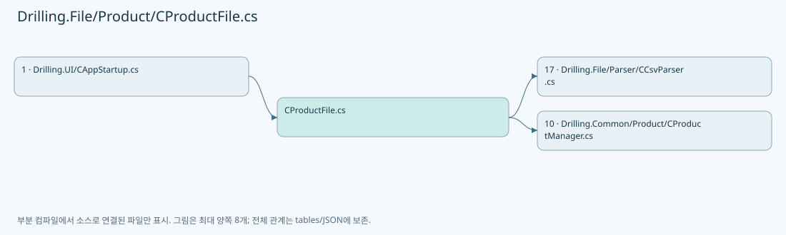

## 네임스페이스·타입·상속

| 타입 | 구분 | 원본 범위 | 선언/상속 |
| --- | --- | --- | --- |
| CProductFile | ClassDeclaration | 6–512 | CProductFile: CProductFileBase |

## 멤버 빠른 목록

| 이름 | 종류 | 범위 | 서명 |
| --- | --- | --- | --- |
| DefaultReviewBeamNo | FieldDeclaration | L8–8 | int Drilling.File.Product.CProductFile.DefaultReviewBeamNo |
| ActiveHeaders | FieldDeclaration | L9–9 | System.Collections.Generic.IReadOnlyList<string> Drilling.File.Product.CProductFile.ActiveHeaders |
| HistoryHeaders | FieldDeclaration | L10–10 | System.Collections.Generic.IReadOnlyList<string> Drilling.File.Product.CProductFile.HistoryHeaders |
| _productRoot | FieldDeclaration | L11–11 | string Drilling.File.Product.CProductFile._productRoot |
| LoadActive | MethodDeclaration | L12–39 | System.Threading.Tasks.Task<Drilling.Common.Product.ST_PRODUCT_DATA?> Drilling.File.Product.CProductFile.LoadActive(System.Threading.CancellationToken) |
| MatchesItem | LocalFunctionStatement | L27–30 | bool MatchesItem(System.Collections.Generic.IReadOnlyDictionary<string, string>) |
| LoadCompactActive | MethodDeclaration | L41–107 | Drilling.Common.Product.ST_PRODUCT_DATA? Drilling.File.Product.CProductFile.LoadCompactActive(System.Collections.Generic.IReadOnlyList<System.Collections.Generic.IReadOnlyDictionary<string, string>>) |
| ShouldIncludeItem | LocalFunctionStatement | L63–66 | bool ShouldIncludeItem(System.Collections.Generic.KeyValuePair<string, string>) |
| SelectName | LocalFunctionStatement | L79–82 | string SelectName(string) |
| SelectValue | LocalFunctionStatement | L84–87 | string SelectValue(string) |
| SaveActive | MethodDeclaration | L109–180 | System.Threading.Tasks.Task Drilling.File.Product.CProductFile.SaveActive(Drilling.Common.Product.ST_PRODUCT_DATA, System.Threading.CancellationToken) |
| ShouldIncludeItem | LocalFunctionStatement | L118–121 | bool ShouldIncludeItem(System.Collections.Generic.KeyValuePair<string, string>) |
| SelectKey | LocalFunctionStatement | L123–126 | string SelectKey(System.Collections.Generic.KeyValuePair<string, string>) |
| BuildRecipeParameterCompactRow | LocalFunctionStatement | L128–131 | System.Collections.Generic.IReadOnlyDictionary<string, string> BuildRecipeParameterCompactRow(System.Collections.Generic.KeyValuePair<string, string>) |
| SelectCellNo | LocalFunctionStatement | L158–161 | int SelectCellNo(Drilling.Common.Product.ST_PRODUCT_REVIEW_RESULT) |
| SelectShotKey | LocalFunctionStatement | L163–166 | string SelectShotKey(Drilling.Common.Product.ST_PRODUCT_REVIEW_RESULT) |
| WriteActiveProductAtomically | MethodDeclaration | L182–202 | void Drilling.File.Product.CProductFile.WriteActiveProductAtomically(System.Collections.Generic.IReadOnlyList<System.Collections.Generic.IReadOnlyDictionary<string, string>>) |
| ClearActive | MethodDeclaration | L204–209 | System.Threading.Tasks.Task Drilling.File.Product.CProductFile.ClearActive(System.Threading.CancellationToken) |
| AppendHistory | MethodDeclaration | L211–223 | System.Threading.Tasks.Task Drilling.File.Product.CProductFile.AppendHistory(Drilling.Common.Product.ST_PRODUCT_HISTORY, System.Threading.CancellationToken) |
| LoadHistory | MethodDeclaration | L225–256 | System.Threading.Tasks.Task<System.Collections.Generic.IReadOnlyList<Drilling.Common.Product.ST_PRODUCT_HISTORY>> Drilling.File.Product.CProductFile.LoadHistory(int, int, System.Threading.CancellationToken) |
| SelectValue | LocalFunctionStatement | L229–232 | System.DateTime SelectValue(int) |
| SelectHistoryPath | LocalFunctionStatement | L234–237 | string SelectHistoryPath(System.DateTime) |
| ShouldIncludeItem | LocalFunctionStatement | L239–242 | bool ShouldIncludeItem(Drilling.Common.Product.ST_PRODUCT_HISTORY?) |
| SelectItem | LocalFunctionStatement | L244–247 | Drilling.Common.Product.ST_PRODUCT_HISTORY SelectItem(Drilling.Common.Product.ST_PRODUCT_HISTORY?) |
| SelectOccurredAt | LocalFunctionStatement | L249–252 | System.DateTimeOffset SelectOccurredAt(Drilling.Common.Product.ST_PRODUCT_HISTORY) |
| GetActiveProductPath | MethodDeclaration | L258–261 | string Drilling.File.Product.CProductFile.GetActiveProductPath() |
| GetHistoryPath | MethodDeclaration | L263–266 | string Drilling.File.Product.CProductFile.GetHistoryPath(System.DateTimeOffset) |
| ValidateReview | MethodDeclaration | L268–279 | void Drilling.File.Product.CProductFile.ValidateReview(Drilling.Common.Product.ST_PRODUCT_REVIEW_DATA) |
| ParseCompactReview | MethodDeclaration | L281–338 | Drilling.Common.Product.ST_PRODUCT_REVIEW_DATA Drilling.File.Product.CProductFile.ParseCompactReview(System.Collections.Generic.IReadOnlyDictionary<string, string>, System.Collections.Generic.IReadOnlyDictionary<string, string>) |
| ShouldIncludeItem | LocalFunctionStatement | L283–286 | bool ShouldIncludeItem(System.Collections.Generic.KeyValuePair<string, string>) |
| SelectCellNo | LocalFunctionStatement | L288–291 | int SelectCellNo(Drilling.Common.Product.ST_PRODUCT_REVIEW_RESULT) |
| SelectShotKey | LocalFunctionStatement | L293–296 | string SelectShotKey(Drilling.Common.Product.ST_PRODUCT_REVIEW_RESULT) |
| ReadSection | MethodDeclaration | L340–368 | System.Collections.Generic.Dictionary<string, string> Drilling.File.Product.CProductFile.ReadSection(System.Collections.Generic.IReadOnlyList<System.Collections.Generic.IReadOnlyDictionary<string, string>>, string) |
| MatchesSectionType | LocalFunctionStatement | L342–345 | bool MatchesSectionType(System.Collections.Generic.IReadOnlyDictionary<string, string>) |
| HasSectionName | LocalFunctionStatement | L347–350 | bool HasSectionName(System.Collections.Generic.IReadOnlyDictionary<string, string>) |
| SelectGroupKey | LocalFunctionStatement | L352–355 | string SelectGroupKey(System.Collections.Generic.IReadOnlyDictionary<string, string>) |
| SelectKey | LocalFunctionStatement | L357–360 | string SelectKey(System.Linq.IGrouping<string, System.Collections.Generic.IReadOnlyDictionary<string, string>>) |
| SelectValue | LocalFunctionStatement | L362–365 | string SelectValue(System.Linq.IGrouping<string, System.Collections.Generic.IReadOnlyDictionary<string, string>>) |
| ReadAny | MethodDeclaration | L370–381 | string Drilling.File.Product.CProductFile.ReadAny(System.Collections.Generic.IReadOnlyDictionary<string, string>, params string[]) |
| AddCompactRow | MethodDeclaration | L383–386 | void Drilling.File.Product.CProductFile.AddCompactRow(System.Collections.Generic.ICollection<System.Collections.Generic.IReadOnlyDictionary<string, string>>, string, string, string) |
| CompactRow | MethodDeclaration | L388–396 | System.Collections.Generic.IReadOnlyDictionary<string, string> Drilling.File.Product.CProductFile.CompactRow(string, string, string) |
| IsCompactProductCoreName | MethodDeclaration | L398–405 | bool Drilling.File.Product.CProductFile.IsCompactProductCoreName(string) |
| DefaultText | MethodDeclaration | L407–410 | string Drilling.File.Product.CProductFile.DefaultText(string, string) |
| ParseInt | MethodDeclaration | L412–415 | int Drilling.File.Product.CProductFile.ParseInt(string, int) |
| ParseNullableInt | MethodDeclaration | L417–420 | int? Drilling.File.Product.CProductFile.ParseNullableInt(string) |
| ParseNullableDouble | MethodDeclaration | L422–425 | double? Drilling.File.Product.CProductFile.ParseNullableDouble(string) |
| FormatDouble | MethodDeclaration | L427–430 | string Drilling.File.Product.CProductFile.FormatDouble(double?) |
| ToHistoryRow | MethodDeclaration | L432–446 | System.Collections.Generic.IReadOnlyDictionary<string, string> Drilling.File.Product.CProductFile.ToHistoryRow(Drilling.Common.Product.ST_PRODUCT_HISTORY) |
| ParseHistory | MethodDeclaration | L448–466 | Drilling.Common.Product.ST_PRODUCT_HISTORY? Drilling.File.Product.CProductFile.ParseHistory(System.Collections.Generic.IReadOnlyDictionary<string, string>) |
| WriteRowsAtomically | MethodDeclaration | L468–487 | void Drilling.File.Product.CProductFile.WriteRowsAtomically(string, System.Collections.Generic.IReadOnlyList<string>, System.Collections.Generic.IReadOnlyList<System.Collections.Generic.IReadOnlyDictionary<string, string>>) |
| ParseEnum | MethodDeclaration | L489–493 | T Drilling.File.Product.CProductFile.ParseEnum<T>(string, T) |
| FormatDate | MethodDeclaration | L495–498 | string Drilling.File.Product.CProductFile.FormatDate(System.DateTimeOffset?) |
| ParseDate | MethodDeclaration | L500–503 | System.DateTimeOffset? Drilling.File.Product.CProductFile.ParseDate(string) |
| DeleteIfExists | MethodDeclaration | L505–511 | void Drilling.File.Product.CProductFile.DeleteIfExists(string) |

## 멤버별 상세 계약·호출·처리 해설

### FieldDeclaration `DefaultReviewBeamNo` · L8–8

[Drilling.File/Product/CProductFile.cs:8–8](https://github.com/kjuws10-rgb/A3Drilling/blob/5aee8e58439c9b455cae7c9593c9be986c3e682e/Drilling.File/Product/CProductFile.cs#L8-L8)

| 항목 | 실제 추출 값 |
| --- | --- |
| 서명 | int Drilling.File.Product.CProductFile.DefaultReviewBeamNo |
| 접근/수식자 | Private / private, const |
| 반환/값 타입 | int |
| 소속 타입 | NamedType:Drilling.File.Product.CProductFile |

현재 부분 분석에서 직접 연결된 호출자는 없습니다. XAML/이벤트/인터페이스·델리게이트·외부 진입을 추가 확인해야 하며, 미사용으로 판정한 것이 아닙니다.

본문의 실제 연산·분기·예외·반환 순서(원문 위치 순):

| 원본 행 | 종류 | 주석 해설 |
| --- | --- | --- |
| 8 | variable-initializer | 변수의 초기값을 지정합니다: DefaultReviewBeamNo = 1 |

변경 전 점검: 입력/반환 타입, 위 호출자, 예외/취소 경로, 공유 상태와 저장·전송 소비자를 함께 확인합니다. 값의 단위나 물리 방향을 이름만으로 확정하지 않습니다.

### FieldDeclaration `ActiveHeaders` · L9–9

[Drilling.File/Product/CProductFile.cs:9–9](https://github.com/kjuws10-rgb/A3Drilling/blob/5aee8e58439c9b455cae7c9593c9be986c3e682e/Drilling.File/Product/CProductFile.cs#L9-L9)

| 항목 | 실제 추출 값 |
| --- | --- |
| 서명 | System.Collections.Generic.IReadOnlyList<string> Drilling.File.Product.CProductFile.ActiveHeaders |
| 접근/수식자 | Private / private, static, readonly |
| 반환/값 타입 | System.Collections.Generic.IReadOnlyList<string> |
| 소속 타입 | NamedType:Drilling.File.Product.CProductFile |

현재 부분 분석에서 직접 연결된 호출자는 없습니다. XAML/이벤트/인터페이스·델리게이트·외부 진입을 추가 확인해야 하며, 미사용으로 판정한 것이 아닙니다.

본문의 실제 연산·분기·예외·반환 순서(원문 위치 순):

| 원본 행 | 종류 | 주석 해설 |
| --- | --- | --- |
| 9 | variable-initializer | 변수의 초기값을 지정합니다: ActiveHeaders = ["TYPE", "NAME", "VALUE"] |

변경 전 점검: 입력/반환 타입, 위 호출자, 예외/취소 경로, 공유 상태와 저장·전송 소비자를 함께 확인합니다. 값의 단위나 물리 방향을 이름만으로 확정하지 않습니다.

### FieldDeclaration `HistoryHeaders` · L10–10

[Drilling.File/Product/CProductFile.cs:10–10](https://github.com/kjuws10-rgb/A3Drilling/blob/5aee8e58439c9b455cae7c9593c9be986c3e682e/Drilling.File/Product/CProductFile.cs#L10-L10)

| 항목 | 실제 추출 값 |
| --- | --- |
| 서명 | System.Collections.Generic.IReadOnlyList<string> Drilling.File.Product.CProductFile.HistoryHeaders |
| 접근/수식자 | Private / private, static, readonly |
| 반환/값 타입 | System.Collections.Generic.IReadOnlyList<string> |
| 소속 타입 | NamedType:Drilling.File.Product.CProductFile |

현재 부분 분석에서 직접 연결된 호출자는 없습니다. XAML/이벤트/인터페이스·델리게이트·외부 진입을 추가 확인해야 하며, 미사용으로 판정한 것이 아닙니다.

본문의 실제 연산·분기·예외·반환 순서(원문 위치 순):

| 원본 행 | 종류 | 주석 해설 |
| --- | --- | --- |
| 10 | variable-initializer | 변수의 초기값을 지정합니다: HistoryHeaders = ["OCCURRED_AT", "ROW_TYPE", "GLASS_ID", "PROCESS_ID", "RECIPE_ID", "ACTION", "STATE", "RESULT", "DETAIL"] |

변경 전 점검: 입력/반환 타입, 위 호출자, 예외/취소 경로, 공유 상태와 저장·전송 소비자를 함께 확인합니다. 값의 단위나 물리 방향을 이름만으로 확정하지 않습니다.

### FieldDeclaration `_productRoot` · L11–11

[Drilling.File/Product/CProductFile.cs:11–11](https://github.com/kjuws10-rgb/A3Drilling/blob/5aee8e58439c9b455cae7c9593c9be986c3e682e/Drilling.File/Product/CProductFile.cs#L11-L11)

| 항목 | 실제 추출 값 |
| --- | --- |
| 서명 | string Drilling.File.Product.CProductFile._productRoot |
| 접근/수식자 | Private / private, readonly |
| 반환/값 타입 | string |
| 소속 타입 | NamedType:Drilling.File.Product.CProductFile |

현재 부분 분석에서 직접 연결된 호출자는 없습니다. XAML/이벤트/인터페이스·델리게이트·외부 진입을 추가 확인해야 하며, 미사용으로 판정한 것이 아닙니다.

호출하는 대상과 해석 범위:

| 원본 행 | 표현식 | 분석 상태 | 대상/소스 위치 |
| --- | --- | --- | --- |
| 11 | Path.Combine | resolved | string System.IO.Path.Combine(string, string, string) |
| 11 | Directory.GetParent | resolved | System.IO.DirectoryInfo? System.IO.Directory.GetParent(string) |

본문의 실제 연산·분기·예외·반환 순서(원문 위치 순):

| 원본 행 | 종류 | 주석 해설 |
| --- | --- | --- |
| 11 | call | 함수·델리게이트 또는 객체 생성자를 호출합니다: Path.Combine(Directory.GetParent(configRoot)?.FullName ?? configRoot, "Data", "Product") |
| 11 | call | 함수·델리게이트 또는 객체 생성자를 호출합니다: Directory.GetParent(configRoot) |
| 11 | variable-initializer | 변수의 초기값을 지정합니다: _productRoot = Path.Combine(Directory.GetParent(configRoot)?.FullName ?? configRoot, "Data", "Product") |

변경 전 점검: 입력/반환 타입, 위 호출자, 예외/취소 경로, 공유 상태와 저장·전송 소비자를 함께 확인합니다. 값의 단위나 물리 방향을 이름만으로 확정하지 않습니다.

### MethodDeclaration `LoadActive` · L12–39

[Drilling.File/Product/CProductFile.cs:12–39](https://github.com/kjuws10-rgb/A3Drilling/blob/5aee8e58439c9b455cae7c9593c9be986c3e682e/Drilling.File/Product/CProductFile.cs#L12-L39)

| 항목 | 실제 추출 값 |
| --- | --- |
| 서명 | System.Threading.Tasks.Task<Drilling.Common.Product.ST_PRODUCT_DATA?> Drilling.File.Product.CProductFile.LoadActive(System.Threading.CancellationToken) |
| 접근/수식자 | Public / public, override |
| 반환/값 타입 | System.Threading.Tasks.Task<Drilling.Common.Product.ST_PRODUCT_DATA?> |
| 소속 타입 | NamedType:Drilling.File.Product.CProductFile |

입력 계약:

| 이름 | 타입 | 전달 | 선택/기본값 |
| --- | --- | --- | --- |
| cancellationToken | System.Threading.CancellationToken | None | True / null |

현재 부분 분석에서 직접 연결된 호출자는 없습니다. XAML/이벤트/인터페이스·델리게이트·외부 진입을 추가 확인해야 하며, 미사용으로 판정한 것이 아닙니다.

호출하는 대상과 해석 범위:

| 원본 행 | 표현식 | 분석 상태 | 대상/소스 위치 |
| --- | --- | --- | --- |
| 14 | cancellationToken.ThrowIfCancellationRequested | resolved | void System.Threading.CancellationToken.ThrowIfCancellationRequested() |
| 15 | GetActiveProductPath | resolved | string Drilling.File.Product.CProductFile.GetActiveProductPath() · Drilling.File/Product/CProductFile.cs:258 |
| 16 | System.IO.File.Exists | resolved | bool System.IO.File.Exists(string?) |
| 18 | Task.FromResult<ST_PRODUCT_DATA?> | resolved | System.Threading.Tasks.Task<Drilling.Common.Product.ST_PRODUCT_DATA?> System.Threading.Tasks.Task.FromResult<Drilling.Common.Product.ST_PRODUCT_DATA?>(Drilling.Common.Product.ST_PRODUCT_DATA?) |
| 21 | CCsvParser.Read | resolved | System.Collections.Generic.IReadOnlyList<System.Collections.Generic.IReadOnlyDictionary<string, string>> Drilling.File.Parser.CCsvParser.Read(string) · Drilling.File/Parser/CCsvParser.cs:12 |
| 24 | new InvalidDataException | resolved | System.IO.InvalidDataException.InvalidDataException(string?) |
| 32 | rows.Any | resolved | bool System.Collections.Generic.IEnumerable<System.Collections.Generic.IReadOnlyDictionary<string, string>>.Any<System.Collections.Generic.IReadOnlyDictionary<string, string>>(System.Func<System.Collections.Generic.IReadOnlyDictionary<string, string>, bool>) |
| 34 | new InvalidDataException | resolved | System.IO.InvalidDataException.InvalidDataException(string?) |
| 37 | LoadCompactActive | resolved | Drilling.Common.Product.ST_PRODUCT_DATA? Drilling.File.Product.CProductFile.LoadCompactActive(System.Collections.Generic.IReadOnlyList<System.Collections.Generic.IReadOnlyDictionary<string, string>>) · Drilling.File/Product/CProductFile.cs:41 |
| 38 | new InvalidDataException | resolved | System.IO.InvalidDataException.InvalidDataException(string?) |
| 38 | Task.FromResult<ST_PRODUCT_DATA?> | resolved | System.Threading.Tasks.Task<Drilling.Common.Product.ST_PRODUCT_DATA?> System.Threading.Tasks.Task.FromResult<Drilling.Common.Product.ST_PRODUCT_DATA?>(Drilling.Common.Product.ST_PRODUCT_DATA?) |

본문의 실제 연산·분기·예외·반환 순서(원문 위치 순):

| 원본 행 | 종류 | 주석 해설 |
| --- | --- | --- |
| 14 | call | 함수·델리게이트 또는 객체 생성자를 호출합니다: cancellationToken.ThrowIfCancellationRequested() |
| 15 | call | 함수·델리게이트 또는 객체 생성자를 호출합니다: GetActiveProductPath() |
| 15 | local-declaration | 지역 변수를 선언합니다: var activePath = GetActiveProductPath(); |
| 15 | variable-initializer | 변수의 초기값을 지정합니다: activePath = GetActiveProductPath() |
| 16 | call | 함수·델리게이트 또는 객체 생성자를 호출합니다: System.IO.File.Exists(activePath) |
| 16 | if | 조건에 따라 분기합니다: if (!System.IO.File.Exists(activePath)) |
| 18 | call | 함수·델리게이트 또는 객체 생성자를 호출합니다: Task.FromResult<ST_PRODUCT_DATA?>(null) |
| 18 | return | 호출자에게 값 또는 제어를 반환합니다: return Task.FromResult<ST_PRODUCT_DATA?>(null); |
| 21 | call | 함수·델리게이트 또는 객체 생성자를 호출합니다: CCsvParser.Read(activePath) |
| 21 | local-declaration | 지역 변수를 선언합니다: var rows = CCsvParser.Read(activePath); |
| 21 | variable-initializer | 변수의 초기값을 지정합니다: rows = CCsvParser.Read(activePath) |
| 22 | if | 조건에 따라 분기합니다: if (rows.Count == 0) |
| 24 | call | 함수·델리게이트 또는 객체 생성자를 호출합니다: new InvalidDataException("Active Product file is empty.") |
| 24 | throw | 예외를 발생/전달합니다: throw new InvalidDataException("Active Product file is empty."); |
| 32 | call | 함수·델리게이트 또는 객체 생성자를 호출합니다: rows.Any(MatchesItem) |
| 32 | if | 조건에 따라 분기합니다: if (!rows.Any(MatchesItem)) |
| 34 | call | 함수·델리게이트 또는 객체 생성자를 호출합니다: new InvalidDataException("Active Product file is not in the current compact format.") |
| 34 | throw | 예외를 발생/전달합니다: throw new InvalidDataException("Active Product file is not in the current compact format."); |
| 37 | call | 함수·델리게이트 또는 객체 생성자를 호출합니다: LoadCompactActive(rows) |
| 37 | local-declaration | 지역 변수를 선언합니다: var product = LoadCompactActive(rows); |
| 37 | variable-initializer | 변수의 초기값을 지정합니다: product = LoadCompactActive(rows) |
| 38 | call | 함수·델리게이트 또는 객체 생성자를 호출합니다: new InvalidDataException("Active Product file does not contain a valid H_GLASSID.") |
| 38 | call | 함수·델리게이트 또는 객체 생성자를 호출합니다: Task.FromResult<ST_PRODUCT_DATA?>(product) |
| 38 | conditional-expression | 조건에 따라 결과식을 선택합니다: product is null ? throw new InvalidDataException("Active Product file does not contain a valid H_GLASSID.") : Task.FromResult<ST_PRODUCT_DATA?>(product) |
| 38 | return | 호출자에게 값 또는 제어를 반환합니다: return product is null ? throw new InvalidDataException("Active Product file does not contain a valid H_GLASSID.") : Task.FromResult<ST_PRODUCT_DATA?>(product); |
| 38 | throw | 예외를 발생/전달합니다: throw new InvalidDataException("Active Product file does not contain a valid H_GLASSID.") |

제어 구문의 포함 구조(실제 실행 순서/CFG가 아닌 구문 탐색 그림):

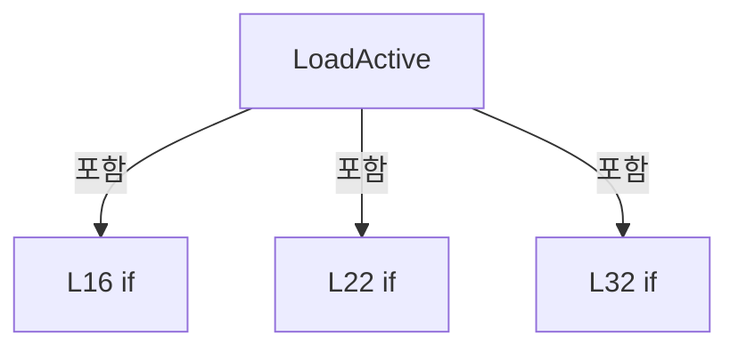

변경 전 점검: 입력/반환 타입, 위 호출자, 예외/취소 경로, 공유 상태와 저장·전송 소비자를 함께 확인합니다. 값의 단위나 물리 방향을 이름만으로 확정하지 않습니다.

### LocalFunctionStatement `MatchesItem` · L27–30

[Drilling.File/Product/CProductFile.cs:27–30](https://github.com/kjuws10-rgb/A3Drilling/blob/5aee8e58439c9b455cae7c9593c9be986c3e682e/Drilling.File/Product/CProductFile.cs#L27-L30)

| 항목 | 실제 추출 값 |
| --- | --- |
| 서명 | bool MatchesItem(System.Collections.Generic.IReadOnlyDictionary<string, string>) |
| 접근/수식자 | Private /  |
| 반환/값 타입 | bool |
| 소속 타입 | NamedType:Drilling.File.Product.CProductFile |

입력 계약:

| 이름 | 타입 | 전달 | 선택/기본값 |
| --- | --- | --- | --- |
| row | System.Collections.Generic.IReadOnlyDictionary<string, string> | None | False /  |

현재 부분 분석에서 직접 연결된 호출자는 없습니다. XAML/이벤트/인터페이스·델리게이트·외부 진입을 추가 확인해야 하며, 미사용으로 판정한 것이 아닙니다.

호출하는 대상과 해석 범위:

| 원본 행 | 표현식 | 분석 상태 | 대상/소스 위치 |
| --- | --- | --- | --- |
| 29 | string.IsNullOrWhiteSpace | resolved | bool string.IsNullOrWhiteSpace(string?) |
| 29 | CCsvParser.Get | resolved | string Drilling.File.Parser.CCsvParser.Get(System.Collections.Generic.IReadOnlyDictionary<string, string>, string) · Drilling.File/Parser/CCsvParser.cs:168 |

본문의 실제 연산·분기·예외·반환 순서(원문 위치 순):

| 원본 행 | 종류 | 주석 해설 |
| --- | --- | --- |
| 29 | call | 함수·델리게이트 또는 객체 생성자를 호출합니다: string.IsNullOrWhiteSpace(CCsvParser.Get(row, "TYPE")) |
| 29 | call | 함수·델리게이트 또는 객체 생성자를 호출합니다: CCsvParser.Get(row, "TYPE") |
| 29 | return | 호출자에게 값 또는 제어를 반환합니다: return !string.IsNullOrWhiteSpace(CCsvParser.Get(row, "TYPE")); |

변경 전 점검: 입력/반환 타입, 위 호출자, 예외/취소 경로, 공유 상태와 저장·전송 소비자를 함께 확인합니다. 값의 단위나 물리 방향을 이름만으로 확정하지 않습니다.

### MethodDeclaration `LoadCompactActive` · L41–107

[Drilling.File/Product/CProductFile.cs:41–107](https://github.com/kjuws10-rgb/A3Drilling/blob/5aee8e58439c9b455cae7c9593c9be986c3e682e/Drilling.File/Product/CProductFile.cs#L41-L107)

| 항목 | 실제 추출 값 |
| --- | --- |
| 서명 | Drilling.Common.Product.ST_PRODUCT_DATA? Drilling.File.Product.CProductFile.LoadCompactActive(System.Collections.Generic.IReadOnlyList<System.Collections.Generic.IReadOnlyDictionary<string, string>>) |
| 접근/수식자 | Private / private, static |
| 반환/값 타입 | Drilling.Common.Product.ST_PRODUCT_DATA? |
| 소속 타입 | NamedType:Drilling.File.Product.CProductFile |

입력 계약:

| 이름 | 타입 | 전달 | 선택/기본값 |
| --- | --- | --- | --- |
| rows | System.Collections.Generic.IReadOnlyList<System.Collections.Generic.IReadOnlyDictionary<string, string>> | None | False /  |

정적 호출자로 확인된 위치:

| 호출 파일/행 | 호출 표현식 | 런타임 분기 가능 |
| --- | --- | --- |
| [Drilling.File/Product/CProductFile.cs:37–37](https://github.com/kjuws10-rgb/A3Drilling/blob/5aee8e58439c9b455cae7c9593c9be986c3e682e/Drilling.File/Product/CProductFile.cs#L37-L37) | LoadCompactActive | False |

호출하는 대상과 해석 범위:

| 원본 행 | 표현식 | 분석 상태 | 대상/소스 위치 |
| --- | --- | --- | --- |
| 43 | ReadSection | resolved | System.Collections.Generic.Dictionary<string, string> Drilling.File.Product.CProductFile.ReadSection(System.Collections.Generic.IReadOnlyList<System.Collections.Generic.IReadOnlyDictionary<string, string>>, string) · Drilling.File/Product/CProductFile.cs:340 |
| 44 | ReadAny | resolved | string Drilling.File.Product.CProductFile.ReadAny(System.Collections.Generic.IReadOnlyDictionary<string, string>, params string[]) · Drilling.File/Product/CProductFile.cs:370 |
| 45 | string.IsNullOrWhiteSpace | resolved | bool string.IsNullOrWhiteSpace(string?) |
| 50 | new HashSet<string> | resolved | System.Collections.Generic.HashSet<string>.HashSet(System.Collections.Generic.IEqualityComparer<string>?) |
| 62 | ReadSection | resolved | System.Collections.Generic.Dictionary<string, string> Drilling.File.Product.CProductFile.ReadSection(System.Collections.Generic.IReadOnlyList<System.Collections.Generic.IReadOnlyDictionary<string, string>>, string) · Drilling.File/Product/CProductFile.cs:340 |
| 68 | productValues.Where | resolved | System.Collections.Generic.IEnumerable<System.Collections.Generic.KeyValuePair<string, string>> System.Collections.Generic.IEnumerable<System.Collections.Generic.KeyValuePair<string, string>>.Where<System.Collections.Generic.KeyValuePair<string, string>>(System.Func<System.Collections.Generic.KeyValuePair<string, string>, bool>) |
| 70 | parameters.TryAdd | resolved | bool System.Collections.Generic.Dictionary<string, string>.TryAdd(string, string) |
| 73 | ReadSection | resolved | System.Collections.Generic.Dictionary<string, string> Drilling.File.Product.CProductFile.ReadSection(System.Collections.Generic.IReadOnlyList<System.Collections.Generic.IReadOnlyDictionary<string, string>>, string) · Drilling.File/Product/CProductFile.cs:340 |
| 74 | ReadSection | resolved | System.Collections.Generic.Dictionary<string, string> Drilling.File.Product.CProductFile.ReadSection(System.Collections.Generic.IReadOnlyList<System.Collections.Generic.IReadOnlyDictionary<string, string>>, string) · Drilling.File/Product/CProductFile.cs:340 |
| 75 | ReadSection | resolved | System.Collections.Generic.Dictionary<string, string> Drilling.File.Product.CProductFile.ReadSection(System.Collections.Generic.IReadOnlyList<System.Collections.Generic.IReadOnlyDictionary<string, string>>, string) · Drilling.File/Product/CProductFile.cs:340 |
| 76 | ReadSection | resolved | System.Collections.Generic.Dictionary<string, string> Drilling.File.Product.CProductFile.ReadSection(System.Collections.Generic.IReadOnlyList<System.Collections.Generic.IReadOnlyDictionary<string, string>>, string) · Drilling.File/Product/CProductFile.cs:340 |
| 77 | ParseCompactReview | resolved | Drilling.Common.Product.ST_PRODUCT_REVIEW_DATA Drilling.File.Product.CProductFile.ParseCompactReview(System.Collections.Generic.IReadOnlyDictionary<string, string>, System.Collections.Generic.IReadOnlyDictionary<string, string>) · Drilling.File/Product/CProductFile.cs:281 |
| 78 | ValidateReview | resolved | void Drilling.File.Product.CProductFile.ValidateReview(Drilling.Common.Product.ST_PRODUCT_REVIEW_DATA) · Drilling.File/Product/CProductFile.cs:268 |
| 89 | CProductManager.ProductFieldNames.ToDictionary | resolved | System.Collections.Generic.Dictionary<string, string> System.Collections.Generic.IEnumerable<string>.ToDictionary<string, string, string>(System.Func<string, string>, System.Func<string, string>, System.Collections.Generic.IEqualityComparer<string>?) |
| 91 | ReadAny | resolved | string Drilling.File.Product.CProductFile.ReadAny(System.Collections.Generic.IReadOnlyDictionary<string, string>, params string[]) · Drilling.File/Product/CProductFile.cs:370 |
| 92 | ReadAny | resolved | string Drilling.File.Product.CProductFile.ReadAny(System.Collections.Generic.IReadOnlyDictionary<string, string>, params string[]) · Drilling.File/Product/CProductFile.cs:370 |
| 93 | new ST_PRODUCT_DATA | resolved | Drilling.Common.Product.ST_PRODUCT_DATA.ST_PRODUCT_DATA(Drilling.Common.Product.ST_PRODUCT_INFO, Drilling.Common.Product.ST_PRODUCT_RECIPE_DATA, Drilling.Common.Product.ST_PRODUCT_ALIGN_DATA, Drilling.Common.Product.ST_PRODUCT_DISTORTION_DATA, Drilling.Common.Product.ST_PRODUCT_REVIEW_DATA, Drilling.Common.Product.ST_PRODUCT_RUNTIME_DATA) · Drilling.Common/Product/CProductManager.cs:1043 |
| 94 | new ST_PRODUCT_INFO | resolved | Drilling.Common.Product.ST_PRODUCT_INFO.ST_PRODUCT_INFO(System.Collections.Generic.IReadOnlyDictionary<string, string>) · Drilling.Common/Product/CProductManager.cs:1013 |
| 95 | new ST_PRODUCT_RECIPE_DATA | resolved | Drilling.Common.Product.ST_PRODUCT_RECIPE_DATA.ST_PRODUCT_RECIPE_DATA(System.Collections.Generic.IReadOnlyDictionary<string, string>) · Drilling.Common/Product/CProductManager.cs:1030 |
| 96 | new ST_PRODUCT_ALIGN_DATA | resolved | Drilling.Common.Product.ST_PRODUCT_ALIGN_DATA.ST_PRODUCT_ALIGN_DATA(Drilling.Common.Product.EN_PRODUCT_PROCESS_STATE, string, double?, double?, double?) · Drilling.Common/Product/CProductManager.cs:996 |
| 97 | ParseEnum | resolved | Drilling.Common.Product.EN_PRODUCT_PROCESS_STATE Drilling.File.Product.CProductFile.ParseEnum<Drilling.Common.Product.EN_PRODUCT_PROCESS_STATE>(string, Drilling.Common.Product.EN_PRODUCT_PROCESS_STATE) · Drilling.File/Product/CProductFile.cs:489 |
| 97 | ReadAny | resolved | string Drilling.File.Product.CProductFile.ReadAny(System.Collections.Generic.IReadOnlyDictionary<string, string>, params string[]) · Drilling.File/Product/CProductFile.cs:370 |
| 98 | DefaultText | resolved | string Drilling.File.Product.CProductFile.DefaultText(string, string) · Drilling.File/Product/CProductFile.cs:407 |
| 98 | ReadAny | resolved | string Drilling.File.Product.CProductFile.ReadAny(System.Collections.Generic.IReadOnlyDictionary<string, string>, params string[]) · Drilling.File/Product/CProductFile.cs:370 |
| 99 | ParseNullableDouble | resolved | double? Drilling.File.Product.CProductFile.ParseNullableDouble(string) · Drilling.File/Product/CProductFile.cs:422 |
| 99 | ReadAny | resolved | string Drilling.File.Product.CProductFile.ReadAny(System.Collections.Generic.IReadOnlyDictionary<string, string>, params string[]) · Drilling.File/Product/CProductFile.cs:370 |
| 100 | ParseNullableDouble | resolved | double? Drilling.File.Product.CProductFile.ParseNullableDouble(string) · Drilling.File/Product/CProductFile.cs:422 |
| 100 | ReadAny | resolved | string Drilling.File.Product.CProductFile.ReadAny(System.Collections.Generic.IReadOnlyDictionary<string, string>, params string[]) · Drilling.File/Product/CProductFile.cs:370 |
| 101 | ParseNullableDouble | resolved | double? Drilling.File.Product.CProductFile.ParseNullableDouble(string) · Drilling.File/Product/CProductFile.cs:422 |
| 101 | ReadAny | resolved | string Drilling.File.Product.CProductFile.ReadAny(System.Collections.Generic.IReadOnlyDictionary<string, string>, params string[]) · Drilling.File/Product/CProductFile.cs:370 |
| 103 | new ST_PRODUCT_DISTORTION_DATA | resolved | Drilling.Common.Product.ST_PRODUCT_DISTORTION_DATA.ST_PRODUCT_DISTORTION_DATA(Drilling.Common.Product.EN_PRODUCT_PROCESS_STATE, string, double?) · Drilling.Common/Product/CProductManager.cs:997 |
| 103 | ParseEnum | resolved | Drilling.Common.Product.EN_PRODUCT_PROCESS_STATE Drilling.File.Product.CProductFile.ParseEnum<Drilling.Common.Product.EN_PRODUCT_PROCESS_STATE>(string, Drilling.Common.Product.EN_PRODUCT_PROCESS_STATE) · Drilling.File/Product/CProductFile.cs:489 |
| 103 | ReadAny | resolved | string Drilling.File.Product.CProductFile.ReadAny(System.Collections.Generic.IReadOnlyDictionary<string, string>, params string[]) · Drilling.File/Product/CProductFile.cs:370 |
| 103 | DefaultText | resolved | string Drilling.File.Product.CProductFile.DefaultText(string, string) · Drilling.File/Product/CProductFile.cs:407 |
| 103 | ReadAny | resolved | string Drilling.File.Product.CProductFile.ReadAny(System.Collections.Generic.IReadOnlyDictionary<string, string>, params string[]) · Drilling.File/Product/CProductFile.cs:370 |
| 103 | ParseNullableDouble | resolved | double? Drilling.File.Product.CProductFile.ParseNullableDouble(string) · Drilling.File/Product/CProductFile.cs:422 |
| 103 | ReadAny | resolved | string Drilling.File.Product.CProductFile.ReadAny(System.Collections.Generic.IReadOnlyDictionary<string, string>, params string[]) · Drilling.File/Product/CProductFile.cs:370 |
| 105 | new ST_PRODUCT_RUNTIME_DATA | resolved | Drilling.Common.Product.ST_PRODUCT_RUNTIME_DATA.ST_PRODUCT_RUNTIME_DATA(System.Collections.Generic.IReadOnlyList<Drilling.Common.Product.ST_PRODUCT_HEAD_RESULT>) · Drilling.Common/Product/CProductManager.cs:1031 |

본문의 실제 연산·분기·예외·반환 순서(원문 위치 순):

| 원본 행 | 종류 | 주석 해설 |
| --- | --- | --- |
| 43 | call | 함수·델리게이트 또는 객체 생성자를 호출합니다: ReadSection(rows, "PRODUCT") |
| 43 | local-declaration | 지역 변수를 선언합니다: var productValues = ReadSection(rows, "PRODUCT"); |
| 43 | variable-initializer | 변수의 초기값을 지정합니다: productValues = ReadSection(rows, "PRODUCT") |
| 44 | call | 함수·델리게이트 또는 객체 생성자를 호출합니다: ReadAny(productValues, "H_GLASSID") |
| 44 | local-declaration | 지역 변수를 선언합니다: var glassId = ReadAny(productValues, "H_GLASSID"); |
| 44 | variable-initializer | 변수의 초기값을 지정합니다: glassId = ReadAny(productValues, "H_GLASSID") |
| 45 | call | 함수·델리게이트 또는 객체 생성자를 호출합니다: string.IsNullOrWhiteSpace(glassId) |
| 45 | if | 조건에 따라 분기합니다: if (string.IsNullOrWhiteSpace(glassId)) |
| 47 | return | 호출자에게 값 또는 제어를 반환합니다: return null; |
| 50 | call | 함수·델리게이트 또는 객체 생성자를 호출합니다: new HashSet<string>(StringComparer.OrdinalIgnoreCase) { "H_GLASSID", "LOTID", "PROCESS_ID", "PPID", "PRODUCT_STATE", "JUDGEMENT", "CREATED_AT", "STARTED_AT", "COMPLETED_AT" } |
| 50 | local-declaration | 지역 변수를 선언합니다: var reservedNames = new HashSet<string>(StringComparer.OrdinalIgnoreCase) { "H_GLASSID", "LOTID", "PROCESS_ID", "PPID", "PRODUCT_STATE", "JUDGEMENT", "CREATED_AT", "STARTED_AT", "COMPLETED_AT" }; |
| 50 | variable-initializer | 변수의 초기값을 지정합니다: reservedNames = new HashSet<string>(StringComparer.OrdinalIgnoreCase) { "H_GLASSID", "LOTID", "PROCESS_ID", "PPID", "PRODUCT_STATE", "JUDGEMENT", "CREATED_AT", "STARTED_AT", "COMPLETED_AT" } |
| 62 | call | 함수·델리게이트 또는 객체 생성자를 호출합니다: ReadSection(rows, "RECIPE") |
| 62 | local-declaration | 지역 변수를 선언합니다: var parameters = ReadSection(rows, "RECIPE"); |
| 62 | variable-initializer | 변수의 초기값을 지정합니다: parameters = ReadSection(rows, "RECIPE") |
| 68 | call | 함수·델리게이트 또는 객체 생성자를 호출합니다: productValues.Where(ShouldIncludeItem) |
| 68 | foreach | 컬렉션 요소를 순회합니다: foreach (var item in productValues.Where(ShouldIncludeItem)) |
| 70 | call | 함수·델리게이트 또는 객체 생성자를 호출합니다: parameters.TryAdd(item.Key, item.Value) |
| 73 | call | 함수·델리게이트 또는 객체 생성자를 호출합니다: ReadSection(rows, "ALIGN") |
| 73 | local-declaration | 지역 변수를 선언합니다: var alignValues = ReadSection(rows, "ALIGN"); |
| 73 | variable-initializer | 변수의 초기값을 지정합니다: alignValues = ReadSection(rows, "ALIGN") |
| 74 | call | 함수·델리게이트 또는 객체 생성자를 호출합니다: ReadSection(rows, "DISTORTION") |
| 74 | local-declaration | 지역 변수를 선언합니다: var distortionValues = ReadSection(rows, "DISTORTION"); |
| 74 | variable-initializer | 변수의 초기값을 지정합니다: distortionValues = ReadSection(rows, "DISTORTION") |
| 75 | call | 함수·델리게이트 또는 객체 생성자를 호출합니다: ReadSection(rows, "REVIEW") |
| 75 | local-declaration | 지역 변수를 선언합니다: var reviewValues = ReadSection(rows, "REVIEW"); |
| 75 | variable-initializer | 변수의 초기값을 지정합니다: reviewValues = ReadSection(rows, "REVIEW") |
| 76 | call | 함수·델리게이트 또는 객체 생성자를 호출합니다: ReadSection(rows, "REVIEW_RESULT") |
| 76 | local-declaration | 지역 변수를 선언합니다: var reviewResultValues = ReadSection(rows, "REVIEW_RESULT"); |
| 76 | variable-initializer | 변수의 초기값을 지정합니다: reviewResultValues = ReadSection(rows, "REVIEW_RESULT") |
| 77 | call | 함수·델리게이트 또는 객체 생성자를 호출합니다: ParseCompactReview(reviewValues, reviewResultValues) |
| 77 | local-declaration | 지역 변수를 선언합니다: var review = ParseCompactReview(reviewValues, reviewResultValues); |
| 77 | variable-initializer | 변수의 초기값을 지정합니다: review = ParseCompactReview(reviewValues, reviewResultValues) |
| 78 | call | 함수·델리게이트 또는 객체 생성자를 호출합니다: ValidateReview(review) |
| 89 | call | 함수·델리게이트 또는 객체 생성자를 호출합니다: CProductManager.ProductFieldNames.ToDictionary(SelectName, SelectValue, StringComparer.OrdinalIgnoreCase) |
| 89 | local-declaration | 지역 변수를 선언합니다: var normalizedProductValues = CProductManager.ProductFieldNames.ToDictionary(SelectName, SelectValue, StringComparer.OrdinalIgnoreCase); |
| 89 | variable-initializer | 변수의 초기값을 지정합니다: normalizedProductValues = CProductManager.ProductFieldNames.ToDictionary(SelectName, SelectValue, StringComparer.OrdinalIgnoreCase) |
| 90 | assignment | 값을 대상에 대입합니다: normalizedProductValues["H_GLASSID"] = glassId |
| 91 | assignment | 값을 대상에 대입합니다: normalizedProductValues["LOTID"] = ReadAny(productValues, "LOTID") |
| 91 | call | 함수·델리게이트 또는 객체 생성자를 호출합니다: ReadAny(productValues, "LOTID") |
| 92 | assignment | 값을 대상에 대입합니다: normalizedProductValues["PPID"] = ReadAny(productValues, "PPID") |
| 92 | call | 함수·델리게이트 또는 객체 생성자를 호출합니다: ReadAny(productValues, "PPID") |
| 93 | call | 함수·델리게이트 또는 객체 생성자를 호출합니다: new ST_PRODUCT_DATA( new ST_PRODUCT_INFO(normalizedProductValues), new ST_PRODUCT_RECIPE_DATA(parameters), new ST_PRODUCT_ALIGN_DATA( ParseEnum(ReadAny(alignValues, "STATE"), EN_PRODUCT_PROCESS_STATE.NotStarted), Default… |
| 93 | return | 호출자에게 값 또는 제어를 반환합니다: return new ST_PRODUCT_DATA( new ST_PRODUCT_INFO(normalizedProductValues), new ST_PRODUCT_RECIPE_DATA(parameters), new ST_PRODUCT_ALIGN_DATA( ParseEnum(ReadAny(alignValues, "STATE"), EN_PRODUCT_PROCESS_STATE.NotStarted), DefaultTex |
| 94 | call | 함수·델리게이트 또는 객체 생성자를 호출합니다: new ST_PRODUCT_INFO(normalizedProductValues) |
| 95 | call | 함수·델리게이트 또는 객체 생성자를 호출합니다: new ST_PRODUCT_RECIPE_DATA(parameters) |
| 96 | call | 함수·델리게이트 또는 객체 생성자를 호출합니다: new ST_PRODUCT_ALIGN_DATA( ParseEnum(ReadAny(alignValues, "STATE"), EN_PRODUCT_PROCESS_STATE.NotStarted), DefaultText(ReadAny(alignValues, "RESULT"), "PENDING"), ParseNullableDouble(ReadAny(alignValues, "OFFSET_X")), Par… |
| 97 | call | 함수·델리게이트 또는 객체 생성자를 호출합니다: ParseEnum(ReadAny(alignValues, "STATE"), EN_PRODUCT_PROCESS_STATE.NotStarted) |
| 97 | call | 함수·델리게이트 또는 객체 생성자를 호출합니다: ReadAny(alignValues, "STATE") |
| 98 | call | 함수·델리게이트 또는 객체 생성자를 호출합니다: DefaultText(ReadAny(alignValues, "RESULT"), "PENDING") |
| 98 | call | 함수·델리게이트 또는 객체 생성자를 호출합니다: ReadAny(alignValues, "RESULT") |
| 99 | call | 함수·델리게이트 또는 객체 생성자를 호출합니다: ParseNullableDouble(ReadAny(alignValues, "OFFSET_X")) |
| 99 | call | 함수·델리게이트 또는 객체 생성자를 호출합니다: ReadAny(alignValues, "OFFSET_X") |
| 100 | call | 함수·델리게이트 또는 객체 생성자를 호출합니다: ParseNullableDouble(ReadAny(alignValues, "OFFSET_Y")) |
| 100 | call | 함수·델리게이트 또는 객체 생성자를 호출합니다: ReadAny(alignValues, "OFFSET_Y") |
| 101 | call | 함수·델리게이트 또는 객체 생성자를 호출합니다: ParseNullableDouble(ReadAny(alignValues, "ROTATION")) |
| 101 | call | 함수·델리게이트 또는 객체 생성자를 호출합니다: ReadAny(alignValues, "ROTATION") |
| 103 | call | 함수·델리게이트 또는 객체 생성자를 호출합니다: new ST_PRODUCT_DISTORTION_DATA(ParseEnum(ReadAny(distortionValues, "STATE"), EN_PRODUCT_PROCESS_STATE.NotStarted), DefaultText(ReadAny(distortionValues, "RESULT"), "PENDING"), ParseNullableDouble(ReadAny(distortionValues… |
| 103 | call | 함수·델리게이트 또는 객체 생성자를 호출합니다: ParseEnum(ReadAny(distortionValues, "STATE"), EN_PRODUCT_PROCESS_STATE.NotStarted) |
| 103 | call | 함수·델리게이트 또는 객체 생성자를 호출합니다: ReadAny(distortionValues, "STATE") |
| 103 | call | 함수·델리게이트 또는 객체 생성자를 호출합니다: DefaultText(ReadAny(distortionValues, "RESULT"), "PENDING") |
| 103 | call | 함수·델리게이트 또는 객체 생성자를 호출합니다: ReadAny(distortionValues, "RESULT") |
| 103 | call | 함수·델리게이트 또는 객체 생성자를 호출합니다: ParseNullableDouble(ReadAny(distortionValues, "MAX_DA")) |
| 103 | call | 함수·델리게이트 또는 객체 생성자를 호출합니다: ReadAny(distortionValues, "MAX_DA") |
| 105 | call | 함수·델리게이트 또는 객체 생성자를 호출합니다: new ST_PRODUCT_RUNTIME_DATA([]) |

제어 구문의 포함 구조(실제 실행 순서/CFG가 아닌 구문 탐색 그림):

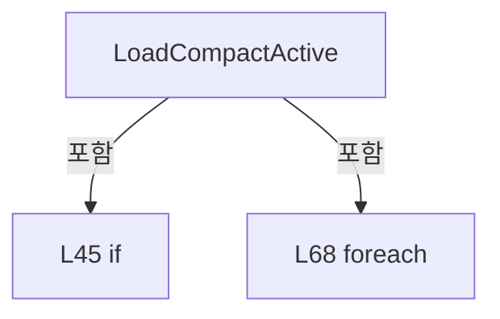

변경 전 점검: 입력/반환 타입, 위 호출자, 예외/취소 경로, 공유 상태와 저장·전송 소비자를 함께 확인합니다. 값의 단위나 물리 방향을 이름만으로 확정하지 않습니다.

### LocalFunctionStatement `ShouldIncludeItem` · L63–66

[Drilling.File/Product/CProductFile.cs:63–66](https://github.com/kjuws10-rgb/A3Drilling/blob/5aee8e58439c9b455cae7c9593c9be986c3e682e/Drilling.File/Product/CProductFile.cs#L63-L66)

| 항목 | 실제 추출 값 |
| --- | --- |
| 서명 | bool ShouldIncludeItem(System.Collections.Generic.KeyValuePair<string, string>) |
| 접근/수식자 | Private /  |
| 반환/값 타입 | bool |
| 소속 타입 | NamedType:Drilling.File.Product.CProductFile |

입력 계약:

| 이름 | 타입 | 전달 | 선택/기본값 |
| --- | --- | --- | --- |
| item | System.Collections.Generic.KeyValuePair<string, string> | None | False /  |

현재 부분 분석에서 직접 연결된 호출자는 없습니다. XAML/이벤트/인터페이스·델리게이트·외부 진입을 추가 확인해야 하며, 미사용으로 판정한 것이 아닙니다.

호출하는 대상과 해석 범위:

| 원본 행 | 표현식 | 분석 상태 | 대상/소스 위치 |
| --- | --- | --- | --- |
| 65 | reservedNames.Contains | resolved | bool System.Collections.Generic.HashSet<string>.Contains(string) |

본문의 실제 연산·분기·예외·반환 순서(원문 위치 순):

| 원본 행 | 종류 | 주석 해설 |
| --- | --- | --- |
| 65 | call | 함수·델리게이트 또는 객체 생성자를 호출합니다: reservedNames.Contains(item.Key) |
| 65 | return | 호출자에게 값 또는 제어를 반환합니다: return !reservedNames.Contains(item.Key); |

변경 전 점검: 입력/반환 타입, 위 호출자, 예외/취소 경로, 공유 상태와 저장·전송 소비자를 함께 확인합니다. 값의 단위나 물리 방향을 이름만으로 확정하지 않습니다.

### LocalFunctionStatement `SelectName` · L79–82

[Drilling.File/Product/CProductFile.cs:79–82](https://github.com/kjuws10-rgb/A3Drilling/blob/5aee8e58439c9b455cae7c9593c9be986c3e682e/Drilling.File/Product/CProductFile.cs#L79-L82)

| 항목 | 실제 추출 값 |
| --- | --- |
| 서명 | string SelectName(string) |
| 접근/수식자 | Private /  |
| 반환/값 타입 | string |
| 소속 타입 | NamedType:Drilling.File.Product.CProductFile |

입력 계약:

| 이름 | 타입 | 전달 | 선택/기본값 |
| --- | --- | --- | --- |
| name | string | None | False /  |

현재 부분 분석에서 직접 연결된 호출자는 없습니다. XAML/이벤트/인터페이스·델리게이트·외부 진입을 추가 확인해야 하며, 미사용으로 판정한 것이 아닙니다.

본문의 실제 연산·분기·예외·반환 순서(원문 위치 순):

| 원본 행 | 종류 | 주석 해설 |
| --- | --- | --- |
| 81 | return | 호출자에게 값 또는 제어를 반환합니다: return name; |

변경 전 점검: 입력/반환 타입, 위 호출자, 예외/취소 경로, 공유 상태와 저장·전송 소비자를 함께 확인합니다. 값의 단위나 물리 방향을 이름만으로 확정하지 않습니다.

### LocalFunctionStatement `SelectValue` · L84–87

[Drilling.File/Product/CProductFile.cs:84–87](https://github.com/kjuws10-rgb/A3Drilling/blob/5aee8e58439c9b455cae7c9593c9be986c3e682e/Drilling.File/Product/CProductFile.cs#L84-L87)

| 항목 | 실제 추출 값 |
| --- | --- |
| 서명 | string SelectValue(string) |
| 접근/수식자 | Private /  |
| 반환/값 타입 | string |
| 소속 타입 | NamedType:Drilling.File.Product.CProductFile |

입력 계약:

| 이름 | 타입 | 전달 | 선택/기본값 |
| --- | --- | --- | --- |
| name | string | None | False /  |

현재 부분 분석에서 직접 연결된 호출자는 없습니다. XAML/이벤트/인터페이스·델리게이트·외부 진입을 추가 확인해야 하며, 미사용으로 판정한 것이 아닙니다.

호출하는 대상과 해석 범위:

| 원본 행 | 표현식 | 분석 상태 | 대상/소스 위치 |
| --- | --- | --- | --- |
| 86 | ReadAny | resolved | string Drilling.File.Product.CProductFile.ReadAny(System.Collections.Generic.IReadOnlyDictionary<string, string>, params string[]) · Drilling.File/Product/CProductFile.cs:370 |

본문의 실제 연산·분기·예외·반환 순서(원문 위치 순):

| 원본 행 | 종류 | 주석 해설 |
| --- | --- | --- |
| 86 | call | 함수·델리게이트 또는 객체 생성자를 호출합니다: ReadAny(productValues, name) |
| 86 | return | 호출자에게 값 또는 제어를 반환합니다: return ReadAny(productValues, name); |

변경 전 점검: 입력/반환 타입, 위 호출자, 예외/취소 경로, 공유 상태와 저장·전송 소비자를 함께 확인합니다. 값의 단위나 물리 방향을 이름만으로 확정하지 않습니다.

### MethodDeclaration `SaveActive` · L109–180

[Drilling.File/Product/CProductFile.cs:109–180](https://github.com/kjuws10-rgb/A3Drilling/blob/5aee8e58439c9b455cae7c9593c9be986c3e682e/Drilling.File/Product/CProductFile.cs#L109-L180)

| 항목 | 실제 추출 값 |
| --- | --- |
| 서명 | System.Threading.Tasks.Task Drilling.File.Product.CProductFile.SaveActive(Drilling.Common.Product.ST_PRODUCT_DATA, System.Threading.CancellationToken) |
| 접근/수식자 | Public / public, override |
| 반환/값 타입 | System.Threading.Tasks.Task |
| 소속 타입 | NamedType:Drilling.File.Product.CProductFile |

입력 계약:

| 이름 | 타입 | 전달 | 선택/기본값 |
| --- | --- | --- | --- |
| product | Drilling.Common.Product.ST_PRODUCT_DATA | None | False /  |
| cancellationToken | System.Threading.CancellationToken | None | True / null |

현재 부분 분석에서 직접 연결된 호출자는 없습니다. XAML/이벤트/인터페이스·델리게이트·외부 진입을 추가 확인해야 하며, 미사용으로 판정한 것이 아닙니다.

호출하는 대상과 해석 범위:

| 원본 행 | 표현식 | 분석 상태 | 대상/소스 위치 |
| --- | --- | --- | --- |
| 111 | cancellationToken.ThrowIfCancellationRequested | resolved | void System.Threading.CancellationToken.ThrowIfCancellationRequested() |
| 112 | new List<IReadOnlyDictionary<string, string>> | resolved | System.Collections.Generic.List<System.Collections.Generic.IReadOnlyDictionary<string, string>>.List() |
| 115 | AddCompactRow | resolved | void Drilling.File.Product.CProductFile.AddCompactRow(System.Collections.Generic.ICollection<System.Collections.Generic.IReadOnlyDictionary<string, string>>, string, string, string) · Drilling.File/Product/CProductFile.cs:383 |
| 115 | product.Product.Get | resolved | string Drilling.Common.Product.ST_PRODUCT_INFO.Get(string) · Drilling.Common/Product/CProductManager.cs:1015 |
| 133 | rows.AddRange | resolved | void System.Collections.Generic.List<System.Collections.Generic.IReadOnlyDictionary<string, string>>.AddRange(System.Collections.Generic.IEnumerable<System.Collections.Generic.IReadOnlyDictionary<string, string>>) |
| 133 | product.Parameters.Where(ShouldIncludeItem).OrderBy(SelectKey, StringComparer.OrdinalIgnoreCase).Select | resolved | System.Collections.Generic.IEnumerable<System.Collections.Generic.IReadOnlyDictionary<string, string>> System.Collections.Generic.IEnumerable<System.Collections.Generic.KeyValuePair<string, string>>.Select<System.Collections.Generic.KeyValuePair<string, string>, System.Collections.Generic.IReadOnlyDictionary<string, string>>(System.Func<System.Collections.Generic.KeyValuePair<string, string>, System.Collections.Generic.IReadOnlyDictionary<string, string>>) |
| 133 | product.Parameters.Where(ShouldIncludeItem).OrderBy | resolved | System.Linq.IOrderedEnumerable<System.Collections.Generic.KeyValuePair<string, string>> System.Collections.Generic.IEnumerable<System.Collections.Generic.KeyValuePair<string, string>>.OrderBy<System.Collections.Generic.KeyValuePair<string, string>, string>(System.Func<System.Collections.Generic.KeyValuePair<string, string>, string>, System.Collections.Generic.IComparer<string>?) |
| 133 | product.Parameters.Where | resolved | System.Collections.Generic.IEnumerable<System.Collections.Generic.KeyValuePair<string, string>> System.Collections.Generic.IEnumerable<System.Collections.Generic.KeyValuePair<string, string>>.Where<System.Collections.Generic.KeyValuePair<string, string>>(System.Func<System.Collections.Generic.KeyValuePair<string, string>, bool>) |
| 134 | AddCompactRow | resolved | void Drilling.File.Product.CProductFile.AddCompactRow(System.Collections.Generic.ICollection<System.Collections.Generic.IReadOnlyDictionary<string, string>>, string, string, string) · Drilling.File/Product/CProductFile.cs:383 |
| 134 | product.Align.State.ToString().ToUpperInvariant | resolved | string string.ToUpperInvariant() |
| 134 | product.Align.State.ToString | resolved · 동적 구현 선택 가능 | string System.Enum.ToString() |
| 135 | AddCompactRow | resolved | void Drilling.File.Product.CProductFile.AddCompactRow(System.Collections.Generic.ICollection<System.Collections.Generic.IReadOnlyDictionary<string, string>>, string, string, string) · Drilling.File/Product/CProductFile.cs:383 |
| 136 | AddCompactRow | resolved | void Drilling.File.Product.CProductFile.AddCompactRow(System.Collections.Generic.ICollection<System.Collections.Generic.IReadOnlyDictionary<string, string>>, string, string, string) · Drilling.File/Product/CProductFile.cs:383 |
| 136 | FormatDouble | resolved | string Drilling.File.Product.CProductFile.FormatDouble(double?) · Drilling.File/Product/CProductFile.cs:427 |
| 137 | AddCompactRow | resolved | void Drilling.File.Product.CProductFile.AddCompactRow(System.Collections.Generic.ICollection<System.Collections.Generic.IReadOnlyDictionary<string, string>>, string, string, string) · Drilling.File/Product/CProductFile.cs:383 |
| 137 | FormatDouble | resolved | string Drilling.File.Product.CProductFile.FormatDouble(double?) · Drilling.File/Product/CProductFile.cs:427 |
| 138 | AddCompactRow | resolved | void Drilling.File.Product.CProductFile.AddCompactRow(System.Collections.Generic.ICollection<System.Collections.Generic.IReadOnlyDictionary<string, string>>, string, string, string) · Drilling.File/Product/CProductFile.cs:383 |
| 138 | FormatDouble | resolved | string Drilling.File.Product.CProductFile.FormatDouble(double?) · Drilling.File/Product/CProductFile.cs:427 |
| 139 | AddCompactRow | resolved | void Drilling.File.Product.CProductFile.AddCompactRow(System.Collections.Generic.ICollection<System.Collections.Generic.IReadOnlyDictionary<string, string>>, string, string, string) · Drilling.File/Product/CProductFile.cs:383 |
| 139 | product.Distortion.State.ToString().ToUpperInvariant | resolved | string string.ToUpperInvariant() |
| 139 | product.Distortion.State.ToString | resolved · 동적 구현 선택 가능 | string System.Enum.ToString() |
| 140 | AddCompactRow | resolved | void Drilling.File.Product.CProductFile.AddCompactRow(System.Collections.Generic.ICollection<System.Collections.Generic.IReadOnlyDictionary<string, string>>, string, string, string) · Drilling.File/Product/CProductFile.cs:383 |
| 141 | AddCompactRow | resolved | void Drilling.File.Product.CProductFile.AddCompactRow(System.Collections.Generic.ICollection<System.Collections.Generic.IReadOnlyDictionary<string, string>>, string, string, string) · Drilling.File/Product/CProductFile.cs:383 |
| 141 | FormatDouble | resolved | string Drilling.File.Product.CProductFile.FormatDouble(double?) · Drilling.File/Product/CProductFile.cs:427 |
| 142 | AddCompactRow | resolved | void Drilling.File.Product.CProductFile.AddCompactRow(System.Collections.Generic.ICollection<System.Collections.Generic.IReadOnlyDictionary<string, string>>, string, string, string) · Drilling.File/Product/CProductFile.cs:383 |
| 142 | product.Review.State.ToString().ToUpperInvariant | resolved | string string.ToUpperInvariant() |
| 142 | product.Review.State.ToString | resolved · 동적 구현 선택 가능 | string System.Enum.ToString() |
| 143 | AddCompactRow | resolved | void Drilling.File.Product.CProductFile.AddCompactRow(System.Collections.Generic.ICollection<System.Collections.Generic.IReadOnlyDictionary<string, string>>, string, string, string) · Drilling.File/Product/CProductFile.cs:383 |
| 144 | AddCompactRow | resolved | void Drilling.File.Product.CProductFile.AddCompactRow(System.Collections.Generic.ICollection<System.Collections.Generic.IReadOnlyDictionary<string, string>>, string, string, string) · Drilling.File/Product/CProductFile.cs:383 |
| 145 | AddCompactRow | resolved | void Drilling.File.Product.CProductFile.AddCompactRow(System.Collections.Generic.ICollection<System.Collections.Generic.IReadOnlyDictionary<string, string>>, string, string, string) · Drilling.File/Product/CProductFile.cs:383 |
| 146 | AddCompactRow | resolved | void Drilling.File.Product.CProductFile.AddCompactRow(System.Collections.Generic.ICollection<System.Collections.Generic.IReadOnlyDictionary<string, string>>, string, string, string) · Drilling.File/Product/CProductFile.cs:383 |
| 147 | AddCompactRow | resolved | void Drilling.File.Product.CProductFile.AddCompactRow(System.Collections.Generic.ICollection<System.Collections.Generic.IReadOnlyDictionary<string, string>>, string, string, string) · Drilling.File/Product/CProductFile.cs:383 |
| 147 | product.Review.BeamNo.ToString | resolved | string int.ToString(System.IFormatProvider?) |
| 148 | AddCompactRow | resolved | void Drilling.File.Product.CProductFile.AddCompactRow(System.Collections.Generic.ICollection<System.Collections.Generic.IReadOnlyDictionary<string, string>>, string, string, string) · Drilling.File/Product/CProductFile.cs:383 |
| 148 | .ToString | resolved | string int.ToString(System.IFormatProvider?) |
| 149 | AddCompactRow | resolved | void Drilling.File.Product.CProductFile.AddCompactRow(System.Collections.Generic.ICollection<System.Collections.Generic.IReadOnlyDictionary<string, string>>, string, string, string) · Drilling.File/Product/CProductFile.cs:383 |
| 150 | AddCompactRow | resolved | void Drilling.File.Product.CProductFile.AddCompactRow(System.Collections.Generic.ICollection<System.Collections.Generic.IReadOnlyDictionary<string, string>>, string, string, string) · Drilling.File/Product/CProductFile.cs:383 |
| 151 | AddCompactRow | resolved | void Drilling.File.Product.CProductFile.AddCompactRow(System.Collections.Generic.ICollection<System.Collections.Generic.IReadOnlyDictionary<string, string>>, string, string, string) · Drilling.File/Product/CProductFile.cs:383 |
| 151 | product.Review.FineLineCount.ToString | resolved | string int.ToString(System.IFormatProvider?) |
| 152 | AddCompactRow | resolved | void Drilling.File.Product.CProductFile.AddCompactRow(System.Collections.Generic.ICollection<System.Collections.Generic.IReadOnlyDictionary<string, string>>, string, string, string) · Drilling.File/Product/CProductFile.cs:383 |
| 152 | product.Review.TotalCount.ToString | resolved | string int.ToString(System.IFormatProvider?) |
| 155 | AddCompactRow | resolved | void Drilling.File.Product.CProductFile.AddCompactRow(System.Collections.Generic.ICollection<System.Collections.Generic.IReadOnlyDictionary<string, string>>, string, string, string) · Drilling.File/Product/CProductFile.cs:383 |
| 155 | FormatDate | resolved | string Drilling.File.Product.CProductFile.FormatDate(System.DateTimeOffset?) · Drilling.File/Product/CProductFile.cs:495 |
| 168 | product.Review.Results.OrderBy(SelectCellNo).ThenBy | resolved | System.Linq.IOrderedEnumerable<Drilling.Common.Product.ST_PRODUCT_REVIEW_RESULT> System.Linq.IOrderedEnumerable<Drilling.Common.Product.ST_PRODUCT_REVIEW_RESULT>.ThenBy<Drilling.Common.Product.ST_PRODUCT_REVIEW_RESULT, string>(System.Func<Drilling.Common.Product.ST_PRODUCT_REVIEW_RESULT, string>, System.Collections.Generic.IComparer<string>?) |
| 168 | product.Review.Results.OrderBy | resolved | System.Linq.IOrderedEnumerable<Drilling.Common.Product.ST_PRODUCT_REVIEW_RESULT> System.Collections.Generic.IEnumerable<Drilling.Common.Product.ST_PRODUCT_REVIEW_RESULT>.OrderBy<Drilling.Common.Product.ST_PRODUCT_REVIEW_RESULT, int>(System.Func<Drilling.Common.Product.ST_PRODUCT_REVIEW_RESULT, int>) |
| 170 | AddCompactRow | resolved | void Drilling.File.Product.CProductFile.AddCompactRow(System.Collections.Generic.ICollection<System.Collections.Generic.IReadOnlyDictionary<string, string>>, string, string, string) · Drilling.File/Product/CProductFile.cs:383 |
| 170 | result.HeadNo.ToString | resolved | string int.ToString(System.IFormatProvider?) |
| 171 | AddCompactRow | resolved | void Drilling.File.Product.CProductFile.AddCompactRow(System.Collections.Generic.ICollection<System.Collections.Generic.IReadOnlyDictionary<string, string>>, string, string, string) · Drilling.File/Product/CProductFile.cs:383 |
| 171 | result.CellNo.ToString | resolved | string int.ToString(System.IFormatProvider?) |
| 172 | AddCompactRow | resolved | void Drilling.File.Product.CProductFile.AddCompactRow(System.Collections.Generic.ICollection<System.Collections.Generic.IReadOnlyDictionary<string, string>>, string, string, string) · Drilling.File/Product/CProductFile.cs:383 |
| 172 | result.BeamNo.ToString | resolved | string int.ToString(System.IFormatProvider?) |
| 173 | AddCompactRow | resolved | void Drilling.File.Product.CProductFile.AddCompactRow(System.Collections.Generic.ICollection<System.Collections.Generic.IReadOnlyDictionary<string, string>>, string, string, string) · Drilling.File/Product/CProductFile.cs:383 |
| 173 | result.ErrorX.ToString | resolved | string double.ToString(string?, System.IFormatProvider?) |
| 174 | AddCompactRow | resolved | void Drilling.File.Product.CProductFile.AddCompactRow(System.Collections.Generic.ICollection<System.Collections.Generic.IReadOnlyDictionary<string, string>>, string, string, string) · Drilling.File/Product/CProductFile.cs:383 |
| 174 | result.ErrorY.ToString | resolved | string double.ToString(string?, System.IFormatProvider?) |
| 175 | AddCompactRow | resolved | void Drilling.File.Product.CProductFile.AddCompactRow(System.Collections.Generic.ICollection<System.Collections.Generic.IReadOnlyDictionary<string, string>>, string, string, string) · Drilling.File/Product/CProductFile.cs:383 |
| 178 | WriteActiveProductAtomically | resolved | void Drilling.File.Product.CProductFile.WriteActiveProductAtomically(System.Collections.Generic.IReadOnlyList<System.Collections.Generic.IReadOnlyDictionary<string, string>>) · Drilling.File/Product/CProductFile.cs:182 |

본문의 실제 연산·분기·예외·반환 순서(원문 위치 순):

| 원본 행 | 종류 | 주석 해설 |
| --- | --- | --- |
| 111 | call | 함수·델리게이트 또는 객체 생성자를 호출합니다: cancellationToken.ThrowIfCancellationRequested() |
| 112 | call | 함수·델리게이트 또는 객체 생성자를 호출합니다: new List<IReadOnlyDictionary<string, string>>() |
| 112 | local-declaration | 지역 변수를 선언합니다: var rows = new List<IReadOnlyDictionary<string, string>>(); |
| 112 | variable-initializer | 변수의 초기값을 지정합니다: rows = new List<IReadOnlyDictionary<string, string>>() |
| 113 | foreach | 컬렉션 요소를 순회합니다: foreach (var name in CProductManager.ProductFieldNames) |
| 115 | call | 함수·델리게이트 또는 객체 생성자를 호출합니다: AddCompactRow(rows, "PRODUCT", name, product.Product.Get(name)) |
| 115 | call | 함수·델리게이트 또는 객체 생성자를 호출합니다: product.Product.Get(name) |
| 133 | call | 함수·델리게이트 또는 객체 생성자를 호출합니다: rows.AddRange(product.Parameters.Where(ShouldIncludeItem).OrderBy(SelectKey, StringComparer.OrdinalIgnoreCase).Select(BuildRecipeParameterCompactRow)) |
| 133 | call | 함수·델리게이트 또는 객체 생성자를 호출합니다: product.Parameters.Where(ShouldIncludeItem).OrderBy(SelectKey, StringComparer.OrdinalIgnoreCase).Select(BuildRecipeParameterCompactRow) |
| 133 | call | 함수·델리게이트 또는 객체 생성자를 호출합니다: product.Parameters.Where(ShouldIncludeItem).OrderBy(SelectKey, StringComparer.OrdinalIgnoreCase) |
| 133 | call | 함수·델리게이트 또는 객체 생성자를 호출합니다: product.Parameters.Where(ShouldIncludeItem) |
| 134 | call | 함수·델리게이트 또는 객체 생성자를 호출합니다: AddCompactRow(rows, "ALIGN", "STATE", product.Align.State.ToString().ToUpperInvariant()) |
| 134 | call | 함수·델리게이트 또는 객체 생성자를 호출합니다: product.Align.State.ToString().ToUpperInvariant() |
| 134 | call | 함수·델리게이트 또는 객체 생성자를 호출합니다: product.Align.State.ToString() |
| 135 | call | 함수·델리게이트 또는 객체 생성자를 호출합니다: AddCompactRow(rows, "ALIGN", "RESULT", product.Align.Result) |
| 136 | call | 함수·델리게이트 또는 객체 생성자를 호출합니다: AddCompactRow(rows, "ALIGN", "OFFSET_X", FormatDouble(product.Align.OffsetX)) |
| 136 | call | 함수·델리게이트 또는 객체 생성자를 호출합니다: FormatDouble(product.Align.OffsetX) |
| 137 | call | 함수·델리게이트 또는 객체 생성자를 호출합니다: AddCompactRow(rows, "ALIGN", "OFFSET_Y", FormatDouble(product.Align.OffsetY)) |
| 137 | call | 함수·델리게이트 또는 객체 생성자를 호출합니다: FormatDouble(product.Align.OffsetY) |
| 138 | call | 함수·델리게이트 또는 객체 생성자를 호출합니다: AddCompactRow(rows, "ALIGN", "ROTATION", FormatDouble(product.Align.Rotation)) |
| 138 | call | 함수·델리게이트 또는 객체 생성자를 호출합니다: FormatDouble(product.Align.Rotation) |
| 139 | call | 함수·델리게이트 또는 객체 생성자를 호출합니다: AddCompactRow(rows, "DISTORTION", "STATE", product.Distortion.State.ToString().ToUpperInvariant()) |
| 139 | call | 함수·델리게이트 또는 객체 생성자를 호출합니다: product.Distortion.State.ToString().ToUpperInvariant() |
| 139 | call | 함수·델리게이트 또는 객체 생성자를 호출합니다: product.Distortion.State.ToString() |
| 140 | call | 함수·델리게이트 또는 객체 생성자를 호출합니다: AddCompactRow(rows, "DISTORTION", "RESULT", product.Distortion.Result) |
| 141 | call | 함수·델리게이트 또는 객체 생성자를 호출합니다: AddCompactRow(rows, "DISTORTION", "MAX_DA", FormatDouble(product.Distortion.MaxDa)) |
| 141 | call | 함수·델리게이트 또는 객체 생성자를 호출합니다: FormatDouble(product.Distortion.MaxDa) |
| 142 | call | 함수·델리게이트 또는 객체 생성자를 호출합니다: AddCompactRow(rows, "REVIEW", "STATE", product.Review.State.ToString().ToUpperInvariant()) |
| 142 | call | 함수·델리게이트 또는 객체 생성자를 호출합니다: product.Review.State.ToString().ToUpperInvariant() |
| 142 | call | 함수·델리게이트 또는 객체 생성자를 호출합니다: product.Review.State.ToString() |
| 143 | call | 함수·델리게이트 또는 객체 생성자를 호출합니다: AddCompactRow(rows, "REVIEW", "INSPECTION_METHOD", product.Review.InspectionMethod) |
| 144 | call | 함수·델리게이트 또는 객체 생성자를 호출합니다: AddCompactRow(rows, "REVIEW", "RECIPE_ID", product.Review.RecipeId) |
| 145 | call | 함수·델리게이트 또는 객체 생성자를 호출합니다: AddCompactRow(rows, "REVIEW", "RULE", product.Review.Rule) |
| 146 | call | 함수·델리게이트 또는 객체 생성자를 호출합니다: AddCompactRow(rows, "REVIEW", "RULE_SCOPE", product.Review.RuleScope) |
| 147 | call | 함수·델리게이트 또는 객체 생성자를 호출합니다: AddCompactRow(rows, "REVIEW", "BEAM_NO", product.Review.BeamNo.ToString(CultureInfo.InvariantCulture)) |
| 147 | call | 함수·델리게이트 또는 객체 생성자를 호출합니다: product.Review.BeamNo.ToString(CultureInfo.InvariantCulture) |
| 148 | call | 함수·델리게이트 또는 객체 생성자를 호출합니다: AddCompactRow(rows, "REVIEW", "REFERENCE_CELL_NO", product.Review.ReferenceCellNo?.ToString(CultureInfo.InvariantCulture) ?? "") |
| 148 | call | 함수·델리게이트 또는 객체 생성자를 호출합니다: .ToString(CultureInfo.InvariantCulture) |
| 149 | call | 함수·델리게이트 또는 객체 생성자를 호출합니다: AddCompactRow(rows, "REVIEW", "REFERENCE_SHOT", product.Review.ReferenceShot) |
| 150 | call | 함수·델리게이트 또는 객체 생성자를 호출합니다: AddCompactRow(rows, "REVIEW", "ROUGH_REFERENCE", product.Review.RoughReference) |
| 151 | call | 함수·델리게이트 또는 객체 생성자를 호출합니다: AddCompactRow(rows, "REVIEW", "FINE_LINE_COUNT", product.Review.FineLineCount.ToString(CultureInfo.InvariantCulture)) |
| 151 | call | 함수·델리게이트 또는 객체 생성자를 호출합니다: product.Review.FineLineCount.ToString(CultureInfo.InvariantCulture) |
| 152 | call | 함수·델리게이트 또는 객체 생성자를 호출합니다: AddCompactRow(rows, "REVIEW", "TOTAL_COUNT", product.Review.TotalCount.ToString(CultureInfo.InvariantCulture)) |
| 152 | call | 함수·델리게이트 또는 객체 생성자를 호출합니다: product.Review.TotalCount.ToString(CultureInfo.InvariantCulture) |
| 153 | if | 조건에 따라 분기합니다: if (product.Review.SavedAt.HasValue) |
| 155 | call | 함수·델리게이트 또는 객체 생성자를 호출합니다: AddCompactRow(rows, "REVIEW_RESULT", "SAVED_AT", FormatDate(product.Review.SavedAt)) |
| 155 | call | 함수·델리게이트 또는 객체 생성자를 호출합니다: FormatDate(product.Review.SavedAt) |
| 168 | call | 함수·델리게이트 또는 객체 생성자를 호출합니다: product.Review.Results.OrderBy(SelectCellNo).ThenBy(SelectShotKey, StringComparer.OrdinalIgnoreCase) |
| 168 | call | 함수·델리게이트 또는 객체 생성자를 호출합니다: product.Review.Results.OrderBy(SelectCellNo) |
| 168 | foreach | 컬렉션 요소를 순회합니다: foreach (var result in product.Review.Results.OrderBy(SelectCellNo).ThenBy(SelectShotKey, StringComparer.OrdinalIgnoreCase)) |
| 170 | call | 함수·델리게이트 또는 객체 생성자를 호출합니다: AddCompactRow(rows, "REVIEW_RESULT", $"{result.ShotKey}.HEAD_NO", result.HeadNo.ToString(CultureInfo.InvariantCulture)) |
| 170 | call | 함수·델리게이트 또는 객체 생성자를 호출합니다: result.HeadNo.ToString(CultureInfo.InvariantCulture) |
| 171 | call | 함수·델리게이트 또는 객체 생성자를 호출합니다: AddCompactRow(rows, "REVIEW_RESULT", $"{result.ShotKey}.CELL_NO", result.CellNo.ToString(CultureInfo.InvariantCulture)) |
| 171 | call | 함수·델리게이트 또는 객체 생성자를 호출합니다: result.CellNo.ToString(CultureInfo.InvariantCulture) |
| 172 | call | 함수·델리게이트 또는 객체 생성자를 호출합니다: AddCompactRow(rows, "REVIEW_RESULT", $"{result.ShotKey}.BEAM_NO", result.BeamNo.ToString(CultureInfo.InvariantCulture)) |
| 172 | call | 함수·델리게이트 또는 객체 생성자를 호출합니다: result.BeamNo.ToString(CultureInfo.InvariantCulture) |
| 173 | call | 함수·델리게이트 또는 객체 생성자를 호출합니다: AddCompactRow(rows, "REVIEW_RESULT", $"{result.ShotKey}.ERROR_X", result.ErrorX.ToString("G", CultureInfo.InvariantCulture)) |
| 173 | call | 함수·델리게이트 또는 객체 생성자를 호출합니다: result.ErrorX.ToString("G", CultureInfo.InvariantCulture) |
| 174 | call | 함수·델리게이트 또는 객체 생성자를 호출합니다: AddCompactRow(rows, "REVIEW_RESULT", $"{result.ShotKey}.ERROR_Y", result.ErrorY.ToString("G", CultureInfo.InvariantCulture)) |
| 174 | call | 함수·델리게이트 또는 객체 생성자를 호출합니다: result.ErrorY.ToString("G", CultureInfo.InvariantCulture) |
| 175 | call | 함수·델리게이트 또는 객체 생성자를 호출합니다: AddCompactRow(rows, "REVIEW_RESULT", $"{result.ShotKey}.JUDGE", result.Judge) |
| 178 | call | 함수·델리게이트 또는 객체 생성자를 호출합니다: WriteActiveProductAtomically(rows) |
| 179 | return | 호출자에게 값 또는 제어를 반환합니다: return Task.CompletedTask; |

제어 구문의 포함 구조(실제 실행 순서/CFG가 아닌 구문 탐색 그림):

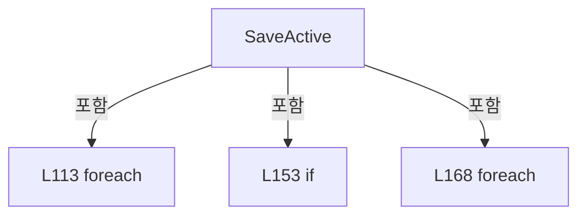

변경 전 점검: 입력/반환 타입, 위 호출자, 예외/취소 경로, 공유 상태와 저장·전송 소비자를 함께 확인합니다. 값의 단위나 물리 방향을 이름만으로 확정하지 않습니다.

### LocalFunctionStatement `ShouldIncludeItem` · L118–121

[Drilling.File/Product/CProductFile.cs:118–121](https://github.com/kjuws10-rgb/A3Drilling/blob/5aee8e58439c9b455cae7c9593c9be986c3e682e/Drilling.File/Product/CProductFile.cs#L118-L121)

| 항목 | 실제 추출 값 |
| --- | --- |
| 서명 | bool ShouldIncludeItem(System.Collections.Generic.KeyValuePair<string, string>) |
| 접근/수식자 | Private /  |
| 반환/값 타입 | bool |
| 소속 타입 | NamedType:Drilling.File.Product.CProductFile |

입력 계약:

| 이름 | 타입 | 전달 | 선택/기본값 |
| --- | --- | --- | --- |
| item | System.Collections.Generic.KeyValuePair<string, string> | None | False /  |

현재 부분 분석에서 직접 연결된 호출자는 없습니다. XAML/이벤트/인터페이스·델리게이트·외부 진입을 추가 확인해야 하며, 미사용으로 판정한 것이 아닙니다.

호출하는 대상과 해석 범위:

| 원본 행 | 표현식 | 분석 상태 | 대상/소스 위치 |
| --- | --- | --- | --- |
| 120 | IsCompactProductCoreName | resolved | bool Drilling.File.Product.CProductFile.IsCompactProductCoreName(string) · Drilling.File/Product/CProductFile.cs:398 |

본문의 실제 연산·분기·예외·반환 순서(원문 위치 순):

| 원본 행 | 종류 | 주석 해설 |
| --- | --- | --- |
| 120 | call | 함수·델리게이트 또는 객체 생성자를 호출합니다: IsCompactProductCoreName(item.Key) |
| 120 | return | 호출자에게 값 또는 제어를 반환합니다: return !IsCompactProductCoreName(item.Key); |

변경 전 점검: 입력/반환 타입, 위 호출자, 예외/취소 경로, 공유 상태와 저장·전송 소비자를 함께 확인합니다. 값의 단위나 물리 방향을 이름만으로 확정하지 않습니다.

### LocalFunctionStatement `SelectKey` · L123–126

[Drilling.File/Product/CProductFile.cs:123–126](https://github.com/kjuws10-rgb/A3Drilling/blob/5aee8e58439c9b455cae7c9593c9be986c3e682e/Drilling.File/Product/CProductFile.cs#L123-L126)

| 항목 | 실제 추출 값 |
| --- | --- |
| 서명 | string SelectKey(System.Collections.Generic.KeyValuePair<string, string>) |
| 접근/수식자 | Private /  |
| 반환/값 타입 | string |
| 소속 타입 | NamedType:Drilling.File.Product.CProductFile |

입력 계약:

| 이름 | 타입 | 전달 | 선택/기본값 |
| --- | --- | --- | --- |
| item | System.Collections.Generic.KeyValuePair<string, string> | None | False /  |

현재 부분 분석에서 직접 연결된 호출자는 없습니다. XAML/이벤트/인터페이스·델리게이트·외부 진입을 추가 확인해야 하며, 미사용으로 판정한 것이 아닙니다.

본문의 실제 연산·분기·예외·반환 순서(원문 위치 순):

| 원본 행 | 종류 | 주석 해설 |
| --- | --- | --- |
| 125 | return | 호출자에게 값 또는 제어를 반환합니다: return item.Key; |

변경 전 점검: 입력/반환 타입, 위 호출자, 예외/취소 경로, 공유 상태와 저장·전송 소비자를 함께 확인합니다. 값의 단위나 물리 방향을 이름만으로 확정하지 않습니다.

### LocalFunctionStatement `BuildRecipeParameterCompactRow` · L128–131

[Drilling.File/Product/CProductFile.cs:128–131](https://github.com/kjuws10-rgb/A3Drilling/blob/5aee8e58439c9b455cae7c9593c9be986c3e682e/Drilling.File/Product/CProductFile.cs#L128-L131)

| 항목 | 실제 추출 값 |
| --- | --- |
| 서명 | System.Collections.Generic.IReadOnlyDictionary<string, string> BuildRecipeParameterCompactRow(System.Collections.Generic.KeyValuePair<string, string>) |
| 접근/수식자 | Private /  |
| 반환/값 타입 | System.Collections.Generic.IReadOnlyDictionary<string, string> |
| 소속 타입 | NamedType:Drilling.File.Product.CProductFile |

입력 계약:

| 이름 | 타입 | 전달 | 선택/기본값 |
| --- | --- | --- | --- |
| item | System.Collections.Generic.KeyValuePair<string, string> | None | False /  |

현재 부분 분석에서 직접 연결된 호출자는 없습니다. XAML/이벤트/인터페이스·델리게이트·외부 진입을 추가 확인해야 하며, 미사용으로 판정한 것이 아닙니다.

호출하는 대상과 해석 범위:

| 원본 행 | 표현식 | 분석 상태 | 대상/소스 위치 |
| --- | --- | --- | --- |
| 130 | CompactRow | resolved | System.Collections.Generic.IReadOnlyDictionary<string, string> Drilling.File.Product.CProductFile.CompactRow(string, string, string) · Drilling.File/Product/CProductFile.cs:388 |

본문의 실제 연산·분기·예외·반환 순서(원문 위치 순):

| 원본 행 | 종류 | 주석 해설 |
| --- | --- | --- |
| 130 | call | 함수·델리게이트 또는 객체 생성자를 호출합니다: CompactRow("RECIPE", item.Key, item.Value) |
| 130 | return | 호출자에게 값 또는 제어를 반환합니다: return CompactRow("RECIPE", item.Key, item.Value); |

변경 전 점검: 입력/반환 타입, 위 호출자, 예외/취소 경로, 공유 상태와 저장·전송 소비자를 함께 확인합니다. 값의 단위나 물리 방향을 이름만으로 확정하지 않습니다.

### LocalFunctionStatement `SelectCellNo` · L158–161

[Drilling.File/Product/CProductFile.cs:158–161](https://github.com/kjuws10-rgb/A3Drilling/blob/5aee8e58439c9b455cae7c9593c9be986c3e682e/Drilling.File/Product/CProductFile.cs#L158-L161)

| 항목 | 실제 추출 값 |
| --- | --- |
| 서명 | int SelectCellNo(Drilling.Common.Product.ST_PRODUCT_REVIEW_RESULT) |
| 접근/수식자 | Private /  |
| 반환/값 타입 | int |
| 소속 타입 | NamedType:Drilling.File.Product.CProductFile |

입력 계약:

| 이름 | 타입 | 전달 | 선택/기본값 |
| --- | --- | --- | --- |
| item | Drilling.Common.Product.ST_PRODUCT_REVIEW_RESULT | None | False /  |

현재 부분 분석에서 직접 연결된 호출자는 없습니다. XAML/이벤트/인터페이스·델리게이트·외부 진입을 추가 확인해야 하며, 미사용으로 판정한 것이 아닙니다.

본문의 실제 연산·분기·예외·반환 순서(원문 위치 순):

| 원본 행 | 종류 | 주석 해설 |
| --- | --- | --- |
| 160 | return | 호출자에게 값 또는 제어를 반환합니다: return item.CellNo; |

변경 전 점검: 입력/반환 타입, 위 호출자, 예외/취소 경로, 공유 상태와 저장·전송 소비자를 함께 확인합니다. 값의 단위나 물리 방향을 이름만으로 확정하지 않습니다.

### LocalFunctionStatement `SelectShotKey` · L163–166

[Drilling.File/Product/CProductFile.cs:163–166](https://github.com/kjuws10-rgb/A3Drilling/blob/5aee8e58439c9b455cae7c9593c9be986c3e682e/Drilling.File/Product/CProductFile.cs#L163-L166)

| 항목 | 실제 추출 값 |
| --- | --- |
| 서명 | string SelectShotKey(Drilling.Common.Product.ST_PRODUCT_REVIEW_RESULT) |
| 접근/수식자 | Private /  |
| 반환/값 타입 | string |
| 소속 타입 | NamedType:Drilling.File.Product.CProductFile |

입력 계약:

| 이름 | 타입 | 전달 | 선택/기본값 |
| --- | --- | --- | --- |
| item | Drilling.Common.Product.ST_PRODUCT_REVIEW_RESULT | None | False /  |

현재 부분 분석에서 직접 연결된 호출자는 없습니다. XAML/이벤트/인터페이스·델리게이트·외부 진입을 추가 확인해야 하며, 미사용으로 판정한 것이 아닙니다.

본문의 실제 연산·분기·예외·반환 순서(원문 위치 순):

| 원본 행 | 종류 | 주석 해설 |
| --- | --- | --- |
| 165 | return | 호출자에게 값 또는 제어를 반환합니다: return item.ShotKey; |

변경 전 점검: 입력/반환 타입, 위 호출자, 예외/취소 경로, 공유 상태와 저장·전송 소비자를 함께 확인합니다. 값의 단위나 물리 방향을 이름만으로 확정하지 않습니다.

### MethodDeclaration `WriteActiveProductAtomically` · L182–202

[Drilling.File/Product/CProductFile.cs:182–202](https://github.com/kjuws10-rgb/A3Drilling/blob/5aee8e58439c9b455cae7c9593c9be986c3e682e/Drilling.File/Product/CProductFile.cs#L182-L202)

| 항목 | 실제 추출 값 |
| --- | --- |
| 서명 | void Drilling.File.Product.CProductFile.WriteActiveProductAtomically(System.Collections.Generic.IReadOnlyList<System.Collections.Generic.IReadOnlyDictionary<string, string>>) |
| 접근/수식자 | Private / private |
| 반환/값 타입 | void |
| 소속 타입 | NamedType:Drilling.File.Product.CProductFile |

입력 계약:

| 이름 | 타입 | 전달 | 선택/기본값 |
| --- | --- | --- | --- |
| rows | System.Collections.Generic.IReadOnlyList<System.Collections.Generic.IReadOnlyDictionary<string, string>> | None | False /  |

정적 호출자로 확인된 위치:

| 호출 파일/행 | 호출 표현식 | 런타임 분기 가능 |
| --- | --- | --- |
| [Drilling.File/Product/CProductFile.cs:178–178](https://github.com/kjuws10-rgb/A3Drilling/blob/5aee8e58439c9b455cae7c9593c9be986c3e682e/Drilling.File/Product/CProductFile.cs#L178-L178) | WriteActiveProductAtomically | False |

호출하는 대상과 해석 범위:

| 원본 행 | 표현식 | 분석 상태 | 대상/소스 위치 |
| --- | --- | --- | --- |
| 184 | GetActiveProductPath | resolved | string Drilling.File.Product.CProductFile.GetActiveProductPath() · Drilling.File/Product/CProductFile.cs:258 |
| 185 | Guid.NewGuid | resolved | System.Guid System.Guid.NewGuid() |
| 188 | CCsvParser.Write | resolved | void Drilling.File.Parser.CCsvParser.Write(string, System.Collections.Generic.IReadOnlyList<string>, System.Collections.Generic.IEnumerable<System.Collections.Generic.IReadOnlyDictionary<string, string>>) · Drilling.File/Parser/CCsvParser.cs:58 |
| 189 | System.IO.File.Exists | resolved | bool System.IO.File.Exists(string?) |
| 191 | System.IO.File.Replace | resolved | void System.IO.File.Replace(string, string, string?) |
| 195 | System.IO.File.Move | resolved | void System.IO.File.Move(string, string) |
| 200 | DeleteIfExists | resolved | void Drilling.File.Product.CProductFile.DeleteIfExists(string) · Drilling.File/Product/CProductFile.cs:505 |

본문의 실제 연산·분기·예외·반환 순서(원문 위치 순):

| 원본 행 | 종류 | 주석 해설 |
| --- | --- | --- |
| 184 | call | 함수·델리게이트 또는 객체 생성자를 호출합니다: GetActiveProductPath() |
| 184 | local-declaration | 지역 변수를 선언합니다: var activePath = GetActiveProductPath(); |
| 184 | variable-initializer | 변수의 초기값을 지정합니다: activePath = GetActiveProductPath() |
| 185 | call | 함수·델리게이트 또는 객체 생성자를 호출합니다: Guid.NewGuid() |
| 185 | local-declaration | 지역 변수를 선언합니다: var temporaryPath = $"{activePath}.{Guid.NewGuid():N}.tmp"; |
| 185 | variable-initializer | 변수의 초기값을 지정합니다: temporaryPath = $"{activePath}.{Guid.NewGuid():N}.tmp" |
| 186 | try | 예외 처리 범위입니다: try |
| 188 | call | 함수·델리게이트 또는 객체 생성자를 호출합니다: CCsvParser.Write(temporaryPath, ActiveHeaders, rows) |
| 189 | call | 함수·델리게이트 또는 객체 생성자를 호출합니다: System.IO.File.Exists(activePath) |
| 189 | if | 조건에 따라 분기합니다: if (System.IO.File.Exists(activePath)) |
| 191 | call | 함수·델리게이트 또는 객체 생성자를 호출합니다: System.IO.File.Replace(temporaryPath, activePath, null) |
| 193 | else | 앞 조건이 거짓인 경로입니다: else |
| 195 | call | 함수·델리게이트 또는 객체 생성자를 호출합니다: System.IO.File.Move(temporaryPath, activePath) |
| 198 | finally | 종료 정리 구간입니다: finally |
| 200 | call | 함수·델리게이트 또는 객체 생성자를 호출합니다: DeleteIfExists(temporaryPath) |

제어 구문의 포함 구조(실제 실행 순서/CFG가 아닌 구문 탐색 그림):

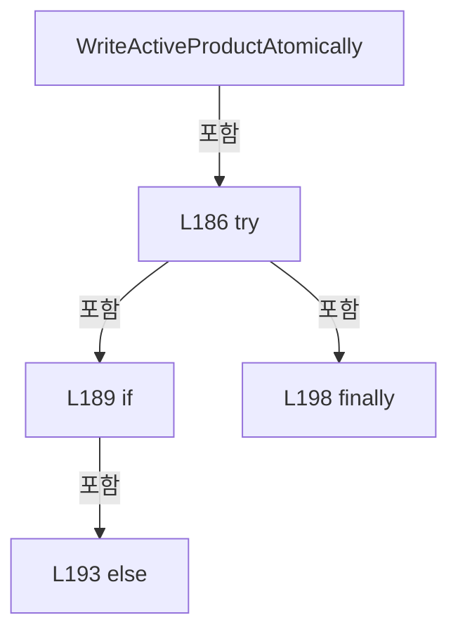

변경 전 점검: 입력/반환 타입, 위 호출자, 예외/취소 경로, 공유 상태와 저장·전송 소비자를 함께 확인합니다. 값의 단위나 물리 방향을 이름만으로 확정하지 않습니다.

### MethodDeclaration `ClearActive` · L204–209

[Drilling.File/Product/CProductFile.cs:204–209](https://github.com/kjuws10-rgb/A3Drilling/blob/5aee8e58439c9b455cae7c9593c9be986c3e682e/Drilling.File/Product/CProductFile.cs#L204-L209)

| 항목 | 실제 추출 값 |
| --- | --- |
| 서명 | System.Threading.Tasks.Task Drilling.File.Product.CProductFile.ClearActive(System.Threading.CancellationToken) |
| 접근/수식자 | Public / public, override |
| 반환/값 타입 | System.Threading.Tasks.Task |
| 소속 타입 | NamedType:Drilling.File.Product.CProductFile |

입력 계약:

| 이름 | 타입 | 전달 | 선택/기본값 |
| --- | --- | --- | --- |
| cancellationToken | System.Threading.CancellationToken | None | True / null |

현재 부분 분석에서 직접 연결된 호출자는 없습니다. XAML/이벤트/인터페이스·델리게이트·외부 진입을 추가 확인해야 하며, 미사용으로 판정한 것이 아닙니다.

호출하는 대상과 해석 범위:

| 원본 행 | 표현식 | 분석 상태 | 대상/소스 위치 |
| --- | --- | --- | --- |
| 206 | cancellationToken.ThrowIfCancellationRequested | resolved | void System.Threading.CancellationToken.ThrowIfCancellationRequested() |
| 207 | DeleteIfExists | resolved | void Drilling.File.Product.CProductFile.DeleteIfExists(string) · Drilling.File/Product/CProductFile.cs:505 |
| 207 | GetActiveProductPath | resolved | string Drilling.File.Product.CProductFile.GetActiveProductPath() · Drilling.File/Product/CProductFile.cs:258 |

본문의 실제 연산·분기·예외·반환 순서(원문 위치 순):

| 원본 행 | 종류 | 주석 해설 |
| --- | --- | --- |
| 206 | call | 함수·델리게이트 또는 객체 생성자를 호출합니다: cancellationToken.ThrowIfCancellationRequested() |
| 207 | call | 함수·델리게이트 또는 객체 생성자를 호출합니다: DeleteIfExists(GetActiveProductPath()) |
| 207 | call | 함수·델리게이트 또는 객체 생성자를 호출합니다: GetActiveProductPath() |
| 208 | return | 호출자에게 값 또는 제어를 반환합니다: return Task.CompletedTask; |

변경 전 점검: 입력/반환 타입, 위 호출자, 예외/취소 경로, 공유 상태와 저장·전송 소비자를 함께 확인합니다. 값의 단위나 물리 방향을 이름만으로 확정하지 않습니다.

### MethodDeclaration `AppendHistory` · L211–223

[Drilling.File/Product/CProductFile.cs:211–223](https://github.com/kjuws10-rgb/A3Drilling/blob/5aee8e58439c9b455cae7c9593c9be986c3e682e/Drilling.File/Product/CProductFile.cs#L211-L223)

| 항목 | 실제 추출 값 |
| --- | --- |
| 서명 | System.Threading.Tasks.Task Drilling.File.Product.CProductFile.AppendHistory(Drilling.Common.Product.ST_PRODUCT_HISTORY, System.Threading.CancellationToken) |
| 접근/수식자 | Public / public, override |
| 반환/값 타입 | System.Threading.Tasks.Task |
| 소속 타입 | NamedType:Drilling.File.Product.CProductFile |

입력 계약:

| 이름 | 타입 | 전달 | 선택/기본값 |
| --- | --- | --- | --- |
| history | Drilling.Common.Product.ST_PRODUCT_HISTORY | None | False /  |
| cancellationToken | System.Threading.CancellationToken | None | True / null |

현재 부분 분석에서 직접 연결된 호출자는 없습니다. XAML/이벤트/인터페이스·델리게이트·외부 진입을 추가 확인해야 하며, 미사용으로 판정한 것이 아닙니다.

호출하는 대상과 해석 범위:

| 원본 행 | 표현식 | 분석 상태 | 대상/소스 위치 |
| --- | --- | --- | --- |
| 213 | cancellationToken.ThrowIfCancellationRequested | resolved | void System.Threading.CancellationToken.ThrowIfCancellationRequested() |
| 214 | GetHistoryPath | resolved | string Drilling.File.Product.CProductFile.GetHistoryPath(System.DateTimeOffset) · Drilling.File/Product/CProductFile.cs:263 |
| 215 | CCsvParser.Read(path) .Select(ParseHistory) .Where(item => item is not null) .Select(item => ToHistoryRow(item!)) .Append(ToHistoryRow(history)) .ToArray | resolved | System.Collections.Generic.IReadOnlyDictionary<string, string>[] System.Collections.Generic.IEnumerable<System.Collections.Generic.IReadOnlyDictionary<string, string>>.ToArray<System.Collections.Generic.IReadOnlyDictionary<string, string>>() |
| 215 | CCsvParser.Read(path) .Select(ParseHistory) .Where(item => item is not null) .Select(item => ToHistoryRow(item!)) .Append | resolved | System.Collections.Generic.IEnumerable<System.Collections.Generic.IReadOnlyDictionary<string, string>> System.Collections.Generic.IEnumerable<System.Collections.Generic.IReadOnlyDictionary<string, string>>.Append<System.Collections.Generic.IReadOnlyDictionary<string, string>>(System.Collections.Generic.IReadOnlyDictionary<string, string>) |
| 215 | CCsvParser.Read(path) .Select(ParseHistory) .Where(item => item is not null) .Select | resolved | System.Collections.Generic.IEnumerable<System.Collections.Generic.IReadOnlyDictionary<string, string>> System.Collections.Generic.IEnumerable<Drilling.Common.Product.ST_PRODUCT_HISTORY?>.Select<Drilling.Common.Product.ST_PRODUCT_HISTORY?, System.Collections.Generic.IReadOnlyDictionary<string, string>>(System.Func<Drilling.Common.Product.ST_PRODUCT_HISTORY?, System.Collections.Generic.IReadOnlyDictionary<string, string>>) |
| 215 | CCsvParser.Read(path) .Select(ParseHistory) .Where | resolved | System.Collections.Generic.IEnumerable<Drilling.Common.Product.ST_PRODUCT_HISTORY?> System.Collections.Generic.IEnumerable<Drilling.Common.Product.ST_PRODUCT_HISTORY?>.Where<Drilling.Common.Product.ST_PRODUCT_HISTORY?>(System.Func<Drilling.Common.Product.ST_PRODUCT_HISTORY?, bool>) |
| 215 | CCsvParser.Read(path) .Select | resolved | System.Collections.Generic.IEnumerable<Drilling.Common.Product.ST_PRODUCT_HISTORY?> System.Collections.Generic.IEnumerable<System.Collections.Generic.IReadOnlyDictionary<string, string>>.Select<System.Collections.Generic.IReadOnlyDictionary<string, string>, Drilling.Common.Product.ST_PRODUCT_HISTORY?>(System.Func<System.Collections.Generic.IReadOnlyDictionary<string, string>, Drilling.Common.Product.ST_PRODUCT_HISTORY?>) |
| 215 | CCsvParser.Read | resolved | System.Collections.Generic.IReadOnlyList<System.Collections.Generic.IReadOnlyDictionary<string, string>> Drilling.File.Parser.CCsvParser.Read(string) · Drilling.File/Parser/CCsvParser.cs:12 |
| 218 | ToHistoryRow | resolved | System.Collections.Generic.IReadOnlyDictionary<string, string> Drilling.File.Product.CProductFile.ToHistoryRow(Drilling.Common.Product.ST_PRODUCT_HISTORY) · Drilling.File/Product/CProductFile.cs:432 |
| 219 | ToHistoryRow | resolved | System.Collections.Generic.IReadOnlyDictionary<string, string> Drilling.File.Product.CProductFile.ToHistoryRow(Drilling.Common.Product.ST_PRODUCT_HISTORY) · Drilling.File/Product/CProductFile.cs:432 |
| 221 | WriteRowsAtomically | resolved | void Drilling.File.Product.CProductFile.WriteRowsAtomically(string, System.Collections.Generic.IReadOnlyList<string>, System.Collections.Generic.IReadOnlyList<System.Collections.Generic.IReadOnlyDictionary<string, string>>) · Drilling.File/Product/CProductFile.cs:468 |

본문의 실제 연산·분기·예외·반환 순서(원문 위치 순):

| 원본 행 | 종류 | 주석 해설 |
| --- | --- | --- |
| 213 | call | 함수·델리게이트 또는 객체 생성자를 호출합니다: cancellationToken.ThrowIfCancellationRequested() |
| 214 | call | 함수·델리게이트 또는 객체 생성자를 호출합니다: GetHistoryPath(history.OccurredAt) |
| 214 | local-declaration | 지역 변수를 선언합니다: var path = GetHistoryPath(history.OccurredAt); |
| 214 | variable-initializer | 변수의 초기값을 지정합니다: path = GetHistoryPath(history.OccurredAt) |
| 215 | call | 함수·델리게이트 또는 객체 생성자를 호출합니다: CCsvParser.Read(path) |
| 215 | call | 함수·델리게이트 또는 객체 생성자를 호출합니다: CCsvParser.Read(path) .Select(ParseHistory) |
| 215 | call | 함수·델리게이트 또는 객체 생성자를 호출합니다: CCsvParser.Read(path) .Select(ParseHistory) .Where(item => item is not null) |
| 215 | call | 함수·델리게이트 또는 객체 생성자를 호출합니다: CCsvParser.Read(path) .Select(ParseHistory) .Where(item => item is not null) .Select(item => ToHistoryRow(item!)) |
| 215 | call | 함수·델리게이트 또는 객체 생성자를 호출합니다: CCsvParser.Read(path) .Select(ParseHistory) .Where(item => item is not null) .Select(item => ToHistoryRow(item!)) .Append(ToHistoryRow(history)) |
| 215 | call | 함수·델리게이트 또는 객체 생성자를 호출합니다: CCsvParser.Read(path) .Select(ParseHistory) .Where(item => item is not null) .Select(item => ToHistoryRow(item!)) .Append(ToHistoryRow(history)) .ToArray() |
| 215 | local-declaration | 지역 변수를 선언합니다: var rows = CCsvParser.Read(path) .Select(ParseHistory) .Where(item => item is not null) .Select(item => ToHistoryRow(item!)) .Append(ToHistoryRow(history)) .ToArray(); |
| 215 | variable-initializer | 변수의 초기값을 지정합니다: rows = CCsvParser.Read(path) .Select(ParseHistory) .Where(item => item is not null) .Select(item => ToHistoryRow(item!)) .Append(ToHistoryRow(history)) .ToArray() |
| 218 | call | 함수·델리게이트 또는 객체 생성자를 호출합니다: ToHistoryRow(item!) |
| 219 | call | 함수·델리게이트 또는 객체 생성자를 호출합니다: ToHistoryRow(history) |
| 221 | call | 함수·델리게이트 또는 객체 생성자를 호출합니다: WriteRowsAtomically(path, HistoryHeaders, rows) |
| 222 | return | 호출자에게 값 또는 제어를 반환합니다: return Task.CompletedTask; |

변경 전 점검: 입력/반환 타입, 위 호출자, 예외/취소 경로, 공유 상태와 저장·전송 소비자를 함께 확인합니다. 값의 단위나 물리 방향을 이름만으로 확정하지 않습니다.

### MethodDeclaration `LoadHistory` · L225–256

[Drilling.File/Product/CProductFile.cs:225–256](https://github.com/kjuws10-rgb/A3Drilling/blob/5aee8e58439c9b455cae7c9593c9be986c3e682e/Drilling.File/Product/CProductFile.cs#L225-L256)

| 항목 | 실제 추출 값 |
| --- | --- |
| 서명 | System.Threading.Tasks.Task<System.Collections.Generic.IReadOnlyList<Drilling.Common.Product.ST_PRODUCT_HISTORY>> Drilling.File.Product.CProductFile.LoadHistory(int, int, System.Threading.CancellationToken) |
| 접근/수식자 | Public / public, override |
| 반환/값 타입 | System.Threading.Tasks.Task<System.Collections.Generic.IReadOnlyList<Drilling.Common.Product.ST_PRODUCT_HISTORY>> |
| 소속 타입 | NamedType:Drilling.File.Product.CProductFile |

입력 계약:

| 이름 | 타입 | 전달 | 선택/기본값 |
| --- | --- | --- | --- |
| maxRows | int | None | True / 100 |
| days | int | None | True / 14 |
| cancellationToken | System.Threading.CancellationToken | None | True / null |

현재 부분 분석에서 직접 연결된 호출자는 없습니다. XAML/이벤트/인터페이스·델리게이트·외부 진입을 추가 확인해야 하며, 미사용으로 판정한 것이 아닙니다.

호출하는 대상과 해석 범위:

| 원본 행 | 표현식 | 분석 상태 | 대상/소스 위치 |
| --- | --- | --- | --- |
| 227 | cancellationToken.ThrowIfCancellationRequested | resolved | void System.Threading.CancellationToken.ThrowIfCancellationRequested() |
| 254 | Enumerable.Range(0, Math.Max(1, days)).Select(SelectValue).Select(SelectHistoryPath).Where(System.IO.File.Exists).SelectMany(CCsvParser.Read).Select(ParseHistory).Where(ShouldIncludeItem).Select(SelectItem).OrderByDescending(SelectOccurredAt).Take(Math.Max(1, maxRows)).ToArray | resolved | Drilling.Common.Product.ST_PRODUCT_HISTORY[] System.Collections.Generic.IEnumerable<Drilling.Common.Product.ST_PRODUCT_HISTORY>.ToArray<Drilling.Common.Product.ST_PRODUCT_HISTORY>() |
| 254 | Enumerable.Range(0, Math.Max(1, days)).Select(SelectValue).Select(SelectHistoryPath).Where(System.IO.File.Exists).SelectMany(CCsvParser.Read).Select(ParseHistory).Where(ShouldIncludeItem).Select(SelectItem).OrderByDescending(SelectOccurredAt).Take | resolved | System.Collections.Generic.IEnumerable<Drilling.Common.Product.ST_PRODUCT_HISTORY> System.Collections.Generic.IEnumerable<Drilling.Common.Product.ST_PRODUCT_HISTORY>.Take<Drilling.Common.Product.ST_PRODUCT_HISTORY>(int) |
| 254 | Enumerable.Range(0, Math.Max(1, days)).Select(SelectValue).Select(SelectHistoryPath).Where(System.IO.File.Exists).SelectMany(CCsvParser.Read).Select(ParseHistory).Where(ShouldIncludeItem).Select(SelectItem).OrderByDescending | resolved | System.Linq.IOrderedEnumerable<Drilling.Common.Product.ST_PRODUCT_HISTORY> System.Collections.Generic.IEnumerable<Drilling.Common.Product.ST_PRODUCT_HISTORY>.OrderByDescending<Drilling.Common.Product.ST_PRODUCT_HISTORY, System.DateTimeOffset>(System.Func<Drilling.Common.Product.ST_PRODUCT_HISTORY, System.DateTimeOffset>) |
| 254 | Enumerable.Range(0, Math.Max(1, days)).Select(SelectValue).Select(SelectHistoryPath).Where(System.IO.File.Exists).SelectMany(CCsvParser.Read).Select(ParseHistory).Where(ShouldIncludeItem).Select | resolved | System.Collections.Generic.IEnumerable<Drilling.Common.Product.ST_PRODUCT_HISTORY> System.Collections.Generic.IEnumerable<Drilling.Common.Product.ST_PRODUCT_HISTORY?>.Select<Drilling.Common.Product.ST_PRODUCT_HISTORY?, Drilling.Common.Product.ST_PRODUCT_HISTORY>(System.Func<Drilling.Common.Product.ST_PRODUCT_HISTORY?, Drilling.Common.Product.ST_PRODUCT_HISTORY>) |
| 254 | Enumerable.Range(0, Math.Max(1, days)).Select(SelectValue).Select(SelectHistoryPath).Where(System.IO.File.Exists).SelectMany(CCsvParser.Read).Select(ParseHistory).Where | resolved | System.Collections.Generic.IEnumerable<Drilling.Common.Product.ST_PRODUCT_HISTORY?> System.Collections.Generic.IEnumerable<Drilling.Common.Product.ST_PRODUCT_HISTORY?>.Where<Drilling.Common.Product.ST_PRODUCT_HISTORY?>(System.Func<Drilling.Common.Product.ST_PRODUCT_HISTORY?, bool>) |
| 254 | Enumerable.Range(0, Math.Max(1, days)).Select(SelectValue).Select(SelectHistoryPath).Where(System.IO.File.Exists).SelectMany(CCsvParser.Read).Select | resolved | System.Collections.Generic.IEnumerable<Drilling.Common.Product.ST_PRODUCT_HISTORY?> System.Collections.Generic.IEnumerable<System.Collections.Generic.IReadOnlyDictionary<string, string>>.Select<System.Collections.Generic.IReadOnlyDictionary<string, string>, Drilling.Common.Product.ST_PRODUCT_HISTORY?>(System.Func<System.Collections.Generic.IReadOnlyDictionary<string, string>, Drilling.Common.Product.ST_PRODUCT_HISTORY?>) |
| 254 | Enumerable.Range(0, Math.Max(1, days)).Select(SelectValue).Select(SelectHistoryPath).Where(System.IO.File.Exists).SelectMany | resolved | System.Collections.Generic.IEnumerable<System.Collections.Generic.IReadOnlyDictionary<string, string>> System.Collections.Generic.IEnumerable<string>.SelectMany<string, System.Collections.Generic.IReadOnlyDictionary<string, string>>(System.Func<string, System.Collections.Generic.IEnumerable<System.Collections.Generic.IReadOnlyDictionary<string, string>>>) |
| 254 | Enumerable.Range(0, Math.Max(1, days)).Select(SelectValue).Select(SelectHistoryPath).Where | resolved | System.Collections.Generic.IEnumerable<string> System.Collections.Generic.IEnumerable<string>.Where<string>(System.Func<string, bool>) |
| 254 | Enumerable.Range(0, Math.Max(1, days)).Select(SelectValue).Select | resolved | System.Collections.Generic.IEnumerable<string> System.Collections.Generic.IEnumerable<System.DateTime>.Select<System.DateTime, string>(System.Func<System.DateTime, string>) |
| 254 | Enumerable.Range(0, Math.Max(1, days)).Select | resolved | System.Collections.Generic.IEnumerable<System.DateTime> System.Collections.Generic.IEnumerable<int>.Select<int, System.DateTime>(System.Func<int, System.DateTime>) |
| 254 | Enumerable.Range | resolved | System.Collections.Generic.IEnumerable<int> System.Linq.Enumerable.Range(int, int) |
| 254 | Math.Max | resolved | int System.Math.Max(int, int) |
| 254 | Math.Max | resolved | int System.Math.Max(int, int) |
| 255 | Task.FromResult<IReadOnlyList<ST_PRODUCT_HISTORY>> | resolved | System.Threading.Tasks.Task<System.Collections.Generic.IReadOnlyList<Drilling.Common.Product.ST_PRODUCT_HISTORY>> System.Threading.Tasks.Task.FromResult<System.Collections.Generic.IReadOnlyList<Drilling.Common.Product.ST_PRODUCT_HISTORY>>(System.Collections.Generic.IReadOnlyList<Drilling.Common.Product.ST_PRODUCT_HISTORY>) |

본문의 실제 연산·분기·예외·반환 순서(원문 위치 순):

| 원본 행 | 종류 | 주석 해설 |
| --- | --- | --- |
| 227 | call | 함수·델리게이트 또는 객체 생성자를 호출합니다: cancellationToken.ThrowIfCancellationRequested() |
| 228 | local-declaration | 지역 변수를 선언합니다: var today = DateTime.Today; |
| 228 | variable-initializer | 변수의 초기값을 지정합니다: today = DateTime.Today |
| 254 | call | 함수·델리게이트 또는 객체 생성자를 호출합니다: Enumerable.Range(0, Math.Max(1, days)).Select(SelectValue).Select(SelectHistoryPath).Where(System.IO.File.Exists).SelectMany(CCsvParser.Read).Select(ParseHistory).Where(ShouldIncludeItem).Select(SelectItem).OrderByDescen… |
| 254 | call | 함수·델리게이트 또는 객체 생성자를 호출합니다: Enumerable.Range(0, Math.Max(1, days)).Select(SelectValue).Select(SelectHistoryPath).Where(System.IO.File.Exists).SelectMany(CCsvParser.Read).Select(ParseHistory).Where(ShouldIncludeItem).Select(SelectItem).OrderByDescen… |
| 254 | call | 함수·델리게이트 또는 객체 생성자를 호출합니다: Enumerable.Range(0, Math.Max(1, days)).Select(SelectValue).Select(SelectHistoryPath).Where(System.IO.File.Exists).SelectMany(CCsvParser.Read).Select(ParseHistory).Where(ShouldIncludeItem).Select(SelectItem).OrderByDescen… |
| 254 | call | 함수·델리게이트 또는 객체 생성자를 호출합니다: Enumerable.Range(0, Math.Max(1, days)).Select(SelectValue).Select(SelectHistoryPath).Where(System.IO.File.Exists).SelectMany(CCsvParser.Read).Select(ParseHistory).Where(ShouldIncludeItem).Select(SelectItem) |
| 254 | call | 함수·델리게이트 또는 객체 생성자를 호출합니다: Enumerable.Range(0, Math.Max(1, days)).Select(SelectValue).Select(SelectHistoryPath).Where(System.IO.File.Exists).SelectMany(CCsvParser.Read).Select(ParseHistory).Where(ShouldIncludeItem) |
| 254 | call | 함수·델리게이트 또는 객체 생성자를 호출합니다: Enumerable.Range(0, Math.Max(1, days)).Select(SelectValue).Select(SelectHistoryPath).Where(System.IO.File.Exists).SelectMany(CCsvParser.Read).Select(ParseHistory) |
| 254 | call | 함수·델리게이트 또는 객체 생성자를 호출합니다: Enumerable.Range(0, Math.Max(1, days)).Select(SelectValue).Select(SelectHistoryPath).Where(System.IO.File.Exists).SelectMany(CCsvParser.Read) |
| 254 | call | 함수·델리게이트 또는 객체 생성자를 호출합니다: Enumerable.Range(0, Math.Max(1, days)).Select(SelectValue).Select(SelectHistoryPath).Where(System.IO.File.Exists) |
| 254 | call | 함수·델리게이트 또는 객체 생성자를 호출합니다: Enumerable.Range(0, Math.Max(1, days)).Select(SelectValue).Select(SelectHistoryPath) |
| 254 | call | 함수·델리게이트 또는 객체 생성자를 호출합니다: Enumerable.Range(0, Math.Max(1, days)).Select(SelectValue) |
| 254 | call | 함수·델리게이트 또는 객체 생성자를 호출합니다: Enumerable.Range(0, Math.Max(1, days)) |
| 254 | call | 함수·델리게이트 또는 객체 생성자를 호출합니다: Math.Max(1, days) |
| 254 | call | 함수·델리게이트 또는 객체 생성자를 호출합니다: Math.Max(1, maxRows) |
| 254 | local-declaration | 지역 변수를 선언합니다: var histories = Enumerable.Range(0, Math.Max(1, days)).Select(SelectValue).Select(SelectHistoryPath).Where(System.IO.File.Exists).SelectMany(CCsvParser.Read).Select(ParseHistory).Where(ShouldIncludeItem).Select(SelectItem).OrderBy |
| 254 | variable-initializer | 변수의 초기값을 지정합니다: histories = Enumerable.Range(0, Math.Max(1, days)).Select(SelectValue).Select(SelectHistoryPath).Where(System.IO.File.Exists).SelectMany(CCsvParser.Read).Select(ParseHistory).Where(ShouldIncludeItem).Select(SelectItem).OrderByDesc |
| 255 | call | 함수·델리게이트 또는 객체 생성자를 호출합니다: Task.FromResult<IReadOnlyList<ST_PRODUCT_HISTORY>>(histories) |
| 255 | return | 호출자에게 값 또는 제어를 반환합니다: return Task.FromResult<IReadOnlyList<ST_PRODUCT_HISTORY>>(histories); |

변경 전 점검: 입력/반환 타입, 위 호출자, 예외/취소 경로, 공유 상태와 저장·전송 소비자를 함께 확인합니다. 값의 단위나 물리 방향을 이름만으로 확정하지 않습니다.

### LocalFunctionStatement `SelectValue` · L229–232

[Drilling.File/Product/CProductFile.cs:229–232](https://github.com/kjuws10-rgb/A3Drilling/blob/5aee8e58439c9b455cae7c9593c9be986c3e682e/Drilling.File/Product/CProductFile.cs#L229-L232)

| 항목 | 실제 추출 값 |
| --- | --- |
| 서명 | System.DateTime SelectValue(int) |
| 접근/수식자 | Private /  |
| 반환/값 타입 | System.DateTime |
| 소속 타입 | NamedType:Drilling.File.Product.CProductFile |

입력 계약:

| 이름 | 타입 | 전달 | 선택/기본값 |
| --- | --- | --- | --- |
| offset | int | None | False /  |

현재 부분 분석에서 직접 연결된 호출자는 없습니다. XAML/이벤트/인터페이스·델리게이트·외부 진입을 추가 확인해야 하며, 미사용으로 판정한 것이 아닙니다.

호출하는 대상과 해석 범위:

| 원본 행 | 표현식 | 분석 상태 | 대상/소스 위치 |
| --- | --- | --- | --- |
| 231 | today.AddDays | resolved | System.DateTime System.DateTime.AddDays(double) |

본문의 실제 연산·분기·예외·반환 순서(원문 위치 순):

| 원본 행 | 종류 | 주석 해설 |
| --- | --- | --- |
| 231 | call | 함수·델리게이트 또는 객체 생성자를 호출합니다: today.AddDays(-offset) |
| 231 | return | 호출자에게 값 또는 제어를 반환합니다: return today.AddDays(-offset); |

변경 전 점검: 입력/반환 타입, 위 호출자, 예외/취소 경로, 공유 상태와 저장·전송 소비자를 함께 확인합니다. 값의 단위나 물리 방향을 이름만으로 확정하지 않습니다.

### LocalFunctionStatement `SelectHistoryPath` · L234–237

[Drilling.File/Product/CProductFile.cs:234–237](https://github.com/kjuws10-rgb/A3Drilling/blob/5aee8e58439c9b455cae7c9593c9be986c3e682e/Drilling.File/Product/CProductFile.cs#L234-L237)

| 항목 | 실제 추출 값 |
| --- | --- |
| 서명 | string SelectHistoryPath(System.DateTime) |
| 접근/수식자 | Private /  |
| 반환/값 타입 | string |
| 소속 타입 | NamedType:Drilling.File.Product.CProductFile |

입력 계약:

| 이름 | 타입 | 전달 | 선택/기본값 |
| --- | --- | --- | --- |
| date | System.DateTime | None | False /  |

현재 부분 분석에서 직접 연결된 호출자는 없습니다. XAML/이벤트/인터페이스·델리게이트·외부 진입을 추가 확인해야 하며, 미사용으로 판정한 것이 아닙니다.

호출하는 대상과 해석 범위:

| 원본 행 | 표현식 | 분석 상태 | 대상/소스 위치 |
| --- | --- | --- | --- |
| 236 | GetHistoryPath | resolved | string Drilling.File.Product.CProductFile.GetHistoryPath(System.DateTimeOffset) · Drilling.File/Product/CProductFile.cs:263 |
| 236 | new DateTimeOffset | resolved | System.DateTimeOffset.DateTimeOffset(System.DateTime) |

본문의 실제 연산·분기·예외·반환 순서(원문 위치 순):

| 원본 행 | 종류 | 주석 해설 |
| --- | --- | --- |
| 236 | call | 함수·델리게이트 또는 객체 생성자를 호출합니다: GetHistoryPath(new DateTimeOffset(date)) |
| 236 | call | 함수·델리게이트 또는 객체 생성자를 호출합니다: new DateTimeOffset(date) |
| 236 | return | 호출자에게 값 또는 제어를 반환합니다: return GetHistoryPath(new DateTimeOffset(date)); |

변경 전 점검: 입력/반환 타입, 위 호출자, 예외/취소 경로, 공유 상태와 저장·전송 소비자를 함께 확인합니다. 값의 단위나 물리 방향을 이름만으로 확정하지 않습니다.

### LocalFunctionStatement `ShouldIncludeItem` · L239–242

[Drilling.File/Product/CProductFile.cs:239–242](https://github.com/kjuws10-rgb/A3Drilling/blob/5aee8e58439c9b455cae7c9593c9be986c3e682e/Drilling.File/Product/CProductFile.cs#L239-L242)

| 항목 | 실제 추출 값 |
| --- | --- |
| 서명 | bool ShouldIncludeItem(Drilling.Common.Product.ST_PRODUCT_HISTORY?) |
| 접근/수식자 | Private /  |
| 반환/값 타입 | bool |
| 소속 타입 | NamedType:Drilling.File.Product.CProductFile |

입력 계약:

| 이름 | 타입 | 전달 | 선택/기본값 |
| --- | --- | --- | --- |
| history | Drilling.Common.Product.ST_PRODUCT_HISTORY? | None | False /  |

현재 부분 분석에서 직접 연결된 호출자는 없습니다. XAML/이벤트/인터페이스·델리게이트·외부 진입을 추가 확인해야 하며, 미사용으로 판정한 것이 아닙니다.

본문의 실제 연산·분기·예외·반환 순서(원문 위치 순):

| 원본 행 | 종류 | 주석 해설 |
| --- | --- | --- |
| 241 | return | 호출자에게 값 또는 제어를 반환합니다: return history is not null; |

변경 전 점검: 입력/반환 타입, 위 호출자, 예외/취소 경로, 공유 상태와 저장·전송 소비자를 함께 확인합니다. 값의 단위나 물리 방향을 이름만으로 확정하지 않습니다.

### LocalFunctionStatement `SelectItem` · L244–247

[Drilling.File/Product/CProductFile.cs:244–247](https://github.com/kjuws10-rgb/A3Drilling/blob/5aee8e58439c9b455cae7c9593c9be986c3e682e/Drilling.File/Product/CProductFile.cs#L244-L247)

| 항목 | 실제 추출 값 |
| --- | --- |
| 서명 | Drilling.Common.Product.ST_PRODUCT_HISTORY SelectItem(Drilling.Common.Product.ST_PRODUCT_HISTORY?) |
| 접근/수식자 | Private /  |
| 반환/값 타입 | Drilling.Common.Product.ST_PRODUCT_HISTORY |
| 소속 타입 | NamedType:Drilling.File.Product.CProductFile |

입력 계약:

| 이름 | 타입 | 전달 | 선택/기본값 |
| --- | --- | --- | --- |
| history | Drilling.Common.Product.ST_PRODUCT_HISTORY? | None | False /  |

현재 부분 분석에서 직접 연결된 호출자는 없습니다. XAML/이벤트/인터페이스·델리게이트·외부 진입을 추가 확인해야 하며, 미사용으로 판정한 것이 아닙니다.

본문의 실제 연산·분기·예외·반환 순서(원문 위치 순):

| 원본 행 | 종류 | 주석 해설 |
| --- | --- | --- |
| 246 | return | 호출자에게 값 또는 제어를 반환합니다: return history!; |

변경 전 점검: 입력/반환 타입, 위 호출자, 예외/취소 경로, 공유 상태와 저장·전송 소비자를 함께 확인합니다. 값의 단위나 물리 방향을 이름만으로 확정하지 않습니다.

### LocalFunctionStatement `SelectOccurredAt` · L249–252

[Drilling.File/Product/CProductFile.cs:249–252](https://github.com/kjuws10-rgb/A3Drilling/blob/5aee8e58439c9b455cae7c9593c9be986c3e682e/Drilling.File/Product/CProductFile.cs#L249-L252)

| 항목 | 실제 추출 값 |
| --- | --- |
| 서명 | System.DateTimeOffset SelectOccurredAt(Drilling.Common.Product.ST_PRODUCT_HISTORY) |
| 접근/수식자 | Private /  |
| 반환/값 타입 | System.DateTimeOffset |
| 소속 타입 | NamedType:Drilling.File.Product.CProductFile |

입력 계약:

| 이름 | 타입 | 전달 | 선택/기본값 |
| --- | --- | --- | --- |
| history | Drilling.Common.Product.ST_PRODUCT_HISTORY | None | False /  |

현재 부분 분석에서 직접 연결된 호출자는 없습니다. XAML/이벤트/인터페이스·델리게이트·외부 진입을 추가 확인해야 하며, 미사용으로 판정한 것이 아닙니다.

본문의 실제 연산·분기·예외·반환 순서(원문 위치 순):

| 원본 행 | 종류 | 주석 해설 |
| --- | --- | --- |
| 251 | return | 호출자에게 값 또는 제어를 반환합니다: return history.OccurredAt; |

변경 전 점검: 입력/반환 타입, 위 호출자, 예외/취소 경로, 공유 상태와 저장·전송 소비자를 함께 확인합니다. 값의 단위나 물리 방향을 이름만으로 확정하지 않습니다.

### MethodDeclaration `GetActiveProductPath` · L258–261

[Drilling.File/Product/CProductFile.cs:258–261](https://github.com/kjuws10-rgb/A3Drilling/blob/5aee8e58439c9b455cae7c9593c9be986c3e682e/Drilling.File/Product/CProductFile.cs#L258-L261)

| 항목 | 실제 추출 값 |
| --- | --- |
| 서명 | string Drilling.File.Product.CProductFile.GetActiveProductPath() |
| 접근/수식자 | Private / private |
| 반환/값 타입 | string |
| 소속 타입 | NamedType:Drilling.File.Product.CProductFile |

정적 호출자로 확인된 위치:

| 호출 파일/행 | 호출 표현식 | 런타임 분기 가능 |
| --- | --- | --- |
| [Drilling.File/Product/CProductFile.cs:15–15](https://github.com/kjuws10-rgb/A3Drilling/blob/5aee8e58439c9b455cae7c9593c9be986c3e682e/Drilling.File/Product/CProductFile.cs#L15-L15) | GetActiveProductPath | False |
| [Drilling.File/Product/CProductFile.cs:184–184](https://github.com/kjuws10-rgb/A3Drilling/blob/5aee8e58439c9b455cae7c9593c9be986c3e682e/Drilling.File/Product/CProductFile.cs#L184-L184) | GetActiveProductPath | False |
| [Drilling.File/Product/CProductFile.cs:207–207](https://github.com/kjuws10-rgb/A3Drilling/blob/5aee8e58439c9b455cae7c9593c9be986c3e682e/Drilling.File/Product/CProductFile.cs#L207-L207) | GetActiveProductPath | False |

호출하는 대상과 해석 범위:

| 원본 행 | 표현식 | 분석 상태 | 대상/소스 위치 |
| --- | --- | --- | --- |
| 260 | Path.Combine | resolved | string System.IO.Path.Combine(string, string) |

본문의 실제 연산·분기·예외·반환 순서(원문 위치 순):

| 원본 행 | 종류 | 주석 해설 |
| --- | --- | --- |
| 260 | call | 함수·델리게이트 또는 객체 생성자를 호출합니다: Path.Combine(_productRoot, "ActiveProduct.csv") |
| 260 | return | 호출자에게 값 또는 제어를 반환합니다: return Path.Combine(_productRoot, "ActiveProduct.csv"); |

변경 전 점검: 입력/반환 타입, 위 호출자, 예외/취소 경로, 공유 상태와 저장·전송 소비자를 함께 확인합니다. 값의 단위나 물리 방향을 이름만으로 확정하지 않습니다.

### MethodDeclaration `GetHistoryPath` · L263–266

[Drilling.File/Product/CProductFile.cs:263–266](https://github.com/kjuws10-rgb/A3Drilling/blob/5aee8e58439c9b455cae7c9593c9be986c3e682e/Drilling.File/Product/CProductFile.cs#L263-L266)

| 항목 | 실제 추출 값 |
| --- | --- |
| 서명 | string Drilling.File.Product.CProductFile.GetHistoryPath(System.DateTimeOffset) |
| 접근/수식자 | Private / private |
| 반환/값 타입 | string |
| 소속 타입 | NamedType:Drilling.File.Product.CProductFile |

입력 계약:

| 이름 | 타입 | 전달 | 선택/기본값 |
| --- | --- | --- | --- |
| timestamp | System.DateTimeOffset | None | False /  |

정적 호출자로 확인된 위치:

| 호출 파일/행 | 호출 표현식 | 런타임 분기 가능 |
| --- | --- | --- |
| [Drilling.File/Product/CProductFile.cs:214–214](https://github.com/kjuws10-rgb/A3Drilling/blob/5aee8e58439c9b455cae7c9593c9be986c3e682e/Drilling.File/Product/CProductFile.cs#L214-L214) | GetHistoryPath | False |
| [Drilling.File/Product/CProductFile.cs:236–236](https://github.com/kjuws10-rgb/A3Drilling/blob/5aee8e58439c9b455cae7c9593c9be986c3e682e/Drilling.File/Product/CProductFile.cs#L236-L236) | GetHistoryPath | False |

호출하는 대상과 해석 범위:

| 원본 행 | 표현식 | 분석 상태 | 대상/소스 위치 |
| --- | --- | --- | --- |
| 265 | Path.Combine | resolved | string System.IO.Path.Combine(string, string, string, string) |
| 265 | timestamp.ToString | resolved | string System.DateTimeOffset.ToString(string?, System.IFormatProvider?) |

본문의 실제 연산·분기·예외·반환 순서(원문 위치 순):

| 원본 행 | 종류 | 주석 해설 |
| --- | --- | --- |
| 265 | call | 함수·델리게이트 또는 객체 생성자를 호출합니다: Path.Combine(_productRoot, "History", timestamp.ToString("yyyyMMdd", CultureInfo.InvariantCulture), $"ProductHistory_{timestamp:yyyyMMdd}.csv") |
| 265 | call | 함수·델리게이트 또는 객체 생성자를 호출합니다: timestamp.ToString("yyyyMMdd", CultureInfo.InvariantCulture) |
| 265 | return | 호출자에게 값 또는 제어를 반환합니다: return Path.Combine(_productRoot, "History", timestamp.ToString("yyyyMMdd", CultureInfo.InvariantCulture), $"ProductHistory_{timestamp:yyyyMMdd}.csv"); |

변경 전 점검: 입력/반환 타입, 위 호출자, 예외/취소 경로, 공유 상태와 저장·전송 소비자를 함께 확인합니다. 값의 단위나 물리 방향을 이름만으로 확정하지 않습니다.

### MethodDeclaration `ValidateReview` · L268–279

[Drilling.File/Product/CProductFile.cs:268–279](https://github.com/kjuws10-rgb/A3Drilling/blob/5aee8e58439c9b455cae7c9593c9be986c3e682e/Drilling.File/Product/CProductFile.cs#L268-L279)

| 항목 | 실제 추출 값 |
| --- | --- |
| 서명 | void Drilling.File.Product.CProductFile.ValidateReview(Drilling.Common.Product.ST_PRODUCT_REVIEW_DATA) |
| 접근/수식자 | Private / private, static |
| 반환/값 타입 | void |
| 소속 타입 | NamedType:Drilling.File.Product.CProductFile |

입력 계약:

| 이름 | 타입 | 전달 | 선택/기본값 |
| --- | --- | --- | --- |
| review | Drilling.Common.Product.ST_PRODUCT_REVIEW_DATA | None | False /  |

정적 호출자로 확인된 위치:

| 호출 파일/행 | 호출 표현식 | 런타임 분기 가능 |
| --- | --- | --- |
| [Drilling.File/Product/CProductFile.cs:78–78](https://github.com/kjuws10-rgb/A3Drilling/blob/5aee8e58439c9b455cae7c9593c9be986c3e682e/Drilling.File/Product/CProductFile.cs#L78-L78) | ValidateReview | False |

호출하는 대상과 해석 범위:

| 원본 행 | 표현식 | 분석 상태 | 대상/소스 위치 |
| --- | --- | --- | --- |
| 272 | new InvalidDataException | resolved | System.IO.InvalidDataException.InvalidDataException(string?) |
| 277 | new InvalidDataException | resolved | System.IO.InvalidDataException.InvalidDataException(string?) |

본문의 실제 연산·분기·예외·반환 순서(원문 위치 순):

| 원본 행 | 종류 | 주석 해설 |
| --- | --- | --- |
| 270 | if | 조건에 따라 분기합니다: if (review.State == EN_PRODUCT_PROCESS_STATE.Completed && review.Results.Count == 0) |
| 272 | call | 함수·델리게이트 또는 객체 생성자를 호출합니다: new InvalidDataException("Active Product validation failed. REVIEW is COMPLETED but REVIEW_RESULT is empty.") |
| 272 | throw | 예외를 발생/전달합니다: throw new InvalidDataException("Active Product validation failed. REVIEW is COMPLETED but REVIEW_RESULT is empty."); |
| 275 | if | 조건에 따라 분기합니다: if (review.State == EN_PRODUCT_PROCESS_STATE.NotStarted && review.Results.Count > 0) |
| 277 | call | 함수·델리게이트 또는 객체 생성자를 호출합니다: new InvalidDataException("Active Product validation failed. REVIEW_RESULT exists while REVIEW is NOT_STARTED.") |
| 277 | throw | 예외를 발생/전달합니다: throw new InvalidDataException("Active Product validation failed. REVIEW_RESULT exists while REVIEW is NOT_STARTED."); |

제어 구문의 포함 구조(실제 실행 순서/CFG가 아닌 구문 탐색 그림):

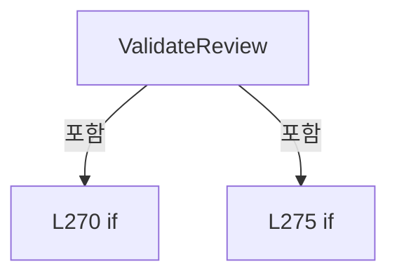

변경 전 점검: 입력/반환 타입, 위 호출자, 예외/취소 경로, 공유 상태와 저장·전송 소비자를 함께 확인합니다. 값의 단위나 물리 방향을 이름만으로 확정하지 않습니다.

### MethodDeclaration `ParseCompactReview` · L281–338

[Drilling.File/Product/CProductFile.cs:281–338](https://github.com/kjuws10-rgb/A3Drilling/blob/5aee8e58439c9b455cae7c9593c9be986c3e682e/Drilling.File/Product/CProductFile.cs#L281-L338)

| 항목 | 실제 추출 값 |
| --- | --- |
| 서명 | Drilling.Common.Product.ST_PRODUCT_REVIEW_DATA Drilling.File.Product.CProductFile.ParseCompactReview(System.Collections.Generic.IReadOnlyDictionary<string, string>, System.Collections.Generic.IReadOnlyDictionary<string, string>) |
| 접근/수식자 | Private / private, static |
| 반환/값 타입 | Drilling.Common.Product.ST_PRODUCT_REVIEW_DATA |
| 소속 타입 | NamedType:Drilling.File.Product.CProductFile |

입력 계약:

| 이름 | 타입 | 전달 | 선택/기본값 |
| --- | --- | --- | --- |
| reviewValues | System.Collections.Generic.IReadOnlyDictionary<string, string> | None | False /  |
| resultValues | System.Collections.Generic.IReadOnlyDictionary<string, string> | None | False /  |

정적 호출자로 확인된 위치:

| 호출 파일/행 | 호출 표현식 | 런타임 분기 가능 |
| --- | --- | --- |
| [Drilling.File/Product/CProductFile.cs:77–77](https://github.com/kjuws10-rgb/A3Drilling/blob/5aee8e58439c9b455cae7c9593c9be986c3e682e/Drilling.File/Product/CProductFile.cs#L77-L77) | ParseCompactReview | False |

호출하는 대상과 해석 범위:

| 원본 행 | 표현식 | 분석 상태 | 대상/소스 위치 |
| --- | --- | --- | --- |
| 298 | resultValues.Where(ShouldIncludeItem).Select(item => { var separator = item.Key.LastIndexOf('.'); return separator > 0 ? new { ShotKey = item.Key[..separator], Field = item.Key[(separator + 1)..], item.Value } : null; }).Where(item => item is not null).GroupBy(item => item!.ShotKey, StringComparer.OrdinalIgnoreCase).Select(group => { var values = g… | resolved | Drilling.Common.Product.ST_PRODUCT_REVIEW_RESULT[] System.Collections.Generic.IEnumerable<Drilling.Common.Product.ST_PRODUCT_REVIEW_RESULT>.ToArray<Drilling.Common.Product.ST_PRODUCT_REVIEW_RESULT>() |
| 298 | resultValues.Where(ShouldIncludeItem).Select(item => { var separator = item.Key.LastIndexOf('.'); return separator > 0 ? new { ShotKey = item.Key[..separator], Field = item.Key[(separator + 1)..], item.Value } : null; }).Where(item => item is not null).GroupBy(item => item!.ShotKey, StringComparer.OrdinalIgnoreCase).Select(group => { var values = g… | resolved | System.Linq.IOrderedEnumerable<Drilling.Common.Product.ST_PRODUCT_REVIEW_RESULT> System.Linq.IOrderedEnumerable<Drilling.Common.Product.ST_PRODUCT_REVIEW_RESULT>.ThenBy<Drilling.Common.Product.ST_PRODUCT_REVIEW_RESULT, string>(System.Func<Drilling.Common.Product.ST_PRODUCT_REVIEW_RESULT, string>, System.Collections.Generic.IComparer<string>?) |
| 298 | resultValues.Where(ShouldIncludeItem).Select(item => { var separator = item.Key.LastIndexOf('.'); return separator > 0 ? new { ShotKey = item.Key[..separator], Field = item.Key[(separator + 1)..], item.Value } : null; }).Where(item => item is not null).GroupBy(item => item!.ShotKey, StringComparer.OrdinalIgnoreCase).Select(group => { var values = g… | resolved | System.Linq.IOrderedEnumerable<Drilling.Common.Product.ST_PRODUCT_REVIEW_RESULT> System.Collections.Generic.IEnumerable<Drilling.Common.Product.ST_PRODUCT_REVIEW_RESULT>.OrderBy<Drilling.Common.Product.ST_PRODUCT_REVIEW_RESULT, int>(System.Func<Drilling.Common.Product.ST_PRODUCT_REVIEW_RESULT, int>) |
| 298 | resultValues.Where(ShouldIncludeItem).Select(item => { var separator = item.Key.LastIndexOf('.'); return separator > 0 ? new { ShotKey = item.Key[..separator], Field = item.Key[(separator + 1)..], item.Value } : null; }).Where(item => item is not null).GroupBy(item => item!.ShotKey, StringComparer.OrdinalIgnoreCase).Select | resolved | System.Collections.Generic.IEnumerable<Drilling.Common.Product.ST_PRODUCT_REVIEW_RESULT> System.Collections.Generic.IEnumerable<System.Linq.IGrouping<string, <anonymous type: string ShotKey, string Field, string Value>?>>.Select<System.Linq.IGrouping<string, <anonymous type: string ShotKey, string Field, string Value>?>, Drilling.Common.Product.ST_PRODUCT_REVIEW_RESULT>(System.Func<System.Linq.IGrouping<string, <anonymous type: string ShotKey, string Field, string Value>?>, Drilling.Common.Product.ST_PRODUCT_REVIEW_RESULT>) |
| 298 | resultValues.Where(ShouldIncludeItem).Select(item => { var separator = item.Key.LastIndexOf('.'); return separator > 0 ? new { ShotKey = item.Key[..separator], Field = item.Key[(separator + 1)..], item.Value } : null; }).Where(item => item is not null).GroupBy | resolved | System.Collections.Generic.IEnumerable<System.Linq.IGrouping<string, <anonymous type: string ShotKey, string Field, string Value>?>> System.Collections.Generic.IEnumerable<<anonymous type: string ShotKey, string Field, string Value>?>.GroupBy<<anonymous type: string ShotKey, string Field, string Value>?, string>(System.Func<<anonymous type: string ShotKey, string Field, string Value>?, string>, System.Collections.Generic.IEqualityComparer<string>?) |
| 298 | resultValues.Where(ShouldIncludeItem).Select(item => { var separator = item.Key.LastIndexOf('.'); return separator > 0 ? new { ShotKey = item.Key[..separator], Field = item.Key[(separator + 1)..], item.Value } : null; }).Where | resolved | System.Collections.Generic.IEnumerable<<anonymous type: string ShotKey, string Field, string Value>?> System.Collections.Generic.IEnumerable<<anonymous type: string ShotKey, string Field, string Value>?>.Where<<anonymous type: string ShotKey, string Field, string Value>?>(System.Func<<anonymous type: string ShotKey, string Field, string Value>?, bool>) |
| 298 | resultValues.Where(ShouldIncludeItem).Select | resolved | System.Collections.Generic.IEnumerable<<anonymous type: string ShotKey, string Field, string Value>?> System.Collections.Generic.IEnumerable<System.Collections.Generic.KeyValuePair<string, string>>.Select<System.Collections.Generic.KeyValuePair<string, string>, <anonymous type: string ShotKey, string Field, string Value>?>(System.Func<System.Collections.Generic.KeyValuePair<string, string>, <anonymous type: string ShotKey, string Field, string Value>?>) |
| 298 | resultValues.Where | resolved | System.Collections.Generic.IEnumerable<System.Collections.Generic.KeyValuePair<string, string>> System.Collections.Generic.IEnumerable<System.Collections.Generic.KeyValuePair<string, string>>.Where<System.Collections.Generic.KeyValuePair<string, string>>(System.Func<System.Collections.Generic.KeyValuePair<string, string>, bool>) |
| 300 | item.Key.LastIndexOf | resolved | int string.LastIndexOf(char) |
| 311 | group.ToDictionary | resolved | System.Collections.Generic.Dictionary<string, string> System.Collections.Generic.IEnumerable<<anonymous type: string ShotKey, string Field, string Value>?>.ToDictionary<<anonymous type: string ShotKey, string Field, string Value>?, string, string>(System.Func<<anonymous type: string ShotKey, string Field, string Value>?, string>, System.Func<<anonymous type: string ShotKey, string Field, string Value>?, string>, System.Collections.Generic.IEqualityComparer<string>?) |
| 312 | new ST_PRODUCT_REVIEW_RESULT | resolved | Drilling.Common.Product.ST_PRODUCT_REVIEW_RESULT.ST_PRODUCT_REVIEW_RESULT(string, int, int, int, double, double, string) · Drilling.Common/Product/CProductManager.cs:998 |
| 314 | ParseInt | resolved | int Drilling.File.Product.CProductFile.ParseInt(string, int) · Drilling.File/Product/CProductFile.cs:412 |
| 314 | ReadAny | resolved | string Drilling.File.Product.CProductFile.ReadAny(System.Collections.Generic.IReadOnlyDictionary<string, string>, params string[]) · Drilling.File/Product/CProductFile.cs:370 |
| 315 | ParseInt | resolved | int Drilling.File.Product.CProductFile.ParseInt(string, int) · Drilling.File/Product/CProductFile.cs:412 |
| 315 | ReadAny | resolved | string Drilling.File.Product.CProductFile.ReadAny(System.Collections.Generic.IReadOnlyDictionary<string, string>, params string[]) · Drilling.File/Product/CProductFile.cs:370 |
| 316 | ParseInt | resolved | int Drilling.File.Product.CProductFile.ParseInt(string, int) · Drilling.File/Product/CProductFile.cs:412 |
| 316 | ReadAny | resolved | string Drilling.File.Product.CProductFile.ReadAny(System.Collections.Generic.IReadOnlyDictionary<string, string>, params string[]) · Drilling.File/Product/CProductFile.cs:370 |
| 317 | ParseNullableDouble | resolved | double? Drilling.File.Product.CProductFile.ParseNullableDouble(string) · Drilling.File/Product/CProductFile.cs:422 |
| 317 | ReadAny | resolved | string Drilling.File.Product.CProductFile.ReadAny(System.Collections.Generic.IReadOnlyDictionary<string, string>, params string[]) · Drilling.File/Product/CProductFile.cs:370 |
| 318 | ParseNullableDouble | resolved | double? Drilling.File.Product.CProductFile.ParseNullableDouble(string) · Drilling.File/Product/CProductFile.cs:422 |
| 318 | ReadAny | resolved | string Drilling.File.Product.CProductFile.ReadAny(System.Collections.Generic.IReadOnlyDictionary<string, string>, params string[]) · Drilling.File/Product/CProductFile.cs:370 |
| 319 | ReadAny | resolved | string Drilling.File.Product.CProductFile.ReadAny(System.Collections.Generic.IReadOnlyDictionary<string, string>, params string[]) · Drilling.File/Product/CProductFile.cs:370 |
| 322 | new ST_PRODUCT_REVIEW_DATA | resolved | Drilling.Common.Product.ST_PRODUCT_REVIEW_DATA.ST_PRODUCT_REVIEW_DATA(Drilling.Common.Product.EN_PRODUCT_PROCESS_STATE, System.DateTimeOffset?, System.Collections.Generic.IReadOnlyList<Drilling.Common.Product.ST_PRODUCT_REVIEW_RESULT>) · Drilling.Common/Product/CProductManager.cs:999 |
| 323 | ParseEnum | resolved | Drilling.Common.Product.EN_PRODUCT_PROCESS_STATE Drilling.File.Product.CProductFile.ParseEnum<Drilling.Common.Product.EN_PRODUCT_PROCESS_STATE>(string, Drilling.Common.Product.EN_PRODUCT_PROCESS_STATE) · Drilling.File/Product/CProductFile.cs:489 |
| 323 | ReadAny | resolved | string Drilling.File.Product.CProductFile.ReadAny(System.Collections.Generic.IReadOnlyDictionary<string, string>, params string[]) · Drilling.File/Product/CProductFile.cs:370 |
| 324 | ParseDate | resolved | System.DateTimeOffset? Drilling.File.Product.CProductFile.ParseDate(string) · Drilling.File/Product/CProductFile.cs:500 |
| 324 | ReadAny | resolved | string Drilling.File.Product.CProductFile.ReadAny(System.Collections.Generic.IReadOnlyDictionary<string, string>, params string[]) · Drilling.File/Product/CProductFile.cs:370 |
| 327 | ReadAny | resolved | string Drilling.File.Product.CProductFile.ReadAny(System.Collections.Generic.IReadOnlyDictionary<string, string>, params string[]) · Drilling.File/Product/CProductFile.cs:370 |
| 328 | ReadAny | resolved | string Drilling.File.Product.CProductFile.ReadAny(System.Collections.Generic.IReadOnlyDictionary<string, string>, params string[]) · Drilling.File/Product/CProductFile.cs:370 |
| 329 | ReadAny | resolved | string Drilling.File.Product.CProductFile.ReadAny(System.Collections.Generic.IReadOnlyDictionary<string, string>, params string[]) · Drilling.File/Product/CProductFile.cs:370 |
| 330 | ReadAny | resolved | string Drilling.File.Product.CProductFile.ReadAny(System.Collections.Generic.IReadOnlyDictionary<string, string>, params string[]) · Drilling.File/Product/CProductFile.cs:370 |
| 331 | ParseInt | resolved | int Drilling.File.Product.CProductFile.ParseInt(string, int) · Drilling.File/Product/CProductFile.cs:412 |
| 331 | ReadAny | resolved | string Drilling.File.Product.CProductFile.ReadAny(System.Collections.Generic.IReadOnlyDictionary<string, string>, params string[]) · Drilling.File/Product/CProductFile.cs:370 |
| 332 | ParseNullableInt | resolved | int? Drilling.File.Product.CProductFile.ParseNullableInt(string) · Drilling.File/Product/CProductFile.cs:417 |
| 332 | ReadAny | resolved | string Drilling.File.Product.CProductFile.ReadAny(System.Collections.Generic.IReadOnlyDictionary<string, string>, params string[]) · Drilling.File/Product/CProductFile.cs:370 |
| 333 | ReadAny | resolved | string Drilling.File.Product.CProductFile.ReadAny(System.Collections.Generic.IReadOnlyDictionary<string, string>, params string[]) · Drilling.File/Product/CProductFile.cs:370 |
| 334 | ReadAny | resolved | string Drilling.File.Product.CProductFile.ReadAny(System.Collections.Generic.IReadOnlyDictionary<string, string>, params string[]) · Drilling.File/Product/CProductFile.cs:370 |
| 335 | ParseInt | resolved | int Drilling.File.Product.CProductFile.ParseInt(string, int) · Drilling.File/Product/CProductFile.cs:412 |
| 335 | ReadAny | resolved | string Drilling.File.Product.CProductFile.ReadAny(System.Collections.Generic.IReadOnlyDictionary<string, string>, params string[]) · Drilling.File/Product/CProductFile.cs:370 |
| 336 | ParseInt | resolved | int Drilling.File.Product.CProductFile.ParseInt(string, int) · Drilling.File/Product/CProductFile.cs:412 |
| 336 | ReadAny | resolved | string Drilling.File.Product.CProductFile.ReadAny(System.Collections.Generic.IReadOnlyDictionary<string, string>, params string[]) · Drilling.File/Product/CProductFile.cs:370 |

본문의 실제 연산·분기·예외·반환 순서(원문 위치 순):

| 원본 행 | 종류 | 주석 해설 |
| --- | --- | --- |
| 298 | call | 함수·델리게이트 또는 객체 생성자를 호출합니다: resultValues.Where(ShouldIncludeItem) |
| 298 | call | 함수·델리게이트 또는 객체 생성자를 호출합니다: resultValues.Where(ShouldIncludeItem).Select(item => { var separator = item.Key.LastIndexOf('.'); return separator > 0 ? new { ShotKey = item.Key[..separator], Field = item.Key[(separator + 1)..], item.Value } : null; })… |
| 298 | call | 함수·델리게이트 또는 객체 생성자를 호출합니다: resultValues.Where(ShouldIncludeItem).Select(item => { var separator = item.Key.LastIndexOf('.'); return separator > 0 ? new { ShotKey = item.Key[..separator], Field = item.Key[(separator + 1)..], item.Value } : null; })… |
| 298 | call | 함수·델리게이트 또는 객체 생성자를 호출합니다: resultValues.Where(ShouldIncludeItem).Select(item => { var separator = item.Key.LastIndexOf('.'); return separator > 0 ? new { ShotKey = item.Key[..separator], Field = item.Key[(separator + 1)..], item.Value } : null; }) |
| 298 | call | 함수·델리게이트 또는 객체 생성자를 호출합니다: resultValues.Where(ShouldIncludeItem).Select(item => { var separator = item.Key.LastIndexOf('.'); return separator > 0 ? new { ShotKey = item.Key[..separator], Field = item.Key[(separator + 1)..], item.Value } : null; })… |
| 298 | call | 함수·델리게이트 또는 객체 생성자를 호출합니다: resultValues.Where(ShouldIncludeItem).Select(item => { var separator = item.Key.LastIndexOf('.'); return separator > 0 ? new { ShotKey = item.Key[..separator], Field = item.Key[(separator + 1)..], item.Value } : null; })… |
| 298 | call | 함수·델리게이트 또는 객체 생성자를 호출합니다: resultValues.Where(ShouldIncludeItem).Select(item => { var separator = item.Key.LastIndexOf('.'); return separator > 0 ? new { ShotKey = item.Key[..separator], Field = item.Key[(separator + 1)..], item.Value } : null; })… |
| 298 | call | 함수·델리게이트 또는 객체 생성자를 호출합니다: resultValues.Where(ShouldIncludeItem).Select(item => { var separator = item.Key.LastIndexOf('.'); return separator > 0 ? new { ShotKey = item.Key[..separator], Field = item.Key[(separator + 1)..], item.Value } : null; })… |
| 298 | local-declaration | 지역 변수를 선언합니다: var groupedResults = resultValues.Where(ShouldIncludeItem).Select(item => { var separator = item.Key.LastIndexOf('.'); return separator > 0 ? new { ShotKey = item.Key[..separator], Field = item.Key[(separator + 1)..], item.Value } |
| 298 | variable-initializer | 변수의 초기값을 지정합니다: groupedResults = resultValues.Where(ShouldIncludeItem).Select(item => { var separator = item.Key.LastIndexOf('.'); return separator > 0 ? new { ShotKey = item.Key[..separator], Field = item.Key[(separator + 1)..], item.Value } : n |
| 300 | call | 함수·델리게이트 또는 객체 생성자를 호출합니다: item.Key.LastIndexOf('.') |
| 300 | local-declaration | 지역 변수를 선언합니다: var separator = item.Key.LastIndexOf('.'); |
| 300 | variable-initializer | 변수의 초기값을 지정합니다: separator = item.Key.LastIndexOf('.') |
| 301 | conditional-expression | 조건에 따라 결과식을 선택합니다: separator > 0 ? new { ShotKey = item.Key[..separator], Field = item.Key[(separator + 1)..], item.Value } : null |
| 301 | return | 호출자에게 값 또는 제어를 반환합니다: return separator > 0 ? new { ShotKey = item.Key[..separator], Field = item.Key[(separator + 1)..], item.Value } : null; |
| 311 | call | 함수·델리게이트 또는 객체 생성자를 호출합니다: group.ToDictionary(item => item!.Field, item => item!.Value, StringComparer.OrdinalIgnoreCase) |
| 311 | local-declaration | 지역 변수를 선언합니다: var values = group.ToDictionary(item => item!.Field, item => item!.Value, StringComparer.OrdinalIgnoreCase); |
| 311 | variable-initializer | 변수의 초기값을 지정합니다: values = group.ToDictionary(item => item!.Field, item => item!.Value, StringComparer.OrdinalIgnoreCase) |
| 312 | call | 함수·델리게이트 또는 객체 생성자를 호출합니다: new ST_PRODUCT_REVIEW_RESULT( group.Key, ParseInt(ReadAny(values, "HEAD_NO")), ParseInt(ReadAny(values, "CELL_NO")), ParseInt(ReadAny(values, "BEAM_NO"), DefaultReviewBeamNo), ParseNullableDouble(ReadAny(values, "ERROR_X… |
| 312 | return | 호출자에게 값 또는 제어를 반환합니다: return new ST_PRODUCT_REVIEW_RESULT( group.Key, ParseInt(ReadAny(values, "HEAD_NO")), ParseInt(ReadAny(values, "CELL_NO")), ParseInt(ReadAny(values, "BEAM_NO"), DefaultReviewBeamNo), ParseNullableDouble(ReadAny(values, "ERROR_X")) |
| 314 | call | 함수·델리게이트 또는 객체 생성자를 호출합니다: ParseInt(ReadAny(values, "HEAD_NO")) |
| 314 | call | 함수·델리게이트 또는 객체 생성자를 호출합니다: ReadAny(values, "HEAD_NO") |
| 315 | call | 함수·델리게이트 또는 객체 생성자를 호출합니다: ParseInt(ReadAny(values, "CELL_NO")) |
| 315 | call | 함수·델리게이트 또는 객체 생성자를 호출합니다: ReadAny(values, "CELL_NO") |
| 316 | call | 함수·델리게이트 또는 객체 생성자를 호출합니다: ParseInt(ReadAny(values, "BEAM_NO"), DefaultReviewBeamNo) |
| 316 | call | 함수·델리게이트 또는 객체 생성자를 호출합니다: ReadAny(values, "BEAM_NO") |
| 317 | call | 함수·델리게이트 또는 객체 생성자를 호출합니다: ParseNullableDouble(ReadAny(values, "ERROR_X")) |
| 317 | call | 함수·델리게이트 또는 객체 생성자를 호출합니다: ReadAny(values, "ERROR_X") |
| 318 | call | 함수·델리게이트 또는 객체 생성자를 호출합니다: ParseNullableDouble(ReadAny(values, "ERROR_Y")) |
| 318 | call | 함수·델리게이트 또는 객체 생성자를 호출합니다: ReadAny(values, "ERROR_Y") |
| 319 | call | 함수·델리게이트 또는 객체 생성자를 호출합니다: ReadAny(values, "JUDGE") |
| 322 | call | 함수·델리게이트 또는 객체 생성자를 호출합니다: new ST_PRODUCT_REVIEW_DATA( ParseEnum(ReadAny(reviewValues, "STATE"), EN_PRODUCT_PROCESS_STATE.NotStarted), ParseDate(ReadAny(resultValues, "SAVED_AT")), groupedResults) { InspectionMethod = ReadAny(reviewValues, "INSPEC… |
| 322 | return | 호출자에게 값 또는 제어를 반환합니다: return new ST_PRODUCT_REVIEW_DATA( ParseEnum(ReadAny(reviewValues, "STATE"), EN_PRODUCT_PROCESS_STATE.NotStarted), ParseDate(ReadAny(resultValues, "SAVED_AT")), groupedResults) { InspectionMethod = ReadAny(reviewValues, "INSPECTIO |
| 323 | call | 함수·델리게이트 또는 객체 생성자를 호출합니다: ParseEnum(ReadAny(reviewValues, "STATE"), EN_PRODUCT_PROCESS_STATE.NotStarted) |
| 323 | call | 함수·델리게이트 또는 객체 생성자를 호출합니다: ReadAny(reviewValues, "STATE") |
| 324 | call | 함수·델리게이트 또는 객체 생성자를 호출합니다: ParseDate(ReadAny(resultValues, "SAVED_AT")) |
| 324 | call | 함수·델리게이트 또는 객체 생성자를 호출합니다: ReadAny(resultValues, "SAVED_AT") |
| 327 | assignment | 값을 대상에 대입합니다: InspectionMethod = ReadAny(reviewValues, "INSPECTION_METHOD") |
| 327 | call | 함수·델리게이트 또는 객체 생성자를 호출합니다: ReadAny(reviewValues, "INSPECTION_METHOD") |
| 328 | assignment | 값을 대상에 대입합니다: RecipeId = ReadAny(reviewValues, "RECIPE_ID") |
| 328 | call | 함수·델리게이트 또는 객체 생성자를 호출합니다: ReadAny(reviewValues, "RECIPE_ID") |
| 329 | assignment | 값을 대상에 대입합니다: Rule = ReadAny(reviewValues, "RULE") |
| 329 | call | 함수·델리게이트 또는 객체 생성자를 호출합니다: ReadAny(reviewValues, "RULE") |
| 330 | assignment | 값을 대상에 대입합니다: RuleScope = ReadAny(reviewValues, "RULE_SCOPE") |
| 330 | call | 함수·델리게이트 또는 객체 생성자를 호출합니다: ReadAny(reviewValues, "RULE_SCOPE") |
| 331 | assignment | 값을 대상에 대입합니다: BeamNo = ParseInt(ReadAny(reviewValues, "BEAM_NO"), DefaultReviewBeamNo) |
| 331 | call | 함수·델리게이트 또는 객체 생성자를 호출합니다: ParseInt(ReadAny(reviewValues, "BEAM_NO"), DefaultReviewBeamNo) |
| 331 | call | 함수·델리게이트 또는 객체 생성자를 호출합니다: ReadAny(reviewValues, "BEAM_NO") |
| 332 | assignment | 값을 대상에 대입합니다: ReferenceCellNo = ParseNullableInt(ReadAny(reviewValues, "REFERENCE_CELL_NO")) |
| 332 | call | 함수·델리게이트 또는 객체 생성자를 호출합니다: ParseNullableInt(ReadAny(reviewValues, "REFERENCE_CELL_NO")) |
| 332 | call | 함수·델리게이트 또는 객체 생성자를 호출합니다: ReadAny(reviewValues, "REFERENCE_CELL_NO") |
| 333 | assignment | 값을 대상에 대입합니다: ReferenceShot = ReadAny(reviewValues, "REFERENCE_SHOT") |
| 333 | call | 함수·델리게이트 또는 객체 생성자를 호출합니다: ReadAny(reviewValues, "REFERENCE_SHOT") |
| 334 | assignment | 값을 대상에 대입합니다: RoughReference = ReadAny(reviewValues, "ROUGH_REFERENCE") |
| 334 | call | 함수·델리게이트 또는 객체 생성자를 호출합니다: ReadAny(reviewValues, "ROUGH_REFERENCE") |
| 335 | assignment | 값을 대상에 대입합니다: FineLineCount = ParseInt(ReadAny(reviewValues, "FINE_LINE_COUNT")) |
| 335 | call | 함수·델리게이트 또는 객체 생성자를 호출합니다: ParseInt(ReadAny(reviewValues, "FINE_LINE_COUNT")) |
| 335 | call | 함수·델리게이트 또는 객체 생성자를 호출합니다: ReadAny(reviewValues, "FINE_LINE_COUNT") |
| 336 | assignment | 값을 대상에 대입합니다: TotalCount = ParseInt(ReadAny(reviewValues, "TOTAL_COUNT")) |
| 336 | call | 함수·델리게이트 또는 객체 생성자를 호출합니다: ParseInt(ReadAny(reviewValues, "TOTAL_COUNT")) |
| 336 | call | 함수·델리게이트 또는 객체 생성자를 호출합니다: ReadAny(reviewValues, "TOTAL_COUNT") |

변경 전 점검: 입력/반환 타입, 위 호출자, 예외/취소 경로, 공유 상태와 저장·전송 소비자를 함께 확인합니다. 값의 단위나 물리 방향을 이름만으로 확정하지 않습니다.

### LocalFunctionStatement `ShouldIncludeItem` · L283–286

[Drilling.File/Product/CProductFile.cs:283–286](https://github.com/kjuws10-rgb/A3Drilling/blob/5aee8e58439c9b455cae7c9593c9be986c3e682e/Drilling.File/Product/CProductFile.cs#L283-L286)

| 항목 | 실제 추출 값 |
| --- | --- |
| 서명 | bool ShouldIncludeItem(System.Collections.Generic.KeyValuePair<string, string>) |
| 접근/수식자 | Private /  |
| 반환/값 타입 | bool |
| 소속 타입 | NamedType:Drilling.File.Product.CProductFile |

입력 계약:

| 이름 | 타입 | 전달 | 선택/기본값 |
| --- | --- | --- | --- |
| item | System.Collections.Generic.KeyValuePair<string, string> | None | False /  |

현재 부분 분석에서 직접 연결된 호출자는 없습니다. XAML/이벤트/인터페이스·델리게이트·외부 진입을 추가 확인해야 하며, 미사용으로 판정한 것이 아닙니다.

호출하는 대상과 해석 범위:

| 원본 행 | 표현식 | 분석 상태 | 대상/소스 위치 |
| --- | --- | --- | --- |
| 285 | item.Key.Equals | resolved | bool string.Equals(string?, System.StringComparison) |

본문의 실제 연산·분기·예외·반환 순서(원문 위치 순):

| 원본 행 | 종류 | 주석 해설 |
| --- | --- | --- |
| 285 | call | 함수·델리게이트 또는 객체 생성자를 호출합니다: item.Key.Equals("SAVED_AT", StringComparison.OrdinalIgnoreCase) |
| 285 | return | 호출자에게 값 또는 제어를 반환합니다: return !item.Key.Equals("SAVED_AT", StringComparison.OrdinalIgnoreCase); |

변경 전 점검: 입력/반환 타입, 위 호출자, 예외/취소 경로, 공유 상태와 저장·전송 소비자를 함께 확인합니다. 값의 단위나 물리 방향을 이름만으로 확정하지 않습니다.

### LocalFunctionStatement `SelectCellNo` · L288–291

[Drilling.File/Product/CProductFile.cs:288–291](https://github.com/kjuws10-rgb/A3Drilling/blob/5aee8e58439c9b455cae7c9593c9be986c3e682e/Drilling.File/Product/CProductFile.cs#L288-L291)

| 항목 | 실제 추출 값 |
| --- | --- |
| 서명 | int SelectCellNo(Drilling.Common.Product.ST_PRODUCT_REVIEW_RESULT) |
| 접근/수식자 | Private /  |
| 반환/값 타입 | int |
| 소속 타입 | NamedType:Drilling.File.Product.CProductFile |

입력 계약:

| 이름 | 타입 | 전달 | 선택/기본값 |
| --- | --- | --- | --- |
| result | Drilling.Common.Product.ST_PRODUCT_REVIEW_RESULT | None | False /  |

현재 부분 분석에서 직접 연결된 호출자는 없습니다. XAML/이벤트/인터페이스·델리게이트·외부 진입을 추가 확인해야 하며, 미사용으로 판정한 것이 아닙니다.

본문의 실제 연산·분기·예외·반환 순서(원문 위치 순):

| 원본 행 | 종류 | 주석 해설 |
| --- | --- | --- |
| 290 | return | 호출자에게 값 또는 제어를 반환합니다: return result.CellNo; |

변경 전 점검: 입력/반환 타입, 위 호출자, 예외/취소 경로, 공유 상태와 저장·전송 소비자를 함께 확인합니다. 값의 단위나 물리 방향을 이름만으로 확정하지 않습니다.

### LocalFunctionStatement `SelectShotKey` · L293–296

[Drilling.File/Product/CProductFile.cs:293–296](https://github.com/kjuws10-rgb/A3Drilling/blob/5aee8e58439c9b455cae7c9593c9be986c3e682e/Drilling.File/Product/CProductFile.cs#L293-L296)

| 항목 | 실제 추출 값 |
| --- | --- |
| 서명 | string SelectShotKey(Drilling.Common.Product.ST_PRODUCT_REVIEW_RESULT) |
| 접근/수식자 | Private /  |
| 반환/값 타입 | string |
| 소속 타입 | NamedType:Drilling.File.Product.CProductFile |

입력 계약:

| 이름 | 타입 | 전달 | 선택/기본값 |
| --- | --- | --- | --- |
| result | Drilling.Common.Product.ST_PRODUCT_REVIEW_RESULT | None | False /  |

현재 부분 분석에서 직접 연결된 호출자는 없습니다. XAML/이벤트/인터페이스·델리게이트·외부 진입을 추가 확인해야 하며, 미사용으로 판정한 것이 아닙니다.

본문의 실제 연산·분기·예외·반환 순서(원문 위치 순):

| 원본 행 | 종류 | 주석 해설 |
| --- | --- | --- |
| 295 | return | 호출자에게 값 또는 제어를 반환합니다: return result.ShotKey; |

변경 전 점검: 입력/반환 타입, 위 호출자, 예외/취소 경로, 공유 상태와 저장·전송 소비자를 함께 확인합니다. 값의 단위나 물리 방향을 이름만으로 확정하지 않습니다.

### MethodDeclaration `ReadSection` · L340–368

[Drilling.File/Product/CProductFile.cs:340–368](https://github.com/kjuws10-rgb/A3Drilling/blob/5aee8e58439c9b455cae7c9593c9be986c3e682e/Drilling.File/Product/CProductFile.cs#L340-L368)

| 항목 | 실제 추출 값 |
| --- | --- |
| 서명 | System.Collections.Generic.Dictionary<string, string> Drilling.File.Product.CProductFile.ReadSection(System.Collections.Generic.IReadOnlyList<System.Collections.Generic.IReadOnlyDictionary<string, string>>, string) |
| 접근/수식자 | Private / private, static |
| 반환/값 타입 | System.Collections.Generic.Dictionary<string, string> |
| 소속 타입 | NamedType:Drilling.File.Product.CProductFile |

입력 계약:

| 이름 | 타입 | 전달 | 선택/기본값 |
| --- | --- | --- | --- |
| rows | System.Collections.Generic.IReadOnlyList<System.Collections.Generic.IReadOnlyDictionary<string, string>> | None | False /  |
| type | string | None | False /  |

정적 호출자로 확인된 위치:

| 호출 파일/행 | 호출 표현식 | 런타임 분기 가능 |
| --- | --- | --- |
| [Drilling.File/Product/CProductFile.cs:43–43](https://github.com/kjuws10-rgb/A3Drilling/blob/5aee8e58439c9b455cae7c9593c9be986c3e682e/Drilling.File/Product/CProductFile.cs#L43-L43) | ReadSection | False |
| [Drilling.File/Product/CProductFile.cs:62–62](https://github.com/kjuws10-rgb/A3Drilling/blob/5aee8e58439c9b455cae7c9593c9be986c3e682e/Drilling.File/Product/CProductFile.cs#L62-L62) | ReadSection | False |
| [Drilling.File/Product/CProductFile.cs:73–73](https://github.com/kjuws10-rgb/A3Drilling/blob/5aee8e58439c9b455cae7c9593c9be986c3e682e/Drilling.File/Product/CProductFile.cs#L73-L73) | ReadSection | False |
| [Drilling.File/Product/CProductFile.cs:74–74](https://github.com/kjuws10-rgb/A3Drilling/blob/5aee8e58439c9b455cae7c9593c9be986c3e682e/Drilling.File/Product/CProductFile.cs#L74-L74) | ReadSection | False |
| [Drilling.File/Product/CProductFile.cs:75–75](https://github.com/kjuws10-rgb/A3Drilling/blob/5aee8e58439c9b455cae7c9593c9be986c3e682e/Drilling.File/Product/CProductFile.cs#L75-L75) | ReadSection | False |
| [Drilling.File/Product/CProductFile.cs:76–76](https://github.com/kjuws10-rgb/A3Drilling/blob/5aee8e58439c9b455cae7c9593c9be986c3e682e/Drilling.File/Product/CProductFile.cs#L76-L76) | ReadSection | False |

호출하는 대상과 해석 범위:

| 원본 행 | 표현식 | 분석 상태 | 대상/소스 위치 |
| --- | --- | --- | --- |
| 367 | rows.Where(MatchesSectionType).Where(HasSectionName).GroupBy(SelectGroupKey, StringComparer.OrdinalIgnoreCase).ToDictionary | resolved | System.Collections.Generic.Dictionary<string, string> System.Collections.Generic.IEnumerable<System.Linq.IGrouping<string, System.Collections.Generic.IReadOnlyDictionary<string, string>>>.ToDictionary<System.Linq.IGrouping<string, System.Collections.Generic.IReadOnlyDictionary<string, string>>, string, string>(System.Func<System.Linq.IGrouping<string, System.Collections.Generic.IReadOnlyDictionary<string, string>>, string>, System.Func<System.Linq.IGrouping<string, System.Collections.Generic.IReadOnlyDictionary<string, string>>, string>, System.Collections.Generic.IEqualityComparer<string>?) |
| 367 | rows.Where(MatchesSectionType).Where(HasSectionName).GroupBy | resolved | System.Collections.Generic.IEnumerable<System.Linq.IGrouping<string, System.Collections.Generic.IReadOnlyDictionary<string, string>>> System.Collections.Generic.IEnumerable<System.Collections.Generic.IReadOnlyDictionary<string, string>>.GroupBy<System.Collections.Generic.IReadOnlyDictionary<string, string>, string>(System.Func<System.Collections.Generic.IReadOnlyDictionary<string, string>, string>, System.Collections.Generic.IEqualityComparer<string>?) |
| 367 | rows.Where(MatchesSectionType).Where | resolved | System.Collections.Generic.IEnumerable<System.Collections.Generic.IReadOnlyDictionary<string, string>> System.Collections.Generic.IEnumerable<System.Collections.Generic.IReadOnlyDictionary<string, string>>.Where<System.Collections.Generic.IReadOnlyDictionary<string, string>>(System.Func<System.Collections.Generic.IReadOnlyDictionary<string, string>, bool>) |
| 367 | rows.Where | resolved | System.Collections.Generic.IEnumerable<System.Collections.Generic.IReadOnlyDictionary<string, string>> System.Collections.Generic.IEnumerable<System.Collections.Generic.IReadOnlyDictionary<string, string>>.Where<System.Collections.Generic.IReadOnlyDictionary<string, string>>(System.Func<System.Collections.Generic.IReadOnlyDictionary<string, string>, bool>) |

본문의 실제 연산·분기·예외·반환 순서(원문 위치 순):

| 원본 행 | 종류 | 주석 해설 |
| --- | --- | --- |
| 367 | call | 함수·델리게이트 또는 객체 생성자를 호출합니다: rows.Where(MatchesSectionType).Where(HasSectionName).GroupBy(SelectGroupKey, StringComparer.OrdinalIgnoreCase).ToDictionary(SelectKey, SelectValue, StringComparer.OrdinalIgnoreCase) |
| 367 | call | 함수·델리게이트 또는 객체 생성자를 호출합니다: rows.Where(MatchesSectionType).Where(HasSectionName).GroupBy(SelectGroupKey, StringComparer.OrdinalIgnoreCase) |
| 367 | call | 함수·델리게이트 또는 객체 생성자를 호출합니다: rows.Where(MatchesSectionType).Where(HasSectionName) |
| 367 | call | 함수·델리게이트 또는 객체 생성자를 호출합니다: rows.Where(MatchesSectionType) |
| 367 | return | 호출자에게 값 또는 제어를 반환합니다: return rows.Where(MatchesSectionType).Where(HasSectionName).GroupBy(SelectGroupKey, StringComparer.OrdinalIgnoreCase).ToDictionary(SelectKey, SelectValue, StringComparer.OrdinalIgnoreCase); |

변경 전 점검: 입력/반환 타입, 위 호출자, 예외/취소 경로, 공유 상태와 저장·전송 소비자를 함께 확인합니다. 값의 단위나 물리 방향을 이름만으로 확정하지 않습니다.

### LocalFunctionStatement `MatchesSectionType` · L342–345

[Drilling.File/Product/CProductFile.cs:342–345](https://github.com/kjuws10-rgb/A3Drilling/blob/5aee8e58439c9b455cae7c9593c9be986c3e682e/Drilling.File/Product/CProductFile.cs#L342-L345)

| 항목 | 실제 추출 값 |
| --- | --- |
| 서명 | bool MatchesSectionType(System.Collections.Generic.IReadOnlyDictionary<string, string>) |
| 접근/수식자 | Private /  |
| 반환/값 타입 | bool |
| 소속 타입 | NamedType:Drilling.File.Product.CProductFile |

입력 계약:

| 이름 | 타입 | 전달 | 선택/기본값 |
| --- | --- | --- | --- |
| row | System.Collections.Generic.IReadOnlyDictionary<string, string> | None | False /  |

현재 부분 분석에서 직접 연결된 호출자는 없습니다. XAML/이벤트/인터페이스·델리게이트·외부 진입을 추가 확인해야 하며, 미사용으로 판정한 것이 아닙니다.

호출하는 대상과 해석 범위:

| 원본 행 | 표현식 | 분석 상태 | 대상/소스 위치 |
| --- | --- | --- | --- |
| 344 | CCsvParser.Get(row, "TYPE").Equals | resolved | bool string.Equals(string?, System.StringComparison) |
| 344 | CCsvParser.Get | resolved | string Drilling.File.Parser.CCsvParser.Get(System.Collections.Generic.IReadOnlyDictionary<string, string>, string) · Drilling.File/Parser/CCsvParser.cs:168 |

본문의 실제 연산·분기·예외·반환 순서(원문 위치 순):

| 원본 행 | 종류 | 주석 해설 |
| --- | --- | --- |
| 344 | call | 함수·델리게이트 또는 객체 생성자를 호출합니다: CCsvParser.Get(row, "TYPE").Equals(type, StringComparison.OrdinalIgnoreCase) |
| 344 | call | 함수·델리게이트 또는 객체 생성자를 호출합니다: CCsvParser.Get(row, "TYPE") |
| 344 | return | 호출자에게 값 또는 제어를 반환합니다: return CCsvParser.Get(row, "TYPE").Equals(type, StringComparison.OrdinalIgnoreCase); |

변경 전 점검: 입력/반환 타입, 위 호출자, 예외/취소 경로, 공유 상태와 저장·전송 소비자를 함께 확인합니다. 값의 단위나 물리 방향을 이름만으로 확정하지 않습니다.

### LocalFunctionStatement `HasSectionName` · L347–350

[Drilling.File/Product/CProductFile.cs:347–350](https://github.com/kjuws10-rgb/A3Drilling/blob/5aee8e58439c9b455cae7c9593c9be986c3e682e/Drilling.File/Product/CProductFile.cs#L347-L350)

| 항목 | 실제 추출 값 |
| --- | --- |
| 서명 | bool HasSectionName(System.Collections.Generic.IReadOnlyDictionary<string, string>) |
| 접근/수식자 | Private /  |
| 반환/값 타입 | bool |
| 소속 타입 | NamedType:Drilling.File.Product.CProductFile |

입력 계약:

| 이름 | 타입 | 전달 | 선택/기본값 |
| --- | --- | --- | --- |
| row | System.Collections.Generic.IReadOnlyDictionary<string, string> | None | False /  |

현재 부분 분석에서 직접 연결된 호출자는 없습니다. XAML/이벤트/인터페이스·델리게이트·외부 진입을 추가 확인해야 하며, 미사용으로 판정한 것이 아닙니다.

호출하는 대상과 해석 범위:

| 원본 행 | 표현식 | 분석 상태 | 대상/소스 위치 |
| --- | --- | --- | --- |
| 349 | string.IsNullOrWhiteSpace | resolved | bool string.IsNullOrWhiteSpace(string?) |
| 349 | CCsvParser.Get | resolved | string Drilling.File.Parser.CCsvParser.Get(System.Collections.Generic.IReadOnlyDictionary<string, string>, string) · Drilling.File/Parser/CCsvParser.cs:168 |

본문의 실제 연산·분기·예외·반환 순서(원문 위치 순):

| 원본 행 | 종류 | 주석 해설 |
| --- | --- | --- |
| 349 | call | 함수·델리게이트 또는 객체 생성자를 호출합니다: string.IsNullOrWhiteSpace(CCsvParser.Get(row, "NAME")) |
| 349 | call | 함수·델리게이트 또는 객체 생성자를 호출합니다: CCsvParser.Get(row, "NAME") |
| 349 | return | 호출자에게 값 또는 제어를 반환합니다: return !string.IsNullOrWhiteSpace(CCsvParser.Get(row, "NAME")); |

변경 전 점검: 입력/반환 타입, 위 호출자, 예외/취소 경로, 공유 상태와 저장·전송 소비자를 함께 확인합니다. 값의 단위나 물리 방향을 이름만으로 확정하지 않습니다.

### LocalFunctionStatement `SelectGroupKey` · L352–355

[Drilling.File/Product/CProductFile.cs:352–355](https://github.com/kjuws10-rgb/A3Drilling/blob/5aee8e58439c9b455cae7c9593c9be986c3e682e/Drilling.File/Product/CProductFile.cs#L352-L355)

| 항목 | 실제 추출 값 |
| --- | --- |
| 서명 | string SelectGroupKey(System.Collections.Generic.IReadOnlyDictionary<string, string>) |
| 접근/수식자 | Private /  |
| 반환/값 타입 | string |
| 소속 타입 | NamedType:Drilling.File.Product.CProductFile |

입력 계약:

| 이름 | 타입 | 전달 | 선택/기본값 |
| --- | --- | --- | --- |
| row | System.Collections.Generic.IReadOnlyDictionary<string, string> | None | False /  |

현재 부분 분석에서 직접 연결된 호출자는 없습니다. XAML/이벤트/인터페이스·델리게이트·외부 진입을 추가 확인해야 하며, 미사용으로 판정한 것이 아닙니다.

호출하는 대상과 해석 범위:

| 원본 행 | 표현식 | 분석 상태 | 대상/소스 위치 |
| --- | --- | --- | --- |
| 354 | CCsvParser.Get | resolved | string Drilling.File.Parser.CCsvParser.Get(System.Collections.Generic.IReadOnlyDictionary<string, string>, string) · Drilling.File/Parser/CCsvParser.cs:168 |

본문의 실제 연산·분기·예외·반환 순서(원문 위치 순):

| 원본 행 | 종류 | 주석 해설 |
| --- | --- | --- |
| 354 | call | 함수·델리게이트 또는 객체 생성자를 호출합니다: CCsvParser.Get(row, "NAME") |
| 354 | return | 호출자에게 값 또는 제어를 반환합니다: return CCsvParser.Get(row, "NAME"); |

변경 전 점검: 입력/반환 타입, 위 호출자, 예외/취소 경로, 공유 상태와 저장·전송 소비자를 함께 확인합니다. 값의 단위나 물리 방향을 이름만으로 확정하지 않습니다.

### LocalFunctionStatement `SelectKey` · L357–360

[Drilling.File/Product/CProductFile.cs:357–360](https://github.com/kjuws10-rgb/A3Drilling/blob/5aee8e58439c9b455cae7c9593c9be986c3e682e/Drilling.File/Product/CProductFile.cs#L357-L360)

| 항목 | 실제 추출 값 |
| --- | --- |
| 서명 | string SelectKey(System.Linq.IGrouping<string, System.Collections.Generic.IReadOnlyDictionary<string, string>>) |
| 접근/수식자 | Private /  |
| 반환/값 타입 | string |
| 소속 타입 | NamedType:Drilling.File.Product.CProductFile |

입력 계약:

| 이름 | 타입 | 전달 | 선택/기본값 |
| --- | --- | --- | --- |
| group | System.Linq.IGrouping<string, System.Collections.Generic.IReadOnlyDictionary<string, string>> | None | False /  |

현재 부분 분석에서 직접 연결된 호출자는 없습니다. XAML/이벤트/인터페이스·델리게이트·외부 진입을 추가 확인해야 하며, 미사용으로 판정한 것이 아닙니다.

본문의 실제 연산·분기·예외·반환 순서(원문 위치 순):

| 원본 행 | 종류 | 주석 해설 |
| --- | --- | --- |
| 359 | return | 호출자에게 값 또는 제어를 반환합니다: return group.Key; |

변경 전 점검: 입력/반환 타입, 위 호출자, 예외/취소 경로, 공유 상태와 저장·전송 소비자를 함께 확인합니다. 값의 단위나 물리 방향을 이름만으로 확정하지 않습니다.

### LocalFunctionStatement `SelectValue` · L362–365

[Drilling.File/Product/CProductFile.cs:362–365](https://github.com/kjuws10-rgb/A3Drilling/blob/5aee8e58439c9b455cae7c9593c9be986c3e682e/Drilling.File/Product/CProductFile.cs#L362-L365)

| 항목 | 실제 추출 값 |
| --- | --- |
| 서명 | string SelectValue(System.Linq.IGrouping<string, System.Collections.Generic.IReadOnlyDictionary<string, string>>) |
| 접근/수식자 | Private /  |
| 반환/값 타입 | string |
| 소속 타입 | NamedType:Drilling.File.Product.CProductFile |

입력 계약:

| 이름 | 타입 | 전달 | 선택/기본값 |
| --- | --- | --- | --- |
| group | System.Linq.IGrouping<string, System.Collections.Generic.IReadOnlyDictionary<string, string>> | None | False /  |

현재 부분 분석에서 직접 연결된 호출자는 없습니다. XAML/이벤트/인터페이스·델리게이트·외부 진입을 추가 확인해야 하며, 미사용으로 판정한 것이 아닙니다.

호출하는 대상과 해석 범위:

| 원본 행 | 표현식 | 분석 상태 | 대상/소스 위치 |
| --- | --- | --- | --- |
| 364 | CCsvParser.Get | resolved | string Drilling.File.Parser.CCsvParser.Get(System.Collections.Generic.IReadOnlyDictionary<string, string>, string) · Drilling.File/Parser/CCsvParser.cs:168 |
| 364 | group.Last | resolved | System.Collections.Generic.IReadOnlyDictionary<string, string> System.Collections.Generic.IEnumerable<System.Collections.Generic.IReadOnlyDictionary<string, string>>.Last<System.Collections.Generic.IReadOnlyDictionary<string, string>>() |

본문의 실제 연산·분기·예외·반환 순서(원문 위치 순):

| 원본 행 | 종류 | 주석 해설 |
| --- | --- | --- |
| 364 | call | 함수·델리게이트 또는 객체 생성자를 호출합니다: CCsvParser.Get(group.Last(), "VALUE") |
| 364 | call | 함수·델리게이트 또는 객체 생성자를 호출합니다: group.Last() |
| 364 | return | 호출자에게 값 또는 제어를 반환합니다: return CCsvParser.Get(group.Last(), "VALUE"); |

변경 전 점검: 입력/반환 타입, 위 호출자, 예외/취소 경로, 공유 상태와 저장·전송 소비자를 함께 확인합니다. 값의 단위나 물리 방향을 이름만으로 확정하지 않습니다.

### MethodDeclaration `ReadAny` · L370–381

[Drilling.File/Product/CProductFile.cs:370–381](https://github.com/kjuws10-rgb/A3Drilling/blob/5aee8e58439c9b455cae7c9593c9be986c3e682e/Drilling.File/Product/CProductFile.cs#L370-L381)

| 항목 | 실제 추출 값 |
| --- | --- |
| 서명 | string Drilling.File.Product.CProductFile.ReadAny(System.Collections.Generic.IReadOnlyDictionary<string, string>, params string[]) |
| 접근/수식자 | Private / private, static |
| 반환/값 타입 | string |
| 소속 타입 | NamedType:Drilling.File.Product.CProductFile |

입력 계약:

| 이름 | 타입 | 전달 | 선택/기본값 |
| --- | --- | --- | --- |
| values | System.Collections.Generic.IReadOnlyDictionary<string, string> | None | False /  |
| names | string[] | None | False /  |

정적 호출자로 확인된 위치:

| 호출 파일/행 | 호출 표현식 | 런타임 분기 가능 |
| --- | --- | --- |
| [Drilling.File/Product/CProductFile.cs:44–44](https://github.com/kjuws10-rgb/A3Drilling/blob/5aee8e58439c9b455cae7c9593c9be986c3e682e/Drilling.File/Product/CProductFile.cs#L44-L44) | ReadAny | False |
| [Drilling.File/Product/CProductFile.cs:86–86](https://github.com/kjuws10-rgb/A3Drilling/blob/5aee8e58439c9b455cae7c9593c9be986c3e682e/Drilling.File/Product/CProductFile.cs#L86-L86) | ReadAny | False |
| [Drilling.File/Product/CProductFile.cs:91–91](https://github.com/kjuws10-rgb/A3Drilling/blob/5aee8e58439c9b455cae7c9593c9be986c3e682e/Drilling.File/Product/CProductFile.cs#L91-L91) | ReadAny | False |
| [Drilling.File/Product/CProductFile.cs:92–92](https://github.com/kjuws10-rgb/A3Drilling/blob/5aee8e58439c9b455cae7c9593c9be986c3e682e/Drilling.File/Product/CProductFile.cs#L92-L92) | ReadAny | False |
| [Drilling.File/Product/CProductFile.cs:97–97](https://github.com/kjuws10-rgb/A3Drilling/blob/5aee8e58439c9b455cae7c9593c9be986c3e682e/Drilling.File/Product/CProductFile.cs#L97-L97) | ReadAny | False |
| [Drilling.File/Product/CProductFile.cs:98–98](https://github.com/kjuws10-rgb/A3Drilling/blob/5aee8e58439c9b455cae7c9593c9be986c3e682e/Drilling.File/Product/CProductFile.cs#L98-L98) | ReadAny | False |
| [Drilling.File/Product/CProductFile.cs:99–99](https://github.com/kjuws10-rgb/A3Drilling/blob/5aee8e58439c9b455cae7c9593c9be986c3e682e/Drilling.File/Product/CProductFile.cs#L99-L99) | ReadAny | False |
| [Drilling.File/Product/CProductFile.cs:100–100](https://github.com/kjuws10-rgb/A3Drilling/blob/5aee8e58439c9b455cae7c9593c9be986c3e682e/Drilling.File/Product/CProductFile.cs#L100-L100) | ReadAny | False |
| [Drilling.File/Product/CProductFile.cs:101–101](https://github.com/kjuws10-rgb/A3Drilling/blob/5aee8e58439c9b455cae7c9593c9be986c3e682e/Drilling.File/Product/CProductFile.cs#L101-L101) | ReadAny | False |
| [Drilling.File/Product/CProductFile.cs:103–103](https://github.com/kjuws10-rgb/A3Drilling/blob/5aee8e58439c9b455cae7c9593c9be986c3e682e/Drilling.File/Product/CProductFile.cs#L103-L103) | ReadAny | False |
| [Drilling.File/Product/CProductFile.cs:103–103](https://github.com/kjuws10-rgb/A3Drilling/blob/5aee8e58439c9b455cae7c9593c9be986c3e682e/Drilling.File/Product/CProductFile.cs#L103-L103) | ReadAny | False |
| [Drilling.File/Product/CProductFile.cs:103–103](https://github.com/kjuws10-rgb/A3Drilling/blob/5aee8e58439c9b455cae7c9593c9be986c3e682e/Drilling.File/Product/CProductFile.cs#L103-L103) | ReadAny | False |
| [Drilling.File/Product/CProductFile.cs:314–314](https://github.com/kjuws10-rgb/A3Drilling/blob/5aee8e58439c9b455cae7c9593c9be986c3e682e/Drilling.File/Product/CProductFile.cs#L314-L314) | ReadAny | False |
| [Drilling.File/Product/CProductFile.cs:315–315](https://github.com/kjuws10-rgb/A3Drilling/blob/5aee8e58439c9b455cae7c9593c9be986c3e682e/Drilling.File/Product/CProductFile.cs#L315-L315) | ReadAny | False |
| [Drilling.File/Product/CProductFile.cs:316–316](https://github.com/kjuws10-rgb/A3Drilling/blob/5aee8e58439c9b455cae7c9593c9be986c3e682e/Drilling.File/Product/CProductFile.cs#L316-L316) | ReadAny | False |
| [Drilling.File/Product/CProductFile.cs:317–317](https://github.com/kjuws10-rgb/A3Drilling/blob/5aee8e58439c9b455cae7c9593c9be986c3e682e/Drilling.File/Product/CProductFile.cs#L317-L317) | ReadAny | False |
| [Drilling.File/Product/CProductFile.cs:318–318](https://github.com/kjuws10-rgb/A3Drilling/blob/5aee8e58439c9b455cae7c9593c9be986c3e682e/Drilling.File/Product/CProductFile.cs#L318-L318) | ReadAny | False |
| [Drilling.File/Product/CProductFile.cs:319–319](https://github.com/kjuws10-rgb/A3Drilling/blob/5aee8e58439c9b455cae7c9593c9be986c3e682e/Drilling.File/Product/CProductFile.cs#L319-L319) | ReadAny | False |
| [Drilling.File/Product/CProductFile.cs:323–323](https://github.com/kjuws10-rgb/A3Drilling/blob/5aee8e58439c9b455cae7c9593c9be986c3e682e/Drilling.File/Product/CProductFile.cs#L323-L323) | ReadAny | False |
| [Drilling.File/Product/CProductFile.cs:324–324](https://github.com/kjuws10-rgb/A3Drilling/blob/5aee8e58439c9b455cae7c9593c9be986c3e682e/Drilling.File/Product/CProductFile.cs#L324-L324) | ReadAny | False |
| [Drilling.File/Product/CProductFile.cs:327–327](https://github.com/kjuws10-rgb/A3Drilling/blob/5aee8e58439c9b455cae7c9593c9be986c3e682e/Drilling.File/Product/CProductFile.cs#L327-L327) | ReadAny | False |
| [Drilling.File/Product/CProductFile.cs:328–328](https://github.com/kjuws10-rgb/A3Drilling/blob/5aee8e58439c9b455cae7c9593c9be986c3e682e/Drilling.File/Product/CProductFile.cs#L328-L328) | ReadAny | False |
| [Drilling.File/Product/CProductFile.cs:329–329](https://github.com/kjuws10-rgb/A3Drilling/blob/5aee8e58439c9b455cae7c9593c9be986c3e682e/Drilling.File/Product/CProductFile.cs#L329-L329) | ReadAny | False |
| [Drilling.File/Product/CProductFile.cs:330–330](https://github.com/kjuws10-rgb/A3Drilling/blob/5aee8e58439c9b455cae7c9593c9be986c3e682e/Drilling.File/Product/CProductFile.cs#L330-L330) | ReadAny | False |
| [Drilling.File/Product/CProductFile.cs:331–331](https://github.com/kjuws10-rgb/A3Drilling/blob/5aee8e58439c9b455cae7c9593c9be986c3e682e/Drilling.File/Product/CProductFile.cs#L331-L331) | ReadAny | False |
| [Drilling.File/Product/CProductFile.cs:332–332](https://github.com/kjuws10-rgb/A3Drilling/blob/5aee8e58439c9b455cae7c9593c9be986c3e682e/Drilling.File/Product/CProductFile.cs#L332-L332) | ReadAny | False |
| [Drilling.File/Product/CProductFile.cs:333–333](https://github.com/kjuws10-rgb/A3Drilling/blob/5aee8e58439c9b455cae7c9593c9be986c3e682e/Drilling.File/Product/CProductFile.cs#L333-L333) | ReadAny | False |
| [Drilling.File/Product/CProductFile.cs:334–334](https://github.com/kjuws10-rgb/A3Drilling/blob/5aee8e58439c9b455cae7c9593c9be986c3e682e/Drilling.File/Product/CProductFile.cs#L334-L334) | ReadAny | False |
| [Drilling.File/Product/CProductFile.cs:335–335](https://github.com/kjuws10-rgb/A3Drilling/blob/5aee8e58439c9b455cae7c9593c9be986c3e682e/Drilling.File/Product/CProductFile.cs#L335-L335) | ReadAny | False |
| [Drilling.File/Product/CProductFile.cs:336–336](https://github.com/kjuws10-rgb/A3Drilling/blob/5aee8e58439c9b455cae7c9593c9be986c3e682e/Drilling.File/Product/CProductFile.cs#L336-L336) | ReadAny | False |

호출하는 대상과 해석 범위:

| 원본 행 | 표현식 | 분석 상태 | 대상/소스 위치 |
| --- | --- | --- | --- |
| 374 | values.TryGetValue | resolved · 동적 구현 선택 가능 | bool System.Collections.Generic.IReadOnlyDictionary<string, string>.TryGetValue(string, out string) |

본문의 실제 연산·분기·예외·반환 순서(원문 위치 순):

| 원본 행 | 종류 | 주석 해설 |
| --- | --- | --- |
| 372 | foreach | 컬렉션 요소를 순회합니다: foreach (var name in names) |
| 374 | call | 함수·델리게이트 또는 객체 생성자를 호출합니다: values.TryGetValue(name, out var value) |
| 374 | if | 조건에 따라 분기합니다: if (values.TryGetValue(name, out var value)) |
| 376 | return | 호출자에게 값 또는 제어를 반환합니다: return value; |
| 380 | return | 호출자에게 값 또는 제어를 반환합니다: return ""; |

제어 구문의 포함 구조(실제 실행 순서/CFG가 아닌 구문 탐색 그림):

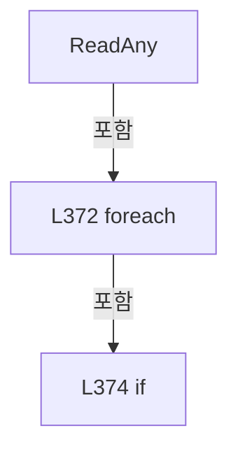

변경 전 점검: 입력/반환 타입, 위 호출자, 예외/취소 경로, 공유 상태와 저장·전송 소비자를 함께 확인합니다. 값의 단위나 물리 방향을 이름만으로 확정하지 않습니다.

### MethodDeclaration `AddCompactRow` · L383–386

[Drilling.File/Product/CProductFile.cs:383–386](https://github.com/kjuws10-rgb/A3Drilling/blob/5aee8e58439c9b455cae7c9593c9be986c3e682e/Drilling.File/Product/CProductFile.cs#L383-L386)

| 항목 | 실제 추출 값 |
| --- | --- |
| 서명 | void Drilling.File.Product.CProductFile.AddCompactRow(System.Collections.Generic.ICollection<System.Collections.Generic.IReadOnlyDictionary<string, string>>, string, string, string) |
| 접근/수식자 | Private / private, static |
| 반환/값 타입 | void |
| 소속 타입 | NamedType:Drilling.File.Product.CProductFile |

입력 계약:

| 이름 | 타입 | 전달 | 선택/기본값 |
| --- | --- | --- | --- |
| rows | System.Collections.Generic.ICollection<System.Collections.Generic.IReadOnlyDictionary<string, string>> | None | False /  |
| type | string | None | False /  |
| name | string | None | False /  |
| value | string | None | False /  |

정적 호출자로 확인된 위치:

| 호출 파일/행 | 호출 표현식 | 런타임 분기 가능 |
| --- | --- | --- |
| [Drilling.File/Product/CProductFile.cs:115–115](https://github.com/kjuws10-rgb/A3Drilling/blob/5aee8e58439c9b455cae7c9593c9be986c3e682e/Drilling.File/Product/CProductFile.cs#L115-L115) | AddCompactRow | False |
| [Drilling.File/Product/CProductFile.cs:134–134](https://github.com/kjuws10-rgb/A3Drilling/blob/5aee8e58439c9b455cae7c9593c9be986c3e682e/Drilling.File/Product/CProductFile.cs#L134-L134) | AddCompactRow | False |
| [Drilling.File/Product/CProductFile.cs:135–135](https://github.com/kjuws10-rgb/A3Drilling/blob/5aee8e58439c9b455cae7c9593c9be986c3e682e/Drilling.File/Product/CProductFile.cs#L135-L135) | AddCompactRow | False |
| [Drilling.File/Product/CProductFile.cs:136–136](https://github.com/kjuws10-rgb/A3Drilling/blob/5aee8e58439c9b455cae7c9593c9be986c3e682e/Drilling.File/Product/CProductFile.cs#L136-L136) | AddCompactRow | False |
| [Drilling.File/Product/CProductFile.cs:137–137](https://github.com/kjuws10-rgb/A3Drilling/blob/5aee8e58439c9b455cae7c9593c9be986c3e682e/Drilling.File/Product/CProductFile.cs#L137-L137) | AddCompactRow | False |
| [Drilling.File/Product/CProductFile.cs:138–138](https://github.com/kjuws10-rgb/A3Drilling/blob/5aee8e58439c9b455cae7c9593c9be986c3e682e/Drilling.File/Product/CProductFile.cs#L138-L138) | AddCompactRow | False |
| [Drilling.File/Product/CProductFile.cs:139–139](https://github.com/kjuws10-rgb/A3Drilling/blob/5aee8e58439c9b455cae7c9593c9be986c3e682e/Drilling.File/Product/CProductFile.cs#L139-L139) | AddCompactRow | False |
| [Drilling.File/Product/CProductFile.cs:140–140](https://github.com/kjuws10-rgb/A3Drilling/blob/5aee8e58439c9b455cae7c9593c9be986c3e682e/Drilling.File/Product/CProductFile.cs#L140-L140) | AddCompactRow | False |
| [Drilling.File/Product/CProductFile.cs:141–141](https://github.com/kjuws10-rgb/A3Drilling/blob/5aee8e58439c9b455cae7c9593c9be986c3e682e/Drilling.File/Product/CProductFile.cs#L141-L141) | AddCompactRow | False |
| [Drilling.File/Product/CProductFile.cs:142–142](https://github.com/kjuws10-rgb/A3Drilling/blob/5aee8e58439c9b455cae7c9593c9be986c3e682e/Drilling.File/Product/CProductFile.cs#L142-L142) | AddCompactRow | False |
| [Drilling.File/Product/CProductFile.cs:143–143](https://github.com/kjuws10-rgb/A3Drilling/blob/5aee8e58439c9b455cae7c9593c9be986c3e682e/Drilling.File/Product/CProductFile.cs#L143-L143) | AddCompactRow | False |
| [Drilling.File/Product/CProductFile.cs:144–144](https://github.com/kjuws10-rgb/A3Drilling/blob/5aee8e58439c9b455cae7c9593c9be986c3e682e/Drilling.File/Product/CProductFile.cs#L144-L144) | AddCompactRow | False |
| [Drilling.File/Product/CProductFile.cs:145–145](https://github.com/kjuws10-rgb/A3Drilling/blob/5aee8e58439c9b455cae7c9593c9be986c3e682e/Drilling.File/Product/CProductFile.cs#L145-L145) | AddCompactRow | False |
| [Drilling.File/Product/CProductFile.cs:146–146](https://github.com/kjuws10-rgb/A3Drilling/blob/5aee8e58439c9b455cae7c9593c9be986c3e682e/Drilling.File/Product/CProductFile.cs#L146-L146) | AddCompactRow | False |
| [Drilling.File/Product/CProductFile.cs:147–147](https://github.com/kjuws10-rgb/A3Drilling/blob/5aee8e58439c9b455cae7c9593c9be986c3e682e/Drilling.File/Product/CProductFile.cs#L147-L147) | AddCompactRow | False |
| [Drilling.File/Product/CProductFile.cs:148–148](https://github.com/kjuws10-rgb/A3Drilling/blob/5aee8e58439c9b455cae7c9593c9be986c3e682e/Drilling.File/Product/CProductFile.cs#L148-L148) | AddCompactRow | False |
| [Drilling.File/Product/CProductFile.cs:149–149](https://github.com/kjuws10-rgb/A3Drilling/blob/5aee8e58439c9b455cae7c9593c9be986c3e682e/Drilling.File/Product/CProductFile.cs#L149-L149) | AddCompactRow | False |
| [Drilling.File/Product/CProductFile.cs:150–150](https://github.com/kjuws10-rgb/A3Drilling/blob/5aee8e58439c9b455cae7c9593c9be986c3e682e/Drilling.File/Product/CProductFile.cs#L150-L150) | AddCompactRow | False |
| [Drilling.File/Product/CProductFile.cs:151–151](https://github.com/kjuws10-rgb/A3Drilling/blob/5aee8e58439c9b455cae7c9593c9be986c3e682e/Drilling.File/Product/CProductFile.cs#L151-L151) | AddCompactRow | False |
| [Drilling.File/Product/CProductFile.cs:152–152](https://github.com/kjuws10-rgb/A3Drilling/blob/5aee8e58439c9b455cae7c9593c9be986c3e682e/Drilling.File/Product/CProductFile.cs#L152-L152) | AddCompactRow | False |
| [Drilling.File/Product/CProductFile.cs:155–155](https://github.com/kjuws10-rgb/A3Drilling/blob/5aee8e58439c9b455cae7c9593c9be986c3e682e/Drilling.File/Product/CProductFile.cs#L155-L155) | AddCompactRow | False |
| [Drilling.File/Product/CProductFile.cs:170–170](https://github.com/kjuws10-rgb/A3Drilling/blob/5aee8e58439c9b455cae7c9593c9be986c3e682e/Drilling.File/Product/CProductFile.cs#L170-L170) | AddCompactRow | False |
| [Drilling.File/Product/CProductFile.cs:171–171](https://github.com/kjuws10-rgb/A3Drilling/blob/5aee8e58439c9b455cae7c9593c9be986c3e682e/Drilling.File/Product/CProductFile.cs#L171-L171) | AddCompactRow | False |
| [Drilling.File/Product/CProductFile.cs:172–172](https://github.com/kjuws10-rgb/A3Drilling/blob/5aee8e58439c9b455cae7c9593c9be986c3e682e/Drilling.File/Product/CProductFile.cs#L172-L172) | AddCompactRow | False |
| [Drilling.File/Product/CProductFile.cs:173–173](https://github.com/kjuws10-rgb/A3Drilling/blob/5aee8e58439c9b455cae7c9593c9be986c3e682e/Drilling.File/Product/CProductFile.cs#L173-L173) | AddCompactRow | False |
| [Drilling.File/Product/CProductFile.cs:174–174](https://github.com/kjuws10-rgb/A3Drilling/blob/5aee8e58439c9b455cae7c9593c9be986c3e682e/Drilling.File/Product/CProductFile.cs#L174-L174) | AddCompactRow | False |
| [Drilling.File/Product/CProductFile.cs:175–175](https://github.com/kjuws10-rgb/A3Drilling/blob/5aee8e58439c9b455cae7c9593c9be986c3e682e/Drilling.File/Product/CProductFile.cs#L175-L175) | AddCompactRow | False |

호출하는 대상과 해석 범위:

| 원본 행 | 표현식 | 분석 상태 | 대상/소스 위치 |
| --- | --- | --- | --- |
| 385 | rows.Add | resolved · 동적 구현 선택 가능 | void System.Collections.Generic.ICollection<System.Collections.Generic.IReadOnlyDictionary<string, string>>.Add(System.Collections.Generic.IReadOnlyDictionary<string, string>) |
| 385 | CompactRow | resolved | System.Collections.Generic.IReadOnlyDictionary<string, string> Drilling.File.Product.CProductFile.CompactRow(string, string, string) · Drilling.File/Product/CProductFile.cs:388 |

본문의 실제 연산·분기·예외·반환 순서(원문 위치 순):

| 원본 행 | 종류 | 주석 해설 |
| --- | --- | --- |
| 385 | call | 함수·델리게이트 또는 객체 생성자를 호출합니다: rows.Add(CompactRow(type, name, value)) |
| 385 | call | 함수·델리게이트 또는 객체 생성자를 호출합니다: CompactRow(type, name, value) |

변경 전 점검: 입력/반환 타입, 위 호출자, 예외/취소 경로, 공유 상태와 저장·전송 소비자를 함께 확인합니다. 값의 단위나 물리 방향을 이름만으로 확정하지 않습니다.

### MethodDeclaration `CompactRow` · L388–396

[Drilling.File/Product/CProductFile.cs:388–396](https://github.com/kjuws10-rgb/A3Drilling/blob/5aee8e58439c9b455cae7c9593c9be986c3e682e/Drilling.File/Product/CProductFile.cs#L388-L396)

| 항목 | 실제 추출 값 |
| --- | --- |
| 서명 | System.Collections.Generic.IReadOnlyDictionary<string, string> Drilling.File.Product.CProductFile.CompactRow(string, string, string) |
| 접근/수식자 | Private / private, static |
| 반환/값 타입 | System.Collections.Generic.IReadOnlyDictionary<string, string> |
| 소속 타입 | NamedType:Drilling.File.Product.CProductFile |

입력 계약:

| 이름 | 타입 | 전달 | 선택/기본값 |
| --- | --- | --- | --- |
| type | string | None | False /  |
| name | string | None | False /  |
| value | string | None | False /  |

정적 호출자로 확인된 위치:

| 호출 파일/행 | 호출 표현식 | 런타임 분기 가능 |
| --- | --- | --- |
| [Drilling.File/Product/CProductFile.cs:130–130](https://github.com/kjuws10-rgb/A3Drilling/blob/5aee8e58439c9b455cae7c9593c9be986c3e682e/Drilling.File/Product/CProductFile.cs#L130-L130) | CompactRow | False |
| [Drilling.File/Product/CProductFile.cs:385–385](https://github.com/kjuws10-rgb/A3Drilling/blob/5aee8e58439c9b455cae7c9593c9be986c3e682e/Drilling.File/Product/CProductFile.cs#L385-L385) | CompactRow | False |

호출하는 대상과 해석 범위:

| 원본 행 | 표현식 | 분석 상태 | 대상/소스 위치 |
| --- | --- | --- | --- |
| 390 | new Dictionary<string, string> | resolved | System.Collections.Generic.Dictionary<string, string>.Dictionary(System.Collections.Generic.IEqualityComparer<string>?) |

본문의 실제 연산·분기·예외·반환 순서(원문 위치 순):

| 원본 행 | 종류 | 주석 해설 |
| --- | --- | --- |
| 390 | call | 함수·델리게이트 또는 객체 생성자를 호출합니다: new Dictionary<string, string>(StringComparer.OrdinalIgnoreCase) { ["TYPE"] = type, ["NAME"] = name, ["VALUE"] = value } |
| 390 | return | 호출자에게 값 또는 제어를 반환합니다: return new Dictionary<string, string>(StringComparer.OrdinalIgnoreCase) { ["TYPE"] = type, ["NAME"] = name, ["VALUE"] = value }; |
| 392 | assignment | 값을 대상에 대입합니다: ["TYPE"] = type |
| 393 | assignment | 값을 대상에 대입합니다: ["NAME"] = name |
| 394 | assignment | 값을 대상에 대입합니다: ["VALUE"] = value |

변경 전 점검: 입력/반환 타입, 위 호출자, 예외/취소 경로, 공유 상태와 저장·전송 소비자를 함께 확인합니다. 값의 단위나 물리 방향을 이름만으로 확정하지 않습니다.

### MethodDeclaration `IsCompactProductCoreName` · L398–405

[Drilling.File/Product/CProductFile.cs:398–405](https://github.com/kjuws10-rgb/A3Drilling/blob/5aee8e58439c9b455cae7c9593c9be986c3e682e/Drilling.File/Product/CProductFile.cs#L398-L405)

| 항목 | 실제 추출 값 |
| --- | --- |
| 서명 | bool Drilling.File.Product.CProductFile.IsCompactProductCoreName(string) |
| 접근/수식자 | Private / private, static |
| 반환/값 타입 | bool |
| 소속 타입 | NamedType:Drilling.File.Product.CProductFile |

입력 계약:

| 이름 | 타입 | 전달 | 선택/기본값 |
| --- | --- | --- | --- |
| name | string | None | False /  |

정적 호출자로 확인된 위치:

| 호출 파일/행 | 호출 표현식 | 런타임 분기 가능 |
| --- | --- | --- |
| [Drilling.File/Product/CProductFile.cs:120–120](https://github.com/kjuws10-rgb/A3Drilling/blob/5aee8e58439c9b455cae7c9593c9be986c3e682e/Drilling.File/Product/CProductFile.cs#L120-L120) | IsCompactProductCoreName | False |

호출하는 대상과 해석 범위:

| 원본 행 | 표현식 | 분석 상태 | 대상/소스 위치 |
| --- | --- | --- | --- |
| 400 | name.Trim().ToUpperInvariant | resolved | string string.ToUpperInvariant() |
| 400 | name.Trim | resolved | string string.Trim() |

본문의 실제 연산·분기·예외·반환 순서(원문 위치 순):

| 원본 행 | 종류 | 주석 해설 |
| --- | --- | --- |
| 400 | call | 함수·델리게이트 또는 객체 생성자를 호출합니다: name.Trim().ToUpperInvariant() |
| 400 | call | 함수·델리게이트 또는 객체 생성자를 호출합니다: name.Trim() |
| 400 | return | 호출자에게 값 또는 제어를 반환합니다: return name.Trim().ToUpperInvariant() switch { "H_GLASSID" or "LOTID" or "PROCESS_ID" or "PPID" or "PRODUCT_STATE" or "JUDGEMENT" or "CREATED_AT" or "STARTED_AT" or "COMPLETED_AT" => true, _ => false }; |
| 400 | switch-expression | 값별 결과식을 선택합니다: name.Trim().ToUpperInvariant() switch { "H_GLASSID" or "LOTID" or "PROCESS_ID" or "PPID" or "PRODUCT_STATE" or "JUDGEMENT" or "CREATED_AT" or "STARTED_AT" or "COMPLETED_AT" => true, _ => false } |

제어 구문의 포함 구조(실제 실행 순서/CFG가 아닌 구문 탐색 그림):

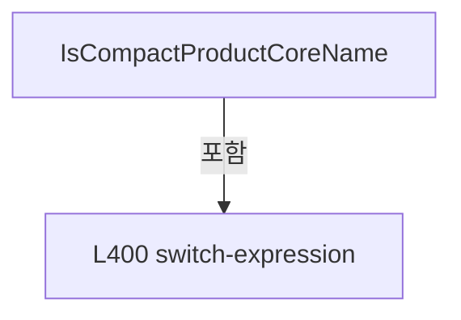

변경 전 점검: 입력/반환 타입, 위 호출자, 예외/취소 경로, 공유 상태와 저장·전송 소비자를 함께 확인합니다. 값의 단위나 물리 방향을 이름만으로 확정하지 않습니다.

### MethodDeclaration `DefaultText` · L407–410

[Drilling.File/Product/CProductFile.cs:407–410](https://github.com/kjuws10-rgb/A3Drilling/blob/5aee8e58439c9b455cae7c9593c9be986c3e682e/Drilling.File/Product/CProductFile.cs#L407-L410)

| 항목 | 실제 추출 값 |
| --- | --- |
| 서명 | string Drilling.File.Product.CProductFile.DefaultText(string, string) |
| 접근/수식자 | Private / private, static |
| 반환/값 타입 | string |
| 소속 타입 | NamedType:Drilling.File.Product.CProductFile |

입력 계약:

| 이름 | 타입 | 전달 | 선택/기본값 |
| --- | --- | --- | --- |
| value | string | None | False /  |
| defaultValue | string | None | False /  |

정적 호출자로 확인된 위치:

| 호출 파일/행 | 호출 표현식 | 런타임 분기 가능 |
| --- | --- | --- |
| [Drilling.File/Product/CProductFile.cs:98–98](https://github.com/kjuws10-rgb/A3Drilling/blob/5aee8e58439c9b455cae7c9593c9be986c3e682e/Drilling.File/Product/CProductFile.cs#L98-L98) | DefaultText | False |
| [Drilling.File/Product/CProductFile.cs:103–103](https://github.com/kjuws10-rgb/A3Drilling/blob/5aee8e58439c9b455cae7c9593c9be986c3e682e/Drilling.File/Product/CProductFile.cs#L103-L103) | DefaultText | False |

호출하는 대상과 해석 범위:

| 원본 행 | 표현식 | 분석 상태 | 대상/소스 위치 |
| --- | --- | --- | --- |
| 409 | string.IsNullOrWhiteSpace | resolved | bool string.IsNullOrWhiteSpace(string?) |

본문의 실제 연산·분기·예외·반환 순서(원문 위치 순):

| 원본 행 | 종류 | 주석 해설 |
| --- | --- | --- |
| 409 | call | 함수·델리게이트 또는 객체 생성자를 호출합니다: string.IsNullOrWhiteSpace(value) |
| 409 | conditional-expression | 조건에 따라 결과식을 선택합니다: string.IsNullOrWhiteSpace(value) ? defaultValue : value |
| 409 | return | 호출자에게 값 또는 제어를 반환합니다: return string.IsNullOrWhiteSpace(value) ? defaultValue : value; |

변경 전 점검: 입력/반환 타입, 위 호출자, 예외/취소 경로, 공유 상태와 저장·전송 소비자를 함께 확인합니다. 값의 단위나 물리 방향을 이름만으로 확정하지 않습니다.

### MethodDeclaration `ParseInt` · L412–415

[Drilling.File/Product/CProductFile.cs:412–415](https://github.com/kjuws10-rgb/A3Drilling/blob/5aee8e58439c9b455cae7c9593c9be986c3e682e/Drilling.File/Product/CProductFile.cs#L412-L415)

| 항목 | 실제 추출 값 |
| --- | --- |
| 서명 | int Drilling.File.Product.CProductFile.ParseInt(string, int) |
| 접근/수식자 | Private / private, static |
| 반환/값 타입 | int |
| 소속 타입 | NamedType:Drilling.File.Product.CProductFile |

입력 계약:

| 이름 | 타입 | 전달 | 선택/기본값 |
| --- | --- | --- | --- |
| value | string | None | False /  |
| defaultValue | int | None | True / 0 |

정적 호출자로 확인된 위치:

| 호출 파일/행 | 호출 표현식 | 런타임 분기 가능 |
| --- | --- | --- |
| [Drilling.File/Product/CProductFile.cs:314–314](https://github.com/kjuws10-rgb/A3Drilling/blob/5aee8e58439c9b455cae7c9593c9be986c3e682e/Drilling.File/Product/CProductFile.cs#L314-L314) | ParseInt | False |
| [Drilling.File/Product/CProductFile.cs:315–315](https://github.com/kjuws10-rgb/A3Drilling/blob/5aee8e58439c9b455cae7c9593c9be986c3e682e/Drilling.File/Product/CProductFile.cs#L315-L315) | ParseInt | False |
| [Drilling.File/Product/CProductFile.cs:316–316](https://github.com/kjuws10-rgb/A3Drilling/blob/5aee8e58439c9b455cae7c9593c9be986c3e682e/Drilling.File/Product/CProductFile.cs#L316-L316) | ParseInt | False |
| [Drilling.File/Product/CProductFile.cs:331–331](https://github.com/kjuws10-rgb/A3Drilling/blob/5aee8e58439c9b455cae7c9593c9be986c3e682e/Drilling.File/Product/CProductFile.cs#L331-L331) | ParseInt | False |
| [Drilling.File/Product/CProductFile.cs:335–335](https://github.com/kjuws10-rgb/A3Drilling/blob/5aee8e58439c9b455cae7c9593c9be986c3e682e/Drilling.File/Product/CProductFile.cs#L335-L335) | ParseInt | False |
| [Drilling.File/Product/CProductFile.cs:336–336](https://github.com/kjuws10-rgb/A3Drilling/blob/5aee8e58439c9b455cae7c9593c9be986c3e682e/Drilling.File/Product/CProductFile.cs#L336-L336) | ParseInt | False |

호출하는 대상과 해석 범위:

| 원본 행 | 표현식 | 분석 상태 | 대상/소스 위치 |
| --- | --- | --- | --- |
| 414 | int.TryParse | resolved | bool int.TryParse(string?, System.Globalization.NumberStyles, System.IFormatProvider?, out int) |

본문의 실제 연산·분기·예외·반환 순서(원문 위치 순):

| 원본 행 | 종류 | 주석 해설 |
| --- | --- | --- |
| 414 | call | 함수·델리게이트 또는 객체 생성자를 호출합니다: int.TryParse(value, NumberStyles.Integer, CultureInfo.InvariantCulture, out var parsed) |
| 414 | conditional-expression | 조건에 따라 결과식을 선택합니다: int.TryParse(value, NumberStyles.Integer, CultureInfo.InvariantCulture, out var parsed) ? parsed : defaultValue |
| 414 | return | 호출자에게 값 또는 제어를 반환합니다: return int.TryParse(value, NumberStyles.Integer, CultureInfo.InvariantCulture, out var parsed) ? parsed : defaultValue; |

변경 전 점검: 입력/반환 타입, 위 호출자, 예외/취소 경로, 공유 상태와 저장·전송 소비자를 함께 확인합니다. 값의 단위나 물리 방향을 이름만으로 확정하지 않습니다.

### MethodDeclaration `ParseNullableInt` · L417–420

[Drilling.File/Product/CProductFile.cs:417–420](https://github.com/kjuws10-rgb/A3Drilling/blob/5aee8e58439c9b455cae7c9593c9be986c3e682e/Drilling.File/Product/CProductFile.cs#L417-L420)

| 항목 | 실제 추출 값 |
| --- | --- |
| 서명 | int? Drilling.File.Product.CProductFile.ParseNullableInt(string) |
| 접근/수식자 | Private / private, static |
| 반환/값 타입 | int? |
| 소속 타입 | NamedType:Drilling.File.Product.CProductFile |

입력 계약:

| 이름 | 타입 | 전달 | 선택/기본값 |
| --- | --- | --- | --- |
| value | string | None | False /  |

정적 호출자로 확인된 위치:

| 호출 파일/행 | 호출 표현식 | 런타임 분기 가능 |
| --- | --- | --- |
| [Drilling.File/Product/CProductFile.cs:332–332](https://github.com/kjuws10-rgb/A3Drilling/blob/5aee8e58439c9b455cae7c9593c9be986c3e682e/Drilling.File/Product/CProductFile.cs#L332-L332) | ParseNullableInt | False |

호출하는 대상과 해석 범위:

| 원본 행 | 표현식 | 분석 상태 | 대상/소스 위치 |
| --- | --- | --- | --- |
| 419 | int.TryParse | resolved | bool int.TryParse(string?, System.Globalization.NumberStyles, System.IFormatProvider?, out int) |

본문의 실제 연산·분기·예외·반환 순서(원문 위치 순):

| 원본 행 | 종류 | 주석 해설 |
| --- | --- | --- |
| 419 | call | 함수·델리게이트 또는 객체 생성자를 호출합니다: int.TryParse(value, NumberStyles.Integer, CultureInfo.InvariantCulture, out var parsed) |
| 419 | conditional-expression | 조건에 따라 결과식을 선택합니다: int.TryParse(value, NumberStyles.Integer, CultureInfo.InvariantCulture, out var parsed) ? parsed : null |
| 419 | return | 호출자에게 값 또는 제어를 반환합니다: return int.TryParse(value, NumberStyles.Integer, CultureInfo.InvariantCulture, out var parsed) ? parsed : null; |

변경 전 점검: 입력/반환 타입, 위 호출자, 예외/취소 경로, 공유 상태와 저장·전송 소비자를 함께 확인합니다. 값의 단위나 물리 방향을 이름만으로 확정하지 않습니다.

### MethodDeclaration `ParseNullableDouble` · L422–425

[Drilling.File/Product/CProductFile.cs:422–425](https://github.com/kjuws10-rgb/A3Drilling/blob/5aee8e58439c9b455cae7c9593c9be986c3e682e/Drilling.File/Product/CProductFile.cs#L422-L425)

| 항목 | 실제 추출 값 |
| --- | --- |
| 서명 | double? Drilling.File.Product.CProductFile.ParseNullableDouble(string) |
| 접근/수식자 | Private / private, static |
| 반환/값 타입 | double? |
| 소속 타입 | NamedType:Drilling.File.Product.CProductFile |

입력 계약:

| 이름 | 타입 | 전달 | 선택/기본값 |
| --- | --- | --- | --- |
| value | string | None | False /  |

정적 호출자로 확인된 위치:

| 호출 파일/행 | 호출 표현식 | 런타임 분기 가능 |
| --- | --- | --- |
| [Drilling.File/Product/CProductFile.cs:99–99](https://github.com/kjuws10-rgb/A3Drilling/blob/5aee8e58439c9b455cae7c9593c9be986c3e682e/Drilling.File/Product/CProductFile.cs#L99-L99) | ParseNullableDouble | False |
| [Drilling.File/Product/CProductFile.cs:100–100](https://github.com/kjuws10-rgb/A3Drilling/blob/5aee8e58439c9b455cae7c9593c9be986c3e682e/Drilling.File/Product/CProductFile.cs#L100-L100) | ParseNullableDouble | False |
| [Drilling.File/Product/CProductFile.cs:101–101](https://github.com/kjuws10-rgb/A3Drilling/blob/5aee8e58439c9b455cae7c9593c9be986c3e682e/Drilling.File/Product/CProductFile.cs#L101-L101) | ParseNullableDouble | False |
| [Drilling.File/Product/CProductFile.cs:103–103](https://github.com/kjuws10-rgb/A3Drilling/blob/5aee8e58439c9b455cae7c9593c9be986c3e682e/Drilling.File/Product/CProductFile.cs#L103-L103) | ParseNullableDouble | False |
| [Drilling.File/Product/CProductFile.cs:317–317](https://github.com/kjuws10-rgb/A3Drilling/blob/5aee8e58439c9b455cae7c9593c9be986c3e682e/Drilling.File/Product/CProductFile.cs#L317-L317) | ParseNullableDouble | False |
| [Drilling.File/Product/CProductFile.cs:318–318](https://github.com/kjuws10-rgb/A3Drilling/blob/5aee8e58439c9b455cae7c9593c9be986c3e682e/Drilling.File/Product/CProductFile.cs#L318-L318) | ParseNullableDouble | False |

호출하는 대상과 해석 범위:

| 원본 행 | 표현식 | 분석 상태 | 대상/소스 위치 |
| --- | --- | --- | --- |
| 424 | double.TryParse | resolved | bool double.TryParse(string?, System.Globalization.NumberStyles, System.IFormatProvider?, out double) |

본문의 실제 연산·분기·예외·반환 순서(원문 위치 순):

| 원본 행 | 종류 | 주석 해설 |
| --- | --- | --- |
| 424 | call | 함수·델리게이트 또는 객체 생성자를 호출합니다: double.TryParse(value, NumberStyles.Float, CultureInfo.InvariantCulture, out var parsed) |
| 424 | conditional-expression | 조건에 따라 결과식을 선택합니다: double.TryParse(value, NumberStyles.Float, CultureInfo.InvariantCulture, out var parsed) ? parsed : null |
| 424 | return | 호출자에게 값 또는 제어를 반환합니다: return double.TryParse(value, NumberStyles.Float, CultureInfo.InvariantCulture, out var parsed) ? parsed : null; |

변경 전 점검: 입력/반환 타입, 위 호출자, 예외/취소 경로, 공유 상태와 저장·전송 소비자를 함께 확인합니다. 값의 단위나 물리 방향을 이름만으로 확정하지 않습니다.

### MethodDeclaration `FormatDouble` · L427–430

[Drilling.File/Product/CProductFile.cs:427–430](https://github.com/kjuws10-rgb/A3Drilling/blob/5aee8e58439c9b455cae7c9593c9be986c3e682e/Drilling.File/Product/CProductFile.cs#L427-L430)

| 항목 | 실제 추출 값 |
| --- | --- |
| 서명 | string Drilling.File.Product.CProductFile.FormatDouble(double?) |
| 접근/수식자 | Private / private, static |
| 반환/값 타입 | string |
| 소속 타입 | NamedType:Drilling.File.Product.CProductFile |

입력 계약:

| 이름 | 타입 | 전달 | 선택/기본값 |
| --- | --- | --- | --- |
| value | double? | None | False /  |

정적 호출자로 확인된 위치:

| 호출 파일/행 | 호출 표현식 | 런타임 분기 가능 |
| --- | --- | --- |
| [Drilling.File/Product/CProductFile.cs:136–136](https://github.com/kjuws10-rgb/A3Drilling/blob/5aee8e58439c9b455cae7c9593c9be986c3e682e/Drilling.File/Product/CProductFile.cs#L136-L136) | FormatDouble | False |
| [Drilling.File/Product/CProductFile.cs:137–137](https://github.com/kjuws10-rgb/A3Drilling/blob/5aee8e58439c9b455cae7c9593c9be986c3e682e/Drilling.File/Product/CProductFile.cs#L137-L137) | FormatDouble | False |
| [Drilling.File/Product/CProductFile.cs:138–138](https://github.com/kjuws10-rgb/A3Drilling/blob/5aee8e58439c9b455cae7c9593c9be986c3e682e/Drilling.File/Product/CProductFile.cs#L138-L138) | FormatDouble | False |
| [Drilling.File/Product/CProductFile.cs:141–141](https://github.com/kjuws10-rgb/A3Drilling/blob/5aee8e58439c9b455cae7c9593c9be986c3e682e/Drilling.File/Product/CProductFile.cs#L141-L141) | FormatDouble | False |

호출하는 대상과 해석 범위:

| 원본 행 | 표현식 | 분석 상태 | 대상/소스 위치 |
| --- | --- | --- | --- |
| 429 | .ToString | resolved | string double.ToString(string?, System.IFormatProvider?) |

본문의 실제 연산·분기·예외·반환 순서(원문 위치 순):

| 원본 행 | 종류 | 주석 해설 |
| --- | --- | --- |
| 429 | call | 함수·델리게이트 또는 객체 생성자를 호출합니다: .ToString("G", CultureInfo.InvariantCulture) |
| 429 | return | 호출자에게 값 또는 제어를 반환합니다: return value?.ToString("G", CultureInfo.InvariantCulture) ?? ""; |

변경 전 점검: 입력/반환 타입, 위 호출자, 예외/취소 경로, 공유 상태와 저장·전송 소비자를 함께 확인합니다. 값의 단위나 물리 방향을 이름만으로 확정하지 않습니다.

### MethodDeclaration `ToHistoryRow` · L432–446

[Drilling.File/Product/CProductFile.cs:432–446](https://github.com/kjuws10-rgb/A3Drilling/blob/5aee8e58439c9b455cae7c9593c9be986c3e682e/Drilling.File/Product/CProductFile.cs#L432-L446)

| 항목 | 실제 추출 값 |
| --- | --- |
| 서명 | System.Collections.Generic.IReadOnlyDictionary<string, string> Drilling.File.Product.CProductFile.ToHistoryRow(Drilling.Common.Product.ST_PRODUCT_HISTORY) |
| 접근/수식자 | Private / private, static |
| 반환/값 타입 | System.Collections.Generic.IReadOnlyDictionary<string, string> |
| 소속 타입 | NamedType:Drilling.File.Product.CProductFile |

입력 계약:

| 이름 | 타입 | 전달 | 선택/기본값 |
| --- | --- | --- | --- |
| history | Drilling.Common.Product.ST_PRODUCT_HISTORY | None | False /  |

정적 호출자로 확인된 위치:

| 호출 파일/행 | 호출 표현식 | 런타임 분기 가능 |
| --- | --- | --- |
| [Drilling.File/Product/CProductFile.cs:218–218](https://github.com/kjuws10-rgb/A3Drilling/blob/5aee8e58439c9b455cae7c9593c9be986c3e682e/Drilling.File/Product/CProductFile.cs#L218-L218) | ToHistoryRow | False |
| [Drilling.File/Product/CProductFile.cs:219–219](https://github.com/kjuws10-rgb/A3Drilling/blob/5aee8e58439c9b455cae7c9593c9be986c3e682e/Drilling.File/Product/CProductFile.cs#L219-L219) | ToHistoryRow | False |

호출하는 대상과 해석 범위:

| 원본 행 | 표현식 | 분석 상태 | 대상/소스 위치 |
| --- | --- | --- | --- |
| 434 | new Dictionary<string, string> | resolved | System.Collections.Generic.Dictionary<string, string>.Dictionary(System.Collections.Generic.IEqualityComparer<string>?) |
| 436 | FormatDate | resolved | string Drilling.File.Product.CProductFile.FormatDate(System.DateTimeOffset?) · Drilling.File/Product/CProductFile.cs:495 |

본문의 실제 연산·분기·예외·반환 순서(원문 위치 순):

| 원본 행 | 종류 | 주석 해설 |
| --- | --- | --- |
| 434 | call | 함수·델리게이트 또는 객체 생성자를 호출합니다: new Dictionary<string, string>(StringComparer.OrdinalIgnoreCase) { ["OCCURRED_AT"] = FormatDate(history.OccurredAt), ["ROW_TYPE"] = "EVENT", ["GLASS_ID"] = history.GlassId, ["PROCESS_ID"] = history.ProcessId, ["RECIPE_ID… |
| 434 | return | 호출자에게 값 또는 제어를 반환합니다: return new Dictionary<string, string>(StringComparer.OrdinalIgnoreCase) { ["OCCURRED_AT"] = FormatDate(history.OccurredAt), ["ROW_TYPE"] = "EVENT", ["GLASS_ID"] = history.GlassId, ["PROCESS_ID"] = history.ProcessId, ["RECIPE_ID"]  |
| 436 | assignment | 값을 대상에 대입합니다: ["OCCURRED_AT"] = FormatDate(history.OccurredAt) |
| 436 | call | 함수·델리게이트 또는 객체 생성자를 호출합니다: FormatDate(history.OccurredAt) |
| 437 | assignment | 값을 대상에 대입합니다: ["ROW_TYPE"] = "EVENT" |
| 438 | assignment | 값을 대상에 대입합니다: ["GLASS_ID"] = history.GlassId |
| 439 | assignment | 값을 대상에 대입합니다: ["PROCESS_ID"] = history.ProcessId |
| 440 | assignment | 값을 대상에 대입합니다: ["RECIPE_ID"] = history.RecipeId |
| 441 | assignment | 값을 대상에 대입합니다: ["ACTION"] = history.Action |
| 442 | assignment | 값을 대상에 대입합니다: ["STATE"] = history.State |
| 443 | assignment | 값을 대상에 대입합니다: ["RESULT"] = history.Result |
| 444 | assignment | 값을 대상에 대입합니다: ["DETAIL"] = history.Detail |

변경 전 점검: 입력/반환 타입, 위 호출자, 예외/취소 경로, 공유 상태와 저장·전송 소비자를 함께 확인합니다. 값의 단위나 물리 방향을 이름만으로 확정하지 않습니다.

### MethodDeclaration `ParseHistory` · L448–466

[Drilling.File/Product/CProductFile.cs:448–466](https://github.com/kjuws10-rgb/A3Drilling/blob/5aee8e58439c9b455cae7c9593c9be986c3e682e/Drilling.File/Product/CProductFile.cs#L448-L466)

| 항목 | 실제 추출 값 |
| --- | --- |
| 서명 | Drilling.Common.Product.ST_PRODUCT_HISTORY? Drilling.File.Product.CProductFile.ParseHistory(System.Collections.Generic.IReadOnlyDictionary<string, string>) |
| 접근/수식자 | Private / private, static |
| 반환/값 타입 | Drilling.Common.Product.ST_PRODUCT_HISTORY? |
| 소속 타입 | NamedType:Drilling.File.Product.CProductFile |

입력 계약:

| 이름 | 타입 | 전달 | 선택/기본값 |
| --- | --- | --- | --- |
| row | System.Collections.Generic.IReadOnlyDictionary<string, string> | None | False /  |

현재 부분 분석에서 직접 연결된 호출자는 없습니다. XAML/이벤트/인터페이스·델리게이트·외부 진입을 추가 확인해야 하며, 미사용으로 판정한 것이 아닙니다.

호출하는 대상과 해석 범위:

| 원본 행 | 표현식 | 분석 상태 | 대상/소스 위치 |
| --- | --- | --- | --- |
| 450 | ParseDate | resolved | System.DateTimeOffset? Drilling.File.Product.CProductFile.ParseDate(string) · Drilling.File/Product/CProductFile.cs:500 |
| 450 | CCsvParser.Get | resolved | string Drilling.File.Parser.CCsvParser.Get(System.Collections.Generic.IReadOnlyDictionary<string, string>, string) · Drilling.File/Parser/CCsvParser.cs:168 |
| 456 | new ST_PRODUCT_HISTORY | resolved | Drilling.Common.Product.ST_PRODUCT_HISTORY.ST_PRODUCT_HISTORY(System.DateTimeOffset, string, string, string, string, string, string, string) · Drilling.Common/Product/CProductManager.cs:1162 |
| 458 | CCsvParser.Get | resolved | string Drilling.File.Parser.CCsvParser.Get(System.Collections.Generic.IReadOnlyDictionary<string, string>, string) · Drilling.File/Parser/CCsvParser.cs:168 |
| 459 | CCsvParser.Get | resolved | string Drilling.File.Parser.CCsvParser.Get(System.Collections.Generic.IReadOnlyDictionary<string, string>, string) · Drilling.File/Parser/CCsvParser.cs:168 |
| 460 | CCsvParser.Get | resolved | string Drilling.File.Parser.CCsvParser.Get(System.Collections.Generic.IReadOnlyDictionary<string, string>, string) · Drilling.File/Parser/CCsvParser.cs:168 |
| 461 | CCsvParser.Get | resolved | string Drilling.File.Parser.CCsvParser.Get(System.Collections.Generic.IReadOnlyDictionary<string, string>, string) · Drilling.File/Parser/CCsvParser.cs:168 |
| 462 | CCsvParser.Get | resolved | string Drilling.File.Parser.CCsvParser.Get(System.Collections.Generic.IReadOnlyDictionary<string, string>, string) · Drilling.File/Parser/CCsvParser.cs:168 |
| 463 | CCsvParser.Get | resolved | string Drilling.File.Parser.CCsvParser.Get(System.Collections.Generic.IReadOnlyDictionary<string, string>, string) · Drilling.File/Parser/CCsvParser.cs:168 |
| 464 | CCsvParser.Get | resolved | string Drilling.File.Parser.CCsvParser.Get(System.Collections.Generic.IReadOnlyDictionary<string, string>, string) · Drilling.File/Parser/CCsvParser.cs:168 |

본문의 실제 연산·분기·예외·반환 순서(원문 위치 순):

| 원본 행 | 종류 | 주석 해설 |
| --- | --- | --- |
| 450 | call | 함수·델리게이트 또는 객체 생성자를 호출합니다: ParseDate(CCsvParser.Get(row, "OCCURRED_AT")) |
| 450 | call | 함수·델리게이트 또는 객체 생성자를 호출합니다: CCsvParser.Get(row, "OCCURRED_AT") |
| 450 | local-declaration | 지역 변수를 선언합니다: var occurredAt = ParseDate(CCsvParser.Get(row, "OCCURRED_AT")); |
| 450 | variable-initializer | 변수의 초기값을 지정합니다: occurredAt = ParseDate(CCsvParser.Get(row, "OCCURRED_AT")) |
| 451 | if | 조건에 따라 분기합니다: if (!occurredAt.HasValue) |
| 453 | return | 호출자에게 값 또는 제어를 반환합니다: return null; |
| 456 | call | 함수·델리게이트 또는 객체 생성자를 호출합니다: new ST_PRODUCT_HISTORY( occurredAt.Value, CCsvParser.Get(row, "GLASS_ID"), CCsvParser.Get(row, "PROCESS_ID"), CCsvParser.Get(row, "RECIPE_ID"), CCsvParser.Get(row, "ACTION"), CCsvParser.Get(row, "STATE"), CCsvParser.Get(… |
| 456 | return | 호출자에게 값 또는 제어를 반환합니다: return new ST_PRODUCT_HISTORY( occurredAt.Value, CCsvParser.Get(row, "GLASS_ID"), CCsvParser.Get(row, "PROCESS_ID"), CCsvParser.Get(row, "RECIPE_ID"), CCsvParser.Get(row, "ACTION"), CCsvParser.Get(row, "STATE"), CCsvParser.Get(row |
| 458 | call | 함수·델리게이트 또는 객체 생성자를 호출합니다: CCsvParser.Get(row, "GLASS_ID") |
| 459 | call | 함수·델리게이트 또는 객체 생성자를 호출합니다: CCsvParser.Get(row, "PROCESS_ID") |
| 460 | call | 함수·델리게이트 또는 객체 생성자를 호출합니다: CCsvParser.Get(row, "RECIPE_ID") |
| 461 | call | 함수·델리게이트 또는 객체 생성자를 호출합니다: CCsvParser.Get(row, "ACTION") |
| 462 | call | 함수·델리게이트 또는 객체 생성자를 호출합니다: CCsvParser.Get(row, "STATE") |
| 463 | call | 함수·델리게이트 또는 객체 생성자를 호출합니다: CCsvParser.Get(row, "RESULT") |
| 464 | call | 함수·델리게이트 또는 객체 생성자를 호출합니다: CCsvParser.Get(row, "DETAIL") |

제어 구문의 포함 구조(실제 실행 순서/CFG가 아닌 구문 탐색 그림):

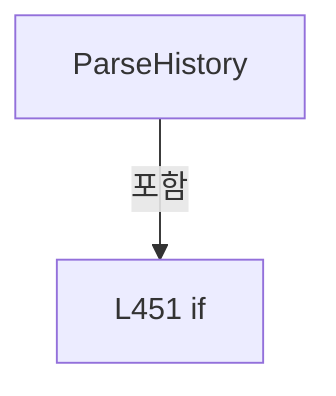

변경 전 점검: 입력/반환 타입, 위 호출자, 예외/취소 경로, 공유 상태와 저장·전송 소비자를 함께 확인합니다. 값의 단위나 물리 방향을 이름만으로 확정하지 않습니다.

### MethodDeclaration `WriteRowsAtomically` · L468–487

[Drilling.File/Product/CProductFile.cs:468–487](https://github.com/kjuws10-rgb/A3Drilling/blob/5aee8e58439c9b455cae7c9593c9be986c3e682e/Drilling.File/Product/CProductFile.cs#L468-L487)

| 항목 | 실제 추출 값 |
| --- | --- |
| 서명 | void Drilling.File.Product.CProductFile.WriteRowsAtomically(string, System.Collections.Generic.IReadOnlyList<string>, System.Collections.Generic.IReadOnlyList<System.Collections.Generic.IReadOnlyDictionary<string, string>>) |
| 접근/수식자 | Private / private, static |
| 반환/값 타입 | void |
| 소속 타입 | NamedType:Drilling.File.Product.CProductFile |

입력 계약:

| 이름 | 타입 | 전달 | 선택/기본값 |
| --- | --- | --- | --- |
| path | string | None | False /  |
| headers | System.Collections.Generic.IReadOnlyList<string> | None | False /  |
| rows | System.Collections.Generic.IReadOnlyList<System.Collections.Generic.IReadOnlyDictionary<string, string>> | None | False /  |

정적 호출자로 확인된 위치:

| 호출 파일/행 | 호출 표현식 | 런타임 분기 가능 |
| --- | --- | --- |
| [Drilling.File/Product/CProductFile.cs:221–221](https://github.com/kjuws10-rgb/A3Drilling/blob/5aee8e58439c9b455cae7c9593c9be986c3e682e/Drilling.File/Product/CProductFile.cs#L221-L221) | WriteRowsAtomically | False |

호출하는 대상과 해석 범위:

| 원본 행 | 표현식 | 분석 상태 | 대상/소스 위치 |
| --- | --- | --- | --- |
| 470 | Guid.NewGuid | resolved | System.Guid System.Guid.NewGuid() |
| 473 | CCsvParser.Write | resolved | void Drilling.File.Parser.CCsvParser.Write(string, System.Collections.Generic.IReadOnlyList<string>, System.Collections.Generic.IEnumerable<System.Collections.Generic.IReadOnlyDictionary<string, string>>) · Drilling.File/Parser/CCsvParser.cs:58 |
| 474 | System.IO.File.Exists | resolved | bool System.IO.File.Exists(string?) |
| 476 | System.IO.File.Replace | resolved | void System.IO.File.Replace(string, string, string?) |
| 480 | System.IO.File.Move | resolved | void System.IO.File.Move(string, string) |
| 485 | DeleteIfExists | resolved | void Drilling.File.Product.CProductFile.DeleteIfExists(string) · Drilling.File/Product/CProductFile.cs:505 |

본문의 실제 연산·분기·예외·반환 순서(원문 위치 순):

| 원본 행 | 종류 | 주석 해설 |
| --- | --- | --- |
| 470 | call | 함수·델리게이트 또는 객체 생성자를 호출합니다: Guid.NewGuid() |
| 470 | local-declaration | 지역 변수를 선언합니다: var temporaryPath = $"{path}.{Guid.NewGuid():N}.tmp"; |
| 470 | variable-initializer | 변수의 초기값을 지정합니다: temporaryPath = $"{path}.{Guid.NewGuid():N}.tmp" |
| 471 | try | 예외 처리 범위입니다: try |
| 473 | call | 함수·델리게이트 또는 객체 생성자를 호출합니다: CCsvParser.Write(temporaryPath, headers, rows) |
| 474 | call | 함수·델리게이트 또는 객체 생성자를 호출합니다: System.IO.File.Exists(path) |
| 474 | if | 조건에 따라 분기합니다: if (System.IO.File.Exists(path)) |
| 476 | call | 함수·델리게이트 또는 객체 생성자를 호출합니다: System.IO.File.Replace(temporaryPath, path, null) |
| 478 | else | 앞 조건이 거짓인 경로입니다: else |
| 480 | call | 함수·델리게이트 또는 객체 생성자를 호출합니다: System.IO.File.Move(temporaryPath, path) |
| 483 | finally | 종료 정리 구간입니다: finally |
| 485 | call | 함수·델리게이트 또는 객체 생성자를 호출합니다: DeleteIfExists(temporaryPath) |

제어 구문의 포함 구조(실제 실행 순서/CFG가 아닌 구문 탐색 그림):

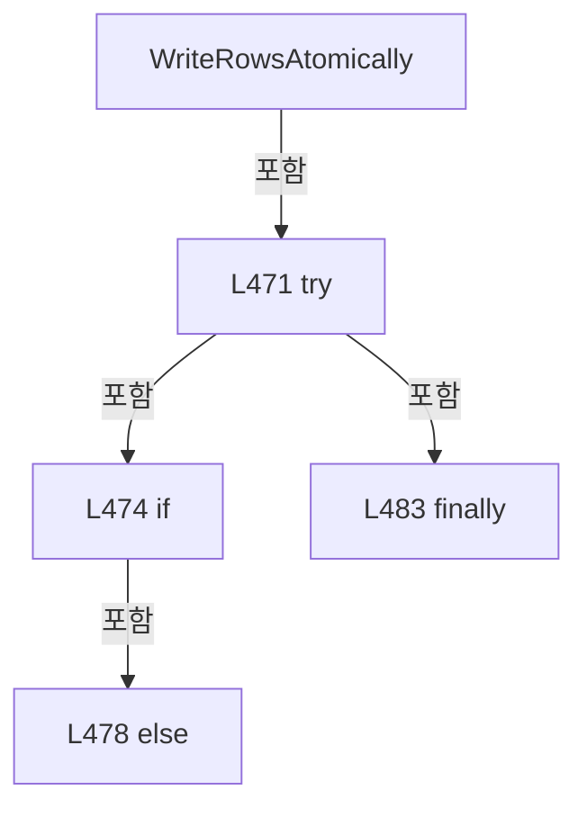

변경 전 점검: 입력/반환 타입, 위 호출자, 예외/취소 경로, 공유 상태와 저장·전송 소비자를 함께 확인합니다. 값의 단위나 물리 방향을 이름만으로 확정하지 않습니다.

### MethodDeclaration `ParseEnum` · L489–493

[Drilling.File/Product/CProductFile.cs:489–493](https://github.com/kjuws10-rgb/A3Drilling/blob/5aee8e58439c9b455cae7c9593c9be986c3e682e/Drilling.File/Product/CProductFile.cs#L489-L493)

| 항목 | 실제 추출 값 |
| --- | --- |
| 서명 | T Drilling.File.Product.CProductFile.ParseEnum<T>(string, T) |
| 접근/수식자 | Private / private, static |
| 반환/값 타입 | T |
| 소속 타입 | NamedType:Drilling.File.Product.CProductFile |

입력 계약:

| 이름 | 타입 | 전달 | 선택/기본값 |
| --- | --- | --- | --- |
| value | string | None | False /  |
| defaultValue | T | None | False /  |

정적 호출자로 확인된 위치:

| 호출 파일/행 | 호출 표현식 | 런타임 분기 가능 |
| --- | --- | --- |
| [Drilling.File/Product/CProductFile.cs:97–97](https://github.com/kjuws10-rgb/A3Drilling/blob/5aee8e58439c9b455cae7c9593c9be986c3e682e/Drilling.File/Product/CProductFile.cs#L97-L97) | ParseEnum | False |
| [Drilling.File/Product/CProductFile.cs:103–103](https://github.com/kjuws10-rgb/A3Drilling/blob/5aee8e58439c9b455cae7c9593c9be986c3e682e/Drilling.File/Product/CProductFile.cs#L103-L103) | ParseEnum | False |
| [Drilling.File/Product/CProductFile.cs:323–323](https://github.com/kjuws10-rgb/A3Drilling/blob/5aee8e58439c9b455cae7c9593c9be986c3e682e/Drilling.File/Product/CProductFile.cs#L323-L323) | ParseEnum | False |

호출하는 대상과 해석 범위:

| 원본 행 | 표현식 | 분석 상태 | 대상/소스 위치 |
| --- | --- | --- | --- |
| 492 | Enum.TryParse<T> | resolved | bool System.Enum.TryParse<T>(string?, bool, out T) |

본문의 실제 연산·분기·예외·반환 순서(원문 위치 순):

| 원본 행 | 종류 | 주석 해설 |
| --- | --- | --- |
| 492 | call | 함수·델리게이트 또는 객체 생성자를 호출합니다: Enum.TryParse<T>(value, true, out var result) |
| 492 | conditional-expression | 조건에 따라 결과식을 선택합니다: Enum.TryParse<T>(value, true, out var result) ? result : defaultValue |
| 492 | return | 호출자에게 값 또는 제어를 반환합니다: return Enum.TryParse<T>(value, true, out var result) ? result : defaultValue; |

변경 전 점검: 입력/반환 타입, 위 호출자, 예외/취소 경로, 공유 상태와 저장·전송 소비자를 함께 확인합니다. 값의 단위나 물리 방향을 이름만으로 확정하지 않습니다.

### MethodDeclaration `FormatDate` · L495–498

[Drilling.File/Product/CProductFile.cs:495–498](https://github.com/kjuws10-rgb/A3Drilling/blob/5aee8e58439c9b455cae7c9593c9be986c3e682e/Drilling.File/Product/CProductFile.cs#L495-L498)

| 항목 | 실제 추출 값 |
| --- | --- |
| 서명 | string Drilling.File.Product.CProductFile.FormatDate(System.DateTimeOffset?) |
| 접근/수식자 | Private / private, static |
| 반환/값 타입 | string |
| 소속 타입 | NamedType:Drilling.File.Product.CProductFile |

입력 계약:

| 이름 | 타입 | 전달 | 선택/기본값 |
| --- | --- | --- | --- |
| value | System.DateTimeOffset? | None | False /  |

정적 호출자로 확인된 위치:

| 호출 파일/행 | 호출 표현식 | 런타임 분기 가능 |
| --- | --- | --- |
| [Drilling.File/Product/CProductFile.cs:155–155](https://github.com/kjuws10-rgb/A3Drilling/blob/5aee8e58439c9b455cae7c9593c9be986c3e682e/Drilling.File/Product/CProductFile.cs#L155-L155) | FormatDate | False |
| [Drilling.File/Product/CProductFile.cs:436–436](https://github.com/kjuws10-rgb/A3Drilling/blob/5aee8e58439c9b455cae7c9593c9be986c3e682e/Drilling.File/Product/CProductFile.cs#L436-L436) | FormatDate | False |

호출하는 대상과 해석 범위:

| 원본 행 | 표현식 | 분석 상태 | 대상/소스 위치 |
| --- | --- | --- | --- |
| 497 | .ToString | resolved | string System.DateTimeOffset.ToString(string?, System.IFormatProvider?) |

본문의 실제 연산·분기·예외·반환 순서(원문 위치 순):

| 원본 행 | 종류 | 주석 해설 |
| --- | --- | --- |
| 497 | call | 함수·델리게이트 또는 객체 생성자를 호출합니다: .ToString("O", CultureInfo.InvariantCulture) |
| 497 | return | 호출자에게 값 또는 제어를 반환합니다: return value?.ToString("O", CultureInfo.InvariantCulture) ?? ""; |

변경 전 점검: 입력/반환 타입, 위 호출자, 예외/취소 경로, 공유 상태와 저장·전송 소비자를 함께 확인합니다. 값의 단위나 물리 방향을 이름만으로 확정하지 않습니다.

### MethodDeclaration `ParseDate` · L500–503

[Drilling.File/Product/CProductFile.cs:500–503](https://github.com/kjuws10-rgb/A3Drilling/blob/5aee8e58439c9b455cae7c9593c9be986c3e682e/Drilling.File/Product/CProductFile.cs#L500-L503)

| 항목 | 실제 추출 값 |
| --- | --- |
| 서명 | System.DateTimeOffset? Drilling.File.Product.CProductFile.ParseDate(string) |
| 접근/수식자 | Private / private, static |
| 반환/값 타입 | System.DateTimeOffset? |
| 소속 타입 | NamedType:Drilling.File.Product.CProductFile |

입력 계약:

| 이름 | 타입 | 전달 | 선택/기본값 |
| --- | --- | --- | --- |
| value | string | None | False /  |

정적 호출자로 확인된 위치:

| 호출 파일/행 | 호출 표현식 | 런타임 분기 가능 |
| --- | --- | --- |
| [Drilling.File/Product/CProductFile.cs:324–324](https://github.com/kjuws10-rgb/A3Drilling/blob/5aee8e58439c9b455cae7c9593c9be986c3e682e/Drilling.File/Product/CProductFile.cs#L324-L324) | ParseDate | False |
| [Drilling.File/Product/CProductFile.cs:450–450](https://github.com/kjuws10-rgb/A3Drilling/blob/5aee8e58439c9b455cae7c9593c9be986c3e682e/Drilling.File/Product/CProductFile.cs#L450-L450) | ParseDate | False |

호출하는 대상과 해석 범위:

| 원본 행 | 표현식 | 분석 상태 | 대상/소스 위치 |
| --- | --- | --- | --- |
| 502 | DateTimeOffset.TryParse | resolved | bool System.DateTimeOffset.TryParse(string?, System.IFormatProvider?, System.Globalization.DateTimeStyles, out System.DateTimeOffset) |

본문의 실제 연산·분기·예외·반환 순서(원문 위치 순):

| 원본 행 | 종류 | 주석 해설 |
| --- | --- | --- |
| 502 | call | 함수·델리게이트 또는 객체 생성자를 호출합니다: DateTimeOffset.TryParse(value, CultureInfo.InvariantCulture, DateTimeStyles.RoundtripKind, out var result) |
| 502 | conditional-expression | 조건에 따라 결과식을 선택합니다: DateTimeOffset.TryParse(value, CultureInfo.InvariantCulture, DateTimeStyles.RoundtripKind, out var result) ? result : null |
| 502 | return | 호출자에게 값 또는 제어를 반환합니다: return DateTimeOffset.TryParse(value, CultureInfo.InvariantCulture, DateTimeStyles.RoundtripKind, out var result) ? result : null; |

변경 전 점검: 입력/반환 타입, 위 호출자, 예외/취소 경로, 공유 상태와 저장·전송 소비자를 함께 확인합니다. 값의 단위나 물리 방향을 이름만으로 확정하지 않습니다.

### MethodDeclaration `DeleteIfExists` · L505–511

[Drilling.File/Product/CProductFile.cs:505–511](https://github.com/kjuws10-rgb/A3Drilling/blob/5aee8e58439c9b455cae7c9593c9be986c3e682e/Drilling.File/Product/CProductFile.cs#L505-L511)

| 항목 | 실제 추출 값 |
| --- | --- |
| 서명 | void Drilling.File.Product.CProductFile.DeleteIfExists(string) |
| 접근/수식자 | Private / private, static |
| 반환/값 타입 | void |
| 소속 타입 | NamedType:Drilling.File.Product.CProductFile |

입력 계약:

| 이름 | 타입 | 전달 | 선택/기본값 |
| --- | --- | --- | --- |
| path | string | None | False /  |

정적 호출자로 확인된 위치:

| 호출 파일/행 | 호출 표현식 | 런타임 분기 가능 |
| --- | --- | --- |
| [Drilling.File/Product/CProductFile.cs:200–200](https://github.com/kjuws10-rgb/A3Drilling/blob/5aee8e58439c9b455cae7c9593c9be986c3e682e/Drilling.File/Product/CProductFile.cs#L200-L200) | DeleteIfExists | False |
| [Drilling.File/Product/CProductFile.cs:207–207](https://github.com/kjuws10-rgb/A3Drilling/blob/5aee8e58439c9b455cae7c9593c9be986c3e682e/Drilling.File/Product/CProductFile.cs#L207-L207) | DeleteIfExists | False |
| [Drilling.File/Product/CProductFile.cs:485–485](https://github.com/kjuws10-rgb/A3Drilling/blob/5aee8e58439c9b455cae7c9593c9be986c3e682e/Drilling.File/Product/CProductFile.cs#L485-L485) | DeleteIfExists | False |

호출하는 대상과 해석 범위:

| 원본 행 | 표현식 | 분석 상태 | 대상/소스 위치 |
| --- | --- | --- | --- |
| 507 | System.IO.File.Exists | resolved | bool System.IO.File.Exists(string?) |
| 509 | System.IO.File.Delete | resolved | void System.IO.File.Delete(string) |

본문의 실제 연산·분기·예외·반환 순서(원문 위치 순):

| 원본 행 | 종류 | 주석 해설 |
| --- | --- | --- |
| 507 | call | 함수·델리게이트 또는 객체 생성자를 호출합니다: System.IO.File.Exists(path) |
| 507 | if | 조건에 따라 분기합니다: if (System.IO.File.Exists(path)) |
| 509 | call | 함수·델리게이트 또는 객체 생성자를 호출합니다: System.IO.File.Delete(path) |

제어 구문의 포함 구조(실제 실행 순서/CFG가 아닌 구문 탐색 그림):

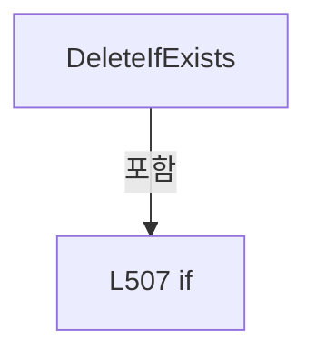

변경 전 점검: 입력/반환 타입, 위 호출자, 예외/취소 경로, 공유 상태와 저장·전송 소비자를 함께 확인합니다. 값의 단위나 물리 방향을 이름만으로 확정하지 않습니다.

## 구문·바인딩 한계

전체 WPF/벤더 SDK/프로젝트별 빌드 조건을 로드한 정식 빌드가 아닙니다. `resolved`는 이 부분 컴파일에서의 심볼 연결이며 virtual/interface/delegate/이벤트/Reflection/XAML의 실제 런타임 구현을 확정하지 않습니다. `candidate`와 `unresolved`는 후속 확인 대상으로 남깁니다.

## 원문 전체 주석 해설본

[원본 모든 행과 행별 해설 보기](../../../annotated/Drilling.File/Product/CProductFile.cs.annotated.txt)

원본을 빠뜨리거나 임의로 줄이지 않았습니다. `L000001 |` 표시는 원본 행 번호, `// 해설`은 별도 설명입니다. 실행용 소스가 아닌 문서입니다.

## 수정·재검증 체크

- 원본 Commit과 현재 작업 파일 SHA가 같은지 먼저 확인합니다. 다르면 이 문서를 과거 버전 자료로 취급합니다.
- 선언·직접 호출·이벤트/인터페이스 경계·설정 소비를 함께 확인합니다. 정적 연결의 빈 곳을 정상 경로로 추정하지 않습니다.
- 저장 형식/단위/식별자·재시도·취소·예외·롤백에 영향을 주는 변경은 상세 해설장과 호출자를 다시 검토합니다.
- 도구의 구문 추출과 별도 정적 추적 해설, 실제 빌드·시뮬레이션·실장비 검증 결과를 분리합니다.
