# Drilling.File/ReviewOffset/CReviewOffsetFile.cs

| 항목 | 내용 |
| --- | --- |
| 원본 저장소 | https://github.com/kjuws10-rgb/A3Drilling.git |
| 원본 Commit | 5aee8e58439c9b455cae7c9593c9be986c3e682e |
| 원본 SHA256 | b19d8135beeb0115fad9b33858224ae26ab4383738383a6f82956152f328a35b |
| 파일 분류 | code |
| 원본 크기/행 | 29,435 bytes / 750 physical lines |
| 인코딩 | utf-8-sig |
| 검토 범위 | 구문/부분 의미 분석에서 추출한 사실. 동작·물리 단위·실장비 합격을 보증하지 않습니다. |
| 원본 링크 | [고정 Commit 원본](https://github.com/kjuws10-rgb/A3Drilling/blob/5aee8e58439c9b455cae7c9593c9be986c3e682e/Drilling.File/ReviewOffset/CReviewOffsetFile.cs) |

## 파일의 역할과 읽는 순서

정의·설정·레시피·결과·스크립트의 파일 입출력과 데이터 형식을 담당합니다. 저장 필드를 통신 송신 필드로 단정하지 않습니다.

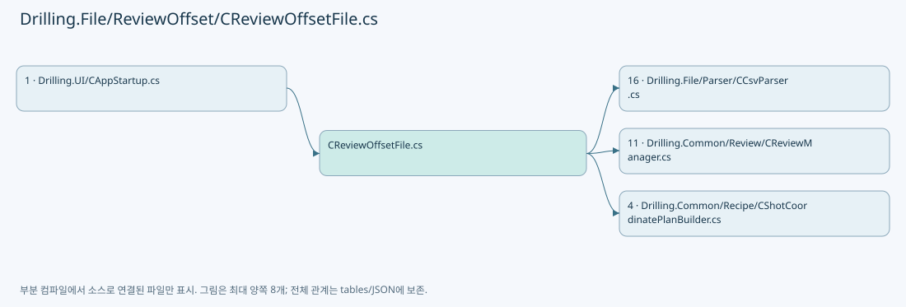

## 네임스페이스·타입·상속

| 타입 | 구분 | 원본 범위 | 선언/상속 |
| --- | --- | --- | --- |
| CReviewOffsetFile | ClassDeclaration | 8–750 | CReviewOffsetFile: CReviewOffsetFileBase |
| ST_APPLY_HISTORY_CACHE | RecordDeclaration | 50–53 | ST_APPLY_HISTORY_CACHE |

## 멤버 빠른 목록

| 이름 | 종류 | 범위 | 서명 |
| --- | --- | --- | --- |
| ApplyHistoryDirectoryName | FieldDeclaration | L10–10 | string Drilling.File.ReviewOffset.CReviewOffsetFile.ApplyHistoryDirectoryName |
| ApplyHistoryFileName | FieldDeclaration | L11–11 | string Drilling.File.ReviewOffset.CReviewOffsetFile.ApplyHistoryFileName |
| Headers | FieldDeclaration | L12–19 | System.Collections.Generic.IReadOnlyList<string> Drilling.File.ReviewOffset.CReviewOffsetFile.Headers |
| RequiredHeaderGroups | FieldDeclaration | L21–27 | System.Collections.Generic.IReadOnlyList<System.Collections.Generic.IReadOnlyList<string>> Drilling.File.ReviewOffset.CReviewOffsetFile.RequiredHeaderGroups |
| ApplyHistoryHeaders | FieldDeclaration | L29–34 | System.Collections.Generic.IReadOnlyList<string> Drilling.File.ReviewOffset.CReviewOffsetFile.ApplyHistoryHeaders |
| ApplyHistoryRequiredHeaderGroups | FieldDeclaration | L36–41 | System.Collections.Generic.IReadOnlyList<System.Collections.Generic.IReadOnlyList<string>> Drilling.File.ReviewOffset.CReviewOffsetFile.ApplyHistoryRequiredHeaderGroups |
| _applicationRoot | FieldDeclaration | L43–43 | string Drilling.File.ReviewOffset.CReviewOffsetFile._applicationRoot |
| _recipeRoot | FieldDeclaration | L44–44 | string Drilling.File.ReviewOffset.CReviewOffsetFile._recipeRoot |
| _now | FieldDeclaration | L45–45 | System.Func<System.DateTimeOffset> Drilling.File.ReviewOffset.CReviewOffsetFile._now |
| _fileLock | FieldDeclaration | L46–46 | System.Threading.SemaphoreSlim Drilling.File.ReviewOffset.CReviewOffsetFile._fileLock |
| _applyHistoryCache | FieldDeclaration | L47–48 | System.Collections.Generic.Dictionary<string, Drilling.File.ReviewOffset.CReviewOffsetFile.ST_APPLY_HISTORY_CACHE> Drilling.File.ReviewOffset.CReviewOffsetFile._applyHistoryCache |
| .ctor | ConstructorDeclaration | L55–61 | Drilling.File.ReviewOffset.CReviewOffsetFile.CReviewOffsetFile(string, System.Func<System.DateTimeOffset>?) |
| RootPath | PropertyDeclaration | L63–63 | string Drilling.File.ReviewOffset.CReviewOffsetFile.RootPath |
| LoadLatest | MethodDeclaration | L65–78 | System.Threading.Tasks.Task<Drilling.Common.Review.ST_REVIEW_OFFSET_FILE_DATA> Drilling.File.ReviewOffset.CReviewOffsetFile.LoadLatest(string, System.Threading.CancellationToken) |
| LoadLatestCore | MethodDeclaration | L80–105 | Drilling.Common.Review.ST_REVIEW_OFFSET_FILE_DATA Drilling.File.ReviewOffset.CReviewOffsetFile.LoadLatestCore(string, System.Threading.CancellationToken) |
| SaveNew | MethodDeclaration | L107–121 | System.Threading.Tasks.Task<Drilling.Common.Review.ST_REVIEW_OFFSET_FILE_DATA> Drilling.File.ReviewOffset.CReviewOffsetFile.SaveNew(string, System.Collections.Generic.IReadOnlyList<Drilling.Common.Review.ST_REVIEW_OFFSET_ROW>, System.Threading.CancellationToken) |
| FindSourceApplication | MethodDeclaration | L123–143 | System.Threading.Tasks.Task<Drilling.Common.Review.ST_REVIEW_OFFSET_SOURCE_APPLICATION?> Drilling.File.ReviewOffset.CReviewOffsetFile.FindSourceApplication(string, string, System.Threading.CancellationToken) |
| SaveNewFromSource | MethodDeclaration | L145–212 | System.Threading.Tasks.Task<Drilling.Common.Review.ST_REVIEW_OFFSET_FILE_DATA> Drilling.File.ReviewOffset.CReviewOffsetFile.SaveNewFromSource(string, System.Collections.Generic.IReadOnlyList<Drilling.Common.Review.ST_REVIEW_OFFSET_ROW>, string, bool, System.Threading.CancellationToken) |
| SaveNewCore | MethodDeclaration | L214–258 | Drilling.Common.Review.ST_REVIEW_OFFSET_FILE_DATA Drilling.File.ReviewOffset.CReviewOffsetFile.SaveNewCore(string, System.Collections.Generic.IReadOnlyList<Drilling.Common.Review.ST_REVIEW_OFFSET_ROW>, System.Threading.CancellationToken, System.DateTimeOffset?) |
| RollbackLatest | MethodDeclaration | L260–387 | System.Threading.Tasks.Task<Drilling.Common.Review.ST_REVIEW_OFFSET_ROLLBACK_RESULT> Drilling.File.ReviewOffset.CReviewOffsetFile.RollbackLatest(string, string, System.Threading.CancellationToken) |
| EnumerateActiveFiles | MethodDeclaration | L389–394 | System.Collections.Generic.IEnumerable<string> Drilling.File.ReviewOffset.CReviewOffsetFile.EnumerateActiveFiles(string) |
| FindSourceApplicationCore | MethodDeclaration | L396–404 | Drilling.Common.Review.ST_REVIEW_OFFSET_SOURCE_APPLICATION? Drilling.File.ReviewOffset.CReviewOffsetFile.FindSourceApplicationCore(string, System.Collections.Generic.IReadOnlyList<Drilling.Common.Review.ST_REVIEW_OFFSET_SOURCE_APPLICATION>) |
| LoadApplyHistory | MethodDeclaration | L406–479 | System.Collections.Generic.IReadOnlyList<Drilling.Common.Review.ST_REVIEW_OFFSET_SOURCE_APPLICATION> Drilling.File.ReviewOffset.CReviewOffsetFile.LoadApplyHistory(string, System.Threading.CancellationToken) |
| AppendApplyHistory | MethodDeclaration | L481–501 | void Drilling.File.ReviewOffset.CReviewOffsetFile.AppendApplyHistory(string, System.Collections.Generic.IReadOnlyList<Drilling.Common.Review.ST_REVIEW_OFFSET_SOURCE_APPLICATION>, Drilling.Common.Review.ST_REVIEW_OFFSET_SOURCE_APPLICATION, System.Threading.CancellationToken) |
| WriteApplyHistory | MethodDeclaration | L503–530 | void Drilling.File.ReviewOffset.CReviewOffsetFile.WriteApplyHistory(string, System.Collections.Generic.IReadOnlyList<Drilling.Common.Review.ST_REVIEW_OFFSET_SOURCE_APPLICATION>, System.Threading.CancellationToken) |
| UpdateApplyHistoryCache | MethodDeclaration | L532–552 | void Drilling.File.ReviewOffset.CReviewOffsetFile.UpdateApplyHistoryCache(string, System.Collections.Generic.IReadOnlyList<Drilling.Common.Review.ST_REVIEW_OFFSET_SOURCE_APPLICATION>) |
| ToApplyHistoryCsvRow | MethodDeclaration | L554–563 | System.Collections.Generic.IReadOnlyDictionary<string, string> Drilling.File.ReviewOffset.CReviewOffsetFile.ToApplyHistoryCsvRow(Drilling.Common.Review.ST_REVIEW_OFFSET_SOURCE_APPLICATION) |
| GetApplyHistoryPath | MethodDeclaration | L565–575 | string Drilling.File.ReviewOffset.CReviewOffsetFile.GetApplyHistoryPath(string, System.DateTimeOffset) |
| NormalizeSourceIdentity | MethodDeclaration | L577–602 | string Drilling.File.ReviewOffset.CReviewOffsetFile.NormalizeSourceIdentity(string, bool) |
| NormalizeStoredSourceIdentity | MethodDeclaration | L604–610 | string Drilling.File.ReviewOffset.CReviewOffsetFile.NormalizeStoredSourceIdentity(string) |
| RequireRecipeId | MethodDeclaration | L612–621 | string Drilling.File.ReviewOffset.CReviewOffsetFile.RequireRecipeId(string, string) |
| CreateArchivePath | MethodDeclaration | L623–634 | string Drilling.File.ReviewOffset.CReviewOffsetFile.CreateArchivePath(string, string) |
| Load | MethodDeclaration | L636–668 | Drilling.Common.Review.ST_REVIEW_OFFSET_FILE_DATA Drilling.File.ReviewOffset.CReviewOffsetFile.Load(string, string, System.Threading.CancellationToken) |
| GetRecipeOffsetDirectory | MethodDeclaration | L670–673 | string Drilling.File.ReviewOffset.CReviewOffsetFile.GetRecipeOffsetDirectory(string) |
| ToOffsetRow | MethodDeclaration | L675–698 | Drilling.Common.Review.ST_REVIEW_OFFSET_ROW Drilling.File.ReviewOffset.CReviewOffsetFile.ToOffsetRow(System.Collections.Generic.IReadOnlyDictionary<string, string>, int) |
| Number | LocalFunctionStatement | L689–691 | double Number(string) |
| ToCsvRow | MethodDeclaration | L700–710 | System.Collections.Generic.IReadOnlyDictionary<string, string> Drilling.File.ReviewOffset.CReviewOffsetFile.ToCsvRow(Drilling.Common.Review.ST_REVIEW_OFFSET_ROW) |
| TryParseSavedAt | MethodDeclaration | L712–729 | System.DateTimeOffset? Drilling.File.ReviewOffset.CReviewOffsetFile.TryParseSavedAt(string) |
| NormalizeRecipeId | MethodDeclaration | L731–734 | string Drilling.File.ReviewOffset.CReviewOffsetFile.NormalizeRecipeId(string) |
| FormatDouble | MethodDeclaration | L736–739 | string Drilling.File.ReviewOffset.CReviewOffsetFile.FormatDouble(double) |
| SanitizeFileName | MethodDeclaration | L741–749 | string Drilling.File.ReviewOffset.CReviewOffsetFile.SanitizeFileName(string) |

## 멤버별 상세 계약·호출·처리 해설

### FieldDeclaration `ApplyHistoryDirectoryName` · L10–10

[Drilling.File/ReviewOffset/CReviewOffsetFile.cs:10–10](https://github.com/kjuws10-rgb/A3Drilling/blob/5aee8e58439c9b455cae7c9593c9be986c3e682e/Drilling.File/ReviewOffset/CReviewOffsetFile.cs#L10-L10)

| 항목 | 실제 추출 값 |
| --- | --- |
| 서명 | string Drilling.File.ReviewOffset.CReviewOffsetFile.ApplyHistoryDirectoryName |
| 접근/수식자 | Private / private, const |
| 반환/값 타입 | string |
| 소속 타입 | NamedType:Drilling.File.ReviewOffset.CReviewOffsetFile |

현재 부분 분석에서 직접 연결된 호출자는 없습니다. XAML/이벤트/인터페이스·델리게이트·외부 진입을 추가 확인해야 하며, 미사용으로 판정한 것이 아닙니다.

본문의 실제 연산·분기·예외·반환 순서(원문 위치 순):

| 원본 행 | 종류 | 주석 해설 |
| --- | --- | --- |
| 10 | variable-initializer | 변수의 초기값을 지정합니다: ApplyHistoryDirectoryName = "_apply" |

변경 전 점검: 입력/반환 타입, 위 호출자, 예외/취소 경로, 공유 상태와 저장·전송 소비자를 함께 확인합니다. 값의 단위나 물리 방향을 이름만으로 확정하지 않습니다.

### FieldDeclaration `ApplyHistoryFileName` · L11–11

[Drilling.File/ReviewOffset/CReviewOffsetFile.cs:11–11](https://github.com/kjuws10-rgb/A3Drilling/blob/5aee8e58439c9b455cae7c9593c9be986c3e682e/Drilling.File/ReviewOffset/CReviewOffsetFile.cs#L11-L11)

| 항목 | 실제 추출 값 |
| --- | --- |
| 서명 | string Drilling.File.ReviewOffset.CReviewOffsetFile.ApplyHistoryFileName |
| 접근/수식자 | Private / private, const |
| 반환/값 타입 | string |
| 소속 타입 | NamedType:Drilling.File.ReviewOffset.CReviewOffsetFile |

현재 부분 분석에서 직접 연결된 호출자는 없습니다. XAML/이벤트/인터페이스·델리게이트·외부 진입을 추가 확인해야 하며, 미사용으로 판정한 것이 아닙니다.

본문의 실제 연산·분기·예외·반환 순서(원문 위치 순):

| 원본 행 | 종류 | 주석 해설 |
| --- | --- | --- |
| 11 | variable-initializer | 변수의 초기값을 지정합니다: ApplyHistoryFileName = "AppliedSources.csv" |

변경 전 점검: 입력/반환 타입, 위 호출자, 예외/취소 경로, 공유 상태와 저장·전송 소비자를 함께 확인합니다. 값의 단위나 물리 방향을 이름만으로 확정하지 않습니다.

### FieldDeclaration `Headers` · L12–19

[Drilling.File/ReviewOffset/CReviewOffsetFile.cs:12–19](https://github.com/kjuws10-rgb/A3Drilling/blob/5aee8e58439c9b455cae7c9593c9be986c3e682e/Drilling.File/ReviewOffset/CReviewOffsetFile.cs#L12-L19)

| 항목 | 실제 추출 값 |
| --- | --- |
| 서명 | System.Collections.Generic.IReadOnlyList<string> Drilling.File.ReviewOffset.CReviewOffsetFile.Headers |
| 접근/수식자 | Private / private, static, readonly |
| 반환/값 타입 | System.Collections.Generic.IReadOnlyList<string> |
| 소속 타입 | NamedType:Drilling.File.ReviewOffset.CReviewOffsetFile |

현재 부분 분석에서 직접 연결된 호출자는 없습니다. XAML/이벤트/인터페이스·델리게이트·외부 진입을 추가 확인해야 하며, 미사용으로 판정한 것이 아닙니다.

본문의 실제 연산·분기·예외·반환 순서(원문 위치 순):

| 원본 행 | 종류 | 주석 해설 |
| --- | --- | --- |
| 12 | variable-initializer | 변수의 초기값을 지정합니다: Headers = [ "CELLID", "SHOTID", "REVIEWOFFSETX", "REVIEWOFFSETY", "COORDINATE_SPACE" ] |

변경 전 점검: 입력/반환 타입, 위 호출자, 예외/취소 경로, 공유 상태와 저장·전송 소비자를 함께 확인합니다. 값의 단위나 물리 방향을 이름만으로 확정하지 않습니다.

### FieldDeclaration `RequiredHeaderGroups` · L21–27

[Drilling.File/ReviewOffset/CReviewOffsetFile.cs:21–27](https://github.com/kjuws10-rgb/A3Drilling/blob/5aee8e58439c9b455cae7c9593c9be986c3e682e/Drilling.File/ReviewOffset/CReviewOffsetFile.cs#L21-L27)

| 항목 | 실제 추출 값 |
| --- | --- |
| 서명 | System.Collections.Generic.IReadOnlyList<System.Collections.Generic.IReadOnlyList<string>> Drilling.File.ReviewOffset.CReviewOffsetFile.RequiredHeaderGroups |
| 접근/수식자 | Private / private, static, readonly |
| 반환/값 타입 | System.Collections.Generic.IReadOnlyList<System.Collections.Generic.IReadOnlyList<string>> |
| 소속 타입 | NamedType:Drilling.File.ReviewOffset.CReviewOffsetFile |

현재 부분 분석에서 직접 연결된 호출자는 없습니다. XAML/이벤트/인터페이스·델리게이트·외부 진입을 추가 확인해야 하며, 미사용으로 판정한 것이 아닙니다.

본문의 실제 연산·분기·예외·반환 순서(원문 위치 순):

| 원본 행 | 종류 | 주석 해설 |
| --- | --- | --- |
| 21 | variable-initializer | 변수의 초기값을 지정합니다: RequiredHeaderGroups = [ ["CELLID"], ["SHOTID"], ["REVIEWOFFSETX"], ["REVIEWOFFSETY"] ] |

변경 전 점검: 입력/반환 타입, 위 호출자, 예외/취소 경로, 공유 상태와 저장·전송 소비자를 함께 확인합니다. 값의 단위나 물리 방향을 이름만으로 확정하지 않습니다.

### FieldDeclaration `ApplyHistoryHeaders` · L29–34

[Drilling.File/ReviewOffset/CReviewOffsetFile.cs:29–34](https://github.com/kjuws10-rgb/A3Drilling/blob/5aee8e58439c9b455cae7c9593c9be986c3e682e/Drilling.File/ReviewOffset/CReviewOffsetFile.cs#L29-L34)

| 항목 | 실제 추출 값 |
| --- | --- |
| 서명 | System.Collections.Generic.IReadOnlyList<string> Drilling.File.ReviewOffset.CReviewOffsetFile.ApplyHistoryHeaders |
| 접근/수식자 | Private / private, static, readonly |
| 반환/값 타입 | System.Collections.Generic.IReadOnlyList<string> |
| 소속 타입 | NamedType:Drilling.File.ReviewOffset.CReviewOffsetFile |

현재 부분 분석에서 직접 연결된 호출자는 없습니다. XAML/이벤트/인터페이스·델리게이트·외부 진입을 추가 확인해야 하며, 미사용으로 판정한 것이 아닙니다.

본문의 실제 연산·분기·예외·반환 순서(원문 위치 순):

| 원본 행 | 종류 | 주석 해설 |
| --- | --- | --- |
| 29 | variable-initializer | 변수의 초기값을 지정합니다: ApplyHistoryHeaders = [ "SOURCE_RESULT_FILE", "OFFSET_FILE", "APPLIED_AT" ] |

변경 전 점검: 입력/반환 타입, 위 호출자, 예외/취소 경로, 공유 상태와 저장·전송 소비자를 함께 확인합니다. 값의 단위나 물리 방향을 이름만으로 확정하지 않습니다.

### FieldDeclaration `ApplyHistoryRequiredHeaderGroups` · L36–41

[Drilling.File/ReviewOffset/CReviewOffsetFile.cs:36–41](https://github.com/kjuws10-rgb/A3Drilling/blob/5aee8e58439c9b455cae7c9593c9be986c3e682e/Drilling.File/ReviewOffset/CReviewOffsetFile.cs#L36-L41)

| 항목 | 실제 추출 값 |
| --- | --- |
| 서명 | System.Collections.Generic.IReadOnlyList<System.Collections.Generic.IReadOnlyList<string>> Drilling.File.ReviewOffset.CReviewOffsetFile.ApplyHistoryRequiredHeaderGroups |
| 접근/수식자 | Private / private, static, readonly |
| 반환/값 타입 | System.Collections.Generic.IReadOnlyList<System.Collections.Generic.IReadOnlyList<string>> |
| 소속 타입 | NamedType:Drilling.File.ReviewOffset.CReviewOffsetFile |

현재 부분 분석에서 직접 연결된 호출자는 없습니다. XAML/이벤트/인터페이스·델리게이트·외부 진입을 추가 확인해야 하며, 미사용으로 판정한 것이 아닙니다.

본문의 실제 연산·분기·예외·반환 순서(원문 위치 순):

| 원본 행 | 종류 | 주석 해설 |
| --- | --- | --- |
| 36 | variable-initializer | 변수의 초기값을 지정합니다: ApplyHistoryRequiredHeaderGroups = [ ["SOURCE_RESULT_FILE"], ["OFFSET_FILE"], ["APPLIED_AT"] ] |

변경 전 점검: 입력/반환 타입, 위 호출자, 예외/취소 경로, 공유 상태와 저장·전송 소비자를 함께 확인합니다. 값의 단위나 물리 방향을 이름만으로 확정하지 않습니다.

### FieldDeclaration `_applicationRoot` · L43–43

[Drilling.File/ReviewOffset/CReviewOffsetFile.cs:43–43](https://github.com/kjuws10-rgb/A3Drilling/blob/5aee8e58439c9b455cae7c9593c9be986c3e682e/Drilling.File/ReviewOffset/CReviewOffsetFile.cs#L43-L43)

| 항목 | 실제 추출 값 |
| --- | --- |
| 서명 | string Drilling.File.ReviewOffset.CReviewOffsetFile._applicationRoot |
| 접근/수식자 | Private / private, readonly |
| 반환/값 타입 | string |
| 소속 타입 | NamedType:Drilling.File.ReviewOffset.CReviewOffsetFile |

현재 부분 분석에서 직접 연결된 호출자는 없습니다. XAML/이벤트/인터페이스·델리게이트·외부 진입을 추가 확인해야 하며, 미사용으로 판정한 것이 아닙니다.

변경 전 점검: 입력/반환 타입, 위 호출자, 예외/취소 경로, 공유 상태와 저장·전송 소비자를 함께 확인합니다. 값의 단위나 물리 방향을 이름만으로 확정하지 않습니다.

### FieldDeclaration `_recipeRoot` · L44–44

[Drilling.File/ReviewOffset/CReviewOffsetFile.cs:44–44](https://github.com/kjuws10-rgb/A3Drilling/blob/5aee8e58439c9b455cae7c9593c9be986c3e682e/Drilling.File/ReviewOffset/CReviewOffsetFile.cs#L44-L44)

| 항목 | 실제 추출 값 |
| --- | --- |
| 서명 | string Drilling.File.ReviewOffset.CReviewOffsetFile._recipeRoot |
| 접근/수식자 | Private / private, readonly |
| 반환/값 타입 | string |
| 소속 타입 | NamedType:Drilling.File.ReviewOffset.CReviewOffsetFile |

현재 부분 분석에서 직접 연결된 호출자는 없습니다. XAML/이벤트/인터페이스·델리게이트·외부 진입을 추가 확인해야 하며, 미사용으로 판정한 것이 아닙니다.

변경 전 점검: 입력/반환 타입, 위 호출자, 예외/취소 경로, 공유 상태와 저장·전송 소비자를 함께 확인합니다. 값의 단위나 물리 방향을 이름만으로 확정하지 않습니다.

### FieldDeclaration `_now` · L45–45

[Drilling.File/ReviewOffset/CReviewOffsetFile.cs:45–45](https://github.com/kjuws10-rgb/A3Drilling/blob/5aee8e58439c9b455cae7c9593c9be986c3e682e/Drilling.File/ReviewOffset/CReviewOffsetFile.cs#L45-L45)

| 항목 | 실제 추출 값 |
| --- | --- |
| 서명 | System.Func<System.DateTimeOffset> Drilling.File.ReviewOffset.CReviewOffsetFile._now |
| 접근/수식자 | Private / private, readonly |
| 반환/값 타입 | System.Func<System.DateTimeOffset> |
| 소속 타입 | NamedType:Drilling.File.ReviewOffset.CReviewOffsetFile |

현재 부분 분석에서 직접 연결된 호출자는 없습니다. XAML/이벤트/인터페이스·델리게이트·외부 진입을 추가 확인해야 하며, 미사용으로 판정한 것이 아닙니다.

변경 전 점검: 입력/반환 타입, 위 호출자, 예외/취소 경로, 공유 상태와 저장·전송 소비자를 함께 확인합니다. 값의 단위나 물리 방향을 이름만으로 확정하지 않습니다.

### FieldDeclaration `_fileLock` · L46–46

[Drilling.File/ReviewOffset/CReviewOffsetFile.cs:46–46](https://github.com/kjuws10-rgb/A3Drilling/blob/5aee8e58439c9b455cae7c9593c9be986c3e682e/Drilling.File/ReviewOffset/CReviewOffsetFile.cs#L46-L46)

| 항목 | 실제 추출 값 |
| --- | --- |
| 서명 | System.Threading.SemaphoreSlim Drilling.File.ReviewOffset.CReviewOffsetFile._fileLock |
| 접근/수식자 | Private / private, readonly |
| 반환/값 타입 | System.Threading.SemaphoreSlim |
| 소속 타입 | NamedType:Drilling.File.ReviewOffset.CReviewOffsetFile |

현재 부분 분석에서 직접 연결된 호출자는 없습니다. XAML/이벤트/인터페이스·델리게이트·외부 진입을 추가 확인해야 하며, 미사용으로 판정한 것이 아닙니다.

호출하는 대상과 해석 범위:

| 원본 행 | 표현식 | 분석 상태 | 대상/소스 위치 |
| --- | --- | --- | --- |
| 46 | new | resolved | System.Threading.SemaphoreSlim.SemaphoreSlim(int, int) |

본문의 실제 연산·분기·예외·반환 순서(원문 위치 순):

| 원본 행 | 종류 | 주석 해설 |
| --- | --- | --- |
| 46 | call | 함수·델리게이트 또는 객체 생성자를 호출합니다: new(1, 1) |
| 46 | variable-initializer | 변수의 초기값을 지정합니다: _fileLock = new(1, 1) |

변경 전 점검: 입력/반환 타입, 위 호출자, 예외/취소 경로, 공유 상태와 저장·전송 소비자를 함께 확인합니다. 값의 단위나 물리 방향을 이름만으로 확정하지 않습니다.

### FieldDeclaration `_applyHistoryCache` · L47–48

[Drilling.File/ReviewOffset/CReviewOffsetFile.cs:47–48](https://github.com/kjuws10-rgb/A3Drilling/blob/5aee8e58439c9b455cae7c9593c9be986c3e682e/Drilling.File/ReviewOffset/CReviewOffsetFile.cs#L47-L48)

| 항목 | 실제 추출 값 |
| --- | --- |
| 서명 | System.Collections.Generic.Dictionary<string, Drilling.File.ReviewOffset.CReviewOffsetFile.ST_APPLY_HISTORY_CACHE> Drilling.File.ReviewOffset.CReviewOffsetFile._applyHistoryCache |
| 접근/수식자 | Private / private, readonly |
| 반환/값 타입 | System.Collections.Generic.Dictionary<string, Drilling.File.ReviewOffset.CReviewOffsetFile.ST_APPLY_HISTORY_CACHE> |
| 소속 타입 | NamedType:Drilling.File.ReviewOffset.CReviewOffsetFile |

현재 부분 분석에서 직접 연결된 호출자는 없습니다. XAML/이벤트/인터페이스·델리게이트·외부 진입을 추가 확인해야 하며, 미사용으로 판정한 것이 아닙니다.

호출하는 대상과 해석 범위:

| 원본 행 | 표현식 | 분석 상태 | 대상/소스 위치 |
| --- | --- | --- | --- |
| 48 | new | resolved | System.Collections.Generic.Dictionary<string, Drilling.File.ReviewOffset.CReviewOffsetFile.ST_APPLY_HISTORY_CACHE>.Dictionary(System.Collections.Generic.IEqualityComparer<string>?) |

본문의 실제 연산·분기·예외·반환 순서(원문 위치 순):

| 원본 행 | 종류 | 주석 해설 |
| --- | --- | --- |
| 47 | variable-initializer | 변수의 초기값을 지정합니다: _applyHistoryCache = new(StringComparer.OrdinalIgnoreCase) |
| 48 | call | 함수·델리게이트 또는 객체 생성자를 호출합니다: new(StringComparer.OrdinalIgnoreCase) |

변경 전 점검: 입력/반환 타입, 위 호출자, 예외/취소 경로, 공유 상태와 저장·전송 소비자를 함께 확인합니다. 값의 단위나 물리 방향을 이름만으로 확정하지 않습니다.

### ConstructorDeclaration `.ctor` · L55–61

[Drilling.File/ReviewOffset/CReviewOffsetFile.cs:55–61](https://github.com/kjuws10-rgb/A3Drilling/blob/5aee8e58439c9b455cae7c9593c9be986c3e682e/Drilling.File/ReviewOffset/CReviewOffsetFile.cs#L55-L61)

| 항목 | 실제 추출 값 |
| --- | --- |
| 서명 | Drilling.File.ReviewOffset.CReviewOffsetFile.CReviewOffsetFile(string, System.Func<System.DateTimeOffset>?) |
| 접근/수식자 | Public / public |
| 반환/값 타입 | void |
| 소속 타입 | NamedType:Drilling.File.ReviewOffset.CReviewOffsetFile |

입력 계약:

| 이름 | 타입 | 전달 | 선택/기본값 |
| --- | --- | --- | --- |
| configRoot | string | None | False /  |
| now | System.Func<System.DateTimeOffset>? | None | True / null |

정적 호출자로 확인된 위치:

| 호출 파일/행 | 호출 표현식 | 런타임 분기 가능 |
| --- | --- | --- |
| [Drilling.UI/CAppStartup.cs:30–30](https://github.com/kjuws10-rgb/A3Drilling/blob/5aee8e58439c9b455cae7c9593c9be986c3e682e/Drilling.UI/CAppStartup.cs#L30-L30) | new CReviewOffsetFile | False |

호출하는 대상과 해석 범위:

| 원본 행 | 표현식 | 분석 상태 | 대상/소스 위치 |
| --- | --- | --- | --- |
| 57 | Path.GetFullPath | resolved | string System.IO.Path.GetFullPath(string) |
| 58 | Directory.GetParent | resolved | System.IO.DirectoryInfo? System.IO.Directory.GetParent(string) |
| 59 | Path.Combine | resolved | string System.IO.Path.Combine(string, string) |

본문의 실제 연산·분기·예외·반환 순서(원문 위치 순):

| 원본 행 | 종류 | 주석 해설 |
| --- | --- | --- |
| 57 | call | 함수·델리게이트 또는 객체 생성자를 호출합니다: Path.GetFullPath(configRoot) |
| 57 | local-declaration | 지역 변수를 선언합니다: var normalizedConfigRoot = Path.GetFullPath(configRoot); |
| 57 | variable-initializer | 변수의 초기값을 지정합니다: normalizedConfigRoot = Path.GetFullPath(configRoot) |
| 58 | assignment | 값을 대상에 대입합니다: _applicationRoot = Directory.GetParent(normalizedConfigRoot)?.FullName ?? normalizedConfigRoot |
| 58 | call | 함수·델리게이트 또는 객체 생성자를 호출합니다: Directory.GetParent(normalizedConfigRoot) |
| 59 | assignment | 값을 대상에 대입합니다: _recipeRoot = Path.Combine(normalizedConfigRoot, "RECIPE") |
| 59 | call | 함수·델리게이트 또는 객체 생성자를 호출합니다: Path.Combine(normalizedConfigRoot, "RECIPE") |
| 60 | assignment | 값을 대상에 대입합니다: _now = now ?? (() => DateTimeOffset.Now) |

변경 전 점검: 입력/반환 타입, 위 호출자, 예외/취소 경로, 공유 상태와 저장·전송 소비자를 함께 확인합니다. 값의 단위나 물리 방향을 이름만으로 확정하지 않습니다.

### PropertyDeclaration `RootPath` · L63–63

[Drilling.File/ReviewOffset/CReviewOffsetFile.cs:63–63](https://github.com/kjuws10-rgb/A3Drilling/blob/5aee8e58439c9b455cae7c9593c9be986c3e682e/Drilling.File/ReviewOffset/CReviewOffsetFile.cs#L63-L63)

| 항목 | 실제 추출 값 |
| --- | --- |
| 서명 | string Drilling.File.ReviewOffset.CReviewOffsetFile.RootPath |
| 접근/수식자 | Public / public, override |
| 반환/값 타입 | string |
| 소속 타입 | NamedType:Drilling.File.ReviewOffset.CReviewOffsetFile |

현재 부분 분석에서 직접 연결된 호출자는 없습니다. XAML/이벤트/인터페이스·델리게이트·외부 진입을 추가 확인해야 하며, 미사용으로 판정한 것이 아닙니다.

변경 전 점검: 입력/반환 타입, 위 호출자, 예외/취소 경로, 공유 상태와 저장·전송 소비자를 함께 확인합니다. 값의 단위나 물리 방향을 이름만으로 확정하지 않습니다.

### MethodDeclaration `LoadLatest` · L65–78

[Drilling.File/ReviewOffset/CReviewOffsetFile.cs:65–78](https://github.com/kjuws10-rgb/A3Drilling/blob/5aee8e58439c9b455cae7c9593c9be986c3e682e/Drilling.File/ReviewOffset/CReviewOffsetFile.cs#L65-L78)

| 항목 | 실제 추출 값 |
| --- | --- |
| 서명 | System.Threading.Tasks.Task<Drilling.Common.Review.ST_REVIEW_OFFSET_FILE_DATA> Drilling.File.ReviewOffset.CReviewOffsetFile.LoadLatest(string, System.Threading.CancellationToken) |
| 접근/수식자 | Public / public, override, async |
| 반환/값 타입 | System.Threading.Tasks.Task<Drilling.Common.Review.ST_REVIEW_OFFSET_FILE_DATA> |
| 소속 타입 | NamedType:Drilling.File.ReviewOffset.CReviewOffsetFile |

입력 계약:

| 이름 | 타입 | 전달 | 선택/기본값 |
| --- | --- | --- | --- |
| recipeId | string | None | False /  |
| cancellationToken | System.Threading.CancellationToken | None | True / null |

현재 부분 분석에서 직접 연결된 호출자는 없습니다. XAML/이벤트/인터페이스·델리게이트·외부 진입을 추가 확인해야 하며, 미사용으로 판정한 것이 아닙니다.

호출하는 대상과 해석 범위:

| 원본 행 | 표현식 | 분석 상태 | 대상/소스 위치 |
| --- | --- | --- | --- |
| 69 | _fileLock.WaitAsync(cancellationToken).ConfigureAwait | resolved | System.Runtime.CompilerServices.ConfiguredTaskAwaitable System.Threading.Tasks.Task.ConfigureAwait(bool) |
| 69 | _fileLock.WaitAsync | resolved | System.Threading.Tasks.Task System.Threading.SemaphoreSlim.WaitAsync(System.Threading.CancellationToken) |
| 72 | LoadLatestCore | resolved | Drilling.Common.Review.ST_REVIEW_OFFSET_FILE_DATA Drilling.File.ReviewOffset.CReviewOffsetFile.LoadLatestCore(string, System.Threading.CancellationToken) · Drilling.File/ReviewOffset/CReviewOffsetFile.cs:80 |
| 76 | _fileLock.Release | resolved | int System.Threading.SemaphoreSlim.Release() |

본문의 실제 연산·분기·예외·반환 순서(원문 위치 순):

| 원본 행 | 종류 | 주석 해설 |
| --- | --- | --- |
| 69 | await | 비동기 완료를 기다립니다: await _fileLock.WaitAsync(cancellationToken).ConfigureAwait(false) |
| 69 | call | 함수·델리게이트 또는 객체 생성자를 호출합니다: _fileLock.WaitAsync(cancellationToken).ConfigureAwait(false) |
| 69 | call | 함수·델리게이트 또는 객체 생성자를 호출합니다: _fileLock.WaitAsync(cancellationToken) |
| 70 | try | 예외 처리 범위입니다: try |
| 72 | call | 함수·델리게이트 또는 객체 생성자를 호출합니다: LoadLatestCore(recipeId, cancellationToken) |
| 72 | return | 호출자에게 값 또는 제어를 반환합니다: return LoadLatestCore(recipeId, cancellationToken); |
| 74 | finally | 종료 정리 구간입니다: finally |
| 76 | call | 함수·델리게이트 또는 객체 생성자를 호출합니다: _fileLock.Release() |

제어 구문의 포함 구조(실제 실행 순서/CFG가 아닌 구문 탐색 그림):

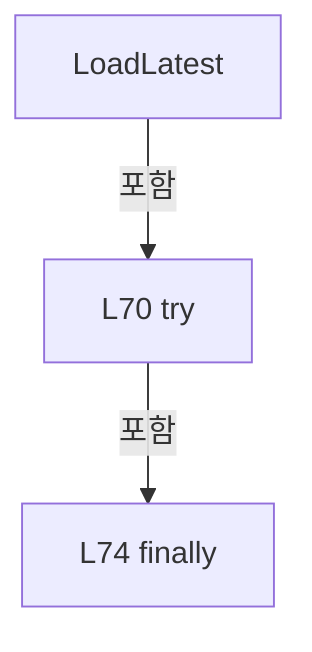

변경 전 점검: 입력/반환 타입, 위 호출자, 예외/취소 경로, 공유 상태와 저장·전송 소비자를 함께 확인합니다. 값의 단위나 물리 방향을 이름만으로 확정하지 않습니다.

### MethodDeclaration `LoadLatestCore` · L80–105

[Drilling.File/ReviewOffset/CReviewOffsetFile.cs:80–105](https://github.com/kjuws10-rgb/A3Drilling/blob/5aee8e58439c9b455cae7c9593c9be986c3e682e/Drilling.File/ReviewOffset/CReviewOffsetFile.cs#L80-L105)

| 항목 | 실제 추출 값 |
| --- | --- |
| 서명 | Drilling.Common.Review.ST_REVIEW_OFFSET_FILE_DATA Drilling.File.ReviewOffset.CReviewOffsetFile.LoadLatestCore(string, System.Threading.CancellationToken) |
| 접근/수식자 | Private / private |
| 반환/값 타입 | Drilling.Common.Review.ST_REVIEW_OFFSET_FILE_DATA |
| 소속 타입 | NamedType:Drilling.File.ReviewOffset.CReviewOffsetFile |

입력 계약:

| 이름 | 타입 | 전달 | 선택/기본값 |
| --- | --- | --- | --- |
| recipeId | string | None | False /  |
| cancellationToken | System.Threading.CancellationToken | None | False /  |

정적 호출자로 확인된 위치:

| 호출 파일/행 | 호출 표현식 | 런타임 분기 가능 |
| --- | --- | --- |
| [Drilling.File/ReviewOffset/CReviewOffsetFile.cs:72–72](https://github.com/kjuws10-rgb/A3Drilling/blob/5aee8e58439c9b455cae7c9593c9be986c3e682e/Drilling.File/ReviewOffset/CReviewOffsetFile.cs#L72-L72) | LoadLatestCore | False |

호출하는 대상과 해석 범위:

| 원본 행 | 표현식 | 분석 상태 | 대상/소스 위치 |
| --- | --- | --- | --- |
| 84 | cancellationToken.ThrowIfCancellationRequested | resolved | void System.Threading.CancellationToken.ThrowIfCancellationRequested() |
| 86 | NormalizeRecipeId | resolved | string Drilling.File.ReviewOffset.CReviewOffsetFile.NormalizeRecipeId(string) · Drilling.File/ReviewOffset/CReviewOffsetFile.cs:731 |
| 87 | string.IsNullOrWhiteSpace | resolved | bool string.IsNullOrWhiteSpace(string?) |
| 89 | ST_REVIEW_OFFSET_FILE_DATA.Empty | resolved | Drilling.Common.Review.ST_REVIEW_OFFSET_FILE_DATA Drilling.Common.Review.ST_REVIEW_OFFSET_FILE_DATA.Empty(string) · Drilling.Common/Review/CReviewManager.cs:4107 |
| 92 | GetRecipeOffsetDirectory | resolved | string Drilling.File.ReviewOffset.CReviewOffsetFile.GetRecipeOffsetDirectory(string) · Drilling.File/ReviewOffset/CReviewOffsetFile.cs:670 |
| 93 | Directory.Exists | resolved | bool System.IO.Directory.Exists(string?) |
| 95 | ST_REVIEW_OFFSET_FILE_DATA.Empty | resolved | Drilling.Common.Review.ST_REVIEW_OFFSET_FILE_DATA Drilling.Common.Review.ST_REVIEW_OFFSET_FILE_DATA.Empty(string) · Drilling.Common/Review/CReviewManager.cs:4107 |
| 98 | EnumerateActiveFiles(directory).FirstOrDefault | resolved | string? System.Collections.Generic.IEnumerable<string>.FirstOrDefault<string>() |
| 98 | EnumerateActiveFiles | resolved | System.Collections.Generic.IEnumerable<string> Drilling.File.ReviewOffset.CReviewOffsetFile.EnumerateActiveFiles(string) · Drilling.File/ReviewOffset/CReviewOffsetFile.cs:389 |
| 99 | string.IsNullOrWhiteSpace | resolved | bool string.IsNullOrWhiteSpace(string?) |
| 101 | ST_REVIEW_OFFSET_FILE_DATA.Empty | resolved | Drilling.Common.Review.ST_REVIEW_OFFSET_FILE_DATA Drilling.Common.Review.ST_REVIEW_OFFSET_FILE_DATA.Empty(string) · Drilling.Common/Review/CReviewManager.cs:4107 |
| 104 | Load | resolved | Drilling.Common.Review.ST_REVIEW_OFFSET_FILE_DATA Drilling.File.ReviewOffset.CReviewOffsetFile.Load(string, string, System.Threading.CancellationToken) · Drilling.File/ReviewOffset/CReviewOffsetFile.cs:636 |

본문의 실제 연산·분기·예외·반환 순서(원문 위치 순):

| 원본 행 | 종류 | 주석 해설 |
| --- | --- | --- |
| 84 | call | 함수·델리게이트 또는 객체 생성자를 호출합니다: cancellationToken.ThrowIfCancellationRequested() |
| 86 | call | 함수·델리게이트 또는 객체 생성자를 호출합니다: NormalizeRecipeId(recipeId) |
| 86 | local-declaration | 지역 변수를 선언합니다: var normalizedRecipeId = NormalizeRecipeId(recipeId); |
| 86 | variable-initializer | 변수의 초기값을 지정합니다: normalizedRecipeId = NormalizeRecipeId(recipeId) |
| 87 | call | 함수·델리게이트 또는 객체 생성자를 호출합니다: string.IsNullOrWhiteSpace(normalizedRecipeId) |
| 87 | if | 조건에 따라 분기합니다: if (string.IsNullOrWhiteSpace(normalizedRecipeId)) |
| 89 | call | 함수·델리게이트 또는 객체 생성자를 호출합니다: ST_REVIEW_OFFSET_FILE_DATA.Empty("") |
| 89 | return | 호출자에게 값 또는 제어를 반환합니다: return ST_REVIEW_OFFSET_FILE_DATA.Empty(""); |
| 92 | call | 함수·델리게이트 또는 객체 생성자를 호출합니다: GetRecipeOffsetDirectory(normalizedRecipeId) |
| 92 | local-declaration | 지역 변수를 선언합니다: var directory = GetRecipeOffsetDirectory(normalizedRecipeId); |
| 92 | variable-initializer | 변수의 초기값을 지정합니다: directory = GetRecipeOffsetDirectory(normalizedRecipeId) |
| 93 | call | 함수·델리게이트 또는 객체 생성자를 호출합니다: Directory.Exists(directory) |
| 93 | if | 조건에 따라 분기합니다: if (!Directory.Exists(directory)) |
| 95 | call | 함수·델리게이트 또는 객체 생성자를 호출합니다: ST_REVIEW_OFFSET_FILE_DATA.Empty(normalizedRecipeId) |
| 95 | return | 호출자에게 값 또는 제어를 반환합니다: return ST_REVIEW_OFFSET_FILE_DATA.Empty(normalizedRecipeId); |
| 98 | call | 함수·델리게이트 또는 객체 생성자를 호출합니다: EnumerateActiveFiles(directory).FirstOrDefault() |
| 98 | call | 함수·델리게이트 또는 객체 생성자를 호출합니다: EnumerateActiveFiles(directory) |
| 98 | local-declaration | 지역 변수를 선언합니다: var latestFile = EnumerateActiveFiles(directory).FirstOrDefault(); |
| 98 | variable-initializer | 변수의 초기값을 지정합니다: latestFile = EnumerateActiveFiles(directory).FirstOrDefault() |
| 99 | call | 함수·델리게이트 또는 객체 생성자를 호출합니다: string.IsNullOrWhiteSpace(latestFile) |
| 99 | if | 조건에 따라 분기합니다: if (string.IsNullOrWhiteSpace(latestFile)) |
| 101 | call | 함수·델리게이트 또는 객체 생성자를 호출합니다: ST_REVIEW_OFFSET_FILE_DATA.Empty(normalizedRecipeId) |
| 101 | return | 호출자에게 값 또는 제어를 반환합니다: return ST_REVIEW_OFFSET_FILE_DATA.Empty(normalizedRecipeId); |
| 104 | call | 함수·델리게이트 또는 객체 생성자를 호출합니다: Load(normalizedRecipeId, latestFile, cancellationToken) |
| 104 | return | 호출자에게 값 또는 제어를 반환합니다: return Load(normalizedRecipeId, latestFile, cancellationToken); |

제어 구문의 포함 구조(실제 실행 순서/CFG가 아닌 구문 탐색 그림):

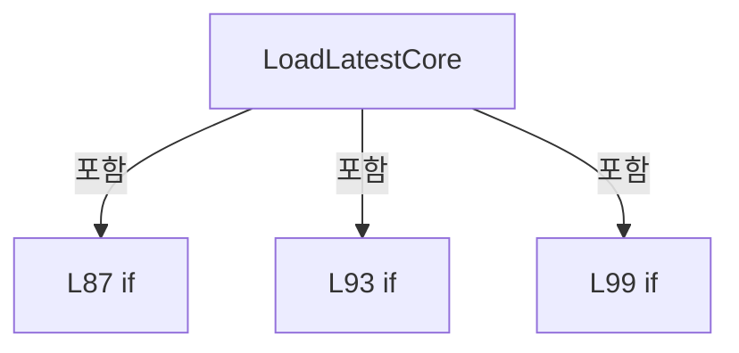

변경 전 점검: 입력/반환 타입, 위 호출자, 예외/취소 경로, 공유 상태와 저장·전송 소비자를 함께 확인합니다. 값의 단위나 물리 방향을 이름만으로 확정하지 않습니다.

### MethodDeclaration `SaveNew` · L107–121

[Drilling.File/ReviewOffset/CReviewOffsetFile.cs:107–121](https://github.com/kjuws10-rgb/A3Drilling/blob/5aee8e58439c9b455cae7c9593c9be986c3e682e/Drilling.File/ReviewOffset/CReviewOffsetFile.cs#L107-L121)

| 항목 | 실제 추출 값 |
| --- | --- |
| 서명 | System.Threading.Tasks.Task<Drilling.Common.Review.ST_REVIEW_OFFSET_FILE_DATA> Drilling.File.ReviewOffset.CReviewOffsetFile.SaveNew(string, System.Collections.Generic.IReadOnlyList<Drilling.Common.Review.ST_REVIEW_OFFSET_ROW>, System.Threading.CancellationToken) |
| 접근/수식자 | Public / public, override, async |
| 반환/값 타입 | System.Threading.Tasks.Task<Drilling.Common.Review.ST_REVIEW_OFFSET_FILE_DATA> |
| 소속 타입 | NamedType:Drilling.File.ReviewOffset.CReviewOffsetFile |

입력 계약:

| 이름 | 타입 | 전달 | 선택/기본값 |
| --- | --- | --- | --- |
| recipeId | string | None | False /  |
| rows | System.Collections.Generic.IReadOnlyList<Drilling.Common.Review.ST_REVIEW_OFFSET_ROW> | None | False /  |
| cancellationToken | System.Threading.CancellationToken | None | True / null |

현재 부분 분석에서 직접 연결된 호출자는 없습니다. XAML/이벤트/인터페이스·델리게이트·외부 진입을 추가 확인해야 하며, 미사용으로 판정한 것이 아닙니다.

호출하는 대상과 해석 범위:

| 원본 행 | 표현식 | 분석 상태 | 대상/소스 위치 |
| --- | --- | --- | --- |
| 112 | _fileLock.WaitAsync(cancellationToken).ConfigureAwait | resolved | System.Runtime.CompilerServices.ConfiguredTaskAwaitable System.Threading.Tasks.Task.ConfigureAwait(bool) |
| 112 | _fileLock.WaitAsync | resolved | System.Threading.Tasks.Task System.Threading.SemaphoreSlim.WaitAsync(System.Threading.CancellationToken) |
| 115 | SaveNewCore | resolved | Drilling.Common.Review.ST_REVIEW_OFFSET_FILE_DATA Drilling.File.ReviewOffset.CReviewOffsetFile.SaveNewCore(string, System.Collections.Generic.IReadOnlyList<Drilling.Common.Review.ST_REVIEW_OFFSET_ROW>, System.Threading.CancellationToken, System.DateTimeOffset?) · Drilling.File/ReviewOffset/CReviewOffsetFile.cs:214 |
| 119 | _fileLock.Release | resolved | int System.Threading.SemaphoreSlim.Release() |

본문의 실제 연산·분기·예외·반환 순서(원문 위치 순):

| 원본 행 | 종류 | 주석 해설 |
| --- | --- | --- |
| 112 | await | 비동기 완료를 기다립니다: await _fileLock.WaitAsync(cancellationToken).ConfigureAwait(false) |
| 112 | call | 함수·델리게이트 또는 객체 생성자를 호출합니다: _fileLock.WaitAsync(cancellationToken).ConfigureAwait(false) |
| 112 | call | 함수·델리게이트 또는 객체 생성자를 호출합니다: _fileLock.WaitAsync(cancellationToken) |
| 113 | try | 예외 처리 범위입니다: try |
| 115 | call | 함수·델리게이트 또는 객체 생성자를 호출합니다: SaveNewCore(recipeId, rows, cancellationToken) |
| 115 | return | 호출자에게 값 또는 제어를 반환합니다: return SaveNewCore(recipeId, rows, cancellationToken); |
| 117 | finally | 종료 정리 구간입니다: finally |
| 119 | call | 함수·델리게이트 또는 객체 생성자를 호출합니다: _fileLock.Release() |

제어 구문의 포함 구조(실제 실행 순서/CFG가 아닌 구문 탐색 그림):

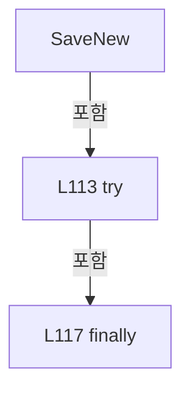

변경 전 점검: 입력/반환 타입, 위 호출자, 예외/취소 경로, 공유 상태와 저장·전송 소비자를 함께 확인합니다. 값의 단위나 물리 방향을 이름만으로 확정하지 않습니다.

### MethodDeclaration `FindSourceApplication` · L123–143

[Drilling.File/ReviewOffset/CReviewOffsetFile.cs:123–143](https://github.com/kjuws10-rgb/A3Drilling/blob/5aee8e58439c9b455cae7c9593c9be986c3e682e/Drilling.File/ReviewOffset/CReviewOffsetFile.cs#L123-L143)

| 항목 | 실제 추출 값 |
| --- | --- |
| 서명 | System.Threading.Tasks.Task<Drilling.Common.Review.ST_REVIEW_OFFSET_SOURCE_APPLICATION?> Drilling.File.ReviewOffset.CReviewOffsetFile.FindSourceApplication(string, string, System.Threading.CancellationToken) |
| 접근/수식자 | Public / public, override, async |
| 반환/값 타입 | System.Threading.Tasks.Task<Drilling.Common.Review.ST_REVIEW_OFFSET_SOURCE_APPLICATION?> |
| 소속 타입 | NamedType:Drilling.File.ReviewOffset.CReviewOffsetFile |

입력 계약:

| 이름 | 타입 | 전달 | 선택/기본값 |
| --- | --- | --- | --- |
| recipeId | string | None | False /  |
| sourceResultFile | string | None | False /  |
| cancellationToken | System.Threading.CancellationToken | None | True / null |

현재 부분 분석에서 직접 연결된 호출자는 없습니다. XAML/이벤트/인터페이스·델리게이트·외부 진입을 추가 확인해야 하며, 미사용으로 판정한 것이 아닙니다.

호출하는 대상과 해석 범위:

| 원본 행 | 표현식 | 분석 상태 | 대상/소스 위치 |
| --- | --- | --- | --- |
| 128 | _fileLock.WaitAsync(cancellationToken).ConfigureAwait | resolved | System.Runtime.CompilerServices.ConfiguredTaskAwaitable System.Threading.Tasks.Task.ConfigureAwait(bool) |
| 128 | _fileLock.WaitAsync | resolved | System.Threading.Tasks.Task System.Threading.SemaphoreSlim.WaitAsync(System.Threading.CancellationToken) |
| 131 | cancellationToken.ThrowIfCancellationRequested | resolved | void System.Threading.CancellationToken.ThrowIfCancellationRequested() |
| 132 | RequireRecipeId | resolved | string Drilling.File.ReviewOffset.CReviewOffsetFile.RequireRecipeId(string, string) · Drilling.File/ReviewOffset/CReviewOffsetFile.cs:612 |
| 133 | NormalizeSourceIdentity | resolved | string Drilling.File.ReviewOffset.CReviewOffsetFile.NormalizeSourceIdentity(string, bool) · Drilling.File/ReviewOffset/CReviewOffsetFile.cs:577 |
| 134 | _now | resolved · 동적 구현 선택 가능 | System.DateTimeOffset System.Func<System.DateTimeOffset>.Invoke() |
| 135 | GetApplyHistoryPath | resolved | string Drilling.File.ReviewOffset.CReviewOffsetFile.GetApplyHistoryPath(string, System.DateTimeOffset) · Drilling.File/ReviewOffset/CReviewOffsetFile.cs:565 |
| 136 | LoadApplyHistory | resolved | System.Collections.Generic.IReadOnlyList<Drilling.Common.Review.ST_REVIEW_OFFSET_SOURCE_APPLICATION> Drilling.File.ReviewOffset.CReviewOffsetFile.LoadApplyHistory(string, System.Threading.CancellationToken) · Drilling.File/ReviewOffset/CReviewOffsetFile.cs:406 |
| 137 | FindSourceApplicationCore | resolved | Drilling.Common.Review.ST_REVIEW_OFFSET_SOURCE_APPLICATION? Drilling.File.ReviewOffset.CReviewOffsetFile.FindSourceApplicationCore(string, System.Collections.Generic.IReadOnlyList<Drilling.Common.Review.ST_REVIEW_OFFSET_SOURCE_APPLICATION>) · Drilling.File/ReviewOffset/CReviewOffsetFile.cs:396 |
| 141 | _fileLock.Release | resolved | int System.Threading.SemaphoreSlim.Release() |

본문의 실제 연산·분기·예외·반환 순서(원문 위치 순):

| 원본 행 | 종류 | 주석 해설 |
| --- | --- | --- |
| 128 | await | 비동기 완료를 기다립니다: await _fileLock.WaitAsync(cancellationToken).ConfigureAwait(false) |
| 128 | call | 함수·델리게이트 또는 객체 생성자를 호출합니다: _fileLock.WaitAsync(cancellationToken).ConfigureAwait(false) |
| 128 | call | 함수·델리게이트 또는 객체 생성자를 호출합니다: _fileLock.WaitAsync(cancellationToken) |
| 129 | try | 예외 처리 범위입니다: try |
| 131 | call | 함수·델리게이트 또는 객체 생성자를 호출합니다: cancellationToken.ThrowIfCancellationRequested() |
| 132 | call | 함수·델리게이트 또는 객체 생성자를 호출합니다: RequireRecipeId(recipeId, "Review Offset 적용 이력 조회") |
| 132 | local-declaration | 지역 변수를 선언합니다: var normalizedRecipeId = RequireRecipeId(recipeId, "Review Offset 적용 이력 조회"); |
| 132 | variable-initializer | 변수의 초기값을 지정합니다: normalizedRecipeId = RequireRecipeId(recipeId, "Review Offset 적용 이력 조회") |
| 133 | call | 함수·델리게이트 또는 객체 생성자를 호출합니다: NormalizeSourceIdentity(sourceResultFile, requireExistingFile: false) |
| 133 | local-declaration | 지역 변수를 선언합니다: var sourceIdentity = NormalizeSourceIdentity(sourceResultFile, requireExistingFile: false); |
| 133 | variable-initializer | 변수의 초기값을 지정합니다: sourceIdentity = NormalizeSourceIdentity(sourceResultFile, requireExistingFile: false) |
| 134 | call | 함수·델리게이트 또는 객체 생성자를 호출합니다: _now() |
| 134 | local-declaration | 지역 변수를 선언합니다: var appliedAt = _now(); |
| 134 | variable-initializer | 변수의 초기값을 지정합니다: appliedAt = _now() |
| 135 | call | 함수·델리게이트 또는 객체 생성자를 호출합니다: GetApplyHistoryPath(normalizedRecipeId, appliedAt) |
| 135 | local-declaration | 지역 변수를 선언합니다: var historyPath = GetApplyHistoryPath(normalizedRecipeId, appliedAt); |
| 135 | variable-initializer | 변수의 초기값을 지정합니다: historyPath = GetApplyHistoryPath(normalizedRecipeId, appliedAt) |
| 136 | call | 함수·델리게이트 또는 객체 생성자를 호출합니다: LoadApplyHistory(historyPath, cancellationToken) |
| 136 | local-declaration | 지역 변수를 선언합니다: var historyRows = LoadApplyHistory(historyPath, cancellationToken); |
| 136 | variable-initializer | 변수의 초기값을 지정합니다: historyRows = LoadApplyHistory(historyPath, cancellationToken) |
| 137 | call | 함수·델리게이트 또는 객체 생성자를 호출합니다: FindSourceApplicationCore(sourceIdentity, historyRows) |
| 137 | return | 호출자에게 값 또는 제어를 반환합니다: return FindSourceApplicationCore(sourceIdentity, historyRows); |
| 139 | finally | 종료 정리 구간입니다: finally |
| 141 | call | 함수·델리게이트 또는 객체 생성자를 호출합니다: _fileLock.Release() |

제어 구문의 포함 구조(실제 실행 순서/CFG가 아닌 구문 탐색 그림):

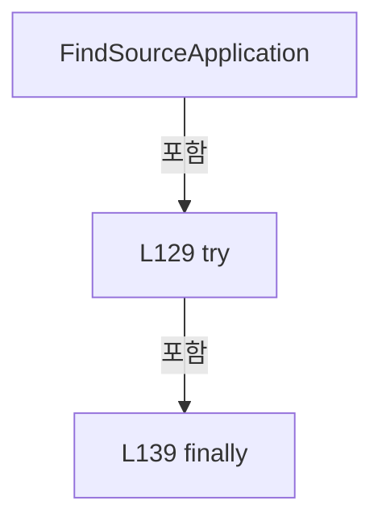

변경 전 점검: 입력/반환 타입, 위 호출자, 예외/취소 경로, 공유 상태와 저장·전송 소비자를 함께 확인합니다. 값의 단위나 물리 방향을 이름만으로 확정하지 않습니다.

### MethodDeclaration `SaveNewFromSource` · L145–212

[Drilling.File/ReviewOffset/CReviewOffsetFile.cs:145–212](https://github.com/kjuws10-rgb/A3Drilling/blob/5aee8e58439c9b455cae7c9593c9be986c3e682e/Drilling.File/ReviewOffset/CReviewOffsetFile.cs#L145-L212)

| 항목 | 실제 추출 값 |
| --- | --- |
| 서명 | System.Threading.Tasks.Task<Drilling.Common.Review.ST_REVIEW_OFFSET_FILE_DATA> Drilling.File.ReviewOffset.CReviewOffsetFile.SaveNewFromSource(string, System.Collections.Generic.IReadOnlyList<Drilling.Common.Review.ST_REVIEW_OFFSET_ROW>, string, bool, System.Threading.CancellationToken) |
| 접근/수식자 | Public / public, override, async |
| 반환/값 타입 | System.Threading.Tasks.Task<Drilling.Common.Review.ST_REVIEW_OFFSET_FILE_DATA> |
| 소속 타입 | NamedType:Drilling.File.ReviewOffset.CReviewOffsetFile |

입력 계약:

| 이름 | 타입 | 전달 | 선택/기본값 |
| --- | --- | --- | --- |
| recipeId | string | None | False /  |
| rows | System.Collections.Generic.IReadOnlyList<Drilling.Common.Review.ST_REVIEW_OFFSET_ROW> | None | False /  |
| sourceResultFile | string | None | False /  |
| allowDuplicate | bool | None | False /  |
| cancellationToken | System.Threading.CancellationToken | None | True / null |

현재 부분 분석에서 직접 연결된 호출자는 없습니다. XAML/이벤트/인터페이스·델리게이트·외부 진입을 추가 확인해야 하며, 미사용으로 판정한 것이 아닙니다.

호출하는 대상과 해석 범위:

| 원본 행 | 표현식 | 분석 상태 | 대상/소스 위치 |
| --- | --- | --- | --- |
| 152 | _fileLock.WaitAsync(cancellationToken).ConfigureAwait | resolved | System.Runtime.CompilerServices.ConfiguredTaskAwaitable System.Threading.Tasks.Task.ConfigureAwait(bool) |
| 152 | _fileLock.WaitAsync | resolved | System.Threading.Tasks.Task System.Threading.SemaphoreSlim.WaitAsync(System.Threading.CancellationToken) |
| 155 | cancellationToken.ThrowIfCancellationRequested | resolved | void System.Threading.CancellationToken.ThrowIfCancellationRequested() |
| 156 | RequireRecipeId | resolved | string Drilling.File.ReviewOffset.CReviewOffsetFile.RequireRecipeId(string, string) · Drilling.File/ReviewOffset/CReviewOffsetFile.cs:612 |
| 157 | NormalizeSourceIdentity | resolved | string Drilling.File.ReviewOffset.CReviewOffsetFile.NormalizeSourceIdentity(string, bool) · Drilling.File/ReviewOffset/CReviewOffsetFile.cs:577 |
| 158 | _now | resolved · 동적 구현 선택 가능 | System.DateTimeOffset System.Func<System.DateTimeOffset>.Invoke() |
| 159 | GetApplyHistoryPath | resolved | string Drilling.File.ReviewOffset.CReviewOffsetFile.GetApplyHistoryPath(string, System.DateTimeOffset) · Drilling.File/ReviewOffset/CReviewOffsetFile.cs:565 |
| 160 | LoadApplyHistory | resolved | System.Collections.Generic.IReadOnlyList<Drilling.Common.Review.ST_REVIEW_OFFSET_SOURCE_APPLICATION> Drilling.File.ReviewOffset.CReviewOffsetFile.LoadApplyHistory(string, System.Threading.CancellationToken) · Drilling.File/ReviewOffset/CReviewOffsetFile.cs:406 |
| 161 | FindSourceApplicationCore | resolved | Drilling.Common.Review.ST_REVIEW_OFFSET_SOURCE_APPLICATION? Drilling.File.ReviewOffset.CReviewOffsetFile.FindSourceApplicationCore(string, System.Collections.Generic.IReadOnlyList<Drilling.Common.Review.ST_REVIEW_OFFSET_SOURCE_APPLICATION>) · Drilling.File/ReviewOffset/CReviewOffsetFile.cs:396 |
| 164 | new CReviewOffsetDuplicateSourceException | resolved | Drilling.Common.Review.CReviewOffsetDuplicateSourceException.CReviewOffsetDuplicateSourceException(Drilling.Common.Review.ST_REVIEW_OFFSET_SOURCE_APPLICATION) · Drilling.Common/Review/CReviewManager.cs:4126 |
| 167 | SaveNewCore | resolved | Drilling.Common.Review.ST_REVIEW_OFFSET_FILE_DATA Drilling.File.ReviewOffset.CReviewOffsetFile.SaveNewCore(string, System.Collections.Generic.IReadOnlyList<Drilling.Common.Review.ST_REVIEW_OFFSET_ROW>, System.Threading.CancellationToken, System.DateTimeOffset?) · Drilling.File/ReviewOffset/CReviewOffsetFile.cs:214 |
| 174 | new ST_REVIEW_OFFSET_SOURCE_APPLICATION | resolved | Drilling.Common.Review.ST_REVIEW_OFFSET_SOURCE_APPLICATION.ST_REVIEW_OFFSET_SOURCE_APPLICATION(string, string, System.DateTimeOffset, string) · Drilling.Common/Review/CReviewManager.cs:4120 |
| 178 | Path.GetFullPath | resolved | string System.IO.Path.GetFullPath(string) |
| 179 | AppendApplyHistory | resolved | void Drilling.File.ReviewOffset.CReviewOffsetFile.AppendApplyHistory(string, System.Collections.Generic.IReadOnlyList<Drilling.Common.Review.ST_REVIEW_OFFSET_SOURCE_APPLICATION>, Drilling.Common.Review.ST_REVIEW_OFFSET_SOURCE_APPLICATION, System.Threading.CancellationToken) · Drilling.File/ReviewOffset/CReviewOffsetFile.cs:481 |
| 190 | System.IO.File.Exists | resolved | bool System.IO.File.Exists(string?) |
| 192 | System.IO.File.Delete | resolved | void System.IO.File.Delete(string) |
| 197 | new AggregateException | resolved | System.AggregateException.AggregateException(string?, params System.Exception[]) |
| 203 | new IOException | resolved | System.IO.IOException.IOException(string?, System.Exception?) |
| 210 | _fileLock.Release | resolved | int System.Threading.SemaphoreSlim.Release() |

본문의 실제 연산·분기·예외·반환 순서(원문 위치 순):

| 원본 행 | 종류 | 주석 해설 |
| --- | --- | --- |
| 152 | await | 비동기 완료를 기다립니다: await _fileLock.WaitAsync(cancellationToken).ConfigureAwait(false) |
| 152 | call | 함수·델리게이트 또는 객체 생성자를 호출합니다: _fileLock.WaitAsync(cancellationToken).ConfigureAwait(false) |
| 152 | call | 함수·델리게이트 또는 객체 생성자를 호출합니다: _fileLock.WaitAsync(cancellationToken) |
| 153 | try | 예외 처리 범위입니다: try |
| 155 | call | 함수·델리게이트 또는 객체 생성자를 호출합니다: cancellationToken.ThrowIfCancellationRequested() |
| 156 | call | 함수·델리게이트 또는 객체 생성자를 호출합니다: RequireRecipeId(recipeId, "Review Offset 저장") |
| 156 | local-declaration | 지역 변수를 선언합니다: var normalizedRecipeId = RequireRecipeId(recipeId, "Review Offset 저장"); |
| 156 | variable-initializer | 변수의 초기값을 지정합니다: normalizedRecipeId = RequireRecipeId(recipeId, "Review Offset 저장") |
| 157 | call | 함수·델리게이트 또는 객체 생성자를 호출합니다: NormalizeSourceIdentity(sourceResultFile, requireExistingFile: true) |
| 157 | local-declaration | 지역 변수를 선언합니다: var sourceIdentity = NormalizeSourceIdentity(sourceResultFile, requireExistingFile: true); |
| 157 | variable-initializer | 변수의 초기값을 지정합니다: sourceIdentity = NormalizeSourceIdentity(sourceResultFile, requireExistingFile: true) |
| 158 | call | 함수·델리게이트 또는 객체 생성자를 호출합니다: _now() |
| 158 | local-declaration | 지역 변수를 선언합니다: var appliedAt = _now(); |
| 158 | variable-initializer | 변수의 초기값을 지정합니다: appliedAt = _now() |
| 159 | call | 함수·델리게이트 또는 객체 생성자를 호출합니다: GetApplyHistoryPath(normalizedRecipeId, appliedAt) |
| 159 | local-declaration | 지역 변수를 선언합니다: var historyPath = GetApplyHistoryPath(normalizedRecipeId, appliedAt); |
| 159 | variable-initializer | 변수의 초기값을 지정합니다: historyPath = GetApplyHistoryPath(normalizedRecipeId, appliedAt) |
| 160 | call | 함수·델리게이트 또는 객체 생성자를 호출합니다: LoadApplyHistory(historyPath, cancellationToken) |
| 160 | local-declaration | 지역 변수를 선언합니다: var historyRows = LoadApplyHistory(historyPath, cancellationToken); |
| 160 | variable-initializer | 변수의 초기값을 지정합니다: historyRows = LoadApplyHistory(historyPath, cancellationToken) |
| 161 | call | 함수·델리게이트 또는 객체 생성자를 호출합니다: FindSourceApplicationCore(sourceIdentity, historyRows) |
| 161 | local-declaration | 지역 변수를 선언합니다: var existing = FindSourceApplicationCore(sourceIdentity, historyRows); |
| 161 | variable-initializer | 변수의 초기값을 지정합니다: existing = FindSourceApplicationCore(sourceIdentity, historyRows) |
| 162 | if | 조건에 따라 분기합니다: if (existing is not null && !allowDuplicate) |
| 164 | call | 함수·델리게이트 또는 객체 생성자를 호출합니다: new CReviewOffsetDuplicateSourceException(existing) |
| 164 | throw | 예외를 발생/전달합니다: throw new CReviewOffsetDuplicateSourceException(existing); |
| 167 | call | 함수·델리게이트 또는 객체 생성자를 호출합니다: SaveNewCore( normalizedRecipeId, rows, cancellationToken, appliedAt) |
| 167 | local-declaration | 지역 변수를 선언합니다: var saved = SaveNewCore( normalizedRecipeId, rows, cancellationToken, appliedAt); |
| 167 | variable-initializer | 변수의 초기값을 지정합니다: saved = SaveNewCore( normalizedRecipeId, rows, cancellationToken, appliedAt) |
| 172 | try | 예외 처리 범위입니다: try |
| 174 | call | 함수·델리게이트 또는 객체 생성자를 호출합니다: new ST_REVIEW_OFFSET_SOURCE_APPLICATION( sourceIdentity, saved.FileName, appliedAt, Path.GetFullPath(historyPath)) |
| 174 | local-declaration | 지역 변수를 선언합니다: var application = new ST_REVIEW_OFFSET_SOURCE_APPLICATION( sourceIdentity, saved.FileName, appliedAt, Path.GetFullPath(historyPath)); |
| 174 | variable-initializer | 변수의 초기값을 지정합니다: application = new ST_REVIEW_OFFSET_SOURCE_APPLICATION( sourceIdentity, saved.FileName, appliedAt, Path.GetFullPath(historyPath)) |
| 178 | call | 함수·델리게이트 또는 객체 생성자를 호출합니다: Path.GetFullPath(historyPath) |
| 179 | call | 함수·델리게이트 또는 객체 생성자를 호출합니다: AppendApplyHistory( historyPath, historyRows, application, cancellationToken) |
| 184 | return | 호출자에게 값 또는 제어를 반환합니다: return saved; |
| 186 | catch | 지정 예외를 처리합니다: catch (Exception historyError) |
| 188 | try | 예외 처리 범위입니다: try |
| 190 | call | 함수·델리게이트 또는 객체 생성자를 호출합니다: System.IO.File.Exists(saved.FilePath) |
| 190 | if | 조건에 따라 분기합니다: if (System.IO.File.Exists(saved.FilePath)) |
| 192 | call | 함수·델리게이트 또는 객체 생성자를 호출합니다: System.IO.File.Delete(saved.FilePath) |
| 195 | catch | 지정 예외를 처리합니다: catch (Exception cleanupError) |
| 197 | call | 함수·델리게이트 또는 객체 생성자를 호출합니다: new AggregateException( "Review Offset 적용 이력 저장 실패 후 신규 Offset 파일 정리에도 실패했습니다.", historyError, cleanupError) |
| 197 | throw | 예외를 발생/전달합니다: throw new AggregateException( "Review Offset 적용 이력 저장 실패 후 신규 Offset 파일 정리에도 실패했습니다.", historyError, cleanupError); |
| 203 | call | 함수·델리게이트 또는 객체 생성자를 호출합니다: new IOException( "Review Offset 적용 이력을 저장하지 못해 신규 Offset 파일 생성을 취소했습니다.", historyError) |
| 203 | throw | 예외를 발생/전달합니다: throw new IOException( "Review Offset 적용 이력을 저장하지 못해 신규 Offset 파일 생성을 취소했습니다.", historyError); |
| 208 | finally | 종료 정리 구간입니다: finally |
| 210 | call | 함수·델리게이트 또는 객체 생성자를 호출합니다: _fileLock.Release() |

제어 구문의 포함 구조(실제 실행 순서/CFG가 아닌 구문 탐색 그림):

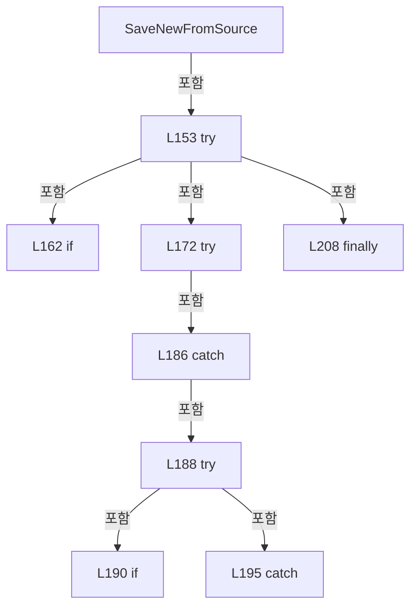

변경 전 점검: 입력/반환 타입, 위 호출자, 예외/취소 경로, 공유 상태와 저장·전송 소비자를 함께 확인합니다. 값의 단위나 물리 방향을 이름만으로 확정하지 않습니다.

### MethodDeclaration `SaveNewCore` · L214–258

[Drilling.File/ReviewOffset/CReviewOffsetFile.cs:214–258](https://github.com/kjuws10-rgb/A3Drilling/blob/5aee8e58439c9b455cae7c9593c9be986c3e682e/Drilling.File/ReviewOffset/CReviewOffsetFile.cs#L214-L258)

| 항목 | 실제 추출 값 |
| --- | --- |
| 서명 | Drilling.Common.Review.ST_REVIEW_OFFSET_FILE_DATA Drilling.File.ReviewOffset.CReviewOffsetFile.SaveNewCore(string, System.Collections.Generic.IReadOnlyList<Drilling.Common.Review.ST_REVIEW_OFFSET_ROW>, System.Threading.CancellationToken, System.DateTimeOffset?) |
| 접근/수식자 | Private / private |
| 반환/값 타입 | Drilling.Common.Review.ST_REVIEW_OFFSET_FILE_DATA |
| 소속 타입 | NamedType:Drilling.File.ReviewOffset.CReviewOffsetFile |

입력 계약:

| 이름 | 타입 | 전달 | 선택/기본값 |
| --- | --- | --- | --- |
| recipeId | string | None | False /  |
| rows | System.Collections.Generic.IReadOnlyList<Drilling.Common.Review.ST_REVIEW_OFFSET_ROW> | None | False /  |
| cancellationToken | System.Threading.CancellationToken | None | False /  |
| fixedSavedAt | System.DateTimeOffset? | None | True / null |

정적 호출자로 확인된 위치:

| 호출 파일/행 | 호출 표현식 | 런타임 분기 가능 |
| --- | --- | --- |
| [Drilling.File/ReviewOffset/CReviewOffsetFile.cs:115–115](https://github.com/kjuws10-rgb/A3Drilling/blob/5aee8e58439c9b455cae7c9593c9be986c3e682e/Drilling.File/ReviewOffset/CReviewOffsetFile.cs#L115-L115) | SaveNewCore | False |
| [Drilling.File/ReviewOffset/CReviewOffsetFile.cs:167–171](https://github.com/kjuws10-rgb/A3Drilling/blob/5aee8e58439c9b455cae7c9593c9be986c3e682e/Drilling.File/ReviewOffset/CReviewOffsetFile.cs#L167-L171) | SaveNewCore | False |

호출하는 대상과 해석 범위:

| 원본 행 | 표현식 | 분석 상태 | 대상/소스 위치 |
| --- | --- | --- | --- |
| 220 | cancellationToken.ThrowIfCancellationRequested | resolved | void System.Threading.CancellationToken.ThrowIfCancellationRequested() |
| 222 | NormalizeRecipeId | resolved | string Drilling.File.ReviewOffset.CReviewOffsetFile.NormalizeRecipeId(string) · Drilling.File/ReviewOffset/CReviewOffsetFile.cs:731 |
| 223 | string.IsNullOrWhiteSpace | resolved | bool string.IsNullOrWhiteSpace(string?) |
| 225 | new InvalidDataException | resolved | System.IO.InvalidDataException.InvalidDataException(string?) |
| 228 | CReviewOffsetData.ValidateRows | resolved | Drilling.Common.Review.ST_REVIEW_OFFSET_ROW[] Drilling.Common.Recipe.CReviewOffsetData.ValidateRows(System.Collections.Generic.IReadOnlyList<Drilling.Common.Review.ST_REVIEW_OFFSET_ROW>, string, System.Collections.Generic.IReadOnlyList<int>?, System.Threading.CancellationToken) · Drilling.Common/Recipe/CShotCoordinatePlanBuilder.cs:1140 |
| 230 | _now | resolved · 동적 구현 선택 가능 | System.DateTimeOffset System.Func<System.DateTimeOffset>.Invoke() |
| 231 | GetRecipeOffsetDirectory | resolved | string Drilling.File.ReviewOffset.CReviewOffsetFile.GetRecipeOffsetDirectory(string) · Drilling.File/ReviewOffset/CReviewOffsetFile.cs:670 |
| 232 | Directory.CreateDirectory | resolved | System.IO.DirectoryInfo System.IO.Directory.CreateDirectory(string) |
| 233 | Path.Combine | resolved | string System.IO.Path.Combine(string, string) |
| 233 | Guid.NewGuid | resolved | System.Guid System.Guid.NewGuid() |
| 237 | CCsvParser.Write | resolved | void Drilling.File.Parser.CCsvParser.Write(string, System.Collections.Generic.IReadOnlyList<string>, System.Collections.Generic.IEnumerable<System.Collections.Generic.IReadOnlyDictionary<string, string>>) · Drilling.File/Parser/CCsvParser.cs:58 |
| 237 | normalizedRows.OrderBy(row => row.CellId) .ThenBy(row => row.ShotId, StringComparer.OrdinalIgnoreCase).Select | resolved | System.Collections.Generic.IEnumerable<System.Collections.Generic.IReadOnlyDictionary<string, string>> System.Collections.Generic.IEnumerable<Drilling.Common.Review.ST_REVIEW_OFFSET_ROW>.Select<Drilling.Common.Review.ST_REVIEW_OFFSET_ROW, System.Collections.Generic.IReadOnlyDictionary<string, string>>(System.Func<Drilling.Common.Review.ST_REVIEW_OFFSET_ROW, System.Collections.Generic.IReadOnlyDictionary<string, string>>) |
| 237 | normalizedRows.OrderBy(row => row.CellId) .ThenBy | resolved | System.Linq.IOrderedEnumerable<Drilling.Common.Review.ST_REVIEW_OFFSET_ROW> System.Linq.IOrderedEnumerable<Drilling.Common.Review.ST_REVIEW_OFFSET_ROW>.ThenBy<Drilling.Common.Review.ST_REVIEW_OFFSET_ROW, string>(System.Func<Drilling.Common.Review.ST_REVIEW_OFFSET_ROW, string>, System.Collections.Generic.IComparer<string>?) |
| 237 | normalizedRows.OrderBy | resolved | System.Linq.IOrderedEnumerable<Drilling.Common.Review.ST_REVIEW_OFFSET_ROW> System.Collections.Generic.IEnumerable<Drilling.Common.Review.ST_REVIEW_OFFSET_ROW>.OrderBy<Drilling.Common.Review.ST_REVIEW_OFFSET_ROW, int>(System.Func<Drilling.Common.Review.ST_REVIEW_OFFSET_ROW, int>) |
| 241 | cancellationToken.ThrowIfCancellationRequested | resolved | void System.Threading.CancellationToken.ThrowIfCancellationRequested() |
| 242 | Path.Combine | resolved | string System.IO.Path.Combine(string, string) |
| 243 | System.IO.File.Move | resolved | void System.IO.File.Move(string, string, bool) |
| 244 | System.IO.File.Exists | resolved | bool System.IO.File.Exists(string?) |
| 244 | savedAt.AddMilliseconds | resolved | System.DateTimeOffset System.DateTimeOffset.AddMilliseconds(double) |
| 249 | System.IO.File.Exists | resolved | bool System.IO.File.Exists(string?) |
| 249 | System.IO.File.Delete | resolved | void System.IO.File.Delete(string) |
| 252 | new ST_REVIEW_OFFSET_FILE_DATA | resolved | Drilling.Common.Review.ST_REVIEW_OFFSET_FILE_DATA.ST_REVIEW_OFFSET_FILE_DATA(string, string, string, System.DateTimeOffset, System.Collections.Generic.IReadOnlyList<Drilling.Common.Review.ST_REVIEW_OFFSET_ROW>) · Drilling.Common/Review/CReviewManager.cs:4105 |
| 254 | Path.GetFullPath | resolved | string System.IO.Path.GetFullPath(string) |
| 255 | Path.GetFileName | resolved | string? System.IO.Path.GetFileName(string?) |

본문의 실제 연산·분기·예외·반환 순서(원문 위치 순):

| 원본 행 | 종류 | 주석 해설 |
| --- | --- | --- |
| 220 | call | 함수·델리게이트 또는 객체 생성자를 호출합니다: cancellationToken.ThrowIfCancellationRequested() |
| 222 | call | 함수·델리게이트 또는 객체 생성자를 호출합니다: NormalizeRecipeId(recipeId) |
| 222 | local-declaration | 지역 변수를 선언합니다: var normalizedRecipeId = NormalizeRecipeId(recipeId); |
| 222 | variable-initializer | 변수의 초기값을 지정합니다: normalizedRecipeId = NormalizeRecipeId(recipeId) |
| 223 | call | 함수·델리게이트 또는 객체 생성자를 호출합니다: string.IsNullOrWhiteSpace(normalizedRecipeId) |
| 223 | if | 조건에 따라 분기합니다: if (string.IsNullOrWhiteSpace(normalizedRecipeId)) |
| 225 | call | 함수·델리게이트 또는 객체 생성자를 호출합니다: new InvalidDataException("Review Offset save failed. Recipe ID is empty.") |
| 225 | throw | 예외를 발생/전달합니다: throw new InvalidDataException("Review Offset save failed. Recipe ID is empty."); |
| 228 | call | 함수·델리게이트 또는 객체 생성자를 호출합니다: CReviewOffsetData.ValidateRows(rows, $"{normalizedRecipeId} (저장할 Review Offset)", token: cancellationToken) |
| 228 | local-declaration | 지역 변수를 선언합니다: var normalizedRows = CReviewOffsetData.ValidateRows(rows, $"{normalizedRecipeId} (저장할 Review Offset)", token: cancellationToken); |
| 228 | variable-initializer | 변수의 초기값을 지정합니다: normalizedRows = CReviewOffsetData.ValidateRows(rows, $"{normalizedRecipeId} (저장할 Review Offset)", token: cancellationToken) |
| 230 | call | 함수·델리게이트 또는 객체 생성자를 호출합니다: _now() |
| 230 | local-declaration | 지역 변수를 선언합니다: var savedAt = fixedSavedAt ?? _now(); |
| 230 | variable-initializer | 변수의 초기값을 지정합니다: savedAt = fixedSavedAt ?? _now() |
| 231 | call | 함수·델리게이트 또는 객체 생성자를 호출합니다: GetRecipeOffsetDirectory(normalizedRecipeId) |
| 231 | local-declaration | 지역 변수를 선언합니다: var directory = GetRecipeOffsetDirectory(normalizedRecipeId); |
| 231 | variable-initializer | 변수의 초기값을 지정합니다: directory = GetRecipeOffsetDirectory(normalizedRecipeId) |
| 232 | call | 함수·델리게이트 또는 객체 생성자를 호출합니다: Directory.CreateDirectory(directory) |
| 233 | call | 함수·델리게이트 또는 객체 생성자를 호출합니다: Path.Combine(directory, $".{Guid.NewGuid():N}.tmp") |
| 233 | call | 함수·델리게이트 또는 객체 생성자를 호출합니다: Guid.NewGuid() |
| 233 | local-declaration | 지역 변수를 선언합니다: var temporary = Path.Combine(directory, $".{Guid.NewGuid():N}.tmp"); |
| 233 | variable-initializer | 변수의 초기값을 지정합니다: temporary = Path.Combine(directory, $".{Guid.NewGuid():N}.tmp") |
| 234 | local-declaration | 지역 변수를 선언합니다: string path; |
| 235 | try | 예외 처리 범위입니다: try |
| 237 | call | 함수·델리게이트 또는 객체 생성자를 호출합니다: normalizedRows.OrderBy(row => row.CellId) |
| 237 | call | 함수·델리게이트 또는 객체 생성자를 호출합니다: CCsvParser.Write(temporary, Headers, normalizedRows.OrderBy(row => row.CellId) .ThenBy(row => row.ShotId, StringComparer.OrdinalIgnoreCase).Select(ToCsvRow)) |
| 237 | call | 함수·델리게이트 또는 객체 생성자를 호출합니다: normalizedRows.OrderBy(row => row.CellId) .ThenBy(row => row.ShotId, StringComparer.OrdinalIgnoreCase).Select(ToCsvRow) |
| 237 | call | 함수·델리게이트 또는 객체 생성자를 호출합니다: normalizedRows.OrderBy(row => row.CellId) .ThenBy(row => row.ShotId, StringComparer.OrdinalIgnoreCase) |
| 239 | while | 조건을 먼저 확인하며 반복합니다: while (true) |
| 241 | call | 함수·델리게이트 또는 객체 생성자를 호출합니다: cancellationToken.ThrowIfCancellationRequested() |
| 242 | assignment | 값을 대상에 대입합니다: path = Path.Combine(directory, $"{savedAt:yyyyMMdd_HHmmss_fff}_reviewoffset.csv") |
| 242 | call | 함수·델리게이트 또는 객체 생성자를 호출합니다: Path.Combine(directory, $"{savedAt:yyyyMMdd_HHmmss_fff}_reviewoffset.csv") |
| 243 | break | 해당 반복/분기 구간을 종료합니다: break; |
| 243 | call | 함수·델리게이트 또는 객체 생성자를 호출합니다: System.IO.File.Move(temporary, path, overwrite: false) |
| 243 | try | 예외 처리 범위입니다: try |
| 244 | assignment | 값을 대상에 대입합니다: savedAt = savedAt.AddMilliseconds(1) |
| 244 | call | 함수·델리게이트 또는 객체 생성자를 호출합니다: System.IO.File.Exists(path) |
| 244 | call | 함수·델리게이트 또는 객체 생성자를 호출합니다: savedAt.AddMilliseconds(1) |
| 244 | catch | 지정 예외를 처리합니다: catch (IOException) when (System.IO.File.Exists(path)) |
| 247 | finally | 종료 정리 구간입니다: finally |
| 249 | call | 함수·델리게이트 또는 객체 생성자를 호출합니다: System.IO.File.Exists(temporary) |
| 249 | call | 함수·델리게이트 또는 객체 생성자를 호출합니다: System.IO.File.Delete(temporary) |
| 249 | if | 조건에 따라 분기합니다: if (System.IO.File.Exists(temporary)) |
| 252 | call | 함수·델리게이트 또는 객체 생성자를 호출합니다: new ST_REVIEW_OFFSET_FILE_DATA( normalizedRecipeId, Path.GetFullPath(path), Path.GetFileName(path), savedAt, normalizedRows) |
| 252 | return | 호출자에게 값 또는 제어를 반환합니다: return new ST_REVIEW_OFFSET_FILE_DATA( normalizedRecipeId, Path.GetFullPath(path), Path.GetFileName(path), savedAt, normalizedRows); |
| 254 | call | 함수·델리게이트 또는 객체 생성자를 호출합니다: Path.GetFullPath(path) |
| 255 | call | 함수·델리게이트 또는 객체 생성자를 호출합니다: Path.GetFileName(path) |

제어 구문의 포함 구조(실제 실행 순서/CFG가 아닌 구문 탐색 그림):

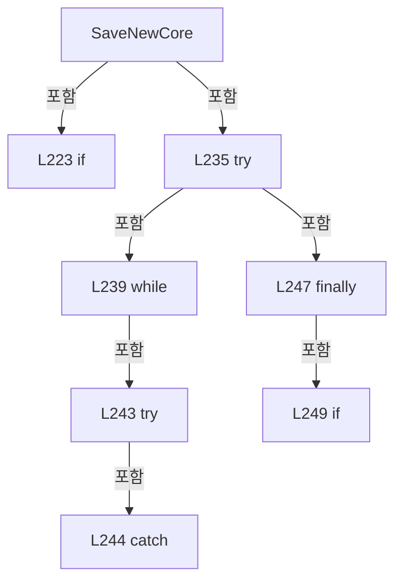

변경 전 점검: 입력/반환 타입, 위 호출자, 예외/취소 경로, 공유 상태와 저장·전송 소비자를 함께 확인합니다. 값의 단위나 물리 방향을 이름만으로 확정하지 않습니다.

### MethodDeclaration `RollbackLatest` · L260–387

[Drilling.File/ReviewOffset/CReviewOffsetFile.cs:260–387](https://github.com/kjuws10-rgb/A3Drilling/blob/5aee8e58439c9b455cae7c9593c9be986c3e682e/Drilling.File/ReviewOffset/CReviewOffsetFile.cs#L260-L387)

| 항목 | 실제 추출 값 |
| --- | --- |
| 서명 | System.Threading.Tasks.Task<Drilling.Common.Review.ST_REVIEW_OFFSET_ROLLBACK_RESULT> Drilling.File.ReviewOffset.CReviewOffsetFile.RollbackLatest(string, string, System.Threading.CancellationToken) |
| 접근/수식자 | Public / public, override, async |
| 반환/값 타입 | System.Threading.Tasks.Task<Drilling.Common.Review.ST_REVIEW_OFFSET_ROLLBACK_RESULT> |
| 소속 타입 | NamedType:Drilling.File.ReviewOffset.CReviewOffsetFile |

입력 계약:

| 이름 | 타입 | 전달 | 선택/기본값 |
| --- | --- | --- | --- |
| recipeId | string | None | False /  |
| expectedLatestFilePath | string | None | False /  |
| cancellationToken | System.Threading.CancellationToken | None | True / null |

현재 부분 분석에서 직접 연결된 호출자는 없습니다. XAML/이벤트/인터페이스·델리게이트·외부 진입을 추가 확인해야 하며, 미사용으로 판정한 것이 아닙니다.

호출하는 대상과 해석 범위:

| 원본 행 | 표현식 | 분석 상태 | 대상/소스 위치 |
| --- | --- | --- | --- |
| 265 | _fileLock.WaitAsync(cancellationToken).ConfigureAwait | resolved | System.Runtime.CompilerServices.ConfiguredTaskAwaitable System.Threading.Tasks.Task.ConfigureAwait(bool) |
| 265 | _fileLock.WaitAsync | resolved | System.Threading.Tasks.Task System.Threading.SemaphoreSlim.WaitAsync(System.Threading.CancellationToken) |
| 268 | cancellationToken.ThrowIfCancellationRequested | resolved | void System.Threading.CancellationToken.ThrowIfCancellationRequested() |
| 269 | NormalizeRecipeId | resolved | string Drilling.File.ReviewOffset.CReviewOffsetFile.NormalizeRecipeId(string) · Drilling.File/ReviewOffset/CReviewOffsetFile.cs:731 |
| 270 | string.IsNullOrWhiteSpace | resolved | bool string.IsNullOrWhiteSpace(string?) |
| 272 | new InvalidOperationException | resolved | System.InvalidOperationException.InvalidOperationException(string?) |
| 275 | GetRecipeOffsetDirectory | resolved | string Drilling.File.ReviewOffset.CReviewOffsetFile.GetRecipeOffsetDirectory(string) · Drilling.File/ReviewOffset/CReviewOffsetFile.cs:670 |
| 276 | Directory.Exists | resolved | bool System.IO.Directory.Exists(string?) |
| 277 | EnumerateActiveFiles(directory).ToArray | resolved | string[] System.Collections.Generic.IEnumerable<string>.ToArray<string>() |
| 277 | EnumerateActiveFiles | resolved | System.Collections.Generic.IEnumerable<string> Drilling.File.ReviewOffset.CReviewOffsetFile.EnumerateActiveFiles(string) · Drilling.File/ReviewOffset/CReviewOffsetFile.cs:389 |
| 281 | new InvalidOperationException | resolved | System.InvalidOperationException.InvalidOperationException(string?) |
| 284 | Path.GetFullPath | resolved | string System.IO.Path.GetFullPath(string) |
| 285 | string.IsNullOrWhiteSpace | resolved | bool string.IsNullOrWhiteSpace(string?) |
| 287 | Path.GetFullPath | resolved | string System.IO.Path.GetFullPath(string) |
| 288 | latestPath.Equals | resolved | bool string.Equals(string?, System.StringComparison) |
| 290 | new InvalidOperationException | resolved | System.InvalidOperationException.InvalidOperationException(string?) |
| 293 | Load | resolved | Drilling.Common.Review.ST_REVIEW_OFFSET_FILE_DATA Drilling.File.ReviewOffset.CReviewOffsetFile.Load(string, string, System.Threading.CancellationToken) · Drilling.File/ReviewOffset/CReviewOffsetFile.cs:636 |
| 295 | Load | resolved | Drilling.Common.Review.ST_REVIEW_OFFSET_FILE_DATA Drilling.File.ReviewOffset.CReviewOffsetFile.Load(string, string, System.Threading.CancellationToken) · Drilling.File/ReviewOffset/CReviewOffsetFile.cs:636 |
| 296 | ST_REVIEW_OFFSET_FILE_DATA.Empty | resolved | Drilling.Common.Review.ST_REVIEW_OFFSET_FILE_DATA Drilling.Common.Review.ST_REVIEW_OFFSET_FILE_DATA.Empty(string) · Drilling.Common/Review/CReviewManager.cs:4107 |
| 298 | Path.Combine | resolved | string System.IO.Path.Combine(string, string) |
| 299 | Directory.CreateDirectory | resolved | System.IO.DirectoryInfo System.IO.Directory.CreateDirectory(string) |
| 300 | CreateArchivePath | resolved | string Drilling.File.ReviewOffset.CReviewOffsetFile.CreateArchivePath(string, string) · Drilling.File/ReviewOffset/CReviewOffsetFile.cs:623 |
| 301 | GetApplyHistoryPath | resolved | string Drilling.File.ReviewOffset.CReviewOffsetFile.GetApplyHistoryPath(string, System.DateTimeOffset) · Drilling.File/ReviewOffset/CReviewOffsetFile.cs:565 |
| 302 | System.IO.File.Exists | resolved | bool System.IO.File.Exists(string?) |
| 303 | LoadApplyHistory | resolved | System.Collections.Generic.IReadOnlyList<Drilling.Common.Review.ST_REVIEW_OFFSET_SOURCE_APPLICATION> Drilling.File.ReviewOffset.CReviewOffsetFile.LoadApplyHistory(string, System.Threading.CancellationToken) · Drilling.File/ReviewOffset/CReviewOffsetFile.cs:406 |
| 304 | originalHistory .Where(row => !row.OffsetFile.Equals(removed.FileName, StringComparison.OrdinalIgnoreCase)) .ToArray | resolved | Drilling.Common.Review.ST_REVIEW_OFFSET_SOURCE_APPLICATION[] System.Collections.Generic.IEnumerable<Drilling.Common.Review.ST_REVIEW_OFFSET_SOURCE_APPLICATION>.ToArray<Drilling.Common.Review.ST_REVIEW_OFFSET_SOURCE_APPLICATION>() |
| 304 | originalHistory .Where | resolved | System.Collections.Generic.IEnumerable<Drilling.Common.Review.ST_REVIEW_OFFSET_SOURCE_APPLICATION> System.Collections.Generic.IEnumerable<Drilling.Common.Review.ST_REVIEW_OFFSET_SOURCE_APPLICATION>.Where<Drilling.Common.Review.ST_REVIEW_OFFSET_SOURCE_APPLICATION>(System.Func<Drilling.Common.Review.ST_REVIEW_OFFSET_SOURCE_APPLICATION, bool>) |
| 305 | row.OffsetFile.Equals | resolved | bool string.Equals(string?, System.StringComparison) |
| 311 | System.IO.File.Move | resolved | void System.IO.File.Move(string, string, bool) |
| 315 | WriteApplyHistory | resolved | void Drilling.File.ReviewOffset.CReviewOffsetFile.WriteApplyHistory(string, System.Collections.Generic.IReadOnlyList<Drilling.Common.Review.ST_REVIEW_OFFSET_SOURCE_APPLICATION>, System.Threading.CancellationToken) · Drilling.File/ReviewOffset/CReviewOffsetFile.cs:503 |
| 318 | EnumerateActiveFiles(directory).FirstOrDefault | resolved | string? System.Collections.Generic.IEnumerable<string>.FirstOrDefault<string>() |
| 318 | EnumerateActiveFiles | resolved | System.Collections.Generic.IEnumerable<string> Drilling.File.ReviewOffset.CReviewOffsetFile.EnumerateActiveFiles(string) · Drilling.File/ReviewOffset/CReviewOffsetFile.cs:389 |
| 320 | string.Equals | resolved | bool string.Equals(string?, string?, System.StringComparison) |
| 321 | string.IsNullOrWhiteSpace | resolved | bool string.IsNullOrWhiteSpace(string?) |
| 321 | Path.GetFullPath | resolved | string System.IO.Path.GetFullPath(string) |
| 325 | new IOException | resolved | System.IO.IOException.IOException(string?) |
| 330 | new List<Exception> | resolved | System.Collections.Generic.List<System.Exception>.List() |
| 335 | System.IO.File.Exists | resolved | bool System.IO.File.Exists(string?) |
| 335 | System.IO.File.Exists | resolved | bool System.IO.File.Exists(string?) |
| 337 | System.IO.File.Move | resolved | void System.IO.File.Move(string, string, bool) |
| 342 | recoveryErrors.Add | resolved | void System.Collections.Generic.List<System.Exception>.Add(System.Exception) |
| 352 | WriteApplyHistory | resolved | void Drilling.File.ReviewOffset.CReviewOffsetFile.WriteApplyHistory(string, System.Collections.Generic.IReadOnlyList<Drilling.Common.Review.ST_REVIEW_OFFSET_SOURCE_APPLICATION>, System.Threading.CancellationToken) · Drilling.File/ReviewOffset/CReviewOffsetFile.cs:503 |
| 354 | System.IO.File.Exists | resolved | bool System.IO.File.Exists(string?) |
| 356 | System.IO.File.Delete | resolved | void System.IO.File.Delete(string) |
| 357 | _applyHistoryCache.Remove | resolved | bool System.Collections.Generic.Dictionary<string, Drilling.File.ReviewOffset.CReviewOffsetFile.ST_APPLY_HISTORY_CACHE>.Remove(string) |
| 357 | Path.GetFullPath | resolved | string System.IO.Path.GetFullPath(string) |
| 362 | recoveryErrors.Add | resolved | void System.Collections.Generic.List<System.Exception>.Add(System.Exception) |
| 368 | new AggregateException | resolved | System.AggregateException.AggregateException(string?, System.Collections.Generic.IEnumerable<System.Exception>) |
| 370 | new[] { rollbackError }.Concat | resolved | System.Collections.Generic.IEnumerable<System.Exception> System.Collections.Generic.IEnumerable<System.Exception>.Concat<System.Exception>(System.Collections.Generic.IEnumerable<System.Exception>) |
| 376 | new ST_REVIEW_OFFSET_ROLLBACK_RESULT | resolved | Drilling.Common.Review.ST_REVIEW_OFFSET_ROLLBACK_RESULT.ST_REVIEW_OFFSET_ROLLBACK_RESULT(string, string, System.DateTimeOffset, string, Drilling.Common.Review.ST_REVIEW_OFFSET_FILE_DATA) · Drilling.Common/Review/CReviewManager.cs:4113 |
| 380 | Path.GetFullPath | resolved | string System.IO.Path.GetFullPath(string) |
| 385 | _fileLock.Release | resolved | int System.Threading.SemaphoreSlim.Release() |

본문의 실제 연산·분기·예외·반환 순서(원문 위치 순):

| 원본 행 | 종류 | 주석 해설 |
| --- | --- | --- |
| 265 | await | 비동기 완료를 기다립니다: await _fileLock.WaitAsync(cancellationToken).ConfigureAwait(false) |
| 265 | call | 함수·델리게이트 또는 객체 생성자를 호출합니다: _fileLock.WaitAsync(cancellationToken).ConfigureAwait(false) |
| 265 | call | 함수·델리게이트 또는 객체 생성자를 호출합니다: _fileLock.WaitAsync(cancellationToken) |
| 266 | try | 예외 처리 범위입니다: try |
| 268 | call | 함수·델리게이트 또는 객체 생성자를 호출합니다: cancellationToken.ThrowIfCancellationRequested() |
| 269 | call | 함수·델리게이트 또는 객체 생성자를 호출합니다: NormalizeRecipeId(recipeId) |
| 269 | local-declaration | 지역 변수를 선언합니다: var normalizedRecipeId = NormalizeRecipeId(recipeId); |
| 269 | variable-initializer | 변수의 초기값을 지정합니다: normalizedRecipeId = NormalizeRecipeId(recipeId) |
| 270 | call | 함수·델리게이트 또는 객체 생성자를 호출합니다: string.IsNullOrWhiteSpace(normalizedRecipeId) |
| 270 | if | 조건에 따라 분기합니다: if (string.IsNullOrWhiteSpace(normalizedRecipeId)) |
| 272 | call | 함수·델리게이트 또는 객체 생성자를 호출합니다: new InvalidOperationException("Review Offset rollback failed. Recipe ID is empty.") |
| 272 | throw | 예외를 발생/전달합니다: throw new InvalidOperationException("Review Offset rollback failed. Recipe ID is empty."); |
| 275 | call | 함수·델리게이트 또는 객체 생성자를 호출합니다: GetRecipeOffsetDirectory(normalizedRecipeId) |
| 275 | local-declaration | 지역 변수를 선언합니다: var directory = GetRecipeOffsetDirectory(normalizedRecipeId); |
| 275 | variable-initializer | 변수의 초기값을 지정합니다: directory = GetRecipeOffsetDirectory(normalizedRecipeId) |
| 276 | call | 함수·델리게이트 또는 객체 생성자를 호출합니다: Directory.Exists(directory) |
| 276 | conditional-expression | 조건에 따라 결과식을 선택합니다: Directory.Exists(directory) ? EnumerateActiveFiles(directory).ToArray() : [] |
| 276 | local-declaration | 지역 변수를 선언합니다: var activeFiles = Directory.Exists(directory) ? EnumerateActiveFiles(directory).ToArray() : []; |
| 276 | variable-initializer | 변수의 초기값을 지정합니다: activeFiles = Directory.Exists(directory) ? EnumerateActiveFiles(directory).ToArray() : [] |
| 277 | call | 함수·델리게이트 또는 객체 생성자를 호출합니다: EnumerateActiveFiles(directory).ToArray() |
| 277 | call | 함수·델리게이트 또는 객체 생성자를 호출합니다: EnumerateActiveFiles(directory) |
| 279 | if | 조건에 따라 분기합니다: if (activeFiles.Length == 0) |
| 281 | call | 함수·델리게이트 또는 객체 생성자를 호출합니다: new InvalidOperationException($"{normalizedRecipeId} 레시피에 되돌릴 Review Offset 파일이 없습니다.") |
| 281 | throw | 예외를 발생/전달합니다: throw new InvalidOperationException($"{normalizedRecipeId} 레시피에 되돌릴 Review Offset 파일이 없습니다."); |
| 284 | call | 함수·델리게이트 또는 객체 생성자를 호출합니다: Path.GetFullPath(activeFiles[0]) |
| 284 | local-declaration | 지역 변수를 선언합니다: var latestPath = Path.GetFullPath(activeFiles[0]); |
| 284 | variable-initializer | 변수의 초기값을 지정합니다: latestPath = Path.GetFullPath(activeFiles[0]) |
| 285 | call | 함수·델리게이트 또는 객체 생성자를 호출합니다: string.IsNullOrWhiteSpace(expectedLatestFilePath) |
| 285 | conditional-expression | 조건에 따라 결과식을 선택합니다: string.IsNullOrWhiteSpace(expectedLatestFilePath) ? "" : Path.GetFullPath(expectedLatestFilePath) |
| 285 | local-declaration | 지역 변수를 선언합니다: var expectedPath = string.IsNullOrWhiteSpace(expectedLatestFilePath) ? "" : Path.GetFullPath(expectedLatestFilePath); |
| 285 | variable-initializer | 변수의 초기값을 지정합니다: expectedPath = string.IsNullOrWhiteSpace(expectedLatestFilePath) ? "" : Path.GetFullPath(expectedLatestFilePath) |
| 287 | call | 함수·델리게이트 또는 객체 생성자를 호출합니다: Path.GetFullPath(expectedLatestFilePath) |
| 288 | call | 함수·델리게이트 또는 객체 생성자를 호출합니다: latestPath.Equals(expectedPath, StringComparison.OrdinalIgnoreCase) |
| 288 | if | 조건에 따라 분기합니다: if (!latestPath.Equals(expectedPath, StringComparison.OrdinalIgnoreCase)) |
| 290 | call | 함수·델리게이트 또는 객체 생성자를 호출합니다: new InvalidOperationException("확인 중 최신 Review Offset 파일이 변경되었습니다. 현재 값을 다시 확인한 뒤 롤백해 주세요.") |
| 290 | throw | 예외를 발생/전달합니다: throw new InvalidOperationException("확인 중 최신 Review Offset 파일이 변경되었습니다. 현재 값을 다시 확인한 뒤 롤백해 주세요."); |
| 293 | call | 함수·델리게이트 또는 객체 생성자를 호출합니다: Load(normalizedRecipeId, latestPath, cancellationToken) |
| 293 | local-declaration | 지역 변수를 선언합니다: var removed = Load(normalizedRecipeId, latestPath, cancellationToken); |
| 293 | variable-initializer | 변수의 초기값을 지정합니다: removed = Load(normalizedRecipeId, latestPath, cancellationToken) |
| 294 | conditional-expression | 조건에 따라 결과식을 선택합니다: activeFiles.Length > 1 ? Load(normalizedRecipeId, activeFiles[1], cancellationToken) : ST_REVIEW_OFFSET_FILE_DATA.Empty(normalizedRecipeId) |
| 294 | local-declaration | 지역 변수를 선언합니다: var current = activeFiles.Length > 1 ? Load(normalizedRecipeId, activeFiles[1], cancellationToken) : ST_REVIEW_OFFSET_FILE_DATA.Empty(normalizedRecipeId); |
| 294 | variable-initializer | 변수의 초기값을 지정합니다: current = activeFiles.Length > 1 ? Load(normalizedRecipeId, activeFiles[1], cancellationToken) : ST_REVIEW_OFFSET_FILE_DATA.Empty(normalizedRecipeId) |
| 295 | call | 함수·델리게이트 또는 객체 생성자를 호출합니다: Load(normalizedRecipeId, activeFiles[1], cancellationToken) |
| 296 | call | 함수·델리게이트 또는 객체 생성자를 호출합니다: ST_REVIEW_OFFSET_FILE_DATA.Empty(normalizedRecipeId) |
| 298 | call | 함수·델리게이트 또는 객체 생성자를 호출합니다: Path.Combine(directory, "Rollback") |
| 298 | local-declaration | 지역 변수를 선언합니다: var rollbackDirectory = Path.Combine(directory, "Rollback"); |
| 298 | variable-initializer | 변수의 초기값을 지정합니다: rollbackDirectory = Path.Combine(directory, "Rollback") |
| 299 | call | 함수·델리게이트 또는 객체 생성자를 호출합니다: Directory.CreateDirectory(rollbackDirectory) |
| 300 | call | 함수·델리게이트 또는 객체 생성자를 호출합니다: CreateArchivePath(rollbackDirectory, removed.FileName) |
| 300 | local-declaration | 지역 변수를 선언합니다: var archivedPath = CreateArchivePath(rollbackDirectory, removed.FileName); |
| 300 | variable-initializer | 변수의 초기값을 지정합니다: archivedPath = CreateArchivePath(rollbackDirectory, removed.FileName) |
| 301 | call | 함수·델리게이트 또는 객체 생성자를 호출합니다: GetApplyHistoryPath(normalizedRecipeId, removed.SavedAt) |
| 301 | local-declaration | 지역 변수를 선언합니다: var historyPath = GetApplyHistoryPath(normalizedRecipeId, removed.SavedAt); |
| 301 | variable-initializer | 변수의 초기값을 지정합니다: historyPath = GetApplyHistoryPath(normalizedRecipeId, removed.SavedAt) |
| 302 | call | 함수·델리게이트 또는 객체 생성자를 호출합니다: System.IO.File.Exists(historyPath) |
| 302 | local-declaration | 지역 변수를 선언합니다: var historyExisted = System.IO.File.Exists(historyPath); |
| 302 | variable-initializer | 변수의 초기값을 지정합니다: historyExisted = System.IO.File.Exists(historyPath) |
| 303 | call | 함수·델리게이트 또는 객체 생성자를 호출합니다: LoadApplyHistory(historyPath, cancellationToken) |
| 303 | local-declaration | 지역 변수를 선언합니다: var originalHistory = LoadApplyHistory(historyPath, cancellationToken); |
| 303 | variable-initializer | 변수의 초기값을 지정합니다: originalHistory = LoadApplyHistory(historyPath, cancellationToken) |
| 304 | call | 함수·델리게이트 또는 객체 생성자를 호출합니다: originalHistory .Where(row => !row.OffsetFile.Equals(removed.FileName, StringComparison.OrdinalIgnoreCase)) |
| 304 | call | 함수·델리게이트 또는 객체 생성자를 호출합니다: originalHistory .Where(row => !row.OffsetFile.Equals(removed.FileName, StringComparison.OrdinalIgnoreCase)) .ToArray() |
| 304 | local-declaration | 지역 변수를 선언합니다: var retainedHistory = originalHistory .Where(row => !row.OffsetFile.Equals(removed.FileName, StringComparison.OrdinalIgnoreCase)) .ToArray(); |
| 304 | variable-initializer | 변수의 초기값을 지정합니다: retainedHistory = originalHistory .Where(row => !row.OffsetFile.Equals(removed.FileName, StringComparison.OrdinalIgnoreCase)) .ToArray() |
| 305 | call | 함수·델리게이트 또는 객체 생성자를 호출합니다: row.OffsetFile.Equals(removed.FileName, StringComparison.OrdinalIgnoreCase) |
| 307 | local-declaration | 지역 변수를 선언합니다: var historyChanged = retainedHistory.Length != originalHistory.Count; |
| 307 | variable-initializer | 변수의 초기값을 지정합니다: historyChanged = retainedHistory.Length != originalHistory.Count |
| 308 | local-declaration | 지역 변수를 선언합니다: var offsetMoved = false; |
| 308 | variable-initializer | 변수의 초기값을 지정합니다: offsetMoved = false |
| 309 | try | 예외 처리 범위입니다: try |
| 311 | call | 함수·델리게이트 또는 객체 생성자를 호출합니다: System.IO.File.Move(latestPath, archivedPath, overwrite: false) |
| 312 | assignment | 값을 대상에 대입합니다: offsetMoved = true |
| 313 | if | 조건에 따라 분기합니다: if (historyChanged) |
| 315 | call | 함수·델리게이트 또는 객체 생성자를 호출합니다: WriteApplyHistory(historyPath, retainedHistory, cancellationToken) |
| 318 | call | 함수·델리게이트 또는 객체 생성자를 호출합니다: EnumerateActiveFiles(directory).FirstOrDefault() |
| 318 | call | 함수·델리게이트 또는 객체 생성자를 호출합니다: EnumerateActiveFiles(directory) |
| 318 | local-declaration | 지역 변수를 선언합니다: var latestAfterRollback = EnumerateActiveFiles(directory).FirstOrDefault(); |
| 318 | variable-initializer | 변수의 초기값을 지정합니다: latestAfterRollback = EnumerateActiveFiles(directory).FirstOrDefault() |
| 319 | local-declaration | 지역 변수를 선언합니다: var expectedCurrentPath = current.FilePath; |
| 319 | variable-initializer | 변수의 초기값을 지정합니다: expectedCurrentPath = current.FilePath |
| 320 | call | 함수·델리게이트 또는 객체 생성자를 호출합니다: string.Equals( string.IsNullOrWhiteSpace(latestAfterRollback) ? "" : Path.GetFullPath(latestAfterRollback), expectedCurrentPath, StringComparison.OrdinalIgnoreCase) |
| 320 | if | 조건에 따라 분기합니다: if (!string.Equals( string.IsNullOrWhiteSpace(latestAfterRollback) ? "" : Path.GetFullPath(latestAfterRollback), expectedCurrentPath, StringComparison.OrdinalIgnoreCase)) |
| 321 | call | 함수·델리게이트 또는 객체 생성자를 호출합니다: string.IsNullOrWhiteSpace(latestAfterRollback) |
| 321 | call | 함수·델리게이트 또는 객체 생성자를 호출합니다: Path.GetFullPath(latestAfterRollback) |
| 321 | conditional-expression | 조건에 따라 결과식을 선택합니다: string.IsNullOrWhiteSpace(latestAfterRollback) ? "" : Path.GetFullPath(latestAfterRollback) |
| 325 | call | 함수·델리게이트 또는 객체 생성자를 호출합니다: new IOException("Review Offset 롤백 후 활성 파일 검증에 실패했습니다.") |
| 325 | throw | 예외를 발생/전달합니다: throw new IOException("Review Offset 롤백 후 활성 파일 검증에 실패했습니다."); |
| 328 | catch | 지정 예외를 처리합니다: catch (Exception rollbackError) |
| 330 | call | 함수·델리게이트 또는 객체 생성자를 호출합니다: new List<Exception>() |
| 330 | local-declaration | 지역 변수를 선언합니다: var recoveryErrors = new List<Exception>(); |
| 330 | variable-initializer | 변수의 초기값을 지정합니다: recoveryErrors = new List<Exception>() |
| 331 | if | 조건에 따라 분기합니다: if (offsetMoved) |
| 333 | try | 예외 처리 범위입니다: try |
| 335 | call | 함수·델리게이트 또는 객체 생성자를 호출합니다: System.IO.File.Exists(archivedPath) |
| 335 | call | 함수·델리게이트 또는 객체 생성자를 호출합니다: System.IO.File.Exists(latestPath) |
| 335 | if | 조건에 따라 분기합니다: if (System.IO.File.Exists(archivedPath) && !System.IO.File.Exists(latestPath)) |
| 337 | call | 함수·델리게이트 또는 객체 생성자를 호출합니다: System.IO.File.Move(archivedPath, latestPath, overwrite: false) |
| 340 | catch | 지정 예외를 처리합니다: catch (Exception recoveryError) |
| 342 | call | 함수·델리게이트 또는 객체 생성자를 호출합니다: recoveryErrors.Add(recoveryError) |
| 346 | if | 조건에 따라 분기합니다: if (historyChanged) |
| 348 | try | 예외 처리 범위입니다: try |
| 350 | if | 조건에 따라 분기합니다: if (historyExisted) |
| 352 | call | 함수·델리게이트 또는 객체 생성자를 호출합니다: WriteApplyHistory(historyPath, originalHistory, CancellationToken.None) |
| 354 | call | 함수·델리게이트 또는 객체 생성자를 호출합니다: System.IO.File.Exists(historyPath) |
| 354 | else | 앞 조건이 거짓인 경로입니다: else |
| 354 | if | 조건에 따라 분기합니다: if (System.IO.File.Exists(historyPath)) |
| 356 | call | 함수·델리게이트 또는 객체 생성자를 호출합니다: System.IO.File.Delete(historyPath) |
| 357 | call | 함수·델리게이트 또는 객체 생성자를 호출합니다: _applyHistoryCache.Remove(Path.GetFullPath(historyPath)) |
| 357 | call | 함수·델리게이트 또는 객체 생성자를 호출합니다: Path.GetFullPath(historyPath) |
| 360 | catch | 지정 예외를 처리합니다: catch (Exception recoveryError) |
| 362 | call | 함수·델리게이트 또는 객체 생성자를 호출합니다: recoveryErrors.Add(recoveryError) |
| 366 | if | 조건에 따라 분기합니다: if (recoveryErrors.Count > 0) |
| 368 | call | 함수·델리게이트 또는 객체 생성자를 호출합니다: new AggregateException( "Review Offset 롤백 실패 후 파일 상태 복구에도 실패했습니다.", new[] { rollbackError }.Concat(recoveryErrors)) |
| 368 | throw | 예외를 발생/전달합니다: throw new AggregateException( "Review Offset 롤백 실패 후 파일 상태 복구에도 실패했습니다.", new[] { rollbackError }.Concat(recoveryErrors)); |
| 370 | call | 함수·델리게이트 또는 객체 생성자를 호출합니다: new[] { rollbackError }.Concat(recoveryErrors) |
| 373 | throw | 예외를 발생/전달합니다: throw; |
| 376 | call | 함수·델리게이트 또는 객체 생성자를 호출합니다: new ST_REVIEW_OFFSET_ROLLBACK_RESULT( normalizedRecipeId, removed.FileName, removed.SavedAt, Path.GetFullPath(archivedPath), current) |
| 376 | return | 호출자에게 값 또는 제어를 반환합니다: return new ST_REVIEW_OFFSET_ROLLBACK_RESULT( normalizedRecipeId, removed.FileName, removed.SavedAt, Path.GetFullPath(archivedPath), current); |
| 380 | call | 함수·델리게이트 또는 객체 생성자를 호출합니다: Path.GetFullPath(archivedPath) |
| 383 | finally | 종료 정리 구간입니다: finally |
| 385 | call | 함수·델리게이트 또는 객체 생성자를 호출합니다: _fileLock.Release() |

제어 구문의 포함 구조(실제 실행 순서/CFG가 아닌 구문 탐색 그림):

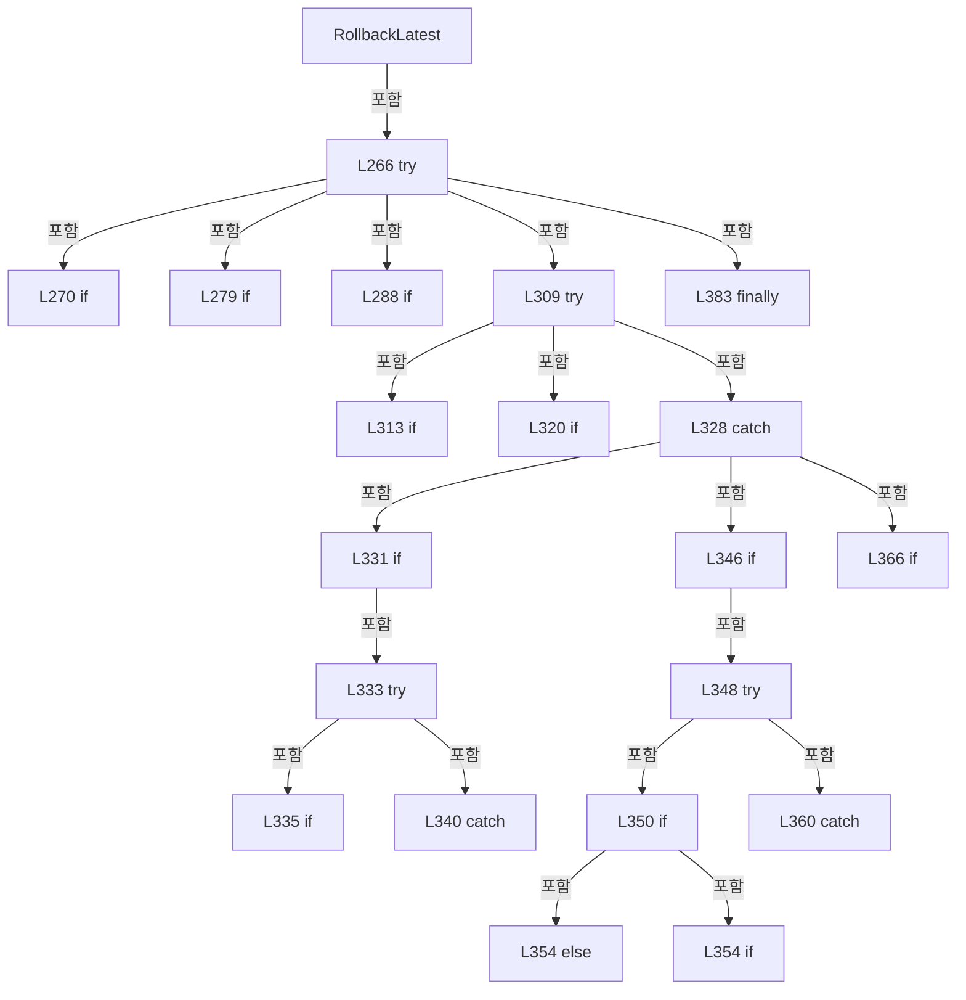

변경 전 점검: 입력/반환 타입, 위 호출자, 예외/취소 경로, 공유 상태와 저장·전송 소비자를 함께 확인합니다. 값의 단위나 물리 방향을 이름만으로 확정하지 않습니다.

### MethodDeclaration `EnumerateActiveFiles` · L389–394

[Drilling.File/ReviewOffset/CReviewOffsetFile.cs:389–394](https://github.com/kjuws10-rgb/A3Drilling/blob/5aee8e58439c9b455cae7c9593c9be986c3e682e/Drilling.File/ReviewOffset/CReviewOffsetFile.cs#L389-L394)

| 항목 | 실제 추출 값 |
| --- | --- |
| 서명 | System.Collections.Generic.IEnumerable<string> Drilling.File.ReviewOffset.CReviewOffsetFile.EnumerateActiveFiles(string) |
| 접근/수식자 | Private / private, static |
| 반환/값 타입 | System.Collections.Generic.IEnumerable<string> |
| 소속 타입 | NamedType:Drilling.File.ReviewOffset.CReviewOffsetFile |

입력 계약:

| 이름 | 타입 | 전달 | 선택/기본값 |
| --- | --- | --- | --- |
| directory | string | None | False /  |

정적 호출자로 확인된 위치:

| 호출 파일/행 | 호출 표현식 | 런타임 분기 가능 |
| --- | --- | --- |
| [Drilling.File/ReviewOffset/CReviewOffsetFile.cs:98–98](https://github.com/kjuws10-rgb/A3Drilling/blob/5aee8e58439c9b455cae7c9593c9be986c3e682e/Drilling.File/ReviewOffset/CReviewOffsetFile.cs#L98-L98) | EnumerateActiveFiles | False |
| [Drilling.File/ReviewOffset/CReviewOffsetFile.cs:277–277](https://github.com/kjuws10-rgb/A3Drilling/blob/5aee8e58439c9b455cae7c9593c9be986c3e682e/Drilling.File/ReviewOffset/CReviewOffsetFile.cs#L277-L277) | EnumerateActiveFiles | False |
| [Drilling.File/ReviewOffset/CReviewOffsetFile.cs:318–318](https://github.com/kjuws10-rgb/A3Drilling/blob/5aee8e58439c9b455cae7c9593c9be986c3e682e/Drilling.File/ReviewOffset/CReviewOffsetFile.cs#L318-L318) | EnumerateActiveFiles | False |

호출하는 대상과 해석 범위:

| 원본 행 | 표현식 | 분석 상태 | 대상/소스 위치 |
| --- | --- | --- | --- |
| 391 | Directory .EnumerateFiles(directory, "*_reviewoffset.csv", SearchOption.TopDirectoryOnly) .OrderByDescending | resolved | System.Linq.IOrderedEnumerable<string> System.Collections.Generic.IEnumerable<string>.OrderByDescending<string, string?>(System.Func<string, string?>, System.Collections.Generic.IComparer<string?>?) |
| 391 | Directory .EnumerateFiles | resolved | System.Collections.Generic.IEnumerable<string> System.IO.Directory.EnumerateFiles(string, string, System.IO.SearchOption) |

본문의 실제 연산·분기·예외·반환 순서(원문 위치 순):

| 원본 행 | 종류 | 주석 해설 |
| --- | --- | --- |
| 391 | call | 함수·델리게이트 또는 객체 생성자를 호출합니다: Directory .EnumerateFiles(directory, "*_reviewoffset.csv", SearchOption.TopDirectoryOnly) |
| 391 | call | 함수·델리게이트 또는 객체 생성자를 호출합니다: Directory .EnumerateFiles(directory, "*_reviewoffset.csv", SearchOption.TopDirectoryOnly) .OrderByDescending(Path.GetFileName, StringComparer.OrdinalIgnoreCase) |
| 391 | return | 호출자에게 값 또는 제어를 반환합니다: return Directory .EnumerateFiles(directory, "*_reviewoffset.csv", SearchOption.TopDirectoryOnly) .OrderByDescending(Path.GetFileName, StringComparer.OrdinalIgnoreCase); |

변경 전 점검: 입력/반환 타입, 위 호출자, 예외/취소 경로, 공유 상태와 저장·전송 소비자를 함께 확인합니다. 값의 단위나 물리 방향을 이름만으로 확정하지 않습니다.

### MethodDeclaration `FindSourceApplicationCore` · L396–404

[Drilling.File/ReviewOffset/CReviewOffsetFile.cs:396–404](https://github.com/kjuws10-rgb/A3Drilling/blob/5aee8e58439c9b455cae7c9593c9be986c3e682e/Drilling.File/ReviewOffset/CReviewOffsetFile.cs#L396-L404)

| 항목 | 실제 추출 값 |
| --- | --- |
| 서명 | Drilling.Common.Review.ST_REVIEW_OFFSET_SOURCE_APPLICATION? Drilling.File.ReviewOffset.CReviewOffsetFile.FindSourceApplicationCore(string, System.Collections.Generic.IReadOnlyList<Drilling.Common.Review.ST_REVIEW_OFFSET_SOURCE_APPLICATION>) |
| 접근/수식자 | Private / private, static |
| 반환/값 타입 | Drilling.Common.Review.ST_REVIEW_OFFSET_SOURCE_APPLICATION? |
| 소속 타입 | NamedType:Drilling.File.ReviewOffset.CReviewOffsetFile |

입력 계약:

| 이름 | 타입 | 전달 | 선택/기본값 |
| --- | --- | --- | --- |
| sourceIdentity | string | None | False /  |
| historyRows | System.Collections.Generic.IReadOnlyList<Drilling.Common.Review.ST_REVIEW_OFFSET_SOURCE_APPLICATION> | None | False /  |

정적 호출자로 확인된 위치:

| 호출 파일/행 | 호출 표현식 | 런타임 분기 가능 |
| --- | --- | --- |
| [Drilling.File/ReviewOffset/CReviewOffsetFile.cs:137–137](https://github.com/kjuws10-rgb/A3Drilling/blob/5aee8e58439c9b455cae7c9593c9be986c3e682e/Drilling.File/ReviewOffset/CReviewOffsetFile.cs#L137-L137) | FindSourceApplicationCore | False |
| [Drilling.File/ReviewOffset/CReviewOffsetFile.cs:161–161](https://github.com/kjuws10-rgb/A3Drilling/blob/5aee8e58439c9b455cae7c9593c9be986c3e682e/Drilling.File/ReviewOffset/CReviewOffsetFile.cs#L161-L161) | FindSourceApplicationCore | False |

호출하는 대상과 해석 범위:

| 원본 행 | 표현식 | 분석 상태 | 대상/소스 위치 |
| --- | --- | --- | --- |
| 400 | historyRows .Where(row => row.SourceResultFile.Equals(sourceIdentity, StringComparison.OrdinalIgnoreCase)) .OrderByDescending(row => row.AppliedAt) .FirstOrDefault | resolved | Drilling.Common.Review.ST_REVIEW_OFFSET_SOURCE_APPLICATION? System.Collections.Generic.IEnumerable<Drilling.Common.Review.ST_REVIEW_OFFSET_SOURCE_APPLICATION>.FirstOrDefault<Drilling.Common.Review.ST_REVIEW_OFFSET_SOURCE_APPLICATION>() |
| 400 | historyRows .Where(row => row.SourceResultFile.Equals(sourceIdentity, StringComparison.OrdinalIgnoreCase)) .OrderByDescending | resolved | System.Linq.IOrderedEnumerable<Drilling.Common.Review.ST_REVIEW_OFFSET_SOURCE_APPLICATION> System.Collections.Generic.IEnumerable<Drilling.Common.Review.ST_REVIEW_OFFSET_SOURCE_APPLICATION>.OrderByDescending<Drilling.Common.Review.ST_REVIEW_OFFSET_SOURCE_APPLICATION, System.DateTimeOffset>(System.Func<Drilling.Common.Review.ST_REVIEW_OFFSET_SOURCE_APPLICATION, System.DateTimeOffset>) |
| 400 | historyRows .Where | resolved | System.Collections.Generic.IEnumerable<Drilling.Common.Review.ST_REVIEW_OFFSET_SOURCE_APPLICATION> System.Collections.Generic.IEnumerable<Drilling.Common.Review.ST_REVIEW_OFFSET_SOURCE_APPLICATION>.Where<Drilling.Common.Review.ST_REVIEW_OFFSET_SOURCE_APPLICATION>(System.Func<Drilling.Common.Review.ST_REVIEW_OFFSET_SOURCE_APPLICATION, bool>) |
| 401 | row.SourceResultFile.Equals | resolved | bool string.Equals(string?, System.StringComparison) |

본문의 실제 연산·분기·예외·반환 순서(원문 위치 순):

| 원본 행 | 종류 | 주석 해설 |
| --- | --- | --- |
| 400 | call | 함수·델리게이트 또는 객체 생성자를 호출합니다: historyRows .Where(row => row.SourceResultFile.Equals(sourceIdentity, StringComparison.OrdinalIgnoreCase)) |
| 400 | call | 함수·델리게이트 또는 객체 생성자를 호출합니다: historyRows .Where(row => row.SourceResultFile.Equals(sourceIdentity, StringComparison.OrdinalIgnoreCase)) .OrderByDescending(row => row.AppliedAt) |
| 400 | call | 함수·델리게이트 또는 객체 생성자를 호출합니다: historyRows .Where(row => row.SourceResultFile.Equals(sourceIdentity, StringComparison.OrdinalIgnoreCase)) .OrderByDescending(row => row.AppliedAt) .FirstOrDefault() |
| 400 | return | 호출자에게 값 또는 제어를 반환합니다: return historyRows .Where(row => row.SourceResultFile.Equals(sourceIdentity, StringComparison.OrdinalIgnoreCase)) .OrderByDescending(row => row.AppliedAt) .FirstOrDefault(); |
| 401 | call | 함수·델리게이트 또는 객체 생성자를 호출합니다: row.SourceResultFile.Equals(sourceIdentity, StringComparison.OrdinalIgnoreCase) |

변경 전 점검: 입력/반환 타입, 위 호출자, 예외/취소 경로, 공유 상태와 저장·전송 소비자를 함께 확인합니다. 값의 단위나 물리 방향을 이름만으로 확정하지 않습니다.

### MethodDeclaration `LoadApplyHistory` · L406–479

[Drilling.File/ReviewOffset/CReviewOffsetFile.cs:406–479](https://github.com/kjuws10-rgb/A3Drilling/blob/5aee8e58439c9b455cae7c9593c9be986c3e682e/Drilling.File/ReviewOffset/CReviewOffsetFile.cs#L406-L479)

| 항목 | 실제 추출 값 |
| --- | --- |
| 서명 | System.Collections.Generic.IReadOnlyList<Drilling.Common.Review.ST_REVIEW_OFFSET_SOURCE_APPLICATION> Drilling.File.ReviewOffset.CReviewOffsetFile.LoadApplyHistory(string, System.Threading.CancellationToken) |
| 접근/수식자 | Private / private |
| 반환/값 타입 | System.Collections.Generic.IReadOnlyList<Drilling.Common.Review.ST_REVIEW_OFFSET_SOURCE_APPLICATION> |
| 소속 타입 | NamedType:Drilling.File.ReviewOffset.CReviewOffsetFile |

입력 계약:

| 이름 | 타입 | 전달 | 선택/기본값 |
| --- | --- | --- | --- |
| historyPath | string | None | False /  |
| cancellationToken | System.Threading.CancellationToken | None | False /  |

정적 호출자로 확인된 위치:

| 호출 파일/행 | 호출 표현식 | 런타임 분기 가능 |
| --- | --- | --- |
| [Drilling.File/ReviewOffset/CReviewOffsetFile.cs:136–136](https://github.com/kjuws10-rgb/A3Drilling/blob/5aee8e58439c9b455cae7c9593c9be986c3e682e/Drilling.File/ReviewOffset/CReviewOffsetFile.cs#L136-L136) | LoadApplyHistory | False |
| [Drilling.File/ReviewOffset/CReviewOffsetFile.cs:160–160](https://github.com/kjuws10-rgb/A3Drilling/blob/5aee8e58439c9b455cae7c9593c9be986c3e682e/Drilling.File/ReviewOffset/CReviewOffsetFile.cs#L160-L160) | LoadApplyHistory | False |
| [Drilling.File/ReviewOffset/CReviewOffsetFile.cs:303–303](https://github.com/kjuws10-rgb/A3Drilling/blob/5aee8e58439c9b455cae7c9593c9be986c3e682e/Drilling.File/ReviewOffset/CReviewOffsetFile.cs#L303-L303) | LoadApplyHistory | False |

호출하는 대상과 해석 범위:

| 원본 행 | 표현식 | 분석 상태 | 대상/소스 위치 |
| --- | --- | --- | --- |
| 410 | Path.GetFullPath | resolved | string System.IO.Path.GetFullPath(string) |
| 411 | System.IO.File.Exists | resolved | bool System.IO.File.Exists(string?) |
| 413 | _applyHistoryCache.Remove | resolved | bool System.Collections.Generic.Dictionary<string, Drilling.File.ReviewOffset.CReviewOffsetFile.ST_APPLY_HISTORY_CACHE>.Remove(string) |
| 417 | new FileInfo | resolved | System.IO.FileInfo.FileInfo(string) |
| 418 | _applyHistoryCache.TryGetValue | resolved | bool System.Collections.Generic.Dictionary<string, Drilling.File.ReviewOffset.CReviewOffsetFile.ST_APPLY_HISTORY_CACHE>.TryGetValue(string, out Drilling.File.ReviewOffset.CReviewOffsetFile.ST_APPLY_HISTORY_CACHE) |
| 425 | CCsvParser.ValidateRequiredHeaders | resolved | void Drilling.File.Parser.CCsvParser.ValidateRequiredHeaders(string, string, System.Collections.Generic.IEnumerable<System.Collections.Generic.IEnumerable<string>>) · Drilling.File/Parser/CCsvParser.cs:280 |
| 429 | new List<int> | resolved | System.Collections.Generic.List<int>.List() |
| 430 | CCsvParser.Read | resolved | System.Collections.Generic.IReadOnlyList<System.Collections.Generic.IReadOnlyDictionary<string, string>> Drilling.File.Parser.CCsvParser.Read(string, System.Collections.Generic.IList<int>?) · Drilling.File/Parser/CCsvParser.cs:15 |
| 431 | new List<ST_REVIEW_OFFSET_SOURCE_APPLICATION> | resolved | System.Collections.Generic.List<Drilling.Common.Review.ST_REVIEW_OFFSET_SOURCE_APPLICATION>.List(int) |
| 434 | cancellationToken.ThrowIfCancellationRequested | resolved | void System.Threading.CancellationToken.ThrowIfCancellationRequested() |
| 437 | NormalizeStoredSourceIdentity | resolved | string Drilling.File.ReviewOffset.CReviewOffsetFile.NormalizeStoredSourceIdentity(string) · Drilling.File/ReviewOffset/CReviewOffsetFile.cs:604 |
| 437 | CCsvParser.RequireText | resolved | string Drilling.File.Parser.CCsvParser.RequireText(System.Collections.Generic.IReadOnlyDictionary<string, string>, string, int, params string[]) · Drilling.File/Parser/CCsvParser.cs:187 |
| 442 | CCsvParser.RequireText( row, "Review Offset 적용 이력", lineNo, "OFFSET_FILE").Trim | resolved | string string.Trim() |
| 442 | CCsvParser.RequireText | resolved | string Drilling.File.Parser.CCsvParser.RequireText(System.Collections.Generic.IReadOnlyDictionary<string, string>, string, int, params string[]) · Drilling.File/Parser/CCsvParser.cs:187 |
| 447 | offsetFile.Equals | resolved | bool string.Equals(string?, System.StringComparison) |
| 447 | Path.GetFileName | resolved | string? System.IO.Path.GetFileName(string?) |
| 448 | offsetFile.EndsWith | resolved | bool string.EndsWith(string, System.StringComparison) |
| 450 | new InvalidDataException | resolved | System.IO.InvalidDataException.InvalidDataException(string?) |
| 454 | CCsvParser.RequireText | resolved | string Drilling.File.Parser.CCsvParser.RequireText(System.Collections.Generic.IReadOnlyDictionary<string, string>, string, int, params string[]) · Drilling.File/Parser/CCsvParser.cs:187 |
| 459 | DateTimeOffset.TryParse | resolved | bool System.DateTimeOffset.TryParse(string?, System.IFormatProvider?, System.Globalization.DateTimeStyles, out System.DateTimeOffset) |
| 465 | new InvalidDataException | resolved | System.IO.InvalidDataException.InvalidDataException(string?) |
| 469 | rows.Add | resolved | void System.Collections.Generic.List<Drilling.Common.Review.ST_REVIEW_OFFSET_SOURCE_APPLICATION>.Add(Drilling.Common.Review.ST_REVIEW_OFFSET_SOURCE_APPLICATION) |
| 469 | new | resolved | Drilling.Common.Review.ST_REVIEW_OFFSET_SOURCE_APPLICATION.ST_REVIEW_OFFSET_SOURCE_APPLICATION(string, string, System.DateTimeOffset, string) · Drilling.Common/Review/CReviewManager.cs:4120 |
| 476 | rows.ToArray | resolved | Drilling.Common.Review.ST_REVIEW_OFFSET_SOURCE_APPLICATION[] System.Collections.Generic.List<Drilling.Common.Review.ST_REVIEW_OFFSET_SOURCE_APPLICATION>.ToArray() |
| 477 | UpdateApplyHistoryCache | resolved | void Drilling.File.ReviewOffset.CReviewOffsetFile.UpdateApplyHistoryCache(string, System.Collections.Generic.IReadOnlyList<Drilling.Common.Review.ST_REVIEW_OFFSET_SOURCE_APPLICATION>) · Drilling.File/ReviewOffset/CReviewOffsetFile.cs:532 |

본문의 실제 연산·분기·예외·반환 순서(원문 위치 순):

| 원본 행 | 종류 | 주석 해설 |
| --- | --- | --- |
| 410 | call | 함수·델리게이트 또는 객체 생성자를 호출합니다: Path.GetFullPath(historyPath) |
| 410 | local-declaration | 지역 변수를 선언합니다: var fullPath = Path.GetFullPath(historyPath); |
| 410 | variable-initializer | 변수의 초기값을 지정합니다: fullPath = Path.GetFullPath(historyPath) |
| 411 | call | 함수·델리게이트 또는 객체 생성자를 호출합니다: System.IO.File.Exists(fullPath) |
| 411 | if | 조건에 따라 분기합니다: if (!System.IO.File.Exists(fullPath)) |
| 413 | call | 함수·델리게이트 또는 객체 생성자를 호출합니다: _applyHistoryCache.Remove(fullPath) |
| 414 | return | 호출자에게 값 또는 제어를 반환합니다: return []; |
| 417 | call | 함수·델리게이트 또는 객체 생성자를 호출합니다: new FileInfo(fullPath) |
| 417 | local-declaration | 지역 변수를 선언합니다: var fileInfo = new FileInfo(fullPath); |
| 417 | variable-initializer | 변수의 초기값을 지정합니다: fileInfo = new FileInfo(fullPath) |
| 418 | call | 함수·델리게이트 또는 객체 생성자를 호출합니다: _applyHistoryCache.TryGetValue(fullPath, out var cached) |
| 418 | if | 조건에 따라 분기합니다: if (_applyHistoryCache.TryGetValue(fullPath, out var cached) && cached.Length == fileInfo.Length && cached.LastWriteTimeUtc == fileInfo.LastWriteTimeUtc) |
| 422 | return | 호출자에게 값 또는 제어를 반환합니다: return cached.Rows; |
| 425 | call | 함수·델리게이트 또는 객체 생성자를 호출합니다: CCsvParser.ValidateRequiredHeaders( fullPath, "Review Offset 적용 이력", ApplyHistoryRequiredHeaderGroups) |
| 429 | call | 함수·델리게이트 또는 객체 생성자를 호출합니다: new List<int>() |
| 429 | local-declaration | 지역 변수를 선언합니다: var lineNumbers = new List<int>(); |
| 429 | variable-initializer | 변수의 초기값을 지정합니다: lineNumbers = new List<int>() |
| 430 | call | 함수·델리게이트 또는 객체 생성자를 호출합니다: CCsvParser.Read(fullPath, lineNumbers) |
| 430 | local-declaration | 지역 변수를 선언합니다: var sourceRows = CCsvParser.Read(fullPath, lineNumbers); |
| 430 | variable-initializer | 변수의 초기값을 지정합니다: sourceRows = CCsvParser.Read(fullPath, lineNumbers) |
| 431 | call | 함수·델리게이트 또는 객체 생성자를 호출합니다: new List<ST_REVIEW_OFFSET_SOURCE_APPLICATION>(sourceRows.Count) |
| 431 | local-declaration | 지역 변수를 선언합니다: var rows = new List<ST_REVIEW_OFFSET_SOURCE_APPLICATION>(sourceRows.Count); |
| 431 | variable-initializer | 변수의 초기값을 지정합니다: rows = new List<ST_REVIEW_OFFSET_SOURCE_APPLICATION>(sourceRows.Count) |
| 432 | variable-initializer | 변수의 초기값을 지정합니다: index = 0 |
| 432 | for | 초기화·조건·증감이 있는 반복입니다: for (var index = 0; index < sourceRows.Count; index++) |
| 434 | call | 함수·델리게이트 또는 객체 생성자를 호출합니다: cancellationToken.ThrowIfCancellationRequested() |
| 435 | local-declaration | 지역 변수를 선언합니다: var row = sourceRows[index]; |
| 435 | variable-initializer | 변수의 초기값을 지정합니다: row = sourceRows[index] |
| 436 | local-declaration | 지역 변수를 선언합니다: var lineNo = lineNumbers[index]; |
| 436 | variable-initializer | 변수의 초기값을 지정합니다: lineNo = lineNumbers[index] |
| 437 | call | 함수·델리게이트 또는 객체 생성자를 호출합니다: NormalizeStoredSourceIdentity(CCsvParser.RequireText( row, "Review Offset 적용 이력", lineNo, "SOURCE_RESULT_FILE")) |
| 437 | call | 함수·델리게이트 또는 객체 생성자를 호출합니다: CCsvParser.RequireText( row, "Review Offset 적용 이력", lineNo, "SOURCE_RESULT_FILE") |
| 437 | local-declaration | 지역 변수를 선언합니다: var source = NormalizeStoredSourceIdentity(CCsvParser.RequireText( row, "Review Offset 적용 이력", lineNo, "SOURCE_RESULT_FILE")); |
| 437 | variable-initializer | 변수의 초기값을 지정합니다: source = NormalizeStoredSourceIdentity(CCsvParser.RequireText( row, "Review Offset 적용 이력", lineNo, "SOURCE_RESULT_FILE")) |
| 442 | call | 함수·델리게이트 또는 객체 생성자를 호출합니다: CCsvParser.RequireText( row, "Review Offset 적용 이력", lineNo, "OFFSET_FILE").Trim() |
| 442 | call | 함수·델리게이트 또는 객체 생성자를 호출합니다: CCsvParser.RequireText( row, "Review Offset 적용 이력", lineNo, "OFFSET_FILE") |
| 442 | local-declaration | 지역 변수를 선언합니다: var offsetFile = CCsvParser.RequireText( row, "Review Offset 적용 이력", lineNo, "OFFSET_FILE").Trim(); |
| 442 | variable-initializer | 변수의 초기값을 지정합니다: offsetFile = CCsvParser.RequireText( row, "Review Offset 적용 이력", lineNo, "OFFSET_FILE").Trim() |
| 447 | call | 함수·델리게이트 또는 객체 생성자를 호출합니다: offsetFile.Equals(Path.GetFileName(offsetFile), StringComparison.Ordinal) |
| 447 | call | 함수·델리게이트 또는 객체 생성자를 호출합니다: Path.GetFileName(offsetFile) |
| 447 | if | 조건에 따라 분기합니다: if (!offsetFile.Equals(Path.GetFileName(offsetFile), StringComparison.Ordinal) &#124;&#124; !offsetFile.EndsWith("_reviewoffset.csv", StringComparison.OrdinalIgnoreCase)) |
| 448 | call | 함수·델리게이트 또는 객체 생성자를 호출합니다: offsetFile.EndsWith("_reviewoffset.csv", StringComparison.OrdinalIgnoreCase) |
| 450 | call | 함수·델리게이트 또는 객체 생성자를 호출합니다: new InvalidDataException( $"Review Offset 적용 이력 {lineNo}행의 OFFSET_FILE이 올바르지 않습니다: {offsetFile}") |
| 450 | throw | 예외를 발생/전달합니다: throw new InvalidDataException( $"Review Offset 적용 이력 {lineNo}행의 OFFSET_FILE이 올바르지 않습니다: {offsetFile}"); |
| 454 | call | 함수·델리게이트 또는 객체 생성자를 호출합니다: CCsvParser.RequireText( row, "Review Offset 적용 이력", lineNo, "APPLIED_AT") |
| 454 | local-declaration | 지역 변수를 선언합니다: var appliedAtText = CCsvParser.RequireText( row, "Review Offset 적용 이력", lineNo, "APPLIED_AT"); |
| 454 | variable-initializer | 변수의 초기값을 지정합니다: appliedAtText = CCsvParser.RequireText( row, "Review Offset 적용 이력", lineNo, "APPLIED_AT") |
| 459 | call | 함수·델리게이트 또는 객체 생성자를 호출합니다: DateTimeOffset.TryParse( appliedAtText, CultureInfo.InvariantCulture, DateTimeStyles.RoundtripKind, out var appliedAt) |
| 459 | if | 조건에 따라 분기합니다: if (!DateTimeOffset.TryParse( appliedAtText, CultureInfo.InvariantCulture, DateTimeStyles.RoundtripKind, out var appliedAt)) |
| 465 | call | 함수·델리게이트 또는 객체 생성자를 호출합니다: new InvalidDataException( $"Review Offset 적용 이력 {lineNo}행의 APPLIED_AT이 올바르지 않습니다: {appliedAtText}") |
| 465 | throw | 예외를 발생/전달합니다: throw new InvalidDataException( $"Review Offset 적용 이력 {lineNo}행의 APPLIED_AT이 올바르지 않습니다: {appliedAtText}"); |
| 469 | call | 함수·델리게이트 또는 객체 생성자를 호출합니다: rows.Add(new( source, offsetFile, appliedAt, fullPath)) |
| 469 | call | 함수·델리게이트 또는 객체 생성자를 호출합니다: new( source, offsetFile, appliedAt, fullPath) |
| 476 | call | 함수·델리게이트 또는 객체 생성자를 호출합니다: rows.ToArray() |
| 476 | local-declaration | 지역 변수를 선언합니다: var result = rows.ToArray(); |
| 476 | variable-initializer | 변수의 초기값을 지정합니다: result = rows.ToArray() |
| 477 | call | 함수·델리게이트 또는 객체 생성자를 호출합니다: UpdateApplyHistoryCache(fullPath, result) |
| 478 | return | 호출자에게 값 또는 제어를 반환합니다: return result; |

제어 구문의 포함 구조(실제 실행 순서/CFG가 아닌 구문 탐색 그림):

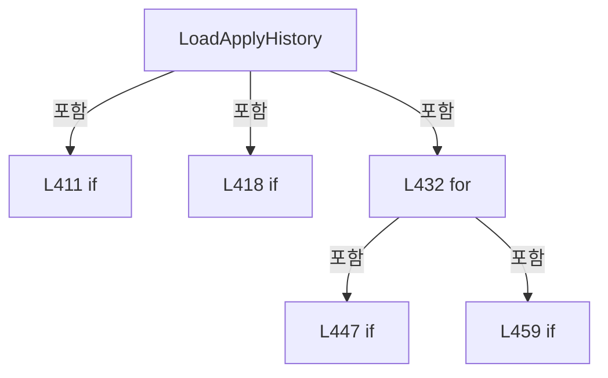

변경 전 점검: 입력/반환 타입, 위 호출자, 예외/취소 경로, 공유 상태와 저장·전송 소비자를 함께 확인합니다. 값의 단위나 물리 방향을 이름만으로 확정하지 않습니다.

### MethodDeclaration `AppendApplyHistory` · L481–501

[Drilling.File/ReviewOffset/CReviewOffsetFile.cs:481–501](https://github.com/kjuws10-rgb/A3Drilling/blob/5aee8e58439c9b455cae7c9593c9be986c3e682e/Drilling.File/ReviewOffset/CReviewOffsetFile.cs#L481-L501)

| 항목 | 실제 추출 값 |
| --- | --- |
| 서명 | void Drilling.File.ReviewOffset.CReviewOffsetFile.AppendApplyHistory(string, System.Collections.Generic.IReadOnlyList<Drilling.Common.Review.ST_REVIEW_OFFSET_SOURCE_APPLICATION>, Drilling.Common.Review.ST_REVIEW_OFFSET_SOURCE_APPLICATION, System.Threading.CancellationToken) |
| 접근/수식자 | Private / private |
| 반환/값 타입 | void |
| 소속 타입 | NamedType:Drilling.File.ReviewOffset.CReviewOffsetFile |

입력 계약:

| 이름 | 타입 | 전달 | 선택/기본값 |
| --- | --- | --- | --- |
| historyPath | string | None | False /  |
| existingRows | System.Collections.Generic.IReadOnlyList<Drilling.Common.Review.ST_REVIEW_OFFSET_SOURCE_APPLICATION> | None | False /  |
| application | Drilling.Common.Review.ST_REVIEW_OFFSET_SOURCE_APPLICATION | None | False /  |
| cancellationToken | System.Threading.CancellationToken | None | False /  |

정적 호출자로 확인된 위치:

| 호출 파일/행 | 호출 표현식 | 런타임 분기 가능 |
| --- | --- | --- |
| [Drilling.File/ReviewOffset/CReviewOffsetFile.cs:179–183](https://github.com/kjuws10-rgb/A3Drilling/blob/5aee8e58439c9b455cae7c9593c9be986c3e682e/Drilling.File/ReviewOffset/CReviewOffsetFile.cs#L179-L183) | AppendApplyHistory | False |

호출하는 대상과 해석 범위:

| 원본 행 | 표현식 | 분석 상태 | 대상/소스 위치 |
| --- | --- | --- | --- |
| 487 | cancellationToken.ThrowIfCancellationRequested | resolved | void System.Threading.CancellationToken.ThrowIfCancellationRequested() |
| 488 | System.IO.File.Exists | resolved | bool System.IO.File.Exists(string?) |
| 490 | WriteApplyHistory | resolved | void Drilling.File.ReviewOffset.CReviewOffsetFile.WriteApplyHistory(string, System.Collections.Generic.IReadOnlyList<Drilling.Common.Review.ST_REVIEW_OFFSET_SOURCE_APPLICATION>, System.Threading.CancellationToken) · Drilling.File/ReviewOffset/CReviewOffsetFile.cs:503 |
| 494 | CCsvParser.Append | resolved | void Drilling.File.Parser.CCsvParser.Append(string, System.Collections.Generic.IReadOnlyList<string>, System.Collections.Generic.IReadOnlyDictionary<string, string>) · Drilling.File/Parser/CCsvParser.cs:96 |
| 497 | ToApplyHistoryCsvRow | resolved | System.Collections.Generic.IReadOnlyDictionary<string, string> Drilling.File.ReviewOffset.CReviewOffsetFile.ToApplyHistoryCsvRow(Drilling.Common.Review.ST_REVIEW_OFFSET_SOURCE_APPLICATION) · Drilling.File/ReviewOffset/CReviewOffsetFile.cs:554 |
| 498 | UpdateApplyHistoryCache | resolved | void Drilling.File.ReviewOffset.CReviewOffsetFile.UpdateApplyHistoryCache(string, System.Collections.Generic.IReadOnlyList<Drilling.Common.Review.ST_REVIEW_OFFSET_SOURCE_APPLICATION>) · Drilling.File/ReviewOffset/CReviewOffsetFile.cs:532 |
| 500 | existingRows.Concat([application]).ToArray | resolved | Drilling.Common.Review.ST_REVIEW_OFFSET_SOURCE_APPLICATION[] System.Collections.Generic.IEnumerable<Drilling.Common.Review.ST_REVIEW_OFFSET_SOURCE_APPLICATION>.ToArray<Drilling.Common.Review.ST_REVIEW_OFFSET_SOURCE_APPLICATION>() |
| 500 | existingRows.Concat | resolved | System.Collections.Generic.IEnumerable<Drilling.Common.Review.ST_REVIEW_OFFSET_SOURCE_APPLICATION> System.Collections.Generic.IEnumerable<Drilling.Common.Review.ST_REVIEW_OFFSET_SOURCE_APPLICATION>.Concat<Drilling.Common.Review.ST_REVIEW_OFFSET_SOURCE_APPLICATION>(System.Collections.Generic.IEnumerable<Drilling.Common.Review.ST_REVIEW_OFFSET_SOURCE_APPLICATION>) |

본문의 실제 연산·분기·예외·반환 순서(원문 위치 순):

| 원본 행 | 종류 | 주석 해설 |
| --- | --- | --- |
| 487 | call | 함수·델리게이트 또는 객체 생성자를 호출합니다: cancellationToken.ThrowIfCancellationRequested() |
| 488 | call | 함수·델리게이트 또는 객체 생성자를 호출합니다: System.IO.File.Exists(historyPath) |
| 488 | if | 조건에 따라 분기합니다: if (!System.IO.File.Exists(historyPath)) |
| 490 | call | 함수·델리게이트 또는 객체 생성자를 호출합니다: WriteApplyHistory(historyPath, [application], cancellationToken) |
| 491 | return | 호출자에게 값 또는 제어를 반환합니다: return; |
| 494 | call | 함수·델리게이트 또는 객체 생성자를 호출합니다: CCsvParser.Append( historyPath, ApplyHistoryHeaders, ToApplyHistoryCsvRow(application)) |
| 497 | call | 함수·델리게이트 또는 객체 생성자를 호출합니다: ToApplyHistoryCsvRow(application) |
| 498 | call | 함수·델리게이트 또는 객체 생성자를 호출합니다: UpdateApplyHistoryCache( historyPath, existingRows.Concat([application]).ToArray()) |
| 500 | call | 함수·델리게이트 또는 객체 생성자를 호출합니다: existingRows.Concat([application]).ToArray() |
| 500 | call | 함수·델리게이트 또는 객체 생성자를 호출합니다: existingRows.Concat([application]) |

제어 구문의 포함 구조(실제 실행 순서/CFG가 아닌 구문 탐색 그림):

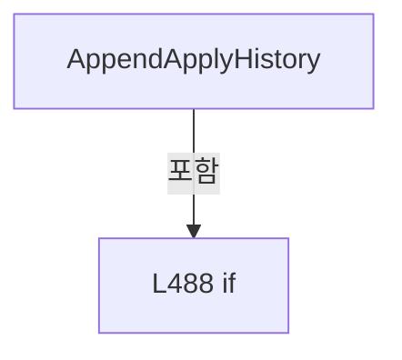

변경 전 점검: 입력/반환 타입, 위 호출자, 예외/취소 경로, 공유 상태와 저장·전송 소비자를 함께 확인합니다. 값의 단위나 물리 방향을 이름만으로 확정하지 않습니다.

### MethodDeclaration `WriteApplyHistory` · L503–530

[Drilling.File/ReviewOffset/CReviewOffsetFile.cs:503–530](https://github.com/kjuws10-rgb/A3Drilling/blob/5aee8e58439c9b455cae7c9593c9be986c3e682e/Drilling.File/ReviewOffset/CReviewOffsetFile.cs#L503-L530)

| 항목 | 실제 추출 값 |
| --- | --- |
| 서명 | void Drilling.File.ReviewOffset.CReviewOffsetFile.WriteApplyHistory(string, System.Collections.Generic.IReadOnlyList<Drilling.Common.Review.ST_REVIEW_OFFSET_SOURCE_APPLICATION>, System.Threading.CancellationToken) |
| 접근/수식자 | Private / private |
| 반환/값 타입 | void |
| 소속 타입 | NamedType:Drilling.File.ReviewOffset.CReviewOffsetFile |

입력 계약:

| 이름 | 타입 | 전달 | 선택/기본값 |
| --- | --- | --- | --- |
| historyPath | string | None | False /  |
| rows | System.Collections.Generic.IReadOnlyList<Drilling.Common.Review.ST_REVIEW_OFFSET_SOURCE_APPLICATION> | None | False /  |
| cancellationToken | System.Threading.CancellationToken | None | False /  |

정적 호출자로 확인된 위치:

| 호출 파일/행 | 호출 표현식 | 런타임 분기 가능 |
| --- | --- | --- |
| [Drilling.File/ReviewOffset/CReviewOffsetFile.cs:315–315](https://github.com/kjuws10-rgb/A3Drilling/blob/5aee8e58439c9b455cae7c9593c9be986c3e682e/Drilling.File/ReviewOffset/CReviewOffsetFile.cs#L315-L315) | WriteApplyHistory | False |
| [Drilling.File/ReviewOffset/CReviewOffsetFile.cs:352–352](https://github.com/kjuws10-rgb/A3Drilling/blob/5aee8e58439c9b455cae7c9593c9be986c3e682e/Drilling.File/ReviewOffset/CReviewOffsetFile.cs#L352-L352) | WriteApplyHistory | False |
| [Drilling.File/ReviewOffset/CReviewOffsetFile.cs:490–490](https://github.com/kjuws10-rgb/A3Drilling/blob/5aee8e58439c9b455cae7c9593c9be986c3e682e/Drilling.File/ReviewOffset/CReviewOffsetFile.cs#L490-L490) | WriteApplyHistory | False |

호출하는 대상과 해석 범위:

| 원본 행 | 표현식 | 분석 상태 | 대상/소스 위치 |
| --- | --- | --- | --- |
| 508 | cancellationToken.ThrowIfCancellationRequested | resolved | void System.Threading.CancellationToken.ThrowIfCancellationRequested() |
| 509 | Path.GetDirectoryName | resolved | string? System.IO.Path.GetDirectoryName(string?) |
| 510 | new InvalidOperationException | resolved | System.InvalidOperationException.InvalidOperationException(string?) |
| 511 | Directory.CreateDirectory | resolved | System.IO.DirectoryInfo System.IO.Directory.CreateDirectory(string) |
| 512 | Path.Combine | resolved | string System.IO.Path.Combine(string, string) |
| 512 | Guid.NewGuid | resolved | System.Guid System.Guid.NewGuid() |
| 515 | CCsvParser.Write | resolved | void Drilling.File.Parser.CCsvParser.Write(string, System.Collections.Generic.IReadOnlyList<string>, System.Collections.Generic.IEnumerable<System.Collections.Generic.IReadOnlyDictionary<string, string>>) · Drilling.File/Parser/CCsvParser.cs:58 |
| 518 | rows.OrderBy(row => row.AppliedAt).Select | resolved | System.Collections.Generic.IEnumerable<System.Collections.Generic.IReadOnlyDictionary<string, string>> System.Collections.Generic.IEnumerable<Drilling.Common.Review.ST_REVIEW_OFFSET_SOURCE_APPLICATION>.Select<Drilling.Common.Review.ST_REVIEW_OFFSET_SOURCE_APPLICATION, System.Collections.Generic.IReadOnlyDictionary<string, string>>(System.Func<Drilling.Common.Review.ST_REVIEW_OFFSET_SOURCE_APPLICATION, System.Collections.Generic.IReadOnlyDictionary<string, string>>) |
| 518 | rows.OrderBy | resolved | System.Linq.IOrderedEnumerable<Drilling.Common.Review.ST_REVIEW_OFFSET_SOURCE_APPLICATION> System.Collections.Generic.IEnumerable<Drilling.Common.Review.ST_REVIEW_OFFSET_SOURCE_APPLICATION>.OrderBy<Drilling.Common.Review.ST_REVIEW_OFFSET_SOURCE_APPLICATION, System.DateTimeOffset>(System.Func<Drilling.Common.Review.ST_REVIEW_OFFSET_SOURCE_APPLICATION, System.DateTimeOffset>) |
| 519 | cancellationToken.ThrowIfCancellationRequested | resolved | void System.Threading.CancellationToken.ThrowIfCancellationRequested() |
| 520 | System.IO.File.Move | resolved | void System.IO.File.Move(string, string, bool) |
| 521 | UpdateApplyHistoryCache | resolved | void Drilling.File.ReviewOffset.CReviewOffsetFile.UpdateApplyHistoryCache(string, System.Collections.Generic.IReadOnlyList<Drilling.Common.Review.ST_REVIEW_OFFSET_SOURCE_APPLICATION>) · Drilling.File/ReviewOffset/CReviewOffsetFile.cs:532 |
| 521 | rows.ToArray | resolved | Drilling.Common.Review.ST_REVIEW_OFFSET_SOURCE_APPLICATION[] System.Collections.Generic.IEnumerable<Drilling.Common.Review.ST_REVIEW_OFFSET_SOURCE_APPLICATION>.ToArray<Drilling.Common.Review.ST_REVIEW_OFFSET_SOURCE_APPLICATION>() |
| 525 | System.IO.File.Exists | resolved | bool System.IO.File.Exists(string?) |
| 527 | System.IO.File.Delete | resolved | void System.IO.File.Delete(string) |

본문의 실제 연산·분기·예외·반환 순서(원문 위치 순):

| 원본 행 | 종류 | 주석 해설 |
| --- | --- | --- |
| 508 | call | 함수·델리게이트 또는 객체 생성자를 호출합니다: cancellationToken.ThrowIfCancellationRequested() |
| 509 | call | 함수·델리게이트 또는 객체 생성자를 호출합니다: Path.GetDirectoryName(historyPath) |
| 509 | local-declaration | 지역 변수를 선언합니다: var directory = Path.GetDirectoryName(historyPath) ?? throw new InvalidOperationException("Review Offset 적용 이력 경로가 올바르지 않습니다."); |
| 509 | variable-initializer | 변수의 초기값을 지정합니다: directory = Path.GetDirectoryName(historyPath) ?? throw new InvalidOperationException("Review Offset 적용 이력 경로가 올바르지 않습니다.") |
| 510 | call | 함수·델리게이트 또는 객체 생성자를 호출합니다: new InvalidOperationException("Review Offset 적용 이력 경로가 올바르지 않습니다.") |
| 510 | throw | 예외를 발생/전달합니다: throw new InvalidOperationException("Review Offset 적용 이력 경로가 올바르지 않습니다.") |
| 511 | call | 함수·델리게이트 또는 객체 생성자를 호출합니다: Directory.CreateDirectory(directory) |
| 512 | call | 함수·델리게이트 또는 객체 생성자를 호출합니다: Path.Combine(directory, $".{Guid.NewGuid():N}.tmp") |
| 512 | call | 함수·델리게이트 또는 객체 생성자를 호출합니다: Guid.NewGuid() |
| 512 | local-declaration | 지역 변수를 선언합니다: var temporary = Path.Combine(directory, $".{Guid.NewGuid():N}.tmp"); |
| 512 | variable-initializer | 변수의 초기값을 지정합니다: temporary = Path.Combine(directory, $".{Guid.NewGuid():N}.tmp") |
| 513 | try | 예외 처리 범위입니다: try |
| 515 | call | 함수·델리게이트 또는 객체 생성자를 호출합니다: CCsvParser.Write( temporary, ApplyHistoryHeaders, rows.OrderBy(row => row.AppliedAt).Select(ToApplyHistoryCsvRow)) |
| 518 | call | 함수·델리게이트 또는 객체 생성자를 호출합니다: rows.OrderBy(row => row.AppliedAt).Select(ToApplyHistoryCsvRow) |
| 518 | call | 함수·델리게이트 또는 객체 생성자를 호출합니다: rows.OrderBy(row => row.AppliedAt) |
| 519 | call | 함수·델리게이트 또는 객체 생성자를 호출합니다: cancellationToken.ThrowIfCancellationRequested() |
| 520 | call | 함수·델리게이트 또는 객체 생성자를 호출합니다: System.IO.File.Move(temporary, historyPath, overwrite: true) |
| 521 | call | 함수·델리게이트 또는 객체 생성자를 호출합니다: UpdateApplyHistoryCache(historyPath, rows.ToArray()) |
| 521 | call | 함수·델리게이트 또는 객체 생성자를 호출합니다: rows.ToArray() |
| 523 | finally | 종료 정리 구간입니다: finally |
| 525 | call | 함수·델리게이트 또는 객체 생성자를 호출합니다: System.IO.File.Exists(temporary) |
| 525 | if | 조건에 따라 분기합니다: if (System.IO.File.Exists(temporary)) |
| 527 | call | 함수·델리게이트 또는 객체 생성자를 호출합니다: System.IO.File.Delete(temporary) |

제어 구문의 포함 구조(실제 실행 순서/CFG가 아닌 구문 탐색 그림):

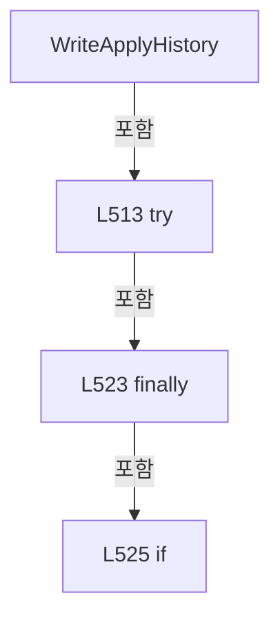

변경 전 점검: 입력/반환 타입, 위 호출자, 예외/취소 경로, 공유 상태와 저장·전송 소비자를 함께 확인합니다. 값의 단위나 물리 방향을 이름만으로 확정하지 않습니다.

### MethodDeclaration `UpdateApplyHistoryCache` · L532–552

[Drilling.File/ReviewOffset/CReviewOffsetFile.cs:532–552](https://github.com/kjuws10-rgb/A3Drilling/blob/5aee8e58439c9b455cae7c9593c9be986c3e682e/Drilling.File/ReviewOffset/CReviewOffsetFile.cs#L532-L552)

| 항목 | 실제 추출 값 |
| --- | --- |
| 서명 | void Drilling.File.ReviewOffset.CReviewOffsetFile.UpdateApplyHistoryCache(string, System.Collections.Generic.IReadOnlyList<Drilling.Common.Review.ST_REVIEW_OFFSET_SOURCE_APPLICATION>) |
| 접근/수식자 | Private / private |
| 반환/값 타입 | void |
| 소속 타입 | NamedType:Drilling.File.ReviewOffset.CReviewOffsetFile |

입력 계약:

| 이름 | 타입 | 전달 | 선택/기본값 |
| --- | --- | --- | --- |
| historyPath | string | None | False /  |
| rows | System.Collections.Generic.IReadOnlyList<Drilling.Common.Review.ST_REVIEW_OFFSET_SOURCE_APPLICATION> | None | False /  |

정적 호출자로 확인된 위치:

| 호출 파일/행 | 호출 표현식 | 런타임 분기 가능 |
| --- | --- | --- |
| [Drilling.File/ReviewOffset/CReviewOffsetFile.cs:477–477](https://github.com/kjuws10-rgb/A3Drilling/blob/5aee8e58439c9b455cae7c9593c9be986c3e682e/Drilling.File/ReviewOffset/CReviewOffsetFile.cs#L477-L477) | UpdateApplyHistoryCache | False |
| [Drilling.File/ReviewOffset/CReviewOffsetFile.cs:498–500](https://github.com/kjuws10-rgb/A3Drilling/blob/5aee8e58439c9b455cae7c9593c9be986c3e682e/Drilling.File/ReviewOffset/CReviewOffsetFile.cs#L498-L500) | UpdateApplyHistoryCache | False |
| [Drilling.File/ReviewOffset/CReviewOffsetFile.cs:521–521](https://github.com/kjuws10-rgb/A3Drilling/blob/5aee8e58439c9b455cae7c9593c9be986c3e682e/Drilling.File/ReviewOffset/CReviewOffsetFile.cs#L521-L521) | UpdateApplyHistoryCache | False |

호출하는 대상과 해석 범위:

| 원본 행 | 표현식 | 분석 상태 | 대상/소스 위치 |
| --- | --- | --- | --- |
| 536 | Path.GetFullPath | resolved | string System.IO.Path.GetFullPath(string) |
| 539 | new FileInfo | resolved | System.IO.FileInfo.FileInfo(string) |
| 540 | fileInfo.Refresh | resolved | void System.IO.FileSystemInfo.Refresh() |
| 541 | new | resolved | Drilling.File.ReviewOffset.CReviewOffsetFile.ST_APPLY_HISTORY_CACHE.ST_APPLY_HISTORY_CACHE(long, System.DateTime, System.Collections.Generic.IReadOnlyList<Drilling.Common.Review.ST_REVIEW_OFFSET_SOURCE_APPLICATION>) · Drilling.File/ReviewOffset/CReviewOffsetFile.cs:50 |
| 550 | _applyHistoryCache.Remove | resolved | bool System.Collections.Generic.Dictionary<string, Drilling.File.ReviewOffset.CReviewOffsetFile.ST_APPLY_HISTORY_CACHE>.Remove(string) |

본문의 실제 연산·분기·예외·반환 순서(원문 위치 순):

| 원본 행 | 종류 | 주석 해설 |
| --- | --- | --- |
| 536 | call | 함수·델리게이트 또는 객체 생성자를 호출합니다: Path.GetFullPath(historyPath) |
| 536 | local-declaration | 지역 변수를 선언합니다: var fullPath = Path.GetFullPath(historyPath); |
| 536 | variable-initializer | 변수의 초기값을 지정합니다: fullPath = Path.GetFullPath(historyPath) |
| 537 | try | 예외 처리 범위입니다: try |
| 539 | call | 함수·델리게이트 또는 객체 생성자를 호출합니다: new FileInfo(fullPath) |
| 539 | local-declaration | 지역 변수를 선언합니다: var fileInfo = new FileInfo(fullPath); |
| 539 | variable-initializer | 변수의 초기값을 지정합니다: fileInfo = new FileInfo(fullPath) |
| 540 | call | 함수·델리게이트 또는 객체 생성자를 호출합니다: fileInfo.Refresh() |
| 541 | assignment | 값을 대상에 대입합니다: _applyHistoryCache[fullPath] = new( fileInfo.Length, fileInfo.LastWriteTimeUtc, rows) |
| 541 | call | 함수·델리게이트 또는 객체 생성자를 호출합니다: new( fileInfo.Length, fileInfo.LastWriteTimeUtc, rows) |
| 546 | catch | 지정 예외를 처리합니다: catch  |
| 550 | call | 함수·델리게이트 또는 객체 생성자를 호출합니다: _applyHistoryCache.Remove(fullPath) |

제어 구문의 포함 구조(실제 실행 순서/CFG가 아닌 구문 탐색 그림):

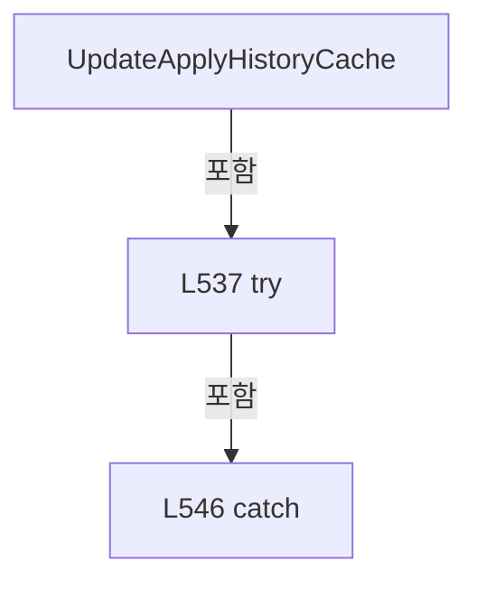

변경 전 점검: 입력/반환 타입, 위 호출자, 예외/취소 경로, 공유 상태와 저장·전송 소비자를 함께 확인합니다. 값의 단위나 물리 방향을 이름만으로 확정하지 않습니다.

### MethodDeclaration `ToApplyHistoryCsvRow` · L554–563

[Drilling.File/ReviewOffset/CReviewOffsetFile.cs:554–563](https://github.com/kjuws10-rgb/A3Drilling/blob/5aee8e58439c9b455cae7c9593c9be986c3e682e/Drilling.File/ReviewOffset/CReviewOffsetFile.cs#L554-L563)

| 항목 | 실제 추출 값 |
| --- | --- |
| 서명 | System.Collections.Generic.IReadOnlyDictionary<string, string> Drilling.File.ReviewOffset.CReviewOffsetFile.ToApplyHistoryCsvRow(Drilling.Common.Review.ST_REVIEW_OFFSET_SOURCE_APPLICATION) |
| 접근/수식자 | Private / private, static |
| 반환/값 타입 | System.Collections.Generic.IReadOnlyDictionary<string, string> |
| 소속 타입 | NamedType:Drilling.File.ReviewOffset.CReviewOffsetFile |

입력 계약:

| 이름 | 타입 | 전달 | 선택/기본값 |
| --- | --- | --- | --- |
| row | Drilling.Common.Review.ST_REVIEW_OFFSET_SOURCE_APPLICATION | None | False /  |

정적 호출자로 확인된 위치:

| 호출 파일/행 | 호출 표현식 | 런타임 분기 가능 |
| --- | --- | --- |
| [Drilling.File/ReviewOffset/CReviewOffsetFile.cs:497–497](https://github.com/kjuws10-rgb/A3Drilling/blob/5aee8e58439c9b455cae7c9593c9be986c3e682e/Drilling.File/ReviewOffset/CReviewOffsetFile.cs#L497-L497) | ToApplyHistoryCsvRow | False |

호출하는 대상과 해석 범위:

| 원본 행 | 표현식 | 분석 상태 | 대상/소스 위치 |
| --- | --- | --- | --- |
| 557 | new Dictionary<string, string> | resolved | System.Collections.Generic.Dictionary<string, string>.Dictionary(System.Collections.Generic.IEqualityComparer<string>?) |
| 561 | row.AppliedAt.ToString | resolved | string System.DateTimeOffset.ToString(string?, System.IFormatProvider?) |

본문의 실제 연산·분기·예외·반환 순서(원문 위치 순):

| 원본 행 | 종류 | 주석 해설 |
| --- | --- | --- |
| 557 | call | 함수·델리게이트 또는 객체 생성자를 호출합니다: new Dictionary<string, string>(StringComparer.OrdinalIgnoreCase) { ["SOURCE_RESULT_FILE"] = row.SourceResultFile, ["OFFSET_FILE"] = row.OffsetFile, ["APPLIED_AT"] = row.AppliedAt.ToString("O", CultureInfo.InvariantCultur… |
| 557 | return | 호출자에게 값 또는 제어를 반환합니다: return new Dictionary<string, string>(StringComparer.OrdinalIgnoreCase) { ["SOURCE_RESULT_FILE"] = row.SourceResultFile, ["OFFSET_FILE"] = row.OffsetFile, ["APPLIED_AT"] = row.AppliedAt.ToString("O", CultureInfo.InvariantCulture)  |
| 559 | assignment | 값을 대상에 대입합니다: ["SOURCE_RESULT_FILE"] = row.SourceResultFile |
| 560 | assignment | 값을 대상에 대입합니다: ["OFFSET_FILE"] = row.OffsetFile |
| 561 | assignment | 값을 대상에 대입합니다: ["APPLIED_AT"] = row.AppliedAt.ToString("O", CultureInfo.InvariantCulture) |
| 561 | call | 함수·델리게이트 또는 객체 생성자를 호출합니다: row.AppliedAt.ToString("O", CultureInfo.InvariantCulture) |

변경 전 점검: 입력/반환 타입, 위 호출자, 예외/취소 경로, 공유 상태와 저장·전송 소비자를 함께 확인합니다. 값의 단위나 물리 방향을 이름만으로 확정하지 않습니다.

### MethodDeclaration `GetApplyHistoryPath` · L565–575

[Drilling.File/ReviewOffset/CReviewOffsetFile.cs:565–575](https://github.com/kjuws10-rgb/A3Drilling/blob/5aee8e58439c9b455cae7c9593c9be986c3e682e/Drilling.File/ReviewOffset/CReviewOffsetFile.cs#L565-L575)

| 항목 | 실제 추출 값 |
| --- | --- |
| 서명 | string Drilling.File.ReviewOffset.CReviewOffsetFile.GetApplyHistoryPath(string, System.DateTimeOffset) |
| 접근/수식자 | Private / private |
| 반환/값 타입 | string |
| 소속 타입 | NamedType:Drilling.File.ReviewOffset.CReviewOffsetFile |

입력 계약:

| 이름 | 타입 | 전달 | 선택/기본값 |
| --- | --- | --- | --- |
| recipeId | string | None | False /  |
| appliedAt | System.DateTimeOffset | None | False /  |

정적 호출자로 확인된 위치:

| 호출 파일/행 | 호출 표현식 | 런타임 분기 가능 |
| --- | --- | --- |
| [Drilling.File/ReviewOffset/CReviewOffsetFile.cs:135–135](https://github.com/kjuws10-rgb/A3Drilling/blob/5aee8e58439c9b455cae7c9593c9be986c3e682e/Drilling.File/ReviewOffset/CReviewOffsetFile.cs#L135-L135) | GetApplyHistoryPath | False |
| [Drilling.File/ReviewOffset/CReviewOffsetFile.cs:159–159](https://github.com/kjuws10-rgb/A3Drilling/blob/5aee8e58439c9b455cae7c9593c9be986c3e682e/Drilling.File/ReviewOffset/CReviewOffsetFile.cs#L159-L159) | GetApplyHistoryPath | False |
| [Drilling.File/ReviewOffset/CReviewOffsetFile.cs:301–301](https://github.com/kjuws10-rgb/A3Drilling/blob/5aee8e58439c9b455cae7c9593c9be986c3e682e/Drilling.File/ReviewOffset/CReviewOffsetFile.cs#L301-L301) | GetApplyHistoryPath | False |

호출하는 대상과 해석 범위:

| 원본 행 | 표현식 | 분석 상태 | 대상/소스 위치 |
| --- | --- | --- | --- |
| 567 | appliedAt.ToLocalTime | resolved | System.DateTimeOffset System.DateTimeOffset.ToLocalTime() |
| 568 | Path.Combine | resolved | string System.IO.Path.Combine(params System.ReadOnlySpan<string>) |
| 569 | GetRecipeOffsetDirectory | resolved | string Drilling.File.ReviewOffset.CReviewOffsetFile.GetRecipeOffsetDirectory(string) · Drilling.File/ReviewOffset/CReviewOffsetFile.cs:670 |
| 571 | local.Year.ToString | resolved | string int.ToString(string?, System.IFormatProvider?) |
| 572 | local.Month.ToString | resolved | string int.ToString(string?, System.IFormatProvider?) |
| 573 | local.Day.ToString | resolved | string int.ToString(string?, System.IFormatProvider?) |

본문의 실제 연산·분기·예외·반환 순서(원문 위치 순):

| 원본 행 | 종류 | 주석 해설 |
| --- | --- | --- |
| 567 | call | 함수·델리게이트 또는 객체 생성자를 호출합니다: appliedAt.ToLocalTime() |
| 567 | local-declaration | 지역 변수를 선언합니다: var local = appliedAt.ToLocalTime(); |
| 567 | variable-initializer | 변수의 초기값을 지정합니다: local = appliedAt.ToLocalTime() |
| 568 | call | 함수·델리게이트 또는 객체 생성자를 호출합니다: Path.Combine( GetRecipeOffsetDirectory(recipeId), ApplyHistoryDirectoryName, local.Year.ToString("0000", CultureInfo.InvariantCulture), local.Month.ToString("00", CultureInfo.InvariantCulture), local.Day.ToString("00", C… |
| 568 | return | 호출자에게 값 또는 제어를 반환합니다: return Path.Combine( GetRecipeOffsetDirectory(recipeId), ApplyHistoryDirectoryName, local.Year.ToString("0000", CultureInfo.InvariantCulture), local.Month.ToString("00", CultureInfo.InvariantCulture), local.Day.ToString("00", Cult |
| 569 | call | 함수·델리게이트 또는 객체 생성자를 호출합니다: GetRecipeOffsetDirectory(recipeId) |
| 571 | call | 함수·델리게이트 또는 객체 생성자를 호출합니다: local.Year.ToString("0000", CultureInfo.InvariantCulture) |
| 572 | call | 함수·델리게이트 또는 객체 생성자를 호출합니다: local.Month.ToString("00", CultureInfo.InvariantCulture) |
| 573 | call | 함수·델리게이트 또는 객체 생성자를 호출합니다: local.Day.ToString("00", CultureInfo.InvariantCulture) |

변경 전 점검: 입력/반환 타입, 위 호출자, 예외/취소 경로, 공유 상태와 저장·전송 소비자를 함께 확인합니다. 값의 단위나 물리 방향을 이름만으로 확정하지 않습니다.

### MethodDeclaration `NormalizeSourceIdentity` · L577–602

[Drilling.File/ReviewOffset/CReviewOffsetFile.cs:577–602](https://github.com/kjuws10-rgb/A3Drilling/blob/5aee8e58439c9b455cae7c9593c9be986c3e682e/Drilling.File/ReviewOffset/CReviewOffsetFile.cs#L577-L602)

| 항목 | 실제 추출 값 |
| --- | --- |
| 서명 | string Drilling.File.ReviewOffset.CReviewOffsetFile.NormalizeSourceIdentity(string, bool) |
| 접근/수식자 | Private / private |
| 반환/값 타입 | string |
| 소속 타입 | NamedType:Drilling.File.ReviewOffset.CReviewOffsetFile |

입력 계약:

| 이름 | 타입 | 전달 | 선택/기본값 |
| --- | --- | --- | --- |
| sourceResultFile | string | None | False /  |
| requireExistingFile | bool | None | False /  |

정적 호출자로 확인된 위치:

| 호출 파일/행 | 호출 표현식 | 런타임 분기 가능 |
| --- | --- | --- |
| [Drilling.File/ReviewOffset/CReviewOffsetFile.cs:133–133](https://github.com/kjuws10-rgb/A3Drilling/blob/5aee8e58439c9b455cae7c9593c9be986c3e682e/Drilling.File/ReviewOffset/CReviewOffsetFile.cs#L133-L133) | NormalizeSourceIdentity | False |
| [Drilling.File/ReviewOffset/CReviewOffsetFile.cs:157–157](https://github.com/kjuws10-rgb/A3Drilling/blob/5aee8e58439c9b455cae7c9593c9be986c3e682e/Drilling.File/ReviewOffset/CReviewOffsetFile.cs#L157-L157) | NormalizeSourceIdentity | False |

호출하는 대상과 해석 범위:

| 원본 행 | 표현식 | 분석 상태 | 대상/소스 위치 |
| --- | --- | --- | --- |
| 579 | string.IsNullOrWhiteSpace | resolved | bool string.IsNullOrWhiteSpace(string?) |
| 581 | new InvalidDataException | resolved | System.IO.InvalidDataException.InvalidDataException(string?) |
| 584 | Path.GetFullPath | resolved | string System.IO.Path.GetFullPath(string) |
| 584 | sourceResultFile.Trim | resolved | string string.Trim() |
| 585 | System.IO.File.Exists | resolved | bool System.IO.File.Exists(string?) |
| 587 | new FileNotFoundException | resolved | System.IO.FileNotFoundException.FileNotFoundException(string?, string?) |
| 592 | Path.GetRelativePath | resolved | string System.IO.Path.GetRelativePath(string, string) |
| 593 | Path.IsPathRooted | resolved | bool System.IO.Path.IsPathRooted(string?) |
| 594 | relativePath.Equals | resolved | bool string.Equals(string?, System.StringComparison) |
| 595 | relativePath.StartsWith | resolved | bool string.StartsWith(string, System.StringComparison) |
| 596 | relativePath.StartsWith | resolved | bool string.StartsWith(string, System.StringComparison) |
| 598 | relativePath.Replace | resolved | string string.Replace(char, char) |
| 601 | fullPath.Replace | resolved | string string.Replace(char, char) |

본문의 실제 연산·분기·예외·반환 순서(원문 위치 순):

| 원본 행 | 종류 | 주석 해설 |
| --- | --- | --- |
| 579 | call | 함수·델리게이트 또는 객체 생성자를 호출합니다: string.IsNullOrWhiteSpace(sourceResultFile) |
| 579 | if | 조건에 따라 분기합니다: if (string.IsNullOrWhiteSpace(sourceResultFile)) |
| 581 | call | 함수·델리게이트 또는 객체 생성자를 호출합니다: new InvalidDataException("Review Offset 적용 출처 파일이 비어 있습니다.") |
| 581 | throw | 예외를 발생/전달합니다: throw new InvalidDataException("Review Offset 적용 출처 파일이 비어 있습니다."); |
| 584 | call | 함수·델리게이트 또는 객체 생성자를 호출합니다: Path.GetFullPath(sourceResultFile.Trim()) |
| 584 | call | 함수·델리게이트 또는 객체 생성자를 호출합니다: sourceResultFile.Trim() |
| 584 | local-declaration | 지역 변수를 선언합니다: var fullPath = Path.GetFullPath(sourceResultFile.Trim()); |
| 584 | variable-initializer | 변수의 초기값을 지정합니다: fullPath = Path.GetFullPath(sourceResultFile.Trim()) |
| 585 | call | 함수·델리게이트 또는 객체 생성자를 호출합니다: System.IO.File.Exists(fullPath) |
| 585 | if | 조건에 따라 분기합니다: if (requireExistingFile && !System.IO.File.Exists(fullPath)) |
| 587 | call | 함수·델리게이트 또는 객체 생성자를 호출합니다: new FileNotFoundException( "Review Offset 적용 출처 파일을 찾을 수 없습니다.", fullPath) |
| 587 | throw | 예외를 발생/전달합니다: throw new FileNotFoundException( "Review Offset 적용 출처 파일을 찾을 수 없습니다.", fullPath); |
| 592 | call | 함수·델리게이트 또는 객체 생성자를 호출합니다: Path.GetRelativePath(_applicationRoot, fullPath) |
| 592 | local-declaration | 지역 변수를 선언합니다: var relativePath = Path.GetRelativePath(_applicationRoot, fullPath); |
| 592 | variable-initializer | 변수의 초기값을 지정합니다: relativePath = Path.GetRelativePath(_applicationRoot, fullPath) |
| 593 | call | 함수·델리게이트 또는 객체 생성자를 호출합니다: Path.IsPathRooted(relativePath) |
| 593 | if | 조건에 따라 분기합니다: if (!Path.IsPathRooted(relativePath) && !relativePath.Equals("..", StringComparison.Ordinal) && !relativePath.StartsWith($"..{Path.DirectorySeparatorChar}", StringComparison.Ordinal) && !relativePath.StartsWith($"..{Path.Alt…) |
| 594 | call | 함수·델리게이트 또는 객체 생성자를 호출합니다: relativePath.Equals("..", StringComparison.Ordinal) |
| 595 | call | 함수·델리게이트 또는 객체 생성자를 호출합니다: relativePath.StartsWith($"..{Path.DirectorySeparatorChar}", StringComparison.Ordinal) |
| 596 | call | 함수·델리게이트 또는 객체 생성자를 호출합니다: relativePath.StartsWith($"..{Path.AltDirectorySeparatorChar}", StringComparison.Ordinal) |
| 598 | call | 함수·델리게이트 또는 객체 생성자를 호출합니다: relativePath.Replace('\\', '/') |
| 598 | return | 호출자에게 값 또는 제어를 반환합니다: return relativePath.Replace('\\', '/'); |
| 601 | call | 함수·델리게이트 또는 객체 생성자를 호출합니다: fullPath.Replace('\\', '/') |
| 601 | return | 호출자에게 값 또는 제어를 반환합니다: return fullPath.Replace('\\', '/'); |

제어 구문의 포함 구조(실제 실행 순서/CFG가 아닌 구문 탐색 그림):

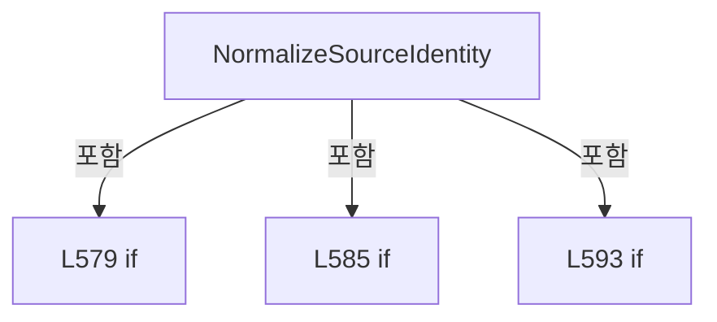

변경 전 점검: 입력/반환 타입, 위 호출자, 예외/취소 경로, 공유 상태와 저장·전송 소비자를 함께 확인합니다. 값의 단위나 물리 방향을 이름만으로 확정하지 않습니다.

### MethodDeclaration `NormalizeStoredSourceIdentity` · L604–610

[Drilling.File/ReviewOffset/CReviewOffsetFile.cs:604–610](https://github.com/kjuws10-rgb/A3Drilling/blob/5aee8e58439c9b455cae7c9593c9be986c3e682e/Drilling.File/ReviewOffset/CReviewOffsetFile.cs#L604-L610)

| 항목 | 실제 추출 값 |
| --- | --- |
| 서명 | string Drilling.File.ReviewOffset.CReviewOffsetFile.NormalizeStoredSourceIdentity(string) |
| 접근/수식자 | Private / private, static |
| 반환/값 타입 | string |
| 소속 타입 | NamedType:Drilling.File.ReviewOffset.CReviewOffsetFile |

입력 계약:

| 이름 | 타입 | 전달 | 선택/기본값 |
| --- | --- | --- | --- |
| sourceResultFile | string | None | False /  |

정적 호출자로 확인된 위치:

| 호출 파일/행 | 호출 표현식 | 런타임 분기 가능 |
| --- | --- | --- |
| [Drilling.File/ReviewOffset/CReviewOffsetFile.cs:437–441](https://github.com/kjuws10-rgb/A3Drilling/blob/5aee8e58439c9b455cae7c9593c9be986c3e682e/Drilling.File/ReviewOffset/CReviewOffsetFile.cs#L437-L441) | NormalizeStoredSourceIdentity | False |

호출하는 대상과 해석 범위:

| 원본 행 | 표현식 | 분석 상태 | 대상/소스 위치 |
| --- | --- | --- | --- |
| 606 | sourceResultFile.Trim().Replace | resolved | string string.Replace(char, char) |
| 606 | sourceResultFile.Trim | resolved | string string.Trim() |
| 607 | Path.IsPathRooted | resolved | bool System.IO.Path.IsPathRooted(string?) |
| 608 | Path.GetFullPath(normalized).Replace | resolved | string string.Replace(char, char) |
| 608 | Path.GetFullPath | resolved | string System.IO.Path.GetFullPath(string) |

본문의 실제 연산·분기·예외·반환 순서(원문 위치 순):

| 원본 행 | 종류 | 주석 해설 |
| --- | --- | --- |
| 606 | call | 함수·델리게이트 또는 객체 생성자를 호출합니다: sourceResultFile.Trim().Replace('\\', '/') |
| 606 | call | 함수·델리게이트 또는 객체 생성자를 호출합니다: sourceResultFile.Trim() |
| 606 | local-declaration | 지역 변수를 선언합니다: var normalized = sourceResultFile.Trim().Replace('\\', '/'); |
| 606 | variable-initializer | 변수의 초기값을 지정합니다: normalized = sourceResultFile.Trim().Replace('\\', '/') |
| 607 | call | 함수·델리게이트 또는 객체 생성자를 호출합니다: Path.IsPathRooted(normalized) |
| 607 | conditional-expression | 조건에 따라 결과식을 선택합니다: Path.IsPathRooted(normalized) ? Path.GetFullPath(normalized).Replace('\\', '/') : normalized |
| 607 | return | 호출자에게 값 또는 제어를 반환합니다: return Path.IsPathRooted(normalized) ? Path.GetFullPath(normalized).Replace('\\', '/') : normalized; |
| 608 | call | 함수·델리게이트 또는 객체 생성자를 호출합니다: Path.GetFullPath(normalized).Replace('\\', '/') |
| 608 | call | 함수·델리게이트 또는 객체 생성자를 호출합니다: Path.GetFullPath(normalized) |

변경 전 점검: 입력/반환 타입, 위 호출자, 예외/취소 경로, 공유 상태와 저장·전송 소비자를 함께 확인합니다. 값의 단위나 물리 방향을 이름만으로 확정하지 않습니다.

### MethodDeclaration `RequireRecipeId` · L612–621

[Drilling.File/ReviewOffset/CReviewOffsetFile.cs:612–621](https://github.com/kjuws10-rgb/A3Drilling/blob/5aee8e58439c9b455cae7c9593c9be986c3e682e/Drilling.File/ReviewOffset/CReviewOffsetFile.cs#L612-L621)

| 항목 | 실제 추출 값 |
| --- | --- |
| 서명 | string Drilling.File.ReviewOffset.CReviewOffsetFile.RequireRecipeId(string, string) |
| 접근/수식자 | Private / private, static |
| 반환/값 타입 | string |
| 소속 타입 | NamedType:Drilling.File.ReviewOffset.CReviewOffsetFile |

입력 계약:

| 이름 | 타입 | 전달 | 선택/기본값 |
| --- | --- | --- | --- |
| recipeId | string | None | False /  |
| operation | string | None | False /  |

정적 호출자로 확인된 위치:

| 호출 파일/행 | 호출 표현식 | 런타임 분기 가능 |
| --- | --- | --- |
| [Drilling.File/ReviewOffset/CReviewOffsetFile.cs:132–132](https://github.com/kjuws10-rgb/A3Drilling/blob/5aee8e58439c9b455cae7c9593c9be986c3e682e/Drilling.File/ReviewOffset/CReviewOffsetFile.cs#L132-L132) | RequireRecipeId | False |
| [Drilling.File/ReviewOffset/CReviewOffsetFile.cs:156–156](https://github.com/kjuws10-rgb/A3Drilling/blob/5aee8e58439c9b455cae7c9593c9be986c3e682e/Drilling.File/ReviewOffset/CReviewOffsetFile.cs#L156-L156) | RequireRecipeId | False |

호출하는 대상과 해석 범위:

| 원본 행 | 표현식 | 분석 상태 | 대상/소스 위치 |
| --- | --- | --- | --- |
| 614 | NormalizeRecipeId | resolved | string Drilling.File.ReviewOffset.CReviewOffsetFile.NormalizeRecipeId(string) · Drilling.File/ReviewOffset/CReviewOffsetFile.cs:731 |
| 615 | string.IsNullOrWhiteSpace | resolved | bool string.IsNullOrWhiteSpace(string?) |
| 617 | new InvalidDataException | resolved | System.IO.InvalidDataException.InvalidDataException(string?) |

본문의 실제 연산·분기·예외·반환 순서(원문 위치 순):

| 원본 행 | 종류 | 주석 해설 |
| --- | --- | --- |
| 614 | call | 함수·델리게이트 또는 객체 생성자를 호출합니다: NormalizeRecipeId(recipeId) |
| 614 | local-declaration | 지역 변수를 선언합니다: var normalized = NormalizeRecipeId(recipeId); |
| 614 | variable-initializer | 변수의 초기값을 지정합니다: normalized = NormalizeRecipeId(recipeId) |
| 615 | call | 함수·델리게이트 또는 객체 생성자를 호출합니다: string.IsNullOrWhiteSpace(normalized) |
| 615 | if | 조건에 따라 분기합니다: if (string.IsNullOrWhiteSpace(normalized)) |
| 617 | call | 함수·델리게이트 또는 객체 생성자를 호출합니다: new InvalidDataException($"{operation} 실패. Recipe ID가 비어 있습니다.") |
| 617 | throw | 예외를 발생/전달합니다: throw new InvalidDataException($"{operation} 실패. Recipe ID가 비어 있습니다."); |
| 620 | return | 호출자에게 값 또는 제어를 반환합니다: return normalized; |

제어 구문의 포함 구조(실제 실행 순서/CFG가 아닌 구문 탐색 그림):

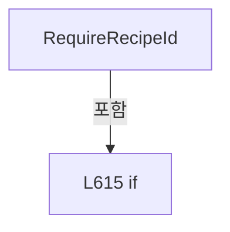

변경 전 점검: 입력/반환 타입, 위 호출자, 예외/취소 경로, 공유 상태와 저장·전송 소비자를 함께 확인합니다. 값의 단위나 물리 방향을 이름만으로 확정하지 않습니다.

### MethodDeclaration `CreateArchivePath` · L623–634

[Drilling.File/ReviewOffset/CReviewOffsetFile.cs:623–634](https://github.com/kjuws10-rgb/A3Drilling/blob/5aee8e58439c9b455cae7c9593c9be986c3e682e/Drilling.File/ReviewOffset/CReviewOffsetFile.cs#L623-L634)

| 항목 | 실제 추출 값 |
| --- | --- |
| 서명 | string Drilling.File.ReviewOffset.CReviewOffsetFile.CreateArchivePath(string, string) |
| 접근/수식자 | Private / private, static |
| 반환/값 타입 | string |
| 소속 타입 | NamedType:Drilling.File.ReviewOffset.CReviewOffsetFile |

입력 계약:

| 이름 | 타입 | 전달 | 선택/기본값 |
| --- | --- | --- | --- |
| rollbackDirectory | string | None | False /  |
| fileName | string | None | False /  |

정적 호출자로 확인된 위치:

| 호출 파일/행 | 호출 표현식 | 런타임 분기 가능 |
| --- | --- | --- |
| [Drilling.File/ReviewOffset/CReviewOffsetFile.cs:300–300](https://github.com/kjuws10-rgb/A3Drilling/blob/5aee8e58439c9b455cae7c9593c9be986c3e682e/Drilling.File/ReviewOffset/CReviewOffsetFile.cs#L300-L300) | CreateArchivePath | False |

호출하는 대상과 해석 범위:

| 원본 행 | 표현식 | 분석 상태 | 대상/소스 위치 |
| --- | --- | --- | --- |
| 625 | Path.Combine | resolved | string System.IO.Path.Combine(string, string) |
| 626 | System.IO.File.Exists | resolved | bool System.IO.File.Exists(string?) |
| 631 | Path.GetFileNameWithoutExtension | resolved | string? System.IO.Path.GetFileNameWithoutExtension(string?) |
| 632 | Path.GetExtension | resolved | string? System.IO.Path.GetExtension(string?) |
| 633 | Path.Combine | resolved | string System.IO.Path.Combine(string, string) |
| 633 | Guid.NewGuid | resolved | System.Guid System.Guid.NewGuid() |

본문의 실제 연산·분기·예외·반환 순서(원문 위치 순):

| 원본 행 | 종류 | 주석 해설 |
| --- | --- | --- |
| 625 | call | 함수·델리게이트 또는 객체 생성자를 호출합니다: Path.Combine(rollbackDirectory, fileName) |
| 625 | local-declaration | 지역 변수를 선언합니다: var path = Path.Combine(rollbackDirectory, fileName); |
| 625 | variable-initializer | 변수의 초기값을 지정합니다: path = Path.Combine(rollbackDirectory, fileName) |
| 626 | call | 함수·델리게이트 또는 객체 생성자를 호출합니다: System.IO.File.Exists(path) |
| 626 | if | 조건에 따라 분기합니다: if (!System.IO.File.Exists(path)) |
| 628 | return | 호출자에게 값 또는 제어를 반환합니다: return path; |
| 631 | call | 함수·델리게이트 또는 객체 생성자를 호출합니다: Path.GetFileNameWithoutExtension(fileName) |
| 631 | local-declaration | 지역 변수를 선언합니다: var name = Path.GetFileNameWithoutExtension(fileName); |
| 631 | variable-initializer | 변수의 초기값을 지정합니다: name = Path.GetFileNameWithoutExtension(fileName) |
| 632 | call | 함수·델리게이트 또는 객체 생성자를 호출합니다: Path.GetExtension(fileName) |
| 632 | local-declaration | 지역 변수를 선언합니다: var extension = Path.GetExtension(fileName); |
| 632 | variable-initializer | 변수의 초기값을 지정합니다: extension = Path.GetExtension(fileName) |
| 633 | call | 함수·델리게이트 또는 객체 생성자를 호출합니다: Path.Combine(rollbackDirectory, $"{name}_{DateTimeOffset.Now:yyyyMMdd_HHmmss_fff}_{Guid.NewGuid():N}{extension}") |
| 633 | call | 함수·델리게이트 또는 객체 생성자를 호출합니다: Guid.NewGuid() |
| 633 | return | 호출자에게 값 또는 제어를 반환합니다: return Path.Combine(rollbackDirectory, $"{name}_{DateTimeOffset.Now:yyyyMMdd_HHmmss_fff}_{Guid.NewGuid():N}{extension}"); |

제어 구문의 포함 구조(실제 실행 순서/CFG가 아닌 구문 탐색 그림):

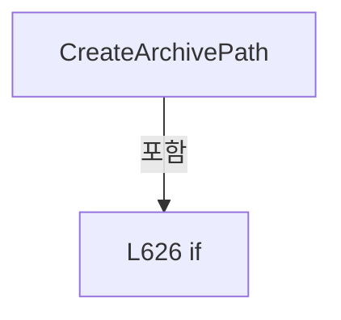

변경 전 점검: 입력/반환 타입, 위 호출자, 예외/취소 경로, 공유 상태와 저장·전송 소비자를 함께 확인합니다. 값의 단위나 물리 방향을 이름만으로 확정하지 않습니다.

### MethodDeclaration `Load` · L636–668

[Drilling.File/ReviewOffset/CReviewOffsetFile.cs:636–668](https://github.com/kjuws10-rgb/A3Drilling/blob/5aee8e58439c9b455cae7c9593c9be986c3e682e/Drilling.File/ReviewOffset/CReviewOffsetFile.cs#L636-L668)

| 항목 | 실제 추출 값 |
| --- | --- |
| 서명 | Drilling.Common.Review.ST_REVIEW_OFFSET_FILE_DATA Drilling.File.ReviewOffset.CReviewOffsetFile.Load(string, string, System.Threading.CancellationToken) |
| 접근/수식자 | Private / private |
| 반환/값 타입 | Drilling.Common.Review.ST_REVIEW_OFFSET_FILE_DATA |
| 소속 타입 | NamedType:Drilling.File.ReviewOffset.CReviewOffsetFile |

입력 계약:

| 이름 | 타입 | 전달 | 선택/기본값 |
| --- | --- | --- | --- |
| recipeId | string | None | False /  |
| path | string | None | False /  |
| token | System.Threading.CancellationToken | None | False /  |

정적 호출자로 확인된 위치:

| 호출 파일/행 | 호출 표현식 | 런타임 분기 가능 |
| --- | --- | --- |
| [Drilling.File/ReviewOffset/CReviewOffsetFile.cs:104–104](https://github.com/kjuws10-rgb/A3Drilling/blob/5aee8e58439c9b455cae7c9593c9be986c3e682e/Drilling.File/ReviewOffset/CReviewOffsetFile.cs#L104-L104) | Load | False |
| [Drilling.File/ReviewOffset/CReviewOffsetFile.cs:293–293](https://github.com/kjuws10-rgb/A3Drilling/blob/5aee8e58439c9b455cae7c9593c9be986c3e682e/Drilling.File/ReviewOffset/CReviewOffsetFile.cs#L293-L293) | Load | False |
| [Drilling.File/ReviewOffset/CReviewOffsetFile.cs:295–295](https://github.com/kjuws10-rgb/A3Drilling/blob/5aee8e58439c9b455cae7c9593c9be986c3e682e/Drilling.File/ReviewOffset/CReviewOffsetFile.cs#L295-L295) | Load | False |

호출하는 대상과 해석 범위:

| 원본 행 | 표현식 | 분석 상태 | 대상/소스 위치 |
| --- | --- | --- | --- |
| 640 | CCsvParser.ValidateRequiredHeaders | resolved | void Drilling.File.Parser.CCsvParser.ValidateRequiredHeaders(string, string, System.Collections.Generic.IEnumerable<System.Collections.Generic.IEnumerable<string>>) · Drilling.File/Parser/CCsvParser.cs:280 |
| 645 | new List<int> | resolved | System.Collections.Generic.List<int>.List() |
| 646 | CCsvParser.Read | resolved | System.Collections.Generic.IReadOnlyList<System.Collections.Generic.IReadOnlyDictionary<string, string>> Drilling.File.Parser.CCsvParser.Read(string, System.Collections.Generic.IList<int>?) · Drilling.File/Parser/CCsvParser.cs:15 |
| 650 | token.ThrowIfCancellationRequested | resolved | void System.Threading.CancellationToken.ThrowIfCancellationRequested() |
| 651 | ToOffsetRow | resolved | Drilling.Common.Review.ST_REVIEW_OFFSET_ROW Drilling.File.ReviewOffset.CReviewOffsetFile.ToOffsetRow(System.Collections.Generic.IReadOnlyDictionary<string, string>, int) · Drilling.File/ReviewOffset/CReviewOffsetFile.cs:675 |
| 654 | new CReviewOffsetValidationException | resolved | Drilling.Common.Recipe.CReviewOffsetValidationException.CReviewOffsetValidationException(string, int, string) · Drilling.Common/Recipe/CShotCoordinatePlanBuilder.cs:1201 |
| 657 | CReviewOffsetData.ValidateRows | resolved | Drilling.Common.Review.ST_REVIEW_OFFSET_ROW[] Drilling.Common.Recipe.CReviewOffsetData.ValidateRows(System.Collections.Generic.IReadOnlyList<Drilling.Common.Review.ST_REVIEW_OFFSET_ROW>, string, System.Collections.Generic.IReadOnlyList<int>?, System.Threading.CancellationToken) · Drilling.Common/Recipe/CShotCoordinatePlanBuilder.cs:1140 |
| 658 | new FileInfo | resolved | System.IO.FileInfo.FileInfo(string) |
| 659 | TryParseSavedAt | resolved | System.DateTimeOffset? Drilling.File.ReviewOffset.CReviewOffsetFile.TryParseSavedAt(string) · Drilling.File/ReviewOffset/CReviewOffsetFile.cs:712 |
| 660 | new ST_REVIEW_OFFSET_FILE_DATA | resolved | Drilling.Common.Review.ST_REVIEW_OFFSET_FILE_DATA.ST_REVIEW_OFFSET_FILE_DATA(string, string, string, System.DateTimeOffset, System.Collections.Generic.IReadOnlyList<Drilling.Common.Review.ST_REVIEW_OFFSET_ROW>) · Drilling.Common/Review/CReviewManager.cs:4105 |
| 667 | new CReviewOffsetValidationException | resolved | Drilling.Common.Recipe.CReviewOffsetValidationException.CReviewOffsetValidationException(string, int, string) · Drilling.Common/Recipe/CShotCoordinatePlanBuilder.cs:1201 |

본문의 실제 연산·분기·예외·반환 순서(원문 위치 순):

| 원본 행 | 종류 | 주석 해설 |
| --- | --- | --- |
| 638 | try | 예외 처리 범위입니다: try |
| 640 | call | 함수·델리게이트 또는 객체 생성자를 호출합니다: CCsvParser.ValidateRequiredHeaders( path, "Review Offset", RequiredHeaderGroups) |
| 645 | call | 함수·델리게이트 또는 객체 생성자를 호출합니다: new List<int>() |
| 645 | local-declaration | 지역 변수를 선언합니다: var lineNumbers = new List<int>(); |
| 645 | variable-initializer | 변수의 초기값을 지정합니다: lineNumbers = new List<int>() |
| 646 | call | 함수·델리게이트 또는 객체 생성자를 호출합니다: CCsvParser.Read(path, lineNumbers) |
| 646 | local-declaration | 지역 변수를 선언합니다: var sourceRows = CCsvParser.Read(path, lineNumbers); |
| 646 | variable-initializer | 변수의 초기값을 지정합니다: sourceRows = CCsvParser.Read(path, lineNumbers) |
| 647 | local-declaration | 지역 변수를 선언합니다: var parsed = new ST_REVIEW_OFFSET_ROW[sourceRows.Count]; |
| 647 | variable-initializer | 변수의 초기값을 지정합니다: parsed = new ST_REVIEW_OFFSET_ROW[sourceRows.Count] |
| 648 | variable-initializer | 변수의 초기값을 지정합니다: index = 0 |
| 648 | for | 초기화·조건·증감이 있는 반복입니다: for (var index = 0; index < sourceRows.Count; index++) |
| 650 | call | 함수·델리게이트 또는 객체 생성자를 호출합니다: token.ThrowIfCancellationRequested() |
| 651 | assignment | 값을 대상에 대입합니다: parsed[index] = ToOffsetRow(sourceRows[index], lineNumbers[index]) |
| 651 | call | 함수·델리게이트 또는 객체 생성자를 호출합니다: ToOffsetRow(sourceRows[index], lineNumbers[index]) |
| 651 | try | 예외 처리 범위입니다: try |
| 652 | catch | 지정 예외를 처리합니다: catch (InvalidDataException error) |
| 654 | call | 함수·델리게이트 또는 객체 생성자를 호출합니다: new CReviewOffsetValidationException(path, lineNumbers[index], error.Message) |
| 654 | throw | 예외를 발생/전달합니다: throw new CReviewOffsetValidationException(path, lineNumbers[index], error.Message); |
| 657 | call | 함수·델리게이트 또는 객체 생성자를 호출합니다: CReviewOffsetData.ValidateRows(parsed, path, lineNumbers, token) |
| 657 | local-declaration | 지역 변수를 선언합니다: var rows = CReviewOffsetData.ValidateRows(parsed, path, lineNumbers, token); |
| 657 | variable-initializer | 변수의 초기값을 지정합니다: rows = CReviewOffsetData.ValidateRows(parsed, path, lineNumbers, token) |
| 658 | call | 함수·델리게이트 또는 객체 생성자를 호출합니다: new FileInfo(path) |
| 658 | local-declaration | 지역 변수를 선언합니다: var fileInfo = new FileInfo(path); |
| 658 | variable-initializer | 변수의 초기값을 지정합니다: fileInfo = new FileInfo(path) |
| 659 | call | 함수·델리게이트 또는 객체 생성자를 호출합니다: TryParseSavedAt(fileInfo.Name) |
| 659 | local-declaration | 지역 변수를 선언합니다: var savedAt = TryParseSavedAt(fileInfo.Name) ?? fileInfo.LastWriteTime; |
| 659 | variable-initializer | 변수의 초기값을 지정합니다: savedAt = TryParseSavedAt(fileInfo.Name) ?? fileInfo.LastWriteTime |
| 660 | call | 함수·델리게이트 또는 객체 생성자를 호출합니다: new ST_REVIEW_OFFSET_FILE_DATA( recipeId, fileInfo.FullName, fileInfo.Name, savedAt, rows) |
| 660 | return | 호출자에게 값 또는 제어를 반환합니다: return new ST_REVIEW_OFFSET_FILE_DATA( recipeId, fileInfo.FullName, fileInfo.Name, savedAt, rows); |
| 667 | call | 함수·델리게이트 또는 객체 생성자를 호출합니다: new CReviewOffsetValidationException(path, 0, error.Message) |
| 667 | catch | 지정 예외를 처리합니다: catch (InvalidDataException error) |
| 667 | throw | 예외를 발생/전달합니다: throw new CReviewOffsetValidationException(path, 0, error.Message); |

제어 구문의 포함 구조(실제 실행 순서/CFG가 아닌 구문 탐색 그림):

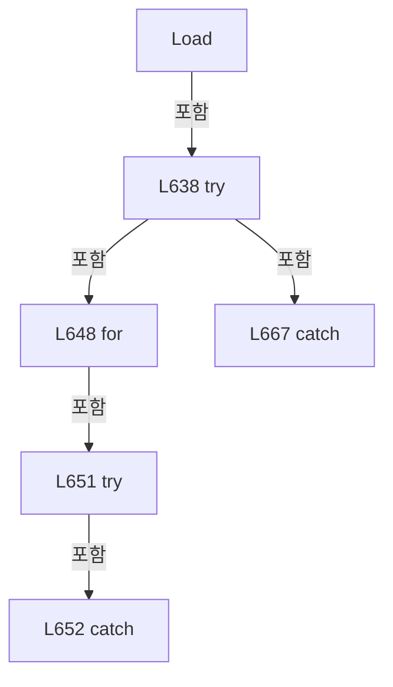

변경 전 점검: 입력/반환 타입, 위 호출자, 예외/취소 경로, 공유 상태와 저장·전송 소비자를 함께 확인합니다. 값의 단위나 물리 방향을 이름만으로 확정하지 않습니다.

### MethodDeclaration `GetRecipeOffsetDirectory` · L670–673

[Drilling.File/ReviewOffset/CReviewOffsetFile.cs:670–673](https://github.com/kjuws10-rgb/A3Drilling/blob/5aee8e58439c9b455cae7c9593c9be986c3e682e/Drilling.File/ReviewOffset/CReviewOffsetFile.cs#L670-L673)

| 항목 | 실제 추출 값 |
| --- | --- |
| 서명 | string Drilling.File.ReviewOffset.CReviewOffsetFile.GetRecipeOffsetDirectory(string) |
| 접근/수식자 | Private / private |
| 반환/값 타입 | string |
| 소속 타입 | NamedType:Drilling.File.ReviewOffset.CReviewOffsetFile |

입력 계약:

| 이름 | 타입 | 전달 | 선택/기본값 |
| --- | --- | --- | --- |
| recipeId | string | None | False /  |

정적 호출자로 확인된 위치:

| 호출 파일/행 | 호출 표현식 | 런타임 분기 가능 |
| --- | --- | --- |
| [Drilling.File/ReviewOffset/CReviewOffsetFile.cs:92–92](https://github.com/kjuws10-rgb/A3Drilling/blob/5aee8e58439c9b455cae7c9593c9be986c3e682e/Drilling.File/ReviewOffset/CReviewOffsetFile.cs#L92-L92) | GetRecipeOffsetDirectory | False |
| [Drilling.File/ReviewOffset/CReviewOffsetFile.cs:231–231](https://github.com/kjuws10-rgb/A3Drilling/blob/5aee8e58439c9b455cae7c9593c9be986c3e682e/Drilling.File/ReviewOffset/CReviewOffsetFile.cs#L231-L231) | GetRecipeOffsetDirectory | False |
| [Drilling.File/ReviewOffset/CReviewOffsetFile.cs:275–275](https://github.com/kjuws10-rgb/A3Drilling/blob/5aee8e58439c9b455cae7c9593c9be986c3e682e/Drilling.File/ReviewOffset/CReviewOffsetFile.cs#L275-L275) | GetRecipeOffsetDirectory | False |
| [Drilling.File/ReviewOffset/CReviewOffsetFile.cs:569–569](https://github.com/kjuws10-rgb/A3Drilling/blob/5aee8e58439c9b455cae7c9593c9be986c3e682e/Drilling.File/ReviewOffset/CReviewOffsetFile.cs#L569-L569) | GetRecipeOffsetDirectory | False |

호출하는 대상과 해석 범위:

| 원본 행 | 표현식 | 분석 상태 | 대상/소스 위치 |
| --- | --- | --- | --- |
| 672 | Path.Combine | resolved | string System.IO.Path.Combine(string, string) |
| 672 | SanitizeFileName | resolved | string Drilling.File.ReviewOffset.CReviewOffsetFile.SanitizeFileName(string) · Drilling.File/ReviewOffset/CReviewOffsetFile.cs:741 |

본문의 실제 연산·분기·예외·반환 순서(원문 위치 순):

| 원본 행 | 종류 | 주석 해설 |
| --- | --- | --- |
| 672 | call | 함수·델리게이트 또는 객체 생성자를 호출합니다: Path.Combine(_recipeRoot, $"{SanitizeFileName(recipeId)}_reviewoffset") |
| 672 | call | 함수·델리게이트 또는 객체 생성자를 호출합니다: SanitizeFileName(recipeId) |
| 672 | return | 호출자에게 값 또는 제어를 반환합니다: return Path.Combine(_recipeRoot, $"{SanitizeFileName(recipeId)}_reviewoffset"); |

변경 전 점검: 입력/반환 타입, 위 호출자, 예외/취소 경로, 공유 상태와 저장·전송 소비자를 함께 확인합니다. 값의 단위나 물리 방향을 이름만으로 확정하지 않습니다.

### MethodDeclaration `ToOffsetRow` · L675–698

[Drilling.File/ReviewOffset/CReviewOffsetFile.cs:675–698](https://github.com/kjuws10-rgb/A3Drilling/blob/5aee8e58439c9b455cae7c9593c9be986c3e682e/Drilling.File/ReviewOffset/CReviewOffsetFile.cs#L675-L698)

| 항목 | 실제 추출 값 |
| --- | --- |
| 서명 | Drilling.Common.Review.ST_REVIEW_OFFSET_ROW Drilling.File.ReviewOffset.CReviewOffsetFile.ToOffsetRow(System.Collections.Generic.IReadOnlyDictionary<string, string>, int) |
| 접근/수식자 | Private / private, static |
| 반환/값 타입 | Drilling.Common.Review.ST_REVIEW_OFFSET_ROW |
| 소속 타입 | NamedType:Drilling.File.ReviewOffset.CReviewOffsetFile |

입력 계약:

| 이름 | 타입 | 전달 | 선택/기본값 |
| --- | --- | --- | --- |
| row | System.Collections.Generic.IReadOnlyDictionary<string, string> | None | False /  |
| rowNo | int | None | False /  |

정적 호출자로 확인된 위치:

| 호출 파일/행 | 호출 표현식 | 런타임 분기 가능 |
| --- | --- | --- |
| [Drilling.File/ReviewOffset/CReviewOffsetFile.cs:651–651](https://github.com/kjuws10-rgb/A3Drilling/blob/5aee8e58439c9b455cae7c9593c9be986c3e682e/Drilling.File/ReviewOffset/CReviewOffsetFile.cs#L651-L651) | ToOffsetRow | False |

호출하는 대상과 해석 범위:

| 원본 행 | 표현식 | 분석 상태 | 대상/소스 위치 |
| --- | --- | --- | --- |
| 679 | CCsvParser.ReadRequiredInt | resolved | int Drilling.File.Parser.CCsvParser.ReadRequiredInt(string, string, int, string, bool) · Drilling.File/Parser/CCsvParser.cs:208 |
| 680 | CCsvParser.Get | resolved | string Drilling.File.Parser.CCsvParser.Get(System.Collections.Generic.IReadOnlyDictionary<string, string>, string) · Drilling.File/Parser/CCsvParser.cs:168 |
| 684 | CCsvParser.RequireText( row, "Review Offset", rowNo, "SHOTID").Trim().ToUpperInvariant | resolved | string string.ToUpperInvariant() |
| 684 | CCsvParser.RequireText( row, "Review Offset", rowNo, "SHOTID").Trim | resolved | string string.Trim() |
| 684 | CCsvParser.RequireText | resolved | string Drilling.File.Parser.CCsvParser.RequireText(System.Collections.Generic.IReadOnlyDictionary<string, string>, string, int, params string[]) · Drilling.File/Parser/CCsvParser.cs:187 |
| 692 | Number | resolved | double Number(string) · Drilling.File/ReviewOffset/CReviewOffsetFile.cs:689 |
| 693 | Number | resolved | double Number(string) · Drilling.File/ReviewOffset/CReviewOffsetFile.cs:689 |
| 694 | CCsvParser.Get(row, "COORDINATE_SPACE").Trim().ToUpperInvariant | resolved | string string.ToUpperInvariant() |
| 694 | CCsvParser.Get(row, "COORDINATE_SPACE").Trim | resolved | string string.Trim() |
| 694 | CCsvParser.Get | resolved | string Drilling.File.Parser.CCsvParser.Get(System.Collections.Generic.IReadOnlyDictionary<string, string>, string) · Drilling.File/Parser/CCsvParser.cs:168 |
| 696 | new InvalidDataException | resolved | System.IO.InvalidDataException.InvalidDataException(string?) |
| 697 | new ST_REVIEW_OFFSET_ROW | resolved | Drilling.Common.Review.ST_REVIEW_OFFSET_ROW.ST_REVIEW_OFFSET_ROW(int, string, double, double) · Drilling.Common/Review/CReviewManager.cs:4099 |

본문의 실제 연산·분기·예외·반환 순서(원문 위치 순):

| 원본 행 | 종류 | 주석 해설 |
| --- | --- | --- |
| 679 | call | 함수·델리게이트 또는 객체 생성자를 호출합니다: CCsvParser.ReadRequiredInt( CCsvParser.Get(row, "CELLID"), "Review Offset", rowNo, "CELLID") |
| 679 | local-declaration | 지역 변수를 선언합니다: var cellId = CCsvParser.ReadRequiredInt( CCsvParser.Get(row, "CELLID"), "Review Offset", rowNo, "CELLID"); |
| 679 | variable-initializer | 변수의 초기값을 지정합니다: cellId = CCsvParser.ReadRequiredInt( CCsvParser.Get(row, "CELLID"), "Review Offset", rowNo, "CELLID") |
| 680 | call | 함수·델리게이트 또는 객체 생성자를 호출합니다: CCsvParser.Get(row, "CELLID") |
| 684 | call | 함수·델리게이트 또는 객체 생성자를 호출합니다: CCsvParser.RequireText( row, "Review Offset", rowNo, "SHOTID").Trim().ToUpperInvariant() |
| 684 | call | 함수·델리게이트 또는 객체 생성자를 호출합니다: CCsvParser.RequireText( row, "Review Offset", rowNo, "SHOTID").Trim() |
| 684 | call | 함수·델리게이트 또는 객체 생성자를 호출합니다: CCsvParser.RequireText( row, "Review Offset", rowNo, "SHOTID") |
| 684 | local-declaration | 지역 변수를 선언합니다: var shotId = CCsvParser.RequireText( row, "Review Offset", rowNo, "SHOTID").Trim().ToUpperInvariant(); |
| 684 | variable-initializer | 변수의 초기값을 지정합니다: shotId = CCsvParser.RequireText( row, "Review Offset", rowNo, "SHOTID").Trim().ToUpperInvariant() |
| 692 | call | 함수·델리게이트 또는 객체 생성자를 호출합니다: Number("REVIEWOFFSETX") |
| 692 | local-declaration | 지역 변수를 선언합니다: var offsetX = Number("REVIEWOFFSETX"); |
| 692 | variable-initializer | 변수의 초기값을 지정합니다: offsetX = Number("REVIEWOFFSETX") |
| 693 | call | 함수·델리게이트 또는 객체 생성자를 호출합니다: Number("REVIEWOFFSETY") |
| 693 | local-declaration | 지역 변수를 선언합니다: var offsetY = Number("REVIEWOFFSETY"); |
| 693 | variable-initializer | 변수의 초기값을 지정합니다: offsetY = Number("REVIEWOFFSETY") |
| 694 | call | 함수·델리게이트 또는 객체 생성자를 호출합니다: CCsvParser.Get(row, "COORDINATE_SPACE").Trim().ToUpperInvariant() |
| 694 | call | 함수·델리게이트 또는 객체 생성자를 호출합니다: CCsvParser.Get(row, "COORDINATE_SPACE").Trim() |
| 694 | call | 함수·델리게이트 또는 객체 생성자를 호출합니다: CCsvParser.Get(row, "COORDINATE_SPACE") |
| 694 | local-declaration | 지역 변수를 선언합니다: var space = CCsvParser.Get(row, "COORDINATE_SPACE").Trim().ToUpperInvariant(); |
| 694 | variable-initializer | 변수의 초기값을 지정합니다: space = CCsvParser.Get(row, "COORDINATE_SPACE").Trim().ToUpperInvariant() |
| 695 | if | 조건에 따라 분기합니다: if (space is not ("" or "SCANNER" or "DESIGN")) |
| 696 | call | 함수·델리게이트 또는 객체 생성자를 호출합니다: new InvalidDataException($"Review Offset row {rowNo}: invalid COORDINATE_SPACE {space}.") |
| 696 | throw | 예외를 발생/전달합니다: throw new InvalidDataException($"Review Offset row {rowNo}: invalid COORDINATE_SPACE {space}."); |
| 697 | assignment | 값을 대상에 대입합니다: IsDesignCoordinate = space == "DESIGN" |
| 697 | call | 함수·델리게이트 또는 객체 생성자를 호출합니다: new ST_REVIEW_OFFSET_ROW(cellId, shotId, offsetX, offsetY) { IsDesignCoordinate = space == "DESIGN" } |
| 697 | return | 호출자에게 값 또는 제어를 반환합니다: return new ST_REVIEW_OFFSET_ROW(cellId, shotId, offsetX, offsetY) { IsDesignCoordinate = space == "DESIGN" }; |

제어 구문의 포함 구조(실제 실행 순서/CFG가 아닌 구문 탐색 그림):

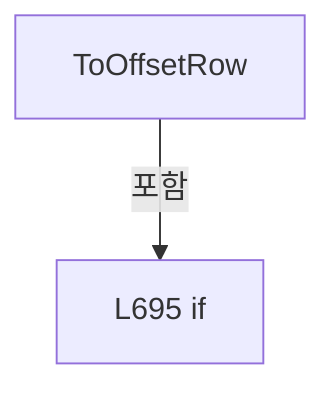

변경 전 점검: 입력/반환 타입, 위 호출자, 예외/취소 경로, 공유 상태와 저장·전송 소비자를 함께 확인합니다. 값의 단위나 물리 방향을 이름만으로 확정하지 않습니다.

### LocalFunctionStatement `Number` · L689–691

[Drilling.File/ReviewOffset/CReviewOffsetFile.cs:689–691](https://github.com/kjuws10-rgb/A3Drilling/blob/5aee8e58439c9b455cae7c9593c9be986c3e682e/Drilling.File/ReviewOffset/CReviewOffsetFile.cs#L689-L691)

| 항목 | 실제 추출 값 |
| --- | --- |
| 서명 | double Number(string) |
| 접근/수식자 | Private /  |
| 반환/값 타입 | double |
| 소속 타입 | NamedType:Drilling.File.ReviewOffset.CReviewOffsetFile |

입력 계약:

| 이름 | 타입 | 전달 | 선택/기본값 |
| --- | --- | --- | --- |
| name | string | None | False /  |

정적 호출자로 확인된 위치:

| 호출 파일/행 | 호출 표현식 | 런타임 분기 가능 |
| --- | --- | --- |
| [Drilling.File/ReviewOffset/CReviewOffsetFile.cs:692–692](https://github.com/kjuws10-rgb/A3Drilling/blob/5aee8e58439c9b455cae7c9593c9be986c3e682e/Drilling.File/ReviewOffset/CReviewOffsetFile.cs#L692-L692) | Number | False |
| [Drilling.File/ReviewOffset/CReviewOffsetFile.cs:693–693](https://github.com/kjuws10-rgb/A3Drilling/blob/5aee8e58439c9b455cae7c9593c9be986c3e682e/Drilling.File/ReviewOffset/CReviewOffsetFile.cs#L693-L693) | Number | False |

호출하는 대상과 해석 범위:

| 원본 행 | 표현식 | 분석 상태 | 대상/소스 위치 |
| --- | --- | --- | --- |
| 689 | double.TryParse | resolved | bool double.TryParse(string?, System.Globalization.NumberStyles, System.IFormatProvider?, out double) |
| 689 | CCsvParser.Get | resolved | string Drilling.File.Parser.CCsvParser.Get(System.Collections.Generic.IReadOnlyDictionary<string, string>, string) · Drilling.File/Parser/CCsvParser.cs:168 |
| 691 | new InvalidDataException | resolved | System.IO.InvalidDataException.InvalidDataException(string?) |
| 691 | CCsvParser.Get | resolved | string Drilling.File.Parser.CCsvParser.Get(System.Collections.Generic.IReadOnlyDictionary<string, string>, string) · Drilling.File/Parser/CCsvParser.cs:168 |

본문의 실제 연산·분기·예외·반환 순서(원문 위치 순):

| 원본 행 | 종류 | 주석 해설 |
| --- | --- | --- |
| 689 | call | 함수·델리게이트 또는 객체 생성자를 호출합니다: CCsvParser.Get(row, name) |
| 689 | call | 함수·델리게이트 또는 객체 생성자를 호출합니다: double.TryParse(CCsvParser.Get(row, name), NumberStyles.Float, CultureInfo.InvariantCulture, out var value) |
| 689 | conditional-expression | 조건에 따라 결과식을 선택합니다: double.TryParse(CCsvParser.Get(row, name), NumberStyles.Float, CultureInfo.InvariantCulture, out var value) ? value : throw new InvalidDataException($"{name} 값이 숫자가 아닙니다: '{CCsvParser.Get(row, name)}'.") |
| 691 | call | 함수·델리게이트 또는 객체 생성자를 호출합니다: new InvalidDataException($"{name} 값이 숫자가 아닙니다: '{CCsvParser.Get(row, name)}'.") |
| 691 | call | 함수·델리게이트 또는 객체 생성자를 호출합니다: CCsvParser.Get(row, name) |
| 691 | throw | 예외를 발생/전달합니다: throw new InvalidDataException($"{name} 값이 숫자가 아닙니다: '{CCsvParser.Get(row, name)}'.") |

변경 전 점검: 입력/반환 타입, 위 호출자, 예외/취소 경로, 공유 상태와 저장·전송 소비자를 함께 확인합니다. 값의 단위나 물리 방향을 이름만으로 확정하지 않습니다.

### MethodDeclaration `ToCsvRow` · L700–710

[Drilling.File/ReviewOffset/CReviewOffsetFile.cs:700–710](https://github.com/kjuws10-rgb/A3Drilling/blob/5aee8e58439c9b455cae7c9593c9be986c3e682e/Drilling.File/ReviewOffset/CReviewOffsetFile.cs#L700-L710)

| 항목 | 실제 추출 값 |
| --- | --- |
| 서명 | System.Collections.Generic.IReadOnlyDictionary<string, string> Drilling.File.ReviewOffset.CReviewOffsetFile.ToCsvRow(Drilling.Common.Review.ST_REVIEW_OFFSET_ROW) |
| 접근/수식자 | Private / private, static |
| 반환/값 타입 | System.Collections.Generic.IReadOnlyDictionary<string, string> |
| 소속 타입 | NamedType:Drilling.File.ReviewOffset.CReviewOffsetFile |

입력 계약:

| 이름 | 타입 | 전달 | 선택/기본값 |
| --- | --- | --- | --- |
| row | Drilling.Common.Review.ST_REVIEW_OFFSET_ROW | None | False /  |

현재 부분 분석에서 직접 연결된 호출자는 없습니다. XAML/이벤트/인터페이스·델리게이트·외부 진입을 추가 확인해야 하며, 미사용으로 판정한 것이 아닙니다.

호출하는 대상과 해석 범위:

| 원본 행 | 표현식 | 분석 상태 | 대상/소스 위치 |
| --- | --- | --- | --- |
| 702 | new Dictionary<string, string> | resolved | System.Collections.Generic.Dictionary<string, string>.Dictionary(System.Collections.Generic.IEqualityComparer<string>?) |
| 704 | row.CellId.ToString | resolved | string int.ToString(System.IFormatProvider?) |
| 706 | FormatDouble | resolved | string Drilling.File.ReviewOffset.CReviewOffsetFile.FormatDouble(double) · Drilling.File/ReviewOffset/CReviewOffsetFile.cs:736 |
| 707 | FormatDouble | resolved | string Drilling.File.ReviewOffset.CReviewOffsetFile.FormatDouble(double) · Drilling.File/ReviewOffset/CReviewOffsetFile.cs:736 |

본문의 실제 연산·분기·예외·반환 순서(원문 위치 순):

| 원본 행 | 종류 | 주석 해설 |
| --- | --- | --- |
| 702 | call | 함수·델리게이트 또는 객체 생성자를 호출합니다: new Dictionary<string, string>(StringComparer.OrdinalIgnoreCase) { ["CELLID"] = row.CellId.ToString(CultureInfo.InvariantCulture), ["SHOTID"] = row.ShotId, ["REVIEWOFFSETX"] = FormatDouble(row.ReviewOffsetX), ["REVIEWOFF… |
| 702 | return | 호출자에게 값 또는 제어를 반환합니다: return new Dictionary<string, string>(StringComparer.OrdinalIgnoreCase) { ["CELLID"] = row.CellId.ToString(CultureInfo.InvariantCulture), ["SHOTID"] = row.ShotId, ["REVIEWOFFSETX"] = FormatDouble(row.ReviewOffsetX), ["REVIEWOFFSET |
| 704 | assignment | 값을 대상에 대입합니다: ["CELLID"] = row.CellId.ToString(CultureInfo.InvariantCulture) |
| 704 | call | 함수·델리게이트 또는 객체 생성자를 호출합니다: row.CellId.ToString(CultureInfo.InvariantCulture) |
| 705 | assignment | 값을 대상에 대입합니다: ["SHOTID"] = row.ShotId |
| 706 | assignment | 값을 대상에 대입합니다: ["REVIEWOFFSETX"] = FormatDouble(row.ReviewOffsetX) |
| 706 | call | 함수·델리게이트 또는 객체 생성자를 호출합니다: FormatDouble(row.ReviewOffsetX) |
| 707 | assignment | 값을 대상에 대입합니다: ["REVIEWOFFSETY"] = FormatDouble(row.ReviewOffsetY) |
| 707 | call | 함수·델리게이트 또는 객체 생성자를 호출합니다: FormatDouble(row.ReviewOffsetY) |
| 708 | assignment | 값을 대상에 대입합니다: ["COORDINATE_SPACE"] = row.IsDesignCoordinate ? "DESIGN" : "SCANNER" |
| 708 | conditional-expression | 조건에 따라 결과식을 선택합니다: row.IsDesignCoordinate ? "DESIGN" : "SCANNER" |

변경 전 점검: 입력/반환 타입, 위 호출자, 예외/취소 경로, 공유 상태와 저장·전송 소비자를 함께 확인합니다. 값의 단위나 물리 방향을 이름만으로 확정하지 않습니다.

### MethodDeclaration `TryParseSavedAt` · L712–729

[Drilling.File/ReviewOffset/CReviewOffsetFile.cs:712–729](https://github.com/kjuws10-rgb/A3Drilling/blob/5aee8e58439c9b455cae7c9593c9be986c3e682e/Drilling.File/ReviewOffset/CReviewOffsetFile.cs#L712-L729)

| 항목 | 실제 추출 값 |
| --- | --- |
| 서명 | System.DateTimeOffset? Drilling.File.ReviewOffset.CReviewOffsetFile.TryParseSavedAt(string) |
| 접근/수식자 | Private / private, static |
| 반환/값 타입 | System.DateTimeOffset? |
| 소속 타입 | NamedType:Drilling.File.ReviewOffset.CReviewOffsetFile |

입력 계약:

| 이름 | 타입 | 전달 | 선택/기본값 |
| --- | --- | --- | --- |
| fileName | string | None | False /  |

정적 호출자로 확인된 위치:

| 호출 파일/행 | 호출 표현식 | 런타임 분기 가능 |
| --- | --- | --- |
| [Drilling.File/ReviewOffset/CReviewOffsetFile.cs:659–659](https://github.com/kjuws10-rgb/A3Drilling/blob/5aee8e58439c9b455cae7c9593c9be986c3e682e/Drilling.File/ReviewOffset/CReviewOffsetFile.cs#L659-L659) | TryParseSavedAt | False |

호출하는 대상과 해석 범위:

| 원본 행 | 표현식 | 분석 상태 | 대상/소스 위치 |
| --- | --- | --- | --- |
| 714 | Path.GetFileNameWithoutExtension | resolved | string? System.IO.Path.GetFileNameWithoutExtension(string?) |
| 716 | name.EndsWith | resolved | bool string.EndsWith(string, System.StringComparison) |
| 721 | DateTimeOffset.TryParseExact | resolved | bool System.DateTimeOffset.TryParseExact(string?, string?, System.IFormatProvider?, System.Globalization.DateTimeStyles, out System.DateTimeOffset) |

본문의 실제 연산·분기·예외·반환 순서(원문 위치 순):

| 원본 행 | 종류 | 주석 해설 |
| --- | --- | --- |
| 714 | call | 함수·델리게이트 또는 객체 생성자를 호출합니다: Path.GetFileNameWithoutExtension(fileName) |
| 714 | local-declaration | 지역 변수를 선언합니다: var name = Path.GetFileNameWithoutExtension(fileName); |
| 714 | variable-initializer | 변수의 초기값을 지정합니다: name = Path.GetFileNameWithoutExtension(fileName) |
| 715 | local-declaration | 지역 변수를 선언합니다: var marker = "_reviewoffset"; |
| 715 | variable-initializer | 변수의 초기값을 지정합니다: marker = "_reviewoffset" |
| 716 | call | 함수·델리게이트 또는 객체 생성자를 호출합니다: name.EndsWith(marker, StringComparison.OrdinalIgnoreCase) |
| 716 | if | 조건에 따라 분기합니다: if (name.EndsWith(marker, StringComparison.OrdinalIgnoreCase)) |
| 718 | assignment | 값을 대상에 대입합니다: name = name[..^marker.Length] |
| 721 | call | 함수·델리게이트 또는 객체 생성자를 호출합니다: DateTimeOffset.TryParseExact( name, "yyyyMMdd_HHmmss_fff", CultureInfo.InvariantCulture, DateTimeStyles.AssumeLocal, out var savedAt) |
| 721 | conditional-expression | 조건에 따라 결과식을 선택합니다: DateTimeOffset.TryParseExact( name, "yyyyMMdd_HHmmss_fff", CultureInfo.InvariantCulture, DateTimeStyles.AssumeLocal, out var savedAt) ? savedAt : null |
| 721 | return | 호출자에게 값 또는 제어를 반환합니다: return DateTimeOffset.TryParseExact( name, "yyyyMMdd_HHmmss_fff", CultureInfo.InvariantCulture, DateTimeStyles.AssumeLocal, out var savedAt) ? savedAt : null; |

제어 구문의 포함 구조(실제 실행 순서/CFG가 아닌 구문 탐색 그림):

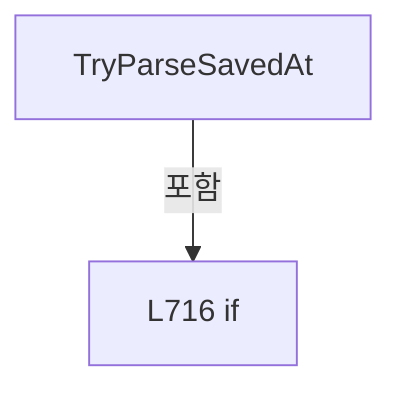

변경 전 점검: 입력/반환 타입, 위 호출자, 예외/취소 경로, 공유 상태와 저장·전송 소비자를 함께 확인합니다. 값의 단위나 물리 방향을 이름만으로 확정하지 않습니다.

### MethodDeclaration `NormalizeRecipeId` · L731–734

[Drilling.File/ReviewOffset/CReviewOffsetFile.cs:731–734](https://github.com/kjuws10-rgb/A3Drilling/blob/5aee8e58439c9b455cae7c9593c9be986c3e682e/Drilling.File/ReviewOffset/CReviewOffsetFile.cs#L731-L734)

| 항목 | 실제 추출 값 |
| --- | --- |
| 서명 | string Drilling.File.ReviewOffset.CReviewOffsetFile.NormalizeRecipeId(string) |
| 접근/수식자 | Private / private, static |
| 반환/값 타입 | string |
| 소속 타입 | NamedType:Drilling.File.ReviewOffset.CReviewOffsetFile |

입력 계약:

| 이름 | 타입 | 전달 | 선택/기본값 |
| --- | --- | --- | --- |
| value | string | None | False /  |

정적 호출자로 확인된 위치:

| 호출 파일/행 | 호출 표현식 | 런타임 분기 가능 |
| --- | --- | --- |
| [Drilling.File/ReviewOffset/CReviewOffsetFile.cs:86–86](https://github.com/kjuws10-rgb/A3Drilling/blob/5aee8e58439c9b455cae7c9593c9be986c3e682e/Drilling.File/ReviewOffset/CReviewOffsetFile.cs#L86-L86) | NormalizeRecipeId | False |
| [Drilling.File/ReviewOffset/CReviewOffsetFile.cs:222–222](https://github.com/kjuws10-rgb/A3Drilling/blob/5aee8e58439c9b455cae7c9593c9be986c3e682e/Drilling.File/ReviewOffset/CReviewOffsetFile.cs#L222-L222) | NormalizeRecipeId | False |
| [Drilling.File/ReviewOffset/CReviewOffsetFile.cs:269–269](https://github.com/kjuws10-rgb/A3Drilling/blob/5aee8e58439c9b455cae7c9593c9be986c3e682e/Drilling.File/ReviewOffset/CReviewOffsetFile.cs#L269-L269) | NormalizeRecipeId | False |
| [Drilling.File/ReviewOffset/CReviewOffsetFile.cs:614–614](https://github.com/kjuws10-rgb/A3Drilling/blob/5aee8e58439c9b455cae7c9593c9be986c3e682e/Drilling.File/ReviewOffset/CReviewOffsetFile.cs#L614-L614) | NormalizeRecipeId | False |

호출하는 대상과 해석 범위:

| 원본 행 | 표현식 | 분석 상태 | 대상/소스 위치 |
| --- | --- | --- | --- |
| 733 | Path.GetFileNameWithoutExtension | resolved | string? System.IO.Path.GetFileNameWithoutExtension(string?) |
| 733 | .Trim | resolved | string string.Trim() |

본문의 실제 연산·분기·예외·반환 순서(원문 위치 순):

| 원본 행 | 종류 | 주석 해설 |
| --- | --- | --- |
| 733 | call | 함수·델리게이트 또는 객체 생성자를 호출합니다: Path.GetFileNameWithoutExtension(value?.Trim() ?? "") |
| 733 | call | 함수·델리게이트 또는 객체 생성자를 호출합니다: .Trim() |
| 733 | return | 호출자에게 값 또는 제어를 반환합니다: return Path.GetFileNameWithoutExtension(value?.Trim() ?? ""); |

변경 전 점검: 입력/반환 타입, 위 호출자, 예외/취소 경로, 공유 상태와 저장·전송 소비자를 함께 확인합니다. 값의 단위나 물리 방향을 이름만으로 확정하지 않습니다.

### MethodDeclaration `FormatDouble` · L736–739

[Drilling.File/ReviewOffset/CReviewOffsetFile.cs:736–739](https://github.com/kjuws10-rgb/A3Drilling/blob/5aee8e58439c9b455cae7c9593c9be986c3e682e/Drilling.File/ReviewOffset/CReviewOffsetFile.cs#L736-L739)

| 항목 | 실제 추출 값 |
| --- | --- |
| 서명 | string Drilling.File.ReviewOffset.CReviewOffsetFile.FormatDouble(double) |
| 접근/수식자 | Private / private, static |
| 반환/값 타입 | string |
| 소속 타입 | NamedType:Drilling.File.ReviewOffset.CReviewOffsetFile |

입력 계약:

| 이름 | 타입 | 전달 | 선택/기본값 |
| --- | --- | --- | --- |
| value | double | None | False /  |

정적 호출자로 확인된 위치:

| 호출 파일/행 | 호출 표현식 | 런타임 분기 가능 |
| --- | --- | --- |
| [Drilling.File/ReviewOffset/CReviewOffsetFile.cs:706–706](https://github.com/kjuws10-rgb/A3Drilling/blob/5aee8e58439c9b455cae7c9593c9be986c3e682e/Drilling.File/ReviewOffset/CReviewOffsetFile.cs#L706-L706) | FormatDouble | False |
| [Drilling.File/ReviewOffset/CReviewOffsetFile.cs:707–707](https://github.com/kjuws10-rgb/A3Drilling/blob/5aee8e58439c9b455cae7c9593c9be986c3e682e/Drilling.File/ReviewOffset/CReviewOffsetFile.cs#L707-L707) | FormatDouble | False |

호출하는 대상과 해석 범위:

| 원본 행 | 표현식 | 분석 상태 | 대상/소스 위치 |
| --- | --- | --- | --- |
| 738 | value.ToString | resolved | string double.ToString(string?, System.IFormatProvider?) |

본문의 실제 연산·분기·예외·반환 순서(원문 위치 순):

| 원본 행 | 종류 | 주석 해설 |
| --- | --- | --- |
| 738 | call | 함수·델리게이트 또는 객체 생성자를 호출합니다: value.ToString("0.000000", CultureInfo.InvariantCulture) |
| 738 | return | 호출자에게 값 또는 제어를 반환합니다: return value.ToString("0.000000", CultureInfo.InvariantCulture); |

변경 전 점검: 입력/반환 타입, 위 호출자, 예외/취소 경로, 공유 상태와 저장·전송 소비자를 함께 확인합니다. 값의 단위나 물리 방향을 이름만으로 확정하지 않습니다.

### MethodDeclaration `SanitizeFileName` · L741–749

[Drilling.File/ReviewOffset/CReviewOffsetFile.cs:741–749](https://github.com/kjuws10-rgb/A3Drilling/blob/5aee8e58439c9b455cae7c9593c9be986c3e682e/Drilling.File/ReviewOffset/CReviewOffsetFile.cs#L741-L749)

| 항목 | 실제 추출 값 |
| --- | --- |
| 서명 | string Drilling.File.ReviewOffset.CReviewOffsetFile.SanitizeFileName(string) |
| 접근/수식자 | Private / private, static |
| 반환/값 타입 | string |
| 소속 타입 | NamedType:Drilling.File.ReviewOffset.CReviewOffsetFile |

입력 계약:

| 이름 | 타입 | 전달 | 선택/기본값 |
| --- | --- | --- | --- |
| value | string | None | False /  |

정적 호출자로 확인된 위치:

| 호출 파일/행 | 호출 표현식 | 런타임 분기 가능 |
| --- | --- | --- |
| [Drilling.File/ReviewOffset/CReviewOffsetFile.cs:672–672](https://github.com/kjuws10-rgb/A3Drilling/blob/5aee8e58439c9b455cae7c9593c9be986c3e682e/Drilling.File/ReviewOffset/CReviewOffsetFile.cs#L672-L672) | SanitizeFileName | False |

호출하는 대상과 해석 범위:

| 원본 행 | 표현식 | 분석 상태 | 대상/소스 위치 |
| --- | --- | --- | --- |
| 743 | Path.GetInvalidFileNameChars | resolved | char[] System.IO.Path.GetInvalidFileNameChars() |
| 744 | new string | resolved | string.String(char[]?) |
| 744 | value .Select(character => invalidChars.Contains(character) ? '_' : character) .ToArray | resolved | char[] System.Collections.Generic.IEnumerable<char>.ToArray<char>() |
| 744 | value .Select | resolved | System.Collections.Generic.IEnumerable<char> System.Collections.Generic.IEnumerable<char>.Select<char, char>(System.Func<char, char>) |
| 745 | invalidChars.Contains | resolved | bool System.ReadOnlySpan<char>.Contains<char>(char) |
| 748 | string.IsNullOrWhiteSpace | resolved | bool string.IsNullOrWhiteSpace(string?) |

본문의 실제 연산·분기·예외·반환 순서(원문 위치 순):

| 원본 행 | 종류 | 주석 해설 |
| --- | --- | --- |
| 743 | call | 함수·델리게이트 또는 객체 생성자를 호출합니다: Path.GetInvalidFileNameChars() |
| 743 | local-declaration | 지역 변수를 선언합니다: var invalidChars = Path.GetInvalidFileNameChars(); |
| 743 | variable-initializer | 변수의 초기값을 지정합니다: invalidChars = Path.GetInvalidFileNameChars() |
| 744 | call | 함수·델리게이트 또는 객체 생성자를 호출합니다: value .Select(character => invalidChars.Contains(character) ? '_' : character) |
| 744 | call | 함수·델리게이트 또는 객체 생성자를 호출합니다: new string(value .Select(character => invalidChars.Contains(character) ? '_' : character) .ToArray()) |
| 744 | call | 함수·델리게이트 또는 객체 생성자를 호출합니다: value .Select(character => invalidChars.Contains(character) ? '_' : character) .ToArray() |
| 744 | local-declaration | 지역 변수를 선언합니다: var sanitized = new string(value .Select(character => invalidChars.Contains(character) ? '_' : character) .ToArray()); |
| 744 | variable-initializer | 변수의 초기값을 지정합니다: sanitized = new string(value .Select(character => invalidChars.Contains(character) ? '_' : character) .ToArray()) |
| 745 | call | 함수·델리게이트 또는 객체 생성자를 호출합니다: invalidChars.Contains(character) |
| 745 | conditional-expression | 조건에 따라 결과식을 선택합니다: invalidChars.Contains(character) ? '_' : character |
| 748 | call | 함수·델리게이트 또는 객체 생성자를 호출합니다: string.IsNullOrWhiteSpace(sanitized) |
| 748 | conditional-expression | 조건에 따라 결과식을 선택합니다: string.IsNullOrWhiteSpace(sanitized) ? "UNLINKED" : sanitized |
| 748 | return | 호출자에게 값 또는 제어를 반환합니다: return string.IsNullOrWhiteSpace(sanitized) ? "UNLINKED" : sanitized; |

변경 전 점검: 입력/반환 타입, 위 호출자, 예외/취소 경로, 공유 상태와 저장·전송 소비자를 함께 확인합니다. 값의 단위나 물리 방향을 이름만으로 확정하지 않습니다.

## 구문·바인딩 한계

전체 WPF/벤더 SDK/프로젝트별 빌드 조건을 로드한 정식 빌드가 아닙니다. `resolved`는 이 부분 컴파일에서의 심볼 연결이며 virtual/interface/delegate/이벤트/Reflection/XAML의 실제 런타임 구현을 확정하지 않습니다. `candidate`와 `unresolved`는 후속 확인 대상으로 남깁니다.

## 원문 전체 주석 해설본

[원본 모든 행과 행별 해설 보기](../../../annotated/Drilling.File/ReviewOffset/CReviewOffsetFile.cs.annotated.txt)

원본을 빠뜨리거나 임의로 줄이지 않았습니다. `L000001 |` 표시는 원본 행 번호, `// 해설`은 별도 설명입니다. 실행용 소스가 아닌 문서입니다.

## 수정·재검증 체크

- 원본 Commit과 현재 작업 파일 SHA가 같은지 먼저 확인합니다. 다르면 이 문서를 과거 버전 자료로 취급합니다.
- 선언·직접 호출·이벤트/인터페이스 경계·설정 소비를 함께 확인합니다. 정적 연결의 빈 곳을 정상 경로로 추정하지 않습니다.
- 저장 형식/단위/식별자·재시도·취소·예외·롤백에 영향을 주는 변경은 상세 해설장과 호출자를 다시 검토합니다.
- 도구의 구문 추출과 별도 정적 추적 해설, 실제 빌드·시뮬레이션·실장비 검증 결과를 분리합니다.
