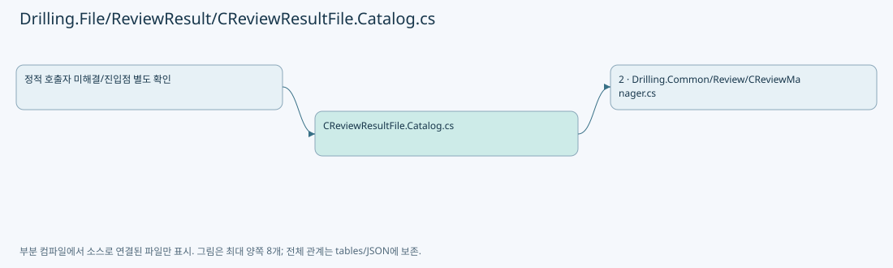
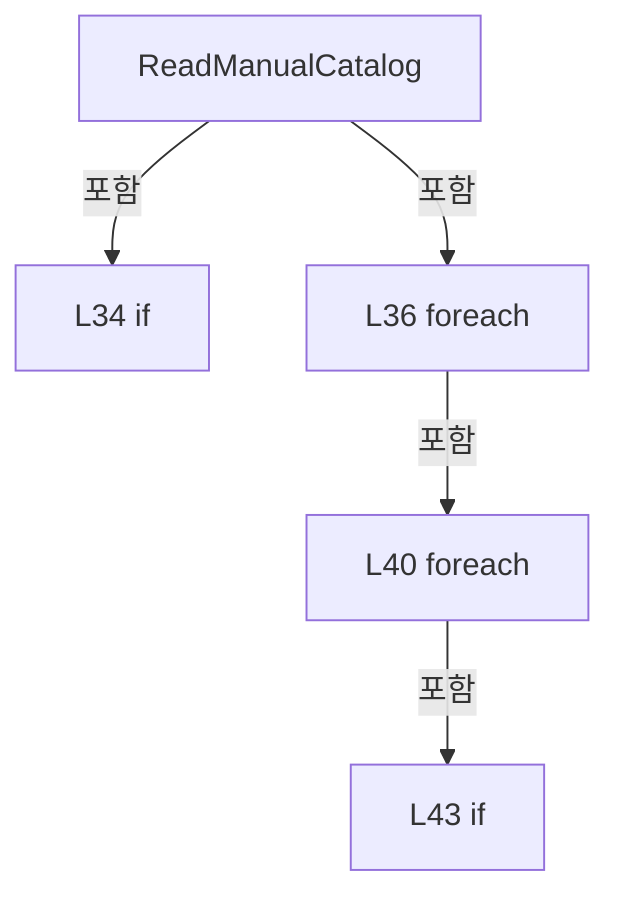
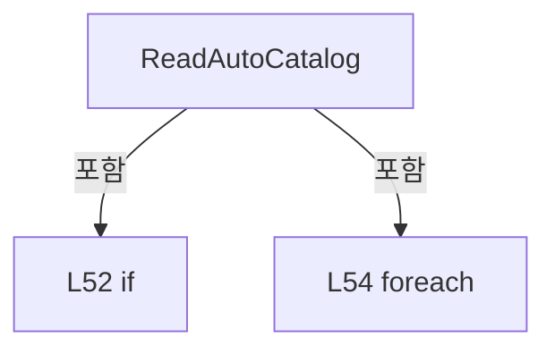
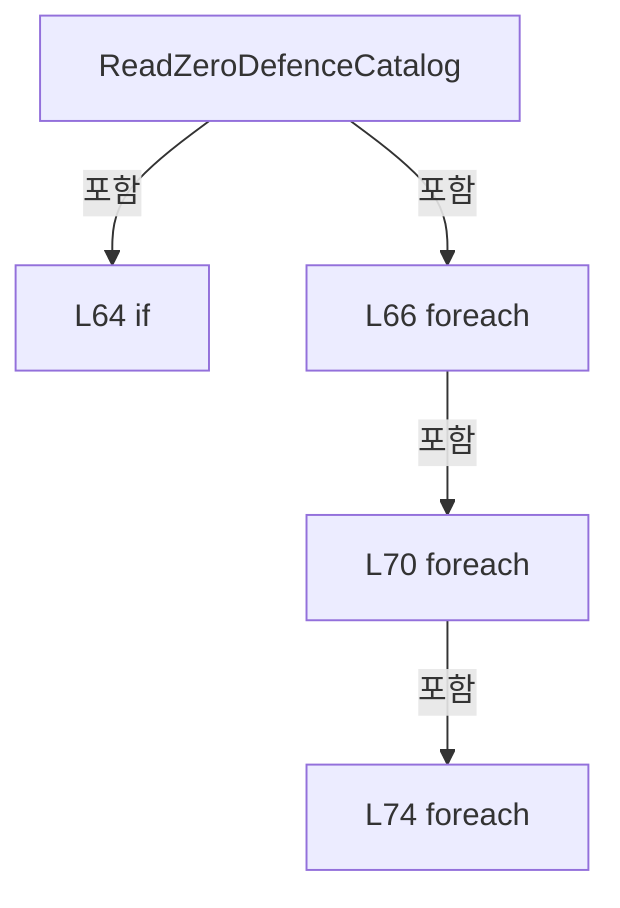
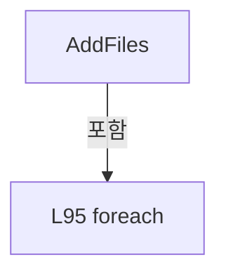
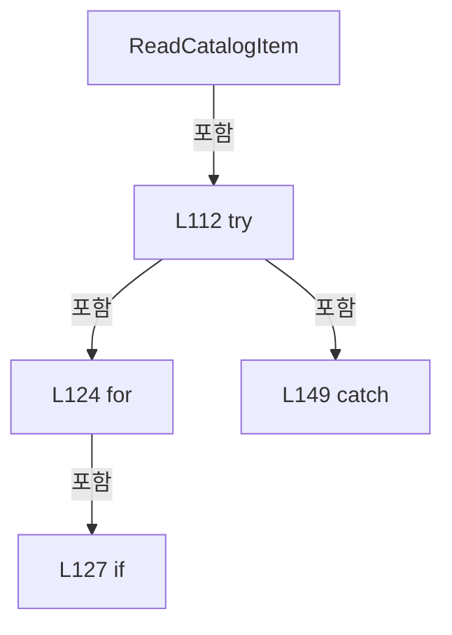
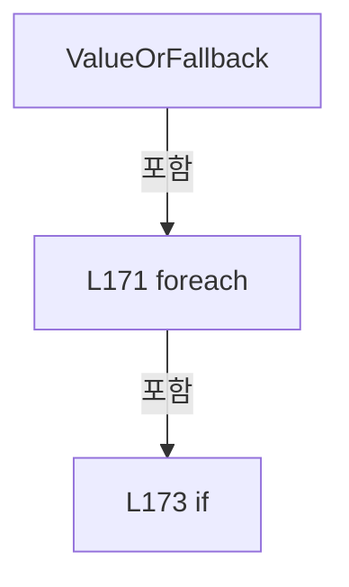

# Drilling.File/ReviewResult/CReviewResultFile.Catalog.cs

| 항목 | 내용 |
| --- | --- |
| 원본 저장소 | https://github.com/kjuws10-rgb/A3Drilling.git |
| 원본 Commit | 5aee8e58439c9b455cae7c9593c9be986c3e682e |
| 원본 SHA256 | 2fddb6562636e40afb9ed6a3efef49f9513df07b4a0f35b1004aa54abff08a58 |
| 파일 분류 | code |
| 원본 크기/행 | 9,086 bytes / 192 physical lines |
| 인코딩 | utf-8-sig |
| 검토 범위 | 구문/부분 의미 분석에서 추출한 사실. 동작·물리 단위·실장비 합격을 보증하지 않습니다. |
| 원본 링크 | [고정 Commit 원본](https://github.com/kjuws10-rgb/A3Drilling/blob/5aee8e58439c9b455cae7c9593c9be986c3e682e/Drilling.File/ReviewResult/CReviewResultFile.Catalog.cs) |

## 파일의 역할과 읽는 순서

정의·설정·레시피·결과·스크립트의 파일 입출력과 데이터 형식을 담당합니다. 저장 필드를 통신 송신 필드로 단정하지 않습니다.

## 네임스페이스·타입·상속

| 타입 | 구분 | 원본 범위 | 선언/상속 |
| --- | --- | --- | --- |
| CReviewResultFile | ClassDeclaration | 8–191 | CReviewResultFile |

## 멤버 빠른 목록

| 이름 | 종류 | 범위 | 서명 |
| --- | --- | --- | --- |
| ManualResultTypes | FieldDeclaration | L10–10 | string[] Drilling.File.ReviewResult.CReviewResultFile.ManualResultTypes |
| ListCorrectionResults | MethodDeclaration | L12–17 | System.Threading.Tasks.Task<System.Collections.Generic.IReadOnlyList<Drilling.Common.Review.ST_REVIEW_RESULT_CATALOG_ITEM>> Drilling.File.ReviewResult.CReviewResultFile.ListCorrectionResults(System.Threading.CancellationToken) |
| ReadResultCatalog | MethodDeclaration | L19–29 | System.Collections.Generic.IReadOnlyList<Drilling.Common.Review.ST_REVIEW_RESULT_CATALOG_ITEM> Drilling.File.ReviewResult.CReviewResultFile.ReadResultCatalog(System.Threading.CancellationToken) |
| ReadManualCatalog | MethodDeclaration | L31–47 | void Drilling.File.ReviewResult.CReviewResultFile.ReadManualCatalog(System.Collections.Generic.List<Drilling.Common.Review.ST_REVIEW_RESULT_CATALOG_ITEM>, System.Threading.CancellationToken) |
| ReadAutoCatalog | MethodDeclaration | L49–59 | void Drilling.File.ReviewResult.CReviewResultFile.ReadAutoCatalog(System.Collections.Generic.List<Drilling.Common.Review.ST_REVIEW_RESULT_CATALOG_ITEM>, System.Threading.CancellationToken) |
| ReadZeroDefenceCatalog | MethodDeclaration | L61–84 | void Drilling.File.ReviewResult.CReviewResultFile.ReadZeroDefenceCatalog(System.Collections.Generic.List<Drilling.Common.Review.ST_REVIEW_RESULT_CATALOG_ITEM>, System.Threading.CancellationToken) |
| AddFiles | MethodDeclaration | L86–100 | void Drilling.File.ReviewResult.CReviewResultFile.AddFiles(System.Collections.Generic.List<Drilling.Common.Review.ST_REVIEW_RESULT_CATALOG_ITEM>, string, string, string, string, string, System.Threading.CancellationToken) |
| ReadCatalogItem | MethodDeclaration | L102–165 | Drilling.Common.Review.ST_REVIEW_RESULT_CATALOG_ITEM Drilling.File.ReviewResult.CReviewResultFile.ReadCatalogItem(string, string, string, string, string) |
| Value | MethodDeclaration | L167–167 | string Drilling.File.ReviewResult.CReviewResultFile.Value(System.Collections.Generic.IReadOnlyDictionary<string, string>, params string[]) |
| ValueOrFallback | MethodDeclaration | L169–177 | string Drilling.File.ReviewResult.CReviewResultFile.ValueOrFallback(System.Collections.Generic.IReadOnlyDictionary<string, string>, string, params string[]) |
| ParseSavedAt | MethodDeclaration | L179–184 | System.DateTimeOffset Drilling.File.ReviewResult.CReviewResultFile.ParseSavedAt(string, System.DateTimeOffset) |
| NormalizeCatalogStatus | MethodDeclaration | L186–190 | string Drilling.File.ReviewResult.CReviewResultFile.NormalizeCatalogStatus(string) |

## 멤버별 상세 계약·호출·처리 해설

### FieldDeclaration `ManualResultTypes` · L10–10

[Drilling.File/ReviewResult/CReviewResultFile.Catalog.cs:10–10](https://github.com/kjuws10-rgb/A3Drilling/blob/5aee8e58439c9b455cae7c9593c9be986c3e682e/Drilling.File/ReviewResult/CReviewResultFile.Catalog.cs#L10-L10)

| 항목 | 실제 추출 값 |
| --- | --- |
| 서명 | string[] Drilling.File.ReviewResult.CReviewResultFile.ManualResultTypes |
| 접근/수식자 | Private / private, static, readonly |
| 반환/값 타입 | string[] |
| 소속 타입 | NamedType:Drilling.File.ReviewResult.CReviewResultFile |

현재 부분 분석에서 직접 연결된 호출자는 없습니다. XAML/이벤트/인터페이스·델리게이트·외부 진입을 추가 확인해야 하며, 미사용으로 판정한 것이 아닙니다.

본문의 실제 연산·분기·예외·반환 순서(원문 위치 순):

| 원본 행 | 종류 | 주석 해설 |
| --- | --- | --- |
| 10 | variable-initializer | 변수의 초기값을 지정합니다: ManualResultTypes = ["ALL_SHOT", "ONE_SHOT", "BEAM_INSPECTION", "ROUGH", "FINE"] |

변경 전 점검: 입력/반환 타입, 위 호출자, 예외/취소 경로, 공유 상태와 저장·전송 소비자를 함께 확인합니다. 값의 단위나 물리 방향을 이름만으로 확정하지 않습니다.

### MethodDeclaration `ListCorrectionResults` · L12–17

[Drilling.File/ReviewResult/CReviewResultFile.Catalog.cs:12–17](https://github.com/kjuws10-rgb/A3Drilling/blob/5aee8e58439c9b455cae7c9593c9be986c3e682e/Drilling.File/ReviewResult/CReviewResultFile.Catalog.cs#L12-L17)

| 항목 | 실제 추출 값 |
| --- | --- |
| 서명 | System.Threading.Tasks.Task<System.Collections.Generic.IReadOnlyList<Drilling.Common.Review.ST_REVIEW_RESULT_CATALOG_ITEM>> Drilling.File.ReviewResult.CReviewResultFile.ListCorrectionResults(System.Threading.CancellationToken) |
| 접근/수식자 | Public / public, override |
| 반환/값 타입 | System.Threading.Tasks.Task<System.Collections.Generic.IReadOnlyList<Drilling.Common.Review.ST_REVIEW_RESULT_CATALOG_ITEM>> |
| 소속 타입 | NamedType:Drilling.File.ReviewResult.CReviewResultFile |

입력 계약:

| 이름 | 타입 | 전달 | 선택/기본값 |
| --- | --- | --- | --- |
| cancellationToken | System.Threading.CancellationToken | None | True / null |

현재 부분 분석에서 직접 연결된 호출자는 없습니다. XAML/이벤트/인터페이스·델리게이트·외부 진입을 추가 확인해야 하며, 미사용으로 판정한 것이 아닙니다.

호출하는 대상과 해석 범위:

| 원본 행 | 표현식 | 분석 상태 | 대상/소스 위치 |
| --- | --- | --- | --- |
| 14 | Task.Run<IReadOnlyList<ST_REVIEW_RESULT_CATALOG_ITEM>> | resolved | System.Threading.Tasks.Task<System.Collections.Generic.IReadOnlyList<Drilling.Common.Review.ST_REVIEW_RESULT_CATALOG_ITEM>> System.Threading.Tasks.Task.Run<System.Collections.Generic.IReadOnlyList<Drilling.Common.Review.ST_REVIEW_RESULT_CATALOG_ITEM>>(System.Func<System.Collections.Generic.IReadOnlyList<Drilling.Common.Review.ST_REVIEW_RESULT_CATALOG_ITEM>>, System.Threading.CancellationToken) |
| 15 | ReadResultCatalog | resolved | System.Collections.Generic.IReadOnlyList<Drilling.Common.Review.ST_REVIEW_RESULT_CATALOG_ITEM> Drilling.File.ReviewResult.CReviewResultFile.ReadResultCatalog(System.Threading.CancellationToken) · Drilling.File/ReviewResult/CReviewResultFile.Catalog.cs:19 |

본문의 실제 연산·분기·예외·반환 순서(원문 위치 순):

| 원본 행 | 종류 | 주석 해설 |
| --- | --- | --- |
| 14 | call | 함수·델리게이트 또는 객체 생성자를 호출합니다: Task.Run<IReadOnlyList<ST_REVIEW_RESULT_CATALOG_ITEM>>( () => ReadResultCatalog(cancellationToken), cancellationToken) |
| 14 | return | 호출자에게 값 또는 제어를 반환합니다: return Task.Run<IReadOnlyList<ST_REVIEW_RESULT_CATALOG_ITEM>>( () => ReadResultCatalog(cancellationToken), cancellationToken); |
| 15 | call | 함수·델리게이트 또는 객체 생성자를 호출합니다: ReadResultCatalog(cancellationToken) |

변경 전 점검: 입력/반환 타입, 위 호출자, 예외/취소 경로, 공유 상태와 저장·전송 소비자를 함께 확인합니다. 값의 단위나 물리 방향을 이름만으로 확정하지 않습니다.

### MethodDeclaration `ReadResultCatalog` · L19–29

[Drilling.File/ReviewResult/CReviewResultFile.Catalog.cs:19–29](https://github.com/kjuws10-rgb/A3Drilling/blob/5aee8e58439c9b455cae7c9593c9be986c3e682e/Drilling.File/ReviewResult/CReviewResultFile.Catalog.cs#L19-L29)

| 항목 | 실제 추출 값 |
| --- | --- |
| 서명 | System.Collections.Generic.IReadOnlyList<Drilling.Common.Review.ST_REVIEW_RESULT_CATALOG_ITEM> Drilling.File.ReviewResult.CReviewResultFile.ReadResultCatalog(System.Threading.CancellationToken) |
| 접근/수식자 | Private / private |
| 반환/값 타입 | System.Collections.Generic.IReadOnlyList<Drilling.Common.Review.ST_REVIEW_RESULT_CATALOG_ITEM> |
| 소속 타입 | NamedType:Drilling.File.ReviewResult.CReviewResultFile |

입력 계약:

| 이름 | 타입 | 전달 | 선택/기본값 |
| --- | --- | --- | --- |
| cancellationToken | System.Threading.CancellationToken | None | False /  |

정적 호출자로 확인된 위치:

| 호출 파일/행 | 호출 표현식 | 런타임 분기 가능 |
| --- | --- | --- |
| [Drilling.File/ReviewResult/CReviewResultFile.Catalog.cs:15–15](https://github.com/kjuws10-rgb/A3Drilling/blob/5aee8e58439c9b455cae7c9593c9be986c3e682e/Drilling.File/ReviewResult/CReviewResultFile.Catalog.cs#L15-L15) | ReadResultCatalog | False |

호출하는 대상과 해석 범위:

| 원본 행 | 표현식 | 분석 상태 | 대상/소스 위치 |
| --- | --- | --- | --- |
| 21 | new List<ST_REVIEW_RESULT_CATALOG_ITEM> | resolved | System.Collections.Generic.List<Drilling.Common.Review.ST_REVIEW_RESULT_CATALOG_ITEM>.List() |
| 22 | ReadManualCatalog | resolved | void Drilling.File.ReviewResult.CReviewResultFile.ReadManualCatalog(System.Collections.Generic.List<Drilling.Common.Review.ST_REVIEW_RESULT_CATALOG_ITEM>, System.Threading.CancellationToken) · Drilling.File/ReviewResult/CReviewResultFile.Catalog.cs:31 |
| 23 | ReadAutoCatalog | resolved | void Drilling.File.ReviewResult.CReviewResultFile.ReadAutoCatalog(System.Collections.Generic.List<Drilling.Common.Review.ST_REVIEW_RESULT_CATALOG_ITEM>, System.Threading.CancellationToken) · Drilling.File/ReviewResult/CReviewResultFile.Catalog.cs:49 |
| 24 | ReadZeroDefenceCatalog | resolved | void Drilling.File.ReviewResult.CReviewResultFile.ReadZeroDefenceCatalog(System.Collections.Generic.List<Drilling.Common.Review.ST_REVIEW_RESULT_CATALOG_ITEM>, System.Threading.CancellationToken) · Drilling.File/ReviewResult/CReviewResultFile.Catalog.cs:61 |
| 25 | results .OrderByDescending(item => item.SavedAt) .ThenBy(item => item.FileName, StringComparer.OrdinalIgnoreCase) .ToArray | resolved | Drilling.Common.Review.ST_REVIEW_RESULT_CATALOG_ITEM[] System.Collections.Generic.IEnumerable<Drilling.Common.Review.ST_REVIEW_RESULT_CATALOG_ITEM>.ToArray<Drilling.Common.Review.ST_REVIEW_RESULT_CATALOG_ITEM>() |
| 25 | results .OrderByDescending(item => item.SavedAt) .ThenBy | resolved | System.Linq.IOrderedEnumerable<Drilling.Common.Review.ST_REVIEW_RESULT_CATALOG_ITEM> System.Linq.IOrderedEnumerable<Drilling.Common.Review.ST_REVIEW_RESULT_CATALOG_ITEM>.ThenBy<Drilling.Common.Review.ST_REVIEW_RESULT_CATALOG_ITEM, string>(System.Func<Drilling.Common.Review.ST_REVIEW_RESULT_CATALOG_ITEM, string>, System.Collections.Generic.IComparer<string>?) |
| 25 | results .OrderByDescending | resolved | System.Linq.IOrderedEnumerable<Drilling.Common.Review.ST_REVIEW_RESULT_CATALOG_ITEM> System.Collections.Generic.IEnumerable<Drilling.Common.Review.ST_REVIEW_RESULT_CATALOG_ITEM>.OrderByDescending<Drilling.Common.Review.ST_REVIEW_RESULT_CATALOG_ITEM, System.DateTimeOffset>(System.Func<Drilling.Common.Review.ST_REVIEW_RESULT_CATALOG_ITEM, System.DateTimeOffset>) |

본문의 실제 연산·분기·예외·반환 순서(원문 위치 순):

| 원본 행 | 종류 | 주석 해설 |
| --- | --- | --- |
| 21 | call | 함수·델리게이트 또는 객체 생성자를 호출합니다: new List<ST_REVIEW_RESULT_CATALOG_ITEM>() |
| 21 | local-declaration | 지역 변수를 선언합니다: var results = new List<ST_REVIEW_RESULT_CATALOG_ITEM>(); |
| 21 | variable-initializer | 변수의 초기값을 지정합니다: results = new List<ST_REVIEW_RESULT_CATALOG_ITEM>() |
| 22 | call | 함수·델리게이트 또는 객체 생성자를 호출합니다: ReadManualCatalog(results, cancellationToken) |
| 23 | call | 함수·델리게이트 또는 객체 생성자를 호출합니다: ReadAutoCatalog(results, cancellationToken) |
| 24 | call | 함수·델리게이트 또는 객체 생성자를 호출합니다: ReadZeroDefenceCatalog(results, cancellationToken) |
| 25 | call | 함수·델리게이트 또는 객체 생성자를 호출합니다: results .OrderByDescending(item => item.SavedAt) |
| 25 | call | 함수·델리게이트 또는 객체 생성자를 호출합니다: results .OrderByDescending(item => item.SavedAt) .ThenBy(item => item.FileName, StringComparer.OrdinalIgnoreCase) |
| 25 | call | 함수·델리게이트 또는 객체 생성자를 호출합니다: results .OrderByDescending(item => item.SavedAt) .ThenBy(item => item.FileName, StringComparer.OrdinalIgnoreCase) .ToArray() |
| 25 | return | 호출자에게 값 또는 제어를 반환합니다: return results .OrderByDescending(item => item.SavedAt) .ThenBy(item => item.FileName, StringComparer.OrdinalIgnoreCase) .ToArray(); |

변경 전 점검: 입력/반환 타입, 위 호출자, 예외/취소 경로, 공유 상태와 저장·전송 소비자를 함께 확인합니다. 값의 단위나 물리 방향을 이름만으로 확정하지 않습니다.

### MethodDeclaration `ReadManualCatalog` · L31–47

[Drilling.File/ReviewResult/CReviewResultFile.Catalog.cs:31–47](https://github.com/kjuws10-rgb/A3Drilling/blob/5aee8e58439c9b455cae7c9593c9be986c3e682e/Drilling.File/ReviewResult/CReviewResultFile.Catalog.cs#L31-L47)

| 항목 | 실제 추출 값 |
| --- | --- |
| 서명 | void Drilling.File.ReviewResult.CReviewResultFile.ReadManualCatalog(System.Collections.Generic.List<Drilling.Common.Review.ST_REVIEW_RESULT_CATALOG_ITEM>, System.Threading.CancellationToken) |
| 접근/수식자 | Private / private |
| 반환/값 타입 | void |
| 소속 타입 | NamedType:Drilling.File.ReviewResult.CReviewResultFile |

입력 계약:

| 이름 | 타입 | 전달 | 선택/기본값 |
| --- | --- | --- | --- |
| results | System.Collections.Generic.List<Drilling.Common.Review.ST_REVIEW_RESULT_CATALOG_ITEM> | None | False /  |
| cancellationToken | System.Threading.CancellationToken | None | False /  |

정적 호출자로 확인된 위치:

| 호출 파일/행 | 호출 표현식 | 런타임 분기 가능 |
| --- | --- | --- |
| [Drilling.File/ReviewResult/CReviewResultFile.Catalog.cs:22–22](https://github.com/kjuws10-rgb/A3Drilling/blob/5aee8e58439c9b455cae7c9593c9be986c3e682e/Drilling.File/ReviewResult/CReviewResultFile.Catalog.cs#L22-L22) | ReadManualCatalog | False |

호출하는 대상과 해석 범위:

| 원본 행 | 표현식 | 분석 상태 | 대상/소스 위치 |
| --- | --- | --- | --- |
| 33 | Path.Combine | resolved | string System.IO.Path.Combine(string, string) |
| 34 | Directory.Exists | resolved | bool System.IO.Directory.Exists(string?) |
| 36 | Directory.EnumerateDirectories | resolved | System.Collections.Generic.IEnumerable<string> System.IO.Directory.EnumerateDirectories(string) |
| 38 | cancellationToken.ThrowIfCancellationRequested | resolved | void System.Threading.CancellationToken.ThrowIfCancellationRequested() |
| 39 | Path.GetFileName | resolved | string? System.IO.Path.GetFileName(string?) |
| 42 | Path.Combine | resolved | string System.IO.Path.Combine(string, string) |
| 43 | Directory.Exists | resolved | bool System.IO.Directory.Exists(string?) |
| 44 | AddFiles | resolved | void Drilling.File.ReviewResult.CReviewResultFile.AddFiles(System.Collections.Generic.List<Drilling.Common.Review.ST_REVIEW_RESULT_CATALOG_ITEM>, string, string, string, string, string, System.Threading.CancellationToken) · Drilling.File/ReviewResult/CReviewResultFile.Catalog.cs:86 |

본문의 실제 연산·분기·예외·반환 순서(원문 위치 순):

| 원본 행 | 종류 | 주석 해설 |
| --- | --- | --- |
| 33 | call | 함수·델리게이트 또는 객체 생성자를 호출합니다: Path.Combine(_reviewRoot, "Manual") |
| 33 | local-declaration | 지역 변수를 선언합니다: var root = Path.Combine(_reviewRoot, "Manual"); |
| 33 | variable-initializer | 변수의 초기값을 지정합니다: root = Path.Combine(_reviewRoot, "Manual") |
| 34 | call | 함수·델리게이트 또는 객체 생성자를 호출합니다: Directory.Exists(root) |
| 34 | if | 조건에 따라 분기합니다: if (!Directory.Exists(root)) |
| 35 | return | 호출자에게 값 또는 제어를 반환합니다: return; |
| 36 | call | 함수·델리게이트 또는 객체 생성자를 호출합니다: Directory.EnumerateDirectories(root) |
| 36 | foreach | 컬렉션 요소를 순회합니다: foreach (var recipeDirectory in Directory.EnumerateDirectories(root)) |
| 38 | call | 함수·델리게이트 또는 객체 생성자를 호출합니다: cancellationToken.ThrowIfCancellationRequested() |
| 39 | call | 함수·델리게이트 또는 객체 생성자를 호출합니다: Path.GetFileName(recipeDirectory) |
| 39 | local-declaration | 지역 변수를 선언합니다: var recipeId = Path.GetFileName(recipeDirectory); |
| 39 | variable-initializer | 변수의 초기값을 지정합니다: recipeId = Path.GetFileName(recipeDirectory) |
| 40 | foreach | 컬렉션 요소를 순회합니다: foreach (var resultType in ManualResultTypes) |
| 42 | call | 함수·델리게이트 또는 객체 생성자를 호출합니다: Path.Combine(recipeDirectory, resultType) |
| 42 | local-declaration | 지역 변수를 선언합니다: var typeDirectory = Path.Combine(recipeDirectory, resultType); |
| 42 | variable-initializer | 변수의 초기값을 지정합니다: typeDirectory = Path.Combine(recipeDirectory, resultType) |
| 43 | call | 함수·델리게이트 또는 객체 생성자를 호출합니다: Directory.Exists(typeDirectory) |
| 43 | if | 조건에 따라 분기합니다: if (Directory.Exists(typeDirectory)) |
| 44 | call | 함수·델리게이트 또는 객체 생성자를 호출합니다: AddFiles(results, typeDirectory, "MANUAL", resultType, recipeId, "", cancellationToken) |

제어 구문의 포함 구조(실제 실행 순서/CFG가 아닌 구문 탐색 그림):

변경 전 점검: 입력/반환 타입, 위 호출자, 예외/취소 경로, 공유 상태와 저장·전송 소비자를 함께 확인합니다. 값의 단위나 물리 방향을 이름만으로 확정하지 않습니다.

### MethodDeclaration `ReadAutoCatalog` · L49–59

[Drilling.File/ReviewResult/CReviewResultFile.Catalog.cs:49–59](https://github.com/kjuws10-rgb/A3Drilling/blob/5aee8e58439c9b455cae7c9593c9be986c3e682e/Drilling.File/ReviewResult/CReviewResultFile.Catalog.cs#L49-L59)

| 항목 | 실제 추출 값 |
| --- | --- |
| 서명 | void Drilling.File.ReviewResult.CReviewResultFile.ReadAutoCatalog(System.Collections.Generic.List<Drilling.Common.Review.ST_REVIEW_RESULT_CATALOG_ITEM>, System.Threading.CancellationToken) |
| 접근/수식자 | Private / private |
| 반환/값 타입 | void |
| 소속 타입 | NamedType:Drilling.File.ReviewResult.CReviewResultFile |

입력 계약:

| 이름 | 타입 | 전달 | 선택/기본값 |
| --- | --- | --- | --- |
| results | System.Collections.Generic.List<Drilling.Common.Review.ST_REVIEW_RESULT_CATALOG_ITEM> | None | False /  |
| cancellationToken | System.Threading.CancellationToken | None | False /  |

정적 호출자로 확인된 위치:

| 호출 파일/행 | 호출 표현식 | 런타임 분기 가능 |
| --- | --- | --- |
| [Drilling.File/ReviewResult/CReviewResultFile.Catalog.cs:23–23](https://github.com/kjuws10-rgb/A3Drilling/blob/5aee8e58439c9b455cae7c9593c9be986c3e682e/Drilling.File/ReviewResult/CReviewResultFile.Catalog.cs#L23-L23) | ReadAutoCatalog | False |

호출하는 대상과 해석 범위:

| 원본 행 | 표현식 | 분석 상태 | 대상/소스 위치 |
| --- | --- | --- | --- |
| 51 | Path.Combine | resolved | string System.IO.Path.Combine(string, string) |
| 52 | Directory.Exists | resolved | bool System.IO.Directory.Exists(string?) |
| 54 | Directory.EnumerateDirectories | resolved | System.Collections.Generic.IEnumerable<string> System.IO.Directory.EnumerateDirectories(string) |
| 56 | cancellationToken.ThrowIfCancellationRequested | resolved | void System.Threading.CancellationToken.ThrowIfCancellationRequested() |
| 57 | AddFiles | resolved | void Drilling.File.ReviewResult.CReviewResultFile.AddFiles(System.Collections.Generic.List<Drilling.Common.Review.ST_REVIEW_RESULT_CATALOG_ITEM>, string, string, string, string, string, System.Threading.CancellationToken) · Drilling.File/ReviewResult/CReviewResultFile.Catalog.cs:86 |
| 57 | Path.GetFileName | resolved | string? System.IO.Path.GetFileName(string?) |

본문의 실제 연산·분기·예외·반환 순서(원문 위치 순):

| 원본 행 | 종류 | 주석 해설 |
| --- | --- | --- |
| 51 | call | 함수·델리게이트 또는 객체 생성자를 호출합니다: Path.Combine(_reviewRoot, "Auto") |
| 51 | local-declaration | 지역 변수를 선언합니다: var root = Path.Combine(_reviewRoot, "Auto"); |
| 51 | variable-initializer | 변수의 초기값을 지정합니다: root = Path.Combine(_reviewRoot, "Auto") |
| 52 | call | 함수·델리게이트 또는 객체 생성자를 호출합니다: Directory.Exists(root) |
| 52 | if | 조건에 따라 분기합니다: if (!Directory.Exists(root)) |
| 53 | return | 호출자에게 값 또는 제어를 반환합니다: return; |
| 54 | call | 함수·델리게이트 또는 객체 생성자를 호출합니다: Directory.EnumerateDirectories(root) |
| 54 | foreach | 컬렉션 요소를 순회합니다: foreach (var recipeDirectory in Directory.EnumerateDirectories(root)) |
| 56 | call | 함수·델리게이트 또는 객체 생성자를 호출합니다: cancellationToken.ThrowIfCancellationRequested() |
| 57 | call | 함수·델리게이트 또는 객체 생성자를 호출합니다: AddFiles(results, recipeDirectory, "AUTO", "AUTO", Path.GetFileName(recipeDirectory), "", cancellationToken) |
| 57 | call | 함수·델리게이트 또는 객체 생성자를 호출합니다: Path.GetFileName(recipeDirectory) |

제어 구문의 포함 구조(실제 실행 순서/CFG가 아닌 구문 탐색 그림):

변경 전 점검: 입력/반환 타입, 위 호출자, 예외/취소 경로, 공유 상태와 저장·전송 소비자를 함께 확인합니다. 값의 단위나 물리 방향을 이름만으로 확정하지 않습니다.

### MethodDeclaration `ReadZeroDefenceCatalog` · L61–84

[Drilling.File/ReviewResult/CReviewResultFile.Catalog.cs:61–84](https://github.com/kjuws10-rgb/A3Drilling/blob/5aee8e58439c9b455cae7c9593c9be986c3e682e/Drilling.File/ReviewResult/CReviewResultFile.Catalog.cs#L61-L84)

| 항목 | 실제 추출 값 |
| --- | --- |
| 서명 | void Drilling.File.ReviewResult.CReviewResultFile.ReadZeroDefenceCatalog(System.Collections.Generic.List<Drilling.Common.Review.ST_REVIEW_RESULT_CATALOG_ITEM>, System.Threading.CancellationToken) |
| 접근/수식자 | Private / private |
| 반환/값 타입 | void |
| 소속 타입 | NamedType:Drilling.File.ReviewResult.CReviewResultFile |

입력 계약:

| 이름 | 타입 | 전달 | 선택/기본값 |
| --- | --- | --- | --- |
| results | System.Collections.Generic.List<Drilling.Common.Review.ST_REVIEW_RESULT_CATALOG_ITEM> | None | False /  |
| cancellationToken | System.Threading.CancellationToken | None | False /  |

정적 호출자로 확인된 위치:

| 호출 파일/행 | 호출 표현식 | 런타임 분기 가능 |
| --- | --- | --- |
| [Drilling.File/ReviewResult/CReviewResultFile.Catalog.cs:24–24](https://github.com/kjuws10-rgb/A3Drilling/blob/5aee8e58439c9b455cae7c9593c9be986c3e682e/Drilling.File/ReviewResult/CReviewResultFile.Catalog.cs#L24-L24) | ReadZeroDefenceCatalog | False |

호출하는 대상과 해석 범위:

| 원본 행 | 표현식 | 분석 상태 | 대상/소스 위치 |
| --- | --- | --- | --- |
| 63 | Path.Combine | resolved | string System.IO.Path.Combine(string, string) |
| 64 | Directory.Exists | resolved | bool System.IO.Directory.Exists(string?) |
| 66 | Directory.EnumerateDirectories | resolved | System.Collections.Generic.IEnumerable<string> System.IO.Directory.EnumerateDirectories(string) |
| 68 | cancellationToken.ThrowIfCancellationRequested | resolved | void System.Threading.CancellationToken.ThrowIfCancellationRequested() |
| 69 | Path.GetFileName | resolved | string? System.IO.Path.GetFileName(string?) |
| 70 | Directory.EnumerateDirectories | resolved | System.Collections.Generic.IEnumerable<string> System.IO.Directory.EnumerateDirectories(string) |
| 72 | cancellationToken.ThrowIfCancellationRequested | resolved | void System.Threading.CancellationToken.ThrowIfCancellationRequested() |
| 73 | Path.GetFileName | resolved | string? System.IO.Path.GetFileName(string?) |
| 74 | Directory.EnumerateFiles | resolved | System.Collections.Generic.IEnumerable<string> System.IO.Directory.EnumerateFiles(string, string, System.IO.SearchOption) |
| 76 | cancellationToken.ThrowIfCancellationRequested | resolved | void System.Threading.CancellationToken.ThrowIfCancellationRequested() |
| 77 | Path.GetFileNameWithoutExtension(filePath).Contains | resolved | bool string.Contains(string, System.StringComparison) |
| 77 | Path.GetFileNameWithoutExtension | resolved | string? System.IO.Path.GetFileNameWithoutExtension(string?) |
| 80 | results.Add | resolved | void System.Collections.Generic.List<Drilling.Common.Review.ST_REVIEW_RESULT_CATALOG_ITEM>.Add(Drilling.Common.Review.ST_REVIEW_RESULT_CATALOG_ITEM) |
| 80 | ReadCatalogItem | resolved | Drilling.Common.Review.ST_REVIEW_RESULT_CATALOG_ITEM Drilling.File.ReviewResult.CReviewResultFile.ReadCatalogItem(string, string, string, string, string) · Drilling.File/ReviewResult/CReviewResultFile.Catalog.cs:102 |

본문의 실제 연산·분기·예외·반환 순서(원문 위치 순):

| 원본 행 | 종류 | 주석 해설 |
| --- | --- | --- |
| 63 | call | 함수·델리게이트 또는 객체 생성자를 호출합니다: Path.Combine(_reviewRoot, "ZeroDefence") |
| 63 | local-declaration | 지역 변수를 선언합니다: var root = Path.Combine(_reviewRoot, "ZeroDefence"); |
| 63 | variable-initializer | 변수의 초기값을 지정합니다: root = Path.Combine(_reviewRoot, "ZeroDefence") |
| 64 | call | 함수·델리게이트 또는 객체 생성자를 호출합니다: Directory.Exists(root) |
| 64 | if | 조건에 따라 분기합니다: if (!Directory.Exists(root)) |
| 65 | return | 호출자에게 값 또는 제어를 반환합니다: return; |
| 66 | call | 함수·델리게이트 또는 객체 생성자를 호출합니다: Directory.EnumerateDirectories(root) |
| 66 | foreach | 컬렉션 요소를 순회합니다: foreach (var recipeDirectory in Directory.EnumerateDirectories(root)) |
| 68 | call | 함수·델리게이트 또는 객체 생성자를 호출합니다: cancellationToken.ThrowIfCancellationRequested() |
| 69 | call | 함수·델리게이트 또는 객체 생성자를 호출합니다: Path.GetFileName(recipeDirectory) |
| 69 | local-declaration | 지역 변수를 선언합니다: var recipeId = Path.GetFileName(recipeDirectory); |
| 69 | variable-initializer | 변수의 초기값을 지정합니다: recipeId = Path.GetFileName(recipeDirectory) |
| 70 | call | 함수·델리게이트 또는 객체 생성자를 호출합니다: Directory.EnumerateDirectories(recipeDirectory) |
| 70 | foreach | 컬렉션 요소를 순회합니다: foreach (var glassDirectory in Directory.EnumerateDirectories(recipeDirectory)) |
| 72 | call | 함수·델리게이트 또는 객체 생성자를 호출합니다: cancellationToken.ThrowIfCancellationRequested() |
| 73 | call | 함수·델리게이트 또는 객체 생성자를 호출합니다: Path.GetFileName(glassDirectory) |
| 73 | local-declaration | 지역 변수를 선언합니다: var glassId = Path.GetFileName(glassDirectory); |
| 73 | variable-initializer | 변수의 초기값을 지정합니다: glassId = Path.GetFileName(glassDirectory) |
| 74 | call | 함수·델리게이트 또는 객체 생성자를 호출합니다: Directory.EnumerateFiles(glassDirectory, "*.csv", System.IO.SearchOption.TopDirectoryOnly) |
| 74 | foreach | 컬렉션 요소를 순회합니다: foreach (var filePath in Directory.EnumerateFiles(glassDirectory, "*.csv", System.IO.SearchOption.TopDirectoryOnly)) |
| 76 | call | 함수·델리게이트 또는 객체 생성자를 호출합니다: cancellationToken.ThrowIfCancellationRequested() |
| 77 | call | 함수·델리게이트 또는 객체 생성자를 호출합니다: Path.GetFileNameWithoutExtension(filePath).Contains("FOLLOWUP", StringComparison.OrdinalIgnoreCase) |
| 77 | call | 함수·델리게이트 또는 객체 생성자를 호출합니다: Path.GetFileNameWithoutExtension(filePath) |
| 77 | conditional-expression | 조건에 따라 결과식을 선택합니다: Path.GetFileNameWithoutExtension(filePath).Contains("FOLLOWUP", StringComparison.OrdinalIgnoreCase) ? "FOLLOWUP" : "ZERO_DEFENCE" |
| 77 | local-declaration | 지역 변수를 선언합니다: var resultType = Path.GetFileNameWithoutExtension(filePath).Contains("FOLLOWUP", StringComparison.OrdinalIgnoreCase) ? "FOLLOWUP" : "ZERO_DEFENCE"; |
| 77 | variable-initializer | 변수의 초기값을 지정합니다: resultType = Path.GetFileNameWithoutExtension(filePath).Contains("FOLLOWUP", StringComparison.OrdinalIgnoreCase) ? "FOLLOWUP" : "ZERO_DEFENCE" |
| 80 | call | 함수·델리게이트 또는 객체 생성자를 호출합니다: results.Add(ReadCatalogItem(filePath, "ZERO_DEFENCE", resultType, recipeId, glassId)) |
| 80 | call | 함수·델리게이트 또는 객체 생성자를 호출합니다: ReadCatalogItem(filePath, "ZERO_DEFENCE", resultType, recipeId, glassId) |

제어 구문의 포함 구조(실제 실행 순서/CFG가 아닌 구문 탐색 그림):

변경 전 점검: 입력/반환 타입, 위 호출자, 예외/취소 경로, 공유 상태와 저장·전송 소비자를 함께 확인합니다. 값의 단위나 물리 방향을 이름만으로 확정하지 않습니다.

### MethodDeclaration `AddFiles` · L86–100

[Drilling.File/ReviewResult/CReviewResultFile.Catalog.cs:86–100](https://github.com/kjuws10-rgb/A3Drilling/blob/5aee8e58439c9b455cae7c9593c9be986c3e682e/Drilling.File/ReviewResult/CReviewResultFile.Catalog.cs#L86-L100)

| 항목 | 실제 추출 값 |
| --- | --- |
| 서명 | void Drilling.File.ReviewResult.CReviewResultFile.AddFiles(System.Collections.Generic.List<Drilling.Common.Review.ST_REVIEW_RESULT_CATALOG_ITEM>, string, string, string, string, string, System.Threading.CancellationToken) |
| 접근/수식자 | Private / private, static |
| 반환/값 타입 | void |
| 소속 타입 | NamedType:Drilling.File.ReviewResult.CReviewResultFile |

입력 계약:

| 이름 | 타입 | 전달 | 선택/기본값 |
| --- | --- | --- | --- |
| results | System.Collections.Generic.List<Drilling.Common.Review.ST_REVIEW_RESULT_CATALOG_ITEM> | None | False /  |
| directory | string | None | False /  |
| source | string | None | False /  |
| resultType | string | None | False /  |
| recipeId | string | None | False /  |
| glassId | string | None | False /  |
| cancellationToken | System.Threading.CancellationToken | None | False /  |

정적 호출자로 확인된 위치:

| 호출 파일/행 | 호출 표현식 | 런타임 분기 가능 |
| --- | --- | --- |
| [Drilling.File/ReviewResult/CReviewResultFile.Catalog.cs:44–44](https://github.com/kjuws10-rgb/A3Drilling/blob/5aee8e58439c9b455cae7c9593c9be986c3e682e/Drilling.File/ReviewResult/CReviewResultFile.Catalog.cs#L44-L44) | AddFiles | False |
| [Drilling.File/ReviewResult/CReviewResultFile.Catalog.cs:57–57](https://github.com/kjuws10-rgb/A3Drilling/blob/5aee8e58439c9b455cae7c9593c9be986c3e682e/Drilling.File/ReviewResult/CReviewResultFile.Catalog.cs#L57-L57) | AddFiles | False |

호출하는 대상과 해석 범위:

| 원본 행 | 표현식 | 분석 상태 | 대상/소스 위치 |
| --- | --- | --- | --- |
| 95 | Directory.EnumerateFiles | resolved | System.Collections.Generic.IEnumerable<string> System.IO.Directory.EnumerateFiles(string, string, System.IO.SearchOption) |
| 97 | cancellationToken.ThrowIfCancellationRequested | resolved | void System.Threading.CancellationToken.ThrowIfCancellationRequested() |
| 98 | results.Add | resolved | void System.Collections.Generic.List<Drilling.Common.Review.ST_REVIEW_RESULT_CATALOG_ITEM>.Add(Drilling.Common.Review.ST_REVIEW_RESULT_CATALOG_ITEM) |
| 98 | ReadCatalogItem | resolved | Drilling.Common.Review.ST_REVIEW_RESULT_CATALOG_ITEM Drilling.File.ReviewResult.CReviewResultFile.ReadCatalogItem(string, string, string, string, string) · Drilling.File/ReviewResult/CReviewResultFile.Catalog.cs:102 |

본문의 실제 연산·분기·예외·반환 순서(원문 위치 순):

| 원본 행 | 종류 | 주석 해설 |
| --- | --- | --- |
| 95 | call | 함수·델리게이트 또는 객체 생성자를 호출합니다: Directory.EnumerateFiles(directory, "*.csv", System.IO.SearchOption.TopDirectoryOnly) |
| 95 | foreach | 컬렉션 요소를 순회합니다: foreach (var filePath in Directory.EnumerateFiles(directory, "*.csv", System.IO.SearchOption.TopDirectoryOnly)) |
| 97 | call | 함수·델리게이트 또는 객체 생성자를 호출합니다: cancellationToken.ThrowIfCancellationRequested() |
| 98 | call | 함수·델리게이트 또는 객체 생성자를 호출합니다: results.Add(ReadCatalogItem(filePath, source, resultType, recipeId, glassId)) |
| 98 | call | 함수·델리게이트 또는 객체 생성자를 호출합니다: ReadCatalogItem(filePath, source, resultType, recipeId, glassId) |

제어 구문의 포함 구조(실제 실행 순서/CFG가 아닌 구문 탐색 그림):

변경 전 점검: 입력/반환 타입, 위 호출자, 예외/취소 경로, 공유 상태와 저장·전송 소비자를 함께 확인합니다. 값의 단위나 물리 방향을 이름만으로 확정하지 않습니다.

### MethodDeclaration `ReadCatalogItem` · L102–165

[Drilling.File/ReviewResult/CReviewResultFile.Catalog.cs:102–165](https://github.com/kjuws10-rgb/A3Drilling/blob/5aee8e58439c9b455cae7c9593c9be986c3e682e/Drilling.File/ReviewResult/CReviewResultFile.Catalog.cs#L102-L165)

| 항목 | 실제 추출 값 |
| --- | --- |
| 서명 | Drilling.Common.Review.ST_REVIEW_RESULT_CATALOG_ITEM Drilling.File.ReviewResult.CReviewResultFile.ReadCatalogItem(string, string, string, string, string) |
| 접근/수식자 | Private / private, static |
| 반환/값 타입 | Drilling.Common.Review.ST_REVIEW_RESULT_CATALOG_ITEM |
| 소속 타입 | NamedType:Drilling.File.ReviewResult.CReviewResultFile |

입력 계약:

| 이름 | 타입 | 전달 | 선택/기본값 |
| --- | --- | --- | --- |
| filePath | string | None | False /  |
| source | string | None | False /  |
| resultType | string | None | False /  |
| fallbackRecipeId | string | None | False /  |
| fallbackGlassId | string | None | False /  |

정적 호출자로 확인된 위치:

| 호출 파일/행 | 호출 표현식 | 런타임 분기 가능 |
| --- | --- | --- |
| [Drilling.File/ReviewResult/CReviewResultFile.Catalog.cs:80–80](https://github.com/kjuws10-rgb/A3Drilling/blob/5aee8e58439c9b455cae7c9593c9be986c3e682e/Drilling.File/ReviewResult/CReviewResultFile.Catalog.cs#L80-L80) | ReadCatalogItem | False |
| [Drilling.File/ReviewResult/CReviewResultFile.Catalog.cs:98–98](https://github.com/kjuws10-rgb/A3Drilling/blob/5aee8e58439c9b455cae7c9593c9be986c3e682e/Drilling.File/ReviewResult/CReviewResultFile.Catalog.cs#L98-L98) | ReadCatalogItem | False |

호출하는 대상과 해석 범위:

| 원본 행 | 표현식 | 분석 상태 | 대상/소스 위치 |
| --- | --- | --- | --- |
| 109 | Path.GetFullPath | resolved | string System.IO.Path.GetFullPath(string) |
| 110 | Path.GetFileName | resolved | string? System.IO.Path.GetFileName(string?) |
| 111 | new DateTimeOffset | resolved | System.DateTimeOffset.DateTimeOffset(System.DateTime) |
| 111 | System.IO.File.GetLastWriteTime | resolved | System.DateTime System.IO.File.GetLastWriteTime(string) |
| 114 | new TextFieldParser | resolved | Microsoft.VisualBasic.FileIO.TextFieldParser.TextFieldParser(string, System.Text.Encoding, bool) |
| 120 | parser.SetDelimiters | resolved | void Microsoft.VisualBasic.FileIO.TextFieldParser.SetDelimiters(params string[]) |
| 121 | parser.ReadFields | resolved | string[] Microsoft.VisualBasic.FileIO.TextFieldParser.ReadFields() |
| 122 | parser.ReadFields | resolved | string[] Microsoft.VisualBasic.FileIO.TextFieldParser.ReadFields() |
| 123 | new Dictionary<string, string> | resolved | System.Collections.Generic.Dictionary<string, string>.Dictionary(System.Collections.Generic.IEqualityComparer<string>?) |
| 126 | headers[index].Trim().TrimStart | resolved | string string.TrimStart(char) |
| 126 | headers[index].Trim | resolved | string string.Trim() |
| 128 | values[index].Trim | resolved | string string.Trim() |
| 131 | ParseSavedAt | resolved | System.DateTimeOffset Drilling.File.ReviewResult.CReviewResultFile.ParseSavedAt(string, System.DateTimeOffset) · Drilling.File/ReviewResult/CReviewResultFile.Catalog.cs:179 |
| 131 | Value | resolved | string Drilling.File.ReviewResult.CReviewResultFile.Value(System.Collections.Generic.IReadOnlyDictionary<string, string>, params string[]) · Drilling.File/ReviewResult/CReviewResultFile.Catalog.cs:167 |
| 132 | int.TryParse | resolved | bool int.TryParse(string?, System.Globalization.NumberStyles, System.IFormatProvider?, out int) |
| 132 | Value | resolved | string Drilling.File.ReviewResult.CReviewResultFile.Value(System.Collections.Generic.IReadOnlyDictionary<string, string>, params string[]) · Drilling.File/ReviewResult/CReviewResultFile.Catalog.cs:167 |
| 135 | new ST_REVIEW_RESULT_CATALOG_ITEM | resolved | Drilling.Common.Review.ST_REVIEW_RESULT_CATALOG_ITEM.ST_REVIEW_RESULT_CATALOG_ITEM(string, string, string, string, string, System.DateTimeOffset, string, string, string, string, int?, string) · Drilling.Common/Review/CReviewManager.cs:4063 |
| 140 | ValueOrFallback | resolved | string Drilling.File.ReviewResult.CReviewResultFile.ValueOrFallback(System.Collections.Generic.IReadOnlyDictionary<string, string>, string, params string[]) · Drilling.File/ReviewResult/CReviewResultFile.Catalog.cs:169 |
| 142 | NormalizeCatalogStatus | resolved | string Drilling.File.ReviewResult.CReviewResultFile.NormalizeCatalogStatus(string) · Drilling.File/ReviewResult/CReviewResultFile.Catalog.cs:186 |
| 142 | Value | resolved | string Drilling.File.ReviewResult.CReviewResultFile.Value(System.Collections.Generic.IReadOnlyDictionary<string, string>, params string[]) · Drilling.File/ReviewResult/CReviewResultFile.Catalog.cs:167 |
| 143 | ValueOrFallback | resolved | string Drilling.File.ReviewResult.CReviewResultFile.ValueOrFallback(System.Collections.Generic.IReadOnlyDictionary<string, string>, string, params string[]) · Drilling.File/ReviewResult/CReviewResultFile.Catalog.cs:169 |
| 143 | string.IsNullOrWhiteSpace | resolved | bool string.IsNullOrWhiteSpace(string?) |
| 144 | ValueOrFallback | resolved | string Drilling.File.ReviewResult.CReviewResultFile.ValueOrFallback(System.Collections.Generic.IReadOnlyDictionary<string, string>, string, params string[]) · Drilling.File/ReviewResult/CReviewResultFile.Catalog.cs:169 |
| 145 | ValueOrFallback | resolved | string Drilling.File.ReviewResult.CReviewResultFile.ValueOrFallback(System.Collections.Generic.IReadOnlyDictionary<string, string>, string, params string[]) · Drilling.File/ReviewResult/CReviewResultFile.Catalog.cs:169 |
| 147 | Value | resolved | string Drilling.File.ReviewResult.CReviewResultFile.Value(System.Collections.Generic.IReadOnlyDictionary<string, string>, params string[]) · Drilling.File/ReviewResult/CReviewResultFile.Catalog.cs:167 |
| 151 | new ST_REVIEW_RESULT_CATALOG_ITEM | resolved | Drilling.Common.Review.ST_REVIEW_RESULT_CATALOG_ITEM.ST_REVIEW_RESULT_CATALOG_ITEM(string, string, string, string, string, System.DateTimeOffset, string, string, string, string, int?, string) · Drilling.Common/Review/CReviewManager.cs:4063 |
| 159 | string.IsNullOrWhiteSpace | resolved | bool string.IsNullOrWhiteSpace(string?) |

본문의 실제 연산·분기·예외·반환 순서(원문 위치 순):

| 원본 행 | 종류 | 주석 해설 |
| --- | --- | --- |
| 109 | call | 함수·델리게이트 또는 객체 생성자를 호출합니다: Path.GetFullPath(filePath) |
| 109 | local-declaration | 지역 변수를 선언합니다: var fullPath = Path.GetFullPath(filePath); |
| 109 | variable-initializer | 변수의 초기값을 지정합니다: fullPath = Path.GetFullPath(filePath) |
| 110 | call | 함수·델리게이트 또는 객체 생성자를 호출합니다: Path.GetFileName(fullPath) |
| 110 | local-declaration | 지역 변수를 선언합니다: var fileName = Path.GetFileName(fullPath); |
| 110 | variable-initializer | 변수의 초기값을 지정합니다: fileName = Path.GetFileName(fullPath) |
| 111 | call | 함수·델리게이트 또는 객체 생성자를 호출합니다: new DateTimeOffset(System.IO.File.GetLastWriteTime(fullPath)) |
| 111 | call | 함수·델리게이트 또는 객체 생성자를 호출합니다: System.IO.File.GetLastWriteTime(fullPath) |
| 111 | local-declaration | 지역 변수를 선언합니다: var fallbackSavedAt = new DateTimeOffset(System.IO.File.GetLastWriteTime(fullPath)); |
| 111 | variable-initializer | 변수의 초기값을 지정합니다: fallbackSavedAt = new DateTimeOffset(System.IO.File.GetLastWriteTime(fullPath)) |
| 112 | try | 예외 처리 범위입니다: try |
| 114 | call | 함수·델리게이트 또는 객체 생성자를 호출합니다: new TextFieldParser(fullPath, Encoding.UTF8, true) { TextFieldType = FieldType.Delimited, HasFieldsEnclosedInQuotes = true, TrimWhiteSpace = false } |
| 114 | using-declaration | 정리할 자원을 선언합니다: using var parser = new TextFieldParser(fullPath, Encoding.UTF8, true) { TextFieldType = FieldType.Delimited, HasFieldsEnclosedInQuotes = true, TrimWhiteSpace = false }; |
| 114 | variable-initializer | 변수의 초기값을 지정합니다: parser = new TextFieldParser(fullPath, Encoding.UTF8, true) { TextFieldType = FieldType.Delimited, HasFieldsEnclosedInQuotes = true, TrimWhiteSpace = false } |
| 116 | assignment | 값을 대상에 대입합니다: TextFieldType = FieldType.Delimited |
| 117 | assignment | 값을 대상에 대입합니다: HasFieldsEnclosedInQuotes = true |
| 118 | assignment | 값을 대상에 대입합니다: TrimWhiteSpace = false |
| 120 | call | 함수·델리게이트 또는 객체 생성자를 호출합니다: parser.SetDelimiters(",") |
| 121 | call | 함수·델리게이트 또는 객체 생성자를 호출합니다: parser.ReadFields() |
| 121 | local-declaration | 지역 변수를 선언합니다: var headers = parser.ReadFields() ?? []; |
| 121 | variable-initializer | 변수의 초기값을 지정합니다: headers = parser.ReadFields() ?? [] |
| 122 | call | 함수·델리게이트 또는 객체 생성자를 호출합니다: parser.ReadFields() |
| 122 | conditional-expression | 조건에 따라 결과식을 선택합니다: parser.EndOfData ? [] : parser.ReadFields() ?? [] |
| 122 | local-declaration | 지역 변수를 선언합니다: var values = parser.EndOfData ? [] : parser.ReadFields() ?? []; |
| 122 | variable-initializer | 변수의 초기값을 지정합니다: values = parser.EndOfData ? [] : parser.ReadFields() ?? [] |
| 123 | call | 함수·델리게이트 또는 객체 생성자를 호출합니다: new Dictionary<string, string>(StringComparer.OrdinalIgnoreCase) |
| 123 | local-declaration | 지역 변수를 선언합니다: var firstRow = new Dictionary<string, string>(StringComparer.OrdinalIgnoreCase); |
| 123 | variable-initializer | 변수의 초기값을 지정합니다: firstRow = new Dictionary<string, string>(StringComparer.OrdinalIgnoreCase) |
| 124 | variable-initializer | 변수의 초기값을 지정합니다: index = 0 |
| 124 | for | 초기화·조건·증감이 있는 반복입니다: for (var index = 0; index < headers.Length; index++) |
| 126 | call | 함수·델리게이트 또는 객체 생성자를 호출합니다: headers[index].Trim().TrimStart('\uFEFF') |
| 126 | call | 함수·델리게이트 또는 객체 생성자를 호출합니다: headers[index].Trim() |
| 126 | local-declaration | 지역 변수를 선언합니다: var name = headers[index].Trim().TrimStart('\uFEFF'); |
| 126 | variable-initializer | 변수의 초기값을 지정합니다: name = headers[index].Trim().TrimStart('\uFEFF') |
| 127 | if | 조건에 따라 분기합니다: if (name.Length > 0) |
| 128 | assignment | 값을 대상에 대입합니다: firstRow[name] = index < values.Length ? values[index].Trim() : "" |
| 128 | call | 함수·델리게이트 또는 객체 생성자를 호출합니다: values[index].Trim() |
| 128 | conditional-expression | 조건에 따라 결과식을 선택합니다: index < values.Length ? values[index].Trim() : "" |
| 131 | call | 함수·델리게이트 또는 객체 생성자를 호출합니다: ParseSavedAt(Value(firstRow, "SAVED_AT", "SavedAt"), fallbackSavedAt) |
| 131 | call | 함수·델리게이트 또는 객체 생성자를 호출합니다: Value(firstRow, "SAVED_AT", "SavedAt") |
| 131 | local-declaration | 지역 변수를 선언합니다: var savedAt = ParseSavedAt(Value(firstRow, "SAVED_AT", "SavedAt"), fallbackSavedAt); |
| 131 | variable-initializer | 변수의 초기값을 지정합니다: savedAt = ParseSavedAt(Value(firstRow, "SAVED_AT", "SavedAt"), fallbackSavedAt) |
| 132 | call | 함수·델리게이트 또는 객체 생성자를 호출합니다: int.TryParse(Value(firstRow, "TOTAL_COUNT"), NumberStyles.Integer, CultureInfo.InvariantCulture, out var count) |
| 132 | call | 함수·델리게이트 또는 객체 생성자를 호출합니다: Value(firstRow, "TOTAL_COUNT") |
| 132 | conditional-expression | 조건에 따라 결과식을 선택합니다: int.TryParse(Value(firstRow, "TOTAL_COUNT"), NumberStyles.Integer, CultureInfo.InvariantCulture, out var count) ? count : null |
| 132 | local-declaration | 지역 변수를 선언합니다: int? totalCount = int.TryParse(Value(firstRow, "TOTAL_COUNT"), NumberStyles.Integer, CultureInfo.InvariantCulture, out var count) ? count : null; |
| 132 | variable-initializer | 변수의 초기값을 지정합니다: totalCount = int.TryParse(Value(firstRow, "TOTAL_COUNT"), NumberStyles.Integer, CultureInfo.InvariantCulture, out var count) ? count : null |
| 135 | call | 함수·델리게이트 또는 객체 생성자를 호출합니다: new ST_REVIEW_RESULT_CATALOG_ITEM( fullPath, fileName, source, resultType, ValueOrFallback(firstRow, fallbackRecipeId, "RECIPE_ID", "Recipe"), savedAt, NormalizeCatalogStatus(Value(firstRow, "RESULT_STATUS", "ResultStatu… |
| 135 | return | 호출자에게 값 또는 제어를 반환합니다: return new ST_REVIEW_RESULT_CATALOG_ITEM( fullPath, fileName, source, resultType, ValueOrFallback(firstRow, fallbackRecipeId, "RECIPE_ID", "Recipe"), savedAt, NormalizeCatalogStatus(Value(firstRow, "RESULT_STATUS", "ResultStatus", |
| 140 | call | 함수·델리게이트 또는 객체 생성자를 호출합니다: ValueOrFallback(firstRow, fallbackRecipeId, "RECIPE_ID", "Recipe") |
| 142 | call | 함수·델리게이트 또는 객체 생성자를 호출합니다: NormalizeCatalogStatus(Value(firstRow, "RESULT_STATUS", "ResultStatus", "STATE", "State")) |
| 142 | call | 함수·델리게이트 또는 객체 생성자를 호출합니다: Value(firstRow, "RESULT_STATUS", "ResultStatus", "STATE", "State") |
| 143 | call | 함수·델리게이트 또는 객체 생성자를 호출합니다: ValueOrFallback(firstRow, string.IsNullOrWhiteSpace(fallbackGlassId) ? "UNLINKED" : fallbackGlassId, "GLASS_ID", "GLASS_NAME", "Glass") |
| 143 | call | 함수·델리게이트 또는 객체 생성자를 호출합니다: string.IsNullOrWhiteSpace(fallbackGlassId) |
| 143 | conditional-expression | 조건에 따라 결과식을 선택합니다: string.IsNullOrWhiteSpace(fallbackGlassId) ? "UNLINKED" : fallbackGlassId |
| 144 | call | 함수·델리게이트 또는 객체 생성자를 호출합니다: ValueOrFallback(firstRow, source, "RUN_TYPE") |
| 145 | call | 함수·델리게이트 또는 객체 생성자를 호출합니다: ValueOrFallback(firstRow, "-", "METHOD", "INSPECTION_METHOD") |
| 147 | call | 함수·델리게이트 또는 객체 생성자를 호출합니다: Value(firstRow, "RESULT_MESSAGE", "DETAIL", "Detail") |
| 149 | catch | 지정 예외를 처리합니다: catch (Exception exception) when (exception is IOException or UnauthorizedAccessException or MalformedLineException or InvalidDataException) |
| 151 | call | 함수·델리게이트 또는 객체 생성자를 호출합니다: new ST_REVIEW_RESULT_CATALOG_ITEM( fullPath, fileName, source, resultType, fallbackRecipeId, fallbackSavedAt, "INVALID", string.IsNullOrWhiteSpace(fallbackGlassId) ? "UNLINKED" : fallbackGlassId, source, "-", null, excep… |
| 151 | return | 호출자에게 값 또는 제어를 반환합니다: return new ST_REVIEW_RESULT_CATALOG_ITEM( fullPath, fileName, source, resultType, fallbackRecipeId, fallbackSavedAt, "INVALID", string.IsNullOrWhiteSpace(fallbackGlassId) ? "UNLINKED" : fallbackGlassId, source, "-", null, exceptio |
| 159 | call | 함수·델리게이트 또는 객체 생성자를 호출합니다: string.IsNullOrWhiteSpace(fallbackGlassId) |
| 159 | conditional-expression | 조건에 따라 결과식을 선택합니다: string.IsNullOrWhiteSpace(fallbackGlassId) ? "UNLINKED" : fallbackGlassId |

제어 구문의 포함 구조(실제 실행 순서/CFG가 아닌 구문 탐색 그림):

변경 전 점검: 입력/반환 타입, 위 호출자, 예외/취소 경로, 공유 상태와 저장·전송 소비자를 함께 확인합니다. 값의 단위나 물리 방향을 이름만으로 확정하지 않습니다.

### MethodDeclaration `Value` · L167–167

[Drilling.File/ReviewResult/CReviewResultFile.Catalog.cs:167–167](https://github.com/kjuws10-rgb/A3Drilling/blob/5aee8e58439c9b455cae7c9593c9be986c3e682e/Drilling.File/ReviewResult/CReviewResultFile.Catalog.cs#L167-L167)

| 항목 | 실제 추출 값 |
| --- | --- |
| 서명 | string Drilling.File.ReviewResult.CReviewResultFile.Value(System.Collections.Generic.IReadOnlyDictionary<string, string>, params string[]) |
| 접근/수식자 | Private / private, static |
| 반환/값 타입 | string |
| 소속 타입 | NamedType:Drilling.File.ReviewResult.CReviewResultFile |

입력 계약:

| 이름 | 타입 | 전달 | 선택/기본값 |
| --- | --- | --- | --- |
| values | System.Collections.Generic.IReadOnlyDictionary<string, string> | None | False /  |
| names | string[] | None | False /  |

정적 호출자로 확인된 위치:

| 호출 파일/행 | 호출 표현식 | 런타임 분기 가능 |
| --- | --- | --- |
| [Drilling.File/ReviewResult/CReviewResultFile.Catalog.cs:131–131](https://github.com/kjuws10-rgb/A3Drilling/blob/5aee8e58439c9b455cae7c9593c9be986c3e682e/Drilling.File/ReviewResult/CReviewResultFile.Catalog.cs#L131-L131) | Value | False |
| [Drilling.File/ReviewResult/CReviewResultFile.Catalog.cs:132–132](https://github.com/kjuws10-rgb/A3Drilling/blob/5aee8e58439c9b455cae7c9593c9be986c3e682e/Drilling.File/ReviewResult/CReviewResultFile.Catalog.cs#L132-L132) | Value | False |
| [Drilling.File/ReviewResult/CReviewResultFile.Catalog.cs:142–142](https://github.com/kjuws10-rgb/A3Drilling/blob/5aee8e58439c9b455cae7c9593c9be986c3e682e/Drilling.File/ReviewResult/CReviewResultFile.Catalog.cs#L142-L142) | Value | False |
| [Drilling.File/ReviewResult/CReviewResultFile.Catalog.cs:147–147](https://github.com/kjuws10-rgb/A3Drilling/blob/5aee8e58439c9b455cae7c9593c9be986c3e682e/Drilling.File/ReviewResult/CReviewResultFile.Catalog.cs#L147-L147) | Value | False |

호출하는 대상과 해석 범위:

| 원본 행 | 표현식 | 분석 상태 | 대상/소스 위치 |
| --- | --- | --- | --- |
| 167 | ValueOrFallback | resolved | string Drilling.File.ReviewResult.CReviewResultFile.ValueOrFallback(System.Collections.Generic.IReadOnlyDictionary<string, string>, string, params string[]) · Drilling.File/ReviewResult/CReviewResultFile.Catalog.cs:169 |

본문의 실제 연산·분기·예외·반환 순서(원문 위치 순):

| 원본 행 | 종류 | 주석 해설 |
| --- | --- | --- |
| 167 | call | 함수·델리게이트 또는 객체 생성자를 호출합니다: ValueOrFallback(values, "", names) |

변경 전 점검: 입력/반환 타입, 위 호출자, 예외/취소 경로, 공유 상태와 저장·전송 소비자를 함께 확인합니다. 값의 단위나 물리 방향을 이름만으로 확정하지 않습니다.

### MethodDeclaration `ValueOrFallback` · L169–177

[Drilling.File/ReviewResult/CReviewResultFile.Catalog.cs:169–177](https://github.com/kjuws10-rgb/A3Drilling/blob/5aee8e58439c9b455cae7c9593c9be986c3e682e/Drilling.File/ReviewResult/CReviewResultFile.Catalog.cs#L169-L177)

| 항목 | 실제 추출 값 |
| --- | --- |
| 서명 | string Drilling.File.ReviewResult.CReviewResultFile.ValueOrFallback(System.Collections.Generic.IReadOnlyDictionary<string, string>, string, params string[]) |
| 접근/수식자 | Private / private, static |
| 반환/값 타입 | string |
| 소속 타입 | NamedType:Drilling.File.ReviewResult.CReviewResultFile |

입력 계약:

| 이름 | 타입 | 전달 | 선택/기본값 |
| --- | --- | --- | --- |
| values | System.Collections.Generic.IReadOnlyDictionary<string, string> | None | False /  |
| fallback | string | None | False /  |
| names | string[] | None | False /  |

정적 호출자로 확인된 위치:

| 호출 파일/행 | 호출 표현식 | 런타임 분기 가능 |
| --- | --- | --- |
| [Drilling.File/ReviewResult/CReviewResultFile.Catalog.cs:140–140](https://github.com/kjuws10-rgb/A3Drilling/blob/5aee8e58439c9b455cae7c9593c9be986c3e682e/Drilling.File/ReviewResult/CReviewResultFile.Catalog.cs#L140-L140) | ValueOrFallback | False |
| [Drilling.File/ReviewResult/CReviewResultFile.Catalog.cs:143–143](https://github.com/kjuws10-rgb/A3Drilling/blob/5aee8e58439c9b455cae7c9593c9be986c3e682e/Drilling.File/ReviewResult/CReviewResultFile.Catalog.cs#L143-L143) | ValueOrFallback | False |
| [Drilling.File/ReviewResult/CReviewResultFile.Catalog.cs:144–144](https://github.com/kjuws10-rgb/A3Drilling/blob/5aee8e58439c9b455cae7c9593c9be986c3e682e/Drilling.File/ReviewResult/CReviewResultFile.Catalog.cs#L144-L144) | ValueOrFallback | False |
| [Drilling.File/ReviewResult/CReviewResultFile.Catalog.cs:145–145](https://github.com/kjuws10-rgb/A3Drilling/blob/5aee8e58439c9b455cae7c9593c9be986c3e682e/Drilling.File/ReviewResult/CReviewResultFile.Catalog.cs#L145-L145) | ValueOrFallback | False |
| [Drilling.File/ReviewResult/CReviewResultFile.Catalog.cs:167–167](https://github.com/kjuws10-rgb/A3Drilling/blob/5aee8e58439c9b455cae7c9593c9be986c3e682e/Drilling.File/ReviewResult/CReviewResultFile.Catalog.cs#L167-L167) | ValueOrFallback | False |

호출하는 대상과 해석 범위:

| 원본 행 | 표현식 | 분석 상태 | 대상/소스 위치 |
| --- | --- | --- | --- |
| 173 | values.TryGetValue | resolved · 동적 구현 선택 가능 | bool System.Collections.Generic.IReadOnlyDictionary<string, string>.TryGetValue(string, out string) |
| 173 | string.IsNullOrWhiteSpace | resolved | bool string.IsNullOrWhiteSpace(string?) |

본문의 실제 연산·분기·예외·반환 순서(원문 위치 순):

| 원본 행 | 종류 | 주석 해설 |
| --- | --- | --- |
| 171 | foreach | 컬렉션 요소를 순회합니다: foreach (var name in names) |
| 173 | call | 함수·델리게이트 또는 객체 생성자를 호출합니다: values.TryGetValue(name, out var value) |
| 173 | call | 함수·델리게이트 또는 객체 생성자를 호출합니다: string.IsNullOrWhiteSpace(value) |
| 173 | if | 조건에 따라 분기합니다: if (values.TryGetValue(name, out var value) && !string.IsNullOrWhiteSpace(value)) |
| 174 | return | 호출자에게 값 또는 제어를 반환합니다: return value; |
| 176 | return | 호출자에게 값 또는 제어를 반환합니다: return fallback; |

제어 구문의 포함 구조(실제 실행 순서/CFG가 아닌 구문 탐색 그림):

변경 전 점검: 입력/반환 타입, 위 호출자, 예외/취소 경로, 공유 상태와 저장·전송 소비자를 함께 확인합니다. 값의 단위나 물리 방향을 이름만으로 확정하지 않습니다.

### MethodDeclaration `ParseSavedAt` · L179–184

[Drilling.File/ReviewResult/CReviewResultFile.Catalog.cs:179–184](https://github.com/kjuws10-rgb/A3Drilling/blob/5aee8e58439c9b455cae7c9593c9be986c3e682e/Drilling.File/ReviewResult/CReviewResultFile.Catalog.cs#L179-L184)

| 항목 | 실제 추출 값 |
| --- | --- |
| 서명 | System.DateTimeOffset Drilling.File.ReviewResult.CReviewResultFile.ParseSavedAt(string, System.DateTimeOffset) |
| 접근/수식자 | Private / private, static |
| 반환/값 타입 | System.DateTimeOffset |
| 소속 타입 | NamedType:Drilling.File.ReviewResult.CReviewResultFile |

입력 계약:

| 이름 | 타입 | 전달 | 선택/기본값 |
| --- | --- | --- | --- |
| value | string | None | False /  |
| fallback | System.DateTimeOffset | None | False /  |

정적 호출자로 확인된 위치:

| 호출 파일/행 | 호출 표현식 | 런타임 분기 가능 |
| --- | --- | --- |
| [Drilling.File/ReviewResult/CReviewResultFile.Catalog.cs:131–131](https://github.com/kjuws10-rgb/A3Drilling/blob/5aee8e58439c9b455cae7c9593c9be986c3e682e/Drilling.File/ReviewResult/CReviewResultFile.Catalog.cs#L131-L131) | ParseSavedAt | False |

호출하는 대상과 해석 범위:

| 원본 행 | 표현식 | 분석 상태 | 대상/소스 위치 |
| --- | --- | --- | --- |
| 181 | DateTimeOffset.TryParse | resolved | bool System.DateTimeOffset.TryParse(string?, System.IFormatProvider?, System.Globalization.DateTimeStyles, out System.DateTimeOffset) |

본문의 실제 연산·분기·예외·반환 순서(원문 위치 순):

| 원본 행 | 종류 | 주석 해설 |
| --- | --- | --- |
| 181 | call | 함수·델리게이트 또는 객체 생성자를 호출합니다: DateTimeOffset.TryParse(value, CultureInfo.InvariantCulture, DateTimeStyles.AssumeLocal, out var savedAt) |
| 181 | conditional-expression | 조건에 따라 결과식을 선택합니다: DateTimeOffset.TryParse(value, CultureInfo.InvariantCulture, DateTimeStyles.AssumeLocal, out var savedAt) ? savedAt : fallback |
| 181 | return | 호출자에게 값 또는 제어를 반환합니다: return DateTimeOffset.TryParse(value, CultureInfo.InvariantCulture, DateTimeStyles.AssumeLocal, out var savedAt) ? savedAt : fallback; |

변경 전 점검: 입력/반환 타입, 위 호출자, 예외/취소 경로, 공유 상태와 저장·전송 소비자를 함께 확인합니다. 값의 단위나 물리 방향을 이름만으로 확정하지 않습니다.

### MethodDeclaration `NormalizeCatalogStatus` · L186–190

[Drilling.File/ReviewResult/CReviewResultFile.Catalog.cs:186–190](https://github.com/kjuws10-rgb/A3Drilling/blob/5aee8e58439c9b455cae7c9593c9be986c3e682e/Drilling.File/ReviewResult/CReviewResultFile.Catalog.cs#L186-L190)

| 항목 | 실제 추출 값 |
| --- | --- |
| 서명 | string Drilling.File.ReviewResult.CReviewResultFile.NormalizeCatalogStatus(string) |
| 접근/수식자 | Private / private, static |
| 반환/값 타입 | string |
| 소속 타입 | NamedType:Drilling.File.ReviewResult.CReviewResultFile |

입력 계약:

| 이름 | 타입 | 전달 | 선택/기본값 |
| --- | --- | --- | --- |
| value | string | None | False /  |

정적 호출자로 확인된 위치:

| 호출 파일/행 | 호출 표현식 | 런타임 분기 가능 |
| --- | --- | --- |
| [Drilling.File/ReviewResult/CReviewResultFile.Catalog.cs:142–142](https://github.com/kjuws10-rgb/A3Drilling/blob/5aee8e58439c9b455cae7c9593c9be986c3e682e/Drilling.File/ReviewResult/CReviewResultFile.Catalog.cs#L142-L142) | NormalizeCatalogStatus | False |

호출하는 대상과 해석 범위:

| 원본 행 | 표현식 | 분석 상태 | 대상/소스 위치 |
| --- | --- | --- | --- |
| 188 | value.Trim().ToUpperInvariant | resolved | string string.ToUpperInvariant() |
| 188 | value.Trim | resolved | string string.Trim() |

본문의 실제 연산·분기·예외·반환 순서(원문 위치 순):

| 원본 행 | 종류 | 주석 해설 |
| --- | --- | --- |
| 188 | call | 함수·델리게이트 또는 객체 생성자를 호출합니다: value.Trim().ToUpperInvariant() |
| 188 | call | 함수·델리게이트 또는 객체 생성자를 호출합니다: value.Trim() |
| 188 | local-declaration | 지역 변수를 선언합니다: var status = value.Trim().ToUpperInvariant(); |
| 188 | variable-initializer | 변수의 초기값을 지정합니다: status = value.Trim().ToUpperInvariant() |
| 189 | conditional-expression | 조건에 따라 결과식을 선택합니다: status.Length == 0 ? "UNKNOWN" : status |
| 189 | return | 호출자에게 값 또는 제어를 반환합니다: return status.Length == 0 ? "UNKNOWN" : status; |

변경 전 점검: 입력/반환 타입, 위 호출자, 예외/취소 경로, 공유 상태와 저장·전송 소비자를 함께 확인합니다. 값의 단위나 물리 방향을 이름만으로 확정하지 않습니다.

## 구문·바인딩 한계

전체 WPF/벤더 SDK/프로젝트별 빌드 조건을 로드한 정식 빌드가 아닙니다. `resolved`는 이 부분 컴파일에서의 심볼 연결이며 virtual/interface/delegate/이벤트/Reflection/XAML의 실제 런타임 구현을 확정하지 않습니다. `candidate`와 `unresolved`는 후속 확인 대상으로 남깁니다.

## 원문 전체 주석 해설본

[원본 모든 행과 행별 해설 보기](../../../annotated/Drilling.File/ReviewResult/CReviewResultFile.Catalog.cs.annotated.txt)

원본을 빠뜨리거나 임의로 줄이지 않았습니다. `L000001 |` 표시는 원본 행 번호, `// 해설`은 별도 설명입니다. 실행용 소스가 아닌 문서입니다.

## 수정·재검증 체크

- 원본 Commit과 현재 작업 파일 SHA가 같은지 먼저 확인합니다. 다르면 이 문서를 과거 버전 자료로 취급합니다.
- 선언·직접 호출·이벤트/인터페이스 경계·설정 소비를 함께 확인합니다. 정적 연결의 빈 곳을 정상 경로로 추정하지 않습니다.
- 저장 형식/단위/식별자·재시도·취소·예외·롤백에 영향을 주는 변경은 상세 해설장과 호출자를 다시 검토합니다.
- 도구의 구문 추출과 별도 정적 추적 해설, 실제 빌드·시뮬레이션·실장비 검증 결과를 분리합니다.
