# Drilling.File/ReviewResult/CReviewResultFile.cs

| 항목 | 내용 |
| --- | --- |
| 원본 저장소 | https://github.com/kjuws10-rgb/A3Drilling.git |
| 원본 Commit | 5aee8e58439c9b455cae7c9593c9be986c3e682e |
| 원본 SHA256 | de9f8bdd3507af9b97efeec0783c5b9e877496474800df8ef018eb37ffe5a9ee |
| 파일 분류 | code |
| 원본 크기/행 | 69,132 bytes / 1,244 physical lines |
| 인코딩 | utf-8-sig |
| 검토 범위 | 구문/부분 의미 분석에서 추출한 사실. 동작·물리 단위·실장비 합격을 보증하지 않습니다. |
| 원본 링크 | [고정 Commit 원본](https://github.com/kjuws10-rgb/A3Drilling/blob/5aee8e58439c9b455cae7c9593c9be986c3e682e/Drilling.File/ReviewResult/CReviewResultFile.cs) |

## 파일의 역할과 읽는 순서

정의·설정·레시피·결과·스크립트의 파일 입출력과 데이터 형식을 담당합니다. 저장 필드를 통신 송신 필드로 단정하지 않습니다.

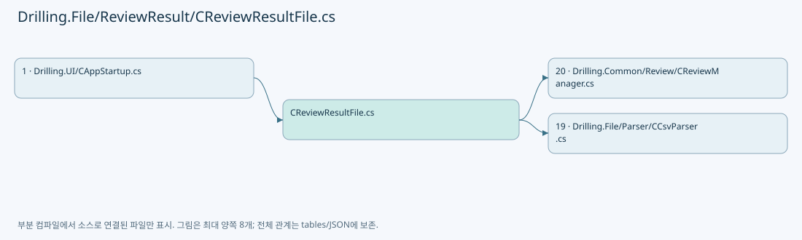

## 네임스페이스·타입·상속

| 타입 | 구분 | 원본 범위 | 선언/상속 |
| --- | --- | --- | --- |
| CReviewResultFile | ClassDeclaration | 9–1243 | CReviewResultFile: CReviewResultFileBase |
| ST_REVIEW_RESULT_METADATA | RecordDeclaration | 710–710 | ST_REVIEW_RESULT_METADATA |

## 멤버 빠른 목록

| 이름 | 종류 | 범위 | 서명 |
| --- | --- | --- | --- |
| BeamInspectionBaseHeaders | FieldDeclaration | L12–12 | string[] Drilling.File.ReviewResult.CReviewResultFile.BeamInspectionBaseHeaders |
| BeamInspectionHeaders | FieldDeclaration | L13–13 | string[] Drilling.File.ReviewResult.CReviewResultFile.BeamInspectionHeaders |
| Headers | FieldDeclaration | L14–47 | System.Collections.Generic.IReadOnlyList<string> Drilling.File.ReviewResult.CReviewResultFile.Headers |
| _reviewRoot | FieldDeclaration | L48–48 | string Drilling.File.ReviewResult.CReviewResultFile._reviewRoot |
| _lastSavedPath | FieldDeclaration | L49–49 | string? Drilling.File.ReviewResult.CReviewResultFile._lastSavedPath |
| RootPath | PropertyDeclaration | L52–52 | string Drilling.File.ReviewResult.CReviewResultFile.RootPath |
| SearchRootPaths | PropertyDeclaration | L53–53 | System.Collections.Generic.IReadOnlyList<string> Drilling.File.ReviewResult.CReviewResultFile.SearchRootPaths |
| LastSavedPath | PropertyDeclaration | L54–54 | string? Drilling.File.ReviewResult.CReviewResultFile.LastSavedPath |
| Load | MethodDeclaration | L56–99 | System.Threading.Tasks.Task<Drilling.Common.Review.ST_REVIEW_RESULT_FILE_DATA> Drilling.File.ReviewResult.CReviewResultFile.Load(string, System.Threading.CancellationToken) |
| Save | MethodDeclaration | L101–133 | System.Threading.Tasks.Task Drilling.File.ReviewResult.CReviewResultFile.Save(Drilling.Common.Review.ST_REVIEW_RESULT_DATA, System.Threading.CancellationToken) |
| SaveReinspectionRevision | MethodDeclaration | L135–210 | System.Threading.Tasks.Task<string> Drilling.File.ReviewResult.CReviewResultFile.SaveReinspectionRevision(Drilling.Common.Review.ST_REVIEW_RESULT_FILE_DATA, System.Collections.Generic.IReadOnlyList<Drilling.Common.Review.ST_REVIEW_REINSPECTION_UPDATE>, System.DateTimeOffset, System.Threading.CancellationToken) |
| ValidateReinspectionUpdate | MethodDeclaration | L212–237 | void Drilling.File.ReviewResult.CReviewResultFile.ValidateReinspectionUpdate(Drilling.Common.Review.ST_REVIEW_REINSPECTION_UPDATE) |
| FindReinspectionRowIndex | MethodDeclaration | L239–266 | int Drilling.File.ReviewResult.CReviewResultFile.FindReinspectionRowIndex(System.Collections.Generic.IReadOnlyList<System.Collections.Generic.Dictionary<string, string>>, Drilling.Common.Review.ST_REVIEW_REINSPECTION_UPDATE) |
| IsReinspectionTargetRow | MethodDeclaration | L268–291 | bool Drilling.File.ReviewResult.CReviewResultFile.IsReinspectionTargetRow(System.Collections.Generic.IReadOnlyDictionary<string, string>, Drilling.Common.Review.ST_REVIEW_REINSPECTION_UPDATE) |
| ApplyReinspectionUpdate | MethodDeclaration | L293–314 | void Drilling.File.ReviewResult.CReviewResultFile.ApplyReinspectionUpdate(System.Collections.Generic.IDictionary<string, string>, System.Collections.Generic.IReadOnlySet<string>, Drilling.Common.Review.ST_REVIEW_REINSPECTION_UPDATE) |
| SetCoordinatePair | MethodDeclaration | L316–339 | bool Drilling.File.ReviewResult.CReviewResultFile.SetCoordinatePair(System.Collections.Generic.IDictionary<string, string>, System.Collections.Generic.IReadOnlySet<string>, string, string, double, double) |
| SetIfPresent | MethodDeclaration | L341–351 | void Drilling.File.ReviewResult.CReviewResultFile.SetIfPresent(System.Collections.Generic.IDictionary<string, string>, System.Collections.Generic.IReadOnlySet<string>, string, string) |
| FormatRevisionSavedAt | MethodDeclaration | L353–358 | string Drilling.File.ReviewResult.CReviewResultFile.FormatRevisionSavedAt(string, System.DateTimeOffset) |
| ToResultRows | MethodDeclaration | L360–388 | System.Collections.Generic.IReadOnlyList<Drilling.Common.Review.ST_REVIEW_RESULT_FILE_ROW> Drilling.File.ReviewResult.CReviewResultFile.ToResultRows(System.Collections.Generic.IReadOnlyDictionary<string, string>, int) |
| ToResultRow | MethodDeclaration | L390–433 | Drilling.Common.Review.ST_REVIEW_RESULT_FILE_ROW Drilling.File.ReviewResult.CReviewResultFile.ToResultRow(System.Collections.Generic.IReadOnlyDictionary<string, string>, int, int?, double?, double?, string?) |
| ToRow | MethodDeclaration | L435–479 | System.Collections.Generic.IReadOnlyDictionary<string, string> Drilling.File.ReviewResult.CReviewResultFile.ToRow(Drilling.Common.Review.ST_REVIEW_RESULT_DATA, Drilling.Common.Review.ST_REVIEW_PLAN_POINT, Drilling.File.ReviewResult.CReviewResultFile.ST_REVIEW_RESULT_METADATA) |
| CreateMetadata | MethodDeclaration | L481–515 | Drilling.File.ReviewResult.CReviewResultFile.ST_REVIEW_RESULT_METADATA Drilling.File.ReviewResult.CReviewResultFile.CreateMetadata(Drilling.Common.Review.ST_REVIEW_RESULT_DATA) |
| FormatShotName | MethodDeclaration | L517–520 | string Drilling.File.ReviewResult.CReviewResultFile.FormatShotName(Drilling.Common.Review.ST_REVIEW_PLAN_POINT?) |
| CreateResultFileName | MethodDeclaration | L522–533 | string Drilling.File.ReviewResult.CReviewResultFile.CreateResultFileName(Drilling.File.ReviewResult.CReviewResultFile.ST_REVIEW_RESULT_METADATA, System.DateTimeOffset) |
| ReadOptionalInt | MethodDeclaration | L535–538 | int Drilling.File.ReviewResult.CReviewResultFile.ReadOptionalInt(System.Collections.Generic.IReadOnlyDictionary<string, string>, string, int) |
| ReadFirstText | MethodDeclaration | L540–552 | string Drilling.File.ReviewResult.CReviewResultFile.ReadFirstText(System.Collections.Generic.IReadOnlyDictionary<string, string>, params string[]) |
| ReadRequiredPositiveInt | MethodDeclaration | L554–569 | int Drilling.File.ReviewResult.CReviewResultFile.ReadRequiredPositiveInt(System.Collections.Generic.IReadOnlyDictionary<string, string>, int, params string[]) |
| ReadOneBasedIndex | MethodDeclaration | L571–577 | int Drilling.File.ReviewResult.CReviewResultFile.ReadOneBasedIndex(System.Collections.Generic.IReadOnlyDictionary<string, string>, params string[]) |
| ReadOptionalFiniteDouble | MethodDeclaration | L579–582 | double Drilling.File.ReviewResult.CReviewResultFile.ReadOptionalFiniteDouble(System.Collections.Generic.IReadOnlyDictionary<string, string>, params string[]) |
| ReadOptionalDouble | MethodDeclaration | L584–592 | double Drilling.File.ReviewResult.CReviewResultFile.ReadOptionalDouble(System.Collections.Generic.IReadOnlyDictionary<string, string>, string) |
| ReadOptionalNullableFiniteDouble | MethodDeclaration | L594–600 | double? Drilling.File.ReviewResult.CReviewResultFile.ReadOptionalNullableFiniteDouble(System.Collections.Generic.IReadOnlyDictionary<string, string>, params string[]) |
| NormalizeResultStatus | MethodDeclaration | L602–607 | string Drilling.File.ReviewResult.CReviewResultFile.NormalizeResultStatus(string?) |
| NormalizeInspectionMethod | MethodDeclaration | L609–612 | string Drilling.File.ReviewResult.CReviewResultFile.NormalizeInspectionMethod(string?) |
| ReadOptionalNullableInt | MethodDeclaration | L614–617 | int? Drilling.File.ReviewResult.CReviewResultFile.ReadOptionalNullableInt(System.Collections.Generic.IReadOnlyDictionary<string, string>, string) |
| FormatDate | MethodDeclaration | L619–622 | string Drilling.File.ReviewResult.CReviewResultFile.FormatDate(System.DateTimeOffset?) |
| FormatDouble | MethodDeclaration | L624–627 | string Drilling.File.ReviewResult.CReviewResultFile.FormatDouble(double) |
| SanitizeFileName | MethodDeclaration | L629–634 | string Drilling.File.ReviewResult.CReviewResultFile.SanitizeFileName(string) |
| ManualDirectory | MethodDeclaration | L636–636 | string Drilling.File.ReviewResult.CReviewResultFile.ManualDirectory(string, string) |
| AutoDirectory | MethodDeclaration | L637–637 | string Drilling.File.ReviewResult.CReviewResultFile.AutoDirectory(string) |
| ZeroDefenceDirectory | MethodDeclaration | L638–638 | string Drilling.File.ReviewResult.CReviewResultFile.ZeroDefenceDirectory(string, string) |
| ResultFileStem | MethodDeclaration | L639–639 | string Drilling.File.ReviewResult.CReviewResultFile.ResultFileStem(string, System.DateTimeOffset) |
| WriteUniqueCsv | MethodDeclaration | L641–674 | string Drilling.File.ReviewResult.CReviewResultFile.WriteUniqueCsv(string, string, System.Collections.Generic.IReadOnlyList<string>, System.Collections.Generic.IEnumerable<System.Collections.Generic.IReadOnlyDictionary<string, string>>, System.Threading.CancellationToken) |
| WriteUniqueLines | MethodDeclaration | L676–708 | System.Threading.Tasks.Task<string> Drilling.File.ReviewResult.CReviewResultFile.WriteUniqueLines(string, string, System.Collections.Generic.IReadOnlyList<string>, System.Threading.CancellationToken) |
| SaveBeamInspection | MethodDeclaration | L713–758 | System.Threading.Tasks.Task<string> Drilling.File.ReviewResult.CReviewResultFile.SaveBeamInspection(Drilling.Common.Review.ST_BEAM_INSPECTION_SNAPSHOT, string, System.DateTimeOffset, System.Threading.CancellationToken) |
| LoadLastBeamInspection | MethodDeclaration | L760–760 | System.Threading.Tasks.Task<Drilling.Common.Review.ST_BEAM_INSPECTION_RESULT_FILE_DATA?> Drilling.File.ReviewResult.CReviewResultFile.LoadLastBeamInspection(System.Threading.CancellationToken) |
| LoadLastBeamInspectionCore | MethodDeclaration | L761–896 | Drilling.Common.Review.ST_BEAM_INSPECTION_RESULT_FILE_DATA? Drilling.File.ReviewResult.CReviewResultFile.LoadLastBeamInspectionCore(System.Threading.CancellationToken) |
| Get | LocalFunctionStatement | L815–815 | string Get(string) |
| RequireName | LocalFunctionStatement | L816–822 | string RequireName(string) |
| ReadNameNumber | MethodDeclaration | L898–904 | int Drilling.File.ReviewResult.CReviewResultFile.ReadNameNumber(string, string, long) |
| ReadFinite | MethodDeclaration | L906–916 | double Drilling.File.ReviewResult.CReviewResultFile.ReadFinite(string, long, int, string) |
| ReadFiniteValue | MethodDeclaration | L918–923 | double Drilling.File.ReviewResult.CReviewResultFile.ReadFiniteValue(string, long, string) |
| Error | MethodDeclaration | L925–925 | System.IO.InvalidDataException Drilling.File.ReviewResult.CReviewResultFile.Error(long, string) |
| ParseOnOff | MethodDeclaration | L926–926 | bool Drilling.File.ReviewResult.CReviewResultFile.ParseOnOff(string?) |
| SaveOneShot | MethodDeclaration | L929–984 | System.Threading.Tasks.Task<string> Drilling.File.ReviewResult.CReviewResultFile.SaveOneShot(Drilling.Common.Review.ST_ONE_SHOT_RESULT_DATA, System.Threading.CancellationToken) |
| SaveFineCorrection | MethodDeclaration | L987–1119 | System.Threading.Tasks.Task<string> Drilling.File.ReviewResult.CReviewResultFile.SaveFineCorrection(Drilling.Common.Review.ST_FINE_REVIEW_RESULT_DATA, System.Threading.CancellationToken) |
| SaveRoughCorrection | MethodDeclaration | L1121–1217 | System.Threading.Tasks.Task<string> Drilling.File.ReviewResult.CReviewResultFile.SaveRoughCorrection(Drilling.Common.Review.ST_ROUGH_REVIEW_RESULT_DATA, System.Threading.CancellationToken) |
| Int | MethodDeclaration | L1219–1219 | string Drilling.File.ReviewResult.CReviewResultFile.Int(int) |
| Number | MethodDeclaration | L1220–1220 | string Drilling.File.ReviewResult.CReviewResultFile.Number(double) |
| SaveZeroLine | MethodDeclaration | L1221–1241 | System.Threading.Tasks.Task<string> Drilling.File.ReviewResult.CReviewResultFile.SaveZeroLine(Drilling.Common.Review.ST_ZERO_LINE_RESULT_DATA, System.Threading.CancellationToken) |
| Field | LocalFunctionStatement | L1224–1224 | string Field(object?) |

## 멤버별 상세 계약·호출·처리 해설

### FieldDeclaration `BeamInspectionBaseHeaders` · L12–12

[Drilling.File/ReviewResult/CReviewResultFile.cs:12–12](https://github.com/kjuws10-rgb/A3Drilling/blob/5aee8e58439c9b455cae7c9593c9be986c3e682e/Drilling.File/ReviewResult/CReviewResultFile.cs#L12-L12)

| 항목 | 실제 추출 값 |
| --- | --- |
| 서명 | string[] Drilling.File.ReviewResult.CReviewResultFile.BeamInspectionBaseHeaders |
| 접근/수식자 | Private / private, static, readonly |
| 반환/값 타입 | string[] |
| 소속 타입 | NamedType:Drilling.File.ReviewResult.CReviewResultFile |

현재 부분 분석에서 직접 연결된 호출자는 없습니다. XAML/이벤트/인터페이스·델리게이트·외부 진입을 추가 확인해야 하며, 미사용으로 판정한 것이 아닙니다.

호출하는 대상과 해석 범위:

| 원본 행 | 표현식 | 분석 상태 | 대상/소스 위치 |
| --- | --- | --- | --- |
| 12 | Enumerable.Range(1, 16).SelectMany | resolved | System.Collections.Generic.IEnumerable<string> System.Collections.Generic.IEnumerable<int>.SelectMany<int, string>(System.Func<int, System.Collections.Generic.IEnumerable<string>>) |
| 12 | Enumerable.Range | resolved | System.Collections.Generic.IEnumerable<int> System.Linq.Enumerable.Range(int, int) |

본문의 실제 연산·분기·예외·반환 순서(원문 위치 순):

| 원본 행 | 종류 | 주석 해설 |
| --- | --- | --- |
| 12 | call | 함수·델리게이트 또는 객체 생성자를 호출합니다: Enumerable.Range(1, 16).SelectMany(beam => new[] { $"BEAM{beam}_X_MM", $"BEAM{beam}_Y_MM", $"BEAM{beam}_JUDGE" }) |
| 12 | call | 함수·델리게이트 또는 객체 생성자를 호출합니다: Enumerable.Range(1, 16) |
| 12 | variable-initializer | 변수의 초기값을 지정합니다: BeamInspectionBaseHeaders = ["SAVED_AT", "RECIPE_ID", "RESULT_STATUS", "STAGE_SIMULATION", "VISION_SIMULATION", "GLASS_NAME", "HEAD_NAME", "CELL_NAME", "SHOT_NAME", ..Enumerable.Range(1, 16).SelectMany(beam => new[] { $"BEAM{beam} |

변경 전 점검: 입력/반환 타입, 위 호출자, 예외/취소 경로, 공유 상태와 저장·전송 소비자를 함께 확인합니다. 값의 단위나 물리 방향을 이름만으로 확정하지 않습니다.

### FieldDeclaration `BeamInspectionHeaders` · L13–13

[Drilling.File/ReviewResult/CReviewResultFile.cs:13–13](https://github.com/kjuws10-rgb/A3Drilling/blob/5aee8e58439c9b455cae7c9593c9be986c3e682e/Drilling.File/ReviewResult/CReviewResultFile.cs#L13-L13)

| 항목 | 실제 추출 값 |
| --- | --- |
| 서명 | string[] Drilling.File.ReviewResult.CReviewResultFile.BeamInspectionHeaders |
| 접근/수식자 | Private / private, static, readonly |
| 반환/값 타입 | string[] |
| 소속 타입 | NamedType:Drilling.File.ReviewResult.CReviewResultFile |

현재 부분 분석에서 직접 연결된 호출자는 없습니다. XAML/이벤트/인터페이스·델리게이트·외부 진입을 추가 확인해야 하며, 미사용으로 판정한 것이 아닙니다.

호출하는 대상과 해석 범위:

| 원본 행 | 표현식 | 분석 상태 | 대상/소스 위치 |
| --- | --- | --- | --- |
| 13 | Enumerable.Range(1, 16).SelectMany | resolved | System.Collections.Generic.IEnumerable<string> System.Collections.Generic.IEnumerable<int>.SelectMany<int, string>(System.Func<int, System.Collections.Generic.IEnumerable<string>>) |
| 13 | Enumerable.Range | resolved | System.Collections.Generic.IEnumerable<int> System.Linq.Enumerable.Range(int, int) |

본문의 실제 연산·분기·예외·반환 순서(원문 위치 순):

| 원본 행 | 종류 | 주석 해설 |
| --- | --- | --- |
| 13 | call | 함수·델리게이트 또는 객체 생성자를 호출합니다: Enumerable.Range(1, 16).SelectMany(beam => new[] { $"BEAM{beam}_X_MM", $"BEAM{beam}_Y_MM", $"BEAM{beam}_JUDGE" }) |
| 13 | call | 함수·델리게이트 또는 객체 생성자를 호출합니다: Enumerable.Range(1, 16) |
| 13 | variable-initializer | 변수의 초기값을 지정합니다: BeamInspectionHeaders = ["SAVED_AT", "RECIPE_ID", "RESULT_STATUS", "STAGE_SIMULATION", "VISION_SIMULATION", "GLASS_NAME", "HEAD_NAME", "CELL_NAME", "SHOT_NAME", "SHIFT_OFFSET_X", "SHIFT_OFFSET_Y", ..Enumerable.Range(1, 16).SelectM |

변경 전 점검: 입력/반환 타입, 위 호출자, 예외/취소 경로, 공유 상태와 저장·전송 소비자를 함께 확인합니다. 값의 단위나 물리 방향을 이름만으로 확정하지 않습니다.

### FieldDeclaration `Headers` · L14–47

[Drilling.File/ReviewResult/CReviewResultFile.cs:14–47](https://github.com/kjuws10-rgb/A3Drilling/blob/5aee8e58439c9b455cae7c9593c9be986c3e682e/Drilling.File/ReviewResult/CReviewResultFile.cs#L14-L47)

| 항목 | 실제 추출 값 |
| --- | --- |
| 서명 | System.Collections.Generic.IReadOnlyList<string> Drilling.File.ReviewResult.CReviewResultFile.Headers |
| 접근/수식자 | Private / private, static, readonly |
| 반환/값 타입 | System.Collections.Generic.IReadOnlyList<string> |
| 소속 타입 | NamedType:Drilling.File.ReviewResult.CReviewResultFile |

현재 부분 분석에서 직접 연결된 호출자는 없습니다. XAML/이벤트/인터페이스·델리게이트·외부 진입을 추가 확인해야 하며, 미사용으로 판정한 것이 아닙니다.

본문의 실제 연산·분기·예외·반환 순서(원문 위치 순):

| 원본 행 | 종류 | 주석 해설 |
| --- | --- | --- |
| 14 | variable-initializer | 변수의 초기값을 지정합니다: Headers = [ "SAVED_AT", "GLASS_ID", "RECIPE_ID", "INSPECTION_METHOD", "RESULT_STATUS", "TOTAL_COUNT", "RULE", "RULE_SCOPE", "BEAM_NO", "REFERENCE_CELL_NO", "REFERENCE_SHOT", "ROUGH_REFERENCE", "FINE_LINE_COUNT", "SHIFT_OFFSET_X",  |

변경 전 점검: 입력/반환 타입, 위 호출자, 예외/취소 경로, 공유 상태와 저장·전송 소비자를 함께 확인합니다. 값의 단위나 물리 방향을 이름만으로 확정하지 않습니다.

### FieldDeclaration `_reviewRoot` · L48–48

[Drilling.File/ReviewResult/CReviewResultFile.cs:48–48](https://github.com/kjuws10-rgb/A3Drilling/blob/5aee8e58439c9b455cae7c9593c9be986c3e682e/Drilling.File/ReviewResult/CReviewResultFile.cs#L48-L48)

| 항목 | 실제 추출 값 |
| --- | --- |
| 서명 | string Drilling.File.ReviewResult.CReviewResultFile._reviewRoot |
| 접근/수식자 | Private / private, readonly |
| 반환/값 타입 | string |
| 소속 타입 | NamedType:Drilling.File.ReviewResult.CReviewResultFile |

현재 부분 분석에서 직접 연결된 호출자는 없습니다. XAML/이벤트/인터페이스·델리게이트·외부 진입을 추가 확인해야 하며, 미사용으로 판정한 것이 아닙니다.

호출하는 대상과 해석 범위:

| 원본 행 | 표현식 | 분석 상태 | 대상/소스 위치 |
| --- | --- | --- | --- |
| 48 | Path.Combine | resolved | string System.IO.Path.Combine(string, string, string) |
| 48 | Directory.GetParent | resolved | System.IO.DirectoryInfo? System.IO.Directory.GetParent(string) |

본문의 실제 연산·분기·예외·반환 순서(원문 위치 순):

| 원본 행 | 종류 | 주석 해설 |
| --- | --- | --- |
| 48 | call | 함수·델리게이트 또는 객체 생성자를 호출합니다: Path.Combine(Directory.GetParent(configRoot)?.FullName ?? configRoot, "Data", "Review") |
| 48 | call | 함수·델리게이트 또는 객체 생성자를 호출합니다: Directory.GetParent(configRoot) |
| 48 | variable-initializer | 변수의 초기값을 지정합니다: _reviewRoot = Path.Combine(Directory.GetParent(configRoot)?.FullName ?? configRoot, "Data", "Review") |

변경 전 점검: 입력/반환 타입, 위 호출자, 예외/취소 경로, 공유 상태와 저장·전송 소비자를 함께 확인합니다. 값의 단위나 물리 방향을 이름만으로 확정하지 않습니다.

### FieldDeclaration `_lastSavedPath` · L49–49

[Drilling.File/ReviewResult/CReviewResultFile.cs:49–49](https://github.com/kjuws10-rgb/A3Drilling/blob/5aee8e58439c9b455cae7c9593c9be986c3e682e/Drilling.File/ReviewResult/CReviewResultFile.cs#L49-L49)

| 항목 | 실제 추출 값 |
| --- | --- |
| 서명 | string? Drilling.File.ReviewResult.CReviewResultFile._lastSavedPath |
| 접근/수식자 | Private / private |
| 반환/값 타입 | string? |
| 소속 타입 | NamedType:Drilling.File.ReviewResult.CReviewResultFile |

현재 부분 분석에서 직접 연결된 호출자는 없습니다. XAML/이벤트/인터페이스·델리게이트·외부 진입을 추가 확인해야 하며, 미사용으로 판정한 것이 아닙니다.

변경 전 점검: 입력/반환 타입, 위 호출자, 예외/취소 경로, 공유 상태와 저장·전송 소비자를 함께 확인합니다. 값의 단위나 물리 방향을 이름만으로 확정하지 않습니다.

### PropertyDeclaration `RootPath` · L52–52

[Drilling.File/ReviewResult/CReviewResultFile.cs:52–52](https://github.com/kjuws10-rgb/A3Drilling/blob/5aee8e58439c9b455cae7c9593c9be986c3e682e/Drilling.File/ReviewResult/CReviewResultFile.cs#L52-L52)

| 항목 | 실제 추출 값 |
| --- | --- |
| 서명 | string Drilling.File.ReviewResult.CReviewResultFile.RootPath |
| 접근/수식자 | Public / public, override |
| 반환/값 타입 | string |
| 소속 타입 | NamedType:Drilling.File.ReviewResult.CReviewResultFile |

현재 부분 분석에서 직접 연결된 호출자는 없습니다. XAML/이벤트/인터페이스·델리게이트·외부 진입을 추가 확인해야 하며, 미사용으로 판정한 것이 아닙니다.

변경 전 점검: 입력/반환 타입, 위 호출자, 예외/취소 경로, 공유 상태와 저장·전송 소비자를 함께 확인합니다. 값의 단위나 물리 방향을 이름만으로 확정하지 않습니다.

### PropertyDeclaration `SearchRootPaths` · L53–53

[Drilling.File/ReviewResult/CReviewResultFile.cs:53–53](https://github.com/kjuws10-rgb/A3Drilling/blob/5aee8e58439c9b455cae7c9593c9be986c3e682e/Drilling.File/ReviewResult/CReviewResultFile.cs#L53-L53)

| 항목 | 실제 추출 값 |
| --- | --- |
| 서명 | System.Collections.Generic.IReadOnlyList<string> Drilling.File.ReviewResult.CReviewResultFile.SearchRootPaths |
| 접근/수식자 | Public / public, override |
| 반환/값 타입 | System.Collections.Generic.IReadOnlyList<string> |
| 소속 타입 | NamedType:Drilling.File.ReviewResult.CReviewResultFile |

현재 부분 분석에서 직접 연결된 호출자는 없습니다. XAML/이벤트/인터페이스·델리게이트·외부 진입을 추가 확인해야 하며, 미사용으로 판정한 것이 아닙니다.

변경 전 점검: 입력/반환 타입, 위 호출자, 예외/취소 경로, 공유 상태와 저장·전송 소비자를 함께 확인합니다. 값의 단위나 물리 방향을 이름만으로 확정하지 않습니다.

### PropertyDeclaration `LastSavedPath` · L54–54

[Drilling.File/ReviewResult/CReviewResultFile.cs:54–54](https://github.com/kjuws10-rgb/A3Drilling/blob/5aee8e58439c9b455cae7c9593c9be986c3e682e/Drilling.File/ReviewResult/CReviewResultFile.cs#L54-L54)

| 항목 | 실제 추출 값 |
| --- | --- |
| 서명 | string? Drilling.File.ReviewResult.CReviewResultFile.LastSavedPath |
| 접근/수식자 | Public / public, override |
| 반환/값 타입 | string? |
| 소속 타입 | NamedType:Drilling.File.ReviewResult.CReviewResultFile |

현재 부분 분석에서 직접 연결된 호출자는 없습니다. XAML/이벤트/인터페이스·델리게이트·외부 진입을 추가 확인해야 하며, 미사용으로 판정한 것이 아닙니다.

변경 전 점검: 입력/반환 타입, 위 호출자, 예외/취소 경로, 공유 상태와 저장·전송 소비자를 함께 확인합니다. 값의 단위나 물리 방향을 이름만으로 확정하지 않습니다.

### MethodDeclaration `Load` · L56–99

[Drilling.File/ReviewResult/CReviewResultFile.cs:56–99](https://github.com/kjuws10-rgb/A3Drilling/blob/5aee8e58439c9b455cae7c9593c9be986c3e682e/Drilling.File/ReviewResult/CReviewResultFile.cs#L56-L99)

| 항목 | 실제 추출 값 |
| --- | --- |
| 서명 | System.Threading.Tasks.Task<Drilling.Common.Review.ST_REVIEW_RESULT_FILE_DATA> Drilling.File.ReviewResult.CReviewResultFile.Load(string, System.Threading.CancellationToken) |
| 접근/수식자 | Public / public, override |
| 반환/값 타입 | System.Threading.Tasks.Task<Drilling.Common.Review.ST_REVIEW_RESULT_FILE_DATA> |
| 소속 타입 | NamedType:Drilling.File.ReviewResult.CReviewResultFile |

입력 계약:

| 이름 | 타입 | 전달 | 선택/기본값 |
| --- | --- | --- | --- |
| path | string | None | False /  |
| cancellationToken | System.Threading.CancellationToken | None | True / null |

현재 부분 분석에서 직접 연결된 호출자는 없습니다. XAML/이벤트/인터페이스·델리게이트·외부 진입을 추가 확인해야 하며, 미사용으로 판정한 것이 아닙니다.

호출하는 대상과 해석 범위:

| 원본 행 | 표현식 | 분석 상태 | 대상/소스 위치 |
| --- | --- | --- | --- |
| 58 | cancellationToken.ThrowIfCancellationRequested | resolved | void System.Threading.CancellationToken.ThrowIfCancellationRequested() |
| 59 | CCsvParser.Read | resolved | System.Collections.Generic.IReadOnlyList<System.Collections.Generic.IReadOnlyDictionary<string, string>> Drilling.File.Parser.CCsvParser.Read(string) · Drilling.File/Parser/CCsvParser.cs:12 |
| 62 | new InvalidDataException | resolved | System.IO.InvalidDataException.InvalidDataException(string?) |
| 65 | sourceRows .SelectMany((row, index) => ToResultRows(row, index + 2)) .ToArray | resolved | Drilling.Common.Review.ST_REVIEW_RESULT_FILE_ROW[] System.Collections.Generic.IEnumerable<Drilling.Common.Review.ST_REVIEW_RESULT_FILE_ROW>.ToArray<Drilling.Common.Review.ST_REVIEW_RESULT_FILE_ROW>() |
| 65 | sourceRows .SelectMany | resolved | System.Collections.Generic.IEnumerable<Drilling.Common.Review.ST_REVIEW_RESULT_FILE_ROW> System.Collections.Generic.IEnumerable<System.Collections.Generic.IReadOnlyDictionary<string, string>>.SelectMany<System.Collections.Generic.IReadOnlyDictionary<string, string>, Drilling.Common.Review.ST_REVIEW_RESULT_FILE_ROW>(System.Func<System.Collections.Generic.IReadOnlyDictionary<string, string>, int, System.Collections.Generic.IEnumerable<Drilling.Common.Review.ST_REVIEW_RESULT_FILE_ROW>>) |
| 66 | ToResultRows | resolved | System.Collections.Generic.IReadOnlyList<Drilling.Common.Review.ST_REVIEW_RESULT_FILE_ROW> Drilling.File.ReviewResult.CReviewResultFile.ToResultRows(System.Collections.Generic.IReadOnlyDictionary<string, string>, int) · Drilling.File/ReviewResult/CReviewResultFile.cs:360 |
| 70 | new InvalidDataException | resolved | System.IO.InvalidDataException.InvalidDataException(string?) |
| 73 | rows.Select(row => row.RecipeId).Distinct(StringComparer.OrdinalIgnoreCase).ToArray | resolved | string[] System.Collections.Generic.IEnumerable<string>.ToArray<string>() |
| 73 | rows.Select(row => row.RecipeId).Distinct | resolved | System.Collections.Generic.IEnumerable<string> System.Collections.Generic.IEnumerable<string>.Distinct<string>(System.Collections.Generic.IEqualityComparer<string>?) |
| 73 | rows.Select | resolved | System.Collections.Generic.IEnumerable<string> System.Collections.Generic.IEnumerable<Drilling.Common.Review.ST_REVIEW_RESULT_FILE_ROW>.Select<Drilling.Common.Review.ST_REVIEW_RESULT_FILE_ROW, string>(System.Func<Drilling.Common.Review.ST_REVIEW_RESULT_FILE_ROW, string>) |
| 76 | new InvalidDataException | resolved | System.IO.InvalidDataException.InvalidDataException(string?) |
| 79 | Path.GetFullPath | resolved | string System.IO.Path.GetFullPath(string) |
| 81 | Task.FromResult | resolved | System.Threading.Tasks.Task<Drilling.Common.Review.ST_REVIEW_RESULT_FILE_DATA> System.Threading.Tasks.Task.FromResult<Drilling.Common.Review.ST_REVIEW_RESULT_FILE_DATA>(Drilling.Common.Review.ST_REVIEW_RESULT_FILE_DATA) |
| 81 | new ST_REVIEW_RESULT_FILE_DATA | resolved | Drilling.Common.Review.ST_REVIEW_RESULT_FILE_DATA.ST_REVIEW_RESULT_FILE_DATA(string, string, string, System.DateTimeOffset, System.Collections.Generic.IReadOnlyList<Drilling.Common.Review.ST_REVIEW_RESULT_FILE_ROW>) · Drilling.Common/Review/CReviewManager.cs:4024 |
| 81 | Path.GetFileName | resolved | string? System.IO.Path.GetFileName(string?) |
| 81 | rows.Max | resolved | System.DateTimeOffset System.Collections.Generic.IEnumerable<Drilling.Common.Review.ST_REVIEW_RESULT_FILE_ROW>.Max<Drilling.Common.Review.ST_REVIEW_RESULT_FILE_ROW, System.DateTimeOffset>(System.Func<Drilling.Common.Review.ST_REVIEW_RESULT_FILE_ROW, System.DateTimeOffset>) |
| 83 | ReadFirstText | resolved | string Drilling.File.ReviewResult.CReviewResultFile.ReadFirstText(System.Collections.Generic.IReadOnlyDictionary<string, string>, params string[]) · Drilling.File/ReviewResult/CReviewResultFile.cs:540 |
| 84 | ReadFirstText | resolved | string Drilling.File.ReviewResult.CReviewResultFile.ReadFirstText(System.Collections.Generic.IReadOnlyDictionary<string, string>, params string[]) · Drilling.File/ReviewResult/CReviewResultFile.cs:540 |
| 85 | NormalizeResultStatus | resolved | string Drilling.File.ReviewResult.CReviewResultFile.NormalizeResultStatus(string?) · Drilling.File/ReviewResult/CReviewResultFile.cs:602 |
| 85 | ReadFirstText | resolved | string Drilling.File.ReviewResult.CReviewResultFile.ReadFirstText(System.Collections.Generic.IReadOnlyDictionary<string, string>, params string[]) · Drilling.File/ReviewResult/CReviewResultFile.cs:540 |
| 86 | ReadOptionalInt | resolved | int Drilling.File.ReviewResult.CReviewResultFile.ReadOptionalInt(System.Collections.Generic.IReadOnlyDictionary<string, string>, string, int) · Drilling.File/ReviewResult/CReviewResultFile.cs:535 |
| 87 | CCsvParser.Get | resolved | string Drilling.File.Parser.CCsvParser.Get(System.Collections.Generic.IReadOnlyDictionary<string, string>, string) · Drilling.File/Parser/CCsvParser.cs:168 |
| 88 | CCsvParser.Get | resolved | string Drilling.File.Parser.CCsvParser.Get(System.Collections.Generic.IReadOnlyDictionary<string, string>, string) · Drilling.File/Parser/CCsvParser.cs:168 |
| 89 | ReadOptionalInt | resolved | int Drilling.File.ReviewResult.CReviewResultFile.ReadOptionalInt(System.Collections.Generic.IReadOnlyDictionary<string, string>, string, int) · Drilling.File/ReviewResult/CReviewResultFile.cs:535 |
| 90 | ReadOptionalNullableInt | resolved | int? Drilling.File.ReviewResult.CReviewResultFile.ReadOptionalNullableInt(System.Collections.Generic.IReadOnlyDictionary<string, string>, string) · Drilling.File/ReviewResult/CReviewResultFile.cs:614 |
| 91 | CCsvParser.Get | resolved | string Drilling.File.Parser.CCsvParser.Get(System.Collections.Generic.IReadOnlyDictionary<string, string>, string) · Drilling.File/Parser/CCsvParser.cs:168 |
| 92 | CCsvParser.Get | resolved | string Drilling.File.Parser.CCsvParser.Get(System.Collections.Generic.IReadOnlyDictionary<string, string>, string) · Drilling.File/Parser/CCsvParser.cs:168 |
| 93 | ReadOptionalInt | resolved | int Drilling.File.ReviewResult.CReviewResultFile.ReadOptionalInt(System.Collections.Generic.IReadOnlyDictionary<string, string>, string, int) · Drilling.File/ReviewResult/CReviewResultFile.cs:535 |
| 94 | CCsvParser.Get | resolved | string Drilling.File.Parser.CCsvParser.Get(System.Collections.Generic.IReadOnlyDictionary<string, string>, string) · Drilling.File/Parser/CCsvParser.cs:168 |
| 95 | ReadOptionalInt | resolved | int Drilling.File.ReviewResult.CReviewResultFile.ReadOptionalInt(System.Collections.Generic.IReadOnlyDictionary<string, string>, string, int) · Drilling.File/ReviewResult/CReviewResultFile.cs:535 |
| 96 | ReadOptionalDouble | resolved | double Drilling.File.ReviewResult.CReviewResultFile.ReadOptionalDouble(System.Collections.Generic.IReadOnlyDictionary<string, string>, string) · Drilling.File/ReviewResult/CReviewResultFile.cs:584 |
| 97 | ReadOptionalDouble | resolved | double Drilling.File.ReviewResult.CReviewResultFile.ReadOptionalDouble(System.Collections.Generic.IReadOnlyDictionary<string, string>, string) · Drilling.File/ReviewResult/CReviewResultFile.cs:584 |

본문의 실제 연산·분기·예외·반환 순서(원문 위치 순):

| 원본 행 | 종류 | 주석 해설 |
| --- | --- | --- |
| 58 | call | 함수·델리게이트 또는 객체 생성자를 호출합니다: cancellationToken.ThrowIfCancellationRequested() |
| 59 | call | 함수·델리게이트 또는 객체 생성자를 호출합니다: CCsvParser.Read(path) |
| 59 | local-declaration | 지역 변수를 선언합니다: var sourceRows = CCsvParser.Read(path); |
| 59 | variable-initializer | 변수의 초기값을 지정합니다: sourceRows = CCsvParser.Read(path) |
| 60 | if | 조건에 따라 분기합니다: if (sourceRows.Count == 0) |
| 62 | call | 함수·델리게이트 또는 객체 생성자를 호출합니다: new InvalidDataException("Review Result validation failed. Result row is empty.") |
| 62 | throw | 예외를 발생/전달합니다: throw new InvalidDataException("Review Result validation failed. Result row is empty."); |
| 65 | call | 함수·델리게이트 또는 객체 생성자를 호출합니다: sourceRows .SelectMany((row, index) => ToResultRows(row, index + 2)) |
| 65 | call | 함수·델리게이트 또는 객체 생성자를 호출합니다: sourceRows .SelectMany((row, index) => ToResultRows(row, index + 2)) .ToArray() |
| 65 | local-declaration | 지역 변수를 선언합니다: var rows = sourceRows .SelectMany((row, index) => ToResultRows(row, index + 2)) .ToArray(); |
| 65 | variable-initializer | 변수의 초기값을 지정합니다: rows = sourceRows .SelectMany((row, index) => ToResultRows(row, index + 2)) .ToArray() |
| 66 | call | 함수·델리게이트 또는 객체 생성자를 호출합니다: ToResultRows(row, index + 2) |
| 68 | if | 조건에 따라 분기합니다: if (rows.Length == 0) |
| 70 | call | 함수·델리게이트 또는 객체 생성자를 호출합니다: new InvalidDataException("Review Result validation failed. There is no displayable result row.") |
| 70 | throw | 예외를 발생/전달합니다: throw new InvalidDataException("Review Result validation failed. There is no displayable result row."); |
| 73 | call | 함수·델리게이트 또는 객체 생성자를 호출합니다: rows.Select(row => row.RecipeId).Distinct(StringComparer.OrdinalIgnoreCase).ToArray() |
| 73 | call | 함수·델리게이트 또는 객체 생성자를 호출합니다: rows.Select(row => row.RecipeId).Distinct(StringComparer.OrdinalIgnoreCase) |
| 73 | call | 함수·델리게이트 또는 객체 생성자를 호출합니다: rows.Select(row => row.RecipeId) |
| 73 | local-declaration | 지역 변수를 선언합니다: var recipeIds = rows.Select(row => row.RecipeId).Distinct(StringComparer.OrdinalIgnoreCase).ToArray(); |
| 73 | variable-initializer | 변수의 초기값을 지정합니다: recipeIds = rows.Select(row => row.RecipeId).Distinct(StringComparer.OrdinalIgnoreCase).ToArray() |
| 74 | if | 조건에 따라 분기합니다: if (recipeIds.Length != 1) |
| 76 | call | 함수·델리게이트 또는 객체 생성자를 호출합니다: new InvalidDataException("Review Result validation failed. All rows must have the same RECIPE_ID.") |
| 76 | throw | 예외를 발생/전달합니다: throw new InvalidDataException("Review Result validation failed. All rows must have the same RECIPE_ID."); |
| 79 | call | 함수·델리게이트 또는 객체 생성자를 호출합니다: Path.GetFullPath(path) |
| 79 | local-declaration | 지역 변수를 선언합니다: var fullPath = Path.GetFullPath(path); |
| 79 | variable-initializer | 변수의 초기값을 지정합니다: fullPath = Path.GetFullPath(path) |
| 80 | local-declaration | 지역 변수를 선언합니다: var metadataRow = sourceRows[0]; |
| 80 | variable-initializer | 변수의 초기값을 지정합니다: metadataRow = sourceRows[0] |
| 81 | call | 함수·델리게이트 또는 객체 생성자를 호출합니다: Path.GetFileName(fullPath) |
| 81 | call | 함수·델리게이트 또는 객체 생성자를 호출합니다: rows.Max(row => row.SavedAt) |
| 81 | call | 함수·델리게이트 또는 객체 생성자를 호출합니다: Task.FromResult(new ST_REVIEW_RESULT_FILE_DATA(fullPath, Path.GetFileName(fullPath), recipeIds[0], rows.Max(row => row.SavedAt), rows) { GlassId = ReadFirstText(metadataRow, "GLASS_ID", "GLASS_NAME"), InspectionMethod = … |
| 81 | call | 함수·델리게이트 또는 객체 생성자를 호출합니다: new ST_REVIEW_RESULT_FILE_DATA(fullPath, Path.GetFileName(fullPath), recipeIds[0], rows.Max(row => row.SavedAt), rows) { GlassId = ReadFirstText(metadataRow, "GLASS_ID", "GLASS_NAME"), InspectionMethod = ReadFirstText(me… |
| 81 | return | 호출자에게 값 또는 제어를 반환합니다: return Task.FromResult(new ST_REVIEW_RESULT_FILE_DATA(fullPath, Path.GetFileName(fullPath), recipeIds[0], rows.Max(row => row.SavedAt), rows) { GlassId = ReadFirstText(metadataRow, "GLASS_ID", "GLASS_NAME"), InspectionMethod = Rea |
| 83 | assignment | 값을 대상에 대입합니다: GlassId = ReadFirstText(metadataRow, "GLASS_ID", "GLASS_NAME") |
| 83 | call | 함수·델리게이트 또는 객체 생성자를 호출합니다: ReadFirstText(metadataRow, "GLASS_ID", "GLASS_NAME") |
| 84 | assignment | 값을 대상에 대입합니다: InspectionMethod = ReadFirstText(metadataRow, "INSPECTION_METHOD", "METHOD") |
| 84 | call | 함수·델리게이트 또는 객체 생성자를 호출합니다: ReadFirstText(metadataRow, "INSPECTION_METHOD", "METHOD") |
| 85 | assignment | 값을 대상에 대입합니다: ResultStatus = NormalizeResultStatus(ReadFirstText(metadataRow, "RESULT_STATUS", "STATE")) |
| 85 | call | 함수·델리게이트 또는 객체 생성자를 호출합니다: NormalizeResultStatus(ReadFirstText(metadataRow, "RESULT_STATUS", "STATE")) |
| 85 | call | 함수·델리게이트 또는 객체 생성자를 호출합니다: ReadFirstText(metadataRow, "RESULT_STATUS", "STATE") |
| 86 | assignment | 값을 대상에 대입합니다: TotalCount = ReadOptionalInt(metadataRow, "TOTAL_COUNT", rows.Length) |
| 86 | call | 함수·델리게이트 또는 객체 생성자를 호출합니다: ReadOptionalInt(metadataRow, "TOTAL_COUNT", rows.Length) |
| 87 | assignment | 값을 대상에 대입합니다: Rule = CCsvParser.Get(metadataRow, "RULE") |
| 87 | call | 함수·델리게이트 또는 객체 생성자를 호출합니다: CCsvParser.Get(metadataRow, "RULE") |
| 88 | assignment | 값을 대상에 대입합니다: RuleScope = CCsvParser.Get(metadataRow, "RULE_SCOPE") |
| 88 | call | 함수·델리게이트 또는 객체 생성자를 호출합니다: CCsvParser.Get(metadataRow, "RULE_SCOPE") |
| 89 | assignment | 값을 대상에 대입합니다: BeamNo = ReadOptionalInt(metadataRow, "BEAM_NO", 1) |
| 89 | call | 함수·델리게이트 또는 객체 생성자를 호출합니다: ReadOptionalInt(metadataRow, "BEAM_NO", 1) |
| 90 | assignment | 값을 대상에 대입합니다: ReferenceCellNo = ReadOptionalNullableInt(metadataRow, "REFERENCE_CELL_NO") |
| 90 | call | 함수·델리게이트 또는 객체 생성자를 호출합니다: ReadOptionalNullableInt(metadataRow, "REFERENCE_CELL_NO") |
| 91 | assignment | 값을 대상에 대입합니다: ReferenceShot = CCsvParser.Get(metadataRow, "REFERENCE_SHOT") |
| 91 | call | 함수·델리게이트 또는 객체 생성자를 호출합니다: CCsvParser.Get(metadataRow, "REFERENCE_SHOT") |
| 92 | assignment | 값을 대상에 대입합니다: RoughReference = CCsvParser.Get(metadataRow, "ROUGH_REFERENCE") |
| 92 | call | 함수·델리게이트 또는 객체 생성자를 호출합니다: CCsvParser.Get(metadataRow, "ROUGH_REFERENCE") |
| 93 | assignment | 값을 대상에 대입합니다: FineLineCount = ReadOptionalInt(metadataRow, "FINE_LINE_COUNT", 0) |
| 93 | call | 함수·델리게이트 또는 객체 생성자를 호출합니다: ReadOptionalInt(metadataRow, "FINE_LINE_COUNT", 0) |
| 94 | assignment | 값을 대상에 대입합니다: Origin = CCsvParser.Get(metadataRow, "ORIGIN") |
| 94 | call | 함수·델리게이트 또는 객체 생성자를 호출합니다: CCsvParser.Get(metadataRow, "ORIGIN") |
| 95 | assignment | 값을 대상에 대입합니다: LineCount = ReadOptionalInt(metadataRow, "LINE_COUNT", 0) |
| 95 | call | 함수·델리게이트 또는 객체 생성자를 호출합니다: ReadOptionalInt(metadataRow, "LINE_COUNT", 0) |
| 96 | assignment | 값을 대상에 대입합니다: ShiftOffsetX = ReadOptionalDouble(metadataRow, "SHIFT_OFFSET_X") |
| 96 | call | 함수·델리게이트 또는 객체 생성자를 호출합니다: ReadOptionalDouble(metadataRow, "SHIFT_OFFSET_X") |
| 97 | assignment | 값을 대상에 대입합니다: ShiftOffsetY = ReadOptionalDouble(metadataRow, "SHIFT_OFFSET_Y") |
| 97 | call | 함수·델리게이트 또는 객체 생성자를 호출합니다: ReadOptionalDouble(metadataRow, "SHIFT_OFFSET_Y") |

제어 구문의 포함 구조(실제 실행 순서/CFG가 아닌 구문 탐색 그림):

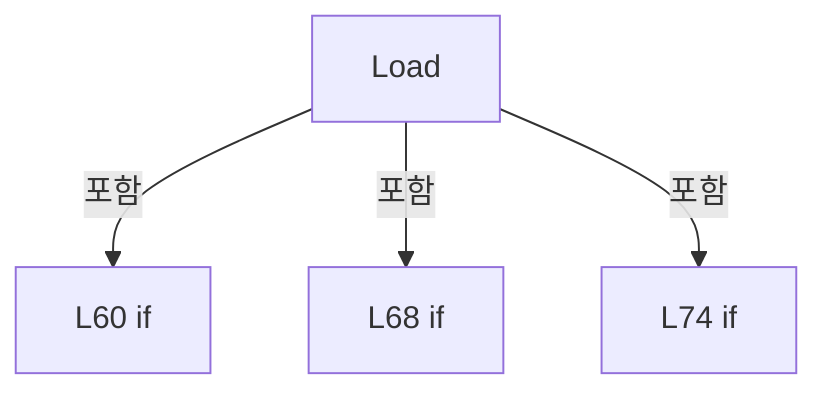

변경 전 점검: 입력/반환 타입, 위 호출자, 예외/취소 경로, 공유 상태와 저장·전송 소비자를 함께 확인합니다. 값의 단위나 물리 방향을 이름만으로 확정하지 않습니다.

### MethodDeclaration `Save` · L101–133

[Drilling.File/ReviewResult/CReviewResultFile.cs:101–133](https://github.com/kjuws10-rgb/A3Drilling/blob/5aee8e58439c9b455cae7c9593c9be986c3e682e/Drilling.File/ReviewResult/CReviewResultFile.cs#L101-L133)

| 항목 | 실제 추출 값 |
| --- | --- |
| 서명 | System.Threading.Tasks.Task Drilling.File.ReviewResult.CReviewResultFile.Save(Drilling.Common.Review.ST_REVIEW_RESULT_DATA, System.Threading.CancellationToken) |
| 접근/수식자 | Public / public, override |
| 반환/값 타입 | System.Threading.Tasks.Task |
| 소속 타입 | NamedType:Drilling.File.ReviewResult.CReviewResultFile |

입력 계약:

| 이름 | 타입 | 전달 | 선택/기본값 |
| --- | --- | --- | --- |
| result | Drilling.Common.Review.ST_REVIEW_RESULT_DATA | None | False /  |
| cancellationToken | System.Threading.CancellationToken | None | True / null |

현재 부분 분석에서 직접 연결된 호출자는 없습니다. XAML/이벤트/인터페이스·델리게이트·외부 진입을 추가 확인해야 하며, 미사용으로 판정한 것이 아닙니다.

호출하는 대상과 해석 범위:

| 원본 행 | 표현식 | 분석 상태 | 대상/소스 위치 |
| --- | --- | --- | --- |
| 103 | cancellationToken.ThrowIfCancellationRequested | resolved | void System.Threading.CancellationToken.ThrowIfCancellationRequested() |
| 105 | new List<ST_REVIEW_PLAN_POINT> | resolved | System.Collections.Generic.List<Drilling.Common.Review.ST_REVIEW_PLAN_POINT>.List() |
| 110 | rows.Add | resolved | void System.Collections.Generic.List<Drilling.Common.Review.ST_REVIEW_PLAN_POINT>.Add(Drilling.Common.Review.ST_REVIEW_PLAN_POINT) |
| 116 | new InvalidDataException | resolved | System.IO.InvalidDataException.InvalidDataException(string?) |
| 119 | CreateMetadata | resolved | Drilling.File.ReviewResult.CReviewResultFile.ST_REVIEW_RESULT_METADATA Drilling.File.ReviewResult.CReviewResultFile.CreateMetadata(Drilling.Common.Review.ST_REVIEW_RESULT_DATA) · Drilling.File/ReviewResult/CReviewResultFile.cs:481 |
| 121 | string.IsNullOrWhiteSpace | resolved | bool string.IsNullOrWhiteSpace(string?) |
| 123 | ManualDirectory | resolved | string Drilling.File.ReviewResult.CReviewResultFile.ManualDirectory(string, string) · Drilling.File/ReviewResult/CReviewResultFile.cs:636 |
| 124 | WriteUniqueCsv | resolved | string Drilling.File.ReviewResult.CReviewResultFile.WriteUniqueCsv(string, string, System.Collections.Generic.IReadOnlyList<string>, System.Collections.Generic.IEnumerable<System.Collections.Generic.IReadOnlyDictionary<string, string>>, System.Threading.CancellationToken) · Drilling.File/ReviewResult/CReviewResultFile.cs:641 |
| 124 | ResultFileStem | resolved | string Drilling.File.ReviewResult.CReviewResultFile.ResultFileStem(string, System.DateTimeOffset) · Drilling.File/ReviewResult/CReviewResultFile.cs:639 |
| 124 | rows.Select | resolved | System.Collections.Generic.IEnumerable<System.Collections.Generic.IReadOnlyDictionary<string, string>> System.Collections.Generic.IEnumerable<Drilling.Common.Review.ST_REVIEW_PLAN_POINT>.Select<Drilling.Common.Review.ST_REVIEW_PLAN_POINT, System.Collections.Generic.IReadOnlyDictionary<string, string>>(System.Func<Drilling.Common.Review.ST_REVIEW_PLAN_POINT, System.Collections.Generic.IReadOnlyDictionary<string, string>>) |
| 124 | ToRow | resolved | System.Collections.Generic.IReadOnlyDictionary<string, string> Drilling.File.ReviewResult.CReviewResultFile.ToRow(Drilling.Common.Review.ST_REVIEW_RESULT_DATA, Drilling.Common.Review.ST_REVIEW_PLAN_POINT, Drilling.File.ReviewResult.CReviewResultFile.ST_REVIEW_RESULT_METADATA) · Drilling.File/ReviewResult/CReviewResultFile.cs:435 |
| 128 | Path.GetFullPath | resolved | string System.IO.Path.GetFullPath(string) |
| 129 | CCsvParser.Write | resolved | void Drilling.File.Parser.CCsvParser.Write(string, System.Collections.Generic.IReadOnlyList<string>, System.Collections.Generic.IEnumerable<System.Collections.Generic.IReadOnlyDictionary<string, string>>) · Drilling.File/Parser/CCsvParser.cs:58 |
| 129 | rows.Select | resolved | System.Collections.Generic.IEnumerable<System.Collections.Generic.IReadOnlyDictionary<string, string>> System.Collections.Generic.IEnumerable<Drilling.Common.Review.ST_REVIEW_PLAN_POINT>.Select<Drilling.Common.Review.ST_REVIEW_PLAN_POINT, System.Collections.Generic.IReadOnlyDictionary<string, string>>(System.Func<Drilling.Common.Review.ST_REVIEW_PLAN_POINT, System.Collections.Generic.IReadOnlyDictionary<string, string>>) |
| 129 | ToRow | resolved | System.Collections.Generic.IReadOnlyDictionary<string, string> Drilling.File.ReviewResult.CReviewResultFile.ToRow(Drilling.Common.Review.ST_REVIEW_RESULT_DATA, Drilling.Common.Review.ST_REVIEW_PLAN_POINT, Drilling.File.ReviewResult.CReviewResultFile.ST_REVIEW_RESULT_METADATA) · Drilling.File/ReviewResult/CReviewResultFile.cs:435 |

본문의 실제 연산·분기·예외·반환 순서(원문 위치 순):

| 원본 행 | 종류 | 주석 해설 |
| --- | --- | --- |
| 103 | call | 함수·델리게이트 또는 객체 생성자를 호출합니다: cancellationToken.ThrowIfCancellationRequested() |
| 104 | conditional-expression | 조건에 따라 결과식을 선택합니다: result.Results.Count > 0 ? result.Results : result.Plan.ReviewPoints |
| 104 | local-declaration | 지역 변수를 선언합니다: var sourceRows = result.Results.Count > 0 ? result.Results : result.Plan.ReviewPoints; |
| 104 | variable-initializer | 변수의 초기값을 지정합니다: sourceRows = result.Results.Count > 0 ? result.Results : result.Plan.ReviewPoints |
| 105 | call | 함수·델리게이트 또는 객체 생성자를 호출합니다: new List<ST_REVIEW_PLAN_POINT>() |
| 105 | local-declaration | 지역 변수를 선언합니다: var rows = new List<ST_REVIEW_PLAN_POINT>(); |
| 105 | variable-initializer | 변수의 초기값을 지정합니다: rows = new List<ST_REVIEW_PLAN_POINT>() |
| 106 | foreach | 컬렉션 요소를 순회합니다: foreach (var point in sourceRows) |
| 108 | if | 조건에 따라 분기합니다: if (point.Use && point.State is EN_REVIEW_POINT_STATE.Ok or EN_REVIEW_POINT_STATE.Ng) |
| 110 | call | 함수·델리게이트 또는 객체 생성자를 호출합니다: rows.Add(point) |
| 114 | if | 조건에 따라 분기합니다: if (rows.Count == 0) |
| 116 | call | 함수·델리게이트 또는 객체 생성자를 호출합니다: new InvalidDataException("Review Result save failed. There are no measured Shots.") |
| 116 | throw | 예외를 발생/전달합니다: throw new InvalidDataException("Review Result save failed. There are no measured Shots."); |
| 119 | call | 함수·델리게이트 또는 객체 생성자를 호출합니다: CreateMetadata(result) |
| 119 | local-declaration | 지역 변수를 선언합니다: var metadata = CreateMetadata(result); |
| 119 | variable-initializer | 변수의 초기값을 지정합니다: metadata = CreateMetadata(result) |
| 120 | assignment | 값을 대상에 대입합니다: _lastSavedPath = null |
| 121 | call | 함수·델리게이트 또는 객체 생성자를 호출합니다: string.IsNullOrWhiteSpace(result.TargetFilePath) |
| 121 | if | 조건에 따라 분기합니다: if (string.IsNullOrWhiteSpace(result.TargetFilePath)) |
| 123 | call | 함수·델리게이트 또는 객체 생성자를 호출합니다: ManualDirectory(result.Plan.RecipeId, "ALL_SHOT") |
| 123 | local-declaration | 지역 변수를 선언합니다: var directory = ManualDirectory(result.Plan.RecipeId, "ALL_SHOT"); |
| 123 | variable-initializer | 변수의 초기값을 지정합니다: directory = ManualDirectory(result.Plan.RecipeId, "ALL_SHOT") |
| 124 | assignment | 값을 대상에 대입합니다: _lastSavedPath = WriteUniqueCsv(directory, ResultFileStem(result.GlassId, result.SavedAt), Headers, rows.Select(point => ToRow(result, point, metadata)), cancellationToken) |
| 124 | call | 함수·델리게이트 또는 객체 생성자를 호출합니다: WriteUniqueCsv(directory, ResultFileStem(result.GlassId, result.SavedAt), Headers, rows.Select(point => ToRow(result, point, metadata)), cancellationToken) |
| 124 | call | 함수·델리게이트 또는 객체 생성자를 호출합니다: ResultFileStem(result.GlassId, result.SavedAt) |
| 124 | call | 함수·델리게이트 또는 객체 생성자를 호출합니다: rows.Select(point => ToRow(result, point, metadata)) |
| 124 | call | 함수·델리게이트 또는 객체 생성자를 호출합니다: ToRow(result, point, metadata) |
| 126 | else | 앞 조건이 거짓인 경로입니다: else |
| 128 | call | 함수·델리게이트 또는 객체 생성자를 호출합니다: Path.GetFullPath(result.TargetFilePath) |
| 128 | local-declaration | 지역 변수를 선언합니다: var resultPath = Path.GetFullPath(result.TargetFilePath); |
| 128 | variable-initializer | 변수의 초기값을 지정합니다: resultPath = Path.GetFullPath(result.TargetFilePath) |
| 129 | call | 함수·델리게이트 또는 객체 생성자를 호출합니다: CCsvParser.Write(resultPath, Headers, rows.Select(point => ToRow(result, point, metadata))) |
| 129 | call | 함수·델리게이트 또는 객체 생성자를 호출합니다: rows.Select(point => ToRow(result, point, metadata)) |
| 129 | call | 함수·델리게이트 또는 객체 생성자를 호출합니다: ToRow(result, point, metadata) |
| 130 | assignment | 값을 대상에 대입합니다: _lastSavedPath = resultPath |
| 132 | return | 호출자에게 값 또는 제어를 반환합니다: return Task.CompletedTask; |

제어 구문의 포함 구조(실제 실행 순서/CFG가 아닌 구문 탐색 그림):

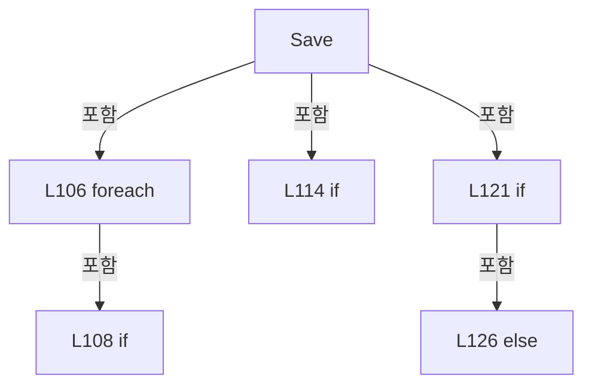

변경 전 점검: 입력/반환 타입, 위 호출자, 예외/취소 경로, 공유 상태와 저장·전송 소비자를 함께 확인합니다. 값의 단위나 물리 방향을 이름만으로 확정하지 않습니다.

### MethodDeclaration `SaveReinspectionRevision` · L135–210

[Drilling.File/ReviewResult/CReviewResultFile.cs:135–210](https://github.com/kjuws10-rgb/A3Drilling/blob/5aee8e58439c9b455cae7c9593c9be986c3e682e/Drilling.File/ReviewResult/CReviewResultFile.cs#L135-L210)

| 항목 | 실제 추출 값 |
| --- | --- |
| 서명 | System.Threading.Tasks.Task<string> Drilling.File.ReviewResult.CReviewResultFile.SaveReinspectionRevision(Drilling.Common.Review.ST_REVIEW_RESULT_FILE_DATA, System.Collections.Generic.IReadOnlyList<Drilling.Common.Review.ST_REVIEW_REINSPECTION_UPDATE>, System.DateTimeOffset, System.Threading.CancellationToken) |
| 접근/수식자 | Public / public, override |
| 반환/값 타입 | System.Threading.Tasks.Task<string> |
| 소속 타입 | NamedType:Drilling.File.ReviewResult.CReviewResultFile |

입력 계약:

| 이름 | 타입 | 전달 | 선택/기본값 |
| --- | --- | --- | --- |
| source | Drilling.Common.Review.ST_REVIEW_RESULT_FILE_DATA | None | False /  |
| updates | System.Collections.Generic.IReadOnlyList<Drilling.Common.Review.ST_REVIEW_REINSPECTION_UPDATE> | None | False /  |
| savedAt | System.DateTimeOffset | None | False /  |
| cancellationToken | System.Threading.CancellationToken | None | True / null |

현재 부분 분석에서 직접 연결된 호출자는 없습니다. XAML/이벤트/인터페이스·델리게이트·외부 진입을 추가 확인해야 하며, 미사용으로 판정한 것이 아닙니다.

호출하는 대상과 해석 범위:

| 원본 행 | 표현식 | 분석 상태 | 대상/소스 위치 |
| --- | --- | --- | --- |
| 141 | cancellationToken.ThrowIfCancellationRequested | resolved | void System.Threading.CancellationToken.ThrowIfCancellationRequested() |
| 142 | ArgumentNullException.ThrowIfNull | resolved | void System.ArgumentNullException.ThrowIfNull(object?, string?) |
| 143 | ArgumentNullException.ThrowIfNull | resolved | void System.ArgumentNullException.ThrowIfNull(object?, string?) |
| 146 | new InvalidDataException | resolved | System.IO.InvalidDataException.InvalidDataException(string?) |
| 149 | Path.GetFullPath | resolved | string System.IO.Path.GetFullPath(string) |
| 150 | System.IO.File.Exists | resolved | bool System.IO.File.Exists(string?) |
| 152 | new FileNotFoundException | resolved | System.IO.FileNotFoundException.FileNotFoundException(string?, string?) |
| 155 | CCsvParser.ReadHeaders | resolved | System.Collections.Generic.IReadOnlyList<string> Drilling.File.Parser.CCsvParser.ReadHeaders(string) · Drilling.File/Parser/CCsvParser.cs:253 |
| 158 | new InvalidDataException | resolved | System.IO.InvalidDataException.InvalidDataException(string?) |
| 161 | headers.ToHashSet | resolved | System.Collections.Generic.HashSet<string> System.Collections.Generic.IEnumerable<string>.ToHashSet<string>(System.Collections.Generic.IEqualityComparer<string>?) |
| 162 | headerSet.Contains | resolved | bool System.Collections.Generic.HashSet<string>.Contains(string) |
| 164 | new InvalidOperationException | resolved | System.InvalidOperationException.InvalidOperationException(string?) |
| 167 | CCsvParser.Read(sourcePath) .Select(row => new Dictionary<string, string>(row, StringComparer.OrdinalIgnoreCase)) .ToArray | resolved | System.Collections.Generic.Dictionary<string, string>[] System.Collections.Generic.IEnumerable<System.Collections.Generic.Dictionary<string, string>>.ToArray<System.Collections.Generic.Dictionary<string, string>>() |
| 167 | CCsvParser.Read(sourcePath) .Select | resolved | System.Collections.Generic.IEnumerable<System.Collections.Generic.Dictionary<string, string>> System.Collections.Generic.IEnumerable<System.Collections.Generic.IReadOnlyDictionary<string, string>>.Select<System.Collections.Generic.IReadOnlyDictionary<string, string>, System.Collections.Generic.Dictionary<string, string>>(System.Func<System.Collections.Generic.IReadOnlyDictionary<string, string>, System.Collections.Generic.Dictionary<string, string>>) |
| 167 | CCsvParser.Read | resolved | System.Collections.Generic.IReadOnlyList<System.Collections.Generic.IReadOnlyDictionary<string, string>> Drilling.File.Parser.CCsvParser.Read(string) · Drilling.File/Parser/CCsvParser.cs:12 |
| 168 | new Dictionary<string, string> | resolved | System.Collections.Generic.Dictionary<string, string>.Dictionary(System.Collections.Generic.IEnumerable<System.Collections.Generic.KeyValuePair<string, string>>, System.Collections.Generic.IEqualityComparer<string>?) |
| 172 | new InvalidDataException | resolved | System.IO.InvalidDataException.InvalidDataException(string?) |
| 177 | cancellationToken.ThrowIfCancellationRequested | resolved | void System.Threading.CancellationToken.ThrowIfCancellationRequested() |
| 178 | headerSet.Contains | resolved | bool System.Collections.Generic.HashSet<string>.Contains(string) |
| 180 | FormatRevisionSavedAt | resolved | string Drilling.File.ReviewResult.CReviewResultFile.FormatRevisionSavedAt(string, System.DateTimeOffset) · Drilling.File/ReviewResult/CReviewResultFile.cs:353 |
| 180 | row.GetValueOrDefault | resolved | string? System.Collections.Generic.IReadOnlyDictionary<string, string>.GetValueOrDefault<string, string>(string) |
| 184 | new HashSet<int> | resolved | System.Collections.Generic.HashSet<int>.HashSet() |
| 187 | cancellationToken.ThrowIfCancellationRequested | resolved | void System.Threading.CancellationToken.ThrowIfCancellationRequested() |
| 188 | ValidateReinspectionUpdate | resolved | void Drilling.File.ReviewResult.CReviewResultFile.ValidateReinspectionUpdate(Drilling.Common.Review.ST_REVIEW_REINSPECTION_UPDATE) · Drilling.File/ReviewResult/CReviewResultFile.cs:212 |
| 189 | FindReinspectionRowIndex | resolved | int Drilling.File.ReviewResult.CReviewResultFile.FindReinspectionRowIndex(System.Collections.Generic.IReadOnlyList<System.Collections.Generic.Dictionary<string, string>>, Drilling.Common.Review.ST_REVIEW_REINSPECTION_UPDATE) · Drilling.File/ReviewResult/CReviewResultFile.cs:239 |
| 190 | updatedRowIndexes.Add | resolved | bool System.Collections.Generic.HashSet<int>.Add(int) |
| 192 | new InvalidDataException | resolved | System.IO.InvalidDataException.InvalidDataException(string?) |
| 195 | ApplyReinspectionUpdate | resolved | void Drilling.File.ReviewResult.CReviewResultFile.ApplyReinspectionUpdate(System.Collections.Generic.IDictionary<string, string>, System.Collections.Generic.IReadOnlySet<string>, Drilling.Common.Review.ST_REVIEW_REINSPECTION_UPDATE) · Drilling.File/ReviewResult/CReviewResultFile.cs:293 |
| 198 | Path.GetDirectoryName | resolved | string? System.IO.Path.GetDirectoryName(string?) |
| 199 | new InvalidDataException | resolved | System.IO.InvalidDataException.InvalidDataException(string?) |
| 200 | Path.GetFileNameWithoutExtension | resolved | string? System.IO.Path.GetFileNameWithoutExtension(string?) |
| 201 | baseStem.LastIndexOf | resolved | int string.LastIndexOf(string, System.StringComparison) |
| 208 | WriteUniqueCsv | resolved | string Drilling.File.ReviewResult.CReviewResultFile.WriteUniqueCsv(string, string, System.Collections.Generic.IReadOnlyList<string>, System.Collections.Generic.IEnumerable<System.Collections.Generic.IReadOnlyDictionary<string, string>>, System.Threading.CancellationToken) · Drilling.File/ReviewResult/CReviewResultFile.cs:641 |
| 209 | Task.FromResult | resolved | System.Threading.Tasks.Task<string> System.Threading.Tasks.Task.FromResult<string>(string) |

본문의 실제 연산·분기·예외·반환 순서(원문 위치 순):

| 원본 행 | 종류 | 주석 해설 |
| --- | --- | --- |
| 141 | call | 함수·델리게이트 또는 객체 생성자를 호출합니다: cancellationToken.ThrowIfCancellationRequested() |
| 142 | call | 함수·델리게이트 또는 객체 생성자를 호출합니다: ArgumentNullException.ThrowIfNull(source) |
| 143 | call | 함수·델리게이트 또는 객체 생성자를 호출합니다: ArgumentNullException.ThrowIfNull(updates) |
| 144 | if | 조건에 따라 분기합니다: if (updates.Count == 0) |
| 146 | call | 함수·델리게이트 또는 객체 생성자를 호출합니다: new InvalidDataException("재검사 결과 저장 대상이 없습니다.") |
| 146 | throw | 예외를 발생/전달합니다: throw new InvalidDataException("재검사 결과 저장 대상이 없습니다."); |
| 149 | call | 함수·델리게이트 또는 객체 생성자를 호출합니다: Path.GetFullPath(source.FilePath) |
| 149 | local-declaration | 지역 변수를 선언합니다: var sourcePath = Path.GetFullPath(source.FilePath); |
| 149 | variable-initializer | 변수의 초기값을 지정합니다: sourcePath = Path.GetFullPath(source.FilePath) |
| 150 | call | 함수·델리게이트 또는 객체 생성자를 호출합니다: System.IO.File.Exists(sourcePath) |
| 150 | if | 조건에 따라 분기합니다: if (!System.IO.File.Exists(sourcePath)) |
| 152 | call | 함수·델리게이트 또는 객체 생성자를 호출합니다: new FileNotFoundException("BASE 검사 결과 파일을 찾을 수 없습니다.", sourcePath) |
| 152 | throw | 예외를 발생/전달합니다: throw new FileNotFoundException("BASE 검사 결과 파일을 찾을 수 없습니다.", sourcePath); |
| 155 | call | 함수·델리게이트 또는 객체 생성자를 호출합니다: CCsvParser.ReadHeaders(sourcePath) |
| 155 | local-declaration | 지역 변수를 선언합니다: var headers = CCsvParser.ReadHeaders(sourcePath); |
| 155 | variable-initializer | 변수의 초기값을 지정합니다: headers = CCsvParser.ReadHeaders(sourcePath) |
| 156 | if | 조건에 따라 분기합니다: if (headers.Count == 0) |
| 158 | call | 함수·델리게이트 또는 객체 생성자를 호출합니다: new InvalidDataException("BASE 검사 결과 파일의 CSV 헤더가 없습니다.") |
| 158 | throw | 예외를 발생/전달합니다: throw new InvalidDataException("BASE 검사 결과 파일의 CSV 헤더가 없습니다."); |
| 161 | call | 함수·델리게이트 또는 객체 생성자를 호출합니다: headers.ToHashSet(StringComparer.OrdinalIgnoreCase) |
| 161 | local-declaration | 지역 변수를 선언합니다: var headerSet = headers.ToHashSet(StringComparer.OrdinalIgnoreCase); |
| 161 | variable-initializer | 변수의 초기값을 지정합니다: headerSet = headers.ToHashSet(StringComparer.OrdinalIgnoreCase) |
| 162 | call | 함수·델리게이트 또는 객체 생성자를 호출합니다: headerSet.Contains("BEAM1_JUDGE") |
| 162 | if | 조건에 따라 분기합니다: if (headerSet.Contains("BEAM1_JUDGE")) |
| 164 | call | 함수·델리게이트 또는 객체 생성자를 호출합니다: new InvalidOperationException("BEAM INSPECTION 결과는 RE-INSPECTION으로 저장할 수 없습니다.") |
| 164 | throw | 예외를 발생/전달합니다: throw new InvalidOperationException("BEAM INSPECTION 결과는 RE-INSPECTION으로 저장할 수 없습니다."); |
| 167 | call | 함수·델리게이트 또는 객체 생성자를 호출합니다: CCsvParser.Read(sourcePath) |
| 167 | call | 함수·델리게이트 또는 객체 생성자를 호출합니다: CCsvParser.Read(sourcePath) .Select(row => new Dictionary<string, string>(row, StringComparer.OrdinalIgnoreCase)) |
| 167 | call | 함수·델리게이트 또는 객체 생성자를 호출합니다: CCsvParser.Read(sourcePath) .Select(row => new Dictionary<string, string>(row, StringComparer.OrdinalIgnoreCase)) .ToArray() |
| 167 | local-declaration | 지역 변수를 선언합니다: var rows = CCsvParser.Read(sourcePath) .Select(row => new Dictionary<string, string>(row, StringComparer.OrdinalIgnoreCase)) .ToArray(); |
| 167 | variable-initializer | 변수의 초기값을 지정합니다: rows = CCsvParser.Read(sourcePath) .Select(row => new Dictionary<string, string>(row, StringComparer.OrdinalIgnoreCase)) .ToArray() |
| 168 | call | 함수·델리게이트 또는 객체 생성자를 호출합니다: new Dictionary<string, string>(row, StringComparer.OrdinalIgnoreCase) |
| 170 | if | 조건에 따라 분기합니다: if (rows.Length == 0) |
| 172 | call | 함수·델리게이트 또는 객체 생성자를 호출합니다: new InvalidDataException("BASE 검사 결과 파일에 결과 행이 없습니다.") |
| 172 | throw | 예외를 발생/전달합니다: throw new InvalidDataException("BASE 검사 결과 파일에 결과 행이 없습니다."); |
| 175 | foreach | 컬렉션 요소를 순회합니다: foreach (var row in rows) |
| 177 | call | 함수·델리게이트 또는 객체 생성자를 호출합니다: cancellationToken.ThrowIfCancellationRequested() |
| 178 | call | 함수·델리게이트 또는 객체 생성자를 호출합니다: headerSet.Contains("SAVED_AT") |
| 178 | if | 조건에 따라 분기합니다: if (headerSet.Contains("SAVED_AT")) |
| 180 | assignment | 값을 대상에 대입합니다: row["SAVED_AT"] = FormatRevisionSavedAt(row.GetValueOrDefault("SAVED_AT") ?? "", savedAt) |
| 180 | call | 함수·델리게이트 또는 객체 생성자를 호출합니다: FormatRevisionSavedAt(row.GetValueOrDefault("SAVED_AT") ?? "", savedAt) |
| 180 | call | 함수·델리게이트 또는 객체 생성자를 호출합니다: row.GetValueOrDefault("SAVED_AT") |
| 184 | call | 함수·델리게이트 또는 객체 생성자를 호출합니다: new HashSet<int>() |
| 184 | local-declaration | 지역 변수를 선언합니다: var updatedRowIndexes = new HashSet<int>(); |
| 184 | variable-initializer | 변수의 초기값을 지정합니다: updatedRowIndexes = new HashSet<int>() |
| 185 | foreach | 컬렉션 요소를 순회합니다: foreach (var update in updates) |
| 187 | call | 함수·델리게이트 또는 객체 생성자를 호출합니다: cancellationToken.ThrowIfCancellationRequested() |
| 188 | call | 함수·델리게이트 또는 객체 생성자를 호출합니다: ValidateReinspectionUpdate(update) |
| 189 | call | 함수·델리게이트 또는 객체 생성자를 호출합니다: FindReinspectionRowIndex(rows, update) |
| 189 | local-declaration | 지역 변수를 선언합니다: var rowIndex = FindReinspectionRowIndex(rows, update); |
| 189 | variable-initializer | 변수의 초기값을 지정합니다: rowIndex = FindReinspectionRowIndex(rows, update) |
| 190 | call | 함수·델리게이트 또는 객체 생성자를 호출합니다: updatedRowIndexes.Add(rowIndex) |
| 190 | if | 조건에 따라 분기합니다: if (!updatedRowIndexes.Add(rowIndex)) |
| 192 | call | 함수·델리게이트 또는 객체 생성자를 호출합니다: new InvalidDataException($"동일한 BASE 결과 행이 재검사 목록에 중복되었습니다. CELL{update.CellNo:00} / {update.ShotName}") |
| 192 | throw | 예외를 발생/전달합니다: throw new InvalidDataException($"동일한 BASE 결과 행이 재검사 목록에 중복되었습니다. CELL{update.CellNo:00} / {update.ShotName}"); |
| 195 | call | 함수·델리게이트 또는 객체 생성자를 호출합니다: ApplyReinspectionUpdate(rows[rowIndex], headerSet, update) |
| 198 | call | 함수·델리게이트 또는 객체 생성자를 호출합니다: Path.GetDirectoryName(sourcePath) |
| 198 | local-declaration | 지역 변수를 선언합니다: var directory = Path.GetDirectoryName(sourcePath) ?? throw new InvalidDataException("BASE 검사 결과 파일의 저장 폴더를 확인할 수 없습니다."); |
| 198 | variable-initializer | 변수의 초기값을 지정합니다: directory = Path.GetDirectoryName(sourcePath) ?? throw new InvalidDataException("BASE 검사 결과 파일의 저장 폴더를 확인할 수 없습니다.") |
| 199 | call | 함수·델리게이트 또는 객체 생성자를 호출합니다: new InvalidDataException("BASE 검사 결과 파일의 저장 폴더를 확인할 수 없습니다.") |
| 199 | throw | 예외를 발생/전달합니다: throw new InvalidDataException("BASE 검사 결과 파일의 저장 폴더를 확인할 수 없습니다.") |
| 200 | call | 함수·델리게이트 또는 객체 생성자를 호출합니다: Path.GetFileNameWithoutExtension(sourcePath) |
| 200 | local-declaration | 지역 변수를 선언합니다: var baseStem = Path.GetFileNameWithoutExtension(sourcePath); |
| 200 | variable-initializer | 변수의 초기값을 지정합니다: baseStem = Path.GetFileNameWithoutExtension(sourcePath) |
| 201 | call | 함수·델리게이트 또는 객체 생성자를 호출합니다: baseStem.LastIndexOf("_REINSP_", StringComparison.OrdinalIgnoreCase) |
| 201 | local-declaration | 지역 변수를 선언합니다: var revisionMarker = baseStem.LastIndexOf("_REINSP_", StringComparison.OrdinalIgnoreCase); |
| 201 | variable-initializer | 변수의 초기값을 지정합니다: revisionMarker = baseStem.LastIndexOf("_REINSP_", StringComparison.OrdinalIgnoreCase) |
| 202 | if | 조건에 따라 분기합니다: if (revisionMarker > 0) |
| 204 | assignment | 값을 대상에 대입합니다: baseStem = baseStem[..revisionMarker] |
| 207 | local-declaration | 지역 변수를 선언합니다: var fileStem = $"{baseStem}_REINSP_{savedAt:yyyyMMdd_HHmmss_fff}"; |
| 207 | variable-initializer | 변수의 초기값을 지정합니다: fileStem = $"{baseStem}_REINSP_{savedAt:yyyyMMdd_HHmmss_fff}" |
| 208 | assignment | 값을 대상에 대입합니다: _lastSavedPath = WriteUniqueCsv(directory, fileStem, headers, rows, cancellationToken) |
| 208 | call | 함수·델리게이트 또는 객체 생성자를 호출합니다: WriteUniqueCsv(directory, fileStem, headers, rows, cancellationToken) |
| 209 | call | 함수·델리게이트 또는 객체 생성자를 호출합니다: Task.FromResult(_lastSavedPath) |
| 209 | return | 호출자에게 값 또는 제어를 반환합니다: return Task.FromResult(_lastSavedPath); |

제어 구문의 포함 구조(실제 실행 순서/CFG가 아닌 구문 탐색 그림):

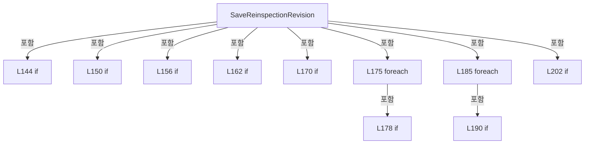

변경 전 점검: 입력/반환 타입, 위 호출자, 예외/취소 경로, 공유 상태와 저장·전송 소비자를 함께 확인합니다. 값의 단위나 물리 방향을 이름만으로 확정하지 않습니다.

### MethodDeclaration `ValidateReinspectionUpdate` · L212–237

[Drilling.File/ReviewResult/CReviewResultFile.cs:212–237](https://github.com/kjuws10-rgb/A3Drilling/blob/5aee8e58439c9b455cae7c9593c9be986c3e682e/Drilling.File/ReviewResult/CReviewResultFile.cs#L212-L237)

| 항목 | 실제 추출 값 |
| --- | --- |
| 서명 | void Drilling.File.ReviewResult.CReviewResultFile.ValidateReinspectionUpdate(Drilling.Common.Review.ST_REVIEW_REINSPECTION_UPDATE) |
| 접근/수식자 | Private / private, static |
| 반환/값 타입 | void |
| 소속 타입 | NamedType:Drilling.File.ReviewResult.CReviewResultFile |

입력 계약:

| 이름 | 타입 | 전달 | 선택/기본값 |
| --- | --- | --- | --- |
| update | Drilling.Common.Review.ST_REVIEW_REINSPECTION_UPDATE | None | False /  |

정적 호출자로 확인된 위치:

| 호출 파일/행 | 호출 표현식 | 런타임 분기 가능 |
| --- | --- | --- |
| [Drilling.File/ReviewResult/CReviewResultFile.cs:188–188](https://github.com/kjuws10-rgb/A3Drilling/blob/5aee8e58439c9b455cae7c9593c9be986c3e682e/Drilling.File/ReviewResult/CReviewResultFile.cs#L188-L188) | ValidateReinspectionUpdate | False |

호출하는 대상과 해석 범위:

| 원본 행 | 표현식 | 분석 상태 | 대상/소스 위치 |
| --- | --- | --- | --- |
| 214 | string.IsNullOrWhiteSpace | resolved | bool string.IsNullOrWhiteSpace(string?) |
| 216 | new InvalidDataException | resolved | System.IO.InvalidDataException.InvalidDataException(string?) |
| 221 | new InvalidDataException | resolved | System.IO.InvalidDataException.InvalidDataException(string?) |
| 224 | double.IsFinite | resolved | bool double.IsFinite(double) |
| 225 | double.IsFinite | resolved | bool double.IsFinite(double) |
| 226 | double.IsFinite | resolved | bool double.IsFinite(double) |
| 227 | double.IsFinite | resolved | bool double.IsFinite(double) |
| 229 | new InvalidDataException | resolved | System.IO.InvalidDataException.InvalidDataException(string?) |
| 232 | update.Judge.Equals | resolved | bool string.Equals(string?, System.StringComparison) |
| 233 | update.Judge.Equals | resolved | bool string.Equals(string?, System.StringComparison) |
| 235 | new InvalidDataException | resolved | System.IO.InvalidDataException.InvalidDataException(string?) |

본문의 실제 연산·분기·예외·반환 순서(원문 위치 순):

| 원본 행 | 종류 | 주석 해설 |
| --- | --- | --- |
| 214 | call | 함수·델리게이트 또는 객체 생성자를 호출합니다: string.IsNullOrWhiteSpace(update.ShotName) |
| 214 | if | 조건에 따라 분기합니다: if (update.CellNo <= 0 &#124;&#124; string.IsNullOrWhiteSpace(update.ShotName)) |
| 216 | call | 함수·델리게이트 또는 객체 생성자를 호출합니다: new InvalidDataException("재검사 결과의 Cell 또는 Shot 정보가 올바르지 않습니다.") |
| 216 | throw | 예외를 발생/전달합니다: throw new InvalidDataException("재검사 결과의 Cell 또는 Shot 정보가 올바르지 않습니다."); |
| 219 | if | 조건에 따라 분기합니다: if (update.BeamNo is < 1 or > 16) |
| 221 | call | 함수·델리게이트 또는 객체 생성자를 호출합니다: new InvalidDataException($"재검사 Beam 번호는 1~16이어야 합니다. CELL{update.CellNo:00} / {update.ShotName}") |
| 221 | throw | 예외를 발생/전달합니다: throw new InvalidDataException($"재검사 Beam 번호는 1~16이어야 합니다. CELL{update.CellNo:00} / {update.ShotName}"); |
| 224 | call | 함수·델리게이트 또는 객체 생성자를 호출합니다: double.IsFinite(update.RawResultX) |
| 224 | if | 조건에 따라 분기합니다: if (!double.IsFinite(update.RawResultX) &#124;&#124; !double.IsFinite(update.RawResultY) &#124;&#124; !double.IsFinite(update.ResultX) &#124;&#124; !double.IsFinite(update.ResultY)) |
| 225 | call | 함수·델리게이트 또는 객체 생성자를 호출합니다: double.IsFinite(update.RawResultY) |
| 226 | call | 함수·델리게이트 또는 객체 생성자를 호출합니다: double.IsFinite(update.ResultX) |
| 227 | call | 함수·델리게이트 또는 객체 생성자를 호출합니다: double.IsFinite(update.ResultY) |
| 229 | call | 함수·델리게이트 또는 객체 생성자를 호출합니다: new InvalidDataException($"재검사 결과 좌표는 유한한 숫자여야 합니다. CELL{update.CellNo:00} / {update.ShotName}") |
| 229 | throw | 예외를 발생/전달합니다: throw new InvalidDataException($"재검사 결과 좌표는 유한한 숫자여야 합니다. CELL{update.CellNo:00} / {update.ShotName}"); |
| 232 | call | 함수·델리게이트 또는 객체 생성자를 호출합니다: update.Judge.Equals("OK", StringComparison.OrdinalIgnoreCase) |
| 232 | if | 조건에 따라 분기합니다: if (!update.Judge.Equals("OK", StringComparison.OrdinalIgnoreCase) && !update.Judge.Equals("NG", StringComparison.OrdinalIgnoreCase)) |
| 233 | call | 함수·델리게이트 또는 객체 생성자를 호출합니다: update.Judge.Equals("NG", StringComparison.OrdinalIgnoreCase) |
| 235 | call | 함수·델리게이트 또는 객체 생성자를 호출합니다: new InvalidDataException($"재검사 판정은 OK 또는 NG여야 합니다. CELL{update.CellNo:00} / {update.ShotName}") |
| 235 | throw | 예외를 발생/전달합니다: throw new InvalidDataException($"재검사 판정은 OK 또는 NG여야 합니다. CELL{update.CellNo:00} / {update.ShotName}"); |

제어 구문의 포함 구조(실제 실행 순서/CFG가 아닌 구문 탐색 그림):

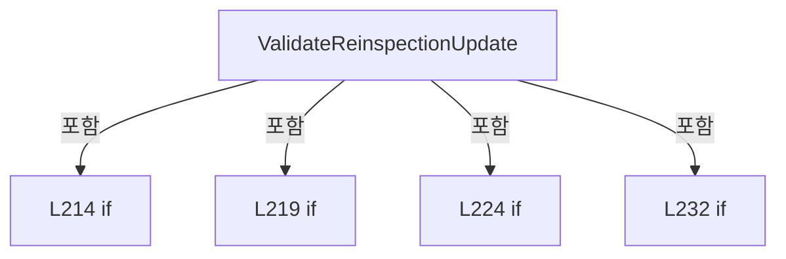

변경 전 점검: 입력/반환 타입, 위 호출자, 예외/취소 경로, 공유 상태와 저장·전송 소비자를 함께 확인합니다. 값의 단위나 물리 방향을 이름만으로 확정하지 않습니다.

### MethodDeclaration `FindReinspectionRowIndex` · L239–266

[Drilling.File/ReviewResult/CReviewResultFile.cs:239–266](https://github.com/kjuws10-rgb/A3Drilling/blob/5aee8e58439c9b455cae7c9593c9be986c3e682e/Drilling.File/ReviewResult/CReviewResultFile.cs#L239-L266)

| 항목 | 실제 추출 값 |
| --- | --- |
| 서명 | int Drilling.File.ReviewResult.CReviewResultFile.FindReinspectionRowIndex(System.Collections.Generic.IReadOnlyList<System.Collections.Generic.Dictionary<string, string>>, Drilling.Common.Review.ST_REVIEW_REINSPECTION_UPDATE) |
| 접근/수식자 | Private / private, static |
| 반환/값 타입 | int |
| 소속 타입 | NamedType:Drilling.File.ReviewResult.CReviewResultFile |

입력 계약:

| 이름 | 타입 | 전달 | 선택/기본값 |
| --- | --- | --- | --- |
| rows | System.Collections.Generic.IReadOnlyList<System.Collections.Generic.Dictionary<string, string>> | None | False /  |
| update | Drilling.Common.Review.ST_REVIEW_REINSPECTION_UPDATE | None | False /  |

정적 호출자로 확인된 위치:

| 호출 파일/행 | 호출 표현식 | 런타임 분기 가능 |
| --- | --- | --- |
| [Drilling.File/ReviewResult/CReviewResultFile.cs:189–189](https://github.com/kjuws10-rgb/A3Drilling/blob/5aee8e58439c9b455cae7c9593c9be986c3e682e/Drilling.File/ReviewResult/CReviewResultFile.cs#L189-L189) | FindReinspectionRowIndex | False |

호출하는 대상과 해석 범위:

| 원본 행 | 표현식 | 분석 상태 | 대상/소스 위치 |
| --- | --- | --- | --- |
| 243 | rows .Select((row, index) => (row, index)) .Where(pair => IsReinspectionTargetRow(pair.row, update)) .ToArray | resolved | (System.Collections.Generic.Dictionary<string, string> row, int index)[] System.Collections.Generic.IEnumerable<(System.Collections.Generic.Dictionary<string, string> row, int index)>.ToArray<(System.Collections.Generic.Dictionary<string, string> row, int index)>() |
| 243 | rows .Select((row, index) => (row, index)) .Where | resolved | System.Collections.Generic.IEnumerable<(System.Collections.Generic.Dictionary<string, string> row, int index)> System.Collections.Generic.IEnumerable<(System.Collections.Generic.Dictionary<string, string> row, int index)>.Where<(System.Collections.Generic.Dictionary<string, string> row, int index)>(System.Func<(System.Collections.Generic.Dictionary<string, string> row, int index), bool>) |
| 243 | rows .Select | resolved | System.Collections.Generic.IEnumerable<(System.Collections.Generic.Dictionary<string, string> row, int index)> System.Collections.Generic.IEnumerable<System.Collections.Generic.Dictionary<string, string>>.Select<System.Collections.Generic.Dictionary<string, string>, (System.Collections.Generic.Dictionary<string, string> row, int index)>(System.Func<System.Collections.Generic.Dictionary<string, string>, int, (System.Collections.Generic.Dictionary<string, string> row, int index)>) |
| 245 | IsReinspectionTargetRow | resolved | bool Drilling.File.ReviewResult.CReviewResultFile.IsReinspectionTargetRow(System.Collections.Generic.IReadOnlyDictionary<string, string>, Drilling.Common.Review.ST_REVIEW_REINSPECTION_UPDATE) · Drilling.File/ReviewResult/CReviewResultFile.cs:268 |
| 249 | new InvalidDataException | resolved | System.IO.InvalidDataException.InvalidDataException(string?) |
| 257 | candidates .Where(pair => ReadOptionalInt(pair.row, "BEAM_NO", 0) == update.SourceBeamNo) .ToArray | resolved | (System.Collections.Generic.Dictionary<string, string> row, int index)[] System.Collections.Generic.IEnumerable<(System.Collections.Generic.Dictionary<string, string> row, int index)>.ToArray<(System.Collections.Generic.Dictionary<string, string> row, int index)>() |
| 257 | candidates .Where | resolved | System.Collections.Generic.IEnumerable<(System.Collections.Generic.Dictionary<string, string> row, int index)> System.Collections.Generic.IEnumerable<(System.Collections.Generic.Dictionary<string, string> row, int index)>.Where<(System.Collections.Generic.Dictionary<string, string> row, int index)>(System.Func<(System.Collections.Generic.Dictionary<string, string> row, int index), bool>) |
| 258 | ReadOptionalInt | resolved | int Drilling.File.ReviewResult.CReviewResultFile.ReadOptionalInt(System.Collections.Generic.IReadOnlyDictionary<string, string>, string, int) · Drilling.File/ReviewResult/CReviewResultFile.cs:535 |
| 265 | new InvalidDataException | resolved | System.IO.InvalidDataException.InvalidDataException(string?) |

본문의 실제 연산·분기·예외·반환 순서(원문 위치 순):

| 원본 행 | 종류 | 주석 해설 |
| --- | --- | --- |
| 243 | call | 함수·델리게이트 또는 객체 생성자를 호출합니다: rows .Select((row, index) => (row, index)) |
| 243 | call | 함수·델리게이트 또는 객체 생성자를 호출합니다: rows .Select((row, index) => (row, index)) .Where(pair => IsReinspectionTargetRow(pair.row, update)) |
| 243 | call | 함수·델리게이트 또는 객체 생성자를 호출합니다: rows .Select((row, index) => (row, index)) .Where(pair => IsReinspectionTargetRow(pair.row, update)) .ToArray() |
| 243 | local-declaration | 지역 변수를 선언합니다: var candidates = rows .Select((row, index) => (row, index)) .Where(pair => IsReinspectionTargetRow(pair.row, update)) .ToArray(); |
| 243 | variable-initializer | 변수의 초기값을 지정합니다: candidates = rows .Select((row, index) => (row, index)) .Where(pair => IsReinspectionTargetRow(pair.row, update)) .ToArray() |
| 245 | call | 함수·델리게이트 또는 객체 생성자를 호출합니다: IsReinspectionTargetRow(pair.row, update) |
| 247 | if | 조건에 따라 분기합니다: if (candidates.Length == 0) |
| 249 | call | 함수·델리게이트 또는 객체 생성자를 호출합니다: new InvalidDataException($"BASE 검사 결과에서 재검사 Shot을 찾을 수 없습니다. CELL{update.CellNo:00} / {update.ShotName}") |
| 249 | throw | 예외를 발생/전달합니다: throw new InvalidDataException($"BASE 검사 결과에서 재검사 Shot을 찾을 수 없습니다. CELL{update.CellNo:00} / {update.ShotName}"); |
| 252 | if | 조건에 따라 분기합니다: if (candidates.Length == 1) |
| 254 | return | 호출자에게 값 또는 제어를 반환합니다: return candidates[0].index; |
| 257 | call | 함수·델리게이트 또는 객체 생성자를 호출합니다: candidates .Where(pair => ReadOptionalInt(pair.row, "BEAM_NO", 0) == update.SourceBeamNo) |
| 257 | call | 함수·델리게이트 또는 객체 생성자를 호출합니다: candidates .Where(pair => ReadOptionalInt(pair.row, "BEAM_NO", 0) == update.SourceBeamNo) .ToArray() |
| 257 | local-declaration | 지역 변수를 선언합니다: var beamCandidates = candidates .Where(pair => ReadOptionalInt(pair.row, "BEAM_NO", 0) == update.SourceBeamNo) .ToArray(); |
| 257 | variable-initializer | 변수의 초기값을 지정합니다: beamCandidates = candidates .Where(pair => ReadOptionalInt(pair.row, "BEAM_NO", 0) == update.SourceBeamNo) .ToArray() |
| 258 | call | 함수·델리게이트 또는 객체 생성자를 호출합니다: ReadOptionalInt(pair.row, "BEAM_NO", 0) |
| 260 | if | 조건에 따라 분기합니다: if (beamCandidates.Length == 1) |
| 262 | return | 호출자에게 값 또는 제어를 반환합니다: return beamCandidates[0].index; |
| 265 | call | 함수·델리게이트 또는 객체 생성자를 호출합니다: new InvalidDataException($"BASE 검사 결과에서 재검사 Shot 행을 하나로 식별할 수 없습니다. CELL{update.CellNo:00} / {update.ShotName}") |
| 265 | throw | 예외를 발생/전달합니다: throw new InvalidDataException($"BASE 검사 결과에서 재검사 Shot 행을 하나로 식별할 수 없습니다. CELL{update.CellNo:00} / {update.ShotName}"); |

제어 구문의 포함 구조(실제 실행 순서/CFG가 아닌 구문 탐색 그림):

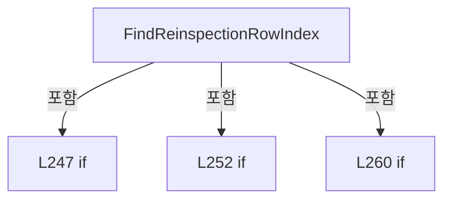

변경 전 점검: 입력/반환 타입, 위 호출자, 예외/취소 경로, 공유 상태와 저장·전송 소비자를 함께 확인합니다. 값의 단위나 물리 방향을 이름만으로 확정하지 않습니다.

### MethodDeclaration `IsReinspectionTargetRow` · L268–291

[Drilling.File/ReviewResult/CReviewResultFile.cs:268–291](https://github.com/kjuws10-rgb/A3Drilling/blob/5aee8e58439c9b455cae7c9593c9be986c3e682e/Drilling.File/ReviewResult/CReviewResultFile.cs#L268-L291)

| 항목 | 실제 추출 값 |
| --- | --- |
| 서명 | bool Drilling.File.ReviewResult.CReviewResultFile.IsReinspectionTargetRow(System.Collections.Generic.IReadOnlyDictionary<string, string>, Drilling.Common.Review.ST_REVIEW_REINSPECTION_UPDATE) |
| 접근/수식자 | Private / private, static |
| 반환/값 타입 | bool |
| 소속 타입 | NamedType:Drilling.File.ReviewResult.CReviewResultFile |

입력 계약:

| 이름 | 타입 | 전달 | 선택/기본값 |
| --- | --- | --- | --- |
| row | System.Collections.Generic.IReadOnlyDictionary<string, string> | None | False /  |
| update | Drilling.Common.Review.ST_REVIEW_REINSPECTION_UPDATE | None | False /  |

정적 호출자로 확인된 위치:

| 호출 파일/행 | 호출 표현식 | 런타임 분기 가능 |
| --- | --- | --- |
| [Drilling.File/ReviewResult/CReviewResultFile.cs:245–245](https://github.com/kjuws10-rgb/A3Drilling/blob/5aee8e58439c9b455cae7c9593c9be986c3e682e/Drilling.File/ReviewResult/CReviewResultFile.cs#L245-L245) | IsReinspectionTargetRow | False |

호출하는 대상과 해석 범위:

| 원본 행 | 표현식 | 분석 상태 | 대상/소스 위치 |
| --- | --- | --- | --- |
| 272 | ReadFirstText | resolved | string Drilling.File.ReviewResult.CReviewResultFile.ReadFirstText(System.Collections.Generic.IReadOnlyDictionary<string, string>, params string[]) · Drilling.File/ReviewResult/CReviewResultFile.cs:540 |
| 273 | new string | resolved | string.String(char[]?) |
| 273 | cellText.Where(char.IsDigit).ToArray | resolved | char[] System.Collections.Generic.IEnumerable<char>.ToArray<char>() |
| 273 | cellText.Where | resolved | System.Collections.Generic.IEnumerable<char> System.Collections.Generic.IEnumerable<char>.Where<char>(System.Func<char, bool>) |
| 274 | int.TryParse | resolved | bool int.TryParse(string?, System.Globalization.NumberStyles, System.IFormatProvider?, out int) |
| 280 | CReviewManager.NormalizeShotKey | resolved | string Drilling.Common.Review.CReviewManager.NormalizeShotKey(string) · Drilling.Common/Review/CReviewManager.cs:1165 |
| 280 | ReadFirstText | resolved | string Drilling.File.ReviewResult.CReviewResultFile.ReadFirstText(System.Collections.Generic.IReadOnlyDictionary<string, string>, params string[]) · Drilling.File/ReviewResult/CReviewResultFile.cs:540 |
| 281 | CReviewManager.NormalizeShotKey | resolved | string Drilling.Common.Review.CReviewManager.NormalizeShotKey(string) · Drilling.Common/Review/CReviewManager.cs:1165 |
| 282 | string.IsNullOrWhiteSpace | resolved | bool string.IsNullOrWhiteSpace(string?) |
| 283 | string.IsNullOrWhiteSpace | resolved | bool string.IsNullOrWhiteSpace(string?) |
| 284 | sourceKey.Equals | resolved | bool string.Equals(string?, System.StringComparison) |
| 289 | ReadFirstText(row, "SHOT_NAME") .Equals | resolved | bool string.Equals(string?, System.StringComparison) |
| 289 | ReadFirstText | resolved | string Drilling.File.ReviewResult.CReviewResultFile.ReadFirstText(System.Collections.Generic.IReadOnlyDictionary<string, string>, params string[]) · Drilling.File/ReviewResult/CReviewResultFile.cs:540 |

본문의 실제 연산·분기·예외·반환 순서(원문 위치 순):

| 원본 행 | 종류 | 주석 해설 |
| --- | --- | --- |
| 272 | call | 함수·델리게이트 또는 객체 생성자를 호출합니다: ReadFirstText(row, "CELL_NO", "CELL_NAME") |
| 272 | local-declaration | 지역 변수를 선언합니다: var cellText = ReadFirstText(row, "CELL_NO", "CELL_NAME"); |
| 272 | variable-initializer | 변수의 초기값을 지정합니다: cellText = ReadFirstText(row, "CELL_NO", "CELL_NAME") |
| 273 | call | 함수·델리게이트 또는 객체 생성자를 호출합니다: new string(cellText.Where(char.IsDigit).ToArray()) |
| 273 | call | 함수·델리게이트 또는 객체 생성자를 호출합니다: cellText.Where(char.IsDigit).ToArray() |
| 273 | call | 함수·델리게이트 또는 객체 생성자를 호출합니다: cellText.Where(char.IsDigit) |
| 273 | local-declaration | 지역 변수를 선언합니다: var cellDigits = new string(cellText.Where(char.IsDigit).ToArray()); |
| 273 | variable-initializer | 변수의 초기값을 지정합니다: cellDigits = new string(cellText.Where(char.IsDigit).ToArray()) |
| 274 | call | 함수·델리게이트 또는 객체 생성자를 호출합니다: int.TryParse(cellDigits, NumberStyles.Integer, CultureInfo.InvariantCulture, out var cellNo) |
| 274 | if | 조건에 따라 분기합니다: if (!int.TryParse(cellDigits, NumberStyles.Integer, CultureInfo.InvariantCulture, out var cellNo) &#124;&#124; cellNo != update.CellNo) |
| 277 | return | 호출자에게 값 또는 제어를 반환합니다: return false; |
| 280 | call | 함수·델리게이트 또는 객체 생성자를 호출합니다: CReviewManager.NormalizeShotKey(ReadFirstText(row, "SHOT_KEY", "HOLE_KEY")) |
| 280 | call | 함수·델리게이트 또는 객체 생성자를 호출합니다: ReadFirstText(row, "SHOT_KEY", "HOLE_KEY") |
| 280 | local-declaration | 지역 변수를 선언합니다: var sourceKey = CReviewManager.NormalizeShotKey(ReadFirstText(row, "SHOT_KEY", "HOLE_KEY")); |
| 280 | variable-initializer | 변수의 초기값을 지정합니다: sourceKey = CReviewManager.NormalizeShotKey(ReadFirstText(row, "SHOT_KEY", "HOLE_KEY")) |
| 281 | call | 함수·델리게이트 또는 객체 생성자를 호출합니다: CReviewManager.NormalizeShotKey(update.ShotKey) |
| 281 | local-declaration | 지역 변수를 선언합니다: var targetKey = CReviewManager.NormalizeShotKey(update.ShotKey); |
| 281 | variable-initializer | 변수의 초기값을 지정합니다: targetKey = CReviewManager.NormalizeShotKey(update.ShotKey) |
| 282 | call | 함수·델리게이트 또는 객체 생성자를 호출합니다: string.IsNullOrWhiteSpace(sourceKey) |
| 282 | if | 조건에 따라 분기합니다: if (!string.IsNullOrWhiteSpace(sourceKey) && !string.IsNullOrWhiteSpace(targetKey) && sourceKey.Equals(targetKey, StringComparison.OrdinalIgnoreCase)) |
| 283 | call | 함수·델리게이트 또는 객체 생성자를 호출합니다: string.IsNullOrWhiteSpace(targetKey) |
| 284 | call | 함수·델리게이트 또는 객체 생성자를 호출합니다: sourceKey.Equals(targetKey, StringComparison.OrdinalIgnoreCase) |
| 286 | return | 호출자에게 값 또는 제어를 반환합니다: return true; |
| 289 | call | 함수·델리게이트 또는 객체 생성자를 호출합니다: ReadFirstText(row, "SHOT_NAME") |
| 289 | call | 함수·델리게이트 또는 객체 생성자를 호출합니다: ReadFirstText(row, "SHOT_NAME") .Equals(update.ShotName, StringComparison.OrdinalIgnoreCase) |
| 289 | return | 호출자에게 값 또는 제어를 반환합니다: return ReadFirstText(row, "SHOT_NAME") .Equals(update.ShotName, StringComparison.OrdinalIgnoreCase); |

제어 구문의 포함 구조(실제 실행 순서/CFG가 아닌 구문 탐색 그림):

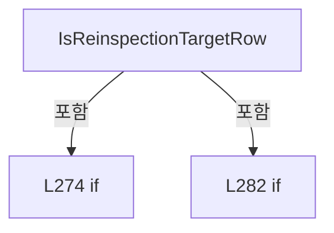

변경 전 점검: 입력/반환 타입, 위 호출자, 예외/취소 경로, 공유 상태와 저장·전송 소비자를 함께 확인합니다. 값의 단위나 물리 방향을 이름만으로 확정하지 않습니다.

### MethodDeclaration `ApplyReinspectionUpdate` · L293–314

[Drilling.File/ReviewResult/CReviewResultFile.cs:293–314](https://github.com/kjuws10-rgb/A3Drilling/blob/5aee8e58439c9b455cae7c9593c9be986c3e682e/Drilling.File/ReviewResult/CReviewResultFile.cs#L293-L314)

| 항목 | 실제 추출 값 |
| --- | --- |
| 서명 | void Drilling.File.ReviewResult.CReviewResultFile.ApplyReinspectionUpdate(System.Collections.Generic.IDictionary<string, string>, System.Collections.Generic.IReadOnlySet<string>, Drilling.Common.Review.ST_REVIEW_REINSPECTION_UPDATE) |
| 접근/수식자 | Private / private, static |
| 반환/값 타입 | void |
| 소속 타입 | NamedType:Drilling.File.ReviewResult.CReviewResultFile |

입력 계약:

| 이름 | 타입 | 전달 | 선택/기본값 |
| --- | --- | --- | --- |
| row | System.Collections.Generic.IDictionary<string, string> | None | False /  |
| headers | System.Collections.Generic.IReadOnlySet<string> | None | False /  |
| update | Drilling.Common.Review.ST_REVIEW_REINSPECTION_UPDATE | None | False /  |

정적 호출자로 확인된 위치:

| 호출 파일/행 | 호출 표현식 | 런타임 분기 가능 |
| --- | --- | --- |
| [Drilling.File/ReviewResult/CReviewResultFile.cs:195–195](https://github.com/kjuws10-rgb/A3Drilling/blob/5aee8e58439c9b455cae7c9593c9be986c3e682e/Drilling.File/ReviewResult/CReviewResultFile.cs#L195-L195) | ApplyReinspectionUpdate | False |

호출하는 대상과 해석 범위:

| 원본 행 | 표현식 | 분석 상태 | 대상/소스 위치 |
| --- | --- | --- | --- |
| 298 | SetIfPresent | resolved | void Drilling.File.ReviewResult.CReviewResultFile.SetIfPresent(System.Collections.Generic.IDictionary<string, string>, System.Collections.Generic.IReadOnlySet<string>, string, string) · Drilling.File/ReviewResult/CReviewResultFile.cs:341 |
| 298 | update.BeamNo.ToString | resolved | string int.ToString(System.IFormatProvider?) |
| 301 | SetCoordinatePair | resolved | bool Drilling.File.ReviewResult.CReviewResultFile.SetCoordinatePair(System.Collections.Generic.IDictionary<string, string>, System.Collections.Generic.IReadOnlySet<string>, string, string, double, double) · Drilling.File/ReviewResult/CReviewResultFile.cs:316 |
| 302 | SetCoordinatePair | resolved | bool Drilling.File.ReviewResult.CReviewResultFile.SetCoordinatePair(System.Collections.Generic.IDictionary<string, string>, System.Collections.Generic.IReadOnlySet<string>, string, string, double, double) · Drilling.File/ReviewResult/CReviewResultFile.cs:316 |
| 303 | SetCoordinatePair | resolved | bool Drilling.File.ReviewResult.CReviewResultFile.SetCoordinatePair(System.Collections.Generic.IDictionary<string, string>, System.Collections.Generic.IReadOnlySet<string>, string, string, double, double) · Drilling.File/ReviewResult/CReviewResultFile.cs:316 |
| 304 | SetCoordinatePair | resolved | bool Drilling.File.ReviewResult.CReviewResultFile.SetCoordinatePair(System.Collections.Generic.IDictionary<string, string>, System.Collections.Generic.IReadOnlySet<string>, string, string, double, double) · Drilling.File/ReviewResult/CReviewResultFile.cs:316 |
| 305 | SetCoordinatePair | resolved | bool Drilling.File.ReviewResult.CReviewResultFile.SetCoordinatePair(System.Collections.Generic.IDictionary<string, string>, System.Collections.Generic.IReadOnlySet<string>, string, string, double, double) · Drilling.File/ReviewResult/CReviewResultFile.cs:316 |
| 308 | new InvalidDataException | resolved | System.IO.InvalidDataException.InvalidDataException(string?) |
| 311 | SetIfPresent | resolved | void Drilling.File.ReviewResult.CReviewResultFile.SetIfPresent(System.Collections.Generic.IDictionary<string, string>, System.Collections.Generic.IReadOnlySet<string>, string, string) · Drilling.File/ReviewResult/CReviewResultFile.cs:341 |
| 311 | update.Judge.ToUpperInvariant | resolved | string string.ToUpperInvariant() |
| 312 | SetIfPresent | resolved | void Drilling.File.ReviewResult.CReviewResultFile.SetIfPresent(System.Collections.Generic.IDictionary<string, string>, System.Collections.Generic.IReadOnlySet<string>, string, string) · Drilling.File/ReviewResult/CReviewResultFile.cs:341 |
| 312 | update.Judge.ToUpperInvariant | resolved | string string.ToUpperInvariant() |
| 313 | SetIfPresent | resolved | void Drilling.File.ReviewResult.CReviewResultFile.SetIfPresent(System.Collections.Generic.IDictionary<string, string>, System.Collections.Generic.IReadOnlySet<string>, string, string) · Drilling.File/ReviewResult/CReviewResultFile.cs:341 |

본문의 실제 연산·분기·예외·반환 순서(원문 위치 순):

| 원본 행 | 종류 | 주석 해설 |
| --- | --- | --- |
| 298 | call | 함수·델리게이트 또는 객체 생성자를 호출합니다: SetIfPresent(row, headers, "BEAM_NO", update.BeamNo.ToString(CultureInfo.InvariantCulture)) |
| 298 | call | 함수·델리게이트 또는 객체 생성자를 호출합니다: update.BeamNo.ToString(CultureInfo.InvariantCulture) |
| 300 | local-declaration | 지역 변수를 선언합니다: var hasCoordinates = false; |
| 300 | variable-initializer | 변수의 초기값을 지정합니다: hasCoordinates = false |
| 301 | assignment | 값을 대상에 대입합니다: hasCoordinates &#124;= SetCoordinatePair(row, headers, "RECV_TARGET_MINUS_HOLE_X", "RECV_TARGET_MINUS_HOLE_Y", update.RawResultX, update.RawResultY) |
| 301 | call | 함수·델리게이트 또는 객체 생성자를 호출합니다: SetCoordinatePair(row, headers, "RECV_TARGET_MINUS_HOLE_X", "RECV_TARGET_MINUS_HOLE_Y", update.RawResultX, update.RawResultY) |
| 302 | assignment | 값을 대상에 대입합니다: hasCoordinates &#124;= SetCoordinatePair(row, headers, "RECV_X", "RECV_Y", update.RawResultX, update.RawResultY) |
| 302 | call | 함수·델리게이트 또는 객체 생성자를 호출합니다: SetCoordinatePair(row, headers, "RECV_X", "RECV_Y", update.RawResultX, update.RawResultY) |
| 303 | assignment | 값을 대상에 대입합니다: hasCoordinates &#124;= SetCoordinatePair(row, headers, "VISION_FLIP_CONVERT_X", "VISION_FLIP_CONVERT_Y", update.ResultX, update.ResultY) |
| 303 | call | 함수·델리게이트 또는 객체 생성자를 호출합니다: SetCoordinatePair(row, headers, "VISION_FLIP_CONVERT_X", "VISION_FLIP_CONVERT_Y", update.ResultX, update.ResultY) |
| 304 | assignment | 값을 대상에 대입합니다: hasCoordinates &#124;= SetCoordinatePair(row, headers, "CONVERTED_X", "CONVERTED_Y", update.ResultX, update.ResultY) |
| 304 | call | 함수·델리게이트 또는 객체 생성자를 호출합니다: SetCoordinatePair(row, headers, "CONVERTED_X", "CONVERTED_Y", update.ResultX, update.ResultY) |
| 305 | assignment | 값을 대상에 대입합니다: hasCoordinates &#124;= SetCoordinatePair(row, headers, "ERROR_X", "ERROR_Y", update.ResultX, update.ResultY) |
| 305 | call | 함수·델리게이트 또는 객체 생성자를 호출합니다: SetCoordinatePair(row, headers, "ERROR_X", "ERROR_Y", update.ResultX, update.ResultY) |
| 306 | if | 조건에 따라 분기합니다: if (!hasCoordinates) |
| 308 | call | 함수·델리게이트 또는 객체 생성자를 호출합니다: new InvalidDataException("BASE 검사 결과 파일에 갱신 가능한 X/Y 결과 열이 없습니다.") |
| 308 | throw | 예외를 발생/전달합니다: throw new InvalidDataException("BASE 검사 결과 파일에 갱신 가능한 X/Y 결과 열이 없습니다."); |
| 311 | call | 함수·델리게이트 또는 객체 생성자를 호출합니다: SetIfPresent(row, headers, "JUDGE", update.Judge.ToUpperInvariant()) |
| 311 | call | 함수·델리게이트 또는 객체 생성자를 호출합니다: update.Judge.ToUpperInvariant() |
| 312 | call | 함수·델리게이트 또는 객체 생성자를 호출합니다: SetIfPresent(row, headers, "STATE", update.Judge.ToUpperInvariant()) |
| 312 | call | 함수·델리게이트 또는 객체 생성자를 호출합니다: update.Judge.ToUpperInvariant() |
| 313 | call | 함수·델리게이트 또는 객체 생성자를 호출합니다: SetIfPresent(row, headers, "RESULT_SOURCE", "MEASURED") |

제어 구문의 포함 구조(실제 실행 순서/CFG가 아닌 구문 탐색 그림):

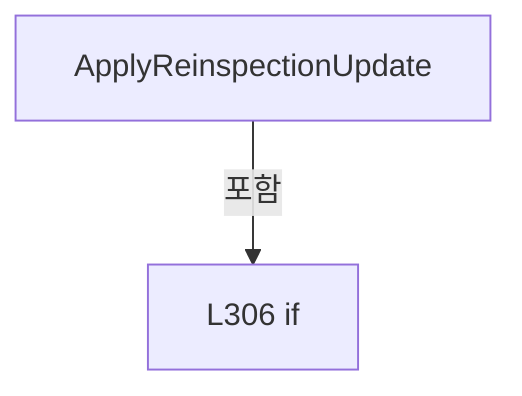

변경 전 점검: 입력/반환 타입, 위 호출자, 예외/취소 경로, 공유 상태와 저장·전송 소비자를 함께 확인합니다. 값의 단위나 물리 방향을 이름만으로 확정하지 않습니다.

### MethodDeclaration `SetCoordinatePair` · L316–339

[Drilling.File/ReviewResult/CReviewResultFile.cs:316–339](https://github.com/kjuws10-rgb/A3Drilling/blob/5aee8e58439c9b455cae7c9593c9be986c3e682e/Drilling.File/ReviewResult/CReviewResultFile.cs#L316-L339)

| 항목 | 실제 추출 값 |
| --- | --- |
| 서명 | bool Drilling.File.ReviewResult.CReviewResultFile.SetCoordinatePair(System.Collections.Generic.IDictionary<string, string>, System.Collections.Generic.IReadOnlySet<string>, string, string, double, double) |
| 접근/수식자 | Private / private, static |
| 반환/값 타입 | bool |
| 소속 타입 | NamedType:Drilling.File.ReviewResult.CReviewResultFile |

입력 계약:

| 이름 | 타입 | 전달 | 선택/기본값 |
| --- | --- | --- | --- |
| row | System.Collections.Generic.IDictionary<string, string> | None | False /  |
| headers | System.Collections.Generic.IReadOnlySet<string> | None | False /  |
| xHeader | string | None | False /  |
| yHeader | string | None | False /  |
| x | double | None | False /  |
| y | double | None | False /  |

정적 호출자로 확인된 위치:

| 호출 파일/행 | 호출 표현식 | 런타임 분기 가능 |
| --- | --- | --- |
| [Drilling.File/ReviewResult/CReviewResultFile.cs:301–301](https://github.com/kjuws10-rgb/A3Drilling/blob/5aee8e58439c9b455cae7c9593c9be986c3e682e/Drilling.File/ReviewResult/CReviewResultFile.cs#L301-L301) | SetCoordinatePair | False |
| [Drilling.File/ReviewResult/CReviewResultFile.cs:302–302](https://github.com/kjuws10-rgb/A3Drilling/blob/5aee8e58439c9b455cae7c9593c9be986c3e682e/Drilling.File/ReviewResult/CReviewResultFile.cs#L302-L302) | SetCoordinatePair | False |
| [Drilling.File/ReviewResult/CReviewResultFile.cs:303–303](https://github.com/kjuws10-rgb/A3Drilling/blob/5aee8e58439c9b455cae7c9593c9be986c3e682e/Drilling.File/ReviewResult/CReviewResultFile.cs#L303-L303) | SetCoordinatePair | False |
| [Drilling.File/ReviewResult/CReviewResultFile.cs:304–304](https://github.com/kjuws10-rgb/A3Drilling/blob/5aee8e58439c9b455cae7c9593c9be986c3e682e/Drilling.File/ReviewResult/CReviewResultFile.cs#L304-L304) | SetCoordinatePair | False |
| [Drilling.File/ReviewResult/CReviewResultFile.cs:305–305](https://github.com/kjuws10-rgb/A3Drilling/blob/5aee8e58439c9b455cae7c9593c9be986c3e682e/Drilling.File/ReviewResult/CReviewResultFile.cs#L305-L305) | SetCoordinatePair | False |

호출하는 대상과 해석 범위:

| 원본 행 | 표현식 | 분석 상태 | 대상/소스 위치 |
| --- | --- | --- | --- |
| 324 | headers.Contains | resolved · 동적 구현 선택 가능 | bool System.Collections.Generic.IReadOnlySet<string>.Contains(string) |
| 325 | headers.Contains | resolved · 동적 구현 선택 가능 | bool System.Collections.Generic.IReadOnlySet<string>.Contains(string) |
| 328 | new InvalidDataException | resolved | System.IO.InvalidDataException.InvalidDataException(string?) |
| 336 | FormatDouble | resolved | string Drilling.File.ReviewResult.CReviewResultFile.FormatDouble(double) · Drilling.File/ReviewResult/CReviewResultFile.cs:624 |
| 337 | FormatDouble | resolved | string Drilling.File.ReviewResult.CReviewResultFile.FormatDouble(double) · Drilling.File/ReviewResult/CReviewResultFile.cs:624 |

본문의 실제 연산·분기·예외·반환 순서(원문 위치 순):

| 원본 행 | 종류 | 주석 해설 |
| --- | --- | --- |
| 324 | call | 함수·델리게이트 또는 객체 생성자를 호출합니다: headers.Contains(xHeader) |
| 324 | local-declaration | 지역 변수를 선언합니다: var hasX = headers.Contains(xHeader); |
| 324 | variable-initializer | 변수의 초기값을 지정합니다: hasX = headers.Contains(xHeader) |
| 325 | call | 함수·델리게이트 또는 객체 생성자를 호출합니다: headers.Contains(yHeader) |
| 325 | local-declaration | 지역 변수를 선언합니다: var hasY = headers.Contains(yHeader); |
| 325 | variable-initializer | 변수의 초기값을 지정합니다: hasY = headers.Contains(yHeader) |
| 326 | if | 조건에 따라 분기합니다: if (hasX != hasY) |
| 328 | call | 함수·델리게이트 또는 객체 생성자를 호출합니다: new InvalidDataException($"BASE 검사 결과의 {xHeader}/{yHeader} 열 구성이 올바르지 않습니다.") |
| 328 | throw | 예외를 발생/전달합니다: throw new InvalidDataException($"BASE 검사 결과의 {xHeader}/{yHeader} 열 구성이 올바르지 않습니다."); |
| 331 | if | 조건에 따라 분기합니다: if (!hasX) |
| 333 | return | 호출자에게 값 또는 제어를 반환합니다: return false; |
| 336 | assignment | 값을 대상에 대입합니다: row[xHeader] = FormatDouble(x) |
| 336 | call | 함수·델리게이트 또는 객체 생성자를 호출합니다: FormatDouble(x) |
| 337 | assignment | 값을 대상에 대입합니다: row[yHeader] = FormatDouble(y) |
| 337 | call | 함수·델리게이트 또는 객체 생성자를 호출합니다: FormatDouble(y) |
| 338 | return | 호출자에게 값 또는 제어를 반환합니다: return true; |

제어 구문의 포함 구조(실제 실행 순서/CFG가 아닌 구문 탐색 그림):

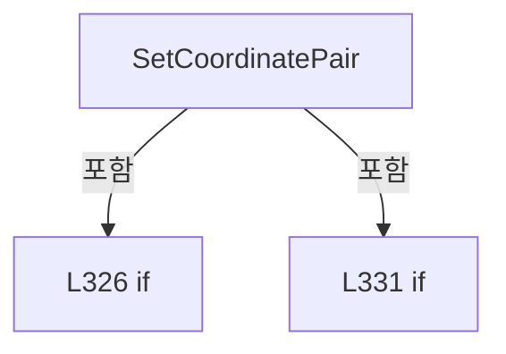

변경 전 점검: 입력/반환 타입, 위 호출자, 예외/취소 경로, 공유 상태와 저장·전송 소비자를 함께 확인합니다. 값의 단위나 물리 방향을 이름만으로 확정하지 않습니다.

### MethodDeclaration `SetIfPresent` · L341–351

[Drilling.File/ReviewResult/CReviewResultFile.cs:341–351](https://github.com/kjuws10-rgb/A3Drilling/blob/5aee8e58439c9b455cae7c9593c9be986c3e682e/Drilling.File/ReviewResult/CReviewResultFile.cs#L341-L351)

| 항목 | 실제 추출 값 |
| --- | --- |
| 서명 | void Drilling.File.ReviewResult.CReviewResultFile.SetIfPresent(System.Collections.Generic.IDictionary<string, string>, System.Collections.Generic.IReadOnlySet<string>, string, string) |
| 접근/수식자 | Private / private, static |
| 반환/값 타입 | void |
| 소속 타입 | NamedType:Drilling.File.ReviewResult.CReviewResultFile |

입력 계약:

| 이름 | 타입 | 전달 | 선택/기본값 |
| --- | --- | --- | --- |
| row | System.Collections.Generic.IDictionary<string, string> | None | False /  |
| headers | System.Collections.Generic.IReadOnlySet<string> | None | False /  |
| header | string | None | False /  |
| value | string | None | False /  |

정적 호출자로 확인된 위치:

| 호출 파일/행 | 호출 표현식 | 런타임 분기 가능 |
| --- | --- | --- |
| [Drilling.File/ReviewResult/CReviewResultFile.cs:298–298](https://github.com/kjuws10-rgb/A3Drilling/blob/5aee8e58439c9b455cae7c9593c9be986c3e682e/Drilling.File/ReviewResult/CReviewResultFile.cs#L298-L298) | SetIfPresent | False |
| [Drilling.File/ReviewResult/CReviewResultFile.cs:311–311](https://github.com/kjuws10-rgb/A3Drilling/blob/5aee8e58439c9b455cae7c9593c9be986c3e682e/Drilling.File/ReviewResult/CReviewResultFile.cs#L311-L311) | SetIfPresent | False |
| [Drilling.File/ReviewResult/CReviewResultFile.cs:312–312](https://github.com/kjuws10-rgb/A3Drilling/blob/5aee8e58439c9b455cae7c9593c9be986c3e682e/Drilling.File/ReviewResult/CReviewResultFile.cs#L312-L312) | SetIfPresent | False |
| [Drilling.File/ReviewResult/CReviewResultFile.cs:313–313](https://github.com/kjuws10-rgb/A3Drilling/blob/5aee8e58439c9b455cae7c9593c9be986c3e682e/Drilling.File/ReviewResult/CReviewResultFile.cs#L313-L313) | SetIfPresent | False |

호출하는 대상과 해석 범위:

| 원본 행 | 표현식 | 분석 상태 | 대상/소스 위치 |
| --- | --- | --- | --- |
| 347 | headers.Contains | resolved · 동적 구현 선택 가능 | bool System.Collections.Generic.IReadOnlySet<string>.Contains(string) |

본문의 실제 연산·분기·예외·반환 순서(원문 위치 순):

| 원본 행 | 종류 | 주석 해설 |
| --- | --- | --- |
| 347 | call | 함수·델리게이트 또는 객체 생성자를 호출합니다: headers.Contains(header) |
| 347 | if | 조건에 따라 분기합니다: if (headers.Contains(header)) |
| 349 | assignment | 값을 대상에 대입합니다: row[header] = value |

제어 구문의 포함 구조(실제 실행 순서/CFG가 아닌 구문 탐색 그림):

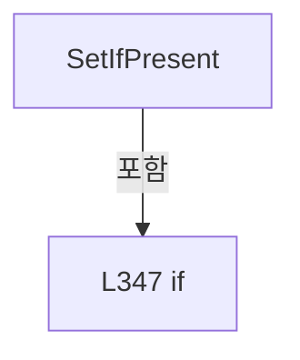

변경 전 점검: 입력/반환 타입, 위 호출자, 예외/취소 경로, 공유 상태와 저장·전송 소비자를 함께 확인합니다. 값의 단위나 물리 방향을 이름만으로 확정하지 않습니다.

### MethodDeclaration `FormatRevisionSavedAt` · L353–358

[Drilling.File/ReviewResult/CReviewResultFile.cs:353–358](https://github.com/kjuws10-rgb/A3Drilling/blob/5aee8e58439c9b455cae7c9593c9be986c3e682e/Drilling.File/ReviewResult/CReviewResultFile.cs#L353-L358)

| 항목 | 실제 추출 값 |
| --- | --- |
| 서명 | string Drilling.File.ReviewResult.CReviewResultFile.FormatRevisionSavedAt(string, System.DateTimeOffset) |
| 접근/수식자 | Private / private, static |
| 반환/값 타입 | string |
| 소속 타입 | NamedType:Drilling.File.ReviewResult.CReviewResultFile |

입력 계약:

| 이름 | 타입 | 전달 | 선택/기본값 |
| --- | --- | --- | --- |
| sourceValue | string | None | False /  |
| savedAt | System.DateTimeOffset | None | False /  |

정적 호출자로 확인된 위치:

| 호출 파일/행 | 호출 표현식 | 런타임 분기 가능 |
| --- | --- | --- |
| [Drilling.File/ReviewResult/CReviewResultFile.cs:180–180](https://github.com/kjuws10-rgb/A3Drilling/blob/5aee8e58439c9b455cae7c9593c9be986c3e682e/Drilling.File/ReviewResult/CReviewResultFile.cs#L180-L180) | FormatRevisionSavedAt | False |

호출하는 대상과 해석 범위:

| 원본 행 | 표현식 | 분석 상태 | 대상/소스 위치 |
| --- | --- | --- | --- |
| 355 | sourceValue.Contains | resolved | bool string.Contains(char) |
| 356 | savedAt.ToString | resolved | string System.DateTimeOffset.ToString(string?, System.IFormatProvider?) |
| 357 | FormatDate | resolved | string Drilling.File.ReviewResult.CReviewResultFile.FormatDate(System.DateTimeOffset?) · Drilling.File/ReviewResult/CReviewResultFile.cs:619 |

본문의 실제 연산·분기·예외·반환 순서(원문 위치 순):

| 원본 행 | 종류 | 주석 해설 |
| --- | --- | --- |
| 355 | call | 함수·델리게이트 또는 객체 생성자를 호출합니다: sourceValue.Contains('T') |
| 355 | conditional-expression | 조건에 따라 결과식을 선택합니다: sourceValue.Contains('T') ? savedAt.ToString("O", CultureInfo.InvariantCulture) : FormatDate(savedAt) |
| 355 | return | 호출자에게 값 또는 제어를 반환합니다: return sourceValue.Contains('T') ? savedAt.ToString("O", CultureInfo.InvariantCulture) : FormatDate(savedAt); |
| 356 | call | 함수·델리게이트 또는 객체 생성자를 호출합니다: savedAt.ToString("O", CultureInfo.InvariantCulture) |
| 357 | call | 함수·델리게이트 또는 객체 생성자를 호출합니다: FormatDate(savedAt) |

변경 전 점검: 입력/반환 타입, 위 호출자, 예외/취소 경로, 공유 상태와 저장·전송 소비자를 함께 확인합니다. 값의 단위나 물리 방향을 이름만으로 확정하지 않습니다.

### MethodDeclaration `ToResultRows` · L360–388

[Drilling.File/ReviewResult/CReviewResultFile.cs:360–388](https://github.com/kjuws10-rgb/A3Drilling/blob/5aee8e58439c9b455cae7c9593c9be986c3e682e/Drilling.File/ReviewResult/CReviewResultFile.cs#L360-L388)

| 항목 | 실제 추출 값 |
| --- | --- |
| 서명 | System.Collections.Generic.IReadOnlyList<Drilling.Common.Review.ST_REVIEW_RESULT_FILE_ROW> Drilling.File.ReviewResult.CReviewResultFile.ToResultRows(System.Collections.Generic.IReadOnlyDictionary<string, string>, int) |
| 접근/수식자 | Private / private, static |
| 반환/값 타입 | System.Collections.Generic.IReadOnlyList<Drilling.Common.Review.ST_REVIEW_RESULT_FILE_ROW> |
| 소속 타입 | NamedType:Drilling.File.ReviewResult.CReviewResultFile |

입력 계약:

| 이름 | 타입 | 전달 | 선택/기본값 |
| --- | --- | --- | --- |
| row | System.Collections.Generic.IReadOnlyDictionary<string, string> | None | False /  |
| rowNo | int | None | False /  |

정적 호출자로 확인된 위치:

| 호출 파일/행 | 호출 표현식 | 런타임 분기 가능 |
| --- | --- | --- |
| [Drilling.File/ReviewResult/CReviewResultFile.cs:66–66](https://github.com/kjuws10-rgb/A3Drilling/blob/5aee8e58439c9b455cae7c9593c9be986c3e682e/Drilling.File/ReviewResult/CReviewResultFile.cs#L66-L66) | ToResultRows | False |

호출하는 대상과 해석 범위:

| 원본 행 | 표현식 | 분석 상태 | 대상/소스 위치 |
| --- | --- | --- | --- |
| 362 | row.Keys.Any | resolved | bool System.Collections.Generic.IEnumerable<string>.Any<string>(System.Func<string, bool>) |
| 362 | key.Equals | resolved | bool string.Equals(string?, System.StringComparison) |
| 364 | ToResultRow | resolved | Drilling.Common.Review.ST_REVIEW_RESULT_FILE_ROW Drilling.File.ReviewResult.CReviewResultFile.ToResultRow(System.Collections.Generic.IReadOnlyDictionary<string, string>, int, int?, double?, double?, string?) · Drilling.File/ReviewResult/CReviewResultFile.cs:390 |
| 367 | new List<ST_REVIEW_RESULT_FILE_ROW> | resolved | System.Collections.Generic.List<Drilling.Common.Review.ST_REVIEW_RESULT_FILE_ROW>.List() |
| 370 | CCsvParser.Get(row, $"BEAM{beamNo}_JUDGE").Trim | resolved | string string.Trim() |
| 370 | CCsvParser.Get | resolved | string Drilling.File.Parser.CCsvParser.Get(System.Collections.Generic.IReadOnlyDictionary<string, string>, string) · Drilling.File/Parser/CCsvParser.cs:168 |
| 371 | string.IsNullOrWhiteSpace | resolved | bool string.IsNullOrWhiteSpace(string?) |
| 371 | judge.Equals | resolved | bool string.Equals(string?, System.StringComparison) |
| 376 | beamRows.Add | resolved | void System.Collections.Generic.List<Drilling.Common.Review.ST_REVIEW_RESULT_FILE_ROW>.Add(Drilling.Common.Review.ST_REVIEW_RESULT_FILE_ROW) |
| 376 | ToResultRow | resolved | Drilling.Common.Review.ST_REVIEW_RESULT_FILE_ROW Drilling.File.ReviewResult.CReviewResultFile.ToResultRow(System.Collections.Generic.IReadOnlyDictionary<string, string>, int, int?, double?, double?, string?) · Drilling.File/ReviewResult/CReviewResultFile.cs:390 |
| 380 | ReadOptionalFiniteDouble | resolved | double Drilling.File.ReviewResult.CReviewResultFile.ReadOptionalFiniteDouble(System.Collections.Generic.IReadOnlyDictionary<string, string>, params string[]) · Drilling.File/ReviewResult/CReviewResultFile.cs:579 |
| 381 | ReadOptionalFiniteDouble | resolved | double Drilling.File.ReviewResult.CReviewResultFile.ReadOptionalFiniteDouble(System.Collections.Generic.IReadOnlyDictionary<string, string>, params string[]) · Drilling.File/ReviewResult/CReviewResultFile.cs:579 |
| 387 | ToResultRow | resolved | Drilling.Common.Review.ST_REVIEW_RESULT_FILE_ROW Drilling.File.ReviewResult.CReviewResultFile.ToResultRow(System.Collections.Generic.IReadOnlyDictionary<string, string>, int, int?, double?, double?, string?) · Drilling.File/ReviewResult/CReviewResultFile.cs:390 |

본문의 실제 연산·분기·예외·반환 순서(원문 위치 순):

| 원본 행 | 종류 | 주석 해설 |
| --- | --- | --- |
| 362 | call | 함수·델리게이트 또는 객체 생성자를 호출합니다: row.Keys.Any(key => key.Equals("BEAM1_JUDGE", StringComparison.OrdinalIgnoreCase)) |
| 362 | call | 함수·델리게이트 또는 객체 생성자를 호출합니다: key.Equals("BEAM1_JUDGE", StringComparison.OrdinalIgnoreCase) |
| 362 | if | 조건에 따라 분기합니다: if (!row.Keys.Any(key => key.Equals("BEAM1_JUDGE", StringComparison.OrdinalIgnoreCase))) |
| 364 | call | 함수·델리게이트 또는 객체 생성자를 호출합니다: ToResultRow(row, rowNo) |
| 364 | return | 호출자에게 값 또는 제어를 반환합니다: return [ToResultRow(row, rowNo)]; |
| 367 | call | 함수·델리게이트 또는 객체 생성자를 호출합니다: new List<ST_REVIEW_RESULT_FILE_ROW>() |
| 367 | local-declaration | 지역 변수를 선언합니다: var beamRows = new List<ST_REVIEW_RESULT_FILE_ROW>(); |
| 367 | variable-initializer | 변수의 초기값을 지정합니다: beamRows = new List<ST_REVIEW_RESULT_FILE_ROW>() |
| 368 | variable-initializer | 변수의 초기값을 지정합니다: beamNo = 1 |
| 368 | for | 초기화·조건·증감이 있는 반복입니다: for (var beamNo = 1; beamNo <= 16; beamNo++) |
| 370 | call | 함수·델리게이트 또는 객체 생성자를 호출합니다: CCsvParser.Get(row, $"BEAM{beamNo}_JUDGE").Trim() |
| 370 | call | 함수·델리게이트 또는 객체 생성자를 호출합니다: CCsvParser.Get(row, $"BEAM{beamNo}_JUDGE") |
| 370 | local-declaration | 지역 변수를 선언합니다: var judge = CCsvParser.Get(row, $"BEAM{beamNo}_JUDGE").Trim(); |
| 370 | variable-initializer | 변수의 초기값을 지정합니다: judge = CCsvParser.Get(row, $"BEAM{beamNo}_JUDGE").Trim() |
| 371 | call | 함수·델리게이트 또는 객체 생성자를 호출합니다: string.IsNullOrWhiteSpace(judge) |
| 371 | call | 함수·델리게이트 또는 객체 생성자를 호출합니다: judge.Equals("미검사", StringComparison.OrdinalIgnoreCase) |
| 371 | if | 조건에 따라 분기합니다: if (string.IsNullOrWhiteSpace(judge) &#124;&#124; judge.Equals("미검사", StringComparison.OrdinalIgnoreCase)) |
| 373 | continue | 다음 반복으로 진행합니다: continue; |
| 376 | call | 함수·델리게이트 또는 객체 생성자를 호출합니다: beamRows.Add(ToResultRow( row, rowNo, beamNo, ReadOptionalFiniteDouble(row, $"BEAM{beamNo}_X_MM"), ReadOptionalFiniteDouble(row, $"BEAM{beamNo}_Y_MM"), judge)) |
| 376 | call | 함수·델리게이트 또는 객체 생성자를 호출합니다: ToResultRow( row, rowNo, beamNo, ReadOptionalFiniteDouble(row, $"BEAM{beamNo}_X_MM"), ReadOptionalFiniteDouble(row, $"BEAM{beamNo}_Y_MM"), judge) |
| 380 | call | 함수·델리게이트 또는 객체 생성자를 호출합니다: ReadOptionalFiniteDouble(row, $"BEAM{beamNo}_X_MM") |
| 381 | call | 함수·델리게이트 또는 객체 생성자를 호출합니다: ReadOptionalFiniteDouble(row, $"BEAM{beamNo}_Y_MM") |
| 385 | conditional-expression | 조건에 따라 결과식을 선택합니다: beamRows.Count > 0 ? beamRows : [ToResultRow(row, rowNo, 0, 0.0, 0.0, "UNMEASURED")] |
| 385 | return | 호출자에게 값 또는 제어를 반환합니다: return beamRows.Count > 0 ? beamRows : [ToResultRow(row, rowNo, 0, 0.0, 0.0, "UNMEASURED")]; |
| 387 | call | 함수·델리게이트 또는 객체 생성자를 호출합니다: ToResultRow(row, rowNo, 0, 0.0, 0.0, "UNMEASURED") |

제어 구문의 포함 구조(실제 실행 순서/CFG가 아닌 구문 탐색 그림):

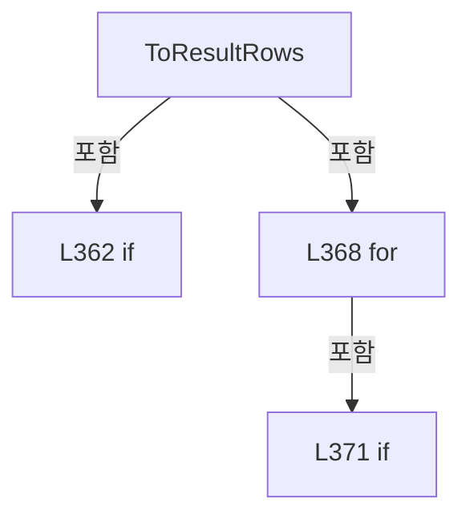

변경 전 점검: 입력/반환 타입, 위 호출자, 예외/취소 경로, 공유 상태와 저장·전송 소비자를 함께 확인합니다. 값의 단위나 물리 방향을 이름만으로 확정하지 않습니다.

### MethodDeclaration `ToResultRow` · L390–433

[Drilling.File/ReviewResult/CReviewResultFile.cs:390–433](https://github.com/kjuws10-rgb/A3Drilling/blob/5aee8e58439c9b455cae7c9593c9be986c3e682e/Drilling.File/ReviewResult/CReviewResultFile.cs#L390-L433)

| 항목 | 실제 추출 값 |
| --- | --- |
| 서명 | Drilling.Common.Review.ST_REVIEW_RESULT_FILE_ROW Drilling.File.ReviewResult.CReviewResultFile.ToResultRow(System.Collections.Generic.IReadOnlyDictionary<string, string>, int, int?, double?, double?, string?) |
| 접근/수식자 | Private / private, static |
| 반환/값 타입 | Drilling.Common.Review.ST_REVIEW_RESULT_FILE_ROW |
| 소속 타입 | NamedType:Drilling.File.ReviewResult.CReviewResultFile |

입력 계약:

| 이름 | 타입 | 전달 | 선택/기본값 |
| --- | --- | --- | --- |
| row | System.Collections.Generic.IReadOnlyDictionary<string, string> | None | False /  |
| rowNo | int | None | False /  |
| beamNoOverride | int? | None | True / null |
| errorXOverride | double? | None | True / null |
| errorYOverride | double? | None | True / null |
| judgeOverride | string? | None | True / null |

정적 호출자로 확인된 위치:

| 호출 파일/행 | 호출 표현식 | 런타임 분기 가능 |
| --- | --- | --- |
| [Drilling.File/ReviewResult/CReviewResultFile.cs:364–364](https://github.com/kjuws10-rgb/A3Drilling/blob/5aee8e58439c9b455cae7c9593c9be986c3e682e/Drilling.File/ReviewResult/CReviewResultFile.cs#L364-L364) | ToResultRow | False |
| [Drilling.File/ReviewResult/CReviewResultFile.cs:376–382](https://github.com/kjuws10-rgb/A3Drilling/blob/5aee8e58439c9b455cae7c9593c9be986c3e682e/Drilling.File/ReviewResult/CReviewResultFile.cs#L376-L382) | ToResultRow | False |
| [Drilling.File/ReviewResult/CReviewResultFile.cs:387–387](https://github.com/kjuws10-rgb/A3Drilling/blob/5aee8e58439c9b455cae7c9593c9be986c3e682e/Drilling.File/ReviewResult/CReviewResultFile.cs#L387-L387) | ToResultRow | False |

호출하는 대상과 해석 범위:

| 원본 행 | 표현식 | 분석 상태 | 대상/소스 위치 |
| --- | --- | --- | --- |
| 398 | CCsvParser.RequireText | resolved | string Drilling.File.Parser.CCsvParser.RequireText(System.Collections.Generic.IReadOnlyDictionary<string, string>, string, int, params string[]) · Drilling.File/Parser/CCsvParser.cs:187 |
| 399 | DateTimeOffset.TryParse | resolved | bool System.DateTimeOffset.TryParse(string?, System.IFormatProvider?, System.Globalization.DateTimeStyles, out System.DateTimeOffset) |
| 401 | new InvalidDataException | resolved | System.IO.InvalidDataException.InvalidDataException(string?) |
| 404 | CCsvParser.RequireText | resolved | string Drilling.File.Parser.CCsvParser.RequireText(System.Collections.Generic.IReadOnlyDictionary<string, string>, string, int, params string[]) · Drilling.File/Parser/CCsvParser.cs:187 |
| 405 | ReadFirstText | resolved | string Drilling.File.ReviewResult.CReviewResultFile.ReadFirstText(System.Collections.Generic.IReadOnlyDictionary<string, string>, params string[]) · Drilling.File/ReviewResult/CReviewResultFile.cs:540 |
| 406 | CCsvParser.Get | resolved | string Drilling.File.Parser.CCsvParser.Get(System.Collections.Generic.IReadOnlyDictionary<string, string>, string) · Drilling.File/Parser/CCsvParser.cs:168 |
| 407 | CReviewManager.NormalizeShotKey | resolved | string Drilling.Common.Review.CReviewManager.NormalizeShotKey(string) · Drilling.Common/Review/CReviewManager.cs:1165 |
| 408 | string.IsNullOrWhiteSpace | resolved | bool string.IsNullOrWhiteSpace(string?) |
| 409 | string.IsNullOrWhiteSpace | resolved | bool string.IsNullOrWhiteSpace(string?) |
| 409 | string.IsNullOrWhiteSpace | resolved | bool string.IsNullOrWhiteSpace(string?) |
| 411 | new InvalidDataException | resolved | System.IO.InvalidDataException.InvalidDataException(string?) |
| 414 | ReadRequiredPositiveInt | resolved | int Drilling.File.ReviewResult.CReviewResultFile.ReadRequiredPositiveInt(System.Collections.Generic.IReadOnlyDictionary<string, string>, int, params string[]) · Drilling.File/ReviewResult/CReviewResultFile.cs:554 |
| 415 | ReadRequiredPositiveInt | resolved | int Drilling.File.ReviewResult.CReviewResultFile.ReadRequiredPositiveInt(System.Collections.Generic.IReadOnlyDictionary<string, string>, int, params string[]) · Drilling.File/ReviewResult/CReviewResultFile.cs:554 |
| 416 | ReadOptionalFiniteDouble | resolved | double Drilling.File.ReviewResult.CReviewResultFile.ReadOptionalFiniteDouble(System.Collections.Generic.IReadOnlyDictionary<string, string>, params string[]) · Drilling.File/ReviewResult/CReviewResultFile.cs:579 |
| 417 | ReadOptionalFiniteDouble | resolved | double Drilling.File.ReviewResult.CReviewResultFile.ReadOptionalFiniteDouble(System.Collections.Generic.IReadOnlyDictionary<string, string>, params string[]) · Drilling.File/ReviewResult/CReviewResultFile.cs:579 |
| 418 | (judgeOverride ?? ReadFirstText(row, "JUDGE", "GROUP_JUDGE", "STATE")).Trim().ToUpperInvariant | resolved | string string.ToUpperInvariant() |
| 418 | (judgeOverride ?? ReadFirstText(row, "JUDGE", "GROUP_JUDGE", "STATE")).Trim | resolved | string string.Trim() |
| 418 | ReadFirstText | resolved | string Drilling.File.ReviewResult.CReviewResultFile.ReadFirstText(System.Collections.Generic.IReadOnlyDictionary<string, string>, params string[]) · Drilling.File/ReviewResult/CReviewResultFile.cs:540 |
| 419 | string.IsNullOrWhiteSpace | resolved | bool string.IsNullOrWhiteSpace(string?) |
| 424 | new ST_REVIEW_RESULT_FILE_ROW | resolved | Drilling.Common.Review.ST_REVIEW_RESULT_FILE_ROW.ST_REVIEW_RESULT_FILE_ROW(System.DateTimeOffset, string, string, string, int, int, double, double, string) · Drilling.Common/Review/CReviewManager.cs:4015 |
| 426 | ReadOptionalInt | resolved | int Drilling.File.ReviewResult.CReviewResultFile.ReadOptionalInt(System.Collections.Generic.IReadOnlyDictionary<string, string>, string, int) · Drilling.File/ReviewResult/CReviewResultFile.cs:535 |
| 427 | ReadOneBasedIndex | resolved | int Drilling.File.ReviewResult.CReviewResultFile.ReadOneBasedIndex(System.Collections.Generic.IReadOnlyDictionary<string, string>, params string[]) · Drilling.File/ReviewResult/CReviewResultFile.cs:571 |
| 428 | ReadOneBasedIndex | resolved | int Drilling.File.ReviewResult.CReviewResultFile.ReadOneBasedIndex(System.Collections.Generic.IReadOnlyDictionary<string, string>, params string[]) · Drilling.File/ReviewResult/CReviewResultFile.cs:571 |
| 429 | ReadOptionalNullableFiniteDouble | resolved | double? Drilling.File.ReviewResult.CReviewResultFile.ReadOptionalNullableFiniteDouble(System.Collections.Generic.IReadOnlyDictionary<string, string>, params string[]) · Drilling.File/ReviewResult/CReviewResultFile.cs:594 |
| 430 | ReadOptionalNullableFiniteDouble | resolved | double? Drilling.File.ReviewResult.CReviewResultFile.ReadOptionalNullableFiniteDouble(System.Collections.Generic.IReadOnlyDictionary<string, string>, params string[]) · Drilling.File/ReviewResult/CReviewResultFile.cs:594 |
| 431 | CCsvParser.Get(row, "RESULT_SOURCE").Trim().ToUpperInvariant | resolved | string string.ToUpperInvariant() |
| 431 | CCsvParser.Get(row, "RESULT_SOURCE").Trim | resolved | string string.Trim() |
| 431 | CCsvParser.Get | resolved | string Drilling.File.Parser.CCsvParser.Get(System.Collections.Generic.IReadOnlyDictionary<string, string>, string) · Drilling.File/Parser/CCsvParser.cs:168 |

본문의 실제 연산·분기·예외·반환 순서(원문 위치 순):

| 원본 행 | 종류 | 주석 해설 |
| --- | --- | --- |
| 398 | call | 함수·델리게이트 또는 객체 생성자를 호출합니다: CCsvParser.RequireText(row, "Review Result", rowNo, "SAVED_AT") |
| 398 | local-declaration | 지역 변수를 선언합니다: var savedAtText = CCsvParser.RequireText(row, "Review Result", rowNo, "SAVED_AT"); |
| 398 | variable-initializer | 변수의 초기값을 지정합니다: savedAtText = CCsvParser.RequireText(row, "Review Result", rowNo, "SAVED_AT") |
| 399 | call | 함수·델리게이트 또는 객체 생성자를 호출합니다: DateTimeOffset.TryParse(savedAtText, CultureInfo.InvariantCulture, DateTimeStyles.AssumeLocal, out var savedAt) |
| 399 | if | 조건에 따라 분기합니다: if (!DateTimeOffset.TryParse(savedAtText, CultureInfo.InvariantCulture, DateTimeStyles.AssumeLocal, out var savedAt)) |
| 401 | call | 함수·델리게이트 또는 객체 생성자를 호출합니다: new InvalidDataException($"Review Result validation failed. Row {rowNo} / SAVED_AT must be a date and time.") |
| 401 | throw | 예외를 발생/전달합니다: throw new InvalidDataException($"Review Result validation failed. Row {rowNo} / SAVED_AT must be a date and time."); |
| 404 | call | 함수·델리게이트 또는 객체 생성자를 호출합니다: CCsvParser.RequireText(row, "Review Result", rowNo, "RECIPE_ID") |
| 404 | local-declaration | 지역 변수를 선언합니다: var recipeId = CCsvParser.RequireText(row, "Review Result", rowNo, "RECIPE_ID"); |
| 404 | variable-initializer | 변수의 초기값을 지정합니다: recipeId = CCsvParser.RequireText(row, "Review Result", rowNo, "RECIPE_ID") |
| 405 | call | 함수·델리게이트 또는 객체 생성자를 호출합니다: ReadFirstText(row, "SHOT_KEY", "HOLE_KEY") |
| 405 | local-declaration | 지역 변수를 선언합니다: var sourceShotKey = ReadFirstText(row, "SHOT_KEY", "HOLE_KEY"); |
| 405 | variable-initializer | 변수의 초기값을 지정합니다: sourceShotKey = ReadFirstText(row, "SHOT_KEY", "HOLE_KEY") |
| 406 | call | 함수·델리게이트 또는 객체 생성자를 호출합니다: CCsvParser.Get(row, "SHOT_NAME") |
| 406 | local-declaration | 지역 변수를 선언합니다: var shotName = CCsvParser.Get(row, "SHOT_NAME"); |
| 406 | variable-initializer | 변수의 초기값을 지정합니다: shotName = CCsvParser.Get(row, "SHOT_NAME") |
| 407 | call | 함수·델리게이트 또는 객체 생성자를 호출합니다: CReviewManager.NormalizeShotKey(sourceShotKey) |
| 407 | local-declaration | 지역 변수를 선언합니다: var normalizedShotKey = CReviewManager.NormalizeShotKey(sourceShotKey); |
| 407 | variable-initializer | 변수의 초기값을 지정합니다: normalizedShotKey = CReviewManager.NormalizeShotKey(sourceShotKey) |
| 408 | call | 함수·델리게이트 또는 객체 생성자를 호출합니다: string.IsNullOrWhiteSpace(normalizedShotKey) |
| 408 | conditional-expression | 조건에 따라 결과식을 선택합니다: string.IsNullOrWhiteSpace(normalizedShotKey) ? sourceShotKey : normalizedShotKey |
| 408 | local-declaration | 지역 변수를 선언합니다: var shotKey = string.IsNullOrWhiteSpace(normalizedShotKey) ? sourceShotKey : normalizedShotKey; |
| 408 | variable-initializer | 변수의 초기값을 지정합니다: shotKey = string.IsNullOrWhiteSpace(normalizedShotKey) ? sourceShotKey : normalizedShotKey |
| 409 | call | 함수·델리게이트 또는 객체 생성자를 호출합니다: string.IsNullOrWhiteSpace(shotKey) |
| 409 | call | 함수·델리게이트 또는 객체 생성자를 호출합니다: string.IsNullOrWhiteSpace(shotName) |
| 409 | if | 조건에 따라 분기합니다: if (string.IsNullOrWhiteSpace(shotKey) && string.IsNullOrWhiteSpace(shotName)) |
| 411 | call | 함수·델리게이트 또는 객체 생성자를 호출합니다: new InvalidDataException($"Review Result validation failed. Row {rowNo} / SHOT_KEY or SHOT_NAME is required.") |
| 411 | throw | 예외를 발생/전달합니다: throw new InvalidDataException($"Review Result validation failed. Row {rowNo} / SHOT_KEY or SHOT_NAME is required."); |
| 414 | call | 함수·델리게이트 또는 객체 생성자를 호출합니다: ReadRequiredPositiveInt(row, rowNo, "HEAD_NO", "HEAD_NAME") |
| 414 | local-declaration | 지역 변수를 선언합니다: var headNo = ReadRequiredPositiveInt(row, rowNo, "HEAD_NO", "HEAD_NAME"); |
| 414 | variable-initializer | 변수의 초기값을 지정합니다: headNo = ReadRequiredPositiveInt(row, rowNo, "HEAD_NO", "HEAD_NAME") |
| 415 | call | 함수·델리게이트 또는 객체 생성자를 호출합니다: ReadRequiredPositiveInt(row, rowNo, "CELL_NO", "CELL_NAME") |
| 415 | local-declaration | 지역 변수를 선언합니다: var cellNo = ReadRequiredPositiveInt(row, rowNo, "CELL_NO", "CELL_NAME"); |
| 415 | variable-initializer | 변수의 초기값을 지정합니다: cellNo = ReadRequiredPositiveInt(row, rowNo, "CELL_NO", "CELL_NAME") |
| 416 | call | 함수·델리게이트 또는 객체 생성자를 호출합니다: ReadOptionalFiniteDouble(row, "ERROR_X", "VISION_FLIP_CONVERT_X", "CONVERTED_X", "RECV_TARGET_MINUS_HOLE_X") |
| 416 | local-declaration | 지역 변수를 선언합니다: var errorX = errorXOverride ?? ReadOptionalFiniteDouble(row, "ERROR_X", "VISION_FLIP_CONVERT_X", "CONVERTED_X", "RECV_TARGET_MINUS_HOLE_X"); |
| 416 | variable-initializer | 변수의 초기값을 지정합니다: errorX = errorXOverride ?? ReadOptionalFiniteDouble(row, "ERROR_X", "VISION_FLIP_CONVERT_X", "CONVERTED_X", "RECV_TARGET_MINUS_HOLE_X") |
| 417 | call | 함수·델리게이트 또는 객체 생성자를 호출합니다: ReadOptionalFiniteDouble(row, "ERROR_Y", "VISION_FLIP_CONVERT_Y", "CONVERTED_Y", "RECV_TARGET_MINUS_HOLE_Y") |
| 417 | local-declaration | 지역 변수를 선언합니다: var errorY = errorYOverride ?? ReadOptionalFiniteDouble(row, "ERROR_Y", "VISION_FLIP_CONVERT_Y", "CONVERTED_Y", "RECV_TARGET_MINUS_HOLE_Y"); |
| 417 | variable-initializer | 변수의 초기값을 지정합니다: errorY = errorYOverride ?? ReadOptionalFiniteDouble(row, "ERROR_Y", "VISION_FLIP_CONVERT_Y", "CONVERTED_Y", "RECV_TARGET_MINUS_HOLE_Y") |
| 418 | call | 함수·델리게이트 또는 객체 생성자를 호출합니다: (judgeOverride ?? ReadFirstText(row, "JUDGE", "GROUP_JUDGE", "STATE")).Trim().ToUpperInvariant() |
| 418 | call | 함수·델리게이트 또는 객체 생성자를 호출합니다: (judgeOverride ?? ReadFirstText(row, "JUDGE", "GROUP_JUDGE", "STATE")).Trim() |
| 418 | call | 함수·델리게이트 또는 객체 생성자를 호출합니다: ReadFirstText(row, "JUDGE", "GROUP_JUDGE", "STATE") |
| 418 | local-declaration | 지역 변수를 선언합니다: var judge = (judgeOverride ?? ReadFirstText(row, "JUDGE", "GROUP_JUDGE", "STATE")).Trim().ToUpperInvariant(); |
| 418 | variable-initializer | 변수의 초기값을 지정합니다: judge = (judgeOverride ?? ReadFirstText(row, "JUDGE", "GROUP_JUDGE", "STATE")).Trim().ToUpperInvariant() |
| 419 | call | 함수·델리게이트 또는 객체 생성자를 호출합니다: string.IsNullOrWhiteSpace(judge) |
| 419 | if | 조건에 따라 분기합니다: if (string.IsNullOrWhiteSpace(judge)) |
| 421 | assignment | 값을 대상에 대입합니다: judge = "UNKNOWN" |
| 424 | call | 함수·델리게이트 또는 객체 생성자를 호출합니다: new ST_REVIEW_RESULT_FILE_ROW(savedAt, recipeId, shotKey, shotName, headNo, cellNo, errorX, errorY, judge) { BeamNo = beamNoOverride ?? ReadOptionalInt(row, "BEAM_NO", 0), GroupColumn = ReadOneBasedIndex(row, "INDEX_X", … |
| 424 | return | 호출자에게 값 또는 제어를 반환합니다: return new ST_REVIEW_RESULT_FILE_ROW(savedAt, recipeId, shotKey, shotName, headNo, cellNo, errorX, errorY, judge) { BeamNo = beamNoOverride ?? ReadOptionalInt(row, "BEAM_NO", 0), GroupColumn = ReadOneBasedIndex(row, "INDEX_X", "CO |
| 426 | assignment | 값을 대상에 대입합니다: BeamNo = beamNoOverride ?? ReadOptionalInt(row, "BEAM_NO", 0) |
| 426 | call | 함수·델리게이트 또는 객체 생성자를 호출합니다: ReadOptionalInt(row, "BEAM_NO", 0) |
| 427 | assignment | 값을 대상에 대입합니다: GroupColumn = ReadOneBasedIndex(row, "INDEX_X", "COLUMN") |
| 427 | call | 함수·델리게이트 또는 객체 생성자를 호출합니다: ReadOneBasedIndex(row, "INDEX_X", "COLUMN") |
| 428 | assignment | 값을 대상에 대입합니다: GroupRow = ReadOneBasedIndex(row, "INDEX_Y", "ROW") |
| 428 | call | 함수·델리게이트 또는 객체 생성자를 호출합니다: ReadOneBasedIndex(row, "INDEX_Y", "ROW") |
| 429 | assignment | 값을 대상에 대입합니다: DesignX = ReadOptionalNullableFiniteDouble(row, "DESIGN_X") |
| 429 | call | 함수·델리게이트 또는 객체 생성자를 호출합니다: ReadOptionalNullableFiniteDouble(row, "DESIGN_X") |
| 430 | assignment | 값을 대상에 대입합니다: DesignY = ReadOptionalNullableFiniteDouble(row, "DESIGN_Y") |
| 430 | call | 함수·델리게이트 또는 객체 생성자를 호출합니다: ReadOptionalNullableFiniteDouble(row, "DESIGN_Y") |
| 431 | assignment | 값을 대상에 대입합니다: ResultSource = CCsvParser.Get(row, "RESULT_SOURCE").Trim().ToUpperInvariant() |
| 431 | call | 함수·델리게이트 또는 객체 생성자를 호출합니다: CCsvParser.Get(row, "RESULT_SOURCE").Trim().ToUpperInvariant() |
| 431 | call | 함수·델리게이트 또는 객체 생성자를 호출합니다: CCsvParser.Get(row, "RESULT_SOURCE").Trim() |
| 431 | call | 함수·델리게이트 또는 객체 생성자를 호출합니다: CCsvParser.Get(row, "RESULT_SOURCE") |

제어 구문의 포함 구조(실제 실행 순서/CFG가 아닌 구문 탐색 그림):

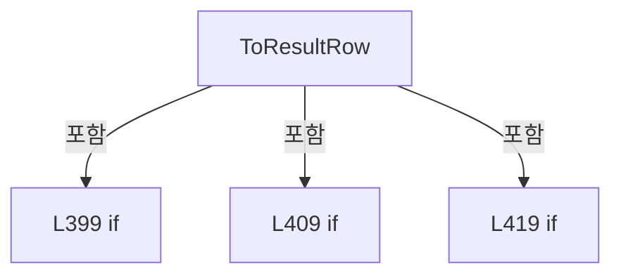

변경 전 점검: 입력/반환 타입, 위 호출자, 예외/취소 경로, 공유 상태와 저장·전송 소비자를 함께 확인합니다. 값의 단위나 물리 방향을 이름만으로 확정하지 않습니다.

### MethodDeclaration `ToRow` · L435–479

[Drilling.File/ReviewResult/CReviewResultFile.cs:435–479](https://github.com/kjuws10-rgb/A3Drilling/blob/5aee8e58439c9b455cae7c9593c9be986c3e682e/Drilling.File/ReviewResult/CReviewResultFile.cs#L435-L479)

| 항목 | 실제 추출 값 |
| --- | --- |
| 서명 | System.Collections.Generic.IReadOnlyDictionary<string, string> Drilling.File.ReviewResult.CReviewResultFile.ToRow(Drilling.Common.Review.ST_REVIEW_RESULT_DATA, Drilling.Common.Review.ST_REVIEW_PLAN_POINT, Drilling.File.ReviewResult.CReviewResultFile.ST_REVIEW_RESULT_METADATA) |
| 접근/수식자 | Private / private, static |
| 반환/값 타입 | System.Collections.Generic.IReadOnlyDictionary<string, string> |
| 소속 타입 | NamedType:Drilling.File.ReviewResult.CReviewResultFile |

입력 계약:

| 이름 | 타입 | 전달 | 선택/기본값 |
| --- | --- | --- | --- |
| result | Drilling.Common.Review.ST_REVIEW_RESULT_DATA | None | False /  |
| point | Drilling.Common.Review.ST_REVIEW_PLAN_POINT | None | False /  |
| metadata | Drilling.File.ReviewResult.CReviewResultFile.ST_REVIEW_RESULT_METADATA | None | False /  |

정적 호출자로 확인된 위치:

| 호출 파일/행 | 호출 표현식 | 런타임 분기 가능 |
| --- | --- | --- |
| [Drilling.File/ReviewResult/CReviewResultFile.cs:124–124](https://github.com/kjuws10-rgb/A3Drilling/blob/5aee8e58439c9b455cae7c9593c9be986c3e682e/Drilling.File/ReviewResult/CReviewResultFile.cs#L124-L124) | ToRow | False |
| [Drilling.File/ReviewResult/CReviewResultFile.cs:129–129](https://github.com/kjuws10-rgb/A3Drilling/blob/5aee8e58439c9b455cae7c9593c9be986c3e682e/Drilling.File/ReviewResult/CReviewResultFile.cs#L129-L129) | ToRow | False |

호출하는 대상과 해석 범위:

| 원본 행 | 표현식 | 분석 상태 | 대상/소스 위치 |
| --- | --- | --- | --- |
| 438 | Math.Max | resolved | int System.Math.Max(int, int) |
| 439 | Math.Max | resolved | int System.Math.Max(int, int) |
| 442 | FormatShotName | resolved | string Drilling.File.ReviewResult.CReviewResultFile.FormatShotName(Drilling.Common.Review.ST_REVIEW_PLAN_POINT?) · Drilling.File/ReviewResult/CReviewResultFile.cs:517 |
| 443 | CReviewManager.VisionErrorToStageOffset | resolved | Drilling.Common.Review.ST_REVIEW_COORDINATE_OFFSET Drilling.Common.Review.CReviewManager.VisionErrorToStageOffset(double, double, Drilling.Common.Review.EN_VISION_FLIP_TYPE) · Drilling.Common/Review/CReviewManager.cs:3486 |
| 444 | new Dictionary<string, string> | resolved | System.Collections.Generic.Dictionary<string, string>.Dictionary(System.Collections.Generic.IEqualityComparer<string>?) |
| 446 | FormatDate | resolved | string Drilling.File.ReviewResult.CReviewResultFile.FormatDate(System.DateTimeOffset?) · Drilling.File/ReviewResult/CReviewResultFile.cs:619 |
| 450 | NormalizeResultStatus | resolved | string Drilling.File.ReviewResult.CReviewResultFile.NormalizeResultStatus(string?) · Drilling.File/ReviewResult/CReviewResultFile.cs:602 |
| 451 | Math.Max(result.TotalCount, plan.ReviewPoints.Count).ToString | resolved | string int.ToString(System.IFormatProvider?) |
| 451 | Math.Max | resolved | int System.Math.Max(int, int) |
| 454 | metadata.BeamNo.ToString | resolved | string int.ToString(System.IFormatProvider?) |
| 455 | .ToString | resolved | string int.ToString(System.IFormatProvider?) |
| 458 | metadata.FineLineCount.ToString | resolved | string int.ToString(System.IFormatProvider?) |
| 459 | FormatDouble | resolved | string Drilling.File.ReviewResult.CReviewResultFile.FormatDouble(double) · Drilling.File/ReviewResult/CReviewResultFile.cs:624 |
| 460 | FormatDouble | resolved | string Drilling.File.ReviewResult.CReviewResultFile.FormatDouble(double) · Drilling.File/ReviewResult/CReviewResultFile.cs:624 |
| 463 | rowNo.ToString | resolved | string int.ToString(System.IFormatProvider?) |
| 464 | columnNo.ToString | resolved | string int.ToString(System.IFormatProvider?) |
| 465 | FormatDouble | resolved | string Drilling.File.ReviewResult.CReviewResultFile.FormatDouble(double) · Drilling.File/ReviewResult/CReviewResultFile.cs:624 |
| 466 | FormatDouble | resolved | string Drilling.File.ReviewResult.CReviewResultFile.FormatDouble(double) · Drilling.File/ReviewResult/CReviewResultFile.cs:624 |
| 468 | point.HeadNo.ToString | resolved | string int.ToString(System.IFormatProvider?) |
| 469 | point.CellNo.ToString | resolved | string int.ToString(System.IFormatProvider?) |
| 470 | plan.VisionFlipType.HasFlag | resolved | bool System.Enum.HasFlag(System.Enum) |
| 471 | plan.VisionFlipType.HasFlag | resolved | bool System.Enum.HasFlag(System.Enum) |
| 472 | plan.VisionFlipType.HasFlag | resolved | bool System.Enum.HasFlag(System.Enum) |
| 473 | FormatDouble | resolved | string Drilling.File.ReviewResult.CReviewResultFile.FormatDouble(double) · Drilling.File/ReviewResult/CReviewResultFile.cs:624 |
| 474 | FormatDouble | resolved | string Drilling.File.ReviewResult.CReviewResultFile.FormatDouble(double) · Drilling.File/ReviewResult/CReviewResultFile.cs:624 |
| 475 | FormatDouble | resolved | string Drilling.File.ReviewResult.CReviewResultFile.FormatDouble(double) · Drilling.File/ReviewResult/CReviewResultFile.cs:624 |
| 476 | FormatDouble | resolved | string Drilling.File.ReviewResult.CReviewResultFile.FormatDouble(double) · Drilling.File/ReviewResult/CReviewResultFile.cs:624 |

본문의 실제 연산·분기·예외·반환 순서(원문 위치 순):

| 원본 행 | 종류 | 주석 해설 |
| --- | --- | --- |
| 437 | local-declaration | 지역 변수를 선언합니다: var plan = result.Plan; |
| 437 | variable-initializer | 변수의 초기값을 지정합니다: plan = result.Plan |
| 438 | call | 함수·델리게이트 또는 객체 생성자를 호출합니다: Math.Max(1, point.PixelCountX) |
| 438 | local-declaration | 지역 변수를 선언합니다: var columnCount = Math.Max(1, point.PixelCountX); |
| 438 | variable-initializer | 변수의 초기값을 지정합니다: columnCount = Math.Max(1, point.PixelCountX) |
| 439 | call | 함수·델리게이트 또는 객체 생성자를 호출합니다: Math.Max(0, point.ShotNo - 1) |
| 439 | local-declaration | 지역 변수를 선언합니다: var zeroBasedShotNo = Math.Max(0, point.ShotNo - 1); |
| 439 | variable-initializer | 변수의 초기값을 지정합니다: zeroBasedShotNo = Math.Max(0, point.ShotNo - 1) |
| 440 | local-declaration | 지역 변수를 선언합니다: var rowNo = (zeroBasedShotNo / columnCount) + 1; |
| 440 | variable-initializer | 변수의 초기값을 지정합니다: rowNo = (zeroBasedShotNo / columnCount) + 1 |
| 441 | local-declaration | 지역 변수를 선언합니다: var columnNo = (zeroBasedShotNo % columnCount) + 1; |
| 441 | variable-initializer | 변수의 초기값을 지정합니다: columnNo = (zeroBasedShotNo % columnCount) + 1 |
| 442 | call | 함수·델리게이트 또는 객체 생성자를 호출합니다: FormatShotName(point) |
| 442 | local-declaration | 지역 변수를 선언합니다: var shotName = FormatShotName(point); |
| 442 | variable-initializer | 변수의 초기값을 지정합니다: shotName = FormatShotName(point) |
| 443 | call | 함수·델리게이트 또는 객체 생성자를 호출합니다: CReviewManager.VisionErrorToStageOffset(point.ErrorX, point.ErrorY, plan.VisionFlipType) |
| 443 | local-declaration | 지역 변수를 선언합니다: var converted = CReviewManager.VisionErrorToStageOffset(point.ErrorX, point.ErrorY, plan.VisionFlipType); |
| 443 | variable-initializer | 변수의 초기값을 지정합니다: converted = CReviewManager.VisionErrorToStageOffset(point.ErrorX, point.ErrorY, plan.VisionFlipType) |
| 444 | call | 함수·델리게이트 또는 객체 생성자를 호출합니다: new Dictionary<string, string>(StringComparer.OrdinalIgnoreCase) { ["SAVED_AT"] = FormatDate(result.SavedAt), ["GLASS_ID"] = result.GlassId, ["RECIPE_ID"] = plan.RecipeId, ["INSPECTION_METHOD"] = result.InspectionMethod,… |
| 444 | return | 호출자에게 값 또는 제어를 반환합니다: return new Dictionary<string, string>(StringComparer.OrdinalIgnoreCase) { ["SAVED_AT"] = FormatDate(result.SavedAt), ["GLASS_ID"] = result.GlassId, ["RECIPE_ID"] = plan.RecipeId, ["INSPECTION_METHOD"] = result.InspectionMethod, [" |
| 446 | assignment | 값을 대상에 대입합니다: ["SAVED_AT"] = FormatDate(result.SavedAt) |
| 446 | call | 함수·델리게이트 또는 객체 생성자를 호출합니다: FormatDate(result.SavedAt) |
| 447 | assignment | 값을 대상에 대입합니다: ["GLASS_ID"] = result.GlassId |
| 448 | assignment | 값을 대상에 대입합니다: ["RECIPE_ID"] = plan.RecipeId |
| 449 | assignment | 값을 대상에 대입합니다: ["INSPECTION_METHOD"] = result.InspectionMethod |
| 450 | assignment | 값을 대상에 대입합니다: ["RESULT_STATUS"] = NormalizeResultStatus(result.ResultStatus) |
| 450 | call | 함수·델리게이트 또는 객체 생성자를 호출합니다: NormalizeResultStatus(result.ResultStatus) |
| 451 | assignment | 값을 대상에 대입합니다: ["TOTAL_COUNT"] = Math.Max(result.TotalCount, plan.ReviewPoints.Count).ToString(CultureInfo.InvariantCulture) |
| 451 | call | 함수·델리게이트 또는 객체 생성자를 호출합니다: Math.Max(result.TotalCount, plan.ReviewPoints.Count).ToString(CultureInfo.InvariantCulture) |
| 451 | call | 함수·델리게이트 또는 객체 생성자를 호출합니다: Math.Max(result.TotalCount, plan.ReviewPoints.Count) |
| 452 | assignment | 값을 대상에 대입합니다: ["RULE"] = metadata.Rule |
| 453 | assignment | 값을 대상에 대입합니다: ["RULE_SCOPE"] = metadata.RuleScope |
| 454 | assignment | 값을 대상에 대입합니다: ["BEAM_NO"] = metadata.BeamNo.ToString(CultureInfo.InvariantCulture) |
| 454 | call | 함수·델리게이트 또는 객체 생성자를 호출합니다: metadata.BeamNo.ToString(CultureInfo.InvariantCulture) |
| 455 | assignment | 값을 대상에 대입합니다: ["REFERENCE_CELL_NO"] = metadata.ReferenceCellNo?.ToString(CultureInfo.InvariantCulture) ?? "" |
| 455 | call | 함수·델리게이트 또는 객체 생성자를 호출합니다: .ToString(CultureInfo.InvariantCulture) |
| 456 | assignment | 값을 대상에 대입합니다: ["REFERENCE_SHOT"] = metadata.ReferenceShot |
| 457 | assignment | 값을 대상에 대입합니다: ["ROUGH_REFERENCE"] = metadata.RoughReference |
| 458 | assignment | 값을 대상에 대입합니다: ["FINE_LINE_COUNT"] = metadata.FineLineCount > 0 ? metadata.FineLineCount.ToString(CultureInfo.InvariantCulture) : "" |
| 458 | call | 함수·델리게이트 또는 객체 생성자를 호출합니다: metadata.FineLineCount.ToString(CultureInfo.InvariantCulture) |
| 458 | conditional-expression | 조건에 따라 결과식을 선택합니다: metadata.FineLineCount > 0 ? metadata.FineLineCount.ToString(CultureInfo.InvariantCulture) : "" |
| 459 | assignment | 값을 대상에 대입합니다: ["SHIFT_OFFSET_X"] = FormatDouble(plan.ShiftOffsetX) |
| 459 | call | 함수·델리게이트 또는 객체 생성자를 호출합니다: FormatDouble(plan.ShiftOffsetX) |
| 460 | assignment | 값을 대상에 대입합니다: ["SHIFT_OFFSET_Y"] = FormatDouble(plan.ShiftOffsetY) |
| 460 | call | 함수·델리게이트 또는 객체 생성자를 호출합니다: FormatDouble(plan.ShiftOffsetY) |
| 461 | assignment | 값을 대상에 대입합니다: ["RESULT_SOURCE"] = "MEASURED" |
| 462 | assignment | 값을 대상에 대입합니다: ["SHOT_NAME"] = shotName |
| 463 | assignment | 값을 대상에 대입합니다: ["ROW"] = rowNo.ToString(CultureInfo.InvariantCulture) |
| 463 | call | 함수·델리게이트 또는 객체 생성자를 호출합니다: rowNo.ToString(CultureInfo.InvariantCulture) |
| 464 | assignment | 값을 대상에 대입합니다: ["COLUMN"] = columnNo.ToString(CultureInfo.InvariantCulture) |
| 464 | call | 함수·델리게이트 또는 객체 생성자를 호출합니다: columnNo.ToString(CultureInfo.InvariantCulture) |
| 465 | assignment | 값을 대상에 대입합니다: ["DESIGN_X"] = FormatDouble(point.DesignX) |
| 465 | call | 함수·델리게이트 또는 객체 생성자를 호출합니다: FormatDouble(point.DesignX) |
| 466 | assignment | 값을 대상에 대입합니다: ["DESIGN_Y"] = FormatDouble(point.DesignY) |
| 466 | call | 함수·델리게이트 또는 객체 생성자를 호출합니다: FormatDouble(point.DesignY) |
| 467 | assignment | 값을 대상에 대입합니다: ["SHOT_KEY"] = $"CELL{point.CellNo}_{shotName}" |
| 468 | assignment | 값을 대상에 대입합니다: ["HEAD_NO"] = point.HeadNo.ToString(CultureInfo.InvariantCulture) |
| 468 | call | 함수·델리게이트 또는 객체 생성자를 호출합니다: point.HeadNo.ToString(CultureInfo.InvariantCulture) |
| 469 | assignment | 값을 대상에 대입합니다: ["CELL_NO"] = point.CellNo.ToString(CultureInfo.InvariantCulture) |
| 469 | call | 함수·델리게이트 또는 객체 생성자를 호출합니다: point.CellNo.ToString(CultureInfo.InvariantCulture) |
| 470 | assignment | 값을 대상에 대입합니다: ["VISION_X_FLIP"] = plan.VisionFlipType.HasFlag(EN_VISION_FLIP_TYPE.XFlip) ? "ON" : "OFF" |
| 470 | call | 함수·델리게이트 또는 객체 생성자를 호출합니다: plan.VisionFlipType.HasFlag(EN_VISION_FLIP_TYPE.XFlip) |
| 470 | conditional-expression | 조건에 따라 결과식을 선택합니다: plan.VisionFlipType.HasFlag(EN_VISION_FLIP_TYPE.XFlip) ? "ON" : "OFF" |
| 471 | assignment | 값을 대상에 대입합니다: ["VISION_Y_FLIP"] = plan.VisionFlipType.HasFlag(EN_VISION_FLIP_TYPE.YFlip) ? "ON" : "OFF" |
| 471 | call | 함수·델리게이트 또는 객체 생성자를 호출합니다: plan.VisionFlipType.HasFlag(EN_VISION_FLIP_TYPE.YFlip) |
| 471 | conditional-expression | 조건에 따라 결과식을 선택합니다: plan.VisionFlipType.HasFlag(EN_VISION_FLIP_TYPE.YFlip) ? "ON" : "OFF" |
| 472 | assignment | 값을 대상에 대입합니다: ["VISION_XY_FLIP"] = plan.VisionFlipType.HasFlag(EN_VISION_FLIP_TYPE.XyFlip) ? "ON" : "OFF" |
| 472 | call | 함수·델리게이트 또는 객체 생성자를 호출합니다: plan.VisionFlipType.HasFlag(EN_VISION_FLIP_TYPE.XyFlip) |
| 472 | conditional-expression | 조건에 따라 결과식을 선택합니다: plan.VisionFlipType.HasFlag(EN_VISION_FLIP_TYPE.XyFlip) ? "ON" : "OFF" |
| 473 | assignment | 값을 대상에 대입합니다: ["RECV_TARGET_MINUS_HOLE_X"] = FormatDouble(point.ErrorX) |
| 473 | call | 함수·델리게이트 또는 객체 생성자를 호출합니다: FormatDouble(point.ErrorX) |
| 474 | assignment | 값을 대상에 대입합니다: ["RECV_TARGET_MINUS_HOLE_Y"] = FormatDouble(point.ErrorY) |
| 474 | call | 함수·델리게이트 또는 객체 생성자를 호출합니다: FormatDouble(point.ErrorY) |
| 475 | assignment | 값을 대상에 대입합니다: ["VISION_FLIP_CONVERT_X"] = FormatDouble(converted.X) |
| 475 | call | 함수·델리게이트 또는 객체 생성자를 호출합니다: FormatDouble(converted.X) |
| 476 | assignment | 값을 대상에 대입합니다: ["VISION_FLIP_CONVERT_Y"] = FormatDouble(converted.Y) |
| 476 | call | 함수·델리게이트 또는 객체 생성자를 호출합니다: FormatDouble(converted.Y) |
| 477 | assignment | 값을 대상에 대입합니다: ["JUDGE"] = point.Judge |

변경 전 점검: 입력/반환 타입, 위 호출자, 예외/취소 경로, 공유 상태와 저장·전송 소비자를 함께 확인합니다. 값의 단위나 물리 방향을 이름만으로 확정하지 않습니다.

### MethodDeclaration `CreateMetadata` · L481–515

[Drilling.File/ReviewResult/CReviewResultFile.cs:481–515](https://github.com/kjuws10-rgb/A3Drilling/blob/5aee8e58439c9b455cae7c9593c9be986c3e682e/Drilling.File/ReviewResult/CReviewResultFile.cs#L481-L515)

| 항목 | 실제 추출 값 |
| --- | --- |
| 서명 | Drilling.File.ReviewResult.CReviewResultFile.ST_REVIEW_RESULT_METADATA Drilling.File.ReviewResult.CReviewResultFile.CreateMetadata(Drilling.Common.Review.ST_REVIEW_RESULT_DATA) |
| 접근/수식자 | Private / private, static |
| 반환/값 타입 | Drilling.File.ReviewResult.CReviewResultFile.ST_REVIEW_RESULT_METADATA |
| 소속 타입 | NamedType:Drilling.File.ReviewResult.CReviewResultFile |

입력 계약:

| 이름 | 타입 | 전달 | 선택/기본값 |
| --- | --- | --- | --- |
| result | Drilling.Common.Review.ST_REVIEW_RESULT_DATA | None | False /  |

정적 호출자로 확인된 위치:

| 호출 파일/행 | 호출 표현식 | 런타임 분기 가능 |
| --- | --- | --- |
| [Drilling.File/ReviewResult/CReviewResultFile.cs:119–119](https://github.com/kjuws10-rgb/A3Drilling/blob/5aee8e58439c9b455cae7c9593c9be986c3e682e/Drilling.File/ReviewResult/CReviewResultFile.cs#L119-L119) | CreateMetadata | False |

호출하는 대상과 해석 범위:

| 원본 행 | 표현식 | 분석 상태 | 대상/소스 위치 |
| --- | --- | --- | --- |
| 484 | .Rule.ToString().ToUpperInvariant | resolved | string string.ToUpperInvariant() |
| 484 | .Rule.ToString | resolved · 동적 구현 선택 가능 | string System.Enum.ToString() |
| 506 | new ST_REVIEW_RESULT_METADATA | resolved | Drilling.File.ReviewResult.CReviewResultFile.ST_REVIEW_RESULT_METADATA.ST_REVIEW_RESULT_METADATA(string, string, int, int?, string, string, int) · Drilling.File/ReviewResult/CReviewResultFile.cs:710 |
| 511 | FormatShotName | resolved | string Drilling.File.ReviewResult.CReviewResultFile.FormatShotName(Drilling.Common.Review.ST_REVIEW_PLAN_POINT?) · Drilling.File/ReviewResult/CReviewResultFile.cs:517 |
| 512 | projection!.RoughReference.ToString().ToUpperInvariant | resolved | string string.ToUpperInvariant() |
| 512 | projection!.RoughReference.ToString | resolved · 동적 구현 선택 가능 | string System.Enum.ToString() |

본문의 실제 연산·분기·예외·반환 순서(원문 위치 순):

| 원본 행 | 종류 | 주석 해설 |
| --- | --- | --- |
| 483 | local-declaration | 지역 변수를 선언합니다: var projection = result.Plan.CorrectionPlan; |
| 483 | variable-initializer | 변수의 초기값을 지정합니다: projection = result.Plan.CorrectionPlan |
| 484 | call | 함수·델리게이트 또는 객체 생성자를 호출합니다: .Rule.ToString().ToUpperInvariant() |
| 484 | call | 함수·델리게이트 또는 객체 생성자를 호출합니다: .Rule.ToString() |
| 484 | local-declaration | 지역 변수를 선언합니다: var rule = projection?.Rule.ToString().ToUpperInvariant() ?? "ALL"; |
| 484 | variable-initializer | 변수의 초기값을 지정합니다: rule = projection?.Rule.ToString().ToUpperInvariant() ?? "ALL" |
| 485 | conditional-expression | 조건에 따라 결과식을 선택합니다: projection is null ? "" : projection.Scope == EN_REVIEW_CORRECTION_SCOPE.HeadCell ? "HEAD_CELL" : "HEAD" |
| 485 | conditional-expression | 조건에 따라 결과식을 선택합니다: projection.Scope == EN_REVIEW_CORRECTION_SCOPE.HeadCell ? "HEAD_CELL" : "HEAD" |
| 485 | local-declaration | 지역 변수를 선언합니다: var ruleScope = projection is null ? "" : projection.Scope == EN_REVIEW_CORRECTION_SCOPE.HeadCell ? "HEAD_CELL" : "HEAD"; |
| 485 | variable-initializer | 변수의 초기값을 지정합니다: ruleScope = projection is null ? "" : projection.Scope == EN_REVIEW_CORRECTION_SCOPE.HeadCell ? "HEAD_CELL" : "HEAD" |
| 486 | local-declaration | 지역 변수를 선언합니다: ST_REVIEW_PLAN_POINT? referencePoint = null; |
| 486 | variable-initializer | 변수의 초기값을 지정합니다: referencePoint = null |
| 487 | foreach | 컬렉션 요소를 순회합니다: foreach (var point in result.Plan.ReviewPoints) |
| 489 | assignment | 값을 대상에 대입합니다: referencePoint ??= point |
| 490 | if | 조건에 따라 분기합니다: if (point.State is EN_REVIEW_POINT_STATE.Ok or EN_REVIEW_POINT_STATE.Ng) |
| 492 | assignment | 값을 대상에 대입합니다: referencePoint = point |
| 493 | break | 해당 반복/분기 구간을 종료합니다: break; |
| 497 | local-declaration | 지역 변수를 선언합니다: ST_REVIEW_PLAN_POINT? beamPoint = referencePoint; |
| 497 | variable-initializer | 변수의 초기값을 지정합니다: beamPoint = referencePoint |
| 498 | if | 조건에 따라 분기합니다: if (beamPoint is null && result.Results.Count > 0) |
| 500 | assignment | 값을 대상에 대입합니다: beamPoint = result.Results[0] |
| 503 | local-declaration | 지역 변수를 선언합니다: var isSimple = projection?.Rule == EN_REVIEW_CORRECTION_RULE.Simple; |
| 503 | variable-initializer | 변수의 초기값을 지정합니다: isSimple = projection?.Rule == EN_REVIEW_CORRECTION_RULE.Simple |
| 504 | local-declaration | 지역 변수를 선언합니다: var isRough = projection?.Rule == EN_REVIEW_CORRECTION_RULE.Rough; |
| 504 | variable-initializer | 변수의 초기값을 지정합니다: isRough = projection?.Rule == EN_REVIEW_CORRECTION_RULE.Rough |
| 505 | local-declaration | 지역 변수를 선언합니다: var isFine = projection?.Rule == EN_REVIEW_CORRECTION_RULE.Fine; |
| 505 | variable-initializer | 변수의 초기값을 지정합니다: isFine = projection?.Rule == EN_REVIEW_CORRECTION_RULE.Fine |
| 506 | call | 함수·델리게이트 또는 객체 생성자를 호출합니다: new ST_REVIEW_RESULT_METADATA( rule, ruleScope, beamPoint?.BeamNo ?? 1, isSimple ? referencePoint?.CellNo : null, isSimple ? FormatShotName(referencePoint) : "", isRough ? projection!.RoughReference.ToString().ToUpperInv… |
| 506 | return | 호출자에게 값 또는 제어를 반환합니다: return new ST_REVIEW_RESULT_METADATA( rule, ruleScope, beamPoint?.BeamNo ?? 1, isSimple ? referencePoint?.CellNo : null, isSimple ? FormatShotName(referencePoint) : "", isRough ? projection!.RoughReference.ToString().ToUpperInvari |
| 510 | conditional-expression | 조건에 따라 결과식을 선택합니다: isSimple ? referencePoint?.CellNo : null |
| 511 | call | 함수·델리게이트 또는 객체 생성자를 호출합니다: FormatShotName(referencePoint) |
| 511 | conditional-expression | 조건에 따라 결과식을 선택합니다: isSimple ? FormatShotName(referencePoint) : "" |
| 512 | call | 함수·델리게이트 또는 객체 생성자를 호출합니다: projection!.RoughReference.ToString().ToUpperInvariant() |
| 512 | call | 함수·델리게이트 또는 객체 생성자를 호출합니다: projection!.RoughReference.ToString() |
| 512 | conditional-expression | 조건에 따라 결과식을 선택합니다: isRough ? projection!.RoughReference.ToString().ToUpperInvariant() : "" |
| 513 | conditional-expression | 조건에 따라 결과식을 선택합니다: isFine ? projection!.FineLineCount : 0 |

제어 구문의 포함 구조(실제 실행 순서/CFG가 아닌 구문 탐색 그림):

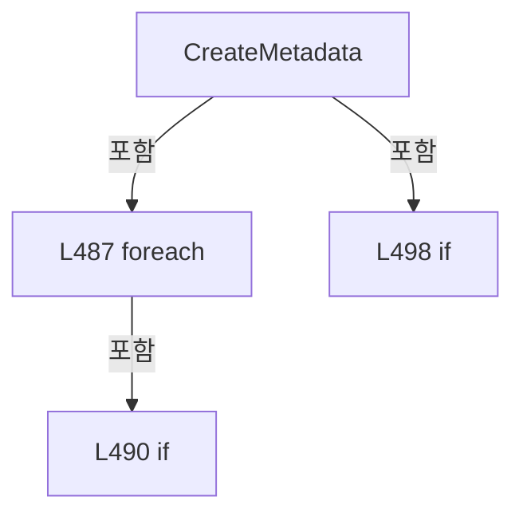

변경 전 점검: 입력/반환 타입, 위 호출자, 예외/취소 경로, 공유 상태와 저장·전송 소비자를 함께 확인합니다. 값의 단위나 물리 방향을 이름만으로 확정하지 않습니다.

### MethodDeclaration `FormatShotName` · L517–520

[Drilling.File/ReviewResult/CReviewResultFile.cs:517–520](https://github.com/kjuws10-rgb/A3Drilling/blob/5aee8e58439c9b455cae7c9593c9be986c3e682e/Drilling.File/ReviewResult/CReviewResultFile.cs#L517-L520)

| 항목 | 실제 추출 값 |
| --- | --- |
| 서명 | string Drilling.File.ReviewResult.CReviewResultFile.FormatShotName(Drilling.Common.Review.ST_REVIEW_PLAN_POINT?) |
| 접근/수식자 | Private / private, static |
| 반환/값 타입 | string |
| 소속 타입 | NamedType:Drilling.File.ReviewResult.CReviewResultFile |

입력 계약:

| 이름 | 타입 | 전달 | 선택/기본값 |
| --- | --- | --- | --- |
| point | Drilling.Common.Review.ST_REVIEW_PLAN_POINT? | None | False /  |

정적 호출자로 확인된 위치:

| 호출 파일/행 | 호출 표현식 | 런타임 분기 가능 |
| --- | --- | --- |
| [Drilling.File/ReviewResult/CReviewResultFile.cs:442–442](https://github.com/kjuws10-rgb/A3Drilling/blob/5aee8e58439c9b455cae7c9593c9be986c3e682e/Drilling.File/ReviewResult/CReviewResultFile.cs#L442-L442) | FormatShotName | False |
| [Drilling.File/ReviewResult/CReviewResultFile.cs:511–511](https://github.com/kjuws10-rgb/A3Drilling/blob/5aee8e58439c9b455cae7c9593c9be986c3e682e/Drilling.File/ReviewResult/CReviewResultFile.cs#L511-L511) | FormatShotName | False |

호출하는 대상과 해석 범위:

| 원본 행 | 표현식 | 분석 상태 | 대상/소스 위치 |
| --- | --- | --- | --- |
| 519 | CReviewShotNameFormatter.ToMatrixName | resolved | string Drilling.Common.Review.CReviewShotNameFormatter.ToMatrixName(int, int) · Drilling.Common/Review/CReviewManager.cs:3897 |

본문의 실제 연산·분기·예외·반환 순서(원문 위치 순):

| 원본 행 | 종류 | 주석 해설 |
| --- | --- | --- |
| 519 | call | 함수·델리게이트 또는 객체 생성자를 호출합니다: CReviewShotNameFormatter.ToMatrixName(point.ShotNo, point.PixelCountX) |
| 519 | conditional-expression | 조건에 따라 결과식을 선택합니다: point is null ? "" : CReviewShotNameFormatter.ToMatrixName(point.ShotNo, point.PixelCountX) |
| 519 | return | 호출자에게 값 또는 제어를 반환합니다: return point is null ? "" : CReviewShotNameFormatter.ToMatrixName(point.ShotNo, point.PixelCountX); |

변경 전 점검: 입력/반환 타입, 위 호출자, 예외/취소 경로, 공유 상태와 저장·전송 소비자를 함께 확인합니다. 값의 단위나 물리 방향을 이름만으로 확정하지 않습니다.

### MethodDeclaration `CreateResultFileName` · L522–533

[Drilling.File/ReviewResult/CReviewResultFile.cs:522–533](https://github.com/kjuws10-rgb/A3Drilling/blob/5aee8e58439c9b455cae7c9593c9be986c3e682e/Drilling.File/ReviewResult/CReviewResultFile.cs#L522-L533)

| 항목 | 실제 추출 값 |
| --- | --- |
| 서명 | string Drilling.File.ReviewResult.CReviewResultFile.CreateResultFileName(Drilling.File.ReviewResult.CReviewResultFile.ST_REVIEW_RESULT_METADATA, System.DateTimeOffset) |
| 접근/수식자 | Private / private, static |
| 반환/값 타입 | string |
| 소속 타입 | NamedType:Drilling.File.ReviewResult.CReviewResultFile |

입력 계약:

| 이름 | 타입 | 전달 | 선택/기본값 |
| --- | --- | --- | --- |
| metadata | Drilling.File.ReviewResult.CReviewResultFile.ST_REVIEW_RESULT_METADATA | None | False /  |
| savedAt | System.DateTimeOffset | None | False /  |

현재 부분 분석에서 직접 연결된 호출자는 없습니다. XAML/이벤트/인터페이스·델리게이트·외부 진입을 추가 확인해야 하며, 미사용으로 판정한 것이 아닙니다.

호출하는 대상과 해석 범위:

| 원본 행 | 표현식 | 분석 상태 | 대상/소스 위치 |
| --- | --- | --- | --- |
| 526 | .ToString | resolved | string int.ToString(System.IFormatProvider?) |
| 528 | metadata.FineLineCount.ToString | resolved | string int.ToString(System.IFormatProvider?) |
| 532 | SanitizeFileName | resolved | string Drilling.File.ReviewResult.CReviewResultFile.SanitizeFileName(string) · Drilling.File/ReviewResult/CReviewResultFile.cs:629 |

본문의 실제 연산·분기·예외·반환 순서(원문 위치 순):

| 원본 행 | 종류 | 주석 해설 |
| --- | --- | --- |
| 524 | local-declaration | 지역 변수를 선언합니다: var detail = metadata.Rule switch { "SIMPLE" => $"SIMPLE_Cell{metadata.ReferenceCellNo?.ToString(CultureInfo.InvariantCulture) ?? ""}_{metadata.ReferenceShot}", "ROUGH" => $"ROUGH_{metadata.RuleScope}_{metadata.RoughReference}", " |
| 524 | switch-expression | 값별 결과식을 선택합니다: metadata.Rule switch { "SIMPLE" => $"SIMPLE_Cell{metadata.ReferenceCellNo?.ToString(CultureInfo.InvariantCulture) ?? ""}_{metadata.ReferenceShot}", "ROUGH" => $"ROUGH_{metadata.RuleScope}_{metadata.RoughReference}", "FINE" => $"FI |
| 524 | variable-initializer | 변수의 초기값을 지정합니다: detail = metadata.Rule switch { "SIMPLE" => $"SIMPLE_Cell{metadata.ReferenceCellNo?.ToString(CultureInfo.InvariantCulture) ?? ""}_{metadata.ReferenceShot}", "ROUGH" => $"ROUGH_{metadata.RuleScope}_{metadata.RoughReference}", "FINE |
| 526 | call | 함수·델리게이트 또는 객체 생성자를 호출합니다: .ToString(CultureInfo.InvariantCulture) |
| 528 | call | 함수·델리게이트 또는 객체 생성자를 호출합니다: metadata.FineLineCount.ToString(CultureInfo.InvariantCulture) |
| 532 | call | 함수·델리게이트 또는 객체 생성자를 호출합니다: SanitizeFileName(detail) |
| 532 | return | 호출자에게 값 또는 제어를 반환합니다: return $"ReviewResult_{SanitizeFileName(detail)}_{savedAt:HHmmss}.csv"; |

제어 구문의 포함 구조(실제 실행 순서/CFG가 아닌 구문 탐색 그림):

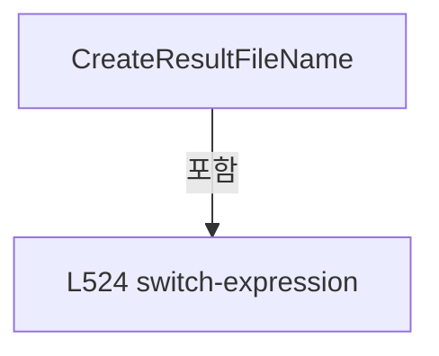

변경 전 점검: 입력/반환 타입, 위 호출자, 예외/취소 경로, 공유 상태와 저장·전송 소비자를 함께 확인합니다. 값의 단위나 물리 방향을 이름만으로 확정하지 않습니다.

### MethodDeclaration `ReadOptionalInt` · L535–538

[Drilling.File/ReviewResult/CReviewResultFile.cs:535–538](https://github.com/kjuws10-rgb/A3Drilling/blob/5aee8e58439c9b455cae7c9593c9be986c3e682e/Drilling.File/ReviewResult/CReviewResultFile.cs#L535-L538)

| 항목 | 실제 추출 값 |
| --- | --- |
| 서명 | int Drilling.File.ReviewResult.CReviewResultFile.ReadOptionalInt(System.Collections.Generic.IReadOnlyDictionary<string, string>, string, int) |
| 접근/수식자 | Private / private, static |
| 반환/값 타입 | int |
| 소속 타입 | NamedType:Drilling.File.ReviewResult.CReviewResultFile |

입력 계약:

| 이름 | 타입 | 전달 | 선택/기본값 |
| --- | --- | --- | --- |
| row | System.Collections.Generic.IReadOnlyDictionary<string, string> | None | False /  |
| name | string | None | False /  |
| defaultValue | int | None | False /  |

정적 호출자로 확인된 위치:

| 호출 파일/행 | 호출 표현식 | 런타임 분기 가능 |
| --- | --- | --- |
| [Drilling.File/ReviewResult/CReviewResultFile.cs:86–86](https://github.com/kjuws10-rgb/A3Drilling/blob/5aee8e58439c9b455cae7c9593c9be986c3e682e/Drilling.File/ReviewResult/CReviewResultFile.cs#L86-L86) | ReadOptionalInt | False |
| [Drilling.File/ReviewResult/CReviewResultFile.cs:89–89](https://github.com/kjuws10-rgb/A3Drilling/blob/5aee8e58439c9b455cae7c9593c9be986c3e682e/Drilling.File/ReviewResult/CReviewResultFile.cs#L89-L89) | ReadOptionalInt | False |
| [Drilling.File/ReviewResult/CReviewResultFile.cs:93–93](https://github.com/kjuws10-rgb/A3Drilling/blob/5aee8e58439c9b455cae7c9593c9be986c3e682e/Drilling.File/ReviewResult/CReviewResultFile.cs#L93-L93) | ReadOptionalInt | False |
| [Drilling.File/ReviewResult/CReviewResultFile.cs:95–95](https://github.com/kjuws10-rgb/A3Drilling/blob/5aee8e58439c9b455cae7c9593c9be986c3e682e/Drilling.File/ReviewResult/CReviewResultFile.cs#L95-L95) | ReadOptionalInt | False |
| [Drilling.File/ReviewResult/CReviewResultFile.cs:258–258](https://github.com/kjuws10-rgb/A3Drilling/blob/5aee8e58439c9b455cae7c9593c9be986c3e682e/Drilling.File/ReviewResult/CReviewResultFile.cs#L258-L258) | ReadOptionalInt | False |
| [Drilling.File/ReviewResult/CReviewResultFile.cs:426–426](https://github.com/kjuws10-rgb/A3Drilling/blob/5aee8e58439c9b455cae7c9593c9be986c3e682e/Drilling.File/ReviewResult/CReviewResultFile.cs#L426-L426) | ReadOptionalInt | False |

호출하는 대상과 해석 범위:

| 원본 행 | 표현식 | 분석 상태 | 대상/소스 위치 |
| --- | --- | --- | --- |
| 537 | int.TryParse | resolved | bool int.TryParse(string?, System.Globalization.NumberStyles, System.IFormatProvider?, out int) |
| 537 | CCsvParser.Get | resolved | string Drilling.File.Parser.CCsvParser.Get(System.Collections.Generic.IReadOnlyDictionary<string, string>, string) · Drilling.File/Parser/CCsvParser.cs:168 |

본문의 실제 연산·분기·예외·반환 순서(원문 위치 순):

| 원본 행 | 종류 | 주석 해설 |
| --- | --- | --- |
| 537 | call | 함수·델리게이트 또는 객체 생성자를 호출합니다: int.TryParse(CCsvParser.Get(row, name), NumberStyles.Integer, CultureInfo.InvariantCulture, out var value) |
| 537 | call | 함수·델리게이트 또는 객체 생성자를 호출합니다: CCsvParser.Get(row, name) |
| 537 | conditional-expression | 조건에 따라 결과식을 선택합니다: int.TryParse(CCsvParser.Get(row, name), NumberStyles.Integer, CultureInfo.InvariantCulture, out var value) ? value : defaultValue |
| 537 | return | 호출자에게 값 또는 제어를 반환합니다: return int.TryParse(CCsvParser.Get(row, name), NumberStyles.Integer, CultureInfo.InvariantCulture, out var value) ? value : defaultValue; |

변경 전 점검: 입력/반환 타입, 위 호출자, 예외/취소 경로, 공유 상태와 저장·전송 소비자를 함께 확인합니다. 값의 단위나 물리 방향을 이름만으로 확정하지 않습니다.

### MethodDeclaration `ReadFirstText` · L540–552

[Drilling.File/ReviewResult/CReviewResultFile.cs:540–552](https://github.com/kjuws10-rgb/A3Drilling/blob/5aee8e58439c9b455cae7c9593c9be986c3e682e/Drilling.File/ReviewResult/CReviewResultFile.cs#L540-L552)

| 항목 | 실제 추출 값 |
| --- | --- |
| 서명 | string Drilling.File.ReviewResult.CReviewResultFile.ReadFirstText(System.Collections.Generic.IReadOnlyDictionary<string, string>, params string[]) |
| 접근/수식자 | Private / private, static |
| 반환/값 타입 | string |
| 소속 타입 | NamedType:Drilling.File.ReviewResult.CReviewResultFile |

입력 계약:

| 이름 | 타입 | 전달 | 선택/기본값 |
| --- | --- | --- | --- |
| row | System.Collections.Generic.IReadOnlyDictionary<string, string> | None | False /  |
| names | string[] | None | False /  |

정적 호출자로 확인된 위치:

| 호출 파일/행 | 호출 표현식 | 런타임 분기 가능 |
| --- | --- | --- |
| [Drilling.File/ReviewResult/CReviewResultFile.cs:83–83](https://github.com/kjuws10-rgb/A3Drilling/blob/5aee8e58439c9b455cae7c9593c9be986c3e682e/Drilling.File/ReviewResult/CReviewResultFile.cs#L83-L83) | ReadFirstText | False |
| [Drilling.File/ReviewResult/CReviewResultFile.cs:84–84](https://github.com/kjuws10-rgb/A3Drilling/blob/5aee8e58439c9b455cae7c9593c9be986c3e682e/Drilling.File/ReviewResult/CReviewResultFile.cs#L84-L84) | ReadFirstText | False |
| [Drilling.File/ReviewResult/CReviewResultFile.cs:85–85](https://github.com/kjuws10-rgb/A3Drilling/blob/5aee8e58439c9b455cae7c9593c9be986c3e682e/Drilling.File/ReviewResult/CReviewResultFile.cs#L85-L85) | ReadFirstText | False |
| [Drilling.File/ReviewResult/CReviewResultFile.cs:272–272](https://github.com/kjuws10-rgb/A3Drilling/blob/5aee8e58439c9b455cae7c9593c9be986c3e682e/Drilling.File/ReviewResult/CReviewResultFile.cs#L272-L272) | ReadFirstText | False |
| [Drilling.File/ReviewResult/CReviewResultFile.cs:280–280](https://github.com/kjuws10-rgb/A3Drilling/blob/5aee8e58439c9b455cae7c9593c9be986c3e682e/Drilling.File/ReviewResult/CReviewResultFile.cs#L280-L280) | ReadFirstText | False |
| [Drilling.File/ReviewResult/CReviewResultFile.cs:289–289](https://github.com/kjuws10-rgb/A3Drilling/blob/5aee8e58439c9b455cae7c9593c9be986c3e682e/Drilling.File/ReviewResult/CReviewResultFile.cs#L289-L289) | ReadFirstText | False |
| [Drilling.File/ReviewResult/CReviewResultFile.cs:405–405](https://github.com/kjuws10-rgb/A3Drilling/blob/5aee8e58439c9b455cae7c9593c9be986c3e682e/Drilling.File/ReviewResult/CReviewResultFile.cs#L405-L405) | ReadFirstText | False |
| [Drilling.File/ReviewResult/CReviewResultFile.cs:418–418](https://github.com/kjuws10-rgb/A3Drilling/blob/5aee8e58439c9b455cae7c9593c9be986c3e682e/Drilling.File/ReviewResult/CReviewResultFile.cs#L418-L418) | ReadFirstText | False |
| [Drilling.File/ReviewResult/CReviewResultFile.cs:556–556](https://github.com/kjuws10-rgb/A3Drilling/blob/5aee8e58439c9b455cae7c9593c9be986c3e682e/Drilling.File/ReviewResult/CReviewResultFile.cs#L556-L556) | ReadFirstText | False |
| [Drilling.File/ReviewResult/CReviewResultFile.cs:573–573](https://github.com/kjuws10-rgb/A3Drilling/blob/5aee8e58439c9b455cae7c9593c9be986c3e682e/Drilling.File/ReviewResult/CReviewResultFile.cs#L573-L573) | ReadFirstText | False |
| [Drilling.File/ReviewResult/CReviewResultFile.cs:596–596](https://github.com/kjuws10-rgb/A3Drilling/blob/5aee8e58439c9b455cae7c9593c9be986c3e682e/Drilling.File/ReviewResult/CReviewResultFile.cs#L596-L596) | ReadFirstText | False |

호출하는 대상과 해석 범위:

| 원본 행 | 표현식 | 분석 상태 | 대상/소스 위치 |
| --- | --- | --- | --- |
| 544 | CCsvParser.Get(row, name).Trim | resolved | string string.Trim() |
| 544 | CCsvParser.Get | resolved | string Drilling.File.Parser.CCsvParser.Get(System.Collections.Generic.IReadOnlyDictionary<string, string>, string) · Drilling.File/Parser/CCsvParser.cs:168 |
| 545 | string.IsNullOrWhiteSpace | resolved | bool string.IsNullOrWhiteSpace(string?) |

본문의 실제 연산·분기·예외·반환 순서(원문 위치 순):

| 원본 행 | 종류 | 주석 해설 |
| --- | --- | --- |
| 542 | foreach | 컬렉션 요소를 순회합니다: foreach (var name in names) |
| 544 | call | 함수·델리게이트 또는 객체 생성자를 호출합니다: CCsvParser.Get(row, name).Trim() |
| 544 | call | 함수·델리게이트 또는 객체 생성자를 호출합니다: CCsvParser.Get(row, name) |
| 544 | local-declaration | 지역 변수를 선언합니다: var value = CCsvParser.Get(row, name).Trim(); |
| 544 | variable-initializer | 변수의 초기값을 지정합니다: value = CCsvParser.Get(row, name).Trim() |
| 545 | call | 함수·델리게이트 또는 객체 생성자를 호출합니다: string.IsNullOrWhiteSpace(value) |
| 545 | if | 조건에 따라 분기합니다: if (!string.IsNullOrWhiteSpace(value)) |
| 547 | return | 호출자에게 값 또는 제어를 반환합니다: return value; |
| 551 | return | 호출자에게 값 또는 제어를 반환합니다: return ""; |

제어 구문의 포함 구조(실제 실행 순서/CFG가 아닌 구문 탐색 그림):

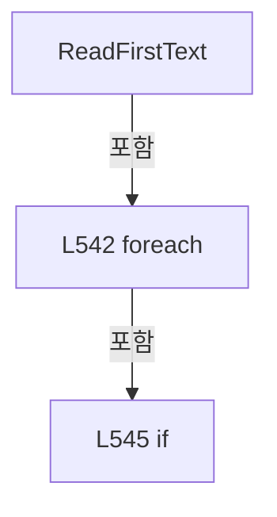

변경 전 점검: 입력/반환 타입, 위 호출자, 예외/취소 경로, 공유 상태와 저장·전송 소비자를 함께 확인합니다. 값의 단위나 물리 방향을 이름만으로 확정하지 않습니다.

### MethodDeclaration `ReadRequiredPositiveInt` · L554–569

[Drilling.File/ReviewResult/CReviewResultFile.cs:554–569](https://github.com/kjuws10-rgb/A3Drilling/blob/5aee8e58439c9b455cae7c9593c9be986c3e682e/Drilling.File/ReviewResult/CReviewResultFile.cs#L554-L569)

| 항목 | 실제 추출 값 |
| --- | --- |
| 서명 | int Drilling.File.ReviewResult.CReviewResultFile.ReadRequiredPositiveInt(System.Collections.Generic.IReadOnlyDictionary<string, string>, int, params string[]) |
| 접근/수식자 | Private / private, static |
| 반환/값 타입 | int |
| 소속 타입 | NamedType:Drilling.File.ReviewResult.CReviewResultFile |

입력 계약:

| 이름 | 타입 | 전달 | 선택/기본값 |
| --- | --- | --- | --- |
| row | System.Collections.Generic.IReadOnlyDictionary<string, string> | None | False /  |
| rowNo | int | None | False /  |
| names | string[] | None | False /  |

정적 호출자로 확인된 위치:

| 호출 파일/행 | 호출 표현식 | 런타임 분기 가능 |
| --- | --- | --- |
| [Drilling.File/ReviewResult/CReviewResultFile.cs:414–414](https://github.com/kjuws10-rgb/A3Drilling/blob/5aee8e58439c9b455cae7c9593c9be986c3e682e/Drilling.File/ReviewResult/CReviewResultFile.cs#L414-L414) | ReadRequiredPositiveInt | False |
| [Drilling.File/ReviewResult/CReviewResultFile.cs:415–415](https://github.com/kjuws10-rgb/A3Drilling/blob/5aee8e58439c9b455cae7c9593c9be986c3e682e/Drilling.File/ReviewResult/CReviewResultFile.cs#L415-L415) | ReadRequiredPositiveInt | False |

호출하는 대상과 해석 범위:

| 원본 행 | 표현식 | 분석 상태 | 대상/소스 위치 |
| --- | --- | --- | --- |
| 556 | ReadFirstText | resolved | string Drilling.File.ReviewResult.CReviewResultFile.ReadFirstText(System.Collections.Generic.IReadOnlyDictionary<string, string>, params string[]) · Drilling.File/ReviewResult/CReviewResultFile.cs:540 |
| 557 | int.TryParse | resolved | bool int.TryParse(string?, System.Globalization.NumberStyles, System.IFormatProvider?, out int) |
| 562 | new string | resolved | string.String(char[]?) |
| 562 | text.Where(char.IsDigit).ToArray | resolved | char[] System.Collections.Generic.IEnumerable<char>.ToArray<char>() |
| 562 | text.Where | resolved | System.Collections.Generic.IEnumerable<char> System.Collections.Generic.IEnumerable<char>.Where<char>(System.Func<char, bool>) |
| 563 | int.TryParse | resolved | bool int.TryParse(string?, System.Globalization.NumberStyles, System.IFormatProvider?, out int) |
| 568 | new InvalidDataException | resolved | System.IO.InvalidDataException.InvalidDataException(string?) |
| 568 | string.Join | resolved | string string.Join(string?, params string?[]) |

본문의 실제 연산·분기·예외·반환 순서(원문 위치 순):

| 원본 행 | 종류 | 주석 해설 |
| --- | --- | --- |
| 556 | call | 함수·델리게이트 또는 객체 생성자를 호출합니다: ReadFirstText(row, names) |
| 556 | local-declaration | 지역 변수를 선언합니다: var text = ReadFirstText(row, names); |
| 556 | variable-initializer | 변수의 초기값을 지정합니다: text = ReadFirstText(row, names) |
| 557 | call | 함수·델리게이트 또는 객체 생성자를 호출합니다: int.TryParse(text, NumberStyles.Integer, CultureInfo.InvariantCulture, out var value) |
| 557 | if | 조건에 따라 분기합니다: if (int.TryParse(text, NumberStyles.Integer, CultureInfo.InvariantCulture, out var value) && value > 0) |
| 559 | return | 호출자에게 값 또는 제어를 반환합니다: return value; |
| 562 | call | 함수·델리게이트 또는 객체 생성자를 호출합니다: new string(text.Where(char.IsDigit).ToArray()) |
| 562 | call | 함수·델리게이트 또는 객체 생성자를 호출합니다: text.Where(char.IsDigit).ToArray() |
| 562 | call | 함수·델리게이트 또는 객체 생성자를 호출합니다: text.Where(char.IsDigit) |
| 562 | local-declaration | 지역 변수를 선언합니다: var digits = new string(text.Where(char.IsDigit).ToArray()); |
| 562 | variable-initializer | 변수의 초기값을 지정합니다: digits = new string(text.Where(char.IsDigit).ToArray()) |
| 563 | call | 함수·델리게이트 또는 객체 생성자를 호출합니다: int.TryParse(digits, NumberStyles.Integer, CultureInfo.InvariantCulture, out value) |
| 563 | if | 조건에 따라 분기합니다: if (int.TryParse(digits, NumberStyles.Integer, CultureInfo.InvariantCulture, out value) && value > 0) |
| 565 | return | 호출자에게 값 또는 제어를 반환합니다: return value; |
| 568 | call | 함수·델리게이트 또는 객체 생성자를 호출합니다: new InvalidDataException($"Review Result validation failed. Row {rowNo} / {string.Join(" or ", names)} must identify a positive number.") |
| 568 | call | 함수·델리게이트 또는 객체 생성자를 호출합니다: string.Join(" or ", names) |
| 568 | throw | 예외를 발생/전달합니다: throw new InvalidDataException($"Review Result validation failed. Row {rowNo} / {string.Join(" or ", names)} must identify a positive number."); |

제어 구문의 포함 구조(실제 실행 순서/CFG가 아닌 구문 탐색 그림):

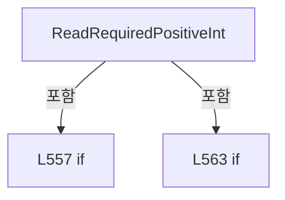

변경 전 점검: 입력/반환 타입, 위 호출자, 예외/취소 경로, 공유 상태와 저장·전송 소비자를 함께 확인합니다. 값의 단위나 물리 방향을 이름만으로 확정하지 않습니다.

### MethodDeclaration `ReadOneBasedIndex` · L571–577

[Drilling.File/ReviewResult/CReviewResultFile.cs:571–577](https://github.com/kjuws10-rgb/A3Drilling/blob/5aee8e58439c9b455cae7c9593c9be986c3e682e/Drilling.File/ReviewResult/CReviewResultFile.cs#L571-L577)

| 항목 | 실제 추출 값 |
| --- | --- |
| 서명 | int Drilling.File.ReviewResult.CReviewResultFile.ReadOneBasedIndex(System.Collections.Generic.IReadOnlyDictionary<string, string>, params string[]) |
| 접근/수식자 | Private / private, static |
| 반환/값 타입 | int |
| 소속 타입 | NamedType:Drilling.File.ReviewResult.CReviewResultFile |

입력 계약:

| 이름 | 타입 | 전달 | 선택/기본값 |
| --- | --- | --- | --- |
| row | System.Collections.Generic.IReadOnlyDictionary<string, string> | None | False /  |
| names | string[] | None | False /  |

정적 호출자로 확인된 위치:

| 호출 파일/행 | 호출 표현식 | 런타임 분기 가능 |
| --- | --- | --- |
| [Drilling.File/ReviewResult/CReviewResultFile.cs:427–427](https://github.com/kjuws10-rgb/A3Drilling/blob/5aee8e58439c9b455cae7c9593c9be986c3e682e/Drilling.File/ReviewResult/CReviewResultFile.cs#L427-L427) | ReadOneBasedIndex | False |
| [Drilling.File/ReviewResult/CReviewResultFile.cs:428–428](https://github.com/kjuws10-rgb/A3Drilling/blob/5aee8e58439c9b455cae7c9593c9be986c3e682e/Drilling.File/ReviewResult/CReviewResultFile.cs#L428-L428) | ReadOneBasedIndex | False |

호출하는 대상과 해석 범위:

| 원본 행 | 표현식 | 분석 상태 | 대상/소스 위치 |
| --- | --- | --- | --- |
| 573 | ReadFirstText | resolved | string Drilling.File.ReviewResult.CReviewResultFile.ReadFirstText(System.Collections.Generic.IReadOnlyDictionary<string, string>, params string[]) · Drilling.File/ReviewResult/CReviewResultFile.cs:540 |
| 574 | int.TryParse | resolved | bool int.TryParse(string?, System.Globalization.NumberStyles, System.IFormatProvider?, out int) |

본문의 실제 연산·분기·예외·반환 순서(원문 위치 순):

| 원본 행 | 종류 | 주석 해설 |
| --- | --- | --- |
| 573 | call | 함수·델리게이트 또는 객체 생성자를 호출합니다: ReadFirstText(row, names) |
| 573 | local-declaration | 지역 변수를 선언합니다: var text = ReadFirstText(row, names); |
| 573 | variable-initializer | 변수의 초기값을 지정합니다: text = ReadFirstText(row, names) |
| 574 | call | 함수·델리게이트 또는 객체 생성자를 호출합니다: int.TryParse(text, NumberStyles.Integer, CultureInfo.InvariantCulture, out var value) |
| 574 | conditional-expression | 조건에 따라 결과식을 선택합니다: int.TryParse(text, NumberStyles.Integer, CultureInfo.InvariantCulture, out var value) && value > 0 ? value - 1 : -1 |
| 574 | return | 호출자에게 값 또는 제어를 반환합니다: return int.TryParse(text, NumberStyles.Integer, CultureInfo.InvariantCulture, out var value) && value > 0 ? value - 1 : -1; |

변경 전 점검: 입력/반환 타입, 위 호출자, 예외/취소 경로, 공유 상태와 저장·전송 소비자를 함께 확인합니다. 값의 단위나 물리 방향을 이름만으로 확정하지 않습니다.

### MethodDeclaration `ReadOptionalFiniteDouble` · L579–582

[Drilling.File/ReviewResult/CReviewResultFile.cs:579–582](https://github.com/kjuws10-rgb/A3Drilling/blob/5aee8e58439c9b455cae7c9593c9be986c3e682e/Drilling.File/ReviewResult/CReviewResultFile.cs#L579-L582)

| 항목 | 실제 추출 값 |
| --- | --- |
| 서명 | double Drilling.File.ReviewResult.CReviewResultFile.ReadOptionalFiniteDouble(System.Collections.Generic.IReadOnlyDictionary<string, string>, params string[]) |
| 접근/수식자 | Private / private, static |
| 반환/값 타입 | double |
| 소속 타입 | NamedType:Drilling.File.ReviewResult.CReviewResultFile |

입력 계약:

| 이름 | 타입 | 전달 | 선택/기본값 |
| --- | --- | --- | --- |
| row | System.Collections.Generic.IReadOnlyDictionary<string, string> | None | False /  |
| names | string[] | None | False /  |

정적 호출자로 확인된 위치:

| 호출 파일/행 | 호출 표현식 | 런타임 분기 가능 |
| --- | --- | --- |
| [Drilling.File/ReviewResult/CReviewResultFile.cs:380–380](https://github.com/kjuws10-rgb/A3Drilling/blob/5aee8e58439c9b455cae7c9593c9be986c3e682e/Drilling.File/ReviewResult/CReviewResultFile.cs#L380-L380) | ReadOptionalFiniteDouble | False |
| [Drilling.File/ReviewResult/CReviewResultFile.cs:381–381](https://github.com/kjuws10-rgb/A3Drilling/blob/5aee8e58439c9b455cae7c9593c9be986c3e682e/Drilling.File/ReviewResult/CReviewResultFile.cs#L381-L381) | ReadOptionalFiniteDouble | False |
| [Drilling.File/ReviewResult/CReviewResultFile.cs:416–416](https://github.com/kjuws10-rgb/A3Drilling/blob/5aee8e58439c9b455cae7c9593c9be986c3e682e/Drilling.File/ReviewResult/CReviewResultFile.cs#L416-L416) | ReadOptionalFiniteDouble | False |
| [Drilling.File/ReviewResult/CReviewResultFile.cs:417–417](https://github.com/kjuws10-rgb/A3Drilling/blob/5aee8e58439c9b455cae7c9593c9be986c3e682e/Drilling.File/ReviewResult/CReviewResultFile.cs#L417-L417) | ReadOptionalFiniteDouble | False |

호출하는 대상과 해석 범위:

| 원본 행 | 표현식 | 분석 상태 | 대상/소스 위치 |
| --- | --- | --- | --- |
| 581 | ReadOptionalNullableFiniteDouble | resolved | double? Drilling.File.ReviewResult.CReviewResultFile.ReadOptionalNullableFiniteDouble(System.Collections.Generic.IReadOnlyDictionary<string, string>, params string[]) · Drilling.File/ReviewResult/CReviewResultFile.cs:594 |

본문의 실제 연산·분기·예외·반환 순서(원문 위치 순):

| 원본 행 | 종류 | 주석 해설 |
| --- | --- | --- |
| 581 | call | 함수·델리게이트 또는 객체 생성자를 호출합니다: ReadOptionalNullableFiniteDouble(row, names) |
| 581 | return | 호출자에게 값 또는 제어를 반환합니다: return ReadOptionalNullableFiniteDouble(row, names) ?? 0.0; |

변경 전 점검: 입력/반환 타입, 위 호출자, 예외/취소 경로, 공유 상태와 저장·전송 소비자를 함께 확인합니다. 값의 단위나 물리 방향을 이름만으로 확정하지 않습니다.

### MethodDeclaration `ReadOptionalDouble` · L584–592

[Drilling.File/ReviewResult/CReviewResultFile.cs:584–592](https://github.com/kjuws10-rgb/A3Drilling/blob/5aee8e58439c9b455cae7c9593c9be986c3e682e/Drilling.File/ReviewResult/CReviewResultFile.cs#L584-L592)

| 항목 | 실제 추출 값 |
| --- | --- |
| 서명 | double Drilling.File.ReviewResult.CReviewResultFile.ReadOptionalDouble(System.Collections.Generic.IReadOnlyDictionary<string, string>, string) |
| 접근/수식자 | Private / private, static |
| 반환/값 타입 | double |
| 소속 타입 | NamedType:Drilling.File.ReviewResult.CReviewResultFile |

입력 계약:

| 이름 | 타입 | 전달 | 선택/기본값 |
| --- | --- | --- | --- |
| row | System.Collections.Generic.IReadOnlyDictionary<string, string> | None | False /  |
| name | string | None | False /  |

정적 호출자로 확인된 위치:

| 호출 파일/행 | 호출 표현식 | 런타임 분기 가능 |
| --- | --- | --- |
| [Drilling.File/ReviewResult/CReviewResultFile.cs:96–96](https://github.com/kjuws10-rgb/A3Drilling/blob/5aee8e58439c9b455cae7c9593c9be986c3e682e/Drilling.File/ReviewResult/CReviewResultFile.cs#L96-L96) | ReadOptionalDouble | False |
| [Drilling.File/ReviewResult/CReviewResultFile.cs:97–97](https://github.com/kjuws10-rgb/A3Drilling/blob/5aee8e58439c9b455cae7c9593c9be986c3e682e/Drilling.File/ReviewResult/CReviewResultFile.cs#L97-L97) | ReadOptionalDouble | False |

호출하는 대상과 해석 범위:

| 원본 행 | 표현식 | 분석 상태 | 대상/소스 위치 |
| --- | --- | --- | --- |
| 586 | CCsvParser.Get | resolved | string Drilling.File.Parser.CCsvParser.Get(System.Collections.Generic.IReadOnlyDictionary<string, string>, string) · Drilling.File/Parser/CCsvParser.cs:168 |
| 587 | string.IsNullOrWhiteSpace | resolved | bool string.IsNullOrWhiteSpace(string?) |
| 589 | double.TryParse | resolved | bool double.TryParse(string?, System.Globalization.NumberStyles, System.IFormatProvider?, out double) |
| 589 | double.IsFinite | resolved | bool double.IsFinite(double) |
| 590 | new InvalidDataException | resolved | System.IO.InvalidDataException.InvalidDataException(string?) |

본문의 실제 연산·분기·예외·반환 순서(원문 위치 순):

| 원본 행 | 종류 | 주석 해설 |
| --- | --- | --- |
| 586 | call | 함수·델리게이트 또는 객체 생성자를 호출합니다: CCsvParser.Get(row, name) |
| 586 | local-declaration | 지역 변수를 선언합니다: var text = CCsvParser.Get(row, name); |
| 586 | variable-initializer | 변수의 초기값을 지정합니다: text = CCsvParser.Get(row, name) |
| 587 | call | 함수·델리게이트 또는 객체 생성자를 호출합니다: string.IsNullOrWhiteSpace(text) |
| 587 | if | 조건에 따라 분기합니다: if (string.IsNullOrWhiteSpace(text)) |
| 588 | return | 호출자에게 값 또는 제어를 반환합니다: return 0.0; |
| 589 | call | 함수·델리게이트 또는 객체 생성자를 호출합니다: double.TryParse(text, NumberStyles.Float, CultureInfo.InvariantCulture, out var value) |
| 589 | call | 함수·델리게이트 또는 객체 생성자를 호출합니다: double.IsFinite(value) |
| 589 | if | 조건에 따라 분기합니다: if (!double.TryParse(text, NumberStyles.Float, CultureInfo.InvariantCulture, out var value) &#124;&#124; !double.IsFinite(value)) |
| 590 | call | 함수·델리게이트 또는 객체 생성자를 호출합니다: new InvalidDataException($"Review Result validation failed. {name} must be a finite number.") |
| 590 | throw | 예외를 발생/전달합니다: throw new InvalidDataException($"Review Result validation failed. {name} must be a finite number."); |
| 591 | return | 호출자에게 값 또는 제어를 반환합니다: return value; |

제어 구문의 포함 구조(실제 실행 순서/CFG가 아닌 구문 탐색 그림):

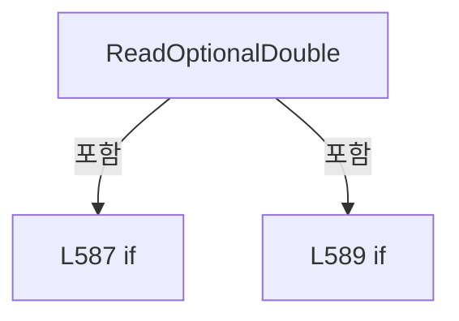

변경 전 점검: 입력/반환 타입, 위 호출자, 예외/취소 경로, 공유 상태와 저장·전송 소비자를 함께 확인합니다. 값의 단위나 물리 방향을 이름만으로 확정하지 않습니다.

### MethodDeclaration `ReadOptionalNullableFiniteDouble` · L594–600

[Drilling.File/ReviewResult/CReviewResultFile.cs:594–600](https://github.com/kjuws10-rgb/A3Drilling/blob/5aee8e58439c9b455cae7c9593c9be986c3e682e/Drilling.File/ReviewResult/CReviewResultFile.cs#L594-L600)

| 항목 | 실제 추출 값 |
| --- | --- |
| 서명 | double? Drilling.File.ReviewResult.CReviewResultFile.ReadOptionalNullableFiniteDouble(System.Collections.Generic.IReadOnlyDictionary<string, string>, params string[]) |
| 접근/수식자 | Private / private, static |
| 반환/값 타입 | double? |
| 소속 타입 | NamedType:Drilling.File.ReviewResult.CReviewResultFile |

입력 계약:

| 이름 | 타입 | 전달 | 선택/기본값 |
| --- | --- | --- | --- |
| row | System.Collections.Generic.IReadOnlyDictionary<string, string> | None | False /  |
| names | string[] | None | False /  |

정적 호출자로 확인된 위치:

| 호출 파일/행 | 호출 표현식 | 런타임 분기 가능 |
| --- | --- | --- |
| [Drilling.File/ReviewResult/CReviewResultFile.cs:429–429](https://github.com/kjuws10-rgb/A3Drilling/blob/5aee8e58439c9b455cae7c9593c9be986c3e682e/Drilling.File/ReviewResult/CReviewResultFile.cs#L429-L429) | ReadOptionalNullableFiniteDouble | False |
| [Drilling.File/ReviewResult/CReviewResultFile.cs:430–430](https://github.com/kjuws10-rgb/A3Drilling/blob/5aee8e58439c9b455cae7c9593c9be986c3e682e/Drilling.File/ReviewResult/CReviewResultFile.cs#L430-L430) | ReadOptionalNullableFiniteDouble | False |
| [Drilling.File/ReviewResult/CReviewResultFile.cs:581–581](https://github.com/kjuws10-rgb/A3Drilling/blob/5aee8e58439c9b455cae7c9593c9be986c3e682e/Drilling.File/ReviewResult/CReviewResultFile.cs#L581-L581) | ReadOptionalNullableFiniteDouble | False |

호출하는 대상과 해석 범위:

| 원본 행 | 표현식 | 분석 상태 | 대상/소스 위치 |
| --- | --- | --- | --- |
| 596 | ReadFirstText | resolved | string Drilling.File.ReviewResult.CReviewResultFile.ReadFirstText(System.Collections.Generic.IReadOnlyDictionary<string, string>, params string[]) · Drilling.File/ReviewResult/CReviewResultFile.cs:540 |
| 597 | double.TryParse | resolved | bool double.TryParse(string?, System.Globalization.NumberStyles, System.IFormatProvider?, out double) |
| 597 | double.IsFinite | resolved | bool double.IsFinite(double) |

본문의 실제 연산·분기·예외·반환 순서(원문 위치 순):

| 원본 행 | 종류 | 주석 해설 |
| --- | --- | --- |
| 596 | call | 함수·델리게이트 또는 객체 생성자를 호출합니다: ReadFirstText(row, names) |
| 596 | local-declaration | 지역 변수를 선언합니다: var text = ReadFirstText(row, names); |
| 596 | variable-initializer | 변수의 초기값을 지정합니다: text = ReadFirstText(row, names) |
| 597 | call | 함수·델리게이트 또는 객체 생성자를 호출합니다: double.TryParse(text, NumberStyles.Float, CultureInfo.InvariantCulture, out var value) |
| 597 | call | 함수·델리게이트 또는 객체 생성자를 호출합니다: double.IsFinite(value) |
| 597 | conditional-expression | 조건에 따라 결과식을 선택합니다: double.TryParse(text, NumberStyles.Float, CultureInfo.InvariantCulture, out var value) && double.IsFinite(value) ? value : null |
| 597 | return | 호출자에게 값 또는 제어를 반환합니다: return double.TryParse(text, NumberStyles.Float, CultureInfo.InvariantCulture, out var value) && double.IsFinite(value) ? value : null; |

변경 전 점검: 입력/반환 타입, 위 호출자, 예외/취소 경로, 공유 상태와 저장·전송 소비자를 함께 확인합니다. 값의 단위나 물리 방향을 이름만으로 확정하지 않습니다.

### MethodDeclaration `NormalizeResultStatus` · L602–607

[Drilling.File/ReviewResult/CReviewResultFile.cs:602–607](https://github.com/kjuws10-rgb/A3Drilling/blob/5aee8e58439c9b455cae7c9593c9be986c3e682e/Drilling.File/ReviewResult/CReviewResultFile.cs#L602-L607)

| 항목 | 실제 추출 값 |
| --- | --- |
| 서명 | string Drilling.File.ReviewResult.CReviewResultFile.NormalizeResultStatus(string?) |
| 접근/수식자 | Private / private, static |
| 반환/값 타입 | string |
| 소속 타입 | NamedType:Drilling.File.ReviewResult.CReviewResultFile |

입력 계약:

| 이름 | 타입 | 전달 | 선택/기본값 |
| --- | --- | --- | --- |
| resultStatus | string? | None | False /  |

정적 호출자로 확인된 위치:

| 호출 파일/행 | 호출 표현식 | 런타임 분기 가능 |
| --- | --- | --- |
| [Drilling.File/ReviewResult/CReviewResultFile.cs:85–85](https://github.com/kjuws10-rgb/A3Drilling/blob/5aee8e58439c9b455cae7c9593c9be986c3e682e/Drilling.File/ReviewResult/CReviewResultFile.cs#L85-L85) | NormalizeResultStatus | False |
| [Drilling.File/ReviewResult/CReviewResultFile.cs:450–450](https://github.com/kjuws10-rgb/A3Drilling/blob/5aee8e58439c9b455cae7c9593c9be986c3e682e/Drilling.File/ReviewResult/CReviewResultFile.cs#L450-L450) | NormalizeResultStatus | False |

호출하는 대상과 해석 범위:

| 원본 행 | 표현식 | 분석 상태 | 대상/소스 위치 |
| --- | --- | --- | --- |
| 604 | string.IsNullOrWhiteSpace | resolved | bool string.IsNullOrWhiteSpace(string?) |
| 606 | resultStatus.Trim().ToUpperInvariant | resolved | string string.ToUpperInvariant() |
| 606 | resultStatus.Trim | resolved | string string.Trim() |

본문의 실제 연산·분기·예외·반환 순서(원문 위치 순):

| 원본 행 | 종류 | 주석 해설 |
| --- | --- | --- |
| 604 | call | 함수·델리게이트 또는 객체 생성자를 호출합니다: string.IsNullOrWhiteSpace(resultStatus) |
| 604 | conditional-expression | 조건에 따라 결과식을 선택합니다: string.IsNullOrWhiteSpace(resultStatus) ? "COMPLETED" : resultStatus.Trim().ToUpperInvariant() |
| 604 | return | 호출자에게 값 또는 제어를 반환합니다: return string.IsNullOrWhiteSpace(resultStatus) ? "COMPLETED" : resultStatus.Trim().ToUpperInvariant(); |
| 606 | call | 함수·델리게이트 또는 객체 생성자를 호출합니다: resultStatus.Trim().ToUpperInvariant() |
| 606 | call | 함수·델리게이트 또는 객체 생성자를 호출합니다: resultStatus.Trim() |

변경 전 점검: 입력/반환 타입, 위 호출자, 예외/취소 경로, 공유 상태와 저장·전송 소비자를 함께 확인합니다. 값의 단위나 물리 방향을 이름만으로 확정하지 않습니다.

### MethodDeclaration `NormalizeInspectionMethod` · L609–612

[Drilling.File/ReviewResult/CReviewResultFile.cs:609–612](https://github.com/kjuws10-rgb/A3Drilling/blob/5aee8e58439c9b455cae7c9593c9be986c3e682e/Drilling.File/ReviewResult/CReviewResultFile.cs#L609-L612)

| 항목 | 실제 추출 값 |
| --- | --- |
| 서명 | string Drilling.File.ReviewResult.CReviewResultFile.NormalizeInspectionMethod(string?) |
| 접근/수식자 | Private / private, static |
| 반환/값 타입 | string |
| 소속 타입 | NamedType:Drilling.File.ReviewResult.CReviewResultFile |

입력 계약:

| 이름 | 타입 | 전달 | 선택/기본값 |
| --- | --- | --- | --- |
| inspectionMethod | string? | None | False /  |

현재 부분 분석에서 직접 연결된 호출자는 없습니다. XAML/이벤트/인터페이스·델리게이트·외부 진입을 추가 확인해야 하며, 미사용으로 판정한 것이 아닙니다.

호출하는 대상과 해석 범위:

| 원본 행 | 표현식 | 분석 상태 | 대상/소스 위치 |
| --- | --- | --- | --- |
| 611 | .Trim().Equals | resolved | bool string.Equals(string?, System.StringComparison) |
| 611 | .Trim | resolved | string string.Trim() |

본문의 실제 연산·분기·예외·반환 순서(원문 위치 순):

| 원본 행 | 종류 | 주석 해설 |
| --- | --- | --- |
| 611 | call | 함수·델리게이트 또는 객체 생성자를 호출합니다: .Trim().Equals("IOF", StringComparison.OrdinalIgnoreCase) |
| 611 | call | 함수·델리게이트 또는 객체 생성자를 호출합니다: .Trim() |
| 611 | conditional-expression | 조건에 따라 결과식을 선택합니다: inspectionMethod?.Trim().Equals("IOF", StringComparison.OrdinalIgnoreCase) == true ? "IOF" : "P2P" |
| 611 | return | 호출자에게 값 또는 제어를 반환합니다: return inspectionMethod?.Trim().Equals("IOF", StringComparison.OrdinalIgnoreCase) == true ? "IOF" : "P2P"; |

변경 전 점검: 입력/반환 타입, 위 호출자, 예외/취소 경로, 공유 상태와 저장·전송 소비자를 함께 확인합니다. 값의 단위나 물리 방향을 이름만으로 확정하지 않습니다.

### MethodDeclaration `ReadOptionalNullableInt` · L614–617

[Drilling.File/ReviewResult/CReviewResultFile.cs:614–617](https://github.com/kjuws10-rgb/A3Drilling/blob/5aee8e58439c9b455cae7c9593c9be986c3e682e/Drilling.File/ReviewResult/CReviewResultFile.cs#L614-L617)

| 항목 | 실제 추출 값 |
| --- | --- |
| 서명 | int? Drilling.File.ReviewResult.CReviewResultFile.ReadOptionalNullableInt(System.Collections.Generic.IReadOnlyDictionary<string, string>, string) |
| 접근/수식자 | Private / private, static |
| 반환/값 타입 | int? |
| 소속 타입 | NamedType:Drilling.File.ReviewResult.CReviewResultFile |

입력 계약:

| 이름 | 타입 | 전달 | 선택/기본값 |
| --- | --- | --- | --- |
| row | System.Collections.Generic.IReadOnlyDictionary<string, string> | None | False /  |
| name | string | None | False /  |

정적 호출자로 확인된 위치:

| 호출 파일/행 | 호출 표현식 | 런타임 분기 가능 |
| --- | --- | --- |
| [Drilling.File/ReviewResult/CReviewResultFile.cs:90–90](https://github.com/kjuws10-rgb/A3Drilling/blob/5aee8e58439c9b455cae7c9593c9be986c3e682e/Drilling.File/ReviewResult/CReviewResultFile.cs#L90-L90) | ReadOptionalNullableInt | False |

호출하는 대상과 해석 범위:

| 원본 행 | 표현식 | 분석 상태 | 대상/소스 위치 |
| --- | --- | --- | --- |
| 616 | int.TryParse | resolved | bool int.TryParse(string?, System.Globalization.NumberStyles, System.IFormatProvider?, out int) |
| 616 | CCsvParser.Get | resolved | string Drilling.File.Parser.CCsvParser.Get(System.Collections.Generic.IReadOnlyDictionary<string, string>, string) · Drilling.File/Parser/CCsvParser.cs:168 |

본문의 실제 연산·분기·예외·반환 순서(원문 위치 순):

| 원본 행 | 종류 | 주석 해설 |
| --- | --- | --- |
| 616 | call | 함수·델리게이트 또는 객체 생성자를 호출합니다: int.TryParse(CCsvParser.Get(row, name), NumberStyles.Integer, CultureInfo.InvariantCulture, out var value) |
| 616 | call | 함수·델리게이트 또는 객체 생성자를 호출합니다: CCsvParser.Get(row, name) |
| 616 | conditional-expression | 조건에 따라 결과식을 선택합니다: int.TryParse(CCsvParser.Get(row, name), NumberStyles.Integer, CultureInfo.InvariantCulture, out var value) ? value : null |
| 616 | return | 호출자에게 값 또는 제어를 반환합니다: return int.TryParse(CCsvParser.Get(row, name), NumberStyles.Integer, CultureInfo.InvariantCulture, out var value) ? value : null; |

변경 전 점검: 입력/반환 타입, 위 호출자, 예외/취소 경로, 공유 상태와 저장·전송 소비자를 함께 확인합니다. 값의 단위나 물리 방향을 이름만으로 확정하지 않습니다.

### MethodDeclaration `FormatDate` · L619–622

[Drilling.File/ReviewResult/CReviewResultFile.cs:619–622](https://github.com/kjuws10-rgb/A3Drilling/blob/5aee8e58439c9b455cae7c9593c9be986c3e682e/Drilling.File/ReviewResult/CReviewResultFile.cs#L619-L622)

| 항목 | 실제 추출 값 |
| --- | --- |
| 서명 | string Drilling.File.ReviewResult.CReviewResultFile.FormatDate(System.DateTimeOffset?) |
| 접근/수식자 | Private / private, static |
| 반환/값 타입 | string |
| 소속 타입 | NamedType:Drilling.File.ReviewResult.CReviewResultFile |

입력 계약:

| 이름 | 타입 | 전달 | 선택/기본값 |
| --- | --- | --- | --- |
| value | System.DateTimeOffset? | None | False /  |

정적 호출자로 확인된 위치:

| 호출 파일/행 | 호출 표현식 | 런타임 분기 가능 |
| --- | --- | --- |
| [Drilling.File/ReviewResult/CReviewResultFile.cs:357–357](https://github.com/kjuws10-rgb/A3Drilling/blob/5aee8e58439c9b455cae7c9593c9be986c3e682e/Drilling.File/ReviewResult/CReviewResultFile.cs#L357-L357) | FormatDate | False |
| [Drilling.File/ReviewResult/CReviewResultFile.cs:446–446](https://github.com/kjuws10-rgb/A3Drilling/blob/5aee8e58439c9b455cae7c9593c9be986c3e682e/Drilling.File/ReviewResult/CReviewResultFile.cs#L446-L446) | FormatDate | False |
| [Drilling.File/ReviewResult/CReviewResultFile.cs:731–731](https://github.com/kjuws10-rgb/A3Drilling/blob/5aee8e58439c9b455cae7c9593c9be986c3e682e/Drilling.File/ReviewResult/CReviewResultFile.cs#L731-L731) | FormatDate | False |
| [Drilling.File/ReviewResult/CReviewResultFile.cs:946–946](https://github.com/kjuws10-rgb/A3Drilling/blob/5aee8e58439c9b455cae7c9593c9be986c3e682e/Drilling.File/ReviewResult/CReviewResultFile.cs#L946-L946) | FormatDate | False |
| [Drilling.File/ReviewResult/CReviewResultFile.cs:1055–1055](https://github.com/kjuws10-rgb/A3Drilling/blob/5aee8e58439c9b455cae7c9593c9be986c3e682e/Drilling.File/ReviewResult/CReviewResultFile.cs#L1055-L1055) | FormatDate | False |
| [Drilling.File/ReviewResult/CReviewResultFile.cs:1060–1060](https://github.com/kjuws10-rgb/A3Drilling/blob/5aee8e58439c9b455cae7c9593c9be986c3e682e/Drilling.File/ReviewResult/CReviewResultFile.cs#L1060-L1060) | FormatDate | False |
| [Drilling.File/ReviewResult/CReviewResultFile.cs:1178–1178](https://github.com/kjuws10-rgb/A3Drilling/blob/5aee8e58439c9b455cae7c9593c9be986c3e682e/Drilling.File/ReviewResult/CReviewResultFile.cs#L1178-L1178) | FormatDate | False |

호출하는 대상과 해석 범위:

| 원본 행 | 표현식 | 분석 상태 | 대상/소스 위치 |
| --- | --- | --- | --- |
| 621 | .ToString | resolved | string System.DateTimeOffset.ToString(string?, System.IFormatProvider?) |

본문의 실제 연산·분기·예외·반환 순서(원문 위치 순):

| 원본 행 | 종류 | 주석 해설 |
| --- | --- | --- |
| 621 | call | 함수·델리게이트 또는 객체 생성자를 호출합니다: .ToString("yyyy-MM-dd HH:mm:ss.fff", CultureInfo.InvariantCulture) |
| 621 | return | 호출자에게 값 또는 제어를 반환합니다: return value?.ToString("yyyy-MM-dd HH:mm:ss.fff", CultureInfo.InvariantCulture) ?? ""; |

변경 전 점검: 입력/반환 타입, 위 호출자, 예외/취소 경로, 공유 상태와 저장·전송 소비자를 함께 확인합니다. 값의 단위나 물리 방향을 이름만으로 확정하지 않습니다.

### MethodDeclaration `FormatDouble` · L624–627

[Drilling.File/ReviewResult/CReviewResultFile.cs:624–627](https://github.com/kjuws10-rgb/A3Drilling/blob/5aee8e58439c9b455cae7c9593c9be986c3e682e/Drilling.File/ReviewResult/CReviewResultFile.cs#L624-L627)

| 항목 | 실제 추출 값 |
| --- | --- |
| 서명 | string Drilling.File.ReviewResult.CReviewResultFile.FormatDouble(double) |
| 접근/수식자 | Private / private, static |
| 반환/값 타입 | string |
| 소속 타입 | NamedType:Drilling.File.ReviewResult.CReviewResultFile |

입력 계약:

| 이름 | 타입 | 전달 | 선택/기본값 |
| --- | --- | --- | --- |
| value | double | None | False /  |

정적 호출자로 확인된 위치:

| 호출 파일/행 | 호출 표현식 | 런타임 분기 가능 |
| --- | --- | --- |
| [Drilling.File/ReviewResult/CReviewResultFile.cs:336–336](https://github.com/kjuws10-rgb/A3Drilling/blob/5aee8e58439c9b455cae7c9593c9be986c3e682e/Drilling.File/ReviewResult/CReviewResultFile.cs#L336-L336) | FormatDouble | False |
| [Drilling.File/ReviewResult/CReviewResultFile.cs:337–337](https://github.com/kjuws10-rgb/A3Drilling/blob/5aee8e58439c9b455cae7c9593c9be986c3e682e/Drilling.File/ReviewResult/CReviewResultFile.cs#L337-L337) | FormatDouble | False |
| [Drilling.File/ReviewResult/CReviewResultFile.cs:459–459](https://github.com/kjuws10-rgb/A3Drilling/blob/5aee8e58439c9b455cae7c9593c9be986c3e682e/Drilling.File/ReviewResult/CReviewResultFile.cs#L459-L459) | FormatDouble | False |
| [Drilling.File/ReviewResult/CReviewResultFile.cs:460–460](https://github.com/kjuws10-rgb/A3Drilling/blob/5aee8e58439c9b455cae7c9593c9be986c3e682e/Drilling.File/ReviewResult/CReviewResultFile.cs#L460-L460) | FormatDouble | False |
| [Drilling.File/ReviewResult/CReviewResultFile.cs:465–465](https://github.com/kjuws10-rgb/A3Drilling/blob/5aee8e58439c9b455cae7c9593c9be986c3e682e/Drilling.File/ReviewResult/CReviewResultFile.cs#L465-L465) | FormatDouble | False |
| [Drilling.File/ReviewResult/CReviewResultFile.cs:466–466](https://github.com/kjuws10-rgb/A3Drilling/blob/5aee8e58439c9b455cae7c9593c9be986c3e682e/Drilling.File/ReviewResult/CReviewResultFile.cs#L466-L466) | FormatDouble | False |
| [Drilling.File/ReviewResult/CReviewResultFile.cs:473–473](https://github.com/kjuws10-rgb/A3Drilling/blob/5aee8e58439c9b455cae7c9593c9be986c3e682e/Drilling.File/ReviewResult/CReviewResultFile.cs#L473-L473) | FormatDouble | False |
| [Drilling.File/ReviewResult/CReviewResultFile.cs:474–474](https://github.com/kjuws10-rgb/A3Drilling/blob/5aee8e58439c9b455cae7c9593c9be986c3e682e/Drilling.File/ReviewResult/CReviewResultFile.cs#L474-L474) | FormatDouble | False |
| [Drilling.File/ReviewResult/CReviewResultFile.cs:475–475](https://github.com/kjuws10-rgb/A3Drilling/blob/5aee8e58439c9b455cae7c9593c9be986c3e682e/Drilling.File/ReviewResult/CReviewResultFile.cs#L475-L475) | FormatDouble | False |
| [Drilling.File/ReviewResult/CReviewResultFile.cs:476–476](https://github.com/kjuws10-rgb/A3Drilling/blob/5aee8e58439c9b455cae7c9593c9be986c3e682e/Drilling.File/ReviewResult/CReviewResultFile.cs#L476-L476) | FormatDouble | False |
| [Drilling.File/ReviewResult/CReviewResultFile.cs:740–740](https://github.com/kjuws10-rgb/A3Drilling/blob/5aee8e58439c9b455cae7c9593c9be986c3e682e/Drilling.File/ReviewResult/CReviewResultFile.cs#L740-L740) | FormatDouble | False |
| [Drilling.File/ReviewResult/CReviewResultFile.cs:741–741](https://github.com/kjuws10-rgb/A3Drilling/blob/5aee8e58439c9b455cae7c9593c9be986c3e682e/Drilling.File/ReviewResult/CReviewResultFile.cs#L741-L741) | FormatDouble | False |
| [Drilling.File/ReviewResult/CReviewResultFile.cs:748–748](https://github.com/kjuws10-rgb/A3Drilling/blob/5aee8e58439c9b455cae7c9593c9be986c3e682e/Drilling.File/ReviewResult/CReviewResultFile.cs#L748-L748) | FormatDouble | False |
| [Drilling.File/ReviewResult/CReviewResultFile.cs:749–749](https://github.com/kjuws10-rgb/A3Drilling/blob/5aee8e58439c9b455cae7c9593c9be986c3e682e/Drilling.File/ReviewResult/CReviewResultFile.cs#L749-L749) | FormatDouble | False |

호출하는 대상과 해석 범위:

| 원본 행 | 표현식 | 분석 상태 | 대상/소스 위치 |
| --- | --- | --- | --- |
| 626 | value.ToString | resolved | string double.ToString(string?, System.IFormatProvider?) |

본문의 실제 연산·분기·예외·반환 순서(원문 위치 순):

| 원본 행 | 종류 | 주석 해설 |
| --- | --- | --- |
| 626 | call | 함수·델리게이트 또는 객체 생성자를 호출합니다: value.ToString("0.000000", CultureInfo.InvariantCulture) |
| 626 | return | 호출자에게 값 또는 제어를 반환합니다: return value.ToString("0.000000", CultureInfo.InvariantCulture); |

변경 전 점검: 입력/반환 타입, 위 호출자, 예외/취소 경로, 공유 상태와 저장·전송 소비자를 함께 확인합니다. 값의 단위나 물리 방향을 이름만으로 확정하지 않습니다.

### MethodDeclaration `SanitizeFileName` · L629–634

[Drilling.File/ReviewResult/CReviewResultFile.cs:629–634](https://github.com/kjuws10-rgb/A3Drilling/blob/5aee8e58439c9b455cae7c9593c9be986c3e682e/Drilling.File/ReviewResult/CReviewResultFile.cs#L629-L634)

| 항목 | 실제 추출 값 |
| --- | --- |
| 서명 | string Drilling.File.ReviewResult.CReviewResultFile.SanitizeFileName(string) |
| 접근/수식자 | Private / private, static |
| 반환/값 타입 | string |
| 소속 타입 | NamedType:Drilling.File.ReviewResult.CReviewResultFile |

입력 계약:

| 이름 | 타입 | 전달 | 선택/기본값 |
| --- | --- | --- | --- |
| value | string | None | False /  |

정적 호출자로 확인된 위치:

| 호출 파일/행 | 호출 표현식 | 런타임 분기 가능 |
| --- | --- | --- |
| [Drilling.File/ReviewResult/CReviewResultFile.cs:532–532](https://github.com/kjuws10-rgb/A3Drilling/blob/5aee8e58439c9b455cae7c9593c9be986c3e682e/Drilling.File/ReviewResult/CReviewResultFile.cs#L532-L532) | SanitizeFileName | False |
| [Drilling.File/ReviewResult/CReviewResultFile.cs:636–636](https://github.com/kjuws10-rgb/A3Drilling/blob/5aee8e58439c9b455cae7c9593c9be986c3e682e/Drilling.File/ReviewResult/CReviewResultFile.cs#L636-L636) | SanitizeFileName | False |
| [Drilling.File/ReviewResult/CReviewResultFile.cs:637–637](https://github.com/kjuws10-rgb/A3Drilling/blob/5aee8e58439c9b455cae7c9593c9be986c3e682e/Drilling.File/ReviewResult/CReviewResultFile.cs#L637-L637) | SanitizeFileName | False |
| [Drilling.File/ReviewResult/CReviewResultFile.cs:638–638](https://github.com/kjuws10-rgb/A3Drilling/blob/5aee8e58439c9b455cae7c9593c9be986c3e682e/Drilling.File/ReviewResult/CReviewResultFile.cs#L638-L638) | SanitizeFileName | False |
| [Drilling.File/ReviewResult/CReviewResultFile.cs:638–638](https://github.com/kjuws10-rgb/A3Drilling/blob/5aee8e58439c9b455cae7c9593c9be986c3e682e/Drilling.File/ReviewResult/CReviewResultFile.cs#L638-L638) | SanitizeFileName | False |
| [Drilling.File/ReviewResult/CReviewResultFile.cs:639–639](https://github.com/kjuws10-rgb/A3Drilling/blob/5aee8e58439c9b455cae7c9593c9be986c3e682e/Drilling.File/ReviewResult/CReviewResultFile.cs#L639-L639) | SanitizeFileName | False |

호출하는 대상과 해석 범위:

| 원본 행 | 표현식 | 분석 상태 | 대상/소스 위치 |
| --- | --- | --- | --- |
| 631 | Path.GetInvalidFileNameChars | resolved | char[] System.IO.Path.GetInvalidFileNameChars() |
| 632 | new string | resolved | string.String(char[]?) |
| 632 | value.Select(character => invalidChars.Contains(character) ? '_' : character).ToArray | resolved | char[] System.Collections.Generic.IEnumerable<char>.ToArray<char>() |
| 632 | value.Select | resolved | System.Collections.Generic.IEnumerable<char> System.Collections.Generic.IEnumerable<char>.Select<char, char>(System.Func<char, char>) |
| 632 | invalidChars.Contains | resolved | bool System.ReadOnlySpan<char>.Contains<char>(char) |
| 633 | string.IsNullOrWhiteSpace | resolved | bool string.IsNullOrWhiteSpace(string?) |

본문의 실제 연산·분기·예외·반환 순서(원문 위치 순):

| 원본 행 | 종류 | 주석 해설 |
| --- | --- | --- |
| 631 | call | 함수·델리게이트 또는 객체 생성자를 호출합니다: Path.GetInvalidFileNameChars() |
| 631 | local-declaration | 지역 변수를 선언합니다: var invalidChars = Path.GetInvalidFileNameChars(); |
| 631 | variable-initializer | 변수의 초기값을 지정합니다: invalidChars = Path.GetInvalidFileNameChars() |
| 632 | call | 함수·델리게이트 또는 객체 생성자를 호출합니다: new string (value.Select(character => invalidChars.Contains(character) ? '_' : character).ToArray()) |
| 632 | call | 함수·델리게이트 또는 객체 생성자를 호출합니다: value.Select(character => invalidChars.Contains(character) ? '_' : character).ToArray() |
| 632 | call | 함수·델리게이트 또는 객체 생성자를 호출합니다: value.Select(character => invalidChars.Contains(character) ? '_' : character) |
| 632 | call | 함수·델리게이트 또는 객체 생성자를 호출합니다: invalidChars.Contains(character) |
| 632 | conditional-expression | 조건에 따라 결과식을 선택합니다: invalidChars.Contains(character) ? '_' : character |
| 632 | local-declaration | 지역 변수를 선언합니다: var sanitized = new string (value.Select(character => invalidChars.Contains(character) ? '_' : character).ToArray()); |
| 632 | variable-initializer | 변수의 초기값을 지정합니다: sanitized = new string (value.Select(character => invalidChars.Contains(character) ? '_' : character).ToArray()) |
| 633 | call | 함수·델리게이트 또는 객체 생성자를 호출합니다: string.IsNullOrWhiteSpace(sanitized) |
| 633 | conditional-expression | 조건에 따라 결과식을 선택합니다: string.IsNullOrWhiteSpace(sanitized) ? "UNLINKED" : sanitized |
| 633 | return | 호출자에게 값 또는 제어를 반환합니다: return string.IsNullOrWhiteSpace(sanitized) ? "UNLINKED" : sanitized; |

변경 전 점검: 입력/반환 타입, 위 호출자, 예외/취소 경로, 공유 상태와 저장·전송 소비자를 함께 확인합니다. 값의 단위나 물리 방향을 이름만으로 확정하지 않습니다.

### MethodDeclaration `ManualDirectory` · L636–636

[Drilling.File/ReviewResult/CReviewResultFile.cs:636–636](https://github.com/kjuws10-rgb/A3Drilling/blob/5aee8e58439c9b455cae7c9593c9be986c3e682e/Drilling.File/ReviewResult/CReviewResultFile.cs#L636-L636)

| 항목 | 실제 추출 값 |
| --- | --- |
| 서명 | string Drilling.File.ReviewResult.CReviewResultFile.ManualDirectory(string, string) |
| 접근/수식자 | Private / private |
| 반환/값 타입 | string |
| 소속 타입 | NamedType:Drilling.File.ReviewResult.CReviewResultFile |

입력 계약:

| 이름 | 타입 | 전달 | 선택/기본값 |
| --- | --- | --- | --- |
| recipeId | string | None | False /  |
| resultType | string | None | False /  |

정적 호출자로 확인된 위치:

| 호출 파일/행 | 호출 표현식 | 런타임 분기 가능 |
| --- | --- | --- |
| [Drilling.File/ReviewResult/CReviewResultFile.cs:123–123](https://github.com/kjuws10-rgb/A3Drilling/blob/5aee8e58439c9b455cae7c9593c9be986c3e682e/Drilling.File/ReviewResult/CReviewResultFile.cs#L123-L123) | ManualDirectory | False |
| [Drilling.File/ReviewResult/CReviewResultFile.cs:755–755](https://github.com/kjuws10-rgb/A3Drilling/blob/5aee8e58439c9b455cae7c9593c9be986c3e682e/Drilling.File/ReviewResult/CReviewResultFile.cs#L755-L755) | ManualDirectory | False |
| [Drilling.File/ReviewResult/CReviewResultFile.cs:981–981](https://github.com/kjuws10-rgb/A3Drilling/blob/5aee8e58439c9b455cae7c9593c9be986c3e682e/Drilling.File/ReviewResult/CReviewResultFile.cs#L981-L981) | ManualDirectory | False |
| [Drilling.File/ReviewResult/CReviewResultFile.cs:1113–1113](https://github.com/kjuws10-rgb/A3Drilling/blob/5aee8e58439c9b455cae7c9593c9be986c3e682e/Drilling.File/ReviewResult/CReviewResultFile.cs#L1113-L1113) | ManualDirectory | False |
| [Drilling.File/ReviewResult/CReviewResultFile.cs:1214–1214](https://github.com/kjuws10-rgb/A3Drilling/blob/5aee8e58439c9b455cae7c9593c9be986c3e682e/Drilling.File/ReviewResult/CReviewResultFile.cs#L1214-L1214) | ManualDirectory | False |

호출하는 대상과 해석 범위:

| 원본 행 | 표현식 | 분석 상태 | 대상/소스 위치 |
| --- | --- | --- | --- |
| 636 | Path.Combine | resolved | string System.IO.Path.Combine(string, string, string, string) |
| 636 | SanitizeFileName | resolved | string Drilling.File.ReviewResult.CReviewResultFile.SanitizeFileName(string) · Drilling.File/ReviewResult/CReviewResultFile.cs:629 |

본문의 실제 연산·분기·예외·반환 순서(원문 위치 순):

| 원본 행 | 종류 | 주석 해설 |
| --- | --- | --- |
| 636 | call | 함수·델리게이트 또는 객체 생성자를 호출합니다: Path.Combine(_reviewRoot, "Manual", SanitizeFileName(recipeId), resultType) |
| 636 | call | 함수·델리게이트 또는 객체 생성자를 호출합니다: SanitizeFileName(recipeId) |

변경 전 점검: 입력/반환 타입, 위 호출자, 예외/취소 경로, 공유 상태와 저장·전송 소비자를 함께 확인합니다. 값의 단위나 물리 방향을 이름만으로 확정하지 않습니다.

### MethodDeclaration `AutoDirectory` · L637–637

[Drilling.File/ReviewResult/CReviewResultFile.cs:637–637](https://github.com/kjuws10-rgb/A3Drilling/blob/5aee8e58439c9b455cae7c9593c9be986c3e682e/Drilling.File/ReviewResult/CReviewResultFile.cs#L637-L637)

| 항목 | 실제 추출 값 |
| --- | --- |
| 서명 | string Drilling.File.ReviewResult.CReviewResultFile.AutoDirectory(string) |
| 접근/수식자 | Private / private |
| 반환/값 타입 | string |
| 소속 타입 | NamedType:Drilling.File.ReviewResult.CReviewResultFile |

입력 계약:

| 이름 | 타입 | 전달 | 선택/기본값 |
| --- | --- | --- | --- |
| recipeId | string | None | False /  |

정적 호출자로 확인된 위치:

| 호출 파일/행 | 호출 표현식 | 런타임 분기 가능 |
| --- | --- | --- |
| [Drilling.File/ReviewResult/CReviewResultFile.cs:1112–1112](https://github.com/kjuws10-rgb/A3Drilling/blob/5aee8e58439c9b455cae7c9593c9be986c3e682e/Drilling.File/ReviewResult/CReviewResultFile.cs#L1112-L1112) | AutoDirectory | False |

호출하는 대상과 해석 범위:

| 원본 행 | 표현식 | 분석 상태 | 대상/소스 위치 |
| --- | --- | --- | --- |
| 637 | Path.Combine | resolved | string System.IO.Path.Combine(string, string, string) |
| 637 | SanitizeFileName | resolved | string Drilling.File.ReviewResult.CReviewResultFile.SanitizeFileName(string) · Drilling.File/ReviewResult/CReviewResultFile.cs:629 |

본문의 실제 연산·분기·예외·반환 순서(원문 위치 순):

| 원본 행 | 종류 | 주석 해설 |
| --- | --- | --- |
| 637 | call | 함수·델리게이트 또는 객체 생성자를 호출합니다: Path.Combine(_reviewRoot, "Auto", SanitizeFileName(recipeId)) |
| 637 | call | 함수·델리게이트 또는 객체 생성자를 호출합니다: SanitizeFileName(recipeId) |

변경 전 점검: 입력/반환 타입, 위 호출자, 예외/취소 경로, 공유 상태와 저장·전송 소비자를 함께 확인합니다. 값의 단위나 물리 방향을 이름만으로 확정하지 않습니다.

### MethodDeclaration `ZeroDefenceDirectory` · L638–638

[Drilling.File/ReviewResult/CReviewResultFile.cs:638–638](https://github.com/kjuws10-rgb/A3Drilling/blob/5aee8e58439c9b455cae7c9593c9be986c3e682e/Drilling.File/ReviewResult/CReviewResultFile.cs#L638-L638)

| 항목 | 실제 추출 값 |
| --- | --- |
| 서명 | string Drilling.File.ReviewResult.CReviewResultFile.ZeroDefenceDirectory(string, string) |
| 접근/수식자 | Private / private |
| 반환/값 타입 | string |
| 소속 타입 | NamedType:Drilling.File.ReviewResult.CReviewResultFile |

입력 계약:

| 이름 | 타입 | 전달 | 선택/기본값 |
| --- | --- | --- | --- |
| recipeId | string | None | False /  |
| glassId | string | None | False /  |

정적 호출자로 확인된 위치:

| 호출 파일/행 | 호출 표현식 | 런타임 분기 가능 |
| --- | --- | --- |
| [Drilling.File/ReviewResult/CReviewResultFile.cs:1110–1110](https://github.com/kjuws10-rgb/A3Drilling/blob/5aee8e58439c9b455cae7c9593c9be986c3e682e/Drilling.File/ReviewResult/CReviewResultFile.cs#L1110-L1110) | ZeroDefenceDirectory | False |
| [Drilling.File/ReviewResult/CReviewResultFile.cs:1223–1223](https://github.com/kjuws10-rgb/A3Drilling/blob/5aee8e58439c9b455cae7c9593c9be986c3e682e/Drilling.File/ReviewResult/CReviewResultFile.cs#L1223-L1223) | ZeroDefenceDirectory | False |

호출하는 대상과 해석 범위:

| 원본 행 | 표현식 | 분석 상태 | 대상/소스 위치 |
| --- | --- | --- | --- |
| 638 | Path.Combine | resolved | string System.IO.Path.Combine(string, string, string, string) |
| 638 | SanitizeFileName | resolved | string Drilling.File.ReviewResult.CReviewResultFile.SanitizeFileName(string) · Drilling.File/ReviewResult/CReviewResultFile.cs:629 |
| 638 | SanitizeFileName | resolved | string Drilling.File.ReviewResult.CReviewResultFile.SanitizeFileName(string) · Drilling.File/ReviewResult/CReviewResultFile.cs:629 |

본문의 실제 연산·분기·예외·반환 순서(원문 위치 순):

| 원본 행 | 종류 | 주석 해설 |
| --- | --- | --- |
| 638 | call | 함수·델리게이트 또는 객체 생성자를 호출합니다: Path.Combine(_reviewRoot, "ZeroDefence", SanitizeFileName(recipeId), SanitizeFileName(glassId)) |
| 638 | call | 함수·델리게이트 또는 객체 생성자를 호출합니다: SanitizeFileName(recipeId) |
| 638 | call | 함수·델리게이트 또는 객체 생성자를 호출합니다: SanitizeFileName(glassId) |

변경 전 점검: 입력/반환 타입, 위 호출자, 예외/취소 경로, 공유 상태와 저장·전송 소비자를 함께 확인합니다. 값의 단위나 물리 방향을 이름만으로 확정하지 않습니다.

### MethodDeclaration `ResultFileStem` · L639–639

[Drilling.File/ReviewResult/CReviewResultFile.cs:639–639](https://github.com/kjuws10-rgb/A3Drilling/blob/5aee8e58439c9b455cae7c9593c9be986c3e682e/Drilling.File/ReviewResult/CReviewResultFile.cs#L639-L639)

| 항목 | 실제 추출 값 |
| --- | --- |
| 서명 | string Drilling.File.ReviewResult.CReviewResultFile.ResultFileStem(string, System.DateTimeOffset) |
| 접근/수식자 | Private / private, static |
| 반환/값 타입 | string |
| 소속 타입 | NamedType:Drilling.File.ReviewResult.CReviewResultFile |

입력 계약:

| 이름 | 타입 | 전달 | 선택/기본값 |
| --- | --- | --- | --- |
| glassId | string | None | False /  |
| savedAt | System.DateTimeOffset | None | False /  |

정적 호출자로 확인된 위치:

| 호출 파일/행 | 호출 표현식 | 런타임 분기 가능 |
| --- | --- | --- |
| [Drilling.File/ReviewResult/CReviewResultFile.cs:124–124](https://github.com/kjuws10-rgb/A3Drilling/blob/5aee8e58439c9b455cae7c9593c9be986c3e682e/Drilling.File/ReviewResult/CReviewResultFile.cs#L124-L124) | ResultFileStem | False |
| [Drilling.File/ReviewResult/CReviewResultFile.cs:755–755](https://github.com/kjuws10-rgb/A3Drilling/blob/5aee8e58439c9b455cae7c9593c9be986c3e682e/Drilling.File/ReviewResult/CReviewResultFile.cs#L755-L755) | ResultFileStem | False |
| [Drilling.File/ReviewResult/CReviewResultFile.cs:981–981](https://github.com/kjuws10-rgb/A3Drilling/blob/5aee8e58439c9b455cae7c9593c9be986c3e682e/Drilling.File/ReviewResult/CReviewResultFile.cs#L981-L981) | ResultFileStem | False |
| [Drilling.File/ReviewResult/CReviewResultFile.cs:1116–1116](https://github.com/kjuws10-rgb/A3Drilling/blob/5aee8e58439c9b455cae7c9593c9be986c3e682e/Drilling.File/ReviewResult/CReviewResultFile.cs#L1116-L1116) | ResultFileStem | False |
| [Drilling.File/ReviewResult/CReviewResultFile.cs:1214–1214](https://github.com/kjuws10-rgb/A3Drilling/blob/5aee8e58439c9b455cae7c9593c9be986c3e682e/Drilling.File/ReviewResult/CReviewResultFile.cs#L1214-L1214) | ResultFileStem | False |

호출하는 대상과 해석 범위:

| 원본 행 | 표현식 | 분석 상태 | 대상/소스 위치 |
| --- | --- | --- | --- |
| 639 | SanitizeFileName | resolved | string Drilling.File.ReviewResult.CReviewResultFile.SanitizeFileName(string) · Drilling.File/ReviewResult/CReviewResultFile.cs:629 |

본문의 실제 연산·분기·예외·반환 순서(원문 위치 순):

| 원본 행 | 종류 | 주석 해설 |
| --- | --- | --- |
| 639 | call | 함수·델리게이트 또는 객체 생성자를 호출합니다: SanitizeFileName(glassId) |

변경 전 점검: 입력/반환 타입, 위 호출자, 예외/취소 경로, 공유 상태와 저장·전송 소비자를 함께 확인합니다. 값의 단위나 물리 방향을 이름만으로 확정하지 않습니다.

### MethodDeclaration `WriteUniqueCsv` · L641–674

[Drilling.File/ReviewResult/CReviewResultFile.cs:641–674](https://github.com/kjuws10-rgb/A3Drilling/blob/5aee8e58439c9b455cae7c9593c9be986c3e682e/Drilling.File/ReviewResult/CReviewResultFile.cs#L641-L674)

| 항목 | 실제 추출 값 |
| --- | --- |
| 서명 | string Drilling.File.ReviewResult.CReviewResultFile.WriteUniqueCsv(string, string, System.Collections.Generic.IReadOnlyList<string>, System.Collections.Generic.IEnumerable<System.Collections.Generic.IReadOnlyDictionary<string, string>>, System.Threading.CancellationToken) |
| 접근/수식자 | Private / private, static |
| 반환/값 타입 | string |
| 소속 타입 | NamedType:Drilling.File.ReviewResult.CReviewResultFile |

입력 계약:

| 이름 | 타입 | 전달 | 선택/기본값 |
| --- | --- | --- | --- |
| directory | string | None | False /  |
| fileStem | string | None | False /  |
| headers | System.Collections.Generic.IReadOnlyList<string> | None | False /  |
| rows | System.Collections.Generic.IEnumerable<System.Collections.Generic.IReadOnlyDictionary<string, string>> | None | False /  |
| cancellationToken | System.Threading.CancellationToken | None | False /  |

정적 호출자로 확인된 위치:

| 호출 파일/행 | 호출 표현식 | 런타임 분기 가능 |
| --- | --- | --- |
| [Drilling.File/ReviewResult/CReviewResultFile.cs:124–124](https://github.com/kjuws10-rgb/A3Drilling/blob/5aee8e58439c9b455cae7c9593c9be986c3e682e/Drilling.File/ReviewResult/CReviewResultFile.cs#L124-L124) | WriteUniqueCsv | False |
| [Drilling.File/ReviewResult/CReviewResultFile.cs:208–208](https://github.com/kjuws10-rgb/A3Drilling/blob/5aee8e58439c9b455cae7c9593c9be986c3e682e/Drilling.File/ReviewResult/CReviewResultFile.cs#L208-L208) | WriteUniqueCsv | False |
| [Drilling.File/ReviewResult/CReviewResultFile.cs:755–755](https://github.com/kjuws10-rgb/A3Drilling/blob/5aee8e58439c9b455cae7c9593c9be986c3e682e/Drilling.File/ReviewResult/CReviewResultFile.cs#L755-L755) | WriteUniqueCsv | False |
| [Drilling.File/ReviewResult/CReviewResultFile.cs:981–981](https://github.com/kjuws10-rgb/A3Drilling/blob/5aee8e58439c9b455cae7c9593c9be986c3e682e/Drilling.File/ReviewResult/CReviewResultFile.cs#L981-L981) | WriteUniqueCsv | False |
| [Drilling.File/ReviewResult/CReviewResultFile.cs:1117–1117](https://github.com/kjuws10-rgb/A3Drilling/blob/5aee8e58439c9b455cae7c9593c9be986c3e682e/Drilling.File/ReviewResult/CReviewResultFile.cs#L1117-L1117) | WriteUniqueCsv | False |
| [Drilling.File/ReviewResult/CReviewResultFile.cs:1214–1214](https://github.com/kjuws10-rgb/A3Drilling/blob/5aee8e58439c9b455cae7c9593c9be986c3e682e/Drilling.File/ReviewResult/CReviewResultFile.cs#L1214-L1214) | WriteUniqueCsv | False |

호출하는 대상과 해석 범위:

| 원본 행 | 표현식 | 분석 상태 | 대상/소스 위치 |
| --- | --- | --- | --- |
| 648 | cancellationToken.ThrowIfCancellationRequested | resolved | void System.Threading.CancellationToken.ThrowIfCancellationRequested() |
| 649 | Directory.CreateDirectory | resolved | System.IO.DirectoryInfo System.IO.Directory.CreateDirectory(string) |
| 650 | Path.Combine | resolved | string System.IO.Path.Combine(string, string) |
| 650 | Guid.NewGuid | resolved | System.Guid System.Guid.NewGuid() |
| 653 | CCsvParser.Write | resolved | void Drilling.File.Parser.CCsvParser.Write(string, System.Collections.Generic.IReadOnlyList<string>, System.Collections.Generic.IEnumerable<System.Collections.Generic.IReadOnlyDictionary<string, string>>) · Drilling.File/Parser/CCsvParser.cs:58 |
| 656 | cancellationToken.ThrowIfCancellationRequested | resolved | void System.Threading.CancellationToken.ThrowIfCancellationRequested() |
| 658 | Path.Combine | resolved | string System.IO.Path.Combine(string, string) |
| 661 | System.IO.File.Move | resolved | void System.IO.File.Move(string, string, bool) |
| 662 | Path.GetFullPath | resolved | string System.IO.Path.GetFullPath(string) |
| 664 | System.IO.File.Exists | resolved | bool System.IO.File.Exists(string?) |
| 671 | System.IO.File.Exists | resolved | bool System.IO.File.Exists(string?) |
| 672 | System.IO.File.Delete | resolved | void System.IO.File.Delete(string) |

본문의 실제 연산·분기·예외·반환 순서(원문 위치 순):

| 원본 행 | 종류 | 주석 해설 |
| --- | --- | --- |
| 648 | call | 함수·델리게이트 또는 객체 생성자를 호출합니다: cancellationToken.ThrowIfCancellationRequested() |
| 649 | call | 함수·델리게이트 또는 객체 생성자를 호출합니다: Directory.CreateDirectory(directory) |
| 650 | call | 함수·델리게이트 또는 객체 생성자를 호출합니다: Path.Combine(directory, $".{Guid.NewGuid():N}.tmp") |
| 650 | call | 함수·델리게이트 또는 객체 생성자를 호출합니다: Guid.NewGuid() |
| 650 | local-declaration | 지역 변수를 선언합니다: var temporaryPath = Path.Combine(directory, $".{Guid.NewGuid():N}.tmp"); |
| 650 | variable-initializer | 변수의 초기값을 지정합니다: temporaryPath = Path.Combine(directory, $".{Guid.NewGuid():N}.tmp") |
| 651 | try | 예외 처리 범위입니다: try |
| 653 | call | 함수·델리게이트 또는 객체 생성자를 호출합니다: CCsvParser.Write(temporaryPath, headers, rows) |
| 654 | variable-initializer | 변수의 초기값을 지정합니다: duplicate = 0 |
| 654 | for | 초기화·조건·증감이 있는 반복입니다: for (var duplicate = 0; ; duplicate++) |
| 656 | call | 함수·델리게이트 또는 객체 생성자를 호출합니다: cancellationToken.ThrowIfCancellationRequested() |
| 657 | conditional-expression | 조건에 따라 결과식을 선택합니다: duplicate == 0 ? "" : $"_{duplicate:00}" |
| 657 | local-declaration | 지역 변수를 선언합니다: var suffix = duplicate == 0 ? "" : $"_{duplicate:00}"; |
| 657 | variable-initializer | 변수의 초기값을 지정합니다: suffix = duplicate == 0 ? "" : $"_{duplicate:00}" |
| 658 | call | 함수·델리게이트 또는 객체 생성자를 호출합니다: Path.Combine(directory, fileStem + suffix + ".csv") |
| 658 | local-declaration | 지역 변수를 선언합니다: var path = Path.Combine(directory, fileStem + suffix + ".csv"); |
| 658 | variable-initializer | 변수의 초기값을 지정합니다: path = Path.Combine(directory, fileStem + suffix + ".csv") |
| 659 | try | 예외 처리 범위입니다: try |
| 661 | call | 함수·델리게이트 또는 객체 생성자를 호출합니다: System.IO.File.Move(temporaryPath, path, overwrite: false) |
| 662 | call | 함수·델리게이트 또는 객체 생성자를 호출합니다: Path.GetFullPath(path) |
| 662 | return | 호출자에게 값 또는 제어를 반환합니다: return Path.GetFullPath(path); |
| 664 | call | 함수·델리게이트 또는 객체 생성자를 호출합니다: System.IO.File.Exists(path) |
| 664 | catch | 지정 예외를 처리합니다: catch (IOException) when (System.IO.File.Exists(path)) |
| 669 | finally | 종료 정리 구간입니다: finally |
| 671 | call | 함수·델리게이트 또는 객체 생성자를 호출합니다: System.IO.File.Exists(temporaryPath) |
| 671 | if | 조건에 따라 분기합니다: if (System.IO.File.Exists(temporaryPath)) |
| 672 | call | 함수·델리게이트 또는 객체 생성자를 호출합니다: System.IO.File.Delete(temporaryPath) |

제어 구문의 포함 구조(실제 실행 순서/CFG가 아닌 구문 탐색 그림):

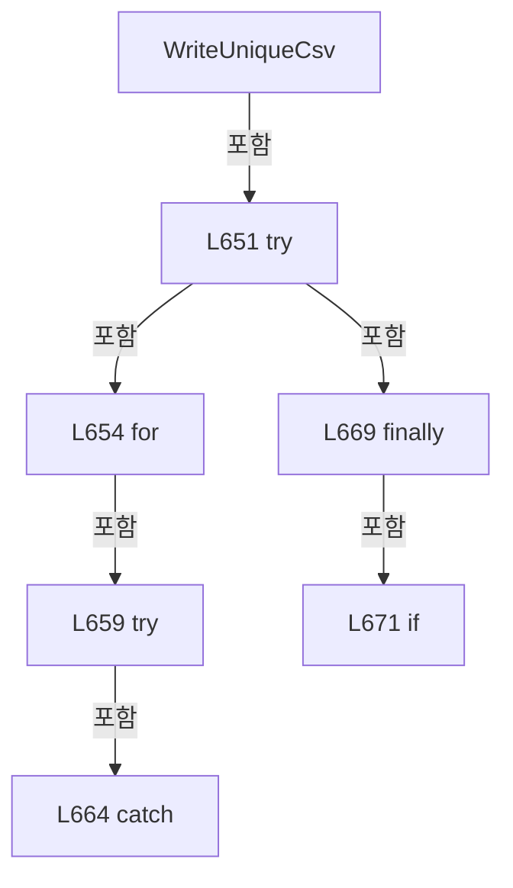

변경 전 점검: 입력/반환 타입, 위 호출자, 예외/취소 경로, 공유 상태와 저장·전송 소비자를 함께 확인합니다. 값의 단위나 물리 방향을 이름만으로 확정하지 않습니다.

### MethodDeclaration `WriteUniqueLines` · L676–708

[Drilling.File/ReviewResult/CReviewResultFile.cs:676–708](https://github.com/kjuws10-rgb/A3Drilling/blob/5aee8e58439c9b455cae7c9593c9be986c3e682e/Drilling.File/ReviewResult/CReviewResultFile.cs#L676-L708)

| 항목 | 실제 추출 값 |
| --- | --- |
| 서명 | System.Threading.Tasks.Task<string> Drilling.File.ReviewResult.CReviewResultFile.WriteUniqueLines(string, string, System.Collections.Generic.IReadOnlyList<string>, System.Threading.CancellationToken) |
| 접근/수식자 | Private / private, static, async |
| 반환/값 타입 | System.Threading.Tasks.Task<string> |
| 소속 타입 | NamedType:Drilling.File.ReviewResult.CReviewResultFile |

입력 계약:

| 이름 | 타입 | 전달 | 선택/기본값 |
| --- | --- | --- | --- |
| directory | string | None | False /  |
| fileStem | string | None | False /  |
| lines | System.Collections.Generic.IReadOnlyList<string> | None | False /  |
| cancellationToken | System.Threading.CancellationToken | None | False /  |

정적 호출자로 확인된 위치:

| 호출 파일/행 | 호출 표현식 | 런타임 분기 가능 |
| --- | --- | --- |
| [Drilling.File/ReviewResult/CReviewResultFile.cs:1238–1238](https://github.com/kjuws10-rgb/A3Drilling/blob/5aee8e58439c9b455cae7c9593c9be986c3e682e/Drilling.File/ReviewResult/CReviewResultFile.cs#L1238-L1238) | WriteUniqueLines | False |

호출하는 대상과 해석 범위:

| 원본 행 | 표현식 | 분석 상태 | 대상/소스 위치 |
| --- | --- | --- | --- |
| 682 | cancellationToken.ThrowIfCancellationRequested | resolved | void System.Threading.CancellationToken.ThrowIfCancellationRequested() |
| 683 | Directory.CreateDirectory | resolved | System.IO.DirectoryInfo System.IO.Directory.CreateDirectory(string) |
| 684 | Path.Combine | resolved | string System.IO.Path.Combine(string, string) |
| 684 | Guid.NewGuid | resolved | System.Guid System.Guid.NewGuid() |
| 687 | System.IO.File.WriteAllLinesAsync(temporaryPath, lines, new UTF8Encoding(true), cancellationToken).ConfigureAwait | resolved | System.Runtime.CompilerServices.ConfiguredTaskAwaitable System.Threading.Tasks.Task.ConfigureAwait(bool) |
| 687 | System.IO.File.WriteAllLinesAsync | resolved | System.Threading.Tasks.Task System.IO.File.WriteAllLinesAsync(string, System.Collections.Generic.IEnumerable<string>, System.Text.Encoding, System.Threading.CancellationToken) |
| 687 | new UTF8Encoding | resolved | System.Text.UTF8Encoding.UTF8Encoding(bool) |
| 690 | cancellationToken.ThrowIfCancellationRequested | resolved | void System.Threading.CancellationToken.ThrowIfCancellationRequested() |
| 692 | Path.Combine | resolved | string System.IO.Path.Combine(string, string) |
| 695 | System.IO.File.Move | resolved | void System.IO.File.Move(string, string, bool) |
| 696 | Path.GetFullPath | resolved | string System.IO.Path.GetFullPath(string) |
| 698 | System.IO.File.Exists | resolved | bool System.IO.File.Exists(string?) |
| 705 | System.IO.File.Exists | resolved | bool System.IO.File.Exists(string?) |
| 706 | System.IO.File.Delete | resolved | void System.IO.File.Delete(string) |

본문의 실제 연산·분기·예외·반환 순서(원문 위치 순):

| 원본 행 | 종류 | 주석 해설 |
| --- | --- | --- |
| 682 | call | 함수·델리게이트 또는 객체 생성자를 호출합니다: cancellationToken.ThrowIfCancellationRequested() |
| 683 | call | 함수·델리게이트 또는 객체 생성자를 호출합니다: Directory.CreateDirectory(directory) |
| 684 | call | 함수·델리게이트 또는 객체 생성자를 호출합니다: Path.Combine(directory, $".{Guid.NewGuid():N}.tmp") |
| 684 | call | 함수·델리게이트 또는 객체 생성자를 호출합니다: Guid.NewGuid() |
| 684 | local-declaration | 지역 변수를 선언합니다: var temporaryPath = Path.Combine(directory, $".{Guid.NewGuid():N}.tmp"); |
| 684 | variable-initializer | 변수의 초기값을 지정합니다: temporaryPath = Path.Combine(directory, $".{Guid.NewGuid():N}.tmp") |
| 685 | try | 예외 처리 범위입니다: try |
| 687 | await | 비동기 완료를 기다립니다: await System.IO.File.WriteAllLinesAsync(temporaryPath, lines, new UTF8Encoding(true), cancellationToken).ConfigureAwait(false) |
| 687 | call | 함수·델리게이트 또는 객체 생성자를 호출합니다: System.IO.File.WriteAllLinesAsync(temporaryPath, lines, new UTF8Encoding(true), cancellationToken).ConfigureAwait(false) |
| 687 | call | 함수·델리게이트 또는 객체 생성자를 호출합니다: System.IO.File.WriteAllLinesAsync(temporaryPath, lines, new UTF8Encoding(true), cancellationToken) |
| 687 | call | 함수·델리게이트 또는 객체 생성자를 호출합니다: new UTF8Encoding(true) |
| 688 | variable-initializer | 변수의 초기값을 지정합니다: duplicate = 0 |
| 688 | for | 초기화·조건·증감이 있는 반복입니다: for (var duplicate = 0; ; duplicate++) |
| 690 | call | 함수·델리게이트 또는 객체 생성자를 호출합니다: cancellationToken.ThrowIfCancellationRequested() |
| 691 | conditional-expression | 조건에 따라 결과식을 선택합니다: duplicate == 0 ? "" : $"_{duplicate:00}" |
| 691 | local-declaration | 지역 변수를 선언합니다: var suffix = duplicate == 0 ? "" : $"_{duplicate:00}"; |
| 691 | variable-initializer | 변수의 초기값을 지정합니다: suffix = duplicate == 0 ? "" : $"_{duplicate:00}" |
| 692 | call | 함수·델리게이트 또는 객체 생성자를 호출합니다: Path.Combine(directory, fileStem + suffix + ".csv") |
| 692 | local-declaration | 지역 변수를 선언합니다: var path = Path.Combine(directory, fileStem + suffix + ".csv"); |
| 692 | variable-initializer | 변수의 초기값을 지정합니다: path = Path.Combine(directory, fileStem + suffix + ".csv") |
| 693 | try | 예외 처리 범위입니다: try |
| 695 | call | 함수·델리게이트 또는 객체 생성자를 호출합니다: System.IO.File.Move(temporaryPath, path, overwrite: false) |
| 696 | call | 함수·델리게이트 또는 객체 생성자를 호출합니다: Path.GetFullPath(path) |
| 696 | return | 호출자에게 값 또는 제어를 반환합니다: return Path.GetFullPath(path); |
| 698 | call | 함수·델리게이트 또는 객체 생성자를 호출합니다: System.IO.File.Exists(path) |
| 698 | catch | 지정 예외를 처리합니다: catch (IOException) when (System.IO.File.Exists(path)) |
| 703 | finally | 종료 정리 구간입니다: finally |
| 705 | call | 함수·델리게이트 또는 객체 생성자를 호출합니다: System.IO.File.Exists(temporaryPath) |
| 705 | if | 조건에 따라 분기합니다: if (System.IO.File.Exists(temporaryPath)) |
| 706 | call | 함수·델리게이트 또는 객체 생성자를 호출합니다: System.IO.File.Delete(temporaryPath) |

제어 구문의 포함 구조(실제 실행 순서/CFG가 아닌 구문 탐색 그림):

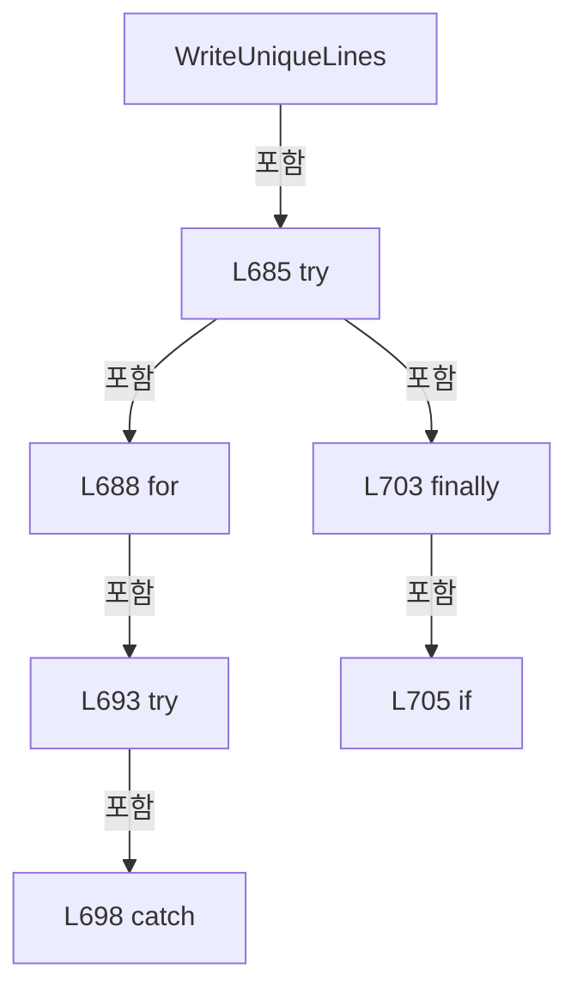

변경 전 점검: 입력/반환 타입, 위 호출자, 예외/취소 경로, 공유 상태와 저장·전송 소비자를 함께 확인합니다. 값의 단위나 물리 방향을 이름만으로 확정하지 않습니다.

### MethodDeclaration `SaveBeamInspection` · L713–758

[Drilling.File/ReviewResult/CReviewResultFile.cs:713–758](https://github.com/kjuws10-rgb/A3Drilling/blob/5aee8e58439c9b455cae7c9593c9be986c3e682e/Drilling.File/ReviewResult/CReviewResultFile.cs#L713-L758)

| 항목 | 실제 추출 값 |
| --- | --- |
| 서명 | System.Threading.Tasks.Task<string> Drilling.File.ReviewResult.CReviewResultFile.SaveBeamInspection(Drilling.Common.Review.ST_BEAM_INSPECTION_SNAPSHOT, string, System.DateTimeOffset, System.Threading.CancellationToken) |
| 접근/수식자 | Public / public, override |
| 반환/값 타입 | System.Threading.Tasks.Task<string> |
| 소속 타입 | NamedType:Drilling.File.ReviewResult.CReviewResultFile |

입력 계약:

| 이름 | 타입 | 전달 | 선택/기본값 |
| --- | --- | --- | --- |
| result | Drilling.Common.Review.ST_BEAM_INSPECTION_SNAPSHOT | None | False /  |
| glassId | string | None | False /  |
| savedAt | System.DateTimeOffset | None | False /  |
| cancellationToken | System.Threading.CancellationToken | None | True / null |

현재 부분 분석에서 직접 연결된 호출자는 없습니다. XAML/이벤트/인터페이스·델리게이트·외부 진입을 추가 확인해야 하며, 미사용으로 판정한 것이 아닙니다.

호출하는 대상과 해석 범위:

| 원본 행 | 표현식 | 분석 상태 | 대상/소스 위치 |
| --- | --- | --- | --- |
| 715 | cancellationToken.ThrowIfCancellationRequested | resolved | void System.Threading.CancellationToken.ThrowIfCancellationRequested() |
| 716 | result.Points.Any | resolved | bool System.Collections.Generic.IEnumerable<Drilling.Common.Review.ST_REVIEW_PLAN_POINT>.Any<Drilling.Common.Review.ST_REVIEW_PLAN_POINT>(System.Func<Drilling.Common.Review.ST_REVIEW_PLAN_POINT, bool>) |
| 717 | new InvalidDataException | resolved | System.IO.InvalidDataException.InvalidDataException(string?) |
| 725 | result.Points.GroupBy(p => (p.HeadNo, p.CellNo, p.ShotNo)).OrderBy(g => g.Key.HeadNo).ThenBy(g => g.Key.CellNo).ThenBy(g => g.Key.ShotNo).Select(group => { var point = group.First(); var beams = group.ToDictionary(p => p.BeamNo); var row = new Dictionary<string, string> { ["SAVED_AT"] = FormatDate(savedAt), ["RECIPE_ID"] = result.RecipeId, ["RESULT… | resolved | System.Collections.Generic.Dictionary<string, string>[] System.Collections.Generic.IEnumerable<System.Collections.Generic.Dictionary<string, string>>.ToArray<System.Collections.Generic.Dictionary<string, string>>() |
| 725 | result.Points.GroupBy(p => (p.HeadNo, p.CellNo, p.ShotNo)).OrderBy(g => g.Key.HeadNo).ThenBy(g => g.Key.CellNo).ThenBy(g => g.Key.ShotNo).Select | resolved | System.Collections.Generic.IEnumerable<System.Collections.Generic.Dictionary<string, string>> System.Collections.Generic.IEnumerable<System.Linq.IGrouping<(int HeadNo, int CellNo, int ShotNo), Drilling.Common.Review.ST_REVIEW_PLAN_POINT>>.Select<System.Linq.IGrouping<(int HeadNo, int CellNo, int ShotNo), Drilling.Common.Review.ST_REVIEW_PLAN_POINT>, System.Collections.Generic.Dictionary<string, string>>(System.Func<System.Linq.IGrouping<(int HeadNo, int CellNo, int ShotNo), Drilling.Common.Review.ST_REVIEW_PLAN_POINT>, System.Collections.Generic.Dictionary<string, string>>) |
| 725 | result.Points.GroupBy(p => (p.HeadNo, p.CellNo, p.ShotNo)).OrderBy(g => g.Key.HeadNo).ThenBy(g => g.Key.CellNo).ThenBy | resolved | System.Linq.IOrderedEnumerable<System.Linq.IGrouping<(int HeadNo, int CellNo, int ShotNo), Drilling.Common.Review.ST_REVIEW_PLAN_POINT>> System.Linq.IOrderedEnumerable<System.Linq.IGrouping<(int HeadNo, int CellNo, int ShotNo), Drilling.Common.Review.ST_REVIEW_PLAN_POINT>>.ThenBy<System.Linq.IGrouping<(int HeadNo, int CellNo, int ShotNo), Drilling.Common.Review.ST_REVIEW_PLAN_POINT>, int>(System.Func<System.Linq.IGrouping<(int HeadNo, int CellNo, int ShotNo), Drilling.Common.Review.ST_REVIEW_PLAN_POINT>, int>) |
| 725 | result.Points.GroupBy(p => (p.HeadNo, p.CellNo, p.ShotNo)).OrderBy(g => g.Key.HeadNo).ThenBy | resolved | System.Linq.IOrderedEnumerable<System.Linq.IGrouping<(int HeadNo, int CellNo, int ShotNo), Drilling.Common.Review.ST_REVIEW_PLAN_POINT>> System.Linq.IOrderedEnumerable<System.Linq.IGrouping<(int HeadNo, int CellNo, int ShotNo), Drilling.Common.Review.ST_REVIEW_PLAN_POINT>>.ThenBy<System.Linq.IGrouping<(int HeadNo, int CellNo, int ShotNo), Drilling.Common.Review.ST_REVIEW_PLAN_POINT>, int>(System.Func<System.Linq.IGrouping<(int HeadNo, int CellNo, int ShotNo), Drilling.Common.Review.ST_REVIEW_PLAN_POINT>, int>) |
| 725 | result.Points.GroupBy(p => (p.HeadNo, p.CellNo, p.ShotNo)).OrderBy | resolved | System.Linq.IOrderedEnumerable<System.Linq.IGrouping<(int HeadNo, int CellNo, int ShotNo), Drilling.Common.Review.ST_REVIEW_PLAN_POINT>> System.Collections.Generic.IEnumerable<System.Linq.IGrouping<(int HeadNo, int CellNo, int ShotNo), Drilling.Common.Review.ST_REVIEW_PLAN_POINT>>.OrderBy<System.Linq.IGrouping<(int HeadNo, int CellNo, int ShotNo), Drilling.Common.Review.ST_REVIEW_PLAN_POINT>, int>(System.Func<System.Linq.IGrouping<(int HeadNo, int CellNo, int ShotNo), Drilling.Common.Review.ST_REVIEW_PLAN_POINT>, int>) |
| 725 | result.Points.GroupBy | resolved | System.Collections.Generic.IEnumerable<System.Linq.IGrouping<(int HeadNo, int CellNo, int ShotNo), Drilling.Common.Review.ST_REVIEW_PLAN_POINT>> System.Collections.Generic.IEnumerable<Drilling.Common.Review.ST_REVIEW_PLAN_POINT>.GroupBy<Drilling.Common.Review.ST_REVIEW_PLAN_POINT, (int HeadNo, int CellNo, int ShotNo)>(System.Func<Drilling.Common.Review.ST_REVIEW_PLAN_POINT, (int HeadNo, int CellNo, int ShotNo)>) |
| 727 | group.First | resolved | Drilling.Common.Review.ST_REVIEW_PLAN_POINT System.Collections.Generic.IEnumerable<Drilling.Common.Review.ST_REVIEW_PLAN_POINT>.First<Drilling.Common.Review.ST_REVIEW_PLAN_POINT>() |
| 728 | group.ToDictionary | resolved | System.Collections.Generic.Dictionary<int, Drilling.Common.Review.ST_REVIEW_PLAN_POINT> System.Collections.Generic.IEnumerable<Drilling.Common.Review.ST_REVIEW_PLAN_POINT>.ToDictionary<Drilling.Common.Review.ST_REVIEW_PLAN_POINT, int>(System.Func<Drilling.Common.Review.ST_REVIEW_PLAN_POINT, int>) |
| 729 | new Dictionary<string, string> | resolved | System.Collections.Generic.Dictionary<string, string>.Dictionary() |
| 731 | FormatDate | resolved | string Drilling.File.ReviewResult.CReviewResultFile.FormatDate(System.DateTimeOffset?) · Drilling.File/ReviewResult/CReviewResultFile.cs:619 |
| 736 | string.IsNullOrWhiteSpace | resolved | bool string.IsNullOrWhiteSpace(string?) |
| 739 | CReviewShotNameFormatter.ToMatrixName | resolved | string Drilling.Common.Review.CReviewShotNameFormatter.ToMatrixName(int, int) · Drilling.Common/Review/CReviewManager.cs:3897 |
| 740 | FormatDouble | resolved | string Drilling.File.ReviewResult.CReviewResultFile.FormatDouble(double) · Drilling.File/ReviewResult/CReviewResultFile.cs:624 |
| 741 | FormatDouble | resolved | string Drilling.File.ReviewResult.CReviewResultFile.FormatDouble(double) · Drilling.File/ReviewResult/CReviewResultFile.cs:624 |
| 745 | beams.TryGetValue | resolved | bool System.Collections.Generic.Dictionary<int, Drilling.Common.Review.ST_REVIEW_PLAN_POINT>.TryGetValue(int, out Drilling.Common.Review.ST_REVIEW_PLAN_POINT) |
| 748 | FormatDouble | resolved | string Drilling.File.ReviewResult.CReviewResultFile.FormatDouble(double) · Drilling.File/ReviewResult/CReviewResultFile.cs:624 |
| 749 | FormatDouble | resolved | string Drilling.File.ReviewResult.CReviewResultFile.FormatDouble(double) · Drilling.File/ReviewResult/CReviewResultFile.cs:624 |
| 755 | WriteUniqueCsv | resolved | string Drilling.File.ReviewResult.CReviewResultFile.WriteUniqueCsv(string, string, System.Collections.Generic.IReadOnlyList<string>, System.Collections.Generic.IEnumerable<System.Collections.Generic.IReadOnlyDictionary<string, string>>, System.Threading.CancellationToken) · Drilling.File/ReviewResult/CReviewResultFile.cs:641 |
| 755 | ManualDirectory | resolved | string Drilling.File.ReviewResult.CReviewResultFile.ManualDirectory(string, string) · Drilling.File/ReviewResult/CReviewResultFile.cs:636 |
| 755 | ResultFileStem | resolved | string Drilling.File.ReviewResult.CReviewResultFile.ResultFileStem(string, System.DateTimeOffset) · Drilling.File/ReviewResult/CReviewResultFile.cs:639 |
| 757 | Task.FromResult | resolved | System.Threading.Tasks.Task<string> System.Threading.Tasks.Task.FromResult<string>(string) |

본문의 실제 연산·분기·예외·반환 순서(원문 위치 순):

| 원본 행 | 종류 | 주석 해설 |
| --- | --- | --- |
| 715 | call | 함수·델리게이트 또는 객체 생성자를 호출합니다: cancellationToken.ThrowIfCancellationRequested() |
| 716 | call | 함수·델리게이트 또는 객체 생성자를 호출합니다: result.Points.Any(p => p.BeamNo is < 1 or > 16) |
| 716 | if | 조건에 따라 분기합니다: if (result.Points.Count == 0 &#124;&#124; result.Points.Any(p => p.BeamNo is < 1 or > 16)) |
| 717 | call | 함수·델리게이트 또는 객체 생성자를 호출합니다: new InvalidDataException("Beam Inspection 결과에는 1~16번 Beam이 필요합니다.") |
| 717 | throw | 예외를 발생/전달합니다: throw new InvalidDataException("Beam Inspection 결과에는 1~16번 Beam이 필요합니다."); |
| 718 | local-declaration | 지역 변수를 선언합니다: var status = result.State switch { EN_REVIEW_SEQUENCE_STATE.Completed => "COMPLETED", EN_REVIEW_SEQUENCE_STATE.Stopped => "STOPPED", EN_REVIEW_SEQUENCE_STATE.Failed => "FAILED", _ => "UNKNOWN" }; |
| 718 | switch-expression | 값별 결과식을 선택합니다: result.State switch { EN_REVIEW_SEQUENCE_STATE.Completed => "COMPLETED", EN_REVIEW_SEQUENCE_STATE.Stopped => "STOPPED", EN_REVIEW_SEQUENCE_STATE.Failed => "FAILED", _ => "UNKNOWN" } |
| 718 | variable-initializer | 변수의 초기값을 지정합니다: status = result.State switch { EN_REVIEW_SEQUENCE_STATE.Completed => "COMPLETED", EN_REVIEW_SEQUENCE_STATE.Stopped => "STOPPED", EN_REVIEW_SEQUENCE_STATE.Failed => "FAILED", _ => "UNKNOWN" } |
| 725 | call | 함수·델리게이트 또는 객체 생성자를 호출합니다: result.Points.GroupBy(p => (p.HeadNo, p.CellNo, p.ShotNo)).OrderBy(g => g.Key.HeadNo).ThenBy(g => g.Key.CellNo).ThenBy(g => g.Key.ShotNo) |
| 725 | call | 함수·델리게이트 또는 객체 생성자를 호출합니다: result.Points.GroupBy(p => (p.HeadNo, p.CellNo, p.ShotNo)).OrderBy(g => g.Key.HeadNo).ThenBy(g => g.Key.CellNo) |
| 725 | call | 함수·델리게이트 또는 객체 생성자를 호출합니다: result.Points.GroupBy(p => (p.HeadNo, p.CellNo, p.ShotNo)).OrderBy(g => g.Key.HeadNo) |
| 725 | call | 함수·델리게이트 또는 객체 생성자를 호출합니다: result.Points.GroupBy(p => (p.HeadNo, p.CellNo, p.ShotNo)) |
| 725 | call | 함수·델리게이트 또는 객체 생성자를 호출합니다: result.Points.GroupBy(p => (p.HeadNo, p.CellNo, p.ShotNo)).OrderBy(g => g.Key.HeadNo).ThenBy(g => g.Key.CellNo).ThenBy(g => g.Key.ShotNo).Select(group => { var point = group.First(); var beams = group.ToDictionary(p => p… |
| 725 | call | 함수·델리게이트 또는 객체 생성자를 호출합니다: result.Points.GroupBy(p => (p.HeadNo, p.CellNo, p.ShotNo)).OrderBy(g => g.Key.HeadNo).ThenBy(g => g.Key.CellNo).ThenBy(g => g.Key.ShotNo).Select(group => { var point = group.First(); var beams = group.ToDictionary(p => p… |
| 725 | local-declaration | 지역 변수를 선언합니다: var rows = result.Points.GroupBy(p => (p.HeadNo, p.CellNo, p.ShotNo)).OrderBy(g => g.Key.HeadNo).ThenBy(g => g.Key.CellNo).ThenBy(g => g.Key.ShotNo).Select(group => { var point = group.First(); var beams = group.ToDictionary(p =>  |
| 725 | variable-initializer | 변수의 초기값을 지정합니다: rows = result.Points.GroupBy(p => (p.HeadNo, p.CellNo, p.ShotNo)).OrderBy(g => g.Key.HeadNo).ThenBy(g => g.Key.CellNo).ThenBy(g => g.Key.ShotNo).Select(group => { var point = group.First(); var beams = group.ToDictionary(p => p.Be |
| 727 | call | 함수·델리게이트 또는 객체 생성자를 호출합니다: group.First() |
| 727 | local-declaration | 지역 변수를 선언합니다: var point = group.First(); |
| 727 | variable-initializer | 변수의 초기값을 지정합니다: point = group.First() |
| 728 | call | 함수·델리게이트 또는 객체 생성자를 호출합니다: group.ToDictionary(p => p.BeamNo) |
| 728 | local-declaration | 지역 변수를 선언합니다: var beams = group.ToDictionary(p => p.BeamNo); |
| 728 | variable-initializer | 변수의 초기값을 지정합니다: beams = group.ToDictionary(p => p.BeamNo) |
| 729 | call | 함수·델리게이트 또는 객체 생성자를 호출합니다: new Dictionary<string, string> { ["SAVED_AT"] = FormatDate(savedAt), ["RECIPE_ID"] = result.RecipeId, ["RESULT_STATUS"] = status, ["STAGE_SIMULATION"] = result.IsStageSimulation ? "ON" : "OFF", ["VISION_SIMULATION"] = re… |
| 729 | local-declaration | 지역 변수를 선언합니다: var row = new Dictionary<string, string> { ["SAVED_AT"] = FormatDate(savedAt), ["RECIPE_ID"] = result.RecipeId, ["RESULT_STATUS"] = status, ["STAGE_SIMULATION"] = result.IsStageSimulation ? "ON" : "OFF", ["VISION_SIMULATION"] = re |
| 729 | variable-initializer | 변수의 초기값을 지정합니다: row = new Dictionary<string, string> { ["SAVED_AT"] = FormatDate(savedAt), ["RECIPE_ID"] = result.RecipeId, ["RESULT_STATUS"] = status, ["STAGE_SIMULATION"] = result.IsStageSimulation ? "ON" : "OFF", ["VISION_SIMULATION"] = result |
| 731 | assignment | 값을 대상에 대입합니다: ["SAVED_AT"] = FormatDate(savedAt) |
| 731 | call | 함수·델리게이트 또는 객체 생성자를 호출합니다: FormatDate(savedAt) |
| 732 | assignment | 값을 대상에 대입합니다: ["RECIPE_ID"] = result.RecipeId |
| 733 | assignment | 값을 대상에 대입합니다: ["RESULT_STATUS"] = status |
| 734 | assignment | 값을 대상에 대입합니다: ["STAGE_SIMULATION"] = result.IsStageSimulation ? "ON" : "OFF" |
| 734 | conditional-expression | 조건에 따라 결과식을 선택합니다: result.IsStageSimulation ? "ON" : "OFF" |
| 735 | assignment | 값을 대상에 대입합니다: ["VISION_SIMULATION"] = result.IsVisionSimulation ? "ON" : "OFF" |
| 735 | conditional-expression | 조건에 따라 결과식을 선택합니다: result.IsVisionSimulation ? "ON" : "OFF" |
| 736 | assignment | 값을 대상에 대입합니다: ["GLASS_NAME"] = string.IsNullOrWhiteSpace(glassId) ? "UNLINKED" : glassId |
| 736 | call | 함수·델리게이트 또는 객체 생성자를 호출합니다: string.IsNullOrWhiteSpace(glassId) |
| 736 | conditional-expression | 조건에 따라 결과식을 선택합니다: string.IsNullOrWhiteSpace(glassId) ? "UNLINKED" : glassId |
| 737 | assignment | 값을 대상에 대입합니다: ["HEAD_NAME"] = $"HEAD {point.HeadNo:00}" |
| 738 | assignment | 값을 대상에 대입합니다: ["CELL_NAME"] = $"CELL {point.CellNo:00}" |
| 739 | assignment | 값을 대상에 대입합니다: ["SHOT_NAME"] = CReviewShotNameFormatter.ToMatrixName(point.ShotNo, point.PixelCountX) |
| 739 | call | 함수·델리게이트 또는 객체 생성자를 호출합니다: CReviewShotNameFormatter.ToMatrixName(point.ShotNo, point.PixelCountX) |
| 740 | assignment | 값을 대상에 대입합니다: ["SHIFT_OFFSET_X"] = FormatDouble(result.ShiftOffsetX) |
| 740 | call | 함수·델리게이트 또는 객체 생성자를 호출합니다: FormatDouble(result.ShiftOffsetX) |
| 741 | assignment | 값을 대상에 대입합니다: ["SHIFT_OFFSET_Y"] = FormatDouble(result.ShiftOffsetY) |
| 741 | call | 함수·델리게이트 또는 객체 생성자를 호출합니다: FormatDouble(result.ShiftOffsetY) |
| 743 | variable-initializer | 변수의 초기값을 지정합니다: beam = 1 |
| 743 | for | 초기화·조건·증감이 있는 반복입니다: for (var beam = 1; beam <= 16; beam++) |
| 745 | call | 함수·델리게이트 또는 객체 생성자를 호출합니다: beams.TryGetValue(beam, out var measurement) |
| 746 | local-declaration | 지역 변수를 선언합니다: var measured = measurement?.State is EN_REVIEW_POINT_STATE.Ok or EN_REVIEW_POINT_STATE.Ng; |
| 746 | variable-initializer | 변수의 초기값을 지정합니다: measured = measurement?.State is EN_REVIEW_POINT_STATE.Ok or EN_REVIEW_POINT_STATE.Ng |
| 748 | assignment | 값을 대상에 대입합니다: row[$"BEAM{beam}_X_MM"] = measured ? FormatDouble(measurement!.ErrorX) : "미검사" |
| 748 | call | 함수·델리게이트 또는 객체 생성자를 호출합니다: FormatDouble(measurement!.ErrorX) |
| 748 | conditional-expression | 조건에 따라 결과식을 선택합니다: measured ? FormatDouble(measurement!.ErrorX) : "미검사" |
| 749 | assignment | 값을 대상에 대입합니다: row[$"BEAM{beam}_Y_MM"] = measured ? FormatDouble(measurement!.ErrorY) : "미검사" |
| 749 | call | 함수·델리게이트 또는 객체 생성자를 호출합니다: FormatDouble(measurement!.ErrorY) |
| 749 | conditional-expression | 조건에 따라 결과식을 선택합니다: measured ? FormatDouble(measurement!.ErrorY) : "미검사" |
| 750 | assignment | 값을 대상에 대입합니다: row[$"BEAM{beam}_JUDGE"] = !measured ? "미검사" : measurement!.State == EN_REVIEW_POINT_STATE.Ok ? "OK" : "NG" |
| 750 | conditional-expression | 조건에 따라 결과식을 선택합니다: !measured ? "미검사" : measurement!.State == EN_REVIEW_POINT_STATE.Ok ? "OK" : "NG" |
| 750 | conditional-expression | 조건에 따라 결과식을 선택합니다: measurement!.State == EN_REVIEW_POINT_STATE.Ok ? "OK" : "NG" |
| 753 | return | 호출자에게 값 또는 제어를 반환합니다: return row; |
| 755 | call | 함수·델리게이트 또는 객체 생성자를 호출합니다: WriteUniqueCsv(ManualDirectory(result.RecipeId, "BEAM_INSPECTION"), ResultFileStem(glassId, savedAt), BeamInspectionHeaders, rows, cancellationToken) |
| 755 | call | 함수·델리게이트 또는 객체 생성자를 호출합니다: ManualDirectory(result.RecipeId, "BEAM_INSPECTION") |
| 755 | call | 함수·델리게이트 또는 객체 생성자를 호출합니다: ResultFileStem(glassId, savedAt) |
| 755 | local-declaration | 지역 변수를 선언합니다: var path = WriteUniqueCsv(ManualDirectory(result.RecipeId, "BEAM_INSPECTION"), ResultFileStem(glassId, savedAt), BeamInspectionHeaders, rows, cancellationToken); |
| 755 | variable-initializer | 변수의 초기값을 지정합니다: path = WriteUniqueCsv(ManualDirectory(result.RecipeId, "BEAM_INSPECTION"), ResultFileStem(glassId, savedAt), BeamInspectionHeaders, rows, cancellationToken) |
| 756 | assignment | 값을 대상에 대입합니다: _lastSavedPath = path |
| 757 | call | 함수·델리게이트 또는 객체 생성자를 호출합니다: Task.FromResult(path) |
| 757 | return | 호출자에게 값 또는 제어를 반환합니다: return Task.FromResult(path); |

제어 구문의 포함 구조(실제 실행 순서/CFG가 아닌 구문 탐색 그림):

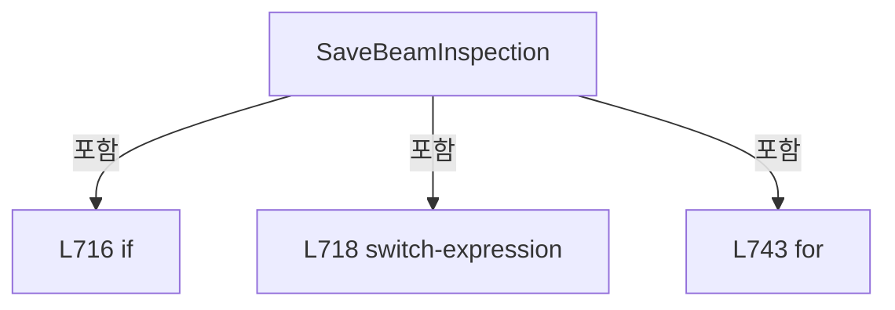

변경 전 점검: 입력/반환 타입, 위 호출자, 예외/취소 경로, 공유 상태와 저장·전송 소비자를 함께 확인합니다. 값의 단위나 물리 방향을 이름만으로 확정하지 않습니다.

### MethodDeclaration `LoadLastBeamInspection` · L760–760

[Drilling.File/ReviewResult/CReviewResultFile.cs:760–760](https://github.com/kjuws10-rgb/A3Drilling/blob/5aee8e58439c9b455cae7c9593c9be986c3e682e/Drilling.File/ReviewResult/CReviewResultFile.cs#L760-L760)

| 항목 | 실제 추출 값 |
| --- | --- |
| 서명 | System.Threading.Tasks.Task<Drilling.Common.Review.ST_BEAM_INSPECTION_RESULT_FILE_DATA?> Drilling.File.ReviewResult.CReviewResultFile.LoadLastBeamInspection(System.Threading.CancellationToken) |
| 접근/수식자 | Public / public, override |
| 반환/값 타입 | System.Threading.Tasks.Task<Drilling.Common.Review.ST_BEAM_INSPECTION_RESULT_FILE_DATA?> |
| 소속 타입 | NamedType:Drilling.File.ReviewResult.CReviewResultFile |

입력 계약:

| 이름 | 타입 | 전달 | 선택/기본값 |
| --- | --- | --- | --- |
| cancellationToken | System.Threading.CancellationToken | None | True / null |

현재 부분 분석에서 직접 연결된 호출자는 없습니다. XAML/이벤트/인터페이스·델리게이트·외부 진입을 추가 확인해야 하며, 미사용으로 판정한 것이 아닙니다.

호출하는 대상과 해석 범위:

| 원본 행 | 표현식 | 분석 상태 | 대상/소스 위치 |
| --- | --- | --- | --- |
| 760 | Task.Run | resolved | System.Threading.Tasks.Task<Drilling.Common.Review.ST_BEAM_INSPECTION_RESULT_FILE_DATA?> System.Threading.Tasks.Task.Run<Drilling.Common.Review.ST_BEAM_INSPECTION_RESULT_FILE_DATA?>(System.Func<Drilling.Common.Review.ST_BEAM_INSPECTION_RESULT_FILE_DATA?>, System.Threading.CancellationToken) |
| 760 | LoadLastBeamInspectionCore | resolved | Drilling.Common.Review.ST_BEAM_INSPECTION_RESULT_FILE_DATA? Drilling.File.ReviewResult.CReviewResultFile.LoadLastBeamInspectionCore(System.Threading.CancellationToken) · Drilling.File/ReviewResult/CReviewResultFile.cs:761 |

본문의 실제 연산·분기·예외·반환 순서(원문 위치 순):

| 원본 행 | 종류 | 주석 해설 |
| --- | --- | --- |
| 760 | call | 함수·델리게이트 또는 객체 생성자를 호출합니다: Task.Run(() => LoadLastBeamInspectionCore(cancellationToken), cancellationToken) |
| 760 | call | 함수·델리게이트 또는 객체 생성자를 호출합니다: LoadLastBeamInspectionCore(cancellationToken) |

변경 전 점검: 입력/반환 타입, 위 호출자, 예외/취소 경로, 공유 상태와 저장·전송 소비자를 함께 확인합니다. 값의 단위나 물리 방향을 이름만으로 확정하지 않습니다.

### MethodDeclaration `LoadLastBeamInspectionCore` · L761–896

[Drilling.File/ReviewResult/CReviewResultFile.cs:761–896](https://github.com/kjuws10-rgb/A3Drilling/blob/5aee8e58439c9b455cae7c9593c9be986c3e682e/Drilling.File/ReviewResult/CReviewResultFile.cs#L761-L896)

| 항목 | 실제 추출 값 |
| --- | --- |
| 서명 | Drilling.Common.Review.ST_BEAM_INSPECTION_RESULT_FILE_DATA? Drilling.File.ReviewResult.CReviewResultFile.LoadLastBeamInspectionCore(System.Threading.CancellationToken) |
| 접근/수식자 | Private / private |
| 반환/값 타입 | Drilling.Common.Review.ST_BEAM_INSPECTION_RESULT_FILE_DATA? |
| 소속 타입 | NamedType:Drilling.File.ReviewResult.CReviewResultFile |

입력 계약:

| 이름 | 타입 | 전달 | 선택/기본값 |
| --- | --- | --- | --- |
| cancellationToken | System.Threading.CancellationToken | None | False /  |

정적 호출자로 확인된 위치:

| 호출 파일/행 | 호출 표현식 | 런타임 분기 가능 |
| --- | --- | --- |
| [Drilling.File/ReviewResult/CReviewResultFile.cs:760–760](https://github.com/kjuws10-rgb/A3Drilling/blob/5aee8e58439c9b455cae7c9593c9be986c3e682e/Drilling.File/ReviewResult/CReviewResultFile.cs#L760-L760) | LoadLastBeamInspectionCore | False |

호출하는 대상과 해석 범위:

| 원본 행 | 표현식 | 분석 상태 | 대상/소스 위치 |
| --- | --- | --- | --- |
| 763 | cancellationToken.ThrowIfCancellationRequested | resolved | void System.Threading.CancellationToken.ThrowIfCancellationRequested() |
| 764 | Path.Combine | resolved | string System.IO.Path.Combine(string, string) |
| 765 | Directory.Exists | resolved | bool System.IO.Directory.Exists(string?) |
| 771 | Directory.EnumerateFiles(root, "*.csv", System.IO.SearchOption.AllDirectories).Where(path => string.Equals(Path.GetFileName(Path.GetDirectoryName(path)), "BEAM_INSPECTION", StringComparison.OrdinalIgnoreCase)).Select(path => { cancellationToken.ThrowIfCancellationRequested(); return new FileInfo(path); }).OrderByDescending(file => file.LastWriteTim… | resolved | System.IO.FileInfo? System.Collections.Generic.IEnumerable<System.IO.FileInfo>.FirstOrDefault<System.IO.FileInfo>() |
| 771 | Directory.EnumerateFiles(root, "*.csv", System.IO.SearchOption.AllDirectories).Where(path => string.Equals(Path.GetFileName(Path.GetDirectoryName(path)), "BEAM_INSPECTION", StringComparison.OrdinalIgnoreCase)).Select(path => { cancellationToken.ThrowIfCancellationRequested(); return new FileInfo(path); }).OrderByDescending(file => file.LastWriteTim… | resolved | System.Linq.IOrderedEnumerable<System.IO.FileInfo> System.Linq.IOrderedEnumerable<System.IO.FileInfo>.ThenBy<System.IO.FileInfo, string>(System.Func<System.IO.FileInfo, string>, System.Collections.Generic.IComparer<string>?) |
| 771 | Directory.EnumerateFiles(root, "*.csv", System.IO.SearchOption.AllDirectories).Where(path => string.Equals(Path.GetFileName(Path.GetDirectoryName(path)), "BEAM_INSPECTION", StringComparison.OrdinalIgnoreCase)).Select(path => { cancellationToken.ThrowIfCancellationRequested(); return new FileInfo(path); }).OrderByDescending(file => file.LastWriteTim… | resolved | System.Linq.IOrderedEnumerable<System.IO.FileInfo> System.Linq.IOrderedEnumerable<System.IO.FileInfo>.ThenBy<System.IO.FileInfo, string>(System.Func<System.IO.FileInfo, string>, System.Collections.Generic.IComparer<string>?) |
| 771 | Directory.EnumerateFiles(root, "*.csv", System.IO.SearchOption.AllDirectories).Where(path => string.Equals(Path.GetFileName(Path.GetDirectoryName(path)), "BEAM_INSPECTION", StringComparison.OrdinalIgnoreCase)).Select(path => { cancellationToken.ThrowIfCancellationRequested(); return new FileInfo(path); }).OrderByDescending | resolved | System.Linq.IOrderedEnumerable<System.IO.FileInfo> System.Collections.Generic.IEnumerable<System.IO.FileInfo>.OrderByDescending<System.IO.FileInfo, System.DateTime>(System.Func<System.IO.FileInfo, System.DateTime>) |
| 771 | Directory.EnumerateFiles(root, "*.csv", System.IO.SearchOption.AllDirectories).Where(path => string.Equals(Path.GetFileName(Path.GetDirectoryName(path)), "BEAM_INSPECTION", StringComparison.OrdinalIgnoreCase)).Select | resolved | System.Collections.Generic.IEnumerable<System.IO.FileInfo> System.Collections.Generic.IEnumerable<string>.Select<string, System.IO.FileInfo>(System.Func<string, System.IO.FileInfo>) |
| 771 | Directory.EnumerateFiles(root, "*.csv", System.IO.SearchOption.AllDirectories).Where | resolved | System.Collections.Generic.IEnumerable<string> System.Collections.Generic.IEnumerable<string>.Where<string>(System.Func<string, bool>) |
| 771 | Directory.EnumerateFiles | resolved | System.Collections.Generic.IEnumerable<string> System.IO.Directory.EnumerateFiles(string, string, System.IO.SearchOption) |
| 771 | string.Equals | resolved | bool string.Equals(string?, string?, System.StringComparison) |
| 771 | Path.GetFileName | resolved | string? System.IO.Path.GetFileName(string?) |
| 771 | Path.GetDirectoryName | resolved | string? System.IO.Path.GetDirectoryName(string?) |
| 773 | cancellationToken.ThrowIfCancellationRequested | resolved | void System.Threading.CancellationToken.ThrowIfCancellationRequested() |
| 774 | new FileInfo | resolved | System.IO.FileInfo.FileInfo(string) |
| 779 | new InvalidDataException | resolved | System.IO.InvalidDataException.InvalidDataException(string?, System.Exception?) |
| 784 | cancellationToken.ThrowIfCancellationRequested | resolved | void System.Threading.CancellationToken.ThrowIfCancellationRequested() |
| 788 | new TextFieldParser | resolved | Microsoft.VisualBasic.FileIO.TextFieldParser.TextFieldParser(string, System.Text.Encoding, bool) |
| 788 | new UTF8Encoding | resolved | System.Text.UTF8Encoding.UTF8Encoding(bool, bool) |
| 793 | parser.SetDelimiters | resolved | void Microsoft.VisualBasic.FileIO.TextFieldParser.SetDelimiters(params string[]) |
| 794 | parser.ReadFields | resolved | string[] Microsoft.VisualBasic.FileIO.TextFieldParser.ReadFields() |
| 794 | .Select(header => header.Trim()).ToArray | resolved | string[] System.Collections.Generic.IEnumerable<string>.ToArray<string>() |
| 794 | .Select | resolved | System.Collections.Generic.IEnumerable<string> System.Collections.Generic.IEnumerable<string>.Select<string, string>(System.Func<string, string>) |
| 794 | header.Trim | resolved | string string.Trim() |
| 795 | .ToHashSet | resolved | System.Collections.Generic.HashSet<string> System.Collections.Generic.IEnumerable<string>.ToHashSet<string>(System.Collections.Generic.IEqualityComparer<string>?) |
| 796 | .SetEquals | resolved | bool System.Collections.Generic.HashSet<string>.SetEquals(System.Collections.Generic.IEnumerable<string>) |
| 797 | .SetEquals | resolved | bool System.Collections.Generic.HashSet<string>.SetEquals(System.Collections.Generic.IEnumerable<string>) |
| 798 | headers.Distinct(StringComparer.OrdinalIgnoreCase).Count | resolved | int System.Collections.Generic.IEnumerable<string>.Count<string>() |
| 798 | headers.Distinct | resolved | System.Collections.Generic.IEnumerable<string> System.Collections.Generic.IEnumerable<string>.Distinct<string>(System.Collections.Generic.IEqualityComparer<string>?) |
| 799 | new InvalidDataException | resolved | System.IO.InvalidDataException.InvalidDataException(string?) |
| 800 | headers.Select((name, index) => (name, index)).ToDictionary | resolved | System.Collections.Generic.Dictionary<string, int> System.Collections.Generic.IEnumerable<(string name, int index)>.ToDictionary<(string name, int index), string, int>(System.Func<(string name, int index), string>, System.Func<(string name, int index), int>, System.Collections.Generic.IEqualityComparer<string>?) |
| 800 | headers.Select | resolved | System.Collections.Generic.IEnumerable<(string name, int index)> System.Collections.Generic.IEnumerable<string>.Select<string, (string name, int index)>(System.Func<string, int, (string name, int index)>) |
| 801 | new List<ST_BEAM_INSPECTION_RESULT_SHOT> | resolved | System.Collections.Generic.List<Drilling.Common.Review.ST_BEAM_INSPECTION_RESULT_SHOT>.List() |
| 802 | new HashSet<(int Head, int Cell, string Shot)> | resolved | System.Collections.Generic.HashSet<(int Head, int Cell, string Shot)>.HashSet() |
| 808 | cancellationToken.ThrowIfCancellationRequested | resolved | void System.Threading.CancellationToken.ThrowIfCancellationRequested() |
| 810 | parser.ReadFields | resolved | string[] Microsoft.VisualBasic.FileIO.TextFieldParser.ReadFields() |
| 814 | Error | resolved | System.IO.InvalidDataException Drilling.File.ReviewResult.CReviewResultFile.Error(long, string) · Drilling.File/ReviewResult/CReviewResultFile.cs:925 |
| 824 | RequireName | resolved | string RequireName(string) · Drilling.File/ReviewResult/CReviewResultFile.cs:816 |
| 825 | glass.Equals | resolved | bool string.Equals(string?, System.StringComparison) |
| 826 | Error | resolved | System.IO.InvalidDataException Drilling.File.ReviewResult.CReviewResultFile.Error(long, string) · Drilling.File/ReviewResult/CReviewResultFile.cs:925 |
| 828 | RequireName | resolved | string RequireName(string) · Drilling.File/ReviewResult/CReviewResultFile.cs:816 |
| 829 | RequireName | resolved | string RequireName(string) · Drilling.File/ReviewResult/CReviewResultFile.cs:816 |
| 830 | RequireName | resolved | string RequireName(string) · Drilling.File/ReviewResult/CReviewResultFile.cs:816 |
| 833 | ReadFiniteValue | resolved | double Drilling.File.ReviewResult.CReviewResultFile.ReadFiniteValue(string, long, string) · Drilling.File/ReviewResult/CReviewResultFile.cs:918 |
| 833 | Get | resolved | string Get(string) · Drilling.File/ReviewResult/CReviewResultFile.cs:815 |
| 834 | ReadFiniteValue | resolved | double Drilling.File.ReviewResult.CReviewResultFile.ReadFiniteValue(string, long, string) · Drilling.File/ReviewResult/CReviewResultFile.cs:918 |
| 834 | Get | resolved | string Get(string) · Drilling.File/ReviewResult/CReviewResultFile.cs:815 |
| 836 | Error | resolved | System.IO.InvalidDataException Drilling.File.ReviewResult.CReviewResultFile.Error(long, string) · Drilling.File/ReviewResult/CReviewResultFile.cs:925 |
| 840 | ReadNameNumber | resolved | int Drilling.File.ReviewResult.CReviewResultFile.ReadNameNumber(string, string, long) · Drilling.File/ReviewResult/CReviewResultFile.cs:898 |
| 841 | ReadNameNumber | resolved | int Drilling.File.ReviewResult.CReviewResultFile.ReadNameNumber(string, string, long) · Drilling.File/ReviewResult/CReviewResultFile.cs:898 |
| 843 | Error | resolved | System.IO.InvalidDataException Drilling.File.ReviewResult.CReviewResultFile.Error(long, string) · Drilling.File/ReviewResult/CReviewResultFile.cs:925 |
| 844 | identities.Add | resolved | bool System.Collections.Generic.HashSet<(int Head, int Cell, string Shot)>.Add((int Head, int Cell, string Shot)) |
| 845 | Error | resolved | System.IO.InvalidDataException Drilling.File.ReviewResult.CReviewResultFile.Error(long, string) · Drilling.File/ReviewResult/CReviewResultFile.cs:925 |
| 846 | new List<ST_BEAM_INSPECTION_RESULT_BEAM> | resolved | System.Collections.Generic.List<Drilling.Common.Review.ST_BEAM_INSPECTION_RESULT_BEAM>.List(int) |
| 849 | Get($"BEAM{beam}_X_MM").Trim | resolved | string string.Trim() |
| 849 | Get | resolved | string Get(string) · Drilling.File/ReviewResult/CReviewResultFile.cs:815 |
| 850 | Get($"BEAM{beam}_Y_MM").Trim | resolved | string string.Trim() |
| 850 | Get | resolved | string Get(string) · Drilling.File/ReviewResult/CReviewResultFile.cs:815 |
| 851 | Get($"BEAM{beam}_JUDGE").Trim().ToUpperInvariant | resolved | string string.ToUpperInvariant() |
| 851 | Get($"BEAM{beam}_JUDGE").Trim | resolved | string string.Trim() |
| 851 | Get | resolved | string Get(string) · Drilling.File/ReviewResult/CReviewResultFile.cs:815 |
| 855 | Error | resolved | System.IO.InvalidDataException Drilling.File.ReviewResult.CReviewResultFile.Error(long, string) · Drilling.File/ReviewResult/CReviewResultFile.cs:925 |
| 856 | beams.Add | resolved | void System.Collections.Generic.List<Drilling.Common.Review.ST_BEAM_INSPECTION_RESULT_BEAM>.Add(Drilling.Common.Review.ST_BEAM_INSPECTION_RESULT_BEAM) |
| 856 | new | resolved | Drilling.Common.Review.ST_BEAM_INSPECTION_RESULT_BEAM.ST_BEAM_INSPECTION_RESULT_BEAM(int, double?, double?, string) · Drilling.Common/Review/CReviewManager.cs:3801 |
| 860 | beams.Add | resolved | void System.Collections.Generic.List<Drilling.Common.Review.ST_BEAM_INSPECTION_RESULT_BEAM>.Add(Drilling.Common.Review.ST_BEAM_INSPECTION_RESULT_BEAM) |
| 860 | new | resolved | Drilling.Common.Review.ST_BEAM_INSPECTION_RESULT_BEAM.ST_BEAM_INSPECTION_RESULT_BEAM(int, double?, double?, string) · Drilling.Common/Review/CReviewManager.cs:3801 |
| 860 | ReadFinite | resolved | double Drilling.File.ReviewResult.CReviewResultFile.ReadFinite(string, long, int, string) · Drilling.File/ReviewResult/CReviewResultFile.cs:906 |
| 860 | ReadFinite | resolved | double Drilling.File.ReviewResult.CReviewResultFile.ReadFinite(string, long, int, string) · Drilling.File/ReviewResult/CReviewResultFile.cs:906 |
| 863 | Error | resolved | System.IO.InvalidDataException Drilling.File.ReviewResult.CReviewResultFile.Error(long, string) · Drilling.File/ReviewResult/CReviewResultFile.cs:925 |
| 866 | shots.Add | resolved | void System.Collections.Generic.List<Drilling.Common.Review.ST_BEAM_INSPECTION_RESULT_SHOT>.Add(Drilling.Common.Review.ST_BEAM_INSPECTION_RESULT_SHOT) |
| 866 | new | resolved | Drilling.Common.Review.ST_BEAM_INSPECTION_RESULT_SHOT.ST_BEAM_INSPECTION_RESULT_SHOT(string, string, int, string, int, string, System.Collections.Generic.IReadOnlyList<Drilling.Common.Review.ST_BEAM_INSPECTION_RESULT_BEAM>) · Drilling.Common/Review/CReviewManager.cs:3806 |
| 866 | beams.AsReadOnly | resolved | System.Collections.ObjectModel.ReadOnlyCollection<Drilling.Common.Review.ST_BEAM_INSPECTION_RESULT_BEAM> System.Collections.Generic.List<Drilling.Common.Review.ST_BEAM_INSPECTION_RESULT_BEAM>.AsReadOnly() |
| 870 | new InvalidDataException | resolved | System.IO.InvalidDataException.InvalidDataException(string?) |
| 872 | new TextFieldParser | resolved | Microsoft.VisualBasic.FileIO.TextFieldParser.TextFieldParser(string, System.Text.Encoding, bool) |
| 872 | new UTF8Encoding | resolved | System.Text.UTF8Encoding.UTF8Encoding(bool, bool) |
| 877 | metadataParser.SetDelimiters | resolved | void Microsoft.VisualBasic.FileIO.TextFieldParser.SetDelimiters(params string[]) |
| 878 | metadataParser.ReadFields | resolved | string[] Microsoft.VisualBasic.FileIO.TextFieldParser.ReadFields() |
| 879 | metadataParser.ReadFields | resolved | string[] Microsoft.VisualBasic.FileIO.TextFieldParser.ReadFields() |
| 880 | metadataHeaders.Select((name, index) => (name, value: index < metadataFields.Length ? metadataFields[index] : "")).ToDictionary | resolved | System.Collections.Generic.Dictionary<string, string> System.Collections.Generic.IEnumerable<(string name, string value)>.ToDictionary<(string name, string value), string, string>(System.Func<(string name, string value), string>, System.Func<(string name, string value), string>, System.Collections.Generic.IEqualityComparer<string>?) |
| 880 | metadataHeaders.Select | resolved | System.Collections.Generic.IEnumerable<(string name, string value)> System.Collections.Generic.IEnumerable<string>.Select<string, (string name, string value)>(System.Func<string, int, (string name, string value)>) |
| 881 | ParseOnOff | resolved | bool Drilling.File.ReviewResult.CReviewResultFile.ParseOnOff(string?) · Drilling.File/ReviewResult/CReviewResultFile.cs:926 |
| 881 | metadata.GetValueOrDefault | resolved | string? System.Collections.Generic.IReadOnlyDictionary<string, string>.GetValueOrDefault<string, string>(string) |
| 881 | ParseOnOff | resolved | bool Drilling.File.ReviewResult.CReviewResultFile.ParseOnOff(string?) · Drilling.File/ReviewResult/CReviewResultFile.cs:926 |
| 881 | metadata.GetValueOrDefault | resolved | string? System.Collections.Generic.IReadOnlyDictionary<string, string>.GetValueOrDefault<string, string>(string) |
| 882 | DateTimeOffset.TryParse | resolved | bool System.DateTimeOffset.TryParse(string?, System.IFormatProvider?, System.Globalization.DateTimeStyles, out System.DateTimeOffset) |
| 882 | metadata.GetValueOrDefault | resolved | string? System.Collections.Generic.IReadOnlyDictionary<string, string>.GetValueOrDefault<string, string>(string) |
| 884 | new DateTimeOffset(latest.LastWriteTimeUtc).ToLocalTime | resolved | System.DateTimeOffset System.DateTimeOffset.ToLocalTime() |
| 884 | new DateTimeOffset | resolved | System.DateTimeOffset.DateTimeOffset(System.DateTime) |
| 885 | new | resolved | Drilling.Common.Review.ST_BEAM_INSPECTION_RESULT_FILE_DATA.ST_BEAM_INSPECTION_RESULT_FILE_DATA(string, string, System.DateTimeOffset, bool, string, System.Collections.Generic.IReadOnlyList<Drilling.Common.Review.ST_BEAM_INSPECTION_RESULT_SHOT>) · Drilling.Common/Review/CReviewManager.cs:3807 |
| 885 | shots.AsReadOnly | resolved | System.Collections.ObjectModel.ReadOnlyCollection<Drilling.Common.Review.ST_BEAM_INSPECTION_RESULT_SHOT> System.Collections.Generic.List<Drilling.Common.Review.ST_BEAM_INSPECTION_RESULT_SHOT>.AsReadOnly() |
| 894 | new InvalidDataException | resolved | System.IO.InvalidDataException.InvalidDataException(string?, System.Exception?) |

본문의 실제 연산·분기·예외·반환 순서(원문 위치 순):

| 원본 행 | 종류 | 주석 해설 |
| --- | --- | --- |
| 763 | call | 함수·델리게이트 또는 객체 생성자를 호출합니다: cancellationToken.ThrowIfCancellationRequested() |
| 764 | call | 함수·델리게이트 또는 객체 생성자를 호출합니다: Path.Combine(_reviewRoot, "Manual") |
| 764 | local-declaration | 지역 변수를 선언합니다: var root = Path.Combine(_reviewRoot, "Manual"); |
| 764 | variable-initializer | 변수의 초기값을 지정합니다: root = Path.Combine(_reviewRoot, "Manual") |
| 765 | call | 함수·델리게이트 또는 객체 생성자를 호출합니다: Directory.Exists(root) |
| 765 | if | 조건에 따라 분기합니다: if (!Directory.Exists(root)) |
| 766 | return | 호출자에게 값 또는 제어를 반환합니다: return null; |
| 767 | local-declaration | 지역 변수를 선언합니다: FileInfo? latest; |
| 768 | try | 예외 처리 범위입니다: try |
| 771 | call | 함수·델리게이트 또는 객체 생성자를 호출합니다: Directory.EnumerateFiles(root, "*.csv", System.IO.SearchOption.AllDirectories).Where(path => string.Equals(Path.GetFileName(Path.GetDirectoryName(path)), "BEAM_INSPECTION", StringComparison.OrdinalIgnoreCase)) |
| 771 | call | 함수·델리게이트 또는 객체 생성자를 호출합니다: Directory.EnumerateFiles(root, "*.csv", System.IO.SearchOption.AllDirectories) |
| 771 | call | 함수·델리게이트 또는 객체 생성자를 호출합니다: string.Equals(Path.GetFileName(Path.GetDirectoryName(path)), "BEAM_INSPECTION", StringComparison.OrdinalIgnoreCase) |
| 771 | call | 함수·델리게이트 또는 객체 생성자를 호출합니다: Path.GetFileName(Path.GetDirectoryName(path)) |
| 771 | call | 함수·델리게이트 또는 객체 생성자를 호출합니다: Path.GetDirectoryName(path) |
| 771 | assignment | 값을 대상에 대입합니다: latest = Directory.EnumerateFiles(root, "*.csv", System.IO.SearchOption.AllDirectories).Where(path => string.Equals(Path.GetFileName(Path.GetDirectoryName(path)), "BEAM_INSPECTION", StringComparison.OrdinalIgnoreCase)).Select(path |
| 771 | call | 함수·델리게이트 또는 객체 생성자를 호출합니다: Directory.EnumerateFiles(root, "*.csv", System.IO.SearchOption.AllDirectories).Where(path => string.Equals(Path.GetFileName(Path.GetDirectoryName(path)), "BEAM_INSPECTION", StringComparison.OrdinalIgnoreCase)).Select(pat… |
| 771 | call | 함수·델리게이트 또는 객체 생성자를 호출합니다: Directory.EnumerateFiles(root, "*.csv", System.IO.SearchOption.AllDirectories).Where(path => string.Equals(Path.GetFileName(Path.GetDirectoryName(path)), "BEAM_INSPECTION", StringComparison.OrdinalIgnoreCase)).Select(pat… |
| 771 | call | 함수·델리게이트 또는 객체 생성자를 호출합니다: Directory.EnumerateFiles(root, "*.csv", System.IO.SearchOption.AllDirectories).Where(path => string.Equals(Path.GetFileName(Path.GetDirectoryName(path)), "BEAM_INSPECTION", StringComparison.OrdinalIgnoreCase)).Select(pat… |
| 771 | call | 함수·델리게이트 또는 객체 생성자를 호출합니다: Directory.EnumerateFiles(root, "*.csv", System.IO.SearchOption.AllDirectories).Where(path => string.Equals(Path.GetFileName(Path.GetDirectoryName(path)), "BEAM_INSPECTION", StringComparison.OrdinalIgnoreCase)).Select(pat… |
| 771 | call | 함수·델리게이트 또는 객체 생성자를 호출합니다: Directory.EnumerateFiles(root, "*.csv", System.IO.SearchOption.AllDirectories).Where(path => string.Equals(Path.GetFileName(Path.GetDirectoryName(path)), "BEAM_INSPECTION", StringComparison.OrdinalIgnoreCase)).Select(pat… |
| 773 | call | 함수·델리게이트 또는 객체 생성자를 호출합니다: cancellationToken.ThrowIfCancellationRequested() |
| 774 | call | 함수·델리게이트 또는 객체 생성자를 호출합니다: new FileInfo(path) |
| 774 | return | 호출자에게 값 또는 제어를 반환합니다: return new FileInfo(path); |
| 777 | catch | 지정 예외를 처리합니다: catch (Exception exception) when (exception is IOException or UnauthorizedAccessException) |
| 779 | call | 함수·델리게이트 또는 객체 생성자를 호출합니다: new InvalidDataException($"최근 Beam Inspection 결과를 검색하지 못했습니다.\n경로: {root}\n{exception.Message}", exception) |
| 779 | throw | 예외를 발생/전달합니다: throw new InvalidDataException($"최근 Beam Inspection 결과를 검색하지 못했습니다.\n경로: {root}\n{exception.Message}", exception); |
| 782 | if | 조건에 따라 분기합니다: if (latest is null) |
| 783 | return | 호출자에게 값 또는 제어를 반환합니다: return null; |
| 784 | call | 함수·델리게이트 또는 객체 생성자를 호출합니다: cancellationToken.ThrowIfCancellationRequested() |
| 785 | try | 예외 처리 범위입니다: try |
| 788 | call | 함수·델리게이트 또는 객체 생성자를 호출합니다: new UTF8Encoding(false, true) |
| 788 | call | 함수·델리게이트 또는 객체 생성자를 호출합니다: new TextFieldParser(latest.FullName, new UTF8Encoding(false, true), detectEncoding: true) { HasFieldsEnclosedInQuotes = true, TrimWhiteSpace = false } |
| 788 | using-declaration | 정리할 자원을 선언합니다: using var parser = new TextFieldParser(latest.FullName, new UTF8Encoding(false, true), detectEncoding: true) { HasFieldsEnclosedInQuotes = true, TrimWhiteSpace = false }; |
| 788 | variable-initializer | 변수의 초기값을 지정합니다: parser = new TextFieldParser(latest.FullName, new UTF8Encoding(false, true), detectEncoding: true) { HasFieldsEnclosedInQuotes = true, TrimWhiteSpace = false } |
| 790 | assignment | 값을 대상에 대입합니다: HasFieldsEnclosedInQuotes = true |
| 791 | assignment | 값을 대상에 대입합니다: TrimWhiteSpace = false |
| 793 | call | 함수·델리게이트 또는 객체 생성자를 호출합니다: parser.SetDelimiters(",") |
| 794 | call | 함수·델리게이트 또는 객체 생성자를 호출합니다: parser.ReadFields() |
| 794 | call | 함수·델리게이트 또는 객체 생성자를 호출합니다: .Select(header => header.Trim()).ToArray() |
| 794 | call | 함수·델리게이트 또는 객체 생성자를 호출합니다: .Select(header => header.Trim()) |
| 794 | call | 함수·델리게이트 또는 객체 생성자를 호출합니다: header.Trim() |
| 794 | local-declaration | 지역 변수를 선언합니다: var headers = parser.ReadFields()?.Select(header => header.Trim()).ToArray(); |
| 794 | variable-initializer | 변수의 초기값을 지정합니다: headers = parser.ReadFields()?.Select(header => header.Trim()).ToArray() |
| 795 | call | 함수·델리게이트 또는 객체 생성자를 호출합니다: .ToHashSet(StringComparer.OrdinalIgnoreCase) |
| 795 | local-declaration | 지역 변수를 선언합니다: var headerSet = headers?.ToHashSet(StringComparer.OrdinalIgnoreCase); |
| 795 | variable-initializer | 변수의 초기값을 지정합니다: headerSet = headers?.ToHashSet(StringComparer.OrdinalIgnoreCase) |
| 796 | call | 함수·델리게이트 또는 객체 생성자를 호출합니다: .SetEquals(BeamInspectionHeaders) |
| 796 | local-declaration | 지역 변수를 선언합니다: var hasShiftOffset = headerSet?.SetEquals(BeamInspectionHeaders) == true; |
| 796 | variable-initializer | 변수의 초기값을 지정합니다: hasShiftOffset = headerSet?.SetEquals(BeamInspectionHeaders) == true |
| 797 | call | 함수·델리게이트 또는 객체 생성자를 호출합니다: .SetEquals(BeamInspectionBaseHeaders) |
| 797 | local-declaration | 지역 변수를 선언합니다: var isBaseFormat = headerSet?.SetEquals(BeamInspectionBaseHeaders) == true; |
| 797 | variable-initializer | 변수의 초기값을 지정합니다: isBaseFormat = headerSet?.SetEquals(BeamInspectionBaseHeaders) == true |
| 798 | call | 함수·델리게이트 또는 객체 생성자를 호출합니다: headers.Distinct(StringComparer.OrdinalIgnoreCase).Count() |
| 798 | call | 함수·델리게이트 또는 객체 생성자를 호출합니다: headers.Distinct(StringComparer.OrdinalIgnoreCase) |
| 798 | if | 조건에 따라 분기합니다: if (headers is null &#124;&#124; headers.Distinct(StringComparer.OrdinalIgnoreCase).Count() != headers.Length &#124;&#124; !hasShiftOffset && !isBaseFormat) |
| 799 | call | 함수·델리게이트 또는 객체 생성자를 호출합니다: new InvalidDataException("CSV 헤더에는 Beam Inspection 메타데이터, 선택적인 SHIFT_OFFSET_X/Y와 1~16번 Beam의 X_MM/Y_MM/JUDGE가 필요합니다.") |
| 799 | throw | 예외를 발생/전달합니다: throw new InvalidDataException("CSV 헤더에는 Beam Inspection 메타데이터, 선택적인 SHIFT_OFFSET_X/Y와 1~16번 Beam의 X_MM/Y_MM/JUDGE가 필요합니다."); |
| 800 | call | 함수·델리게이트 또는 객체 생성자를 호출합니다: headers.Select((name, index) => (name, index)).ToDictionary(pair => pair.name, pair => pair.index, StringComparer.OrdinalIgnoreCase) |
| 800 | call | 함수·델리게이트 또는 객체 생성자를 호출합니다: headers.Select((name, index) => (name, index)) |
| 800 | local-declaration | 지역 변수를 선언합니다: var indexes = headers.Select((name, index) => (name, index)).ToDictionary(pair => pair.name, pair => pair.index, StringComparer.OrdinalIgnoreCase); |
| 800 | variable-initializer | 변수의 초기값을 지정합니다: indexes = headers.Select((name, index) => (name, index)).ToDictionary(pair => pair.name, pair => pair.index, StringComparer.OrdinalIgnoreCase) |
| 801 | call | 함수·델리게이트 또는 객체 생성자를 호출합니다: new List<ST_BEAM_INSPECTION_RESULT_SHOT>() |
| 801 | local-declaration | 지역 변수를 선언합니다: var shots = new List<ST_BEAM_INSPECTION_RESULT_SHOT>(); |
| 801 | variable-initializer | 변수의 초기값을 지정합니다: shots = new List<ST_BEAM_INSPECTION_RESULT_SHOT>() |
| 802 | call | 함수·델리게이트 또는 객체 생성자를 호출합니다: new HashSet<(int Head, int Cell, string Shot)>() |
| 802 | local-declaration | 지역 변수를 선언합니다: var identities = new HashSet<(int Head, int Cell, string Shot)>(); |
| 802 | variable-initializer | 변수의 초기값을 지정합니다: identities = new HashSet<(int Head, int Cell, string Shot)>() |
| 803 | local-declaration | 지역 변수를 선언합니다: string? glassName = null; |
| 803 | variable-initializer | 변수의 초기값을 지정합니다: glassName = null |
| 804 | local-declaration | 지역 변수를 선언합니다: double? shiftOffsetX = null; |
| 804 | variable-initializer | 변수의 초기값을 지정합니다: shiftOffsetX = null |
| 805 | local-declaration | 지역 변수를 선언합니다: double? shiftOffsetY = null; |
| 805 | variable-initializer | 변수의 초기값을 지정합니다: shiftOffsetY = null |
| 806 | while | 조건을 먼저 확인하며 반복합니다: while (!parser.EndOfData) |
| 808 | call | 함수·델리게이트 또는 객체 생성자를 호출합니다: cancellationToken.ThrowIfCancellationRequested() |
| 809 | local-declaration | 지역 변수를 선언합니다: var rowNo = parser.LineNumber; |
| 809 | variable-initializer | 변수의 초기값을 지정합니다: rowNo = parser.LineNumber |
| 810 | call | 함수·델리게이트 또는 객체 생성자를 호출합니다: parser.ReadFields() |
| 810 | local-declaration | 지역 변수를 선언합니다: var fields = parser.ReadFields(); |
| 810 | variable-initializer | 변수의 초기값을 지정합니다: fields = parser.ReadFields() |
| 811 | if | 조건에 따라 분기합니다: if (fields is null) |
| 812 | break | 해당 반복/분기 구간을 종료합니다: break; |
| 813 | if | 조건에 따라 분기합니다: if (fields.Length != headers.Length) |
| 814 | call | 함수·델리게이트 또는 객체 생성자를 호출합니다: Error(rowNo, $"열 개수가 {fields.Length}개입니다. 헤더와 동일한 {headers.Length}개 열이 필요합니다.") |
| 814 | throw | 예외를 발생/전달합니다: throw Error(rowNo, $"열 개수가 {fields.Length}개입니다. 헤더와 동일한 {headers.Length}개 열이 필요합니다."); |
| 824 | call | 함수·델리게이트 또는 객체 생성자를 호출합니다: RequireName("GLASS_NAME") |
| 824 | local-declaration | 지역 변수를 선언합니다: var glass = RequireName("GLASS_NAME"); |
| 824 | variable-initializer | 변수의 초기값을 지정합니다: glass = RequireName("GLASS_NAME") |
| 825 | call | 함수·델리게이트 또는 객체 생성자를 호출합니다: glass.Equals(glassName, StringComparison.Ordinal) |
| 825 | if | 조건에 따라 분기합니다: if (glassName is not null && !glass.Equals(glassName, StringComparison.Ordinal)) |
| 826 | call | 함수·델리게이트 또는 객체 생성자를 호출합니다: Error(rowNo, "한 결과 파일의 GLASS_NAME은 모두 같아야 합니다.") |
| 826 | throw | 예외를 발생/전달합니다: throw Error(rowNo, "한 결과 파일의 GLASS_NAME은 모두 같아야 합니다."); |
| 827 | assignment | 값을 대상에 대입합니다: glassName ??= glass |
| 828 | call | 함수·델리게이트 또는 객체 생성자를 호출합니다: RequireName("HEAD_NAME") |
| 828 | local-declaration | 지역 변수를 선언합니다: var headName = RequireName("HEAD_NAME"); |
| 828 | variable-initializer | 변수의 초기값을 지정합니다: headName = RequireName("HEAD_NAME") |
| 829 | call | 함수·델리게이트 또는 객체 생성자를 호출합니다: RequireName("CELL_NAME") |
| 829 | local-declaration | 지역 변수를 선언합니다: var cellName = RequireName("CELL_NAME"); |
| 829 | variable-initializer | 변수의 초기값을 지정합니다: cellName = RequireName("CELL_NAME") |
| 830 | call | 함수·델리게이트 또는 객체 생성자를 호출합니다: RequireName("SHOT_NAME") |
| 830 | local-declaration | 지역 변수를 선언합니다: var shotName = RequireName("SHOT_NAME"); |
| 830 | variable-initializer | 변수의 초기값을 지정합니다: shotName = RequireName("SHOT_NAME") |
| 831 | if | 조건에 따라 분기합니다: if (hasShiftOffset) |
| 833 | call | 함수·델리게이트 또는 객체 생성자를 호출합니다: ReadFiniteValue(Get("SHIFT_OFFSET_X"), rowNo, "SHIFT_OFFSET_X") |
| 833 | call | 함수·델리게이트 또는 객체 생성자를 호출합니다: Get("SHIFT_OFFSET_X") |
| 833 | local-declaration | 지역 변수를 선언합니다: var rowShiftX = ReadFiniteValue(Get("SHIFT_OFFSET_X"), rowNo, "SHIFT_OFFSET_X"); |
| 833 | variable-initializer | 변수의 초기값을 지정합니다: rowShiftX = ReadFiniteValue(Get("SHIFT_OFFSET_X"), rowNo, "SHIFT_OFFSET_X") |
| 834 | call | 함수·델리게이트 또는 객체 생성자를 호출합니다: ReadFiniteValue(Get("SHIFT_OFFSET_Y"), rowNo, "SHIFT_OFFSET_Y") |
| 834 | call | 함수·델리게이트 또는 객체 생성자를 호출합니다: Get("SHIFT_OFFSET_Y") |
| 834 | local-declaration | 지역 변수를 선언합니다: var rowShiftY = ReadFiniteValue(Get("SHIFT_OFFSET_Y"), rowNo, "SHIFT_OFFSET_Y"); |
| 834 | variable-initializer | 변수의 초기값을 지정합니다: rowShiftY = ReadFiniteValue(Get("SHIFT_OFFSET_Y"), rowNo, "SHIFT_OFFSET_Y") |
| 835 | if | 조건에 따라 분기합니다: if (shiftOffsetX.HasValue && (shiftOffsetX.Value != rowShiftX &#124;&#124; shiftOffsetY!.Value != rowShiftY)) |
| 836 | call | 함수·델리게이트 또는 객체 생성자를 호출합니다: Error(rowNo, "한 결과 파일의 SHIFT_OFFSET_X/Y는 모든 Shot 행에서 같아야 합니다.") |
| 836 | throw | 예외를 발생/전달합니다: throw Error(rowNo, "한 결과 파일의 SHIFT_OFFSET_X/Y는 모든 Shot 행에서 같아야 합니다."); |
| 837 | assignment | 값을 대상에 대입합니다: shiftOffsetX = rowShiftX |
| 838 | assignment | 값을 대상에 대입합니다: shiftOffsetY = rowShiftY |
| 840 | call | 함수·델리게이트 또는 객체 생성자를 호출합니다: ReadNameNumber(headName, "HEAD", rowNo) |
| 840 | local-declaration | 지역 변수를 선언합니다: var headNo = ReadNameNumber(headName, "HEAD", rowNo); |
| 840 | variable-initializer | 변수의 초기값을 지정합니다: headNo = ReadNameNumber(headName, "HEAD", rowNo) |
| 841 | call | 함수·델리게이트 또는 객체 생성자를 호출합니다: ReadNameNumber(cellName, "CELL", rowNo) |
| 841 | local-declaration | 지역 변수를 선언합니다: var cellNo = ReadNameNumber(cellName, "CELL", rowNo); |
| 841 | variable-initializer | 변수의 초기값을 지정합니다: cellNo = ReadNameNumber(cellName, "CELL", rowNo) |
| 842 | if | 조건에 따라 분기합니다: if (headNo > 8) |
| 843 | call | 함수·델리게이트 또는 객체 생성자를 호출합니다: Error(rowNo, "HEAD_NAME의 Head 번호는 1~8이어야 합니다.") |
| 843 | throw | 예외를 발생/전달합니다: throw Error(rowNo, "HEAD_NAME의 Head 번호는 1~8이어야 합니다."); |
| 844 | call | 함수·델리게이트 또는 객체 생성자를 호출합니다: identities.Add((headNo, cellNo, shotName)) |
| 844 | if | 조건에 따라 분기합니다: if (!identities.Add((headNo, cellNo, shotName))) |
| 845 | call | 함수·델리게이트 또는 객체 생성자를 호출합니다: Error(rowNo, $"동일한 Head/Cell/Shot이 중복되었습니다. {headName} / {cellName} / {shotName}") |
| 845 | throw | 예외를 발생/전달합니다: throw Error(rowNo, $"동일한 Head/Cell/Shot이 중복되었습니다. {headName} / {cellName} / {shotName}"); |
| 846 | call | 함수·델리게이트 또는 객체 생성자를 호출합니다: new List<ST_BEAM_INSPECTION_RESULT_BEAM>(16) |
| 846 | local-declaration | 지역 변수를 선언합니다: var beams = new List<ST_BEAM_INSPECTION_RESULT_BEAM>(16); |
| 846 | variable-initializer | 변수의 초기값을 지정합니다: beams = new List<ST_BEAM_INSPECTION_RESULT_BEAM>(16) |
| 847 | variable-initializer | 변수의 초기값을 지정합니다: beam = 1 |
| 847 | for | 초기화·조건·증감이 있는 반복입니다: for (var beam = 1; beam <= 16; beam++) |
| 849 | call | 함수·델리게이트 또는 객체 생성자를 호출합니다: Get($"BEAM{beam}_X_MM").Trim() |
| 849 | call | 함수·델리게이트 또는 객체 생성자를 호출합니다: Get($"BEAM{beam}_X_MM") |
| 849 | local-declaration | 지역 변수를 선언합니다: var x = Get($"BEAM{beam}_X_MM").Trim(); |
| 849 | variable-initializer | 변수의 초기값을 지정합니다: x = Get($"BEAM{beam}_X_MM").Trim() |
| 850 | call | 함수·델리게이트 또는 객체 생성자를 호출합니다: Get($"BEAM{beam}_Y_MM").Trim() |
| 850 | call | 함수·델리게이트 또는 객체 생성자를 호출합니다: Get($"BEAM{beam}_Y_MM") |
| 850 | local-declaration | 지역 변수를 선언합니다: var y = Get($"BEAM{beam}_Y_MM").Trim(); |
| 850 | variable-initializer | 변수의 초기값을 지정합니다: y = Get($"BEAM{beam}_Y_MM").Trim() |
| 851 | call | 함수·델리게이트 또는 객체 생성자를 호출합니다: Get($"BEAM{beam}_JUDGE").Trim().ToUpperInvariant() |
| 851 | call | 함수·델리게이트 또는 객체 생성자를 호출합니다: Get($"BEAM{beam}_JUDGE").Trim() |
| 851 | call | 함수·델리게이트 또는 객체 생성자를 호출합니다: Get($"BEAM{beam}_JUDGE") |
| 851 | local-declaration | 지역 변수를 선언합니다: var judge = Get($"BEAM{beam}_JUDGE").Trim().ToUpperInvariant(); |
| 851 | variable-initializer | 변수의 초기값을 지정합니다: judge = Get($"BEAM{beam}_JUDGE").Trim().ToUpperInvariant() |
| 852 | if | 조건에 따라 분기합니다: if (judge == "미검사") |
| 854 | if | 조건에 따라 분기합니다: if (x != "미검사" &#124;&#124; y != "미검사") |
| 855 | call | 함수·델리게이트 또는 객체 생성자를 호출합니다: Error(rowNo, $"Beam {beam}: 미검사 결과의 X/Y/JUDGE는 모두 '미검사'여야 합니다.") |
| 855 | throw | 예외를 발생/전달합니다: throw Error(rowNo, $"Beam {beam}: 미검사 결과의 X/Y/JUDGE는 모두 '미검사'여야 합니다."); |
| 856 | call | 함수·델리게이트 또는 객체 생성자를 호출합니다: beams.Add(new(beam, null, null, "미검사")) |
| 856 | call | 함수·델리게이트 또는 객체 생성자를 호출합니다: new(beam, null, null, "미검사") |
| 858 | else | 앞 조건이 거짓인 경로입니다: else |
| 858 | if | 조건에 따라 분기합니다: if (judge is "OK" or "NG") |
| 860 | call | 함수·델리게이트 또는 객체 생성자를 호출합니다: beams.Add(new(beam, ReadFinite(x, rowNo, beam, "X_MM"), ReadFinite(y, rowNo, beam, "Y_MM"), judge)) |
| 860 | call | 함수·델리게이트 또는 객체 생성자를 호출합니다: new(beam, ReadFinite(x, rowNo, beam, "X_MM"), ReadFinite(y, rowNo, beam, "Y_MM"), judge) |
| 860 | call | 함수·델리게이트 또는 객체 생성자를 호출합니다: ReadFinite(x, rowNo, beam, "X_MM") |
| 860 | call | 함수·델리게이트 또는 객체 생성자를 호출합니다: ReadFinite(y, rowNo, beam, "Y_MM") |
| 862 | else | 앞 조건이 거짓인 경로입니다: else |
| 863 | call | 함수·델리게이트 또는 객체 생성자를 호출합니다: Error(rowNo, $"Beam {beam}: JUDGE는 OK, NG 또는 미검사여야 합니다. 입력: {judge}") |
| 863 | throw | 예외를 발생/전달합니다: throw Error(rowNo, $"Beam {beam}: JUDGE는 OK, NG 또는 미검사여야 합니다. 입력: {judge}"); |
| 866 | call | 함수·델리게이트 또는 객체 생성자를 호출합니다: shots.Add(new(glass, headName, headNo, cellName, cellNo, shotName, beams.AsReadOnly())) |
| 866 | call | 함수·델리게이트 또는 객체 생성자를 호출합니다: new(glass, headName, headNo, cellName, cellNo, shotName, beams.AsReadOnly()) |
| 866 | call | 함수·델리게이트 또는 객체 생성자를 호출합니다: beams.AsReadOnly() |
| 869 | if | 조건에 따라 분기합니다: if (shots.Count == 0) |
| 870 | call | 함수·델리게이트 또는 객체 생성자를 호출합니다: new InvalidDataException("CSV에 Shot 결과 행이 없습니다.") |
| 870 | throw | 예외를 발생/전달합니다: throw new InvalidDataException("CSV에 Shot 결과 행이 없습니다."); |
| 871 | local-declaration | 지역 변수를 선언합니다: var simulation = false; |
| 871 | variable-initializer | 변수의 초기값을 지정합니다: simulation = false |
| 872 | call | 함수·델리게이트 또는 객체 생성자를 호출합니다: new UTF8Encoding(false, true) |
| 872 | call | 함수·델리게이트 또는 객체 생성자를 호출합니다: new TextFieldParser(latest.FullName, new UTF8Encoding(false, true), detectEncoding: true) { HasFieldsEnclosedInQuotes = true, TrimWhiteSpace = false } |
| 872 | using-declaration | 정리할 자원을 선언합니다: using var metadataParser = new TextFieldParser(latest.FullName, new UTF8Encoding(false, true), detectEncoding: true) { HasFieldsEnclosedInQuotes = true, TrimWhiteSpace = false }; |
| 872 | variable-initializer | 변수의 초기값을 지정합니다: metadataParser = new TextFieldParser(latest.FullName, new UTF8Encoding(false, true), detectEncoding: true) { HasFieldsEnclosedInQuotes = true, TrimWhiteSpace = false } |
| 874 | assignment | 값을 대상에 대입합니다: HasFieldsEnclosedInQuotes = true |
| 875 | assignment | 값을 대상에 대입합니다: TrimWhiteSpace = false |
| 877 | call | 함수·델리게이트 또는 객체 생성자를 호출합니다: metadataParser.SetDelimiters(",") |
| 878 | call | 함수·델리게이트 또는 객체 생성자를 호출합니다: metadataParser.ReadFields() |
| 878 | local-declaration | 지역 변수를 선언합니다: var metadataHeaders = metadataParser.ReadFields()!; |
| 878 | variable-initializer | 변수의 초기값을 지정합니다: metadataHeaders = metadataParser.ReadFields()! |
| 879 | call | 함수·델리게이트 또는 객체 생성자를 호출합니다: metadataParser.ReadFields() |
| 879 | local-declaration | 지역 변수를 선언합니다: var metadataFields = metadataParser.ReadFields()!; |
| 879 | variable-initializer | 변수의 초기값을 지정합니다: metadataFields = metadataParser.ReadFields()! |
| 880 | call | 함수·델리게이트 또는 객체 생성자를 호출합니다: metadataHeaders.Select((name, index) => (name, value: index < metadataFields.Length ? metadataFields[index] : "")).ToDictionary(pair => pair.name, pair => pair.value, StringComparer.OrdinalIgnoreCase) |
| 880 | call | 함수·델리게이트 또는 객체 생성자를 호출합니다: metadataHeaders.Select((name, index) => (name, value: index < metadataFields.Length ? metadataFields[index] : "")) |
| 880 | conditional-expression | 조건에 따라 결과식을 선택합니다: index < metadataFields.Length ? metadataFields[index] : "" |
| 880 | local-declaration | 지역 변수를 선언합니다: var metadata = metadataHeaders.Select((name, index) => (name, value: index < metadataFields.Length ? metadataFields[index] : "")).ToDictionary(pair => pair.name, pair => pair.value, StringComparer.OrdinalIgnoreCase); |
| 880 | variable-initializer | 변수의 초기값을 지정합니다: metadata = metadataHeaders.Select((name, index) => (name, value: index < metadataFields.Length ? metadataFields[index] : "")).ToDictionary(pair => pair.name, pair => pair.value, StringComparer.OrdinalIgnoreCase) |
| 881 | assignment | 값을 대상에 대입합니다: simulation = ParseOnOff(metadata.GetValueOrDefault("STAGE_SIMULATION")) &#124;&#124; ParseOnOff(metadata.GetValueOrDefault("VISION_SIMULATION")) |
| 881 | call | 함수·델리게이트 또는 객체 생성자를 호출합니다: ParseOnOff(metadata.GetValueOrDefault("STAGE_SIMULATION")) |
| 881 | call | 함수·델리게이트 또는 객체 생성자를 호출합니다: metadata.GetValueOrDefault("STAGE_SIMULATION") |
| 881 | call | 함수·델리게이트 또는 객체 생성자를 호출합니다: ParseOnOff(metadata.GetValueOrDefault("VISION_SIMULATION")) |
| 881 | call | 함수·델리게이트 또는 객체 생성자를 호출합니다: metadata.GetValueOrDefault("VISION_SIMULATION") |
| 882 | call | 함수·델리게이트 또는 객체 생성자를 호출합니다: DateTimeOffset.TryParse(metadata.GetValueOrDefault("SAVED_AT"), CultureInfo.InvariantCulture, DateTimeStyles.AssumeLocal, out var parsedSavedAt) |
| 882 | call | 함수·델리게이트 또는 객체 생성자를 호출합니다: metadata.GetValueOrDefault("SAVED_AT") |
| 882 | conditional-expression | 조건에 따라 결과식을 선택합니다: DateTimeOffset.TryParse(metadata.GetValueOrDefault("SAVED_AT"), CultureInfo.InvariantCulture, DateTimeStyles.AssumeLocal, out var parsedSavedAt) ? parsedSavedAt : new DateTimeOffset(latest.LastWriteTimeUtc).ToLocalTime() |
| 882 | local-declaration | 지역 변수를 선언합니다: var savedAt = DateTimeOffset.TryParse(metadata.GetValueOrDefault("SAVED_AT"), CultureInfo.InvariantCulture, DateTimeStyles.AssumeLocal, out var parsedSavedAt) ? parsedSavedAt : new DateTimeOffset(latest.LastWriteTimeUtc).ToLocalTi |
| 882 | variable-initializer | 변수의 초기값을 지정합니다: savedAt = DateTimeOffset.TryParse(metadata.GetValueOrDefault("SAVED_AT"), CultureInfo.InvariantCulture, DateTimeStyles.AssumeLocal, out var parsedSavedAt) ? parsedSavedAt : new DateTimeOffset(latest.LastWriteTimeUtc).ToLocalTime() |
| 884 | call | 함수·델리게이트 또는 객체 생성자를 호출합니다: new DateTimeOffset(latest.LastWriteTimeUtc).ToLocalTime() |
| 884 | call | 함수·델리게이트 또는 객체 생성자를 호출합니다: new DateTimeOffset(latest.LastWriteTimeUtc) |
| 885 | call | 함수·델리게이트 또는 객체 생성자를 호출합니다: shots.AsReadOnly() |
| 885 | call | 함수·델리게이트 또는 객체 생성자를 호출합니다: new(latest.FullName, latest.Name, savedAt, simulation, glassName!, shots.AsReadOnly()) { ShiftOffsetX = shiftOffsetX ?? 0.0, ShiftOffsetY = shiftOffsetY ?? 0.0 } |
| 885 | return | 호출자에게 값 또는 제어를 반환합니다: return new(latest.FullName, latest.Name, savedAt, simulation, glassName!, shots.AsReadOnly()) { ShiftOffsetX = shiftOffsetX ?? 0.0, ShiftOffsetY = shiftOffsetY ?? 0.0 }; |
| 887 | assignment | 값을 대상에 대입합니다: ShiftOffsetX = shiftOffsetX ?? 0.0 |
| 888 | assignment | 값을 대상에 대입합니다: ShiftOffsetY = shiftOffsetY ?? 0.0 |
| 891 | catch | 지정 예외를 처리합니다: catch (Exception exception) when (exception is InvalidDataException or IOException or UnauthorizedAccessException or MalformedLineException or DecoderFallbackException) |
| 894 | call | 함수·델리게이트 또는 객체 생성자를 호출합니다: new InvalidDataException($"최근 Beam Inspection 결과를 불러오지 못했습니다.\n파일: {latest.FullName}\n{exception.Message}", exception) |
| 894 | throw | 예외를 발생/전달합니다: throw new InvalidDataException($"최근 Beam Inspection 결과를 불러오지 못했습니다.\n파일: {latest.FullName}\n{exception.Message}", exception); |

제어 구문의 포함 구조(실제 실행 순서/CFG가 아닌 구문 탐색 그림):

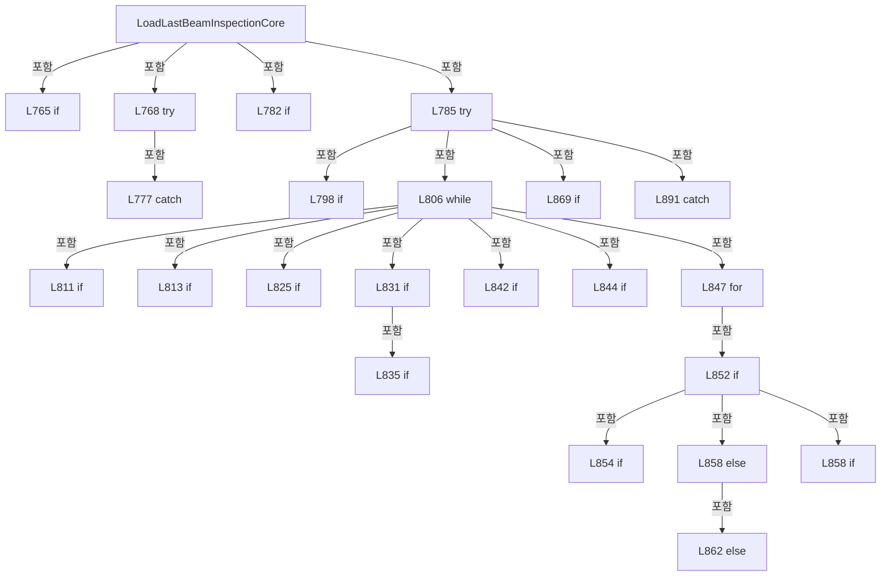

변경 전 점검: 입력/반환 타입, 위 호출자, 예외/취소 경로, 공유 상태와 저장·전송 소비자를 함께 확인합니다. 값의 단위나 물리 방향을 이름만으로 확정하지 않습니다.

### LocalFunctionStatement `Get` · L815–815

[Drilling.File/ReviewResult/CReviewResultFile.cs:815–815](https://github.com/kjuws10-rgb/A3Drilling/blob/5aee8e58439c9b455cae7c9593c9be986c3e682e/Drilling.File/ReviewResult/CReviewResultFile.cs#L815-L815)

| 항목 | 실제 추출 값 |
| --- | --- |
| 서명 | string Get(string) |
| 접근/수식자 | Private /  |
| 반환/값 타입 | string |
| 소속 타입 | NamedType:Drilling.File.ReviewResult.CReviewResultFile |

입력 계약:

| 이름 | 타입 | 전달 | 선택/기본값 |
| --- | --- | --- | --- |
| name | string | None | False /  |

정적 호출자로 확인된 위치:

| 호출 파일/행 | 호출 표현식 | 런타임 분기 가능 |
| --- | --- | --- |
| [Drilling.File/ReviewResult/CReviewResultFile.cs:818–818](https://github.com/kjuws10-rgb/A3Drilling/blob/5aee8e58439c9b455cae7c9593c9be986c3e682e/Drilling.File/ReviewResult/CReviewResultFile.cs#L818-L818) | Get | False |
| [Drilling.File/ReviewResult/CReviewResultFile.cs:833–833](https://github.com/kjuws10-rgb/A3Drilling/blob/5aee8e58439c9b455cae7c9593c9be986c3e682e/Drilling.File/ReviewResult/CReviewResultFile.cs#L833-L833) | Get | False |
| [Drilling.File/ReviewResult/CReviewResultFile.cs:834–834](https://github.com/kjuws10-rgb/A3Drilling/blob/5aee8e58439c9b455cae7c9593c9be986c3e682e/Drilling.File/ReviewResult/CReviewResultFile.cs#L834-L834) | Get | False |
| [Drilling.File/ReviewResult/CReviewResultFile.cs:849–849](https://github.com/kjuws10-rgb/A3Drilling/blob/5aee8e58439c9b455cae7c9593c9be986c3e682e/Drilling.File/ReviewResult/CReviewResultFile.cs#L849-L849) | Get | False |
| [Drilling.File/ReviewResult/CReviewResultFile.cs:850–850](https://github.com/kjuws10-rgb/A3Drilling/blob/5aee8e58439c9b455cae7c9593c9be986c3e682e/Drilling.File/ReviewResult/CReviewResultFile.cs#L850-L850) | Get | False |
| [Drilling.File/ReviewResult/CReviewResultFile.cs:851–851](https://github.com/kjuws10-rgb/A3Drilling/blob/5aee8e58439c9b455cae7c9593c9be986c3e682e/Drilling.File/ReviewResult/CReviewResultFile.cs#L851-L851) | Get | False |

변경 전 점검: 입력/반환 타입, 위 호출자, 예외/취소 경로, 공유 상태와 저장·전송 소비자를 함께 확인합니다. 값의 단위나 물리 방향을 이름만으로 확정하지 않습니다.

### LocalFunctionStatement `RequireName` · L816–822

[Drilling.File/ReviewResult/CReviewResultFile.cs:816–822](https://github.com/kjuws10-rgb/A3Drilling/blob/5aee8e58439c9b455cae7c9593c9be986c3e682e/Drilling.File/ReviewResult/CReviewResultFile.cs#L816-L822)

| 항목 | 실제 추출 값 |
| --- | --- |
| 서명 | string RequireName(string) |
| 접근/수식자 | Private /  |
| 반환/값 타입 | string |
| 소속 타입 | NamedType:Drilling.File.ReviewResult.CReviewResultFile |

입력 계약:

| 이름 | 타입 | 전달 | 선택/기본값 |
| --- | --- | --- | --- |
| name | string | None | False /  |

정적 호출자로 확인된 위치:

| 호출 파일/행 | 호출 표현식 | 런타임 분기 가능 |
| --- | --- | --- |
| [Drilling.File/ReviewResult/CReviewResultFile.cs:824–824](https://github.com/kjuws10-rgb/A3Drilling/blob/5aee8e58439c9b455cae7c9593c9be986c3e682e/Drilling.File/ReviewResult/CReviewResultFile.cs#L824-L824) | RequireName | False |
| [Drilling.File/ReviewResult/CReviewResultFile.cs:828–828](https://github.com/kjuws10-rgb/A3Drilling/blob/5aee8e58439c9b455cae7c9593c9be986c3e682e/Drilling.File/ReviewResult/CReviewResultFile.cs#L828-L828) | RequireName | False |
| [Drilling.File/ReviewResult/CReviewResultFile.cs:829–829](https://github.com/kjuws10-rgb/A3Drilling/blob/5aee8e58439c9b455cae7c9593c9be986c3e682e/Drilling.File/ReviewResult/CReviewResultFile.cs#L829-L829) | RequireName | False |
| [Drilling.File/ReviewResult/CReviewResultFile.cs:830–830](https://github.com/kjuws10-rgb/A3Drilling/blob/5aee8e58439c9b455cae7c9593c9be986c3e682e/Drilling.File/ReviewResult/CReviewResultFile.cs#L830-L830) | RequireName | False |

호출하는 대상과 해석 범위:

| 원본 행 | 표현식 | 분석 상태 | 대상/소스 위치 |
| --- | --- | --- | --- |
| 818 | Get | resolved | string Get(string) · Drilling.File/ReviewResult/CReviewResultFile.cs:815 |
| 819 | string.IsNullOrWhiteSpace | resolved | bool string.IsNullOrWhiteSpace(string?) |
| 820 | Error | resolved | System.IO.InvalidDataException Drilling.File.ReviewResult.CReviewResultFile.Error(long, string) · Drilling.File/ReviewResult/CReviewResultFile.cs:925 |

본문의 실제 연산·분기·예외·반환 순서(원문 위치 순):

| 원본 행 | 종류 | 주석 해설 |
| --- | --- | --- |
| 818 | call | 함수·델리게이트 또는 객체 생성자를 호출합니다: Get(name) |
| 818 | local-declaration | 지역 변수를 선언합니다: var value = Get(name); |
| 818 | variable-initializer | 변수의 초기값을 지정합니다: value = Get(name) |
| 819 | call | 함수·델리게이트 또는 객체 생성자를 호출합니다: string.IsNullOrWhiteSpace(value) |
| 819 | if | 조건에 따라 분기합니다: if (string.IsNullOrWhiteSpace(value)) |
| 820 | call | 함수·델리게이트 또는 객체 생성자를 호출합니다: Error(rowNo, $"{name} 값이 없습니다.") |
| 820 | throw | 예외를 발생/전달합니다: throw Error(rowNo, $"{name} 값이 없습니다."); |
| 821 | return | 호출자에게 값 또는 제어를 반환합니다: return value; |

제어 구문의 포함 구조(실제 실행 순서/CFG가 아닌 구문 탐색 그림):

```mermaid
flowchart TD
 M["RequireName"]
 N0["L819 if"]
 M -->|포함| N0
```

변경 전 점검: 입력/반환 타입, 위 호출자, 예외/취소 경로, 공유 상태와 저장·전송 소비자를 함께 확인합니다. 값의 단위나 물리 방향을 이름만으로 확정하지 않습니다.

### MethodDeclaration `ReadNameNumber` · L898–904

[Drilling.File/ReviewResult/CReviewResultFile.cs:898–904](https://github.com/kjuws10-rgb/A3Drilling/blob/5aee8e58439c9b455cae7c9593c9be986c3e682e/Drilling.File/ReviewResult/CReviewResultFile.cs#L898-L904)

| 항목 | 실제 추출 값 |
| --- | --- |
| 서명 | int Drilling.File.ReviewResult.CReviewResultFile.ReadNameNumber(string, string, long) |
| 접근/수식자 | Private / private, static |
| 반환/값 타입 | int |
| 소속 타입 | NamedType:Drilling.File.ReviewResult.CReviewResultFile |

입력 계약:

| 이름 | 타입 | 전달 | 선택/기본값 |
| --- | --- | --- | --- |
| name | string | None | False /  |
| prefix | string | None | False /  |
| rowNo | long | None | False /  |

정적 호출자로 확인된 위치:

| 호출 파일/행 | 호출 표현식 | 런타임 분기 가능 |
| --- | --- | --- |
| [Drilling.File/ReviewResult/CReviewResultFile.cs:840–840](https://github.com/kjuws10-rgb/A3Drilling/blob/5aee8e58439c9b455cae7c9593c9be986c3e682e/Drilling.File/ReviewResult/CReviewResultFile.cs#L840-L840) | ReadNameNumber | False |
| [Drilling.File/ReviewResult/CReviewResultFile.cs:841–841](https://github.com/kjuws10-rgb/A3Drilling/blob/5aee8e58439c9b455cae7c9593c9be986c3e682e/Drilling.File/ReviewResult/CReviewResultFile.cs#L841-L841) | ReadNameNumber | False |

호출하는 대상과 해석 범위:

| 원본 행 | 표현식 | 분석 상태 | 대상/소스 위치 |
| --- | --- | --- | --- |
| 900 | name.Split | resolved | string[] string.Split(char[]?, System.StringSplitOptions) |
| 901 | parts[0].Equals | resolved | bool string.Equals(string?, System.StringComparison) |
| 901 | int.TryParse | resolved | bool int.TryParse(string?, System.Globalization.NumberStyles, System.IFormatProvider?, out int) |
| 902 | Error | resolved | System.IO.InvalidDataException Drilling.File.ReviewResult.CReviewResultFile.Error(long, string) · Drilling.File/ReviewResult/CReviewResultFile.cs:925 |

본문의 실제 연산·분기·예외·반환 순서(원문 위치 순):

| 원본 행 | 종류 | 주석 해설 |
| --- | --- | --- |
| 900 | call | 함수·델리게이트 또는 객체 생성자를 호출합니다: name.Split((char[]? )null, StringSplitOptions.RemoveEmptyEntries) |
| 900 | local-declaration | 지역 변수를 선언합니다: var parts = name.Split((char[]? )null, StringSplitOptions.RemoveEmptyEntries); |
| 900 | variable-initializer | 변수의 초기값을 지정합니다: parts = name.Split((char[]? )null, StringSplitOptions.RemoveEmptyEntries) |
| 901 | call | 함수·델리게이트 또는 객체 생성자를 호출합니다: parts[0].Equals(prefix, StringComparison.OrdinalIgnoreCase) |
| 901 | call | 함수·델리게이트 또는 객체 생성자를 호출합니다: int.TryParse(parts[1], NumberStyles.None, CultureInfo.InvariantCulture, out var number) |
| 901 | if | 조건에 따라 분기합니다: if (parts.Length != 2 &#124;&#124; !parts[0].Equals(prefix, StringComparison.OrdinalIgnoreCase) &#124;&#124; !int.TryParse(parts[1], NumberStyles.None, CultureInfo.InvariantCulture, out var number) &#124;&#124; number < 1) |
| 902 | call | 함수·델리게이트 또는 객체 생성자를 호출합니다: Error(rowNo, $"{prefix}_NAME 형식이 잘못되었습니다. 예: {prefix} 01. 입력: {name}") |
| 902 | throw | 예외를 발생/전달합니다: throw Error(rowNo, $"{prefix}_NAME 형식이 잘못되었습니다. 예: {prefix} 01. 입력: {name}"); |
| 903 | return | 호출자에게 값 또는 제어를 반환합니다: return number; |

제어 구문의 포함 구조(실제 실행 순서/CFG가 아닌 구문 탐색 그림):

```mermaid
flowchart TD
 M["ReadNameNumber"]
 N0["L901 if"]
 M -->|포함| N0
```

변경 전 점검: 입력/반환 타입, 위 호출자, 예외/취소 경로, 공유 상태와 저장·전송 소비자를 함께 확인합니다. 값의 단위나 물리 방향을 이름만으로 확정하지 않습니다.

### MethodDeclaration `ReadFinite` · L906–916

[Drilling.File/ReviewResult/CReviewResultFile.cs:906–916](https://github.com/kjuws10-rgb/A3Drilling/blob/5aee8e58439c9b455cae7c9593c9be986c3e682e/Drilling.File/ReviewResult/CReviewResultFile.cs#L906-L916)

| 항목 | 실제 추출 값 |
| --- | --- |
| 서명 | double Drilling.File.ReviewResult.CReviewResultFile.ReadFinite(string, long, int, string) |
| 접근/수식자 | Private / private, static |
| 반환/값 타입 | double |
| 소속 타입 | NamedType:Drilling.File.ReviewResult.CReviewResultFile |

입력 계약:

| 이름 | 타입 | 전달 | 선택/기본값 |
| --- | --- | --- | --- |
| text | string | None | False /  |
| rowNo | long | None | False /  |
| beam | int | None | False /  |
| name | string | None | False /  |

정적 호출자로 확인된 위치:

| 호출 파일/행 | 호출 표현식 | 런타임 분기 가능 |
| --- | --- | --- |
| [Drilling.File/ReviewResult/CReviewResultFile.cs:860–860](https://github.com/kjuws10-rgb/A3Drilling/blob/5aee8e58439c9b455cae7c9593c9be986c3e682e/Drilling.File/ReviewResult/CReviewResultFile.cs#L860-L860) | ReadFinite | False |
| [Drilling.File/ReviewResult/CReviewResultFile.cs:860–860](https://github.com/kjuws10-rgb/A3Drilling/blob/5aee8e58439c9b455cae7c9593c9be986c3e682e/Drilling.File/ReviewResult/CReviewResultFile.cs#L860-L860) | ReadFinite | False |

호출하는 대상과 해석 범위:

| 원본 행 | 표현식 | 분석 상태 | 대상/소스 위치 |
| --- | --- | --- | --- |
| 910 | ReadFiniteValue | resolved | double Drilling.File.ReviewResult.CReviewResultFile.ReadFiniteValue(string, long, string) · Drilling.File/ReviewResult/CReviewResultFile.cs:918 |
| 914 | Error | resolved | System.IO.InvalidDataException Drilling.File.ReviewResult.CReviewResultFile.Error(long, string) · Drilling.File/ReviewResult/CReviewResultFile.cs:925 |

본문의 실제 연산·분기·예외·반환 순서(원문 위치 순):

| 원본 행 | 종류 | 주석 해설 |
| --- | --- | --- |
| 908 | try | 예외 처리 범위입니다: try |
| 910 | call | 함수·델리게이트 또는 객체 생성자를 호출합니다: ReadFiniteValue(text, rowNo, name) |
| 910 | return | 호출자에게 값 또는 제어를 반환합니다: return ReadFiniteValue(text, rowNo, name); |
| 912 | catch | 지정 예외를 처리합니다: catch (InvalidDataException exception) |
| 914 | call | 함수·델리게이트 또는 객체 생성자를 호출합니다: Error(rowNo, $"Beam {beam}: {exception.Message}") |
| 914 | throw | 예외를 발생/전달합니다: throw Error(rowNo, $"Beam {beam}: {exception.Message}"); |

제어 구문의 포함 구조(실제 실행 순서/CFG가 아닌 구문 탐색 그림):

```mermaid
flowchart TD
 M["ReadFinite"]
 N0["L908 try"]
 M -->|포함| N0
 N1["L912 catch"]
 N0 -->|포함| N1
```

변경 전 점검: 입력/반환 타입, 위 호출자, 예외/취소 경로, 공유 상태와 저장·전송 소비자를 함께 확인합니다. 값의 단위나 물리 방향을 이름만으로 확정하지 않습니다.

### MethodDeclaration `ReadFiniteValue` · L918–923

[Drilling.File/ReviewResult/CReviewResultFile.cs:918–923](https://github.com/kjuws10-rgb/A3Drilling/blob/5aee8e58439c9b455cae7c9593c9be986c3e682e/Drilling.File/ReviewResult/CReviewResultFile.cs#L918-L923)

| 항목 | 실제 추출 값 |
| --- | --- |
| 서명 | double Drilling.File.ReviewResult.CReviewResultFile.ReadFiniteValue(string, long, string) |
| 접근/수식자 | Private / private, static |
| 반환/값 타입 | double |
| 소속 타입 | NamedType:Drilling.File.ReviewResult.CReviewResultFile |

입력 계약:

| 이름 | 타입 | 전달 | 선택/기본값 |
| --- | --- | --- | --- |
| text | string | None | False /  |
| rowNo | long | None | False /  |
| name | string | None | False /  |

정적 호출자로 확인된 위치:

| 호출 파일/행 | 호출 표현식 | 런타임 분기 가능 |
| --- | --- | --- |
| [Drilling.File/ReviewResult/CReviewResultFile.cs:833–833](https://github.com/kjuws10-rgb/A3Drilling/blob/5aee8e58439c9b455cae7c9593c9be986c3e682e/Drilling.File/ReviewResult/CReviewResultFile.cs#L833-L833) | ReadFiniteValue | False |
| [Drilling.File/ReviewResult/CReviewResultFile.cs:834–834](https://github.com/kjuws10-rgb/A3Drilling/blob/5aee8e58439c9b455cae7c9593c9be986c3e682e/Drilling.File/ReviewResult/CReviewResultFile.cs#L834-L834) | ReadFiniteValue | False |
| [Drilling.File/ReviewResult/CReviewResultFile.cs:910–910](https://github.com/kjuws10-rgb/A3Drilling/blob/5aee8e58439c9b455cae7c9593c9be986c3e682e/Drilling.File/ReviewResult/CReviewResultFile.cs#L910-L910) | ReadFiniteValue | False |

호출하는 대상과 해석 범위:

| 원본 행 | 표현식 | 분석 상태 | 대상/소스 위치 |
| --- | --- | --- | --- |
| 920 | double.TryParse | resolved | bool double.TryParse(string?, System.Globalization.NumberStyles, System.IFormatProvider?, out double) |
| 920 | double.IsFinite | resolved | bool double.IsFinite(double) |
| 921 | new InvalidDataException | resolved | System.IO.InvalidDataException.InvalidDataException(string?) |

본문의 실제 연산·분기·예외·반환 순서(원문 위치 순):

| 원본 행 | 종류 | 주석 해설 |
| --- | --- | --- |
| 920 | call | 함수·델리게이트 또는 객체 생성자를 호출합니다: double.TryParse(text, NumberStyles.Float, CultureInfo.InvariantCulture, out var value) |
| 920 | call | 함수·델리게이트 또는 객체 생성자를 호출합니다: double.IsFinite(value) |
| 920 | if | 조건에 따라 분기합니다: if (!double.TryParse(text, NumberStyles.Float, CultureInfo.InvariantCulture, out var value) &#124;&#124; !double.IsFinite(value)) |
| 921 | call | 함수·델리게이트 또는 객체 생성자를 호출합니다: new InvalidDataException($"{name}은 유한한 숫자여야 합니다. 소수점은 '.'을 사용하세요. 입력: {text}") |
| 921 | throw | 예외를 발생/전달합니다: throw new InvalidDataException($"{name}은 유한한 숫자여야 합니다. 소수점은 '.'을 사용하세요. 입력: {text}"); |
| 922 | return | 호출자에게 값 또는 제어를 반환합니다: return value; |

제어 구문의 포함 구조(실제 실행 순서/CFG가 아닌 구문 탐색 그림):

```mermaid
flowchart TD
 M["ReadFiniteValue"]
 N0["L920 if"]
 M -->|포함| N0
```

변경 전 점검: 입력/반환 타입, 위 호출자, 예외/취소 경로, 공유 상태와 저장·전송 소비자를 함께 확인합니다. 값의 단위나 물리 방향을 이름만으로 확정하지 않습니다.

### MethodDeclaration `Error` · L925–925

[Drilling.File/ReviewResult/CReviewResultFile.cs:925–925](https://github.com/kjuws10-rgb/A3Drilling/blob/5aee8e58439c9b455cae7c9593c9be986c3e682e/Drilling.File/ReviewResult/CReviewResultFile.cs#L925-L925)

| 항목 | 실제 추출 값 |
| --- | --- |
| 서명 | System.IO.InvalidDataException Drilling.File.ReviewResult.CReviewResultFile.Error(long, string) |
| 접근/수식자 | Private / private, static |
| 반환/값 타입 | System.IO.InvalidDataException |
| 소속 타입 | NamedType:Drilling.File.ReviewResult.CReviewResultFile |

입력 계약:

| 이름 | 타입 | 전달 | 선택/기본값 |
| --- | --- | --- | --- |
| rowNo | long | None | False /  |
| detail | string | None | False /  |

정적 호출자로 확인된 위치:

| 호출 파일/행 | 호출 표현식 | 런타임 분기 가능 |
| --- | --- | --- |
| [Drilling.File/ReviewResult/CReviewResultFile.cs:814–814](https://github.com/kjuws10-rgb/A3Drilling/blob/5aee8e58439c9b455cae7c9593c9be986c3e682e/Drilling.File/ReviewResult/CReviewResultFile.cs#L814-L814) | Error | False |
| [Drilling.File/ReviewResult/CReviewResultFile.cs:820–820](https://github.com/kjuws10-rgb/A3Drilling/blob/5aee8e58439c9b455cae7c9593c9be986c3e682e/Drilling.File/ReviewResult/CReviewResultFile.cs#L820-L820) | Error | False |
| [Drilling.File/ReviewResult/CReviewResultFile.cs:826–826](https://github.com/kjuws10-rgb/A3Drilling/blob/5aee8e58439c9b455cae7c9593c9be986c3e682e/Drilling.File/ReviewResult/CReviewResultFile.cs#L826-L826) | Error | False |
| [Drilling.File/ReviewResult/CReviewResultFile.cs:836–836](https://github.com/kjuws10-rgb/A3Drilling/blob/5aee8e58439c9b455cae7c9593c9be986c3e682e/Drilling.File/ReviewResult/CReviewResultFile.cs#L836-L836) | Error | False |
| [Drilling.File/ReviewResult/CReviewResultFile.cs:843–843](https://github.com/kjuws10-rgb/A3Drilling/blob/5aee8e58439c9b455cae7c9593c9be986c3e682e/Drilling.File/ReviewResult/CReviewResultFile.cs#L843-L843) | Error | False |
| [Drilling.File/ReviewResult/CReviewResultFile.cs:845–845](https://github.com/kjuws10-rgb/A3Drilling/blob/5aee8e58439c9b455cae7c9593c9be986c3e682e/Drilling.File/ReviewResult/CReviewResultFile.cs#L845-L845) | Error | False |
| [Drilling.File/ReviewResult/CReviewResultFile.cs:855–855](https://github.com/kjuws10-rgb/A3Drilling/blob/5aee8e58439c9b455cae7c9593c9be986c3e682e/Drilling.File/ReviewResult/CReviewResultFile.cs#L855-L855) | Error | False |
| [Drilling.File/ReviewResult/CReviewResultFile.cs:863–863](https://github.com/kjuws10-rgb/A3Drilling/blob/5aee8e58439c9b455cae7c9593c9be986c3e682e/Drilling.File/ReviewResult/CReviewResultFile.cs#L863-L863) | Error | False |
| [Drilling.File/ReviewResult/CReviewResultFile.cs:902–902](https://github.com/kjuws10-rgb/A3Drilling/blob/5aee8e58439c9b455cae7c9593c9be986c3e682e/Drilling.File/ReviewResult/CReviewResultFile.cs#L902-L902) | Error | False |
| [Drilling.File/ReviewResult/CReviewResultFile.cs:914–914](https://github.com/kjuws10-rgb/A3Drilling/blob/5aee8e58439c9b455cae7c9593c9be986c3e682e/Drilling.File/ReviewResult/CReviewResultFile.cs#L914-L914) | Error | False |

호출하는 대상과 해석 범위:

| 원본 행 | 표현식 | 분석 상태 | 대상/소스 위치 |
| --- | --- | --- | --- |
| 925 | new | resolved | System.IO.InvalidDataException.InvalidDataException(string?) |

본문의 실제 연산·분기·예외·반환 순서(원문 위치 순):

| 원본 행 | 종류 | 주석 해설 |
| --- | --- | --- |
| 925 | call | 함수·델리게이트 또는 객체 생성자를 호출합니다: new($"CSV {rowNo}행: {detail}") |

변경 전 점검: 입력/반환 타입, 위 호출자, 예외/취소 경로, 공유 상태와 저장·전송 소비자를 함께 확인합니다. 값의 단위나 물리 방향을 이름만으로 확정하지 않습니다.

### MethodDeclaration `ParseOnOff` · L926–926

[Drilling.File/ReviewResult/CReviewResultFile.cs:926–926](https://github.com/kjuws10-rgb/A3Drilling/blob/5aee8e58439c9b455cae7c9593c9be986c3e682e/Drilling.File/ReviewResult/CReviewResultFile.cs#L926-L926)

| 항목 | 실제 추출 값 |
| --- | --- |
| 서명 | bool Drilling.File.ReviewResult.CReviewResultFile.ParseOnOff(string?) |
| 접근/수식자 | Private / private, static |
| 반환/값 타입 | bool |
| 소속 타입 | NamedType:Drilling.File.ReviewResult.CReviewResultFile |

입력 계약:

| 이름 | 타입 | 전달 | 선택/기본값 |
| --- | --- | --- | --- |
| value | string? | None | False /  |

정적 호출자로 확인된 위치:

| 호출 파일/행 | 호출 표현식 | 런타임 분기 가능 |
| --- | --- | --- |
| [Drilling.File/ReviewResult/CReviewResultFile.cs:881–881](https://github.com/kjuws10-rgb/A3Drilling/blob/5aee8e58439c9b455cae7c9593c9be986c3e682e/Drilling.File/ReviewResult/CReviewResultFile.cs#L881-L881) | ParseOnOff | False |
| [Drilling.File/ReviewResult/CReviewResultFile.cs:881–881](https://github.com/kjuws10-rgb/A3Drilling/blob/5aee8e58439c9b455cae7c9593c9be986c3e682e/Drilling.File/ReviewResult/CReviewResultFile.cs#L881-L881) | ParseOnOff | False |

호출하는 대상과 해석 범위:

| 원본 행 | 표현식 | 분석 상태 | 대상/소스 위치 |
| --- | --- | --- | --- |
| 926 | .Trim().Equals | resolved | bool string.Equals(string?, System.StringComparison) |
| 926 | .Trim | resolved | string string.Trim() |

본문의 실제 연산·분기·예외·반환 순서(원문 위치 순):

| 원본 행 | 종류 | 주석 해설 |
| --- | --- | --- |
| 926 | call | 함수·델리게이트 또는 객체 생성자를 호출합니다: .Trim().Equals("ON", StringComparison.OrdinalIgnoreCase) |
| 926 | call | 함수·델리게이트 또는 객체 생성자를 호출합니다: .Trim() |

변경 전 점검: 입력/반환 타입, 위 호출자, 예외/취소 경로, 공유 상태와 저장·전송 소비자를 함께 확인합니다. 값의 단위나 물리 방향을 이름만으로 확정하지 않습니다.

### MethodDeclaration `SaveOneShot` · L929–984

[Drilling.File/ReviewResult/CReviewResultFile.cs:929–984](https://github.com/kjuws10-rgb/A3Drilling/blob/5aee8e58439c9b455cae7c9593c9be986c3e682e/Drilling.File/ReviewResult/CReviewResultFile.cs#L929-L984)

| 항목 | 실제 추출 값 |
| --- | --- |
| 서명 | System.Threading.Tasks.Task<string> Drilling.File.ReviewResult.CReviewResultFile.SaveOneShot(Drilling.Common.Review.ST_ONE_SHOT_RESULT_DATA, System.Threading.CancellationToken) |
| 접근/수식자 | Public / public, override |
| 반환/값 타입 | System.Threading.Tasks.Task<string> |
| 소속 타입 | NamedType:Drilling.File.ReviewResult.CReviewResultFile |

입력 계약:

| 이름 | 타입 | 전달 | 선택/기본값 |
| --- | --- | --- | --- |
| data | Drilling.Common.Review.ST_ONE_SHOT_RESULT_DATA | None | False /  |
| cancellationToken | System.Threading.CancellationToken | None | True / null |

현재 부분 분석에서 직접 연결된 호출자는 없습니다. XAML/이벤트/인터페이스·델리게이트·외부 진입을 추가 확인해야 하며, 미사용으로 판정한 것이 아닙니다.

호출하는 대상과 해석 범위:

| 원본 행 | 표현식 | 분석 상태 | 대상/소스 위치 |
| --- | --- | --- | --- |
| 931 | cancellationToken.ThrowIfCancellationRequested | resolved | void System.Threading.CancellationToken.ThrowIfCancellationRequested() |
| 933 | new InvalidDataException | resolved | System.IO.InvalidDataException.InvalidDataException(string?) |
| 934 | CReviewManager.VisionErrorToStageOffset | resolved | Drilling.Common.Review.ST_REVIEW_COORDINATE_OFFSET Drilling.Common.Review.CReviewManager.VisionErrorToStageOffset(double, double, Drilling.Common.Review.EN_VISION_FLIP_TYPE) · Drilling.Common/Review/CReviewManager.cs:3486 |
| 944 | new Dictionary<string, string> | resolved | System.Collections.Generic.Dictionary<string, string>.Dictionary(System.Collections.Generic.IEqualityComparer<string>?) |
| 946 | FormatDate | resolved | string Drilling.File.ReviewResult.CReviewResultFile.FormatDate(System.DateTimeOffset?) · Drilling.File/ReviewResult/CReviewResultFile.cs:619 |
| 948 | string.IsNullOrWhiteSpace | resolved | bool string.IsNullOrWhiteSpace(string?) |
| 951 | data.Method.ToString().ToUpperInvariant | resolved | string string.ToUpperInvariant() |
| 951 | data.Method.ToString | resolved · 동적 구현 선택 가능 | string System.Enum.ToString() |
| 952 | data.Action.ToString().ToUpperInvariant | resolved | string string.ToUpperInvariant() |
| 952 | data.Action.ToString | resolved · 동적 구현 선택 가능 | string System.Enum.ToString() |
| 956 | Int | resolved | string Drilling.File.ReviewResult.CReviewResultFile.Int(int) · Drilling.File/ReviewResult/CReviewResultFile.cs:1219 |
| 957 | Int | resolved | string Drilling.File.ReviewResult.CReviewResultFile.Int(int) · Drilling.File/ReviewResult/CReviewResultFile.cs:1219 |
| 958 | CReviewShotNameFormatter.ToMatrixName | resolved | string Drilling.Common.Review.CReviewShotNameFormatter.ToMatrixName(int, int) · Drilling.Common/Review/CReviewManager.cs:3897 |
| 960 | Int | resolved | string Drilling.File.ReviewResult.CReviewResultFile.Int(int) · Drilling.File/ReviewResult/CReviewResultFile.cs:1219 |
| 961 | Number | resolved | string Drilling.File.ReviewResult.CReviewResultFile.Number(double) · Drilling.File/ReviewResult/CReviewResultFile.cs:1220 |
| 962 | Number | resolved | string Drilling.File.ReviewResult.CReviewResultFile.Number(double) · Drilling.File/ReviewResult/CReviewResultFile.cs:1220 |
| 963 | Number | resolved | string Drilling.File.ReviewResult.CReviewResultFile.Number(double) · Drilling.File/ReviewResult/CReviewResultFile.cs:1220 |
| 964 | Number | resolved | string Drilling.File.ReviewResult.CReviewResultFile.Number(double) · Drilling.File/ReviewResult/CReviewResultFile.cs:1220 |
| 965 | Int | resolved | string Drilling.File.ReviewResult.CReviewResultFile.Int(int) · Drilling.File/ReviewResult/CReviewResultFile.cs:1219 |
| 966 | Number | resolved | string Drilling.File.ReviewResult.CReviewResultFile.Number(double) · Drilling.File/ReviewResult/CReviewResultFile.cs:1220 |
| 967 | Number | resolved | string Drilling.File.ReviewResult.CReviewResultFile.Number(double) · Drilling.File/ReviewResult/CReviewResultFile.cs:1220 |
| 968 | Number | resolved | string Drilling.File.ReviewResult.CReviewResultFile.Number(double) · Drilling.File/ReviewResult/CReviewResultFile.cs:1220 |
| 969 | Number | resolved | string Drilling.File.ReviewResult.CReviewResultFile.Number(double) · Drilling.File/ReviewResult/CReviewResultFile.cs:1220 |
| 970 | Number | resolved | string Drilling.File.ReviewResult.CReviewResultFile.Number(double) · Drilling.File/ReviewResult/CReviewResultFile.cs:1220 |
| 971 | data.Plan.VisionFlipType.HasFlag | resolved | bool System.Enum.HasFlag(System.Enum) |
| 972 | data.Plan.VisionFlipType.HasFlag | resolved | bool System.Enum.HasFlag(System.Enum) |
| 973 | data.Plan.VisionFlipType.HasFlag | resolved | bool System.Enum.HasFlag(System.Enum) |
| 974 | Number | resolved | string Drilling.File.ReviewResult.CReviewResultFile.Number(double) · Drilling.File/ReviewResult/CReviewResultFile.cs:1220 |
| 975 | Number | resolved | string Drilling.File.ReviewResult.CReviewResultFile.Number(double) · Drilling.File/ReviewResult/CReviewResultFile.cs:1220 |
| 976 | Number | resolved | string Drilling.File.ReviewResult.CReviewResultFile.Number(double) · Drilling.File/ReviewResult/CReviewResultFile.cs:1220 |
| 977 | Number | resolved | string Drilling.File.ReviewResult.CReviewResultFile.Number(double) · Drilling.File/ReviewResult/CReviewResultFile.cs:1220 |
| 981 | WriteUniqueCsv | resolved | string Drilling.File.ReviewResult.CReviewResultFile.WriteUniqueCsv(string, string, System.Collections.Generic.IReadOnlyList<string>, System.Collections.Generic.IEnumerable<System.Collections.Generic.IReadOnlyDictionary<string, string>>, System.Threading.CancellationToken) · Drilling.File/ReviewResult/CReviewResultFile.cs:641 |
| 981 | ManualDirectory | resolved | string Drilling.File.ReviewResult.CReviewResultFile.ManualDirectory(string, string) · Drilling.File/ReviewResult/CReviewResultFile.cs:636 |
| 981 | ResultFileStem | resolved | string Drilling.File.ReviewResult.CReviewResultFile.ResultFileStem(string, System.DateTimeOffset) · Drilling.File/ReviewResult/CReviewResultFile.cs:639 |
| 983 | Task.FromResult | resolved | System.Threading.Tasks.Task<string> System.Threading.Tasks.Task.FromResult<string>(string) |

본문의 실제 연산·분기·예외·반환 순서(원문 위치 순):

| 원본 행 | 종류 | 주석 해설 |
| --- | --- | --- |
| 931 | call | 함수·델리게이트 또는 객체 생성자를 호출합니다: cancellationToken.ThrowIfCancellationRequested() |
| 932 | local-declaration | 지역 변수를 선언합니다: var point = data.Result.Point; |
| 932 | variable-initializer | 변수의 초기값을 지정합니다: point = data.Result.Point |
| 933 | call | 함수·델리게이트 또는 객체 생성자를 호출합니다: new InvalidDataException("ONE SHOT 검사 결과에 Vision Mark가 없습니다.") |
| 933 | local-declaration | 지역 변수를 선언합니다: var mark = data.Result.Mark ?? throw new InvalidDataException("ONE SHOT 검사 결과에 Vision Mark가 없습니다."); |
| 933 | throw | 예외를 발생/전달합니다: throw new InvalidDataException("ONE SHOT 검사 결과에 Vision Mark가 없습니다.") |
| 933 | variable-initializer | 변수의 초기값을 지정합니다: mark = data.Result.Mark ?? throw new InvalidDataException("ONE SHOT 검사 결과에 Vision Mark가 없습니다.") |
| 934 | call | 함수·델리게이트 또는 객체 생성자를 호출합니다: CReviewManager.VisionErrorToStageOffset(point.ErrorX, point.ErrorY, data.Plan.VisionFlipType) |
| 934 | local-declaration | 지역 변수를 선언합니다: var converted = CReviewManager.VisionErrorToStageOffset(point.ErrorX, point.ErrorY, data.Plan.VisionFlipType); |
| 934 | variable-initializer | 변수의 초기값을 지정합니다: converted = CReviewManager.VisionErrorToStageOffset(point.ErrorX, point.ErrorY, data.Plan.VisionFlipType) |
| 935 | local-declaration | 지역 변수를 선언합니다: string[] headers = [ "SAVED_AT", "RECIPE_ID", "GLASS_ID", "RESULT_STATUS", "RUN_TYPE", "METHOD", "ACTION", "TOTAL_COUNT", "STAGE_SIMULATION", "VISION_SIMULATION", "HEAD_NO", "CELL_NO", "SHOT_NAME", "SHOT_KEY", "BEAM_NO", "DESIGN_X |
| 935 | variable-initializer | 변수의 초기값을 지정합니다: headers = [ "SAVED_AT", "RECIPE_ID", "GLASS_ID", "RESULT_STATUS", "RUN_TYPE", "METHOD", "ACTION", "TOTAL_COUNT", "STAGE_SIMULATION", "VISION_SIMULATION", "HEAD_NO", "CELL_NO", "SHOT_NAME", "SHOT_KEY", "BEAM_NO", "DESIGN_X", "DESIG |
| 942 | local-declaration | 지역 변수를 선언합니다: IReadOnlyDictionary<string, string>[] rows = [ new Dictionary<string, string>(StringComparer.OrdinalIgnoreCase) { ["SAVED_AT"] = FormatDate(data.SavedAt), ["RECIPE_ID"] = data.Plan.RecipeId, ["GLASS_ID"] = string.IsNullOrWhiteSpac |
| 942 | variable-initializer | 변수의 초기값을 지정합니다: rows = [ new Dictionary<string, string>(StringComparer.OrdinalIgnoreCase) { ["SAVED_AT"] = FormatDate(data.SavedAt), ["RECIPE_ID"] = data.Plan.RecipeId, ["GLASS_ID"] = string.IsNullOrWhiteSpace(data.GlassId) ? "UNLINKED" : data.Gl |
| 944 | call | 함수·델리게이트 또는 객체 생성자를 호출합니다: new Dictionary<string, string>(StringComparer.OrdinalIgnoreCase) { ["SAVED_AT"] = FormatDate(data.SavedAt), ["RECIPE_ID"] = data.Plan.RecipeId, ["GLASS_ID"] = string.IsNullOrWhiteSpace(data.GlassId) ? "UNLINKED" : data.G… |
| 946 | assignment | 값을 대상에 대입합니다: ["SAVED_AT"] = FormatDate(data.SavedAt) |
| 946 | call | 함수·델리게이트 또는 객체 생성자를 호출합니다: FormatDate(data.SavedAt) |
| 947 | assignment | 값을 대상에 대입합니다: ["RECIPE_ID"] = data.Plan.RecipeId |
| 948 | assignment | 값을 대상에 대입합니다: ["GLASS_ID"] = string.IsNullOrWhiteSpace(data.GlassId) ? "UNLINKED" : data.GlassId |
| 948 | call | 함수·델리게이트 또는 객체 생성자를 호출합니다: string.IsNullOrWhiteSpace(data.GlassId) |
| 948 | conditional-expression | 조건에 따라 결과식을 선택합니다: string.IsNullOrWhiteSpace(data.GlassId) ? "UNLINKED" : data.GlassId |
| 949 | assignment | 값을 대상에 대입합니다: ["RESULT_STATUS"] = "COMPLETED" |
| 950 | assignment | 값을 대상에 대입합니다: ["RUN_TYPE"] = "MANUAL" |
| 951 | assignment | 값을 대상에 대입합니다: ["METHOD"] = data.Method.ToString().ToUpperInvariant() |
| 951 | call | 함수·델리게이트 또는 객체 생성자를 호출합니다: data.Method.ToString().ToUpperInvariant() |
| 951 | call | 함수·델리게이트 또는 객체 생성자를 호출합니다: data.Method.ToString() |
| 952 | assignment | 값을 대상에 대입합니다: ["ACTION"] = data.Action.ToString().ToUpperInvariant() |
| 952 | call | 함수·델리게이트 또는 객체 생성자를 호출합니다: data.Action.ToString().ToUpperInvariant() |
| 952 | call | 함수·델리게이트 또는 객체 생성자를 호출합니다: data.Action.ToString() |
| 953 | assignment | 값을 대상에 대입합니다: ["TOTAL_COUNT"] = "1" |
| 954 | assignment | 값을 대상에 대입합니다: ["STAGE_SIMULATION"] = data.Result.IsStageSimulation ? "ON" : "OFF" |
| 954 | conditional-expression | 조건에 따라 결과식을 선택합니다: data.Result.IsStageSimulation ? "ON" : "OFF" |
| 955 | assignment | 값을 대상에 대입합니다: ["VISION_SIMULATION"] = data.Result.IsVisionSimulation ? "ON" : "OFF" |
| 955 | conditional-expression | 조건에 따라 결과식을 선택합니다: data.Result.IsVisionSimulation ? "ON" : "OFF" |
| 956 | assignment | 값을 대상에 대입합니다: ["HEAD_NO"] = Int(point.HeadNo) |
| 956 | call | 함수·델리게이트 또는 객체 생성자를 호출합니다: Int(point.HeadNo) |
| 957 | assignment | 값을 대상에 대입합니다: ["CELL_NO"] = Int(point.CellNo) |
| 957 | call | 함수·델리게이트 또는 객체 생성자를 호출합니다: Int(point.CellNo) |
| 958 | assignment | 값을 대상에 대입합니다: ["SHOT_NAME"] = CReviewShotNameFormatter.ToMatrixName(point.ShotNo, point.PixelCountX) |
| 958 | call | 함수·델리게이트 또는 객체 생성자를 호출합니다: CReviewShotNameFormatter.ToMatrixName(point.ShotNo, point.PixelCountX) |
| 959 | assignment | 값을 대상에 대입합니다: ["SHOT_KEY"] = point.ShotKey |
| 960 | assignment | 값을 대상에 대입합니다: ["BEAM_NO"] = Int(point.BeamNo) |
| 960 | call | 함수·델리게이트 또는 객체 생성자를 호출합니다: Int(point.BeamNo) |
| 961 | assignment | 값을 대상에 대입합니다: ["DESIGN_X"] = Number(point.DesignX) |
| 961 | call | 함수·델리게이트 또는 객체 생성자를 호출합니다: Number(point.DesignX) |
| 962 | assignment | 값을 대상에 대입합니다: ["DESIGN_Y"] = Number(point.DesignY) |
| 962 | call | 함수·델리게이트 또는 객체 생성자를 호출합니다: Number(point.DesignY) |
| 963 | assignment | 값을 대상에 대입합니다: ["REVIEW_X_TARGET"] = Number(point.ReviewTargetX) |
| 963 | call | 함수·델리게이트 또는 객체 생성자를 호출합니다: Number(point.ReviewTargetX) |
| 964 | assignment | 값을 대상에 대입합니다: ["STAGE_Y_TARGET"] = Number(point.ReviewTargetY) |
| 964 | call | 함수·델리게이트 또는 객체 생성자를 호출합니다: Number(point.ReviewTargetY) |
| 965 | assignment | 값을 대상에 대입합니다: ["RESOLUTION"] = Int(data.Result.Resolution) |
| 965 | call | 함수·델리게이트 또는 객체 생성자를 호출합니다: Int(data.Result.Resolution) |
| 966 | assignment | 값을 대상에 대입합니다: ["CAMERA_RESOLUTION"] = Number(data.Result.CameraResolution) |
| 966 | call | 함수·델리게이트 또는 객체 생성자를 호출합니다: Number(data.Result.CameraResolution) |
| 967 | assignment | 값을 대상에 대입합니다: ["TARGET_X"] = Number(mark.TargetMarkX) |
| 967 | call | 함수·델리게이트 또는 객체 생성자를 호출합니다: Number(mark.TargetMarkX) |
| 968 | assignment | 값을 대상에 대입합니다: ["TARGET_Y"] = Number(mark.TargetMarkY) |
| 968 | call | 함수·델리게이트 또는 객체 생성자를 호출합니다: Number(mark.TargetMarkY) |
| 969 | assignment | 값을 대상에 대입합니다: ["HOLE_X"] = Number(mark.HoleX) |
| 969 | call | 함수·델리게이트 또는 객체 생성자를 호출합니다: Number(mark.HoleX) |
| 970 | assignment | 값을 대상에 대입합니다: ["HOLE_Y"] = Number(mark.HoleY) |
| 970 | call | 함수·델리게이트 또는 객체 생성자를 호출합니다: Number(mark.HoleY) |
| 971 | assignment | 값을 대상에 대입합니다: ["VISION_X_FLIP"] = data.Plan.VisionFlipType.HasFlag(EN_VISION_FLIP_TYPE.XFlip) ? "ON" : "OFF" |
| 971 | call | 함수·델리게이트 또는 객체 생성자를 호출합니다: data.Plan.VisionFlipType.HasFlag(EN_VISION_FLIP_TYPE.XFlip) |
| 971 | conditional-expression | 조건에 따라 결과식을 선택합니다: data.Plan.VisionFlipType.HasFlag(EN_VISION_FLIP_TYPE.XFlip) ? "ON" : "OFF" |
| 972 | assignment | 값을 대상에 대입합니다: ["VISION_Y_FLIP"] = data.Plan.VisionFlipType.HasFlag(EN_VISION_FLIP_TYPE.YFlip) ? "ON" : "OFF" |
| 972 | call | 함수·델리게이트 또는 객체 생성자를 호출합니다: data.Plan.VisionFlipType.HasFlag(EN_VISION_FLIP_TYPE.YFlip) |
| 972 | conditional-expression | 조건에 따라 결과식을 선택합니다: data.Plan.VisionFlipType.HasFlag(EN_VISION_FLIP_TYPE.YFlip) ? "ON" : "OFF" |
| 973 | assignment | 값을 대상에 대입합니다: ["VISION_XY_FLIP"] = data.Plan.VisionFlipType.HasFlag(EN_VISION_FLIP_TYPE.XyFlip) ? "ON" : "OFF" |
| 973 | call | 함수·델리게이트 또는 객체 생성자를 호출합니다: data.Plan.VisionFlipType.HasFlag(EN_VISION_FLIP_TYPE.XyFlip) |
| 973 | conditional-expression | 조건에 따라 결과식을 선택합니다: data.Plan.VisionFlipType.HasFlag(EN_VISION_FLIP_TYPE.XyFlip) ? "ON" : "OFF" |
| 974 | assignment | 값을 대상에 대입합니다: ["RECV_TARGET_MINUS_HOLE_X"] = Number(point.ErrorX) |
| 974 | call | 함수·델리게이트 또는 객체 생성자를 호출합니다: Number(point.ErrorX) |
| 975 | assignment | 값을 대상에 대입합니다: ["RECV_TARGET_MINUS_HOLE_Y"] = Number(point.ErrorY) |
| 975 | call | 함수·델리게이트 또는 객체 생성자를 호출합니다: Number(point.ErrorY) |
| 976 | assignment | 값을 대상에 대입합니다: ["VISION_FLIP_CONVERT_X"] = Number(converted.X) |
| 976 | call | 함수·델리게이트 또는 객체 생성자를 호출합니다: Number(converted.X) |
| 977 | assignment | 값을 대상에 대입합니다: ["VISION_FLIP_CONVERT_Y"] = Number(converted.Y) |
| 977 | call | 함수·델리게이트 또는 객체 생성자를 호출합니다: Number(converted.Y) |
| 978 | assignment | 값을 대상에 대입합니다: ["JUDGE"] = point.Judge |
| 981 | call | 함수·델리게이트 또는 객체 생성자를 호출합니다: WriteUniqueCsv(ManualDirectory(data.Plan.RecipeId, "ONE_SHOT"), ResultFileStem(data.GlassId, data.SavedAt), headers, rows, cancellationToken) |
| 981 | call | 함수·델리게이트 또는 객체 생성자를 호출합니다: ManualDirectory(data.Plan.RecipeId, "ONE_SHOT") |
| 981 | call | 함수·델리게이트 또는 객체 생성자를 호출합니다: ResultFileStem(data.GlassId, data.SavedAt) |
| 981 | local-declaration | 지역 변수를 선언합니다: var path = WriteUniqueCsv(ManualDirectory(data.Plan.RecipeId, "ONE_SHOT"), ResultFileStem(data.GlassId, data.SavedAt), headers, rows, cancellationToken); |
| 981 | variable-initializer | 변수의 초기값을 지정합니다: path = WriteUniqueCsv(ManualDirectory(data.Plan.RecipeId, "ONE_SHOT"), ResultFileStem(data.GlassId, data.SavedAt), headers, rows, cancellationToken) |
| 982 | assignment | 값을 대상에 대입합니다: _lastSavedPath = path |
| 983 | call | 함수·델리게이트 또는 객체 생성자를 호출합니다: Task.FromResult(path) |
| 983 | return | 호출자에게 값 또는 제어를 반환합니다: return Task.FromResult(path); |

변경 전 점검: 입력/반환 타입, 위 호출자, 예외/취소 경로, 공유 상태와 저장·전송 소비자를 함께 확인합니다. 값의 단위나 물리 방향을 이름만으로 확정하지 않습니다.

### MethodDeclaration `SaveFineCorrection` · L987–1119

[Drilling.File/ReviewResult/CReviewResultFile.cs:987–1119](https://github.com/kjuws10-rgb/A3Drilling/blob/5aee8e58439c9b455cae7c9593c9be986c3e682e/Drilling.File/ReviewResult/CReviewResultFile.cs#L987-L1119)

| 항목 | 실제 추출 값 |
| --- | --- |
| 서명 | System.Threading.Tasks.Task<string> Drilling.File.ReviewResult.CReviewResultFile.SaveFineCorrection(Drilling.Common.Review.ST_FINE_REVIEW_RESULT_DATA, System.Threading.CancellationToken) |
| 접근/수식자 | Public / public, override |
| 반환/값 타입 | System.Threading.Tasks.Task<string> |
| 소속 타입 | NamedType:Drilling.File.ReviewResult.CReviewResultFile |

입력 계약:

| 이름 | 타입 | 전달 | 선택/기본값 |
| --- | --- | --- | --- |
| result | Drilling.Common.Review.ST_FINE_REVIEW_RESULT_DATA | None | False /  |
| cancellationToken | System.Threading.CancellationToken | None | True / null |

현재 부분 분석에서 직접 연결된 호출자는 없습니다. XAML/이벤트/인터페이스·델리게이트·외부 진입을 추가 확인해야 하며, 미사용으로 판정한 것이 아닙니다.

호출하는 대상과 해석 범위:

| 원본 행 | 표현식 | 분석 상태 | 대상/소스 위치 |
| --- | --- | --- | --- |
| 989 | cancellationToken.ThrowIfCancellationRequested | resolved | void System.Threading.CancellationToken.ThrowIfCancellationRequested() |
| 992 | new InvalidDataException | resolved | System.IO.InvalidDataException.InvalidDataException(string?) |
| 998 | new InvalidDataException | resolved | System.IO.InvalidDataException.InvalidDataException(string?) |
| 1046 | string.IsNullOrWhiteSpace | resolved | bool string.IsNullOrWhiteSpace(string?) |
| 1047 | snapshot.Lines.SelectMany(line => line.Points.Select(point => { var measured = point.State is EN_REVIEW_POINT_STATE.Ok or EN_REVIEW_POINT_STATE.Ng; var converted = CReviewManager.VisionErrorToStageOffset(point.ErrorX, point.ErrorY, plan.VisionFlipType); var indexX = (point.ShotNo - 1) % Math.Max(1, point.PixelCountX) + 1; var indexY = (point.ShotNo… | resolved | System.Collections.Generic.IReadOnlyDictionary<string, string>[] System.Collections.Generic.IEnumerable<System.Collections.Generic.IReadOnlyDictionary<string, string>>.ToArray<System.Collections.Generic.IReadOnlyDictionary<string, string>>() |
| 1047 | snapshot.Lines.SelectMany | resolved | System.Collections.Generic.IEnumerable<System.Collections.Generic.IReadOnlyDictionary<string, string>> System.Collections.Generic.IEnumerable<Drilling.Common.Review.ST_FINE_REVIEW_LINE>.SelectMany<Drilling.Common.Review.ST_FINE_REVIEW_LINE, System.Collections.Generic.IReadOnlyDictionary<string, string>>(System.Func<Drilling.Common.Review.ST_FINE_REVIEW_LINE, System.Collections.Generic.IEnumerable<System.Collections.Generic.IReadOnlyDictionary<string, string>>>) |
| 1047 | line.Points.Select | resolved | System.Collections.Generic.IEnumerable<System.Collections.Generic.IReadOnlyDictionary<string, string>> System.Collections.Generic.IEnumerable<Drilling.Common.Review.ST_REVIEW_PLAN_POINT>.Select<Drilling.Common.Review.ST_REVIEW_PLAN_POINT, System.Collections.Generic.IReadOnlyDictionary<string, string>>(System.Func<Drilling.Common.Review.ST_REVIEW_PLAN_POINT, System.Collections.Generic.IReadOnlyDictionary<string, string>>) |
| 1050 | CReviewManager.VisionErrorToStageOffset | resolved | Drilling.Common.Review.ST_REVIEW_COORDINATE_OFFSET Drilling.Common.Review.CReviewManager.VisionErrorToStageOffset(double, double, Drilling.Common.Review.EN_VISION_FLIP_TYPE) · Drilling.Common/Review/CReviewManager.cs:3486 |
| 1051 | Math.Max | resolved | int System.Math.Max(int, int) |
| 1052 | Math.Max | resolved | int System.Math.Max(int, int) |
| 1053 | new Dictionary<string, string> | resolved | System.Collections.Generic.Dictionary<string, string>.Dictionary() |
| 1055 | FormatDate | resolved | string Drilling.File.ReviewResult.CReviewResultFile.FormatDate(System.DateTimeOffset?) · Drilling.File/ReviewResult/CReviewResultFile.cs:619 |
| 1059 | .ToString | resolved | string System.Guid.ToString(string?, System.IFormatProvider?) |
| 1060 | FormatDate | resolved | string Drilling.File.ReviewResult.CReviewResultFile.FormatDate(System.DateTimeOffset?) · Drilling.File/ReviewResult/CReviewResultFile.cs:619 |
| 1062 | Int | resolved | string Drilling.File.ReviewResult.CReviewResultFile.Int(int) · Drilling.File/ReviewResult/CReviewResultFile.cs:1219 |
| 1064 | Int | resolved | string Drilling.File.ReviewResult.CReviewResultFile.Int(int) · Drilling.File/ReviewResult/CReviewResultFile.cs:1219 |
| 1065 | Int | resolved | string Drilling.File.ReviewResult.CReviewResultFile.Int(int) · Drilling.File/ReviewResult/CReviewResultFile.cs:1219 |
| 1065 | result.CaptureAttempts.GetValueOrDefault | resolved | int System.Collections.Generic.IReadOnlyDictionary<string, int>.GetValueOrDefault<string, int>(string) |
| 1067 | Int | resolved | string Drilling.File.ReviewResult.CReviewResultFile.Int(int) · Drilling.File/ReviewResult/CReviewResultFile.cs:1219 |
| 1072 | Int | resolved | string Drilling.File.ReviewResult.CReviewResultFile.Int(int) · Drilling.File/ReviewResult/CReviewResultFile.cs:1219 |
| 1073 | Int | resolved | string Drilling.File.ReviewResult.CReviewResultFile.Int(int) · Drilling.File/ReviewResult/CReviewResultFile.cs:1219 |
| 1075 | line.State.ToString().ToUpperInvariant | resolved | string string.ToUpperInvariant() |
| 1075 | line.State.ToString | resolved · 동적 구현 선택 가능 | string System.Enum.ToString() |
| 1076 | Int | resolved | string Drilling.File.ReviewResult.CReviewResultFile.Int(int) · Drilling.File/ReviewResult/CReviewResultFile.cs:1219 |
| 1077 | Int | resolved | string Drilling.File.ReviewResult.CReviewResultFile.Int(int) · Drilling.File/ReviewResult/CReviewResultFile.cs:1219 |
| 1078 | CReviewShotNameFormatter.ToMatrixName | resolved | string Drilling.Common.Review.CReviewShotNameFormatter.ToMatrixName(int, int) · Drilling.Common/Review/CReviewManager.cs:3897 |
| 1080 | Int | resolved | string Drilling.File.ReviewResult.CReviewResultFile.Int(int) · Drilling.File/ReviewResult/CReviewResultFile.cs:1219 |
| 1081 | Int | resolved | string Drilling.File.ReviewResult.CReviewResultFile.Int(int) · Drilling.File/ReviewResult/CReviewResultFile.cs:1219 |
| 1082 | Int | resolved | string Drilling.File.ReviewResult.CReviewResultFile.Int(int) · Drilling.File/ReviewResult/CReviewResultFile.cs:1219 |
| 1083 | Int | resolved | string Drilling.File.ReviewResult.CReviewResultFile.Int(int) · Drilling.File/ReviewResult/CReviewResultFile.cs:1219 |
| 1084 | Number | resolved | string Drilling.File.ReviewResult.CReviewResultFile.Number(double) · Drilling.File/ReviewResult/CReviewResultFile.cs:1220 |
| 1085 | Number | resolved | string Drilling.File.ReviewResult.CReviewResultFile.Number(double) · Drilling.File/ReviewResult/CReviewResultFile.cs:1220 |
| 1086 | Number | resolved | string Drilling.File.ReviewResult.CReviewResultFile.Number(double) · Drilling.File/ReviewResult/CReviewResultFile.cs:1220 |
| 1087 | Number | resolved | string Drilling.File.ReviewResult.CReviewResultFile.Number(double) · Drilling.File/ReviewResult/CReviewResultFile.cs:1220 |
| 1088 | Number | resolved | string Drilling.File.ReviewResult.CReviewResultFile.Number(double) · Drilling.File/ReviewResult/CReviewResultFile.cs:1220 |
| 1089 | Number | resolved | string Drilling.File.ReviewResult.CReviewResultFile.Number(double) · Drilling.File/ReviewResult/CReviewResultFile.cs:1220 |
| 1090 | plan.VisionFlipType.HasFlag | resolved | bool System.Enum.HasFlag(System.Enum) |
| 1091 | plan.VisionFlipType.HasFlag | resolved | bool System.Enum.HasFlag(System.Enum) |
| 1092 | plan.VisionFlipType.HasFlag | resolved | bool System.Enum.HasFlag(System.Enum) |
| 1093 | Number | resolved | string Drilling.File.ReviewResult.CReviewResultFile.Number(double) · Drilling.File/ReviewResult/CReviewResultFile.cs:1220 |
| 1094 | Number | resolved | string Drilling.File.ReviewResult.CReviewResultFile.Number(double) · Drilling.File/ReviewResult/CReviewResultFile.cs:1220 |
| 1095 | Number | resolved | string Drilling.File.ReviewResult.CReviewResultFile.Number(double) · Drilling.File/ReviewResult/CReviewResultFile.cs:1220 |
| 1096 | Number | resolved | string Drilling.File.ReviewResult.CReviewResultFile.Number(double) · Drilling.File/ReviewResult/CReviewResultFile.cs:1220 |
| 1097 | result.AttemptedShotKeys.Contains | resolved · 동적 구현 선택 가능 | bool System.Collections.Generic.IReadOnlySet<string>.Contains(string) |
| 1104 | new InvalidDataException | resolved | System.IO.InvalidDataException.InvalidDataException(string?) |
| 1107 | new InvalidDataException | resolved | System.IO.InvalidDataException.InvalidDataException(string?) |
| 1108 | .Origin.Equals | resolved | bool string.Equals(string?, System.StringComparison) |
| 1110 | ZeroDefenceDirectory | resolved | string Drilling.File.ReviewResult.CReviewResultFile.ZeroDefenceDirectory(string, string) · Drilling.File/ReviewResult/CReviewResultFile.cs:638 |
| 1112 | AutoDirectory | resolved | string Drilling.File.ReviewResult.CReviewResultFile.AutoDirectory(string) · Drilling.File/ReviewResult/CReviewResultFile.cs:637 |
| 1113 | ManualDirectory | resolved | string Drilling.File.ReviewResult.CReviewResultFile.ManualDirectory(string, string) · Drilling.File/ReviewResult/CReviewResultFile.cs:636 |
| 1116 | ResultFileStem | resolved | string Drilling.File.ReviewResult.CReviewResultFile.ResultFileStem(string, System.DateTimeOffset) · Drilling.File/ReviewResult/CReviewResultFile.cs:639 |
| 1117 | WriteUniqueCsv | resolved | string Drilling.File.ReviewResult.CReviewResultFile.WriteUniqueCsv(string, string, System.Collections.Generic.IReadOnlyList<string>, System.Collections.Generic.IEnumerable<System.Collections.Generic.IReadOnlyDictionary<string, string>>, System.Threading.CancellationToken) · Drilling.File/ReviewResult/CReviewResultFile.cs:641 |
| 1118 | Task.FromResult | resolved | System.Threading.Tasks.Task<string> System.Threading.Tasks.Task.FromResult<string>(string) |

본문의 실제 연산·분기·예외·반환 순서(원문 위치 순):

| 원본 행 | 종류 | 주석 해설 |
| --- | --- | --- |
| 989 | call | 함수·델리게이트 또는 객체 생성자를 호출합니다: cancellationToken.ThrowIfCancellationRequested() |
| 990 | local-declaration | 지역 변수를 선언합니다: var snapshot = result.Snapshot; |
| 990 | variable-initializer | 변수의 초기값을 지정합니다: snapshot = result.Snapshot |
| 991 | if | 조건에 따라 분기합니다: if (snapshot.RecipeId != result.Request.Plan.RecipeId &#124;&#124; snapshot.Lines.Count == 0) |
| 992 | call | 함수·델리게이트 또는 객체 생성자를 호출합니다: new InvalidDataException("FINE 검사 결과 대상 또는 레시피가 올바르지 않습니다.") |
| 992 | throw | 예외를 발생/전달합니다: throw new InvalidDataException("FINE 검사 결과 대상 또는 레시피가 올바르지 않습니다."); |
| 993 | local-declaration | 지역 변수를 선언합니다: var status = snapshot.State switch { EN_REVIEW_SEQUENCE_STATE.Completed => "COMPLETED", EN_REVIEW_SEQUENCE_STATE.Stopped => snapshot.IsNgPause ? "NG_PAUSED" : "STOPPED", EN_REVIEW_SEQUENCE_STATE.Failed => "FAILED", _ => throw new  |
| 993 | switch-expression | 값별 결과식을 선택합니다: snapshot.State switch { EN_REVIEW_SEQUENCE_STATE.Completed => "COMPLETED", EN_REVIEW_SEQUENCE_STATE.Stopped => snapshot.IsNgPause ? "NG_PAUSED" : "STOPPED", EN_REVIEW_SEQUENCE_STATE.Failed => "FAILED", _ => throw new InvalidDataEx |
| 993 | variable-initializer | 변수의 초기값을 지정합니다: status = snapshot.State switch { EN_REVIEW_SEQUENCE_STATE.Completed => "COMPLETED", EN_REVIEW_SEQUENCE_STATE.Stopped => snapshot.IsNgPause ? "NG_PAUSED" : "STOPPED", EN_REVIEW_SEQUENCE_STATE.Failed => "FAILED", _ => throw new Inva |
| 996 | conditional-expression | 조건에 따라 결과식을 선택합니다: snapshot.IsNgPause ? "NG_PAUSED" : "STOPPED" |
| 998 | call | 함수·델리게이트 또는 객체 생성자를 호출합니다: new InvalidDataException("FINE 검사 종료 상태가 아닙니다.") |
| 998 | throw | 예외를 발생/전달합니다: throw new InvalidDataException("FINE 검사 종료 상태가 아닙니다.") |
| 999 | local-declaration | 지역 변수를 선언합니다: string[] headers = [ "SAVED_AT", "RECIPE_ID", "GLASS_ID", "ORIGIN", "ZERO_LINE_RUN_ID", "ZERO_LINE_SAVED_AT", "METHOD", "LINE_COUNT", "IMMEDIATE_RETRY", "RETRY_LIMIT", "CAPTURE_ATTEMPT", "RUN_TYPE", "START_LINE", "RESULT_STATUS",  |
| 999 | variable-initializer | 변수의 초기값을 지정합니다: headers = [ "SAVED_AT", "RECIPE_ID", "GLASS_ID", "ORIGIN", "ZERO_LINE_RUN_ID", "ZERO_LINE_SAVED_AT", "METHOD", "LINE_COUNT", "IMMEDIATE_RETRY", "RETRY_LIMIT", "CAPTURE_ATTEMPT", "RUN_TYPE", "START_LINE", "RESULT_STATUS", "RESULT_M |
| 1045 | local-declaration | 지역 변수를 선언합니다: var plan = result.Request.Plan; |
| 1045 | variable-initializer | 변수의 초기값을 지정합니다: plan = result.Request.Plan |
| 1046 | call | 함수·델리게이트 또는 객체 생성자를 호출합니다: string.IsNullOrWhiteSpace(result.GlassId) |
| 1046 | conditional-expression | 조건에 따라 결과식을 선택합니다: string.IsNullOrWhiteSpace(result.GlassId) ? result.Request.Context?.GlassId ?? "UNLINKED" : result.GlassId |
| 1046 | local-declaration | 지역 변수를 선언합니다: var glassId = string.IsNullOrWhiteSpace(result.GlassId) ? result.Request.Context?.GlassId ?? "UNLINKED" : result.GlassId; |
| 1046 | variable-initializer | 변수의 초기값을 지정합니다: glassId = string.IsNullOrWhiteSpace(result.GlassId) ? result.Request.Context?.GlassId ?? "UNLINKED" : result.GlassId |
| 1047 | call | 함수·델리게이트 또는 객체 생성자를 호출합니다: snapshot.Lines.SelectMany(line => line.Points.Select(point => { var measured = point.State is EN_REVIEW_POINT_STATE.Ok or EN_REVIEW_POINT_STATE.Ng; var converted = CReviewManager.VisionErrorToStageOffset(point.ErrorX, po… |
| 1047 | call | 함수·델리게이트 또는 객체 생성자를 호출합니다: snapshot.Lines.SelectMany(line => line.Points.Select(point => { var measured = point.State is EN_REVIEW_POINT_STATE.Ok or EN_REVIEW_POINT_STATE.Ng; var converted = CReviewManager.VisionErrorToStageOffset(point.ErrorX, po… |
| 1047 | call | 함수·델리게이트 또는 객체 생성자를 호출합니다: line.Points.Select(point => { var measured = point.State is EN_REVIEW_POINT_STATE.Ok or EN_REVIEW_POINT_STATE.Ng; var converted = CReviewManager.VisionErrorToStageOffset(point.ErrorX, point.ErrorY, plan.VisionFlipType); … |
| 1047 | local-declaration | 지역 변수를 선언합니다: var rows = snapshot.Lines.SelectMany(line => line.Points.Select(point => { var measured = point.State is EN_REVIEW_POINT_STATE.Ok or EN_REVIEW_POINT_STATE.Ng; var converted = CReviewManager.VisionErrorToStageOffset(point.ErrorX, p |
| 1047 | variable-initializer | 변수의 초기값을 지정합니다: rows = snapshot.Lines.SelectMany(line => line.Points.Select(point => { var measured = point.State is EN_REVIEW_POINT_STATE.Ok or EN_REVIEW_POINT_STATE.Ng; var converted = CReviewManager.VisionErrorToStageOffset(point.ErrorX, point |
| 1049 | local-declaration | 지역 변수를 선언합니다: var measured = point.State is EN_REVIEW_POINT_STATE.Ok or EN_REVIEW_POINT_STATE.Ng; |
| 1049 | variable-initializer | 변수의 초기값을 지정합니다: measured = point.State is EN_REVIEW_POINT_STATE.Ok or EN_REVIEW_POINT_STATE.Ng |
| 1050 | call | 함수·델리게이트 또는 객체 생성자를 호출합니다: CReviewManager.VisionErrorToStageOffset(point.ErrorX, point.ErrorY, plan.VisionFlipType) |
| 1050 | local-declaration | 지역 변수를 선언합니다: var converted = CReviewManager.VisionErrorToStageOffset(point.ErrorX, point.ErrorY, plan.VisionFlipType); |
| 1050 | variable-initializer | 변수의 초기값을 지정합니다: converted = CReviewManager.VisionErrorToStageOffset(point.ErrorX, point.ErrorY, plan.VisionFlipType) |
| 1051 | call | 함수·델리게이트 또는 객체 생성자를 호출합니다: Math.Max(1, point.PixelCountX) |
| 1051 | local-declaration | 지역 변수를 선언합니다: var indexX = (point.ShotNo - 1) % Math.Max(1, point.PixelCountX) + 1; |
| 1051 | variable-initializer | 변수의 초기값을 지정합니다: indexX = (point.ShotNo - 1) % Math.Max(1, point.PixelCountX) + 1 |
| 1052 | call | 함수·델리게이트 또는 객체 생성자를 호출합니다: Math.Max(1, point.PixelCountX) |
| 1052 | local-declaration | 지역 변수를 선언합니다: var indexY = (point.ShotNo - 1) / Math.Max(1, point.PixelCountX) + 1; |
| 1052 | variable-initializer | 변수의 초기값을 지정합니다: indexY = (point.ShotNo - 1) / Math.Max(1, point.PixelCountX) + 1 |
| 1053 | call | 함수·델리게이트 또는 객체 생성자를 호출합니다: new Dictionary<string, string> { ["SAVED_AT"] = FormatDate(result.SavedAt), ["RECIPE_ID"] = snapshot.RecipeId, ["GLASS_ID"] = glassId, ["ORIGIN"] = result.Request.Context?.ZeroLineFollowUp == true ? "AUTO ZERO_LINE_FOLLO… |
| 1053 | return | 호출자에게 값 또는 제어를 반환합니다: return (IReadOnlyDictionary<string, string>)new Dictionary<string, string> { ["SAVED_AT"] = FormatDate(result.SavedAt), ["RECIPE_ID"] = snapshot.RecipeId, ["GLASS_ID"] = glassId, ["ORIGIN"] = result.Request.Context?.ZeroLineFollow |
| 1055 | assignment | 값을 대상에 대입합니다: ["SAVED_AT"] = FormatDate(result.SavedAt) |
| 1055 | call | 함수·델리게이트 또는 객체 생성자를 호출합니다: FormatDate(result.SavedAt) |
| 1056 | assignment | 값을 대상에 대입합니다: ["RECIPE_ID"] = snapshot.RecipeId |
| 1057 | assignment | 값을 대상에 대입합니다: ["GLASS_ID"] = glassId |
| 1058 | assignment | 값을 대상에 대입합니다: ["ORIGIN"] = result.Request.Context?.ZeroLineFollowUp == true ? "AUTO ZERO_LINE_FOLLOWUP (INSPECTION ONLY)" : result.Request.Context?.Origin ?? "MANUAL FINE" |
| 1058 | conditional-expression | 조건에 따라 결과식을 선택합니다: result.Request.Context?.ZeroLineFollowUp == true ? "AUTO ZERO_LINE_FOLLOWUP (INSPECTION ONLY)" : result.Request.Context?.Origin ?? "MANUAL FINE" |
| 1059 | assignment | 값을 대상에 대입합니다: ["ZERO_LINE_RUN_ID"] = result.Request.Context?.ZeroLineRunId?.ToString("N", CultureInfo.InvariantCulture) ?? "" |
| 1059 | call | 함수·델리게이트 또는 객체 생성자를 호출합니다: .ToString("N", CultureInfo.InvariantCulture) |
| 1060 | assignment | 값을 대상에 대입합니다: ["ZERO_LINE_SAVED_AT"] = FormatDate(result.Request.Context?.ZeroLineSavedAt) |
| 1060 | call | 함수·델리게이트 또는 객체 생성자를 호출합니다: FormatDate(result.Request.Context?.ZeroLineSavedAt) |
| 1061 | assignment | 값을 대상에 대입합니다: ["METHOD"] = result.Request.Method == EN_FINE_INSPECTION_METHOD.Flying ? "FLYING" : "P2P" |
| 1061 | conditional-expression | 조건에 따라 결과식을 선택합니다: result.Request.Method == EN_FINE_INSPECTION_METHOD.Flying ? "FLYING" : "P2P" |
| 1062 | assignment | 값을 대상에 대입합니다: ["LINE_COUNT"] = Int(result.Request.Context?.LinesPerCell ?? result.Request.Lines.Count) |
| 1062 | call | 함수·델리게이트 또는 객체 생성자를 호출합니다: Int(result.Request.Context?.LinesPerCell ?? result.Request.Lines.Count) |
| 1063 | assignment | 값을 대상에 대입합니다: ["IMMEDIATE_RETRY"] = result.Request.ImmediateRetry ? "ON" : "OFF" |
| 1063 | conditional-expression | 조건에 따라 결과식을 선택합니다: result.Request.ImmediateRetry ? "ON" : "OFF" |
| 1064 | assignment | 값을 대상에 대입합니다: ["RETRY_LIMIT"] = Int(result.Request.CountMismatchRetries) |
| 1064 | call | 함수·델리게이트 또는 객체 생성자를 호출합니다: Int(result.Request.CountMismatchRetries) |
| 1065 | assignment | 값을 대상에 대입합니다: ["CAPTURE_ATTEMPT"] = Int(result.CaptureAttempts.GetValueOrDefault(point.ShotKey)) |
| 1065 | call | 함수·델리게이트 또는 객체 생성자를 호출합니다: Int(result.CaptureAttempts.GetValueOrDefault(point.ShotKey)) |
| 1065 | call | 함수·델리게이트 또는 객체 생성자를 호출합니다: result.CaptureAttempts.GetValueOrDefault(point.ShotKey) |
| 1066 | assignment | 값을 대상에 대입합니다: ["RUN_TYPE"] = result.Request.IsResume ? "RESUME_NG" : "INITIAL" |
| 1066 | conditional-expression | 조건에 따라 결과식을 선택합니다: result.Request.IsResume ? "RESUME_NG" : "INITIAL" |
| 1067 | assignment | 값을 대상에 대입합니다: ["START_LINE"] = Int(result.Request.StartLineNo) |
| 1067 | call | 함수·델리게이트 또는 객체 생성자를 호출합니다: Int(result.Request.StartLineNo) |
| 1068 | assignment | 값을 대상에 대입합니다: ["RESULT_STATUS"] = status |
| 1069 | assignment | 값을 대상에 대입합니다: ["RESULT_MESSAGE"] = snapshot.Message |
| 1070 | assignment | 값을 대상에 대입합니다: ["STAGE_SIMULATION"] = result.IsStageSimulation ? "ON" : "OFF" |
| 1070 | conditional-expression | 조건에 따라 결과식을 선택합니다: result.IsStageSimulation ? "ON" : "OFF" |
| 1071 | assignment | 값을 대상에 대입합니다: ["VISION_SIMULATION"] = result.IsVisionSimulation ? "ON" : "OFF" |
| 1071 | conditional-expression | 조건에 따라 결과식을 선택합니다: result.IsVisionSimulation ? "ON" : "OFF" |
| 1072 | assignment | 값을 대상에 대입합니다: ["INSPECTION_LINE"] = Int(line.Number) |
| 1072 | call | 함수·델리게이트 또는 객체 생성자를 호출합니다: Int(line.Number) |
| 1073 | assignment | 값을 대상에 대입합니다: ["MODEL_NO"] = Int(line.ModelNo) |
| 1073 | call | 함수·델리게이트 또는 객체 생성자를 호출합니다: Int(line.ModelNo) |
| 1074 | assignment | 값을 대상에 대입합니다: ["DIRECTION"] = line.Points[0].ReviewTargetX <= line.Points[^1].ReviewTargetX ? "X+" : "X-" |
| 1074 | conditional-expression | 조건에 따라 결과식을 선택합니다: line.Points[0].ReviewTargetX <= line.Points[^1].ReviewTargetX ? "X+" : "X-" |
| 1075 | assignment | 값을 대상에 대입합니다: ["LINE_STATE"] = line.State.ToString().ToUpperInvariant() |
| 1075 | call | 함수·델리게이트 또는 객체 생성자를 호출합니다: line.State.ToString().ToUpperInvariant() |
| 1075 | call | 함수·델리게이트 또는 객체 생성자를 호출합니다: line.State.ToString() |
| 1076 | assignment | 값을 대상에 대입합니다: ["HEAD_NO"] = Int(point.HeadNo) |
| 1076 | call | 함수·델리게이트 또는 객체 생성자를 호출합니다: Int(point.HeadNo) |
| 1077 | assignment | 값을 대상에 대입합니다: ["CELL_NO"] = Int(point.CellNo) |
| 1077 | call | 함수·델리게이트 또는 객체 생성자를 호출합니다: Int(point.CellNo) |
| 1078 | assignment | 값을 대상에 대입합니다: ["SHOT_NAME"] = CReviewShotNameFormatter.ToMatrixName(point.ShotNo, point.PixelCountX) |
| 1078 | call | 함수·델리게이트 또는 객체 생성자를 호출합니다: CReviewShotNameFormatter.ToMatrixName(point.ShotNo, point.PixelCountX) |
| 1079 | assignment | 값을 대상에 대입합니다: ["SHOT_KEY"] = point.ShotKey |
| 1080 | assignment | 값을 대상에 대입합니다: ["BEAM_NO"] = Int(point.BeamNo) |
| 1080 | call | 함수·델리게이트 또는 객체 생성자를 호출합니다: Int(point.BeamNo) |
| 1081 | assignment | 값을 대상에 대입합니다: ["LINE_NO"] = Int(indexY) |
| 1081 | call | 함수·델리게이트 또는 객체 생성자를 호출합니다: Int(indexY) |
| 1082 | assignment | 값을 대상에 대입합니다: ["INDEX_X"] = Int(indexX) |
| 1082 | call | 함수·델리게이트 또는 객체 생성자를 호출합니다: Int(indexX) |
| 1083 | assignment | 값을 대상에 대입합니다: ["INDEX_Y"] = Int(indexY) |
| 1083 | call | 함수·델리게이트 또는 객체 생성자를 호출합니다: Int(indexY) |
| 1084 | assignment | 값을 대상에 대입합니다: ["DESIGN_X"] = Number(point.DesignX) |
| 1084 | call | 함수·델리게이트 또는 객체 생성자를 호출합니다: Number(point.DesignX) |
| 1085 | assignment | 값을 대상에 대입합니다: ["DESIGN_Y"] = Number(point.DesignY) |
| 1085 | call | 함수·델리게이트 또는 객체 생성자를 호출합니다: Number(point.DesignY) |
| 1086 | assignment | 값을 대상에 대입합니다: ["SHIFT_OFFSET_X"] = Number(plan.ShiftOffsetX) |
| 1086 | call | 함수·델리게이트 또는 객체 생성자를 호출합니다: Number(plan.ShiftOffsetX) |
| 1087 | assignment | 값을 대상에 대입합니다: ["SHIFT_OFFSET_Y"] = Number(plan.ShiftOffsetY) |
| 1087 | call | 함수·델리게이트 또는 객체 생성자를 호출합니다: Number(plan.ShiftOffsetY) |
| 1088 | assignment | 값을 대상에 대입합니다: ["REVIEW_X_TARGET"] = Number(point.ReviewTargetX) |
| 1088 | call | 함수·델리게이트 또는 객체 생성자를 호출합니다: Number(point.ReviewTargetX) |
| 1089 | assignment | 값을 대상에 대입합니다: ["STAGE_Y_TARGET"] = Number(point.ReviewTargetY) |
| 1089 | call | 함수·델리게이트 또는 객체 생성자를 호출합니다: Number(point.ReviewTargetY) |
| 1090 | assignment | 값을 대상에 대입합니다: ["VISION_X_FLIP"] = plan.VisionFlipType.HasFlag(EN_VISION_FLIP_TYPE.XFlip) ? "ON" : "OFF" |
| 1090 | call | 함수·델리게이트 또는 객체 생성자를 호출합니다: plan.VisionFlipType.HasFlag(EN_VISION_FLIP_TYPE.XFlip) |
| 1090 | conditional-expression | 조건에 따라 결과식을 선택합니다: plan.VisionFlipType.HasFlag(EN_VISION_FLIP_TYPE.XFlip) ? "ON" : "OFF" |
| 1091 | assignment | 값을 대상에 대입합니다: ["VISION_Y_FLIP"] = plan.VisionFlipType.HasFlag(EN_VISION_FLIP_TYPE.YFlip) ? "ON" : "OFF" |
| 1091 | call | 함수·델리게이트 또는 객체 생성자를 호출합니다: plan.VisionFlipType.HasFlag(EN_VISION_FLIP_TYPE.YFlip) |
| 1091 | conditional-expression | 조건에 따라 결과식을 선택합니다: plan.VisionFlipType.HasFlag(EN_VISION_FLIP_TYPE.YFlip) ? "ON" : "OFF" |
| 1092 | assignment | 값을 대상에 대입합니다: ["VISION_XY_FLIP"] = plan.VisionFlipType.HasFlag(EN_VISION_FLIP_TYPE.XyFlip) ? "ON" : "OFF" |
| 1092 | call | 함수·델리게이트 또는 객체 생성자를 호출합니다: plan.VisionFlipType.HasFlag(EN_VISION_FLIP_TYPE.XyFlip) |
| 1092 | conditional-expression | 조건에 따라 결과식을 선택합니다: plan.VisionFlipType.HasFlag(EN_VISION_FLIP_TYPE.XyFlip) ? "ON" : "OFF" |
| 1093 | assignment | 값을 대상에 대입합니다: ["RECV_TARGET_MINUS_HOLE_X"] = measured ? Number(point.ErrorX) : "미검사" |
| 1093 | call | 함수·델리게이트 또는 객체 생성자를 호출합니다: Number(point.ErrorX) |
| 1093 | conditional-expression | 조건에 따라 결과식을 선택합니다: measured ? Number(point.ErrorX) : "미검사" |
| 1094 | assignment | 값을 대상에 대입합니다: ["RECV_TARGET_MINUS_HOLE_Y"] = measured ? Number(point.ErrorY) : "미검사" |
| 1094 | call | 함수·델리게이트 또는 객체 생성자를 호출합니다: Number(point.ErrorY) |
| 1094 | conditional-expression | 조건에 따라 결과식을 선택합니다: measured ? Number(point.ErrorY) : "미검사" |
| 1095 | assignment | 값을 대상에 대입합니다: ["VISION_FLIP_CONVERT_X"] = measured ? Number(converted.X) : "미검사" |
| 1095 | call | 함수·델리게이트 또는 객체 생성자를 호출합니다: Number(converted.X) |
| 1095 | conditional-expression | 조건에 따라 결과식을 선택합니다: measured ? Number(converted.X) : "미검사" |
| 1096 | assignment | 값을 대상에 대입합니다: ["VISION_FLIP_CONVERT_Y"] = measured ? Number(converted.Y) : "미검사" |
| 1096 | call | 함수·델리게이트 또는 객체 생성자를 호출합니다: Number(converted.Y) |
| 1096 | conditional-expression | 조건에 따라 결과식을 선택합니다: measured ? Number(converted.Y) : "미검사" |
| 1097 | assignment | 값을 대상에 대입합니다: ["RESULT_SOURCE"] = measured ? result.AttemptedShotKeys.Contains(point.ShotKey) ? "MEASURED" : "RETAINED" : point.Judge == "ERROR" ? "ERROR" : "UNMEASURED" |
| 1097 | call | 함수·델리게이트 또는 객체 생성자를 호출합니다: result.AttemptedShotKeys.Contains(point.ShotKey) |
| 1097 | conditional-expression | 조건에 따라 결과식을 선택합니다: measured ? result.AttemptedShotKeys.Contains(point.ShotKey) ? "MEASURED" : "RETAINED" : point.Judge == "ERROR" ? "ERROR" : "UNMEASURED" |
| 1097 | conditional-expression | 조건에 따라 결과식을 선택합니다: result.AttemptedShotKeys.Contains(point.ShotKey) ? "MEASURED" : "RETAINED" |
| 1097 | conditional-expression | 조건에 따라 결과식을 선택합니다: point.Judge == "ERROR" ? "ERROR" : "UNMEASURED" |
| 1098 | assignment | 값을 대상에 대입합니다: ["JUDGE"] = measured ? point.State == EN_REVIEW_POINT_STATE.Ok ? "OK" : "NG" : point.Judge == "ERROR" ? "ERROR" : "미검사" |
| 1098 | conditional-expression | 조건에 따라 결과식을 선택합니다: measured ? point.State == EN_REVIEW_POINT_STATE.Ok ? "OK" : "NG" : point.Judge == "ERROR" ? "ERROR" : "미검사" |
| 1098 | conditional-expression | 조건에 따라 결과식을 선택합니다: point.State == EN_REVIEW_POINT_STATE.Ok ? "OK" : "NG" |
| 1098 | conditional-expression | 조건에 따라 결과식을 선택합니다: point.Judge == "ERROR" ? "ERROR" : "미검사" |
| 1101 | local-declaration | 지역 변수를 선언합니다: var zeroLineFollowUp = result.Request.Context?.ZeroLineFollowUp == true; |
| 1101 | variable-initializer | 변수의 초기값을 지정합니다: zeroLineFollowUp = result.Request.Context?.ZeroLineFollowUp == true |
| 1102 | local-declaration | 지역 변수를 선언합니다: var zeroLineRunId = result.Request.Context?.ZeroLineRunId; |
| 1102 | variable-initializer | 변수의 초기값을 지정합니다: zeroLineRunId = result.Request.Context?.ZeroLineRunId |
| 1103 | if | 조건에 따라 분기합니다: if (zeroLineFollowUp && (zeroLineRunId is null &#124;&#124; zeroLineRunId == Guid.Empty)) |
| 1104 | call | 함수·델리게이트 또는 객체 생성자를 호출합니다: new InvalidDataException("0선 후속 검사 결과에 부모 0선 Run ID가 없습니다.") |
| 1104 | throw | 예외를 발생/전달합니다: throw new InvalidDataException("0선 후속 검사 결과에 부모 0선 Run ID가 없습니다."); |
| 1105 | local-declaration | 지역 변수를 선언합니다: var zeroLineSavedAt = result.Request.Context?.ZeroLineSavedAt; |
| 1105 | variable-initializer | 변수의 초기값을 지정합니다: zeroLineSavedAt = result.Request.Context?.ZeroLineSavedAt |
| 1106 | if | 조건에 따라 분기합니다: if (zeroLineFollowUp && zeroLineSavedAt is null) |
| 1107 | call | 함수·델리게이트 또는 객체 생성자를 호출합니다: new InvalidDataException("0선 후속 검사 결과에 부모 0선 저장 시각이 없습니다.") |
| 1107 | throw | 예외를 발생/전달합니다: throw new InvalidDataException("0선 후속 검사 결과에 부모 0선 저장 시각이 없습니다."); |
| 1108 | call | 함수·델리게이트 또는 객체 생성자를 호출합니다: .Origin.Equals("AUTO", StringComparison.OrdinalIgnoreCase) |
| 1108 | local-declaration | 지역 변수를 선언합니다: var automatic = result.Request.Context?.Origin.Equals("AUTO", StringComparison.OrdinalIgnoreCase) == true; |
| 1108 | variable-initializer | 변수의 초기값을 지정합니다: automatic = result.Request.Context?.Origin.Equals("AUTO", StringComparison.OrdinalIgnoreCase) == true |
| 1109 | conditional-expression | 조건에 따라 결과식을 선택합니다: zeroLineFollowUp ? ZeroDefenceDirectory(plan.RecipeId, glassId) : automatic ? AutoDirectory(plan.RecipeId) : ManualDirectory(plan.RecipeId, "FINE") |
| 1109 | local-declaration | 지역 변수를 선언합니다: var directory = zeroLineFollowUp ? ZeroDefenceDirectory(plan.RecipeId, glassId) : automatic ? AutoDirectory(plan.RecipeId) : ManualDirectory(plan.RecipeId, "FINE"); |
| 1109 | variable-initializer | 변수의 초기값을 지정합니다: directory = zeroLineFollowUp ? ZeroDefenceDirectory(plan.RecipeId, glassId) : automatic ? AutoDirectory(plan.RecipeId) : ManualDirectory(plan.RecipeId, "FINE") |
| 1110 | call | 함수·델리게이트 또는 객체 생성자를 호출합니다: ZeroDefenceDirectory(plan.RecipeId, glassId) |
| 1111 | conditional-expression | 조건에 따라 결과식을 선택합니다: automatic ? AutoDirectory(plan.RecipeId) : ManualDirectory(plan.RecipeId, "FINE") |
| 1112 | call | 함수·델리게이트 또는 객체 생성자를 호출합니다: AutoDirectory(plan.RecipeId) |
| 1113 | call | 함수·델리게이트 또는 객체 생성자를 호출합니다: ManualDirectory(plan.RecipeId, "FINE") |
| 1114 | conditional-expression | 조건에 따라 결과식을 선택합니다: zeroLineFollowUp ? $"{zeroLineSavedAt!.Value:yyyyMMdd_HHmmss_fff}_FOLLOWUP" : ResultFileStem(glassId, result.SavedAt) |
| 1114 | local-declaration | 지역 변수를 선언합니다: var fileStem = zeroLineFollowUp ? $"{zeroLineSavedAt!.Value:yyyyMMdd_HHmmss_fff}_FOLLOWUP" : ResultFileStem(glassId, result.SavedAt); |
| 1114 | variable-initializer | 변수의 초기값을 지정합니다: fileStem = zeroLineFollowUp ? $"{zeroLineSavedAt!.Value:yyyyMMdd_HHmmss_fff}_FOLLOWUP" : ResultFileStem(glassId, result.SavedAt) |
| 1116 | call | 함수·델리게이트 또는 객체 생성자를 호출합니다: ResultFileStem(glassId, result.SavedAt) |
| 1117 | assignment | 값을 대상에 대입합니다: _lastSavedPath = WriteUniqueCsv(directory, fileStem, headers, rows, cancellationToken) |
| 1117 | call | 함수·델리게이트 또는 객체 생성자를 호출합니다: WriteUniqueCsv(directory, fileStem, headers, rows, cancellationToken) |
| 1118 | call | 함수·델리게이트 또는 객체 생성자를 호출합니다: Task.FromResult(_lastSavedPath) |
| 1118 | return | 호출자에게 값 또는 제어를 반환합니다: return Task.FromResult(_lastSavedPath); |

제어 구문의 포함 구조(실제 실행 순서/CFG가 아닌 구문 탐색 그림):

```mermaid
flowchart TD
 M["SaveFineCorrection"]
 N0["L991 if"]
 M -->|포함| N0
 N1["L993 switch-expression"]
 M -->|포함| N1
 N2["L1103 if"]
 M -->|포함| N2
 N3["L1106 if"]
 M -->|포함| N3
```

변경 전 점검: 입력/반환 타입, 위 호출자, 예외/취소 경로, 공유 상태와 저장·전송 소비자를 함께 확인합니다. 값의 단위나 물리 방향을 이름만으로 확정하지 않습니다.

### MethodDeclaration `SaveRoughCorrection` · L1121–1217

[Drilling.File/ReviewResult/CReviewResultFile.cs:1121–1217](https://github.com/kjuws10-rgb/A3Drilling/blob/5aee8e58439c9b455cae7c9593c9be986c3e682e/Drilling.File/ReviewResult/CReviewResultFile.cs#L1121-L1217)

| 항목 | 실제 추출 값 |
| --- | --- |
| 서명 | System.Threading.Tasks.Task<string> Drilling.File.ReviewResult.CReviewResultFile.SaveRoughCorrection(Drilling.Common.Review.ST_ROUGH_REVIEW_RESULT_DATA, System.Threading.CancellationToken) |
| 접근/수식자 | Public / public, override |
| 반환/값 타입 | System.Threading.Tasks.Task<string> |
| 소속 타입 | NamedType:Drilling.File.ReviewResult.CReviewResultFile |

입력 계약:

| 이름 | 타입 | 전달 | 선택/기본값 |
| --- | --- | --- | --- |
| result | Drilling.Common.Review.ST_ROUGH_REVIEW_RESULT_DATA | None | False /  |
| cancellationToken | System.Threading.CancellationToken | None | True / null |

현재 부분 분석에서 직접 연결된 호출자는 없습니다. XAML/이벤트/인터페이스·델리게이트·외부 진입을 추가 확인해야 하며, 미사용으로 판정한 것이 아닙니다.

호출하는 대상과 해석 범위:

| 원본 행 | 표현식 | 분석 상태 | 대상/소스 위치 |
| --- | --- | --- | --- |
| 1123 | cancellationToken.ThrowIfCancellationRequested | resolved | void System.Threading.CancellationToken.ThrowIfCancellationRequested() |
| 1125 | new InvalidDataException | resolved | System.IO.InvalidDataException.InvalidDataException(string?) |
| 1168 | new InvalidDataException | resolved | System.IO.InvalidDataException.InvalidDataException(string?) |
| 1169 | result.Snapshot.Points.Select(point => { var measured = point.State is EN_REVIEW_POINT_STATE.Ok or EN_REVIEW_POINT_STATE.Ng; var error = point.Judge == "ERROR"; var design = CReviewManager.VisionErrorToStageOffset(point.ErrorX, point.ErrorY, flip); var x = (Math.Max(1, point.ShotNo) - 1) % Math.Max(1, point.PixelCountX) + 1; var y = (Math.Max(1, po… | resolved | System.Collections.Generic.IReadOnlyDictionary<string, string>[] System.Collections.Generic.IEnumerable<System.Collections.Generic.IReadOnlyDictionary<string, string>>.ToArray<System.Collections.Generic.IReadOnlyDictionary<string, string>>() |
| 1169 | result.Snapshot.Points.Select | resolved | System.Collections.Generic.IEnumerable<System.Collections.Generic.IReadOnlyDictionary<string, string>> System.Collections.Generic.IEnumerable<Drilling.Common.Review.ST_REVIEW_PLAN_POINT>.Select<Drilling.Common.Review.ST_REVIEW_PLAN_POINT, System.Collections.Generic.IReadOnlyDictionary<string, string>>(System.Func<Drilling.Common.Review.ST_REVIEW_PLAN_POINT, System.Collections.Generic.IReadOnlyDictionary<string, string>>) |
| 1173 | CReviewManager.VisionErrorToStageOffset | resolved | Drilling.Common.Review.ST_REVIEW_COORDINATE_OFFSET Drilling.Common.Review.CReviewManager.VisionErrorToStageOffset(double, double, Drilling.Common.Review.EN_VISION_FLIP_TYPE) · Drilling.Common/Review/CReviewManager.cs:3486 |
| 1174 | Math.Max | resolved | int System.Math.Max(int, int) |
| 1174 | Math.Max | resolved | int System.Math.Max(int, int) |
| 1175 | Math.Max | resolved | int System.Math.Max(int, int) |
| 1175 | Math.Max | resolved | int System.Math.Max(int, int) |
| 1176 | new Dictionary<string, string> | resolved | System.Collections.Generic.Dictionary<string, string>.Dictionary() |
| 1178 | FormatDate | resolved | string Drilling.File.ReviewResult.CReviewResultFile.FormatDate(System.DateTimeOffset?) · Drilling.File/ReviewResult/CReviewResultFile.cs:619 |
| 1180 | string.IsNullOrWhiteSpace | resolved | bool string.IsNullOrWhiteSpace(string?) |
| 1187 | Int | resolved | string Drilling.File.ReviewResult.CReviewResultFile.Int(int) · Drilling.File/ReviewResult/CReviewResultFile.cs:1219 |
| 1188 | Int | resolved | string Drilling.File.ReviewResult.CReviewResultFile.Int(int) · Drilling.File/ReviewResult/CReviewResultFile.cs:1219 |
| 1189 | Int | resolved | string Drilling.File.ReviewResult.CReviewResultFile.Int(int) · Drilling.File/ReviewResult/CReviewResultFile.cs:1219 |
| 1190 | Int | resolved | string Drilling.File.ReviewResult.CReviewResultFile.Int(int) · Drilling.File/ReviewResult/CReviewResultFile.cs:1219 |
| 1191 | CReviewShotNameFormatter.ToMatrixName | resolved | string Drilling.Common.Review.CReviewShotNameFormatter.ToMatrixName(int, int) · Drilling.Common/Review/CReviewManager.cs:3897 |
| 1193 | Int | resolved | string Drilling.File.ReviewResult.CReviewResultFile.Int(int) · Drilling.File/ReviewResult/CReviewResultFile.cs:1219 |
| 1194 | Int | resolved | string Drilling.File.ReviewResult.CReviewResultFile.Int(int) · Drilling.File/ReviewResult/CReviewResultFile.cs:1219 |
| 1195 | Int | resolved | string Drilling.File.ReviewResult.CReviewResultFile.Int(int) · Drilling.File/ReviewResult/CReviewResultFile.cs:1219 |
| 1196 | Int | resolved | string Drilling.File.ReviewResult.CReviewResultFile.Int(int) · Drilling.File/ReviewResult/CReviewResultFile.cs:1219 |
| 1197 | Number | resolved | string Drilling.File.ReviewResult.CReviewResultFile.Number(double) · Drilling.File/ReviewResult/CReviewResultFile.cs:1220 |
| 1198 | Number | resolved | string Drilling.File.ReviewResult.CReviewResultFile.Number(double) · Drilling.File/ReviewResult/CReviewResultFile.cs:1220 |
| 1199 | Number | resolved | string Drilling.File.ReviewResult.CReviewResultFile.Number(double) · Drilling.File/ReviewResult/CReviewResultFile.cs:1220 |
| 1200 | Number | resolved | string Drilling.File.ReviewResult.CReviewResultFile.Number(double) · Drilling.File/ReviewResult/CReviewResultFile.cs:1220 |
| 1201 | Number | resolved | string Drilling.File.ReviewResult.CReviewResultFile.Number(double) · Drilling.File/ReviewResult/CReviewResultFile.cs:1220 |
| 1202 | Number | resolved | string Drilling.File.ReviewResult.CReviewResultFile.Number(double) · Drilling.File/ReviewResult/CReviewResultFile.cs:1220 |
| 1203 | flip.HasFlag | resolved | bool System.Enum.HasFlag(System.Enum) |
| 1204 | flip.HasFlag | resolved | bool System.Enum.HasFlag(System.Enum) |
| 1205 | flip.HasFlag | resolved | bool System.Enum.HasFlag(System.Enum) |
| 1206 | Number | resolved | string Drilling.File.ReviewResult.CReviewResultFile.Number(double) · Drilling.File/ReviewResult/CReviewResultFile.cs:1220 |
| 1207 | Number | resolved | string Drilling.File.ReviewResult.CReviewResultFile.Number(double) · Drilling.File/ReviewResult/CReviewResultFile.cs:1220 |
| 1208 | Number | resolved | string Drilling.File.ReviewResult.CReviewResultFile.Number(double) · Drilling.File/ReviewResult/CReviewResultFile.cs:1220 |
| 1209 | Number | resolved | string Drilling.File.ReviewResult.CReviewResultFile.Number(double) · Drilling.File/ReviewResult/CReviewResultFile.cs:1220 |
| 1210 | result.AttemptedShotKeys.Contains | resolved · 동적 구현 선택 가능 | bool System.Collections.Generic.IReadOnlySet<string>.Contains(string) |
| 1214 | WriteUniqueCsv | resolved | string Drilling.File.ReviewResult.CReviewResultFile.WriteUniqueCsv(string, string, System.Collections.Generic.IReadOnlyList<string>, System.Collections.Generic.IEnumerable<System.Collections.Generic.IReadOnlyDictionary<string, string>>, System.Threading.CancellationToken) · Drilling.File/ReviewResult/CReviewResultFile.cs:641 |
| 1214 | ManualDirectory | resolved | string Drilling.File.ReviewResult.CReviewResultFile.ManualDirectory(string, string) · Drilling.File/ReviewResult/CReviewResultFile.cs:636 |
| 1214 | ResultFileStem | resolved | string Drilling.File.ReviewResult.CReviewResultFile.ResultFileStem(string, System.DateTimeOffset) · Drilling.File/ReviewResult/CReviewResultFile.cs:639 |
| 1216 | Task.FromResult | resolved | System.Threading.Tasks.Task<string> System.Threading.Tasks.Task.FromResult<string>(string) |

본문의 실제 연산·분기·예외·반환 순서(원문 위치 순):

| 원본 행 | 종류 | 주석 해설 |
| --- | --- | --- |
| 1123 | call | 함수·델리게이트 또는 객체 생성자를 호출합니다: cancellationToken.ThrowIfCancellationRequested() |
| 1124 | if | 조건에 따라 분기합니다: if (result.Snapshot.Points.Count == 0 &#124;&#124; result.Snapshot.RecipeId != result.Plan.RecipeId) |
| 1125 | call | 함수·델리게이트 또는 객체 생성자를 호출합니다: new InvalidDataException("ROUGH 검사 결과의 대상 또는 레시피가 올바르지 않습니다.") |
| 1125 | throw | 예외를 발생/전달합니다: throw new InvalidDataException("ROUGH 검사 결과의 대상 또는 레시피가 올바르지 않습니다."); |
| 1126 | local-declaration | 지역 변수를 선언합니다: string[] headers = [ "SAVED_AT", "RECIPE_ID", "GLASS_ID", "RUN_TYPE", "RULE_SCOPE", "RESULT_STATUS", "RESULT_MESSAGE", "STAGE_SIMULATION", "VISION_SIMULATION", "TOTAL_COUNT", "POINT_NO", "HEAD_NO", "CELL_NO", "SHOT_NAME", "SHOT_KE |
| 1126 | variable-initializer | 변수의 초기값을 지정합니다: headers = [ "SAVED_AT", "RECIPE_ID", "GLASS_ID", "RUN_TYPE", "RULE_SCOPE", "RESULT_STATUS", "RESULT_MESSAGE", "STAGE_SIMULATION", "VISION_SIMULATION", "TOTAL_COUNT", "POINT_NO", "HEAD_NO", "CELL_NO", "SHOT_NAME", "SHOT_KEY", "BEAM |
| 1162 | local-declaration | 지역 변수를 선언합니다: var flip = result.Plan.VisionFlipType; |
| 1162 | variable-initializer | 변수의 초기값을 지정합니다: flip = result.Plan.VisionFlipType |
| 1163 | local-declaration | 지역 변수를 선언합니다: var status = result.Snapshot.State switch { EN_REVIEW_SEQUENCE_STATE.Completed => "COMPLETED", EN_REVIEW_SEQUENCE_STATE.Stopped => "STOPPED", EN_REVIEW_SEQUENCE_STATE.Failed => "FAILED", _ => throw new InvalidDataException("ROUGH  |
| 1163 | switch-expression | 값별 결과식을 선택합니다: result.Snapshot.State switch { EN_REVIEW_SEQUENCE_STATE.Completed => "COMPLETED", EN_REVIEW_SEQUENCE_STATE.Stopped => "STOPPED", EN_REVIEW_SEQUENCE_STATE.Failed => "FAILED", _ => throw new InvalidDataException("ROUGH 검사 종료 상태가 아닙니 |
| 1163 | variable-initializer | 변수의 초기값을 지정합니다: status = result.Snapshot.State switch { EN_REVIEW_SEQUENCE_STATE.Completed => "COMPLETED", EN_REVIEW_SEQUENCE_STATE.Stopped => "STOPPED", EN_REVIEW_SEQUENCE_STATE.Failed => "FAILED", _ => throw new InvalidDataException("ROUGH 검사 종 |
| 1168 | call | 함수·델리게이트 또는 객체 생성자를 호출합니다: new InvalidDataException("ROUGH 검사 종료 상태가 아닙니다.") |
| 1168 | throw | 예외를 발생/전달합니다: throw new InvalidDataException("ROUGH 검사 종료 상태가 아닙니다.") |
| 1169 | call | 함수·델리게이트 또는 객체 생성자를 호출합니다: result.Snapshot.Points.Select(point => { var measured = point.State is EN_REVIEW_POINT_STATE.Ok or EN_REVIEW_POINT_STATE.Ng; var error = point.Judge == "ERROR"; var design = CReviewManager.VisionErrorToStageOffset(point.… |
| 1169 | call | 함수·델리게이트 또는 객체 생성자를 호출합니다: result.Snapshot.Points.Select(point => { var measured = point.State is EN_REVIEW_POINT_STATE.Ok or EN_REVIEW_POINT_STATE.Ng; var error = point.Judge == "ERROR"; var design = CReviewManager.VisionErrorToStageOffset(point.… |
| 1169 | local-declaration | 지역 변수를 선언합니다: var rows = result.Snapshot.Points.Select(point => { var measured = point.State is EN_REVIEW_POINT_STATE.Ok or EN_REVIEW_POINT_STATE.Ng; var error = point.Judge == "ERROR"; var design = CReviewManager.VisionErrorToStageOffset(point |
| 1169 | variable-initializer | 변수의 초기값을 지정합니다: rows = result.Snapshot.Points.Select(point => { var measured = point.State is EN_REVIEW_POINT_STATE.Ok or EN_REVIEW_POINT_STATE.Ng; var error = point.Judge == "ERROR"; var design = CReviewManager.VisionErrorToStageOffset(point.Err |
| 1171 | local-declaration | 지역 변수를 선언합니다: var measured = point.State is EN_REVIEW_POINT_STATE.Ok or EN_REVIEW_POINT_STATE.Ng; |
| 1171 | variable-initializer | 변수의 초기값을 지정합니다: measured = point.State is EN_REVIEW_POINT_STATE.Ok or EN_REVIEW_POINT_STATE.Ng |
| 1172 | local-declaration | 지역 변수를 선언합니다: var error = point.Judge == "ERROR"; |
| 1172 | variable-initializer | 변수의 초기값을 지정합니다: error = point.Judge == "ERROR" |
| 1173 | call | 함수·델리게이트 또는 객체 생성자를 호출합니다: CReviewManager.VisionErrorToStageOffset(point.ErrorX, point.ErrorY, flip) |
| 1173 | local-declaration | 지역 변수를 선언합니다: var design = CReviewManager.VisionErrorToStageOffset(point.ErrorX, point.ErrorY, flip); |
| 1173 | variable-initializer | 변수의 초기값을 지정합니다: design = CReviewManager.VisionErrorToStageOffset(point.ErrorX, point.ErrorY, flip) |
| 1174 | call | 함수·델리게이트 또는 객체 생성자를 호출합니다: Math.Max(1, point.ShotNo) |
| 1174 | call | 함수·델리게이트 또는 객체 생성자를 호출합니다: Math.Max(1, point.PixelCountX) |
| 1174 | local-declaration | 지역 변수를 선언합니다: var x = (Math.Max(1, point.ShotNo) - 1) % Math.Max(1, point.PixelCountX) + 1; |
| 1174 | variable-initializer | 변수의 초기값을 지정합니다: x = (Math.Max(1, point.ShotNo) - 1) % Math.Max(1, point.PixelCountX) + 1 |
| 1175 | call | 함수·델리게이트 또는 객체 생성자를 호출합니다: Math.Max(1, point.ShotNo) |
| 1175 | call | 함수·델리게이트 또는 객체 생성자를 호출합니다: Math.Max(1, point.PixelCountX) |
| 1175 | local-declaration | 지역 변수를 선언합니다: var y = (Math.Max(1, point.ShotNo) - 1) / Math.Max(1, point.PixelCountX) + 1; |
| 1175 | variable-initializer | 변수의 초기값을 지정합니다: y = (Math.Max(1, point.ShotNo) - 1) / Math.Max(1, point.PixelCountX) + 1 |
| 1176 | call | 함수·델리게이트 또는 객체 생성자를 호출합니다: new Dictionary<string, string> { ["SAVED_AT"] = FormatDate(result.SavedAt), ["RECIPE_ID"] = result.Plan.RecipeId, ["GLASS_ID"] = string.IsNullOrWhiteSpace(result.GlassId) ? "UNLINKED" : result.GlassId, ["RUN_TYPE"] = res… |
| 1176 | return | 호출자에게 값 또는 제어를 반환합니다: return (IReadOnlyDictionary<string, string>)new Dictionary<string, string> { ["SAVED_AT"] = FormatDate(result.SavedAt), ["RECIPE_ID"] = result.Plan.RecipeId, ["GLASS_ID"] = string.IsNullOrWhiteSpace(result.GlassId) ? "UNLINKED" :  |
| 1178 | assignment | 값을 대상에 대입합니다: ["SAVED_AT"] = FormatDate(result.SavedAt) |
| 1178 | call | 함수·델리게이트 또는 객체 생성자를 호출합니다: FormatDate(result.SavedAt) |
| 1179 | assignment | 값을 대상에 대입합니다: ["RECIPE_ID"] = result.Plan.RecipeId |
| 1180 | assignment | 값을 대상에 대입합니다: ["GLASS_ID"] = string.IsNullOrWhiteSpace(result.GlassId) ? "UNLINKED" : result.GlassId |
| 1180 | call | 함수·델리게이트 또는 객체 생성자를 호출합니다: string.IsNullOrWhiteSpace(result.GlassId) |
| 1180 | conditional-expression | 조건에 따라 결과식을 선택합니다: string.IsNullOrWhiteSpace(result.GlassId) ? "UNLINKED" : result.GlassId |
| 1181 | assignment | 값을 대상에 대입합니다: ["RUN_TYPE"] = result.IsNgRetry ? "NG_RETRY" : "INITIAL" |
| 1181 | conditional-expression | 조건에 따라 결과식을 선택합니다: result.IsNgRetry ? "NG_RETRY" : "INITIAL" |
| 1182 | assignment | 값을 대상에 대입합니다: ["RULE_SCOPE"] = result.Plan.CorrectionPlan?.Scope == EN_REVIEW_CORRECTION_SCOPE.HeadCell ? "HEAD_CELL" : "HEAD" |
| 1182 | conditional-expression | 조건에 따라 결과식을 선택합니다: result.Plan.CorrectionPlan?.Scope == EN_REVIEW_CORRECTION_SCOPE.HeadCell ? "HEAD_CELL" : "HEAD" |
| 1183 | assignment | 값을 대상에 대입합니다: ["RESULT_STATUS"] = status |
| 1184 | assignment | 값을 대상에 대입합니다: ["RESULT_MESSAGE"] = result.Snapshot.Message |
| 1185 | assignment | 값을 대상에 대입합니다: ["STAGE_SIMULATION"] = result.IsStageSimulation ? "ON" : "OFF" |
| 1185 | conditional-expression | 조건에 따라 결과식을 선택합니다: result.IsStageSimulation ? "ON" : "OFF" |
| 1186 | assignment | 값을 대상에 대입합니다: ["VISION_SIMULATION"] = result.IsVisionSimulation ? "ON" : "OFF" |
| 1186 | conditional-expression | 조건에 따라 결과식을 선택합니다: result.IsVisionSimulation ? "ON" : "OFF" |
| 1187 | assignment | 값을 대상에 대입합니다: ["TOTAL_COUNT"] = Int(result.Snapshot.Points.Count) |
| 1187 | call | 함수·델리게이트 또는 객체 생성자를 호출합니다: Int(result.Snapshot.Points.Count) |
| 1188 | assignment | 값을 대상에 대입합니다: ["POINT_NO"] = Int(point.PointNo) |
| 1188 | call | 함수·델리게이트 또는 객체 생성자를 호출합니다: Int(point.PointNo) |
| 1189 | assignment | 값을 대상에 대입합니다: ["HEAD_NO"] = Int(point.HeadNo) |
| 1189 | call | 함수·델리게이트 또는 객체 생성자를 호출합니다: Int(point.HeadNo) |
| 1190 | assignment | 값을 대상에 대입합니다: ["CELL_NO"] = Int(point.CellNo) |
| 1190 | call | 함수·델리게이트 또는 객체 생성자를 호출합니다: Int(point.CellNo) |
| 1191 | assignment | 값을 대상에 대입합니다: ["SHOT_NAME"] = CReviewShotNameFormatter.ToMatrixName(point.ShotNo, point.PixelCountX) |
| 1191 | call | 함수·델리게이트 또는 객체 생성자를 호출합니다: CReviewShotNameFormatter.ToMatrixName(point.ShotNo, point.PixelCountX) |
| 1192 | assignment | 값을 대상에 대입합니다: ["SHOT_KEY"] = point.ShotKey |
| 1193 | assignment | 값을 대상에 대입합니다: ["BEAM_NO"] = Int(point.BeamNo) |
| 1193 | call | 함수·델리게이트 또는 객체 생성자를 호출합니다: Int(point.BeamNo) |
| 1194 | assignment | 값을 대상에 대입합니다: ["LINE_NO"] = Int(y) |
| 1194 | call | 함수·델리게이트 또는 객체 생성자를 호출합니다: Int(y) |
| 1195 | assignment | 값을 대상에 대입합니다: ["INDEX_X"] = Int(x) |
| 1195 | call | 함수·델리게이트 또는 객체 생성자를 호출합니다: Int(x) |
| 1196 | assignment | 값을 대상에 대입합니다: ["INDEX_Y"] = Int(y) |
| 1196 | call | 함수·델리게이트 또는 객체 생성자를 호출합니다: Int(y) |
| 1197 | assignment | 값을 대상에 대입합니다: ["DESIGN_X"] = Number(point.DesignX) |
| 1197 | call | 함수·델리게이트 또는 객체 생성자를 호출합니다: Number(point.DesignX) |
| 1198 | assignment | 값을 대상에 대입합니다: ["DESIGN_Y"] = Number(point.DesignY) |
| 1198 | call | 함수·델리게이트 또는 객체 생성자를 호출합니다: Number(point.DesignY) |
| 1199 | assignment | 값을 대상에 대입합니다: ["SHIFT_OFFSET_X"] = Number(result.Plan.ShiftOffsetX) |
| 1199 | call | 함수·델리게이트 또는 객체 생성자를 호출합니다: Number(result.Plan.ShiftOffsetX) |
| 1200 | assignment | 값을 대상에 대입합니다: ["SHIFT_OFFSET_Y"] = Number(result.Plan.ShiftOffsetY) |
| 1200 | call | 함수·델리게이트 또는 객체 생성자를 호출합니다: Number(result.Plan.ShiftOffsetY) |
| 1201 | assignment | 값을 대상에 대입합니다: ["REVIEW_X_TARGET"] = Number(point.ReviewTargetX) |
| 1201 | call | 함수·델리게이트 또는 객체 생성자를 호출합니다: Number(point.ReviewTargetX) |
| 1202 | assignment | 값을 대상에 대입합니다: ["STAGE_Y_TARGET"] = Number(point.ReviewTargetY) |
| 1202 | call | 함수·델리게이트 또는 객체 생성자를 호출합니다: Number(point.ReviewTargetY) |
| 1203 | assignment | 값을 대상에 대입합니다: ["VISION_X_FLIP"] = flip.HasFlag(EN_VISION_FLIP_TYPE.XFlip) ? "ON" : "OFF" |
| 1203 | call | 함수·델리게이트 또는 객체 생성자를 호출합니다: flip.HasFlag(EN_VISION_FLIP_TYPE.XFlip) |
| 1203 | conditional-expression | 조건에 따라 결과식을 선택합니다: flip.HasFlag(EN_VISION_FLIP_TYPE.XFlip) ? "ON" : "OFF" |
| 1204 | assignment | 값을 대상에 대입합니다: ["VISION_Y_FLIP"] = flip.HasFlag(EN_VISION_FLIP_TYPE.YFlip) ? "ON" : "OFF" |
| 1204 | call | 함수·델리게이트 또는 객체 생성자를 호출합니다: flip.HasFlag(EN_VISION_FLIP_TYPE.YFlip) |
| 1204 | conditional-expression | 조건에 따라 결과식을 선택합니다: flip.HasFlag(EN_VISION_FLIP_TYPE.YFlip) ? "ON" : "OFF" |
| 1205 | assignment | 값을 대상에 대입합니다: ["VISION_XY_FLIP"] = flip.HasFlag(EN_VISION_FLIP_TYPE.XyFlip) ? "ON" : "OFF" |
| 1205 | call | 함수·델리게이트 또는 객체 생성자를 호출합니다: flip.HasFlag(EN_VISION_FLIP_TYPE.XyFlip) |
| 1205 | conditional-expression | 조건에 따라 결과식을 선택합니다: flip.HasFlag(EN_VISION_FLIP_TYPE.XyFlip) ? "ON" : "OFF" |
| 1206 | assignment | 값을 대상에 대입합니다: ["RECV_TARGET_MINUS_HOLE_X"] = measured ? Number(point.ErrorX) : "미검사" |
| 1206 | call | 함수·델리게이트 또는 객체 생성자를 호출합니다: Number(point.ErrorX) |
| 1206 | conditional-expression | 조건에 따라 결과식을 선택합니다: measured ? Number(point.ErrorX) : "미검사" |
| 1207 | assignment | 값을 대상에 대입합니다: ["RECV_TARGET_MINUS_HOLE_Y"] = measured ? Number(point.ErrorY) : "미검사" |
| 1207 | call | 함수·델리게이트 또는 객체 생성자를 호출합니다: Number(point.ErrorY) |
| 1207 | conditional-expression | 조건에 따라 결과식을 선택합니다: measured ? Number(point.ErrorY) : "미검사" |
| 1208 | assignment | 값을 대상에 대입합니다: ["VISION_FLIP_CONVERT_X"] = measured ? Number(design.X) : "미검사" |
| 1208 | call | 함수·델리게이트 또는 객체 생성자를 호출합니다: Number(design.X) |
| 1208 | conditional-expression | 조건에 따라 결과식을 선택합니다: measured ? Number(design.X) : "미검사" |
| 1209 | assignment | 값을 대상에 대입합니다: ["VISION_FLIP_CONVERT_Y"] = measured ? Number(design.Y) : "미검사" |
| 1209 | call | 함수·델리게이트 또는 객체 생성자를 호출합니다: Number(design.Y) |
| 1209 | conditional-expression | 조건에 따라 결과식을 선택합니다: measured ? Number(design.Y) : "미검사" |
| 1210 | assignment | 값을 대상에 대입합니다: ["RESULT_SOURCE"] = measured ? result.AttemptedShotKeys.Contains(point.ShotKey) ? "MEASURED" : "RETAINED" : error ? "ERROR" : "UNMEASURED" |
| 1210 | call | 함수·델리게이트 또는 객체 생성자를 호출합니다: result.AttemptedShotKeys.Contains(point.ShotKey) |
| 1210 | conditional-expression | 조건에 따라 결과식을 선택합니다: measured ? result.AttemptedShotKeys.Contains(point.ShotKey) ? "MEASURED" : "RETAINED" : error ? "ERROR" : "UNMEASURED" |
| 1210 | conditional-expression | 조건에 따라 결과식을 선택합니다: result.AttemptedShotKeys.Contains(point.ShotKey) ? "MEASURED" : "RETAINED" |
| 1210 | conditional-expression | 조건에 따라 결과식을 선택합니다: error ? "ERROR" : "UNMEASURED" |
| 1211 | assignment | 값을 대상에 대입합니다: ["JUDGE"] = measured ? point.State == EN_REVIEW_POINT_STATE.Ok ? "OK" : "NG" : error ? "ERROR" : "미검사" |
| 1211 | conditional-expression | 조건에 따라 결과식을 선택합니다: measured ? point.State == EN_REVIEW_POINT_STATE.Ok ? "OK" : "NG" : error ? "ERROR" : "미검사" |
| 1211 | conditional-expression | 조건에 따라 결과식을 선택합니다: point.State == EN_REVIEW_POINT_STATE.Ok ? "OK" : "NG" |
| 1211 | conditional-expression | 조건에 따라 결과식을 선택합니다: error ? "ERROR" : "미검사" |
| 1214 | call | 함수·델리게이트 또는 객체 생성자를 호출합니다: WriteUniqueCsv(ManualDirectory(result.Plan.RecipeId, "ROUGH"), ResultFileStem(result.GlassId, result.SavedAt), headers, rows, cancellationToken) |
| 1214 | call | 함수·델리게이트 또는 객체 생성자를 호출합니다: ManualDirectory(result.Plan.RecipeId, "ROUGH") |
| 1214 | call | 함수·델리게이트 또는 객체 생성자를 호출합니다: ResultFileStem(result.GlassId, result.SavedAt) |
| 1214 | local-declaration | 지역 변수를 선언합니다: var path = WriteUniqueCsv(ManualDirectory(result.Plan.RecipeId, "ROUGH"), ResultFileStem(result.GlassId, result.SavedAt), headers, rows, cancellationToken); |
| 1214 | variable-initializer | 변수의 초기값을 지정합니다: path = WriteUniqueCsv(ManualDirectory(result.Plan.RecipeId, "ROUGH"), ResultFileStem(result.GlassId, result.SavedAt), headers, rows, cancellationToken) |
| 1215 | assignment | 값을 대상에 대입합니다: _lastSavedPath = path |
| 1216 | call | 함수·델리게이트 또는 객체 생성자를 호출합니다: Task.FromResult(path) |
| 1216 | return | 호출자에게 값 또는 제어를 반환합니다: return Task.FromResult(path); |

제어 구문의 포함 구조(실제 실행 순서/CFG가 아닌 구문 탐색 그림):

```mermaid
flowchart TD
 M["SaveRoughCorrection"]
 N0["L1124 if"]
 M -->|포함| N0
 N1["L1163 switch-expression"]
 M -->|포함| N1
```

변경 전 점검: 입력/반환 타입, 위 호출자, 예외/취소 경로, 공유 상태와 저장·전송 소비자를 함께 확인합니다. 값의 단위나 물리 방향을 이름만으로 확정하지 않습니다.

### MethodDeclaration `Int` · L1219–1219

[Drilling.File/ReviewResult/CReviewResultFile.cs:1219–1219](https://github.com/kjuws10-rgb/A3Drilling/blob/5aee8e58439c9b455cae7c9593c9be986c3e682e/Drilling.File/ReviewResult/CReviewResultFile.cs#L1219-L1219)

| 항목 | 실제 추출 값 |
| --- | --- |
| 서명 | string Drilling.File.ReviewResult.CReviewResultFile.Int(int) |
| 접근/수식자 | Private / private, static |
| 반환/값 타입 | string |
| 소속 타입 | NamedType:Drilling.File.ReviewResult.CReviewResultFile |

입력 계약:

| 이름 | 타입 | 전달 | 선택/기본값 |
| --- | --- | --- | --- |
| value | int | None | False /  |

정적 호출자로 확인된 위치:

| 호출 파일/행 | 호출 표현식 | 런타임 분기 가능 |
| --- | --- | --- |
| [Drilling.File/ReviewResult/CReviewResultFile.cs:956–956](https://github.com/kjuws10-rgb/A3Drilling/blob/5aee8e58439c9b455cae7c9593c9be986c3e682e/Drilling.File/ReviewResult/CReviewResultFile.cs#L956-L956) | Int | False |
| [Drilling.File/ReviewResult/CReviewResultFile.cs:957–957](https://github.com/kjuws10-rgb/A3Drilling/blob/5aee8e58439c9b455cae7c9593c9be986c3e682e/Drilling.File/ReviewResult/CReviewResultFile.cs#L957-L957) | Int | False |
| [Drilling.File/ReviewResult/CReviewResultFile.cs:960–960](https://github.com/kjuws10-rgb/A3Drilling/blob/5aee8e58439c9b455cae7c9593c9be986c3e682e/Drilling.File/ReviewResult/CReviewResultFile.cs#L960-L960) | Int | False |
| [Drilling.File/ReviewResult/CReviewResultFile.cs:965–965](https://github.com/kjuws10-rgb/A3Drilling/blob/5aee8e58439c9b455cae7c9593c9be986c3e682e/Drilling.File/ReviewResult/CReviewResultFile.cs#L965-L965) | Int | False |
| [Drilling.File/ReviewResult/CReviewResultFile.cs:1062–1062](https://github.com/kjuws10-rgb/A3Drilling/blob/5aee8e58439c9b455cae7c9593c9be986c3e682e/Drilling.File/ReviewResult/CReviewResultFile.cs#L1062-L1062) | Int | False |
| [Drilling.File/ReviewResult/CReviewResultFile.cs:1064–1064](https://github.com/kjuws10-rgb/A3Drilling/blob/5aee8e58439c9b455cae7c9593c9be986c3e682e/Drilling.File/ReviewResult/CReviewResultFile.cs#L1064-L1064) | Int | False |
| [Drilling.File/ReviewResult/CReviewResultFile.cs:1065–1065](https://github.com/kjuws10-rgb/A3Drilling/blob/5aee8e58439c9b455cae7c9593c9be986c3e682e/Drilling.File/ReviewResult/CReviewResultFile.cs#L1065-L1065) | Int | False |
| [Drilling.File/ReviewResult/CReviewResultFile.cs:1067–1067](https://github.com/kjuws10-rgb/A3Drilling/blob/5aee8e58439c9b455cae7c9593c9be986c3e682e/Drilling.File/ReviewResult/CReviewResultFile.cs#L1067-L1067) | Int | False |
| [Drilling.File/ReviewResult/CReviewResultFile.cs:1072–1072](https://github.com/kjuws10-rgb/A3Drilling/blob/5aee8e58439c9b455cae7c9593c9be986c3e682e/Drilling.File/ReviewResult/CReviewResultFile.cs#L1072-L1072) | Int | False |
| [Drilling.File/ReviewResult/CReviewResultFile.cs:1073–1073](https://github.com/kjuws10-rgb/A3Drilling/blob/5aee8e58439c9b455cae7c9593c9be986c3e682e/Drilling.File/ReviewResult/CReviewResultFile.cs#L1073-L1073) | Int | False |
| [Drilling.File/ReviewResult/CReviewResultFile.cs:1076–1076](https://github.com/kjuws10-rgb/A3Drilling/blob/5aee8e58439c9b455cae7c9593c9be986c3e682e/Drilling.File/ReviewResult/CReviewResultFile.cs#L1076-L1076) | Int | False |
| [Drilling.File/ReviewResult/CReviewResultFile.cs:1077–1077](https://github.com/kjuws10-rgb/A3Drilling/blob/5aee8e58439c9b455cae7c9593c9be986c3e682e/Drilling.File/ReviewResult/CReviewResultFile.cs#L1077-L1077) | Int | False |
| [Drilling.File/ReviewResult/CReviewResultFile.cs:1080–1080](https://github.com/kjuws10-rgb/A3Drilling/blob/5aee8e58439c9b455cae7c9593c9be986c3e682e/Drilling.File/ReviewResult/CReviewResultFile.cs#L1080-L1080) | Int | False |
| [Drilling.File/ReviewResult/CReviewResultFile.cs:1081–1081](https://github.com/kjuws10-rgb/A3Drilling/blob/5aee8e58439c9b455cae7c9593c9be986c3e682e/Drilling.File/ReviewResult/CReviewResultFile.cs#L1081-L1081) | Int | False |
| [Drilling.File/ReviewResult/CReviewResultFile.cs:1082–1082](https://github.com/kjuws10-rgb/A3Drilling/blob/5aee8e58439c9b455cae7c9593c9be986c3e682e/Drilling.File/ReviewResult/CReviewResultFile.cs#L1082-L1082) | Int | False |
| [Drilling.File/ReviewResult/CReviewResultFile.cs:1083–1083](https://github.com/kjuws10-rgb/A3Drilling/blob/5aee8e58439c9b455cae7c9593c9be986c3e682e/Drilling.File/ReviewResult/CReviewResultFile.cs#L1083-L1083) | Int | False |
| [Drilling.File/ReviewResult/CReviewResultFile.cs:1187–1187](https://github.com/kjuws10-rgb/A3Drilling/blob/5aee8e58439c9b455cae7c9593c9be986c3e682e/Drilling.File/ReviewResult/CReviewResultFile.cs#L1187-L1187) | Int | False |
| [Drilling.File/ReviewResult/CReviewResultFile.cs:1188–1188](https://github.com/kjuws10-rgb/A3Drilling/blob/5aee8e58439c9b455cae7c9593c9be986c3e682e/Drilling.File/ReviewResult/CReviewResultFile.cs#L1188-L1188) | Int | False |
| [Drilling.File/ReviewResult/CReviewResultFile.cs:1189–1189](https://github.com/kjuws10-rgb/A3Drilling/blob/5aee8e58439c9b455cae7c9593c9be986c3e682e/Drilling.File/ReviewResult/CReviewResultFile.cs#L1189-L1189) | Int | False |
| [Drilling.File/ReviewResult/CReviewResultFile.cs:1190–1190](https://github.com/kjuws10-rgb/A3Drilling/blob/5aee8e58439c9b455cae7c9593c9be986c3e682e/Drilling.File/ReviewResult/CReviewResultFile.cs#L1190-L1190) | Int | False |
| [Drilling.File/ReviewResult/CReviewResultFile.cs:1193–1193](https://github.com/kjuws10-rgb/A3Drilling/blob/5aee8e58439c9b455cae7c9593c9be986c3e682e/Drilling.File/ReviewResult/CReviewResultFile.cs#L1193-L1193) | Int | False |
| [Drilling.File/ReviewResult/CReviewResultFile.cs:1194–1194](https://github.com/kjuws10-rgb/A3Drilling/blob/5aee8e58439c9b455cae7c9593c9be986c3e682e/Drilling.File/ReviewResult/CReviewResultFile.cs#L1194-L1194) | Int | False |
| [Drilling.File/ReviewResult/CReviewResultFile.cs:1195–1195](https://github.com/kjuws10-rgb/A3Drilling/blob/5aee8e58439c9b455cae7c9593c9be986c3e682e/Drilling.File/ReviewResult/CReviewResultFile.cs#L1195-L1195) | Int | False |
| [Drilling.File/ReviewResult/CReviewResultFile.cs:1196–1196](https://github.com/kjuws10-rgb/A3Drilling/blob/5aee8e58439c9b455cae7c9593c9be986c3e682e/Drilling.File/ReviewResult/CReviewResultFile.cs#L1196-L1196) | Int | False |

호출하는 대상과 해석 범위:

| 원본 행 | 표현식 | 분석 상태 | 대상/소스 위치 |
| --- | --- | --- | --- |
| 1219 | value.ToString | resolved | string int.ToString(System.IFormatProvider?) |

본문의 실제 연산·분기·예외·반환 순서(원문 위치 순):

| 원본 행 | 종류 | 주석 해설 |
| --- | --- | --- |
| 1219 | call | 함수·델리게이트 또는 객체 생성자를 호출합니다: value.ToString(CultureInfo.InvariantCulture) |

변경 전 점검: 입력/반환 타입, 위 호출자, 예외/취소 경로, 공유 상태와 저장·전송 소비자를 함께 확인합니다. 값의 단위나 물리 방향을 이름만으로 확정하지 않습니다.

### MethodDeclaration `Number` · L1220–1220

[Drilling.File/ReviewResult/CReviewResultFile.cs:1220–1220](https://github.com/kjuws10-rgb/A3Drilling/blob/5aee8e58439c9b455cae7c9593c9be986c3e682e/Drilling.File/ReviewResult/CReviewResultFile.cs#L1220-L1220)

| 항목 | 실제 추출 값 |
| --- | --- |
| 서명 | string Drilling.File.ReviewResult.CReviewResultFile.Number(double) |
| 접근/수식자 | Private / private, static |
| 반환/값 타입 | string |
| 소속 타입 | NamedType:Drilling.File.ReviewResult.CReviewResultFile |

입력 계약:

| 이름 | 타입 | 전달 | 선택/기본값 |
| --- | --- | --- | --- |
| value | double | None | False /  |

정적 호출자로 확인된 위치:

| 호출 파일/행 | 호출 표현식 | 런타임 분기 가능 |
| --- | --- | --- |
| [Drilling.File/ReviewResult/CReviewResultFile.cs:961–961](https://github.com/kjuws10-rgb/A3Drilling/blob/5aee8e58439c9b455cae7c9593c9be986c3e682e/Drilling.File/ReviewResult/CReviewResultFile.cs#L961-L961) | Number | False |
| [Drilling.File/ReviewResult/CReviewResultFile.cs:962–962](https://github.com/kjuws10-rgb/A3Drilling/blob/5aee8e58439c9b455cae7c9593c9be986c3e682e/Drilling.File/ReviewResult/CReviewResultFile.cs#L962-L962) | Number | False |
| [Drilling.File/ReviewResult/CReviewResultFile.cs:963–963](https://github.com/kjuws10-rgb/A3Drilling/blob/5aee8e58439c9b455cae7c9593c9be986c3e682e/Drilling.File/ReviewResult/CReviewResultFile.cs#L963-L963) | Number | False |
| [Drilling.File/ReviewResult/CReviewResultFile.cs:964–964](https://github.com/kjuws10-rgb/A3Drilling/blob/5aee8e58439c9b455cae7c9593c9be986c3e682e/Drilling.File/ReviewResult/CReviewResultFile.cs#L964-L964) | Number | False |
| [Drilling.File/ReviewResult/CReviewResultFile.cs:966–966](https://github.com/kjuws10-rgb/A3Drilling/blob/5aee8e58439c9b455cae7c9593c9be986c3e682e/Drilling.File/ReviewResult/CReviewResultFile.cs#L966-L966) | Number | False |
| [Drilling.File/ReviewResult/CReviewResultFile.cs:967–967](https://github.com/kjuws10-rgb/A3Drilling/blob/5aee8e58439c9b455cae7c9593c9be986c3e682e/Drilling.File/ReviewResult/CReviewResultFile.cs#L967-L967) | Number | False |
| [Drilling.File/ReviewResult/CReviewResultFile.cs:968–968](https://github.com/kjuws10-rgb/A3Drilling/blob/5aee8e58439c9b455cae7c9593c9be986c3e682e/Drilling.File/ReviewResult/CReviewResultFile.cs#L968-L968) | Number | False |
| [Drilling.File/ReviewResult/CReviewResultFile.cs:969–969](https://github.com/kjuws10-rgb/A3Drilling/blob/5aee8e58439c9b455cae7c9593c9be986c3e682e/Drilling.File/ReviewResult/CReviewResultFile.cs#L969-L969) | Number | False |
| [Drilling.File/ReviewResult/CReviewResultFile.cs:970–970](https://github.com/kjuws10-rgb/A3Drilling/blob/5aee8e58439c9b455cae7c9593c9be986c3e682e/Drilling.File/ReviewResult/CReviewResultFile.cs#L970-L970) | Number | False |
| [Drilling.File/ReviewResult/CReviewResultFile.cs:974–974](https://github.com/kjuws10-rgb/A3Drilling/blob/5aee8e58439c9b455cae7c9593c9be986c3e682e/Drilling.File/ReviewResult/CReviewResultFile.cs#L974-L974) | Number | False |
| [Drilling.File/ReviewResult/CReviewResultFile.cs:975–975](https://github.com/kjuws10-rgb/A3Drilling/blob/5aee8e58439c9b455cae7c9593c9be986c3e682e/Drilling.File/ReviewResult/CReviewResultFile.cs#L975-L975) | Number | False |
| [Drilling.File/ReviewResult/CReviewResultFile.cs:976–976](https://github.com/kjuws10-rgb/A3Drilling/blob/5aee8e58439c9b455cae7c9593c9be986c3e682e/Drilling.File/ReviewResult/CReviewResultFile.cs#L976-L976) | Number | False |
| [Drilling.File/ReviewResult/CReviewResultFile.cs:977–977](https://github.com/kjuws10-rgb/A3Drilling/blob/5aee8e58439c9b455cae7c9593c9be986c3e682e/Drilling.File/ReviewResult/CReviewResultFile.cs#L977-L977) | Number | False |
| [Drilling.File/ReviewResult/CReviewResultFile.cs:1084–1084](https://github.com/kjuws10-rgb/A3Drilling/blob/5aee8e58439c9b455cae7c9593c9be986c3e682e/Drilling.File/ReviewResult/CReviewResultFile.cs#L1084-L1084) | Number | False |
| [Drilling.File/ReviewResult/CReviewResultFile.cs:1085–1085](https://github.com/kjuws10-rgb/A3Drilling/blob/5aee8e58439c9b455cae7c9593c9be986c3e682e/Drilling.File/ReviewResult/CReviewResultFile.cs#L1085-L1085) | Number | False |
| [Drilling.File/ReviewResult/CReviewResultFile.cs:1086–1086](https://github.com/kjuws10-rgb/A3Drilling/blob/5aee8e58439c9b455cae7c9593c9be986c3e682e/Drilling.File/ReviewResult/CReviewResultFile.cs#L1086-L1086) | Number | False |
| [Drilling.File/ReviewResult/CReviewResultFile.cs:1087–1087](https://github.com/kjuws10-rgb/A3Drilling/blob/5aee8e58439c9b455cae7c9593c9be986c3e682e/Drilling.File/ReviewResult/CReviewResultFile.cs#L1087-L1087) | Number | False |
| [Drilling.File/ReviewResult/CReviewResultFile.cs:1088–1088](https://github.com/kjuws10-rgb/A3Drilling/blob/5aee8e58439c9b455cae7c9593c9be986c3e682e/Drilling.File/ReviewResult/CReviewResultFile.cs#L1088-L1088) | Number | False |
| [Drilling.File/ReviewResult/CReviewResultFile.cs:1089–1089](https://github.com/kjuws10-rgb/A3Drilling/blob/5aee8e58439c9b455cae7c9593c9be986c3e682e/Drilling.File/ReviewResult/CReviewResultFile.cs#L1089-L1089) | Number | False |
| [Drilling.File/ReviewResult/CReviewResultFile.cs:1093–1093](https://github.com/kjuws10-rgb/A3Drilling/blob/5aee8e58439c9b455cae7c9593c9be986c3e682e/Drilling.File/ReviewResult/CReviewResultFile.cs#L1093-L1093) | Number | False |
| [Drilling.File/ReviewResult/CReviewResultFile.cs:1094–1094](https://github.com/kjuws10-rgb/A3Drilling/blob/5aee8e58439c9b455cae7c9593c9be986c3e682e/Drilling.File/ReviewResult/CReviewResultFile.cs#L1094-L1094) | Number | False |
| [Drilling.File/ReviewResult/CReviewResultFile.cs:1095–1095](https://github.com/kjuws10-rgb/A3Drilling/blob/5aee8e58439c9b455cae7c9593c9be986c3e682e/Drilling.File/ReviewResult/CReviewResultFile.cs#L1095-L1095) | Number | False |
| [Drilling.File/ReviewResult/CReviewResultFile.cs:1096–1096](https://github.com/kjuws10-rgb/A3Drilling/blob/5aee8e58439c9b455cae7c9593c9be986c3e682e/Drilling.File/ReviewResult/CReviewResultFile.cs#L1096-L1096) | Number | False |
| [Drilling.File/ReviewResult/CReviewResultFile.cs:1197–1197](https://github.com/kjuws10-rgb/A3Drilling/blob/5aee8e58439c9b455cae7c9593c9be986c3e682e/Drilling.File/ReviewResult/CReviewResultFile.cs#L1197-L1197) | Number | False |
| [Drilling.File/ReviewResult/CReviewResultFile.cs:1198–1198](https://github.com/kjuws10-rgb/A3Drilling/blob/5aee8e58439c9b455cae7c9593c9be986c3e682e/Drilling.File/ReviewResult/CReviewResultFile.cs#L1198-L1198) | Number | False |
| [Drilling.File/ReviewResult/CReviewResultFile.cs:1199–1199](https://github.com/kjuws10-rgb/A3Drilling/blob/5aee8e58439c9b455cae7c9593c9be986c3e682e/Drilling.File/ReviewResult/CReviewResultFile.cs#L1199-L1199) | Number | False |
| [Drilling.File/ReviewResult/CReviewResultFile.cs:1200–1200](https://github.com/kjuws10-rgb/A3Drilling/blob/5aee8e58439c9b455cae7c9593c9be986c3e682e/Drilling.File/ReviewResult/CReviewResultFile.cs#L1200-L1200) | Number | False |
| [Drilling.File/ReviewResult/CReviewResultFile.cs:1201–1201](https://github.com/kjuws10-rgb/A3Drilling/blob/5aee8e58439c9b455cae7c9593c9be986c3e682e/Drilling.File/ReviewResult/CReviewResultFile.cs#L1201-L1201) | Number | False |
| [Drilling.File/ReviewResult/CReviewResultFile.cs:1202–1202](https://github.com/kjuws10-rgb/A3Drilling/blob/5aee8e58439c9b455cae7c9593c9be986c3e682e/Drilling.File/ReviewResult/CReviewResultFile.cs#L1202-L1202) | Number | False |
| [Drilling.File/ReviewResult/CReviewResultFile.cs:1206–1206](https://github.com/kjuws10-rgb/A3Drilling/blob/5aee8e58439c9b455cae7c9593c9be986c3e682e/Drilling.File/ReviewResult/CReviewResultFile.cs#L1206-L1206) | Number | False |
| [Drilling.File/ReviewResult/CReviewResultFile.cs:1207–1207](https://github.com/kjuws10-rgb/A3Drilling/blob/5aee8e58439c9b455cae7c9593c9be986c3e682e/Drilling.File/ReviewResult/CReviewResultFile.cs#L1207-L1207) | Number | False |
| [Drilling.File/ReviewResult/CReviewResultFile.cs:1208–1208](https://github.com/kjuws10-rgb/A3Drilling/blob/5aee8e58439c9b455cae7c9593c9be986c3e682e/Drilling.File/ReviewResult/CReviewResultFile.cs#L1208-L1208) | Number | False |
| [Drilling.File/ReviewResult/CReviewResultFile.cs:1209–1209](https://github.com/kjuws10-rgb/A3Drilling/blob/5aee8e58439c9b455cae7c9593c9be986c3e682e/Drilling.File/ReviewResult/CReviewResultFile.cs#L1209-L1209) | Number | False |

호출하는 대상과 해석 범위:

| 원본 행 | 표현식 | 분석 상태 | 대상/소스 위치 |
| --- | --- | --- | --- |
| 1220 | Math.Round(value, 3, MidpointRounding.AwayFromZero).ToString | resolved | string double.ToString(string?, System.IFormatProvider?) |
| 1220 | Math.Round | resolved | double System.Math.Round(double, int, System.MidpointRounding) |

본문의 실제 연산·분기·예외·반환 순서(원문 위치 순):

| 원본 행 | 종류 | 주석 해설 |
| --- | --- | --- |
| 1220 | call | 함수·델리게이트 또는 객체 생성자를 호출합니다: Math.Round(value, 3, MidpointRounding.AwayFromZero).ToString("0.000", CultureInfo.InvariantCulture) |
| 1220 | call | 함수·델리게이트 또는 객체 생성자를 호출합니다: Math.Round(value, 3, MidpointRounding.AwayFromZero) |

변경 전 점검: 입력/반환 타입, 위 호출자, 예외/취소 경로, 공유 상태와 저장·전송 소비자를 함께 확인합니다. 값의 단위나 물리 방향을 이름만으로 확정하지 않습니다.

### MethodDeclaration `SaveZeroLine` · L1221–1241

[Drilling.File/ReviewResult/CReviewResultFile.cs:1221–1241](https://github.com/kjuws10-rgb/A3Drilling/blob/5aee8e58439c9b455cae7c9593c9be986c3e682e/Drilling.File/ReviewResult/CReviewResultFile.cs#L1221-L1241)

| 항목 | 실제 추출 값 |
| --- | --- |
| 서명 | System.Threading.Tasks.Task<string> Drilling.File.ReviewResult.CReviewResultFile.SaveZeroLine(Drilling.Common.Review.ST_ZERO_LINE_RESULT_DATA, System.Threading.CancellationToken) |
| 접근/수식자 | Public / public, override, async |
| 반환/값 타입 | System.Threading.Tasks.Task<string> |
| 소속 타입 | NamedType:Drilling.File.ReviewResult.CReviewResultFile |

입력 계약:

| 이름 | 타입 | 전달 | 선택/기본값 |
| --- | --- | --- | --- |
| data | Drilling.Common.Review.ST_ZERO_LINE_RESULT_DATA | None | False /  |
| token | System.Threading.CancellationToken | None | True / null |

현재 부분 분석에서 직접 연결된 호출자는 없습니다. XAML/이벤트/인터페이스·델리게이트·외부 진입을 추가 확인해야 하며, 미사용으로 판정한 것이 아닙니다.

호출하는 대상과 해석 범위:

| 원본 행 | 표현식 | 분석 상태 | 대상/소스 위치 |
| --- | --- | --- | --- |
| 1223 | ZeroDefenceDirectory | resolved | string Drilling.File.ReviewResult.CReviewResultFile.ZeroDefenceDirectory(string, string) · Drilling.File/ReviewResult/CReviewResultFile.cs:638 |
| 1225 | new List<string> | resolved | System.Collections.Generic.List<string>.List() |
| 1229 | new InvalidDataException | resolved | System.IO.InvalidDataException.InvalidDataException(string?) |
| 1233 | CReviewManager.VisionErrorToStageOffset | resolved | Drilling.Common.Review.ST_REVIEW_COORDINATE_OFFSET Drilling.Common.Review.CReviewManager.VisionErrorToStageOffset(double, double, Drilling.Common.Review.EN_VISION_FLIP_TYPE) · Drilling.Common/Review/CReviewManager.cs:3486 |
| 1235 | lines.Add | resolved | void System.Collections.Generic.List<string>.Add(string) |
| 1235 | string.Join | resolved | string string.Join(string?, System.Collections.Generic.IEnumerable<string?>) |
| 1235 | new object? [] { data.SavedAt.ToString("O"), data.Plan.RunId, data.Plan.RecipeId, data.Plan.GlassId, data.Plan.Group, data.Status.State, data.Status.Judge, p.HeadNo, p.CellNo, CReviewShotNameFormatter.ToMatrixName(p.ShotNo, p.PixelCountX), p.BeamNo, p.ReviewTargetX, p.ReviewTargetY, result.State, result.Resolution, result.Mark?.TargetMarkX, result.… | resolved | System.Collections.Generic.IEnumerable<string> System.Collections.Generic.IEnumerable<object?>.Select<object?, string>(System.Func<object?, string>) |
| 1235 | data.SavedAt.ToString | resolved | string System.DateTimeOffset.ToString(string?) |
| 1235 | CReviewShotNameFormatter.ToMatrixName | resolved | string Drilling.Common.Review.CReviewShotNameFormatter.ToMatrixName(int, int) · Drilling.Common/Review/CReviewManager.cs:3897 |
| 1238 | WriteUniqueLines(directory, $"{data.SavedAt:yyyyMMdd_HHmmss_fff}_ZERO_DEFENCE", lines, token).ConfigureAwait | resolved | System.Runtime.CompilerServices.ConfiguredTaskAwaitable<string> System.Threading.Tasks.Task<string>.ConfigureAwait(bool) |
| 1238 | WriteUniqueLines | resolved | System.Threading.Tasks.Task<string> Drilling.File.ReviewResult.CReviewResultFile.WriteUniqueLines(string, string, System.Collections.Generic.IReadOnlyList<string>, System.Threading.CancellationToken) · Drilling.File/ReviewResult/CReviewResultFile.cs:676 |

본문의 실제 연산·분기·예외·반환 순서(원문 위치 순):

| 원본 행 | 종류 | 주석 해설 |
| --- | --- | --- |
| 1223 | call | 함수·델리게이트 또는 객체 생성자를 호출합니다: ZeroDefenceDirectory(data.Plan.RecipeId, data.Plan.GlassId) |
| 1223 | local-declaration | 지역 변수를 선언합니다: var directory = ZeroDefenceDirectory(data.Plan.RecipeId, data.Plan.GlassId); |
| 1223 | variable-initializer | 변수의 초기값을 지정합니다: directory = ZeroDefenceDirectory(data.Plan.RecipeId, data.Plan.GlassId) |
| 1225 | call | 함수·델리게이트 또는 객체 생성자를 호출합니다: new List<string> { "SAVED_AT,RUN_ID,RECIPE_ID,GLASS_ID,GROUP,RESULT_STATUS,GROUP_JUDGE,HEAD_NO,CELL_NO,SHOT_NAME,BEAM_NO,REVIEW_X_TARGET,STAGE_Y_TARGET,STATE,RESOLUTION,TARGET_X,TARGET_Y,HOLE_X,HOLE_Y,RECV_X,RECV_Y,CONVE… |
| 1225 | local-declaration | 지역 변수를 선언합니다: var lines = new List<string> { "SAVED_AT,RUN_ID,RECIPE_ID,GLASS_ID,GROUP,RESULT_STATUS,GROUP_JUDGE,HEAD_NO,CELL_NO,SHOT_NAME,BEAM_NO,REVIEW_X_TARGET,STAGE_Y_TARGET,STATE,RESOLUTION,TARGET_X,TARGET_Y,HOLE_X,HOLE_Y,RECV_X,RECV_Y,CON |
| 1225 | variable-initializer | 변수의 초기값을 지정합니다: lines = new List<string> { "SAVED_AT,RUN_ID,RECIPE_ID,GLASS_ID,GROUP,RESULT_STATUS,GROUP_JUDGE,HEAD_NO,CELL_NO,SHOT_NAME,BEAM_NO,REVIEW_X_TARGET,STAGE_Y_TARGET,STATE,RESOLUTION,TARGET_X,TARGET_Y,HOLE_X,HOLE_Y,RECV_X,RECV_Y,CONVERT |
| 1229 | call | 함수·델리게이트 또는 객체 생성자를 호출합니다: new InvalidDataException("0선 결과가 없습니다.") |
| 1229 | local-declaration | 지역 변수를 선언합니다: var results = data.Status.Results ?? throw new InvalidDataException("0선 결과가 없습니다."); |
| 1229 | throw | 예외를 발생/전달합니다: throw new InvalidDataException("0선 결과가 없습니다.") |
| 1229 | variable-initializer | 변수의 초기값을 지정합니다: results = data.Status.Results ?? throw new InvalidDataException("0선 결과가 없습니다.") |
| 1230 | foreach | 컬렉션 요소를 순회합니다: foreach (var result in results) |
| 1232 | local-declaration | 지역 변수를 선언합니다: var p = result.Point; |
| 1232 | variable-initializer | 변수의 초기값을 지정합니다: p = result.Point |
| 1233 | call | 함수·델리게이트 또는 객체 생성자를 호출합니다: CReviewManager.VisionErrorToStageOffset(p.ErrorX, p.ErrorY, data.Plan.VisionPlan.VisionFlipType) |
| 1233 | local-declaration | 지역 변수를 선언합니다: var converted = CReviewManager.VisionErrorToStageOffset(p.ErrorX, p.ErrorY, data.Plan.VisionPlan.VisionFlipType); |
| 1233 | variable-initializer | 변수의 초기값을 지정합니다: converted = CReviewManager.VisionErrorToStageOffset(p.ErrorX, p.ErrorY, data.Plan.VisionPlan.VisionFlipType) |
| 1234 | local-declaration | 지역 변수를 선언합니다: var measured = result.Mark.HasValue; |
| 1234 | variable-initializer | 변수의 초기값을 지정합니다: measured = result.Mark.HasValue |
| 1235 | call | 함수·델리게이트 또는 객체 생성자를 호출합니다: lines.Add(string.Join(",", new object? [] { data.SavedAt.ToString("O"), data.Plan.RunId, data.Plan.RecipeId, data.Plan.GlassId, data.Plan.Group, data.Status.State, data.Status.Judge, p.HeadNo, p.CellNo, CReviewShotNameFo… |
| 1235 | call | 함수·델리게이트 또는 객체 생성자를 호출합니다: string.Join(",", new object? [] { data.SavedAt.ToString("O"), data.Plan.RunId, data.Plan.RecipeId, data.Plan.GlassId, data.Plan.Group, data.Status.State, data.Status.Judge, p.HeadNo, p.CellNo, CReviewShotNameFormatter.To… |
| 1235 | call | 함수·델리게이트 또는 객체 생성자를 호출합니다: new object? [] { data.SavedAt.ToString("O"), data.Plan.RunId, data.Plan.RecipeId, data.Plan.GlassId, data.Plan.Group, data.Status.State, data.Status.Judge, p.HeadNo, p.CellNo, CReviewShotNameFormatter.ToMatrixName(p.Shot… |
| 1235 | call | 함수·델리게이트 또는 객체 생성자를 호출합니다: data.SavedAt.ToString("O") |
| 1235 | call | 함수·델리게이트 또는 객체 생성자를 호출합니다: CReviewShotNameFormatter.ToMatrixName(p.ShotNo, p.PixelCountX) |
| 1235 | conditional-expression | 조건에 따라 결과식을 선택합니다: measured ? p.ErrorX : null |
| 1235 | conditional-expression | 조건에 따라 결과식을 선택합니다: measured ? p.ErrorY : null |
| 1235 | conditional-expression | 조건에 따라 결과식을 선택합니다: measured ? converted.X : null |
| 1235 | conditional-expression | 조건에 따라 결과식을 선택합니다: measured ? converted.Y : null |
| 1238 | await | 비동기 완료를 기다립니다: await WriteUniqueLines(directory, $"{data.SavedAt:yyyyMMdd_HHmmss_fff}_ZERO_DEFENCE", lines, token).ConfigureAwait(false) |
| 1238 | call | 함수·델리게이트 또는 객체 생성자를 호출합니다: WriteUniqueLines(directory, $"{data.SavedAt:yyyyMMdd_HHmmss_fff}_ZERO_DEFENCE", lines, token).ConfigureAwait(false) |
| 1238 | call | 함수·델리게이트 또는 객체 생성자를 호출합니다: WriteUniqueLines(directory, $"{data.SavedAt:yyyyMMdd_HHmmss_fff}_ZERO_DEFENCE", lines, token) |
| 1238 | local-declaration | 지역 변수를 선언합니다: var path = await WriteUniqueLines(directory, $"{data.SavedAt:yyyyMMdd_HHmmss_fff}_ZERO_DEFENCE", lines, token).ConfigureAwait(false); |
| 1238 | variable-initializer | 변수의 초기값을 지정합니다: path = await WriteUniqueLines(directory, $"{data.SavedAt:yyyyMMdd_HHmmss_fff}_ZERO_DEFENCE", lines, token).ConfigureAwait(false) |
| 1239 | assignment | 값을 대상에 대입합니다: _lastSavedPath = path |
| 1240 | return | 호출자에게 값 또는 제어를 반환합니다: return path; |

제어 구문의 포함 구조(실제 실행 순서/CFG가 아닌 구문 탐색 그림):

```mermaid
flowchart TD
 M["SaveZeroLine"]
 N0["L1230 foreach"]
 M -->|포함| N0
```

변경 전 점검: 입력/반환 타입, 위 호출자, 예외/취소 경로, 공유 상태와 저장·전송 소비자를 함께 확인합니다. 값의 단위나 물리 방향을 이름만으로 확정하지 않습니다.

### LocalFunctionStatement `Field` · L1224–1224

[Drilling.File/ReviewResult/CReviewResultFile.cs:1224–1224](https://github.com/kjuws10-rgb/A3Drilling/blob/5aee8e58439c9b455cae7c9593c9be986c3e682e/Drilling.File/ReviewResult/CReviewResultFile.cs#L1224-L1224)

| 항목 | 실제 추출 값 |
| --- | --- |
| 서명 | string Field(object?) |
| 접근/수식자 | Private / static |
| 반환/값 타입 | string |
| 소속 타입 | NamedType:Drilling.File.ReviewResult.CReviewResultFile |

입력 계약:

| 이름 | 타입 | 전달 | 선택/기본값 |
| --- | --- | --- | --- |
| value | object? | None | False /  |

현재 부분 분석에서 직접 연결된 호출자는 없습니다. XAML/이벤트/인터페이스·델리게이트·외부 진입을 추가 확인해야 하며, 미사용으로 판정한 것이 아닙니다.

호출하는 대상과 해석 범위:

| 원본 행 | 표현식 | 분석 상태 | 대상/소스 위치 |
| --- | --- | --- | --- |
| 1224 | (Convert.ToString(value, CultureInfo.InvariantCulture) ?? "").Replace | resolved | string string.Replace(string, string?) |
| 1224 | Convert.ToString | resolved | string? System.Convert.ToString(object?, System.IFormatProvider?) |

본문의 실제 연산·분기·예외·반환 순서(원문 위치 순):

| 원본 행 | 종류 | 주석 해설 |
| --- | --- | --- |
| 1224 | call | 함수·델리게이트 또는 객체 생성자를 호출합니다: (Convert.ToString(value, CultureInfo.InvariantCulture) ?? "").Replace("\"", "\"\"") |
| 1224 | call | 함수·델리게이트 또는 객체 생성자를 호출합니다: Convert.ToString(value, CultureInfo.InvariantCulture) |

변경 전 점검: 입력/반환 타입, 위 호출자, 예외/취소 경로, 공유 상태와 저장·전송 소비자를 함께 확인합니다. 값의 단위나 물리 방향을 이름만으로 확정하지 않습니다.

## 구문·바인딩 한계

전체 WPF/벤더 SDK/프로젝트별 빌드 조건을 로드한 정식 빌드가 아닙니다. `resolved`는 이 부분 컴파일에서의 심볼 연결이며 virtual/interface/delegate/이벤트/Reflection/XAML의 실제 런타임 구현을 확정하지 않습니다. `candidate`와 `unresolved`는 후속 확인 대상으로 남깁니다.

## 원문 전체 주석 해설본

[원본 모든 행과 행별 해설 보기](../../../annotated/Drilling.File/ReviewResult/CReviewResultFile.cs.annotated.txt)

원본을 빠뜨리거나 임의로 줄이지 않았습니다. `L000001 |` 표시는 원본 행 번호, `// 해설`은 별도 설명입니다. 실행용 소스가 아닌 문서입니다.

## 수정·재검증 체크

- 원본 Commit과 현재 작업 파일 SHA가 같은지 먼저 확인합니다. 다르면 이 문서를 과거 버전 자료로 취급합니다.
- 선언·직접 호출·이벤트/인터페이스 경계·설정 소비를 함께 확인합니다. 정적 연결의 빈 곳을 정상 경로로 추정하지 않습니다.
- 저장 형식/단위/식별자·재시도·취소·예외·롤백에 영향을 주는 변경은 상세 해설장과 호출자를 다시 검토합니다.
- 도구의 구문 추출과 별도 정적 추적 해설, 실제 빌드·시뮬레이션·실장비 검증 결과를 분리합니다.
