# Drilling.File/Script/CAutomation1ScriptFile.cs

| 항목 | 내용 |
| --- | --- |
| 원본 저장소 | https://github.com/kjuws10-rgb/A3Drilling.git |
| 원본 Commit | 5aee8e58439c9b455cae7c9593c9be986c3e682e |
| 원본 SHA256 | 4219f835bc4212ca9c897f64971874f0ddcaf15451e7fd2f74b11e17f5fc5f49 |
| 파일 분류 | code |
| 원본 크기/행 | 100,451 bytes / 2,453 physical lines |
| 인코딩 | utf-8-sig |
| 검토 범위 | 구문/부분 의미 분석에서 추출한 사실. 동작·물리 단위·실장비 합격을 보증하지 않습니다. |
| 원본 링크 | [고정 Commit 원본](https://github.com/kjuws10-rgb/A3Drilling/blob/5aee8e58439c9b455cae7c9593c9be986c3e682e/Drilling.File/Script/CAutomation1ScriptFile.cs) |

## 파일의 역할과 읽는 순서

정의·설정·레시피·결과·스크립트의 파일 입출력과 데이터 형식을 담당합니다. 저장 필드를 통신 송신 필드로 단정하지 않습니다.

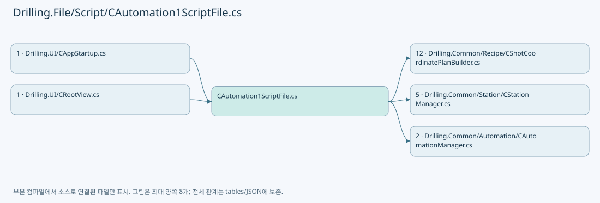

## 네임스페이스·타입·상속

| 타입 | 구분 | 원본 범위 | 선언/상속 |
| --- | --- | --- | --- |
| CAutomation1ScriptFile | ClassDeclaration | 9–2453 | CAutomation1ScriptFile: CAutomationScriptFileBase |
| EN_SCRIPT_FOLLOW_AXIS | EnumDeclaration | 20–24 | EN_SCRIPT_FOLLOW_AXIS |
| CAutomation1Script | ClassDeclaration | 1382–2452 | CAutomation1Script: CAutomation1ScriptBase |

## 멤버 빠른 목록

| 이름 | 종류 | 범위 | 서명 |
| --- | --- | --- | --- |
| DefaultScriptFileName | FieldDeclaration | L11–11 | string Drilling.File.Script.CAutomation1ScriptFile.DefaultScriptFileName |
| ProcessCoordinateListFileName | FieldDeclaration | L12–12 | string Drilling.File.Script.CAutomation1ScriptFile.ProcessCoordinateListFileName |
| ProcessShotCoordinateCsvFileName | FieldDeclaration | L13–13 | string Drilling.File.Script.CAutomation1ScriptFile.ProcessShotCoordinateCsvFileName |
| StandardDirectoryName | FieldDeclaration | L14–14 | string Drilling.File.Script.CAutomation1ScriptFile.StandardDirectoryName |
| BufferedRunDirectoryName | FieldDeclaration | L15–15 | string Drilling.File.Script.CAutomation1ScriptFile.BufferedRunDirectoryName |
| Automation1SimulatorUseKey | FieldDeclaration | L16–16 | string Drilling.File.Script.CAutomation1ScriptFile.Automation1SimulatorUseKey |
| Automation1SimulatorWaitMilliseconds | FieldDeclaration | L17–17 | int Drilling.File.Script.CAutomation1ScriptFile.Automation1SimulatorWaitMilliseconds |
| MinimumEncoderScaleMagnitude | FieldDeclaration | L18–18 | double Drilling.File.Script.CAutomation1ScriptFile.MinimumEncoderScaleMagnitude |
| MofSetupDelayMsec | FieldDeclaration | L19–19 | double Drilling.File.Script.CAutomation1ScriptFile.MofSetupDelayMsec |
| X | EnumMemberDeclaration | L22–22 | Drilling.File.Script.CAutomation1ScriptFile.EN_SCRIPT_FOLLOW_AXIS.X |
| Y | EnumMemberDeclaration | L23–23 | Drilling.File.Script.CAutomation1ScriptFile.EN_SCRIPT_FOLLOW_AXIS.Y |
| _scriptDirectory | FieldDeclaration | L26–26 | string Drilling.File.Script.CAutomation1ScriptFile._scriptDirectory |
| .ctor | ConstructorDeclaration | L27–31 | Drilling.File.Script.CAutomation1ScriptFile.CAutomation1ScriptFile(string?) |
| ScriptFileName | PropertyDeclaration | L33–39 | string Drilling.File.Script.CAutomation1ScriptFile.ScriptFileName |
| get_ScriptFileName | GetAccessorDeclaration | L35–38 | string Drilling.File.Script.CAutomation1ScriptFile.ScriptFileName.get |
| Create | MethodDeclaration | L41–44 | Drilling.Common.Station.CAutomation1ScriptBase Drilling.File.Script.CAutomation1ScriptFile.Create(string?) |
| Build | MethodDeclaration | L46–49 | Drilling.Common.Station.ST_SCRIPT_BUILD_RESULT Drilling.File.Script.CAutomation1ScriptFile.Build(Drilling.Common.Station.ST_PROCESS_MODEL, System.Threading.CancellationToken) |
| Build | MethodDeclaration | L51–108 | Drilling.Common.Station.ST_SCRIPT_BUILD_RESULT Drilling.File.Script.CAutomation1ScriptFile.Build(Drilling.Common.Station.ST_PROCESS_MODEL, string, System.Threading.CancellationToken) |
| ShouldIncludeItem | LocalFunctionStatement | L57–60 | bool ShouldIncludeItem(Drilling.Common.Station.ST_HEAD_PROCESS_PLAN) |
| SelectItem | LocalFunctionStatement | L62–68 | Drilling.Common.Station.ST_HEAD_PROCESS_PLAN SelectItem(Drilling.Common.Station.ST_HEAD_PROCESS_PLAN) |
| ShouldIncludeHead | LocalFunctionStatement | L70–73 | bool ShouldIncludeHead(Drilling.Common.Station.ST_HEAD_PROCESS_PLAN) |
| SelectTotalShots | LocalFunctionStatement | L101–104 | int SelectTotalShots(Drilling.Common.Station.ST_HEAD_SCRIPT_RESULT) |
| LoadLatest | MethodDeclaration | L110–172 | Drilling.Common.Station.ST_SCRIPT_BUILD_RESULT Drilling.File.Script.CAutomation1ScriptFile.LoadLatest(Drilling.Common.Station.ST_PROCESS_MODEL, string, System.Threading.CancellationToken) |
| Header | LocalFunctionStatement | L127–128 | string Header(string) |
| BuildShotCoordinateCsvLines | MethodDeclaration | L174–324 | System.Collections.Generic.IReadOnlyList<string> Drilling.File.Script.CAutomation1ScriptFile.BuildShotCoordinateCsvLines(Drilling.Common.Station.ST_PROCESS_MODEL, System.DateTimeOffset, System.Collections.Generic.IReadOnlyList<Drilling.Common.Station.ST_HEAD_PROCESS_PLAN>) |
| ShotCellNo | MethodDeclaration | L326–329 | int Drilling.File.Script.CAutomation1ScriptFile.ShotCellNo(Drilling.Common.Recipe.ST_HEAD_SHOT_POINT) |
| ShotRowNo | MethodDeclaration | L331–334 | int Drilling.File.Script.CAutomation1ScriptFile.ShotRowNo(Drilling.Common.Recipe.ST_HEAD_SHOT_POINT) |
| ShotColumnNo | MethodDeclaration | L336–339 | int Drilling.File.Script.CAutomation1ScriptFile.ShotColumnNo(Drilling.Common.Recipe.ST_HEAD_SHOT_POINT) |
| ShotHeadNo | MethodDeclaration | L341–344 | int Drilling.File.Script.CAutomation1ScriptFile.ShotHeadNo(Drilling.Common.Recipe.ST_HEAD_SHOT_POINT) |
| ReadParameterText | MethodDeclaration | L346–351 | string Drilling.File.Script.CAutomation1ScriptFile.ReadParameterText(System.Collections.Generic.IReadOnlyDictionary<string, string>, string, string) |
| BuildCoordinateListLines | MethodDeclaration | L353–387 | System.Collections.Generic.IReadOnlyList<string> Drilling.File.Script.CAutomation1ScriptFile.BuildCoordinateListLines(Drilling.Common.Station.ST_PROCESS_MODEL, System.DateTimeOffset, System.Collections.Generic.IReadOnlyList<Drilling.Common.Station.ST_HEAD_PROCESS_PLAN>, System.Collections.Generic.IReadOnlyList<Drilling.Common.Station.ST_HEAD_SCRIPT_RESULT>) |
| SelectHeadNo | LocalFunctionStatement | L356–359 | int SelectHeadNo(Drilling.Common.Station.ST_HEAD_SCRIPT_RESULT) |
| SelectTotalShots | LocalFunctionStatement | L369–372 | int SelectTotalShots(Drilling.Common.Station.ST_HEAD_SCRIPT_RESULT) |
| BuildHeadLines | MethodDeclaration | L389–580 | System.Collections.Generic.IReadOnlyList<string> Drilling.File.Script.CAutomation1ScriptFile.BuildHeadLines(Drilling.Common.Station.ST_PROCESS_MODEL, Drilling.Common.Station.ST_HEAD_PROCESS_PLAN, System.DateTimeOffset, bool, long) |
| ResolveMachiningAxis | MethodDeclaration | L582–604 | Drilling.File.Script.CAutomation1ScriptFile.EN_SCRIPT_FOLLOW_AXIS Drilling.File.Script.CAutomation1ScriptFile.ResolveMachiningAxis(System.Collections.Generic.IReadOnlyList<Drilling.Common.Recipe.ST_HEAD_SHOT_POINT>, bool) |
| ResolveLineMachiningAxis | MethodDeclaration | L606–621 | Drilling.File.Script.CAutomation1ScriptFile.EN_SCRIPT_FOLLOW_AXIS Drilling.File.Script.CAutomation1ScriptFile.ResolveLineMachiningAxis(Drilling.Common.Recipe.ST_HEAD_SHOT_POINT, Drilling.Common.Recipe.ST_HEAD_SHOT_POINT?, Drilling.File.Script.CAutomation1ScriptFile.EN_SCRIPT_FOLLOW_AXIS, bool) |
| IsScanLineFirstShot | MethodDeclaration | L623–631 | bool Drilling.File.Script.CAutomation1ScriptFile.IsScanLineFirstShot(Drilling.Common.Recipe.ST_HEAD_SHOT_POINT?, Drilling.Common.Recipe.ST_HEAD_SHOT_POINT) |
| FindNextPointInSameScanLine | MethodDeclaration | L633–648 | Drilling.Common.Recipe.ST_HEAD_SHOT_POINT? Drilling.File.Script.CAutomation1ScriptFile.FindNextPointInSameScanLine(System.Collections.Generic.IReadOnlyList<Drilling.Common.Recipe.ST_HEAD_SHOT_POINT>, int, Drilling.Common.Recipe.ST_HEAD_SHOT_POINT) |
| AppendLinePreApproachMove | MethodDeclaration | L650–674 | void Drilling.File.Script.CAutomation1ScriptFile.AppendLinePreApproachMove(System.Collections.Generic.List<string>, string, string, Drilling.Common.Recipe.ST_HEAD_SHOT_POINT, Drilling.Common.Recipe.ST_HEAD_SHOT_POINT?, Drilling.File.Script.CAutomation1ScriptFile.EN_SCRIPT_FOLLOW_AXIS, double, double, bool) |
| ResolveLinePreApproachDirection | MethodDeclaration | L676–688 | double Drilling.File.Script.CAutomation1ScriptFile.ResolveLinePreApproachDirection(Drilling.Common.Recipe.ST_HEAD_SHOT_POINT, Drilling.Common.Recipe.ST_HEAD_SHOT_POINT?, Drilling.File.Script.CAutomation1ScriptFile.EN_SCRIPT_FOLLOW_AXIS, bool) |
| ReadHeadScanFieldHalfWidth | MethodDeclaration | L690–699 | double Drilling.File.Script.CAutomation1ScriptFile.ReadHeadScanFieldHalfWidth(System.Collections.Generic.IReadOnlyDictionary<string, string>, int) |
| ReadScriptAxisPosition | MethodDeclaration | L701–709 | double Drilling.File.Script.CAutomation1ScriptFile.ReadScriptAxisPosition(Drilling.Common.Recipe.ST_HEAD_SHOT_POINT, Drilling.File.Script.CAutomation1ScriptFile.EN_SCRIPT_FOLLOW_AXIS, bool) |
| ReadScriptScannerY | MethodDeclaration | L711–714 | double Drilling.File.Script.CAutomation1ScriptFile.ReadScriptScannerY(Drilling.Common.Recipe.ST_HEAD_SHOT_POINT, bool) |
| Clamp | MethodDeclaration | L716–719 | double Drilling.File.Script.CAutomation1ScriptFile.Clamp(double, double, double) |
| ResolveScriptBuildDirectory | MethodDeclaration | L721–748 | string Drilling.File.Script.CAutomation1ScriptFile.ResolveScriptBuildDirectory(string, System.DateTimeOffset, string) |
| NormalizeScriptBuildName | MethodDeclaration | L750–762 | string Drilling.File.Script.CAutomation1ScriptFile.NormalizeScriptBuildName(string) |
| IsBufferedRunDirectory | MethodDeclaration | L764–768 | bool Drilling.File.Script.CAutomation1ScriptFile.IsBufferedRunDirectory(string) |
| ValidateActiveHeads | MethodDeclaration | L770–836 | void Drilling.File.Script.CAutomation1ScriptFile.ValidateActiveHeads(System.Collections.Generic.IReadOnlyList<Drilling.Common.Station.ST_HEAD_PROCESS_PLAN>) |
| SelectHeadNo | LocalFunctionStatement | L772–775 | int SelectHeadNo(Drilling.Common.Station.ST_HEAD_PROCESS_PLAN) |
| ShouldIncludeItem | LocalFunctionStatement | L777–780 | bool ShouldIncludeItem(System.Linq.IGrouping<int, Drilling.Common.Station.ST_HEAD_PROCESS_PLAN>) |
| SelectKey | LocalFunctionStatement | L782–785 | int SelectKey(System.Linq.IGrouping<int, Drilling.Common.Station.ST_HEAD_PROCESS_PLAN>) |
| SelectHeadNo2 | LocalFunctionStatement | L787–790 | int SelectHeadNo2(int) |
| SelectScriptFileName | LocalFunctionStatement | L811–814 | string SelectScriptFileName(Drilling.Common.Station.ST_HEAD_PROCESS_PLAN) |
| ShouldIncludeHead | LocalFunctionStatement | L816–819 | bool ShouldIncludeHead(System.Linq.IGrouping<string, Drilling.Common.Station.ST_HEAD_PROCESS_PLAN>) |
| SelectDuplicateScriptFileName | LocalFunctionStatement | L821–824 | string SelectDuplicateScriptFileName(System.Linq.IGrouping<string, Drilling.Common.Station.ST_HEAD_PROCESS_PLAN>) |
| SelectFileName | LocalFunctionStatement | L826–829 | string SelectFileName(string) |
| AppendStartFollowMoves | MethodDeclaration | L838–884 | void Drilling.File.Script.CAutomation1ScriptFile.AppendStartFollowMoves(System.Collections.Generic.List<string>, System.Collections.Generic.IReadOnlyDictionary<string, string>, Drilling.Common.Station.ST_HEAD_PROCESS_PLAN, string, string, string, double, bool) |
| AppendFollowTransitionMoves | MethodDeclaration | L886–932 | void Drilling.File.Script.CAutomation1ScriptFile.AppendFollowTransitionMoves(System.Collections.Generic.List<string>, System.Collections.Generic.IReadOnlyDictionary<string, string>, Drilling.Common.Station.ST_HEAD_PROCESS_PLAN, string, string, string, bool, Drilling.Common.Recipe.ST_HEAD_SHOT_POINT, Drilling.Common.Recipe.ST_HEAD_SHOT_POINT) |
| ResolveFollowAxis | MethodDeclaration | L934–943 | Drilling.File.Script.CAutomation1ScriptFile.EN_SCRIPT_FOLLOW_AXIS Drilling.File.Script.CAutomation1ScriptFile.ResolveFollowAxis(Drilling.Common.Recipe.ST_SCANNER_AXIS_TRANSFORM) |
| ReadFollowAxisPosition | MethodDeclaration | L945–953 | double Drilling.File.Script.CAutomation1ScriptFile.ReadFollowAxisPosition(Drilling.Common.Recipe.ST_HEAD_SHOT_POINT, Drilling.File.Script.CAutomation1ScriptFile.EN_SCRIPT_FOLLOW_AXIS) |
| AppendEncoderWait | MethodDeclaration | L955–965 | void Drilling.File.Script.CAutomation1ScriptFile.AppendEncoderWait(System.Collections.Generic.List<string>, string, double, bool) |
| AppendHeadShotList | MethodDeclaration | L967–987 | void Drilling.File.Script.CAutomation1ScriptFile.AppendHeadShotList(System.Collections.Generic.List<string>, Drilling.Common.Station.ST_HEAD_PROCESS_PLAN) |
| SelectCellNo | LocalFunctionStatement | L970–973 | int SelectCellNo(Drilling.Common.Recipe.ST_HEAD_SHOT_POINT) |
| SelectKey | LocalFunctionStatement | L975–978 | int SelectKey(System.Linq.IGrouping<int, Drilling.Common.Recipe.ST_HEAD_SHOT_POINT>) |
| FormatShotName | MethodDeclaration | L989–992 | string Drilling.File.Script.CAutomation1ScriptFile.FormatShotName(Drilling.Common.Recipe.ST_HEAD_SHOT_POINT) |
| FormatRowName | MethodDeclaration | L994–1005 | string Drilling.File.Script.CAutomation1ScriptFile.FormatRowName(int) |
| AppendDefaultSetting | MethodDeclaration | L1007–1022 | void Drilling.File.Script.CAutomation1ScriptFile.AppendDefaultSetting(System.Collections.Generic.List<string>, System.Collections.Generic.IReadOnlyDictionary<string, string>) |
| AppendScriptEnd | MethodDeclaration | L1024–1032 | void Drilling.File.Script.CAutomation1ScriptFile.AppendScriptEnd(System.Collections.Generic.List<string>, System.Collections.Generic.IReadOnlyDictionary<string, string>) |
| CalculateLaserPeriod | MethodDeclaration | L1034–1037 | double Drilling.File.Script.CAutomation1ScriptFile.CalculateLaserPeriod(double) |
| CalculateShotDelaySeconds | MethodDeclaration | L1039–1048 | double Drilling.File.Script.CAutomation1ScriptFile.CalculateShotDelaySeconds(int, double) |
| AppendSingleAxisMoveDelay | MethodDeclaration | L1050–1058 | void Drilling.File.Script.CAutomation1ScriptFile.AppendSingleAxisMoveDelay(System.Collections.Generic.List<string>, string, double) |
| ResolveCoordinatedRampRate | MethodDeclaration | L1060–1073 | double Drilling.File.Script.CAutomation1ScriptFile.ResolveCoordinatedRampRate(double, double) |
| ToAutomationSpeed | MethodDeclaration | L1075–1078 | double Drilling.File.Script.CAutomation1ScriptFile.ToAutomationSpeed(double) |
| ReadDelaySeconds | MethodDeclaration | L1080–1098 | double Drilling.File.Script.CAutomation1ScriptFile.ReadDelaySeconds(System.Collections.Generic.IReadOnlyDictionary<string, string>, double, params string[]) |
| ShouldIncludeItem | LocalFunctionStatement | L1082–1085 | bool ShouldIncludeItem(string) |
| CreateHeadKeys | MethodDeclaration | L1100–1108 | System.Collections.Generic.IReadOnlyList<string> Drilling.File.Script.CAutomation1ScriptFile.CreateHeadKeys(int, params string[]) |
| SelectItem | LocalFunctionStatement | L1102–1105 | string SelectItem(string) |
| CreateEncoderScaleKeys | MethodDeclaration | L1110–1115 | System.Collections.Generic.IReadOnlyList<string> Drilling.File.Script.CAutomation1ScriptFile.CreateEncoderScaleKeys(int) |
| CreateEncoderFeedbackFlipKeys | MethodDeclaration | L1117–1122 | System.Collections.Generic.IReadOnlyList<string> Drilling.File.Script.CAutomation1ScriptFile.CreateEncoderFeedbackFlipKeys(int) |
| ResolveParameterName | MethodDeclaration | L1124–1135 | string Drilling.File.Script.CAutomation1ScriptFile.ResolveParameterName(System.Collections.Generic.IReadOnlyDictionary<string, string>, System.Collections.Generic.IEnumerable<string>, string) |
| ReadText | MethodDeclaration | L1137–1153 | string Drilling.File.Script.CAutomation1ScriptFile.ReadText(System.Collections.Generic.IReadOnlyDictionary<string, string>, string, System.Collections.Generic.IEnumerable<string>) |
| ShouldIncludeItem | LocalFunctionStatement | L1139–1142 | bool ShouldIncludeItem(string) |
| ReadDouble | MethodDeclaration | L1155–1158 | double Drilling.File.Script.CAutomation1ScriptFile.ReadDouble(System.Collections.Generic.IReadOnlyDictionary<string, string>, double, params string[]) |
| ReadDouble | MethodDeclaration | L1160–1176 | double Drilling.File.Script.CAutomation1ScriptFile.ReadDouble(System.Collections.Generic.IReadOnlyDictionary<string, string>, double, System.Collections.Generic.IEnumerable<string>) |
| ShouldIncludeItem | LocalFunctionStatement | L1162–1165 | bool ShouldIncludeItem(string) |
| ReadOnOff | MethodDeclaration | L1178–1194 | bool Drilling.File.Script.CAutomation1ScriptFile.ReadOnOff(System.Collections.Generic.IReadOnlyDictionary<string, string>, bool, System.Collections.Generic.IEnumerable<string>) |
| ParseOnOff | MethodDeclaration | L1196–1215 | bool Drilling.File.Script.CAutomation1ScriptFile.ParseOnOff(string?, bool, string) |
| ReadInt | MethodDeclaration | L1217–1220 | int Drilling.File.Script.CAutomation1ScriptFile.ReadInt(System.Collections.Generic.IReadOnlyDictionary<string, string>, int, params string[]) |
| ReadInt | MethodDeclaration | L1222–1238 | int Drilling.File.Script.CAutomation1ScriptFile.ReadInt(System.Collections.Generic.IReadOnlyDictionary<string, string>, int, System.Collections.Generic.IEnumerable<string>) |
| ShouldIncludeItem | LocalFunctionStatement | L1224–1227 | bool ShouldIncludeItem(string) |
| ReadBool | MethodDeclaration | L1240–1243 | bool Drilling.File.Script.CAutomation1ScriptFile.ReadBool(System.Collections.Generic.IReadOnlyDictionary<string, string>, bool, params string[]) |
| ReadBool | MethodDeclaration | L1245–1281 | bool Drilling.File.Script.CAutomation1ScriptFile.ReadBool(System.Collections.Generic.IReadOnlyDictionary<string, string>, bool, System.Collections.Generic.IEnumerable<string>) |
| ShouldIncludeItem | LocalFunctionStatement | L1247–1250 | bool ShouldIncludeItem(string) |
| Format | MethodDeclaration | L1283–1286 | string Drilling.File.Script.CAutomation1ScriptFile.Format(double) |
| CreateCsvLine | MethodDeclaration | L1288–1302 | string Drilling.File.Script.CAutomation1ScriptFile.CreateCsvLine(params string?[]) |
| AppendCsvField | MethodDeclaration | L1304–1326 | void Drilling.File.Script.CAutomation1ScriptFile.AppendCsvField(System.Text.StringBuilder, string?) |
| IsReservedBuildFileName | MethodDeclaration | L1328–1332 | bool Drilling.File.Script.CAutomation1ScriptFile.IsReservedBuildFileName(string) |
| ValidateEncoderScale | MethodDeclaration | L1334–1348 | void Drilling.File.Script.CAutomation1ScriptFile.ValidateEncoderScale(string, double) |
| ValidateAeroScriptAxisName | MethodDeclaration | L1350–1369 | string Drilling.File.Script.CAutomation1ScriptFile.ValidateAeroScriptAxisName(string, string) |
| MatchesItem | LocalFunctionStatement | L1358–1361 | bool MatchesItem(char) |
| NormalizeFileName | MethodDeclaration | L1371–1380 | string Drilling.File.Script.CAutomation1ScriptFile.NormalizeFileName(string?) |
| _scriptDirectory | FieldDeclaration | L1384–1384 | string Drilling.File.Script.CAutomation1ScriptFile.CAutomation1Script._scriptDirectory |
| _lines | FieldDeclaration | L1385–1385 | System.Collections.Generic.List<string> Drilling.File.Script.CAutomation1ScriptFile.CAutomation1Script._lines |
| _xAxis | FieldDeclaration | L1386–1386 | string Drilling.File.Script.CAutomation1ScriptFile.CAutomation1Script._xAxis |
| _yAxis | FieldDeclaration | L1387–1387 | string Drilling.File.Script.CAutomation1ScriptFile.CAutomation1Script._yAxis |
| _laserAxis | FieldDeclaration | L1388–1388 | string Drilling.File.Script.CAutomation1ScriptFile.CAutomation1Script._laserAxis |
| _stageXAxis | FieldDeclaration | L1389–1389 | string Drilling.File.Script.CAutomation1ScriptFile.CAutomation1Script._stageXAxis |
| _stageYAxis | FieldDeclaration | L1390–1390 | string Drilling.File.Script.CAutomation1ScriptFile.CAutomation1Script._stageYAxis |
| _deviceNo | FieldDeclaration | L1391–1391 | int Drilling.File.Script.CAutomation1ScriptFile.CAutomation1Script._deviceNo |
| _pointCount | FieldDeclaration | L1392–1392 | int Drilling.File.Script.CAutomation1ScriptFile.CAutomation1Script._pointCount |
| _currentX | FieldDeclaration | L1393–1393 | double Drilling.File.Script.CAutomation1ScriptFile.CAutomation1Script._currentX |
| _currentY | FieldDeclaration | L1394–1394 | double Drilling.File.Script.CAutomation1ScriptFile.CAutomation1Script._currentY |
| _laserOutputPeriod | FieldDeclaration | L1395–1395 | double Drilling.File.Script.CAutomation1ScriptFile.CAutomation1Script._laserOutputPeriod |
| _jumpSpeedMeterPerSec | FieldDeclaration | L1396–1396 | double Drilling.File.Script.CAutomation1ScriptFile.CAutomation1Script._jumpSpeedMeterPerSec |
| _markSpeedMeterPerSec | FieldDeclaration | L1397–1397 | double Drilling.File.Script.CAutomation1ScriptFile.CAutomation1Script._markSpeedMeterPerSec |
| _tactTime | FieldDeclaration | L1398–1398 | double Drilling.File.Script.CAutomation1ScriptFile.CAutomation1Script._tactTime |
| _nMarkDriveLaserControl | FieldDeclaration | L1399–1399 | bool Drilling.File.Script.CAutomation1ScriptFile.CAutomation1Script._nMarkDriveLaserControl |
| _scanPlannerStageEncoderMode | FieldDeclaration | L1400–1400 | bool Drilling.File.Script.CAutomation1ScriptFile.CAutomation1Script._scanPlannerStageEncoderMode |
| _createdAt | FieldDeclaration | L1401–1401 | System.DateTimeOffset Drilling.File.Script.CAutomation1ScriptFile.CAutomation1Script._createdAt |
| .ctor | ConstructorDeclaration | L1402–1406 | Drilling.File.Script.CAutomation1ScriptFile.CAutomation1Script.CAutomation1Script(string, string) |
| FileName | PropertyDeclaration | L1408–1408 | string Drilling.File.Script.CAutomation1ScriptFile.CAutomation1Script.FileName |
| get_FileName | GetAccessorDeclaration | L1408–1408 | string Drilling.File.Script.CAutomation1ScriptFile.CAutomation1Script.FileName.get |
| FilePath | PropertyDeclaration | L1410–1416 | string Drilling.File.Script.CAutomation1ScriptFile.CAutomation1Script.FilePath |
| get_FilePath | GetAccessorDeclaration | L1412–1415 | string Drilling.File.Script.CAutomation1ScriptFile.CAutomation1Script.FilePath.get |
| Lines | PropertyDeclaration | L1418–1424 | System.Collections.Generic.IReadOnlyList<string> Drilling.File.Script.CAutomation1ScriptFile.CAutomation1Script.Lines |
| get_Lines | GetAccessorDeclaration | L1420–1423 | System.Collections.Generic.IReadOnlyList<string> Drilling.File.Script.CAutomation1ScriptFile.CAutomation1Script.Lines.get |
| Clear | MethodDeclaration | L1426–1445 | void Drilling.File.Script.CAutomation1ScriptFile.CAutomation1Script.Clear() |
| AddLine | MethodDeclaration | L1447–1453 | void Drilling.File.Script.CAutomation1ScriptFile.CAutomation1Script.AddLine(string) |
| Start | MethodDeclaration | L1455–1465 | void Drilling.File.Script.CAutomation1ScriptFile.CAutomation1Script.Start(string) |
| SetDeviceNo | MethodDeclaration | L1467–1470 | void Drilling.File.Script.CAutomation1ScriptFile.CAutomation1Script.SetDeviceNo(int) |
| SetNMarkDriveLaserControl | MethodDeclaration | L1472–1475 | void Drilling.File.Script.CAutomation1ScriptFile.CAutomation1Script.SetNMarkDriveLaserControl(bool) |
| SetScanPlannerStageEncoderMode | MethodDeclaration | L1477–1480 | void Drilling.File.Script.CAutomation1ScriptFile.CAutomation1Script.SetScanPlannerStageEncoderMode(bool) |
| DefaultSetting | MethodDeclaration | L1482–1507 | void Drilling.File.Script.CAutomation1ScriptFile.CAutomation1Script.DefaultSetting(double, int, int, bool) |
| DefaultFigureScanSetting | MethodDeclaration | L1509–1532 | void Drilling.File.Script.CAutomation1ScriptFile.CAutomation1Script.DefaultFigureScanSetting(int, int, bool) |
| SetAxis | MethodDeclaration | L1534–1539 | void Drilling.File.Script.CAutomation1ScriptFile.CAutomation1Script.SetAxis(string, string, string?) |
| SetStageAxis | MethodDeclaration | L1541–1545 | void Drilling.File.Script.CAutomation1ScriptFile.CAutomation1Script.SetStageAxis(string, string) |
| SetFrequency | MethodDeclaration | L1547–1554 | void Drilling.File.Script.CAutomation1ScriptFile.CAutomation1Script.SetFrequency(double) |
| SetLaserPower | MethodDeclaration | L1556–1570 | void Drilling.File.Script.CAutomation1ScriptFile.CAutomation1Script.SetLaserPower(double, double, bool) |
| SetLaserPowerNoDelay | MethodDeclaration | L1572–1581 | void Drilling.File.Script.CAutomation1ScriptFile.CAutomation1Script.SetLaserPowerNoDelay(double, double) |
| SetPulseOnTimeLaserPower | MethodDeclaration | L1583–1599 | void Drilling.File.Script.CAutomation1ScriptFile.CAutomation1Script.SetPulseOnTimeLaserPower(double, double, double) |
| SetLaserMode | MethodDeclaration | L1601–1607 | void Drilling.File.Script.CAutomation1ScriptFile.CAutomation1Script.SetLaserMode(int) |
| SetLaserDelay | MethodDeclaration | L1609–1614 | void Drilling.File.Script.CAutomation1ScriptFile.CAutomation1Script.SetLaserDelay(double, double) |
| SetJumpSpeed | MethodDeclaration | L1616–1621 | void Drilling.File.Script.CAutomation1ScriptFile.CAutomation1Script.SetJumpSpeed(double) |
| SetJumpSpeedRate | MethodDeclaration | L1623–1633 | void Drilling.File.Script.CAutomation1ScriptFile.CAutomation1Script.SetJumpSpeedRate(double, double) |
| SetMarkSpeed | MethodDeclaration | L1635–1639 | void Drilling.File.Script.CAutomation1ScriptFile.CAutomation1Script.SetMarkSpeed(double) |
| SetStageSpeed | MethodDeclaration | L1641–1652 | void Drilling.File.Script.CAutomation1ScriptFile.CAutomation1Script.SetStageSpeed(double, double) |
| SetScannerAcc | MethodDeclaration | L1654–1666 | void Drilling.File.Script.CAutomation1ScriptFile.CAutomation1Script.SetScannerAcc(double) |
| SetMarkAcc | MethodDeclaration | L1668–1677 | void Drilling.File.Script.CAutomation1ScriptFile.CAutomation1Script.SetMarkAcc(double) |
| SetIFOV | MethodDeclaration | L1679–1682 | void Drilling.File.Script.CAutomation1ScriptFile.CAutomation1Script.SetIFOV(bool) |
| SetIFOVEmulatedQuadratureDivider | MethodDeclaration | L1684–1707 | void Drilling.File.Script.CAutomation1ScriptFile.CAutomation1Script.SetIFOVEmulatedQuadratureDivider() |
| SetIFOVIO | MethodDeclaration | L1709–1739 | void Drilling.File.Script.CAutomation1ScriptFile.CAutomation1Script.SetIFOVIO(bool) |
| SetIFOVScaleXY | MethodDeclaration | L1741–1752 | void Drilling.File.Script.CAutomation1ScriptFile.CAutomation1Script.SetIFOVScaleXY() |
| SetIFOVTime | MethodDeclaration | L1754–1757 | void Drilling.File.Script.CAutomation1ScriptFile.CAutomation1Script.SetIFOVTime(long) |
| SetIFOVSize | MethodDeclaration | L1759–1762 | void Drilling.File.Script.CAutomation1ScriptFile.CAutomation1Script.SetIFOVSize(double) |
| SetIFOVTrackingSpeed | MethodDeclaration | L1764–1767 | void Drilling.File.Script.CAutomation1ScriptFile.CAutomation1Script.SetIFOVTrackingSpeed(long) |
| SetIFOVTrackingAccel | MethodDeclaration | L1769–1772 | void Drilling.File.Script.CAutomation1ScriptFile.CAutomation1Script.SetIFOVTrackingAccel(long) |
| SetIFOVPair | MethodDeclaration | L1774–1779 | void Drilling.File.Script.CAutomation1ScriptFile.CAutomation1Script.SetIFOVPair(string, string, bool, bool) |
| SetIFOVSyncAxis | MethodDeclaration | L1781–1784 | void Drilling.File.Script.CAutomation1ScriptFile.CAutomation1Script.SetIFOVSyncAxis() |
| SetMoveBlending | MethodDeclaration | L1786–1789 | void Drilling.File.Script.CAutomation1ScriptFile.CAutomation1Script.SetMoveBlending(bool) |
| SetAbsoluteMode | MethodDeclaration | L1791–1794 | void Drilling.File.Script.CAutomation1ScriptFile.CAutomation1Script.SetAbsoluteMode() |
| SetIncrementalMode | MethodDeclaration | L1796–1799 | void Drilling.File.Script.CAutomation1ScriptFile.CAutomation1Script.SetIncrementalMode() |
| SetWaitModeAuto | MethodDeclaration | L1801–1804 | void Drilling.File.Script.CAutomation1ScriptFile.CAutomation1Script.SetWaitModeAuto() |
| SetMoveDelay | MethodDeclaration | L1806–1823 | void Drilling.File.Script.CAutomation1ScriptFile.CAutomation1Script.SetMoveDelay(double, bool, bool) |
| SetExecuteLineCount | MethodDeclaration | L1825–1833 | void Drilling.File.Script.CAutomation1ScriptFile.CAutomation1Script.SetExecuteLineCount(int) |
| SetScannerRotate | MethodDeclaration | L1835–1841 | void Drilling.File.Script.CAutomation1ScriptFile.CAutomation1Script.SetScannerRotate(double) |
| SetScannerRotate | MethodDeclaration | L1843–1846 | void Drilling.File.Script.CAutomation1ScriptFile.CAutomation1Script.SetScannerRotate(string, double) |
| SetMoveUpdateRate | MethodDeclaration | L1848–1851 | void Drilling.File.Script.CAutomation1ScriptFile.CAutomation1Script.SetMoveUpdateRate(int) |
| SetCoordinatedAccelLimit | MethodDeclaration | L1853–1856 | void Drilling.File.Script.CAutomation1ScriptFile.CAutomation1Script.SetCoordinatedAccelLimit(long, long) |
| SetTaskAccelLimit | MethodDeclaration | L1858–1862 | void Drilling.File.Script.CAutomation1ScriptFile.CAutomation1Script.SetTaskAccelLimit(long, long) |
| SetScanTrajectoryFIRFilterX | MethodDeclaration | L1864–1867 | void Drilling.File.Script.CAutomation1ScriptFile.CAutomation1Script.SetScanTrajectoryFIRFilterX(long) |
| SetScanTrajectoryFIRFilterY | MethodDeclaration | L1869–1872 | void Drilling.File.Script.CAutomation1ScriptFile.CAutomation1Script.SetScanTrajectoryFIRFilterY(long) |
| SetStageTrajectoryFIRFilterX | MethodDeclaration | L1874–1880 | void Drilling.File.Script.CAutomation1ScriptFile.CAutomation1Script.SetStageTrajectoryFIRFilterX(long) |
| SetStageTrajectoryFIRFilterY | MethodDeclaration | L1882–1888 | void Drilling.File.Script.CAutomation1ScriptFile.CAutomation1Script.SetStageTrajectoryFIRFilterY(long) |
| SetProjection | MethodDeclaration | L1890–1893 | void Drilling.File.Script.CAutomation1ScriptFile.CAutomation1Script.SetProjection(string, double, double, double) |
| SetProjectionOff | MethodDeclaration | L1895–1898 | void Drilling.File.Script.CAutomation1ScriptFile.CAutomation1Script.SetProjectionOff(string) |
| SetGearing | MethodDeclaration | L1900–1903 | void Drilling.File.Script.CAutomation1ScriptFile.CAutomation1Script.SetGearing(string, string) |
| SetGearingOff | MethodDeclaration | L1905–1908 | void Drilling.File.Script.CAutomation1ScriptFile.CAutomation1Script.SetGearingOff(string) |
| SetSoftwareLimitSetup | MethodDeclaration | L1910–1919 | void Drilling.File.Script.CAutomation1ScriptFile.CAutomation1Script.SetSoftwareLimitSetup(bool) |
| SetAerotechEncoderReset | MethodDeclaration | L1921–1934 | void Drilling.File.Script.CAutomation1ScriptFile.CAutomation1Script.SetAerotechEncoderReset(string, string) |
| SetScanPlannerStageEncoder | MethodDeclaration | L1936–1943 | void Drilling.File.Script.CAutomation1ScriptFile.CAutomation1Script.SetScanPlannerStageEncoder(string) |
| SetEmulatedQuadratureDividerX | MethodDeclaration | L1945–1948 | void Drilling.File.Script.CAutomation1ScriptFile.CAutomation1Script.SetEmulatedQuadratureDividerX(int) |
| SetEmulatedQuadratureDividerY | MethodDeclaration | L1950–1953 | void Drilling.File.Script.CAutomation1ScriptFile.CAutomation1Script.SetEmulatedQuadratureDividerY(int) |
| SetStageEmulatedQuadratureDivider | MethodDeclaration | L1955–1966 | void Drilling.File.Script.CAutomation1ScriptFile.CAutomation1Script.SetStageEmulatedQuadratureDivider(int, int) |
| SetPSO | MethodDeclaration | L1968–2045 | void Drilling.File.Script.CAutomation1ScriptFile.CAutomation1Script.SetPSO(double, double, double, double, Drilling.Common.Station.EN_AEROTECH_MODE, Drilling.Common.Station.EN_AEROTECH_PSO_MODE, double, double, int, double, bool) |
| SetPSODistance | MethodDeclaration | L2047–2050 | void Drilling.File.Script.CAutomation1ScriptFile.CAutomation1Script.SetPSODistance(double) |
| SetPSOOnOff | MethodDeclaration | L2052–2055 | void Drilling.File.Script.CAutomation1ScriptFile.CAutomation1Script.SetPSOOnOff(bool) |
| SetPSOChangePower | MethodDeclaration | L2057–2060 | void Drilling.File.Script.CAutomation1ScriptFile.CAutomation1Script.SetPSOChangePower(double, double) |
| SetPSOFire | MethodDeclaration | L2062–2065 | void Drilling.File.Script.CAutomation1ScriptFile.CAutomation1Script.SetPSOFire(double, double, int, double, Drilling.Common.Station.EN_AEROTECH_MODE) |
| SetPSOLaserWindowMask | MethodDeclaration | L2067–2070 | void Drilling.File.Script.CAutomation1ScriptFile.CAutomation1Script.SetPSOLaserWindowMask(bool, double, double) |
| DeclareEncoderVariable | MethodDeclaration | L2072–2074 | void Drilling.File.Script.CAutomation1ScriptFile.CAutomation1Script.DeclareEncoderVariable(string, bool) |
| InitDeclareVariable | MethodDeclaration | L2076–2083 | void Drilling.File.Script.CAutomation1ScriptFile.CAutomation1Script.InitDeclareVariable() |
| InitDeclareVariableIFOV | MethodDeclaration | L2085–2088 | void Drilling.File.Script.CAutomation1ScriptFile.CAutomation1Script.InitDeclareVariableIFOV() |
| SetWaitForEncoder | MethodDeclaration | L2090–2096 | void Drilling.File.Script.CAutomation1ScriptFile.CAutomation1Script.SetWaitForEncoder(string, double, bool) |
| SetWaitForEncoder | MethodDeclaration | L2098–2123 | void Drilling.File.Script.CAutomation1ScriptFile.CAutomation1Script.SetWaitForEncoder(string, bool, double, double, double) |
| SetWaitForEncoder2Axis | MethodDeclaration | L2125–2139 | void Drilling.File.Script.CAutomation1ScriptFile.CAutomation1Script.SetWaitForEncoder2Axis(string, string, bool, double, double, double, double) |
| SetWaitForStartAxis2 | MethodDeclaration | L2141–2164 | void Drilling.File.Script.CAutomation1ScriptFile.CAutomation1Script.SetWaitForStartAxis2(string, string, bool, double, double, double, double) |
| SetEncoderScaleFactor | MethodDeclaration | L2166–2176 | void Drilling.File.Script.CAutomation1ScriptFile.CAutomation1Script.SetEncoderScaleFactor(string, string, int) |
| SetEncoderScaleFactor | MethodDeclaration | L2178–2185 | void Drilling.File.Script.CAutomation1ScriptFile.CAutomation1Script.SetEncoderScaleFactor(string, string, bool) |
| SetEncoderScaleFactor | MethodDeclaration | L2187–2198 | void Drilling.File.Script.CAutomation1ScriptFile.CAutomation1Script.SetEncoderScaleFactor(string, string, double, double, bool) |
| SetEncoderScaleFactorByPrimaryDivider | MethodDeclaration | L2200–2212 | void Drilling.File.Script.CAutomation1ScriptFile.CAutomation1Script.SetEncoderScaleFactorByPrimaryDivider(string, string, bool) |
| InitEncoderCount | MethodDeclaration | L2214–2218 | void Drilling.File.Script.CAutomation1ScriptFile.CAutomation1Script.InitEncoderCount(string) |
| EncoderNotFeedback | MethodDeclaration | L2220–2224 | void Drilling.File.Script.CAutomation1ScriptFile.CAutomation1Script.EncoderNotFeedback(string) |
| ReleaseEncoderScaleFactor | MethodDeclaration | L2226–2230 | void Drilling.File.Script.CAutomation1ScriptFile.CAutomation1Script.ReleaseEncoderScaleFactor(string) |
| LaserAuto | MethodDeclaration | L2232–2235 | void Drilling.File.Script.CAutomation1ScriptFile.CAutomation1Script.LaserAuto() |
| LaserOn | MethodDeclaration | L2237–2240 | void Drilling.File.Script.CAutomation1ScriptFile.CAutomation1Script.LaserOn() |
| LaserOff | MethodDeclaration | L2242–2245 | void Drilling.File.Script.CAutomation1ScriptFile.CAutomation1Script.LaserOff() |
| PsoLaserControl | MethodDeclaration | L2247–2250 | void Drilling.File.Script.CAutomation1ScriptFile.CAutomation1Script.PsoLaserControl(bool, bool) |
| LaserFire | MethodDeclaration | L2252–2255 | void Drilling.File.Script.CAutomation1ScriptFile.CAutomation1Script.LaserFire(bool) |
| Jump | MethodDeclaration | L2257–2269 | void Drilling.File.Script.CAutomation1ScriptFile.CAutomation1Script.Jump(double, double) |
| Mark | MethodDeclaration | L2271–2283 | void Drilling.File.Script.CAutomation1ScriptFile.CAutomation1Script.Mark(double, double) |
| GCodeMove | MethodDeclaration | L2285–2290 | void Drilling.File.Script.CAutomation1ScriptFile.CAutomation1Script.GCodeMove(double, double) |
| JumpRel | MethodDeclaration | L2292–2295 | void Drilling.File.Script.CAutomation1ScriptFile.CAutomation1Script.JumpRel(double, double) |
| MarkRel | MethodDeclaration | L2297–2300 | void Drilling.File.Script.CAutomation1ScriptFile.CAutomation1Script.MarkRel(double, double) |
| Arc | MethodDeclaration | L2302–2311 | void Drilling.File.Script.CAutomation1ScriptFile.CAutomation1Script.Arc(double, double, double, double, double, double, double) |
| JumpLinear | MethodDeclaration | L2313–2322 | void Drilling.File.Script.CAutomation1ScriptFile.CAutomation1Script.JumpLinear(double, double) |
| WaitMoveDone | MethodDeclaration | L2324–2327 | void Drilling.File.Script.CAutomation1ScriptFile.CAutomation1Script.WaitMoveDone() |
| Dwell | MethodDeclaration | L2329–2337 | void Drilling.File.Script.CAutomation1ScriptFile.CAutomation1Script.Dwell(double) |
| EnableAxisPair | MethodDeclaration | L2339–2342 | void Drilling.File.Script.CAutomation1ScriptFile.CAutomation1Script.EnableAxisPair() |
| DisableAxisPair | MethodDeclaration | L2344–2347 | void Drilling.File.Script.CAutomation1ScriptFile.CAutomation1Script.DisableAxisPair() |
| FaultAckAxisPair | MethodDeclaration | L2349–2352 | void Drilling.File.Script.CAutomation1ScriptFile.CAutomation1Script.FaultAckAxisPair() |
| HomeAxisPair | MethodDeclaration | L2354–2357 | void Drilling.File.Script.CAutomation1ScriptFile.CAutomation1Script.HomeAxisPair() |
| OffsetClearAxisPair | MethodDeclaration | L2359–2362 | void Drilling.File.Script.CAutomation1ScriptFile.CAutomation1Script.OffsetClearAxisPair() |
| OffsetSetAxisPair | MethodDeclaration | L2364–2367 | void Drilling.File.Script.CAutomation1ScriptFile.CAutomation1Script.OffsetSetAxisPair(double, double) |
| SetSignalLogTrigger | MethodDeclaration | L2369–2372 | void Drilling.File.Script.CAutomation1ScriptFile.CAutomation1Script.SetSignalLogTrigger(bool) |
| ProgramStart | MethodDeclaration | L2374–2377 | void Drilling.File.Script.CAutomation1ScriptFile.CAutomation1Script.ProgramStart() |
| ProgramEnd | MethodDeclaration | L2379–2382 | void Drilling.File.Script.CAutomation1ScriptFile.CAutomation1Script.ProgramEnd() |
| BufferedEnd | MethodDeclaration | L2384–2387 | void Drilling.File.Script.CAutomation1ScriptFile.CAutomation1Script.BufferedEnd() |
| WaitInpos | MethodDeclaration | L2389–2392 | void Drilling.File.Script.CAutomation1ScriptFile.CAutomation1Script.WaitInpos() |
| SetHomePos | MethodDeclaration | L2394–2397 | void Drilling.File.Script.CAutomation1ScriptFile.CAutomation1Script.SetHomePos() |
| SetGalvoPosZero | MethodDeclaration | L2399–2404 | void Drilling.File.Script.CAutomation1ScriptFile.CAutomation1Script.SetGalvoPosZero() |
| End | MethodDeclaration | L2406–2417 | void Drilling.File.Script.CAutomation1ScriptFile.CAutomation1Script.End(bool) |
| Save | MethodDeclaration | L2419–2430 | Drilling.Common.Station.ST_SCRIPT_BUILD_RESULT Drilling.File.Script.CAutomation1ScriptFile.CAutomation1Script.Save(System.Threading.CancellationToken) |
| AddMoveTactTime | MethodDeclaration | L2432–2441 | void Drilling.File.Script.CAutomation1ScriptFile.CAutomation1Script.AddMoveTactTime(double, double, double) |
| NormalizeAxis | MethodDeclaration | L2443–2446 | string Drilling.File.Script.CAutomation1ScriptFile.CAutomation1Script.NormalizeAxis(string?, string) |
| IsUsableAxis | MethodDeclaration | L2448–2451 | bool Drilling.File.Script.CAutomation1ScriptFile.CAutomation1Script.IsUsableAxis(string?) |

## 멤버별 상세 계약·호출·처리 해설

### FieldDeclaration `DefaultScriptFileName` · L11–11

[Drilling.File/Script/CAutomation1ScriptFile.cs:11–11](https://github.com/kjuws10-rgb/A3Drilling/blob/5aee8e58439c9b455cae7c9593c9be986c3e682e/Drilling.File/Script/CAutomation1ScriptFile.cs#L11-L11)

| 항목 | 실제 추출 값 |
| --- | --- |
| 서명 | string Drilling.File.Script.CAutomation1ScriptFile.DefaultScriptFileName |
| 접근/수식자 | Public / public, const |
| 반환/값 타입 | string |
| 소속 타입 | NamedType:Drilling.File.Script.CAutomation1ScriptFile |

현재 부분 분석에서 직접 연결된 호출자는 없습니다. XAML/이벤트/인터페이스·델리게이트·외부 진입을 추가 확인해야 하며, 미사용으로 판정한 것이 아닙니다.

본문의 실제 연산·분기·예외·반환 순서(원문 위치 순):

| 원본 행 | 종류 | 주석 해설 |
| --- | --- | --- |
| 11 | variable-initializer | 변수의 초기값을 지정합니다: DefaultScriptFileName = "PROCESS.ascript" |

변경 전 점검: 입력/반환 타입, 위 호출자, 예외/취소 경로, 공유 상태와 저장·전송 소비자를 함께 확인합니다. 값의 단위나 물리 방향을 이름만으로 확정하지 않습니다.

### FieldDeclaration `ProcessCoordinateListFileName` · L12–12

[Drilling.File/Script/CAutomation1ScriptFile.cs:12–12](https://github.com/kjuws10-rgb/A3Drilling/blob/5aee8e58439c9b455cae7c9593c9be986c3e682e/Drilling.File/Script/CAutomation1ScriptFile.cs#L12-L12)

| 항목 | 실제 추출 값 |
| --- | --- |
| 서명 | string Drilling.File.Script.CAutomation1ScriptFile.ProcessCoordinateListFileName |
| 접근/수식자 | Public / public, const |
| 반환/값 타입 | string |
| 소속 타입 | NamedType:Drilling.File.Script.CAutomation1ScriptFile |

현재 부분 분석에서 직접 연결된 호출자는 없습니다. XAML/이벤트/인터페이스·델리게이트·외부 진입을 추가 확인해야 하며, 미사용으로 판정한 것이 아닙니다.

본문의 실제 연산·분기·예외·반환 순서(원문 위치 순):

| 원본 행 | 종류 | 주석 해설 |
| --- | --- | --- |
| 12 | variable-initializer | 변수의 초기값을 지정합니다: ProcessCoordinateListFileName = "PROCESS.txt" |

변경 전 점검: 입력/반환 타입, 위 호출자, 예외/취소 경로, 공유 상태와 저장·전송 소비자를 함께 확인합니다. 값의 단위나 물리 방향을 이름만으로 확정하지 않습니다.

### FieldDeclaration `ProcessShotCoordinateCsvFileName` · L13–13

[Drilling.File/Script/CAutomation1ScriptFile.cs:13–13](https://github.com/kjuws10-rgb/A3Drilling/blob/5aee8e58439c9b455cae7c9593c9be986c3e682e/Drilling.File/Script/CAutomation1ScriptFile.cs#L13-L13)

| 항목 | 실제 추출 값 |
| --- | --- |
| 서명 | string Drilling.File.Script.CAutomation1ScriptFile.ProcessShotCoordinateCsvFileName |
| 접근/수식자 | Public / public, const |
| 반환/값 타입 | string |
| 소속 타입 | NamedType:Drilling.File.Script.CAutomation1ScriptFile |

현재 부분 분석에서 직접 연결된 호출자는 없습니다. XAML/이벤트/인터페이스·델리게이트·외부 진입을 추가 확인해야 하며, 미사용으로 판정한 것이 아닙니다.

본문의 실제 연산·분기·예외·반환 순서(원문 위치 순):

| 원본 행 | 종류 | 주석 해설 |
| --- | --- | --- |
| 13 | variable-initializer | 변수의 초기값을 지정합니다: ProcessShotCoordinateCsvFileName = "PROCESS_COORDINATES.csv" |

변경 전 점검: 입력/반환 타입, 위 호출자, 예외/취소 경로, 공유 상태와 저장·전송 소비자를 함께 확인합니다. 값의 단위나 물리 방향을 이름만으로 확정하지 않습니다.

### FieldDeclaration `StandardDirectoryName` · L14–14

[Drilling.File/Script/CAutomation1ScriptFile.cs:14–14](https://github.com/kjuws10-rgb/A3Drilling/blob/5aee8e58439c9b455cae7c9593c9be986c3e682e/Drilling.File/Script/CAutomation1ScriptFile.cs#L14-L14)

| 항목 | 실제 추출 값 |
| --- | --- |
| 서명 | string Drilling.File.Script.CAutomation1ScriptFile.StandardDirectoryName |
| 접근/수식자 | Private / private, const |
| 반환/값 타입 | string |
| 소속 타입 | NamedType:Drilling.File.Script.CAutomation1ScriptFile |

현재 부분 분석에서 직접 연결된 호출자는 없습니다. XAML/이벤트/인터페이스·델리게이트·외부 진입을 추가 확인해야 하며, 미사용으로 판정한 것이 아닙니다.

본문의 실제 연산·분기·예외·반환 순서(원문 위치 순):

| 원본 행 | 종류 | 주석 해설 |
| --- | --- | --- |
| 14 | variable-initializer | 변수의 초기값을 지정합니다: StandardDirectoryName = "Standard" |

변경 전 점검: 입력/반환 타입, 위 호출자, 예외/취소 경로, 공유 상태와 저장·전송 소비자를 함께 확인합니다. 값의 단위나 물리 방향을 이름만으로 확정하지 않습니다.

### FieldDeclaration `BufferedRunDirectoryName` · L15–15

[Drilling.File/Script/CAutomation1ScriptFile.cs:15–15](https://github.com/kjuws10-rgb/A3Drilling/blob/5aee8e58439c9b455cae7c9593c9be986c3e682e/Drilling.File/Script/CAutomation1ScriptFile.cs#L15-L15)

| 항목 | 실제 추출 값 |
| --- | --- |
| 서명 | string Drilling.File.Script.CAutomation1ScriptFile.BufferedRunDirectoryName |
| 접근/수식자 | Private / private, const |
| 반환/값 타입 | string |
| 소속 타입 | NamedType:Drilling.File.Script.CAutomation1ScriptFile |

현재 부분 분석에서 직접 연결된 호출자는 없습니다. XAML/이벤트/인터페이스·델리게이트·외부 진입을 추가 확인해야 하며, 미사용으로 판정한 것이 아닙니다.

본문의 실제 연산·분기·예외·반환 순서(원문 위치 순):

| 원본 행 | 종류 | 주석 해설 |
| --- | --- | --- |
| 15 | variable-initializer | 변수의 초기값을 지정합니다: BufferedRunDirectoryName = "BufferedRun" |

변경 전 점검: 입력/반환 타입, 위 호출자, 예외/취소 경로, 공유 상태와 저장·전송 소비자를 함께 확인합니다. 값의 단위나 물리 방향을 이름만으로 확정하지 않습니다.

### FieldDeclaration `Automation1SimulatorUseKey` · L16–16

[Drilling.File/Script/CAutomation1ScriptFile.cs:16–16](https://github.com/kjuws10-rgb/A3Drilling/blob/5aee8e58439c9b455cae7c9593c9be986c3e682e/Drilling.File/Script/CAutomation1ScriptFile.cs#L16-L16)

| 항목 | 실제 추출 값 |
| --- | --- |
| 서명 | string Drilling.File.Script.CAutomation1ScriptFile.Automation1SimulatorUseKey |
| 접근/수식자 | Private / private, const |
| 반환/값 타입 | string |
| 소속 타입 | NamedType:Drilling.File.Script.CAutomation1ScriptFile |

현재 부분 분석에서 직접 연결된 호출자는 없습니다. XAML/이벤트/인터페이스·델리게이트·외부 진입을 추가 확인해야 하며, 미사용으로 판정한 것이 아닙니다.

본문의 실제 연산·분기·예외·반환 순서(원문 위치 순):

| 원본 행 | 종류 | 주석 해설 |
| --- | --- | --- |
| 16 | variable-initializer | 변수의 초기값을 지정합니다: Automation1SimulatorUseKey = "AUTOMATION1_SIMULATOR_USE" |

변경 전 점검: 입력/반환 타입, 위 호출자, 예외/취소 경로, 공유 상태와 저장·전송 소비자를 함께 확인합니다. 값의 단위나 물리 방향을 이름만으로 확정하지 않습니다.

### FieldDeclaration `Automation1SimulatorWaitMilliseconds` · L17–17

[Drilling.File/Script/CAutomation1ScriptFile.cs:17–17](https://github.com/kjuws10-rgb/A3Drilling/blob/5aee8e58439c9b455cae7c9593c9be986c3e682e/Drilling.File/Script/CAutomation1ScriptFile.cs#L17-L17)

| 항목 | 실제 추출 값 |
| --- | --- |
| 서명 | int Drilling.File.Script.CAutomation1ScriptFile.Automation1SimulatorWaitMilliseconds |
| 접근/수식자 | Private / private, const |
| 반환/값 타입 | int |
| 소속 타입 | NamedType:Drilling.File.Script.CAutomation1ScriptFile |

현재 부분 분석에서 직접 연결된 호출자는 없습니다. XAML/이벤트/인터페이스·델리게이트·외부 진입을 추가 확인해야 하며, 미사용으로 판정한 것이 아닙니다.

본문의 실제 연산·분기·예외·반환 순서(원문 위치 순):

| 원본 행 | 종류 | 주석 해설 |
| --- | --- | --- |
| 17 | variable-initializer | 변수의 초기값을 지정합니다: Automation1SimulatorWaitMilliseconds = 5 |

변경 전 점검: 입력/반환 타입, 위 호출자, 예외/취소 경로, 공유 상태와 저장·전송 소비자를 함께 확인합니다. 값의 단위나 물리 방향을 이름만으로 확정하지 않습니다.

### FieldDeclaration `MinimumEncoderScaleMagnitude` · L18–18

[Drilling.File/Script/CAutomation1ScriptFile.cs:18–18](https://github.com/kjuws10-rgb/A3Drilling/blob/5aee8e58439c9b455cae7c9593c9be986c3e682e/Drilling.File/Script/CAutomation1ScriptFile.cs#L18-L18)

| 항목 | 실제 추출 값 |
| --- | --- |
| 서명 | double Drilling.File.Script.CAutomation1ScriptFile.MinimumEncoderScaleMagnitude |
| 접근/수식자 | Private / private, const |
| 반환/값 타입 | double |
| 소속 타입 | NamedType:Drilling.File.Script.CAutomation1ScriptFile |

현재 부분 분석에서 직접 연결된 호출자는 없습니다. XAML/이벤트/인터페이스·델리게이트·외부 진입을 추가 확인해야 하며, 미사용으로 판정한 것이 아닙니다.

본문의 실제 연산·분기·예외·반환 순서(원문 위치 순):

| 원본 행 | 종류 | 주석 해설 |
| --- | --- | --- |
| 18 | variable-initializer | 변수의 초기값을 지정합니다: MinimumEncoderScaleMagnitude = 0.000001 |

변경 전 점검: 입력/반환 타입, 위 호출자, 예외/취소 경로, 공유 상태와 저장·전송 소비자를 함께 확인합니다. 값의 단위나 물리 방향을 이름만으로 확정하지 않습니다.

### FieldDeclaration `MofSetupDelayMsec` · L19–19

[Drilling.File/Script/CAutomation1ScriptFile.cs:19–19](https://github.com/kjuws10-rgb/A3Drilling/blob/5aee8e58439c9b455cae7c9593c9be986c3e682e/Drilling.File/Script/CAutomation1ScriptFile.cs#L19-L19)

| 항목 | 실제 추출 값 |
| --- | --- |
| 서명 | double Drilling.File.Script.CAutomation1ScriptFile.MofSetupDelayMsec |
| 접근/수식자 | Private / private, const |
| 반환/값 타입 | double |
| 소속 타입 | NamedType:Drilling.File.Script.CAutomation1ScriptFile |

현재 부분 분석에서 직접 연결된 호출자는 없습니다. XAML/이벤트/인터페이스·델리게이트·외부 진입을 추가 확인해야 하며, 미사용으로 판정한 것이 아닙니다.

본문의 실제 연산·분기·예외·반환 순서(원문 위치 순):

| 원본 행 | 종류 | 주석 해설 |
| --- | --- | --- |
| 19 | variable-initializer | 변수의 초기값을 지정합니다: MofSetupDelayMsec = 0.5 |

변경 전 점검: 입력/반환 타입, 위 호출자, 예외/취소 경로, 공유 상태와 저장·전송 소비자를 함께 확인합니다. 값의 단위나 물리 방향을 이름만으로 확정하지 않습니다.

### EnumMemberDeclaration `X` · L22–22

[Drilling.File/Script/CAutomation1ScriptFile.cs:22–22](https://github.com/kjuws10-rgb/A3Drilling/blob/5aee8e58439c9b455cae7c9593c9be986c3e682e/Drilling.File/Script/CAutomation1ScriptFile.cs#L22-L22)

| 항목 | 실제 추출 값 |
| --- | --- |
| 서명 | Drilling.File.Script.CAutomation1ScriptFile.EN_SCRIPT_FOLLOW_AXIS.X |
| 접근/수식자 | Public /  |
| 반환/값 타입 | Drilling.File.Script.CAutomation1ScriptFile.EN_SCRIPT_FOLLOW_AXIS |
| 소속 타입 | NamedType:Drilling.File.Script.CAutomation1ScriptFile.EN_SCRIPT_FOLLOW_AXIS |

현재 부분 분석에서 직접 연결된 호출자는 없습니다. XAML/이벤트/인터페이스·델리게이트·외부 진입을 추가 확인해야 하며, 미사용으로 판정한 것이 아닙니다.

변경 전 점검: 입력/반환 타입, 위 호출자, 예외/취소 경로, 공유 상태와 저장·전송 소비자를 함께 확인합니다. 값의 단위나 물리 방향을 이름만으로 확정하지 않습니다.

### EnumMemberDeclaration `Y` · L23–23

[Drilling.File/Script/CAutomation1ScriptFile.cs:23–23](https://github.com/kjuws10-rgb/A3Drilling/blob/5aee8e58439c9b455cae7c9593c9be986c3e682e/Drilling.File/Script/CAutomation1ScriptFile.cs#L23-L23)

| 항목 | 실제 추출 값 |
| --- | --- |
| 서명 | Drilling.File.Script.CAutomation1ScriptFile.EN_SCRIPT_FOLLOW_AXIS.Y |
| 접근/수식자 | Public /  |
| 반환/값 타입 | Drilling.File.Script.CAutomation1ScriptFile.EN_SCRIPT_FOLLOW_AXIS |
| 소속 타입 | NamedType:Drilling.File.Script.CAutomation1ScriptFile.EN_SCRIPT_FOLLOW_AXIS |

현재 부분 분석에서 직접 연결된 호출자는 없습니다. XAML/이벤트/인터페이스·델리게이트·외부 진입을 추가 확인해야 하며, 미사용으로 판정한 것이 아닙니다.

변경 전 점검: 입력/반환 타입, 위 호출자, 예외/취소 경로, 공유 상태와 저장·전송 소비자를 함께 확인합니다. 값의 단위나 물리 방향을 이름만으로 확정하지 않습니다.

### FieldDeclaration `_scriptDirectory` · L26–26

[Drilling.File/Script/CAutomation1ScriptFile.cs:26–26](https://github.com/kjuws10-rgb/A3Drilling/blob/5aee8e58439c9b455cae7c9593c9be986c3e682e/Drilling.File/Script/CAutomation1ScriptFile.cs#L26-L26)

| 항목 | 실제 추출 값 |
| --- | --- |
| 서명 | string Drilling.File.Script.CAutomation1ScriptFile._scriptDirectory |
| 접근/수식자 | Private / private, readonly |
| 반환/값 타입 | string |
| 소속 타입 | NamedType:Drilling.File.Script.CAutomation1ScriptFile |

현재 부분 분석에서 직접 연결된 호출자는 없습니다. XAML/이벤트/인터페이스·델리게이트·외부 진입을 추가 확인해야 하며, 미사용으로 판정한 것이 아닙니다.

변경 전 점검: 입력/반환 타입, 위 호출자, 예외/취소 경로, 공유 상태와 저장·전송 소비자를 함께 확인합니다. 값의 단위나 물리 방향을 이름만으로 확정하지 않습니다.

### ConstructorDeclaration `.ctor` · L27–31

[Drilling.File/Script/CAutomation1ScriptFile.cs:27–31](https://github.com/kjuws10-rgb/A3Drilling/blob/5aee8e58439c9b455cae7c9593c9be986c3e682e/Drilling.File/Script/CAutomation1ScriptFile.cs#L27-L31)

| 항목 | 실제 추출 값 |
| --- | --- |
| 서명 | Drilling.File.Script.CAutomation1ScriptFile.CAutomation1ScriptFile(string?) |
| 접근/수식자 | Public / public |
| 반환/값 타입 | void |
| 소속 타입 | NamedType:Drilling.File.Script.CAutomation1ScriptFile |

입력 계약:

| 이름 | 타입 | 전달 | 선택/기본값 |
| --- | --- | --- | --- |
| scriptDirectory | string? | None | True / null |

정적 호출자로 확인된 위치:

| 호출 파일/행 | 호출 표현식 | 런타임 분기 가능 |
| --- | --- | --- |
| [Drilling.UI/CAppStartup.cs:18–18](https://github.com/kjuws10-rgb/A3Drilling/blob/5aee8e58439c9b455cae7c9593c9be986c3e682e/Drilling.UI/CAppStartup.cs#L18-L18) | new CAutomation1ScriptFile | False |
| [Drilling.UI/CRootView.cs:2167–2167](https://github.com/kjuws10-rgb/A3Drilling/blob/5aee8e58439c9b455cae7c9593c9be986c3e682e/Drilling.UI/CRootView.cs#L2167-L2167) | new Drilling.File.Script.CAutomation1ScriptFile | False |

호출하는 대상과 해석 범위:

| 원본 행 | 표현식 | 분석 상태 | 대상/소스 위치 |
| --- | --- | --- | --- |
| 29 | string.IsNullOrWhiteSpace | resolved | bool string.IsNullOrWhiteSpace(string?) |
| 29 | Path.Combine | resolved | string System.IO.Path.Combine(string, string, string) |
| 30 | Path.GetFullPath | resolved | string System.IO.Path.GetFullPath(string) |

본문의 실제 연산·분기·예외·반환 순서(원문 위치 순):

| 원본 행 | 종류 | 주석 해설 |
| --- | --- | --- |
| 29 | call | 함수·델리게이트 또는 객체 생성자를 호출합니다: string.IsNullOrWhiteSpace(scriptDirectory) |
| 29 | call | 함수·델리게이트 또는 객체 생성자를 호출합니다: Path.Combine(AppContext.BaseDirectory, "Data", "Script") |
| 29 | conditional-expression | 조건에 따라 결과식을 선택합니다: string.IsNullOrWhiteSpace(scriptDirectory) ? Path.Combine(AppContext.BaseDirectory, "Data", "Script") : scriptDirectory |
| 29 | local-declaration | 지역 변수를 선언합니다: var resolvedDirectory = string.IsNullOrWhiteSpace(scriptDirectory) ? Path.Combine(AppContext.BaseDirectory, "Data", "Script") : scriptDirectory; |
| 29 | variable-initializer | 변수의 초기값을 지정합니다: resolvedDirectory = string.IsNullOrWhiteSpace(scriptDirectory) ? Path.Combine(AppContext.BaseDirectory, "Data", "Script") : scriptDirectory |
| 30 | assignment | 값을 대상에 대입합니다: _scriptDirectory = Path.GetFullPath(resolvedDirectory) |
| 30 | call | 함수·델리게이트 또는 객체 생성자를 호출합니다: Path.GetFullPath(resolvedDirectory) |

변경 전 점검: 입력/반환 타입, 위 호출자, 예외/취소 경로, 공유 상태와 저장·전송 소비자를 함께 확인합니다. 값의 단위나 물리 방향을 이름만으로 확정하지 않습니다.

### PropertyDeclaration `ScriptFileName` · L33–39

[Drilling.File/Script/CAutomation1ScriptFile.cs:33–39](https://github.com/kjuws10-rgb/A3Drilling/blob/5aee8e58439c9b455cae7c9593c9be986c3e682e/Drilling.File/Script/CAutomation1ScriptFile.cs#L33-L39)

| 항목 | 실제 추출 값 |
| --- | --- |
| 서명 | string Drilling.File.Script.CAutomation1ScriptFile.ScriptFileName |
| 접근/수식자 | Public / public, override |
| 반환/값 타입 | string |
| 소속 타입 | NamedType:Drilling.File.Script.CAutomation1ScriptFile |

현재 부분 분석에서 직접 연결된 호출자는 없습니다. XAML/이벤트/인터페이스·델리게이트·외부 진입을 추가 확인해야 하며, 미사용으로 판정한 것이 아닙니다.

변경 전 점검: 입력/반환 타입, 위 호출자, 예외/취소 경로, 공유 상태와 저장·전송 소비자를 함께 확인합니다. 값의 단위나 물리 방향을 이름만으로 확정하지 않습니다.

### GetAccessorDeclaration `get_ScriptFileName` · L35–38

[Drilling.File/Script/CAutomation1ScriptFile.cs:35–38](https://github.com/kjuws10-rgb/A3Drilling/blob/5aee8e58439c9b455cae7c9593c9be986c3e682e/Drilling.File/Script/CAutomation1ScriptFile.cs#L35-L38)

| 항목 | 실제 추출 값 |
| --- | --- |
| 서명 | string Drilling.File.Script.CAutomation1ScriptFile.ScriptFileName.get |
| 접근/수식자 | Public / get |
| 반환/값 타입 | string |
| 소속 타입 | NamedType:Drilling.File.Script.CAutomation1ScriptFile |

현재 부분 분석에서 직접 연결된 호출자는 없습니다. XAML/이벤트/인터페이스·델리게이트·외부 진입을 추가 확인해야 하며, 미사용으로 판정한 것이 아닙니다.

본문의 실제 연산·분기·예외·반환 순서(원문 위치 순):

| 원본 행 | 종류 | 주석 해설 |
| --- | --- | --- |
| 37 | return | 호출자에게 값 또는 제어를 반환합니다: return DefaultScriptFileName; |

변경 전 점검: 입력/반환 타입, 위 호출자, 예외/취소 경로, 공유 상태와 저장·전송 소비자를 함께 확인합니다. 값의 단위나 물리 방향을 이름만으로 확정하지 않습니다.

### MethodDeclaration `Create` · L41–44

[Drilling.File/Script/CAutomation1ScriptFile.cs:41–44](https://github.com/kjuws10-rgb/A3Drilling/blob/5aee8e58439c9b455cae7c9593c9be986c3e682e/Drilling.File/Script/CAutomation1ScriptFile.cs#L41-L44)

| 항목 | 실제 추출 값 |
| --- | --- |
| 서명 | Drilling.Common.Station.CAutomation1ScriptBase Drilling.File.Script.CAutomation1ScriptFile.Create(string?) |
| 접근/수식자 | Public / public, override |
| 반환/값 타입 | Drilling.Common.Station.CAutomation1ScriptBase |
| 소속 타입 | NamedType:Drilling.File.Script.CAutomation1ScriptFile |

입력 계약:

| 이름 | 타입 | 전달 | 선택/기본값 |
| --- | --- | --- | --- |
| fileName | string? | None | True / null |

현재 부분 분석에서 직접 연결된 호출자는 없습니다. XAML/이벤트/인터페이스·델리게이트·외부 진입을 추가 확인해야 하며, 미사용으로 판정한 것이 아닙니다.

호출하는 대상과 해석 범위:

| 원본 행 | 표현식 | 분석 상태 | 대상/소스 위치 |
| --- | --- | --- | --- |
| 43 | new CAutomation1Script | resolved | Drilling.File.Script.CAutomation1ScriptFile.CAutomation1Script.CAutomation1Script(string, string) · Drilling.File/Script/CAutomation1ScriptFile.cs:1402 |
| 43 | NormalizeFileName | resolved | string Drilling.File.Script.CAutomation1ScriptFile.NormalizeFileName(string?) · Drilling.File/Script/CAutomation1ScriptFile.cs:1371 |

본문의 실제 연산·분기·예외·반환 순서(원문 위치 순):

| 원본 행 | 종류 | 주석 해설 |
| --- | --- | --- |
| 43 | call | 함수·델리게이트 또는 객체 생성자를 호출합니다: new CAutomation1Script(_scriptDirectory, NormalizeFileName(fileName)) |
| 43 | call | 함수·델리게이트 또는 객체 생성자를 호출합니다: NormalizeFileName(fileName) |
| 43 | return | 호출자에게 값 또는 제어를 반환합니다: return new CAutomation1Script(_scriptDirectory, NormalizeFileName(fileName)); |

변경 전 점검: 입력/반환 타입, 위 호출자, 예외/취소 경로, 공유 상태와 저장·전송 소비자를 함께 확인합니다. 값의 단위나 물리 방향을 이름만으로 확정하지 않습니다.

### MethodDeclaration `Build` · L46–49

[Drilling.File/Script/CAutomation1ScriptFile.cs:46–49](https://github.com/kjuws10-rgb/A3Drilling/blob/5aee8e58439c9b455cae7c9593c9be986c3e682e/Drilling.File/Script/CAutomation1ScriptFile.cs#L46-L49)

| 항목 | 실제 추출 값 |
| --- | --- |
| 서명 | Drilling.Common.Station.ST_SCRIPT_BUILD_RESULT Drilling.File.Script.CAutomation1ScriptFile.Build(Drilling.Common.Station.ST_PROCESS_MODEL, System.Threading.CancellationToken) |
| 접근/수식자 | Public / public, override |
| 반환/값 타입 | Drilling.Common.Station.ST_SCRIPT_BUILD_RESULT |
| 소속 타입 | NamedType:Drilling.File.Script.CAutomation1ScriptFile |

입력 계약:

| 이름 | 타입 | 전달 | 선택/기본값 |
| --- | --- | --- | --- |
| processModel | Drilling.Common.Station.ST_PROCESS_MODEL | None | False /  |
| cancellationToken | System.Threading.CancellationToken | None | True / null |

현재 부분 분석에서 직접 연결된 호출자는 없습니다. XAML/이벤트/인터페이스·델리게이트·외부 진입을 추가 확인해야 하며, 미사용으로 판정한 것이 아닙니다.

호출하는 대상과 해석 범위:

| 원본 행 | 표현식 | 분석 상태 | 대상/소스 위치 |
| --- | --- | --- | --- |
| 48 | Build | resolved · 동적 구현 선택 가능 | Drilling.Common.Station.ST_SCRIPT_BUILD_RESULT Drilling.File.Script.CAutomation1ScriptFile.Build(Drilling.Common.Station.ST_PROCESS_MODEL, string, System.Threading.CancellationToken) · Drilling.File/Script/CAutomation1ScriptFile.cs:51 |

본문의 실제 연산·분기·예외·반환 순서(원문 위치 순):

| 원본 행 | 종류 | 주석 해설 |
| --- | --- | --- |
| 48 | call | 함수·델리게이트 또는 객체 생성자를 호출합니다: Build(processModel, StandardDirectoryName, cancellationToken) |
| 48 | return | 호출자에게 값 또는 제어를 반환합니다: return Build(processModel, StandardDirectoryName, cancellationToken); |

변경 전 점검: 입력/반환 타입, 위 호출자, 예외/취소 경로, 공유 상태와 저장·전송 소비자를 함께 확인합니다. 값의 단위나 물리 방향을 이름만으로 확정하지 않습니다.

### MethodDeclaration `Build` · L51–108

[Drilling.File/Script/CAutomation1ScriptFile.cs:51–108](https://github.com/kjuws10-rgb/A3Drilling/blob/5aee8e58439c9b455cae7c9593c9be986c3e682e/Drilling.File/Script/CAutomation1ScriptFile.cs#L51-L108)

| 항목 | 실제 추출 값 |
| --- | --- |
| 서명 | Drilling.Common.Station.ST_SCRIPT_BUILD_RESULT Drilling.File.Script.CAutomation1ScriptFile.Build(Drilling.Common.Station.ST_PROCESS_MODEL, string, System.Threading.CancellationToken) |
| 접근/수식자 | Public / public, override |
| 반환/값 타입 | Drilling.Common.Station.ST_SCRIPT_BUILD_RESULT |
| 소속 타입 | NamedType:Drilling.File.Script.CAutomation1ScriptFile |

입력 계약:

| 이름 | 타입 | 전달 | 선택/기본값 |
| --- | --- | --- | --- |
| processModel | Drilling.Common.Station.ST_PROCESS_MODEL | None | False /  |
| subDirectoryName | string | None | False /  |
| cancellationToken | System.Threading.CancellationToken | None | True / null |

정적 호출자로 확인된 위치:

| 호출 파일/행 | 호출 표현식 | 런타임 분기 가능 |
| --- | --- | --- |
| [Drilling.File/Script/CAutomation1ScriptFile.cs:48–48](https://github.com/kjuws10-rgb/A3Drilling/blob/5aee8e58439c9b455cae7c9593c9be986c3e682e/Drilling.File/Script/CAutomation1ScriptFile.cs#L48-L48) | Build | True |

호출하는 대상과 해석 범위:

| 원본 행 | 표현식 | 분석 상태 | 대상/소스 위치 |
| --- | --- | --- | --- |
| 53 | cancellationToken.ThrowIfCancellationRequested | resolved | void System.Threading.CancellationToken.ThrowIfCancellationRequested() |
| 55 | CMofReadiness.CreateRunId | resolved | long Drilling.Common.Automation.CMofReadiness.CreateRunId() · Drilling.Common/Automation/CAutomationManager.cs:1762 |
| 56 | CRecipeShotMaskingPlan.Build | resolved | Drilling.Common.Recipe.CRecipeShotMaskingPlan Drilling.Common.Recipe.CRecipeShotMaskingPlan.Build(System.Collections.Generic.IReadOnlyDictionary<string, string>) · Drilling.Common/Recipe/CShotCoordinatePlanBuilder.cs:813 |
| 75 | processModel.HeadPlans.Where(ShouldIncludeItem).Select(SelectItem).Where(ShouldIncludeHead).ToArray | resolved | Drilling.Common.Station.ST_HEAD_PROCESS_PLAN[] System.Collections.Generic.IEnumerable<Drilling.Common.Station.ST_HEAD_PROCESS_PLAN>.ToArray<Drilling.Common.Station.ST_HEAD_PROCESS_PLAN>() |
| 75 | processModel.HeadPlans.Where(ShouldIncludeItem).Select(SelectItem).Where | resolved | System.Collections.Generic.IEnumerable<Drilling.Common.Station.ST_HEAD_PROCESS_PLAN> System.Collections.Generic.IEnumerable<Drilling.Common.Station.ST_HEAD_PROCESS_PLAN>.Where<Drilling.Common.Station.ST_HEAD_PROCESS_PLAN>(System.Func<Drilling.Common.Station.ST_HEAD_PROCESS_PLAN, bool>) |
| 75 | processModel.HeadPlans.Where(ShouldIncludeItem).Select | resolved | System.Collections.Generic.IEnumerable<Drilling.Common.Station.ST_HEAD_PROCESS_PLAN> System.Collections.Generic.IEnumerable<Drilling.Common.Station.ST_HEAD_PROCESS_PLAN>.Select<Drilling.Common.Station.ST_HEAD_PROCESS_PLAN, Drilling.Common.Station.ST_HEAD_PROCESS_PLAN>(System.Func<Drilling.Common.Station.ST_HEAD_PROCESS_PLAN, Drilling.Common.Station.ST_HEAD_PROCESS_PLAN>) |
| 75 | processModel.HeadPlans.Where | resolved | System.Collections.Generic.IEnumerable<Drilling.Common.Station.ST_HEAD_PROCESS_PLAN> System.Collections.Generic.IEnumerable<Drilling.Common.Station.ST_HEAD_PROCESS_PLAN>.Where<Drilling.Common.Station.ST_HEAD_PROCESS_PLAN>(System.Func<Drilling.Common.Station.ST_HEAD_PROCESS_PLAN, bool>) |
| 76 | ValidateActiveHeads | resolved | void Drilling.File.Script.CAutomation1ScriptFile.ValidateActiveHeads(System.Collections.Generic.IReadOnlyList<Drilling.Common.Station.ST_HEAD_PROCESS_PLAN>) · Drilling.File/Script/CAutomation1ScriptFile.cs:770 |
| 77 | ResolveScriptBuildDirectory | resolved | string Drilling.File.Script.CAutomation1ScriptFile.ResolveScriptBuildDirectory(string, System.DateTimeOffset, string) · Drilling.File/Script/CAutomation1ScriptFile.cs:721 |
| 78 | IsBufferedRunDirectory | resolved | bool Drilling.File.Script.CAutomation1ScriptFile.IsBufferedRunDirectory(string) · Drilling.File/Script/CAutomation1ScriptFile.cs:764 |
| 79 | Directory.CreateDirectory | resolved | System.IO.DirectoryInfo System.IO.Directory.CreateDirectory(string) |
| 80 | new List<ST_HEAD_SCRIPT_RESULT> | resolved | System.Collections.Generic.List<Drilling.Common.Station.ST_HEAD_SCRIPT_RESULT>.List() |
| 82 | BuildShotCoordinateCsvLines | resolved | System.Collections.Generic.IReadOnlyList<string> Drilling.File.Script.CAutomation1ScriptFile.BuildShotCoordinateCsvLines(Drilling.Common.Station.ST_PROCESS_MODEL, System.DateTimeOffset, System.Collections.Generic.IReadOnlyList<Drilling.Common.Station.ST_HEAD_PROCESS_PLAN>) · Drilling.File/Script/CAutomation1ScriptFile.cs:174 |
| 83 | Path.Combine | resolved | string System.IO.Path.Combine(string, string) |
| 84 | cancellationToken.ThrowIfCancellationRequested | resolved | void System.Threading.CancellationToken.ThrowIfCancellationRequested() |
| 85 | System.IO.File.WriteAllLines | resolved | void System.IO.File.WriteAllLines(string, System.Collections.Generic.IEnumerable<string>, System.Text.Encoding) |
| 90 | cancellationToken.ThrowIfCancellationRequested | resolved | void System.Threading.CancellationToken.ThrowIfCancellationRequested() |
| 91 | BuildHeadLines | resolved | System.Collections.Generic.IReadOnlyList<string> Drilling.File.Script.CAutomation1ScriptFile.BuildHeadLines(Drilling.Common.Station.ST_PROCESS_MODEL, Drilling.Common.Station.ST_HEAD_PROCESS_PLAN, System.DateTimeOffset, bool, long) · Drilling.File/Script/CAutomation1ScriptFile.cs:389 |
| 92 | Path.Combine | resolved | string System.IO.Path.Combine(string, string) |
| 93 | System.IO.File.WriteAllLines | resolved | void System.IO.File.WriteAllLines(string, System.Collections.Generic.IEnumerable<string>, System.Text.Encoding) |
| 94 | headScripts.Add | resolved | void System.Collections.Generic.List<Drilling.Common.Station.ST_HEAD_SCRIPT_RESULT>.Add(Drilling.Common.Station.ST_HEAD_SCRIPT_RESULT) |
| 94 | new ST_HEAD_SCRIPT_RESULT | resolved | Drilling.Common.Station.ST_HEAD_SCRIPT_RESULT.ST_HEAD_SCRIPT_RESULT(int, int, int, string, string, int, int, System.DateTimeOffset) · Drilling.Common/Station/CStationManager.cs:338 |
| 97 | BuildCoordinateListLines | resolved | System.Collections.Generic.IReadOnlyList<string> Drilling.File.Script.CAutomation1ScriptFile.BuildCoordinateListLines(Drilling.Common.Station.ST_PROCESS_MODEL, System.DateTimeOffset, System.Collections.Generic.IReadOnlyList<Drilling.Common.Station.ST_HEAD_PROCESS_PLAN>, System.Collections.Generic.IReadOnlyList<Drilling.Common.Station.ST_HEAD_SCRIPT_RESULT>) · Drilling.File/Script/CAutomation1ScriptFile.cs:353 |
| 98 | Path.Combine | resolved | string System.IO.Path.Combine(string, string) |
| 99 | cancellationToken.ThrowIfCancellationRequested | resolved | void System.Threading.CancellationToken.ThrowIfCancellationRequested() |
| 100 | System.IO.File.WriteAllLines | resolved | void System.IO.File.WriteAllLines(string, System.Collections.Generic.IEnumerable<string>, System.Text.Encoding) |
| 106 | new ST_SCRIPT_BUILD_RESULT | resolved | Drilling.Common.Station.ST_SCRIPT_BUILD_RESULT.ST_SCRIPT_BUILD_RESULT(string, string, int, System.DateTimeOffset, System.Collections.Generic.IReadOnlyList<Drilling.Common.Station.ST_HEAD_SCRIPT_RESULT>) · Drilling.Common/Station/CStationManager.cs:333 |
| 106 | headScripts.Sum | resolved | int System.Collections.Generic.IEnumerable<Drilling.Common.Station.ST_HEAD_SCRIPT_RESULT>.Sum<Drilling.Common.Station.ST_HEAD_SCRIPT_RESULT>(System.Func<Drilling.Common.Station.ST_HEAD_SCRIPT_RESULT, int>) |

본문의 실제 연산·분기·예외·반환 순서(원문 위치 순):

| 원본 행 | 종류 | 주석 해설 |
| --- | --- | --- |
| 53 | call | 함수·델리게이트 또는 객체 생성자를 호출합니다: cancellationToken.ThrowIfCancellationRequested() |
| 54 | local-declaration | 지역 변수를 선언합니다: var createdAt = DateTimeOffset.Now; |
| 54 | variable-initializer | 변수의 초기값을 지정합니다: createdAt = DateTimeOffset.Now |
| 55 | call | 함수·델리게이트 또는 객체 생성자를 호출합니다: CMofReadiness.CreateRunId() |
| 55 | local-declaration | 지역 변수를 선언합니다: var readyRunId = CMofReadiness.CreateRunId(); |
| 55 | variable-initializer | 변수의 초기값을 지정합니다: readyRunId = CMofReadiness.CreateRunId() |
| 56 | call | 함수·델리게이트 또는 객체 생성자를 호출합니다: CRecipeShotMaskingPlan.Build(processModel.Parameters) |
| 56 | local-declaration | 지역 변수를 선언합니다: var shotMaskingPlan = CRecipeShotMaskingPlan.Build(processModel.Parameters); |
| 56 | variable-initializer | 변수의 초기값을 지정합니다: shotMaskingPlan = CRecipeShotMaskingPlan.Build(processModel.Parameters) |
| 75 | call | 함수·델리게이트 또는 객체 생성자를 호출합니다: processModel.HeadPlans.Where(ShouldIncludeItem).Select(SelectItem).Where(ShouldIncludeHead).ToArray() |
| 75 | call | 함수·델리게이트 또는 객체 생성자를 호출합니다: processModel.HeadPlans.Where(ShouldIncludeItem).Select(SelectItem).Where(ShouldIncludeHead) |
| 75 | call | 함수·델리게이트 또는 객체 생성자를 호출합니다: processModel.HeadPlans.Where(ShouldIncludeItem).Select(SelectItem) |
| 75 | call | 함수·델리게이트 또는 객체 생성자를 호출합니다: processModel.HeadPlans.Where(ShouldIncludeItem) |
| 75 | local-declaration | 지역 변수를 선언합니다: var activeHeads = processModel.HeadPlans.Where(ShouldIncludeItem).Select(SelectItem).Where(ShouldIncludeHead).ToArray(); |
| 75 | variable-initializer | 변수의 초기값을 지정합니다: activeHeads = processModel.HeadPlans.Where(ShouldIncludeItem).Select(SelectItem).Where(ShouldIncludeHead).ToArray() |
| 76 | call | 함수·델리게이트 또는 객체 생성자를 호출합니다: ValidateActiveHeads(activeHeads) |
| 77 | call | 함수·델리게이트 또는 객체 생성자를 호출합니다: ResolveScriptBuildDirectory(subDirectoryName, createdAt, processModel.GlassId) |
| 77 | local-declaration | 지역 변수를 선언합니다: var targetDirectory = ResolveScriptBuildDirectory(subDirectoryName, createdAt, processModel.GlassId); |
| 77 | variable-initializer | 변수의 초기값을 지정합니다: targetDirectory = ResolveScriptBuildDirectory(subDirectoryName, createdAt, processModel.GlassId) |
| 78 | call | 함수·델리게이트 또는 객체 생성자를 호출합니다: IsBufferedRunDirectory(subDirectoryName) |
| 78 | local-declaration | 지역 변수를 선언합니다: var isBufferedRun = IsBufferedRunDirectory(subDirectoryName); |
| 78 | variable-initializer | 변수의 초기값을 지정합니다: isBufferedRun = IsBufferedRunDirectory(subDirectoryName) |
| 79 | call | 함수·델리게이트 또는 객체 생성자를 호출합니다: Directory.CreateDirectory(targetDirectory) |
| 80 | call | 함수·델리게이트 또는 객체 생성자를 호출합니다: new List<ST_HEAD_SCRIPT_RESULT>() |
| 80 | local-declaration | 지역 변수를 선언합니다: var headScripts = new List<ST_HEAD_SCRIPT_RESULT>(); |
| 80 | variable-initializer | 변수의 초기값을 지정합니다: headScripts = new List<ST_HEAD_SCRIPT_RESULT>() |
| 82 | call | 함수·델리게이트 또는 객체 생성자를 호출합니다: BuildShotCoordinateCsvLines(processModel, createdAt, activeHeads) |
| 82 | local-declaration | 지역 변수를 선언합니다: var shotCoordinateCsvLines = BuildShotCoordinateCsvLines(processModel, createdAt, activeHeads); |
| 82 | variable-initializer | 변수의 초기값을 지정합니다: shotCoordinateCsvLines = BuildShotCoordinateCsvLines(processModel, createdAt, activeHeads) |
| 83 | call | 함수·델리게이트 또는 객체 생성자를 호출합니다: Path.Combine(targetDirectory, ProcessShotCoordinateCsvFileName) |
| 83 | local-declaration | 지역 변수를 선언합니다: var shotCoordinateCsvPath = Path.Combine(targetDirectory, ProcessShotCoordinateCsvFileName); |
| 83 | variable-initializer | 변수의 초기값을 지정합니다: shotCoordinateCsvPath = Path.Combine(targetDirectory, ProcessShotCoordinateCsvFileName) |
| 84 | call | 함수·델리게이트 또는 객체 생성자를 호출합니다: cancellationToken.ThrowIfCancellationRequested() |
| 85 | call | 함수·델리게이트 또는 객체 생성자를 호출합니다: System.IO.File.WriteAllLines(shotCoordinateCsvPath, shotCoordinateCsvLines, Encoding.UTF8) |
| 88 | foreach | 컬렉션 요소를 순회합니다: foreach (var head in activeHeads) |
| 90 | call | 함수·델리게이트 또는 객체 생성자를 호출합니다: cancellationToken.ThrowIfCancellationRequested() |
| 91 | call | 함수·델리게이트 또는 객체 생성자를 호출합니다: BuildHeadLines(processModel, head, createdAt, isBufferedRun, readyRunId) |
| 91 | local-declaration | 지역 변수를 선언합니다: var headLines = BuildHeadLines(processModel, head, createdAt, isBufferedRun, readyRunId); |
| 91 | variable-initializer | 변수의 초기값을 지정합니다: headLines = BuildHeadLines(processModel, head, createdAt, isBufferedRun, readyRunId) |
| 92 | call | 함수·델리게이트 또는 객체 생성자를 호출합니다: Path.Combine(targetDirectory, head.ScriptFileName) |
| 92 | local-declaration | 지역 변수를 선언합니다: var headFilePath = Path.Combine(targetDirectory, head.ScriptFileName); |
| 92 | variable-initializer | 변수의 초기값을 지정합니다: headFilePath = Path.Combine(targetDirectory, head.ScriptFileName) |
| 93 | call | 함수·델리게이트 또는 객체 생성자를 호출합니다: System.IO.File.WriteAllLines(headFilePath, headLines, Encoding.UTF8) |
| 94 | call | 함수·델리게이트 또는 객체 생성자를 호출합니다: headScripts.Add(new ST_HEAD_SCRIPT_RESULT(head.HeadNo, head.AutomationNo, head.TaskNo, head.ScriptFileName, headFilePath, head.Shots.Count, headLines.Count, createdAt)) |
| 94 | call | 함수·델리게이트 또는 객체 생성자를 호출합니다: new ST_HEAD_SCRIPT_RESULT(head.HeadNo, head.AutomationNo, head.TaskNo, head.ScriptFileName, headFilePath, head.Shots.Count, headLines.Count, createdAt) |
| 97 | call | 함수·델리게이트 또는 객체 생성자를 호출합니다: BuildCoordinateListLines(processModel, createdAt, activeHeads, headScripts) |
| 97 | local-declaration | 지역 변수를 선언합니다: var lines = BuildCoordinateListLines(processModel, createdAt, activeHeads, headScripts); |
| 97 | variable-initializer | 변수의 초기값을 지정합니다: lines = BuildCoordinateListLines(processModel, createdAt, activeHeads, headScripts) |
| 98 | call | 함수·델리게이트 또는 객체 생성자를 호출합니다: Path.Combine(targetDirectory, ProcessCoordinateListFileName) |
| 98 | local-declaration | 지역 변수를 선언합니다: var filePath = Path.Combine(targetDirectory, ProcessCoordinateListFileName); |
| 98 | variable-initializer | 변수의 초기값을 지정합니다: filePath = Path.Combine(targetDirectory, ProcessCoordinateListFileName) |
| 99 | call | 함수·델리게이트 또는 객체 생성자를 호출합니다: cancellationToken.ThrowIfCancellationRequested() |
| 100 | call | 함수·델리게이트 또는 객체 생성자를 호출합니다: System.IO.File.WriteAllLines(filePath, lines, Encoding.UTF8) |
| 106 | call | 함수·델리게이트 또는 객체 생성자를 호출합니다: headScripts.Sum(SelectTotalShots) |
| 106 | call | 함수·델리게이트 또는 객체 생성자를 호출합니다: new ST_SCRIPT_BUILD_RESULT(ProcessCoordinateListFileName, filePath, headScripts.Sum(SelectTotalShots), createdAt, headScripts) { MofReadyRunId = readyRunId } |
| 106 | return | 호출자에게 값 또는 제어를 반환합니다: return new ST_SCRIPT_BUILD_RESULT(ProcessCoordinateListFileName, filePath, headScripts.Sum(SelectTotalShots), createdAt, headScripts) { MofReadyRunId = readyRunId }; |
| 107 | assignment | 값을 대상에 대입합니다: MofReadyRunId = readyRunId |

제어 구문의 포함 구조(실제 실행 순서/CFG가 아닌 구문 탐색 그림):

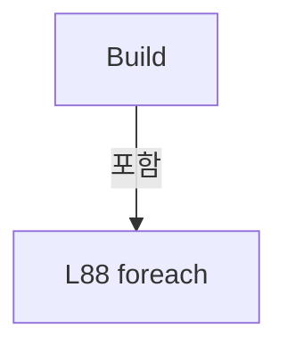

변경 전 점검: 입력/반환 타입, 위 호출자, 예외/취소 경로, 공유 상태와 저장·전송 소비자를 함께 확인합니다. 값의 단위나 물리 방향을 이름만으로 확정하지 않습니다.

### LocalFunctionStatement `ShouldIncludeItem` · L57–60

[Drilling.File/Script/CAutomation1ScriptFile.cs:57–60](https://github.com/kjuws10-rgb/A3Drilling/blob/5aee8e58439c9b455cae7c9593c9be986c3e682e/Drilling.File/Script/CAutomation1ScriptFile.cs#L57-L60)

| 항목 | 실제 추출 값 |
| --- | --- |
| 서명 | bool ShouldIncludeItem(Drilling.Common.Station.ST_HEAD_PROCESS_PLAN) |
| 접근/수식자 | Private /  |
| 반환/값 타입 | bool |
| 소속 타입 | NamedType:Drilling.File.Script.CAutomation1ScriptFile |

입력 계약:

| 이름 | 타입 | 전달 | 선택/기본값 |
| --- | --- | --- | --- |
| head | Drilling.Common.Station.ST_HEAD_PROCESS_PLAN | None | False /  |

현재 부분 분석에서 직접 연결된 호출자는 없습니다. XAML/이벤트/인터페이스·델리게이트·외부 진입을 추가 확인해야 하며, 미사용으로 판정한 것이 아닙니다.

호출하는 대상과 해석 범위:

| 원본 행 | 표현식 | 분석 상태 | 대상/소스 위치 |
| --- | --- | --- | --- |
| 59 | ReadBool | resolved | bool Drilling.File.Script.CAutomation1ScriptFile.ReadBool(System.Collections.Generic.IReadOnlyDictionary<string, string>, bool, System.Collections.Generic.IEnumerable<string>) · Drilling.File/Script/CAutomation1ScriptFile.cs:1245 |
| 59 | CreateHeadKeys | resolved | System.Collections.Generic.IReadOnlyList<string> Drilling.File.Script.CAutomation1ScriptFile.CreateHeadKeys(int, params string[]) · Drilling.File/Script/CAutomation1ScriptFile.cs:1100 |

본문의 실제 연산·분기·예외·반환 순서(원문 위치 순):

| 원본 행 | 종류 | 주석 해설 |
| --- | --- | --- |
| 59 | call | 함수·델리게이트 또는 객체 생성자를 호출합니다: ReadBool(processModel.Parameters, true, CreateHeadKeys(head.HeadNo, "USE")) |
| 59 | call | 함수·델리게이트 또는 객체 생성자를 호출합니다: CreateHeadKeys(head.HeadNo, "USE") |
| 59 | return | 호출자에게 값 또는 제어를 반환합니다: return ReadBool(processModel.Parameters, true, CreateHeadKeys(head.HeadNo, "USE")); |

변경 전 점검: 입력/반환 타입, 위 호출자, 예외/취소 경로, 공유 상태와 저장·전송 소비자를 함께 확인합니다. 값의 단위나 물리 방향을 이름만으로 확정하지 않습니다.

### LocalFunctionStatement `SelectItem` · L62–68

[Drilling.File/Script/CAutomation1ScriptFile.cs:62–68](https://github.com/kjuws10-rgb/A3Drilling/blob/5aee8e58439c9b455cae7c9593c9be986c3e682e/Drilling.File/Script/CAutomation1ScriptFile.cs#L62-L68)

| 항목 | 실제 추출 값 |
| --- | --- |
| 서명 | Drilling.Common.Station.ST_HEAD_PROCESS_PLAN SelectItem(Drilling.Common.Station.ST_HEAD_PROCESS_PLAN) |
| 접근/수식자 | Private /  |
| 반환/값 타입 | Drilling.Common.Station.ST_HEAD_PROCESS_PLAN |
| 소속 타입 | NamedType:Drilling.File.Script.CAutomation1ScriptFile |

입력 계약:

| 이름 | 타입 | 전달 | 선택/기본값 |
| --- | --- | --- | --- |
| head | Drilling.Common.Station.ST_HEAD_PROCESS_PLAN | None | False /  |

현재 부분 분석에서 직접 연결된 호출자는 없습니다. XAML/이벤트/인터페이스·델리게이트·외부 진입을 추가 확인해야 하며, 미사용으로 판정한 것이 아닙니다.

호출하는 대상과 해석 범위:

| 원본 행 | 표현식 | 분석 상태 | 대상/소스 위치 |
| --- | --- | --- | --- |
| 64 | head.Shots .Where(shot => !shotMaskingPlan.EvaluateShot(shot).IsChessSkipped) .ToArray | resolved | Drilling.Common.Recipe.ST_HEAD_SHOT_POINT[] System.Collections.Generic.IEnumerable<Drilling.Common.Recipe.ST_HEAD_SHOT_POINT>.ToArray<Drilling.Common.Recipe.ST_HEAD_SHOT_POINT>() |
| 64 | head.Shots .Where | resolved | System.Collections.Generic.IEnumerable<Drilling.Common.Recipe.ST_HEAD_SHOT_POINT> System.Collections.Generic.IEnumerable<Drilling.Common.Recipe.ST_HEAD_SHOT_POINT>.Where<Drilling.Common.Recipe.ST_HEAD_SHOT_POINT>(System.Func<Drilling.Common.Recipe.ST_HEAD_SHOT_POINT, bool>) |
| 65 | shotMaskingPlan.EvaluateShot | resolved | Drilling.Common.Recipe.ST_RECIPE_SHOT_MASKING_RESULT Drilling.Common.Recipe.CRecipeShotMaskingPlan.EvaluateShot(Drilling.Common.Recipe.ST_HEAD_SHOT_POINT) · Drilling.Common/Recipe/CShotCoordinatePlanBuilder.cs:853 |

본문의 실제 연산·분기·예외·반환 순서(원문 위치 순):

| 원본 행 | 종류 | 주석 해설 |
| --- | --- | --- |
| 64 | call | 함수·델리게이트 또는 객체 생성자를 호출합니다: head.Shots .Where(shot => !shotMaskingPlan.EvaluateShot(shot).IsChessSkipped) |
| 64 | call | 함수·델리게이트 또는 객체 생성자를 호출합니다: head.Shots .Where(shot => !shotMaskingPlan.EvaluateShot(shot).IsChessSkipped) .ToArray() |
| 64 | local-declaration | 지역 변수를 선언합니다: var processShots = head.Shots .Where(shot => !shotMaskingPlan.EvaluateShot(shot).IsChessSkipped) .ToArray(); |
| 64 | variable-initializer | 변수의 초기값을 지정합니다: processShots = head.Shots .Where(shot => !shotMaskingPlan.EvaluateShot(shot).IsChessSkipped) .ToArray() |
| 65 | call | 함수·델리게이트 또는 객체 생성자를 호출합니다: shotMaskingPlan.EvaluateShot(shot) |
| 67 | assignment | 값을 대상에 대입합니다: Shots = processShots |
| 67 | return | 호출자에게 값 또는 제어를 반환합니다: return head with { Shots = processShots }; |

변경 전 점검: 입력/반환 타입, 위 호출자, 예외/취소 경로, 공유 상태와 저장·전송 소비자를 함께 확인합니다. 값의 단위나 물리 방향을 이름만으로 확정하지 않습니다.

### LocalFunctionStatement `ShouldIncludeHead` · L70–73

[Drilling.File/Script/CAutomation1ScriptFile.cs:70–73](https://github.com/kjuws10-rgb/A3Drilling/blob/5aee8e58439c9b455cae7c9593c9be986c3e682e/Drilling.File/Script/CAutomation1ScriptFile.cs#L70-L73)

| 항목 | 실제 추출 값 |
| --- | --- |
| 서명 | bool ShouldIncludeHead(Drilling.Common.Station.ST_HEAD_PROCESS_PLAN) |
| 접근/수식자 | Private /  |
| 반환/값 타입 | bool |
| 소속 타입 | NamedType:Drilling.File.Script.CAutomation1ScriptFile |

입력 계약:

| 이름 | 타입 | 전달 | 선택/기본값 |
| --- | --- | --- | --- |
| head | Drilling.Common.Station.ST_HEAD_PROCESS_PLAN | None | False /  |

현재 부분 분석에서 직접 연결된 호출자는 없습니다. XAML/이벤트/인터페이스·델리게이트·외부 진입을 추가 확인해야 하며, 미사용으로 판정한 것이 아닙니다.

본문의 실제 연산·분기·예외·반환 순서(원문 위치 순):

| 원본 행 | 종류 | 주석 해설 |
| --- | --- | --- |
| 72 | return | 호출자에게 값 또는 제어를 반환합니다: return head.Shots.Count > 0; |

변경 전 점검: 입력/반환 타입, 위 호출자, 예외/취소 경로, 공유 상태와 저장·전송 소비자를 함께 확인합니다. 값의 단위나 물리 방향을 이름만으로 확정하지 않습니다.

### LocalFunctionStatement `SelectTotalShots` · L101–104

[Drilling.File/Script/CAutomation1ScriptFile.cs:101–104](https://github.com/kjuws10-rgb/A3Drilling/blob/5aee8e58439c9b455cae7c9593c9be986c3e682e/Drilling.File/Script/CAutomation1ScriptFile.cs#L101-L104)

| 항목 | 실제 추출 값 |
| --- | --- |
| 서명 | int SelectTotalShots(Drilling.Common.Station.ST_HEAD_SCRIPT_RESULT) |
| 접근/수식자 | Private /  |
| 반환/값 타입 | int |
| 소속 타입 | NamedType:Drilling.File.Script.CAutomation1ScriptFile |

입력 계약:

| 이름 | 타입 | 전달 | 선택/기본값 |
| --- | --- | --- | --- |
| script | Drilling.Common.Station.ST_HEAD_SCRIPT_RESULT | None | False /  |

현재 부분 분석에서 직접 연결된 호출자는 없습니다. XAML/이벤트/인터페이스·델리게이트·외부 진입을 추가 확인해야 하며, 미사용으로 판정한 것이 아닙니다.

본문의 실제 연산·분기·예외·반환 순서(원문 위치 순):

| 원본 행 | 종류 | 주석 해설 |
| --- | --- | --- |
| 103 | return | 호출자에게 값 또는 제어를 반환합니다: return script.TotalShots; |

변경 전 점검: 입력/반환 타입, 위 호출자, 예외/취소 경로, 공유 상태와 저장·전송 소비자를 함께 확인합니다. 값의 단위나 물리 방향을 이름만으로 확정하지 않습니다.

### MethodDeclaration `LoadLatest` · L110–172

[Drilling.File/Script/CAutomation1ScriptFile.cs:110–172](https://github.com/kjuws10-rgb/A3Drilling/blob/5aee8e58439c9b455cae7c9593c9be986c3e682e/Drilling.File/Script/CAutomation1ScriptFile.cs#L110-L172)

| 항목 | 실제 추출 값 |
| --- | --- |
| 서명 | Drilling.Common.Station.ST_SCRIPT_BUILD_RESULT Drilling.File.Script.CAutomation1ScriptFile.LoadLatest(Drilling.Common.Station.ST_PROCESS_MODEL, string, System.Threading.CancellationToken) |
| 접근/수식자 | Public / public, override |
| 반환/값 타입 | Drilling.Common.Station.ST_SCRIPT_BUILD_RESULT |
| 소속 타입 | NamedType:Drilling.File.Script.CAutomation1ScriptFile |

입력 계약:

| 이름 | 타입 | 전달 | 선택/기본값 |
| --- | --- | --- | --- |
| processModel | Drilling.Common.Station.ST_PROCESS_MODEL | None | False /  |
| subDirectoryName | string | None | False /  |
| cancellationToken | System.Threading.CancellationToken | None | True / null |

현재 부분 분석에서 직접 연결된 호출자는 없습니다. XAML/이벤트/인터페이스·델리게이트·외부 진입을 추가 확인해야 하며, 미사용으로 판정한 것이 아닙니다.

호출하는 대상과 해석 범위:

| 원본 행 | 표현식 | 분석 상태 | 대상/소스 위치 |
| --- | --- | --- | --- |
| 112 | cancellationToken.ThrowIfCancellationRequested | resolved | void System.Threading.CancellationToken.ThrowIfCancellationRequested() |
| 114 | new ArgumentException | resolved | System.ArgumentException.ArgumentException(string?, string?) |
| 114 | nameof | unresolved | None |
| 115 | Path.Combine | resolved | string System.IO.Path.Combine(string, string) |
| 116 | Directory.Exists | resolved | bool System.IO.Directory.Exists(string?) |
| 117 | new FileNotFoundException | resolved | System.IO.FileNotFoundException.FileNotFoundException(string?, string?) |
| 120 | Directory.EnumerateDirectories(root).Select(path => new DirectoryInfo(path)) .Where(info => info.Name.Length >= 15 && DateTime.TryParseExact(info.Name[..15], "yyyyMMdd_HHmmss", CultureInfo.InvariantCulture, DateTimeStyles.None, out _)) .OrderByDescending(info => info.Name[..15], StringComparer.Ordinal).ThenByDescending(info => info.CreationTimeUtc)… | resolved | System.IO.DirectoryInfo? System.Collections.Generic.IEnumerable<System.IO.DirectoryInfo>.FirstOrDefault<System.IO.DirectoryInfo>() |
| 120 | Directory.EnumerateDirectories(root).Select(path => new DirectoryInfo(path)) .Where(info => info.Name.Length >= 15 && DateTime.TryParseExact(info.Name[..15], "yyyyMMdd_HHmmss", CultureInfo.InvariantCulture, DateTimeStyles.None, out _)) .OrderByDescending(info => info.Name[..15], StringComparer.Ordinal).ThenByDescending(info => info.CreationTimeUtc)… | resolved | System.Linq.IOrderedEnumerable<System.IO.DirectoryInfo> System.Linq.IOrderedEnumerable<System.IO.DirectoryInfo>.ThenByDescending<System.IO.DirectoryInfo, string>(System.Func<System.IO.DirectoryInfo, string>, System.Collections.Generic.IComparer<string>?) |
| 120 | Directory.EnumerateDirectories(root).Select(path => new DirectoryInfo(path)) .Where(info => info.Name.Length >= 15 && DateTime.TryParseExact(info.Name[..15], "yyyyMMdd_HHmmss", CultureInfo.InvariantCulture, DateTimeStyles.None, out _)) .OrderByDescending(info => info.Name[..15], StringComparer.Ordinal).ThenByDescending | resolved | System.Linq.IOrderedEnumerable<System.IO.DirectoryInfo> System.Linq.IOrderedEnumerable<System.IO.DirectoryInfo>.ThenByDescending<System.IO.DirectoryInfo, System.DateTime>(System.Func<System.IO.DirectoryInfo, System.DateTime>) |
| 120 | Directory.EnumerateDirectories(root).Select(path => new DirectoryInfo(path)) .Where(info => info.Name.Length >= 15 && DateTime.TryParseExact(info.Name[..15], "yyyyMMdd_HHmmss", CultureInfo.InvariantCulture, DateTimeStyles.None, out _)) .OrderByDescending | resolved | System.Linq.IOrderedEnumerable<System.IO.DirectoryInfo> System.Collections.Generic.IEnumerable<System.IO.DirectoryInfo>.OrderByDescending<System.IO.DirectoryInfo, string>(System.Func<System.IO.DirectoryInfo, string>, System.Collections.Generic.IComparer<string>?) |
| 120 | Directory.EnumerateDirectories(root).Select(path => new DirectoryInfo(path)) .Where | resolved | System.Collections.Generic.IEnumerable<System.IO.DirectoryInfo> System.Collections.Generic.IEnumerable<System.IO.DirectoryInfo>.Where<System.IO.DirectoryInfo>(System.Func<System.IO.DirectoryInfo, bool>) |
| 120 | Directory.EnumerateDirectories(root).Select | resolved | System.Collections.Generic.IEnumerable<System.IO.DirectoryInfo> System.Collections.Generic.IEnumerable<string>.Select<string, System.IO.DirectoryInfo>(System.Func<string, System.IO.DirectoryInfo>) |
| 120 | Directory.EnumerateDirectories | resolved | System.Collections.Generic.IEnumerable<string> System.IO.Directory.EnumerateDirectories(string) |
| 120 | new DirectoryInfo | resolved | System.IO.DirectoryInfo.DirectoryInfo(string) |
| 121 | DateTime.TryParseExact | resolved | bool System.DateTime.TryParseExact(string?, string?, System.IFormatProvider?, System.Globalization.DateTimeStyles, out System.DateTime) |
| 124 | new FileNotFoundException | resolved | System.IO.FileNotFoundException.FileNotFoundException(string?, string?) |
| 125 | Path.Combine | resolved | string System.IO.Path.Combine(string, string) |
| 126 | System.IO.File.ReadAllLines | resolved | string[] System.IO.File.ReadAllLines(string) |
| 129 | Header("RecipeId").Equals | resolved | bool string.Equals(string?, System.StringComparison) |
| 129 | Header | resolved | string Header(string) · Drilling.File/Script/CAutomation1ScriptFile.cs:127 |
| 130 | new InvalidDataException | resolved | System.IO.InvalidDataException.InvalidDataException(string?) |
| 130 | Header | resolved | string Header(string) · Drilling.File/Script/CAutomation1ScriptFile.cs:127 |
| 131 | DateTimeOffset.ParseExact | resolved | System.DateTimeOffset System.DateTimeOffset.ParseExact(string, string, System.IFormatProvider?) |
| 131 | Header | resolved | string Header(string) · Drilling.File/Script/CAutomation1ScriptFile.cs:127 |
| 132 | new List<ST_HEAD_SCRIPT_RESULT> | resolved | System.Collections.Generic.List<Drilling.Common.Station.ST_HEAD_SCRIPT_RESULT>.List() |
| 136 | cancellationToken.ThrowIfCancellationRequested | resolved | void System.Threading.CancellationToken.ThrowIfCancellationRequested() |
| 137 | Regex.Match | resolved | System.Text.RegularExpressions.Match System.Text.RegularExpressions.Regex.Match(string, string) |
| 139 | int.Parse | resolved | int int.Parse(string, System.IFormatProvider?) |
| 140 | Regex.Match | resolved | System.Text.RegularExpressions.Match System.Text.RegularExpressions.Regex.Match(string, string) |
| 141 | heads.Any | resolved | bool System.Collections.Generic.IEnumerable<Drilling.Common.Station.ST_HEAD_SCRIPT_RESULT>.Any<Drilling.Common.Station.ST_HEAD_SCRIPT_RESULT>(System.Func<Drilling.Common.Station.ST_HEAD_SCRIPT_RESULT, bool>) |
| 142 | new InvalidDataException | resolved | System.IO.InvalidDataException.InvalidDataException(string?) |
| 143 | int.Parse | resolved | int int.Parse(string, System.IFormatProvider?) |
| 144 | int.Parse | resolved | int int.Parse(string, System.IFormatProvider?) |
| 146 | int.Parse | resolved | int int.Parse(string, System.IFormatProvider?) |
| 147 | processModel.HeadPlans.SingleOrDefault | resolved | Drilling.Common.Station.ST_HEAD_PROCESS_PLAN? System.Collections.Generic.IEnumerable<Drilling.Common.Station.ST_HEAD_PROCESS_PLAN>.SingleOrDefault<Drilling.Common.Station.ST_HEAD_PROCESS_PLAN>(System.Func<Drilling.Common.Station.ST_HEAD_PROCESS_PLAN, bool>) |
| 148 | Path.GetFileName | resolved | string? System.IO.Path.GetFileName(string?) |
| 148 | fileName.EndsWith | resolved | bool string.EndsWith(string, System.StringComparison) |
| 149 | new InvalidDataException | resolved | System.IO.InvalidDataException.InvalidDataException(string?) |
| 150 | Path.Combine | resolved | string System.IO.Path.Combine(string, string) |
| 153 | System.IO.File.ReadLines | resolved | System.Collections.Generic.IEnumerable<string> System.IO.File.ReadLines(string) |
| 155 | cancellationToken.ThrowIfCancellationRequested | resolved | void System.Threading.CancellationToken.ThrowIfCancellationRequested() |
| 158 | Regex.Match | resolved | System.Text.RegularExpressions.Match System.Text.RegularExpressions.Regex.Match(string, string) |
| 159 | long.Parse | resolved | long long.Parse(string, System.IFormatProvider?) |
| 162 | new InvalidDataException | resolved | System.IO.InvalidDataException.InvalidDataException(string?) |
| 164 | heads.Add | resolved | void System.Collections.Generic.List<Drilling.Common.Station.ST_HEAD_SCRIPT_RESULT>.Add(Drilling.Common.Station.ST_HEAD_SCRIPT_RESULT) |
| 164 | new | resolved | Drilling.Common.Station.ST_HEAD_SCRIPT_RESULT.ST_HEAD_SCRIPT_RESULT(int, int, int, string, string, int, int, System.DateTimeOffset) · Drilling.Common/Station/CStationManager.cs:338 |
| 166 | processModel.HeadPlans.Where(head => ReadBool(processModel.Parameters, true, CreateHeadKeys(head.HeadNo, "USE")) && head.Shots.Count > 0).Select(head => head.HeadNo).Order().ToArray | resolved | int[] System.Collections.Generic.IEnumerable<int>.ToArray<int>() |
| 166 | processModel.HeadPlans.Where(head => ReadBool(processModel.Parameters, true, CreateHeadKeys(head.HeadNo, "USE")) && head.Shots.Count > 0).Select(head => head.HeadNo).Order | resolved | System.Linq.IOrderedEnumerable<int> System.Collections.Generic.IEnumerable<int>.Order<int>() |
| 166 | processModel.HeadPlans.Where(head => ReadBool(processModel.Parameters, true, CreateHeadKeys(head.HeadNo, "USE")) && head.Shots.Count > 0).Select | resolved | System.Collections.Generic.IEnumerable<int> System.Collections.Generic.IEnumerable<Drilling.Common.Station.ST_HEAD_PROCESS_PLAN>.Select<Drilling.Common.Station.ST_HEAD_PROCESS_PLAN, int>(System.Func<Drilling.Common.Station.ST_HEAD_PROCESS_PLAN, int>) |
| 166 | processModel.HeadPlans.Where | resolved | System.Collections.Generic.IEnumerable<Drilling.Common.Station.ST_HEAD_PROCESS_PLAN> System.Collections.Generic.IEnumerable<Drilling.Common.Station.ST_HEAD_PROCESS_PLAN>.Where<Drilling.Common.Station.ST_HEAD_PROCESS_PLAN>(System.Func<Drilling.Common.Station.ST_HEAD_PROCESS_PLAN, bool>) |
| 166 | ReadBool | resolved | bool Drilling.File.Script.CAutomation1ScriptFile.ReadBool(System.Collections.Generic.IReadOnlyDictionary<string, string>, bool, System.Collections.Generic.IEnumerable<string>) · Drilling.File/Script/CAutomation1ScriptFile.cs:1245 |
| 166 | CreateHeadKeys | resolved | System.Collections.Generic.IReadOnlyList<string> Drilling.File.Script.CAutomation1ScriptFile.CreateHeadKeys(int, params string[]) · Drilling.File/Script/CAutomation1ScriptFile.cs:1100 |
| 167 | int.Parse | resolved | int int.Parse(string, System.IFormatProvider?) |
| 167 | Header | resolved | string Header(string) · Drilling.File/Script/CAutomation1ScriptFile.cs:127 |
| 168 | heads.Select(head => head.HeadNo).Order().SequenceEqual | resolved | bool System.Collections.Generic.IEnumerable<int>.SequenceEqual<int>(System.Collections.Generic.IEnumerable<int>) |
| 168 | heads.Select(head => head.HeadNo).Order | resolved | System.Linq.IOrderedEnumerable<int> System.Collections.Generic.IEnumerable<int>.Order<int>() |
| 168 | heads.Select | resolved | System.Collections.Generic.IEnumerable<int> System.Collections.Generic.IEnumerable<Drilling.Common.Station.ST_HEAD_SCRIPT_RESULT>.Select<Drilling.Common.Station.ST_HEAD_SCRIPT_RESULT, int>(System.Func<Drilling.Common.Station.ST_HEAD_SCRIPT_RESULT, int>) |
| 169 | heads.Select(head => (head.AutomationNo, head.TaskNo)).Distinct().Count | resolved | int System.Collections.Generic.IEnumerable<(int AutomationNo, int TaskNo)>.Count<(int AutomationNo, int TaskNo)>() |
| 169 | heads.Select(head => (head.AutomationNo, head.TaskNo)).Distinct | resolved | System.Collections.Generic.IEnumerable<(int AutomationNo, int TaskNo)> System.Collections.Generic.IEnumerable<(int AutomationNo, int TaskNo)>.Distinct<(int AutomationNo, int TaskNo)>() |
| 169 | heads.Select | resolved | System.Collections.Generic.IEnumerable<(int AutomationNo, int TaskNo)> System.Collections.Generic.IEnumerable<Drilling.Common.Station.ST_HEAD_SCRIPT_RESULT>.Select<Drilling.Common.Station.ST_HEAD_SCRIPT_RESULT, (int AutomationNo, int TaskNo)>(System.Func<Drilling.Common.Station.ST_HEAD_SCRIPT_RESULT, (int AutomationNo, int TaskNo)>) |
| 170 | new InvalidDataException | resolved | System.IO.InvalidDataException.InvalidDataException(string?) |
| 171 | new | resolved | Drilling.Common.Station.ST_SCRIPT_BUILD_RESULT.ST_SCRIPT_BUILD_RESULT(string, string, int, System.DateTimeOffset, System.Collections.Generic.IReadOnlyList<Drilling.Common.Station.ST_HEAD_SCRIPT_RESULT>) · Drilling.Common/Station/CStationManager.cs:333 |
| 171 | heads.Sum | resolved | int System.Collections.Generic.IEnumerable<Drilling.Common.Station.ST_HEAD_SCRIPT_RESULT>.Sum<Drilling.Common.Station.ST_HEAD_SCRIPT_RESULT>(System.Func<Drilling.Common.Station.ST_HEAD_SCRIPT_RESULT, int>) |

본문의 실제 연산·분기·예외·반환 순서(원문 위치 순):

| 원본 행 | 종류 | 주석 해설 |
| --- | --- | --- |
| 112 | call | 함수·델리게이트 또는 객체 생성자를 호출합니다: cancellationToken.ThrowIfCancellationRequested() |
| 113 | if | 조건에 따라 분기합니다: if (subDirectoryName is not (StandardDirectoryName or BufferedRunDirectoryName)) |
| 114 | call | 함수·델리게이트 또는 객체 생성자를 호출합니다: new ArgumentException("AUTO 스크립트 실행 방식이 올바르지 않습니다.", nameof(subDirectoryName)) |
| 114 | call | 함수·델리게이트 또는 객체 생성자를 호출합니다: nameof(subDirectoryName) |
| 114 | throw | 예외를 발생/전달합니다: throw new ArgumentException("AUTO 스크립트 실행 방식이 올바르지 않습니다.", nameof(subDirectoryName)); |
| 115 | call | 함수·델리게이트 또는 객체 생성자를 호출합니다: Path.Combine(_scriptDirectory, subDirectoryName) |
| 115 | local-declaration | 지역 변수를 선언합니다: var root = Path.Combine(_scriptDirectory, subDirectoryName); |
| 115 | variable-initializer | 변수의 초기값을 지정합니다: root = Path.Combine(_scriptDirectory, subDirectoryName) |
| 116 | call | 함수·델리게이트 또는 객체 생성자를 호출합니다: Directory.Exists(root) |
| 116 | if | 조건에 따라 분기합니다: if (!Directory.Exists(root)) |
| 117 | call | 함수·델리게이트 또는 객체 생성자를 호출합니다: new FileNotFoundException("마지막 AUTO 스크립트 폴더가 없습니다.", root) |
| 117 | throw | 예외를 발생/전달합니다: throw new FileNotFoundException("마지막 AUTO 스크립트 폴더가 없습니다.", root); |
| 120 | call | 함수·델리게이트 또는 객체 생성자를 호출합니다: Directory.EnumerateDirectories(root).Select(path => new DirectoryInfo(path)) |
| 120 | call | 함수·델리게이트 또는 객체 생성자를 호출합니다: Directory.EnumerateDirectories(root) |
| 120 | call | 함수·델리게이트 또는 객체 생성자를 호출합니다: new DirectoryInfo(path) |
| 120 | call | 함수·델리게이트 또는 객체 생성자를 호출합니다: Directory.EnumerateDirectories(root).Select(path => new DirectoryInfo(path)) .Where(info => info.Name.Length >= 15 && DateTime.TryParseExact(info.Name[..15], "yyyyMMdd_HHmmss", CultureInfo.InvariantCulture, DateTimeStyle… |
| 120 | call | 함수·델리게이트 또는 객체 생성자를 호출합니다: Directory.EnumerateDirectories(root).Select(path => new DirectoryInfo(path)) .Where(info => info.Name.Length >= 15 && DateTime.TryParseExact(info.Name[..15], "yyyyMMdd_HHmmss", CultureInfo.InvariantCulture, DateTimeStyle… |
| 120 | call | 함수·델리게이트 또는 객체 생성자를 호출합니다: Directory.EnumerateDirectories(root).Select(path => new DirectoryInfo(path)) .Where(info => info.Name.Length >= 15 && DateTime.TryParseExact(info.Name[..15], "yyyyMMdd_HHmmss", CultureInfo.InvariantCulture, DateTimeStyle… |
| 120 | call | 함수·델리게이트 또는 객체 생성자를 호출합니다: Directory.EnumerateDirectories(root).Select(path => new DirectoryInfo(path)) .Where(info => info.Name.Length >= 15 && DateTime.TryParseExact(info.Name[..15], "yyyyMMdd_HHmmss", CultureInfo.InvariantCulture, DateTimeStyle… |
| 120 | call | 함수·델리게이트 또는 객체 생성자를 호출합니다: Directory.EnumerateDirectories(root).Select(path => new DirectoryInfo(path)) .Where(info => info.Name.Length >= 15 && DateTime.TryParseExact(info.Name[..15], "yyyyMMdd_HHmmss", CultureInfo.InvariantCulture, DateTimeStyle… |
| 120 | local-declaration | 지역 변수를 선언합니다: var directory = Directory.EnumerateDirectories(root).Select(path => new DirectoryInfo(path)) .Where(info => info.Name.Length >= 15 && DateTime.TryParseExact(info.Name[..15], "yyyyMMdd_HHmmss", CultureInfo.InvariantCulture, DateTim |
| 120 | variable-initializer | 변수의 초기값을 지정합니다: directory = Directory.EnumerateDirectories(root).Select(path => new DirectoryInfo(path)) .Where(info => info.Name.Length >= 15 && DateTime.TryParseExact(info.Name[..15], "yyyyMMdd_HHmmss", CultureInfo.InvariantCulture, DateTimeSty |
| 121 | call | 함수·델리게이트 또는 객체 생성자를 호출합니다: DateTime.TryParseExact(info.Name[..15], "yyyyMMdd_HHmmss", CultureInfo.InvariantCulture, DateTimeStyles.None, out _) |
| 124 | call | 함수·델리게이트 또는 객체 생성자를 호출합니다: new FileNotFoundException("실행할 AUTO 스크립트 생성 회차가 없습니다.", root) |
| 124 | throw | 예외를 발생/전달합니다: throw new FileNotFoundException("실행할 AUTO 스크립트 생성 회차가 없습니다.", root) |
| 125 | call | 함수·델리게이트 또는 객체 생성자를 호출합니다: Path.Combine(directory, ProcessCoordinateListFileName) |
| 125 | local-declaration | 지역 변수를 선언합니다: var manifest = Path.Combine(directory, ProcessCoordinateListFileName); |
| 125 | variable-initializer | 변수의 초기값을 지정합니다: manifest = Path.Combine(directory, ProcessCoordinateListFileName) |
| 126 | call | 함수·델리게이트 또는 객체 생성자를 호출합니다: System.IO.File.ReadAllLines(manifest) |
| 126 | local-declaration | 지역 변수를 선언합니다: var lines = System.IO.File.ReadAllLines(manifest); |
| 126 | variable-initializer | 변수의 초기값을 지정합니다: lines = System.IO.File.ReadAllLines(manifest) |
| 129 | call | 함수·델리게이트 또는 객체 생성자를 호출합니다: Header("RecipeId").Equals(processModel.RecipeId, StringComparison.OrdinalIgnoreCase) |
| 129 | call | 함수·델리게이트 또는 객체 생성자를 호출합니다: Header("RecipeId") |
| 129 | if | 조건에 따라 분기합니다: if (!Header("RecipeId").Equals(processModel.RecipeId, StringComparison.OrdinalIgnoreCase)) |
| 130 | call | 함수·델리게이트 또는 객체 생성자를 호출합니다: new InvalidDataException($"마지막 스크립트의 Recipe({Header("RecipeId")})가 현재 Recipe({processModel.RecipeId})와 다릅니다. {manifest}") |
| 130 | call | 함수·델리게이트 또는 객체 생성자를 호출합니다: Header("RecipeId") |
| 130 | throw | 예외를 발생/전달합니다: throw new InvalidDataException($"마지막 스크립트의 Recipe({Header("RecipeId")})가 현재 Recipe({processModel.RecipeId})와 다릅니다. {manifest}"); |
| 131 | call | 함수·델리게이트 또는 객체 생성자를 호출합니다: DateTimeOffset.ParseExact(Header("CreatedAt"), "yyyy-MM-dd HH:mm:ss.fff zzz", CultureInfo.InvariantCulture) |
| 131 | call | 함수·델리게이트 또는 객체 생성자를 호출합니다: Header("CreatedAt") |
| 131 | local-declaration | 지역 변수를 선언합니다: var createdAt = DateTimeOffset.ParseExact(Header("CreatedAt"), "yyyy-MM-dd HH:mm:ss.fff zzz", CultureInfo.InvariantCulture); |
| 131 | variable-initializer | 변수의 초기값을 지정합니다: createdAt = DateTimeOffset.ParseExact(Header("CreatedAt"), "yyyy-MM-dd HH:mm:ss.fff zzz", CultureInfo.InvariantCulture) |
| 132 | call | 함수·델리게이트 또는 객체 생성자를 호출합니다: new List<ST_HEAD_SCRIPT_RESULT>() |
| 132 | local-declaration | 지역 변수를 선언합니다: var heads = new List<ST_HEAD_SCRIPT_RESULT>(); |
| 132 | variable-initializer | 변수의 초기값을 지정합니다: heads = new List<ST_HEAD_SCRIPT_RESULT>() |
| 133 | local-declaration | 지역 변수를 선언합니다: long? readyRunId = null; |
| 133 | variable-initializer | 변수의 초기값을 지정합니다: readyRunId = null |
| 134 | variable-initializer | 변수의 초기값을 지정합니다: i = 0 |
| 134 | for | 초기화·조건·증감이 있는 반복입니다: for (var i = 0; i < lines.Length; i++) |
| 136 | call | 함수·델리게이트 또는 객체 생성자를 호출합니다: cancellationToken.ThrowIfCancellationRequested() |
| 137 | call | 함수·델리게이트 또는 객체 생성자를 호출합니다: Regex.Match(lines[i], @"^\[H(\d{2})\]$") |
| 137 | local-declaration | 지역 변수를 선언합니다: var headMatch = Regex.Match(lines[i], @"^\[H(\d{2})\]$"); |
| 137 | variable-initializer | 변수의 초기값을 지정합니다: headMatch = Regex.Match(lines[i], @"^\[H(\d{2})\]$") |
| 138 | continue | 다음 반복으로 진행합니다: continue; |
| 138 | if | 조건에 따라 분기합니다: if (!headMatch.Success) |
| 139 | call | 함수·델리게이트 또는 객체 생성자를 호출합니다: int.Parse(headMatch.Groups[1].Value, CultureInfo.InvariantCulture) |
| 139 | local-declaration | 지역 변수를 선언합니다: var headNo = int.Parse(headMatch.Groups[1].Value, CultureInfo.InvariantCulture); |
| 139 | variable-initializer | 변수의 초기값을 지정합니다: headNo = int.Parse(headMatch.Groups[1].Value, CultureInfo.InvariantCulture) |
| 140 | call | 함수·델리게이트 또는 객체 생성자를 호출합니다: Regex.Match(i + 1 < lines.Length ? lines[++i] : "", @"^Automation=(\d+) Task=(\d+) Script=(\S+) Shots=(\d+)$") |
| 140 | conditional-expression | 조건에 따라 결과식을 선택합니다: i + 1 < lines.Length ? lines[++i] : "" |
| 140 | local-declaration | 지역 변수를 선언합니다: var metadata = Regex.Match(i + 1 < lines.Length ? lines[++i] : "", @"^Automation=(\d+) Task=(\d+) Script=(\S+) Shots=(\d+)$"); |
| 140 | variable-initializer | 변수의 초기값을 지정합니다: metadata = Regex.Match(i + 1 < lines.Length ? lines[++i] : "", @"^Automation=(\d+) Task=(\d+) Script=(\S+) Shots=(\d+)$") |
| 141 | call | 함수·델리게이트 또는 객체 생성자를 호출합니다: heads.Any(head => head.HeadNo == headNo) |
| 141 | if | 조건에 따라 분기합니다: if (!metadata.Success &#124;&#124; heads.Any(head => head.HeadNo == headNo)) |
| 142 | call | 함수·델리게이트 또는 객체 생성자를 호출합니다: new InvalidDataException($"HEAD {headNo:00} 스크립트 목록이 올바르지 않습니다: {manifest}") |
| 142 | throw | 예외를 발생/전달합니다: throw new InvalidDataException($"HEAD {headNo:00} 스크립트 목록이 올바르지 않습니다: {manifest}"); |
| 143 | call | 함수·델리게이트 또는 객체 생성자를 호출합니다: int.Parse(metadata.Groups[1].Value, CultureInfo.InvariantCulture) |
| 143 | local-declaration | 지역 변수를 선언합니다: var controller = int.Parse(metadata.Groups[1].Value, CultureInfo.InvariantCulture); |
| 143 | variable-initializer | 변수의 초기값을 지정합니다: controller = int.Parse(metadata.Groups[1].Value, CultureInfo.InvariantCulture) |
| 144 | call | 함수·델리게이트 또는 객체 생성자를 호출합니다: int.Parse(metadata.Groups[2].Value, CultureInfo.InvariantCulture) |
| 144 | local-declaration | 지역 변수를 선언합니다: var task = int.Parse(metadata.Groups[2].Value, CultureInfo.InvariantCulture); |
| 144 | variable-initializer | 변수의 초기값을 지정합니다: task = int.Parse(metadata.Groups[2].Value, CultureInfo.InvariantCulture) |
| 145 | local-declaration | 지역 변수를 선언합니다: var fileName = metadata.Groups[3].Value; |
| 145 | variable-initializer | 변수의 초기값을 지정합니다: fileName = metadata.Groups[3].Value |
| 146 | call | 함수·델리게이트 또는 객체 생성자를 호출합니다: int.Parse(metadata.Groups[4].Value, CultureInfo.InvariantCulture) |
| 146 | local-declaration | 지역 변수를 선언합니다: var shots = int.Parse(metadata.Groups[4].Value, CultureInfo.InvariantCulture); |
| 146 | variable-initializer | 변수의 초기값을 지정합니다: shots = int.Parse(metadata.Groups[4].Value, CultureInfo.InvariantCulture) |
| 147 | call | 함수·델리게이트 또는 객체 생성자를 호출합니다: processModel.HeadPlans.SingleOrDefault(head => head.HeadNo == headNo) |
| 147 | local-declaration | 지역 변수를 선언합니다: var plan = processModel.HeadPlans.SingleOrDefault(head => head.HeadNo == headNo); |
| 147 | variable-initializer | 변수의 초기값을 지정합니다: plan = processModel.HeadPlans.SingleOrDefault(head => head.HeadNo == headNo) |
| 148 | call | 함수·델리게이트 또는 객체 생성자를 호출합니다: Path.GetFileName(fileName) |
| 148 | call | 함수·델리게이트 또는 객체 생성자를 호출합니다: fileName.EndsWith(".ascript", StringComparison.OrdinalIgnoreCase) |
| 148 | if | 조건에 따라 분기합니다: if (plan is null &#124;&#124; plan.AutomationNo != controller &#124;&#124; plan.TaskNo != task &#124;&#124; Path.GetFileName(fileName) != fileName &#124;&#124; !fileName.EndsWith(".ascript", StringComparison.OrdinalIgnoreCase)) |
| 149 | call | 함수·델리게이트 또는 객체 생성자를 호출합니다: new InvalidDataException($"HEAD {headNo:00}의 현재 Controller/Task와 저장 스크립트 정보를 확인해 주세요.") |
| 149 | throw | 예외를 발생/전달합니다: throw new InvalidDataException($"HEAD {headNo:00}의 현재 Controller/Task와 저장 스크립트 정보를 확인해 주세요."); |
| 150 | call | 함수·델리게이트 또는 객체 생성자를 호출합니다: Path.Combine(directory, fileName) |
| 150 | local-declaration | 지역 변수를 선언합니다: var filePath = Path.Combine(directory, fileName); |
| 150 | variable-initializer | 변수의 초기값을 지정합니다: filePath = Path.Combine(directory, fileName) |
| 151 | local-declaration | 지역 변수를 선언합니다: long? headRunId = null; |
| 151 | variable-initializer | 변수의 초기값을 지정합니다: headRunId = null |
| 152 | local-declaration | 지역 변수를 선언합니다: var lineCount = 0; |
| 152 | variable-initializer | 변수의 초기값을 지정합니다: lineCount = 0 |
| 153 | call | 함수·델리게이트 또는 객체 생성자를 호출합니다: System.IO.File.ReadLines(filePath) |
| 153 | foreach | 컬렉션 요소를 순회합니다: foreach (var line in System.IO.File.ReadLines(filePath)) |
| 155 | call | 함수·델리게이트 또는 객체 생성자를 호출합니다: cancellationToken.ThrowIfCancellationRequested() |
| 157 | continue | 다음 반복으로 진행합니다: continue; |
| 157 | if | 조건에 따라 분기합니다: if (lineCount > 16) |
| 158 | call | 함수·델리게이트 또는 객체 생성자를 호출합니다: Regex.Match(line, @"^// MOF Ready: GlobalInteger\[\d+\], RunId=(\d+)$") |
| 158 | local-declaration | 지역 변수를 선언합니다: var marker = Regex.Match(line, @"^// MOF Ready: GlobalInteger\[\d+\], RunId=(\d+)$"); |
| 158 | variable-initializer | 변수의 초기값을 지정합니다: marker = Regex.Match(line, @"^// MOF Ready: GlobalInteger\[\d+\], RunId=(\d+)$") |
| 159 | assignment | 값을 대상에 대입합니다: headRunId = long.Parse(marker.Groups[1].Value, CultureInfo.InvariantCulture) |
| 159 | call | 함수·델리게이트 또는 객체 생성자를 호출합니다: long.Parse(marker.Groups[1].Value, CultureInfo.InvariantCulture) |
| 159 | if | 조건에 따라 분기합니다: if (marker.Success) |
| 161 | if | 조건에 따라 분기합니다: if (headRunId is not > 0 &#124;&#124; readyRunId is not null && readyRunId != headRunId) |
| 162 | call | 함수·델리게이트 또는 객체 생성자를 호출합니다: new InvalidDataException($"HEAD {headNo:00}의 MOF 실행번호가 없거나 다른 회차와 섞였습니다: {filePath}") |
| 162 | throw | 예외를 발생/전달합니다: throw new InvalidDataException($"HEAD {headNo:00}의 MOF 실행번호가 없거나 다른 회차와 섞였습니다: {filePath}"); |
| 163 | assignment | 값을 대상에 대입합니다: readyRunId = headRunId |
| 164 | call | 함수·델리게이트 또는 객체 생성자를 호출합니다: heads.Add(new(headNo, controller, task, fileName, filePath, shots, lineCount, createdAt)) |
| 164 | call | 함수·델리게이트 또는 객체 생성자를 호출합니다: new(headNo, controller, task, fileName, filePath, shots, lineCount, createdAt) |
| 166 | call | 함수·델리게이트 또는 객체 생성자를 호출합니다: processModel.HeadPlans.Where(head => ReadBool(processModel.Parameters, true, CreateHeadKeys(head.HeadNo, "USE")) && head.Shots.Count > 0).Select(head => head.HeadNo).Order().ToArray() |
| 166 | call | 함수·델리게이트 또는 객체 생성자를 호출합니다: processModel.HeadPlans.Where(head => ReadBool(processModel.Parameters, true, CreateHeadKeys(head.HeadNo, "USE")) && head.Shots.Count > 0).Select(head => head.HeadNo).Order() |
| 166 | call | 함수·델리게이트 또는 객체 생성자를 호출합니다: processModel.HeadPlans.Where(head => ReadBool(processModel.Parameters, true, CreateHeadKeys(head.HeadNo, "USE")) && head.Shots.Count > 0).Select(head => head.HeadNo) |
| 166 | call | 함수·델리게이트 또는 객체 생성자를 호출합니다: processModel.HeadPlans.Where(head => ReadBool(processModel.Parameters, true, CreateHeadKeys(head.HeadNo, "USE")) && head.Shots.Count > 0) |
| 166 | call | 함수·델리게이트 또는 객체 생성자를 호출합니다: ReadBool(processModel.Parameters, true, CreateHeadKeys(head.HeadNo, "USE")) |
| 166 | call | 함수·델리게이트 또는 객체 생성자를 호출합니다: CreateHeadKeys(head.HeadNo, "USE") |
| 166 | local-declaration | 지역 변수를 선언합니다: var expectedHeads = processModel.HeadPlans.Where(head => ReadBool(processModel.Parameters, true, CreateHeadKeys(head.HeadNo, "USE")) && head.Shots.Count > 0).Select(head => head.HeadNo).Order().ToArray(); |
| 166 | variable-initializer | 변수의 초기값을 지정합니다: expectedHeads = processModel.HeadPlans.Where(head => ReadBool(processModel.Parameters, true, CreateHeadKeys(head.HeadNo, "USE")) && head.Shots.Count > 0).Select(head => head.HeadNo).Order().ToArray() |
| 167 | call | 함수·델리게이트 또는 객체 생성자를 호출합니다: int.Parse(Header("HeadScriptCount"), CultureInfo.InvariantCulture) |
| 167 | call | 함수·델리게이트 또는 객체 생성자를 호출합니다: Header("HeadScriptCount") |
| 167 | if | 조건에 따라 분기합니다: if (heads.Count != int.Parse(Header("HeadScriptCount"), CultureInfo.InvariantCulture) &#124;&#124; heads.Count == 0 &#124;&#124; !heads.Select(head => head.HeadNo).Order().SequenceEqual(expectedHeads) &#124;&#124; heads.Select(head => (head.AutomationNo,…) |
| 168 | call | 함수·델리게이트 또는 객체 생성자를 호출합니다: heads.Select(head => head.HeadNo).Order().SequenceEqual(expectedHeads) |
| 168 | call | 함수·델리게이트 또는 객체 생성자를 호출합니다: heads.Select(head => head.HeadNo).Order() |
| 168 | call | 함수·델리게이트 또는 객체 생성자를 호출합니다: heads.Select(head => head.HeadNo) |
| 169 | call | 함수·델리게이트 또는 객체 생성자를 호출합니다: heads.Select(head => (head.AutomationNo, head.TaskNo)).Distinct().Count() |
| 169 | call | 함수·델리게이트 또는 객체 생성자를 호출합니다: heads.Select(head => (head.AutomationNo, head.TaskNo)).Distinct() |
| 169 | call | 함수·델리게이트 또는 객체 생성자를 호출합니다: heads.Select(head => (head.AutomationNo, head.TaskNo)) |
| 170 | call | 함수·델리게이트 또는 객체 생성자를 호출합니다: new InvalidDataException("마지막 스크립트 세트의 Head/Task 구성이 현재 가공 대상과 일치하지 않습니다: " + manifest) |
| 170 | throw | 예외를 발생/전달합니다: throw new InvalidDataException("마지막 스크립트 세트의 Head/Task 구성이 현재 가공 대상과 일치하지 않습니다: " + manifest); |
| 171 | assignment | 값을 대상에 대입합니다: MofReadyRunId = readyRunId!.Value |
| 171 | call | 함수·델리게이트 또는 객체 생성자를 호출합니다: new(ProcessCoordinateListFileName, manifest, heads.Sum(head => head.TotalShots), createdAt, heads) { MofReadyRunId = readyRunId!.Value } |
| 171 | call | 함수·델리게이트 또는 객체 생성자를 호출합니다: heads.Sum(head => head.TotalShots) |
| 171 | return | 호출자에게 값 또는 제어를 반환합니다: return new(ProcessCoordinateListFileName, manifest, heads.Sum(head => head.TotalShots), createdAt, heads) { MofReadyRunId = readyRunId!.Value }; |

제어 구문의 포함 구조(실제 실행 순서/CFG가 아닌 구문 탐색 그림):

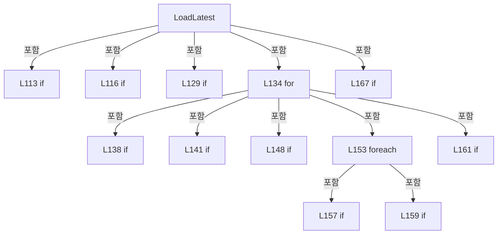

변경 전 점검: 입력/반환 타입, 위 호출자, 예외/취소 경로, 공유 상태와 저장·전송 소비자를 함께 확인합니다. 값의 단위나 물리 방향을 이름만으로 확정하지 않습니다.

### LocalFunctionStatement `Header` · L127–128

[Drilling.File/Script/CAutomation1ScriptFile.cs:127–128](https://github.com/kjuws10-rgb/A3Drilling/blob/5aee8e58439c9b455cae7c9593c9be986c3e682e/Drilling.File/Script/CAutomation1ScriptFile.cs#L127-L128)

| 항목 | 실제 추출 값 |
| --- | --- |
| 서명 | string Header(string) |
| 접근/수식자 | Private /  |
| 반환/값 타입 | string |
| 소속 타입 | NamedType:Drilling.File.Script.CAutomation1ScriptFile |

입력 계약:

| 이름 | 타입 | 전달 | 선택/기본값 |
| --- | --- | --- | --- |
| key | string | None | False /  |

정적 호출자로 확인된 위치:

| 호출 파일/행 | 호출 표현식 | 런타임 분기 가능 |
| --- | --- | --- |
| [Drilling.File/Script/CAutomation1ScriptFile.cs:129–129](https://github.com/kjuws10-rgb/A3Drilling/blob/5aee8e58439c9b455cae7c9593c9be986c3e682e/Drilling.File/Script/CAutomation1ScriptFile.cs#L129-L129) | Header | False |
| [Drilling.File/Script/CAutomation1ScriptFile.cs:130–130](https://github.com/kjuws10-rgb/A3Drilling/blob/5aee8e58439c9b455cae7c9593c9be986c3e682e/Drilling.File/Script/CAutomation1ScriptFile.cs#L130-L130) | Header | False |
| [Drilling.File/Script/CAutomation1ScriptFile.cs:131–131](https://github.com/kjuws10-rgb/A3Drilling/blob/5aee8e58439c9b455cae7c9593c9be986c3e682e/Drilling.File/Script/CAutomation1ScriptFile.cs#L131-L131) | Header | False |
| [Drilling.File/Script/CAutomation1ScriptFile.cs:167–167](https://github.com/kjuws10-rgb/A3Drilling/blob/5aee8e58439c9b455cae7c9593c9be986c3e682e/Drilling.File/Script/CAutomation1ScriptFile.cs#L167-L167) | Header | False |

호출하는 대상과 해석 범위:

| 원본 행 | 표현식 | 분석 상태 | 대상/소스 위치 |
| --- | --- | --- | --- |
| 127 | lines.FirstOrDefault | resolved | string? System.Collections.Generic.IEnumerable<string>.FirstOrDefault<string>(System.Func<string, bool>) |
| 127 | line.StartsWith | resolved | bool string.StartsWith(string, System.StringComparison) |
| 128 | new InvalidDataException | resolved | System.IO.InvalidDataException.InvalidDataException(string?) |

본문의 실제 연산·분기·예외·반환 순서(원문 위치 순):

| 원본 행 | 종류 | 주석 해설 |
| --- | --- | --- |
| 127 | call | 함수·델리게이트 또는 객체 생성자를 호출합니다: lines.FirstOrDefault(line => line.StartsWith(key + "=", StringComparison.Ordinal)) |
| 127 | call | 함수·델리게이트 또는 객체 생성자를 호출합니다: line.StartsWith(key + "=", StringComparison.Ordinal) |
| 128 | call | 함수·델리게이트 또는 객체 생성자를 호출합니다: new InvalidDataException($"스크립트 목록 정보가 없습니다: {key} / {manifest}") |
| 128 | throw | 예외를 발생/전달합니다: throw new InvalidDataException($"스크립트 목록 정보가 없습니다: {key} / {manifest}") |

변경 전 점검: 입력/반환 타입, 위 호출자, 예외/취소 경로, 공유 상태와 저장·전송 소비자를 함께 확인합니다. 값의 단위나 물리 방향을 이름만으로 확정하지 않습니다.

### MethodDeclaration `BuildShotCoordinateCsvLines` · L174–324

[Drilling.File/Script/CAutomation1ScriptFile.cs:174–324](https://github.com/kjuws10-rgb/A3Drilling/blob/5aee8e58439c9b455cae7c9593c9be986c3e682e/Drilling.File/Script/CAutomation1ScriptFile.cs#L174-L324)

| 항목 | 실제 추출 값 |
| --- | --- |
| 서명 | System.Collections.Generic.IReadOnlyList<string> Drilling.File.Script.CAutomation1ScriptFile.BuildShotCoordinateCsvLines(Drilling.Common.Station.ST_PROCESS_MODEL, System.DateTimeOffset, System.Collections.Generic.IReadOnlyList<Drilling.Common.Station.ST_HEAD_PROCESS_PLAN>) |
| 접근/수식자 | Private / private, static |
| 반환/값 타입 | System.Collections.Generic.IReadOnlyList<string> |
| 소속 타입 | NamedType:Drilling.File.Script.CAutomation1ScriptFile |

입력 계약:

| 이름 | 타입 | 전달 | 선택/기본값 |
| --- | --- | --- | --- |
| processModel | Drilling.Common.Station.ST_PROCESS_MODEL | None | False /  |
| createdAt | System.DateTimeOffset | None | False /  |
| activeHeads | System.Collections.Generic.IReadOnlyList<Drilling.Common.Station.ST_HEAD_PROCESS_PLAN> | None | False /  |

정적 호출자로 확인된 위치:

| 호출 파일/행 | 호출 표현식 | 런타임 분기 가능 |
| --- | --- | --- |
| [Drilling.File/Script/CAutomation1ScriptFile.cs:82–82](https://github.com/kjuws10-rgb/A3Drilling/blob/5aee8e58439c9b455cae7c9593c9be986c3e682e/Drilling.File/Script/CAutomation1ScriptFile.cs#L82-L82) | BuildShotCoordinateCsvLines | False |

호출하는 대상과 해석 범위:

| 원본 행 | 표현식 | 분석 상태 | 대상/소스 위치 |
| --- | --- | --- | --- |
| 176 | new List<string> | resolved | System.Collections.Generic.List<string>.List() |
| 177 | new Dictionary<string, string> | resolved | System.Collections.Generic.Dictionary<string, string>.Dictionary(System.Collections.Generic.IEnumerable<System.Collections.Generic.KeyValuePair<string, string>>, System.Collections.Generic.IEqualityComparer<string>?) |
| 178 | ReadBool | resolved | bool Drilling.File.Script.CAutomation1ScriptFile.ReadBool(System.Collections.Generic.IReadOnlyDictionary<string, string>, bool, params string[]) · Drilling.File/Script/CAutomation1ScriptFile.cs:1240 |
| 179 | CRecipeShotMaskingPlan.Build | resolved | Drilling.Common.Recipe.CRecipeShotMaskingPlan Drilling.Common.Recipe.CRecipeShotMaskingPlan.Build(System.Collections.Generic.IReadOnlyDictionary<string, string>) · Drilling.Common/Recipe/CShotCoordinatePlanBuilder.cs:813 |
| 180 | lines.Add | resolved | void System.Collections.Generic.List<string>.Add(string) |
| 180 | CreateCsvLine | resolved | string Drilling.File.Script.CAutomation1ScriptFile.CreateCsvLine(params string?[]) · Drilling.File/Script/CAutomation1ScriptFile.cs:1288 |
| 247 | head.Shots .OrderBy(ShotCellNo) .ThenBy(ShotRowNo) .ThenBy(ShotColumnNo) .ThenBy(ShotHeadNo) .ToArray | resolved | Drilling.Common.Recipe.ST_HEAD_SHOT_POINT[] System.Collections.Generic.IEnumerable<Drilling.Common.Recipe.ST_HEAD_SHOT_POINT>.ToArray<Drilling.Common.Recipe.ST_HEAD_SHOT_POINT>() |
| 247 | head.Shots .OrderBy(ShotCellNo) .ThenBy(ShotRowNo) .ThenBy(ShotColumnNo) .ThenBy | resolved | System.Linq.IOrderedEnumerable<Drilling.Common.Recipe.ST_HEAD_SHOT_POINT> System.Linq.IOrderedEnumerable<Drilling.Common.Recipe.ST_HEAD_SHOT_POINT>.ThenBy<Drilling.Common.Recipe.ST_HEAD_SHOT_POINT, int>(System.Func<Drilling.Common.Recipe.ST_HEAD_SHOT_POINT, int>) |
| 247 | head.Shots .OrderBy(ShotCellNo) .ThenBy(ShotRowNo) .ThenBy | resolved | System.Linq.IOrderedEnumerable<Drilling.Common.Recipe.ST_HEAD_SHOT_POINT> System.Linq.IOrderedEnumerable<Drilling.Common.Recipe.ST_HEAD_SHOT_POINT>.ThenBy<Drilling.Common.Recipe.ST_HEAD_SHOT_POINT, int>(System.Func<Drilling.Common.Recipe.ST_HEAD_SHOT_POINT, int>) |
| 247 | head.Shots .OrderBy(ShotCellNo) .ThenBy | resolved | System.Linq.IOrderedEnumerable<Drilling.Common.Recipe.ST_HEAD_SHOT_POINT> System.Linq.IOrderedEnumerable<Drilling.Common.Recipe.ST_HEAD_SHOT_POINT>.ThenBy<Drilling.Common.Recipe.ST_HEAD_SHOT_POINT, int>(System.Func<Drilling.Common.Recipe.ST_HEAD_SHOT_POINT, int>) |
| 247 | head.Shots .OrderBy | resolved | System.Linq.IOrderedEnumerable<Drilling.Common.Recipe.ST_HEAD_SHOT_POINT> System.Collections.Generic.IEnumerable<Drilling.Common.Recipe.ST_HEAD_SHOT_POINT>.OrderBy<Drilling.Common.Recipe.ST_HEAD_SHOT_POINT, int>(System.Func<Drilling.Common.Recipe.ST_HEAD_SHOT_POINT, int>) |
| 255 | ReadScriptScannerY | resolved | double Drilling.File.Script.CAutomation1ScriptFile.ReadScriptScannerY(Drilling.Common.Recipe.ST_HEAD_SHOT_POINT, bool) · Drilling.File/Script/CAutomation1ScriptFile.cs:711 |
| 256 | lines.Add | resolved | void System.Collections.Generic.List<string>.Add(string) |
| 256 | CreateCsvLine | resolved | string Drilling.File.Script.CAutomation1ScriptFile.CreateCsvLine(params string?[]) · Drilling.File/Script/CAutomation1ScriptFile.cs:1288 |
| 262 | createdAt.ToString | resolved | string System.DateTimeOffset.ToString(string?, System.IFormatProvider?) |
| 266 | head.HeadNo.ToString | resolved | string int.ToString(System.IFormatProvider?) |
| 268 | head.AutomationNo.ToString | resolved | string int.ToString(System.IFormatProvider?) |
| 270 | head.TaskNo.ToString | resolved | string int.ToString(System.IFormatProvider?) |
| 274 | FormatShotName | resolved | string Drilling.File.Script.CAutomation1ScriptFile.FormatShotName(Drilling.Common.Recipe.ST_HEAD_SHOT_POINT) · Drilling.File/Script/CAutomation1ScriptFile.cs:989 |
| 276 | point.CellNo.ToString | resolved | string int.ToString(System.IFormatProvider?) |
| 278 | point.GroupRow.ToString | resolved | string int.ToString(System.IFormatProvider?) |
| 280 | point.GroupColumn.ToString | resolved | string int.ToString(System.IFormatProvider?) |
| 282 | Format | resolved | string Drilling.File.Script.CAutomation1ScriptFile.Format(double) · Drilling.File/Script/CAutomation1ScriptFile.cs:1283 |
| 284 | Format | resolved | string Drilling.File.Script.CAutomation1ScriptFile.Format(double) · Drilling.File/Script/CAutomation1ScriptFile.cs:1283 |
| 286 | Format | resolved | string Drilling.File.Script.CAutomation1ScriptFile.Format(double) · Drilling.File/Script/CAutomation1ScriptFile.cs:1283 |
| 288 | Format | resolved | string Drilling.File.Script.CAutomation1ScriptFile.Format(double) · Drilling.File/Script/CAutomation1ScriptFile.cs:1283 |
| 290 | Format | resolved | string Drilling.File.Script.CAutomation1ScriptFile.Format(double) · Drilling.File/Script/CAutomation1ScriptFile.cs:1283 |
| 292 | Format | resolved | string Drilling.File.Script.CAutomation1ScriptFile.Format(double) · Drilling.File/Script/CAutomation1ScriptFile.cs:1283 |
| 294 | Format | resolved | string Drilling.File.Script.CAutomation1ScriptFile.Format(double) · Drilling.File/Script/CAutomation1ScriptFile.cs:1283 |
| 296 | Format | resolved | string Drilling.File.Script.CAutomation1ScriptFile.Format(double) · Drilling.File/Script/CAutomation1ScriptFile.cs:1283 |
| 298 | Format | resolved | string Drilling.File.Script.CAutomation1ScriptFile.Format(double) · Drilling.File/Script/CAutomation1ScriptFile.cs:1283 |
| 300 | Format | resolved | string Drilling.File.Script.CAutomation1ScriptFile.Format(double) · Drilling.File/Script/CAutomation1ScriptFile.cs:1283 |
| 302 | Format | resolved | string Drilling.File.Script.CAutomation1ScriptFile.Format(double) · Drilling.File/Script/CAutomation1ScriptFile.cs:1283 |
| 304 | Format | resolved | string Drilling.File.Script.CAutomation1ScriptFile.Format(double) · Drilling.File/Script/CAutomation1ScriptFile.cs:1283 |
| 306 | CAlignShotOffsetData.FormatValue | resolved | string Drilling.Common.Recipe.CAlignShotOffsetData.FormatValue(double) · Drilling.Common/Recipe/CShotCoordinatePlanBuilder.cs:668 |
| 308 | CAlignShotOffsetData.FormatValue | resolved | string Drilling.Common.Recipe.CAlignShotOffsetData.FormatValue(double) · Drilling.Common/Recipe/CShotCoordinatePlanBuilder.cs:668 |
| 310 | Format | resolved | string Drilling.File.Script.CAutomation1ScriptFile.Format(double) · Drilling.File/Script/CAutomation1ScriptFile.cs:1283 |
| 312 | Format | resolved | string Drilling.File.Script.CAutomation1ScriptFile.Format(double) · Drilling.File/Script/CAutomation1ScriptFile.cs:1283 |
| 314 | Format | resolved | string Drilling.File.Script.CAutomation1ScriptFile.Format(double) · Drilling.File/Script/CAutomation1ScriptFile.cs:1283 |
| 316 | Format | resolved | string Drilling.File.Script.CAutomation1ScriptFile.Format(double) · Drilling.File/Script/CAutomation1ScriptFile.cs:1283 |
| 318 | maskingPlan.EvaluateShot | resolved | Drilling.Common.Recipe.ST_RECIPE_SHOT_MASKING_RESULT Drilling.Common.Recipe.CRecipeShotMaskingPlan.EvaluateShot(Drilling.Common.Recipe.ST_HEAD_SHOT_POINT) · Drilling.Common/Recipe/CShotCoordinatePlanBuilder.cs:853 |

본문의 실제 연산·분기·예외·반환 순서(원문 위치 순):

| 원본 행 | 종류 | 주석 해설 |
| --- | --- | --- |
| 176 | call | 함수·델리게이트 또는 객체 생성자를 호출합니다: new List<string>() |
| 176 | local-declaration | 지역 변수를 선언합니다: var lines = new List<string>(); |
| 176 | variable-initializer | 변수의 초기값을 지정합니다: lines = new List<string>() |
| 177 | call | 함수·델리게이트 또는 객체 생성자를 호출합니다: new Dictionary<string, string>(processModel.Parameters, StringComparer.OrdinalIgnoreCase) |
| 177 | local-declaration | 지역 변수를 선언합니다: var common = new Dictionary<string, string>(processModel.Parameters, StringComparer.OrdinalIgnoreCase); |
| 177 | variable-initializer | 변수의 초기값을 지정합니다: common = new Dictionary<string, string>(processModel.Parameters, StringComparer.OrdinalIgnoreCase) |
| 178 | call | 함수·델리게이트 또는 객체 생성자를 호출합니다: ReadBool(common, false, Automation1SimulatorUseKey) |
| 178 | local-declaration | 지역 변수를 선언합니다: var simulatorMode = ReadBool(common, false, Automation1SimulatorUseKey); |
| 178 | variable-initializer | 변수의 초기값을 지정합니다: simulatorMode = ReadBool(common, false, Automation1SimulatorUseKey) |
| 179 | call | 함수·델리게이트 또는 객체 생성자를 호출합니다: CRecipeShotMaskingPlan.Build(common) |
| 179 | local-declaration | 지역 변수를 선언합니다: var maskingPlan = CRecipeShotMaskingPlan.Build(common); |
| 179 | variable-initializer | 변수의 초기값을 지정합니다: maskingPlan = CRecipeShotMaskingPlan.Build(common) |
| 180 | call | 함수·델리게이트 또는 객체 생성자를 호출합니다: lines.Add(CreateCsvLine( "RecipeId", "GlassId", "CreatedAt", "Automation1SimulatorUse", "HeadNo", "AutomationNo", "TaskNo", "ScriptFileName", "ShotName", "CellNo", "ShotRowNo", "ShotColNo", "DesignX", "DesignY", "Scanner… |
| 180 | call | 함수·델리게이트 또는 객체 생성자를 호출합니다: CreateCsvLine( "RecipeId", "GlassId", "CreatedAt", "Automation1SimulatorUse", "HeadNo", "AutomationNo", "TaskNo", "ScriptFileName", "ShotName", "CellNo", "ShotRowNo", "ShotColNo", "DesignX", "DesignY", "ScannerGx", "Scan… |
| 245 | foreach | 컬렉션 요소를 순회합니다: foreach (var head in activeHeads) |
| 247 | call | 함수·델리게이트 또는 객체 생성자를 호출합니다: head.Shots .OrderBy(ShotCellNo) |
| 247 | call | 함수·델리게이트 또는 객체 생성자를 호출합니다: head.Shots .OrderBy(ShotCellNo) .ThenBy(ShotRowNo) |
| 247 | call | 함수·델리게이트 또는 객체 생성자를 호출합니다: head.Shots .OrderBy(ShotCellNo) .ThenBy(ShotRowNo) .ThenBy(ShotColumnNo) |
| 247 | call | 함수·델리게이트 또는 객체 생성자를 호출합니다: head.Shots .OrderBy(ShotCellNo) .ThenBy(ShotRowNo) .ThenBy(ShotColumnNo) .ThenBy(ShotHeadNo) |
| 247 | call | 함수·델리게이트 또는 객체 생성자를 호출합니다: head.Shots .OrderBy(ShotCellNo) .ThenBy(ShotRowNo) .ThenBy(ShotColumnNo) .ThenBy(ShotHeadNo) .ToArray() |
| 247 | local-declaration | 지역 변수를 선언합니다: var orderedShots = head.Shots .OrderBy(ShotCellNo) .ThenBy(ShotRowNo) .ThenBy(ShotColumnNo) .ThenBy(ShotHeadNo) .ToArray(); |
| 247 | variable-initializer | 변수의 초기값을 지정합니다: orderedShots = head.Shots .OrderBy(ShotCellNo) .ThenBy(ShotRowNo) .ThenBy(ShotColumnNo) .ThenBy(ShotHeadNo) .ToArray() |
| 253 | foreach | 컬렉션 요소를 순회합니다: foreach (var point in orderedShots) |
| 255 | call | 함수·델리게이트 또는 객체 생성자를 호출합니다: ReadScriptScannerY(point, simulatorMode) |
| 255 | local-declaration | 지역 변수를 선언합니다: var totalScannerY = ReadScriptScannerY(point, simulatorMode); |
| 255 | variable-initializer | 변수의 초기값을 지정합니다: totalScannerY = ReadScriptScannerY(point, simulatorMode) |
| 256 | call | 함수·델리게이트 또는 객체 생성자를 호출합니다: lines.Add(CreateCsvLine( processModel.RecipeId, processModel.GlassId, createdAt.ToString("yyyy-MM-dd HH:mm:ss.fff zzz", CultureInfo.InvariantCulture), simulatorMode ? "1" : "0", head.HeadNo.ToString(CultureInfo.Invariant… |
| 256 | call | 함수·델리게이트 또는 객체 생성자를 호출합니다: CreateCsvLine( processModel.RecipeId, processModel.GlassId, createdAt.ToString("yyyy-MM-dd HH:mm:ss.fff zzz", CultureInfo.InvariantCulture), simulatorMode ? "1" : "0", head.HeadNo.ToString(CultureInfo.InvariantCulture), … |
| 262 | call | 함수·델리게이트 또는 객체 생성자를 호출합니다: createdAt.ToString("yyyy-MM-dd HH:mm:ss.fff zzz", CultureInfo.InvariantCulture) |
| 264 | conditional-expression | 조건에 따라 결과식을 선택합니다: simulatorMode ? "1" : "0" |
| 266 | call | 함수·델리게이트 또는 객체 생성자를 호출합니다: head.HeadNo.ToString(CultureInfo.InvariantCulture) |
| 268 | call | 함수·델리게이트 또는 객체 생성자를 호출합니다: head.AutomationNo.ToString(CultureInfo.InvariantCulture) |
| 270 | call | 함수·델리게이트 또는 객체 생성자를 호출합니다: head.TaskNo.ToString(CultureInfo.InvariantCulture) |
| 274 | call | 함수·델리게이트 또는 객체 생성자를 호출합니다: FormatShotName(point) |
| 276 | call | 함수·델리게이트 또는 객체 생성자를 호출합니다: point.CellNo.ToString(CultureInfo.InvariantCulture) |
| 278 | call | 함수·델리게이트 또는 객체 생성자를 호출합니다: point.GroupRow.ToString(CultureInfo.InvariantCulture) |
| 280 | call | 함수·델리게이트 또는 객체 생성자를 호출합니다: point.GroupColumn.ToString(CultureInfo.InvariantCulture) |
| 282 | call | 함수·델리게이트 또는 객체 생성자를 호출합니다: Format(point.DesignX) |
| 284 | call | 함수·델리게이트 또는 객체 생성자를 호출합니다: Format(point.DesignY) |
| 286 | call | 함수·델리게이트 또는 객체 생성자를 호출합니다: Format(point.ScannerGx) |
| 288 | call | 함수·델리게이트 또는 객체 생성자를 호출합니다: Format(point.ScannerGy) |
| 290 | call | 함수·델리게이트 또는 객체 생성자를 호출합니다: Format(point.RecipeOffsetX) |
| 292 | call | 함수·델리게이트 또는 객체 생성자를 호출합니다: Format(point.RecipeOffsetY) |
| 294 | call | 함수·델리게이트 또는 객체 생성자를 호출합니다: Format(point.HeadDefaultOffsetX) |
| 296 | call | 함수·델리게이트 또는 객체 생성자를 호출합니다: Format(point.HeadDefaultOffsetY) |
| 298 | call | 함수·델리게이트 또는 객체 생성자를 호출합니다: Format(point.FirstBeamOffsetX) |
| 300 | call | 함수·델리게이트 또는 객체 생성자를 호출합니다: Format(point.FirstBeamOffsetY) |
| 302 | call | 함수·델리게이트 또는 객체 생성자를 호출합니다: Format(point.ReviewOffsetX) |
| 304 | call | 함수·델리게이트 또는 객체 생성자를 호출합니다: Format(point.ReviewOffsetY) |
| 306 | call | 함수·델리게이트 또는 객체 생성자를 호출합니다: CAlignShotOffsetData.FormatValue(point.AlignScannerOffsetX) |
| 308 | call | 함수·델리게이트 또는 객체 생성자를 호출합니다: CAlignShotOffsetData.FormatValue(point.AlignScannerOffsetY) |
| 310 | call | 함수·델리게이트 또는 객체 생성자를 호출합니다: Format(point.ShiftScannerOffsetX) |
| 312 | call | 함수·델리게이트 또는 객체 생성자를 호출합니다: Format(point.ShiftScannerOffsetY) |
| 314 | call | 함수·델리게이트 또는 객체 생성자를 호출합니다: Format(point.ScannerGx) |
| 316 | call | 함수·델리게이트 또는 객체 생성자를 호출합니다: Format(totalScannerY) |
| 318 | call | 함수·델리게이트 또는 객체 생성자를 호출합니다: maskingPlan.EvaluateShot(point) |
| 318 | conditional-expression | 조건에 따라 결과식을 선택합니다: maskingPlan.EvaluateShot(point).ShouldSkipLaser ? "미가공" : "가공" |
| 323 | return | 호출자에게 값 또는 제어를 반환합니다: return lines; |

제어 구문의 포함 구조(실제 실행 순서/CFG가 아닌 구문 탐색 그림):

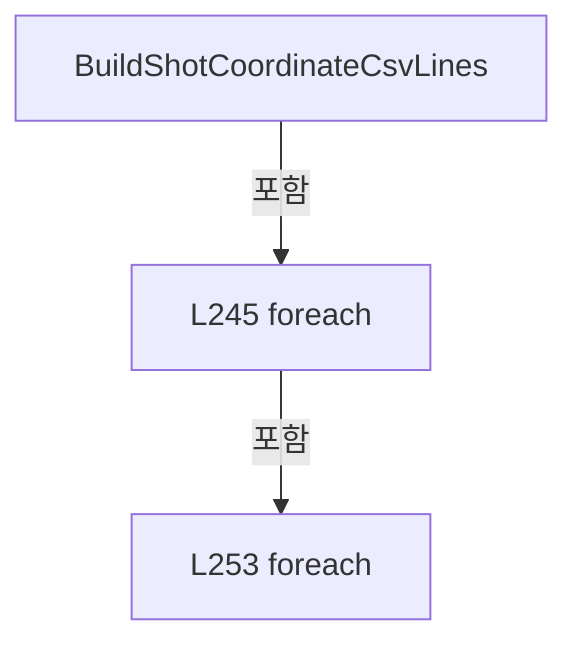

변경 전 점검: 입력/반환 타입, 위 호출자, 예외/취소 경로, 공유 상태와 저장·전송 소비자를 함께 확인합니다. 값의 단위나 물리 방향을 이름만으로 확정하지 않습니다.

### MethodDeclaration `ShotCellNo` · L326–329

[Drilling.File/Script/CAutomation1ScriptFile.cs:326–329](https://github.com/kjuws10-rgb/A3Drilling/blob/5aee8e58439c9b455cae7c9593c9be986c3e682e/Drilling.File/Script/CAutomation1ScriptFile.cs#L326-L329)

| 항목 | 실제 추출 값 |
| --- | --- |
| 서명 | int Drilling.File.Script.CAutomation1ScriptFile.ShotCellNo(Drilling.Common.Recipe.ST_HEAD_SHOT_POINT) |
| 접근/수식자 | Private / private, static |
| 반환/값 타입 | int |
| 소속 타입 | NamedType:Drilling.File.Script.CAutomation1ScriptFile |

입력 계약:

| 이름 | 타입 | 전달 | 선택/기본값 |
| --- | --- | --- | --- |
| point | Drilling.Common.Recipe.ST_HEAD_SHOT_POINT | None | False /  |

현재 부분 분석에서 직접 연결된 호출자는 없습니다. XAML/이벤트/인터페이스·델리게이트·외부 진입을 추가 확인해야 하며, 미사용으로 판정한 것이 아닙니다.

본문의 실제 연산·분기·예외·반환 순서(원문 위치 순):

| 원본 행 | 종류 | 주석 해설 |
| --- | --- | --- |
| 328 | return | 호출자에게 값 또는 제어를 반환합니다: return point.CellNo; |

변경 전 점검: 입력/반환 타입, 위 호출자, 예외/취소 경로, 공유 상태와 저장·전송 소비자를 함께 확인합니다. 값의 단위나 물리 방향을 이름만으로 확정하지 않습니다.

### MethodDeclaration `ShotRowNo` · L331–334

[Drilling.File/Script/CAutomation1ScriptFile.cs:331–334](https://github.com/kjuws10-rgb/A3Drilling/blob/5aee8e58439c9b455cae7c9593c9be986c3e682e/Drilling.File/Script/CAutomation1ScriptFile.cs#L331-L334)

| 항목 | 실제 추출 값 |
| --- | --- |
| 서명 | int Drilling.File.Script.CAutomation1ScriptFile.ShotRowNo(Drilling.Common.Recipe.ST_HEAD_SHOT_POINT) |
| 접근/수식자 | Private / private, static |
| 반환/값 타입 | int |
| 소속 타입 | NamedType:Drilling.File.Script.CAutomation1ScriptFile |

입력 계약:

| 이름 | 타입 | 전달 | 선택/기본값 |
| --- | --- | --- | --- |
| point | Drilling.Common.Recipe.ST_HEAD_SHOT_POINT | None | False /  |

현재 부분 분석에서 직접 연결된 호출자는 없습니다. XAML/이벤트/인터페이스·델리게이트·외부 진입을 추가 확인해야 하며, 미사용으로 판정한 것이 아닙니다.

본문의 실제 연산·분기·예외·반환 순서(원문 위치 순):

| 원본 행 | 종류 | 주석 해설 |
| --- | --- | --- |
| 333 | return | 호출자에게 값 또는 제어를 반환합니다: return point.GroupRow; |

변경 전 점검: 입력/반환 타입, 위 호출자, 예외/취소 경로, 공유 상태와 저장·전송 소비자를 함께 확인합니다. 값의 단위나 물리 방향을 이름만으로 확정하지 않습니다.

### MethodDeclaration `ShotColumnNo` · L336–339

[Drilling.File/Script/CAutomation1ScriptFile.cs:336–339](https://github.com/kjuws10-rgb/A3Drilling/blob/5aee8e58439c9b455cae7c9593c9be986c3e682e/Drilling.File/Script/CAutomation1ScriptFile.cs#L336-L339)

| 항목 | 실제 추출 값 |
| --- | --- |
| 서명 | int Drilling.File.Script.CAutomation1ScriptFile.ShotColumnNo(Drilling.Common.Recipe.ST_HEAD_SHOT_POINT) |
| 접근/수식자 | Private / private, static |
| 반환/값 타입 | int |
| 소속 타입 | NamedType:Drilling.File.Script.CAutomation1ScriptFile |

입력 계약:

| 이름 | 타입 | 전달 | 선택/기본값 |
| --- | --- | --- | --- |
| point | Drilling.Common.Recipe.ST_HEAD_SHOT_POINT | None | False /  |

현재 부분 분석에서 직접 연결된 호출자는 없습니다. XAML/이벤트/인터페이스·델리게이트·외부 진입을 추가 확인해야 하며, 미사용으로 판정한 것이 아닙니다.

본문의 실제 연산·분기·예외·반환 순서(원문 위치 순):

| 원본 행 | 종류 | 주석 해설 |
| --- | --- | --- |
| 338 | return | 호출자에게 값 또는 제어를 반환합니다: return point.GroupColumn; |

변경 전 점검: 입력/반환 타입, 위 호출자, 예외/취소 경로, 공유 상태와 저장·전송 소비자를 함께 확인합니다. 값의 단위나 물리 방향을 이름만으로 확정하지 않습니다.

### MethodDeclaration `ShotHeadNo` · L341–344

[Drilling.File/Script/CAutomation1ScriptFile.cs:341–344](https://github.com/kjuws10-rgb/A3Drilling/blob/5aee8e58439c9b455cae7c9593c9be986c3e682e/Drilling.File/Script/CAutomation1ScriptFile.cs#L341-L344)

| 항목 | 실제 추출 값 |
| --- | --- |
| 서명 | int Drilling.File.Script.CAutomation1ScriptFile.ShotHeadNo(Drilling.Common.Recipe.ST_HEAD_SHOT_POINT) |
| 접근/수식자 | Private / private, static |
| 반환/값 타입 | int |
| 소속 타입 | NamedType:Drilling.File.Script.CAutomation1ScriptFile |

입력 계약:

| 이름 | 타입 | 전달 | 선택/기본값 |
| --- | --- | --- | --- |
| point | Drilling.Common.Recipe.ST_HEAD_SHOT_POINT | None | False /  |

현재 부분 분석에서 직접 연결된 호출자는 없습니다. XAML/이벤트/인터페이스·델리게이트·외부 진입을 추가 확인해야 하며, 미사용으로 판정한 것이 아닙니다.

본문의 실제 연산·분기·예외·반환 순서(원문 위치 순):

| 원본 행 | 종류 | 주석 해설 |
| --- | --- | --- |
| 343 | return | 호출자에게 값 또는 제어를 반환합니다: return point.HeadNo; |

변경 전 점검: 입력/반환 타입, 위 호출자, 예외/취소 경로, 공유 상태와 저장·전송 소비자를 함께 확인합니다. 값의 단위나 물리 방향을 이름만으로 확정하지 않습니다.

### MethodDeclaration `ReadParameterText` · L346–351

[Drilling.File/Script/CAutomation1ScriptFile.cs:346–351](https://github.com/kjuws10-rgb/A3Drilling/blob/5aee8e58439c9b455cae7c9593c9be986c3e682e/Drilling.File/Script/CAutomation1ScriptFile.cs#L346-L351)

| 항목 | 실제 추출 값 |
| --- | --- |
| 서명 | string Drilling.File.Script.CAutomation1ScriptFile.ReadParameterText(System.Collections.Generic.IReadOnlyDictionary<string, string>, string, string) |
| 접근/수식자 | Private / private, static |
| 반환/값 타입 | string |
| 소속 타입 | NamedType:Drilling.File.Script.CAutomation1ScriptFile |

입력 계약:

| 이름 | 타입 | 전달 | 선택/기본값 |
| --- | --- | --- | --- |
| parameters | System.Collections.Generic.IReadOnlyDictionary<string, string> | None | False /  |
| key | string | None | False /  |
| defaultValue | string | None | False /  |

정적 호출자로 확인된 위치:

| 호출 파일/행 | 호출 표현식 | 런타임 분기 가능 |
| --- | --- | --- |
| [Drilling.File/Script/CAutomation1ScriptFile.cs:367–367](https://github.com/kjuws10-rgb/A3Drilling/blob/5aee8e58439c9b455cae7c9593c9be986c3e682e/Drilling.File/Script/CAutomation1ScriptFile.cs#L367-L367) | ReadParameterText | False |
| [Drilling.File/Script/CAutomation1ScriptFile.cs:368–368](https://github.com/kjuws10-rgb/A3Drilling/blob/5aee8e58439c9b455cae7c9593c9be986c3e682e/Drilling.File/Script/CAutomation1ScriptFile.cs#L368-L368) | ReadParameterText | False |

호출하는 대상과 해석 범위:

| 원본 행 | 표현식 | 분석 상태 | 대상/소스 위치 |
| --- | --- | --- | --- |
| 348 | parameters.TryGetValue | resolved · 동적 구현 선택 가능 | bool System.Collections.Generic.IReadOnlyDictionary<string, string>.TryGetValue(string, out string) |
| 348 | string.IsNullOrWhiteSpace | resolved | bool string.IsNullOrWhiteSpace(string?) |

본문의 실제 연산·분기·예외·반환 순서(원문 위치 순):

| 원본 행 | 종류 | 주석 해설 |
| --- | --- | --- |
| 348 | call | 함수·델리게이트 또는 객체 생성자를 호출합니다: parameters.TryGetValue(key, out var value) |
| 348 | call | 함수·델리게이트 또는 객체 생성자를 호출합니다: string.IsNullOrWhiteSpace(value) |
| 348 | conditional-expression | 조건에 따라 결과식을 선택합니다: parameters.TryGetValue(key, out var value) && !string.IsNullOrWhiteSpace(value) ? value : defaultValue |
| 348 | return | 호출자에게 값 또는 제어를 반환합니다: return parameters.TryGetValue(key, out var value) && !string.IsNullOrWhiteSpace(value) ? value : defaultValue; |

변경 전 점검: 입력/반환 타입, 위 호출자, 예외/취소 경로, 공유 상태와 저장·전송 소비자를 함께 확인합니다. 값의 단위나 물리 방향을 이름만으로 확정하지 않습니다.

### MethodDeclaration `BuildCoordinateListLines` · L353–387

[Drilling.File/Script/CAutomation1ScriptFile.cs:353–387](https://github.com/kjuws10-rgb/A3Drilling/blob/5aee8e58439c9b455cae7c9593c9be986c3e682e/Drilling.File/Script/CAutomation1ScriptFile.cs#L353-L387)

| 항목 | 실제 추출 값 |
| --- | --- |
| 서명 | System.Collections.Generic.IReadOnlyList<string> Drilling.File.Script.CAutomation1ScriptFile.BuildCoordinateListLines(Drilling.Common.Station.ST_PROCESS_MODEL, System.DateTimeOffset, System.Collections.Generic.IReadOnlyList<Drilling.Common.Station.ST_HEAD_PROCESS_PLAN>, System.Collections.Generic.IReadOnlyList<Drilling.Common.Station.ST_HEAD_SCRIPT_RESULT>) |
| 접근/수식자 | Private / private, static |
| 반환/값 타입 | System.Collections.Generic.IReadOnlyList<string> |
| 소속 타입 | NamedType:Drilling.File.Script.CAutomation1ScriptFile |

입력 계약:

| 이름 | 타입 | 전달 | 선택/기본값 |
| --- | --- | --- | --- |
| processModel | Drilling.Common.Station.ST_PROCESS_MODEL | None | False /  |
| createdAt | System.DateTimeOffset | None | False /  |
| activeHeads | System.Collections.Generic.IReadOnlyList<Drilling.Common.Station.ST_HEAD_PROCESS_PLAN> | None | False /  |
| headScripts | System.Collections.Generic.IReadOnlyList<Drilling.Common.Station.ST_HEAD_SCRIPT_RESULT> | None | False /  |

정적 호출자로 확인된 위치:

| 호출 파일/행 | 호출 표현식 | 런타임 분기 가능 |
| --- | --- | --- |
| [Drilling.File/Script/CAutomation1ScriptFile.cs:97–97](https://github.com/kjuws10-rgb/A3Drilling/blob/5aee8e58439c9b455cae7c9593c9be986c3e682e/Drilling.File/Script/CAutomation1ScriptFile.cs#L97-L97) | BuildCoordinateListLines | False |

호출하는 대상과 해석 범위:

| 원본 행 | 표현식 | 분석 상태 | 대상/소스 위치 |
| --- | --- | --- | --- |
| 355 | new List<string> | resolved | System.Collections.Generic.List<string>.List() |
| 361 | headScripts.ToDictionary | resolved | System.Collections.Generic.Dictionary<int, Drilling.Common.Station.ST_HEAD_SCRIPT_RESULT> System.Collections.Generic.IEnumerable<Drilling.Common.Station.ST_HEAD_SCRIPT_RESULT>.ToDictionary<Drilling.Common.Station.ST_HEAD_SCRIPT_RESULT, int>(System.Func<Drilling.Common.Station.ST_HEAD_SCRIPT_RESULT, int>) |
| 362 | lines.Add | resolved | void System.Collections.Generic.List<string>.Add(string) |
| 363 | lines.Add | resolved | void System.Collections.Generic.List<string>.Add(string) |
| 364 | lines.Add | resolved | void System.Collections.Generic.List<string>.Add(string) |
| 365 | lines.Add | resolved | void System.Collections.Generic.List<string>.Add(string) |
| 366 | lines.Add | resolved | void System.Collections.Generic.List<string>.Add(string) |
| 367 | lines.Add | resolved | void System.Collections.Generic.List<string>.Add(string) |
| 367 | ReadParameterText | resolved | string Drilling.File.Script.CAutomation1ScriptFile.ReadParameterText(System.Collections.Generic.IReadOnlyDictionary<string, string>, string, string) · Drilling.File/Script/CAutomation1ScriptFile.cs:346 |
| 368 | lines.Add | resolved | void System.Collections.Generic.List<string>.Add(string) |
| 368 | ReadParameterText | resolved | string Drilling.File.Script.CAutomation1ScriptFile.ReadParameterText(System.Collections.Generic.IReadOnlyDictionary<string, string>, string, string) · Drilling.File/Script/CAutomation1ScriptFile.cs:346 |
| 374 | lines.Add | resolved | void System.Collections.Generic.List<string>.Add(string) |
| 374 | headScripts.Sum | resolved | int System.Collections.Generic.IEnumerable<Drilling.Common.Station.ST_HEAD_SCRIPT_RESULT>.Sum<Drilling.Common.Station.ST_HEAD_SCRIPT_RESULT>(System.Func<Drilling.Common.Station.ST_HEAD_SCRIPT_RESULT, int>) |
| 375 | lines.Add | resolved | void System.Collections.Generic.List<string>.Add(string) |
| 376 | lines.Add | resolved | void System.Collections.Generic.List<string>.Add(string) |
| 380 | lines.Add | resolved | void System.Collections.Generic.List<string>.Add(string) |
| 381 | lines.Add | resolved | void System.Collections.Generic.List<string>.Add(string) |
| 382 | AppendHeadShotList | resolved | void Drilling.File.Script.CAutomation1ScriptFile.AppendHeadShotList(System.Collections.Generic.List<string>, Drilling.Common.Station.ST_HEAD_PROCESS_PLAN) · Drilling.File/Script/CAutomation1ScriptFile.cs:967 |
| 383 | lines.Add | resolved | void System.Collections.Generic.List<string>.Add(string) |

본문의 실제 연산·분기·예외·반환 순서(원문 위치 순):

| 원본 행 | 종류 | 주석 해설 |
| --- | --- | --- |
| 355 | call | 함수·델리게이트 또는 객체 생성자를 호출합니다: new List<string>() |
| 355 | local-declaration | 지역 변수를 선언합니다: var lines = new List<string>(); |
| 355 | variable-initializer | 변수의 초기값을 지정합니다: lines = new List<string>() |
| 361 | call | 함수·델리게이트 또는 객체 생성자를 호출합니다: headScripts.ToDictionary(SelectHeadNo) |
| 361 | local-declaration | 지역 변수를 선언합니다: var scriptByHead = headScripts.ToDictionary(SelectHeadNo); |
| 361 | variable-initializer | 변수의 초기값을 지정합니다: scriptByHead = headScripts.ToDictionary(SelectHeadNo) |
| 362 | call | 함수·델리게이트 또는 객체 생성자를 호출합니다: lines.Add("Laser Drilling Process Coordinate List") |
| 363 | call | 함수·델리게이트 또는 객체 생성자를 호출합니다: lines.Add($"ProcessId={processModel.ProcessId}") |
| 364 | call | 함수·델리게이트 또는 객체 생성자를 호출합니다: lines.Add($"RecipeId={processModel.RecipeId}") |
| 365 | call | 함수·델리게이트 또는 객체 생성자를 호출합니다: lines.Add($"GlassId={processModel.GlassId}") |
| 366 | call | 함수·델리게이트 또는 객체 생성자를 호출합니다: lines.Add($"CreatedAt={createdAt:yyyy-MM-dd HH:mm:ss.fff zzz}") |
| 367 | call | 함수·델리게이트 또는 객체 생성자를 호출합니다: lines.Add($"ShiftOffsetX={ReadParameterText(processModel.Parameters, "SHIFT_OFFSET_X", "0")}") |
| 367 | call | 함수·델리게이트 또는 객체 생성자를 호출합니다: ReadParameterText(processModel.Parameters, "SHIFT_OFFSET_X", "0") |
| 368 | call | 함수·델리게이트 또는 객체 생성자를 호출합니다: lines.Add($"ShiftOffsetY={ReadParameterText(processModel.Parameters, "SHIFT_OFFSET_Y", "0")}") |
| 368 | call | 함수·델리게이트 또는 객체 생성자를 호출합니다: ReadParameterText(processModel.Parameters, "SHIFT_OFFSET_Y", "0") |
| 374 | call | 함수·델리게이트 또는 객체 생성자를 호출합니다: lines.Add($"TotalShots={headScripts.Sum(SelectTotalShots)}") |
| 374 | call | 함수·델리게이트 또는 객체 생성자를 호출합니다: headScripts.Sum(SelectTotalShots) |
| 375 | call | 함수·델리게이트 또는 객체 생성자를 호출합니다: lines.Add($"HeadScriptCount={headScripts.Count}") |
| 376 | call | 함수·델리게이트 또는 객체 생성자를 호출합니다: lines.Add("") |
| 377 | foreach | 컬렉션 요소를 순회합니다: foreach (var head in activeHeads) |
| 379 | local-declaration | 지역 변수를 선언합니다: var script = scriptByHead[head.HeadNo]; |
| 379 | variable-initializer | 변수의 초기값을 지정합니다: script = scriptByHead[head.HeadNo] |
| 380 | call | 함수·델리게이트 또는 객체 생성자를 호출합니다: lines.Add($"[H{head.HeadNo:00}]") |
| 381 | call | 함수·델리게이트 또는 객체 생성자를 호출합니다: lines.Add($"Automation={script.AutomationNo} Task={script.TaskNo} Script={script.FileName} Shots={script.TotalShots}") |
| 382 | call | 함수·델리게이트 또는 객체 생성자를 호출합니다: AppendHeadShotList(lines, head) |
| 383 | call | 함수·델리게이트 또는 객체 생성자를 호출합니다: lines.Add("") |
| 386 | return | 호출자에게 값 또는 제어를 반환합니다: return lines; |

제어 구문의 포함 구조(실제 실행 순서/CFG가 아닌 구문 탐색 그림):

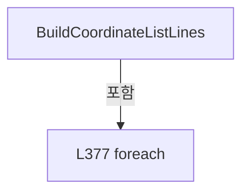

변경 전 점검: 입력/반환 타입, 위 호출자, 예외/취소 경로, 공유 상태와 저장·전송 소비자를 함께 확인합니다. 값의 단위나 물리 방향을 이름만으로 확정하지 않습니다.

### LocalFunctionStatement `SelectHeadNo` · L356–359

[Drilling.File/Script/CAutomation1ScriptFile.cs:356–359](https://github.com/kjuws10-rgb/A3Drilling/blob/5aee8e58439c9b455cae7c9593c9be986c3e682e/Drilling.File/Script/CAutomation1ScriptFile.cs#L356-L359)

| 항목 | 실제 추출 값 |
| --- | --- |
| 서명 | int SelectHeadNo(Drilling.Common.Station.ST_HEAD_SCRIPT_RESULT) |
| 접근/수식자 | Private /  |
| 반환/값 타입 | int |
| 소속 타입 | NamedType:Drilling.File.Script.CAutomation1ScriptFile |

입력 계약:

| 이름 | 타입 | 전달 | 선택/기본값 |
| --- | --- | --- | --- |
| script | Drilling.Common.Station.ST_HEAD_SCRIPT_RESULT | None | False /  |

현재 부분 분석에서 직접 연결된 호출자는 없습니다. XAML/이벤트/인터페이스·델리게이트·외부 진입을 추가 확인해야 하며, 미사용으로 판정한 것이 아닙니다.

본문의 실제 연산·분기·예외·반환 순서(원문 위치 순):

| 원본 행 | 종류 | 주석 해설 |
| --- | --- | --- |
| 358 | return | 호출자에게 값 또는 제어를 반환합니다: return script.HeadNo; |

변경 전 점검: 입력/반환 타입, 위 호출자, 예외/취소 경로, 공유 상태와 저장·전송 소비자를 함께 확인합니다. 값의 단위나 물리 방향을 이름만으로 확정하지 않습니다.

### LocalFunctionStatement `SelectTotalShots` · L369–372

[Drilling.File/Script/CAutomation1ScriptFile.cs:369–372](https://github.com/kjuws10-rgb/A3Drilling/blob/5aee8e58439c9b455cae7c9593c9be986c3e682e/Drilling.File/Script/CAutomation1ScriptFile.cs#L369-L372)

| 항목 | 실제 추출 값 |
| --- | --- |
| 서명 | int SelectTotalShots(Drilling.Common.Station.ST_HEAD_SCRIPT_RESULT) |
| 접근/수식자 | Private /  |
| 반환/값 타입 | int |
| 소속 타입 | NamedType:Drilling.File.Script.CAutomation1ScriptFile |

입력 계약:

| 이름 | 타입 | 전달 | 선택/기본값 |
| --- | --- | --- | --- |
| script | Drilling.Common.Station.ST_HEAD_SCRIPT_RESULT | None | False /  |

현재 부분 분석에서 직접 연결된 호출자는 없습니다. XAML/이벤트/인터페이스·델리게이트·외부 진입을 추가 확인해야 하며, 미사용으로 판정한 것이 아닙니다.

본문의 실제 연산·분기·예외·반환 순서(원문 위치 순):

| 원본 행 | 종류 | 주석 해설 |
| --- | --- | --- |
| 371 | return | 호출자에게 값 또는 제어를 반환합니다: return script.TotalShots; |

변경 전 점검: 입력/반환 타입, 위 호출자, 예외/취소 경로, 공유 상태와 저장·전송 소비자를 함께 확인합니다. 값의 단위나 물리 방향을 이름만으로 확정하지 않습니다.

### MethodDeclaration `BuildHeadLines` · L389–580

[Drilling.File/Script/CAutomation1ScriptFile.cs:389–580](https://github.com/kjuws10-rgb/A3Drilling/blob/5aee8e58439c9b455cae7c9593c9be986c3e682e/Drilling.File/Script/CAutomation1ScriptFile.cs#L389-L580)

| 항목 | 실제 추출 값 |
| --- | --- |
| 서명 | System.Collections.Generic.IReadOnlyList<string> Drilling.File.Script.CAutomation1ScriptFile.BuildHeadLines(Drilling.Common.Station.ST_PROCESS_MODEL, Drilling.Common.Station.ST_HEAD_PROCESS_PLAN, System.DateTimeOffset, bool, long) |
| 접근/수식자 | Private / private, static |
| 반환/값 타입 | System.Collections.Generic.IReadOnlyList<string> |
| 소속 타입 | NamedType:Drilling.File.Script.CAutomation1ScriptFile |

입력 계약:

| 이름 | 타입 | 전달 | 선택/기본값 |
| --- | --- | --- | --- |
| processModel | Drilling.Common.Station.ST_PROCESS_MODEL | None | False /  |
| head | Drilling.Common.Station.ST_HEAD_PROCESS_PLAN | None | False /  |
| createdAt | System.DateTimeOffset | None | False /  |
| bufferedRun | bool | None | False /  |
| readyRunId | long | None | False /  |

정적 호출자로 확인된 위치:

| 호출 파일/행 | 호출 표현식 | 런타임 분기 가능 |
| --- | --- | --- |
| [Drilling.File/Script/CAutomation1ScriptFile.cs:91–91](https://github.com/kjuws10-rgb/A3Drilling/blob/5aee8e58439c9b455cae7c9593c9be986c3e682e/Drilling.File/Script/CAutomation1ScriptFile.cs#L91-L91) | BuildHeadLines | False |

호출하는 대상과 해석 범위:

| 원본 행 | 표현식 | 분석 상태 | 대상/소스 위치 |
| --- | --- | --- | --- |
| 391 | new List<string> | resolved | System.Collections.Generic.List<string>.List() |
| 392 | new Dictionary<string, string> | resolved | System.Collections.Generic.Dictionary<string, string>.Dictionary(System.Collections.Generic.IEnumerable<System.Collections.Generic.KeyValuePair<string, string>>, System.Collections.Generic.IEqualityComparer<string>?) |
| 393 | ReadBool | resolved | bool Drilling.File.Script.CAutomation1ScriptFile.ReadBool(System.Collections.Generic.IReadOnlyDictionary<string, string>, bool, params string[]) · Drilling.File/Script/CAutomation1ScriptFile.cs:1240 |
| 394 | ReadText | resolved | string Drilling.File.Script.CAutomation1ScriptFile.ReadText(System.Collections.Generic.IReadOnlyDictionary<string, string>, string, System.Collections.Generic.IEnumerable<string>) · Drilling.File/Script/CAutomation1ScriptFile.cs:1137 |
| 394 | CreateHeadKeys | resolved | System.Collections.Generic.IReadOnlyList<string> Drilling.File.Script.CAutomation1ScriptFile.CreateHeadKeys(int, params string[]) · Drilling.File/Script/CAutomation1ScriptFile.cs:1100 |
| 395 | ValidateAeroScriptAxisName | resolved | string Drilling.File.Script.CAutomation1ScriptFile.ValidateAeroScriptAxisName(string, string) · Drilling.File/Script/CAutomation1ScriptFile.cs:1350 |
| 396 | ReadText | resolved | string Drilling.File.Script.CAutomation1ScriptFile.ReadText(System.Collections.Generic.IReadOnlyDictionary<string, string>, string, System.Collections.Generic.IEnumerable<string>) · Drilling.File/Script/CAutomation1ScriptFile.cs:1137 |
| 396 | CreateHeadKeys | resolved | System.Collections.Generic.IReadOnlyList<string> Drilling.File.Script.CAutomation1ScriptFile.CreateHeadKeys(int, params string[]) · Drilling.File/Script/CAutomation1ScriptFile.cs:1100 |
| 397 | ValidateAeroScriptAxisName | resolved | string Drilling.File.Script.CAutomation1ScriptFile.ValidateAeroScriptAxisName(string, string) · Drilling.File/Script/CAutomation1ScriptFile.cs:1350 |
| 398 | ReadText | resolved | string Drilling.File.Script.CAutomation1ScriptFile.ReadText(System.Collections.Generic.IReadOnlyDictionary<string, string>, string, System.Collections.Generic.IEnumerable<string>) · Drilling.File/Script/CAutomation1ScriptFile.cs:1137 |
| 398 | CreateHeadKeys | resolved | System.Collections.Generic.IReadOnlyList<string> Drilling.File.Script.CAutomation1ScriptFile.CreateHeadKeys(int, params string[]) · Drilling.File/Script/CAutomation1ScriptFile.cs:1100 |
| 401 | ValidateAeroScriptAxisName | resolved | string Drilling.File.Script.CAutomation1ScriptFile.ValidateAeroScriptAxisName(string, string) · Drilling.File/Script/CAutomation1ScriptFile.cs:1350 |
| 404 | ReadText | resolved | string Drilling.File.Script.CAutomation1ScriptFile.ReadText(System.Collections.Generic.IReadOnlyDictionary<string, string>, string, System.Collections.Generic.IEnumerable<string>) · Drilling.File/Script/CAutomation1ScriptFile.cs:1137 |
| 404 | CreateHeadKeys | resolved | System.Collections.Generic.IReadOnlyList<string> Drilling.File.Script.CAutomation1ScriptFile.CreateHeadKeys(int, params string[]) · Drilling.File/Script/CAutomation1ScriptFile.cs:1100 |
| 407 | ValidateAeroScriptAxisName | resolved | string Drilling.File.Script.CAutomation1ScriptFile.ValidateAeroScriptAxisName(string, string) · Drilling.File/Script/CAutomation1ScriptFile.cs:1350 |
| 410 | CreateEncoderScaleKeys | resolved | System.Collections.Generic.IReadOnlyList<string> Drilling.File.Script.CAutomation1ScriptFile.CreateEncoderScaleKeys(int) · Drilling.File/Script/CAutomation1ScriptFile.cs:1110 |
| 411 | ResolveParameterName | resolved | string Drilling.File.Script.CAutomation1ScriptFile.ResolveParameterName(System.Collections.Generic.IReadOnlyDictionary<string, string>, System.Collections.Generic.IEnumerable<string>, string) · Drilling.File/Script/CAutomation1ScriptFile.cs:1124 |
| 412 | ReadDouble | resolved | double Drilling.File.Script.CAutomation1ScriptFile.ReadDouble(System.Collections.Generic.IReadOnlyDictionary<string, string>, double, System.Collections.Generic.IEnumerable<string>) · Drilling.File/Script/CAutomation1ScriptFile.cs:1160 |
| 415 | ValidateEncoderScale | resolved | void Drilling.File.Script.CAutomation1ScriptFile.ValidateEncoderScale(string, double) · Drilling.File/Script/CAutomation1ScriptFile.cs:1334 |
| 418 | ReadOnOff | resolved | bool Drilling.File.Script.CAutomation1ScriptFile.ReadOnOff(System.Collections.Generic.IReadOnlyDictionary<string, string>, bool, System.Collections.Generic.IEnumerable<string>) · Drilling.File/Script/CAutomation1ScriptFile.cs:1178 |
| 418 | CreateEncoderFeedbackFlipKeys | resolved | System.Collections.Generic.IReadOnlyList<string> Drilling.File.Script.CAutomation1ScriptFile.CreateEncoderFeedbackFlipKeys(int) · Drilling.File/Script/CAutomation1ScriptFile.cs:1117 |
| 419 | ResolveCoordinatedRampRate | resolved | double Drilling.File.Script.CAutomation1ScriptFile.ResolveCoordinatedRampRate(double, double) · Drilling.File/Script/CAutomation1ScriptFile.cs:1060 |
| 420 | ReadInt | resolved | int Drilling.File.Script.CAutomation1ScriptFile.ReadInt(System.Collections.Generic.IReadOnlyDictionary<string, string>, int, params string[]) · Drilling.File/Script/CAutomation1ScriptFile.cs:1217 |
| 421 | ReadInt | resolved | int Drilling.File.Script.CAutomation1ScriptFile.ReadInt(System.Collections.Generic.IReadOnlyDictionary<string, string>, int, params string[]) · Drilling.File/Script/CAutomation1ScriptFile.cs:1217 |
| 422 | ReadDelaySeconds | resolved | double Drilling.File.Script.CAutomation1ScriptFile.ReadDelaySeconds(System.Collections.Generic.IReadOnlyDictionary<string, string>, double, params string[]) · Drilling.File/Script/CAutomation1ScriptFile.cs:1080 |
| 423 | ReadDouble | resolved | double Drilling.File.Script.CAutomation1ScriptFile.ReadDouble(System.Collections.Generic.IReadOnlyDictionary<string, string>, double, params string[]) · Drilling.File/Script/CAutomation1ScriptFile.cs:1155 |
| 424 | CalculateLaserPeriod | resolved | double Drilling.File.Script.CAutomation1ScriptFile.CalculateLaserPeriod(double) · Drilling.File/Script/CAutomation1ScriptFile.cs:1034 |
| 425 | CalculateShotDelaySeconds | resolved | double Drilling.File.Script.CAutomation1ScriptFile.CalculateShotDelaySeconds(int, double) · Drilling.File/Script/CAutomation1ScriptFile.cs:1039 |
| 426 | ReadDouble | resolved | double Drilling.File.Script.CAutomation1ScriptFile.ReadDouble(System.Collections.Generic.IReadOnlyDictionary<string, string>, double, System.Collections.Generic.IEnumerable<string>) · Drilling.File/Script/CAutomation1ScriptFile.cs:1160 |
| 426 | CreateHeadKeys | resolved | System.Collections.Generic.IReadOnlyList<string> Drilling.File.Script.CAutomation1ScriptFile.CreateHeadKeys(int, params string[]) · Drilling.File/Script/CAutomation1ScriptFile.cs:1100 |
| 427 | ReadDouble | resolved | double Drilling.File.Script.CAutomation1ScriptFile.ReadDouble(System.Collections.Generic.IReadOnlyDictionary<string, string>, double, System.Collections.Generic.IEnumerable<string>) · Drilling.File/Script/CAutomation1ScriptFile.cs:1160 |
| 427 | CreateHeadKeys | resolved | System.Collections.Generic.IReadOnlyList<string> Drilling.File.Script.CAutomation1ScriptFile.CreateHeadKeys(int, params string[]) · Drilling.File/Script/CAutomation1ScriptFile.cs:1100 |
| 428 | ReadBool | resolved | bool Drilling.File.Script.CAutomation1ScriptFile.ReadBool(System.Collections.Generic.IReadOnlyDictionary<string, string>, bool, params string[]) · Drilling.File/Script/CAutomation1ScriptFile.cs:1240 |
| 429 | Math.Abs | resolved | double System.Math.Abs(double) |
| 429 | ReadDouble | resolved | double Drilling.File.Script.CAutomation1ScriptFile.ReadDouble(System.Collections.Generic.IReadOnlyDictionary<string, string>, double, params string[]) · Drilling.File/Script/CAutomation1ScriptFile.cs:1155 |
| 430 | ResolveMachiningAxis | resolved | Drilling.File.Script.CAutomation1ScriptFile.EN_SCRIPT_FOLLOW_AXIS Drilling.File.Script.CAutomation1ScriptFile.ResolveMachiningAxis(System.Collections.Generic.IReadOnlyList<Drilling.Common.Recipe.ST_HEAD_SHOT_POINT>, bool) · Drilling.File/Script/CAutomation1ScriptFile.cs:582 |
| 431 | ReadHeadScanFieldHalfWidth | resolved | double Drilling.File.Script.CAutomation1ScriptFile.ReadHeadScanFieldHalfWidth(System.Collections.Generic.IReadOnlyDictionary<string, string>, int) · Drilling.File/Script/CAutomation1ScriptFile.cs:690 |
| 432 | lines.Add | resolved | void System.Collections.Generic.List<string>.Add(string) |
| 433 | lines.Add | resolved | void System.Collections.Generic.List<string>.Add(string) |
| 434 | lines.Add | resolved | void System.Collections.Generic.List<string>.Add(string) |
| 435 | lines.Add | resolved | void System.Collections.Generic.List<string>.Add(string) |
| 436 | lines.Add | resolved | void System.Collections.Generic.List<string>.Add(string) |
| 437 | CMofReadiness.VariableIndex | resolved | int Drilling.Common.Automation.CMofReadiness.VariableIndex(int) · Drilling.Common/Automation/CAutomationManager.cs:1763 |
| 438 | lines.Add | resolved | void System.Collections.Generic.List<string>.Add(string) |
| 438 | readyRunId.ToString | resolved | string long.ToString(System.IFormatProvider?) |
| 439 | lines.Add | resolved | void System.Collections.Generic.List<string>.Add(string) |
| 440 | lines.Add | resolved | void System.Collections.Generic.List<string>.Add(string) |
| 441 | lines.Add | resolved | void System.Collections.Generic.List<string>.Add(string) |
| 441 | Format | resolved | string Drilling.File.Script.CAutomation1ScriptFile.Format(double) · Drilling.File/Script/CAutomation1ScriptFile.cs:1283 |
| 441 | Format | resolved | string Drilling.File.Script.CAutomation1ScriptFile.Format(double) · Drilling.File/Script/CAutomation1ScriptFile.cs:1283 |
| 444 | lines.Add | resolved | void System.Collections.Generic.List<string>.Add(string) |
| 444 | Format | resolved | string Drilling.File.Script.CAutomation1ScriptFile.Format(double) · Drilling.File/Script/CAutomation1ScriptFile.cs:1283 |
| 449 | lines.Add | resolved | void System.Collections.Generic.List<string>.Add(string) |
| 454 | lines.Add | resolved | void System.Collections.Generic.List<string>.Add(string) |
| 457 | lines.Add | resolved | void System.Collections.Generic.List<string>.Add(string) |
| 458 | lines.Add | resolved | void System.Collections.Generic.List<string>.Add(string) |
| 459 | lines.Add | resolved | void System.Collections.Generic.List<string>.Add(string) |
| 460 | lines.Add | resolved | void System.Collections.Generic.List<string>.Add(string) |
| 461 | lines.Add | resolved | void System.Collections.Generic.List<string>.Add(string) |
| 462 | lines.Add | resolved | void System.Collections.Generic.List<string>.Add(string) |
| 463 | lines.Add | resolved | void System.Collections.Generic.List<string>.Add(string) |
| 466 | lines.Add | resolved | void System.Collections.Generic.List<string>.Add(string) |
| 467 | lines.Add | resolved | void System.Collections.Generic.List<string>.Add(string) |
| 468 | lines.Add | resolved | void System.Collections.Generic.List<string>.Add(string) |
| 471 | lines.Add | resolved | void System.Collections.Generic.List<string>.Add(string) |
| 472 | lines.Add | resolved | void System.Collections.Generic.List<string>.Add(string) |
| 475 | lines.Add | resolved | void System.Collections.Generic.List<string>.Add(string) |
| 478 | lines.Add | resolved | void System.Collections.Generic.List<string>.Add(string) |
| 478 | Format | resolved | string Drilling.File.Script.CAutomation1ScriptFile.Format(double) · Drilling.File/Script/CAutomation1ScriptFile.cs:1283 |
| 478 | Format | resolved | string Drilling.File.Script.CAutomation1ScriptFile.Format(double) · Drilling.File/Script/CAutomation1ScriptFile.cs:1283 |
| 479 | lines.Add | resolved | void System.Collections.Generic.List<string>.Add(string) |
| 480 | lines.Add | resolved | void System.Collections.Generic.List<string>.Add(string) |
| 480 | Format | resolved | string Drilling.File.Script.CAutomation1ScriptFile.Format(double) · Drilling.File/Script/CAutomation1ScriptFile.cs:1283 |
| 481 | lines.Add | resolved | void System.Collections.Generic.List<string>.Add(string) |
| 481 | Format | resolved | string Drilling.File.Script.CAutomation1ScriptFile.Format(double) · Drilling.File/Script/CAutomation1ScriptFile.cs:1283 |
| 482 | lines.Add | resolved | void System.Collections.Generic.List<string>.Add(string) |
| 483 | lines.Add | resolved | void System.Collections.Generic.List<string>.Add(string) |
| 483 | Format | resolved | string Drilling.File.Script.CAutomation1ScriptFile.Format(double) · Drilling.File/Script/CAutomation1ScriptFile.cs:1283 |
| 484 | lines.Add | resolved | void System.Collections.Generic.List<string>.Add(string) |
| 484 | Format | resolved | string Drilling.File.Script.CAutomation1ScriptFile.Format(double) · Drilling.File/Script/CAutomation1ScriptFile.cs:1283 |
| 484 | ToAutomationSpeed | resolved | double Drilling.File.Script.CAutomation1ScriptFile.ToAutomationSpeed(double) · Drilling.File/Script/CAutomation1ScriptFile.cs:1075 |
| 485 | lines.Add | resolved | void System.Collections.Generic.List<string>.Add(string) |
| 485 | Format | resolved | string Drilling.File.Script.CAutomation1ScriptFile.Format(double) · Drilling.File/Script/CAutomation1ScriptFile.cs:1283 |
| 485 | ToAutomationSpeed | resolved | double Drilling.File.Script.CAutomation1ScriptFile.ToAutomationSpeed(double) · Drilling.File/Script/CAutomation1ScriptFile.cs:1075 |
| 486 | lines.Add | resolved | void System.Collections.Generic.List<string>.Add(string) |
| 486 | Format | resolved | string Drilling.File.Script.CAutomation1ScriptFile.Format(double) · Drilling.File/Script/CAutomation1ScriptFile.cs:1283 |
| 486 | ToAutomationSpeed | resolved | double Drilling.File.Script.CAutomation1ScriptFile.ToAutomationSpeed(double) · Drilling.File/Script/CAutomation1ScriptFile.cs:1075 |
| 489 | lines.Add | resolved | void System.Collections.Generic.List<string>.Add(string) |
| 494 | lines.Add | resolved | void System.Collections.Generic.List<string>.Add(string) |
| 495 | lines.Add | resolved | void System.Collections.Generic.List<string>.Add(string) |
| 495 | Format | resolved | string Drilling.File.Script.CAutomation1ScriptFile.Format(double) · Drilling.File/Script/CAutomation1ScriptFile.cs:1283 |
| 497 | lines.Add | resolved | void System.Collections.Generic.List<string>.Add(string) |
| 497 | Format | resolved | string Drilling.File.Script.CAutomation1ScriptFile.Format(double) · Drilling.File/Script/CAutomation1ScriptFile.cs:1283 |
| 498 | lines.Add | resolved | void System.Collections.Generic.List<string>.Add(string) |
| 498 | Format | resolved | string Drilling.File.Script.CAutomation1ScriptFile.Format(double) · Drilling.File/Script/CAutomation1ScriptFile.cs:1283 |
| 499 | lines.Add | resolved | void System.Collections.Generic.List<string>.Add(string) |
| 499 | Format | resolved | string Drilling.File.Script.CAutomation1ScriptFile.Format(double) · Drilling.File/Script/CAutomation1ScriptFile.cs:1283 |
| 500 | lines.Add | resolved | void System.Collections.Generic.List<string>.Add(string) |
| 500 | Format | resolved | string Drilling.File.Script.CAutomation1ScriptFile.Format(double) · Drilling.File/Script/CAutomation1ScriptFile.cs:1283 |
| 502 | lines.Add | resolved | void System.Collections.Generic.List<string>.Add(string) |
| 502 | Format | resolved | string Drilling.File.Script.CAutomation1ScriptFile.Format(double) · Drilling.File/Script/CAutomation1ScriptFile.cs:1283 |
| 503 | lines.Add | resolved | void System.Collections.Generic.List<string>.Add(string) |
| 504 | lines.Add | resolved | void System.Collections.Generic.List<string>.Add(string) |
| 509 | lines.Add | resolved | void System.Collections.Generic.List<string>.Add(string) |
| 510 | lines.Add | resolved | void System.Collections.Generic.List<string>.Add(string) |
| 510 | readyRunId.ToString | resolved | string long.ToString(System.IFormatProvider?) |
| 512 | AppendStartFollowMoves | resolved | void Drilling.File.Script.CAutomation1ScriptFile.AppendStartFollowMoves(System.Collections.Generic.List<string>, System.Collections.Generic.IReadOnlyDictionary<string, string>, Drilling.Common.Station.ST_HEAD_PROCESS_PLAN, string, string, string, double, bool) · Drilling.File/Script/CAutomation1ScriptFile.cs:838 |
| 514 | CRecipeShotMaskingPlan.Build | resolved | Drilling.Common.Recipe.CRecipeShotMaskingPlan Drilling.Common.Recipe.CRecipeShotMaskingPlan.Build(System.Collections.Generic.IReadOnlyDictionary<string, string>) · Drilling.Common/Recipe/CShotCoordinatePlanBuilder.cs:813 |
| 519 | ReadScriptScannerY | resolved | double Drilling.File.Script.CAutomation1ScriptFile.ReadScriptScannerY(Drilling.Common.Recipe.ST_HEAD_SHOT_POINT, bool) · Drilling.File/Script/CAutomation1ScriptFile.cs:711 |
| 522 | AppendFollowTransitionMoves | resolved | void Drilling.File.Script.CAutomation1ScriptFile.AppendFollowTransitionMoves(System.Collections.Generic.List<string>, System.Collections.Generic.IReadOnlyDictionary<string, string>, Drilling.Common.Station.ST_HEAD_PROCESS_PLAN, string, string, string, bool, Drilling.Common.Recipe.ST_HEAD_SHOT_POINT, Drilling.Common.Recipe.ST_HEAD_SHOT_POINT) · Drilling.File/Script/CAutomation1ScriptFile.cs:886 |
| 525 | IsScanLineFirstShot | resolved | bool Drilling.File.Script.CAutomation1ScriptFile.IsScanLineFirstShot(Drilling.Common.Recipe.ST_HEAD_SHOT_POINT?, Drilling.Common.Recipe.ST_HEAD_SHOT_POINT) · Drilling.File/Script/CAutomation1ScriptFile.cs:623 |
| 527 | FindNextPointInSameScanLine | resolved | Drilling.Common.Recipe.ST_HEAD_SHOT_POINT? Drilling.File.Script.CAutomation1ScriptFile.FindNextPointInSameScanLine(System.Collections.Generic.IReadOnlyList<Drilling.Common.Recipe.ST_HEAD_SHOT_POINT>, int, Drilling.Common.Recipe.ST_HEAD_SHOT_POINT) · Drilling.File/Script/CAutomation1ScriptFile.cs:633 |
| 528 | ResolveLineMachiningAxis | resolved | Drilling.File.Script.CAutomation1ScriptFile.EN_SCRIPT_FOLLOW_AXIS Drilling.File.Script.CAutomation1ScriptFile.ResolveLineMachiningAxis(Drilling.Common.Recipe.ST_HEAD_SHOT_POINT, Drilling.Common.Recipe.ST_HEAD_SHOT_POINT?, Drilling.File.Script.CAutomation1ScriptFile.EN_SCRIPT_FOLLOW_AXIS, bool) · Drilling.File/Script/CAutomation1ScriptFile.cs:606 |
| 529 | AppendLinePreApproachMove | resolved | void Drilling.File.Script.CAutomation1ScriptFile.AppendLinePreApproachMove(System.Collections.Generic.List<string>, string, string, Drilling.Common.Recipe.ST_HEAD_SHOT_POINT, Drilling.Common.Recipe.ST_HEAD_SHOT_POINT?, Drilling.File.Script.CAutomation1ScriptFile.EN_SCRIPT_FOLLOW_AXIS, double, double, bool) · Drilling.File/Script/CAutomation1ScriptFile.cs:650 |
| 532 | lines.Add | resolved | void System.Collections.Generic.List<string>.Add(string) |
| 532 | Format | resolved | string Drilling.File.Script.CAutomation1ScriptFile.Format(double) · Drilling.File/Script/CAutomation1ScriptFile.cs:1283 |
| 532 | Format | resolved | string Drilling.File.Script.CAutomation1ScriptFile.Format(double) · Drilling.File/Script/CAutomation1ScriptFile.cs:1283 |
| 535 | lines.Add | resolved | void System.Collections.Generic.List<string>.Add(string) |
| 539 | AppendEncoderWait | resolved | void Drilling.File.Script.CAutomation1ScriptFile.AppendEncoderWait(System.Collections.Generic.List<string>, string, double, bool) · Drilling.File/Script/CAutomation1ScriptFile.cs:955 |
| 542 | lines.Add | resolved | void System.Collections.Generic.List<string>.Add(string) |
| 542 | Format | resolved | string Drilling.File.Script.CAutomation1ScriptFile.Format(double) · Drilling.File/Script/CAutomation1ScriptFile.cs:1283 |
| 545 | maskingPlan.EvaluateShot | resolved | Drilling.Common.Recipe.ST_RECIPE_SHOT_MASKING_RESULT Drilling.Common.Recipe.CRecipeShotMaskingPlan.EvaluateShot(Drilling.Common.Recipe.ST_HEAD_SHOT_POINT) · Drilling.Common/Recipe/CShotCoordinatePlanBuilder.cs:853 |
| 548 | AppendSingleAxisMoveDelay | resolved | void Drilling.File.Script.CAutomation1ScriptFile.AppendSingleAxisMoveDelay(System.Collections.Generic.List<string>, string, double) · Drilling.File/Script/CAutomation1ScriptFile.cs:1050 |
| 549 | lines.Add | resolved | void System.Collections.Generic.List<string>.Add(string) |
| 550 | lines.Add | resolved | void System.Collections.Generic.List<string>.Add(string) |
| 550 | Format | resolved | string Drilling.File.Script.CAutomation1ScriptFile.Format(double) · Drilling.File/Script/CAutomation1ScriptFile.cs:1283 |
| 551 | lines.Add | resolved | void System.Collections.Generic.List<string>.Add(string) |
| 552 | AppendSingleAxisMoveDelay | resolved | void Drilling.File.Script.CAutomation1ScriptFile.AppendSingleAxisMoveDelay(System.Collections.Generic.List<string>, string, double) · Drilling.File/Script/CAutomation1ScriptFile.cs:1050 |
| 561 | lines.Add | resolved | void System.Collections.Generic.List<string>.Add(string) |
| 562 | lines.Add | resolved | void System.Collections.Generic.List<string>.Add(string) |
| 564 | lines.Add | resolved | void System.Collections.Generic.List<string>.Add(string) |
| 565 | lines.Add | resolved | void System.Collections.Generic.List<string>.Add(string) |
| 566 | lines.Add | resolved | void System.Collections.Generic.List<string>.Add(string) |
| 569 | lines.Add | resolved | void System.Collections.Generic.List<string>.Add(string) |
| 572 | lines.Add | resolved | void System.Collections.Generic.List<string>.Add(string) |
| 576 | lines.Add | resolved | void System.Collections.Generic.List<string>.Add(string) |

본문의 실제 연산·분기·예외·반환 순서(원문 위치 순):

| 원본 행 | 종류 | 주석 해설 |
| --- | --- | --- |
| 391 | call | 함수·델리게이트 또는 객체 생성자를 호출합니다: new List<string>() |
| 391 | local-declaration | 지역 변수를 선언합니다: var lines = new List<string>(); |
| 391 | variable-initializer | 변수의 초기값을 지정합니다: lines = new List<string>() |
| 392 | call | 함수·델리게이트 또는 객체 생성자를 호출합니다: new Dictionary<string, string>(processModel.Parameters, StringComparer.OrdinalIgnoreCase) |
| 392 | local-declaration | 지역 변수를 선언합니다: var common = new Dictionary<string, string>(processModel.Parameters, StringComparer.OrdinalIgnoreCase); |
| 392 | variable-initializer | 변수의 초기값을 지정합니다: common = new Dictionary<string, string>(processModel.Parameters, StringComparer.OrdinalIgnoreCase) |
| 393 | call | 함수·델리게이트 또는 객체 생성자를 호출합니다: ReadBool(common, false, Automation1SimulatorUseKey) |
| 393 | local-declaration | 지역 변수를 선언합니다: var simulatorMode = ReadBool(common, false, Automation1SimulatorUseKey); |
| 393 | variable-initializer | 변수의 초기값을 지정합니다: simulatorMode = ReadBool(common, false, Automation1SimulatorUseKey) |
| 394 | call | 함수·델리게이트 또는 객체 생성자를 호출합니다: ReadText(common, "GX", CreateHeadKeys(head.HeadNo, "X_AXIS")) |
| 394 | call | 함수·델리게이트 또는 객체 생성자를 호출합니다: CreateHeadKeys(head.HeadNo, "X_AXIS") |
| 394 | local-declaration | 지역 변수를 선언합니다: var xAxis = ReadText(common, "GX", CreateHeadKeys(head.HeadNo, "X_AXIS")); |
| 394 | variable-initializer | 변수의 초기값을 지정합니다: xAxis = ReadText(common, "GX", CreateHeadKeys(head.HeadNo, "X_AXIS")) |
| 395 | assignment | 값을 대상에 대입합니다: xAxis = ValidateAeroScriptAxisName("X_AXIS", xAxis) |
| 395 | call | 함수·델리게이트 또는 객체 생성자를 호출합니다: ValidateAeroScriptAxisName("X_AXIS", xAxis) |
| 396 | call | 함수·델리게이트 또는 객체 생성자를 호출합니다: ReadText(common, "GY", CreateHeadKeys(head.HeadNo, "Y_AXIS")) |
| 396 | call | 함수·델리게이트 또는 객체 생성자를 호출합니다: CreateHeadKeys(head.HeadNo, "Y_AXIS") |
| 396 | local-declaration | 지역 변수를 선언합니다: var yAxis = ReadText(common, "GY", CreateHeadKeys(head.HeadNo, "Y_AXIS")); |
| 396 | variable-initializer | 변수의 초기값을 지정합니다: yAxis = ReadText(common, "GY", CreateHeadKeys(head.HeadNo, "Y_AXIS")) |
| 397 | assignment | 값을 대상에 대입합니다: yAxis = ValidateAeroScriptAxisName("Y_AXIS", yAxis) |
| 397 | call | 함수·델리게이트 또는 객체 생성자를 호출합니다: ValidateAeroScriptAxisName("Y_AXIS", yAxis) |
| 398 | call | 함수·델리게이트 또는 객체 생성자를 호출합니다: ReadText(common, xAxis, CreateHeadKeys(head.HeadNo, "LASER_AXIS")) |
| 398 | call | 함수·델리게이트 또는 객체 생성자를 호출합니다: CreateHeadKeys(head.HeadNo, "LASER_AXIS") |
| 398 | local-declaration | 지역 변수를 선언합니다: var laserAxis = ReadText(common, xAxis, CreateHeadKeys(head.HeadNo, "LASER_AXIS")); |
| 398 | variable-initializer | 변수의 초기값을 지정합니다: laserAxis = ReadText(common, xAxis, CreateHeadKeys(head.HeadNo, "LASER_AXIS")) |
| 399 | if | 조건에 따라 분기합니다: if (!simulatorMode) |
| 401 | assignment | 값을 대상에 대입합니다: laserAxis = ValidateAeroScriptAxisName("LASER_AXIS", laserAxis) |
| 401 | call | 함수·델리게이트 또는 객체 생성자를 호출합니다: ValidateAeroScriptAxisName("LASER_AXIS", laserAxis) |
| 404 | call | 함수·델리게이트 또는 객체 생성자를 호출합니다: ReadText(common, xAxis, CreateHeadKeys(head.HeadNo, "ENCODER_AXIS")) |
| 404 | call | 함수·델리게이트 또는 객체 생성자를 호출합니다: CreateHeadKeys(head.HeadNo, "ENCODER_AXIS") |
| 404 | local-declaration | 지역 변수를 선언합니다: var encoderAxis = ReadText(common, xAxis, CreateHeadKeys(head.HeadNo, "ENCODER_AXIS")); |
| 404 | variable-initializer | 변수의 초기값을 지정합니다: encoderAxis = ReadText(common, xAxis, CreateHeadKeys(head.HeadNo, "ENCODER_AXIS")) |
| 405 | if | 조건에 따라 분기합니다: if (!simulatorMode) |
| 407 | assignment | 값을 대상에 대입합니다: encoderAxis = ValidateAeroScriptAxisName("ENCODER_AXIS", encoderAxis) |
| 407 | call | 함수·델리게이트 또는 객체 생성자를 호출합니다: ValidateAeroScriptAxisName("ENCODER_AXIS", encoderAxis) |
| 410 | call | 함수·델리게이트 또는 객체 생성자를 호출합니다: CreateEncoderScaleKeys(head.HeadNo) |
| 410 | local-declaration | 지역 변수를 선언합니다: var encoderScaleKeys = CreateEncoderScaleKeys(head.HeadNo); |
| 410 | variable-initializer | 변수의 초기값을 지정합니다: encoderScaleKeys = CreateEncoderScaleKeys(head.HeadNo) |
| 411 | call | 함수·델리게이트 또는 객체 생성자를 호출합니다: ResolveParameterName(common, encoderScaleKeys, $"H{head.HeadNo:00}_ENCODER_SCALE") |
| 411 | local-declaration | 지역 변수를 선언합니다: var encoderScaleName = ResolveParameterName(common, encoderScaleKeys, $"H{head.HeadNo:00}_ENCODER_SCALE"); |
| 411 | variable-initializer | 변수의 초기값을 지정합니다: encoderScaleName = ResolveParameterName(common, encoderScaleKeys, $"H{head.HeadNo:00}_ENCODER_SCALE") |
| 412 | call | 함수·델리게이트 또는 객체 생성자를 호출합니다: ReadDouble(common, 16000.0, encoderScaleKeys) |
| 412 | local-declaration | 지역 변수를 선언합니다: var encoderScale = ReadDouble(common, 16000.0, encoderScaleKeys); |
| 412 | variable-initializer | 변수의 초기값을 지정합니다: encoderScale = ReadDouble(common, 16000.0, encoderScaleKeys) |
| 413 | if | 조건에 따라 분기합니다: if (!simulatorMode) |
| 415 | call | 함수·델리게이트 또는 객체 생성자를 호출합니다: ValidateEncoderScale(encoderScaleName, encoderScale) |
| 418 | call | 함수·델리게이트 또는 객체 생성자를 호출합니다: ReadOnOff(common, false, CreateEncoderFeedbackFlipKeys(head.HeadNo)) |
| 418 | call | 함수·델리게이트 또는 객체 생성자를 호출합니다: CreateEncoderFeedbackFlipKeys(head.HeadNo) |
| 418 | local-declaration | 지역 변수를 선언합니다: var encoderFeedbackFlip = ReadOnOff(common, false, CreateEncoderFeedbackFlipKeys(head.HeadNo)); |
| 418 | variable-initializer | 변수의 초기값을 지정합니다: encoderFeedbackFlip = ReadOnOff(common, false, CreateEncoderFeedbackFlipKeys(head.HeadNo)) |
| 419 | call | 함수·델리게이트 또는 객체 생성자를 호출합니다: ResolveCoordinatedRampRate(head.ScannerXRampRate, head.ScannerYRampRate) |
| 419 | local-declaration | 지역 변수를 선언합니다: var scannerCoordinatedRampRate = ResolveCoordinatedRampRate(head.ScannerXRampRate, head.ScannerYRampRate); |
| 419 | variable-initializer | 변수의 초기값을 지정합니다: scannerCoordinatedRampRate = ResolveCoordinatedRampRate(head.ScannerXRampRate, head.ScannerYRampRate) |
| 420 | call | 함수·델리게이트 또는 객체 생성자를 호출합니다: ReadInt(common, 100, "SCAN_MOTION_UPDATE_RATE") |
| 420 | local-declaration | 지역 변수를 선언합니다: var motionUpdateRate = ReadInt(common, 100, "SCAN_MOTION_UPDATE_RATE"); |
| 420 | variable-initializer | 변수의 초기값을 지정합니다: motionUpdateRate = ReadInt(common, 100, "SCAN_MOTION_UPDATE_RATE") |
| 421 | call | 함수·델리게이트 또는 객체 생성자를 호출합니다: ReadInt(common, 110, "SCAN_EXECUTE_NUM_LINES") |
| 421 | local-declaration | 지역 변수를 선언합니다: var executeLineCount = ReadInt(common, 110, "SCAN_EXECUTE_NUM_LINES"); |
| 421 | variable-initializer | 변수의 초기값을 지정합니다: executeLineCount = ReadInt(common, 110, "SCAN_EXECUTE_NUM_LINES") |
| 422 | call | 함수·델리게이트 또는 객체 생성자를 호출합니다: ReadDelaySeconds(common, 0.0, "PROCESS_SETTLING_TIME_MS") |
| 422 | local-declaration | 지역 변수를 선언합니다: var settlingDelaySeconds = ReadDelaySeconds(common, 0.0, "PROCESS_SETTLING_TIME_MS"); |
| 422 | variable-initializer | 변수의 초기값을 지정합니다: settlingDelaySeconds = ReadDelaySeconds(common, 0.0, "PROCESS_SETTLING_TIME_MS") |
| 423 | call | 함수·델리게이트 또는 객체 생성자를 호출합니다: ReadDouble(common, 10.0, "LASER_OUTPUT_RATE") |
| 423 | local-declaration | 지역 변수를 선언합니다: var laserOutputRate = ReadDouble(common, 10.0, "LASER_OUTPUT_RATE"); |
| 423 | variable-initializer | 변수의 초기값을 지정합니다: laserOutputRate = ReadDouble(common, 10.0, "LASER_OUTPUT_RATE") |
| 424 | call | 함수·델리게이트 또는 객체 생성자를 호출합니다: CalculateLaserPeriod(head.FrequencyKhz) |
| 424 | local-declaration | 지역 변수를 선언합니다: var laserOutputPeriodUsec = CalculateLaserPeriod(head.FrequencyKhz); |
| 424 | variable-initializer | 변수의 초기값을 지정합니다: laserOutputPeriodUsec = CalculateLaserPeriod(head.FrequencyKhz) |
| 425 | call | 함수·델리게이트 또는 객체 생성자를 호출합니다: CalculateShotDelaySeconds(head.ShotCount, head.FrequencyKhz) |
| 425 | local-declaration | 지역 변수를 선언합니다: var shotDelaySeconds = CalculateShotDelaySeconds(head.ShotCount, head.FrequencyKhz); |
| 425 | variable-initializer | 변수의 초기값을 지정합니다: shotDelaySeconds = CalculateShotDelaySeconds(head.ShotCount, head.FrequencyKhz) |
| 426 | call | 함수·델리게이트 또는 객체 생성자를 호출합니다: ReadDouble(common, 0.8, CreateHeadKeys(head.HeadNo, "LASER_ON_DELAY")) |
| 426 | call | 함수·델리게이트 또는 객체 생성자를 호출합니다: CreateHeadKeys(head.HeadNo, "LASER_ON_DELAY") |
| 426 | local-declaration | 지역 변수를 선언합니다: var laserOnDelayMsec = ReadDouble(common, 0.8, CreateHeadKeys(head.HeadNo, "LASER_ON_DELAY")); |
| 426 | variable-initializer | 변수의 초기값을 지정합니다: laserOnDelayMsec = ReadDouble(common, 0.8, CreateHeadKeys(head.HeadNo, "LASER_ON_DELAY")) |
| 427 | call | 함수·델리게이트 또는 객체 생성자를 호출합니다: ReadDouble(common, 0.2, CreateHeadKeys(head.HeadNo, "LASER_OFF_DELAY")) |
| 427 | call | 함수·델리게이트 또는 객체 생성자를 호출합니다: CreateHeadKeys(head.HeadNo, "LASER_OFF_DELAY") |
| 427 | local-declaration | 지역 변수를 선언합니다: var laserOffDelayMsec = ReadDouble(common, 0.2, CreateHeadKeys(head.HeadNo, "LASER_OFF_DELAY")); |
| 427 | variable-initializer | 변수의 초기값을 지정합니다: laserOffDelayMsec = ReadDouble(common, 0.2, CreateHeadKeys(head.HeadNo, "LASER_OFF_DELAY")) |
| 428 | call | 함수·델리게이트 또는 객체 생성자를 호출합니다: ReadBool(common, false, "SCAN_LINE_PRE_APPROACH_USE") |
| 428 | local-declaration | 지역 변수를 선언합니다: var linePreApproachUse = ReadBool(common, false, "SCAN_LINE_PRE_APPROACH_USE"); |
| 428 | variable-initializer | 변수의 초기값을 지정합니다: linePreApproachUse = ReadBool(common, false, "SCAN_LINE_PRE_APPROACH_USE") |
| 429 | call | 함수·델리게이트 또는 객체 생성자를 호출합니다: Math.Abs(ReadDouble(common, 0.0, "SCAN_LINE_PRE_APPROACH_DISTANCE")) |
| 429 | call | 함수·델리게이트 또는 객체 생성자를 호출합니다: ReadDouble(common, 0.0, "SCAN_LINE_PRE_APPROACH_DISTANCE") |
| 429 | local-declaration | 지역 변수를 선언합니다: var linePreApproachDistance = Math.Abs(ReadDouble(common, 0.0, "SCAN_LINE_PRE_APPROACH_DISTANCE")); |
| 429 | variable-initializer | 변수의 초기값을 지정합니다: linePreApproachDistance = Math.Abs(ReadDouble(common, 0.0, "SCAN_LINE_PRE_APPROACH_DISTANCE")) |
| 430 | call | 함수·델리게이트 또는 객체 생성자를 호출합니다: ResolveMachiningAxis(head.Shots, simulatorMode) |
| 430 | local-declaration | 지역 변수를 선언합니다: var linePreApproachDefaultAxis = ResolveMachiningAxis(head.Shots, simulatorMode); |
| 430 | variable-initializer | 변수의 초기값을 지정합니다: linePreApproachDefaultAxis = ResolveMachiningAxis(head.Shots, simulatorMode) |
| 431 | call | 함수·델리게이트 또는 객체 생성자를 호출합니다: ReadHeadScanFieldHalfWidth(common, head.HeadNo) |
| 431 | local-declaration | 지역 변수를 선언합니다: var linePreApproachLimit = ReadHeadScanFieldHalfWidth(common, head.HeadNo); |
| 431 | variable-initializer | 변수의 초기값을 지정합니다: linePreApproachLimit = ReadHeadScanFieldHalfWidth(common, head.HeadNo) |
| 432 | call | 함수·델리게이트 또는 객체 생성자를 호출합니다: lines.Add("// Laser Drilling Automation1 head process script") |
| 433 | call | 함수·델리게이트 또는 객체 생성자를 호출합니다: lines.Add($"// ProcessId={processModel.ProcessId}") |
| 434 | call | 함수·델리게이트 또는 객체 생성자를 호출합니다: lines.Add($"// RecipeId={processModel.RecipeId}") |
| 435 | call | 함수·델리게이트 또는 객체 생성자를 호출합니다: lines.Add($"// Head=H{head.HeadNo:00}") |
| 436 | call | 함수·델리게이트 또는 객체 생성자를 호출합니다: lines.Add($"// Task={head.TaskNo}") |
| 437 | call | 함수·델리게이트 또는 객체 생성자를 호출합니다: CMofReadiness.VariableIndex(head.TaskNo) |
| 437 | local-declaration | 지역 변수를 선언합니다: var readyIndex = CMofReadiness.VariableIndex(head.TaskNo); |
| 437 | variable-initializer | 변수의 초기값을 지정합니다: readyIndex = CMofReadiness.VariableIndex(head.TaskNo) |
| 438 | call | 함수·델리게이트 또는 객체 생성자를 호출합니다: lines.Add($"// MOF Ready: GlobalInteger[{readyIndex}], RunId={readyRunId.ToString(CultureInfo.InvariantCulture)}") |
| 438 | call | 함수·델리게이트 또는 객체 생성자를 호출합니다: readyRunId.ToString(CultureInfo.InvariantCulture) |
| 439 | call | 함수·델리게이트 또는 객체 생성자를 호출합니다: lines.Add($"// CreatedAt={createdAt:yyyy-MM-dd HH:mm:ss.fff zzz}") |
| 440 | call | 함수·델리게이트 또는 객체 생성자를 호출합니다: lines.Add($"// EncoderFeedbackFlip={(encoderFeedbackFlip ? "ON" : "OFF")}") |
| 440 | conditional-expression | 조건에 따라 결과식을 선택합니다: encoderFeedbackFlip ? "ON" : "OFF" |
| 441 | call | 함수·델리게이트 또는 객체 생성자를 호출합니다: lines.Add($"// LaserOnDelay={Format(laserOnDelayMsec)} msec LaserOffDelay={Format(laserOffDelayMsec)} msec") |
| 441 | call | 함수·델리게이트 또는 객체 생성자를 호출합니다: Format(laserOnDelayMsec) |
| 441 | call | 함수·델리게이트 또는 객체 생성자를 호출합니다: Format(laserOffDelayMsec) |
| 442 | if | 조건에 따라 분기합니다: if (linePreApproachUse && linePreApproachDistance > 0.000001) |
| 444 | call | 함수·델리게이트 또는 객체 생성자를 호출합니다: lines.Add($"// ScanLinePreApproach=ON Distance={Format(linePreApproachDistance)} mm") |
| 444 | call | 함수·델리게이트 또는 객체 생성자를 호출합니다: Format(linePreApproachDistance) |
| 447 | if | 조건에 따라 분기합니다: if (simulatorMode) |
| 449 | call | 함수·델리게이트 또는 객체 생성자를 호출합니다: lines.Add("// Automation1 simulator mode: scanner motion only") |
| 452 | if | 조건에 따라 분기합니다: if (!bufferedRun) |
| 454 | call | 함수·델리게이트 또는 객체 생성자를 호출합니다: lines.Add("program") |
| 457 | call | 함수·델리게이트 또는 객체 생성자를 호출합니다: lines.Add($"$iglobal[{readyIndex}] = 0") |
| 458 | call | 함수·델리게이트 또는 객체 생성자를 호출합니다: lines.Add("IfovOff()") |
| 459 | call | 함수·델리게이트 또는 객체 생성자를 호출합니다: lines.Add("SetupTaskDistanceUnits(DistanceUnits.Primary)") |
| 460 | call | 함수·델리게이트 또는 객체 생성자를 호출합니다: lines.Add("SetupTaskTimeUnits(TimeUnits.Seconds)") |
| 461 | call | 함수·델리게이트 또는 객체 생성자를 호출합니다: lines.Add("VelocityBlendingOff()") |
| 462 | call | 함수·델리게이트 또는 객체 생성자를 호출합니다: lines.Add("SetupTaskWaitMode(WaitMode.Auto)") |
| 463 | call | 함수·델리게이트 또는 객체 생성자를 호출합니다: lines.Add("SetupTaskTargetMode(TargetMode.Absolute)") |
| 464 | if | 조건에 따라 분기합니다: if (!simulatorMode) |
| 466 | call | 함수·델리게이트 또는 객체 생성자를 호출합니다: lines.Add($"GalvoConfigureLaserOutputPeriod({laserAxis}, 0)") |
| 467 | call | 함수·델리게이트 또는 객체 생성자를 호출합니다: lines.Add($"GalvoConfigureLaser1PulseWidth({laserAxis}, 0)") |
| 468 | call | 함수·델리게이트 또는 객체 생성자를 호출합니다: lines.Add($"GalvoConfigureLaserMode({laserAxis}, 0)") |
| 471 | call | 함수·델리게이트 또는 객체 생성자를 호출합니다: lines.Add($"ParameterSetTaskValue(TaskGetIndex(), TaskParameter.MotionUpdateRate, {motionUpdateRate})") |
| 472 | call | 함수·델리게이트 또는 객체 생성자를 호출합니다: lines.Add($"ParameterSetTaskValue(TaskGetIndex(), TaskParameter.ExecuteNumLines, {executeLineCount})") |
| 473 | if | 조건에 따라 분기합니다: if (!simulatorMode) |
| 475 | call | 함수·델리게이트 또는 객체 생성자를 호출합니다: lines.Add($"PsoReset({laserAxis})") |
| 478 | call | 함수·델리게이트 또는 객체 생성자를 호출합니다: lines.Add($"SetupCoordinatedAccelLimit({Format(head.ScannerAccLimit)},{Format(head.ScannerAccLimit)})") |
| 478 | call | 함수·델리게이트 또는 객체 생성자를 호출합니다: Format(head.ScannerAccLimit) |
| 478 | call | 함수·델리게이트 또는 객체 생성자를 호출합니다: Format(head.ScannerAccLimit) |
| 479 | call | 함수·델리게이트 또는 객체 생성자를 호출합니다: lines.Add($"SetupAxisRampType([{xAxis},{yAxis}], RampType.Sine)") |
| 480 | call | 함수·델리게이트 또는 객체 생성자를 호출합니다: lines.Add($"SetupAxisRampValue([{xAxis}], RampMode.Rate, {Format(head.ScannerXRampRate)})") |
| 480 | call | 함수·델리게이트 또는 객체 생성자를 호출합니다: Format(head.ScannerXRampRate) |
| 481 | call | 함수·델리게이트 또는 객체 생성자를 호출합니다: lines.Add($"SetupAxisRampValue([{yAxis}], RampMode.Rate, {Format(head.ScannerYRampRate)})") |
| 481 | call | 함수·델리게이트 또는 객체 생성자를 호출합니다: Format(head.ScannerYRampRate) |
| 482 | call | 함수·델리게이트 또는 객체 생성자를 호출합니다: lines.Add("SetupCoordinatedRampType(RampType.Sine)") |
| 483 | call | 함수·델리게이트 또는 객체 생성자를 호출합니다: lines.Add($"SetupCoordinatedRampValue(RampMode.Rate,{Format(scannerCoordinatedRampRate)})") |
| 483 | call | 함수·델리게이트 또는 객체 생성자를 호출합니다: Format(scannerCoordinatedRampRate) |
| 484 | call | 함수·델리게이트 또는 객체 생성자를 호출합니다: lines.Add($"SetupCoordinatedSpeed({Format(ToAutomationSpeed(head.MarkSpeed))})") |
| 484 | call | 함수·델리게이트 또는 객체 생성자를 호출합니다: Format(ToAutomationSpeed(head.MarkSpeed)) |
| 484 | call | 함수·델리게이트 또는 객체 생성자를 호출합니다: ToAutomationSpeed(head.MarkSpeed) |
| 485 | call | 함수·델리게이트 또는 객체 생성자를 호출합니다: lines.Add($"SetupAxisSpeed({xAxis}, {Format(ToAutomationSpeed(head.JumpSpeed))})") |
| 485 | call | 함수·델리게이트 또는 객체 생성자를 호출합니다: Format(ToAutomationSpeed(head.JumpSpeed)) |
| 485 | call | 함수·델리게이트 또는 객체 생성자를 호출합니다: ToAutomationSpeed(head.JumpSpeed) |
| 486 | call | 함수·델리게이트 또는 객체 생성자를 호출합니다: lines.Add($"SetupAxisSpeed({yAxis}, {Format(ToAutomationSpeed(head.JumpSpeed))})") |
| 486 | call | 함수·델리게이트 또는 객체 생성자를 호출합니다: Format(ToAutomationSpeed(head.JumpSpeed)) |
| 486 | call | 함수·델리게이트 또는 객체 생성자를 호출합니다: ToAutomationSpeed(head.JumpSpeed) |
| 489 | call | 함수·델리게이트 또는 객체 생성자를 호출합니다: lines.Add($"MoveRapid([{xAxis},{yAxis}], [0,0])") |
| 490 | if | 조건에 따라 분기합니다: if (!simulatorMode) |
| 494 | call | 함수·델리게이트 또는 객체 생성자를 호출합니다: lines.Add($"DriveSetAuxiliaryFeedback({encoderAxis}, 0)") |
| 495 | call | 함수·델리게이트 또는 객체 생성자를 호출합니다: lines.Add($"MoveDelay([{xAxis},{yAxis}], {Format(MofSetupDelayMsec)})") |
| 495 | call | 함수·델리게이트 또는 객체 생성자를 호출합니다: Format(MofSetupDelayMsec) |
| 497 | call | 함수·델리게이트 또는 객체 생성자를 호출합니다: lines.Add($"GalvoEncoderScaleFactorSet({encoderAxis}, ParameterGetAxisValue({encoderAxis}, AxisParameter.CountsPerUnit) / {Format(encoderScale)})") |
| 497 | call | 함수·델리게이트 또는 객체 생성자를 호출합니다: Format(encoderScale) |
| 498 | call | 함수·델리게이트 또는 객체 생성자를 호출합니다: lines.Add($"MoveDelay([{xAxis},{yAxis}], {Format(MofSetupDelayMsec)})") |
| 498 | call | 함수·델리게이트 또는 객체 생성자를 호출합니다: Format(MofSetupDelayMsec) |
| 499 | call | 함수·델리게이트 또는 객체 생성자를 호출합니다: lines.Add($"GalvoConfigureLaserOutputPeriod({laserAxis}, {Format(laserOutputPeriodUsec)})") |
| 499 | call | 함수·델리게이트 또는 객체 생성자를 호출합니다: Format(laserOutputPeriodUsec) |
| 500 | call | 함수·델리게이트 또는 객체 생성자를 호출합니다: lines.Add($"AnalogOutputSet({laserAxis}, 0, {Format(laserOutputRate)})") |
| 500 | call | 함수·델리게이트 또는 객체 생성자를 호출합니다: Format(laserOutputRate) |
| 502 | call | 함수·델리게이트 또는 객체 생성자를 호출합니다: lines.Add($"GalvoConfigureLaser1PulseWidth({laserAxis}, {Format(laserOutputPeriodUsec)})") |
| 502 | call | 함수·델리게이트 또는 객체 생성자를 호출합니다: Format(laserOutputPeriodUsec) |
| 503 | call | 함수·델리게이트 또는 객체 생성자를 호출합니다: lines.Add($"GalvoConfigureLaserDelays({laserAxis}, 0.000, 0.000)") |
| 504 | call | 함수·델리게이트 또는 객체 생성자를 호출합니다: lines.Add($"GalvoConfigureLaserMode({laserAxis}, 0)") |
| 509 | call | 함수·델리게이트 또는 객체 생성자를 호출합니다: lines.Add($"WaitForMotionDone([{xAxis},{yAxis}])") |
| 510 | call | 함수·델리게이트 또는 객체 생성자를 호출합니다: lines.Add($"$iglobal[{readyIndex}] = {readyRunId.ToString(CultureInfo.InvariantCulture)}") |
| 510 | call | 함수·델리게이트 또는 객체 생성자를 호출합니다: readyRunId.ToString(CultureInfo.InvariantCulture) |
| 511 | if | 조건에 따라 분기합니다: if (!simulatorMode) |
| 512 | call | 함수·델리게이트 또는 객체 생성자를 호출합니다: AppendStartFollowMoves(lines, common, head, xAxis, yAxis, encoderAxis, encoderScale, encoderFeedbackFlip) |
| 514 | call | 함수·델리게이트 또는 객체 생성자를 호출합니다: CRecipeShotMaskingPlan.Build(common) |
| 514 | local-declaration | 지역 변수를 선언합니다: var maskingPlan = CRecipeShotMaskingPlan.Build(common); |
| 514 | variable-initializer | 변수의 초기값을 지정합니다: maskingPlan = CRecipeShotMaskingPlan.Build(common) |
| 515 | local-declaration | 지역 변수를 선언합니다: ST_HEAD_SHOT_POINT? previousPoint = null; |
| 515 | variable-initializer | 변수의 초기값을 지정합니다: previousPoint = null |
| 516 | variable-initializer | 변수의 초기값을 지정합니다: index = 0 |
| 516 | for | 초기화·조건·증감이 있는 반복입니다: for (var index = 0; index < head.Shots.Count; index++) |
| 518 | local-declaration | 지역 변수를 선언합니다: var point = head.Shots[index]; |
| 518 | variable-initializer | 변수의 초기값을 지정합니다: point = head.Shots[index] |
| 519 | call | 함수·델리게이트 또는 객체 생성자를 호출합니다: ReadScriptScannerY(point, simulatorMode) |
| 519 | local-declaration | 지역 변수를 선언합니다: var scannerGy = ReadScriptScannerY(point, simulatorMode); |
| 519 | variable-initializer | 변수의 초기값을 지정합니다: scannerGy = ReadScriptScannerY(point, simulatorMode) |
| 520 | if | 조건에 따라 분기합니다: if (!simulatorMode && previousPoint is not null) |
| 522 | call | 함수·델리게이트 또는 객체 생성자를 호출합니다: AppendFollowTransitionMoves(lines, common, head, xAxis, yAxis, encoderAxis, encoderFeedbackFlip, previousPoint, point) |
| 525 | call | 함수·델리게이트 또는 객체 생성자를 호출합니다: IsScanLineFirstShot(previousPoint, point) |
| 525 | if | 조건에 따라 분기합니다: if (linePreApproachUse && linePreApproachDistance > 0.000001 && IsScanLineFirstShot(previousPoint, point)) |
| 527 | call | 함수·델리게이트 또는 객체 생성자를 호출합니다: FindNextPointInSameScanLine(head.Shots, index, point) |
| 527 | local-declaration | 지역 변수를 선언합니다: var nextPoint = FindNextPointInSameScanLine(head.Shots, index, point); |
| 527 | variable-initializer | 변수의 초기값을 지정합니다: nextPoint = FindNextPointInSameScanLine(head.Shots, index, point) |
| 528 | call | 함수·델리게이트 또는 객체 생성자를 호출합니다: ResolveLineMachiningAxis(point, nextPoint, linePreApproachDefaultAxis, simulatorMode) |
| 528 | local-declaration | 지역 변수를 선언합니다: var linePreApproachAxis = ResolveLineMachiningAxis(point, nextPoint, linePreApproachDefaultAxis, simulatorMode); |
| 528 | variable-initializer | 변수의 초기값을 지정합니다: linePreApproachAxis = ResolveLineMachiningAxis(point, nextPoint, linePreApproachDefaultAxis, simulatorMode) |
| 529 | call | 함수·델리게이트 또는 객체 생성자를 호출합니다: AppendLinePreApproachMove(lines, xAxis, yAxis, point, nextPoint, linePreApproachAxis, linePreApproachDistance, linePreApproachLimit, simulatorMode) |
| 532 | call | 함수·델리게이트 또는 객체 생성자를 호출합니다: lines.Add($"MoveRapid([{xAxis},{yAxis}], [{Format(point.ScannerGx)},{Format(scannerGy)}])") |
| 532 | call | 함수·델리게이트 또는 객체 생성자를 호출합니다: Format(point.ScannerGx) |
| 532 | call | 함수·델리게이트 또는 객체 생성자를 호출합니다: Format(scannerGy) |
| 533 | if | 조건에 따라 분기합니다: if (simulatorMode) |
| 535 | call | 함수·델리게이트 또는 객체 생성자를 호출합니다: lines.Add($"wait(false, {Automation1SimulatorWaitMilliseconds})") |
| 537 | else | 앞 조건이 거짓인 경로입니다: else |
| 539 | call | 함수·델리게이트 또는 객체 생성자를 호출합니다: AppendEncoderWait(lines, encoderAxis, point.EncoderWaitPosition, encoderFeedbackFlip) |
| 540 | if | 조건에 따라 분기합니다: if (settlingDelaySeconds > 0.0) |
| 542 | call | 함수·델리게이트 또는 객체 생성자를 호출합니다: lines.Add($"MoveDelay([{xAxis},{yAxis}], {Format(settlingDelaySeconds)})") |
| 542 | call | 함수·델리게이트 또는 객체 생성자를 호출합니다: Format(settlingDelaySeconds) |
| 545 | call | 함수·델리게이트 또는 객체 생성자를 호출합니다: maskingPlan.EvaluateShot(point) |
| 545 | local-declaration | 지역 변수를 선언합니다: var maskingState = maskingPlan.EvaluateShot(point); |
| 545 | variable-initializer | 변수의 초기값을 지정합니다: maskingState = maskingPlan.EvaluateShot(point) |
| 546 | if | 조건에 따라 분기합니다: if (!maskingState.ShouldSkipLaser) |
| 548 | call | 함수·델리게이트 또는 객체 생성자를 호출합니다: AppendSingleAxisMoveDelay(lines, xAxis, laserOnDelayMsec) |
| 549 | call | 함수·델리게이트 또는 객체 생성자를 호출합니다: lines.Add($"GalvoLaserOutput({laserAxis},GalvoLaser.On)") |
| 550 | call | 함수·델리게이트 또는 객체 생성자를 호출합니다: lines.Add($"MoveDelay([{xAxis},{yAxis}], {Format(shotDelaySeconds)})") |
| 550 | call | 함수·델리게이트 또는 객체 생성자를 호출합니다: Format(shotDelaySeconds) |
| 551 | call | 함수·델리게이트 또는 객체 생성자를 호출합니다: lines.Add($"GalvoLaserOutput({laserAxis},GalvoLaser.Off)") |
| 552 | call | 함수·델리게이트 또는 객체 생성자를 호출합니다: AppendSingleAxisMoveDelay(lines, xAxis, laserOffDelayMsec) |
| 556 | assignment | 값을 대상에 대입합니다: previousPoint = point |
| 559 | if | 조건에 따라 분기합니다: if (!simulatorMode) |
| 561 | call | 함수·델리게이트 또는 객체 생성자를 호출합니다: lines.Add($"MoveDelay([{xAxis},{yAxis}], 0.001)") |
| 562 | call | 함수·델리게이트 또는 객체 생성자를 호출합니다: lines.Add($"GalvoLaserOutput({laserAxis},GalvoLaser.Off)") |
| 564 | call | 함수·델리게이트 또는 객체 생성자를 호출합니다: lines.Add($"GalvoEncoderScaleFactorSet({encoderAxis}, 0)") |
| 565 | call | 함수·델리게이트 또는 객체 생성자를 호출합니다: lines.Add($"GalvoEncoderScaleFactorSet({xAxis}, 0)") |
| 566 | call | 함수·델리게이트 또는 객체 생성자를 호출합니다: lines.Add($"GalvoEncoderScaleFactorSet({yAxis}, 0)") |
| 569 | call | 함수·델리게이트 또는 객체 생성자를 호출합니다: lines.Add($"MoveRapid([{xAxis},{yAxis}], [0,0])") |
| 570 | if | 조건에 따라 분기합니다: if (bufferedRun) |
| 572 | call | 함수·델리게이트 또는 객체 생성자를 호출합니다: lines.Add("CommandQueueStop()") |
| 574 | else | 앞 조건이 거짓인 경로입니다: else |
| 576 | call | 함수·델리게이트 또는 객체 생성자를 호출합니다: lines.Add("end") |
| 579 | return | 호출자에게 값 또는 제어를 반환합니다: return lines; |

제어 구문의 포함 구조(실제 실행 순서/CFG가 아닌 구문 탐색 그림):

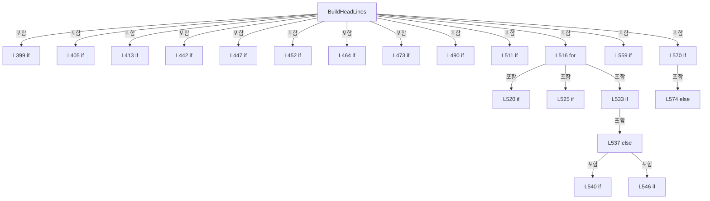

변경 전 점검: 입력/반환 타입, 위 호출자, 예외/취소 경로, 공유 상태와 저장·전송 소비자를 함께 확인합니다. 값의 단위나 물리 방향을 이름만으로 확정하지 않습니다.

### MethodDeclaration `ResolveMachiningAxis` · L582–604

[Drilling.File/Script/CAutomation1ScriptFile.cs:582–604](https://github.com/kjuws10-rgb/A3Drilling/blob/5aee8e58439c9b455cae7c9593c9be986c3e682e/Drilling.File/Script/CAutomation1ScriptFile.cs#L582-L604)

| 항목 | 실제 추출 값 |
| --- | --- |
| 서명 | Drilling.File.Script.CAutomation1ScriptFile.EN_SCRIPT_FOLLOW_AXIS Drilling.File.Script.CAutomation1ScriptFile.ResolveMachiningAxis(System.Collections.Generic.IReadOnlyList<Drilling.Common.Recipe.ST_HEAD_SHOT_POINT>, bool) |
| 접근/수식자 | Private / private, static |
| 반환/값 타입 | Drilling.File.Script.CAutomation1ScriptFile.EN_SCRIPT_FOLLOW_AXIS |
| 소속 타입 | NamedType:Drilling.File.Script.CAutomation1ScriptFile |

입력 계약:

| 이름 | 타입 | 전달 | 선택/기본값 |
| --- | --- | --- | --- |
| shots | System.Collections.Generic.IReadOnlyList<Drilling.Common.Recipe.ST_HEAD_SHOT_POINT> | None | False /  |
| simulatorMode | bool | None | False /  |

정적 호출자로 확인된 위치:

| 호출 파일/행 | 호출 표현식 | 런타임 분기 가능 |
| --- | --- | --- |
| [Drilling.File/Script/CAutomation1ScriptFile.cs:430–430](https://github.com/kjuws10-rgb/A3Drilling/blob/5aee8e58439c9b455cae7c9593c9be986c3e682e/Drilling.File/Script/CAutomation1ScriptFile.cs#L430-L430) | ResolveMachiningAxis | False |

호출하는 대상과 해석 범위:

| 원본 행 | 표현식 | 분석 상태 | 대상/소스 위치 |
| --- | --- | --- | --- |
| 591 | ReadScriptScannerY | resolved | double Drilling.File.Script.CAutomation1ScriptFile.ReadScriptScannerY(Drilling.Common.Recipe.ST_HEAD_SHOT_POINT, bool) · Drilling.File/Script/CAutomation1ScriptFile.cs:711 |
| 592 | ReadScriptScannerY | resolved | double Drilling.File.Script.CAutomation1ScriptFile.ReadScriptScannerY(Drilling.Common.Recipe.ST_HEAD_SHOT_POINT, bool) · Drilling.File/Script/CAutomation1ScriptFile.cs:711 |
| 596 | ReadScriptScannerY | resolved | double Drilling.File.Script.CAutomation1ScriptFile.ReadScriptScannerY(Drilling.Common.Recipe.ST_HEAD_SHOT_POINT, bool) · Drilling.File/Script/CAutomation1ScriptFile.cs:711 |
| 597 | Math.Min | resolved | double System.Math.Min(double, double) |
| 598 | Math.Max | resolved | double System.Math.Max(double, double) |
| 599 | Math.Min | resolved | double System.Math.Min(double, double) |
| 600 | Math.Max | resolved | double System.Math.Max(double, double) |

본문의 실제 연산·분기·예외·반환 순서(원문 위치 순):

| 원본 행 | 종류 | 주석 해설 |
| --- | --- | --- |
| 584 | if | 조건에 따라 분기합니다: if (shots.Count <= 1) |
| 586 | return | 호출자에게 값 또는 제어를 반환합니다: return EN_SCRIPT_FOLLOW_AXIS.X; |
| 589 | local-declaration | 지역 변수를 선언합니다: var minGx = shots[0].ScannerGx; |
| 589 | variable-initializer | 변수의 초기값을 지정합니다: minGx = shots[0].ScannerGx |
| 590 | local-declaration | 지역 변수를 선언합니다: var maxGx = shots[0].ScannerGx; |
| 590 | variable-initializer | 변수의 초기값을 지정합니다: maxGx = shots[0].ScannerGx |
| 591 | call | 함수·델리게이트 또는 객체 생성자를 호출합니다: ReadScriptScannerY(shots[0], simulatorMode) |
| 591 | local-declaration | 지역 변수를 선언합니다: var minGy = ReadScriptScannerY(shots[0], simulatorMode); |
| 591 | variable-initializer | 변수의 초기값을 지정합니다: minGy = ReadScriptScannerY(shots[0], simulatorMode) |
| 592 | call | 함수·델리게이트 또는 객체 생성자를 호출합니다: ReadScriptScannerY(shots[0], simulatorMode) |
| 592 | local-declaration | 지역 변수를 선언합니다: var maxGy = ReadScriptScannerY(shots[0], simulatorMode); |
| 592 | variable-initializer | 변수의 초기값을 지정합니다: maxGy = ReadScriptScannerY(shots[0], simulatorMode) |
| 593 | variable-initializer | 변수의 초기값을 지정합니다: index = 1 |
| 593 | for | 초기화·조건·증감이 있는 반복입니다: for (var index = 1; index < shots.Count; index++) |
| 595 | local-declaration | 지역 변수를 선언합니다: var shot = shots[index]; |
| 595 | variable-initializer | 변수의 초기값을 지정합니다: shot = shots[index] |
| 596 | call | 함수·델리게이트 또는 객체 생성자를 호출합니다: ReadScriptScannerY(shot, simulatorMode) |
| 596 | local-declaration | 지역 변수를 선언합니다: var scannerY = ReadScriptScannerY(shot, simulatorMode); |
| 596 | variable-initializer | 변수의 초기값을 지정합니다: scannerY = ReadScriptScannerY(shot, simulatorMode) |
| 597 | assignment | 값을 대상에 대입합니다: minGx = Math.Min(minGx, shot.ScannerGx) |
| 597 | call | 함수·델리게이트 또는 객체 생성자를 호출합니다: Math.Min(minGx, shot.ScannerGx) |
| 598 | assignment | 값을 대상에 대입합니다: maxGx = Math.Max(maxGx, shot.ScannerGx) |
| 598 | call | 함수·델리게이트 또는 객체 생성자를 호출합니다: Math.Max(maxGx, shot.ScannerGx) |
| 599 | assignment | 값을 대상에 대입합니다: minGy = Math.Min(minGy, scannerY) |
| 599 | call | 함수·델리게이트 또는 객체 생성자를 호출합니다: Math.Min(minGy, scannerY) |
| 600 | assignment | 값을 대상에 대입합니다: maxGy = Math.Max(maxGy, scannerY) |
| 600 | call | 함수·델리게이트 또는 객체 생성자를 호출합니다: Math.Max(maxGy, scannerY) |
| 603 | conditional-expression | 조건에 따라 결과식을 선택합니다: maxGy - minGy > maxGx - minGx ? EN_SCRIPT_FOLLOW_AXIS.Y : EN_SCRIPT_FOLLOW_AXIS.X |
| 603 | return | 호출자에게 값 또는 제어를 반환합니다: return maxGy - minGy > maxGx - minGx ? EN_SCRIPT_FOLLOW_AXIS.Y : EN_SCRIPT_FOLLOW_AXIS.X; |

제어 구문의 포함 구조(실제 실행 순서/CFG가 아닌 구문 탐색 그림):

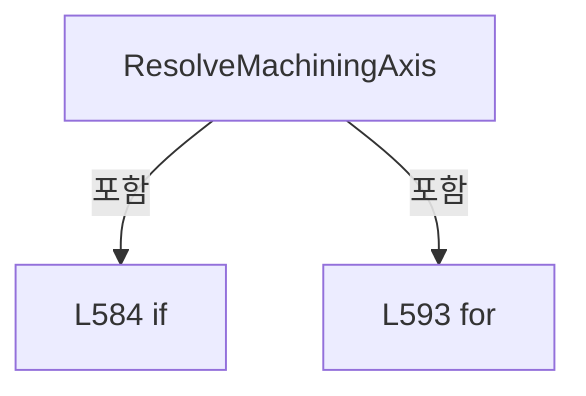

변경 전 점검: 입력/반환 타입, 위 호출자, 예외/취소 경로, 공유 상태와 저장·전송 소비자를 함께 확인합니다. 값의 단위나 물리 방향을 이름만으로 확정하지 않습니다.

### MethodDeclaration `ResolveLineMachiningAxis` · L606–621

[Drilling.File/Script/CAutomation1ScriptFile.cs:606–621](https://github.com/kjuws10-rgb/A3Drilling/blob/5aee8e58439c9b455cae7c9593c9be986c3e682e/Drilling.File/Script/CAutomation1ScriptFile.cs#L606-L621)

| 항목 | 실제 추출 값 |
| --- | --- |
| 서명 | Drilling.File.Script.CAutomation1ScriptFile.EN_SCRIPT_FOLLOW_AXIS Drilling.File.Script.CAutomation1ScriptFile.ResolveLineMachiningAxis(Drilling.Common.Recipe.ST_HEAD_SHOT_POINT, Drilling.Common.Recipe.ST_HEAD_SHOT_POINT?, Drilling.File.Script.CAutomation1ScriptFile.EN_SCRIPT_FOLLOW_AXIS, bool) |
| 접근/수식자 | Private / private, static |
| 반환/값 타입 | Drilling.File.Script.CAutomation1ScriptFile.EN_SCRIPT_FOLLOW_AXIS |
| 소속 타입 | NamedType:Drilling.File.Script.CAutomation1ScriptFile |

입력 계약:

| 이름 | 타입 | 전달 | 선택/기본값 |
| --- | --- | --- | --- |
| targetPoint | Drilling.Common.Recipe.ST_HEAD_SHOT_POINT | None | False /  |
| nextPoint | Drilling.Common.Recipe.ST_HEAD_SHOT_POINT? | None | False /  |
| fallbackAxis | Drilling.File.Script.CAutomation1ScriptFile.EN_SCRIPT_FOLLOW_AXIS | None | False /  |
| simulatorMode | bool | None | False /  |

정적 호출자로 확인된 위치:

| 호출 파일/행 | 호출 표현식 | 런타임 분기 가능 |
| --- | --- | --- |
| [Drilling.File/Script/CAutomation1ScriptFile.cs:528–528](https://github.com/kjuws10-rgb/A3Drilling/blob/5aee8e58439c9b455cae7c9593c9be986c3e682e/Drilling.File/Script/CAutomation1ScriptFile.cs#L528-L528) | ResolveLineMachiningAxis | False |

호출하는 대상과 해석 범위:

| 원본 행 | 표현식 | 분석 상태 | 대상/소스 위치 |
| --- | --- | --- | --- |
| 613 | Math.Abs | resolved | double System.Math.Abs(double) |
| 614 | Math.Abs | resolved | double System.Math.Abs(double) |
| 614 | ReadScriptScannerY | resolved | double Drilling.File.Script.CAutomation1ScriptFile.ReadScriptScannerY(Drilling.Common.Recipe.ST_HEAD_SHOT_POINT, bool) · Drilling.File/Script/CAutomation1ScriptFile.cs:711 |
| 614 | ReadScriptScannerY | resolved | double Drilling.File.Script.CAutomation1ScriptFile.ReadScriptScannerY(Drilling.Common.Recipe.ST_HEAD_SHOT_POINT, bool) · Drilling.File/Script/CAutomation1ScriptFile.cs:711 |
| 615 | Math.Max | resolved | double System.Math.Max(double, double) |

본문의 실제 연산·분기·예외·반환 순서(원문 위치 순):

| 원본 행 | 종류 | 주석 해설 |
| --- | --- | --- |
| 608 | if | 조건에 따라 분기합니다: if (nextPoint is null) |
| 610 | return | 호출자에게 값 또는 제어를 반환합니다: return fallbackAxis; |
| 613 | call | 함수·델리게이트 또는 객체 생성자를 호출합니다: Math.Abs(nextPoint.ScannerGx - targetPoint.ScannerGx) |
| 613 | local-declaration | 지역 변수를 선언합니다: var deltaX = Math.Abs(nextPoint.ScannerGx - targetPoint.ScannerGx); |
| 613 | variable-initializer | 변수의 초기값을 지정합니다: deltaX = Math.Abs(nextPoint.ScannerGx - targetPoint.ScannerGx) |
| 614 | call | 함수·델리게이트 또는 객체 생성자를 호출합니다: Math.Abs(ReadScriptScannerY(nextPoint, simulatorMode) - ReadScriptScannerY(targetPoint, simulatorMode)) |
| 614 | call | 함수·델리게이트 또는 객체 생성자를 호출합니다: ReadScriptScannerY(nextPoint, simulatorMode) |
| 614 | call | 함수·델리게이트 또는 객체 생성자를 호출합니다: ReadScriptScannerY(targetPoint, simulatorMode) |
| 614 | local-declaration | 지역 변수를 선언합니다: var deltaY = Math.Abs(ReadScriptScannerY(nextPoint, simulatorMode) - ReadScriptScannerY(targetPoint, simulatorMode)); |
| 614 | variable-initializer | 변수의 초기값을 지정합니다: deltaY = Math.Abs(ReadScriptScannerY(nextPoint, simulatorMode) - ReadScriptScannerY(targetPoint, simulatorMode)) |
| 615 | call | 함수·델리게이트 또는 객체 생성자를 호출합니다: Math.Max(deltaX, deltaY) |
| 615 | if | 조건에 따라 분기합니다: if (Math.Max(deltaX, deltaY) <= 0.000001) |
| 617 | return | 호출자에게 값 또는 제어를 반환합니다: return fallbackAxis; |
| 620 | conditional-expression | 조건에 따라 결과식을 선택합니다: deltaY > deltaX ? EN_SCRIPT_FOLLOW_AXIS.Y : EN_SCRIPT_FOLLOW_AXIS.X |
| 620 | return | 호출자에게 값 또는 제어를 반환합니다: return deltaY > deltaX ? EN_SCRIPT_FOLLOW_AXIS.Y : EN_SCRIPT_FOLLOW_AXIS.X; |

제어 구문의 포함 구조(실제 실행 순서/CFG가 아닌 구문 탐색 그림):

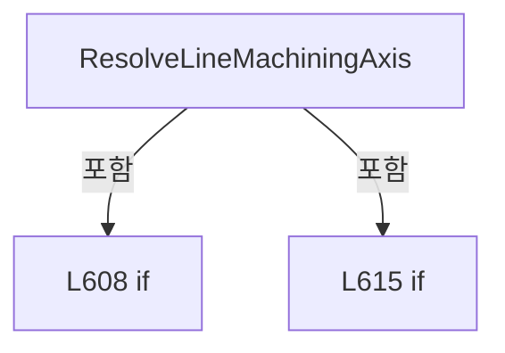

변경 전 점검: 입력/반환 타입, 위 호출자, 예외/취소 경로, 공유 상태와 저장·전송 소비자를 함께 확인합니다. 값의 단위나 물리 방향을 이름만으로 확정하지 않습니다.

### MethodDeclaration `IsScanLineFirstShot` · L623–631

[Drilling.File/Script/CAutomation1ScriptFile.cs:623–631](https://github.com/kjuws10-rgb/A3Drilling/blob/5aee8e58439c9b455cae7c9593c9be986c3e682e/Drilling.File/Script/CAutomation1ScriptFile.cs#L623-L631)

| 항목 | 실제 추출 값 |
| --- | --- |
| 서명 | bool Drilling.File.Script.CAutomation1ScriptFile.IsScanLineFirstShot(Drilling.Common.Recipe.ST_HEAD_SHOT_POINT?, Drilling.Common.Recipe.ST_HEAD_SHOT_POINT) |
| 접근/수식자 | Private / private, static |
| 반환/값 타입 | bool |
| 소속 타입 | NamedType:Drilling.File.Script.CAutomation1ScriptFile |

입력 계약:

| 이름 | 타입 | 전달 | 선택/기본값 |
| --- | --- | --- | --- |
| previousPoint | Drilling.Common.Recipe.ST_HEAD_SHOT_POINT? | None | False /  |
| currentPoint | Drilling.Common.Recipe.ST_HEAD_SHOT_POINT | None | False /  |

정적 호출자로 확인된 위치:

| 호출 파일/행 | 호출 표현식 | 런타임 분기 가능 |
| --- | --- | --- |
| [Drilling.File/Script/CAutomation1ScriptFile.cs:525–525](https://github.com/kjuws10-rgb/A3Drilling/blob/5aee8e58439c9b455cae7c9593c9be986c3e682e/Drilling.File/Script/CAutomation1ScriptFile.cs#L525-L525) | IsScanLineFirstShot | False |

호출하는 대상과 해석 범위:

| 원본 행 | 표현식 | 분석 상태 | 대상/소스 위치 |
| --- | --- | --- | --- |
| 630 | Math.Abs | resolved | double System.Math.Abs(double) |

본문의 실제 연산·분기·예외·반환 순서(원문 위치 순):

| 원본 행 | 종류 | 주석 해설 |
| --- | --- | --- |
| 625 | if | 조건에 따라 분기합니다: if (previousPoint is null) |
| 627 | return | 호출자에게 값 또는 제어를 반환합니다: return true; |
| 630 | call | 함수·델리게이트 또는 객체 생성자를 호출합니다: Math.Abs(currentPoint.EncoderWaitPosition - previousPoint.EncoderWaitPosition) |
| 630 | return | 호출자에게 값 또는 제어를 반환합니다: return Math.Abs(currentPoint.EncoderWaitPosition - previousPoint.EncoderWaitPosition) > 0.000001; |

제어 구문의 포함 구조(실제 실행 순서/CFG가 아닌 구문 탐색 그림):

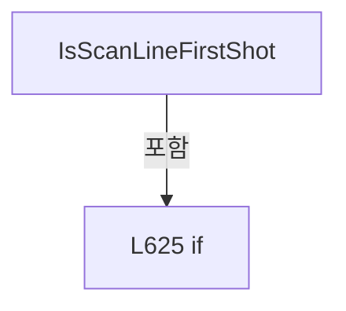

변경 전 점검: 입력/반환 타입, 위 호출자, 예외/취소 경로, 공유 상태와 저장·전송 소비자를 함께 확인합니다. 값의 단위나 물리 방향을 이름만으로 확정하지 않습니다.

### MethodDeclaration `FindNextPointInSameScanLine` · L633–648

[Drilling.File/Script/CAutomation1ScriptFile.cs:633–648](https://github.com/kjuws10-rgb/A3Drilling/blob/5aee8e58439c9b455cae7c9593c9be986c3e682e/Drilling.File/Script/CAutomation1ScriptFile.cs#L633-L648)

| 항목 | 실제 추출 값 |
| --- | --- |
| 서명 | Drilling.Common.Recipe.ST_HEAD_SHOT_POINT? Drilling.File.Script.CAutomation1ScriptFile.FindNextPointInSameScanLine(System.Collections.Generic.IReadOnlyList<Drilling.Common.Recipe.ST_HEAD_SHOT_POINT>, int, Drilling.Common.Recipe.ST_HEAD_SHOT_POINT) |
| 접근/수식자 | Private / private, static |
| 반환/값 타입 | Drilling.Common.Recipe.ST_HEAD_SHOT_POINT? |
| 소속 타입 | NamedType:Drilling.File.Script.CAutomation1ScriptFile |

입력 계약:

| 이름 | 타입 | 전달 | 선택/기본값 |
| --- | --- | --- | --- |
| shots | System.Collections.Generic.IReadOnlyList<Drilling.Common.Recipe.ST_HEAD_SHOT_POINT> | None | False /  |
| currentIndex | int | None | False /  |
| currentPoint | Drilling.Common.Recipe.ST_HEAD_SHOT_POINT | None | False /  |

정적 호출자로 확인된 위치:

| 호출 파일/행 | 호출 표현식 | 런타임 분기 가능 |
| --- | --- | --- |
| [Drilling.File/Script/CAutomation1ScriptFile.cs:527–527](https://github.com/kjuws10-rgb/A3Drilling/blob/5aee8e58439c9b455cae7c9593c9be986c3e682e/Drilling.File/Script/CAutomation1ScriptFile.cs#L527-L527) | FindNextPointInSameScanLine | False |

호출하는 대상과 해석 범위:

| 원본 행 | 표현식 | 분석 상태 | 대상/소스 위치 |
| --- | --- | --- | --- |
| 642 | Math.Abs | resolved | double System.Math.Abs(double) |

본문의 실제 연산·분기·예외·반환 순서(원문 위치 순):

| 원본 행 | 종류 | 주석 해설 |
| --- | --- | --- |
| 635 | local-declaration | 지역 변수를 선언합니다: var nextIndex = currentIndex + 1; |
| 635 | variable-initializer | 변수의 초기값을 지정합니다: nextIndex = currentIndex + 1 |
| 636 | if | 조건에 따라 분기합니다: if (nextIndex >= shots.Count) |
| 638 | return | 호출자에게 값 또는 제어를 반환합니다: return null; |
| 641 | local-declaration | 지역 변수를 선언합니다: var nextPoint = shots[nextIndex]; |
| 641 | variable-initializer | 변수의 초기값을 지정합니다: nextPoint = shots[nextIndex] |
| 642 | call | 함수·델리게이트 또는 객체 생성자를 호출합니다: Math.Abs(nextPoint.EncoderWaitPosition - currentPoint.EncoderWaitPosition) |
| 642 | if | 조건에 따라 분기합니다: if (Math.Abs(nextPoint.EncoderWaitPosition - currentPoint.EncoderWaitPosition) > 0.000001) |
| 644 | return | 호출자에게 값 또는 제어를 반환합니다: return null; |
| 647 | return | 호출자에게 값 또는 제어를 반환합니다: return nextPoint; |

제어 구문의 포함 구조(실제 실행 순서/CFG가 아닌 구문 탐색 그림):

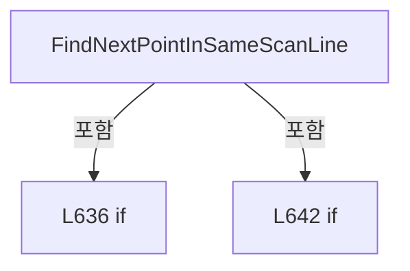

변경 전 점검: 입력/반환 타입, 위 호출자, 예외/취소 경로, 공유 상태와 저장·전송 소비자를 함께 확인합니다. 값의 단위나 물리 방향을 이름만으로 확정하지 않습니다.

### MethodDeclaration `AppendLinePreApproachMove` · L650–674

[Drilling.File/Script/CAutomation1ScriptFile.cs:650–674](https://github.com/kjuws10-rgb/A3Drilling/blob/5aee8e58439c9b455cae7c9593c9be986c3e682e/Drilling.File/Script/CAutomation1ScriptFile.cs#L650-L674)

| 항목 | 실제 추출 값 |
| --- | --- |
| 서명 | void Drilling.File.Script.CAutomation1ScriptFile.AppendLinePreApproachMove(System.Collections.Generic.List<string>, string, string, Drilling.Common.Recipe.ST_HEAD_SHOT_POINT, Drilling.Common.Recipe.ST_HEAD_SHOT_POINT?, Drilling.File.Script.CAutomation1ScriptFile.EN_SCRIPT_FOLLOW_AXIS, double, double, bool) |
| 접근/수식자 | Private / private, static |
| 반환/값 타입 | void |
| 소속 타입 | NamedType:Drilling.File.Script.CAutomation1ScriptFile |

입력 계약:

| 이름 | 타입 | 전달 | 선택/기본값 |
| --- | --- | --- | --- |
| lines | System.Collections.Generic.List<string> | None | False /  |
| xAxis | string | None | False /  |
| yAxis | string | None | False /  |
| targetPoint | Drilling.Common.Recipe.ST_HEAD_SHOT_POINT | None | False /  |
| nextPoint | Drilling.Common.Recipe.ST_HEAD_SHOT_POINT? | None | False /  |
| machiningAxis | Drilling.File.Script.CAutomation1ScriptFile.EN_SCRIPT_FOLLOW_AXIS | None | False /  |
| distance | double | None | False /  |
| scanFieldHalfWidth | double | None | False /  |
| simulatorMode | bool | None | False /  |

정적 호출자로 확인된 위치:

| 호출 파일/행 | 호출 표현식 | 런타임 분기 가능 |
| --- | --- | --- |
| [Drilling.File/Script/CAutomation1ScriptFile.cs:529–529](https://github.com/kjuws10-rgb/A3Drilling/blob/5aee8e58439c9b455cae7c9593c9be986c3e682e/Drilling.File/Script/CAutomation1ScriptFile.cs#L529-L529) | AppendLinePreApproachMove | False |

호출하는 대상과 해석 범위:

| 원본 행 | 표현식 | 분석 상태 | 대상/소스 위치 |
| --- | --- | --- | --- |
| 662 | ReadScriptAxisPosition | resolved | double Drilling.File.Script.CAutomation1ScriptFile.ReadScriptAxisPosition(Drilling.Common.Recipe.ST_HEAD_SHOT_POINT, Drilling.File.Script.CAutomation1ScriptFile.EN_SCRIPT_FOLLOW_AXIS, bool) · Drilling.File/Script/CAutomation1ScriptFile.cs:701 |
| 663 | ResolveLinePreApproachDirection | resolved | double Drilling.File.Script.CAutomation1ScriptFile.ResolveLinePreApproachDirection(Drilling.Common.Recipe.ST_HEAD_SHOT_POINT, Drilling.Common.Recipe.ST_HEAD_SHOT_POINT?, Drilling.File.Script.CAutomation1ScriptFile.EN_SCRIPT_FOLLOW_AXIS, bool) · Drilling.File/Script/CAutomation1ScriptFile.cs:676 |
| 664 | Clamp | resolved | double Drilling.File.Script.CAutomation1ScriptFile.Clamp(double, double, double) · Drilling.File/Script/CAutomation1ScriptFile.cs:716 |
| 665 | Math.Abs | resolved | double System.Math.Abs(double) |
| 671 | ReadScriptScannerY | resolved | double Drilling.File.Script.CAutomation1ScriptFile.ReadScriptScannerY(Drilling.Common.Recipe.ST_HEAD_SHOT_POINT, bool) · Drilling.File/Script/CAutomation1ScriptFile.cs:711 |
| 673 | lines.Add | resolved | void System.Collections.Generic.List<string>.Add(string) |
| 673 | Format | resolved | string Drilling.File.Script.CAutomation1ScriptFile.Format(double) · Drilling.File/Script/CAutomation1ScriptFile.cs:1283 |
| 673 | Format | resolved | string Drilling.File.Script.CAutomation1ScriptFile.Format(double) · Drilling.File/Script/CAutomation1ScriptFile.cs:1283 |

본문의 실제 연산·분기·예외·반환 순서(원문 위치 순):

| 원본 행 | 종류 | 주석 해설 |
| --- | --- | --- |
| 662 | call | 함수·델리게이트 또는 객체 생성자를 호출합니다: ReadScriptAxisPosition(targetPoint, machiningAxis, simulatorMode) |
| 662 | local-declaration | 지역 변수를 선언합니다: var targetAxisPosition = ReadScriptAxisPosition(targetPoint, machiningAxis, simulatorMode); |
| 662 | variable-initializer | 변수의 초기값을 지정합니다: targetAxisPosition = ReadScriptAxisPosition(targetPoint, machiningAxis, simulatorMode) |
| 663 | call | 함수·델리게이트 또는 객체 생성자를 호출합니다: ResolveLinePreApproachDirection(targetPoint, nextPoint, machiningAxis, simulatorMode) |
| 663 | local-declaration | 지역 변수를 선언합니다: var direction = ResolveLinePreApproachDirection(targetPoint, nextPoint, machiningAxis, simulatorMode); |
| 663 | variable-initializer | 변수의 초기값을 지정합니다: direction = ResolveLinePreApproachDirection(targetPoint, nextPoint, machiningAxis, simulatorMode) |
| 664 | call | 함수·델리게이트 또는 객체 생성자를 호출합니다: Clamp(targetAxisPosition - (direction * distance), -scanFieldHalfWidth, scanFieldHalfWidth) |
| 664 | local-declaration | 지역 변수를 선언합니다: var preAxisPosition = Clamp(targetAxisPosition - (direction * distance), -scanFieldHalfWidth, scanFieldHalfWidth); |
| 664 | variable-initializer | 변수의 초기값을 지정합니다: preAxisPosition = Clamp(targetAxisPosition - (direction * distance), -scanFieldHalfWidth, scanFieldHalfWidth) |
| 665 | call | 함수·델리게이트 또는 객체 생성자를 호출합니다: Math.Abs(preAxisPosition - targetAxisPosition) |
| 665 | if | 조건에 따라 분기합니다: if (Math.Abs(preAxisPosition - targetAxisPosition) <= 0.000001) |
| 667 | return | 호출자에게 값 또는 제어를 반환합니다: return; |
| 670 | conditional-expression | 조건에 따라 결과식을 선택합니다: machiningAxis == EN_SCRIPT_FOLLOW_AXIS.X ? preAxisPosition : targetPoint.ScannerGx |
| 670 | local-declaration | 지역 변수를 선언합니다: var scannerX = machiningAxis == EN_SCRIPT_FOLLOW_AXIS.X ? preAxisPosition : targetPoint.ScannerGx; |
| 670 | variable-initializer | 변수의 초기값을 지정합니다: scannerX = machiningAxis == EN_SCRIPT_FOLLOW_AXIS.X ? preAxisPosition : targetPoint.ScannerGx |
| 671 | call | 함수·델리게이트 또는 객체 생성자를 호출합니다: ReadScriptScannerY(targetPoint, simulatorMode) |
| 671 | local-declaration | 지역 변수를 선언합니다: var targetScannerY = ReadScriptScannerY(targetPoint, simulatorMode); |
| 671 | variable-initializer | 변수의 초기값을 지정합니다: targetScannerY = ReadScriptScannerY(targetPoint, simulatorMode) |
| 672 | conditional-expression | 조건에 따라 결과식을 선택합니다: machiningAxis == EN_SCRIPT_FOLLOW_AXIS.Y ? preAxisPosition : targetScannerY |
| 672 | local-declaration | 지역 변수를 선언합니다: var scannerY = machiningAxis == EN_SCRIPT_FOLLOW_AXIS.Y ? preAxisPosition : targetScannerY; |
| 672 | variable-initializer | 변수의 초기값을 지정합니다: scannerY = machiningAxis == EN_SCRIPT_FOLLOW_AXIS.Y ? preAxisPosition : targetScannerY |
| 673 | call | 함수·델리게이트 또는 객체 생성자를 호출합니다: lines.Add($"MoveRapid([{xAxis},{yAxis}], [{Format(scannerX)},{Format(scannerY)}])") |
| 673 | call | 함수·델리게이트 또는 객체 생성자를 호출합니다: Format(scannerX) |
| 673 | call | 함수·델리게이트 또는 객체 생성자를 호출합니다: Format(scannerY) |

제어 구문의 포함 구조(실제 실행 순서/CFG가 아닌 구문 탐색 그림):

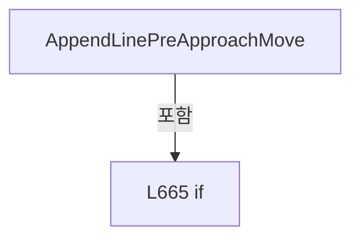

변경 전 점검: 입력/반환 타입, 위 호출자, 예외/취소 경로, 공유 상태와 저장·전송 소비자를 함께 확인합니다. 값의 단위나 물리 방향을 이름만으로 확정하지 않습니다.

### MethodDeclaration `ResolveLinePreApproachDirection` · L676–688

[Drilling.File/Script/CAutomation1ScriptFile.cs:676–688](https://github.com/kjuws10-rgb/A3Drilling/blob/5aee8e58439c9b455cae7c9593c9be986c3e682e/Drilling.File/Script/CAutomation1ScriptFile.cs#L676-L688)

| 항목 | 실제 추출 값 |
| --- | --- |
| 서명 | double Drilling.File.Script.CAutomation1ScriptFile.ResolveLinePreApproachDirection(Drilling.Common.Recipe.ST_HEAD_SHOT_POINT, Drilling.Common.Recipe.ST_HEAD_SHOT_POINT?, Drilling.File.Script.CAutomation1ScriptFile.EN_SCRIPT_FOLLOW_AXIS, bool) |
| 접근/수식자 | Private / private, static |
| 반환/값 타입 | double |
| 소속 타입 | NamedType:Drilling.File.Script.CAutomation1ScriptFile |

입력 계약:

| 이름 | 타입 | 전달 | 선택/기본값 |
| --- | --- | --- | --- |
| targetPoint | Drilling.Common.Recipe.ST_HEAD_SHOT_POINT | None | False /  |
| nextPoint | Drilling.Common.Recipe.ST_HEAD_SHOT_POINT? | None | False /  |
| machiningAxis | Drilling.File.Script.CAutomation1ScriptFile.EN_SCRIPT_FOLLOW_AXIS | None | False /  |
| simulatorMode | bool | None | False /  |

정적 호출자로 확인된 위치:

| 호출 파일/행 | 호출 표현식 | 런타임 분기 가능 |
| --- | --- | --- |
| [Drilling.File/Script/CAutomation1ScriptFile.cs:663–663](https://github.com/kjuws10-rgb/A3Drilling/blob/5aee8e58439c9b455cae7c9593c9be986c3e682e/Drilling.File/Script/CAutomation1ScriptFile.cs#L663-L663) | ResolveLinePreApproachDirection | False |

호출하는 대상과 해석 범위:

| 원본 행 | 표현식 | 분석 상태 | 대상/소스 위치 |
| --- | --- | --- | --- |
| 680 | ReadScriptAxisPosition | resolved | double Drilling.File.Script.CAutomation1ScriptFile.ReadScriptAxisPosition(Drilling.Common.Recipe.ST_HEAD_SHOT_POINT, Drilling.File.Script.CAutomation1ScriptFile.EN_SCRIPT_FOLLOW_AXIS, bool) · Drilling.File/Script/CAutomation1ScriptFile.cs:701 |
| 680 | ReadScriptAxisPosition | resolved | double Drilling.File.Script.CAutomation1ScriptFile.ReadScriptAxisPosition(Drilling.Common.Recipe.ST_HEAD_SHOT_POINT, Drilling.File.Script.CAutomation1ScriptFile.EN_SCRIPT_FOLLOW_AXIS, bool) · Drilling.File/Script/CAutomation1ScriptFile.cs:701 |
| 681 | Math.Abs | resolved | double System.Math.Abs(double) |

본문의 실제 연산·분기·예외·반환 순서(원문 위치 순):

| 원본 행 | 종류 | 주석 해설 |
| --- | --- | --- |
| 678 | if | 조건에 따라 분기합니다: if (nextPoint is not null) |
| 680 | call | 함수·델리게이트 또는 객체 생성자를 호출합니다: ReadScriptAxisPosition(nextPoint, machiningAxis, simulatorMode) |
| 680 | call | 함수·델리게이트 또는 객체 생성자를 호출합니다: ReadScriptAxisPosition(targetPoint, machiningAxis, simulatorMode) |
| 680 | local-declaration | 지역 변수를 선언합니다: var delta = ReadScriptAxisPosition(nextPoint, machiningAxis, simulatorMode) - ReadScriptAxisPosition(targetPoint, machiningAxis, simulatorMode); |
| 680 | variable-initializer | 변수의 초기값을 지정합니다: delta = ReadScriptAxisPosition(nextPoint, machiningAxis, simulatorMode) - ReadScriptAxisPosition(targetPoint, machiningAxis, simulatorMode) |
| 681 | call | 함수·델리게이트 또는 객체 생성자를 호출합니다: Math.Abs(delta) |
| 681 | if | 조건에 따라 분기합니다: if (Math.Abs(delta) > 0.000001) |
| 683 | conditional-expression | 조건에 따라 결과식을 선택합니다: delta > 0.0 ? 1.0 : -1.0 |
| 683 | return | 호출자에게 값 또는 제어를 반환합니다: return delta > 0.0 ? 1.0 : -1.0; |
| 687 | return | 호출자에게 값 또는 제어를 반환합니다: return 1.0; |

제어 구문의 포함 구조(실제 실행 순서/CFG가 아닌 구문 탐색 그림):

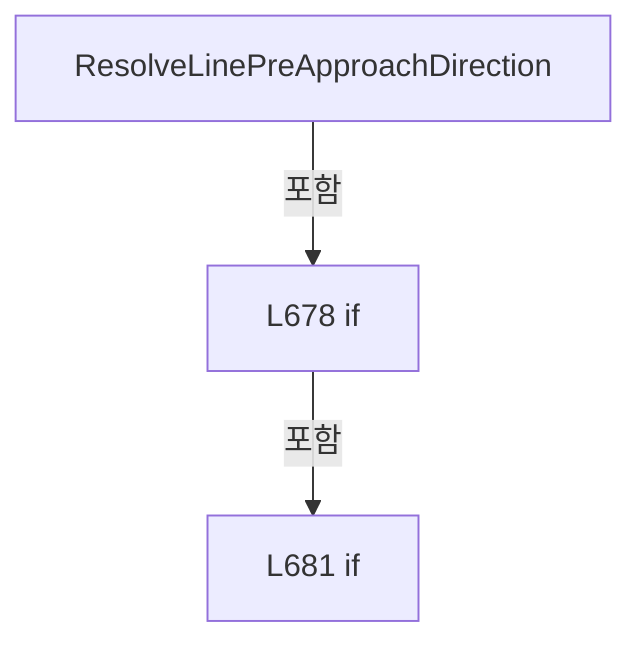

변경 전 점검: 입력/반환 타입, 위 호출자, 예외/취소 경로, 공유 상태와 저장·전송 소비자를 함께 확인합니다. 값의 단위나 물리 방향을 이름만으로 확정하지 않습니다.

### MethodDeclaration `ReadHeadScanFieldHalfWidth` · L690–699

[Drilling.File/Script/CAutomation1ScriptFile.cs:690–699](https://github.com/kjuws10-rgb/A3Drilling/blob/5aee8e58439c9b455cae7c9593c9be986c3e682e/Drilling.File/Script/CAutomation1ScriptFile.cs#L690-L699)

| 항목 | 실제 추출 값 |
| --- | --- |
| 서명 | double Drilling.File.Script.CAutomation1ScriptFile.ReadHeadScanFieldHalfWidth(System.Collections.Generic.IReadOnlyDictionary<string, string>, int) |
| 접근/수식자 | Private / private, static |
| 반환/값 타입 | double |
| 소속 타입 | NamedType:Drilling.File.Script.CAutomation1ScriptFile |

입력 계약:

| 이름 | 타입 | 전달 | 선택/기본값 |
| --- | --- | --- | --- |
| common | System.Collections.Generic.IReadOnlyDictionary<string, string> | None | False /  |
| headNo | int | None | False /  |

정적 호출자로 확인된 위치:

| 호출 파일/행 | 호출 표현식 | 런타임 분기 가능 |
| --- | --- | --- |
| [Drilling.File/Script/CAutomation1ScriptFile.cs:431–431](https://github.com/kjuws10-rgb/A3Drilling/blob/5aee8e58439c9b455cae7c9593c9be986c3e682e/Drilling.File/Script/CAutomation1ScriptFile.cs#L431-L431) | ReadHeadScanFieldHalfWidth | False |

호출하는 대상과 해석 범위:

| 원본 행 | 표현식 | 분석 상태 | 대상/소스 위치 |
| --- | --- | --- | --- |
| 692 | Math.Abs | resolved | double System.Math.Abs(double) |
| 692 | ReadDouble | resolved | double Drilling.File.Script.CAutomation1ScriptFile.ReadDouble(System.Collections.Generic.IReadOnlyDictionary<string, string>, double, System.Collections.Generic.IEnumerable<string>) · Drilling.File/Script/CAutomation1ScriptFile.cs:1160 |
| 692 | CreateHeadKeys | resolved | System.Collections.Generic.IReadOnlyList<string> Drilling.File.Script.CAutomation1ScriptFile.CreateHeadKeys(int, params string[]) · Drilling.File/Script/CAutomation1ScriptFile.cs:1100 |

본문의 실제 연산·분기·예외·반환 순서(원문 위치 순):

| 원본 행 | 종류 | 주석 해설 |
| --- | --- | --- |
| 692 | call | 함수·델리게이트 또는 객체 생성자를 호출합니다: Math.Abs(ReadDouble(common, 110.0, CreateHeadKeys(headNo, "SCAN_FIELD_WIDTH_X", "HEAD_FIELD_WIDTH_X"))) |
| 692 | call | 함수·델리게이트 또는 객체 생성자를 호출합니다: ReadDouble(common, 110.0, CreateHeadKeys(headNo, "SCAN_FIELD_WIDTH_X", "HEAD_FIELD_WIDTH_X")) |
| 692 | call | 함수·델리게이트 또는 객체 생성자를 호출합니다: CreateHeadKeys(headNo, "SCAN_FIELD_WIDTH_X", "HEAD_FIELD_WIDTH_X") |
| 692 | local-declaration | 지역 변수를 선언합니다: var scanFieldWidth = Math.Abs(ReadDouble(common, 110.0, CreateHeadKeys(headNo, "SCAN_FIELD_WIDTH_X", "HEAD_FIELD_WIDTH_X"))); |
| 692 | variable-initializer | 변수의 초기값을 지정합니다: scanFieldWidth = Math.Abs(ReadDouble(common, 110.0, CreateHeadKeys(headNo, "SCAN_FIELD_WIDTH_X", "HEAD_FIELD_WIDTH_X"))) |
| 693 | if | 조건에 따라 분기합니다: if (scanFieldWidth <= 0.000001) |
| 695 | assignment | 값을 대상에 대입합니다: scanFieldWidth = 110.0 |
| 698 | return | 호출자에게 값 또는 제어를 반환합니다: return scanFieldWidth / 2.0; |

제어 구문의 포함 구조(실제 실행 순서/CFG가 아닌 구문 탐색 그림):

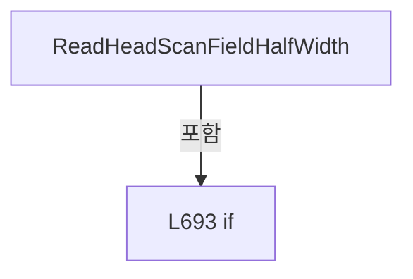

변경 전 점검: 입력/반환 타입, 위 호출자, 예외/취소 경로, 공유 상태와 저장·전송 소비자를 함께 확인합니다. 값의 단위나 물리 방향을 이름만으로 확정하지 않습니다.

### MethodDeclaration `ReadScriptAxisPosition` · L701–709

[Drilling.File/Script/CAutomation1ScriptFile.cs:701–709](https://github.com/kjuws10-rgb/A3Drilling/blob/5aee8e58439c9b455cae7c9593c9be986c3e682e/Drilling.File/Script/CAutomation1ScriptFile.cs#L701-L709)

| 항목 | 실제 추출 값 |
| --- | --- |
| 서명 | double Drilling.File.Script.CAutomation1ScriptFile.ReadScriptAxisPosition(Drilling.Common.Recipe.ST_HEAD_SHOT_POINT, Drilling.File.Script.CAutomation1ScriptFile.EN_SCRIPT_FOLLOW_AXIS, bool) |
| 접근/수식자 | Private / private, static |
| 반환/값 타입 | double |
| 소속 타입 | NamedType:Drilling.File.Script.CAutomation1ScriptFile |

입력 계약:

| 이름 | 타입 | 전달 | 선택/기본값 |
| --- | --- | --- | --- |
| point | Drilling.Common.Recipe.ST_HEAD_SHOT_POINT | None | False /  |
| followAxis | Drilling.File.Script.CAutomation1ScriptFile.EN_SCRIPT_FOLLOW_AXIS | None | False /  |
| simulatorMode | bool | None | False /  |

정적 호출자로 확인된 위치:

| 호출 파일/행 | 호출 표현식 | 런타임 분기 가능 |
| --- | --- | --- |
| [Drilling.File/Script/CAutomation1ScriptFile.cs:662–662](https://github.com/kjuws10-rgb/A3Drilling/blob/5aee8e58439c9b455cae7c9593c9be986c3e682e/Drilling.File/Script/CAutomation1ScriptFile.cs#L662-L662) | ReadScriptAxisPosition | False |
| [Drilling.File/Script/CAutomation1ScriptFile.cs:680–680](https://github.com/kjuws10-rgb/A3Drilling/blob/5aee8e58439c9b455cae7c9593c9be986c3e682e/Drilling.File/Script/CAutomation1ScriptFile.cs#L680-L680) | ReadScriptAxisPosition | False |
| [Drilling.File/Script/CAutomation1ScriptFile.cs:680–680](https://github.com/kjuws10-rgb/A3Drilling/blob/5aee8e58439c9b455cae7c9593c9be986c3e682e/Drilling.File/Script/CAutomation1ScriptFile.cs#L680-L680) | ReadScriptAxisPosition | False |

호출하는 대상과 해석 범위:

| 원본 행 | 표현식 | 분석 상태 | 대상/소스 위치 |
| --- | --- | --- | --- |
| 708 | ReadScriptScannerY | resolved | double Drilling.File.Script.CAutomation1ScriptFile.ReadScriptScannerY(Drilling.Common.Recipe.ST_HEAD_SHOT_POINT, bool) · Drilling.File/Script/CAutomation1ScriptFile.cs:711 |

본문의 실제 연산·분기·예외·반환 순서(원문 위치 순):

| 원본 행 | 종류 | 주석 해설 |
| --- | --- | --- |
| 703 | if | 조건에 따라 분기합니다: if (followAxis == EN_SCRIPT_FOLLOW_AXIS.X) |
| 705 | return | 호출자에게 값 또는 제어를 반환합니다: return point.ScannerGx; |
| 708 | call | 함수·델리게이트 또는 객체 생성자를 호출합니다: ReadScriptScannerY(point, simulatorMode) |
| 708 | return | 호출자에게 값 또는 제어를 반환합니다: return ReadScriptScannerY(point, simulatorMode); |

제어 구문의 포함 구조(실제 실행 순서/CFG가 아닌 구문 탐색 그림):

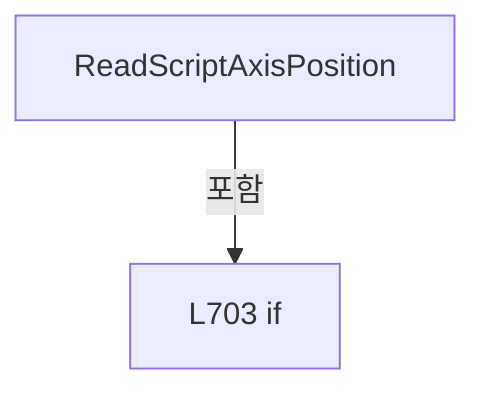

변경 전 점검: 입력/반환 타입, 위 호출자, 예외/취소 경로, 공유 상태와 저장·전송 소비자를 함께 확인합니다. 값의 단위나 물리 방향을 이름만으로 확정하지 않습니다.

### MethodDeclaration `ReadScriptScannerY` · L711–714

[Drilling.File/Script/CAutomation1ScriptFile.cs:711–714](https://github.com/kjuws10-rgb/A3Drilling/blob/5aee8e58439c9b455cae7c9593c9be986c3e682e/Drilling.File/Script/CAutomation1ScriptFile.cs#L711-L714)

| 항목 | 실제 추출 값 |
| --- | --- |
| 서명 | double Drilling.File.Script.CAutomation1ScriptFile.ReadScriptScannerY(Drilling.Common.Recipe.ST_HEAD_SHOT_POINT, bool) |
| 접근/수식자 | Private / private, static |
| 반환/값 타입 | double |
| 소속 타입 | NamedType:Drilling.File.Script.CAutomation1ScriptFile |

입력 계약:

| 이름 | 타입 | 전달 | 선택/기본값 |
| --- | --- | --- | --- |
| point | Drilling.Common.Recipe.ST_HEAD_SHOT_POINT | None | False /  |
| simulatorMode | bool | None | False /  |

정적 호출자로 확인된 위치:

| 호출 파일/행 | 호출 표현식 | 런타임 분기 가능 |
| --- | --- | --- |
| [Drilling.File/Script/CAutomation1ScriptFile.cs:255–255](https://github.com/kjuws10-rgb/A3Drilling/blob/5aee8e58439c9b455cae7c9593c9be986c3e682e/Drilling.File/Script/CAutomation1ScriptFile.cs#L255-L255) | ReadScriptScannerY | False |
| [Drilling.File/Script/CAutomation1ScriptFile.cs:519–519](https://github.com/kjuws10-rgb/A3Drilling/blob/5aee8e58439c9b455cae7c9593c9be986c3e682e/Drilling.File/Script/CAutomation1ScriptFile.cs#L519-L519) | ReadScriptScannerY | False |
| [Drilling.File/Script/CAutomation1ScriptFile.cs:591–591](https://github.com/kjuws10-rgb/A3Drilling/blob/5aee8e58439c9b455cae7c9593c9be986c3e682e/Drilling.File/Script/CAutomation1ScriptFile.cs#L591-L591) | ReadScriptScannerY | False |
| [Drilling.File/Script/CAutomation1ScriptFile.cs:592–592](https://github.com/kjuws10-rgb/A3Drilling/blob/5aee8e58439c9b455cae7c9593c9be986c3e682e/Drilling.File/Script/CAutomation1ScriptFile.cs#L592-L592) | ReadScriptScannerY | False |
| [Drilling.File/Script/CAutomation1ScriptFile.cs:596–596](https://github.com/kjuws10-rgb/A3Drilling/blob/5aee8e58439c9b455cae7c9593c9be986c3e682e/Drilling.File/Script/CAutomation1ScriptFile.cs#L596-L596) | ReadScriptScannerY | False |
| [Drilling.File/Script/CAutomation1ScriptFile.cs:614–614](https://github.com/kjuws10-rgb/A3Drilling/blob/5aee8e58439c9b455cae7c9593c9be986c3e682e/Drilling.File/Script/CAutomation1ScriptFile.cs#L614-L614) | ReadScriptScannerY | False |
| [Drilling.File/Script/CAutomation1ScriptFile.cs:614–614](https://github.com/kjuws10-rgb/A3Drilling/blob/5aee8e58439c9b455cae7c9593c9be986c3e682e/Drilling.File/Script/CAutomation1ScriptFile.cs#L614-L614) | ReadScriptScannerY | False |
| [Drilling.File/Script/CAutomation1ScriptFile.cs:671–671](https://github.com/kjuws10-rgb/A3Drilling/blob/5aee8e58439c9b455cae7c9593c9be986c3e682e/Drilling.File/Script/CAutomation1ScriptFile.cs#L671-L671) | ReadScriptScannerY | False |
| [Drilling.File/Script/CAutomation1ScriptFile.cs:708–708](https://github.com/kjuws10-rgb/A3Drilling/blob/5aee8e58439c9b455cae7c9593c9be986c3e682e/Drilling.File/Script/CAutomation1ScriptFile.cs#L708-L708) | ReadScriptScannerY | False |

본문의 실제 연산·분기·예외·반환 순서(원문 위치 순):

| 원본 행 | 종류 | 주석 해설 |
| --- | --- | --- |
| 713 | conditional-expression | 조건에 따라 결과식을 선택합니다: simulatorMode ? point.FinalScannerOffsetY + point.ShiftScannerOffsetY : point.ScannerGy |
| 713 | return | 호출자에게 값 또는 제어를 반환합니다: return simulatorMode ? point.FinalScannerOffsetY + point.ShiftScannerOffsetY : point.ScannerGy; |

변경 전 점검: 입력/반환 타입, 위 호출자, 예외/취소 경로, 공유 상태와 저장·전송 소비자를 함께 확인합니다. 값의 단위나 물리 방향을 이름만으로 확정하지 않습니다.

### MethodDeclaration `Clamp` · L716–719

[Drilling.File/Script/CAutomation1ScriptFile.cs:716–719](https://github.com/kjuws10-rgb/A3Drilling/blob/5aee8e58439c9b455cae7c9593c9be986c3e682e/Drilling.File/Script/CAutomation1ScriptFile.cs#L716-L719)

| 항목 | 실제 추출 값 |
| --- | --- |
| 서명 | double Drilling.File.Script.CAutomation1ScriptFile.Clamp(double, double, double) |
| 접근/수식자 | Private / private, static |
| 반환/값 타입 | double |
| 소속 타입 | NamedType:Drilling.File.Script.CAutomation1ScriptFile |

입력 계약:

| 이름 | 타입 | 전달 | 선택/기본값 |
| --- | --- | --- | --- |
| value | double | None | False /  |
| min | double | None | False /  |
| max | double | None | False /  |

정적 호출자로 확인된 위치:

| 호출 파일/행 | 호출 표현식 | 런타임 분기 가능 |
| --- | --- | --- |
| [Drilling.File/Script/CAutomation1ScriptFile.cs:664–664](https://github.com/kjuws10-rgb/A3Drilling/blob/5aee8e58439c9b455cae7c9593c9be986c3e682e/Drilling.File/Script/CAutomation1ScriptFile.cs#L664-L664) | Clamp | False |

호출하는 대상과 해석 범위:

| 원본 행 | 표현식 | 분석 상태 | 대상/소스 위치 |
| --- | --- | --- | --- |
| 718 | Math.Min | resolved | double System.Math.Min(double, double) |
| 718 | Math.Max | resolved | double System.Math.Max(double, double) |

본문의 실제 연산·분기·예외·반환 순서(원문 위치 순):

| 원본 행 | 종류 | 주석 해설 |
| --- | --- | --- |
| 718 | call | 함수·델리게이트 또는 객체 생성자를 호출합니다: Math.Min(Math.Max(value, min), max) |
| 718 | call | 함수·델리게이트 또는 객체 생성자를 호출합니다: Math.Max(value, min) |
| 718 | return | 호출자에게 값 또는 제어를 반환합니다: return Math.Min(Math.Max(value, min), max); |

변경 전 점검: 입력/반환 타입, 위 호출자, 예외/취소 경로, 공유 상태와 저장·전송 소비자를 함께 확인합니다. 값의 단위나 물리 방향을 이름만으로 확정하지 않습니다.

### MethodDeclaration `ResolveScriptBuildDirectory` · L721–748

[Drilling.File/Script/CAutomation1ScriptFile.cs:721–748](https://github.com/kjuws10-rgb/A3Drilling/blob/5aee8e58439c9b455cae7c9593c9be986c3e682e/Drilling.File/Script/CAutomation1ScriptFile.cs#L721-L748)

| 항목 | 실제 추출 값 |
| --- | --- |
| 서명 | string Drilling.File.Script.CAutomation1ScriptFile.ResolveScriptBuildDirectory(string, System.DateTimeOffset, string) |
| 접근/수식자 | Private / private |
| 반환/값 타입 | string |
| 소속 타입 | NamedType:Drilling.File.Script.CAutomation1ScriptFile |

입력 계약:

| 이름 | 타입 | 전달 | 선택/기본값 |
| --- | --- | --- | --- |
| subDirectoryName | string | None | False /  |
| createdAt | System.DateTimeOffset | None | False /  |
| glassId | string | None | False /  |

정적 호출자로 확인된 위치:

| 호출 파일/행 | 호출 표현식 | 런타임 분기 가능 |
| --- | --- | --- |
| [Drilling.File/Script/CAutomation1ScriptFile.cs:77–77](https://github.com/kjuws10-rgb/A3Drilling/blob/5aee8e58439c9b455cae7c9593c9be986c3e682e/Drilling.File/Script/CAutomation1ScriptFile.cs#L77-L77) | ResolveScriptBuildDirectory | False |

호출하는 대상과 해석 범위:

| 원본 행 | 표현식 | 분석 상태 | 대상/소스 위치 |
| --- | --- | --- | --- |
| 726 | subDirectoryName.Replace('\\', '/').Trim | resolved | string string.Trim(char) |
| 726 | subDirectoryName.Replace | resolved | string string.Replace(char, char) |
| 728 | requested.Equals | resolved | bool string.Equals(string?, System.StringComparison) |
| 728 | Path.Combine | resolved | string System.IO.Path.Combine(string, string) |
| 729 | requested.Equals | resolved | bool string.Equals(string?, System.StringComparison) |
| 729 | Path.Combine | resolved | string System.IO.Path.Combine(string, string) |
| 730 | string.IsNullOrWhiteSpace | resolved | bool string.IsNullOrWhiteSpace(string?) |
| 730 | Path.GetFileName | resolved | string? System.IO.Path.GetFileName(string?) |
| 730 | subDirectoryName.Trim | resolved | string string.Trim() |
| 731 | NormalizeScriptBuildName | resolved | string Drilling.File.Script.CAutomation1ScriptFile.NormalizeScriptBuildName(string) · Drilling.File/Script/CAutomation1ScriptFile.cs:750 |
| 732 | Path.Combine | resolved | string System.IO.Path.Combine(string, string, string) |
| 733 | Directory.Exists | resolved | bool System.IO.Directory.Exists(string?) |
| 740 | Path.Combine | resolved | string System.IO.Path.Combine(string, string, string) |
| 741 | Directory.Exists | resolved | bool System.IO.Directory.Exists(string?) |
| 747 | new IOException | resolved | System.IO.IOException.IOException(string?) |

본문의 실제 연산·분기·예외·반환 순서(원문 위치 순):

| 원본 행 | 종류 | 주석 해설 |
| --- | --- | --- |
| 726 | call | 함수·델리게이트 또는 객체 생성자를 호출합니다: subDirectoryName.Replace('\\', '/').Trim('/') |
| 726 | call | 함수·델리게이트 또는 객체 생성자를 호출합니다: subDirectoryName.Replace('\\', '/') |
| 726 | local-declaration | 지역 변수를 선언합니다: var requested = subDirectoryName.Replace('\\', '/').Trim('/'); |
| 726 | variable-initializer | 변수의 초기값을 지정합니다: requested = subDirectoryName.Replace('\\', '/').Trim('/') |
| 728 | call | 함수·델리게이트 또는 객체 생성자를 호출합니다: requested.Equals("ManualMOF/Buffered", StringComparison.OrdinalIgnoreCase) |
| 728 | call | 함수·델리게이트 또는 객체 생성자를 호출합니다: Path.Combine("ManualMOF", "Buffered") |
| 728 | conditional-expression | 조건에 따라 결과식을 선택합니다: requested.Equals("ManualMOF/Buffered", StringComparison.OrdinalIgnoreCase) ? Path.Combine("ManualMOF", "Buffered") : requested.Equals("ManualMOF/Standard", StringComparison.OrdinalIgnoreCase) ? Path.Combine("ManualMOF", "Standard" |
| 728 | local-declaration | 지역 변수를 선언합니다: var normalized = requested.Equals("ManualMOF/Buffered", StringComparison.OrdinalIgnoreCase) ? Path.Combine("ManualMOF", "Buffered") : requested.Equals("ManualMOF/Standard", StringComparison.OrdinalIgnoreCase) ? Path.Combine("Manua |
| 728 | variable-initializer | 변수의 초기값을 지정합니다: normalized = requested.Equals("ManualMOF/Buffered", StringComparison.OrdinalIgnoreCase) ? Path.Combine("ManualMOF", "Buffered") : requested.Equals("ManualMOF/Standard", StringComparison.OrdinalIgnoreCase) ? Path.Combine("ManualMOF |
| 729 | call | 함수·델리게이트 또는 객체 생성자를 호출합니다: requested.Equals("ManualMOF/Standard", StringComparison.OrdinalIgnoreCase) |
| 729 | call | 함수·델리게이트 또는 객체 생성자를 호출합니다: Path.Combine("ManualMOF", "Standard") |
| 729 | conditional-expression | 조건에 따라 결과식을 선택합니다: requested.Equals("ManualMOF/Standard", StringComparison.OrdinalIgnoreCase) ? Path.Combine("ManualMOF", "Standard") : string.IsNullOrWhiteSpace(subDirectoryName) ? StandardDirectoryName : Path.GetFileName(subDirectoryName.Trim()) |
| 730 | call | 함수·델리게이트 또는 객체 생성자를 호출합니다: string.IsNullOrWhiteSpace(subDirectoryName) |
| 730 | call | 함수·델리게이트 또는 객체 생성자를 호출합니다: Path.GetFileName(subDirectoryName.Trim()) |
| 730 | call | 함수·델리게이트 또는 객체 생성자를 호출합니다: subDirectoryName.Trim() |
| 730 | conditional-expression | 조건에 따라 결과식을 선택합니다: string.IsNullOrWhiteSpace(subDirectoryName) ? StandardDirectoryName : Path.GetFileName(subDirectoryName.Trim()) |
| 731 | call | 함수·델리게이트 또는 객체 생성자를 호출합니다: NormalizeScriptBuildName(glassId) |
| 731 | local-declaration | 지역 변수를 선언합니다: var buildDirectoryName = $"{createdAt:yyyyMMdd_HHmmss}_{NormalizeScriptBuildName(glassId)}"; |
| 731 | variable-initializer | 변수의 초기값을 지정합니다: buildDirectoryName = $"{createdAt:yyyyMMdd_HHmmss}_{NormalizeScriptBuildName(glassId)}" |
| 732 | call | 함수·델리게이트 또는 객체 생성자를 호출합니다: Path.Combine(_scriptDirectory, normalized, buildDirectoryName) |
| 732 | local-declaration | 지역 변수를 선언합니다: var buildDirectory = Path.Combine(_scriptDirectory, normalized, buildDirectoryName); |
| 732 | variable-initializer | 변수의 초기값을 지정합니다: buildDirectory = Path.Combine(_scriptDirectory, normalized, buildDirectoryName) |
| 733 | call | 함수·델리게이트 또는 객체 생성자를 호출합니다: Directory.Exists(buildDirectory) |
| 733 | if | 조건에 따라 분기합니다: if (!Directory.Exists(buildDirectory)) |
| 735 | return | 호출자에게 값 또는 제어를 반환합니다: return buildDirectory; |
| 738 | variable-initializer | 변수의 초기값을 지정합니다: index = 2 |
| 738 | for | 초기화·조건·증감이 있는 반복입니다: for (var index = 2; index < 1000; index++) |
| 740 | call | 함수·델리게이트 또는 객체 생성자를 호출합니다: Path.Combine(_scriptDirectory, normalized, $"{buildDirectoryName}_{index:000}") |
| 740 | local-declaration | 지역 변수를 선언합니다: var candidate = Path.Combine(_scriptDirectory, normalized, $"{buildDirectoryName}_{index:000}"); |
| 740 | variable-initializer | 변수의 초기값을 지정합니다: candidate = Path.Combine(_scriptDirectory, normalized, $"{buildDirectoryName}_{index:000}") |
| 741 | call | 함수·델리게이트 또는 객체 생성자를 호출합니다: Directory.Exists(candidate) |
| 741 | if | 조건에 따라 분기합니다: if (!Directory.Exists(candidate)) |
| 743 | return | 호출자에게 값 또는 제어를 반환합니다: return candidate; |
| 747 | call | 함수·델리게이트 또는 객체 생성자를 호출합니다: new IOException($"Script build directory already exists too many times: {buildDirectory}") |
| 747 | throw | 예외를 발생/전달합니다: throw new IOException($"Script build directory already exists too many times: {buildDirectory}"); |

제어 구문의 포함 구조(실제 실행 순서/CFG가 아닌 구문 탐색 그림):

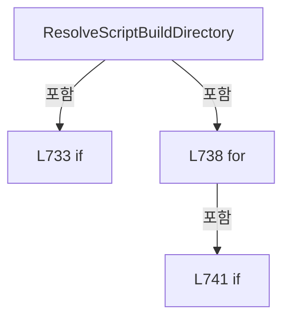

변경 전 점검: 입력/반환 타입, 위 호출자, 예외/취소 경로, 공유 상태와 저장·전송 소비자를 함께 확인합니다. 값의 단위나 물리 방향을 이름만으로 확정하지 않습니다.

### MethodDeclaration `NormalizeScriptBuildName` · L750–762

[Drilling.File/Script/CAutomation1ScriptFile.cs:750–762](https://github.com/kjuws10-rgb/A3Drilling/blob/5aee8e58439c9b455cae7c9593c9be986c3e682e/Drilling.File/Script/CAutomation1ScriptFile.cs#L750-L762)

| 항목 | 실제 추출 값 |
| --- | --- |
| 서명 | string Drilling.File.Script.CAutomation1ScriptFile.NormalizeScriptBuildName(string) |
| 접근/수식자 | Private / private, static |
| 반환/값 타입 | string |
| 소속 타입 | NamedType:Drilling.File.Script.CAutomation1ScriptFile |

입력 계약:

| 이름 | 타입 | 전달 | 선택/기본값 |
| --- | --- | --- | --- |
| value | string | None | False /  |

정적 호출자로 확인된 위치:

| 호출 파일/행 | 호출 표현식 | 런타임 분기 가능 |
| --- | --- | --- |
| [Drilling.File/Script/CAutomation1ScriptFile.cs:731–731](https://github.com/kjuws10-rgb/A3Drilling/blob/5aee8e58439c9b455cae7c9593c9be986c3e682e/Drilling.File/Script/CAutomation1ScriptFile.cs#L731-L731) | NormalizeScriptBuildName | False |

호출하는 대상과 해석 범위:

| 원본 행 | 표현식 | 분석 상태 | 대상/소스 위치 |
| --- | --- | --- | --- |
| 752 | string.IsNullOrWhiteSpace | resolved | bool string.IsNullOrWhiteSpace(string?) |
| 752 | value.Trim | resolved | string string.Trim() |
| 753 | Path.GetInvalidFileNameChars | resolved | char[] System.IO.Path.GetInvalidFileNameChars() |
| 754 | new StringBuilder | resolved | System.Text.StringBuilder.StringBuilder(int) |
| 757 | builder.Append | resolved | System.Text.StringBuilder System.Text.StringBuilder.Append(char) |
| 757 | invalidChars.Contains | resolved | bool System.ReadOnlySpan<char>.Contains<char>(char) |
| 760 | builder.ToString().Trim | resolved | string string.Trim(params System.ReadOnlySpan<char>) |
| 760 | builder.ToString | resolved · 동적 구현 선택 가능 | string System.Text.StringBuilder.ToString() |
| 761 | string.IsNullOrWhiteSpace | resolved | bool string.IsNullOrWhiteSpace(string?) |

본문의 실제 연산·분기·예외·반환 순서(원문 위치 순):

| 원본 행 | 종류 | 주석 해설 |
| --- | --- | --- |
| 752 | call | 함수·델리게이트 또는 객체 생성자를 호출합니다: string.IsNullOrWhiteSpace(value) |
| 752 | call | 함수·델리게이트 또는 객체 생성자를 호출합니다: value.Trim() |
| 752 | conditional-expression | 조건에 따라 결과식을 선택합니다: string.IsNullOrWhiteSpace(value) ? "NO_GLASS_ID" : value.Trim() |
| 752 | local-declaration | 지역 변수를 선언합니다: var text = string.IsNullOrWhiteSpace(value) ? "NO_GLASS_ID" : value.Trim(); |
| 752 | variable-initializer | 변수의 초기값을 지정합니다: text = string.IsNullOrWhiteSpace(value) ? "NO_GLASS_ID" : value.Trim() |
| 753 | call | 함수·델리게이트 또는 객체 생성자를 호출합니다: Path.GetInvalidFileNameChars() |
| 753 | local-declaration | 지역 변수를 선언합니다: var invalidChars = Path.GetInvalidFileNameChars(); |
| 753 | variable-initializer | 변수의 초기값을 지정합니다: invalidChars = Path.GetInvalidFileNameChars() |
| 754 | call | 함수·델리게이트 또는 객체 생성자를 호출합니다: new StringBuilder(text.Length) |
| 754 | local-declaration | 지역 변수를 선언합니다: var builder = new StringBuilder(text.Length); |
| 754 | variable-initializer | 변수의 초기값을 지정합니다: builder = new StringBuilder(text.Length) |
| 755 | foreach | 컬렉션 요소를 순회합니다: foreach (var character in text) |
| 757 | call | 함수·델리게이트 또는 객체 생성자를 호출합니다: builder.Append(character == '-' &#124;&#124; invalidChars.Contains(character) ? '_' : character) |
| 757 | call | 함수·델리게이트 또는 객체 생성자를 호출합니다: invalidChars.Contains(character) |
| 757 | conditional-expression | 조건에 따라 결과식을 선택합니다: character == '-' &#124;&#124; invalidChars.Contains(character) ? '_' : character |
| 760 | call | 함수·델리게이트 또는 객체 생성자를 호출합니다: builder.ToString().Trim(' ', '.') |
| 760 | call | 함수·델리게이트 또는 객체 생성자를 호출합니다: builder.ToString() |
| 760 | local-declaration | 지역 변수를 선언합니다: var normalized = builder.ToString().Trim(' ', '.'); |
| 760 | variable-initializer | 변수의 초기값을 지정합니다: normalized = builder.ToString().Trim(' ', '.') |
| 761 | call | 함수·델리게이트 또는 객체 생성자를 호출합니다: string.IsNullOrWhiteSpace(normalized) |
| 761 | conditional-expression | 조건에 따라 결과식을 선택합니다: string.IsNullOrWhiteSpace(normalized) ? "NO_GLASS_ID" : normalized |
| 761 | return | 호출자에게 값 또는 제어를 반환합니다: return string.IsNullOrWhiteSpace(normalized) ? "NO_GLASS_ID" : normalized; |

제어 구문의 포함 구조(실제 실행 순서/CFG가 아닌 구문 탐색 그림):

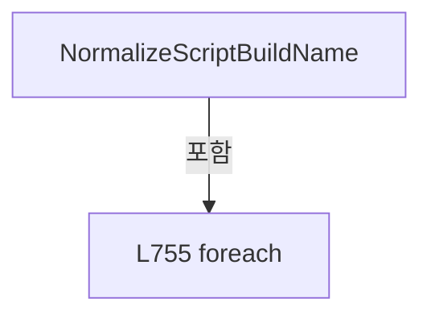

변경 전 점검: 입력/반환 타입, 위 호출자, 예외/취소 경로, 공유 상태와 저장·전송 소비자를 함께 확인합니다. 값의 단위나 물리 방향을 이름만으로 확정하지 않습니다.

### MethodDeclaration `IsBufferedRunDirectory` · L764–768

[Drilling.File/Script/CAutomation1ScriptFile.cs:764–768](https://github.com/kjuws10-rgb/A3Drilling/blob/5aee8e58439c9b455cae7c9593c9be986c3e682e/Drilling.File/Script/CAutomation1ScriptFile.cs#L764-L768)

| 항목 | 실제 추출 값 |
| --- | --- |
| 서명 | bool Drilling.File.Script.CAutomation1ScriptFile.IsBufferedRunDirectory(string) |
| 접근/수식자 | Private / private, static |
| 반환/값 타입 | bool |
| 소속 타입 | NamedType:Drilling.File.Script.CAutomation1ScriptFile |

입력 계약:

| 이름 | 타입 | 전달 | 선택/기본값 |
| --- | --- | --- | --- |
| subDirectoryName | string | None | False /  |

정적 호출자로 확인된 위치:

| 호출 파일/행 | 호출 표현식 | 런타임 분기 가능 |
| --- | --- | --- |
| [Drilling.File/Script/CAutomation1ScriptFile.cs:78–78](https://github.com/kjuws10-rgb/A3Drilling/blob/5aee8e58439c9b455cae7c9593c9be986c3e682e/Drilling.File/Script/CAutomation1ScriptFile.cs#L78-L78) | IsBufferedRunDirectory | False |

호출하는 대상과 해석 범위:

| 원본 행 | 표현식 | 분석 상태 | 대상/소스 위치 |
| --- | --- | --- | --- |
| 766 | string.Equals | resolved | bool string.Equals(string?, string?, System.StringComparison) |
| 767 | subDirectoryName.Replace('\\', '/').Trim('/').Equals | resolved | bool string.Equals(string?, System.StringComparison) |
| 767 | subDirectoryName.Replace('\\', '/').Trim | resolved | string string.Trim(char) |
| 767 | subDirectoryName.Replace | resolved | string string.Replace(char, char) |

본문의 실제 연산·분기·예외·반환 순서(원문 위치 순):

| 원본 행 | 종류 | 주석 해설 |
| --- | --- | --- |
| 766 | call | 함수·델리게이트 또는 객체 생성자를 호출합니다: string.Equals(subDirectoryName, BufferedRunDirectoryName, StringComparison.OrdinalIgnoreCase) |
| 766 | return | 호출자에게 값 또는 제어를 반환합니다: return string.Equals(subDirectoryName, BufferedRunDirectoryName, StringComparison.OrdinalIgnoreCase) &#124;&#124; subDirectoryName.Replace('\\', '/').Trim('/').Equals("ManualMOF/Buffered", StringComparison.OrdinalIgnoreCase); |
| 767 | call | 함수·델리게이트 또는 객체 생성자를 호출합니다: subDirectoryName.Replace('\\', '/').Trim('/').Equals("ManualMOF/Buffered", StringComparison.OrdinalIgnoreCase) |
| 767 | call | 함수·델리게이트 또는 객체 생성자를 호출합니다: subDirectoryName.Replace('\\', '/').Trim('/') |
| 767 | call | 함수·델리게이트 또는 객체 생성자를 호출합니다: subDirectoryName.Replace('\\', '/') |

변경 전 점검: 입력/반환 타입, 위 호출자, 예외/취소 경로, 공유 상태와 저장·전송 소비자를 함께 확인합니다. 값의 단위나 물리 방향을 이름만으로 확정하지 않습니다.

### MethodDeclaration `ValidateActiveHeads` · L770–836

[Drilling.File/Script/CAutomation1ScriptFile.cs:770–836](https://github.com/kjuws10-rgb/A3Drilling/blob/5aee8e58439c9b455cae7c9593c9be986c3e682e/Drilling.File/Script/CAutomation1ScriptFile.cs#L770-L836)

| 항목 | 실제 추출 값 |
| --- | --- |
| 서명 | void Drilling.File.Script.CAutomation1ScriptFile.ValidateActiveHeads(System.Collections.Generic.IReadOnlyList<Drilling.Common.Station.ST_HEAD_PROCESS_PLAN>) |
| 접근/수식자 | Private / private, static |
| 반환/값 타입 | void |
| 소속 타입 | NamedType:Drilling.File.Script.CAutomation1ScriptFile |

입력 계약:

| 이름 | 타입 | 전달 | 선택/기본값 |
| --- | --- | --- | --- |
| activeHeads | System.Collections.Generic.IReadOnlyList<Drilling.Common.Station.ST_HEAD_PROCESS_PLAN> | None | False /  |

정적 호출자로 확인된 위치:

| 호출 파일/행 | 호출 표현식 | 런타임 분기 가능 |
| --- | --- | --- |
| [Drilling.File/Script/CAutomation1ScriptFile.cs:76–76](https://github.com/kjuws10-rgb/A3Drilling/blob/5aee8e58439c9b455cae7c9593c9be986c3e682e/Drilling.File/Script/CAutomation1ScriptFile.cs#L76-L76) | ValidateActiveHeads | False |

호출하는 대상과 해석 범위:

| 원본 행 | 표현식 | 분석 상태 | 대상/소스 위치 |
| --- | --- | --- | --- |
| 792 | activeHeads.GroupBy(SelectHeadNo).Where(ShouldIncludeItem).Select(SelectKey).OrderBy(SelectHeadNo2).ToArray | resolved | int[] System.Collections.Generic.IEnumerable<int>.ToArray<int>() |
| 792 | activeHeads.GroupBy(SelectHeadNo).Where(ShouldIncludeItem).Select(SelectKey).OrderBy | resolved | System.Linq.IOrderedEnumerable<int> System.Collections.Generic.IEnumerable<int>.OrderBy<int, int>(System.Func<int, int>) |
| 792 | activeHeads.GroupBy(SelectHeadNo).Where(ShouldIncludeItem).Select | resolved | System.Collections.Generic.IEnumerable<int> System.Collections.Generic.IEnumerable<System.Linq.IGrouping<int, Drilling.Common.Station.ST_HEAD_PROCESS_PLAN>>.Select<System.Linq.IGrouping<int, Drilling.Common.Station.ST_HEAD_PROCESS_PLAN>, int>(System.Func<System.Linq.IGrouping<int, Drilling.Common.Station.ST_HEAD_PROCESS_PLAN>, int>) |
| 792 | activeHeads.GroupBy(SelectHeadNo).Where | resolved | System.Collections.Generic.IEnumerable<System.Linq.IGrouping<int, Drilling.Common.Station.ST_HEAD_PROCESS_PLAN>> System.Collections.Generic.IEnumerable<System.Linq.IGrouping<int, Drilling.Common.Station.ST_HEAD_PROCESS_PLAN>>.Where<System.Linq.IGrouping<int, Drilling.Common.Station.ST_HEAD_PROCESS_PLAN>>(System.Func<System.Linq.IGrouping<int, Drilling.Common.Station.ST_HEAD_PROCESS_PLAN>, bool>) |
| 792 | activeHeads.GroupBy | resolved | System.Collections.Generic.IEnumerable<System.Linq.IGrouping<int, Drilling.Common.Station.ST_HEAD_PROCESS_PLAN>> System.Collections.Generic.IEnumerable<Drilling.Common.Station.ST_HEAD_PROCESS_PLAN>.GroupBy<Drilling.Common.Station.ST_HEAD_PROCESS_PLAN, int>(System.Func<Drilling.Common.Station.ST_HEAD_PROCESS_PLAN, int>) |
| 795 | new InvalidOperationException | resolved | System.InvalidOperationException.InvalidOperationException(string?) |
| 795 | string.Join | resolved | string string.Join<int>(string?, System.Collections.Generic.IEnumerable<int>) |
| 800 | string.IsNullOrWhiteSpace | resolved | bool string.IsNullOrWhiteSpace(string?) |
| 800 | string.Equals | resolved | bool string.Equals(string?, string?, System.StringComparison) |
| 800 | Path.GetFileName | resolved | string? System.IO.Path.GetFileName(string?) |
| 800 | head.ScriptFileName.IndexOfAny | resolved | int string.IndexOfAny(char[]) |
| 800 | Path.GetInvalidFileNameChars | resolved | char[] System.IO.Path.GetInvalidFileNameChars() |
| 802 | new InvalidOperationException | resolved | System.InvalidOperationException.InvalidOperationException(string?) |
| 805 | IsReservedBuildFileName | resolved | bool Drilling.File.Script.CAutomation1ScriptFile.IsReservedBuildFileName(string) · Drilling.File/Script/CAutomation1ScriptFile.cs:1328 |
| 807 | new InvalidOperationException | resolved | System.InvalidOperationException.InvalidOperationException(string?) |
| 831 | activeHeads.GroupBy(SelectScriptFileName, StringComparer.OrdinalIgnoreCase).Where(ShouldIncludeHead).Select(SelectDuplicateScriptFileName).OrderBy(SelectFileName, StringComparer.OrdinalIgnoreCase).ToArray | resolved | string[] System.Collections.Generic.IEnumerable<string>.ToArray<string>() |
| 831 | activeHeads.GroupBy(SelectScriptFileName, StringComparer.OrdinalIgnoreCase).Where(ShouldIncludeHead).Select(SelectDuplicateScriptFileName).OrderBy | resolved | System.Linq.IOrderedEnumerable<string> System.Collections.Generic.IEnumerable<string>.OrderBy<string, string>(System.Func<string, string>, System.Collections.Generic.IComparer<string>?) |
| 831 | activeHeads.GroupBy(SelectScriptFileName, StringComparer.OrdinalIgnoreCase).Where(ShouldIncludeHead).Select | resolved | System.Collections.Generic.IEnumerable<string> System.Collections.Generic.IEnumerable<System.Linq.IGrouping<string, Drilling.Common.Station.ST_HEAD_PROCESS_PLAN>>.Select<System.Linq.IGrouping<string, Drilling.Common.Station.ST_HEAD_PROCESS_PLAN>, string>(System.Func<System.Linq.IGrouping<string, Drilling.Common.Station.ST_HEAD_PROCESS_PLAN>, string>) |
| 831 | activeHeads.GroupBy(SelectScriptFileName, StringComparer.OrdinalIgnoreCase).Where | resolved | System.Collections.Generic.IEnumerable<System.Linq.IGrouping<string, Drilling.Common.Station.ST_HEAD_PROCESS_PLAN>> System.Collections.Generic.IEnumerable<System.Linq.IGrouping<string, Drilling.Common.Station.ST_HEAD_PROCESS_PLAN>>.Where<System.Linq.IGrouping<string, Drilling.Common.Station.ST_HEAD_PROCESS_PLAN>>(System.Func<System.Linq.IGrouping<string, Drilling.Common.Station.ST_HEAD_PROCESS_PLAN>, bool>) |
| 831 | activeHeads.GroupBy | resolved | System.Collections.Generic.IEnumerable<System.Linq.IGrouping<string, Drilling.Common.Station.ST_HEAD_PROCESS_PLAN>> System.Collections.Generic.IEnumerable<Drilling.Common.Station.ST_HEAD_PROCESS_PLAN>.GroupBy<Drilling.Common.Station.ST_HEAD_PROCESS_PLAN, string>(System.Func<Drilling.Common.Station.ST_HEAD_PROCESS_PLAN, string>, System.Collections.Generic.IEqualityComparer<string>?) |
| 834 | new InvalidOperationException | resolved | System.InvalidOperationException.InvalidOperationException(string?) |
| 834 | string.Join | resolved | string string.Join(string?, params string?[]) |

본문의 실제 연산·분기·예외·반환 순서(원문 위치 순):

| 원본 행 | 종류 | 주석 해설 |
| --- | --- | --- |
| 792 | call | 함수·델리게이트 또는 객체 생성자를 호출합니다: activeHeads.GroupBy(SelectHeadNo).Where(ShouldIncludeItem).Select(SelectKey).OrderBy(SelectHeadNo2).ToArray() |
| 792 | call | 함수·델리게이트 또는 객체 생성자를 호출합니다: activeHeads.GroupBy(SelectHeadNo).Where(ShouldIncludeItem).Select(SelectKey).OrderBy(SelectHeadNo2) |
| 792 | call | 함수·델리게이트 또는 객체 생성자를 호출합니다: activeHeads.GroupBy(SelectHeadNo).Where(ShouldIncludeItem).Select(SelectKey) |
| 792 | call | 함수·델리게이트 또는 객체 생성자를 호출합니다: activeHeads.GroupBy(SelectHeadNo).Where(ShouldIncludeItem) |
| 792 | call | 함수·델리게이트 또는 객체 생성자를 호출합니다: activeHeads.GroupBy(SelectHeadNo) |
| 792 | local-declaration | 지역 변수를 선언합니다: var duplicateHeadNumbers = activeHeads.GroupBy(SelectHeadNo).Where(ShouldIncludeItem).Select(SelectKey).OrderBy(SelectHeadNo2).ToArray(); |
| 792 | variable-initializer | 변수의 초기값을 지정합니다: duplicateHeadNumbers = activeHeads.GroupBy(SelectHeadNo).Where(ShouldIncludeItem).Select(SelectKey).OrderBy(SelectHeadNo2).ToArray() |
| 793 | if | 조건에 따라 분기합니다: if (duplicateHeadNumbers.Length > 0) |
| 795 | call | 함수·델리게이트 또는 객체 생성자를 호출합니다: new InvalidOperationException($"Duplicate active head numbers: {string.Join(", ", duplicateHeadNumbers)}.") |
| 795 | call | 함수·델리게이트 또는 객체 생성자를 호출합니다: string.Join(", ", duplicateHeadNumbers) |
| 795 | throw | 예외를 발생/전달합니다: throw new InvalidOperationException($"Duplicate active head numbers: {string.Join(", ", duplicateHeadNumbers)}."); |
| 798 | foreach | 컬렉션 요소를 순회합니다: foreach (var head in activeHeads) |
| 800 | call | 함수·델리게이트 또는 객체 생성자를 호출합니다: string.IsNullOrWhiteSpace(head.ScriptFileName) |
| 800 | call | 함수·델리게이트 또는 객체 생성자를 호출합니다: string.Equals(Path.GetFileName(head.ScriptFileName), head.ScriptFileName, StringComparison.Ordinal) |
| 800 | call | 함수·델리게이트 또는 객체 생성자를 호출합니다: Path.GetFileName(head.ScriptFileName) |
| 800 | call | 함수·델리게이트 또는 객체 생성자를 호출합니다: head.ScriptFileName.IndexOfAny(Path.GetInvalidFileNameChars()) |
| 800 | call | 함수·델리게이트 또는 객체 생성자를 호출합니다: Path.GetInvalidFileNameChars() |
| 800 | if | 조건에 따라 분기합니다: if (string.IsNullOrWhiteSpace(head.ScriptFileName) &#124;&#124; !string.Equals(Path.GetFileName(head.ScriptFileName), head.ScriptFileName, StringComparison.Ordinal) &#124;&#124; head.ScriptFileName.IndexOfAny(Path.GetInvalidFileNameChars()) >= …) |
| 802 | call | 함수·델리게이트 또는 객체 생성자를 호출합니다: new InvalidOperationException($"H{head.HeadNo:00} has an invalid script file name: {head.ScriptFileName}.") |
| 802 | throw | 예외를 발생/전달합니다: throw new InvalidOperationException($"H{head.HeadNo:00} has an invalid script file name: {head.ScriptFileName}."); |
| 805 | call | 함수·델리게이트 또는 객체 생성자를 호출합니다: IsReservedBuildFileName(head.ScriptFileName) |
| 805 | if | 조건에 따라 분기합니다: if (IsReservedBuildFileName(head.ScriptFileName)) |
| 807 | call | 함수·델리게이트 또는 객체 생성자를 호출합니다: new InvalidOperationException($"H{head.HeadNo:00} script file name conflicts with a reserved build output file: {head.ScriptFileName}.") |
| 807 | throw | 예외를 발생/전달합니다: throw new InvalidOperationException($"H{head.HeadNo:00} script file name conflicts with a reserved build output file: {head.ScriptFileName}."); |
| 831 | call | 함수·델리게이트 또는 객체 생성자를 호출합니다: activeHeads.GroupBy(SelectScriptFileName, StringComparer.OrdinalIgnoreCase).Where(ShouldIncludeHead).Select(SelectDuplicateScriptFileName).OrderBy(SelectFileName, StringComparer.OrdinalIgnoreCase).ToArray() |
| 831 | call | 함수·델리게이트 또는 객체 생성자를 호출합니다: activeHeads.GroupBy(SelectScriptFileName, StringComparer.OrdinalIgnoreCase).Where(ShouldIncludeHead).Select(SelectDuplicateScriptFileName).OrderBy(SelectFileName, StringComparer.OrdinalIgnoreCase) |
| 831 | call | 함수·델리게이트 또는 객체 생성자를 호출합니다: activeHeads.GroupBy(SelectScriptFileName, StringComparer.OrdinalIgnoreCase).Where(ShouldIncludeHead).Select(SelectDuplicateScriptFileName) |
| 831 | call | 함수·델리게이트 또는 객체 생성자를 호출합니다: activeHeads.GroupBy(SelectScriptFileName, StringComparer.OrdinalIgnoreCase).Where(ShouldIncludeHead) |
| 831 | call | 함수·델리게이트 또는 객체 생성자를 호출합니다: activeHeads.GroupBy(SelectScriptFileName, StringComparer.OrdinalIgnoreCase) |
| 831 | local-declaration | 지역 변수를 선언합니다: var duplicateFileNames = activeHeads.GroupBy(SelectScriptFileName, StringComparer.OrdinalIgnoreCase).Where(ShouldIncludeHead).Select(SelectDuplicateScriptFileName).OrderBy(SelectFileName, StringComparer.OrdinalIgnoreCase).ToArray( |
| 831 | variable-initializer | 변수의 초기값을 지정합니다: duplicateFileNames = activeHeads.GroupBy(SelectScriptFileName, StringComparer.OrdinalIgnoreCase).Where(ShouldIncludeHead).Select(SelectDuplicateScriptFileName).OrderBy(SelectFileName, StringComparer.OrdinalIgnoreCase).ToArray() |
| 832 | if | 조건에 따라 분기합니다: if (duplicateFileNames.Length > 0) |
| 834 | call | 함수·델리게이트 또는 객체 생성자를 호출합니다: new InvalidOperationException($"Duplicate active script file names: {string.Join(", ", duplicateFileNames)}.") |
| 834 | call | 함수·델리게이트 또는 객체 생성자를 호출합니다: string.Join(", ", duplicateFileNames) |
| 834 | throw | 예외를 발생/전달합니다: throw new InvalidOperationException($"Duplicate active script file names: {string.Join(", ", duplicateFileNames)}."); |

제어 구문의 포함 구조(실제 실행 순서/CFG가 아닌 구문 탐색 그림):

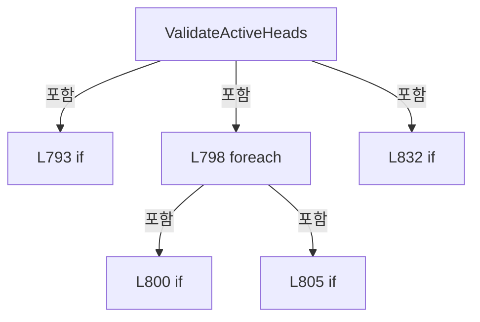

변경 전 점검: 입력/반환 타입, 위 호출자, 예외/취소 경로, 공유 상태와 저장·전송 소비자를 함께 확인합니다. 값의 단위나 물리 방향을 이름만으로 확정하지 않습니다.

### LocalFunctionStatement `SelectHeadNo` · L772–775

[Drilling.File/Script/CAutomation1ScriptFile.cs:772–775](https://github.com/kjuws10-rgb/A3Drilling/blob/5aee8e58439c9b455cae7c9593c9be986c3e682e/Drilling.File/Script/CAutomation1ScriptFile.cs#L772-L775)

| 항목 | 실제 추출 값 |
| --- | --- |
| 서명 | int SelectHeadNo(Drilling.Common.Station.ST_HEAD_PROCESS_PLAN) |
| 접근/수식자 | Private /  |
| 반환/값 타입 | int |
| 소속 타입 | NamedType:Drilling.File.Script.CAutomation1ScriptFile |

입력 계약:

| 이름 | 타입 | 전달 | 선택/기본값 |
| --- | --- | --- | --- |
| head | Drilling.Common.Station.ST_HEAD_PROCESS_PLAN | None | False /  |

현재 부분 분석에서 직접 연결된 호출자는 없습니다. XAML/이벤트/인터페이스·델리게이트·외부 진입을 추가 확인해야 하며, 미사용으로 판정한 것이 아닙니다.

본문의 실제 연산·분기·예외·반환 순서(원문 위치 순):

| 원본 행 | 종류 | 주석 해설 |
| --- | --- | --- |
| 774 | return | 호출자에게 값 또는 제어를 반환합니다: return head.HeadNo; |

변경 전 점검: 입력/반환 타입, 위 호출자, 예외/취소 경로, 공유 상태와 저장·전송 소비자를 함께 확인합니다. 값의 단위나 물리 방향을 이름만으로 확정하지 않습니다.

### LocalFunctionStatement `ShouldIncludeItem` · L777–780

[Drilling.File/Script/CAutomation1ScriptFile.cs:777–780](https://github.com/kjuws10-rgb/A3Drilling/blob/5aee8e58439c9b455cae7c9593c9be986c3e682e/Drilling.File/Script/CAutomation1ScriptFile.cs#L777-L780)

| 항목 | 실제 추출 값 |
| --- | --- |
| 서명 | bool ShouldIncludeItem(System.Linq.IGrouping<int, Drilling.Common.Station.ST_HEAD_PROCESS_PLAN>) |
| 접근/수식자 | Private /  |
| 반환/값 타입 | bool |
| 소속 타입 | NamedType:Drilling.File.Script.CAutomation1ScriptFile |

입력 계약:

| 이름 | 타입 | 전달 | 선택/기본값 |
| --- | --- | --- | --- |
| group | System.Linq.IGrouping<int, Drilling.Common.Station.ST_HEAD_PROCESS_PLAN> | None | False /  |

현재 부분 분석에서 직접 연결된 호출자는 없습니다. XAML/이벤트/인터페이스·델리게이트·외부 진입을 추가 확인해야 하며, 미사용으로 판정한 것이 아닙니다.

호출하는 대상과 해석 범위:

| 원본 행 | 표현식 | 분석 상태 | 대상/소스 위치 |
| --- | --- | --- | --- |
| 779 | group.Count | resolved | int System.Collections.Generic.IEnumerable<Drilling.Common.Station.ST_HEAD_PROCESS_PLAN>.Count<Drilling.Common.Station.ST_HEAD_PROCESS_PLAN>() |

본문의 실제 연산·분기·예외·반환 순서(원문 위치 순):

| 원본 행 | 종류 | 주석 해설 |
| --- | --- | --- |
| 779 | call | 함수·델리게이트 또는 객체 생성자를 호출합니다: group.Count() |
| 779 | return | 호출자에게 값 또는 제어를 반환합니다: return group.Count() > 1; |

변경 전 점검: 입력/반환 타입, 위 호출자, 예외/취소 경로, 공유 상태와 저장·전송 소비자를 함께 확인합니다. 값의 단위나 물리 방향을 이름만으로 확정하지 않습니다.

### LocalFunctionStatement `SelectKey` · L782–785

[Drilling.File/Script/CAutomation1ScriptFile.cs:782–785](https://github.com/kjuws10-rgb/A3Drilling/blob/5aee8e58439c9b455cae7c9593c9be986c3e682e/Drilling.File/Script/CAutomation1ScriptFile.cs#L782-L785)

| 항목 | 실제 추출 값 |
| --- | --- |
| 서명 | int SelectKey(System.Linq.IGrouping<int, Drilling.Common.Station.ST_HEAD_PROCESS_PLAN>) |
| 접근/수식자 | Private /  |
| 반환/값 타입 | int |
| 소속 타입 | NamedType:Drilling.File.Script.CAutomation1ScriptFile |

입력 계약:

| 이름 | 타입 | 전달 | 선택/기본값 |
| --- | --- | --- | --- |
| group | System.Linq.IGrouping<int, Drilling.Common.Station.ST_HEAD_PROCESS_PLAN> | None | False /  |

현재 부분 분석에서 직접 연결된 호출자는 없습니다. XAML/이벤트/인터페이스·델리게이트·외부 진입을 추가 확인해야 하며, 미사용으로 판정한 것이 아닙니다.

본문의 실제 연산·분기·예외·반환 순서(원문 위치 순):

| 원본 행 | 종류 | 주석 해설 |
| --- | --- | --- |
| 784 | return | 호출자에게 값 또는 제어를 반환합니다: return group.Key; |

변경 전 점검: 입력/반환 타입, 위 호출자, 예외/취소 경로, 공유 상태와 저장·전송 소비자를 함께 확인합니다. 값의 단위나 물리 방향을 이름만으로 확정하지 않습니다.

### LocalFunctionStatement `SelectHeadNo2` · L787–790

[Drilling.File/Script/CAutomation1ScriptFile.cs:787–790](https://github.com/kjuws10-rgb/A3Drilling/blob/5aee8e58439c9b455cae7c9593c9be986c3e682e/Drilling.File/Script/CAutomation1ScriptFile.cs#L787-L790)

| 항목 | 실제 추출 값 |
| --- | --- |
| 서명 | int SelectHeadNo2(int) |
| 접근/수식자 | Private /  |
| 반환/값 타입 | int |
| 소속 타입 | NamedType:Drilling.File.Script.CAutomation1ScriptFile |

입력 계약:

| 이름 | 타입 | 전달 | 선택/기본값 |
| --- | --- | --- | --- |
| headNo | int | None | False /  |

현재 부분 분석에서 직접 연결된 호출자는 없습니다. XAML/이벤트/인터페이스·델리게이트·외부 진입을 추가 확인해야 하며, 미사용으로 판정한 것이 아닙니다.

본문의 실제 연산·분기·예외·반환 순서(원문 위치 순):

| 원본 행 | 종류 | 주석 해설 |
| --- | --- | --- |
| 789 | return | 호출자에게 값 또는 제어를 반환합니다: return headNo; |

변경 전 점검: 입력/반환 타입, 위 호출자, 예외/취소 경로, 공유 상태와 저장·전송 소비자를 함께 확인합니다. 값의 단위나 물리 방향을 이름만으로 확정하지 않습니다.

### LocalFunctionStatement `SelectScriptFileName` · L811–814

[Drilling.File/Script/CAutomation1ScriptFile.cs:811–814](https://github.com/kjuws10-rgb/A3Drilling/blob/5aee8e58439c9b455cae7c9593c9be986c3e682e/Drilling.File/Script/CAutomation1ScriptFile.cs#L811-L814)

| 항목 | 실제 추출 값 |
| --- | --- |
| 서명 | string SelectScriptFileName(Drilling.Common.Station.ST_HEAD_PROCESS_PLAN) |
| 접근/수식자 | Private /  |
| 반환/값 타입 | string |
| 소속 타입 | NamedType:Drilling.File.Script.CAutomation1ScriptFile |

입력 계약:

| 이름 | 타입 | 전달 | 선택/기본값 |
| --- | --- | --- | --- |
| head | Drilling.Common.Station.ST_HEAD_PROCESS_PLAN | None | False /  |

현재 부분 분석에서 직접 연결된 호출자는 없습니다. XAML/이벤트/인터페이스·델리게이트·외부 진입을 추가 확인해야 하며, 미사용으로 판정한 것이 아닙니다.

본문의 실제 연산·분기·예외·반환 순서(원문 위치 순):

| 원본 행 | 종류 | 주석 해설 |
| --- | --- | --- |
| 813 | return | 호출자에게 값 또는 제어를 반환합니다: return head.ScriptFileName; |

변경 전 점검: 입력/반환 타입, 위 호출자, 예외/취소 경로, 공유 상태와 저장·전송 소비자를 함께 확인합니다. 값의 단위나 물리 방향을 이름만으로 확정하지 않습니다.

### LocalFunctionStatement `ShouldIncludeHead` · L816–819

[Drilling.File/Script/CAutomation1ScriptFile.cs:816–819](https://github.com/kjuws10-rgb/A3Drilling/blob/5aee8e58439c9b455cae7c9593c9be986c3e682e/Drilling.File/Script/CAutomation1ScriptFile.cs#L816-L819)

| 항목 | 실제 추출 값 |
| --- | --- |
| 서명 | bool ShouldIncludeHead(System.Linq.IGrouping<string, Drilling.Common.Station.ST_HEAD_PROCESS_PLAN>) |
| 접근/수식자 | Private /  |
| 반환/값 타입 | bool |
| 소속 타입 | NamedType:Drilling.File.Script.CAutomation1ScriptFile |

입력 계약:

| 이름 | 타입 | 전달 | 선택/기본값 |
| --- | --- | --- | --- |
| group | System.Linq.IGrouping<string, Drilling.Common.Station.ST_HEAD_PROCESS_PLAN> | None | False /  |

현재 부분 분석에서 직접 연결된 호출자는 없습니다. XAML/이벤트/인터페이스·델리게이트·외부 진입을 추가 확인해야 하며, 미사용으로 판정한 것이 아닙니다.

호출하는 대상과 해석 범위:

| 원본 행 | 표현식 | 분석 상태 | 대상/소스 위치 |
| --- | --- | --- | --- |
| 818 | group.Count | resolved | int System.Collections.Generic.IEnumerable<Drilling.Common.Station.ST_HEAD_PROCESS_PLAN>.Count<Drilling.Common.Station.ST_HEAD_PROCESS_PLAN>() |

본문의 실제 연산·분기·예외·반환 순서(원문 위치 순):

| 원본 행 | 종류 | 주석 해설 |
| --- | --- | --- |
| 818 | call | 함수·델리게이트 또는 객체 생성자를 호출합니다: group.Count() |
| 818 | return | 호출자에게 값 또는 제어를 반환합니다: return group.Count() > 1; |

변경 전 점검: 입력/반환 타입, 위 호출자, 예외/취소 경로, 공유 상태와 저장·전송 소비자를 함께 확인합니다. 값의 단위나 물리 방향을 이름만으로 확정하지 않습니다.

### LocalFunctionStatement `SelectDuplicateScriptFileName` · L821–824

[Drilling.File/Script/CAutomation1ScriptFile.cs:821–824](https://github.com/kjuws10-rgb/A3Drilling/blob/5aee8e58439c9b455cae7c9593c9be986c3e682e/Drilling.File/Script/CAutomation1ScriptFile.cs#L821-L824)

| 항목 | 실제 추출 값 |
| --- | --- |
| 서명 | string SelectDuplicateScriptFileName(System.Linq.IGrouping<string, Drilling.Common.Station.ST_HEAD_PROCESS_PLAN>) |
| 접근/수식자 | Private /  |
| 반환/값 타입 | string |
| 소속 타입 | NamedType:Drilling.File.Script.CAutomation1ScriptFile |

입력 계약:

| 이름 | 타입 | 전달 | 선택/기본값 |
| --- | --- | --- | --- |
| group | System.Linq.IGrouping<string, Drilling.Common.Station.ST_HEAD_PROCESS_PLAN> | None | False /  |

현재 부분 분석에서 직접 연결된 호출자는 없습니다. XAML/이벤트/인터페이스·델리게이트·외부 진입을 추가 확인해야 하며, 미사용으로 판정한 것이 아닙니다.

본문의 실제 연산·분기·예외·반환 순서(원문 위치 순):

| 원본 행 | 종류 | 주석 해설 |
| --- | --- | --- |
| 823 | return | 호출자에게 값 또는 제어를 반환합니다: return group.Key; |

변경 전 점검: 입력/반환 타입, 위 호출자, 예외/취소 경로, 공유 상태와 저장·전송 소비자를 함께 확인합니다. 값의 단위나 물리 방향을 이름만으로 확정하지 않습니다.

### LocalFunctionStatement `SelectFileName` · L826–829

[Drilling.File/Script/CAutomation1ScriptFile.cs:826–829](https://github.com/kjuws10-rgb/A3Drilling/blob/5aee8e58439c9b455cae7c9593c9be986c3e682e/Drilling.File/Script/CAutomation1ScriptFile.cs#L826-L829)

| 항목 | 실제 추출 값 |
| --- | --- |
| 서명 | string SelectFileName(string) |
| 접근/수식자 | Private /  |
| 반환/값 타입 | string |
| 소속 타입 | NamedType:Drilling.File.Script.CAutomation1ScriptFile |

입력 계약:

| 이름 | 타입 | 전달 | 선택/기본값 |
| --- | --- | --- | --- |
| fileName | string | None | False /  |

현재 부분 분석에서 직접 연결된 호출자는 없습니다. XAML/이벤트/인터페이스·델리게이트·외부 진입을 추가 확인해야 하며, 미사용으로 판정한 것이 아닙니다.

본문의 실제 연산·분기·예외·반환 순서(원문 위치 순):

| 원본 행 | 종류 | 주석 해설 |
| --- | --- | --- |
| 828 | return | 호출자에게 값 또는 제어를 반환합니다: return fileName; |

변경 전 점검: 입력/반환 타입, 위 호출자, 예외/취소 경로, 공유 상태와 저장·전송 소비자를 함께 확인합니다. 값의 단위나 물리 방향을 이름만으로 확정하지 않습니다.

### MethodDeclaration `AppendStartFollowMoves` · L838–884

[Drilling.File/Script/CAutomation1ScriptFile.cs:838–884](https://github.com/kjuws10-rgb/A3Drilling/blob/5aee8e58439c9b455cae7c9593c9be986c3e682e/Drilling.File/Script/CAutomation1ScriptFile.cs#L838-L884)

| 항목 | 실제 추출 값 |
| --- | --- |
| 서명 | void Drilling.File.Script.CAutomation1ScriptFile.AppendStartFollowMoves(System.Collections.Generic.List<string>, System.Collections.Generic.IReadOnlyDictionary<string, string>, Drilling.Common.Station.ST_HEAD_PROCESS_PLAN, string, string, string, double, bool) |
| 접근/수식자 | Private / private, static |
| 반환/값 타입 | void |
| 소속 타입 | NamedType:Drilling.File.Script.CAutomation1ScriptFile |

입력 계약:

| 이름 | 타입 | 전달 | 선택/기본값 |
| --- | --- | --- | --- |
| lines | System.Collections.Generic.List<string> | None | False /  |
| common | System.Collections.Generic.IReadOnlyDictionary<string, string> | None | False /  |
| head | Drilling.Common.Station.ST_HEAD_PROCESS_PLAN | None | False /  |
| xAxis | string | None | False /  |
| yAxis | string | None | False /  |
| encoderAxis | string | None | False /  |
| encoderScale | double | None | False /  |
| encoderFeedbackFlip | bool | None | False /  |

정적 호출자로 확인된 위치:

| 호출 파일/행 | 호출 표현식 | 런타임 분기 가능 |
| --- | --- | --- |
| [Drilling.File/Script/CAutomation1ScriptFile.cs:512–512](https://github.com/kjuws10-rgb/A3Drilling/blob/5aee8e58439c9b455cae7c9593c9be986c3e682e/Drilling.File/Script/CAutomation1ScriptFile.cs#L512-L512) | AppendStartFollowMoves | False |

호출하는 대상과 해석 범위:

| 원본 행 | 표현식 | 분석 상태 | 대상/소스 위치 |
| --- | --- | --- | --- |
| 856 | Math.Abs | resolved | double System.Math.Abs(double) |
| 856 | Math.Abs | resolved | double System.Math.Abs(double) |
| 861 | Math.Abs | resolved | double System.Math.Abs(double) |
| 861 | ReadDouble | resolved | double Drilling.File.Script.CAutomation1ScriptFile.ReadDouble(System.Collections.Generic.IReadOnlyDictionary<string, string>, double, params string[]) · Drilling.File/Script/CAutomation1ScriptFile.cs:1155 |
| 867 | Math.Abs | resolved | double System.Math.Abs(double) |
| 868 | CScannerAxisTransform.Read(common, head.HeadNo).Apply | resolved | (double X, double Y) Drilling.Common.Recipe.ST_SCANNER_AXIS_TRANSFORM.Apply(double, double) · Drilling.Common/Recipe/CShotCoordinatePlanBuilder.cs:1210 |
| 868 | CScannerAxisTransform.Read | resolved | Drilling.Common.Recipe.ST_SCANNER_AXIS_TRANSFORM Drilling.Common.Recipe.CScannerAxisTransform.Read(System.Collections.Generic.IReadOnlyDictionary<string, string>, int) · Drilling.Common/Recipe/CShotCoordinatePlanBuilder.cs:1239 |
| 869 | Math.Max | resolved | double System.Math.Max(double, double) |
| 869 | Math.Abs | resolved | double System.Math.Abs(double) |
| 869 | Math.Abs | resolved | double System.Math.Abs(double) |
| 881 | lines.Add | resolved | void System.Collections.Generic.List<string>.Add(string) |
| 881 | Format | resolved | string Drilling.File.Script.CAutomation1ScriptFile.Format(double) · Drilling.File/Script/CAutomation1ScriptFile.cs:1283 |
| 881 | Format | resolved | string Drilling.File.Script.CAutomation1ScriptFile.Format(double) · Drilling.File/Script/CAutomation1ScriptFile.cs:1283 |
| 882 | AppendEncoderWait | resolved | void Drilling.File.Script.CAutomation1ScriptFile.AppendEncoderWait(System.Collections.Generic.List<string>, string, double, bool) · Drilling.File/Script/CAutomation1ScriptFile.cs:955 |

본문의 실제 연산·분기·예외·반환 순서(원문 위치 순):

| 원본 행 | 종류 | 주석 해설 |
| --- | --- | --- |
| 849 | if | 조건에 따라 분기합니다: if (head.Shots.Count == 0) |
| 851 | return | 호출자에게 값 또는 제어를 반환합니다: return; |
| 854 | local-declaration | 지역 변수를 선언합니다: var firstPoint = head.Shots[0]; |
| 854 | variable-initializer | 변수의 초기값을 지정합니다: firstPoint = head.Shots[0] |
| 855 | local-declaration | 지역 변수를 선언합니다: var targetWaitPosition = firstPoint.EncoderWaitPosition; |
| 855 | variable-initializer | 변수의 초기값을 지정합니다: targetWaitPosition = firstPoint.EncoderWaitPosition |
| 856 | call | 함수·델리게이트 또는 객체 생성자를 호출합니다: Math.Abs(encoderScale) |
| 856 | call | 함수·델리게이트 또는 객체 생성자를 호출합니다: Math.Abs(targetWaitPosition) |
| 856 | if | 조건에 따라 분기합니다: if (Math.Abs(encoderScale) <= 0.000001 &#124;&#124; Math.Abs(targetWaitPosition) <= 0.000001) |
| 858 | return | 호출자에게 값 또는 제어를 반환합니다: return; |
| 861 | call | 함수·델리게이트 또는 객체 생성자를 호출합니다: Math.Abs(ReadDouble(common, 5.0, "SCAN_START_JUMP_STEP", "MOF_START_JUMP_STEP", "SCAN_JUMP_SCALE")) |
| 861 | call | 함수·델리게이트 또는 객체 생성자를 호출합니다: ReadDouble(common, 5.0, "SCAN_START_JUMP_STEP", "MOF_START_JUMP_STEP", "SCAN_JUMP_SCALE") |
| 861 | local-declaration | 지역 변수를 선언합니다: var jumpStep = Math.Abs(ReadDouble(common, 5.0, "SCAN_START_JUMP_STEP", "MOF_START_JUMP_STEP", "SCAN_JUMP_SCALE")); |
| 861 | variable-initializer | 변수의 초기값을 지정합니다: jumpStep = Math.Abs(ReadDouble(common, 5.0, "SCAN_START_JUMP_STEP", "MOF_START_JUMP_STEP", "SCAN_JUMP_SCALE")) |
| 862 | if | 조건에 따라 분기합니다: if (jumpStep <= 0.000001) |
| 864 | return | 호출자에게 값 또는 제어를 반환합니다: return; |
| 867 | call | 함수·델리게이트 또는 객체 생성자를 호출합니다: Math.Abs(encoderScale) |
| 867 | local-declaration | 지역 변수를 선언합니다: var targetScanDistance = -(targetWaitPosition / Math.Abs(encoderScale)); |
| 867 | variable-initializer | 변수의 초기값을 지정합니다: targetScanDistance = -(targetWaitPosition / Math.Abs(encoderScale)) |
| 868 | call | 함수·델리게이트 또는 객체 생성자를 호출합니다: CScannerAxisTransform.Read(common, head.HeadNo).Apply(0.0, targetScanDistance) |
| 868 | call | 함수·델리게이트 또는 객체 생성자를 호출합니다: CScannerAxisTransform.Read(common, head.HeadNo) |
| 868 | local-declaration | 지역 변수를 선언합니다: var targetScannerMove = CScannerAxisTransform.Read(common, head.HeadNo).Apply(0.0, targetScanDistance); |
| 868 | variable-initializer | 변수의 초기값을 지정합니다: targetScannerMove = CScannerAxisTransform.Read(common, head.HeadNo).Apply(0.0, targetScanDistance) |
| 869 | call | 함수·델리게이트 또는 객체 생성자를 호출합니다: Math.Max(Math.Abs(targetScannerMove.X), Math.Abs(targetScannerMove.Y)) |
| 869 | call | 함수·델리게이트 또는 객체 생성자를 호출합니다: Math.Abs(targetScannerMove.X) |
| 869 | call | 함수·델리게이트 또는 객체 생성자를 호출합니다: Math.Abs(targetScannerMove.Y) |
| 869 | local-declaration | 지역 변수를 선언합니다: var targetDistance = Math.Max(Math.Abs(targetScannerMove.X), Math.Abs(targetScannerMove.Y)); |
| 869 | variable-initializer | 변수의 초기값을 지정합니다: targetDistance = Math.Max(Math.Abs(targetScannerMove.X), Math.Abs(targetScannerMove.Y)) |
| 870 | if | 조건에 따라 분기합니다: if (targetDistance <= 0.000001) |
| 872 | return | 호출자에게 값 또는 제어를 반환합니다: return; |
| 875 | compound-assignment-or-event-subscription | 복합 대입 또는 이벤트 구독/해지 표현입니다: distance += jumpStep |
| 875 | variable-initializer | 변수의 초기값을 지정합니다: distance = jumpStep |
| 875 | for | 초기화·조건·증감이 있는 반복입니다: for (var distance = jumpStep; distance < targetDistance; distance += jumpStep) |
| 877 | local-declaration | 지역 변수를 선언합니다: var ratio = distance / targetDistance; |
| 877 | variable-initializer | 변수의 초기값을 지정합니다: ratio = distance / targetDistance |
| 878 | local-declaration | 지역 변수를 선언합니다: var scannerX = targetScannerMove.X * ratio; |
| 878 | variable-initializer | 변수의 초기값을 지정합니다: scannerX = targetScannerMove.X * ratio |
| 879 | local-declaration | 지역 변수를 선언합니다: var scannerY = targetScannerMove.Y * ratio; |
| 879 | variable-initializer | 변수의 초기값을 지정합니다: scannerY = targetScannerMove.Y * ratio |
| 880 | local-declaration | 지역 변수를 선언합니다: var waitPosition = targetWaitPosition * ratio; |
| 880 | variable-initializer | 변수의 초기값을 지정합니다: waitPosition = targetWaitPosition * ratio |
| 881 | call | 함수·델리게이트 또는 객체 생성자를 호출합니다: lines.Add($"MoveRapid([{xAxis},{yAxis}], [{Format(scannerX)},{Format(scannerY)}])") |
| 881 | call | 함수·델리게이트 또는 객체 생성자를 호출합니다: Format(scannerX) |
| 881 | call | 함수·델리게이트 또는 객체 생성자를 호출합니다: Format(scannerY) |
| 882 | call | 함수·델리게이트 또는 객체 생성자를 호출합니다: AppendEncoderWait(lines, encoderAxis, waitPosition, encoderFeedbackFlip) |

제어 구문의 포함 구조(실제 실행 순서/CFG가 아닌 구문 탐색 그림):

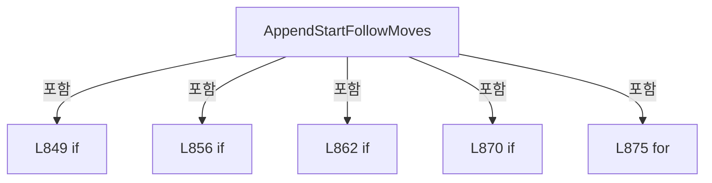

변경 전 점검: 입력/반환 타입, 위 호출자, 예외/취소 경로, 공유 상태와 저장·전송 소비자를 함께 확인합니다. 값의 단위나 물리 방향을 이름만으로 확정하지 않습니다.

### MethodDeclaration `AppendFollowTransitionMoves` · L886–932

[Drilling.File/Script/CAutomation1ScriptFile.cs:886–932](https://github.com/kjuws10-rgb/A3Drilling/blob/5aee8e58439c9b455cae7c9593c9be986c3e682e/Drilling.File/Script/CAutomation1ScriptFile.cs#L886-L932)

| 항목 | 실제 추출 값 |
| --- | --- |
| 서명 | void Drilling.File.Script.CAutomation1ScriptFile.AppendFollowTransitionMoves(System.Collections.Generic.List<string>, System.Collections.Generic.IReadOnlyDictionary<string, string>, Drilling.Common.Station.ST_HEAD_PROCESS_PLAN, string, string, string, bool, Drilling.Common.Recipe.ST_HEAD_SHOT_POINT, Drilling.Common.Recipe.ST_HEAD_SHOT_POINT) |
| 접근/수식자 | Private / private, static |
| 반환/값 타입 | void |
| 소속 타입 | NamedType:Drilling.File.Script.CAutomation1ScriptFile |

입력 계약:

| 이름 | 타입 | 전달 | 선택/기본값 |
| --- | --- | --- | --- |
| lines | System.Collections.Generic.List<string> | None | False /  |
| common | System.Collections.Generic.IReadOnlyDictionary<string, string> | None | False /  |
| head | Drilling.Common.Station.ST_HEAD_PROCESS_PLAN | None | False /  |
| xAxis | string | None | False /  |
| yAxis | string | None | False /  |
| encoderAxis | string | None | False /  |
| encoderFeedbackFlip | bool | None | False /  |
| previousPoint | Drilling.Common.Recipe.ST_HEAD_SHOT_POINT | None | False /  |
| targetPoint | Drilling.Common.Recipe.ST_HEAD_SHOT_POINT | None | False /  |

정적 호출자로 확인된 위치:

| 호출 파일/행 | 호출 표현식 | 런타임 분기 가능 |
| --- | --- | --- |
| [Drilling.File/Script/CAutomation1ScriptFile.cs:522–522](https://github.com/kjuws10-rgb/A3Drilling/blob/5aee8e58439c9b455cae7c9593c9be986c3e682e/Drilling.File/Script/CAutomation1ScriptFile.cs#L522-L522) | AppendFollowTransitionMoves | False |

호출하는 대상과 해석 범위:

| 원본 행 | 표현식 | 분석 상태 | 대상/소스 위치 |
| --- | --- | --- | --- |
| 898 | Math.Abs | resolved | double System.Math.Abs(double) |
| 898 | ReadDouble | resolved | double Drilling.File.Script.CAutomation1ScriptFile.ReadDouble(System.Collections.Generic.IReadOnlyDictionary<string, string>, double, params string[]) · Drilling.File/Script/CAutomation1ScriptFile.cs:1155 |
| 904 | Math.Abs | resolved | double System.Math.Abs(double) |
| 904 | ReadDouble | resolved | double Drilling.File.Script.CAutomation1ScriptFile.ReadDouble(System.Collections.Generic.IReadOnlyDictionary<string, string>, double, System.Collections.Generic.IEnumerable<string>) · Drilling.File/Script/CAutomation1ScriptFile.cs:1160 |
| 904 | CreateHeadKeys | resolved | System.Collections.Generic.IReadOnlyList<string> Drilling.File.Script.CAutomation1ScriptFile.CreateHeadKeys(int, params string[]) · Drilling.File/Script/CAutomation1ScriptFile.cs:1100 |
| 911 | ResolveFollowAxis | resolved | Drilling.File.Script.CAutomation1ScriptFile.EN_SCRIPT_FOLLOW_AXIS Drilling.File.Script.CAutomation1ScriptFile.ResolveFollowAxis(Drilling.Common.Recipe.ST_SCANNER_AXIS_TRANSFORM) · Drilling.File/Script/CAutomation1ScriptFile.cs:934 |
| 911 | CScannerAxisTransform.Read | resolved | Drilling.Common.Recipe.ST_SCANNER_AXIS_TRANSFORM Drilling.Common.Recipe.CScannerAxisTransform.Read(System.Collections.Generic.IReadOnlyDictionary<string, string>, int) · Drilling.Common/Recipe/CShotCoordinatePlanBuilder.cs:1239 |
| 912 | ReadFollowAxisPosition | resolved | double Drilling.File.Script.CAutomation1ScriptFile.ReadFollowAxisPosition(Drilling.Common.Recipe.ST_HEAD_SHOT_POINT, Drilling.File.Script.CAutomation1ScriptFile.EN_SCRIPT_FOLLOW_AXIS) · Drilling.File/Script/CAutomation1ScriptFile.cs:945 |
| 913 | ReadFollowAxisPosition | resolved | double Drilling.File.Script.CAutomation1ScriptFile.ReadFollowAxisPosition(Drilling.Common.Recipe.ST_HEAD_SHOT_POINT, Drilling.File.Script.CAutomation1ScriptFile.EN_SCRIPT_FOLLOW_AXIS) · Drilling.File/Script/CAutomation1ScriptFile.cs:945 |
| 914 | Math.Abs | resolved | double System.Math.Abs(double) |
| 929 | lines.Add | resolved | void System.Collections.Generic.List<string>.Add(string) |
| 929 | Format | resolved | string Drilling.File.Script.CAutomation1ScriptFile.Format(double) · Drilling.File/Script/CAutomation1ScriptFile.cs:1283 |
| 929 | Format | resolved | string Drilling.File.Script.CAutomation1ScriptFile.Format(double) · Drilling.File/Script/CAutomation1ScriptFile.cs:1283 |
| 930 | AppendEncoderWait | resolved | void Drilling.File.Script.CAutomation1ScriptFile.AppendEncoderWait(System.Collections.Generic.List<string>, string, double, bool) · Drilling.File/Script/CAutomation1ScriptFile.cs:955 |

본문의 실제 연산·분기·예외·반환 순서(원문 위치 순):

| 원본 행 | 종류 | 주석 해설 |
| --- | --- | --- |
| 898 | call | 함수·델리게이트 또는 객체 생성자를 호출합니다: Math.Abs(ReadDouble(common, 5.0, "SCAN_START_JUMP_STEP", "MOF_START_JUMP_STEP", "SCAN_JUMP_SCALE")) |
| 898 | call | 함수·델리게이트 또는 객체 생성자를 호출합니다: ReadDouble(common, 5.0, "SCAN_START_JUMP_STEP", "MOF_START_JUMP_STEP", "SCAN_JUMP_SCALE") |
| 898 | local-declaration | 지역 변수를 선언합니다: var jumpStep = Math.Abs(ReadDouble(common, 5.0, "SCAN_START_JUMP_STEP", "MOF_START_JUMP_STEP", "SCAN_JUMP_SCALE")); |
| 898 | variable-initializer | 변수의 초기값을 지정합니다: jumpStep = Math.Abs(ReadDouble(common, 5.0, "SCAN_START_JUMP_STEP", "MOF_START_JUMP_STEP", "SCAN_JUMP_SCALE")) |
| 899 | if | 조건에 따라 분기합니다: if (jumpStep <= 0.000001) |
| 901 | return | 호출자에게 값 또는 제어를 반환합니다: return; |
| 904 | call | 함수·델리게이트 또는 객체 생성자를 호출합니다: Math.Abs(ReadDouble(common, 110.0, CreateHeadKeys(head.HeadNo, "SCAN_FIELD_WIDTH_X", "HEAD_FIELD_WIDTH_X"))) |
| 904 | call | 함수·델리게이트 또는 객체 생성자를 호출합니다: ReadDouble(common, 110.0, CreateHeadKeys(head.HeadNo, "SCAN_FIELD_WIDTH_X", "HEAD_FIELD_WIDTH_X")) |
| 904 | call | 함수·델리게이트 또는 객체 생성자를 호출합니다: CreateHeadKeys(head.HeadNo, "SCAN_FIELD_WIDTH_X", "HEAD_FIELD_WIDTH_X") |
| 904 | local-declaration | 지역 변수를 선언합니다: var scanFieldWidth = Math.Abs(ReadDouble(common, 110.0, CreateHeadKeys(head.HeadNo, "SCAN_FIELD_WIDTH_X", "HEAD_FIELD_WIDTH_X"))); |
| 904 | variable-initializer | 변수의 초기값을 지정합니다: scanFieldWidth = Math.Abs(ReadDouble(common, 110.0, CreateHeadKeys(head.HeadNo, "SCAN_FIELD_WIDTH_X", "HEAD_FIELD_WIDTH_X"))) |
| 905 | if | 조건에 따라 분기합니다: if (scanFieldWidth <= 0.000001) |
| 907 | assignment | 값을 대상에 대입합니다: scanFieldWidth = 110.0 |
| 910 | local-declaration | 지역 변수를 선언합니다: var transitionLimit = scanFieldWidth / 2.0; |
| 910 | variable-initializer | 변수의 초기값을 지정합니다: transitionLimit = scanFieldWidth / 2.0 |
| 911 | call | 함수·델리게이트 또는 객체 생성자를 호출합니다: ResolveFollowAxis(CScannerAxisTransform.Read(common, head.HeadNo)) |
| 911 | call | 함수·델리게이트 또는 객체 생성자를 호출합니다: CScannerAxisTransform.Read(common, head.HeadNo) |
| 911 | local-declaration | 지역 변수를 선언합니다: var followAxis = ResolveFollowAxis(CScannerAxisTransform.Read(common, head.HeadNo)); |
| 911 | variable-initializer | 변수의 초기값을 지정합니다: followAxis = ResolveFollowAxis(CScannerAxisTransform.Read(common, head.HeadNo)) |
| 912 | call | 함수·델리게이트 또는 객체 생성자를 호출합니다: ReadFollowAxisPosition(previousPoint, followAxis) |
| 912 | local-declaration | 지역 변수를 선언합니다: var previousFollowPosition = ReadFollowAxisPosition(previousPoint, followAxis); |
| 912 | variable-initializer | 변수의 초기값을 지정합니다: previousFollowPosition = ReadFollowAxisPosition(previousPoint, followAxis) |
| 913 | call | 함수·델리게이트 또는 객체 생성자를 호출합니다: ReadFollowAxisPosition(targetPoint, followAxis) |
| 913 | local-declaration | 지역 변수를 선언합니다: var targetFollowPosition = ReadFollowAxisPosition(targetPoint, followAxis); |
| 913 | variable-initializer | 변수의 초기값을 지정합니다: targetFollowPosition = ReadFollowAxisPosition(targetPoint, followAxis) |
| 914 | call | 함수·델리게이트 또는 객체 생성자를 호출합니다: Math.Abs(targetFollowPosition - previousFollowPosition) |
| 914 | local-declaration | 지역 변수를 선언합니다: var followDistance = Math.Abs(targetFollowPosition - previousFollowPosition); |
| 914 | variable-initializer | 변수의 초기값을 지정합니다: followDistance = Math.Abs(targetFollowPosition - previousFollowPosition) |
| 915 | if | 조건에 따라 분기합니다: if (followDistance <= transitionLimit) |
| 917 | return | 호출자에게 값 또는 제어를 반환합니다: return; |
| 920 | local-declaration | 지역 변수를 선언합니다: var deltaX = targetPoint.ScannerGx - previousPoint.ScannerGx; |
| 920 | variable-initializer | 변수의 초기값을 지정합니다: deltaX = targetPoint.ScannerGx - previousPoint.ScannerGx |
| 921 | local-declaration | 지역 변수를 선언합니다: var deltaY = targetPoint.ScannerGy - previousPoint.ScannerGy; |
| 921 | variable-initializer | 변수의 초기값을 지정합니다: deltaY = targetPoint.ScannerGy - previousPoint.ScannerGy |
| 922 | local-declaration | 지역 변수를 선언합니다: var deltaWaitPosition = targetPoint.EncoderWaitPosition - previousPoint.EncoderWaitPosition; |
| 922 | variable-initializer | 변수의 초기값을 지정합니다: deltaWaitPosition = targetPoint.EncoderWaitPosition - previousPoint.EncoderWaitPosition |
| 923 | compound-assignment-or-event-subscription | 복합 대입 또는 이벤트 구독/해지 표현입니다: distance += jumpStep |
| 923 | variable-initializer | 변수의 초기값을 지정합니다: distance = jumpStep |
| 923 | for | 초기화·조건·증감이 있는 반복입니다: for (var distance = jumpStep; distance < followDistance; distance += jumpStep) |
| 925 | local-declaration | 지역 변수를 선언합니다: var ratio = distance / followDistance; |
| 925 | variable-initializer | 변수의 초기값을 지정합니다: ratio = distance / followDistance |
| 926 | local-declaration | 지역 변수를 선언합니다: var scannerX = previousPoint.ScannerGx + (deltaX * ratio); |
| 926 | variable-initializer | 변수의 초기값을 지정합니다: scannerX = previousPoint.ScannerGx + (deltaX * ratio) |
| 927 | local-declaration | 지역 변수를 선언합니다: var scannerY = previousPoint.ScannerGy + (deltaY * ratio); |
| 927 | variable-initializer | 변수의 초기값을 지정합니다: scannerY = previousPoint.ScannerGy + (deltaY * ratio) |
| 928 | local-declaration | 지역 변수를 선언합니다: var waitPosition = previousPoint.EncoderWaitPosition + (deltaWaitPosition * ratio); |
| 928 | variable-initializer | 변수의 초기값을 지정합니다: waitPosition = previousPoint.EncoderWaitPosition + (deltaWaitPosition * ratio) |
| 929 | call | 함수·델리게이트 또는 객체 생성자를 호출합니다: lines.Add($"MoveRapid([{xAxis},{yAxis}], [{Format(scannerX)},{Format(scannerY)}])") |
| 929 | call | 함수·델리게이트 또는 객체 생성자를 호출합니다: Format(scannerX) |
| 929 | call | 함수·델리게이트 또는 객체 생성자를 호출합니다: Format(scannerY) |
| 930 | call | 함수·델리게이트 또는 객체 생성자를 호출합니다: AppendEncoderWait(lines, encoderAxis, waitPosition, encoderFeedbackFlip) |

제어 구문의 포함 구조(실제 실행 순서/CFG가 아닌 구문 탐색 그림):

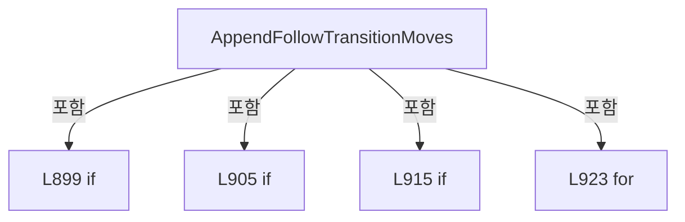

변경 전 점검: 입력/반환 타입, 위 호출자, 예외/취소 경로, 공유 상태와 저장·전송 소비자를 함께 확인합니다. 값의 단위나 물리 방향을 이름만으로 확정하지 않습니다.

### MethodDeclaration `ResolveFollowAxis` · L934–943

[Drilling.File/Script/CAutomation1ScriptFile.cs:934–943](https://github.com/kjuws10-rgb/A3Drilling/blob/5aee8e58439c9b455cae7c9593c9be986c3e682e/Drilling.File/Script/CAutomation1ScriptFile.cs#L934-L943)

| 항목 | 실제 추출 값 |
| --- | --- |
| 서명 | Drilling.File.Script.CAutomation1ScriptFile.EN_SCRIPT_FOLLOW_AXIS Drilling.File.Script.CAutomation1ScriptFile.ResolveFollowAxis(Drilling.Common.Recipe.ST_SCANNER_AXIS_TRANSFORM) |
| 접근/수식자 | Private / private, static |
| 반환/값 타입 | Drilling.File.Script.CAutomation1ScriptFile.EN_SCRIPT_FOLLOW_AXIS |
| 소속 타입 | NamedType:Drilling.File.Script.CAutomation1ScriptFile |

입력 계약:

| 이름 | 타입 | 전달 | 선택/기본값 |
| --- | --- | --- | --- |
| transform | Drilling.Common.Recipe.ST_SCANNER_AXIS_TRANSFORM | None | False /  |

정적 호출자로 확인된 위치:

| 호출 파일/행 | 호출 표현식 | 런타임 분기 가능 |
| --- | --- | --- |
| [Drilling.File/Script/CAutomation1ScriptFile.cs:911–911](https://github.com/kjuws10-rgb/A3Drilling/blob/5aee8e58439c9b455cae7c9593c9be986c3e682e/Drilling.File/Script/CAutomation1ScriptFile.cs#L911-L911) | ResolveFollowAxis | False |

호출하는 대상과 해석 범위:

| 원본 행 | 표현식 | 분석 상태 | 대상/소스 위치 |
| --- | --- | --- | --- |
| 936 | transform.Apply | resolved | (double X, double Y) Drilling.Common.Recipe.ST_SCANNER_AXIS_TRANSFORM.Apply(double, double) · Drilling.Common/Recipe/CShotCoordinatePlanBuilder.cs:1210 |
| 937 | Math.Abs | resolved | double System.Math.Abs(double) |
| 937 | Math.Abs | resolved | double System.Math.Abs(double) |

본문의 실제 연산·분기·예외·반환 순서(원문 위치 순):

| 원본 행 | 종류 | 주석 해설 |
| --- | --- | --- |
| 936 | call | 함수·델리게이트 또는 객체 생성자를 호출합니다: transform.Apply(0.0, 1.0) |
| 936 | local-declaration | 지역 변수를 선언합니다: var followDirection = transform.Apply(0.0, 1.0); |
| 936 | variable-initializer | 변수의 초기값을 지정합니다: followDirection = transform.Apply(0.0, 1.0) |
| 937 | call | 함수·델리게이트 또는 객체 생성자를 호출합니다: Math.Abs(followDirection.X) |
| 937 | call | 함수·델리게이트 또는 객체 생성자를 호출합니다: Math.Abs(followDirection.Y) |
| 937 | if | 조건에 따라 분기합니다: if (Math.Abs(followDirection.X) >= Math.Abs(followDirection.Y)) |
| 939 | return | 호출자에게 값 또는 제어를 반환합니다: return EN_SCRIPT_FOLLOW_AXIS.X; |
| 942 | return | 호출자에게 값 또는 제어를 반환합니다: return EN_SCRIPT_FOLLOW_AXIS.Y; |

제어 구문의 포함 구조(실제 실행 순서/CFG가 아닌 구문 탐색 그림):

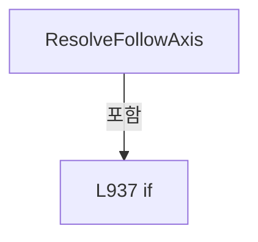

변경 전 점검: 입력/반환 타입, 위 호출자, 예외/취소 경로, 공유 상태와 저장·전송 소비자를 함께 확인합니다. 값의 단위나 물리 방향을 이름만으로 확정하지 않습니다.

### MethodDeclaration `ReadFollowAxisPosition` · L945–953

[Drilling.File/Script/CAutomation1ScriptFile.cs:945–953](https://github.com/kjuws10-rgb/A3Drilling/blob/5aee8e58439c9b455cae7c9593c9be986c3e682e/Drilling.File/Script/CAutomation1ScriptFile.cs#L945-L953)

| 항목 | 실제 추출 값 |
| --- | --- |
| 서명 | double Drilling.File.Script.CAutomation1ScriptFile.ReadFollowAxisPosition(Drilling.Common.Recipe.ST_HEAD_SHOT_POINT, Drilling.File.Script.CAutomation1ScriptFile.EN_SCRIPT_FOLLOW_AXIS) |
| 접근/수식자 | Private / private, static |
| 반환/값 타입 | double |
| 소속 타입 | NamedType:Drilling.File.Script.CAutomation1ScriptFile |

입력 계약:

| 이름 | 타입 | 전달 | 선택/기본값 |
| --- | --- | --- | --- |
| point | Drilling.Common.Recipe.ST_HEAD_SHOT_POINT | None | False /  |
| followAxis | Drilling.File.Script.CAutomation1ScriptFile.EN_SCRIPT_FOLLOW_AXIS | None | False /  |

정적 호출자로 확인된 위치:

| 호출 파일/행 | 호출 표현식 | 런타임 분기 가능 |
| --- | --- | --- |
| [Drilling.File/Script/CAutomation1ScriptFile.cs:912–912](https://github.com/kjuws10-rgb/A3Drilling/blob/5aee8e58439c9b455cae7c9593c9be986c3e682e/Drilling.File/Script/CAutomation1ScriptFile.cs#L912-L912) | ReadFollowAxisPosition | False |
| [Drilling.File/Script/CAutomation1ScriptFile.cs:913–913](https://github.com/kjuws10-rgb/A3Drilling/blob/5aee8e58439c9b455cae7c9593c9be986c3e682e/Drilling.File/Script/CAutomation1ScriptFile.cs#L913-L913) | ReadFollowAxisPosition | False |

본문의 실제 연산·분기·예외·반환 순서(원문 위치 순):

| 원본 행 | 종류 | 주석 해설 |
| --- | --- | --- |
| 947 | if | 조건에 따라 분기합니다: if (followAxis == EN_SCRIPT_FOLLOW_AXIS.X) |
| 949 | return | 호출자에게 값 또는 제어를 반환합니다: return point.ScannerGx; |
| 952 | return | 호출자에게 값 또는 제어를 반환합니다: return point.ScannerGy; |

제어 구문의 포함 구조(실제 실행 순서/CFG가 아닌 구문 탐색 그림):

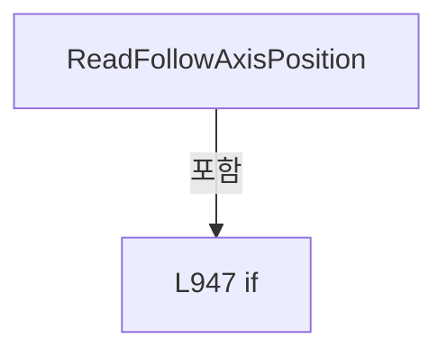

변경 전 점검: 입력/반환 타입, 위 호출자, 예외/취소 경로, 공유 상태와 저장·전송 소비자를 함께 확인합니다. 값의 단위나 물리 방향을 이름만으로 확정하지 않습니다.

### MethodDeclaration `AppendEncoderWait` · L955–965

[Drilling.File/Script/CAutomation1ScriptFile.cs:955–965](https://github.com/kjuws10-rgb/A3Drilling/blob/5aee8e58439c9b455cae7c9593c9be986c3e682e/Drilling.File/Script/CAutomation1ScriptFile.cs#L955-L965)

| 항목 | 실제 추출 값 |
| --- | --- |
| 서명 | void Drilling.File.Script.CAutomation1ScriptFile.AppendEncoderWait(System.Collections.Generic.List<string>, string, double, bool) |
| 접근/수식자 | Private / private, static |
| 반환/값 타입 | void |
| 소속 타입 | NamedType:Drilling.File.Script.CAutomation1ScriptFile |

입력 계약:

| 이름 | 타입 | 전달 | 선택/기본값 |
| --- | --- | --- | --- |
| lines | System.Collections.Generic.List<string> | None | False /  |
| encoderAxis | string | None | False /  |
| waitPosition | double | None | False /  |
| encoderFeedbackFlip | bool | None | False /  |

정적 호출자로 확인된 위치:

| 호출 파일/행 | 호출 표현식 | 런타임 분기 가능 |
| --- | --- | --- |
| [Drilling.File/Script/CAutomation1ScriptFile.cs:539–539](https://github.com/kjuws10-rgb/A3Drilling/blob/5aee8e58439c9b455cae7c9593c9be986c3e682e/Drilling.File/Script/CAutomation1ScriptFile.cs#L539-L539) | AppendEncoderWait | False |
| [Drilling.File/Script/CAutomation1ScriptFile.cs:882–882](https://github.com/kjuws10-rgb/A3Drilling/blob/5aee8e58439c9b455cae7c9593c9be986c3e682e/Drilling.File/Script/CAutomation1ScriptFile.cs#L882-L882) | AppendEncoderWait | False |
| [Drilling.File/Script/CAutomation1ScriptFile.cs:930–930](https://github.com/kjuws10-rgb/A3Drilling/blob/5aee8e58439c9b455cae7c9593c9be986c3e682e/Drilling.File/Script/CAutomation1ScriptFile.cs#L930-L930) | AppendEncoderWait | False |

호출하는 대상과 해석 범위:

| 원본 행 | 표현식 | 분석 상태 | 대상/소스 위치 |
| --- | --- | --- | --- |
| 957 | Math.Abs | resolved | double System.Math.Abs(double) |
| 964 | lines.Add | resolved | void System.Collections.Generic.List<string>.Add(string) |
| 964 | Format | resolved | string Drilling.File.Script.CAutomation1ScriptFile.Format(double) · Drilling.File/Script/CAutomation1ScriptFile.cs:1283 |

본문의 실제 연산·분기·예외·반환 순서(원문 위치 순):

| 원본 행 | 종류 | 주석 해설 |
| --- | --- | --- |
| 957 | call | 함수·델리게이트 또는 객체 생성자를 호출합니다: Math.Abs(waitPosition) |
| 957 | if | 조건에 따라 분기합니다: if (Math.Abs(waitPosition) <= 0.000001) |
| 959 | return | 호출자에게 값 또는 제어를 반환합니다: return; |
| 962 | conditional-expression | 조건에 따라 결과식을 선택합니다: encoderFeedbackFlip ? -waitPosition : waitPosition |
| 962 | local-declaration | 지역 변수를 선언합니다: var feedbackWaitPosition = encoderFeedbackFlip ? -waitPosition : waitPosition; |
| 962 | variable-initializer | 변수의 초기값을 지정합니다: feedbackWaitPosition = encoderFeedbackFlip ? -waitPosition : waitPosition |
| 963 | conditional-expression | 조건에 따라 결과식을 선택합니다: feedbackWaitPosition >= 0.0 ? ">=" : "<=" |
| 963 | local-declaration | 지역 변수를 선언합니다: var comparison = feedbackWaitPosition >= 0.0 ? ">=" : "<="; |
| 963 | variable-initializer | 변수의 초기값을 지정합니다: comparison = feedbackWaitPosition >= 0.0 ? ">=" : "<=" |
| 964 | call | 함수·델리게이트 또는 객체 생성자를 호출합니다: lines.Add($"wait(StatusGetAxisItem({encoderAxis}, AxisStatusItem.AuxiliaryFeedback) {comparison} {Format(feedbackWaitPosition)})") |
| 964 | call | 함수·델리게이트 또는 객체 생성자를 호출합니다: Format(feedbackWaitPosition) |

제어 구문의 포함 구조(실제 실행 순서/CFG가 아닌 구문 탐색 그림):

```mermaid
flowchart TD
 M["AppendEncoderWait"]
 N0["L957 if"]
 M -->|포함| N0
```

변경 전 점검: 입력/반환 타입, 위 호출자, 예외/취소 경로, 공유 상태와 저장·전송 소비자를 함께 확인합니다. 값의 단위나 물리 방향을 이름만으로 확정하지 않습니다.

### MethodDeclaration `AppendHeadShotList` · L967–987

[Drilling.File/Script/CAutomation1ScriptFile.cs:967–987](https://github.com/kjuws10-rgb/A3Drilling/blob/5aee8e58439c9b455cae7c9593c9be986c3e682e/Drilling.File/Script/CAutomation1ScriptFile.cs#L967-L987)

| 항목 | 실제 추출 값 |
| --- | --- |
| 서명 | void Drilling.File.Script.CAutomation1ScriptFile.AppendHeadShotList(System.Collections.Generic.List<string>, Drilling.Common.Station.ST_HEAD_PROCESS_PLAN) |
| 접근/수식자 | Private / private, static |
| 반환/값 타입 | void |
| 소속 타입 | NamedType:Drilling.File.Script.CAutomation1ScriptFile |

입력 계약:

| 이름 | 타입 | 전달 | 선택/기본값 |
| --- | --- | --- | --- |
| lines | System.Collections.Generic.List<string> | None | False /  |
| head | Drilling.Common.Station.ST_HEAD_PROCESS_PLAN | None | False /  |

정적 호출자로 확인된 위치:

| 호출 파일/행 | 호출 표현식 | 런타임 분기 가능 |
| --- | --- | --- |
| [Drilling.File/Script/CAutomation1ScriptFile.cs:382–382](https://github.com/kjuws10-rgb/A3Drilling/blob/5aee8e58439c9b455cae7c9593c9be986c3e682e/Drilling.File/Script/CAutomation1ScriptFile.cs#L382-L382) | AppendHeadShotList | False |

호출하는 대상과 해석 범위:

| 원본 행 | 표현식 | 분석 상태 | 대상/소스 위치 |
| --- | --- | --- | --- |
| 969 | lines.Add | resolved | void System.Collections.Generic.List<string>.Add(string) |
| 980 | head.Shots.GroupBy(SelectCellNo).OrderBy | resolved | System.Linq.IOrderedEnumerable<System.Linq.IGrouping<int, Drilling.Common.Recipe.ST_HEAD_SHOT_POINT>> System.Collections.Generic.IEnumerable<System.Linq.IGrouping<int, Drilling.Common.Recipe.ST_HEAD_SHOT_POINT>>.OrderBy<System.Linq.IGrouping<int, Drilling.Common.Recipe.ST_HEAD_SHOT_POINT>, int>(System.Func<System.Linq.IGrouping<int, Drilling.Common.Recipe.ST_HEAD_SHOT_POINT>, int>) |
| 980 | head.Shots.GroupBy | resolved | System.Collections.Generic.IEnumerable<System.Linq.IGrouping<int, Drilling.Common.Recipe.ST_HEAD_SHOT_POINT>> System.Collections.Generic.IEnumerable<Drilling.Common.Recipe.ST_HEAD_SHOT_POINT>.GroupBy<Drilling.Common.Recipe.ST_HEAD_SHOT_POINT, int>(System.Func<Drilling.Common.Recipe.ST_HEAD_SHOT_POINT, int>) |
| 982 | cell.Select(FormatShotName).Chunk | resolved | System.Collections.Generic.IEnumerable<string[]> System.Collections.Generic.IEnumerable<string>.Chunk<string>(int) |
| 982 | cell.Select | resolved | System.Collections.Generic.IEnumerable<string> System.Collections.Generic.IEnumerable<Drilling.Common.Recipe.ST_HEAD_SHOT_POINT>.Select<Drilling.Common.Recipe.ST_HEAD_SHOT_POINT, string>(System.Func<Drilling.Common.Recipe.ST_HEAD_SHOT_POINT, string>) |
| 984 | lines.Add | resolved | void System.Collections.Generic.List<string>.Add(string) |
| 984 | string.Join | resolved | string string.Join(string?, params string?[]) |

본문의 실제 연산·분기·예외·반환 순서(원문 위치 순):

| 원본 행 | 종류 | 주석 해설 |
| --- | --- | --- |
| 969 | call | 함수·델리게이트 또는 객체 생성자를 호출합니다: lines.Add("ShotList:") |
| 980 | call | 함수·델리게이트 또는 객체 생성자를 호출합니다: head.Shots.GroupBy(SelectCellNo).OrderBy(SelectKey) |
| 980 | call | 함수·델리게이트 또는 객체 생성자를 호출합니다: head.Shots.GroupBy(SelectCellNo) |
| 980 | foreach | 컬렉션 요소를 순회합니다: foreach (var cell in head.Shots.GroupBy(SelectCellNo).OrderBy(SelectKey)) |
| 982 | call | 함수·델리게이트 또는 객체 생성자를 호출합니다: cell.Select(FormatShotName).Chunk(12) |
| 982 | call | 함수·델리게이트 또는 객체 생성자를 호출합니다: cell.Select(FormatShotName) |
| 982 | foreach | 컬렉션 요소를 순회합니다: foreach (var shotNames in cell.Select(FormatShotName).Chunk(12)) |
| 984 | call | 함수·델리게이트 또는 객체 생성자를 호출합니다: lines.Add($"CELL{cell.Key:00}: {string.Join(", ", shotNames)}") |
| 984 | call | 함수·델리게이트 또는 객체 생성자를 호출합니다: string.Join(", ", shotNames) |

제어 구문의 포함 구조(실제 실행 순서/CFG가 아닌 구문 탐색 그림):

```mermaid
flowchart TD
 M["AppendHeadShotList"]
 N0["L980 foreach"]
 M -->|포함| N0
 N1["L982 foreach"]
 N0 -->|포함| N1
```

변경 전 점검: 입력/반환 타입, 위 호출자, 예외/취소 경로, 공유 상태와 저장·전송 소비자를 함께 확인합니다. 값의 단위나 물리 방향을 이름만으로 확정하지 않습니다.

### LocalFunctionStatement `SelectCellNo` · L970–973

[Drilling.File/Script/CAutomation1ScriptFile.cs:970–973](https://github.com/kjuws10-rgb/A3Drilling/blob/5aee8e58439c9b455cae7c9593c9be986c3e682e/Drilling.File/Script/CAutomation1ScriptFile.cs#L970-L973)

| 항목 | 실제 추출 값 |
| --- | --- |
| 서명 | int SelectCellNo(Drilling.Common.Recipe.ST_HEAD_SHOT_POINT) |
| 접근/수식자 | Private /  |
| 반환/값 타입 | int |
| 소속 타입 | NamedType:Drilling.File.Script.CAutomation1ScriptFile |

입력 계약:

| 이름 | 타입 | 전달 | 선택/기본값 |
| --- | --- | --- | --- |
| point | Drilling.Common.Recipe.ST_HEAD_SHOT_POINT | None | False /  |

현재 부분 분석에서 직접 연결된 호출자는 없습니다. XAML/이벤트/인터페이스·델리게이트·외부 진입을 추가 확인해야 하며, 미사용으로 판정한 것이 아닙니다.

본문의 실제 연산·분기·예외·반환 순서(원문 위치 순):

| 원본 행 | 종류 | 주석 해설 |
| --- | --- | --- |
| 972 | return | 호출자에게 값 또는 제어를 반환합니다: return point.CellNo; |

변경 전 점검: 입력/반환 타입, 위 호출자, 예외/취소 경로, 공유 상태와 저장·전송 소비자를 함께 확인합니다. 값의 단위나 물리 방향을 이름만으로 확정하지 않습니다.

### LocalFunctionStatement `SelectKey` · L975–978

[Drilling.File/Script/CAutomation1ScriptFile.cs:975–978](https://github.com/kjuws10-rgb/A3Drilling/blob/5aee8e58439c9b455cae7c9593c9be986c3e682e/Drilling.File/Script/CAutomation1ScriptFile.cs#L975-L978)

| 항목 | 실제 추출 값 |
| --- | --- |
| 서명 | int SelectKey(System.Linq.IGrouping<int, Drilling.Common.Recipe.ST_HEAD_SHOT_POINT>) |
| 접근/수식자 | Private /  |
| 반환/값 타입 | int |
| 소속 타입 | NamedType:Drilling.File.Script.CAutomation1ScriptFile |

입력 계약:

| 이름 | 타입 | 전달 | 선택/기본값 |
| --- | --- | --- | --- |
| cell | System.Linq.IGrouping<int, Drilling.Common.Recipe.ST_HEAD_SHOT_POINT> | None | False /  |

현재 부분 분석에서 직접 연결된 호출자는 없습니다. XAML/이벤트/인터페이스·델리게이트·외부 진입을 추가 확인해야 하며, 미사용으로 판정한 것이 아닙니다.

본문의 실제 연산·분기·예외·반환 순서(원문 위치 순):

| 원본 행 | 종류 | 주석 해설 |
| --- | --- | --- |
| 977 | return | 호출자에게 값 또는 제어를 반환합니다: return cell.Key; |

변경 전 점검: 입력/반환 타입, 위 호출자, 예외/취소 경로, 공유 상태와 저장·전송 소비자를 함께 확인합니다. 값의 단위나 물리 방향을 이름만으로 확정하지 않습니다.

### MethodDeclaration `FormatShotName` · L989–992

[Drilling.File/Script/CAutomation1ScriptFile.cs:989–992](https://github.com/kjuws10-rgb/A3Drilling/blob/5aee8e58439c9b455cae7c9593c9be986c3e682e/Drilling.File/Script/CAutomation1ScriptFile.cs#L989-L992)

| 항목 | 실제 추출 값 |
| --- | --- |
| 서명 | string Drilling.File.Script.CAutomation1ScriptFile.FormatShotName(Drilling.Common.Recipe.ST_HEAD_SHOT_POINT) |
| 접근/수식자 | Private / private, static |
| 반환/값 타입 | string |
| 소속 타입 | NamedType:Drilling.File.Script.CAutomation1ScriptFile |

입력 계약:

| 이름 | 타입 | 전달 | 선택/기본값 |
| --- | --- | --- | --- |
| point | Drilling.Common.Recipe.ST_HEAD_SHOT_POINT | None | False /  |

정적 호출자로 확인된 위치:

| 호출 파일/행 | 호출 표현식 | 런타임 분기 가능 |
| --- | --- | --- |
| [Drilling.File/Script/CAutomation1ScriptFile.cs:274–274](https://github.com/kjuws10-rgb/A3Drilling/blob/5aee8e58439c9b455cae7c9593c9be986c3e682e/Drilling.File/Script/CAutomation1ScriptFile.cs#L274-L274) | FormatShotName | False |

호출하는 대상과 해석 범위:

| 원본 행 | 표현식 | 분석 상태 | 대상/소스 위치 |
| --- | --- | --- | --- |
| 991 | FormatRowName | resolved | string Drilling.File.Script.CAutomation1ScriptFile.FormatRowName(int) · Drilling.File/Script/CAutomation1ScriptFile.cs:994 |
| 991 | Math.Max | resolved | int System.Math.Max(int, int) |

본문의 실제 연산·분기·예외·반환 순서(원문 위치 순):

| 원본 행 | 종류 | 주석 해설 |
| --- | --- | --- |
| 991 | call | 함수·델리게이트 또는 객체 생성자를 호출합니다: FormatRowName(point.GroupRow) |
| 991 | call | 함수·델리게이트 또는 객체 생성자를 호출합니다: Math.Max(1, point.GroupColumn + 1) |
| 991 | return | 호출자에게 값 또는 제어를 반환합니다: return $"{FormatRowName(point.GroupRow)}{Math.Max(1, point.GroupColumn + 1):00}"; |

변경 전 점검: 입력/반환 타입, 위 호출자, 예외/취소 경로, 공유 상태와 저장·전송 소비자를 함께 확인합니다. 값의 단위나 물리 방향을 이름만으로 확정하지 않습니다.

### MethodDeclaration `FormatRowName` · L994–1005

[Drilling.File/Script/CAutomation1ScriptFile.cs:994–1005](https://github.com/kjuws10-rgb/A3Drilling/blob/5aee8e58439c9b455cae7c9593c9be986c3e682e/Drilling.File/Script/CAutomation1ScriptFile.cs#L994-L1005)

| 항목 | 실제 추출 값 |
| --- | --- |
| 서명 | string Drilling.File.Script.CAutomation1ScriptFile.FormatRowName(int) |
| 접근/수식자 | Private / private, static |
| 반환/값 타입 | string |
| 소속 타입 | NamedType:Drilling.File.Script.CAutomation1ScriptFile |

입력 계약:

| 이름 | 타입 | 전달 | 선택/기본값 |
| --- | --- | --- | --- |
| zeroBasedRow | int | None | False /  |

정적 호출자로 확인된 위치:

| 호출 파일/행 | 호출 표현식 | 런타임 분기 가능 |
| --- | --- | --- |
| [Drilling.File/Script/CAutomation1ScriptFile.cs:991–991](https://github.com/kjuws10-rgb/A3Drilling/blob/5aee8e58439c9b455cae7c9593c9be986c3e682e/Drilling.File/Script/CAutomation1ScriptFile.cs#L991-L991) | FormatRowName | False |

호출하는 대상과 해석 범위:

| 원본 행 | 표현식 | 분석 상태 | 대상/소스 위치 |
| --- | --- | --- | --- |
| 996 | Math.Max | resolved | int System.Math.Max(int, int) |

본문의 실제 연산·분기·예외·반환 순서(원문 위치 순):

| 원본 행 | 종류 | 주석 해설 |
| --- | --- | --- |
| 996 | call | 함수·델리게이트 또는 객체 생성자를 호출합니다: Math.Max(0, zeroBasedRow) |
| 996 | local-declaration | 지역 변수를 선언합니다: var row = Math.Max(0, zeroBasedRow); |
| 996 | variable-initializer | 변수의 초기값을 지정합니다: row = Math.Max(0, zeroBasedRow) |
| 997 | local-declaration | 지역 변수를 선언합니다: var name = ""; |
| 997 | variable-initializer | 변수의 초기값을 지정합니다: name = "" |
| 998 | do | 본문 실행 후 반복 조건을 확인합니다: do ... while (row >= 0) |
| 1000 | assignment | 값을 대상에 대입합니다: name = (char)('A' + (row % 26)) + name |
| 1001 | assignment | 값을 대상에 대입합니다: row = (row / 26) - 1 |
| 1004 | return | 호출자에게 값 또는 제어를 반환합니다: return name; |

제어 구문의 포함 구조(실제 실행 순서/CFG가 아닌 구문 탐색 그림):

```mermaid
flowchart TD
 M["FormatRowName"]
 N0["L998 do"]
 M -->|포함| N0
```

변경 전 점검: 입력/반환 타입, 위 호출자, 예외/취소 경로, 공유 상태와 저장·전송 소비자를 함께 확인합니다. 값의 단위나 물리 방향을 이름만으로 확정하지 않습니다.

### MethodDeclaration `AppendDefaultSetting` · L1007–1022

[Drilling.File/Script/CAutomation1ScriptFile.cs:1007–1022](https://github.com/kjuws10-rgb/A3Drilling/blob/5aee8e58439c9b455cae7c9593c9be986c3e682e/Drilling.File/Script/CAutomation1ScriptFile.cs#L1007-L1022)

| 항목 | 실제 추출 값 |
| --- | --- |
| 서명 | void Drilling.File.Script.CAutomation1ScriptFile.AppendDefaultSetting(System.Collections.Generic.List<string>, System.Collections.Generic.IReadOnlyDictionary<string, string>) |
| 접근/수식자 | Private / private, static |
| 반환/값 타입 | void |
| 소속 타입 | NamedType:Drilling.File.Script.CAutomation1ScriptFile |

입력 계약:

| 이름 | 타입 | 전달 | 선택/기본값 |
| --- | --- | --- | --- |
| lines | System.Collections.Generic.List<string> | None | False /  |
| parameters | System.Collections.Generic.IReadOnlyDictionary<string, string> | None | False /  |

현재 부분 분석에서 직접 연결된 호출자는 없습니다. XAML/이벤트/인터페이스·델리게이트·외부 진입을 추가 확인해야 하며, 미사용으로 판정한 것이 아닙니다.

호출하는 대상과 해석 범위:

| 원본 행 | 표현식 | 분석 상태 | 대상/소스 위치 |
| --- | --- | --- | --- |
| 1009 | ReadDouble | resolved | double Drilling.File.Script.CAutomation1ScriptFile.ReadDouble(System.Collections.Generic.IReadOnlyDictionary<string, string>, double, params string[]) · Drilling.File/Script/CAutomation1ScriptFile.cs:1155 |
| 1010 | ReadInt | resolved | int Drilling.File.Script.CAutomation1ScriptFile.ReadInt(System.Collections.Generic.IReadOnlyDictionary<string, string>, int, params string[]) · Drilling.File/Script/CAutomation1ScriptFile.cs:1217 |
| 1011 | lines.Add | resolved | void System.Collections.Generic.List<string>.Add(string) |
| 1012 | lines.Add | resolved | void System.Collections.Generic.List<string>.Add(string) |
| 1013 | lines.Add | resolved | void System.Collections.Generic.List<string>.Add(string) |
| 1014 | lines.Add | resolved | void System.Collections.Generic.List<string>.Add(string) |
| 1015 | lines.Add | resolved | void System.Collections.Generic.List<string>.Add(string) |
| 1015 | Format | resolved | string Drilling.File.Script.CAutomation1ScriptFile.Format(double) · Drilling.File/Script/CAutomation1ScriptFile.cs:1283 |
| 1018 | lines.Add | resolved | void System.Collections.Generic.List<string>.Add(string) |
| 1021 | lines.Add | resolved | void System.Collections.Generic.List<string>.Add(string) |

본문의 실제 연산·분기·예외·반환 순서(원문 위치 순):

| 원본 행 | 종류 | 주석 해설 |
| --- | --- | --- |
| 1009 | call | 함수·델리게이트 또는 객체 생성자를 호출합니다: ReadDouble(parameters, 500000.0, "SCANNER_ACC") |
| 1009 | local-declaration | 지역 변수를 선언합니다: var scannerAcc = ReadDouble(parameters, 500000.0, "SCANNER_ACC"); |
| 1009 | variable-initializer | 변수의 초기값을 지정합니다: scannerAcc = ReadDouble(parameters, 500000.0, "SCANNER_ACC") |
| 1010 | call | 함수·델리게이트 또는 객체 생성자를 호출합니다: ReadInt(parameters, 0, "SCAN_MOTION_UPDATE_RATE") |
| 1010 | local-declaration | 지역 변수를 선언합니다: var motionUpdateRate = ReadInt(parameters, 0, "SCAN_MOTION_UPDATE_RATE"); |
| 1010 | variable-initializer | 변수의 초기값을 지정합니다: motionUpdateRate = ReadInt(parameters, 0, "SCAN_MOTION_UPDATE_RATE") |
| 1011 | call | 함수·델리게이트 또는 객체 생성자를 호출합니다: lines.Add("IfovOff()") |
| 1012 | call | 함수·델리게이트 또는 객체 생성자를 호출합니다: lines.Add("SetupTaskDistanceUnits(DistanceUnits.Primary)") |
| 1013 | call | 함수·델리게이트 또는 객체 생성자를 호출합니다: lines.Add("SetupTaskTimeUnits(TimeUnits.Seconds)") |
| 1014 | call | 함수·델리게이트 또는 객체 생성자를 호출합니다: lines.Add("SetupCoordinatedRampType(RampType.Sine)") |
| 1015 | call | 함수·델리게이트 또는 객체 생성자를 호출합니다: lines.Add($"SetupCoordinatedRampValue(RampMode.Rate, {Format(scannerAcc)})") |
| 1015 | call | 함수·델리게이트 또는 객체 생성자를 호출합니다: Format(scannerAcc) |
| 1016 | if | 조건에 따라 분기합니다: if (motionUpdateRate > 0) |
| 1018 | call | 함수·델리게이트 또는 객체 생성자를 호출합니다: lines.Add($"ParameterSetTaskValue(TaskGetIndex(), TaskParameter.MotionUpdateRate, {motionUpdateRate})") |
| 1021 | call | 함수·델리게이트 또는 객체 생성자를 호출합니다: lines.Add("") |

제어 구문의 포함 구조(실제 실행 순서/CFG가 아닌 구문 탐색 그림):

```mermaid
flowchart TD
 M["AppendDefaultSetting"]
 N0["L1016 if"]
 M -->|포함| N0
```

변경 전 점검: 입력/반환 타입, 위 호출자, 예외/취소 경로, 공유 상태와 저장·전송 소비자를 함께 확인합니다. 값의 단위나 물리 방향을 이름만으로 확정하지 않습니다.

### MethodDeclaration `AppendScriptEnd` · L1024–1032

[Drilling.File/Script/CAutomation1ScriptFile.cs:1024–1032](https://github.com/kjuws10-rgb/A3Drilling/blob/5aee8e58439c9b455cae7c9593c9be986c3e682e/Drilling.File/Script/CAutomation1ScriptFile.cs#L1024-L1032)

| 항목 | 실제 추출 값 |
| --- | --- |
| 서명 | void Drilling.File.Script.CAutomation1ScriptFile.AppendScriptEnd(System.Collections.Generic.List<string>, System.Collections.Generic.IReadOnlyDictionary<string, string>) |
| 접근/수식자 | Private / private, static |
| 반환/값 타입 | void |
| 소속 타입 | NamedType:Drilling.File.Script.CAutomation1ScriptFile |

입력 계약:

| 이름 | 타입 | 전달 | 선택/기본값 |
| --- | --- | --- | --- |
| lines | System.Collections.Generic.List<string> | None | False /  |
| parameters | System.Collections.Generic.IReadOnlyDictionary<string, string> | None | False /  |

현재 부분 분석에서 직접 연결된 호출자는 없습니다. XAML/이벤트/인터페이스·델리게이트·외부 진입을 추가 확인해야 하며, 미사용으로 판정한 것이 아닙니다.

호출하는 대상과 해석 범위:

| 원본 행 | 표현식 | 분석 상태 | 대상/소스 위치 |
| --- | --- | --- | --- |
| 1026 | ReadBool | resolved | bool Drilling.File.Script.CAutomation1ScriptFile.ReadBool(System.Collections.Generic.IReadOnlyDictionary<string, string>, bool, params string[]) · Drilling.File/Script/CAutomation1ScriptFile.cs:1240 |
| 1028 | lines.Add | resolved | void System.Collections.Generic.List<string>.Add(string) |
| 1031 | lines.Add | resolved | void System.Collections.Generic.List<string>.Add(string) |

본문의 실제 연산·분기·예외·반환 순서(원문 위치 순):

| 원본 행 | 종류 | 주석 해설 |
| --- | --- | --- |
| 1026 | call | 함수·델리게이트 또는 객체 생성자를 호출합니다: ReadBool(parameters, false, "A1_BUFFERED_RUN") |
| 1026 | if | 조건에 따라 분기합니다: if (ReadBool(parameters, false, "A1_BUFFERED_RUN")) |
| 1028 | call | 함수·델리게이트 또는 객체 생성자를 호출합니다: lines.Add("CommandQueueStop()") |
| 1031 | call | 함수·델리게이트 또는 객체 생성자를 호출합니다: lines.Add("end") |

제어 구문의 포함 구조(실제 실행 순서/CFG가 아닌 구문 탐색 그림):

```mermaid
flowchart TD
 M["AppendScriptEnd"]
 N0["L1026 if"]
 M -->|포함| N0
```

변경 전 점검: 입력/반환 타입, 위 호출자, 예외/취소 경로, 공유 상태와 저장·전송 소비자를 함께 확인합니다. 값의 단위나 물리 방향을 이름만으로 확정하지 않습니다.

### MethodDeclaration `CalculateLaserPeriod` · L1034–1037

[Drilling.File/Script/CAutomation1ScriptFile.cs:1034–1037](https://github.com/kjuws10-rgb/A3Drilling/blob/5aee8e58439c9b455cae7c9593c9be986c3e682e/Drilling.File/Script/CAutomation1ScriptFile.cs#L1034-L1037)

| 항목 | 실제 추출 값 |
| --- | --- |
| 서명 | double Drilling.File.Script.CAutomation1ScriptFile.CalculateLaserPeriod(double) |
| 접근/수식자 | Private / private, static |
| 반환/값 타입 | double |
| 소속 타입 | NamedType:Drilling.File.Script.CAutomation1ScriptFile |

입력 계약:

| 이름 | 타입 | 전달 | 선택/기본값 |
| --- | --- | --- | --- |
| frequencyKhz | double | None | False /  |

정적 호출자로 확인된 위치:

| 호출 파일/행 | 호출 표현식 | 런타임 분기 가능 |
| --- | --- | --- |
| [Drilling.File/Script/CAutomation1ScriptFile.cs:424–424](https://github.com/kjuws10-rgb/A3Drilling/blob/5aee8e58439c9b455cae7c9593c9be986c3e682e/Drilling.File/Script/CAutomation1ScriptFile.cs#L424-L424) | CalculateLaserPeriod | False |
| [Drilling.File/Script/CAutomation1ScriptFile.cs:1549–1549](https://github.com/kjuws10-rgb/A3Drilling/blob/5aee8e58439c9b455cae7c9593c9be986c3e682e/Drilling.File/Script/CAutomation1ScriptFile.cs#L1549-L1549) | CalculateLaserPeriod | False |

본문의 실제 연산·분기·예외·반환 순서(원문 위치 순):

| 원본 행 | 종류 | 주석 해설 |
| --- | --- | --- |
| 1036 | conditional-expression | 조건에 따라 결과식을 선택합니다: frequencyKhz <= 0.0 ? 0.0 : 1.0 / (frequencyKhz / 1000.0) |
| 1036 | return | 호출자에게 값 또는 제어를 반환합니다: return frequencyKhz <= 0.0 ? 0.0 : 1.0 / (frequencyKhz / 1000.0); |

변경 전 점검: 입력/반환 타입, 위 호출자, 예외/취소 경로, 공유 상태와 저장·전송 소비자를 함께 확인합니다. 값의 단위나 물리 방향을 이름만으로 확정하지 않습니다.

### MethodDeclaration `CalculateShotDelaySeconds` · L1039–1048

[Drilling.File/Script/CAutomation1ScriptFile.cs:1039–1048](https://github.com/kjuws10-rgb/A3Drilling/blob/5aee8e58439c9b455cae7c9593c9be986c3e682e/Drilling.File/Script/CAutomation1ScriptFile.cs#L1039-L1048)

| 항목 | 실제 추출 값 |
| --- | --- |
| 서명 | double Drilling.File.Script.CAutomation1ScriptFile.CalculateShotDelaySeconds(int, double) |
| 접근/수식자 | Private / private, static |
| 반환/값 타입 | double |
| 소속 타입 | NamedType:Drilling.File.Script.CAutomation1ScriptFile |

입력 계약:

| 이름 | 타입 | 전달 | 선택/기본값 |
| --- | --- | --- | --- |
| shotCount | int | None | False /  |
| frequencyKhz | double | None | False /  |

정적 호출자로 확인된 위치:

| 호출 파일/행 | 호출 표현식 | 런타임 분기 가능 |
| --- | --- | --- |
| [Drilling.File/Script/CAutomation1ScriptFile.cs:425–425](https://github.com/kjuws10-rgb/A3Drilling/blob/5aee8e58439c9b455cae7c9593c9be986c3e682e/Drilling.File/Script/CAutomation1ScriptFile.cs#L425-L425) | CalculateShotDelaySeconds | False |

본문의 실제 연산·분기·예외·반환 순서(원문 위치 순):

| 원본 행 | 종류 | 주석 해설 |
| --- | --- | --- |
| 1041 | if | 조건에 따라 분기합니다: if (shotCount <= 0 &#124;&#124; frequencyKhz <= 0.0) |
| 1043 | return | 호출자에게 값 또는 제어를 반환합니다: return 0.001; |
| 1047 | return | 호출자에게 값 또는 제어를 반환합니다: return (shotCount + 1.0) / frequencyKhz; |

제어 구문의 포함 구조(실제 실행 순서/CFG가 아닌 구문 탐색 그림):

```mermaid
flowchart TD
 M["CalculateShotDelaySeconds"]
 N0["L1041 if"]
 M -->|포함| N0
```

변경 전 점검: 입력/반환 타입, 위 호출자, 예외/취소 경로, 공유 상태와 저장·전송 소비자를 함께 확인합니다. 값의 단위나 물리 방향을 이름만으로 확정하지 않습니다.

### MethodDeclaration `AppendSingleAxisMoveDelay` · L1050–1058

[Drilling.File/Script/CAutomation1ScriptFile.cs:1050–1058](https://github.com/kjuws10-rgb/A3Drilling/blob/5aee8e58439c9b455cae7c9593c9be986c3e682e/Drilling.File/Script/CAutomation1ScriptFile.cs#L1050-L1058)

| 항목 | 실제 추출 값 |
| --- | --- |
| 서명 | void Drilling.File.Script.CAutomation1ScriptFile.AppendSingleAxisMoveDelay(System.Collections.Generic.List<string>, string, double) |
| 접근/수식자 | Private / private, static |
| 반환/값 타입 | void |
| 소속 타입 | NamedType:Drilling.File.Script.CAutomation1ScriptFile |

입력 계약:

| 이름 | 타입 | 전달 | 선택/기본값 |
| --- | --- | --- | --- |
| lines | System.Collections.Generic.List<string> | None | False /  |
| axis | string | None | False /  |
| delayMsec | double | None | False /  |

정적 호출자로 확인된 위치:

| 호출 파일/행 | 호출 표현식 | 런타임 분기 가능 |
| --- | --- | --- |
| [Drilling.File/Script/CAutomation1ScriptFile.cs:548–548](https://github.com/kjuws10-rgb/A3Drilling/blob/5aee8e58439c9b455cae7c9593c9be986c3e682e/Drilling.File/Script/CAutomation1ScriptFile.cs#L548-L548) | AppendSingleAxisMoveDelay | False |
| [Drilling.File/Script/CAutomation1ScriptFile.cs:552–552](https://github.com/kjuws10-rgb/A3Drilling/blob/5aee8e58439c9b455cae7c9593c9be986c3e682e/Drilling.File/Script/CAutomation1ScriptFile.cs#L552-L552) | AppendSingleAxisMoveDelay | False |

호출하는 대상과 해석 범위:

| 원본 행 | 표현식 | 분석 상태 | 대상/소스 위치 |
| --- | --- | --- | --- |
| 1057 | lines.Add | resolved | void System.Collections.Generic.List<string>.Add(string) |
| 1057 | Format | resolved | string Drilling.File.Script.CAutomation1ScriptFile.Format(double) · Drilling.File/Script/CAutomation1ScriptFile.cs:1283 |

본문의 실제 연산·분기·예외·반환 순서(원문 위치 순):

| 원본 행 | 종류 | 주석 해설 |
| --- | --- | --- |
| 1052 | if | 조건에 따라 분기합니다: if (delayMsec <= 0.0) |
| 1054 | return | 호출자에게 값 또는 제어를 반환합니다: return; |
| 1057 | call | 함수·델리게이트 또는 객체 생성자를 호출합니다: lines.Add($"MoveDelay([{axis}], {Format(delayMsec)})") |
| 1057 | call | 함수·델리게이트 또는 객체 생성자를 호출합니다: Format(delayMsec) |

제어 구문의 포함 구조(실제 실행 순서/CFG가 아닌 구문 탐색 그림):

```mermaid
flowchart TD
 M["AppendSingleAxisMoveDelay"]
 N0["L1052 if"]
 M -->|포함| N0
```

변경 전 점검: 입력/반환 타입, 위 호출자, 예외/취소 경로, 공유 상태와 저장·전송 소비자를 함께 확인합니다. 값의 단위나 물리 방향을 이름만으로 확정하지 않습니다.

### MethodDeclaration `ResolveCoordinatedRampRate` · L1060–1073

[Drilling.File/Script/CAutomation1ScriptFile.cs:1060–1073](https://github.com/kjuws10-rgb/A3Drilling/blob/5aee8e58439c9b455cae7c9593c9be986c3e682e/Drilling.File/Script/CAutomation1ScriptFile.cs#L1060-L1073)

| 항목 | 실제 추출 값 |
| --- | --- |
| 서명 | double Drilling.File.Script.CAutomation1ScriptFile.ResolveCoordinatedRampRate(double, double) |
| 접근/수식자 | Private / private, static |
| 반환/값 타입 | double |
| 소속 타입 | NamedType:Drilling.File.Script.CAutomation1ScriptFile |

입력 계약:

| 이름 | 타입 | 전달 | 선택/기본값 |
| --- | --- | --- | --- |
| xRampRate | double | None | False /  |
| yRampRate | double | None | False /  |

정적 호출자로 확인된 위치:

| 호출 파일/행 | 호출 표현식 | 런타임 분기 가능 |
| --- | --- | --- |
| [Drilling.File/Script/CAutomation1ScriptFile.cs:419–419](https://github.com/kjuws10-rgb/A3Drilling/blob/5aee8e58439c9b455cae7c9593c9be986c3e682e/Drilling.File/Script/CAutomation1ScriptFile.cs#L419-L419) | ResolveCoordinatedRampRate | False |

호출하는 대상과 해석 범위:

| 원본 행 | 표현식 | 분석 상태 | 대상/소스 위치 |
| --- | --- | --- | --- |
| 1072 | Math.Min | resolved | double System.Math.Min(double, double) |

본문의 실제 연산·분기·예외·반환 순서(원문 위치 순):

| 원본 행 | 종류 | 주석 해설 |
| --- | --- | --- |
| 1062 | if | 조건에 따라 분기합니다: if (xRampRate <= 0.0) |
| 1064 | return | 호출자에게 값 또는 제어를 반환합니다: return yRampRate; |
| 1067 | if | 조건에 따라 분기합니다: if (yRampRate <= 0.0) |
| 1069 | return | 호출자에게 값 또는 제어를 반환합니다: return xRampRate; |
| 1072 | call | 함수·델리게이트 또는 객체 생성자를 호출합니다: Math.Min(xRampRate, yRampRate) |
| 1072 | return | 호출자에게 값 또는 제어를 반환합니다: return Math.Min(xRampRate, yRampRate); |

제어 구문의 포함 구조(실제 실행 순서/CFG가 아닌 구문 탐색 그림):

```mermaid
flowchart TD
 M["ResolveCoordinatedRampRate"]
 N0["L1062 if"]
 M -->|포함| N0
 N1["L1067 if"]
 M -->|포함| N1
```

변경 전 점검: 입력/반환 타입, 위 호출자, 예외/취소 경로, 공유 상태와 저장·전송 소비자를 함께 확인합니다. 값의 단위나 물리 방향을 이름만으로 확정하지 않습니다.

### MethodDeclaration `ToAutomationSpeed` · L1075–1078

[Drilling.File/Script/CAutomation1ScriptFile.cs:1075–1078](https://github.com/kjuws10-rgb/A3Drilling/blob/5aee8e58439c9b455cae7c9593c9be986c3e682e/Drilling.File/Script/CAutomation1ScriptFile.cs#L1075-L1078)

| 항목 | 실제 추출 값 |
| --- | --- |
| 서명 | double Drilling.File.Script.CAutomation1ScriptFile.ToAutomationSpeed(double) |
| 접근/수식자 | Private / private, static |
| 반환/값 타입 | double |
| 소속 타입 | NamedType:Drilling.File.Script.CAutomation1ScriptFile |

입력 계약:

| 이름 | 타입 | 전달 | 선택/기본값 |
| --- | --- | --- | --- |
| recipeSpeed | double | None | False /  |

정적 호출자로 확인된 위치:

| 호출 파일/행 | 호출 표현식 | 런타임 분기 가능 |
| --- | --- | --- |
| [Drilling.File/Script/CAutomation1ScriptFile.cs:484–484](https://github.com/kjuws10-rgb/A3Drilling/blob/5aee8e58439c9b455cae7c9593c9be986c3e682e/Drilling.File/Script/CAutomation1ScriptFile.cs#L484-L484) | ToAutomationSpeed | False |
| [Drilling.File/Script/CAutomation1ScriptFile.cs:485–485](https://github.com/kjuws10-rgb/A3Drilling/blob/5aee8e58439c9b455cae7c9593c9be986c3e682e/Drilling.File/Script/CAutomation1ScriptFile.cs#L485-L485) | ToAutomationSpeed | False |
| [Drilling.File/Script/CAutomation1ScriptFile.cs:486–486](https://github.com/kjuws10-rgb/A3Drilling/blob/5aee8e58439c9b455cae7c9593c9be986c3e682e/Drilling.File/Script/CAutomation1ScriptFile.cs#L486-L486) | ToAutomationSpeed | False |

본문의 실제 연산·분기·예외·반환 순서(원문 위치 순):

| 원본 행 | 종류 | 주석 해설 |
| --- | --- | --- |
| 1077 | return | 호출자에게 값 또는 제어를 반환합니다: return recipeSpeed; |

변경 전 점검: 입력/반환 타입, 위 호출자, 예외/취소 경로, 공유 상태와 저장·전송 소비자를 함께 확인합니다. 값의 단위나 물리 방향을 이름만으로 확정하지 않습니다.

### MethodDeclaration `ReadDelaySeconds` · L1080–1098

[Drilling.File/Script/CAutomation1ScriptFile.cs:1080–1098](https://github.com/kjuws10-rgb/A3Drilling/blob/5aee8e58439c9b455cae7c9593c9be986c3e682e/Drilling.File/Script/CAutomation1ScriptFile.cs#L1080-L1098)

| 항목 | 실제 추출 값 |
| --- | --- |
| 서명 | double Drilling.File.Script.CAutomation1ScriptFile.ReadDelaySeconds(System.Collections.Generic.IReadOnlyDictionary<string, string>, double, params string[]) |
| 접근/수식자 | Private / private, static |
| 반환/값 타입 | double |
| 소속 타입 | NamedType:Drilling.File.Script.CAutomation1ScriptFile |

입력 계약:

| 이름 | 타입 | 전달 | 선택/기본값 |
| --- | --- | --- | --- |
| parameters | System.Collections.Generic.IReadOnlyDictionary<string, string> | None | False /  |
| defaultSeconds | double | None | False /  |
| keys | string[] | None | False /  |

정적 호출자로 확인된 위치:

| 호출 파일/행 | 호출 표현식 | 런타임 분기 가능 |
| --- | --- | --- |
| [Drilling.File/Script/CAutomation1ScriptFile.cs:422–422](https://github.com/kjuws10-rgb/A3Drilling/blob/5aee8e58439c9b455cae7c9593c9be986c3e682e/Drilling.File/Script/CAutomation1ScriptFile.cs#L422-L422) | ReadDelaySeconds | False |

호출하는 대상과 해석 범위:

| 원본 행 | 표현식 | 분석 상태 | 대상/소스 위치 |
| --- | --- | --- | --- |
| 1087 | keys.Where | resolved | System.Collections.Generic.IEnumerable<string> System.Collections.Generic.IEnumerable<string>.Where<string>(System.Func<string, bool>) |
| 1089 | parameters.TryGetValue | resolved · 동적 구현 선택 가능 | bool System.Collections.Generic.IReadOnlyDictionary<string, string>.TryGetValue(string, out string) |
| 1089 | double.TryParse | resolved | bool double.TryParse(string?, System.Globalization.NumberStyles, System.IFormatProvider?, out double) |
| 1094 | key.EndsWith | resolved | bool string.EndsWith(string, System.StringComparison) |

본문의 실제 연산·분기·예외·반환 순서(원문 위치 순):

| 원본 행 | 종류 | 주석 해설 |
| --- | --- | --- |
| 1087 | call | 함수·델리게이트 또는 객체 생성자를 호출합니다: keys.Where(ShouldIncludeItem) |
| 1087 | foreach | 컬렉션 요소를 순회합니다: foreach (var key in keys.Where(ShouldIncludeItem)) |
| 1089 | call | 함수·델리게이트 또는 객체 생성자를 호출합니다: parameters.TryGetValue(key, out var value) |
| 1089 | call | 함수·델리게이트 또는 객체 생성자를 호출합니다: double.TryParse(value, NumberStyles.Any, CultureInfo.InvariantCulture, out var result) |
| 1089 | if | 조건에 따라 분기합니다: if (!parameters.TryGetValue(key, out var value) &#124;&#124; !double.TryParse(value, NumberStyles.Any, CultureInfo.InvariantCulture, out var result)) |
| 1091 | continue | 다음 반복으로 진행합니다: continue; |
| 1094 | call | 함수·델리게이트 또는 객체 생성자를 호출합니다: key.EndsWith("_MS", StringComparison.OrdinalIgnoreCase) |
| 1094 | conditional-expression | 조건에 따라 결과식을 선택합니다: key.EndsWith("_MS", StringComparison.OrdinalIgnoreCase) &#124;&#124; result > 10.0 ? result / 1000.0 : result |
| 1094 | return | 호출자에게 값 또는 제어를 반환합니다: return key.EndsWith("_MS", StringComparison.OrdinalIgnoreCase) &#124;&#124; result > 10.0 ? result / 1000.0 : result; |
| 1097 | return | 호출자에게 값 또는 제어를 반환합니다: return defaultSeconds; |

제어 구문의 포함 구조(실제 실행 순서/CFG가 아닌 구문 탐색 그림):

```mermaid
flowchart TD
 M["ReadDelaySeconds"]
 N0["L1087 foreach"]
 M -->|포함| N0
 N1["L1089 if"]
 N0 -->|포함| N1
```

변경 전 점검: 입력/반환 타입, 위 호출자, 예외/취소 경로, 공유 상태와 저장·전송 소비자를 함께 확인합니다. 값의 단위나 물리 방향을 이름만으로 확정하지 않습니다.

### LocalFunctionStatement `ShouldIncludeItem` · L1082–1085

[Drilling.File/Script/CAutomation1ScriptFile.cs:1082–1085](https://github.com/kjuws10-rgb/A3Drilling/blob/5aee8e58439c9b455cae7c9593c9be986c3e682e/Drilling.File/Script/CAutomation1ScriptFile.cs#L1082-L1085)

| 항목 | 실제 추출 값 |
| --- | --- |
| 서명 | bool ShouldIncludeItem(string) |
| 접근/수식자 | Private /  |
| 반환/값 타입 | bool |
| 소속 타입 | NamedType:Drilling.File.Script.CAutomation1ScriptFile |

입력 계약:

| 이름 | 타입 | 전달 | 선택/기본값 |
| --- | --- | --- | --- |
| key | string | None | False /  |

현재 부분 분석에서 직접 연결된 호출자는 없습니다. XAML/이벤트/인터페이스·델리게이트·외부 진입을 추가 확인해야 하며, 미사용으로 판정한 것이 아닙니다.

호출하는 대상과 해석 범위:

| 원본 행 | 표현식 | 분석 상태 | 대상/소스 위치 |
| --- | --- | --- | --- |
| 1084 | string.IsNullOrWhiteSpace | resolved | bool string.IsNullOrWhiteSpace(string?) |

본문의 실제 연산·분기·예외·반환 순서(원문 위치 순):

| 원본 행 | 종류 | 주석 해설 |
| --- | --- | --- |
| 1084 | call | 함수·델리게이트 또는 객체 생성자를 호출합니다: string.IsNullOrWhiteSpace(key) |
| 1084 | return | 호출자에게 값 또는 제어를 반환합니다: return !string.IsNullOrWhiteSpace(key); |

변경 전 점검: 입력/반환 타입, 위 호출자, 예외/취소 경로, 공유 상태와 저장·전송 소비자를 함께 확인합니다. 값의 단위나 물리 방향을 이름만으로 확정하지 않습니다.

### MethodDeclaration `CreateHeadKeys` · L1100–1108

[Drilling.File/Script/CAutomation1ScriptFile.cs:1100–1108](https://github.com/kjuws10-rgb/A3Drilling/blob/5aee8e58439c9b455cae7c9593c9be986c3e682e/Drilling.File/Script/CAutomation1ScriptFile.cs#L1100-L1108)

| 항목 | 실제 추출 값 |
| --- | --- |
| 서명 | System.Collections.Generic.IReadOnlyList<string> Drilling.File.Script.CAutomation1ScriptFile.CreateHeadKeys(int, params string[]) |
| 접근/수식자 | Private / private, static |
| 반환/값 타입 | System.Collections.Generic.IReadOnlyList<string> |
| 소속 타입 | NamedType:Drilling.File.Script.CAutomation1ScriptFile |

입력 계약:

| 이름 | 타입 | 전달 | 선택/기본값 |
| --- | --- | --- | --- |
| headNo | int | None | False /  |
| names | string[] | None | False /  |

정적 호출자로 확인된 위치:

| 호출 파일/행 | 호출 표현식 | 런타임 분기 가능 |
| --- | --- | --- |
| [Drilling.File/Script/CAutomation1ScriptFile.cs:59–59](https://github.com/kjuws10-rgb/A3Drilling/blob/5aee8e58439c9b455cae7c9593c9be986c3e682e/Drilling.File/Script/CAutomation1ScriptFile.cs#L59-L59) | CreateHeadKeys | False |
| [Drilling.File/Script/CAutomation1ScriptFile.cs:166–166](https://github.com/kjuws10-rgb/A3Drilling/blob/5aee8e58439c9b455cae7c9593c9be986c3e682e/Drilling.File/Script/CAutomation1ScriptFile.cs#L166-L166) | CreateHeadKeys | False |
| [Drilling.File/Script/CAutomation1ScriptFile.cs:394–394](https://github.com/kjuws10-rgb/A3Drilling/blob/5aee8e58439c9b455cae7c9593c9be986c3e682e/Drilling.File/Script/CAutomation1ScriptFile.cs#L394-L394) | CreateHeadKeys | False |
| [Drilling.File/Script/CAutomation1ScriptFile.cs:396–396](https://github.com/kjuws10-rgb/A3Drilling/blob/5aee8e58439c9b455cae7c9593c9be986c3e682e/Drilling.File/Script/CAutomation1ScriptFile.cs#L396-L396) | CreateHeadKeys | False |
| [Drilling.File/Script/CAutomation1ScriptFile.cs:398–398](https://github.com/kjuws10-rgb/A3Drilling/blob/5aee8e58439c9b455cae7c9593c9be986c3e682e/Drilling.File/Script/CAutomation1ScriptFile.cs#L398-L398) | CreateHeadKeys | False |
| [Drilling.File/Script/CAutomation1ScriptFile.cs:404–404](https://github.com/kjuws10-rgb/A3Drilling/blob/5aee8e58439c9b455cae7c9593c9be986c3e682e/Drilling.File/Script/CAutomation1ScriptFile.cs#L404-L404) | CreateHeadKeys | False |
| [Drilling.File/Script/CAutomation1ScriptFile.cs:426–426](https://github.com/kjuws10-rgb/A3Drilling/blob/5aee8e58439c9b455cae7c9593c9be986c3e682e/Drilling.File/Script/CAutomation1ScriptFile.cs#L426-L426) | CreateHeadKeys | False |
| [Drilling.File/Script/CAutomation1ScriptFile.cs:427–427](https://github.com/kjuws10-rgb/A3Drilling/blob/5aee8e58439c9b455cae7c9593c9be986c3e682e/Drilling.File/Script/CAutomation1ScriptFile.cs#L427-L427) | CreateHeadKeys | False |
| [Drilling.File/Script/CAutomation1ScriptFile.cs:692–692](https://github.com/kjuws10-rgb/A3Drilling/blob/5aee8e58439c9b455cae7c9593c9be986c3e682e/Drilling.File/Script/CAutomation1ScriptFile.cs#L692-L692) | CreateHeadKeys | False |
| [Drilling.File/Script/CAutomation1ScriptFile.cs:904–904](https://github.com/kjuws10-rgb/A3Drilling/blob/5aee8e58439c9b455cae7c9593c9be986c3e682e/Drilling.File/Script/CAutomation1ScriptFile.cs#L904-L904) | CreateHeadKeys | False |
| [Drilling.File/Script/CAutomation1ScriptFile.cs:1112–1112](https://github.com/kjuws10-rgb/A3Drilling/blob/5aee8e58439c9b455cae7c9593c9be986c3e682e/Drilling.File/Script/CAutomation1ScriptFile.cs#L1112-L1112) | CreateHeadKeys | False |
| [Drilling.File/Script/CAutomation1ScriptFile.cs:1119–1119](https://github.com/kjuws10-rgb/A3Drilling/blob/5aee8e58439c9b455cae7c9593c9be986c3e682e/Drilling.File/Script/CAutomation1ScriptFile.cs#L1119-L1119) | CreateHeadKeys | False |

호출하는 대상과 해석 범위:

| 원본 행 | 표현식 | 분석 상태 | 대상/소스 위치 |
| --- | --- | --- | --- |
| 1107 | names.Select(SelectItem).ToArray | resolved | string[] System.Collections.Generic.IEnumerable<string>.ToArray<string>() |
| 1107 | names.Select | resolved | System.Collections.Generic.IEnumerable<string> System.Collections.Generic.IEnumerable<string>.Select<string, string>(System.Func<string, string>) |

본문의 실제 연산·분기·예외·반환 순서(원문 위치 순):

| 원본 행 | 종류 | 주석 해설 |
| --- | --- | --- |
| 1107 | call | 함수·델리게이트 또는 객체 생성자를 호출합니다: names.Select(SelectItem).ToArray() |
| 1107 | call | 함수·델리게이트 또는 객체 생성자를 호출합니다: names.Select(SelectItem) |
| 1107 | return | 호출자에게 값 또는 제어를 반환합니다: return names.Select(SelectItem).ToArray(); |

변경 전 점검: 입력/반환 타입, 위 호출자, 예외/취소 경로, 공유 상태와 저장·전송 소비자를 함께 확인합니다. 값의 단위나 물리 방향을 이름만으로 확정하지 않습니다.

### LocalFunctionStatement `SelectItem` · L1102–1105

[Drilling.File/Script/CAutomation1ScriptFile.cs:1102–1105](https://github.com/kjuws10-rgb/A3Drilling/blob/5aee8e58439c9b455cae7c9593c9be986c3e682e/Drilling.File/Script/CAutomation1ScriptFile.cs#L1102-L1105)

| 항목 | 실제 추출 값 |
| --- | --- |
| 서명 | string SelectItem(string) |
| 접근/수식자 | Private /  |
| 반환/값 타입 | string |
| 소속 타입 | NamedType:Drilling.File.Script.CAutomation1ScriptFile |

입력 계약:

| 이름 | 타입 | 전달 | 선택/기본값 |
| --- | --- | --- | --- |
| name | string | None | False /  |

현재 부분 분석에서 직접 연결된 호출자는 없습니다. XAML/이벤트/인터페이스·델리게이트·외부 진입을 추가 확인해야 하며, 미사용으로 판정한 것이 아닙니다.

본문의 실제 연산·분기·예외·반환 순서(원문 위치 순):

| 원본 행 | 종류 | 주석 해설 |
| --- | --- | --- |
| 1104 | return | 호출자에게 값 또는 제어를 반환합니다: return $"H{headNo:00}_{name}"; |

변경 전 점검: 입력/반환 타입, 위 호출자, 예외/취소 경로, 공유 상태와 저장·전송 소비자를 함께 확인합니다. 값의 단위나 물리 방향을 이름만으로 확정하지 않습니다.

### MethodDeclaration `CreateEncoderScaleKeys` · L1110–1115

[Drilling.File/Script/CAutomation1ScriptFile.cs:1110–1115](https://github.com/kjuws10-rgb/A3Drilling/blob/5aee8e58439c9b455cae7c9593c9be986c3e682e/Drilling.File/Script/CAutomation1ScriptFile.cs#L1110-L1115)

| 항목 | 실제 추출 값 |
| --- | --- |
| 서명 | System.Collections.Generic.IReadOnlyList<string> Drilling.File.Script.CAutomation1ScriptFile.CreateEncoderScaleKeys(int) |
| 접근/수식자 | Private / private, static |
| 반환/값 타입 | System.Collections.Generic.IReadOnlyList<string> |
| 소속 타입 | NamedType:Drilling.File.Script.CAutomation1ScriptFile |

입력 계약:

| 이름 | 타입 | 전달 | 선택/기본값 |
| --- | --- | --- | --- |
| headNo | int | None | False /  |

정적 호출자로 확인된 위치:

| 호출 파일/행 | 호출 표현식 | 런타임 분기 가능 |
| --- | --- | --- |
| [Drilling.File/Script/CAutomation1ScriptFile.cs:410–410](https://github.com/kjuws10-rgb/A3Drilling/blob/5aee8e58439c9b455cae7c9593c9be986c3e682e/Drilling.File/Script/CAutomation1ScriptFile.cs#L410-L410) | CreateEncoderScaleKeys | False |

호출하는 대상과 해석 범위:

| 원본 행 | 표현식 | 분석 상태 | 대상/소스 위치 |
| --- | --- | --- | --- |
| 1112 | CreateHeadKeys(headNo, "ENCODER_SCALE") .Concat(["SCAN_ENCODER_SCALE"]) .ToArray | resolved | string[] System.Collections.Generic.IEnumerable<string>.ToArray<string>() |
| 1112 | CreateHeadKeys(headNo, "ENCODER_SCALE") .Concat | resolved | System.Collections.Generic.IEnumerable<string> System.Collections.Generic.IEnumerable<string>.Concat<string>(System.Collections.Generic.IEnumerable<string>) |
| 1112 | CreateHeadKeys | resolved | System.Collections.Generic.IReadOnlyList<string> Drilling.File.Script.CAutomation1ScriptFile.CreateHeadKeys(int, params string[]) · Drilling.File/Script/CAutomation1ScriptFile.cs:1100 |

본문의 실제 연산·분기·예외·반환 순서(원문 위치 순):

| 원본 행 | 종류 | 주석 해설 |
| --- | --- | --- |
| 1112 | call | 함수·델리게이트 또는 객체 생성자를 호출합니다: CreateHeadKeys(headNo, "ENCODER_SCALE") |
| 1112 | call | 함수·델리게이트 또는 객체 생성자를 호출합니다: CreateHeadKeys(headNo, "ENCODER_SCALE") .Concat(["SCAN_ENCODER_SCALE"]) |
| 1112 | call | 함수·델리게이트 또는 객체 생성자를 호출합니다: CreateHeadKeys(headNo, "ENCODER_SCALE") .Concat(["SCAN_ENCODER_SCALE"]) .ToArray() |
| 1112 | return | 호출자에게 값 또는 제어를 반환합니다: return CreateHeadKeys(headNo, "ENCODER_SCALE") .Concat(["SCAN_ENCODER_SCALE"]) .ToArray(); |

변경 전 점검: 입력/반환 타입, 위 호출자, 예외/취소 경로, 공유 상태와 저장·전송 소비자를 함께 확인합니다. 값의 단위나 물리 방향을 이름만으로 확정하지 않습니다.

### MethodDeclaration `CreateEncoderFeedbackFlipKeys` · L1117–1122

[Drilling.File/Script/CAutomation1ScriptFile.cs:1117–1122](https://github.com/kjuws10-rgb/A3Drilling/blob/5aee8e58439c9b455cae7c9593c9be986c3e682e/Drilling.File/Script/CAutomation1ScriptFile.cs#L1117-L1122)

| 항목 | 실제 추출 값 |
| --- | --- |
| 서명 | System.Collections.Generic.IReadOnlyList<string> Drilling.File.Script.CAutomation1ScriptFile.CreateEncoderFeedbackFlipKeys(int) |
| 접근/수식자 | Private / private, static |
| 반환/값 타입 | System.Collections.Generic.IReadOnlyList<string> |
| 소속 타입 | NamedType:Drilling.File.Script.CAutomation1ScriptFile |

입력 계약:

| 이름 | 타입 | 전달 | 선택/기본값 |
| --- | --- | --- | --- |
| headNo | int | None | False /  |

정적 호출자로 확인된 위치:

| 호출 파일/행 | 호출 표현식 | 런타임 분기 가능 |
| --- | --- | --- |
| [Drilling.File/Script/CAutomation1ScriptFile.cs:418–418](https://github.com/kjuws10-rgb/A3Drilling/blob/5aee8e58439c9b455cae7c9593c9be986c3e682e/Drilling.File/Script/CAutomation1ScriptFile.cs#L418-L418) | CreateEncoderFeedbackFlipKeys | False |

호출하는 대상과 해석 범위:

| 원본 행 | 표현식 | 분석 상태 | 대상/소스 위치 |
| --- | --- | --- | --- |
| 1119 | CreateHeadKeys(headNo, "ENCODER_FEEDBACK_FLIP") .Concat(["SCAN_ENCODER_FEEDBACK_FLIP"]) .ToArray | resolved | string[] System.Collections.Generic.IEnumerable<string>.ToArray<string>() |
| 1119 | CreateHeadKeys(headNo, "ENCODER_FEEDBACK_FLIP") .Concat | resolved | System.Collections.Generic.IEnumerable<string> System.Collections.Generic.IEnumerable<string>.Concat<string>(System.Collections.Generic.IEnumerable<string>) |
| 1119 | CreateHeadKeys | resolved | System.Collections.Generic.IReadOnlyList<string> Drilling.File.Script.CAutomation1ScriptFile.CreateHeadKeys(int, params string[]) · Drilling.File/Script/CAutomation1ScriptFile.cs:1100 |

본문의 실제 연산·분기·예외·반환 순서(원문 위치 순):

| 원본 행 | 종류 | 주석 해설 |
| --- | --- | --- |
| 1119 | call | 함수·델리게이트 또는 객체 생성자를 호출합니다: CreateHeadKeys(headNo, "ENCODER_FEEDBACK_FLIP") |
| 1119 | call | 함수·델리게이트 또는 객체 생성자를 호출합니다: CreateHeadKeys(headNo, "ENCODER_FEEDBACK_FLIP") .Concat(["SCAN_ENCODER_FEEDBACK_FLIP"]) |
| 1119 | call | 함수·델리게이트 또는 객체 생성자를 호출합니다: CreateHeadKeys(headNo, "ENCODER_FEEDBACK_FLIP") .Concat(["SCAN_ENCODER_FEEDBACK_FLIP"]) .ToArray() |
| 1119 | return | 호출자에게 값 또는 제어를 반환합니다: return CreateHeadKeys(headNo, "ENCODER_FEEDBACK_FLIP") .Concat(["SCAN_ENCODER_FEEDBACK_FLIP"]) .ToArray(); |

변경 전 점검: 입력/반환 타입, 위 호출자, 예외/취소 경로, 공유 상태와 저장·전송 소비자를 함께 확인합니다. 값의 단위나 물리 방향을 이름만으로 확정하지 않습니다.

### MethodDeclaration `ResolveParameterName` · L1124–1135

[Drilling.File/Script/CAutomation1ScriptFile.cs:1124–1135](https://github.com/kjuws10-rgb/A3Drilling/blob/5aee8e58439c9b455cae7c9593c9be986c3e682e/Drilling.File/Script/CAutomation1ScriptFile.cs#L1124-L1135)

| 항목 | 실제 추출 값 |
| --- | --- |
| 서명 | string Drilling.File.Script.CAutomation1ScriptFile.ResolveParameterName(System.Collections.Generic.IReadOnlyDictionary<string, string>, System.Collections.Generic.IEnumerable<string>, string) |
| 접근/수식자 | Private / private, static |
| 반환/값 타입 | string |
| 소속 타입 | NamedType:Drilling.File.Script.CAutomation1ScriptFile |

입력 계약:

| 이름 | 타입 | 전달 | 선택/기본값 |
| --- | --- | --- | --- |
| parameters | System.Collections.Generic.IReadOnlyDictionary<string, string> | None | False /  |
| keys | System.Collections.Generic.IEnumerable<string> | None | False /  |
| defaultName | string | None | False /  |

정적 호출자로 확인된 위치:

| 호출 파일/행 | 호출 표현식 | 런타임 분기 가능 |
| --- | --- | --- |
| [Drilling.File/Script/CAutomation1ScriptFile.cs:411–411](https://github.com/kjuws10-rgb/A3Drilling/blob/5aee8e58439c9b455cae7c9593c9be986c3e682e/Drilling.File/Script/CAutomation1ScriptFile.cs#L411-L411) | ResolveParameterName | False |

호출하는 대상과 해석 범위:

| 원본 행 | 표현식 | 분석 상태 | 대상/소스 위치 |
| --- | --- | --- | --- |
| 1128 | string.IsNullOrWhiteSpace | resolved | bool string.IsNullOrWhiteSpace(string?) |
| 1128 | parameters.ContainsKey | resolved · 동적 구현 선택 가능 | bool System.Collections.Generic.IReadOnlyDictionary<string, string>.ContainsKey(string) |

본문의 실제 연산·분기·예외·반환 순서(원문 위치 순):

| 원본 행 | 종류 | 주석 해설 |
| --- | --- | --- |
| 1126 | foreach | 컬렉션 요소를 순회합니다: foreach (var key in keys) |
| 1128 | call | 함수·델리게이트 또는 객체 생성자를 호출합니다: string.IsNullOrWhiteSpace(key) |
| 1128 | call | 함수·델리게이트 또는 객체 생성자를 호출합니다: parameters.ContainsKey(key) |
| 1128 | if | 조건에 따라 분기합니다: if (!string.IsNullOrWhiteSpace(key) && parameters.ContainsKey(key)) |
| 1130 | return | 호출자에게 값 또는 제어를 반환합니다: return key; |
| 1134 | return | 호출자에게 값 또는 제어를 반환합니다: return defaultName; |

제어 구문의 포함 구조(실제 실행 순서/CFG가 아닌 구문 탐색 그림):

```mermaid
flowchart TD
 M["ResolveParameterName"]
 N0["L1126 foreach"]
 M -->|포함| N0
 N1["L1128 if"]
 N0 -->|포함| N1
```

변경 전 점검: 입력/반환 타입, 위 호출자, 예외/취소 경로, 공유 상태와 저장·전송 소비자를 함께 확인합니다. 값의 단위나 물리 방향을 이름만으로 확정하지 않습니다.

### MethodDeclaration `ReadText` · L1137–1153

[Drilling.File/Script/CAutomation1ScriptFile.cs:1137–1153](https://github.com/kjuws10-rgb/A3Drilling/blob/5aee8e58439c9b455cae7c9593c9be986c3e682e/Drilling.File/Script/CAutomation1ScriptFile.cs#L1137-L1153)

| 항목 | 실제 추출 값 |
| --- | --- |
| 서명 | string Drilling.File.Script.CAutomation1ScriptFile.ReadText(System.Collections.Generic.IReadOnlyDictionary<string, string>, string, System.Collections.Generic.IEnumerable<string>) |
| 접근/수식자 | Private / private, static |
| 반환/값 타입 | string |
| 소속 타입 | NamedType:Drilling.File.Script.CAutomation1ScriptFile |

입력 계약:

| 이름 | 타입 | 전달 | 선택/기본값 |
| --- | --- | --- | --- |
| parameters | System.Collections.Generic.IReadOnlyDictionary<string, string> | None | False /  |
| defaultValue | string | None | False /  |
| keys | System.Collections.Generic.IEnumerable<string> | None | False /  |

정적 호출자로 확인된 위치:

| 호출 파일/행 | 호출 표현식 | 런타임 분기 가능 |
| --- | --- | --- |
| [Drilling.File/Script/CAutomation1ScriptFile.cs:394–394](https://github.com/kjuws10-rgb/A3Drilling/blob/5aee8e58439c9b455cae7c9593c9be986c3e682e/Drilling.File/Script/CAutomation1ScriptFile.cs#L394-L394) | ReadText | False |
| [Drilling.File/Script/CAutomation1ScriptFile.cs:396–396](https://github.com/kjuws10-rgb/A3Drilling/blob/5aee8e58439c9b455cae7c9593c9be986c3e682e/Drilling.File/Script/CAutomation1ScriptFile.cs#L396-L396) | ReadText | False |
| [Drilling.File/Script/CAutomation1ScriptFile.cs:398–398](https://github.com/kjuws10-rgb/A3Drilling/blob/5aee8e58439c9b455cae7c9593c9be986c3e682e/Drilling.File/Script/CAutomation1ScriptFile.cs#L398-L398) | ReadText | False |
| [Drilling.File/Script/CAutomation1ScriptFile.cs:404–404](https://github.com/kjuws10-rgb/A3Drilling/blob/5aee8e58439c9b455cae7c9593c9be986c3e682e/Drilling.File/Script/CAutomation1ScriptFile.cs#L404-L404) | ReadText | False |

호출하는 대상과 해석 범위:

| 원본 행 | 표현식 | 분석 상태 | 대상/소스 위치 |
| --- | --- | --- | --- |
| 1144 | keys.Where | resolved | System.Collections.Generic.IEnumerable<string> System.Collections.Generic.IEnumerable<string>.Where<string>(System.Func<string, bool>) |
| 1146 | parameters.TryGetValue | resolved · 동적 구현 선택 가능 | bool System.Collections.Generic.IReadOnlyDictionary<string, string>.TryGetValue(string, out string) |
| 1146 | string.IsNullOrWhiteSpace | resolved | bool string.IsNullOrWhiteSpace(string?) |
| 1148 | value.Trim | resolved | string string.Trim() |

본문의 실제 연산·분기·예외·반환 순서(원문 위치 순):

| 원본 행 | 종류 | 주석 해설 |
| --- | --- | --- |
| 1144 | call | 함수·델리게이트 또는 객체 생성자를 호출합니다: keys.Where(ShouldIncludeItem) |
| 1144 | foreach | 컬렉션 요소를 순회합니다: foreach (var key in keys.Where(ShouldIncludeItem)) |
| 1146 | call | 함수·델리게이트 또는 객체 생성자를 호출합니다: parameters.TryGetValue(key, out var value) |
| 1146 | call | 함수·델리게이트 또는 객체 생성자를 호출합니다: string.IsNullOrWhiteSpace(value) |
| 1146 | if | 조건에 따라 분기합니다: if (parameters.TryGetValue(key, out var value) && !string.IsNullOrWhiteSpace(value)) |
| 1148 | call | 함수·델리게이트 또는 객체 생성자를 호출합니다: value.Trim() |
| 1148 | return | 호출자에게 값 또는 제어를 반환합니다: return value.Trim(); |
| 1152 | return | 호출자에게 값 또는 제어를 반환합니다: return defaultValue; |

제어 구문의 포함 구조(실제 실행 순서/CFG가 아닌 구문 탐색 그림):

```mermaid
flowchart TD
 M["ReadText"]
 N0["L1144 foreach"]
 M -->|포함| N0
 N1["L1146 if"]
 N0 -->|포함| N1
```

변경 전 점검: 입력/반환 타입, 위 호출자, 예외/취소 경로, 공유 상태와 저장·전송 소비자를 함께 확인합니다. 값의 단위나 물리 방향을 이름만으로 확정하지 않습니다.

### LocalFunctionStatement `ShouldIncludeItem` · L1139–1142

[Drilling.File/Script/CAutomation1ScriptFile.cs:1139–1142](https://github.com/kjuws10-rgb/A3Drilling/blob/5aee8e58439c9b455cae7c9593c9be986c3e682e/Drilling.File/Script/CAutomation1ScriptFile.cs#L1139-L1142)

| 항목 | 실제 추출 값 |
| --- | --- |
| 서명 | bool ShouldIncludeItem(string) |
| 접근/수식자 | Private /  |
| 반환/값 타입 | bool |
| 소속 타입 | NamedType:Drilling.File.Script.CAutomation1ScriptFile |

입력 계약:

| 이름 | 타입 | 전달 | 선택/기본값 |
| --- | --- | --- | --- |
| key | string | None | False /  |

현재 부분 분석에서 직접 연결된 호출자는 없습니다. XAML/이벤트/인터페이스·델리게이트·외부 진입을 추가 확인해야 하며, 미사용으로 판정한 것이 아닙니다.

호출하는 대상과 해석 범위:

| 원본 행 | 표현식 | 분석 상태 | 대상/소스 위치 |
| --- | --- | --- | --- |
| 1141 | string.IsNullOrWhiteSpace | resolved | bool string.IsNullOrWhiteSpace(string?) |

본문의 실제 연산·분기·예외·반환 순서(원문 위치 순):

| 원본 행 | 종류 | 주석 해설 |
| --- | --- | --- |
| 1141 | call | 함수·델리게이트 또는 객체 생성자를 호출합니다: string.IsNullOrWhiteSpace(key) |
| 1141 | return | 호출자에게 값 또는 제어를 반환합니다: return !string.IsNullOrWhiteSpace(key); |

변경 전 점검: 입력/반환 타입, 위 호출자, 예외/취소 경로, 공유 상태와 저장·전송 소비자를 함께 확인합니다. 값의 단위나 물리 방향을 이름만으로 확정하지 않습니다.

### MethodDeclaration `ReadDouble` · L1155–1158

[Drilling.File/Script/CAutomation1ScriptFile.cs:1155–1158](https://github.com/kjuws10-rgb/A3Drilling/blob/5aee8e58439c9b455cae7c9593c9be986c3e682e/Drilling.File/Script/CAutomation1ScriptFile.cs#L1155-L1158)

| 항목 | 실제 추출 값 |
| --- | --- |
| 서명 | double Drilling.File.Script.CAutomation1ScriptFile.ReadDouble(System.Collections.Generic.IReadOnlyDictionary<string, string>, double, params string[]) |
| 접근/수식자 | Private / private, static |
| 반환/값 타입 | double |
| 소속 타입 | NamedType:Drilling.File.Script.CAutomation1ScriptFile |

입력 계약:

| 이름 | 타입 | 전달 | 선택/기본값 |
| --- | --- | --- | --- |
| parameters | System.Collections.Generic.IReadOnlyDictionary<string, string> | None | False /  |
| defaultValue | double | None | False /  |
| keys | string[] | None | False /  |

정적 호출자로 확인된 위치:

| 호출 파일/행 | 호출 표현식 | 런타임 분기 가능 |
| --- | --- | --- |
| [Drilling.File/Script/CAutomation1ScriptFile.cs:423–423](https://github.com/kjuws10-rgb/A3Drilling/blob/5aee8e58439c9b455cae7c9593c9be986c3e682e/Drilling.File/Script/CAutomation1ScriptFile.cs#L423-L423) | ReadDouble | False |
| [Drilling.File/Script/CAutomation1ScriptFile.cs:429–429](https://github.com/kjuws10-rgb/A3Drilling/blob/5aee8e58439c9b455cae7c9593c9be986c3e682e/Drilling.File/Script/CAutomation1ScriptFile.cs#L429-L429) | ReadDouble | False |
| [Drilling.File/Script/CAutomation1ScriptFile.cs:861–861](https://github.com/kjuws10-rgb/A3Drilling/blob/5aee8e58439c9b455cae7c9593c9be986c3e682e/Drilling.File/Script/CAutomation1ScriptFile.cs#L861-L861) | ReadDouble | False |
| [Drilling.File/Script/CAutomation1ScriptFile.cs:898–898](https://github.com/kjuws10-rgb/A3Drilling/blob/5aee8e58439c9b455cae7c9593c9be986c3e682e/Drilling.File/Script/CAutomation1ScriptFile.cs#L898-L898) | ReadDouble | False |
| [Drilling.File/Script/CAutomation1ScriptFile.cs:1009–1009](https://github.com/kjuws10-rgb/A3Drilling/blob/5aee8e58439c9b455cae7c9593c9be986c3e682e/Drilling.File/Script/CAutomation1ScriptFile.cs#L1009-L1009) | ReadDouble | False |

호출하는 대상과 해석 범위:

| 원본 행 | 표현식 | 분석 상태 | 대상/소스 위치 |
| --- | --- | --- | --- |
| 1157 | ReadDouble | resolved | double Drilling.File.Script.CAutomation1ScriptFile.ReadDouble(System.Collections.Generic.IReadOnlyDictionary<string, string>, double, System.Collections.Generic.IEnumerable<string>) · Drilling.File/Script/CAutomation1ScriptFile.cs:1160 |

본문의 실제 연산·분기·예외·반환 순서(원문 위치 순):

| 원본 행 | 종류 | 주석 해설 |
| --- | --- | --- |
| 1157 | call | 함수·델리게이트 또는 객체 생성자를 호출합니다: ReadDouble(parameters, defaultValue, (IEnumerable<string>)keys) |
| 1157 | return | 호출자에게 값 또는 제어를 반환합니다: return ReadDouble(parameters, defaultValue, (IEnumerable<string>)keys); |

변경 전 점검: 입력/반환 타입, 위 호출자, 예외/취소 경로, 공유 상태와 저장·전송 소비자를 함께 확인합니다. 값의 단위나 물리 방향을 이름만으로 확정하지 않습니다.

### MethodDeclaration `ReadDouble` · L1160–1176

[Drilling.File/Script/CAutomation1ScriptFile.cs:1160–1176](https://github.com/kjuws10-rgb/A3Drilling/blob/5aee8e58439c9b455cae7c9593c9be986c3e682e/Drilling.File/Script/CAutomation1ScriptFile.cs#L1160-L1176)

| 항목 | 실제 추출 값 |
| --- | --- |
| 서명 | double Drilling.File.Script.CAutomation1ScriptFile.ReadDouble(System.Collections.Generic.IReadOnlyDictionary<string, string>, double, System.Collections.Generic.IEnumerable<string>) |
| 접근/수식자 | Private / private, static |
| 반환/값 타입 | double |
| 소속 타입 | NamedType:Drilling.File.Script.CAutomation1ScriptFile |

입력 계약:

| 이름 | 타입 | 전달 | 선택/기본값 |
| --- | --- | --- | --- |
| parameters | System.Collections.Generic.IReadOnlyDictionary<string, string> | None | False /  |
| defaultValue | double | None | False /  |
| keys | System.Collections.Generic.IEnumerable<string> | None | False /  |

정적 호출자로 확인된 위치:

| 호출 파일/행 | 호출 표현식 | 런타임 분기 가능 |
| --- | --- | --- |
| [Drilling.File/Script/CAutomation1ScriptFile.cs:412–412](https://github.com/kjuws10-rgb/A3Drilling/blob/5aee8e58439c9b455cae7c9593c9be986c3e682e/Drilling.File/Script/CAutomation1ScriptFile.cs#L412-L412) | ReadDouble | False |
| [Drilling.File/Script/CAutomation1ScriptFile.cs:426–426](https://github.com/kjuws10-rgb/A3Drilling/blob/5aee8e58439c9b455cae7c9593c9be986c3e682e/Drilling.File/Script/CAutomation1ScriptFile.cs#L426-L426) | ReadDouble | False |
| [Drilling.File/Script/CAutomation1ScriptFile.cs:427–427](https://github.com/kjuws10-rgb/A3Drilling/blob/5aee8e58439c9b455cae7c9593c9be986c3e682e/Drilling.File/Script/CAutomation1ScriptFile.cs#L427-L427) | ReadDouble | False |
| [Drilling.File/Script/CAutomation1ScriptFile.cs:692–692](https://github.com/kjuws10-rgb/A3Drilling/blob/5aee8e58439c9b455cae7c9593c9be986c3e682e/Drilling.File/Script/CAutomation1ScriptFile.cs#L692-L692) | ReadDouble | False |
| [Drilling.File/Script/CAutomation1ScriptFile.cs:904–904](https://github.com/kjuws10-rgb/A3Drilling/blob/5aee8e58439c9b455cae7c9593c9be986c3e682e/Drilling.File/Script/CAutomation1ScriptFile.cs#L904-L904) | ReadDouble | False |
| [Drilling.File/Script/CAutomation1ScriptFile.cs:1157–1157](https://github.com/kjuws10-rgb/A3Drilling/blob/5aee8e58439c9b455cae7c9593c9be986c3e682e/Drilling.File/Script/CAutomation1ScriptFile.cs#L1157-L1157) | ReadDouble | False |

호출하는 대상과 해석 범위:

| 원본 행 | 표현식 | 분석 상태 | 대상/소스 위치 |
| --- | --- | --- | --- |
| 1167 | keys.Where | resolved | System.Collections.Generic.IEnumerable<string> System.Collections.Generic.IEnumerable<string>.Where<string>(System.Func<string, bool>) |
| 1169 | parameters.TryGetValue | resolved · 동적 구현 선택 가능 | bool System.Collections.Generic.IReadOnlyDictionary<string, string>.TryGetValue(string, out string) |
| 1169 | double.TryParse | resolved | bool double.TryParse(string?, System.Globalization.NumberStyles, System.IFormatProvider?, out double) |

본문의 실제 연산·분기·예외·반환 순서(원문 위치 순):

| 원본 행 | 종류 | 주석 해설 |
| --- | --- | --- |
| 1167 | call | 함수·델리게이트 또는 객체 생성자를 호출합니다: keys.Where(ShouldIncludeItem) |
| 1167 | foreach | 컬렉션 요소를 순회합니다: foreach (var key in keys.Where(ShouldIncludeItem)) |
| 1169 | call | 함수·델리게이트 또는 객체 생성자를 호출합니다: parameters.TryGetValue(key, out var value) |
| 1169 | call | 함수·델리게이트 또는 객체 생성자를 호출합니다: double.TryParse(value, NumberStyles.Any, CultureInfo.InvariantCulture, out var result) |
| 1169 | if | 조건에 따라 분기합니다: if (parameters.TryGetValue(key, out var value) && double.TryParse(value, NumberStyles.Any, CultureInfo.InvariantCulture, out var result)) |
| 1171 | return | 호출자에게 값 또는 제어를 반환합니다: return result; |
| 1175 | return | 호출자에게 값 또는 제어를 반환합니다: return defaultValue; |

제어 구문의 포함 구조(실제 실행 순서/CFG가 아닌 구문 탐색 그림):

```mermaid
flowchart TD
 M["ReadDouble"]
 N0["L1167 foreach"]
 M -->|포함| N0
 N1["L1169 if"]
 N0 -->|포함| N1
```

변경 전 점검: 입력/반환 타입, 위 호출자, 예외/취소 경로, 공유 상태와 저장·전송 소비자를 함께 확인합니다. 값의 단위나 물리 방향을 이름만으로 확정하지 않습니다.

### LocalFunctionStatement `ShouldIncludeItem` · L1162–1165

[Drilling.File/Script/CAutomation1ScriptFile.cs:1162–1165](https://github.com/kjuws10-rgb/A3Drilling/blob/5aee8e58439c9b455cae7c9593c9be986c3e682e/Drilling.File/Script/CAutomation1ScriptFile.cs#L1162-L1165)

| 항목 | 실제 추출 값 |
| --- | --- |
| 서명 | bool ShouldIncludeItem(string) |
| 접근/수식자 | Private /  |
| 반환/값 타입 | bool |
| 소속 타입 | NamedType:Drilling.File.Script.CAutomation1ScriptFile |

입력 계약:

| 이름 | 타입 | 전달 | 선택/기본값 |
| --- | --- | --- | --- |
| key | string | None | False /  |

현재 부분 분석에서 직접 연결된 호출자는 없습니다. XAML/이벤트/인터페이스·델리게이트·외부 진입을 추가 확인해야 하며, 미사용으로 판정한 것이 아닙니다.

호출하는 대상과 해석 범위:

| 원본 행 | 표현식 | 분석 상태 | 대상/소스 위치 |
| --- | --- | --- | --- |
| 1164 | string.IsNullOrWhiteSpace | resolved | bool string.IsNullOrWhiteSpace(string?) |

본문의 실제 연산·분기·예외·반환 순서(원문 위치 순):

| 원본 행 | 종류 | 주석 해설 |
| --- | --- | --- |
| 1164 | call | 함수·델리게이트 또는 객체 생성자를 호출합니다: string.IsNullOrWhiteSpace(key) |
| 1164 | return | 호출자에게 값 또는 제어를 반환합니다: return !string.IsNullOrWhiteSpace(key); |

변경 전 점검: 입력/반환 타입, 위 호출자, 예외/취소 경로, 공유 상태와 저장·전송 소비자를 함께 확인합니다. 값의 단위나 물리 방향을 이름만으로 확정하지 않습니다.

### MethodDeclaration `ReadOnOff` · L1178–1194

[Drilling.File/Script/CAutomation1ScriptFile.cs:1178–1194](https://github.com/kjuws10-rgb/A3Drilling/blob/5aee8e58439c9b455cae7c9593c9be986c3e682e/Drilling.File/Script/CAutomation1ScriptFile.cs#L1178-L1194)

| 항목 | 실제 추출 값 |
| --- | --- |
| 서명 | bool Drilling.File.Script.CAutomation1ScriptFile.ReadOnOff(System.Collections.Generic.IReadOnlyDictionary<string, string>, bool, System.Collections.Generic.IEnumerable<string>) |
| 접근/수식자 | Private / private, static |
| 반환/값 타입 | bool |
| 소속 타입 | NamedType:Drilling.File.Script.CAutomation1ScriptFile |

입력 계약:

| 이름 | 타입 | 전달 | 선택/기본값 |
| --- | --- | --- | --- |
| parameters | System.Collections.Generic.IReadOnlyDictionary<string, string> | None | False /  |
| defaultValue | bool | None | False /  |
| keys | System.Collections.Generic.IEnumerable<string> | None | False /  |

정적 호출자로 확인된 위치:

| 호출 파일/행 | 호출 표현식 | 런타임 분기 가능 |
| --- | --- | --- |
| [Drilling.File/Script/CAutomation1ScriptFile.cs:418–418](https://github.com/kjuws10-rgb/A3Drilling/blob/5aee8e58439c9b455cae7c9593c9be986c3e682e/Drilling.File/Script/CAutomation1ScriptFile.cs#L418-L418) | ReadOnOff | False |

호출하는 대상과 해석 범위:

| 원본 행 | 표현식 | 분석 상태 | 대상/소스 위치 |
| --- | --- | --- | --- |
| 1182 | string.IsNullOrWhiteSpace | resolved | bool string.IsNullOrWhiteSpace(string?) |
| 1187 | parameters.TryGetValue | resolved · 동적 구현 선택 가능 | bool System.Collections.Generic.IReadOnlyDictionary<string, string>.TryGetValue(string, out string) |
| 1189 | ParseOnOff | resolved | bool Drilling.File.Script.CAutomation1ScriptFile.ParseOnOff(string?, bool, string) · Drilling.File/Script/CAutomation1ScriptFile.cs:1196 |

본문의 실제 연산·분기·예외·반환 순서(원문 위치 순):

| 원본 행 | 종류 | 주석 해설 |
| --- | --- | --- |
| 1180 | foreach | 컬렉션 요소를 순회합니다: foreach (var key in keys) |
| 1182 | call | 함수·델리게이트 또는 객체 생성자를 호출합니다: string.IsNullOrWhiteSpace(key) |
| 1182 | if | 조건에 따라 분기합니다: if (string.IsNullOrWhiteSpace(key)) |
| 1184 | continue | 다음 반복으로 진행합니다: continue; |
| 1187 | call | 함수·델리게이트 또는 객체 생성자를 호출합니다: parameters.TryGetValue(key, out var value) |
| 1187 | if | 조건에 따라 분기합니다: if (parameters.TryGetValue(key, out var value)) |
| 1189 | call | 함수·델리게이트 또는 객체 생성자를 호출합니다: ParseOnOff(value, defaultValue, key) |
| 1189 | return | 호출자에게 값 또는 제어를 반환합니다: return ParseOnOff(value, defaultValue, key); |
| 1193 | return | 호출자에게 값 또는 제어를 반환합니다: return defaultValue; |

제어 구문의 포함 구조(실제 실행 순서/CFG가 아닌 구문 탐색 그림):

```mermaid
flowchart TD
 M["ReadOnOff"]
 N0["L1180 foreach"]
 M -->|포함| N0
 N1["L1182 if"]
 N0 -->|포함| N1
 N2["L1187 if"]
 N0 -->|포함| N2
```

변경 전 점검: 입력/반환 타입, 위 호출자, 예외/취소 경로, 공유 상태와 저장·전송 소비자를 함께 확인합니다. 값의 단위나 물리 방향을 이름만으로 확정하지 않습니다.

### MethodDeclaration `ParseOnOff` · L1196–1215

[Drilling.File/Script/CAutomation1ScriptFile.cs:1196–1215](https://github.com/kjuws10-rgb/A3Drilling/blob/5aee8e58439c9b455cae7c9593c9be986c3e682e/Drilling.File/Script/CAutomation1ScriptFile.cs#L1196-L1215)

| 항목 | 실제 추출 값 |
| --- | --- |
| 서명 | bool Drilling.File.Script.CAutomation1ScriptFile.ParseOnOff(string?, bool, string) |
| 접근/수식자 | Private / private, static |
| 반환/값 타입 | bool |
| 소속 타입 | NamedType:Drilling.File.Script.CAutomation1ScriptFile |

입력 계약:

| 이름 | 타입 | 전달 | 선택/기본값 |
| --- | --- | --- | --- |
| value | string? | None | False /  |
| defaultValue | bool | None | False /  |
| key | string | None | False /  |

정적 호출자로 확인된 위치:

| 호출 파일/행 | 호출 표현식 | 런타임 분기 가능 |
| --- | --- | --- |
| [Drilling.File/Script/CAutomation1ScriptFile.cs:1189–1189](https://github.com/kjuws10-rgb/A3Drilling/blob/5aee8e58439c9b455cae7c9593c9be986c3e682e/Drilling.File/Script/CAutomation1ScriptFile.cs#L1189-L1189) | ParseOnOff | False |

호출하는 대상과 해석 범위:

| 원본 행 | 표현식 | 분석 상태 | 대상/소스 위치 |
| --- | --- | --- | --- |
| 1198 | string.IsNullOrWhiteSpace | resolved | bool string.IsNullOrWhiteSpace(string?) |
| 1203 | value.Trim().ToUpperInvariant | resolved | string string.ToUpperInvariant() |
| 1203 | value.Trim | resolved | string string.Trim() |
| 1214 | new InvalidOperationException | resolved | System.InvalidOperationException.InvalidOperationException(string?) |

본문의 실제 연산·분기·예외·반환 순서(원문 위치 순):

| 원본 행 | 종류 | 주석 해설 |
| --- | --- | --- |
| 1198 | call | 함수·델리게이트 또는 객체 생성자를 호출합니다: string.IsNullOrWhiteSpace(value) |
| 1198 | if | 조건에 따라 분기합니다: if (string.IsNullOrWhiteSpace(value)) |
| 1200 | return | 호출자에게 값 또는 제어를 반환합니다: return defaultValue; |
| 1203 | call | 함수·델리게이트 또는 객체 생성자를 호출합니다: value.Trim().ToUpperInvariant() |
| 1203 | call | 함수·델리게이트 또는 객체 생성자를 호출합니다: value.Trim() |
| 1203 | local-declaration | 지역 변수를 선언합니다: var normalized = value.Trim().ToUpperInvariant(); |
| 1203 | variable-initializer | 변수의 초기값을 지정합니다: normalized = value.Trim().ToUpperInvariant() |
| 1204 | if | 조건에 따라 분기합니다: if (normalized is "ON" or "TRUE" or "1" or "YES") |
| 1206 | return | 호출자에게 값 또는 제어를 반환합니다: return true; |
| 1209 | if | 조건에 따라 분기합니다: if (normalized is "OFF" or "FALSE" or "0" or "NO") |
| 1211 | return | 호출자에게 값 또는 제어를 반환합니다: return false; |
| 1214 | call | 함수·델리게이트 또는 객체 생성자를 호출합니다: new InvalidOperationException($"{key} must be ON or OFF. Current value: {value}") |
| 1214 | throw | 예외를 발생/전달합니다: throw new InvalidOperationException($"{key} must be ON or OFF. Current value: {value}"); |

제어 구문의 포함 구조(실제 실행 순서/CFG가 아닌 구문 탐색 그림):

```mermaid
flowchart TD
 M["ParseOnOff"]
 N0["L1198 if"]
 M -->|포함| N0
 N1["L1204 if"]
 M -->|포함| N1
 N2["L1209 if"]
 M -->|포함| N2
```

변경 전 점검: 입력/반환 타입, 위 호출자, 예외/취소 경로, 공유 상태와 저장·전송 소비자를 함께 확인합니다. 값의 단위나 물리 방향을 이름만으로 확정하지 않습니다.

### MethodDeclaration `ReadInt` · L1217–1220

[Drilling.File/Script/CAutomation1ScriptFile.cs:1217–1220](https://github.com/kjuws10-rgb/A3Drilling/blob/5aee8e58439c9b455cae7c9593c9be986c3e682e/Drilling.File/Script/CAutomation1ScriptFile.cs#L1217-L1220)

| 항목 | 실제 추출 값 |
| --- | --- |
| 서명 | int Drilling.File.Script.CAutomation1ScriptFile.ReadInt(System.Collections.Generic.IReadOnlyDictionary<string, string>, int, params string[]) |
| 접근/수식자 | Private / private, static |
| 반환/값 타입 | int |
| 소속 타입 | NamedType:Drilling.File.Script.CAutomation1ScriptFile |

입력 계약:

| 이름 | 타입 | 전달 | 선택/기본값 |
| --- | --- | --- | --- |
| parameters | System.Collections.Generic.IReadOnlyDictionary<string, string> | None | False /  |
| defaultValue | int | None | False /  |
| keys | string[] | None | False /  |

정적 호출자로 확인된 위치:

| 호출 파일/행 | 호출 표현식 | 런타임 분기 가능 |
| --- | --- | --- |
| [Drilling.File/Script/CAutomation1ScriptFile.cs:420–420](https://github.com/kjuws10-rgb/A3Drilling/blob/5aee8e58439c9b455cae7c9593c9be986c3e682e/Drilling.File/Script/CAutomation1ScriptFile.cs#L420-L420) | ReadInt | False |
| [Drilling.File/Script/CAutomation1ScriptFile.cs:421–421](https://github.com/kjuws10-rgb/A3Drilling/blob/5aee8e58439c9b455cae7c9593c9be986c3e682e/Drilling.File/Script/CAutomation1ScriptFile.cs#L421-L421) | ReadInt | False |
| [Drilling.File/Script/CAutomation1ScriptFile.cs:1010–1010](https://github.com/kjuws10-rgb/A3Drilling/blob/5aee8e58439c9b455cae7c9593c9be986c3e682e/Drilling.File/Script/CAutomation1ScriptFile.cs#L1010-L1010) | ReadInt | False |

호출하는 대상과 해석 범위:

| 원본 행 | 표현식 | 분석 상태 | 대상/소스 위치 |
| --- | --- | --- | --- |
| 1219 | ReadInt | resolved | int Drilling.File.Script.CAutomation1ScriptFile.ReadInt(System.Collections.Generic.IReadOnlyDictionary<string, string>, int, System.Collections.Generic.IEnumerable<string>) · Drilling.File/Script/CAutomation1ScriptFile.cs:1222 |

본문의 실제 연산·분기·예외·반환 순서(원문 위치 순):

| 원본 행 | 종류 | 주석 해설 |
| --- | --- | --- |
| 1219 | call | 함수·델리게이트 또는 객체 생성자를 호출합니다: ReadInt(parameters, defaultValue, (IEnumerable<string>)keys) |
| 1219 | return | 호출자에게 값 또는 제어를 반환합니다: return ReadInt(parameters, defaultValue, (IEnumerable<string>)keys); |

변경 전 점검: 입력/반환 타입, 위 호출자, 예외/취소 경로, 공유 상태와 저장·전송 소비자를 함께 확인합니다. 값의 단위나 물리 방향을 이름만으로 확정하지 않습니다.

### MethodDeclaration `ReadInt` · L1222–1238

[Drilling.File/Script/CAutomation1ScriptFile.cs:1222–1238](https://github.com/kjuws10-rgb/A3Drilling/blob/5aee8e58439c9b455cae7c9593c9be986c3e682e/Drilling.File/Script/CAutomation1ScriptFile.cs#L1222-L1238)

| 항목 | 실제 추출 값 |
| --- | --- |
| 서명 | int Drilling.File.Script.CAutomation1ScriptFile.ReadInt(System.Collections.Generic.IReadOnlyDictionary<string, string>, int, System.Collections.Generic.IEnumerable<string>) |
| 접근/수식자 | Private / private, static |
| 반환/값 타입 | int |
| 소속 타입 | NamedType:Drilling.File.Script.CAutomation1ScriptFile |

입력 계약:

| 이름 | 타입 | 전달 | 선택/기본값 |
| --- | --- | --- | --- |
| parameters | System.Collections.Generic.IReadOnlyDictionary<string, string> | None | False /  |
| defaultValue | int | None | False /  |
| keys | System.Collections.Generic.IEnumerable<string> | None | False /  |

정적 호출자로 확인된 위치:

| 호출 파일/행 | 호출 표현식 | 런타임 분기 가능 |
| --- | --- | --- |
| [Drilling.File/Script/CAutomation1ScriptFile.cs:1219–1219](https://github.com/kjuws10-rgb/A3Drilling/blob/5aee8e58439c9b455cae7c9593c9be986c3e682e/Drilling.File/Script/CAutomation1ScriptFile.cs#L1219-L1219) | ReadInt | False |

호출하는 대상과 해석 범위:

| 원본 행 | 표현식 | 분석 상태 | 대상/소스 위치 |
| --- | --- | --- | --- |
| 1229 | keys.Where | resolved | System.Collections.Generic.IEnumerable<string> System.Collections.Generic.IEnumerable<string>.Where<string>(System.Func<string, bool>) |
| 1231 | parameters.TryGetValue | resolved · 동적 구현 선택 가능 | bool System.Collections.Generic.IReadOnlyDictionary<string, string>.TryGetValue(string, out string) |
| 1231 | int.TryParse | resolved | bool int.TryParse(string?, System.Globalization.NumberStyles, System.IFormatProvider?, out int) |

본문의 실제 연산·분기·예외·반환 순서(원문 위치 순):

| 원본 행 | 종류 | 주석 해설 |
| --- | --- | --- |
| 1229 | call | 함수·델리게이트 또는 객체 생성자를 호출합니다: keys.Where(ShouldIncludeItem) |
| 1229 | foreach | 컬렉션 요소를 순회합니다: foreach (var key in keys.Where(ShouldIncludeItem)) |
| 1231 | call | 함수·델리게이트 또는 객체 생성자를 호출합니다: parameters.TryGetValue(key, out var value) |
| 1231 | call | 함수·델리게이트 또는 객체 생성자를 호출합니다: int.TryParse(value, NumberStyles.Integer, CultureInfo.InvariantCulture, out var result) |
| 1231 | if | 조건에 따라 분기합니다: if (parameters.TryGetValue(key, out var value) && int.TryParse(value, NumberStyles.Integer, CultureInfo.InvariantCulture, out var result)) |
| 1233 | return | 호출자에게 값 또는 제어를 반환합니다: return result; |
| 1237 | return | 호출자에게 값 또는 제어를 반환합니다: return defaultValue; |

제어 구문의 포함 구조(실제 실행 순서/CFG가 아닌 구문 탐색 그림):

```mermaid
flowchart TD
 M["ReadInt"]
 N0["L1229 foreach"]
 M -->|포함| N0
 N1["L1231 if"]
 N0 -->|포함| N1
```

변경 전 점검: 입력/반환 타입, 위 호출자, 예외/취소 경로, 공유 상태와 저장·전송 소비자를 함께 확인합니다. 값의 단위나 물리 방향을 이름만으로 확정하지 않습니다.

### LocalFunctionStatement `ShouldIncludeItem` · L1224–1227

[Drilling.File/Script/CAutomation1ScriptFile.cs:1224–1227](https://github.com/kjuws10-rgb/A3Drilling/blob/5aee8e58439c9b455cae7c9593c9be986c3e682e/Drilling.File/Script/CAutomation1ScriptFile.cs#L1224-L1227)

| 항목 | 실제 추출 값 |
| --- | --- |
| 서명 | bool ShouldIncludeItem(string) |
| 접근/수식자 | Private /  |
| 반환/값 타입 | bool |
| 소속 타입 | NamedType:Drilling.File.Script.CAutomation1ScriptFile |

입력 계약:

| 이름 | 타입 | 전달 | 선택/기본값 |
| --- | --- | --- | --- |
| key | string | None | False /  |

현재 부분 분석에서 직접 연결된 호출자는 없습니다. XAML/이벤트/인터페이스·델리게이트·외부 진입을 추가 확인해야 하며, 미사용으로 판정한 것이 아닙니다.

호출하는 대상과 해석 범위:

| 원본 행 | 표현식 | 분석 상태 | 대상/소스 위치 |
| --- | --- | --- | --- |
| 1226 | string.IsNullOrWhiteSpace | resolved | bool string.IsNullOrWhiteSpace(string?) |

본문의 실제 연산·분기·예외·반환 순서(원문 위치 순):

| 원본 행 | 종류 | 주석 해설 |
| --- | --- | --- |
| 1226 | call | 함수·델리게이트 또는 객체 생성자를 호출합니다: string.IsNullOrWhiteSpace(key) |
| 1226 | return | 호출자에게 값 또는 제어를 반환합니다: return !string.IsNullOrWhiteSpace(key); |

변경 전 점검: 입력/반환 타입, 위 호출자, 예외/취소 경로, 공유 상태와 저장·전송 소비자를 함께 확인합니다. 값의 단위나 물리 방향을 이름만으로 확정하지 않습니다.

### MethodDeclaration `ReadBool` · L1240–1243

[Drilling.File/Script/CAutomation1ScriptFile.cs:1240–1243](https://github.com/kjuws10-rgb/A3Drilling/blob/5aee8e58439c9b455cae7c9593c9be986c3e682e/Drilling.File/Script/CAutomation1ScriptFile.cs#L1240-L1243)

| 항목 | 실제 추출 값 |
| --- | --- |
| 서명 | bool Drilling.File.Script.CAutomation1ScriptFile.ReadBool(System.Collections.Generic.IReadOnlyDictionary<string, string>, bool, params string[]) |
| 접근/수식자 | Private / private, static |
| 반환/값 타입 | bool |
| 소속 타입 | NamedType:Drilling.File.Script.CAutomation1ScriptFile |

입력 계약:

| 이름 | 타입 | 전달 | 선택/기본값 |
| --- | --- | --- | --- |
| parameters | System.Collections.Generic.IReadOnlyDictionary<string, string> | None | False /  |
| defaultValue | bool | None | False /  |
| keys | string[] | None | False /  |

정적 호출자로 확인된 위치:

| 호출 파일/행 | 호출 표현식 | 런타임 분기 가능 |
| --- | --- | --- |
| [Drilling.File/Script/CAutomation1ScriptFile.cs:178–178](https://github.com/kjuws10-rgb/A3Drilling/blob/5aee8e58439c9b455cae7c9593c9be986c3e682e/Drilling.File/Script/CAutomation1ScriptFile.cs#L178-L178) | ReadBool | False |
| [Drilling.File/Script/CAutomation1ScriptFile.cs:393–393](https://github.com/kjuws10-rgb/A3Drilling/blob/5aee8e58439c9b455cae7c9593c9be986c3e682e/Drilling.File/Script/CAutomation1ScriptFile.cs#L393-L393) | ReadBool | False |
| [Drilling.File/Script/CAutomation1ScriptFile.cs:428–428](https://github.com/kjuws10-rgb/A3Drilling/blob/5aee8e58439c9b455cae7c9593c9be986c3e682e/Drilling.File/Script/CAutomation1ScriptFile.cs#L428-L428) | ReadBool | False |
| [Drilling.File/Script/CAutomation1ScriptFile.cs:1026–1026](https://github.com/kjuws10-rgb/A3Drilling/blob/5aee8e58439c9b455cae7c9593c9be986c3e682e/Drilling.File/Script/CAutomation1ScriptFile.cs#L1026-L1026) | ReadBool | False |

호출하는 대상과 해석 범위:

| 원본 행 | 표현식 | 분석 상태 | 대상/소스 위치 |
| --- | --- | --- | --- |
| 1242 | ReadBool | resolved | bool Drilling.File.Script.CAutomation1ScriptFile.ReadBool(System.Collections.Generic.IReadOnlyDictionary<string, string>, bool, System.Collections.Generic.IEnumerable<string>) · Drilling.File/Script/CAutomation1ScriptFile.cs:1245 |

본문의 실제 연산·분기·예외·반환 순서(원문 위치 순):

| 원본 행 | 종류 | 주석 해설 |
| --- | --- | --- |
| 1242 | call | 함수·델리게이트 또는 객체 생성자를 호출합니다: ReadBool(parameters, defaultValue, (IEnumerable<string>)keys) |
| 1242 | return | 호출자에게 값 또는 제어를 반환합니다: return ReadBool(parameters, defaultValue, (IEnumerable<string>)keys); |

변경 전 점검: 입력/반환 타입, 위 호출자, 예외/취소 경로, 공유 상태와 저장·전송 소비자를 함께 확인합니다. 값의 단위나 물리 방향을 이름만으로 확정하지 않습니다.

### MethodDeclaration `ReadBool` · L1245–1281

[Drilling.File/Script/CAutomation1ScriptFile.cs:1245–1281](https://github.com/kjuws10-rgb/A3Drilling/blob/5aee8e58439c9b455cae7c9593c9be986c3e682e/Drilling.File/Script/CAutomation1ScriptFile.cs#L1245-L1281)

| 항목 | 실제 추출 값 |
| --- | --- |
| 서명 | bool Drilling.File.Script.CAutomation1ScriptFile.ReadBool(System.Collections.Generic.IReadOnlyDictionary<string, string>, bool, System.Collections.Generic.IEnumerable<string>) |
| 접근/수식자 | Private / private, static |
| 반환/값 타입 | bool |
| 소속 타입 | NamedType:Drilling.File.Script.CAutomation1ScriptFile |

입력 계약:

| 이름 | 타입 | 전달 | 선택/기본값 |
| --- | --- | --- | --- |
| parameters | System.Collections.Generic.IReadOnlyDictionary<string, string> | None | False /  |
| defaultValue | bool | None | False /  |
| keys | System.Collections.Generic.IEnumerable<string> | None | False /  |

정적 호출자로 확인된 위치:

| 호출 파일/행 | 호출 표현식 | 런타임 분기 가능 |
| --- | --- | --- |
| [Drilling.File/Script/CAutomation1ScriptFile.cs:59–59](https://github.com/kjuws10-rgb/A3Drilling/blob/5aee8e58439c9b455cae7c9593c9be986c3e682e/Drilling.File/Script/CAutomation1ScriptFile.cs#L59-L59) | ReadBool | False |
| [Drilling.File/Script/CAutomation1ScriptFile.cs:166–166](https://github.com/kjuws10-rgb/A3Drilling/blob/5aee8e58439c9b455cae7c9593c9be986c3e682e/Drilling.File/Script/CAutomation1ScriptFile.cs#L166-L166) | ReadBool | False |
| [Drilling.File/Script/CAutomation1ScriptFile.cs:1242–1242](https://github.com/kjuws10-rgb/A3Drilling/blob/5aee8e58439c9b455cae7c9593c9be986c3e682e/Drilling.File/Script/CAutomation1ScriptFile.cs#L1242-L1242) | ReadBool | False |

호출하는 대상과 해석 범위:

| 원본 행 | 표현식 | 분석 상태 | 대상/소스 위치 |
| --- | --- | --- | --- |
| 1252 | keys.Where | resolved | System.Collections.Generic.IEnumerable<string> System.Collections.Generic.IEnumerable<string>.Where<string>(System.Func<string, bool>) |
| 1254 | parameters.TryGetValue | resolved · 동적 구현 선택 가능 | bool System.Collections.Generic.IReadOnlyDictionary<string, string>.TryGetValue(string, out string) |
| 1254 | string.IsNullOrWhiteSpace | resolved | bool string.IsNullOrWhiteSpace(string?) |
| 1259 | bool.TryParse | resolved | bool bool.TryParse(string?, out bool) |
| 1264 | int.TryParse | resolved | bool int.TryParse(string?, System.Globalization.NumberStyles, System.IFormatProvider?, out int) |
| 1269 | value.Equals | resolved | bool string.Equals(string?, System.StringComparison) |
| 1269 | value.Equals | resolved | bool string.Equals(string?, System.StringComparison) |
| 1269 | value.Equals | resolved | bool string.Equals(string?, System.StringComparison) |
| 1269 | value.Equals | resolved | bool string.Equals(string?, System.StringComparison) |
| 1274 | value.Equals | resolved | bool string.Equals(string?, System.StringComparison) |
| 1274 | value.Equals | resolved | bool string.Equals(string?, System.StringComparison) |
| 1274 | value.Equals | resolved | bool string.Equals(string?, System.StringComparison) |
| 1274 | value.Equals | resolved | bool string.Equals(string?, System.StringComparison) |

본문의 실제 연산·분기·예외·반환 순서(원문 위치 순):

| 원본 행 | 종류 | 주석 해설 |
| --- | --- | --- |
| 1252 | call | 함수·델리게이트 또는 객체 생성자를 호출합니다: keys.Where(ShouldIncludeItem) |
| 1252 | foreach | 컬렉션 요소를 순회합니다: foreach (var key in keys.Where(ShouldIncludeItem)) |
| 1254 | call | 함수·델리게이트 또는 객체 생성자를 호출합니다: parameters.TryGetValue(key, out var value) |
| 1254 | call | 함수·델리게이트 또는 객체 생성자를 호출합니다: string.IsNullOrWhiteSpace(value) |
| 1254 | if | 조건에 따라 분기합니다: if (!parameters.TryGetValue(key, out var value) &#124;&#124; string.IsNullOrWhiteSpace(value)) |
| 1256 | continue | 다음 반복으로 진행합니다: continue; |
| 1259 | call | 함수·델리게이트 또는 객체 생성자를 호출합니다: bool.TryParse(value, out var boolValue) |
| 1259 | if | 조건에 따라 분기합니다: if (bool.TryParse(value, out var boolValue)) |
| 1261 | return | 호출자에게 값 또는 제어를 반환합니다: return boolValue; |
| 1264 | call | 함수·델리게이트 또는 객체 생성자를 호출합니다: int.TryParse(value, NumberStyles.Integer, CultureInfo.InvariantCulture, out var intValue) |
| 1264 | if | 조건에 따라 분기합니다: if (int.TryParse(value, NumberStyles.Integer, CultureInfo.InvariantCulture, out var intValue)) |
| 1266 | return | 호출자에게 값 또는 제어를 반환합니다: return intValue != 0; |
| 1269 | call | 함수·델리게이트 또는 객체 생성자를 호출합니다: value.Equals("Y", StringComparison.OrdinalIgnoreCase) |
| 1269 | call | 함수·델리게이트 또는 객체 생성자를 호출합니다: value.Equals("YES", StringComparison.OrdinalIgnoreCase) |
| 1269 | call | 함수·델리게이트 또는 객체 생성자를 호출합니다: value.Equals("ON", StringComparison.OrdinalIgnoreCase) |
| 1269 | call | 함수·델리게이트 또는 객체 생성자를 호출합니다: value.Equals("USE", StringComparison.OrdinalIgnoreCase) |
| 1269 | if | 조건에 따라 분기합니다: if (value.Equals("Y", StringComparison.OrdinalIgnoreCase) &#124;&#124; value.Equals("YES", StringComparison.OrdinalIgnoreCase) &#124;&#124; value.Equals("ON", StringComparison.OrdinalIgnoreCase) &#124;&#124; value.Equals("USE", StringComparison.OrdinalIg…) |
| 1271 | return | 호출자에게 값 또는 제어를 반환합니다: return true; |
| 1274 | call | 함수·델리게이트 또는 객체 생성자를 호출합니다: value.Equals("N", StringComparison.OrdinalIgnoreCase) |
| 1274 | call | 함수·델리게이트 또는 객체 생성자를 호출합니다: value.Equals("NO", StringComparison.OrdinalIgnoreCase) |
| 1274 | call | 함수·델리게이트 또는 객체 생성자를 호출합니다: value.Equals("OFF", StringComparison.OrdinalIgnoreCase) |
| 1274 | call | 함수·델리게이트 또는 객체 생성자를 호출합니다: value.Equals("UNUSE", StringComparison.OrdinalIgnoreCase) |
| 1274 | if | 조건에 따라 분기합니다: if (value.Equals("N", StringComparison.OrdinalIgnoreCase) &#124;&#124; value.Equals("NO", StringComparison.OrdinalIgnoreCase) &#124;&#124; value.Equals("OFF", StringComparison.OrdinalIgnoreCase) &#124;&#124; value.Equals("UNUSE", StringComparison.Ordinal…) |
| 1276 | return | 호출자에게 값 또는 제어를 반환합니다: return false; |
| 1280 | return | 호출자에게 값 또는 제어를 반환합니다: return defaultValue; |

제어 구문의 포함 구조(실제 실행 순서/CFG가 아닌 구문 탐색 그림):

```mermaid
flowchart TD
 M["ReadBool"]
 N0["L1252 foreach"]
 M -->|포함| N0
 N1["L1254 if"]
 N0 -->|포함| N1
 N2["L1259 if"]
 N0 -->|포함| N2
 N3["L1264 if"]
 N0 -->|포함| N3
 N4["L1269 if"]
 N0 -->|포함| N4
 N5["L1274 if"]
 N0 -->|포함| N5
```

변경 전 점검: 입력/반환 타입, 위 호출자, 예외/취소 경로, 공유 상태와 저장·전송 소비자를 함께 확인합니다. 값의 단위나 물리 방향을 이름만으로 확정하지 않습니다.

### LocalFunctionStatement `ShouldIncludeItem` · L1247–1250

[Drilling.File/Script/CAutomation1ScriptFile.cs:1247–1250](https://github.com/kjuws10-rgb/A3Drilling/blob/5aee8e58439c9b455cae7c9593c9be986c3e682e/Drilling.File/Script/CAutomation1ScriptFile.cs#L1247-L1250)

| 항목 | 실제 추출 값 |
| --- | --- |
| 서명 | bool ShouldIncludeItem(string) |
| 접근/수식자 | Private /  |
| 반환/값 타입 | bool |
| 소속 타입 | NamedType:Drilling.File.Script.CAutomation1ScriptFile |

입력 계약:

| 이름 | 타입 | 전달 | 선택/기본값 |
| --- | --- | --- | --- |
| key | string | None | False /  |

현재 부분 분석에서 직접 연결된 호출자는 없습니다. XAML/이벤트/인터페이스·델리게이트·외부 진입을 추가 확인해야 하며, 미사용으로 판정한 것이 아닙니다.

호출하는 대상과 해석 범위:

| 원본 행 | 표현식 | 분석 상태 | 대상/소스 위치 |
| --- | --- | --- | --- |
| 1249 | string.IsNullOrWhiteSpace | resolved | bool string.IsNullOrWhiteSpace(string?) |

본문의 실제 연산·분기·예외·반환 순서(원문 위치 순):

| 원본 행 | 종류 | 주석 해설 |
| --- | --- | --- |
| 1249 | call | 함수·델리게이트 또는 객체 생성자를 호출합니다: string.IsNullOrWhiteSpace(key) |
| 1249 | return | 호출자에게 값 또는 제어를 반환합니다: return !string.IsNullOrWhiteSpace(key); |

변경 전 점검: 입력/반환 타입, 위 호출자, 예외/취소 경로, 공유 상태와 저장·전송 소비자를 함께 확인합니다. 값의 단위나 물리 방향을 이름만으로 확정하지 않습니다.

### MethodDeclaration `Format` · L1283–1286

[Drilling.File/Script/CAutomation1ScriptFile.cs:1283–1286](https://github.com/kjuws10-rgb/A3Drilling/blob/5aee8e58439c9b455cae7c9593c9be986c3e682e/Drilling.File/Script/CAutomation1ScriptFile.cs#L1283-L1286)

| 항목 | 실제 추출 값 |
| --- | --- |
| 서명 | string Drilling.File.Script.CAutomation1ScriptFile.Format(double) |
| 접근/수식자 | Private / private, static |
| 반환/값 타입 | string |
| 소속 타입 | NamedType:Drilling.File.Script.CAutomation1ScriptFile |

입력 계약:

| 이름 | 타입 | 전달 | 선택/기본값 |
| --- | --- | --- | --- |
| value | double | None | False /  |

정적 호출자로 확인된 위치:

| 호출 파일/행 | 호출 표현식 | 런타임 분기 가능 |
| --- | --- | --- |
| [Drilling.File/Script/CAutomation1ScriptFile.cs:282–282](https://github.com/kjuws10-rgb/A3Drilling/blob/5aee8e58439c9b455cae7c9593c9be986c3e682e/Drilling.File/Script/CAutomation1ScriptFile.cs#L282-L282) | Format | False |
| [Drilling.File/Script/CAutomation1ScriptFile.cs:284–284](https://github.com/kjuws10-rgb/A3Drilling/blob/5aee8e58439c9b455cae7c9593c9be986c3e682e/Drilling.File/Script/CAutomation1ScriptFile.cs#L284-L284) | Format | False |
| [Drilling.File/Script/CAutomation1ScriptFile.cs:286–286](https://github.com/kjuws10-rgb/A3Drilling/blob/5aee8e58439c9b455cae7c9593c9be986c3e682e/Drilling.File/Script/CAutomation1ScriptFile.cs#L286-L286) | Format | False |
| [Drilling.File/Script/CAutomation1ScriptFile.cs:288–288](https://github.com/kjuws10-rgb/A3Drilling/blob/5aee8e58439c9b455cae7c9593c9be986c3e682e/Drilling.File/Script/CAutomation1ScriptFile.cs#L288-L288) | Format | False |
| [Drilling.File/Script/CAutomation1ScriptFile.cs:290–290](https://github.com/kjuws10-rgb/A3Drilling/blob/5aee8e58439c9b455cae7c9593c9be986c3e682e/Drilling.File/Script/CAutomation1ScriptFile.cs#L290-L290) | Format | False |
| [Drilling.File/Script/CAutomation1ScriptFile.cs:292–292](https://github.com/kjuws10-rgb/A3Drilling/blob/5aee8e58439c9b455cae7c9593c9be986c3e682e/Drilling.File/Script/CAutomation1ScriptFile.cs#L292-L292) | Format | False |
| [Drilling.File/Script/CAutomation1ScriptFile.cs:294–294](https://github.com/kjuws10-rgb/A3Drilling/blob/5aee8e58439c9b455cae7c9593c9be986c3e682e/Drilling.File/Script/CAutomation1ScriptFile.cs#L294-L294) | Format | False |
| [Drilling.File/Script/CAutomation1ScriptFile.cs:296–296](https://github.com/kjuws10-rgb/A3Drilling/blob/5aee8e58439c9b455cae7c9593c9be986c3e682e/Drilling.File/Script/CAutomation1ScriptFile.cs#L296-L296) | Format | False |
| [Drilling.File/Script/CAutomation1ScriptFile.cs:298–298](https://github.com/kjuws10-rgb/A3Drilling/blob/5aee8e58439c9b455cae7c9593c9be986c3e682e/Drilling.File/Script/CAutomation1ScriptFile.cs#L298-L298) | Format | False |
| [Drilling.File/Script/CAutomation1ScriptFile.cs:300–300](https://github.com/kjuws10-rgb/A3Drilling/blob/5aee8e58439c9b455cae7c9593c9be986c3e682e/Drilling.File/Script/CAutomation1ScriptFile.cs#L300-L300) | Format | False |
| [Drilling.File/Script/CAutomation1ScriptFile.cs:302–302](https://github.com/kjuws10-rgb/A3Drilling/blob/5aee8e58439c9b455cae7c9593c9be986c3e682e/Drilling.File/Script/CAutomation1ScriptFile.cs#L302-L302) | Format | False |
| [Drilling.File/Script/CAutomation1ScriptFile.cs:304–304](https://github.com/kjuws10-rgb/A3Drilling/blob/5aee8e58439c9b455cae7c9593c9be986c3e682e/Drilling.File/Script/CAutomation1ScriptFile.cs#L304-L304) | Format | False |
| [Drilling.File/Script/CAutomation1ScriptFile.cs:310–310](https://github.com/kjuws10-rgb/A3Drilling/blob/5aee8e58439c9b455cae7c9593c9be986c3e682e/Drilling.File/Script/CAutomation1ScriptFile.cs#L310-L310) | Format | False |
| [Drilling.File/Script/CAutomation1ScriptFile.cs:312–312](https://github.com/kjuws10-rgb/A3Drilling/blob/5aee8e58439c9b455cae7c9593c9be986c3e682e/Drilling.File/Script/CAutomation1ScriptFile.cs#L312-L312) | Format | False |
| [Drilling.File/Script/CAutomation1ScriptFile.cs:314–314](https://github.com/kjuws10-rgb/A3Drilling/blob/5aee8e58439c9b455cae7c9593c9be986c3e682e/Drilling.File/Script/CAutomation1ScriptFile.cs#L314-L314) | Format | False |
| [Drilling.File/Script/CAutomation1ScriptFile.cs:316–316](https://github.com/kjuws10-rgb/A3Drilling/blob/5aee8e58439c9b455cae7c9593c9be986c3e682e/Drilling.File/Script/CAutomation1ScriptFile.cs#L316-L316) | Format | False |
| [Drilling.File/Script/CAutomation1ScriptFile.cs:441–441](https://github.com/kjuws10-rgb/A3Drilling/blob/5aee8e58439c9b455cae7c9593c9be986c3e682e/Drilling.File/Script/CAutomation1ScriptFile.cs#L441-L441) | Format | False |
| [Drilling.File/Script/CAutomation1ScriptFile.cs:441–441](https://github.com/kjuws10-rgb/A3Drilling/blob/5aee8e58439c9b455cae7c9593c9be986c3e682e/Drilling.File/Script/CAutomation1ScriptFile.cs#L441-L441) | Format | False |
| [Drilling.File/Script/CAutomation1ScriptFile.cs:444–444](https://github.com/kjuws10-rgb/A3Drilling/blob/5aee8e58439c9b455cae7c9593c9be986c3e682e/Drilling.File/Script/CAutomation1ScriptFile.cs#L444-L444) | Format | False |
| [Drilling.File/Script/CAutomation1ScriptFile.cs:478–478](https://github.com/kjuws10-rgb/A3Drilling/blob/5aee8e58439c9b455cae7c9593c9be986c3e682e/Drilling.File/Script/CAutomation1ScriptFile.cs#L478-L478) | Format | False |
| [Drilling.File/Script/CAutomation1ScriptFile.cs:478–478](https://github.com/kjuws10-rgb/A3Drilling/blob/5aee8e58439c9b455cae7c9593c9be986c3e682e/Drilling.File/Script/CAutomation1ScriptFile.cs#L478-L478) | Format | False |
| [Drilling.File/Script/CAutomation1ScriptFile.cs:480–480](https://github.com/kjuws10-rgb/A3Drilling/blob/5aee8e58439c9b455cae7c9593c9be986c3e682e/Drilling.File/Script/CAutomation1ScriptFile.cs#L480-L480) | Format | False |
| [Drilling.File/Script/CAutomation1ScriptFile.cs:481–481](https://github.com/kjuws10-rgb/A3Drilling/blob/5aee8e58439c9b455cae7c9593c9be986c3e682e/Drilling.File/Script/CAutomation1ScriptFile.cs#L481-L481) | Format | False |
| [Drilling.File/Script/CAutomation1ScriptFile.cs:483–483](https://github.com/kjuws10-rgb/A3Drilling/blob/5aee8e58439c9b455cae7c9593c9be986c3e682e/Drilling.File/Script/CAutomation1ScriptFile.cs#L483-L483) | Format | False |
| [Drilling.File/Script/CAutomation1ScriptFile.cs:484–484](https://github.com/kjuws10-rgb/A3Drilling/blob/5aee8e58439c9b455cae7c9593c9be986c3e682e/Drilling.File/Script/CAutomation1ScriptFile.cs#L484-L484) | Format | False |
| [Drilling.File/Script/CAutomation1ScriptFile.cs:485–485](https://github.com/kjuws10-rgb/A3Drilling/blob/5aee8e58439c9b455cae7c9593c9be986c3e682e/Drilling.File/Script/CAutomation1ScriptFile.cs#L485-L485) | Format | False |
| [Drilling.File/Script/CAutomation1ScriptFile.cs:486–486](https://github.com/kjuws10-rgb/A3Drilling/blob/5aee8e58439c9b455cae7c9593c9be986c3e682e/Drilling.File/Script/CAutomation1ScriptFile.cs#L486-L486) | Format | False |
| [Drilling.File/Script/CAutomation1ScriptFile.cs:495–495](https://github.com/kjuws10-rgb/A3Drilling/blob/5aee8e58439c9b455cae7c9593c9be986c3e682e/Drilling.File/Script/CAutomation1ScriptFile.cs#L495-L495) | Format | False |
| [Drilling.File/Script/CAutomation1ScriptFile.cs:497–497](https://github.com/kjuws10-rgb/A3Drilling/blob/5aee8e58439c9b455cae7c9593c9be986c3e682e/Drilling.File/Script/CAutomation1ScriptFile.cs#L497-L497) | Format | False |
| [Drilling.File/Script/CAutomation1ScriptFile.cs:498–498](https://github.com/kjuws10-rgb/A3Drilling/blob/5aee8e58439c9b455cae7c9593c9be986c3e682e/Drilling.File/Script/CAutomation1ScriptFile.cs#L498-L498) | Format | False |
| [Drilling.File/Script/CAutomation1ScriptFile.cs:499–499](https://github.com/kjuws10-rgb/A3Drilling/blob/5aee8e58439c9b455cae7c9593c9be986c3e682e/Drilling.File/Script/CAutomation1ScriptFile.cs#L499-L499) | Format | False |
| [Drilling.File/Script/CAutomation1ScriptFile.cs:500–500](https://github.com/kjuws10-rgb/A3Drilling/blob/5aee8e58439c9b455cae7c9593c9be986c3e682e/Drilling.File/Script/CAutomation1ScriptFile.cs#L500-L500) | Format | False |
| [Drilling.File/Script/CAutomation1ScriptFile.cs:502–502](https://github.com/kjuws10-rgb/A3Drilling/blob/5aee8e58439c9b455cae7c9593c9be986c3e682e/Drilling.File/Script/CAutomation1ScriptFile.cs#L502-L502) | Format | False |
| [Drilling.File/Script/CAutomation1ScriptFile.cs:532–532](https://github.com/kjuws10-rgb/A3Drilling/blob/5aee8e58439c9b455cae7c9593c9be986c3e682e/Drilling.File/Script/CAutomation1ScriptFile.cs#L532-L532) | Format | False |
| [Drilling.File/Script/CAutomation1ScriptFile.cs:532–532](https://github.com/kjuws10-rgb/A3Drilling/blob/5aee8e58439c9b455cae7c9593c9be986c3e682e/Drilling.File/Script/CAutomation1ScriptFile.cs#L532-L532) | Format | False |
| [Drilling.File/Script/CAutomation1ScriptFile.cs:542–542](https://github.com/kjuws10-rgb/A3Drilling/blob/5aee8e58439c9b455cae7c9593c9be986c3e682e/Drilling.File/Script/CAutomation1ScriptFile.cs#L542-L542) | Format | False |
| [Drilling.File/Script/CAutomation1ScriptFile.cs:550–550](https://github.com/kjuws10-rgb/A3Drilling/blob/5aee8e58439c9b455cae7c9593c9be986c3e682e/Drilling.File/Script/CAutomation1ScriptFile.cs#L550-L550) | Format | False |
| [Drilling.File/Script/CAutomation1ScriptFile.cs:673–673](https://github.com/kjuws10-rgb/A3Drilling/blob/5aee8e58439c9b455cae7c9593c9be986c3e682e/Drilling.File/Script/CAutomation1ScriptFile.cs#L673-L673) | Format | False |
| [Drilling.File/Script/CAutomation1ScriptFile.cs:673–673](https://github.com/kjuws10-rgb/A3Drilling/blob/5aee8e58439c9b455cae7c9593c9be986c3e682e/Drilling.File/Script/CAutomation1ScriptFile.cs#L673-L673) | Format | False |
| [Drilling.File/Script/CAutomation1ScriptFile.cs:881–881](https://github.com/kjuws10-rgb/A3Drilling/blob/5aee8e58439c9b455cae7c9593c9be986c3e682e/Drilling.File/Script/CAutomation1ScriptFile.cs#L881-L881) | Format | False |
| [Drilling.File/Script/CAutomation1ScriptFile.cs:881–881](https://github.com/kjuws10-rgb/A3Drilling/blob/5aee8e58439c9b455cae7c9593c9be986c3e682e/Drilling.File/Script/CAutomation1ScriptFile.cs#L881-L881) | Format | False |
| [Drilling.File/Script/CAutomation1ScriptFile.cs:929–929](https://github.com/kjuws10-rgb/A3Drilling/blob/5aee8e58439c9b455cae7c9593c9be986c3e682e/Drilling.File/Script/CAutomation1ScriptFile.cs#L929-L929) | Format | False |
| [Drilling.File/Script/CAutomation1ScriptFile.cs:929–929](https://github.com/kjuws10-rgb/A3Drilling/blob/5aee8e58439c9b455cae7c9593c9be986c3e682e/Drilling.File/Script/CAutomation1ScriptFile.cs#L929-L929) | Format | False |
| [Drilling.File/Script/CAutomation1ScriptFile.cs:964–964](https://github.com/kjuws10-rgb/A3Drilling/blob/5aee8e58439c9b455cae7c9593c9be986c3e682e/Drilling.File/Script/CAutomation1ScriptFile.cs#L964-L964) | Format | False |
| [Drilling.File/Script/CAutomation1ScriptFile.cs:1015–1015](https://github.com/kjuws10-rgb/A3Drilling/blob/5aee8e58439c9b455cae7c9593c9be986c3e682e/Drilling.File/Script/CAutomation1ScriptFile.cs#L1015-L1015) | Format | False |
| [Drilling.File/Script/CAutomation1ScriptFile.cs:1057–1057](https://github.com/kjuws10-rgb/A3Drilling/blob/5aee8e58439c9b455cae7c9593c9be986c3e682e/Drilling.File/Script/CAutomation1ScriptFile.cs#L1057-L1057) | Format | False |
| [Drilling.File/Script/CAutomation1ScriptFile.cs:1341–1341](https://github.com/kjuws10-rgb/A3Drilling/blob/5aee8e58439c9b455cae7c9593c9be986c3e682e/Drilling.File/Script/CAutomation1ScriptFile.cs#L1341-L1341) | Format | False |
| [Drilling.File/Script/CAutomation1ScriptFile.cs:1552–1552](https://github.com/kjuws10-rgb/A3Drilling/blob/5aee8e58439c9b455cae7c9593c9be986c3e682e/Drilling.File/Script/CAutomation1ScriptFile.cs#L1552-L1552) | Format | False |
| [Drilling.File/Script/CAutomation1ScriptFile.cs:1564–1564](https://github.com/kjuws10-rgb/A3Drilling/blob/5aee8e58439c9b455cae7c9593c9be986c3e682e/Drilling.File/Script/CAutomation1ScriptFile.cs#L1564-L1564) | Format | False |
| [Drilling.File/Script/CAutomation1ScriptFile.cs:1568–1568](https://github.com/kjuws10-rgb/A3Drilling/blob/5aee8e58439c9b455cae7c9593c9be986c3e682e/Drilling.File/Script/CAutomation1ScriptFile.cs#L1568-L1568) | Format | False |
| [Drilling.File/Script/CAutomation1ScriptFile.cs:1575–1575](https://github.com/kjuws10-rgb/A3Drilling/blob/5aee8e58439c9b455cae7c9593c9be986c3e682e/Drilling.File/Script/CAutomation1ScriptFile.cs#L1575-L1575) | Format | False |
| [Drilling.File/Script/CAutomation1ScriptFile.cs:1579–1579](https://github.com/kjuws10-rgb/A3Drilling/blob/5aee8e58439c9b455cae7c9593c9be986c3e682e/Drilling.File/Script/CAutomation1ScriptFile.cs#L1579-L1579) | Format | False |
| [Drilling.File/Script/CAutomation1ScriptFile.cs:1591–1591](https://github.com/kjuws10-rgb/A3Drilling/blob/5aee8e58439c9b455cae7c9593c9be986c3e682e/Drilling.File/Script/CAutomation1ScriptFile.cs#L1591-L1591) | Format | False |
| [Drilling.File/Script/CAutomation1ScriptFile.cs:1595–1595](https://github.com/kjuws10-rgb/A3Drilling/blob/5aee8e58439c9b455cae7c9593c9be986c3e682e/Drilling.File/Script/CAutomation1ScriptFile.cs#L1595-L1595) | Format | False |
| [Drilling.File/Script/CAutomation1ScriptFile.cs:1613–1613](https://github.com/kjuws10-rgb/A3Drilling/blob/5aee8e58439c9b455cae7c9593c9be986c3e682e/Drilling.File/Script/CAutomation1ScriptFile.cs#L1613-L1613) | Format | False |
| [Drilling.File/Script/CAutomation1ScriptFile.cs:1613–1613](https://github.com/kjuws10-rgb/A3Drilling/blob/5aee8e58439c9b455cae7c9593c9be986c3e682e/Drilling.File/Script/CAutomation1ScriptFile.cs#L1613-L1613) | Format | False |
| [Drilling.File/Script/CAutomation1ScriptFile.cs:1618–1618](https://github.com/kjuws10-rgb/A3Drilling/blob/5aee8e58439c9b455cae7c9593c9be986c3e682e/Drilling.File/Script/CAutomation1ScriptFile.cs#L1618-L1618) | Format | False |
| [Drilling.File/Script/CAutomation1ScriptFile.cs:1619–1619](https://github.com/kjuws10-rgb/A3Drilling/blob/5aee8e58439c9b455cae7c9593c9be986c3e682e/Drilling.File/Script/CAutomation1ScriptFile.cs#L1619-L1619) | Format | False |
| [Drilling.File/Script/CAutomation1ScriptFile.cs:1630–1630](https://github.com/kjuws10-rgb/A3Drilling/blob/5aee8e58439c9b455cae7c9593c9be986c3e682e/Drilling.File/Script/CAutomation1ScriptFile.cs#L1630-L1630) | Format | False |
| [Drilling.File/Script/CAutomation1ScriptFile.cs:1631–1631](https://github.com/kjuws10-rgb/A3Drilling/blob/5aee8e58439c9b455cae7c9593c9be986c3e682e/Drilling.File/Script/CAutomation1ScriptFile.cs#L1631-L1631) | Format | False |
| [Drilling.File/Script/CAutomation1ScriptFile.cs:1637–1637](https://github.com/kjuws10-rgb/A3Drilling/blob/5aee8e58439c9b455cae7c9593c9be986c3e682e/Drilling.File/Script/CAutomation1ScriptFile.cs#L1637-L1637) | Format | False |
| [Drilling.File/Script/CAutomation1ScriptFile.cs:1645–1645](https://github.com/kjuws10-rgb/A3Drilling/blob/5aee8e58439c9b455cae7c9593c9be986c3e682e/Drilling.File/Script/CAutomation1ScriptFile.cs#L1645-L1645) | Format | False |
| [Drilling.File/Script/CAutomation1ScriptFile.cs:1650–1650](https://github.com/kjuws10-rgb/A3Drilling/blob/5aee8e58439c9b455cae7c9593c9be986c3e682e/Drilling.File/Script/CAutomation1ScriptFile.cs#L1650-L1650) | Format | False |
| [Drilling.File/Script/CAutomation1ScriptFile.cs:1662–1662](https://github.com/kjuws10-rgb/A3Drilling/blob/5aee8e58439c9b455cae7c9593c9be986c3e682e/Drilling.File/Script/CAutomation1ScriptFile.cs#L1662-L1662) | Format | False |
| [Drilling.File/Script/CAutomation1ScriptFile.cs:1663–1663](https://github.com/kjuws10-rgb/A3Drilling/blob/5aee8e58439c9b455cae7c9593c9be986c3e682e/Drilling.File/Script/CAutomation1ScriptFile.cs#L1663-L1663) | Format | False |
| [Drilling.File/Script/CAutomation1ScriptFile.cs:1665–1665](https://github.com/kjuws10-rgb/A3Drilling/blob/5aee8e58439c9b455cae7c9593c9be986c3e682e/Drilling.File/Script/CAutomation1ScriptFile.cs#L1665-L1665) | Format | False |
| [Drilling.File/Script/CAutomation1ScriptFile.cs:1676–1676](https://github.com/kjuws10-rgb/A3Drilling/blob/5aee8e58439c9b455cae7c9593c9be986c3e682e/Drilling.File/Script/CAutomation1ScriptFile.cs#L1676-L1676) | Format | False |
| [Drilling.File/Script/CAutomation1ScriptFile.cs:1761–1761](https://github.com/kjuws10-rgb/A3Drilling/blob/5aee8e58439c9b455cae7c9593c9be986c3e682e/Drilling.File/Script/CAutomation1ScriptFile.cs#L1761-L1761) | Format | False |
| [Drilling.File/Script/CAutomation1ScriptFile.cs:1818–1818](https://github.com/kjuws10-rgb/A3Drilling/blob/5aee8e58439c9b455cae7c9593c9be986c3e682e/Drilling.File/Script/CAutomation1ScriptFile.cs#L1818-L1818) | Format | False |
| [Drilling.File/Script/CAutomation1ScriptFile.cs:1839–1839](https://github.com/kjuws10-rgb/A3Drilling/blob/5aee8e58439c9b455cae7c9593c9be986c3e682e/Drilling.File/Script/CAutomation1ScriptFile.cs#L1839-L1839) | Format | False |
| [Drilling.File/Script/CAutomation1ScriptFile.cs:1845–1845](https://github.com/kjuws10-rgb/A3Drilling/blob/5aee8e58439c9b455cae7c9593c9be986c3e682e/Drilling.File/Script/CAutomation1ScriptFile.cs#L1845-L1845) | Format | False |
| [Drilling.File/Script/CAutomation1ScriptFile.cs:1990–1990](https://github.com/kjuws10-rgb/A3Drilling/blob/5aee8e58439c9b455cae7c9593c9be986c3e682e/Drilling.File/Script/CAutomation1ScriptFile.cs#L1990-L1990) | Format | False |
| [Drilling.File/Script/CAutomation1ScriptFile.cs:1991–1991](https://github.com/kjuws10-rgb/A3Drilling/blob/5aee8e58439c9b455cae7c9593c9be986c3e682e/Drilling.File/Script/CAutomation1ScriptFile.cs#L1991-L1991) | Format | False |
| [Drilling.File/Script/CAutomation1ScriptFile.cs:2002–2002](https://github.com/kjuws10-rgb/A3Drilling/blob/5aee8e58439c9b455cae7c9593c9be986c3e682e/Drilling.File/Script/CAutomation1ScriptFile.cs#L2002-L2002) | Format | False |
| [Drilling.File/Script/CAutomation1ScriptFile.cs:2003–2003](https://github.com/kjuws10-rgb/A3Drilling/blob/5aee8e58439c9b455cae7c9593c9be986c3e682e/Drilling.File/Script/CAutomation1ScriptFile.cs#L2003-L2003) | Format | False |
| [Drilling.File/Script/CAutomation1ScriptFile.cs:2025–2025](https://github.com/kjuws10-rgb/A3Drilling/blob/5aee8e58439c9b455cae7c9593c9be986c3e682e/Drilling.File/Script/CAutomation1ScriptFile.cs#L2025-L2025) | Format | False |
| [Drilling.File/Script/CAutomation1ScriptFile.cs:2029–2029](https://github.com/kjuws10-rgb/A3Drilling/blob/5aee8e58439c9b455cae7c9593c9be986c3e682e/Drilling.File/Script/CAutomation1ScriptFile.cs#L2029-L2029) | Format | False |
| [Drilling.File/Script/CAutomation1ScriptFile.cs:2036–2036](https://github.com/kjuws10-rgb/A3Drilling/blob/5aee8e58439c9b455cae7c9593c9be986c3e682e/Drilling.File/Script/CAutomation1ScriptFile.cs#L2036-L2036) | Format | False |
| [Drilling.File/Script/CAutomation1ScriptFile.cs:2037–2037](https://github.com/kjuws10-rgb/A3Drilling/blob/5aee8e58439c9b455cae7c9593c9be986c3e682e/Drilling.File/Script/CAutomation1ScriptFile.cs#L2037-L2037) | Format | False |
| [Drilling.File/Script/CAutomation1ScriptFile.cs:2049–2049](https://github.com/kjuws10-rgb/A3Drilling/blob/5aee8e58439c9b455cae7c9593c9be986c3e682e/Drilling.File/Script/CAutomation1ScriptFile.cs#L2049-L2049) | Format | False |
| [Drilling.File/Script/CAutomation1ScriptFile.cs:2095–2095](https://github.com/kjuws10-rgb/A3Drilling/blob/5aee8e58439c9b455cae7c9593c9be986c3e682e/Drilling.File/Script/CAutomation1ScriptFile.cs#L2095-L2095) | Format | False |
| [Drilling.File/Script/CAutomation1ScriptFile.cs:2103–2103](https://github.com/kjuws10-rgb/A3Drilling/blob/5aee8e58439c9b455cae7c9593c9be986c3e682e/Drilling.File/Script/CAutomation1ScriptFile.cs#L2103-L2103) | Format | False |
| [Drilling.File/Script/CAutomation1ScriptFile.cs:2109–2109](https://github.com/kjuws10-rgb/A3Drilling/blob/5aee8e58439c9b455cae7c9593c9be986c3e682e/Drilling.File/Script/CAutomation1ScriptFile.cs#L2109-L2109) | Format | False |
| [Drilling.File/Script/CAutomation1ScriptFile.cs:2109–2109](https://github.com/kjuws10-rgb/A3Drilling/blob/5aee8e58439c9b455cae7c9593c9be986c3e682e/Drilling.File/Script/CAutomation1ScriptFile.cs#L2109-L2109) | Format | False |
| [Drilling.File/Script/CAutomation1ScriptFile.cs:2116–2116](https://github.com/kjuws10-rgb/A3Drilling/blob/5aee8e58439c9b455cae7c9593c9be986c3e682e/Drilling.File/Script/CAutomation1ScriptFile.cs#L2116-L2116) | Format | False |
| [Drilling.File/Script/CAutomation1ScriptFile.cs:2121–2121](https://github.com/kjuws10-rgb/A3Drilling/blob/5aee8e58439c9b455cae7c9593c9be986c3e682e/Drilling.File/Script/CAutomation1ScriptFile.cs#L2121-L2121) | Format | False |
| [Drilling.File/Script/CAutomation1ScriptFile.cs:2131–2131](https://github.com/kjuws10-rgb/A3Drilling/blob/5aee8e58439c9b455cae7c9593c9be986c3e682e/Drilling.File/Script/CAutomation1ScriptFile.cs#L2131-L2131) | Format | False |
| [Drilling.File/Script/CAutomation1ScriptFile.cs:2131–2131](https://github.com/kjuws10-rgb/A3Drilling/blob/5aee8e58439c9b455cae7c9593c9be986c3e682e/Drilling.File/Script/CAutomation1ScriptFile.cs#L2131-L2131) | Format | False |
| [Drilling.File/Script/CAutomation1ScriptFile.cs:2131–2131](https://github.com/kjuws10-rgb/A3Drilling/blob/5aee8e58439c9b455cae7c9593c9be986c3e682e/Drilling.File/Script/CAutomation1ScriptFile.cs#L2131-L2131) | Format | False |
| [Drilling.File/Script/CAutomation1ScriptFile.cs:2131–2131](https://github.com/kjuws10-rgb/A3Drilling/blob/5aee8e58439c9b455cae7c9593c9be986c3e682e/Drilling.File/Script/CAutomation1ScriptFile.cs#L2131-L2131) | Format | False |
| [Drilling.File/Script/CAutomation1ScriptFile.cs:2135–2135](https://github.com/kjuws10-rgb/A3Drilling/blob/5aee8e58439c9b455cae7c9593c9be986c3e682e/Drilling.File/Script/CAutomation1ScriptFile.cs#L2135-L2135) | Format | False |
| [Drilling.File/Script/CAutomation1ScriptFile.cs:2135–2135](https://github.com/kjuws10-rgb/A3Drilling/blob/5aee8e58439c9b455cae7c9593c9be986c3e682e/Drilling.File/Script/CAutomation1ScriptFile.cs#L2135-L2135) | Format | False |
| [Drilling.File/Script/CAutomation1ScriptFile.cs:2135–2135](https://github.com/kjuws10-rgb/A3Drilling/blob/5aee8e58439c9b455cae7c9593c9be986c3e682e/Drilling.File/Script/CAutomation1ScriptFile.cs#L2135-L2135) | Format | False |
| [Drilling.File/Script/CAutomation1ScriptFile.cs:2135–2135](https://github.com/kjuws10-rgb/A3Drilling/blob/5aee8e58439c9b455cae7c9593c9be986c3e682e/Drilling.File/Script/CAutomation1ScriptFile.cs#L2135-L2135) | Format | False |
| [Drilling.File/Script/CAutomation1ScriptFile.cs:2147–2147](https://github.com/kjuws10-rgb/A3Drilling/blob/5aee8e58439c9b455cae7c9593c9be986c3e682e/Drilling.File/Script/CAutomation1ScriptFile.cs#L2147-L2147) | Format | False |
| [Drilling.File/Script/CAutomation1ScriptFile.cs:2154–2154](https://github.com/kjuws10-rgb/A3Drilling/blob/5aee8e58439c9b455cae7c9593c9be986c3e682e/Drilling.File/Script/CAutomation1ScriptFile.cs#L2154-L2154) | Format | False |
| [Drilling.File/Script/CAutomation1ScriptFile.cs:2161–2161](https://github.com/kjuws10-rgb/A3Drilling/blob/5aee8e58439c9b455cae7c9593c9be986c3e682e/Drilling.File/Script/CAutomation1ScriptFile.cs#L2161-L2161) | Format | False |
| [Drilling.File/Script/CAutomation1ScriptFile.cs:2161–2161](https://github.com/kjuws10-rgb/A3Drilling/blob/5aee8e58439c9b455cae7c9593c9be986c3e682e/Drilling.File/Script/CAutomation1ScriptFile.cs#L2161-L2161) | Format | False |
| [Drilling.File/Script/CAutomation1ScriptFile.cs:2196–2196](https://github.com/kjuws10-rgb/A3Drilling/blob/5aee8e58439c9b455cae7c9593c9be986c3e682e/Drilling.File/Script/CAutomation1ScriptFile.cs#L2196-L2196) | Format | False |
| [Drilling.File/Script/CAutomation1ScriptFile.cs:2265–2265](https://github.com/kjuws10-rgb/A3Drilling/blob/5aee8e58439c9b455cae7c9593c9be986c3e682e/Drilling.File/Script/CAutomation1ScriptFile.cs#L2265-L2265) | Format | False |
| [Drilling.File/Script/CAutomation1ScriptFile.cs:2265–2265](https://github.com/kjuws10-rgb/A3Drilling/blob/5aee8e58439c9b455cae7c9593c9be986c3e682e/Drilling.File/Script/CAutomation1ScriptFile.cs#L2265-L2265) | Format | False |
| [Drilling.File/Script/CAutomation1ScriptFile.cs:2279–2279](https://github.com/kjuws10-rgb/A3Drilling/blob/5aee8e58439c9b455cae7c9593c9be986c3e682e/Drilling.File/Script/CAutomation1ScriptFile.cs#L2279-L2279) | Format | False |
| [Drilling.File/Script/CAutomation1ScriptFile.cs:2279–2279](https://github.com/kjuws10-rgb/A3Drilling/blob/5aee8e58439c9b455cae7c9593c9be986c3e682e/Drilling.File/Script/CAutomation1ScriptFile.cs#L2279-L2279) | Format | False |
| [Drilling.File/Script/CAutomation1ScriptFile.cs:2287–2287](https://github.com/kjuws10-rgb/A3Drilling/blob/5aee8e58439c9b455cae7c9593c9be986c3e682e/Drilling.File/Script/CAutomation1ScriptFile.cs#L2287-L2287) | Format | False |
| [Drilling.File/Script/CAutomation1ScriptFile.cs:2287–2287](https://github.com/kjuws10-rgb/A3Drilling/blob/5aee8e58439c9b455cae7c9593c9be986c3e682e/Drilling.File/Script/CAutomation1ScriptFile.cs#L2287-L2287) | Format | False |
| [Drilling.File/Script/CAutomation1ScriptFile.cs:2308–2308](https://github.com/kjuws10-rgb/A3Drilling/blob/5aee8e58439c9b455cae7c9593c9be986c3e682e/Drilling.File/Script/CAutomation1ScriptFile.cs#L2308-L2308) | Format | False |
| [Drilling.File/Script/CAutomation1ScriptFile.cs:2308–2308](https://github.com/kjuws10-rgb/A3Drilling/blob/5aee8e58439c9b455cae7c9593c9be986c3e682e/Drilling.File/Script/CAutomation1ScriptFile.cs#L2308-L2308) | Format | False |
| [Drilling.File/Script/CAutomation1ScriptFile.cs:2308–2308](https://github.com/kjuws10-rgb/A3Drilling/blob/5aee8e58439c9b455cae7c9593c9be986c3e682e/Drilling.File/Script/CAutomation1ScriptFile.cs#L2308-L2308) | Format | False |
| [Drilling.File/Script/CAutomation1ScriptFile.cs:2308–2308](https://github.com/kjuws10-rgb/A3Drilling/blob/5aee8e58439c9b455cae7c9593c9be986c3e682e/Drilling.File/Script/CAutomation1ScriptFile.cs#L2308-L2308) | Format | False |
| [Drilling.File/Script/CAutomation1ScriptFile.cs:2315–2315](https://github.com/kjuws10-rgb/A3Drilling/blob/5aee8e58439c9b455cae7c9593c9be986c3e682e/Drilling.File/Script/CAutomation1ScriptFile.cs#L2315-L2315) | Format | False |
| [Drilling.File/Script/CAutomation1ScriptFile.cs:2318–2318](https://github.com/kjuws10-rgb/A3Drilling/blob/5aee8e58439c9b455cae7c9593c9be986c3e682e/Drilling.File/Script/CAutomation1ScriptFile.cs#L2318-L2318) | Format | False |
| [Drilling.File/Script/CAutomation1ScriptFile.cs:2318–2318](https://github.com/kjuws10-rgb/A3Drilling/blob/5aee8e58439c9b455cae7c9593c9be986c3e682e/Drilling.File/Script/CAutomation1ScriptFile.cs#L2318-L2318) | Format | False |
| [Drilling.File/Script/CAutomation1ScriptFile.cs:2319–2319](https://github.com/kjuws10-rgb/A3Drilling/blob/5aee8e58439c9b455cae7c9593c9be986c3e682e/Drilling.File/Script/CAutomation1ScriptFile.cs#L2319-L2319) | Format | False |
| [Drilling.File/Script/CAutomation1ScriptFile.cs:2336–2336](https://github.com/kjuws10-rgb/A3Drilling/blob/5aee8e58439c9b455cae7c9593c9be986c3e682e/Drilling.File/Script/CAutomation1ScriptFile.cs#L2336-L2336) | Format | False |

호출하는 대상과 해석 범위:

| 원본 행 | 표현식 | 분석 상태 | 대상/소스 위치 |
| --- | --- | --- | --- |
| 1285 | value.ToString | resolved | string double.ToString(string?, System.IFormatProvider?) |

본문의 실제 연산·분기·예외·반환 순서(원문 위치 순):

| 원본 행 | 종류 | 주석 해설 |
| --- | --- | --- |
| 1285 | call | 함수·델리게이트 또는 객체 생성자를 호출합니다: value.ToString("0.######", CultureInfo.InvariantCulture) |
| 1285 | return | 호출자에게 값 또는 제어를 반환합니다: return value.ToString("0.######", CultureInfo.InvariantCulture); |

변경 전 점검: 입력/반환 타입, 위 호출자, 예외/취소 경로, 공유 상태와 저장·전송 소비자를 함께 확인합니다. 값의 단위나 물리 방향을 이름만으로 확정하지 않습니다.

### MethodDeclaration `CreateCsvLine` · L1288–1302

[Drilling.File/Script/CAutomation1ScriptFile.cs:1288–1302](https://github.com/kjuws10-rgb/A3Drilling/blob/5aee8e58439c9b455cae7c9593c9be986c3e682e/Drilling.File/Script/CAutomation1ScriptFile.cs#L1288-L1302)

| 항목 | 실제 추출 값 |
| --- | --- |
| 서명 | string Drilling.File.Script.CAutomation1ScriptFile.CreateCsvLine(params string?[]) |
| 접근/수식자 | Private / private, static |
| 반환/값 타입 | string |
| 소속 타입 | NamedType:Drilling.File.Script.CAutomation1ScriptFile |

입력 계약:

| 이름 | 타입 | 전달 | 선택/기본값 |
| --- | --- | --- | --- |
| values | string?[] | None | False /  |

정적 호출자로 확인된 위치:

| 호출 파일/행 | 호출 표현식 | 런타임 분기 가능 |
| --- | --- | --- |
| [Drilling.File/Script/CAutomation1ScriptFile.cs:180–243](https://github.com/kjuws10-rgb/A3Drilling/blob/5aee8e58439c9b455cae7c9593c9be986c3e682e/Drilling.File/Script/CAutomation1ScriptFile.cs#L180-L243) | CreateCsvLine | False |
| [Drilling.File/Script/CAutomation1ScriptFile.cs:256–319](https://github.com/kjuws10-rgb/A3Drilling/blob/5aee8e58439c9b455cae7c9593c9be986c3e682e/Drilling.File/Script/CAutomation1ScriptFile.cs#L256-L319) | CreateCsvLine | False |

호출하는 대상과 해석 범위:

| 원본 행 | 표현식 | 분석 상태 | 대상/소스 위치 |
| --- | --- | --- | --- |
| 1290 | new StringBuilder | resolved | System.Text.StringBuilder.StringBuilder() |
| 1295 | builder.Append | resolved | System.Text.StringBuilder System.Text.StringBuilder.Append(char) |
| 1298 | AppendCsvField | resolved | void Drilling.File.Script.CAutomation1ScriptFile.AppendCsvField(System.Text.StringBuilder, string?) · Drilling.File/Script/CAutomation1ScriptFile.cs:1304 |
| 1301 | builder.ToString | resolved · 동적 구현 선택 가능 | string System.Text.StringBuilder.ToString() |

본문의 실제 연산·분기·예외·반환 순서(원문 위치 순):

| 원본 행 | 종류 | 주석 해설 |
| --- | --- | --- |
| 1290 | call | 함수·델리게이트 또는 객체 생성자를 호출합니다: new StringBuilder() |
| 1290 | local-declaration | 지역 변수를 선언합니다: var builder = new StringBuilder(); |
| 1290 | variable-initializer | 변수의 초기값을 지정합니다: builder = new StringBuilder() |
| 1291 | variable-initializer | 변수의 초기값을 지정합니다: index = 0 |
| 1291 | for | 초기화·조건·증감이 있는 반복입니다: for (var index = 0; index < values.Length; index++) |
| 1293 | if | 조건에 따라 분기합니다: if (index > 0) |
| 1295 | call | 함수·델리게이트 또는 객체 생성자를 호출합니다: builder.Append(',') |
| 1298 | call | 함수·델리게이트 또는 객체 생성자를 호출합니다: AppendCsvField(builder, values[index]) |
| 1301 | call | 함수·델리게이트 또는 객체 생성자를 호출합니다: builder.ToString() |
| 1301 | return | 호출자에게 값 또는 제어를 반환합니다: return builder.ToString(); |

제어 구문의 포함 구조(실제 실행 순서/CFG가 아닌 구문 탐색 그림):

```mermaid
flowchart TD
 M["CreateCsvLine"]
 N0["L1291 for"]
 M -->|포함| N0
 N1["L1293 if"]
 N0 -->|포함| N1
```

변경 전 점검: 입력/반환 타입, 위 호출자, 예외/취소 경로, 공유 상태와 저장·전송 소비자를 함께 확인합니다. 값의 단위나 물리 방향을 이름만으로 확정하지 않습니다.

### MethodDeclaration `AppendCsvField` · L1304–1326

[Drilling.File/Script/CAutomation1ScriptFile.cs:1304–1326](https://github.com/kjuws10-rgb/A3Drilling/blob/5aee8e58439c9b455cae7c9593c9be986c3e682e/Drilling.File/Script/CAutomation1ScriptFile.cs#L1304-L1326)

| 항목 | 실제 추출 값 |
| --- | --- |
| 서명 | void Drilling.File.Script.CAutomation1ScriptFile.AppendCsvField(System.Text.StringBuilder, string?) |
| 접근/수식자 | Private / private, static |
| 반환/값 타입 | void |
| 소속 타입 | NamedType:Drilling.File.Script.CAutomation1ScriptFile |

입력 계약:

| 이름 | 타입 | 전달 | 선택/기본값 |
| --- | --- | --- | --- |
| builder | System.Text.StringBuilder | None | False /  |
| value | string? | None | False /  |

정적 호출자로 확인된 위치:

| 호출 파일/행 | 호출 표현식 | 런타임 분기 가능 |
| --- | --- | --- |
| [Drilling.File/Script/CAutomation1ScriptFile.cs:1298–1298](https://github.com/kjuws10-rgb/A3Drilling/blob/5aee8e58439c9b455cae7c9593c9be986c3e682e/Drilling.File/Script/CAutomation1ScriptFile.cs#L1298-L1298) | AppendCsvField | False |

호출하는 대상과 해석 범위:

| 원본 행 | 표현식 | 분석 상태 | 대상/소스 위치 |
| --- | --- | --- | --- |
| 1307 | value.IndexOfAny | resolved | int string.IndexOfAny(char[]) |
| 1310 | builder.Append | resolved | System.Text.StringBuilder System.Text.StringBuilder.Append(string?) |
| 1314 | builder.Append | resolved | System.Text.StringBuilder System.Text.StringBuilder.Append(char) |
| 1319 | builder.Append | resolved | System.Text.StringBuilder System.Text.StringBuilder.Append(char) |
| 1322 | builder.Append | resolved | System.Text.StringBuilder System.Text.StringBuilder.Append(char) |
| 1325 | builder.Append | resolved | System.Text.StringBuilder System.Text.StringBuilder.Append(char) |

본문의 실제 연산·분기·예외·반환 순서(원문 위치 순):

| 원본 행 | 종류 | 주석 해설 |
| --- | --- | --- |
| 1306 | assignment | 값을 대상에 대입합니다: value ??= "" |
| 1307 | call | 함수·델리게이트 또는 객체 생성자를 호출합니다: value.IndexOfAny([',', '"', '\r', '\n']) |
| 1307 | local-declaration | 지역 변수를 선언합니다: var needsQuote = value.IndexOfAny([',', '"', '\r', '\n']) >= 0; |
| 1307 | variable-initializer | 변수의 초기값을 지정합니다: needsQuote = value.IndexOfAny([',', '"', '\r', '\n']) >= 0 |
| 1308 | if | 조건에 따라 분기합니다: if (!needsQuote) |
| 1310 | call | 함수·델리게이트 또는 객체 생성자를 호출합니다: builder.Append(value) |
| 1311 | return | 호출자에게 값 또는 제어를 반환합니다: return; |
| 1314 | call | 함수·델리게이트 또는 객체 생성자를 호출합니다: builder.Append('"') |
| 1315 | foreach | 컬렉션 요소를 순회합니다: foreach (var character in value) |
| 1317 | if | 조건에 따라 분기합니다: if (character == '"') |
| 1319 | call | 함수·델리게이트 또는 객체 생성자를 호출합니다: builder.Append('"') |
| 1322 | call | 함수·델리게이트 또는 객체 생성자를 호출합니다: builder.Append(character) |
| 1325 | call | 함수·델리게이트 또는 객체 생성자를 호출합니다: builder.Append('"') |

제어 구문의 포함 구조(실제 실행 순서/CFG가 아닌 구문 탐색 그림):

```mermaid
flowchart TD
 M["AppendCsvField"]
 N0["L1308 if"]
 M -->|포함| N0
 N1["L1315 foreach"]
 M -->|포함| N1
 N2["L1317 if"]
 N1 -->|포함| N2
```

변경 전 점검: 입력/반환 타입, 위 호출자, 예외/취소 경로, 공유 상태와 저장·전송 소비자를 함께 확인합니다. 값의 단위나 물리 방향을 이름만으로 확정하지 않습니다.

### MethodDeclaration `IsReservedBuildFileName` · L1328–1332

[Drilling.File/Script/CAutomation1ScriptFile.cs:1328–1332](https://github.com/kjuws10-rgb/A3Drilling/blob/5aee8e58439c9b455cae7c9593c9be986c3e682e/Drilling.File/Script/CAutomation1ScriptFile.cs#L1328-L1332)

| 항목 | 실제 추출 값 |
| --- | --- |
| 서명 | bool Drilling.File.Script.CAutomation1ScriptFile.IsReservedBuildFileName(string) |
| 접근/수식자 | Private / private, static |
| 반환/값 타입 | bool |
| 소속 타입 | NamedType:Drilling.File.Script.CAutomation1ScriptFile |

입력 계약:

| 이름 | 타입 | 전달 | 선택/기본값 |
| --- | --- | --- | --- |
| fileName | string | None | False /  |

정적 호출자로 확인된 위치:

| 호출 파일/행 | 호출 표현식 | 런타임 분기 가능 |
| --- | --- | --- |
| [Drilling.File/Script/CAutomation1ScriptFile.cs:805–805](https://github.com/kjuws10-rgb/A3Drilling/blob/5aee8e58439c9b455cae7c9593c9be986c3e682e/Drilling.File/Script/CAutomation1ScriptFile.cs#L805-L805) | IsReservedBuildFileName | False |

호출하는 대상과 해석 범위:

| 원본 행 | 표현식 | 분석 상태 | 대상/소스 위치 |
| --- | --- | --- | --- |
| 1330 | fileName.Equals | resolved | bool string.Equals(string?, System.StringComparison) |
| 1331 | fileName.Equals | resolved | bool string.Equals(string?, System.StringComparison) |

본문의 실제 연산·분기·예외·반환 순서(원문 위치 순):

| 원본 행 | 종류 | 주석 해설 |
| --- | --- | --- |
| 1330 | call | 함수·델리게이트 또는 객체 생성자를 호출합니다: fileName.Equals(ProcessCoordinateListFileName, StringComparison.OrdinalIgnoreCase) |
| 1330 | return | 호출자에게 값 또는 제어를 반환합니다: return fileName.Equals(ProcessCoordinateListFileName, StringComparison.OrdinalIgnoreCase) &#124;&#124; fileName.Equals(ProcessShotCoordinateCsvFileName, StringComparison.OrdinalIgnoreCase); |
| 1331 | call | 함수·델리게이트 또는 객체 생성자를 호출합니다: fileName.Equals(ProcessShotCoordinateCsvFileName, StringComparison.OrdinalIgnoreCase) |

변경 전 점검: 입력/반환 타입, 위 호출자, 예외/취소 경로, 공유 상태와 저장·전송 소비자를 함께 확인합니다. 값의 단위나 물리 방향을 이름만으로 확정하지 않습니다.

### MethodDeclaration `ValidateEncoderScale` · L1334–1348

[Drilling.File/Script/CAutomation1ScriptFile.cs:1334–1348](https://github.com/kjuws10-rgb/A3Drilling/blob/5aee8e58439c9b455cae7c9593c9be986c3e682e/Drilling.File/Script/CAutomation1ScriptFile.cs#L1334-L1348)

| 항목 | 실제 추출 값 |
| --- | --- |
| 서명 | void Drilling.File.Script.CAutomation1ScriptFile.ValidateEncoderScale(string, double) |
| 접근/수식자 | Private / private, static |
| 반환/값 타입 | void |
| 소속 타입 | NamedType:Drilling.File.Script.CAutomation1ScriptFile |

입력 계약:

| 이름 | 타입 | 전달 | 선택/기본값 |
| --- | --- | --- | --- |
| name | string | None | False /  |
| value | double | None | False /  |

정적 호출자로 확인된 위치:

| 호출 파일/행 | 호출 표현식 | 런타임 분기 가능 |
| --- | --- | --- |
| [Drilling.File/Script/CAutomation1ScriptFile.cs:415–415](https://github.com/kjuws10-rgb/A3Drilling/blob/5aee8e58439c9b455cae7c9593c9be986c3e682e/Drilling.File/Script/CAutomation1ScriptFile.cs#L415-L415) | ValidateEncoderScale | False |

호출하는 대상과 해석 범위:

| 원본 행 | 표현식 | 분석 상태 | 대상/소스 위치 |
| --- | --- | --- | --- |
| 1336 | double.IsFinite | resolved | bool double.IsFinite(double) |
| 1336 | Math.Abs | resolved | double System.Math.Abs(double) |
| 1338 | new InvalidOperationException | resolved | System.InvalidOperationException.InvalidOperationException(string?) |
| 1341 | double.Parse | resolved | double double.Parse(string, System.Globalization.NumberStyles, System.IFormatProvider?) |
| 1341 | Format | resolved | string Drilling.File.Script.CAutomation1ScriptFile.Format(double) · Drilling.File/Script/CAutomation1ScriptFile.cs:1283 |
| 1342 | Math.Abs | resolved | double System.Math.Abs(double) |
| 1343 | Math.Min | resolved | double System.Math.Min(double, double) |
| 1343 | Math.Max | resolved | double System.Math.Max(double, double) |
| 1343 | Math.Abs | resolved | double System.Math.Abs(double) |
| 1346 | new InvalidOperationException | resolved | System.InvalidOperationException.InvalidOperationException(string?) |

본문의 실제 연산·분기·예외·반환 순서(원문 위치 순):

| 원본 행 | 종류 | 주석 해설 |
| --- | --- | --- |
| 1336 | call | 함수·델리게이트 또는 객체 생성자를 호출합니다: double.IsFinite(value) |
| 1336 | call | 함수·델리게이트 또는 객체 생성자를 호출합니다: Math.Abs(value) |
| 1336 | if | 조건에 따라 분기합니다: if (!double.IsFinite(value) &#124;&#124; Math.Abs(value) < MinimumEncoderScaleMagnitude) |
| 1338 | call | 함수·델리게이트 또는 객체 생성자를 호출합니다: new InvalidOperationException($"{name} must be a finite non-zero value at least {MinimumEncoderScaleMagnitude} in magnitude.") |
| 1338 | throw | 예외를 발생/전달합니다: throw new InvalidOperationException($"{name} must be a finite non-zero value at least {MinimumEncoderScaleMagnitude} in magnitude."); |
| 1341 | call | 함수·델리게이트 또는 객체 생성자를 호출합니다: double.Parse(Format(value), NumberStyles.Float, CultureInfo.InvariantCulture) |
| 1341 | call | 함수·델리게이트 또는 객체 생성자를 호출합니다: Format(value) |
| 1341 | local-declaration | 지역 변수를 선언합니다: var scriptValue = double.Parse(Format(value), NumberStyles.Float, CultureInfo.InvariantCulture); |
| 1341 | variable-initializer | 변수의 초기값을 지정합니다: scriptValue = double.Parse(Format(value), NumberStyles.Float, CultureInfo.InvariantCulture) |
| 1342 | call | 함수·델리게이트 또는 객체 생성자를 호출합니다: Math.Abs(scriptValue - value) |
| 1342 | local-declaration | 지역 변수를 선언합니다: var scaleUnitError = Math.Abs(scriptValue - value) / MinimumEncoderScaleMagnitude; |
| 1342 | variable-initializer | 변수의 초기값을 지정합니다: scaleUnitError = Math.Abs(scriptValue - value) / MinimumEncoderScaleMagnitude |
| 1343 | call | 함수·델리게이트 또는 객체 생성자를 호출합니다: Math.Min(0.499999, Math.Max(0.000001, Math.Abs(value) * 0.000000000001 / MinimumEncoderScaleMagnitude)) |
| 1343 | call | 함수·델리게이트 또는 객체 생성자를 호출합니다: Math.Max(0.000001, Math.Abs(value) * 0.000000000001 / MinimumEncoderScaleMagnitude) |
| 1343 | call | 함수·델리게이트 또는 객체 생성자를 호출합니다: Math.Abs(value) |
| 1343 | local-declaration | 지역 변수를 선언합니다: var scaleUnitTolerance = Math.Min(0.499999, Math.Max(0.000001, Math.Abs(value) * 0.000000000001 / MinimumEncoderScaleMagnitude)); |
| 1343 | variable-initializer | 변수의 초기값을 지정합니다: scaleUnitTolerance = Math.Min(0.499999, Math.Max(0.000001, Math.Abs(value) * 0.000000000001 / MinimumEncoderScaleMagnitude)) |
| 1344 | if | 조건에 따라 분기합니다: if (scaleUnitError > scaleUnitTolerance) |
| 1346 | call | 함수·델리게이트 또는 객체 생성자를 호출합니다: new InvalidOperationException($"{name} must be aligned to {MinimumEncoderScaleMagnitude} resolution because Automation script output uses six decimal places.") |
| 1346 | throw | 예외를 발생/전달합니다: throw new InvalidOperationException($"{name} must be aligned to {MinimumEncoderScaleMagnitude} resolution because Automation script output uses six decimal places."); |

제어 구문의 포함 구조(실제 실행 순서/CFG가 아닌 구문 탐색 그림):

```mermaid
flowchart TD
 M["ValidateEncoderScale"]
 N0["L1336 if"]
 M -->|포함| N0
 N1["L1344 if"]
 M -->|포함| N1
```

변경 전 점검: 입력/반환 타입, 위 호출자, 예외/취소 경로, 공유 상태와 저장·전송 소비자를 함께 확인합니다. 값의 단위나 물리 방향을 이름만으로 확정하지 않습니다.

### MethodDeclaration `ValidateAeroScriptAxisName` · L1350–1369

[Drilling.File/Script/CAutomation1ScriptFile.cs:1350–1369](https://github.com/kjuws10-rgb/A3Drilling/blob/5aee8e58439c9b455cae7c9593c9be986c3e682e/Drilling.File/Script/CAutomation1ScriptFile.cs#L1350-L1369)

| 항목 | 실제 추출 값 |
| --- | --- |
| 서명 | string Drilling.File.Script.CAutomation1ScriptFile.ValidateAeroScriptAxisName(string, string) |
| 접근/수식자 | Private / private, static |
| 반환/값 타입 | string |
| 소속 타입 | NamedType:Drilling.File.Script.CAutomation1ScriptFile |

입력 계약:

| 이름 | 타입 | 전달 | 선택/기본값 |
| --- | --- | --- | --- |
| name | string | None | False /  |
| value | string | None | False /  |

정적 호출자로 확인된 위치:

| 호출 파일/행 | 호출 표현식 | 런타임 분기 가능 |
| --- | --- | --- |
| [Drilling.File/Script/CAutomation1ScriptFile.cs:395–395](https://github.com/kjuws10-rgb/A3Drilling/blob/5aee8e58439c9b455cae7c9593c9be986c3e682e/Drilling.File/Script/CAutomation1ScriptFile.cs#L395-L395) | ValidateAeroScriptAxisName | False |
| [Drilling.File/Script/CAutomation1ScriptFile.cs:397–397](https://github.com/kjuws10-rgb/A3Drilling/blob/5aee8e58439c9b455cae7c9593c9be986c3e682e/Drilling.File/Script/CAutomation1ScriptFile.cs#L397-L397) | ValidateAeroScriptAxisName | False |
| [Drilling.File/Script/CAutomation1ScriptFile.cs:401–401](https://github.com/kjuws10-rgb/A3Drilling/blob/5aee8e58439c9b455cae7c9593c9be986c3e682e/Drilling.File/Script/CAutomation1ScriptFile.cs#L401-L401) | ValidateAeroScriptAxisName | False |
| [Drilling.File/Script/CAutomation1ScriptFile.cs:407–407](https://github.com/kjuws10-rgb/A3Drilling/blob/5aee8e58439c9b455cae7c9593c9be986c3e682e/Drilling.File/Script/CAutomation1ScriptFile.cs#L407-L407) | ValidateAeroScriptAxisName | False |

호출하는 대상과 해석 범위:

| 원본 행 | 표현식 | 분석 상태 | 대상/소스 위치 |
| --- | --- | --- | --- |
| 1352 | string.IsNullOrWhiteSpace | resolved | bool string.IsNullOrWhiteSpace(string?) |
| 1354 | new InvalidOperationException | resolved | System.InvalidOperationException.InvalidOperationException(string?) |
| 1357 | value.Trim | resolved | string string.Trim() |
| 1363 | normalized.All | resolved | bool System.Collections.Generic.IEnumerable<char>.All<char>(System.Func<char, bool>) |
| 1363 | char.IsAsciiLetter | resolved | bool char.IsAsciiLetter(char) |
| 1363 | normalized.All | resolved | bool System.Collections.Generic.IEnumerable<char>.All<char>(System.Func<char, bool>) |
| 1368 | new InvalidOperationException | resolved | System.InvalidOperationException.InvalidOperationException(string?) |

본문의 실제 연산·분기·예외·반환 순서(원문 위치 순):

| 원본 행 | 종류 | 주석 해설 |
| --- | --- | --- |
| 1352 | call | 함수·델리게이트 또는 객체 생성자를 호출합니다: string.IsNullOrWhiteSpace(value) |
| 1352 | if | 조건에 따라 분기합니다: if (string.IsNullOrWhiteSpace(value)) |
| 1354 | call | 함수·델리게이트 또는 객체 생성자를 호출합니다: new InvalidOperationException($"{name} axis name is required.") |
| 1354 | throw | 예외를 발생/전달합니다: throw new InvalidOperationException($"{name} axis name is required."); |
| 1357 | call | 함수·델리게이트 또는 객체 생성자를 호출합니다: value.Trim() |
| 1357 | local-declaration | 지역 변수를 선언합니다: var normalized = value.Trim(); |
| 1357 | variable-initializer | 변수의 초기값을 지정합니다: normalized = value.Trim() |
| 1363 | call | 함수·델리게이트 또는 객체 생성자를 호출합니다: normalized.All(char.IsAsciiDigit) |
| 1363 | call | 함수·델리게이트 또는 객체 생성자를 호출합니다: char.IsAsciiLetter(normalized[0]) |
| 1363 | call | 함수·델리게이트 또는 객체 생성자를 호출합니다: normalized.All(MatchesItem) |
| 1363 | if | 조건에 따라 분기합니다: if (normalized.All(char.IsAsciiDigit) &#124;&#124; (char.IsAsciiLetter(normalized[0]) && normalized.All(MatchesItem))) |
| 1365 | return | 호출자에게 값 또는 제어를 반환합니다: return normalized; |
| 1368 | call | 함수·델리게이트 또는 객체 생성자를 호출합니다: new InvalidOperationException($"{name} axis name must be a numeric axis number or start with a letter and use letters, numbers, and underscores only.") |
| 1368 | throw | 예외를 발생/전달합니다: throw new InvalidOperationException($"{name} axis name must be a numeric axis number or start with a letter and use letters, numbers, and underscores only."); |

제어 구문의 포함 구조(실제 실행 순서/CFG가 아닌 구문 탐색 그림):

```mermaid
flowchart TD
 M["ValidateAeroScriptAxisName"]
 N0["L1352 if"]
 M -->|포함| N0
 N1["L1363 if"]
 M -->|포함| N1
```

변경 전 점검: 입력/반환 타입, 위 호출자, 예외/취소 경로, 공유 상태와 저장·전송 소비자를 함께 확인합니다. 값의 단위나 물리 방향을 이름만으로 확정하지 않습니다.

### LocalFunctionStatement `MatchesItem` · L1358–1361

[Drilling.File/Script/CAutomation1ScriptFile.cs:1358–1361](https://github.com/kjuws10-rgb/A3Drilling/blob/5aee8e58439c9b455cae7c9593c9be986c3e682e/Drilling.File/Script/CAutomation1ScriptFile.cs#L1358-L1361)

| 항목 | 실제 추출 값 |
| --- | --- |
| 서명 | bool MatchesItem(char) |
| 접근/수식자 | Private /  |
| 반환/값 타입 | bool |
| 소속 타입 | NamedType:Drilling.File.Script.CAutomation1ScriptFile |

입력 계약:

| 이름 | 타입 | 전달 | 선택/기본값 |
| --- | --- | --- | --- |
| character | char | None | False /  |

현재 부분 분석에서 직접 연결된 호출자는 없습니다. XAML/이벤트/인터페이스·델리게이트·외부 진입을 추가 확인해야 하며, 미사용으로 판정한 것이 아닙니다.

호출하는 대상과 해석 범위:

| 원본 행 | 표현식 | 분석 상태 | 대상/소스 위치 |
| --- | --- | --- | --- |
| 1360 | char.IsAsciiLetter | resolved | bool char.IsAsciiLetter(char) |
| 1360 | char.IsAsciiDigit | resolved | bool char.IsAsciiDigit(char) |

본문의 실제 연산·분기·예외·반환 순서(원문 위치 순):

| 원본 행 | 종류 | 주석 해설 |
| --- | --- | --- |
| 1360 | call | 함수·델리게이트 또는 객체 생성자를 호출합니다: char.IsAsciiLetter(character) |
| 1360 | call | 함수·델리게이트 또는 객체 생성자를 호출합니다: char.IsAsciiDigit(character) |
| 1360 | return | 호출자에게 값 또는 제어를 반환합니다: return char.IsAsciiLetter(character) &#124;&#124; char.IsAsciiDigit(character) &#124;&#124; character == '_'; |

변경 전 점검: 입력/반환 타입, 위 호출자, 예외/취소 경로, 공유 상태와 저장·전송 소비자를 함께 확인합니다. 값의 단위나 물리 방향을 이름만으로 확정하지 않습니다.

### MethodDeclaration `NormalizeFileName` · L1371–1380

[Drilling.File/Script/CAutomation1ScriptFile.cs:1371–1380](https://github.com/kjuws10-rgb/A3Drilling/blob/5aee8e58439c9b455cae7c9593c9be986c3e682e/Drilling.File/Script/CAutomation1ScriptFile.cs#L1371-L1380)

| 항목 | 실제 추출 값 |
| --- | --- |
| 서명 | string Drilling.File.Script.CAutomation1ScriptFile.NormalizeFileName(string?) |
| 접근/수식자 | Private / private, static |
| 반환/값 타입 | string |
| 소속 타입 | NamedType:Drilling.File.Script.CAutomation1ScriptFile |

입력 계약:

| 이름 | 타입 | 전달 | 선택/기본값 |
| --- | --- | --- | --- |
| fileName | string? | None | False /  |

정적 호출자로 확인된 위치:

| 호출 파일/행 | 호출 표현식 | 런타임 분기 가능 |
| --- | --- | --- |
| [Drilling.File/Script/CAutomation1ScriptFile.cs:43–43](https://github.com/kjuws10-rgb/A3Drilling/blob/5aee8e58439c9b455cae7c9593c9be986c3e682e/Drilling.File/Script/CAutomation1ScriptFile.cs#L43-L43) | NormalizeFileName | False |

호출하는 대상과 해석 범위:

| 원본 행 | 표현식 | 분석 상태 | 대상/소스 위치 |
| --- | --- | --- | --- |
| 1373 | string.IsNullOrWhiteSpace | resolved | bool string.IsNullOrWhiteSpace(string?) |
| 1378 | Path.GetFileName | resolved | string? System.IO.Path.GetFileName(string?) |
| 1378 | fileName.Trim | resolved | string string.Trim() |
| 1379 | Path.HasExtension | resolved | bool System.IO.Path.HasExtension(string?) |

본문의 실제 연산·분기·예외·반환 순서(원문 위치 순):

| 원본 행 | 종류 | 주석 해설 |
| --- | --- | --- |
| 1373 | call | 함수·델리게이트 또는 객체 생성자를 호출합니다: string.IsNullOrWhiteSpace(fileName) |
| 1373 | if | 조건에 따라 분기합니다: if (string.IsNullOrWhiteSpace(fileName)) |
| 1375 | return | 호출자에게 값 또는 제어를 반환합니다: return DefaultScriptFileName; |
| 1378 | call | 함수·델리게이트 또는 객체 생성자를 호출합니다: Path.GetFileName(fileName.Trim()) |
| 1378 | call | 함수·델리게이트 또는 객체 생성자를 호출합니다: fileName.Trim() |
| 1378 | local-declaration | 지역 변수를 선언합니다: var normalized = Path.GetFileName(fileName.Trim()); |
| 1378 | variable-initializer | 변수의 초기값을 지정합니다: normalized = Path.GetFileName(fileName.Trim()) |
| 1379 | call | 함수·델리게이트 또는 객체 생성자를 호출합니다: Path.HasExtension(normalized) |
| 1379 | conditional-expression | 조건에 따라 결과식을 선택합니다: Path.HasExtension(normalized) ? normalized : $"{normalized}.ascript" |
| 1379 | return | 호출자에게 값 또는 제어를 반환합니다: return Path.HasExtension(normalized) ? normalized : $"{normalized}.ascript"; |

제어 구문의 포함 구조(실제 실행 순서/CFG가 아닌 구문 탐색 그림):

```mermaid
flowchart TD
 M["NormalizeFileName"]
 N0["L1373 if"]
 M -->|포함| N0
```

변경 전 점검: 입력/반환 타입, 위 호출자, 예외/취소 경로, 공유 상태와 저장·전송 소비자를 함께 확인합니다. 값의 단위나 물리 방향을 이름만으로 확정하지 않습니다.

### FieldDeclaration `_scriptDirectory` · L1384–1384

[Drilling.File/Script/CAutomation1ScriptFile.cs:1384–1384](https://github.com/kjuws10-rgb/A3Drilling/blob/5aee8e58439c9b455cae7c9593c9be986c3e682e/Drilling.File/Script/CAutomation1ScriptFile.cs#L1384-L1384)

| 항목 | 실제 추출 값 |
| --- | --- |
| 서명 | string Drilling.File.Script.CAutomation1ScriptFile.CAutomation1Script._scriptDirectory |
| 접근/수식자 | Private / private, readonly |
| 반환/값 타입 | string |
| 소속 타입 | NamedType:Drilling.File.Script.CAutomation1ScriptFile.CAutomation1Script |

현재 부분 분석에서 직접 연결된 호출자는 없습니다. XAML/이벤트/인터페이스·델리게이트·외부 진입을 추가 확인해야 하며, 미사용으로 판정한 것이 아닙니다.

변경 전 점검: 입력/반환 타입, 위 호출자, 예외/취소 경로, 공유 상태와 저장·전송 소비자를 함께 확인합니다. 값의 단위나 물리 방향을 이름만으로 확정하지 않습니다.

### FieldDeclaration `_lines` · L1385–1385

[Drilling.File/Script/CAutomation1ScriptFile.cs:1385–1385](https://github.com/kjuws10-rgb/A3Drilling/blob/5aee8e58439c9b455cae7c9593c9be986c3e682e/Drilling.File/Script/CAutomation1ScriptFile.cs#L1385-L1385)

| 항목 | 실제 추출 값 |
| --- | --- |
| 서명 | System.Collections.Generic.List<string> Drilling.File.Script.CAutomation1ScriptFile.CAutomation1Script._lines |
| 접근/수식자 | Private / private, readonly |
| 반환/값 타입 | System.Collections.Generic.List<string> |
| 소속 타입 | NamedType:Drilling.File.Script.CAutomation1ScriptFile.CAutomation1Script |

현재 부분 분석에서 직접 연결된 호출자는 없습니다. XAML/이벤트/인터페이스·델리게이트·외부 진입을 추가 확인해야 하며, 미사용으로 판정한 것이 아닙니다.

본문의 실제 연산·분기·예외·반환 순서(원문 위치 순):

| 원본 행 | 종류 | 주석 해설 |
| --- | --- | --- |
| 1385 | variable-initializer | 변수의 초기값을 지정합니다: _lines = [] |

변경 전 점검: 입력/반환 타입, 위 호출자, 예외/취소 경로, 공유 상태와 저장·전송 소비자를 함께 확인합니다. 값의 단위나 물리 방향을 이름만으로 확정하지 않습니다.

### FieldDeclaration `_xAxis` · L1386–1386

[Drilling.File/Script/CAutomation1ScriptFile.cs:1386–1386](https://github.com/kjuws10-rgb/A3Drilling/blob/5aee8e58439c9b455cae7c9593c9be986c3e682e/Drilling.File/Script/CAutomation1ScriptFile.cs#L1386-L1386)

| 항목 | 실제 추출 값 |
| --- | --- |
| 서명 | string Drilling.File.Script.CAutomation1ScriptFile.CAutomation1Script._xAxis |
| 접근/수식자 | Private / private |
| 반환/값 타입 | string |
| 소속 타입 | NamedType:Drilling.File.Script.CAutomation1ScriptFile.CAutomation1Script |

현재 부분 분석에서 직접 연결된 호출자는 없습니다. XAML/이벤트/인터페이스·델리게이트·외부 진입을 추가 확인해야 하며, 미사용으로 판정한 것이 아닙니다.

본문의 실제 연산·분기·예외·반환 순서(원문 위치 순):

| 원본 행 | 종류 | 주석 해설 |
| --- | --- | --- |
| 1386 | variable-initializer | 변수의 초기값을 지정합니다: _xAxis = "X" |

변경 전 점검: 입력/반환 타입, 위 호출자, 예외/취소 경로, 공유 상태와 저장·전송 소비자를 함께 확인합니다. 값의 단위나 물리 방향을 이름만으로 확정하지 않습니다.

### FieldDeclaration `_yAxis` · L1387–1387

[Drilling.File/Script/CAutomation1ScriptFile.cs:1387–1387](https://github.com/kjuws10-rgb/A3Drilling/blob/5aee8e58439c9b455cae7c9593c9be986c3e682e/Drilling.File/Script/CAutomation1ScriptFile.cs#L1387-L1387)

| 항목 | 실제 추출 값 |
| --- | --- |
| 서명 | string Drilling.File.Script.CAutomation1ScriptFile.CAutomation1Script._yAxis |
| 접근/수식자 | Private / private |
| 반환/값 타입 | string |
| 소속 타입 | NamedType:Drilling.File.Script.CAutomation1ScriptFile.CAutomation1Script |

현재 부분 분석에서 직접 연결된 호출자는 없습니다. XAML/이벤트/인터페이스·델리게이트·외부 진입을 추가 확인해야 하며, 미사용으로 판정한 것이 아닙니다.

본문의 실제 연산·분기·예외·반환 순서(원문 위치 순):

| 원본 행 | 종류 | 주석 해설 |
| --- | --- | --- |
| 1387 | variable-initializer | 변수의 초기값을 지정합니다: _yAxis = "Y" |

변경 전 점검: 입력/반환 타입, 위 호출자, 예외/취소 경로, 공유 상태와 저장·전송 소비자를 함께 확인합니다. 값의 단위나 물리 방향을 이름만으로 확정하지 않습니다.

### FieldDeclaration `_laserAxis` · L1388–1388

[Drilling.File/Script/CAutomation1ScriptFile.cs:1388–1388](https://github.com/kjuws10-rgb/A3Drilling/blob/5aee8e58439c9b455cae7c9593c9be986c3e682e/Drilling.File/Script/CAutomation1ScriptFile.cs#L1388-L1388)

| 항목 | 실제 추출 값 |
| --- | --- |
| 서명 | string Drilling.File.Script.CAutomation1ScriptFile.CAutomation1Script._laserAxis |
| 접근/수식자 | Private / private |
| 반환/값 타입 | string |
| 소속 타입 | NamedType:Drilling.File.Script.CAutomation1ScriptFile.CAutomation1Script |

현재 부분 분석에서 직접 연결된 호출자는 없습니다. XAML/이벤트/인터페이스·델리게이트·외부 진입을 추가 확인해야 하며, 미사용으로 판정한 것이 아닙니다.

본문의 실제 연산·분기·예외·반환 순서(원문 위치 순):

| 원본 행 | 종류 | 주석 해설 |
| --- | --- | --- |
| 1388 | variable-initializer | 변수의 초기값을 지정합니다: _laserAxis = "X" |

변경 전 점검: 입력/반환 타입, 위 호출자, 예외/취소 경로, 공유 상태와 저장·전송 소비자를 함께 확인합니다. 값의 단위나 물리 방향을 이름만으로 확정하지 않습니다.

### FieldDeclaration `_stageXAxis` · L1389–1389

[Drilling.File/Script/CAutomation1ScriptFile.cs:1389–1389](https://github.com/kjuws10-rgb/A3Drilling/blob/5aee8e58439c9b455cae7c9593c9be986c3e682e/Drilling.File/Script/CAutomation1ScriptFile.cs#L1389-L1389)

| 항목 | 실제 추출 값 |
| --- | --- |
| 서명 | string Drilling.File.Script.CAutomation1ScriptFile.CAutomation1Script._stageXAxis |
| 접근/수식자 | Private / private |
| 반환/값 타입 | string |
| 소속 타입 | NamedType:Drilling.File.Script.CAutomation1ScriptFile.CAutomation1Script |

현재 부분 분석에서 직접 연결된 호출자는 없습니다. XAML/이벤트/인터페이스·델리게이트·외부 진입을 추가 확인해야 하며, 미사용으로 판정한 것이 아닙니다.

본문의 실제 연산·분기·예외·반환 순서(원문 위치 순):

| 원본 행 | 종류 | 주석 해설 |
| --- | --- | --- |
| 1389 | variable-initializer | 변수의 초기값을 지정합니다: _stageXAxis = "STAGE_X" |

변경 전 점검: 입력/반환 타입, 위 호출자, 예외/취소 경로, 공유 상태와 저장·전송 소비자를 함께 확인합니다. 값의 단위나 물리 방향을 이름만으로 확정하지 않습니다.

### FieldDeclaration `_stageYAxis` · L1390–1390

[Drilling.File/Script/CAutomation1ScriptFile.cs:1390–1390](https://github.com/kjuws10-rgb/A3Drilling/blob/5aee8e58439c9b455cae7c9593c9be986c3e682e/Drilling.File/Script/CAutomation1ScriptFile.cs#L1390-L1390)

| 항목 | 실제 추출 값 |
| --- | --- |
| 서명 | string Drilling.File.Script.CAutomation1ScriptFile.CAutomation1Script._stageYAxis |
| 접근/수식자 | Private / private |
| 반환/값 타입 | string |
| 소속 타입 | NamedType:Drilling.File.Script.CAutomation1ScriptFile.CAutomation1Script |

현재 부분 분석에서 직접 연결된 호출자는 없습니다. XAML/이벤트/인터페이스·델리게이트·외부 진입을 추가 확인해야 하며, 미사용으로 판정한 것이 아닙니다.

본문의 실제 연산·분기·예외·반환 순서(원문 위치 순):

| 원본 행 | 종류 | 주석 해설 |
| --- | --- | --- |
| 1390 | variable-initializer | 변수의 초기값을 지정합니다: _stageYAxis = "STAGE_Y" |

변경 전 점검: 입력/반환 타입, 위 호출자, 예외/취소 경로, 공유 상태와 저장·전송 소비자를 함께 확인합니다. 값의 단위나 물리 방향을 이름만으로 확정하지 않습니다.

### FieldDeclaration `_deviceNo` · L1391–1391

[Drilling.File/Script/CAutomation1ScriptFile.cs:1391–1391](https://github.com/kjuws10-rgb/A3Drilling/blob/5aee8e58439c9b455cae7c9593c9be986c3e682e/Drilling.File/Script/CAutomation1ScriptFile.cs#L1391-L1391)

| 항목 | 실제 추출 값 |
| --- | --- |
| 서명 | int Drilling.File.Script.CAutomation1ScriptFile.CAutomation1Script._deviceNo |
| 접근/수식자 | Private / private |
| 반환/값 타입 | int |
| 소속 타입 | NamedType:Drilling.File.Script.CAutomation1ScriptFile.CAutomation1Script |

현재 부분 분석에서 직접 연결된 호출자는 없습니다. XAML/이벤트/인터페이스·델리게이트·외부 진입을 추가 확인해야 하며, 미사용으로 판정한 것이 아닙니다.

변경 전 점검: 입력/반환 타입, 위 호출자, 예외/취소 경로, 공유 상태와 저장·전송 소비자를 함께 확인합니다. 값의 단위나 물리 방향을 이름만으로 확정하지 않습니다.

### FieldDeclaration `_pointCount` · L1392–1392

[Drilling.File/Script/CAutomation1ScriptFile.cs:1392–1392](https://github.com/kjuws10-rgb/A3Drilling/blob/5aee8e58439c9b455cae7c9593c9be986c3e682e/Drilling.File/Script/CAutomation1ScriptFile.cs#L1392-L1392)

| 항목 | 실제 추출 값 |
| --- | --- |
| 서명 | int Drilling.File.Script.CAutomation1ScriptFile.CAutomation1Script._pointCount |
| 접근/수식자 | Private / private |
| 반환/값 타입 | int |
| 소속 타입 | NamedType:Drilling.File.Script.CAutomation1ScriptFile.CAutomation1Script |

현재 부분 분석에서 직접 연결된 호출자는 없습니다. XAML/이벤트/인터페이스·델리게이트·외부 진입을 추가 확인해야 하며, 미사용으로 판정한 것이 아닙니다.

변경 전 점검: 입력/반환 타입, 위 호출자, 예외/취소 경로, 공유 상태와 저장·전송 소비자를 함께 확인합니다. 값의 단위나 물리 방향을 이름만으로 확정하지 않습니다.

### FieldDeclaration `_currentX` · L1393–1393

[Drilling.File/Script/CAutomation1ScriptFile.cs:1393–1393](https://github.com/kjuws10-rgb/A3Drilling/blob/5aee8e58439c9b455cae7c9593c9be986c3e682e/Drilling.File/Script/CAutomation1ScriptFile.cs#L1393-L1393)

| 항목 | 실제 추출 값 |
| --- | --- |
| 서명 | double Drilling.File.Script.CAutomation1ScriptFile.CAutomation1Script._currentX |
| 접근/수식자 | Private / private |
| 반환/값 타입 | double |
| 소속 타입 | NamedType:Drilling.File.Script.CAutomation1ScriptFile.CAutomation1Script |

현재 부분 분석에서 직접 연결된 호출자는 없습니다. XAML/이벤트/인터페이스·델리게이트·외부 진입을 추가 확인해야 하며, 미사용으로 판정한 것이 아닙니다.

변경 전 점검: 입력/반환 타입, 위 호출자, 예외/취소 경로, 공유 상태와 저장·전송 소비자를 함께 확인합니다. 값의 단위나 물리 방향을 이름만으로 확정하지 않습니다.

### FieldDeclaration `_currentY` · L1394–1394

[Drilling.File/Script/CAutomation1ScriptFile.cs:1394–1394](https://github.com/kjuws10-rgb/A3Drilling/blob/5aee8e58439c9b455cae7c9593c9be986c3e682e/Drilling.File/Script/CAutomation1ScriptFile.cs#L1394-L1394)

| 항목 | 실제 추출 값 |
| --- | --- |
| 서명 | double Drilling.File.Script.CAutomation1ScriptFile.CAutomation1Script._currentY |
| 접근/수식자 | Private / private |
| 반환/값 타입 | double |
| 소속 타입 | NamedType:Drilling.File.Script.CAutomation1ScriptFile.CAutomation1Script |

현재 부분 분석에서 직접 연결된 호출자는 없습니다. XAML/이벤트/인터페이스·델리게이트·외부 진입을 추가 확인해야 하며, 미사용으로 판정한 것이 아닙니다.

변경 전 점검: 입력/반환 타입, 위 호출자, 예외/취소 경로, 공유 상태와 저장·전송 소비자를 함께 확인합니다. 값의 단위나 물리 방향을 이름만으로 확정하지 않습니다.

### FieldDeclaration `_laserOutputPeriod` · L1395–1395

[Drilling.File/Script/CAutomation1ScriptFile.cs:1395–1395](https://github.com/kjuws10-rgb/A3Drilling/blob/5aee8e58439c9b455cae7c9593c9be986c3e682e/Drilling.File/Script/CAutomation1ScriptFile.cs#L1395-L1395)

| 항목 | 실제 추출 값 |
| --- | --- |
| 서명 | double Drilling.File.Script.CAutomation1ScriptFile.CAutomation1Script._laserOutputPeriod |
| 접근/수식자 | Private / private |
| 반환/값 타입 | double |
| 소속 타입 | NamedType:Drilling.File.Script.CAutomation1ScriptFile.CAutomation1Script |

현재 부분 분석에서 직접 연결된 호출자는 없습니다. XAML/이벤트/인터페이스·델리게이트·외부 진입을 추가 확인해야 하며, 미사용으로 판정한 것이 아닙니다.

변경 전 점검: 입력/반환 타입, 위 호출자, 예외/취소 경로, 공유 상태와 저장·전송 소비자를 함께 확인합니다. 값의 단위나 물리 방향을 이름만으로 확정하지 않습니다.

### FieldDeclaration `_jumpSpeedMeterPerSec` · L1396–1396

[Drilling.File/Script/CAutomation1ScriptFile.cs:1396–1396](https://github.com/kjuws10-rgb/A3Drilling/blob/5aee8e58439c9b455cae7c9593c9be986c3e682e/Drilling.File/Script/CAutomation1ScriptFile.cs#L1396-L1396)

| 항목 | 실제 추출 값 |
| --- | --- |
| 서명 | double Drilling.File.Script.CAutomation1ScriptFile.CAutomation1Script._jumpSpeedMeterPerSec |
| 접근/수식자 | Private / private |
| 반환/값 타입 | double |
| 소속 타입 | NamedType:Drilling.File.Script.CAutomation1ScriptFile.CAutomation1Script |

현재 부분 분석에서 직접 연결된 호출자는 없습니다. XAML/이벤트/인터페이스·델리게이트·외부 진입을 추가 확인해야 하며, 미사용으로 판정한 것이 아닙니다.

변경 전 점검: 입력/반환 타입, 위 호출자, 예외/취소 경로, 공유 상태와 저장·전송 소비자를 함께 확인합니다. 값의 단위나 물리 방향을 이름만으로 확정하지 않습니다.

### FieldDeclaration `_markSpeedMeterPerSec` · L1397–1397

[Drilling.File/Script/CAutomation1ScriptFile.cs:1397–1397](https://github.com/kjuws10-rgb/A3Drilling/blob/5aee8e58439c9b455cae7c9593c9be986c3e682e/Drilling.File/Script/CAutomation1ScriptFile.cs#L1397-L1397)

| 항목 | 실제 추출 값 |
| --- | --- |
| 서명 | double Drilling.File.Script.CAutomation1ScriptFile.CAutomation1Script._markSpeedMeterPerSec |
| 접근/수식자 | Private / private |
| 반환/값 타입 | double |
| 소속 타입 | NamedType:Drilling.File.Script.CAutomation1ScriptFile.CAutomation1Script |

현재 부분 분석에서 직접 연결된 호출자는 없습니다. XAML/이벤트/인터페이스·델리게이트·외부 진입을 추가 확인해야 하며, 미사용으로 판정한 것이 아닙니다.

변경 전 점검: 입력/반환 타입, 위 호출자, 예외/취소 경로, 공유 상태와 저장·전송 소비자를 함께 확인합니다. 값의 단위나 물리 방향을 이름만으로 확정하지 않습니다.

### FieldDeclaration `_tactTime` · L1398–1398

[Drilling.File/Script/CAutomation1ScriptFile.cs:1398–1398](https://github.com/kjuws10-rgb/A3Drilling/blob/5aee8e58439c9b455cae7c9593c9be986c3e682e/Drilling.File/Script/CAutomation1ScriptFile.cs#L1398-L1398)

| 항목 | 실제 추출 값 |
| --- | --- |
| 서명 | double Drilling.File.Script.CAutomation1ScriptFile.CAutomation1Script._tactTime |
| 접근/수식자 | Private / private |
| 반환/값 타입 | double |
| 소속 타입 | NamedType:Drilling.File.Script.CAutomation1ScriptFile.CAutomation1Script |

현재 부분 분석에서 직접 연결된 호출자는 없습니다. XAML/이벤트/인터페이스·델리게이트·외부 진입을 추가 확인해야 하며, 미사용으로 판정한 것이 아닙니다.

변경 전 점검: 입력/반환 타입, 위 호출자, 예외/취소 경로, 공유 상태와 저장·전송 소비자를 함께 확인합니다. 값의 단위나 물리 방향을 이름만으로 확정하지 않습니다.

### FieldDeclaration `_nMarkDriveLaserControl` · L1399–1399

[Drilling.File/Script/CAutomation1ScriptFile.cs:1399–1399](https://github.com/kjuws10-rgb/A3Drilling/blob/5aee8e58439c9b455cae7c9593c9be986c3e682e/Drilling.File/Script/CAutomation1ScriptFile.cs#L1399-L1399)

| 항목 | 실제 추출 값 |
| --- | --- |
| 서명 | bool Drilling.File.Script.CAutomation1ScriptFile.CAutomation1Script._nMarkDriveLaserControl |
| 접근/수식자 | Private / private |
| 반환/값 타입 | bool |
| 소속 타입 | NamedType:Drilling.File.Script.CAutomation1ScriptFile.CAutomation1Script |

현재 부분 분석에서 직접 연결된 호출자는 없습니다. XAML/이벤트/인터페이스·델리게이트·외부 진입을 추가 확인해야 하며, 미사용으로 판정한 것이 아닙니다.

변경 전 점검: 입력/반환 타입, 위 호출자, 예외/취소 경로, 공유 상태와 저장·전송 소비자를 함께 확인합니다. 값의 단위나 물리 방향을 이름만으로 확정하지 않습니다.

### FieldDeclaration `_scanPlannerStageEncoderMode` · L1400–1400

[Drilling.File/Script/CAutomation1ScriptFile.cs:1400–1400](https://github.com/kjuws10-rgb/A3Drilling/blob/5aee8e58439c9b455cae7c9593c9be986c3e682e/Drilling.File/Script/CAutomation1ScriptFile.cs#L1400-L1400)

| 항목 | 실제 추출 값 |
| --- | --- |
| 서명 | bool Drilling.File.Script.CAutomation1ScriptFile.CAutomation1Script._scanPlannerStageEncoderMode |
| 접근/수식자 | Private / private |
| 반환/값 타입 | bool |
| 소속 타입 | NamedType:Drilling.File.Script.CAutomation1ScriptFile.CAutomation1Script |

현재 부분 분석에서 직접 연결된 호출자는 없습니다. XAML/이벤트/인터페이스·델리게이트·외부 진입을 추가 확인해야 하며, 미사용으로 판정한 것이 아닙니다.

변경 전 점검: 입력/반환 타입, 위 호출자, 예외/취소 경로, 공유 상태와 저장·전송 소비자를 함께 확인합니다. 값의 단위나 물리 방향을 이름만으로 확정하지 않습니다.

### FieldDeclaration `_createdAt` · L1401–1401

[Drilling.File/Script/CAutomation1ScriptFile.cs:1401–1401](https://github.com/kjuws10-rgb/A3Drilling/blob/5aee8e58439c9b455cae7c9593c9be986c3e682e/Drilling.File/Script/CAutomation1ScriptFile.cs#L1401-L1401)

| 항목 | 실제 추출 값 |
| --- | --- |
| 서명 | System.DateTimeOffset Drilling.File.Script.CAutomation1ScriptFile.CAutomation1Script._createdAt |
| 접근/수식자 | Private / private |
| 반환/값 타입 | System.DateTimeOffset |
| 소속 타입 | NamedType:Drilling.File.Script.CAutomation1ScriptFile.CAutomation1Script |

현재 부분 분석에서 직접 연결된 호출자는 없습니다. XAML/이벤트/인터페이스·델리게이트·외부 진입을 추가 확인해야 하며, 미사용으로 판정한 것이 아닙니다.

본문의 실제 연산·분기·예외·반환 순서(원문 위치 순):

| 원본 행 | 종류 | 주석 해설 |
| --- | --- | --- |
| 1401 | variable-initializer | 변수의 초기값을 지정합니다: _createdAt = DateTimeOffset.Now |

변경 전 점검: 입력/반환 타입, 위 호출자, 예외/취소 경로, 공유 상태와 저장·전송 소비자를 함께 확인합니다. 값의 단위나 물리 방향을 이름만으로 확정하지 않습니다.

### ConstructorDeclaration `.ctor` · L1402–1406

[Drilling.File/Script/CAutomation1ScriptFile.cs:1402–1406](https://github.com/kjuws10-rgb/A3Drilling/blob/5aee8e58439c9b455cae7c9593c9be986c3e682e/Drilling.File/Script/CAutomation1ScriptFile.cs#L1402-L1406)

| 항목 | 실제 추출 값 |
| --- | --- |
| 서명 | Drilling.File.Script.CAutomation1ScriptFile.CAutomation1Script.CAutomation1Script(string, string) |
| 접근/수식자 | Public / public |
| 반환/값 타입 | void |
| 소속 타입 | NamedType:Drilling.File.Script.CAutomation1ScriptFile.CAutomation1Script |

입력 계약:

| 이름 | 타입 | 전달 | 선택/기본값 |
| --- | --- | --- | --- |
| scriptDirectory | string | None | False /  |
| fileName | string | None | False /  |

정적 호출자로 확인된 위치:

| 호출 파일/행 | 호출 표현식 | 런타임 분기 가능 |
| --- | --- | --- |
| [Drilling.File/Script/CAutomation1ScriptFile.cs:43–43](https://github.com/kjuws10-rgb/A3Drilling/blob/5aee8e58439c9b455cae7c9593c9be986c3e682e/Drilling.File/Script/CAutomation1ScriptFile.cs#L43-L43) | new CAutomation1Script | False |

본문의 실제 연산·분기·예외·반환 순서(원문 위치 순):

| 원본 행 | 종류 | 주석 해설 |
| --- | --- | --- |
| 1404 | assignment | 값을 대상에 대입합니다: _scriptDirectory = scriptDirectory |
| 1405 | assignment | 값을 대상에 대입합니다: FileName = fileName |

변경 전 점검: 입력/반환 타입, 위 호출자, 예외/취소 경로, 공유 상태와 저장·전송 소비자를 함께 확인합니다. 값의 단위나 물리 방향을 이름만으로 확정하지 않습니다.

### PropertyDeclaration `FileName` · L1408–1408

[Drilling.File/Script/CAutomation1ScriptFile.cs:1408–1408](https://github.com/kjuws10-rgb/A3Drilling/blob/5aee8e58439c9b455cae7c9593c9be986c3e682e/Drilling.File/Script/CAutomation1ScriptFile.cs#L1408-L1408)

| 항목 | 실제 추출 값 |
| --- | --- |
| 서명 | string Drilling.File.Script.CAutomation1ScriptFile.CAutomation1Script.FileName |
| 접근/수식자 | Public / public, override |
| 반환/값 타입 | string |
| 소속 타입 | NamedType:Drilling.File.Script.CAutomation1ScriptFile.CAutomation1Script |

현재 부분 분석에서 직접 연결된 호출자는 없습니다. XAML/이벤트/인터페이스·델리게이트·외부 진입을 추가 확인해야 하며, 미사용으로 판정한 것이 아닙니다.

변경 전 점검: 입력/반환 타입, 위 호출자, 예외/취소 경로, 공유 상태와 저장·전송 소비자를 함께 확인합니다. 값의 단위나 물리 방향을 이름만으로 확정하지 않습니다.

### GetAccessorDeclaration `get_FileName` · L1408–1408

[Drilling.File/Script/CAutomation1ScriptFile.cs:1408–1408](https://github.com/kjuws10-rgb/A3Drilling/blob/5aee8e58439c9b455cae7c9593c9be986c3e682e/Drilling.File/Script/CAutomation1ScriptFile.cs#L1408-L1408)

| 항목 | 실제 추출 값 |
| --- | --- |
| 서명 | string Drilling.File.Script.CAutomation1ScriptFile.CAutomation1Script.FileName.get |
| 접근/수식자 | Public / get |
| 반환/값 타입 | string |
| 소속 타입 | NamedType:Drilling.File.Script.CAutomation1ScriptFile.CAutomation1Script |

현재 부분 분석에서 직접 연결된 호출자는 없습니다. XAML/이벤트/인터페이스·델리게이트·외부 진입을 추가 확인해야 하며, 미사용으로 판정한 것이 아닙니다.

변경 전 점검: 입력/반환 타입, 위 호출자, 예외/취소 경로, 공유 상태와 저장·전송 소비자를 함께 확인합니다. 값의 단위나 물리 방향을 이름만으로 확정하지 않습니다.

### PropertyDeclaration `FilePath` · L1410–1416

[Drilling.File/Script/CAutomation1ScriptFile.cs:1410–1416](https://github.com/kjuws10-rgb/A3Drilling/blob/5aee8e58439c9b455cae7c9593c9be986c3e682e/Drilling.File/Script/CAutomation1ScriptFile.cs#L1410-L1416)

| 항목 | 실제 추출 값 |
| --- | --- |
| 서명 | string Drilling.File.Script.CAutomation1ScriptFile.CAutomation1Script.FilePath |
| 접근/수식자 | Public / public, override |
| 반환/값 타입 | string |
| 소속 타입 | NamedType:Drilling.File.Script.CAutomation1ScriptFile.CAutomation1Script |

현재 부분 분석에서 직접 연결된 호출자는 없습니다. XAML/이벤트/인터페이스·델리게이트·외부 진입을 추가 확인해야 하며, 미사용으로 판정한 것이 아닙니다.

변경 전 점검: 입력/반환 타입, 위 호출자, 예외/취소 경로, 공유 상태와 저장·전송 소비자를 함께 확인합니다. 값의 단위나 물리 방향을 이름만으로 확정하지 않습니다.

### GetAccessorDeclaration `get_FilePath` · L1412–1415

[Drilling.File/Script/CAutomation1ScriptFile.cs:1412–1415](https://github.com/kjuws10-rgb/A3Drilling/blob/5aee8e58439c9b455cae7c9593c9be986c3e682e/Drilling.File/Script/CAutomation1ScriptFile.cs#L1412-L1415)

| 항목 | 실제 추출 값 |
| --- | --- |
| 서명 | string Drilling.File.Script.CAutomation1ScriptFile.CAutomation1Script.FilePath.get |
| 접근/수식자 | Public / get |
| 반환/값 타입 | string |
| 소속 타입 | NamedType:Drilling.File.Script.CAutomation1ScriptFile.CAutomation1Script |

현재 부분 분석에서 직접 연결된 호출자는 없습니다. XAML/이벤트/인터페이스·델리게이트·외부 진입을 추가 확인해야 하며, 미사용으로 판정한 것이 아닙니다.

호출하는 대상과 해석 범위:

| 원본 행 | 표현식 | 분석 상태 | 대상/소스 위치 |
| --- | --- | --- | --- |
| 1414 | Path.Combine | resolved | string System.IO.Path.Combine(string, string) |

본문의 실제 연산·분기·예외·반환 순서(원문 위치 순):

| 원본 행 | 종류 | 주석 해설 |
| --- | --- | --- |
| 1414 | call | 함수·델리게이트 또는 객체 생성자를 호출합니다: Path.Combine(_scriptDirectory, FileName) |
| 1414 | return | 호출자에게 값 또는 제어를 반환합니다: return Path.Combine(_scriptDirectory, FileName); |

변경 전 점검: 입력/반환 타입, 위 호출자, 예외/취소 경로, 공유 상태와 저장·전송 소비자를 함께 확인합니다. 값의 단위나 물리 방향을 이름만으로 확정하지 않습니다.

### PropertyDeclaration `Lines` · L1418–1424

[Drilling.File/Script/CAutomation1ScriptFile.cs:1418–1424](https://github.com/kjuws10-rgb/A3Drilling/blob/5aee8e58439c9b455cae7c9593c9be986c3e682e/Drilling.File/Script/CAutomation1ScriptFile.cs#L1418-L1424)

| 항목 | 실제 추출 값 |
| --- | --- |
| 서명 | System.Collections.Generic.IReadOnlyList<string> Drilling.File.Script.CAutomation1ScriptFile.CAutomation1Script.Lines |
| 접근/수식자 | Public / public, override |
| 반환/값 타입 | System.Collections.Generic.IReadOnlyList<string> |
| 소속 타입 | NamedType:Drilling.File.Script.CAutomation1ScriptFile.CAutomation1Script |

현재 부분 분석에서 직접 연결된 호출자는 없습니다. XAML/이벤트/인터페이스·델리게이트·외부 진입을 추가 확인해야 하며, 미사용으로 판정한 것이 아닙니다.

변경 전 점검: 입력/반환 타입, 위 호출자, 예외/취소 경로, 공유 상태와 저장·전송 소비자를 함께 확인합니다. 값의 단위나 물리 방향을 이름만으로 확정하지 않습니다.

### GetAccessorDeclaration `get_Lines` · L1420–1423

[Drilling.File/Script/CAutomation1ScriptFile.cs:1420–1423](https://github.com/kjuws10-rgb/A3Drilling/blob/5aee8e58439c9b455cae7c9593c9be986c3e682e/Drilling.File/Script/CAutomation1ScriptFile.cs#L1420-L1423)

| 항목 | 실제 추출 값 |
| --- | --- |
| 서명 | System.Collections.Generic.IReadOnlyList<string> Drilling.File.Script.CAutomation1ScriptFile.CAutomation1Script.Lines.get |
| 접근/수식자 | Public / get |
| 반환/값 타입 | System.Collections.Generic.IReadOnlyList<string> |
| 소속 타입 | NamedType:Drilling.File.Script.CAutomation1ScriptFile.CAutomation1Script |

현재 부분 분석에서 직접 연결된 호출자는 없습니다. XAML/이벤트/인터페이스·델리게이트·외부 진입을 추가 확인해야 하며, 미사용으로 판정한 것이 아닙니다.

본문의 실제 연산·분기·예외·반환 순서(원문 위치 순):

| 원본 행 | 종류 | 주석 해설 |
| --- | --- | --- |
| 1422 | return | 호출자에게 값 또는 제어를 반환합니다: return _lines; |

변경 전 점검: 입력/반환 타입, 위 호출자, 예외/취소 경로, 공유 상태와 저장·전송 소비자를 함께 확인합니다. 값의 단위나 물리 방향을 이름만으로 확정하지 않습니다.

### MethodDeclaration `Clear` · L1426–1445

[Drilling.File/Script/CAutomation1ScriptFile.cs:1426–1445](https://github.com/kjuws10-rgb/A3Drilling/blob/5aee8e58439c9b455cae7c9593c9be986c3e682e/Drilling.File/Script/CAutomation1ScriptFile.cs#L1426-L1445)

| 항목 | 실제 추출 값 |
| --- | --- |
| 서명 | void Drilling.File.Script.CAutomation1ScriptFile.CAutomation1Script.Clear() |
| 접근/수식자 | Public / public, override |
| 반환/값 타입 | void |
| 소속 타입 | NamedType:Drilling.File.Script.CAutomation1ScriptFile.CAutomation1Script |

현재 부분 분석에서 직접 연결된 호출자는 없습니다. XAML/이벤트/인터페이스·델리게이트·외부 진입을 추가 확인해야 하며, 미사용으로 판정한 것이 아닙니다.

호출하는 대상과 해석 범위:

| 원본 행 | 표현식 | 분석 상태 | 대상/소스 위치 |
| --- | --- | --- | --- |
| 1428 | _lines.Clear | resolved | void System.Collections.Generic.List<string>.Clear() |

본문의 실제 연산·분기·예외·반환 순서(원문 위치 순):

| 원본 행 | 종류 | 주석 해설 |
| --- | --- | --- |
| 1428 | call | 함수·델리게이트 또는 객체 생성자를 호출합니다: _lines.Clear() |
| 1429 | assignment | 값을 대상에 대입합니다: _pointCount = 0 |
| 1430 | assignment | 값을 대상에 대입합니다: _currentX = 0.0 |
| 1431 | assignment | 값을 대상에 대입합니다: _currentY = 0.0 |
| 1432 | assignment | 값을 대상에 대입합니다: _createdAt = DateTimeOffset.Now |
| 1433 | assignment | 값을 대상에 대입합니다: _xAxis = "X" |
| 1434 | assignment | 값을 대상에 대입합니다: _yAxis = "Y" |
| 1435 | assignment | 값을 대상에 대입합니다: _laserAxis = "X" |
| 1436 | assignment | 값을 대상에 대입합니다: _stageXAxis = "STAGE_X" |
| 1437 | assignment | 값을 대상에 대입합니다: _stageYAxis = "STAGE_Y" |
| 1438 | assignment | 값을 대상에 대입합니다: _deviceNo = 0 |
| 1439 | assignment | 값을 대상에 대입합니다: _laserOutputPeriod = 0.0 |
| 1440 | assignment | 값을 대상에 대입합니다: _jumpSpeedMeterPerSec = 0.0 |
| 1441 | assignment | 값을 대상에 대입합니다: _markSpeedMeterPerSec = 0.0 |
| 1442 | assignment | 값을 대상에 대입합니다: _tactTime = 0.0 |
| 1443 | assignment | 값을 대상에 대입합니다: _nMarkDriveLaserControl = false |
| 1444 | assignment | 값을 대상에 대입합니다: _scanPlannerStageEncoderMode = false |

변경 전 점검: 입력/반환 타입, 위 호출자, 예외/취소 경로, 공유 상태와 저장·전송 소비자를 함께 확인합니다. 값의 단위나 물리 방향을 이름만으로 확정하지 않습니다.

### MethodDeclaration `AddLine` · L1447–1453

[Drilling.File/Script/CAutomation1ScriptFile.cs:1447–1453](https://github.com/kjuws10-rgb/A3Drilling/blob/5aee8e58439c9b455cae7c9593c9be986c3e682e/Drilling.File/Script/CAutomation1ScriptFile.cs#L1447-L1453)

| 항목 | 실제 추출 값 |
| --- | --- |
| 서명 | void Drilling.File.Script.CAutomation1ScriptFile.CAutomation1Script.AddLine(string) |
| 접근/수식자 | Public / public, override |
| 반환/값 타입 | void |
| 소속 타입 | NamedType:Drilling.File.Script.CAutomation1ScriptFile.CAutomation1Script |

입력 계약:

| 이름 | 타입 | 전달 | 선택/기본값 |
| --- | --- | --- | --- |
| line | string | None | False /  |

현재 부분 분석에서 직접 연결된 호출자는 없습니다. XAML/이벤트/인터페이스·델리게이트·외부 진입을 추가 확인해야 하며, 미사용으로 판정한 것이 아닙니다.

호출하는 대상과 해석 범위:

| 원본 행 | 표현식 | 분석 상태 | 대상/소스 위치 |
| --- | --- | --- | --- |
| 1449 | string.IsNullOrWhiteSpace | resolved | bool string.IsNullOrWhiteSpace(string?) |
| 1451 | _lines.Add | resolved | void System.Collections.Generic.List<string>.Add(string) |

본문의 실제 연산·분기·예외·반환 순서(원문 위치 순):

| 원본 행 | 종류 | 주석 해설 |
| --- | --- | --- |
| 1449 | call | 함수·델리게이트 또는 객체 생성자를 호출합니다: string.IsNullOrWhiteSpace(line) |
| 1449 | if | 조건에 따라 분기합니다: if (!string.IsNullOrWhiteSpace(line)) |
| 1451 | call | 함수·델리게이트 또는 객체 생성자를 호출합니다: _lines.Add(line) |

제어 구문의 포함 구조(실제 실행 순서/CFG가 아닌 구문 탐색 그림):

```mermaid
flowchart TD
 M["AddLine"]
 N0["L1449 if"]
 M -->|포함| N0
```

변경 전 점검: 입력/반환 타입, 위 호출자, 예외/취소 경로, 공유 상태와 저장·전송 소비자를 함께 확인합니다. 값의 단위나 물리 방향을 이름만으로 확정하지 않습니다.

### MethodDeclaration `Start` · L1455–1465

[Drilling.File/Script/CAutomation1ScriptFile.cs:1455–1465](https://github.com/kjuws10-rgb/A3Drilling/blob/5aee8e58439c9b455cae7c9593c9be986c3e682e/Drilling.File/Script/CAutomation1ScriptFile.cs#L1455-L1465)

| 항목 | 실제 추출 값 |
| --- | --- |
| 서명 | void Drilling.File.Script.CAutomation1ScriptFile.CAutomation1Script.Start(string) |
| 접근/수식자 | Public / public, override |
| 반환/값 타입 | void |
| 소속 타입 | NamedType:Drilling.File.Script.CAutomation1ScriptFile.CAutomation1Script |

입력 계약:

| 이름 | 타입 | 전달 | 선택/기본값 |
| --- | --- | --- | --- |
| title | string | None | True / "" |

현재 부분 분석에서 직접 연결된 호출자는 없습니다. XAML/이벤트/인터페이스·델리게이트·외부 진입을 추가 확인해야 하며, 미사용으로 판정한 것이 아닙니다.

호출하는 대상과 해석 범위:

| 원본 행 | 표현식 | 분석 상태 | 대상/소스 위치 |
| --- | --- | --- | --- |
| 1458 | string.IsNullOrWhiteSpace | resolved | bool string.IsNullOrWhiteSpace(string?) |
| 1460 | _lines.Add | resolved | void System.Collections.Generic.List<string>.Add(string) |
| 1460 | title.Trim | resolved | string string.Trim() |
| 1463 | _lines.Add | resolved | void System.Collections.Generic.List<string>.Add(string) |
| 1464 | _lines.Add | resolved | void System.Collections.Generic.List<string>.Add(string) |

본문의 실제 연산·분기·예외·반환 순서(원문 위치 순):

| 원본 행 | 종류 | 주석 해설 |
| --- | --- | --- |
| 1457 | assignment | 값을 대상에 대입합니다: _createdAt = DateTimeOffset.Now |
| 1458 | call | 함수·델리게이트 또는 객체 생성자를 호출합니다: string.IsNullOrWhiteSpace(title) |
| 1458 | if | 조건에 따라 분기합니다: if (!string.IsNullOrWhiteSpace(title)) |
| 1460 | call | 함수·델리게이트 또는 객체 생성자를 호출합니다: _lines.Add($"// {title.Trim()}") |
| 1460 | call | 함수·델리게이트 또는 객체 생성자를 호출합니다: title.Trim() |
| 1463 | call | 함수·델리게이트 또는 객체 생성자를 호출합니다: _lines.Add($"// CreatedAt={_createdAt:yyyy-MM-dd HH:mm:ss.fff zzz}") |
| 1464 | call | 함수·델리게이트 또는 객체 생성자를 호출합니다: _lines.Add("program") |

제어 구문의 포함 구조(실제 실행 순서/CFG가 아닌 구문 탐색 그림):

```mermaid
flowchart TD
 M["Start"]
 N0["L1458 if"]
 M -->|포함| N0
```

변경 전 점검: 입력/반환 타입, 위 호출자, 예외/취소 경로, 공유 상태와 저장·전송 소비자를 함께 확인합니다. 값의 단위나 물리 방향을 이름만으로 확정하지 않습니다.

### MethodDeclaration `SetDeviceNo` · L1467–1470

[Drilling.File/Script/CAutomation1ScriptFile.cs:1467–1470](https://github.com/kjuws10-rgb/A3Drilling/blob/5aee8e58439c9b455cae7c9593c9be986c3e682e/Drilling.File/Script/CAutomation1ScriptFile.cs#L1467-L1470)

| 항목 | 실제 추출 값 |
| --- | --- |
| 서명 | void Drilling.File.Script.CAutomation1ScriptFile.CAutomation1Script.SetDeviceNo(int) |
| 접근/수식자 | Public / public, override |
| 반환/값 타입 | void |
| 소속 타입 | NamedType:Drilling.File.Script.CAutomation1ScriptFile.CAutomation1Script |

입력 계약:

| 이름 | 타입 | 전달 | 선택/기본값 |
| --- | --- | --- | --- |
| deviceNo | int | None | False /  |

현재 부분 분석에서 직접 연결된 호출자는 없습니다. XAML/이벤트/인터페이스·델리게이트·외부 진입을 추가 확인해야 하며, 미사용으로 판정한 것이 아닙니다.

호출하는 대상과 해석 범위:

| 원본 행 | 표현식 | 분석 상태 | 대상/소스 위치 |
| --- | --- | --- | --- |
| 1469 | Math.Max | resolved | int System.Math.Max(int, int) |

본문의 실제 연산·분기·예외·반환 순서(원문 위치 순):

| 원본 행 | 종류 | 주석 해설 |
| --- | --- | --- |
| 1469 | assignment | 값을 대상에 대입합니다: _deviceNo = Math.Max(0, deviceNo) |
| 1469 | call | 함수·델리게이트 또는 객체 생성자를 호출합니다: Math.Max(0, deviceNo) |

변경 전 점검: 입력/반환 타입, 위 호출자, 예외/취소 경로, 공유 상태와 저장·전송 소비자를 함께 확인합니다. 값의 단위나 물리 방향을 이름만으로 확정하지 않습니다.

### MethodDeclaration `SetNMarkDriveLaserControl` · L1472–1475

[Drilling.File/Script/CAutomation1ScriptFile.cs:1472–1475](https://github.com/kjuws10-rgb/A3Drilling/blob/5aee8e58439c9b455cae7c9593c9be986c3e682e/Drilling.File/Script/CAutomation1ScriptFile.cs#L1472-L1475)

| 항목 | 실제 추출 값 |
| --- | --- |
| 서명 | void Drilling.File.Script.CAutomation1ScriptFile.CAutomation1Script.SetNMarkDriveLaserControl(bool) |
| 접근/수식자 | Public / public, override |
| 반환/값 타입 | void |
| 소속 타입 | NamedType:Drilling.File.Script.CAutomation1ScriptFile.CAutomation1Script |

입력 계약:

| 이름 | 타입 | 전달 | 선택/기본값 |
| --- | --- | --- | --- |
| use | bool | None | False /  |

현재 부분 분석에서 직접 연결된 호출자는 없습니다. XAML/이벤트/인터페이스·델리게이트·외부 진입을 추가 확인해야 하며, 미사용으로 판정한 것이 아닙니다.

본문의 실제 연산·분기·예외·반환 순서(원문 위치 순):

| 원본 행 | 종류 | 주석 해설 |
| --- | --- | --- |
| 1474 | assignment | 값을 대상에 대입합니다: _nMarkDriveLaserControl = use |

변경 전 점검: 입력/반환 타입, 위 호출자, 예외/취소 경로, 공유 상태와 저장·전송 소비자를 함께 확인합니다. 값의 단위나 물리 방향을 이름만으로 확정하지 않습니다.

### MethodDeclaration `SetScanPlannerStageEncoderMode` · L1477–1480

[Drilling.File/Script/CAutomation1ScriptFile.cs:1477–1480](https://github.com/kjuws10-rgb/A3Drilling/blob/5aee8e58439c9b455cae7c9593c9be986c3e682e/Drilling.File/Script/CAutomation1ScriptFile.cs#L1477-L1480)

| 항목 | 실제 추출 값 |
| --- | --- |
| 서명 | void Drilling.File.Script.CAutomation1ScriptFile.CAutomation1Script.SetScanPlannerStageEncoderMode(bool) |
| 접근/수식자 | Public / public, override |
| 반환/값 타입 | void |
| 소속 타입 | NamedType:Drilling.File.Script.CAutomation1ScriptFile.CAutomation1Script |

입력 계약:

| 이름 | 타입 | 전달 | 선택/기본값 |
| --- | --- | --- | --- |
| use | bool | None | False /  |

현재 부분 분석에서 직접 연결된 호출자는 없습니다. XAML/이벤트/인터페이스·델리게이트·외부 진입을 추가 확인해야 하며, 미사용으로 판정한 것이 아닙니다.

본문의 실제 연산·분기·예외·반환 순서(원문 위치 순):

| 원본 행 | 종류 | 주석 해설 |
| --- | --- | --- |
| 1479 | assignment | 값을 대상에 대입합니다: _scanPlannerStageEncoderMode = use |

변경 전 점검: 입력/반환 타입, 위 호출자, 예외/취소 경로, 공유 상태와 저장·전송 소비자를 함께 확인합니다. 값의 단위나 물리 방향을 이름만으로 확정하지 않습니다.

### MethodDeclaration `DefaultSetting` · L1482–1507

[Drilling.File/Script/CAutomation1ScriptFile.cs:1482–1507](https://github.com/kjuws10-rgb/A3Drilling/blob/5aee8e58439c9b455cae7c9593c9be986c3e682e/Drilling.File/Script/CAutomation1ScriptFile.cs#L1482-L1507)

| 항목 | 실제 추출 값 |
| --- | --- |
| 서명 | void Drilling.File.Script.CAutomation1ScriptFile.CAutomation1Script.DefaultSetting(double, int, int, bool) |
| 접근/수식자 | Public / public, override |
| 반환/값 타입 | void |
| 소속 타입 | NamedType:Drilling.File.Script.CAutomation1ScriptFile.CAutomation1Script |

입력 계약:

| 이름 | 타입 | 전달 | 선택/기본값 |
| --- | --- | --- | --- |
| scannerAcc | double | None | True / 500000 |
| motionUpdateRate | int | None | True / 0 |
| executeLineCount | int | None | True / 110 |
| resetPso | bool | None | True / true |

현재 부분 분석에서 직접 연결된 호출자는 없습니다. XAML/이벤트/인터페이스·델리게이트·외부 진입을 추가 확인해야 하며, 미사용으로 판정한 것이 아닙니다.

호출하는 대상과 해석 범위:

| 원본 행 | 표현식 | 분석 상태 | 대상/소스 위치 |
| --- | --- | --- | --- |
| 1484 | _lines.Add | resolved | void System.Collections.Generic.List<string>.Add(string) |
| 1485 | _lines.Add | resolved | void System.Collections.Generic.List<string>.Add(string) |
| 1486 | SetMoveBlending | resolved · 동적 구현 선택 가능 | void Drilling.File.Script.CAutomation1ScriptFile.CAutomation1Script.SetMoveBlending(bool) · Drilling.File/Script/CAutomation1ScriptFile.cs:1786 |
| 1487 | SetWaitModeAuto | resolved · 동적 구현 선택 가능 | void Drilling.File.Script.CAutomation1ScriptFile.CAutomation1Script.SetWaitModeAuto() · Drilling.File/Script/CAutomation1ScriptFile.cs:1801 |
| 1488 | SetAbsoluteMode | resolved · 동적 구현 선택 가능 | void Drilling.File.Script.CAutomation1ScriptFile.CAutomation1Script.SetAbsoluteMode() · Drilling.File/Script/CAutomation1ScriptFile.cs:1791 |
| 1489 | SetScannerAcc | resolved · 동적 구현 선택 가능 | void Drilling.File.Script.CAutomation1ScriptFile.CAutomation1Script.SetScannerAcc(double) · Drilling.File/Script/CAutomation1ScriptFile.cs:1654 |
| 1492 | _lines.Add | resolved | void System.Collections.Generic.List<string>.Add(string) |
| 1493 | _lines.Add | resolved | void System.Collections.Generic.List<string>.Add(string) |
| 1494 | SetLaserMode | resolved · 동적 구현 선택 가능 | void Drilling.File.Script.CAutomation1ScriptFile.CAutomation1Script.SetLaserMode(int) · Drilling.File/Script/CAutomation1ScriptFile.cs:1601 |
| 1499 | SetMoveUpdateRate | resolved · 동적 구현 선택 가능 | void Drilling.File.Script.CAutomation1ScriptFile.CAutomation1Script.SetMoveUpdateRate(int) · Drilling.File/Script/CAutomation1ScriptFile.cs:1848 |
| 1502 | SetExecuteLineCount | resolved · 동적 구현 선택 가능 | void Drilling.File.Script.CAutomation1ScriptFile.CAutomation1Script.SetExecuteLineCount(int) · Drilling.File/Script/CAutomation1ScriptFile.cs:1825 |
| 1505 | _lines.Add | resolved | void System.Collections.Generic.List<string>.Add(string) |

본문의 실제 연산·분기·예외·반환 순서(원문 위치 순):

| 원본 행 | 종류 | 주석 해설 |
| --- | --- | --- |
| 1484 | call | 함수·델리게이트 또는 객체 생성자를 호출합니다: _lines.Add("SetupTaskDistanceUnits(DistanceUnits.Primary)") |
| 1485 | call | 함수·델리게이트 또는 객체 생성자를 호출합니다: _lines.Add("SetupTaskTimeUnits(TimeUnits.Seconds)") |
| 1486 | call | 함수·델리게이트 또는 객체 생성자를 호출합니다: SetMoveBlending(true) |
| 1487 | call | 함수·델리게이트 또는 객체 생성자를 호출합니다: SetWaitModeAuto() |
| 1488 | call | 함수·델리게이트 또는 객체 생성자를 호출합니다: SetAbsoluteMode() |
| 1489 | call | 함수·델리게이트 또는 객체 생성자를 호출합니다: SetScannerAcc(scannerAcc) |
| 1490 | if | 조건에 따라 분기합니다: if (!_nMarkDriveLaserControl) |
| 1492 | call | 함수·델리게이트 또는 객체 생성자를 호출합니다: _lines.Add($"GalvoConfigureLaserOutputPeriod({_laserAxis}, 0)") |
| 1493 | call | 함수·델리게이트 또는 객체 생성자를 호출합니다: _lines.Add($"GalvoConfigureLaser1PulseWidth({_laserAxis}, 0)") |
| 1494 | call | 함수·델리게이트 또는 객체 생성자를 호출합니다: SetLaserMode(0) |
| 1497 | if | 조건에 따라 분기합니다: if (motionUpdateRate > 0) |
| 1499 | call | 함수·델리게이트 또는 객체 생성자를 호출합니다: SetMoveUpdateRate(motionUpdateRate) |
| 1502 | call | 함수·델리게이트 또는 객체 생성자를 호출합니다: SetExecuteLineCount(executeLineCount) |
| 1503 | if | 조건에 따라 분기합니다: if (resetPso && !_nMarkDriveLaserControl) |
| 1505 | call | 함수·델리게이트 또는 객체 생성자를 호출합니다: _lines.Add($"PsoReset({_laserAxis})") |

제어 구문의 포함 구조(실제 실행 순서/CFG가 아닌 구문 탐색 그림):

```mermaid
flowchart TD
 M["DefaultSetting"]
 N0["L1490 if"]
 M -->|포함| N0
 N1["L1497 if"]
 M -->|포함| N1
 N2["L1503 if"]
 M -->|포함| N2
```

변경 전 점검: 입력/반환 타입, 위 호출자, 예외/취소 경로, 공유 상태와 저장·전송 소비자를 함께 확인합니다. 값의 단위나 물리 방향을 이름만으로 확정하지 않습니다.

### MethodDeclaration `DefaultFigureScanSetting` · L1509–1532

[Drilling.File/Script/CAutomation1ScriptFile.cs:1509–1532](https://github.com/kjuws10-rgb/A3Drilling/blob/5aee8e58439c9b455cae7c9593c9be986c3e682e/Drilling.File/Script/CAutomation1ScriptFile.cs#L1509-L1532)

| 항목 | 실제 추출 값 |
| --- | --- |
| 서명 | void Drilling.File.Script.CAutomation1ScriptFile.CAutomation1Script.DefaultFigureScanSetting(int, int, bool) |
| 접근/수식자 | Public / public, override |
| 반환/값 타입 | void |
| 소속 타입 | NamedType:Drilling.File.Script.CAutomation1ScriptFile.CAutomation1Script |

입력 계약:

| 이름 | 타입 | 전달 | 선택/기본값 |
| --- | --- | --- | --- |
| motionUpdateRate | int | None | True / 100 |
| executeLineCount | int | None | True / 110 |
| moveToCenter | bool | None | True / true |

현재 부분 분석에서 직접 연결된 호출자는 없습니다. XAML/이벤트/인터페이스·델리게이트·외부 진입을 추가 확인해야 하며, 미사용으로 판정한 것이 아닙니다.

호출하는 대상과 해석 범위:

| 원본 행 | 표현식 | 분석 상태 | 대상/소스 위치 |
| --- | --- | --- | --- |
| 1511 | SetIFOV | resolved · 동적 구현 선택 가능 | void Drilling.File.Script.CAutomation1ScriptFile.CAutomation1Script.SetIFOV(bool) · Drilling.File/Script/CAutomation1ScriptFile.cs:1679 |
| 1512 | _lines.Add | resolved | void System.Collections.Generic.List<string>.Add(string) |
| 1513 | _lines.Add | resolved | void System.Collections.Generic.List<string>.Add(string) |
| 1514 | SetMoveBlending | resolved · 동적 구현 선택 가능 | void Drilling.File.Script.CAutomation1ScriptFile.CAutomation1Script.SetMoveBlending(bool) · Drilling.File/Script/CAutomation1ScriptFile.cs:1786 |
| 1515 | SetWaitModeAuto | resolved · 동적 구현 선택 가능 | void Drilling.File.Script.CAutomation1ScriptFile.CAutomation1Script.SetWaitModeAuto() · Drilling.File/Script/CAutomation1ScriptFile.cs:1801 |
| 1516 | SetAbsoluteMode | resolved · 동적 구현 선택 가능 | void Drilling.File.Script.CAutomation1ScriptFile.CAutomation1Script.SetAbsoluteMode() · Drilling.File/Script/CAutomation1ScriptFile.cs:1791 |
| 1519 | _lines.Add | resolved | void System.Collections.Generic.List<string>.Add(string) |
| 1520 | _lines.Add | resolved | void System.Collections.Generic.List<string>.Add(string) |
| 1521 | SetLaserMode | resolved · 동적 구현 선택 가능 | void Drilling.File.Script.CAutomation1ScriptFile.CAutomation1Script.SetLaserMode(int) · Drilling.File/Script/CAutomation1ScriptFile.cs:1601 |
| 1524 | SetMoveUpdateRate | resolved · 동적 구현 선택 가능 | void Drilling.File.Script.CAutomation1ScriptFile.CAutomation1Script.SetMoveUpdateRate(int) · Drilling.File/Script/CAutomation1ScriptFile.cs:1848 |
| 1525 | SetExecuteLineCount | resolved · 동적 구현 선택 가능 | void Drilling.File.Script.CAutomation1ScriptFile.CAutomation1Script.SetExecuteLineCount(int) · Drilling.File/Script/CAutomation1ScriptFile.cs:1825 |
| 1528 | _lines.Add | resolved | void System.Collections.Generic.List<string>.Add(string) |
| 1531 | GCodeMove | resolved · 동적 구현 선택 가능 | void Drilling.File.Script.CAutomation1ScriptFile.CAutomation1Script.GCodeMove(double, double) · Drilling.File/Script/CAutomation1ScriptFile.cs:2285 |

본문의 실제 연산·분기·예외·반환 순서(원문 위치 순):

| 원본 행 | 종류 | 주석 해설 |
| --- | --- | --- |
| 1511 | call | 함수·델리게이트 또는 객체 생성자를 호출합니다: SetIFOV(false) |
| 1512 | call | 함수·델리게이트 또는 객체 생성자를 호출합니다: _lines.Add("SetupTaskDistanceUnits(DistanceUnits.Primary)") |
| 1513 | call | 함수·델리게이트 또는 객체 생성자를 호출합니다: _lines.Add("SetupTaskTimeUnits(TimeUnits.Seconds)") |
| 1514 | call | 함수·델리게이트 또는 객체 생성자를 호출합니다: SetMoveBlending(false) |
| 1515 | call | 함수·델리게이트 또는 객체 생성자를 호출합니다: SetWaitModeAuto() |
| 1516 | call | 함수·델리게이트 또는 객체 생성자를 호출합니다: SetAbsoluteMode() |
| 1517 | if | 조건에 따라 분기합니다: if (!_nMarkDriveLaserControl) |
| 1519 | call | 함수·델리게이트 또는 객체 생성자를 호출합니다: _lines.Add($"GalvoConfigureLaserOutputPeriod({_laserAxis}, 0)") |
| 1520 | call | 함수·델리게이트 또는 객체 생성자를 호출합니다: _lines.Add($"GalvoConfigureLaser1PulseWidth({_laserAxis}, 0)") |
| 1521 | call | 함수·델리게이트 또는 객체 생성자를 호출합니다: SetLaserMode(0) |
| 1524 | call | 함수·델리게이트 또는 객체 생성자를 호출합니다: SetMoveUpdateRate(motionUpdateRate) |
| 1525 | call | 함수·델리게이트 또는 객체 생성자를 호출합니다: SetExecuteLineCount(executeLineCount) |
| 1526 | if | 조건에 따라 분기합니다: if (!_nMarkDriveLaserControl) |
| 1528 | call | 함수·델리게이트 또는 객체 생성자를 호출합니다: _lines.Add($"PsoReset ({_laserAxis})") |
| 1531 | call | 함수·델리게이트 또는 객체 생성자를 호출합니다: GCodeMove(0.0, 0.0) |
| 1531 | if | 조건에 따라 분기합니다: if (moveToCenter) |

제어 구문의 포함 구조(실제 실행 순서/CFG가 아닌 구문 탐색 그림):

```mermaid
flowchart TD
 M["DefaultFigureScanSetting"]
 N0["L1517 if"]
 M -->|포함| N0
 N1["L1526 if"]
 M -->|포함| N1
 N2["L1531 if"]
 M -->|포함| N2
```

변경 전 점검: 입력/반환 타입, 위 호출자, 예외/취소 경로, 공유 상태와 저장·전송 소비자를 함께 확인합니다. 값의 단위나 물리 방향을 이름만으로 확정하지 않습니다.

### MethodDeclaration `SetAxis` · L1534–1539

[Drilling.File/Script/CAutomation1ScriptFile.cs:1534–1539](https://github.com/kjuws10-rgb/A3Drilling/blob/5aee8e58439c9b455cae7c9593c9be986c3e682e/Drilling.File/Script/CAutomation1ScriptFile.cs#L1534-L1539)

| 항목 | 실제 추출 값 |
| --- | --- |
| 서명 | void Drilling.File.Script.CAutomation1ScriptFile.CAutomation1Script.SetAxis(string, string, string?) |
| 접근/수식자 | Public / public, override |
| 반환/값 타입 | void |
| 소속 타입 | NamedType:Drilling.File.Script.CAutomation1ScriptFile.CAutomation1Script |

입력 계약:

| 이름 | 타입 | 전달 | 선택/기본값 |
| --- | --- | --- | --- |
| xAxis | string | None | False /  |
| yAxis | string | None | False /  |
| laserAxis | string? | None | True / null |

현재 부분 분석에서 직접 연결된 호출자는 없습니다. XAML/이벤트/인터페이스·델리게이트·외부 진입을 추가 확인해야 하며, 미사용으로 판정한 것이 아닙니다.

호출하는 대상과 해석 범위:

| 원본 행 | 표현식 | 분석 상태 | 대상/소스 위치 |
| --- | --- | --- | --- |
| 1536 | NormalizeAxis | resolved | string Drilling.File.Script.CAutomation1ScriptFile.CAutomation1Script.NormalizeAxis(string?, string) · Drilling.File/Script/CAutomation1ScriptFile.cs:2443 |
| 1537 | NormalizeAxis | resolved | string Drilling.File.Script.CAutomation1ScriptFile.CAutomation1Script.NormalizeAxis(string?, string) · Drilling.File/Script/CAutomation1ScriptFile.cs:2443 |
| 1538 | NormalizeAxis | resolved | string Drilling.File.Script.CAutomation1ScriptFile.CAutomation1Script.NormalizeAxis(string?, string) · Drilling.File/Script/CAutomation1ScriptFile.cs:2443 |

본문의 실제 연산·분기·예외·반환 순서(원문 위치 순):

| 원본 행 | 종류 | 주석 해설 |
| --- | --- | --- |
| 1536 | assignment | 값을 대상에 대입합니다: _xAxis = NormalizeAxis(xAxis, "X") |
| 1536 | call | 함수·델리게이트 또는 객체 생성자를 호출합니다: NormalizeAxis(xAxis, "X") |
| 1537 | assignment | 값을 대상에 대입합니다: _yAxis = NormalizeAxis(yAxis, "Y") |
| 1537 | call | 함수·델리게이트 또는 객체 생성자를 호출합니다: NormalizeAxis(yAxis, "Y") |
| 1538 | assignment | 값을 대상에 대입합니다: _laserAxis = NormalizeAxis(laserAxis, _xAxis) |
| 1538 | call | 함수·델리게이트 또는 객체 생성자를 호출합니다: NormalizeAxis(laserAxis, _xAxis) |

변경 전 점검: 입력/반환 타입, 위 호출자, 예외/취소 경로, 공유 상태와 저장·전송 소비자를 함께 확인합니다. 값의 단위나 물리 방향을 이름만으로 확정하지 않습니다.

### MethodDeclaration `SetStageAxis` · L1541–1545

[Drilling.File/Script/CAutomation1ScriptFile.cs:1541–1545](https://github.com/kjuws10-rgb/A3Drilling/blob/5aee8e58439c9b455cae7c9593c9be986c3e682e/Drilling.File/Script/CAutomation1ScriptFile.cs#L1541-L1545)

| 항목 | 실제 추출 값 |
| --- | --- |
| 서명 | void Drilling.File.Script.CAutomation1ScriptFile.CAutomation1Script.SetStageAxis(string, string) |
| 접근/수식자 | Public / public, override |
| 반환/값 타입 | void |
| 소속 타입 | NamedType:Drilling.File.Script.CAutomation1ScriptFile.CAutomation1Script |

입력 계약:

| 이름 | 타입 | 전달 | 선택/기본값 |
| --- | --- | --- | --- |
| xAxis | string | None | False /  |
| yAxis | string | None | False /  |

현재 부분 분석에서 직접 연결된 호출자는 없습니다. XAML/이벤트/인터페이스·델리게이트·외부 진입을 추가 확인해야 하며, 미사용으로 판정한 것이 아닙니다.

호출하는 대상과 해석 범위:

| 원본 행 | 표현식 | 분석 상태 | 대상/소스 위치 |
| --- | --- | --- | --- |
| 1543 | NormalizeAxis | resolved | string Drilling.File.Script.CAutomation1ScriptFile.CAutomation1Script.NormalizeAxis(string?, string) · Drilling.File/Script/CAutomation1ScriptFile.cs:2443 |
| 1544 | NormalizeAxis | resolved | string Drilling.File.Script.CAutomation1ScriptFile.CAutomation1Script.NormalizeAxis(string?, string) · Drilling.File/Script/CAutomation1ScriptFile.cs:2443 |

본문의 실제 연산·분기·예외·반환 순서(원문 위치 순):

| 원본 행 | 종류 | 주석 해설 |
| --- | --- | --- |
| 1543 | assignment | 값을 대상에 대입합니다: _stageXAxis = NormalizeAxis(xAxis, "STAGE_X") |
| 1543 | call | 함수·델리게이트 또는 객체 생성자를 호출합니다: NormalizeAxis(xAxis, "STAGE_X") |
| 1544 | assignment | 값을 대상에 대입합니다: _stageYAxis = NormalizeAxis(yAxis, "STAGE_Y") |
| 1544 | call | 함수·델리게이트 또는 객체 생성자를 호출합니다: NormalizeAxis(yAxis, "STAGE_Y") |

변경 전 점검: 입력/반환 타입, 위 호출자, 예외/취소 경로, 공유 상태와 저장·전송 소비자를 함께 확인합니다. 값의 단위나 물리 방향을 이름만으로 확정하지 않습니다.

### MethodDeclaration `SetFrequency` · L1547–1554

[Drilling.File/Script/CAutomation1ScriptFile.cs:1547–1554](https://github.com/kjuws10-rgb/A3Drilling/blob/5aee8e58439c9b455cae7c9593c9be986c3e682e/Drilling.File/Script/CAutomation1ScriptFile.cs#L1547-L1554)

| 항목 | 실제 추출 값 |
| --- | --- |
| 서명 | void Drilling.File.Script.CAutomation1ScriptFile.CAutomation1Script.SetFrequency(double) |
| 접근/수식자 | Public / public, override |
| 반환/값 타입 | void |
| 소속 타입 | NamedType:Drilling.File.Script.CAutomation1ScriptFile.CAutomation1Script |

입력 계약:

| 이름 | 타입 | 전달 | 선택/기본값 |
| --- | --- | --- | --- |
| frequencyKhz | double | None | False /  |

현재 부분 분석에서 직접 연결된 호출자는 없습니다. XAML/이벤트/인터페이스·델리게이트·외부 진입을 추가 확인해야 하며, 미사용으로 판정한 것이 아닙니다.

호출하는 대상과 해석 범위:

| 원본 행 | 표현식 | 분석 상태 | 대상/소스 위치 |
| --- | --- | --- | --- |
| 1549 | CalculateLaserPeriod | resolved | double Drilling.File.Script.CAutomation1ScriptFile.CalculateLaserPeriod(double) · Drilling.File/Script/CAutomation1ScriptFile.cs:1034 |
| 1552 | _lines.Add | resolved | void System.Collections.Generic.List<string>.Add(string) |
| 1552 | Format | resolved | string Drilling.File.Script.CAutomation1ScriptFile.Format(double) · Drilling.File/Script/CAutomation1ScriptFile.cs:1283 |

본문의 실제 연산·분기·예외·반환 순서(원문 위치 순):

| 원본 행 | 종류 | 주석 해설 |
| --- | --- | --- |
| 1549 | assignment | 값을 대상에 대입합니다: _laserOutputPeriod = CalculateLaserPeriod(frequencyKhz) |
| 1549 | call | 함수·델리게이트 또는 객체 생성자를 호출합니다: CalculateLaserPeriod(frequencyKhz) |
| 1550 | if | 조건에 따라 분기합니다: if (!_nMarkDriveLaserControl) |
| 1552 | call | 함수·델리게이트 또는 객체 생성자를 호출합니다: _lines.Add($"GalvoConfigureLaserOutputPeriod({_laserAxis}, {Format(_laserOutputPeriod)})") |
| 1552 | call | 함수·델리게이트 또는 객체 생성자를 호출합니다: Format(_laserOutputPeriod) |

제어 구문의 포함 구조(실제 실행 순서/CFG가 아닌 구문 탐색 그림):

```mermaid
flowchart TD
 M["SetFrequency"]
 N0["L1550 if"]
 M -->|포함| N0
```

변경 전 점검: 입력/반환 타입, 위 호출자, 예외/취소 경로, 공유 상태와 저장·전송 소비자를 함께 확인합니다. 값의 단위나 물리 방향을 이름만으로 확정하지 않습니다.

### MethodDeclaration `SetLaserPower` · L1556–1570

[Drilling.File/Script/CAutomation1ScriptFile.cs:1556–1570](https://github.com/kjuws10-rgb/A3Drilling/blob/5aee8e58439c9b455cae7c9593c9be986c3e682e/Drilling.File/Script/CAutomation1ScriptFile.cs#L1556-L1570)

| 항목 | 실제 추출 값 |
| --- | --- |
| 서명 | void Drilling.File.Script.CAutomation1ScriptFile.CAutomation1Script.SetLaserPower(double, double, bool) |
| 접근/수식자 | Public / public, override |
| 반환/값 타입 | void |
| 소속 타입 | NamedType:Drilling.File.Script.CAutomation1ScriptFile.CAutomation1Script |

입력 계약:

| 이름 | 타입 | 전달 | 선택/기본값 |
| --- | --- | --- | --- |
| powerPercent | double | None | False /  |
| outputRate | double | None | True / 100 |
| analogOutputUse | bool | None | True / false |

현재 부분 분석에서 직접 연결된 호출자는 없습니다. XAML/이벤트/인터페이스·델리게이트·외부 진입을 추가 확인해야 하며, 미사용으로 판정한 것이 아닙니다.

호출하는 대상과 해석 범위:

| 원본 행 | 표현식 | 분석 상태 | 대상/소스 위치 |
| --- | --- | --- | --- |
| 1560 | SetMoveDelay | resolved · 동적 구현 선택 가능 | void Drilling.File.Script.CAutomation1ScriptFile.CAutomation1Script.SetMoveDelay(double, bool, bool) · Drilling.File/Script/CAutomation1ScriptFile.cs:1806 |
| 1564 | _lines.Add | resolved | void System.Collections.Generic.List<string>.Add(string) |
| 1564 | Format | resolved | string Drilling.File.Script.CAutomation1ScriptFile.Format(double) · Drilling.File/Script/CAutomation1ScriptFile.cs:1283 |
| 1568 | _lines.Add | resolved | void System.Collections.Generic.List<string>.Add(string) |
| 1568 | Format | resolved | string Drilling.File.Script.CAutomation1ScriptFile.Format(double) · Drilling.File/Script/CAutomation1ScriptFile.cs:1283 |

본문의 실제 연산·분기·예외·반환 순서(원문 위치 순):

| 원본 행 | 종류 | 주석 해설 |
| --- | --- | --- |
| 1558 | if | 조건에 따라 분기합니다: if (!_nMarkDriveLaserControl) |
| 1560 | call | 함수·델리게이트 또는 객체 생성자를 호출합니다: SetMoveDelay(1.0, false) |
| 1563 | local-declaration | 지역 변수를 선언합니다: var voltage = (powerPercent / 100.0) * 10.0 * (outputRate / 100.0); |
| 1563 | variable-initializer | 변수의 초기값을 지정합니다: voltage = (powerPercent / 100.0) * 10.0 * (outputRate / 100.0) |
| 1564 | call | 함수·델리게이트 또는 객체 생성자를 호출합니다: _lines.Add($"AnalogOutputSet({_laserAxis}, 0, {Format(voltage)})") |
| 1564 | call | 함수·델리게이트 또는 객체 생성자를 호출합니다: Format(voltage) |
| 1565 | if | 조건에 따라 분기합니다: if (!_nMarkDriveLaserControl) |
| 1567 | local-declaration | 지역 변수를 선언합니다: var pulseWidth = _laserOutputPeriod * (powerPercent / 100.0) * (outputRate / 100.0); |
| 1567 | variable-initializer | 변수의 초기값을 지정합니다: pulseWidth = _laserOutputPeriod * (powerPercent / 100.0) * (outputRate / 100.0) |
| 1568 | call | 함수·델리게이트 또는 객체 생성자를 호출합니다: _lines.Add($"GalvoConfigureLaser1PulseWidth({_laserAxis}, {Format(pulseWidth)})") |
| 1568 | call | 함수·델리게이트 또는 객체 생성자를 호출합니다: Format(pulseWidth) |

제어 구문의 포함 구조(실제 실행 순서/CFG가 아닌 구문 탐색 그림):

```mermaid
flowchart TD
 M["SetLaserPower"]
 N0["L1558 if"]
 M -->|포함| N0
 N1["L1565 if"]
 M -->|포함| N1
```

변경 전 점검: 입력/반환 타입, 위 호출자, 예외/취소 경로, 공유 상태와 저장·전송 소비자를 함께 확인합니다. 값의 단위나 물리 방향을 이름만으로 확정하지 않습니다.

### MethodDeclaration `SetLaserPowerNoDelay` · L1572–1581

[Drilling.File/Script/CAutomation1ScriptFile.cs:1572–1581](https://github.com/kjuws10-rgb/A3Drilling/blob/5aee8e58439c9b455cae7c9593c9be986c3e682e/Drilling.File/Script/CAutomation1ScriptFile.cs#L1572-L1581)

| 항목 | 실제 추출 값 |
| --- | --- |
| 서명 | void Drilling.File.Script.CAutomation1ScriptFile.CAutomation1Script.SetLaserPowerNoDelay(double, double) |
| 접근/수식자 | Public / public, override |
| 반환/값 타입 | void |
| 소속 타입 | NamedType:Drilling.File.Script.CAutomation1ScriptFile.CAutomation1Script |

입력 계약:

| 이름 | 타입 | 전달 | 선택/기본값 |
| --- | --- | --- | --- |
| powerPercent | double | None | False /  |
| outputRate | double | None | True / 100 |

현재 부분 분석에서 직접 연결된 호출자는 없습니다. XAML/이벤트/인터페이스·델리게이트·외부 진입을 추가 확인해야 하며, 미사용으로 판정한 것이 아닙니다.

호출하는 대상과 해석 범위:

| 원본 행 | 표현식 | 분석 상태 | 대상/소스 위치 |
| --- | --- | --- | --- |
| 1575 | _lines.Add | resolved | void System.Collections.Generic.List<string>.Add(string) |
| 1575 | Format | resolved | string Drilling.File.Script.CAutomation1ScriptFile.Format(double) · Drilling.File/Script/CAutomation1ScriptFile.cs:1283 |
| 1579 | _lines.Add | resolved | void System.Collections.Generic.List<string>.Add(string) |
| 1579 | Format | resolved | string Drilling.File.Script.CAutomation1ScriptFile.Format(double) · Drilling.File/Script/CAutomation1ScriptFile.cs:1283 |

본문의 실제 연산·분기·예외·반환 순서(원문 위치 순):

| 원본 행 | 종류 | 주석 해설 |
| --- | --- | --- |
| 1574 | local-declaration | 지역 변수를 선언합니다: var voltage = (powerPercent / 100.0) * 10.0 * (outputRate / 100.0); |
| 1574 | variable-initializer | 변수의 초기값을 지정합니다: voltage = (powerPercent / 100.0) * 10.0 * (outputRate / 100.0) |
| 1575 | call | 함수·델리게이트 또는 객체 생성자를 호출합니다: _lines.Add($"AnalogOutputSet({_laserAxis}, 0, {Format(voltage)})") |
| 1575 | call | 함수·델리게이트 또는 객체 생성자를 호출합니다: Format(voltage) |
| 1576 | if | 조건에 따라 분기합니다: if (!_nMarkDriveLaserControl) |
| 1578 | local-declaration | 지역 변수를 선언합니다: var pulseWidth = _laserOutputPeriod * (powerPercent / 100.0) * (outputRate / 100.0); |
| 1578 | variable-initializer | 변수의 초기값을 지정합니다: pulseWidth = _laserOutputPeriod * (powerPercent / 100.0) * (outputRate / 100.0) |
| 1579 | call | 함수·델리게이트 또는 객체 생성자를 호출합니다: _lines.Add($"GalvoConfigureLaser1PulseWidth({_laserAxis}, {Format(pulseWidth)})") |
| 1579 | call | 함수·델리게이트 또는 객체 생성자를 호출합니다: Format(pulseWidth) |

제어 구문의 포함 구조(실제 실행 순서/CFG가 아닌 구문 탐색 그림):

```mermaid
flowchart TD
 M["SetLaserPowerNoDelay"]
 N0["L1576 if"]
 M -->|포함| N0
```

변경 전 점검: 입력/반환 타입, 위 호출자, 예외/취소 경로, 공유 상태와 저장·전송 소비자를 함께 확인합니다. 값의 단위나 물리 방향을 이름만으로 확정하지 않습니다.

### MethodDeclaration `SetPulseOnTimeLaserPower` · L1583–1599

[Drilling.File/Script/CAutomation1ScriptFile.cs:1583–1599](https://github.com/kjuws10-rgb/A3Drilling/blob/5aee8e58439c9b455cae7c9593c9be986c3e682e/Drilling.File/Script/CAutomation1ScriptFile.cs#L1583-L1599)

| 항목 | 실제 추출 값 |
| --- | --- |
| 서명 | void Drilling.File.Script.CAutomation1ScriptFile.CAutomation1Script.SetPulseOnTimeLaserPower(double, double, double) |
| 접근/수식자 | Public / public, override |
| 반환/값 타입 | void |
| 소속 타입 | NamedType:Drilling.File.Script.CAutomation1ScriptFile.CAutomation1Script |

입력 계약:

| 이름 | 타입 | 전달 | 선택/기본값 |
| --- | --- | --- | --- |
| powerPercent | double | None | False /  |
| dutyPercent | double | None | False /  |
| outputRate | double | None | True / 100 |

현재 부분 분석에서 직접 연결된 호출자는 없습니다. XAML/이벤트/인터페이스·델리게이트·외부 진입을 추가 확인해야 하며, 미사용으로 판정한 것이 아닙니다.

호출하는 대상과 해석 범위:

| 원본 행 | 표현식 | 분석 상태 | 대상/소스 위치 |
| --- | --- | --- | --- |
| 1587 | SetMoveDelay | resolved · 동적 구현 선택 가능 | void Drilling.File.Script.CAutomation1ScriptFile.CAutomation1Script.SetMoveDelay(double, bool, bool) · Drilling.File/Script/CAutomation1ScriptFile.cs:1806 |
| 1591 | _lines.Add | resolved | void System.Collections.Generic.List<string>.Add(string) |
| 1591 | Format | resolved | string Drilling.File.Script.CAutomation1ScriptFile.Format(double) · Drilling.File/Script/CAutomation1ScriptFile.cs:1283 |
| 1595 | _lines.Add | resolved | void System.Collections.Generic.List<string>.Add(string) |
| 1595 | Format | resolved | string Drilling.File.Script.CAutomation1ScriptFile.Format(double) · Drilling.File/Script/CAutomation1ScriptFile.cs:1283 |
| 1598 | SetLaserMode | resolved · 동적 구현 선택 가능 | void Drilling.File.Script.CAutomation1ScriptFile.CAutomation1Script.SetLaserMode(int) · Drilling.File/Script/CAutomation1ScriptFile.cs:1601 |

본문의 실제 연산·분기·예외·반환 순서(원문 위치 순):

| 원본 행 | 종류 | 주석 해설 |
| --- | --- | --- |
| 1585 | if | 조건에 따라 분기합니다: if (!_nMarkDriveLaserControl) |
| 1587 | call | 함수·델리게이트 또는 객체 생성자를 호출합니다: SetMoveDelay(1.0, false) |
| 1590 | local-declaration | 지역 변수를 선언합니다: var voltage = (powerPercent / 100.0) * 10.0 * (outputRate / 100.0); |
| 1590 | variable-initializer | 변수의 초기값을 지정합니다: voltage = (powerPercent / 100.0) * 10.0 * (outputRate / 100.0) |
| 1591 | call | 함수·델리게이트 또는 객체 생성자를 호출합니다: _lines.Add($"AnalogOutputSet({_laserAxis}, 0, {Format(voltage)})") |
| 1591 | call | 함수·델리게이트 또는 객체 생성자를 호출합니다: Format(voltage) |
| 1592 | if | 조건에 따라 분기합니다: if (!_nMarkDriveLaserControl) |
| 1594 | local-declaration | 지역 변수를 선언합니다: var pulseWidth = _laserOutputPeriod * (dutyPercent / 100.0); |
| 1594 | variable-initializer | 변수의 초기값을 지정합니다: pulseWidth = _laserOutputPeriod * (dutyPercent / 100.0) |
| 1595 | call | 함수·델리게이트 또는 객체 생성자를 호출합니다: _lines.Add($"GalvoConfigureLaser1PulseWidth({_laserAxis}, {Format(pulseWidth)})") |
| 1595 | call | 함수·델리게이트 또는 객체 생성자를 호출합니다: Format(pulseWidth) |
| 1598 | call | 함수·델리게이트 또는 객체 생성자를 호출합니다: SetLaserMode(0) |

제어 구문의 포함 구조(실제 실행 순서/CFG가 아닌 구문 탐색 그림):

```mermaid
flowchart TD
 M["SetPulseOnTimeLaserPower"]
 N0["L1585 if"]
 M -->|포함| N0
 N1["L1592 if"]
 M -->|포함| N1
```

변경 전 점검: 입력/반환 타입, 위 호출자, 예외/취소 경로, 공유 상태와 저장·전송 소비자를 함께 확인합니다. 값의 단위나 물리 방향을 이름만으로 확정하지 않습니다.

### MethodDeclaration `SetLaserMode` · L1601–1607

[Drilling.File/Script/CAutomation1ScriptFile.cs:1601–1607](https://github.com/kjuws10-rgb/A3Drilling/blob/5aee8e58439c9b455cae7c9593c9be986c3e682e/Drilling.File/Script/CAutomation1ScriptFile.cs#L1601-L1607)

| 항목 | 실제 추출 값 |
| --- | --- |
| 서명 | void Drilling.File.Script.CAutomation1ScriptFile.CAutomation1Script.SetLaserMode(int) |
| 접근/수식자 | Public / public, override |
| 반환/값 타입 | void |
| 소속 타입 | NamedType:Drilling.File.Script.CAutomation1ScriptFile.CAutomation1Script |

입력 계약:

| 이름 | 타입 | 전달 | 선택/기본값 |
| --- | --- | --- | --- |
| mode | int | None | False /  |

정적 호출자로 확인된 위치:

| 호출 파일/행 | 호출 표현식 | 런타임 분기 가능 |
| --- | --- | --- |
| [Drilling.File/Script/CAutomation1ScriptFile.cs:1494–1494](https://github.com/kjuws10-rgb/A3Drilling/blob/5aee8e58439c9b455cae7c9593c9be986c3e682e/Drilling.File/Script/CAutomation1ScriptFile.cs#L1494-L1494) | SetLaserMode | True |
| [Drilling.File/Script/CAutomation1ScriptFile.cs:1521–1521](https://github.com/kjuws10-rgb/A3Drilling/blob/5aee8e58439c9b455cae7c9593c9be986c3e682e/Drilling.File/Script/CAutomation1ScriptFile.cs#L1521-L1521) | SetLaserMode | True |
| [Drilling.File/Script/CAutomation1ScriptFile.cs:1598–1598](https://github.com/kjuws10-rgb/A3Drilling/blob/5aee8e58439c9b455cae7c9593c9be986c3e682e/Drilling.File/Script/CAutomation1ScriptFile.cs#L1598-L1598) | SetLaserMode | True |

호출하는 대상과 해석 범위:

| 원본 행 | 표현식 | 분석 상태 | 대상/소스 위치 |
| --- | --- | --- | --- |
| 1605 | _lines.Add | resolved | void System.Collections.Generic.List<string>.Add(string) |

본문의 실제 연산·분기·예외·반환 순서(원문 위치 순):

| 원본 행 | 종류 | 주석 해설 |
| --- | --- | --- |
| 1603 | if | 조건에 따라 분기합니다: if (!_nMarkDriveLaserControl) |
| 1605 | call | 함수·델리게이트 또는 객체 생성자를 호출합니다: _lines.Add($"GalvoConfigureLaserMode({_laserAxis}, {mode})") |

제어 구문의 포함 구조(실제 실행 순서/CFG가 아닌 구문 탐색 그림):

```mermaid
flowchart TD
 M["SetLaserMode"]
 N0["L1603 if"]
 M -->|포함| N0
```

변경 전 점검: 입력/반환 타입, 위 호출자, 예외/취소 경로, 공유 상태와 저장·전송 소비자를 함께 확인합니다. 값의 단위나 물리 방향을 이름만으로 확정하지 않습니다.

### MethodDeclaration `SetLaserDelay` · L1609–1614

[Drilling.File/Script/CAutomation1ScriptFile.cs:1609–1614](https://github.com/kjuws10-rgb/A3Drilling/blob/5aee8e58439c9b455cae7c9593c9be986c3e682e/Drilling.File/Script/CAutomation1ScriptFile.cs#L1609-L1614)

| 항목 | 실제 추출 값 |
| --- | --- |
| 서명 | void Drilling.File.Script.CAutomation1ScriptFile.CAutomation1Script.SetLaserDelay(double, double) |
| 접근/수식자 | Public / public, override |
| 반환/값 타입 | void |
| 소속 타입 | NamedType:Drilling.File.Script.CAutomation1ScriptFile.CAutomation1Script |

입력 계약:

| 이름 | 타입 | 전달 | 선택/기본값 |
| --- | --- | --- | --- |
| onDelay | double | None | False /  |
| offDelay | double | None | False /  |

현재 부분 분석에서 직접 연결된 호출자는 없습니다. XAML/이벤트/인터페이스·델리게이트·외부 진입을 추가 확인해야 하며, 미사용으로 판정한 것이 아닙니다.

호출하는 대상과 해석 범위:

| 원본 행 | 표현식 | 분석 상태 | 대상/소스 위치 |
| --- | --- | --- | --- |
| 1613 | _lines.Add | resolved | void System.Collections.Generic.List<string>.Add(string) |
| 1613 | Format | resolved | string Drilling.File.Script.CAutomation1ScriptFile.Format(double) · Drilling.File/Script/CAutomation1ScriptFile.cs:1283 |
| 1613 | Format | resolved | string Drilling.File.Script.CAutomation1ScriptFile.Format(double) · Drilling.File/Script/CAutomation1ScriptFile.cs:1283 |

본문의 실제 연산·분기·예외·반환 순서(원문 위치 순):

| 원본 행 | 종류 | 주석 해설 |
| --- | --- | --- |
| 1613 | call | 함수·델리게이트 또는 객체 생성자를 호출합니다: _lines.Add($"GalvoConfigureLaserDelays({_laserAxis}, {Format(onDelay)}, {Format(offDelay)})") |
| 1613 | call | 함수·델리게이트 또는 객체 생성자를 호출합니다: Format(onDelay) |
| 1613 | call | 함수·델리게이트 또는 객체 생성자를 호출합니다: Format(offDelay) |

변경 전 점검: 입력/반환 타입, 위 호출자, 예외/취소 경로, 공유 상태와 저장·전송 소비자를 함께 확인합니다. 값의 단위나 물리 방향을 이름만으로 확정하지 않습니다.

### MethodDeclaration `SetJumpSpeed` · L1616–1621

[Drilling.File/Script/CAutomation1ScriptFile.cs:1616–1621](https://github.com/kjuws10-rgb/A3Drilling/blob/5aee8e58439c9b455cae7c9593c9be986c3e682e/Drilling.File/Script/CAutomation1ScriptFile.cs#L1616-L1621)

| 항목 | 실제 추출 값 |
| --- | --- |
| 서명 | void Drilling.File.Script.CAutomation1ScriptFile.CAutomation1Script.SetJumpSpeed(double) |
| 접근/수식자 | Public / public, override |
| 반환/값 타입 | void |
| 소속 타입 | NamedType:Drilling.File.Script.CAutomation1ScriptFile.CAutomation1Script |

입력 계약:

| 이름 | 타입 | 전달 | 선택/기본값 |
| --- | --- | --- | --- |
| speedMeterPerSec | double | None | False /  |

현재 부분 분석에서 직접 연결된 호출자는 없습니다. XAML/이벤트/인터페이스·델리게이트·외부 진입을 추가 확인해야 하며, 미사용으로 판정한 것이 아닙니다.

호출하는 대상과 해석 범위:

| 원본 행 | 표현식 | 분석 상태 | 대상/소스 위치 |
| --- | --- | --- | --- |
| 1618 | _lines.Add | resolved | void System.Collections.Generic.List<string>.Add(string) |
| 1618 | Format | resolved | string Drilling.File.Script.CAutomation1ScriptFile.Format(double) · Drilling.File/Script/CAutomation1ScriptFile.cs:1283 |
| 1619 | _lines.Add | resolved | void System.Collections.Generic.List<string>.Add(string) |
| 1619 | Format | resolved | string Drilling.File.Script.CAutomation1ScriptFile.Format(double) · Drilling.File/Script/CAutomation1ScriptFile.cs:1283 |

본문의 실제 연산·분기·예외·반환 순서(원문 위치 순):

| 원본 행 | 종류 | 주석 해설 |
| --- | --- | --- |
| 1618 | call | 함수·델리게이트 또는 객체 생성자를 호출합니다: _lines.Add($"SetupAxisSpeed({_xAxis}, {Format(speedMeterPerSec * 1000.0)})") |
| 1618 | call | 함수·델리게이트 또는 객체 생성자를 호출합니다: Format(speedMeterPerSec * 1000.0) |
| 1619 | call | 함수·델리게이트 또는 객체 생성자를 호출합니다: _lines.Add($"SetupAxisSpeed({_yAxis}, {Format(speedMeterPerSec * 1000.0)})") |
| 1619 | call | 함수·델리게이트 또는 객체 생성자를 호출합니다: Format(speedMeterPerSec * 1000.0) |
| 1620 | assignment | 값을 대상에 대입합니다: _jumpSpeedMeterPerSec = speedMeterPerSec |

변경 전 점검: 입력/반환 타입, 위 호출자, 예외/취소 경로, 공유 상태와 저장·전송 소비자를 함께 확인합니다. 값의 단위나 물리 방향을 이름만으로 확정하지 않습니다.

### MethodDeclaration `SetJumpSpeedRate` · L1623–1633

[Drilling.File/Script/CAutomation1ScriptFile.cs:1623–1633](https://github.com/kjuws10-rgb/A3Drilling/blob/5aee8e58439c9b455cae7c9593c9be986c3e682e/Drilling.File/Script/CAutomation1ScriptFile.cs#L1623-L1633)

| 항목 | 실제 추출 값 |
| --- | --- |
| 서명 | void Drilling.File.Script.CAutomation1ScriptFile.CAutomation1Script.SetJumpSpeedRate(double, double) |
| 접근/수식자 | Public / public, override |
| 반환/값 타입 | void |
| 소속 타입 | NamedType:Drilling.File.Script.CAutomation1ScriptFile.CAutomation1Script |

입력 계약:

| 이름 | 타입 | 전달 | 선택/기본값 |
| --- | --- | --- | --- |
| speedMeterPerSec | double | None | False /  |
| rate | double | None | True / 1 |

현재 부분 분석에서 직접 연결된 호출자는 없습니다. XAML/이벤트/인터페이스·델리게이트·외부 진입을 추가 확인해야 하며, 미사용으로 판정한 것이 아닙니다.

호출하는 대상과 해석 범위:

| 원본 행 | 표현식 | 분석 상태 | 대상/소스 위치 |
| --- | --- | --- | --- |
| 1630 | _lines.Add | resolved | void System.Collections.Generic.List<string>.Add(string) |
| 1630 | Format | resolved | string Drilling.File.Script.CAutomation1ScriptFile.Format(double) · Drilling.File/Script/CAutomation1ScriptFile.cs:1283 |
| 1631 | _lines.Add | resolved | void System.Collections.Generic.List<string>.Add(string) |
| 1631 | Format | resolved | string Drilling.File.Script.CAutomation1ScriptFile.Format(double) · Drilling.File/Script/CAutomation1ScriptFile.cs:1283 |

본문의 실제 연산·분기·예외·반환 순서(원문 위치 순):

| 원본 행 | 종류 | 주석 해설 |
| --- | --- | --- |
| 1625 | if | 조건에 따라 분기합니다: if (rate < 1.0) |
| 1627 | assignment | 값을 대상에 대입합니다: rate = 1.0 |
| 1630 | call | 함수·델리게이트 또는 객체 생성자를 호출합니다: _lines.Add($"SetupAxisSpeed({_xAxis}, {Format(speedMeterPerSec * rate * 1000.0)})") |
| 1630 | call | 함수·델리게이트 또는 객체 생성자를 호출합니다: Format(speedMeterPerSec * rate * 1000.0) |
| 1631 | call | 함수·델리게이트 또는 객체 생성자를 호출합니다: _lines.Add($"SetupAxisSpeed({_yAxis}, {Format(speedMeterPerSec * rate * 1000.0)})") |
| 1631 | call | 함수·델리게이트 또는 객체 생성자를 호출합니다: Format(speedMeterPerSec * rate * 1000.0) |
| 1632 | assignment | 값을 대상에 대입합니다: _jumpSpeedMeterPerSec = speedMeterPerSec |

제어 구문의 포함 구조(실제 실행 순서/CFG가 아닌 구문 탐색 그림):

```mermaid
flowchart TD
 M["SetJumpSpeedRate"]
 N0["L1625 if"]
 M -->|포함| N0
```

변경 전 점검: 입력/반환 타입, 위 호출자, 예외/취소 경로, 공유 상태와 저장·전송 소비자를 함께 확인합니다. 값의 단위나 물리 방향을 이름만으로 확정하지 않습니다.

### MethodDeclaration `SetMarkSpeed` · L1635–1639

[Drilling.File/Script/CAutomation1ScriptFile.cs:1635–1639](https://github.com/kjuws10-rgb/A3Drilling/blob/5aee8e58439c9b455cae7c9593c9be986c3e682e/Drilling.File/Script/CAutomation1ScriptFile.cs#L1635-L1639)

| 항목 | 실제 추출 값 |
| --- | --- |
| 서명 | void Drilling.File.Script.CAutomation1ScriptFile.CAutomation1Script.SetMarkSpeed(double) |
| 접근/수식자 | Public / public, override |
| 반환/값 타입 | void |
| 소속 타입 | NamedType:Drilling.File.Script.CAutomation1ScriptFile.CAutomation1Script |

입력 계약:

| 이름 | 타입 | 전달 | 선택/기본값 |
| --- | --- | --- | --- |
| speedMeterPerSec | double | None | False /  |

현재 부분 분석에서 직접 연결된 호출자는 없습니다. XAML/이벤트/인터페이스·델리게이트·외부 진입을 추가 확인해야 하며, 미사용으로 판정한 것이 아닙니다.

호출하는 대상과 해석 범위:

| 원본 행 | 표현식 | 분석 상태 | 대상/소스 위치 |
| --- | --- | --- | --- |
| 1637 | _lines.Add | resolved | void System.Collections.Generic.List<string>.Add(string) |
| 1637 | Format | resolved | string Drilling.File.Script.CAutomation1ScriptFile.Format(double) · Drilling.File/Script/CAutomation1ScriptFile.cs:1283 |

본문의 실제 연산·분기·예외·반환 순서(원문 위치 순):

| 원본 행 | 종류 | 주석 해설 |
| --- | --- | --- |
| 1637 | call | 함수·델리게이트 또는 객체 생성자를 호출합니다: _lines.Add($"SetupCoordinatedSpeed({Format(speedMeterPerSec * 1000.0)})") |
| 1637 | call | 함수·델리게이트 또는 객체 생성자를 호출합니다: Format(speedMeterPerSec * 1000.0) |
| 1638 | assignment | 값을 대상에 대입합니다: _markSpeedMeterPerSec = speedMeterPerSec |

변경 전 점검: 입력/반환 타입, 위 호출자, 예외/취소 경로, 공유 상태와 저장·전송 소비자를 함께 확인합니다. 값의 단위나 물리 방향을 이름만으로 확정하지 않습니다.

### MethodDeclaration `SetStageSpeed` · L1641–1652

[Drilling.File/Script/CAutomation1ScriptFile.cs:1641–1652](https://github.com/kjuws10-rgb/A3Drilling/blob/5aee8e58439c9b455cae7c9593c9be986c3e682e/Drilling.File/Script/CAutomation1ScriptFile.cs#L1641-L1652)

| 항목 | 실제 추출 값 |
| --- | --- |
| 서명 | void Drilling.File.Script.CAutomation1ScriptFile.CAutomation1Script.SetStageSpeed(double, double) |
| 접근/수식자 | Public / public, override |
| 반환/값 타입 | void |
| 소속 타입 | NamedType:Drilling.File.Script.CAutomation1ScriptFile.CAutomation1Script |

입력 계약:

| 이름 | 타입 | 전달 | 선택/기본값 |
| --- | --- | --- | --- |
| speedX | double | None | False /  |
| speedY | double | None | False /  |

현재 부분 분석에서 직접 연결된 호출자는 없습니다. XAML/이벤트/인터페이스·델리게이트·외부 진입을 추가 확인해야 하며, 미사용으로 판정한 것이 아닙니다.

호출하는 대상과 해석 범위:

| 원본 행 | 표현식 | 분석 상태 | 대상/소스 위치 |
| --- | --- | --- | --- |
| 1643 | IsUsableAxis | resolved | bool Drilling.File.Script.CAutomation1ScriptFile.CAutomation1Script.IsUsableAxis(string?) · Drilling.File/Script/CAutomation1ScriptFile.cs:2448 |
| 1645 | _lines.Add | resolved | void System.Collections.Generic.List<string>.Add(string) |
| 1645 | Format | resolved | string Drilling.File.Script.CAutomation1ScriptFile.Format(double) · Drilling.File/Script/CAutomation1ScriptFile.cs:1283 |
| 1648 | IsUsableAxis | resolved | bool Drilling.File.Script.CAutomation1ScriptFile.CAutomation1Script.IsUsableAxis(string?) · Drilling.File/Script/CAutomation1ScriptFile.cs:2448 |
| 1650 | _lines.Add | resolved | void System.Collections.Generic.List<string>.Add(string) |
| 1650 | Format | resolved | string Drilling.File.Script.CAutomation1ScriptFile.Format(double) · Drilling.File/Script/CAutomation1ScriptFile.cs:1283 |

본문의 실제 연산·분기·예외·반환 순서(원문 위치 순):

| 원본 행 | 종류 | 주석 해설 |
| --- | --- | --- |
| 1643 | call | 함수·델리게이트 또는 객체 생성자를 호출합니다: IsUsableAxis(_stageXAxis) |
| 1643 | if | 조건에 따라 분기합니다: if (IsUsableAxis(_stageXAxis)) |
| 1645 | call | 함수·델리게이트 또는 객체 생성자를 호출합니다: _lines.Add($"SetupAxisSpeed({_stageXAxis}, {Format(speedX)})") |
| 1645 | call | 함수·델리게이트 또는 객체 생성자를 호출합니다: Format(speedX) |
| 1648 | call | 함수·델리게이트 또는 객체 생성자를 호출합니다: IsUsableAxis(_stageYAxis) |
| 1648 | if | 조건에 따라 분기합니다: if (IsUsableAxis(_stageYAxis)) |
| 1650 | call | 함수·델리게이트 또는 객체 생성자를 호출합니다: _lines.Add($"SetupAxisSpeed({_stageYAxis}, {Format(speedY)})") |
| 1650 | call | 함수·델리게이트 또는 객체 생성자를 호출합니다: Format(speedY) |

제어 구문의 포함 구조(실제 실행 순서/CFG가 아닌 구문 탐색 그림):

```mermaid
flowchart TD
 M["SetStageSpeed"]
 N0["L1643 if"]
 M -->|포함| N0
 N1["L1648 if"]
 M -->|포함| N1
```

변경 전 점검: 입력/반환 타입, 위 호출자, 예외/취소 경로, 공유 상태와 저장·전송 소비자를 함께 확인합니다. 값의 단위나 물리 방향을 이름만으로 확정하지 않습니다.

### MethodDeclaration `SetScannerAcc` · L1654–1666

[Drilling.File/Script/CAutomation1ScriptFile.cs:1654–1666](https://github.com/kjuws10-rgb/A3Drilling/blob/5aee8e58439c9b455cae7c9593c9be986c3e682e/Drilling.File/Script/CAutomation1ScriptFile.cs#L1654-L1666)

| 항목 | 실제 추출 값 |
| --- | --- |
| 서명 | void Drilling.File.Script.CAutomation1ScriptFile.CAutomation1Script.SetScannerAcc(double) |
| 접근/수식자 | Public / public, override |
| 반환/값 타입 | void |
| 소속 타입 | NamedType:Drilling.File.Script.CAutomation1ScriptFile.CAutomation1Script |

입력 계약:

| 이름 | 타입 | 전달 | 선택/기본값 |
| --- | --- | --- | --- |
| acc | double | None | False /  |

정적 호출자로 확인된 위치:

| 호출 파일/행 | 호출 표현식 | 런타임 분기 가능 |
| --- | --- | --- |
| [Drilling.File/Script/CAutomation1ScriptFile.cs:1489–1489](https://github.com/kjuws10-rgb/A3Drilling/blob/5aee8e58439c9b455cae7c9593c9be986c3e682e/Drilling.File/Script/CAutomation1ScriptFile.cs#L1489-L1489) | SetScannerAcc | True |

호출하는 대상과 해석 범위:

| 원본 행 | 표현식 | 분석 상태 | 대상/소스 위치 |
| --- | --- | --- | --- |
| 1661 | _lines.Add | resolved | void System.Collections.Generic.List<string>.Add(string) |
| 1662 | _lines.Add | resolved | void System.Collections.Generic.List<string>.Add(string) |
| 1662 | Format | resolved | string Drilling.File.Script.CAutomation1ScriptFile.Format(double) · Drilling.File/Script/CAutomation1ScriptFile.cs:1283 |
| 1663 | _lines.Add | resolved | void System.Collections.Generic.List<string>.Add(string) |
| 1663 | Format | resolved | string Drilling.File.Script.CAutomation1ScriptFile.Format(double) · Drilling.File/Script/CAutomation1ScriptFile.cs:1283 |
| 1664 | _lines.Add | resolved | void System.Collections.Generic.List<string>.Add(string) |
| 1665 | _lines.Add | resolved | void System.Collections.Generic.List<string>.Add(string) |
| 1665 | Format | resolved | string Drilling.File.Script.CAutomation1ScriptFile.Format(double) · Drilling.File/Script/CAutomation1ScriptFile.cs:1283 |

본문의 실제 연산·분기·예외·반환 순서(원문 위치 순):

| 원본 행 | 종류 | 주석 해설 |
| --- | --- | --- |
| 1656 | if | 조건에 따라 분기합니다: if (acc <= 0.0) |
| 1658 | return | 호출자에게 값 또는 제어를 반환합니다: return; |
| 1661 | call | 함수·델리게이트 또는 객체 생성자를 호출합니다: _lines.Add($"SetupAxisRampType([{_xAxis}, {_yAxis}], RampType.Sine)") |
| 1662 | call | 함수·델리게이트 또는 객체 생성자를 호출합니다: _lines.Add($"SetupAxisRampValue([{_xAxis}], RampMode.Rate, {Format(acc)})") |
| 1662 | call | 함수·델리게이트 또는 객체 생성자를 호출합니다: Format(acc) |
| 1663 | call | 함수·델리게이트 또는 객체 생성자를 호출합니다: _lines.Add($"SetupAxisRampValue([{_yAxis}], RampMode.Rate, {Format(acc)})") |
| 1663 | call | 함수·델리게이트 또는 객체 생성자를 호출합니다: Format(acc) |
| 1664 | call | 함수·델리게이트 또는 객체 생성자를 호출합니다: _lines.Add("SetupCoordinatedRampType(RampType.Sine)") |
| 1665 | call | 함수·델리게이트 또는 객체 생성자를 호출합니다: _lines.Add($"SetupCoordinatedRampValue(RampMode.Rate, {Format(acc)})") |
| 1665 | call | 함수·델리게이트 또는 객체 생성자를 호출합니다: Format(acc) |

제어 구문의 포함 구조(실제 실행 순서/CFG가 아닌 구문 탐색 그림):

```mermaid
flowchart TD
 M["SetScannerAcc"]
 N0["L1656 if"]
 M -->|포함| N0
```

변경 전 점검: 입력/반환 타입, 위 호출자, 예외/취소 경로, 공유 상태와 저장·전송 소비자를 함께 확인합니다. 값의 단위나 물리 방향을 이름만으로 확정하지 않습니다.

### MethodDeclaration `SetMarkAcc` · L1668–1677

[Drilling.File/Script/CAutomation1ScriptFile.cs:1668–1677](https://github.com/kjuws10-rgb/A3Drilling/blob/5aee8e58439c9b455cae7c9593c9be986c3e682e/Drilling.File/Script/CAutomation1ScriptFile.cs#L1668-L1677)

| 항목 | 실제 추출 값 |
| --- | --- |
| 서명 | void Drilling.File.Script.CAutomation1ScriptFile.CAutomation1Script.SetMarkAcc(double) |
| 접근/수식자 | Public / public, override |
| 반환/값 타입 | void |
| 소속 타입 | NamedType:Drilling.File.Script.CAutomation1ScriptFile.CAutomation1Script |

입력 계약:

| 이름 | 타입 | 전달 | 선택/기본값 |
| --- | --- | --- | --- |
| acc | double | None | False /  |

현재 부분 분석에서 직접 연결된 호출자는 없습니다. XAML/이벤트/인터페이스·델리게이트·외부 진입을 추가 확인해야 하며, 미사용으로 판정한 것이 아닙니다.

호출하는 대상과 해석 범위:

| 원본 행 | 표현식 | 분석 상태 | 대상/소스 위치 |
| --- | --- | --- | --- |
| 1675 | _lines.Add | resolved | void System.Collections.Generic.List<string>.Add(string) |
| 1676 | _lines.Add | resolved | void System.Collections.Generic.List<string>.Add(string) |
| 1676 | Format | resolved | string Drilling.File.Script.CAutomation1ScriptFile.Format(double) · Drilling.File/Script/CAutomation1ScriptFile.cs:1283 |

본문의 실제 연산·분기·예외·반환 순서(원문 위치 순):

| 원본 행 | 종류 | 주석 해설 |
| --- | --- | --- |
| 1670 | if | 조건에 따라 분기합니다: if (acc <= 0.0) |
| 1672 | return | 호출자에게 값 또는 제어를 반환합니다: return; |
| 1675 | call | 함수·델리게이트 또는 객체 생성자를 호출합니다: _lines.Add("SetupCoordinatedRampType(RampType.Sine)") |
| 1676 | call | 함수·델리게이트 또는 객체 생성자를 호출합니다: _lines.Add($"SetupCoordinatedRampValue(RampMode.Rate, {Format(acc)})") |
| 1676 | call | 함수·델리게이트 또는 객체 생성자를 호출합니다: Format(acc) |

제어 구문의 포함 구조(실제 실행 순서/CFG가 아닌 구문 탐색 그림):

```mermaid
flowchart TD
 M["SetMarkAcc"]
 N0["L1670 if"]
 M -->|포함| N0
```

변경 전 점검: 입력/반환 타입, 위 호출자, 예외/취소 경로, 공유 상태와 저장·전송 소비자를 함께 확인합니다. 값의 단위나 물리 방향을 이름만으로 확정하지 않습니다.

### MethodDeclaration `SetIFOV` · L1679–1682

[Drilling.File/Script/CAutomation1ScriptFile.cs:1679–1682](https://github.com/kjuws10-rgb/A3Drilling/blob/5aee8e58439c9b455cae7c9593c9be986c3e682e/Drilling.File/Script/CAutomation1ScriptFile.cs#L1679-L1682)

| 항목 | 실제 추출 값 |
| --- | --- |
| 서명 | void Drilling.File.Script.CAutomation1ScriptFile.CAutomation1Script.SetIFOV(bool) |
| 접근/수식자 | Public / public, override |
| 반환/값 타입 | void |
| 소속 타입 | NamedType:Drilling.File.Script.CAutomation1ScriptFile.CAutomation1Script |

입력 계약:

| 이름 | 타입 | 전달 | 선택/기본값 |
| --- | --- | --- | --- |
| use | bool | None | False /  |

정적 호출자로 확인된 위치:

| 호출 파일/행 | 호출 표현식 | 런타임 분기 가능 |
| --- | --- | --- |
| [Drilling.File/Script/CAutomation1ScriptFile.cs:1511–1511](https://github.com/kjuws10-rgb/A3Drilling/blob/5aee8e58439c9b455cae7c9593c9be986c3e682e/Drilling.File/Script/CAutomation1ScriptFile.cs#L1511-L1511) | SetIFOV | True |

호출하는 대상과 해석 범위:

| 원본 행 | 표현식 | 분석 상태 | 대상/소스 위치 |
| --- | --- | --- | --- |
| 1681 | _lines.Add | resolved | void System.Collections.Generic.List<string>.Add(string) |

본문의 실제 연산·분기·예외·반환 순서(원문 위치 순):

| 원본 행 | 종류 | 주석 해설 |
| --- | --- | --- |
| 1681 | call | 함수·델리게이트 또는 객체 생성자를 호출합니다: _lines.Add(use ? "IfovOn()" : "IfovOff()") |
| 1681 | conditional-expression | 조건에 따라 결과식을 선택합니다: use ? "IfovOn()" : "IfovOff()" |

변경 전 점검: 입력/반환 타입, 위 호출자, 예외/취소 경로, 공유 상태와 저장·전송 소비자를 함께 확인합니다. 값의 단위나 물리 방향을 이름만으로 확정하지 않습니다.

### MethodDeclaration `SetIFOVEmulatedQuadratureDivider` · L1684–1707

[Drilling.File/Script/CAutomation1ScriptFile.cs:1684–1707](https://github.com/kjuws10-rgb/A3Drilling/blob/5aee8e58439c9b455cae7c9593c9be986c3e682e/Drilling.File/Script/CAutomation1ScriptFile.cs#L1684-L1707)

| 항목 | 실제 추출 값 |
| --- | --- |
| 서명 | void Drilling.File.Script.CAutomation1ScriptFile.CAutomation1Script.SetIFOVEmulatedQuadratureDivider() |
| 접근/수식자 | Public / public, override |
| 반환/값 타입 | void |
| 소속 타입 | NamedType:Drilling.File.Script.CAutomation1ScriptFile.CAutomation1Script |

정적 호출자로 확인된 위치:

| 호출 파일/행 | 호출 표현식 | 런타임 분기 가능 |
| --- | --- | --- |
| [Drilling.File/Script/CAutomation1ScriptFile.cs:1997–1997](https://github.com/kjuws10-rgb/A3Drilling/blob/5aee8e58439c9b455cae7c9593c9be986c3e682e/Drilling.File/Script/CAutomation1ScriptFile.cs#L1997-L1997) | SetIFOVEmulatedQuadratureDivider | True |

호출하는 대상과 해석 범위:

| 원본 행 | 표현식 | 분석 상태 | 대상/소스 위치 |
| --- | --- | --- | --- |
| 1686 | IsUsableAxis | resolved | bool Drilling.File.Script.CAutomation1ScriptFile.CAutomation1Script.IsUsableAxis(string?) · Drilling.File/Script/CAutomation1ScriptFile.cs:2448 |
| 1688 | _lines.Add | resolved | void System.Collections.Generic.List<string>.Add(string) |
| 1691 | IsUsableAxis | resolved | bool Drilling.File.Script.CAutomation1ScriptFile.CAutomation1Script.IsUsableAxis(string?) · Drilling.File/Script/CAutomation1ScriptFile.cs:2448 |
| 1693 | _lines.Add | resolved | void System.Collections.Generic.List<string>.Add(string) |
| 1696 | IsUsableAxis | resolved | bool Drilling.File.Script.CAutomation1ScriptFile.CAutomation1Script.IsUsableAxis(string?) · Drilling.File/Script/CAutomation1ScriptFile.cs:2448 |
| 1698 | _lines.Add | resolved | void System.Collections.Generic.List<string>.Add(string) |
| 1699 | _lines.Add | resolved | void System.Collections.Generic.List<string>.Add(string) |
| 1702 | IsUsableAxis | resolved | bool Drilling.File.Script.CAutomation1ScriptFile.CAutomation1Script.IsUsableAxis(string?) · Drilling.File/Script/CAutomation1ScriptFile.cs:2448 |
| 1704 | _lines.Add | resolved | void System.Collections.Generic.List<string>.Add(string) |
| 1705 | _lines.Add | resolved | void System.Collections.Generic.List<string>.Add(string) |

본문의 실제 연산·분기·예외·반환 순서(원문 위치 순):

| 원본 행 | 종류 | 주석 해설 |
| --- | --- | --- |
| 1686 | call | 함수·델리게이트 또는 객체 생성자를 호출합니다: IsUsableAxis(_stageXAxis) |
| 1686 | if | 조건에 따라 분기합니다: if (IsUsableAxis(_stageXAxis)) |
| 1688 | call | 함수·델리게이트 또는 객체 생성자를 호출합니다: _lines.Add($"ParameterSetAxisValue({_stageXAxis}, AxisParameter.PrimaryEmulatedQuadratureDivider, 16)") |
| 1691 | call | 함수·델리게이트 또는 객체 생성자를 호출합니다: IsUsableAxis(_stageYAxis) |
| 1691 | if | 조건에 따라 분기합니다: if (IsUsableAxis(_stageYAxis)) |
| 1693 | call | 함수·델리게이트 또는 객체 생성자를 호출합니다: _lines.Add($"ParameterSetAxisValue({_stageYAxis}, AxisParameter.PrimaryEmulatedQuadratureDivider, 16)") |
| 1696 | call | 함수·델리게이트 또는 객체 생성자를 호출합니다: IsUsableAxis(_stageXAxis) |
| 1696 | if | 조건에 따라 분기합니다: if (IsUsableAxis(_stageXAxis)) |
| 1698 | call | 함수·델리게이트 또는 객체 생성자를 호출합니다: _lines.Add($"$rglobal[{_deviceNo}] = ParameterGetAxisValue({_xAxis}, AxisParameter.CountsPerUnit) / (ParameterGetAxisValue({_stageXAxis}, AxisParameter.CountsPerUnit) / ParameterGetAxisValue({_stageXAxis}, AxisParameter.… |
| 1699 | call | 함수·델리게이트 또는 객체 생성자를 호출합니다: _lines.Add($"ParameterSetAxisValue({_xAxis}, AxisParameter.PrimaryEmulatedQuadratureDivider, $rglobal[{_deviceNo}])") |
| 1702 | call | 함수·델리게이트 또는 객체 생성자를 호출합니다: IsUsableAxis(_stageYAxis) |
| 1702 | if | 조건에 따라 분기합니다: if (IsUsableAxis(_stageYAxis)) |
| 1704 | call | 함수·델리게이트 또는 객체 생성자를 호출합니다: _lines.Add($"$rglobal[{_deviceNo + 1}] = ParameterGetAxisValue({_yAxis}, AxisParameter.CountsPerUnit) / (ParameterGetAxisValue({_stageYAxis}, AxisParameter.CountsPerUnit) / ParameterGetAxisValue({_stageYAxis}, AxisParame… |
| 1705 | call | 함수·델리게이트 또는 객체 생성자를 호출합니다: _lines.Add($"ParameterSetAxisValue({_yAxis}, AxisParameter.PrimaryEmulatedQuadratureDivider, $rglobal[{_deviceNo + 1}])") |

제어 구문의 포함 구조(실제 실행 순서/CFG가 아닌 구문 탐색 그림):

```mermaid
flowchart TD
 M["SetIFOVEmulatedQuadratureDivider"]
 N0["L1686 if"]
 M -->|포함| N0
 N1["L1691 if"]
 M -->|포함| N1
 N2["L1696 if"]
 M -->|포함| N2
 N3["L1702 if"]
 M -->|포함| N3
```

변경 전 점검: 입력/반환 타입, 위 호출자, 예외/취소 경로, 공유 상태와 저장·전송 소비자를 함께 확인합니다. 값의 단위나 물리 방향을 이름만으로 확정하지 않습니다.

### MethodDeclaration `SetIFOVIO` · L1709–1739

[Drilling.File/Script/CAutomation1ScriptFile.cs:1709–1739](https://github.com/kjuws10-rgb/A3Drilling/blob/5aee8e58439c9b455cae7c9593c9be986c3e682e/Drilling.File/Script/CAutomation1ScriptFile.cs#L1709-L1739)

| 항목 | 실제 추출 값 |
| --- | --- |
| 서명 | void Drilling.File.Script.CAutomation1ScriptFile.CAutomation1Script.SetIFOVIO(bool) |
| 접근/수식자 | Public / public, override |
| 반환/값 타입 | void |
| 소속 타입 | NamedType:Drilling.File.Script.CAutomation1ScriptFile.CAutomation1Script |

입력 계약:

| 이름 | 타입 | 전달 | 선택/기본값 |
| --- | --- | --- | --- |
| use | bool | None | True / true |

현재 부분 분석에서 직접 연결된 호출자는 없습니다. XAML/이벤트/인터페이스·델리게이트·외부 진입을 추가 확인해야 하며, 미사용으로 판정한 것이 아닙니다.

호출하는 대상과 해석 범위:

| 원본 행 | 표현식 | 분석 상태 | 대상/소스 위치 |
| --- | --- | --- | --- |
| 1713 | IsUsableAxis | resolved | bool Drilling.File.Script.CAutomation1ScriptFile.CAutomation1Script.IsUsableAxis(string?) · Drilling.File/Script/CAutomation1ScriptFile.cs:2448 |
| 1715 | _lines.Add | resolved | void System.Collections.Generic.List<string>.Add(string) |
| 1716 | _lines.Add | resolved | void System.Collections.Generic.List<string>.Add(string) |
| 1717 | _lines.Add | resolved | void System.Collections.Generic.List<string>.Add(string) |
| 1720 | IsUsableAxis | resolved | bool Drilling.File.Script.CAutomation1ScriptFile.CAutomation1Script.IsUsableAxis(string?) · Drilling.File/Script/CAutomation1ScriptFile.cs:2448 |
| 1722 | _lines.Add | resolved | void System.Collections.Generic.List<string>.Add(string) |
| 1723 | _lines.Add | resolved | void System.Collections.Generic.List<string>.Add(string) |
| 1724 | _lines.Add | resolved | void System.Collections.Generic.List<string>.Add(string) |
| 1730 | IsUsableAxis | resolved | bool Drilling.File.Script.CAutomation1ScriptFile.CAutomation1Script.IsUsableAxis(string?) · Drilling.File/Script/CAutomation1ScriptFile.cs:2448 |
| 1732 | _lines.Add | resolved | void System.Collections.Generic.List<string>.Add(string) |
| 1735 | IsUsableAxis | resolved | bool Drilling.File.Script.CAutomation1ScriptFile.CAutomation1Script.IsUsableAxis(string?) · Drilling.File/Script/CAutomation1ScriptFile.cs:2448 |
| 1737 | _lines.Add | resolved | void System.Collections.Generic.List<string>.Add(string) |

본문의 실제 연산·분기·예외·반환 순서(원문 위치 순):

| 원본 행 | 종류 | 주석 해설 |
| --- | --- | --- |
| 1711 | if | 조건에 따라 분기합니다: if (use) |
| 1713 | call | 함수·델리게이트 또는 객체 생성자를 호출합니다: IsUsableAxis(_stageXAxis) |
| 1713 | if | 조건에 따라 분기합니다: if (IsUsableAxis(_stageXAxis)) |
| 1715 | call | 함수·델리게이트 또는 객체 생성자를 호출합니다: _lines.Add($"DriveEncoderOutputConfigureInput({_stageXAxis}, 0, 0)") |
| 1716 | call | 함수·델리게이트 또는 객체 생성자를 호출합니다: _lines.Add($"DriveEncoderOutputConfigureDivider({_stageXAxis}, 0, 1)") |
| 1717 | call | 함수·델리게이트 또는 객체 생성자를 호출합니다: _lines.Add($"DriveEncoderOutputOn({_stageXAxis}, 0, 0)") |
| 1720 | call | 함수·델리게이트 또는 객체 생성자를 호출합니다: IsUsableAxis(_stageYAxis) |
| 1720 | if | 조건에 따라 분기합니다: if (IsUsableAxis(_stageYAxis)) |
| 1722 | call | 함수·델리게이트 또는 객체 생성자를 호출합니다: _lines.Add($"DriveEncoderOutputConfigureInput({_stageYAxis}, 0, 0)") |
| 1723 | call | 함수·델리게이트 또는 객체 생성자를 호출합니다: _lines.Add($"DriveEncoderOutputConfigureDivider({_stageYAxis}, 0, 1)") |
| 1724 | call | 함수·델리게이트 또는 객체 생성자를 호출합니다: _lines.Add($"DriveEncoderOutputOn({_stageYAxis}, 0, 0)") |
| 1727 | return | 호출자에게 값 또는 제어를 반환합니다: return; |
| 1730 | call | 함수·델리게이트 또는 객체 생성자를 호출합니다: IsUsableAxis(_stageXAxis) |
| 1730 | if | 조건에 따라 분기합니다: if (IsUsableAxis(_stageXAxis)) |
| 1732 | call | 함수·델리게이트 또는 객체 생성자를 호출합니다: _lines.Add($"DriveEncoderOutputOff({_stageXAxis}, 0)") |
| 1735 | call | 함수·델리게이트 또는 객체 생성자를 호출합니다: IsUsableAxis(_stageYAxis) |
| 1735 | if | 조건에 따라 분기합니다: if (IsUsableAxis(_stageYAxis)) |
| 1737 | call | 함수·델리게이트 또는 객체 생성자를 호출합니다: _lines.Add($"DriveEncoderOutputOff({_stageYAxis}, 0)") |

제어 구문의 포함 구조(실제 실행 순서/CFG가 아닌 구문 탐색 그림):

```mermaid
flowchart TD
 M["SetIFOVIO"]
 N0["L1711 if"]
 M -->|포함| N0
 N1["L1713 if"]
 N0 -->|포함| N1
 N2["L1720 if"]
 N0 -->|포함| N2
 N3["L1730 if"]
 M -->|포함| N3
 N4["L1735 if"]
 M -->|포함| N4
```

변경 전 점검: 입력/반환 타입, 위 호출자, 예외/취소 경로, 공유 상태와 저장·전송 소비자를 함께 확인합니다. 값의 단위나 물리 방향을 이름만으로 확정하지 않습니다.

### MethodDeclaration `SetIFOVScaleXY` · L1741–1752

[Drilling.File/Script/CAutomation1ScriptFile.cs:1741–1752](https://github.com/kjuws10-rgb/A3Drilling/blob/5aee8e58439c9b455cae7c9593c9be986c3e682e/Drilling.File/Script/CAutomation1ScriptFile.cs#L1741-L1752)

| 항목 | 실제 추출 값 |
| --- | --- |
| 서명 | void Drilling.File.Script.CAutomation1ScriptFile.CAutomation1Script.SetIFOVScaleXY() |
| 접근/수식자 | Public / public, override |
| 반환/값 타입 | void |
| 소속 타입 | NamedType:Drilling.File.Script.CAutomation1ScriptFile.CAutomation1Script |

현재 부분 분석에서 직접 연결된 호출자는 없습니다. XAML/이벤트/인터페이스·델리게이트·외부 진입을 추가 확인해야 하며, 미사용으로 판정한 것이 아닙니다.

호출하는 대상과 해석 범위:

| 원본 행 | 표현식 | 분석 상태 | 대상/소스 위치 |
| --- | --- | --- | --- |
| 1743 | IsUsableAxis | resolved | bool Drilling.File.Script.CAutomation1ScriptFile.CAutomation1Script.IsUsableAxis(string?) · Drilling.File/Script/CAutomation1ScriptFile.cs:2448 |
| 1745 | _lines.Add | resolved | void System.Collections.Generic.List<string>.Add(string) |
| 1748 | IsUsableAxis | resolved | bool Drilling.File.Script.CAutomation1ScriptFile.CAutomation1Script.IsUsableAxis(string?) · Drilling.File/Script/CAutomation1ScriptFile.cs:2448 |
| 1750 | _lines.Add | resolved | void System.Collections.Generic.List<string>.Add(string) |

본문의 실제 연산·분기·예외·반환 순서(원문 위치 순):

| 원본 행 | 종류 | 주석 해설 |
| --- | --- | --- |
| 1743 | call | 함수·델리게이트 또는 객체 생성자를 호출합니다: IsUsableAxis(_stageXAxis) |
| 1743 | if | 조건에 따라 분기합니다: if (IsUsableAxis(_stageXAxis)) |
| 1745 | call | 함수·델리게이트 또는 객체 생성자를 호출합니다: _lines.Add($"$rglobal[{_deviceNo + 100}] = ParameterGetAxisValue({_xAxis}, AxisParameter.CountsPerUnit) / ParameterGetAxisValue({_stageXAxis}, AxisParameter.CountsPerUnit) * ParameterGetAxisValue({_stageXAxis}, AxisParam… |
| 1748 | call | 함수·델리게이트 또는 객체 생성자를 호출합니다: IsUsableAxis(_stageYAxis) |
| 1748 | if | 조건에 따라 분기합니다: if (IsUsableAxis(_stageYAxis)) |
| 1750 | call | 함수·델리게이트 또는 객체 생성자를 호출합니다: _lines.Add($"$rglobal[{_deviceNo + 101}] = ParameterGetAxisValue({_yAxis}, AxisParameter.CountsPerUnit) / ParameterGetAxisValue({_stageYAxis}, AxisParameter.CountsPerUnit) * ParameterGetAxisValue({_stageYAxis}, AxisParam… |

제어 구문의 포함 구조(실제 실행 순서/CFG가 아닌 구문 탐색 그림):

```mermaid
flowchart TD
 M["SetIFOVScaleXY"]
 N0["L1743 if"]
 M -->|포함| N0
 N1["L1748 if"]
 M -->|포함| N1
```

변경 전 점검: 입력/반환 타입, 위 호출자, 예외/취소 경로, 공유 상태와 저장·전송 소비자를 함께 확인합니다. 값의 단위나 물리 방향을 이름만으로 확정하지 않습니다.

### MethodDeclaration `SetIFOVTime` · L1754–1757

[Drilling.File/Script/CAutomation1ScriptFile.cs:1754–1757](https://github.com/kjuws10-rgb/A3Drilling/blob/5aee8e58439c9b455cae7c9593c9be986c3e682e/Drilling.File/Script/CAutomation1ScriptFile.cs#L1754-L1757)

| 항목 | 실제 추출 값 |
| --- | --- |
| 서명 | void Drilling.File.Script.CAutomation1ScriptFile.CAutomation1Script.SetIFOVTime(long) |
| 접근/수식자 | Public / public, override |
| 반환/값 타입 | void |
| 소속 타입 | NamedType:Drilling.File.Script.CAutomation1ScriptFile.CAutomation1Script |

입력 계약:

| 이름 | 타입 | 전달 | 선택/기본값 |
| --- | --- | --- | --- |
| time | long | None | False /  |

현재 부분 분석에서 직접 연결된 호출자는 없습니다. XAML/이벤트/인터페이스·델리게이트·외부 진입을 추가 확인해야 하며, 미사용으로 판정한 것이 아닙니다.

호출하는 대상과 해석 범위:

| 원본 행 | 표현식 | 분석 상태 | 대상/소스 위치 |
| --- | --- | --- | --- |
| 1756 | _lines.Add | resolved | void System.Collections.Generic.List<string>.Add(string) |

본문의 실제 연산·분기·예외·반환 순서(원문 위치 순):

| 원본 행 | 종류 | 주석 해설 |
| --- | --- | --- |
| 1756 | call | 함수·델리게이트 또는 객체 생성자를 호출합니다: _lines.Add($"IfovSetTime({time})") |

변경 전 점검: 입력/반환 타입, 위 호출자, 예외/취소 경로, 공유 상태와 저장·전송 소비자를 함께 확인합니다. 값의 단위나 물리 방향을 이름만으로 확정하지 않습니다.

### MethodDeclaration `SetIFOVSize` · L1759–1762

[Drilling.File/Script/CAutomation1ScriptFile.cs:1759–1762](https://github.com/kjuws10-rgb/A3Drilling/blob/5aee8e58439c9b455cae7c9593c9be986c3e682e/Drilling.File/Script/CAutomation1ScriptFile.cs#L1759-L1762)

| 항목 | 실제 추출 값 |
| --- | --- |
| 서명 | void Drilling.File.Script.CAutomation1ScriptFile.CAutomation1Script.SetIFOVSize(double) |
| 접근/수식자 | Public / public, override |
| 반환/값 타입 | void |
| 소속 타입 | NamedType:Drilling.File.Script.CAutomation1ScriptFile.CAutomation1Script |

입력 계약:

| 이름 | 타입 | 전달 | 선택/기본값 |
| --- | --- | --- | --- |
| size | double | None | False /  |

현재 부분 분석에서 직접 연결된 호출자는 없습니다. XAML/이벤트/인터페이스·델리게이트·외부 진입을 추가 확인해야 하며, 미사용으로 판정한 것이 아닙니다.

호출하는 대상과 해석 범위:

| 원본 행 | 표현식 | 분석 상태 | 대상/소스 위치 |
| --- | --- | --- | --- |
| 1761 | _lines.Add | resolved | void System.Collections.Generic.List<string>.Add(string) |
| 1761 | Format | resolved | string Drilling.File.Script.CAutomation1ScriptFile.Format(double) · Drilling.File/Script/CAutomation1ScriptFile.cs:1283 |

본문의 실제 연산·분기·예외·반환 순서(원문 위치 순):

| 원본 행 | 종류 | 주석 해설 |
| --- | --- | --- |
| 1761 | call | 함수·델리게이트 또는 객체 생성자를 호출합니다: _lines.Add($"IfovSetSize({Format(size)})") |
| 1761 | call | 함수·델리게이트 또는 객체 생성자를 호출합니다: Format(size) |

변경 전 점검: 입력/반환 타입, 위 호출자, 예외/취소 경로, 공유 상태와 저장·전송 소비자를 함께 확인합니다. 값의 단위나 물리 방향을 이름만으로 확정하지 않습니다.

### MethodDeclaration `SetIFOVTrackingSpeed` · L1764–1767

[Drilling.File/Script/CAutomation1ScriptFile.cs:1764–1767](https://github.com/kjuws10-rgb/A3Drilling/blob/5aee8e58439c9b455cae7c9593c9be986c3e682e/Drilling.File/Script/CAutomation1ScriptFile.cs#L1764-L1767)

| 항목 | 실제 추출 값 |
| --- | --- |
| 서명 | void Drilling.File.Script.CAutomation1ScriptFile.CAutomation1Script.SetIFOVTrackingSpeed(long) |
| 접근/수식자 | Public / public, override |
| 반환/값 타입 | void |
| 소속 타입 | NamedType:Drilling.File.Script.CAutomation1ScriptFile.CAutomation1Script |

입력 계약:

| 이름 | 타입 | 전달 | 선택/기본값 |
| --- | --- | --- | --- |
| speed | long | None | False /  |

현재 부분 분석에서 직접 연결된 호출자는 없습니다. XAML/이벤트/인터페이스·델리게이트·외부 진입을 추가 확인해야 하며, 미사용으로 판정한 것이 아닙니다.

호출하는 대상과 해석 범위:

| 원본 행 | 표현식 | 분석 상태 | 대상/소스 위치 |
| --- | --- | --- | --- |
| 1766 | _lines.Add | resolved | void System.Collections.Generic.List<string>.Add(string) |

본문의 실제 연산·분기·예외·반환 순서(원문 위치 순):

| 원본 행 | 종류 | 주석 해설 |
| --- | --- | --- |
| 1766 | call | 함수·델리게이트 또는 객체 생성자를 호출합니다: _lines.Add($"IfovSetTrackingSpeed({speed})") |

변경 전 점검: 입력/반환 타입, 위 호출자, 예외/취소 경로, 공유 상태와 저장·전송 소비자를 함께 확인합니다. 값의 단위나 물리 방향을 이름만으로 확정하지 않습니다.

### MethodDeclaration `SetIFOVTrackingAccel` · L1769–1772

[Drilling.File/Script/CAutomation1ScriptFile.cs:1769–1772](https://github.com/kjuws10-rgb/A3Drilling/blob/5aee8e58439c9b455cae7c9593c9be986c3e682e/Drilling.File/Script/CAutomation1ScriptFile.cs#L1769-L1772)

| 항목 | 실제 추출 값 |
| --- | --- |
| 서명 | void Drilling.File.Script.CAutomation1ScriptFile.CAutomation1Script.SetIFOVTrackingAccel(long) |
| 접근/수식자 | Public / public, override |
| 반환/값 타입 | void |
| 소속 타입 | NamedType:Drilling.File.Script.CAutomation1ScriptFile.CAutomation1Script |

입력 계약:

| 이름 | 타입 | 전달 | 선택/기본값 |
| --- | --- | --- | --- |
| acc | long | None | False /  |

현재 부분 분석에서 직접 연결된 호출자는 없습니다. XAML/이벤트/인터페이스·델리게이트·외부 진입을 추가 확인해야 하며, 미사용으로 판정한 것이 아닙니다.

호출하는 대상과 해석 범위:

| 원본 행 | 표현식 | 분석 상태 | 대상/소스 위치 |
| --- | --- | --- | --- |
| 1771 | _lines.Add | resolved | void System.Collections.Generic.List<string>.Add(string) |

본문의 실제 연산·분기·예외·반환 순서(원문 위치 순):

| 원본 행 | 종류 | 주석 해설 |
| --- | --- | --- |
| 1771 | call | 함수·델리게이트 또는 객체 생성자를 호출합니다: _lines.Add($"IfovSetTrackingAcceleration({acc})") |

변경 전 점검: 입력/반환 타입, 위 호출자, 예외/취소 경로, 공유 상태와 저장·전송 소비자를 함께 확인합니다. 값의 단위나 물리 방향을 이름만으로 확정하지 않습니다.

### MethodDeclaration `SetIFOVPair` · L1774–1779

[Drilling.File/Script/CAutomation1ScriptFile.cs:1774–1779](https://github.com/kjuws10-rgb/A3Drilling/blob/5aee8e58439c9b455cae7c9593c9be986c3e682e/Drilling.File/Script/CAutomation1ScriptFile.cs#L1774-L1779)

| 항목 | 실제 추출 값 |
| --- | --- |
| 서명 | void Drilling.File.Script.CAutomation1ScriptFile.CAutomation1Script.SetIFOVPair(string, string, bool, bool) |
| 접근/수식자 | Public / public, override |
| 반환/값 타입 | void |
| 소속 타입 | NamedType:Drilling.File.Script.CAutomation1ScriptFile.CAutomation1Script |

입력 계약:

| 이름 | 타입 | 전달 | 선택/기본값 |
| --- | --- | --- | --- |
| xStageAxis | string | None | False /  |
| yStageAxis | string | None | False /  |
| xDirection | bool | None | False /  |
| yDirection | bool | None | False /  |

현재 부분 분석에서 직접 연결된 호출자는 없습니다. XAML/이벤트/인터페이스·델리게이트·외부 진입을 추가 확인해야 하며, 미사용으로 판정한 것이 아닙니다.

호출하는 대상과 해석 범위:

| 원본 행 | 표현식 | 분석 상태 | 대상/소스 위치 |
| --- | --- | --- | --- |
| 1778 | _lines.Add | resolved | void System.Collections.Generic.List<string>.Add(string) |
| 1778 | NormalizeAxis | resolved | string Drilling.File.Script.CAutomation1ScriptFile.CAutomation1Script.NormalizeAxis(string?, string) · Drilling.File/Script/CAutomation1ScriptFile.cs:2443 |
| 1778 | NormalizeAxis | resolved | string Drilling.File.Script.CAutomation1ScriptFile.CAutomation1Script.NormalizeAxis(string?, string) · Drilling.File/Script/CAutomation1ScriptFile.cs:2443 |

본문의 실제 연산·분기·예외·반환 순서(원문 위치 순):

| 원본 행 | 종류 | 주석 해설 |
| --- | --- | --- |
| 1776 | conditional-expression | 조건에 따라 결과식을 선택합니다: xDirection ? $"$rglobal[{_deviceNo + 100}]" : $"$rglobal[{_deviceNo + 100}]*-1" |
| 1776 | local-declaration | 지역 변수를 선언합니다: var scaleX = xDirection ? $"$rglobal[{_deviceNo + 100}]" : $"$rglobal[{_deviceNo + 100}]*-1"; |
| 1776 | variable-initializer | 변수의 초기값을 지정합니다: scaleX = xDirection ? $"$rglobal[{_deviceNo + 100}]" : $"$rglobal[{_deviceNo + 100}]*-1" |
| 1777 | conditional-expression | 조건에 따라 결과식을 선택합니다: yDirection ? $"$rglobal[{_deviceNo + 101}]" : $"$rglobal[{_deviceNo + 101}]*-1" |
| 1777 | local-declaration | 지역 변수를 선언합니다: var scaleY = yDirection ? $"$rglobal[{_deviceNo + 101}]" : $"$rglobal[{_deviceNo + 101}]*-1"; |
| 1777 | variable-initializer | 변수의 초기값을 지정합니다: scaleY = yDirection ? $"$rglobal[{_deviceNo + 101}]" : $"$rglobal[{_deviceNo + 101}]*-1" |
| 1778 | call | 함수·델리게이트 또는 객체 생성자를 호출합니다: _lines.Add($"IfovSetAxisPairs([{_xAxis},{NormalizeAxis(xStageAxis, _stageXAxis)}],[{_yAxis},{NormalizeAxis(yStageAxis, _stageYAxis)}], {scaleX},{scaleY})") |
| 1778 | call | 함수·델리게이트 또는 객체 생성자를 호출합니다: NormalizeAxis(xStageAxis, _stageXAxis) |
| 1778 | call | 함수·델리게이트 또는 객체 생성자를 호출합니다: NormalizeAxis(yStageAxis, _stageYAxis) |

변경 전 점검: 입력/반환 타입, 위 호출자, 예외/취소 경로, 공유 상태와 저장·전송 소비자를 함께 확인합니다. 값의 단위나 물리 방향을 이름만으로 확정하지 않습니다.

### MethodDeclaration `SetIFOVSyncAxis` · L1781–1784

[Drilling.File/Script/CAutomation1ScriptFile.cs:1781–1784](https://github.com/kjuws10-rgb/A3Drilling/blob/5aee8e58439c9b455cae7c9593c9be986c3e682e/Drilling.File/Script/CAutomation1ScriptFile.cs#L1781-L1784)

| 항목 | 실제 추출 값 |
| --- | --- |
| 서명 | void Drilling.File.Script.CAutomation1ScriptFile.CAutomation1Script.SetIFOVSyncAxis() |
| 접근/수식자 | Public / public, override |
| 반환/값 타입 | void |
| 소속 타입 | NamedType:Drilling.File.Script.CAutomation1ScriptFile.CAutomation1Script |

현재 부분 분석에서 직접 연결된 호출자는 없습니다. XAML/이벤트/인터페이스·델리게이트·외부 진입을 추가 확인해야 하며, 미사용으로 판정한 것이 아닙니다.

변경 전 점검: 입력/반환 타입, 위 호출자, 예외/취소 경로, 공유 상태와 저장·전송 소비자를 함께 확인합니다. 값의 단위나 물리 방향을 이름만으로 확정하지 않습니다.

### MethodDeclaration `SetMoveBlending` · L1786–1789

[Drilling.File/Script/CAutomation1ScriptFile.cs:1786–1789](https://github.com/kjuws10-rgb/A3Drilling/blob/5aee8e58439c9b455cae7c9593c9be986c3e682e/Drilling.File/Script/CAutomation1ScriptFile.cs#L1786-L1789)

| 항목 | 실제 추출 값 |
| --- | --- |
| 서명 | void Drilling.File.Script.CAutomation1ScriptFile.CAutomation1Script.SetMoveBlending(bool) |
| 접근/수식자 | Public / public, override |
| 반환/값 타입 | void |
| 소속 타입 | NamedType:Drilling.File.Script.CAutomation1ScriptFile.CAutomation1Script |

입력 계약:

| 이름 | 타입 | 전달 | 선택/기본값 |
| --- | --- | --- | --- |
| use | bool | None | False /  |

정적 호출자로 확인된 위치:

| 호출 파일/행 | 호출 표현식 | 런타임 분기 가능 |
| --- | --- | --- |
| [Drilling.File/Script/CAutomation1ScriptFile.cs:1486–1486](https://github.com/kjuws10-rgb/A3Drilling/blob/5aee8e58439c9b455cae7c9593c9be986c3e682e/Drilling.File/Script/CAutomation1ScriptFile.cs#L1486-L1486) | SetMoveBlending | True |
| [Drilling.File/Script/CAutomation1ScriptFile.cs:1514–1514](https://github.com/kjuws10-rgb/A3Drilling/blob/5aee8e58439c9b455cae7c9593c9be986c3e682e/Drilling.File/Script/CAutomation1ScriptFile.cs#L1514-L1514) | SetMoveBlending | True |

호출하는 대상과 해석 범위:

| 원본 행 | 표현식 | 분석 상태 | 대상/소스 위치 |
| --- | --- | --- | --- |
| 1788 | _lines.Add | resolved | void System.Collections.Generic.List<string>.Add(string) |

본문의 실제 연산·분기·예외·반환 순서(원문 위치 순):

| 원본 행 | 종류 | 주석 해설 |
| --- | --- | --- |
| 1788 | call | 함수·델리게이트 또는 객체 생성자를 호출합니다: _lines.Add(use ? "VelocityBlendingOn()" : "VelocityBlendingOff()") |
| 1788 | conditional-expression | 조건에 따라 결과식을 선택합니다: use ? "VelocityBlendingOn()" : "VelocityBlendingOff()" |

변경 전 점검: 입력/반환 타입, 위 호출자, 예외/취소 경로, 공유 상태와 저장·전송 소비자를 함께 확인합니다. 값의 단위나 물리 방향을 이름만으로 확정하지 않습니다.

### MethodDeclaration `SetAbsoluteMode` · L1791–1794

[Drilling.File/Script/CAutomation1ScriptFile.cs:1791–1794](https://github.com/kjuws10-rgb/A3Drilling/blob/5aee8e58439c9b455cae7c9593c9be986c3e682e/Drilling.File/Script/CAutomation1ScriptFile.cs#L1791-L1794)

| 항목 | 실제 추출 값 |
| --- | --- |
| 서명 | void Drilling.File.Script.CAutomation1ScriptFile.CAutomation1Script.SetAbsoluteMode() |
| 접근/수식자 | Public / public, override |
| 반환/값 타입 | void |
| 소속 타입 | NamedType:Drilling.File.Script.CAutomation1ScriptFile.CAutomation1Script |

정적 호출자로 확인된 위치:

| 호출 파일/행 | 호출 표현식 | 런타임 분기 가능 |
| --- | --- | --- |
| [Drilling.File/Script/CAutomation1ScriptFile.cs:1488–1488](https://github.com/kjuws10-rgb/A3Drilling/blob/5aee8e58439c9b455cae7c9593c9be986c3e682e/Drilling.File/Script/CAutomation1ScriptFile.cs#L1488-L1488) | SetAbsoluteMode | True |
| [Drilling.File/Script/CAutomation1ScriptFile.cs:1516–1516](https://github.com/kjuws10-rgb/A3Drilling/blob/5aee8e58439c9b455cae7c9593c9be986c3e682e/Drilling.File/Script/CAutomation1ScriptFile.cs#L1516-L1516) | SetAbsoluteMode | True |

호출하는 대상과 해석 범위:

| 원본 행 | 표현식 | 분석 상태 | 대상/소스 위치 |
| --- | --- | --- | --- |
| 1793 | _lines.Add | resolved | void System.Collections.Generic.List<string>.Add(string) |

본문의 실제 연산·분기·예외·반환 순서(원문 위치 순):

| 원본 행 | 종류 | 주석 해설 |
| --- | --- | --- |
| 1793 | call | 함수·델리게이트 또는 객체 생성자를 호출합니다: _lines.Add("SetupTaskTargetMode(TargetMode.Absolute)") |

변경 전 점검: 입력/반환 타입, 위 호출자, 예외/취소 경로, 공유 상태와 저장·전송 소비자를 함께 확인합니다. 값의 단위나 물리 방향을 이름만으로 확정하지 않습니다.

### MethodDeclaration `SetIncrementalMode` · L1796–1799

[Drilling.File/Script/CAutomation1ScriptFile.cs:1796–1799](https://github.com/kjuws10-rgb/A3Drilling/blob/5aee8e58439c9b455cae7c9593c9be986c3e682e/Drilling.File/Script/CAutomation1ScriptFile.cs#L1796-L1799)

| 항목 | 실제 추출 값 |
| --- | --- |
| 서명 | void Drilling.File.Script.CAutomation1ScriptFile.CAutomation1Script.SetIncrementalMode() |
| 접근/수식자 | Public / public, override |
| 반환/값 타입 | void |
| 소속 타입 | NamedType:Drilling.File.Script.CAutomation1ScriptFile.CAutomation1Script |

현재 부분 분석에서 직접 연결된 호출자는 없습니다. XAML/이벤트/인터페이스·델리게이트·외부 진입을 추가 확인해야 하며, 미사용으로 판정한 것이 아닙니다.

호출하는 대상과 해석 범위:

| 원본 행 | 표현식 | 분석 상태 | 대상/소스 위치 |
| --- | --- | --- | --- |
| 1798 | _lines.Add | resolved | void System.Collections.Generic.List<string>.Add(string) |

본문의 실제 연산·분기·예외·반환 순서(원문 위치 순):

| 원본 행 | 종류 | 주석 해설 |
| --- | --- | --- |
| 1798 | call | 함수·델리게이트 또는 객체 생성자를 호출합니다: _lines.Add("SetupTaskTargetMode(TargetMode.Incremental)") |

변경 전 점검: 입력/반환 타입, 위 호출자, 예외/취소 경로, 공유 상태와 저장·전송 소비자를 함께 확인합니다. 값의 단위나 물리 방향을 이름만으로 확정하지 않습니다.

### MethodDeclaration `SetWaitModeAuto` · L1801–1804

[Drilling.File/Script/CAutomation1ScriptFile.cs:1801–1804](https://github.com/kjuws10-rgb/A3Drilling/blob/5aee8e58439c9b455cae7c9593c9be986c3e682e/Drilling.File/Script/CAutomation1ScriptFile.cs#L1801-L1804)

| 항목 | 실제 추출 값 |
| --- | --- |
| 서명 | void Drilling.File.Script.CAutomation1ScriptFile.CAutomation1Script.SetWaitModeAuto() |
| 접근/수식자 | Public / public, override |
| 반환/값 타입 | void |
| 소속 타입 | NamedType:Drilling.File.Script.CAutomation1ScriptFile.CAutomation1Script |

정적 호출자로 확인된 위치:

| 호출 파일/행 | 호출 표현식 | 런타임 분기 가능 |
| --- | --- | --- |
| [Drilling.File/Script/CAutomation1ScriptFile.cs:1487–1487](https://github.com/kjuws10-rgb/A3Drilling/blob/5aee8e58439c9b455cae7c9593c9be986c3e682e/Drilling.File/Script/CAutomation1ScriptFile.cs#L1487-L1487) | SetWaitModeAuto | True |
| [Drilling.File/Script/CAutomation1ScriptFile.cs:1515–1515](https://github.com/kjuws10-rgb/A3Drilling/blob/5aee8e58439c9b455cae7c9593c9be986c3e682e/Drilling.File/Script/CAutomation1ScriptFile.cs#L1515-L1515) | SetWaitModeAuto | True |

호출하는 대상과 해석 범위:

| 원본 행 | 표현식 | 분석 상태 | 대상/소스 위치 |
| --- | --- | --- | --- |
| 1803 | _lines.Add | resolved | void System.Collections.Generic.List<string>.Add(string) |

본문의 실제 연산·분기·예외·반환 순서(원문 위치 순):

| 원본 행 | 종류 | 주석 해설 |
| --- | --- | --- |
| 1803 | call | 함수·델리게이트 또는 객체 생성자를 호출합니다: _lines.Add("SetupTaskWaitMode(WaitMode.Auto)") |

변경 전 점검: 입력/반환 타입, 위 호출자, 예외/취소 경로, 공유 상태와 저장·전송 소비자를 함께 확인합니다. 값의 단위나 물리 방향을 이름만으로 확정하지 않습니다.

### MethodDeclaration `SetMoveDelay` · L1806–1823

[Drilling.File/Script/CAutomation1ScriptFile.cs:1806–1823](https://github.com/kjuws10-rgb/A3Drilling/blob/5aee8e58439c9b455cae7c9593c9be986c3e682e/Drilling.File/Script/CAutomation1ScriptFile.cs#L1806-L1823)

| 항목 | 실제 추출 값 |
| --- | --- |
| 서명 | void Drilling.File.Script.CAutomation1ScriptFile.CAutomation1Script.SetMoveDelay(double, bool, bool) |
| 접근/수식자 | Public / public, override |
| 반환/값 타입 | void |
| 소속 타입 | NamedType:Drilling.File.Script.CAutomation1ScriptFile.CAutomation1Script |

입력 계약:

| 이름 | 타입 | 전달 | 선택/기본값 |
| --- | --- | --- | --- |
| delaySeconds | double | None | False /  |
| addTactTime | bool | None | True / true |
| applyMinimumDelay | bool | None | True / true |

정적 호출자로 확인된 위치:

| 호출 파일/행 | 호출 표현식 | 런타임 분기 가능 |
| --- | --- | --- |
| [Drilling.File/Script/CAutomation1ScriptFile.cs:1560–1560](https://github.com/kjuws10-rgb/A3Drilling/blob/5aee8e58439c9b455cae7c9593c9be986c3e682e/Drilling.File/Script/CAutomation1ScriptFile.cs#L1560-L1560) | SetMoveDelay | True |
| [Drilling.File/Script/CAutomation1ScriptFile.cs:1587–1587](https://github.com/kjuws10-rgb/A3Drilling/blob/5aee8e58439c9b455cae7c9593c9be986c3e682e/Drilling.File/Script/CAutomation1ScriptFile.cs#L1587-L1587) | SetMoveDelay | True |

호출하는 대상과 해석 범위:

| 원본 행 | 표현식 | 분석 상태 | 대상/소스 위치 |
| --- | --- | --- | --- |
| 1818 | _lines.Add | resolved | void System.Collections.Generic.List<string>.Add(string) |
| 1818 | Format | resolved | string Drilling.File.Script.CAutomation1ScriptFile.Format(double) · Drilling.File/Script/CAutomation1ScriptFile.cs:1283 |

본문의 실제 연산·분기·예외·반환 순서(원문 위치 순):

| 원본 행 | 종류 | 주석 해설 |
| --- | --- | --- |
| 1808 | if | 조건에 따라 분기합니다: if (delaySeconds <= 0.0 &#124;&#124; applyMinimumDelay && delaySeconds < 0.001) |
| 1810 | return | 호출자에게 값 또는 제어를 반환합니다: return; |
| 1813 | if | 조건에 따라 분기합니다: if (applyMinimumDelay && delaySeconds <= 0.021) |
| 1815 | assignment | 값을 대상에 대입합니다: delaySeconds = 0.021 |
| 1818 | call | 함수·델리게이트 또는 객체 생성자를 호출합니다: _lines.Add($"MoveDelay([{_xAxis},{_yAxis}], {Format(delaySeconds)})") |
| 1818 | call | 함수·델리게이트 또는 객체 생성자를 호출합니다: Format(delaySeconds) |
| 1819 | if | 조건에 따라 분기합니다: if (addTactTime) |
| 1821 | compound-assignment-or-event-subscription | 복합 대입 또는 이벤트 구독/해지 표현입니다: _tactTime += delaySeconds |

제어 구문의 포함 구조(실제 실행 순서/CFG가 아닌 구문 탐색 그림):

```mermaid
flowchart TD
 M["SetMoveDelay"]
 N0["L1808 if"]
 M -->|포함| N0
 N1["L1813 if"]
 M -->|포함| N1
 N2["L1819 if"]
 M -->|포함| N2
```

변경 전 점검: 입력/반환 타입, 위 호출자, 예외/취소 경로, 공유 상태와 저장·전송 소비자를 함께 확인합니다. 값의 단위나 물리 방향을 이름만으로 확정하지 않습니다.

### MethodDeclaration `SetExecuteLineCount` · L1825–1833

[Drilling.File/Script/CAutomation1ScriptFile.cs:1825–1833](https://github.com/kjuws10-rgb/A3Drilling/blob/5aee8e58439c9b455cae7c9593c9be986c3e682e/Drilling.File/Script/CAutomation1ScriptFile.cs#L1825-L1833)

| 항목 | 실제 추출 값 |
| --- | --- |
| 서명 | void Drilling.File.Script.CAutomation1ScriptFile.CAutomation1Script.SetExecuteLineCount(int) |
| 접근/수식자 | Public / public, override |
| 반환/값 타입 | void |
| 소속 타입 | NamedType:Drilling.File.Script.CAutomation1ScriptFile.CAutomation1Script |

입력 계약:

| 이름 | 타입 | 전달 | 선택/기본값 |
| --- | --- | --- | --- |
| lineCount | int | None | False /  |

정적 호출자로 확인된 위치:

| 호출 파일/행 | 호출 표현식 | 런타임 분기 가능 |
| --- | --- | --- |
| [Drilling.File/Script/CAutomation1ScriptFile.cs:1502–1502](https://github.com/kjuws10-rgb/A3Drilling/blob/5aee8e58439c9b455cae7c9593c9be986c3e682e/Drilling.File/Script/CAutomation1ScriptFile.cs#L1502-L1502) | SetExecuteLineCount | True |
| [Drilling.File/Script/CAutomation1ScriptFile.cs:1525–1525](https://github.com/kjuws10-rgb/A3Drilling/blob/5aee8e58439c9b455cae7c9593c9be986c3e682e/Drilling.File/Script/CAutomation1ScriptFile.cs#L1525-L1525) | SetExecuteLineCount | True |

호출하는 대상과 해석 범위:

| 원본 행 | 표현식 | 분석 상태 | 대상/소스 위치 |
| --- | --- | --- | --- |
| 1832 | _lines.Add | resolved | void System.Collections.Generic.List<string>.Add(string) |

본문의 실제 연산·분기·예외·반환 순서(원문 위치 순):

| 원본 행 | 종류 | 주석 해설 |
| --- | --- | --- |
| 1827 | if | 조건에 따라 분기합니다: if (lineCount <= 0) |
| 1829 | return | 호출자에게 값 또는 제어를 반환합니다: return; |
| 1832 | call | 함수·델리게이트 또는 객체 생성자를 호출합니다: _lines.Add($"ParameterSetTaskValue(TaskGetIndex(), TaskParameter.ExecuteNumLines, {lineCount})") |

제어 구문의 포함 구조(실제 실행 순서/CFG가 아닌 구문 탐색 그림):

```mermaid
flowchart TD
 M["SetExecuteLineCount"]
 N0["L1827 if"]
 M -->|포함| N0
```

변경 전 점검: 입력/반환 타입, 위 호출자, 예외/취소 경로, 공유 상태와 저장·전송 소비자를 함께 확인합니다. 값의 단위나 물리 방향을 이름만으로 확정하지 않습니다.

### MethodDeclaration `SetScannerRotate` · L1835–1841

[Drilling.File/Script/CAutomation1ScriptFile.cs:1835–1841](https://github.com/kjuws10-rgb/A3Drilling/blob/5aee8e58439c9b455cae7c9593c9be986c3e682e/Drilling.File/Script/CAutomation1ScriptFile.cs#L1835-L1841)

| 항목 | 실제 추출 값 |
| --- | --- |
| 서명 | void Drilling.File.Script.CAutomation1ScriptFile.CAutomation1Script.SetScannerRotate(double) |
| 접근/수식자 | Public / public, override |
| 반환/값 타입 | void |
| 소속 타입 | NamedType:Drilling.File.Script.CAutomation1ScriptFile.CAutomation1Script |

입력 계약:

| 이름 | 타입 | 전달 | 선택/기본값 |
| --- | --- | --- | --- |
| angle | double | None | False /  |

현재 부분 분석에서 직접 연결된 호출자는 없습니다. XAML/이벤트/인터페이스·델리게이트·외부 진입을 추가 확인해야 하며, 미사용으로 판정한 것이 아닙니다.

호출하는 대상과 해석 범위:

| 원본 행 | 표현식 | 분석 상태 | 대상/소스 위치 |
| --- | --- | --- | --- |
| 1839 | _lines.Add | resolved | void System.Collections.Generic.List<string>.Add(string) |
| 1839 | Format | resolved | string Drilling.File.Script.CAutomation1ScriptFile.Format(double) · Drilling.File/Script/CAutomation1ScriptFile.cs:1283 |

본문의 실제 연산·분기·예외·반환 순서(원문 위치 순):

| 원본 행 | 종류 | 주석 해설 |
| --- | --- | --- |
| 1837 | if | 조건에 따라 분기합니다: if (!_nMarkDriveLaserControl) |
| 1839 | call | 함수·델리게이트 또는 객체 생성자를 호출합니다: _lines.Add($"GalvoRotationSet({_laserAxis}, {Format(angle)})") |
| 1839 | call | 함수·델리게이트 또는 객체 생성자를 호출합니다: Format(angle) |

제어 구문의 포함 구조(실제 실행 순서/CFG가 아닌 구문 탐색 그림):

```mermaid
flowchart TD
 M["SetScannerRotate"]
 N0["L1837 if"]
 M -->|포함| N0
```

변경 전 점검: 입력/반환 타입, 위 호출자, 예외/취소 경로, 공유 상태와 저장·전송 소비자를 함께 확인합니다. 값의 단위나 물리 방향을 이름만으로 확정하지 않습니다.

### MethodDeclaration `SetScannerRotate` · L1843–1846

[Drilling.File/Script/CAutomation1ScriptFile.cs:1843–1846](https://github.com/kjuws10-rgb/A3Drilling/blob/5aee8e58439c9b455cae7c9593c9be986c3e682e/Drilling.File/Script/CAutomation1ScriptFile.cs#L1843-L1846)

| 항목 | 실제 추출 값 |
| --- | --- |
| 서명 | void Drilling.File.Script.CAutomation1ScriptFile.CAutomation1Script.SetScannerRotate(string, double) |
| 접근/수식자 | Public / public, override |
| 반환/값 타입 | void |
| 소속 타입 | NamedType:Drilling.File.Script.CAutomation1ScriptFile.CAutomation1Script |

입력 계약:

| 이름 | 타입 | 전달 | 선택/기본값 |
| --- | --- | --- | --- |
| laserAxis | string | None | False /  |
| angle | double | None | False /  |

현재 부분 분석에서 직접 연결된 호출자는 없습니다. XAML/이벤트/인터페이스·델리게이트·외부 진입을 추가 확인해야 하며, 미사용으로 판정한 것이 아닙니다.

호출하는 대상과 해석 범위:

| 원본 행 | 표현식 | 분석 상태 | 대상/소스 위치 |
| --- | --- | --- | --- |
| 1845 | _lines.Add | resolved | void System.Collections.Generic.List<string>.Add(string) |
| 1845 | NormalizeAxis | resolved | string Drilling.File.Script.CAutomation1ScriptFile.CAutomation1Script.NormalizeAxis(string?, string) · Drilling.File/Script/CAutomation1ScriptFile.cs:2443 |
| 1845 | Format | resolved | string Drilling.File.Script.CAutomation1ScriptFile.Format(double) · Drilling.File/Script/CAutomation1ScriptFile.cs:1283 |

본문의 실제 연산·분기·예외·반환 순서(원문 위치 순):

| 원본 행 | 종류 | 주석 해설 |
| --- | --- | --- |
| 1845 | call | 함수·델리게이트 또는 객체 생성자를 호출합니다: _lines.Add($"GalvoRotationSet({NormalizeAxis(laserAxis, _laserAxis)}, {Format(angle)})") |
| 1845 | call | 함수·델리게이트 또는 객체 생성자를 호출합니다: NormalizeAxis(laserAxis, _laserAxis) |
| 1845 | call | 함수·델리게이트 또는 객체 생성자를 호출합니다: Format(angle) |

변경 전 점검: 입력/반환 타입, 위 호출자, 예외/취소 경로, 공유 상태와 저장·전송 소비자를 함께 확인합니다. 값의 단위나 물리 방향을 이름만으로 확정하지 않습니다.

### MethodDeclaration `SetMoveUpdateRate` · L1848–1851

[Drilling.File/Script/CAutomation1ScriptFile.cs:1848–1851](https://github.com/kjuws10-rgb/A3Drilling/blob/5aee8e58439c9b455cae7c9593c9be986c3e682e/Drilling.File/Script/CAutomation1ScriptFile.cs#L1848-L1851)

| 항목 | 실제 추출 값 |
| --- | --- |
| 서명 | void Drilling.File.Script.CAutomation1ScriptFile.CAutomation1Script.SetMoveUpdateRate(int) |
| 접근/수식자 | Public / public, override |
| 반환/값 타입 | void |
| 소속 타입 | NamedType:Drilling.File.Script.CAutomation1ScriptFile.CAutomation1Script |

입력 계약:

| 이름 | 타입 | 전달 | 선택/기본값 |
| --- | --- | --- | --- |
| rate | int | None | False /  |

정적 호출자로 확인된 위치:

| 호출 파일/행 | 호출 표현식 | 런타임 분기 가능 |
| --- | --- | --- |
| [Drilling.File/Script/CAutomation1ScriptFile.cs:1499–1499](https://github.com/kjuws10-rgb/A3Drilling/blob/5aee8e58439c9b455cae7c9593c9be986c3e682e/Drilling.File/Script/CAutomation1ScriptFile.cs#L1499-L1499) | SetMoveUpdateRate | True |
| [Drilling.File/Script/CAutomation1ScriptFile.cs:1524–1524](https://github.com/kjuws10-rgb/A3Drilling/blob/5aee8e58439c9b455cae7c9593c9be986c3e682e/Drilling.File/Script/CAutomation1ScriptFile.cs#L1524-L1524) | SetMoveUpdateRate | True |

호출하는 대상과 해석 범위:

| 원본 행 | 표현식 | 분석 상태 | 대상/소스 위치 |
| --- | --- | --- | --- |
| 1850 | _lines.Add | resolved | void System.Collections.Generic.List<string>.Add(string) |

본문의 실제 연산·분기·예외·반환 순서(원문 위치 순):

| 원본 행 | 종류 | 주석 해설 |
| --- | --- | --- |
| 1850 | call | 함수·델리게이트 또는 객체 생성자를 호출합니다: _lines.Add($"ParameterSetTaskValue(TaskGetIndex(), TaskParameter.MotionUpdateRate, {rate})") |

변경 전 점검: 입력/반환 타입, 위 호출자, 예외/취소 경로, 공유 상태와 저장·전송 소비자를 함께 확인합니다. 값의 단위나 물리 방향을 이름만으로 확정하지 않습니다.

### MethodDeclaration `SetCoordinatedAccelLimit` · L1853–1856

[Drilling.File/Script/CAutomation1ScriptFile.cs:1853–1856](https://github.com/kjuws10-rgb/A3Drilling/blob/5aee8e58439c9b455cae7c9593c9be986c3e682e/Drilling.File/Script/CAutomation1ScriptFile.cs#L1853-L1856)

| 항목 | 실제 추출 값 |
| --- | --- |
| 서명 | void Drilling.File.Script.CAutomation1ScriptFile.CAutomation1Script.SetCoordinatedAccelLimit(long, long) |
| 접근/수식자 | Public / public, override |
| 반환/값 타입 | void |
| 소속 타입 | NamedType:Drilling.File.Script.CAutomation1ScriptFile.CAutomation1Script |

입력 계약:

| 이름 | 타입 | 전달 | 선택/기본값 |
| --- | --- | --- | --- |
| acc | long | None | False /  |
| arcAcc | long | None | False /  |

현재 부분 분석에서 직접 연결된 호출자는 없습니다. XAML/이벤트/인터페이스·델리게이트·외부 진입을 추가 확인해야 하며, 미사용으로 판정한 것이 아닙니다.

호출하는 대상과 해석 범위:

| 원본 행 | 표현식 | 분석 상태 | 대상/소스 위치 |
| --- | --- | --- | --- |
| 1855 | _lines.Add | resolved | void System.Collections.Generic.List<string>.Add(string) |

본문의 실제 연산·분기·예외·반환 순서(원문 위치 순):

| 원본 행 | 종류 | 주석 해설 |
| --- | --- | --- |
| 1855 | call | 함수·델리게이트 또는 객체 생성자를 호출합니다: _lines.Add($"SetupCoordinatedAccelLimit({acc},{arcAcc})") |

변경 전 점검: 입력/반환 타입, 위 호출자, 예외/취소 경로, 공유 상태와 저장·전송 소비자를 함께 확인합니다. 값의 단위나 물리 방향을 이름만으로 확정하지 않습니다.

### MethodDeclaration `SetTaskAccelLimit` · L1858–1862

[Drilling.File/Script/CAutomation1ScriptFile.cs:1858–1862](https://github.com/kjuws10-rgb/A3Drilling/blob/5aee8e58439c9b455cae7c9593c9be986c3e682e/Drilling.File/Script/CAutomation1ScriptFile.cs#L1858-L1862)

| 항목 | 실제 추출 값 |
| --- | --- |
| 서명 | void Drilling.File.Script.CAutomation1ScriptFile.CAutomation1Script.SetTaskAccelLimit(long, long) |
| 접근/수식자 | Public / public, override |
| 반환/값 타입 | void |
| 소속 타입 | NamedType:Drilling.File.Script.CAutomation1ScriptFile.CAutomation1Script |

입력 계약:

| 이름 | 타입 | 전달 | 선택/기본값 |
| --- | --- | --- | --- |
| acc | long | None | False /  |
| arcAcc | long | None | False /  |

현재 부분 분석에서 직접 연결된 호출자는 없습니다. XAML/이벤트/인터페이스·델리게이트·외부 진입을 추가 확인해야 하며, 미사용으로 판정한 것이 아닙니다.

호출하는 대상과 해석 범위:

| 원본 행 | 표현식 | 분석 상태 | 대상/소스 위치 |
| --- | --- | --- | --- |
| 1860 | _lines.Add | resolved | void System.Collections.Generic.List<string>.Add(string) |
| 1861 | _lines.Add | resolved | void System.Collections.Generic.List<string>.Add(string) |

본문의 실제 연산·분기·예외·반환 순서(원문 위치 순):

| 원본 행 | 종류 | 주석 해설 |
| --- | --- | --- |
| 1860 | call | 함수·델리게이트 또는 객체 생성자를 호출합니다: _lines.Add($"ParameterSetTaskValue(TaskGetIndex(), TaskParameter.DefaultCoordinatedAccelLimit, {acc})") |
| 1861 | call | 함수·델리게이트 또는 객체 생성자를 호출합니다: _lines.Add($"ParameterSetTaskValue(TaskGetIndex(), TaskParameter.DefaultCoordinatedCircularAccelLimit, {arcAcc})") |

변경 전 점검: 입력/반환 타입, 위 호출자, 예외/취소 경로, 공유 상태와 저장·전송 소비자를 함께 확인합니다. 값의 단위나 물리 방향을 이름만으로 확정하지 않습니다.

### MethodDeclaration `SetScanTrajectoryFIRFilterX` · L1864–1867

[Drilling.File/Script/CAutomation1ScriptFile.cs:1864–1867](https://github.com/kjuws10-rgb/A3Drilling/blob/5aee8e58439c9b455cae7c9593c9be986c3e682e/Drilling.File/Script/CAutomation1ScriptFile.cs#L1864-L1867)

| 항목 | 실제 추출 값 |
| --- | --- |
| 서명 | void Drilling.File.Script.CAutomation1ScriptFile.CAutomation1Script.SetScanTrajectoryFIRFilterX(long) |
| 접근/수식자 | Public / public, override |
| 반환/값 타입 | void |
| 소속 타입 | NamedType:Drilling.File.Script.CAutomation1ScriptFile.CAutomation1Script |

입력 계약:

| 이름 | 타입 | 전달 | 선택/기본값 |
| --- | --- | --- | --- |
| delay | long | None | False /  |

현재 부분 분석에서 직접 연결된 호출자는 없습니다. XAML/이벤트/인터페이스·델리게이트·외부 진입을 추가 확인해야 하며, 미사용으로 판정한 것이 아닙니다.

호출하는 대상과 해석 범위:

| 원본 행 | 표현식 | 분석 상태 | 대상/소스 위치 |
| --- | --- | --- | --- |
| 1866 | _lines.Add | resolved | void System.Collections.Generic.List<string>.Add(string) |

본문의 실제 연산·분기·예외·반환 순서(원문 위치 순):

| 원본 행 | 종류 | 주석 해설 |
| --- | --- | --- |
| 1866 | call | 함수·델리게이트 또는 객체 생성자를 호출합니다: _lines.Add($"ParameterSetAxisValue({_xAxis},AxisParameter.TrajectoryFirFilter, {delay})") |

변경 전 점검: 입력/반환 타입, 위 호출자, 예외/취소 경로, 공유 상태와 저장·전송 소비자를 함께 확인합니다. 값의 단위나 물리 방향을 이름만으로 확정하지 않습니다.

### MethodDeclaration `SetScanTrajectoryFIRFilterY` · L1869–1872

[Drilling.File/Script/CAutomation1ScriptFile.cs:1869–1872](https://github.com/kjuws10-rgb/A3Drilling/blob/5aee8e58439c9b455cae7c9593c9be986c3e682e/Drilling.File/Script/CAutomation1ScriptFile.cs#L1869-L1872)

| 항목 | 실제 추출 값 |
| --- | --- |
| 서명 | void Drilling.File.Script.CAutomation1ScriptFile.CAutomation1Script.SetScanTrajectoryFIRFilterY(long) |
| 접근/수식자 | Public / public, override |
| 반환/값 타입 | void |
| 소속 타입 | NamedType:Drilling.File.Script.CAutomation1ScriptFile.CAutomation1Script |

입력 계약:

| 이름 | 타입 | 전달 | 선택/기본값 |
| --- | --- | --- | --- |
| delay | long | None | False /  |

현재 부분 분석에서 직접 연결된 호출자는 없습니다. XAML/이벤트/인터페이스·델리게이트·외부 진입을 추가 확인해야 하며, 미사용으로 판정한 것이 아닙니다.

호출하는 대상과 해석 범위:

| 원본 행 | 표현식 | 분석 상태 | 대상/소스 위치 |
| --- | --- | --- | --- |
| 1871 | _lines.Add | resolved | void System.Collections.Generic.List<string>.Add(string) |

본문의 실제 연산·분기·예외·반환 순서(원문 위치 순):

| 원본 행 | 종류 | 주석 해설 |
| --- | --- | --- |
| 1871 | call | 함수·델리게이트 또는 객체 생성자를 호출합니다: _lines.Add($"ParameterSetAxisValue({_yAxis},AxisParameter.TrajectoryFirFilter, {delay})") |

변경 전 점검: 입력/반환 타입, 위 호출자, 예외/취소 경로, 공유 상태와 저장·전송 소비자를 함께 확인합니다. 값의 단위나 물리 방향을 이름만으로 확정하지 않습니다.

### MethodDeclaration `SetStageTrajectoryFIRFilterX` · L1874–1880

[Drilling.File/Script/CAutomation1ScriptFile.cs:1874–1880](https://github.com/kjuws10-rgb/A3Drilling/blob/5aee8e58439c9b455cae7c9593c9be986c3e682e/Drilling.File/Script/CAutomation1ScriptFile.cs#L1874-L1880)

| 항목 | 실제 추출 값 |
| --- | --- |
| 서명 | void Drilling.File.Script.CAutomation1ScriptFile.CAutomation1Script.SetStageTrajectoryFIRFilterX(long) |
| 접근/수식자 | Public / public, override |
| 반환/값 타입 | void |
| 소속 타입 | NamedType:Drilling.File.Script.CAutomation1ScriptFile.CAutomation1Script |

입력 계약:

| 이름 | 타입 | 전달 | 선택/기본값 |
| --- | --- | --- | --- |
| delay | long | None | False /  |

현재 부분 분석에서 직접 연결된 호출자는 없습니다. XAML/이벤트/인터페이스·델리게이트·외부 진입을 추가 확인해야 하며, 미사용으로 판정한 것이 아닙니다.

호출하는 대상과 해석 범위:

| 원본 행 | 표현식 | 분석 상태 | 대상/소스 위치 |
| --- | --- | --- | --- |
| 1876 | IsUsableAxis | resolved | bool Drilling.File.Script.CAutomation1ScriptFile.CAutomation1Script.IsUsableAxis(string?) · Drilling.File/Script/CAutomation1ScriptFile.cs:2448 |
| 1878 | _lines.Add | resolved | void System.Collections.Generic.List<string>.Add(string) |

본문의 실제 연산·분기·예외·반환 순서(원문 위치 순):

| 원본 행 | 종류 | 주석 해설 |
| --- | --- | --- |
| 1876 | call | 함수·델리게이트 또는 객체 생성자를 호출합니다: IsUsableAxis(_stageXAxis) |
| 1876 | if | 조건에 따라 분기합니다: if (IsUsableAxis(_stageXAxis)) |
| 1878 | call | 함수·델리게이트 또는 객체 생성자를 호출합니다: _lines.Add($"ParameterSetAxisValue({_stageXAxis},AxisParameter.TrajectoryFirFilter, {delay})") |

제어 구문의 포함 구조(실제 실행 순서/CFG가 아닌 구문 탐색 그림):

```mermaid
flowchart TD
 M["SetStageTrajectoryFIRFilterX"]
 N0["L1876 if"]
 M -->|포함| N0
```

변경 전 점검: 입력/반환 타입, 위 호출자, 예외/취소 경로, 공유 상태와 저장·전송 소비자를 함께 확인합니다. 값의 단위나 물리 방향을 이름만으로 확정하지 않습니다.

### MethodDeclaration `SetStageTrajectoryFIRFilterY` · L1882–1888

[Drilling.File/Script/CAutomation1ScriptFile.cs:1882–1888](https://github.com/kjuws10-rgb/A3Drilling/blob/5aee8e58439c9b455cae7c9593c9be986c3e682e/Drilling.File/Script/CAutomation1ScriptFile.cs#L1882-L1888)

| 항목 | 실제 추출 값 |
| --- | --- |
| 서명 | void Drilling.File.Script.CAutomation1ScriptFile.CAutomation1Script.SetStageTrajectoryFIRFilterY(long) |
| 접근/수식자 | Public / public, override |
| 반환/값 타입 | void |
| 소속 타입 | NamedType:Drilling.File.Script.CAutomation1ScriptFile.CAutomation1Script |

입력 계약:

| 이름 | 타입 | 전달 | 선택/기본값 |
| --- | --- | --- | --- |
| delay | long | None | False /  |

현재 부분 분석에서 직접 연결된 호출자는 없습니다. XAML/이벤트/인터페이스·델리게이트·외부 진입을 추가 확인해야 하며, 미사용으로 판정한 것이 아닙니다.

호출하는 대상과 해석 범위:

| 원본 행 | 표현식 | 분석 상태 | 대상/소스 위치 |
| --- | --- | --- | --- |
| 1884 | IsUsableAxis | resolved | bool Drilling.File.Script.CAutomation1ScriptFile.CAutomation1Script.IsUsableAxis(string?) · Drilling.File/Script/CAutomation1ScriptFile.cs:2448 |
| 1886 | _lines.Add | resolved | void System.Collections.Generic.List<string>.Add(string) |

본문의 실제 연산·분기·예외·반환 순서(원문 위치 순):

| 원본 행 | 종류 | 주석 해설 |
| --- | --- | --- |
| 1884 | call | 함수·델리게이트 또는 객체 생성자를 호출합니다: IsUsableAxis(_stageYAxis) |
| 1884 | if | 조건에 따라 분기합니다: if (IsUsableAxis(_stageYAxis)) |
| 1886 | call | 함수·델리게이트 또는 객체 생성자를 호출합니다: _lines.Add($"ParameterSetAxisValue({_stageYAxis},AxisParameter.TrajectoryFirFilter, {delay})") |

제어 구문의 포함 구조(실제 실행 순서/CFG가 아닌 구문 탐색 그림):

```mermaid
flowchart TD
 M["SetStageTrajectoryFIRFilterY"]
 N0["L1884 if"]
 M -->|포함| N0
```

변경 전 점검: 입력/반환 타입, 위 호출자, 예외/취소 경로, 공유 상태와 저장·전송 소비자를 함께 확인합니다. 값의 단위나 물리 방향을 이름만으로 확정하지 않습니다.

### MethodDeclaration `SetProjection` · L1890–1893

[Drilling.File/Script/CAutomation1ScriptFile.cs:1890–1893](https://github.com/kjuws10-rgb/A3Drilling/blob/5aee8e58439c9b455cae7c9593c9be986c3e682e/Drilling.File/Script/CAutomation1ScriptFile.cs#L1890-L1893)

| 항목 | 실제 추출 값 |
| --- | --- |
| 서명 | void Drilling.File.Script.CAutomation1ScriptFile.CAutomation1Script.SetProjection(string, double, double, double) |
| 접근/수식자 | Public / public, override |
| 반환/값 타입 | void |
| 소속 타입 | NamedType:Drilling.File.Script.CAutomation1ScriptFile.CAutomation1Script |

입력 계약:

| 이름 | 타입 | 전달 | 선택/기본값 |
| --- | --- | --- | --- |
| axis | string | None | False /  |
| offsetX | double | None | False /  |
| offsetY | double | None | False /  |
| offsetT | double | None | False /  |

현재 부분 분석에서 직접 연결된 호출자는 없습니다. XAML/이벤트/인터페이스·델리게이트·외부 진입을 추가 확인해야 하며, 미사용으로 판정한 것이 아닙니다.

변경 전 점검: 입력/반환 타입, 위 호출자, 예외/취소 경로, 공유 상태와 저장·전송 소비자를 함께 확인합니다. 값의 단위나 물리 방향을 이름만으로 확정하지 않습니다.

### MethodDeclaration `SetProjectionOff` · L1895–1898

[Drilling.File/Script/CAutomation1ScriptFile.cs:1895–1898](https://github.com/kjuws10-rgb/A3Drilling/blob/5aee8e58439c9b455cae7c9593c9be986c3e682e/Drilling.File/Script/CAutomation1ScriptFile.cs#L1895-L1898)

| 항목 | 실제 추출 값 |
| --- | --- |
| 서명 | void Drilling.File.Script.CAutomation1ScriptFile.CAutomation1Script.SetProjectionOff(string) |
| 접근/수식자 | Public / public, override |
| 반환/값 타입 | void |
| 소속 타입 | NamedType:Drilling.File.Script.CAutomation1ScriptFile.CAutomation1Script |

입력 계약:

| 이름 | 타입 | 전달 | 선택/기본값 |
| --- | --- | --- | --- |
| axis | string | None | False /  |

현재 부분 분석에서 직접 연결된 호출자는 없습니다. XAML/이벤트/인터페이스·델리게이트·외부 진입을 추가 확인해야 하며, 미사용으로 판정한 것이 아닙니다.

변경 전 점검: 입력/반환 타입, 위 호출자, 예외/취소 경로, 공유 상태와 저장·전송 소비자를 함께 확인합니다. 값의 단위나 물리 방향을 이름만으로 확정하지 않습니다.

### MethodDeclaration `SetGearing` · L1900–1903

[Drilling.File/Script/CAutomation1ScriptFile.cs:1900–1903](https://github.com/kjuws10-rgb/A3Drilling/blob/5aee8e58439c9b455cae7c9593c9be986c3e682e/Drilling.File/Script/CAutomation1ScriptFile.cs#L1900-L1903)

| 항목 | 실제 추출 값 |
| --- | --- |
| 서명 | void Drilling.File.Script.CAutomation1ScriptFile.CAutomation1Script.SetGearing(string, string) |
| 접근/수식자 | Public / public, override |
| 반환/값 타입 | void |
| 소속 타입 | NamedType:Drilling.File.Script.CAutomation1ScriptFile.CAutomation1Script |

입력 계약:

| 이름 | 타입 | 전달 | 선택/기본값 |
| --- | --- | --- | --- |
| masterAxis | string | None | False /  |
| slaveAxis | string | None | False /  |

현재 부분 분석에서 직접 연결된 호출자는 없습니다. XAML/이벤트/인터페이스·델리게이트·외부 진입을 추가 확인해야 하며, 미사용으로 판정한 것이 아닙니다.

변경 전 점검: 입력/반환 타입, 위 호출자, 예외/취소 경로, 공유 상태와 저장·전송 소비자를 함께 확인합니다. 값의 단위나 물리 방향을 이름만으로 확정하지 않습니다.

### MethodDeclaration `SetGearingOff` · L1905–1908

[Drilling.File/Script/CAutomation1ScriptFile.cs:1905–1908](https://github.com/kjuws10-rgb/A3Drilling/blob/5aee8e58439c9b455cae7c9593c9be986c3e682e/Drilling.File/Script/CAutomation1ScriptFile.cs#L1905-L1908)

| 항목 | 실제 추출 값 |
| --- | --- |
| 서명 | void Drilling.File.Script.CAutomation1ScriptFile.CAutomation1Script.SetGearingOff(string) |
| 접근/수식자 | Public / public, override |
| 반환/값 타입 | void |
| 소속 타입 | NamedType:Drilling.File.Script.CAutomation1ScriptFile.CAutomation1Script |

입력 계약:

| 이름 | 타입 | 전달 | 선택/기본값 |
| --- | --- | --- | --- |
| slaveAxis | string | None | True / "AUTO" |

현재 부분 분석에서 직접 연결된 호출자는 없습니다. XAML/이벤트/인터페이스·델리게이트·외부 진입을 추가 확인해야 하며, 미사용으로 판정한 것이 아닙니다.

변경 전 점검: 입력/반환 타입, 위 호출자, 예외/취소 경로, 공유 상태와 저장·전송 소비자를 함께 확인합니다. 값의 단위나 물리 방향을 이름만으로 확정하지 않습니다.

### MethodDeclaration `SetSoftwareLimitSetup` · L1910–1919

[Drilling.File/Script/CAutomation1ScriptFile.cs:1910–1919](https://github.com/kjuws10-rgb/A3Drilling/blob/5aee8e58439c9b455cae7c9593c9be986c3e682e/Drilling.File/Script/CAutomation1ScriptFile.cs#L1910-L1919)

| 항목 | 실제 추출 값 |
| --- | --- |
| 서명 | void Drilling.File.Script.CAutomation1ScriptFile.CAutomation1Script.SetSoftwareLimitSetup(bool) |
| 접근/수식자 | Public / public, override |
| 반환/값 타입 | void |
| 소속 타입 | NamedType:Drilling.File.Script.CAutomation1ScriptFile.CAutomation1Script |

입력 계약:

| 이름 | 타입 | 전달 | 선택/기본값 |
| --- | --- | --- | --- |
| use | bool | None | True / true |

현재 부분 분석에서 직접 연결된 호출자는 없습니다. XAML/이벤트/인터페이스·델리게이트·외부 진입을 추가 확인해야 하며, 미사용으로 판정한 것이 아닙니다.

호출하는 대상과 해석 범위:

| 원본 행 | 표현식 | 분석 상태 | 대상/소스 위치 |
| --- | --- | --- | --- |
| 1917 | _lines.Add | resolved | void System.Collections.Generic.List<string>.Add(string) |
| 1918 | _lines.Add | resolved | void System.Collections.Generic.List<string>.Add(string) |

본문의 실제 연산·분기·예외·반환 순서(원문 위치 순):

| 원본 행 | 종류 | 주석 해설 |
| --- | --- | --- |
| 1912 | if | 조건에 따라 분기합니다: if (use) |
| 1914 | return | 호출자에게 값 또는 제어를 반환합니다: return; |
| 1917 | call | 함수·델리게이트 또는 객체 생성자를 호출합니다: _lines.Add($"ParameterSetAxisValue({_xAxis}, AxisParameter.SoftwareLimitSetup, 0)") |
| 1918 | call | 함수·델리게이트 또는 객체 생성자를 호출합니다: _lines.Add($"ParameterSetAxisValue({_yAxis}, AxisParameter.SoftwareLimitSetup, 0)") |

제어 구문의 포함 구조(실제 실행 순서/CFG가 아닌 구문 탐색 그림):

```mermaid
flowchart TD
 M["SetSoftwareLimitSetup"]
 N0["L1912 if"]
 M -->|포함| N0
```

변경 전 점검: 입력/반환 타입, 위 호출자, 예외/취소 경로, 공유 상태와 저장·전송 소비자를 함께 확인합니다. 값의 단위나 물리 방향을 이름만으로 확정하지 않습니다.

### MethodDeclaration `SetAerotechEncoderReset` · L1921–1934

[Drilling.File/Script/CAutomation1ScriptFile.cs:1921–1934](https://github.com/kjuws10-rgb/A3Drilling/blob/5aee8e58439c9b455cae7c9593c9be986c3e682e/Drilling.File/Script/CAutomation1ScriptFile.cs#L1921-L1934)

| 항목 | 실제 추출 값 |
| --- | --- |
| 서명 | void Drilling.File.Script.CAutomation1ScriptFile.CAutomation1Script.SetAerotechEncoderReset(string, string) |
| 접근/수식자 | Public / public, override |
| 반환/값 타입 | void |
| 소속 타입 | NamedType:Drilling.File.Script.CAutomation1ScriptFile.CAutomation1Script |

입력 계약:

| 이름 | 타입 | 전달 | 선택/기본값 |
| --- | --- | --- | --- |
| axisX | string | None | False /  |
| axisY | string | None | False /  |

현재 부분 분석에서 직접 연결된 호출자는 없습니다. XAML/이벤트/인터페이스·델리게이트·외부 진입을 추가 확인해야 하며, 미사용으로 판정한 것이 아닙니다.

호출하는 대상과 해석 범위:

| 원본 행 | 표현식 | 분석 상태 | 대상/소스 위치 |
| --- | --- | --- | --- |
| 1923 | NormalizeAxis | resolved | string Drilling.File.Script.CAutomation1ScriptFile.CAutomation1Script.NormalizeAxis(string?, string) · Drilling.File/Script/CAutomation1ScriptFile.cs:2443 |
| 1924 | NormalizeAxis | resolved | string Drilling.File.Script.CAutomation1ScriptFile.CAutomation1Script.NormalizeAxis(string?, string) · Drilling.File/Script/CAutomation1ScriptFile.cs:2443 |
| 1925 | IsUsableAxis | resolved | bool Drilling.File.Script.CAutomation1ScriptFile.CAutomation1Script.IsUsableAxis(string?) · Drilling.File/Script/CAutomation1ScriptFile.cs:2448 |
| 1927 | _lines.Add | resolved | void System.Collections.Generic.List<string>.Add(string) |
| 1930 | IsUsableAxis | resolved | bool Drilling.File.Script.CAutomation1ScriptFile.CAutomation1Script.IsUsableAxis(string?) · Drilling.File/Script/CAutomation1ScriptFile.cs:2448 |
| 1932 | _lines.Add | resolved | void System.Collections.Generic.List<string>.Add(string) |

본문의 실제 연산·분기·예외·반환 순서(원문 위치 순):

| 원본 행 | 종류 | 주석 해설 |
| --- | --- | --- |
| 1923 | call | 함수·델리게이트 또는 객체 생성자를 호출합니다: NormalizeAxis(axisX, "NONE") |
| 1923 | local-declaration | 지역 변수를 선언합니다: var x = NormalizeAxis(axisX, "NONE"); |
| 1923 | variable-initializer | 변수의 초기값을 지정합니다: x = NormalizeAxis(axisX, "NONE") |
| 1924 | call | 함수·델리게이트 또는 객체 생성자를 호출합니다: NormalizeAxis(axisY, "NONE") |
| 1924 | local-declaration | 지역 변수를 선언합니다: var y = NormalizeAxis(axisY, "NONE"); |
| 1924 | variable-initializer | 변수의 초기값을 지정합니다: y = NormalizeAxis(axisY, "NONE") |
| 1925 | call | 함수·델리게이트 또는 객체 생성자를 호출합니다: IsUsableAxis(x) |
| 1925 | if | 조건에 따라 분기합니다: if (IsUsableAxis(x)) |
| 1927 | call | 함수·델리게이트 또는 객체 생성자를 호출합니다: _lines.Add($"DriveSetAuxiliaryFeedback({x},0)") |
| 1930 | call | 함수·델리게이트 또는 객체 생성자를 호출합니다: IsUsableAxis(y) |
| 1930 | if | 조건에 따라 분기합니다: if (IsUsableAxis(y)) |
| 1932 | call | 함수·델리게이트 또는 객체 생성자를 호출합니다: _lines.Add($"DriveSetAuxiliaryFeedback({y},0)") |

제어 구문의 포함 구조(실제 실행 순서/CFG가 아닌 구문 탐색 그림):

```mermaid
flowchart TD
 M["SetAerotechEncoderReset"]
 N0["L1925 if"]
 M -->|포함| N0
 N1["L1930 if"]
 M -->|포함| N1
```

변경 전 점검: 입력/반환 타입, 위 호출자, 예외/취소 경로, 공유 상태와 저장·전송 소비자를 함께 확인합니다. 값의 단위나 물리 방향을 이름만으로 확정하지 않습니다.

### MethodDeclaration `SetScanPlannerStageEncoder` · L1936–1943

[Drilling.File/Script/CAutomation1ScriptFile.cs:1936–1943](https://github.com/kjuws10-rgb/A3Drilling/blob/5aee8e58439c9b455cae7c9593c9be986c3e682e/Drilling.File/Script/CAutomation1ScriptFile.cs#L1936-L1943)

| 항목 | 실제 추출 값 |
| --- | --- |
| 서명 | void Drilling.File.Script.CAutomation1ScriptFile.CAutomation1Script.SetScanPlannerStageEncoder(string) |
| 접근/수식자 | Public / public, override |
| 반환/값 타입 | void |
| 소속 타입 | NamedType:Drilling.File.Script.CAutomation1ScriptFile.CAutomation1Script |

입력 계약:

| 이름 | 타입 | 전달 | 선택/기본값 |
| --- | --- | --- | --- |
| stageAxis | string | None | False /  |

현재 부분 분석에서 직접 연결된 호출자는 없습니다. XAML/이벤트/인터페이스·델리게이트·외부 진입을 추가 확인해야 하며, 미사용으로 판정한 것이 아닙니다.

호출하는 대상과 해석 범위:

| 원본 행 | 표현식 | 분석 상태 | 대상/소스 위치 |
| --- | --- | --- | --- |
| 1938 | NormalizeAxis | resolved | string Drilling.File.Script.CAutomation1ScriptFile.CAutomation1Script.NormalizeAxis(string?, string) · Drilling.File/Script/CAutomation1ScriptFile.cs:2443 |
| 1939 | IsUsableAxis | resolved | bool Drilling.File.Script.CAutomation1ScriptFile.CAutomation1Script.IsUsableAxis(string?) · Drilling.File/Script/CAutomation1ScriptFile.cs:2448 |
| 1941 | _lines.Add | resolved | void System.Collections.Generic.List<string>.Add(string) |

본문의 실제 연산·분기·예외·반환 순서(원문 위치 순):

| 원본 행 | 종류 | 주석 해설 |
| --- | --- | --- |
| 1938 | call | 함수·델리게이트 또는 객체 생성자를 호출합니다: NormalizeAxis(stageAxis, "NONE") |
| 1938 | local-declaration | 지역 변수를 선언합니다: var axis = NormalizeAxis(stageAxis, "NONE"); |
| 1938 | variable-initializer | 변수의 초기값을 지정합니다: axis = NormalizeAxis(stageAxis, "NONE") |
| 1939 | call | 함수·델리게이트 또는 객체 생성자를 호출합니다: IsUsableAxis(axis) |
| 1939 | if | 조건에 따라 분기합니다: if (IsUsableAxis(axis)) |
| 1941 | call | 함수·델리게이트 또는 객체 생성자를 호출합니다: _lines.Add($"$StageEncoder = ParameterGetAxisValue({axis}, AxisParameter.CountsPerUnit) / ParameterGetAxisValue({axis}, AxisParameter.PrimaryEmulatedQuadratureDivider)") |

제어 구문의 포함 구조(실제 실행 순서/CFG가 아닌 구문 탐색 그림):

```mermaid
flowchart TD
 M["SetScanPlannerStageEncoder"]
 N0["L1939 if"]
 M -->|포함| N0
```

변경 전 점검: 입력/반환 타입, 위 호출자, 예외/취소 경로, 공유 상태와 저장·전송 소비자를 함께 확인합니다. 값의 단위나 물리 방향을 이름만으로 확정하지 않습니다.

### MethodDeclaration `SetEmulatedQuadratureDividerX` · L1945–1948

[Drilling.File/Script/CAutomation1ScriptFile.cs:1945–1948](https://github.com/kjuws10-rgb/A3Drilling/blob/5aee8e58439c9b455cae7c9593c9be986c3e682e/Drilling.File/Script/CAutomation1ScriptFile.cs#L1945-L1948)

| 항목 | 실제 추출 값 |
| --- | --- |
| 서명 | void Drilling.File.Script.CAutomation1ScriptFile.CAutomation1Script.SetEmulatedQuadratureDividerX(int) |
| 접근/수식자 | Public / public, override |
| 반환/값 타입 | void |
| 소속 타입 | NamedType:Drilling.File.Script.CAutomation1ScriptFile.CAutomation1Script |

입력 계약:

| 이름 | 타입 | 전달 | 선택/기본값 |
| --- | --- | --- | --- |
| value | int | None | False /  |

현재 부분 분석에서 직접 연결된 호출자는 없습니다. XAML/이벤트/인터페이스·델리게이트·외부 진입을 추가 확인해야 하며, 미사용으로 판정한 것이 아닙니다.

호출하는 대상과 해석 범위:

| 원본 행 | 표현식 | 분석 상태 | 대상/소스 위치 |
| --- | --- | --- | --- |
| 1947 | _lines.Add | resolved | void System.Collections.Generic.List<string>.Add(string) |

본문의 실제 연산·분기·예외·반환 순서(원문 위치 순):

| 원본 행 | 종류 | 주석 해설 |
| --- | --- | --- |
| 1947 | call | 함수·델리게이트 또는 객체 생성자를 호출합니다: _lines.Add($"ParameterSetAxisValue({_xAxis}, AxisParameter.PrimaryEmulatedQuadratureDivider, {value})") |

변경 전 점검: 입력/반환 타입, 위 호출자, 예외/취소 경로, 공유 상태와 저장·전송 소비자를 함께 확인합니다. 값의 단위나 물리 방향을 이름만으로 확정하지 않습니다.

### MethodDeclaration `SetEmulatedQuadratureDividerY` · L1950–1953

[Drilling.File/Script/CAutomation1ScriptFile.cs:1950–1953](https://github.com/kjuws10-rgb/A3Drilling/blob/5aee8e58439c9b455cae7c9593c9be986c3e682e/Drilling.File/Script/CAutomation1ScriptFile.cs#L1950-L1953)

| 항목 | 실제 추출 값 |
| --- | --- |
| 서명 | void Drilling.File.Script.CAutomation1ScriptFile.CAutomation1Script.SetEmulatedQuadratureDividerY(int) |
| 접근/수식자 | Public / public, override |
| 반환/값 타입 | void |
| 소속 타입 | NamedType:Drilling.File.Script.CAutomation1ScriptFile.CAutomation1Script |

입력 계약:

| 이름 | 타입 | 전달 | 선택/기본값 |
| --- | --- | --- | --- |
| value | int | None | False /  |

현재 부분 분석에서 직접 연결된 호출자는 없습니다. XAML/이벤트/인터페이스·델리게이트·외부 진입을 추가 확인해야 하며, 미사용으로 판정한 것이 아닙니다.

호출하는 대상과 해석 범위:

| 원본 행 | 표현식 | 분석 상태 | 대상/소스 위치 |
| --- | --- | --- | --- |
| 1952 | _lines.Add | resolved | void System.Collections.Generic.List<string>.Add(string) |

본문의 실제 연산·분기·예외·반환 순서(원문 위치 순):

| 원본 행 | 종류 | 주석 해설 |
| --- | --- | --- |
| 1952 | call | 함수·델리게이트 또는 객체 생성자를 호출합니다: _lines.Add($"ParameterSetAxisValue({_yAxis}, AxisParameter.PrimaryEmulatedQuadratureDivider, {value})") |

변경 전 점검: 입력/반환 타입, 위 호출자, 예외/취소 경로, 공유 상태와 저장·전송 소비자를 함께 확인합니다. 값의 단위나 물리 방향을 이름만으로 확정하지 않습니다.

### MethodDeclaration `SetStageEmulatedQuadratureDivider` · L1955–1966

[Drilling.File/Script/CAutomation1ScriptFile.cs:1955–1966](https://github.com/kjuws10-rgb/A3Drilling/blob/5aee8e58439c9b455cae7c9593c9be986c3e682e/Drilling.File/Script/CAutomation1ScriptFile.cs#L1955-L1966)

| 항목 | 실제 추출 값 |
| --- | --- |
| 서명 | void Drilling.File.Script.CAutomation1ScriptFile.CAutomation1Script.SetStageEmulatedQuadratureDivider(int, int) |
| 접근/수식자 | Public / public, override |
| 반환/값 타입 | void |
| 소속 타입 | NamedType:Drilling.File.Script.CAutomation1ScriptFile.CAutomation1Script |

입력 계약:

| 이름 | 타입 | 전달 | 선택/기본값 |
| --- | --- | --- | --- |
| xValue | int | None | False /  |
| yValue | int | None | False /  |

현재 부분 분석에서 직접 연결된 호출자는 없습니다. XAML/이벤트/인터페이스·델리게이트·외부 진입을 추가 확인해야 하며, 미사용으로 판정한 것이 아닙니다.

호출하는 대상과 해석 범위:

| 원본 행 | 표현식 | 분석 상태 | 대상/소스 위치 |
| --- | --- | --- | --- |
| 1957 | IsUsableAxis | resolved | bool Drilling.File.Script.CAutomation1ScriptFile.CAutomation1Script.IsUsableAxis(string?) · Drilling.File/Script/CAutomation1ScriptFile.cs:2448 |
| 1959 | _lines.Add | resolved | void System.Collections.Generic.List<string>.Add(string) |
| 1962 | IsUsableAxis | resolved | bool Drilling.File.Script.CAutomation1ScriptFile.CAutomation1Script.IsUsableAxis(string?) · Drilling.File/Script/CAutomation1ScriptFile.cs:2448 |
| 1964 | _lines.Add | resolved | void System.Collections.Generic.List<string>.Add(string) |

본문의 실제 연산·분기·예외·반환 순서(원문 위치 순):

| 원본 행 | 종류 | 주석 해설 |
| --- | --- | --- |
| 1957 | call | 함수·델리게이트 또는 객체 생성자를 호출합니다: IsUsableAxis(_stageXAxis) |
| 1957 | if | 조건에 따라 분기합니다: if (IsUsableAxis(_stageXAxis)) |
| 1959 | call | 함수·델리게이트 또는 객체 생성자를 호출합니다: _lines.Add($"ParameterSetAxisValue({_stageXAxis}, AxisParameter.PrimaryEmulatedQuadratureDivider, {xValue})") |
| 1962 | call | 함수·델리게이트 또는 객체 생성자를 호출합니다: IsUsableAxis(_stageYAxis) |
| 1962 | if | 조건에 따라 분기합니다: if (IsUsableAxis(_stageYAxis)) |
| 1964 | call | 함수·델리게이트 또는 객체 생성자를 호출합니다: _lines.Add($"ParameterSetAxisValue({_stageYAxis}, AxisParameter.PrimaryEmulatedQuadratureDivider, {yValue})") |

제어 구문의 포함 구조(실제 실행 순서/CFG가 아닌 구문 탐색 그림):

```mermaid
flowchart TD
 M["SetStageEmulatedQuadratureDivider"]
 N0["L1957 if"]
 M -->|포함| N0
 N1["L1962 if"]
 M -->|포함| N1
```

변경 전 점검: 입력/반환 타입, 위 호출자, 예외/취소 경로, 공유 상태와 저장·전송 소비자를 함께 확인합니다. 값의 단위나 물리 방향을 이름만으로 확정하지 않습니다.

### MethodDeclaration `SetPSO` · L1968–2045

[Drilling.File/Script/CAutomation1ScriptFile.cs:1968–2045](https://github.com/kjuws10-rgb/A3Drilling/blob/5aee8e58439c9b455cae7c9593c9be986c3e682e/Drilling.File/Script/CAutomation1ScriptFile.cs#L1968-L2045)

| 항목 | 실제 추출 값 |
| --- | --- |
| 서명 | void Drilling.File.Script.CAutomation1ScriptFile.CAutomation1Script.SetPSO(double, double, double, double, Drilling.Common.Station.EN_AEROTECH_MODE, Drilling.Common.Station.EN_AEROTECH_PSO_MODE, double, double, int, double, bool) |
| 접근/수식자 | Public / public, override |
| 반환/값 타입 | void |
| 소속 타입 | NamedType:Drilling.File.Script.CAutomation1ScriptFile.CAutomation1Script |

입력 계약:

| 이름 | 타입 | 전달 | 선택/기본값 |
| --- | --- | --- | --- |
| pulseDistance | double | None | False /  |
| totalTime | double | None | False /  |
| laserOnTime | double | None | False /  |
| delay | double | None | False /  |
| mode | Drilling.Common.Station.EN_AEROTECH_MODE | None | False /  |
| psoMode | Drilling.Common.Station.EN_AEROTECH_PSO_MODE | None | False /  |
| frequencyKhz | double | None | False /  |
| powerPercent | double | None | False /  |
| windowMaskDirection | int | None | False /  |
| markSpeed | double | None | False /  |
| manual | bool | None | True / false |

현재 부분 분석에서 직접 연결된 호출자는 없습니다. XAML/이벤트/인터페이스·델리게이트·외부 진입을 추가 확인해야 하며, 미사용으로 판정한 것이 아닙니다.

호출하는 대상과 해석 범위:

| 원본 행 | 표현식 | 분석 상태 | 대상/소스 위치 |
| --- | --- | --- | --- |
| 1989 | WaitMoveDone | resolved · 동적 구현 선택 가능 | void Drilling.File.Script.CAutomation1ScriptFile.CAutomation1Script.WaitMoveDone() · Drilling.File/Script/CAutomation1ScriptFile.cs:2324 |
| 1990 | _lines.Add | resolved | void System.Collections.Generic.List<string>.Add(string) |
| 1990 | Format | resolved | string Drilling.File.Script.CAutomation1ScriptFile.Format(double) · Drilling.File/Script/CAutomation1ScriptFile.cs:1283 |
| 1991 | _lines.Add | resolved | void System.Collections.Generic.List<string>.Add(string) |
| 1991 | Format | resolved | string Drilling.File.Script.CAutomation1ScriptFile.Format(double) · Drilling.File/Script/CAutomation1ScriptFile.cs:1283 |
| 1992 | _lines.Add | resolved | void System.Collections.Generic.List<string>.Add(string) |
| 1993 | _lines.Add | resolved | void System.Collections.Generic.List<string>.Add(string) |
| 1997 | SetIFOVEmulatedQuadratureDivider | resolved · 동적 구현 선택 가능 | void Drilling.File.Script.CAutomation1ScriptFile.CAutomation1Script.SetIFOVEmulatedQuadratureDivider() · Drilling.File/Script/CAutomation1ScriptFile.cs:1684 |
| 2001 | WaitMoveDone | resolved · 동적 구현 선택 가능 | void Drilling.File.Script.CAutomation1ScriptFile.CAutomation1Script.WaitMoveDone() · Drilling.File/Script/CAutomation1ScriptFile.cs:2324 |
| 2002 | _lines.Add | resolved | void System.Collections.Generic.List<string>.Add(string) |
| 2002 | Format | resolved | string Drilling.File.Script.CAutomation1ScriptFile.Format(double) · Drilling.File/Script/CAutomation1ScriptFile.cs:1283 |
| 2003 | _lines.Add | resolved | void System.Collections.Generic.List<string>.Add(string) |
| 2003 | Format | resolved | string Drilling.File.Script.CAutomation1ScriptFile.Format(double) · Drilling.File/Script/CAutomation1ScriptFile.cs:1283 |
| 2004 | _lines.Add | resolved | void System.Collections.Generic.List<string>.Add(string) |
| 2005 | _lines.Add | resolved | void System.Collections.Generic.List<string>.Add(string) |
| 2010 | _lines.Add | resolved | void System.Collections.Generic.List<string>.Add(string) |
| 2011 | _lines.Add | resolved | void System.Collections.Generic.List<string>.Add(string) |
| 2014 | _lines.Add | resolved | void System.Collections.Generic.List<string>.Add(string) |
| 2017 | SetPSOOnOff | resolved · 동적 구현 선택 가능 | void Drilling.File.Script.CAutomation1ScriptFile.CAutomation1Script.SetPSOOnOff(bool) · Drilling.File/Script/CAutomation1ScriptFile.cs:2052 |
| 2018 | LaserAuto | resolved · 동적 구현 선택 가능 | void Drilling.File.Script.CAutomation1ScriptFile.CAutomation1Script.LaserAuto() · Drilling.File/Script/CAutomation1ScriptFile.cs:2232 |
| 2022 | _lines.Add | resolved | void System.Collections.Generic.List<string>.Add(string) |
| 2025 | _lines.Add | resolved | void System.Collections.Generic.List<string>.Add(string) |
| 2025 | Format | resolved | string Drilling.File.Script.CAutomation1ScriptFile.Format(double) · Drilling.File/Script/CAutomation1ScriptFile.cs:1283 |
| 2029 | _lines.Add | resolved | void System.Collections.Generic.List<string>.Add(string) |
| 2029 | Format | resolved | string Drilling.File.Script.CAutomation1ScriptFile.Format(double) · Drilling.File/Script/CAutomation1ScriptFile.cs:1283 |
| 2032 | _lines.Add | resolved | void System.Collections.Generic.List<string>.Add(string) |
| 2033 | _lines.Add | resolved | void System.Collections.Generic.List<string>.Add(string) |
| 2034 | _lines.Add | resolved | void System.Collections.Generic.List<string>.Add(string) |
| 2035 | _lines.Add | resolved | void System.Collections.Generic.List<string>.Add(string) |
| 2036 | _lines.Add | resolved | void System.Collections.Generic.List<string>.Add(string) |
| 2036 | Format | resolved | string Drilling.File.Script.CAutomation1ScriptFile.Format(double) · Drilling.File/Script/CAutomation1ScriptFile.cs:1283 |
| 2037 | _lines.Add | resolved | void System.Collections.Generic.List<string>.Add(string) |
| 2037 | Format | resolved | string Drilling.File.Script.CAutomation1ScriptFile.Format(double) · Drilling.File/Script/CAutomation1ScriptFile.cs:1283 |
| 2038 | _lines.Add | resolved | void System.Collections.Generic.List<string>.Add(string) |
| 2039 | _lines.Add | resolved | void System.Collections.Generic.List<string>.Add(string) |
| 2040 | SetPSOOnOff | resolved · 동적 구현 선택 가능 | void Drilling.File.Script.CAutomation1ScriptFile.CAutomation1Script.SetPSOOnOff(bool) · Drilling.File/Script/CAutomation1ScriptFile.cs:2052 |
| 2041 | _lines.Add | resolved | void System.Collections.Generic.List<string>.Add(string) |
| 2042 | _lines.Add | resolved | void System.Collections.Generic.List<string>.Add(string) |
| 2043 | _lines.Add | resolved | void System.Collections.Generic.List<string>.Add(string) |
| 2044 | LaserAuto | resolved · 동적 구현 선택 가능 | void Drilling.File.Script.CAutomation1ScriptFile.CAutomation1Script.LaserAuto() · Drilling.File/Script/CAutomation1ScriptFile.cs:2232 |

본문의 실제 연산·분기·예외·반환 순서(원문 위치 순):

| 원본 행 | 종류 | 주석 해설 |
| --- | --- | --- |
| 1982 | if | 조건에 따라 분기합니다: if (_nMarkDriveLaserControl) |
| 1984 | return | 호출자에게 값 또는 제어를 반환합니다: return; |
| 1987 | if | 조건에 따라 분기합니다: if (mode == EN_AEROTECH_MODE.Mof) |
| 1989 | call | 함수·델리게이트 또는 객체 생성자를 호출합니다: WaitMoveDone() |
| 1990 | call | 함수·델리게이트 또는 객체 생성자를 호출합니다: _lines.Add($"$Cpu{_xAxis} = {Format(markSpeed * 1000.0)} * ParameterGetAxisValue({_xAxis}, AxisParameter.CountsPerUnit) / 15000000 ; pso max inputrate 15Mhz ; marking velocity 6000") |
| 1990 | call | 함수·델리게이트 또는 객체 생성자를 호출합니다: Format(markSpeed * 1000.0) |
| 1991 | call | 함수·델리게이트 또는 객체 생성자를 호출합니다: _lines.Add($"$Cpu{_yAxis} = {Format(markSpeed * 1000.0)} * ParameterGetAxisValue({_yAxis}, AxisParameter.CountsPerUnit) / 15000000 ; pso max inputrate 15Mhz ; marking velocity 6000") |
| 1991 | call | 함수·델리게이트 또는 객체 생성자를 호출합니다: Format(markSpeed * 1000.0) |
| 1992 | call | 함수·델리게이트 또는 객체 생성자를 호출합니다: _lines.Add($"ParameterSetAxisValue({_xAxis}, AxisParameter.PrimaryEmulatedQuadratureDivider, $Cpu{_xAxis})") |
| 1993 | call | 함수·델리게이트 또는 객체 생성자를 호출합니다: _lines.Add($"ParameterSetAxisValue({_yAxis}, AxisParameter.PrimaryEmulatedQuadratureDivider, $Cpu{_yAxis})") |
| 1995 | else | 앞 조건이 거짓인 경로입니다: else |
| 1995 | if | 조건에 따라 분기합니다: if (mode == EN_AEROTECH_MODE.Ifov) |
| 1997 | call | 함수·델리게이트 또는 객체 생성자를 호출합니다: SetIFOVEmulatedQuadratureDivider() |
| 1999 | else | 앞 조건이 거짓인 경로입니다: else |
| 2001 | call | 함수·델리게이트 또는 객체 생성자를 호출합니다: WaitMoveDone() |
| 2002 | call | 함수·델리게이트 또는 객체 생성자를 호출합니다: _lines.Add($"$rglobal[{_deviceNo}] = {Format(markSpeed * 1000.0)} * ParameterGetAxisValue({_xAxis}, AxisParameter.CountsPerUnit) / 15000000 ; pso max inputrate 15Mhz ; marking velocity 6000") |
| 2002 | call | 함수·델리게이트 또는 객체 생성자를 호출합니다: Format(markSpeed * 1000.0) |
| 2003 | call | 함수·델리게이트 또는 객체 생성자를 호출합니다: _lines.Add($"$rglobal[{_deviceNo + 1}] = {Format(markSpeed * 1000.0)} * ParameterGetAxisValue({_yAxis}, AxisParameter.CountsPerUnit) / 15000000 ; pso max inputrate 15Mhz ; marking velocity 6000") |
| 2003 | call | 함수·델리게이트 또는 객체 생성자를 호출합니다: Format(markSpeed * 1000.0) |
| 2004 | call | 함수·델리게이트 또는 객체 생성자를 호출합니다: _lines.Add($"ParameterSetAxisValue({_xAxis}, AxisParameter.PrimaryEmulatedQuadratureDivider, $rglobal[{_deviceNo}])") |
| 2005 | call | 함수·델리게이트 또는 객체 생성자를 호출합니다: _lines.Add($"ParameterSetAxisValue({_yAxis}, AxisParameter.PrimaryEmulatedQuadratureDivider, $rglobal[{_deviceNo + 1}])") |
| 2008 | if | 조건에 따라 분기합니다: if (_scanPlannerStageEncoderMode) |
| 2010 | call | 함수·델리게이트 또는 객체 생성자를 호출합니다: _lines.Add($"ParameterSetAxisValue({_xAxis}, AxisParameter.PrimaryEmulatedQuadratureDivider, ParameterGetAxisValue({_xAxis}, AxisParameter.CountsPerUnit) / $StageEncoder)") |
| 2011 | call | 함수·델리게이트 또는 객체 생성자를 호출합니다: _lines.Add($"ParameterSetAxisValue({_yAxis}, AxisParameter.PrimaryEmulatedQuadratureDivider, ParameterGetAxisValue({_yAxis}, AxisParameter.CountsPerUnit) / $StageEncoder)") |
| 2014 | call | 함수·델리게이트 또는 객체 생성자를 호출합니다: _lines.Add($"PsoReset({_laserAxis})") |
| 2015 | if | 조건에 따라 분기합니다: if (psoMode == EN_AEROTECH_PSO_MODE.Unused) |
| 2017 | call | 함수·델리게이트 또는 객체 생성자를 호출합니다: SetPSOOnOff(false) |
| 2018 | call | 함수·델리게이트 또는 객체 생성자를 호출합니다: LaserAuto() |
| 2019 | return | 호출자에게 값 또는 제어를 반환합니다: return; |
| 2022 | call | 함수·델리게이트 또는 객체 생성자를 호출합니다: _lines.Add($"PsoDistanceConfigureInputs({_laserAxis}, [PsoDistanceInput.GL4PrimaryFeedbackAxis1Encoder0, PsoDistanceInput.GL4IfovFeedbackAxis2])") |
| 2023 | if | 조건에 따라 분기합니다: if (mode == EN_AEROTECH_MODE.Mof) |
| 2025 | call | 함수·델리게이트 또는 객체 생성자를 호출합니다: _lines.Add($"PsoDistanceConfigureFixedDistance({_laserAxis}, Round( UnitsToCounts({_laserAxis}, {Format(pulseDistance)}) / $Cpu{_xAxis} ))") |
| 2025 | call | 함수·델리게이트 또는 객체 생성자를 호출합니다: Format(pulseDistance) |
| 2027 | else | 앞 조건이 거짓인 경로입니다: else |
| 2029 | call | 함수·델리게이트 또는 객체 생성자를 호출합니다: _lines.Add($"PsoDistanceConfigureFixedDistance({_laserAxis}, Round( UnitsToCounts({_laserAxis}, {Format(pulseDistance)}) / $rglobal[{_deviceNo}] ))") |
| 2029 | call | 함수·델리게이트 또는 객체 생성자를 호출합니다: Format(pulseDistance) |
| 2032 | call | 함수·델리게이트 또는 객체 생성자를 호출합니다: _lines.Add($"PsoDistanceCounterOn({_laserAxis})") |
| 2033 | call | 함수·델리게이트 또는 객체 생성자를 호출합니다: _lines.Add($"PsoDistanceEventsOn({_laserAxis})") |
| 2034 | call | 함수·델리게이트 또는 객체 생성자를 호출합니다: _lines.Add($"PsoDistanceConfigureCounterReset({_laserAxis}, PsoDistanceCounterResetMask.ResetWhenLaserOff)") |
| 2035 | call | 함수·델리게이트 또는 객체 생성자를 호출합니다: _lines.Add($"PsoWaveformConfigureMode({_laserAxis}, PsoWaveformMode.Pulse)") |
| 2036 | call | 함수·델리게이트 또는 객체 생성자를 호출합니다: _lines.Add($"PsoWaveformConfigurePulseFixedTotalTime({_laserAxis}, {Format(totalTime)})") |
| 2036 | call | 함수·델리게이트 또는 객체 생성자를 호출합니다: Format(totalTime) |
| 2037 | call | 함수·델리게이트 또는 객체 생성자를 호출합니다: _lines.Add($"PsoWaveformConfigurePulseFixedOnTime({_laserAxis},{Format(laserOnTime)})") |
| 2037 | call | 함수·델리게이트 또는 객체 생성자를 호출합니다: Format(laserOnTime) |
| 2038 | call | 함수·델리게이트 또는 객체 생성자를 호출합니다: _lines.Add($"PsoWaveformConfigurePulseFixedCount({_laserAxis}, 1)") |
| 2039 | call | 함수·델리게이트 또는 객체 생성자를 호출합니다: _lines.Add($"PsoWaveformApplyPulseConfiguration({_laserAxis})") |
| 2040 | call | 함수·델리게이트 또는 객체 생성자를 호출합니다: SetPSOOnOff(true) |
| 2041 | call | 함수·델리게이트 또는 객체 생성자를 호출합니다: _lines.Add($"PsoOutputConfigureSource({_laserAxis}, PsoOutputSource.Waveform)") |
| 2042 | call | 함수·델리게이트 또는 객체 생성자를 호출합니다: _lines.Add($"PsoOutputConfigureOutput({_laserAxis}, PsoOutputPin.GL4LaserOutput0)") |
| 2043 | call | 함수·델리게이트 또는 객체 생성자를 호출합니다: _lines.Add($"PsoEventConfigureMask({_laserAxis}, PsoEventMask.LaserMask)") |
| 2044 | call | 함수·델리게이트 또는 객체 생성자를 호출합니다: LaserAuto() |

제어 구문의 포함 구조(실제 실행 순서/CFG가 아닌 구문 탐색 그림):

```mermaid
flowchart TD
 M["SetPSO"]
 N0["L1982 if"]
 M -->|포함| N0
 N1["L1987 if"]
 M -->|포함| N1
 N2["L1995 else"]
 N1 -->|포함| N2
 N3["L1995 if"]
 N1 -->|포함| N3
 N4["L1999 else"]
 N2 -->|포함| N4
 N5["L2008 if"]
 M -->|포함| N5
 N6["L2015 if"]
 M -->|포함| N6
 N7["L2023 if"]
 M -->|포함| N7
 N8["L2027 else"]
 N7 -->|포함| N8
```

변경 전 점검: 입력/반환 타입, 위 호출자, 예외/취소 경로, 공유 상태와 저장·전송 소비자를 함께 확인합니다. 값의 단위나 물리 방향을 이름만으로 확정하지 않습니다.

### MethodDeclaration `SetPSODistance` · L2047–2050

[Drilling.File/Script/CAutomation1ScriptFile.cs:2047–2050](https://github.com/kjuws10-rgb/A3Drilling/blob/5aee8e58439c9b455cae7c9593c9be986c3e682e/Drilling.File/Script/CAutomation1ScriptFile.cs#L2047-L2050)

| 항목 | 실제 추출 값 |
| --- | --- |
| 서명 | void Drilling.File.Script.CAutomation1ScriptFile.CAutomation1Script.SetPSODistance(double) |
| 접근/수식자 | Public / public, override |
| 반환/값 타입 | void |
| 소속 타입 | NamedType:Drilling.File.Script.CAutomation1ScriptFile.CAutomation1Script |

입력 계약:

| 이름 | 타입 | 전달 | 선택/기본값 |
| --- | --- | --- | --- |
| pulseDistance | double | None | False /  |

현재 부분 분석에서 직접 연결된 호출자는 없습니다. XAML/이벤트/인터페이스·델리게이트·외부 진입을 추가 확인해야 하며, 미사용으로 판정한 것이 아닙니다.

호출하는 대상과 해석 범위:

| 원본 행 | 표현식 | 분석 상태 | 대상/소스 위치 |
| --- | --- | --- | --- |
| 2049 | _lines.Add | resolved | void System.Collections.Generic.List<string>.Add(string) |
| 2049 | Format | resolved | string Drilling.File.Script.CAutomation1ScriptFile.Format(double) · Drilling.File/Script/CAutomation1ScriptFile.cs:1283 |

본문의 실제 연산·분기·예외·반환 순서(원문 위치 순):

| 원본 행 | 종류 | 주석 해설 |
| --- | --- | --- |
| 2049 | call | 함수·델리게이트 또는 객체 생성자를 호출합니다: _lines.Add($"PsoDistanceConfigureFixedDistance({_laserAxis}, Round(UnitsToCounts({_laserAxis}, {Format(pulseDistance)}) / ParameterGetAxisValue({_laserAxis}, AxisParameter.PrimaryEmulatedQuadratureDivider)))") |
| 2049 | call | 함수·델리게이트 또는 객체 생성자를 호출합니다: Format(pulseDistance) |

변경 전 점검: 입력/반환 타입, 위 호출자, 예외/취소 경로, 공유 상태와 저장·전송 소비자를 함께 확인합니다. 값의 단위나 물리 방향을 이름만으로 확정하지 않습니다.

### MethodDeclaration `SetPSOOnOff` · L2052–2055

[Drilling.File/Script/CAutomation1ScriptFile.cs:2052–2055](https://github.com/kjuws10-rgb/A3Drilling/blob/5aee8e58439c9b455cae7c9593c9be986c3e682e/Drilling.File/Script/CAutomation1ScriptFile.cs#L2052-L2055)

| 항목 | 실제 추출 값 |
| --- | --- |
| 서명 | void Drilling.File.Script.CAutomation1ScriptFile.CAutomation1Script.SetPSOOnOff(bool) |
| 접근/수식자 | Public / public, override |
| 반환/값 타입 | void |
| 소속 타입 | NamedType:Drilling.File.Script.CAutomation1ScriptFile.CAutomation1Script |

입력 계약:

| 이름 | 타입 | 전달 | 선택/기본값 |
| --- | --- | --- | --- |
| on | bool | None | False /  |

정적 호출자로 확인된 위치:

| 호출 파일/행 | 호출 표현식 | 런타임 분기 가능 |
| --- | --- | --- |
| [Drilling.File/Script/CAutomation1ScriptFile.cs:2017–2017](https://github.com/kjuws10-rgb/A3Drilling/blob/5aee8e58439c9b455cae7c9593c9be986c3e682e/Drilling.File/Script/CAutomation1ScriptFile.cs#L2017-L2017) | SetPSOOnOff | True |
| [Drilling.File/Script/CAutomation1ScriptFile.cs:2040–2040](https://github.com/kjuws10-rgb/A3Drilling/blob/5aee8e58439c9b455cae7c9593c9be986c3e682e/Drilling.File/Script/CAutomation1ScriptFile.cs#L2040-L2040) | SetPSOOnOff | True |

호출하는 대상과 해석 범위:

| 원본 행 | 표현식 | 분석 상태 | 대상/소스 위치 |
| --- | --- | --- | --- |
| 2054 | _lines.Add | resolved | void System.Collections.Generic.List<string>.Add(string) |

본문의 실제 연산·분기·예외·반환 순서(원문 위치 순):

| 원본 행 | 종류 | 주석 해설 |
| --- | --- | --- |
| 2054 | call | 함수·델리게이트 또는 객체 생성자를 호출합니다: _lines.Add(on ? $"PsoWaveformOn({_laserAxis})" : $"PsoWaveformOff({_laserAxis})") |
| 2054 | conditional-expression | 조건에 따라 결과식을 선택합니다: on ? $"PsoWaveformOn({_laserAxis})" : $"PsoWaveformOff({_laserAxis})" |

변경 전 점검: 입력/반환 타입, 위 호출자, 예외/취소 경로, 공유 상태와 저장·전송 소비자를 함께 확인합니다. 값의 단위나 물리 방향을 이름만으로 확정하지 않습니다.

### MethodDeclaration `SetPSOChangePower` · L2057–2060

[Drilling.File/Script/CAutomation1ScriptFile.cs:2057–2060](https://github.com/kjuws10-rgb/A3Drilling/blob/5aee8e58439c9b455cae7c9593c9be986c3e682e/Drilling.File/Script/CAutomation1ScriptFile.cs#L2057-L2060)

| 항목 | 실제 추출 값 |
| --- | --- |
| 서명 | void Drilling.File.Script.CAutomation1ScriptFile.CAutomation1Script.SetPSOChangePower(double, double) |
| 접근/수식자 | Public / public, override |
| 반환/값 타입 | void |
| 소속 타입 | NamedType:Drilling.File.Script.CAutomation1ScriptFile.CAutomation1Script |

입력 계약:

| 이름 | 타입 | 전달 | 선택/기본값 |
| --- | --- | --- | --- |
| frequencyKhz | double | None | False /  |
| powerPercent | double | None | False /  |

현재 부분 분석에서 직접 연결된 호출자는 없습니다. XAML/이벤트/인터페이스·델리게이트·외부 진입을 추가 확인해야 하며, 미사용으로 판정한 것이 아닙니다.

변경 전 점검: 입력/반환 타입, 위 호출자, 예외/취소 경로, 공유 상태와 저장·전송 소비자를 함께 확인합니다. 값의 단위나 물리 방향을 이름만으로 확정하지 않습니다.

### MethodDeclaration `SetPSOFire` · L2062–2065

[Drilling.File/Script/CAutomation1ScriptFile.cs:2062–2065](https://github.com/kjuws10-rgb/A3Drilling/blob/5aee8e58439c9b455cae7c9593c9be986c3e682e/Drilling.File/Script/CAutomation1ScriptFile.cs#L2062-L2065)

| 항목 | 실제 추출 값 |
| --- | --- |
| 서명 | void Drilling.File.Script.CAutomation1ScriptFile.CAutomation1Script.SetPSOFire(double, double, int, double, Drilling.Common.Station.EN_AEROTECH_MODE) |
| 접근/수식자 | Public / public, override |
| 반환/값 타입 | void |
| 소속 타입 | NamedType:Drilling.File.Script.CAutomation1ScriptFile.CAutomation1Script |

입력 계약:

| 이름 | 타입 | 전달 | 선택/기본값 |
| --- | --- | --- | --- |
| totalTime | double | None | False /  |
| laserOnTime | double | None | False /  |
| count | int | None | False /  |
| delay | double | None | False /  |
| mode | Drilling.Common.Station.EN_AEROTECH_MODE | None | False /  |

현재 부분 분석에서 직접 연결된 호출자는 없습니다. XAML/이벤트/인터페이스·델리게이트·외부 진입을 추가 확인해야 하며, 미사용으로 판정한 것이 아닙니다.

변경 전 점검: 입력/반환 타입, 위 호출자, 예외/취소 경로, 공유 상태와 저장·전송 소비자를 함께 확인합니다. 값의 단위나 물리 방향을 이름만으로 확정하지 않습니다.

### MethodDeclaration `SetPSOLaserWindowMask` · L2067–2070

[Drilling.File/Script/CAutomation1ScriptFile.cs:2067–2070](https://github.com/kjuws10-rgb/A3Drilling/blob/5aee8e58439c9b455cae7c9593c9be986c3e682e/Drilling.File/Script/CAutomation1ScriptFile.cs#L2067-L2070)

| 항목 | 실제 추출 값 |
| --- | --- |
| 서명 | void Drilling.File.Script.CAutomation1ScriptFile.CAutomation1Script.SetPSOLaserWindowMask(bool, double, double) |
| 접근/수식자 | Public / public, override |
| 반환/값 타입 | void |
| 소속 타입 | NamedType:Drilling.File.Script.CAutomation1ScriptFile.CAutomation1Script |

입력 계약:

| 이름 | 타입 | 전달 | 선택/기본값 |
| --- | --- | --- | --- |
| on | bool | None | False /  |
| windowStartRange | double | None | True / 0 |
| windowEndRange | double | None | True / 0 |

현재 부분 분석에서 직접 연결된 호출자는 없습니다. XAML/이벤트/인터페이스·델리게이트·외부 진입을 추가 확인해야 하며, 미사용으로 판정한 것이 아닙니다.

변경 전 점검: 입력/반환 타입, 위 호출자, 예외/취소 경로, 공유 상태와 저장·전송 소비자를 함께 확인합니다. 값의 단위나 물리 방향을 이름만으로 확정하지 않습니다.

### MethodDeclaration `DeclareEncoderVariable` · L2072–2074

[Drilling.File/Script/CAutomation1ScriptFile.cs:2072–2074](https://github.com/kjuws10-rgb/A3Drilling/blob/5aee8e58439c9b455cae7c9593c9be986c3e682e/Drilling.File/Script/CAutomation1ScriptFile.cs#L2072-L2074)

| 항목 | 실제 추출 값 |
| --- | --- |
| 서명 | void Drilling.File.Script.CAutomation1ScriptFile.CAutomation1Script.DeclareEncoderVariable(string, bool) |
| 접근/수식자 | Public / public, override |
| 반환/값 타입 | void |
| 소속 타입 | NamedType:Drilling.File.Script.CAutomation1ScriptFile.CAutomation1Script |

입력 계약:

| 이름 | 타입 | 전달 | 선택/기본값 |
| --- | --- | --- | --- |
| axis | string | None | True / "" |
| useFeedback | bool | None | True / false |

현재 부분 분석에서 직접 연결된 호출자는 없습니다. XAML/이벤트/인터페이스·델리게이트·외부 진입을 추가 확인해야 하며, 미사용으로 판정한 것이 아닙니다.

변경 전 점검: 입력/반환 타입, 위 호출자, 예외/취소 경로, 공유 상태와 저장·전송 소비자를 함께 확인합니다. 값의 단위나 물리 방향을 이름만으로 확정하지 않습니다.

### MethodDeclaration `InitDeclareVariable` · L2076–2083

[Drilling.File/Script/CAutomation1ScriptFile.cs:2076–2083](https://github.com/kjuws10-rgb/A3Drilling/blob/5aee8e58439c9b455cae7c9593c9be986c3e682e/Drilling.File/Script/CAutomation1ScriptFile.cs#L2076-L2083)

| 항목 | 실제 추출 값 |
| --- | --- |
| 서명 | void Drilling.File.Script.CAutomation1ScriptFile.CAutomation1Script.InitDeclareVariable() |
| 접근/수식자 | Public / public, override |
| 반환/값 타입 | void |
| 소속 타입 | NamedType:Drilling.File.Script.CAutomation1ScriptFile.CAutomation1Script |

현재 부분 분석에서 직접 연결된 호출자는 없습니다. XAML/이벤트/인터페이스·델리게이트·외부 진입을 추가 확인해야 하며, 미사용으로 판정한 것이 아닙니다.

호출하는 대상과 해석 범위:

| 원본 행 | 표현식 | 분석 상태 | 대상/소스 위치 |
| --- | --- | --- | --- |
| 2078 | _lines.Add | resolved | void System.Collections.Generic.List<string>.Add(string) |
| 2079 | _lines.Add | resolved | void System.Collections.Generic.List<string>.Add(string) |
| 2080 | _lines.Add | resolved | void System.Collections.Generic.List<string>.Add(string) |
| 2081 | _lines.Add | resolved | void System.Collections.Generic.List<string>.Add(string) |
| 2082 | _lines.Add | resolved | void System.Collections.Generic.List<string>.Add(string) |

본문의 실제 연산·분기·예외·반환 순서(원문 위치 순):

| 원본 행 | 종류 | 주석 해설 |
| --- | --- | --- |
| 2078 | call | 함수·델리게이트 또는 객체 생성자를 호출합니다: _lines.Add($"var $EncoderScale{_xAxis} as real") |
| 2079 | call | 함수·델리게이트 또는 객체 생성자를 호출합니다: _lines.Add($"var $EncoderScale{_yAxis} as real") |
| 2080 | call | 함수·델리게이트 또는 객체 생성자를 호출합니다: _lines.Add($"var $Cpu{_xAxis} as real") |
| 2081 | call | 함수·델리게이트 또는 객체 생성자를 호출합니다: _lines.Add($"var $Cpu{_yAxis} as real") |
| 2082 | call | 함수·델리게이트 또는 객체 생성자를 호출합니다: _lines.Add("var $StageEncoder as real") |

변경 전 점검: 입력/반환 타입, 위 호출자, 예외/취소 경로, 공유 상태와 저장·전송 소비자를 함께 확인합니다. 값의 단위나 물리 방향을 이름만으로 확정하지 않습니다.

### MethodDeclaration `InitDeclareVariableIFOV` · L2085–2088

[Drilling.File/Script/CAutomation1ScriptFile.cs:2085–2088](https://github.com/kjuws10-rgb/A3Drilling/blob/5aee8e58439c9b455cae7c9593c9be986c3e682e/Drilling.File/Script/CAutomation1ScriptFile.cs#L2085-L2088)

| 항목 | 실제 추출 값 |
| --- | --- |
| 서명 | void Drilling.File.Script.CAutomation1ScriptFile.CAutomation1Script.InitDeclareVariableIFOV() |
| 접근/수식자 | Public / public, override |
| 반환/값 타입 | void |
| 소속 타입 | NamedType:Drilling.File.Script.CAutomation1ScriptFile.CAutomation1Script |

현재 부분 분석에서 직접 연결된 호출자는 없습니다. XAML/이벤트/인터페이스·델리게이트·외부 진입을 추가 확인해야 하며, 미사용으로 판정한 것이 아닙니다.

변경 전 점검: 입력/반환 타입, 위 호출자, 예외/취소 경로, 공유 상태와 저장·전송 소비자를 함께 확인합니다. 값의 단위나 물리 방향을 이름만으로 확정하지 않습니다.

### MethodDeclaration `SetWaitForEncoder` · L2090–2096

[Drilling.File/Script/CAutomation1ScriptFile.cs:2090–2096](https://github.com/kjuws10-rgb/A3Drilling/blob/5aee8e58439c9b455cae7c9593c9be986c3e682e/Drilling.File/Script/CAutomation1ScriptFile.cs#L2090-L2096)

| 항목 | 실제 추출 값 |
| --- | --- |
| 서명 | void Drilling.File.Script.CAutomation1ScriptFile.CAutomation1Script.SetWaitForEncoder(string, double, bool) |
| 접근/수식자 | Public / public, override |
| 반환/값 타입 | void |
| 소속 타입 | NamedType:Drilling.File.Script.CAutomation1ScriptFile.CAutomation1Script |

입력 계약:

| 이름 | 타입 | 전달 | 선택/기본값 |
| --- | --- | --- | --- |
| axis | string | None | False /  |
| position | double | None | False /  |
| directionPlus | bool | None | True / true |

현재 부분 분석에서 직접 연결된 호출자는 없습니다. XAML/이벤트/인터페이스·델리게이트·외부 진입을 추가 확인해야 하며, 미사용으로 판정한 것이 아닙니다.

호출하는 대상과 해석 범위:

| 원본 행 | 표현식 | 분석 상태 | 대상/소스 위치 |
| --- | --- | --- | --- |
| 2092 | NormalizeAxis | resolved | string Drilling.File.Script.CAutomation1ScriptFile.CAutomation1Script.NormalizeAxis(string?, string) · Drilling.File/Script/CAutomation1ScriptFile.cs:2443 |
| 2095 | _lines.Add | resolved | void System.Collections.Generic.List<string>.Add(string) |
| 2095 | Format | resolved | string Drilling.File.Script.CAutomation1ScriptFile.Format(double) · Drilling.File/Script/CAutomation1ScriptFile.cs:1283 |

본문의 실제 연산·분기·예외·반환 순서(원문 위치 순):

| 원본 행 | 종류 | 주석 해설 |
| --- | --- | --- |
| 2092 | call | 함수·델리게이트 또는 객체 생성자를 호출합니다: NormalizeAxis(axis, _xAxis) |
| 2092 | local-declaration | 지역 변수를 선언합니다: var encoderAxis = NormalizeAxis(axis, _xAxis); |
| 2092 | variable-initializer | 변수의 초기값을 지정합니다: encoderAxis = NormalizeAxis(axis, _xAxis) |
| 2093 | conditional-expression | 조건에 따라 결과식을 선택합니다: directionPlus ? ">" : "<" |
| 2093 | local-declaration | 지역 변수를 선언합니다: var op = directionPlus ? ">" : "<"; |
| 2093 | variable-initializer | 변수의 초기값을 지정합니다: op = directionPlus ? ">" : "<" |
| 2094 | conditional-expression | 조건에 따라 결과식을 선택합니다: directionPlus ? position : -position |
| 2094 | local-declaration | 지역 변수를 선언합니다: var offset = directionPlus ? position : -position; |
| 2094 | variable-initializer | 변수의 초기값을 지정합니다: offset = directionPlus ? position : -position |
| 2095 | call | 함수·델리게이트 또는 객체 생성자를 호출합니다: _lines.Add($"wait(StatusGetAxisItem({encoderAxis}, AxisStatusItem.AuxiliaryFeedback) {op} {Format(offset)})") |
| 2095 | call | 함수·델리게이트 또는 객체 생성자를 호출합니다: Format(offset) |

변경 전 점검: 입력/반환 타입, 위 호출자, 예외/취소 경로, 공유 상태와 저장·전송 소비자를 함께 확인합니다. 값의 단위나 물리 방향을 이름만으로 확정하지 않습니다.

### MethodDeclaration `SetWaitForEncoder` · L2098–2123

[Drilling.File/Script/CAutomation1ScriptFile.cs:2098–2123](https://github.com/kjuws10-rgb/A3Drilling/blob/5aee8e58439c9b455cae7c9593c9be986c3e682e/Drilling.File/Script/CAutomation1ScriptFile.cs#L2098-L2123)

| 항목 | 실제 추출 값 |
| --- | --- |
| 서명 | void Drilling.File.Script.CAutomation1ScriptFile.CAutomation1Script.SetWaitForEncoder(string, bool, double, double, double) |
| 접근/수식자 | Public / public, override |
| 반환/값 타입 | void |
| 소속 타입 | NamedType:Drilling.File.Script.CAutomation1ScriptFile.CAutomation1Script |

입력 계약:

| 이름 | 타입 | 전달 | 선택/기본값 |
| --- | --- | --- | --- |
| axis | string | None | False /  |
| directionPlus | bool | None | False /  |
| position | double | None | False /  |
| limit | double | None | False /  |
| encoderScale | double | None | True / 1 |

현재 부분 분석에서 직접 연결된 호출자는 없습니다. XAML/이벤트/인터페이스·델리게이트·외부 진입을 추가 확인해야 하며, 미사용으로 판정한 것이 아닙니다.

호출하는 대상과 해석 범위:

| 원본 행 | 표현식 | 분석 상태 | 대상/소스 위치 |
| --- | --- | --- | --- |
| 2100 | NormalizeAxis | resolved | string Drilling.File.Script.CAutomation1ScriptFile.CAutomation1Script.NormalizeAxis(string?, string) · Drilling.File/Script/CAutomation1ScriptFile.cs:2443 |
| 2103 | _lines.Add | resolved | void System.Collections.Generic.List<string>.Add(string) |
| 2103 | Format | resolved | string Drilling.File.Script.CAutomation1ScriptFile.Format(double) · Drilling.File/Script/CAutomation1ScriptFile.cs:1283 |
| 2103 | Math.Abs | resolved | double System.Math.Abs(double) |
| 2107 | Math.Abs | resolved | double System.Math.Abs(double) |
| 2107 | Math.Abs | resolved | double System.Math.Abs(double) |
| 2109 | _lines.Add | resolved | void System.Collections.Generic.List<string>.Add(string) |
| 2109 | Format | resolved | string Drilling.File.Script.CAutomation1ScriptFile.Format(double) · Drilling.File/Script/CAutomation1ScriptFile.cs:1283 |
| 2109 | Math.Abs | resolved | double System.Math.Abs(double) |
| 2109 | Format | resolved | string Drilling.File.Script.CAutomation1ScriptFile.Format(double) · Drilling.File/Script/CAutomation1ScriptFile.cs:1283 |
| 2109 | Math.Abs | resolved | double System.Math.Abs(double) |
| 2116 | _lines.Add | resolved | void System.Collections.Generic.List<string>.Add(string) |
| 2116 | Format | resolved | string Drilling.File.Script.CAutomation1ScriptFile.Format(double) · Drilling.File/Script/CAutomation1ScriptFile.cs:1283 |
| 2121 | _lines.Add | resolved | void System.Collections.Generic.List<string>.Add(string) |
| 2121 | Format | resolved | string Drilling.File.Script.CAutomation1ScriptFile.Format(double) · Drilling.File/Script/CAutomation1ScriptFile.cs:1283 |

본문의 실제 연산·분기·예외·반환 순서(원문 위치 순):

| 원본 행 | 종류 | 주석 해설 |
| --- | --- | --- |
| 2100 | call | 함수·델리게이트 또는 객체 생성자를 호출합니다: NormalizeAxis(axis, _xAxis) |
| 2100 | local-declaration | 지역 변수를 선언합니다: var encoderAxis = NormalizeAxis(axis, _xAxis); |
| 2100 | variable-initializer | 변수의 초기값을 지정합니다: encoderAxis = NormalizeAxis(axis, _xAxis) |
| 2101 | if | 조건에 따라 분기합니다: if (_scanPlannerStageEncoderMode) |
| 2103 | call | 함수·델리게이트 또는 객체 생성자를 호출합니다: _lines.Add($"wait(Abs(StatusGetAxisItem({_yAxis}, AxisStatusItem.AuxiliaryFeedback)) > $StageEncoder * {Format(Math.Abs(position))})") |
| 2103 | call | 함수·델리게이트 또는 객체 생성자를 호출합니다: Format(Math.Abs(position)) |
| 2103 | call | 함수·델리게이트 또는 객체 생성자를 호출합니다: Math.Abs(position) |
| 2104 | return | 호출자에게 값 또는 제어를 반환합니다: return; |
| 2107 | call | 함수·델리게이트 또는 객체 생성자를 호출합니다: Math.Abs(encoderScale) |
| 2107 | call | 함수·델리게이트 또는 객체 생성자를 호출합니다: Math.Abs(encoderScale - 1.0) |
| 2107 | if | 조건에 따라 분기합니다: if (Math.Abs(encoderScale) > 0.000001 && Math.Abs(encoderScale - 1.0) > 0.000001) |
| 2109 | call | 함수·델리게이트 또는 객체 생성자를 호출합니다: _lines.Add($"wait(Abs(StatusGetAxisItem({_yAxis}, AxisStatusItem.AuxiliaryFeedback)) > {Format(Math.Abs(encoderScale))} * {Format(Math.Abs(position))})") |
| 2109 | call | 함수·델리게이트 또는 객체 생성자를 호출합니다: Format(Math.Abs(encoderScale)) |
| 2109 | call | 함수·델리게이트 또는 객체 생성자를 호출합니다: Math.Abs(encoderScale) |
| 2109 | call | 함수·델리게이트 또는 객체 생성자를 호출합니다: Format(Math.Abs(position)) |
| 2109 | call | 함수·델리게이트 또는 객체 생성자를 호출합니다: Math.Abs(position) |
| 2110 | return | 호출자에게 값 또는 제어를 반환합니다: return; |
| 2113 | if | 조건에 따라 분기합니다: if (directionPlus) |
| 2115 | local-declaration | 지역 변수를 선언합니다: var posEncoder = (position - limit) * encoderScale; |
| 2115 | variable-initializer | 변수의 초기값을 지정합니다: posEncoder = (position - limit) * encoderScale |
| 2116 | call | 함수·델리게이트 또는 객체 생성자를 호출합니다: _lines.Add($"wait(StatusGetAxisItem({encoderAxis}, AxisStatusItem.PositionFeedback) >= {Format(posEncoder)})") |
| 2116 | call | 함수·델리게이트 또는 객체 생성자를 호출합니다: Format(posEncoder) |
| 2118 | else | 앞 조건이 거짓인 경로입니다: else |
| 2120 | local-declaration | 지역 변수를 선언합니다: var posEncoder = (position + limit) * encoderScale; |
| 2120 | variable-initializer | 변수의 초기값을 지정합니다: posEncoder = (position + limit) * encoderScale |
| 2121 | call | 함수·델리게이트 또는 객체 생성자를 호출합니다: _lines.Add($"wait(StatusGetAxisItem({encoderAxis}, AxisStatusItem.PositionFeedback) <= {Format(posEncoder)})") |
| 2121 | call | 함수·델리게이트 또는 객체 생성자를 호출합니다: Format(posEncoder) |

제어 구문의 포함 구조(실제 실행 순서/CFG가 아닌 구문 탐색 그림):

```mermaid
flowchart TD
 M["SetWaitForEncoder"]
 N0["L2101 if"]
 M -->|포함| N0
 N1["L2107 if"]
 M -->|포함| N1
 N2["L2113 if"]
 M -->|포함| N2
 N3["L2118 else"]
 N2 -->|포함| N3
```

변경 전 점검: 입력/반환 타입, 위 호출자, 예외/취소 경로, 공유 상태와 저장·전송 소비자를 함께 확인합니다. 값의 단위나 물리 방향을 이름만으로 확정하지 않습니다.

### MethodDeclaration `SetWaitForEncoder2Axis` · L2125–2139

[Drilling.File/Script/CAutomation1ScriptFile.cs:2125–2139](https://github.com/kjuws10-rgb/A3Drilling/blob/5aee8e58439c9b455cae7c9593c9be986c3e682e/Drilling.File/Script/CAutomation1ScriptFile.cs#L2125-L2139)

| 항목 | 실제 추출 값 |
| --- | --- |
| 서명 | void Drilling.File.Script.CAutomation1ScriptFile.CAutomation1Script.SetWaitForEncoder2Axis(string, string, bool, double, double, double, double) |
| 접근/수식자 | Public / public, override |
| 반환/값 타입 | void |
| 소속 타입 | NamedType:Drilling.File.Script.CAutomation1ScriptFile.CAutomation1Script |

입력 계약:

| 이름 | 타입 | 전달 | 선택/기본값 |
| --- | --- | --- | --- |
| axisX | string | None | False /  |
| axisY | string | None | False /  |
| inToOut | bool | None | False /  |
| posX | double | None | False /  |
| posY | double | None | False /  |
| limitX | double | None | False /  |
| limitY | double | None | False /  |

현재 부분 분석에서 직접 연결된 호출자는 없습니다. XAML/이벤트/인터페이스·델리게이트·외부 진입을 추가 확인해야 하며, 미사용으로 판정한 것이 아닙니다.

호출하는 대상과 해석 범위:

| 원본 행 | 표현식 | 분석 상태 | 대상/소스 위치 |
| --- | --- | --- | --- |
| 2127 | NormalizeAxis | resolved | string Drilling.File.Script.CAutomation1ScriptFile.CAutomation1Script.NormalizeAxis(string?, string) · Drilling.File/Script/CAutomation1ScriptFile.cs:2443 |
| 2128 | NormalizeAxis | resolved | string Drilling.File.Script.CAutomation1ScriptFile.CAutomation1Script.NormalizeAxis(string?, string) · Drilling.File/Script/CAutomation1ScriptFile.cs:2443 |
| 2131 | _lines.Add | resolved | void System.Collections.Generic.List<string>.Add(string) |
| 2131 | Format | resolved | string Drilling.File.Script.CAutomation1ScriptFile.Format(double) · Drilling.File/Script/CAutomation1ScriptFile.cs:1283 |
| 2131 | Format | resolved | string Drilling.File.Script.CAutomation1ScriptFile.Format(double) · Drilling.File/Script/CAutomation1ScriptFile.cs:1283 |
| 2131 | Format | resolved | string Drilling.File.Script.CAutomation1ScriptFile.Format(double) · Drilling.File/Script/CAutomation1ScriptFile.cs:1283 |
| 2131 | Format | resolved | string Drilling.File.Script.CAutomation1ScriptFile.Format(double) · Drilling.File/Script/CAutomation1ScriptFile.cs:1283 |
| 2135 | _lines.Add | resolved | void System.Collections.Generic.List<string>.Add(string) |
| 2135 | Format | resolved | string Drilling.File.Script.CAutomation1ScriptFile.Format(double) · Drilling.File/Script/CAutomation1ScriptFile.cs:1283 |
| 2135 | Format | resolved | string Drilling.File.Script.CAutomation1ScriptFile.Format(double) · Drilling.File/Script/CAutomation1ScriptFile.cs:1283 |
| 2135 | Format | resolved | string Drilling.File.Script.CAutomation1ScriptFile.Format(double) · Drilling.File/Script/CAutomation1ScriptFile.cs:1283 |
| 2135 | Format | resolved | string Drilling.File.Script.CAutomation1ScriptFile.Format(double) · Drilling.File/Script/CAutomation1ScriptFile.cs:1283 |
| 2138 | _lines.Add | resolved | void System.Collections.Generic.List<string>.Add(string) |

본문의 실제 연산·분기·예외·반환 순서(원문 위치 순):

| 원본 행 | 종류 | 주석 해설 |
| --- | --- | --- |
| 2127 | call | 함수·델리게이트 또는 객체 생성자를 호출합니다: NormalizeAxis(axisX, _stageXAxis) |
| 2127 | local-declaration | 지역 변수를 선언합니다: var x = NormalizeAxis(axisX, _stageXAxis); |
| 2127 | variable-initializer | 변수의 초기값을 지정합니다: x = NormalizeAxis(axisX, _stageXAxis) |
| 2128 | call | 함수·델리게이트 또는 객체 생성자를 호출합니다: NormalizeAxis(axisY, _stageYAxis) |
| 2128 | local-declaration | 지역 변수를 선언합니다: var y = NormalizeAxis(axisY, _stageYAxis); |
| 2128 | variable-initializer | 변수의 초기값을 지정합니다: y = NormalizeAxis(axisY, _stageYAxis) |
| 2129 | if | 조건에 따라 분기합니다: if (inToOut) |
| 2131 | call | 함수·델리게이트 또는 객체 생성자를 호출합니다: _lines.Add($"while(StatusGetAxisItem({x}, AxisStatusItem.PositionFeedback) > {Format(posX - limitX)} && StatusGetAxisItem({x}, AxisStatusItem.PositionFeedback) < {Format(posX + limitX)} && StatusGetAxisItem({y}, AxisStat… |
| 2131 | call | 함수·델리게이트 또는 객체 생성자를 호출합니다: Format(posX - limitX) |
| 2131 | call | 함수·델리게이트 또는 객체 생성자를 호출합니다: Format(posX + limitX) |
| 2131 | call | 함수·델리게이트 또는 객체 생성자를 호출합니다: Format(posY - limitY) |
| 2131 | call | 함수·델리게이트 또는 객체 생성자를 호출합니다: Format(posY + limitY) |
| 2133 | else | 앞 조건이 거짓인 경로입니다: else |
| 2135 | call | 함수·델리게이트 또는 객체 생성자를 호출합니다: _lines.Add($"while(!(StatusGetAxisItem({x}, AxisStatusItem.PositionFeedback) > {Format(posX - limitX)} && StatusGetAxisItem({x}, AxisStatusItem.PositionFeedback) < {Format(posX + limitX)}) &#124;&#124; !(StatusGetAxisItem({y}, Axi… |
| 2135 | call | 함수·델리게이트 또는 객체 생성자를 호출합니다: Format(posX - limitX) |
| 2135 | call | 함수·델리게이트 또는 객체 생성자를 호출합니다: Format(posX + limitX) |
| 2135 | call | 함수·델리게이트 또는 객체 생성자를 호출합니다: Format(posY - limitY) |
| 2135 | call | 함수·델리게이트 또는 객체 생성자를 호출합니다: Format(posY + limitY) |
| 2138 | call | 함수·델리게이트 또는 객체 생성자를 호출합니다: _lines.Add("end") |

제어 구문의 포함 구조(실제 실행 순서/CFG가 아닌 구문 탐색 그림):

```mermaid
flowchart TD
 M["SetWaitForEncoder2Axis"]
 N0["L2129 if"]
 M -->|포함| N0
 N1["L2133 else"]
 N0 -->|포함| N1
```

변경 전 점검: 입력/반환 타입, 위 호출자, 예외/취소 경로, 공유 상태와 저장·전송 소비자를 함께 확인합니다. 값의 단위나 물리 방향을 이름만으로 확정하지 않습니다.

### MethodDeclaration `SetWaitForStartAxis2` · L2141–2164

[Drilling.File/Script/CAutomation1ScriptFile.cs:2141–2164](https://github.com/kjuws10-rgb/A3Drilling/blob/5aee8e58439c9b455cae7c9593c9be986c3e682e/Drilling.File/Script/CAutomation1ScriptFile.cs#L2141-L2164)

| 항목 | 실제 추출 값 |
| --- | --- |
| 서명 | void Drilling.File.Script.CAutomation1ScriptFile.CAutomation1Script.SetWaitForStartAxis2(string, string, bool, double, double, double, double) |
| 접근/수식자 | Public / public, override |
| 반환/값 타입 | void |
| 소속 타입 | NamedType:Drilling.File.Script.CAutomation1ScriptFile.CAutomation1Script |

입력 계약:

| 이름 | 타입 | 전달 | 선택/기본값 |
| --- | --- | --- | --- |
| axisX | string | None | False /  |
| axisY | string | None | False /  |
| inToOut | bool | None | False /  |
| posX | double | None | False /  |
| posY | double | None | False /  |
| limitX | double | None | False /  |
| limitY | double | None | False /  |

현재 부분 분석에서 직접 연결된 호출자는 없습니다. XAML/이벤트/인터페이스·델리게이트·외부 진입을 추가 확인해야 하며, 미사용으로 판정한 것이 아닙니다.

호출하는 대상과 해석 범위:

| 원본 행 | 표현식 | 분석 상태 | 대상/소스 위치 |
| --- | --- | --- | --- |
| 2143 | NormalizeAxis | resolved | string Drilling.File.Script.CAutomation1ScriptFile.CAutomation1Script.NormalizeAxis(string?, string) · Drilling.File/Script/CAutomation1ScriptFile.cs:2443 |
| 2144 | NormalizeAxis | resolved | string Drilling.File.Script.CAutomation1ScriptFile.CAutomation1Script.NormalizeAxis(string?, string) · Drilling.File/Script/CAutomation1ScriptFile.cs:2443 |
| 2145 | IsUsableAxis | resolved | bool Drilling.File.Script.CAutomation1ScriptFile.CAutomation1Script.IsUsableAxis(string?) · Drilling.File/Script/CAutomation1ScriptFile.cs:2448 |
| 2145 | IsUsableAxis | resolved | bool Drilling.File.Script.CAutomation1ScriptFile.CAutomation1Script.IsUsableAxis(string?) · Drilling.File/Script/CAutomation1ScriptFile.cs:2448 |
| 2147 | _lines.Add | resolved | void System.Collections.Generic.List<string>.Add(string) |
| 2147 | Format | resolved | string Drilling.File.Script.CAutomation1ScriptFile.Format(double) · Drilling.File/Script/CAutomation1ScriptFile.cs:1283 |
| 2148 | _lines.Add | resolved | void System.Collections.Generic.List<string>.Add(string) |
| 2152 | IsUsableAxis | resolved | bool Drilling.File.Script.CAutomation1ScriptFile.CAutomation1Script.IsUsableAxis(string?) · Drilling.File/Script/CAutomation1ScriptFile.cs:2448 |
| 2152 | IsUsableAxis | resolved | bool Drilling.File.Script.CAutomation1ScriptFile.CAutomation1Script.IsUsableAxis(string?) · Drilling.File/Script/CAutomation1ScriptFile.cs:2448 |
| 2154 | _lines.Add | resolved | void System.Collections.Generic.List<string>.Add(string) |
| 2154 | Format | resolved | string Drilling.File.Script.CAutomation1ScriptFile.Format(double) · Drilling.File/Script/CAutomation1ScriptFile.cs:1283 |
| 2155 | _lines.Add | resolved | void System.Collections.Generic.List<string>.Add(string) |
| 2159 | IsUsableAxis | resolved | bool Drilling.File.Script.CAutomation1ScriptFile.CAutomation1Script.IsUsableAxis(string?) · Drilling.File/Script/CAutomation1ScriptFile.cs:2448 |
| 2159 | IsUsableAxis | resolved | bool Drilling.File.Script.CAutomation1ScriptFile.CAutomation1Script.IsUsableAxis(string?) · Drilling.File/Script/CAutomation1ScriptFile.cs:2448 |
| 2161 | _lines.Add | resolved | void System.Collections.Generic.List<string>.Add(string) |
| 2161 | Format | resolved | string Drilling.File.Script.CAutomation1ScriptFile.Format(double) · Drilling.File/Script/CAutomation1ScriptFile.cs:1283 |
| 2161 | Format | resolved | string Drilling.File.Script.CAutomation1ScriptFile.Format(double) · Drilling.File/Script/CAutomation1ScriptFile.cs:1283 |
| 2162 | _lines.Add | resolved | void System.Collections.Generic.List<string>.Add(string) |

본문의 실제 연산·분기·예외·반환 순서(원문 위치 순):

| 원본 행 | 종류 | 주석 해설 |
| --- | --- | --- |
| 2143 | call | 함수·델리게이트 또는 객체 생성자를 호출합니다: NormalizeAxis(axisX, "NONE") |
| 2143 | local-declaration | 지역 변수를 선언합니다: var x = NormalizeAxis(axisX, "NONE"); |
| 2143 | variable-initializer | 변수의 초기값을 지정합니다: x = NormalizeAxis(axisX, "NONE") |
| 2144 | call | 함수·델리게이트 또는 객체 생성자를 호출합니다: NormalizeAxis(axisY, "NONE") |
| 2144 | local-declaration | 지역 변수를 선언합니다: var y = NormalizeAxis(axisY, "NONE"); |
| 2144 | variable-initializer | 변수의 초기값을 지정합니다: y = NormalizeAxis(axisY, "NONE") |
| 2145 | call | 함수·델리게이트 또는 객체 생성자를 호출합니다: IsUsableAxis(x) |
| 2145 | call | 함수·델리게이트 또는 객체 생성자를 호출합니다: IsUsableAxis(y) |
| 2145 | if | 조건에 따라 분기합니다: if (!IsUsableAxis(x) && IsUsableAxis(y)) |
| 2147 | call | 함수·델리게이트 또는 객체 생성자를 호출합니다: _lines.Add($"while(Abs(StatusGetAxisItem({y}, AxisStatusItem.PositionFeedback) - {Format(posY)}) < 0.005)") |
| 2147 | call | 함수·델리게이트 또는 객체 생성자를 호출합니다: Format(posY) |
| 2148 | call | 함수·델리게이트 또는 객체 생성자를 호출합니다: _lines.Add("end") |
| 2149 | return | 호출자에게 값 또는 제어를 반환합니다: return; |
| 2152 | call | 함수·델리게이트 또는 객체 생성자를 호출합니다: IsUsableAxis(y) |
| 2152 | call | 함수·델리게이트 또는 객체 생성자를 호출합니다: IsUsableAxis(x) |
| 2152 | if | 조건에 따라 분기합니다: if (!IsUsableAxis(y) && IsUsableAxis(x)) |
| 2154 | call | 함수·델리게이트 또는 객체 생성자를 호출합니다: _lines.Add($"while(Abs(StatusGetAxisItem({x}, AxisStatusItem.PositionFeedback) - {Format(posX)}) < 0.005)") |
| 2154 | call | 함수·델리게이트 또는 객체 생성자를 호출합니다: Format(posX) |
| 2155 | call | 함수·델리게이트 또는 객체 생성자를 호출합니다: _lines.Add("end") |
| 2156 | return | 호출자에게 값 또는 제어를 반환합니다: return; |
| 2159 | call | 함수·델리게이트 또는 객체 생성자를 호출합니다: IsUsableAxis(x) |
| 2159 | call | 함수·델리게이트 또는 객체 생성자를 호출합니다: IsUsableAxis(y) |
| 2159 | if | 조건에 따라 분기합니다: if (IsUsableAxis(x) && IsUsableAxis(y)) |
| 2161 | call | 함수·델리게이트 또는 객체 생성자를 호출합니다: _lines.Add($"while(Abs(StatusGetAxisItem({x}, AxisStatusItem.PositionFeedback) - {Format(posX)}) < 0.01 && Abs(StatusGetAxisItem({y}, AxisStatusItem.PositionFeedback) - {Format(posY)}) < 0.01)") |
| 2161 | call | 함수·델리게이트 또는 객체 생성자를 호출합니다: Format(posX) |
| 2161 | call | 함수·델리게이트 또는 객체 생성자를 호출합니다: Format(posY) |
| 2162 | call | 함수·델리게이트 또는 객체 생성자를 호출합니다: _lines.Add("end") |

제어 구문의 포함 구조(실제 실행 순서/CFG가 아닌 구문 탐색 그림):

```mermaid
flowchart TD
 M["SetWaitForStartAxis2"]
 N0["L2145 if"]
 M -->|포함| N0
 N1["L2152 if"]
 M -->|포함| N1
 N2["L2159 if"]
 M -->|포함| N2
```

변경 전 점검: 입력/반환 타입, 위 호출자, 예외/취소 경로, 공유 상태와 저장·전송 소비자를 함께 확인합니다. 값의 단위나 물리 방향을 이름만으로 확정하지 않습니다.

### MethodDeclaration `SetEncoderScaleFactor` · L2166–2176

[Drilling.File/Script/CAutomation1ScriptFile.cs:2166–2176](https://github.com/kjuws10-rgb/A3Drilling/blob/5aee8e58439c9b455cae7c9593c9be986c3e682e/Drilling.File/Script/CAutomation1ScriptFile.cs#L2166-L2176)

| 항목 | 실제 추출 값 |
| --- | --- |
| 서명 | void Drilling.File.Script.CAutomation1ScriptFile.CAutomation1Script.SetEncoderScaleFactor(string, string, int) |
| 접근/수식자 | Public / public, override |
| 반환/값 타입 | void |
| 소속 타입 | NamedType:Drilling.File.Script.CAutomation1ScriptFile.CAutomation1Script |

입력 계약:

| 이름 | 타입 | 전달 | 선택/기본값 |
| --- | --- | --- | --- |
| galvoAxis | string | None | False /  |
| encoderAxis | string | None | False /  |
| scale | int | None | False /  |

현재 부분 분석에서 직접 연결된 호출자는 없습니다. XAML/이벤트/인터페이스·델리게이트·외부 진입을 추가 확인해야 하며, 미사용으로 판정한 것이 아닙니다.

호출하는 대상과 해석 범위:

| 원본 행 | 표현식 | 분석 상태 | 대상/소스 위치 |
| --- | --- | --- | --- |
| 2173 | NormalizeAxis | resolved | string Drilling.File.Script.CAutomation1ScriptFile.CAutomation1Script.NormalizeAxis(string?, string) · Drilling.File/Script/CAutomation1ScriptFile.cs:2443 |
| 2174 | NormalizeAxis | resolved | string Drilling.File.Script.CAutomation1ScriptFile.CAutomation1Script.NormalizeAxis(string?, string) · Drilling.File/Script/CAutomation1ScriptFile.cs:2443 |
| 2175 | _lines.Add | resolved | void System.Collections.Generic.List<string>.Add(string) |

본문의 실제 연산·분기·예외·반환 순서(원문 위치 순):

| 원본 행 | 종류 | 주석 해설 |
| --- | --- | --- |
| 2168 | if | 조건에 따라 분기합니다: if (scale == 0) |
| 2170 | return | 호출자에게 값 또는 제어를 반환합니다: return; |
| 2173 | call | 함수·델리게이트 또는 객체 생성자를 호출합니다: NormalizeAxis(galvoAxis, _laserAxis) |
| 2173 | local-declaration | 지역 변수를 선언합니다: var galvo = NormalizeAxis(galvoAxis, _laserAxis); |
| 2173 | variable-initializer | 변수의 초기값을 지정합니다: galvo = NormalizeAxis(galvoAxis, _laserAxis) |
| 2174 | call | 함수·델리게이트 또는 객체 생성자를 호출합니다: NormalizeAxis(encoderAxis, _xAxis) |
| 2174 | local-declaration | 지역 변수를 선언합니다: var encoder = NormalizeAxis(encoderAxis, _xAxis); |
| 2174 | variable-initializer | 변수의 초기값을 지정합니다: encoder = NormalizeAxis(encoderAxis, _xAxis) |
| 2175 | call | 함수·델리게이트 또는 객체 생성자를 호출합니다: _lines.Add($"GalvoEncoderScaleFactorSet({galvo}, ParameterGetAxisValue({encoder}, AxisParameter.CountsPerUnit) / {scale})") |

제어 구문의 포함 구조(실제 실행 순서/CFG가 아닌 구문 탐색 그림):

```mermaid
flowchart TD
 M["SetEncoderScaleFactor"]
 N0["L2168 if"]
 M -->|포함| N0
```

변경 전 점검: 입력/반환 타입, 위 호출자, 예외/취소 경로, 공유 상태와 저장·전송 소비자를 함께 확인합니다. 값의 단위나 물리 방향을 이름만으로 확정하지 않습니다.

### MethodDeclaration `SetEncoderScaleFactor` · L2178–2185

[Drilling.File/Script/CAutomation1ScriptFile.cs:2178–2185](https://github.com/kjuws10-rgb/A3Drilling/blob/5aee8e58439c9b455cae7c9593c9be986c3e682e/Drilling.File/Script/CAutomation1ScriptFile.cs#L2178-L2185)

| 항목 | 실제 추출 값 |
| --- | --- |
| 서명 | void Drilling.File.Script.CAutomation1ScriptFile.CAutomation1Script.SetEncoderScaleFactor(string, string, bool) |
| 접근/수식자 | Public / public, override |
| 반환/값 타입 | void |
| 소속 타입 | NamedType:Drilling.File.Script.CAutomation1ScriptFile.CAutomation1Script |

입력 계약:

| 이름 | 타입 | 전달 | 선택/기본값 |
| --- | --- | --- | --- |
| galvoAxis | string | None | False /  |
| encoderAxis | string | None | False /  |
| directionPlus | bool | None | False /  |

현재 부분 분석에서 직접 연결된 호출자는 없습니다. XAML/이벤트/인터페이스·델리게이트·외부 진입을 추가 확인해야 하며, 미사용으로 판정한 것이 아닙니다.

호출하는 대상과 해석 범위:

| 원본 행 | 표현식 | 분석 상태 | 대상/소스 위치 |
| --- | --- | --- | --- |
| 2180 | NormalizeAxis | resolved | string Drilling.File.Script.CAutomation1ScriptFile.CAutomation1Script.NormalizeAxis(string?, string) · Drilling.File/Script/CAutomation1ScriptFile.cs:2443 |
| 2181 | NormalizeAxis | resolved | string Drilling.File.Script.CAutomation1ScriptFile.CAutomation1Script.NormalizeAxis(string?, string) · Drilling.File/Script/CAutomation1ScriptFile.cs:2443 |
| 2183 | _lines.Add | resolved | void System.Collections.Generic.List<string>.Add(string) |
| 2184 | _lines.Add | resolved | void System.Collections.Generic.List<string>.Add(string) |

본문의 실제 연산·분기·예외·반환 순서(원문 위치 순):

| 원본 행 | 종류 | 주석 해설 |
| --- | --- | --- |
| 2180 | call | 함수·델리게이트 또는 객체 생성자를 호출합니다: NormalizeAxis(galvoAxis, _laserAxis) |
| 2180 | local-declaration | 지역 변수를 선언합니다: var galvo = NormalizeAxis(galvoAxis, _laserAxis); |
| 2180 | variable-initializer | 변수의 초기값을 지정합니다: galvo = NormalizeAxis(galvoAxis, _laserAxis) |
| 2181 | call | 함수·델리게이트 또는 객체 생성자를 호출합니다: NormalizeAxis(encoderAxis, _stageXAxis) |
| 2181 | local-declaration | 지역 변수를 선언합니다: var encoder = NormalizeAxis(encoderAxis, _stageXAxis); |
| 2181 | variable-initializer | 변수의 초기값을 지정합니다: encoder = NormalizeAxis(encoderAxis, _stageXAxis) |
| 2182 | conditional-expression | 조건에 따라 결과식을 선택합니다: directionPlus ? "" : " * -1" |
| 2182 | local-declaration | 지역 변수를 선언합니다: var sign = directionPlus ? "" : " * -1"; |
| 2182 | variable-initializer | 변수의 초기값을 지정합니다: sign = directionPlus ? "" : " * -1" |
| 2183 | call | 함수·델리게이트 또는 객체 생성자를 호출합니다: _lines.Add($"$EncoderScale{galvo} = ParameterGetAxisValue({galvo},AxisParameter.CountsPerUnit) / (ParameterGetAxisValue({encoder},AxisParameter.CountsPerUnit) / ParameterGetAxisValue({encoder},AxisParameter.AuxiliaryEmul… |
| 2184 | call | 함수·델리게이트 또는 객체 생성자를 호출합니다: _lines.Add($"GalvoEncoderScaleFactorSet({galvo}, $EncoderScale{galvo})") |

변경 전 점검: 입력/반환 타입, 위 호출자, 예외/취소 경로, 공유 상태와 저장·전송 소비자를 함께 확인합니다. 값의 단위나 물리 방향을 이름만으로 확정하지 않습니다.

### MethodDeclaration `SetEncoderScaleFactor` · L2187–2198

[Drilling.File/Script/CAutomation1ScriptFile.cs:2187–2198](https://github.com/kjuws10-rgb/A3Drilling/blob/5aee8e58439c9b455cae7c9593c9be986c3e682e/Drilling.File/Script/CAutomation1ScriptFile.cs#L2187-L2198)

| 항목 | 실제 추출 값 |
| --- | --- |
| 서명 | void Drilling.File.Script.CAutomation1ScriptFile.CAutomation1Script.SetEncoderScaleFactor(string, string, double, double, bool) |
| 접근/수식자 | Public / public, override |
| 반환/값 타입 | void |
| 소속 타입 | NamedType:Drilling.File.Script.CAutomation1ScriptFile.CAutomation1Script |

입력 계약:

| 이름 | 타입 | 전달 | 선택/기본값 |
| --- | --- | --- | --- |
| galvoAxis | string | None | False /  |
| encoderAxis | string | None | False /  |
| encoderX | double | None | False /  |
| encoderY | double | None | False /  |
| directionPlus | bool | None | False /  |

현재 부분 분석에서 직접 연결된 호출자는 없습니다. XAML/이벤트/인터페이스·델리게이트·외부 진입을 추가 확인해야 하며, 미사용으로 판정한 것이 아닙니다.

호출하는 대상과 해석 범위:

| 원본 행 | 표현식 | 분석 상태 | 대상/소스 위치 |
| --- | --- | --- | --- |
| 2189 | Math.Abs | resolved | double System.Math.Abs(double) |
| 2194 | NormalizeAxis | resolved | string Drilling.File.Script.CAutomation1ScriptFile.CAutomation1Script.NormalizeAxis(string?, string) · Drilling.File/Script/CAutomation1ScriptFile.cs:2443 |
| 2196 | _lines.Add | resolved | void System.Collections.Generic.List<string>.Add(string) |
| 2196 | Format | resolved | string Drilling.File.Script.CAutomation1ScriptFile.Format(double) · Drilling.File/Script/CAutomation1ScriptFile.cs:1283 |
| 2196 | Math.Abs | resolved | double System.Math.Abs(double) |
| 2197 | _lines.Add | resolved | void System.Collections.Generic.List<string>.Add(string) |

본문의 실제 연산·분기·예외·반환 순서(원문 위치 순):

| 원본 행 | 종류 | 주석 해설 |
| --- | --- | --- |
| 2189 | call | 함수·델리게이트 또는 객체 생성자를 호출합니다: Math.Abs(encoderX) |
| 2189 | if | 조건에 따라 분기합니다: if (Math.Abs(encoderX) < 0.000001) |
| 2191 | return | 호출자에게 값 또는 제어를 반환합니다: return; |
| 2194 | call | 함수·델리게이트 또는 객체 생성자를 호출합니다: NormalizeAxis(galvoAxis, _laserAxis) |
| 2194 | local-declaration | 지역 변수를 선언합니다: var galvo = NormalizeAxis(galvoAxis, _laserAxis); |
| 2194 | variable-initializer | 변수의 초기값을 지정합니다: galvo = NormalizeAxis(galvoAxis, _laserAxis) |
| 2195 | conditional-expression | 조건에 따라 결과식을 선택합니다: directionPlus ? "" : "-" |
| 2195 | local-declaration | 지역 변수를 선언합니다: var sign = directionPlus ? "" : "-"; |
| 2195 | variable-initializer | 변수의 초기값을 지정합니다: sign = directionPlus ? "" : "-" |
| 2196 | call | 함수·델리게이트 또는 객체 생성자를 호출합니다: _lines.Add($"$EncoderScale{galvo} = ParameterGetAxisValue({galvo},AxisParameter.CountsPerUnit) / {Format(Math.Abs(encoderX))}") |
| 2196 | call | 함수·델리게이트 또는 객체 생성자를 호출합니다: Format(Math.Abs(encoderX)) |
| 2196 | call | 함수·델리게이트 또는 객체 생성자를 호출합니다: Math.Abs(encoderX) |
| 2197 | call | 함수·델리게이트 또는 객체 생성자를 호출합니다: _lines.Add($"GalvoEncoderScaleFactorSet({galvo}, {sign}$EncoderScale{galvo})") |

제어 구문의 포함 구조(실제 실행 순서/CFG가 아닌 구문 탐색 그림):

```mermaid
flowchart TD
 M["SetEncoderScaleFactor"]
 N0["L2189 if"]
 M -->|포함| N0
```

변경 전 점검: 입력/반환 타입, 위 호출자, 예외/취소 경로, 공유 상태와 저장·전송 소비자를 함께 확인합니다. 값의 단위나 물리 방향을 이름만으로 확정하지 않습니다.

### MethodDeclaration `SetEncoderScaleFactorByPrimaryDivider` · L2200–2212

[Drilling.File/Script/CAutomation1ScriptFile.cs:2200–2212](https://github.com/kjuws10-rgb/A3Drilling/blob/5aee8e58439c9b455cae7c9593c9be986c3e682e/Drilling.File/Script/CAutomation1ScriptFile.cs#L2200-L2212)

| 항목 | 실제 추출 값 |
| --- | --- |
| 서명 | void Drilling.File.Script.CAutomation1ScriptFile.CAutomation1Script.SetEncoderScaleFactorByPrimaryDivider(string, string, bool) |
| 접근/수식자 | Public / public, override |
| 반환/값 타입 | void |
| 소속 타입 | NamedType:Drilling.File.Script.CAutomation1ScriptFile.CAutomation1Script |

입력 계약:

| 이름 | 타입 | 전달 | 선택/기본값 |
| --- | --- | --- | --- |
| galvoAxis | string | None | False /  |
| encoderAxis | string | None | False /  |
| directionPlus | bool | None | False /  |

현재 부분 분석에서 직접 연결된 호출자는 없습니다. XAML/이벤트/인터페이스·델리게이트·외부 진입을 추가 확인해야 하며, 미사용으로 판정한 것이 아닙니다.

호출하는 대상과 해석 범위:

| 원본 행 | 표현식 | 분석 상태 | 대상/소스 위치 |
| --- | --- | --- | --- |
| 2202 | NormalizeAxis | resolved | string Drilling.File.Script.CAutomation1ScriptFile.CAutomation1Script.NormalizeAxis(string?, string) · Drilling.File/Script/CAutomation1ScriptFile.cs:2443 |
| 2203 | NormalizeAxis | resolved | string Drilling.File.Script.CAutomation1ScriptFile.CAutomation1Script.NormalizeAxis(string?, string) · Drilling.File/Script/CAutomation1ScriptFile.cs:2443 |
| 2204 | IsUsableAxis | resolved | bool Drilling.File.Script.CAutomation1ScriptFile.CAutomation1Script.IsUsableAxis(string?) · Drilling.File/Script/CAutomation1ScriptFile.cs:2448 |
| 2210 | _lines.Add | resolved | void System.Collections.Generic.List<string>.Add(string) |
| 2211 | _lines.Add | resolved | void System.Collections.Generic.List<string>.Add(string) |

본문의 실제 연산·분기·예외·반환 순서(원문 위치 순):

| 원본 행 | 종류 | 주석 해설 |
| --- | --- | --- |
| 2202 | call | 함수·델리게이트 또는 객체 생성자를 호출합니다: NormalizeAxis(galvoAxis, _laserAxis) |
| 2202 | local-declaration | 지역 변수를 선언합니다: var galvo = NormalizeAxis(galvoAxis, _laserAxis); |
| 2202 | variable-initializer | 변수의 초기값을 지정합니다: galvo = NormalizeAxis(galvoAxis, _laserAxis) |
| 2203 | call | 함수·델리게이트 또는 객체 생성자를 호출합니다: NormalizeAxis(encoderAxis, "NONE") |
| 2203 | local-declaration | 지역 변수를 선언합니다: var encoder = NormalizeAxis(encoderAxis, "NONE"); |
| 2203 | variable-initializer | 변수의 초기값을 지정합니다: encoder = NormalizeAxis(encoderAxis, "NONE") |
| 2204 | call | 함수·델리게이트 또는 객체 생성자를 호출합니다: IsUsableAxis(encoder) |
| 2204 | if | 조건에 따라 분기합니다: if (!IsUsableAxis(encoder)) |
| 2206 | return | 호출자에게 값 또는 제어를 반환합니다: return; |
| 2209 | conditional-expression | 조건에 따라 결과식을 선택합니다: directionPlus ? "" : " * -1" |
| 2209 | local-declaration | 지역 변수를 선언합니다: var sign = directionPlus ? "" : " * -1"; |
| 2209 | variable-initializer | 변수의 초기값을 지정합니다: sign = directionPlus ? "" : " * -1" |
| 2210 | call | 함수·델리게이트 또는 객체 생성자를 호출합니다: _lines.Add($"$EncoderScale{galvo} = ParameterGetAxisValue({galvo}, AxisParameter.CountsPerUnit) / (ParameterGetAxisValue({encoder}, AxisParameter.CountsPerUnit) / ParameterGetAxisValue({encoder}, AxisParameter.PrimaryEmu… |
| 2211 | call | 함수·델리게이트 또는 객체 생성자를 호출합니다: _lines.Add($"GalvoEncoderScaleFactorSet({galvo}, $EncoderScale{galvo})") |

제어 구문의 포함 구조(실제 실행 순서/CFG가 아닌 구문 탐색 그림):

```mermaid
flowchart TD
 M["SetEncoderScaleFactorByPrimaryDivider"]
 N0["L2204 if"]
 M -->|포함| N0
```

변경 전 점검: 입력/반환 타입, 위 호출자, 예외/취소 경로, 공유 상태와 저장·전송 소비자를 함께 확인합니다. 값의 단위나 물리 방향을 이름만으로 확정하지 않습니다.

### MethodDeclaration `InitEncoderCount` · L2214–2218

[Drilling.File/Script/CAutomation1ScriptFile.cs:2214–2218](https://github.com/kjuws10-rgb/A3Drilling/blob/5aee8e58439c9b455cae7c9593c9be986c3e682e/Drilling.File/Script/CAutomation1ScriptFile.cs#L2214-L2218)

| 항목 | 실제 추출 값 |
| --- | --- |
| 서명 | void Drilling.File.Script.CAutomation1ScriptFile.CAutomation1Script.InitEncoderCount(string) |
| 접근/수식자 | Public / public, override |
| 반환/값 타입 | void |
| 소속 타입 | NamedType:Drilling.File.Script.CAutomation1ScriptFile.CAutomation1Script |

입력 계약:

| 이름 | 타입 | 전달 | 선택/기본값 |
| --- | --- | --- | --- |
| galvoAxis | string | None | False /  |

현재 부분 분석에서 직접 연결된 호출자는 없습니다. XAML/이벤트/인터페이스·델리게이트·외부 진입을 추가 확인해야 하며, 미사용으로 판정한 것이 아닙니다.

호출하는 대상과 해석 범위:

| 원본 행 | 표현식 | 분석 상태 | 대상/소스 위치 |
| --- | --- | --- | --- |
| 2216 | NormalizeAxis | resolved | string Drilling.File.Script.CAutomation1ScriptFile.CAutomation1Script.NormalizeAxis(string?, string) · Drilling.File/Script/CAutomation1ScriptFile.cs:2443 |
| 2217 | _lines.Add | resolved | void System.Collections.Generic.List<string>.Add(string) |

본문의 실제 연산·분기·예외·반환 순서(원문 위치 순):

| 원본 행 | 종류 | 주석 해설 |
| --- | --- | --- |
| 2216 | call | 함수·델리게이트 또는 객체 생성자를 호출합니다: NormalizeAxis(galvoAxis, _laserAxis) |
| 2216 | local-declaration | 지역 변수를 선언합니다: var galvo = NormalizeAxis(galvoAxis, _laserAxis); |
| 2216 | variable-initializer | 변수의 초기값을 지정합니다: galvo = NormalizeAxis(galvoAxis, _laserAxis) |
| 2217 | call | 함수·델리게이트 또는 객체 생성자를 호출합니다: _lines.Add($"DriveSetAuxiliaryFeedback({galvo}, 0)") |

변경 전 점검: 입력/반환 타입, 위 호출자, 예외/취소 경로, 공유 상태와 저장·전송 소비자를 함께 확인합니다. 값의 단위나 물리 방향을 이름만으로 확정하지 않습니다.

### MethodDeclaration `EncoderNotFeedback` · L2220–2224

[Drilling.File/Script/CAutomation1ScriptFile.cs:2220–2224](https://github.com/kjuws10-rgb/A3Drilling/blob/5aee8e58439c9b455cae7c9593c9be986c3e682e/Drilling.File/Script/CAutomation1ScriptFile.cs#L2220-L2224)

| 항목 | 실제 추출 값 |
| --- | --- |
| 서명 | void Drilling.File.Script.CAutomation1ScriptFile.CAutomation1Script.EncoderNotFeedback(string) |
| 접근/수식자 | Public / public, override |
| 반환/값 타입 | void |
| 소속 타입 | NamedType:Drilling.File.Script.CAutomation1ScriptFile.CAutomation1Script |

입력 계약:

| 이름 | 타입 | 전달 | 선택/기본값 |
| --- | --- | --- | --- |
| axis | string | None | False /  |

현재 부분 분석에서 직접 연결된 호출자는 없습니다. XAML/이벤트/인터페이스·델리게이트·외부 진입을 추가 확인해야 하며, 미사용으로 판정한 것이 아닙니다.

호출하는 대상과 해석 범위:

| 원본 행 | 표현식 | 분석 상태 | 대상/소스 위치 |
| --- | --- | --- | --- |
| 2222 | NormalizeAxis | resolved | string Drilling.File.Script.CAutomation1ScriptFile.CAutomation1Script.NormalizeAxis(string?, string) · Drilling.File/Script/CAutomation1ScriptFile.cs:2443 |
| 2223 | _lines.Add | resolved | void System.Collections.Generic.List<string>.Add(string) |

본문의 실제 연산·분기·예외·반환 순서(원문 위치 순):

| 원본 행 | 종류 | 주석 해설 |
| --- | --- | --- |
| 2222 | call | 함수·델리게이트 또는 객체 생성자를 호출합니다: NormalizeAxis(axis, _stageXAxis) |
| 2222 | local-declaration | 지역 변수를 선언합니다: var encoderAxis = NormalizeAxis(axis, _stageXAxis); |
| 2222 | variable-initializer | 변수의 초기값을 지정합니다: encoderAxis = NormalizeAxis(axis, _stageXAxis) |
| 2223 | call | 함수·델리게이트 또는 객체 생성자를 호출합니다: _lines.Add($"DriveEncoderOutputOff({encoderAxis}, 0)") |

변경 전 점검: 입력/반환 타입, 위 호출자, 예외/취소 경로, 공유 상태와 저장·전송 소비자를 함께 확인합니다. 값의 단위나 물리 방향을 이름만으로 확정하지 않습니다.

### MethodDeclaration `ReleaseEncoderScaleFactor` · L2226–2230

[Drilling.File/Script/CAutomation1ScriptFile.cs:2226–2230](https://github.com/kjuws10-rgb/A3Drilling/blob/5aee8e58439c9b455cae7c9593c9be986c3e682e/Drilling.File/Script/CAutomation1ScriptFile.cs#L2226-L2230)

| 항목 | 실제 추출 값 |
| --- | --- |
| 서명 | void Drilling.File.Script.CAutomation1ScriptFile.CAutomation1Script.ReleaseEncoderScaleFactor(string) |
| 접근/수식자 | Public / public, override |
| 반환/값 타입 | void |
| 소속 타입 | NamedType:Drilling.File.Script.CAutomation1ScriptFile.CAutomation1Script |

입력 계약:

| 이름 | 타입 | 전달 | 선택/기본값 |
| --- | --- | --- | --- |
| galvoAxis | string | None | False /  |

현재 부분 분석에서 직접 연결된 호출자는 없습니다. XAML/이벤트/인터페이스·델리게이트·외부 진입을 추가 확인해야 하며, 미사용으로 판정한 것이 아닙니다.

호출하는 대상과 해석 범위:

| 원본 행 | 표현식 | 분석 상태 | 대상/소스 위치 |
| --- | --- | --- | --- |
| 2228 | NormalizeAxis | resolved | string Drilling.File.Script.CAutomation1ScriptFile.CAutomation1Script.NormalizeAxis(string?, string) · Drilling.File/Script/CAutomation1ScriptFile.cs:2443 |
| 2229 | _lines.Add | resolved | void System.Collections.Generic.List<string>.Add(string) |

본문의 실제 연산·분기·예외·반환 순서(원문 위치 순):

| 원본 행 | 종류 | 주석 해설 |
| --- | --- | --- |
| 2228 | call | 함수·델리게이트 또는 객체 생성자를 호출합니다: NormalizeAxis(galvoAxis, _laserAxis) |
| 2228 | local-declaration | 지역 변수를 선언합니다: var galvo = NormalizeAxis(galvoAxis, _laserAxis); |
| 2228 | variable-initializer | 변수의 초기값을 지정합니다: galvo = NormalizeAxis(galvoAxis, _laserAxis) |
| 2229 | call | 함수·델리게이트 또는 객체 생성자를 호출합니다: _lines.Add($"GalvoEncoderScaleFactorSet({galvo}, 0)") |

변경 전 점검: 입력/반환 타입, 위 호출자, 예외/취소 경로, 공유 상태와 저장·전송 소비자를 함께 확인합니다. 값의 단위나 물리 방향을 이름만으로 확정하지 않습니다.

### MethodDeclaration `LaserAuto` · L2232–2235

[Drilling.File/Script/CAutomation1ScriptFile.cs:2232–2235](https://github.com/kjuws10-rgb/A3Drilling/blob/5aee8e58439c9b455cae7c9593c9be986c3e682e/Drilling.File/Script/CAutomation1ScriptFile.cs#L2232-L2235)

| 항목 | 실제 추출 값 |
| --- | --- |
| 서명 | void Drilling.File.Script.CAutomation1ScriptFile.CAutomation1Script.LaserAuto() |
| 접근/수식자 | Public / public, override |
| 반환/값 타입 | void |
| 소속 타입 | NamedType:Drilling.File.Script.CAutomation1ScriptFile.CAutomation1Script |

정적 호출자로 확인된 위치:

| 호출 파일/행 | 호출 표현식 | 런타임 분기 가능 |
| --- | --- | --- |
| [Drilling.File/Script/CAutomation1ScriptFile.cs:2018–2018](https://github.com/kjuws10-rgb/A3Drilling/blob/5aee8e58439c9b455cae7c9593c9be986c3e682e/Drilling.File/Script/CAutomation1ScriptFile.cs#L2018-L2018) | LaserAuto | True |
| [Drilling.File/Script/CAutomation1ScriptFile.cs:2044–2044](https://github.com/kjuws10-rgb/A3Drilling/blob/5aee8e58439c9b455cae7c9593c9be986c3e682e/Drilling.File/Script/CAutomation1ScriptFile.cs#L2044-L2044) | LaserAuto | True |

호출하는 대상과 해석 범위:

| 원본 행 | 표현식 | 분석 상태 | 대상/소스 위치 |
| --- | --- | --- | --- |
| 2234 | _lines.Add | resolved | void System.Collections.Generic.List<string>.Add(string) |

본문의 실제 연산·분기·예외·반환 순서(원문 위치 순):

| 원본 행 | 종류 | 주석 해설 |
| --- | --- | --- |
| 2234 | call | 함수·델리게이트 또는 객체 생성자를 호출합니다: _lines.Add($"GalvoLaserOutput({_laserAxis}, GalvoLaser.Auto)") |

변경 전 점검: 입력/반환 타입, 위 호출자, 예외/취소 경로, 공유 상태와 저장·전송 소비자를 함께 확인합니다. 값의 단위나 물리 방향을 이름만으로 확정하지 않습니다.

### MethodDeclaration `LaserOn` · L2237–2240

[Drilling.File/Script/CAutomation1ScriptFile.cs:2237–2240](https://github.com/kjuws10-rgb/A3Drilling/blob/5aee8e58439c9b455cae7c9593c9be986c3e682e/Drilling.File/Script/CAutomation1ScriptFile.cs#L2237-L2240)

| 항목 | 실제 추출 값 |
| --- | --- |
| 서명 | void Drilling.File.Script.CAutomation1ScriptFile.CAutomation1Script.LaserOn() |
| 접근/수식자 | Public / public, override |
| 반환/값 타입 | void |
| 소속 타입 | NamedType:Drilling.File.Script.CAutomation1ScriptFile.CAutomation1Script |

현재 부분 분석에서 직접 연결된 호출자는 없습니다. XAML/이벤트/인터페이스·델리게이트·외부 진입을 추가 확인해야 하며, 미사용으로 판정한 것이 아닙니다.

호출하는 대상과 해석 범위:

| 원본 행 | 표현식 | 분석 상태 | 대상/소스 위치 |
| --- | --- | --- | --- |
| 2239 | _lines.Add | resolved | void System.Collections.Generic.List<string>.Add(string) |

본문의 실제 연산·분기·예외·반환 순서(원문 위치 순):

| 원본 행 | 종류 | 주석 해설 |
| --- | --- | --- |
| 2239 | call | 함수·델리게이트 또는 객체 생성자를 호출합니다: _lines.Add($"GalvoLaserOutput({_laserAxis}, GalvoLaser.On)") |

변경 전 점검: 입력/반환 타입, 위 호출자, 예외/취소 경로, 공유 상태와 저장·전송 소비자를 함께 확인합니다. 값의 단위나 물리 방향을 이름만으로 확정하지 않습니다.

### MethodDeclaration `LaserOff` · L2242–2245

[Drilling.File/Script/CAutomation1ScriptFile.cs:2242–2245](https://github.com/kjuws10-rgb/A3Drilling/blob/5aee8e58439c9b455cae7c9593c9be986c3e682e/Drilling.File/Script/CAutomation1ScriptFile.cs#L2242-L2245)

| 항목 | 실제 추출 값 |
| --- | --- |
| 서명 | void Drilling.File.Script.CAutomation1ScriptFile.CAutomation1Script.LaserOff() |
| 접근/수식자 | Public / public, override |
| 반환/값 타입 | void |
| 소속 타입 | NamedType:Drilling.File.Script.CAutomation1ScriptFile.CAutomation1Script |

정적 호출자로 확인된 위치:

| 호출 파일/행 | 호출 표현식 | 런타임 분기 가능 |
| --- | --- | --- |
| [Drilling.File/Script/CAutomation1ScriptFile.cs:2316–2316](https://github.com/kjuws10-rgb/A3Drilling/blob/5aee8e58439c9b455cae7c9593c9be986c3e682e/Drilling.File/Script/CAutomation1ScriptFile.cs#L2316-L2316) | LaserOff | True |

호출하는 대상과 해석 범위:

| 원본 행 | 표현식 | 분석 상태 | 대상/소스 위치 |
| --- | --- | --- | --- |
| 2244 | _lines.Add | resolved | void System.Collections.Generic.List<string>.Add(string) |

본문의 실제 연산·분기·예외·반환 순서(원문 위치 순):

| 원본 행 | 종류 | 주석 해설 |
| --- | --- | --- |
| 2244 | call | 함수·델리게이트 또는 객체 생성자를 호출합니다: _lines.Add($"GalvoLaserOutput({_laserAxis}, GalvoLaser.Off)") |

변경 전 점검: 입력/반환 타입, 위 호출자, 예외/취소 경로, 공유 상태와 저장·전송 소비자를 함께 확인합니다. 값의 단위나 물리 방향을 이름만으로 확정하지 않습니다.

### MethodDeclaration `PsoLaserControl` · L2247–2250

[Drilling.File/Script/CAutomation1ScriptFile.cs:2247–2250](https://github.com/kjuws10-rgb/A3Drilling/blob/5aee8e58439c9b455cae7c9593c9be986c3e682e/Drilling.File/Script/CAutomation1ScriptFile.cs#L2247-L2250)

| 항목 | 실제 추출 값 |
| --- | --- |
| 서명 | void Drilling.File.Script.CAutomation1ScriptFile.CAutomation1Script.PsoLaserControl(bool, bool) |
| 접근/수식자 | Public / public, override |
| 반환/값 타입 | void |
| 소속 타입 | NamedType:Drilling.File.Script.CAutomation1ScriptFile.CAutomation1Script |

입력 계약:

| 이름 | 타입 | 전달 | 선택/기본값 |
| --- | --- | --- | --- |
| on | bool | None | False /  |
| manual | bool | None | True / false |

현재 부분 분석에서 직접 연결된 호출자는 없습니다. XAML/이벤트/인터페이스·델리게이트·외부 진입을 추가 확인해야 하며, 미사용으로 판정한 것이 아닙니다.

변경 전 점검: 입력/반환 타입, 위 호출자, 예외/취소 경로, 공유 상태와 저장·전송 소비자를 함께 확인합니다. 값의 단위나 물리 방향을 이름만으로 확정하지 않습니다.

### MethodDeclaration `LaserFire` · L2252–2255

[Drilling.File/Script/CAutomation1ScriptFile.cs:2252–2255](https://github.com/kjuws10-rgb/A3Drilling/blob/5aee8e58439c9b455cae7c9593c9be986c3e682e/Drilling.File/Script/CAutomation1ScriptFile.cs#L2252-L2255)

| 항목 | 실제 추출 값 |
| --- | --- |
| 서명 | void Drilling.File.Script.CAutomation1ScriptFile.CAutomation1Script.LaserFire(bool) |
| 접근/수식자 | Public / public, override |
| 반환/값 타입 | void |
| 소속 타입 | NamedType:Drilling.File.Script.CAutomation1ScriptFile.CAutomation1Script |

입력 계약:

| 이름 | 타입 | 전달 | 선택/기본값 |
| --- | --- | --- | --- |
| on | bool | None | False /  |

현재 부분 분석에서 직접 연결된 호출자는 없습니다. XAML/이벤트/인터페이스·델리게이트·외부 진입을 추가 확인해야 하며, 미사용으로 판정한 것이 아닙니다.

변경 전 점검: 입력/반환 타입, 위 호출자, 예외/취소 경로, 공유 상태와 저장·전송 소비자를 함께 확인합니다. 값의 단위나 물리 방향을 이름만으로 확정하지 않습니다.

### MethodDeclaration `Jump` · L2257–2269

[Drilling.File/Script/CAutomation1ScriptFile.cs:2257–2269](https://github.com/kjuws10-rgb/A3Drilling/blob/5aee8e58439c9b455cae7c9593c9be986c3e682e/Drilling.File/Script/CAutomation1ScriptFile.cs#L2257-L2269)

| 항목 | 실제 추출 값 |
| --- | --- |
| 서명 | void Drilling.File.Script.CAutomation1ScriptFile.CAutomation1Script.Jump(double, double) |
| 접근/수식자 | Public / public, override |
| 반환/값 타입 | void |
| 소속 타입 | NamedType:Drilling.File.Script.CAutomation1ScriptFile.CAutomation1Script |

입력 계약:

| 이름 | 타입 | 전달 | 선택/기본값 |
| --- | --- | --- | --- |
| x | double | None | False /  |
| y | double | None | False /  |

정적 호출자로 확인된 위치:

| 호출 파일/행 | 호출 표현식 | 런타임 분기 가능 |
| --- | --- | --- |
| [Drilling.File/Script/CAutomation1ScriptFile.cs:2294–2294](https://github.com/kjuws10-rgb/A3Drilling/blob/5aee8e58439c9b455cae7c9593c9be986c3e682e/Drilling.File/Script/CAutomation1ScriptFile.cs#L2294-L2294) | Jump | True |

호출하는 대상과 해석 범위:

| 원본 행 | 표현식 | 분석 상태 | 대상/소스 위치 |
| --- | --- | --- | --- |
| 2265 | _lines.Add | resolved | void System.Collections.Generic.List<string>.Add(string) |
| 2265 | Format | resolved | string Drilling.File.Script.CAutomation1ScriptFile.Format(double) · Drilling.File/Script/CAutomation1ScriptFile.cs:1283 |
| 2265 | Format | resolved | string Drilling.File.Script.CAutomation1ScriptFile.Format(double) · Drilling.File/Script/CAutomation1ScriptFile.cs:1283 |
| 2266 | AddMoveTactTime | resolved | void Drilling.File.Script.CAutomation1ScriptFile.CAutomation1Script.AddMoveTactTime(double, double, double) · Drilling.File/Script/CAutomation1ScriptFile.cs:2432 |

본문의 실제 연산·분기·예외·반환 순서(원문 위치 순):

| 원본 행 | 종류 | 주석 해설 |
| --- | --- | --- |
| 2259 | if | 조건에 따라 분기합니다: if (!(x == 0.0 && y == 0.0) && _currentX == x && _currentY == y) |
| 2261 | return | 호출자에게 값 또는 제어를 반환합니다: return; |
| 2265 | call | 함수·델리게이트 또는 객체 생성자를 호출합니다: _lines.Add($"MoveRapid([{_xAxis}, {_yAxis}], [{Format(x)}, {Format(y)}])") |
| 2265 | call | 함수·델리게이트 또는 객체 생성자를 호출합니다: Format(x) |
| 2265 | call | 함수·델리게이트 또는 객체 생성자를 호출합니다: Format(y) |
| 2266 | call | 함수·델리게이트 또는 객체 생성자를 호출합니다: AddMoveTactTime(x, y, _jumpSpeedMeterPerSec) |
| 2267 | assignment | 값을 대상에 대입합니다: _currentX = x |
| 2268 | assignment | 값을 대상에 대입합니다: _currentY = y |

제어 구문의 포함 구조(실제 실행 순서/CFG가 아닌 구문 탐색 그림):

```mermaid
flowchart TD
 M["Jump"]
 N0["L2259 if"]
 M -->|포함| N0
```

변경 전 점검: 입력/반환 타입, 위 호출자, 예외/취소 경로, 공유 상태와 저장·전송 소비자를 함께 확인합니다. 값의 단위나 물리 방향을 이름만으로 확정하지 않습니다.

### MethodDeclaration `Mark` · L2271–2283

[Drilling.File/Script/CAutomation1ScriptFile.cs:2271–2283](https://github.com/kjuws10-rgb/A3Drilling/blob/5aee8e58439c9b455cae7c9593c9be986c3e682e/Drilling.File/Script/CAutomation1ScriptFile.cs#L2271-L2283)

| 항목 | 실제 추출 값 |
| --- | --- |
| 서명 | void Drilling.File.Script.CAutomation1ScriptFile.CAutomation1Script.Mark(double, double) |
| 접근/수식자 | Public / public, override |
| 반환/값 타입 | void |
| 소속 타입 | NamedType:Drilling.File.Script.CAutomation1ScriptFile.CAutomation1Script |

입력 계약:

| 이름 | 타입 | 전달 | 선택/기본값 |
| --- | --- | --- | --- |
| x | double | None | False /  |
| y | double | None | False /  |

정적 호출자로 확인된 위치:

| 호출 파일/행 | 호출 표현식 | 런타임 분기 가능 |
| --- | --- | --- |
| [Drilling.File/Script/CAutomation1ScriptFile.cs:2299–2299](https://github.com/kjuws10-rgb/A3Drilling/blob/5aee8e58439c9b455cae7c9593c9be986c3e682e/Drilling.File/Script/CAutomation1ScriptFile.cs#L2299-L2299) | Mark | True |

호출하는 대상과 해석 범위:

| 원본 행 | 표현식 | 분석 상태 | 대상/소스 위치 |
| --- | --- | --- | --- |
| 2279 | _lines.Add | resolved | void System.Collections.Generic.List<string>.Add(string) |
| 2279 | Format | resolved | string Drilling.File.Script.CAutomation1ScriptFile.Format(double) · Drilling.File/Script/CAutomation1ScriptFile.cs:1283 |
| 2279 | Format | resolved | string Drilling.File.Script.CAutomation1ScriptFile.Format(double) · Drilling.File/Script/CAutomation1ScriptFile.cs:1283 |
| 2280 | AddMoveTactTime | resolved | void Drilling.File.Script.CAutomation1ScriptFile.CAutomation1Script.AddMoveTactTime(double, double, double) · Drilling.File/Script/CAutomation1ScriptFile.cs:2432 |

본문의 실제 연산·분기·예외·반환 순서(원문 위치 순):

| 원본 행 | 종류 | 주석 해설 |
| --- | --- | --- |
| 2273 | if | 조건에 따라 분기합니다: if (_currentX == x && _currentY == y) |
| 2275 | return | 호출자에게 값 또는 제어를 반환합니다: return; |
| 2279 | call | 함수·델리게이트 또는 객체 생성자를 호출합니다: _lines.Add($"MoveLinear([{_xAxis}, {_yAxis}], [{Format(x)}, {Format(y)}])") |
| 2279 | call | 함수·델리게이트 또는 객체 생성자를 호출합니다: Format(x) |
| 2279 | call | 함수·델리게이트 또는 객체 생성자를 호출합니다: Format(y) |
| 2280 | call | 함수·델리게이트 또는 객체 생성자를 호출합니다: AddMoveTactTime(x, y, _markSpeedMeterPerSec) |
| 2281 | assignment | 값을 대상에 대입합니다: _currentX = x |
| 2282 | assignment | 값을 대상에 대입합니다: _currentY = y |

제어 구문의 포함 구조(실제 실행 순서/CFG가 아닌 구문 탐색 그림):

```mermaid
flowchart TD
 M["Mark"]
 N0["L2273 if"]
 M -->|포함| N0
```

변경 전 점검: 입력/반환 타입, 위 호출자, 예외/취소 경로, 공유 상태와 저장·전송 소비자를 함께 확인합니다. 값의 단위나 물리 방향을 이름만으로 확정하지 않습니다.

### MethodDeclaration `GCodeMove` · L2285–2290

[Drilling.File/Script/CAutomation1ScriptFile.cs:2285–2290](https://github.com/kjuws10-rgb/A3Drilling/blob/5aee8e58439c9b455cae7c9593c9be986c3e682e/Drilling.File/Script/CAutomation1ScriptFile.cs#L2285-L2290)

| 항목 | 실제 추출 값 |
| --- | --- |
| 서명 | void Drilling.File.Script.CAutomation1ScriptFile.CAutomation1Script.GCodeMove(double, double) |
| 접근/수식자 | Public / public, override |
| 반환/값 타입 | void |
| 소속 타입 | NamedType:Drilling.File.Script.CAutomation1ScriptFile.CAutomation1Script |

입력 계약:

| 이름 | 타입 | 전달 | 선택/기본값 |
| --- | --- | --- | --- |
| x | double | None | False /  |
| y | double | None | False /  |

정적 호출자로 확인된 위치:

| 호출 파일/행 | 호출 표현식 | 런타임 분기 가능 |
| --- | --- | --- |
| [Drilling.File/Script/CAutomation1ScriptFile.cs:1531–1531](https://github.com/kjuws10-rgb/A3Drilling/blob/5aee8e58439c9b455cae7c9593c9be986c3e682e/Drilling.File/Script/CAutomation1ScriptFile.cs#L1531-L1531) | GCodeMove | True |

호출하는 대상과 해석 범위:

| 원본 행 | 표현식 | 분석 상태 | 대상/소스 위치 |
| --- | --- | --- | --- |
| 2287 | _lines.Add | resolved | void System.Collections.Generic.List<string>.Add(string) |
| 2287 | Format | resolved | string Drilling.File.Script.CAutomation1ScriptFile.Format(double) · Drilling.File/Script/CAutomation1ScriptFile.cs:1283 |
| 2287 | Format | resolved | string Drilling.File.Script.CAutomation1ScriptFile.Format(double) · Drilling.File/Script/CAutomation1ScriptFile.cs:1283 |

본문의 실제 연산·분기·예외·반환 순서(원문 위치 순):

| 원본 행 | 종류 | 주석 해설 |
| --- | --- | --- |
| 2287 | call | 함수·델리게이트 또는 객체 생성자를 호출합니다: _lines.Add($"G0 {_xAxis} {Format(x)} {_yAxis} {Format(y)}") |
| 2287 | call | 함수·델리게이트 또는 객체 생성자를 호출합니다: Format(x) |
| 2287 | call | 함수·델리게이트 또는 객체 생성자를 호출합니다: Format(y) |
| 2288 | assignment | 값을 대상에 대입합니다: _currentX = x |
| 2289 | assignment | 값을 대상에 대입합니다: _currentY = y |

변경 전 점검: 입력/반환 타입, 위 호출자, 예외/취소 경로, 공유 상태와 저장·전송 소비자를 함께 확인합니다. 값의 단위나 물리 방향을 이름만으로 확정하지 않습니다.

### MethodDeclaration `JumpRel` · L2292–2295

[Drilling.File/Script/CAutomation1ScriptFile.cs:2292–2295](https://github.com/kjuws10-rgb/A3Drilling/blob/5aee8e58439c9b455cae7c9593c9be986c3e682e/Drilling.File/Script/CAutomation1ScriptFile.cs#L2292-L2295)

| 항목 | 실제 추출 값 |
| --- | --- |
| 서명 | void Drilling.File.Script.CAutomation1ScriptFile.CAutomation1Script.JumpRel(double, double) |
| 접근/수식자 | Public / public, override |
| 반환/값 타입 | void |
| 소속 타입 | NamedType:Drilling.File.Script.CAutomation1ScriptFile.CAutomation1Script |

입력 계약:

| 이름 | 타입 | 전달 | 선택/기본값 |
| --- | --- | --- | --- |
| x | double | None | False /  |
| y | double | None | False /  |

현재 부분 분석에서 직접 연결된 호출자는 없습니다. XAML/이벤트/인터페이스·델리게이트·외부 진입을 추가 확인해야 하며, 미사용으로 판정한 것이 아닙니다.

호출하는 대상과 해석 범위:

| 원본 행 | 표현식 | 분석 상태 | 대상/소스 위치 |
| --- | --- | --- | --- |
| 2294 | Jump | resolved · 동적 구현 선택 가능 | void Drilling.File.Script.CAutomation1ScriptFile.CAutomation1Script.Jump(double, double) · Drilling.File/Script/CAutomation1ScriptFile.cs:2257 |

본문의 실제 연산·분기·예외·반환 순서(원문 위치 순):

| 원본 행 | 종류 | 주석 해설 |
| --- | --- | --- |
| 2294 | call | 함수·델리게이트 또는 객체 생성자를 호출합니다: Jump(_currentX + x, _currentY + y) |

변경 전 점검: 입력/반환 타입, 위 호출자, 예외/취소 경로, 공유 상태와 저장·전송 소비자를 함께 확인합니다. 값의 단위나 물리 방향을 이름만으로 확정하지 않습니다.

### MethodDeclaration `MarkRel` · L2297–2300

[Drilling.File/Script/CAutomation1ScriptFile.cs:2297–2300](https://github.com/kjuws10-rgb/A3Drilling/blob/5aee8e58439c9b455cae7c9593c9be986c3e682e/Drilling.File/Script/CAutomation1ScriptFile.cs#L2297-L2300)

| 항목 | 실제 추출 값 |
| --- | --- |
| 서명 | void Drilling.File.Script.CAutomation1ScriptFile.CAutomation1Script.MarkRel(double, double) |
| 접근/수식자 | Public / public, override |
| 반환/값 타입 | void |
| 소속 타입 | NamedType:Drilling.File.Script.CAutomation1ScriptFile.CAutomation1Script |

입력 계약:

| 이름 | 타입 | 전달 | 선택/기본값 |
| --- | --- | --- | --- |
| x | double | None | False /  |
| y | double | None | False /  |

현재 부분 분석에서 직접 연결된 호출자는 없습니다. XAML/이벤트/인터페이스·델리게이트·외부 진입을 추가 확인해야 하며, 미사용으로 판정한 것이 아닙니다.

호출하는 대상과 해석 범위:

| 원본 행 | 표현식 | 분석 상태 | 대상/소스 위치 |
| --- | --- | --- | --- |
| 2299 | Mark | resolved · 동적 구현 선택 가능 | void Drilling.File.Script.CAutomation1ScriptFile.CAutomation1Script.Mark(double, double) · Drilling.File/Script/CAutomation1ScriptFile.cs:2271 |

본문의 실제 연산·분기·예외·반환 순서(원문 위치 순):

| 원본 행 | 종류 | 주석 해설 |
| --- | --- | --- |
| 2299 | call | 함수·델리게이트 또는 객체 생성자를 호출합니다: Mark(_currentX + x, _currentY + y) |

변경 전 점검: 입력/반환 타입, 위 호출자, 예외/취소 경로, 공유 상태와 저장·전송 소비자를 함께 확인합니다. 값의 단위나 물리 방향을 이름만으로 확정하지 않습니다.

### MethodDeclaration `Arc` · L2302–2311

[Drilling.File/Script/CAutomation1ScriptFile.cs:2302–2311](https://github.com/kjuws10-rgb/A3Drilling/blob/5aee8e58439c9b455cae7c9593c9be986c3e682e/Drilling.File/Script/CAutomation1ScriptFile.cs#L2302-L2311)

| 항목 | 실제 추출 값 |
| --- | --- |
| 서명 | void Drilling.File.Script.CAutomation1ScriptFile.CAutomation1Script.Arc(double, double, double, double, double, double, double) |
| 접근/수식자 | Public / public, override |
| 반환/값 타입 | void |
| 소속 타입 | NamedType:Drilling.File.Script.CAutomation1ScriptFile.CAutomation1Script |

입력 계약:

| 이름 | 타입 | 전달 | 선택/기본값 |
| --- | --- | --- | --- |
| startX | double | None | False /  |
| startY | double | None | False /  |
| endX | double | None | False /  |
| endY | double | None | False /  |
| centerX | double | None | False /  |
| centerY | double | None | False /  |
| angle | double | None | False /  |

현재 부분 분석에서 직접 연결된 호출자는 없습니다. XAML/이벤트/인터페이스·델리게이트·외부 진입을 추가 확인해야 하며, 미사용으로 판정한 것이 아닙니다.

호출하는 대상과 해석 범위:

| 원본 행 | 표현식 | 분석 상태 | 대상/소스 위치 |
| --- | --- | --- | --- |
| 2308 | _lines.Add | resolved | void System.Collections.Generic.List<string>.Add(string) |
| 2308 | Format | resolved | string Drilling.File.Script.CAutomation1ScriptFile.Format(double) · Drilling.File/Script/CAutomation1ScriptFile.cs:1283 |
| 2308 | Format | resolved | string Drilling.File.Script.CAutomation1ScriptFile.Format(double) · Drilling.File/Script/CAutomation1ScriptFile.cs:1283 |
| 2308 | Format | resolved | string Drilling.File.Script.CAutomation1ScriptFile.Format(double) · Drilling.File/Script/CAutomation1ScriptFile.cs:1283 |
| 2308 | Format | resolved | string Drilling.File.Script.CAutomation1ScriptFile.Format(double) · Drilling.File/Script/CAutomation1ScriptFile.cs:1283 |

본문의 실제 연산·분기·예외·반환 순서(원문 위치 순):

| 원본 행 | 종류 | 주석 해설 |
| --- | --- | --- |
| 2304 | local-declaration | 지역 변수를 선언합니다: var i = centerX - startX; |
| 2304 | variable-initializer | 변수의 초기값을 지정합니다: i = centerX - startX |
| 2305 | local-declaration | 지역 변수를 선언합니다: var j = centerY - startY; |
| 2305 | variable-initializer | 변수의 초기값을 지정합니다: j = centerY - startY |
| 2306 | conditional-expression | 조건에 따라 결과식을 선택합니다: angle >= 0.0 ? "MoveCw" : "MoveCcw" |
| 2306 | local-declaration | 지역 변수를 선언합니다: var command = angle >= 0.0 ? "MoveCw" : "MoveCcw"; |
| 2306 | variable-initializer | 변수의 초기값을 지정합니다: command = angle >= 0.0 ? "MoveCw" : "MoveCcw" |
| 2308 | call | 함수·델리게이트 또는 객체 생성자를 호출합니다: _lines.Add($"{command}([{_xAxis}, {_yAxis}], [{Format(endX)}, {Format(endY)}], [{Format(i)}, {Format(j)}])") |
| 2308 | call | 함수·델리게이트 또는 객체 생성자를 호출합니다: Format(endX) |
| 2308 | call | 함수·델리게이트 또는 객체 생성자를 호출합니다: Format(endY) |
| 2308 | call | 함수·델리게이트 또는 객체 생성자를 호출합니다: Format(i) |
| 2308 | call | 함수·델리게이트 또는 객체 생성자를 호출합니다: Format(j) |
| 2309 | assignment | 값을 대상에 대입합니다: _currentX = endX |
| 2310 | assignment | 값을 대상에 대입합니다: _currentY = endY |

변경 전 점검: 입력/반환 타입, 위 호출자, 예외/취소 경로, 공유 상태와 저장·전송 소비자를 함께 확인합니다. 값의 단위나 물리 방향을 이름만으로 확정하지 않습니다.

### MethodDeclaration `JumpLinear` · L2313–2322

[Drilling.File/Script/CAutomation1ScriptFile.cs:2313–2322](https://github.com/kjuws10-rgb/A3Drilling/blob/5aee8e58439c9b455cae7c9593c9be986c3e682e/Drilling.File/Script/CAutomation1ScriptFile.cs#L2313-L2322)

| 항목 | 실제 추출 값 |
| --- | --- |
| 서명 | void Drilling.File.Script.CAutomation1ScriptFile.CAutomation1Script.JumpLinear(double, double) |
| 접근/수식자 | Public / public, override |
| 반환/값 타입 | void |
| 소속 타입 | NamedType:Drilling.File.Script.CAutomation1ScriptFile.CAutomation1Script |

입력 계약:

| 이름 | 타입 | 전달 | 선택/기본값 |
| --- | --- | --- | --- |
| x | double | None | False /  |
| y | double | None | False /  |

현재 부분 분석에서 직접 연결된 호출자는 없습니다. XAML/이벤트/인터페이스·델리게이트·외부 진입을 추가 확인해야 하며, 미사용으로 판정한 것이 아닙니다.

호출하는 대상과 해석 범위:

| 원본 행 | 표현식 | 분석 상태 | 대상/소스 위치 |
| --- | --- | --- | --- |
| 2315 | _lines.Add | resolved | void System.Collections.Generic.List<string>.Add(string) |
| 2315 | Format | resolved | string Drilling.File.Script.CAutomation1ScriptFile.Format(double) · Drilling.File/Script/CAutomation1ScriptFile.cs:1283 |
| 2316 | LaserOff | resolved · 동적 구현 선택 가능 | void Drilling.File.Script.CAutomation1ScriptFile.CAutomation1Script.LaserOff() · Drilling.File/Script/CAutomation1ScriptFile.cs:2242 |
| 2318 | _lines.Add | resolved | void System.Collections.Generic.List<string>.Add(string) |
| 2318 | Format | resolved | string Drilling.File.Script.CAutomation1ScriptFile.Format(double) · Drilling.File/Script/CAutomation1ScriptFile.cs:1283 |
| 2318 | Format | resolved | string Drilling.File.Script.CAutomation1ScriptFile.Format(double) · Drilling.File/Script/CAutomation1ScriptFile.cs:1283 |
| 2319 | _lines.Add | resolved | void System.Collections.Generic.List<string>.Add(string) |
| 2319 | Format | resolved | string Drilling.File.Script.CAutomation1ScriptFile.Format(double) · Drilling.File/Script/CAutomation1ScriptFile.cs:1283 |

본문의 실제 연산·분기·예외·반환 순서(원문 위치 순):

| 원본 행 | 종류 | 주석 해설 |
| --- | --- | --- |
| 2315 | call | 함수·델리게이트 또는 객체 생성자를 호출합니다: _lines.Add($"SetupCoordinatedSpeed({Format(_jumpSpeedMeterPerSec * 1000.0)})") |
| 2315 | call | 함수·델리게이트 또는 객체 생성자를 호출합니다: Format(_jumpSpeedMeterPerSec * 1000.0) |
| 2316 | call | 함수·델리게이트 또는 객체 생성자를 호출합니다: LaserOff() |
| 2318 | call | 함수·델리게이트 또는 객체 생성자를 호출합니다: _lines.Add($"MoveLinear([{_xAxis}, {_yAxis}], [{Format(x)}, {Format(y)}])") |
| 2318 | call | 함수·델리게이트 또는 객체 생성자를 호출합니다: Format(x) |
| 2318 | call | 함수·델리게이트 또는 객체 생성자를 호출합니다: Format(y) |
| 2319 | call | 함수·델리게이트 또는 객체 생성자를 호출합니다: _lines.Add($"SetupCoordinatedSpeed({Format(_markSpeedMeterPerSec * 1000.0)})") |
| 2319 | call | 함수·델리게이트 또는 객체 생성자를 호출합니다: Format(_markSpeedMeterPerSec * 1000.0) |
| 2320 | assignment | 값을 대상에 대입합니다: _currentX = x |
| 2321 | assignment | 값을 대상에 대입합니다: _currentY = y |

변경 전 점검: 입력/반환 타입, 위 호출자, 예외/취소 경로, 공유 상태와 저장·전송 소비자를 함께 확인합니다. 값의 단위나 물리 방향을 이름만으로 확정하지 않습니다.

### MethodDeclaration `WaitMoveDone` · L2324–2327

[Drilling.File/Script/CAutomation1ScriptFile.cs:2324–2327](https://github.com/kjuws10-rgb/A3Drilling/blob/5aee8e58439c9b455cae7c9593c9be986c3e682e/Drilling.File/Script/CAutomation1ScriptFile.cs#L2324-L2327)

| 항목 | 실제 추출 값 |
| --- | --- |
| 서명 | void Drilling.File.Script.CAutomation1ScriptFile.CAutomation1Script.WaitMoveDone() |
| 접근/수식자 | Public / public, override |
| 반환/값 타입 | void |
| 소속 타입 | NamedType:Drilling.File.Script.CAutomation1ScriptFile.CAutomation1Script |

정적 호출자로 확인된 위치:

| 호출 파일/행 | 호출 표현식 | 런타임 분기 가능 |
| --- | --- | --- |
| [Drilling.File/Script/CAutomation1ScriptFile.cs:1989–1989](https://github.com/kjuws10-rgb/A3Drilling/blob/5aee8e58439c9b455cae7c9593c9be986c3e682e/Drilling.File/Script/CAutomation1ScriptFile.cs#L1989-L1989) | WaitMoveDone | True |
| [Drilling.File/Script/CAutomation1ScriptFile.cs:2001–2001](https://github.com/kjuws10-rgb/A3Drilling/blob/5aee8e58439c9b455cae7c9593c9be986c3e682e/Drilling.File/Script/CAutomation1ScriptFile.cs#L2001-L2001) | WaitMoveDone | True |

호출하는 대상과 해석 범위:

| 원본 행 | 표현식 | 분석 상태 | 대상/소스 위치 |
| --- | --- | --- | --- |
| 2326 | _lines.Add | resolved | void System.Collections.Generic.List<string>.Add(string) |

본문의 실제 연산·분기·예외·반환 순서(원문 위치 순):

| 원본 행 | 종류 | 주석 해설 |
| --- | --- | --- |
| 2326 | call | 함수·델리게이트 또는 객체 생성자를 호출합니다: _lines.Add($"WaitForMotionDone([{_xAxis}, {_yAxis}])") |

변경 전 점검: 입력/반환 타입, 위 호출자, 예외/취소 경로, 공유 상태와 저장·전송 소비자를 함께 확인합니다. 값의 단위나 물리 방향을 이름만으로 확정하지 않습니다.

### MethodDeclaration `Dwell` · L2329–2337

[Drilling.File/Script/CAutomation1ScriptFile.cs:2329–2337](https://github.com/kjuws10-rgb/A3Drilling/blob/5aee8e58439c9b455cae7c9593c9be986c3e682e/Drilling.File/Script/CAutomation1ScriptFile.cs#L2329-L2337)

| 항목 | 실제 추출 값 |
| --- | --- |
| 서명 | void Drilling.File.Script.CAutomation1ScriptFile.CAutomation1Script.Dwell(double) |
| 접근/수식자 | Public / public, override |
| 반환/값 타입 | void |
| 소속 타입 | NamedType:Drilling.File.Script.CAutomation1ScriptFile.CAutomation1Script |

입력 계약:

| 이름 | 타입 | 전달 | 선택/기본값 |
| --- | --- | --- | --- |
| delay | double | None | False /  |

현재 부분 분석에서 직접 연결된 호출자는 없습니다. XAML/이벤트/인터페이스·델리게이트·외부 진입을 추가 확인해야 하며, 미사용으로 판정한 것이 아닙니다.

호출하는 대상과 해석 범위:

| 원본 행 | 표현식 | 분석 상태 | 대상/소스 위치 |
| --- | --- | --- | --- |
| 2336 | _lines.Add | resolved | void System.Collections.Generic.List<string>.Add(string) |
| 2336 | Format | resolved | string Drilling.File.Script.CAutomation1ScriptFile.Format(double) · Drilling.File/Script/CAutomation1ScriptFile.cs:1283 |

본문의 실제 연산·분기·예외·반환 순서(원문 위치 순):

| 원본 행 | 종류 | 주석 해설 |
| --- | --- | --- |
| 2331 | if | 조건에 따라 분기합니다: if (delay <= 0.0) |
| 2333 | return | 호출자에게 값 또는 제어를 반환합니다: return; |
| 2336 | call | 함수·델리게이트 또는 객체 생성자를 호출합니다: _lines.Add($"Dwell({Format(delay)})") |
| 2336 | call | 함수·델리게이트 또는 객체 생성자를 호출합니다: Format(delay) |

제어 구문의 포함 구조(실제 실행 순서/CFG가 아닌 구문 탐색 그림):

```mermaid
flowchart TD
 M["Dwell"]
 N0["L2331 if"]
 M -->|포함| N0
```

변경 전 점검: 입력/반환 타입, 위 호출자, 예외/취소 경로, 공유 상태와 저장·전송 소비자를 함께 확인합니다. 값의 단위나 물리 방향을 이름만으로 확정하지 않습니다.

### MethodDeclaration `EnableAxisPair` · L2339–2342

[Drilling.File/Script/CAutomation1ScriptFile.cs:2339–2342](https://github.com/kjuws10-rgb/A3Drilling/blob/5aee8e58439c9b455cae7c9593c9be986c3e682e/Drilling.File/Script/CAutomation1ScriptFile.cs#L2339-L2342)

| 항목 | 실제 추출 값 |
| --- | --- |
| 서명 | void Drilling.File.Script.CAutomation1ScriptFile.CAutomation1Script.EnableAxisPair() |
| 접근/수식자 | Public / public, override |
| 반환/값 타입 | void |
| 소속 타입 | NamedType:Drilling.File.Script.CAutomation1ScriptFile.CAutomation1Script |

현재 부분 분석에서 직접 연결된 호출자는 없습니다. XAML/이벤트/인터페이스·델리게이트·외부 진입을 추가 확인해야 하며, 미사용으로 판정한 것이 아닙니다.

호출하는 대상과 해석 범위:

| 원본 행 | 표현식 | 분석 상태 | 대상/소스 위치 |
| --- | --- | --- | --- |
| 2341 | _lines.Add | resolved | void System.Collections.Generic.List<string>.Add(string) |

본문의 실제 연산·분기·예외·반환 순서(원문 위치 순):

| 원본 행 | 종류 | 주석 해설 |
| --- | --- | --- |
| 2341 | call | 함수·델리게이트 또는 객체 생성자를 호출합니다: _lines.Add($"Enable([{_xAxis}, {_yAxis}])") |

변경 전 점검: 입력/반환 타입, 위 호출자, 예외/취소 경로, 공유 상태와 저장·전송 소비자를 함께 확인합니다. 값의 단위나 물리 방향을 이름만으로 확정하지 않습니다.

### MethodDeclaration `DisableAxisPair` · L2344–2347

[Drilling.File/Script/CAutomation1ScriptFile.cs:2344–2347](https://github.com/kjuws10-rgb/A3Drilling/blob/5aee8e58439c9b455cae7c9593c9be986c3e682e/Drilling.File/Script/CAutomation1ScriptFile.cs#L2344-L2347)

| 항목 | 실제 추출 값 |
| --- | --- |
| 서명 | void Drilling.File.Script.CAutomation1ScriptFile.CAutomation1Script.DisableAxisPair() |
| 접근/수식자 | Public / public, override |
| 반환/값 타입 | void |
| 소속 타입 | NamedType:Drilling.File.Script.CAutomation1ScriptFile.CAutomation1Script |

현재 부분 분석에서 직접 연결된 호출자는 없습니다. XAML/이벤트/인터페이스·델리게이트·외부 진입을 추가 확인해야 하며, 미사용으로 판정한 것이 아닙니다.

호출하는 대상과 해석 범위:

| 원본 행 | 표현식 | 분석 상태 | 대상/소스 위치 |
| --- | --- | --- | --- |
| 2346 | _lines.Add | resolved | void System.Collections.Generic.List<string>.Add(string) |

본문의 실제 연산·분기·예외·반환 순서(원문 위치 순):

| 원본 행 | 종류 | 주석 해설 |
| --- | --- | --- |
| 2346 | call | 함수·델리게이트 또는 객체 생성자를 호출합니다: _lines.Add($"Disable([{_xAxis}, {_yAxis}])") |

변경 전 점검: 입력/반환 타입, 위 호출자, 예외/취소 경로, 공유 상태와 저장·전송 소비자를 함께 확인합니다. 값의 단위나 물리 방향을 이름만으로 확정하지 않습니다.

### MethodDeclaration `FaultAckAxisPair` · L2349–2352

[Drilling.File/Script/CAutomation1ScriptFile.cs:2349–2352](https://github.com/kjuws10-rgb/A3Drilling/blob/5aee8e58439c9b455cae7c9593c9be986c3e682e/Drilling.File/Script/CAutomation1ScriptFile.cs#L2349-L2352)

| 항목 | 실제 추출 값 |
| --- | --- |
| 서명 | void Drilling.File.Script.CAutomation1ScriptFile.CAutomation1Script.FaultAckAxisPair() |
| 접근/수식자 | Public / public, override |
| 반환/값 타입 | void |
| 소속 타입 | NamedType:Drilling.File.Script.CAutomation1ScriptFile.CAutomation1Script |

현재 부분 분석에서 직접 연결된 호출자는 없습니다. XAML/이벤트/인터페이스·델리게이트·외부 진입을 추가 확인해야 하며, 미사용으로 판정한 것이 아닙니다.

변경 전 점검: 입력/반환 타입, 위 호출자, 예외/취소 경로, 공유 상태와 저장·전송 소비자를 함께 확인합니다. 값의 단위나 물리 방향을 이름만으로 확정하지 않습니다.

### MethodDeclaration `HomeAxisPair` · L2354–2357

[Drilling.File/Script/CAutomation1ScriptFile.cs:2354–2357](https://github.com/kjuws10-rgb/A3Drilling/blob/5aee8e58439c9b455cae7c9593c9be986c3e682e/Drilling.File/Script/CAutomation1ScriptFile.cs#L2354-L2357)

| 항목 | 실제 추출 값 |
| --- | --- |
| 서명 | void Drilling.File.Script.CAutomation1ScriptFile.CAutomation1Script.HomeAxisPair() |
| 접근/수식자 | Public / public, override |
| 반환/값 타입 | void |
| 소속 타입 | NamedType:Drilling.File.Script.CAutomation1ScriptFile.CAutomation1Script |

현재 부분 분석에서 직접 연결된 호출자는 없습니다. XAML/이벤트/인터페이스·델리게이트·외부 진입을 추가 확인해야 하며, 미사용으로 판정한 것이 아닙니다.

호출하는 대상과 해석 범위:

| 원본 행 | 표현식 | 분석 상태 | 대상/소스 위치 |
| --- | --- | --- | --- |
| 2356 | _lines.Add | resolved | void System.Collections.Generic.List<string>.Add(string) |

본문의 실제 연산·분기·예외·반환 순서(원문 위치 순):

| 원본 행 | 종류 | 주석 해설 |
| --- | --- | --- |
| 2356 | call | 함수·델리게이트 또는 객체 생성자를 호출합니다: _lines.Add($"Home([{_xAxis}, {_yAxis}])") |

변경 전 점검: 입력/반환 타입, 위 호출자, 예외/취소 경로, 공유 상태와 저장·전송 소비자를 함께 확인합니다. 값의 단위나 물리 방향을 이름만으로 확정하지 않습니다.

### MethodDeclaration `OffsetClearAxisPair` · L2359–2362

[Drilling.File/Script/CAutomation1ScriptFile.cs:2359–2362](https://github.com/kjuws10-rgb/A3Drilling/blob/5aee8e58439c9b455cae7c9593c9be986c3e682e/Drilling.File/Script/CAutomation1ScriptFile.cs#L2359-L2362)

| 항목 | 실제 추출 값 |
| --- | --- |
| 서명 | void Drilling.File.Script.CAutomation1ScriptFile.CAutomation1Script.OffsetClearAxisPair() |
| 접근/수식자 | Public / public, override |
| 반환/값 타입 | void |
| 소속 타입 | NamedType:Drilling.File.Script.CAutomation1ScriptFile.CAutomation1Script |

현재 부분 분석에서 직접 연결된 호출자는 없습니다. XAML/이벤트/인터페이스·델리게이트·외부 진입을 추가 확인해야 하며, 미사용으로 판정한 것이 아닙니다.

변경 전 점검: 입력/반환 타입, 위 호출자, 예외/취소 경로, 공유 상태와 저장·전송 소비자를 함께 확인합니다. 값의 단위나 물리 방향을 이름만으로 확정하지 않습니다.

### MethodDeclaration `OffsetSetAxisPair` · L2364–2367

[Drilling.File/Script/CAutomation1ScriptFile.cs:2364–2367](https://github.com/kjuws10-rgb/A3Drilling/blob/5aee8e58439c9b455cae7c9593c9be986c3e682e/Drilling.File/Script/CAutomation1ScriptFile.cs#L2364-L2367)

| 항목 | 실제 추출 값 |
| --- | --- |
| 서명 | void Drilling.File.Script.CAutomation1ScriptFile.CAutomation1Script.OffsetSetAxisPair(double, double) |
| 접근/수식자 | Public / public, override |
| 반환/값 타입 | void |
| 소속 타입 | NamedType:Drilling.File.Script.CAutomation1ScriptFile.CAutomation1Script |

입력 계약:

| 이름 | 타입 | 전달 | 선택/기본값 |
| --- | --- | --- | --- |
| x | double | None | False /  |
| y | double | None | False /  |

현재 부분 분석에서 직접 연결된 호출자는 없습니다. XAML/이벤트/인터페이스·델리게이트·외부 진입을 추가 확인해야 하며, 미사용으로 판정한 것이 아닙니다.

변경 전 점검: 입력/반환 타입, 위 호출자, 예외/취소 경로, 공유 상태와 저장·전송 소비자를 함께 확인합니다. 값의 단위나 물리 방향을 이름만으로 확정하지 않습니다.

### MethodDeclaration `SetSignalLogTrigger` · L2369–2372

[Drilling.File/Script/CAutomation1ScriptFile.cs:2369–2372](https://github.com/kjuws10-rgb/A3Drilling/blob/5aee8e58439c9b455cae7c9593c9be986c3e682e/Drilling.File/Script/CAutomation1ScriptFile.cs#L2369-L2372)

| 항목 | 실제 추출 값 |
| --- | --- |
| 서명 | void Drilling.File.Script.CAutomation1ScriptFile.CAutomation1Script.SetSignalLogTrigger(bool) |
| 접근/수식자 | Public / public, override |
| 반환/값 타입 | void |
| 소속 타입 | NamedType:Drilling.File.Script.CAutomation1ScriptFile.CAutomation1Script |

입력 계약:

| 이름 | 타입 | 전달 | 선택/기본값 |
| --- | --- | --- | --- |
| use | bool | None | False /  |

현재 부분 분석에서 직접 연결된 호출자는 없습니다. XAML/이벤트/인터페이스·델리게이트·외부 진입을 추가 확인해야 하며, 미사용으로 판정한 것이 아닙니다.

변경 전 점검: 입력/반환 타입, 위 호출자, 예외/취소 경로, 공유 상태와 저장·전송 소비자를 함께 확인합니다. 값의 단위나 물리 방향을 이름만으로 확정하지 않습니다.

### MethodDeclaration `ProgramStart` · L2374–2377

[Drilling.File/Script/CAutomation1ScriptFile.cs:2374–2377](https://github.com/kjuws10-rgb/A3Drilling/blob/5aee8e58439c9b455cae7c9593c9be986c3e682e/Drilling.File/Script/CAutomation1ScriptFile.cs#L2374-L2377)

| 항목 | 실제 추출 값 |
| --- | --- |
| 서명 | void Drilling.File.Script.CAutomation1ScriptFile.CAutomation1Script.ProgramStart() |
| 접근/수식자 | Public / public, override |
| 반환/값 타입 | void |
| 소속 타입 | NamedType:Drilling.File.Script.CAutomation1ScriptFile.CAutomation1Script |

현재 부분 분석에서 직접 연결된 호출자는 없습니다. XAML/이벤트/인터페이스·델리게이트·외부 진입을 추가 확인해야 하며, 미사용으로 판정한 것이 아닙니다.

호출하는 대상과 해석 범위:

| 원본 행 | 표현식 | 분석 상태 | 대상/소스 위치 |
| --- | --- | --- | --- |
| 2376 | _lines.Add | resolved | void System.Collections.Generic.List<string>.Add(string) |

본문의 실제 연산·분기·예외·반환 순서(원문 위치 순):

| 원본 행 | 종류 | 주석 해설 |
| --- | --- | --- |
| 2376 | call | 함수·델리게이트 또는 객체 생성자를 호출합니다: _lines.Add("program") |

변경 전 점검: 입력/반환 타입, 위 호출자, 예외/취소 경로, 공유 상태와 저장·전송 소비자를 함께 확인합니다. 값의 단위나 물리 방향을 이름만으로 확정하지 않습니다.

### MethodDeclaration `ProgramEnd` · L2379–2382

[Drilling.File/Script/CAutomation1ScriptFile.cs:2379–2382](https://github.com/kjuws10-rgb/A3Drilling/blob/5aee8e58439c9b455cae7c9593c9be986c3e682e/Drilling.File/Script/CAutomation1ScriptFile.cs#L2379-L2382)

| 항목 | 실제 추출 값 |
| --- | --- |
| 서명 | void Drilling.File.Script.CAutomation1ScriptFile.CAutomation1Script.ProgramEnd() |
| 접근/수식자 | Public / public, override |
| 반환/값 타입 | void |
| 소속 타입 | NamedType:Drilling.File.Script.CAutomation1ScriptFile.CAutomation1Script |

현재 부분 분석에서 직접 연결된 호출자는 없습니다. XAML/이벤트/인터페이스·델리게이트·외부 진입을 추가 확인해야 하며, 미사용으로 판정한 것이 아닙니다.

호출하는 대상과 해석 범위:

| 원본 행 | 표현식 | 분석 상태 | 대상/소스 위치 |
| --- | --- | --- | --- |
| 2381 | _lines.Add | resolved | void System.Collections.Generic.List<string>.Add(string) |

본문의 실제 연산·분기·예외·반환 순서(원문 위치 순):

| 원본 행 | 종류 | 주석 해설 |
| --- | --- | --- |
| 2381 | call | 함수·델리게이트 또는 객체 생성자를 호출합니다: _lines.Add("end") |

변경 전 점검: 입력/반환 타입, 위 호출자, 예외/취소 경로, 공유 상태와 저장·전송 소비자를 함께 확인합니다. 값의 단위나 물리 방향을 이름만으로 확정하지 않습니다.

### MethodDeclaration `BufferedEnd` · L2384–2387

[Drilling.File/Script/CAutomation1ScriptFile.cs:2384–2387](https://github.com/kjuws10-rgb/A3Drilling/blob/5aee8e58439c9b455cae7c9593c9be986c3e682e/Drilling.File/Script/CAutomation1ScriptFile.cs#L2384-L2387)

| 항목 | 실제 추출 값 |
| --- | --- |
| 서명 | void Drilling.File.Script.CAutomation1ScriptFile.CAutomation1Script.BufferedEnd() |
| 접근/수식자 | Public / public, override |
| 반환/값 타입 | void |
| 소속 타입 | NamedType:Drilling.File.Script.CAutomation1ScriptFile.CAutomation1Script |

현재 부분 분석에서 직접 연결된 호출자는 없습니다. XAML/이벤트/인터페이스·델리게이트·외부 진입을 추가 확인해야 하며, 미사용으로 판정한 것이 아닙니다.

호출하는 대상과 해석 범위:

| 원본 행 | 표현식 | 분석 상태 | 대상/소스 위치 |
| --- | --- | --- | --- |
| 2386 | _lines.Add | resolved | void System.Collections.Generic.List<string>.Add(string) |

본문의 실제 연산·분기·예외·반환 순서(원문 위치 순):

| 원본 행 | 종류 | 주석 해설 |
| --- | --- | --- |
| 2386 | call | 함수·델리게이트 또는 객체 생성자를 호출합니다: _lines.Add("CommandQueueStop()") |

변경 전 점검: 입력/반환 타입, 위 호출자, 예외/취소 경로, 공유 상태와 저장·전송 소비자를 함께 확인합니다. 값의 단위나 물리 방향을 이름만으로 확정하지 않습니다.

### MethodDeclaration `WaitInpos` · L2389–2392

[Drilling.File/Script/CAutomation1ScriptFile.cs:2389–2392](https://github.com/kjuws10-rgb/A3Drilling/blob/5aee8e58439c9b455cae7c9593c9be986c3e682e/Drilling.File/Script/CAutomation1ScriptFile.cs#L2389-L2392)

| 항목 | 실제 추출 값 |
| --- | --- |
| 서명 | void Drilling.File.Script.CAutomation1ScriptFile.CAutomation1Script.WaitInpos() |
| 접근/수식자 | Public / public, override |
| 반환/값 타입 | void |
| 소속 타입 | NamedType:Drilling.File.Script.CAutomation1ScriptFile.CAutomation1Script |

현재 부분 분석에서 직접 연결된 호출자는 없습니다. XAML/이벤트/인터페이스·델리게이트·외부 진입을 추가 확인해야 하며, 미사용으로 판정한 것이 아닙니다.

변경 전 점검: 입력/반환 타입, 위 호출자, 예외/취소 경로, 공유 상태와 저장·전송 소비자를 함께 확인합니다. 값의 단위나 물리 방향을 이름만으로 확정하지 않습니다.

### MethodDeclaration `SetHomePos` · L2394–2397

[Drilling.File/Script/CAutomation1ScriptFile.cs:2394–2397](https://github.com/kjuws10-rgb/A3Drilling/blob/5aee8e58439c9b455cae7c9593c9be986c3e682e/Drilling.File/Script/CAutomation1ScriptFile.cs#L2394-L2397)

| 항목 | 실제 추출 값 |
| --- | --- |
| 서명 | void Drilling.File.Script.CAutomation1ScriptFile.CAutomation1Script.SetHomePos() |
| 접근/수식자 | Public / public, override |
| 반환/값 타입 | void |
| 소속 타입 | NamedType:Drilling.File.Script.CAutomation1ScriptFile.CAutomation1Script |

현재 부분 분석에서 직접 연결된 호출자는 없습니다. XAML/이벤트/인터페이스·델리게이트·외부 진입을 추가 확인해야 하며, 미사용으로 판정한 것이 아닙니다.

변경 전 점검: 입력/반환 타입, 위 호출자, 예외/취소 경로, 공유 상태와 저장·전송 소비자를 함께 확인합니다. 값의 단위나 물리 방향을 이름만으로 확정하지 않습니다.

### MethodDeclaration `SetGalvoPosZero` · L2399–2404

[Drilling.File/Script/CAutomation1ScriptFile.cs:2399–2404](https://github.com/kjuws10-rgb/A3Drilling/blob/5aee8e58439c9b455cae7c9593c9be986c3e682e/Drilling.File/Script/CAutomation1ScriptFile.cs#L2399-L2404)

| 항목 | 실제 추출 값 |
| --- | --- |
| 서명 | void Drilling.File.Script.CAutomation1ScriptFile.CAutomation1Script.SetGalvoPosZero() |
| 접근/수식자 | Public / public, override |
| 반환/값 타입 | void |
| 소속 타입 | NamedType:Drilling.File.Script.CAutomation1ScriptFile.CAutomation1Script |

현재 부분 분석에서 직접 연결된 호출자는 없습니다. XAML/이벤트/인터페이스·델리게이트·외부 진입을 추가 확인해야 하며, 미사용으로 판정한 것이 아닙니다.

호출하는 대상과 해석 범위:

| 원본 행 | 표현식 | 분석 상태 | 대상/소스 위치 |
| --- | --- | --- | --- |
| 2401 | _lines.Add | resolved | void System.Collections.Generic.List<string>.Add(string) |

본문의 실제 연산·분기·예외·반환 순서(원문 위치 순):

| 원본 행 | 종류 | 주석 해설 |
| --- | --- | --- |
| 2401 | call | 함수·델리게이트 또는 객체 생성자를 호출합니다: _lines.Add($"MoveRapid([{_xAxis}, {_yAxis}], [0, 0])") |
| 2402 | assignment | 값을 대상에 대입합니다: _currentX = 0.0 |
| 2403 | assignment | 값을 대상에 대입합니다: _currentY = 0.0 |

변경 전 점검: 입력/반환 타입, 위 호출자, 예외/취소 경로, 공유 상태와 저장·전송 소비자를 함께 확인합니다. 값의 단위나 물리 방향을 이름만으로 확정하지 않습니다.

### MethodDeclaration `End` · L2406–2417

[Drilling.File/Script/CAutomation1ScriptFile.cs:2406–2417](https://github.com/kjuws10-rgb/A3Drilling/blob/5aee8e58439c9b455cae7c9593c9be986c3e682e/Drilling.File/Script/CAutomation1ScriptFile.cs#L2406-L2417)

| 항목 | 실제 추출 값 |
| --- | --- |
| 서명 | void Drilling.File.Script.CAutomation1ScriptFile.CAutomation1Script.End(bool) |
| 접근/수식자 | Public / public, override |
| 반환/값 타입 | void |
| 소속 타입 | NamedType:Drilling.File.Script.CAutomation1ScriptFile.CAutomation1Script |

입력 계약:

| 이름 | 타입 | 전달 | 선택/기본값 |
| --- | --- | --- | --- |
| bufferedRun | bool | None | True / false |

정적 호출자로 확인된 위치:

| 호출 파일/행 | 호출 표현식 | 런타임 분기 가능 |
| --- | --- | --- |
| [Drilling.File/Script/CAutomation1ScriptFile.cs:2424–2424](https://github.com/kjuws10-rgb/A3Drilling/blob/5aee8e58439c9b455cae7c9593c9be986c3e682e/Drilling.File/Script/CAutomation1ScriptFile.cs#L2424-L2424) | End | True |

호출하는 대상과 해석 범위:

| 원본 행 | 표현식 | 분석 상태 | 대상/소스 위치 |
| --- | --- | --- | --- |
| 2410 | _lines.Add | resolved | void System.Collections.Generic.List<string>.Add(string) |
| 2413 | _lines[^1].Trim().Equals | resolved | bool string.Equals(string?, System.StringComparison) |
| 2413 | _lines[^1].Trim | resolved | string string.Trim() |
| 2415 | _lines.Add | resolved | void System.Collections.Generic.List<string>.Add(string) |

본문의 실제 연산·분기·예외·반환 순서(원문 위치 순):

| 원본 행 | 종류 | 주석 해설 |
| --- | --- | --- |
| 2408 | if | 조건에 따라 분기합니다: if (bufferedRun) |
| 2410 | call | 함수·델리게이트 또는 객체 생성자를 호출합니다: _lines.Add("CommandQueueStop()") |
| 2413 | call | 함수·델리게이트 또는 객체 생성자를 호출합니다: _lines[^1].Trim().Equals("end", StringComparison.OrdinalIgnoreCase) |
| 2413 | call | 함수·델리게이트 또는 객체 생성자를 호출합니다: _lines[^1].Trim() |
| 2413 | if | 조건에 따라 분기합니다: if (_lines.Count == 0 &#124;&#124; !_lines[^1].Trim().Equals("end", StringComparison.OrdinalIgnoreCase)) |
| 2415 | call | 함수·델리게이트 또는 객체 생성자를 호출합니다: _lines.Add("end") |

제어 구문의 포함 구조(실제 실행 순서/CFG가 아닌 구문 탐색 그림):

```mermaid
flowchart TD
 M["End"]
 N0["L2408 if"]
 M -->|포함| N0
 N1["L2413 if"]
 M -->|포함| N1
```

변경 전 점검: 입력/반환 타입, 위 호출자, 예외/취소 경로, 공유 상태와 저장·전송 소비자를 함께 확인합니다. 값의 단위나 물리 방향을 이름만으로 확정하지 않습니다.

### MethodDeclaration `Save` · L2419–2430

[Drilling.File/Script/CAutomation1ScriptFile.cs:2419–2430](https://github.com/kjuws10-rgb/A3Drilling/blob/5aee8e58439c9b455cae7c9593c9be986c3e682e/Drilling.File/Script/CAutomation1ScriptFile.cs#L2419-L2430)

| 항목 | 실제 추출 값 |
| --- | --- |
| 서명 | Drilling.Common.Station.ST_SCRIPT_BUILD_RESULT Drilling.File.Script.CAutomation1ScriptFile.CAutomation1Script.Save(System.Threading.CancellationToken) |
| 접근/수식자 | Public / public, override |
| 반환/값 타입 | Drilling.Common.Station.ST_SCRIPT_BUILD_RESULT |
| 소속 타입 | NamedType:Drilling.File.Script.CAutomation1ScriptFile.CAutomation1Script |

입력 계약:

| 이름 | 타입 | 전달 | 선택/기본값 |
| --- | --- | --- | --- |
| cancellationToken | System.Threading.CancellationToken | None | True / null |

현재 부분 분석에서 직접 연결된 호출자는 없습니다. XAML/이벤트/인터페이스·델리게이트·외부 진입을 추가 확인해야 하며, 미사용으로 판정한 것이 아닙니다.

호출하는 대상과 해석 범위:

| 원본 행 | 표현식 | 분석 상태 | 대상/소스 위치 |
| --- | --- | --- | --- |
| 2421 | cancellationToken.ThrowIfCancellationRequested | resolved | void System.Threading.CancellationToken.ThrowIfCancellationRequested() |
| 2422 | _lines[^1].Trim().Equals | resolved | bool string.Equals(string?, System.StringComparison) |
| 2422 | _lines[^1].Trim | resolved | string string.Trim() |
| 2424 | End | resolved · 동적 구현 선택 가능 | void Drilling.File.Script.CAutomation1ScriptFile.CAutomation1Script.End(bool) · Drilling.File/Script/CAutomation1ScriptFile.cs:2406 |
| 2427 | Directory.CreateDirectory | resolved | System.IO.DirectoryInfo System.IO.Directory.CreateDirectory(string) |
| 2428 | System.IO.File.WriteAllLines | resolved | void System.IO.File.WriteAllLines(string, System.Collections.Generic.IEnumerable<string>, System.Text.Encoding) |
| 2429 | new ST_SCRIPT_BUILD_RESULT | resolved | Drilling.Common.Station.ST_SCRIPT_BUILD_RESULT.ST_SCRIPT_BUILD_RESULT(string, string, int, System.DateTimeOffset, System.Collections.Generic.IReadOnlyList<Drilling.Common.Station.ST_HEAD_SCRIPT_RESULT>) · Drilling.Common/Station/CStationManager.cs:333 |

본문의 실제 연산·분기·예외·반환 순서(원문 위치 순):

| 원본 행 | 종류 | 주석 해설 |
| --- | --- | --- |
| 2421 | call | 함수·델리게이트 또는 객체 생성자를 호출합니다: cancellationToken.ThrowIfCancellationRequested() |
| 2422 | call | 함수·델리게이트 또는 객체 생성자를 호출합니다: _lines[^1].Trim().Equals("end", StringComparison.OrdinalIgnoreCase) |
| 2422 | call | 함수·델리게이트 또는 객체 생성자를 호출합니다: _lines[^1].Trim() |
| 2422 | if | 조건에 따라 분기합니다: if (_lines.Count == 0 &#124;&#124; !_lines[^1].Trim().Equals("end", StringComparison.OrdinalIgnoreCase)) |
| 2424 | call | 함수·델리게이트 또는 객체 생성자를 호출합니다: End() |
| 2427 | call | 함수·델리게이트 또는 객체 생성자를 호출합니다: Directory.CreateDirectory(_scriptDirectory) |
| 2428 | call | 함수·델리게이트 또는 객체 생성자를 호출합니다: System.IO.File.WriteAllLines(FilePath, _lines, Encoding.UTF8) |
| 2429 | call | 함수·델리게이트 또는 객체 생성자를 호출합니다: new ST_SCRIPT_BUILD_RESULT(FileName, FilePath, _pointCount, _createdAt, []) |
| 2429 | return | 호출자에게 값 또는 제어를 반환합니다: return new ST_SCRIPT_BUILD_RESULT(FileName, FilePath, _pointCount, _createdAt, []); |

제어 구문의 포함 구조(실제 실행 순서/CFG가 아닌 구문 탐색 그림):

```mermaid
flowchart TD
 M["Save"]
 N0["L2422 if"]
 M -->|포함| N0
```

변경 전 점검: 입력/반환 타입, 위 호출자, 예외/취소 경로, 공유 상태와 저장·전송 소비자를 함께 확인합니다. 값의 단위나 물리 방향을 이름만으로 확정하지 않습니다.

### MethodDeclaration `AddMoveTactTime` · L2432–2441

[Drilling.File/Script/CAutomation1ScriptFile.cs:2432–2441](https://github.com/kjuws10-rgb/A3Drilling/blob/5aee8e58439c9b455cae7c9593c9be986c3e682e/Drilling.File/Script/CAutomation1ScriptFile.cs#L2432-L2441)

| 항목 | 실제 추출 값 |
| --- | --- |
| 서명 | void Drilling.File.Script.CAutomation1ScriptFile.CAutomation1Script.AddMoveTactTime(double, double, double) |
| 접근/수식자 | Private / private |
| 반환/값 타입 | void |
| 소속 타입 | NamedType:Drilling.File.Script.CAutomation1ScriptFile.CAutomation1Script |

입력 계약:

| 이름 | 타입 | 전달 | 선택/기본값 |
| --- | --- | --- | --- |
| nextX | double | None | False /  |
| nextY | double | None | False /  |
| speed | double | None | False /  |

정적 호출자로 확인된 위치:

| 호출 파일/행 | 호출 표현식 | 런타임 분기 가능 |
| --- | --- | --- |
| [Drilling.File/Script/CAutomation1ScriptFile.cs:2266–2266](https://github.com/kjuws10-rgb/A3Drilling/blob/5aee8e58439c9b455cae7c9593c9be986c3e682e/Drilling.File/Script/CAutomation1ScriptFile.cs#L2266-L2266) | AddMoveTactTime | False |
| [Drilling.File/Script/CAutomation1ScriptFile.cs:2280–2280](https://github.com/kjuws10-rgb/A3Drilling/blob/5aee8e58439c9b455cae7c9593c9be986c3e682e/Drilling.File/Script/CAutomation1ScriptFile.cs#L2280-L2280) | AddMoveTactTime | False |

호출하는 대상과 해석 범위:

| 원본 행 | 표현식 | 분석 상태 | 대상/소스 위치 |
| --- | --- | --- | --- |
| 2439 | Math.Sqrt | resolved | double System.Math.Sqrt(double) |
| 2439 | Math.Pow | resolved | double System.Math.Pow(double, double) |
| 2439 | Math.Pow | resolved | double System.Math.Pow(double, double) |

본문의 실제 연산·분기·예외·반환 순서(원문 위치 순):

| 원본 행 | 종류 | 주석 해설 |
| --- | --- | --- |
| 2434 | if | 조건에 따라 분기합니다: if (speed <= 0.0) |
| 2436 | return | 호출자에게 값 또는 제어를 반환합니다: return; |
| 2439 | call | 함수·델리게이트 또는 객체 생성자를 호출합니다: Math.Sqrt(Math.Pow(nextY - _currentY, 2) + Math.Pow(nextX - _currentX, 2)) |
| 2439 | call | 함수·델리게이트 또는 객체 생성자를 호출합니다: Math.Pow(nextY - _currentY, 2) |
| 2439 | call | 함수·델리게이트 또는 객체 생성자를 호출합니다: Math.Pow(nextX - _currentX, 2) |
| 2439 | local-declaration | 지역 변수를 선언합니다: var distance = Math.Sqrt(Math.Pow(nextY - _currentY, 2) + Math.Pow(nextX - _currentX, 2)); |
| 2439 | variable-initializer | 변수의 초기값을 지정합니다: distance = Math.Sqrt(Math.Pow(nextY - _currentY, 2) + Math.Pow(nextX - _currentX, 2)) |
| 2440 | compound-assignment-or-event-subscription | 복합 대입 또는 이벤트 구독/해지 표현입니다: _tactTime += distance / (speed * 1000.0) |

제어 구문의 포함 구조(실제 실행 순서/CFG가 아닌 구문 탐색 그림):

```mermaid
flowchart TD
 M["AddMoveTactTime"]
 N0["L2434 if"]
 M -->|포함| N0
```

변경 전 점검: 입력/반환 타입, 위 호출자, 예외/취소 경로, 공유 상태와 저장·전송 소비자를 함께 확인합니다. 값의 단위나 물리 방향을 이름만으로 확정하지 않습니다.

### MethodDeclaration `NormalizeAxis` · L2443–2446

[Drilling.File/Script/CAutomation1ScriptFile.cs:2443–2446](https://github.com/kjuws10-rgb/A3Drilling/blob/5aee8e58439c9b455cae7c9593c9be986c3e682e/Drilling.File/Script/CAutomation1ScriptFile.cs#L2443-L2446)

| 항목 | 실제 추출 값 |
| --- | --- |
| 서명 | string Drilling.File.Script.CAutomation1ScriptFile.CAutomation1Script.NormalizeAxis(string?, string) |
| 접근/수식자 | Private / private, static |
| 반환/값 타입 | string |
| 소속 타입 | NamedType:Drilling.File.Script.CAutomation1ScriptFile.CAutomation1Script |

입력 계약:

| 이름 | 타입 | 전달 | 선택/기본값 |
| --- | --- | --- | --- |
| axis | string? | None | False /  |
| defaultAxis | string | None | False /  |

정적 호출자로 확인된 위치:

| 호출 파일/행 | 호출 표현식 | 런타임 분기 가능 |
| --- | --- | --- |
| [Drilling.File/Script/CAutomation1ScriptFile.cs:1536–1536](https://github.com/kjuws10-rgb/A3Drilling/blob/5aee8e58439c9b455cae7c9593c9be986c3e682e/Drilling.File/Script/CAutomation1ScriptFile.cs#L1536-L1536) | NormalizeAxis | False |
| [Drilling.File/Script/CAutomation1ScriptFile.cs:1537–1537](https://github.com/kjuws10-rgb/A3Drilling/blob/5aee8e58439c9b455cae7c9593c9be986c3e682e/Drilling.File/Script/CAutomation1ScriptFile.cs#L1537-L1537) | NormalizeAxis | False |
| [Drilling.File/Script/CAutomation1ScriptFile.cs:1538–1538](https://github.com/kjuws10-rgb/A3Drilling/blob/5aee8e58439c9b455cae7c9593c9be986c3e682e/Drilling.File/Script/CAutomation1ScriptFile.cs#L1538-L1538) | NormalizeAxis | False |
| [Drilling.File/Script/CAutomation1ScriptFile.cs:1543–1543](https://github.com/kjuws10-rgb/A3Drilling/blob/5aee8e58439c9b455cae7c9593c9be986c3e682e/Drilling.File/Script/CAutomation1ScriptFile.cs#L1543-L1543) | NormalizeAxis | False |
| [Drilling.File/Script/CAutomation1ScriptFile.cs:1544–1544](https://github.com/kjuws10-rgb/A3Drilling/blob/5aee8e58439c9b455cae7c9593c9be986c3e682e/Drilling.File/Script/CAutomation1ScriptFile.cs#L1544-L1544) | NormalizeAxis | False |
| [Drilling.File/Script/CAutomation1ScriptFile.cs:1778–1778](https://github.com/kjuws10-rgb/A3Drilling/blob/5aee8e58439c9b455cae7c9593c9be986c3e682e/Drilling.File/Script/CAutomation1ScriptFile.cs#L1778-L1778) | NormalizeAxis | False |
| [Drilling.File/Script/CAutomation1ScriptFile.cs:1778–1778](https://github.com/kjuws10-rgb/A3Drilling/blob/5aee8e58439c9b455cae7c9593c9be986c3e682e/Drilling.File/Script/CAutomation1ScriptFile.cs#L1778-L1778) | NormalizeAxis | False |
| [Drilling.File/Script/CAutomation1ScriptFile.cs:1845–1845](https://github.com/kjuws10-rgb/A3Drilling/blob/5aee8e58439c9b455cae7c9593c9be986c3e682e/Drilling.File/Script/CAutomation1ScriptFile.cs#L1845-L1845) | NormalizeAxis | False |
| [Drilling.File/Script/CAutomation1ScriptFile.cs:1923–1923](https://github.com/kjuws10-rgb/A3Drilling/blob/5aee8e58439c9b455cae7c9593c9be986c3e682e/Drilling.File/Script/CAutomation1ScriptFile.cs#L1923-L1923) | NormalizeAxis | False |
| [Drilling.File/Script/CAutomation1ScriptFile.cs:1924–1924](https://github.com/kjuws10-rgb/A3Drilling/blob/5aee8e58439c9b455cae7c9593c9be986c3e682e/Drilling.File/Script/CAutomation1ScriptFile.cs#L1924-L1924) | NormalizeAxis | False |
| [Drilling.File/Script/CAutomation1ScriptFile.cs:1938–1938](https://github.com/kjuws10-rgb/A3Drilling/blob/5aee8e58439c9b455cae7c9593c9be986c3e682e/Drilling.File/Script/CAutomation1ScriptFile.cs#L1938-L1938) | NormalizeAxis | False |
| [Drilling.File/Script/CAutomation1ScriptFile.cs:2092–2092](https://github.com/kjuws10-rgb/A3Drilling/blob/5aee8e58439c9b455cae7c9593c9be986c3e682e/Drilling.File/Script/CAutomation1ScriptFile.cs#L2092-L2092) | NormalizeAxis | False |
| [Drilling.File/Script/CAutomation1ScriptFile.cs:2100–2100](https://github.com/kjuws10-rgb/A3Drilling/blob/5aee8e58439c9b455cae7c9593c9be986c3e682e/Drilling.File/Script/CAutomation1ScriptFile.cs#L2100-L2100) | NormalizeAxis | False |
| [Drilling.File/Script/CAutomation1ScriptFile.cs:2127–2127](https://github.com/kjuws10-rgb/A3Drilling/blob/5aee8e58439c9b455cae7c9593c9be986c3e682e/Drilling.File/Script/CAutomation1ScriptFile.cs#L2127-L2127) | NormalizeAxis | False |
| [Drilling.File/Script/CAutomation1ScriptFile.cs:2128–2128](https://github.com/kjuws10-rgb/A3Drilling/blob/5aee8e58439c9b455cae7c9593c9be986c3e682e/Drilling.File/Script/CAutomation1ScriptFile.cs#L2128-L2128) | NormalizeAxis | False |
| [Drilling.File/Script/CAutomation1ScriptFile.cs:2143–2143](https://github.com/kjuws10-rgb/A3Drilling/blob/5aee8e58439c9b455cae7c9593c9be986c3e682e/Drilling.File/Script/CAutomation1ScriptFile.cs#L2143-L2143) | NormalizeAxis | False |
| [Drilling.File/Script/CAutomation1ScriptFile.cs:2144–2144](https://github.com/kjuws10-rgb/A3Drilling/blob/5aee8e58439c9b455cae7c9593c9be986c3e682e/Drilling.File/Script/CAutomation1ScriptFile.cs#L2144-L2144) | NormalizeAxis | False |
| [Drilling.File/Script/CAutomation1ScriptFile.cs:2173–2173](https://github.com/kjuws10-rgb/A3Drilling/blob/5aee8e58439c9b455cae7c9593c9be986c3e682e/Drilling.File/Script/CAutomation1ScriptFile.cs#L2173-L2173) | NormalizeAxis | False |
| [Drilling.File/Script/CAutomation1ScriptFile.cs:2174–2174](https://github.com/kjuws10-rgb/A3Drilling/blob/5aee8e58439c9b455cae7c9593c9be986c3e682e/Drilling.File/Script/CAutomation1ScriptFile.cs#L2174-L2174) | NormalizeAxis | False |
| [Drilling.File/Script/CAutomation1ScriptFile.cs:2180–2180](https://github.com/kjuws10-rgb/A3Drilling/blob/5aee8e58439c9b455cae7c9593c9be986c3e682e/Drilling.File/Script/CAutomation1ScriptFile.cs#L2180-L2180) | NormalizeAxis | False |
| [Drilling.File/Script/CAutomation1ScriptFile.cs:2181–2181](https://github.com/kjuws10-rgb/A3Drilling/blob/5aee8e58439c9b455cae7c9593c9be986c3e682e/Drilling.File/Script/CAutomation1ScriptFile.cs#L2181-L2181) | NormalizeAxis | False |
| [Drilling.File/Script/CAutomation1ScriptFile.cs:2194–2194](https://github.com/kjuws10-rgb/A3Drilling/blob/5aee8e58439c9b455cae7c9593c9be986c3e682e/Drilling.File/Script/CAutomation1ScriptFile.cs#L2194-L2194) | NormalizeAxis | False |
| [Drilling.File/Script/CAutomation1ScriptFile.cs:2202–2202](https://github.com/kjuws10-rgb/A3Drilling/blob/5aee8e58439c9b455cae7c9593c9be986c3e682e/Drilling.File/Script/CAutomation1ScriptFile.cs#L2202-L2202) | NormalizeAxis | False |
| [Drilling.File/Script/CAutomation1ScriptFile.cs:2203–2203](https://github.com/kjuws10-rgb/A3Drilling/blob/5aee8e58439c9b455cae7c9593c9be986c3e682e/Drilling.File/Script/CAutomation1ScriptFile.cs#L2203-L2203) | NormalizeAxis | False |
| [Drilling.File/Script/CAutomation1ScriptFile.cs:2216–2216](https://github.com/kjuws10-rgb/A3Drilling/blob/5aee8e58439c9b455cae7c9593c9be986c3e682e/Drilling.File/Script/CAutomation1ScriptFile.cs#L2216-L2216) | NormalizeAxis | False |
| [Drilling.File/Script/CAutomation1ScriptFile.cs:2222–2222](https://github.com/kjuws10-rgb/A3Drilling/blob/5aee8e58439c9b455cae7c9593c9be986c3e682e/Drilling.File/Script/CAutomation1ScriptFile.cs#L2222-L2222) | NormalizeAxis | False |
| [Drilling.File/Script/CAutomation1ScriptFile.cs:2228–2228](https://github.com/kjuws10-rgb/A3Drilling/blob/5aee8e58439c9b455cae7c9593c9be986c3e682e/Drilling.File/Script/CAutomation1ScriptFile.cs#L2228-L2228) | NormalizeAxis | False |

호출하는 대상과 해석 범위:

| 원본 행 | 표현식 | 분석 상태 | 대상/소스 위치 |
| --- | --- | --- | --- |
| 2445 | string.IsNullOrWhiteSpace | resolved | bool string.IsNullOrWhiteSpace(string?) |
| 2445 | axis.Trim | resolved | string string.Trim() |

본문의 실제 연산·분기·예외·반환 순서(원문 위치 순):

| 원본 행 | 종류 | 주석 해설 |
| --- | --- | --- |
| 2445 | call | 함수·델리게이트 또는 객체 생성자를 호출합니다: string.IsNullOrWhiteSpace(axis) |
| 2445 | call | 함수·델리게이트 또는 객체 생성자를 호출합니다: axis.Trim() |
| 2445 | conditional-expression | 조건에 따라 결과식을 선택합니다: string.IsNullOrWhiteSpace(axis) ? defaultAxis : axis.Trim() |
| 2445 | return | 호출자에게 값 또는 제어를 반환합니다: return string.IsNullOrWhiteSpace(axis) ? defaultAxis : axis.Trim(); |

변경 전 점검: 입력/반환 타입, 위 호출자, 예외/취소 경로, 공유 상태와 저장·전송 소비자를 함께 확인합니다. 값의 단위나 물리 방향을 이름만으로 확정하지 않습니다.

### MethodDeclaration `IsUsableAxis` · L2448–2451

[Drilling.File/Script/CAutomation1ScriptFile.cs:2448–2451](https://github.com/kjuws10-rgb/A3Drilling/blob/5aee8e58439c9b455cae7c9593c9be986c3e682e/Drilling.File/Script/CAutomation1ScriptFile.cs#L2448-L2451)

| 항목 | 실제 추출 값 |
| --- | --- |
| 서명 | bool Drilling.File.Script.CAutomation1ScriptFile.CAutomation1Script.IsUsableAxis(string?) |
| 접근/수식자 | Private / private, static |
| 반환/값 타입 | bool |
| 소속 타입 | NamedType:Drilling.File.Script.CAutomation1ScriptFile.CAutomation1Script |

입력 계약:

| 이름 | 타입 | 전달 | 선택/기본값 |
| --- | --- | --- | --- |
| axis | string? | None | False /  |

정적 호출자로 확인된 위치:

| 호출 파일/행 | 호출 표현식 | 런타임 분기 가능 |
| --- | --- | --- |
| [Drilling.File/Script/CAutomation1ScriptFile.cs:1643–1643](https://github.com/kjuws10-rgb/A3Drilling/blob/5aee8e58439c9b455cae7c9593c9be986c3e682e/Drilling.File/Script/CAutomation1ScriptFile.cs#L1643-L1643) | IsUsableAxis | False |
| [Drilling.File/Script/CAutomation1ScriptFile.cs:1648–1648](https://github.com/kjuws10-rgb/A3Drilling/blob/5aee8e58439c9b455cae7c9593c9be986c3e682e/Drilling.File/Script/CAutomation1ScriptFile.cs#L1648-L1648) | IsUsableAxis | False |
| [Drilling.File/Script/CAutomation1ScriptFile.cs:1686–1686](https://github.com/kjuws10-rgb/A3Drilling/blob/5aee8e58439c9b455cae7c9593c9be986c3e682e/Drilling.File/Script/CAutomation1ScriptFile.cs#L1686-L1686) | IsUsableAxis | False |
| [Drilling.File/Script/CAutomation1ScriptFile.cs:1691–1691](https://github.com/kjuws10-rgb/A3Drilling/blob/5aee8e58439c9b455cae7c9593c9be986c3e682e/Drilling.File/Script/CAutomation1ScriptFile.cs#L1691-L1691) | IsUsableAxis | False |
| [Drilling.File/Script/CAutomation1ScriptFile.cs:1696–1696](https://github.com/kjuws10-rgb/A3Drilling/blob/5aee8e58439c9b455cae7c9593c9be986c3e682e/Drilling.File/Script/CAutomation1ScriptFile.cs#L1696-L1696) | IsUsableAxis | False |
| [Drilling.File/Script/CAutomation1ScriptFile.cs:1702–1702](https://github.com/kjuws10-rgb/A3Drilling/blob/5aee8e58439c9b455cae7c9593c9be986c3e682e/Drilling.File/Script/CAutomation1ScriptFile.cs#L1702-L1702) | IsUsableAxis | False |
| [Drilling.File/Script/CAutomation1ScriptFile.cs:1713–1713](https://github.com/kjuws10-rgb/A3Drilling/blob/5aee8e58439c9b455cae7c9593c9be986c3e682e/Drilling.File/Script/CAutomation1ScriptFile.cs#L1713-L1713) | IsUsableAxis | False |
| [Drilling.File/Script/CAutomation1ScriptFile.cs:1720–1720](https://github.com/kjuws10-rgb/A3Drilling/blob/5aee8e58439c9b455cae7c9593c9be986c3e682e/Drilling.File/Script/CAutomation1ScriptFile.cs#L1720-L1720) | IsUsableAxis | False |
| [Drilling.File/Script/CAutomation1ScriptFile.cs:1730–1730](https://github.com/kjuws10-rgb/A3Drilling/blob/5aee8e58439c9b455cae7c9593c9be986c3e682e/Drilling.File/Script/CAutomation1ScriptFile.cs#L1730-L1730) | IsUsableAxis | False |
| [Drilling.File/Script/CAutomation1ScriptFile.cs:1735–1735](https://github.com/kjuws10-rgb/A3Drilling/blob/5aee8e58439c9b455cae7c9593c9be986c3e682e/Drilling.File/Script/CAutomation1ScriptFile.cs#L1735-L1735) | IsUsableAxis | False |
| [Drilling.File/Script/CAutomation1ScriptFile.cs:1743–1743](https://github.com/kjuws10-rgb/A3Drilling/blob/5aee8e58439c9b455cae7c9593c9be986c3e682e/Drilling.File/Script/CAutomation1ScriptFile.cs#L1743-L1743) | IsUsableAxis | False |
| [Drilling.File/Script/CAutomation1ScriptFile.cs:1748–1748](https://github.com/kjuws10-rgb/A3Drilling/blob/5aee8e58439c9b455cae7c9593c9be986c3e682e/Drilling.File/Script/CAutomation1ScriptFile.cs#L1748-L1748) | IsUsableAxis | False |
| [Drilling.File/Script/CAutomation1ScriptFile.cs:1876–1876](https://github.com/kjuws10-rgb/A3Drilling/blob/5aee8e58439c9b455cae7c9593c9be986c3e682e/Drilling.File/Script/CAutomation1ScriptFile.cs#L1876-L1876) | IsUsableAxis | False |
| [Drilling.File/Script/CAutomation1ScriptFile.cs:1884–1884](https://github.com/kjuws10-rgb/A3Drilling/blob/5aee8e58439c9b455cae7c9593c9be986c3e682e/Drilling.File/Script/CAutomation1ScriptFile.cs#L1884-L1884) | IsUsableAxis | False |
| [Drilling.File/Script/CAutomation1ScriptFile.cs:1925–1925](https://github.com/kjuws10-rgb/A3Drilling/blob/5aee8e58439c9b455cae7c9593c9be986c3e682e/Drilling.File/Script/CAutomation1ScriptFile.cs#L1925-L1925) | IsUsableAxis | False |
| [Drilling.File/Script/CAutomation1ScriptFile.cs:1930–1930](https://github.com/kjuws10-rgb/A3Drilling/blob/5aee8e58439c9b455cae7c9593c9be986c3e682e/Drilling.File/Script/CAutomation1ScriptFile.cs#L1930-L1930) | IsUsableAxis | False |
| [Drilling.File/Script/CAutomation1ScriptFile.cs:1939–1939](https://github.com/kjuws10-rgb/A3Drilling/blob/5aee8e58439c9b455cae7c9593c9be986c3e682e/Drilling.File/Script/CAutomation1ScriptFile.cs#L1939-L1939) | IsUsableAxis | False |
| [Drilling.File/Script/CAutomation1ScriptFile.cs:1957–1957](https://github.com/kjuws10-rgb/A3Drilling/blob/5aee8e58439c9b455cae7c9593c9be986c3e682e/Drilling.File/Script/CAutomation1ScriptFile.cs#L1957-L1957) | IsUsableAxis | False |
| [Drilling.File/Script/CAutomation1ScriptFile.cs:1962–1962](https://github.com/kjuws10-rgb/A3Drilling/blob/5aee8e58439c9b455cae7c9593c9be986c3e682e/Drilling.File/Script/CAutomation1ScriptFile.cs#L1962-L1962) | IsUsableAxis | False |
| [Drilling.File/Script/CAutomation1ScriptFile.cs:2145–2145](https://github.com/kjuws10-rgb/A3Drilling/blob/5aee8e58439c9b455cae7c9593c9be986c3e682e/Drilling.File/Script/CAutomation1ScriptFile.cs#L2145-L2145) | IsUsableAxis | False |
| [Drilling.File/Script/CAutomation1ScriptFile.cs:2145–2145](https://github.com/kjuws10-rgb/A3Drilling/blob/5aee8e58439c9b455cae7c9593c9be986c3e682e/Drilling.File/Script/CAutomation1ScriptFile.cs#L2145-L2145) | IsUsableAxis | False |
| [Drilling.File/Script/CAutomation1ScriptFile.cs:2152–2152](https://github.com/kjuws10-rgb/A3Drilling/blob/5aee8e58439c9b455cae7c9593c9be986c3e682e/Drilling.File/Script/CAutomation1ScriptFile.cs#L2152-L2152) | IsUsableAxis | False |
| [Drilling.File/Script/CAutomation1ScriptFile.cs:2152–2152](https://github.com/kjuws10-rgb/A3Drilling/blob/5aee8e58439c9b455cae7c9593c9be986c3e682e/Drilling.File/Script/CAutomation1ScriptFile.cs#L2152-L2152) | IsUsableAxis | False |
| [Drilling.File/Script/CAutomation1ScriptFile.cs:2159–2159](https://github.com/kjuws10-rgb/A3Drilling/blob/5aee8e58439c9b455cae7c9593c9be986c3e682e/Drilling.File/Script/CAutomation1ScriptFile.cs#L2159-L2159) | IsUsableAxis | False |
| [Drilling.File/Script/CAutomation1ScriptFile.cs:2159–2159](https://github.com/kjuws10-rgb/A3Drilling/blob/5aee8e58439c9b455cae7c9593c9be986c3e682e/Drilling.File/Script/CAutomation1ScriptFile.cs#L2159-L2159) | IsUsableAxis | False |
| [Drilling.File/Script/CAutomation1ScriptFile.cs:2204–2204](https://github.com/kjuws10-rgb/A3Drilling/blob/5aee8e58439c9b455cae7c9593c9be986c3e682e/Drilling.File/Script/CAutomation1ScriptFile.cs#L2204-L2204) | IsUsableAxis | False |

호출하는 대상과 해석 범위:

| 원본 행 | 표현식 | 분석 상태 | 대상/소스 위치 |
| --- | --- | --- | --- |
| 2450 | string.IsNullOrWhiteSpace | resolved | bool string.IsNullOrWhiteSpace(string?) |
| 2450 | axis.Trim().Equals | resolved | bool string.Equals(string?, System.StringComparison) |
| 2450 | axis.Trim | resolved | string string.Trim() |

본문의 실제 연산·분기·예외·반환 순서(원문 위치 순):

| 원본 행 | 종류 | 주석 해설 |
| --- | --- | --- |
| 2450 | call | 함수·델리게이트 또는 객체 생성자를 호출합니다: string.IsNullOrWhiteSpace(axis) |
| 2450 | call | 함수·델리게이트 또는 객체 생성자를 호출합니다: axis.Trim().Equals("NONE", StringComparison.OrdinalIgnoreCase) |
| 2450 | call | 함수·델리게이트 또는 객체 생성자를 호출합니다: axis.Trim() |
| 2450 | return | 호출자에게 값 또는 제어를 반환합니다: return !string.IsNullOrWhiteSpace(axis) && !axis.Trim().Equals("NONE", StringComparison.OrdinalIgnoreCase); |

변경 전 점검: 입력/반환 타입, 위 호출자, 예외/취소 경로, 공유 상태와 저장·전송 소비자를 함께 확인합니다. 값의 단위나 물리 방향을 이름만으로 확정하지 않습니다.

## 구문·바인딩 한계

전체 WPF/벤더 SDK/프로젝트별 빌드 조건을 로드한 정식 빌드가 아닙니다. `resolved`는 이 부분 컴파일에서의 심볼 연결이며 virtual/interface/delegate/이벤트/Reflection/XAML의 실제 런타임 구현을 확정하지 않습니다. `candidate`와 `unresolved`는 후속 확인 대상으로 남깁니다.

## 원문 전체 주석 해설본

[원본 모든 행과 행별 해설 보기](../../../annotated/Drilling.File/Script/CAutomation1ScriptFile.cs.annotated.txt)

원본을 빠뜨리거나 임의로 줄이지 않았습니다. `L000001 |` 표시는 원본 행 번호, `// 해설`은 별도 설명입니다. 실행용 소스가 아닌 문서입니다.

## 수정·재검증 체크

- 원본 Commit과 현재 작업 파일 SHA가 같은지 먼저 확인합니다. 다르면 이 문서를 과거 버전 자료로 취급합니다.
- 선언·직접 호출·이벤트/인터페이스 경계·설정 소비를 함께 확인합니다. 정적 연결의 빈 곳을 정상 경로로 추정하지 않습니다.
- 저장 형식/단위/식별자·재시도·취소·예외·롤백에 영향을 주는 변경은 상세 해설장과 호출자를 다시 검토합니다.
- 도구의 구문 추출과 별도 정적 추적 해설, 실제 빌드·시뮬레이션·실장비 검증 결과를 분리합니다.
